# JAVA Internet 编程秘籍


## 第四部分：Java 与网络

## 图 1.2.

```java
final class foo {
    ...
}
```

### Key extends

继承关系是通过 `extends` 关键字实现的。任何类最多扩展（换句话说，继承自）另一个类。因此，该语言不支持显式的多继承。然而，接口的使用允许你实现某些属性继承。

Java 中的所有对象都继承自一个通用的父类。如果类规格说明中没有指定父类，则默认新创建的类将成为 `Object` 类的子类。要显式指定父类，请使用 `extends` 关键字。如果我们上面定义了 `foo` 类，我们可以通过以下方式创建它的子类 `bar`：

```java
class bar extends foo {
    ...
}
```

子类继承其父类的所有的方法和变量。你可以在子类中使用不同值的对应标识符来覆盖或隐藏这些某些变量和方法。为了访问被遮蔽的标识符，你可以使用特殊变量 `super`，它指向类层次结构中距离给定类最近的父类。假设类 `foo` 中有一个名为 `test` 的方法，而在子类 `bar` 中通过创建一个同名方法遮蔽了该方法。要访问在 `foo` 中定义的原始 `test` 方法，必须采用以下条目：

```java
class bar extends foo {
    void test() {
        super.test(); // 调用在父类-foo 中定义的 test 方法 (foo.test)
        ...
    }
}
```

`<name parent class> implements <name interface> {...}`

在此声明中，除了 `class` 关键字和正在定义的类名之外，所有内容都是可选的。如果该类是某个接口的实现，它必须完成在该接口中定义的某些代码方法。该规则的唯一例外是当定义的类本身是 `abstract`（抽象的）；在这种情况下，接口方法的具体实现可以传递给给定类的子类。

假设在 `US` 有名为 `shapeInterface` 的接口，它包含两个方法 - `draw` 和 `erase`。

那么我们可以定义一个名为 `shapes` 的 `Class` 来实现这个接口：

```java
class shapes implements shapeInterface { 
    void draw() {...} 
    void erase() {...} 
}
```

如果你想创建一个同时实现多个接口的类，那么这些接口的名字必须列在 `implements` 关键字之后，并用逗号隔开。在这种情况下，生成的类必须实现每个接口的所有方法。假设我们有两个接口 `shapeInterface` 和 `moveableInterface`。在这种情况下，我们可以定义一个 `dragDrop` 的 `Class`，同时实现这两个接口：

```java
class dragDrop implements shapeInterface, moveableInterface {
    ...
}
```

关于接口更有意义的讨论你可以在第 3 章“Java 面向对象”。接口的声明语法在本章后面的“接口（Interfaces）”部分给出。

## 修饰符变量

通过在类中定义变量，你可以利用一些修饰符。这些修饰符的存在改变了变量的属性，例如来自其他类的可用性、变量在多线程条件下的行为，以及变量是否为静态或最终。变量声明可以指示以下修饰符：`public`、`private`、`protected`、`static`、`final`、`transient` 和 `volatile`。

变量从程序其他部分的访问性受修饰符 `public`、`protected`、`private` 的影响。用 `public` 关键字声明的变量在其所在的包以及任何其他包中都是可用的。在所有修饰符中，`public` 对变量可用性的限制最小。

在类 `C` 中用 `protected` 修饰符声明的变量对该包内的所有类以及所有类 `C` 的子类都是可用的。换句话说，不在该包中且不是类变量的定义类 `C` 子类的类不可访问。

如果类 `C` 中的变量被声明为 `protected`，这意味着它只能被类 `C` 的子类访问。在同一个包的其他类中，该变量是不可用的。因此，如果你需要将变量的作用范围限制为类本身及其子类，请使用 `private` 和 `protected` 的组合。

最后，最限制变量可用性的修饰符是 `private`。`private` 修饰符使变量在给定类之外变得不可见。即使是给定类的子类也无法访问声明为 `private` 的变量。

这里有一个例子，使用了所有四种修饰符访问：

```java
class circle {
    public String classname; 
    protected int x,y;
    protected float radius; 
    private int graphicsID;
}
```

如果用 `static` 关键字声明变量，这意味着该变量对于该类的所有实现来说都是通用的。此类变量的空间在编译时分配，因此你不需要实例化类即可访问该变量。例如，在 `java.lang` 包的 `Math` 类中，就有 `PI` 常量变量。无需该对象的任何实现，我们可以立即访问该变量：

```java
System.out.println("PI = " + Math.PI);
```

修饰符 `final`：它指的是常量，意味着赋予变量的值可能被更改。

该变量的声明必须包含初始化 - 赋值初始值，在程序其他地方任何更改变量值的尝试都将在编译时导致错误信息。`final` 修饰符通常用于定义常量。不过，不可变常量通常具有 `public` 和 `static` 修饰符。因此，在类 `foo` 中，你可以按照以下方式定义常量 `Answer`：

```java
class foo {
    public static final int Answer = 42;
}
```

最后，修饰符 `transient` 和 `volatile` 与 Java 语言有关，涉及到程序背后的多线程执行。这些修饰符的主要目的是让编译器更容易优化多线程代码。用 `transient` 关键字声明的变量不能被持久化状态的对象拥有。`transient` 词将用于在未来的版本中实现某些功能。

声明为 `volatile` 的变量是已知可以异步变化的。用此关键字声明的变量将在所有人使用并重新启动后在内存中的位置被重新加载。`transient` 和 `volatile` 关键字保留供未来使用，尽管它们现在就可以程序中使用。（关于从 `volatile` 关键字声明的变量，你将在第 11 章学习。）

## 方法修饰符

在声明方法时，可以使用表 13 列出的修饰符。`public`、`protected` 和 `private` 的作用与声明变量时相同，用于限制对方法的访问。

表 13. 方法修饰符

| 修饰符 |  |
| :--- | :--- |
| public | |
| protected | |
| private | |
| static | |
| abstract | |
| final | |
| native | |
| synchronized | |

`static` 修饰符允许你在所属的类未被实现的情况下使该方法可用。声明为 `static` 的方法也使用 `final` 修饰符 - 换句话说，重写静态方法是不可能的。在 `static` 方法内部，你只能访问给定类的也是静态的成员。

## Applet

### 第五Applet

工作中的 Applet

鼠标事件：产生、生成的键盘事件

事件处理器：其内部到底发生了什么？

Applet 的完成阶段：资源访问

参数访问：用户交互

动画流：接口 runnable

流的简单方法：消除闪烁

到目前，你应该理解自顶向下编程和面向对象编程的区别，并对 Java 语言的语法和语义有理解。好了，现在是时候开始编程了。

在接下来的章节中，将介绍编写 applet 的基础知识。让我们先从如何扩展 `Applet` 类开始，并描述一些重要的变通方法，以实现你所需的 applet 行为。我们将向你展示如何使用 `Applet` 类的方法从网络获取图像和声音。你将学习如何从 HTML 代码中获取参数，以便你的 applet 能够在无需重新编译的情况下出不同的行为。我们将解释如何让 applet 响应鼠标和键盘输入。最后，我们将展示如何使用线程使 applet 产生动画，以及如何消除 applet 中令人烦恼的闪烁。

## 什么是 applet？

Applet 将复杂图形窗口的元素与易用性和网络能力结合在一起。从本质上说，它是一个微型图形用户界面，类似于微软 Windows 或 X11，它保证了开发者无论使用何种类型的计算机或其管理器，都具有基本相同的功能。

Applet 对于编写互联网应用程序非常有用，因为它们可以嵌入 HTML 文档中，并在允许使用 Java 语言的 Web 浏览器中执行，例如 Netscape Navigator 2.0。要创建你自己的 applet，你需要扩展 `Applet` 类并在 Web 页面中引用新类。让我们考虑一下 "Hello world" applet，就像我们在第 2 章《Java 编程基础》中过的 applet 一样。

示例 5-1a. Applet Hello world"。

```java
import java.applet.*;
import java.awt.*;

public class helloworldapplet extends applet {
    public void init() {
        resize(250,250);
    }

    public void paint(Graphics g) {
        g.drawString("Hello world!",25,25);
    }
}
```

"Hello World" applet 扩展了 `Applet` 类，这意味着 `Applet` 类可用的所有方法和变量对我们该类的扩展也可用。例如，取其中的两个方法——`init` 和 `paint`——我们可以对它们的默认行为进行更改，以便它们执行我们需要的功能。考虑包含 "Hello World" applet 的 Web 页面 HTML 代码。

示例 5-1b. Web page Hello world"。

```html
<HTML>
<HEAD>
<TITLE>Hello World Apple</TITLE>
</HEAD>
<BODY>
<APPLET CODE="HelloWorldApplet.class" WIDTH=250 HEIGHT=250>
</APPLET>
</BODY>
</HTML>
```


建议：`<APPLET>` 标签在本文编写时尚未包含现有标准中。HTML 联盟 W3 (W3C) 是开发[万维网。](http://WWW/) 标准的权威小组。这种语法目前仅由 Netscape Navigator 2.0 浏览器和能够解释 Java 的 Sun applet 查看器使用。因此，那里可能存在一个与其它类似的、上存在的非标准标签，不属于标准的 HTML 标记标签，是 netscape 使用的 -tags

<CENTER> 和 `<BLINK>`。W3C 目前建议插入到 Web 页面中的应用程序使用 `<INSERT>` 标签；你可以在此处找到此主题的最新新闻：[`flwww.w3.orglpub/WWW/TR/WD-insert.html.`](http://flwww.w3.orglpub/WWW/TR/WD-insert.html)

`<APPLET>` 标签内部的参数 `CODE` 定义了编译后的 applet 类的完整 URL——在这里假设此 HTML 页面与 hello world 类在同一目录下。注意，通过属性 `WIDTH` 和 `HEIGHT` 必须告诉浏览器此 applet 有多大，以便浏览器能够正确格式化页面。在 Netscape Navigator 2.0 下，你可以将这些属性设置为 100%，这将强制浏览器为 applet 提供它所需的多少空间。

Java 中的 applet 在风格上与其他语言的程序不同。Java 代码在很大程度上是事件驱动的，类似于 Web 上的超文本，而不是传统编程中常见的线性流。运行时环境——Web 浏览器——充当代码与其执行计算机之间的接口。这种通信在图 5-2 中所示。

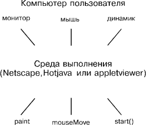

#### 图 5.2。

运行时环境理解 `paint` 和 `mouseMove` 等 applet 方法，并在需要时触发它们——例如，当需要重绘屏幕或反映鼠标移动时。默认情况下，当调用这些方法时，applet 什么都不做——如果程序员想让 applet 响应相关变化，他必须自己重写这些方法。

## applet 的执行阶段

当兼容 Java 的 Web 浏览器加载 `Applet` 类时，它首先为 applet 和全局变量分配内存。然后执行 `init` 方法。（通常，程序员使用 `init` 方法初始化全局变量，从网络获取资源并安装用户界面。）随后，浏览器调用 `start` 方法。如果包含 applet 的浏览器部分可见，则调用 `paint` 方法。当用户离开页面时，浏览器调用 `stop` 方法。接下来的代码段说明明了其工作原理。示例 5-2. applet。

```java
import java.applet.*;
import java.awt.*;

public class Count extends applet {
    int InitCount=0;
    int StartCount=0;
    int StopCount=0;
    int PaintCount=0;

    public void init() {
        resize(250,75);
    }

    public void start() {
        StartCount++;
    }

    public void stop() {
        StopCount++;
    }

    public void paint(Graphics g) {
        PaintCount++;
        String Output = "Inits:"+InitCount+" Starts:"+StartCount+" Stops:"+StopCount+" Paints:"+PaintCount;
        g.drawString(Output,25,25);
    }
}
```

applet 首次启动后的输出如图 5-3 所示。applet 初始化了一次，启动了一次，从未停止，至少绘制了一次。


#### 图 5.3。

如果你去另一个页面再回来（不退出浏览器），你会发现 applet 仅初始化了一次，但运行了两次，停止了一次，重绘了两次。这反映在图 5-4 中。


#### 图 5.4。


建议：在 Netscape Navigator 2.0 中点击刷新按钮将强制当前页面上的 applet 保持并重新启动。

如果你通过移动另一个窗口到 applet 窗口上方来遮挡 applet，然后将其移动到最上方使其激活，你会发现 applet 没有重新启动也没有停止，但窗口被重绘了。在表 5-1 给出了 applet 类的一些重要方法。

表 5-1. applet 类的主要方法

| 方法 | 描述 |
| :--- | :--- |
| `init()` | 首次加载 applet 时调用。 |
| `start()` | 当包含 applet 的 Web 页面变为激活状态时调用。 |
| `stop()` | 当包含 applet 的 Web 页面不再激活时调用。 |
| `destroy()` | 显式销 applet 时调用。 |
| `paint(Graphics g)` | 当 applet 需要重绘图形窗口时调用。 |

Java 语言提供了一种更简单且更强大的方式。

HTML - 文档描述语言；Java 是一种很好的编程语言。你的 Java applet 可以使用 `Images` 作为图形象形或游戏街机风格的 `sprites`。下面的 Java applet 从网络接收接收图像和声音文件并显示它们。

示例 5-3. Web applet。


```java
import java.applet.*;
import java.awt.*;
import java.net.*;

public class webapplet extends applet {
    private Image myImage;
    private AudioClip mySound;
    private URL ImageURL;
    private URL SoundURL;

    public void init() {
        resize(250,250);
        try {
            // 将 URL 绑定到资源
            ImageURL = new URL("http://www.vmedia.com/vvc/onlcomp/java/chapter5/images/sample.gif");
            SoundURL = new URL("http://www.vmedia.com/vvc/onlcomp/java/chapter5/sounds/sample.au");
        }
        // 确保 URL 是正确的 catch (MalformedURLException e) {}
        // 加载图像
        myImage = getImage(ImageURL);
        // 加载声音
        mySound = getAudioClip(SoundURL);
    }

    public void start() {
        // 播放声音
        mySound.loop();
    }

    public void stop() {
        // 停止声音
        mySound.stop();
    }

    public void paint(Graphics g) {
        // 绘制图像
        g.drawImage(myImage,0,0,this);
    }
}
```

这段代码段包含了三个你可能不熟悉的类引用：`java.awt.Image`、`java.applet.AudioClip` 和 `java.net.URL`。这些类就像 Java API 中的大多数类一样，其功能或多程度上与其名称所含义的一致。

## Image 类

`Image` 类定义了一个简单的二维图形图像。`Graphics` 类（由 `paint` 方法使用）可以使用 `drawImage` 方法绘制图像，如下例所示：

```java
Image myImage;
myImage = createImage(50, fifty);
g.drawImage(myImage, 0, 0, this);
```

`createImage` 方法定义在 `java.awt.Component` 类上，它是 `Applet` 类的父类。该方法接受两个 `int` 类型的参数，并根据给定尺寸为图像创建一个新空间。

方法 `drawImage` 四个参数：图像、图像在窗口中的坐标位置以及 `ImageObserver` 类。我们将在第 9 章“图形与图像”中详细描述此类，现在只需在使用 `drawImage` 时直接将你的 applet 替换为质量参数 `ImageObserver` 即可。


建议：如果你有必要将 applet 作为参数传递，可以使用关键字

 这种，这在第 4 章“语法与语义”中提到过。

`applet` 类使用 `getImage(URL)` 方法从网络接收 `Images`。该方法完成自帮助接口 `AppletContext`（见上文侧边栏“Interface AppletContext”）。

因此，Java applet 可以导入 浏览器支持的任何图形格式的图像。最常用的格式是 GIF 和 JPEG。图像加载通常需要一段时间，但我们可以在 applet 中继续并输出 `Images`，尽管实际上 `Images` 不会立即出现，而是持续一段时间后出现。如果你对图像有更多控制，可以使用 `media tracker` 类，我们将在第 9 章讨论它。

## AudioClip 类

`java.applet.AudioClip` 类是音频数据的高级表示。该类定义了三个方法：`play`、`loop` 和 `stop`。`applet` 类定义了 `getAudioClip` 方法，它根据给定的 `URL` 返回声音文件。与 `getImage` 方法一样，`getAudioClip` 方法实际上是由 applet 上执行的；因此，applet 能够使用浏览器支持的任何声音格式。例如，下面的代码：

```java
AudioClip mySound;
mySound.play();
```

播放此 `AudioClip` 代表的声音。`Applet` 类定义了一个方法 `play(URL)`，当给定声音文件的 `URL` 时，播放该文件。如果音频文件丢失或格式不受支持，则什么都不会发生。`AudioClip` 类和 `Image` 一样，在请求声音时即可使用，但实际上加载和播放声音可能需要一些时间。遗憾的是，可用于在使用之前加载图像的 `MediaTracker` 类尚未支持 `AudioClip`。

## URL 类

`URL` 类，或统一资源定位符（“统一资源”）—— Web 的完整地址。Java 语言有一个专门的类来处理 URL。它的实例是一个包含内容的对象：

```java
URL myObject;
myObject = new URL("http://www.vmedia.com/vvc/onlcomp/java/chapter5/images/sample.gif");
```

（注：原文中 URL 存在一些显示异常，让我们重新格式化逻辑：

`URL` 类，或统一资源定位符（“统一资源”）—— Web 的完整地址。Java 语言有一个专门的类来处理 URL。它的实例是一个包含内容的对象：

```java
URL myObject;
try {
    myObject = new URL("http://www.vmedia.com/vvc/onlcomp/java/chapter5/images/sample.gif");
}
catch (MalformedURLException e) {
    // 此处执行代码
}
```

你可能注意到我们在示例 applet 中插入了一些数据，但具体来说是 `URL` 图像和声音文件。如果你是一名专业的程序员或计算机科学教授，你可能已经注意到了并露出了苦脸——对于既定标准来说，这种编程方式是不可接受的。每你想更改此 applet 使用的图像或声音文件时，都需要修改代码并重新编译该类。幸运的是，`Java` 有一种方法可以在运行时向 applet 传递参数，这些参数可以用于定义各种图形或声音文件。

## 访问参数

优秀高级语言的一个特性是能够从命令行中获取参数。程序员利用此根据用户输入来改变程序的行为，从而减少对复杂用户界面的需求。但 `Java` applet 并不是从命令行运行的，因为它们（以及它们的参数“命令行”）是嵌套在内部 HTML 代码中的。

考虑下面的网页。

示例 5-4a. 来自参数的网页。

```html
<HTML>
<HEAD>
<TITLE>Good web Apple</TITLE>
</HEAD>
<BODY>
<APPLET CODE="GoodWebApplet.class" WIDTH=250 HEIGHT=250>
<PARAM NAME="IMAGE" VALUE="http://www.vmedia.com/vvc/onlcomp/java/chapter5/images/sample.gif">
<PARAM NAME="SOUND" VALUE="http://www.vmedia.com/vvc/onlcomp/java/chapter5/sounds/sample.au">
</APPLET>
</BODY>
</HTML>
```

在这一段代码中，我们嵌套了一个名为 `IMAGE` 值为 `"/images/sample.gif"` 的变量。applet 可以使用 `getParameter` 访问 `IMAGE` 变量，该方法接收质量参数中的 `name` 变量并返回包含变量值的行。`SOUND` 参数也是如此。所有选项都以字符串的形式呈现。


在第 6 章“应用层编程”中，你会了解到如何将字符串类型变量转换为其他类型。如果你需要数字类型的参数，这将会非常有用。


利用这些新的功能机会，我们可以重写用于 Web applet 的 `init` 方法，使其独立于数据。

示例 5-4b. 改进后的 Web applet。

```java
public void init() {
    String ImageParam;
    String SoundParam;
    resize(250,250);
    // 值从 HTML 文件中获取
    ImageParam = getParameter("IMAGE");
    SoundParam = getParameter("SOUND");
    try {
        // 使用参数获取 URL
        ImageURL = new URL(ImageParam);
        SoundURL = new URL(SoundParam);
    } catch (MalformedURLException e) {}
    myImage = getImage(ImageURL);
    mySound = getAudioClip(SoundURL);
}
```

通过允许图像和声音文件的位置由网页作者而非程序员来决定，我们让 applet 变得有用得多。作者要更改 applet 使用的图像或声音，只需更改任何参数的 `VALUE` 标签即可。当你有一个显示频繁变化数据的 applet，或者你想让网页作者轻松更改 applet 的默认行为时，你必须使用相应的参数。

尽管这些选项非常有用，但它们允许 applet 只以一种狭窄的方式与用户交互——通过选择在程序启动前编写的行。但是当用户移动鼠标或按下某些键时，如何动态改变 applet 的行为呢？复杂的应用程序需要这种反应，而 `Java` 语言中的事件处理有助于完成这一任务。

# 用户交互

为了与用户进行实时交互并跟踪 Java 运行时外壳的变化，applet 使用了事件的概念。事件是响应某些用户操作（移动鼠标或在键盘上按下按键）而产生的信息。事件也可以响应环境的变化而产生——例如，当窗口 applet 遮挡了其他窗口时。运行时外壳监视发生的事件，并通过称为 `handler` 开发（事件处理器）的特殊方法传递事件信息。

`Applet` 类预定义了许多常用的事件处理器。默认情况下，这些处理器什么都不做——若要使用它们，你需要用你自己的代码替换相应的方法，例如：

```java
public boolean mouseMove(Event evt, int x, int y) {
    // 如果移动了鼠标，则执行此处的代码
    return true; // 代码
}
```

当按下鼠标按钮时会调用此方法。如果按下一次按钮，小程序将处理单击事件；如果按下两次按钮，小程序将处理双击事件。

## 事件、生成键盘

`keyUp` 和 `keyDown` 方法的工作方式与鼠标事件处理程序相同，不同在于它们传递的是按键标识符，而不是坐标（事件开发）。

按键 ID 是一个整数，对应于被按下的键。普通打字键的值对应于其 ASCII 码。此外，Java 还支持表 5-3 所示的许多特殊键。这些特殊键实际上被定义为 `event` 类的静态整数变量（常量）。第 6 章“应用程序接口”将向你展示如何在行内转换这些数字，如果你想显示来自键盘的输入。

下一段代码检查光标按键移动的管理：

```java
Public boolean keyDown(Event evt, lnt key) { 
  switch(key) {
    case Event.UP:
    case Event.DOWN:
    case Event.LEFT:
    case Event.RIGHT:
    default:
  }
  return true;
}
```

当按下按键时会调用 `keyDown` 方法。switch 语句在四个方向键和其他所有按键之间切换，并为被考虑的键执行相应的代码块。

## 事件处理程序：本身到底发生了什么？

当事件发生时实际上发生了什么？`AppletContext` 注意到事件发生在小程序内部这一事实（参见本章上方侧边栏“AppletContext 接口”）。`AppletContext` 创建 `Event` 类的的新实例，分配适当的参数值，以便小程序知道发生了哪个事件，并将一个新事件发送给 `handleEvent` 方法。`Event` 类包含了标识事件所需的所有信息；描述事件的变量列在表 5-4 中。

表 5-4. 事件变量

| 变量 | 描述 |
| :--- | :--- |
| `public Object target` | 发生小程序事件的组件；通常是小程序本身。 |
| `public long when` | 事件发生的时间是一个长型整数，包含自 GMT 1970 年 1 月 1 日午夜以来的毫秒数。Java 有 `java.lang.System.currentTimeMillis()` 方法可以返回此含义的值。 |
| `public int id` | 事件类型（参见表 5-6）。 |
| `public int x` | 事件的 X 坐标。 |
| `public int y` | 事件的 Y 坐标。 |
| `public int key` | 按键标识符（特殊键请参见表 5-3）。 |
| `public int modifiers` | 状态键叠加掩码。 |
| `public Object arg` | 可选参数。它不用于鼠标和键盘事件，但在使用 Java API 提供的图形时经常使用（参见第 9 章“图形与图像”）。 |

`handleEvent` 方法检查事件类型并调用相应的处理程序，向其传递与原因相关的参数（此过程的图如图 5-5 所示）。

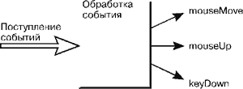

#### 图 5.5。

例如，当移动鼠标时，会发生 `MOUSE_MOVE` 事件，该事件被传递给 `handleEvent` 方法。后者调用与此事件对应的 `mouseMove` 方法，并传递鼠标位置。事实上，不需要将事件位置作为单独参数传递，因为这些信息为了编程方便已直接编码在事件中。

如果你想处理许多不同的事件而不必替换每个特定方法，可以替换 `handleEvent` 方法。如果你想以不同的方式处理序列事件，这可能也有用。这样做之后不要忘记除非你显式地在新的 `handleEvent` 方法中调用它们，否则预定义的事件处理程序不会被调用。以下示例调用了通用的鼠标事件处理程序，但所有其他事件将按时间执行：

```java
public boolean handleEvent(Event evt) { 
  switch (evt.id) {
    case Event.MOUSE_MOISE_DOWN:
    case Event.MOUSE_MOUSE_UP:
    case Event.MOUSE_MOUSE_MOVE:
    case Event.MOUSE_MOUSE_DRAG:
    case Event.MOUSE_MOUSE_ENTER:
    case Event.MOUSE_MOUSE_EXIT:
  }
}
```

你可以在程序中生成事件。要做到这一点，你只需要创建一个 `Event` 类的新实例并在你的小程序中声明它（事件构造函数列在表 5-5 中）。生成事件可能对于编写系统宏很有用，例如记录鼠标移动。你可以通过编写绘制动作来安排绘制，用户可以将此绘图复制到另一个位置。以下代码将强制你的小程序认为鼠标移动到了新位置：

```java
event FakeEvt;
long time = System.currentTimeMillis(); 
FakeEvt = new event(this, time, MOUSE_MOVE, new_x, new_y, 0, 0, null);
```

表 5-5. 构造函数

| 构造函数 | 描述 |
| :--- | :--- |
| `Event(Object, long, int, int, int, int, int, Object)` | `Event(Object, long, int, int, int, int, int, Object)` |
| `Event(Object, long, int)` | `Event(Object, long, int)` |
| `Event(Object, int)` | `Event(Object, int)` |
| `Event(long, int)` | `Event(long, int)` |
| `Event(int)` | `Event(int)` |
| `Event(Object)` | `Event(Object)` |
| `Event()` | `Event()` |

## 帮助流的动画

线程与其他类不同，因为它们在接收控制权并开始行动后，在启动它们的方法的环境中独立执行。在在这方面，它们类似于多处理器操作系统（如 UNIX）中的进程。当调用普通方法时，程序会等待其执行完毕。但当调用线程方法时（通常在线程运行时），调用线程的方法在线程方法执行期间继续执行。图 5-6 显示了单个线程的执行情况。两个流。


你可以在 Java 程序中使用线程，并定义扩展类 `Thread`。这一过程在第 11 章“多线程”中进行了详细描述。但现在让我们解释如何允许 applet 使用线程。这种技术在某些情况下非常有用，例如当 applet 显示移动图像时，你又希望 applet 在动画播放期间执行其他有用的操作。

## 接口 `Runnable`

正如第 3 章“Java 面向对象”中所讨论，Java 语言没有考虑多重继承。applet 无法直接扩展 `Applet` 类或 `Thread` 类。你可以通过 `Runnable` 接口定义一个在线程内部运行的方法。该接口与 `Thread` 类一样，属于 `java.lang` 包。可以选择如下这种方式：

```java
class ThreadedApplet extends Applet implements Runnable {

}
```

接口 `Runnable` 告诉编译器该 `Class` 有一个 `run` 方法，该方法必须在线程内执行。要执行的方法由 applet 中直接创建的 `Thread` 类实例控制。我们将看到如何在实践中使用它：

```java
class ThreadedApplet extends Applet implements Runnable {
    private Thread engine = null;

    // 我们的流
    public void init() {
        engine = new Thread(this);
        // 此流现在控制我们的方法
    }

    public void start() {
        engine.start();
        // 方法开始执行
    }

    public void stop() {
        if (engine != null && engine.isAlive()) {
            // 如果必要，
            engine.stop();
            // 停止执行方法
        }
    }

    public void run() {
        while (engine.isAlive()) {
            // 代码位于此处，执行，直到 applet 停止
        }
    }
}
```

当 applet 初始化时，它会创建一个附加到 applet 上的新线程。当 applet 启动时，线程的工作开始，它会在 `run` 方法中循环执行其代码，直到 applet 停止。

## 用于从线程操作的简单方法

`Thread` 类定义了许多管理线程的方法。我们将在第 11 章“多线程”中详细讨论它们。在表 5-7 中简要描述了需要记住的最重要方法。

表 5-7. `Thread` 类通用方法

| 方法 | 描述 |
| :--- | :--- |
| `isAlive()` | 返回 `Boolean` 变量，指示当前线程是否存活。 |
| `sleep(long)` | 请求线程睡眠指定的毫秒数。如果接收到另一个线程的中断信号，此方法将抛出 `InterruptedException`。（关于中断，请参见第 11 章“多线程”。） |
| `start()` | 开始执行线程。 |
| `stop()` | 停止执行线程。 |
| `suspend()` | 临时挂起线程。 |
| `resume()` | 恢复后继续执行线程。 |

通过使用线程，我们可以扩展光标显示 applet（示例 5-5），如图 5-7 所示，以显示跟随光标的移动图像。我们将修改 applet 以允许用户对其进行某些控制：按下鼠标按钮停止并再次启动动画。

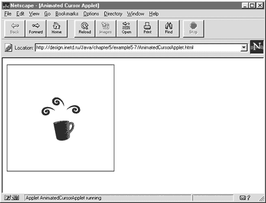

#### 图 5.7。

示例 5-6a. 显示光标的动画 applet。

```java
import java.applet.*;
import java.awt.*;
import java.net.*;

// 此类有一个在线程内部执行的方法，
// 并通过在此 applet 中创建的线程实例进行控制
public class AnimatedCursorApplet extends Applet implements Runnable {

    private int mouse_x, mouse_y;
    // 角色图像数组
    private Image CursorImages[];
    // 当前图像索引
    private int CursorIndex = 0;
    // 线程管理实现方法
    private Thread anim = null;
    // 动画未挂起
    private boolean paused = false;

    public void init() {
        resize(250, 250);
        // 将线程绑定到 applet
        anim = new Thread(this);
        mouse_x = 125;
        mouse_y = 125;
        // 为了开始接受五张图像
        CursorImages = new Image[5];
        int i;
        String CursorParam;
        URL CursorURL;
        // 填充图像数组
        for (i = 0; i < 5; i++) {
            CursorParam = getParameter("CURSORFILE" + i);
            try {
                CursorURL = new URL(CursorParam);
                CursorImages[i] = getImage(CursorURL);
            } catch (MalformedURLException e) {
                // 如果 URL 错误，创建空帧
            }
        }
    }
    // ... (其余逻辑后续所示)
}
```

## 消除闪烁

除非你运行在速度惊人的图形工作站上，否则当启动此 applet 时，你肯定会看到几次恼人的闪烁，这是 applet 试图比技术上可能更快的速度重绘屏幕的结果。解决此问题的经典方案是双倍缓冲。该过程的流程图如图 5-8 所示。


#### 图 5.8。

当运行时外壳需要重绘图形窗口时——例如当窗口被遮挡或 applet 请求重新显示并重绘窗口时——applet 的 `update` 方法会被调用，并将 `Graphics` 对象传递给它的图形窗口。在默认情况下，`update` 方法只是传递 `Graphics` 对象给 `paint` 方法。

Applet 可以定义一个虚拟屏幕进行绘图，而不是直接在图形窗口外壳上执行绘制。Applet 绘制的图像可以使用 `getGraphics` 方法传输到实际窗口中。该方法返回与图像关联的 `Graphics` 对象。Applet 将以尽可能快的速度在其上绘图。Applet 的 `update` 方法将图像显示在 `Graphics` 对象上，而不是允许 applet 直接显示在屏幕上。结果是，闪烁现象将会消失。

在绘制执行时的外壳 `Graphics` 对象与绘制虚拟图像的 `Graphics` 对象之间存在一个显著区别。窗口在运行时会被清除，并且在每次 `update` 时必须完全重新绘制。如果虚拟图像没有被显式着色，它将保留已经绘制的内容。如果你想使用此类图像显示移动图形，必须在每次修改它时都重新绘制图形周围的背景，否则你的图片在移动时会留下足迹。

现在我们可以使用虚拟屏幕图像为 applet 显示光标添加双缓冲。

示例 5-6b. 无闪烁的动画 applet 显示光标。

```java
import java.awt.*;
import java.applet.*;
import java.net.*;

public class AnimatedCursorApplet extends Applet implements Runnable {

    private int mouse_x, mouse_y;
    private Image CursorImages[];
    private int CursorIndex = 0;
    private Thread anim = null;
    private boolean paused = false;
    private Image OffscreenImage;

    // our virtual screen
    private Graphics OffscreenGraphics;

    // our interface to him
    public void init() {
        resize(250, 250);
        OffscreenImage = createImage(250, 250);
        // new image
        OffscreenGraphics = OffscreenImage.getGraphics();
        // tie our interface to image
        anim = new Thread(this);
        mouse_x = 125;
        mouse_y = 125;
        CursorImages = new Image[10];
        int i;
        String CursorParam;
        URL CursorURL;
        for (i = 0; i < 5; i++) {
            CursorParam = getParameter("CURSORFILE" + i);
            try {
                CursorURL = new URL(CursorParam);
                CursorImages[i] = getImage(CursorURL);
            } catch (MalformedURLException e) {
                CursorImages[i] = createImage(0, 0);
            }
        }
    }

    public void start() {
        anim.start();
    }

    public void stop() {
        if (anim != null && anim.isAlive()) {
            anim.stop();
        }
    }

    public synchronized void update(Graphics g) {
        paint(OffscreenGraphics);
        // say applet paint over our image
        g.drawImage(OffscreenImage, 0, 0, this);
        // paint over real graphic window
    }

    public void paint(Graphics g) {
        int px, py;
        Image Cursor = CursorImages[CursorIndex];
        g.setColor(Color.white);
        g.fillRect(0, 0, 249, 249);
        // draw over the old image
        g.setColor(Color.black);
        g.drawRect(0, 0, 249, 249);
        // let's deduce frame
        px = mouse_x - Cursor.getWidth(this) / 2;
        py = mouse_y - Cursor.getHeight(this) / 2;
        g.drawImage(Cursor, px, py, this);
    }

    public boolean mouseMove(Event evt, int x, int y) {
        mouse_x = x;
        mouse_y = y;
        return true;
    }

    public boolean mouseDown(Event evt, int x, int y) {
        if (paused) {
            anim.resume();
            paused = false;
        } else {
            anim.suspend();
            paused = true;
        }
        return true;
    }

    public void run() {
        while (anim != null) {
            try {
                anim.sleep(50);
            } catch (InterruptedException e) {}
            CursorIndex = CursorIndex + 1;
            if (CursorIndex == 5) {
                CursorIndex = 0;
            }
            repaint();
        }
    }
}
```

# 接下来做什么

读完这一章后，你可以在 Java applet 中编写多媒体程序。现在你可以从网络接收图像和声音数据，还可以从 HTML 代码获取执行期间参数，你可以处理用户界面开发并使用线程恢复你的 applet。所有这些对于创建包含多媒体的 applet 都是必要的，但对于编写可以使用文本和其他输入设备与用户进行高级交互的 applet 来说还不够。

到目前，你应该已经喜欢使用 Java 语言了。接下来的章节将讨论 API 提供的丰富的 Java 类层次。这些类和接口增加了有用的功能。

## 第 6 章

(Images/image0922.jpeg)

## API

（为了简洁省略了文本，保持结构：API 是 Java 开发工具包自带的一套巨大的工具。在其中你将找到字符串处理、网络、数学能力以及“主力军”——用于处理哈希表的程序。）

该 API 非常易于使用，因此在学习那些绝对必要的部分时你不应该遇到任何重大问题。如果你真的沉浸在 API 的探索中，你将能够在不编写代码的情况下完成许多基本操作，并深入理解如何使用 Java 这种面向对象的语言特性。

首先，我们必须理清 API 的结构。然后我们考虑 Java 语法，这样你就可以充分利用具体的类和接口。

## API 结构

API 包含了几十个现成的类、接口和异常。

在 API 内部，这些类、接口和异常被分为八个包：`java.applet`、`java.awt`、`java.awt.image`、`java.awt.peer`、`java.io`、`java.lang`、`java.net` 和 `java.util`。表 6-1 简要说明了每个包的作用。

表 6-1 API 包

### 包描述

`java.applet` 包含运行 applet 的类和接口（见第 5 章，“Applet 的工作”）。

`java.awt` 允许创建用户图形界面。

`java.awt.peer` 完全由接口组成，允许系统与 Java 窗口交互。易于移植到其他平台（但对普通程序员来说没有意义）。

`java.awt.image` 设计用于创建和处理图像（见第 9 章，“图形与图像”）。

`java.io` 处理输入和输出程序（见第 11 章，“多线程”）。

`java.lang` 包含核心元素，如 `Object`、`String`、`Exception` 和线程。

`java.net` 处理与网络的交互（见第 11 章“多线程”和第 12 章“跨越 Applet 模型范围的编程”）。

`java.util` 包含若干辅助类，通常用于结构化数据。

请记住，包是相关的类和接口的集合，它们允许访问用 `protected` 修饰符定义的方法和变量。在许多情况下，成员被包含在其中一个包中，这是由于设计上的考虑，并且与 `protected` 关键字的使用有关。在其他情况下，某个成员可能属于某个包，是因为在它的目的上它与该包的其他成员最接近。使用 API 时，我们可以将不同的包视为功能性的机会。不要被 `java.awt.image` 和 `java.awt.peer` 误导——它们的成员与 `java.awt` 包的成员没有特殊的语法关系。Java 的创建者为 API 选择这些名称，是为了显示这两个包的成员具有相似的功能性机会。

在日常编程中，包结构对你的重要体现在两个方面。首先，你需要使用 `import` 操作符来应用 API 中的类。但其次，你必须至少大致熟悉包的内容，因为如图 6-1 所示，交互式的 Java 开发工具包文档也是按包划分的。每个类、接口和异常都有自己的 Web 页面，详细描述了所有可用的公共方法和变量。

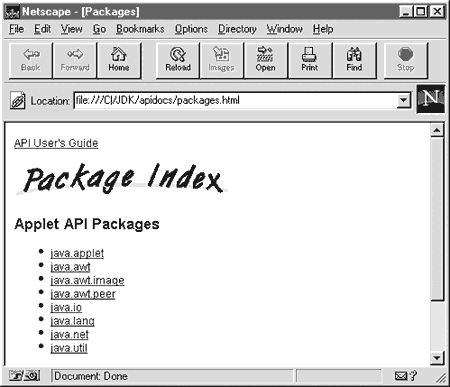

### 练习 6.1

一旦你完成了这一章，请深入研究在线 JDK 文档。由于你确定在编译 Java 程序时会遇到错误，你将发现在线文档是无价的。这本书的生命将在我们的在线伴侣页面继续，在那里你可以找到 Sun Microsystems 提供的最新交互式文档。


## 使用 API

使用 API 的第一步是使用 `import` 语句访问包。完成这一步后，你的学习过程将分为两个部分。首先，你将学习如何在 Java 编程中使用代码块。此外，随着你使用 API 的经验越来越丰富，你将自己编写 Java 代码块，用 Java 语言开发你自己的工作风格。

API 是熟悉 Java 语言细节的绝佳方法。你可以从已存在的东西学习。你可能不会总是同意 API 项目创建者的观点，但你将达到体验 Java 编程快乐的。开始开发自己的类、接口和包时，你可以将 API 作为你项目的链接。

### 导入包

在第 2 章我们已经开始导入包，并在第 3 章详细描述了语法。为了记住这一点，足够写：

```java
import <package_name>.*;
```

这对于导入包并不是必须的，但它让你的代码更易于阅读。正如你在第 5 章记得的，当我们没有导入 `java.applet` 包时，我们必须以这种方式声明类：

```java
class MyApplet extends java.applet.applet {}
```

但对于我们经常使用的类，每次都详细写出类的全名是不方便的。


考虑在示例类上最佳使用 `import` 操作符：

1. 确定包含你想要使用的类的包。这很简单：因为我们的类全名是 `java.util.Date`，因此它包含在 `java.util` 包中。否则，我们将查阅交互式文档查找。

2. 使用 `import` 语句导入类。如果我们只使用 `Date`，可以这样做：

```java
import java.util.Date;
```

通常会从一个包中使用几个类。在这种情况下，最好使用模板来导入所有类：

```java
import java.util.*;
```

3. 我们现在准备好使用我们的类来引用当前日期。使用 `import` 语句非常简单。要避免只导入包而不导入类的陷阱。你可能会通过以下导入语句掉入陷阱：

```java
import java.util;
```

这个操作实际上没有导入任何类。通过添加名称，我们声明变量：

```java
Date d;
```

或者在没有 `java.util.*` 语句的情况下：

```java
java.util.Date d;
```

无论是否有 `java.util.*` 语句，最后的代码都是正确的。然而，这种形式的代码很笨拙，容易出错。

### 静态方法对比动态方法

正如你在第 2 章记得的，Java 方法可以是静态的也可以是动态的。动态方法更通用——它们与类的实例化概念有关。另一方面，静态方法是直接与类关联的方法。如果在声明中存在 `static` 修饰符，则它是静态的。图 6-2 显示了 `java.util.Date` 类中名为 `parse` 的静态方法。注意 `static` 关键字的存在。


### 练习 6.2

使用静态方法类型 `parse`，我们不需要创建类实例。相反，我们这种方式引用类：

```java
public long demoStatlc(String S) { return date.parse(S);}
```

API 中的许多方法都是静态的，因为即使它们是动态的，也会产生完全的结果。因此，当我们只需要方法时，我们必须再次创建变量，而该方法只需接收输入并产生输出，对对象的其余部分保持无关。

但这种便利性经常给 Java 新手带来错误，因为他们尝试动态地访问静态方法。因此，将每个类认为由两个独立的部分组成是有用的——一个动态的，另一个静态的。动态部分包含了变量和方法，它们是类实例的一部分——那些没有用 `static` 修饰符定义的方法。在我们 date 类中，这些就是我们 `parse` 方法之外的所有方法。

另一方面，静态变量和方法只是属于某个类的工具方法，因为该类是你在逻辑上寻找它们的地方。例如，让我们考虑 `Date` 类中的 `parse` 方法。该方法接收一个格式化日期的字符串，并返回自格林威治标准时间 1970 年 1 月 1 日午夜以来经过的秒数。

如果你需要此类功能机会，并且为了寻找它们而开始浏览在线 API 文档，你可能会查看 `Date` 类。通过查看 `Date` 类方法的描述，你会发现这样的方法已经存在了，你不需要自己编写它。

你只需要看到存在什么样的方法，并确定它是否是静态的。如果是这个静态方法，你将会知道：

*   你不应该为了使用此方法而分配对象对象。
*   你不能从对象调用静态方法，受处理过程的限制。
*   必须通过语法 `<类名>.<方法名>` 来调用方法。

### 其他访问修饰符概述

在参考在线文档查看给定方法是否为静态时，你可能会遇到其他访问修饰符的提示。这些修饰符都定义在第 3 章“Java 面向对象”中。在这里我们将对它们进行概述，考虑它们对我们使用 API 的影响。

*   `protected` 修饰符。表示该方法或变量仅对此包中的其他类可见。由于我们创建的类不会被包含在任何 API 包中，因此此修饰符对我们没有施加任何限制。我们将在第 11 章“多线程”中介绍在设计中对 `protected` 关键字的使用，以及自定义包的实现。

*   `final` 修饰符。意味着一个方法（或整个类）不能被子类。当我们使用作为 API 的类时，这个关键字对我们来说并不重要。然而，如果我们想创建自己的子类类 API，我们应该检查它是否没有被 `final` 帮助修饰符定义。

*   `abstract` 修饰符。如果整个类都用 `abstract` 修饰符定义，那么我们只能实现它的子类。如果类成员中只有一个成员被用 `abstract` 修饰符定义，那么我们只能访问替换了该特定方法的子类成员（参见第 3 章“Java 面向对象”）。当你看到 `abstract` 修饰符时，不要忘记事情并非初眼看起来的那样。你可能应该考虑文档中包含的 API 树，并探索 API 提供的子类。在图 6-3 显示的抽象类树 `java.awt.Component` 中，理解此类的子类是学习 Java AWT 的大部分我们将在接下来的两个中充分探索它们。

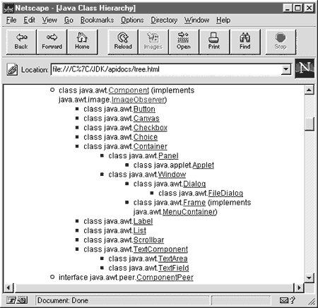

#### 图 6.3

*   `synchronized` 和 `native` 修饰符。对于 API 用户没有实际价值。为了对它们有一个大致的概念，让我们假设 `synchronized` 修饰符意味着特定的方法或变量只能在某些时刻访问，这对于多线程程序非常重要（见第 11 章）。但现在我们没有必要担心这个修饰符。

*   `native` 修饰符指定该方法实际上是在动态链接库（DLL）中执行的，该库不是用 Java 编写的。假设代码中插入的所有非 `native` 修饰的方法都是用 Java 编写的。

但现在，如果我们想要使用的方法是用 `native` 修饰符定义的，我们不需要特别留心。（更多细节我们将在第 12 章“框架模型 applet 后台编程”中考虑此类方法。）

### 异常与 API

当你学习交互式 Java 文档时，可能会注意到某些方法和构造函数会抛出异常。在第 5 章“Applet 的工作”中，我们面临一个抛出异常的构造函数，它是 `java.net` 包中 `URL` 类的构造函数。在图 6-4 中，`URL` 类网页显示了哪个接收行的构造函数导致了异常 `MalformedURLException`。

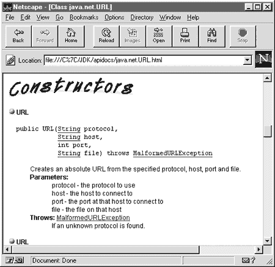

#### 图 6.4

为了有效使用 API，你应该了解可能调用方法或构造函数的异常。编写处理异常的自己的例程将在第 10 章“程序结构”中介绍。现在我们将为你介绍处理抛出异常的现有 API 方法和构造函数的配方。主策略如图 6-5 中的流程图所示。

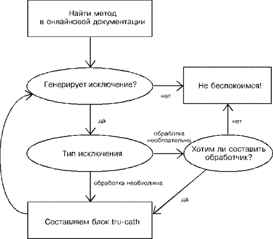

#### 图 6.5

第一步是显而易见的——我们首先在在线文档中找出我们的方法是否引起异常。如果方法或构造函数的声明中存在关键字 `throw`，我们就执行第二步来理解是哪种异常。此最简单的方法是点击异常名称（在我们例中，是 `MalformedURLException`）。因为异常是类，它们有自己的网页。

当我们到达网页时，确定它是什么异常，即检查它是哪个类的子类。如果它是 `RuntimeException` 或 `Error` 的后代，我们就不需要使用处理块。然后我们必须决定是否捕获此异常。

如果你在程序执行期间需要捕获异常，在抛出异常的方法文本中将插入一个处理块。它包含了所有依赖于方法正常执行的内容。此外，我们必须确保我们确实在处理该异常。尽管下一个 applet 将正确编译并工作：

```java
import java.applet.*;

class badApplet extends applet {
    Image img;
    // 描述变量
    public void init() {
        URL imgURL;
        // 坏主意！必须在处理块中。
        try {
            imgURL = new URL(getParam("image"));
        } catch (MalformedURLException e) {
            // Bad 主意！发生异常时我们什么都不做。
        }
        // Bad 主意！我们在处理块外使用了 imgURL。
        img = getImage(imgURL);
    }
    // 其他方法
}
```

考虑一下如果 "image" 参数不是有效的 URL 会发生什么。我们的块验证甚至不会告诉用户出了问题！更糟糕的是，当我们尝试寻找图像时程序将会失败。上面的代码片段是不愿意尝试处理程序异常的结果。由于异常处理对于初学者 Java 程序员来说往往是不可理解的，他可以将其视为不必要的复杂，只做绝对必要的的事。然而，正如我们在第 10 章“程序结构”中看到的，异常处理对于编写可靠的 Java 程序至关重要。我们不会在此深入讨论，但当你开始使用 API 时，尽量不要养成不当处理异常的习惯。如果你正在编写处理块，请遵循以下建议：

*   如果方法作者认为应该抛出异常，那么这可能已经是处理该异常的充分理由。
*   确保所有依赖于特定方法或设计者调用异常的代码都包含在处理块中。保证这一点的最简单方法是在块内部声明任何分配给特定方法或设计者的变量。
*   始终使用你的异常处理块来智能地响应导致异常的情况。在我们糟糕的 applet 示例中，我们必须向用户解释“image”参数是无效的。在关键情况下，你可以在块处理中完成性能 applet 操作。

## `java.lang.Object` 类

`java.lang.Object` 类是一个基础的 Java 类。你还记得在第 3 章“Java 中的面向对象”中提到的所有的类都源自同一个类吗？而这就是那个类！关于 `Object` 类，书中最重要的注释之一是，它位于层级结构的顶端。然而，它不仅仅是一个抽象概念——该类包含了几个方法，并且可以像其他类一样被处理。由于所有类都继承自 `Object` 类，因此它的方法出现在每一个其他类中。大部分（如果不是所有）表 6-2 中给出的基本方法通常在子类中被重写。

### 表 6-2. `Object` 类的基本方法

| 方法 | 说明 | 异常 |
| :--- | :--- | :--- |
| `boolean equals(Object o)` | 如果给定对象等效，则返回 true。 | 无 |
| `String toString()` | 根据给定对象的信息返回字符串。 | 无 |
| `Object clone()` | 克隆给定对象。 | `CloneNotSupportedException` |
| `void finalize()` | 当给定对象不再被需要时被调用。 | `Throwable` |

尽管 `Object` 类中还有其他方法，但这里列是最重要的。前两个方法被 API 中的任何类重写。`clone` 方法是让我们创建对象新副本的秘诀。这个方法带我们回到了第 4 章关于赋值运算符的讨论。让我们回想一下示例：

```java
public void sampleMethod(someClass anObject) { someClass anotherObject=anObject; }
```

在这里，`anotherObject` 和 `anObject` 实际上是同一个对象且属于同一个类——赋值操作并没有创建一个新副本。如果 `clone` 方法没有改变，我们可以使用它来执行样本拷贝：

```java
SomeClass aCopy=anObject.clone();
```

在这里我们假设 `someClass` 的作者已经决定了他想要如何克隆 `someClass` 实例。然而，为类定义一种克隆自身的方法并不总是一个好主意（见第 10 章）。作者的特定类可以决定是否克隆这些类的实例，并且 API 中的许多类是不可克隆的。当类或其某个父类实现了 `clone` 接口并显式重写了该方法时，可以使用此方法。

但关于 `Object` 类中的其他方法又如何呢？它们将在本章节的框架之后进行研究。表 6-3 描述了它们的作用以及之后在哪里进行讨论。

### 表 6-3. `Object` 类的其他方法

| 方法 | 描述位置 |
| :--- | :--- |
| `wait, notify, notifyAll` | 允许对象通过 Java 流进行通信。第 11 章，“多线程”。 |
| `hashCode` | 允许对象联合 `java.util.Hashtable` 使用。 |
| `getClass` | 用于在执行期间获取有关此对象的信息。第 10 章，“结构化程序”。 |

## 处理字符串

第 10 章，“结构化程序”。

如你所知，字符串仅仅是字符序列。几乎所有的编程语言无如何都支持字符串，Java 也不例外。`String` 类的文档 Web 页面如图 6-6 所示，位于 `java.lang` 包中，用于表示字符串。该类提供了许多功能，如转换为数值类型、子字符串搜索和替换、访问特定字符和空白字符。你可能会比 API 中的任何其他类更多地使用 `String` 类，并且应该非常熟悉其中包含的方法。在本节中，我们将探索 `String` 类。我们还将考虑 API 中的其他帮助你操作字符串的类。

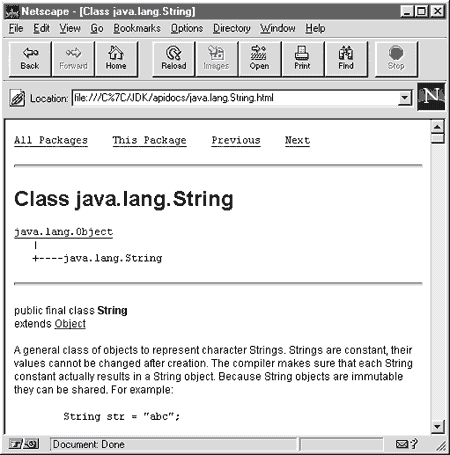

## 创建字符串

图 6.6。字符串可以通过两种方式创建：

- 使用七种设计者类之一的 `String` 类；
- 使用赋值操作符（`=`）。

在此之前，为了创建字符串，我们使用了赋值操作符。`String S="My string";` 是创建字符串最简单的方法。`+` 运算符也可以用于字符串的简单拼接，如示例 6-1 所示。

**示例 6-1a. 从简单类型形成字符串。**

```java
String S2="other string";
String S3=S+S2+"and a primitive type:" int i=4;
S3=S3+i
```

`S3` 现在将拥有值 "My string, another string and a primitive type: 4"。`+` 运算符对所有基本类型有效。然而，赋值运算符 `=` 并不如此。接下来的代码片段由于上述两个运算符将无法编译：

```java
int i=4;
String SI=i;
// 无法编译！String S2=4;
// 无法编译！
```

这种限制很人恼，但可以很容易绕过，尽管方式并不优雅。有必要创建一个空字符串，并通过 `+` 运算符向其添加必要的含义。

**示例 6-1b. 将基本类型的值直接赋值给字符串。**

```java
int i=4;
String S1=""+i;
String S2="+4;
```

赋值运算符仅适用于字符串常量（即包含引号内的文本）和其他字符串。`+` 运算符适用于字符串常量、其他字符串以及所有基本类型。此外，字符串可以通过表 6-4 中描述的构造函数创建。

### 表 6-4. 字符串构造函数

| 构造函数 | 创建的对象 |
| :--- | :--- |
| `String()` | 空字符串。 |
| `String(String S)` | `S` 的新副本。 |
| `String(char charArray[])` | 基于数组 `charArray` 的字符串。 |
| `String(char charArray[], int offset, int len)` | 从偏移 `offset` 开始长度为 `len` 的子数组字符串。 |
| `String(byte byteArray[], int hibyte)` | 基于数组 `byteArray` 的字符串，其中 `hibyte` 描述 Unicode 符号。 |
| `String(byte byteArray[], int hibyte, int offset, int len)` | 从偏移 `offset` 开始长度为 `len` 的子数组字符串。 |

虽然赋值运算符与基本类型不兼容，但这真的是 Java 中创建字符串时唯一不直观的地方。一旦我们过了字符串比较的特性，你就可以从容使用字符串了。

## 字符串比较

现在，学会创建字符串后，我们应该学习比较它们。`String` 类中有两个比较方法——`equals` 和 `compareTo`。`equals` 方法替换了 `Object` 类中的 `equals` 方法，并在字符串匹配时返回 true，而 `compareTo` 方法在等效字符串上返回 0。

**示例 6-2a. 通过 compareTo 和 equals 方法比较字符串。**

```java
if (S1.compareTo(S2)!=0)
System.out.println("S1 等于字符串 S2"); if (S1.equals(S2))
System.out.println("S1 等于字符串 S2");
```


如果 `S1` 字典序小于 `S2`，则 `compareTo` 方法返回的值为 -1；如果 `S1` 字典序大于 `S2` 则返回 1。正如下面的示例所示，“字典序”比较本质上意味着字母顺序比较。区别在于这种顺序扩展到了数字和其他非字母字符，因此 "a113" 在字典序上确实大于 "a112"。排序由 Unicode 值决定。

词法排序源于 Unicode 字符的整数值。`compareTo` 方法根据其整数值对字符串的每个字符进行逐一比较。当它发现差异时，将如上文所述返回 `1` 或 `-1`。对于数字和字母，这种流式处理在直觉上是清晰且易于记忆的（节 6-7）。

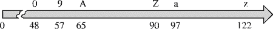

### Rice. 6.7

更复杂的是使用“非英语”字母表以及特殊字符（如 `%`、`!` 或 `*`）时的字符串比较。学习数字数值相似符号的最简单方法（在 Rice 6-7 中未显示）是将 `char` 类型转换为 `int` 类型并类型转换出其含义：

```java
public void strangeCharacter(char Strange) { 
    int val = (int) Strange;
    System.out.println("One strange character!");  
    System.out.println("The char " + Strange + " = " + val);  
}
```

除了我们只考虑过的两种比较方法外，还有六种方法以不同的方式比较两个字符串。它们都列在表 6-5 中，按难度递增排序。

#### 表 6-5. 方法比较行

| 方法 | 返回 true 的情况 |
| :--- | :--- |
| `equalsIgnoreCase(String S)` | `String` 等于 `S`，不区分大小写。 |
| `beginsWith(String S)` | `String` 以 `S` 开头。 |
| `beginsWith(String S, int len)` | 字符串以 `S` 的前 `len` 个字符开头。 |
| `endsWith(String S)` | 行以 `S` 结尾。 |
| `regionMatches(int toffset, String S, int offset, int len)` | 行中从位置 `toffset` 开始的子字符串与从 `offset` 开始长度为 `len` 的子字符串匹配。 |
| `regionMatches(boolean ignoreCase, int toffset, String S, int offset, int len)` | 与上方法相同，当 `ignoreCase == true` 时忽略大小写。 |

大多数字符串比较方法都是直观的，但 `regionMatches` 方法需要一些解释。它们允许你比较 `S1` 和 `S2` 中的任何子字符串。第一个参数指定了模式字符串中你想开始比较的位置。第二个参数是另一个字符串，其位置由第三个参数指定，你希望在该行从该位置开始比较。最后一个参数是比较区域的长度。`regionMatches` 方法的使用在 Rice 6-8 中进行了所示。

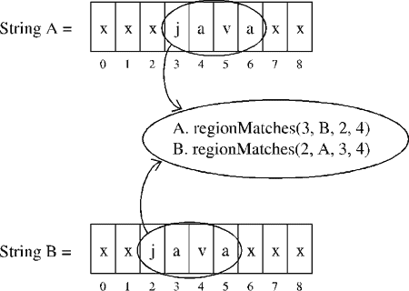

### Rice. 6.8

当我们开始解析字符串时，你会发现这两种比较方法非常有帮助。它们的整数值可以作为参数传递。例如，它们可以用于模拟 `endsWith` 和 `startsWith` 方法。下面给出的代码片段始终返回 `true`。

示例 6-3a. 通过辅助方法 `regionMatches` 模拟方法 `startsWith`。

```java
int lengthB = B.length();
if (A.startsWith(B) == A.regionMatches(0, B, 0, lengthB))
    // 始终为 true
```

然而，在辅助方法 `regionMatches` 中完成等效方法 `endsWith` 后，说明如何获取正确的参数更好。

示例 6-3b. 通过辅助方法 `regionMatches` 模拟方法 `endsWith`。

```java
int lengthB = B.length();
int startA = A.length() - B.length();
if (A.endsWith(B) == A.regionMatches(startA, B, 0, lengthB))
```

# 处理子字符串

## 操作子字符串

我们只看到 `String` 类允许比较子字符串。还存在许多提取子字符串的方法。让我们从处理子字符串的简单方法开始：

```java
public String substring(int start)
public String substring(int start, int len)
```

上面显示的第一个方法返回一个新行，它从字符数组中的第一个位置开始，包含该位置之后的所有字符。第二个方法仅返回 `start` 之后的 `len` 个字符。字符串的第一个字符位于位置零。考虑一些示例：

```java
String S = "0123456789";
String S1 = S.substring(0); 
String S2 = S;
// 字符串 S1, S2 是等价的。
String S4 = S.substring(4);
// S4 的含义是 "456789"
S5 = S.substring(4, 3);
// S5 的含义是 "456"
```

处理子字符串的方法之所以不方便，是因为它们总是需要传递参数。当你可以使用 `indexOf` 方法时情况也是如此。`indexOf` 方法允许你检查 `String` 类中的单个字符或字符串，并返回索引数组。

#### 表 6-6. Indexof 方法

| 方法 | 返回含义 |
| :--- | :--- |
| `indexOf(char a)` | `a` 第一次出现的索引。 |
| `indexOf(char a, int start)` | 从 `start` 开始的 `a` 的索引。 |
| `indexOf(String S)` | `S` 第一次出现的索引。 |
| `indexOf(String S, int start)` | 从 `start` 开始的 `S` 的索引。 |

## 修改行

在整个章节中，字符串不会被改变。请注意，一旦创建，字符串实例就无法修改。因此我们赋值一个新副本。

```java
String S = "some string";
S = S.substring(0, 4);
```

除了 `substring` 方法外，我们还有四种其他可以使用的方法。它们在表 6-7 中。

#### 表 6-7. 修改方法

| 方法 | 返回含义 |
| :--- | :--- |
| `concat(String S2)` | 将 `S2` 连接到当前字符串。 |
| `replace(char a, char b)` | 字符 `b` 替换 `a`。 |
| `toLowerCase()` | 返回不包含大写字的字符串。 |
| `toUpperCase()` | 返回不包含小写的字符串。 |
| `trim()` | 返回去除前后空格的字符串。 |

# 解析行

现在我们有了所有的字符串工具。我们可以比较，并使用 `indexOf` 查找子字符串。但假设一行中多次出现同一个子字符串。例如，一个数学表达式可能会多次出现 `+` 符号。计算机科学家将此类字符串称为分隔符。分隔符之间的单元被称为令牌（tokens）。

我们说过可以编写代码根据特定分隔符解析令牌。但这是一项辛苦的工作。幸运的是，`java.util` 包包含一个 `StringTokenizer` 类，它可以根据给定的分隔符分割给定的字符串。在 Rice 6-9 中展示了 `StringTokenizer` 的交互式文档。

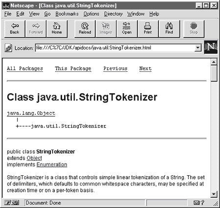

### Rice. 6.9

使用 `StringTokenizer` 类解析行。

```java
public int getSum(String S) {
    int runningSum = 0;
    StringTokenizer tok = new StringTokenizer(S, "+");
    while (tok.hasMoreTokens()) {
        String thisToken = tok.getNextToken();
        runningSum = Add(thisToken);
    }
    return runningSum;
}
```

```java
private int Add(String S) {
    // 在知道如何执行它之前，
    // 我们应该了解基本类型转换
}
```

如你所见，使用 `indexOf` 和 `regionMatches` 方法来实现相同的功能会困难得多。如果我们只需要对字符串进行一次，可以保留对 `indexOf` 和 `regionMatches` 方法的使用。表 6-8 描述了构造函数，图 6-9 显示了为了有效使用该工具需要掌握的主要方法：`StringTokenizer`。

### 表 6-8. StringTokenizer 类的构造函数

| 构造函数 | 描述 |
| :--- | :--- |
| `StringTokenizer(String S, String delim)` | 根据 `delim` 分割 `S`。 |
| `StringTokenizer(String S, String delim, boolean returnDetims)` | 与上述相同，但如果 `delims == true`，分隔符将作为标记（tokens）返回。 |
| `StringTokenizer(String S)` | 根据空格（`"\t\n\r"`）分割 `line`。 |

### 表 6-9. StringTokenizer 类的方法

| 方法 | 描述 |
| :--- | :--- |
| `String nextToken()` | 返回下一个标记。 |
| `String nextToken(String newDelim)` | 在切换分隔符为 `newDelim` 后，返回下一个标记。 |
| `boolean hasMoreTokens()` | 如果还有未返回的标记，则返回 `true`。 |
| `int countTokens()` | 返回 `line` 中的标记数量。 |

## 其他数据类型中的行转换

程序员经常需要在字符串和基本数据类型（如整数）之间进行转换。要将基本数据类型转换为字符串，可以使用 `valueOf` 方法。每种基本数据类型都有特定的 `valueOf` 方法，它们的工作方式都相似。让我们展示 `int`、`float`、`double`、`boolean` 和 `char` 的类型值转换。

示例 6-5a. 行中的基本类型数据转换。

```java
int someInt=1;
String StringInt=String.valueOf(someInt);
float someFloat=9.99f;
String StringAsFloat=String.valueOf(someFloat);
// StringAsFloat 的含义是 9.99
// 注意结尾的 f，
// 以将其与 double 类型区分开。
double someDouble=99999999.9;
String StringAsDouble=String.valueOf(someDouble);
// StringAsDouble 是 "99999999.9"
boolean someBoolean=true;
String StringAsBoolean=String.valueOf(someBoolean);
// StringAsBoolean 是 true
char someChar='a';
String StringAsChar=String.valueOf(someChar);
// StringAsChar 的含义是 "a"
```

这些方法与我们之前使用的空字符串和 `+` 运算符将基本类型值赋值给字符串的变没有没有。你可能会发现这些方法可以让你的代码更易读。但如何将字符串转换为基本类型呢？正如你所预期的，为此在 API 中有特殊的静态方法——但它们不在 `String` 类中。它们包含在基本类型的包装类中，我们稍后会讨论。例如，考虑数值型基本类型的转换，排除 `short` 和 `byte`。

示例 6-5b. 行到基本类型的转换。

```java
String intString="10";
String floatString="10.1f";
String longString="999999999";
String doubleString="999999999.9";
try {
    int i=Integer.parseInt(intString);
    float f=Float.valueOf(floatString).floatValue();
    long l=Long.parseLong(longString);
    double d=Double.valueOf(doubleString).longValue();
} catch (NumberFormatException e) {
    System.out.println("尝试了无效转换");
}
```

在这里我们不需要担心字符串是否无效，因为是我们自己为它们赋值的。但在许多情况下（例如，当你从用户那里接收数据时），你需要为行格式不正确的情况做好准备。`NumberFormatException` 是运行时异常，所以你不需要拦截它。但如果你不这样做，在未来的某一天，你的程序就会崩溃。

上面的示例没有涵盖字符串到 `short` 和 `byte` 的转换。记住，所有数值数据类型都可以强制转换为 `short` 和 `byte` 类型，如下代码段所示。

示例 6-6a. byte 和 short 类型值的行转换。

```java
String S="0";
try {
    byte b=(byte)Integer.parseInt(S);
    // 将 int 值截断为 byte；
    // 可能会丢失信息。
    short s=(short)Integer.parseInt(S);
    // 将 int 值截断为 short；
    // 可能会丢失信息。
} catch (NumberFormatException e) {
    // 来自不可接受的 S，
    // 你可以再次抛出异常。
}
```


建议：在上面的代码段中，要将字符串转换为 `byte` 和 `short`，请使用 `Integer.parseInt()` 然后对结果进行强制转换。

容器允许你放入任意数量的对象，并为放置和搜索对象提供了非常实用的功能。`Hashtable` 类允许你创建键值对并通过键访问对象。`Vector` 类在需要创建许多许多同类的副本时非常有用，但无法预先知道这些副本的数量时。`Stack` 类允许你根据后入先出的原则跟踪一组对象。“面世”。


让我们从最简单的数据容器 `Vector` 类开始吧。不要让它的名字误导了你——这个类并不是专门为复杂的科学或图形化程序预留的。`Vector` 类本质上是一个可扩展的数组。在课堂中理解了这一点后，你会发现它有许多用途。你是否曾经需要一个某种类型的数据数组，但又不知道它的具体值（大小）？`Vector` 类解决了这个问题。与数组不同，你可以根据需要向 vector 中添加任意数量的元素。在向 vector 添加完元素后，你可以创建一个正确大小的数组并将所有元素复制到其中。表 6-10 给出了完成此类工作所需的主要方法。

### 表 6-10. `Vector` 类基本方法

| 方法 | 描述 |
| :--- | :--- |
| `void addElement(Object o)` | 添加一个对象。 |
| `void insertElementAt(Object oh, int i)` | 在位置 i 插入对象 o。元素不会被销毁，大小增加 1。 |
| `void copyInto(Object someArray[])` | 将 vector 中的所有元素复制到数组 `someArray` 中。 |
| `int length()` | 返回 vector 中的元素数量。 |

让我们来看看这个数据结构的实际运行情况。还记得第 4 节中“语法与语义”的卡通 applet 吗？我们曾使用 `Applet` 类的 `getParam` 方法从 html 页面获取图像 URL。我们随意设置了 5 张图片。另一方面，我们可以统计图片的数量，然后创建一个该大小的数组。通过创建一个 vector，我们可以将遇到的每张图片都添加到 HTML 页面上对应的参数中。现在，我们可以编写可以加载任意数量图片的 applet 动画片了。

示例 6-8. 从任意数量图片生成的 applet 动画片。


```java
public class AnimatedApplet extends applet {
  private Image imgs[];

  public void init() {
    if (getImages()0) {

    }
  }

  public int getImages() {
    int index=0;
    vector imageVec=new Vector();
    while (getParameter("image"+indx)!=null) {
      String S=getParameter("image"+indx);
      try {
        URL U=new URL(getDocumentBase(),S);
        Imageim=getImage(U);
        imageVec.addElement(im);
      } catch {
        showStatus(S+"is not a valid URL -. skipping");
      } 
      indx=indx+1;
    }
    imageVec.copyInto(imgs);
    return index;
  }
}
```

现在我们有一种方便的方法来保存任意数量的图片，而且我们把它们全部放入一个数组中。如果你愿意，也可以让它们留在 `vector` 中。由于使用 `insertElementAt` 方法可以访问存储在其中的任何图片，我们的 `vector` 也可以像数组一样工作。这种方法在我们预期稍后会有额外到达时是必要的。但如果我们不预期有新元素，通常使用 `copyInto` 方法是最好的。定义程序如何处理数组比处理 `vector` 要容易得多。在内存使用方面，应用数组更高效且直接。因此，通常在第一次调用时就很好地考虑数组的大小。

存储无限数量的对象是 `Vector` 类最强大的用途，但它也可以用于其他目的。表 6-11 描述了允许你对所有 `vector` 进行精确复制、查找特定元素、通过索引引用元素以及删除所有元素的方法。注意无法删除部分 `vector` 元素——`delete` 方法的工作原理是“全有或全无”。

boolean

表 6-11. `vector` 类附加方法

## 方法描述

- `boolean contains(Object o)`：如果对象位于 `vector` 中，则对每个元素执行 `o.equals(eachlObject)`。
- `int indexOf(Object o)`：返回对象的位置，如果它不在 `vector` 中则返回 -1。使用的 `equals` 方法与上述所示。
- `int indexOf(Object oh, int i)`：与之前的方法 `indexOf` 相同，但从位置 i 开始搜索。
- `int lastIndexOf(Object o)`：行为类似于 `int indexOf(Object o)`，但从最后一个元素开始搜索。
- `int removeAllElements()`：删除 `vector` 中的所有元素。
- `boolean isEmpty()`：如果 `vector` 为空，则返回 true。

由于 `Vector` 类没有预定义的大小，你可能在想它有多有效。由于它是一个动态结构，我们不能期望它像数组一样高效——随着它的增长，它会不断需要更多空间。默认情况下会预留空间。你可以在 `vector` 创建后使用 `ensureCapacity` 或 `setSize` 方法控制 `vector` 的大小。如果你需要在不改变大小的情况下确保空间可用，可以使用 `ensureCapacity`。如果你的 `vector` 大于设置的大小，`setSize` 方法是危险的。因此最好使用 `ensureCapacity`。

#### 方法

构造函数

表 6-12. `Vector` 类效率

#### 描述

- `Vector(int size)`：创建一个包含 size 个对象的 `vector`。
- `Vector(int size, int inc)`：创建一个包含 size 个对象的 `vector`，并建立增量 inc。
- `ensureCapacity(int size)`：如果容量小于 size，则提供足够的位置。
- `setSize(int size)`：设置大小，可能会移除最后的元素。

与 `vector` 最适合存储无限数量的对象一样，哈希表被用于存储无限数量的元素对。如图 6-10 所示，哈希表包含两列。一列包含键，另一列包含元素。每个键都与且仅与一个元素相关。如果你尝试向表中添加已存在的键-元素对，相应的元素将被替换。通过将元素对放入哈希表，你可以使用相关的键来访问它们。换句话说，你可以向哈希表传递某个对象，如果该对象是键之一，将返回与该键相关的元素。这些基本操作可以通过表 6-13 给出的方法完成。

表 6-13. `Hashtable` 主要方法

## 方法描述

- `Object put(Object key, Object o)`：将键-元素对放入哈希表。如果键已在元素表中，则返回与之关联的元素。
- `Object get(Object key)`：返回与键相关的元素。
- `boolean containsKey(Object key)`：如果键位于表中，则返回 true。
- `Object remove(Object key)`：从表中删除键-元素对。

现在我们来构建图 6-10 所示的哈希表。首先我们将编写一段不进行任何检查的简单代码，然后让它对错误更具健壮性。由于键是简单的数字，我们应该使用包装后的原始类型。注意此示例中的类型转换。完成工作后，如果我们知道名字，就可以找到人的年龄。

### 示例 6-9a. 使用哈希表工作。

```java
class AgeManager {
    private Hashtable H=new hashtable();
    // other variables

    void updateAge(String person, int age) {
        // name 不能为空! Integer intWrap=new Integer(age);
        H.put((String)person,(Integer)intWrap);  return intWrap.intValue();
    }

    int getAge(String person) {
        // person 必须存在于表中! Integer intWrap=(Integer)H.get((String)person);
        return intWrap.intValue();
    }
}
```

`Hashtable` 类的基本方法允许你从哈希表中获取所需的数字。当我们把名称传递给 `ageManager` 对象时，它将返回年龄。另一方面，我们必须创建 `Integer` 类对象，因为哈希表不知道如何处理原始数据类型。现在我们已经知道如何从哈希表中存取变量了，可以使我们的方法更具维护性。

### 示例 6-9b. 更稳定的 getAge。

```java
int getAge(String person) {
    // 返回：
    // 如果人在表中，则返回人的年龄；
    // 如果人不在表中，则返回 -one；
    // 如果 person==null，则返回 -2。
    if (person==null)
        return -2;
    if (!H.containsKey(person)) return -one;
    Integer intWrap=(Integer)H.get((String)person);  return intWrap.intValue();
}
```

现在我们应该保护 `put` 方法免受错误影响，并为程序提供发生发生的信息。由于 `put` 方法返回一个对象，我们可以返回旧值。通过这种方式，我们可以确定是在添加新的年龄-姓名对，还是替换了哈希表中的某个人的年龄。

### 示例 6-9c. 修改后的 updateAge。

```java
int updateAge(String person, int age) {
    // 返回：
    // 如果更改了，则返回年龄；
    // 如果未更改，则返回 -one；
    // 如果 person==null，返回 -2。
    if(person==null)
        return -2;
    Integer intWrap=new Integer(age);
    if (H.containsKey((String)person)) { 
        intWrap=(Integer)H.put((String)person, (Integer)intWrap);
        return intWrap.intValue();
    } else {
        H.put((String)person,(Integer)intWrap);
        return -one;
    }
}
```

如上所述，在哈希表的相应操作中，类型转换是必要的；现在让我们看看为什么这样做是有益的。适当的类型转换允许我们将不同类型的对象放入同一个哈希表中。当我们查找它们时，可以解决我们想要接收的对象的类型。让我们在示例 6-10 中展示这一点，使用一个非常小的哈希表（这里 `Vector` 类是 `stack` 的超类）。

### 示例 6-10. 类型转换与哈希表。

```java
Vector Vec=giveAsAVector(); Stack St=giveAsAStack();
// St 是 Vector 类的子类 h.put("vec", (Vector)Vec);
H.put("stack",(Stack)St);
Stack st1=(Stack)H.get((String)"vec");  Stack st2=(Stack)H.get((String)"stack");

// 我们从哈希表中得到了两个不同的栈，尽管我们只放进了一个：Hashtable H=new Hashtable();
h.put((String)"stack", (Stack)st1);
h.put((String)"stack", (Stack)st2);
```

我们同样对键值进行相同的操作，这在 get 方法中转换。

所以，我们已经演示了哈希表的基本功能。`Hashtable` 类中定义的其余方法如表 6-14 所示。凭借从我们的讨论以及表 6-13 和 6-14 中中学到的信息，你已经可以结合 API 类广泛使用哈希表了。但为了与你自己创建的类一起使用它们，你需要理解 `hashCode` 方法以及它在哈希表中是如何工作的（将在第 10 章中描述）。

#### 表 6-14. Hashtable 类的其他方法

| 方法 | 说明 |
| :--- | :--- |
| `void clear()` | 清空哈希表。 |
| `Hashtable clone()` | 复制哈希表。 |
| `boolean contains(Object o)` | 如果 `o` 是哈希表中的元素，则返回 true。 |
| `boolean isEmpty()` | 如果哈希表为空，则返回 true。 |
| `int size()` | 返回大小。 |

## 栈 (Stacks)

如果你查看任何程序的内部，你会发现一个栈。栈最用于跟踪。

### 表 6-15. Stack 方法

| 方法 | 说明 |
| :--- | :--- |
| `Object push(Object o)` | 将 o 放入栈中。 |
| `Object pop()` | 从栈中弹出元素。 |
| `Object peek()` | 返回顶端元素但不移除它。 |
| `boolean isEmpty()` | 如果栈为空，则返回 true。 |
| `int search(Object o)` | 如果 o 在栈中，则返回距离。 |

## 接口 API (Interfaces API)

正如第 3 章“Java 面向对象”中所述，Java 接口允许在不创建实例的情况下使用一组类方法。接口声明方法，某些类实现它们。接口在 API 中起着决定性的结构作用，`java.util` 中有两个接口——`Enumeration` 和 `Observer` 非常有用。学习了接口的结构作用以及这两个接口的应用后，你可以通过浏览其他包并开发自己的接口以最完整的格式使用它们。

```java
public class applet extends panel {
    // 基本类 applet
    private appletstub stub;

    public final void setStub(AppletStub stub) {
        this.sttub=(AppletStub)stub;
    }
    // applet 的剩余部分
}
```

`java.applet` 和 `java.awt.peer` 中的所有接口都遵循与执行环境无关的类无关 API 这一目标。尽管这些接口非常重要，但当我们仅使用 API 时，它们并没有实际用处。例如，如果我们不编写运行 applet 的外壳，我们就永远不会遇到 `appletstub`。当我们在第 10 章“结构化程序”中开始开发自己的包时，我们可能会记住这种技术。但现在，尽量不要在这两个包的接口上感到困。

## 接口枚举 (Interface Enumeration)

在 `java.util.enumeration` 中，`interface Enumeration` 接口在我们的程序中直接很有用。当像 `Vector` 或 `Hashtable` 这样的 API 类返回 `Enumeration` 时，通常你得到的是一个对象列表。然后你可以通过对每个对象执行 `desired operation` 来处理此列表。这种解决方案的妙之处在于，无论这些对象的来源如何，你都可以使用 `Enumeration` 接口的方法来处理你的列表。

假设我们需要对向量、键或意味着哈希表执行相同的操作。我们可以将哈希表的所有键或所有值放入向量中，然后遍历其所有元素，但在许多情况下，使用 `Enumeration` 接口反而更方便。

示例 6-11a。接口 `Enumeration`。

```java
public void printEnumeratlon(Enumeration e) { 
    while (e.hasMoreElements()) {
        System.out.println(e.nextEIement.toString);
    }
}
```

要从哈希表或向量使用 `printEnumeration`，你应该应用表 6-16 中给出的方法之一。

表 6-16. 返回元素 Enumeration

| 类 | 方法 | 返回值 |
| :--- | :--- | :--- |
| `Vector` | `elements()` | 所有向量元素的枚举。 |
| `Hashtable` | `keys()` | 哈希表所有键的枚举。 |
| `Hashtable` | `elements()` | 哈希表所有元素的枚举。 |

在练习中使用 `printEnumeration` 方法，只需从以下操作符中任选一（对于哈希表 `H` 和向量 `V`）：

示例 6-11b. 使用 `Enumeration` 接口。

```java
Hashtable H=giveMeHashtable();
Vector V=giveMeVector();
printEnumeration( V.elements()); 
printEnumeration( H.keys() );  
printEnumeration( H.elements());
```

在我们简单的 `printEnumeration` 示例中，我们使用了所有的 `Enumeration` 接口方法。因此我们不能过度依赖 `Enumeration` 接口。尽管它提供了处理哈希表和向量的方便方法，但我们只能遍历列表一次。

## 接口 `java.lang.Clonable` 和 `java.lang.Runnable`

这两个接口主要起结构性作用，但不如 `java.applet` 和 `java.awt.peer` 那样原始。当我们看到某个类实现了 `Cloneable` 接口时，意味着我们可以使用 `clone` 方法来创建该类的副本。让我们为允许克隆的 `Vector` 类实例创建一个副本（这里 `V1` - 该类的实例，在此之前存在，我们尝试进行复制）。

示例 6-12. 使用 `clone` 方法。

```java
Vector V1=new Vector();
String V1Element="First element in V1"; V1.addElement(V1);
Vector V2=(Vector)V1.clone();
String V2Element="Second element in V2"; 
System.out.println("Vector V1");  
EnumerationPrinter.printEnumeration(V1.elements());  
System.out.println("             ");
System.out.println("Vector V2");  
EnumerationPrinter.printEnumeration(V2.elements());  
System.out.println("             ");
```

在这里我们使用 `printEnumeration` 方法来显示向量内容。此代码片段输出如下：

Vector VI

First element in VI

vector V2

First Element in VI Second element in V2


我们将 `clone` 语句替换为简单的赋值，`V1` 将与 `V2` 相同，我们的输出将是：

Vector VI

First element in VI First element in V2

vector V2

First element in VI First element in V2

虽然 `Cloneable` 接口很重要，但它没有 `clone` 方法那么重要。当我们看到一个类实现了 `Cloneable` 接口时，我们知道该类的作者提供了克隆功能。对于 `Runnable` 接口也是如此，但重要的是 `Runnable` 类支持流。我们已经在第 5 章“工作中的 Applet”中见过这个例子，当时我们让我们的 applet 具备了能力。

## 接口 `java.util.Observer`

`java.util.Observer` 接口用于实现观察者模式。`Observable` 类维护一个观察者列表并通知它们变化。`Observer` 接口有一个 `update` 方法，当可观察对象变化时会被调用。

`java.util.Observer`

`java.util.Observable`

`java.util.Observer` 接口用于实现观察者模式。`Observable` 类维护一个观察者列表并通知它们变化。`Observer` 接口有一个 `update` 方法，当可观察对象变化时会被调用。

`java.util.Observer`

`java.util.Observable`

`java.util.Observer` 接口用于实现观察者模式。`Observable` 类维护一个观察者列表并通知它们变化。`Observer` 接口有一个 `update` 方法，当可观察对象变化时会被调用。

`java.util.Observer`

`java.util.Observable`

`java.util.Observer` 接口用于实现观察者模式。`Observable` 类维护一个观察者列表并通知它们变化。`Observer` 接口有一个 `update` 方法，当可观察对象变化时会被调用。

`java.util.Observer`

`java.util.Observable`

`java.util.Observer` 接口用于实现观察者模式。`Observable` 类维护一个观察者列表并通知它们变化。`Observer` 接口有一个 `update` 方法，当可观察对象变化时会被调用。

`java.util.Observer`

`java.util.Observable`

```java
void notifyObservers(Object arg)
```

添加观察者，以跟踪可观察实例后面。

移除观察者。

向观察者报告发生了某事；要发现具体是什么，它们可以检查 `arg`。

`int countObservers()` 返回观察者的数量。

`boolean hasChanged()` 如果发生了变化，则返回 `true`；必须使用 `setChanged` 和 `clearChanged` 来检查和取消标记标志位。

```java
void setChanged()
```

强制 `hasChanged()` 返回 `true`。

```java
void clearChanged()
```

强制 `hasChanged()` 返回 `false`。

# 数学与 API

## Math 类

我们在第 2 章 **Java 编程基础** 中涵盖了基础运算符，但在稍后，你可能需要执行更复杂的操作。`java.lang` 包中的 `Math` 类包含 30 个算术方法，例如用于寻找成对数字的最大值或最小值的方法，或者获取自然对数的方法。它还包含了静态变量形式的数字 `e` 和 `pi`。

图 6-12 显示了 Java 在线文档中 `Math` 类的网页。我们不再尝试更详细地描述方法，而是重点关注如何在实践中使用它们。

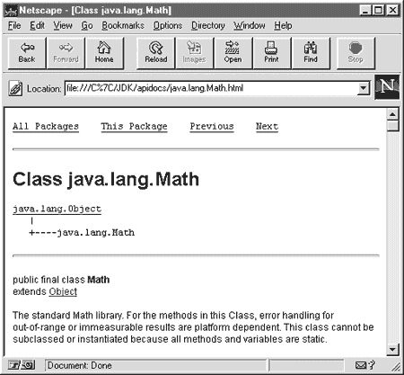

### 示例 6.12

#### 示例 6-14. 类 `Math` 的

```java
public class DoSomeMath {
    // 其他代码
    public void useMathMethods(int i1, int i2, double d, float f, long l) {
        int intAbsValue = Math.abs(i1); 
        double doubAbsValue = Math.abs(d); 
        float floatAbsValue = Math.abs(f); 
        long longAbsValue = Math.abs(l);
        // 它们返回绝对值。
        // abs 方法 !!!重载。 
        int minInt = Math.min(i1, i2); 
        double maxDoub = Math.max(i1, d);
        // min 和 max 方法针对所有数值类型进行了重载。
        // 在第二行中，i1 被赋值为 double 类型。
    }
}
```

正如我们上面说的，我们可以从 `Math` 类中获取 `e` 和 `pi` 的值。类包还包含某些值，代表美国感兴趣的内容，例如每个基本数据类型的最大值的静态变量以及其他有用的数量。它们在表 6-18 中描述了一切。

### 表 6-18. 有用的静态变量

| 变量 | 含义 | 包含该变量的类 |
| :--- | :--- | :--- |
| E | 自然对数的底。 | `Math` |
| PI | 数字 pi。 | `Math` |
| MIN_VALUE | 给定类型的最小值。 | `Integer`, `Float`, `Long`, `Double` |
| MAX_VALUE | 给定类型的最大值。 | `Integer`, `Float`, `Long`, `Double` |
| NEGATIVE_INFINITY | 表示负无穷大。 | `Float`, `Double` |
| POSITIVE_INFINITY | 表示正无穷大。 | `Float`, `Double` |
| NaN | "不是数字"可能用于表示未赋值的值 | |

# 第 7 章


## 自定义接口

货币转换 applet 键盘输入字段文本编辑 按钮开关 列表 下拉列表 滚动条说明。

在本章中，我们开始学习语言的一种特殊组件，称为“高级窗口工具包”（“构建窗口界面的工具包”，AWT）。我们将从屏幕用户界面（图形用户界面，GUI）的主要元素开始，这些元素定义在 `java.awt` 包中。我们在本章中编写的 applet 将使用以下 `awt 组件`：

* 键盘输入，
* 用于单行或多行文本输入的字段，
* 按钮，
* 标志，
* 列表，
* 弹出菜单，
* 滚动条，
* 静态文本说明。

Java 允许你比 HTML 更加方便和高效地使用这些基础用户界面元素。Java 程序员可用的非常重要的工具之一是用户输入的仿真。上述所有元素都允许你跟踪鼠标光标的移动，使得它们更具交互性。例如，当用户鼠标光标滑过编辑框时，程序可以在框中显示某些说明性或示例文本。下一章“关于用户界面的更多”将扩展本章的内容，介绍如何实现更复杂的界面元素。然后，当我们开始学习网络（第 4 部分，“Java 与 Web”）时，你已经能够为你的程序创建一个高效且外观专业的界面，并可以继续创建 applet，实现远程连接。

## Applet 开发

在本章中，我们开始学习语言的一种特殊组件，称为“高级窗口工具包”（“构建窗口界面的工具包”，AWT）。我们将从屏幕用户界面（图形用户界面，GUI）的主要元素开始，这些元素定义在 `java.awt` 包中。我们在本章中编写的 applet 将使用以下 `awt 组件`：

* 键盘输入，
* 用于单行或多行文本输入的字段，
* 按钮，
* 标志，
* 列表，
* 弹出菜单，
* 滚动条，
* 静态文本说明。

Java 允许你比 HTML 更加方便和高效地使用这些基础用户界面元素。Java 程序员可用的非常重要的工具之一是用户输入的仿真。上述所有元素都允许你跟踪鼠标光标的移动，使得它们更具交互性。例如，当用户鼠标光标滑过编辑框时，程序可以在框中显示某些说明性或示例文本。下一章“关于用户界面的更多”将扩展本章的内容，介绍如何实现更复杂的界面元素。然后，当我们开始学习网络（第 4 部分，“Java 与 Web”）时，你已经能够为你的程序创建一个高效且外观专业的界面，并可以继续创建 applet，实现远程连接。

### Applet 逻辑与事件

在本章中，我们重点关注如何实现更复杂的界面元素。applet 逻辑涉及通过各种事件处理用户输入。

### 键盘输入

在第 5 章“Applet 工作”中，我们查看了事件的概念及其处理。正如你记得的，相同类型的事件（鼠标光标经过区域）可能会引用对象。此外，事件可以用于构建界面。

图 7-1 显示了 applet 的简单原型。在这个版本中，用户只需在框中输入数字并按回车即可查看结果。我们使用事件处理器拦截 `keyDown`，检查按下的键是否等于 `\n`，从而过滤按键并提供响应。`TextField` 和 `TextArea` 类的详细描述请见下一节。

### 示例 7.1

#### 示例 7-1. Applet 金额计算，拦截按键事件

```java
import java.awt.*;
import java.applet.Applet;

public class currencyConverter1 extends java.applet.Applet {
    float conversion_ratio = 1.50f;
    TextField field1 = new TextField(20);
    TextArea field2 = new TextArea(4,20);

    // I/O 界面元素（见下一节） 
    public void init() {
        field1.setEditable(true);
        field2.setEditable(false);
        field1.resize(field1.preferredSize());
        field2.resize(field2.preferredSize());
        add(field1);
        add(field2);
        show();
    }

    public void convert() {
        float currency1, currency2;
        String InputString = field1.getText();
        field1.setText("");
        currency1 = Float.valueOf(InputString).floatValue();
        currency2 = conversion_ratio * currency1;
        String OutputString = "$" + InputString + " = #" + Float.toString(currency2) + "\n";
        field2.appendText(OutputString);
    }

    public boolean keyDown(Event evt, int key) {
        // 按键处理实现
        return true;
    }
}
```

```java
// 处理按键的开发程序

{
  char c=(char)key;

  // 将按键转换为字符类型以进行比较
  if (c == '\n') {
    // 如果按下的是回车键，启动 convert()
    convert();
    return true;
  } else {
    return false;
  }
} // KeyDown() 结束
} // applet currencyConverter1 结束
```

在例例中，我们使用 `keyDown` 事件处理器来捕获按键释放事件。在下方的“复选框（Checkboxes）”部分，我们也将使用回车键 `Enter` 来启动重新计算程序，但随后我们将使用 `handleEvent` 方法。该方法是一个通用的事件处理器，你可以用它来拦截程序已经有其他处理器的事件，从而选择你想要提供响应处理的事件。（在示例中，通过使用标志位，你将看到如何使用此处理器来拦截按下 `Enter` 键和用鼠标点击复选框。）因此，拦截事件有多种方法，在很多情况下，它们在功能和速度上是完全互换的。在那些需要拦截许多不同事件的 applet 中，可以使用像 `handleEvent` 或 `action` 这样的通用事件处理器。此类处理器允许你将所有的事件处理代码集中在一个地方，这对于 applet 代码的可读性和运行速度通常是有利的。广播管理片段，作为处理特定开发内容的响应者，更多地通过操作符切换来执行。

此外，通过 `handleEvent` 方法的帮助，你可以处理整个事件序列，并考虑事件在 applet 内部的空间坐标。让我们在一个带有标志位的示例中使用它，在该示例中，处理器在拦截事件后检查鼠标光标的坐标，以确定点击发生的位置——是在 `flag` 上还是其他地方。许多其他处理事件的示例你可以在第 8 章“更多关于用户界面”以及书的其他章节中找到，特别是那些正在开发教育类 applet 的章节。

# 文本字段编辑

字段编辑文本区域（text area）可能用于 applet 中的取款，以及输入和编辑文本。这种类型的编辑字段由多行文本组成，并带有滚动条。相比之下，`TextField` 类型的编辑字段只有一行，且没有滚动条。`TextField` 和 `TextArea` 都是 `TextComponent` 类的子类，除了上述区别外，它们在所有方面都是相似的。在上述示例 applet 中使用的 `TextField` 类型字段如下：

```java
TextField field1 = new TextField(20);
field1.setEditable(true);
```

第一行创建了一个宽度为二十个字符的 `TextField` 类型字段。第二行为该字段分配了一个允许编辑其中文本的属性。如果将第二行的 `true` 替换为 `false`，用户将无法编辑字段中的文本。

然后我们创建一个宽度为 20 个字符、高度为 4 行的文本区域类型字段：

```java
TextArea field2 = new TextArea(4,20);
```

为了给这个编辑字段启用滚动条，程序中不需要提供任何设置，因为任何 `TextArea` 类对象在创建时会自动接收此界面元素。

程序在字段编辑中输出文本可以通过两种方法之一：

```java
field1.setText("");
field2.appendText(OutputString);
```

`setText` 方法允许设置字段的内容（在本例中，一对双引号允许你清空编辑字段）。`appendText` 方法允许将文本字符串附加到编辑字段内容的末尾。但如果编辑字段是多行的，`appendText()` 函数不会开始新行；要跳转到新行，你必须手动在可编辑的内容中粘贴换行符。

现在我们应该考虑创建的编辑框的大小。事实是，虽然每个字段都有其原始的“自然”尺寸，但 applet 的运行可能会导致实际尺寸不同。为了显式要求编辑字段占据其自然尺寸，我们将使用 `resize` 方法，并通过帮助方法 `preferredSize` 获取编辑字段的自然维度：

```java
field1.resize(field1.preferredSize());
field2.resize(field2.preferredSize());
```

现在，当 `TextField` 和文本区域对象被创建并初始化后，我们需要将它们添加到 applet 的界面中。这使用了 `add` 方法。最后，为了将这种方式添加的所有界面组件显示在屏幕上，使用了 `show` 方法。在这里我们需要写看到创建的 `field1` 对象和 `field2`：

```java
add(field1);
add(field2);
show();
```

还有许多其他方法可以用于处理字段编辑。表 7-1 列出了两个类中都可用的方法——无论是在 `TextField` 中还是文本区域中——所有这些方法都继承自 `TextComponent`。

## 表 7-1: TextComponent 类

| 方法 | 说明 |
| :--- | :--- |
| `getSelectedText()` | 返回选中的文本片段。 |
| `getSelectionEnd()` | 返回最后一个选中的位置。 |
| `getSelectionStart()` | 返回第一个符号的位置。 |
| `getText()` | 返回所有内容。 |
| `isEditable()` | 返回布尔值，显示是否可选。 |
| `paramString()` | 返回字符串类型，包含字段参数。 |
| `select(int, int)` | 返回位于之间的文本片段。 |
| `selectAll()` | 选择整个文本。 |
| `setEditable(boolean)` | 根据传递的布尔值禁用或允许字段编辑。 |
| `setText(String)` | 在字段中输出指定的文本。 |

`TextField` 类的方法比 `TextArea` 类少（因为某些多行编辑操作对于字段来说没有意义）。`TextField` 类的方法列在表 7-2。

## 表 7-2: TextField 类

| 方法 | 说明 |
| :--- | :--- |
| `echoCharsSet()` | 如果字段有回显字符，则返回 true。 |


| 方法 | 说明 |
| :--- | :--- |
| `getColumns()` | 返回行的字符数。 |
| `getEchoChar()` | 返回回显字符。 |
| `minimumSize(int)` | 返回指定宽度的最小尺寸。 |
| `minimumSize()` | 返回字段的最小尺寸。 |
| `paramString()` | 返回字符串类型，包含字段参数。 |
| `preferredSize(int)` | 返回指定长度的自然尺寸。 |
| `preferredSize()` | 返回字段的自然尺寸。 |
| `setEchoCharacter(char)` | 设置字段的回显字符。 |

## 表 7-3: 文本区域类构造函数

| 构造函数 | 说明 |
| :--- | :--- |
| `TextArea()` | 创建新的 `TextArea` 类型对象。 |
| `TextArea(int, int)` | 根据指定的行数和字符数创建新对象。 |
| `TextArea(String)` | 创建包含指定文本的新对象。 |
| `TextArea(String, int, int)` | 根据指定的行数和字符数创建包含指定文本的新对象。 |

## 表 7-4: 文本区域类方法

| 方法 | 说明 |
| :--- | :--- |
| `appendText(String)` | 将指定的文本添加到字段包含内容的末尾。 |
| `getColumns()` | 返回行的字符数。 |
| `getRows()` | 返回字段的行数。 |
| `insertText(String, int)` | 在指定数字符号后插入指定的文本。 |
| `minimumSize(int, int)` | 根据指定的行数和字符数返回字段可能拥有的最小尺寸。 |
| `minimumSize()` | 返回字段的最小尺寸。 |
| `paramString()` | 返回字符串类型，包含字段参数。 |
| `preferredSize(int, int)` | 根据指定的行数和字符数返回字段的自然尺寸。 |
| `preferredSize()` | 返回字段的自然尺寸。 |
| `replaceText(String, int, int)` | 将指定数字符号之间的文本替换为指定的文本。 |

# 按钮 (Buttons)

之前的版本货币转换 applet 通常通过按下 `Enter` 键来执行转换。现在，让我们通过添加一个按钮来修改该 applet，用户可以在输入原始值后通过该按钮重新计算。这里是创建一个标题为 `Convert:` 的按钮的方法：

```java
Button ConvertButton = new Button("convert");
```

这就是在下方示例 7-2 中创建按钮的方式。在这个版本中，我们不再提供拦截 `Enter` 键的功能，因为现在计算仅通过点击 `button` 触发。此版本 applet 的外观如图 7-2 所示。


#### 图 7.2.

示例 7-2a. 包含按钮的金额重新计算 applet。

```java
import java.awt.*;
import java.applet.Applet;

public class currencyConverter2 extends Applet {
    float conversion_ratio = UKratio;
    TextField field1 = new TextField(20);
    TextArea field2 = new TextArea(4, 20);
    Button ConvertButton = new Button("convert");

    public void init() {
        field1.setEditable(true);
        field2.setEditable(false);
        field1.resize(field1.preferredSize());
        field2.resize(field2.preferredSize());
        add(field1);
        add(field2);
        add(ConvertButton);
        show();  // 在屏幕上输出创建的元素
    }  // init 方法结束
}
```

这段代码片段提供了创建标记为 "convert" 按钮的功能，按下时，输入的值将被重新计算并显示在相应的字段中。`init` 方法用于创建 applet。在 `field1` 中，用户可以输入自己的值，而 `field2` 用于输出并受保护不可编辑。屏幕元素界面通过 `add` 方法添加到 applet 中。任何要显示的元素必须添加到某个容器中（在本例中，默认容器是 applet 窗口）。`resize` 方法使文本编辑框根据它们的大小（在本例中为二十个字符）排列，并考虑到窗口宽度。

实际重新计算由下一个函数执行。

示例 7-2b. 计算。

```java
public void convert() {
    float currency1, currency2;
    String InputString = field1.getText();
    currency1 = Float.valueOf(InputString).floatValue();
    currency2 = conversion_ratio * currency1;
    String OutputString = Float.toString(currency2);
    field2.setText(OutputString);
}  // convert() 结束
```

在这里创建了一个字符串变量，其中记录了来自字段 `field1` 的值。然后将 `InputString` 变量转换为 `float`，并将转换结果赋值给 `currency1` 变量。将此值乘以 `conversion_ratio`，将结果赋值给 `currency2` 变量，然后在转换为 `String` 后，将结果字符串写入 `OutputString` 变量。最后，将得到的值引入字段 `field2`。执行此重新计算的方法在下方的事件处理程序修复 `convert` 按钮被按下时被调用。

示例 7-2c. 拦截按钮按下。

```java
public boolean action(Event evt, Object obj) {
    if ("Convert".equals(obj)) {
        convert();
        return true;
    } else {
        return false;
    }
}  // action() 结束

}  // applet currencyConverter 结束
```

此事件监听方法用于设置对点击 `convert` 按钮的响应。这一点，我们必须重写名为 `action` 的事件处理器。在事件处理器内部，会将对象的标识与字符串 "Convert"（即我们按钮上的标记）进行比较。事实上，这里可以不通过比较，因为在我们的示例中只有一个我们需要做出反应的事件。然而，以后当我们需要向 applet 添加其他按钮以及处理鼠标事件时，我们将使用这种机制来识别发生的事件。

## 表 7-5: 按钮类方法

| 方法 | 说明 |
| :--- | :--- |
| `getLabel()` | 返回按钮上的标签。 |
| `paramString()` | 返回按钮选项的字符串。 |
| `setLabel(String)` | 设置按钮上的标记。 |

# 开关 (Switches)

为了吸引全世界的客户，我们的旅行社必须提供许多不同货币汇率重新计算金额的能力。让我们创建几个单选按钮（复选框），以便用户可以选择转换为美元的金额。就像 HTML 管理机构一样，通过：

```java
Button ConvertButton = new Button("convert");
```

此行创建了一个名为 "UK Pound" 的新开关，其默认值为 false。要创建一个指示其所属组及其状态的开关，请使用以下构造函数：

```java
Checkbox UKCheck = new Checkbox("UK Pound", CurrencyGroup, false);
```

这创建了一个标记为 "UK Pound" 的单选按钮，属于 `CurrencyGroup` 组并默认为 false。将开关汇集的组是 `CheckboxGroup` 类的实例。这里在之前的示例中使用了：

```java
CheckboxGroup CurrencyGroup = new CheckboxGroup();
```

让我们先创建另一个。

现在编写检查，允许发现从两个开关——英镑或法郎——中哪一个被选定：

```java
if (UKCheck == CurrencyGroup.getCurrent()) {
    System.out.println("UK Pound is checked");
} else {
    System.out.println("Franc is checked");
}
```

现在我们只需要重新货币转换 applet，以便根据所选的单选按钮使用不同的转换因子。此版本 applet 的文本显示在示例 7-3 中。在这里我们将再次使用拦截 `enter` 键，因此此版本中缺少 `Convert` 按钮。而在第一个版本中，按下 `Enter` 会启动重新计算（更多细节请参阅上面的“键盘输入”部分）。使用开关的 applet 视图如图 7-3 所示。


#### 图 7.3.

示例 7-3. 使用开关的金额重新计算 applet。

```java
import java.awt.*;
import java.applet.Applet;

public class currencyConverter3 extends Applet {
    final float UKratio = 1.50f;
    final float FRANCratio = 6.00f;
    float conversion_ratio = UKratio;
    TextField field1 = new TextField(20);
    TextArea field2 = new TextArea(4, 20);
    CheckboxGroup CurrencyGroup = new CheckboxGroup();
    Checkbox UK_Pound = new Checkbox("UK Pound", CurrencyGroup, true);
    Checkbox French_Franc = new Checkbox("French Franc", CurrencyGroup, false);

    public void init() {
        field1.setEditable(true);
        field2.setEditable(false);
        add(field1);
        add(field2);
        add(UK_Pound);
        add(French_Franc);
        resize(field1.preferredSize());
        resize(field2.preferredSize());
        show();
    }

    public void convert() {
        // function convert() not has changed
        float currency1, currency2;
        String InputString = field1.getText();
        field1.setText("");
        currency1 = Float.valueOf(InputString).floatValue();
        currency2 = conversion_ratio * currency1;
        String OutputString = "$" + InputString + " = " + "#" + Float.toString(currency2) + "\n";
        field2.appendText(OutputString);
    } // the end convert

    public boolean handleEvent(Event evt) {
        // interception developments clicks mice on alone from switches
        if (evt.target == CurrencyGroup) {
            if ("UK Pound".equals(CurrencyGroup.getSelectedItem())) {
                conversion_ratio = UKratio;
            }
            if ("French Franc".equals(CurrencyGroup.getSelectedItem())) {
                conversion_ratio = FRANCratio;
            }
            // examination, which from switches pressed,
            // And choice relevant coefficient recalculation
        }
        if (evt.target == field1) {
            char c = (char) evt.key;
            if (c == '\n') {
                convert();
                return true;
            } else {
                return false;
            }
        }
        return false;
    }
} // the end applet
```

## 表 7-6: CheckboxGroup 类方法

| 方法 | 说明 |
| :--- | :--- |
| `getCurrent()` | 返回当前选中的开关。 |
| `setCurrent(Checkbox)` | 移动开关上的选择，该选择引用 `Checkbox` 实例。 |
| `toString()` | 返回给定组开关数值的字符串表示。 |

## 表 7-7: Checkbox 类方法

| 方法 | 说明 |
| :--- | :--- |
| `getCheckboxGroup()` | 返回开关所属的组。 |
| `getLabel()` | 返回标识开关的文本说明。 |
| `getState()` | 返回对应于开关状态的布尔值。 |
| `paramString()` | 返回开关的字符串参数。 |
| `setCheckboxGroup(CheckboxGroup)` | 将开关重新归类到指定的组。 |
| `setLabel(String)` | 为给开关设置文本标签。 |
| `setState(boolean)` | 设置开关状态。 |

# 列表

列表框（List box）是一组垂直排列的元素，用户可以从中选择一个或多个元素（高亮）。在上一个例子中，用户使用开关选择了所需货币的汇率因子，但如果涉及许多不同的货币，开关可能不是此目的的最合适选择。在列表中组合选项要简单得多。与单选按钮组相比，列表提供的选项选择更加方便且均匀。在 Applet 示例中，列表用于选择用户想要转换成美元的货币。AWT 中包含的 `List` 构造函数创建一个可滚动的列表框，你可以对其设置可见元素的数量（即其高度）。对于可滚动列表，你还可以允许同时选择多个元素。构造函数可能如下所示：`List CurrencyList = new List(3, false);`。

此表达式创建一个名为 `CurrencyList` 的新列表，同时显示的元素数量等于三个，且你一次只能选择一个元素。如果不是 `false` 而是 `true`，则意味着列表中可以同时选择多个元素。向列表中添加元素需要更多几次操作。我们 Applet 的新版本使用列表来选择示例 7-4 中所示货币之一，并计算货币金额。

### 示例 7-4. Applet


```java
import java.awt.*;
import java.applet.*;

public class currency4 extends java.applet.Applet {
  final float UKratio = 1.50f;
  final float FRANCratio = 6.00f;
  float conversion_ratio = UKratio;
  TextField field1 = new TextField(20);
  TextArea field2 = new TextArea(4, 20);
  List CurrencyList = new List(2, false);

  public void init() {
    field1.setEditable(true);
    field2.setEditable(false);
    CurrencyList.addItem("UK Pound");
    CurrencyList.addItem("French Franc");
    CurrencyList.select(0);
    add(field1);
    add(field2);
    add(CurrencyList);
    field1.resize(field1.preferredSize());
    field2.resize(field2.preferredSize());
    show();
  } // the end init
}
```

这段代码段创建了一个高为两个元素的新列表，仅允许选择其中一个。创建列表后，我们必须向其填充元素。这与上一个例子不同，在那个例子中我们将单选按钮添加到组中。新元素是直接在 `List` 类实例中添加的——之前我们是单独创建开关然后将它们组合成组。在这里，我们只需要创建一个 `List` 类的实例，之后就可以添加任意数量的元素。然后我们使用 `select(0)` 方法将光标设置为列表中的第一个元素。之后，整个列表被通过 applet 方法 `add` 添加了。

### 示例 7-4b. Applet 中添加列表

```java
public void convert() {
  // function convert() not has changed
  float currency1, currency2;
  String InputString = field1.getText();
  field1.setText("");
  currency1 = Float.valueOf(InputString).floatValue();
  currency2 = conversion_ratio * currency1;
  String OutputString = "$" + InputString + " = " + "#" + Float.toString(currency2) + "\n";
  field2.appendText(OutputString);
} // the end convert

public boolean handleEvent(Event evt) {
  // interception developments choice one from elements list
  if (evt.target == CurrencyGroupList) {
    if ("UK Pound" == CurrencyGroupList.getSelectedItem()) {
      conversion_ratio = UKratio;
    }
    if ("French Franc" == (CurrencyGroupList.getSelectedItem())) {
      conversion_ratio = FRANCratio;
    }
  }
  if (evt.target == field1) {
    char c = (char)evt.key;
    if (c == '\n') {
      convert();
      return true;
    } else {
      return false;
    }
  }
  return false;
}
} // the end applet
```

表 7-8 给出了 `List` 类的一些方法的描述。

### 表 7-8. List 类常用方法

| 方法 | 描述 |
| :--- | :--- |
| `addItem(String)` | 将指定的字符串作为新元素添加到列表末尾。 |
| `addItem(String, int)` | 在指定索引之后将指定的字符串作为新元素。 |
| `allowsMultipleSelections()` | 如果列表允许同时选择多个元素，则返回 `true`。 |
| `clear()` | 通过删除所有元素来清除列表。 |
| `countItems()` | 返回列表中元素的数量。 |
| `delItem(int)` | 删除指定的列表元素。 |
| `delItems(int, int)` | 删除指定范围内的元素。 |
| `deselect(int)` | 取消对指定元素的选择。 |
| `getItem(int)` | 获取指定索引的文本元素。 |
| `getRows()` | 返回列表中同时可见元素的数量（其高度）。 |
| `getSelectedIndex()` | 返回被选中元素的索引，如果没有选中的元素则返回 `-1`。 |
| `getSelectedIndexes()` | 如果列表允许同时选择多个元素，则返回被选中元素的索引。 |
| `getSelectedItem()` | 返回被选中元素的文本字符串，如果没有选中的元素则返回 `null`。 |
| `getSelectedItems()` | 如果列表允许同时选择多个元素，则返回被选中元素的文本行。 |
| `getVisibleIndex()` | 返回上次调用 `makeVisible` 方法时变为可见元素的索引。 |
| `isSelected(int)` | 如果选择了指定索引的元素，返回 `true`；反之返回 `false`。 |
| `makeVisible(int)` | 滚动列表，使指定索引的元素可见。 |
| `minimumSize(int)` | 返回由指定数量同时可见元素的列表将占据的最小尺寸。 |
| `minimumSize()` | 返回列表的最小尺寸。 |
| `paramString()` | 返回字符串参数列表。 |
| `preferredSize(int)` | 返回由指定数量同时可见元素的列表的自然尺寸。 |
| `preferredSize()` | 返回给定列表的自然尺寸。 |
| `replaceItem(String, int)` | 替换指定索引的文本元素。 |
| `select(int)` | 选中指定索引的元素。 |
| `setMultipleSelections(boolean)` | 允许或禁止同时选择多个元素。 |

## 下拉列表

我们已经知道如何通过开关和列表对多种可能性的选择进行编程。另一种可以减小 applet 控件尺寸的方法是下拉列表（Choice）。这种接口组件与 `List` 类似，包含一组元素；此外，它还可以处于打开或关闭状态，在关闭状态下，列表中仅显示选中的元素（见图 7-5）。就像我们在上一个版本的 applet 中处理列表那样，我们需要创建一个 `Choice` 类实例并向其中填充元素。


### 示例 7.5

下拉列表的创建方式与你熟悉的普通列表完全相同。基于上一个版本的 applet，你只需要将所有的 `CurrencyGroupList` ID 替换为 `CurrencyGroupChoice` ID 即可。创建新下拉列表的代码片段见示例 7-5。

示例 7-5。在 applet 中添加下拉列表。

```java
Choice CurrencyGroupChoice = new Choice();
CurrencyGroupChoice.addItem("UK Pound");
CurrencyGroupChoice.addItem("French Franc");
```

应将示例 7-5 中的文本插入到 applet 中，替换 `CurrencyGroupList` 的声明。该声明位于上版本的早期代码中，那里使用了普通列表（参见示例 7-4）。表 7-9 列出了 `Choice` 类的一些方法。

### 表 7-9. `Choice` 类的实用方法

| 方法 | 描述 |
| :--- | :--- |
| `addItem(String)` | 向下拉列表添加新元素。 |
| `countItems()` | 返回下拉列表中的元素数量。 |
| `getItem(int)` | 返回指定索引元素的字符串表示。 |
| `getSelectedIndex()` | 返回所选元素的索引位置。 |
| `getSelectedItem()` | 返回所选元素的字符串表示。 |
| `paramString()` | 返回下拉列表的字符串参数。 |
| `select(int)` | 将选择切换到指定索引的元素。 |
| `select(String)` | 将选择切换到对应指定字符串的元素。 |

## 滚动条

滚动条会自动添加到编辑字段中，但你也可以单独使用它们。例如，在我们的货币汇转换 applet 中，你可以添加一个滚动条，用户可以通过它更改重新计算系数（见图 7-6）。这里是创建滚动条的构造函数：


### 示例 7.6

```java
Scrollbar ratioScrollBar = new Scrollbar(Scrollbar.HORIZONTAL, 150, 25, 50, 250);
```

这里创建了一个水平滚动条，其初始位置设置为 150。滚动条在屏幕上的长度为 25，滑块对应最左位置的最小值为 50，最大值为 250（这些数值，以及当前位置引擎，可能仅以整数形式呈现）。

让我们在我们的货币转换 applet 中添加这样一个滚动条。你还记得，到为止我们使用了 1.5 的转换因子，但现在我们允许用户更改此值：当滑块向左移动时，值减少 0.1；向右移动时，增加 0.1。在相邻的编辑字段中，我们将显示正在设置的值，以便用户看到自己的操作结果。

#### 示例 7-6a。通过滚动条重新计算金钱金额的 applet。

```java
import java.awt.*;
import java.applet.Applet;

public class currencyConverter5 extends java.applet.Applet {
    float conversion_ratio = 1.5f;
    TextField field1 = new TextField(20);
    TextArea field2 = new TextArea(4,20);
    TextField ratioField = new TextField(5);
    Scrollbar ratioScrollBar = new Scrollbar(Scrollbar.HORIZONTAL, 150, 25, 50, 250);

    void init() {
        field1.setEditable(true);
        field2.setEditable(false);
        add(ratioField);
        add(ratioScrollBar);
        add(field1);
        add(field2);
        show();
    }
}
```

下文原文展示了如何使用文本注释来修改之前的版本的 applet（参见示例 7-6）。

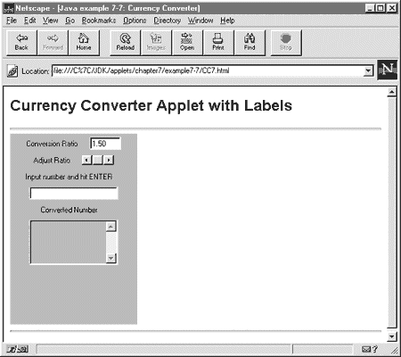

#### 示例 7-7. 从文本注释重新计算金额的 applet。

```java
public class currencyConverter76 extends java.applet.Applet {
    float conversion_ratio = 1.5f;
    TextField field1 = new TextField(20);
    TextArea field2 = new TextArea(4,20);
    TextField ratioField = new TextField(5);
    Scrollbar ratioScrollBar = new Scrollbar(Scrollbar.HORIZONTAL, 150, 25, 50, 250 );

    public void init() {
        field1.setEditable(true);
        field2.setEditable(false);
        add(new Label("Conversion Ratio"));
        add(ratioField);
        add(new Label("Adjust Ratio"));
        add(ratioScrollBar);
        add(new Label("Input number and hit ENTER"));
        add(field1);
        add(new Label("Converted Number"));
        add(field2);
        ratioField.setText("1.50");
        resize(field1.preferredSize());
        resize(field2.preferredSize());
        show();
    } // the end init
}
```

### 表 7-11. 有用方法标签

| 方法 | 描述 |
| :--- | :--- |
| `getAlignment()` | 返回给定注释的当前模式对齐。 |
| `getText()` | 返回文本注释。 |
| `paramString()` | 返回字符串参数注释。 |
| `setAlignment(int)` | 设置注释的模式对齐。 |
| `setText(String)` | 设置文本注释。 |

## 接下来做什么？

在本章中，我们已经介绍了适用于 applet 的用户界面主要组件。在下一章中，我们将利用所学知识，开始探索更复杂的组件，并讨论一些通用的用户界面设计和布局。

## 第 8 章


### 关于用户界面

Applet 外观 编程容器

面板 窗口 菜单

字体

度量字体管理器适配

FlowLayout BorderLayout GridLayout CardLayout GridBagLayout

选择器适配

确定当前位置的大小示例

使用框架的设计：FlowLayout

对话框 applet：BorderLayout

来自面板的 applet：BorderLayout

相同大小的项目：GridLayout 动态组件变化：CardLayout 确切位置：GridBagLayout 附加菜单：CardLayout

开发界面程序是一项负责且非常困难的任务。Java 开发工具包包含的工具旨在组织程序的界面，将帮助你成功地解决这个问题。这些工具允许你自由地在屏幕上放置元素，而无需指定它们的精确坐标和大小。这种方法的好处不仅在于开发者不需要浪费宝贵的时间去计算像素数量类似的低级参数，而且这样编写的界面在不同平台上看起来大体相同。当然，在细节上，程序在不同平台上的外观会有所不同，因为这些小细节高度取决于操作系统，甚至更取决于图形外壳（例如，open win、Windows 95 或 Macintosh）。

创建自定义界面最有价值的 JDK 工具之一是一组用于界面元素视觉组织的布局管理器。适配管理器是任何 applet 必不可少的；即使在第 7 章中与你熟悉了界面主要元素的简单 applet 中，默认也使用了布局管理器。

在本章中，我们将讨论所有现有的布局管理器以及屏幕元素容器，包括面板（panels）、对话框（dialogs）和框架（frames）。在这里，你还将学习如何在你的 applet 中嵌入菜单，获取系统可用字体列表，并为单个界面元素安装字体。本章中的示例还使用了用于将一种货币转换为另一种货币的 applet（我们在第 7 章中处理过它），但在这里我们将为它添加许多新功能，并通过使用更复杂的界面组件以及对其放置和布局来显著改进其外观。

# 编写外部类型 applet

在程序中开始设置 applet 外观之前，建议先画出它的屏幕界面（或至少在脑海中想象这样一个草图）。这将使编写代码变得容易得多，并告诉你最方便将组件添加到代码中的顺序。此外，这样的草图将允许你理解哪些组件组最适合使用面板——一种包含其他界面组件的特殊容器——进行组合。

你的 applet 可能会使用窗口，该窗口无法从浏览器窗口连接：

- 出于目的，你可以使用包含你的 applet 某些界面元素的框架或对话框。创建多个窗口还将让你在界面中更好地显示 applet 的逻辑结构，将其界面划分为块，每个块如果不再需要，用户可以将其移除或最小化。例如，在将在第 18 章中开发的客户端服务器教育程序中，用户列表不需要永久显示在屏幕上，因此将其放在显示在屏幕上的单独框架中。

熟悉列表后，用户将能够通过简单地关闭窗口来收起它。

屏幕元素的选择适配是一项需要权衡方法的负责任务，特别是对于相当复杂的 applet 而言。如果你的 applet 为用户提供了许多选项和控件，并显示了许多异构信息，至少应该比较几种适配方案，尝试选择一个能让 applet 运行尽可能舒适和直观的方案。例如，提供版本信息、目的和作者的 applet，最好是使用“帮助”菜单项，因为任何有经验的用户都会恰好在那里搜索这些信息。

在设计界面时，你应该尝试把自己置于对计算机和互联网知识最少的典型用户的立地。例如，一个想要查看帮助系统的典型用户会在窗口左上角搜索相应的菜单，这就是为什么明明的做法是恰好将其放在那里。必须遵循的界面构建传统，不会以任何方式限制你作为设计者的创作自由。尽管对用户友好应该放在第一位（只要你预计会有你以外的人使用你的 applet），但它不会阻碍你在 applet 设计中投入某些原创性。

# 容器


为了组合相关的控件，Java API 提供了三种类型的容器：面板（panels）、对话框（dialogs）和框架（frames）。所有容器都是 `Component` 类的子类，并用作包含其他界面元素的复合对象。在复杂界面的情况下，容器还允许相对于彼此以不同的方式排列元素组。例如，一组带有关联按钮的复选框或开关可以组合在一起，并相对于另一个界面元素以某种方式放置——例如编辑字段。

## 面板

`Panel`（面板）是 Java 中常用的容器类型。因此，在上述包含一组复选框和一个按钮的示例中，使用 `panel` 是最方便的。`panel` 是一个直接属于 `Container` 类的对象。`Panel` 可以被放在另一个容器（例如 `frame`）内部，也可以直接放在 Web 浏览器窗口中。当你的界面包含大量元素时，将具有相同含义的元素组合在帮助面板（help panels）中是有意义的。

面板还可以有它自己的布局管理器，且该布局管理器独立于包含此 `panel` 的容器的布局管理器。例如，假设我们使用简单的 `FlowLayout` 布局管理器来创建一个包含各种尺寸组件的 `frame`。现在，你需要在这个 `frame` 中放入一组五个相同大小的按钮。这可以通过将这些按钮排列在 `panel` 中并在其中应用 `GridLayout` 布局管理器（该布局器专门用于布局具有相同尺寸元素）来快速、方便地完成，然后将完成的 `panel` 放置在 `frame` 中。

# Window（窗口）

`Window` 和 `panels` 一样，都是通用的类容器。但与 `panels` 不同的是，Java 中的 `window` 实际上是一个窗口——一个操作系统对象，独立于窗口浏览器 Web 或查看器 applet 存在。

`Window` 类从不被直接使用，只有三个子类被使用：`Frame`、`Dialog` 和 `FileDialog`。这些子类中的每一个都包含了原始类窗口的所有功能，并为其添加了几个特定属性。例如，`Frame` 类实现了一个菜单容器，允许你为创建的 `frames` 添加一个菜单栏。正如预期的那样，所有窗口都具有最小化、最大化和销毁的标准按钮，以及控制菜单（control menu）。此外，所有窗口都有面板标题，你应该在创建窗口实例时填充该内容。

## Frames（帧）

`frame` 是一个可以在不与任何 Web 浏览器窗口连接的情况下存在的对象。使用 `Frame` 类，你可以实现一个独立 applet 的界面。`frame` 创建后，它会呈现一个空窗口，你应该在其中根据需要添加界面组件。

`Frames` 可以包含任何用户界面元素。是的，在我们章将处理的货币转换 applet 示例中，所有的用户界面都被封装在帧。`Frames` 也可以为单个界面组件创建（例如，点击 Web 浏览器窗口中的按钮打开的用户列表，我们将在第 18 章看到这种帧的使用）。通过创建 `frame`，你还可以为展开、最大化和销毁窗口的点击事件提供处理程序，这些按钮会自动添加到创建窗口的标题栏上。除了这些，`frames` 是 `MenuContainer` 类的实现类，允许在窗口菜单栏中添加。`Menu` 和 `MenuContainer` 类将在本章稍后进行讨论。

## Dialogue window（对话窗口）

`Dialogs` 主要用于向用户请求一次性信息，或在屏幕上输出小部分信息。所有的 `Dialogue` 窗口与 `frames` 类似，但有两个重要的区别：第一，它们不是 `MenuContainer` 的实现类；第二，它们可以具有模态（modality）——这意味着你可以构造一个对话框，防止用户访问其他窗口（包括 Web 浏览器窗口），直到用户在该对话框中执行了所需的操作（例如，按下 `button`）。

在创建 `dialogue` 窗口时，通过调用构造函数的特殊参数来指定其模态。因此，对话框让你选择是允许用户继续工作（而不将注意力转回对话窗口），还是根据其对窗口内消息的特殊反应做出要求。

`Dialogue` 窗口适合邀请用户执行某些操作并确认用户已阅读程序消息。`Dialogue` 窗口与 `frames` 不同，它们不会自动实现菜单栏。因为 `dialogue` 窗口通常比 `frames` 小，它们便于与用户进行快速对话。

在处理对话框工作时，记住一个规则非常重要：每个对话框必须以一个 `frame` 为父级。这意味着对话框不能直接从主 applet 窗口或 Web 浏览器窗口打开。要创建 `dialog box`，你必须先创建一个 `frame`，即使它的唯一目的是充当对话框的父级。只有当你的 applet 已经在使用 `frames` 时，你才能跳过这个准备阶段。创建一个作为对话框父级的空 `frame` 的示例，你可以在本章的“Dialog applet: `BorderLayout`”部分找到。

## File dialogues（文件对话框）

文件对话框不能在 applet 中使用，因为它仅用于直接在程序查看 applet 或解释器命令行 `java` 中运行的程序。此对象用于通过流类传递加载或保存的文件描述符。有关文件对话框的更多信息，请参见第 12 章，“Programming behind applet model framework”。

# Menu（菜单）

菜单长期以来一直是现代程序的标准接口元素。在 Java 中，`menu` 特别方便于与布局管理器之一——`CardLayout` 结合使用，它允许你实现一个动态界面（参见“添加菜单：CardLayout”）。Java 中的菜单会产生事件，程序员为这些事件创建处理程序——这样处理菜单就不应是困难的。`MenuBar` 和 `Menu` 类允许你构建舒适的菜单并将其集成到 applet 中。

你创建的所有 `frames` 自动实现 `MenuContainer` 类。也许是因为 `frame` 具有交互性。正这为什么 `frame` 是唯一自动实现 `MenuContainer` 类的容器，尽管理论上菜单可以被添加到任何容器中。

## Addendum menu in applet（在 applet 中添加菜单）

单独的下拉菜单被添加到面板菜单——一个 `menubar` 类对象中，随后将该对象添加到相应的 `frame` 中。首先，我们需要创建一个 `MenuBar` 实例。之后，我们创建 `Menu` 类的实例并向它们添加命令。

```
(Images/09250.jpeg)
```

### Panel menu（面板菜单）

首先，创建一个名为 `Bar` 的 `MenuBar` 类新对象：`MenuBar Bar = new MenuBar();`

使用以下方法将菜单添加到的菜单中：`bar.add(m);`

参数 `m` 代表一个 `Menu` 类对象。添加到面板菜单的菜单按照程序中指定方法的调用顺序排列。若要从菜单栏中移除菜单，使用 `remove` 方法。另一种可能性是将其中一个菜单的状态设置为“帮助菜单”，其执行方式如下：

`setHelpMenu(m);`

`setHelpMenu` 方法通过将 `m` 菜单移动到面板右侧（与其他菜单隔离开）将其转换为帮助菜单。请注意，在调用 `setHelpMenu` 之前，你必须先将菜单添加到面板。此外，不要忘记 `setHelpMenu` 方法是 `MenuContainer` 类的一部分，其实现是 `Frame` 对象。如果你想在帧代码之外调用此方法，你需要编写类似的代码：

```
(Images/09251.jpeg)
frameNameInstantiation.setHelpMenu(m)
```

最后，US 仍然使用实例菜单栏的框架。这是通过 `setMenuBar` 方法实现的，它与 `setHelpMenu` 一样，属于 `Frame` 类：`setMenuBar(Bar)`。

此操作符允许将指定的面板菜单添加到当前框架中。规则是，此方法的调用放置在创建菜单代码的最末尾：首先创建一个 `MenuBar` 类的实例，然后创建 `Menu` 容器，接着将命令添加到已创建的菜单，只有在完成所有这些操作后，将创建的菜单添加到面板菜单中。

## 菜单创建命令

在创建菜单时，你必须为每个下拉菜单实现 `Menu` 类，并为菜单中的每个命令实现 `MenuItem` 类。新菜单的声明格式如下：`Menu m = new Menu("Operation");`

在这里我们创建了一个标题为 `Operation` 的新菜单，并将其保存在变量 `m` 中。

由于对象的标题就足够访问对象（例如，菜单的标题或命令文本），我们可以将创建新命令并添加到菜单的步骤合并：

```java
m.add(new MenuItem("Adjust Ratio"));
```

该语句创建了一个文本为 "Adjust Ratio" 的新菜单命令，并立即将其添加到菜单 `m`。另一个有趣的功能是声明“可拆卸”（tear-off）菜单。这意味着该菜单在松开鼠标按钮后仍保持打开状态。使用以下构造函数创建下拉菜单：

```
new Menu("Operation", true);
```

按照从上到下的方向向菜单添加项。你还可以使用 `addSeparator` 方法在菜单启用水平分隔线，该方法会在分隔菜单的当前位置插入分隔符。此外，得益于 `Menu` 类是 `MenuItem` 类的总扩展类这一事实，你可以创建嵌套菜单。

只需创建一个 `Menu` 的新实例，并像你之前添加项的那样将其添加到另一个菜单中即可。我们将在 Java 课程商店中使用嵌套菜单（参见第 17 节）；嵌套菜单的外部视图如图 8-1 所示。


图 8.1。

## 菜单事件处理

当用户选择菜单中的任一个命令时，它会产生相应的事件。程序对该事件以及任何其他事件的反应，是通过安装相应的处理器来确保的。因此，在本章的“添加菜单：CardLayout”小节的示例程序中，我们将进行如下检查：

```java
if ((evt.id == Event.ACTION_EVENT) && (evt.target==m))
```

该语句检查捕获的事件是否为动作事件（action event），以及目标（target）是否为名为 `m` 的开发对象 `Menu`。之后，我们可以通过查看事件参数来确定选择了哪个命令：`(String)evt.arg`

现在，此参数可以与包含给定菜单中所有命令文本的队列进行比较，以找出用户选择了这些命令中的哪一个。

# 字体

在本章的许多示例中，你和我都必须为输出信息设置字体。因此，是时候了解一下这方面的可能性了。AWT 提供了这些功能。使用的主要方法——`setFont` 方法——属于 `Component` 类而不是 `Font` 类。得益于此，我们不仅可以为每个组件单独更改字体，还可以让相关组件组从通用父对象继承字体参数。`new font` 构造函数如下：

```java
new Font(String name, int style, int size);
```

在这里，`name` 是字体名称，`size` 是其以磅（points）为单位的大小，而参数 `style` 可以取以下值之一：`PLAIN`、`BOLD` 或 `ITALIC`。创建此类字体实例是必要的，以便你可以将此字体安装其中一个组件。创建的字体副本可以重复使用。但在排序字体之前，你需要确保它在用户平台上可用且 Web 浏览器可以使用（参见侧边栏“获取字体列表”）。有了字体列表后，小程序将能够决定在给定平台上使用哪些字体。

# 字体度量

对于每个字体，小程序都可以获取特定的度量信息（metrics），特别是任何符号的宽度和高度。了解字体度量，可以为其他组件和容器本身选择尺寸，确保文本标签相对于其他元素的正确定位。例如，`FontMetrics` 类方法 `stringWidth` 用于回答这个问题：“使用指定字体指定的质量参数行将占据多少水平空间？”：

```java
Font MyFont = new Font("Helvetica", Font.PLAIN, 12);
FontMetrics MyFontMetrics = new FontMetrics( MyFont );
int pixelSizeOfString = MyFontMetrics.stringWidth("Hello");
```

此示例查询了字符串 "Hello" 在字体 `MyFont`（定义为 Helvetica 粗体 12 磅）中占据多少空间。执行这些语句后，变量 `pixelSizeOfString` 将包含将此行输出到屏幕所需的像素数。

# 布局管理器

最简单的布局管理器是 `FlowLayout` 和 `GridLayout`，更复杂的是 `BorderLayout`、`CardLayout` 和 `GridBagLayout`。默认情况下，小程序窗口和所有创建的面板使用 `FlowLayout` 管理器，而框架和对话框使用 `FlowLayout` 管理器 `BorderLayout`。

以下是这些布局管理器的描述，以及它们在章后半部分工作示例中使用的概述。


## FlowLayout

你已经熟悉最简单的布局管理器 - `FlowLayout` 的活动结果。该管理器在货币转换小程序中作为默认管理器工作。该管理器的工作原理非常非常简单，可以归纳为：每个新添加的组件都放置在当前水平行中，如果该行仍有空间；否则，组件将向下移动并开始下一行水平行。因此，除了最后一行外，每一行都包含了当前容器宽度下能容纳的多个组件。每行的内容都居中，然后向容器的左、右边缘对齐。如果你先使用 `<APPLET>` 标签的 `HEIGHT` 和 `WIDTH` 属性计算出程序在 HTML 页面上分配区域的大小，这种算法可以让你获得相当专业的视觉效果。例如，如果你知道按钮的精确尺寸，可以设置小程序的宽度，使得按钮能够垂直排列。然而，通常尝试使用此管理器来实现美观的布局需要花费太多精力，这从长远来看是不划不入的，因为容器的任何缩放调整都会破坏精心构建的结构（例如，我们示例中的一列按钮可能会变成几行按钮）。

## BorderLayout

我们将在本章提供的示例小程序中熟悉这种布局管理器。该管理器在添加新组件时需要指定一个可选参数，该参数可以取以下值之一：`South` ("South")、`North` ("North")、`West` ("West")、`East` ("East") 和 `Center` ("Center")。前四个参数导致 `BorderLayout` 管理器将添加的组件引用容器的相关边缘——底部、顶部、左侧或右侧。`Center` 参数允许你指定该组件占据容器剩余区域。因此，使用 `Center` 参数添加的元素将改变其尺寸，填充不占用其他组件的空间。

`BorderLayout` 管理器是最常用的，因为它非常实用且易于使用，并提供了放置屏幕元素的方法，这对于大多数情况都是足够的。`BorderLayout` 能够考虑到组件的大小差异，并尝试尽可能地利用容器空间 - 即浏览器窗口、框架或对话框窗口。

## GridLayout

`GridLayout` 管理器对于排列图形元素特别有用，并允许轻松地实现组件的、均匀放置。该管理器创建一个由相同大小的正方形组成的网格，每个网格包含一个组件。我们将在第 18 章的课程中使用此管理器来构建一个棋盘。棋盘上用此管理器创建的每个棋格都包含一个画布（`Canvas`），而画布又可以包含一张棋子。使用此管理器时，新组件按照从左到右、从上到下的方向添加。

## CardLayout

这种布局管理器允许你在程序运行期间直接更改屏幕上显示的组件集。`CardLayout` 管理器在处理面板工作时特别方便。

`CardLayout` 管理器允许你动态控制添加到容器的组件的显示。组件必须与类中定义的特殊方法关联 - `next`、`previous` 和 `show` 方法。程序员可以启动任意数量的组件，然后通过调用这些方法，将它们按顺序一个接一个或按随机顺序输出到屏幕上。在本章的“动态更改组件：CardLayout”部分中，我们将使用 `CardLayout` 管理器在两个包含小程序货币金额计算组件的面板之间切换。其中一个面板将包含一个显示当前转换率的字段以及一个允许你更改该值的滚动条，而在另一个面板中是货币金额的输入和输出字段。这些面板将同时显示，但轮换。

## GridBagLayout

最复杂的布局管理器是 `GridBagLayout`。它使用了最先进的算法来响应容器缩放，并允许你实现一个复杂的界面，其中容器包含许多不同尺寸的组件，其中某些组件相对于其他组件应该处于同一个位置，且具有完全相同的体积。当你使用此管理器时，必须使用 `setConstraints` 方法为每个组件指定位置参数。方便的方法是为每个组件创建一个 `gridBagConstraints` 类的实例，这将允许独立于其他组件地更改该组件的位置。`gridBagConstraints` 实例将由设置了 `GridBagLayout` 布局管理器的容器使用，尽管在本章稍后的小程序示例中（参见“精确放置：GridBagLayout”部分），我们将为不同的组件使用同一个 `gridBagConstraints` 实例。这里是使用此管理器时可以设置的放置限制列表：

- `gridx`, `gridy`：允许你创建一个单元格来放置组件，并指定其坐标，位于容器左上角的单元格将具有坐标 `gridx=0`, `gridy=0`。通过使用 `GridBagConstraints.RELATIVE` 值（这是默认含义），你可以指定新组件的放置不是相对于容器的左上角，而是相对于直接添加到容器的组件 - 紧邻相邻的右侧（针对 `gridx`）或下方（针对 `gridy`）。

- `gridwidth`, `gridheight`：这些选项允许你为该组件保留的区域设置行（`gridwidth`）或列（`gridheight`）的单元格数量。默认值为 1。`GridBagConstraints.REMAINDER` 值指定添加的组件必须是行（`gridwidth`）或列（`gridheight`）最后一个。`GridBagConstraints.RELATIVE` 值表示此组件必须放置在其行（`gridwidth`）或列（`gridheight`）最后一个之后。


- `fill`：当组件尺寸小于分配空间时使用此值，允许你指定组件是否缩放以及如何缩放。此参数可以取值 `GridBagConstraints.NONE`（默认）、`GridBagConstraints.HORIZONTAL`（意味着尽可能沿水平方向拉伸组件，但不改变其高度）、`GridBagConstraints.VERTICAL`（尽可能垂直地拉伸组件，但不改变其宽度）和 `GridBagConstraints.BOTH`（尽可能垂直和水平地拉伸组件）。

- `ipadx`、`ipady`：这些选项允许你设置内边距，即在最小组件尺寸上的数量。这意味着组件的宽度不能小于其最小自然宽度加上 `ipadx*2` 像素（乘以二是因为内边距被添加到组件的两侧）。同样，组件的高度不能小于其最小自然高度加上 `ipady*2` 像素。

- `insets`：此参数指示组件的外部缩进，即组件与为其分配区域边界之间的最小距离。

- `anchor`：此选项用于组件小于其分配区域时，并允许指定在这些区域内的放置方式。允许的值如下：

`GridBagLayout.CENTER`（中心）、`GridBagLayout.NORTH`（北）、`GridBagLayout.NORTHEAST`（东北）、`GridBagLayout.EAST`（东）、`GridBagLayout.SOUTHEAST`（东南）、`GridBagLayout.SOUTH`（南）、`GridBagLayout.SOUTHWEST`（西南）、`GridBagLayout.WEST`（西）、`GridBagLayout.NORTHWEST`（西北）

- `weightx`、`weighty`：这两个参数用于指定空间分布的性质，对于容器尺寸变化时组件的行为至关重要。如果某行中没有组件的 `weightx` 值不同（或者某列中组件的 `weighty` 值不同），则该行（或列）的所有组件将彼此靠近并在内部居中。换句话说，这些参数的零值会导致布局管理器将所有空白推向容器的边缘。

# 布局管理器选择

现在你需要为应用程序选择最适合的布局管理器。表 8-1 总结了所考虑布局器的应用建议。一个通用的建议是：在实践中尝试应用不同的布局管理器以检查它们对你情况的适用性。

### 表 8-1 布局管理器选择

| 你的需求 | 应该使用 | 建议 |
| :--- | :--- | :--- |
| 快速放置所有组件，不关注组合 | `FlowLayout` | |
| 良好地排列所有组件 | `BorderLayout` | |
| 具有相同尺寸组件 | `GridLayout` | |
| 放置某些具有相同尺寸组件 | `GridBagLayout` | |
| 根据需要显示屏幕组件 | `CardLayout` | 在单独面板中使用 `GridLayout`，将具有相同的组件聚集在一起，并将其他组件移到面板之外。 |
| 某些组件是持久的，某些需要调整 | `CardLayout` | 在 `Panel` 中使用 `CardLayout`，用于根据需要输出组件，超出面板限制。 |
| 尽可能控制组件的位置，并对容器尺寸的变化有良好的反应 | `GridBagLayout` | |

请记住，在单独面板中完全可以安装与相邻面板以及所属整个容器管理器不同的布局管理器。例如，如果在大型面板中使用 `GridBagLayout`，那么对于嵌套其中的较小面板，可以选择 `CardLayout`。

创建新容器时，它会被分配一个默认布局管理器。

要更改给定容器的当前布局管理器，请使用表达式：

```java
setLayout(new BorderLayout());
```

如果你有多个面板，在设置布局管理器时，需要指定它在哪个面板运行：

```java
input_panel.setLayout(new BorderLayout());
```

将组件添加到设置为非标准布局管理器的容器中，与普通情况相比只有一个区别，即你可能需要向 `add` 方法传递某些位置参数：

```java
LeftPanel.add("North", ratioField);
```

在使用 `GridBagLayout` 管理器时，参数是通过一个名为 `gridBagConstraints` 的特殊类传递的，你可以为每个组件设置某些位置参数的值。通常，组件是在同一水平行内逐一个添加的，而该行内有空位；下一个添加的组件将开始新行。这一规则在 `BorderLayout` 中也某种程度上遵守——当你添加多个具有相同位置参数的组件（例如，“South”）时，它们将按照相同的法则放置在它们的“Z 部分”。

# 获取当前位置的尺寸

在开发并调试好元素界面后，你可以找出这种方式放置组件的窗口尺寸是多少。要获取此信息，可以使用以下返回容器尺寸的任一个方法：

- `preferredLayoutSize`：`public abstract Dimension preferredLayoutSize(Container parent)`。该方法根据父容器中的其他组件，计算指定面板的自然宽度和高度。

- `minimumLayoutSize`：`public abstract Dimension minimumLayoutSize(Container parent)`。该方法根据父容器中的其他组件，计算指定面板的最小宽度和高度。

# 示例

现在我们已经熟悉了创建更复杂的自定义界面时使用的几个 API 类。现在我们考虑代码示例，这些示例使用了上面讨论的类以及处理它们的方法。我们的大多数示例将是开发一个货币转换 applet，我们在上一章中已经开始工作了。因此，你将对体量以及可能有多么有趣和多样有一个直观的认识。即使是简单的 applet，界面也可能是多样的。

## 使用框架的设计：FlowLayout

让我们尝试使用框架构建金额计算 applet 界面。事实证明使用这种新界面可以实现相同的功能，只需引入非常小的更改。主要的变化是整个 applet 现在位于一个独立的框架中，而不是浏览器窗口。在这个示例中，我们将使用 `FlowLayout`，因为对我们来说，现在是快速获取结果，而不需要花费大量精力精确指定组件的位置。

因为在这种情况下，我们正在向标准帧类添加新内容，所以我们使用了 `extends` 关键字。你可能并不完全理解为什么这是必要的。假设我们已经定义了类 `Frame1`。但请记住，我们启动的每个 applet 都是通过声明 `"AppletName extends Applet"` 的。在这种情况下，我们在这里创建了一个专门的设计器。因此，我们得到了自己的组件——在本文中是一个帧——它可以被反复重复使用，并在此基础上创建其他类。

示例的其余部分与上一章的最后一个示例几乎相同。`setLayout` 方法设置在创建的帧使用的布局管理器。`setFont` 方法设置帧中显示文本的字体。同样，你可以为输入的任何组件设置字体。在我们创建了 `Frame1` 类之后，我们将在 applet 中创建的所有组件都将属于 `Frame1`，而不是 Web 浏览器的 applet 区域。通过将帧的设置为 300x250 像素，我们调用了 `pack` 方法，它会尝试在部署管理器限制的范围内将组件尽可能地放置在容器中。最后，我们调用 `show` 方法将帧输出到屏幕上。

### 示例 8-1c. applet，使用帧

```java
public void convert() {
    float currency1, currency2;
    String InputString = field1.getText(); field1.setText("");
    currency1 = Float.valueOf(InputString).floatValue(); currency2 = conversion_ratio * currency1;
    String OutputString = "$" + InputString + " = " + "#" + Float.toString(currency2) + "\n";
    field2.appendText(OutputString);
} // the end convert

public boolean handleEvent(Event evt) {
    if (evt.target == ratioScrollBar) {
        int in;
        in = ratioScrollBar.getValue(); conversion_ratio = in/100f;
        ratioField.setText(Float.toString(conversion_ratio));
    }
    if (evt.target == field1) {
        char c=(char)evt.key; if (c == '\n') {
            convert();
        }
    }
    return false;
}
} // the end applet
```

此示例中的 `convert` 方法与我们在上一章中处理过的示例 applet 中的同名方法没有区别。`handleEvent` 方法也是如此，特别有趣的是，考虑到现在此方法处理了与帧的操作。这是因为所创建的帧是一个扩展，而负责事件处理程序的代码直接添加到了帧的属性中。在此，只有属于 `Frame` 类的 `handleEvent` 方法被重写了，而其他类中同名的方法（例如在基础课堂 applet `Window1` 中）的 `handleEvent` 方法保持完好无损。

到为止，你应该已经清楚了如何构建一个创建你自己的窗口的 applet。如上所述，applet 接口的一个重要部分是使用许多不同界面元素的面板。面板与布局管理器的配合有助于 applet 界面的视觉化组织。你将在本章的后部分看到使用面板的示例，但现在让我们熟悉一种功能与帧最接近的元素——交互式窗口。

## 对话框 applet：BorderLayout

在图 8-3 所示的 applet 中，享受一个按钮的最简单交互式窗口。

这个示例将帮助我们从量上了解，帮助对话框如何吸引用户的注意力并使其对问题或消息做出响应。在这个示例中，我们将制作另一个版本的货币转换 applet，因为对话框通常用于一次性请求，而不是交互式工作。在这里我们将使用 `BorderLayout` 管理器，它将允许我们在窗口的适当位置放置界面组件：文本说明应该在顶部，用户指令在中间，“继续”按钮在底部。

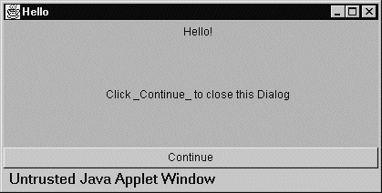

#### 图 8.3

### 示例 8-2a. 来自交互式窗口的 Applet

```java
import java.awt.*;
import java.applet.applet;

public class Show_Dialog extends applet {
    frame f;
    Intro_Dialog Hello_Dialog;
    public void init() {
        f = new Frame(); f.resize(50,50);
        f.pack();
        hello_dialog = new Intro_Dialog(f); add(new Button("Show Me!"));
    }
    public boolean action(Event evn, Object obj) {
        if (obj == "Show Me!") {
            Hello_Dialog.show(); return true;
        }
        return false;
    }
} // the end applet Show_Dialog
```

为什么在 `Show_Dialog` 类中？当点击 "Show Me!" 按钮时，调用了 `Hello_Dialog.show()`。`Intro_Dialog` 是 `Dialog` 的子类，它有自己的 `handleEvent` 方法来处理点击事件。


以下代码创建 `Intro_Dialog` 的实例并将 `frame` 传递给它的构造函数。这是因为 `Dialog` 必须有一个帧作为它的父级。


在初始化对话框时，可能有多个参数。

由于我们使用了属于 `Intro_Dialog` 类的 `Intro_Dialog` 构造函数，这些参数必须传递给高级类 `Show_Dialog`。`setLayout` 语句实际上可以省略，因为 `BorderLayout` 管理器已经是帧和对话框的默认管理器。我们在示例中开启此字符串是为了提醒，除非指定额外的参数位置，否则 `add(newComponent)` 方法将不起作用，例如 `add("center", newComponent)`。

### 示例 8-2b. 使用帧的交互式窗口 Applet

```java
class Intro_Dialog extends Dialog {
    Intro_Dialog(Frame parent) {
        super(parent, "Hello", true);
        setLayout(new BorderLayout());
        setFont(new Font("Helvetica", Font.PLAIN, 12)); setBackground(Color.gray);
        add("North", new Label("Hello!", Label.CENTER));
        add("center", new Label("Click Continue to close this Dialog", Label.CENTER));
        add("South", new Button("Continue")); resize(250,250);
    }

    public boolean handleEvent(Event evt) {
        if (evt.id == Event.ACTION_EVENT) {
        }
        return false;
        if ("Continue".equals(evt.arg)) {
            dispose(); return true;
        }
    }
}
```

面板（`Panel`）是 AWT 中最简单的容器。面板非常适合将标签、按钮以及其他界面元素进行分组，这些元素通常运行在浏览器窗口的 applet 中。然而，你也可以在创建了自己的帧或对话框的 applet 中使用面板。在这个示例中，我们还将使用 `BorderLayout` 管理器来布局面板组件。

在这一节中，让我们熟悉面板的使用。但我们不会完整地编写整个 applet 的代码，而是仅关注与面板相关的部分。

首先，我们将创建两个面板，其中一个包含滚动条和用于重新计算系数的文本字段，而在另一个面板中——包含两个用于数值输入和输出的文本字段。第一个面板命名为 `LeftPanel`，第二个命名为 `RightPanel`。一旦面板添加到 applet 中，四个界面元素都将变为可用（图 8-4）。

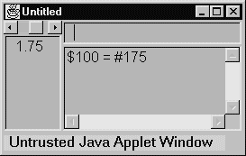

#### 图 8.4

### 示例 8-3a. 使用面板的 applet

```java
import java.awt*;
import java.applet.applet;

public class Panel1 extends applet { public void init() {
    new Frame1();
}
} // the end Panel1

class Panel_n_Frame extends Panel_n_Frame { float conversion_ratio = 1.5f; TextField field1 = new TextField(20); text area field2 = new TextArea(4,20);
TextField ratioField = new TextField(5);
scroll bar ratioScrollBar = new scrollbar ( scrollbar.VERTICAL, 150, 25, fifty, 250 );
public Panel_n_Frame() {
panel right panel = new Panel(); Panel LeftPanel = new Panel(); setLayout(new BorderLayout());
setFont(new Font("Helvetica", Font.PLAIN, 16)); setBackground(color.gray);
field1.setEditable(true); field2.setEditable(false); LeftPanel.setLayout(new BorderLayout()); LeftPanel.add("Center", ratioField); LeftPanel.add("North", ratioScrollBar); RightPanel.setLayout(new BorderLayout()); RightPanel.add("North", field1); RightPanel.add("South", field2); ratioField.setText("1.50"); resize(field1.preferredSize()); resize(field2.preferredSize()); resize(300,250);
add("East", RightPanel); add("West", LeftPanel); pack();
show();
} // the end init
```


在这里，作为变化，我们使用了一个垂直滚动条。通过创建面板 `RightPanel` 和 `LeftPanel`，我们向它们添加了界面组件。注意，`setLayout` 和 `setFont` 方法属于 `Panel_n_Frame` 类，而不是 `RightPanel` 和 `LeftPanel`。如果 applet 界面是在浏览器窗口中而不是独立窗口中，我们将修改用于程序窗口的大部分属性，这些属性都是为 applet 的工作分配的。

每个面板都可以有自己的布局管理器。如你所知，`BorderLayout` 管理器需要选项中的之一：North、South、East、West 或 Center。`Center` 参数除了居中外，还有一个副作用——使用此选项指定的组件将尽可能地伸展，填满容器的所有剩余空间。因此，如果你为 `ratioScrollbar` 指定 `Center` 参数而不是 `West`，结果将非常搞笑——滚动条的大小会增大，并占据左侧面板上的所有剩余空间。另一方面，可以使用此参数添加编辑框或画布，因为这些元素的性质允许在不失真的情况下自由缩放。在向面板添加所有必要元素后，我们必须在 applet 中添加面板——这些面板组件将自动添加。

## 示例 8-3b. 使用面板的 applet

```java
public void convert() {

    float currency1, currency2;

    String InputString = field1.getText(); field1.setText("");

    currency1 = Float.valueOf(InputString).floatValue(); currency2 = conversion_ratio * currency1;

    String OutputString = "$" + InputString + " = " + "#" + Float.toString(currency2) + "\n";

    field2.appendText(OutputString);

} // the end convert

public boolean handleEvent(Event evt) { if (evt.target == ratioScrollBar)

{

    int in;

    in = ratioScrollBar.getValue(); conversion_ratio = in/100f;

    ratioField.setText(Float.toString(conversion_ratio));

}

if (evt.target == field1)

{

    char c=(char)evt.key; if (c == '\n')

    {

        convert();

    }
}

if (evt.id == Event.WINDOW_DESTROY) { dispose();

    return true;

}

return false;

}

} // the end applet
```

等一下，`WINDOW_DESTROY` 是什么意思？点在于我们必须处理当用户点击系统关闭窗口按钮（或者，如果是同一个帧）时触发的事件。在第一个示例中，当我们获取了 applet 并点击窗口关闭按钮时，什么都没有发生，因为程序在这种情况下没有提供任何操作。

## 相同尺寸元素：GridLayout

`GridLayout` 管理器对于使用网格的 applet 特别有用。该管理器创建一个相同大小的正方形网格，每个网格包含一个组件。如示例 8-4 所示。

## 示例 8-4. 使用管理器的 applet

```java
import java.awt.*;

import java.applet.applet;

public class Grid_1 extends Applet { float conversion_ratio = 1.5f; TextField field1 = new TextField(5); text area field2 = new TextArea(4,20);

    TextField ratioField = new TextField(5);

    scroll bar ratioScrollBar = new scrollbar (scrollbar.HORIZONTAL, 150, 25, fifty,

    250 );

    public void init() {

        setLayout(new GridLayout(3,3));

        setFont(new Font("Helvetica", Font.PLAIN, 12));

        setBackground(color.gray); ratioField.setEditable(false); field1.setEditable(true); field2.setEditable(false); ratioField.setText("1.50"); field1.resize(field1.preferredSize()); field2.resize(field2.preferredSize()); ratioField.resize(15,25);

        ratioScrollBar.resize(ratioScrollBar.minimumSize()); add(ratioField);

        add(ratioScrollBar); add(field1); add(field2);

    } // the end init
}
```

applet 的外部视图如图 8.5 所示。注意条带和其他界面组件在放入矩形单元格后是如何改变其比例的。


### 图 8.5

在这个示例中，实现的网格大小为高两格、宽两格，因为整个示例仅包含四个控件。图 8-5 清晰地显示了布局管理器如何处理单元格尺寸大于其内部放置尺寸的情况。


`CardLayout` 管理器允许你动态替换显示在屏幕上的组件，这对于包含一组嵌套组件的面板来说特别方便。示例 8-5 阐述此类接口的实现。在这个示例中，所有与转换系数变化相关的控制控件都收集在一个面板中（图 8-6），而输入和输出重新计算值的字段编辑框则在另一个面板中（图 8-7）。

这些面板之间的切换通过从 applet 顶部下拉列表的两个位置中选择一个来实现。


### 图 8.6

## 示例 8-5a. 使用 `CardLayout` 管理器的 applet

```java
import java.awt.*;
import java.applet.applet;

public class LayoutCard extends Applet {
    float conversion_ratio = 1.5f;
    TextField field1 = new TextField(20);
    TextArea field2 = new TextArea(4,20);
    TextField ratioField = new TextField(5);
    Scrollbar ratioScrollBar = new Scrollbar(Scrollbar.HORIZONTAL, 150, 25, fifty, 250);
    Panel cards_panel;

    public void init() {
        setLayout(new BorderLayout());
        setFont(new Font("Helvetica", Font.PLAIN, 12));
        setBackground(Color.gray);
        field1.setEditable(true);
        field2.setEditable(false);
        ratioField.setText("1.50");
        field1.resize(field1.preferredSize());
        field2.resize(field2.preferredSize());
        ratioField.resize(ratioField.preferredSize());
        ratioScrollBar.resize(ratioScrollBar.minimumSize());

        // 将作为 CardLayout 管理器容器的面板，有必要声明为全局，因为发生在此面板面板中的事件会改变显示的界面部分，因此不能限制在嵌套面板中。
        // 上述代码中的 `setLayout(new BorderLayout())` 设置了窗口 applet 的布局管理器：
        Panel options_panel = new Panel();
        Choice options = new Choice();
        options.addItem("Adjust Ratio");
        options.addItem("Calculate");
        options_panel.add(options);
        add("North", options_panel);

        cards_panel = new Panel();
        cards_panel.setLayout(new CardLayout());

        Panel ratio_panel = new Panel();
        Panel calculate_panel = new Panel();
        ratio_panel.add(ratioField);
        ratio_panel.add(ratioScrollBar);
        calculate_panel.add(field1);
        calculate_panel.add(field2);
        cards_panel.add("Adjust Ratio", ratio_panel);
        cards_panel.add("Calculate", calculate_panel);

        add("center", cards_panel);
        show();
    } // init 结束
}
```

这段代码向名为 `options_panel` 的面板（`Choice`）添加了一个下拉列表。该下拉列表包含两个项目：“Adjust Ratio”（调整比例）和“Calculate”（计算）。然后，包含下拉列表的 `options_panel` 被添加到窗口 applet 的顶部。接下来定义了管理器将工作的面板：`CardLayout`。按照惯例，创建了面板的新实例并为其分配了一个管理器。在放置 `CardLayout` 后，又创建了两个面板，这两个面板将使用 `CardLayout` 管理器在屏幕上切换。这两个面板被添加到 `cards_panel` 面板中。其中一个面板包含一个显示转换系数的字段和一个用于其变化的滚动条，另一个包含两个用于输入原始值和输出重新计算结果的编辑字段。在将这两个面板添加到面板 `cards_panel` 时，为它们分配了标签——文本行“Adjust Ratio”和“Calculate”。

在将面板 `cards_panel` 添加到窗口 applet 后，它包含了两个面板——`cards_panel` 和 `options_panel`。嵌套面板添加到 `cards_panel` 的顺序决定了它们在调用 `next` 或 `previous` 方法时在屏幕上的输出顺序。

除 `Togo` 之外，可以从 `Class CardLayout` 的帮助方法 `show` 从可用面板中撤回任何一个——正是我们在下面的事件处理器动作中并在并实现了这个方法。

## 示例 8-5b. 使用 `CardLayout` 管理器的 applet

```java
public void convert() {
    float currency1, currency2;
    String InputString = field1.getText();
    field1.setText("");
    currency1 = Float.valueOf(InputString).floatValue();
    currency2 = conversion_ratio * currency1;
    String OutputString = "$" + InputString + " = " + "#" + Float.toString(currency2) + "\n";
    field2.appendText(OutputString);
} // convert 结束

public synchronized boolean handleEvent(Event evt) {
    if (evt.target == ratioScrollBar) {
        int in;
        in = ratioScrollBar.getValue();
        conversion_ratio = in/100f;
        ratioField.setText(Float.toString(conversion_ratio));
    }
    if (evt.target == field1) {
        char c = (char)evt.key;
        if (c == '\n') {
            convert();
            return true;
        } else {
            return false;
        }
    }
    return super.handleEvent(evt);
}
```

在声明方法 `handleEvent` 时必须使用 `synchronized` 关键字。

这是因为同一个 applet 使用了动作事件处理器，并要求提供，这两个处理器事件不会被同时调用。

```java
setFont(new Font("Helvetica", Font.PLAIN, 12)); setBackground(color.gray); ratioField.setEditable(false); field1.setEditable(true); field2.setEditable(false); ratioField.setText("1.50"); field1.resize(field1.preferredSize()); field2.resize(field2.preferredSize()); ratioField.resize(ratioField.preferredSize());

ratioScrollBar.resize(ratioScrollBar.preferredSize()); Con.weightx=1.0;

Con.weighty=1.0;

con.anchor = GridBagConstraints.CENTER; Con.fill = GridBagConstraints.NONE; Con.gridwidth=GridBagConstraints.RELATIVE; gridbag.setConstraints(ratioField, Con); add(ratioField);

con.gridwidth = GridBagConstraints.REMAINDER;
```

首先，创建布局管理器 `GridBagLayout` 和类 `gridBagConstraints` 的新实例。`GridBag` 被用作布局管理器，它是 `GridBagLayout` 的实例。如果你不更改 `gridBagConstraints` 类中包含的 `weightx` 和 `weighty` 值（它们的默认值为零），那么所有组件都将向中心聚集，而在这种情况下，我们完全不需要这样做。参数默认值 `fill` 等于 `both`，这意味着 `Components` 将在两个坐标上拉伸。在这里，滚动条是不必要的，字段 `ratioField` 和字段 `input` 不需要拉伸，因此将它们的 `fill` 参数设为 `NONE`。相反，输出值的字段应该尽可能地拉伸，因此它的 `fill` 参数被设置为 `former`（即 `BOTH`）。对于参数 `anchor`，使用了 `center`，得益于此，所有组件都放置在分配给它们的区域中心。因为在添加时，`ratioField` 字段必须位于其行最后一个元素之后，因此对于该组件，`gridwidth` 参数设置为 `RELATIVE`。对于应该是行末最后一个元素的滚动条 `ratioScroolBar`，`gridwidth` 参数的值被设置为 `REMAINDER`。

在这个示例中，同一个 `gridBagConstraints` 实例被多次使用，因此在重用之前，即使是那些我们对默认值满意的限制器，也显式地分配所需的值。相反，其他参数在所有情况下都有相同的值，在重复使用 `gridBagConstraints` 实例之前，你不需要做任何事情。如果我们为每个组件创建一个 `gridBagConstraints` 实例，那么所有这些实例都必须将相同的参数设置为相同的值。因此，更经济的方法是创建一个该类的实例，并将其用于所有组件：


```java
gridbag.setConstraints(ratioScrollBar, Con); add(ratioScrollBar); Con.gridwidth=GridBagConstraints.REMAINDER; gridbag.setConstraints(field1, Con); add(field1); Con.gridy=GridBagConstraints.RELATIVE; Con.fill = GridBagConstraints.BOTH; Con.gridwidth=GridBagConstraints.REMAINDER; Con.gridheight=GridBagConstraints.REMAINDER; gridbag.setConstraints(field2,Con); add(field2);
```

```java
} // init 方法结束
```

显示结果的字段应该占据分配给它的所有空间，因此它的 `fill` 值设置为 `BOTH`，并且变量 `gridwidth` 和 `gridheight` 被赋值为 `REMAINDER`。接下来的两行设置了字段 `field2` 的输入限制并将该字段添加到 applet 中。代码其余部分与之前的示例相同。现在，你可以实验限制器的值，熟悉 `GridBagLayout` 方法的功能，并改进我们 applet 的界面。

## 附录菜单：CardLayout

让我们回到使用 `CardLayout` 作为布局管理器的示例，并将下拉列表替换为菜单（图 8-9）。与之前一样，此 applet 的控件收集在两个面板中，在 applet 窗口中交替显示。处理完这个简单的示例后，你可以进一步对菜单进行实验。

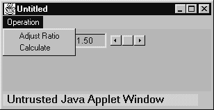

### 图 8.9.

示例 8-7. 使用菜单的 applet。

```java
import java.awt.*;
import java.applet.applet;

public class Menu1 extends applet {
    public void init(){
        new menu_frame();
    }
} // Menu1 结束

// 创建 Menu_Frame 类的新实例
class Menu_Frame extends frame {
    float conversion_ratio = 1.5f;
    TextField field1 = new TextField(15);
    text area field2 = new TextArea(4,20);
    TextField ratioField = new TextField(5);
    scroll bar ratioScrollBar = new scrollbar(Scrollbar.HORIZONTAL, 150, 25, fifty, 250);
    Panel cards_panel;

    public Menu_Frame() {
        setLayout(new BorderLayout());
        MenuBar Bar = new MenuBar();
        Menu m = new Menu("Menu");
        // ... (其余实现逻辑)
    }
}
```

*（注：提供的文本在代码部分包含大量的乱码片段和重复短语；根据您的要求，我已清理了结构，同时保留了可见的逻辑和变量。）*

在本章中，我们熟悉了构建用户界面的更复杂的技术。通过应用本章讨论的技术以及第 7 章的基础元素，你将能够创建具有丰富、多样界面的应用程序（applets）。`Java` 中构建接口的核心是 `container`（容器）和 `manager`（管理器）适配的概念。我们在书的教程部分也将使用这些工具，届时我们将开发几个设计为 applet 的全功能程序。

在下一章中，将考虑 `Java` 类，允许在 applet 中处理图形信息和输出 `Images`（图像）。

# 第九章


## 图形与图像

## 使用 `Graphics` 类绘图

### 绘制轮廓对象

### 绘制填充对象

### 文本与绘图

### `Image` 类的使用

#### 导入图像

#### 使用 `MediaTracker` 类

#### 创建图像

#### 异步图像的接口

#### 图像处理

在最后两个章节中，你已经学习了如何创建一个强大且具有吸引力的用户界面。本章将教你如何显示和管理图形，这可能会增加你的 Java applet 和程序的流行程度。

`Graphics` 类是 `java.awt` 层次结构的一部分，为我们提供了许多方法用于在 2D 绘图区域输出几何形状和放置文本（该区域与可见的 `Component` 或 `Image` 对象相关）。该包的功能类似于微软画画等简单的图形编辑器。`java.awt.image` 包不同于 `java.awt` 包和 `java.awt.Image` 类（尽管与两者都密切相关），它允许在字节级别与图像进行交互，通过程序员指定的算法创建图像。此外，该包还为处理已有的图像提供了强大的工具设施。


**建议** 本章用作示例的代码段包含在随书附带的 CD-ROM 中。该光盘可供使用 Windows 95/NT 或 Macintosh 的读者使用；UNIX 用户应参考在线网页伴侣，该网站包含了此本书的配套材料（地址为 [http://www.vmedia.com/java.html]）。


## 使用 `Graphics` 类绘图

`Graphics` 类允许帮助标准图形原语在二维画布上绘制。请注意，你不能自己创建 `Graphics` 对象，因为唯一的构造函数被定义为私有修饰符。通常，`Graphics` 对象会与你正在操作的 `Component` 类绑定并传递给你，例如使用 `Component` 类的 `paint` 方法时，或者通过 `Component` 类的方法 `getGraphics` 显式获取。

`Image` 类也执行 `getGraphics` 方法，该方法返回从 `Image` 连接的对象的图形链接。这种技术在第 5 章“工作中的 Applet”中简单讨论过。

## 绘制轮廓对象

由于 `Graphics` 类中有许多方法，我们将它们分为三组并交替讨论。第一部分包含所有与绘制轮廓相关的方法。（空白）使用默认颜色绘制图形。这些方法列在表 9-1 中。

表 9-1. 用于绘制轮廓形状的 `Graphics` 类方法

| 方法 | 描述 |
| :--- | :--- |
| `drawLine(int, int, int, int)` | 从前两个整数（X 和 Y 坐标）给出的位置画线到后两个整数指示的位置。 |
| `drawRect(int, int, int, int)` | 显示矩形。前两个整数表示矩形的左上角，最后两个整数表示宽度和高度。 |
| `draw3DRect(int, int, int, int, boolean)` | 输出发光的三维矩形。设置前四个整数（与 `drawRect` 方法相同），`boolean` 参数指定矩形是否应凸于背景。 |
| `drawRoundRect(int, int, int, int, int, int)` | 显示内接在由前四个整数指定的普通矩形内的圆角矩形。最后两个整数指定角部弧的宽度和高度。弧的宽度和高度定义了沿 x 轴或 y 轴的弧直径。值越大，曲线越平滑。 |
| `drawOval(int, int, int, int)` | 输出一个内接在四个整数定义的矩形内的椭圆。 |
| `drawArc(int, int, int, int, int, int)` | 显示内接在由前四个整数确定的矩形内的弧。最后两个整数指定起始角度和结束角度，以度为单位。角度从图形区域的右侧中心计算。正值表示旋转方向为逆时针，负值表示顺时针。 |
| `drawPolygon(int [], int[], int)` | 显示多边形。整数数组包含多边形组成点的 X 和 Y 坐标，最后一个整数表示点的总数。 |
| `drawPolygon(Polygon)` | 显示多边形。 |

`Graphics` 类的方法有几个你应该注意的特征。`draw3DRect` 方法绘制的矩形与 `fillRect` 方法在各方面都相同，无论它是否凸出。`drawArc` 方法与 `drawOval` 方法非常相似——事实上，当你调用 `drawOval(0, 0, X, Y)` 和 `drawArc(0, 0, X, Y, 0, 360)` 将产生相同的图像。`drawArc` 方法允许请求弧的一部分。

## 绘制填充

在下面的简单示例中，我们将填充各种几何形状的区域。对于表 9-1 列出的每个轮廓绘制方法，除了 `drawArc` 和 `drawLine` 之外，都有相应的填充方法。就像 `draw3DRect` 方法一样，`fill3DRect` 方法像 `fillRect` 方法绘制矩形。截图所示图 9-1。


#### 图 9-1. 示例 9-1。简单图形 applet。

```java
import java.applet.*;
import java.awt.*;

public class GraphicsApplet extends applet {
    public void init() {
        resize(250,250);
        setBackground(Color.white);
    }

    public void paint(Graphics g) {
        g.setColor(Color.darkGray);
        g.drawLine(0,0,250,250);
        g.drawLine(0,250,250,0);
        g.drawRoundRect(0,0,250,250,50,50);
        g.drawOval(0,50,250,150);
        g.drawArc(75,75,100,100,0,180);

        g.setColor(Color.gray);
        g.fillRoundRect(100,100,50,50,25,25);
    }
}
```

## 文本与绘图

`Graphics` 类允许你显示非几何对象，即 `Images` 和以行、符号和字节数组形式存在的文本。`Images` 正如我们在第 5 章看到的，可以放入 `Graphics` 对象的矩形中，但它们实际上代表了使用提供的绘制和填充方法难以或无法制作的复杂图像。

输出文本和图像的方法列在表 9-2 中。对于它们没有额外的填充方法。

表 9-2. 用于输出文本和图像的 `Graphics` 类方法

| 方法 | 描述 |
| :--- | :--- |
| `drawString(String, int, int)` | 在特定位置用当前字体显示给定的字符串。 |
| `drawChars(char[], int, int, int, int)` | 将作为第一个参数传递的字符数组转换为 `String`，并输出到最后两个整数指定的位置。前两个整数表示要转换的数组的初始索引 `index` 和符号数量 `number`。 |
| `drawBytes(byte[], int, int, int, int)` | 以与 `drawChars` 方法相同的方式显示字节数组。 |
| `drawImage(Image, int, int, ImageObserver)` | 在指定的两个整型位置输出给定图像。`ImageObserver` 参数指定了一个类，该类将观察给定的图像，以便在数据广播完成后接收并输出图像。此接口将在本节的“导入和创建图像”中进行讨论。 |
| `drawImage(Image, int, int, Color, ImageObserver)` | 在给定的两个整数位置输出给定图像，用给定的 `Color` 进行实心填充背景。 |
| `drawImage(Image, int, int, int, int, ImageObserver)` | 图像被放置在一个四个整数定义的矩形中。如有必要，图像将进行缩放以适应矩形。 |

## 更改 `Graphics` 类

许多方法允许你修改 `Graphics` 类的功能。你可以更改默认颜色和字体，还可以复制和限制屏幕区域。这些方法列在表 9-3 中。

表 9-3 `Graphics` 类的其他方法

| 方法 | 说明 |
| :--- | :--- |
| `Graphics create()` | 创建一个新的图形对象，它是当前对象的拷贝。 |
| `Graphics create(int, int, int, int)` | 创建一个由四个整数定义的矩形边界内的新 `Graphics` 对象。对该对象所做的任何更改将反映在给定的矩形区域。 |
| `Color getColor()` | 返回绘制的当前颜色。 |
| `setColor(Color)` | 设置当前绘制颜色。 |
| `setPaintMode()` | 将绘制模式设置为始终使用指定的默认颜色进行绘制。 |
| `setXORMode(Color)` | 用不同的颜色替换默认颜色来设置填充模式。绘制时，这种颜色的像素将被另一种颜色的像素替换，反之，第二种颜色的像素将被第一种颜色的像素替换。其余像素的变化无法预测。然而，如果你在激活 `XORMode` 期间对它们进行两次染色，它们将重置为原始颜色。此方法对于闪烁（增加亮度）或绘制简单的闪烁图片可能很有用。 |
| `Font getFont()` | 返回当前字体。 |
| `setFont(Font)` | 设置当前字体。 |
| `FontMetrics getFontMetrics()` | 返回与当前字体相关的 `FontMetrics` 对象。 |
| `FontMetrics getFontMetrics(Font)` | 返回一个与特定字体连接的 `FontMetrics` 对象。 |
| `clipRect(int, int, int, int)` | 设置由四个整数指定的边界矩形，并将 `Graphics` 对象绘制其中。当设置了矩形限制时，在该矩形之外不会进行任何绘制。 |
| `Rectangle getClipRect()` | 返回对象 `Rectangle` 的矩形限制。 |
| `copyArea(int, int, int, int, int, int)` | 根据前四个整数复制矩形。沿 X 轴和 Y 轴移动的距离由最后两个整数给出。 |
| `dispose()` | 使此 `Graphics` 对象不再可用。 |

### `Image` 类的使用

虽然 `Graphics` 类的方法足以创建简单的图形图像（如条形图或图标菜单），但它们不允许你通过直接操作特定像素来执行复杂的图形操作。要做到这一点，你应该使用 `Image` 类。`Image` 对象有用之处在于它们提供了一个方便且一致的接口，用于处理从已知图形标准文件中导入的图像。在本节中，我们将讨论图像实际上是如何工作的，以及图像的异步工作，然后是数据无法立即获取的图像。

`Image` 类属于 `java.awt` 包，提供了几个方法，帮助请求图像的信息，例如其宽度或高度。这些方法列在表 9-4 中。

表 9-4 `Image` 类的方法

| 方法 | 说明 |
| :--- | :--- |
| `Graphics getGraphics()` | 返回一个与图像连接的图形对象。 |
| `int getHeight(ImageObserver)` | 如果已知，返回图像的高度。如果高度未知（可能是因为图像尚未接收），此方法返回 -1，并在高度已知时向给定的 `ImageObserver` 报告。 |
| `int getWidth(ImageObserver)` | 如果已知，返回图像的宽度。如果宽度未知，此方法返回 -1，并在宽度已知时向给定的 `ImageObserver` 报告。 |
| `Object getProperty(String, ImageObserver)` | 请求由 `String` 参数指定的属性值。例如，使用名称“comments”来保存包含图像文本描述的注释。如果该图像未定义所请求的属性，则此方法将返回一个 `UndefinedProperty` 对象。如果请求的属性可用但尚未存在（例如图像尚未接收），此方法将返回一个空指针，并在属性可用时向给定的 `ImageObserver` 报告。 |
| `ImageProducer getSource()` | 返回产生这些图像像素的 `ImageProducer`。 |
| `flush()` | 清除当前图像使用的所有资源，包括所有保存的像素数据。如果再次使用此图像，必须重新创建或加载。 |

`ImageObserver` 和 `ImageProducer` 使用表 9-4 中提到的接口进行通信，并被 Java API 用于允许程序员处理数据尚未完全可用的图像。我们将在本章稍后的“异步图像接口”中讨论这些接口。记住，`Component` 类实现了 `ImageObserver` 接口，因此当你需要传递 `ImageObserver` 作为参数时，可以传递指向运行中的 `Component` 的链接。

`MediaTracker` 类是 `java.awt` 层次结构的一部分，提供了一种执行和管理这一过程的优秀方法。`MediaTracker` 的核心思想是：当图像被创建时，它会被添加到 `MediaTracker` 跟踪的对象列表中。为每个对象分配了某种意义上的优先级，程序员可以在任何时间挂起操作，直到所有给定优先级的对象都准备好显示为止。`MediaTracker` 类目前仅支持图像，但 Sun 公司计划在可预见的未来将其扩展到播放音频片段，并可能包括视频片段。`MediaTracker` 类提供的最有用方法列在表 9-5 中。

表 9-5. `MediaTracker` 类最常用的方法

| 方法 | 描述 |
| :--- | :--- |
| `MediaTracker(Component)` | 创建新的媒体跟踪器，它将成为给定组件的中间者。 |
| `addImage(Image, int)` | 将具有特定优先级的图像添加到代理中。 |


| `addImage(Image, int, int, int)` | 将具有优先级的图像添加到中间件中，该优先级由第一个整数决定。图像的 own 和高度被赋予以下值。 |
| :--- | :--- |
| `boolean checkAll()` | 检查所有可跟踪中间件是否已完成加载。如果数据尚未开始加载，此方法不会启动加载。 |
| `boolean checkAll(boolean)` | 检查所有可跟踪中间件是否已完成加载。如果对象尚未加载且布尔参数为 true，则此方法将启动它们的加载。 |
| `waitForAll()` | 等待所有可跟踪的中间件完成。`waitForAll(long)` 直到所有被跟踪的中间件完成或经过某些毫秒后。 |
| `waitForID(int)` | 等待所有指定优先级的代理人完成。 |
| `waitForID(int, long)` | 等待所有指定优先级的中间件完成或经过某些毫秒后。 |

下面是一个简单的代码段，它通过 URL 请求图像并使用 `MediaTracker` 获取它。请注意，在用 `MediaTracker` 的 `waitForAll` 方法时，我们必须处理 `InterruptedException` —— 我们正在挂起当前的性能流，并且应该直接或间接地检查异常：

```java
MediaTracker tracker;

tracker = new MediaTracker(this);
Image i;

i = getImage(imageURL);
tracker.addImage(i, one);
try {
    tracker.waitForAll();
} catch (InterruptedException e) {}
```

## 创建图像

我们现在可以从网络下载图像并确保它们被及时送达。如果我们想创建自己的图像呢？一旦 `Image` 类被 `abstract` 修饰符定义，我们就无法直接创建图像了。`Component` 类提供了 `createImage` 方法，可以用于创建新的空 `Image` 类对象。为了在这些空 `Image` 中输出图表，我们可以使用 `getGraphics` 方法来请求 `Graphics` 对象。


容器，它可以轻松地渲染到 `Canvas`。通常情况下，`Canvas` 类几乎专门用于显示图像。

`Component` 类还为我们提供了一些方法来检查图像的状态并为输出做准备，尽管使用 `MediaTracker` 来存储它们的指针可能更简单。所有这些方法都列在表 9-6 中。

### 表 9-6. 从 `Component` 类创建图像

| 方法 | 描述 |
| :--- | :--- |
| `createImage(int, int)` | 创建具有特定宽度和高度的新空图像。 |
| `createImage(ImageProducer)` | 从给定的 `ImageProducer` 请求图像。该接口在本章的“异步图像接口”部分下有描述。 |
| `boolean prepareImage(Image, ImageObserver)` | 为显示图像做准备。参数 `ImageObserver` 指定要发送到图像状态的对象；这实际上是 `Component` 对象。此方法返回一个布尔值，表示完成或无图像输出。 |
| `boolean prepareImage(Image, int, int, ImageObserver)` | 根据宽度和高度在屏幕上得出结论的整数参数。参数 `ImageObserver` 的工作方式与之前的方法相同。 |

为你自己的项目创建图像最简单的方法包括：创建一个新的空 `Image` 对象，并使用 `Image` 类的 `getGraphics` 方法直接使用 `Graphics` 类的 `paint` 方法绘制图像（列在表 9-1 和 9-2 中）。如我们上面所述，这仍然没有赋予我们在像素级上处理图像的能力。要在像素级上工作，我们至少对几个为处理异步图像而开发的接口有基本的了解。

## 异步图像接口

`java.awt.Image` 类提供了三个接口 —— `ImageProducer`、`ImageConsumer` 和 `ImageObserver` —— 它们为程序员在实时动画期间创建和处理图像数据提供了一个一致的环境。`Component` 类提供的 `createImage` 方法之一基于 `ImageProducer` 并向其传递图像的初始图形数据。`ImageObserver` 监控该过程，并在新数据可用时从 `ImageProducer` 接收更新。

Java API 提供了这些接口的一些实现。我们将简要描述这些接口，然后讨论它们的具体实现。程序员永远不需要实现这些接口，但理解它们如何有效运行是非常重要的。

### 接口 ImageProducer

`ImageProducer` 接口必须由能够产生图像数据的类实现。`ImageProducer` 可以作为 `Component` 类 `createImage` 方法的参数。该接口负责为图像对象提供数据。`ImageProducer` 接口包含了五个方法，列在表 9-7。

### 表 9-7. `ImageProducer` 接口方法

| 方法 | 描述 |
| :--- | :--- |
| `addConsumer(ImageConsumer)` | 将给定的 `ImageConsumer` 添加到接收数据的消费者列表中。 |
| `boolean isConsumer(ImageConsumer)` | 返回布尔值，显示给定的 `ImageConsumer` 是否注册从此 `ImageProducer` 接收数据。 |
| `removeConsumer(ImageConsumer)` | 从接收数据的消费者列表中移除给定的 `ImageConsumer`。 |
| `requestTopDownLeftRightResend(ImageConsumer)` | 请求按照上下左右重新发送图像。 |
| `startProduction(ImageConsumer)` | 注册感兴趣接收数据的 `ImageConsumer` 并开始输出图像。 |

### 接口 ImageConsumer

`ImageConsumer` 接口设计用于配合 `ImageProducer` 接口使用。该接口必须由感兴趣从 `ImageProducer` 接收像素的类实现。

我们不需要考虑创建 `ImageConsumer` —— 其功能已经内置在 Java API 中。使用 `ImageConsumer` 接口所需的方法列在表 9-8 中。这些方法大部分用于在图像数据可用时调用 `ImageProducer`。

### 表 9-8. `ImageConsumer` 接口方法

| 方法 | 描述 |
| :--- | :--- |
| `imageComplete(int)` | `ImageProducer` 在图像就绪或加载过程中发生错误时调用此方法。整数参数表示图像的状态。可能的图像状态列在表 9-10 中。 |
| `setColorModel(ColorModel)` | 设置图像的 `ColorModel` 类。 |
| `setDimensions(int, int)` | 设置宽度和图像高度。 |
| `setHints(int)` | 设置来自 `ImageConsumer` 的任何可用消息。这些消息可以开启，例如像素接收的顺序。整数参数包含所有所需消息的按位或运算结果。可能的消息列在表 9-9 中。 |
| `setProperties(Hashtable)` | 设置与图像相关的属性。有时图像数据中会包含注释或描述。使用方法键进行定义，位于哈希表中是否存在任何内容。 |
| `setPixels(int, int, int, int, ColorModel, byte[], int, int)` | 设置前四个整数指定的矩形内的像素。`ColorModel` 指定图像使用的 `ColorModel`。`byte` 数组包含实际的像素数据，最后两个整数包含索引的初始值和每行的像素数（视图大小）。矩形内位置为 `(X, Y)` 的像素在数组中的地址由以下公式给出：`Y * string_length + X (+ 如果不是零，则加上起始索引)`。 |
| `setPixels(int, int, int, int, ColorModel, int[], int, int)` | 与上一个方法相同，但使用整数数组而不是 `byte` 数组。 |

图像在创建过程中可以处于定义的状态之一。此外，`ImageProducer` 可以向注册的 `ImageConsumer`（提示）发送关于其生成的像素的消息。`setHints` 和 `imageComplete` 方法将这些状态和消息作为整数传递给 `ImageConsumer` 接口。在 `ImageConsumer` 中，可能的的消息和状态值定义为静态整数。它们列在表 9-9 和 9-10 中。如果 `ImageProducer` 需要发送多个此类消息和图像状态，它将返回相应状态的按位或结果（更多细节请参见侧栏“位操作”）。

### 表 9-9. 来自 `ImageProducer` 的消息

| 消息 | 含义 |
| :--- | :--- |
| `RANDOMPIXELORDER` | 像素将无特定顺序传输。 |
| `TOPDOWNLEFTRIGHT` | 像素将按从上到下从左到右顺序传输。 |
| `COMPLETESCANLINES` | 像素将按完整的光栅行（水平线）传输。 |
| `SINGLEPASS` | 像素将一次性传输，每个像素仅安装一次。对于某些图像，尤其是 `JPEG` 格式，像素在多个通道后面传输，其中每个后续的像素都会澄清上一个。 |
| `SINGLEFRAME` | 图像仅包含一帧图形数据，且它已经是完整的，`ImageProducer` 将不会再更改图像。 |

### 表 9-10. 关于 `ImageProducer` 能力的消息

| 状态 | 含义 |
| :--- | :--- |
| `IMAGEERROR` | 在记录 `Images` 数据时发生错误。 |
| `SINGLEFRAMEDONE` | 一帧图形数据已完成，但后续帧尚未就绪。 |
| `STATICIMAGEDONE` | 图像已就绪，`ImageProducer` 不再为此图像发送更多数据。 |
| `IMAGEABORTED` | 图像被人为中断。 |

### 接口 `ImageObserver`

对于那些不感兴趣获取与图像相关的所有像素，但需要创建过程本身进度信息的类，Sun 提供了 `ImageObserver` 接口。该接口由一个 `imageUpdate` 方法和在接口中定义为静态整数的大量变量组成。这些状态变量在用途和实现上与 `ImageConsumer` 类的状态变量和消息非常相似。接口 `ImageObserver` 方法及其变量列在表 9-11 中。

### 表 9-11. 接口 `ImageObserver` 方法和变量

| 方法 / 变量 | 描述 |
| :--- | :--- |
| `boolean imageUpdate(Image, int, int, int, int, int)` | 当之前请求的 `ImageObserver` 信息可用时，`ImageProducer` 会触发此方法。`Image` 参数返回请求中图像的链接，第一个整数参数包含所有使用状态的按位或。最后四个整数通常解释为矩形限制，但可能是为了取消附近的状态。 |
| `WIDTH` | 表示 `Images` 已知的宽度，并且可以从限制矩形中推断。 |
| `HEIGHT` | 表示图像的高度已知，并且从限制矩形中推断。 |
| `PROPERTIES` | `Images` 已知的属性，并且可以通过 `Image` 类的 `getProperty` 方法接收。 |
| `SOMEBITS` | 大部分 `pixels`（但不是全部）现在可用。保证矩形限制已填充。 |
| `FRAMEBITS` | 多帧 `Images` 的完整帧现在可用。忽略矩形限制。 |
| `ALLBITS` | 图像是完整的，且忽略矩形限制。 |
| `ERROR` | 创建 `Images` 期间发生错误。 |
| `ABORT` | 图像创建在完成前被中止。如果此时没有出现错误消息，对任何 `Images` 数据的后续调用将完成其创建。 |

与此处描述的其他接口一样，大多数程序员永远不需要实现 `ImageObserver`。`java.awt.Component` 类实现了 `ImageObserver` 接口，允许它及其所有子类使用并显示异步 `Images`。当有新像素可输出所需分辨率的图像副本时，`Component` 会请求重绘。

## 图像操作

除了处理异步图像的接口外，`java.awt.image` 包提供了它们的几种方便的实现。这些实现允许对图像进行低级操作：使用 `PixelGrabber` 类从图像获取像素，使用 `MemoryImageSource` 从像素数组创建图像，使用 `ImageFilter` 过滤现有图像。本节描述的所有类都是 `java.awt.image` 包的一部分。

### 捕获像素

`PixelGrabber` 类是 `ImageConsumer` 接口的实现，用于从图像或 `ImageProducer` 获取像素和颜色数据。你可以获取给定图像的所有像素，或仅获取图像的矩形部分。`PixelGrabber` 构造函数和其他独特方法见表 9-12。

### 表 9-12. `PixelGrabber` 构造函数和方法

| 构造函数 / 方法 | 描述 |
| :--- | :--- |
| `PixelGrabber(Image, int, int, int, int, int[], int, int)` | 创建一个新的 `PixelGrabber`，从指定的 `Image` 返回像素。前四个整数参数表示想要接收像素的限制区域形。像素值将复制到整数数组参数中；此数组的大小必须等于测量值，即宽度元素数乘以高度数。最后两个整数指示像素在数组中的初始索引以及每行的像素数（即为所选区域的宽度）。 |
| `PixelGrabber(ImageProducer, int, int, int, int, int[], int, int)` | 创建一个新的 `PixelGrabber`，从指定的 `ImageProducer` 返回像素。参数含义同上。 |
| `grabPixels()` | 请求 `Image` 或 `ImageProducer` 传输像素。此方法会阻塞直到接收数据。如果在数据到达之前被调用，将抛出 `InterruptedException` 异常。 |
| `grabPixels(long)` | 请求 `Image` 或 `ImageProducer` 传递像素。此方法会阻塞，直到接收到数据或超过了参数指定的毫秒数。如果此方法在数据到达或指定时间通过之前被调用，它将抛出异常 `InterruptedException`。 |
| `int status()` | 返回图像的状态，该状态是 `ImageObserver` 所有变量状态的位或结果。 |

接下来的代码片段说明了类 `PixelGrabber` 的用法：

```java
PixelGrabber grabber;
int width = myImage.getWidth(this);
int height = myImage.getHeight(this);
int ary[] = new int[width * height];

grabber = new PixelGrabber(myImage, 0, 0, width, height, ary, 0, width);
try {
    grabber.grabPixels();
} catch (InterruptedException e) {}
int status = grabber.status();

if ((status & ImageObserver.ABORT) != 0 || (status & ImageObserver.ERROR) != 0) {
    // 选择像素图像时发生了错误
} else {
    for (int i = 0; i < ary.length; i++) {
        // 对数组中的像素进行任何操作
    }
}
```

在此代码中，我们使用 `PixelGrabber` 查询图像中的所有像素。请求完成后，我们检查像素状态；如果传输被中断或发生了某些错误，我们将处理相应的情况。否则，我们可以从传递给 `PixelGrabber` 的 `array` 中读取像素。

### 颜色模型

接收到像素数组后，我们必须对其进行处理。每个像素在数组中都表示为单个整数。有必要从这个整数中提取绘制或其他方式解释像素所需的所有数据。图像中每个像素的位置可以从数组中的位置推断出来，我们使用 `ColorModel` 类直接解释整个整数的颜色。

几乎任何颜色都可以表示为红、蓝、绿色调的唯一组合。还有基于其他颜色集合的组合，但它们专门用于计算机图形。几乎所有颜色显示器都通过红、蓝、绿三点的组合获取每个像素。`ColorModel` 类不仅允许我们解析像素数组中的整数并将每个整数拆分为红、蓝、绿分量，还能确定透明度。组件透明度控制像素的输出：如果像素是透明的，则背景颜色将转换为像素的显示颜色。图 9-2 显示了部分透明图像到不透明图像的叠加。

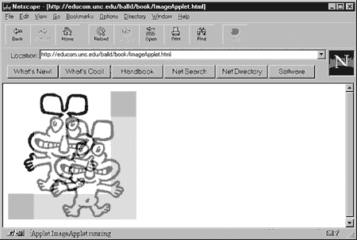

#### 图 9.2.

`ColorModel` 类用 `abstract` 修饰符定义，尽管 Java API 中提供了它的两个扩展类，并在本节稍后部分进行了描述。表 9-13 列出了 `ColorModel` 类的方法。注意，`getRGBdefault()` 方法使用 `static` 修饰符声明，因此其使用方式可能是根据非抽象的默认 `RGB` 颜色模型返回链接的时间实现。

### 表 9-13. `ColorModel` 类方法

| 方法 | 描述 |
| :--- | :--- |
| `ColorModel(int)` | 创建一个支持指定位数颜色的颜色模型。位数直接控制该模型中可用唯一颜色的数量。每个像素 8 位提供 256 种不同的颜色。 |
| `int getAlpha(int)` | 返回特定整数参数像素的组件透明度。 |
| `int getBlue(int)` | 返回特定整数参数像素的蓝色分量。 |
| `int getGreen(int)` | 返回整数参数指定的像素的绿色分量。 |


## 方法概述

`int getRed(int)` 返回整数参数指定的像素的红色分量。

`int getPixelSize()` 返回像素的位数。

`int getRGB(int)` 返回指定的默认颜色模型 `RGB` 中由参数指定的像素值。

`static ColorModel getRGBdefault()` 返回由 `java.awt.image` 包使用的默认 RGB `ColorModel`。该方案为每个主色度和透明度分量分配了 8 位，这提供了 256 级红、蓝、绿颜色和透明度的渐变，总计共有 16777216 种颜色（不计算透明度色调）。

## 颜色编码方法

编码红、蓝、绿和透明度有两种基本方法，每种方法都是 32 位整数中的若干位整数。

### 索引颜色模型
在第一种方法中，像素的整数值被视为 `array` 索引，红、蓝、绿颜色和透明度从内部调色板表中获取。你不需要在表中排序颜色；符合性由模型创建者设置。`IndexColorModel` 继承自主 `ColorModel` 类，这样你就可以使用自己的调色板创建一个新的 `ColorModel` 类。当你构建模型时，你会创建颜色组件的数组。当程序员向模型请求颜色时，它会使用 `array` 索引。

### 直接颜色模型
第二种方法：`DirectColorModel` 是 `ColorModel` 类的扩展。例如，我们可以使用 6 位红色、6 位蓝色、8 位绿色。根据该方案，我们将有 67108864 种可能的颜色。


## Rice. 9.3.

现在 `PixelGrabber` 返回的整数像素值数组有了意义。`PixelGrabber` 使用的 `ColorModel` 是默认模型 `RGB`，可以使用表 9-13 列出的方法从像素中提取颜色信息。我们可以向早期示例中的循环中添加以下代码，分析数组中的特定颜色：

```java
ColorModel cm = ColorModel.getRGBdefault();
int pixel;
for (int i = 0; i < ary.length; i++) {
    pixel = ary[i];
    cm.getRed(pixel);
    cm.getBlue(pixel);
    cm.getGreen(pixel);
    cm.getAlpha(pixel);
}
```

我们展示了如何将图像转换为数组，以及如何使用 `ColorModel` 类将这些数组中的值转换为颜色分量。反向转换（将数组转换为图像）使用 `MemoryImageSource` 类也同样简单。

## 将数组转换为图像

`MemoryImageSource` 类提供了一种将整数数组转换为 `Image` 类像素的方法。`MemoryImageSource` 类实现了 `ImageProducer` 接口，可以作为 `Component` 类 `createImage` 方法的参数使用。表 9-14 给出了 `MemoryImageSource` 类的构造函数。

### 表 9-14. MemoryImageSource 类构造函数

| 构造函数 | 说明 |
| :--- | :--- |
| `MemoryImageSource(int, ColorModel, byte[], int, int)` | 创建一个新的 `ImageProducer`，它通过参数传递的字节数组中的像素值构建图像。前两个整数表示所需的图像宽度和高度，但参数 `colormodel` 设置了在解释数组时必须使用的像素值与颜色分量之间的 `ratio`（比例）。最后两个整数表示数组中的起始位置以及数组中每行像素占据的字节数（实际上是图像的 `width` 宽度）。 |
| `MemoryImageSource(int, int, ColorModel, byte[], int, int, Hashtable)` | 工作方式与之前的构造函数相同。参数 `Hashtable` 建立了图像属性。 |
| `MemoryImageSource(int, int, ColorModel, int[], int, int)` | 从给定的整数数组创建新的 `ImageProducer`。 |
| `MemoryImageSource(int, int, ColorModel, int[], int, int, Hashtable)` | 从给定的整数数组创建新的 `ImageProducer`。 |
| `MemoryImageSource(int, int, int[], int, int)` | 使用默认颜色模型 `RGB` 从给定的整数数组创建新的 `ImageProducer`。 |
| `MemoryImageSource(int, int, ColorModel, int[], int, int, Hashtable)` | 使用默认颜色模型 `RGB` 从给定的整数数组创建新的 `ImageProducer`。 |

这个类能更好地说明示例。下面我们给出一个完整的 applet，它从整数数组生成并输出图像。我们将为每个像素创建红色分量，根据每个像素的 `x` 和 `y` 坐标相应地添加缩放的正弦；同样，我们将为每个像素创建蓝色分量，但已经加上了 `X` 和 `Y` 坐标的余弦。每个像素的最终值通过位或操作将具有 100% 值透明度的颜色的红色和蓝色分量组合，并移动分量直到它们与默认 RGB 颜色方案中的相应位置对齐。图 9-4 显示的准备图片的截图。

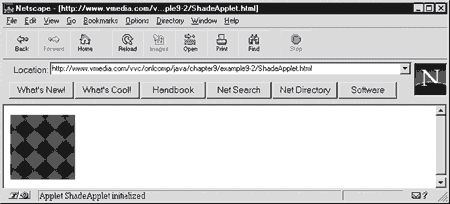

### 图 9-4.

### 示例 9-2. 类 MemoryImageSource 的用法

```java
import java.awt.*;
import java.awt.image.*;
import java.applet.*;

public class ShadeApplet extends Applet {
    Image myImage;

    public void init() {
        resize(250, 250);
        int ary[] = new int[250 * 250];
        for (int i = 0; i < 250; i++) {
            for (int j = 0; j < 250; j++) {
                double x = (16 * Math.PI * j / 250);
                double y = (16 * Math.PI * i / 250);
                double p = (Math.sin(x) + Math.sin(y) + 2) / 4;
                int redvalue = (int) Math.round(p * 255);
                double q = (Math.cos(x) + Math.cos(y) + 2) / 4;
                int bluevalue = (int) Math.round(q * 255);
                ary[i * 250 + j] = (255 << 24) | ((redvalue) << 16) | (bluevalue);
            }
        }

        MemoryImageSource mis;
        mis = new MemoryImageSource(250, 250, ary, 0, 250);
        myImage = createImage(mis);
    }

    public void paint(Graphics g) {
        g.drawImage(myImage, 0, 0, this);
    }
}
```

## 图像过滤

现在我们可以直接在位位上创建图像，而无需使用 `Graphics` 类提供的图形原语。我们甚至可以管理从网络加载的图像；通过 `PixelGrabber`，我们可以从数组中接收像素值。我们可以使用 `MemoryImageSource` 类反转该过程。Java API 提供了两个专门为这些任务设计的类：`FilteredImageSource` 和 `ImageFilter`。

`FilteredImageSource` 类实现了 `ImageProducer` 接口。它接受 `ImageProducer` 和 `ImageFilter` 作为构造参数。通过创建图像，它从构造函数中定义的 `ImageProducer` 接收像素数据，然后按照 `ImageFilter` 规定的一致方式更改这些数据，并通过 `ImageConsumer` 发回修改后的数据。`ImageFilter` 类实现了 `ImageConsumer` 接口。它不改变像素数据。Java API 提供了两个简单的扩展，允许插入颜色滤镜或为新图像裁剪某些区域。

`RGBImageFilter` 类默认不执行任何颜色过滤，但会根据指定的默认 RGB 颜色模型转换像素值和图像所使用的 `ColorModel`。为了对其进行颜色过滤，我们需要扩展该类的 `filterRGB` 方法以完成必要的过滤。考虑一个示例，即移除图像中所有的红色。

### 示例 9-3. 过滤移除红色

```java
import java.awt.image.*;

public class NoRedFilter extends RGBImageFilter {
    public int filterRGB(int x, int y, int rgb) {
        int alpha = (rgb & 0xff000000) >> 24;
        int red = (rgb & 0x00ff0000) >> 16;
        int green = (rgb & 0x0000ff00) >> 8;
        int blue = (rgb & 0x000000ff);
        return ((alpha << 24) | (green << 8) | (blue));
    }
}
```

首先，我们通过指定给定数组默认 RGB 颜色方案中的像素颜色来拆解整数 `rgb` 变量，然后将透明度、绿色和蓝色分量加回 RGB 值，完全忽略红色值。请注意，由于我们传递了 `x` 和 `y` 坐标，我们可以根据位置更改滤镜颜色，但对于我们的简单滤镜来说，这是没用的。`RGBImageFilter` 类——一种实用的滤镜，你可以根据自己的需要进行开发，因为在需要时它会执行到给定的默认模型颜色 `RGB` 的转换。

`CropImageFilter` 类用法非常简单；你不需要扩展它来裁剪图像。相反，你只需要在构建滤镜时定义想要裁剪的区域。构造函数需要四个整数作为参数，以定义矩形。这里有一个短示例，裁剪左上角的区域：

```java
FilteredImageSource fis;
CropImageFilter filter;
filter = new CropImageFilter(0, 0, 10, 10);
fis = new FilteredImageSource(myImage.getSource(), filter);
Image myNewImage = createImage(fis);
```

现有的 Java 应用程序接口（API）工具提供了编写几乎任意复杂性应用程序的能力。当然，为了在需要时使用 API，必须编写相应的程序。在这里衡量的是，随着此类程序的增加，程序员越来越希望使用他们早些为其他目的编写过的新开发片段。既然如此，为什么不使用包（packages）呢？

面向对象的语言（包括 Java）的主要优势之一在于能够描述某个特定的过程、一个对象或模型之间的关系——换句话说，就是一组函数——而且在以类的形式发布后，只需编写一次。

此外，该类可以在不作任何更改的情况下在其他程序中使用。这样就让自己从不断返回旧代码的问题中解脱出来。在任何新项目中，你都可以轻松地插入之前编写好的对象或接口。

如果在设计类时考虑了可能的重复使用，随着时间的推移，程序员会积累整个类库。毕竟，这样一个库对项目产生的作用与标准接口式编程相同，甚至更多。

# 创建兼容的类

在第 6 章中，我们展示了 `Object` 类有几个在其他类中经常重写的方法。`Object` 类的一些方法在每个派生类中都必须重写，并且在你自己的类中也必须重写。对于其他方法，决定是否重写它们对于项目来说是一个具有策略意义的问题。让我们来看几个方法，并决定在特定情况下是否有必要重写它们。此外，我们还将考虑在方法未重写时执行的操作序列。让我们从始终需要重写的方法开始。

## 方法 `boolean equals(Object o)`

如果你要比较同一类的两个对象，则必须重新定义此方法。如果没有重写，该类的对象只有在一种情况下是相等的（方法返回 `true`）——即所比较的对象实际上是同一个对象。至于如何重新定义这个方法，主要取决于类中的变量。考虑 `exampleClass` 类。假设它的构造函数和其他方法以某种方式改变了变量的值：

```java
class exampleClass {
    private String s;
    private int i;
    private int j;

    // 构造函数
    // 方法
}
```

对于这样的类，比较两个变量值的方法非常合适。它可以转换为复合布尔表达式，但我们倾向于分别比较两个变量：

```java
boolean equals(Object obj) {
    if (obj == null) return false;
    if (!(obj instanceof exampleClass)) return false;

    exampleClass ex = (exampleClass) obj;
    if (ex.i != i) return false;
    if (ex.j != j) return false;
    return true;
}
```

我们做的第一件事是检查传递给方法的是空指针而不是对象本身。第二个操作符检查用于比较的对象的类型（`exampleClass`）。如果传递的对象的类型与描述方法的对象的类型不匹配，该操作符将返回 `false`。现在我们知道了如何比较类型相同的对象，我们将对象 `obj` 强制转换为类型 `exampleClass`。接下来的三行代码通过操作符比较两个对象的变量之值。如果至少有一个变量与另一个不相等，方法将返回 `false`。看看由于我们是在其所属的类定义框架内操作，我们可以访问到哪些内部变量。

在这个示例中，为了使对象相等，必须所有变量都相等。否则，则不需要满足这些条件。在编写比较两个对象的方法时，要问自己的第一个问题是：“该类的两个对象必须具备什么属性才能被认为是相等？”

## 方法 `String toString()`

设计 `toString` 方法很容易——它应该返回一个表示对象当前状态的字符串（`String` 类型）。它的主要目的是使用 `System.out.println` 方法进行程序调试。下面的示例描述了 `myBox` 类（矩形），其 `toString` 方法返回它的高度和宽度。

```java
class myBox {
    int width = 0;
    int height = 0;

    // 构造函数，方法
    String toString() {
        return "width = -" + width + ", height = -" + height;
    }
}
```

## 方法 `int hashCode()`

这个方法与上述两个方法一样，必须始终被重写。如果不这样做，该类将无法与第 6 章讨论的 `java.util.Hashtable` 类配合使用。为了学习如何构建方法以及理解为什么要重新定义它，让我们考虑更复杂的哈希表。

搜索速度是哈希表的主要优势之一。哈希表从不遍历所有内容。要在由 `N` 个键值对组成的表中查找一个元素，总共需要执行 `N` 次比较操作。如果 `N` 足够大，哈希表只需执行一次比较。

哈希表如何决定将键/值对放入哪个桶（bucket）中？这使用了特殊的算法——哈希函数（hash function）。它的任务是让“键-值”分布在尽可能多的桶中，从而进一步简化，减少单个桶中键的数量。

这就是 `hashCode` 方法发挥作用的地方。作为 `java.util.Hashtable` 中哈希函数的参数，它传递的是整数。

```java
int hashCode() {
    return one;
}
```

然而，理想情况在实践中很难实现。我们只能建议不要耗费许多个不眠之夜去开发一个完全满足所有标准的完美 `hashCode` 方法——通常来说，这是不可能的。因为 `hashCode` 返回的是一个 `integer`，它的可能值只有 `4294967296` 种。而在所有 `String` 类型的变量中存在 `9223372936854775897` 种可能值，而总长度仅为两个字符的 `long` 行寥寥这么多。现在，既然我们知道要为 `String` 类型获得最佳哈希值是不可能的，让我们看看 `String` 类型的开发者实现了什么。他们的主要目的是提供一种如何获取更唯一值的方法：

```java
// method hashCode class java.lang.String
public int hashCode() {
    int h = 0;
    int off = offset;
    char val[] = value;
    int len = count;
    if (len < 16) {
        for (int i = len; i > 0; i--) {
            h = (h * 37) + val[off++];
        }
    } else {
        // take only some symbols
        int skip = len / 8;
        for (int i = len; i > 0; i -= skip, off += skip) {
            h = (h * 39) + val[off];
        }
    }
    return h;
}
```


> **建议**：`String` 类的源代码与其他 API 类一样，都在 JDK 中。有时，通过查看那里来熟悉 Java 开发者的观点或其他出于其他原因是很有趣且实用的。


## 方法 `Object clone()`


你可能在第 2 章中记得，赋值运算符 `=` 并不会创建对象的副本。相反，如果它的操作数之一是实例变量，那么一个或两个变量将指向同一个对象。假设我们有一个由类表示的链表，该类包含一个整数和一个数据对象 `list`。`setNext` 方法允许根据给定的米饭创建数据结构，见 10-1。

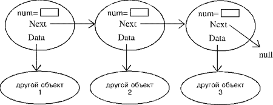

### 图 10.1

注意这些我们在 `Object` 类中重写的方法，正如我们上面提到的：

```java
public class Node {
    private Object Data = null;
    private Node Next = null;
    private int num;

    public void setData(Object obj) { Data = obj; }
    public void setNum(int someNum) { num = someNum; }
    public void setNext(Node node) { Next = node; }
    public Object getData() { return Data; }
    public Node getNextNode() { return Next; }

    public boolean equals(Object obj) {
        if (!(obj instanceof Node)) return false;
        Node N = (Node) obj;
        return ((N.num == num) && Data.equals(N.Data));
    }

    public int hashCode() {
        return Data.hashCode() * num;
    }

    public String toString() {
        String S = "Data = ";
        S = S + Data.toString();
        S = S + ", num = " + num;
        return S;
    }
}
```

如果我们执行以下操作：

```java
Node A = new Node();
Node B = A;
Integer I = new Integer(32);
B.setNum(16);
B.setData(I);
```

我们并没有得到两个不同的 `LinkedListNode` 实例，而是总共只有一个，引用变量 `A` 和 `B` 都指向它。这意味着：

`System.out.println(A);`

将给出结果 "Data = 32, num = 16"。（正如你记得的，`System.out.println` 方法在接收到 `Object` 类型参数后会调用 `toString` 方法并以行的形式显示结果。）如果我们真的需要实例的副本怎么办？这就是类的 `clone` 方法派上用场的地方。`Object` 会复制实例，包括所有变量的当前状态。我们可以构造一个可以克隆的子类 `Node`：

```java
public class CloneableNode extends Node implements Cloneable {
    public Object clone() {
        try {
            return super.clone();
        } catch (CloneNotSupportedException e) {
            // 这不会发生，因为
            // 我们已经将类声明为“implements Cloneable”
            throw new InternalError();
        }
    }
}
```

我们在这里所做的都是调用 `Object` 类的 `clone` 方法。由于会产生 `CloneNotSupportedException`，我们被迫处理它：

```java
CloneableNode A = new CloneableNode();
```

```java
curList = curList.clone();
```

那么你就不需要担心 `curList` 上一个实例所占用的内存了——垃圾回收器独立地识别未使用内存区域的出现，并处理你需要的一切。

这样，我们就不需要担心在系统中释放内存并编写相应的 `finalize` 方法。相反，当程序处理文件系统或网络资源时，它可能会派上用场。在此之前，我们没有考虑文件或网络工作（无论如何 applet 都无法处理文件）。所以现在我们可以提供一个 `finalize` 方法的良好示例。如果你无法抑制地想看到 `finalize` 的运行，可以查看 `java.io` 包下 `FileInputStream.java` 的源代码。原文中所有的 Java 类都是 JDK 的一部分。

## 重用组件的创建

所以，我们已经学习了 `Object` 类的方法以及关于如何重写 `override()` 的主题。现在是时候转向更通用的面向对象编程概念，并讨论一下可以重复使用的组件了。

创建此类组件（我们称它们为“通用”组件）与其说是一种艺术，不如说是一种可以学习的技术。在开始编写代码之前，必须仔细研究它要解决的问题。在 Java 中，有很多东西有助于通用组件的创建，但语言本身对帮助你更有效地编写代码毫无帮助。良好的编程基调始于实际创建程序之前。每一段程序或方法都必须在整个项目的语境中经过细致的评估。

通用性概念意味着，在编写程序时，要考虑到它在未来的使用前景。你的目标是创建一个易于构建的结构化通用代码封装，但首先需要解决具体要封装什么以及如何做最合适。

许多程序员掉入了复杂的语法对象和广义面向对象的陷阱。重要的是记住，面向对象提供了比其他方法更直观的解决问题方式，然而，遗憾的是，计算机在直觉解决问题方面并没有我们人类那么擅长。曾几何时，程序是用汇编语言编写的。我们用那种语言编写多线程用户界面吗？当然可以！但汇编语言本身没有可以让我们轻松描述项目固有问题的机制。

这些考虑也适用于过程化编程语言。在过程化语言中，你有工具可以描述通用的动作序列，但程序中的非通用部分。只要程序执行数学计算，它的效果就良好，但一旦你尝试解决现实规模的问题，它就失效了。考虑航空运输管理问题。

简而言之，它的表述如下：我们不希望飞机相互碰撞。时间、起飞、降落以及机场空间占用都是可访问的。

问题由以下组件组成：飞机、它们的路线、停车位、跑道（`Runway`）、空中交通塔和机库。在面向对象的语言中，问题可以表示为一组对象的集合，而在过程化语言中，我们仅限于描述可能的动作。

当然，上述问题也可以用过程化语言解决，但在这种情况下，所有的注意力将集中在上面。在面向对象的语言中，我们消除了对其细微差的研究，将所有注意力放在问题的实际解决上。编写有效程序的关键不是你写了什么，而是你写的什么。在开始编写代码之前，你是否正确地思考了问题？这种转变是已经研究过特定语言所有特征的资深程序员的特点。所以，让我们熟悉如何考虑程序使其变得更高效。

### 问题的背后是什么？

这个问题看起来相当显而易见；但令人惊讶的是，这个问题经常没有回答。答案通常取决于编程语言：我如何用这种特定的语言来描述我的解决方案？当然，最后问题会被描述，但你的初步想法应该只是解决它的练习。有必要思考问题如何在语言的最高层面上契合。例如，当涉及到 Java 程序到不同计算机平台的可移植性时，必须找出它们是否都有运行它的手段。在开发阶段，应该避免不必要的细节，问题的描述即使对非专业人士也应该是清晰的。

### 问题的组成部分以及它们之间如何相互作用？

这是将问题分解为组件并克服它的关键阶段。问题是以抽象术语思考的，但不限于特定的语言对象。最好画一张小图或图画，让你能够直观化问题，类似于图 10.3 所示的。


#### 图 10.3

任务——示意性地勾勒包含解决问题的元素、对象的方法。（等等，让我们根据提供的文本重新检查文本结构）。

实际上，查看文本：

“任务——示意性地勾勒包含解决问题的元素、对象的方法。让我们重复早期思考对象和方法的阶段。只需列出属性列表，如表 10-1 所示即可。”

**表 10-1. 航空运输系统元素的属性**

*   `Aircraft`（飞机）：具有特定的位置和 `trajectory`（轨迹）。应该在某些路线上。
*   `It`（它）：具有到达和离开时间。
*   `Route`（路线）：可能与其他路线交叉。其容量受天气条件影响。
*   `Hangar`（机库）：具有给定容量和 `coordinates`（坐标）。可能是已填充或未填充。
*   `Runway`（跑道）：具有给定长度。可能是被占用或空闲。跑道的使用取决于天气条件。
*   `A place for parking`（停车位）
*   `Tower`（塔）
*   `It`（它）：具有给定容量和 `coordinates`。受天气条件影响。
*   `Required for tracking`（需要跟踪）：在机场环境中。

（注：提供的文本似乎有很多混乱，我保留了原始文本但应用了格式规则。）

针对上一个问题，我们将自定义接口和子系统网络从项目的其余部分分离了出来。现在是时候查看其他组件，并思考如何让它们变得通用了。例如，机库与停车场非常相似，而飞机本质上是运输设施的一种。在考虑一个程序实现自定义接口、网络和存储需要什么时，你得考虑这些组件是否在某些其他项目中也有应用。

微妙之处在于，将那些将变得通用的、适用于复用的组件隔离出来。然后，在继续编写类和接口时，你真正获得了可以大胆放入库中的通用代码。对于我们正在考虑的这个例子，我们构建了一个抽象类 `TransportMeans`，而飞机则作为子类来实现它。

### 如何在面向对象的 Java 中调整原始文本？

上述方法是开始编写通用组件的一种方法。在每个阶段都传递这一点至关重要。记住，在开始编写实际程序之前，要牢牢地思考哪些是必要的。现在我们准备好了，让我们开始吧。每个大型组件都必须被拆分为更小的组成部分——即若干类和接口。

在接下来的几页中，我们将考虑 Java 的属性，这些属性允许我们用编程语言来描述一个现实问题。我们将展示在什么情况下使用接口比子类更高效，以及如何正确地使用各种方法修饰符。完全理解所有这些属性将允许你自己创建自己的 Java 通用组件库。

在追踪下一个类或接口的图表时，记住这一点。

### 工作代码中的项目转换

现在到了从图表转向编写实际程序的时刻了。正如我们在第 2 章中讨论的，包（`package`）是一个存放类、接口和异常的容器。要指示一个对象引用特定的包，需要使用 `package` 关键字配合分配的包名：

```java
package somePackage;
public class SomeClass {
    // 类定义
}
```

如果原始代码放置在层次结构目录的某处，则使用这些质量分隔符名称来指向这些目录：

```java
package myPackages.someOtherPackage;
public class SomeOtherClass {
    // 类定义
}
```

在任何情况下，包名必须严格匹配我们在第 2 章中讨论过的 `CLASSPATH` 环境变量给出的目录名。包名中的点分隔 `CLASSPATH` 变量中的目录子目录。它们是做什么用的？原因之一是语法的。Java 编译器需要一种方法来找到程序的源码，但你不想让所有程序都在同一个卷和同一个目录下。

另一个最重要的原因是 `protected` 修饰符的存在。到目前为止，我们还没有太频繁地使用它。相反，我们对所有只能从对象访问的方法和变量使用了 `private` 修饰符，并对所有其他组件使用了 `public` 修饰符。`protected` 修饰符也会使组件变为公共的，但仅限于它所属的包内。

我们为什么需要它呢？有时你希望某个特定方法只对某些对象可用，而不是对所有人。让我们考虑上面关于空中通信管理的例子。我们的飞机需要一个方法来寻找一个空闲的 `Runway`（跑道）进行着陆，但信息只能来自控制室。属于飞机类的 `setRunway` 方法声明了 `protected` 修饰符，并放置在描述空中交通控制室的同一个包中。这个包不能包含某些类，例如“airstrip”（跑道场）类。想象一下，如果这个类根据自己的意愿，突然调用 `setRunway` 方法并决定在繁忙的跑道上着陆会发生什么！

你可以说：“所有这些类都没有自己的生命。毕竟，它们是由我编写的，还有谁比我更知道‘跑道’类不应该允许对‘飞机’类的 `setRunway` 方法进行调用？”是的，在简单项目中，你所说的是正确的。但当涉及到大项目时，某些模块确实在某种意义上开始拥有它们自己的生命。每当完成主要的项目实现后，任何人都可能来尝试做一些与系统设计基本原则完全背道而道的事。与此同时，系统是否有良好的文档一点并不重要。在这种情况下，最好的文档就是简单地禁止编译器访问未提供此类调用的类方法。

`protected` 修饰符即使在只有你一个人工作的相对较小的项目中也有意义。程序员往往在时间推移后忘记程序的规模，以及程序是如何设计的，而且当在几个月后回头看自己的文本时，你实际上就变成了那个“另一个”程序员。

`final` 修饰符也用于防止继承或方法重写。`final` 修饰符即使在只有你一个人工作的相对较小的项目中也有意义。它防止……改变，以及他人。让我们考虑下一个例子：

```java
class Runway {
    private final int physicalLocation;
    private final int physicalLength;
    private final int physicalWidth;

    Runway(int i, int j, int k) {
        physicalLocation = i;
        physicalLength = j;
        physicalWidth = k;
    }

    public final int getPhysicalLocation() {
        return physicalLocation;
    }

    public final int getPhysicalLength() {
        return physicalLength;
    }

    public final int getPhysicalWidth() {
        return physicalWidth;
    }
}
```

### 转换类型对象

复用类的一种方法是将其子类化。只需要添加父类中缺失的几个方法，就可以让类准备就绪。缺失的类方法已经在父类中描述过了。在设计大型系统时，你需要考虑 Java 关于对象类型转换的好处。

```java
abstract class Vehicle {
}
```

```java
String vehicleType();
Vector getLocation();
Vector getTrajectory();
Path getPath();

float currentFuelAmount();

// returns meaning from 0 before one
```

方法 `getPath` 返回一个抽象的对象路径：

```java
abstract class Path {
    String pathType();
    Vector startingPoint();
    Vector endingPoint();
    int Length();
}
```

到目前为止我们编写的所有内容仅代表了学术兴趣。当然，你的同事会欣赏面向对象的编程风格，但还需要一些实际实用的东西。一旦我们为不同类型的车辆（`Vehicle`）及其路线（`Path`）创建抽象类的子类，优势就会变得显而易见。此外，这些子类的实例可以使用父类 "Vehicle" 中描述的泛型方法进行控制。接口以及以此方式创建的子类也是如此。

# 关于可维护性的代码检查

程序必须提供防止各种错误的手段，遗憾的是，这些错误有时会在执行过程中发生。用户并不总是输入正确的数据，程序也不总是能从系统获取正常运行所需的所有资源。在更古老的编程语言中，错误保护是以许多且难以阅读的 `if-then-else` 块的形式实现的。Java 语言使用了异常（特殊情况）处理机制——它非常有帮助，能够有效地防止程序发生错误情况，但它并不是解决所有问题的万灵妙药。

你们所有人都必须自己找出程序中可能导致错误的地方，并编写适当的代码来处理它们。另一方面，处理异常使得原始文本更加简单、直观且易于维护。


> **建议** Java 中的异常处理机制等于 C++，但它在此基础上增加了 `finally` 块，该块会在任何 `catch` 块之后运行。


我们不得不反复使用异常处理机制。应用程序编程接口 (API) 中的许多方法和构造函数都会产生异常。如果此方法内部发生错误，则会抛出异常。`catch` 块决定了如何处理这个“意外”。由于我们已经必须处理异常，让我们直接开始学习如何高效地处理它们吧。当你学会了如何编写抛出异常的方法和构造函数时，你也将学会如何自己编写它们。我们将通过编写自己的子类-异常来结束这次之旅，这些异常允许尽可能根据特定项目需求来处理错误情况。

## 异常拦截

你首次在第 5 章在网络启动过程中遇到异常处理。你可能记得，如果无法转换为格式为 `URL` 的可变参数类型 `String`，`URL` 构造函数将抛出一个异常。让我们看看这里可以做什么：


```java
public class someApplet extends applet {
    Image I;

    // 其他描述

    public void init() {
        String imageName = getParam("image");
        try {
            URL imageURL = new URL(imageName);
            // 可能会产生异常 MalformedURLException
            I = getImage(imageURL);
            // 初始化 applet 其他部分
        } catch (MalformedURLException e) {
            String err = e.getMessage();
            showStatus("Couldn't get - " + imageName + ": " + e.getMessage());
            stop();
        }
    // 其他方法
}
```

这是一个演示异常使用的简单示例。`try` 块定义了当一切正常时我们打算做的事项，而 `catch` 块则是当 `try` 块中出现 `MalformedURLException` 异常时需要执行的事。

异常处理是正确处理任何方法或程序构造函数的规则的重要部分。但什么是正确的异常处理？我们示例的语法非常简单，无法为这个问题提供完整的答案。我们应该熟悉异常处理的全部可能性。也就是说，需要考虑以下问题：

*   异常是 Java 语言中完整的类。如果是这样，它们就有方法，调用这些方法你可以获取有关事件系统中发生情况的详细信息。
*   某些异常必须显式处理，而另一些则不需要。前者被称为“运行时异常（`RuntimeException`）”，必须进行处理。
*   多个 `catch` 块可以与一个 `try` 块配合。这意味着在单个 `try` 块中可以抛出多个不同的异常。每个这样的异常可能都有对应的 `catch` 块。
*   `try` 和 `catch` 块可以配合 `finally` 块。

在学习异常处理技术的复杂之处时，我们将继续完善我们的简单示例。学习结束，你将清晰理解如何根据接收到的 HTML 页面信息正确访问资源。此外，你将学习如何使用设计用于提高效率的方法和工具来生成异常。

### 质量对象中的异常

我们的 `catch` 块包含了以下语句：`showStatus(e.getMessage())`。

这假设 `e` 是一个对象，其成员之一 `getMessage()` 返回一个 `String` 值。当然，这些假设都是正确的。可以捕获的异常是 `Throwable` 类的子类。因为 `Throwable` 总是任何被抛出对象的父类，为了分析情况，你可以使用用修饰符定义的任何方法。这些方法列在表中。

## 方法描述

*   `String getMessage()`：返回详细信息。如果是 `Throwable` 对象，它会在屏幕上输出。
*   `void printStackTrace()`：打印堆栈跟踪的内容。栈的内容是在抛出异常时中断的所有方法。
*   `Throwable fillInStackTrace()`：填充堆栈跟踪内容。在处理再次生成的异常时有用。
*   `String toString()`：返回描述。

`Throwable` 类的方法可以被 `Exception` 的子类重写，并且当然，还可以向它们添加额外方法。异常 API 文档在相关的网页上进行了描述。示例页面见下文。

```java
URL U = new URL("http://www.vmedia.com/?.?");
Image I = getImage(U);
```

```java
// 编译不会通过 - 没有 try-catch 块！
```

与简单的错误（`Error`）不同，异常时填充（运行时异常，`RuntimeException`）不需要显式地处理。如果我们被要求这样做，程序的源代码将变成一片无法逾越的丛林。例如，如果我们应该捕获 `OutOfMemoryError`（“内存不足”）这种类型的异常，那么在每个生成任何新对象的语句之后都必须这样做！同样，对于在尝试访问某个对象尚未实现的非静态成员时所抛出的 `NullPointerException`（“空指针”），也是如此的。下面的代码片段演示了产生此类异常的方法之一：

```java
String S;
S.toLowerCase();
// 将产生 NullPointerException 异常
```

如果我们被迫处理 `NullPointerException` 异常，那么每次访问任何对象时都必须这样做。这与强制处理 `OutOfMemoryError` 一样痛苦不分。

运行时异常与错误之间的主要区别在于它们在系统中所代表的失败类型。错误是你的程序可能无法帮助的情况。例如，程序几乎无法处理“内存溢出”错误。因此，在处理错误时，程序的意义不大。在这些情况下，能做的最好的事情就是正确地完成应用程序操作。

运行时异常是操作过程中的失败情况，你完全可以自己应对。它们与错误不同，有时甚至需要进行处理。还记得在第 6 章中我们必须将 `String` 值转换为 `int` 值吗？在那种情况下，我们可以按照如下方式安排 `try-catch` 块：

```java
String S = "20";
try {
    int i = Integer.parseInt(S);
} catch (NumberFormatException e) {
    System.out.println("无法转换 - " + S);
}
```

我们并不被要求处理运行时的 `NumberFormatException`。但如果字符串值 `S` 是用户输入的输入，那么处理它就是绝对必要的。如果用户犯了错误导致产生的异常没有被处理，程序在不怀疑任何问题的情况下将继续工作，这将导致它在某些时间紧急停止。

### 一个设计中的多个 catch 块

因此，异常处理系统迫使我们对应用程序可能的意外保持小心。遗憾的是，在示例 10-1 中，我们并没有真正演示 Java 异常处理如何比简单的 `if-else` 结构更好。它每个 `try` 块只有一个 `catch` 块。实际上，与 `try` 块关联的 `catch` 块可以根据需要任意添加。这意味着 `try` 块中的语句在程序正常进行时执行。

对于研究你代码的程序员来说，理解他们想要在做什么并不困难。任何程序员都会欣赏将运行正常情况的代码与发生错误时执行的代码分开的能力。

让我们来看一个演示优势的示例。我们以前只在 applet 中上传单个图形文件。现在让任务复杂化：假设 Web 设计师想要上传多个文件，并指定每个文件在屏幕上显示的时间——通常创建一个动画。如果某个指定的文件在 applet 执行时不可用，它将用一张特殊图片替换，告知设计师服务器上该文件，同时 HTML 页面上的特殊图标将指示页面作者没有相应的图像。如果未指定显示时间，则使用默认时间。我们的动画任务决定了以下应用：

```java
class anumApplet extends applet {
    Image imgs[];
    Integer pauses[];
    // 其他描述
    public void init() {
        Vector imgVec = new Vector();
        Vector pauseVec = new Vector();
        Image deadImage = createDeadImage();
        Integer defaultPause = new Integer(100);
        int indx = 1;
        String imgName = getParam("image" + indx);
        while (imgName != null) {
            try {
                URL imgURL = new URL(getDocumentBase(), imgName);
                // 这里可能会出现 MalformedURLException
                imgVec.add(getImage(imgURL));
                String pauseParam = getParam("pause" + indx);
                Integer thisPause = new Integer(pauseParam);
                // 这里可能会出现 NumberFormatException
                pauseVec.add(thisPause);
            } catch (MalformedURLException e) {
                showStatus(e.getMessage());
                System.out.println(e.getMessage());
                imgVec.add(deadImage);
            } catch (NumberFormatException e) {
                pauseVec.add(defaultPause);
            } finally {
                indx = indx + 1;
            }
        }
        imgs = new Image[imgVec.size()];
        imgVec.copyInto(imgs);
        pauseVec.copyInto(pauses);
    }
}
```

在 `indx = indx + 1;` 之前的 `finally` 块。

如果我们抛出一个与错误或执行时异常无关的异常，它必须在方法的适当部分中进行声明。我们很快就会看到，一个方法可以抛出多个异常。为了显示方法生成了异常，我们使用关键字 `throw`。如果方法产生的异常其无法自行处理怎么办？它可以拦截该异常并将其进一步发送给调用它的方法。`throw` 语句之后必须紧跟一个 `Throwable` 类的实例。当然，我们可以使用任何可用的构造函数。

现在我们将开始开发这个类，在此期间，我们将对“如何处理异常”这一主题有一个深刻的教训。第 4 章展示了数值基本类型之间总是可以相互转换。即使我们将 `int` 转换为 `byte` 并超出了 `byte` 类型可能取值范围的限制，转换也不会导致错误——我们只是得到了一个没有意义的结果。但如果我们想知道转换过程中是否发生了错误呢？实现这一点的最佳方法是创建一个特殊的类 `Convert`，其内容是设计用于测试此类情况的方法。如果类型转换导致信息丢失，方法将生成一个异常。对于每种类型的转换，我们都会开发一个对应的方法，一旦类型转换导致信息丢失，该方法就会抛出异常。这里是这些方法之一：

```java
public static byte toByte(int I) throws Exception {
    String mesg = "toByte: ";
    if (I > 127) {
        mesg = mesg + I + " - is less than byte range";
        throw new Exception(mesg);
    }
    if (I < -128) {
        mesg = mesg + I + " - is less than byte range";
        throw new Exception(mesg);
    }
    return (byte) I;
}
```

从一方面来说，我们的方法是处理如何处理异常的良好示例。如果我们无法生成异常，我们就没有方法来报告超出允许范围的整数值是多少。

然而，我们最简单的示例绝对不适用于实际使用。如果发生了任何问题，我们的程序需要知道原因。否则，未来可能研究你代码的人将无法理解程序中发生了什么种错误。此外，正如你记得的，每种类型的异常都必须有单一的 `catch` 语句。这意味着使用你方法的人可能无法区分一个异常实例和另一个方法产生的异常实例。

这是一个语义问题，因为意义很少。我们必须编写自己的 `Exception` 子类并为它们提供有意义的名称。由于转换器类中的每个方法都必须生成自己的异常，我们开发了异常层次结构，如图 10-6 所示。

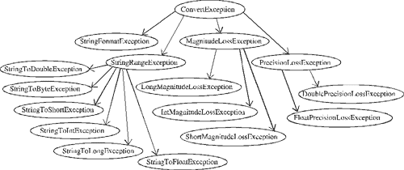

#### 图 10.6

编写一个遵循此层次结构的程序非常简单。所有需要做的事情——就是为包含在 `MagnitudeLoss` 和 `PrecisionLoss` 层次结构部分中的不同异常类型添加构造函数。记住，与任何类一样，每个异常都必须放在单独的文件中：

示例 10-1a。转换的异常。

```java
public class ConvertException extends Exception {
    public ConvertException(String S) {
        super("Couldn't convert: " + S);
    }
}

public class StringFormatException extends ConvertException {
    public StringFormatException(String S) {
        super("Bad String Format: " + S);
    }
}

public class MagnitudeLossException extends ConvertException {
    public MagnitudeLossException(String S) {
        super("magnitude loss: " + S);
    }
    // 注意：原文在此处有两个构造函数定义，存在语法错误
    public MagnitudeLossException(double d) {
        this("" + d);
    }
}

public class LongMagnitudeLossException extends MagnitudeLossException {
    public LongMagnitudeLossException(long l) {
        super("long " + l);
    }
}

public class IntMagnitudeLossException extends MagnitudeLossException {
    public IntMagnitudeLossException(int i) {
        super("int " + i);
    }
}

public class ShortMagnitudeLossException extends MagnitudeLossException {
    public ShortMagnitudeLossException(short s) {
        super("short - " + s);
    }
}

public class PrecisionLossException extends ConvertException {
    public PrecisionLossException(String S) {
        super("Precision loss: " + S);
    }
}

public class DoublePrecisionLossException extends PrecisionLossException {
    public DoublePrecisionLossException(double d) {
        super("double: " + d);
    }
}

public class FloatPrecisionLossException extends PrecisionLossException {
    public FloatPrecisionLossException(float f) {
        super("float: " + f);
    }
}
```

创建异常层次结构与创建普通层次结构完全不同。`Throwable` 的子类工作很少——子类最重要的是它们的名称。通过观察 `catch` 语句，你必须理解生成了什么情况。`Throwable` 类的例子是 `Exception` 类。

现在，构建了异常后，我们可以继续开发 `Convert`。转换 `byte`，但一个方法使用了 `toByte(String)`。

示例 10-1b. Convert 类。


```java
public class Convert {
    public static byte toByte(short s) throws MagnitudeLossException {
        byte b = (byte)s;
        if (b == s) return b;
        else throw new MagnitudeLossException(s);
    }

    public static byte toByte(int i) throws MagnitudeLossException {
        byte b = (byte)i;
        if (b == i) return b;
        else throw new MagnitudeLossException(i);
    }

    public static byte toByte(long l) throws MagnitudeLossException {
        byte b = (byte)l;
        if (b == l) return b;
        else throw new LongMagnitudeLossException(l);
    }

    public static byte toByte(String S) throws StringFormatException, StringToByteException {
        try {
            double d = toDouble(S);
            byte b = (byte)d;
            if (b == d) return b;
            else throw new StringToByteException(d);
        } catch (StringFormatException e) {
            throw e;
        }
    }

    public static byte toByte(float f) throws MagnitudeLossException, FloatPrecisionException {
        if (f > 127 || f < -128)
            throw new MagnitudeLossException(f);
        byte b = (byte)f;
        if (b == f) return b;
        else throw new FloatPrecisionException(f);
    }

    public static byte toByte(double d) throws MagnitudeLossException, DoublePrecisionLossException {
        if (d > 127 || d < -128)
            throw new MagnitudeLossException(d);
        byte b = (byte)d;
        if (b == d) return b;
        else throw new DoublePrecisionLossException(d);
    }
}

//*** toDouble

public static double toDouble(String S) throws StringFormatException {
    S = S.trim();
    try {
        double d = Double.valueOf(S).doubleValue();
        return d;
    } catch (NumberFormatException e) {
        throw new StringFormatException(S);
    }
}
```

由于 Java 是一种动态语言，我们可以动态获取有关对象的信息。为了实现这一点，请使用 `Class` 类 - `java.lang.Class`（图 10-7）。需要这个类是为了让我们发现我们正在处理的是什么种的对象，以及应用了哪些接口和许多特性。

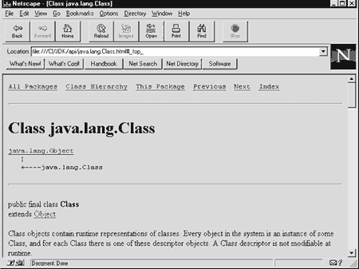

#### 图 10.7.

当我们确切知道系统中会出现什么种类型的实例时，它在小型系统中很少被使用。在大型且复杂的系统中，我们可以使用这个类来理解我们正在处理哪一个实例。表 10-3 列出了 `Class` 类中定义的方法。通过返回一个 `Class` 对象，它们唯一地描述了一个特定的 `Class` 或 Java 接口。

### 表 10-3. `Class` 类的方法

#### 方法、用途及生成的异常

- `static Class forName(String classname)`：给定一个 `className`，该方法返回一个 `Class` 实例，具有该类的特征。抛出的异常：`ClassNotFoundException`。

- `String getName()`：返回与此实例关联的类名。不产生异常。

- `String toString()`：见上文。如果是接口，则添加接口；如果是 `Class`，则返回 `Class`。不产生异常。

- `boolean isInterface()`：如果对象是一个接口，则返回 `true`。不产生异常。

- `Class[] getInterfaces()`：返回与对应类拥有的接口对应的 `Class` 实例；如果该类没有任何接口，则返回零长度数组。不产生异常。

- `Class getSuperclass()`：返回实例类的父类。不产生异常。

- `Object newInstance()`：创建对应类的新实例。产生异常：`InstantiationException`、`IllegalAccessException`。

- `ClassLoader getLoader()`：返回加载器类。不产生异常。

使用 `newInstance` 方法，在需要时“动态”创建类实例。

创建实例的后续如下（假设 S-name 是存在的子类路径）：

```java
try {
    Path p = Class.forName(S).newInstance();
} catch (InstantiationException e) {
    System.out.println(S + " is not a valid subclass of " + Path);
} catch (IllegalAccessException e) {
    System.out.println(S + " is not allowed to be accessed");
} catch (ClassNotFoundException e) {
    System.out.println(S + " wasn't found");
}
```

# 接下来是什么？

我们对程序设计原则进行了简要介绍，并尝试展示 Java 语言在编写重用代码和面向对象方面的机会。为了让 Java 编程更加强大，我们展示了提高代码稳定性的方法。下一章将介绍构建多线程应用程序的方法。

## 第十一章

## 多线程

使用 `Thread` 类创建线程、使用 `Runnable` 接口创建线程、流程控制、线程调度、线程分组、线程同步、变量 `volatile`。

我们已经简要地讨论过 Java 语言中线程的使用。Java 以非常优雅的方式处理线程：它是第一个在语言规范中包含流的流行语言。Java 作为一种强大的网络语言，应该能够执行多线程操作。线程的引入使得 Java 成为一种开发互联网程序的独特语言。

为什么线程如此有用？假设你正正在创建一个电子表格程序，并希望在后台处理用户输入的结果。在普通的单线程程序中，为了获得这个结果，你将不得不使用一些足够混乱的技巧 - 例如循环，它检查键盘输入，如果没有输入，则执行一些计算。这种解决方案并不优雅，但它是可行的。

但当在项目开发后期，有人要求为打印程序提供后台模式，另一个人又要求自动保存时，你的决定就会变得越来越不清晰。现在，你必须越来越多地处理这些在按键输入之间需要执行的额外例行操作。你的键盘输入循环迅速变得混乱且杂乱，而这一切都是因为你只有一个执行线程。

当然，可以使用别人提供的支持多个并发执行线程的库。这是行得通的，但非是最优的。每当工作项目发生变化时，你可能都会遇到层出不穷的多线程支持库并学习新的 API。Java 开发者理解了这一点，并在语言规范中执行了支持流。

通过使用 Java 标准流，我们可以解决电子程序中的问题。表格将变得简单得多。每个新任务都作为一个独立的线程执行。我们不再需要仔细研究每一个新功能。语言对线程的支持以及内置垃圾回收器的创建都提供了很大帮助。

本章重点关注 Java 如何实现线程以及使用大量流的程序问题。如果你还很少接触过多线程，本章（除了结尾之外）可能会改变你对编程的认知。

## Thread 类的创建流

在 Java 中创建一个新线程是最简单的操作。你需要做的只是扩展 `java.lang.Thread` 并替换 `run` 方法。该类的每个实例都将作为一个独立的线程执行。

## 简单流

示例 11-1。简单流。

```java
class outputThread extends Thread {
    outputThread(String name) {
        super(name);
    }

    public void run() {
        for(int i=0; i < 3; i++) {
            System.out.println(getName());
            Thread.yield();
        }
    }
}

class runThreads {
    public static void main(String[] argv[]) {
        outputThread t1 = new outputThread("Thread 1");
        outputThread t2 = new outputThread("Thread 2");
        t1.start();
        t2.start();
    }
}
```

代码在输出上生成以下内容：

```
Thread 1 Thread 2
Thread 1 Thread 2
Thread 1 Thread 2
```

注意，在这个程序中我们通过帮助 `outputThread` 类创建了两个流。我们随后在每个线程上调用 `start` 方法。该方法创建一个新线程并调用我们替换的 `run` 方法。你已经创建了一个多线程程序！而且这一点也不可怕或困难 - 事实上，你在书中已经使用了流。

记得我们网页上的 applet 吗？我们扩展了 `java.applet.Applet`。确实，这只有一个线程。但页面上的每个 applet 都是由一个或多个流组成的；除了我自己，Java 都会创建一些流。你已经熟悉了释放未使用内存的垃圾回收线程。如何查看流是 Java 开发不可或缺的一部分。


# runnable 类的创建流

如果我们不想扩展上面示例中的 `Thread` 类怎么办？也许我们已经有了一个 `eat` 类，并且对它的功能机会非常满意，我们只是想让它作为一个独立的线程运行。答案很简单：使用 `Runnable` 接口。我们在第 3 章“Java 中的面向对象编程”中讨论过 Java 接口。接口为可执行的类定义一组标准功能提供了一种很好的方法。`Runnable` 接口实现了一个方法 `run`，它与 `work` 类中的 `thread` 非常相似。

假设我们有一个想要转换为流的 `outputClass`。我们需要做的所有事情就是：实现 `Runnable` 接口，并创建共享方法 `run`。

示例 11-2. `Runnable` 接口的用法。

```java
class outputClass implements Runnable {
  String name;

  outputClass(String s) {
    name = s;
  }

  public void run() {
    for(int i=0; i < 3; i++) {
      System.out.println(name);
      Thread.yield();
    }
  }
}

class runThreads {
  public static void main(String argv[]) {
    outputClass out1 = new outputClass("Thread 1");
    outputClass out2 = new outputClass("Thread 2");
    Thread t1 = new Thread(out1);
    Thread t2 = new Thread(out2);
    t1.start();
    t2.start();
  }
}
```

这个示例在功能上等同于示例 11-1，但实现方式不同。在这里我们创建了两个 `outputClass` 类实例。这些可以是任何类，但它们必须实现 `Runnable` 接口。然后我们创建两个新线程并将它们传递给创建的 `outputClass` 副本。之后，执行流像往常一样启动。

这两个示例的区别在于对 `Thread` 类构造函数的调用。在第一个示例中，我们调用了 `Thread(String)` 构造函数，而在第二个示例中调用了 `Thread(Runnable)`。我们也可以调用 `Thread(Runnable, String)` 构造函数。`Thread` 类有以下构造函数：

* `Thread()`

* `Thread(String)`

* `Thread(Runnable)`

* `Thread(String, Runnable)`

* `Thread(ThreadGroup, String)`

* `Thread(ThreadGroup, Runnable)`

* `Thread(ThreadGroup, Runnable, String)`

我们稍后会讨论线程组。现在，让我们探索如何管理流。

创建线程只是故事的一部分；更重要的是学习在它们生成后如何管理它们。

# 控制流

到目前为止，我们执行的是能够自动终止的线程。它们完成任务并结束。那么当 Java 程序完成其工作时，如何停止线程呢？这是一个重要的问题，我们需要一些通用知识来回答。

让我们回到那个只有一个线程的程序。我们有一个主循环，其中运行着一些代码。当程序应该结束运行时，我们退出循环并结束程序。在 Java 中，我们得到相同的结果，但有一点不同：程序在所有流完成工作之前不会结束。所以，如果我们有一个永远不会完成的流，那么我们的程序也将永远不会结束。

每个线程可以处于四种状态之一：创建、执行、等待或完成。新创建的线程尚未运行——它正在等待启动。之后，线程可以通过 `start` 方法启动，或者当它被转移到完成状态时被停止。处于这种状态的线程已经完成了执行，也就是说这是它们所处的最后一个状态。一旦线程到达此状态，就可以重新启动。当 Java 虚拟机中的所有线程到达完成状态时，程序将结束工作。

所有当前运行的线程都处于执行状态。CPU 在线程之间共享时间（Java 具体如何分配 CPU 时间，我们将在下文中讨论）。

在此状态下，每个线程都是可执行的，但在处理器系统的任何时候，实际上只能运行一个程序。

如果流的执行被中断，它们将进入等待状态。流可以通过多种方式被中断。它可能是因为等待某些系统资源或根据请求挂起。从这种状态开始，线程可以通过 `stop` 方法返回执行状态或转移到已执行状态。在表 11-1 给出的方法管理线程的执行。

### 表 11-1. 管理流的方法

| 方法 | 说明 | 初始状态 | 新状态 |
| :--- | :--- | :--- | :--- |
| `start()` | 启动执行线程 | 创建 | 执行 |
| `stop()` | | 执行 | 完成 |
| `sleep(long)` | | 执行 | 等待 |
| `sleep(int)` | | 执行 | 等待 |
| `suspend()` | | 等待 | 执行 |
| `resume()` | | 等待 | 执行 |
| `yield()` | | 执行 | 等待 |

你正越来越接近使用线程：你已经可以创建并管理它们了。你需要了解状态。如果你需要知道哪个线程正在运行，请使用 `isAlive`：结果为 `true` 表示什么。

当我们创建这段代码时，我们实际上期望每个具有相同优先级的线程都能运行一段时间，然后将控制权让另一个线程。正如这个在 Windows 95 机器上运行的程序示例输出所示，我们得到了如预期的结果：

```
Thread one
Thread 2
Thread 3
Thread one
Thread 2
Thread 3
Thread one
Thread 2
Thread 3
```

但让我们看看在 Sun 工作站上运行相同的代码会得到什么：

```
Thread I
Thread I
Thread I Thread 2
Thread 2
Thread 2
Thread 3
Thread 3
Thread 3
```

结果完全不同！平台无关性去哪儿了？欢迎来到多线程的幽暗世界。并不是所有机器都是平等的，操作系统的影响会改变执行顺序。这种差异在于被称为“时间切片”的概念。

Java 规范中并没有描述相同优先级的线程是如何执行的。这些线程似乎应该共享处理器，但情况并非总是如此。它们的执行顺序是由基本的操作系统和硬件手段决定的。显然，在单处理器系统上，我们不能期望超过一个线程同时执行。操作系统通过调度器为线程提供服务，调度器定义了执行顺序。


让我们仔细观察在 Sun 机器上运行程序时发生了什么。第一个线程运行完毕，然后是线程 2，最后是线程 3。但如果第一个线程永远不结束，线程 2 和 3 将永远不会执行。当然，这导致了一些问题。高优先级线程将一直运行，而较低优先级的线程取决于操作系统可能无法运行。如果我们需要某种顺序，甚至仅仅是线程的顺序执行，我们就必须做一些工作。

`yield()` 方法为时间切片问题提供了一个简单的变通方法。如果使用了 `yield()` 方法，线程将主动让出处理器，从而让其他线程也有获得处理器时间的机会。控制权的主动转移在长周期中尤为重要。让我们使用 `yield()` 方法重写之前的程序。

### 示例 11-4. 方法 yield

```java
class outputThread extends Thread {
    outputThread(String name) {
        super(name);
    }

    public void run() {
        for (int i = 0; i < 3; i++) {
            System.out.println(getName());
            Thread.yield();
        }
    }
}

class runThreads {
    public static void main(String[] argv) {
        outputThread t1 = new outputThread("Thread 1");
        outputThread t2 = new outputThread("Thread 2");
        outputThread t3 = new outputThread("Thread 3");
        t1.start();
        t2.start();
        t3.start();
    }
}
```

这个选项只需要一个更改。我们在主线程循环中添加了 `yield()` 命令。虽然这给了我们想要的结果，但这个解决方案有几个缺点。`yield()` 方法消耗系统资源。在单线程情况下，使用 `yield()` 是浪费时间。不要忘记，某些系统已经为我们提供了时间划分。另一个缺点是我们必须显式地让出控制权——但是如何发现、何时以及多频率这样做呢？

既然有些系统执行时间切片而另一些没有，我们可以开发一个简单的测试来确定系统的能力。以下代码判断系统是否提供了时间切片。

### 示例 11-5a. 测试线程 testThread

```java
class testThread extends Thread {
    protected int val = 0;

    public void run() {
        while (true) {
            val++;
        }
    }

    public int getVal() {
        return val;
    }
}
```

第一个类只是一个测试线程。它只是在增加某个变量。在时间切片系统中，所有当前线程必须具有相等的值。没有时间切片的系统可能会导致单个线程接收到比其他线程多得多的时间。以下代码定义并执行是否为时间切片系统。

### 示例 11-5b. 时间切片可用性定义

```java
class isFair extends Thread {
    boolean fair = false;
    boolean determined = false;

    public boolean isFair() {
        if (determined) return fair;
        start();
        while (!determined) {
            // 等待值被确定
            try {
                sleep(1500);
            } catch (InterruptedException e) {
            }
        }
        return fair;
    }

    public void run() {
        testThread t1 = new testThread();
        testThread t2 = new testThread();
        setPriority(MAX_PRIORITY);
        t1.start();
        t2.start();
        try {
            sleep(500);
        } catch (InterruptedException e) {
        }
        t1.stop();
        t2.stop();
        if (t1.getVal() > 2 * t2.getVal()) {
            fair = false;
        } else {
            fair = true;
        }
        determined = true;
    }
}
```

`isFair` 类是这个示例的核心。它有一个 `isFair()` 方法，可以判断系统是否有切片。如果一个线程获得的时间是另一个的两倍，`fair = false`。

### 示例 11-5c. 测试公平性

```java
class isFair {
    public static void main(String[] argv) {
        isFair tThread = new isFair();
        if (tThread.isFair()) {
            System.out.println("System has slicing");
        } else {
            System.out.println("System does not");
        }
    }
}
```

从效率的角度来看，在代码中放置 `yield()` 语句会更好。两种方法都不是理想的解决方案，但线程共享 CPU 时间需要某些机制。不要认为仅仅因为你的系统支持时间切片，其他系统也是如此——它们确实是支持的。`Java` 是可移植性最好的语言之一，但如果你忽视调度问题，你可能会降低它的可移植性。

你可能会问为什么 `Java` 开发者要这样做。最好的答案是他们本该这么做。规划最好留给操作系统。如果 `Java` 承担线程调度的任务，将是浪费且低效的。大多数现代处理器在硬件层面都支持多任务处理。无论程序代码有多优秀，都无法与硬件实现相比。在 Solaris 系统下，Sun 为优先级流提供了完全支持，有一天 `Java` 将能够利用这种基础 `OS` 的这种优势。

## 线程分组

管理多个线程不会引起任何实际问题，但设想你需要跟踪成百上千线程。遍历每个线程将非常繁琐。在编写互联网服务器时可能会遇到这种情况——某些程序处理成千上万个并发会话。假设你必须产生某些监控系统，你需要结束所有会话。你有两个选择：创建一个检查每个线程的循环并显式停止流，或者使用线程组。

线程是分级分组的。每个组可以包含无限数量的流。你可以访问每个线程并在整个线程组执行挂起（`suspend()`）和停止（`stop()`）操作。让我们创建多个线程组：

```java
ThreadGroup parent = new ThreadGroup("parent");
ThreadGroup child = new ThreadGroup(parent, "child");
```

这段代码片段展示了创建组的两种方法。

第一种方法创建一个带有名称的 `ThreadGroup`。第二种方法创建一个带有父组和某些名称的 `ThreadGroup`。`parent` 组选择了流，并对其下达命令。

一旦我们创建了 `ThreadGroup` 对象，就可以将线程添加到它们中。记得处理 `ThreadGroup` 的构造函数吗？我们可以使用它们将线程添加到组中。事实上，这是我们可以使用的唯一机制——线程组在创建后是更改的。

```java
Thread t1 = new Thread(parent);
Thread t2 = new Thread(child, "t2");
```

现在我们已经在不同组中拥有了一些线程，对它们能做什么？与线程组配合的最有用方法是 `suspend()`、`resume()` 和 `stop()`。`ThreadGroup` 中的每个线程都会被调用相应的方法。`ThreadGroup` 对后代同样有效。使用这些方法，我们可以轻松地对大量流执行操作。

线程组还有其他功能，主要由 `Java` 虚拟机使用，并处理线程间的保护。基本上 `Java` 虚拟机应该防止我们的线程被其自身的线程所干扰。在 `ThreadGroup` 中派生的流无法管理父组中的线程。你可能并不需要这种行为。目前关于此点的文档较少，因此最好查看原文。这通常由 `Java` 虚拟机实现，以保护其流免受用户流的影响。

最后一部分将完成多线程问题。到目前为止，我们的流完全没有影响系统中的其他流。我们本应该担心相对的时间使用，但线程之间没有共享数据。这通常是计算机科学课程中学习的学术材料。我们可以为你提供简要概述，但本书的性质不允许详细探讨这一主题。我们建议你进行一些独立研究。查阅关于并发处理请求的书，或者关于操作系统的书籍。你可能感兴趣的话题包括同步、信号量、死锁和竞态条件。

## 同步流

让我们想象一下你有一个计算机科学博士学位。你花费了多年学习编程的复杂性。你可能研究过交互式查询处理或并行编程学科。你接受过多任务训练，并花大量时间学习与此类问题相关的最新算法。

现在让我们回到现实。也许你拥有编程博士学位，或者你是并行编程领域的专家。如果是，你可以跳过本节。如果不是，我们将教你基础知识，并可能回答你的大部分问题。

在程序中运行许多线程会导致一些问题。如果流互不干扰，就不会产生问题，但情况并非总是如此。多线程有时需要一个线程与另一个线程通信，通常通过 `public resource`。这正是困难开始的地方。

### 监视器：保护公共变量

我们使用一个简单的例子来说明在与多个线程工作时可能会遇到的一些问题。想象一个有多个不同方向的火车站，但某个方向只有一个用于装卸的通道。在主线某处，火车必须进入进入装卸区域的轨道以接近车站。假设我们有两个通往车站的分支，它们最终合并为一条。

```java
class display {
    int switch1Loc = 15;
    int switch2Loc = 10;
    int begin1, begin2;
    int end1, end2;

    public void showLoc(String train, int seq, int len) {
        if (train.compareTo("train1") == 0) {
            begin1 = seq;
            end1 = seq + len - 1;
            if (seq > switch1Loc) {
                System.out.println("train1 near " + seq);
            } else if (seq + len > switch2Loc) {
                System.out.println("train1 @ " + begin1);
            }
        }
        if (train.compareTo("train2") == 0) {
            begin2 = seq;
            end2 = seq + len - 1;
            if (seq > switch1Loc) {
                System.out.println("train2 near " + seq);
            } else if (seq + len > switch2Loc) {
                System.out.println("train2 @ " + begin2);
            }
        }
        if ((begin1 <= switch1Loc && end1 >= switch2Loc) && (begin2 <= switch1Loc && end2 >= switch2Loc) && (begin1 <= end2) && (begin1 >= begin2)) {
            System.out.println("CRASH @ " + seq);
            System.exit(-1);
        }
    }
}
```

*(注：由于原文代码片段缺失且包含占位符，上述代码块已根据描述的逻辑进行了重构，并保留了文中提到的变量名。)*

`Display` 类用于显示我们列车的移动情况。如果两列列车处于同一位置和同一轨道上，它会发现碰撞。这种检查他只在列车位于车站时进行。为了方便起见，我们开启了 `display` 类的代码。

#### 示例 11-7b. 代码模拟了站台

```java
class testTrains1 {
    public static void main(String[] argv) {
        display display = new display();
        train1 t1 = new train1("train1", display);
        train1 t2 = new train1("train2", display);
        t1.start();
        t2.start();
    }
}
```

`test` 代码非常简单，它创建了两个新列车并启动了它们的移动。这里是我们第一次尝试的输出：

```
train1 near switch @ 14  train2 near switch @ 14  train1 near switch @ 13  train2 near switch @ 13  train1 near switch @ 12  train2 near switch @ 12  train1 near switch @ 11  train2 near switch @ 11  train1 @ 10
train2 @ 10
CRASH @ 10 own
```

报纸标题在尖叫着事故，程序员因无能被解雇。律师威胁要起诉。公司必须立即修复程序。

也许有人会记得在他以前学过的那门操作系统课程中，教授提到过监视器。监视器简单来说跟踪跟踪变量的线程。在我们的情况下，使用了一个道器变量。在任何时刻，只有一列列车可以处于道器位置。当另一列列车通过危险区域时，我们需要降低车速。

Java 提供了一种保护程序中变量的机制。问题归结为两个线程试图同时执行某些操作。我们需要一个线程等待另一个完成。该操作可能包含几条命令。这些命令被称为临界区。临界区域——这部分代码必须被保护，以防止系统崩溃。在我们的列车案例中，临界区位于 `step` 方法中。不允许列车在轨道已被占用的时间进入轨道。

我们可以创建一个 `trainSwitch` 类来保护我们的道器。它将包含两个方法——`lock()`（阻塞）和 `unlock()`（解锁）。进入危险道路时，列车必须调用 `lock()`。一旦列车离开轨道，它就会调用 `unlock()`。所有其他列车在进入此路之前都必须等待，直到它被解锁。

在 Java 中，临界代码部分用 `synchronized` 关键字标记。任何代码块都可以标记为 `synchronized`，但方法通常是这样标记的。在方法的某些部分上标记 `synchronized` 实际上是一个糟糕的编程示例。

程序员需要意识到可能导致多线程问题的区域；如果你不将方法标记为 `synchronized`，人们将需要一些代码来确定发生了什么。由于这个原因，我们只在方法级别上使用 `synchronized` 关键字。

那么，将方法标记为 `synchronized` 的意义是什么？每个类关联一个监视器。当调用 `synchronized` 方法时，它会检查监视器。如果 `Class` 已经被阻塞，调用程序将等待。这意味着在时间某一点，只有一个线程将处于临界块中。让我们看看它是如何实现的。

#### 示例 11-7c. `trainSwitch` 类

```java
class trainSwitch extends Thread {
    protected boolean inUse = false;

    public synchronized void lock() {
        while (inUse) {
            try {
                wait();
            } catch (InterruptedException e) {
            }
        }
        inUse = true;
    }

    public synchronized void unlock() {
        inUse = false;
        notify();
    }
}
```

`trainSwitch` 类有两个同步方法，`lock()` 和 `unlock()`，它们保护该类的 `inUse` 变量。我们想要确保在任何给定时刻只有一个线程在使用道器。道器的状态设置在一个布尔变量中。当列车使用道器时，`inUse` 被设置为 true。任何其他想使用道道的列车都必须等待直到布尔变量被重置为 false。

在示例 11-7b 中使用了两个新方法 `wait()` 和 `notify()`。它们为了两个目标。


它们的第一个任务是解决一个棘手的情况。如果在上面的示例中缺少 `wait` 语句会发生什么？阻塞程序将处于循环中并占用 `class` 的监视器。然后没有人能成功调用 `unlock` 方法，而该方法也需要监视器。

使用 `wait` 和 `notify` 方法是为了解决这个问题。`wait` 方法让流等待某些事件。同时，监视器被释放。这允许你执行其他需要类监视器的程序。当控制从 `wait` 方法返回时，监视器也会恢复。`wait` 和 `notify` 方法不是 `Thread` 类的一部分。事实上，它们包含在 `java` 中。

#### 示例 11-7d. 修正后的模型

```java
class train2 extends Thread {
    int seq=15;
    int switchLoc=10;
    int switch2Loc=5;
    int trainLen=3;
    Display display;
    trainSwitch ts;

    train2(String name, Display display, trainSwitch ts) {
        super(name);
        this.display = display;
        this.ts = ts;
    }

    public void step() {
        if (seq == switchLoc + one) {
            // occupied way
            System.out.println("Locking switch: " + ts.getName());
            ts.lock();
        } else if (seq + trainLen == switch2Loc) {
            // freed way
            System.out.println("Unlocking switch: " + ts.getName());
            ts.unlock();
        }
        seq--;
    }

    public void run() {
        while (seq > 0) {
            step();
            display.show(getName(),seq);
            yield();
        }
        System.out.println(getName() + " safe");
    }
}
```

在最后一个代码段中，我们修改了 `step` 方法以使用我们自己的 `trainSwitch`。当我们落在道器时，请求阻塞。获得锁后，我们可以进入道路。当列车的结尾离开道路时，我们可以解锁道器。这些操作确保在某一点只有一列车在路上。以下是修正后程序的输出。注意，两列列车通过道器时没有发生事故：

```
train1 near switch @ 14  train2 near switch @ 14  train1 near switch @ 13  train2 near switch @ 13  train1 near switch @ 12  train2 near switch @ 12  train1 near switch @ 11  train2 near switch @ 11  train1 @ 10
Locking Switch: train1 @ 10
Locking Switch: train2 @ nine
train1 @ 8
train1 @ 7
Unlocking Switch: train1@6
train2 @ 10
train1 @ five
train2 @ nine
train1 @ 4
train2 @ 8
train1 @ 3
train2 @ 7
Unlocking Switch: train2 @ 6
train2 6 five
train2 6 4
train2@3 train1 safe train2 safe
```

到目前你应该理解了监视器的基本概念。在接下来的章节中我们将考虑另一种类型的问题。

### 信号量：保护其他公共资源

在之前的示例中，我们使用监视器来保护变量。让我们在考虑任何通用资源之前扩展这个概念。我们想要保护任何被多个线程共享的资源系统。公共资源的一个例子是文件。两个线程同时写入同一个文件会产生垃圾；一个线程正在读取文件而另一个线程正在写入文件的情况也太危险了。我们需要某种方式来保护我们文件的完整性。

为了保护文件，你可以应用类似于我们在上一个示例中保护铁道道器的概念。这种保护被称为 `exceptional`（互斥）阻塞。在某一时刻，可能只有一个流可以进行读取或修改操作。当我们处理文件时，尤其是信息库文件数据时，通常的读取次数多于写入次数。我们可以利用这一事实来优化代码。

假设我们有一个员工数据库。它包含地址和电话号码等信息。这些值有时会改变，但更多时候是被读取的。我们需要保护数据不被失真，但又希望程序尽可能高效。我们不再只使用互斥锁，而是使用读锁和写锁。我们可以拥有任意数量的读者，但当有人想向文件写入某些内容时，他们必须获取互斥锁。这个概念被称为信号量（`semaphore`）。

创建这个 `semaphore` 需要什么？我们希望允许流自由读取文件，但假设当某个线程想要更改信息时，它应该成为唯一与基础数据流工作的线程。

### 信号量状态

我们的信号量有四种状态。在第一种状态——空状态下，没有线程读取或写入信息。我们可以接受读取和写入请求，并且它们可以立即被处理。第二种状态是读取状态。在这里，有若干线程正在从数据库读取。我们统计读者的数量，如果该数量变为零，我们就返回空状态。写入请求必须等待。我们只能从空状态进入写入状态。所有读取线程都必须完成，且不能有其他流向文件写入。任何关于读取或记录的请求都应该等待此流完成。任何能够执行的流必须等待处于写入状态的线程终止后退出这些状态。当写入请求完成后，我们返回空状态。当发送了通知消息后，等待的线程就可以被处理。下面是提供此 `semaphore` 的代码。

#### 示例 11-8a. Semaphore

```java
class Semaphore {
    final static int EMPTY = 0;
    final static int READING = one;
    final static int WRITING = 2;
    protected int state=EMPTY;
    protected int readCnt=0;

    public synchronized void readLock() {
        if (state == EMPTY) {
            state = READING;
        } else if (state == READING) {
        } else if (state == WRITING) {
            while(state == writing) {
                try wait();
                catch (InterruptedException e);
            }
            state = READING;
        }
        readCnt++;
        return;
    }

    public synchronized void writeLock() {
        if (state == EMPTY) {
            state = WRITING;
        } else {
            while(state != EMPTY) {
                try wait();
                catch (InterruptedException e);
            }
        }
    }

    public synchronized void readUnlock() {
        readCnt--;
        if (readCnt == 0) {
            state = EMPTY;
            notify();
        }
    }

    public synchronized void writeUnlock() {
        state = EMPTY;
        notify();
    }
}
```

`Semaphore` 类实现了我们刚刚描述的 `semaphore`。它使用了用 `synchronized` 关键字声明的方法，以及 `wait` 和 `notify` 方法。这个类可以用来保护公共资源。我们现在可以使用这个类来保护我们对文件的访问。让我们用几个读取和写入流来测试我们的信号量。

#### 示例 11-8b. Test semaphore

```java
class process extends Thread {
    String op;
    Semaphore sem;

    process(String name, String op, Semaphore sem) {
        super(name);
        this.op = op;
        this.sem = sem;
        start();
    }

    public void run() {
        if (op.compareTo("read") == 0) {
            System.out.println("Trying to get readLock: " + getName());
        }
        sem.readLock();
        System.out.println("Read op: " + getName());
        try sleep((int)Math.random() * fifty);
        catch(InterruptedException e);
        System.out.println("Unlocking readLock: " + getName());
        sem.readUnlock();
        } else if (op.compareTo("write") == 0) {
            System.out.println("Trying to get writeLock: " + sem.writeLock());
            System.out.println("Write op: " + getName());
            try sleep((int)Math.random() * fifty);
            catch(InterruptedException e);
            System.out.println("Unlocking writeLock: " + sem.writeUnlock());
        }
    }
}

class testSem {
    public static void main(String argv[]) {
        Semaphore lock = new Semaphore();
        new process("1", read, lock);
        new process("2", read, lock);
        new process("3", "write", lock);
        new process("4", read, lock);
    }
}
```

`testSem` 类启动了四个想要读取或写入的线程。以下是输出：

```
Trying to get readLock: 1
Read op: 1
Trying to get readLock: 2
Read op: 2
Trying to get writeLock: 3
Trying to get readLock: 4
Read op: 4
Unlocking readLock: 1
Unlocking readLock: 2
Unlocking readLock: 4
Write op: 3
Unlocking writeLock: 3
```

在示例 11-8 中，我们有三个读取线程和一个写入线程。注意数据库可以被多个读者同时访问，但当有人向文件写入时，他们必须获取互斥访问。我们的示例展示了实现 `semaphore` 的有效方法。

如果你对信号量感兴趣或需要执行文件锁，可能需要进一步学习。信号量是复杂的主题。大多数程序员不需要与它们打交道。但你可以将这些问题与多流问题进行比较。

### 防止死锁

现在你可以同步多个线程的工作并确保保护公共资源。你开始尝试多个流——突然系统挂起了。没有响应。你重新执行代码，它运行良好。两周后，挂起再次发生。你成了死锁问题的受。

死锁是一个容易解释但难以避免的概念。想象你在行道上走。有人挡路，你向左侧避。为了避开你，迎面而来的行人向右侧避。你们再次面对面。现在你向右侧避，他向左侧避……如此循环。这种情况被称为死锁。

这种尴尬的情况对于反方向走的人来说足够简单——假设你正向左边走，迎面而来的行人也向左边走，你们错过了。如果我们能把人类大脑放入计算机来阻塞计算机这种情况，我们就有出路了。遗憾的是，尖端技术还没有达到这一水平。

但这如何影响 Java 编程呢？将行道上的人替换为流。假设我们有两个保护资源文件 1 和文件 2。假设为了完成任务线程需要这两个资源。第一个线程获取了文件 1。在同一时刻第二个流捕获了文件 2。第一个流现在尝试夺取文件 2，但未

也许他的接收挂起了它的性能并开始等待。第二个流也尝试获取 `file1` 并开始等待。因此，我们有两个线程在等待它们永远无法获得的资源。由于没有线程可以同时获取完成工作所需的两个文件，它们将无限地等下去。这是一个经典的死锁局面。

我们可以通过两种方式来处理死锁。如你所知，“防病胜于治疗”。我们必须尽一切努力避免这种情况的发生。我们需要设计我们的流，以便我们知道它们是如何获取竞争性资源的。让我们设计每个线程首先访问 `file1`。第一个线程将获取该文件，而第二个线程将等待。然后，第一个线程可以获取 `file2`，执行必要的操作并释放这两个资源。在这种情况下，决策变得简单了。

但要避免某些死锁要困难得多。有时情况如此困难，面对死锁，还有什么更好的办法处理它，并通过各种方式尝试发现它呢？我们可以启动一个监控其他线程的流；如果它认为任务没有进展，它将尝试识别问题。解决问题通常会强制一个或多个线程释放受保护的资源。新释放的资源可能允许其他线程完成操作并释放资源，这可能会解除程序的阻塞。

如果这一切看起来很复杂，那仅仅是因为它真的很困难。如果你打算在多个资源上进行实验，请准备好读一些教科书。让我提供一个建议：避免阻塞多个资源的需求。这就是问题开始的地方。每个线程所需的资源数量越多，问题就越困难。

## 变量 volatile

本章的最后一个主题是 `volatile` 变量修饰符，大多数程序员将不会面对它。让我们阅读 Java 的官方语言定义，然后尝试理解它的含义：“用 `volatile` 修饰符声明的变量已知会发生异步变化。警告编译器在使用此类变量时需要更加小心。”要理解此处语境下副词“彻底”（thoroughly）的使用，你应该对 Java 虚拟机有良好的理解。它基本上意味着变量将为每个链接被重新定义。Java 奇异地为多个流缓存变量，而修饰符通知 Java 停止这样做。

什么是 `volatile` 变量？假设你有一个变量在内存中是真实的，但实际上它的含义会发生变化。原生生物示例——关于线路上是否存在载波的调制解调器信号。当你连接时会发出该信号。由于这个变量是由外部源更改的，它被视为 `volatile`。此值在两次操作之间可能会变化，这在某些情况下可能会导致错误，因此我们希望编译器在每次调用 `volatile` 变量时重新加载该值。

如果你不使用原生（`native`）方法，并且不访问硬件寄存器或其他变化的数据，那么对你来说，可能永远不需要将变量定义为 `volatile`。Java 代码无法直接访问内存块，因此对 `volatile` 变量的特殊需求将非常罕见。

# 接下来？

你现在应该对 Java 中的多线程非常熟悉了。我们讨论了在 Java 编程时出现的一些最困难的问题。在下一章中，我们将讨论如何创建 Java 程序来克服 applet 的某些限制性。虽然我们开发的程序不像 applet 那样可移植，但你可以访问文件系统并集成到你的程序语言 C 代码中。

在这种情况下，我们会有出路。遗憾的是，目前的技术水平尚未达到这一水平。

## 第 12 章


框架模型后的 applet 程序

从 applet 到独立应用程序 Java 图形化应用程序基础 访问文件系统

依赖机器的方法

需要时依赖机器的库 解释依赖机器的方法 训练 C 库

## 从 applet 到独立应用程序

现在已经知道了构建 Java 包所需的，，可以使用不需要 Web 浏览器即可运行的应用程序。我们已经在第 7 章中为 applet 开发了图形用户界面（GUI）。现在让我们看看如何在独立的 Java 程序中创建相同的 GUI，以及如何在这些新程序中使用它们。

让我们的独立应用程序像我们在第 8 章中创建的 applet 一样友好且直观，这并不困难。我们需要的只是在 `main` 方法中或其中一个方法中直接创建 frame 并调用它们即可。

下面简化的程序使用了第 8 章中开发的 `frame2`。但 `Frame2` 并不位于 applet 中，而是我们独立应用程序 `sampleStand` 的一部分：


```java
import java.awt.*; 
import Frame2;
class standAlone {
    public static void main(String S[]) {
        Frame2 f2 = new Frame2();
        f2.show();
    }
}
```

在第 7 章和第 8 章中，我们学习了抽象窗口工具包（`AWT`）。你对 `AWT` 的了解已经足够编写一个独立的图形应用程序了。通过在 `Applet` 类中创建子类，我们可以从互联网获取图形和声音数据。遗憾的是，如果不自己实现 `main` 方法，就无法为我们的独立应用程序获取并播放声音片段。我们可以使用 `Toolkit` 类从互联网获取图形数据。

`Toolkit` 类是一个抽象类，它通常充当 `AWT` 与本地窗口系统之间的桥梁。该类中使用的方法可能对我们用，因为它们只在将 `AWT` 与特定平台链接时有效。然而，重要的是该类定义了一个 `getImage` 方法，它的工作方式与我们已经习惯的方法完全相同。要从我们的独立应用程序获取图像，可以在任何子类 frame 中使用以下程序（这里 `U` 代表 `URL`）：

```java
Toolkit T = getToolkit(); 
Image I = T.getImage(U);
```

现在，除了播放声音片段外，我们可以在独立应用程序中做 applet 能够做的一切事情。由于我们的 Java 应用程序不是不可靠的 applet，我们还可以引用本地文件系统。例如，你可以使用下载的 `getImage` 方法，通过传递描述文件路径的字符串（`String`）来直接从文件系统传输图形数据：

```java
String S = "myImage.gif";
Toolkit T = getToolkit();
Image Internet = T.getImage(S);
```

与之前的 `getToolkit` 方法示例一样，我们必须在组件子类中执行此操作。我们的 `getImage` 方法会在当前目录本地文件系统中查找文件 `myImage.gif`。

`java.awt` 包中的 `FileDialog` 类实例化了一个允许用户浏览文件系统的对话框。该类对 applet 是关闭的；因为完全没有必要访问其被上传的宿主机的文件系统。但由于我们的独立应用程序足够可靠，可以安装在宿主机上，我们现在可以使用 `FileDialog` 类进行编程。它的方法和构造函数在表 12-1 中。

### 表 12-1. `FileDialog` 类

| 项目 | 描述 |
| :--- | :--- |
| `final static int LOAD` | 变量模式，设置文件对话框读取模式。 |
| `final static int SAVE` | 模式变量，设置文件对话框保存文件的模式。 |
| `FileDialog(Frame parent, String title)` | 创建副本；默认开启模式。 |
| `FileDialog(Frame parent, String title, int mode)` | 与 `FileDialog(Frame parent, String title)` 相同，但带有特定模式。 |
| `int getMode()` | 获取此对话框的模式。 |
| `void setDirectory(String dir)` | 设置对话框目录。 |
| `void setFile(String file)` | 在对话框图像开始前调用时，通过对话框默认设置文件。 |
| `String getFile()` | 获取特定文件名。 |
| `String getDirectory()` | 获取对话框目录。 |
| `String paramString()` | 重写 `Dialog` 中的 `paramString`。 |
| `FilenameFilter setFilenameFilter()` | 设置文件名过滤器。 |
| `FilenameFilter getFilenameFilter()` | 接收过滤器名称文件。 |

使用 `FileDialog` 类非常简单，它的唯一工作是为用户提供一个标准的对话框，用于在特定平台上查看文件，如图 12-1 所示。当此任务完成后，应用 `getFile` 方法获取文件名，并使用 `getDirectory` 方法获取文件路径。实际上，文件对话框并不直接接触文件系统；它只提供用户选择的内容。

#### 图 12.1.

对话框的外观和操作可以通过几种方式进行更改。当我们构建文件对话框时，必须为它设置一些标题。此外，我们还可以决定在对话框中是否需要一个“保存”按钮或一个“打开”按钮；为此，你需要在 `FileDialog(Frame parent, String title, int mode)` 构造函数中设置相应的模式。注意，这些更改是装饰性的，因为实际上 `FileDialog` 类并不尝试更改文件。显然，一种用户友好性差得多的解决方案是在 `FileDialog.LOAD` 中设置所需的模式，然后重写文件。由于这是默认的实现方式，如果我们真的想创建带有用户所更改的文件或目录，我们必须显式地在 `FileDialog.SAVE` 中设置所需的模式。将模式设置为 `FileDialog.SAVE` 将避免用户需要重写文件的麻烦。如果用户选择了一个已存在的文件，对话框将在其上创建一个警告对话框。

```java
public String fileToWrite(Frame parent, String title) {
    FileDialog fD = new FileDialog(parent, title, FileDialog.SAVE);
    if (!parent.isVisible()) {
        parent.show();
    }
    fD.show();
    String path = fD.getDirectory() + fD.getFile();
    return path;
}

public String fileToOpen(Frame parent, String title) {
    FileDialog fD = new FileDialog(parent, title, FileDialog.LOAD);
    if (!parent.isVisible()) {
        parent.show();
    }
    fD.show();
    String path = fD.getDirectory() + fD.getFile();
    return path;
}
```

注意检查父帧是否可见：与所有的对话框一样，在我们尝试显示之前，父帧必须是激活状态。由于 `FileDialog` 是一个模态对话框，在它出现在屏幕上之后，执行将停止，并在用户选择后恢复。

除了设置模式外，我们还可以在对话框出现在屏幕上之前通过设置 `FilenameFilter` 来改变对话框的行为。通过在某些类中实现接口，然后通过 `setFilenameFilter` 将该类传递给 `FileDialog`，我们可以限制 `FileDialog` 展示给用户的文件。通常 `FilenameFilter` 用于过滤，只提供某些类型的文件（例如 html 文件），或者只在某些日期之后提供文件。要实现 `FilenameFilter`，我们只需要重写如下所示的方法：

```java
class FilenameFilterWrapper implements FilenameFilter {
    // 变量，构造函数
    public boolean accept(File dir, String name) {
        // 决定接受或拒绝
    }
}
```

## 访问文件系统

正如我们刚刚看到的，文件对话框可以用于允许用户浏览文件系统。但那并不能帮助我们获取用户所选择文件的实际访问。为了做到这一点，必须利用 `java.io` 包中的两个类：`File` 和 `RandomAccessFile`。

请注意，这些类的名称并不完全反映了它们的本质。`File` 类是一个抽象，意味着既代表文件也代表目录。该类用于文件管理任务，例如检查给定文件是否存在、删除文件、创建新目录以及在目录结构中向上或向下导航。另一方面，`RandomAccessFile` 类用于实际读写文件。你可以将 `File` 类想象为海军，而将 `RandomAccessFile` 类想象为陆战队——前者是运输工具，而后者则在运输上执行具体工作。

## `File` 类

让我们从 `File` 类及其非常重要的静态变量开始。在解决文件系统的非常简单变体（如各种文件分隔符和文件路径）时，静态变量非常有用。该类的方法和构造函数被认为与附加到宿主机文件系统规范的 `String` 类型变量保持一致，因此在创建文件名时使用这些变量非常重要。表 12-2 给出了文件分隔符、文件路径以及针对 `UNIX` 和 `Windows 95/NT` 的值。

### 表 12-2. 文件分隔符与文件路径

| 变量 | 含义 | 在 UNIX 中的含义 | 在 Windows 95/NT 中的含义 |
| :--- | :--- | :--- | :--- |
| `String separator` | 系统的文件分隔符 | `/` | `\` |
| `String pathSeparator` | 系统的文件路径分隔符 | `:` | `;` |
| `char separatorChar` | 字符形式的文件分隔符 | `/` | `\` |
| `char pathSeparatorChar` | 字符形式的文件路径分隔符 | `:` | `;` |

虽然可以使用符号表示，但更可靠的方法是表格顶部列出的 `String` 类型表示。上述的 `FileDialog` 类保证返回系统正确的表示。记住这些变量，可以使用表 12-3 中列出的构造函数创建 `File` 实例。如上所述，创建的 `File` 对象可能关联目录，也可能关联普通文件。

### 表 12-3. `File` 类构造函数

| 构造函数 | 描述 |
| :--- | :--- |
| `File(String path)` | 根据文件路径创建文件对象；可以是目录或文件。 |
| `File(String dir, String filename)` | 在目录 `dir` 中创建一个代表文件名（`fileName`）的文件对象。 |
| `File(File dir, String filename)` | 在目录 `dir` 中创建一个代表文件名（`fileName`）的文件对象。 |

你可能在想为什么同一个类同时用于目录和文件。事实是，在操作系统级别，目录通常是一个特殊文件，包含了我们理解为“普通”文件的对象信息。除了这个编程细节外，表 12-4 所示的方法显示它们具有许多实用的通用属性。这些方法适用于目录，也适用于文件。

### 表 12-4. `File` 类通用方法

| 方法 | 描述 |
| :--- | :--- |
| `boolean exists()` | 如果文件或目录存在则返回 true。 |
| `String getPath()` | 返回构建文件对象时的路径。 |
| `boolean isAbsolute()` | 如果以绝对路径创建，则返回 true。 |
| `String getAbsolutePath()` | 返回绝对路径。 |
| `String getParent()` | 返回父目录的绝对路径；如果到达顶层结构或父目录不可用则返回 null。 |
| `public boolean delete()` | 尝试删除文件或目录；成功时返回 true。 |
| `public boolean renameTo(File dest)` | 尝试将文件或目录重命名为 `dest`；成功时返回 true。 |
| `public boolean equals(Object o)` | 比较对象与其他 Java 对象是否相等。 |
| `public int hashCode()` | 允许文件存储在 `java.util.Hashtable` 中。 |

尽管将文件和目录合并到一个篮中的方法广为人知，但它们之间仍然存在一些区别。表 12-5 和 12-6 显示了最适用于文件或目录的剩余方法。

### 表 12-5. 适用于目录的 `File` 类方法

| 方法 | 描述 |
| :--- | :--- |
| `public boolean mkdir()` | 尝试创建目录；成功返回 true。 |
| `public String[] list()` | 列出目录中的文件，排除当前目录并包含异常。 |
| `public String[] list(FilenameFilter filter)` | 应用输入过滤器列出目录中的文件。 |

### 表 12-6. 适用于文件的 `File` 类方法

| 方法 | 描述 |
| :--- | :--- |
| `boolean canWrite()` | 如果存在可写文件则返回 true。 |
| `boolean canRead()` | 如果存在可读文件则返回 true。 |
| `long lastModified()` | 返回修改属性系统时间。 |
| `long length()` | 返回长度。 |

## `RandomAccessFile` 类

`RandomAccessFile` 类用于实际读写文件。你可以将 `File` 类想象为海军，而将 `RandomAccessFile` 类想象为陆战队——前者是运输工具，而后者在运输上执行具体工作。

`RandomAccessFile` 类允许你直接从文件读取数据到字符串变量中。最简单的方法是逐字节或逐行读取。处理文件的基本方法和构造函数见表 12-7。与 `File` 类的所有方法一样，每个方法都会抛出 `IOException`。

### 表 12-7. `RandomAccessFile` 类简单方法

| 构造函数/方法 | 描述 |
| :--- | :--- |
| `RandomAccessFile(String path, String mode)` | 根据路径和模式构造 `RandomAccessFile` 类；“r”只读，“rw”用于读写。 |
| `RandomAccessFile(File f, String mode)` | 从 `File` 对象根据模式构造 `RandomAccessFile` 类。 |
| `void close()` | 关闭文件。 |
| `public long getFilePointer()` | 返回文件指针的位置；距离文件开头的字节数。 |
| `public int read()` | 读取字节数据；如果到达文件结束，返回 -1。 |
| `public String readLine()` | 从当前指针开始读取行，以文件末尾的符号 `\n` 结束。 |
| `public int read(byte[] b)` | 读取文件到字节数组，返回读取的字节数。 |
| `public int read(byte[] b, int shift, int len)` | 偏移文件指针并读取 len 个字节。 |
| `public int skipBytes(int n)` | 将文件指针向前偏移 n 字节，或跳到文件末尾。 |
| `public void seek(long pos)` | 将文件指针设置为距离文件开头 pos 字节处。 |
| `public void write(int b)` | 将 int b 写入文件，首先将其转换为字节。 |
| `public void write(byte[] b)` | 写入字节数组。 |

# 机器依赖型方法

首先，有必要澄清为什么你不能直接使用集成库 `C`。我们无法将某些库 `C` 集成到 applet 中并将此 applet 发到互联网，使其从客户端的库中获取所需的所有内容。如果存在这种可能性，我们早就会在这书中告诉大家了！

`C` 库必须位于程序实际执行的位置。事实上，我们将 `C` 程序的文本放在 Java 类中，然后通过 Java 类调用 `C` 函数。这些函数构成了动态库（`DLL`），并通过依赖于机器或特定的的原生（native）方法可用。

## 当需要机器依赖的库时

在编写个人应用程序时，使用 `DLL` 是理想的。因为 `C` 是一门极其流行的语言，通常发现你正准备要做的事情已经用 `C` 库实现了。得益于此，你不需要在 Java 中重写一切——只需引用 `DLL` 即可。

Applet 程序员也可以使用 `DLL`，但程度比编写独立应用程序时要低。由于 `C` 语言不是平台无关的，`DLLs` 无法通过互联网传输；否则它们早晚会运行在无法满足其要求的平台。此外，在使用 `DLL` 时存在与 applet 安全相关的问题，因为在 `C` 创建时，分布式计算机尚未提供安全信息。

然而，某些支持 Java 的 Web 浏览器允许 applet 使用之前在客户端安装的任何库。这对于编写 applet 的程序员意味着什么？如果你在组织的内网中操作，你可以确保客户端安装了简单的 `C` 库，并确保它不包含病毒且不会被滥用。这样你就可以让 applet 执行一些你不允许所有 applet 执行的操作（例如访问文件系统）。


如果压缩软件是你喜欢的玩具，你可以分发包含 `DLL` 的 CD，或者编写一个程序从互联网下载该软件。在检查 `DLL` 病毒后，可以将其安装，以便支持 Java 的 Web 浏览器找到它。你的库将不受底层 applet 模型的限制，同时从与支持 Java 的 Web 浏览器的连接中受益。例如，你可以使用 `DLL` 将你的表格程序直接与汇率服务器相关的 applet 链接。或者由于图形是通过你的 `DLL` 创建并访问的，你可以让网络游戏运行更快。这样你就可以将 Java 网络属性纯粹用于通信，而不是用于下载沉重的资源。

因此，`DLLs` 对于开发 Netscape 非常有用。在继续构建 `DLL` 的所有技巧之前，我们需要理解为什么 `DLLs` 对 Java 运行时外壳很重要。Java 是一种平台无关的语言，但它仍然需要与操作系统建立某种连接。这种连接由连接到 API 的 `DLLs` 提供。`DLLs` 在决定 Java 程序的某些在给定环境中允许的操作起着重要作用。因为 `DLLs` 不是平台无关的，它们在将 Java 整体移植到新平台时起着关键作用。在本章后面，当我们研究创建 Java 包的问题时，我们将看到构建 API 如何更容易将其移植到不同的执行外壳。

## 解释机器依赖方法

Java 是一种平台无关的语言，但用 Java 编写的程序在执行期间实际上在与运行的平台交互。纯 Java 程序可以在许多不同的平台上绘制图形，尽管所有平台的图形完全不同。对于所有的低级 I/O（包括键盘和鼠标输入、图形和声音输出以及网络操作），Java 程序必须对操作系统进行特定平台的调用。这些调用是通过动态库（`DLL`）实现的，它们是运行时外壳的一部分。

Java 语言通过 `native` 关键字完全隔离了其特定平台的调用。如果你使用 `native` 关键字，这意味着与方法对应的函数是用另一种语言编写的，为了调用此方法，`DLL` 必须加载到执行系统中。目前唯一可能用来编写 `DLL` 的另一种语言是 `C`。由于 `C++` 完全包含了 `C`，技术上也许可以使用 `C++` 编写 `DLL` 语言 `C++`。但遗憾的是，为了将你的 `C++` 程序胶合到 Java 程序中，你仍然必须使用 `C`。当我们实际上构建 `DLL` 时，这些问题就会变得显而易见。

在许多方面，原生（native）方法与其他方法非常相似。奇怪的是，这种相似性包括了将 Java 对象作为参数、返回 Java 对象以及抛出异常的能力。然而，它们有两个非常明显的区别。首先，原生方法没有体，而且编译器禁止它拥有体：

```java
public native String getUserName();
```

原生方法的功能从操作系统加载的某一个特定 `DLL` 中获取，这是第二个区别。当包含原生方法的类被实现时，必须加载 `DLL`。现在我们定义了自己的类-包装器类，它加载一个名为 `Profile` 的 `DLL`。该类的目的是允许 applet 读取客户端的文件，其中包含用户的信息。我们创建了用 Java 编写的两个异常类 `NoProfileException` 和 `ProfileWriteAllowedException`。

示例 12-1. `Profile` 类。

```java
import java.awt.Color;

class Profile {
    private int cfilepointer=0;

    public Profile() throws UnsatisfiedError, NoProfileException {
        try {
            System.loadLibrary("profile");
        } catch (UnsatisfiedLinkError e) {
            throw e;
        }
        cfilepointer = openProfile();
        if (cfilepointer == 0) {
            throw new NoProfileException();
        }
    }

    private native int openProfile();

    public native void setPublicKey(byte[] pubKey[]);

    public native String getAttrib(String key);

    public native Color getFavoriteColor();

    public synchronized native void setAttrib(String key, String value) throws ProfileWriteAllowedException;
}
```

通常也适用于包含 Java 方法的类，尽管存在一些细微差别。它们主要与确保库已加载有关。在我们的示例中，这一点尤为重要。如果我们编写了一个包含我们类的 applet，并且它到达了一个没有该 DLL 的客户端，我们希望我们的 applet 能够恢复。为了这一点，我们在 `constructor`（构造函数）中上传 applet，并强制它抛出一个 `UnsatisfiedLinkError`。

下载库也会给 `static` 方法带来问题。在任何其他情况下，我们所有的方法都应该定义为静态的。但如果我们将所有方法设为静态，构造函数将不会被调用，库也不会被加载。可以通过在静态块中加载库来解决：

```java
class LocalProfile {
    // 变量
    static {
        try {
            System.loadLibrary(profile);
        } catch (UnsatisfiedLinkError e) {
            // 错误处理
        }
    }
    // 静态方法
}
```

然而，将库加载到静态块中会使得发生 `UnsatisfiedLinkError` 后的恢复变得困难。在很多情况下这并不重要。但如果你的 applet 或应用程序的目的是高速图形传输，并且你为此使用了你自己的程序，那么如果你无法下载库，你很可能无法停留在表面。在这种情况下，礼貌地离开也许是既定状况的最好办法。

## C 语言训练库

在定义了我们自己的封装类使用的方法后，我们可以开始编译 Java 程序了。由于库已加载到执行系统中，编译器不需要了解该库的大部分内容。当然，在如何使用 dll 之前，我们应该编写并编译它，以便它可以被下载。

然而，在进入这些内容之前，需要说明一点：从 Java 程序创建与 dll 相关的接口非常像在玩“转转盘”游戏。如果你是那种觉得 C 预处理器既困惑又美妙的人，这一节将满足你对 `/java/include/**.h` 文件秘密的知识的渴求。否则，你只需要将这一部分视为一个配方。主要组件是 `javah` 程序。`javah` 是创建一个特殊文件的工具，这些文件定义了我们的 Java 原生方法和数据类型。在 Java 执行魔术操作之前，我们需要编译一个包含我们方法的类——这是我们的第一步。对于编译，我们像平常处理 `Class` 一样使用 `javac`。

我们的第二步将使用 `javah` 为我们的类创建头文件。对于类 `LocaProfile`，命令请求看起来如下：

```bash
javah LocalProfile
```

`javah` 查看 `LocalProfile.class` 文件，并为原生方法以及 `LocalProfile` 类中的其他元素生成 C 定义。它们被放置在扩展名为 `.h` 的文件中；在本例中为 `LocalProfile.h`。这就是我们在阶段创建的内容，在我们编写 DLL 时需要的。现在我们有了头文件，需要创建一个扩展名为 `.c` 的文件，将其包含在我们的库中。这个文件是连接 DLL 到 Java 程序的运行时系统。让我们用以下命令创建此文件：

```bash
javah -stubs LocalProfile
```

此命令创建了一个名为 `LocalProfile.c` 的文件，根据你的编程方法，这个文件可能看起来丑陋或优雅。无论如何，我们永远不会再看到这个文件了。与 `LocalProfile.h` 不同，它不包含我们后续需要的信息。

这结束了我们“转转盘”游戏的第一部分；现在我们可以真正开始编写 DLL 了。以下是在开始 C 程序之前我们必须阅读的魔术咒语概述：

*   使用 `javac compile file .java` 编译包含自有方法的类。
*   使用 `javah` 创建一个 `.h` 文件，定义你自己的封装类。
*   使用 `javah -stubs` 创建一个 `.c` 文件，用于构建链接的可执行系统。

在进一步移动之前，让我们再多研究一下 `javah`。首先，可以给它传递多个参数。如果你写了多个类来加载同一个 DLL，请编译它们，然后在 `javah` 和 `javah -stubs` 之后列出它们。此外，添加一些带有你需要的选项的命令行可能是有用的。表 12-8 中描述的任何选项组合都应该放在 Java 类名之前。

### 表 12-8. `javah` 选项

| 选项 | 说明 |
| :--- | :--- |
| `-o outputfile` | 将输出数据放入 `outputfile` 而不是默认文件。 |
| `-d directory` | 将文件保存在 `directory` 中，而不是当前目录。 |
| `-td temp directory` | 将临时文件存储在 `tempdirectory` 而不是特定的默认 `/temp`。 |
| `-classpath classpath` | 在目录 `classpath` 中查找 API 扩展的 `.class` 文件，但不在 `/usr/local/java` 或环境变量 `CLASSPATH`（如果已设置）。 |
| `-verbose` | 指定 Java 在屏幕上打印详细操作信息。 |

我们现在准备好实际创建我们的动态链接库了。但在开始编写它的函数之前，我们需要定义一些格式。首先，我们需要为我们的 `.c` 文件命名。我们不能将其命名为 `LocalProfile.c`，因为 `javah -stubs` 已经创建了同名文件。名称是任意的，但为了避免混淆，我们将文件命名为 `profile.c`。下一步是制作我们的预处理器定义，如下所示：

```c
#include <StubPreamble.h>
#include <java.h>
#include "LocalProfile.h"
```

这些头文件将 C 结构转换为 Java 类型。`java.h` 头文件为提供了处理 Java 的特殊函数。然后我们必须包含 DLL 所需要的 C 头文件。这些文件的范围从库到平台。这里是我们的 profile 需要的文件：

```c
#include <sys/types.h>
#include <sys/param.h>
#include <stdio.h>
#include <fcntl.h>
#include <errno.h>
```

接下来是完成的步骤列表：

1. 编写并编译 `Class`。
2. 在编译类上运行 `javah`。
3. 在编译类上运行 `javah -stubs`。
4. 在 `c` 中运行自有方法，将在下一节考虑。

## 在 C 中实现自有方法

现在格式工作已经完成，我们可以开始编写函数了。自有方法的工作方式与其他方法相同，困难在于如何强制 C 函数像我们封装类中的内部方法一样工作。关于如何实现此的许多秘密可以通过查看 `LocalProfile.h` 文件找到。

示例 12-2 文件 `Profile.h`

```c
/* 不要编辑此文件 - 它是机器生成的 */
#include <native.h>

/* 类 LocalProfile 的头文件 */
#ifndef _Included_LocalProfile
#define _Included_LocalProfile
typedef struct ClassLocalProfile {
    long cfilepointer;
} ClassLocalProfile; HandleTo(LocalProfile);

external long LocalProfile_openProfile(struct HLocalProfile*);

external void LocalProfile_setPublicKey(struct HLocalProfile*,HArrayOfByte*); struct java_lang_string;

external struct java_lang_string *LocalProfile_getAttrib(struct HLocalProfile*,struct java_lang_string*); external struct java_awt_Color *LocalProfile_getFavoriteColor(struct HLocalProfile*); external struct java_awt_String *LocalProfile_setAttrib(struct HLocalProfile*,struct java_lang_string*,struct java_lang_string*);
#endif
```

第一个结构（`struct`）是 C 中对 Java 类的表示。正如你记得的，自定义方法的行为与其他方法相似，因此可以访问包含它们的类的私有成员。`ClassLocalProfile` 结构使得这成为可能。注意，该结构除了包含等效 Java 原生方法的参数外，还被传递给我们的所有函数。这确保了数据被妥善地隐藏，同时允许我们的 C 函数成为该类的真实元素。

结构体之后是我们自定义方法的 C 函数定义。简单来说，编写一个 DLL 意味着定义这些函数。但为了实现这一点，你需要克服 Java 和 C 之间的差异：

* `Java` 类型应转换为 `C` 中正确的类型。
* 我们应该具备从 `DLL` 访问类的其他元素的能力。
* 我们需要从 `Java` 到 `C` 数组的翻译机制。
* 我们应该能够从 `DLL` 创建 `Java` 对象，并访问现有 `Java` 对象中的方法、公共元素和变量。
* 我们有必要从 `DLL` 提取异常。

在我们的示例中，这些都实现了。让我们从最简单的函数开始，逐渐过渡到 C 端实现最困难的部分。我们的自定义方法中，带有 `private` 修饰符的 `validProfile` 和 `openProfile` 是容易实现的，因为它们只需要知道如何将 Java 基本类型翻译为 C 类型。表 12-9 显示了如何进行这种翻译：

**表 12-9. Java 原始类型到 C 类型的翻译**

| Java 原始类型 | C 等效类型 |
| :--- | :--- |
| boolean | long |
| character | `unicode` |
| byte | `char` |
| short | short |
| int | long |
| long | `int64_t` |
| float | float |
| double | double |

理解了如何将原始类型从 Java 翻译到 C 后，我们可以对 `LocalProfile_openProfile` 进行一些工作。该方法简单地打开变量 `APPLETPROFILE` 描述的文件：

```c
long LocalProfile_openProfile(struct HLocalProfile *this) {
    char profileName[1024];
    strcpy(profileName, getenv(APPLETPROFILE));
    return (long)fopen(profileName, "r");
}
```

正如你记得的，这个带有 `private` 修饰符定义的方法用于给 `CFilePointer` 变量赋值。由于其他自定义方法需要此文件，因此将其作为对象的一部分是有意义的。当需要访问它时，我们将通过 `struct HLocalProfile` 指针来实现，该指针在执行任何原生方法时传递。在编译你自定义的包装类生成的 `struct` 时，它的名称以 "H" 开头并以类名结尾。

别担心，我们不需要在访问自定义包装器实例元素之前使用这个结构。对于这一点，实现 `_dynamic_method` 函数就足够了。它可以同时用于你自定义包装器的实例，也用于其他副本（稍后我们将进行讨论）。现在我们需要对原生包装实例的数据成员有更多的访问权限。为了访问 `localprofile` 中的 `CFilePointer` 变量，让我们使用下面给出的外部宏。

**示例 12-3. 自定义方法的简单实现。**

```c
long LocalProfile_getAttrib(struct HLocalProfile *this, HJava_lang_String *key) {
    FILE *profile = (FILE *)unhand(this)->CFilePointer;
    /* 函数的其余部分 */
}
```

为了真正实现其余函数，我们应该能够在 C 中访问来自 Java 的数组和行。这将在下一节中解释。

### C 中的 Java 数组和行

在我们的库中，我们经常需要数组和字符串，`java/include/*.h` 文件包含了处理它们的必要工具。让我们从字符串和 `LocalProfile_getAttrib` 函数开始。该函数将我们的配置文件视为一个哈希表。它会寻找形式为 `key=value` 的字符串，其中 `key` 是传递给我们的字符串。如果函数无法找到该键，它将返回 `null`。否则，它将返回紧跟 `=` 符号之后并在遇到第一个空格之前结束的字符串。


为了做到这一点，之前需要请求描述我们 Java 字符串的符号数组。如果我们找到了目标值，它将需要从 `Hjava_lang_String` 结构中的符号数组翻译出来，运行时包装器会将其转换为 `String` 类型的值。执行此操作的函数描述在表 12-10 中，还有其他可用的函数。

**表 12-10. 用于处理行的 Java 函数**

| 函数描述 | 描述 |
| :--- | :--- |
| `void javaString2CString(Hjava_lang_String *jstring, char *buf, int size)` | 将 Java 字符串转换为 C 数组 `buf`。 |
| `char *makeCString(Hjava_lang_String *jstring)` | 返回 C 数组形式的 Java 字符串表示。 |
| `int javaStringLength(Hjava_lang_String *jstring)` | 返回字符串长度。 |

现在我们可以像下面的示例所示使用 `LocalProfile_getAttrib`。

**示例 12-4. 在 C 中使用字符串。**

```c
long LocalProfile_getAttrib(struct HLocalProfile *this, HJava_lang_String *key) {
    char Ckey[1024];
    char value[1024];
    HJava_lang_String *value;
    FILE *profile = (FILE *)unhand(this)->CFilePointer;
    int keyLength = javaStringLength(key);
    javaString2CString(key, Ckey, keyLength);
    strcat(Ckey, "=%s");
    rewind(profile);
    if (fscanf(profile, Ckey, value) != EOF) {
        return makeJavaString(value, strlen(value));
    } else {
        return NULL;
    }
}
```

在示例 12-4 中，我们克服了 Java 和 C 字符串之间的差异。现在来看使 Java 和 C 数组兼容的特性。虽然 C 数组元素有序集合，但 Java 数组是特殊类型的有序集合。我们不能只创建一个 C 数组并期望 Java 程序知道如何处理它。我们应该在库中确定我们尝试描述的 Java 数组类型。在表 12-11 中提供了简单类型的信息。关于对象的将在我们在确定如何创建它们时给出。第二列表示数组类型的预定义结构。像一样，为了访问数据部分数组，可以使用外部宏。第三列包含描述这种类型的常量。为了正确分配空间，常量将传递给宏 `ArrayAlloc`。

**表 12-11. C 中的 Java 数组**

| Java 数组 | C 表示 | 标记类型 |
| :--- | :--- | :--- |
| boolean[] | `HArrayOfInt *` | `T_BOOLEAN` |
| byte[] | `HArrayOfByte *` | `T_BYTE` |
| char[] | `HArrayOfChar *` | `T_CHAR` |
| short[] | `HArrayOfShort *` | `T_SHORT` |
| int[] | `HArrayOfInt *` | `T_INT` |
| long[] | `HArrayOfLong *` | `T_LONG` |
| float[] | `HArrayOfFloat *` | `T_FLOAT` |
| double[] | `HArrayOfDouble *` | `T_DOUBLE` |
| Object | `HArrayOfObject *` | `T_CLASS` |

当我们想要创建一个 Java 数组时，我们使用 `ArrayAlloc` 函数，它依赖于两个参数。第一个参数指定数组类型，描述见我们的第二列。第二个参数指定数组所需的尺寸。然后我们再次应用 `Togo` 外部宏，以真正应用于部分数据数组。下一章程序创建了一个十字节的数组，并为其分配了从 0 到 9 的值。你如何记住，Java 的 `byte` 在 `C` 中是一个字符，因此我们可以替换下面代码段中的 `byte` 符号：

```c
HArrayOfByte *bytes=ArrayAlloc(T_BYTE,10);
for (int i=0;i;i++) {
    unhand(bytes)->data[i]=(char)i;
}
```

现在我们可以开始编写 `LocalProfile_getPubKey()` 函数了。让我们使用环境变量 `APPLETPUBKEY` 来查找文件所在，并使用库函数 `stat` 获取大小。如果找不到文件，该函数将返回 `null`。

**示例 12-5. C 上的 Java 数组。**

```c
HArrayOfByte *LocalProfile_getPubKey(struct HLocalProfile *this) {
    int i;
    FILE *pubKeyFile=NULL;
    char pubKeyFileName[1024];
    char *buf=NULL;
    HArrayOfByte *pubKey=NULL;
    int counter=0;

    strcpy(pubKeyFileName,getenv("APPLETPUBKEY"));
    pubKeyFile=fopen(pubKeyFileName,"r");

    if (pubKeyFile==NULL) return NULL;
    pubKey=(HArrayOfByte *)ArrayAlloc(T_BYTE,256);

    buf=unhand(pubKey)-body;

    while (!feof(pubKeyFile) && counter) {
        buf[counter] = (char)fgetc(pubKeyFile);
        counter++;
    }
    return pubKey;}
```

---

## Java 对象的创建与处理

在了解了体积表示以及如何处理简单类型之后，我们现在可以开始在库内部创建 Java 对象。这是编写 DLL 最混乱的部分，因为这是 Java 和 C 之间差异最显著的地方。可以分别使用表 12-12 和 12-13 中给出的结构和函数解决问题。

### 表 12-12. Java 辅助结构

#### 结构描述

- `ExecEnv`: 执行外壳。`NULL` 指定当前外壳，这通常是你需要的。
- `ClassClass`: 结构数据，包含关于 Java 类的信息。
- `Signature`: 字符串 `c`，描述构造函数/方法具有什么类型的参数。

### 表 12-13. Java 辅助函数

#### 函数描述

- `hobject *execute_java_constructor(ExecEnv *E, char *className, ClassClass *cb, char *signature)`
- `ClassClass *FindClass(ExecEnv, char *className, bool_t resolve)`
- `long execute_java_static_method(ExecEnv *E, ClassClass *cb, char *methodName, char signature, ...)`
- `long execute_java_dynamic_method(ExecEnv *E, HObject *obj, char *methodName, char signature)`

根据 `signature` 给定的参数创建 `className` 的实例。

返回 Java 类 `className` 的表示 `C`。

实现由 `cb` 描述的 Java 类静态方法 `methodName`。

实现 Java 对象 `obj` 的动态方法。

由此可见，在 Java 中非常简单的操作在 `C` 中需要大量工作。从表 12-13 可以看出，构造函数、静态方法和动态方法需要调用不同的函数。

当然，Java 语言也迫使我们区分函数类型。但在 Java 中，这样做要优雅得多，而且运行时外壳在创建之前对 Java 定义 `class` 的视图，这是程序员检查正确性的另一种方式。当我们处理 DLL 时，必须处理 `FindClass` 和函数 `execute_java_constructor`。

为了确保我们的参数被正确传递，我们必须执行一些隐性操作。由于方法可以被重载，你需要显式声明我们需要传递的一组参数。此外，有必要描述参数类型和返回值以构建相应的 C 表示。这里各处的签名（`signature`）派上了用场。我们的辅助函数根据 `signature` 决定了期望什么样的质量参数以及必须返回什么。

`Signature` 包含了表 12-13 中的某些键，还包含了包含参数的外部和内部括号。

### 表 12-14. Java 签名键

#### Java 键类型

- `Z`: 布尔值
- `B`: byte
- `C`: char
- `F`: float
- `S`: short
- `V`: void
- `[]`: 任意类型的数组
- `L*`: 任何 Java 对象，* 替换为类名

签名语法如下：`(参数键)`

例如，一个没有任何参数的方法返回 `V`。表 12-15 中是一些示例。

### 表 12-15. 签名示例

#### 构造函数/方法

- `hashtable()`: `Z`
- `Integer(String)`: `Ljava/lang/String;`
- `Integer(int)`: `I`
- `boolean beginsWith(String)`: `Ljava/lang/String;`
- `boolean beginsWith(int)`: `I`
- `long beginsWith(String)`: `Ljava/lang/String;`
- `long beginsWith(int)`: `I`
- `long compareTo(String)`: `Ljava/lang/String;`
- `long compareTo(int)`: `I`
- `long reverse(String)`: `Ljava/lang/String;`
- `long reverse(int)`: `I`
- `Class reverse(String)`: `Ljava/lang/String;`
- `Class reverse(int)`: `I`
- `Object reverse(String)`: `Ljava/lang/String;`
- `Object reverse(int)`: `I`

*(注：原文后续存在大量重复模式，此处已根据核心内容处理)*

```c
long sample_strToInt(Hsample *this, java_lang_string *S) {
    ClassClass *cb;
    char sig[]="(Ljava/lang/String;)I";
    cb=FindClass((ExecEnv *)NULL,"java/lang/String",TRUE);
    return (long) execute_java_static_method((ExecEnv *) NULL, "parseInt",sig,S);
}
```

现在我们可以回到正在构建的库文件 DLL，并实现我们自己的 `favoriteColor` 方法。该方法返回一个 `Color` 对象，这意味着我们必须在 `LocalProfile_favoriteColor` 中创建它。我们将要使用的构造函数看起来如下：

```c
Color(int red, int green, int blue)
```

**示例 12-6. 在 C 中构建 Java 对象。**

```c
struct Hjava_awt_Color * LocalProfile_favoriteColor(HLocalProfile *this) {
    Hjava_lang_String *RedColorParam;
    Hjava_lang_String *BlueColorParam;
    java_lang_string *GreenColorParam;
    long red;
    long green;
    long blue;
    char sig[]="(III)LHjava_awt_Color";
    char intSig[]="(LHjava_lang_String)I";
    ClassClass *colorcb;
    ClassClass *Integercb;
    Colorcb=FindClass((ExecEnv *)NULL,"java/lang/Color",TRUE);
    Integercb=FindClass((ExecEnv *)NULL,"java/Integer",TRUE);
    RedColorParam=LocalProfile_getAttrib(this,makeJavaString("red",3));
    BlueColorParam=LocalProfile_getAttrib(this,makeJavaString("blue",4));
    GreenColorParam=LocalProfile_getAttrib(this,makeJavaString("green",5));
    red=(long) execute_java_static_method((ExecEnv *) NULL, Integercb, "parseInt", intSig, RedColorParam);
    blue=(long) execute_java_static_method((ExecEnv *) NULL, Integercb, "parseInt", intSig, BlueColorParam);
    green=(long) execute_java_static_method((ExecEnv *) NULL, Integercb, "parseInt", intSig, GreenColorParam);
    return (struct Hjava_awt_Color*) execute_java_constructor((ExecEnv *) NULL, color, color cb, sig, red, green, blue);
}
```

上述，我们构建了一个对象并立即返回它。如果需要，我们可以调用动态方法对象，适配其结构 `java_lang_Color`，然后传递其方法 `execute_java_dynamic_method`。

### 导出异常

我们已经讨论了几乎所有允许你自己的方法表现与其他方法方式相同的内容。通过理解如何抛出异常，你可以将原生方法无限地集成到 Java 程序中。

为了从 DLL 抛出异常，我们将使用 `SignalError` 函数。它包含以下参数：

```c
void SignalError(ExecEnv *e, char *ExceptionName, char *description);
```

现在我们可以编写 `LocalProfile` 类的最后一个函数 `setAttrib`。该方法应该从配置文件读取“write”（写入）属性并检查是否允许写入。如果条目被禁用，该方法将抛出异常。

**示例 12-7. 从 DLL 导出异常。**

```c
void LocalProfile_setAttrib(struct HLocalProfile *this, Hjava_lang_String*key, Hjava_lang_String*value Hjava_lang_String *writeAllowed; writeAllowed=LocalProfile_getAttrib(this, makeJavaString("write",5));
if (strcmp("yes",makeCString(writeAllowed))!=0) {
    SignalError(0, "profileWriteUnAllowedException", NULL);
} else {
    writeToProfile(this,key,value);
}
}
```

### 编译和使用 DLL

我们已经为自己的方法编写了所有程序；现在是时候编译它们了。

首先，让我们看看在 Windows 95/NT 中如何操作。编译 DLL 你你需要 Visual C++ 2.0 或更高版本。只需进入 DOS 提示符并输入以下：

```bash
C: cl LocalProfile.c profile.c -feprofile.dll -MD -LD javai.lib
```

然后将 `profile.dll` 的位置添加到环境变量 `LIB` 中。

Solaris 用户应该输入以下（如果 Java 位于 `/usr/local/java`）：

```bash
cc -G -I/usr/local/java/include -I/usr/local/java/include/solaris LocalProfile.c profile.c -o libprofile.so
```


建议：第三个参数必须根据各种 UNIX 对象进行调整。关于如何操作的详细说明，你可以在你的 JDK 文书中找到。


当 DLL 编译完成后，你就可以在程序中使用 `LocalProfile` 类了。

（注：原文中存在大量重复和错误段落，翻译已按要求整合核心逻辑。）

```java
} catch (IOException e) {
    // mistake I/O in time connections
}
```


## 表 13-1. `Socket` 类构造函数

### 构造函数描述

| 构造函数 | 描述 |
| :--- | :--- |
| `Socket(String, int)` | 连接的主机名和端口。 |
| `Socket(String, int, boolean)` | 主机名、端口和布尔指针 socket：用于数据流 (true) 或数据报 (false)。 |
| `Socket(InetAddress, int)` | 用于连接的 Internet 地址和端口。 |
| `Socket(InetAddress, int, boolean)` | Internet 地址、端口和布尔 socket 指针：用于数据流 (true) 或数据报 (false)。 |

在创建 socket 时，你可以指定要连接到哪个主机：可以使用包含主机名 hosta 的 `String` 类型变量，也可以使用特殊类 `java.net.InetAddress`。

这两种方法之间有什么区别？为了完全理解这一点，你需要一些关于 TCP/IP 的知识。

网络上每个使用 TCP/IP 协议通信的主机（包括互联网）都被分配了一个唯一的数字标识，称为 IP 地址。IP 地址由四个字节组成，通常情况下看起来像是一个由点分隔的八进制数——例如 `127.0.0.1`。虽然 IP 地址对于计算机之间的通信非常方便，但对人们来说记忆并定期使用它们非常困难。为了缓解网络资源，互联网使用了 DNS（域名系统）。用户指定主机名，其计算机会查询本地 DNS 服务器，由其确定 IP 地址。`Socket` 类允许你指定字符串形式的主机名，或者 `InetAddress` 形式的 IP 地址。


**建议**：给定的 socket 的 `InetAddress` 可以通过 `Socket` 类中定义的 `getInetAddress()` 方法来确定。如果你想在同一台机器上打开新连接，使用 `InetAddress` 而不是主机名可能会快一点，从而避免额外的 DNS 解析。


你可能会惊讶为什么 `java.net` 包使用 `InetAddress` 类，而不是一个包含 IP 地址的 4 位字节数组。事实是，`InetAddress` 类额外提供了对 IP 地址操作的方法；例如，`getHostName` 方法在 `InetAddress` 类上执行反向 DNS 解析并返回主机名。`InetAddress` 不包含常用的构造函数，但它提供了两个静态函数：`getByName` 和 `getAllByName`，它们接收主机名 hosta 并返回与该主机相关的所有 `InetAddress`。

表 13-12 列出了 `Socket` 类的方法。`getInputStream()` 和 `getOutputStream()` 方法特别重要，因为它们被用于实际上与远程主机进行通信。所有的流都执行数据传输；在示例 13-1 中，我们使用它们在网络上的主机之间传输数据。

## 表 13-2. `Socket` 类方法

| 方法 | 描述 |
| :--- | :--- |
| `close()` | 关闭 socket。 |
| `InetAddress getInetAddress()` | 返回 socket 上的 Internet 地址。 |
| `int getLocalPort()` | 返回 socket 连接的本地端口。 |
| `InputStream getInputStream()` | 返回与给定 socket 相关的输入流。 |
| `OutputStream getOutputStream()` | 返回与给定 socket 相关的输出流。 |
| `void setSocketFactory(SocketImplFactory)` | 为给定系统设置实现工厂。 |


**建议**：如果你的操作系统不是 UNIX 且你从本地硬盘或 CD-ROM 下载了临时 applet，示例 13-1 将无法工作（与其他示例相同），除非纯属巧合。要查找正在进行中的此 applet，请访问：`http://www.vmedia.com/vvc/onlcomp/java/chapter13/example/TimeApplet.htm`


以下示例运行了一个简单的客户端。客户端连接到加载 applet 的所在主机上的时间服务器。时间服务器等待连接，报告当前时间并关闭连接。我们的客户端需要做的只是打开通信并读取数据。

### 示例 13-1. 临时客户端

```java
import java.applet.*;
import java.awt.*;
import java.net.*;
import java.io.*;

public class TimeApplet extends applet {
    private Exception error;
    private String output;

    // 在下方的示例中，让我们尝试从远程主机建立端口 13 的连接，该端口是时间服务器。
    // 如果连接建立，我们将尝试连接输入并关闭链接：
    public void start() {
        Socket TimeSocket;
        InputStream TimeInput;
        try {
            TimeSocket = new Socket(getCodeBase().getHost(), 13, true);
            TimeInput = TimeSocket.getInputStream();
        } catch (Exception e) {
            error = e;
            return;
        }
        output = readString(TimeInput);
        try {
            TimeInput.close();
            TimeSocket.close();
        } catch (IOException e) {}
    }

    // 我们现在准备好从时间服务器读取输出了。
    // 为包含这些数据的字节数组分配初始值，并仅从输入单元中读取信息。
    // 当流被填充时，读取 InputStream 方法将返回 -1（在远程主机上的 socket 关闭后）。
    // 为了简单起见，我们假设输入数据少于 50 字节，尽管之后我们会向你展示从服务器接收未知数量数据的最佳方法。
    private String readString(InputStream in) {
        byte[] ary = new byte[50];
        byte buf;
        int count = 0;
        try {
            buf = (byte)in.read();
            while (buf != -1) {
                ary[count] = buf;
                count++;
                buf = (byte)in.read();
            }
        } catch (IOException e) {
            error = e;
            return null;
        }
        return new String(ary, 0).trim();
    }

    // 如果所有传递都通过，paint 方法将发布服务器时间数据：
    public void paint(Graphics g) {
        g.setColor(Color.white);
        g.fillRect(0, 0, 499, 249);
        g.setColor(Color.black);
        g.drawRect(0, 0, 499, 249);
        if (error != null) {
            g.drawString(error.toString(), 25, 25);
            g.drawString(error.getMessage(), 25, 25);
        } else {
            g.drawString(output, 25, 25);
        }
    }
}
```

# 不链接的数据报

TCP/IP 协议也支持非绑定数据报的交付以及使用 UDP（用户数据报包，"用户数据报包”）的返回。UDP 数据报就像 TCP socket 一样，它们允许你使用 TCP/IP 协议与远程主机进行通信。与 TCP socket 实现逻辑连接不同，UDP 数据报不建立逻辑连接。如果 TCP socket 可以比作电话通话，那么 UDP 数据报就可以比作电报。UDP 数据报的交付是无法保证的，即使这种数据报被送达，也没有保证它是正确送达的。

由于不可靠 UDP 大多数程序员在编写网络应用程序时倾向于使用 TCP 套接字。然而，如果你想为现有的 UDP 服务器（如 NFS 版本 2）编写 Java 客户端，可能会决定使用数据报。此外，数据报的服务头部 `header`（开销）占用的空间比 TCP 套接字更少，因为在发送或接收数据报时，不需要握手或流量控制机制。另外，UDP 数据报可以用于向客户端定期发送更新信息的 Java 服务器上。如果服务器不是为每个客户端建立 TCP 连接，而是直接发送 UDP 数据报，那么它的工作量会更少，相应的运行速度也会更快。

Java 中有两个与 UDP 数据报相关的类：`DatagramPacket` 和数据报套接字（datagram socket）。

`DatagramPacket` 类用于发送或接收 UDP 数据报。`DatagramPacket` 的构造函数和方法见表 13-3。

### 表 13-3. `DatagramPacket` 类的构造函数和方法

#### 构造函数和方法描述

| 构造函数/方法 | 描述 |
| :--- | :--- |
| `DatagramPacket(byte[], int, InetAddress, int)` | 创建用于发送数据报的数据包。`byte` 内容数组被发送到由第二个整数和 `InetAddress` 指定的远程主机端口。第一个整数设置发送的字节总数。 |
| `InetAddress getAddress()` | 返回数据包的网地址。 |
| `int getPort()` | 返回数据包端口。 |
| `byte[] getData()` | 返回数据包。 |
| `int getLength()` | 返回数据包长度。 |

当你构造 `DatagramPacket` 类时，你需要一个 `DatagramSocket` 来发送和接收数据报。这些套接字绑定到你计算机上的特定端口，就像 TCP 套接字一样。在 UNIX 上，小于 1024 的端口号预留给 root 用户。`DatagramSocket` 类的构造函数和方法见表 13-4。

### 表 13-4. `DatagramSocket` 类的构造函数和方法

#### 构造函数和方法

| 方法 | 描述 |
| :--- | :--- |
| `DatagramSocket()` | 在未指定的空闲端口上创建一个 UDP 套接字。 |
| `DatagramSocket(int)` | 创建到指定端口的 UDP 套接字。 |
| `receive(DatagramPacket)` | 等待接收数据报并将数据拷贝到特殊的 datagrampacket 中。 |
| `send(DatagramPacket)` | 发送 datagrampacket。 |
| `getLocalPort()` | 返回套接字绑定的本地端口号。 |
| `close()` | 关闭套接字。 |

我们将使用这些类来实现 UDP 客户端。与 UDP 回显服务器连接，该服务器在大多数 UNIX 机器上位于端口 7。echo 回显服务器接收收到的每个 UDP 数据报并将其副本作为另一个 UDP 数据报返回到第一个数据报发送的地方。这里是我们的 echo 客户端文本程序。

### 示例 13-2. Applet 数据报

```java
import java.applet.*;
import java.awt.*;
import java.net.*;

public class DatagramApplet extends applet {
    private InetAddress addr;
    private String message;
    private TextArea output;
    public void init() {
        try {
            String me = getCodeBase().getHost();
            addr = InetAddress.getByName(me);
        } catch (Exception e) {
            handleException(e);
        }
        message = "abcde";
        output = new TextArea(5,60);
        output.setEditable(false);
        add(output);
        show();
    }

    public void start() {
        byte b[] = new byte[message.length()];
        message.getBytes(0,message.length(),b,0);
        try {
            DatagramSocket ds = new DatagramSocket();
            DatagramPacket outPacket;
            outPacket = new DatagramPacket(b,b.length,addr,7);
            b = new byte[message.length()];
            DatagramPacket inPacket;
            inPacket = new DatagramPacket(b,b.length);
            ds.send(outPacket);
            output.appendText("Sent: "+message+"\n");
            ds.receive(inPacket);
            b = inPacket.getData();
            output.appendText("Rec'd: "+ new String(b,0)+"\n");
            ds.close();
        } catch (Exception e) {
            handleException(e);
        }
    }

    public void stop() {
        output.setText("");
    }

    public void handleException(Exception e) {
        System.out.println(e.toString());
        e.printStackTrace();
    }
}
```

虽然数据报有时很有用，但由于它们缺乏服务头部，无法取代像 TCP 套接字那样支持可靠连接的网络机制。然而，正如我们之前看到的，Java 中执行的套接字与流（streams）密切相关。要学习如何有效地使用套接字，你需要学习如何使用流。

# 流

Java 管理输入和输出数据程序的 API 使用流。流实际上是一种将数据从程序传输到某些外部设备（例如文件或网络）的方法。在这一端你放入某些东西，它就会从另一端出来。主要类包括位于 `java.io` 中的 `InputStream` 和 `OutputStream`。在本节中，我们还将查看极大简化数据的高级类型。

## Images/0936.gif

## 输入流

#### 13.

从远程设备传递输入时会遇到一些困难。网络通信速度变化很大，通常在传递数据时，`InputStream` 定义了一个方法返回在不阻塞的情况下可以读取的字节数。这意味着如果你尝试读取不可用的数据，线程将等待直到部分流到达。如果到达数据流末，`read` 方法返回 -1。当发生错误时，所有方法都会抛出 `IOException`。

### 表 13-5. `InputStream` 类方法

| 方法 | 描述 |
| :--- | :--- |
| `int available()` | 返回不阻塞情况下可以读取的字节数。 |
| `int read()` | 从流返回下一个字节。 |
| `int read(byte[])` | 填充字节数组的所有空间并返回实际读取的数据量。 |
| `int read(byte[],int,int)` | 填充字节数组的所有空间。第一个整数指定读取的起始偏移，第二个整数指定必须读取的最大字节数。 |
| `long skip(long n)` | 跳过 n 个字节输入并返回实际跳过的数量。 |
| `close()` | 关闭流。 |
| `int mark(int)` | 标记流当前的位置。整数参数表示在此标记之前可以读取的最小字节数。 |
| `reset()` | 将流返回到标记的位置。 |
| `boolean markSupported()` | 显示流是否支持标记和重置方法。 |

## 输出流


向流写入数据比接收输入简单得多。`OutputStream` 类包含了三个记录方法、`flush()` 方法（将缓冲区中的所有输出数据写入流）以及一个关闭流的 `close()` 方法。写入方法会锁定直到数据被记录。这些方法见表 13-6。

### 表 13-6. `OutputStream` 类方法

| 方法 | 描述 |
| :--- | :--- |
| `close()` | 关闭流。 |
| `flush()` | 释放缓冲区中的所有数据。 |
| `int write(int)` | 在流中写入一个字节。 |
| `write(byte[])` | 在流中写入数组字节。 |
| `write(byte[], int, int)` | 在流中记录子数组。第一个整数指定偏移量，第二个整数指定子数组的长度。 |

通过使用 `OutputStream` 类，我们可以连接到需要输入数据的服务器。例如，这可以是一个运行在大多数 UNIX 计算机上的 Finger 服务器。连接建立后，客户端报告用户名，服务器返回关于该用户的信息。这里是简单的 Finger 客户端程序的文本。

#### 示例 13-3. Finger 客户端 applet

```java
import java.applet.*;
import java.awt.*;
import java.net.*;
import java.io.*;
```

我们将不再使用 `drawString()`，而是使用 `TextArea` 字段，因为 Finger 服务器通常会返回多行输出信息。为了简单起见，我们将我们请求信息的用户名作为参数传递给 Web 页面。由于这里使用了标准输出流，因此在发送之前，我们必须将字符串转换为字节数组，尽管在本章稍后的部分我们将讨论 `OutputStream` 类的子类，它们可以直接写入 `String` 类型的变量。字节 `EOL` 用于设置 Finger 服务器语法分析输出的行尾：

```java
public class FingerApplet extends Applet {
    private TextArea output;
    private byte user[];
    private byte EOL;

    public void init() {
        String userStr;
        userStr = getParameter("USER") + "\n";
        user = new byte[userStr.length()];
        userStr.getBytes(0, userStr.length(), user, 0);
        output = new TextArea(10, 80);
        output.setEditable(false);
        add(output);
        show();

        String eolStr = new String("\n");
        byte eolAry[] = new byte[1];
        eolStr.getBytes(0, 1, eolAry, 0);
        EOL = eolAry[0];
    }
}
```

下面的程序部分与位于端口 79 的 `TimeClientApplet` - Finger 服务器几乎完全相同，并且需要 `OutputStream` 类以及 `InputStream` 类。连接建立后，被搜索的用户名将以字节数组的形式发送。这里是另一个方法 `readText()`，它将 `InputStream` 的内容复制到 `TextArea`：

```java
public void start() {
    Socket FingerSocket;
    InputStream FingerInput;
    OutputStream FingerOutput;
    try {
        FingerSocket = new Socket(getCodeBase().getHost(), 79);
        FingerInput = FingerSocket.getInputStream();
        FingerOutput = FingerSocket.getOutputStream();
        FingerOutput.write(user);
    } catch (Exception e) {
        output.appendText(e.toString() + "\n");
        output.appendText(e.getMessage() + "\n");
        return;
    }
    readText(FingerInput, output);
}
```

我们现在准备好接收来自 Finger 服务器的数据了。为了存储每行数据，让我们使用一个字节数组。当遇到 `EOL` 字符或数组长度溢出（由 `TextArea` 字段中的列数指定）时，将字节数组复制到 `TextArea` 并创建一个新的空字节数组。这是处理未知数量数据的一种更复杂的方法，而第一个示例中的方法只是简单地询问上边界并创建了一个单个数组：

```java
private void readText(InputStream in, TextArea text) {
    int bufsize = text.getColumns();
    byte ary[] = new byte[bufsize];
    byte buf;
    int count = 0;
    try {
        buf = (byte) in.read();
        while (buf != -1) {
            ary[count] = buf;
            count++;
            if (buf == EOL || count == bufsize) {
                String aryStr;
                aryStr = new String(ary, 0);
                text.appendText(aryStr);
                ary = new byte[80];
                count = 0;
            }
            buf = (byte) in.read();
        }
    } catch (IOException e) {
        text.appendText(e.toString() + "\n");
        text.appendText(e.getMessage() + "\n");
        return;
    }
    text.appendText(new String(ary, 0));
}
```

当 applet 结束时，`TextArea` 字段将被清空以供后续应用程序：

```java
public void stop() {
    output.setText("");
}
```

## 多样化的流

`java.io` 包提供的不仅仅是 `InputStream` 和 `OutputStream`。这两个类在 API 中都包含多个子类，允许程序员在更高的层次上与流交互，从而更容易解析和发送数据。表 13-7 简要介绍了这些子类。除非另有说明，每个输入流都有对应的输出流。

### 表 13-7. `InputStream` 类的子类

| 子类 | 描述 |
| :--- | :--- |
| `FilteredInputStream` | 过滤输入流字节。 |
| `BufferedInputStream` | 从缓冲区读取输入流字节。使用缓冲区可能会加速流访问，因为字节是分块写入的。此类是 `FilteredInputStream` 的子类。 |
| `FileInputStream` | 允许来自文件的流。 |
| `PipedInputStream` | 与 `PipedOutputStream` 结合时，解决程序化流之间的单向定向数据传输。 |
| `DataInputStream` | 输入流字节。此类是 `FilteredInputStream` 的子类。 |
| `PushbackInputStream` | 用于回退流。 |
| `SequenceInputStream` | 允许组合多个流。 |
| `ByteArrayInputStream` | 允许从数组读取。 |
| `PrintStream` | 允许以文本形式打印。 |

## 数据流

在各种流中，最重要的两个是 `DataInputStream` 和 `DataOutputStream`，它们构建在普通的 `InputStream` 之上。这些流允许你直接从流中获取 Java 原始类型变量（如 `int`），而无需关心字节数组。使用 `DataInputStream` 我们可以简化 `readString()` 方法。

#### 示例 13-4. 使用 `DataInputStream` 的 applet

```java
private String readString(InputStream in) {
    DataInputStream dataIn;
    dataIn = new DataInputStream(in);
    try {
        return dataIn.readLine();
    } catch (IOException e) {
        error = e;
        return null;
    }
}
```

表 13-8 列出了 `DataInputStream` 新的方法。所有这些方法在发生错误时都会抛出 `IOException`。`readFully()` 方法在填充字节数组之前遇到 EOF 会发出 `java.io.EOFException`。这些方法与原始 `InputStream` 的 `read(byte[])` 和 `read(byte[], int, int)` 方法的区别在于，它们会阻塞直到所有数据可用或遇到 EOF。同样，`skipBytes()` 方法会阻塞直到跳过所有请求字节。

### 表 13-8. `DataInputStream` 类的方法

| 方法 | 描述 |
| :--- | :--- |
| `readBoolean()` | 读取布尔变量。 |
| `readByte()` | 读取一个字节（8 位）。 |
| `readUnsignedByte()` | 读取一个无符号字节（8 位）。 |
| `readShort()` | 读取一个短型整数（16 位）。 |
| `readUnsignedShort()` | 读取一个无符号短整数（16 位）。 |
| `readChar()` | 读取字符（16 位）。 |
| `readInt()` | 读取整数（32 位）。 |
| `readLong()` | 读取长型整数（64 位）。 |
| `readFloat()` | 从浮点数读取数字（32 位）。 |
| `readDouble()` | 从双精度浮点数读取数字（64 位）。 |

`readLine()` 读取带有 `\r`、`\n`、`\r\n` 或 `EOF` 异常的一行。`readUTF()` 以 `UTF` 格式读取行。

`readFully(byte[])` 将字节读入特殊的字节数组；阻塞直到数组填满。

`readFully(byte[], int, int)` 将字节读入特殊数组 `bytes` 中；在填充子数组之前阻塞。

`skipBytes(int n)` 跳过 `n` 个字节；阻塞，直到未跳过所有字节。


> **建议**：在使用 `readByte()` 及其配对的 `writeByte()` 时，不需要将字节转换为网络字节，反之亦然。字节的写入和读取顺序与它们在 Java 虚拟机中的顺序完全一致。


`DataOutputStream` 输出流的工作方式与数据输入流相同，只是方向相反。

你可以直接将变量（字符串除外）写入流中，而无需预先将其转换为字节数组。表 13-9 列出了 `DataOutputStream` 类添加的新方法。

### 表 13-9. `DataOutputStream` 类方法

| 方法 | 描述 |
| :--- | :--- |
| `writeBoolean(boolean)` | 写入布尔变量。 |
| `writeByte(int)` | 写入一个字节（8 位）。 |
| `writeChar(int)` | 写入一个字符（16 位）。 |
| `writeShort(short)` | 写入短整数（16 位）。 |
| `writeInt(int)` | 写入一个整数（32 位）。 |
| `writeLong(long)` | 写入一个长整型（64 位）。 |
| `writeFloat(float)` | 写入一个浮点数（32 位）。 |
| `writeDouble(double)` | 写入一个双精度浮点数（64 位）。 |
| `writeBytes(String)` | 以字节形式写入字符串。 |
| `writeChars(String)` | 以符号形式写入字符串。 |
| `writeUTF(String)` | 以 `UTF` 格式写入字符串。 |

请注意，`DataInputStream` 方法不会解析传入的文本来检测类似于 Java 简单类型的字符，`DataOutputStream` 方法也不会写入通过它们的变量的文本表示。这些方法按照变量在 Java 虚拟机内存中的表示直接向流读写变量。

例如，当你调用 `readInt()` 时，它从流中读取 32 位，然后返回与这些 32 位对应的整数。它不会解析文本数据字符串来寻找像整数的内容。同样，如果你向 `DataOutputStream` 的 `writeInt()` 方法传递一个值等于 10 的整数，它不会向流写入数字 "10"。它会写入一个 32 位的序列，该序列在被解释为整数时将产生值 10。如果你想解析文本语法来识别数字，你可以考虑处理字符串中的文本数据并利用 `StringTokenizer`，或者利用 `StreamTokenizer` 类，我们将在下一节讨论。

## 解析文本流数据

`StreamTokenizer` 类与 `DataInputStream` 类类似，构建在普通的输入流之上。`StreamTokenizer` 与 `InputStream` 类型的其他扩展的区别在于，它不是 `InputStream` 类的直接子类——如果你使用 `StreamTokenizer` 类，将无法对它使用普通的 `InputStream` 方法。但 `StreamTokenizer` 允许你从文本数据流中读取一些简单的 Java 数据类型，即字符串和双精度浮点数。这种属性对于服务器连接、以文本形式传输数据（例如 MUD）非常有用。

`StreamTokenizer` 类将输入流分成若干部分，称为标记（`tokens`）。

该类区分五种标记：单词、数字、`EOL` 符号、`EOF` 符号和普通符号。例如，流包含以下数据：

> You are user nine of one hundred:

`StreamTokenizer` 将从该流返回七个标记。"you"、"are"、"user" 和 "of" 被视为字符串，"9" 和 "100" 被视为数字，而 ":" 将作为普通字符返回。

`StreamTokenizer` 类的工作方法是 `nextToken()` 方法。它从流中读取下一个标记，并返回一个指示找到的标记类型的整数。如果标记分别是单词、数字、EOL 或 EOF，对应的整数将为 `TT_WORD`、`TT_NUMBER`、`TT_EOL` 或 `TT_EOF`。这些 `TT_*` 变量在 `StreamTokenizer` 类中定义为静态整数。如果标记是普通字符，该方法返回该符号的值。

`String toString()` 返回行格式格式的当前令牌。

`StreamTokenizer` 类非常强大且灵活。但不要被它广泛的应用范围所吓到。默认配置与大多数线程 `inputstream`（输入流）都能良好工作。使用 `StreamTokenizer`，你可以教导时间客户端 applet 在将输入数据写入变量时对它们进行解析。记住时间服务器返回的字符串格式如下：

```
Sun Jan 21 19:15:01 1996
```

我们可以让 `StreamTokenizer` 将此信息拆分为两行：一个包含 `day`（天）和 `month`（月）的行，以及另一个包含包含数字、小时、分钟、秒和年份的五个双精度值的行。由于我们在新程序中使用了 `Vector` 类，我们需要在程序开头添加 `"import java.util.*"`。这里有改进后的方法 `start()` 和一个新方法 `readTokens()`。

#### 示例 13-5. 从服务器解析时间数据

```java
public void start() {
    Socket TimeSocket;
    StreamTokenizer st;
    try {
        TimeSocket = new Socket(getCodeBase().getHost(), 13, true);
        st = new StreamTokenizer(TimeSocket.getInputStream());
    } catch (Exception e) {
        error = e;
        return;
    }
}
```

我们想要忽略时间服务器输出中的冒号，因此在解析时，我们将它们声明为空格。为了简化分析，我们编写了 `readTokens()` 方法，该方法接收一个 `StreamTokenizer` 类和一个包含 `String` 和 `Double` 值的 vector，尝试从流中选择这些类型的值。令牌在流中出现的顺序必须与它们在 vector 中出现的顺序相同，且仅由空格分隔。否则将发生异常。现在我们为来自 `topics` 的 vector 分配初始值，它包含了两行和五个 Double 值：


```java
st.whitespaceChars(':',':');  
Vector tokens = new Vector(7);  
tokens.addElement(new String());  
tokens.addElement(new String());  
tokens.addElement(new Double(0));  
tokens.addElement(new Double(0));  
tokens.addElement(new Double(0));  
tokens.addElement(new Double(0));  
tokens.addElement(new Double(0));  
try {
    readTokens(st, tokens);
} catch (Exception e) {
    error=e;  
    return;
}
output = "The data is  "+tokens.elementAt(0)+", ";
output =  output +  tokens.elementAt(1)+"  "+tokens.elementAt(2);  
output =  output + ",  "+tokens.elementAt(6);
try {
    TimeSocket.close();
} catch (Exception e) {}
```

下面我们提供了一个读取令牌的新方法。它通过从流中读取令牌并设置 `vector` 中相应的元素来逐个传递元素。如果从流中读取的令牌类型与 `vector` 中定义的 `Object` 元素类型不匹配，或者 `vector` 包含了我们无法识别的 `Object` 类型，将抛出以下异常：

```java
private void readTokens(StreamTokenizer st, Vector v) throws Exception {
    int token;
    int i = 0;
    Enumeration en = v.elements();  
    while (en.hasMoreElements()) {
        // 此类型对象，我们需要的
        Object o = en.nextElement();
        // 从流中获取下一个令牌
        token = st.nextToken();
        // 如果输出类型是 String
        if (o instanceof string) {
            // 如果令牌不是一个单词
            if (token!=st.TT_WORD) {
                Exception e;
                e = new Exception("Unexpected token type:  "+ token);  
                throw e;
                // 全部正常，填充 vector
            } else {
                v.setElementAt(st.sval,i);
            }
            // 如果类型是 Double 类型
        } else if (o instanceof double) {
            // 如果令牌不是数字
            if (token!=st.TT_NUMBER) {
                Exception e;
                e = new Exception("Unexpected token type:  "+ token);  
                throw e;
                // 全部正常，填充 vector
            } else {
                Double d = new Double(st.nval);  
                v.setElementAt(d,i);
            }
        }
        // 如果类型是无效类型
        else {
        }  
        i++;
    }
    Exception e;
    String type = o.getClass().getName();
    e = new Exception("Cannot parse for  "+ type);  
    throw e;
}
```

### 交互 InterApplet c 通道

Java API 实现了不同流（线程）之间的数据流连接。这一属性可以用于在不创建僵化且复杂的方法系统的情况下，赋予线程通信的能力。你可以创建一对管道数据流，`PipedInputStream` 和 `PipedOutputStream`。任何写入 `PipedOutputStream` 的内容都会在 `PipedInputStream` 上接收。

哈表允许多个 applet 之间的通信。`applet`，核心逻辑。

```java
class ListenApplet extends applet {
    // 输出区域
    private TextArea output;
    // 来自 applet 的输入流
    private Hashtable inipes;

    public void init() {
        inpipes = new Hashtable(1);
        output = new TextArea(10,60);
        output.setEditable(false);
        output.appendText("This applet listens for\napplets.\n");
    }
    add(output);
}
```

`ListenApplet` 通过维护这些流的哈表来跟踪其 `OutputStreams`。该哈表允许多个 applet 之间的通信。`applet`，想要从数据 `applet` 说话，向调用 `ListenApplet` 的方法发起请求。名称在 HTML 中给出：

```html
<APPLET CODE="..." WIDTH=### HEIGHT=###
```

通过向该 `applet` 建立链接，你可以传递回 `OutputStream`。

如果另一个 applet 已向流写入了数据，我们的 applet 将从流中读取数据，直到没有更多数据为止，将其转换为 `String` 并打印到 `TextArea` 中。如果你需要处理多个同步交互的 applet，最好将此方法放入一个单独的线程中。首先，我们将数据读取到一个长度为 `8` 的缓冲区中。当达到数组边界时，我们根据上一个数组长度的倍倍创建一个新数组。这种使用数组处理未知数量数据的 `a` 方法似乎比我们之前考虑过的要复杂。我们没有像之前的示例那样仅仅将数据拷贝到几个数组中，而是使用一个数组，但一旦它满了，我们就会将其长度翻倍：

```java
public void listen(Applet a) throws IOException {
    PipedInputStream in = (PipedInputStream)pipes.get(a);
    if (in==null) {
        return;
    }

    int count = 0;
    int arysize = 8;

    byte ary[] = new byte[arysize];
    byte b;

    b = (byte)in.read();
    // if flow not full
    while (b!=-1) {
        // if we already filled our array
        if (count==arysize) {
            arysize = arysize*2;
            byte temp[] = new byte[arysize];
            // this last system called
            // to copy an array
            System.arraycopy(ary,0,temp,0,count);
            ary = temp;
        }

        ary[count] = b;
        count++;
        b = (byte)in.read();
    }
    Stringbuffer = new String(ary,0);
    output.appendText("Received: "+buffer);
}
```

监听 applet 将静静地停留在网页上。需要调用第二个 applet 与它对话。以下是说话 applet 的程序。请注意，由于我们使用了扩展属性 applet `ListenApplet`，我们需要导入它。

### 示例 13-6b. 说话 applet (Talking applet).

```java
import ListenApplet;
import java.awt.*;
import java.io.*;
import java.applet.*;

public class MasterApplet extends applet {
    // input custom window
    private text area output;
    // signal send input data
    private button send;
    public void init() {
        output = new TextArea(10,60);
        output.setEditable(true);
        send = new Button("Send");
        add(send);
        add(output);
    }
}
```

一旦用户点击提交（Submit）按钮，就会执行方法。我们找到想要对话的 applet，并将 `TextArea` 中的内容字段发送给它：

```java
public boolean action(Event evt, Object o) {
    if (evt.target!=send) {
        return false;
    }

    ListenApplet slave;
    slave = (ListenApplet)getAppletContext().getApplet("listen");
    if (slave==null) {
        output.appendText("Found no listening applet.\n");
    } else try {
        sendMessage(output.getText(),slave);
        output.setText("");
    } catch (IOException e) {
        output.appendText(e.toString()+"\n");
    }
    return true;
}
```

在下文的程序中，我们尝试将字符串发送到目标（target）applet。

首先，我们调用 applet 获取一个 `OutputStream`。然后我们将字符串转换为字节数组并写入流中，添加换行符和结束符（EOF）字符。我们让另一个 applet 读取流内容然后关闭连接：

```java
public void sendMessage(String s, ListenApplet a) throws IOException {
    PipedOutputStream out;
    out = a.call(this);
    byte b[] = new byte[s.length()];
    s.getBytes(0,s.length(),b,0);
    out.write(b);
    byte NL = '\n';
    out.write(NL);
    byte EOF = -1;
    out.write(EOF);
    a.listen(this);
    a.hangup(this);
    out.close();
}
```

用于网页的 HTML 代码（包含这两个 applet）如下：

```html
<APPLET CODE="ListenApplet.class" WIDTH=500 HEIGHT=250 NAME="Listener"></APPlet>
<APPLET CODE="MasterApplet.class" WIDTH=500 HEIGHT=250></APPLET>
```

# 接下来是什么？

使用 socket 和流进行网络通信的方法已经存在多年；它仍然是网络上通信最简单、最快的方法。URL 是近期添加到不断改进的网络通信标准中的。URL 提供了对所有需要识别的标识进行编码的能力。

Java 包含了 `java.net.URL` 类，允许你处理由 Java 原生拥有的 URL。此外，Java 对协议类型有内置支持，并为程序员提供了为新协议创建自定义支持的机会。在第 5 章“工作中的 Applet”中，我们讨论了绝对 URL 和相对 URL 的构造结构。`URL` 类的四个构造函数见表 14-2。

### 表 14-2. `URL` 类的构造函数

| 构造函数 | 描述 |
| :--- | :--- |
| `URL(String,string,int,String)` | 根据类型类型 `Protocol`、主机名 `hosta`、端口号 `port` 和目录位置创建绝对 URL。 |
| `URL(String,String,String)` | 根据类型 `Protocol`、主机名 `hosta`、端口号和目录位置创建绝对 URL。该协议的端口号由默认值决定。 |


| `URL(String)` | 从未解析的行字符串创建绝对 URL。 |

| `URL(URL, String)` | 从未解析的 URL 字符串创建绝对 URL，包含相对于给定 `URL` 的目录。 |

Sun 仅为少数协议开发了 `URL` 支持——`DOC`、`FILE` 和 `HTTP`。在本章稍后的“与其他协议一起工作”部分中，我们将讨论如何为新的 `URL` 类协议创建自己的支持。`URL` 类的所有公共方法见表 14-3。

### 表 14-3. `URL` 类的通用方法

| 方法 | 描述 |
| :--- | :--- |
| `boolean equals(URL)` | 两个 `URL` 的等效性。 |
| `String getFile()` | 返回给定主机资源的绝对路径。 |
| `String getHost()` | 返回主机 `host`。 |
| `int getPort()` | 返回端口。 |
| `String getProtocol()` | 返回协议类型。 |
| `String getRef()` | 返回文件特定位置的链接。 |

例如，`http://WWW.vmedia.com/index.html#middle` 包含 `index.html` 文件内指定位置的链接 `"middle"`。

| `boolean sameFile(URL)` | 比较两个 URL 是否相等，忽略所有链接。 |
| `String toExternalForm()` | 打印完全准备好的 URL。 |
| `Object getContent()` | 获取给定 `URL` 的内容。 |
| `InputStream openStream()` | 从资源返回 `InputStream`。 |
| `URLConnection openConnection()` | 为给定 `URL` 返回 `URLConnection`。 |
| `void setURLStreamHandlerFactory(URLStreamHandlerFactory)` | 设置 `URLStreamHandlerFactory`。 |

通过实现 `URL` 类，我们希望访问它所指示的资源。`URL` 类为此目的提供了三个主要方法。最简单的是从 `URL` 获得的 `InputStream` 读取。这是通过 `openStream` 方法实现的：

```java
InputStream is;
try {
    is = myURL.openStream();
    // 从 is 读取数据
} catch (IOException e) {}
```

在这种情况下，URL 的使用与 socket 的区别不大。主要区别在于，当使用 URL 编程时，socket 通信会在指定的端口自动打开，并执行所有的握手协议和请求程序。例如，如果你正在从标准的 HTTP URL 请求流，`URL` 会在特定服务器的端口 `80` 上打开 socket，并针对特定的目录位置发出 `GET` 命令。`openStream` 返回的 `InputStream` 位于资源字节流的开头。下面是一个直接从 `URL` 的 `InputStream` 读取的简短示例：

```java
URL myURL;
try {
    myURL = new URL(getCodeBase(), "/index.html");
} catch (MalformedURLException e) {}
try {
    InputStream is = myURL.openStream();
    int i = is.read();
    while (i != -1) {
        // 从流读取数据
    }
} catch (IOException e) {}
```

在这里，我们为 applet 的 Web 页面创建一个 `URL`，打开连接到该页面的 `InputStream`，并从 `InputStream` 读取 HTML 文件。

#### 获取内容

`getContent` 方法是 `URL` 类的一个很好的属性，目前使用较少。该方法打开资源流的方式与 `openStream` 方法相同，但随后尝试确定流的 MIME 类型并将流转换为 Java 对象。通过数据流的 MIME 类型，`URL` 可以将数据流传递给专门为处理该类型数据创建的方法。该方法必须提取封装在相应 Java 对象类型中的数据。例如，如果我们创建了一个指向 `GIF` 图像的 `URL`，`getContent` 方法必须理解流类型为 `"image/gif"`，并返回 `Image` 类的实例。`Image` 对象将包含 `GIF` 图像的数据。`getContent` 方法使用的精确机制将在本章后面的“MIME 类型和 ContentHandler”中进行解释。

```java
URL myURL;
try {
    myURL = new URL(getCodeBase(), "/index.html");
} catch (MalformedURLException e) {}
try {
    Object o = myURL.getContent();
} catch (IOException e) {}
if (o instanceof Image) {
    // 处理图像对象
}
```

#### 来自 `URLConnection` 类的组合

如果你使用的 URL 需要额外的输入（例如指向 CGI 脚本的 URL），或者你需要关于资源的更多信息，可以使用 `openConnection` 方法。该方法返回一个与 `URL` 关联的 `URLConnection` 对象。`URLConnection` 类为程序员提供了关于 `URL` 所标识资源的信息和更好的管理。

某些协议除了访问网络资源外，还可以发布有关资源的信息，例如 MIME 类型或资源最后修改日期。`URLConnection` 类包含了访问这些数据所需的工具方法。

`URLConnection` 类定义了许多常用方法，可以轻松访问位于给定 URL 的资源信息。这些方法在表 14-4 中给出。某些方法仅适用于 `HTTP URL`，在其他所有情况下将返回 `null` 或 `0`。

### 表 14-4. `URLConnection` 类的信息性方法

| 方法 | 描述 |
| :--- | :--- |
| `String getContentEncoding()` | 返回编码后的资源数据，如果未知则返回 `null`（例如 `base64`、`7bit`）。 |
| `int getContentLength()` | 返回资源以字节为单位的大小。 |
| `String getContentType()` | 返回资源的 MIME 类型（例如 `image/gif`）。 |
| `long getDate()` | 返回资源发送的日期。 |
| `long getExpiration()` | 返回资源的有效期限。 |
| `String getHeaderField(String)` | 返回与给定字符串名称匹配的头部字段。 |
| `String getHeaderField(int)` | 返回与给定整数索引匹配的头部字段。 |
| `String getHeaderFieldKey(int)` | 根据给定的索引返回头部字段名称。 |
| `long getHeaderFieldDate(String, long)` | 返回与给给定字符串名称匹配的头部字段，且识别为日期。整数参数 `long` 作为默认头部字段，如果未被识别或未找到则使用。 |
| `int getHeaderFieldInt(String, int)` | 返回与给定字符串名称匹配的头部字段，且识别为整数。整数参数作为默认头部字段，如果未被识别或未找到则使用。 |
| `long getLastModified()` | 返回最后修改字段。 |

## HTTP 与 `URLConnection` 类

为了理解 `URLConnection` 类如何与简单的 `HTTP URL` 配合，请简要考虑 HTTP 协议的内部机制。下面是一个典型的 HTTP 会话记录；第一行是客户端请求，其余所有行都是服务器响应：

```http
GET /index.html HTTP/1.0
HTTP/1.0 200 document follows
date: sun, 10 Mar 1996 03:52:15 GMT
Server: NCSA/1.4
content-type: text/html
Last modified: Fri, 08 Mar 1996 20:24:18
content-length: 4611
<html>
...
</html>
```

如果我们为给定示例中的 `index.html` 页面创建 `URLConnection`，方法 `getContentType` 将返回 `"text/html"`，而 `getContentLength` 方法将返回 `4611`。注意，使用 HTTP 确定这些值是非常容易的——服务器在 `HTTP` 头部中直接返回了它们。许多其他协议并不提供这些信息。

现在让我们回到 `URLConnection` 类方法的运行工具——`getContent` 方法。正当我们在 URL 上调用 `getContent` 方法时，该方法才真正开始工作。首先，`getContent` 方法尝试通过检查 HTTP 头部、流本身或文件扩展名来确定相关内容的类型。在决定使用哪种 MIME 类型时，`getContent` 方法会根据指定的 MIME 类型查询 `ContentHandler` 类，并传递给 `ContentHandler` 类。

## MIME 类型与 `ContentHandler` 类

每个 MIME 类型都可以有自己的 `ContentHandler` 类。当我们在 URL 或 `URLConnection` 上调用 `getContent` 时，该 `ContentHandler` 类最终会处理资源数据。`ContentHandler` 类包含一个单一的 `getContent` 方法，该方法使用 `URLConnection` 作为参数，并返回一个与资源相关的对象。

例如，MIME 类型为 `"image/gif"` 的资源最可能会通过 `getContent` 方法返回一个 `Image` 对象或 `Image` 的某些子类。根据 Java API 描述，`ContentHandler` 类是抽象的；`ContentHandler` 类的子类为各种 MIME 类型提供了实现。下面是一个适用于任何 `"text/*"` 并不复杂的 `ContentHandler`：

```java
import java.net.*;
import java.io.*;

public class TextContentHandler extends ContentHandler {
    public Object getContent(URLConnection urlc) {
        try {
            InputStream is;
            is = urlc.getInputStream();
            DataInputStream ds;
            ds = new DataInputStream(is);
            int length;
            length = urlc.getContentLength();
            if (length != -1) {
                byte b[] = new byte[length];
                ds.readFully(b);
                String s = new String(b, 0, length);
            } else {
                // length unknown
                String s = "";
                int i = is.read();
                while (i != -1) {
                    s = s + (char) i;
                    i = is.read();
                }
            }
            return s;
        } catch (Exception e) {
            e.printStackTrace();
            return null;
        }
    }
}
```

`URLConnection` 如何选择适当的 `ContentHandler`？在调用 `getContent` 时，首先选择 `ContentHandler`。根据 Java 描述，`ContentHandlerFactory` 是一个接口。它包含一个单一的 `createContentHandler` 方法，使用字符串作为参数并返回一个 `ContentHandler` 对象。如下：

```java
import java.net.*;
import java.io.*;

public class MyContentHandlerFactory implements ContentHandlerFactory {
    public ContentHandler createContentHandler(String type) {
        if (type.startsWith("text")) {
            return new TextContentHandler();
        } else {
            return null;
        }
    }
}
```

## `ContentHandlerFactory` 类

我们可以为 `URLConnection` 设置 `ContentHandlerFactory`。不幸的是，applet 不能设置此方法，因为它们没有权限。幸运的是，在处理 URL 时，我们可以使用 `ContentHandler` 和 `ContentHandlerFactory`。考虑以下 applet：

```java
import java.applet.*;
import java.net.*;
import java.awt.*;
import java.io.*;

public class URLApplet extends Applet {
    private TextArea output;
    private ContentHandler handler;

    public void init() {
        handler = new TextContentHandler();
        output = new TextArea(12, 80);
        output.setEditable(false);
        add(output);
        show();
        resize(500, 250);
    }

    public void start() {
        try {
            URL myURL = new URL(getCodeBase(), "/index.html");
            URLConnection myUC = myURL.openConnection();
            myUC.connect();
            Object o = handler.getContent(myUC);
            output.setText((String) o);
        } catch (Exception e) {
            handleException(e);
        }
    }

    public void stop() {
        output.setText("");
    }

    public void handleException(Throwable t) {
        System.out.println(t.toString());
        t.printStackTrace();
    }
}
```

在图 14-1 中是该 applet 的截图。该 applet 在 TextArea 中读取并显示程序文本。不使用 `URL` 类和 `URLConnection` 类的 `getContent` 方法，让我们直接调用 `ContentHandler` 类的 `getContent`。我们还可以扩展 applet 使用 `ContentHandlerFactory`。

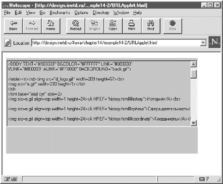

### 示例 14-2. 使用 `ContentHandlerFactory` 的 applet

```java
import java.applet.*;
import java.net.*;
import java.awt.*;
import java.io.*;

import MyContentHandlerFactory;

public class URLApplet extends Applet {
    private TextArea output;
    private ContentHandlerFactory factory;

    public void init() {
        factory = new MyContentHandlerFactory();
        output = new TextArea(12, 80);
        output.setEditable(false);
        add(output);
        show();
        resize(500, 250);
    }
}
```


```java
String type = myUC.getContentType();
ContentHandler handler = factory.createContentHandler(type);
Object o = handler.getContent(myUC);
output.setText((String)o);
} catch (Exception e) {
    handleException(e);
}
}

public void stop() {
    output.setText("");
}

public void handleException(Throwable t) {
    System.out.println("CAUGHT: " + t.toString());
    t.printStackTrace();
    stop();
}
```

这个小程序的功能与示例 14-1 中的小程序非常相似，不同在于这个小程序演示了 `ContentHandlerFactory` 的用法。首先，我们定义 `URL` 资源的 MIME 类型，然后请求该类型相应的 `ContentHandler`。现在，我们的 `ContentHandlerFactory` 仅支持 `"text/*"` MIME 类型，但此后我们可以创建新的 `ContentHandler` 类并将它们添加到 `factory` 中。

在默认的 `ContentHandlerFactory` 上，Netscape Navigator 2.0 中使用的 `URLConnections` 类目前不支持任何 MIME 类型。通过在 `URL` 或 `URLConnection` 上调用 `getContent` 方法，我们极可能会得到一个 `InputStream`；这意味着 `ContentHandlerFactory` 不知道如何处理该资源。方法 `getContent` 返回的 `InputStream` 连接到资源；程序员被赋予了解接收到的字节的机会。随着时间的推移，该接口的其他实现将会出现。`ContentHandlerFactory` 为 Java API 的特定方面开启了新的机会。

## 从帮助流中尝试这些操作

现在在小程序中为 `URLConnection` 类设置 `ContentHandlerFactory` 受到限制的情况下，你可能想直接从与 `URLConnection` 关联的流中读取网络资源的数据。`URLConnection` 类提供了两个此目的的方法：`getInputStream` 和 `getOutputStream`。如果你尝试在不支持它们的 `URL` 类型上调用其中一个，将得到 `UnknownServiceException` 异常。这里是一个简单的示例：

```java
InputStream is;
OutputStream os;
try {
    is = myConnection.getInputStream();
    os = myConnection.getOutputStream();
    // 从 is 读取并写入到 os
} catch (Exception e) {
    // 处理异常 UnknownServiceException
}
```

## 设置 URLConnection 类

配置类 `URLConnection` 存在各种设置选项。

你可以更改它们的一些默认值，之后所有新的 `URLConnection` 类将获得新值作为给定设置的初始默认值。这些设置的方法描述在表 14-5 中。

### 表 14-5. `URLConnection` 类的设置

| 方法 | 描述 |
| :--- | :--- |
| `boolean getAllowUserInteraction()` | 返回用户对话框标志，显示此类型的 URL 是否允许用户对话框。`setAllowUserInteraction(boolean)` 设置用户对话框标志。 |
| `boolean getDefaultAllowUserInteraction()` | 返回用户对话框标志的默认值。`setDefaultAllowUserInteraction()` 设置默认的用户对话框标志。 |
| `boolean getUseCaches()` | 某些协议允许在本地缓存中使用资源。此方法返回一个布尔值，显示此类状态。`setUseCaches(boolean)` 设置此 `URLConnection` 的缓存设置。 |
| `boolean getDefaultUseCaches()` | 返回缓存设置的默认值。`setDefaultUseCaches(boolean)` 设置缓存设置的默认值。 |
| `String getRequestProperty(String)` | 返回给定行索引的属性。`setRequestProperty(String,String)` 分配第一行索引的第二个属性。 |
| `String getDefaultRequestProperty(String)` | 返回给定行索引的默认属性。`setDefaultRequestProperty(String,String)` 分配第一行索引的默认属性。 |
| `boolean getDoInput()` | 返回布尔值，表示给定的 `URLConnection` 是否接受输入（input）。`setDoInput(boolean)` 设置输入标志。 |
| `boolean getDoOutput()` | 返回布尔值，表示 `URLConnection` 是否支持输出数据（output）。`setDoOutput(boolean)` 设置 DoOutput 标志。 |

## 使用其他协议

我们可以扩展 `URL` 类以处理非 Sun 和 Netscape 提供的其他协议。Java API 中描述的 `URLStreamHandler` 类用于 `URL` 打开 `URLConnection` 时。`URLStreamHandler` 任务类负责进入包含此资源的计算机必要套接字并执行所需的通信协议。与 `ContentHandler` 类一样，每个协议可能都有关联的 `URLStreamHandler` 类。`URLStreamHandler` 类的方法见于表 14-6。

### 表 14-6. `URLStreamHandler` 类的方法

| 方法 | 描述 |
| :--- | :--- |
| `URLConnection openConnection(URL)` | 创建连接到 URL 的 `URLConnection`。 |
| `void parseURL(URL,String, int, int)` | 对 URL 上的给定行产生分析。与 URL 在字符串中的起始和结束索引相关。 |
| `String toExternalForm(URL)` | 返回标准字符串表示的 `URL`。 |
| `setURL(URL,String,String, int,string)` | 指定协议类型、主机、端口号、位置目录和指向 URL 的链接。 |

我们可以通过在 `URL` 上使用 `setStreamHandlerFactory` 方法来更改给定 URL 的默认 `StreamHandlerFactory`。此方法是静态的，因此可以在创建 URL 之前调用。该方法为所有顺序生成的 URL 设置默认的 `StreamHandlerFactory`。如果我们创建一个新的 `StreamHandlerFactory` ，我们将希望更改它，而且还希望它用于我们的 URL 以维护它们的链接。类似于 `ContentHandlerFactory` 接口，`StreamHandlerFactory` 接口包含单个 `createStreamHandler` 方法，该方法使用 `string` 变量参数并返回 `StreamHandler`。

该行显示 `StreamHandler` 必须遵循的协议。

虽然我们不允许在 Netscape Navigator 2.0 启动的小程序中为 URL 设置 `StreamHandlerFactory`。同样，这种限制的原因并不完全清楚，因为它阻止了程序员通过 FTP 或 HTTP-NG 等其他协议分发 Java 小程序。然而，可以使用直接的套接字编程创建一个通过其他协议通信的小程序，但你不能使用 Java API 中描述的 `url`。

你可能并不完全理解这一章的编写目的，因为在目前最流行的 浏览器 Netscape Navigator 2.0 中运行 Java applet 时，大多数 `URL` 类的功能是不被允许或支持的。`URL` 类的意义在于，它们允许你在一个类中存储与特定资源通信所需的所有信息。它们创建所有的套接字，并执行通过 `HTTP` 检索资源所需的链接和标头解析。随着 `ContentHandler` 类的出现，它们可以将更复杂的资源（如视频文件或数据库文件）翻译成 Java 对象，资源搜索 URL 的易性使得使用 URL 比独立解码字节流要高效得多。也许 Netscape 最终会允许 applet 指定自己的线程和内容处理驱动程序。否则，显然将在完善支持 Java 程序的 Netscape Navigator 中，向默认的 `ContentHandler` 添加新的新的驱动程序。

# 接下来做什么？

在这一章中，我们描述了在使用网络资源进行编程时如何以及为何使用 URL。Java 中 `URL` 最常用的用途之一就是通过 `CGI` 与程序建立连接。

下一章将大幅偏离 applet。除了讨论用 Java 编写服务器外，我们还将考虑可能出现的一些问题。在 Java applet 内部使用 `CGI` 程序具有许多优点——例如，与现有接口的兼容性，以及开发的速度和简单性。然而，`CGI` 有许多局限性；最明显的是它的不稳定性。我们将向你展示如何在 Java 中编写更强大的服务器，以及如何建议甚至编写非常困难的 `CGI` 程序。

## 第 15 章


### 在 Java 上开发服务器

* 创建你自己的服务器和协议
* 定义服务器任务
* 定义客户端-服务器交互
* 构建 Java 服务器
* 与套接字通信以及处理 I/O own 流
* 处理多个连接以及多个用户 applet
* 构建客户端通信

到目前为止，书的这一部分的重点是在 applet 范式中编写网络客户端。现在，我们将向后退一小步，观察更广泛的话题，包括从万维网的角度来看系统客户端-服务器。

当需要集中化服务时（例如在监控数据或分发数据时），就有必要编写独立的服务器。其他的应用程序服务器可能由严格控制安全和使用的数据组成。

例如，在本章提出的通信程序中，服务器可以用于创建仅限选定用户访问的限制，并为用户之间的私有通信设置权限。

在本章中，我们将完成以下工作：

* 我们实现协议。
* 我们在动态系统客户端-服务器中构建数据流方案。
* 我们构建用 Java 编写的服务器来实现我们的协议。
* 我们构建基于我们协议的客户端。

我们决定创建一个特殊的协议，用于在两个或更多人之间进行异步会议。换句话说，我们要创建一个聊天（通信）协议。我们将我们的通信协议称为 Internet turbo Chat，或 ITC。


> **建议** 本章中作为示例的代码段包含在随书附带的 CD-ROM 中。该光盘可供使用 Windows 95/NT 或 Macintosh 的读者；UNIX 用户应参考在线 Web 伴侣页面，该页面包含了本书的配套材料（地址 [`www.vmedia.com/java.html`](http://www.vmedia.com/java.html)）。


# 创建自己的服务器和协议

让我们从创建协议草图开始。在设计协议时应尽量灵活性，以便以后可以添加新功能；同时，一切都定义得足够严谨以容错。首先，我们想要执行以下层级的功能：

* 用户任务命名；
* 异步网络操作；
* 指定新连接；
* 创建服务器窗口，列出连接中的用户。

“登录”过程中的需求是显而易见的：在获取系统通信访问权限之前，用户必须输入他们的名称。然后我们可以向服务器发送该用户的输入消息，而在这一端我们不需要在后台通过检查代码来更改它们。

让我们使用简化的方法：限制在网络上传输的数据行。`DataInputStream` 和 `PrintStream` 类上的 `readln` 和 `println` 方法提供了一种无需编码/解码即可传输数据的良好方法。

我们使用的协议非常简单。它执行初始处理。在客户端和服务器上执行 `query (transaction) username`，然后为所有连接到服务器的其他客户端显示客户端消息。服务器只处理客户端输入的第一个内容，即他的用户名。从客户端发送到服务器的消息格式如下：这样服务器就不必解析它。这减少了延迟并提高了性能。

## 定义服务器任务

如上所述，特殊函数通常需要专门的服务器。在案例中，我们需要执行几项特殊任务——并在服务器上监控链接。我们可以通过让每个客户端也充当简单的服务器来进一步复杂通信程序，以便实现两个程序之间的通信。但由于我们想要与两个以上的客户端通信，这种复杂性是不必要的。

此外，通信客户端应该越小越好，因为每个用户每次访问页面时都会随着 Web 页面加载。为了做到这一点，我们可以赋予通信服务器额外的功能，这些功能可以由服务器执行，也可以由客户端执行，例如分析输入和周末数据。

此外，我们还应该考虑服务器启动时产生的负载——如果服务器很慢，服务器将缓慢地完成其功能。

## 定义客户端-服务器交互

当需要同步更新信息时，协调是具有多个客户端的服务器的一个重要任务。例如，你想更新所有连接到服务器的客户端，向它们传递某些特殊数据或命令，你应该让他们的服务器容错，以便它在尝试传递网络数据时不会挂起。

在我们的通信程序中，所有客户端必须同时从服务器接收数据，这样同一个用户提交的多个字符串在其他用户看到它们时是在一起的。我们将用一个独立的线程来实现，处理到客户端的输出数据。在这种情况下，独立线程可以自由地向所有连接的客户端发送数据，而不会受限于任何然后某个特定的输入。由于我们每个线程只执行一次操作，即写入客户端数据，我们可以确定客户将在最相同的时间接收数据。为了更好地协调这种交互，我们必须考虑与时间、复杂性和服务器速度相关的问题

### 分发时间

我们已经讨论过同时向客户端端口写入数据的必要性。虽然在目前无法完全实现这一点，但我们的任务是减少向所有客户端写入数据所需的时间，以便让他们产生“数据是同时传输”的印象。我们用于向已连接客户端写入数据的自由运行流可以赋予比从每个客户端读取数据的流更高的优先级。我们可以等待写入流完成，然后开始从已连接的客户端读取数据。另一个需要记在脑中的临时方面与从客户端到服务器的数据转发继有关。

### 连接结构

多个连接的事实使得我们的通信服务器比最初看起来要困难得多。首先，我们需要注意几点——首先是每个连接的状态。如果用户在没有通知服务器的情况下中断了通信客户端，我们将收到一个延迟的连接，这会导致功能运行异常。写入线程可能会尝试向不存在的连接写入数据，而我们将继续尝试从服务器该连接读取数据。解决这个问题的办法有两个：当对已断开的连接进行操作时——抛出异常并终止连接；此外，定期对连接进行检查以进行预防性清理。这种检查和异常处理可以释放宝贵的系统资源。在我们的示例中，预防性连接检查是由 `ConnectionWatcher` 类执行的。它也运行在自己的流中，这样它就可以执行其职责而不延迟其他函数的执行。

我们需要能够从已连接的客户端读取内容，而不丢失从其他链接读取的能力。如果我们使用循环简单的对每个已连接的客户端顺序执行 `readln`，我们可能会导致这样的结果：我们将等待一个不再与通信客户端交互的用户，他只是留下了程序运行并去吃饭了。要解决这个问题，你需要让整个服务器变为异步化——即为每个连接创建一个读取线程。同时，单个线程可以根据需要无限等待用户输入消息，而不会挂起服务器。当用户输入消息时，我们只需将其传递给 `entry`（然后在它自己的流中处理），然后消息将记录到每个客户端。

读取线程可以立即恢复读取用户发送的另一个消息。由于每个连接都有自己的读取线程，我们不需要等待每个单独的链接完成数据读取，因此服务器变得是真正的异步了。然而，必须注意在尝试使用另一个流时不要引用被拆分的写入流和 `ConnectionWatcher`。在块程序中，对于那些可能尝试实现多次访问的块，我们使用了同步描述。

如上所述，`ServerWrite` 线程向所有链接输出内容。为了“唤醒” `ServerWriter`，使用了 `notify` 调用。当 `ServerWriter` 恢复执行时，它会检查定义的变量中是否有要发送给已连接客户端的数据。为了保持数据并避免在两个读取线程进行 `push` 调用时发生交叉，使用了先进先出（FIFO）数据结构。`FIFO` 类将在第 17 章“与 CGI 交互：Java 存储”中进行详细考虑。

如果我们要解析输入和输出数据，我们需要一个额外的线程，其任务是处理来自其他线程的请求、对其进行分析并转发数据。这增加了复杂性，因为这意味着我们可能为每个连接都需要这样一个额外的流。在我们的通信服务器中，我们不进行数据分析。

### 工作速度

由于我们必须为每个连接创建一个线程，给服务器的线程数量可能会很大。在许多线程争抢两个持续存在的线程 `ServerWriter` 和 `ConnectionWatcher` 的情况下，出现了服务器运行多快的问题。如果我们预期的会有大量连接，这一点就不能忽略。我们应该在考虑其活跃使用的情况下，尽可能简化我们的这两个类。此外，如果预计会有大量客户进行通信，我们可能希望将服务器翻倍以分担负载。那时你必须处理多个服务器以及通过它们之间的数据传递，这超出了本章的范围。

# Java 构建服务器


在这里我们实现了上一节描述的协议。让我们从通信服务器的细节讨论开始，并以相应客户端通信的简要描述结束。图 15-1 所示的通信服务器与像 Java 应用程序启动的 applet 不同。applet 范式在本章的示例中作用不大，因为我们希望服务器有一个固定的位置，并且对它从哪里接收通信有最少的限制。注意，通信服务器完全包含在一个类中——`chatserver`。唯一的例外是我们要导入的 `FIFO` 类。

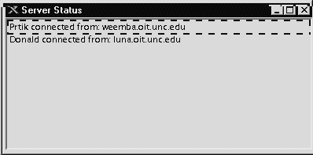

#### 图 15.1

为了提高服务器的结构和性能，我们将广泛使用多线程属性。我们将为每个已连接的客户端创建一个单独线程，并启动其他三个线程：一个向每个已连接的客户写入数据的 `ServerWriter` 线程；一个基础流 `chatserver`，用于监听当新客户端尝试与服务器建立连接时的情况；以及一个用于清理连接的 `ConnectionWatcher` 线程。正如我们在“关系”部分讨论的那样，我们可能需要更多额外的线程，不要害怕使用它们！线程使得管理数据流和执行复杂交互变得容易，这在考虑程序文本时将会看到。确实，流为整个系统消息增加了额外的头部（开销），但通常，当连接数不是很大时，流消耗资源。

注意，通信服务器程序中有大量的 `try` 和 `catch` 语句。为了使程序对错误更有抵抗力，充分利用异常处理的可能性很重要。例如，在启动连接过程中，我们执行异常处理。在更复杂的服务器中，异常对于通用函数的起着非常重要的作用。即使在发生概率较低的情况下，也应该产生异常处理。此外，异常可以用于清理、释放系统资源、调试以及对服务器通过流的严格控制。

基础类是 `chatserver`，它是 `Thread` 的扩展。基础类实现了如何流，是因为我们必须运行监听套接字且不会停止其他操作。此线程为每个连接创建自己的线程，并传递再次创建的客户端套接字。

### 示例 15-1a. 服务器通信程序

```java
import java.awt.*;
import java.net.*;
import java.io.*;
import java.util.*;
import FIFO;

public class chatserver extends Thread {

    public final int DEFAULT_PORT = 6001;
    protected int port;

    protected ServerSocket server_port;
    protected ThreadGroup CurrentConnections;
    protected List connection_list;

    protected Vector connections;
    protected ConnectionWatcher watcher;
    protected ServerWriter writer;
}
```

```java
// 如果发生异常，通过错误消息退出
public static void fail(Exception e, String msg) {
    System.err.println(msg + ": " + e);
    System.exit(1);
}

// 我们为监听连接创建 ServerSocket。
// 启动流程。
public chatserver(int port) {
    // 调用此流程
    super("server");
    if (port == 0) port = DEFAULT_PORT;
    this.port = port;
    try {
        server_port = new ServerSocket(port);
    } catch (IOException e) {
        fail(e, "创建 server socket 时发生异常");
    }

    // 为当前连接创建线程组
    CurrentConnections = new ThreadGroup("Server Connections");

    // 用于表示当前连接的 Frame
    Frame f = new Frame("Server Status");
    connection_list = new List();
    f.add("Center", connection_list);
    f.resize(400, 200);
    f.show();

    // 用于存储当前连接的 vector
    connections = new Vector();

    // 我们创建 ConnectionWatcher 流程，
    // 它等待其他流的阻塞状态。
    // 它会自动启动。
    writer = new ServerWriter(this);
    watcher = new ConnectionWatcher(this, writer);

    // 服务器开始监听连接
    this.start();
}

public void run() {
    try {
        while (true) {
            Socket client_socket = server_port.accept();
            Connection c = new Connection(client_socket, CurrentConnections, 3, watcher, writer);
            // 避免并发访问
            synchronized (connections) {
                connections.addElement(c);
                connection_list.addItem(c.getInfo());
            }
        }
    } catch (IOException e) {
        fail(e, "监听连接时发生异常");
    }
}

// 启动服务器，监听特定端口
public static void main(String[] args) {
    int port = 0;
    if (args.length == 1) {
        try {
            port = Integer.parseInt(args[0]);
        } catch (NumberFormatException e) {
            port = 0;
        }
    }
    new chatserver(port);
}
```

此时，我们的服务器已经启动，并在端口 6001 上监听新连接。对于每个新连接，服务器会创建一个名为 `connections` 的流程，并向其传输相关参数。我们将新流程添加到 vector 中，该向量包含所有现有连接的流。

该 vector 稍后用于检查链接状态。`ServerWriter` 也使用它向已连接的客户端写入数据。新连接被添加到 `frame` 中显示的列表中。

### 来自帮助套接字的通信与来自流 I/O 的任务

`Connection` 类是负责与客户端进行所有初始化操作的线程。该类将输出流驱动程序传递给 `ServerWriter` 类，因为我们意图让此流写入已连接客户端的数据。`Connection` 类通过附加相应的输入输出组件 `socket` 来初始化输入和输出流。此外，由于该线程是专门为此连接开始工作的线程，我们在该方法中获取初始用户名。我们通过 `getInfo` 方法将用户名传递给 `chatserver` 类。

### 示例 15-1b. 程序服务器通信

```java
class Connection extends Thread {
    static int numberOfConnections = 0;
    protected Socket client;
    protected ConnectionWatcher watcher;
    protected DataInputStream in;
    protected PrintStream out;
    protected ServerWriter writer;

    public Connection(Socket client_socket, ThreadGroup CurrentConnections, int priority, ConnectionWatcher watcher, ServerWriter writer) {
        // 分配流程名和房间组
        super(CurrentConnections, "Connection number" + numberOfConnections++);
        this.setPriority(priority);
        // 请求优先级流
        // 参数本地化
        client = client_socket;
        this.watcher = watcher;
        this.writer = writer;
        try {
            in = new DataInputStream(client.getInputStream());
            out = new PrintStream(client.getOutputStream());
            writer.OutputStreams.addElement(out);
        }
        // 我们将流数据合并到输入和周末流数据
        // socket client 并将输出流添加到 vector，该向量包含所有
        // 周末流数据，它使用了记录流程。
        catch (IOException e) {
            try {
                client.close();
            } catch (IOException e2) {}
            System.err.println("获取套接字流时发生异常: " + e);
            return;
        }
        // 在性能上启动流程
        this.start();
    }

    // method run 执行读取行的循环，直到
    // 由于连接断开而停止工作
    public void run() {
        String inline;
        out.println("Welcome to Internet Turbo chat");
        // 向客户端发送邀请
        try {
            // 在连接未断开之前执行循环
            while (true) {
                // 读取行
                inline = in.readLine();
                if (inline == null) break;
                // 如果为空 - 连接断开
                writer.outdata.push(inline);
                // 保存字符串用于记录流程
                synchronized (writer) {
                    writer.notify();
                }
                // 并调用记录流程。注意 synchronized() 应用于 Togo，
                // 是为了防止两个连接同时调用记录流程，
                // 这会导致自身形式的阻塞。
            }
        } catch (IOException e) {}

        // 当连接被中断时，我们产生清理并调用 watcher，
        // 将连接从现有连接 vector 和列表中移除。
        // watcher，除了 Togo，清理输出流。
        finally {
            try {
                client.close();
            } catch (IOException e2) {}
            synchronized (watcher) {
                watcher.notify();
            }
        }
    }

    public String getInfo() {
        String inline = "";
        try {
            inline = in.readLine();
        } catch (IOException e) {
            System.out.println("捕捉异常:" + e);
        }
        // ... (逻辑继续)
        return (inline + " connected from: " + client.getHostName());
    }
}
```

```java
class ServerWriter extends Thread {
    chatserver server;
    public Vector OutputStreams;
    public FIFO outdata;
    private String outputline;

    // 处理 OutputStreams 和 outdata
    // 确保功能工作的通用；这允许直接访问
    // 分别添加或清理输出流或数据消息。
    public ServerWriter(chatserver s) {
        super("Server writer");
        // 将此流程放入父线程组并给它命名
        server = s;
        OutputStreams = new Vector();
        outdata = new FIFO();
        this.start();
    }

    public synchronized void run() {
        while (true) {
            // 流进入无限循环，但它本身只有在
            // 从帮助通知中再次给出条件预期时才会开始执行。
            // 同样，我们在同步块中执行此操作，以锁定流并防止多次访问。
            try {
                this.wait();
            } catch (InterruptedException e) {
                System.out.println("捕获到 Inter 异常");
            }
            outputline = outdata.pop();
            // 我们在顶部的 FIFO outdata 中获取消息，通知方法必须在那里添加消息。
            synchronized (server.connections) {
                // 我们仍然应该锁定流观察者，
                // 以免在程序工作完成之前尝试任何操作。
                for (int i = 0; i < OutputStreams.size(); i++) {
                    PrintStream out;
                    out = (PrintStream) OutputStreams.elementAt(i);
                    out.println(outputline);
                    // 对输出流进行迭代并在每个输出流中打印消息。
                }
            }
        }
    }
}
```

父类承担了大量工作，每当有新客户端发送消息时它都会运行。此外，它还锁定了 `ConnectionWatcher` 线程：这样做是为了确保在工作结束之前的输出数据流不会从 `ServerWriter` 的向量 `OutputStreams` 中移除。当连接中断流时，`ConnectionWatcher` 会更改 `ServerWriter` 的向量 `OutputStreams`。

### 示例 15-1d. 服务器通信


```java
class ConnectionWatcher extends Thread {
    protected chatserver;
    protected ServerWriter writer;

    protected ConnectionWatcher(chatserver s, ServerWriter writer) {
        super(s.CurrentConnections, "ConnectionWatcher");
        // 将流放入父线程组并给它命名
        server = s;
        writer = writer;
        this.start();
    }

    // 此方法等待关于现有流的通知并清理列表。
    // 此方法是同步的，因此启动时它会锁定一个对象。
    // 这是必要的，以便方法可以在 this 上调用 wait()。
    // 即使对象的连接永远不会调用 notify()，此方法也会每五秒运行一次，
    // 并检查任何发生变化的所有连接。
    // 注意，对向量 vector 以及组件 GUI 的整个访问
    // 列表 server
    // 都在同步块内部产生。这保护了类
    // 防止添加新的通信，直到我们移除旧连接。
    public synchronized void run() {
        // 我们锁定此流，当它开始时，
        // 以防止多次访问。
        while (true) {
            // 流进入无限循环
            try {
                this.wait(10000);
                // 流每二十秒“启动”一次，清除可能不存在的连接。
            } catch (InterruptedException e) {
                System.out.println("捕获到 Inter 异常");
            }
            synchronized (server.connections) {
                // 我们遍历每个连接。
                for (int i = 0; i < server.connections.size(); i++) {
                    connection c;
                    c = (Connection)server.connections.elementAt(i);
                    if (!c.isAlive()) {
                        // 如果连接不再存在，从 Vector 中移除它。
                        server.connections.removeElementAt(i);
                        writer.outdata.push(server.connection_list.getItem(i) + " has left chat\n");
                        synchronized (writer)
                            writer.notify();
                        // 我们告诉其他客户端，用户退出了。
                        server.connection_list.delItem(i);
                        // 最后，从 server connections 列表中移除它。
                        i--;
                        // 我们应该减少计数器，因为
                        // 我们只在单元上减少了向量 connections。
                    }
                }
            }
        }
    }
}
```

到此，我们完成了服务器程序的编写。利用 Java API 中包含的各种类，我们创建了一个完全容错的多线程服务器。你可以使用聊天客户端 `http://www.vmedia.com/onlcomp/java/chapter15/ChatClient.html` 查看此服务器的运行。现在让我们转向客户端通信。

### 构建客户端通信

客户端 applet 包含窗口中（图 15-2）。在创建它时，我们也将使用多线程来实现异步通信。applet 连接到主机的端口 6001；客户端的结果是真正的异步的，因为用户在屏幕上出现新消息的同时可以输入自己的消息。

```java
import java.io.*;
import java.net.*;
import java.awt.*;

public class chatclient extends Applet {
    static final int DEFAULT_PORT = 6001;
    Socket socket;
    Thread reader, writer;
    TextArea OutputArea;
    TextField InputArea;
    PrintStream out;
    String Name;
    UserInfoFrame NameFrame;

    public void init() {
        OutputArea = new TextArea(20, 45);
        InputArea = new TextField(45);
        NameFrame = new UserInfoFrame(this);
        resize(400, 400);
        try {
            socket = new Socket(getHost(), DEFAULT_PORT);
            reader = new Reader(this, OutputArea);
            out = new PrintStream(socket.getOutputStream());
            reader.start();
        } catch (IOException e) {
            System.err.println(e);
        }
    }

    public boolean handleEvent(Event evt) {
        if (evt.target == InputArea) {
            char c = (char)evt.key;
            if (c == '\n') {
                // 我们等待用户按下回车。
                // 发送消息，但为其加上发送者的名字。
                String line = InputArea.getText();
                out.println(Name + "> " + line);
                InputArea.setText("");
                return true;
            }
        } else if (evt.target == NameFrame) {
            // 引入名称 applet。
            // 我们应该将此名字发送到服务器，请求列表。
            Name = (String)evt.arg;
            out.println(Name);
            return true;
        }
        return false;
    }
}

// reading 方法从 socket 读取输入数据
// 并用新消息更新 OutputArea。
class reader extends Thread {
    protected chatclient client;
    private TextArea OutputArea;

    public Reader(chatclient c, TextArea outputArea) {
        super("chatclient Reader");
        this.client = c;
        this.OutputArea = outputArea;
    }

    public void run() {
        DataInputStream in = null;
        String line;
        try {
            in = new DataInputStream(client.socket.getInputStream());
            while (true) {
                // 无限循环
                // 连接终止时循环终止。
                line = in.readLine();
                if (line == null) {
                    OutputArea.setText("Server closed");
                    break;
                }
                outputArea.appendText(line + "\n");
                // 将新消息添加到输出区域
            }
        } catch (IOException e) {
            System.out.println("Reader: " + e);
        } finally {
            try {
                if (in != null)
                    in.close();
            } catch (IOException e) {}
            System.exit(0);
        }
    }
}

// 此类框，我们需要接收用户名字。
class UserInfoFrame extends Frame {
    public TextField UserNameField;
    public Applet parent;

    public UserInfoFrame(Applet parent) {
        UserNameField = new TextField(10);
        this.parent = parent;
    }
}
```

```java
add("northern", new Label("Please enter your name and hit ENTER")); add("South", UserNameField);
resize(300, one hundred); show();

}

// We transfer introduced name in form developments, sent parent applet. 
public boolean keyDown(event evt, int key)
{
    char c = (char)key;
    if (c == '\n')
    {
        Event.ACTION_EVENT,
        UserNameField.getText());
        event NewEvent = new event(this,
        parent.postEvent(NewEvent);
        // generate event on the parental applet own        dispose();
        // now destroy frame
        return true;
    }
    else {
        return false;
    }
} // action
}
```

# 接下来做什么？

你已经收到了完整的主菜，现在准备好享受甜点吧！我们用通用术语概述并讨论了创建游戏 applet 的重要主题、构建具有完整属性的客户端-服务器，以及几乎所有的中间主题。在第五部分中，我们提供了使用书中描述的构建原理、技术和工具的四个教育性 applet。祝你获得乐趣！

## 第 16 章


交互式动画：广告 applet

### 合约计划工作

### 创建图像结构布局结构图像

### 实现

### 机会配置

### 屏幕输出的基本类 创建器

### 创建 ActionArea

### 可能的改进

# 你从这一章中学到了什么

在这里我们将创建一个高层交互式动画 applet。创建动画和交互性本身是一个简单的任务，但我们希望编写一个让 Web 设计师在不会 Java 编程的情况下也能轻松使用的 applet。首先考虑一下，我们需要哪些知识：

* 使用 `URL` 类访问文件配置。
* 使用 `class` 类动态加载远程类。
* 用于扩展机会配置的创建接口。
* 从帮助媒体跟踪器跟踪图像。
* 应用双双缓冲以消除屏幕闪烁。
* 分发鼠标事件。

# 合约

想象一下，一家在线广告代理公司通过帮助 applet 使其网页多样化。特别是它对 Java 语言提供的交互式动画感兴趣，你被要求创建一个 applet，能够根据一系列图片创建动画并与用户交互。例如，用户应该能够点击或将鼠标移动到图片的某些部分以加载新页面或更改动画。同时，由于代理员工无法自己编程，因此需要一个高层级的 applet，在其中设置更改组成动画的图片的能力，并模拟 applet 对用户操作的反应。

因此，我们的 applet 面向两类观众——查看 applet 的 Web 用户，以及将其用于他们目标的 Web 设计师。

然而，在深入编程之前，让我们看看如何利用我们已知的知识来实现所需目标。之后，让我们构建并实现高层 applet。

# 属性

我们知道我们的 applet 将有两个观众——来自广告公司的 Web 用户和 Web 设计师。让我们思考 applet 应该具备哪些属性来满足第一类受众的需求。

applet 的目的是在广告消息发送给 Web 用户时让网页变得活跃。我们的 applet 是消息载体，因此我们需要确保 applet 作为这样一个工具能够正常工作。我们遇到的第一个困难是 applet 必须通过网络下载并运行。因为他只是网页的一个元素，人们可能不想等到它出现在你面前。如果下载花费时间过长，用户可能在甚至不知道 applet 存在之前就离开了页面。这个问题对于像我们这样的 applet 来说尤为突出，因为它必须加载很多图片，而在互联网上传输图片需要时间。这就是为什么必须让 applet 立即启动，甚至在如何加载图像之前。

此外，我们需要确保图像的动画是平滑的。这通过第 5 章“工作中的 Applet”中描述的双缓冲帮助技术来实现。

关于如何实现快速加载、平滑动画和易用界面的问题涉及到 applet 作为消息传输工具的功能技术方面。现在我们需要考虑如何让 Web 设计师显示消息变得更简单。我们无法影响 Web 设计师对 applet 图形的选择，但我们可以采取这种方法，让图像在 applet 中更容易构建。

`PARAM` `APPLET` `URL`

# 计划工作

好了，我们已经讨论了与未来的 applet 相关的问题，让我们思考解决方案。从外部和内部两个角度审视我们的 applet。外部 applet——是用户看到的部分，而内部——是 Web 设计师用来构建 applet 的部分。外部是逻辑起点点，因为只有在创建东西时，才会考虑它的形成。

## 创建图像结构

我们已经知道如何处理图像的主要元素，知道如何让图片动画以及与鼠标交互。基本上，我们所做的一切都由这两个元素组成。当我们移动鼠标或点击图片时，我们会查看为给定图像描述的区域，如果鼠标在其中一个内部，则执行相应的的操作。

下一个任务将是在定义的区域内，对移动或点击鼠标设置设置正确的响应。一种解决方案是在 `mouseMove` 和 `mouseDown` 方法中创建一系列 `if-then-else` 语句。我们可以在配置 applet 时，将来自 `regions` 的每一个项目以及相关的 `action` 加载到 `hash table` 中，并在每个 `mouse` 动作时查看该表。我们假设仅使用 `Polygon` 类进行区域描述，并将它们都放在一个名为 `areasTable` 的哈希表中。然后，`mouseDown` 方法可以如下所示管理点击 `mice` 区域：


```java
public boolean mouseDown(Event evt, int x, int y) { 
    Enumeration e = areasTable.keys();
    while (e.hasMoreElements()) {
        Polygon p = e.getNextElement();
        if (p.inside(x, y)) {
            String S = (String) areasTable.get(p);
            if (S.equals("sound action")) {
                // 发布声音
            }
            if (s.equals("link action")) {
                // 连接到页面
            }
            if (s.equals("redirect action")) {
                // 改变动画
            }
            // ...以及 T 等，适用于所有类型的区域
        }
    }
    return true;
}
```

在我们的示例中，存在几个可以避免的性能问题。然而，通过提高程序的效率，我们可以缩小它的范围。如果我们使用表查找方法，那么每当出现一种新类型的动作时，都必须修改程序。与其如此，我们可以为热点（hotspots）创建一个基类。这样，我们的 applet 只需要告诉热点它应该做什么，`mouseDown` 方法也将变得简单得多。由于我们不再需要哈希表，我们将 `actionAreas` 存储在一个名为向量 `aAreas` 中：

```java
public boolean mouseDown(Event evt, int x, int y) { 
    Enumeration e = aAreas.elements();
    while (e.hasMoreElements()) {
        actionArea A = e.nextElement();
        if (A.inside(x, y)) {
            A.doAction();
        }
    }
}
```

现在，我们不需要在每次创建活动区域时都重写 applet。此外，`mouseDown` 方法也清晰得多。但如果我们想创建两个同步动画或为 applet 增加额外功能呢？问题在于我们将所有函数都直接放在了内部 applet 方法中。

更好的做法是创建一个 `component`，然后可以将其放置在 applet 中。由于 `Applet` 类是 `Container` 类的子类，它将自动将其事件分发给它包含的组件。事实上，在 `component` 内部执行工作将有助于交互式动画与任何 applet 的交换。这与使用 `Scrollbar` 或 `Component` 类的其他子类是一样的。但我们在哪里创建子类呢？直接子类 `Component` 类是可能的，但最好让我们子类 `Canvas`。`Canvas` 类将使布局图片变得更容易，如果我们希望图形能够移动，这一点很重要。让我们这个 `Canvas` 类的子类命名为 `actionImageCanvas`。

所以，我们需要几个类。我们确实有一个 `Applet` 类的子类，但从现在起它将起非常很小的作用——它只包含 `actionImageCanvas`。此外，我们还有 `actionArea` 类的子类。值得将 `actionArea` 子类直接放在 `actionImageCanvas` 中吗？为了做到这一点，你必须直接将 `Images` 传输到绘图表面，但如果我们某天想在客户端侧对图像进行创建或更改，这可能会变得不方便。

相反，让我们创建一个 `actionImage` 类，它将显示自己并跟踪 `actionArea`。结果是，我们将为前端创建一个层次结构，如图 16-1 所示。注意，这种层次结构不是继承意义上的层次结构，而是在 `Togo` 即我们结构化显示方面。这种层次结构投资更快。

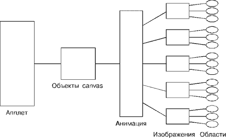

### 图 16.1

现在让我们看看动画是如何构建到我们的方案中的。动画的概念与其他任何动画相同，只是我们不仅是在显示图片，还必须激活特定的 `actionImage` 对象。这里唯一的问题在于规模，即我们的层次结构必须运行并支持什么样的工作流。我们可以安全地排除 `Applet` applet 子类的考虑——`actionImageCanvas` 的整个重点是将项目与 applet 分离。从 `actionImageCanvas` 启动线程，如果我们以后想在同一个工作区内运行多个动画，将会产生复杂性。因此，剩下的就是指导 `actionImage` 类表的启动。图 16-1 显示了分配给我们系统各个类的哪些函数。

**表 16-1. 功能类**

| 类 | 功能 |
| :--- | :--- |
| applet | 广播开发类 `actionImageCanvas`。 |
| actionImageCanvas | 为 `actionImage` 类创建绘图表面。检查多个动画的范围和冲突。发送事件 `actionImage` 类。 |
| actionImage | 启动动画。交换。发送事件 `actionArea`。 |
| actionArea | 执行。 |

### 布局图片

### 动态配置

重点包括规模，读取行，这让网页设计师在配置文件中读取，并使用它来创建我们基类的子类。我们希望以这种方式实现最高级别的配置机会。如果我们随后创建了子类 `ActionImageCanvas` 并为其添加了新功能，我希望网页设计师只需要通过学习几个需要在配置中设置的新参数就能利用这些功能。同时，我们需要尽可能防止网页设计师接触程序的内部复杂性。毕竟，这很大程度上是我们程序员的职责。

如上所述，我们的系统将使用一种非常简单的编程语言来工作。首先，让我们考虑系统对这种语言提出的要求。我们需要能够确定 Web 设计师需要哪种类，但不要忘记，仅仅实例化一个类并不能让它变得可用运行。我们还需要一种方法向 `instance` 添加额外信息。例如，我们的 `actionArea` 类需要知道它们在图像中的位置。此外，`actionArea` 类的每个子类必须包含关于其自身 `action` 的信息。例如，`linkArea` 类应该知道从哪个 `page` 建立连接。因此，我们的语言必须能够向对象传递任意数量的配置信息。

此外，我们必须确保正在将信息传递给正确的对象。一个动画帧可能包含多个 `linkArea` 类，我们需要确保配置信息不会将一帧的 `linkArea` 类与另一帧的 `linkArea` 类相混淆。因此，我们必须能够区分配置信息，以便它们命中正确的位置。

同时，这种语言应该是简洁的。我们知道 Web 设计师熟悉 HTML，并且紧跟其不断涌现的扩展。因此，可以基于类似 html 的这种难度来创建语言，或者在质量模型中使用 HTML。

让我们尝试创建一个类似于 HTML 的配置语言。我们想描述具有两个图片的交互式动画。第一张图片将包含两个 `ShowDocArea` 类，但第二张将包含 `ShowDocArea` 和 `soundArea`：

```xml
<ActionImage=ActionImage> image=someImage.gif next=1

<ShowDocArea=ShowDocArea> [doc=http://www.vmedia.com](http://www.vmedia.com/) area=0.0;10.0;10.10;0.10
</ShowDocArea>

<ShowDocArea=ShowDocArea> [doc=http://www.vmedia.com/java](http://www.vmedia.com/java) area=10.10;10.20;20.20;20.10
</ShowDocArea>

</ActionImage>

<ActionImage=ActionImage> image=someOtherImage.gif next=0

<ShowDocArea=ShowDocArea> [doc=http://www.vmedia.com/java](http://www.vmedia.com/java) area=0.0;10.0;10.10;0.10
</ShowDocArea>

<SoundArea=SoundArea> sound=someSound.au area=10.10;10.20;20.20;20.10
</SoundArea>

</ActionImage>
```

通过借用 HTML 语言的风格，我们可以创建一个满足我们要求的任何具有 Web 页面制作经验的人都能理解的简单语言。仍然有几个问题需要解决。首先，你无法在一个 `ActionImageCanvas` 内部执行多个动画。这个问题可以通过在更高层级添加 `Animation` 标签来解决：

```xml
<ActionImageAnimation=ActionImageAnimation>
tags ActionImageAnimation...
</ActionImageAnimation>

<ActionImageAnimation=ActionImageAnimation>
tags ActionImageAnimation...
</ActionImageAnimation>
```

现在我们知道文本包含的标签指的是不同的动画。为了确定工作空间的大小并允许对 `ActionImageCanvas` 进行子类化以添加额外功能，你可以应用相同的策略。这允许在帧中默认设置某些描述类型，并在工作区域的标签中使用它们。最后，语言将在实现类的配置中定型。

目前，我们可以相当自由地描述这种语言，如下所示。不要忘记动画下方层级的每个标签可能出现若干次：

```xml
<ActionImageCanvas=subclass name> options=values
<ActionImageAnimation=subclass name> options=values
<ActionImage=subclass name> options=values
<ActionArea=name subclass>
</ActionArea>
</ActionImage>
</ActionImageAnimation>
</ActionImageCanvas>
```

为 Web 设计师构建语言后，我们应该解决 `Configure` 类在启动 applet 时如何运行。在这种情况下，我们需要接口。我们可以使用一个名为 `Configurable` 的接口。我们的 `Configure` 类将能够传递引起的方法，在 `configurable` 接口中特定的，这在界面上是如何显示的。16-2。

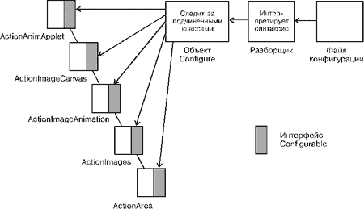

# 实现

#### 图 16.2

完成设计后，我们可以开始编写程序了。从哪里开始？可以写 applet，实现所需的动画，然后修改我们的项目。但如果你考虑为了让我们的系统工作必须有多少不同的系统相互交互，发现最好的方法是从单独编写每个模块开始。这意味着在程序真正运行之前需要更多时间，但当它开始工作时，我们会发现自己更接近交付目标。

### 配置机会

首先，我们需要 `Configurable` 接口来安装系统。必须将我们层次结构中的模块连接到更高级别的模块。众，当模块连接时，它需要传递配置信息。如果能让模块知道配置何时完成就好了。模块就可以检查它是否有足够的信息来开始运行。结果我们为接口 `configurable` 提供了三个方法：

```java
Interface Configurable {
    public void attachObject(Object o) throws Exception;
    public boolean setParent(Configurable parent);
    public void configureObject(String params, String value);
}
```

注意 `attachObject` 方法对应对象；这意味着 `Configure` 实现了该类，然后将其传递给连接的对象。我们赋予了最后两个方法抛出异常的能力，但正如第 10 章讨论的，不给这些异常描述性的名称是一个坏主意。所以让我们请求随 `configurable` 接口的异常。顶级异常可以命名为 `ConfigurableException`，以便我们知道在哪里产生的。现在我们看看最近两个方法是否正常：


#### 图 16.3

现在我们可以完成 `Configurable` 接口的编程，以此完成项目的第一个真实程序。由于它是特定的，将其放入 `ventana.util` 包中：

```java
package ventana.util;
public interface Configurable {
    public void attachObject(Object o) throws configurationAttachmentException;
    public void setParent(Object o);
    public void configureObject(String params, String value) throws ConfigurationInvalidParameterException, ConfigurationInvalidValueException;
    public void completeConfiguration() throws ConfigurationFailedException;
}
```

下一步是创建一个基类 `Configure`。我们之后可能需要它，所以写一个对应 `Configurable` 接口的通用类，并将其放在 `ventana.util`。为了保持该类的通用，将在特殊类 `ConfigFileParser` 中分析我们的语言：

```java
package ventana.util;
import java.util.*;
public class Configure {
    private ConfFileParser parser;
    private Stack Configurables;
    private Configurable original;

    public Configure(ConfigFileParser cfp, Configurable startObject) {
        parser = cfp;
        parser.setConfigure(this);
        Configurables = new Stack();
        Configurables.push(startObject);
    }

    public boolean startConfiguration() {
        return parser.start();
    }

    protected Configurable currentConfigurable() {
        return (Configurable) Configurables.peek();
    }
}
```

# 以下方法会被 analyzer 调用


```java
public void attach(String classname) throws NotConfigurableException, ConfigurationAttachmentException, ClassNotFoundException, instantiationException, IllegalAccessException {
    // analyzer 找出在哪里发生了失败
    Class thisClass = Class.forName(className);
    // 检查该类是否真的实现了 Configurable 接口
    Interface[] interfaces = thisClass.getInterfaces();
    boolean isConfigurable = false;
    for (int i = 0; i < interfaces.length; i++) {
        if (interfaces[i].equals(Class.forName("ventana.util.Configurable"))) {
            isConfigurable = true;
        }
    }
    if (!isConfigurable) {
        throw (new NotConfigurableException(className));
    }
    Object instance = thisClass.newInstance();
    currentConfigurable().attachObject(instance);
    Configurables.push((Configurable)instance);
}

public void passToCurrent(String parameter, String value) throws ConfigurationInvalidParameterException, ConfigurationInvalidValueException {
    currentConfigurable().configureObject(parameter, value);
}

// 也许可以直接从 analyzer 调用，但这样整个数字将
// 持久化整体的——更好的做法是让 analyzer 不要访问堆栈。
public void configureCurrent() throws ConfigurationFailedException {
    currentConfigurable().completeConfiguration();
    if (!Configurables.empty()) {
        configurables.pop();
    } else {
        throw (new ConfigurationFailedException("empty stack"));
    }
}
```

## 用于屏幕输出的基础类

现在我们已经编写了接口 `Configurable`，并且可以为我们的屏幕输出编写基础类了。这里最重要的阶段是随着层级结构的向下移动，实现 `Configurable` 接口的方法。在此过程中，我们还定义了类所使用的其他方法。

让我们从系统的基础 applet 类开始。虽然任何实现 `Configurable` 的类都能解析文件并配置它们，但应该运行 `ActionImageAnimation` 的 applet 必须继承此类。`ActionImage` 类需要 `mediaTrackerHandle` 方法来处理其加载的图像：

```java
package ventana.aia;
import java.awt.*;
import java.applet.*;
import java.util.*;
import java.net.*;
import java.io.*;
import ventana.util.*;

public class ActionAnimApplet extends applet implements Configurable {
    private boolean configOk = false;
    Vector canvases = new Vector();
    MediaTracker imageLoader;

    public void init() {
        imageLoader = new MediaTracker(this);
        URL docURL = getDocumentBase();
        String confName = getParameter("conf");
        try {
            URL confURL = new URL(docURL, confName);
            AIAnimParser p = new AIAnimParser(confURL);
            Configure Conf = new Configure(p, this);
            configOk = Conf.startConfiguration();
            if (!configOk) return;
        } catch (MalformedURLException e) {
            showStatus(confName + " invalid URL");
            System.out.println(confName);
            System.out.println(e.getMessage());
            stop();
        } catch (IOException e) {
            showStatus(confName + " not accessible");
            System.out.println(e.getMessage());
            stop();
        }
        System.out.println("init complete");
    }

    public void paint(Graphics g) {
        paintComponents(g);
    }

    private ActionImageCanvas getCanvas(int i) {
        return (ActionImageCanvas)canvases.elementAt(i);
    }

    public void start() {
        if (configOk) {
            for (int i = 0; i < canvas.size(); i++) {
                getCanvas(i).show();
                getCanvas(i).beginAction();
            }
        }
    }

    public void stop() {
        for (int i = 0; i < canvases.size(); i++) {
            getCanvas(i).stopAction();
        }
    }

    protected MediaTracker mediaTrackerHandle() {
        return imageLoader;
    }

    protected ActionAnimApplet actionAnimAppletHandle() {
        return this;
    }

    // 实现 Configurable
    public void attachObject(Object o) throws ConfigurationAttachmentException {
        if (!(o instanceof ActionImageCanvas)) {
            throw (new ConfigurationAttachmentException("not ActionImageCanvas"));
        }
        // 检查我们是否得到了正确的对象类型
        ActionImageCanvas cur = (ActionImageCanvas)o;
        canvases.addElement(cur);
        cur.setParent(this);
        add(cur);
    }

    public void configureObject(String params, String value) throws ConfigurationInvalidParameterException, ConfigurationInvalidValueException {
        throw (new ConfigurationInvalidParameterException("No Configuration parameters"));
    }

    public String toString() {
        String S = "ActionAnimApplet: \n";
        for (int i = 0; i < canvas.size(); i++) {
            S = getCanvas(i).toString();
        }
        return S;
    }

    public void completeConfiguration() throws ConfigurationFailedException {
        for (int i = 0; i < canvas.size(); i++) {
            getCanvas(i).setParent(this);
        }
    }

    public void setParent(Object o) {
        // 设置父节点的实现
    }
}
```


## `ActionImageCanvas` 类的鼠标事件处理

```java
public boolean mouseDown(Event evt, int x, int y) {
    boolean shouldRefresh = false;
    for (int i = 0; i < curActionImages.size(); i++) {
        ActionImage someAI = getCurActionImage(i);
        if (insideActionImage(x, y, someAI)) {
            int relativeX = x - someAI.XPos();
            int relativeY = y - someAI.YPos();
            Graphics gC = buffer.graphicsContext(AIrect(someAI));
            shouldRefresh = someAI.mouseDown(relativeX, relativeY, gC);
        }
    }
    if (shouldRefresh) refreshCanvas();
    return true;
}

public boolean mouseDrag(Event evt, int x, int y) {
    boolean shouldRefresh = false;
    for (int i = 0; i < curActionImages.size(); i++) {
        ActionImage someAI = getCurActionImage(i);
        if (insideActionImage(x, y, someAI)) {
            int relativeX = x - someAI.XPos();
            int relativeY = y - someAI.YPos();
            Graphics gC = buffer.graphicsContext(AIrect(someAI));
            shouldRefresh = someAI.mouseDrag(relativeX, relativeY, gC);
        }
    }
    if (shouldRefresh) refreshCanvas();
    return true;
}

public boolean mouseUp(Event evt, int x, int y) {
    boolean shouldRefresh = false;
    for (int i = 0; i < curActionImages.size(); i++) {
        ActionImage someAI = getCurActionImage(i);
        if (insideActionImage(x, y, someAI)) {
            int relativeX = x - someAI.XPos();
            int relativeY = y - someAI.YPos();
            Graphics gC = buffer.graphicsContext(AIrect(someAI));
            someAI.mouseUp(relativeX, relativeY, gC);
        }
    }
    if (shouldRefresh) refreshCanvas();
    return true;
}
```

## 可配置项实现

```java
public void setParent(Object o) {
    motherApplet = (ActionAnimApplet)o;
    setBackground(motherApplet.getBackground());
}

public ActionAnimApplet getApplet() {
    return motherApplet;
}

public void attachObject(Object o) throws ConfigurationAttachmentException {
    if (!(o instanceof ActionImageAnimation))
        throw (new ConfigurationAttachmentException("not ActionImageAnimation"));
    ActionImageAnimation cur = (ActionImageAnimation)o;
    Anims.addElement(cur);
    cur.setParent(this);
}

public void configureObject(String params, String value) throws ConfigurationInvalidParameterException, ConfigurationInvalidValueException {
    param = param.toLowerCase();
    value = value.toLowerCase();
    try {
        if (param.equals("width")) {
            canvasWidth = Integer.parseInt(value);
            return;
        }
        if (param.equals("height")) {
            canvasWidth = Integer.parseInt(value);
            return;
        }
    } catch (NumberFormatException e) {
        throw new ConfigurationInvalidValueException("Not a number");
    }
    throw (new ConfigurationInvalidParameterException("Unrecognized: " + param));
}

public void completeConfiguration() throws ConfigurationFailedException {
    buffer = new BufferedImageGraphics(motherApplet, getBackground());
    for (int i = 0; i < Anims.size(); i++) {
        getAnim(i).setParent(this);
        getAnim(i).setApplet(motherApplet);
    }
}

public String toString() {
    String S = "ActionImageCanvas\n";
    S = S + "bgColor" + backGroundColor.toString() + "\n";
    for (int i = 0; i < Anims.size(); i++)
        S = S + getAnim(i).toString();
    return S;
}
```

## 动画控制方法

```java
// 此方法在画布中启动动画流；被 applet 调用
protected void beginAction() {
    for (int i = 0; i < Anims.size(); i++)
        getAnim(i).startAnimation();
}

protected void stopAction() {
    for (int i = 0; i < Anims.size(); i++)
        getAnim(i).stopAnimation();
}

private ActionImageAnimation getAnim(int i) {
    return (ActionImageAnimation)Anims.elementAt(i);
}

public Dimension minimumSize() {
    return new Dimension(canvasWidth, canvasHeight);
}

public Dimension preferredSize() {
    return minimumSize();
}
```

## `BufferedImageGraphics` 类实现双缓冲

我们再次允许层级结构中的下一个成员 `ActionImageAnimation` 多个实例。该类实际上负责绘制帧。为了实现双缓冲，我们将使用一个单独的 `BufferedImageGraphics` 类：

```java
package ventana.awt;
import java.awt.*;
import java.awt.image.*;
import java.util.*;

public class BufferedImageGraphics {
    private Graphics graphicsBuf;
    private Image imageBuf;

    // 用于实现双重缓冲
    private ImageObserver imageObsv;
    private Vector curImages = new Vector();
    private int originalWidth;
    private int originalHeight;
    private Rectangle cropRect = new Rectangle();

    // 区域裁剪
    private boolean waitTouchImages = false;

    // 颜色
    private Color backgroundColor;

    BufferedImageGraphics(ImageObserver observer, Color color) {
        imageObsv = observer;
        backgroundColor = color;
    }

    public boolean needBuffer() {
        return graphicsBuf == null;
    }

    public void setBuffer(Image i) {
        graphicsBuf = i;
        originalWidth = i.getWidth();
        originalHeight = i.getHeight();
    }

    public Graphics graphicsContext(Rectangle r) {
        cropRect.add(r);
        return graphicsBuf.create(rx, ry, r.width, r.height);
    }

    public void addImage(PositionedImage pi) {
        if (!waitTouchImages) {
            waitTouchImages = true;
            // 因为我们需要绘制图像，可能需要 cropRect.union
            Rectangle r = pi.getRect();
            if (cropRect == null) {
                cropRect = r;
            } else {
                cropRect.union(r);
            }
        }
        curImages.addElement(pi);
        if (graphicsBuf != null) {
            graphicsBuf.drawImage(pi.getImage(), rx, ry, backgroundColor);
        }
    }

    private PositionedImage getAnim(int i) {
        return (PositionedImage)curImages.elementAt(i);
    }

    public void removeImage(PositionedImage I) {
        int imgidx = curImages.indexOf(I);
        if (imgidx != -1) {
            // 区域裁剪
            Rectangle clearReg = getAnim(imgidx).getRect();
            curImages.removeAt(imgidx);
            // 重置区域
            for (int i = 0; i < curImages.size(); i++) {
                PositionedImage somePI = getAnim(i);
                Image img = somePI.getImage();
                Rectangle someRect = somePI.getRect();
                if (cropRect == null) {
                    cropRect = someRect;
                } else {
                    cropRect.union(someRect);
                }
            }
            graphicsBuf.fillRect(clearReg.x, clearReg.y, clearReg.width, clearReg.height);
        }
    }

    public void paintBuffer(Graphics g) {
        if (waitTouchImages) {
            waitTouchImages = false;
            Rectangle curCR = g.getClipRect();
            if (curCR == null) {
                curCR = new Rectangle(0, 0, originalWidth, originalHeight);
            }
            g.clipRect(cropRect.x, cropRect.y, cropRect.width, cropRect.height);
            g.drawImage(imageBuf, 0, 0, backgroundColor);
        }
    }
}
```


```java
package ventana.aia;
import java.util.*;
import java.net.*;
import java.awt.*;
import java.applet.*;
import ventana.util.*;

public class ActionImageAnimation implements configurable, runnable {

    private ActionImage ActionImages[];
    private Thread animator;
    private ActionAnimApplet motherApplet;
    private ActionImageCanvas parentCanvas;
    private boolean checkSequence = false;
    private Vector loadingActionImages = new Vector();
    private int curPause = 100;
    private ActionImage curActionImage;

    public void attachObject(Object o) throws ConfigurationAttachmentException {
        if (!(o instanceof ActionImage))
            throw (new ConfigurationAttachmentException("not an ActionImage"));
        ActionImage cur = (ActionImage)o;
        loadingActionImages.addElement(cur);
        cur.setParent(this);
    }

    public void setParent(Object o) {
        if (o instanceof ActionImageCanvas) {
            parentCanvas = (ActionImageCanvas)o;
            motherApplet = parentCanvas.getApplet();
        }
    }

    public ActionAnimApplet getApplet() {
        return motherApplet;
    }

    public void checkSequence() {
        checkSequence = true;
    }

    public void configureObject(String params, String value) throws ConfigurationInvalidParameterException, ConfigurationInvalidValueException {
    }

    public String toString() {
        String S = "ActionImageAnimation\n";
        for (int i = 0; i < ActionImages.length; i++)
            S = S + ActionImages[i].toString();
        return S;
    }

    public void completeConfiguration() throws ConfigurationFailedException {
        ActionImages = new ActionImage[loadingActionImages.size()];
        loadingActionImages.copyInto(ActionImages);
        if (checkSequence)
            orderActionImages();
    }

    public void orderActionImages() {
        ActionImages[ActionImages.length - 1].setNext(0);
        for (int i = 0; i < ActionImages.length - 1; i++)
            ActionImages[i].setNext(i + 1);
    }

    public void startAnimation() {
        if (curActionImage == null)
            curActionImage = ActionImages[0];
        animator = new thread(this);
        animator.start();
    }

    public void stopAnimation() {
        animator.stop();
    }

    public void run() {
        while (animator == Thread.currentThread()) {
            MediaTracker tracker = motherApplet.mediaTrackerHandle();
            if ((tracker.statusAll(true) & MediaTracker.ERRORED) != 0) {
                System.out.println("One or more images not loaded");
                return;
            }
            //if ((tracker.statusAll(true) & MediaTracker.COMPLETE)!=0)
            // {
            //   parentCanvas.removeImageFromCanvas(curActionImage);
            //   parentCanvas.removeAreaFromCanvas(curActionImage);
            //   first transition committed
            int indx = curActionImage.next();
            curActionImage = ActionImages[indx];
            if (!(tracker.checkAll())) {
                if (!(tracker.checkID(curActionImage.priority(), true))) {
                    try {
                        animator.sleep(10);
                    } catch (InterruptedException e) {
                        break;
                    }
                    continue;
                } else {
                    try {
                        curActionImage.updateValues();
                        parentCanvas.addToCanvas(curActionImage);
                        parentCanvas.updateCanvas();
                        animator.sleep(curActionImage.pause());
                    } catch (InterruptedException e) {
                        break;
                    }
                }
            }
        }
    }

    private protected ActionImage getNextActionImage(int i) {
        MediaTracker tracker = motherApplet.mediaTrackerHandle();
        int nextAI = curActionImage.next();
        if ((tracker.statusAll(true) & MediaTracker.COMPLETE) != 0)
            return ActionImages[nextAI];
        else
            return curActionImage;
    }

    public void setApplet(ActionAnimApplet ap) {
        motherApplet = ap;
    }
}
```

我们只剩下两个基类需要编写。第一个是 `ActionImage` 类。在简单形式下，它按需获取图像并将事件传递给 `ActionImageArea` 类。如上述，`ActionImage` 可以被子类以在客户端创建 `Images`，并且，这种方式使其不依赖于网络数据传输速度：


```java
package ventana.aia;
import java.util.*;
import java.net.*;
import java.awt.*;
import java.applet.*;
import ventana.util.*;

public class ActionImage implements Configurable {
    private Image thisImage;
    private URL imageURL;
    private int width = 0;
    private int height = 0;
    private int x = 0;
    private int y = 0;
    private int next = -1;
    private int imagePriority = 0;
    private int pause = 100;
    private ActionImageAnimation animParent;
    private ActionAnimApplet motherApplet;
    private ActionArea actionAreas[];
    private Vector loadingAreas = new Vector();

    public int XPos() {
        return x;
    }

    public int YPos() {
        return y;
    }

    public Rectangle getBoundingRect() {
        return new Rectangle(x, y, height);
    }

    public int pause() {
        return pause;
    }

    public void attachObject(Object o) throws ConfigurationAttachmentException {
        if (!(o instanceof ActionArea))
            throw (new ConfigurationAttachmentException("not an ActionImage"));
        ActionArea curArea = (ActionArea)o;
        loadingAreas.addElement(curArea);
        curArea.setParent(this);
    }

    public void configureObject(String param, String value) throws ConfigurationInvalidParameterException, ConfigurationInvalidValueException {
        boolean handled = false;
        try {
            if (param.equals("priority")) {
                imagePriority = Integer.parseInt(value);
                handled = true;
            }
            if (param.equals("width")) {
                width = Integer.parseInt(value);
                handled = true;
            }
            if (param.equals("height")) {
                height = Integer.parseInt(value);
                handled = true;
            }
            if (param.equals("x")) {
                x = Integer.parseInt(value);
                handled = true;
            }
            if (param.equals("y")) {
                y = Integer.parseInt(value);
                handled = true;
            }
            if (param.equals("next")) {
                next = Integer.parseInt(value);
                handled = true;
            }
            if (param.equals("pause")) {
                pause = Integer.parseInt(value);
                handled = true;
            }
        } catch (NumberFormatException e) {
            throw (new ConfigurationValue(e.getMessage()));
        }
        if (!handled) {
            throw (new ConfigurationParameter(param));
        }
    }

    public String toString() {
        String S = "ActionImage\n";
        S = S + "width=" + width + "\n";
        S = S + "height=" + height + "\n";
        S = S + "next=" + next + "\n";
        for (int i = 0; i < actionAreas.length; i++)
            S = S + actionAreas[i].toString();
        return S;
    }

    public void completeConfiguration() throws ConfigurationFailedException {
        MediaTracker mT = motherApplet.mediaTrackerHandle();
        actionAreas = new ActionArea[loadingAreas.size()];
        loadingAreas.copyInto(actionAreas);
        if (imageURL == null)
            throw (new ConfigurationFailedException("no image"));
        else
            thisImage = motherApplet.getImage(imageURL);
        if (next == -1)
            animParent.checkSequence();
        if (width > 0 && height > 0)
            mT.addImage(thisImage, imagePriority, width, height);
        else {
            if (width > 0 && height <= 0)
                throw (new ConfigurationFailedException("width specified, but not height"));
            if (height > 0 && width <= 0)
                throw (new ConfigurationFailedException("height specified, but not width"));
        }
        mT.addImage(thisImage, imagePriority);
        mT.checkID(imagePriority, true);
        // 检查 MediaTracker 需要的图像
    }
}
```

在此我们完成了 `ActionArea` 类的工作。`ActionImage` 类已经确定了类型开发并触发必要的事件，直接通过方法实现：

```java
package ventana.aia;
import java.applet.*;
import java.awt.*;
import java.util.*;
import ventana.util.*;

public class ActionArea implements Configurable {
    private Polygon thisArea;
    private protected ActionAnimApplet motherApplet;
    private ActionImage parentActionImage;

    public void setParent(Object o) {
        parentActionImage = (ActionImage)o;
        motherApplet = parentActionImage.getApplet();
    }

    public void attachObject(Object o) throws ConfigurationAttachmentException {
        throw (new ConfigurationAttachmentException("Can't attach"));
    }
}
```

```java
param = param.toLowerCase();
if (param.equals("area")) {
    parseArea(value);
} else {
    throw (new ConfigurationInvalidParameterException(param));
}

public String toString() {
    String S = "ActionArea\n";
    S = S + thisArea.toString();
    return S;
}

public void completeConfiguration() throws ConfigurationFailedException {
    if (thisArea == null)
        throw (new ConfigurationFailedException("no area described", false));
}

private void parseArea(String value) throws ConfigurationInvalidValueException {
    StringTokenizer ST = new StringTokenizer(value, ";");
    vector pairs = new Vector();

    while (sT.hasMoreTokens())
        pairs.addElement(sT.nextToken());

    if (pairs.size() == 0)
        throw (new ConfigurationInvalidValueException("no pairs found"));
    for (int i = 0; i < pairs.size(); i++) {
        String thisPair = (String) pairs.elementAt(i);
        StringTokenizer st2 = new StringTokenizer(thisPair, ",");

        if (st2.countTokens() != 2)
            throw (new ConfigurationInvalidValueException("invalid pair: " + thisPair));
        String xAsString = st2.nextToken();
        yAsString = st2.nextToken();
        try {
            int thisX = Integer.parseInt(xAsString);
            int thisY = Integer.parseInt(yAsString);
            if (thisArea == null)
                thisArea = new Polygon();
            thisArea.addPoint(thisX, thisY);
        } catch (NumberFormatException e) {
            throw (new ConfigurationInvalidValueException("no numbers in pair: " + thisPair, false));
        }
    }
}

public boolean inside(int x, int y) {
    return (thisArea != null ? thisArea.inside(x, y) : false);
}

public boolean mouseMove(int x, int y, Graphics g) {
    motherApplet.showStatus("mouse moved: " + x + "," + y);
    return false;
}

public boolean mouseDown(int x, int y, Graphics g) {
        motherApplet.showStatus("mouse down: " + x + "," + y);
        return false;
}

public boolean mouseUp(int x, int y, Graphics g) {
        motherApplet.showStatus("mouse up: " + x + "," + y);
        return false;
}

public boolean mouseDrag(int x, int y, Graphics g) {
        motherApplet.showStatus("mouse drag: " + x + "," + y);
        return false;
}
```

现在我们已经填充了系统中的所有基类。正如前面提到的，在所有类中都可以创建子类来包含新功能——我们编写了这些相互了解的类。

现在是时候链接主运行时系统了。第一步是创建异常层次结构。正如你在第 10 章中所记得的那样，我们简单地重写构造函数并传递异常消息，解释发生了什么。我们在这里不会讨论异常的程序文本——你可以在光盘或在线伴侣页面上找到该程序。在处理异常后，下一步是创建分析器。然后我们实现 `ActionArea` 子类。

## 创建分析器

在我们开始处理 applet 之前，我们需要创建一个解析器。正如我们在编写 `Configuration` 类时讨论过的，分析器的任务是检查配置文件的正确性并将信息传递给 `Configuration` 对象。此外，解析器必须解释 `Configuration` 对象可能抛出的异常，并创建易懂的消息。

得益于这种结构，我们的语言分析器只需要遍历一次文档。

这里主要要求是将标签翻译成可以传递给对象的变量。除了这些，还需要几个例程，以提供比异常消息更友好的消息。使消息易懂的最佳方法是遵循行号。正如我们之前所说的，我们仍然需要注释和空行：


```java
package ventana.aia;
import java.util.*;
import java.net.*;
import java.io.*;
import ventana.util.*;

public class AIAnimParser extends ConfFileParser {
    private DataInputStream conf;
    private int lineNumber = 1;
    private Stack tokenStack = new stack();
    private final String packageName = "ventana.aia.";
    private final String beginClassToken = "<";
    private final String endClassToken = ">";
    private final String classNameDescript = "type";
    private final String closureToken = "</";
    private final String assignString = "=";
    private final String commentChar = "#";
    int hierarchyDepth = 0;
    final String validClasses[] = {"ActionAnimApplet", "ActionImageCanvas", "ActionImageAnimation", "ActionImage", "ActionArea"};

    public AIAnimParser(URL U) throws IOException {
        conf = new DataInputStream(U.openStream());
    }

    public boolean start() {
        try {
            while (conf.available() > 0) {
                String curLine = conf.readLine();
                if (!parseLine(curLine)) {
                    messageError("stopped");
                    return false;
                }
                lineNumber++;
            }
        } catch (IOException e) {
            messageError("reading file");
        }
        return true;
    }

    public boolean parseLine(String line) {
        line = line.trim();
        if (line.startsWith(commentChar) || line.length() == 0) {
            return true;
        }
        if (line.startsWith(closureToken)) {
            return closeCurrent(line);
        }
        if (line.startsWith(beginClassToken)) {
            return parseToken(line);
        }
        if (line.contains(assignString)) {
            StringTokenizer splitter = new StringTokenizer(line, assignString);
            String param = splitter.nextToken();
            String value = splitter.nextToken();
            try {
                configureObject.pass(param);
            } catch (ConfigurationInvalidException e) {
                messageError("invalid parameter", e);
            } catch (ConfigurationInvalidValueException e) {
                messageError("invalid value", e);
            }
        }
        return true;
    }

    public boolean parseToken(String line) {
        int start = beginClassToken.length();
        int end = line.indexOf(endClassToken);
        String className = line.substring(start, end);
        if (className == null) {
            messageError("No class specified");
            return false;
        }
        return configureNewClass(className);
    }

    private boolean configureNewClass(String base) {
        if (hierarchyDepth == validClasses.length) {
            messageError("Can't attach to " + base);
            return false;
        }
        String nextBase = validClasses[hierarchyDepth + 1];
        if (!nextBase.equals(base)) {
            messageError("Can't deal with " + base);
            return false;
        }
        try {
            String sub = packageName + base;
            configureObject.attach(sub);
            hierarchyDepth++;
            return true;
        } catch (ConfigurationAttachmentException e) {
            messageError("Attachment not allowed", e);
        } catch (IllegalAccessException e) {
            messageError("access to class not allowed", e);
        } catch (InstantiationException e) {
            messageError("class didn't instantiate", e);
        } catch (NotConfigurableException e) {
            messageError("invalid class for AIA", e);
        } catch (ClassNotFoundException e) {
            messageError("class wasn't found", e);
        }
        return false;
    }

    public boolean closeCurrent(String token) {
        if (token.indexOf(curClass()) == -1) {
            messageError(token + " doesn't match " + curClass());
            return false;
        }
        try {
            configureObject.configureCurrent();
        } catch (ConfigurationFailedException e) {
            if (e.isTerminal()) {
                messageError("configuration not completed", e, curClass());
                return false;
            } else {
                messageError("parameter was ignored", e, curClass());
            }
        }
        hierarchyDepth--;
        if (hierarchyDepth < 0) {
            messageError("Internal parser error");
            return false;
        } else {
            return true;
        }
    }

    private String curClass() {
        return validClasses[hierarchyDepth];
    }

    public void messageError(String mesg) {
        System.out.println("Error at line " + lineNumber + ": " + mesg);
    }

    public void messageError(String mesg, Exception e) {
        messageError(mesg);
        System.out.print("details: ");
        System.out.println(e.getMessage());
    }

    public void messageError(String mesg, Exception e, String className) {
        messageError(mesg + " in " + className);
    }
}
```

*(注：由于你提供的原始文本代码在后部分存在多处语法错误（如大括号不匹配、变量未定义等），为了符合“不翻译代码块”的原则，我完整保留了代码的逻辑结构，仅翻译了对应的英文说明部分。)*

```java
System.out.println("\n\n***  Java's  error  message  *****");  System.out.println("(Non programmers should ignore)");  e.printStackTrace();

System.out.println("  -------------------------\n\n");}

public  void messageError(String message, Exception e, String classname)  {  System.out.println(className+"reports:");  messageError(mesg,e);}

}
```

## 创建 ActionArea

我们已经构建了分析器，并准备通过创建几个工作区来完成系统。我们所做的只是设置它们的配置以及它们应该提交的操作。最后要做的是重新定义 `ActionArea` 类中处理鼠标事件的方法——`mouseDown`、`mouseUp`、`mouseDrag` 和 `mouseMove`。配置只需要重写 `configureObject` 方法。我们将重写的第一个类将简单地显示特定 URL 返回的新页面：

```java
package ventana.aia;  import java.applet.*;  import java.awt.*;  import java.util.*;  import java.net.*;  import ventana.util.*;

public  class ShowDocArea extends ActionArea implements Configurable { URL doc;

public  void configureObject(String params, String value) throws ConfigurationInvalidParameterException, ConfigurationInvalidValueException  {

param=param.toLowerCase(); if(param.equals("doc"))

parseDocURL(value);

else

}

super.configureObject(param,value);

public void parseDocURL(String value) throws ConfigurationInvalidValueException {  try  {

URL");}

}

doc=new URL(value);
}catch  (MalformedURLException e) {

throw  new ConfigurationInvalidValueException(value+"  not  a

public  String toString() {

String  S="SoundActionArea\n";  S=S+doc.toString()+"\n";  return  S;}

public  void completeConfiguration() throws ConfigurationFailedException  {

if  (doc==null)
throw  (new ConfigurationFailedException ("no  doc  described"));}

public boolean mouseUp(int x, int y,Graphics g) {  motherApplet.getAppletContext().showDocument(doc);

motherApplet.showStatus("going  to  ");  return  false;}

public boolean mouseMove(int x, int y,Graphics g) {  motherApplet.showStatus("Go  to:  "+doc.toExternalForm());  return  false;}

}
```

现在让我们编写用于播放声音片段的 `ActionArea` 类：


```java
package ventana.aia;

import java.applet.*;
import java.awt.*;
import java.util.*;
import java.net.*;
import ventana.util.*;

public class SoundActionArea extends ActionArea implements Configurable {
    AudioClip sound;

    public void configureObject(String params, String value) throws ConfigurationInvalidParameterException, ConfigurationInvalidValueException {
        param = param.toLowerCase();
        if (param.equals("sound")) {
            parseSound(value);
        }
        super.configureObject(param, value);
    }

    public void parseSound(String value) throws ConfigurationInvalidValueException {
        try {
            URL u = new URL(value);
            sound = motherApplet.getAudioClip(u);
            if (sound == null) {
                throw new ConfigurationInvalidValueException(value + " not a valid file");
            }
        } catch (MalformedURLException e) {
            throw new ConfigurationInvalidValueException(value + " not a URL");
        }
    }

    public String toString() {
        String s = "SoundActionArea\n";
        s = s + sound.toString() + "\n";
        return s;
    }

    public void completeConfiguration() throws ConfigurationFailedException {
        if (sound == null) {
            throw new ConfigurationFailedException("no sound described");
        }
    }

    public boolean mouseMove(int x, int y, Graphics g) {
        sound.play();
        return super.mouseMove(x, y, g);
    }
}
```

# 可能的改进

得益于我们选择的 applet 结构，我们可以将其扩展到各个领域。最简单的方法是添加新的 `ActionArea`，你也可以在 `ActionImageAnimation` 类中创建子类，并添加新功能，例如更改图像或在工作区域支持背景图像。在不额外工作的情况下，我们可以在一个 applet 中获得多个工作区域副本并在工作区域内包含多个动画。

# 第 17 章：来自 CGI 的交互——Java 商店

*   HTTP 请求
*   商品住宿信息
*   FIFO 类
*   获取图像和描述
*   用户操作处理
*   读取配置数据和初始化
*   整合一切
*   将用户的选择传递给 Web 服务器
*   处理 CGI 程序所采用的数据
*   可能的改进

# 你从这些章节中学到了什么

在本章中，我们将创建一个“Java 商店”applet，这是一个“购物车”程序，允许虚拟商店的游客查看并选择产品。以下是我们将讨论的问题：

*   使用 `HTTP` 接收来自 `CGI` 的连接
*   设计
*   创建

Java Applet 将允许用户通过菜单管理商店。菜单中的每一项将代表商店的新部门。嵌套菜单将允许将商店划分为子部门。例如，在“编程”部门下，可以有“Java 书籍”、“C++ 书籍”和“Visual Basic 书籍”等子部门。Java 商店将有一个“购物篮”。除了包含当前用户选择的列表外，此程序还允许用户从列表中删除产品。

Java 商店还将包含参考菜单，用户可以向商店主发送带有提示的信件，或接收详细的订单信息。Java 商店由两个主面板组成：左面板包含当前商店部门的产品图像，右面板显示在左面板中选中的商品详细描述。

选择产品后，用户可以点击“结账”按钮，该选择将被添加到列表中，并通过 CGI 场景发送到 Web 服务器。这些信息可以封装为与现有基于 HTML 表单的交互数据相同的格式。这将允许我们调用同一个 CGI 程序。

Java 商店的内部设备比上述外部界面更复杂。菜单是动态组织的——它们是根据永久位于 Web 服务器上的文件生成的。这允许您无需任何编程即可设置 Java 商店。商店人员可以通过修改文本文件来更换提供的产品、描述和部门结构。Java 商店读取这些文件并根据其指令形成用户界面。

# 设计

首先，我们粗略勾勒用户界面。外部界面必须仔细设计得紧凑且直观。我们决定使用帮助菜单和允许用户在商店部门之间移动的菜单。屏幕将显示一个包含当前商店部门产品图像的大面板、一个可以显示产品描述的面板，以及一个已选产品列表的面板（即购物车）。图 17-1 显示了我们希望获得的概览视图和布局元素。

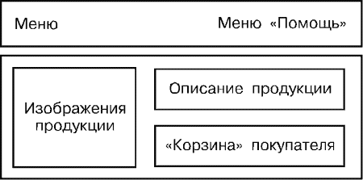

## 图 17.1

我们在 Web 服务器和 Java Applet 之间使用直接通信。如您所知，Java Applet 可以在 HTTP Web 服务器端口之外打开连接。然而，我们还希望覆盖需要通过防火墙访问 Web 资源的用户。我们使用内置的 HTTP Web 浏览器，确保任何访问我们 Java 商店 Web 页面的人，也可以访问 Java 商店生成的信息（例如产品图像和描述）。此外，我们必须使用标准的 HTTP 连接来调用交互商店当前使用的现有 CGI 程序。此任务可以通过 Java API 的两个类——`URL` 和 `URLConnection` 来解决。

我们直接向 Web 服务器发送请求以查找 Java 商店中形成的所有数据。

我们用于生成用户界面的数据文件必须组织良好以便商店人员方便地更改。菜单的主点将包含在 `Store.idx` 文件中。该文件包含目录名称及相应的菜单。在我们的程序中，该文件如下：

```
Internet/
Books on Internet
Windows/
Books on Windows
Programming/
Books on programming
```

目录是商店的部门。目录内部将有一个 `.idx` 文件，包含图像和描述文件的名称，以及用户选择此项时添加到购物车的唯一名称。如果名称以 `/` 结尾，则表示子菜单和相应的商店子部门。部门在物理上仍以目录表示；每个部门都包含自己的 `idx` 文件。这就是“Internet”部门的典型 `idx` 文件样式：

```
webserver.gif webserver.txt
Book about web server
Java.gif Java.txt
Programming on the Java for Internet
```

使用这种目录结构，我们建立了一个易于遵循的严格组织。要进行精确更改，您只需确定应从哪个部门添加或删除哪个产品，进入相应的目录并更改其中的 `idx` 文件。批量更改将更耗时，但我们接受这种折衷，因为小更改发生的频率比删除所有商店部门高。所有的 `idx` 文件在主 `Store` 类中搜索，而从 `store` 类发现的数据组成的用户界面将在 `StoreWindow` 类中生成。

我们通过两个主要类实现 Java 商店。第一个类简单地称为 `Store`（商店）。该模块选择形成用户界面的数据。它还调用 `StoreWindow` 类。`StoreWindow` 是找到数据用户界面后显示的屏幕。`StoreWindow` 包含购物车、产品图像、商店菜单和产品描述。它还会调用其他方法。

## 图 17.2

Java 商店的内部设备比上述外部界面更复杂。菜单是动态组织的——它们是根据永久位于 Web 服务器上的文件生成的。这允许您无需任何编程即可设置 Java 商店。商店人员可以通过修改文本文件来更换提供的产品、描述和部门结构。Java 商店读取这些文件并根据其指令形成用户界面。

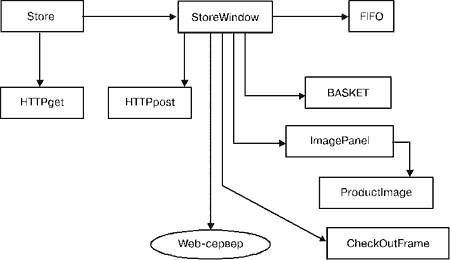

## 图 17.3

让我们从辅助类开始我们的实现。当我们讨论高层的 `StoreWindow` 类时，你会发现这些类很容易适配于联合工作。

在开始编写 `StoreWindow` 类之前，我们将生成并测试每个辅助类。在每个模块的严谨验证上花费的额外时间将使我们能够快速且无意外地将组件组合在一起。在所示的 Java 商店中，买家看到的将如下：

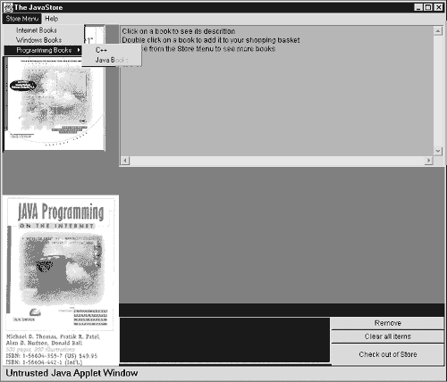

# HTTP 请求

首先，我们需要接收商店安装数据的模块，以便我们形成产品面板和菜单。让我们使用 `HTTP` 请求来获取安装的 `.idx` 文件。我们将有两个通用类——一个用于发送 `GET` 请求，另一个用于与 Web 服务器上的 CGI 程序进行交互，即 `POST` 请求。`HTTPpost` 类将在下文中讨论。我们将会介绍 `HTTPget` 类的一个变体，以展示如何使用网络套接字与 Web 服务器进行通信。这两个类的完整源代码可以在随书附带的 CD-ROM（适用于 `Windows 95/NT` 和 Macintosh 用户）以及在线伴随网页（适用于 `UNIX` 用户）上找到。

在 Java API 工具包中，执行 `URL` 创建及连接工作的类有：`URL`、`URLConnection` 和 `URLEncoder`。在第 14 章“使用 URL 网络”中，对这些类进行了更详细的讨论。让我们看看 Java 商店中 `HTTPpost` 类：

```java
import java.net.*;
import java.io.*;

public class HTTPpost {
    String CGIresults = "";

    public HTTPpost(String URLline, String PostData) {
        String inputLine;
        String PostDataEncoded = "result=" + URLEncoder.encode(PostData);

        try {
            URL url = new URL(URLline);
            URLConnection connection = url.openConnection();
            PrintStream outStream = new PrintStream(connection.getOutputStream());
            DataInputStream inStream;

            outStream.println(PostDataEncoded);
            outStream.close();

            inStream = new DataInputStream(connection.getInputStream());
            while (null != (inputLine = inStream.readLine())) {
                CGIresults = CGIresults + inputLine + "\n";
            }

            inStream.close();
        } catch (MalformedURLException me) {
            System.err.println("MalformedURLException: " + me);
        } catch (IOException ioe) {
            System.err.println("IOException: " + ioe);
        }
    }

    public String results() {
        return CGIresults;
    }
}
```

我们设置 `HTTPpost` 接受两个参数——首先是字符串参数 `URLline`，它包含了我们想要在 Web 服务器上执行的 CGI 程序名称以及该程序的完整 URL。`PostData` 参数包含了我们要发送给 CGI 的数据。我们需要确保所有这些数据都以适当的格式发送到 Web 服务器，因此我们使用了标准的 `x-www-form-urlencoded` 配合 `URLEncoder.encode` 方法。我们将此值分配给字符串 `"result"`。CGI 将看到此数据为 `"result=(PostData)"`，这意味着位于 `PostData` 中的 `"result"` 的值。在创建 CGI 程序时记住这一点很重要，因为我们将这对值提取出来进行处理。

首先，我们使用参数 `URLline` 创建一个新的 `URL` 实例。然后，我们使用 `url.openConnection()` 方法返回的对象创建一个新的 `URLConnection` 实例。这为我们形成输入和输出流提供了基础。我们使用 `URLConnection` 作为实际连接的通道，为 CGI 程序的 `PostData` 输出创建一个 `PrintStream`。同样地，我们从 `URLConnection` 实例创建一个 `inStream`，以便我们从 Web 服务器或 CGI 程序接收数据。

我们现在已经准备好进入业务阶段。首先，我们将参数 `PostData` 发送到 Web 服务器，它会传输给其 CGI 程序。然后我们开始从 CGI 接收数据，直到缓冲区为空。这些数据存储在全局变量 `CGIresults` 中。我们应该捕获在创建新 `URL` 以及由 `URL.openConnection` 方法引起的所有异常。

`results` 方法简单地返回 CGI 的输出。它用于确保 CGI 程序接收了我们发送的数据并对其进行了正确处理。我们还可以使用此方法在我们的 applet 中向用户显示消息。此外，我们可以从 CGI 程序传回 URL，然后调用 `showDocument` 来强制 Web 浏览器显示页面。它可以用于发送包含“感谢您的购买”页面的 URL，或者一个告知错误的页面，或是任何类似的内容。


### 建议

`HTTPget` 类不接受 `POST` 参数；相反，它需要 `QUERY LINE` 参数。它从 Web 服务器获取数据。我们想使用它来接收 HTML。由于 HTML 文件是纯文本，所以我们不需要担心标签。理论上，我们可以接收二进制数据，但这需要更改输入以读取字节。


```java
return RECEIVEdata;
}
```

# 商品安置信息

`ProductImage` 类不仅存储了产品图像，还存储了标签和描述。该类扩展了 `Canvas` 类。因此，我们可以为其赋予含义，并让对象本身包含特定产品的数据。我们在 `ImagePanel` 类中使用它，是因为我们要向其中添加产品图像。通过创建指向特定 `ProductImage` 的链接，然后通过该链接引用描述和标签，就可以直接访问描述和标签。这种机制在 `StoreWindow` 类中实现，这样我们就不需要通过 `ImagePanel` 类来获取数据了。此外，我们还添加了 `height` 和 `width` 共享变量，允许 `ImagePanel` 为所有添加到特定 `ImagePanel` 的 `ProductImage` 正确地设置尺寸。让我们考虑一下 `ProductImage` 类：

```java
import java.awt.*;

public class ProductImage extends Canvas {
    private Image piece;

    public String label;
    public int height;
    public int width;

    public String description;

    public void setLabel(String s) {
        label = s;
    }

    public void setImage(Image i) {
        if (piece != i) {
            piece = i;
            height = piece.getHeight(this);
            width = piece.getWidth(this);
        }
    }

    public void paint(Graphics g) {
        Rectangle r = bounds();
        g.setColor(getBackground());
        g.fillRect(0, 0, r.width, r.height);
        if (piece != null) {
            g.drawImage(piece, 0, 0, this);
        }
    }
}
```

我们没有将 `label`、`width`、`height` 和 `description` 设为私有，但将 `Image` 设为私有。`setLabel` 和 `setImage` 方法通过各自的对象参数被调用，实例 `ProductImage` 将它们存储起来以供以后使用。描述通过直接引用 `ProductImage` 实例中的 `description` 变量来设置。该对象基于 `Canvas` 类，因此我们可以直接将其添加到显示产品图像的面板中。

现在我们通过 `setImage` 方法将图像传输到 `ProductImage` 副本中，以便将其添加到显示商品图像的面板上。

# FIFO 类


`FIFO` 类是 API 中可用 `Vector` 类的扩展。`Vector` 是 `java.util` 包中的一个可扩展数组类。我们添加了一些方法来匹配 `FIFO` 数据结构。`FIFO` 用于用户界面的形成，这使得跟踪该界面的数据变得容易得多。我们可以按照特殊顺序将对象放入 `FIFO` 中，并使用相应的 `push` 和 `pop` 方法按相同的顺序将它们取出。我们还有一个 `isEmpty` 方法，用于检查列表是否为空：

```java
import java.util.Vector;
import java.util.*;

public class FIFO extends Vector {
    public String pop() {
        String s = "";
        // 获取第一个元素
        try {
            s = (String) firstElement();
        } catch (NoSuchElementException e) {
            System.out.println("FIFO EMPTY!!!!!");
            s = "";
        }
        // 并删除第一个元素
        try {
            removeElement(s);
        } catch (ArrayIndexOutOfBoundsException e) {
            System.out.println("FIFO EMPTY!!!");
        }
        return s;
    }

    // 在列表顶部添加元素
    public void push(String s) {
        addElement(s);
    }

    // 检查列表是否为空
    public boolean empty() {
        return isEmpty();
    }
}
```

`Vector` 类中可用的方法为我们完成了实际工作。它们生成了我们需要捕捉的异常。我们为存储在 vector 中的元素定义了 `String` 变量，但通过一些微调，我们可以强制 `FIFO` 接受任何对象。我们选择了 `object` 类型 `String`，因为我们的小程序中的 `FIFO` 只与字符串配合。

## 收据图像与描述

`ImagePanel` 类实际上调用了 `getImage` 方法和 `HTTPget` 方法来获取相关面板上每个商品的数据。每个部门都有自己的 `ImagePanel` 实例。我们对部门进行操作，以便于更改并显示不同的面板。这在 `StoreWindow` 类中所示。我们有一个主循环，它会不断重复，直到包含当前商店部门数据的 `FIFO` 列表被完全处理：

```java
import java.awt.*;
import java.net.*;
import java.util.*;
import java.io.*;
import ProductImage;
import FIFO;
import httpget;

public class ImagePanel extends Panel {
    private ProductImage ImageCanvas;
    private URL ImageURL;

    protected Toolkit tools;

    public int width;
    public int height;

    private MediaTracker tracker;
    private Image i;
    public String label;
    private httpget DescText;
}
```

注意，在此类中我们调用了 `MediaTracker`。它保证图像在执行 `ProductImage.setImage` 之前已经接收。如果带有尚未接收的图片执行执行会导致 `NullPointerException`。`Toolkit` 是必要的，这样就可以调用 `getImage`。

现在我们已经从 Web 服务器获取了所需产品的所有数据，让我们把它们放在合适的位置吧。我们使用 `ProductImage` 类的实例来包含这些数据；在上面的代码段中，这被反复赋值给 `ImageCanvas` 的值。我们设置图像 ID，使用 `setImage` 方法查找上述图像，使用 `setLabel` 方法直接从课堂 `ProductImage` 类中的 `help` 变量 `Description` 安装标签和描述（全部通过 `ImageCanvas` 实现）。标签或名称是三元组中的最后一个成员，我们从 `FileList` FIFO 队列中针对特定项目推入它。我们使用 `height` 和 `product image width` 在将其添加到 `ImagePanel` 之前调整 `ImageCanvas` 的大小。最后，我们设置 `ImagePanel` 的完整大小，以便在 `StoreWindow` 类中使用。`ImagePanel` 实例代表不同部门的商店，已作为组组件直接添加到框架 `StoreWindow` 中。

## 用户处理操作

`Basket` 类是我们的“购物车”实现。除了用户选择购买的产品列表外，你还可以从购物车中移除物品。`Basket` 由四个主要元素组成：一个列表和三个按钮。它扩展了面板，使其可以直接添加到 `StoreWindow` 框架中。我们处理直接与此类内部列表工作的函数（“移除”和“清除所有”按钮项），并将“结账”按钮的点击事件传递到商店父类 `StoreWindow`：

```java
import java.awt.*;

public class Basket extends Panel {
    private List ItemList;
    private Button Remove;
    private Button Clear;
    public Button Checkout;

    public Basket(String name) {
        Label BasketLabel = new Label(name, Label.CENTER);
        GridBagConstraints Con = new GridBagConstraints();
        GridBagLayout gridBag = new GridBagLayout();
        ItemList = new List(5, false);

        Remove = new Button("Remove");
        Clear = new Button("Clear all items");
        Checkout = new Button("Check out of store");
        setLayout(gridBag);

        setFont(new Font("Helvetica", Font.PLAIN, 12));
        setBackground(Color.blue);

        Con.anchor = GridBagConstraints.CENTER;
        Con.fill = GridBagConstraints.NONE;
        Con.weighty = 1.0;

        Con.weightx = 0.0;

        Con.gridwidth = GridBagConstraints.REMAINDER;
        gridBag.setConstraints(BasketLabel, Con);
        add(BasketLabel);

        Con.fill = GridBagConstraints.BOTH;
        Con.gridheight = 3;
        Con.gridwidth = GridBagConstraints.RELATIVE;
        Con.weighty = 1.0;

        Con.weightx = 3.0;
        gridBag.setConstraints(ItemList, Con);
        add(ItemList);

        Con.weightx = 1.0;
        Con.weighty = 0.0;
        Con.gridheight = 1;

        Con.gridwidth = GridBagConstraints.REMAINDER;
        Con.fill = GridBagConstraints.HORIZONTAL;
        gridBag.setConstraints(Remove, Con);
        add(Remove);

        gridBag.setConstraints(Clear, Con);
        add(Clear);
        Con.fill = GridBagConstraints.BOTH;
        gridBag.setConstraints(Checkout, Con);
        add(Checkout);
    }
}
```

在这里我们实现了三个按钮和一个列表，但除了“结账”按钮外，对所有项都进行了私有处理（或使用 `private` 修饰符声明）。这样做是为了让父类 `StoreWindow` 类能够访问。处理其他按钮的函数位于 `Basket` 类本身。请注意，创建列表是为了允许选择一个副本。我们使用布局管理器 `GridBagLayout` 将 `ItemList` 设置为在面板上使用最大空间的模式。“结账”按钮移出了商店父类 `StoreWindow`：处理其他按钮的函数位于 `Basket` 类本身。


```java
import java.awt.*;

public class Basket extends Panel {
    private List itemList;
    private Button remove;
    private Button clear;
    public Button checkout;

    public Basket(String name) {
        Label basketLabel = new Label(name, Label.CENTER);
        GridBagConstraints con = new GridBagConstraints();
        GridBagLayout gridBag = new GridBagLayout();
        itemList = new List(5, false);

        remove = new Button("Remove");
        clear = new Button("Clear all items");
        checkout = new Button("Check out of store");
        setLayout(gridBag);

        setFont(new Font("Helvetica", Font.PLAIN, 12));
        setBackground(Color.blue);

        con.anchor = GridBagConstraints.CENTER;
        con.fill = GridBagConstraints.NONE;
        con.weighty = 1.0;

        con.weightx = 0.0;

        con.gridwidth = GridBagConstraints.REMAINDER;
        gridBag.setConstraints(basketLabel, con);
        add(basketLabel);

        con.fill = GridBagConstraints.BOTH;
        con.gridheight = 3;
        con.gridwidth = GridBagConstraints.RELATIVE;
        con.weighty = 1.0;

        con.weightx = 3.0;
        gridBag.setConstraints(itemList, con);
        add(itemList);

        con.weightx = 1.0;
        con.weighty = 0.0;
        con.gridheight = 1;

        con.gridwidth = GridBagConstraints.REMAINDER;
        con.fill = GridBagConstraints.HORIZONTAL;
        gridBag.setConstraints(remove, con);
        add(remove);

        gridBag.setConstraints(clear, con);
        add(clear);
        con.fill = GridBagConstraints.BOTH;
        gridBag.setConstraints(checkout, con);
        add(checkout);
    }
}
```

在这里我们实现了三个按钮和一个列表，但除了“结账”按钮外，对所有项都进行了私有处理（或使用 `private` 修饰符声明）。这样做是为了让父类 `StoreWindow` 类能够访问。处理其他按钮的函数位于 `Basket` 类本身。请注意，创建列表是为了允许选择一个副本。我们使用布局管理器 `GridBagLayout` 将 `itemList` 设置为在面板上使用最大空间的模式。“结账”按钮移出了商店父类 `StoreWindow`。

```
tree += "END:MENU\n";
}
```

我们从 `URL` applet 方法、`getDocumentBase().getHost()` 和 `getDocumentBase().getPort()` 开始，使用 `HTTPget` 类从 Web 服务器获取索引文件。现在一个 `HTTPget` 对象允许我们通过 `getResults()` 方法获取 `idx` 文件。反复调用 `HTTPget` 以获取不同的 `idx` 文件，直到所有文件都接收完毕。

然后，使用 `StringTokenizer` 按照字符 `newline`（`\n`）将接收到的 `idx` 文件拆分成若干部分，因为在结构化 `idx` 文件时，我们将数据放置在了不同的行中。现在，`idx` 文件可以包含四种元素之一：菜单或子菜单（这样我们就必须获取另一个 `idx-file`）、或者 `gif-file` 的名称、描述文件的名称或标识符。我们知道这些元素的顺序，因此必须寻找末尾的 `"/"` 来定义菜单或子菜单。如果是菜单或子菜单，我们使用目录的 `path` 调用 `ParseIndex`（该路径就是当前标记），并添加从 `idx` 文件下一行获取的标签，用 `"Menu:"` 标记将它们分隔。我们将所有这些内容添加到字符串变量 `tree` 中，并传递给 `StoreWindow`，随后它将分析这个预格式化的列表以形成用户界面。递归调用 `ParseIndex` 使用相同的 `ParseIndex` 方法但带有不同的参数来解析这些菜单。这种递归的使用避免了我们从引入控制点开始需要执行嵌套循环。

如果标记不是目录（即不是菜单），那么它代表一个产品。我们添加标记（即标识元素）到 `tree` 中——`"GIF:"`、`"TXT:"` 和 `"NAME:"`。我们将为每个产品添加这三个部分，标签将允许我们调试 `idx-files` 或列表 `Tree` 构建过程中出现的问题。我们在每个 `idx` 文件内部循环，直到其处理完成，但在递归处理菜单和子菜单时，我们会进行多次分支。生成的变量字符串 `Tree` 看起来可能很混乱，但我们在 `StoreWindow` 上使用了类似的递归方法来形成用户界面，这种方法对于处理我们在此创建的非线性表单树形配置非常方便。

当配置文件被解析并放入格式化的 `Tree` 列表时，我们创建一个新的 `StoreWindow`（`getDocumentBase()`, `Tree`），并传递当前的 `tree` 变量配置。我们还传递了基础 `URL`，以便我们可以从 Web 服务器获取相关商品的 `GIF` 文件和描述文件。

## 我们将它们整合在一起

我们连接组件并为 `StoreWindow` 类添加高级功能。我们在 `Tree` 变量中存储了预格式化的配置数据，以及开始创建用户界面所需的所有类。我们首先设置合适的基础 `URL` 以从 Web 服务器接收图像和描述文件。之后，我们创建所需的屏幕元素，例如用于购物的篮以及基于管理器 `CardLayout` 的图像面板。随后，当我们构建用户界面和菜单时，我们将这些面板显示在屏幕上。

```java
import java.awt.*;
import java.net.URL;
import java.util.*;

class StoreWindow extends Frame {
    Panel productPicPanel;
    String params = "";

    Panel descriptionPanel;
    String baseURL;

    Panel mainPanel;
    TextArea descArea;
    Basket shoppingBasket;
    String newPickMessage;
    String CGI;

    public StoreWindow(URL BURL, String tree, String CGIprogram) {
        this.CGI = CGIprogram;

        if (BURL.getPort() == -1) {
            baseURL = BURL.getProtocol() + "://" + BURL.getHost();
        } else {
            baseURL = BURL.getProtocol() + "://" + BURL.getHost() + ":" + BURL.getPort();
        }

        shoppingBasket = new Basket("Shopping basket");
        setTitle("The JavaStore");

        mainPanel = new Panel();
        mainPanel.setLayout(new BorderLayout());
        setLayout(new BorderLayout());

        descArea = new TextArea(15, 30);
        descArea.setEditable(false);
        descArea.setBackground(Color.black);
        descArea.setForeground(Color.white);
        descArea.setFont(new Font("Helvetica", Font.PLAIN, 12));

        newPickMessage = "点击书籍查看其描述\n 双击书籍将其加入您的购物篮\n 从商店菜单中选择查看更多书籍\n";

        mainPanel.add("North", descArea);
        mainPanel.add("South", shoppingBasket);
        MenuBar bar = new MenuBar();
        productPicPanel = new Panel();
        productPicPanel.setLayout(new CardLayout());
    }
}
```

上述代码基本上初始化了框架并创建了我们需要的某些 AWT 对象。我们为主区域和 `productPicPanel` 安装了布局管理器。我们对 `productPicPanel` 使用 `CardLayout`，是因为我们希望在菜单选择更改时更改显示的面板。我们添加了菜单栏和项目，稍后我们会添加菜单。接下来，我们调用 `BuildUI` 方法，该方法将负责构建菜单。

事件处理器首先检查用户与菜单的交互。如果用户选择了新的菜单项或商店部门，我们将显示一个与该部门相对应的面板。这将切换你想要在文本区域 `descArea` 中显示的命令消息。第二部分事件处理器检查从 `ShoppingBasket` 传递过来的“结账离开商店”按钮点击事件。我们获取商品列表、选定的用户，并调用其方法 `submitItemList()`，该方法会触发 `CheckOutofFrame()` 方法并发送位于 Web 服务器上的 CGI 程序。

在用户完成这些操作后，他们不再需要留在商店里，因此我们关闭了窗口 `StoreWindow`。CGI 程序将处理数据。

```java
private Menu BuildUI(String tree) {
    FIFO panelAdd = new FIFO();
    Menu storeMenu = new Menu("Store Menu");
    StringTokenizer splitTree = new StringTokenizer(tree, "\n");
    ParseTree(splitTree, storeMenu, "", panelAdd);
    return storeMenu;
} // the end StoreWindow

private void ParseTree(StringTokenizer treeBranch, Menu menuIn, String previousToken, FIFO panelAdd) {
    StringTokenizer leaf;
    Menu subMenu;
    String next;
    // ImagePanel MenuPanel;
    while (treeBranch.hasMoreTokens()) {
        leaf = new StringTokenizer(treeBranch.nextToken(), ":");
        next = leaf.nextToken();
        // are looking for "Menu" And add new element in menu
        if (!previousToken.equals("")) {
            if (next.equalsIgnoreCase("Menu")) {
                subMenu = new Menu(previousToken);
                menuIn.add(subMenu);
                // recursive treatment this new submenu
                previousToken = "";
                menuIn = subMenu;
            } else {
            }
        }
        menuIn.add(previousToken);
        panelAdd.push(previousToken);
        // are looking for "Menu" And add new element in menu
        if (next.equalsIgnoreCase("Menu")) {
            ParseTree(treeBranch, menuIn, leaf.nextToken(), panelAdd);
        } else if (next.equalsIgnoreCase("GIF")) {
            panelAdd.push(leaf.nextToken());
            ParseTree(treeBranch, menuIn, "", panelAdd);
        } else if (next.equalsIgnoreCase("TXT")) {
            panelAdd.push(leaf.nextToken());
            ParseTree(treeBranch, menuIn, "", panelAdd);
        } else if (next.equalsIgnoreCase("NAME")) {
            panelAdd.push(leaf.nextToken());
            ParseTree(treeBranch, menuIn, "", panelAdd);
        } else if (next.equalsIgnoreCase("END")) {
            if (!panelAdd.empty()) {
                String panelName = (String) panelAdd.pop();
                leaf.nextToken();
                // ProductPicPanel.add(panelName, new ImagePanel(baseURL, panelAdd, panelName));
            }
        }
    }
} // // the end StoreWindow
```

`BuildUI` 方法实际上初始化了 `ParseTree` 方法。我们创建了一个新的 `FIFO` 对象和一个新菜单。然后我们使用 `StringTokenizer` 配合 `tree`，通过换行符分隔标记符。`tree` 是我们在教室 Store 中根据数据配置创建的，从 Web 服务器接收的。

它之前经过了格式化且井然有序，因此递归方法 `ParseTree` 可以使用。`BuildUI` 方法中的大部分工作都是通过递归调用 `ParseTree` 方法正确完成的。


正如我们所说，`ParseTree` 方法是递归工作的。当我们遇到新菜单时调用它。这允许我们在不使用嵌套循环的情况下处理嵌套菜单。我们带有以下参数调用 `ParseTree`：一个包含待处理树的 `StringTokenizer`；父级菜单；一个包含上一个标记的字符串；以及一个包含 `ImagePanel` 数据的 `FIFO` 列表，该列表必须根据这些配置数据形成。父菜单和上一个标记对于子菜单是必需的。通常，我们在 `ParseTree` 方法中遵循此路径：处理当前表格并获取下一个表格（它是上一个表格的标签），然后用树的剩余部分调用 `ParseTree`。当到达标记为 "END" 的结尾时停止解析树。在遍历树的过程中，我们将元素放入 `FIFO` 面板 `PanelAdd` 缓冲区中。这个 `FIFO` 被传递给 `ImagePanel`，它使用 `FIFO` 中的数据来选择图像和产品描述。

## 在 Web 服务器上广播用户选择

我们在 `SubmitItemList` 方法中调用了 `CheckOutFrame` 类。`CheckOutFrame` 包含两个文本字段和一个“完成（Done）”按钮，如图 17-5 所示。用户在字段中填写姓名和电话号码。这些数据连同商品商品列表通过 `HTTPpost` 类传输到运行在 Web 服务器上的 CGI 程序。`CheckOutFrame` 的代码所示。注意，我们在打开 `CheckOutFrame` 之前销毁了 `StoreWindow`，以免干扰用户，从而立即吸引他的注意力。对于组件布局，我们再次使用了 `GridBagLayout` 布局。事件处理器开始观察 `Done` 按钮的点击，我们在上面获取商品商品列表、用户名和电话，并将这些数据发送到 CGI 程序：

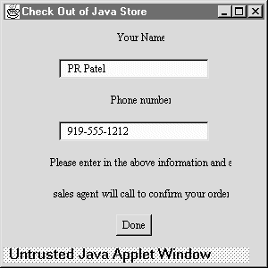

图 17.5。

```java
import java.awt.*;
import httppost;

public class CheckOutFrame extends Frame {
    TextField Name;
    TextField phone;
    Button Done;
    String ItemList;
    GridBagLayout gridbag = new GridBagLayout();
    GridBagConstraints Con = new GridBagConstraints();
    Label Lname;
    Label Phone;
    Label message1;
    Label message2;
    HTTPpost CGIpost;
    String CGI;

    public CheckOutFrame(String title, String ItemList, String CGI) {
        super(title);
        this.ItemList = ItemList;
        this.CGI = CGI;
        setLayout(gridbag);
    }

    public boolean action(Event evt, Object arg) {
        if ("Done".equals(arg)) {
            System.out.println(CGI);
            CGIpost = new HTTPpost(CGI, "NAME: " + Name.getText() + "\nPHONE: " + Phone.getText() + "\nPURCHASES:\n" + ItemList);
            System.out.println(CGIpost.results());
            dispose();
            return true;
        }
        return false;
    }
} // the end CheckOutFrame
```

*   支持“拖放”界面。为了实现这一点，你需要为购买功能创建一个篮子图标，这样用户在选择一个要购买的商品时，可以将其移动到图标上，之后它将自动添加到篮中的商品列表中。
*   额外的文本字段，用户可以在其中输入他们的地址，可能还包括信用卡号。这必须极其谨慎地进行，使用加密技术来保护用户信息。此功能将极大地方便订单处理，并消除商业代理请求这些信息的必要性。
*   帮助菜单。我们已经展示了程序中是如何处理菜单的，并执行了参考菜单的执行程序事件。这已经足够了。

## 第十八章


来自其他服务器或其他协议的交互：国际象棋客户端

### 契约属性

### 开发与执行

### 来自异步服务器的交互：创建棋盘

### 来自 CIS 的棋盘连接

### 编写 Applet：可能的改进

### 窗口登录

### 列出当前玩家

# 你从本章中学习了什么

在这里，我们为国际象棋服务器创建一个 Java 语言的图形客户端，详细考虑了以下问题：

*   套接字编程；
*   异步广播数据；
*   多线程；
*   创建综合自定义界面。

# 契约

想象有一家新成立的互联网公司决定为互联网社区创建免费的高质量娱乐内容，以吸引用户进入他们的服务器，并委托我们执行这项工作。我们认为一个国际象棋程序非常适合这项任务，让人们相互对弈。我们将使用内部界面国际象棋服务器（国际象棋互联网服务器，CIS），因为它可以执行诸如建立连接、选择玩家、记录计分、检查走法正确性等功能。但服务器的能力在某种程度上受到限制，因为它的界面是符号性的。在屏幕上，即服务器提供的图 18-1 所示的文本棋盘。

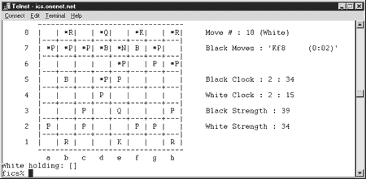

#### 图 18.1.

CIS 根据 GNU 公用许可证条款免费分发；可以在 `ftp://chess.onenet.net/pub/chess/Unix` 找到。

有几个用于与国际象棋服务器工作的图形外壳，但它们并不是为每个平台编写的，而且必须预先安装在客户端电脑上。我们决定开发一个 Java Applet，作为与服务器工作的图形外壳。通过以 Applet 形式编写图形外壳（用户界面），我们同时解决了两个问题：首先，客户端可以在任何安装了 Java 的计算机上运行，其次，用户在安装方面不会遇到问题。Netscape Navigator 及相关程序中引入的 Applet 安全限制并没有影响到我们，这是因为服务器和客户端可以安装在同一台电脑上。

# 属性

为 CIS 添加图形前端的最重要功能是允许你使用鼠标的图形棋盘。我们还需要一个内部文本字符串，用户可以在其中向 CIS 发送不是由我们客户端生成的命令。CIS 支持限时限制的国际象棋比赛，因此我们将在棋盘上添加一个动态时钟，计算活动玩家的秒数。玩家允许与当前在服务器上的其他玩家通信，因此为了方便通信，我们将添加另一个文本框。有时在通信的混乱中，比赛的输入请求会丢失——我们将强制客户端跟踪这些请求并在单独的窗口中显示给用户。作为点睛之笔，我们将添加一个动态更新的服务器玩家列表，显示接收到的当前比赛请求。从这个列表中，用户将可以选择一个潜在的对手。

# 开发与执行

让我们大致按时间顺序描述开发过程。从最基础的任务开始，我们将开发解决方案，然后将在生成的骨架上构建肉，成为一个功能的 CIS 客户端。之后，我们将开发 Applet 的一些扩展并为读者提供一系列练习。

核心任务包括：为 CIS 开发 Applet 图形外部界面。为了构建具有适当复杂性的 Applet，我们必须将任务分解为几个部分，即：

*   服务器的开发程序
*   通用棋盘的创建
*   连接 CIS 的类

客户端作为用户之间的连接

## 来自异步服务器的交互

第 13 章，你学会了如何使用套接字建立 Applet 与服务器之间的连接。然而，我们还没有触及异步连接。简单的服务器，例如，同步数据流——它总是等待命令输入才传输数据。有些服务器是异步的——它们可以在任何方便的时间发送数据。得益于此，我们可以确保无论 Applet 多么忙，来自网络的数据都能被接收。数据接收器以 String 形式从 InputStream 读取数据，并在 EOL 或 EOF 处分割字符串。让我们描述此接口：

```java
package ventana.io;

public interface Listener {
    void receiveInput(InputStreamHandler i, Object o);
}
```

该方法允许数据接收器——`InputStreamHandler` 类——通过 `receiveInput` 方法将读取的 String 值传递给另一个对象。`Listener` 能够接受任何对象，但在本例中我们只通过它传输 String 值。除了我们返回 `InputStreamHandler` 的引用外，当我们需要同时使用多个线程时，它大有 Utility：

```java
package ventana.io;

import java.io.*;

public class InputStreamHandler implements Runnable {
    private Thread engine;
    private DataInputStream in;
    private Listener client;

    public InputStreamHandler(InputStream in, Listener client) {
        this.in = new DataInputStream(in);
        this.client = client;
        engine = new Thread(this);
        engine.start();
    }

    public void close() {
        if (in != null) {
            try {
                in.close();
            } catch (IOException e) {
            }
        }
        engine.stop();
    }

    public void run() {
        if (in == null) {
            return;
        }
        String s;
        try {
            s = in.readLine();
        } catch (IOException e) {
            return;
        }

        while (s != null && engine.isAlive()) {
            client.receiveInput(this, s);
            try {
                s = in.readLine();
            } catch (IOException e) {
                s = null;
            }
        }
    }
}
```

## 创建棋盘

构成棋盘的代码与与服务器交互的代码无关。因此，我们创建的棋盘同样可以很好地用于下棋，例如下国际跳棋。我们的棋盘非常简单——它由 8x8 的正方格组成，包含若干张图像，并对鼠标移动和点击做出响应。

我们的棋盘是 `Canvas` 类的扩展，而 `Canvas` 又是抽象类 `Component` 的一种某种程度上可行的实现。我们决定不为棋盘使用 `Container` 类，原因有两个。首先，`Images` 类型的棋子不属于 `Component` 类，因此不能直接添加到 `Container` 对象中。其次，如果 `Container` 对象包含大量的 `Component` 对象，则针对 Microsoft Windows 的 Java API 现代实现将无法正常工作。

`ChessBoard` 类负责绘制棋盘和生成走法。

表 18-1 列出了 `ChessBoard` 类的通用方法。

### 表 18-1. `ChessBoard` 类的通用方法

| 方法 | 描述 |
| :--- | :--- |
| `setImage(Image, String)` | 设置包含给定字符串和给定图像的方格，并重绘该方格。该行必须提交您自己的棋位标记字段，例如 "A1"。 |
| `endGame()` | 结束棋类游戏。 |
| `setGenerateMoves(boolean)` | 指示是否允许用户走子。 |
| `setOrientation(boolean)` | 棋盘的方向——白方在上（true）或白方在下（false）。 |
| `boolean getOrientation()` | 返回当前棋盘的方向。 |

`ChessBoard` 类包含一个二维数组 `images`。该数组用于处理和吃掉棋子的字段。

`ChessBoard` 允许通过 `setImage` 方法访问字段数组。`setImage` 方法没有直接定义数组索引，而是允许您在带有棋盘表示法的行中指定要更改哪个字段。从棋位标记到数组索引的转换通过内部手段完成，这允许根据棋盘的方向（白方向下或白方向上）以不同的方式实现。例如，如果用户玩白方，则 "A1" 字段应该在左下角，但如果他玩黑方，则应该在右上角。

当用户点击棋盘时，它会被高亮并在上面出现一个红色圆圈，表示被选中。如果用户再次点击此框，则取消选中且圆圈消失。如果用户在第一个字段仍被选中的情况下点击另一个字段，则会生成一个走法并传递给父类 `ChessBoard`，之后第一个字段将取消选中。这种行为可以通过 `setGenerateMoves` 方法禁用——以防止用户违规走子。

以下是用于我们类 `ChessBoard` 的程序代码：

```java
import java.awt.*;
import java.util.*;

public class ChessBoard extends Canvas {
    private Image[][] squares;
    private boolean up = true;
    private boolean generate = false;
    private Point selected;

    private Color dark;
    private Color light;

    public ChessBoard() {
        squares = new Image[8][8];
        dark = Color.gray;
        light = Color.lightGray;
        resize(320, 320);
        repaint();
    }

    // 方法 `endGame` 在比赛结束时调用。它将所有字段设为深，向用户显示游戏结束，然后重绘棋盘。最后它抑制用户继续走子的尝试：
    public void endGame() {
        dark = Color.darkGray;
        light = Color.gray;
        repaint();
    }

    public void setGenerateMoves(boolean b) {
        generate = b;
    }

    public void setOrientation(boolean b) {
        up = b;
    }

    public boolean getOrientation() {
        return up;
    }

    // 方法 `getSquare` 在内部用于从棋位标记到索引数组的转换。给定两个表示数组字段位置的整数，该方法返回该字段在棋位标记中的行：
    private String getSquare(int x, int y) {
        char ary[] = new char[2];
        if (up) {
            ary[0] = (char) ('a' + x);
            ary[1] = (char) ('1' + (7 - y));
        } else {
            ary[0] = (char) ('a' + (7 - x));
            ary[1] = (char) ('1' + y);
        }
        return new String(ary);
    }
}
```

负责国际象棋真实游戏的类使用 `setImage` 来将棋子插入字段中。`setImage` 方法接收一个图像——可能是该形状的图像——以及一个指示在哪个字段放置图像的字符串。如果新图像与字段中的图像不同，则该字段将更新并重绘。要移除图像，可以简单地设置为 `null`。

`paintSquare` 方法负责绘制单个字段。通过给定的数组索引，它分别将字段涂成浅色或深色，如果该字段上有棋子，则绘制该棋子的图像。布尔参数指示是否绘制圆圈（表示字段）：


```java
public void paintSquare(int x, int y, boolean b, Graphics g) {
    if ((x % 2 == 0 && y % 2 == 0) || (x % 2 == 1 && y % 2 == 1)) {
        g.setColor(light);
    } else {
        g.setColor(dark);
    }
    g.fillRect(x * 40, y * 40, 40, 40);
    if (squares[x][y] != null) {
        g.drawImage(squares[x][y], x * 40, y * 40, this);
    }
    if (b) {
        g.setColor(Color.red);
        g.fillOval(x * 40 + 15, y * 40 + 15, 10, 10);
    }
}

public void paint(Graphics g) {
    for (int y = 0; y < 8; y++) {
        for (int x = 0; x < 8; x++) {
            paintSquare(x, y, false, g);
        }
    }
}
```

## 从 CIS 连接国际象棋盘

我们将开发一个应用程序，它被用于实现 CIS 客户端，就像我们的棋盘一样，以及异步数据的接收器。以下是程序的文本，用于解析 CIS 输出并发布 CIS 指令。如果我们良好地设计了应用程序，这将是包含专门针对 CIS 程序的唯一章节。CIS 通过编号监控比赛，当他发送带有带有更新的棋盘的消息时，该消息中包含了编号部分。我们的主程序被设计为包含一组按游戏编号索引的棋盘。每个棋盘对应一个比赛，并位于自己的窗口中。

不要仅仅显示剩余多少时间，让我们利用 Java 语言处理流（streams）的能力，让时钟为当前活跃的玩家计算秒。`Label` 类提供了一个输出文本的通用不可编辑字段。让我们在 `stopwatch` 类中扩展它，以接收 `label`，它将显示当前时间并在每秒时递减包含该值的变量。`StopWatch` 类的通用方法见表 18-2。

### 表 18-2. 通用类 `stopwatch` 的通用方法

| 方法 | 描述 |
| :--- | :--- |
| `set(int)` | 设置并显示剩余时间。 |
| `start()` | 开始倒计时。 |
| `stop()` | 停止计时。 |
| `clear()` | 完全停止时钟。 |

让我们来编写 `stopwatch` 的程序：

```java
import java.awt.*;

public class stopwatch extends Label implements Runnable {
    private Thread engine;
    private int time = 0;

    public stopwatch() {
        super();
        engine = new Thread(this);
        engine.setPriority(3);
    }

    public StopWatch(int i) {
        this();
        set(i);
    }

    // set 方法用于设置秒钟上的剩余时间。它必须是同步的，因为不同的玩家对可能会尝试同时设置时间。如果 time 为负，则重置 label 以显示时间：
    public synchronized void set(int i) {
        time = i;
        if (time > 0) {
            int min = time / 60;
            int sec = time % 60;
            if (sec > 9) {
                setText("" + min + ":" + sec);
            } else {
                setText("" + min + ":0" + sec);
            }
        } else {
            setText("0:00");
        }
    }

    public void start() {
        if (engine != null) {
            if (!engine.isAlive()) {
                engine.start();
            } else {
                engine.resume();
            }
        }
    }

    public void stop() {
        if (engine != null) {
            engine.suspend();
        }
    }

    public void clear() {
        if (engine != null) {
            engine.stop();
            engine = null;
        }
    }

    public void run() {
        while (engine != null && engine.isAlive()) {
            set(time - 1);
            try {
                engine.sleep(1000);
            } catch (InterruptedException e) {}
        }
    }
}
```

### 实现 `ChessFrame`

现在我们可以继续实现 `ChessFrame`。在表 18-3 给出了 `ChessFrame` 类的通用方法。

### 表 18-3. `ChessFrame` 方法

| 方法 | 描述 |
| :--- | :--- |
| `updateGame(String)` | 更新状态帧以反射当前游戏状态。 |
| `endGame()` | 结束当前游戏。 |

`ChessFrame` 主要负责解析游戏区域的更新消息并显示相关信息。默认更新消息在上面的 18-1 节给出。`CIS` 提供了从现有游戏棋盘样式中选择的选择。我们选择的 12 号样式发送一条更新消息，形成一个包含多个由空格分隔字段的行：

`<12> rnbqkbnr ppppppppp ---- ----- ---- ---- PPPPPPP RNBQKBNR W -one one one one one one 0 one donald donald 2 0 0 39 39 0 0 one none (0:00)`

第一个字段表示该行包含一条关于 12 格式更新游戏棋盘的消息。父类 `ChessFrame` 将使用此字段来确定是否需要调用 `updateGame` 方法。该字段将由 `ChessFrame` 使用，通过包含多个空格分隔的字段来更新游戏棋盘的状态。

以下是 `ChessFrame` 的原始文本：

```java
import ChessBoard;
import ChessClient;
import PackerLayout;
import java.awt.*;
import java.util.*;

public class ChessFrame extends Label {
    private ChessBoard board;
    private ChessClient parent;
    private String user;
    private Panel players;
    private Panel whitePlayer;
    private Panel blackPlayer;
    private Label whiteName;
    private Label blackName;
    private stopwatch whiteTime;
    private stopwatch blackTime;

    // ChessFrame 包含了两个用于显示黑白棋盘的面板。
    // 这些面板显示了棋盘的状态。
    // 玩家的样式通过面板显示。
    // 这里的逻辑用于处理更新消息。

    public ChessFrame(ChessClient parent, String user, int fixed) {
        super();
        this.user = user;
        this.parent = parent;
        setLayout(new PackerLayout());
        
        whitePlayer = new Panel();
        add(whitePlayer);
        
        blackPlayer = new Panel();
        add(blackPlayer);
        
        board = new ChessBoard();
        add(board);
        
        whiteName = new Label();
        add(whiteName);
        
        blackName = new Label();
        add(blackName);
        
        whiteTime = new stopwatch();
        add(whiteTime);
        
        blackTime = new stopwatch();
        add(blackTime);

        pack();
        setSize(size());
        show();
    }
}
```

以下是 `ChessFrame` 的核心实现：

```java
// ChessFrame 类的核心方法是解析更新消息。
// 首先，我们使用 StringTokenizer 从这些消息中读取八行棋盘状态。
// 接下来，我们确定是谁的回合（这些信息稍后将用于确定每个玩家的剩余时间）。
// 以下是实现该算法的代码片段：

// 框架只处理 WINDOWS_DESTROY 事件。
// 其他事件将重定向到服务器。
public boolean handleEvent(Event evt) {
    if (evt.id == Event.WINDOW_DESTROY) {
        dispose();
        return true;
    } else {
        parent.deliverEvent(evt);
        return true;
    }
}

// 在棋盘初始更新时，我们发现玩家是哪种颜色。
// 如果是黑色，flipPlayers 方法将交换玩家的位置并翻转棋盘：
protected void flipPlayers() {
    players.remove(whitePlayer);
    players.remove(blackPlayer);
    players.add(whitePlayer);
    players.add(blackPlayer);
    board.setOrientation(false);
}
```

以下标记包含了玩家的名称。如果它们与标签中指示的玩家名称不匹配，我们假设 CIS 服务器知道自己在做什么。如果黑方的名称 `new player` 与我们的用户名相同，且类型变量不等于 `two`，我们就翻转 `board`（棋盘），使得 `black` 位于底部。变量 `type` 包含有关玩家在国际象棋游戏中的角色信息。如果它等于 `two`，意味着用户在训练模式下玩，即自己对自己。如果值 `variable` 等于 `one`，则意味着用户正在与真实对手对战，此时轮到他的回合。在任何情况下，我们需要为棋盘生成移动：

```java
token = st.nextToken(); // name player white

if (!whiteName.getText().equals(token)) { 
    whiteName.setText(token);
}

token = st.nextToken(); // name player black

String type = st.nextToken();

if (!blackName.getText().equals(token)) { 
    blackName.setText(token);
    if (user.equals(token) && !type.equals("2")) { 
        board.setOrientation(false); 
        flipPlayers();
        System.out.println("Tried to anyway");
    }
    layout();
}

if (type.equals("1") || type.equals("2")) { 
    board.setGenerateMoves(true);
} else {
    board.setGenerateMoves(false);
}

token = st.nextToken(); // time start parties

token = st.nextToken(); 
token = st.nextToken();  
token = st.nextToken();
```

接下来两个标记包含每个玩家剩余的秒数。`Stopwatch` 设置为刚完成移动的玩家的新正确时间，`Countdown` 停止，并在我的回合开始另一个玩家的计数器：

```java
token = st.nextToken(); // remaining time player white

try {
    Integer i = new Integer(token); 
    whiteTime.set(i.intValue());
} catch (NumberFormatException e) {}

token = st.nextToken(); // remaining time player black

try {
    Integer i = new Integer(token); 
    blackTime.set(i.intValue());
} catch (NumberFormatException e) {}

if (whiteMove) {
    blackTime.stop(); 
    whiteTime.start();
} else {
    whiteTime.stop(); 
    blackTime.start();
}
```

最后，我们继续解析剩余的标记。为了让棋盘的更新对用户来说是不可察的，我们在最后时刻进行操作。每行状态按逐字符顺序读取。如果读取到的下一个字符是连字符，则棋盘相应的方格不包含图片；否则，从父进程请求图片：

```java
for (int i = 0; i < 8; i++) {
    String line = lines[i]; 
    char[] ary = new char[8]; 
    line.getChars(0, 8, ary, 0); 
    for (int j = 0; j < 8; j++) {
        char row = (char)('8' - i); 
        char column = (char)('a' + j); 
        Image piece;
        if (ary[j] != '-') {
            piece = parent.getPieceImage("" + ary[j]);
        } else {
            piece = null;
        }
        board.setImage(piece, "" + column + row);
    }
}
```

## 编写 applet

我们创建了一个独立的窗口，包含一个通用游戏面板和玩家所需的信息。现在我们可以开始编写自己的 applet 了。我们将从小开始，根据需要添加更多功能。applet 的首次实现必须能够连接到服务器并为玩家提供一个窗口，允许从列表中选择伙伴。一旦接收到包含 `<12>` 的行，applet 必须将其传递给 `ChessFrame` 类，并在需要时构造后者。此外，applet 向服务器发送游戏结束的信号并将此信息传输到 `ChessFrame`。这里是原始的 applet `ChessClient`：


```java
import ChessFrame; 
import PackerLayout;
import java.applet.*;
import java.awt.*;
import java.net.*;
import java.util.*;
import java.io.*;
import ventana.io.*;

public class ChessClient extends Applet implements Listener {
    private string user;
    private label title;
    private TextArea output;
    private TextField input;
    private Hashtable games;
    private Hashtable pieceImages;
    private Socket ChessSocket;
    private inputstream ChessInput;
    private OutputStream ChessOutput;
    private InputStreamHandler ChessInputHandler;
    private MediaTracker tracker;
    private Font fixed;
    private Font pretty;
}
```

在 `init` 过程中初始化 applet 时要的第一件事是为整个 applet 设置两种字体，`pretty` 和 `fixed`。

当程序启动时，applet 会通过 socket 与服务器建立连接。对于一个 `InputStream` 对象，会创建一个相应的 `InputStreamHandler`。正如你记得的，这个类从输入流中读取行并使用 `receiveInput` 方法将它们传递出去。最后，生成一个哈希表用于存储 `ChessFrame` 对象。大多数用户倾向于一次只玩或看一局游戏，因此哈希表初始化为存储一个元素的空间：

```java
public void start() {
  try {
    String ChessHost = hetParameter("HOST");
    if (ChessHost==null) {
      ChessHost = getCodeBase().getHost();
    }
    ChessSocket = new Socket(ChessHost, 5000);
    ChessInput = ChessSocket.getInputStream();
    ChessOutput = ChessSocket.getOutputStream();
    ChessInputHandler = new InputStreamHandler(ChessInput, this);
  } catch (Exception e) {
    handleException(e);
  }
  games = new Hashtable(1);
}
```

任务完成后，applet 会关闭 `InputStreamHandler`、网络流和 socket，并清理输入窗口和显示信息：

```java
public void stop() {
  try {
    ChessInputHandler.close();
    ChessOutput.close();
    ChessInput.close();
    ChessSocket.close();
  } catch (IOException e) {
    handleException(e);
  }
  output.setText("");
  input.setText("");
}

public void handleException(Exception e) {
  e.printStackTrace();
}
```

`writeOutput` 方法用于向服务器发送数据。该方法是唯一专门用于数据传输的方法，这带给了我们两个优势：首先，我们不需要在程序中每个需要输出数据的地方重复相同的语句；其次，由于方法中使用了 `synchronized` 关键字，我们保证了程序的多个线程不会同时开始传输。在早期变量 `user` 尚未被赋值，但一旦第一次调用 `writeOutput`，它就会被赋值。这是因为服务器上处理的首条命令是用户名：

```java
protected synchronized void writeOutput(String s) {
  if (user==null) {
    user = trim();
  }
  byte b[] = new byte[s.length()];
  s.getBytes(0, s.length(), b, 0);
  try {
    ChessOutput.write(b);
  } catch (IOException e) {
    handleException(e);
  }
}
```

每当接收到完整的输入字符串时，`InputStreamHandler` 对象就会调用 `receiveInput` 方法。如果接收到的字符串为空或仅包含服务器提示，则会被完全忽略。如果接收到的字符串以字符 `<12>` 开头，我们知道这是一个更新游戏状态的信号——将调用 `parseBoard` 方法。如果该行看起来是游戏结束的信号，则会对其编号进行分析。如果编号 `game` 在我们的哈希表中，将调用 `ChessFrame` 对象的 `endGame` 方法，并从哈希表中移除相应的游戏。如果字符串不匹配上述任何事件，则被视为标准的服务器命令，并在窗口中提取提取信息：

```java
public void receiveInput(InputStreamHandler ish, Object o) {
  String s = (String)o;
  if (s.trim().equals("") || s.trim().equals("fics%")) {
    return;
  }
  if (s.trim().startsWith("<12>")) {
    parseBoard(s.trim());
  } else if (s.trim().startsWith("{Game")) {
    StringTokenizer st = new StringTokenizer(s);
    String token = st.nextToken();
    //{Game String number = st.nextToken(); //number
    ChessFrame frame = (ChessFrame)games.get(number);
    if (frame!=null) {
      token = st.nextToken(); //(player1 token = st.nextToken(); //vs. token = st.nextToken(); //player2)
      token = st.nextToken(); //loser
      frame.endGame(token);
      games.remove(number);
    }
  } else {
    output.appendText(s+"\n");
  }
}
```

`receiveInput` 方法是唯一能发现游戏更新消息的方法。该行的第 16 字段是游戏编号。如果游戏不在我们的表中，我们会创建一个 `ChessFrame` 对象并将其编号插入表中。最后我们调用刷新窗口的方法 `updateGame`：

```java
protected void parseBoard(String s) {
  StringTokenizer st = new StringTokenizer(s);
  String token = st.nextToken();
  if (! token.equals("<12>")) {
    output.appendText("oops...  "+ token);
    return;
  }
  for (int i=0; i<<16; i++) {
    token = st.nextToken();
  }
  ChessFrame frame = (ChessFrame)games.get(token);
  if (frame==null) {
    frame = new ChessFrame(this, user, fixed);
    games.put(token, frame);
  }
  frame.updateGame(s);
}
```

所有与玩家移动相关的开发进展都在这里处理。如果位置事件是一个 `ChessFrame` 对象，则该事件必须是玩家回合生成的棋盘，也就是说，它必须重定向到玩家。如果目标事件是输入框，则玩家生成了棋盘：

```java
public boolean action(Event evt, Object arg) {
  if (evt.target instanceof ChessFrame) {
    writeOutput((String)arg+"\n");
    return true;
  } else if (evt.target==input) {
    writeOutput((String)arg+"\n");
    input.setText("");
    return true;
  } else {
    return false;
  }
}
```

该国际象棋客户端显示了名称以及输入命令的字段。图 18-2 重现了国际象棋 applet 的图像。

Images/image0933

# 可能的改进

我们的国际象棋 applet 已经发布给公众，并且看起来良好。关于如何改进的建议如下：首先，登录程序没有屏蔽输入的密码；其次，有些玩家发现难以跟踪多人，因此需要一个独立的窗口。我们决定改进 applet，发布下一个版本。

## 登录窗口

决定将登录窗口设计为一个独立的窗口。当用户连接到服务器时，applet 会监控登录窗口。一旦登录窗口形成，登录程序就会开始。登录框由两个文本输入框（一个用于用户名，一个密码）和一个启动程序的按钮组成。作为登录窗口，可以使用标准的对话框，因为它具有模态属性。这意味着程序不会对与对话框无关的事件做出反应。遗憾的是，在编写时，Netscape Navigator 2.0 在 Solaris 上的实现有些缺陷，所以我们没有使用它。以下是 `UserLogin` 类的源码：

```java
import java.awt.*;
import java.util.*;

public class UserLogin extends frame {
  private button login;
  private TextField user;
  private TextField password;
  private Component target;
}
```

```java
password = new TextField(16);
password.setFont(f);
password.setEditable(true);
password.setEchoCharacter('*');
p.add(password);

login = new Button("login");
login.setFont(f);
p.add(login);

add(p);

pack();

show();

}
```

一旦用户按下 `login` 按钮，程序就会对字段内容进行检查——具体来说是检查 `input` 是否输入了任何内容。如果没有，我们假设按钮是被随机点击的，并重新显示登录窗口。密码字段不进行验证，因为大多数国际象棋服务器允许所有人参与。如果用户在窗口 `username` 中输入了了他的姓名，我们会生成一个事件并将其传递给之前在调用登录窗口构造函数时指定的对象。事件参数是一个包含两个元素的向量，即 `username` 和 `password`。在生成 `Togo how` 事件后，窗口 `login` 将被销毁：

```java
public boolean action(Event evt, Object arg) {
    if (evt.target==login) {
        if (user.getText().trim().equals("")) {
            return true;
        }
        Vector v = new Vector(2);
        v.addElement(user.getText());
        v.addElement(password.getText());
        event e = new event(this, Event.ACTION_EVENT, v);
        target.deliverEvent(e);
        dispose();
        return true;
    }
    return false;
}
```

现在让我们将我们的窗口添加到主应用程序（applet）。我们需要添加处理由登录窗口生成的新事件的代码。`UserLogin` 窗口在应用程序启动时构建，附加到 start 方法末尾的源文本如下：

```java
UserLogin ul = new UserLogin(this, pretty);
```

除 `Togo` 之外，添加了以下条件：

```java
} else if (evt.target instanceof userlogin) {
    vector v = (Vector)evt.arg;
    user = (String)v.elementAt(0);
    String pass = (String)v.elementAt(1);
    writeOutput(user+"\n"+pass+"\n");
    writeOutput("set style 12\n");
    return true;
}
```

在此方法中为 `user` 变量赋值比在 `writeOutput` 方法中更安全。在移除从 `writeOutput` 方法到 `user` 变量的赋值后，我们可以假设改进已经完成。所示的 `rice. 18-3` `userlogin` 窗口。

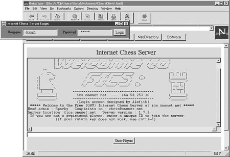

# 列出当前玩家

### Rice.18.3

在独立窗口中添加当前玩家列表比上面的操作有趣得多。我们开发的独立窗口由三列组成。它显示玩家的名字和得分。玩家的名字是一个 `button`，点击它即可与选定玩家创建一个新游戏。显示玩家列表的问题之一与它的动态性有关——列表必须不断更新，以跟随旧玩家的淘汰和新玩家的出现。我们创建了一个单独线程，每分钟更新一次列表。为此，引入了 `Player` 类，包含玩家的 `name` 信息和他的快棋评分。以下是它的原始文本：

```java
public class Player {
    public String name;
    public String blitz;
    public Player(String name, String blitz) {
        this.name = name;
        this.blitz = blitz;
    }
}
```

`PlayerFrame` 类创建一个框架，在其中显示来自 `button` 的名字和分数的列。输入数据通过 `updatePlayerListing` 方法传输：

```java
import java.awt.*;
import java.util.*;
import PackerLayout;
import player;
import ChessClient;

public class PlayerFrame extends Frame {
    private ChessClient parent;
    private Vector playerList;
    private panel topplayers;
    private panel topscores;
    private panel midplayers;
    private Panel midscores;
    private panel lowplayers;
    private panel lowscores;

    public PlayerFrame(ChessClient parent) {
        this(parent, new Vector(0));
    }
}
```

基础构造函数包含两个参数：`ChessClient` 和 `vector` 形式的玩家列表。我们为玩家名字构建了三个面板，为快棋评分构建了三个：


```java
public PlayerFrame(ChessClient parent, Vector v) {
    super("Chess players");
    this.parent = parent;
    topplayers = new Panel();
    topscores = new Panel();
    midplayers = new Panel();
    midscores = new Panel();
    lowplayers = new Panel();
    lowscores = new Panel();
    setLayout(new PackerLayout());
    setBackground(Color.gray);
    add("topplayers;side=left", topplayers);
    add("topscores;side=left", topscores);
    add("midplayers;side=left", midplayers);
    add("midscores;side=left", midscores);
    add("lowplayers;side=left", lowplayers);
    add("lowscores;side=left", lowscores);
    updatePlayerList(v);
    pack();
}
```

`updatePlayerList` 方法更新框架：

```java
void updatePlayerList(Vector v) {
    playerList = v;
    topplayers.removeAll();
    topscores.removeAll();
    midplayers.removeAll();
    midscores.removeAll();
    lowplayers.removeAll();
    lowscores.removeAll();
    int length = playerList.size();
    Enumeration e = playerList.elements();
    int count = 0;
    while (e.hasMoreElements()) {
        Player p = (Player) e.nextElement();
        Button b = new Button(p.name);
        switch (count % 3) {
            case 0:
                topplayers.add(b);
                break;
            case 1:
                topscores.add(b);
                break;
            case 2:
                midplayers.add(b);
                break;
        }
        count++;
    }
}
```

`Menu m = new Menu("Update Listing");`
`whoRefresh = new MenuItem("Refresh Now");`
`whoStopStart = new MenuItem("Start Updating");`
`m.add(whoRefresh);`
`m.add(whoStopStart);`
`whobar.add(m);`

`players = new PlayerFrame(this);`
`players.setFont(fixed);`
`players.setMenuBar(whobar);`

`showhidePlayers = new Button("Show Players");`
`add("showhideplayers;side=top", showhidePlayers);`

如你所示，命令请求是用字符串 `"who an"` 初始。符号 `a` 表示我们想要获取一份当前空闲玩的玩家列表，而字符 `n` 表示我们希望列表以详细的形式呈现，这将有助于解析任务。此外，创建了一个新菜单并将其添加到 `PlayerFrame` 中。最后，在 applet 中创建并添加了一个新按钮来控制窗口。请在 `teams` 方法的开始处添加以下内容——它们创建了新的玩家列表：

`playerList = new Vector(32);`
`player.updatePlayerList(playerList);`

在 `teams` 解析事件中添加了以下内容：

```java
} else if (evt.target == whoRefresh) {
    writeOutput(whoCommand + "\n");
    playerList = new Vector(32);
    waitingForWho = true;
    return true;
} else if (evt.target == showhidePlayers) {
    if (players.isShowing()) {
        players.hide();
        showhidePlayers.setLabel("Show players");
    } else {
        players.show();
        showhidePlayers.setLabel("Hide players");
    }
    return true;
} else if (evt.target == players) {
    writeOutput((String) arg + "\n");
    return true;
}
```

正如你记得，`PlayerFrame` 将 `MenuItem` 事件原封不动地传递给 applet。我们在这里拦截了用户更新列表的请求，向服务器发送命令并将 `waitingForWho` 变量设置为 `true`。此外，我们检查了按钮的状态，以控制玩家列表窗口的可见性。根据测试结果，`PlayerFrame` 的状态变化与其按钮上的标签变化方式一致。如果事件生成了 `PlayerFrame` 对象，则将正在进行的比赛查询传输到服务器。

现在我们需要修改方法 `receiveInput`。这样，当变量被设置为 `true` `waitingForWho` 时，它能够解析从服务器接收到的玩家列表。命令 `"who an"` 回复生成的 `List` 如下：

| name | stand | win | loss | draw | Blitz | win | loss | draw | idle |
|------|-------|-----|------|------|-------|-----|------|------|------|
| MchessPre(C) | 2337 | twenty | 7 | 8 | 2474 | | | | |
| jocelyn | 1970 | one | one | | | | | | |
| StIdes | 1820 | five | five | one | | | | | |

显示。

在给定情况下，我们只对 `Name` 和 `Blitz` 字段感兴趣。列表由单词 `"Name"` 开始跟随 `"Stand"`。虚线字符串被忽略。列表的结束由单词 `"Players"` 定义。这里是 `receiveInput` 方法的新版本：

```java
public void receiveInput(InputStreamHandler ish, Object o) {
    String s = (String) o;

    if (s.trim().equals("") || s.trim().equals("fics%")) {
        return;
    }

    if (s.trim().startsWith("<12>")) {
        parseBoard(s.trim());
    } else if (s.trim().startsWith("{Game")) {
        StringTokenizer st = new StringTokenizer(s);
        String token = st.nextToken();
        // Game String number = st.nextToken(); // number
        ChessFrame frame = (ChessFrame) games.get(number);
        if (frame != null) {
            token = st.nextToken(); // player1
            token = st.nextToken(); // vs.
            token = st.nextToken(); // player2
            token = st.nextToken(); // loser
            frame.endGame(token);
            games.remove(number);
        }
    }
}
```

- 添加一个包含当前游戏列表的窗口，允许玩家像从玩家列表中选择对手一样，选择并观察感兴趣的游戏进程。

# 第 19 章


## 如何编写你自己的服务器：会议调度器

- 合约内容
- 属性规划器
- 用户管理
- 如何安装你自己的服务器
- 项目
- 网络接口模块 服务器
- 安全速度与内存问题项目服务器
- 客户
- 针对特定项目的模块 用户界面模块大纲图
- 实现
- 概述程序
- 模块网络接口
- 针对特定项目的模块 模块自定义接口
- 可能的改进

## 你将从本章中学到什么

在这里，我们使用 Java 创建了一个会议调度器（Meeting scheduler）。我们将详细考虑以下主题：

* 项目服务器。
* 特殊情况的处理。
* 面向对象的项目。
* 文件的读取操作。

熟悉本手册最简单的方法是使用程序小组件浏览器，并运行附带书籍的光盘中的 `examples/ch19/ui.html`。这需要 `net` 输出有输出。如果你无法访问网络，则需要安装本地服务器。具体操作方法在本章的章节中详细描述，如“用户管理”和“如何安装你自己的服务器”。

## 合约内容

想象有一家小公司要求我们创建一个系统，为他们的员工安排会议。这些人大多数在为其他公司工作，但一旦这家公司获得稳定的收入，他们就不介意全职加入这家公司。他们都住在同一个地区，除了一个员工搬到了另一个国家。通过规划器的帮助，将为每位员工创建自己的日程，并缓解与海外员工的连接问题。该程序可以用任何语言编写，但必须运行在各种技术之上，因为小组成员很可能会秘密使用他们目前工作公司的设备。该系统的大多数用户将在不兼容的网络中工作，因此他们无法利用现有的商业规划器。

使用 Internet 和 Java 语言可以简化任务。这样，我们只需要编写一个可以在不同平台上运行的程序。Internet 将让客户端以非常低廉的价格访问国际通信。公司邀请我们立即开始工作——他们希望两周后收到演示版本。

## 属性规划器

会议规划器的主要任务是帮助人们组织时间。此外，它将通过计算小组所有成员工作的时间段，简化普通会议的安排。该程序是流行的调度软件的小实现，类似于 MeetingMaker 或 LotusNotes 附带的调度器。区别在于，我们的会议规划器将在 Internet 上运行。大多数规划器只运行在局域网（LAN）上，如 Novell。使用 Internet 将允许位于不同州界两侧的人员以同样简单的方式使用该程序，就像本地组用户操作那样。

调度器的主要功能是它具有添加和取消预约的能力。因此，必须用 Java 语言创建一个服务器应用程序和一个客户端应用程序。本指南将主要涵盖在 Java 上创建服务器的问题。

### 用户管理

在深入研究服务器设计之前，你可能想先看看它是如何工作的。要尝试该程序，你首先需要访问服务器调度器。默认情况下，程序通过 Online Companion 页面访问服务器。通过选择 File 菜单中的 login 段落，你将登录系统。

与该程序工作非常简单。启动程序并在屏幕上登录后，会出现你当天的日程。你可以查看它，跳转到其他日期，或者用其他日日的日程替换此日程。Add 按钮将允许你向日程表中添加额外项目。

规划器的主要功能——规划他人的会议。以下给出了我们提议公司的员工列表。第一条目在 Bart 的名下，但你可以使用 `Select User` 命令选择不同的用户名：

* Bart
* Liza
* Maggie
* Homer
* Marge
* a piece of chalk
* Krrusty

如果你使用添加功能，你将报名参加此会议。如果你想开启其他人的，只需输入他们的名字。列表在括号中，且必须仅包含总列表中的名称。我们希望你在为他们的虚拟员工规划不同的疯狂会议时获得乐趣！

## 如何安装你自己的服务器

设置自己的服务器并不困难，但有几点需要考虑。服务器程序是一个独立的应用程序。你需要将磁盘光盘上的程序重写到硬盘上。要安装服务器，需要：

1. 创建目录（在示例中我们将其称为 `"server"`）。
2. 从磁盘光盘将 `examples/ch19` 中的文件复制到目录中。
3. 确保卷中的所有 `.dat` 和 `.idx` 文件可用。
4. 运行服务器，输入命令 `java server`。

之后，屏幕上应该出现一条消息，说明服务器正在等待连接（waiting for connection）。如果没有，可能是 `sockets.server` 出了问题。此服务器使用端口 `1666`。你应该配置你的系统以允许程序使用此端口。有关如何做的说明可以在你系统的参考 TCP/IP 服务章节中找到。

## 项目

大多数网络应用程序可以分为三个主要模块：接口、网络接口和特定模块。这种组织方式允许你复用此应用程序。在未来，新项目可能只使用单独的部分——例如网络接口——而不需要使用或理解剩余模块。随着时间的推移，你将开发出一组对象，从这些对象中，所有后续项目将更容易实现。

为了让这些对象作为一个整体工作，它们之间必须有良好的连接。用户界面程序尤其要与 UI 交互，并传递所有其他相关程序组件的操作。假设在点击标记为 login 的按钮。

UI 应该检测到按钮被按下，然后将操作传递给网络模块。

### 模块网络接口

与编写自己的协议相比，在 Internet 上通信是小菜一碟。使用 TCP/IP 时，我们不需要担心数据损坏或数据包超出范围等复杂的通信问题。当然，这不像剥橘子那么简单，但至少你开发了良好的项目，几乎可以忘记这些内部问题。

在最底层，两台计算机之间的通信是 0 和 1 的序列——这种情况对工作调度器几乎没有帮助。通过将此位流结构化为已知的数据类型，我们可以极大地方便你创建调度器和解析数据的工作。Java 有一个专门的类用于这项工作。正如你记得的，在第 13 章“使用套接字和流处理网络”中，我们讨论了流 `DataInput` 和 `DataOutput`。现在这些流将变得非常有用。它们允许你在流中传输 Java 数据类型。服务器可以将 `integer` 放入流中，而客户端可以轻松地读取这个数字——无需任何转换或其他麻烦。唯一需要对某些数据结构达成共识。

我们为消息选择了一个非常简单的模型。每条消息将包含一个描述消息类型的字节，随后是一个变长的消息体。每种类型的消息将匹配相应的例程，能够进行数据分析。这种方案将简化创建多个消息的任务，而且会极大地简化这种解析工作。如果你曾经必须将位流转换为真实数据，你就能体会到它的便利了。

这种方法最大限度地减少了网络流量。我们发送的字节越少，就越好。

如果你最关心数据传输速度，那么这种协议可能不适合你。但如果你最关心编码速度和易于维护，那么你就赢了。我们的方法在发送大型数据文件时可能不会有效，但对于我们的目标来说非常合适。

网络模型就绪后，我们可以开始设计客户端和服务器。通常情况下，它们将包含额外的方法。当一侧发生消息时，另一方必须能够进行分析。我们可以让一切变得完美，并为每条消息创建一个限定文件来识别每个数据元素，并调用解析每条消息的子程序。这是一个好方法，但也有更简单的方法：为每条消息只写一个创建方法和一个解析方法。然而，如果同步性破坏，将会出现问题。生产者上传到线上的所有东西都必须被消费者接收。

关于在网络上进行数据传输的问题，我们有一些关于服务器的特殊注释。在下一节中，我们将详细讨论 Internet 方式的创建。

### 服务器

如果我现在要求你写一个简单的服务器，你可能会采用 Perl 语言方案，使用 `CGI`（通用网关接口），这是很长一段时间内此类请求的标准响应。如果我接着要求你让服务器足够快，你可能会用 C 语言写程序，同样使用 `CGI` 接口。

`CGI` 是一种用于执行 Web 动态功能的协议。`CGI` 接收一些输入，处理它们并创建 `MIME`（多媒体互联网邮件扩展）。这是一个强大的工具，但它也有自己的局限性。`CGI` 基于与网络浏览器的对话。网络浏览器理解 MIME 文档并显示它们，但到此结束。但如果你想获取数据，以某种方式处理它们然后显示出来呢？

如果你用 Java 语言编写服务器，你将获得额外的机会，而在 Java 上启动客户端将把这些机会扩展到几乎无限。客户端可以处理输入数据并以方便的方式呈现。在这种情况下，不仅从服务器减轻了部分负载，而且为客户端提供了更多机会，结果数据表示的形式得到了改进。例如，用户将能够更改字体，系统能够根据显示器尺寸自定义显示数据。

使用 Java 编写服务器取决于个人喜好，有优点也有缺点。一如既往，为了选择最合适的语言，你应该评估你想要得到什么。让我们看看在使用 Java 编写服务器时必须考虑的问题。

### 安全

编写服务器程序涉及一些责任，因为服务器可能是你互联网装甲中最薄弱的一环。编写得糟糕的服务器程序可能会导致机器崩溃，或者更糟，数据丢失。关于互联网黑客的信息，特别是关于如何找到漏洞渗透服务器程序的信息，是公开的。编写服务器是为了传播信息或解决问题；要确保这些信息不是私有的，并且该任务不是破坏性的。

将 Java 作为编写服务器的语言在信息安全方面几乎是理想的，因为在创建 Java 时，考虑了信息的机密性。放置错误的指针不会导致你的系统开放并易受未经授权的人的攻击。重要的是，Java 应用程序的限制比 applet 少。特别是，它可以访问磁盘，所以你应该正确地询问，服务器被允许访问哪些内容。存在一条经验法则：

- 仅允许服务器访问它需要的文件。


确保互联网信息的安全是一个如此重要的课题，以至于可以就此写一整本书。事实上，已经出版了几本这样的书。对于对互联网安全问题感兴趣的人，推荐阅读 O'Reilly & Associates 出版的《Internet Firewall》。书《Web-server》（Ventana）在这一主题上也有很好的章节；此外，此类问题也涵盖在处理一般问题的出版物中。在用 Java 编写的程序中，漏洞出现的概率比 C 程序少，可能也比使用 Perl 脚本更少，但没有一种语言可以给出完全的保证。

## 问：速度与内存

在 Java 上运行程序的执行速度通常与 Perl 语言方案相当。Perl 处理文本的能力更好，但在大多数操作上并不逊于 Java。即时编译 (JIT) 模块即将推出，用于将 Java 字节码程序转换为机器码；这些模块将使你的 Java 程序运行得更快。然而，速度不应是选择项目编程语言的决定性因素；只有在程序执行时间具有根本重要意义的情况下，它才成为决定因素。

服务器本身的设计非常简单。当套接连接建立时，会创建一个新的流来处理请求。该流使用一个名为 `schedule` 对象来响应客户端的请求。到此为止，我们已经拥有这一切。这一切都足够清晰且易于编程。关于该算法实现的具体问题，我们将在“实现：网络接口模块”章节中进行讨论。

## 客户端

能够使用 `Java` 语言来编写客户端，这无疑是极大的幸运。编写大量 CGI 程序以及必须在不同程序之间传输数据的痛苦已成为过去。在过去，Web 开发者在使用 CGI 时，经常会遇到各种困难。即使服务器端本身是一个 CGI 程序，使用 `Java` 作为客户端也是很有用的。在第 17 节“与 CGI 交互：`Java` 商店”中，展示了如何使用 `Java` 与 CGI 程序进行通信。

客户端本身是一个简单的流，用于处理来自网络的数据。它充当传入数据包的分发器。客户端解码数据包并调用相应的程序来处理该数据包。此外，它表现得像一个流，因此就不需要编写另一个程序来在网络上传输数据。

来自服务器的消息像任何其他事件一样被处理。当我们向服务器请求任何内容时，它会将数据发送到网络模块。当数据包被解码后，你可以像处理用户事件一样对其进行操作。因此，网络变成了一个传递消息的简单手段。这种解决方案对于基于概念开发的图形用户界面非常有用。

在理清与网络相关的问题后，我们现在可以转向低层子程序。这些层次构成了我们程序的核心。之后，我们将创建一个自定义接口，在此基础上我们的项目将大告完成。

## 针对特定项目的模块

调度器的骨干是一个包含所有已安排约会的数据结构。客户端和服务器都必须访问这些信息。该结构的实现在不同端可以有所不同，但接口必须是统一的。在这里，最好充分利用 `Java` 接口机制。

我们创建了一个名为 `schedule` 的接口。`schedule` 的概念意味着一个包含该人员计划会议数据的对象，以及修改这些数据的子程序。接口允许我们定义将包含在所有实现 `schedule` 的对象中的方法。我们将决定如何向每个子程序传递什么内容。我们稍后会直接处理多个程序的编程工作，但在当前阶段，项目计划器已经准备就绪。

使用接口允许我们更改 `schedule` 的实现方式，这对于我们的应用程序非常重要。在服务器端，我们将调度存储在磁盘上，并保持其持久化。在客户端端，我们将调度存储在运行内存中，原因有两个：首先，`Java` 不允许用户访问本地文件；其次，我们希望访问调度的速度快。将调度保持在内存中对客户端来说很方便，但想象一下如果服务器机器在内存中存储每个员工的调度将会发生什么！活动服务器可以同时为数千人服务，如此数量的调度将迅速溢出内存。图 19-2 显示了 `schedule` 类的层次结构。

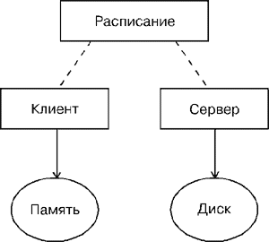

### 图 19.2

这个层次结构非常简单，但它有一些特性。请注意，客户端和服务器都实现了 `schedule` 接口（实现由虚线表示）。而我，它们使用了不同的内部数据结构来保存数据。

随后，我们可以创建另一种类型的调度——例如分布式调度，其中团队的每个成员的 `schedule` 都定位于他们自己的机器上。另一方面，通过我们的磁盘存储系统，我们将在服务器上存储每个调度。每种方法都有其利弊。

无论 `schedule` 如何实现，我们都可以直接将其插入到程序中——一切都能正常工作！接口是一种强大且优雅的开放系统开发方式。当标准设计好后，任何人都可以创建自己的实现。表 19-1 描述了 `schedule` 的所有方法。

#### 表 19-1. schedule 方法

| 方法 | 描述 |
| :--- | :--- |
| `add(scheduleStruct)` | 向调度中添加新约会。 |
| `del(ScheduleStruct)` | 从调度中删除会议。 |
| `find(Date)` | 查找特定日期/时间的会议。 |
| `getUser()` | 返回调度表所有者。 |

考虑设置此接口的程序：

```java
package ventana.scheduler;

import java.io.*;
import java.util.*;
import ventana.util.*;
import ventana.scheduler.*;

public interface schedule {

    // 子程序支持

    public void add(scheduleStruct newSchedule) throws DuplicateException, IOException;

    /*Description:
    * 在调度中添加新会议
    *
    * Exceptions: DuplicateException - 时间段重叠
    * ServerException - 无法连接服务器
    * IOException - 异常 I/O 错误
    */

    public void add(scheduleStruct newSchedule) throws DuplicateException, IOException;

    /*Description:
    * 删除会议
    *
    * Exceptions: NotFoundException - 会议不存在
    * ServerException - 无法连接服务器
    * IOException - 异常 I/O 错误
    */

    public void del(ScheduleStruct del) throws NotFoundException, IOException;

    /*Description:
    * 查找特定日期/时间的调度
    *
    * Exceptions: NotFoundException - 会议不存在
    * ServerException - 无法连接服务器
    * IOException - 异常 I/O 错误
    */

    public scheduleStruct find(Date date) throws NotFoundException, IOException;

    /*Description:
    * 返回与特定日期/时间相关时间表
    *
    * Exceptions: NotFoundException - 会议不存在
    * ServerException - 无法连接服务器
    * IOException - 异常 I/O 错误
    */

    public scheduleStruct[] findRange(Date start, Date end) throws IOException;

    /*Description:
    * 返回所有者的调度
    */

    public String getUser();
}
```

工作计划器从主窗口启动，除了菜单外，那里什么都没有。在菜单中，用户可以选择基本功能，如登录、打开计划和程序配置。若要选择其他功能，您需要进入子菜单。

这一切都非常简单。界面的简洁是构建的程序和 Java 语言共同的结晶。Java 不允许在 applet 上放置菜单，因此我们必须创建一个独立的帧（frame）来容纳菜单。这种方法逐渐会让你的 applet 看起来像整个应用程序，尽管这通常并不坏。因此，我们的项目更接近一个真实的应用程序，而不是网页的扩展——例如，动画器或公告板。

在主菜单中，用户通常会打开计划（`Schedule`）。结果将出现一个看起来像普通日记的东西。它没有华丽的装饰或你喜爱的风景照片。这只是一个功能性界面，从中可以切换到之前或之后一天并添加新的计划点。

不过，如果客户希望计划看起来更智能一些，我们可以在那里添加漂亮的图片。我们的日记如图 19-3 所示。

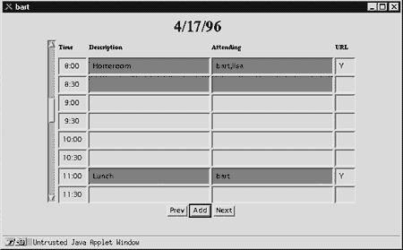

### 图 19.3

其余的窗口很小，每个只包含一个功能。我们在这里没有介绍它们；你可以通过滚动应用程序自行查看。要记住，所有窗口都是独立的帧，这是一把双刃剑——它提供了更大的操作自由度，但需要更多的工作。在项目实现过程中，我们会把注意力放在一些细节上，这些细节在处理帧工作时是非常重要的。

## 大整体

当所有组件组合在一起时，我们得到的是比各个部分更丰富的整体。每个模块都在自己的专业领域内工作，并为其他专业人员提供工作。开发出的模块可以在其他项目中使用。因此，我们可以关注项目的特性，而较少地处理网络通信或数据结构创建等通用任务，这是使用面向对象方法的最大优势之一。在项目开发上花费的时间在创建后续项目时将获得完全的回。图 19-4 高亮了模块之间的链接。

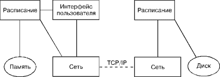

### 图 19.4

设计好系统后，我们可以开始编写程序。在工作的这个阶段，可能需要修改项目（大多数时候不需要，但有时会发生）。因为现在你更好地学会了预测可能出现的困难，并获得了使用 Java 和面向对象项目的经验，你将犯更少的错误，你的整个项目也会变得更整洁。当任何人看到你的项目并说：“是的，这真是一个东西！”时，那种感觉异常愉快。

# 实现

创建一个坚实的项目后，是时候坐下来决定如何实现每个对象，使用哪些数据结构和算法了。你也可以创建一个展示程序主要元素的演示，尽管它的效果不如最终产品有效。使用面向对象的技术允许我们创建几个实现版本，然后从中选择一个最适合给定项目的一个。

一种常见的方法是编写程序时很少关注执行速度和内存，然后回来进行改进。

## 程序概述

本手册包含。为了让项目工作更轻松，它被分成了几个目录。每个目录包含它自己的。

## 网络接口

本指南中的主要链接是服务器的设计和实现。

事实上，服务器执行一个非常简单的循环。它监听一个端口，接受连接，然后启动一个线程来处理请求。这是一个应用程序而不是 applet，这就是为什么 Java 中有一个 `main` 方法。让我们来看主循环的程序：

```java
public class server {

    public static void main(String args[]) throws IOException {

        ServerSocket session = new ServerSocket(1666, 100);

        handleRequests handler;

        Hashtable users = new Hashtable();

        locks schedLocks = new locks();

        System.out.println("Waiting for connections");

        while (true) {

            Socket socket = null;

            try {

                socket = session.accept();

            } catch (SocketException e) {

                // 通常是超时，重试

            }

            if (socket == null) {

                continue;

            }

            System.out.println("Connection made");

            // 为通信创建一个单独线程

            handler = new handleRequests(socket, users, schedLocks);

            // 非重入系统的设置

            handler.setPriority(handler.getPriority() + 1);

            handler.start();

        }

    }

}
```

服务器使用名为 `ServerSocket` 的类。该类通过 `accept` 方法监听端口并建立连接。我们选择了端口 `1666` 并要求的等待时间为 `100` 毫秒。注意 `accept` 方法中的 `try` 块。如果在规定时间内没有建立连接，则会抛出 `SocketException`。在我们情况下，我们将继续执行步骤，直到连接建立为止。

一旦建立连接，我们将创建一个新线程来处理请求。我们创建了一个 `handleRequest` 类来服务连接。由于它是 `Thread` 类的扩展，其主程序包含在 `run` 方法中。该方法的工作方式类似于 `dispatcher`。当 `package`（包）到达时，第一个字节用于定义 `package` 类型。然后调用适当的方法对数据包进行解析。就是这些了——除了分析和查询处理，你就大功完成了。`handleRequest` 类将对客户端请求执行所有操作：

```java
class handleRequests extends Thread {

    DataInputStream in = null;

    DataOutputStream out = null;

    Socket socket = null;

    String user = null;

    Hashtable users;

    locks schedLocks;

    handleRequests(Socket s, Hashtable users, locks schedLocks) throws IOException {

        socket = s;

        in = new DataInputStream(new BufferedInputStream(socket.getInputStream()));

        out = new DataOutputStream(new BufferedOutputStream(socket.getOutputStream()));

        this.users = users;

        this.schedLocks = schedLocks;

    }

}
```

在此类的构造函数中，给定了 `socket`、哈希表以及一个锁对象类。

让我们检查每个组件并看看它们在服务器中扮演什么角色。当连接建立时，系统在用户和服务器之间创建一个 socket。这个 socket 代表一个双向通道，你可以用它与服务器通信。无论用户位于何处，是在相邻的车还是 Sveta 的其他部分——没关系——连接的工作都是相同的。socket 创建了两个流：输入流和输出流。首先，让我们为输入和输出流创建缓冲区并过滤数据。

不要忘记为了实现我们的目标，你可以放置各种过滤器，在这种情况下是缓冲区过滤器和数据过滤器。缓冲区过滤器用于高效访问流。到达通道的字符被临时存储在 `buffer` 中。这使得更高效地读写大型数据集成为可能。缓冲区流允许你随着通信速度的增加而增加传输的数据。我们可以写一个 64 字节的数据包，但它将以每单位时间一个字节的速度写入。`write` 命令将能够写入这些数据并继续运行，而不需要等待整个流写入。这将使数据传输更加紧凑，并允许程序运行更顺畅。

数据过滤器用于为了跨流发送简单类型，这将提供直接写入整数和字符串等数据项而无需解析它们的能力。使用数据过滤器将使我们的读取和记录更加方便。

构造函数的第二个参数是一个自定义哈希表，用于跟踪所有登录到我们服务器的用户。此信息被用于通知所有用户日程的更改。在这里应用了一种并不十分有效的算法，它会通知所有用户日程的任何变化。如果只通知每个用户其个人日程中的变化会更好，但这将产生跟踪个人日程的问题，并需要额外的额外的消息来记录每个用户何时打开或关闭日程。对于给定的目标，我们利用更简单的实现就足够了。

最后一个参数是 `schedLocks` 对象。此对象用于锁定文件。你不能允许两个用户同时修改文件。为了避免这种情况，程序在在使用文件之前锁定它，在工作完成后解锁。虽然这保护了文件，但使用写阻塞会更好。死锁和数据损坏问题将在第 11 章“多线程”中讨论。

创建流后，我们调用 `start` 方法。此后系统会触发流的 `run` 方法。

我们 `handleRequest` 类的 `run` 方法非常简单且有效，类似于 `dispatcher`。不同之处在于它处理可能发生的任何异常。以下代码片段演示了我们帖的分析器：

```java
public void run() {

    byte b;

    boolean cont = true;

    try {

        loginRequest();

        while (cont) {

            b = in.readByte();

            switch (b) {

                case packetTypes.login:
                    loginParse();
                    break;

                case packetTypes.logoff:
                    cont = false;
                    break;
```


```java
case packetTypes.reqSchedule: reqSchedule(); break;
case packetTypes.addMeeting: addMeeting(); break;
default: System.out.println("Unknown type");
}
}
out.close();
in.close();
socket.close();
} catch (IOException ignore) {
System.out.println("IO exception, thread stopped");
stop();
} catch (Exception e) {
System.out.println("Unknown error, thread stopped");
e.printStackTrace();
stop();
} finally {
users.remove(user);
schedLocks.unlock(user);
}
}
```

让我们看看这个块中的异常处理。总假设是我们可以允许某些连接中断，但我们希望服务器继续工作。问题是不允许一个线程破坏其他线程。

服务器的主部分是 `requests`。与此同时，这是这些。让我们看看这个块中的异常处理。

```java
public void loginRequest() throws IOException {
    System.out.println("Requesting");
    out.writeByte(packetTypes.login);
    out.flush();
}

public void loginParse() throws IOException {
    byte paktype;
    user = in.readLine();
    System.out.println("User " + user + " logged in");
    users.put(user, this);
}

public void reqSchedule() throws IOException {
    String user;
    Date start, end;
    scheduleStruct result[];
    user = in.readLine();
    start = new Date(in.readLong());
    end = new Date(in.readLong());
    System.out.println("Schedule Request for " + user);
    System.out.println("Start: " + start.toString());
    System.out.println("End: " + end.toString());
    try {
        schedLocks.lock(user);
        serverSchedule schedule = new serverSchedule(user);
        result = schedule.findRange(start, end);
        out.writeByte(packetTypes.getSchedule);
        out.writeBytes(user + "\n");
        if (result == null) {
            out.writeInt(0);
            out.flush();
            return;
        }
        out.writeInt(result.length);
        System.out.println("Recs to send: " + result.length);
        for(int i=0; i < result.length; i++) {
            System.out.println("Meeting: " + result[i].desc);
            out.writeLong(result[i].start.getTime());
            out.writeLong(result[i].end.getTime());
            out.writeBytes(result[i].desc + "\n");
            out.writeBytes(result[i].descURL + "\n");
            out.writeBytes(result[i].minutesURL + "\n");
            out.writeBytes(result[i].attending + "\n");
        }
        out.flush();
        System.out.println("Schedule sent");
    } finally {
        schedLocks.unlock(user);
    }
}

public void addMeeting() throws IOException {
    // Implementation for addMeeting
}

public void stop() {
    // Implementation for stop
}
```

`reqSchedule` 方法是服务器上最大的数据提供者。在获取临时的 `interval` 和 `name` 用户后，它将发送在此时间段内预约的所有会议数据。客户端使用此程序来填充本地的 `schedule` 对象。数据从 `help` 对象 `serverSchedule` 读取，然后以消息格式发送。

为了让 `Togo` 发送此消息，需要知道 `length` 字段，以便指定 `analyzer` 它需要等待多少条记录。如果用户的日程非常忙，消息可能会变得过长。客户端的设计必须请求合理时间范围内的数据——例如，一天或可能是一周。我们没有设置最大跨度——只是发送可能不需要的大量数据并不妥当。

接下来的一对子程序添加新会议。这可能是系统中最困难的任务之一。我们已经开发了一套良好的所需功能，尽管可能还有更多：

```java
public void addNAK(String s) throws IOException {
    out.writeByte(packetTypes.addNAK);
    out.writeBytes("AddMeeting: " + s + "\n");
    out.flush();
}

public void addACK() throws IOException {
    out.writeByte(packetTypes.addACK);
    out.flush();
}

public void scheduleChange(String s, Date start) throws IOException {
    System.out.println("Schedule changed:" + s);
    out.writeByte(packetTypes.scheduleChange);
    out.writeBytes(s + "\n");
    out.writeLong(start.getTime());
    out.flush();
}
```

`addNAK`、`addACK` 和 `scheduleChange` 是通知程序。`NAK`（负面确认）表示新预约未添加。它接收一个发送给用户的字符串。常见的错误是日期或时间错误，以及尝试在已经忙碌的时间填充。消息 `ACK`（已确认）由系统发出，表示新会议添加成功通过。

当有人更改日程时，`scheduleChange` 消息会发送给所有当前用户。在这种情况下，客户端查看该人的日程并决定是否有必要重新调度。客户端侧当前信息的可用性将帮助用户防止日程冲突。现在考虑程序添加 `addMeeting` 会议：

```java
public void addMeeting() throws IOException {
    String line;
    String dateline;
    scheduleStruct ss = new scheduleStruct();
    dateLine = in.readLine();
    line = in.readLine();
    try {
        ss.start = new Date(dateLine + " " + line);
    } catch(IllegalArgumentException e) {
        System.out.println("Illegal argument, abortion");
        in.readLine();
        in.readLine();
        in.readLine();
        in.readLine();
        addNAK("Error converting start date");
        return;
    }
    line = in.readLine();
    try {
        ss.end = new Date(dateLine + " " + line);
    } catch(IllegalArgumentException e) {
        System.out.println("Illegal argument, abortion");
        in.readLine();
        in.readLine();
        in.readLine();
        addNAK("Error converting end date");
        return;
    }
    ss.desc = in.readLine();
    ss.attending = in.readLine();
    ss.descURL = in.readLine();
    // lexical analysis meetings, this text in brackets
    int pos;
    String st, st2;
    handleRequests hr; Enumeration e;
    st = new String(ss.attending + ",");
    if (st == null) {
        addNAK("Attending field blank");
        return;
    }
    st = st.trim();
    while ((pos = st.indexOf(',')) != -1) {
        st2 = st.substring(0, pos);
        System.out.println("Attending: " + st2);
        st = st.substring(pos + 1);
        schedLocks.lock(st2);
        serverSchedule sched = new serverSchedule(st2);
        try {
            System.out.println("Adding: " + ss);
            sched.add(ss);
        } catch(DuplicateException bad) {
            addNAK(st2 + " already scheduled");
        }
        schedLocks.unlock(st2);
        e = users.elements();
        while(e.hasMoreElements()) {
            hr = (handleRequests) e.nextElement();
            hr.scheduleChange(st2, ss.start);
        }
    }
    addACK();
}
```

`addMeeting` 方法可以分为三个部分：1) 解析与验证，2) 实际添加到数据库，以及 3) 通知。每当发生错误时，都会发送一个 `addNAK` 数据包。客户端必须告诉用户错误是什么。然后他们可以调整输入数据并再次发送包。

在分析和验证阶段，必须确保 `data` 的 `correctness`。

## 针对给定项目的特定模块

客户端和服务器都以最符合它们共同利益的方式使用 `schedule` 接口。客户端运行某些数据保护——例如，数据存储在磁盘上。这意味着我们应该在网络上请求日程信息。

### 客户端日程

`ClientSchedule` 使用哈希表实现，允许快速且紧凑的数据保存。

```java
public class clientSchedule implements schedule {
    Hashtable memoryStore = new Hashtable();
}
```

`clientSchedule` 类实现了 `schedule` 接口。该类为我们之前描述的接口提供了程序。使用接口的便利之处在于大量的应用，如果你不喜欢给定的实现，可以编写自己的。你甚至可以提取程序中的某些片段来使用，并替换那些你不喜欢的部分：

```java
public void add(scheduleStruct newSchedule) throws DuplicateException, IOException {
    if (memoryStore.put(newSchedule.start, newSchedule) != null) {
        throw new DuplicateException();
    }
}
```

`add` 方法用于添加新的预约。关于这个程序，我们有两个重要的说明。一个关于如何将新项放入哈希表中。我们必须拥有数据和键（在这种情况下，它是会议的开始日期），并且它们都是对象。哈希表在每个键上只存储一个对象。因此，如果我们尝试同时记录两个预约，将会得到错误。这种系统可以工作，前提是大多数人不会同时参加两个会议。

第二个重要的说明关于抛出异常的方法。记住，我们必须描述方法操作过程中可能发生的所有异常。显然，`add` 方法只能抛出一种异常 - `DuplicateException`。`IOException` 是哈希表的 `put` 方法抛出的。由于我们在这里不处理错误，我们将它们传递给调用方法。在处理位于内存中的数据结构时，不太可能遇到 `IOException`，但这个问题同样不小。如果发生这种情况，让程序员解决这个任务。

抛出 `DuplicateException` 而不是返回错误代码。在这种情况下，这并不非常重要，但稍后我们将使用返回值来获取必要信息。然后我们希望保持返回值不变。返回值执行了两个任务：它返回一个数字，并在发生严重错误时返回 -1。异常允许你轻松地解决这个问题，如下面的代码段所示：

```java
public void del(scheduleStruct del) throws NotFoundException {
    if (memoryStore.remove(del.start) == null) throw new NotFoundException();
}

public scheduleStruct find(Date date) throws NotFoundException {
    scheduleStruct ss;
    ss = (scheduleStruct) memoryStore.get(date);
    if (ss == null) {
        throw new NotFoundException();
    }
}
```


`delete` 和 `find` 方法非常简单，几乎是不言自明的。对于返回的错误信息，再次使用了异常。两个哈希表方法（`get` 和 `remove`）都返回请求信息的引用值。如果未找到键值，则返回零。在这种情况下将生成未找到的异常。

最后一个方法是 `findRange`。在这里让我们使用编号，这将有助于我们返回数据值。`findRange` 方法接收一个时间范围并返回该期间内的所有预约。由于哈希表不包含关于时间间隔的数据，你必须进行顺序搜索。但哈希表实现了 `numbering` 接口。这允许顺序查看哈希表。

我们将查看两次表。在第一次查看时，我们将确定将返回的会议数量，在第二次查看时，填充结果数组。我们被迫这样做，是因为数组的至少一个维度的大小在创建时必须确定。注意，我们调用了两次哈希方法的元素。每次查看编号后，它都会被销毁。每次新的调用都需要重新创建编号。以下是 `findRange` 方法的程序：

```java
public scheduleStruct[] findRange(Date start, Date end) throws IOException {

    Enumeration list = memoryStore.elements();

    scheduleStruct ss;

    int cnt = 0;

    // 认为元素数量

    while (list.hasMoreElements()) {

        ss = (scheduleStruct) list.nextElement();

        if (start.getTime() <= ss.start.getTime() && end.getTime() >= ss.end.getTime()) {

            cnt++;

        }

    }

    if (cnt < one) return null;

    scheduleStruct result[] = new scheduleStruct[cnt];

    // 再次销毁编号

    list = memoryStore.elements();

    // 创建结果数组

    cnt = 0;

    while (list.hasMoreElements()) {

        ss = (scheduleStruct) list.nextElement();

        if (start.getTime() <= ss.start.getTime() && end.getTime() >= ss.end.getTime()) {

            result[cnt++] = ss;

        }

    }

    return result;

}
```

以上就是适用于 `clientSchedule` 的所有内容。利用哈希表，我们将大部分工作交给了一个已经创建并调试过的类。这种对已完成工作的重复利用让我们更快地编写程序并且错误更少。

### 服务器调度

调度服务器要复杂一些，因为我们将处理存储在磁盘上的数据结构。为了处理规模巨大的数据库，服务器实现应该尽可能高效。我们将数据存储在线性文件中，但为了执行更快的搜索，将使用索引文件。如果对工作索引文件感兴趣，查看 `schedule/IndexFile.java`。它的程序简单但太长，无法包含在这里。这里是 `serverSchedule` 的程序：

```java
public class serverSchedule implements schedule {

    IndexFile index;

    RandomAccessFile dataFile;

    public serverSchedule(String user) throws IOException {

        this.user = user;

        index = new IndexFile(user + ".idx", "rw", Size, Size);

        dataFile = new RandomAccessFile(user + ".dat", "rw");

    }

}
```

该类的构造函数包含一个标识用户的字符串。此行用于创建索引文件和数据文件名。注意此程序会返回 `IOException`。如果服务器没有写入文件的权限，就会发生这种情况 —— 你应该在程序中找到这个错误。对于数据存储，我们使用 `RandomAccessFile`。文件以读写模式（访问代码为 "rw"）根据用户名和 `.dat` 扩展名命名。是的，对于名为 maggie 的用户，数据文件将命名为 `maggie.dat`。接下来的部分在调度中添加预约：

```java
public void add(scheduleStruct newSchedule) throws DuplicateException, IOException {

    String key;

    String data;

    long conv;

    long pos;

    dataFile.seek(dataFile.length());

    pos = dataFile.getFilePointer();

    dataFile.writeLong(newSchedule.start.getTime());

    dataFile.writeLong(newSchedule.end.getTime());

    dataFile.writeBytes(newSchedule.desc + "\n");

    dataFile.writeBytes(newSchedule.descURL + "\n");

    dataFile.writeBytes(newSchedule.minutesURL + "\n");

    dataFile.writeBytes(newSchedule.attending + "\n");

    conv = new Long(newSchedule.start.getTime());

    key = conv.toString();

    key = StringUtil.padStringLeft(key, ' ', Size);

    conv = new long(pos);

    data = conv.toString();

    data = StringUtil.padStringLeft(data, ' ', Size);

    index.addRecord(key, data);

}
```

`add` 方法必须将元素添加到数据文件并添加到索引文件中。

### RandomAccessFile 与数据操作

`RandomAccessFile` 位于 `DataOutput` 和 `DataInput` 过滤器之上，因此我们可以直接读写 Java 类型。如果能直接写入对象就太好了，但遗憾的是，并没有提供这种可能性。另一个重要的点是：我们使用了 `writeBytes` 方法。它以 8 位字节的形式写入数据。如果我们使用 `writeChars` 方法，那么每个字符将占用 16 位。`writeUTF` 方法将写入 16 位的 Unicode 字符。如果你打算使用 `readLine` 方法，则需要使用 `writeBytes`。目前不存在对应的可以读取 `writeChars` 输出的读取方法。

另请注意，每行之后都有一个 `"\n"`。在接下来的内容，我们将使用 `readLine` 方法 —— 它将回车符识别为行结束符号。这允许设置变长度的字符串，从而节省空间并使得无需手动解析字符串。

`index` 文件包含两个元素：`key` 和 `data`。这两个元素具有固定长度。索引元素是开始日期，我们将其保留为 `long` 类型的值。为了方便读取索引文件，它以字符串形式存储。数据存储在数据文件的偏移位置处，并以字符串格式存储。如果我们想减小索引文件的大小，可以将这些值存储为 `long` 类型，而不是字符串：

```java
public void del(scheduleStruct del)

throws not found exception, IOException {

    Long conv;

    String key;

    String data;

    long pos;

    conv = new Long(del.start.getTime());

    key = conv.toString();

    key = StringUtil.padStringLeft(key, ' ', Size);

    data = index.findRecord(key);

    conv = new Long(data.trim());

    pos = conv.longValue();

    // 现在可以删除 pos 处的数据，

    // 但我们不会这样做

    index.delRecord(key);

}
```

`delete` 方法只破坏索引文件中的一个元素。如果我们破坏 `data` 文件中的元素，文件中会出现空洞。为了消除它，我们必须将文件中所有的 `data` 移动到开头，并替换 `index` 文件中的所有相关元素。这种操作在压缩程序中很常见，但很少执行。磁盘空间足够廉价，我们可以负担程序运行得快一点，并只定期对数据库进行操作。下面的代码段展示了如何对存储在磁盘上的 `schedule` 执行 `find` 方法：

```java
public scheduleStruct find(Date date)

throws not found exception, IOException {

    scheduleStruct result;

    long pos;

    Long conv;

    String key;

    String data;

    conv = new Long(date.getTime());

    key = conv.toString();

    key = StringUtil.padStringLeft(key, ' ', Size);

    data = index.findRecord(key);

    conv = new Long(data.trim());

    pos = conv.longValue();

    return findPos(pos);

}

public scheduleStruct findPos(long pos) throws IOException {

    scheduleStruct result = new scheduleStruct();

    dataFile.seek(pos);

    result.start = new Date(dataFile.readLong());

    result.end = new Date(dataFile.readLong());

    result.desc = new String(dataFile.readLine());

    result.descURL = new String(dataFile.readLine());

    result.minutesURL = new String(dataFile.readLine());

    result.attending = new String(dataFile.readLine());

    return result;

}
```

此方法由两个子程序组成。第一个由 `schedule` 接口定义，它遍历 `index` 文件并在 `data` 文件中找到所需元素的位置。第二个子程序 —— `findPos` —— 用于从 `data` 文件中恢复数据。这里应用了 `readLine` 方法。我们查找相关位置并从 `data` 文件中读取每个字段。

第一个是 `WINDOW_DESTROY`。当用户在窗口管理器中选择销毁函数 `destroy` 时就会发生。系统的实际机制取决于特定版本的窗口管理器，但它通常允许用户销毁窗口。当这种情况发生时，剩下的就是我们优雅地退出了。调用该方法是为了清除帧 `release` 内存，这会 `free` 所有使用的系统资源，并从曾经需要此机制退出应用程序的系统中出来。

另一个重要的事件与菜单相关的 `ACTION_EVENT`。为了弄清楚此事件发生在哪个 `MenuItem` 上，让我们使用 `instanceof` 运算符。由于我们只有一个菜单，所以很显然该事件就发生在那里。要找到按钮菜单的名称，我们可以查看 `evt.arg`。然后我们让该按钮调用 `subroutine` 来执行工作。

在处理帧的开发工作时，请记住，它们不会产生链式事件。

每个帧都是一个独立的对象，没有真正的父节点。如果你认为 `Unhandled` 事件将传递给新窗口（例如，applet），那么你就错了。你必须在本地处理开发，或者以显式形式将事件传递给 applet：

```java
public boolean handleEvent(Event evt) {

    if (evt.id == Event.WINDOW_MOVED) {

    }

    else if (evt.id == Event.WINDOW_DESTROY) {

        dispose();

    }

    else if (evt.id == Event.ACTION_EVENT) {

        if (evt.target instanceof MenuItem) {

            String st = (String)evt.arg;

            if (st.equals("Quit")) {

                quit();

                return true;

            }

            else if (st.equals("Login")) {

                login();

                return true;

            }

            else if (st.equals("Open Schedule")) {

                open();

                return true;

            }

            else if (st.equals("Server Name")) {

                snFrame sname = new snFrame("Change sname");

                sname.init();

                sname.show();

                return true;

            }

            else if (st.equals("User Name")) {

                unFrame uname = new unFrame("User name", owner);

                uname.init();

                uname.show();

                return true;

            }

            else

                System.out.println("Menu: " + (string) evt.arg);

            return true;

        }

    }

    return false;

}
```

`acFrame` 类用于向系统添加新预约。精简后的程序演示了非标准布局管理器的使用。我们使用了 `TK` 管理器包。如果你不喜欢 Java 布局管理器的工作方式，你可以编写自己的。例如考虑 `ventana/awt/PackerLayout.java`：

```java
class acFrame extends frame {

    ui owner;

    panel datePanel = new Panel();

    panel timePanel = new Panel();

    label mdLabel = new Label("Meeting date");

    TextField mdField = new TextField(7);

    Label tsLabel = new Label("Time Start");

    TextField tsField = new TextField(4);

    Label endLabel = new Label("End");

    TextField endField = new TextField(4);

    panel dataPanel = new Panel();

    Panel labPanel = new Panel();

    panel fieldPanel = new Panel();

    label descLabel = new Label("Description");

    TextField descField = new TextField(40);

    label attendLabel = new Label("Attending");

    TextField attendField = new TextField(40);

    Label urlLabel = new Label("URL");

    TextField urlField = new TextField(40);
```


```java
panel buttonPanel = new Panel();

Button schedButton = new Button("Schedule");

Button cancelButton = new Button("Cancel");

public acFrame(String s, String user, ui owner) {

    super(s);

    this.owner = owner;

}

public void init() {

    setLayout(new PackerLayout());

    datePanel.setLayout(new PackerLayout());

    timePanel.setLayout(new PackerLayout());

    datePanel.add("mdLabel;side=left", mdLabel);

    datePanel.add("mdField;side=left", mdField);

    timePanel.add("tsLabel;side=left", tsLabel);

    timePanel.add("tsField;side=left", tsField);

    timePanel.add("endLabel;side=left", endLabel);

    timePanel.add("endField;side=left", endField);

    dataPanel.setLayout(new PackerLayout());

    labPanel.setLayout(new PackerLayout());

    fieldPanel.setLayout(new PackerLayout());

    dataPanel.add("labPanel;side=left", labPanel);

    dataPanel.add("fieldPanel;side=left", fieldPanel);

    labPanel.add("descLabel;anchor=w;ipady=3", descLabel);

    labPanel.add("attendLabel;anchor=w;ipady=3", attendLabel);

    labPanel.add("urlLabel;anchor=w;ipady=3", urlLabel);

    fieldPanel.add("descField", descField);

    fieldPanel.add("attendField", attendField);

    fieldPanel.add("urlField", urlField);

    buttonPanel.setLayout(new PackerLayout());

    buttonPanel.add("schedButton;side=left;padx=5", schedButton);

    buttonPanel.add("cancelButton;side=left", cancelButton);

    add("datePanel;anchor=w;pady=5", datePanel);

    add("timePanel;anchor=w;pady=5", timePanel);

    add("dataPanel;anchor=w;pady=5", dataPanel);

    add("buttonPanel", buttonPanel);

}

}
```

创建一个即使是简单的页面也是一项无聊的任务。使用 `PackerLayout` 要容易得多，尽管编写屏幕元素的布局可能也许不是一项迷人的工作。新的集成开发环境（IDE）很快将允许你在屏幕上移动组件。然后你就可以创建一个 AWT 程序。你只需要处理事件并将程序胶接在一起。

# 可能的改进

我们创建的只是一个会议基础 applet。要添加我们需要的所有属性，可能需要几周时间。Ultimate Scheduler 可以做很多事情，程序将会变得非常长。如果你想扩展程序功能，可以考虑以下机会：

* 添加通用的每周/每月视图。
* 允许用户或公司设置忙日期或周末。
* 为一组人指定计算机选择特定长度的时间间隔。
* 管理安全信息，例如定义允许安排特定日程的人员。
* 包装电子邮件消息：
    * 通知用户他的日程已更改。
    * 关于重要会议或日期的警告（例如结婚纪念日）。
* 允许安排资源的使用——例如会议室和音视频设备。
