# Java 面试训练营：寻找并获得下一份 Java 开发职位的方位指南

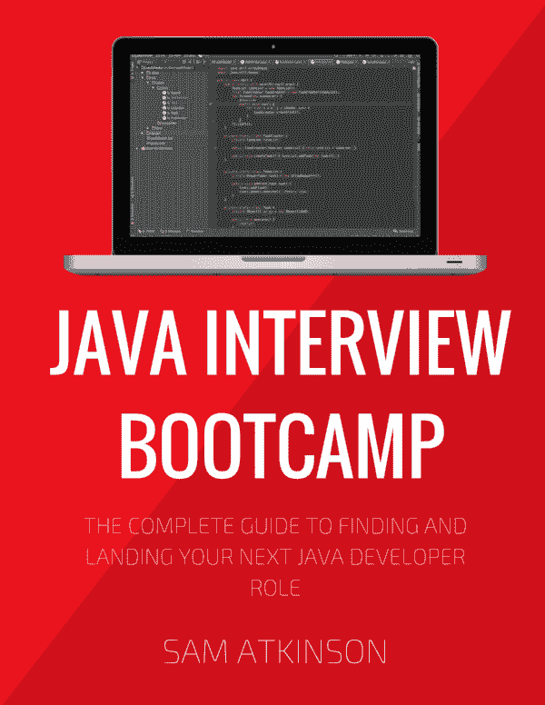


本书可在 [`leanpub.com/javainterviewbootcamp`](http://leanpub.com/javainterviewbootcamp) 购买


---

这是一本 [Leanpub](http://leanpub.com) 的书。Leanpub 通过精益出版流程为作者和出版商赋能。[精益出版](http://leanpub.com/manifesto) 是使用轻量级工具和多次迭代来发布进行中的电子书，以获取读者反馈，不断调整直到拥有正确的书籍，并在一旦成功后建立影响力。

---

致 Laura。感谢你在我写这本书和建立网站期间（几乎）忍受了我的陪伴。你太棒了。

致 Mike & Dan，感谢你们提供极佳的支持网络，并一直听我没完没了地谈论 CJIQ。

致 Ryan，感谢你无尽的热情、支持和编辑才华。

## 引言

欢迎来到 Java 面试训练营。首先，我想非常感谢你购买这本书。我希望你喜欢阅读这本书，但更重要的是，它能帮助你获得下一份很棒的工作。

帮助 Java 开发者通过面试过程是我非常热情的事情。在我的职业生涯中，我面试过数百人，从最初级的开发者到最资深的技术主管。其中出现了一些贯穿始终的主题，这些驱动了我编写这本书以及创建 `www.corejavainterviewquestions.com` 的愿望。

这本书分为两个部分：面试流程和核心 Java 知识复习。当有人面试你时，他们希望确保你具备技术能力，但也想知道你是否是一个可以每天共事的人。在书的前半部分，我们涵盖了不同类型的面试，以及作为候选人你可以做什么来为你未来的雇主留下最好的印象。

本书的后半部分是对核心 `java` 的从零开始的复习。事实是，在大多数面试中，技术问题与我们的日常编程几乎没有相似之处。我发现大多数面试流程甚至不涉及编程阶段。相反，公司喜欢问一些晦涩的线程问题，或者要求你在白板上用 `java` 代码来反转字符串。这些是否是好的面试题并不是本书的主题。简单的事实是，你必须为这些问题做好准备，这意味着要花一些时间来复习基础的核心 `java` 原则。

我希望你在这里找到你需要的一切。如果你有任何问题、疑问，或者只是想聊聊，可以发送邮件到 `hello@corejavainterviewquestions.com` 联系我。我一直会回复的。

如果你还没有成员，别忘记访问 `www.corejavainterviewquestions.com` 并订阅邮件列表。里面充满了大量的有价值的信息和惊喜。

最后，也是同样重要的一点：祝你所有面试顺利。我确信你会表现得非常出色。

**Sam Atkinson，《Java Interview Bootcamp》作者。**

## 第一部分：软技能与流程

尽管这是一本侧重于 `Java` 的书，但我诚实地认为本书的前半部分将为你提供最大的价值。你是一个 `Java` 开发者。你应该已经对自己在做什么有所了解（我希望如此）。本书的后半部分专注于核心 `java` 和相关问题，是复习并帮助重新学习某些你一段时间未触及领域的绝佳方式。

然而，事实是，对于大多数候选人来说，挣扎不在于技术方面，而在于软技能。忽视握手或良好的第一印象的重要性将让我们自食其果。这些是我们“极客”不擅长的领域。我们不喜欢与人交谈，也不喜欢做演示。是的，这些是概括，但根据我见过的候选人来说，这些说法往往是事实。

在第一部分上下下功夫。读两遍，边读边做笔记。思考哪些事是你不知道但需要开始做的事情，思考你哪里是薄弱并需要改进的，然后去练习。无论是和同事还是爱人，在面试之前都要实际采取行动去尝试。这样做，我保证你将为自己的求职之旅做好最好的准备。

## 面试流程

也许你是一个刚从大学毕业的应届生，从未找过工作，现在你完全不知道自己在做什么。或者，可能只是你上一次换工作已经有一段时间了。根据我的经验，开发者分为两类：极度多变，每 1-2 年换一次工作；另一种是极度忠诚，在一家公司留了 8 年之久。如果你特别属于后者，那么重新投身现实世界可能会令你感到畏惧。

本书的前几节将详细介绍与面试流程相关的每个阶段，但首先让我们从 50,000 英尺的高度来看整个流程。

### 第 1 阶段：申请工作

通往更好职业的第一步简单地将你的简历递到某人的桌上。但你如何做到呢？

取决于你的行业，第一个选择可能是猎头。猎头在公司和潜在员工之间担任中介，招聘公司根据他们成功安置人才获得报酬。特别是在金融行业，猎头是让你的简历被看到的唯一选择，因为大多数公司没有简单的方法直接提交你的简历。

猎头有优有劣。他们可以接触整个市场，知道有哪些可用职位，并节省了你手动搜索职位的时间。这节省了大量精力和时间。他们处理与新公司的互动，所以你不需要写求职信或直接联系人员。但反过来，并不是所有的猎头都是平等的。有些人非常有才华，只会向你推荐他们认为你能够胜任的职位；他们会引导你完成整个过程，并且理解并与你合作以获得合适的职位。然而，那里有很多人缺乏诚信，他们只专注于让你找到某份工作（无论是什么工作），以便他们能拿到报酬。

最好的办法是和经历过这一过程的朋友和同事交谈，看看他们会推荐谁。我个人非常推荐 `iKas` (`http://www.ikasinternational.com/`)，它们在伦敦、纽约、澳大利亚、新加坡和香港设有办事处；以及专门针对香港的 `BAH partners` (`http://www.bahpartners.com`)。

如果猎头不是一个选项，那么就要做好加倍努力准备。你必须手动寻找职位并提交申请和求职信。但你如何找到这些职位呢？网上有很多地方可以去寻找职位：

*   `http://careers.stackoverflow.com/`
*   `HackerNews` (`https://news.ycombinator.com`) 上的每月“who’s hiring”帖子
*   LinkedIn。它是一座金矿。网站上有直接广告的职位，你也可以搜索你喜欢的公司并关注它们，因为它们会发布职位。在小组部分搜索“Java Jobs”等术语，可以找到公司直接发布职位的组。
*   招聘网站和职位公告板，如 `jobaware.com`、`indeed.com`、`craigslist`

这不是有趣的过程。你将被要求反复填写你的基本信息，而且你可能需要为每个职位编写求职信。但这意味着你可以针对特定的公司、职位或领域定制你的搜索。

### 第 2 阶段：面试

每家公司都有不同的招聘流程。虽然一家公司在做决定前与你面对面面试一小时，另一家公司可能会让你通过 7 个阶段的测试和面试。如果可能，尽早询问流程。你的猎头或招聘经理应该能告诉你。这应该给你提供最大的准备机会。

以下是你可能会遇到的常见面试类型：

## 电话面试

电话面试通常出现在招聘流程的早期。它们是筛选候选人的很好的方法，在邀请他们进行更长时间、更深入面试之前。面试将持续 15 分钟到一小时不等，并专注于有限的技术问题。在电话上进行限制了可以提的问题性质，因为所有问题都必须是口头的。缺乏白板或纸笔往往会让面试非常理论化或基于经验，缺乏很多设计。

偶尔电话面试可能会出现在周期的后期，通常作为最后一轮。这通常是在你通过了所有其他阶段之后，需要签字的经理想和你聊聊。这应该只是一个形式，通常涉及关于你的经验以及你对职位的要求的问题。

#### 居家技术测试

我非常推崇给候选人发送家庭作业。它允许你在没有面试环境压力的情况下证明自己在技术上是可行的。通常，这项练习将花费一到三小时，并要求你为一个问题开发一个有效的解决方案，可能涉及对复杂需求的理解、某种算法以及可能的一些线程。重要的一点是在提交之前，花费必要的时间产出让你自豪的代码。任何拥有这一阶段的团队都会非常看重代码质量，因此不要走捷径。

#### 办公内技术测试

如果你被要求参加技术测试，会有更广泛的可能性。它可能是与家庭测试完全等同的形式；许多公司不信任候选人不会在家里作弊（根据我的经验，我知道这确实会发生），因此他们要求你在办公室完成练习。不过，通常这种测试会短得多，最多只需要一小时。

与单一练习相比，你可能会收到一系列像考试那样的较小问题。这允许针对特定领域提出更有针对性的问题，并且意味着如果你失败了其中一个部分，仍然可以以优异的成绩通过其余部分。

我最喜欢的方法是结对编程测试。在这种情况下，你将与招聘团队的成员坐在一起，共同完成一项预设的练习。除了测试你的技术能力外，结对练习还让招聘团队看到你的工作方式。你熟练掌握键盘快捷键吗？你会先写测试吗？你为什么选择这样设计？如果你获得了这份工作，你们将非常紧密地合作工作，未来可能持续多年。不仅他们是否喜欢你的代码风格很重要，你喜欢他们的风格同样重要。

## 面试

面对面面试是你获得工作的最佳机会，无论它们处于流程的哪个阶段。简单的事实是，人是有偏见的。如果你能向面试官有力地推销自己，那么那个人就会成为你最大的推销员。“我面试了这个人，他真的很棒，我们必须把他招进来。”通常，只需要说服一个人就能让整个面试流程顺畅运行。

面对面面试可能涵盖最广泛的问题和话题。可以使用纸、笔或白板，这使其成为提问设计问题的最佳形式。准备好会被就你以前工作过的系统进行“拷问”，或者被要求根据需求设计某些东西。同样，面试官喜欢让人们编写伪代码，特别是关于创建搜索或排序算法的问题。这为一些大 O 类型的问题铺平了道路，但更重要的是它让你的潜在雇主获得了一个观察你如何解决问题的机会。

### 一对一

最简单的面试。人对人，通常持续一小时甚至更久。这种方式的优势是你只需要努力给一个人留下好印象，但这也意味着如果你第一印象表现不好，或者面试你的人那天心情不好，你就有麻烦了。如果可能，在去面试之前尝试了解你的面试官是谁。根据我的经验，这些一对一会议通常是团队负责人或高级别的人员，虽然可能会有一些技术内容，但交流的主要目的是了解你将如何融入团队和更广泛的公司文化。

### 群体拷问

我个人认为这是所有面试中最困难的。通常会有 2 或 3 位潜在的新团队成员坐在桌子对面，向你抛出他们最好的问题，而你必须尽力不要让自己尴尬。我觉得这种面试是最糟糕的，因为给 3 个人留下印象非常困难。每个人都有自己的意见和工作方式，你满足所有审问者的概率微乎其微。

### 速配面试

速配面试涉及在规定的时间内安排尽可能多的面试官。默认做法通常是与 3 位不同的面试官交流。你留在房间里，与每个人进行 20 或 30 分钟的面试，然后他们离开，并被更多问不同问题的人取代。我甚至经历过这种情况，其中一个面试官是通过视频会议处理的。从面试官的角度来看，这很棒；你可以从多位员工那里获得共识意见（任何获得三位中全部同意的人都是确定通过），而且这意味着你可以同时面试 3 名候选人。这是一种非常高效筛选方式。

然而，从面试者的角度来看，这可能会非常紧张。那是大量的面试！如果你只是和一或两个人进行 1 小时，那么一旦你进入状态，情况就会很好。你可以和面试官变得自在。然而，看到许多不同的面试官意味着你不能放松。你不断试图弄清每个人在寻找什么。这真的是非常辛苦的工作，除了常规的 `java` 准备之外，没有办法可以为此准备。如果你要去参加这种面试，我能给你的最佳建议是记住每个人都是不同的。尽管通常会有团队的主题（也许他们都喜欢测试驱动开发），但个人会喜欢不同的侧面，偏好不同的技术。和任何面试一样，尝试与桌子对面的人建立联系。虽然技术能力是显而易见重要的，但你成功的很大程度上取决于面试官是否喜欢你以及你的态度。

## 示例流程

为了让你对预期情况有个概念，这里我之前经历过的一些示例流程：

*   **澳大利亚某大银行**:
    *   与团队经理的一对一面试
    *   能力测试
    *   2 小时技术面试；1 小时与当地开发人员面对面，1 小时通过视频会议与 2 名开发人员交流
    *   部门主管面试
*   **小型慈善机构**:
    *   与未来的经理和部门主管面对面
    *   HR 人资源部面试
*   **大型国际银行**:
    *   30 分钟电话面试
    *   与 2 名开发人员的结对编程面试
    *   与 3 名开发人员的群体拷问

## 创建你的简历

你只有一次留下第一印象的机会，从那时起，这种印象要么对你有利，要么对你不利。这适用于所有媒介，从网站（你只有 7 秒钟来给访问者留下印象）到在面试中结识新的人（你的时间更短）。第一印象不好意味着你必须表现得极其出众才有机会获得新职位，这虽然并非不可能，但无疑会让困难的面试变得更加艰难。另一方面，如果你到达并能与面试官建立联系，那么这份工作就是你触手可得的；在心理上，他们会希望你表现出色，所以只要你没有犯任何重大错误，对面的那个人就会尽力录用你。

在面试过程中，你将遇到的每一个人对于“什么是优秀的开发者”都会有不同的意见。如果有一项标准化的考试或其他方式可以区分好开发者和坏的开发者，那么招聘工作将会变得简单得多（而且，拥有一个 `Sun Certified Java Programmer` 证书根本不能与之相提）。你参加的每一场面试都有不同的问题，而且每位面试官都有自己的一套价值观。有人可能看重多语言开发者；另一些人可能看重 `TDD` 和 `BDD`；下一个人可能认为所有的代码都应该在记事本上编写并手动编译。没有所谓的灵丹妙药。

作为候选人，这可能很难记住。也许你的简历没能给你带来面试机会，又也许你参加了几个面试但没有进展。你会垂下头，得出结论认为你停滞不前，而且不够优秀，无法获得新工作。

现实情况是，你只是还没有找到与你的价值观相合的地方，这没关系。

你对工作的期望可能会让你寻找职位的过程变得更容易或更难。对我来说，我讨厌大 O 表示法和性能问题，因为我身边有 Google，而且我相信人们倾向于过早地优化代码；真正的性能问题极少发生。这意味着有些面试我出来时知道自己表现得非常糟糕，但我并不在乎。我很乐意知道我不想为那个团队工作，因为他们的价值观与我的不符。这让我的找工作变得更难了吗？是的，但这意味着当我找到一个职位时，那是我真正想要的。你清醒时的大部分时间是在工作度过的，所以不如花时间把它做对。

这是一种委婉的说法，意味着你的简历没有通用的万金模板。你可以把简历发给 5 个不同的人并得到 5 个不同的回复。你所做的就是让你的文档无懈可击，不要出现像拼写错误这样的愚蠢问题（这种情况经常发生），然后用你的文字来打造一种信息，让你对你想加入的那类人来说尽可能具有吸引力。

## 简历格式

### 应该有多长？

这是很多争议的来源。我的观点非常明确：如果可能，它应该只有一页（最多两页）。人们没有时间仔细阅读简历，他们不在乎你上过什么学校或你过去的 15 份工作。他们想要的是关于你的技能如何契合职位的简短推销。通过保持简洁并仅填满重要信息，你让读者的工作变得容易得多，同时也展示了你简洁沟通的能力。

另一方面，值得注意的是，过去我曾被招聘人员告诉要充实简历。如果你和招聘人员合作，他们通常会根据职位要求对你的简历进行剪裁和编辑。因此，我保留了两份简历：第一份是简短的单页版，压缩了我的核心角色和经验；另一份是两页版，尽可能挤入尽可能多的内容供招聘人员使用。

不要受诱惑去创建一个有 15 页、数千字词的“巨著”。当我收到这些东西时，这立刻就是一个红旗。越大并不越好，你只是在凸显你自己无法有效沟通的能力。如果公司需要你追溯 15 年的经历，他们会在以后来向你索要。简历是你的销售文档，用来说明你最优秀的技能，并配以你使用这些技能取得巨大成就的清晰案例。让我再说一遍。**你的简历是你展示自己最优秀技能的机会**。它应该以成就为中心，展示你过人的才华以及这些才华如何帮助你实现了目标。

### 开场白

并不是所有候选人都会包含这一部分，但我认为它是最重要的部分。这是对你和你的品牌的单段介绍。你代表什么？你在乎什么？把它看作是你的电梯演讲，概述你的优秀以及为什么别人应该雇佣你。谈谈你的爱好，也许你热爱 `TDD`；从这里开始，这个开场白是你的简历基调。避免在这一部分堆砌词汇。这个开场白是你的简历的开头，确保你介绍你自己。如果你喜欢使用列表，请尽可能多使用列表。

事实是，人们喜欢列表。一个成就列表要容易阅读得多。招聘人员很可能只读这部分。做好这一部分，把你最深刻的经历放在前面。

### 工作经历

你不需要超过最近 5 年或最后 3 份工作，以较少的为准。这应该是简洁的，并关注**你**产出了什么以及**你**是如何做的。这种方式能让简历更容易阅读。这并没有告诉我任何关于公司的历史，以及公司正在执行的宏大项目。这是一个不要这样做的例子：

```
Senior Java Developer, Awesome Co. 2012-2014
Awesome Co. 是全球最大的投资银行之一。总部位于纽约，在全球设有办事处，公司以客户为中心的方法为荣。我参与了项目 X。这是一个为期 3 年的投资项目，基于 Java 和 NoSQL 技术。该项目重点关注敏捷交付和创建延迟系统。
```

你会注意到这里几乎没有关于候选人的参考。太多的程序员简历都是这样形成的。相反，请对比下面的简历：

```
Senior Java Developer, Awesome Co. 2012-2014
成功领导了一个 6 人的开发团队，使用敏捷方法和迭代交付，在宏大的时间表内完成了行业领先的平台。
- 我引入了迭代交付和故事规划，使我们能够准确预测速度，并确保每两周交付一次。
- 我创建了一个全面的 NFT 框架，使我们能够快速运行回归测试并确保符合业务标准。
- 主导了系统设计并引入了 ActiveMQ 和 MongoDB，实现了异常快速且易于测试的系统；所有代码均使用 TDD 构建
```

这一次，整个文章都专注于候选人。现在我知道他们做了什么，取得了什么成就。这是一个更有说服力的推销。

*   组织团队在每周论坛上相互进行演示
*   对开源项目做出贡献
*   成为社区（如敏捷小组）的成员
*   参加过如 `Startup Weekend` 或 `Angelhack` 等活动。

正是这些额外的工作能让你在竞争激烈的市场中脱颖而出。

## 教育背景


# 简历与面试指南

## 简历编写建议

阅读你简历的 99% 的人并不在乎你的教育背景。许多程序员并非来自计算机科学背景，有些人甚至没有学位。在开发岗位上，你的工作经验比学位重要得多。写上你的学位，也许可以把你的 `A Levels` 也写一行，仅此足够了。将此部分放在文档末尾。它并不重要，所以不要在上面浪费过多的空间。

### 技术列表

别这么做。不知道为什么，越来越多的简历附带了一份候选人曾接触过的每项技术列表。有些简历现在甚至在上面打了分，用来说说明申请者对每项技术的精通程度。如果你知道某个职位对特定技术有需求，那么请调整你的经验部分，解释你在这方面如何表现得出色。如果你有想涵盖但在其他章节都不合适的内容，可以开一个小的“技能”部分。无论你做什么，都不要只写技术列表。这不会给任何人留下印象，而且面试官可能会就其中任何一项技术刁难你。如果你不觉得自己能够深入回答关于某项技术的面试问题，就不要列出它！

关于这一点以及如何构建优秀的简历，`Core Java Interview Questions Podcast` 中有很多非常棒技巧，主持人是 `Sarah Sellers`，她是一位帮助候选人方面经验丰富的招聘官。你可以在 `http://www.corejavainterviewquestions.com/podcast5` 收听。

#### 候选人脱颖而出的顶级技巧

*   如果你在之前的职位中做过任何“额外工作”，请把它们写进去。这证明了你在工作中能够“尽力而为”。
*   如果你有个人项目或参与贡献的共享项目，请列出它们。简历上附有 `github` 的候选人会留下深刻印象，因为这显示你非常热爱编程，以至于回家还要做更多。那是热情。
*   如果你有个人网站或博客，请包含在内，但要确保它看起来良好并且在过去 6 个月内更新过。我见过一些糟糕的候选人网站，这会瞬间让我反感。确保你的网站美观且内容最新，这绝对可以为你赢得额外的加分。
*   如果你在家里玩过某些技术，请列出它们以及你用它们做了什么。很多组织会限制你允许使用的技术；如果你回家玩玩 `NoSQL` 或 `node.js`，那么通过把这些写在简历上，你展示了更广泛的技术意识，这是一种受青的技能。

### 让它看起来漂亮

我说大多数简历都没有脱颖而出时，我是非常认真的。它们只是一页页的文本块。一点设计就能产生巨大的差异。我是 `google docs` 的忠实粉丝；它们有一些基础且吸引人的模板，可以让你在一堆简历中脱颖而出一点。这不多，但通常足够了。

## 电话面试

我非常喜欢在招聘流程的开始使用电话面试。作为一名招聘者，我需要某种方式来过滤投过来的数百名候选人。我已经接受了大多数人写简历写得很糟糕，有些人甚至纯粹在歪曲事实，所以在与某人面对面之前，我发现和他们通话 20 分钟是有用的，以确保他们确实懂 `java` 并了解他们的背景。作为候选人，这也是一个留下良好印象的机会。许多人担心自己在电话中无法表现出真实水平（事实上，失败的候选人经常以此为理由），然而，只要有几条关键建议，你就可以确保在人群中脱颖而出。

### 准备你的 Java 电话面试

你可能面对的是招聘官，也可能直接面对公司。无论哪种情况，都要联系他们并了解电话面试的准确细节。你想要尽可能做好充分准备。具体来说，你应该询问：

*   面试将持续多久？
*   会问什么样的问题？如果你能得到这个答案就很幸运了，但知道问题是更倾向于技术还是侧重于设计是好的。电话面试往往带有技术倾向，因为在没有纸或白板的情况下，设计面试很难进行。这绝对值得一问，因为你可能会走运获得一些有助于你准备的宝贵信息。
*   电话中有几个人？他们是谁？只有一个或两个人的电话面试通常更容易，因为你可以识别出谁是谁，并了解他们的兴趣和提问风格。人多会让面试稍微困难一点。

现在是时候静下心来看书复习了。你可能会遇到很多“Java 中这个东西是做什么的？”类型的问题，因为这些在电话里很容易回答。它们不一定是好问题，但是面试官倾向于求回的问题。

确保每当你预约了面试时，都有一个`安静私密的地方去`。确保你在面试官预定来电前 `5 分钟` 到达。没有什么比因为手忙脚乱而开始通话更糟糕了。作为面试官，我的时间有限；我倾向于将电话面试安排在一起或插在会议之间。如果你浪费了 5 分钟，你就失去了一个给面试官留下印象的机会。

确保你`随身带一份简历`。面试官也会有一份，并会询问你。我猜你可能记得自己在简历上写了什么，所以把它们放在手边。当有人问及你简历的某部分而你完全不知道他们在说什么时，那会非常尴尬。

确保你在面试结束时有一份`准备好的问题列表`。你会被问到，快速做出反应很重要。我想知道你很在乎我招聘的这个职位，并且花了几 30 秒查看职位描述并想了解更多。面试官（以及大多数人）都是自恋的。无论这是否只是简单的“我希望能多听你介绍一下职位”，只需确保你不要沉默 5 秒好像你没预料到会问这个问题。准备好 2 或 3 个问题。无论你是否真的想要答案，提问的行为本身很重要。

对于极其懒惰的人，这里有一个示例问题列表：

*   请你能多介绍一下你的团队吗？规模有多大？经验水平如何？
*   团队位于一个地区还是地理上分散的？
*   团队是如何运作的？你们使用敏捷开发吗？
*   你目前工作中最大的挫败感是什么？
*   在公司和团队工作中，你最喜欢的部分是什么？
*   典型的一天是怎样的样的？
*   有哪些培训？

这也是一个留下印象并展示自我的机会。假设你知道你面试的人非常热衷某种技术或方法，比如 `Test Driven Development`（测试驱动开发）。利用你的问题来推销自己吧！我是 `TDD` 的忠实粉丝，我想知道你们在团队中具体是如何使用它的？” 或者是“我一直想学习 `TDD` 但一直没有机会。我觉得这个概念非常迷人。你认为它的学习曲线是可以接受的吗？”这对面试官来说简直是天籁音，因为你真的在乎。如果我每天有 3 个面试，每周 5 天，这样的细节真的会产生巨大的影响。

### 留下最佳印象的技巧

当电话响起时，要往积极的一面想。保持积极。听起来很快。虽然这听起来很老套，但“你有 7 秒钟留下第一印象”这句老话非常准确。我拨打的候选人中，听起来很闷且/或不感兴趣的比例得惊人。这会瞬间让面试官对你产生反感，除非你能完美回答所有问题，否则你很难通过面试。相反，如果你接起电话，听起来很兴奋，并告诉面试官你一直期待这次面试，那么你从一开始就处于好感中了。

说话慢一点。你不想以闪电般的速度冲完面试。但也不要慢到让面试官感到无聊。最重要的是，知道何时停止。我遇到过候选人对我关于 `Spring` 进行长达 5 分钟的独白，最后我不得不插话。能够组织简洁的回答是一项极其重要的技能，不仅在面试中如此，作为一名 `java` 开发人员也是如此。这需要练习，但非常值得。如果你担心自己没有完全回答问题，只需说“这样可以吗，还是您希望我继续？”面试官很可能已经注意到了你提到的某些点，并会改变问题方向或问一个新问题。如果没有，他们可能只是让你继续，你就可以一直说下去。这里有一些快速不要做的：

*   不要听起来很无聊
*   不要嚼口香糖
*   不要在网上搜答案（`我们可以听到键盘声`）
*   不要打断面试官
*   不要害怕说不知道。试图通过猜测来过关是骗不了任何人的。如果我在问这个问题，那么我可能知道答案。说“我不了解那个，但如果您愿意，我很乐意尝试解决”是完全没问题的。这样大家都知道你没有试图撒谎过关。承认自己不知道的候选人总是赢得尊重。

### 面试期间你会被问到什么

由于电话的局限性，你可以相当确定问题将基于以下四类之一：

*   `Core Java`：线程、异常、数据结构与算法、面向对象编程等。这些是基础知识，你只需要花时间复习一下。这些是否是判断你能力的好问题并不重要；大多数面试都会回到这些点上，所以做好准备是好的。阅读 `Java Interview Bootcamp` 的后半部分是最好的开始。
*   技术讨论。“你用过技术 X 吗（或‘我从你的简历看到你用过 X）？”、“你能给我介绍一下吗？你觉得它怎么样？”我的默认首选话题是 `Spring` 和 `Hibernate`，因为它们有很多可以从初始问题延伸并真正深入探讨的问题。它们也出现在大多数人的简历上。这是我倾向于问的问题，因为你可以真正了解候选人的水平，以及他们是否理解自己所使用的工具，还是仅仅因为被要求才使用。看看你简历上的核心技术，并找出你对它们的看法。面试官可能不在意具体的观点是什么，而是你你能够清晰地阐述每一方面的优缺点并得出结论。
*   技术。我喜欢问这些。每个办公室的工作方式都不同；敏捷 vs 瀑布式（是的，瀑布式仍然存在）、`TDD/BDD/other DD`、编程风格等。同样，如果你把这些写在了简历上，你就需要确保自己对这些方面的经验有良好的回答。如果你的部门使用 `TDD` 所以你把它写在了简历上，但你实际上并没有这样做，你看起来就会很糟糕。再次检查你的简历，看看你列出的内容；为每一项准备强有力的解释。
*   谜题。这由类似于谷歌风格的问题组成，比如“世界上有多少粒沙？”以及“如果你被困在电梯里一个半小时你会怎么办？”尝试读读这类问题让自己在回答时自在是好的，但实际上，它们并不是你通过大量学习就能解决的。我个人不是这些粉丝，但每个面试官都是不同的。

尽量不要猜测面试官在寻找什么，或者你认为面试官认为“正确”的答案是什么。他们可能会故意引导你走错误的道路，以看看你是否是一个“唯唯诺诺的人”。即使观点看起来很有争议，也要坚持自己。保持礼貌，诚实，并尝试进行开放讨论。电话那头的人不是机器人，所以尝试感人的一面并进行双向对话。如果候选人在回答过程中反过来问我一个问题，我倾向于喜欢这一点。面试应该是双向的。

### 面试后

通常情况下，你对自己的表现应该有个不错的把握，但不必担心。我遇到过一些认为自己搞砸了但其实很优秀的人。相反，我也遇到过一些认为自己表现很糟糕的人。只需等待他们的回复，并对自己尽了力感到放心。如果你没有通过，不要纠结。事实是，每个面试官都是不同的，每家公司重视的东西也不同，你当时可能并不合适。这没关系。继续申请不同的职位即可。

## 现场面试：第一印象

### 准时到达

这一点竟然需要写下来真令人费解，但我遇到过的迟到的候选人多得令人难以置信。面试你的是忙碌的人，他们是从忙碌的工作中抽出时间和你坐在一起。你迟到的那一刻，你就进入了“否决”栏，并为此挣扎逃脱。理想情况下，请尝试在预定开始时间前约 5 分钟到达。不要来太早也同样重要。我知道我去过的每个地方都在为会议室空间而苦恼，如果你去得非常早，就会增加面试官的负担，让他们必须为你找一个等待的地方。你不希望他们因为你来得太早，而不得不从重要的会议中抽身来处理你的抵达。

### 穿着得体

这因行业而异，但我发现通常人们不再热于穿全套西装领带了，通常只穿长裤和衬衫。我认为这种方式更好，并且有助于你放松。如果你觉得穿西装更舒服，那就尽管去穿吧，你不会因为穿得太正式而被扣分（尽管我建议在正式面试时脱掉西装外套）。不过，请确保你穿的任何衣服都合身：不要成为那种穿大两个号西装的典型书呆子刻板印象。

我以前见过有人穿牛仔裤和 T 恤去面试。千万不要这样做。你穿得过于正式永远不会留下坏印象，但如果你穿得太随意绝对会。

### 握手

永远不要低估一次良好握手的重要性。握手有三种。第一种是软弱、无力的的握手，很多书极客都有这种毛病，因为我们倾向于害羞。你通过握手在传达你是一个什么样的人。如果你的握手没有力度，结论就是你在办公室里很软弱：不太可能在白板前站出来，或者没有强烈的观点。仅仅一个握手就决定了一切！

第二种握手是“碎骨手”。光谱的另一端是这类人听过强力握手很重要，结果他们试图压碎对方的手来展示力量和强度。同样，要避免这种。这意味着你性格咄咄逼人，或者正在过度补偿。这还会疼！这和软弱的握手一样糟糕。

相反，我们想要第三种握手，握手中的“金发姑娘”原则：恰到好处。一次良好的握手传达了自信，但不会过头。它是坚定的，力度良好，但不会让对方觉得要去医院看骨折。意不意外的是，这需要练习。所以要练习！请你亲近的同事、朋友或家人和你一起练习。只需要 3 分钟来测试不同的压力，就能找到适合你的良好握手方式，但它能对你的第一印象产生巨大影响。我在学校时很幸运，有一位老师专门讲过这门课，从那以后我一直受益匪浅。

### 第一次对话

终于不得不说话的尴尬时刻。在这里你需要考虑的两个大问题是你想说什么，以及你如何说。

肢体语言、举止和语气都是在所理解的重要的。你的任务是向面试官传达你对这次面试和工作机会感到兴奋。你会惊讶于那些候选人的数量，他们听起来好像对面试完全没有兴趣。如果你的语气平淡，听起来就像这只是招聘人员让你经历的另一场面试，那么面试官为什么要愿意在你身上花时间呢？听起来感兴趣。听起来兴奋。听起来你想要这份工作！

进入面试前，准备一些闲聊的话题。同样，我们程序员往往是一群安静、缺乏社交技巧的群体。很有可能从你被接待台接到到面试开始的期间，会有某个时刻你需要通过对话来填补空白。这是一个推销自己的绝佳机会，无论你是在谈论你目前正在做的事情，还是诚实地表达你的紧张情绪。这是一个留下良好印象并与面试官建立联系的机会。如果你真的很为难，就提问吧。“你最近在忙什么？”、“我昨晚在看 `Java 8`，你看到过关于默认方法的新内容吗？”这能让对方说话并减轻你的压力，也是一种建立关系的好方法。人们通常比比听的更擅长说话，他们会因为你提问并给他们说话的机会而感到高兴。这听起来可能很老套，但它是事实。

## 面试形式

一旦你留下了令人惊叹的第一印象，苦日子就开始了。根据面试阶段的不同，内容可能会大相同，因此了解你面对的是什么很重要。确保你在在此之前与你的招聘人员或招聘公司交流，询问面试将包含哪些内容；有多少人、几个阶段、什么类型的问题。通常公司乐意提供这些信息来帮助你准备。永远不要忘记，面试你的人希望你得到工作。他们希望你成为他们一直在寻找的优秀开发者，而你需要向他们证明你就是那个人。

### 技术面试

大多数面试流程的基石，也是本书的重点。一组开发者会就 `java` 编程、算法和设计向你提出一系列问题。这将是任何面试过程中最困难的部分。领域空间如此巨大，你可能被问到任何问题，有些面试官甚至以提问晦涩的问题为自豪。然而，大多数人并不是那样，他们会限制在一个核心问题范围内。

为了准备 `Java` 面试，你必须确保已经复习了核心材料。尽管你每天每天都在写代码，但事实是语言中大部分复杂的部分很少使用，但在面试中经常被问。至少你需要复习大三样：

*   线程
*   集合
*   垃圾回收

集合的自然延伸是学习算法，因为问题通常围绕对数据结构的排序展开。这些在书中也会介绍。

你也很可能被问到设计经验。一个经常出现的问题是“谈谈你设计过的东西”或“谈谈你目前正在工作的系统”。通常他们会给你一块白板，让你画出架构，并在过程中进行解释。这是一个很好的开放式问题，可以给你一个很好的机会通过参与技术选型和韧性设计来展示自己。

最后，你可能会被问一些“虚”的问题。成为开发者很大程度上与代码完全无关。开发实践就是一个极好的例子；例如，我喜欢询问候选人关于敏捷开发的经验。这可以清晰地区分出只会听从指令的人和对开发实践有积极兴趣并理解其目的的人。还有一些非技术问题也属于这一部分：“什么让你对上班感到兴奋？”这是我最喜欢的问题之一。

#### 管理面试

在你通过了开发团队层层层之后，通常会进入面试室与经理面谈。这可能是团队经理（他们可能在某种程度上仍然具备技术背景），也可能是部门主管（他们与日常工作脱节较远）。这类面试通常会侧重于人际关系等软性问题。面试的目的是了解你作为团队成员的经验，评估你作为员工的潜力，并确定你是否适合这个团队和公司。

这些问题没有标准答案，完全取决于面试官以及你所应聘公司的价值观。有些公司寻找的是能够带来清风并活跃局势的人，即那些能带来新想法并打破陈规的人。有一次，我在接受一位开发主管面试时，花了大量时间谈论持续交付的重要性以及将构建监控作为“信息辐射器”——尽管这些他都听说过，但从未尝试过实现。通过展示我能为团队带来一些有价值的新技能，他非常渴望雇佣我。

相反，很大一部分面试官寻找的是那些能够无缝融入团队或公司、并快速进入状态的人才。如果你认识已经在那里工作的人，你可以了解该团队/公司心中“优秀”的标准并据此调整你的答案，但大多数时候，你并不知道面试官具体在寻找什么。不要担心这一点，也不要尝试根据语气或提问的问题来猜测。保持诚实，并尝试展示你的专业知识和热情所在。事实的实是，并不是每个人都能适应所有地方，这没关系。只需坦诚地交流你的经验和观点，并尝试开启有趣的对话。

要自信、外向。尽管你面对的是管理层人员，也没有理由紧张。考虑最坏的情况：你没得到这份工作。这没关系。大多数同龄人都会这类面试感到困难，因为这侧重于能够给出清晰的回答并进行互动对话。如果这不是你的强项，请进行*练习*。找一个朋友（最好不是 IT 行业的）针对这些问题对你进行训练，直到你听起来不再紧张为止。

##### 示例问题

*   你喜欢工作的哪些方面？
*   你对当开发者有什么不喜欢的地方？
*   你为什么要离开目前的工作？
*   如果你能对目前的团队改变一一点，那是什么？
*   一个优秀的团队是什么样的？
*   什么成就了一个优秀的开发者？
*   请 true 你在工作中发生冲突的经历。你是如何处理的？
*   讲讲你在工作中犯过的最大的错误？

## 技术测试

### 什么是技术测试？

多年来，我尝试过许多不同的筛选候选人的方法：电话面试、相亲会风格、全方位技术面试以及于两者之间的任何形式。我目前最喜欢的方法仍然是技术测试，也称为编程作业。

技术测试简单来说就是为了让你在家里完成的一项或一组练习。通常它需要一到两个小时，并且具有相当的挑战性，涉及线程或算法等某种程度的复杂性。说明可能会通过电子邮件发送给你，并规定一个完成所需的时间范围。

### 为什么它们很好？

大多数面试流程并不涉及候选人编写任何代码。这太疯狂了！你面试是为了成为一名程序员，但大多数工作面试并并没有让你进行任何编程。如果你足够幸运进入了涉及查看代码的流程，他们有 3 种主要方案：

*   让你你现场观察你写代码。这可能是一次结对编程练习，也可能让你坐在题目前看你写代码。我非常喜欢结对编程面试，将其作为面试周期后期的一种机制，可以很好地了解程序员如何与他人互动以及如何设计解决方案。
*   要求提供代码样本。这不像以前那么流行，但等同于要求平面设计师提供作品集。大多数人编写的代码都是为雇主服务的，无法到公司之外，因此这依赖于应聘者拥有个人项目可以展示。我建议如果你已经有了项目，就把它们上传到 `github` 并包含在简历中：拥有这些项目会让你看起来很加分，而且说明你对自己的代码感到自豪。


# 技术测试！

结对面试的问题在于它会占用招聘者大量的时间，通常是 2 个人为每个候选人花费 2 小时。这成本很高，因此最好留到流程的最后。另一方面，代码样本并不标准。它们能反映出你的代码风格，但不太可能回答面试官关于你能力的所有问题。这意味着作为面试官，我需要为每一个候选人熟悉一个新的问题空间和代码库，这花费了大量精力。

另一方面，编程作业审查的时间相对较短。它们是标准化的，这让招聘团队的工作更容易，并确保候选人在平等的平台上进行比较。挑战题可以被编写以确保测试公司所重视的任何方面：算法、线程、设计等。我个人认为它们是第一轮或第二轮面试的绝佳选择，可以从中选优，并立即过滤掉大量候选人。很多人在简历上吹得天花乱坠，却是糟糕的程序员。

然而，如果你正在组建一套招聘流程，要警惕不要在流程过早使用这种方法。我遇到过许多候选人在甚至还没有电话面试时就拒绝参加面试。当要求候选人花 1 或 2 小时来写代码时，他们通常希望先和你谈谈，以便获得更多关于职位的信息并确保这值得他们的时间。另一方面，我也遇到过候选人对该职位格外兴奋，因为这表明我们非常看重编码能力，这是一个非常理想的属性。

## 如何通过

这听起来可能显而易见，但你至少需要产生可以编译、运行并解决问题的程序。我评审过太多的提交，代码根本无法编译。这种情况直接淘汰。不要指望评审者花费大量时间尝试让程序运行起来。使用标准的构建工具（如 `maven`），并在 readme 文件中包含清晰的分步说明。

确保你完全按照说明操作。我曾遇到过有人在说明指定使用 `Java` 的情况下提交了 `Scala` 解决方案。这完全是在浪费大家的时间。如果你有任何不确定，请提问。你可能不是第一个遇到该问题的人，如果是，他们可以为未来的候选人修改说明。

你的目标应该是编写出你乐意看到它投入生产环境的代码。在最高层面上，我想看看你所产出的最优秀代码（这本该应该是你的水平）是否足够优秀，让我愿意你将其提交到我的代码库中。显然，“良好的代码”是一个非常主观的观点，但如果你提交了让你感到自豪的东西，那就是你所能做的最好的。如果你因为代码风格问题没有通过，那么你可以放心，这个团队并不适合你。作为一个例子：如果我因为没有给代码写注释而被某个团队拒绝，我会很庆幸自己错过了那个机会，因为我相信代码应该通过良好的命名和拆分来编写，以便在没有注释的情况下也能清晰地表达出发生了什么（API 例除外）。你的代码代表了你的价值观。

## 提交前检查的关键要点

- 所有方法、类、测试和变量的命名保持一致
- 移除所有被注释的代码
- 不要遗留未使用的代码；像 `IntelliJ` 这样良好的 IDE 会清晰地标亮出某段代码未被引用
- 删除任何未使用的类或测试
- 移除任何你为了“测试某功能是否有效”而写的 `main` 方法
- 移除所有断点！如果审查者使用相同的 IDE，断点会显示出来

除此之外，这归根结底在于创建一个解决问题的良好解决方案。仔细阅读问题，并记录下关注点。该问题对延迟敏感吗？是否存在海量数据？如果涉及 UI，是否有响应速度方面的考虑？如果你列出一份重要（以及不重要）的项清单，它将在你创建解决方案时提供良好的指南，以便你能够优化正确的地方。不要进行过早优化！如果解决方案要求你读取一个 10 行的文件，不要去写一个不可思议的缓存方案。那可只有 10 行啊！

确保编写测试。测试本身就是很棒的，但如果你为关键需求编写了测试，就可以确保你已经完成了这些任务，同时向创建者证明了你已经阅读、理解并针对这些需求编写了代码。

完成后，将你的解决方案放入任何要求的格式（zip、github、jar）中，并带有详尽的 readme，发送到另一台电脑。如果你有一台空闲的笔记本电脑那就太好了；如果没有，也许可以用朋友的。在提交之前先在这里测试一下；你想要确保避免“在我的机器上可以运行”的问题，即代码在你的电脑上看起来正常，但由于某些奇特的设置或你做的假设而在其他地方无处运行。如果你可以发送给某人，他们不需要引导就能运行它，那么你就没问题了。提交吧，祝你好运！

## 技术测试之后

接下来的步骤完全取决于招聘你的人。有些人只会给你一个简单的通过/失败结果，没有任何反馈。在这种情况下，尽管如此也请回去寻求反馈。如果你失败了，知道原因会让你感到安慰，这样你下次就可以改进（或者可能正如前面提到的风格问题，如果是那样，你就可以安放自己了）。即使你通过了，了解团队认为你可以在哪些方面改进也是很有好的。这样你可以在下一轮中消除这些顾虑。

常见的做法是邀请你来讨论代码。我非常喜欢这个概念。通常代码本身无法解释一个设计决策，它对于招聘者来说可以是一个理解你思考方式的良好平台。你为什么那样对领域建模？你为什么使用组合而不是继承？在面试之前，花一个小时检查你的代码，尝试思考问题并准备答案。对于你为什么以某种方式编写代码说“我不知道”看起来并不好。设计和实现决策应该是深思熟虑的。我喜欢问候选人的一些关键问题：

- 你为什么做/没有做这个最终决定？它是不可变的吗？
- 这里有线程问题吗？
- 这部分代码看起来很复杂。你为什么这样写？有什么方法可以简化它吗？
- 你在这里写了注释。为什么？
- 你为什么选择 `ArrayList`/`LinkedList`？是否有任何第三方库可以帮到你吗？
- 你重写了 `equals`/`hashcode`。为什么？
- 对于任何对速度有要求的地方：你测试过这带来的差异吗？

记住，很少有“正确”答案。这些问题是为了引发讨论，并看看你是否理解了每一个选择。

## 介绍你的系统

这是我在面对面试时最喜欢问的问题之一。通常，代码本身无法解释一个设计决策，它对于招聘者来说可以是一个理解你思考方式的良好平台。在目前的职位中，你可能会处理一个系统（可能是多个），并且你已经在其中投入了精力，并为某交付了价值。这应该是你非常熟悉的一个。尽管如此，被这个问题难住的候选人数量多到令人难以置信。你不会相信有多少人在这个问题上感到挣扎。

### 为什么会被问这个问题？

对于面试官来说，这是衡量候选人经验的极佳方式。有些开发者经常只是使用在面前的技术，既不理解也不关心为什么。这应该引起一个巨大的红旗。

如果你有更倾向的方法，也请说出来。现实中的大多数选择归结底都是某种非功能性需求。“这个系统对延迟非常敏感，所以我们选择了这个中间件来满足该需求。”“交易员并不在意，所以我们把它做成了批处理，因为这样更容易维护。”回答这些问题的任务是证明你理解每个组件的需求，以及这些需求如何与技术选择相关。不要忘记，需求永远不是纯功能性的。你如何支持应用程序？平均恢复时间是多少？系统是全球性的还是局部的？如果你的数据中心淹水了怎么办？

## 面试示例

这个面试是虚构的，但代表了你在真实面试中可能会预期。将这种提问方式应用于你的系统。

### 你能介绍一下你的系统吗？

没问题。它从下游系统获取大量的交易数据并存储。它对数据进行一些复杂的转换，供终端用户和进一步的上游系统使用。

### 好的，你能给我画出来吗？

没问题。首先我们有一个导入器（Importer）。它从多个下游系统摄取数据，这些系统包含了订单和报告信息。它是用 `Java` 编写的。它每天从 3 个系统获取文件，并且提供了通过我们拼凑的一些网页界面手动导入数据的选项。

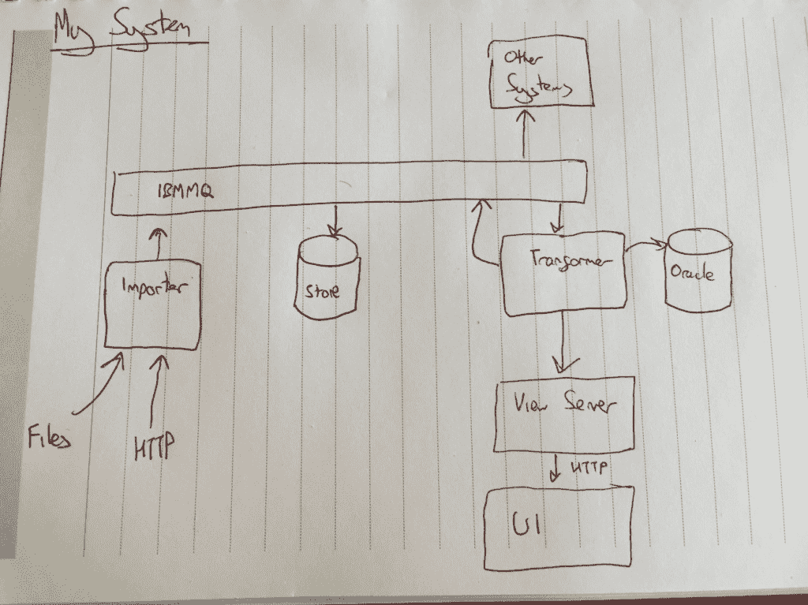

### 为什么你选择获取文件而不是进行持续更新或其他方式？

历史留的原因。这些系统是很多年前建立的，由于它们基本运行良好，人们不愿在它们身上投入任何资金。这限制了我们，因为我们无法实时创建客户报告，只能每天一次。我们目前正处于一个转型项目的途中，以实现实时流；虽然某些系统永远不会升级，但有一些全新的下游系统需要迁移到我们的系统，并希望拥有一个实时接口。这是我目前工作的重点。目标状态是实现数据的实时流，以便业务部门可以在订单提交后立即看到。我在那里放了一个 `HTTP` 接口作为临时解决方案，允许日内更新。这无法应对我们目标数据负载，但我们还没有得出具体的结论。

### 好的，这个系统是全球性的吗？

是的，我们在纽约和伦敦都有导入器。每个地区的系统略有不同，所以我们必须对代码进行微调。

### 那么你有一个代码库还是多个？

我们以前有多个代码库。在它们之间打补丁修复问题是一场噩梦，所以我们最近合并到了单一的 `GIT` 仓库，并根据每个位置添加了功能开关（feature toggles）。我很喜欢学习 `GIT`，它比 `SVN` 好得多，而且把功能开关付诸实践感觉很好。

### 那么故障转移呢？如果某些东西崩溃了怎么办？

老实说，这种情况并不常见，但直到最近还没有故障转移。由于目前是一个批处理系统，这从未成为问题，但当我们尝试转向实时更新时，这意味着如果我们出现问题，就会遇到非常愤怒的用户。因此，我们开始运行两个实例。第二个实例只暴露实时功能，不触碰批处理。这是因为我们必须引入复杂的故障转移机制来防止发生两个批处理。这是一个成本/风险分析；如果批处理出现问题，在我们修复期间它延迟一会儿没关系，但实时系统则不然。

### 好的，那么导入器是做什么的？

它获取文件和更新，将它们转换为消息并放在我们的全局总线中。我们有很多组件需要这些数据，所以它们挂载在这个总线上。它使用的是 `IBMMQ`：不是我的选择，是公司强制要求的。

### 你更倾向于使用什么？为什么选择总线？

我更倾向于使用 `ActiveMQ`。它测试起来容易得多，我以前使用它时体验很棒。总线是我的主意。它消除了很多关于故障转移的问题。之前我们有一个巨大的点对点连接网络，从支持的角度来看很难管理，而且意味着如果单个组件崩溃，整个系统就会崩溃。使用总线打破了组件之间的紧密耦合，使我们的整体稳定性显著提高；去年我们每月会有一次停机，但自从引入这个之后，我们还没有发生过全盘黑机。

### 使用总线有什么问题吗？

它是额外的中间件，管理起来可能是一场噩梦，特别是当你像我们这样有一个集中团队时。它还降低了状况的可见性。我们遇到过消息丢失的问题，必须迅速成为配置调优专家。我认为总的来说这是一个很好的选择。

### 你知道其他总线技术吗？

有 `HornetQ` 和 `ZeroMQ`。我还没有机会玩过它们，但我听 `HornetQ` 真的很快。

### 你在链路上传输的是什么格式？

我们正在使用 `XML`。我想用 `JSON`，但受到了上游团队的反对。`JSON` 要好得多，可读性更高，冗余少得多，因此在链路上更小更快。然而，其他团队在 `XML` 上投入了巨大，所以我们折中了。

### 好的。接下来是什么？

我们有一个挂载在上面的数据库，记录所有导入到总线的数据。我们需要数据的历史记录，所以它存储了 7 年。这是一个基础的 `MySQL` 实例。

### 为什么你选择把它挂在总线上？为什么不附加到导入器？如果总线崩溃了，你会丢失消息吗？

我们确保在消息通过导入器时记录日志，以便在最坏的情况下可以手动对账。如果我们对每条新记录执行数据库事务，导入器会非常慢。我们认为完全解耦是最好的。这也使得故障转移更容易，因为导入器只需要关心谁向总线发布，而不需要处理数据库连接。

某些上游消费原始流，但对于其他系统我们有一个增强流。这个转换器从另一个数据库中丰富数据，并将其放回总线。

### 这个有多快？

不太快，需要几秒钟。现在这不是问题，但当我们转向实时时，它需要修复。我想为它考虑一些近缓存技术。

我们还有一组读取数据的用户界面。这直接与转换器通信。

### 它们之间使用什么连接？

原始套接。我们在转换器中嵌入了一个 `Netty` 服务器。我是 `netty` 的忠实粉丝。

### 那么故障转移呢？

我们只在伦敦运行转换器，但我们运行的是热备模式。我们在总线上有一些基础的心跳，以便它们知道哪一个是存活的。如果心跳停止，备机就会接管。

### 你在这个方面遇到过问题吗？脑裂怎么办？

是的，我们发生过几次脑裂。我们的心跳超时设置得太激进了，所以我们推迟了。这是一个可以接受的折中，如果转换器在故障转移期间延迟几秒是可以的。

---

希望你理解这个思路。对于每个系统，你都能够解释：

- 技术选择
- 故障转移策略
- 传输选择

你也可以借此机会展示你对其他技术的了解。面试中可能会提到了 Netty、ZeroMQ、HornetQ、IBMMQ、ActiveMQ、Git、特性开关（Feature Toggles）、心跳机制（heartbeating）、XML vs JSON、MySQL 和 Oracle。这涉及到大量的技术和设计模式。这是展示你对领域拥有广泛知识的有效方法。了解所有内容是不可能的，因此在招聘时，寻找能够为组织引入新想法和技术的人是好的。如果你对某个都不了解，就花时间在 Google 上搜一下。输入 “ Alternatives to ” 加上技术名称，你会有大量的文章为你列出各种论点。

# 第二部分：核心 Java

现在你已经完全准备好在面试的软技能上大放异彩，是时候学习如何回答技术问题了。面试官可能提出的问题是无尽的；Java 的世界是巨大的。那么，你应该从哪里开始呢？

传统方法是在 Google 上搜索各种面试题列表（这可能就是你找到这本书的方式）。事实是，通常问题会比你找到的大多数内容要深入得多——你永远不会被问列一个简单的问题列表。你真的需要理解你所谈论的领域。这正是本节将带给你的：一份针对大多数面试所需的 Java 核心领域的深度复习指南。

通读这半部分，然后回到你觉得真正有困难的章节。如果你能记住那些冷门知识，那太好了，但你真正应该集中在你认为自己最中薄弱的领域上。也许你从未开发过高度多线程应用程序。在这种情况下，花时间重新重读关于线程（Threading）的内容。想出实用的代码示例；没有什么比实际编写一个解决方案更能帮助将其深存在内存中了！

# 面向对象编程

## 基础

关于面向对象编程（OOP）的问题在面试中异常常见，而且不无理由。对于初级开发者来说，这可以清楚地区分出那些真正不懂编程的人和具有潜力、但只是缺乏经验的候选人。对于更资深的候选人，我发现这有助于识别出理解良好设计以及代码应该如何组合的开发者。这里有大量的“问题”（这里是个双关语，pun intended），非常值得投入大量精力学习。从根本上说，你将通过日常工作理解本章涵盖的所有主题，然而，能够在自己的机器上编写代码与能够解释这些概念是两码事。我们都知道（希望如此）我们的目标应该是追求低耦合和高内聚。但你能解释这意味着什么吗？你能给出一个简洁的回答吗？花时间仔细思考下面的问题。答案往往根据个人偏好和经验而异。没关系，只要你有一个有说服力的答案！

**Q： Java 是一种面向对象的语言。这意味着什么？**

有许多不同的编程范式，OOP 只是其中另一种是函数式编程（在 Scala 等语言中变得非常流行）。程序被建模为对象（Objects），类似于现实世界中的对象。例如，在建模汽车时，你可以创建一个 `Car` 对象，它将拥有 4 个 `Wheel` 对象和一个 `Engine` 对象。一个对象由它所包含的数据以及可以对其执行或通过它执行的操作来定义。OOP 的四个核心原则是抽象、封装、继承和多态。

**Q：什么是类（Class）？什么是对象（Object）？**

类可以被看作一个模板；它定义了对象看起来什么样，具体来说它将包含哪些字段和方法。对象被称为类的实例（instance）——其中字段包含数据。例如，一个 `TShirt` 类可能有一个颜色和尺寸属性。一个 `TShirt` 对象可能颜色为红色，尺寸为 XL。可以有很多个对象的实例，其字段具有不同或相同的值。

**Q：解释抽象、封装、继承和多态**

Java 的核心特征之一是抽象和继承的概念。继承允许创建一个类，该类将拥有另一个类的相同字段和方法（可能还有更多），并且被视为同一类型。例如，`Car` 有四个轮子和一个引擎。通过继承，我们可以创建一个 `TeslaCar`，它仍然是一个 `Car`，但还有额外的字段（如酷炫的触摸屏），或者一个 `FormulaOneCar`，它也是一辆汽车，但有一个额外的后扰流板字段。这允许我们拥有两个特殊功能：

- 如果我有一个汽车列表，我想看每辆车是什么颜色的，我不在乎它是 `TeslaCar` 还是 `FormulaOneCar`。我只想调用 `Car` 的 `.colour()` 方法。因为 `TeslaCar` “是一个” `Car`，我们知道它有这个方法可用。
- 如果我们继承的 `Class` 已经有了方法的实现，我们就不需要自己写（尽管如果我们想写，也可以写）。

在子类中定义或重写方法的实现的能力导致了多态（Polymorphism）。在执行方法时，使用的实现不是变量类型指定的，而是变量实例的实现。

```java
public static void main(String[] args) {
    NumberPrinter numberPrinter = new EvenNumberPrinter();
    numberPrinter.printSomeNumbers();
}

private static class EvenNumberPrinter extends NumberPrinter {
    public void printSomeNumbers() {
        System.out.println("2468");
    }
}

private static class NumberPrinter {
    public void printSomeNumbers() {
        System.out.println("123456");
    }
}
```

这会打印“2468”，尽管类型是 `NumberPrinter`。这也是方法重写的良好例子，即子类提供了与其父类不同的实现。可以使用 `super` 关键字调用父类的非抽象方法，例如在 `EvenNumberPrinter` 的 `printSomeNumbers()` 中可以调用 `super.printSomeNumbers()`：

```java
public void printSomeNumbers() {
    super.printSomeNumbers();
    System.out.println("2468");
}
```

这将会产生

```
123456
2468
```


# Java 核心概念与集合框架

## 接口与抽象类

**接口（Interface）** 是一个没有实现的类。继续我们的类比，如果 `Car` 是一个带有 `.colour()` 方法的接口，它只是指定所有的 `Car` 都有一个 `colour()` 方法（而对如何实现没有任何说明）。你不能从接口创建对象，因为它没有实现或字段。

**抽象类（Abstract Class）** 是另一种类。它可以包含一些未实现的方法（将标记为 `abstract`），但也可以包含一些已经实现的方法。抽象类也无法创建对象，因为缺少某些实现代码。

对象只能基于完整的类实例化（例如不是抽象类，不是接口）。在 Java 中，一个类可以实现零或多个接口，或者它可以扩展零或一个抽象类或具体类。

## 封装

**封装（Encapsulation）** 是数据隐藏的原则。对象拥有不希望其他对象修改的内部状态，因此它可以隐藏这些内容。对象上可以访问的属性和行为仅限于创建者刻意暴露的。这在 Java 中通过访问修饰符实现：`public`、`protected`、`private` 和默认（default）。

### Q：Java 中不同的访问修饰符有哪些？它们意味着什么？

*   `public`：对 JVM 中的所有人可访问
*   `private`：仅在类内部可访问
*   `protected`：可被同一包中的任何类或任何包中的任何子类访问
*   `default`：当没有指定可见性修饰符时。仅可被同一包中的任何类访问。

## 设计原则

### Q：我们说“低耦合、高内聚”是什么意思？

这是面向对象编程（OOP）中的核心设计原则之一。

**低耦合** 指的是不同组件之间的交互方式；这些组件可以是对象、模块、系统等任何级别。我们希望组件对其他组件的依赖尽可能少。这使得重构和修改变得快速且廉价。这通常通过在组件之间创建整洁的接口并使用封装来隐藏内部实现来实现。低耦合是创建灵活且易于维护的系统最重要的思想之一。

**内聚** 指的是组件的实现方式；在一个高度内聚的系统中，事物的构建方式使得相关的项放在一起，不相关的项分开。回到汽车的类比，驾驶汽车的方法（如 `turn()`、`accelerate()` 和 `brake()`）存在于 `Car` 类中是有逻辑的。它们是内聚的并且属于同一个整体。相反，如果 `Car` 类有一个 `clean()` 方法，那么它就不符合内聚性。汽车不会自己清洁；那是其他东西完成的任务，也许是 `Car` 或 `Owner`。高内聚通过确保不属于在一起的字段和行为被分离到更合适的位置来实现。

这些术语通常被放在一起，因为低耦合的高内聚系统往往更具灵活性和可维护性。

## 方法重载与重写

### Q：方法重载（method overloading）和方法重写（method overriding）之间有什么区别？

在 Java 中，多个方法可以具有相同的名称。它们通过参数的数量或顺序不同来区分。**重载** 是指在同一个类中定义多个同名但参数列表不同的方法。**重写** 是指在子类中创建一个与父类同名、同参数列表的不同实现。

## 构造函数

### Q：什么是构造函数？

构造函数是一个特殊方法，其名称与类相同，例如 `Car()`。它不指定返回类型，因为它隐式地返回该类的对象。它用于构建实例。如果没有指定，则将有一个默认的无参构造函数。可以对构造函数进行重载，并且所有的访问修饰符都可以应用于构造函数。如果你的类包含任何 `final` 字段，它们必须在构造函数结束之前赋值，否则你的程序将无法编译。

## static 关键字

### Q：Java 中的 static 是什么意思

有效使用 `static` 关键字可以声明某些内容属于类，而不是实例。`static` 变量被所有实例共享。`static` 方法属于类，这意味着它不能访问任何非静态字段。它也不能被重写。我们还可以拥有静态块，它们在类被加载到内存时执行：

```java
static {
    System.out.println("Hello!");
    // 也许这里会有一些变量
}
```

`static` 也可以用于嵌套类。

## 多继承

### Q：我们说 Java 不支持多继承意味着什么？这是一件好事吗？

Java 无法扩展来自多个具体或抽象类的功能。如果两个父类都有一个 `jump()` 方法，将不清楚调用者需要使用哪一个功能。

## final 关键字

### Q：如果你想防止你的方法或类被重写，你应该怎么做？

通过将内容声明为 `final` 来防止其被重写。尽管没有什么是完美的，因为开发者始终可以使用反射（Reflection）来绕过这一点，或者直接将你的代码复制到他们自己版本的类中。防止你的方法或类被重写通常不是一个好主意，你应该编写防御性代码来反映这一点。

---

# 数据结构

Java 数据结构会在你的面试中出现。程序员的核心在于处理数据，将其从一种格式转换并输出为另一种格式，这就是为什么理解底层原理以及它如何影响你的应用程序是如此重要。这总是难倒很多人，知道用什么集合来支持 `ArrayList`（提示：就在名字里）。从面试的角度来看，关于数据结构的问题揭示了关于候选人的大量信息。它们显示了候选人是否对 Java 的原理有核心理解。更好的是，它提供了一个平台，可以引导关于设计、算法以及更多广泛的问题。在日常的 Java 编程中，你大部分时间都会花在 `ArrayList`、`LinkedList` 和 `HashMap` 上。因此，回顾一下你久没看的集合和算法是有意义的，因为根据我的经验，公司非常喜欢问这类问题。

## 集合框架基础

### Q：什么是集合框架（Collection Framework）？

### Q：Java 中有哪些集合类型？

### Q：基础接口类型有哪些？

### Q：List、Set 和 Map 之间有什么区别？

这些是每个使用 Java 的人都应该掌握的基础性知识。集合框架简单就是作为 Java 核心部分包含的集合类型集合。在 Java 中，你会处理三种类型的集合：`Set` 和 `List`（两者都实现了 `Collection`）以及 `Maps`（它们实现了 `AbstractMap`，技术上不属于核心 Collections）。每种类型的集合都表现出定义其用处的某些特性。集合的主要特征是：

*   元素可以添加或删除
*   集合将有一个可以查询的大小
*   集合可能包含也可能不包含重复项
*   集合可能提供也可能不提供排序
*   集合可能提供也可能不提供位置访问（例如，获取位置 6 的项目）

这些方法的行为取决于实现（正如你对接口所预期的那样）。如果你在一个不存在对象的集合上调用 `remove` 会发生什么？这取决于实现。

## 集合类型详解

### Set

**Set**：集合没有重复项且没有保证顺序。正因为如此，它不提供位置访问。实现了 `Collection`。示例实现包括 `TreeSet` 和 `HashSet`。

### List

**List**：列表可能包含也可能不包含重复项，并且保证顺序，允许位置访问。实现了 `Collection`。示例实现包括 `ArrayList` 和 `LinkedList`。

### Map

**Map（接口：AbstractMap）**：Map 稍微不同，因为它包含键值对，而不是特定的对象。Map 的键可能不包含重复项。Map 没有保证顺序，也没有位置访问。没有实现 `Collection`。示例实现包括 `HashMap` 和 `TreeMap`。

但这些对于面试意味着什么？你几乎肯定会收到关于类型之间区别的问题，所以努力学习它们。更重要的是，聪明的候选人会理解这些特性的意义。为什么选择其中一个而不是另一个？影响是什么？

### 如何选择？

在现实中，选择 `Set`、`List` 还是 `Map` 取决于你的数据结构。如果你不会有重复项且不需要顺序，那么你的选择将是 `Set`。如果你需要将顺序固定到数据中，那么你会选择 `List`。如果你有键值对，通常如果你想关联两个不同的对象或一个对象有一个明显的标识符，那么你可能会选择 `Map`。

#### 示例

*   颜色集合最适合放入 `Set`（集合）中。元素没有顺序，且没有重复；你不能拥有两个“红色”（Red）！
*   板球球队的击球顺序适合放在 `List`（列表）中；你希望保留对象的顺序。
*   网络会话（web sessions）集合最适合放在 `Map`（映射）中；唯一的会话 ID 可以作为真实对象的良好键（key）或引用。

理解为什么选择某种集合对于在面试中留下良好印象至关重要。我遇到过一些候选人进来告诉我，他们只是使用 `ArrayList` 和 `HashMap`，因为它们就是他们选择使用的默认实现。实际上，这可能不是什么坏事。大多数时候，我们使用集合时，并没有重大的延迟或访问要求。这并不重要。然而，面试中向你问这些问题的人是想知道你是否理解底层的工作原理。

### Q：选择集合时，主要的考虑因素是什么？

当你处理一个集合时，你关心的是速度，具体来说包括：

*   访问速度
*   添加新元素的速度
*   删除元素的速度
*   迭代速度

除此之外，这不仅仅是“哪一个更快”的问题。还有一致性的问题。某些实现会保证访问速度，而另一些的速度则是可变的。这种速度如何决定取决于实现。重要的是理解不同集合实现之间的相对速度，以及它如何影响你的选择。

---

# 集合实现

*   **Q：为什么我会选择 `LinkedList` 而不是 `ArrayList`？**
*   **Q：`TreeSet` 还是 `HashSet` 哪个更快？**
*   **Q：`LinkedList` 是如何工作的？**

集合实现往往基于*链式*（Linked）、*树形*（Tree）或*哈希*（Hash）实现。有整本教科书都是基于此，但你需要知道的是它如何影响你的集合选择。

## 链式实现

**示例：`LinkedList`, `LinkedHashSet`**

在底层，每个项目都存储在一个“节点”（node）中。每个节点都有指向集合中下一个项目的指针。

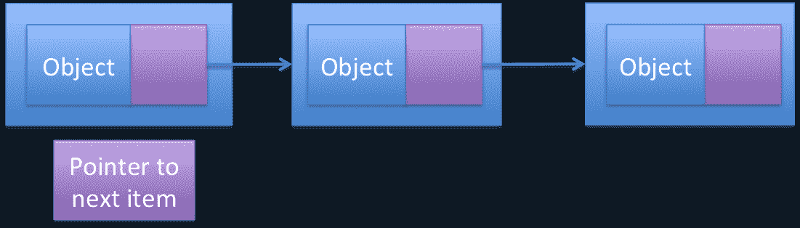

### 速度特性

在链式结构中添加项目是非常快的，无论你在何处添加该节点。如果你有一个包含 3 个元素的列表，并想在位置 1 添加一个新元素，该操作仅仅是将位置 2 指向新元素，并将新元素指向旧的位置 2。

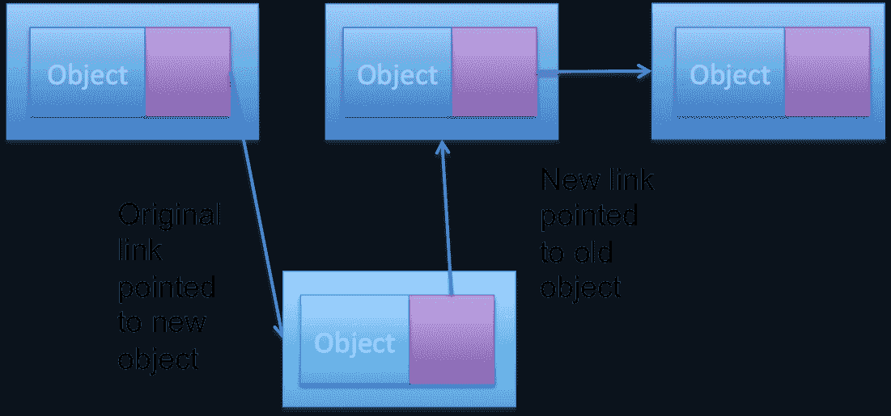

这非常快！不需要复制集合，不需要移动物体，不需要重新排序。删除操作也是如此；只需将节点 0 指向节点 2，你就删除了节点 1。

相反，访问对象时速度相对较慢。如果你有一个包含 1000 个元素的列表，而你想要第 999 个元素，你需要遍历每一个节点才能获取该元素。这也意味着访问速度是不一致的。访问元素 1 比访问元素 1000 快。请记住，当添加新对象时，你必须先遍历到前一个节点，这会对速度产生一些影响。

因此，像 `LinkedList` 这样的链式集合在你需要快速添加/删除且不太关注访问时间时是非常棒的。**如果你需要频繁从集合中添加/删除项目，那么这个就是你的选择**。

## 数组实现

**示例：`ArrayList`**

`ArrayList` 是集合类中唯一基于数组的实现，但经常用于与 `LinkedList` 进行比较，因此理解它非常重要。正如之前提到的，`ArrayList` 由一个 `Array`（数组）支持。这具有有趣的含义。

在 `ArrayList` 中间添加项目时，结构需要复制所有项目以便它们在数组中向下移动。这可能很慢，而且时间不是固定的（取决于需要复制多少元素）。

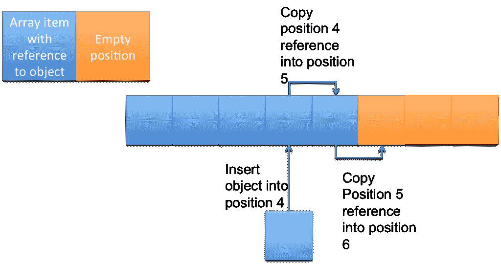

删除对象时也是如此；它之后的所有对象引用都必须向前移动一个空间。有一种更糟糕的情况。在创建 `ArrayList` 时，它从一个固定长度的 `Array` 开始（你可以在构造函数中设置其长度，默认为 10）。如果容量需要超过此值，集合必须创建一个长度更长的**全新的数组**，并将所有引用复制到其中，这可能非常慢。

`ArrayList` 成功之处在于访问速度；由于数组位于连续内存中，这意味着如果你请求 1000 个对象中的第 999 个对象，你可以精确地计算出该引用在内存中的位置，而无需遍历整个集合。这提供了常数时间访问，这种访问是**快速的**。

所以，如果你有一组**极不可能发生显著修改的数据，并且你需要快速的读取访问**，`ArrayList` 是一个极佳的选择。

## 哈希实现

**示例：`HashSet`, `HashMap`**

`HashMap` 本身就是一个复杂的体，作为面试题是一个很好的选择，因为它很容易扩展后续问题。

*   **Q：`HashMap` 是如何工作的？**
*   **Q：为什么键的 hashcode 那么重要？**
*   **Q：如果两个对象具有相同的 HashCode 会发生什么？**
*   **Q：如果发生冲突，`Map` 如何选择正确的对象？**

有趣的是 `HashSet` 是由 `HashMap` 支持的，因此为了方便，我将讨论后者。

### HashMap 工作原理

在底层，`HashMap` 是一个数组（称为 Entry Table，默认为 16），对应一组 `LinkedLists`（称为桶 Buckets），`HashEntry` 存储其中。一个 `HashEntry` 是一个包含键和关联的对象。

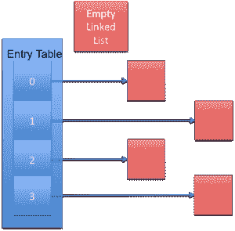

所有 `Object` 都有一个方法 `hashCode()`，它返回一个 `int`。hashcode 通常是根据属性产生的值。对象的 hashcode 应该是一致的，相等的对象必须返回相同的 hashcode。该属性随后可以用于确定将其放入哪个桶，基于数组的索引；例如，在上述具有 4 个空间的示例中，如果有一个 HashCode 为 12345 的键，我可以计算 `12345 % 4 = 1`，因此我们将把对象放在桶 1 中。

这使得对象检索非常快。在我的示例中，如果我尝试检索键对应的对象，只需要执行相同的模运算来找到桶，它是第一个条目。异常快速。

### 哈希冲突处理

这可能会变得复杂。如果我有两个对象，HashCode 分别为“5”和“9”呢？它们的（模 4）都是 1，所以它们都会被放入桶 1。现在我使用我的“9”键来检索对象，`HashMap` 必须遍历 `LinkedList`，对每个 `HashEntry` 的键调用 `.equals()` 方法。

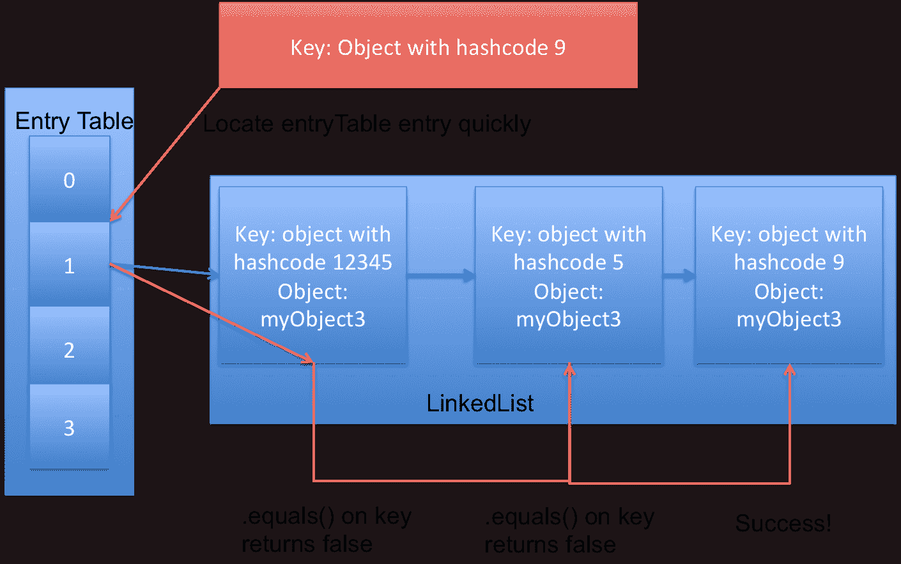

这很慢！幸运的是，这种情况不会经常发生。虽然冲突自然会发生，但意图是对象将均匀分布在数组中，冲突尽可能少。这依赖于良好的 hashcode 函数。为了进一步尝试减少这种可能性，每个 `HashMap` 都有一个负载因子（默认为 0.75）。如果数组的填充程度超过了负载因子（例如如果数组超过 75% 有条目），那么类似于 `ArrayList`，`HashMap` 将将数组的大小翻倍并重新排列条目。这被称为**重哈希（rehashing）**。

## 树形实现

**示例：`TreeMap`, `TreeSet`**

`Tree` 的实现与我们之前考虑过的任何数据结构完全不同，并且复杂得多。它基于红黑树（Red Black tree），这是一种复杂的算法，你不太可能被问到（如果你真的感兴趣，可以看 <http://www.csanimated.com/animation.php?t=Red-black_tree>）。值以有序的方式存储，这种顺序由对象的自然排序决定或使用作为构造函数一部分传入的 `Comparable` 决定。这意味着在所有实现中，集合都将重新排序以维护这种自然顺序。在检索项目时，必须遍历树，对于规模较大的集合，可能需要遍历大量节点。

从你的角度来看，需要注意的重要点是：**这比 `HashMap` 慢。** 慢得多。如果目标是速度，请始终使用 `HashMap` 或 `HashSet`。但是，如果顺序很重要，那么 `TreeMap`/`TreeSet` 应该是你的首选集合。

---

# 多线程与集合

集合与线程在本质上是关联的；许多与线程相关的问题都是关于共享数据访问的。我们如何以快速又安全的方式从多个线程访问数据呢？

## 如何创建一个线程安全的集合？

让某个变得线程安全的简单方法是将其变为不可变（immutable）。不可变对象是指状态无法更改的对象。如果它不能改变，那么所有线程安全地读取它而不会出现任何问题。在 Java 中可以使用 `Collections.unmodifiable` 方法实现这一点。

```java
Collections.unmodifiableCollection
Collections.unmodifiableSet
Collections.unmodifiableSortedSet
Collections.unmodifiableList
Collections.unmodifiableCollection
Collections.unmodifiableMap    
Collections.unmodifiableSortedMap 
```

所有这些集合都作为标准集合的包装器并保证访问安全；任何修改集合的尝试都将导致 `UnsupportedOperationException`。然而，这只是数据的一个*视图*。如果每个人都通过不可变版本进行访问，那么它是线程安全的，但底层集合仍然可能改变。例如：

```java
LinkedList<String> words = new LinkedList<>();
words.add("Hello");
words.add("There");
List<String> unmodifiableList = Collections.unmodifiableList(words);
System.out.println(unmodifiableList);
words.add("Cheating");
System.out.println(unmodifiableList);
// result:
// [Hello, There]
// [Hello, There, Cheating]
```

结果是这并不是真正的不可变。像 Google Guava 等第三方库中确实存在真正的 `ImmutableList` 等类，但在核心语言中并没有。同样重要的是，不可变集合通常不能满足我们程序的需求；数据通常需要被写入和读取，因此我们需要一个更大的解决方案。

在 Java 5 中，引入了 `java.util.concurrent` 包，其特定目的是让以线程安全的方式处理集合变得更简单。

### Q：请介绍一下 Java 5 中引入的 java.util.concurrent 包。它为什么重要？它有什么意义？


# Java 并发集合与异常处理

## Java 并发集合

编写 Java 的那些人比你或我更聪明（或者说他们应该是这样的）。不需要每个人都写写自己的来实现来确保线程安全（在不破坏性能的情况下确保在正确的位置锁住正确的内容），`java.util.concurrent` 提供了许多集合类型，以最小的性能影响保证了线程安全。

它还引入了一系列其他与线程相关的特性，这些将在线程章节中介绍。

### 队列

* `ConcurrentLinkedDeque`
* `ConcurrentLinkedQueue`
* `LinkedBlockingQueue`
* `LinkedBlockingDeque`
* `LinkedTransferQueue`
* `PriorityBlockingQueue`
* `ArrayBlockingQueue`

那是很多队列（以及双端队列，deque）！需要注意的关键点：

* **`Blocking`（阻塞）队列**：在队列为空/满时会阻塞消费者/生产者。这是允许生产者/消费者模式的必要机制。`BlockingQueue` 接口有 `put()` 和 `take()` 方法来实现这一点。
* **`Transfer` 队列**：一种阻塞队列，具有额外的方法，允许消费者等待消息被消费。
* **`Priority`（优先级）队列**：将根据元素的自然排序或使用构造构造时传入的 `comparator` 对元素进行排序。

所有实现都使用“比较并交换”（`CAS`）操作，而不是同步块（`synchronized blocks`）来确保线程安全。这确保了没有死锁风险，且线程不会卡住等待，而且速度快得多。所有基于 `CAS` 操作的集合（如上述）都具有弱一致的迭代器（`weakly consistent iterators`）。这意味着它们不会抛出 `ConcurrentModificationExceptions`，但它们不保证能反映正确的状态；根据文档描述：

> 返回的迭代器是一个“弱一致”的迭代器，它永远不会抛出 ConcurrentModificationException，并保证遍历迭代器构造时存在的元素，并且可能（但不保证）反映构造之后的任何修改。

### 写时复制

#### Q：在遍历集合时如何避免并发修改异常（`ConcurrentModificationException`）？

* `CopyOnWriteArrayList`
* `CopyOnWriteArraySet`

我是命名良好的类的类的忠实粉丝，这是一个非常棒的例子。通过在每次写入时复制整个集合，它保证了不可变性；如果我有一个迭代器在遍历集合，那么它就可以保证集合在遍历时不会被修改，因为所有修改都将导致创建一个数据的副本。这可能是一个昂贵的操作，因此这些集合更适合频繁访问但更新较少的数据。这种依赖数据被复制的迭代器被称为故障安全迭代器（`fail safe iterator`）。

### ConcurrentHashMap

#### Q：`ConcurrentHashMap` 是如何实现的？

`ConcurrentHashMap` 是一种高效的、线程安全的 `HashMap` 实现。正如之前讨论的，`HashMap` 由段（`segments`）组成（默认 16 个），这些段包含根据 `HashCode` 访问的数据。在 `ConcurrentHashMap` 中，读取操作通常是不阻塞的，这使得它非常快速；写入仅按段阻塞。这意味着在进行更新时，其他 15 个段可以无问题地读取。

#### Q：我应该使用 `HashTable` 还是 `ConcurrentHashMap`？

`HashTable` 是 `HashMap` 的同步实现，但它来自旧版本的 Java，不应再使用。`HashTable` 的所有操作都是同步的，这意味着相对于 `ConcurrentHashMap` 它的性能非常差。

#### Q：`ConcurrentLinkedQueue` 和 `ConcurrentHashMap` 这样的集合完全线程安全的吗？

答案既是也不是。实现是完全线程安全的，可以作为其非线程安全对应品的替代。然而，非常有可能写出非线程安全的方式访问集合的代码。

```java
1 Map<String, String> map = new ConcurrentHashMap<>();
2 map.put("a", "1");
3 map.put("b", "2");
4 //....启动大量其他线程....
5 if (!map.containsKey("c"))
6     map.put("c", "3");
7 else
8     map.get("c"); 
```

`contains -> put` 和 `contains -> get` 操作不是原子的。在检查是否存在和放入/获取任何内容之间，集合中可能会发生任何变化。集合仍然是线程安全的，我们的访问方式不是。我们需要确保任何检查状态后执行的操作都是以原子或同步的方式完成的。上述代码可以通过利用 `putIfAbsent` 方法来创建原子性进行修正；然而，例如如果你想根据列表的大小对列表执行某些操作，你可能需要锁定集合以确保它作为单一操作执行。

## Java 异常

Java 异常是我在电话面试中非常喜欢问的问题之一。它们是 Java 中较简单的部分，因此我预计大多数候选人都能给出很好的答案。通常情况下，很容易筛选掉那些给不出好答案的人，因为他们不值得浪费时间。然而，我真正喜欢将异常作为面试素材的原因在于，它们能将 Java 核心技术问题与观点性陈述结合。受检异常（`Checked Exceptions`）实际上是 Java 中一个极具争议的部分，看到候选人站在哪一边，或者他们是否甚至意识到这道分界线的存在，是非常有趣的。

### 核心问题

#### Q：什么是 Java 异常（`Exception`）？

我通常不问这个问题，因为它太基础了，但为了确保你手头有一份标准答案是有的。异常是一种以编程方式传达系统和编程错误的方法。所有异常都继承自 `Throwable`。当出现问题时，你可以使用 `throw` 关键字来抛出异常。

#### Q：Java 中有 2 类异常，它们是什么？有什么区别？

这个“2 类异常”问题依然能让很多人感到困惑（是的，`throws`，我又玩了一个双关语）。这已经是 Java 核心中最基础的内容了。如果你不懂这个，说明你没有正确学习 Java 核心（或根本没学），这可能会成为你其他知识体系不稳固的基础。请记住这个答案。两类异常是 `checked`（受检异常）和 `unchecked`（未检异常）。我在职业生涯中听过一些奇怪的答案，包括“Runtime 和 NullPointerException”！受检异常是强制要求你捕获的异常。它是 API 或契约的一部分。任何使用抛出受检异常代码的人都可以看到这一点，因为在方法签名上已经声明了，他们被强制使用 `try/catch` 块进行处理。未检异常不需要被捕获，也不会通知使用代码的人可能会抛出异常。

#### Q：我如何知道一个异常类是受检的还是未检的？

除了继承自 `java.lang.RuntimeException` 的外，所有异常都是受检异常。

#### Q：“`finally`”的作用是什么？

异常使用 `try-catch` 块进行捕获。然而，在 `catch` 之后你可以跟一个 `finally` 块。无论发生什么（除非有人拔了插头），该块都会保证执行，例如在 `catch` 块中抛出异常时。这对于确保如 `Connections` 等资源的清理非常有用。

#### Q：我可以从同一个方法中抛出多个异常吗？我该如何捕获它们？

可以，每个异常（或该类的父类）只需要在方法签名的 `throws` 之后列出即可。你可以使用多个 `catch` 块来捕获它们，或者通过捕获父异常类，例如你可以直接捕获 `Exception`，这将捕获所有异常。在理论上，这是坏习惯，因为你失去了对错误细节的感知以及特定的恢复能力。从 Java 7 开始，你也可以在单个 `catch` 块中捕获多个异常。捕获异常时，重要的是按照从“最具体”到“最不具体”的顺序进行。如果你的 `catch` 块先捕获 `Exception` 后捕获 `IOException`，那么第一个 `catch` 块将始终捕获任何传入的 `Exception`，导致 `IOException` 变得毫无用处（事实上，它会导致编译器错误，说明 `Exception` 已经被捕获）。

#### Q：你对受检异常怎么看？它们是一件好事吗？

#### Q：当你编写自己的代码并需要抛出自定义异常时，你会创建受检异常还是未检异常？

#### Q：C# 没有受检异常。你能告诉我为什么吗？你认为 Java 还是 C# 谁是对的？

我太喜欢这些问题了。这是一个考察候选人并观察他们是否理解如何构建体系的极佳方式。对异常制定适当的策略是维护整洁代码库的关键，你会很快就能发现谁考虑过这个问题，而谁没有。面试前必读的读物是这篇与 C# 创造者的访谈，内容是关于[他为什么没有在语言中引入受检异常](http://www.artima.com/intv/handcuffs.html)。总的论点是，受检异常导致 Java 代码变得很难看。处理过程极其繁琐，通常大多数开发者不知道如何处理它们，或者太懒得去。这导致了空的 `catch` 块或仅仅是日志语句。这使得系统变得脆弱，异常被吞噬后再无音讯，系统可能会在不通知任何人的进入脆弱状态。从受检异常的积极面来看，它在 API 上声明了它将做什么，因此调用者可以处理。如果你在发布一个库，这是好事。然而，许多开发者滥用这一点，使用异常来控制系统的流转。异常只用于特殊情况。

与大多数讨论性问题一样，重点不在于开发者是否认同你的观点，而在于他们是否有形成观点并解释观点的能力。我个人强烈倾向于认为受检异常是糟糕的，且开发者误用了它们。在我的代码中，所有受检异常都被包装在应用程序特定的 `RuntimeException` 中，并向上栈抛出，我通常在那里有一个 `Exception` 守护器来捕获并记录问题。然而，如果一个候选人说他们在代码中使用受检异常，并能基于对问题的理解解释其原因，那么他们就能过关。只需在参加面试前确保你已经想过自己在该问题上的立场，以便向面试官清晰地表达。如果你以前从未想过这个问题，那么请记住受检异常是邪恶的 :)

## JVM 与内存管理

另一方面，Java 程序可以在任何安装了 Java 虚拟机的系统上运行。`JVM` 充当中间层并处理特定于操作系统的细节，这意味着作为开发者，我们不需要担心这些问题。现实中，不同操作系统之间仍然存在一些小问题，但这些问题都相对较小。这使得开发变得更快、更简单，并意味着开发者可以在 Windows 笔记本电脑上编写可能目标是其他平台的软件。我只需要编写一次软件，它就可以从 Android 到 Solaris 等各种平台上运行。

从理论上讲，这是是以速度为代价的。`JVM` 的额外层意味着它比直接编译机器的语言（如 `C`）慢。然而，Java 近年来取得了巨大进展，考虑到易用性等许多其他优势，它正越来越多地用于低延迟应用。

`JVM` 的另一个优点是，任何可以编译为字节码的语言都能在其上运行，而不只是 `java`。像 `Groovy`、`Scala` 和 `Clojure` 等语言都是基于 `JVM` 的语言。这意味着这些语言可以轻松使用其他语言编写的库。作为一名 `Scala` 开发者，我可以在应用程序中使用 `Java` 库，因为它们都运行在同一个平台上。

与真实硬件的隔离也意味着代码是沙箱化的，限制了它对主机计算机可能造成的破坏。安全性是 `JVM` 的一大优势。

还有一个值得考虑的有趣方面：并不是所有的 `JVM` 都是同等的。除了 Oracle 的标准 `JVM` 实现外，还有许多不同的实现。`JRockit` 以其极快的 `JVM` 速度闻名。`OpenJDK` 是开源对等品。有很多 `JVM` 实现。虽然这种选择最终是一件好事，但所有 `JVM` 的行为可能略有不同。Java 规范的许多领域在实现方面被刻意模糊化，每个 `VM` 可能以不同的方式处理。这可能会导致只在特定平台上的特定 `VM` 中出现的 Bug。这些可能是最难调试的 Bug。

从开发者的角度来看，`JVM` 提供了许多优势，特别是在内存管理和性能优化方面。

### Q: 什么是 JIT？

`JIT` 代表“即时编译”（Just in Time）。正如讨论过的，`JVM` 执行字节码。然而，如果它确定某部分代码运行频繁，它可以选择性将该部分代码编译为原生代码以提高执行速度。可以被 `JIT` 编译的最小单元是一个方法。默认情况下，一段代码需要执行 1500 次才会被 `JIT` 编译，尽管这是可以配置的。这导致了“预热” `JVM` 的概念。`JVM` 运行得越长，性能就越高，因为这些优化会持续进行。缺点是，`JIT` 编译不是免费的；它在发生时会消耗时间和资源。

### Q: 我们说 Java 内存时是指什么意思？垃圾回收器是什么？

在 `C` 等语言中，开发者可以直接访问内存。代码引用内存空间地址。这可能是困难且危险的，并可能导致严重的内存泄漏。在 `Java` 中，所有内存都是受管理的。作为程序员，我们只处理对象和基本类型，而对内存和指针的底层运作没有概念。最重要的是，`Java` 具有垃圾回收器的概念。当对象不再需要时，`JVM` 会自动识别并为我们清理内存空间。

### Q: 垃圾回收器的优点和缺点是什么？

**优点：**

* 开发者可以更少地担心内存管理，专注于解决实际问题。尽管内存泄漏在技术上仍然是可能的，但它们已不再常见。
* `GC` 拥有许多用于内存管理的智能算法，它们在后台自动运行。与大众认知相反，在判断何时最佳执行 `GC` 方面，它们通常比手动收集更好。

**缺点：**

* 当发生垃圾回收时，它会对应用程序性能产生影响，特别是会减慢速度或停止运行。在所谓的“停世界”（`Stop the world`）垃圾回收期间，应用程序的其他部分将冻结。这取决于应用程序的需求，可能是不可接受的，虽然 `GC` 调优可以最小化甚至消除任何影响。
* 虽然对垃圾回收器进行很多调优，但你无法指定应用程序何时或如何执行 GC。

### Q: 什么是“停世界”？

当 `GC` 发生时，有必要在收集期间完全暂停应用程序中的线程。这被称为停世界。对于大多数应用程序，长时间暂停是不可接受的。因此，调整垃圾回收器以将收集的影响降低到应用程序可接受的范围内是非常重要的。

### Q: 分代 GC 是如何工作的？我们为什么要使用分代 GC？Java 堆是如何结构的？

理解 Java 堆如何工作对于回答关于 `GC` 的问题非常重要。所有对象都存储在 `Heap` 上（相对于 `Stack`，变量、方法以及对堆中对象的引用存储在栈中）。垃圾回收是从 `Heap` 中移除不再需要的对象并返回空间供普通使用的过程。几乎所有的 `GC` 都是“分代的”，其中 `Heap` 被分为若干区域或代。这被证明是显著更优的，这就是为什么几乎所有的收集器都使用这种模式。

#### New Generation（新生代）

##### Q: 什么是新生代？它如何帮助最小化 GC 的影响？

大多数应用程序都有大量的短命对象。在 `GC` 期间分析应用程序中的所有对象会缓慢且耗时，因此将短命对象分开以便它们被快速回收是有意义的。因此，所有新对象都存放在新生代。新生代进一步拆分为：

* **`Eden Space`**：所有新对象都放在这里。当它满额时，会发生 `minor GC`。所有仍被引用的对象将被提升到 `survivor space`（存活空间）。
* **`Survivor spaces`（存活空间）**：存活空间的实现随 `JVM` 而异，但前提是相同的。新生代的每次 `GC` 都会增加存活空间中对象的年龄。当一个对象经历了足够数量的 `minor GC` 后（默认值不同，但通常从 15 开始），它将被提升到 `Old Generation`（老年代）。某些实现使用两个存活空间，`From space` 和 `To space`。在每次收集期间，这些会交换角色，所有提升的 `Eden` 对象和存活对象移动到 `To space`，并将 `From` 留空。

##### Q: 什么是 minor GC？

在 `NewGen` 中的垃圾回收被称为 `minor GC`。使用新生代的优点之一是减少碎片的影响。当一个对象被垃圾回收时，它会在原先内存中留下一个间隙。我们可以压缩剩余对象（一种停世界场景），也可以留出它们并插入新对象。通过使用分代 `GC`，我们限制了这种情况在 `Old Generation` 中发生的频率，因为那里通常更稳定，有利于通过减少停世界来提高延迟。然而，如果我们不进行压缩，可能会发现对象无法放入它们之间的间隙中，可能是由于大小问题。如果是这种情况，你将看到对象无法从新生代提升。

任何在新生代（New Generation）中存活的对象都会被晋到老年代（Old Generation）。老年代通常比新生代大得多。当老年代中发生垃圾回收（GC）时，被称为 `full GC`。全 GC 同样会导致“停世界”（`stop-the-world`）并且往往耗时更长，这就是为什么大多数 JVM 调优都发生在这里。有许多不同的垃圾回收算法可供选择，并且可以对新生代和老年代使用不同的算法。

### Q: 有哪些类型的垃圾回收器？

#### `Serial GC`

设计于计算机只有一个 CPU 的时代，它在 GC 发生时会停止整个应用程序。它使用 `mark-sweep-compact`（标记-清除-压缩）算法。收集器会遍历所有对象，标记哪些对象可以进行垃圾回收，清除它们，然后将所有对象复制到连续的空间中（因此没有碎片化）。

#### `Parallel GC`

与 Serial 类似，区别在于它使用多个线程执行 GC 以提高速度。

#### `Concurrent Mark Sweep (CMS)`

CMS GC 通过与应用程序处理并发执行大部分 GC 相关工作来最大限度地减少暂停时间。这减少了应用程序必须完全暂停的时间，因此更适合对这种时间敏感的应用。CMS 是一种非压缩算法，可能会导致碎片化问题。CMS 收集器在新生代使用 `Parallel GC`。

#### `G1GC (garbage first garbage collector)`

一种并发并行收集器，被视为 CMS 的长期替代方案，并且不会遭受与 CMS 相同的碎片化问题。

### Q: 哪一个更好？Serial、Parallel 还是 CMS？


这完全取决于应用程序。每种都是根据应用程序的需求量身定制的。如果你在单 CPU 上，或者在机器上运行的虚拟机数量超过了 CPU 数量的情况下，`Serial` 更好。`Parallel` 是一个吞吐量收集器，如果你有大量工作要做但可以介意暂停，那么它非常有用。如果你需要一致的响应能力和最少的暂停，`CMS/G1GC` 是这些选项中的最佳。

## PermGen

### Q: 什么是 PermGen？

`PermGen` 是 JVM 存储类元数据的地方。它在 Java 8 中已不再存在，被元空间（metaspace）取代。通常情况下，`PermGen` 不需要确保空间足够之外的调优，尽管如果 `Classes` 没有被正确卸载，可能会发生内存泄漏。

## 从代码中

### Q: 你可以告诉系统执行垃圾回收吗？

这是一个有趣的问题：答案是既是又不是。我们可以使用调用 `System.gc()` 来建议 JVM 执行垃圾回收。然而，这不能保证它会产生任何作用。作为一名 Java 开发人员，我们无法确定代码具体运行在哪个 JVM 中。JVM 规范对调用此方法时会发生什么没有任何保证。甚至有一个启动标记 `-XX:+DisableExplicitGC`，它可以阻止此操作产生任何作用。

使用 `System.gc()` 被认为是一种坏习惯。

### Q: `finalize()` 是做什么的？

`finalize()` 是 `java.lang.Object` 的一个方法，因此存在于所有 `Objects` 上。默认实现什么都不做。当垃圾回收器确定没有更多指向该对象的引用时，就会调用它。因此，无法保证代码是否会被执行，所以不应该用它执行实际的功能。相反，它被用于清理，例如文件引用。JVM 永远不会对一个对象调用多次该方法。

## JVM 调优

### Q: 我可以使用哪些标记来调优 JVM 和 GC？

有很多关于调优 JVM 以获得最佳垃圾回收的教科书。你永远无法记住所有的！尽管如此，为了面试之目的，了解几个是有好的。

- `-XX:-UseConcMarkSweepGC`：在老年代使用 CMS 收集器。
- `-XX:-UseParallelGC`：在新生代使用 `Parallel GC`。
- `-XX:-UseParallelOldGC`：在老年代和新生代使用 `Parallel GC`。
- `-XX:-HeapDumpOnOutOfMemoryError`：当应用程序内存耗尽时创建线程转储（thread dump）。对诊断非常有用。
- `-XX:-PrintGCDetails`：垃圾回收的详细信息。
- `-Xms512m`：设置初始堆大小为 512m
- `-Xmx1024m`：设置最大堆大小为 1024m
- `-XX:NewSize` 和 `-XX:MaxNewSize`：专门设置新生代的默认和最大大小。
- `-XX:NewRatio=3`：设置新生代相对于老年代大小的比例。
- `-XX:SurvivorRatio=10`：设置 Eden 空间的大小相对于存活区（survivor space）的大小。

## 诊断

虽然上述所有问题对于展示你对 JVM 工作原理的基本理解非常有帮助，但面试中一个标准的问题之一是：

你曾经经历过内存泄漏吗？你是如何诊断它的？

对于大多数人来说，这是一个很难回答的问题，因为尽管他们可能做过，但很可能是很久以前的事了，并不是你可以轻易回想起来的事情。最好的准备方法是实际上尝试编写一个带有内存泄漏的应用程序并尝试诊断它。在下面我创建了一个荒谬的内存泄漏示例，它将让我们逐步通过识别问题的过程。**我强烈建议你下载代码并遵循这个过程。** 如果你真的执行了这一过程，它更有可能被留在你的记忆中。

```java
 1 import java.util.ArrayDeque;
 2 import java.util.Deque;
 3 public class Main {
 4     public static void main(String[] args) {
 5         TaskList taskList = new TaskList();
 6         final TaskCreator taskCreator = new TaskCreator(taskList);
 7         new Thread(new Runnable() {
 8             @Override
 9             public void run() {
 10                 for (int i = 0; i < 10000; i++) {
 11                     taskCreator.createTask();
 12                 }
 13             }
 14         }).start();
 15     }
 16     private static class TaskCreator {
 17         private Task taskList;
 18         public TaskCreator(TaskList taskList) {
 19             this.taskList = taskList;
 20         }
 21         public void createTask() {
 22             taskList.addTask(new Task());
 23         }
 24     }
 25     private static class TaskList {
 26         private Deque<Task> tasks = new ArrayDeque<>();
 27         public void addTask(Task task) {
 28             tasks.add(task);
 29             tasks.peek().execute();//Memory leak!
 30         }
 31     }
 32     private static class Task {
 33         private Object[] array = new Object[1000];
 34         public void execute() {
 35            //doostuff
 36         }
 37     }
 38 }
```

这些 `Object` 数组看起来有点奇怪。但我们如何知道这是否问题所在呢？`Visual VM` 允许我们获取快照，就像对当时的内存进行拍照一样。上面的截图是应用程序仅运行一小会儿后获取的快照。几分钟后的下一张快照证实了这一点：

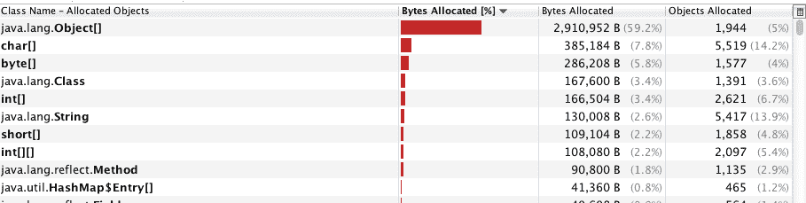

我们可以通过在菜单中同时选择两者并选择 compare（比较）来直接对它们进行对比。

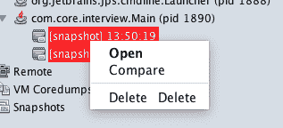

这个对象数组确实有些不对劲。但我们该如何找到内存泄漏呢？通过使用 profile（分析器）标签页。如果我进入 profile 并在设置中启用“record allocations stack traces”（记录分配栈跟踪），我们就能找到泄漏源于哪里。

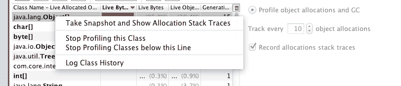

通过拍摄快照并显示分配轨迹，我们可以看到对象数组是在哪里被实例化的。

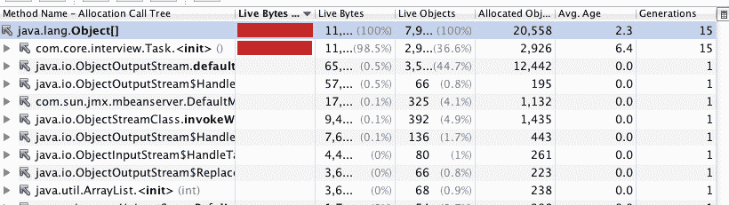

看起来有成千上万 `Task` 对象持有对 `Object` 数组的引用！但是什么在持有这些 `Task` 项呢？

如果我们回到“Monitor”（监控）标签页可以创建一个堆转储（heap dump）。如果双击堆转储中的 `Object[]`，它将显示应用程序中所有的实例，在右下角的面板中我们可以识别引用的位置。

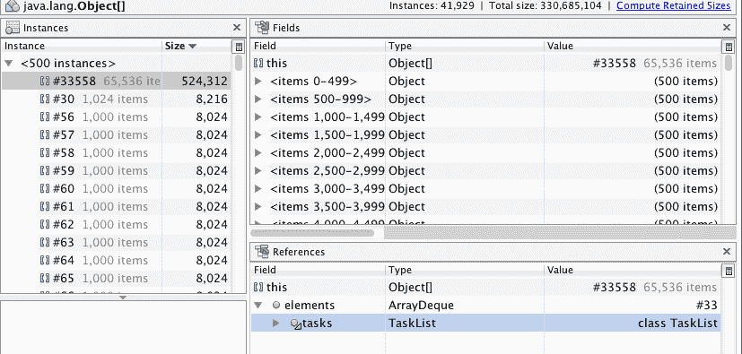

看起来 `TaskList` 是罪魁祸首！如果我们查看代码，就能看出问题所在。

```java
1 tasks.peek().execute();
```

我们在完成操作后从未清除该引用！如果我们将其更改为使用 `poll()`，那么内存泄漏就解决了。

虽然这显然是一个非常刻意的例子，但通过这些步骤将帮助你复习，以防你被要求解释将如何识别应用程序中的内存泄漏。寻找那些尽管发生了 GC（垃圾回收）但内存仍在持续增加的情况，获取内存快照并比较它们以查看哪些 `Objects` 可能是未释放的候选者，并使用堆转储分析是什么持有它们的引用。

## 多线程

作为开发者，为了编写整洁、易懂且不会崩溃的代码，我们做的最好的事情就是避免在代码库中引入多线程。优秀的程序员可以将大多数问题分解为不需要复杂线程即可解决的问题。糟糕的程序员则会引入线程来修复他们不理解的问题，或者为了过早的优化。线程问题在面试中非常热门，因此能够证明对 Java 中线程如何工作、何时以及为何使用它们，以及如何安全地对它们进行编程有深度的理解至关重要。在本文中，我们将从基础开始处理线程，并涵盖回答任何出现的问题所需的需要的知识。

### 多线程简介

**Q: 什么是线程（Thread）？**

**Q: 如何在 java 中创建线程？**

线程允许我们同时做多件事。没有 `Threads`，代码将按线性方式执行，一个命令接一个命令。通过使用线程，我们可以同时执行多个操作。这利用了计算机现在拥有多个处理器以及对任务进行时间分片处理的能力，因此多个线程甚至可以在单个处理器上运行。在 Java 中创建新 `Thread` 有两种主要方法。首先，你可以扩展 `Thread` 类并重写 `run` 方法来执行你的代码。

```java
 1 public class SayHello extends Thread {
 2 
 3     public static void main(String[] args) {
 4         new SayHello().start();
 5     }
 6 
 7     @Override
 8     public void run() {
 9         for (int i = 0; i < 100; i++) {
 10             System.out.println("Hi there!");
 11         }
 12     }
 13 }
```

通常我们避免这样做。Java 没有多重继承，因此这种选项将限制你扩展其他任何内容。更重要的是，这并不是一种非常优雅的方法。作为优秀的开发者，我们的目标是优先考虑组合而非继承。方案二要好得多，允许我们实现 `Runnable` 接口并将其传递一个新的 `Thread` 对象。该接口有一个方法，`run`。

```java
 1 public class SayHelloRunner implements Runnable {
 2     public static void main(String[] args) {
 3         new Thread(new SayHelloRunner()).start();    
 4     }
 5     
 6     @Override
 7     public void run() {
 8         for (int i = 0; i < 100; i++) {
 9             System.out.println("Hi there!");
 10         }
 11 }
 12 }
```

我们将新的 `Runnable` 传递给 `Thread` 以启动它。我们始终使用 `start()` 来运行线程；使用 `run()` 将将在调用者的同一个线程中执行。

**Q: 如何在 java 中停止线程？**

实际上，java 中没有 API 级别的方法可以可靠地停止一个 `Thread`。唯一的保证是当线程中执行的代码完成后，线程将结束。因此，实现一种告诉 `Thread` 停止的方法就取决于开发了。

```java
 1 public class SayHelloRunner implements Runnable {
 2     private volatile boolean running = true;
 3 
 4     public void stopIt(){
 5         running = false;
 6     }
 7 
 8     @Override
 9     public void run() {
 10         while(running)
 11             System.out.println("Hi there!");
 12     }
 13 }
```

正如上面的示例所示，检查线程是否运行的标志使用了 `volatile` 关键字。

**Q: 什么是 volatile 关键字？**

在现代处理器中，有很多操作尝试优化吞吐量，例如缓存。这是将经常访问的变量保存在靠近处理器的少量内存中（这可能很慢）。但在多线程环境下是非常危险的，因为如果变量在缓存中更新但未写回内存，两个线程可能会看到不同的版本。它告诉 Java 该变量可能被多个线程访问，因此不应缓存，从而保证值的正确性。它还阻止了编译器通过重排代码来尝试优化。

使用 `volatile` 变量的缺点是有性能开销。访问信息的距离更远，因为它无法存储在缓存中。然而，从速度来看，`volatile` 通常比使用同步同步块要好得多，因为它不会导致线程阻塞，因此比其他同步选项快得多。

**Q: 解释 synchronized 关键字。它是做什么的？为什么我们需要它？**

`synchronized` 是 Java 中的一个关键字，可以作为代码块的包装，也可以作为方法签名的一部分。

```java
 1 public class Bank {
 2     private int funds = 100;
 3     
 4     public void deposit(int money){
 5         synchronized (this){
 6             funds += money;
 7         }
 8     }
 9     
 10    public synchronized void withdraw(int money){
 11        if(funds > money) 
 12           funds -= money;
 13     }
 14 }
```

`synchronized` 存在于 Java 中，允许能够同一个对象的多个线程安全地访问它，以确保数据正确。经典的例子是银行账户。假设你移除上述示例中的同步处理。线程一尝试从账户中提取 100。在同一时刻，线程二也尝试从账户中提取 100。对于两个线程，检查资金是否充足的 if 语句都返回 true，导致两者都提款并产生 -100 的余额，这是不允许的。通过使用 `synchronized`，一次只有一个线程可以访问同步块中的代码段，这有助于我们确保状态正确。

当 `synchronized` 关键字置于如 `withdraw(int money)` 等方法上时，其效果与将整个方法的代码封装在 `synchronized(this)` 中相同（示例中的 `deposit` 方法就是此类情况）。如果任何 `Thread` 尝试执行该对象上的任何 `synchronized` 方法，它将被阻塞。

### Q: 使用 `synchronized` 的缺点是什么？我们如何避免或减轻这些缺点？

锁很慢。非常慢。特别是当使用 `synchronized` 关键字时，它会对性能产生巨大影响。这一点在 LMAX 创建的一篇关于他们如何构建 `Disruptor`（一种超低延迟并发组件）的论文得到了精彩的解释。对于想要深入了解线程细节和机械共情（mechanical sympathy）的人来说，这是一篇非常精彩的读物。你可以通过此处访问：[`lmax-exchange.github.io/disruptor/files/Disruptor-1.0.pdf`](http://lmax-exchange.github.io/disruptor/files/Disruptor-1.0.pdf)。

> “锁的代价极其高，因为它们在竞争时需要仲裁。这种仲裁通过切换到操作系统内核来实现，内核会挂起等待锁的线程直到锁被释放。在这样的上下文切换期间，以及将控制权交给操作系统（它在拥有控制权时可能会决定执行其他管理任务），执行上下文可能会丢失之前缓存的数据和指令。这会对现代处理器产生严重的性能影响。”

你不需要去学习这段引言的细节内容；只需知道，除了线程在等待资源时被阻塞的影响外，操作系统层面也存在一种影响，这造成了巨大的性能损害。在同一篇论文中，进行了一项实验来观察不同类型的锁对延迟的影响；不加锁时进程耗时 300ms，而当 2 个线程竞争一个锁时，耗时 224,000ms。处理好线程是困难的，但如果做错会导致严重的后果。

如果你坚持使用 `synchronized`，那么尽可能缩小被同步代码块的大小是一个好的开始。代码块越小，越有助于减少影响。更好的办法是，你可以针对特定对象加锁，或者在使用基本类型时使用一个锁对象，这样整个对象就不需要竞争。


```java
 1 public class Bank {
 2     private int funds = 100;
 3     private Object fundLock;
 4 
 5     private UserDetails details = new UserDetails();
 6 
 7     public void deposit(int money){
 8         synchronized (fundLock){ // 更新 funds 需要获取锁对象 fu\
 9 nds 
10             funds += money;
11         }
12     }
 
13     public void createUsername(){
14         synchronized (details){ // 对 details 对象加锁意味着 detai\
15 ls 对象会被阻塞，但 Bank 类则不会。
16             details.setName("Bob");
17         }
18     System.out.println("His name is Bob");
19     }
20 
21 }
```

理想情况下，我们尽可能避免使用 `synchronized`。

### Q: 创建线程安全的代码我们还有哪些选择？

正如之前讨论过的，将变量标记为 `volatile` 性能更好且更简单。然而，Java 有许多类可以帮助我们处理线程，以便以高效的方式完成。

### 原子类

### Q: 什么是 CAS？它与 Synchronized 相比有什么优势？

Java 拥有许多原子类，包括 `AtomicInteger`、`AtomicDouble` 和 `AtomicBoolean`。这些类完全是线程安全的，不涉及锁定，而是使用比较并交换（Compare and Swap, `CAS`）操作。`CAS` 操作是原子的（即它作为单个操作发生），在执行更新期间，我们会检查字段值是否自我们决定更新它以来发生过变化（即未被另一个线程修改），如果没有变化，则会将该值设置为新值。这种方式极快；`CAS` 实际上是大多数处理器上都支持的操作，且不需要阻塞。它仍然比单线程慢（LMAX 的实验得出结论它慢了 100 倍），但它是确保对值进行线程访问的最可用方法。

理解 `volatile` 和 `CAS` 之间的区别非常重要。如果你尝试执行任何使用原始值的操作，将使 `volatile` 关键字失效。例如，`i++` 被拆解为 `i=i + 1`。在 `i` 被读取（`i + 1`）到被写入（`i = result`）的时间间隔内，另一个线程可能会介入并更新值。因为原子类将值的检查和写入作为一个原子操作执行，所以它是一个更安全的选项。

### 不变性

不可变对象是极好的。不可变对象是指创建后状态无法被改变的对象。根据这个定义，所有不可变对象都是线程安全的。使用不可变对象进行编程可能会困难，这是对标准面向对象编程的一种范式转变。`Scala` 等函数式语言大量使用不可变对象，这使得它们能够良好扩展并实现高并发。我们越依赖不可变对象，需要的线程就越少。

### 线程方法

### Q: `yield()` 是做什么的？

`Thread` 类有一系列方法是你在面试中需要了解的。面试官喜欢测试人们记忆这些方法相关细节的能力。最好在面试前查阅一下这些方法。

`yield()` 会放弃对处理器的控制（让出 CPU 时间）。假设你只有一个 CPU，如果一个线程拒绝让其他线程使用 CPU 时间，它们将永久阻塞。通过调用 `yield()`，该线程在慷慨地说：“还有谁想轮到？”。在现实中，它是不可靠的，且通常不被使用。其实现在任何系统或 JVM 上都可能不同，并且在不同的 Java 版本之间也经常不同。无法保证哪个线程将获得下一次访问权限，也无法保证你的线程何时再次获得运行的机会。

### Q: `interrupt()` 是做什么的？

你可能注意到，许多与 `Thread` 相关的方法（最常见 `Thread.sleep()`）会强制你捕获 `InterruptedException`。如果我们需要建议某个 `Thread` 出于某种原因停止，可以通过对其调用 `interrupt()` 来实现。这会在目标线程上设置“已中断（interrupted）”标记。如果目标线程选择检查此标记（使用 `interrupted()` 或 `isInterrupted()`），它就可以可选地抛出一个异常（通常是 Interrupted 异常）。这取决于目标 `Thread` 是否真的去检查这个标记。然而，许多方法（例如 `Thread.sleep()`）会自动轮询此标记。如果目标线程正在运行这些方法之一，将立即抛出 `InterruptedException`。

### Q: `join()` 是做什么的？

`join()` 简单地告诉当前运行的线程，等待调用 `join()` 的那个线程完成。

```java
 1 public class SayHelloRunner implements Runnable {
 2 
 3     public static void main(String[] args) throws InterruptedException {
 4         Thread thread = new Thread(new SayHelloRunner());
 5         thread.start();
 6         thread.join();
 7         System.exit(3);
 8     }
 9 
 10     @Override
 11     public void run() {
 12         int i = 0;
 13         while(i < 10000){
 14             System.out.println(i);
 15             i++;
 16         }
 17     }
 18 }
```

在这个示例中，如果我们没有 `thread.join()`，应用程序将在不打印任何内容的情况下退出。`join()` 调用实际上使调用变为同步；它希望在线程完成后再继续。

### 对象方法

### Q: `wait()`、`notify()` 和 `notifyAll()` 是做什么的？

### Q: 为什么它们必须在同步块中调用？

### Q: 这些方法的替代方案是什么？

`wait()`、`notify()` 和 `notifyAll()` 被用线程间通信的手段。在获取对象的锁时，该对象可能处于所需的状态；例如资源尚未设置，或者某个值不正确。我们可以使用 `wait()` 让线程休眠，直到某些发生变化。当这些变化发生时，可以通过在正在等待的对象上调用 `notify()` 或 `notifyAll()` 来通知等待的客户端。如果理论上你所有的等待线程都可以根据新信息采取行动，那么请使用 `notifyAll()`。但是，如果有一个新的锁需要获取（因此只有一个等待的线程可以采取行动），则仅调用 `notify()`。

### 示例

```java
 1 public class Example {
 2 
3     public static void main(String[] args) {
 4 
5         ResourceCarrier carrier = new ResourceCarrier();
6         ThingNeedingResource thingNeedingResource = new ThingNeedingResource(car\
7 rier);
8         ThingNeedingResource thingNeedingResource2 = new ThingNeedingResource(ca\
9 rrier);
10         ThingNeedingResource thingNeedingResource3 = new ThingNeedingResource(ca\
11 rrier);
12         ResourceCreator resourceCreator = new ResourceCreator(carrier);
 13 
14         new Thread(thingNeedingResource).start();
15         new Thread(thingNeedingResource2).start();
16         new Thread(thingNeedingResource3).start();
17         new Thread(resourceCreator).start();
 18     }
 19 
20 }public class ResourceCarrier {
 21     private boolean resourceReady;
 22 
 23 
 24 
 25     public boolean isResourceReady() {
 26         return resourceReady;
 27     }
 28 
 29     public void resourceIsReady() {
 30         resourceReady = true;
 31 
 32     }
 33 }
 34 public class ResourceCreator implements Runnable {
 35     private ResourceCarrier carrier;
 36 
 37     public ResourceCreator(ResourceCarrier carrier) {
 38 
 39         this.carrier = carrier;
 40     }
 41 
 42     @Override
 43     public void run() {
 44         try {
 45             Thread.sleep(2000);
 46         } catch (InterruptedException e) {
 47             e.printStackTrace();
 48         }
 49         synchronized (carrier) {
 50             carrier.resourceIsReady();
 51             carrier.notifyAll();
 52         }
 53     }
 54 }
 55 package com.core.interview.thread;
 56 
 57 
 58 public class ThingNeedingResource implements Runnable {
 59 
 60     private ResourceCarrier carrier;
 61 
 62     public ThingNeedingResource(ResourceCarrier carrier){
 63 
 64         this.carrier = carrier;
 65     }
 66     @Override
 67     public void run() {
 68             synchronized (carrier){
 69             while(!carrier.isResourceReady()){
 70                 try {
 71                     System.out.println("Waiting for Resource");
 72                     carrier.wait();
 73                 } catch (InterruptedException e) {
 74                     e.printStackTrace();
 75                 }
 76             }
 77             System.out.println("haz resource");
 78         }
 79     }
 80 }
```

在这个示例中，我们有一个围绕名为“Resource Carrier”的资源包装器，以及 3 个想要访问该资源的线程。当它们获取锁时，它们发现资源不可用，并通过在 `ResourceCarrier` 对象上调用 `wait()` 进入等待模式。`ResourceCreator` 随后介入创建资源并在 `ResourceCarrier` 上调用 `notify()`，此时这三个线程就恢复了活力。

### 死锁

### Q: 什么是死锁？

### Q: 我们如何防止死锁？

许多应聘者在回答死锁问题时完全是含糊其辞。这是一个非常常见的面试题，概念也容易理解，但解释起来可能棘手（特别是在电话中）。

死锁发生在两个或多个线程相互等待对方的操作，从而阻止了任何进一步的处理发生。例如，`Thread A` 拥有 `Object 1` 的锁并尝试获取 `Object 2` 的锁以继续。同时，`Thread B` 拥有 `Object 2` 的锁并尝试获取 `Object 1` 的锁。结果是两个线程都一直忙于等待对方，而对方永远不会释放。这就是死锁。

防止死锁简单的方法是确保获取锁的顺序是一致的。如果两个线程都尝试按顺序获取 `Object 1` 然后是 `Object 2`，就不会发生死锁。在获取锁时，编写防御性代码是非常重要的。更好的做法是让 `synchronized` 块尽可能小，并在可能的情况下避免锁定多个对象。

### 活锁

### Q: 什么是活锁？

在死锁中，线程将停止工作并等待资源释放。在活锁中，线程会持续活动但无法取得任何进展。

### 线程优先级

### Q: 什么是线程优先级？

在死锁中，线程将停止工作并等待资源释放。在活锁中，线程会持续活动但无法取得任何进展。线程优先级允许你告诉 JVM 哪些线程比其他线程更重要，以便获得更多的执行时间。

```java
 1    public static void main(String[] args) {
 2     Thread thread = new Thread(new Counter(1));
 3     thread.setPriority(Thread.MAX_PRIORITY);
 4     Thread threadTwo = new Thread(new Counter(2));
 5     threadTwo.setPriority(Thread.MIN_PRIORITY);
 6     thread.start();
 7     threadTwo.start();
 8 }
 9 
10 static class Counter implements Runnable {
 11     private int id;
 12 
 13     public Counter(int i) {
 14         id = i;
 15     }
 16 
 17     @Override
 18     public void run() {
 19         for (int i = 0; i < 10; i++) {
 20             System.out.println("Thread " + id + " - " + i);
 21         }
 22     }
 23 }
```

这个简单的程序启动了两个线程计数到十。如果我移除优先级行，输出将是混乱的：

```text
 1 Thread 2 - 0
 2 Thread 1 - 0
 3 Thread 1 - 1
 4 Thread 1 - 2
 5 Thread 1 - 3
 6 Thread 1 - 4
 7 Thread 2 - 1
 8 Thread 2 - 2
 9 Thread 2 - 3
10 Thread 2 - 4
11 Thread 2 - 5
12 Thread 2 - 6
13 Thread 1 - 5
14 Thread 1 - 6
15 Thread 2 - 7
16 Thread 2 - 8
17 Thread 1 - 7
18 Thread 1 - 8
19 Thread 1 - 9
20 Thread 2 - 9
```

但是，如果我按照上面所示运行程序，输出将：

```text
 1 Thread 1 - 0
 2 Thread 1 - 1
 3 Thread 1 - 2
 4 Thread 1 - 3
 5 Thread 1 - 4
 6 Thread 1 - 5
 7 Thread 1 - 6
 8 Thread 1 - 7
 9 Thread 1 - 8
10 Thread 1 - 9
11 Thread 2 - 0
12 Thread 2 - 1
13 Thread 2 - 2
14 Thread 2 - 3
15 Thread 2 - 4
16 Thread 2 - 5
17 Thread 2 - 6
18 Thread 2 - 7
19 Thread 2 - 8
20 Thread 2 - 9
```

在我的机器上运行这并不一致，有时会发生轻微错乱。`Threads` 的工作方式在不同机器或 `JVMs` 之间永远不会保持一致，编写不依赖于 `JVM` 行为的代码是非常重要的。

### Q: 什么是线程饥饿（Thread starvation）？


如果一个 `Thread` 因为其他 `Threads` 而无法获得 CPU 时间，这被称为饥饿。想象一个上面的极端例子，有多个高优先 `Threads` 和一个低优先 `Thread`。低优先线程不太可能获得任何 CPU 时间，并将遭受饥饿。

## Futures, Callables and Executors

### Q: 什么是线程池（ThreadPool）？为什么使用线程池比手动创建 `Threads` 更好？

`Threads` 的创建和维护是昂贵且耗时的。通过 `ThreadPool`，有一组可用的 `Threads` 可以调用它们来执行任务。`Threads` 是提前创建的，从而减少了执行时的开销。一旦任务执行完毕，`Thread` 就会返回池中执行另一个任务。如果某个 `Thread` 因为某些原因死亡，它将在 `ThreadPool` 中被替换，从而消除了编写复杂的线程管理代码的需求。

它的额外好处是，可以轻松控制并行发生任务的数量。例如，如果我们有一个 Web 服务器，我们可能限制并行任务的数量，以免巨大的流量突发停止其他后台任务的运行。

### Q: 如何创建线程池

通常 `ThreadPools` 是使用 `Executors` 创建的。

```java
ExecutorService executorService1 = Executors.newSingleThreadExecutor();
ExecutorService executorService2 = Executors.newFixedThreadPool(10);
ExecutorService executorService3 = Executors.newScheduledThreadPool(10);
```

单线程执行器将创建一个单线程；所有任务将按顺序执行。使用 `Executors.newFixedThreadPool(1)` 也可以实现的效果。

`Executors.newFixedThreadPool` 将创建一个具有精确指定数量 `Threads` 的 `ThreadPool`。这些线程将在 `JVM` 的整个生命周期内存在，除非使用 `shutdown()` 关闭 `Executor`（这允许当前队列中的任务完成）并使用 `shutdownNow()`（这会取消任何正在进行的任务）。

可以通过提交 `Callable` 或 `Runnable` 来在 `ExecutorServices` 上运行任务。

### Q: Callable 和 Runnable 之间有什么区别？Future 是什么？

`Runnable` 不能返回值，且不能抛出受检异常，而这两个功能在 `Callable` 中都可用。在构建多线程应用时，返回值通常非常有用。当我们向执行器提交任务时，我们不知道它何时会被执行执行；它可能是立即执行，也可能是未来的任何时候——整个过程是异步的。`Future` 允许这种发生发生。`Futures` 有一个主方法：`get()` 及其重载版本 `get(long timeout, TimeUnit unit)`。调用时，它将阻塞当前 `Thread` 直等待结果（如果结果当前不可用）。

使用 `Callable` 相比 `Runnable` 或反之没有优劣之分，这完全取决于是否需要返回值。

```java
public static void main(String[] args) throws InterruptedException, ExecutionException {
    Callable<String> callable = new StringCallable();
    Callable<String> callable2 = new StringCallable();
    Callable<String> callable3 = new StringCallable();
    Callable<String> callable4 = new StringCallable();
    
    ExecutorService executorService = Executors.newFixedThreadPool(4);
    List<Future<String>> futures = executorService.invokeAll(asList(callable, callable2, callable3, callable4));
    for (Future<String> future : futures) {
        System.out.println(future.get());
    }
    }
//pool-1-thread-1
//pool-1-thread-2
//pool-1-thread-3
//pool-1-thread-4
```

### Q: 什么是 ThreadLocal？

`ThreadLocal` 允许每个访问它的 `Thread` 拥有变量的不同实例。通常这是一个用于存储类似状态的静态变量。

## 算法复杂度与大 O 表示法

在上述复杂度中，还存在复杂性的差异。想象一个算法恰好对列表进行了两次循环。这将是 `O(2n)` 复杂度，因为它对长度为 `(n)` 的列表遍历了两次！

### 为什么这很重要？

简单来说：*一个在小数据集上运行良好的算法，并不保证在大规模数据集上同样表现良好*。仅仅因为某个东西在你的机器上运行得极快，并不意味着当你将其扩展到真正的数据集时它仍然能够正常工作。你需要确切了解你的算法在做什么，以及它的大 O 复杂度是多少，以便选择正确的解决方案。

我们对算法关注有三个方面：**最好情况、最坏情况和预期情况**。在现实中，我们实际上只关乎后两种，因为我们是一群悲观主义者。如果你要求一个算法排序一个已经好序的列表，它的执行速度可能比排序一个完全乱序的列表快得多。相反，我们想知道最坏情况（算法可能采取的绝对最大步骤）和预期情况（算法可能采取概率或平均步骤）。为了增加趣味性，这些情况可以不同，而且往往是不同的。

### 示例

希望你到为止还能跟上我，但让我们深入研究一些排序和搜索的示例算法。重要的是能够解释一个算法属于什么复杂度。面试官喜欢让候选人设计算法，然后问它们的复杂度是多少。

### O(1)

无论大小如何，它将始终以恒定的速度返回。`Queue` 的 javadoc 说明其检索方法（`peek`、`element` 和 `size`）是*“常数时间”*。这其中的原因很清楚。对于 `peek`，我们总是返回第一个元素，而我们始终拥有它的引用；它后面有多少个元素并不重要。列表的大小在添加/删除元素时更新，而引用这个数字无论列表大小如何都只是一次访问操作。

### O(log n)

经典的例子是`二分查找` (Binary search)。你是一个巨大的极客，所以你显然对你的电影收藏按字母顺序排序了。为了找到你的《回到未来》拷贝，你首先来到列表的中间。你发现中间的电影是《福克斯一家聚会》，然后前往开头和这部电影之间的电影。你发现那是《这个不是你的》。你再次重复这个过程，你就找到了《回到未来》。在 `http://www.cs.armstrong.edu/liang/animation/web/BinarySearch.html` 有一个非常棒的二分查找交互演示。

虽然增加更多元素会增加搜索时间，但这种增加不是比例性的。因此它是 `O(log n)`。

### O(n)

正如在集合章节中所讨论的，`LinkedLists` 在检索方面（相对而言）并不好。在**最坏情况**下，它的复杂度实际上是 `O(n)`：为了找到列表中的最后一个元素的元素 `T`，必须遍历整个包含 `n` 个元素的列表。随着元素数量的增加，访问时间也按比例增加。

### O(n log n)

`O(n log n)` 的最佳例子是**归并排序** (merge sort)。这是一种分治算法。想象你有一个整数列表。我们不断地将列表分成两部分，直到剩下若干个包含 1 元素的列表；因此每个这些列表都是有序的。然后我们将每个列表与其邻居合并（每次比较每个列表的第一个元素）。我们对新的组合列表重复此操作，直到得到排序后的结果。解释为什么这是 `O(n log n)` 稍微复杂一点。在上述 8 个数字的示例中，我们有 3 级排序：

*   列表大小为 2 时，有 4 次列表排序
*   列表大小为 4 时，有 2 次列表排序
*   列表大小为 8 时，有 1 次列表排序

现在考虑如果我元素数量翻倍到 16：这只需要多一次排序层。希望你识别出这是一个 `log n` 尺度。

然而，在每一层排序中，总共发生了 `n` 次操作（查看上图中红框所示）。这导致了 `(n * log n)` 次操作，例如 `O(n log n)`。

### O(n²)

`冒泡排序`算法是每个人在学校学习的第一个算法，有趣的是它是二次复杂度。如果你需要复习：我们遍历列表并将每个元素与相邻元素进行比较，如果顺序错误则交换元素。在第一次迭代结束后，我们再次从头开始，前提是我们现在知道最后一个元素是正确的。

想象为这个编写代码；它是两个 `n` 次迭代的循环。

```java
public int[] sort(int[] toSort){
    for (int i = 0; i < toSort.length -1; i++) {
        boolean swapped = false;
        for (int j = 0; j < toSort.length - 1 - i; j++) {
            if(toSort[j] > toSort[j+1]){
                swapped = true;
                int swap = toSort[j+1];
                toSort[j + 1] = toSort[j];
                toSort[j] = swap;
            }
        }
        if(!swapped){
            break;
        }
    } 
    return toSort; 
}
```

这也是最好情况与最坏情况的一个良好示例。正如你可以 `O(n²)`，你也可以有 `O(n³)`（想象带额外循环的冒泡排序）。你可能注意到随着数据量的增加，这种影响趋向于二次。

每个新元素都会使时间翻倍。

### O(2^n)

指数级增长！任何增加元素都会剧剧增加处理时间的算法。例如尝试寻找组合：如果我有一组 150 个人，我想找到每个人的组合、所有两个人的组合、所有三个人的组合等等。

现实中 `O(2^n)` 算法是不可扩展的。

### 如何在面试中确定大 O

这不是大 O 的详尽列表。正如你可以 `O(n²)`，你也可以有 `O(n³)`。本页上的列表应该让你对算法的大 O 有一个初步判断。如果有人在面试中问你这个，他们可能想看你如何尝试解决。拆解循环和处理过程。

*   必须遍历整个列表吗？那里会有一个 `n`。
*   算法的处理时间增长速度是否小于数据集的大小？那么那里可能有一个 `log n`。
*   是否有多个循环？你可能在看 `n²` 或 `n³`。
*   访问时间与数据集大小无关吗？`O(1)`

### 示例题

**我有一个包含 1 到 100 数字的随机数组。其中缺少一个数字。写一个算法来找出这个数字以及缺失的位置。**

这个问题有很多变体，所有的变体都非常流行。为了计算缺失的数字，我们可以加起来我们所有的数字，并用它减去 1 到 100 之间所有数字的预期和。为了这样做，我们需要遍历列表一次。在此期间，我们还可以记录哪个位置有空隙。

```java
public class BubbleSort{
    public void findTheBlank(int[] theNumbers) {
        int sumOfAllNumbers = 0;
        int sumOfNumbersPresent = 0;
        int blankSpace = 0;

        for (int i = 0; i < theNumbers.length; i++) {
            sumOfAllNumbers += i + 1;
            sumOfNumbersPresent += theNumbers[i];
            if (theNumbers[i] == 0)
                blankSpace = i;
        }
        System.out.println("Missing number = " + (sumOfAllNumbers - sumOfNumbersPresent) + " at location " + blankSpace +" of the array");
    }

    public static void main(String[] args) {
        new BubbleSort().findTheBlank(new int[]{7,6,0,1,3,2,4});
    }

    //Missing number = 5 at location 2 of the array
}
```

注意：你也可以使用 `(theNumbers.length+1) * (theNumbers.length) / 2.0` 来计算 `sumOfAllNumbers`。不过，我在面试中永远记不住那个公式。

### 你的算法大圈复杂度是多少？

我们的算法只遍历了一次列表，所以它是 `O(n)`。

## 结语

你太棒了。感谢你读完了整本书。我为此非常自豪，但更具体地说，我为自己能够帮助人们获得理想的新工作而自豪。每当我收到人们的邮件或消息，感谢我帮助他们找到了更好的工作时，我的内心都会感到无比兴奋。

如果一切顺利且你从中获益了，请务必告诉我。或者即使你有额外的问题、想让我帮你看看简历，或者只是想打个招呼。我会尽量回复每一条收到的消息。

邮箱：hello@corejavainterviewquestions.com

推特：sambahk

去吧，横扫那个面试。

Sam
