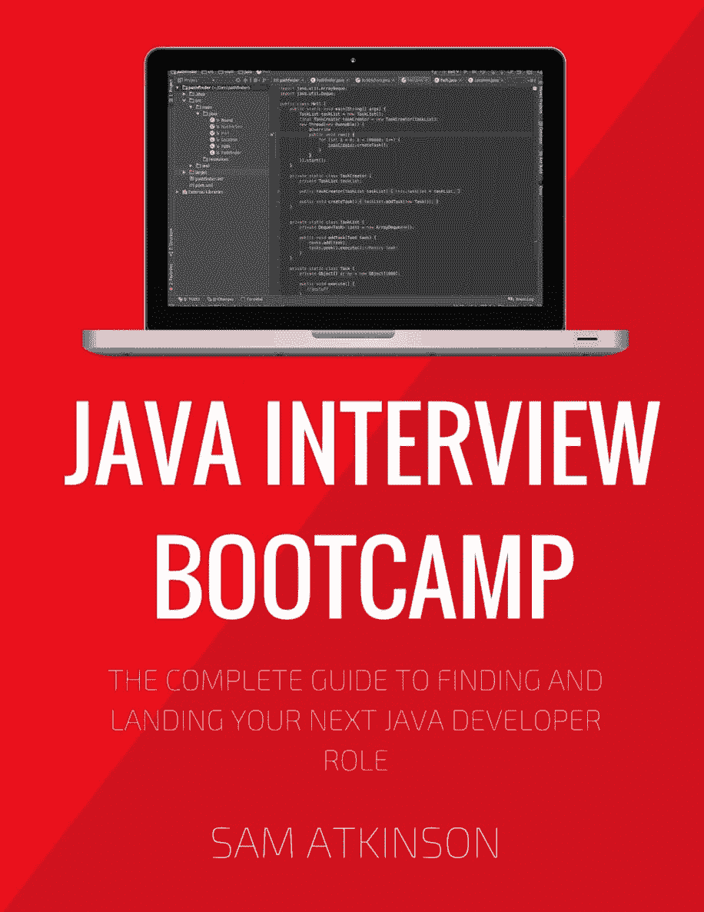
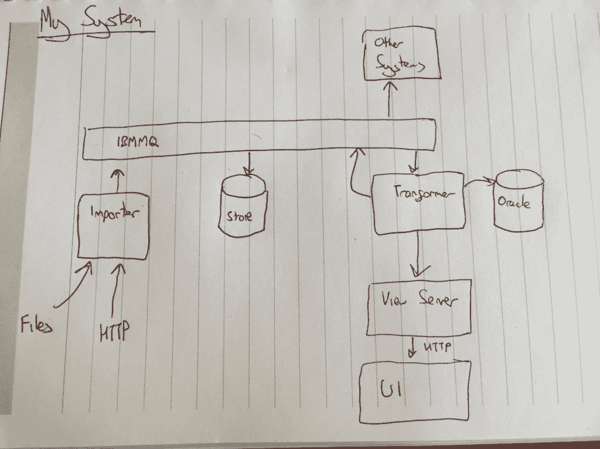
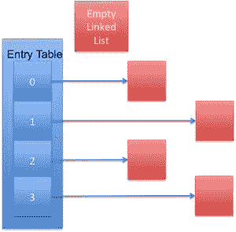
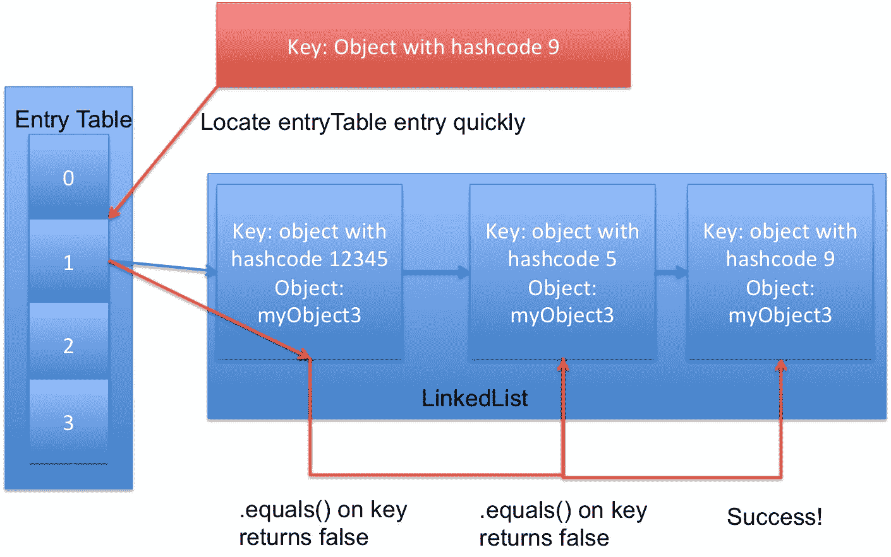
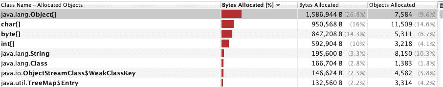
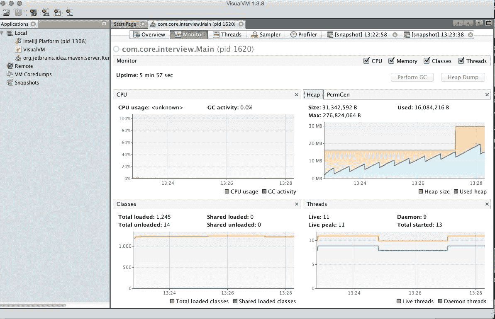

# Java 面试训练营




本书可在 [`leanpub.com/javainterviewbootcamp`](http://leanpub.com/javainterviewbootcamp) 购买

此版本发布于 2015-02-28

---

这是一本来自 [Leanpub](http://leanpub.com) 的书。Leanpub 通过精捷出版流程为作者和出版商赋能。[精捷出版](http://leanpub.com/manifesto) 是使用轻量级工具和多次迭代来出版进行中的电子书，以获取读者反馈，不断调整直到获得正确的书籍，并在一旦成功后建立影响力。

---

致 Laura。感谢你在我写这本书和搭建网站期间（几乎）忍受着我。你太棒了。

致 Mike & Dan。感谢你们提供极佳的支持网络，并听我没完没了地没完没了地谈论 CJIQ。

致 Ryan。感谢你无尽的热情、支持和编辑能力。

## 引言

欢迎来到 Java 面试训练营。首先，我想非常感谢你购买本书。我希望你在这里找到所需的一切。

## 第一部分：软技能与流程

尽管这是一本专注于 Java 的书，但诚实地说，我认为这本书的前部分将为你提供最大的价值。你是一名 Java 开发人员。你必须对自己正在做什么有一定的了解（我希望如此）。本书的后部分专注于核心 Java 和相关问题，是一个极佳的复习方式，并帮助重新学习一些一段时间未接触的领域。

然而，事实是，对于大多数候选人来说，挣扎点不在于技术，而在于软技能。忽视握手或良好的第一印象的重要性将让我们自承担后果。这些正是我们这些极客最不擅长的领域。我们不喜欢与人交流或进行演示。是的，这些是概括，但根据我见过的候选人，这些说法往往是事实。

在本章节要下功夫。仔细阅读两遍，并在阅读过程中做笔记。思考哪些是你以前不知道但现在需要开始做的，思考你在哪些方面是薄弱并需要改进的，然后去练习。无论是和同事还是亲人，在面试之前，务必采取实际行动进行尝试。这样做，我保证你将为自己的求职之旅做好充分的准备。

## 面试流程

也许你是一个刚从大学毕业的应届生，以前从未找过工作，现在你完全不知道自己在做什么。或者，你可能距离上一次换工作已经有一段时间了。根据我的经验，开发者分为两类：一种极度多变，每 1-2 年换一次工作；另一类则异常忠诚，在一家公司待了 8 年以上。如果你特别属于后一组，那么重新投身现实世界可能会让你感到畏畏。

本书的前几个章节将详细介绍与面试流程相关的每个阶段，但首先，让我们从 50,000 英尺的高度俯瞰整个流程。

### 第一阶段：申请工作

通往更好就业的第一步简单来说就是让你的简历出现在某人的办公桌上。但你是如何做到的呢？

取决于你所在的行业，第一个选择点可能是猎头。猎头充当公司与潜在雇佣者之间的中间人，猎头公司根据成功将候选人安置到职位来获得报酬。特别是在金融行业，猎头是你让简历被看到的唯一途径，因为大多数公司没有直接提交简历的便捷渠道。

猎头有优有劣。他们可以接触到整个市场，知道有哪些空缺，并节省了你手动搜索职位的麻烦。这节省了大量的时间和精力。他们处理与新公司的互动，所以你不需要写求职信或直接联系人员。但相反，并不是所有猎头都是平等的的。有些人非常有才华，只会将你推荐到他们认为你能表现出色的职位；他们会引导你完成整个过程，并且理解你的需求并与你合作找到合适的职位。然而，那里也有很多人缺乏诚信，他们只专注于带你找到某份工作（无论是什么工作），以便他们自己能拿到报酬。

最好的办法是与经历过这一过程的朋友和同事交流，看看他们会推荐谁。我个人非常推荐 `iKas` (`http://www.ikasinternational.com/`)，他们在伦敦、纽约、澳大利亚、新加坡和香港设有办事处；以及专门针对香港的 `BAH partners` (`http://www.bahpartners.com`)。

如果猎头不是一个选项，那么就要做好加倍努力。你需要手动寻找职位并提交申请和求职信。但你如何找到这些职位呢？网上有很多地方可以寻找职位：`http://careers.stackoverflow.com/`

HackerNews (`https://news.ycombinator.com`) 每月的“谁在招聘”帖子。LinkedIn。这是一个金矿。网站上有直接发布的职位，你也可以搜索你喜欢的公司并关注他们，因为他们会职位。在小组板块搜索“Java Jobs”之类的关键词，可以找到公司直接发布职位的组。

像 `jobaware.com`、`indeed.com`、`craigslist` 等招聘网站和招聘板。这不是一个愉快的过程。你会被反复填写基本信息，而且你可能需要为每个职位写求职信。但这意味着你可以针对特定的公司、职位或领域进行非常具体的搜索定制。

### 第二阶段：面试

每家公司的招聘流程都不同。虽然一家公司可能在做决定前对你进行一小时的面试，但另一家公司可能让你通过 7 个阶段的不同资历人员的测试和面试。如果可能，请尽早询问面试流程是什么。你的猎头或招聘经理应该能告诉你。这将为你提供最大的准备机会。

以下是你可以预期的最常见的面试步骤类型：

#### 电话面试

电话面试通常出现在招聘过程的早期。它们是在邀请候选人进行更长时间、更彻底的面试之前筛选候选人的绝佳方法。面试将持续 15 分钟到一小时不等，并将重点集中在有限的技术问题集上。电话限制了所提问的性质，因为所有问题都必须口头表达。缺乏白板或笔纸往往会导致面试变得非常理论化或基于经验，没有太多的设计内容。

偶尔，电话面试可能会在周期的后期出现，通常作为最后一轮。

这通常在你通过了所有其他阶段之后，而需要签字的经理想和你聊聊。这应该只是一个形式，通常涉及关于你的经验以及你对该职位的期望的问题。

#### 居家技术测试

我非常看好给候选人发送家庭作业。这能让你在没有面试环境压力的情况下证明自己的技术能力。通常，这项练习需要花费一到三个小时，要求你针对一个问题开发出有效的解决方案，可能涉及对复杂需求的理解、某种算法，可能还有线程处理。重要的一点是在提交之前花费必要的时间编写出让你感到自豪的代码。任何拥有这一阶段的团队都会看重代码质量，因此不走捷径很重要。

#### 办公室内技术测试

如果你被要求去进行技术测试，可能性会更广泛。它可能是家庭测试的完全对等形式；许多公司不信任候选人在家里不作弊（根据经验，我知道这确实会发生），因此要求他们在办公室完成练习。但通常这会短得多，最多持续一小时。

与单一的练习相比，你可能会收到一系列更小的问题，就像考试一样。这允许对特定领域进行更专注的考核，并且意味着如果你失败了其中一部分，仍然可以优异成绩通过其他部分。

我最喜欢的方法是结对编程测试。在这种情况下，你与招聘团队的某人坐在一起，一起完成预定义的练习。除了测试你的技术能力外，结对测试还让招聘团队看到你是如何工作的。你熟练快捷键吗？你会先写测试吗？你为什么选择这种方式设计？如果你获得了这份工作，你们将紧密合作，并可能持续多年。

#### 面对面

面对面面试是你获得工作的最佳机会，无论它们处于流程的哪个阶段。事实是，人是有偏见的。如果你能向面试官强力地推销自己，那么那个人就会成为你最大的推销员。“我面试了这个人，他非常好，我们得让他进来。”通常说服一个人就能让整个面试流程顺畅运转。

可以使用笔纸或白板，这使得它成为提问设计问题的最佳格式。准备好被针对你以前工作过的系统进行盘问，或者被要求现场设计某些东西。同样，面试官非常喜欢让候选人写伪代码，特别是关于创建搜索或排序算法的问题。这为后续的一些大 O 类问题铺平了道路，但更重要的是，它为你的潜在雇主提供了一个观察你如何解决问题的机会。

### 一对一

最简单的面试。人面对面，通常持续一小时甚至更久。这种方式的优势在于你只需要尝试给一个人留下深刻印象，但也意味着如果你从一开始就表现不好，或者面试官那天心情不好，你就有麻烦了。如果可能，在去面试之前尝试了解你的面试官是谁。根据我的经验，这些一对一会议通常是团队负责人或高级别进行的，因此虽然可能会有一些技术内容，但交流的主要目的是了解你将如何融入团队和更广泛的公司文化。

### 组面试

我个人认为这是最困难的一种面试。通常会有 2 到 3 位未来的新团队成员坐在桌对面，向你抛出他们最尖锐的问题，而你必须尽力不让自己难堪。我觉得这种面试是最糟糕的，因为要给 3 个人留下深刻印象其实非常困难。每个人都有自己的意见和工作方式，你能够满足所有质问者的概率微乎其微。

### 快速配面试

速配式面试涉及在规定的时间内安排尽可能多的面试官。默认情况下，通常是与 3 位不同的面试官分别进行。

你留在房间里，与每人进行 20 或 30 分钟的面试，然后他们就会离开，取而代之的是更多提出不同问题的人。我以前甚至经历过这种情况，其中一个面试官是通过视频会议参与的。从面试官的角度来看，这是极好的；你可以从多位员工成员那里获得共性意见（任何获得三位中全部赞同的人都可以直接通过），而且这意味着你可以同时面试 3 名候选人。这是一种筛选人员非常有效的方法。

然而，从面试者的角度来看，这可能会非常紧张。那是大量的面试！如果你只是和一或两个人进行 1 小时，那么一旦你进入状态，一切都是好的。

你可以和面试官变得熟悉。然而，看到许多不同的面试官意味着你无法放松。你不断尝试弄清楚每个人在寻找什么。这真的是非常辛苦的工作，除了常规的 `java` 准备之外，没有办法可以准备。如果你要去参加这种面试，我能给你最好的建议是记住每个人都是不同的。尽管通常会有团队主题（也许他们都喜欢测试驱动开发），但个人会喜欢不同的侧面，偏好不同的技术。和任何面试一样，尝试与桌子对面的人建立联系。虽然显而易见技术能力是重要的，但你成功的很大程度上取决于面试官是否喜欢你以及你的态度。从心理上来说，只要你不犯任何重大错误，桌子对面的那个人就会尽力录用你。

## 面试流程示例

为了让你对预期情况心中有数，这里有一些我经历过的流程示例：

### 某澳洲大型银行

- 与团队经理的一对一面试
- 能力测试
- 2 小时技术面试；1 小时与本地开发人员面对面，1 小时通过视频会议与 2 名开发人员交流
- 与部门主管面试

### 小型慈善机构

- 与未来的经理和部门主管面对面
- HR 面试

### 某国际大型银行

- 30 分钟电话面试
- 与 2 名开发人员的结对编程面试
- 与 3 名开发人员的组面试

## 制作你的简历

留下初印象的机会只有一次，从那时起，这种印象要么对你有利，要么对你不利。这适用于所有媒介，从网站（你有 7 秒钟给访问者留下深刻印象）到在面试中遇到新的人（你的时间更短）。从一开始就表现不好意味着你需要表现得极其出色才有机会获得新职工作，虽然这并非不可能，但无疑会让原本困难的面试变得更加困难。另一方面，如果你到达并能与面试官建立联系，那么这份工作就任由你来决定了；从心理上来说，他们会希望你表现出色，只要你不犯任何重大错误，桌对面的那个人就会尽力争取录用你。

“但这和我的简历有什么关系呢？”我听到你在心里叫道。你的简历是你的第一个初印象。当这些页面落在某人的桌上时，这是他们第一次接触到你以及你所代表的东西。面试官每个职位都会收到数百份简历，可以理解，其中很少有简历能脱颖而出令人兴奋。让我们明确：你的简历是一份销售文档。在读完你精心构思的文字后，你希望阅读者转向旁边的人说：“嘿，这家伙看起来不错。我们应该尽快请他来。”我说这种情况每隔 20 份简历左右就会发生一次。

在我们深入撰写完美的“程序员宣传稿”之前，我有一条至关重要的建议，它不仅适用于简历，也适用于你将经历的所有招聘和面试过程。

### 杀手建议：每个人都是不同的

在面试过程中，你将谈到的所有人对于什么是好的开发者都会有不同的意见。如果有一种标准化的考试或其他方式来区分好开发者和坏开发者，那么招聘将变得容易得多（不，即使是 Sun 认证 Java 程序员证书也不能解决问题）。你参加的每一场面试都会有不同的问题，每位面试官都有不同的价值观。一个人可能看重多语言开发者。另一个人可能看重 TDD。下一个人可能认为代码应该在记事本中编写并手动编译。没有万能妙药。

作为候选人，很难记住这一点。也许是你的简历没有获得面试机会，或者也许你参加了几场面试但没有进展。你的情绪会低落，并得出你被困在原地、不够优秀获得新工作的结论。现实情况是，你还没有找到与你的价值观一致的地方，这没关系。

你对工作的要求可能会让你寻找职位变得更容易或更难。对我来说，我讨厌大 O 符号和性能问题，因为我身边有谷歌，而且我相信人们倾向于过早优化代码；真正的性能问题发生非常少。这意味着有些面试我出来时知道自己表现得很糟糕，但我不在乎。我很清楚我不想为那个团队工作，因为他们的价值观与我的不符。这会让找工作更困难吗？

是的，但这意味着当我找到一个职位时，它是我真正想要的。你清醒时的大部分时间都在工作，所以你完全值得花时间把它做好。

## 简历格式

### 应该有多长？

这是许多争议的来源。我的观点是非常坚定的：如果可能的话，简历应该只有一页（最多不超过两页）。人们没有时间详细阅读简历，他们并不关心你读过哪所学校或你过去的 15 份工作。他们想要的是关于你的技能如何契合该职位的简短推销。通过保持内容简洁并仅填充重要信息，你实际上让读者的工作变得简单得多，同时也展示了你简洁沟通的能力。

另一方面，需要注意的是，过去我曾被招聘人员要求充实我的简历。如果你在和招聘人员合作，他们通常会根据职位的需求对你的简历进行剪裁和编辑。因此，我保留了两份简历：第一份是简短的单页版，浓缩了我的核心角色和经验；另一份是 `2 pager` 版本，尽可能地塞满了大量内容以供招聘人员使用。

不要受诱惑去写一本 15 页、数千字的“大巨著”。当我收到这类简历时，会立刻引起警觉。越大并不越好，这只是在凸显你无法进行有效沟通。如果公司确实需要你追溯 15 年的经历，他们以后会来向你要求的。简历是你的销售文档，用来说明你最好的技能是什么，并清晰的例子说明你如何利用这些技能取得了巨大的成就。让我再说一遍：`你的简历是你展示自己优秀技能的机会`。它应该以成就为导向，展示你过人的才华以及这些才华如何帮助你完成了目标。

## 开场白

并不是所有候选人都会包含这一部分，但我认为这是最重要的部分。这是对你和你个人品牌的单段介绍。你代表什么？你在意什么？将其看作你的电梯演讲，借此概述你的优秀之处以及别人为什么要雇佣你。谈谈你的热情；也许你热爱 `TDD`，或者你认为自己是并发领域的领主。从这里开始，这是在文档开头奠定基调的一种很好的方法。

避免在你的开场白中显得俗气。不要忘记对面是一个要审阅这些内容的真实的人；候选人似乎喜欢尽可能堆砌大量的热词汇，如：“自我激励，注重细节”。这到底是什么意思？我敢保证阅读你简历的人并不知道。如果有人在面试中问你你的哪些方面体现了这些技能，你能回答吗？我猜不能令人信服。力求以简洁简单的方式写作。如果你有一些想放进去的热词，请确保你有足够的素材来支撑它们；我的简历中提到了我是一个充满热情的科技人员，然后我通过工作之外的项目以及我在职位中使用这种热情的案例来证明了这一点。

事实很残酷，大部分内容并不会被阅读。招聘人员有大量此类简历要看，所以可能只读这一段，运气好的话扫一眼其余部分。写好这一部分，并将最令人印象深刻的内容放在前面。

## 职业经历

你不需要超过最近 5 年或最近 3 个职位，以较少者为准。这部分应该是简洁的，并关注`你`产出了什么以及`你`是如何做的。我读过很多总结，它们都在告诉我候选人工作过的`公司 X` 的历史以及该公司正在执行的雄心勃勃的项目。这对我了解简历背后的那个人没有任何帮助。以下是一个不应该做的例子：

> “高级 Java 开发人员，Awesome Co. 2012 年 7 月-2014 年 7 月
>
> Awesome Co. 是世界领先的投资银行之一。总部位于纽约，在全球设有办事处，该公司以以客户为中心的银行业方法为自豪。
>
> 我当时负责项目 X。该项目是一项 2 亿美元的投资，旨在通过雄心勃勃的 3 年计划，基于 `Java` 和 `NoSQL` 技术创建一个下一代银行平台。该项目重点关注敏捷交付和创建低延迟系统”

你会发现，这里几乎没有提到候选人。有太多的程序员简历是这样形成的。相比之下，请看下面的简历示例：

> “高级 Java 开发人员，Awesome Co. 2012 年 7 月-2014 年 7 月
>
> 成功领导了一个由 6 名开发人员组成的团队，使用敏捷方法和迭代交付，在雄心勃勃的时间表内产出了行业领先的平台。
>
> - 我引入了迭代交付和故事计划（story planning），这使我们能够准确预测速度，并让我们能够每 2 周持续交付一次到生产环境。
>
> - 我创建了一个全面的 `NFT framework`，使我们能够快速运行回归测试，并确保我们符合业务设定的高标准。
>
> - 主导了系统设计，并引入了 `ActiveMQ` 和 `MongoDB` 以产生极其快速且易于测试的系统；所有代码均使用 `TDD` 构建”

这一次，整篇文章聚焦于候选人身上。我现在知道他们做了什么以及取得了什么成就。这是一个更具说服力的推销。

此外，人们喜欢列表。成就列表比段落更容易解析。尽可能多使用列表！

## 课外活动

如果你在工作中做了一些超出常规职责之外的事情，你需要大声宣扬出来。最优秀的候选人想要的不仅仅是来公司、写 8 小时代码然后回家。如果你参加过任何你认为相关的课程或培训，请把它写下来。这里是一些想法；如果你还没有这些内容，就从现在开始做吧！

- 你可能做过的任何创新项目，或开创的工具和技术。例如，也许你在组织中引入了 `JIRA`。
- 组织邀请嘉宾来团队进行演讲。
- 组织团队在每周论坛进行演示。
- 对 `Open Source` 的贡献；某社区的成员。
- 参加过如 `Startup Weekend` 或 `Angelhack` 等活动。

正是这种额外的工作能让你在竞争激烈的市场中脱颖而出。

## 教育背景


99% 阅读你简历的人并不关心你的教育背景。很多程序员来自非 `CompSci` 背景，有些人甚至没有学位。在开发职位中，你的职业经验重要得多。包含你的学位，可能还有一行关于 A Level 的说明，仅此而已。将此部分放在文档末尾。它不重要，所以尽可能少地浪费空间。

## 技术列表

不要这样做。由于某种原因，越来越多的简历带有了候选人接触过的每项技术列表。有些简历现在甚至带了评分，说明申请人对每项技术的精通程度。如果你知道某个职位对特定技术很感兴趣，请调整你的经验部分来解释你在这方面表现很出色。如果你有一些想涵盖的内容但在任何其他部分都不合适，就设一个小小的“技能”部分。无论你如何，都不要只列出技术列表。这不会给任何人留下印象，面试官可以对其中任何一项技术进行追问。如果你不自己能够对某项技术回答深度面试问题，那么就不要列它！

关于这一点以及如何构建良好的简历，在 Core Java Interview Podcast 中有一些非常棒的建议，来自 Sarah Sellers，一位在帮助候选人方面经验丰富的招聘人员。你可以在这里听：

http://www.corejavainterviewquestions.com/podcast5

## 候选人顶级技巧

如果你在之前的职位中做过任何“额外”工作，请把这些写进去。这证明了你在工作中是“超越”要求的。

如果你有个人项目或参与的共享项目，请列出这些内容。简历上附有 github 的候选人会留下深刻印象，因为这表明你热爱编程，以至于回家还会做更多。这就是热情。

如果你有个人网站或博客，请将其包含进去，但确保它看起来良好并且在过去 6 个月内更新过。我见过一些糟糕的候选人网站，这会瞬间让我产生反感。确保你的网站美观且与时俱进，这绝对能为你赢得额外的加分。

如果你在家里研究过某些技术，请列出这些技术以及你是如何使用它们的。许多机构会限制你允许使用的技术；如果你回家后玩了 `NoSQL` 或 `node.js`，那么通过将这些写在简历上，你展示了对技术更广泛的认知，这是一种备受青睐的技能。

## 让它看起来精美

当我说大多数简历都没有脱颖而出时，我是非常认真的。它们只是充了一页又一页的文本块。加入一点点设计就能产生巨大的差异。

我是 Google Docs 的忠实粉丝，它提供了一些基础且具有吸引力的模板，这些可以让你在这一堆简历中脱颖而出一点。这虽然不多，但通常足够了。

## 电话面试

我非常喜欢在招聘流程之初使用电话面试。作为一名试图招聘的人员，我需要一种方法来过滤掉发来的数百名候选人。我已经接受了事实：大多数人都不擅长写简历，有些人纯粹是在歪曲事实，因此在与人面对面之前，我发现和他们通 20 分钟电话是非常有用的，以确保他们确实懂 `java` 并了解他们的背景。作为候选人，这也是一个留下良好印象的机会。许多人担心自己无法在电话中表现出真实水平（事实上，面试失败的候选人经常以此作为原因），然而，只要有几条关键建议，你就可以确保自己脱颖而出。

## 准备你的 Java 电话面试

你可能面对的是猎头，也可能直接与公司对接。无论哪种，都要联系他们并了解电话面试的准确细节。你想要尽可能做好准备。

具体来说，你应该询问：

- 面试将持续多久？
- 会问什么类型的问题？如果你能得到答案，你就算幸运了，但了解问题是更倾向于技术还是倾向于设计是有好处的。电话面试往往带有技术倾向，因为在没有纸或白板的情况下，设计面试真的很难进行。这绝对值得问，因为你可能会幸运地获得一些帮助你准备的宝贵信息。
- 电话中会有几个人？他们是谁？一个或两个人的电话面试通常更容易，因为你可以识别出是谁，并了解他们的兴趣和提问风格。超过这个人数会变得稍微困难。

接下来就是时候静心埋头看书并复习了。你可能会遇到很多这类“`Java` 中的这个东西是做什么的？”的问题，因为这类问题在电话里很容易回答。它们不一定是好问题，但它们是面试官倾向于依赖的问题。

确保每当你约好面试时，你都有**安静且私密的地方可以去**。确保你在面试官预定来电前 **5 分钟** 到达。没有什么比因为没有面试地点而手忙脚乱地开始通话更糟糕了，这会留下糟糕的初印象。作为面试官，我的时间是有限的；我倾向于将电话面试安排得连续进行，或者穿插在会议之间。如果你浪费了 5 分钟，你就失去了一个给面试官留印象的机会。

确保你**随身带一份简历副本**。面试官也会有一份并会向你提问。我猜你记不住自己在简历上写了什么，所以把它放在面前。当有人问你简历的某部分而你完全不知道他们在说什么时，是非常尴尬的。

确保你在进入面试前**预先准备好一份面试结束后的问题列表**。会被问问题的，快速做出反应很重要。我想知道你是否在意我招聘的这个职位，是否花了 30 秒看职位描述，并且想了解更多信息。面试官（以及大多数人）都是自恋的。即使这只是一个简单的“我希望你能告诉我更多关于这个职位的信息”也没关系，只要确保你不要沉默 5 秒，搞得好像你没预料到会被问这个问题一样。准备好 2 或 3 个问题。你是否真的想要答案并不重要，提问这个动作才重要。

对于那些极度懒的人，这里有一份问题列表：

- 请能多介绍一下团队吗？规模有多大？经验水平如何？
- 团队是基于一个地区还是在地理上分布的？
- 团队是如何工作的？你们使用敏捷开发吗？
- 你目前工作中最大的挫败感是什么？
- 在公司和团队工作中你最喜欢的部分是什么？
- 典型的一天是怎样的？
- 在你们公司使用新技术有多困难？
- 有什么样的培训？

这也是一个留下深刻印象和展示自己的机会。假设你知道你面试的人非常热衷于某种技术或技巧，比如 `Test Driven Development`（测试驱动开发）。

利用你的问题来推销自己！“我是 `TDD` 的忠实粉丝，我在想你们具体是如何使用它的？”  own“我一直想学习 `TDD`，但一直没机会。你认为学习曲线容易掌握吗？”

## 留下最佳印象的技巧

当电话响起时，要保持积极。要表现得很乐意。尽管这听起来很老套，但“你有 7 秒钟来留下第一印象”的老话非常准确。我招过的听起来很闷或或不感兴趣的候选人简直疯了。这会让面试官瞬间反感，除非你能回答所有问题，否则你会很难过。相反，如果你接电话时很兴奋，并告诉面试官你很期待这次面试，那么从一开始你就占优。

说话慢一点。你不想以光速扫过整个面试。但是，不要慢到让面试官感到无聊。最重要的是，知道何时停止。我遇到过候选人对 `Spring` 进行长达 5 分钟的独白，搞得我不得不插话。能够简洁地回答是一项非常重要的技能，不仅在面试中如此，作为一名 `java` 开发者也是如此。这需要练习，但非常值得。如果你担心没有完全回答问题，只需说“可以吗？或者你希望我继续？”可能面试官可能捕捉到了你提到的某些内容，并改变问题的方向或问一个新问题。如果没有，他们可能只是让你继续。

一些绝对不要做的：

- 不要显得无聊
- 不要嚼口香糖
- 不要搜答案（**我们能听到键盘声**）
- 不要打断面试官
- 不要害怕说不知道。试图靠猜是骗不了任何人的。如果我在问这个问题，那么我可能知道答案。完全可以说“我不了解那个，但如果你愿意的话，我很乐尝试推演一下”。这样大家都知道你不是在撒谎过关。承认自己不知道的候选人总是赢得尊重。

## 面试期间会被问到的问题

由于电话的局限性，你可以相当确定，问题将基于以下四类之一：

### 核心 Java

核心 Java：多线程、异常、数据结构与算法、面向对象编程等。这些都是基础内容，你只需要花点时间重新温习一下。

这些问题是否是衡量你能力的良好提问并不重要；大多数面试都会回到这些点上，所以做好准备是明智的。阅读《Java 面试训练营》（Java Interview Bootcamp）的后半部分是最好的起点。

### 技术讨论

“你用过技术 X 吗（或‘我从你的简历上看到你用过 X））？”能介绍一下吗？你对它有什么看法的？”我默认的首选话题是 `Spring` 和 `Hibernate`，因为它们有很多可以从初始问题延伸并进行深入探讨的问题。它们也出现在大多数人的简历上。

这类问题是我偏问的，因为你可以借此了解候选人的知识水平，以及他们是否真的理解自己使用的工具，还是仅仅因为被要求才使用它们。看看你简历上的核心技术，并想出你对它们的观点。面试官可能并不在乎具体的观点是什么，而是在乎你能否清晰地阐述每一方面的优缺点并得出结论。

### 技术与技巧

我很喜欢问这些问题。每个办公室的运作方式都不同：敏捷对比瀑布（是的，瀑布流依然存在）、`TDD`/`BDD` 以及其他开发模式、编程风格等。同样，如果你把这些写在了简历上，你就需要确保对自己的经验有良好的回答。如果你的部门使用 `TDD` 所以你把它放在简历上，但你实际上并没有这样做，你会显得很糟糕。

再次检查你的简历，看看你列出的内容；为每一项准备强有力的解释。

### 脑筋急转弯

这类包含了谷歌风格的问题，比如“世界上有多少粒沙子？”以及“如果你被困在电梯里一个半小时怎么办？”尝试读一些这类问题让自己在回答时更从容是好的，但实际上，这些并不是通过大量学习就能掌握的。我个人并不太喜欢这些，但每个面试官都是不同的。

尽量不要去猜测面试官在寻找什么，或者你认为面试官认为什么是“正确”答案。他们可能会故意引导你走错路，以看你是否是一个“唯诺诺”。即使你的观点看起来很有争议，也要坚持自己。保持礼貌、诚实，并尝试参与开放式讨论。电话那头的对面不是机器人，所以要尝试从人性的角度与其进行双向对话。如果候选人在回答过程中反问我一个问题，我通常会很。面试应该是双向的。

## 面试后

通常情况下，你对自己的表现应该很有数，但不要担心。我遇到过一些觉得自己搞砸了但其实表现很好的候选人。相反，我也遇到过表现糟糕却自认为很出色的人。只需等待他们的回复，并对你已经尽力的事实保持放松心情。如果你没有通过，也不纠结。事实是，每个面试官都是不同的，观点也不同，每家公司重视的东西也不同，你可能在那段时间并不适合那个团队。这没关系。继续申请不同的职位即可。

除此之外，还有人为因素；也许面试官今天心情不好，或者他们还没吃午饭所以肚子饿。想到这可能影响你的潜在工作机会很糟糕，但这是生活的常态。无论你做什么，都不要对结果提出异议。回邮件试图在你有时间思考后解释得更清楚一些，或者请求再次面试都是没用的，而且可能会损害你的声誉。

这个行业出奇地小（特别是得益于 `LinkedIn`），所以要抬头做人，花时间回顾你下次可以做得更好的地方，然后继续前进。

## 面对面面试

在招聘过程中，你可能进行的大部分面试都是面对面面试的变体：正如书中前面讨论过的，招聘人员可以选择的变体非常多。虽然针对每种面试都有特定的技巧和窍门，但存在一些贯穿始终的核心准则，这些准则能让你作为候选人尽可能地代表自己。虽然拥有职位所需的技能显然至关重要，但现实是，成功往往取决于直觉——面试官对你是否有良好的“感觉”。你可以通过展示自己的方式来产生影响；你的握手、你的对话以及你的肢体语言。根据我的经验，在对候选人做出决定时，这些最终会产生巨大影响。

### 第一印象

这很陈词，而且我已经说过很多次了，但第一印象确实代表一切。初次见面可能决定成败，即使你一个问题都没有回答。虽然我认为任何偏见都是无意识的，但人们仅仅根据自我介绍就会给他们喜欢的候选人问更容易的问题（而对难搞的候选人问更难的问题）。

但什么是良好的第一印象呢？

#### 准时到达

这竟然需要写下来真是令人费解，但我遇到的迟到的候选人多得令人惊舌。面试你的是忙碌的人，他们是从一天工作中抽出时间和你坐在一起。你迟到的那一刻，你就进入了“否”列并挣扎着想要。理想情况下，尝试在计划开始时间前 5 分钟到达。不要太早也很重要。我知道我去过的每个地方都面临会议室空间的问题，如果你来得早，会让面试官产生找地方让你等的压力。

#### 穿着得体

视行业而异，但我发现通常人们不再穿西装领带，通常只穿长裤和衬衫。我认为这样更好，并且有助于你放松。如果你觉得穿西装更舒服，那就尽管穿（尽管我建议进入面试时脱掉西装外套）。但是，确保你穿的任何东西都合适：不要成为那种穿大两个号西装的极客刻板印象。我以前有人穿牛仔裤和 T 恤来面试。千万不要那样。穿得太正式永远不会留下坏印象，但穿得太随意绝对会。

#### 握手

永远不要低估良好握手的重要性。握手有三种。第一是软弱、无力的握手，很多极客都有这种表现，因为我们倾向于胆怯。你通过握手在表达你是什么样的人。如果你的握手没有力度，结论就是你在办公室里很软弱：不太可能站在白板前或发表强烈的观点。仅仅是因为一次握手！

第二种握手是碎骨手。在光谱的另一端，类型的人听说过有力握手很重要，结果试图压碎对方的手来展示力量和实力。再次，避免这种。这说明你是一个强势的人，或者你正在过度补偿什么。这也很疼！这和软弱握手一样糟糕。

相反，我们想要的是第三种握手方式，即握手的“金发姑娘”原则：恰到好处。一个好的握手传达了自信，但不会过头。它有力，力度适中，但不会让对方觉得需要去医院看骨折。意不意外的是，这需要练习。所以要练习吧！请你亲的同事、朋友或家人和你一起练习。只需要花 3 分钟时间测试不同的力度，就能找出对你来说良好的握手是什么，但它可以对你的第一印象产生巨大的影响。我在学校时很幸运遇到过一位专门讲过这节课的老师，从那时起受益匪浅。

### 第一次对话

你终于不得不开口说话的尴尬时刻。在这里你需要考虑的两个主要点是：你想说什么，以及你打算怎么说。

肢体语言、举止和语气显然都是重要的。你的任务是向面试官传达你对这次面试和工作机会感到兴奋。你会惊讶地发现，有这么多候选人听起来完全对参加面试不感兴趣。如果你的语气平淡，听起来就像这只是招聘人员为你安排的又一次面试，那么面试官为什么要愿意在你身上花时间呢？听起来很感兴趣。听起来很兴奋。听起来你很想要这份工作！

进入面试前，准备一些闲聊的话题。再次，我们程序员倾向于是一群安静、缺乏社交技巧的群体。很有可能在从你被带到接待处到面试开始之间，会有某个时刻你需要通过对话来填补空白。这是一个推销自己的绝佳机会，无论是在谈论你目前正在做的事情，还是诚实地表达你的紧张。这是一个留下良好印象并与面试官建立联系的机会。如果你真的觉得很吃力，就提问吧。“你最近在忙什么？”“我昨晚在看 `Java 8`，你见过关于 `default methods` 的新花样吗？”这能让对方说话，减轻你的压力，同时也是建立关系的极佳方式。人们通常更擅长说话而不是擅长倾听，他们会因为你提问并给他们说话的机会而很高兴。这听起来很老套，但却是事实。

### 面试形式

一旦你留下了惊人的第一印象，真正的工作就开始了。根据面试阶段的不同，内容可能会大异，因此了解你要面对的是什么非常重要。确保在面试之前与你的招聘人员或聘用公司沟通，询问面试将包含哪些内容：有多少人、几个阶段、什么类型的问题。通常公司乐意提供这些信息来帮助你准备。永远不要忘记，面试你的人是希望你获得这份工作的。他们希望你成为他们一直在寻找的极优秀的开发者，而你需要向他们证明你就是那个人。

### 技术面试

这是大多数面试流程的核心，也是本书的重点。

一组开发者会就 `java` 编程、算法和设计向你提一系列问题。这将始终是任何面试过程中最困难的部分。领域空间如此巨大，你可能会被问到任何问题，而且有些面试官甚至以问一些晦涩的问题为自豪。然而，大多数人并不是那样，他们会将问题限制在一个核心问题范围内。

在准备 `Java` 面试时，你必须确保已经复习了核心材料。尽管你每天整天都在写代码，但事实是，语言中大多数“复杂”部分很少使用，但在面试中经常被问到。至少你需要复习大三：

* `Threading`（多线程）
* `Collections`（集合）
* `Garbage Collection`（垃圾回收）

集合的自然延伸是学习算法，因为问题通常会围绕编写一个算法来对数据结构排序展开。这些在书后面也会介绍。

你也很可能被问到你的设计经验。一个经常出现的问题是“跟我谈谈你设计过的东西”或“谈谈你目前正在工作的系统”。通常，他们会给你一块白板，让你画出架构并要求你边画边解释。这是一个很好的开放式问题，可以给你提供一个良好的机会，通过参与技术选择和健壮性设计的讨论来展示才华。

最后，你可能会被问到一些“虚泛”的问题。作为开发者，很大一部分工作与代码完全无关。开发实践就是一个很好的例子；例如，我喜欢询问候选人关于他们 `agile development`（敏捷开发）的经验。这可以将只听命行事的人与对开发实践有积极兴趣并理解其目的的人区分开来。还有一些属于这一类的非技术问题：“什么让你对上班感到兴奋？”这可是我的另一个最喜欢的问题之一。

在回答这些松散的开放式问题时，不要急于直接给出答案并滔滔不绝。花点时间想一个好的答案是可以的。这种信息不是人们在脑子里随时准备好的，面试官也清楚这一点。

### 管理层面试

当你通过开发团队的关卡后，你通常会进入一个由经理所在的房间。这可能是团队经理（可能在某种程度上仍然具有技术性），也可能是部门主管（与日常工作脱节很大）。很有可能是这将侧重于人际关系的泛泛问题。面试的目的是了解你作为团队成员的经验，确定你作为员工的潜力，并判断你是否适合这个团队。

- 你喜欢工作中的哪些方面？
- 你不喜欢开发者的哪些方面？
- 你为什么要离开现在的工作？
- 如果你可以对你现在的团队改变一件事，那是什么？
- 一个优秀的团队是什么样的？
- 什么造就了一个优秀的开发者？
- 请讲述一次你在工作中发生冲突的经历。你是如何处理的？
- 请告诉我你在工作中犯过的最大的错误？

## 技术测试

### 什么是技术测试？

多年来，我尝试过许多不同类型的候选筛选方法：电话面试、相亲会风格、全技术面试以及其之间的任何形式。到目前为止，我最喜欢的方法是技术测试，也称为编码作业。

技术测试简单来说就是留给你在家里完成的一项或一组练习。通常它需要一到两个小时，并且具有一定的挑战性，涉及某些复杂程度，如 `Threading`（多线程）或 `algorithms`（算法）。说明通常会通过邮件发送给你，给你一个完成任务的时间范围。

### 为什么这些测试很好？

大多数面试流程都不涉及候选人编写任何代码。这太疯狂了！

你面试是为了成为一名程序员，但大多数工作面试并没有涉及你进行任何编程。如果你足够幸运进入了涉及查看代码的流程，他们可能有 3 种主要方案：

- 邀请你过来并观察你写代码。这可能是一次结对编程练习，也可能让你坐在练习题前看你写代码。我非常喜欢结对编程面试，将其作为面试周期后期的一种机制，可以很好地了解程序员是如何与他人互动以及如何设计解决方案的。


- 要求提供代码样本。这种方法没有以前那么流行，但等同于要求图形设计师提供他们的作品集。大多数人编写的代码都是为雇主写的，无法导出到公司之外，因此它取决于应聘者是否有个人项目可以展示。我建议，如果你已经有了项目，请将它们上传到 `github` 并包含在简历中：拥有这些项目会让你很加分，而且说明你对自己的代码感到自豪。

- 技术测试！

结对面试的问题在于它会占用招聘者大量的时间，通常是 2 个人为每个候选人花费 2 小时。这是非常昂贵的，因此最好留到流程的最后。另一方面，代码样本并不是标准化的。它们能反映你的代码风格，但不太可能回答面试官对你能力的所有问题。这也意味着作为面试官，我需要为每个候选人熟悉一个新的问题空间和代码库，这需要花费大量的时间和精力。

另一方面，编码作业评审的时间相对较短。它们是标准化的，这使得招聘团队的工作更容易，并确保候选人在公平的平台上进行比较。挑战可以被编写得以确保测试公司看重的任何方面；`algorithms`、`threading`、`design` 等。对我个人而言，我认为它们是第一轮或第二轮面试的绝佳选择，可以优胜劣汰并立即过滤掉大量候选人。许多事在简历上吹得非常响，但却是糟糕的程序员。

然而，如果你正在组建招聘流程，要小心不要在流程太早使用这种方法。我遇到过许多候选人在甚至还没有电话面试之前就拒绝参加面试。当要求候选人花 1 或 2 小时写代码时，他们通常希望先和你聊谈，以便获取更多关于职位的信息，并确保这值得投入时间。另一方面，我也遇到过候选人对职位感到格外兴奋，因为这表明我们非常看重候选人的编码能力，这是一个非常理想的属性。

### 如何通过

这听起来可能显而易见，但至少你需要产出可以编译、运行并解决问题的内容。我评审过太多代码根本无法编译的提交作品。这会被直接拒绝。不要期望评审者花大量时间尝试让程序运行起来。使用像 `maven` 这样的标准构建工具，并在 `readme` 文件中包含清晰的、逐步的说明。

确保你逐字阅读并遵循说明。我曾遇到过有人用 `Scala` 提交解决方案，尽管说明指定使用 `Java`。这完全是浪费大家的时间。

如果你有任何不确定，请提问。你可能不是第一个遇到这个问题的人，如果是的话，他们也可以为未来的候选人修改说明。

你的目标应该是编写你乐意看到进入生产环境的代码。在最高水平，我想看看你所产出的最好的代码（这本该是它的水平）是否足够好，让我让你提交到我的代码库中。显然，“良好的代码”是一个非常主观的观点，但如果你提交了你感到自豪的东西，那就是你所做出的最好的。如果你因为代码风格被拒绝，那么你可以放心该团队不适合你。例如；如果我因为没有给代码写注释而被某个团队拒绝，我会很庆幸错过了，因为我相信代码应该通过良好的命名和拆分来编写，使得即使没有注释也能清楚地发生了什么（`APIs` 除外）。你的代码代表了你的价值观。

提交前要检查的一些关键点：

- 所有 `methods`、`classes`、`tests` 和 `variables` 命名保持一致

- 删除所有注释掉的代码

- 不要留存未使用的代码；像 `IntelliJ` 这样良好的 IDE 会清晰地标出某段代码未被引用

- 删除未使用的 `classes` 或 `tests`

- 删除任何为了“测试某个是否有效”而写的 `main` 方法

- 删除所有断点！

除此之外，这简单归结为创建一个解决问题的良好解决方案。仔细阅读问题，并列出关注点。该问题对延迟敏感吗？是否有大量数据量？如果涉及 `UI`，是否有响应方面的考虑？如果你列出哪些是重要的（哪些是不重要的），它将为你创建解决方案提供一个良好的指南，以便你对正确的地方进行优化。

不要过早优化！如果解决方案要求你读取一个 10 行的文件，不要写一个惊人的缓存解决方案。它只有 10 行！

确保编写了 `tests`。`tests` 本身总是很好的，但如果你为关键需求编写了 `tests`，就可以确定你已经完成了这些任务，向创建者证明你已经阅读、理解并进行了编码。

完成后，将解决方案放入要求的格式（`zip`、`github`、`jar`）以及全面的 `readme` 发送到另一台电脑上。如果你有备用笔记本电脑很好，如果没有，也许可以用朋友的。在提交之前在这里测试它；你想确保避免“在我的机器上可以运行”的问题，即在你的电脑上正常，但由于某些奇特的设置或你的假设在其他地方都无法运行。如果你可以发送给某人，他们无需引导就能运行，那么你就准备好了。提交吧，并祝你好运！

## 技术测试之后

接下来发生什么完全取决于招聘你的人。有些人只会给你一个简单的通过/失败结果，没有任何反馈。在这种情况下，尽管如此也要回去询问反馈。

如果你失败了，知道原因会让你感到宽慰，以便下次改进（或者可能是前面提到的风格问题，如果是的话可以安心了）。即使你通过了，了解团队认为你可以在哪些方面改进也是好的。

这样你就可以在下一轮中消除这些恐惧。

一种常见的做法是邀请你来讨论代码。我非常喜欢这个概念。

代码本身往往无法解释某项设计决策，但它是招聘者理解你思维方式的良好平台。你为什么那样对领域进行建模？你为什么使用组合而不是继承？在面试之前，花一个小时查看你的代码，尝试构思可能的问题并准备答案。对于你为什么以某种方式编写代码，说出“我不知道”可并不好。设计决策和实现决策应该是深思熟虑的。以下是我喜欢问候选人的的一些关键问题：

- 为什么你选择（或为什么没有选择）将其作为最终方案？它是不可变的吗？

- 这里有任何线程问题吗？

- 这代码看起来相当复杂。你为什么要这样写？有什么方法可以简化它吗？

- 你在这里写了注释。为什么？

- 你为什么选择 `ArrayList`/`LinkedList`/ 或其他？

- 是否有任何第三方库可以帮助你完成这项工作？

- 你重写了 `equals`/`hashcode`。为什么？结果导致了什么变化？

- 对于任何对速度有要求的地方：你测试过这是否产生了差异吗？

记住，很少有一个“正确”的答案。问题的目的是为了引发讨论，并观察你是否理解每种选择的考量。不要觉得有必要编造内容或因为认为面试官在寻找特定答案而做出妥协。坚持你的观点，并进行理性的讨论！

## 介绍一下你的系统

这是我在面对面面试时最喜欢问的问题之一。在你目前的工作职位上，你正在处理一个系统（可能是多个），而且你已经在其中投入了大量心血。你可能有一群同事一起工作让系统上线，并为某交付了出色的价值。这应该是你真正、非常熟悉的一件事。尽管如此，被这个问题难住的候选人数量之多得惊人。你不会相信有些人在这个问题上会如此挣扎。

## 为什么会被问这个问题？

对于面试官来说，这是衡量候选人经验的极佳方式。有些开发者往往只会使用摆在面前的技术，既理解也不在乎为什么。这应该引起一个巨大的警信号。成为一名 Java 开发人员不仅仅是了解语法。你需要理解系统为什么是这样组合的，以及它们的优缺点是什么。无论候选人的经验如何，我都要求他们具备这一点。你是否参与了系统的架构设计并不重要。你应该能够对所做的决策给出看法，无论是正面的还是负面的。记住，系统本身的架构并不是受审对象；如果你认为它很糟糕，你可以直说。极少数人有机会参与真正的绿地项目并从零开始构建解决方案，而现实中，每个系统都会有缺陷；这没关系。重要的是你了解系统中的弱点，并且你可以解释你会如何采取不同的处理方式。

## 利用这次机会

如果你足够幸运被问到这个问题，请务手抓住这个机会。比起面试的任何其他部分，这给了你一个脱颖而出并展示自己是一个优秀候选人的机会。如果你能表现得出色，那么获得录取 Offer 就不远了。

## 准备

坐下来，拿着笔和纸，把你的系统画出来。如果你觉得目前正在做的系统没趣，那就用你过去做过的其他东西。按照经验，面试官并不特别关心你现在正在做的项目，他们只是让你向他们讲解一个系统。

画出相关的组件。它们是用什么语言编写的？使用了什么技术或框架？你同意这些选择吗，还是你希望有不同的？画出并标记它们之间的通信。它使用文件吗？

总线（Bus）？套接字（Sockets）？鸽子？写下来。现在准确地解释为什么每个东西要那样做。它是为什么被选中的？你是否参与了决策，或者你是否同意它，并不重要。解释逻辑（或你认为逻辑是什么），并概述这是一件好事还件坏事。

如果你有更偏好的做法，也说出来。现实中，大多数选择都归结为某种非功能性需求。“这个对延迟非常敏感，所以我们选择了这个中间件来满足该需求。“交易员并不在乎，所以我们把它做成了批处理，因为它更容易维护。”你在这些问题中的任务是证明你理解每个组件的需求，以及这些需求如何联系技术选择。不要忘记，需求绝不是纯功能性的。你如何支持应用程序？平均恢复时间是多少？系统是全球性的还是局部的？如果你的数据中心淹水会怎样？

## 面试示例

这个面试是虚构的，但应该代表你在真实面试中可能预期的内容。将这种提问方式应用于你自己的系统。

### 请你介绍一下你的系统吗？

当然。它接收来自下游系统的大量交易数据并进行存储。它对数据进行一些复杂的转换，并供终端用户和进一步的上游系统使用。

### 好的，能给我画出来好吗？

好的。首先，我们有一个导入器（importer）。它从我们的多个下游系统摄取数据，这些系统包含了订单和报告信息。它是用 `Java` 编写的。它每天从 3 个系统获取文件，并且提供了通过我们拼凑的一些 Web 界面手动导入数据的选项。



### 为什么你选择使用文件而不是持续更新或其他什么？

遗留原因。这些系统是很多以前构建的，人们不愿意在它们上投入任何资金，因为它们基本能用。这限制了我们，因为无法创建实时的客户报告，只能每天一次。我们目前正处于一个转型项目中，以允许实时流；尽管有些系统永远不会升级，但有些新的下游系统需要接入我们的系统。这是我目前工作的大部分内容。我在里面放了一个 `HTTP` 接口以允许日内更新，作为一种临时方案。那无法应对我们的目标数据负载，但还没有决定怎么做。

### 好的，那么这个系统是全球性的吗？

是的，我们在纽约和伦敦都有导入器。每个地区的系统略有不同，所以我们对代码进行了微调。

### 那么你们拥有一套代码库还是多个？

我们以前有多个代码库。跨库修复补丁简直是场噩梦，所以我们最近合并到了单一的 `GIT` 仓库，并根据每个位置增加了功能开关。我非常喜欢学习 `GIT`，它比 `SVN` 好得多，而且能实践功能开关感觉很棒。

### 那么故障转移怎么办？如果某个东西宕机了？

老实说，它并不经常发生，直到最近还没有故障转移。由于它目前是一个批处理系统，这从未成为问题，但由于我们正尝试转向实时更新，这意味着一旦出现问题，用户会非常愤怒。结果是我们开始运行两个实例。不过，第二个实例只暴露实时功能，不碰批处理。这是因为我们需要引入复杂的故障转移机制来防止两个批处理发生。这是一种成本/风险分析；如果批处理出现问题，我们在修复时延迟一会儿没关系，但实时系统不是如此。

## 那么，导入器究竟是做什么的？

它获取文件和更新，将它们转换为消息并发布到我们的全局总线上。我们有一系列组件需要这些数据，因此它们挂载在这个总线上。它使用的是 `IBMMQ`：这并不是我的选择，而是公司强制要求的。

## 你更想用什么？为什么要选择总线？

我更想用 `ActiveMQ`。它对测试来说容易得多，而且我以前在使用时体验非常好。总线是我的主意。它解决了很多关于故障转移（failover）的问题。之前，我们有一个巨大的点对点连接网络，从支持的角度来看极难管理，而且如果任何一个组件宕机，整个系统就会崩溃。引入总线打破了组件之间的紧耦合，使我们的整体稳定性显著提高；去年我们每月会有一次故障，但自从引入这个之后，我们没有发生过任何全线停机。

## 使用总线有什么问题吗？

它是额外的中间件，管理起来可能是一场噩梦，特别是当你有一个像我们这样的中心化团队时。它还降低了运行情况的可见性。我们遇到过消息丢失的问题，不得不迅速成为配置调优专家。但我认为总的来说这是一个很好的选择。

## 你知道其他的总线技术吗？

有 `HornetQ` 和 `ZeroMQ`。我还没有机会尝试过它们，但我听说 `HornetQ` 非常快。

## 你们在传输层使用什么格式？

我们正在使用 `XML`。我想用 `JSON`，但遭到了上游团队的阻力。`JSON` 好得多，可读性更高，冗余少得多，因此在传输时更小、速度更快。然而，其他团队深度投入了 `XML`，所以我们选择了折中方案。

## 好的。接下来是什么？

我们有一个挂载在它上面的数据库，记录所有导入到总线的数据。我们需要数据的历史记录，所以它可以存储长达 7 年。这是一个基础的 `MySQL` 实例。

## 为什么选择把它挂在总线上？为什么不把它连接到导入器上？

### 会不会出现总线崩溃导致消息丢失的情况？

我们会确保在数据通过导入器时记录日志，以便在最坏的情况下可以手动对齐消息。如果每条新记录都要执行数据库事务，导入器的速度会变得非常慢。我们认为完全解耦是最好的。这也让故障转移变得更容易，因为导入器只需要关心谁在向总线发布消息，而不需要处理数据库连接。

我们的一些上游会消费这些原始数据流，但对于其他部分，我们提供了增强版数据流。

这个转换器通过来自不同数据库的信息对数据进行增强，并将其放回总线。

## 速度有多快？

不太快，需要几秒钟。现在这不是问题，但随着我们转向实时，这需要被解决。我想为它查看一些近缓存（near caching）技术。

我们还有一组接入数据的用户界面。它们直接与转换器通信。

## 为什么选择直接连接而不是使用总线？

这是另一个我们还没得及修复的遗留问题。理想情况下它也应该挂载在总线上，但目前它是直接连接。

## 它们之间使用的是什么连接？

原始套接字（Plain sockets）。我们在转换器中有一个嵌入式的 `Netty` 服务器。我是 `netty` 的忠实粉丝。

## 故障转移如何？

我们只在伦敦运行转换器，但我们采用热备（hot warm）模式运行。我们在总线上有一些基础的心跳机制，以便它们知道哪一个处于存状态。如果心跳停止，备机就会接管。

## 在这方面遇到过问题吗？脑裂（split brain）怎么办？

是的，我们发生过几次脑裂。我们的心跳超时设置得太激进了，所以我们推后了。这是一个可以接受的折中，如果转换器在故障转移期间延迟几秒钟是没问题的。

希望你理解了这些观点。对于每一个系统，你都能够解释：技术选择、故障转移策略、传输选择。

你也可以利用这个机会表达你对其他技术的了解。在面试中提到了 `Netty`、`ZeroMQ`、`HornetQ`、`IBMMQ`、`ActiveMQ`、`Git`、特性开关（Feature Toggles）、心跳、`XML` 对 `JSON`、`MySQL` 和 `Oracle`。这是大量的技术和设计模式。这是展示你对领域有广泛知识的有效方法。了解一切是不可能的，这就是为什么在招聘时寻找能够为组织引入新想法和技术的人是好的。如果你什么都不知道，就花时间在 Google 上搜索。输入“Alternatives to ” 加上技术名称，你就会看到大量为你阐述论点的文章。

## 第二部分：核心 Java

现在你已经完全准备好在面试的软技能上表现出色了，是时候学习如何回答技术问题了。面试官可以问你的问题无穷多；Java 的世界非常巨大。那么，该从哪里开始呢？

传统方法是在 Google 上到处搜索面试题列表（这可能也是你找到这本书的方式）。事实是，通常问题会比你找到的大部分内容要深入得多——你永远不会被问到一个简单的问题列表。你真的需要理解你所谈论的领域。

类可以被认为是一个模板；它定义了 `Object`（对象）的结构，特别是它将包含哪些字段和方法。对象被认为是类的实例——其中字段包含数据。例如，一个 `TShirt` 类可能有一个 `colour`（颜色）和 `size`（尺寸）属性。一个 `TShirt` 对象可以拥有红色的 `colour` 和 XL 的 `size`。可以存在许多该对象的实例，它们的字段值可以不同也可以相同。

## Q: 解释抽象、封装、继承和多态

Java 的核心特性之一是抽象和继承。继承允许创建一个类，该类将拥有另一个类相同的字段和方法（可能还更多），并且被视为相同的类型。例如，`Car`（汽车）有四个轮和一个引擎。通过继承，我们可以创建一个 `TeslaCar`（特斯拉汽车），它仍然是一个 `Car`，但具有额外的字段（如酷炫的触摸屏），或者一个 `FormulaOneCar`（方程式 1 汽车），它也是一辆汽车，但有一个用于尾翼的额外字段。这为我们提供了两个特殊功能：

- 如果我有一个汽车列表，我想看每辆车是什么颜色的，我不在乎它是 `TeslaCar` 还是 `ForumlaOneCar`。我只想调用 `Car` 的 `.colour()` 方法。因为 `TeslaCar` “是一个” `Car`，我们知道它可以使用这个方法。

- 如果我们继承的 `Class`（类）已经有了方法的实现，我们就不需要自己写它（尽管如果我们想写也可以写）。

在子类中定义或重写方法实现的能力导致了多态。在执行方法时，使用的实现不是变量类型指定的，而是变量实例的。

```java
public static void main(String[] args) {
    NumberPrinter numberPrinter = new EvenNumberPrinter(); 
    numberPrinter.printSomeNumbers();
}

private static class EvenNumberPrinter extends NumberPrinter {
    public void printSomeNumbers() {
        System.out.println("2468");
    }
}

private static class NumberPrinter {
    public void printSomeNumbers() {
        System.out.println("123456");
    }
}
```

尽管类型是 `NumberPrinter` 类型，这也会打印出“2468”。这也是方法重写的一个良好示例，子类为其父类提供了一个不同的实现。可以使用 `super` 关键字在父类型上调用非抽象方法，例如，从 `EvenNumberPrinter` 的 `printSomeNumbers()` 中调用 `super.printSomeNumbers()` 是可以的：


```java
public void printSomeNumbers() {
    super.printSomeNumbers();
    System.out.println("2468");
}
```

这将导致：

```
123456
2468
```

`Interface`（接口）是一个没有实现的 `Class`（类）。继续我们的类比，如果 `Car` 是一个带有 `.colour()` 方法的接口，这仅仅是指定所有的 `Car` 都有一个 `colour()` 方法（而对如何实现它不做任何陈述）。你无法从接口创建对象，因为它没有实现或字段。

`Abstract Class`（抽象类）是另一种类型的 `Class`。它可能包含一些尚未实现的方法（标记为 `abstract`），但它也可以包含一些已经实现的方法。`Abstract Classes`（抽象类）也不能用于创建对象，因为缺少某些实现代码。

对象只能基于完整的 `Class`（例如不是抽象类，也不是接口）进行实例化。在 Java 中，一个 `Class` 可以实现零个或多个接口，或者只能扩展零个或一个抽象或具体类。

封装是数据隐藏的原则。`Object`（对象）拥有它不希望其他对象修改的内部状态，因此它可以隐藏这些状态。在 `Object` 上可以访问的属性和行为只有创建者刻意暴露的那些。这在 Java 中通过访问修饰符来实现：`public`、`protected`、`private` 和 `default`（默认）。

## Q: Java 中有哪些不同的访问修饰符？它们意味着什么？

- `public`：JVM 中的所有人都可以访问。
- `private`：仅从类内部访问。
- `protected`：可相同包中的任何类或任何包中的任何子类访问。
- `default`：当没有可见性修饰符时。仅可从同一包中的任何类访问。

## Q: 说我们倾向于低耦合和高内聚是什么意思？

这是面向对象编程（OOP）的核心设计原则之一。低耦合指的是不同组件之间的相互作用；这些可以是对象、模块、系统等任何级别。我们希望组件对其他组件的依赖非常有限。这使得重构和修改变得快速且廉价。这通常通过在组件之间创建整洁的接口并使用封装来隐藏内部实现来实现。低耦合是创建灵活且可维护系统的最重要的思想之一。

内聚指的是组件的实现；在高内聚的系统中，事物的构建方式使得相关的项放在在一起，而不相关的项分开。回到 `Car` 的类比，驾驶汽车的方法（如 `turn()`、`accelerate()` 和 `brake()`）存在于 `Car` 上是合理的。它们是内聚的，并且属于在一起。另一方面，如果 `Car` 上有一个 `clean()` 方法，那么它将是不内聚的。汽车不会自己清洁；那是由其他东西完成的，也许是 `CarWash` 或 `Owner`。高内聚通过确保不属于在一起的字段放在更好的地方来实现。

这些术语通常被放在一起，因为内聚系统通常更灵活且易于维护。

## Q: 方法重载和方法重写的区别是什么？

在 Java 中，多个方法可以具有相同的名字。它们通过参数的数量、类型和/或顺序来区分。这被称为方法重载。重写是在子类中创建方法的不同实现。

## Q: 什么是构造函数？

构造函数是一个与类名相同的特殊方法，例如 `Car` 类将有一个名为 `Car()` 的构造函数。构造函数不指定返回类型，因为它隐式地返回该类型的对象，在这种情况下是 `Car` 对象。它用于构建该类的实例。如果没有指定，将提供默认的公共无参构造函数。可以重载构造函数，所有的访问修饰符都可以应用于构造函数。如果你的类包含任何 `final` 字段，必须在构造函数结束时赋值，否则你的程序将无法编译。

## Q: Java 中的 static 是什么

使用 `static` 关键字有效地声明某些内容属于类，而不是对象实例。静态变量被所有对象实例共享。静态方法属于类，这意味着它无法访问任何非静态字段值。它意味着它不能被重写。我们还可以静态代码块，它们在类加载到内存时执行：

```java
static {
    System.out.println("Hello!");
    //也许在这里初始化一些变量
}
```

`static` 也可以用于嵌套类。

## Q: 说 Java 不支持多继承是什么意思？这是一件好事吗？

Java 不能从超过一个具体或抽象类扩展功能。如果两个父类都有一个 `jump()` 方法，将不清楚调用者需要使用哪种功能。但我们可以实现多个接口，因为实现发生在我们实际的类中，所以这个问题不会发生。

## Q: 如果你想防止你的方法或类被重写，你应该怎么做？

通过将某些声明为 `final`，你可以防止它们被重写。然而，没有什么是完美的，狡猾的开发者始终可以使用 `Reflection` 来绕过这一点，或者直接将你的代码复制粘贴到他们自己的 `class` 版本中。防止你的方法或类被重写通常不是一个好主意，你应该编写防御性代码来体现这一点。

# 数据结构

Java 数据结构面试题会出现在你的面试中。作为一名程序员，核心在于处理数据、将其从一种格式转换并输出另一种格式，这就是为什么理解底层原理以及它如何影响你的应用程序是如此重要。让我感到困惑的是，竟然有这么多年不知道用什么 `collection` 来支撑 `ArrayList`（提示：就在名字里）。从面试官的角度来看，关于数据结构的问题揭示了关于候选人的大量信息。它们展示了候选人对 `java` 的工作原理是否有核心理解。

更好的是，它提供了一个平台，可以引导出设计、算法等更广泛的问题。在日常 `java` 编程中，你大部分时间都会花在 `ArrayList`、`LinkedList` 和 `HashMap` 上。因此，回顾一下你久没看过的集合和算法是有意义的，根据我的经验，公司非常喜欢问这类问题。

## 问题：什么是 Java 集合框架（Collection Framework）？

## 问题：Java 中有哪些集合类型？

## 问题：基础接口类型有哪些

## 问题：List、Set 和 Map 之间的区别是什么

这些是每个使用 `Java` 的人应该掌握的基础知识。集合框架简单来说就是作为核心 `java` 包含的集合类型。在 `Java` 中你会处理三种类型的集合：`Set` 和 `List`（两者都实现了 `Collection`）以及 `Maps`（实现 `AbstractMap` 且技术上不属于核心 `Collections`）。每种类型的集合都表现出定义其用途的特性。集合的关键特征是：

- 可以添加或删除元素
- 集合将可以查询的大小
- 集合可能包含或不包含重复项
- 集合可能提供或不提供排序
- 集合可能提供或不提供位置访问（例如：获取位置 6 的项）

这些方法的行为取决于实现（正如你对接口所预期的那样）。如果你对一个不存在对象的集合调用 `remove`，会发生什么？这取决于实现。

# 集合类型

- **Set**：集合没有重复项且没有保证顺序。正如此，它不提供位置访问。实现了 `Collection`。示例实现包括 `TreeSet` 和 `HashSet`。
- **List**：列表可能包含或不包含重复项，并且保证顺序，允许位置访问。实现了 `Collection`。示例实现包括 `ArrayList` 和 `LinkedList`。
- **Map**（接口: `AbstractMap`）：map 稍微不同，因为它包含键值对而不是特定对象。map 的键可能不包含重复。map 没有保证顺序，也没有位置访问。没有实现 `Collection`。示例实现包括 `HashMap` 和 `TreeMap`。

但这对面试意味着什么呢？你几乎肯定会遇到关于类型之间区别的问题，所以要努力学习它们。更重要的是，聪明的面试者理解这些特性的意义。

为什么选择其中一个而不是另一个？影响是什么？

## 选择哪一个？

在现实中，选择 `Set`、`List` 还是 `Map` 取决于你的数据结构。

如果没有重复项且不需要顺序，那么 `Set` 是选择。

如果你需要顺序，`List` 是选择。如果你需要键值对，`Map` 是选择。

## 示例

- `ArrayList`
- `LinkedList`
- `HashMap`
- `TreeSet`
- `HashSet`
- `TreeMap`

# 集合实现

## 选择集合时主要考虑的问题是什么？

在添加 `collection` 时，注意：

- 访问速度
- 添加元素的速度
- 删除元素的速度
- 迭代速度

## 为什么我要选择 LinkedList 而不是 ArrayList？

## TreeSet 还是 HashSet 更快？

## LinkedList 是如何工作的？

## 链式实现

**示例：`LinkedList`, `LinkedHashSet`**

`Linked` 实现。在底层，每个项都存储在一个 `node` 节点中。

每个节点都有一个指向集合中下一项的指针，如下所示。

*这对速度意味着什么？*

在 `linked` 连接中添加项非常快，无论你在何处添加节点。如果你有一个包含 3 个元素的列表，并想在位置 1 添加一个新项，操作只需简单地将位置 2 指向新项，并将新项指向旧的第 2。

这非常快！不需要复制集合，不需要移动元素，不需要重新排序。删除操作也是如此；只需将节点 0 指向节点 2，你就删除了节点 1。

相反，访问对象时相对较慢。如果你有一个包含 1000 个元素的列表，并且想要第 999 个元素，你需要遍历每一个节点才能获取该项。这意味着访问速度是不一致的。访问元素 1 比访问元素 1000 快。请记住，当添加新对象时，你需要遍历到前一个节点，因此这会对速度产生一些影响。

因此，链式集合如 `LinkedList` 在你需要快速添加/删除且对访问时间不太担心时是非常棒的。如果你经常要在集合中添加/删除项，那么这就是适合你的选择。

## 数组实现

**示例：`ArrayList`**

`ArrayList` 是集合类中唯一的基于数组的实现，但经常与 `LinkedList` 进行比较，因此理解这一点很重要。正如之前提到的，`ArrayLists` 是由数组支撑的。这具有趣味的意义。

移除对象时也是如此；其之后的所有对象引用都必须向前移动一个位置。有一种更糟糕的情况。在创建 `ArrayList` 时，它会从一个固定长度的 `Array` 开始（你可以在构造函数中设置其长度，默认为 10）。如果容量需要超过此范围，集合必须创建一个长度更长的新数组，并将所有引用复制到其中，这可能会非常慢。

`ArrayList` 的成功之处在于访问速度；由于数组位于连续内存中，这意味着如果你请求 1000 个对象中的第 999 个，你可以精确地计算出该引用在内存中的位置，而无需遍历整个集合。这提供了常数时间访问，速度非常快。

所以，如果你有一组不太可能被大幅修改的数据，并且需要快速读取访问，那么 `ArrayList` 是一个很好的选择。

# Hash 的实现

## 示例：`HashSet`, `HashMap`

`HashMap` 本身就是一个复杂的野兽，作为面试题是一个很好的选择，因为它很容易添加扩展问题。

**Q：`HashMap` 是如何工作的？**

**Q：为什么键的 `hashcode` 很重要？**

**Q：如果两个对象具有相同的 `HashCode` 会发生什么？**

**Q：如果发生冲突，`Map` 如何选择正确的对象？**

有趣的是，`HashSet` 是由 `HashMap` 支持的，所以为了本文的目的，我将只讨论后者。`HashMap` 的工作原理如下：在底层，`HashMap` 是一个引用数组（称为 `Entry Table`，默认有 16 个条目），指向一组 `LinkedLists`（称为 `Buckets`，桶），其中存储了 `HashEntry`s。`HashEntry` 是一个包含键和关联对象的实例。



所有 `Object` 实例都有一个方法 `hashCode()`，它返回一个 `int`。`hashcode` 通常是根据对象的属性派出的值。从对象返回的 `hashcode` 应该是一致的，且相等的对象必须返回相同的 `hashcode`。这个属性可以用来根据条目表的索引来决定将其放入哪个桶中；例如，在上面的示例中，条目表有 4 个空间，如果我有一个 `HashCode` 为 123456 的键，我可以执行 `12345 % 4 = 1`，所以我将我的对象放在桶 1 中。

这使得对象检索变得非常快。在我的示例中，如果我尝试为我的键检索对象，那么我只需要执行相同的模运算来找到桶，它就是第一个条目。极快。

这可能会变得更复杂。如果我有另外两个对象，`HashCode` 为“5”和“9”呢？它们的模（模 4）都是 1，所以它们都会被放入桶 1 中。现在当我使用我的“9”键来检索对象时，`HashMap` 必须遍历一个 `LinkedList`，对每个 `HashEntry` 的键调用 `.equals()`。



这太慢了！幸运的是，这种情况不会经常发生。虽然冲突自然会发生，但意图是让对象均匀地分布在条目表中，使冲突最小化。这依赖于一个实现良好的 `hashcode` 函数。如果 `hashcode` 很糟糕（例如，始终返回 0），那么你就会遇到冲突。

为了进一步尝试减少这种概率，每个 `HashMap` 都有一个“负载因子”（默认为 0.75）。如果条目表的填充程度超过了负载因子（例如，如果条目表超过 75% 有条目），那么类似于 `ArrayList`，`HashMap` 将将条目表的大小翻倍并重新排列条目。这被称为重希（rehashing）。

# 树的实现

## 示例：`TreeMap`, `TreeSet`

`Tree` 实现与我们之前考虑的任何数据结构都完全不同，并且复杂得多。它基于红黑树，这是一种复杂的算法，你不太会被问到（如果你真的感兴趣，可以看 http://www.csanimated.com/animation.php?t=Red-black_tree）。值以有序的方式存储，这种顺序由对象的自然排序决定，或使用作为构造函数一部分传递的 `Comparable` 决定。这意味着在所有实现中，集合都将重新排序以维护这种自然顺序。在检索项目时，必须遍历树，对于大型集合，可能需要遍历大量节点。从你的角度需要注意的重要点是：这比 `HashMap` 慢。慢得多。如果目标是速度，请始终使用 `HashMap` 或 `HashSet`。但是，如果顺序很重要，那么 `TreeMap`/`TreeSet` 应该是你的集合之选。

# 多线程与集合

集合与线程在本质上是关联的；许多与线程相关的核心问题涉及共享数据访问。我们如何以快速且安全的方式从多个线程访问数据？

## 如何创建一个线程安全的集合？

让某个东西线程安全的简单方法是使其不可变。不可变对象是指状态无法更改的对象。如果它不能改变，那么所有线程读取它都是安全的，没有任何问题。这在 Java 中可以通过通过 `Collections.unmodifiable` 方法实现。

```java
Collections.unmodifiableCollection
Collections.unmodifiableSet
Collections.unmodifiableSortedSet
Collections.unmodifiableList
Collections.unmodifiableCollection
Collections.unmodifiableMap
Collections.unmodifiableSortedMap
```

所有这些集合都是对标准集合的包装，并保证访问安全；任何修改集合的尝试都会导致 `UnsupportedOperationException`。然而，这只是数据的一个视图。

```java
LinkedList<String> words = new LinkedList<>();
words.add("Hello");
words.add("There");
List<String> unmodifiableList = Collections.unmodifiableList(words);
System.out.println(unmodifiableList);
words.add("Cheating");
System.out.println(unmodifiableList);
```

*结果:*

*[Hello, There]*

*[Hello, There, Cheating]*

作为结果，这并不是不可变的。像 `ImmutableList` 这样的东西存在 Google Guava 等第三方库中，但在核心语言中没有。还需要注意的是，不可变集合通常不能满足我们程序的需求；数据通常需要读写，所以我们需要更大的解决方案。

Java 5 引入了 `java.util.concurrent` 包，其特定目的是让以线程安全的方式处理集合变得更容易。

**Q：介绍一下 Java 5 中引入的 java.util.concurrent 包。**

**Q：它为什么很重要？它有什么意义？**

写 Java 的那些人比你或我聪明（或者应该是这样的）。不需要每个人都自己写一个实现来确保线程安全，在不破坏性能的情况下正确锁定的地方，`java.util.concurrent` 提供了许多集合类型，以最小的性能影响保证线程安全。

它还引入了许多其他酷的线程功能，这些将在线程章节中介绍。

## 队列

- `ConcurrentLinkedDeque`
- `ConcurrentLinkedQueue`
- `LinkedBlockingQueue`
- `LinkedBlockingDeque`
- `LinkedTransferQueue`
- `PriorityBlockingQueue`
- `ArrayBlockingQueue`

那真多的队列（以及双端队列 deque）！需要注意的关键点是：阻塞队列在队列为空/满时会阻塞消费者/生产者。这是允许生产者/消费者模式的必要机制。`BlockingQueue` 接口有 `put()` 和 `take()` 方法来实现这种操作。

Transfer 队列是一种阻塞队列，具有额外的方法允许消费者等待消息被消费。


# 优先级队列与并发集合

优先级队列根据元素的自然排序或使用构造函数时传递的比较器对元素进行排序。

所有的实现都使用了 `Compare and Set (CAS)` 操作，而不是同步块（`synchronized blocks`）来确保线程安全。这确保了没有死锁风险，且 `Threads` 不会阻塞等待，同时速度要快得多。所有基于 `CAS` 操作的集合（如上述）都具有弱一致迭代器。这意味着它们不会抛出 `ConcurrentModificationExceptions`，但不能保证能反映正确的状态；根据文档描述：

> 返回的迭代器是一个“弱一致性”迭代器，它永远不会抛出 `ConcurrentModificationException`，并保证遍历在迭代器构造时存在的元素，并且可能（但不保证）反映构造后的任何修改。

## CopyOnWrite 机制

### Q: 在遍历集合时如何避免 `ConcurrentModificationException`？

- `CopyOnWriteArrayList`
- `CopyOnWriteArraySet`

我非常喜欢命名良好的 `Classes`，而这是一个很棒的例子。通过在每次写入时复制整个集合，它保证了不可变性；如果我有一个迭代器正在遍历集合，那么它可以保证集合在遍历过程中不会被修改，因为所有的修改都会导致创建数据的副本。这可能是一个昂贵的操作，因此这些集合更适用于访问频繁但更新较少的数据。依赖数据复制的迭代器（如本例）被称为失败安全迭代器（fail safe iterator）。

## ConcurrentHashMap

### Q: `ConcurrentHashMap` 是如何实现的？

`ConcurrentHashMap` 是一个高效的、线程安全的 `HashMap` 实现。如前所述，`HashMap` 由段（segments）组成，即若干个列表（默认 16 个），这些列表包含了根据 `HashCode` 访问的数据。在 `ConcurrentHashMap` 中，读操作通常是非阻塞的，这使得它非常快；写操作仅按段锁定。这意味着如果正在写入更新，其他 15 个段仍然可以无问题地读取。

### Q: 我应该使用 `HashTable` 还是 `ConcurrentHashMap`？

`HashTable` 是 `HashMap` 的同步实现，但它源自旧版本的 Java，且不应该再被使用。`HashTable` 中的所有操作都是同步的，这意味着相对于 `ConcurrentHashMap`，它的性能非常差。

### Q: `ConcurrentLinkedQueue` 和 `ConcurrentHashMap` 等集合是完全线程安全的吗？

答案是既是也不是。该实现本身是完全线程安全的（`ThreadSafe`），并且可以作为其非线程安全对应物的替代品。然而，完全有可能写出以线程安全的方式访问集合的代码。

```java
Map<String, String> map = new ConcurrentHashMap<>(); 
map.put("a", "1");
map.put("b", "2");
//....启动一堆其他线程....
if (!map.containsKey("c"))
    map.put("c", "3");
else
    map.get("c");
```

`contains` -> `put` 和 `contains` -> `get` 操作不是原子的。在检查是否存在和放入/获取内容之间，集合中可能会发生任何变化。集合本身仍然是安全的，但我们的访问方式不安全。我们需要确保任何先检查状态后执行的操作都是以原子或同步的方式完成的。上述代码可以通过使用 `putIfAbsent` 方法来创建原子性来纠正；但是，例如如果你想根据列表的大小对列表执行某些操作，你可能需要锁定集合以确保它作为一个单一操作执行。

# Java 异常 (Exceptions)

Java 异常是我电话面试中最喜欢问的问题之一。

它们是 Java 中较简单的部分，因此我预计大多数候选人都能给出很好的答案。通常很容易过滤掉那些答不上的人，因为他们不值得我的时间。

然而，我真正喜欢异常作为面试素材的一点是，它们允许将 Java 核心技术问题与观点陈述结合。受检异常（Checked Exceptions）实际上是 Java 中一个非常有争议的部分，能够看到候选人站在哪一方，或者他们是否甚至意识到这道界限的存在，是非常有利的。

## 核心问题

### Q: Java 中的异常（Exception）是什么？

我通常不问这个问题，因为它太基础了，但确保你手头准备了一个标准答案是好的。异常是用编程方式传递系统错误和编程错误的方法。所有异常都继承自 `Throwable`。当出现问题时，你可以使用 `throw` 关键字来抛出异常。

### Q: Java 中有 2 类异常，它们是什么？有什么区别？

这个“2 类类型”问题依然能让人如此困惑，这让我很惊讶（是的，throws [抛出]，我又玩了一个双关语，又来）。这是 Java 核心最基础的内容了。如果你不理解这个，说明你没有正确学习 Java 核心（或根本没学），这可能会成为你其他知识的一个不稳定的基础。答好这个问题。两类异常是 `checked`（受检）和 `unchecked`（未检）。我在这些年听过一些奇怪的答案，包括“Runtime 和 NullPointerException”！受检异常是强制你捕获的异常。它是 API 或合约的一部分。任何使用抛出受检异常代码的人都能看到，因为它在方法上已经声明了，他们被迫使用 `try/catch` 块来处理它。未检异常不需要捕获，也不会通知使用代码的人可能会抛出异常。

### Q: 如何知道一个异常类是受检还是未检的？

除了继承自 `java.lang.RuntimeException` 的异常外，所有异常都是受检异常。

### Q: “finally”的作用是什么？

异常使用 `try-catch` 块捕获。然而，在 catch 之后你可以有一个 `finally` 块。这个块保证无论发生什么都会执行（除非有人拔掉了插头），例如在 catch 块中抛出了异常。这对于清理资源（如连接）非常有用。

### Q: 我可以在同一个方法中抛出多个异常吗？我该如何捕获它们？

可以的，每个异常（或该类的父类）只需要在方法签的 `throws` 之后列出。你可以使用多个 catch 块来捕获它们，或者通过捕获父异常类，例如你可以捕获 `Exception`，它会捕获所有异常。

这在理论上是坏习惯，因为你失去了对错误的错误的细微感知，以及特定的恢复能力。从 Java 7 开始，你也可以在单个 catch 块中捕获多个异常。捕获异常时，按从具体到不具体的顺序进行处理是非常重要的。

如果你的 catch 块先捕获 `Exception` 后捕获 `IOException`，那么第一个 catch 块将始终捕获任何传入的异常，导致 `IOException` 变得毫无用处（事实上，它会导致编译错误，提示异常已被捕获）。

这导致了空的 catch 块或仅有日志语句。这使得系统变得脆弱，`Exceptions` 被吞噬后就再也没有音讯，系统可能在不通知任何人的情况下进入脆弱状态。从检查异常（checked exceptions）的良好方面来看，它在 API 上声明了它将要执行的操作，因此消费者可以进行处理。如果你在发布一个库，这是很好的。然而，许多开发者将其滥用于恶之目的，使用异常来控制系统的流程。异常应该仅适用于特殊情况。

与大多数讨论性问题一样，重点不在于开发者是否认同你的观点，而在于他们是否有能力形成观点并解释该观点。我个人强烈倾向于认为检查异常（Checked Exceptions）是糟糕的，而且开发者误用了它们。在我的代码中，所有的检查异常都会被包装在应用程序特定的 `RuntimeException` 中，并向上堆栈抛出，我通常会在那里有一个 `Exception` 守护程序来捕获并记录问题。然而，如果一个候选人说他们在代码中使用了检查异常，并能基于对问题的理解解释为什么这么做，那么他们就能通过关。只需在参加面试前确保你已经考虑过自己在该问题上的立场，这样你就能向面试官清晰地表达。如果你以前从未想过这个问题，请记住检查异常是邪恶的 :)

# JVM 与垃圾回收

Java 虚拟机（JVM）是大多数开发者的阿喀琉斯之踵，甚至会让经验丰富的开发者也陷入困境。事实证明是，除非出现问题，否则我们通常并不关心它。也许在应用程序上线后我们会对其进行微调，但在之后，在出现问题之前，它一直保持原样。这使其成为面试中一个非常难以攻克的科目。更糟糕的是，面试官喜欢问关于它的问题。每个人都应该具备 `JVM` 的基础知识以完成工作，但招聘人员通常在寻找那些如何在内存泄漏发生时修复此类问题的人。

在本指南中，我们将从零开始研究 `JVM` 和垃圾回收，让你在面对大时刻感到自信。

### Q: 什么是 JVM？它为什么是一件好事？什么是“一次编写，随运行”？是否有负面影响？

`JVM` 代表 `Java Virtual Machine`（Java 虚拟机）。Java 代码被编译成一种名为 `byte code`（字节码）的中间语言。然后由 `Java Virtual Machine` 负责执行这些 `byte code`。这与 `C++` 等语言不同，后者直接编译为针对特定平台的原生代码。

这赋予了 Java `Write once, run anywhere`（一次编写，随运行）的能力。在直接编译为原生代码的语言中，你必须在希望运行的每个平台上分别对应用程序进行编译和测试。库方面可能会出现很多问题，例如如何确保它们在所有平台上都是可用的。每个新平台都需要新的编译和新的测试。这既耗时又昂贵。

另一方面，Java 程序可以在任何可用 `Java Virtual Machine` 的系统上运行。`JVM` 充当中间层并处理特定于操作系统的细节，这意味着作为开发者，我们不应该担心它。在现实，不同操作系统之间仍然存在一些小瑕疵，但这些都是相对较小的。这使得开发变得更快、更简单，意味着开发者可以在 Windows 笔记本电脑上编写可能目标是其他平台的软件。我只需要编写一次我的软件，它就可以从 Android 到 Solaris 的各种平台上运行。

从理论上讲，这是以牺牲速度为代价的。`JVM` 的额外层意味着它比 `C` 这种直接编译到机器的语言慢。然而，Java 近年来取得了巨大进展，考虑到易用性等许多其他优势，它正被越来越多地用于低延迟应用。

`JVM` 的另一个优点是，任何可以编译为 `byte code` 的语言都可以在其上运行，而不只是 Java。`Groovy`、`Scala` 和 `Clojure` 等语言都是基于 `JVM` 的语言。这意味着这些语言可以轻松地使用其他语言编写的库。作为一名 `Scala` 开发者，我可以在应用程序中使用 Java 库，因为它们都运行在同一个平台上。

与真实硬件的分离意味着代码是沙箱化的，限制了它对主机计算机可能造成的破坏程度。安全性是 `JVM` 的一大优势。

还有另一个值得考虑的有趣方面：并非所有的 `JVM` 都是等同的。除了 Oracle 的标准 `JVM` 实现外，还有许多不同的实现。`JRockit` 以其异常快速 `JVM` 闻名。`OpenJDK` 是开源对等品。有大量的 `JVM` 实现可用。虽然这种选择终究是一件好事，但所有 `JVMs` 的行为可能略有不同。Java 规范的许多领域在实现方面被刻意模糊化，每个 `VM` 可能会以不同的方式处理。这可能导致仅在特定平台上的特定 `VM` 中表现出的 bug。这些可能是最难发现的 bug。

从开发者的角度来看，`JVM` 提供了许多优势，特别是在内存管理和性能优化方面。

### Q: 什么是 JIT？

`JIT` 代表“Just in Time”（即时编译）。正如讨论过的，`JVM` 执行字节码。然而，如果它确定一段代码正在被频繁运行，它可以选择性将该部分代码编译为原生代码以提高执行速度。可以被 `JIT` 编译的最小块是一个 `method`（方法）。默认情况下，一段代码需要执行 1500 次才会被 `JIT` 编译，尽管这是可以配置的。这导致了“预热” `JVM` 的概念。它运行得越久，性能就越高，因为这些优化会不断发生。

在缺点方面，`JIT` 编译并不是免费的；它在发生时会消耗时间和资源。

### Q: 当我们说 Java 内存时指的是什么？什么是垃圾回收器？

在 `C` 等语言中，开发者直接访问内存。代码引用内存地址。这可能是困难且危险的，并可能导致内存泄漏。在 Java 中，所有内存都是管理的。作为程序员，我们完全处理对象和原始类型，对底层的内存和指针没有概念。最重要的是，Java 有 `garbage collector`（垃圾回收器）的概念。

当对象不再需要时，`JVM` 会自动识别并清理内存空间。

### Q: 垃圾回收器的优点和缺点是什么？

**优点：**

- 开发者可以少地担心内存管理，专注于解决实际问题。虽然内存泄漏在技术上仍然可能，但它们要少得多。
- `GC` 有许多用于内存管理的智能算法，并在后台自动运行。与流行观点相反，这些算法通常比手动收集更好地判断何时执行 `GC` 最佳。

**缺点：**

- 当发生垃圾回收时，它会对应用程序性能产生影响，特别是减慢或停止它。在所谓的“停止整个世界”（Stop the world）垃圾回收期间，应用程序的其他部分将冻结。这取决于应用程序的需求可能是不可接受的，尽管 `GC` 调优可以减少甚至消除任何影响。
- 尽管可以对垃圾回收器进行许多调优，但你无法指定应用程序何时以及如何执行 `GC`。

### Q: 什么是“停止整个世界”？

当 `GC` 发生时，必须在收集期间完全暂停应用程序中的线程。这被称为“停顿世界”（Stop The World）。对于大多数应用程序来说，长时间的暂停是不可接受的。因此，调整垃圾回收器以将回收对应用程序的影响降低到可接受的范围内至关重要。

### Q: 分代 GC 是如何工作的？我们为什么要使用分代 GC？Java 堆的结构是？

理解 `Java Heap` 的工作原理对于回答关于 `GC` 的问题至关重要。所有对象都存储在 `Heap`（堆）中（与之相对的是 `Stack` ，变量、方法以及指向堆中对象的引用）。垃圾回收（Garbage Collection）是从 `Heap` 中移除不再需要的对象并释放空间供后续使用的过程。几乎所有的 `GC` 都是“分代的”，即 `Heap` 被划分为若干区域，称为“代”。这种方式被证明是优得多，这也是为什么几乎所有的收集器都使用这种模式。

## 新生代 (New Generation)

### Q: 什么是新生代？它是如何帮助减少 GC 影响的？

大多数应用程序都会产生大量的短命对象。在 `GC` 期间分析应用程序中的所有对象会非常缓慢且耗时，因此，将短命对象分离以便它们被快速回收是有意义的。因此，所有新对象都被放置在新生代中。新生代进一步拆分为：

- `Eden Space`：所有新对象都放在这里。当它变满时，就会发生 `minor GC`（新生代回收）。所有仍被引用的对象随后会被提升到 `survivor space`（幸存空间）。
- 幸存空间的实现根据 `JVM` 而异，但原理是相同的。`New Generation` 的每次 `GC` 都会增加幸存空间中对象的年龄。当一个对象存过了足够数量的 `minor GC`（默认值不同，但通常从 15 开始）后，它将被提升到 `Old Generation`（老年代）。
- 某些实现使用两个幸存空间：`From space`（源空间）和 `To space`（目标空间）。在每次收集期间，它们会交换角色，所有提升的 `Eden` 对象和幸存对象将移动到 `To space`，留下 `From` 为空。

### Q: 什么是 minor GC？

在 `NewGen` 中的垃圾回收被称为 `minor GC`。使用 `New Generation` 的益处之一是减少碎片的影响。当一个对象被垃圾回收时，它会在原有的内存位置留下一个空隙。我们可以压缩剩余的对象（一种停顿世界的场景），也可以留着它们并将新对象插入空隙。通过使用 `Generational GC`，我们限制了这种情况在 `Old Generation` 中发生的频率，因为那里通常更稳定，有利于通过减少“停顿世界”来提高延迟。然而，如果我们不进行压缩，可能会发现对象无法恰好放入中间的空隙中，可能是由于大小问题。如果是这种情况，你将看到对象无法从 `New Generation` 提升。

## 老年代 (Old Generation)

### Q: 请解释什么是老年代？

任何从 `New Generation` 幸存空间存活的对象都会被提升到 `Old Generation`。`Old Generation` 通常比 `New Generation` 大得多。

当老年代发生 `GC` 时，被称为 `full GC`（全堆）。`Full GCs` 也是停顿世界的，并且倾向于花费更长时间，这就是为什么大多数的 `JVM` 调优发生在这里。有许多不同的垃圾回收算法可用，并且可以对新生代和老年代使用不同的算法。

### Q: 有什么类型的垃圾回收器？

* **Serial GC**：为仅有一个 CPU 的计算机设计，在 `GC` 发生时停止整个应用程序。它使用 `mark-sweep-compact`（标记-清除-压缩）算法。收集器遍历所有对象并标记哪些对象可以进行垃圾回收，清除它们，然后将所有对象复制到连续的空间中（因此没有碎片）。
* **Parallel GC**：与 Serial 类似，区别是它使用多个线程来执行 `GC` 以提高速度。
* **Concurrent Mark Sweep (CMS)**：`CMS GC` 通过在与应用程序处理的同时执行大部分 `GC` 相关工作来尽量地减少停顿。这减少了应用程序必须完全暂停的时间，因此更适合对这种停顿敏感的应用程序。`CMS` 是一种非压缩算法，可能会导致碎片问题。`CMS` 收集器在新生代使用 `Parallel GC`。
* **G1GC (垃圾优先垃圾收集器)**：一种并发并行收集器，被视为 `CMS` 的长期替代方案，并且不会遭受与 `CMS` 相同的碎片问题。

### Q: 哪个更好？Serial、Parallel 还是 CMS？


这完全取决于应用程序。每一个都是为应用程序的需求量身定制的。如果你在单 CPU 上，或者在机器上运行的虚拟机比 CPU 更多的情况下，`Serial` 更好。`Parallel` 是一个吞吐量收集器，如果你有大量工作要做但可以容忍暂停，它非常好。如果你需要一致的响应速度和最小的停顿，`CMS/G1GC` 是最佳选择。

## 元空间

### Q: 什么是 PermGen？

`PermGen` 是 `JVM` 存储类元数据的地方。它在 Java 8 中不再存在，被 `metaspace`（元空间）取代。通常 `PermGen` 不需要除确保有足够空间以外的调优，尽管如果 `Classes` 没有被正确卸载，可能会发生泄漏。

## 来自代码

### Q: 你可以告诉系统执行垃圾回收吗？

这是一个有趣的问题：答案既是肯定的。我们可以使用调用 `System.gc()` 来建议 `JVM` 执行垃圾回收。然而，无法保证这会发生。作为 Java 开发者，我们不知道代码运行在什么样的 `JVM` 中。`JVM` 规范对调用此方法会发生什么没有任何保证。甚至有一个启动标记 `-XX:+DisableExplicitGC`，它可以阻止执行任何操作。

使用 `System.gc()` 被认为是一种坏习惯。

### Q: finalize 有什么作用？

`finalize()` 是 `java.lang.Object` 的一个方法，因此所有对象都拥有。默认实现什么都不做。当不再有对对象的引用时，垃圾回收器会调用它。结果是，无法保证代码会被执行，因此不用于执行实际功能。相反，它用于清理工作，例如文件引用。它不会由 `JVM` 对对象调用超过一次。

## JVM 调优

### Q: 我可以使用哪些标志来调优 JVM？

有很多关于调优 JVM 以优化垃圾回收的教程。你不可能学会所有的！尽管如此，为了面试，了解几个是好的。

* `-XX:+UseConcMarkSweepGC`：老年代使用 `CMS` 收集器。
* `-XX:+UseParallelGC`：新生代使用 `Parallel GC`。
* `-XX:+UseParallelOldGC`：老年代和新生代都使用 `Parallel GC`。
* `-XX:+HeapDumpOnOutOfMemoryError`：当应用程序内存不足时创建堆转储。对于诊断非常有用。
* `-XX:+PrintGCDetails`：记录垃圾回收的细节。
* `-Xms512m`：设置初始堆大小为 512m。
* `-Xmx1024m`：设置最大堆大小为 1024m。
* `-XX:NewSize` 和 `-XX:MaxNewSize`：专门设置新生代的默认和最大大小。
* `-XX:NewRatio=3`：根据老年代的大小比例设置新生代的大小。
* `-XX:SurvivorRatio=10`：设置 Eden 空间相对于幸存空间的大小。

## 诊断

虽然上述所有问题对于展示你对 `JVM` 如何工作有基础理解非常有帮助，但面试中最标准的问题之一是这个：

**你经历过内存泄漏吗？你是如何诊断它的？**

对于大多数人来说，这是一个很难回答的问题，尽管他们可能做过这件事，但很可能是很久以前的事情，而且并不是你能轻易回忆起来的内容。最好的准备方法是实际上尝试编写一个带有内存泄漏的应用程序，并尝试对其进行诊断。下面我创建了一个荒谬的内存泄漏示例，这将让我们逐步了解识别问题的过程。**我强烈建议你下载代码并遵循这一过程。** 如果你亲自执行了这个过程，它将更有可能被深深铭记。

```java
import java.util.ArrayDeque;
import java.util.Deque;

public class Main {
    public static void main(String[] args) {
        TaskList taskList = new TaskList();
        final TaskCreator taskCreator = new TaskCreator(taskList);
        new Thread(new Runnable() {
            @Override
            public void run() {
                for (int i = 0; i < 100000; i++) {
                    taskCreator.createTask();
                }
            }
        }).start();
    }

    private static class TaskCreator {
        private TaskList taskList;
        public TaskCreator(TaskList taskList) {
            this.taskList = taskList;
        }
        public void createTask() {
            taskList.addTask(new Task());
        }
    }

    private static class TaskList {
        private Deque<Task> tasks = new ArrayDeque<Task>();
        public void addTask(Task task) {
            tasks.add(task);
            tasks.peek().execute();//Memory leak!
        }
    }

    private static class Task {
        private Object[] array = new Object[1000];
        public void execute() {
            //dostuff
        }
    }
}
```

在上面这个非常刻意的示例中，应用程序执行了放入 `Deque` 中的任务。

然而，当我们运行它时，得到了内存溢出！这可能是什么呢？

为了找到答案，我们需要使用性能分析器。性能分析器允许让我们准确看到 VM 内部发生了什么。有很多可用选项。VisualVM (https://visualvm.java.net/download.html) 是免费的，并允许基础分析。对于更完整的工具集，有很多选择，但我个人最喜欢的是 Yourkit。它拥有一系列惊人的工具帮助你进行诊断和分析。然而，使用的原理通常是相同的。

我开始在本地运行我的应用程序，然后启动 VisualVM 并选择该进程。

你可以准确观察堆、永久代等区域发生的情况。

你可以在堆（右上角）看到内存泄漏的明显迹象。应用程序呈现锯齿状波动，这本身并不是问题，但内存一直在持续上升且没有回到基础水平。这听起来像是内存泄漏。但我们如何判断是什么





## Q: 什么是 `volatile` 关键字？

在现代处理器中，有许多技术尝试优化内存和吞吐量，例如 `caching`（缓存）。这是将频繁访问的变量存储在靠近特定处理器的小内存中，以提高处理速度；它减少了处理器从主存获取信息的次数（主存读取通常非常慢）。然而，在多线程环境中，这是非常危险的，因为如果变量在缓存中更新但未写回主存，意味着两个线程可能会看到变量的不同版本；`processor A` 可能认为 `int i = 2`，而 `processor B` 认为 `int i = 4`。这时 `volatile` 派上用场了。它告诉 Java 该变量可能会被多个线程访问，因此不应该被缓存，从而保证在访问时获取值是正确的。它还阻止了编译器通过重排序代码来尝试优化代码。

缺点是使用 `volatile` 变量会有性能开销。由于信息无法存储在缓存中，获取信息的传输距离更远。然而，从速度来看，`volatile` 通常比使用 `synchronized` 块要好得多，因为它不会导致线程阻塞，因此比其他同步选项快得多。

# Q: 解释一下 `synchronized` 关键字。它是做什么的？我们为什么需要它？

`synchronized` 是 `java` 中的一个关键字，可以作为代码块包裹代码，也可以作为方法签名的一部分。

```java
public class Bank {
    private int funds = 100;

    public void deposit(int money){
        synchronized (this){
            funds += money;
        }
    }

    public synchronized void withdraw(int money){
        if(funds > money)
            funds -= money;
    }
}
```

`synchronized` 在 Java 中存在是为了允许多个能够看到同一个对象的线程安全地访问它，以确保数据的正确性。经典的例子是银行账户。想象一下从上面的示例中移除同步机制。线程一尝试从账户中扣除 100。与此同时，线程二也尝试从账户中扣除 100。当两个线程检查资金是否充足时，`if` 语句都返回 true，导致两者都执行了扣款操作，结果余额为 -100，这是不被允许的。通过使用 `synchronized`，只有一个线程可以访问 `synchronized` 块中的代码段，这可以帮助我们确保状态正确。

当 `synchronized` 关键字放在方法上（如 `withdraw(int money)`）时，它的效果相当于将整个方法的代码包裹在 `synchronized(this)` 中（如示例中的 `deposit` 方法）。如果任何线程尝试执行该对象上的任何 `synchronized` 方法，它都将被阻塞。

# Q: 使用 `synchronized` 的缺点是什么？我们如何避免或减轻这些缺点？

`Locks` 很慢。非常慢。特别是当使用 `synchronized` 关键字时，它会对性能产生巨大影响。其原因在 `LMAX` 创建的关于他们如何构建 `Disruptor`（一个超低延迟并发组件）的论文中解释得非常好。

对于任何想要深入了解线程细节和 `mechanical sympathy`（机械共情）的人来说，这是一份非常精彩的读物。你可以在此地址访问：http://lmax-exchange.github.io/disruptor/files/Disruptor-1.0.pdf。

> “锁是非常昂贵的，因为它们在竞争时需要仲裁。这种仲裁通过切换到操作系统内核来实现，内核会挂起等待锁的线程，直到锁释放。在这样的上下文切换期间，以及将控制权交给操作系统期间（操作系统在拥有控制权期间可能会决定执行其他管理任务），执行上下文可能会丢失之前缓存的数据和指令。这会对现代处理器产生严重的性能影响。”

你不需要学习引文中细节的含义；只需知道，除了线程在等待资源时被阻塞的影响外，在操作系统层面还有一种影响造成了巨大的性能损害。在同一篇论文中，进行了一项实验来观察不同类型的锁对延迟的影响；在不加锁的情况下，进程耗时 300ms，而当 2 个线程竞争锁时，耗时 224,000ms。处理好线程是困难的，但做错会产生巨大的后果。

如果你坚持使用 `synchronized`，那么尽可能减小被 `synchronized` 代码块的大小是一个好的开始。块越小，越有助于将影响降至最低。更好的方法是，你可以针对特定对象加锁，或者在使用基本类型时使用一个锁对象，这样就不需要整个对象进行竞争。

```java
public class Bank {
    private int funds = 100;
    private Object fundLock = new Object();

    private UserDetails details = new UserDetails();

    public void deposit(int money){
        synchronized (fundLock){//需要获取锁对象来更新资金
            funds += money;
        }
    }

    public void createUsername(){
        synchronized (details){//在 details 对象上加锁意味着 details 对象会被阻塞，但 Bank 不会。
            details.setName("Bob");
        }
        System.out.println("His name is Bob");
    }
}
```

但理想情况下，我们希望避免 `synchronized`。

# Q: 创建线程安全的代码，我们还有哪些其他选项？

正如之前讨论的，将变量标记为 `volatile` 性能更好且复杂性较低。然而，Java 有许多类可以帮助我们处理线程，以便我们以高效的方式完成。

## 原子类

### Q: 什么是 CAS？它相比 `synchronized` 有什么优势？

Java 有许多 `Atomic` 类，包括 `AtomicInteger`、`AtomicDouble` 和 `AtomicBoolean`。这些类完全线程安全，不涉及锁定，而是使用比较并交换（CAS）操作。`CAS` 操作是一种原子操作（即作为单一操作完成），在更新期间，我们检查字段值是否自决定更新以来发生了变化（即未被另一个线程修改），如果是，则将其设置为新值。这种方式非常快；`CAS` 实际上是大多数处理器都支持的操作，且不需要阻塞。它仍然比单线程慢（LMAX 实验得出它慢了 100 倍），但它是确保值安全访问的最佳方案。

理解 `volatile` 和 `CAS` 之间的区别是非常重要的。如果你尝试执行任何使用原始值的操作，将使 `volatile` 关键字失效。例如，`i++` 被拆解为 `i=i + 1`。在读取 `i`（`i + 1`）和写入（`i = result`）之间，另一个线程可能会插入并更新值。由于 `Atomic` 类检查并写入值是原子操作，因此要安全得多。

## 不变性

不可变对象是极好的。不可变对象是在创建后状态无法改变。根据这个定义，所有不可变对象都是线程安全的。面试官喜欢测试人们记忆这些方法细节的能力。最好的方法是在面试前阅读一下相关内容。

## 线程方法

### Q: `yield()` 是做什么的？

`Thread` 类有很多方法，是你面试中需要知道的。面试官喜欢测试人们对这些方法细节的记忆。最好的方法是在面试前学习它们。

`yield()` 会放弃处理器的控制权。假设你只有一个 CPU，如果一个线程拒绝让其他线程使用 CPU 时间，它们将保持永久阻塞。通过调用 `yield()`，该线程慷慨地表示：“还有谁想轮到吗？”。在现实中，它是不可靠的，且通常不被使用。在任何系统或 `JVM` 上，其实现可能不同，并且在不同的 Java 版本之间也经常不同。无法保证哪个线程将获得下一次访问权限，也无法保证你的线程何时再次获得运行的机会。

### Q: `interrupt()` 有什么作用？

你可能已经注意到许多与线程相关的方法（最常见的是 `Thread.sleep()`）强制你捕获 `InterruptedException`。如果我们需要建议某个 `Thread` 因某种原因需要停止，可以通过对它调用 `interrupt()`来实现。这会在目标线程上设置“被中断”标志。如果目标线程选择检查此标志位（使用 `interrupted()` 或 `isInterrupted()`），那么它就可以选择性地抛出一个 `Exception`（通常是 `InterruptedException`）。这取决于目标 `Thread` 是否真的检查了该标志。

然而，有许多方法（例如 `Thread.sleep()`）会自动轮询此标志。如果目标线程正在运行这些方法之一，将直接抛出 `InterruptedException`。

### Q: `join()` 有什么作用？

`join()` 简单地告诉当前运行的线程等待，直到调用 `join()` 的那个线程完成。

```java
public class SayHelloRunner implements Runnable {
    public static void main(String[] args) throws InterruptedException {
        Thread thread = new Thread(new SayHelloRunner());
        thread.start();
        thread.join();
        System.exit(3);
    }

    @Override
    public void run() {
        int i = 0;
        while(i < 10000){
            System.out.println(i);
            i++;
        }
    }
}
```

在这个示例中，如果我们没有 `thread.join()`，应用程序将在不打印任何内容的情况下直接退出。`join()` 调用实际上使调用变为同步；它希望 `Thread` 在继续执行之前先完成。

## 对象方法

### Q: `wait()`、`notify()` 和 `notifyAll()` 有什么作用？

### Q: 为什么必须在同步块中调用它们？

### Q: 它们有什么替代方案？


`wait()`、`notify()` 和 `notifyAll()` 被用作线程间通信手段。在获取对象锁时，对象可能尚未处于所需状态；也许资源尚未设置，或者值不正确。我们可以使用 `wait()` 让线程睡眠，直到某些发生变化。当这些变化发生时，可以通过在正在等待的对象上调用 `notify()` 或 `notifyAll()` 来通知等待的客户端。如果理论上你所有的等待线程都可以根据新信息采取行动，则使用 `notifyAll()`。然而，如果有新的锁需要获取（因此只有一个等待状态的 `Thread` 可以采取行动），则仅调用 `notify()`。

示例代码：

```java
public class Example {
    public static void main(String[] args) {
        ResourceCarrier carrier = new ResourceCarrier();
        ThingNeedingResource thingNeedingResource = new ThingNeedingResource(carrier);
        ThingNeedingResource thingNeedingResource2 = new ThingNeedingResource(carrier);
        ThingNeedingResource thingNeedingResource3 = new ThingNeedingResource(carrier);
        ResourceCreator resourceCreator = new ResourceCreator(carrier);

        new Thread(thingNeedingResource).start();
        new Thread(thingNeedingResource2).start();
        new Thread(thingNeedingResource3).start();
        new Thread(resourceCreator).start();
    }
}

public class ResourceCarrier {
    private boolean resourceReady;

    public boolean isResourceReady() {
        return resourceReady;
    }

    public void resourceIsReady() {
        resourceReady = true;
    }
}

public class ResourceCreator implements Runnable {
    private ResourceCarrier carrier;

    public ResourceCreator(ResourceCarrier carrier) {
        this.carrier = carrier;
    }

    @Override
    public void run() {
        try {
            Thread.sleep(2000);
        } catch (InterruptedException e) {
            e.printStackTrace();
        }
        synchronized (carrier) {
            carrier.resourceIsReady();
            carrier.notifyAll();
        }
    }
}

package com.core.interview.thread;

public class ThingNeedingResource implements Runnable {
    private ResourceCarrier carrier;

    public ThingNeedingResource(ResourceCarrier carrier){
        this.carrier = carrier;
    }

    @Override
    public void run() {
        synchronized (carrier){
            while(!carrier.isResourceReady()){
                try {
                    System.out.println("Waiting for Resource");
                    carrier.wait();
                } catch (InterruptedException e) {
                    e.printStackTrace();
                }
            }
            System.out.println("Waiting for Resource"); 
        }
    }
}
```

示例输出：

```text
Waiting for Resource
Waiting for Resource
Waiting for Resource
```

在这个示例中，我们有一个名为 `ResourceCarrier` 的资源包装器，以及想要访问该资源的线程。当它获取锁时，它会发现资源不可用，并通过在 `ResourceCarrier` 上调用 `wait()` 进入等待模式。`ResourceCreator` 随后介入创建资源并在 `ResourceCarrier` 上调用 `notifyAll()`，此时线程恢复了活力的。

## 死锁

### Q: 什么是死锁？

### Q: 如何防止死锁？

许多候选人会在回答死锁问题时含糊其辞。这是一个非常常见的面试题，概念本身足够容易理解，但在电话中解释起来可能很棘手。

死锁发生在两个或线程相互等待对方的操作，从而阻止了任何进一步的发生。例如，线程 A 持有对象 1 的锁并尝试获取对象 2 的锁以继续。同时，线程 B 持有对象 2 的锁并尝试获取对象 1 的锁。结果是两个线程都在等待对方，而对方永远不会释放。这就是死锁。

防止死锁最简单的方法是确保获取锁的顺序一致的。如果两个线程都尝试按顺序获取对象 1 然后对象 2，就不会发生死锁。在获取锁时，编写防御性代码是非常重要的。更好的方法是让同步块尽可能小，并尽可能避免锁定多个对象。

### Q: 什么是活锁？

在死锁中，线程会停止工作并等待资源释放。在活锁中，独立的线程并没有停止；它们会继续工作尝试解决阻塞。然而，这样做会导致阻塞持续且无法解决。这种情况发生在以下场景：如果一个线程无法访问所需的资源，它将回到处理开始并在循环中重试工作，直到成功。想象经典的银行账户示例。如果同时存在从账户 A 到账户 B 以及从账户 B 到账户 A 的交易；两个账户都被扣款，但当进行入账时，账户已被锁定。交易被撤销并重新尝试。这种尝试会无限持续下去；因此，被称为“活”的锁。

### Q: 什么是线程优先级？

`Thread` 有一个方法 `setPriority()`，它接收一个表示优先级的 `int`。

`Thread` 还有一些你可以使用的常量：`Thread.MIN_PRIORITY`、`Thread.MAX_PRIORITY` 和 `Thread.NORM_PRIORITY`。

然而，与所有与线程和 JVM 相关的事务一样，你不能依赖它以一致的方式运行，特别是在不同的系统和操作系统之间。优先级层级的实际实现方式随系统而异，CPU 可以选择它想要的任何方式运行。也许对于高于某个水平的优先级，它会分配专门的百分比时间。同样，你并不知道还有哪些进程正在运行。你可能设置了一个低值的后台线程，但如果机器上正在运行某个一个优先级略高的其他进程，你的 `Thread` 可能永远不会获得执行。

尽管如此，它仍然可以很好工作。查看以下示例：

```java
public static void main(String[] args) {
    Thread thread = new Thread(new Counter(1));
    thread.setPriority(Thread.MAX_PRIORITY);
    Thread threadTwo = new Thread(new Counter(2));
    threadTwo.setPriority(Thread.MIN_PRIORITY);
    thread.start();

    threadTwo.start();
}

private static class Counter implements Runnable {
    private int id;

    public Counter(int i) {
        id = i;
    }

    @Override
    public void run() {
        for (int i = 0; i < 10; i++) {
            System.out.println("Thread " + id + " - " + i);
        }
    }
}
```

这个简单的程序启动了两个线程，由于优先级的不同，输出可能会是乱的：

```
Thread 1 - 0
Thread 1 - 1
Thread 1 - 2
Thread 1 - 3
Thread 1 - 4
Thread 1 - 5
Thread 1 - 6
Thread 1 - 7
Thread 1 - 8
Thread 1 - 9
Thread 2 - 0
Thread 2 - 1
Thread 2 - 2
Thread 2 - 3
Thread 2 - 4
Thread 2 - 5
Thread 2 - 6
Thread 2 - 7
Thread 2 - 8
Thread 2 - 9
```

这种方式在不同机器或 JVM 之间是不一致的，有时会产生混乱。但使用线程池是可靠的：

```
Thread 1 - 0
Thread 1 - 1
Thread 1 - 2
Thread 1 - 3
Thread 1 - 4
Thread 1 - 5
Thread 1 - 6
Thread 1 - 7
Thread 1 - 8
Thread 1 - 9
Thread 2 - 0
Thread 2 - 1
Thread 2 - 2
Thread 2 - 3
Thread 2 - 4
Thread 2 - 5
Thread 2 - 6
Thread 2 - 7
Thread 2 - 8
Thread 2 - 9
```

如果我使用线程池，输出将是：

```
Thread 1 - 0
Thread 2 - 0
Thread 1 - 1
Thread 2 - 1
Thread 1 - 2
Thread 2 - 2
Thread 1 - 3
Thread 2 - 3
Thread 1 - 4
Thread 2 - 4
Thread 1 - 5
Thread 2 - 5
Thread 1 - 6
Thread 2 - 6
Thread 1 - 7
Thread 2 - 7
Thread 1 - 8
Thread 2 - 8
Thread 1 - 9
Thread 2 - 9
```

通常线程池是通过使用 `Executors` 创建的：

```java
ExecutorService executorService1 = Executors.newSingleThreadExecutor();
ExecutorService executorService2 = Executors.newFixedThreadPool(10);
ExecutorService executorService3 = Executors.newScheduledThreadPool(10);
```

单线程执行器将创建一个线程；所有任务将按顺序执行。也可以使用 `Executors.newFixedThreadPool(1)` 实现。

`Executors.newFixedThreadPool` 会创建一个具有指定数量 `Threads` 的线程池。这些线程在整个 `JVM` 的生命周期内存在，除非 `Executor` 使用 `shutdown()`（这将允许当前队列中的任务完成）和 `shutdownNow()`（这将取消所有待执行的任务）。

任务可以通过提交 `Callable` 或 `Runnable` 在 `ExecutorServices` 上运行。

### Q：什么是线程饥饿？

如果一个 `Thread` 因为其他 `Threads` 而无法获得 CPU 时间，这被称为饥饿。

想象一个上面的极端例子，许多高优先级的 `Threads` 和一个低优先级的 `Thread`。低优先级的线程无法获得任何 CPU 时间并将遭受饥饿。

## Futures, Callables 和 Executors

### Q：什么是线程池？为什么使用它们比手动创建 Threads 好？

创建和维护 `Threads` 是昂贵且耗时的。使用 `ThreadPool`，有一组 `Threads` 可供调用以执行任务。线程是预先创建的，从而减少了执行时的开销。一旦任务执行，`Thread` 就会返回池以执行另一个任务。如果 `Thread` 因为某些原因死亡，会在 `ThreadPool` 中被替换，从而无需编写复杂的线程管理代码。

额外的好处是它可以轻松控制并行任务的数量。例如，如果我们有一个 Web 服务器，我们可能希望限制任务的数量，以防止巨大的流量停止其他后台任务的运行。

### Q：如何创建线程池？

线程池通常使用 `Executors` 创建。

### Q：Callable 和 Runnable 的区别是什么？什么是 Future？

`Runnable` 不能返回值且不能抛出检查异常，而这些功能在 `Callable` 中都是具备。`Future` 是异步计算结果的表示。

## O(1)/常数复杂度

常数。这意味着无论数据集的大小如何，算法将总是花费恒定的时间。

*1 个元素需要 1 秒，10 个元素需要 1 秒，100 个元素需要 1 秒。*

它总是花费相同的时间。

## O(log n)/对数复杂度

没有常数复杂度好，但仍然很好。耗时随数据集的大小而增加，但并非比例增加。这意味着相对于较大的数据集，算法在较小数据集上每个元素花费的时间更长。

*1 个元素需要 1 秒，10 个元素需要 2 秒，100 个元素需要 3 秒。*

如果你的数据集有 10 个元素，每个元素会导致 0.2 秒的延迟。如果你的数据集有 100 个，每个元素仅额外花费 0.03 秒。这使得 `log n` 算法具有非常的可扩展性。

## O(n)/线性复杂度

数据集越大，花费的时间就成比例增长。

*1 个元素需要 1 秒，10 个元素需要 10 秒，100 个元素需要 100 秒。*

### O(n log n)

上述两者的良好结合。通常排序有两个部分，第一个循环是 `O(n)`，第二个循环是 `O(log n)`，组合形成 `O(n log n)`。*1 个元素需要 2 秒，10 个元素需要 12 秒，100 个元素需要 103 秒。*

## O(n²)/二次复杂度

情况变得额外缓慢了。

*1 个元素需要 1 秒，10 个元素需要 100 秒，100 个元素需要 10000 秒。*

## O(2ⁿ)：指数级增长！

每添加一个新元素，算法花费的时间就会翻倍。

*1 个元素需要 1 秒，10 个元素需要 1024 秒，100 个元素需要 1267650600228229401496703205376 秒。*

重要的是，上述内容并不是按复杂度从最好到最坏排序的。

没有所谓的“最佳”算法，因为它完全取决于数据集的大小和手头的任务。记住代码维护成本也同样重要；更复杂的算法可能会导致极快速的排序，但如果代码变得变得以维护且难以调试，那是正确的做法吗？这取决于你的需求。

在上述复杂度内部也存在差异。想象一个算法精确地遍历列表两次。这将是 `O(2n)` 复杂度，因为它遍历了两次你的列表长度 `(n)` ！

### 为什么这很重要？

简单来说：在小型数据集上运行良好的算法并不保证在大型数据集上也能运行良好。仅仅因为某个东西在你的机器上运行得飞快，并不意味着当你扩展到大型数据集时它还能正常工作。你需要确切了解你的算法在做什么，以及它的大 O 复杂度是多少，以便选择正确的解决方案。

我们关注算法的三个方面：**最好情况、最坏情况和预期情况**。在现实中，我们实际上只关心后两者，因为我们是一群悲观主义者。

如果你要求算法对一个预先排序的列表进行排序，它的速度可能比一个完全杂乱的列表快得多。相反，我们想知道最坏情况（算法可能采取的最大步骤数）和预期情况（算法可能采取的可能或平均步骤数）。为了增加趣味性，这些情况可以且通常是不同的。

### 示例

希望你到为止还能跟上我的思路，让我们深入一些排序和搜索的示例算法。重要的是能够解释一个算法属于什么复杂度。面试官喜欢让候选人设计算法，然后问它们的复杂度是多少。

#### O(1)

与大小无关，它将始终以恒定的速度返回。`Queue` 的 javadoc 说明它“检索方法（peek, element 和 size）是常数时间”。这为什么会这样就很清楚了。对于 `peek`，我们总是返回第一个元素，而我们始终拥有该元素的引用；它后面有多少元素并不重要。列表的大小在元素添加/删除时会更新，无论列表大小如何，引用这个数字都只需要一次操作。

#### O(log n)

经典的例子是`二分查找`。你是一个超级极客，所以你显然对你的电影收藏按字母排了序。为了找到《回到未来》拷贝，你首先来到列表的中间。你发现中间的电影是《霍克家族聚》，然后前往开头和这电影电影之间的电影。你发现是《人类之子》。再次重复这个过程，你就找到了《回到未来》。这里有一个非常好的二分查找交互演示：


`http://www.cs.armstrong.edu/liang/animation/web/BinarySearch.html`

虽然添加更多元素会增加搜索所需的时间，但它并不是比例增加的。因此它是 `O(log n)`。

### O(n)

正如集合章节中讨论的，`LinkedList` 在检索方面的表现（相对而言）并不好。它的最坏情况复杂度实际上为 `O(n)`。

### O(n log n)

正如集合章节中讨论的，`LinkedList` 在检索方面的表现（相对而言）并不好。它的最坏情况复杂度实际上为 `O(n)`。

### O(n²)

冒泡排序是每个人在学校学的第一个算法，有趣的是，它是二次复杂度。

```java
public int[] sort(int[] toSort) {
    for (int i = 0; i < toSort.length -1; i++) {
        boolean swapped = false;
        for (int j = 0; j < toSort.length - 1 - i; j++) {
            if(toSort[j] > toSort[j+1]){
                swapped = true;
                int swap = toSort[j+1];
                toSort[j + 1] = toSort[j];
                toSort[j] = swap;
            }
        }
        if(!swapped){
            break;
        }
    }
    return toSort;
}
```

人们和我想要找到所有的分组组合：每个人单独的、所有 2 人的小组、所有 3 人的小组等。使用一个简单的程序来获取每个人并遍历各种组合，如果我再多增加一个人，处理时间将呈指数级增长。每个新元素都会使处理时间翻倍。

现实中，`O(2n)` 算法是扩展扩展。

## 如何在面试中确定 Big O

这并不是 Big O 的完整列表。就像你可以有 `O(n2)`，你也可以有 `O(n3)`（想象一个多了一个循环的冒泡排序）。此页上的列表应该让你能够盲目尝试推出一个算法的 Big O 是什么。如果有人在面试中问你这个问题，他们可能想看到你是如何尝试去解决它的。拆解循环和处理过程。

- 它必须遍历整个列表吗？那里某处会有 `n`。

- 算法的处理时间增长速度是否比数据集的大小增长慢？那么那里可能有一个 `log n`。

- 是否有多个循环？你可能面对的是 `n2` 或 `n3`。

- 访问时间是否与数据集的大小无关？`O(1)`

## 示例问题

**我有一个包含 1 到 100 随机数字的数组。其中缺少一个数字。写一个算法找出这个数字以及它缺失在哪个位置。**

这个问题有很多变体，而且都非常流行。要计算缺失的数字，我们可以将我们拥有的所有数字相加，然后减去 1 到 100 之间所有数字之和的预期值。为了做到，我们需要遍历列表一次。在此过程中，我们还可以记录哪个位置有空缺。

```java
public class BubbleSort{
    public void findTheBlank(int[] theNumbers) {
        int sumOfAllNumbers = 0;
        int sumOfNumbersPresent = 0;
        int blankSpace = 0;

        for (int i = 0; i < theNumbers.length; i++) {
            sumOfAllNumbers += i + 1;
            sumOfNumbersPresent += theNumbers[i];
            if (theNumbers[i] == 0)
                blankSpace = i;
        }
        System.out.println("Missing number = " + (sumOfAllNumbers - sumOfNumbersPresent) + " at location " + blankSpace +" of the array"); 
    }

    public static void main(String[] args) {
        new BubbleSort().findTheBlank(new int[]{7,6,0,1,3,2,4});
    }
    //Missing number = 5 at location 2 of the array
}
```

注意：你也可以使用 `(theNumbers.length+1) * (theNumbers.length) / 2.0` 来计算 `sumOfAllNumbers`。但在面试中我永远记不住公式。

## 你的算法 Big O 是多少？

我们的算法遍历了列表一次，所以它是 `O(n)`。

## 结论

你太棒了。感谢你读完这本书。我为此感到非常自豪，更具体地说，我为能够帮助人们获得理想的新工作感到自豪。每当我收到人们发来的邮件或消息，感谢我帮助他们找到了更好的工作时，这让我非常兴奋。

如果一切顺利并且你从中获益，请务必告诉我。即使你有额外的问题、想让人帮你看简历，或者只是想打个招呼。我都会尝试回复收到的每一条消息。

e: `hello@corejavainterviewquestions.com`

t: `@sambahk`

去拿下你的面试吧。

Sam

# 文档大纲

- [目录]

- [引言]

- [第一部分：软技能与流程]

- [面试流程]

- [创建你的简历]

- [电话面试]

- [面对面面试]

- [技术测试]

- [介绍你的系统]

- [第二部分：核心 Java]

- [面向对象编程]

- [数据结构]

- [Java 异常]

- [JVM 与垃圾回收]

- [多线程]

- [Big O 表示法]

- [结论]
