# Java 面试挑战者

## Java 面试流程

面试是困难的，而且往往是棘手的，如果我们不知道通过面试的规则，很可能会失败。

在面试时需要记住的一个重要点是，它们并不一定测试你作为软件工程师的技能。面试有其局限性，本可以改进。例如，如果我们很久没有练习算法且需要了解某些数据结构，我们很可能会通过面试。

因此，理解游戏规则非常重要。否则，我们将无法通过那些面试。

在很多面试中被拒绝并感到挫败是正常情绪。我曾多次在面试中被拒绝并感到沮丧，但我们需要时刻记住，面试不会定义我们作为软件工程师的优劣。它会测试某些技能，但日常工作是完全不同的。

这就是我创建这一章的原因，为了让你理解面试游戏的规则，从而通过那些面试。

## 面试心态

不要被职位描述中看到的各种技术所吓倒，因为没有人能真正深入了解所有这些技术。相反，了解这些技术的作用通常就足够了。

此外，将面试失败视为成长的必要步骤。失败只是通往成功的垫脚石。关键在于学习我们为什么失败，改进并再次尝试。

面试次数越多，表现得越好。记住这一点，永远不要停止学习以通过面试。

好消息是，读完这本书后，你将拥有解决任何算法的坚实基础，以及对系统设计的广博理解。你还将获得一些见解来助力你的职业！

## 简历

你的简历必须包含与市场需求相关的信息。假设你在简历中写道知道 `Struts` 或任何其他过时的技术。这并不重要。这就是为什么你必须使简历与市场需求保持一致。

这并不意味着你必须在简历上撒谎。相反，你需要诚实，因为他们会在面试中询问你在简历中包含的概念。如果你不了解该技术，他们可能会立即淘汰你，因为面试官会注意到的这一点。

确保写出你工作经验中最大的亮点。在简历顶部，包含你的工作年限以及你为之前公司取得的成果。尝试使用数字。例如，如果你重构了前公司的大量代码，你可以在简历上这样写：

- 通过重构代码和创建通用组件，将开发者的效率提升了 25%。

如果你思考之前的经历，你会有许多关于你所带来的成果的灵感。

## 自我营销

简历是你推销自己的一种方式，但更强大的自我营销方式是分享你的知识。通过分享知识，你可以与从未见过你的人建立信任。

你还可以将知识分享与简历结合。你可以包含来自博客、`YouTube` 频道或你所演讲的链接。

此外，如果你在解决特定问题方面闻名，你完全可以跳过面试。

## 拥有博客

拥有博客是对自己的一项极佳投资。当你创作时，确保保持一致性。为了在公司中脱颖而出，你需要关注：

- 性能
- 安全
- 数据

## YouTube 频道

如果你更喜欢视频，请创建你的 `YouTube` 频道并分享你所知的。专注于公司面临的问题也是非常有力的，因为那些看到你的视频并理解你的人，可能不需要经过几个步骤就会被录用。

## 举办演讲

你还可以选择进行演讲。演讲是你推销自己和获得关注的绝佳方式。当你进行演讲时，如果你的经验符合他们的需求，你就能通过这一关。

## 面试类型

### 筛选面试

筛选面试只检查你的经验是否足够。如果你的经验符合他们的需求，你就能通过这一关。

### 行为面试

行为面试检查你的行为方式是否符合公司的价值观。他们通常会观察你是否对前公司有不满、你是否擅长团队合作、是否友好以及沟通是否清晰。

### 文化契合度面试

在这次面试中，重要的是让你了解公司的价值观，然后在面试中展现这些价值观。简而言之，你需要表现得友好、沟通清晰，并展示出你想通过工作为公司创造价值。

## 家庭作业项目

有时公司会选择给你布置一个家庭作业。他们通常会评估你利用 `Web` 应用程序基础概念之外的概念创建一个健壮且高性能系统的能力。

在我参加过的一个面试中，他们要求我使用线程池和队列创建一个手动的任务处理程序。有时，即使已经有几个框架可以完成这项工作，他们也会要求你自己实现。

其他的课后测试会要求你针对他们提出的问题创建一个标准的应用程序，你的任务是以一种健壮、高性能且代码设计良好的方式创建该项目。

他们期望的是一个生产就绪的应用程序，这意味着经过了良好的测试、带有日志、准备好云端部署、文档完备，并且具有不同的配置以部署在开发（`dev`）、测试（`stage`）、`QA` 和生产等多个环境中。

显然，他们期望你以优化的方式解决所提出的问题。

## 代码质量

了解如何编写高质量代码，而不是在技术上重复造轮子，并理解你在软件开发中所做的事情，是至关重要的。

最重要的原则之一是创建高内聚的代码（即只很好地做好一件事的代码）和低耦合的代码（即没有强依赖关系的代码）。

另一个关键点是正确命名项目、包、类、方法和变量。避免使用缩写，并遵循 `Java` 语言的命名规范。

精通面向对象编程（`OOP`）和函数式编程等范式将有助于编写高质量的代码。

`SOLID` 原则在引导你创建高质量代码方面非常强大。因此，良好学习这些概念至关重要。

帮助你创建高质量代码的最后一个要素是掌握最核心的设计模式。我们不能过度使用设计模式。相反，我们应该在适当的情况下使用它们，否则代码只会变得更加复杂。

## 代码设计

我们需要对代码设计有基本的理解，以便开发系统以及通过面试。 :)

有时，会有面试会问你如何设计代码以及使用了多少层。

在 `Java` 中，常见的结构是：控制器层（拥有 `API` 端点的层）、服务层（实现业务需求）、存储库层（与数据库交互）、数据对象（`Data Objects`）以及数据库实体对象。

设计模式和领域驱动设计（`Domain-Driven Design`）也会帮助你创建良好的代码设计。

了解你正在使用的框架并利用其特性也有助于你编写良好的代码。例如，如果你正在使用 `Spring`，最好遵循 `Spring` 的命名法以与框架一致。

## Java 应用程序面试风格

在这次面试中，通常会有两个高级开发人员可能可能有一个经理询问以下问题：

- `Java` 特性（并发、集合、异常、`OOP`）
- 测试
- 微服务概念
- `SQL`
- 数据库模型

要学习 `Java` 核心概念，请获取《Java Challenger》这本书并为 `Java` 面试保持敏锐：https://leanpub.com/javachallengers

他们还会问及你之前的经验，所以只介绍你最近工作的三家公司的经验。否则，内容太多了。另外，在谈论你的经验时，要突出你的成就。

他们还可能询问你之前的经验，并对你工作过的系统进行建模。

## 算法面试

这种面试现如今非常流行。很多公司（包括小型和大型公司）都遵循相同的面试流程。

与 `Java` 应用程序面试类似，通常会有两个高级开发人员对你进行代码挑战。在算法面试中，你将通过以下方面接受评估：

- 理解问题的能力
- 沟通你的思维过程的能力
- 你在解决问题时必须沟通你的思维过程
- 清晰沟通的能力
- 代码质量
- 数据结构
- 大 `O` 表示法
- 算法技术，如递归或记忆化（`memoization`）

## 系统设计面试

在系统设计面试中，你将根据需求设计系统的能力接受评估。如果你不知道游戏规则，这种面试将会很棘手。在面试中，他们通常会给你一个模糊的问题，例如“设计 `Instagram`”。然后你必须提问，以便在 45 分钟内合理地设计出一个系统。

永远不要在提问之前开始设计系统。在面试期间你必须做出假设。所以，如果他们让你设计 `Instagram`，你说：“我假设你只需要基础功能，比如发布照片和故事的功能，对吧？”他们可能会说好的，然后你就可以开始。

向面试官提问以引导系统变得简单；你越能让系统变得简单，对你就越有利。他们可能会要求你设计任何系统。例如，他们可能会要求你设计他们的一个内部系统。这时你必须阅读并理解他们的问题，然后设计系统并解释你选择的原因。

在系统设计面试中，具备如何创建系统的知识是至关重要的。

## 总结

面试很烦人，但了解规则是必要的。否则，无论软件工程师有多优秀，我们都会失败。

不过，良好的动力是，通过掌握数据结构、算法和系统设计，我们将成为更好的软件工程师。

因此，让我们看看这篇文章的要点：

- 你的简历必须精美，但它不是推销自己的唯一方法。
- 分享知识是推销自己的强大方式。
- 你可以利用简历中分享的知识链接。
- 你可以创建博客来推销自己。
- 决定你想探索并分享的领域。
- 决定你创作文章的频率。每周、每两周或每月。
- 在博客、`YouTube` 或演讲中分享知识。
- 为开源项目贡献代码、为文档拼写错误提交 `PR`，以及其他任何微小的贡献。
- 有不同的面试形式。
- 筛选面试只检查你的经验是否足够。
- 行为面试关注你是否友好、沟通是否良好以及团队合作能力如何。
- 文化契合度面试评估你的价值观是否与公司价值观相似。
- 家庭作业项目。他们将测试你创建生产就绪系统的能力。
- 代码质量将查看你如何良好地利用最佳实践使代码变得简单。
- 代码设计将检查你如何将代码分层。在 `Java` 中，通常是 `Controller`、`Service`、`Repository`、实体数据和传输数据。

## 内存分配

每当我们创建一个变量、调用一个方法或创建一个实例时，`Java` 以及任何其他编程语言都会发生内存分配。数据以位的形式存储，每个内存槽可以存放 1 字节（`byte`），即 8 个位。

让我们来看 `Java` 中每个变量使用的位数图表：

| 类型 | 数据大小 | 数据值范围 |
|---|---|---|
| `boolean` | 1 bit | `false`, `true` |
| `byte` | 1 byte | -128 to 127 |
| `short` | 2 bytes | 0 (0x0000) to (0xffff) |
| `char` | 2 bytes | -32768 to 32767 |
| `int` | 4 bytes | -2147483648 to 2147483647 |
| `long` | 8 bytes | -9223372036854775808 to 9223372036854775807 |
| `float` | 4 bytes | 1.402398466e-45f to 3.40282347e+38f |
| `double` | 8 bytes | 4.94065645841264544e-324 to 1.797693134862315700e+308 |

## 二进制数数据

计算机只理解二进制数，因此存储在内存中的每条数据都会转换为二进制数。二进制数是以 2 为底的，这意味着数据只能由 0 或 1 表示。

例如，`int` 类型有 4 个字节，对应 32 位。

### 让我们看看二进制数 1 是如何表示的：

```java
public class BinaryRepresentation {
    public static void main(String[] args) {
        int number1 = 1;
        int number10 = 10;

        showBinaryNumber(number1);
        showBinaryNumber(number10);
    }
    private static void showBinaryNumber(int number) {
        var binaryNumber = String.format("%32s", Integer.toBinaryString(number)).replace(' ', '0');
        System.out.println(binaryNumber);
    }
}
```

输出: `00000000000000000000000000000001 00000000000000000000000000001010`

左侧的 0 对二进制数没有任何影响，但我添加左侧的零是为了向你展示一个 `int` 值有 32 位，而这就是在内存槽中将占据的空间。

由于创建变量和调用方法是基础操作，计算机能够根据内存地址非常快速找到内存槽。

## 连续内存槽分配

如所述，每个内存槽存放 1 字节。让我们通过下面的图表查看 `boolean`、`short`、`int` 和 `double` 类型在内存中的存储方式：

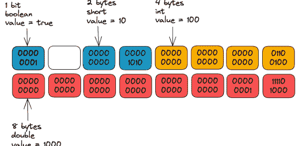

图 1. 内存分配

## 数组分配

数组也需要连续分配数据，这意味着如果有一个包含 10 个元素的 `boolean` 数组，这些数组需要占用 10 个字节，不能被中断。否则，将无法快速访问其元素。

现在请记住，`boolean` 类型占用 1 位，但每个内存槽只存储 1 字节。`JVM`（`Java` 内存模型）避免了字撕裂（`word tearing`），这基本上强制要求不被拆分到同一个内存槽中。此外，字撕裂还应避免更改同一个内存槽中的多个字段。

因此，每个 `boolean` 值将占据 1 字节的空间；除外，我们需要 10 个连续的字节来分配一个包含 10 个 `boolean` 值的数组。`JVM` 在内部会为数组存储更多的字节。我们不需要详细了解这些，但如果你好奇，可以使用 `JOL` (`Java Object Layout`) 库运行你自己的测试。

由于 `Java` 中的数组是一个对象，因此会有额外的字节空间，因为 `JVM` 会在内存中分配被称为“对象头”（`object header`）的空间。

在头部中，有标记字（`mark word`）内存分配，它将存储垃圾收集器元数据、标识哈希码（`identity hashcode`）和锁定信息，约占用 8 字节。

`Klass` 也是头部的一部分，用于存储类元数据，`JVM` 将使用 4 个字节。此外，`JVM` 还会为数组长度分配额外的内存空间。

`JVM` 在创建数组对象时会分配大约 17 个额外字节。

然而，没有必要详细了解这些，你必须记住的最重要的一点是数组占用的是连续的内存空间。你将在数组章节中学习更多关于数组的知识。

因此，让我们来看看在不考虑 `JVM` 为数组对象创建额外空间的情况下，一个包含 10 个元素的数组是如何表示的：

```java
int[] numbers = {1, 2, 3, 4, 5, 6, 7, 8, 9, 10};
```

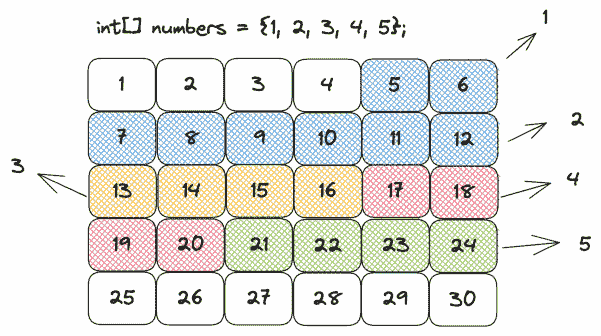

图 2. 内存分配

## 常数 - O(1)

在实践中，我们需要通过检查基本操作的次数来衡量大(`O`) 符号法。在内存中创建一个 `int` 类型数字的情况下，我们存储了 8 字节。如果我们对大(`O`) 时间复杂度要求非常精确，我们将写成 `O(8)`。但注意，这是一个常数时间。它不依赖于任何外部数字。它也无关紧要，`O(8)` 并不会显著改变性能。对于这种情况，我们可以认为 `O(8)` 实际上是 `O(1)`。

给变量赋值将消耗 `O(1)` 的时间复杂度，因为它只有一次操作。记住，大(`O`) 符号法不会精确衡量算法的性能。因此，`O(1)` 时间复杂度是衡量代码性能的一种抽象方式。请记住，尽管 `O(1)` 其实非常快。它只执行了一个轻量级操作：

```java
int number = 7; // O(1) 时间和空间复杂度
```

如果我们的代码中有许多操作，并且我们没有使用任何会改变时间复杂度的外部参数，它仍然被认为是 `O(1)`。让我们来看下面的代码：

```java
public class O1Example {
    public static void main(String[] args) {
        int num1 = 10;
        int num2 = 10;
        System.out.println(num1 + num2);
    }
}
```

注意，尽管上面的代码会被认为大约是 `O(3)`，但数字 3 是无关紧要的，因为它并不会产生太大的差异。此外，无论我们执行此算法多少次，它都具有常数时间复杂度。因此，该代码也具有 `O(1)` 的时间复杂度。

此外，注意两个值存储在两个变量中。尽管这在空间复杂度实际上是 `O(2)`，但我们也可以将其视为 `O(1)`。

## 通过索引访问数组

访问数组索引也具有常数时间复杂度。这是因为一旦数组在内存中创建，我们就不需要遍历数组或执行任何其他特殊操作。我们只需要访问它，对应的时间复杂度是 `O(1)` 或常数时间：

```java
int[] numbers = { 1, 2, 3};
System.out.println(numbers[1]); // 这里是 O(1)
```

## 对数线性 - O(log n)

使用 `O(log n)` 复杂度的经典算法是二分查找。这是因为没有运行遍历数组。相反，我们获取中间的数字，并检查它是小于还是大于要查找的数字。然后我们将数组一分为二，反复拆分直到找到该数字。这之所以可能，是因为二分查找必须数组已经过排序。

让我们来看下面的图：

### 要查找的数字 2

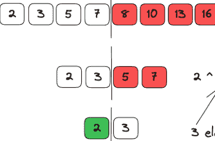

对数时间复杂度

2 ^ 3 = 8

3 次基本操作

图 3. 二分查找

如上面的图所示，我们不需要遍历整个数组，而是可以将数组一分为三次，这就足够找到该数字了。这正是我们对数复杂度预期的数字。这是因为 2 ^ 3 等于我们数组的大小。换句话说，2 * 2 * 2 = 8。因此，3 是我们数字的对数复杂度。

为了让你注意到 `log n` 时间复杂度有多么高效和快速，让我们考虑一个例子。假设我们传递一个大小为 1048576 的数组（这相当于 2 ^ 20），如果你猜测迭代次数是 20，那么你是对的！在线性复杂度中，迭代次数将是 1048576，那非常慢。

现在你更理解了什么是对数复杂度，让我们来看看二分查找算法的代码：

## 大 O 符号


```java
public class BinarySearch {
    public static int binarySearch(int[] array, int target) {
        int middle = array.length / 2;
        var leftPointer = 0;
        var rightPointer = array.length - 1;
        while (leftPointer <= rightPointer) {
            if (array[middle] < target) {
                leftPointer = middle + 1;
            } else if (array[middle] > target) {
                rightPointer = middle - 1;
            } else {
                return middle;
            }
            middle = (leftPointer + rightPointer) / 2;
        }
        return -1;
    }
}
```

```java
@Test
public void testCaseLog3() {
    int[] array = {2, 3, 5, 7, 8, 10, 13, 16};
    System.out.println(binarySearch(array, 2));
}
```

```java
@Test
public void testCaseLog20() {
    int[] array = new int[1048576];
    int number = 0;
    for (int i = 0; i < array.length; i++) {
        array[i] = ++number;
        System.out.println(binarySearch(array, i));
    }
}
```

# 大 O 表示法

```java
public class On2Example {
    public static void main(String[] args) {
        int[] numbers = {1, 2, 3, 4, 5, 6, 7, 8, 9, 10};
        int countOperations = countOperationsOn2(numbers);
        System.out.println(countOperations);
    }

    public static int countOperationsOn2(int[] numbers) {
        for (int i = 0; i < numbers.length; i++) {
            for (int j = 0; j < numbers.length; j++) {
                countOperations++;
            }
        }
        return countOperations;
    }
}
```

输出: 100

如你在上面的代码所示，迭代取决于数组的大小。我们在一个循环内部嵌套了另一个循环，这使得时间复杂度乘以了 10 * 10。

注意，我们传递的数组大小为 10。因此，`countOperations` 变量的值将为 100。

## 立方 – O(n^3)

立方复杂度与二次复杂度相似，但它不是两个嵌套循环，而是有 3 个嵌套循环。

让我们来看看这在代码中是如何表示的：

```java
public static int countOperationsOn3(int[] numbers) {
    int countOperations = 0;
    for (int i = 0; i < numbers.length; i++) {
        for (int j = 0; j < numbers.length; j++) {
            for (int k = 0; k < numbers.length; k++) {
                countOperations++;
            }
        }
    }
    return countOperations;
}
```

输出: 1000

如果我们向上述 `countOperationsOn3` 方法传递一个大小为 10 的数组，我们将得到 1000 的输出。这是因为 10 * 10 * 10 = 1000。注意，当我们使用 3 个嵌套循环时，就会发生立方复杂度。这种时间复杂度非常慢。

## 指数级 - O(c^n)

指数复杂度是最糟糕的之一。此外，为了让表示法清晰，`c` 代表常数，`n` 代表变量数量。因此，如果我们有一个常数 10^5，我们就有 10 * 10 * 10 * 10 * 10，对应于 100000。

另一个需要记住的重要点是，指数时间复杂度是指数数字，幂数字是代表指数复杂度的数字：

常数 ^ 指数数字

使用指数时间复杂度算法的一个真实世界示例是，当我们需要知道某事可能的组合数量时。

# 大 O 表示法

假设我们想知道蛋糕配料或完全不加配料可以有多少种可能的组合：

- 巧克力
- 草莓
- 奶油

为了找到这个，我们将使用 2 为底的 3 次方，这等于 8 种组合。现在让我们看一些例子：

| 配料 | 组合 |
|---|---|
| 1 | 1 - 原味蛋糕 |
| 2 | 4 - 原味蛋糕、巧克力、草莓和双草莓 |
| 3 | 8 - ... |

如你在上面的表格所示，数量呈指数级增长。如果我们想要一个有 10 种配料的蛋糕，那么组合的数量将是 1024，依此类推！

## 暴力破解密码

要通过暴力破解找到密码，假设我们只能使用数字来让这个例子变得简单。只能输入 0 到 9 的数字，此外，假设密码长度为 3 个数字。

常数数目为 10^3，等同于 10 * 10 * 10。

另一个需要记住的重要点是指数时间复杂度是指数数字，幂数字是代表指数复杂度的数字：10^3 等同于 1000。

* 10001000000。。 `c^n` 数量呈指数级增长。

# 大 O 表示法

## 乘阶 O(n!)

乘阶的概念是简单的。假设我们有 3。

使用乘阶复杂度的算法的一个真实世界例子是 3 个嵌套循环。

当我们使用 3 个嵌套循环时遍历整个数组。当我们有 3 个元素时，会有 6 种排列。让我们看看它是如何工作的：

ABC, BAC, CAB, CBA, ACB, BCA，会有 6 种排列。

如果我们有 4 个元素，会有 24 种排列，依此类推。

如果我们有 5 个元素，会有 120 种排列。

另一种算法是旅行商问题，你可以从这里了解更多 (https://en.wikipedia.org/wiki/Travelling_-salesman_problem)。不需要完全理解它，它是复杂的。

## 总结

测量复杂度和空间复杂度是每个想要创建高质量软件的工程师的必备技能。在本章中，我们学习了：

- 最优情况时间复杂度可以描述为 Omega 表示法
- 平均情况时间复杂度可以描述为 Theta 表示法
- 最坏情况时间复杂度是最重要的 O 表示法
- `O(1)`: 常数时间。从数组中访问数字的例子。
- `O(log n)`: 对数时间。使用分治策略。二分查找和树二分查找是具有这种时间复杂度的算法示例。一个近似的真实世界示例是在字典中查找单词。
- `O(n)` - 线性时间：当我们遍历整个数组一次时，就有 `O(n)` 时间复杂度。当我们在大小为 n 的数组中存储信息时，空间复杂度也将为 `O(n)`。一个真实世界的例子可以是读一本书。
- `O(n log n)` - 对数线性：合并排序、快速排序、时间排序和堆排序是使用分治策略的算法，比 `O(n^2)` 更有效。
- `O(n^2)` - 二次复杂度：冒泡排序、插入排序和选择排序是一些具有二次复杂度的算法。如果有两个嵌套循环每次遍历整个数组，那么就有 `O(n^2)` 时间复杂度。
- `O(n^3)` - 立方复杂度：当我们有三个嵌套循环并在这些循环中遍历整个数组时，我们将具有立方复杂度。
- `O(c^n)` - 指数：指数复杂度增长非常快。这种时间复杂度的好例子是尝试破解密码。假设密码只支持数字且有 4 位。这等同于 10^10000 种可能的组合。指数数字越大，增长越快。
- `O(n!)` - 乘阶：3! 的乘阶等同于 1 * 2 * 3 = 6。

## 静态数组

如名所示，静态数组是一种不可更改的数组。我们需要传递数组的类型和大小，之后，我们就无法更改数组的类型或大小了。

让我们通过以下代码查看如何创建一个 `int` 类型的静态数组并显示所有元素：

```
int[] array = {1, 2, 3, 4, 5}; // 创建一个数组 O(n)
for (int i = 0; i < array.length; i++) {
  System.out.print(array[i] + " ");
}
```

输出：1 2 3 4 5

注意上面的代码，我们创建了一个 `int` 类型的值的数组。一旦创建完成，我们就无法更改数组的类型或大小，这就是它被称为“静态”的原因。

然后，我们通过索引访问数组的每个元素，并显示那些将为 0 的值，因为这些是 Java 中基本类型 `int` 的默认值。

## 在数组中间插入元素

要在数组中间插入元素，将需要移动原有元素。因此，时间复杂度将是 `O(n)`。

想象我们想在数组 `{ 1, 2, 4, 5 }` 的 2 和 4 之间插入 3。为了做到这一点，我们必须创建一个大小为 5 的新数组。

然后，需要将元素 4 和 5 向前移动一个位置。完成后，我们就可以访问索引 2 并插入元素 3。

## 动态数组

Java 中有一些使用动态数组的类，例如 `ArrayList`、`Vector` 等。当我们创建一个 `ArrayList` 时，它在底层最初是空的，但在添加第一个元素后，它的大小会增长到 10。然后，如下面的 JVM 代码所示，每次需要时它都会翻倍：

```java
public class ArrayList<E> extends AbstractList<E>
    implements Serializable<E>, RandomAccess, Cloneable
{
    private static final int DEFAULT_CAPACITY = 10;
    transient Object[] elementData;
    private int size;
    private static final Object[] DEFAULT_CAPACITY_EMPTY_ELEMENT[] = {};

    public ArrayList() {
        this.elementData = DEFAULT_CAPACITY_EMPTY_ELEMENT;
    }

    // 该方法在……时会让数组翻倍
    private Object[] grow(int minCapacity) {
        int oldCapacity = elementData.length;
        if (oldCapacity > 0 || elementData != DEFAULT_CAPACITY_EMPTY_DATA) {
            int newCapacity = ArraysSupport.newLength(oldCapacity,
                minCapacity - oldCapacity, /* 最小增长 */
                oldCapacity > 1 /* 引用增长 */
            return elementData = Arrays.copyOfOf(elementData, newCapacity);
        } else {
            return elementData = new Object[Math.max(DEFAULT_CAPACITY, minCapacity)];
        }
    }
    // 省略其他方法...
```

`elementData` 变量是 `ArrayList` 在底层存储数据的变量。请注意，动态数组实际上是通过操作静态数组来表现动态行为的。

添加元素时，如果成立，时间复杂度将是 `O(n)`。这是因为数组创建时的大小为 10，必须创建一个大小为 20 的新数组并将所有元素复制到新数组中。为了做到这一点，我们必须遍历整个数组并逐个复制元素。然后我们将第 11 个元素添加到数组中。

当底层的数组按大小为 20 创建后，每当我们添加元素时，时间复杂度都为 `O(1)`。注意，向动态数组中添加元素在大多数情况下都会很快，复杂度为 `O(1)`。只有在数组大小需要翻倍的边缘情况下，时间复杂度为 `O(n)`。这被称为摊还复杂度。

## 总结

- 数组在内存是从后分配的。
- 通过索引访问数组的时间复杂度为 `O(1)`，非常快。
- 静态数组是预定义大小的。
- 动态数组在需要时会自动调整大小。
- 向动态数组添加元素大部分时间是 `O(1)`，因为会有足够的空间。
- 当向动态数组添加元素超过数组的大小时，需要创建一个新数组，将现有元素复制过去，然后添加新元素。因此时间复杂度为 `O(n)`。
- 在数组中间添加元素的时间复杂度为 `O(n)`，因为我们需要将右侧的所有元素向左移动。
- 从数组末尾删除元素的时间复杂度为 `O(1)`，因为我们只需要删除最后一个值并直接访问它。
- Java 和其他语言背后的数据结构可以将数字转换为二进制数字，ASCII 编码如下所示：

| 十进制 | 十六进制 | 字符 | 十进制 | 十六进制 | 字符 | 十进制 | 十六进制 | 字符 | 十进制 | 十六进制 | 字符 |
|---|---|---|---|---|---|---|---|---|---|---|---|
| 0 | 000 | (null) | 32 | 20 | 空格 | 64 | 40 | @ | 100 | 96 | ` |
| 1 | 001 | (文本的开始) | 33 | 21 | ! | 65 | 41 | A | 101 | 97 | a |
| 2 | 002 | (文本的开始) | 34 | 22 | " | 66 | 42 | B | 102 | 98 | b |
| 3 | 003 | (文本的结束) | 35 | 23 | # | 67 | 43 | C | 103 | 99 | c |
| 4 | 004 | (传输的结束) | 36 | 24 | $ | 68 | 44 | D | 104 | 144 | d |
| 5 | 005 | (en) | 37 | 25 | % | 69 | 45 | E | 105 | 145 | e |
| 6 | 006 | (退格) | 38 | 26 | & | 70 | 46 | F | 106 | 146 | f |
| 7 | 007 | (铃声) | 39 | 27 | ' | 71 | 47 | G | 107 | 147 | g |
| 8 | 008 | (删除) | 40 | 30 | ( | 72 | 50 | H | 108 | 148 | h |
| 9 | 011 | (制表符) | 41 | 31 | ) | 73 | 51 | I | 109 | 149 | i |
| 10 | 012 | (换行) | 42 | 32 | * | 74 | 52 | J | 110 | 150 | j |
| 11 | 013 | (垂直表符) | 43 | 33 | + | 75 | 53 | K | 111 | 151 | k |
| 12 | 014 | (回车) | 44 | 36 | , | 76 | 54 | L | 112 | 152 | l |
| 13 | 015 | (换页) | 45 | 37 | - | 77 | 55 | M | 113 | 153 | m |
| 14 | 016 | (输出) | 46 | 46 | . | 78 | 56 | N | 114 | 154 | n |
| 15 | 017 | (取消) | 47 | 47 | / | 79 | 57 | O | 115 | 155 | o |
| 16 | 020 | (控制符) | 48 | 50 | 0 | 80 | 64 | P | 116 | 156 | p |
| 17 | 021 | (控制符) | 49 | 41 | A | 81 | 65 | Q | 117 | 157 | q |
| 18 | 022 | (控制符) | 50 | 42 | B | 82 | 66 | R | 118 | 158 | r |
| 19 | 023 | (控制符) | 51 | 43 | C | 83 | 67 | S | 119 | 159 | s |
| 20 | 024 | (控制符) | 52 | 44 | D | 84 | 68 | T | 120 | 160 | t |
| 21 | 025 | (控制符) | 53 | 45 | E | 85 | 69 | U | 121 | 161 | u |
| 22 | 026 | (控制符) | 54 | 46 | F | 86 | 70 | V | 122 | 162 | v |
| 23 | 027 | (文本的结束) | 55 | 47 | G | 87 | 71 | W | 123 | 163 | w |
| 24 | 030 | (块的结束) | 56 | 50 | H | 88 | 72 | X | 124 | 164 | x |
| 25 | 031 | (替换) | 57 | 55 | I | 89 | 73 | Y | 125 | 165 | y |


## 字符串 42

| 128 Ç | 144 | 160 é | 176 æ | 192 | 208 | 224 α | 240 ¶ |
| 129 ù | 145 ñ | 161 į | 177 õ | 193 ű | 209 | 225 ß | 241 ± |
| 130 é | 146 ó | 162 ö | 178 ø | 195 τ | 210 ð | 226 | 242 ≥ |
| 131 | 147 | 163 | 179 ù | 196 | 211 ł | 227 | 243 Σ |
| 132 æ | 148 ğ | 164 ĥ | 180 most | 212 | 228 | 244 |
| 133 | 149 ò | 165 N | 181 ñ | 197 | 213 π | 229 σ | 245 § |
| 134 | 150 ơ | 166 * | 182 | 198 | 214 φ | 230 µ | 246 |
| 135 | 151 ı | 167 í | 183 ì | 199 ş | 215 | 231 τ | 247 |
| 136 | 152 ÿ | 168 ŷ | 184 ij | 200 | 216 χ | 237 | |
| 137 | 153 | 169 ŋ | 185 μ | 201 ρ | 217 ψ | 238 ω | 249 |
| 138 | 154 ų | 170 ṭ | 186 | 202 ² | 218 ħ | 234 | 250 |
| 139 | 155 ı | 171 ½ | 187 ⅓ | 203 ³ | 219 γ | 235 g | 251 √ |
| 140 | 156 ¦ | 172 7 | 188 8 | 204 | 220 v | 236 x | 252 z |
| 141 | 157 ‡ | 173 8 | 189 9 | 205 9 | 221 | 238 | 253 |
| 142 | 158 ¸ | 174 ₐ » | 190 | 206 | 222 | 239 y | 254 |
| 143 | 159 | 175 | 191 | 207 | 223 | 255 | |

> 图 6. 扩展 ASCII 表 来源：www.LookupTables.com

如你在上图中所见，每个字母都对应 ASCII 表中的一个数字。例如，大写字母“A”是 65，“B”是 66，“C”是 67，而小写字母“a”是 97。知道每个字母都由一个数字表示是非常重要的，因为这个概念肯定会在很多算法中使用。

ASCII 表包含 255 个键盘操作。在这些操作中包含了键盘、大写和小字母、特殊字符和数字。

每个 ASCII 字符在内存中存储 1 个字节。

Java 没有用于 `String` 的原始类型。它实际上是一个类。此外，如果你查看 `String` 类，你会发现 `String` 类实际上存储在数组中：

## 字符串 43

```java
public final class String implements java.io.Serializable, Comparable<String>, CharSequence {
    private final byte[] value;
    // 字段和方法...
}
```

### 字符和 ASCII 编码

```java
public class StringAscii {
    public static void main(String[] args) {
        String challenger = "abcd1234";
        // O(n) 时间复杂度 - O(1) 空间复杂度
        for (int i = 0; i < challenger.length(); i++) {
            char character = challenger.toCharArray()[i];
            byte characteriiNumber = challenger.getBytes()[i];
            System.out.print(character + ": ");
        }
    }
}
```

输出：`A:65 B:66 C:67 D:68 a:97 b:98 c:99 d:100 1:49 2:50`

从字符串中获取一个字符的时间复杂度是 `O(1)`。正如之前提到的，是因为 `String` 实际上是字节数组。

在 C++ 等编程语言中，`String` 是可变的。这意味着这些字符串在内存中不会被改变。因此，每当你通过代码拼接字符串时，都会创建一个新的字符串。

```java
public class GetCharacterString {
    public static void main(String[] args) {
        String challenger = "Never Stop";
        // O(1) 时间复杂度
        System.out.println(challenger.toCharArray()[0]);
    }
}
```

输出：`N`

### 复制字符串

如果在循环内拼接字符串，那么时间复杂度将会更糟糕。我们将得到 `O(n^2)` 的复杂度。看看下面的代码：

```java
static void concatenateString2(int n) {
    String duke = "Awesome Duke";
    String buggy = "Awesome Juggy";
    String dukeAndbuggy = "";
    // O(n^2) 时间复杂度
    for (int i = 0; i < n; i++) {
        dukeAndbuggy = duke + buggy;
    }
    System.out.println(dukeAndbuggy);
}
```

#### 代码分析

取决于参数 `n`，会有更多的拼接。此外，注意有一个针对 `n` 的循环，在该循环内，`String` 需要进行拼接。上面的代码非常慢。幸运的是，Java 提供了一个可以拼接字符串并显著减少时间复杂的类。让我们在下一节进一步探讨。

### 使用 StringBuilder 和 StringBuffer 有效复制字符串

上面的代码进行多次拼接是低效的。但在使用 `StringBuilder` 类时情况发生了变化。这是因为 `StringBuilder` 类只会创建一个新数组并真正地拼接字符串。当我们有大量的拼接时，看看普通的 `String` 拼接是多么低效：

```java
public class ConcatenationComparison {
    public static void main(String[] args) {
        var nSize = 100000;
        concatenateString(nSize);
        concatenateStringBuilder(nSize);
    }
    static void concatenateString(int n) {
        var timeMillis = System.currentTimeMillis();
        String concatString = "";
        // O(n^2) 时间复杂度
        for (int i = 0; i < n; i++) {
            concatString += i;
        }
        var processTime = System.currentTimeMillis() - timeMillis;
        System.out.println(processTime + " milliseconds");
    }

    static void concatenateStringBuilder(int n) {
        var timeMillis = System.currentTimeMillis();
        StringBuilder concatStringBuilder = new StringBuilder();
        // O(n) 时间复杂度
        for (int i = 0; i < n; i++) {
            concatStringBuilder.append(i);
        }
        var processTime = System.currentTimeMillis() - timeMillis;
        System.out.println(processTime + " milliseconds");
    }
}
```

输出（输出随时间略有不同）：`2820 毫秒 5 毫秒`

如你从上面的代码所示，处理时间的差异是指数级的。通过使用 `StringBuilder`，我们的速度会快 10000 倍。这就是为什么理解 `String` 发生了什么非常重要。时间复杂度是创建高性能代码的关键概念。

### 字符串编码用哪种？

正如之前提到的，计算机理解和通信的唯一方式是将文本转换为数字或字节。这被称为编码和解码。世界上有很多字符，如拉丁、日语、中文等。

Unicode 是最重要的编码之一，因为它可以编码和解码世界上任何字符。Unicode 可以使用 1 到 4 个字节。Unicode 也使用十六进制。如果你查看符号，你会发现字母“A”表示为 `U+0041`，而“B”分别是 `U+0042`。你可以可以通过链接探索所有的 Unicode 字符：https://symbl.cc/en/unicode/blocks/basic-latin

Unicode 使用 `UTF-8`（Unicode 格式-8）、`UCS-2` 和 `UTF-16` 编码。`UTF-8` 是世界上最流行的编码，占据了 97.8% 的网页。如果你打开一个 IDE（如 IntelliJ），你会发现默认编码是 `UTF-8`。`UTF-8` 可以完全表示 ASCII 字符，并且具有使用表情符号的能力，例如。

（为了解决某个非常特定的问题）但了解它们的存在是很重要的。

另一种经常使用的编码是 `Base64`，用于通过 HTML 和电子邮件传输信息。它用于将二进制数据编码为 ASCII 字符。

此外，世界各地针对不同语言还有许多其他编码，例如：`ISO 8859-1`（西欧）、`Windows-1253`（希腊语）、`JIS 0213`（日语字符）、`GB 2312`（中文）等。没有必要了解所有编码，只要在需要时知道去哪里查找就足够了。如果你想检查所有的编码，请查看此[字符编码页面]。

### 总结

- 字符串在底层存储的是一个字节数组。
- Java 中的 `String` 是不可变的，这意味着无法直接修改它的值。
- `StringBuilder` 和 `StringBuffer` 是 `String` 的可变类型，不会创建大量对象。
- 当拼接不可变的 `String` 时，必须创建一个新数组然后进行 `String` 复制。
- `String` 可以转换为 ASCII 表中的代码，反之亦然。
- 存在从 ASCII 扩展而来的 `UTF-8` 等。
- ASCII 仅包含 128 个字符，包括字母、数字和标点符号。
- `UTF-8` 与 ASCII 表具有后兼容性，是目前最流行的编码。

## 哈希表 (Hashtable)

哈希表数据结构将 Java 和其他编程语言中的键（keys）和值（values）存储在变量中。它也是一种非常常见的数据结构，广泛应用于日常项目和算法中。

让我们来看哈希表存储信息的简单示例：

```
key: 1 value: Duke key: 2 value: Juggy key: 3 value: Moby Dock
```

我们可以通过键访问任何值。哈希表是一种性能极佳的数据结构，因为平均插入、删除和搜索键的时间复杂度为 `O(1)`。

哈希表实际上是构建在数组之上的。例如在 Java 中，`Hashtable` 类包含一个键值对 `Entry` 数组：

```java
public class Hashtable<K,V>
extends Dictionary<K,V>
implements Map<K,V>, Cloneable, java.io.Serializable {

/**
 * 哈希表数据。
 */
private transient Entry<?,?>[]> table;

}
```

哈希表数据结构的另一个重要细节是，它有一个哈希函数来使键保持唯一。

哈希函数将数据转换为一个特定的数字，可以通过键方便地进行。哈希函数的工作取决于对象的类型。例如，如果键是 `String`，它将通过 `hashCode` 的实现转换为 UTF-16 编码。

注意，JDK 为我们提供了高质量的哈希函数，这意味着我们不需要通过创建其他函数来重复造轮。`String`、`Integer`、`Double`、`Boolean` 以及许多其他类都有它们自己的 `hashCode` 实现。

关于哈希函数需要记住的重要的一点是：它必须是高效的，并且可能可能为每个对象返回一个唯一的整数代码。

### 什么是哈希函数？

哈希函数用于创建几乎不可逆的加密，其输入几乎无法检索。最流行的是 `SHA256`。此外，通常情况下，哈希函数主要用于密码验证、编译器操作、如 Robin Karp 的模式搜索算法，以及当然，还有哈希表。

在 Java 中，我们有一个来自 `Object` 类的著名方法 `hashCode`，它负责生成哈希码。

哈希函数可能极其简单，甚至可以是一个常值，但将没有任何益处。它也可以非常简单，例如，我们可以为对象创建一个哈希函数来对 ASCII 字符求和并返回一个整数：

### 哈希表

```java
public class AsciiSumFunction {
    String anyString;

    public AsciiSumFunction(String anyString) {
        this.anyString = anyString;
    }

    @Override
    public int hashCode() {
        int sum = 0;
        if (anyString != null) {
            for (int i = 0; i < anyString.length(); i++) {
                sum += (int) anyString.charAt(i);
            }
        }
        return sum;
    }

    public static void main(String[] args) {
        AsciiSumFunction func1 = new AsciiSumFunction("ABC");
        AsciiSumFunction func2 = new AsciiSumFunction("CBA");
        System.out.println("Hash of ABC: " + func1.hashCode());
        System.out.println("Hash of CBA: " + func2.hashCode());
    }
}
```

### 哈希表


```java
var endTime = System.currentTimeMillis() - startTime;
System.out.println("O(n) without collision: " + endTime);
}
static class CollisionBean {
    private Integer value;

    public CollisionBean(Integer value) {
        this.value = value;
    }

    @Override
    public boolean equals(Object o) {
        CollisionBean that = (CollisionBean) o;
        return Objects.equals(value, that.value);
    }

    @Override
    public int hashCode() {
        return 1; // Always the same hash code forcing a hash collision
    }
}
static class NoCollisionBean {
    private Integer value;

    public NoCollisionBean(Integer value) {
        this.value = value;
    }

    @Override
    public boolean equals(Object o) {
        CollisionBean that = (CollisionBean) o;
        return Objects.equals(value, that.value);
    }
    @Override
    public int hashCode() {
      return value; // Different hash code, no hash collision
    }
}
```

输出（结果可能会略有不同）：发生冲突的 O(n ^ 2): 771；无冲突的 O(n): 4

如上代码所示，这种性能差异是巨大的！在添加和搜索 10000 个元素时，`NoCollisionBean` 的速度比 `CollisionBean` 快 192 倍。添加的元素越多，这种差异也越大。

另一个重要的点是，在循环内部我们的时间复杂度是 O(n)，但当发生哈希冲突时，会有另一个 O(n)。当我们在 O(n) 的时间复杂度循环内又嵌套一个 O(n) 操作时，复杂度就会变成 O(n ^ 2)。

这是因为为了在链表（`LinkedList`）中搜索元素，必须遍历整个节点列表然后检索该元素。

## 在 Java 中优化哈希冲突

在 Java 9 中，JEP (JDK 增强提案) 180 “使用平衡树处理频繁的 HashMap 冲突” 是一项优化，它将哈希冲突后的链表转换为平衡树。这意味着链表中的节点将以某种方式排序，可以使用二分搜索算法。

## 哈希表

通过使用二分搜索算法，我们将时间复杂度从 O(n) 降低到 O(log n)，这要**快得多**。要实现这一特性，非常关键的一点是我们需要实现 `Comparable` 接口并重写 `compareTo` 方法。这是对象在平衡树内进行比较和排序的唯一方法。

让我们在实践中观察这种巨大的复杂度差异。首先，创建一个实现 `Comparable` 的 `CollisionComparableBean`，以便 JDK 能够创建平衡树。

然后，我们重复之前的步骤，但添加 10000 个元素并搜索每个元素。由于使用二分搜索查找每个元素要**快得多**，即使发生哈希冲突，你也将从下面的代码中看到性能的巨大提升：

```java
public class HashCollisionInPractice {
    public static void main(String[] args) {
        collisionTest();
        noCollisionTest();
        collisionWithBalancedTest();
    }

    // 省略其他方法...
    private static void collisionWithBalancedTest() {
        Map<CollisionComparableBean, Integer> collisionMap = new HashMap<>();
        var startTime = System.currentTimeMillis();
        // O(n)
        for (int i = 0; i < 10000; i++) {
            collisionMap.put(new CollisionComparableBean(i), i);
            // O(log n)
            collisionMap.get(i);
        }
    }
}
```

```java
var endTime = System.currentTimeMillis() - startTime;
System.out.println("O(n) with collision and a balanced tree = " + endTime);
}
static class CollisionBean
implements Comparable<CollisionBean> {
    private Integer value;

    public CollisionBean(Integer value) {
        this.value = value;
    }

    @Override
    public boolean equals(Object o) {
        CollisionBean that = (CollisionComparableBean) o;
        return Objects.equals(value, that.value);
    }

    @Override
    public int hashCode() {
        return 1; // Always the same hash code forcing a hash collision
    }

    @Override
    public int compareTo(CollisionBean o) {
        return this.value.compareTo(o.value);
    }
```

输出（结果可能会略有不同）：发生冲突的 O(n ^ 2): 771；无冲突的 O(n): 4

## 总结

哈表（Hash Table）是一个至关重要的数据结构，它存在于所有的编程语言中。因此，通过理解 Java 在后台是如何处理哈表的，你基本上就知道了如何操作哈表、字典（Dictionary）、`HashMap` 或任何编程语言中的类似结构。

基本上，从本质上说，哈表是一种用于存储键值对的数据结构。通过键检索数据非常快，而且如果我们使用有效的 `hashCode` 实现，极少发生哈希冲突。

让我们来看看哈表数据结构的关键点：

- 它是一种处理键（key）和值（value）的数据结构。
- 如果没有哈希冲突，搜索非常快，是 O(1)。
- 如果发生哈希冲突且没有平衡树，通过键进行搜索的时间复杂度为 O(n)。
- 如果发生哈希冲突且存在平衡树，通过键进行搜索的时间复杂度为 O(log n)。
- 为了在发生哈希冲突时能够使用平衡树，必须实现 `Comparable` 接口。
- 在哈表中搜索某个值（而不是键）的时间复杂度为 O(n)。
- 哈表的键在底层是一个数组，可以通过哈希码进行访问。这就是为什么在没有哈希冲突时时间复杂度为 O(1)。
- 当发生哈希冲突时，键和值将被插入到一个链表（`LinkedList`）中。此时通过键搜索元素的时间复杂度为 O(n)。

## 链表

链表数据结构在 Java 和其他编程语言中是一种基础类型，在添加或删除元素时具有极高性能。

链表的工作方式与数组不同。数组存储在内存中，通过索引找到元素非常容易且高效。另一方面，链表是对象的链，每个对象都持有内存中的一个随机位置（非连续性）。因此，在链表中通过索引找到元素是不可能的。

## 单向链表结构

由于链表在底层是对象的链，我们将拥有一个存储当前元素值的变量，以及另一个指向下一个对象的引用变量。

让我们通过图来看看它是如何工作的：

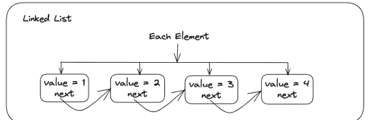

图 8. 链表

如上图所示，链表中的每个元素都持有指向下一个元素的引用。请注意，只能向前移动。因此，如果我们从第一个元素开始，只能移动到链表的下一个对象引用。

首先，为了拥有链表，我们需要一个 `Node` 对象，它将包含一个值和一个对象引用。`Node` 类如下：

```java
// 源自链表的 Node，包含值和下一个对象引用
public class Node {
    int value;
    Node next;

    public Node(int value) {
        this.value = value;
        next = null;
    }
}
```

现在我们有了 `Node` 类，让我们用它将元素存储到我们的链表中。在下面的代码中，我们将第一个和最后一个元素存入链表。然后我们将会有一个构造函数，使用第一个和最后一个元素初始化链表。

这是我们需要添加、删除、搜索或更改元素的结构结构：

```java
public class SinglyLinkedList {
    // 第一个元素
    Node head;
    // 最后一个元素
    Node tail;

    // 当链表创建时，headValue 将是第一个也是最后一个元素
    SinglyLinkedList(int value) {
      Node newNode = new Node(value);
      head = newNode;
      tail = newNode;
    }
}
```

## 向链表添加元素

现在让我们探索如何在下一个对象引用处添加新节点，以及用于遍历节点并显示值的 `showElements` 方法。

最后，我们有一个 `main` 方法来实例化链表、添加节点并显示其元素：

向链表添加元素非常快，但它的时间复杂度是 O(1)。这是因为新元素只需要与链表的最后一个元素连接起来。例如，不需要将元素复制到新的数组对象中。

```java
public class SinglyLinkedList {
  // 省略实例变量和构造函数
  // 在下一个引用处添加新节点
  // 将新节点添加到链表的末尾（结束）
  void add(int value) {
    Node nodeValue = new Node(value);
    tail.next = nodeValue;
    tail = nodeValue;
  }
}
```

## 代码分析

在上面的代码中，我们使用传递的值创建了一个新节点，然后将此值设置为尾部（`tail`）的下一个指针。

注意，此时尾部（最后一个元素）持有与头部（第一个元素）相同的对象引用。这就是对象将正确链链的原因。

然后，我们将元素添加到尾部对象，因为这是链表中的最后一个对象。

## 向链表添加元素的时间复杂度

注意上面的代码，链表中的 `add` 操作非常简单。因此，由于我们只执行了值赋值，时间复杂度将是 O(1)。不需要遍历链表。

## 删除链表中的第一个元素

从链表中删除第一个元素也是一个简单的操作。要实现这一点，我们需要将下一个对象的引用传递给 `head` 实例变量。通过这样做，我们将擦除链中的第一个元素，并留下后续元素的链：

```java
public class SinglyLinkedList {
    // 省略实例变量、构造函数和方法
    void deleteFirst() {
        head = head.next;
    }

    public static void main(String[] args) {
        SinglyLinkedList linkedList = new SinglyLinkedList(1);
        linkedList.add(2);

        linkedList.deleteFirst();
        linkedList.showElements();
    }
}
```

**输出：2**

## 删除第一个元素复杂度

从链表中删除第一个元素也是不需要循环的操作。我们可以直接访问头部元素。因此，时间复杂度是即时的 O(1)。

## 在链表中搜索元素

要在链表中搜索元素，我们需要遍历并检查值。让我们看看代码中是如何工作的：

```java
public class SinglyLinkedList {
    // 省略实例变量、构造函数和方法

    Node searchElement(int value) {
        Node currentNode = head;

        while (currentNode != null) {
            if (currentNode.value == value) {
                return currentNode;
            }
            currentNode = currentNode.next;
        }

        return null;
    }

    public static void main(String[] args) {
        SinglyLinkedList linkedList = new SinglyLinkedList(1);
        System.out.println("Found element: " + linkedList.searchElement(1).value);
    }
}
```

**输出：Found element: 1**

在上面的代码中，注意我们传递了 int 值，然后从头部开始遍历。

为了遍历对象链，我们检查 `currentNode` 是否为空，并在循环中将元素赋值给当前节点，直到 `currentNode` 为空。

## 在链表中搜索元素复杂度

由于我们需要遍历链表来搜索元素，时间复杂度为 O(n)。

## 在链表中间插入元素

要在链表的中间插入元素，需要遍历对象并将元素连接到对象链中。

让我们看看代码中是如何工作的：

```java
public class SinglyLinkedList {
    // 省略实例变量、构造函数和方法

    void add(int searchValue, int value) {
        Node currentNode = head;

        while (currentNode != null) {
            if (currentNode.value == searchValue) {
                Node newNode = new Node(value);
                Node nextNode = currentNode.next;
                currentNode.next = newNode;
                newNode.next = nextNode;
            }
            currentNode = currentNode.next;
        }
    }
}
```

## 链表

```java
20 public static void main(String[] args) {
    SinglyLinkedList linkedList = new SinglyLinkedList(1);
    linkedList.add(3);
    
    linkedList.addAfter(1
```

输出: 1 2 3 4

如上述代码所示，我们正在链表中一个接一个地添加元素。为了做到这一点，我们需要遍历链表，找到想要在其后添加值的元素，然后在 `nextNode` 指针位置处插入新值。

重要的是，记住如果只是给 `currentNode` 赋值，对对象链不会产生任何影响，因为 `next` 指针仍然持有该对象的引用。这是该算法的关键，有必要更改右侧的对象引用以影响对象链。

## 在链表中间插入元素的时间复杂度

由于我们需要遍历对象链才能在中间插入元素，因此其时间复杂度为 O(n)。

## 双向链表

简单来说，双向链表将拥有上一个节点和下一个节点的引用。换句话说，`Node` 类将拥有 `next` 和 `previous` 对象引用。

这样，就可以在双向链表中向前和向后移动了。让我们通过下面的图来更好地理解：

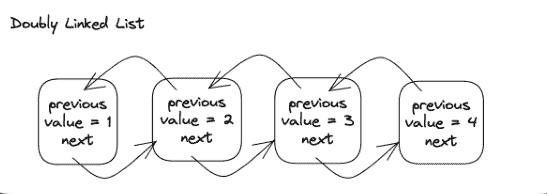

图 9. 双向链表

现在让我们来看看如何用 Java 代码来表示双向链表。我们先看带有 `previous` 和 `next` 对象引用的 `Node` 对象：

```java
public class Node {
    int value;
    Node next;
    Node previous;

    public Node(int value) {
        this.value = value;
        next = null;
        previous = null;
    }
}
```

现在让我们探索双向链表本身。它与单向链表相似，区别在于现在我们可以向前和向后遍历了：


```java
public class DoublyLinkedList {
    Node head = null;
    Node tail = null;

    public void addNode(int element) {
        Node newNode = new Node(element);
        if (head == null) {
            head = newNode;
            tail = newNode;
            head.previous = null;
        } else {
            tail.next = newNode;
            newNode.previous = tail;
            tail = newNode;
        }
        newNode.next = null;
    }

    public void showNodes() {
        Node currentNode = head;
        if(head == null) {
            return;
        }
        while(currentNode != null) {
            System.out.println(currentNode.value);
            currentNode = currentNode.next;
        }
    }

    public static void main(String[] args) {
        DoublyLinkedList doublyLinkedList = new DoublyLinkedList();
        doublyLinkedList.addNode(1);
        doublyLinkedList.addNode(2);
        doublyLinkedList.addNode(3);
        doublyLinkedList.addNode(4);
        doublyLinkedList.showNodes();
    }
}
```

输出: 1 2 3 4

## 循环链表

循环链表与其它链表相似，但它具有从最后一个节点立即跳转到第一个节点的能力。这是因为尾节点（`tail`）将持有指向头部（`head`）的对象引用。让我们通过图表来看看它是如何工作的：

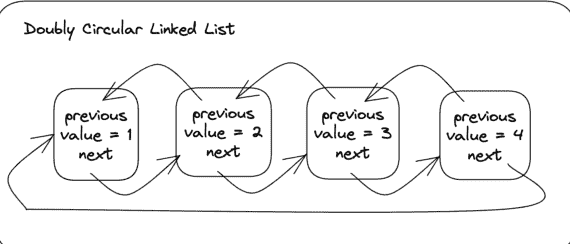

图 10. 循环列表

## 链表的优点

链表在某些方面比数组更好，让我们探索一下：

- 在列表开头或末尾添加元素更快。它的时间复杂度始终是 `O(1)`。
- 动态大小，不需要像数组那样定义初始空间。
- 按需使用空间，因为节点是动态分配的，这同时也意味着具有灵活性。
- 在添加或删除大量数据时，插入大量数据的很好。
- 灵活性，链表用于处理队列（`Queue`）、栈（`Stack`）和图等数据结构。

## 链表的缺点

- 随机访问：无法通过索引访问元素。
- 比数组消耗更多内存。这是因为有必要在节点之间创建对象引用。
- 复杂性：遍历链表比较困难。需要使用需要一些基础编程知识的算法。
- 连续遍历需要更多的内存使用，因为指针必须指向对象。

## 总结

软件工程师必须理解链表数据结构，因为在应用程序和代码面试中被广泛使用！通过链表，我们可以轻松地在任何地方组织和更改数据，而不是像数组那样是连续的。因此，在中间移动数据更加容易。让我们回顾一下本章的重点：

- 单向链表只有 `next` 指针。这意味着可以向前遍历。
- 双向链表同时拥有 `next` 和 `previous` 指针。这意味着我们可以向前和向后遍历。
- 循环单向链表只有 `next` 指针。但尾部（最后一个元素）拥有来自头部（第一个元素）的引用。
- 循环双向链表拥有 `next` 和 `previous` 指针。但尾部也包含了来自头部（第一个元素）的对象引用。
- `Node` 在单向链表中具有 `next` 指针，在双向链表中具有 `next` 和 `previous` 指针。
- 链表拥有 `tail` 和 `head` 指针。
- 链表无法通过索引访问元素，因为数据是动态存储的，不像数组那样连续。
- 链表更适合处理大量数据，因为它是动态的。
- 链表具有灵活性，因此非常适合处理栈、队列和图。
- 链表添加或删除元素的时间复杂度始终为 `O(1)`。

## 栈

栈数据结构用于许多重要的算法，如深度优先搜索和递归方法。

栈还使用 LIFO（后进先出）策略，这意味着最后进入的元素将是最后出的。这种数据结构可以在现实世界的盘子堆中轻松表示。让我们通过下面的图表来更好地理解栈数据结构：

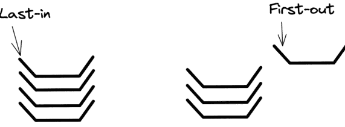

图 11. LIFO

注意，在上面的图中，最后放在栈顶部的盘子将是第一个被移除的。我们在现实世界的盘子堆中这样做。移除第一个盘子可能会导致盘子倒塌。

## 用 Java 在栈中插入和删除元素

如上所述，栈遵循 LIFO（后进先出）策略。这与现实世界的堆盘情况相同。我们将使用栈常用的方法。

## 栈

第一个是 `push` 方法，它按顺序将元素插入栈中。当我们显示栈中的元素而不移除它们时可以清楚地看到。

然后，我们将使用 `pop` 方法，它从栈中返回并移除最后一个元素，如下代码所示：

```java
import java.util.Stack;

public class StackExample {
    public static void main(String[] args) {
        Stack<Integer> stack = new Stack<>();
        stack.push(1);
        stack.push(2);
        stack.push(3);
        stack.push(4); // 后进先出

        System.out.println(stack);
        showAndRemoveStackElements(stack);
    }

    private static void showAndRemoveStackElements(Stack<Integer> stack) {
        int size = stack.size();
        for (int i = 0; i < size; i++) {
            System.out.print(stack.pop() + " ");
        }
    }
}
```

输出: [1, 2, 3, 4] 4 3 2 1

代码分析：

注意上面的代码，在使用 `push` 方法插入元素时，元素并没有堆叠，顺序是与插入时的顺序相同。这并不是栈（`Stack`）的预期行为。

栈数据结构的预期行为是从上到下打印元素，如下所示 `[4, 3, 2, 1]`。

## Stack 继承自 Vector

由于 `Stack` 继承了 `Vector`，因此它是使用栈操作的一种线程安全方式。

```java
public class Stack<E> extends Vector<E> { ... }
```

它还具有通过索引检索元素的可能，但这不在 `Stack` 的契约：

```java
import java.util.Stack;
public class StackVector {
    public static void main(String[] args) {
        Stack<Integer> stack = new Stack<>();
        stack.push(1);
        stack.push(2);
        System.out.println(stack);
        System.out.println(stack.get(0)); // 获取第一个元素
    }
}
```

输出：[1, 2]

代码分析：

首先注意到，`Stack` 的 `push` 方法实际上并没有将元素推到第一个位置。

另一个有趣点是，可以通过索引访问元素。对于 `Stack`，`peek` 方法将获取最后一个元素。

正如你所看到的，`Stack` 类在实现上存在一些缺陷。

与其使用 `Stack` 类，不如使用 `Deque` 来进行栈操作。让我们探索使用 `Deque` 来实现栈的方法...

## 配合 Deque 使用 Stack

Java 中 `Stack` 类的文档如下：

更完整且一致的 LIFO（后进先出）操作由 `Deque` 接口提供，例如：`Deque stack = new ArrayDeque();`

因此，处理栈操作时，使用 `Deque stack = new ArrayDeque();` 更有效。

`Deque` 接口拥有栈的操作，它也是一个双端队列。在不需要线程安全操作的情况下，推荐使用 `Deque`。

通过 `Deque`，我们可以执行与 `Stack` 类相同的操作，元素是从顶部到底插入的，这是栈数据结构预期的：

## Stack 81

```java
import java.util.ArrayDeque;
import java.util.Deque;
public class StackDeque {
    public static void main(String[] args) {
        Deque<Integer> stack = new ArrayDeque<>();
        stack.push(1); // 在第一个位置插入元素
        stack.push(2);
        System.out.println(stack); // LIFO 
        System.out.println(stack.peek()); // 显示最后一个元素
        System.out.println(stack.pop()); // 移除并返回
    }
}
```

输出：[2, 1]

在 `Deque` 接口中，有与 `push` 和 `pop` 相同的方法。

`push` 方法等同于 `addLast` 方法，而 `removeLast` 方法等同于 `pop` 方法，如下所示：

```java
import java.util.ArrayDeque;
import java.util.Deque;
public class DequeMethods {
    public static void main(String[] args) {
        Deque<Integer> stack = new ArrayDeque<>();
        stack.addLast(1);
        stack.addLast(2);

        System.out.println(stack.getLast());
        stack.removeLast();
    }
}
```

输出：2 [1]

## Stack 的时间复杂度

栈的时间复杂度取决于所使用的实现。如果我们选择 `LinkedList`，我们将处理图结构。如果我们选择 `ArrayDeque`，它是一个数组数据结构。

让我们探索 `LinkedList` 和 `ArrayDeque` 之间的时间复杂度差异。

## push (addFirst)

- **LinkedList**：无论如何，`push` 方法的时间复杂度都是 `O(1)`。因为 `LinkedList` 连接节点（`Nodes`），它不是数组。第一个元素总是被添加到单独的变量中，实现了快速访问。
- **ArrayDeque**：`push` 方法可能为 `O(1)`，前提是不需要调整数组。如果数组满了，偶尔时间复杂度将是 `O(n)`，因为它需要遍历数组并创建一个新大小的数组。

## pop (removeLast)

- **LinkedList**：`pop` 方法的时间复杂度始终为 `O(1)`。因为元素是相互链接的，第一个元素存储在变量中，我们可以直接访问。因此，我们只需要删除该第一个元素的引用。
- **ArrayDeque**：`ArrayDeque` 的 `pop` 方法始终为 `O(1)`。因为数组的第一个元素会被设置为 null，头部索引会更新以不再考虑已删除的元素。

## 查找元素

- **ArrayDeque**：要通过值查找元素，必须遍历所有元素直到找到该元素。与 `LinkedList` 类似，时间复杂度为 `O(n)`。

## 总结

栈数据结构用于递归和著名的深度优先搜索算法，它对其他操作也有用！

让我们看看栈数据结构的关键点：

- 它类似于现实生活中堆叠盘子并从栈取出。
- 它使用 LIFO（后进先出）策略。这意味着最后添加的元素将最先取出。
- 我们可以使用 `Stack` 类，但正如之前看到的，它不是最优选择。
- `Stack` 类是线程安全的。这意味着可以在多线程环境中安全使用。
- `Stack` 类并没有按 LIFO 结构插入元素。元素按插入顺序添加。
- `Stack` 类继承自 `Vector`，因此可以通过索引访问元素。
- 使用 `ArrayDeque` 实现的 `Deque` 优于使用 `Stack` 类。

```java
Node(Node<E> prev, E element, Node<E> next) {
    this.item = element;
    this.next = next;
    this.prev = prev;
}
// 省略其他代码
```

由于 `LinkedList` 使用了图的结构，我们在列表头部或末尾插入或删除元素时具有极佳的性能。然而，搜索特定元素非常慢，因为必须逐个对象地遍历整个列表。请注意，`LinkedList` 无法像数组那样通过索引访问，数组要快得多，其时间复杂度为 `O(1)`。

## 在队列的头部和末尾插入元素

为了在队列末尾添加元素，Java 中提供了一个现成的接口称为 `Deque`。`Deque` 是双队列（double-ended queue）的缩写，允许我们从队列的头部和尾插入以及删除元素。

让我们看看如何使用 `Deque` 在队列的第一个和最后一个位置添加元素：

```java
public class DequeAddFirstAndLast {
    public static void main(String[] args) {
        Deque<String> xmenQueue = new LinkedList<>();
        xmenQueue.add("Wolverine");
        xmenQueue.addFirst("Cyclops");
        xmenQueue.addLast("Xavier");

        showAndRemoveQueueElements(xmenQueue);
    }

    private static void showAndRemoveQueueElements(Deque<String> peopleQueue) {
        var size = peopleQueue.size();
        for (int i = 0; i < size; i++) {
            System.out.print(peopleQueue.poll() + " ");
        }
    }
}
```

输出: Cyclops Wolverine Xavier

## 在队列的头部和末尾删除元素

在以下代码中，我们将向队列添加三个元素，然后使用 `removeFirst` 方法移除第一个元素“Wolverine”和最后一个元素“Xavier”。最后，我们将显示并移除剩余元素“Cyclops”：

## 队列

```java
import java.util.Deque;
import java.util.LinkedList;

public class DequeDeleteFirstAndLast {
    public static void main(String[] args) {
        Deque<String> xmenqueue = new LinkedList<>();
        xmenqueue.add("Wolverine");
        xmenqueue.add("Cyclops");
        xmenqueue.add("Xavier");

        System.out.println("Removing first: " + xmenqueue.removeFirst());
        System.out.println("Removing last: " + xmenqueue.removeLast());

        showAndRemoveQueueElements(xmenqueue);
    }

    private static void showAndRemoveQueueElements(Deque<String> peopleQueue) {
        var queueSize = peopleQueue.size();
        for (int i = 0; i < queueSize; i++) {
            System.out.print(peopleQueue.poll() + " ");
        }
    }
}
```

输出: Removing first: Wolverine Removing last: Xavier Cyclops

## 大(O) 符号法 – 队列的时间复杂度

## 在队列头部插入元素

为了在队列头部插入元素，我们只需要将新对象链接到 `LinkedList` 的第一个元素上。因此，复杂度为 `O(1)`。看以下代码：


```java
private void linkFirst(E e) {
    final Node<E> f = first;
    final Node<E> newNode = new Node<>(null, e, f);
    first = newNode;
    if (f == null)
        last = newNode;
    else
        f.prev = newNode;
    size++;
    modCount++;
}
```

## 在队列末尾插入元素

这只有通过双队列才能完成。时间复杂度为 `O(1)`，与在头部插入相同。看以下代码：

```java
void linkLast(E e) {
    final Node<E> l = last;
    final Node<E> newNode = new Node<>(l, e, null);
    last = newNode;
    if (l == null)
        first = newNode;
    else
        l.next = newNode;
    size++;
    modCount++;
}
```

## 在队列中间插入元素

这需要遍历队列直到找到位置，复杂度为 `O(n)`。

## 在队列中查找元素

复杂度为 `O(n)`，因为需要遍历所有元素。

## 删除队列头部元素

与插入元素相同，删除队列头部元素的时间复杂度为 `O(1)`。简要解释以下代码：

```java
private void linkFirst(E e) {
    final Node<E> f = first;
    final Node<E> newNode = new Node<>(null, e, f);
    first = newNode;
    if (f == null)
        last = newNode;
    else
        f.prev = newNode;
    size++;
    modCount++;
}
```

## 删除队列末尾元素

只有通过双队列才能完成。时间复杂度为 `O(1)`。

```java
public E removeLast() {
    if (last == null) throw new NoSuchElementException();
    E element = last.item;
    last = last.prev;
    if (last == null)
        first = null;
    else
        last.next = null;
    size--;
    modCount++;
    return element;
}
```

## 删除队列中间元素

复杂度为 `O(n)`，因为需要遍历队列。

```java
public E remove(Object o) {
    if (first == null) throw new NoSuchElementException();
    E element = first.item;
    first = first.next;
    if (first == null)
        last = null;
    else
        first.prev = null;
    size--;
    modCount++;
    return element;
}
```

## 图

```
14 this.adjacentNodes.add(node);
15 node.adjacentNodes.add(this);
16 }
17 
18 }
```

在上面的代码中，我们在 `connect` 方法中将节点相互连接。当前实例节点添加通过参数传递的节点，而通过参数传递的节点也将当前实例节点添加到其邻接节点中。因此，我们得到了双向的连接。

现在，让我们根据上面的图表为这个 `Node` 对象填充元素并打印它们：

```java
public class UndirectedGraph {

    public static void main(String[] args) {
        Node raelRootNode = new Node("Rafael");
        Node brunoNode = new Node("Bruno");
        Node jamesNode = new Node("James Gosling");
        Node dukeNode = new Node("Duke");
        Node johnNode = new Node("John");

        rafaelRootNode.connect(brunoNode);
        rafaelRootNode.connect(johnNode);
        rafaelRootNode.connect(dukeNode);

        brunoNode.connect(jamesNode);

        rafaelRootNode.showNodes();
    }
}
```

**输出：** 访问的节点：Rafael | Bruno | John | Duke | James Gosling |

## 有向图

图的数据结构可以是方向性的，这意味着它可能连接到一个节点，但另一个节点可能不会回连。一个简单的现实世界例子是飞机飞往。飞机会飞往另一个城市，因此它是方向性的。

另一个例子是 Twitter，一个人可以关注另一个人。然而，另一个人不需要回关注。

让我们看看这在 Twitter 的示例中是如何工作的：

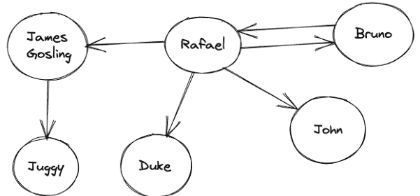

图 14. 无环图

注意上面的图片，Rafael 关注了 James Gosling、Duke、John 和 Bruno。然而，James Gosling、Juggy、Duke 和 John 并没有回关注 Rafael。Rafael 关注了 Bruno，而 Bruno 回关注了 Rafael。从 Rafael 节点出发，可以遍历整个图。

此外，注意上面的图没有循环。因此，它是一个无环图。

让我们看看如何在代码中表示上面的图：

```java
public class DirectedGraph {
    public static void main(String[] args) {
        Node rafaRootNode = new Node("Rafael");
        Node brunoNode = new Node("Bruno");
        Node jamesNode = new Node("James Gosling");
        Node buggyNode = new Node("Juggy");
        Node dukeNode = new Node("Duke");
        Node johnNode = new Node("John");

        rafaRootNode.addAdjacentNode(brunoNode);
        brunoNode.addAdjacentNode(rafaRootNode);
        rafaRootNode.addAdjacentNode(jamesNode);
        rafaRootNode.addAdjacentNode(johnNode);
        rafaRootNode.addAdjacentNode(dukeNode);
        jamesNode.addAdjacentNode(juggyNode);

        rafaRootNode.showNodes();
    }
}
```

输出：访问的节点：Rafael | Bruno | James Gosling | John | Duke | Juggy |

## 无环图和有环图

图是有环的也可以是无环的。这意味着如果存在以循环方式连接图的边，那么我们就有有环图。

让我们看看无环图的表示：

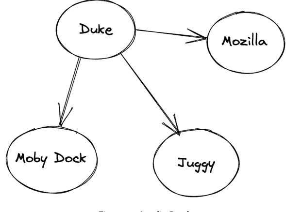

图 15. 无环图

用 Java 代码表示上面的无环图与有向图的代码类似：

```java
public class AcyclicGraph {
    public static void main(String[] args) {
        Node dukeRootNode = new Node("Duke");
        Node mozillaNode = new Node("Mozilla");
        Node mobyDockNode = new Node("Moby Dock");
        Node juggyNode = new Node("Juggy");

        dukeRootNode.addAdjacentNode(mozillaNode);
        dukeRootNode.addAdjacentNode(mobyDockNode);
        dukeRootNode.addAdjacentNode(juggyNode);
        dukeRootNode.showNodes();
    }
}
```

**输出：** 访问的节点：Duke | Mozilla | Moby Dock | Juggy |

在遍历有环图时，有必要检查节点是否已经遍历过，否则会发生无限循环。让我们看看有环图在图中是如何表示的：

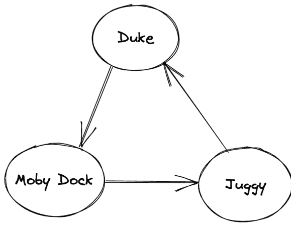

图 16. 有环图

```java
public class CyclicGraph {
    public static void main(String[] args) {
        Node dukeNode = new Node("Duke");
        Node mobyDockNode = new Node("Moby Dock");
        Node juggyNode = new Node("Juggy");

        dukeNode.addAdjacentNode(mobyDockNode);
        mobyDockNode.addAdjacentNode(juggyNode);
        juggyNode.addAdjacentNode(dukeNode);
        dukeNode.showNodes();
    }
}
```

## 总结

图结构对每个开发者来说都重要。它广泛应用于框架和技术中。这也是面试中经常问到的原因。

总结一下，要点如下：

- 图包含节点（顶点）和连接（边）。一些现实例子是社交媒体中的朋友，从一个点到另一个点。
- 邻接节点或邻居节点是从一个节点到另一个节点的直接关系。
- 图是有向的，这意味着一个节点可以到达另一个，但另一个不能。
- 图可以是无向的，这意味着节点连接是双向的。
- 图可以是无环的，这意味着节点之间没有循环。
- 图可以是有环的，这意味着节点之间存在循环。

## 树

树数据结构是图的一种。树有一个根节点，它与其子节点有关系。根节点到子节点的路径被称为分支。叶子节点是没有孩子且不是根节点的节点。

在算法中，你会看到很多术语。树的高度是从最高分支到根节点的节点。另一个关键词是树深度，指的是特定节点到根节点的计数。

为了清楚这些术语，让我们在图中查看它们：

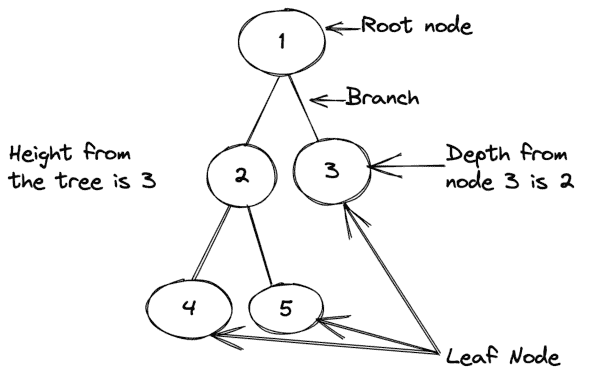

图 17. 根节点图

一个现实世界的例子是公司层级结构。例如：

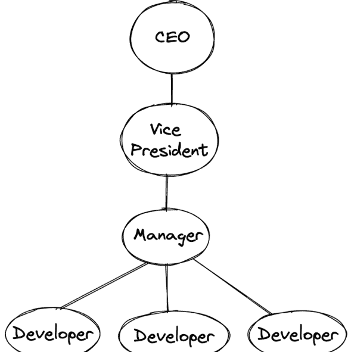

图 18. 根节点现实世界

为了遵循并运行以下代码示例的测试，你可以从以下链接（`https://github.com/rafadelnero/java-algorithms/tree/main/src/main/fundamentals/tree`）下载代码！

让我们看看 Java 代码表示这些数据的简单方法：

```java
import java.util.LinkedList;
import java.util.List;

public class TreeNode {

    private String value;
    private List<TreeNode> childNodes;

    public TreeNode(String value) {
        this.value = value;
        this.childNodes = new LinkedList<>();
    }

    public void addChild(TreeNode node) {
        this.childNodes.add(node);
    }

    public void showTreeNodes() {
        BreathFirstSearchTreeNodes.printNodes(this);
    }

    public String getValue() {
        return value;
    }

    public List<TreeNode> getChildNodes() {
        return childNodes;
    }
}
```

注意上面的代码与图的数据结构非常相似。我们也使用广度优先算法来显示树的数据。现在，不要担心它，只需记住这是一个访问并打印每个节点的著名算法。现在让我们在树数据结构中填充公司层级的数据：

```java
public class CompanyHierarchyTree {
    public static void main(String[] args) {
        TreeNode rootNode = new TreeNode("CEO");
        TreeNode vpNode = new TreeNode("Vice President");
        TreeNode managerNode = new TreeNode("Manager");
        TreeNode dev1Node = new TreeNode("Developer 1");
        TreeNode dev2Node = new TreeNode("Developer 2");
        TreeNode dev3Node = new TreeNode("Developer 3");
        rootNode.addChild(vpNode);
        vpNode.addChild(managerNode);
        managerNode.addChild(dev1Node);
        managerNode.addChild(dev2Node);
        managerNode.addChild(dev3Node);
        rootNode.showTreeNodes();
    }
}
```

## 二叉树

二叉树是一种最多具有 2 个子节点的树。让我们通过图表来看看它是工作的：

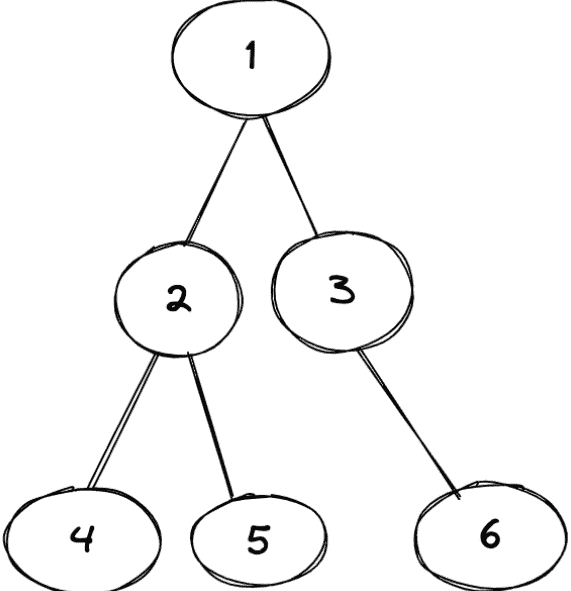

图 19. 二叉树图

注意，上面的图是一个二叉树，因为节点最多有 2 个孩子。即使节点 3 只有一个孩子，上面的图仍然是一棵二叉树。

## 三叉树

三叉树与二叉树相似，但它不是最多 2 个子节点，而是最多 3 个子节点。让我们来看看这在图中是如何表示的：

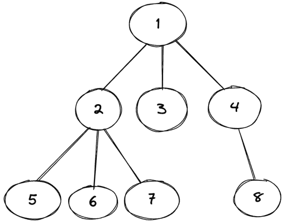

图 20. 三叉树图

注意上面的图中，节点 1 和节点 2 拥有 3 个子节点。即使节点 4 只有一个子节点，这也没有关系，它仍然是三叉树，因为子节点的最大数量是 3。

## K叉树

“K”代表树可以拥有的子节点最大数量。例如，我们可以将二叉树表示为 2 叉树，因为两者都意味着树最多可以有 2 个子节点。同样，3 叉树与三叉树是一样的。

## 完全二叉树

完美二叉树每个子节点到叶子节点的深度都是相同的。让我们来看看如何在图中表示它：

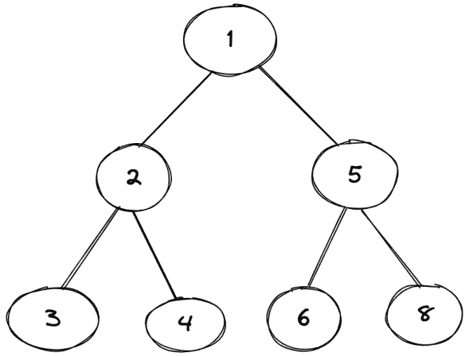

图 21. 完全树图

## 完全二叉树

完全二叉树包含的节点从最左侧的节点开始是完整的。此外，内部节点必须有两个子节点。只有不是最左侧的叶子节点允许没有子节点。

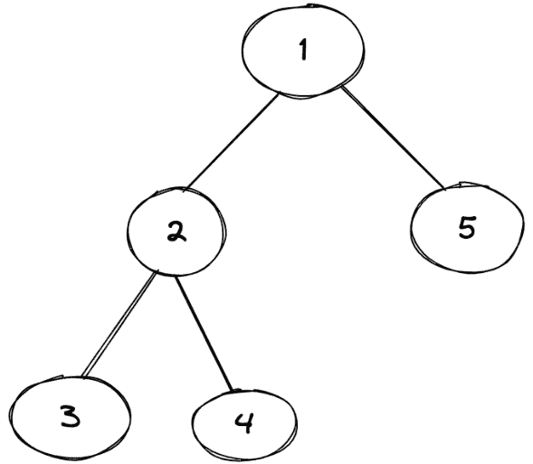

图 22. 完全二叉树图

记住，如果二叉树仅对最右侧的节点是完全，那么它就不会被视为完全二叉树。

## 满二叉树

当树具有两个或零个子节点时，它被认为是满二叉树。为了说明满二叉树，请看下面的图：

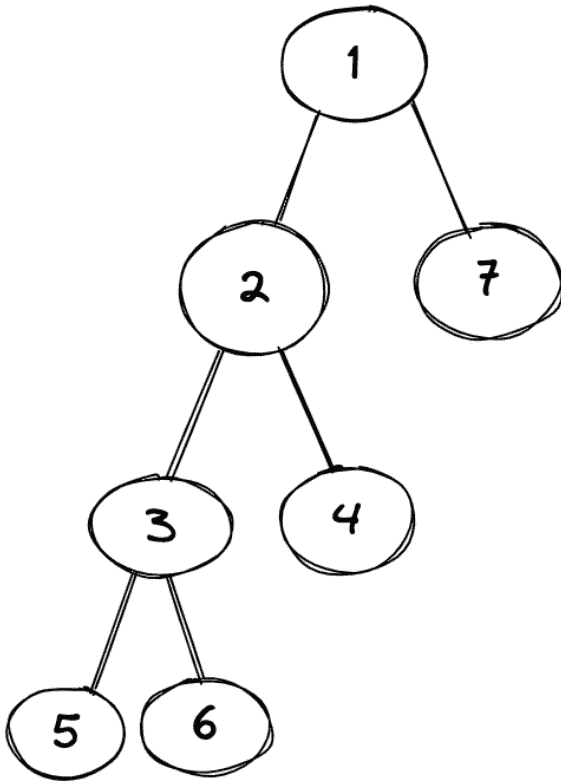

图 23. 满二叉树图

## 平衡二叉树

平衡树的左右子树之间的高度树高度差不能超过 1 层。让我们来看一个例子来更清楚地理解它：

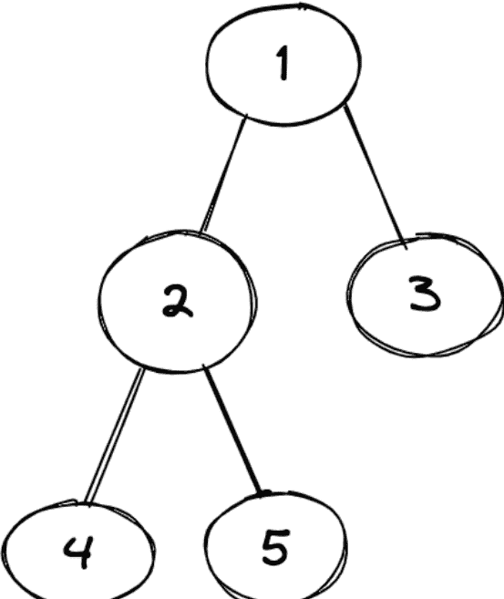

图 24. 平衡树图


注意上面的图中，这棵树的总高度为 3。左侧节点 4 和 5 的高度为 3。节点 3 的高度为 2。因此，节点子树之间的差异为 1，由于这个原因，它是一棵平衡树。

下面的图是一个非平衡二叉树的例子。那是因为从左子树的高度相对于右子树高出了 1 以上：

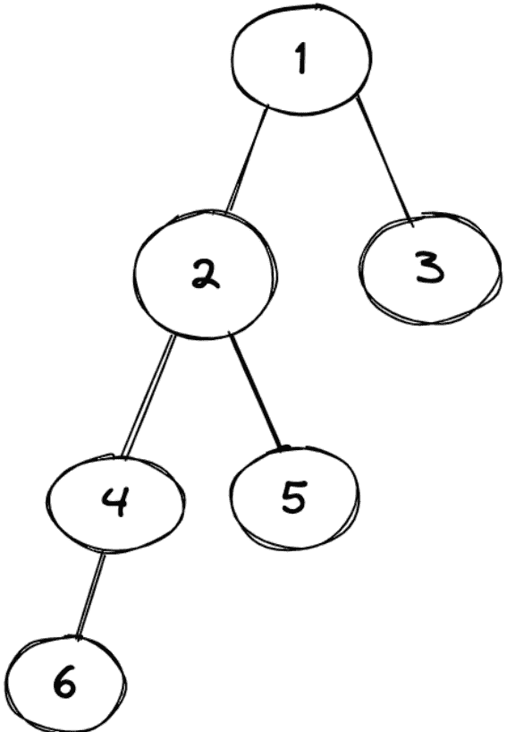

图 25. 非平衡树图

注意上面的图中节点 6 的高度为 4。右侧的节点 3 高度为 2。因此，节点高度的差异大于 1，由于这个原因，上面的树不是平衡的。

## 总结

在这一章中，我们看到了树结构的核心概念。正如你所见，树是用于许多系统和现实世界的图。让我们来看看树结构的关键点：

- 树是一种图，但具有特定的结构和规则。
- 节点是树中的每一个元素。
- 根节点是顶部的节点，用于访问子节点。
- 叶子节点是任何子节点。
- 树的高度是节点延伸的深度。
- 二叉树最多有两个节点。
- 三叉树最多有三个节点。
- K 叉树可以有任何数量的节点。
- 完美二叉树每个父节点必须有相同数量的节点。
- 完全二叉树意味着最左侧的节点是完整的。左侧必须有两个节点。
- 满二叉树当树具有 0 或两个节点时。它不能只有一个节点。
- 平衡二叉树的高度差异不能超过 1 层。

## 递归

递归是算法中被频繁使用的编程基础。简单来说，递归是方法调用自身的能力。当一个方法调用它自己时，它会堆叠并使用 LIFO（后进先出）方法。这和叠子盘的概念相同。让我们来看下面的场景：


图 26. 后进先出

总结上面的图，记住插入栈的最后一个元素将是第一个被移除的元素。这就是 LIFO。为了记住并真正理解 LIFO 方法，只需记住当你堆叠盘子时，你无法拿到底部的盘。相反，获取栈顶部的第一个盘要容易得多且更合适。方法的堆叠方式完全一样！FIFO（先进先出）与 LIFO 具有相同的结果。它基本上意味着第一个进入栈的盘子将是最后一个离开的盘子。


图 27. 先进先出

总结上面的图，插入栈的第一个盘子将是最后一个移除的。另一个需要记住的是，可以用递归完成的任务也可以循环完成，反之亦然。让我们来看这个 Java 示例：

```java
public class Recursion {
    public static void main(String[] args) {
        System.out.println(getNumber(0));
    }

    static int getNumber(int number) {
        if (number > 5) { // A
            return number;
        }
        return getNumber(number + 1); // B
    }
}
```

代码分析：

- #A `if` 是打破递归循环的条件。这意味着当参数大于 5 时，递归将停止。这在递归中被称为基本情况（base case）。
- #B 注意 `getNumber` 方法正在调用它自己，并将参数加 1。这意味着每当 `getNumber` 被调用时，参数都会累加 1。该方法会被堆叠直到参数变为 6，如如下所示：

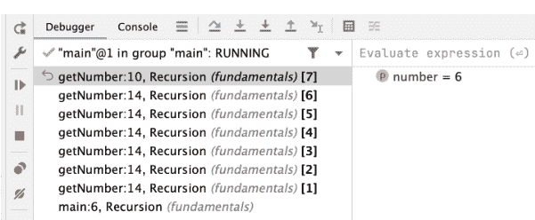

图 28. 递归调试

## 在实践中观察 LIFO/FIFO

当我们相加数字时，递归调用的顺序并不重要。然而，如果我们想按顺序打印数字，情况就完全不同。让我们来看看实践中发生的 LIFO/FIFO：

```java
public class NumbersRecursion {
    public static void main(String[] args) {
        showNumbers(0);
    }
    static void showNumbers(int number) {
        if (number == 5) {
            return;
        }
        showNumbers(number + 1);
        System.out.print(number + " ");
    }
}
```

输出：`4 3 2 1 0`

注意数字是以反序打印的。那是因为方法是递归堆叠的，正如你在调试图像所示：当所有方法都已调用时，注意变量 `number` 为 5：

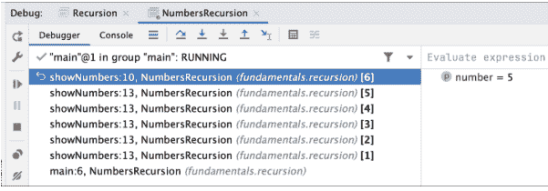

图 29. LIFO 调试 - 全栈

当所有方法都已调用且方法正在从栈中取出时，变量 `number` 为 3：

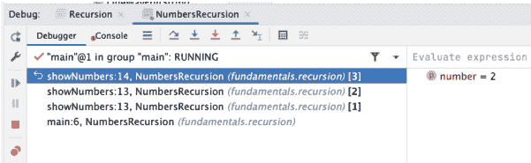

图 30. FIFO 调试 - 半栈

因此，由于递归调用会拦截此方法调用，并等待最后一个递归方法被调用后才第一个从栈中取出。这就是为什么第一个打印的数字是 4！

## 递归斐波那契

我们的目标是将一个数字传递给斐波那契算法，并使用递归获取结果。

```java
public class FibonacciRecursion {
    public static void main(String[] args) {
        System.out.println(fibonacci(3));
    }
    static int fibonacci(int n) {
        if (n == 0) {
            return 0;
        } else if (n == 1) {
            return 1;
        }
        return fibonacci(n - 1) + fibonacci(n - 2);
    }
}
```

在上面的代码中，注意有两个递归调用。第一次调用从 `n` 中减去 1，第二次调用从 `n` 减去 2。当这种情况发生时，将创建如下递归树：

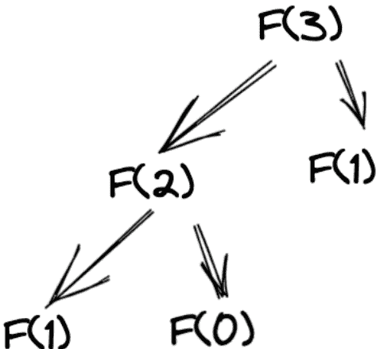

图 31. 斐波那契递归

注意上面的树是如何创建的。`fibonacci` 方法从 `F(3)` 被调用，递归开始。然后调用 `F(2)`，接着是 `F(1)`。记住 `F(1)` 匹配基础条件，因此它将返回 1。

然后，调用返回到 `F(2)` 并调用 `F(0)`，它也匹配基础条件并返回 0。

从 `F(0)` 回到 `F(2)`，然后到 `F(3)`。接着 `F(3)` 调用了第二个方法 `F(1)`，它返回 1。这就是为什么结果是 2。

方法调用的最终顺序如下：`F(3), F(2), F(1), F(2), F(0), F(2), F(3), F(1)`

注意，`n` 越大，我们的方法调用次数就越多。这种增长是指数级的。

## 递归斐波那契的 Big(O) 表示法

现在让我们来看看这个算法的性能：

- **时间复杂度**：`O(2^N)`，意味着当 `N` 为 3 时，时间复杂度为 9 —— 非常慢。
- **空间复杂度**：`O(N)`，意味着栈中调用方法的总和。

简单来说，Big(O) 表示衡量的是执行算法时使用的性能和空间。你可能在好奇为什么空间复杂度与时间复杂度不同，让我们来探索一下。

时间复杂度将始终是指数级的，这性能不高。发生这种情况的原因是，在时间上，递归调用必须遍历所有的递归树。

但空间复杂度是不同的。解释什么是空间复杂度，它基本上是算法将使用的内存空间。

记得递归方法的调用存储在栈中吗？所以，当 `F(3)` 调用 `F(2)` 和 `F(1)` 时 —— `F(1)` 和 `F(2)` 会从栈中弹出。简单理解的关键是，最左的方法会被调用并从栈中弹出。因此，无论树变得多大，空间始终是 `O(N)`。

## 总结

递归是编程中的基本概念，在某些情况下它可以让代码变得简单。例如，某些函数式编程语言完全依赖递归来实现循环。让我们看看本章的关键点：

- 递归是方法调用自身的能力。
- 每个递归方法都需要基础条件，换句话说就是打破递归的条件。
- 递归方法的调用将使用 LIFO（后进先出）策略堆在内存栈中。
- 使用递归可以完成的任务用循环也可以完成。
- 对于如深度优先搜索、合并排序、快速排序、二分查找等算法，使用递归会更有效。

## 对数

对数时间复杂度存在许多算法中，并且非常有效。因此，理解它的工作原理非常重要，这样我们就能知道具有对数时间复杂度的算法性能如何。

简单来说，对数是一个数字自身相乘得到特定结果的次数。在看实际示例之前，让我们来看数学函数：

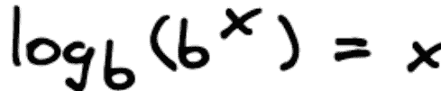

图 32. 对数公式

如果我们将 `b`（底）替换为 2，那么结果将是 2 的 `x`（指数）次方，结果为 `x`。

例如，在算法语境下，让我们考虑 `n = 16`，我们需要找出底数 2 为了得到结果 16 应该是几次方。

```text
log2(16) = 4 即 2^4 = 16
```

2 的 4 次方等于 16。因此，该算法在最坏情况下会有 4 次迭代。

## 二分查找中的对数时间复杂度

让我们来看一个例子，我们执行二分查找算法，它基本上是在一个包含 16 个元素的排序数组中查找元素。你将在实践中看到 `O(log n)`：

```java
public class OLogNExample {
    // O(log n) time | O(1) space
    public static int binarySearch(int[] array, int target) {
        int leftPointer = 0;
        int rightPointer = array.length - 1;
        int iterationsCount = 0;

        while (leftPointer <= rightPointer) {
            int middle = (leftPointer + rightPointer) / 2;
            iterationsCount++;

            if (array[middle] == target) {
                return middle;
            } else if (array[middle] < target) {
                leftPointer = middle + 1;
            } else {
                rightPointer = middle - 1;
            }
        }

        System.out.println("Iterations count: " + iterationsCount);
        return -1;
    }
}
```

## 冒泡排序

如上图所示，所有的元素都将被比较，这就是为什么它在性能方面非常低效。

现在让我们来看看如何在 Java 中实现冒泡排序：

```java
public class BubbleSort {
    public static void main(String[] args) {
        int[] array = {2, 9, 5, 5, 6, 8, 10};
        int[] result = sortOptimized(array);
        Arrays.stream(result).forEach(e -> System.out.println("" + e + ""));
    }

    public static int[] sort(int[] array) {
        for (int i = 0; i < array.length; i++) {
            for (int j = i + 1; j < array.length; j++) {
                if (array[i] > array[j]) {
                    swapElements(array, i, j);
                }
            }
        }
        return array;
    }

    private static void swapElements(int[] array, int i, int j) {
        var temp = array[i];
        array[i] = array[j];
        array[j] = temp;
    }
}
```

输出：`2 5 5 6 8 9 10`

## 代码分析

上面的代码将创建一个带有索引 `i` 的第一个循环，然后通过索引 `j` 遍历另一个循环。注意 `j` 从 `i + 1` 开始，以避免 `i` 和索引 0 之间冗余的比较。

然后，`i` 的每个元素都将与索引 `j` 另一个数组迭代中的元素进行比较。当所有元素都经过比较并排序后，冒泡排序完成。

## 优化后的冒泡排序

注意，在上面的算法中存在整个数组已经排序的可能性。但如果在上面的代码中发生这种情况，我们仍然会遍历整个数组。我们无法通过代码来控制这一点。

然而，在接下来的代码中，我们将看到一种方法可以在数组已经排序的情况下防止多次遍历数组。让我们来看看它是如何运作的：

```java
public class BubbleSort {
    // 省略了上述代码
    public static int[] sortOptimized(int[] array) {
        var isSorted = false;
        var counter = 0;

        while (!isSorted) {
            isSorted = true;
            for (int i = 0; i < array.length - 1 - counter; i++) {
                if (array[i] > array[i + 1]) {
                    swapElements(array, i, i + 1);
                }
            }
            counter++;
        }
        return array;
    }
    // 省略 swapElements 方法
}
```

## 代码分析

首先，如果我们比较未优化的冒泡排序和优化后的冒泡排序之间的迭代次数，取决于输入数组，其差异是巨大的。使用代码示例中的数组，在未优化的冒泡排序中，我们进行了 21 次迭代，而在优化后的冒泡排序中，我们进行了 11 次迭代。

代码的区别在于，我们不再无视地比较每个元素，而是使用了 `isSorted` 标志。我们将上一个元素与下一个元素进行排序，并根据需要遍历整个数组，直到其完全排序为止。

如果一个包含 7 个元素的数组已经排序，那么使用优化后的冒泡排序将只需要 7 次迭代。相比之下，使用未优化的冒泡排序算法将会有 21 次迭代。

因此，在实现冒泡排序算法时，记住实现优化后的算法以提高性能！

## 大 O 表示法

- **时间复杂度**：由于我们有两个循环，因此它是 `O(n^2)`。
- **空间复杂度**：它在原地对数组排序，这意味着 `O(1)`。

## 总结

冒泡排序非常简单，如你所见：

- 它遍历数组
- 它交换元素
- 它在性能方面效率低下

## 选择排序

选择排序并不是性能最好的算法，但它很容易实现。简单来说，选择排序将数组分为两个子数组：左侧是排序过的，右侧是未排序的。

选择排序通过比较每个数字并在每次发现更小的元素时更新最小元素索引，来选择数组中的最小元素。

一旦找到数组的最小索引，它就会将该元素交换到数组的最左侧（左子数组），并继续操作，直到数组完全排序完毕。

让我们通过下面的图表来看看其思路：

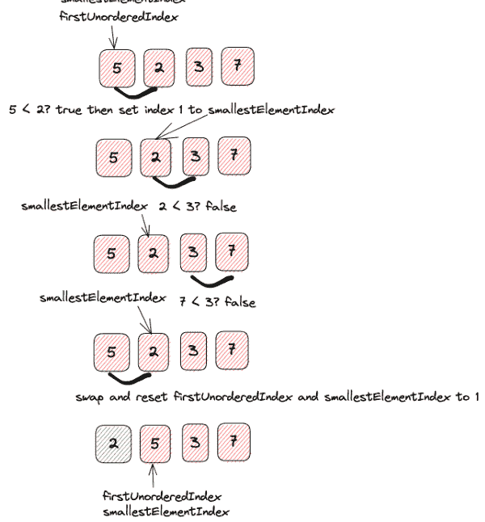

图 35. 选择排序


```java
import java.util.Arrays;

public class SelectionSort {
    public static void main(String[] args) {
        int[] array = {5, 2, 3, 7, 1};
        var sortedArray = sort(array);
        System.out.println(Arrays.toString(sortedArray));
    }

    static int[] sort(int[] array) {
        if (array.length == 1) {
            return array;
        }

        var firstUnsortedIndex = 0;
        while (firstUnsortedIndex < array.length - 1) {
            var smallestElementIndex = firstUnsortedIndex;
            for (int i = firstUnsortedIndex; i < array.length; i++) {
                if (i != smallestElementIndex && array[i] < array[smallestElementIndex]) {
                    smallestElementIndex = i;
                }
            }
            swapElements(array, firstUnsortedIndex, smallestElementIndex);
            firstUnsortedIndex++;
        }
        return array;
    }
}
```

## 插入排序

```java
    private static void swapElements(int[] array, int i, int j) {
        var temp = array[i];
        array[i] = array[j];
        array[j] = temp;
    }
}
```

**输出: [1, 2, 3, 5, 7]**

代码分析：

- 首先将变量 `firstUnsortedIndex` 和 `smallestIndex` 初始化为 0。在循环中遍历整个数组。
- 将 `firstUnsortedIndex` 设置为 `smallestIndex`，以避免与已排序元素进行比较。
- 遍历数组以寻找 `smallestIndex`。
- 当遍历完数组后，将最小元素交换到左子数组。
- 增加 `firstUnsortedIndex` 再次执行操作，直到数组末尾。

## 通过比较元素最小值进行选择排序

```java
public class SelectionSort { // 省略上方代码

    public static int[] sortMaxValue(int[] array) {
        var smallestElementIndex = 0;
        for (int i = 0; i < array.length; i++) {
            var smallestElement = Integer.MAX_VALUE;
            for (int j = i; j < array.length; j++) {
                if (array[j] < smallestElement) {
                    smallestElement = array[j];
                    smallestElementIndex = j;
                }
            }
            swapElements(array, i, smallestElementIndex);
            smallestElementIndex = 0;
        }
        return array;
    }
    // 省略 swapElements 方法
}
```

## 代码分析

上面的代码实现与第一个代码示例相同，但区别在于我们不是直接比较数组中的元素，而是将最小数值赋值给变量 `smallestElement`。这是解决同一个问题的不同代码技术。

## 大 O (O) 符号复杂度

时间复杂度：由于迭代首先发生在“已排序子数组”上，然后遍历“未排序子数组”，因此复杂度将为 O(n^2)。请记住，这不是一个精确的数字，它是该算法的最坏情况场景。

空间复杂度：由于我们只是在数组中原地交换了一些数字，因此该算法的空间复杂度为 O(1)。

## 总结

选择排序的性能不是很好，但非常容易实现。让我们来看看该算法的要点：

- 数组的左部分将被排序，右部分将保持未排序状态。
- 将选择最小元素的索引。一旦选中，就会对数组值进行交换。
- 可以通过比较数组元素或比较另一个变量中的最小值来对元素排序。

## 快速排序 (Quicksort)

快速排序算法是 Java 以及任何其他编程语言中最有效的算法之一。例如，它在许多 JDK API 方法背后被使用。

### 使用快速排序算法选择基准值 (pivot)

快速排序的第一步是选择基准值。基准值理想情况下应该是当数组完全排序后位于正中间位置的数字。

它不需要恰好是数组中间的数字。相反，我们尝试选择一个接近它的元素。通常用于此的技术是“三数取中法”（median of three）。其思路是选取数组的第一个、中间和最后一个元素，对它们进行排序，最后选择中间的元素。基准值是靠近中间的那个，这样我们的时间复杂度将是 O(n log n)。

### 使用快速排序创建分区

或者，我们可以简单地选择数组的第一个或最后一个元素。但如果基准值是数组中最小或最大的，分区将从左侧和右侧创建。

让我们快速排序是如何工作的：


图 36. 快速排序

### 快速排序代码实现

```java
import java.util.Arrays;

public class Quicksort {
    static void quickSort(int[] array, int lowIndex, int highScore) {
        if (lowIndex < highScore) {
            int partitionIndex = partition(array, lowIndex, highScore);
            quickSort(array, lowIndex, partitionIndex - 1);
            quickSort(array, partitionIndex + 1, highScore);
        }
    }

    static int partition(int[] array, int lowIndex, int highScore) {
        int pivot = array[highIndex];
        int i = lowIndex - 1;
        for (int j = lowIndex; j < highScore; j++) {
            if (array[j] < pivot) {
                i++;
                swap(array, i, j);
            }
        }
        swap(array, i + 1, highScore);
        return i + 1;
    }

    static void swap(int[] arr, int i, int j) {
        int temp = arr[i];
        arr[i] = arr[j];
        arr[j] = temp;
    }

    public static void main(String[] args) {
        int[] array = {10, 3, 2, 0, 9, 7};
        int n = array.length;
        quickSort(array, 0, n - 1);
        System.out.println(Arrays.toString(array));
    }
}
```

**输出: [0, 2, 3, 7, 9, 10]**

### 快速排序代码分析

注意 `quickSort` 方法有两个指针，`lowIndex` 是数组的最低索引，`highIndex` 是数组的索引。

然后我们将调用 `partition` 方法，它首先选择基准值，在我们的案例中，它是数组的最后一个元素，以便理解算法。然后，小于基准值的元素将到左侧，大于基准值的元素将到右侧。

注意当分区发生时，显然整个数组并不是排序的。因此，为了完全排序数组，有必要从左侧和右侧递归调用分区数组。

### 双指针分区实现

一旦 `leftPointer` 拥有大于或等于基准值（pivot）的元素，且 `rightPointer` 拥有小于或等于基准值的元素，元素就会进行交换。

让这个算法显得有些困惑的地方在于最后的检查。然而，这是必要的，因为 `leftPointer` 元素可能大于 `highIndex`。如果是这样，元素将进行交换；否则，`leftPointer` 将指向 `highIndex`：

```java
static int partition(int[] array, int lowIndex, int highScore) {
    int pivot = array[highIndex];
    int leftPointer = lowIndex;
    int rightPointer = highIndex - 1;
    while (leftPointer < rightPointer) {
        while (array[leftPointer] <= pivot && leftPointer < rightPointer) {
            leftPointer++;
        }
        while (array[rightPointer] >= pivot) {
            rightPointer--;
        }
        swap(array, leftPointer, rightPointer);
    }
    if (array[leftPointer] > array[highIndex]) {
        swap(array, leftPointer, highScore);
    } else {
        leftPointer = highScore;
    }
    return leftPointer;
}
```

## 快速排序总结

本章展示了快速排序算法的工作原理以及完成排序的最关键步骤。因此，让我们回顾一些重要要点：

- 当使用 JDK 代码中的 `Arrays.sort()` 方法时，背后使用的是快速排序。
- 需要选择一个基准值来对数组进行分区。理想情况下，基准值应该是中间的数字。
- 当基准值是所有分区中最大或最小的数字时，算法将处于最坏情况。因此，时间复杂度将为 O(n)。
- 我们可以选择第一个、最后一个或随机元素。此外，我们还可以使用“三数取中法”策略从第一个、中间和最后一个元素中选择中间位置的数字。
- 我们在每次方法调用时递归地对分区进行排序。当分区足够小时，就不会有剩余元素需要排序。因此，数组将已经是排序的。

## 归并排序

归并排序是一种使用分治策略对元素数组进行排序的算法。它是一种高效的排序算法，平均时间复杂度为 O(n log n)。

归并排序算法通过递归地将输入数组分为两部分，直到每个部分只包含一个元素或为空。然后，它将排序后的子数组合并在一起，以生成最终的排序数组。

合并步骤涉及比较每个子数组的第一个元素，并选择较小的放入最终数组中。这个过程一直持续到所有元素合并到最终数组中。

归并排序的优点之一是它是稳定排序算法，这意味着相同值的元素在排序数组中将保持原始顺序。此外，归并排序可以很容易以并行方式实现，使其成为大规模排序应用的热门选择。

让我们看看归并排序的图，以便了解它是如何工作的以及执行顺序是什么：

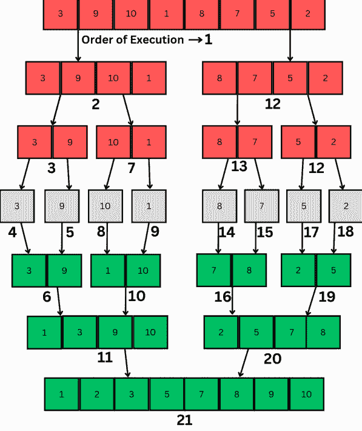

**红色元素方块**：元素仍在划分，尚未排序。**灰色元素方块**：只有一个元素，因此数组已完全划分。**绿色元素方块**：开始进行合并，同时也对所有元素进行排序。

每个元素下方的数字代表算法中的执行顺序。如果我们调试代码，会发现执行顺序是完全相同的。

### Java 归并排序代码

以下代码使用了递归，如果你还没有完全掌握它，我建议回到递归章节，直到你完全理解它。

现在，请注意以下代码，左数组和右数组将被划分，然后它们将被合并，最后完成合并。仔细阅读代码，这不是一个容易理解的算法，因此你可能需要阅读很多遍才能完全吸收。

另一个对你有帮助的方法是调试这个算法，在实践中看到上面图表描述的过程。

```java
public class MergeSort {
    public static void main(String[] args) {
        var array = new int[]{3, 9, 10, 1, 8, 7, 5, 2};
        mergeSort(array);
        for (int element: array) {
            System.out.print(element + " ");
        }
    }

    public static void mergeSort(int[] array) {
        if (array == null || array.length <= 1) {
            return;
        }
        // 将数组分为两半
        int mid = array.length / 2;
        int[] leftArray = new int[mid];
        int[] rightArray = new int[array.length - mid];
        System.arraycopy(array, 0, leftArray, 0, mid);
        System.arraycopy(array, mid, rightArray, 0, array.length - mid);

        mergeSort(leftArray);
        mergeSort(rightArray);
        merge(array, leftArray, rightArray);
    }

    private static void merge(int[] array, int[] leftArray, int[] rightArray) {
        int i = 0, j = 0, k = 0;
        while (i < leftArray.length && j < rightArray.length) {
            if (leftArray[i] <= rightArray[j]) {
                array[k++] = leftArray[i];
                i++;
            } else {
                array[k++] = rightArray[j];
                j++;
            }
        }
        while (i < leftArray.length) {
            array[k++] = leftArray[i++];
        }
        while (j < rightArray.length) {
            array[k++] = rightArray[j++];
        }
    }
}
```

总之，避免在以下使用归并排序：

- 当空间有限时
- 针对极小数组
- 当不需要稳定性时
- 针对高度无序的数组

### 归并排序的优缺点

没有任何排序算法适用于所有情况。相反，我们必须为特定情况选择最佳算法。因此，让我们来看看归并排序的优缺点。

#### 优点

- 归并排序的时间复杂度为 O(n log n)，这意味着它可以高效地排序大量数据。
- 它是一种稳定的排序算法，意味着它保留了输入列表中相等元素的相对顺序。
- 归并排序是一种分治算法，这使其易于递归实现和理解。
- 归并排序还可以高效地将两个已排序的列表合并为一个已排序的列表。

#### 缺点

- 归并排序需要额外的内存来存储排序过程中使用的临时数组，这在内存受限的情况下可能是一个缺点。
- 该算法对于小列表来说效率并不高，因为递归调用和数组复制的开销可能会超过排序算法本身的收益。
- 归并排序不是一种原地排序算法，意味着它需要额外的内存来执行排序操作。这在处理大型数据集或内存受限的环境时可能是一个缺点。

## 归并排序总结

归并排序并不是很容易掌握的。然而，让我们这个算法的一些要点，以便你更轻松地记忆和掌握它。

归并排序算法：

- 使用分治策略。
- 使用递归。
- 速度足够快，因为它的时间复杂度为 O(n log n)。
- 是稳定的，意味着当元素相等时它不会改变元素的顺序。


- 空间效率不高。它使用辅助数组对元素进行排序。
- 对于大型输入数组非常高效。
- 对于部分排序的输入数组非常高效，因为它只会排序和合并数组中未排序的部分。

## 深度优先搜索 (Depth-first-search)

深度优先搜索算法广泛用于需要遍历节点的算法中。该算法在日常工作中可能不会直接使用。然而，`LinkedList` 使用了图的概念，因此我们一直在间接地使用它。

在学习 DFS（深度优先搜索）算法之前，请确保你完全理解了图的数据结构、树、栈数据结构和递归。

让我们使用下面的图通过深度优先搜索算法进行遍历。

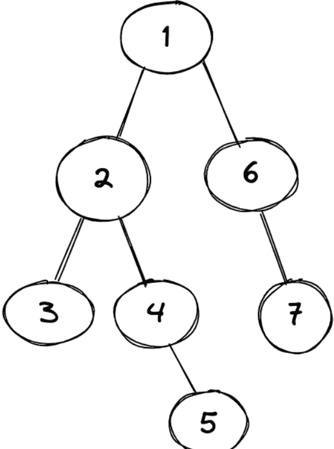

图 38. 图遍历

为了表示上面的图，我们将使用以下类：

```java
import java.util.ArrayList;
import java.util.List;

public class Node {
    Object value;
    private List<Node> adjacentNodes = new ArrayList<>();
    private boolean visited;

    public Node(Object value) {
        this.value = value;
    }

    public void addAdjacentNode(Node node) {
        this.adjacentNodes.add(node);
    }

    public List<Node> getAdjacentNodes() {
        return adjacentNodes;
    }

    public Object getValue() {
        visited = true;
        return value;
    }

    public boolean isVisited() {
        return visited;
    }
}
```

现在，让我们用图中相同的数据填充这个图：

```java
public class GraphMock {
    public static Node createPreorderGraphMock() {
        Node rootNode = new Node(1);
        Node node2 = new Node(2);
        Node node3 = new Node(3);
        Node node4 = new Node(4);
        Node node5 = new Node(5);
        Node node6 = new Node(6);
        Node node7 = new Node(7);

        rootNode.addAdjacentNode(node2);
        node2.addAdjacentNode(node3);
        node3.addAdjacentNode(node4);
        node4.addAdjacentNode(node5);
        rootNode.addAdjacentNode(node6);
        rootNode.addAdjacentNode(node7);

        return rootNode;
    }
}
```

## 前序遍历 (Preorder Traversal)

前序图遍历意味着我们将从根开始，然后遍历左子树和右子树。

### 不使用 Lambda 的递归前序遍历

让我们先看看不使用 lambda 的情况下如何递归：

```java
public class DepthFirstSearchPreorder {
    public static void main(String[] args) {
        Node rootNode = GraphMock.createPreorderGraphMock();
        dfsRecursiveWithoutLambda(rootNode);
    }

    public static void dfsRecursiveWithoutLambda(Node node) {
        System.out.print(node.getValue() + " ");

        for (Node eachNode : node.getAdjacentNodes()) {
            if (!eachNode.isVisited()) {
                dfsRecursiveWithoutLambda(eachNode);
            }
        }
    }
}
```

（注：原文后续部分存在大量重复且逻辑混乱的示例描述，已按核心含义翻译并保持结构）

## 深度优先搜索

171

## 代码分析：

注意上面的代码，我们只在节点为叶子节点时才显示该节点的数据。这正是我们需要的。另一个重要点是，我们首先从右节点向栈中插入数据，然后是从左节点。

栈会将插入的节点作为栈的第一个元素推入。由于在后序遍历中，我们希望先打印左子树，这样运行效果非常完美。这里的另一个关键细节是，我们正在改变右节点和左节点的状态，并且必须这样做！如果我们不改变这些节点的状态，位于叶子节点之前的节点将永远不会被打印。因为我们只打印叶子节点！

如果我们不想改变节点的状态，代码将会稍微复杂一些。但我们并没有必要了解所有类型的图的算法。我们需要了解的是原理，以便能够理解和解决我们在面试中甚至日常任务中可能遇到的常见算法。

## 中序遍历

中序遍历将首先打印左子树，然后是根，最后是右子树。

## 递归中序遍历

与后序遍历类似，这种算法更适用于二叉树。通过使用递归，算法变得简单得多。让我们先看递归的代码示例：

```java
public class DepthFirstSearchInorder {
    public static void main(String[] args) {
        dfsRecursive(TreeMock.createTreeMock());
    }

    public static void dfsRecursive(TreeNode node) {
        if (node != null) {
            dfsRecursive(node.left);
            System.out.print(node.value + " ");
            dfsRecursive(node.right);
        }
    }
}
```

输出：3 2 4 5 1 6 7

## 代码分析：

在上面的代码中，我们必须首先检查节点是否为空以避免空指针异常（`NullPointerException`）。然后先遍历左节点，然后递归地堆栈处理。让我们详细看看递归调用这些方法时发生了什么。

我们从根节点开始，即节点 1。然后递归调用左节点的方法，此时我们进入了节点 2。然后再次递归调用左节点，即节点 3。但节点 3 既没有左节点也没有右节点，因此递归方法的基准条件被满足，因为下一个左节点或右节点将为 null。

现在方法将开始从栈中弹出。第一个弹出的是节点 3。现在我们回到节点 2。在节点 2 中，我们将继续执行方法来打印值 2，然后调用右节点。2 的右节点是节点 4。然后首先对节点 4 进行另一个递归调用。

## 深度优先搜索

尝试调用左节点，但该节点为 null。因此，方法的执行将继续。

在节点 4 中，我们只有一个右节点。因此，将打印数字 4 并调用右节点 5。节点 5 没有左节点或右节点。因此，节点 5 的方法将从栈中弹出并打印数字 5。

然后，方法调用将返回根节点，右侧的情况基本相同。

为了总结这个过程，让我们看看节点调用和反转的顺序：

```
1 1 -> 2 -> 3 -> null -> prints 3 -> null -> prints 2 -> 4 \
2 -> null -> prints 4 -> prints 5 -> null -> 5 -> prints 1
3 -> prints 6 -> null -> 6 -> prints 7 -> null -> 7
```

## 循环中序遍历

如所述，所有使用递归完成的操作也可以通过循环来实现。因此，让我们看看如何使用循环实现中序遍历：

```java
// public static void dfsNonRecursive(TreeNode node) {
    Stack<TreeNode> stack = new Stack<>();
    TreeNode current = node;

    while (current != null || !stack.isEmpty()) {
        while (current != null) {
            stack.push(current);
            current = current.left;
        }

        TreeNode lastNode = stack.pop();
        System.out.print(lastNode.value + " ");
        current = lastNode.right;
    }
}
```

输出：3 2 4 5 1 6 7

## 代码分析：

在上面的代码中，我们首先必须检查节点是否为空以避免空指针异常。然后先遍历左节点，然后递归地堆栈处理。让我们详细看看递归调用这些方法时发生了什么。

我们从根节点开始，即节点 1。然后递归调用左节点的方法，此时我们进入了节点 2。然后再次递归调用左节点，即节点 3。但节点 3 左右左右节点，因此递归方法的基准条件被满足，因为下一个左节点或右节点将为 null。

现在方法将开始从栈中弹出。第一个弹出的是节点 3。现在我们回到节点 2。在节点 2 中，我们将继续执行方法来打印值 2，然后调用右节点。2 的右节点是节点 4。然后首先对节点 4 进行另一个递归调用。

## 深度优先搜索

尝试调用左节点，但该节点为 null。因此，方法的执行将继续。

在节点 4 中，我们只有一个右节点。因此，将打印数字 4 并调用右节点 5。节点 5 没有左节点或右节点。因此，节点 5 的方法将从栈中弹出并打印数字 5。

然后，方法调用将返回根节点，右侧的情况基本相同。
总结这个过程，让我们看看节点调用和反转的顺序：

```
1 1 -> 2 -> 3 -> null -> prints 3 -> null -> prints 2 -> 4 \
2 -> null -> prints 4 -> prints 5 -> null -> 5 -> prints 1
3 -> prints 6 -> null -> 6 -> prints 7 -> null -> 7
```

## 深度搜索的大 O (O) 法

时间复杂度 = O(顶点+边) 空间复杂度 = O(N)

## 总结

- 深度优先搜索将访问靠近的节点。
- 我们可以使用前序、后序和中序算法来遍历图。
- 注意，实现深度优先搜索更容易。
- 图可以是循环的。
- 前序深度优先搜索将从左侧开始。
- 后序深度优先搜索将从左子树、根最后。
- 中序深度优先搜索将从左子树、根和右子树。
- 实现深度优先搜索更容易。
- 图可以是循环的，但树不能。

## 广度优先搜索

广度优先搜索是一种遍历图或树的方法，按层访问节点。而深度优先搜索按深度遍历，换句话说，按分支遍历。

遍历从根节点开始，对于下图所示，从顶部开始。节点 1 首先打印（第一层），然后是 2 和 3（第二层），然后是 4、5 和节点 6（第三层），最后是 7 和 8（第四层）。


图 39. 优先search

如上所述，如果我们使用广度优先搜索算法遍历上面的图，输出为：1 2 3 4 5 6 7 8

## 树的广度优先搜索

在理解广度优先搜索算法之前，确保你已经掌握了树的数据结构。

在遍历树之前，让我们看看如何通过代码定义二叉树：

```java
public class TreeNode {
    public int value;
    public TreeNode left;
    public TreeNode right;

    public TreeNode(int value) {
        this.value = value;
        right = null;
        left = null;
    }
}
```

让我们用上面看到的图中相同的数据填充上面的树：

```java
public class Mock {
    public static TreeNode createBfsMock() {
        TreeNode rootTreeNode = new TreeNode(1);
        TreeNode treeNode2 = new TreeNode(2);
        TreeNode treeNode3 = new TreeNode(3);
        TreeNode treeNode4 = new TreeNode(4);
        TreeNode treeNode5 = new TreeNode(5);
        TreeNode treeNode6 = new TreeNode(6);
        TreeNode treeNode7 = new TreeNode(7);
        TreeNode treeNode8 = new TreeNode(8);

        rootTreeNode.left = treeNode2;
        rootTreeNode.right = treeNode3;
        treeNode2.left = treeNode4;
        treeNode2.right = treeNode5;
        treeNode3.right = treeNode6;
        treeNode5.left = treeNode7;
        treeNode5.right = treeNode8;

        return rootTreeNode;
    }
}
```

## 广度优先搜索

在接下来的 FIFO（先进先出）策略中，我们将使用队列（queue）数据结构来插入和检索数据。换句话说，第一个插入的元素将是第一个离开的元素。这与现实世界中的队列相同。队列中的第一个人将是第一个被服务的人，或者说是第一个离开队列的人。

要在 Java 中使用这种数据结构，我们将使用 `Queue` 接口和 `LinkedList` 的实现。我们将根节点作为参数传递给 `bfsForTree` 方法。然后，将根元素添加到队列中。最后，我们将使用循环来询问队列是否为空。

在 `while` 循环内部，我们使用 `poll` 方法移除第一个插入的元素。然后，我们打印 `currentNode` 并将所有相邻（邻居）节点添加到队列中。循环持续直到队列为空：

```java
import java.util.LinkedList;
import java.util.Queue;

public class BreadFirstSearch {
    public static void main(String[] args) {
        bfsForTree(TreeMock.createMockBfs());
    }

    public static void bfsForTree(TreeNode node) {
        Queue<TreeNode> queue = new LinkedList<TreeNode>();
        queue.add(node);

        while (!queue.isEmpty()) {
            var currentNode = queue.poll();
            if (currentNode != null) {
                System.out.print(currentNode.value + " ");
                queue.add(currentNode.left);
                queue.add(currentNode.right);
            }
        }
    }
}
```

输出: 1 2 3 4 5 6 7 8

## 图的广度优先遍历

与遍历树类似，我们也可以遍历具有环的图。遍历图的代码变化不大。

现在让我们看看代码中如何描述一个图，以及如何在代码中像上面图表一样填充它：

```java
public class Node {
    Object value;
    private List<Node> adjacentNodes = new ArrayList<>();
    private boolean visited;

    public Node(Object value) {
        this.value = value;
    }

    public void addAdjacentNode(Node node) {
        this.adjacentNodes.add(node);
    }

    public Object getValue() {
        visited = true;
        return value;
    }

    // 省略其他方法...
}
```


> 注意细节：注意在 `Node` 类中，我们有一个 `getValue` 方法，它在获取值的同时也将 `visited` 标记赋值为 `true`。这是因为图中的节点可能是循环的，而这将我们在算法中控制节点是否被访问过的方法。

```java
public class GraphMock {

    public static Node createBfsMock() {

        Node rootNode = new Node(1);

        Node node2 = new Node(2);

        Node node3 = new Node(3);

        Node node4 = new Node(4);

        Node node5 = new Node(5);

        Node node6 = new Node(6);

        Node node7 = new Node(7);

        Node node8 = new Node(8);

        rootNode.addAdjacentNode(node2);

        rootNode.addAdjacentNode(node3);

        node2.addAdjacentNode(node4);

        node2.addAdjacentNode(node5);

        node4.addAdjacentNode(node2); // 使此图循环

        node5.addAdjacentNode(node7);

        node5.addAdjacentNode(node8);

        rootNode.addAdjacentNode(node3);

        node3.addAdjacentNode(node6);

        return rootNode;

    }

}
```

正如上面代码注释所示，我们正在创建一个循环图。这是因为 `node2` 添加了相邻 `node4`，而 `node4` 添加了相邻 `node2`。

最后，让我们实现图的广度优先搜索算法。记住图和树的主要区别在于图可以是循环的。

因此，我们需要询问节点是否已经被访问过，如果不这样做，将会导致无限循环，正如前面提到的，我们使用的图是循环的。

```java
import java.util.ArrayDeque;

import java.util.Queue;

import java.util.LinkedList;

public class BreadFirstSearch {

    public static void main(String[] args) {

        bfsGraph(GraphMock.createBfsMock());

    }

    public static void bfsGraph(Node node) {

        Queue<Node> queue = new LinkedList<>();

        queue.add(node);

        while (!queue.isEmpty()) {

            var currentNode = queue.poll();

            if (!currentNode.isVisited()) {

                System.out.print(currentNode.getValue() + " ");

                queue.addAll(currentNode.getAdjacentNodes());

            }

        }

    }

}
```

输出：`1 2 3 4 5 6 7 8`

## 面试心态

为了通过面试并坚持不放弃，你需要拥有一个校准的心态。你需要具备韧性，能够接受反馈，并且不要让自尊心控制了你。

许多开发者在面试被拒绝后，会感到挫败，觉得自己不够优秀，或者觉得自己不配当一名软件工程师。

如果你有这种感觉，只是想更快地进入下一个层级，我强烈建议你迈出下一步，参加“挑战者开发者”（Challenger Developer）课程，赋予自己能力去获得高薪的优质 Java 工作。

记住，你能做出的最好的投资就是投资自己。此外，只有采取行动的人才能创造改变。

## 结

就是这些了，挑战者。我很高兴看到你读完这本书，我知道这不是一本轻松的书，但正是这些书会带你走向更高的境界。

此外，要养成永不停止学习的心态，记住，我们需要不断成长，而且这是有趣的！但要注意不要学了太多却从不使用知识。学习是为了付诸实践。否则，那是在浪费你的时间。

迈出你的下一步，参加“挑战者开发者”课程，让你的职业生涯更上一层楼！https://javachallengers.com/challenger-developer-course
