# Java 面试课程：一天准备好你的 Java 面试！！！

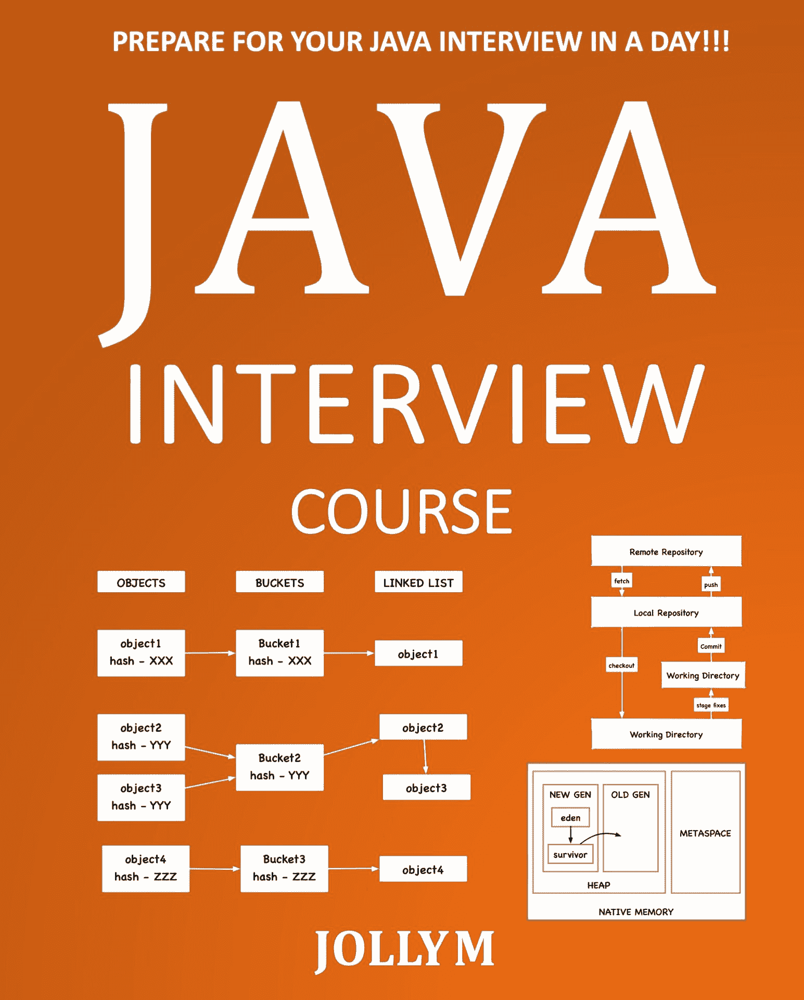

书中描绘的人物和事件均为虚构。与任何真实人物（无论在世）的任何相似之处均属巧合，并非作者本意。

未经出版者书面许可，本书的任何部分不得复制、存储在检索系统中，或以任何形式或手段（电子、机械、复印、录制或其他）进行传输。

ISBN-13: 9781234567890

ISBN-10: 1477123456

封面设计：Art Painter

美国国会图书馆控制号：2018675309

美国于美国打印

## 目录

- [标题页]
- [版权所有]
- [引言]
- [JAVA 基础]
    - [Java 程序结构剖析]
    - [在 JVM 中编译和执行 Java 代码]
    - [数据类型]
    - [命名规范]
    - [Object 类]
    - [访问修饰符]
    - [static]
    - [final]
    - [static 静态块]
    - [finally]
    - [finalize()]
    - [宽转换 vs 窄转换]
    - [getters 和 setters 方法]
    - [变长参数 vs 对象数组]
    - [接口默认方法]
    - [静态接口方法]
    - [注解]
    - [偏好]
    - [按值传递或按引用传递]
- [面向对象编程]
    - [多态]
    - [重写]
    - [重载]
    - [抽象]
    - [继承]
    - [组合]
- [基础设计概念]
    - [依赖注入 vs 控制反转]
    - [服务定位器]
    - [菱问题]
    - [面向接口编程]
    - [抽象类 vs 接口]
    - [国际化与本地化]
    - [不可变对象]
    - [克隆]
- [数据类型]
    - [NaN]
    - [EnumSet]
    - [比较类型]
    - [枚举 vs 公共静态字段]
    - [包装类]
    - [自动装箱与自动拆箱]
    - [BigInteger 和 BigDecimal]
- [字符串]
    - [字符串的不可变性]
    - [字符串字面量 vs 对象]
    - [字符串池]
    - [字符串池内存管理]
    - [不可变性 - 安全问题]
    - [绕过字符串不可变性]
    - [StringBuilder vs StringBuffer]
    - [Unicode]
- [内部类]
    - [内部类分类]
    - [静态成员嵌套类]
    - [局部内部类]
    - [非静态嵌套类]
    - [匿名内部类]
- [函数式编程]
    - [函数式接口]
    - [Lambda 表达式]
    - [纯函数]
    - [流式接口]
- [泛型]
    - [泛型]
    - [类型通配符]
    - [泛型方法]
    - [Java 泛型 vs Java 数组]
    - [类型擦除]
    - [协变]
    - [逆变]
    - [协变 vs 逆变]
- [集合]
    - [集合框架]
    - [集合基础知识]
    - [集合接口]
    - [集合类型]
    - [算法]
    - [Comparable vs Comparator]
    - [hashCode() 和 equals()]
    - [HashTable vs HashMap]
    - [同步集合 vs 并发集合]
    - [遍历集合]
- [错误与异常处理]
    - [异常]
    - [受检异常 vs 非检异常 vs 错误]
    - [异常处理实践]
    - [try-with-resource (带资源的 try 语句)]
- [多线程]
    - [线程术语]
    - [线程生命周期]
    - [线程终止]
    - [实现 Runnable vs Thread]
    - [Runnable vs Callable 接口]
    - [守护线程]
    - [竞态条件与不可变对象]
    - [线程池]
- [同步]
    - [并发 vs 并行 vs 异步]
    - [线程同步]
    - [同步方法 vs 同步块]
    - [条件同步]
    - [Volatile]
    - [static vs volatile vs synchronized]
    - [ThreadLocal 存储]
    - [wait() vs sleep()]
    - [等待线程]
    - [原子类]
    - [Lock]
    - [同步器]
    - [Executor 执行器框架]
    - [Fork-Join]
- [反射]
    - [反射基础]
    - [反射的缺点]
- [数据交换]
    - [JSON]
- [内存管理]
    - [栈 vs 堆]
    - [堆碎片]
    - [对象序列化]
    - [垃圾回收]
    - [内存管理]
    - [弱引用 vs 软引用 vs 虚引用]
- [单元测试]
    - [为什么要单元测试?]
    - [单元测试 vs 集成测试 vs 回归测试 vs 验证测试]
    - [测试私有成员]
    - [Mock 模拟]
- [Java 开发工具]
    - [Git]
    - [Maven]
    - [Jenkins]

# JAVA 面试课程

## 引言

《Java 面试课程》这本书是基于许多专业软件架构师进行数百次技术面试的经验编写的。《Java 面试课程》涵盖了应聘者应该具备实战经验并必须深入理解的 Java 概念。书中包含了大量的代码片段和插图来解释这些概念。清晰理解软件设计原理和语言是非常重要的，因为面试中可能会以不同的方式讨论同一个问题。面试官不仅对听正确答案感兴趣，而且对你对问题的看法和想法感兴趣。你解读问题和表达观点的方式对你的成功至关重要。为了建立面对此类面试的勇气，你需要花费大量时间编写代码、阅读技术主题并与同事讨论。希望这本书不仅能帮助你应对下一次面试，还能帮助你完成日常软件开发工作。祝你好运！！！

## JAVA 基础

## Java 程序结构剖析

下面的代码片段展示了一个简单 Java 程序的结构。


* `Package` (包) - 将相似的类型逻辑分组到命名空间中。它可以防止命名冲突并提供访问保护。
* `Import`: 导入包，以便在代码中使用非限定名称使用类。
* `Class`: 类，表示具有属性和方法的类型模板。
* `Field`: 字段，表示用于存储值的成员。
* `Method`: 方法，表示类的操作/行为。
* `Modifier`: 修饰符，指定类和/或成员的访问控制级别。
* `Parameter`: 参数，指定方法定义中声明的变量。
* `Argument`: 实参，指定传递方法参数的数据。

## Questions

* 什么是包（package）？
* 为什么要导入包？
* 为什么要指定访问修饰符？
* 什么是静态导入（static import）？
    * `static import` 允许在不需要通过类名限定的情况下访问类的静态成员。
* 实参和参数之间的区别是什么？

## 在 JVM 中编译和执行 Java 代码

Java 程序的编译和执行步骤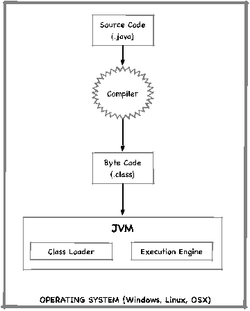

1. Java 编译器将 Java 源代码（`.java` 文件）编译成一种二进制格式，称为字节码（`.class` 文件）。Java 字节码是一种平台无关的指令集，包含了指令（`opcode`）和参数信息。
2. 字节码由特定操作系统的 Java 虚拟机（`JVM`）翻译成特定平台的机器码。
3. `JVM` 中的类加载器（Class loader）将类的二进制表示加载到内存中。
4. `JVM` 中的执行引擎（Execution engine）执行字节码并生成特定操作系统的机器指令。这些机器码指令由中央处理器（`CPU`）直接执行。

## Questions

* 解释 Java 代码编译和执行的过程？
* 什么是字节码？
* 字节码和源代码之间的区别是什么？
* 什么是机器码？
* 字节码和机器码之间的区别是什么？
* 什么是 `JVM`？它对于不同的操作系统是相同还是不同？
* `JVM` 的主要组件有哪些？
* 类加载器在 `JVM` 中起什么？
* 执行引擎在 `JVM` 中起什么？
* 什么是机器指令？

## 数据类型

### 原始类型

* 原始数据类型有 `byte`、`boolean`、`char`、`short`、`int`、`float`、`long` 和 `double`。
* 原始类型始终有值；如果没有赋值，它将有一个默认值。
* `long` 值后面带有后缀 `L`（或 `l`）以区别于 `int`。
* `float` 值后面带有后缀 `F`（或 `f`）以区别于 `double`。同样，`double` 后面带有后缀 `D`（或 `d`）。
* `char` 是无符号的，表示 Unicode 值。
* 当将原始类型赋值给另一个变量时，会创建一个副本。

### 引用类型

* 所有非原始类型都是引用类型。
* 引用类型通常也被称为 `objects`（对象）。尽管引用类型指的是内存中的一个对象。
* 未赋值的引用类型对象将具有 `null` 作为默认值。
* `Objects` 变量和方法，它们定义了对象的状态和行为。
* 当将一个引用赋值给另一个引用时，它们都指向同一个对象。

## Questions

* 什么是原始数据类型？
* 如果原始数据类型的变量没有赋值，它包含什么？
* 为什么我们在 `long` 后面加 `L`，在 `Float` 后面加 `F`，在 `double` 后面加 `D`？
* 将一个原始数据类型的变量赋值给相同类型的另一个变量时会发生什么？
* 什么是引用数据类型？
* 将引用数据类型的变量赋值给另一个相同引用类型的变量时会发生什么？
* 原始数据类型和引用数据类型之间的区别是什么？
* 引用类型中变量和方法的目的是什么？
* 如果引用数据类型的变量没有赋值，它包含什么？

## 命名规范

### 驼峰命名法（Camel Case）与帕斯卡命名法（Pascal Case）

`Camel Case` 是编写复合单词时使每个单词的首字母大写的做法，例如 `BorderLength`；它也称为 `Pascal Case` 或大驼峰命名法。但在编程世界中，`Camel case` 通常以小写字母开头，例如 `borderLength`；它也称为小驼峰命名法。为了讨论方便，我们将格式 `BorderLength` 视为 `Pascal Case`，将格式 `borderLength` 视为 `Camel Case`。命名规范是一组规范标识符命名的规则，标识符代表接口、类、方法、变量和其他实体。尽管命名规范的选择和实现往往是一个争论的话题。标准的命名规范可以提高代码的可读性、审查和整体理解。

### 接口

* 名称应该是 `Pascal Case`。
* 如果定义的是行为，名称应该是形容词，否则是名词。

```java
public interface RunnableClass
```

### 类

* 名称应该是 `Pascal Case`。
* 名称应该是名词，因为类代表某些现实世界中的对象。

```java
public class ArrayListMethod
```

### 方法

* 名称应该是 `Camel Case`。

```java
public boolean isEmpty()
```

### 变量

* 名称应该是 `Camel Case`。

```java
private long serialVersion = 1234L;
```

### 常数

* 名称应该是全大写字母。复合词之间用下划线分隔。

```java
private int DEFAULT_CAPACITY = 10;
```

### 枚举

* 枚举集合的名称应该是全大写字母。

```java
public enum Duration {
    SECOND, MINUTE, HOUR
}
```

### 缩写

* 尽管缩写词通常用全大写表示，但在 Java 中，只有缩写词的首字母应该大写，其余部分小写。

```java
public void parseXml(){}
```

## Questions

* 命名规范的含义是什么？
* 为什么我们需要命名规范？
* `Camel Case` 和 `Pascal Case` 的区别是什么？
* `Upper Camel Case` 和 `Lower Camel Case` 的区别是什么？
* 解释接口、类、方法、变量、常量、枚举和缩写的命名规范？

## Object

每个 Java 类都直接或间接地继承自 `java.lang.Object` 类，这意味着 `Object` 类的变量可以引用任何类的对象。由于继承，以下 `Object` 类方法可以被重写以实现类特定的代码。

* `hashCode()` 返回对象的哈希码值。
* `equals()` 使用 `==` 运算符比较两个对象的等价性。
* `clone()` 创建对象的副本。重写类应该继承 `Cloneable` 接口并实现 `clone()` 方法以定义拷贝的含义。
* `toString()` 返回对象的字符串表示。
* `finalize()` 由垃圾回收器调用以清理资源。`Object` 对 `finalize()` 的实现什么都不做。

## Questions

* 所有 Java 类的基类是什么？
* 派生类可以重写哪些 `Object` 类方法？
* 如果你的类没有重写 `Object` 的 `equals` 方法会发生什么？
    * `Object` 类中的 `equals()` 方法比较的是对象引用是否相同而不是内容。要比较内容，你需要重写 `equals()` 方法。
* `clone()` 方法目的是目的是？
* 为什么重写类应该定义自己的 `clone()` 方法实现？
* 如果重写类没有重写 `clone()` 方法会发生什么？
    * 如果一个对象包含指向外部对象的引用，对被引用对象的任何更改在克隆中也是可见的。

## 访问修饰符

访问修饰符决定了其他类是否可以访问变量或调用方法。在类级别，你可以使用 `public` 修饰符或不使用修饰符。对于类成员，你可以使用以下访问修饰符之一：

- `private`: 外部类无法访问该成员。
- `protected`: 子类可以访问该成员。
- `public`: 所有的类都可以访问该成员。
- `无修饰符`: 包内的所有类都可以访问此成员。

重写方法中的访问修饰符应该与被重写的方法相同或限制更少。可选的 `static` 和 `final` 关键字经常与访问修饰符配合使用。

## 问题

* 访问修饰符目的是什么？
* 类访问修饰符列表与成员访问修饰符列表是否存在区别？
* `private`、`protected` 和 `public` 访问修饰符的作用范围是什么？
* 当类没有指定访问修饰符时会发生什么？
* 如果子类位于不同的包中，它仍然能看到父类的 `protected` 成员吗？
* 为什么派生类中的成员访问修饰符应该比基类的限制更少？
    * 根据继承的概念，你应该能够使用父类引用使用子类对象。如果子类成员使用了具有更限制性的访问修饰符进行降级，这将是不可能的。
* 决定类访问访问修饰符的标准应该是什么？
    * 你应该使用限制性最强的访问修饰符以确保安全性并防止任何误用。

## static

### static 类

只有嵌套/内部类可以被定义为 `static`，而外部类不能。

### static 变量和方法

当对变量和方法使用 `static` 关键字时，它表示这些成员属于类，并且这些成员被类的所有对象共享。静态成员没有副本，并且仅存储在内存的单一位置。这些成员应该通过类名进行访问。

`static` 方法无法访问实例方法或属性，因为静态成员属于类，而不是类的实例。

## 问题

* 什么是 `static` 类？
* 任何类都可以声明为 `static` 类吗？
* 什么是 `static` 方法？
* 什么是 `static` 变量？
* 谁拥有 `static` 类成员？这与非静态类有何不同？
* 你应该如何访问 `static` 的类成员？
* `static` 方法可以访问实例成员吗？为什么？

## final

### final 类

`final` 类不能被扩展，这使得类既安全又高效。

### final 方法

`final` 方法不能被重写，这防止了向类中引入任何意外行为的可能性。

### final 变量

`final` 变量引用不能更改，但 `final` 变量引用的 `mutable object` 的内容是可以更改的。

### 空 final 变量

一个在声明处未初始化的变量。

### 注意事项

* 空 final 变量需要在类的构造函数中进行初始化。
* `final` 变量类似于不可变变量，因此与 `final` 变量相关的计算可以被缓存以优化。

## 问题

* 解释 `final` 类？
* 声明一个类为 `final` 有什么好处？
* 解释 `final` 方法？
* 声明一个方法为 `final` 有什么好处？
* 解释 `final` 变量？
* 声明一个变量为 `final` 有什么好处？
* 当你声明一个变量为 `final` 时，你可以更改它引用的对象的内容吗？


* 当你声明一个变量为 `final` 时，你可以将其引用另一个对象吗？
* 什么是空 final 变量？
* 将变量声明为 `final` 如何有助于优化？

## static 初始化块

* `static` 初始化块通常用于确保在类的任何对象使用之前，所有需要的类资源（如驱动程序、连接字符串等）都是可用的。
* `static` 块无法访问实例成员。
* `static` 块对一个类只被调用一次。
* 类可以定义任意数量的初始化块，它们按照它们在类中的定义顺序被调用。
* 你只能从 `static` 块中抛出未检查的异常。

在这个代码示例中，静态初始化块为类创建一次连接字符串。

```java
private static String connectionString;

static {
    connectionString = getConnectionSting();
}
```

## 问题

* 什么是静态初始化块？
* 静态初始化块的主要目的是什么？在 `static` 块中你应该做哪些类型的事情？
* 你能从静态初始化块访问实例成员吗？为什么？
* 每当创建类的实例时，静态初始化块都会被调用吗？
* 一个类中可以定义多少个 `static` 块？
* 当定义多个 `static` 块时，关于它们的执行顺序的标准是什么？
* 你能从静态初始化块抛出异常吗？什么类型？

## finally

`finally` 块的主要目的是确保在执行完 `try` 块中的操作后，应用程序恢复到一致状态。在 `finally` 块中，通常可以关闭流和数据库连接等资源以防止泄漏。

```java
InputStream is = null;

try {
    is = new FileInputStream("input.txt");
} finally {
    if (is != null) {
        is.close();
    }
}
```

### finally 块执行

编译器会尽全力执行 `finally` 块，以下情况除外：

* 调用了 `System.exit()`。
* 当前线程被中断。
* JVM 崩溃。

### 从 finally 返回

你永远不要从 `finally` 块返回。如果 `finally` 块中存在 `return` 语句，它将立即返回。

## 问题

* 你如何保证某段代码始终执行？
* 在 `finally` 块中你应该做什么？
* 在 `catch` 块中你应该做什么？
* `finally` 块总是执行吗？在什么情况下 `finally` 块不执行？
* 你应该从 finally 返回吗？为什么？

## finalize()

当 `垃圾 Collector` 确定没有对象的引用时，它会在从内存移除该对象之前调用该对象的 `finalize()` 方法。

如果对象没有进入垃圾收集范围，或者 JVM 在垃圾收集有机会运行之前停止，`finalize()` 方法将不会被调用。

可以重写 `finalize()` 方法来释放如文件句柄、数据库连接等资源；但你不能依赖 `finalize()` 来这样做，而应该显式地释放此类资源。

无法保证 JVM 会调用 `finalize()`，因此你应该将 `finalize()` 视为释放资源的备用机制。尽可能地使用 `try-with-resource` 结构在资源使用完成后自动释放它们。

如果 `finalize()` 方法抛出未捕获的异常，该异常将在终止终结化之前被忽略。

## 问题

* Java 中的 `finalize()` 方法是什么？
* `finalize()` 方法在什么时候被调用？
* 谁调用 `finalize()` 方法？
* `finalize()` 方法中可以做哪些事情？
* 你应该显式调用 `finalize()` 方法来释放资源吗？为什么？
* 还有哪些替代机制可以用于释放系统资源？
* 如果从 `finalize()` 方法抛出一个未处理的异常会发生什么？

## 宽转换与 窄转换

## 宽转换 (Widening Conversions)

宽转换涉及将子类（派生类）对象赋值给父类（基类）对象。在下面的示例中，`Car` 继承自 `Vehicle`。

```java
Car car = new Car ();
Vehicle vehicle = car ;
```

## 窄转换 (Narrowing Conversions)

窄转换涉及将父类（基类）对象赋值给子类（派生类）对象。转换需要显式类型转换。在下面的示例中，`Bike` 继承自 `Vehicle`。

```java
Vehicle vehicle = new Vehicle ();
Bike bike = ( Bike ) vehicle ;
```

## 问题

* 什么是宽转换？
* 什么是窄转换？
* 窄转换中是否存在数据丢失的可能性？

## getters 和 setters

以下代码演示了 getter 和 setter 的用法。

```java
public class Person {
    private String name ;

    public String getName() {
        return StringUtils.capitalize( name );
    }

    public void setName( String name) {
        if (name.isEmpty()){
            System.out.println( "Name string is empty" );
            //throw exception
        }
        this . name = name;
    }
}
```

## 使用 getter 和 setter 的好处

* 可以在 setter 中执行验证，或在以后需要时添加。
* 根据内部（存储）或外部（调用者）的需求，值可以有不同的表示形式。
* 它隐藏了用于存储值的内部数据结构。
* 可以更改内部字段，而无需更改使用该代码的用户。
* 它在检索或计算值时封装了内部复杂性。
* 它提供了为 getter 和 setter 指定不同访问修符的能力。
* 它提供了添加调试信息的能力。
* 它可以作为 Lambda 表达式进行传递。
* 许多库（如 mock、序列化等）期望通过 getters/setters 来操作对象。

## 问题

* 当你可以直接暴露类字段时，为什么还需要 getters 和 setters？
* 解释使用 getters 和 setters 的某些好处？

## 变长参数 (varargs) 与 对象数组

变长参数允许向方法传递零或多个参数；而对象数组参数不能用零个参数进行调用。

## 变长参数

```java
public static int getCumulativeValue( int ... values){
    int sum = 0 ;
    for ( int value : values){
        sum += value ;
    }
    return sum ;
}
```

## 对象数组

```java
public static int getCumulativeValues( int [] values){
    int sum = 0 ;
    for ( int value : values){
        sum += value ;
    }
    return sum ;
}
```

* 变长参数只能是方法的最后一个参数；而对象数组可以定义为任何顺序。
* 变长参数和对象数组在方法内部都被视为数组处理。
* 尽管变长参数并不流行，但在任何需要处理不确定参数的地方都可以使用。

## 问题

* 什么是变长参数？
* 变长参数和对象数组之间的区别是什么？
* 你可以调用一个期望变长参数作为参数的零参数方法吗？
* 你可以重载接收 int 数组的方法，使其接收 int 变长参数吗？
* 你可以使用变长参数的不同场景有哪些？

## 默认接口方法 (Default Interface Method)

* 默认接口方法直接添加到接口中以扩展其功能。
* 默认接口方法可以添加到甚至你无法控制的接口中。
* 默认接口方法不会破坏其被添加的接口的现有实现。
* 实现类可以重写接口中定义的默认方法。
* 默认方法也被称为防御方法 (Defender) 或 虚拟扩展方法 (Virtual extension method)。

在此代码示例中，默认接口方法 `getAdditonSymbol()` 被添加到现有的接口 `Calculator` 中。

```java
public interface Calculator {
    public < T > T add( T num1, T num2);
    default public String getAdditionSymbol(){
        return "+" ;
    }
}
```

## 默认方法的局限性

* 如果类继承了多个具有相同签名的默认方法的接口，则该实现类必须为该默认方法提供实现。
* 如果继承层次结构中的任何类都有具有相同签名的方法，则默认方法将变得无关。

## 默认方法 vs 抽象方法

以下是几点细微区别：

* 抽象方法允许定义构造函数。
* 抽象方法可以关联状态。

## 使用默认方法 - 抽象类与 接口

随着默认方法的引入，现在接口可以被扩展以添加功能，而不会破坏类。

## 问题

* 什么是默认接口方法？
* 默认接口方法的好处是什么？
* 你可以在无法直接控制的接口中添加默认方法吗？
* 当一个类继承两个接口且两者都定义了相同签名的方法时会发生什么？

## 静态接口方法 (Static Interface Method)

* 静态接口方法直接添加到接口中以扩展其功能。
* 静态接口方法通常用于实现排序等工具函数。
* 当你想在类中强制特定行为时也会使用静态方法。
* 实现类不能重写接口中定义的静态方法。
* 静态方法甚至可以添加到无法控制的接口中。
* 与默认方法类似，静态方法不会破坏其被添加的任何现有实现。

在此代码示例中，静态接口方法 `getUtconedDateTime()` 被添加到现有的接口 `DBWrapper` 中。

```java
public interface DBWrapper {
    static ZonedDateTime getUtconedDateTime( Instant date ){
        ZoneId zoneId = TimeZone.getTimeZone("UTC").toZoneId();
        ZonedDateTime zonedDateTime = ZonedDateTime.ofInstant(date, zoneId);
        return zonedDateTime ;
    }
}
```

## 问题

* 什么是静态接口方法？
* 哪里可以使用静态接口方法？
* 你可以重写静态接口方法吗？
* 静态方法和默认方法的区别是什么？
* 你可以在无法直接控制的接口中添加静态接口方法吗？
* 如果一个类继承两个接口且两者都定义了相同签名的静态接口方法会发生什么？

## 注解 (Annotations)

注解将元数据关联到不同的程序元素。注解针对编译器或运行时处理。注解元数据用于文档、生成模板代码、编译验证、运行时处理等。注解对它们标记的代码片段没有直接影响。我们可以将注解应用于字段、变量、方法、参数、类、接口、枚举、包、注解本身等。

## 用法

自定义注解直接放置在要注解的项之前。

```java
@Length (max= 10 , min= 5 )
public class ParkingSlot {
    // 代码位于此处
}
```

## 内置注解

* `@Deprecated` - 表示该方法已过时。
* `@Override` - 表示重写了父类方法。
* `@SupressWarnings` - 用于抑制警告。

## 问题

* 什么是注解？
* 哪里可以使用注解？
* 你可以在哪里应用注解？

## Java 中的 Preferences

在 Java 中，`Preferences` 类用于以层次结构的形式存储用户偏好设置。`Preferences` 类抽象了存储过程，并以特定于操作系统的方式存储偏好：Mac 上使用偏好文件，Windows 系统上使用注册表。虽然偏好中的键（keys）是 `Strings`，但值可以是任何原始类型。应用程序使用 `Preferences` 类来存储和检索用户、系统偏好以及配置数据。

## 问题

* 什么是 `Preferences`？
* `Preferences` 可以存储哪些类型的信息？
* 在使用 `Preference` 类时，你是否需要担心操作系统所使用的内部格式？

## 值传递还是引用传递

在 Java 中 - 方法参数（无论是原始类型还是对象引用）始终是**按值传递**的，并且仅允许通过引用访问对象。在将对象传递给方法时，传递的是引用的拷贝，而不是对象本身。对对象引用进行的任何更改都会改变对象的内容，而不是引用本身的值。

## 问题

* 值传递和引用传递有什么区别？
* 在 Java 中引用类型参数是如何传递的？按引用传递还是按值传递？
* 如果按值传递了引用的拷贝，方法如何访问该引用所指向的对象？
* 如果按值传递了引用的拷贝，你可以更改引用的值吗？

## 面向对象编程

## 多态

多态是类实例根据其所作用的实例采取不同形式的能力。多态主要通过子类化或实现接口来实现。派生类可以对特定功能拥有自己独特的实现，同时通过继承共享某些功能。对象的行为具体取决于它在类层次结构中的位置。

假设你有一个 `Furniture` 类，它包含一个 `addLegs()` 方法。`Chair` 和 `Table` 类继承自 `Furniture` 类；它们都有对 `addLegs()` 的实现。在上述情况下，运行时将根据你拥有 `Chair` 还是 `Table` 类实例，决定调用哪个 `addLegs()` 方法的实现。

```java
public abstract class Furniture {
    public abstract void addLegs();
    public void print(String message) {
        System.out.println(message);
    }
}

class Chair extends Furniture {
    @Override
    public void addLegs() {
        print("Chair Legs Added");
    }
}

class Table extends Furniture {
    @Override
    public void addLegs() {
        print("Table Legs Added");
    }
}

Furniture furniture = new Chair();
// This prints "Chair Legs Added"
furniture.addLegs();

furniture = new Table();
// This prints "Table Legs Added"
furniture.addLegs();
```

### 多态的优势

当你能够针对抽象基类或接口编写代码时，就能实现多态真正的力量和优势。根据上下文文，多态允许选择最合适的类实现。这不仅在生产代码中如此，还为测试提供替代实现铺平了道路。

## 问题

* 什么是多态？
* 实现多态的不同方式有哪些？
* 继承对实现多态有什么用？
* 多态的优势是什么？
* 多态概念对单元测试有什么用处？

### 参数多态

在 Java 中，泛型（Generics）提供了参数多态的实现，它允许在处理不同类型的值时使用相同的代码实现，而不会削弱编译时的类型安全检查。在下面的示例中，我们为类型参数 `T` 添加了上界，使其实现一个接口，该接口保证了类型 `T` 中存在 `getWheelsCount()` 方法。

```java
interface Vehicle {
    int getWheelsCount();
}

class Car<T extends Vehicle> {
    private T vehicle;
    public Car(T vehicle) {
        this.vehicle = vehicle;
    }
    public int getWheelsCount() {
        return vehicle.getWheelsCount();
    }
}
```

它可以接收类型为 `T` 的 `Vehicle` 列表，并返回 `Vehicle` 的轮数量，而无需担心 `T` 实际上是什么类型。

## 问题

* 什么是参数多态？
* 如何使用泛型实现参数多态？
* 如何使用类型通配符（Type Wildcards）实现参数多态？
* 不使用泛型可以实现参数多态吗？

### 子类型多态

在子类型多态（也称为包含多态）中，函数的参数定义支持任何类型或其子类型的参数。如果函数的参数具有子类型，那么该函数就表现出子类型多态。下面的 Java 代码说明了这种多态的使用。


```java
abstract class Vehicle {
    public abstract int getWheelsCount();
}

class Car extends Vehicle {
    @Override
    public int getWheelsCount() {
        return 4;
    }
}

class Bike extends Vehicle {
    @Override
    public int getWheelsCount() {
        return 2;
    }
}

public void printWheelsCount(Vehicle vehicle) {
    print(vehicle.getWheelsCount());
}

public void main(String[] args) {
    printWheelsCount(new Car());
    printWheelsCount(new Bike());
}
```

在上述代码中，`printWheelsCount()` 方法接收 `Vehicle` 作为参数并打印 `Vehicle` 的轮数。`main` 方法展示了子类型多态调用，接收 `Car` 和 `Bike` 对象作为参数。任何期望类型参数的地方都会接受该类型的子类。

## 问题

* 什么是子类型多态？
* 什么是包含多态？
* 参数多态和子类型多态有什么区别？
* 可以使用泛型实现子类型多态吗？

## 重写

* 方法重写（Overriding）是重新定义基类方法以具有与其基类实现不同的行为。
* 方法重写是动态多态（运行时多态）的一种示例。
* 在动态多态中，运行时决定调用哪个实现，因为编译器在编译时无法确定绑定。

### 方法重写的规则

* 重写方法的参数及其顺序必须与原方法相同。
* 重写方法可以具有相同的返回类型或基类方法返回类型的子类型。
* 重写方法的访问修饰符不能比基类中的定义更严格。
* 构造函数、静态方法和 `final` 方法不能被重写。
* 如果基类中的定义没有抛出检查异常，则重写方法不能抛出检查异常，但重写方法仍然可以抛出运行时异常。

## 问题

* 什么是方法重写？
* 什么是动态多态？
* 为什么不能重写父类或接口中定义的静态方法？
* 可以重写父类中定义的 `final` 方法吗？
* 可以重写父类中的 `public` 方法并将其标记为 `protected` 吗？
* 为什么不能重写父类的构造函数？
* 当基类方法没有抛出检查异常时，重写方法可以抛出检查异常吗？为什么？
* 方法重写的规则有哪些？

## @Override

`@Override` 注解是一种显式声明重写基类中定义的方法实现的意图的方法。Java 对所有此类带有注解的方法进行编译时检查。它提供了一种简单的方法，可以防止在想要重写基类方法时不小心写了错误的方法签名。

如果派生类定义了一个与基类中方法签名相同的方法，则派生类中的方法将隐藏基类中的方法。通过在子类方法的头部加上 `@Override` 注解，你可以检测是否无意中尝试重载（overload）而非重写（override）方法。

## 问题

* `@Override` 注解的目的是什么？
* 如果你定义了一个与父类中签名相同的方法且没有使用 `@Override` 注解，会发生什么？
* `@Override` 注解的好处有哪些？

## 重载 (Overloading)

* 方法重载是指定义多个同名但参数不同的方法。
* 方法重载是静态多态或编译时多态的例子。
* 在静态多态中，是在编写代码时决定调用哪个特定的实现的。

### 方法重载的规则

* 可以通过定义与现有方法同名的方法来重载方法，但该方法具有：
    * 不同数量的参数。
    * 不同数据类型的参数。
    * 不同的参数顺序。
* 重载方法的返回类型可以是不同的。
* 当仅在返回类型不同时，不能定义同名且相同参数的方法。
* 重载方法不需要抛出与它所重载的方法相同的异常。

## 运算符重载 (Operator Overloading)

运算符重载是一种增强依赖语言的运算符定义的能力。例如，你可以使用 `+` 运算符来加两个整数，也可以用于拼接两个字符串。

## 问题

* 解释什么是方法重载？
* 什么是静态多态？
* 静态多态和动态多态之间的区别是什么？
* 你可以重写一个方法使得所有参数都相同，仅区别于返回类型吗？
* 什么是运算符重载？
* 方法重载的好处有哪些？
* 重写（Overriding）和重载（Overloading）的区别是什么？

## 抽象 (Abstraction)

抽象有助于将关注从具体实现的内部细节转移到类型及其行为。抽象的核心在于隐藏关于数据、其内部表示及其实现的细节。另一个同样重要的面向对象概念是封装，它可以用于抽象类的复杂性和内部实现。抽象还帮助使软件具有可维护性、安全性，并提供了在不破坏任何客户端的情况下更改实现的能力。

## 问题

* 什么是抽象？
* 抽象与封装有什么区别？
* 抽象的好处有哪些？
* 你可以在没有封装的情况下实现抽象吗？

## 继承 (Inheritance)

继承是一种面向对象的设计概念，涉及重用现有的类定义（称为基类）并通过继承该类来定义更特殊的类类别（称为子类）。它侧重于在子类与其父类之间建立 "IS-A"（是一个）的关系。继承也被用作实现多态的技巧；当派生类型实现了在基类型中定义的方法时即可。

### 继承的规则

* 根据创建特定类别的需求，可以存在多级继承。
* Java 只允许单类继承，因为多重继承会带来相应的复杂性；请检查菱形问题（Diamond Problem）。
* 声明为 `final` 的类不能被扩展。
* 声明为 `final` 的类方法不能被重写。
* 基类的构造函数和私有成员不被继承。
* 可以使用 `super()` 调用基类的构造函数。
* 可以使用 `super` 关键字调用基类的被重写方法，否则你将递归地调用重写方法。

## 问题

* 解释什么是继承？
* 继承的目的是什么？
* 决定两个类之间继承关系的标准是什么？
* 继承在多态中起着什么样的重要作用？
* 你可以继承 `final` 类吗？
* 如果你不使用 `super` 关键字调用被重写的成员，会发生什么？
* 为什么你不能继承父类中定义的静态成员？
* 如果 Java 允许多重继承，人们可能会面临哪些挑战？

## 组合 (Composition)

组合是一种与继承密切相关的面向对象的设计概念，因为它也涉及重用类；但它侧重于在类之间建立 "HAS-A"（有一个）的关系。因此，与处理扩展类特性的继承不同，组合通过组合类来重用类。组合通过存储另一个类的引用作为成员来实现的。

### 继承 vs 组合

继承的主要问题是它破坏了封装，因为派生类与基类的实现紧密耦合。当一个类的设计时没有考虑未来的继承范围，且你对基类没有控制权时，问题就会变得复杂。基类的变化可能会导致派生类的破坏。因此，只有在基类和派生类定义之间存在完美的 "IS-A" 关系时才应该使用继承；在任何疑问的情况下，优先选择组合而非继承。

## 问题

* 解释什么是组合？
* 继承和组合有什么区别？
* 决定两个类之间组合关系的标准是什么？
* 解释几个使用组合可以避免的继承问题？
* 在什么时候你应该优先选择组合而不是继承，反之亦然？

## 基础设计概念 (FUNDAMENTAL DESIGN CONCEPTS)

### 依赖注入 (Dependency Injection) vs 反转控制 (Inversion of Control)

依赖注入和反转控制通过松耦合依赖项来促进模块化软件开发。独立的模块对象也具有可维护性和可测试性。

### 反转控制 (Inversion of Control)

反转控制提供了一种设计范式，依赖项不是由需要的对象显式创建，而是由外部源创建并提供的。

### 依赖注入 (Dependency Injection)

依赖注入是 IoC 的一种形式，用于在运行时提供对象依赖；通过构造函数、setter 方法或服务定位器实现。注解和接口用于识别创建和注入依赖的源。

* 依赖注入的模式：
    * 通过构造函数
    * 通过 setter
    * 通过方法参数
* 注入依赖是依赖注入框架的责任。

 下方的代码演示了作为构造函数参数的依赖注入。

```java
public class Account {
    UserService userService;
    AccountService accountService;

    public Account(UserService userService, AccountService accountService) {
        this.userService = userService;
        this.accountService = accountService;
    }
}
```

不仅在生产系统中，DI 和 IoC 在单元测试也提供了巨大的帮助，因为它提供了模拟（mock）依赖的能力。Spring 框架是 DI 容器的一个示例。

注意确保在依赖对象被请求之前已经进行了初始化是重要的。

## 问题

* 什么是反转控制？
* 什么是依赖注入？
* 控制反转（Inversion of Control）与依赖注入（Dependency Injection）之间有什么区别？
* 实现依赖注入的不同方式有哪些？
* 识别依赖源的不同方法有哪些？
* 谁负责注入依赖对象？
* 依赖注入对单元测试有什么帮助？
* 依赖注入如何用于模块化软件开发？

## 服务定位器（Service Locator）

服务定位器是一个封装了解析所请求服务逻辑的对象。服务定位器还提供了一个用于注册服务的接口，这允许你在不修改依赖这些服务的对象的情况下替换具体的实现类。

在下图所示，`Account` 类使用 `ServiceLocator` 来解析它所依赖的 `AccountService` 和 `UserService`。

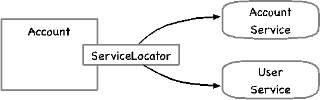

```java
public class Account {
    UserService userService ;
    AccountService accountService ;

    public Account() {
        this.userService = ServiceLocator.getService(UserService.class);
        this.accountService = ServiceLocator.getService(AccountService.class);
    }
}
```

### 服务定位器的好处

* 类不需要管理任何服务依赖及其生命周期。
* 它有助于独立测试一个类，而无需该类所依赖的真实服务类。
* 它允许运行时优化；因为服务可以在运行时进行注册和注销。

## 问题

* 解释一下什么是服务定位器设计模式？
* 使用服务定位器设计模式有什么好处？
* 服务定位器和依赖注入模式之间有什么区别？
* 在什么情况下你会更倾向于使用服务定位器而不是依赖注入，反之亦然？
* 服务定位器如何帮助测试？

## 菱形问题（Diamond Problem）

Java 不允许继承多个类，因为当多个父类拥有具有相同签名方法的方法时，可能会产生歧义，编译器无法决定使用哪一个父类的方法。

考虑下图所示的继承层次结构。如果 `Base` 类中定义的方法 `calculate()` 同时被 `DerivedLeft` 和 `DerivedRight` 重写，那么对于 `Confused` 类继承哪一个版本的 `calculate()` 就会产生歧义。

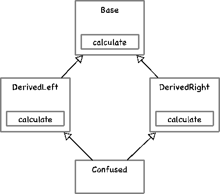

在下面的代码中，对于应该调用哪个版本的 `calculate()` 存在歧义。这在 Java 中被称为“菱形问题”。

```java
public static void main (String [] args){
    Base base = new Confused ();
    base.calculate();
}
```

### 默认接口方法导致的菱形问题

引入默认接口方法后，可能会出现菱形问题。如果 `Base`、`DerivedLeft` 和 `DerivedRight` 都是接口，并且三个接口中都存在作为默认接口方法的 `calculate()`，这将导致菱形问题。在这种情况下，`Confused` 类必须显式地重新实现 `calculate()` 方法；否则歧义将被编译器拒绝。

## 问题

* 解释 Java 中的菱形问题？
* 为什么 Java 不提供多重继承？
* 使用默认接口方法，类仍然可以继承两个具有相同签名方法的接口；这难道不会导致菱形问题吗？你如何解决它？

## 面接口编程（Programming to interface）

面向接口编程通过促进软件组件之间的解耦，为模块化软件开发奠定了基础。高水平的解耦提高了软件组件的可维护性、扩展性和可测试性。模块化软件设计有助于加快上市速度，因为它方便了多个使用同一代码库的团队之间的并行软件开发。正是面向接口编程的设计范式形成了控制反转的基础，控制反转管理着任何大型软件应用程序中的依赖关系。

让我们来看一个简单的例子。假设我们有一个对集合排序的方法，它接受 `Map` 接口作为参数。这意味着 `sort()` 方法没有绑定到任何特定的 `Map` 实现类型，你可以传递任何 `Map` 接口的具体实现。

```java
public static void main ( String [] args){
    sort( new HashMap<>());
    sort( new TreeMap<>());
    sort( new ConcurrentSkipListMap<>());
    sort( new TreeMap<>());
}

public static void sort(Map map){
    // 执行排序
}
```

### 面向接口编程的好处

* 根据上下文，你可以在运行时选择最合适的行为。
* 对于测试，你可以传递模拟对象（mock objects）或存根（stubs）实现。
* 接口/API 定义或约不会频繁更改。
* 面向接口还方便了团队之间的并行开发，因为不同团队的开发者可以在进行最终集成之前继续针对接口编写代码。

## 问题

* 面向接口编程的概念是什么？
* 面向接口编程有什么好处？
* 面向接口编程如何促进软件组件之间的解耦？
* 依赖注入和面向接口编程之间有何关联？你可以在不支持面向接口的情况下实现依赖注入吗？
* 模块化软件有什么好处？
* 面向接口编程如何帮助单元测试？

## 抽象类 vs 接口

### 抽象类

抽象类不能被实例化，但可以被扩展。当你想要在类之间强制执行通用设计和实现，并期望派生类实现所需的特殊功能时，请扩展抽象类。

### 接口

接口是一组相关方法的集合，定义了它的行为以及与外部世界的契约。当你想要在不相关的类之间定义共同行为时，使用接口。接口也可以定义为没有任何任何方法，这种接口被称为标记接口（marker interface）；此类接口通常用于对类分类。标记接口的一个示例是 `java.io.Serializable`，它没有定义任何方法，但支持序列化的类必须实现它。

### 抽象类和接口的区别

* 抽象类可以通过更新来为类添加更多功能，而接口可以通过添加来为类实现新行为。尽管引入了默认接口方法，接口也可以被扩展以具有更多功能。
* 接口可以被多重继承；而抽象类不能。
* 接口定义行为，因此它可以应用于不相关的类；而相关类扩展抽象类。
* 接口方法可以有任何类型的访问修饰符；而接口成员都是公共的。
* 抽象类可以关联状态，这在接口中是不可能的。
* 抽象类可以被扩展而不会破坏扩展它的类；而接口的任何更改（非默认非静态方法除外）都会破坏现有实现。

## 问题

* 如果抽象类不能被实例化，那么为什么需要为抽象类定义构造函数呢？
    * 构造函数可以执行执行的字段初始化，并执行类约束。
* 定义抽象类？抽象类在类设计中起什么作用？
* 定义接口？接口在类设计中起什么作用？
* 在什么情况下你会更倾向于使用抽象类而不是接口，反之亦然？
* 解释抽象类和接口之间的各种区别？
* 什么是标记接口？标记接口是如何使用的？
* 你可以在接口中声明静态方法吗？
* 在引入默认接口方法后，抽象类与接口相比还有何不同？

## 国际化与本地化

### 国际化

软件国际化是确保软件不绑定到单一语言或区域的过程。其缩写为 `i18n`。

### 本地化

软件本地化是确保软件拥有所有支持特定语言或区域的资源的过程。其缩写为 `l10n`。

### 注意事项

`国际化` 有助于 `本地化`。

## 问题

* 什么是国际化？
* 什么是本地化？
* `本地化` 和 `国际化` 之间的区别是什么？
* 可以在不构建 `国际化` 支持的情况下实现 `本地化` 吗？

## 不变对象

当一个对象在构造后没有改变状态的可能性，则该对象被认为是不可变的。

### 优点

* 设计和实现不可变对象更加简单，因为你不需要管理状态的变化。
* 不变对象天然是线程安全的，因为它们在创建后无法被修改。因此，不需要对其访问进行同步。
* 不变对象减少了垃圾回收（Garbage Collection）的开销。

### 缺点

* 每个不同的值都需要定义一个单独的对象，因为你无法重用一个 `Immutable` 对象。

### 定义不变对象的规则

* 将类声明为 `final`。
* 仅允许构造函数创建对象。不要提供字段的 setter（Setter）。
* 将所有字段标记为 `private`。

### 不变类示例，`Employee`


```java
final public class Employee {
    final private int id;
    final private String name;
    final private String department;

    public Employee(int id, String name, String department) {
        this.id = id;
        this.name = name;
        this.department = department;
    }

    public int getId() {
        return id;
    }

    public String getName() {
        return name;
    }

    public String getDepartment() {
        return department;
    }
}
```

## 问题

* 什么是不变对象？
* 定义不变对象的规则是什么？
* 不变对象的优点/缺点是什么？
* 如何创建不变对象？
* 在哪些不同情况下可以使用不变对象？
* `final` 和不可变对象之间的区别是什么？
* 将变量声明为 `final` 有什么优化收益？
* 能列举一些关于不可变性的问题吗？
    * 定义带有大量参数的构造函数更加困难。
    * 由于不可变性的实现交给了开发者，即使不小心添加了单个 setter 也会破坏它。

## 克隆

克隆是创建对象副本的过程。简单地将现有对象的引用赋值给一个对象会导致两个引用指向同一个对象。克隆有两种类型：浅拷贝和深拷贝。

## 浅拷贝

浅拷贝简单地复制属性的值；对于原始类型属性成员，会创建一个精确的副本；对于引用类型成员，则复制其地址。因此，对于引用类型成员，原始对象和新创建的副本都指向堆内存中的同一个对象。

## 深拷贝

深拷贝递归地将每个成员的内容复制到新对象中。深拷贝总是会创建原始对象的独立副本。要创建深拷贝，应该编写一个名为 `CopyConstructor` 的专用方法。

## 问题

* 什么是克隆？
* 什么是浅拷贝？
* 解释浅拷贝的缺点？
* 什么是深拷贝？
* 什么是 `CopyConstructor`？
* 在什么情况下你会倾向于使用深拷贝而不是浅拷贝，反之亦然？

## 数据类型

## NaN

Not a Number（非数字）也称为 `NaN`，是由于除以零、与无穷大运算等算术计算产生的未定义结果。两个 `NaN` 不相等。`NaN` 有两种类型：

* `Quiet NaN`（静默 NaN）：当产生安静 `NaN` 时，除非检查结果，否则没有指示。
* `Signalling NaN`（信号 NaN）：当产生信号 `NaN` 时，它会信号无效的操作表达式。

## 问题

* 什么是 `NaN` 或 Not a Number？
* 什么是 Quiet NaN？
* 什么是 Signalling NaN？
* 两个 `NaN` 相等吗？

## EnumSet

* `EnumSet` 是一种用于 `Enum` 类型的特殊集合实现。
* `EnumSet` 在内部以位向量（bit vectors）的形式表示，非常紧凑且高效。
* `EnumSet` 提供了执行位标志操作的优化实现，应该用来代替执行 `int` 标志操作。

以下代码演示了 `EnumSet` 的用法。

```java
private enum Vehicle {
    CAR,
    JEEP,
    MOTORCYCLE
}

public static void main(String[] args) {
    EnumSet<Vehicle> TWOWHEELER = EnumSet.of(MOTORCYCLE);
    if (TWOWHEELER.contains(JEEP)) {
        //
    }
}
```

## 问题

* 什么是 `EnumSet`？
* 为什么你应该倾向于使用 `EnumSet` 来执行 `int` 标志操作？

## 比较类型

原始类型只能通过相等运算符（`==`）进行比较；而引用类型可以根据我们想要比较的内容使用相等运算符和 `equals()` 方法进行比较。

### 相等运算符

对于引用类型，相等运算符 `==` 和 `!=` 用于比较两个对象的地址，而不是它们的实际内容。

### equals() 方法

当你想比较两个对象的内容时，请使用 `equals()` 方法。`Object` 类定义了 `equals()` 方法，子类必须重写该方法以方便内容比较。如果类没有重写 `equals()` 方法，则会调用相等运算符进行比较。

## 问题

* 比较类型有哪些方式？
* 引用类型的相等运算符比较什么？
* `equals()` 方法比较什么？
* 为什么你会倾向于使用 `equals` 方法而不是相等运算符？
* 如果类没有重写 `equals` 方法会发生什么？

## 浮点比较

两个浮点数不应使用相等运算符 `==` 进行比较；因为相同的数字（例如 0.33）在两个浮点变量中存储的可能并不是 0.33，而是 0.3300000007 和 0.329999999767。因此，比较两个浮点值时是将两个值的绝对差与一个范围进行比较。

```java
if (Math.abs(floatValue1 - floatValue2) < EPSILON) {
    //
}
```

其中 `EPSILON` 是一个非常小的数字，如 `0.000001`，这取决于所需的精度。

## 问题

* 为什么不应该使用相等运算符比较浮点值？
* 比较两个浮点值的优方法是什么？
* 决定用于比较两个浮点值的范围的标准是什么？

## 字符串比较

`String` 类对象使用相等运算符 `==` 测试引用相等性，使用 `equals()` 方法测试内容相等性。在比较来自不同来源的两个 `String` 变量时，始终使用 `equals()` 方法。池化字符串也可以使用相等运算符进行比较。

## 问题

* 为什么应该使用 `equals` 方法比较 `String` 对象？
* 使用相等运算符比较两个 `String` 对象的陷阱是什么？
* 什么是池化字符串？如何比较两个池化字符串？

## 枚举比较

`ComparisonEnum` 既不能实例化也无法复制。因此，始终只有一个枚举的实例可用，即在枚举定义中定义的那个实例。由于只有一个枚举实例可用，你可以同时使用等价运算符（`==`）和 `equals()` 方法进行比较。但建议优先使用等价运算符 `==`，因为它不会抛出 `NullPointerException`，并且还能执行编译时的兼容性检查。

## 问题

* 比较两个枚举的不同方法有哪些？
* 解释一下为什么你可以同时使用等价运算符和 `equals` 方法来比较枚举？
* 比较两个枚举值的首选方式是哪种？

## 枚举与公共静态字段

以下代码演示了 `enum` 和 `public static field` 的用法。以下是使用 `enum` 替代 `public static int` 的优点。

* `Enums` 是在编译时检查的，而 `int` 值不是。使用 `public static int`，你可以向 `AddVehicle()` 方法传递任何 `int` 值。
* `int` 值需要根据预期的范围进行验证；而 `enums` 不需要。
* 位标志标志操作已内置在 `enumSet` 中。

```java
private enum Vehicle {
    CAR,
    JEEP,
    MOTORCYCLE,
    SCOOTER
};

public void AddVehicle(Vehicle vehicle){
}

public static field
public static int CAR = 0;
public static int JEEP = 1;
public static int MOTORCYCLE = 2;
public static int SCOOTER = 3;
public void AddVehicle(int vehicle){
}
```

## 问题

* 使用 `enum` 相比 `public static int` 字段的优点是什么？
* 与 `enum` 参数相比，为什么你需要对 `int` 参数进行额外的验证？
* 为什么你应该倾向于使用 `enum` 而不是 `public static int`？

## 包装类

每个基本数据类型都有一个对应的类，将该基本数据类型封装成该类的对象。包装类提供了许多实用方法来操作基本数据值。由于包装类允许基本数据类型转换为引用类型，因此它们也可以与集合一起使用。

## 问题

* 什么是包装类？
* 使用包装类型而非基本数据类型的优点是什么？
* 如何在集合中使用基本数据类型？

## 自动装箱与自动拆箱

自动装箱（Auto boxing）是将基本类型转换为对象的过程，涉及动态内存分配和相应的包装类对象的初始化。自动拆箱（Auto unboxing）是将包装类转换为基本类型的过程。

在下面的代码中，`23.456f` 被自动装箱为对象 `Float(23.456f)`，从 `addTax()` 返回的值被自动拆箱为 `float`。

```java
public static void main(String [] args){
    float beforeTax = 23.456f;
    float afterTax = addTax(beforeTax);
}

public static Float addTax(Float amount){
    return amount * 1.2f;
}
```

## 问题

* 什么是自动装箱和自动拆箱？
* 自动装箱的优点是什么？

## BigInteger 和 BigDecimal

`BigInteger` 和 `BigDecimal` 用于处理大于 `Long.MAX_VALUE` 和 `Double.MAX_VALUE` 的值。这些大值作为 `String` 值传递给 `BigInteger` 和 `BigDecimal` 的构造函数。`BigDecimal` 支持通过实用方法指定所需的舍入方式和应用的精度。

```java
BigInteger bInt = new BigInteger("9876543210987654321098765");
```

`BigInteger` 和 `BigDecimal` 对象都是不可变的，因此对它们进行的任何操作都会创建一个新对象。`BigInteger` 主要用于加密和安全应用。

## 问题

* `BigInteger` 和 `BigDecimal` 类型是什么？
* `BigInteger` 和 `BigDecimal` 的值在内部是如何存储的？
* `BigInteger` 的用途是什么？

## 字符串 STRINGS

## String 的不可变性

`String` 对象是不可变的，这意味着一旦构造完成，`String` 引用指向的对象就永远无法改变。尽管你可以将相同的引用赋予另一个 `String` 对象。考虑以下示例：

```java
String greeting = "Happy";
greeting = greeting + " Birthday";
```

上述代码创建了三个不同的 `String` 对象：`"Happy "`、`" Birthday "` 和 `" Happy Birthday "`。

* 虽然你不能改变 `String` 对象的值，但你可以更改指向该对象的引用变量。在上面的示例中，`String` 引用 `greeting` 开始指向 `String` 对象 `"Happy Birthday"`。
* 注意，在 `String` 上执行的任何操作都会导致新的 `String`。
* `String` 类被标记为 `final`，因此无法重写 `String` 类的不可变行为。

### 优点

* 由于 `String` 对象不需要同步，因此在线程之间共享 `String` 对象是安全的。
* 由于 `String` 不改变，Java 环境将 `String` 字面量缓存到内存中称为“字符串池”（String Pool）的特殊区域以进行优化。如果池中已存在 `String` 字面量，则共享同一个字符串字面量。
* 不可变的 `String` 值可以防止执行过程中发生任何值的更改。
* 由于 `String` 对象的哈希值不会改变，可以缓存哈希值而不需要在每次需要时重新计算。

### 缺点

* `String` 类无法扩展以提供额外的功能。
* 如果由于字符串操作创建了大量的 `String` 字面量，会给垃圾收集带来压力。

## 问题

* 为什么 `String` 对象是不可变的？
* `String` 对象在内存中是如何创建的？
* 不可变性的优点/缺点是什么？
* 为什么 `String` 对象是线程安全的？
* 将 `String` 类声明为 `final` 有什么？
* Java 环境对字符串进行了什么内存优化？
* 为什么不需要反复计算 `String` 对象的哈希值？

## 字符串字面量与对象

### 字符串字面量

字符串字面量是 Java 语言的一种概念，`String` 类将双引号内的字符串缓存到名为字符串池的特殊区域。

```java
String cityName = "London";
```

### 字符串对象

`String` 对象使用 `new()` 运算符在堆中创建，与其他对象一样。

```java
String cityNameObj = new String( "London");
```

## 问题

* 什么是字符串字面量？
* 字符串字面量和字符串对象有什么区别？
* 字符串字面量是如何存储的？

## 字符串池化（String Interning）

* 字符串池化是一种存储每个唯一不可变字符串副本的概念。
* 当你定义任何新的 `String` 字面量时，它会被池化。池中相同的字符串常量会被任何字符串字面量引用。
* 字符串池字面量不仅在编译时定义，在运行时也定义。你可以显式地调用 `String` 对象的 `intern()` 方法将其添加到池中（如果不存在）。
* 在内存池中放置大量的文本会导致内存泄漏或性能问题。

注意：与其使用字符串对象，不如使用字符串字面量，以便编译器进行优化。

## 问题

* 什么是字符串池化？
* 字符串对象也可以被池化吗？
* 当你存储一个已存在于字符串池中的新 `String` 字面量时会发生什么？
* 创建大量 `String` 字面量有什么缺点？
* 优先使用字符串对象还是字符串字面量？为什么？

## 字符串池内存管理

字符串池是 Java 编译器用于字符串内存优化的内存中的特殊区域。如果字符串池中已存在 `String` 字面量，编译器会将新的字符串字面量引用指向池中现有的字符串变量，而不是创建新的字面量。Java 编译器可以执行这种优化是因为 String 是不可变的。

```java
String cityNameObj = new String( "London");
```

`String capitalObj = new String ( "London" );` 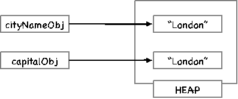

而在下方的示例中，两个字符串字面量引用了内存池中的同一个对象。

`String cityName = "London" ;`

`String capital = "London" ;` 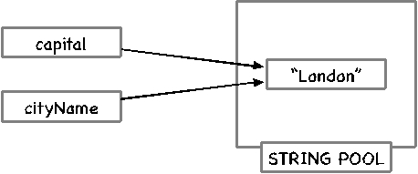

## 问题

* 解释字符串池（String Pool）内存管理？
* 字符串字面量是如何存储在内存中的？
* 字符串池是如何针对内存优化的？
* 字符串对象（String Objects）是如何存储在内存中的？
* 为什么 Java 不能使用类似字符串池的机制来存储其他类型的数据对象？

## 不变性 - 安全问题

垃圾回收器（Garbage Collector;

```java
field.setAccessible(true);
char[] value = (char[]) field.get(accountNo);
// 重写内容
value[0] = 'X';
value[1] = 'Y';
value[2] = 'Z';
// 输出 "XYZ123"
System.out.println(accountNo);
```


## 问题

* 你可以重写 `String` 类来修改其不变性吗？
* 绕过字符串的不变性是否？
* 是否建议使用反射绕过字符串的不变性？为什么？

## StringBuilder vs StringBuffer

### 相同点

* `StringBuilder` 和 `StringBuffer` 对象都是可变的，因此允许字符串值发生变化。
* 这两个类的对象都在堆内存中被创建并存储。
* 这两个类具有相似的方法。

### 不同点

* `StringBuffer` 的方法是同步的，因此它是线程安全的，而 `StringBuilder` 则不是。
* `StringBuilder` 的性能显著优于 `StringBuffer`，因为 `StringBuilder` 没有同步开销。

> **注意**：如果你需要在线程之间共享字符串对象，请使用 `StringBuffer`，否则使用 `StringBuilder`。

### 问题

* `StringBuffer` 和 `StringBuilder` 之间有什么相同点和区别？
* 在什么情况下你会倾向于使用 `StringBuffer` 而不是 `StringBuilder`？
* 在单线程应用中，`StringBuffer` 和 `StringBuilder` 之间你倾向于使用哪一个？

## Unicode

Unicode 是一种国际标准字符编码系统，代表了世界上大多数的书写语言。在 `Unicode` 之前，存在多种流行的编码系统：`ASCII`、`KOI8`、`ISO 8859` 等，每种编码系统都有自己的代码值和字符集，且长度各不相同。为了解决这个问题，创建了一个统一的标准，被称为 `Unicode`。Unicode 为每个字符提供了独立平台和语言的唯一数字。

### 问题

* 什么是 Unicode 字符？
* 使用 Unicode 字符有什么优势？
* 在 Unicode 之前占据主导地位的编码系统存在什么问题？

## 内部类

`Inner Class`（内部类）是另一个类中的类。
`Outer Class`（外部类）包含内部类的类。

### 注意事项

* 编译器为每个内部类生成一个独立的类文件。

### 内部类的优点

* 使用内部类很容易实现回调函数。
* 内部类可以访问外部类的私有成员，而这些成员是继承类也无法访问的。
* 内部类有助于强制闭包，使得外部实例和周围的作用域可用。
* 外部类为内部类提供了额外的命名空间。

### 问题

* 什么是内部类？
* 什么是外部类？
* 定义内部类的优点是什么？
* 什么是闭包？如何使用内部类来创建闭包？
* 什么是回调？如何使用内部类来创建回调？
* 内部类可以访问外部外部类的私有成员吗？
* 外部类带来了什么好处？

## 静态成员嵌套类

* 静态嵌套类像其他成员一样，在类内部声明为 `static`。
* 静态嵌套类是独立的，与外部类没有关系。它通常用于与外部类组合在一起。
* 它可以被声明为 `public`、`private`、`protected` 或包级权限。

### 静态嵌套类的声明

```java
// 外部类
public class Building {

    // 静态成员内部类
    public static class Block {
    }
}
```

### 创建静态嵌套类的对象

```java
// 静态类实例
Building.Block block = new Building.Block();
```

### 问题

* 什么是静态嵌套类？
* 静态类无论是嵌套还是外部都是相同的；那么定义内部类的好处是什么？

## 局部类

* 局部类声明在方法内部。
* 它不能声明为 `public`、`private` 或包级权限。

```java
// 外部类
public class CityNames {

    private List<String> cityNames = new ArrayList<>();

    Iterator<String> nameIterator() {

        // 局部类
        class NameIterator implements Iterator<String> {

            @Override
            public boolean hasNext() {
                return false;
            }

            @Override
            public String next() {
                return null;
            }
        }

        // 返回局部类的实例
        return new NameIterator();
    }
}
```

### 注意事项

* 为了在外部使用内部类，局部类必须实现一个公共接口或继承公共类并重写方法。

### 问题

* 内部类和局部类有什么区别？
* 为什么局部类不能使用访问修饰符？
* 定义局部类的规则是什么？
* 局部类解决了什么问题？

## 非静态嵌套类

* 非静态嵌套类像其他成员一样在类内部声明。
* 它可以被声明为 `public`、`private`、`protected` 或包级权限。
* 非静态嵌套类是闭包，因为它们可以访问外部实例。
* 创建非静态内部类的对象需要一个外部类的对象。

### 非静态嵌套类的声明

```java
// 外部类
public class Building {

    // 非静态成员内部类
    public class Block {
    }
}
```

### 创建非静态嵌套类的对象

```java
// 外部类的实例
Building building = new Building();

// 非静态成员内部类的实例
Building.Block block = building.new Block();
```

### 问题

* 什么是非静态嵌套类？
* 为什么非静态嵌套类可以被当作闭包？

### 问题

* 你可以在不定义外部类的情况下创建非静态内部类的实例吗？

## 匿名内部类

* 匿名内部类没有名称。
* 匿名内部类在定义的同时也创建了其对象。
* 匿名内部类始终使用 `new` 运算符作为表达式的一部分来创建。
* 创建匿名类时，在 `new` 运算符后紧跟一个现有的接口或类名。
* 匿名类要么实现接口，要么继承自现有的类。

### 匿名内部类的创建

```java
// 外部类
public class CityNames {

    private List<String> cityNames = new ArrayList<>();

    public Iterator<String> nameIterator() {

        // 匿名内部类
        Iterator<String> nameIterator = new Iterator<String>() {

            @Override
            public boolean hasNext() {
                return false;
            }

            @Override
            public String next() {
                return null;
            }
        };

        // 返回一个局部内部类的实例。
        return nameIterator;
    }
}
```

### 注意事项

* 不要返回内部类，因为它持有对外部封闭类的引用，否则可能会发生内存泄漏。
* 当你想防止任何人在其他地方使用该类时，使用匿名类。
* 必须避免匿名类和内部类的序列化，因为由于不同的 JRE 实现，在反序列化时可能会出现兼容性问题。

### 问题

* 什么是匿名内部类？
* 匿名内部类与局部内部类有什么区别？
* 为什么你不应该从方法中返回内部类对象？
* 如果你想防止任何人在外部使用你的类，你应该定义哪种类型的内部类？
* 为什么应该避免对匿名类和内部类的序列化？

## 函数式编程

## 函数式接口

函数式接口是一个只有一个抽象方法的接口，但可以拥有任意数量的默认方法。

```java
@FunctionalInterface
public interface Greator<T> {

    public T greater(T arg1, T args2);
}
```

当接口不是有效的函数式接口时，注解 `@FunctionalInterface` 会产生编译器警告。

```java
@FunctionalInterface
public interface Greator<T> {

    public T greater(T arg1, T args2);
}
```

下面定义的 `Account` 类用作函数式接口 `Greater` 的参数。

```java
public class Account {

    private int balance;

    public Account(int balance) {
        this.balance = balance;
    }

    public int getBalance() {
        return balance;
    }

    @Override
    public String toString() {
        return "Account{" + "balance=" + balance + "}";
    }
}
```

下面的代码演示了如何使用 Lambda 表达式找到余额更大的账户。同样，相同的函数式接口 `Greater` 也可以比较其他类似的业务对象。

```java
public static void main(String[] args) {
    Greator<Account> accountComparer = (Account acc1, Account acc2) ->
        acc1.getBalance() > acc2.getBalance() ? acc1 : acc2;

    Account account1 = new Account(6);
    Account account2 = new Account(4);

    System.out.println("Account with greater balance: " + accountComparer.greater(account2, account1));
}
```

### 问题

* 什么是函数式接口？
* 使用函数式接口的好处是什么？

Java 同时也为大多数场景提供了一组预定义的函数式接口。

## Lambda 表达式

Lambda 表达式提供了一种方便的方法，可以更紧凑地创建实现函数式接口的匿名类。当你想将功能作为参数传递给另一个方法，并推迟该功能的执行直到适当的时机时，Lambda 表达式特别有用。

Lambda 表达式可以仅仅是一个带有方法体和可选参数类型的语句块，没有方法名或返回类型。它可以作为方法传递并存储在变量中。

```java
// lambda 表达式
() -> 2
(x, y) -> x + y
(Double x, Double y) -> x * y
```

### 问题

* 什么是 Lambda 表达式？
* Lambda 表达式与匿名类之间有什么联系？
* 你可以将 Lambda 表达式作为方法参数传递吗？
* 使用 Lambda 表达式延迟执行功能的含义是什么？
* 使用 Lambda 表达式的好处是什么？
* Lambda 表达式与函数式接口之间有什么关系？

## 纯函数

纯函数是指结果仅取决于传递给它的参数的函数，不受应用程序中任何状态更改的影响，也不会改变应用程序的状态。纯函数对于相同的参数返回相同的的结果。

```java
public int increaseByFive(int original) {
    int toAdd = 5;
    return original + toAdd;
}
```

### 问题

* 什么是纯函数？
* 纯函数在函数式编程中的作用是什么？
* 如何保证纯函数对相同的参数总是返回相同的结果？

## 流式接口

流式接口用于将命令传递给后续调用，而无需创建中间对象，并通过方法链式调用实现。流式接口链在链式方法返回 `void` 时结束。流式接口通过减少不必要的对象提高了可读性。

在下面的代码中，流式接口被用于添加一个新的 `Employee`。

```java
employee.create()
    .atSite("London")
    .inDepartment("IT")
    .atPosition("Engineer");
```

流式接口主要用于构建查询、创建一系列对象或按层次顺序构建节点的场景。

### 问题

* 什么是流式接口？
* 定义和使用流式接口有什么好处？
* 描述一下流式接口的使用？

## 泛型

## 泛型

泛型是一种允许代码在类型、类或接口或方法上处理不同类型对象的机制；同时提供编译时的保护。泛型的引入是为了类型安全，特别是对于集合类。

* 一旦在泛型中定义了参数类型，对象将仅与定义的类型工作。
* 在泛型中，形式类型参数（例如 `E`）在类型（类或接口）处指定。

```java
// 泛型 List
// E 是类型参数
public interface List<E> {
    void add(E x);
    Iterator<E> iterator();
}
```

* 在泛型中，参数化类型（例如 `Integer`）在声明类型变量或创建类型对象时指定。

```java
// 声明 List 类型
// 使用 Integer 参数
List<Integer> integerList = new ArrayList<Integer>();
```

### 注意事项

* 泛型命名常用约定：`E` 代表元素，`T` 代表类型，`K` 代表键，`V` 代表值。
* 泛型是编译支持；所有的类型参数在编译期间都会被移除，这个过程称为擦除。
* 由于强类型检查，泛型有助于避免许多 `ClassCastException` 实例。

### 泛型类示例

* 下面的 `NodeId` 泛型类定义可以与任何类型的对象工作。

```java
// 带有类型参数的泛型 NodeId 类
public class NodeId<T> {
    private final T Id;

    public NodeId(T id) {
        this.Id = id;
    }

    public T getId() {
        return Id;
    }
}
```

* 通常的子类（SuperType – SubType）规则不适用于泛型。在这个示例中，尽管 `Integer` 派生自 `Object`，但类型参数为 `Integer` 的 `NodeId` 仍然无法赋值给类型参数为 `Object` 的 `NodeId`。

```java
// Parameter Type - Object
NodeId<Object> objectNodeId = new NodeId<>(new Object());

// Parameter Type - Integer
NodeId<Integer> integerNodeId = new NodeId<>(1);

// 这会导致错误
objectNodeId = integerNodeId; // error
```

## 类型通配符

* 泛型中的通配符以 `?` 的形式表示。例如，接受 `List<?>` 作为参数的方法将接受任何类型的 `List` 作为参数。

```java
public void addVehicles(List<?> vehicles) {
    //...
}
```

* 设置可选的上界和下界以实施限制，因为通过通配符定义的参数确切形式是未知的。

```java
// 只能添加类型为 Truck 的车辆
public void addVehicles(List<? extends Truck> vehicles) {
    //...
}
```

### 注意事项

* 不要在一个返回类型中返回通配符，因为知道方法返回了什么总是更安全的。

## 上界

* 为了实施限制，可以在类型参数上设置上界。上界限制方法仅接受仅派生自指定数据类型的未知类型参数，例如在下面示例中的 `Number`。

```java
// 类型通配符的上界
public void addIds(List<? extends Number> T)
```

## 下界

* 为了实施限制，可以在类型参数上设置下界。下界限制方法仅接受是指定数据类型的父类的未知类型参数，例如下面示例中的 `Float`。

```java
// 类型通配符的下界
public void addIds(List<? super Float> T)
```

## 类型推断

* 类型推断是编译器查看方法调用和声明以推断类型参数的能力。
* 在泛型中，菱操作符 `<>` 的操作符方便了类型推断。

```java
// 使用菱操作符进行类型推断
List<Integer> integerList = new ArrayList<>();
```


## Questions
* 泛型中的类型通配符是什么？
* 解释上界类型通配符？
* 解释下界类型通配符？
* 泛型中不同类型的通配符是如何使用的？
* 泛型的自动类型推断是什么？泛型中的菱操作符是什么？

## 泛型方法 (Generic Method)

* 泛型方法定义了自己的类型参数。

```java
// generic method
public <T> void addId(T id) {
}
```

* 如果我们从上面的方法删除 `<T>`，我们将得到编译错误，因为它代表了泛型方法中类型参数的声明。
* 泛型方法的类（`class`）或接口（`interface`）不需要是泛型的。
* 在调用泛型方法时，我们不需要显式地指定类型参数。

### Notes
* 优先使用泛型和参数化类/方法来强制编译时类型安全。
* 使用边界类型参数来增加方法参数的灵活性，同时它也有助于限制可以使用的类型。

## Questions
* 解释泛型方法？
* 你可以在非泛型类型上添加泛型方法吗？
* 将边界类型定义为方法参数的用处是什么？
* 泛型是如何强制执行编译类型安全的？

## Java 泛型 vs Java 数组 (Array)

### Java 泛型
考虑以下层级结构，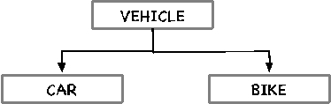
由于 `Car` 和 `Bike` 均派自 `Vehicle`，是否可以将 `List<Car>` 或 `List<Bike>` 赋值给 `List<Vehicle>` 变量？

不，`List<Car>` 或 `List<Bike>` 不能被 `List<Vehicle>` 替换，因为你不能在有 `cars` 的同一个列表中放入 `Bike`。所以尽管 `Bike` 是一个 `Vehicle`，但它不是一个 `Car`。

```java
List<Bike> bikes = new ArrayList<Bike>(); // 假设这是允许的
List<Vehicle> vehicles = bikes;
vehicles.add(new Car()); // Error - Bike 和 Vehicle 被视为不兼容类型。
Bike bike = vehicles.get(0);
```

Java 编译器在编译时对不兼容类型进行此类检查。更多信息请参阅 类型擦除。

### Java 数组
然而，与泛型不同，`Car` 数组可以赋值给 `Vehicle` 数组：

```java
Car[] cars = new Car[3];
Vehicle[] vehicles = cars;
```

对于数组，尽管编译器允许上述代码编译，但当你运行这段代码时，你将得到 `ArrayStoreException`。

```java
// 这将导致 ArrayStoreException
vehicles[0] = new Bike();
```

所以尽管编译器没有捕获此问题，运行时类型系统捕获了。数组是可具体化的类型（reifable types），这意味着运行时感知到其类型。

## Questions
* 什么是可具体化的类型（reifable types）？
* 为什么不能将子类的泛型集合对象赋值给父类的泛型集合对象？
* 为什么允许将子类的数组对象赋值给父类的数组对象？Java 数组更具多态吗？

## 类型擦除 (Type Erasure)
对于 Java 泛型类型，由于名为类型擦除的过程，Java 编译器会丢弃类型信息，并且它在运行时是不可用的。

## Questions
* 什么是可具体化的类型（reifable types）？
* 什么是类型擦除？
* 如果没有类型擦除会发生什么？

## 协变 (Co-variance)
协变是一种允许从带有上界通配符的泛型中读取项，但不能向其写入的概念。

考虑以下带有上界通配符的声明：

```java
List<? extends Vehicle> vehicles = new ArrayList<Bike>();
```

从 `vehicles` 读取，因为列表中的任何内容都是 `Vehicle` 的子类并可以向上转型。

```java
Vehicle vehicle = vehicles.get(0);
```

然而不允许向协变结构放入任何内容。

```java
// 编译错误
vehicles.add(new Bike());
```

这是不允许的，因为 Java 无法保证泛型结构中的实际类型。它可以是任何扩展 `Vehicle` 的类型，但编译器无法确定。所以可以读写。

## Questions
* 解释协变？
* 为什么不能向带有上界通配符的泛型添加子类元素？

## 逆变 (Contra-variance)
逆变是一种允许向带有下界通配符的泛型写入项，但不能从中读取任何内容的概念。

考虑以下带有下界通配符的声明：

```java
List<? super Car> cars = new ArrayList<Vehicle>();
```

在这种情况下，尽管 `ArrayList` 的类型是 `Vehicle`，你也可以通过逆变向其添加 `Car`；因为 `Car` 派自 `Vehicle`。

```java
cars.add(new Car());
```

然而，你不能假设你会从这个逆变结构中获得 `Car` 对象。

```java
// 编译错误
Car vehicle = cars.get(0);
```

## Questions
* 解释逆变？
* 为什么不能从带有下界通配符的泛型读取元素？

## 协变 vs 逆变
* 当你只想从集合中读取泛型值时，使用协变。
* 当你只想向集合中添加泛型值时，使用逆变。
* 当你打算同时对集合进行读取和写入操作时，使用特定的泛型类型。

## Questions
* 什么时候应该使用协变？
* 什么时候应该使用逆变？

## 集合 (COLLECTIONS)

`Collections` 是构建任何生产级 Java 应用程序的基础构建模块。面试官希望了解与集合正确用法相关的不同设计方面。每个集合实现都是针对特定类型的需求而编写和优化的，面试题旨在衡量面试者对这些方面的理解。提问通常是为了为了检查候选人是否理解集合类的正确用法，以及是否了解可用的替代方案。以下是关于集合提问的几个方面：

- Java 中的集合类型。
- 不同集合类型的独特特征。
- 同步集合。
- 并发集合。
- 集合中元素的顺序。
- 从集合中读取的速度。
- 向集合写入的速度。
- 集合中元素的唯一性。
- 集合间操作的易用性。
- 只读集合。
- 集合导航。

## 集合基础

集合是一个组合多个元素的容器。以下是集合的简单示例：

```java
// 创建一个城市列表容器
List<String> cities = new ArrayList<>();

// 添加城市名称
cities.add("London");
cities.add("Edinburgh");
cities.add("Manchester");
```

### 注意事项
- 集合与引用类型一起工作。
- 所有集合接口实现都是泛型的（`Generic`）。
- 与数组不同，所有集合类型的大小都可以增长或收缩。
- Java 提供了许多方法根据其用途来操作集合，因此在实现新方法之前，始终要测试现有方法。

## 集合框架

集合框架由以下组件定义：

- **接口 (Interfaces)** - 是为每种特定用途类型和集合类型定义的抽象类型。
- **实现 (Implementation)** - 是具体的实现类，用于创建表示不同类型集合的对象。
- **算法 (Algorithms)** - 应用于集合以执行各种计算并操作集合中的元素。

集合框架通过提供操作这些数据的数据结构和算法，帮助你减少编程工作量。

## 问题
- 解释什么是集合？
- 集合与 `Generics`（泛型）之间有什么关系？
- 你可以使用基本数据类型使用集合吗？
- 如何对基本数据类型使用集合？
- 解释集合和数组之间的区别？
- 集合框架的处是什么？
- 集合框架有哪些不同的组件？

## 集合接口

接口以方法签名的形式定义其行为。使用集合时，你应该始终针对集合接口编写代码，而不是类实现类，这样代码就不会与特定的实现绑定。这可以防止底层实现类可能发生更改的影响。

以下是定义集合及其行为最重要的接口。下面的每个子节点都继承自其父节点：

- `Collection`
- `Queue`
- `BlockingQueue`
- `TransferQueue`
- `BlockingDeque`
- `Deque`
- `List`
- `Set`
- `SortedSet`
- `NavigableSet`
- `Map`
- `SortedMap`

## 问题
- 为什么你应该针对集合接口编写代码而不是具体的实现类？

## 集合类型
- **Set**: `Set` 包含唯一元素。
- **List**: `List` 是有序集合。
- **Queue**: `Queue` 以 `FIFO`（先进先出）方式在处理前持有元素。
- **Deque**: `Deque` 以 `FIFO` 和 `LIFO`（后进先出）方式在处理前均持有元素。
- **Map**: `Map` 包含键到对应值的映射。

## 问题
- 有哪些不同的集合类型？
- 定义 `Set` 集合类型？
- 定义 `List` 集合类型？
- 定义 `Queue` 集合类型？
- 定义 `Deque` 集合类型？
- 定义 `Map` 集合类型？
- `Queue` 和 `Deque` 之间有什么区别？

### Set

#### 基础 Set
```java
// 创建一个 set
Set<String> set = new HashSet<>();
```

- `Set` 是一个包含唯一元素的集合。
- `Set` 中的元素是无序存储的。
- `Set` 中只能添加一个 `null` 元素。
- 重复元素会被忽略。
- 当不需要排序时，`Set` 是最快的，且内存占用较小。

#### LinkedHashSet
```java
// 创建一个 linkedHashSet
Set<String> linkedHashSet = new LinkedHashSet<>();
```

- `LinkedHashSet` 保持 `Set` 元素与其插入时的相同顺序。
- 如果 `LinkedHashSet` 中重新插入元素，插入顺序不会受到影响。
- `LinkedHashSet` 中的 `Iterator` 返回元素的顺序与这些元素添加到集合的顺序相同。

#### 排序集合 (Sorted Set)
- `SortedSet` 强制执行元素的排序，要么通过实现 `Comparable` 接口按自然顺序排序，要么使用 `Comparator` 对象进行自定义排序。
- `TreeSet` 是 `SortedSet` 接口的一个实现类。

```java
// 创建一个按城市名称排序的集合
SortedSet<String> cityNames = new TreeSet<>();
```

- 使用 `Comparator` 对象执行自定义排序。
```java
SortedSet<City> sortedCitiesByName = new TreeSet<>(Comparator.comparing(City::getName));
```

- 如果元素实现了 `Comparable` 接口，则使用 `compareTo()` 方法按自然顺序进行排序。

#### 可导航的集合 (Navigable Set)
- `NavigableSet` 继承自 `SortedSet` 并定义了额外的方法。
- `NavigableSet` 可以按升序和降序进行遍历。
- `TreeSet` 是 `NavigableSet` 接口的实现类之一。

## 问题
- 你可以在 `Set` 中添加重复元素吗？
- 当不需要顺序要求时，你应该使用哪种集合类型？为什么？
- 你可以在 `Set` 中添加 `null` 元素吗？
- 你应该使用哪个 `Set` 类来维护插入顺序？
- 如果在 `Set` 中再次插入相同的元素，会发生什么？它会保持原始位置还是插入到末尾？
- 你应该使用哪个 `Set` 类来确保元素的顺序？
- 当你需要双向方向遍历时，你应该使用哪个 `Set` 类？

## List
- `List` 是对象的有序集合。
- `List` 可以有重复元素。
- `List` 可以有多个 `null` 元素。
- 在 `List` 中，可以在任何位置添加元素。
- 使用 `ListIterator`，列表可以沿正向和反向两个方向进行迭代。

```java
// 创建一个城市列表
List<String> cities = new ArrayList<>();
```

### ArrayList
- `ArrayList` 基于数组。
- 如果频繁访问元素，它的性能更好。
- `ArrayList` 中的添加和删除操作较慢。如果在任何地方添加元素但在末尾则需要移动元素。如果添加的元素超过其容量，则会将数组复制到新分配的地方。

### LinkedList
- `LinkedList` 基于链表。
- `LinkedList` 访问元素较慢，且仅允许顺序访问。
- 在 `LinkedList` 中添加和删除元素更快。
- `LinkedList` 比 `ArrayList` 消耗更多内存，因为它保留了指向相邻元素的指针。

### 列表迭代器 (List Iterator)
- `ListIterator` 在两个方向遍历列表。

```java
// 完整的列表迭代器
ListIterator<String> fullIterator = cities.listIterator();
// 从索引 3 开始的部分列表迭代器
ListIterator<String> partialIterator = cities.listIterator(3);
```

### 注意事项
- `ArrayList` 的随机访问更好，因为它为元素维护了基于索引系统，而 `LinkedList` 的开销更大，因为它需要遍历所有元素。

## 问题
- 你可以在 `List` 中添加重复元素吗？
- 你可以向列表添加 `null` 吗？
- 在什么种场景下你会使用 `ArrayList`：频繁添加/更新还是频繁读取？
- 在什么种场景下你会使用 `LinkedList`：频繁添加/更新还是频繁读取？
- `ArrayList` 和 `LinkedList` 哪一个占内存内存？为什么？
- 在 `ArrayList` 和 `LinkedList` 之间，如果你需要随机访问，你会选择哪一个？为什么？

## 队列 (Queue)
* `Queue` 是一种用于在处理之前存储元素的集合。
* `Queue` 有两个端：尾部（tail）和头部（head）。
* `Queue` 按照 `FIFO`（先进先出）的方式工作。

## 队列类型
* `Queue` - 简单队列，允许在尾部插入和从头部移除，以 `FIFO` 方式操作。
* `Deque` - 允许从头部和尾部插入及移除元素。
* `Blocking Queue` - 当队列满时会阻塞添加元素的线程，当为空时也会阻塞移除元素的线程。
* `Transfer Queue` - 一种特殊的阻塞队列，在两个线程之间进行数据传输。
* `Blocking Deque` - `Deque` 和阻塞队列的结合。
* `Priority queue` - 优先级最高的元素最先被移除。
* `Delay queue` - 只有在元素相关的延迟过期后才允许移除该元素。

### 基础队列 (Basic Queue)
* `Queue` 有一个入口点（尾部）和一个出口点（头部）。
* 如果入口点和出口点是同一个，它就是一个 `LIFO`（后进先出）队列。

```java
// simple queue
Queue<String> queue = new LinkedList<>();
```

## 优先级队列 (Priority Queue)
* 在 `PriorityQueue` 中，优先级与队列中的元素相关。
* 优先级最高的元素下一个被移除。
* `PriorityQueue` 不允许 `null` 元素。
* 队列元素要么实现 `Comparable` 接口，要么使用 `Comparator` 对象来计算优先级。

```java
// City class implements Comparable interface
Queue<City> pq = new PriorityQueue<>();
```

## 双端队列 (Deque)
* `Deque` 允许从两端插入和移除。
* `Deque` 不为元素提供索引的访问。
* `Deque` 扩展了 `Queue` 接口。

```java
// Create a Deque
Deque<String> deque = new LinkedList<>();
```

## 阻塞队列 (Blocking Queue)
* `BlockingQueue` 接口继承自 `Queue`。
* `BlockingQueue` 被设计为线程安全的。
* `BlockingQueue` 设计用于作为生产者-消费者队列。

## 传输队列 (Transfer Queue)
* `TransferQueue` 扩展了 `BlockingQueue`。
* 它可能是容量限制的，生产者可能会等待空间可用，和/或消费者可能会等待项目可用。

```java
// Transfer Queue
TransferQueue<String> ltq = new LinkedTransferQueue<String>();
```


## 问题

* `Queue` 的目的是什么？
* `Deque` 和 `Queue` 有什么区别？
* 什么是优先级队列？
* 应该用什么标准从优先级队列中删除项？
* 什么是 `Delay Queue`？
* 什么是 `Blocking Queue`？
* 哪一个 `Queue` 是线程安全的队列？
* 哪个 `Queue` 实现了生产者-消费者模式？
* 解释 `Blocking Queue` 和 `Transfer Queue` 之间的区别？
* 哪个 `Queue` 是容量限制的，允许 `Queue` 中只有指定数量的元素？如果你尝试放入超过容量的元素会发生什么？

## 映射 (Map)

* `map` 包含键值映射。
* 通常，`Map` 允许一个 `null` 作为键和多个 `null` 作为值，但限制条件由 `Map` 的实现类来定义。

## 实现 HashMap (ImplementationHashMap)

* `HashMap` 基于哈希表。
* `HashMap` 不保证 map 中元素的顺序。
* `HashMap` 的哈希函数为 `get()` 和 `put()` 操作提供常数性能。
* `HashMap` 允许一个 `null` 作为键和多个 `null` 作为值。

```java
// Create a map using HashMap
Map<String, String> hashMap = new HashMap<>();
```

## LinkedHashMap

* `LinkedHashMap` 是 `Map` 接口的哈希表和链表实现。
* `LinkedHashMap` 使用双向链表存储节点。
* 如果需要维护插入顺序，请使用 `LinkedHashMap` 代替 `HashSet`。
* `HashMap` 的性能略优于 `LinkedHashMap`，因为 `LinkedHashMap` 还需要维护链表。
* 它确保按照插入顺序对条目进行迭代。

```java
// LinkedHashMap
LinkedHashMap lhm = new LinkedHashMap();
```

## WeakHashMap

* `WeakHashMap` 仅对其键存储弱引用。
* `WeakHashMap` 支持 `null` 键和 `null` 值。
* 当没有指向键的引用时，它们成为垃圾收集的候选对象。

```java
// WeakHasMap
Map map = new WeakHashMap();
```

## 排序映射 (Sorted Map)

* `SortedMap` 对其键提供完整的排序。
* 根据自然排序顺序 (`Comparable`) 或自定义排序顺序 (`Comparator`) 基于键对 map 条目进行排序。
* `SortedMap` 接口继承自 `Map`。

```java
// sorted map
SortedMap<String,String> sm = new TreeMap<>();
```

## 导航映射 (Navigable Map)

* `NavigableMap` 扩展了 `SortedMap` 接口。
* `TreeMap` 类是 `NavigableMap` 的实现。
* `NavigableMap` 可以以升序和降序顺序访问。
* 它支持双向导航并获取与键最接近的匹配项。

```java
// Create a Navigable Map
NavigableMap<String> nm = new TreeMap<>();
```

## 并发映射 (Concurrent Map)

* `ConcurrentHashMap` 是 `ConcurrentMap` 的实现。
* `ConcurrentHashMap` 通过分分桶并锁定每个桶来实现细粒度同步。
* `ConcurrentHashMap` 在读取它时不加锁。

```java
// Create Concurrent Map
ConcurrentMap<String,String> cm = new ConcurrentHashMap<>();
```

## 注意 (Notes)

* Map 的键不能改变，因此它们必须是不可变的；优先使用 JDK 提供的不可变类作为键。
* 永远不要向调用者暴露集合，而是提供操作方法。
* `HashMap` 在插入、定位和删除元素方面具有更好的性能。
* `TreeMap` 适合排序遍历。

## 问题

* `Map` 与其他集合有什么区别？
* 可以添加 `null` 作为键吗？
* `HashMap` 能保证元素的顺序吗？
* `HashMap` 如何为 `get()` 和 `put()` 操作提供常数性能？
* `HashMap` 和 `LinkedHashMap` 之间的区别是什么？
* 如果要维护插入顺序，你应该使用哪一个：`LinkedHashMap` 还是 `HashSet`？
* 什么是 `WeakHashMap`？
* 如果你想维护键的排序，你应该使用哪个 Map 类？
* 哪个 `Map` 实现是线程安全的？
* `ConcurrentHashMap` 如何在保持效率的同时实现扩展性？

## 算法 (Algorithms)

* 排序 - 用于对集合进行升序或降序排序。你可以使用自然排序顺序 (`Comparable`) 或传递 `Comparator` 对象进行自定义排序。
* 搜索 - `BinarySearch` 算法用于搜索键。
* 洗牌 - 随机重新排列列表元素；通常用于游戏。
* 数据操作 - 提供了 `reverse`、`copy`、`swap`、`fill` 和 `addAll` 算法来操作集合的数据。
* 极值 - 提供了 `min` 和 `max` 算法查找指定集合中的最小值和最大值。

## 问题

* 集合框架支持哪些算法？
* 使用什么搜索算法搜索键？
* 洗牌算法是如何使用的？

## Comparable 与 Comparator 的区别

`Comparable` 接口的实现用于按照自然顺序对集合进行进行排序，而 `Comparator` 对象则用于对集合进行自定义排序。如果一个元素实现了 `Comparable` 接口，则使用 `compareTo()` 方法进行自然顺序排序。`compareTo()` 方法将指定的对象与现有对象进行比较以确定顺序。根据现有对象是小于、等于还是大于指定的对象，它返回一个负整数、零或正整数。

## Comparable 接口实现

```java
@Override
public int compareTo(Employee employee) {
    // comparison 逻辑
}
```

## Comparator

`Comparator` 对象包含了用于比较两个对象的逻辑，这些逻辑的排序方式可能与自然排序不一致。`Comparator` 接口拥有 `compare()` 方法，它接收两个对象，并根据第一个参数是小于、等于还是大于第二个参数，返回一个负整数、零或正整数。

使用 `Comparator` 对象执行自定义排序：

```java
SortedSet<City> sortedCitiesByName =
    new TreeSet<>(Comparator.comparing(
        City::getName));
```

`Comparator` 通常用于在你无法完全控制该类的情况下提供一种自定义的比较算法。

## 问题

* `Comparable` 接口和 `Comparator` 类之间有什么区别？
* 你在什么时候应该实现 `Comparable` 接口来对集合进行排序？
* 你在什么时候使用 `Comparator` 类来对集合进行排序？

## hashCode() 和 equals()

* `HashTable`、`HashMap` 和 `HashSet` 使用 `hashCode()` 和 `equals()` 方法来计算和比较用其键的对象。
* Java 中的所有类除非重写了 `hashCode()` 方法，否则都从 `Object` 基类继承基础哈希方案。
* 任何重写了 `hashCode()` 方法的类都应该重写 `equals()` 方法。

## `hashCode()` 和 `equals()` 的实现

```java
final public class Employee {

    final private int id;
    final private String name;
    final private String department;

    @Override
    public boolean equals(Object o) {
        if (this == o) return true;
        if (o == null || getClass() != o.getClass())
            return false;
        Employee employee = (Employee) o;
        if (id != employee.id) return false;
        if (name != null ?
                !name.equals(employee.name) :
                employee.name != null)
            return false;
        return !(department != null ?
                !department.equals(employee.department) :
                employee.department != null);
    }

    @Override
    public int hashCode() {
        int result = id;
        result = 31 * result +
            (name != null ?
                name.hashCode() :
                0);
        result = 31 * result +
            (department != null ?
                department.hashCode() :
                0);
        return result;
    }
}
```


## `hashCode()` 和 `equals()` 的规则

* `HashTable`、`HashMap` 和 `HashSet` 使用 `hashCode()` 和 `equals()` 方法来计算和比较用其键的对象。
* Java 中的所有类除非重写了 `hashCode()` 方法，否则都从 `Object` 基类继承基础哈希方案。
* 任何重写了 `hashCode()` 方法的类都应该重写 `equals()` 方法。

## 同步与并发集合

同步类和并发类都提供线程安全，但它们的主要区别在于可扩展性和性能。

### 集合同步

* 集合同步通过允许一次仅有一个线程访问集合来实现。
* 同步通过将所有方法标记为 `synchronized` 来实现。
* 任何调用多个方法的复合操作都需要客户端进行处理。
* 同步集合的示例包括 `HashTable`、`HashSet` 和同步 `HashMap`。

### 并发集合

* 集合并发通过允许多个线程同时访问集合来实现。
* `ConcurrentHashMap` 通过根据哈希值将集合划分为多个桶并使用不同的锁来保护每个哈希桶，实现了非常细粒度的锁定。
* 性能显著优，因为它允许多个写入者同时访问集合，而不需要锁定整个集合。
* 并发集合的示例包括 `ConcurrentHashMap`、`CopyOnWriteArrayList` 和 `CopyOnWriteHashSet`。

对于大型集合，优先使用 `ConcurrentHashMap` 等并发集合而不是 `HashTable`，因为并发集合的锁定开销更小，性能更好。注意，在存在相互操作依赖的多线程中，你仍然需要为并发集合的复合操作提供同步访问，如下所示：

```java
Object synchObject = new Object();

ConcurrentHashMap<String, Account> map = new ConcurrentHashMap<>();

public void updateAccount(String userId) {
    synchronized (synchObject) {
        Account userAccount = map.get(userId);
        if (userAccount != null) {
            // some 操作
        }
    }
}
```

* 什么是集合并发？
* 如何实现集合同步？
* 当复合操作需要多个方法才能完成任务时，如何确保集合访问的协调性？
* 如何实现集合并发？
* `ConcurrentHashMap` 如何提供多线程并发访问同一个集合？
* 为什么即使允许多线程同时写入，`ConcurrentHashMap` 的性能更好？
* 在 `ConcurrentHashMap` 和 `HashTable` 之间你更倾向于哪一个？为什么？

## 遍历集合

在 Java 中有多种方法遍历集合。以下是最常用的方法。

### Iterable.forEach

实现了 `Iterable` 接口的集合可以使用 `forEach` 方法，该 `forEach` 方法接收一个 `Consumer` 类型的参数。

```java
List<Account> accounts = Arrays.asList(
    new Account(123),
    new Account(456)
);

accounts.forEach(acc -> print(acc));
```

### for-each 循环

* 可以使用 for-each 循环遍历 `map.entrySet()` 以同时获取键和值。

```java
for (Map.Entry<String, Account> accountEntry : map.entrySet()) {
    print("UserId - " + accountEntry.getKey() + ", " +
          "Account - " + accountEntry.getValue());
}
```

* 可以使用 for-each 循环遍历 `map.keySet()` 获取键。
* 可以使用 for-each 循环遍历 `map.values()` 获取值。
* 在运行 for-each 循环期间，不能对集合进行修改。
* for-each 循环只能向前导航。

### Iterator

* `Iterator` 可以向后和向前两个方向移动。
* 使用 `Iterator` 时，可以在迭代过程中移除条目，而使用 for-each 循环是无法实现的。
* for-each 循环内部也使用了 `Iterator`。

```java
Iterator<Map.Entry<String, Account>> accountIterator = map.entrySet().iterator();

while (accountIterator.hasNext()) {
    Map.Entry<String, Account> accountEntry = accountIterator.next();
    print("UserId - " + accountEntry.getKey() + ", " +
          "Account - " + accountEntry.getValue());
}
```

### 注意事项

* 应该优先使用 for-each 循环而非 `for` 循环，因为 `for` 循环可能是错误的来源，特别是与索引计算相关的错误。
* `Iterator` 被认为更线程安全，因为如果集合在迭代期间发生变化，它会抛出异常。

## 数据无关访问

代码的编写方式应该让客户端代码感知不到用于存储集合的内部结构。这使得可以在不破坏任何客户端代码的情况下进行内部更改。因此，为了便于对集合的数据无关访问，必须暴露集合，以便可以使用 `Iterator` 遍历集合的所有元素。

## 问题

* 解释遍历集合的不同方法？
* 在使用 for-each 循环迭代时，可以修改集合的结构吗？
* 在使用 for-each 循环迭代时，可以修改集合元素的值吗？
* 关于导航方向，for-each 循环有哪些局限性？
* 在导航方向上，for-each 循环和 `Iterator` 有什么区别？
* 在使用 `Iterator` 迭代时，可以修改集合结构吗？
* 在使用 `Iterator` 迭代时，可以修改集合元素的值吗？
* 在 for-each 循环和 `for` 循环之间，你应该更倾向于哪一个？为什么？
* 为什么 `Iterators` 被认为是更线程安全的？
* 解释集合的数据无关访问概念？
* 如何设计你的类以为类中使用的集合提供数据无关访问？

## 快速失败 (Fail Fast)

`Iterator` 方法被认为是快速失败的，因为 `Iterator` 防止了对集合进行的任何结构性修改。这确保了任何失败都能快速报告，而不是让应用程序稍后进入损坏状态。在这种情况下，会抛出 `ConcurrentModificationException`。来自 `java.util` 的 `Iterators` 是快速失败的。

## 问题

* 集合迭代中“快速失败”术语的含义是什么
* 快速失败迭代器的好处是什么？
* 什么是安全（fail-safe）迭代器？
* 安全迭代器在集合被修改时不会抛出任何异常，因为安全迭代器运行在原始集合的副本上工作。来自 `java.util.concurrent` 包的迭代器是安全的。

## 错误与异常处理

### 异常

Java 中的异常类层次结构：

* 异常是中断程序执行流的异常情况。
* 所有异常都继承自 `Throwable`。
* 如果你想创建一个受检异常（checked exception），请继承 `Exception` 类；如果你想创建一个未受检异常（unchecked exception），请继承 `RuntimeException`。
* 虽然你可以通过继承 `Throwable` 来创建受检异常，但不建议这样做，因为 `Throwable` 是所有异常和错误的根类。

## 问题

* 什么是异常（Exception）？
* Java 中的根级异常有哪些？
* 创建受检异常应该继承哪个父类？
* 创建未受检异常应该继承哪个父类？

### 受检异常 vs 未受检异常

* 受检异常在编译时进行检查。
* 除了 `RuntimeException` 和 `Error` 之外，受检异常都扩展自 `Throwable`。
* 受检异常在程序上是可以恢复的。
* 你可以通过使用 `try/catch` 或在方法声明中使用 `throws` 子句来处理受检异常。
* 静态初始化器不能抛出受检异常。

```java
public static void main(String args[]) {
    FileInputStream fis = null;
    try {
        fis = new FileInputStream("details.txt");
    } catch (FileNotFoundException fnfe) {
        System.out.println("Missing File :" + fnfe);
    }
}
```

### 未受检异常

* 未受检异常在运行时检查。
* 未受检异常扩展自 `RuntimeException`。
* 你无法期望从这些异常中恢复。
* 可以使用良好的编程技术避免未受检异常。
* 抛出未受检异常有助于揭示缺陷。

```java
public int getAccountBalance(String customerName) {
    int balance = 0;
    if (customerName == null) {
        throw new IllegalArgumentException("Null argument");
    }
    // 返回余额的逻辑
    return balance;
}
```


### 错误 (Error)

* 错误类用于定义不可恢复的致命异常，应用程序不应该捕获这些异常。
* 通常情况下，程序员无法从这些异常中恢复做任何操作。
* 即使你捕获了 `OutOfMemoryError`，你仍可能再次遇到它，因为垃圾回收器可能无法释放内存。

仅在预期失败且有合理恢复方法的情况下使用受检异常；任何其他情况请使用未受检异常。

## 问题

* 什么是受检异常？
* 什么是未受检异常？
* Java 中的 `Error` 类定义了哪些类型的异常？
* 如何处理受检异常？
* 如果异常未被处理会发生什么？
* 处理受检异常的不同方法有哪些？
* 在 `catch` 块中你应该使用哪些异常类来处理受检和未受检异常？
* 你如何在受检异常和未受检异常之间选择？
* 可以在静态初始化块中抛出受检异常吗？为什么？
    * 不能抛出，因为没有特定的地方可以捕获它，而且只执行一次。你必须使用 `try/catch` 来处理受检异常。
* 处理错误（Error）你应该怎么做？

## 异常处理最佳实践

尽管异常处理主要由上下文驱动，但在异常处理策略上必须保持一致性。以下是异常处理的一些最佳实践：

1. 永远不要抑制异常 - 因为这可能导致程序处于不安全且不稳定的状态。
2. 不要进行过度的异常处理 - 特别当你不知道如何完全从异常中恢复时。
3. 永远不要吞掉（swallow）异常 - 因为这可能导致应用程序处于不一致的状态，最糟糕的是还没有记录发生的原因。
4. 不要捕获异常并继续程序执行 - 带有某些默认行为执行。今天定义的默认行为在未来可能不再有效。
5. 不要向用户显示通用的错误信息 - 相反，请清理异常处理代码以报告用户友好的消息，并对下一步操作提供建议。
6. 不要在一个单个 `try-catch` 中放置多个一个异常场景 - 因为这将导致无法确定异常的原因。
7. 不要在一个单个 `catch` 块中捕获多个受检异常 - 因为这将无法确定异常的原因。
8. 不要不必要的包装异常 - 这可能会掩盖真实的源头。
9. 不要泄露敏感信息 - 相反，对于专门从可能泄露敏感信息的源生成的异常进行清洗。
10. 始终记录异常 - 除非有充分的理由不这样做。
11. 不要捕获 `Throwable` - 因为这将无法确定异常的原因。
12. 不要使用异常来控制执行流 - 相反，在可能的情况下使用布尔值来验证条件。
13. 程序化处理不同的场景 - 不要将所有代码逻辑都放在 `try` 块中。
14. 显式命名线程 - 在多线程应用程序中，这极大简化了调试。
15. 永远不要抛出通用异常 - 因为这将无法确定异常的原因。

## 问题

* 描述一些异常处理的最佳实践？
* 抑制异常的陷阱是什么？
* 显示通用错误信息有什么问题？
* 异常被吞掉的缺点是什么？
* 在单个 `catch` 块中处理多个异常的陷阱是什么？
* 如果异常从包含敏感信息的源抛出，你会怎么做？在这种情况下你会记录什么？向用户显示什么消息？
* 将所有异常都包装进一个通用异常类的陷阱是什么？
* 为什么你不应该使用异常来控制程序的执行流？
* 你应该记录所有异常吗？为什么？
* 为什么你不应该使用 `Throwable` 或其他根类来捕获异常？
* 应该使用什么标准来判断哪些代码块应该包含在 `try` 块中？
* 如果进行了多个方法的嵌套调用，你会为每个方法使用 `try-catch` 吗？为什么？

`try-with-resources` 是 Java 语言的一种构造，它使得自动关闭 `try` 语句包含的资源更容易。

```java
try (FileInputStream fis = new FileInputStream("details.txt")) {
    // 读取数据的代码
}
```

* 使用 `try-with-resources` 的资源必须继承 `AutoCloseable` 接口。
* 你可以在 `try` 块中指定多个资源。

## 问题

* 你可以使用哪种 Java 构造来自动关闭系统资源？
* 在 `try-with-resource` 构造中使用类对象时，资源必须继承哪个接口？

## 多线程

## 线程术语

* 线程是进程中可执行代码的最小单元。
* 程序是一组有序的操作。
* 进程是程序的实例。
* `Context Switch`（上下文切换）是存储和恢复线程状态的昂贵过程。
* 并行处理是在多个核心上同时执行相同的任务。
* 多线程是 CPU 并发执行多个进程或线程的能力。
* 当两个线程互相等待对方释放锁时，就会发生死锁。

## 基本概念

* 所有的 Java 程序都从用户线程上的 `main()` 方法开始。
* 当没有剩余的用户线程可以执行时，程序终止。
* `Thread` 维护一个私有栈和系列待执行的指令。
* `Thread` 拥有一个名为 `thread-local storage`（线程本地存储）的私有内存，在多线程环境中可用于存储线程当前操作相关的数据。
* JVM 允许进程拥有多个线程。
* 每个线程都有优先级。

## 问题

* 什么是线程？
* 什么是程序？
* 什么是进程？
* 线程和进程的区别是什么？
* 程序和进程的区别是什么？
* 解释一下线程的上下文切换？
* 什么是并行处理？
* 什么是多线程？
* 并行处理和多线程之间有什么关系？
* 什么是死锁？
* 什么是用户线程？
* 什么是线程本地存储？你应该用线程本地存储存储什么类型的对象？
* 线程共享栈内存吗？

## 线程生命周期

以下是线程状态的不同阶段：

* **New**（新创建）：线程已创建但未启动。
* **Runnable**（可运行）：线程正在运行。
* **Blocked**（阻塞）：线程正在等待进入关键区域。
* **Waiting**（等待）：线程通过调用 `wait()` 或 `join()` 进行等待。
* **Time-waiting**（计时等待）：线程通过调用带超时的 `wait()` 或 `join()` 进行等待。
* **Terminated**（已终止）：线程已完成任务并退出。

注意：你可以使用 `getState()` 方法获取线程的状态。

## 问题

* 描述线程生命周期的不同阶段？
* 阻塞状态和等待状态的区别是什么？
* 如何获取线程状态？
* 线程睡眠和线程等待有什么区别？

## 线程终止

应该通过调用 `interrupt()` 方法来停止线程。对线程调用 `interrupt()` 甚至可以跳出 `Thread.sleep()` 状态。

```java
if (Thread.currentThread().isInterrupted()) {
    // 清理并停止
    // 例如跳出循环
}
```

注意：`stop()`、`suspend()` 和 `resume()` 方法已被废弃，因为使用这些方法可能导致程序处于不一致的状态。

## 问题

* 定义一种良好的线程终止策略？
* 什么是线程中断？线程中断方法与线程停止方法有什么区别？
* 如果线程正在睡眠时你对线程调用中断会发生什么？
* 调用中断会立即停止线程吗？

## 实现 Runnable 与 扩展 Thread

实现 `Runnable` 接口的线程：

```java
public class RunnableDerived implements Runnable {
    public void run() {
    }
}
```

扩展 `Thread` 类的线程：

```java
public class ThreadDerived extends Thread {
    public void run() {
    }
}
```

* `Runnable` 的 `run()` 方法不会构造新线程，而是在创建它的同一个线程中作为普通进程运行，而 `Thread` 的 `start()` 方法会构造新线程。
* 除非你要对 `Thread` 类进行特殊化（这在大多数情况下是不可能的），否则 `Runnable` 是创建线程的首选方式。

## 问题

* 创建线程的不同方式有哪些？
* 实现 `Runnable` 接口与扩展 `Thread` 类有什么区别？
* 什么时候应该扩展 `Thread` 类？
* 什么时候应该继承 `Runnable` 接口？

## 问题

* 在 `Runnable` 和 `Thread` 之间哪种是优方法？
* 实现 `Runnable` 会创建线程吗？
* `Thread` 类和 `Runnable` 接口都有 `run` 方法，它们的区别是什么？

## Runnable vs Callable 接口

### Runnable 接口

```java
@FunctionalInterface
public interface Runnable {
    public abstract void run();
}
```

### Callable 接口

```java
@FunctionalInterface
public interface Callable<V> {
    V call() throws Exception;
}
```

* `Runnable` 不能返回结果且不能抛出检查异常。
* `Callable` 需要实现 `call()` 方法，而 `Runnable` 需要实现 `run()` 方法。
* `Callable` 可以配合 `ExecutorService` 方法使用，但 `Runnable` 不行。

## 问题

* `Callable` 和 `Runnable` 接口之间的区别是什么？
* 使用 `Runnable` 替 `Callable` 的好处是什么？
* 你可以从 `Runnable` 接口中抛出检查异常吗？
* 为什么 `Runnable` 和 `Callable` 接口被称为函数式接口？
* 哪个接口返回结果：`Runnable` 还是 `Callable`？

## 守护线程 (Daemon Thread)

守护线程允许 JVM 随着程序退出。一旦 JVM 停止，所有守护线程都会退出，而不会回溯堆栈，也不会执行任何 `finally` 块。守护线程以非常低的优先级执行。

线程会继承父线程的守护状态，这意味着任何由 `main` 线程创建的线程都是非守护线程。通常，守护线程用于支持应用程序的后台任务或服务。垃圾回收是在守护线程中进行的。

你可以像下面一样创建一个守护线程：

```java
Thread thread = new Thread();
thread.setDaemon(true);
```

所有非守护线程被称为用户线程。这些线程会阻止 JVM 关闭。当没有更多用户线程时，进程终止。Java 的 `main` 线程始终是一个用户线程。

## 问题

* 什么是守护线程？
* 什么是用户线程？`main` 线程是什么？
* 如果守护线程仍在运行，程序可以退出吗？
* 如果用户线程仍在运行，程序可以退出吗？
* 当 JVM 停止并退出所有守护线程时，守护线程上的 `finally` 块还有机会执行吗？
* 当创建一个新线程时，它是作为用户线程还是守护线程创建？
* 如果没有用户线程在运行但守护线程仍在运行，会发生什么？
* Java 的 `main` 线程是用户线程还是守护线程？
* 当你在 `main` 线程上创建一个新线程时，创建的是什么类型的线程：守护还是用户？
* 你可以使用守护线程做什么什么工作？

## 竞态条件 (Race Condition) 和不可变对象 (Immutable Object)

当多个线程同时访问共享数据并对其修改时，就会产生竞态条件。由于这些线程读写数据的顺序无法预测，这可能导致不可预测的数据值。

如果一个对象在构造后没有状态改变的可能性，则它被认为是不可变的。如果一个对象是不可变的，它可以在多个线程之间共享，而不必担心竞态条件。

### 如何使对象不可变

* 将类声明为 `final`。
* 只允许通过构造函数创建对象。不要提供字段的 setter 方法。
* 将所有字段标记为 `private`。

## 问题

* 不可变对象如何帮助防止竞态条件？
* 为什么竞态能够产生不可预测的结果？
* 为什么不可变对象在多线程环境中被认为是安全的？
* 为什么建议将不可变类声明为 `final`？
* 为什么构造函数应该是构造不可变对象的唯一方式？如果提供了 setter 方法会发生什么？

## 线程池 (Thread Pool)

线程池是一组工作线程，它们独立存在于 `Runnable` 和 `Callable` 任务之外。固定线程池减少了线程创建的开销。当请求激增超过其处理能力时，它帮助应用程序进行优雅的降级，防止应用程序进入挂起或崩溃状态。

线程池还通过解耦任务的创建与执行实现了松耦合设计。借助 `Executors` 类可以轻松地创建固定线程池，你可以使用 `newFixedThreadPool()` 工厂方法创建 `ExecutorService` 来执行任务。

## 问题

* 什么是线程池？
* 线程池如何减少线程创建的开销？
* 线程池如何帮助防止应用程序挂起或崩溃？
* 什么是固定线程池，它是如何创建？
* 线程池如何实现松耦合设计？

## 同步 (SYNCHRONIZATION)

## 并发 (Concurrent) vs 并行 (Parallel) vs 异步 (Asynchronous)

并行处理是在多个核心上同时执行相同的任务。并发处理是同时执行多个任务；这些任务可以在多个核心上执行，也可以通过处理器上的抢占式时间分片线程执行。

异步处理是进程的独立执行，不需要等待中间操作的返回值。

## 问题

* 解释并发处理？
* 解释并行处理？
* 解释异步处理？
* 解释并发处理与并行处理之间的区别？
* 并行处理需要多个线程吗？
* 在什么情况下应用程序是并发而非行的？
    * 当应用程序同时处理多个操作，而不将这些操作进一步分为更小的任务时。
* 在什么情况下应用程序是并行但不并发的？
    * 当应用程序处理一个操作并将该操作分成更小的任务并并行处理时。
* 在什么情况下应用程序既不是并发也不是行的？
    * 当应用程序只处理一个操作，而不将该操作分为更小的任务时。
* 在什么情况下应用程序既是并发又是行的？
    * 当应用程序同时处理多个操作，并将这些操作进一步分为并行处理的小任务时。

## 线程同步

当多个线程访问共享数据进行修改时，就会发生竞态条件。由于无法预测这些线程读写数据的顺序，可能会导致不可预测的数据值。

临界区是指如果被多个线程并发访问可能会对结果产生不良影响的代码块。线程同步是对临界区的控制，以防止程序的不良影响。同步建立了一个被称为“发生在前”（happen-before）的缓冲区，确保随后获取相同本地对象的线程可以访问该线程对本地对象的所有更改。

## 问题

* 解释多线程中的竞态条件？
* 什么是临界区？
* 什么是线程同步？
* 什么是内存屏障？
* 线程同步中的发生在前概念是什么？

## 同步方法与同步块

`synchronized` 关键字用于标记代码中的临界区。互斥同步通过使用 `synchronized` 关键字锁定临界区来实现。这可以通过两种方式实现。

### 将方法标记为临界区

```java
class DatabaseWrapper {
    Object reference = new Object();

    // 标记为临界区的方法
    public synchronized void writeX() {
        // 代码在这里
    }

    // 标记为临界区的静态方法
    public static synchronized void writeY() {
        // 代码在这里
    }
}
```

### 将代码块标记为临界区

```java
public void writeToDatabase() {
    // 多个线程可以到达这里
    // 标记为临界区的代码
    synchronized (this) {
        // 只有一个线程可以同时执行这里
    }
    // 多个线程可以执行这里
}
```

* 将锁定范围缩小到仅限临界区。这将提高整体性能并尽量减少遇到竞态条件的概率。
* 优先使用 `synchronized` 块而不是 `synchronized` 方法，因为块只在本地对象上锁定，而不是整个类对象。
* 在 `synchronized` 块内部，永远不要调用客户端代码提供的方法或为继承设计的方法。

## 问题

* `synchronized` 关键字是如何使用的？
* `synchronized` 方法和 `synchronized` 块之间有什么什么区别？
* 为什么优先使用 `synchronized` 块而不是 `synchronized` 方法？
* `synchronized` 方法会锁定整个对象吗？
* 如果在 `synchronized` 块或过程内部调用客户端支持的方法，会发生什么？

## 条件同步

条件同步通过条件变量配合 `wait()` 和 `notify()` 或 `notifyAll()` 方法来实现。

```java
public void operation() throws InterruptedException {
    synchronized (reference) {
        if (condition1) {
            // 等待通知
            reference.wait();
        }
        if (condition2) {
            // 通知所有等待的线程
            reference.notifyAll();
        }
    }
}
```


## 线程通信与同步机制

### 1. 线程通知机制
有两种方法可以通知等待的线程：
- `notify()` - 仅通知一个随机线程。
- `notifyAll()` - 通知所有处于等待状态的线程。

### 2. `wait()` 方法重载
`wait()` 方法有一个重载版本也可以传递超时持续时间：`wait(long timeout)`。

### 3. 通知策略选择
在 `notify()` 和 `notifyAll()` 方法之间，优先使用 `notifyAll()`，因为它会通知所有等待的线程。

### 4. `notify()` 行为
`notify()` 方法唤醒单个线程，如果有多个线程等待被通知，那么线程的选择是随机的。

## Questions
- 什么是条件同步？
- 调用 `wait` 的目的是什么？
- `notify` 和 `notifyAll` 方法之间有什么区别？
- 当有多个线程在等待通知时，当你调用 `notify` 时哪一个会被通知？
- 在 `notify` 和 `notifyAll` 之间你应该优先选择哪一个？为什么？

## Volatile 关键字

在多线程应用中，每个线程都会维护一个从主内存到其 CPU 缓存的变量副本。因此，线程对其 CPU 缓存中变量的任何更改对其他线程都是不可见的。标记为 `volatile` 的字段直接从主内存中存储和读取。由于 `volatile` 字段存储在主内存中，因此所有线程都能看到 `volatile` 字段值的最新更新副本，无论是哪个线程修改了它。

考虑一个类 `Ledger`，它有一个成员 `currentIndex` 来跟踪已输入条目的数量。在多线程环境中，每个线程都会独立地增加 `currentIndex` 的值。

```java
public class Ledger {
    public int currentIndex = 0;
}
```

如果我们将 `currentIndex` 标记为 `volatile`，那么每个线程将使用其来自主内存的值，而不会创建它的副本。

```java
public class Ledger {
    public volatile int currentIndex = 0;
}
```

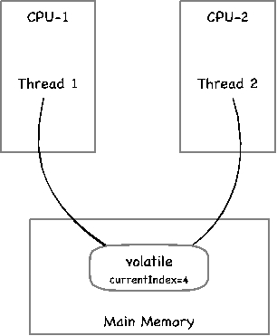

## Questions
- 什么是 `volatile` 变量？
- 解释 `volatile` 字段解决了什么问题？
- `volatile` 变量存储在哪里？

## static vs volatile vs synchronized

### static 变量
`static` 变量用于类对象的上下文中，无论创建多少个类对象，静态变量只存在一个副本。但如果多个线程访问同一个变量，每个线程都会在其 CPU 缓存中创建该变量的副本，一个线程所做的更改对其他线程是不可见的。

### volatile 变量
`volatile` 变量用于线程上下文，无论有多少个线程或对象访问它，都只存在一个变量，且每个人始终获得最新更新的值。`volatile` 强制所有读写操作直接在主内存中进行，而不是在 CPU 缓存中。

### synchronized
`static` 和 `volatile` 都是字段修饰符，处理与变量相关的内存可见性；而 `synchronized` 处理的是使用监视器对代码中临界区的访问控制，从而防止对代码段的并发访问。

## Questions
- 什么是 `static` 变量？
- 类的所有对象共享 `static` 变量。但在多线程环境中，为什么一个对象对静态变量的更改对另一个线程上的对象是不可见的？
- 如果 `static` 和 `volatile` 变量在对象之间共享，那么 `volatile` 变量解决了什么问题？
- `volatile` 和 `static` 变量与 `synchronized` 有什么不同，因为即使是 `synchronized` 监视器也会保护内存对象？

## ThreadLocal 存储

每个线程都有一个称为“线程本地存储”（thread-local storage）的私有内存，用于存储线程当前操作相关的数据。通常，`ThreadLocal` 变量被实现为私有静态字段，用于存储事务标识、用户标识等信息。

### ThreadLocal 声明
```java
ThreadLocal<String> threadLocal = new ThreadLocal<String>();
```

### 设置线程本地值
```java
threadLocal.set("value");
```

### 获取线程本地值
```java
String accountId = threadLocal.get();
```

- `ThreadLocal` 对象包含在线程内部。
- `ThreadLocal` 的生命周期与其创建的线程相关联。
- 为了防止泄漏，调用 `remove()` 是一个好习惯。
```java
threadLocal.remove();
```

## Questions
- 什么是线程本地存储？
- 你在 `ThreadLocal` 中存储了什么？
- 为什么你不应该同步 `ThreadLocal` 的访问？
- 为什么你应该移除 `ThreadLocal`？

## wait() vs sleep()

### 使用 `wait()` 进行条件同步
```java
public void waitFor(int timeInMs) throws InterruptedException {
    synchronized (reference) {
        if (condition1) {
            // 等待通知
            reference.wait(timeInMs);
        }
    }
}
```

### 指定间隔的 sleep()
```java
public void sleepFor(int timeInMs) throws InterruptedException {
    // 暂停 timeInMs
    Thread.sleep(timeInMs);
    // 打印消息
    print("Slept for :" + timeInMs + "ms.");
}
```

- `wait` 方法在对象的监视器上调用；而 `sleep` 在线程上调用。
- 等待的对象可以被通知；而睡眠线程不能。
- 睡眠线程不能释放锁；而等待的对象可以。
- 唤醒睡眠线程需要它的引用，而等待对象则不需要。

## Questions
- `wait` 和 `sleep` 之间有什么区别？
- 为什么可以通知等待对象而不能通知睡眠线程？
- 既然唤醒睡眠线程需要句柄，那么等待对象需要直接访问吗？为什么？
- 信号对象退出 `wait` 的机制是什么？

## 线程连接 (Joining Threads)

当线程之间存在依赖关系时，通常需要连接线程。目标线程的 `join()` 方法用于挂起当前线程。在这种情况下，在它所依赖的目标线程执行完成之前，当前线程无法继续执行。

```java
// 主线程与线程 1 连接
public void main(String[] args) {
    Thread thread1 = new Thread(ThreadMethodRef::threadMethod);
    thread1.start();
    // 当前线程等待 thread1 执行完成
    thread1.join();
}
```

## Questions
- 线程 `join` 方法的目的是什么？
- 为什么需要连接两个线程？

## 原子类 (Atomic Classes)

原子类提供了对原始类型执行原子操作的能力，使得方法调用完成之前只允许一个线程更改值。`AtomicInteger` 和 `AtomicLong` 等原子类封装了相应的原始类型。引用类型也有对应的类，即 `AtomicReference`。不需要对 `Atomic Class` 对象提供同步（synchronized）访问。`AtomicInteger` 的方法 `incrementAndGet()` 通常用于替代前置和后置操作符。

## Questions
- 什么是原子类？
- 为什么不需要对原子类对象进行同步访问？
- 为什么前置和后置操作符不是线程安全的？
    - 前置和后缀操作在底层是多次操作——读取、递增和写入。这三个操作并没有同步执行，因此在它们之间发生的任何线程切换都会导致非预期的结果。
- 原子变量（Atomic）和 volatile 变量有什么区别？
    - 原子变量即使对于前置和后缀递增等复合操作也能提供原子访问，而如果变量声明为 `Volatile`，这是无法可能的。`Volatile` 仅保证发生之前的（happen-before）读取。

## 锁 (Lock)

- 锁是多线程系统中控制共享资源访问的机制。
- `ReentrantLock` 类实现了一个锁接口。
- 锁可以在不同的代码块中获取和释放。
- `Lock` 接口拥有 `tryLock()` 方法来验证资源的可用性。
- 良好的做法是，获取的锁必须在 `finally` 块中释放。

```java
// 安全类
public class SafeAccount {
    // 创建锁对象
    private Lock lockObject = new ReentrantLock();

    public void addMoney() {
        // 获取锁
        lockObject.lock();
        try {
            // 此处添加金额的逻辑
        } finally {
            // 释放锁
            lockObject.unlock();
        }
    }
}
```

## Questions
- 解释多线程环境中的锁机制？
- 你是否需要在同一个代码块中获取并释放锁？
- 为什么你应该倾向于使用 `tryLock()` 而不是 `lock()`？

## 读写锁 (ReadWriteLock)

- `ReadWriteLock` 维护了一对关联的锁，一个用于写入，另一个用于只读操作。
- 只有一个线程可以获取写锁，但多个线程可以拥有读锁。
- `ReadWriteLock` 接口由 `ReentrantReadWriteLock` 实现。

```java
// ReentrantReadWriteLock 锁
ReentrantReadWriteLock rwl = new ReentrantReadWriteLock();
// 读锁
Lock rl = rwl.readLock();
// 写锁
Lock wl = rwl.writeLock();
```

## Questions
- 使用 `ReadWriteLock` 有什么好处？
- 在哪些场景下，你应该倾向于使用 `ReadWriteLock` 而不是其他锁机制？

## 同步器 (Synchronisers)

同步器同步多个线程以保护临界区域（Critical Section）。

| 同步点 (SyncPoint) | 线程 (Threads) |
| :--- | :--- |

### 同步器类型
- 屏障 (Barriers)
- 信号量 (Semaphore)
- 栅器 (Phasers)
- 交换器 (Exchangers)
- 计数器 (Latch)

## Questions
- 同步器的目的是什么？
- Java 中提供了哪些类型的同步器？

## 屏障 (Barriers)

- 在 `Barriers` 中，一组线程会互相等待到达屏障点后再继续移动。
- `CyclicBarrier` 是 `Barrier` 同步器的具体实现。

```java
// 带有五个线程的屏障
CyclicBarrier barrier = new CyclicBarrier(5);
```

- `Barrier` 也称为循环的，因为它在对其调用 `reset()` 后可以被重用。
- 可以将动作传递给 `CyclicBarrier`，以便在所有线程到达屏障点时执行。

```java
// 带有在屏障点运行的动作的屏障
CyclicBarrier barrier = new CyclicBarrier(5, () -> {
    // 屏障点动作代码。
});
```

- 如果任何线程提前终止，其他线程将退出。
- 屏障通常用于所有线程到达后，然后进入下一个阶段。

## Questions
- 解释 `Barrier`？
- 你可以再次重用 `Barrier` 吗？
- 如果一个线程死亡了会什么？

## 信号量 (Semaphore)

- `Semaphore` 维护指定数量的许可。

```java
// 创建具有四个许可的信号量
Semaphore semaphore = new Semaphore(4);
```

- 要获取许可，使用 `acquire()`。
- 要释放许可，使用 `release()`。
- 如果调用 `release()` 的次数多于 `acquire()`，将增加额外的许可。
- `Semaphore` 通常用于允许限制访问。

## Questions
- 解释 `Semaphore`？
- 如果你调用 `release()` 的次数比 `acquire()` 多会发生什么？
- 当许可不可用时会发生什么？
- 你在哪里使用 `Semaphore`？

## 栅器 (Phaser)

- 与屏障不同，注册到 `Phaser` 的参与人数可以随时间变化。

```java
// 带有四个方的栅器
Phaser phaser = new Phaser(4);
```

- `Phaser` 也可以被重用。
- 使用 `register()` 方法注册参与者。
- 使用 `arriveAwaitAdvance()` 等待所有参与者到达。
- `Phasers` 监控已注册、到达和未到达参与者的计数。
- 使用 `arriveDeregister()` 方法注销参与者。

## Questions
- 解释 `Phaser`？
- `Phaser` 在参与人数方面有什么特殊之处？
- 你可以再次重用同一个 `Phaser` 对象吗？
- 你可以使用未注册为参与者的外部对象监控 `Phaser` 的计数吗？
- `Semaphore` 和 `Phaser` 有什么区别？

## 交换器 (Exchanger)

- `Exchanger` 让两个线程在同步点互相等待以交换元素。

```java
// 交换字符串数组
Exchanger<ArrayList<String>> exchanger = new Exchanger<ArrayList<String>>();
```

- `Exchanger` 使用 `exchange()` 方法交换信息。

```java
// 交换数据
objectToExchange = exchanger.exchange(objectToExchange);
```

- 在 `exchange()` 时，消费者清空要交换的对象并等待生产者再次交换完整的对象。

## Questions
- 解释 `Exchanger`？
- `Exchanger` 对象需要多少线程？
- `Exchanger` 同步器的主要目的是什么？
- `Exchanger` 同步器每次都使用同一个对象交换，还是可以使用不同的对象？

## 计数器 (Latch)

- `Latch` 让一组线程等待一组操作完成。
- `Latch` 不可重用。
- `CountDownLatch` 类提供了 `Latch` 的实现。
- 所有线程调用 `await()` 方法等待，直到 `countDown()` 被调用次数达到计数器的设置次数。

```java
// 创建一个计数为五的倒计时器
CountDownLatch cdl = new CountDownLatch(5); // 在线程任务完成后对计数器递减
```

```java
cdl.countDown(); // 等待计数器信号
cdl.await();
```

## Questions
- 解释什么是 `Latch` 同步器？
- 你可以重复使用同一个 `Latch` 对象吗；就像 `Barrier` 和 `Phaser` 那样？
- 当线程完成工作时的信号传递过程是怎样的？

## 执行框架 (Executor Framework)

执行框架提供了一个在线程上执行一组相关任务的基础设施。`Executor` 负责管理：
- 创建和销毁线程。
- 为任务维护最佳线程数量。
- 任务的并行和顺序执行。
- 将任务提交与任务执行分离。
- 策略与控制任务的执行有关。

// Executor 接口定义
```java
public interface Executor {
    void execute(Runnable command);
}
```

## Questions
- 解释什么是 `Executor` 框架？
- `Executor` 框架有哪些不同的能力？

## ExecutorService

- `ExecutorService` 继承自 `Executor` 接口，提供了以下额外方法：
    - `shutdown()` - 在提交任务后关闭执行器。
    - `shutdownNow()` - 中断当前任务并丢弃待处理的任务。
    - `submit()` - 将任务添加到 `Executor` 中。
    - `awaitTermination()` - 等待现有任务终止。
- `ExecutorService` 提供 `Future` 对象来跟踪执行任务的进度和状态。
- 所有提交给 `Executor` 的任务都会被队列化，由线程池线程执行。

// 使用包含五个线程的线程池创建执行器
```java
ExecutorService exec = Executors.newFixedThreadPool(5);
```


* 要创建一个单线程线程池，请使用 `newSingleThreadExecutor()` 方法。

## 处理结果

* `Runnable` 接口的 `run()` 方法不能返回结果或抛出异常。
* 可以返回结果的任务是 `Callable` 接口的实例。

// 任务可以通过 `Callable` 的 `call` 方法返回派生结果
```java
public interface Callable<V> {
    V call() throws Exception;
}
```

* `submit()` 方法返回 `Future` 对象，有助于跟踪任务。

// ExecutorService 示例
```java
public class ExecService {
    public static void main(String[] args)
            throws ExecutionException, InterruptedException {
        // 创建包含五个线程线程池的执行器。
        ExecutorService exec = Executors.newFixedThreadPool(5);
        // 将可 任务提交给执行器
        Future<String> task = exec.submit(
                                new Callable<String>() {
                                @Override
                                public String call()
                                        throws Exception {
                                    //某些逻辑
                                    return null;
                                }
                            });
        // 等待结果
        String result = task.get();
        // 关闭执行器
        exec.shutdown();
    }
}
```

* 如果任务执行过程中发生异常，在 `ExecutorService` 上调用 `get()` 方法将抛出 `ExecutionException` 实例。

## 任务调度

* `ScheduledExecutorService` 可用于调度未来的任务。
* 用于调度的方法：
    * `schedule(task, delayTime, TimeUnit.SECONDS)`
    * `scheduleAtFixedRate(task, delayTime, repeatPeriod, TimeUnit.SECONDS)`
    * `scheduleWithFixedDelay(task, delayTime, fixedDelay, TimeUnit.SECONDS)`

## ExecutorCompletionService

* `ExecutorCompletionService` 使用 `Executor` 执行任务。
* `Executor` 的 `CompletionService` 可用于从多个任务获取结果。
* `ExecutorCompletionService` 提供了 `CompletionService` 具体实现。

// 创建包含五个线程的执行器
```java
ExecutorService es = Executors.newFixedThreadPool(5);
// ExecutorCompletionService 返回一个对象
ExecutorCompletionService<Result> cs = new ExecutorCompletionService<>(es);
// 向 ExecutorCompletionService 提交任务
cs.submit(longTask);
// 获取任务结果
Future<Result> completedTask = cs.take();
```

### 注意事项

* 始终为线程关联基于上下文的名称，这对调试非常有帮助。
* 始终优雅地退出，根据你的用例调用 `shutdown()` 或 `shutdownNow()`。
* 为 `ExecutorService` 配置线程池，使池中配置的线程数不显著大于处理器数量。
* 你应该查询主机以找到处理器数量来配置线程池：`Runtime.getRuntime().availableProcessors()`。

## 问题

* 解释什么是 `ExecutorService`？
* 你如何跟踪执行任务的进度和状态？
* `Executor service` 是否使用专用线程来执行队列中的任务？
* 你可以在 `ExecutorService` 中使用 `Runnable` 对象吗？为什么？
* 你如何发现 `ExecutorService` 中是否抛出了异常？
* 你可以使用 `ExecutorService` 调度任务在未来运行吗？
* 使用 `ExecutorService`，如何从多个任务中获取结果？
* `ExecutorService` 的 `submit()` 方法和 `execute()` 方法有什么区别？
    * 如果你使用 `submit()`，你可以通过调用 `Future` 上的 `get()` 方法获取任何抛出的异常；而如果你使用 `execute()`，异常将进入 `UncaughtExceptionHandler`。
* 你如何从 `ExecutorService` 优雅地退出？
* 配置线程池大小的标准是什么？如何设置？

## Fork-Join

* Fork-Join 框架利用了多处理器和多核心系统。
* 它将任务分为子任务以并行执行。
* `fork()` 方法从任务派生一个新的子任务。
```java
subTask.fork();
```
* `join()` 方法让任务等待其他任务完成。
```java
subTask.join();
```
* Fork-Join 中的重要类：
    * `ForkJoinPool` - 用于执行子任务的线程池类。
    * `ForkJoinTask` - 使用 `fork()` 和 `join()` 方法管理子任务。
    * `RecursiveTask` - 产生结果的任务。
    * `RecursiveAction` - 不产生结果的任务。
* `RecursiveTask` 和 `RecursiveAction` 都提供了一个抽象的 `compute()` 方法供类实现，该类代表 `ForkJoin task`。

## 问题

* 解释 Java 中的 Fork-Join 框架？
* Fork-Join 框架如何优化任务执行？
* `RecursiveTask` 和 `RecursiveAction` 之间有什么区别？

## 反射

反射用于在运行时检查代码并可能修改应用程序的行为。

## 反射的用途

反射仅用于特殊目的的问题解决，且仅在信息不可公开时使用。类成员被标记为私是有原因的。日常开发中反射的一些流行用法包括：

* 反射通过在运行时调查代码和库来实现模块化架构，插件应用程序中的类和组件。
* 注解通过反射读取。JUnit 使用反射发现用于设置和测试的方法。
* 调试器使用反射读取类的私有成员。
* IDE 使用反射枚举类成员并探测代码。
* 对象关系映射 (ORM) 使用反射从数据创建对象。
* 像 Spring 这样的依赖注入框架使用反射来解析依赖。

### 使用

下面的代码演示了如何使用反射访问 `Account` 类的私有字段。
```java
public class Account {
    private float rate = 10.5f;
}

public static void main(String[] args) throws IllegalAccessException {
    Account account = new Account();
    Class<? extends Account> refClass = account.getClass();
    // get all the field
    Field[] fields = refClass.getDeclaredFields();
    for (Field field : fields) {
        // no more private
        field.setAccessible(true);
        print(field.get(account));
    }
}
```


## 问题
* 什么是反射？
* 反射可以用于哪些不同的场景？
* 调试器是如何使用反射的？
* 反射如何帮助创建模块化的软件架构？
* 你可以使用反射访问私有成员吗？
* 请举例说明在软件开发库、工具和框架中哪些反射的例子？

### 反射的缺点
只有在某些内容不可公开且有非常充分的理由时，才应该使用反射，否则你必须重新审查你的设计。

* 反射没有编译时检查，成员名称的任何更改都会导致代码崩溃。
* 反射违反了封装性，因为它暴露了内部数据结构。
* 反射违反了抽象性，因为它暴露了内部实现，并提供了绕过应用于成员的验证逻辑的能力。
* 反射是缓慢的，因为它在运行时解析成员时有额外的开销。

## 问题
* 你在什么时候应该使用反射？
* 反射是如何违反封装性的？
* 反射是如何违反抽象性的？
* 为什么反射被认为是缓慢的？
* 为什么反射代码被认为是脆弱的且可能会损坏的？

### 数据交换
#### JSON
JavaScript 对象表示法（JSON）在过去几年中已成为数据交换领域变得极其流行。现在，它不仅是 XML 的替代方案，更是它的继任者。随着大数据和物联网的发展，加上 JSON 能够轻松解析为 JavaScript 对象的能力，它已成为 Web 集成的首选数据格式。以下是其背后的几个主要因素。

* 它具有互操作性，因为它仅限于原始数据类型。
* 它比 XML 更轻量、更不冗余。
* 它非常容易序列化并在网络上传输结构化数据。
* 几乎所有现代语言都支持它。
* 所有流行的浏览器中的 JavaScript 解析器都支持它。

#### JSON 结构
JSON 结构可以分为 JSON 对象和 JSON 数组。

**JSON 对象**
JSON 对象简单来说是由逗号分隔的键值对组成。键始终是字符串。
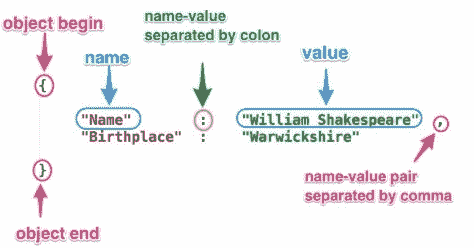

**JSON 数组**
JSON 数组是值的有序集合。值可以是字符串、数字、对象或数组本身。
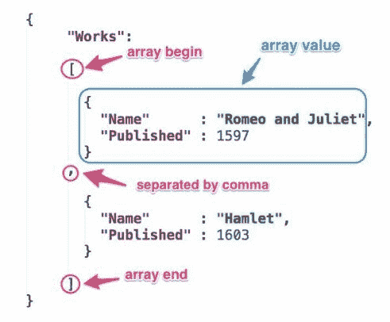

### 问
* 什么是 JSON？
* JSON 流行的主要原因是什么？
* JSON 和 XML 数据格式之间有什么显著区别？
* 为什么 JSON 成为数据交换的首选格式？
* 解释 JSON 对象和 JSON 数组之间的区别？

## 内存管理
#### 栈（Stack）与 堆（Heap）
* 栈是每个系统线程在创建时与之关联的内存；而堆是应用程序中所有线程共享的内存。
* 对于线程访问的每个函数，都会在栈顶分配一块内存，用于局部变量和簿记数据，这些内存会在函数返回时按后进先出（LIFO）顺序被释放。相比之下，堆中的内存分配是相对随机的，没有强制的模式，且堆上的变量需要手动销毁。
* 当线程退出时，与线程关联的栈会被回收。当应用程序进程退出时，堆内存会被回收。
* 分配和释放栈内存更简单快速，因为它就像调整指针一样简单。堆中的内存分配和释放相对复杂，因为没有固定的内存分配模式。
* 栈内存仅对所属线程可见，因此内存访问是直接的；而堆内存跨应用程序中的多个线程共享，因此与其他线程同步会影响性能。
* 当栈内存耗尽时，JVM 抛出 `StackOverflowError`；当堆空间耗尽时，JVM 抛出 `OutOfMemoryError`。

#### 栈和堆中的内存分配
此示例描述了在调用方法时栈和堆内存的分配。
* `num1` 和 `num2` 变量存储在栈中。
* 引用变量存储在栈中。
* `Point` 类的对象存储在堆中。
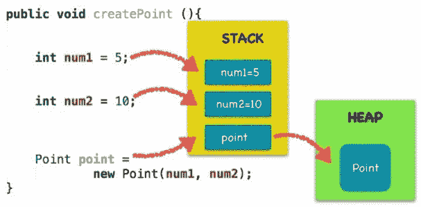

## 问题
* 什么是栈？
* 什么是堆？
* 在生命周期内，栈内存是如何分配和释放的？
* 栈内存何时被释放？
* 堆内存何时被释放？
* 为什么栈中的内存分配比堆快？
* 为什么你需要在堆上应用同步而不是栈上？
* 当栈内存耗尽时你会得到什么异常？
* 当堆内存耗尽时你会得到什么异常？
* 你需要显式释放栈上的对象吗？

#### 堆碎片
堆碎片发生在 Java 应用在一段时间内分配和释放大小不等的内存块，这导致在已用块之间分布着许多小的空闲内存块。这是一个大块。
堆碎片会导致长垃圾回收（GC）周期，因为 JVM 被迫使对堆进行压缩。通过增加堆大小等方法可以控制堆碎片。

## 问题
* 什么是堆碎片？
* 为什么会发生堆碎片？
* 谁负责减少堆碎片？
* 你如何控制堆碎片？
* 当堆碎片非常严重时会发生什么？
* 为什么堆碎片会减慢应用程序速度？

#### 对象序列化
将内存中对象的内容转换为字节以便持久化或传输被称为对象序列化。这些字节可以通过反序列化转换回对象。
在 Java 中，如果一个对象的类实现了 `java.io.Serializable` 或其子接口 `java.io.Externalizable`，则该对象是可序列化的。标记为 `transient` 的成员不会被序列化。`ObjectInputStream` 和 `ObjectOutputStream` 是专门用于读写对象的流类。

## 问题
* 什么是序列化和反序列化？
* 希望支持序列化的类型需要实现哪个接口？
* 你如何防止某个成员被序列化？
* Java 中哪些类用于序列化和反序列化对象？

#### 垃圾回收
Java 中的垃圾回收是识别并从内存中移除未引用的对象，并将剩余对象移动在一起以释放连续内存块的过程。当由于垃圾回收发生时，应用程序中所有运行的线程会在收集周期内暂停。垃圾回收器在守护线程（Daemon thread）上运行。
将所有存活对象移动在一起可以减少内存碎片，从而提高内存分配的性能。
在垃圾回收期间，对象根据其生存年龄移动到内存的不同区域，称为“代”。
System 类暴露了 `gc()` 方法，用于请求垃圾回收。当你调用 `System.gc()` 时，JVM 不保证立即执行垃圾回收，但可以在可能的时候执行。你也可以使用 `Runtime.getRuntime().gc()` 来请求垃圾回收。

## 问题
* 什么是垃圾回收？

## 垃圾回收概述

* 解释垃圾回收周期？
* 为什么垃圾回收被认为是一个昂贵的过程？
* 为什么垃圾回收周期提高应用程序的性能？
* 垃圾回收如何防止 `OutOfMemoryException`？
* 垃圾回收使用哪种类型的线程：守护线程还是用户线程？
* 什么是内存碎片？
* 为什么垃圾回收发生时应用程序似乎变慢了？
* 你可以显式地请求垃圾回收吗？
* 你调用哪些方法可以请求垃圾回收？
* 垃圾回收会在请求时总是发生吗？

## 内存管理

`JVM` 内存分为两大类：栈内存（stack）和堆内存（heap）。

### 栈内存
栈内存与每个系统线程相关，并在线程执行期间使用。栈包含方法中定义的局部对象和引用变量；尽管被引用的对象存储在堆中。一旦执行离开该方法，方法内声明的所有局部变量将从栈中移除。

### 堆内存
堆内存分为若干称为“代”的区域：

* **新生代 (New Generation)** - 它被分为 `Eden`（伊甸区）和 `Survivor`（幸存者区）。大多数新对象在 `Eden` 内存空间中创建。
* **老年代 (Old Generation)**
* **元空间 (Metaspace)**

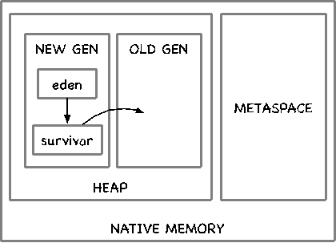

当新生代满时，会触发垃圾回收。在 `Eden` 中生存此 GC 周期的对象会被移动到 `Survivor` 空间。同样，在几次 `GC` 之后，存活的对象继续移动到老年代。`Metaspace` 被 `JVM` 用于保留永久对象，主要是类的元数据信息。新生代的垃圾回收频率比老年代高。

* `New Gen` 和 `Old Gen` 是堆的一部分，而 `Metaspace` 是原生内存（Native memory）的一部分。
* `Metaspace` 可以在运行时扩展，因为它是原生内存的一部分。

当垃圾回收发生时，所有应用程序线程都会被冻结，直到 GC 完成操作。老年代的垃圾回收通常很慢；因此，如果老年代发生大量垃圾回收，可能会导致应用程序超时错误。

## 问题
* 堆内存是如何划分的？
* 解释堆内存的不同代？对象是如何跨代移动的？
* 垃圾回收周期是如何触发的？
* 新生代内存中的 `Eden` 和 `Survivor` 空间是什么？
* `Eden` 中的对象何时移动到 `Survivor` 空间？
* 什么是 `Metaspace`？
* `Metaspace` 中存储的是什么类型的内容？
* 为什么 `Metaspace` 拥有几乎无限的空间？
* 哪一代的垃圾回收周期运行最慢？为什么？
* 哪代的垃圾回收频率更高？

## 弱引用 vs 软引用 vs 虚引用

通常，如果一个对象拥有引用，垃圾回收器就不会收集它。这一原则对于 `Weak`（弱引用）和 `Soft`（软引用）不成立。

### 弱引用 (Weak Reference)
弱引用是被垃圾回收器积极回收的引用。弱引用适用于缓存，可以在需要时重新加载。

### 软引用 (Soft Reference)
软引用比 `Weak Reference` 略强，因为只有在存在内存限制时才会被垃圾回收器收集。软引用通常用于缓存可重建的资源，如文件句柄等。

### 虚引用 (Phantom Reference)
虚引用是 `Java` 中最弱的引用。它在对象被终结（finalize）后被引用，但内存尚未被垃圾回收器回收。它主要用于跟踪内存使用的技术目的。

## 问题
* 什么是弱引用？
* 什么是软引用？
* 什么是虚引用？
* 哪些类型的引用会被垃圾回收器收集，即使其类型的对象仍在使用？
* 软引用和弱引用之间的区别是什么？
* 弱引用的典型用法是什么？
* 软引用的典型用法是什么？
* 虚引用的典型用法是什么？
* 先收集的是软引用还是弱引用？

## 单元测试 (UNIT TESTING)

## 为什么单元测试？
两个最重要的原因：
* 你只有通过亲身实践才能理解真正的收益。
* 单元测试能让你晚上睡个安稳觉。

其他重要原因：
* 单元测试对代码更改的成功/失败提供立即且持续的反馈。
* 单元测试增加了进行重大更改的信心，而不必破坏任何现有功能。
* 单元测试帮助你理解代码的内部和设计。
* 单元测试还可以作为各种编码场景的文档。
* 单元测试通过减少对不同场景的多次手动验证周期，从长期来看节省了时间。

## 问题
* 单元测试的好处是什么？
* 单元测试从长期来看如何节省时间？
* 你如何使用单元测试来记录编码场景？

## 单元测试 vs 集成测试 vs 回归测试 vs 验证测试
* **单元 (Unit)**：单元测试在编写代码时持续进行，以获得对最小的可测试更改的即时反馈。最小的可测试单元可以跨越方法或类，但必须排除外部依赖，如 `File I/O`、`Databases`（数据库）、`Network Access`（网络访问）等。
* **集成 (Integration)**：当一个场景的所有更改完全实现后，进行端到端集成测试。
* **回归 (Regression)**：回归测试是在整个软件上执行的一系列测试，以发现功能性和非功能性区域的错误。回归测试通常在增强、软件更新等之后进行。
* **验证 (Validation)**：验证测试用于验证在更新或部署软件后，更改是否按照要求执行的。

## 问题
* 什么是单元测试？
* 什么是集成测试？
* 什么是回归测试？
* 集成测试和回归测试有什么区别？
* 什么是验证测试？

## 测试私有成员 (Testing Private Members)

私有成员可以使用反射进行测试，但建议仅在测试遗留代码时这样做。

### 使用
以下代码演示了使用反射访问 `Account` 的私有字段。

```java
public class Account {

    private float rate = 10.5f;

}

@Test
public void testConcatenate() throws 
    IllegalAccessException, 
    NoSuchFieldException {

    Account account = new Account();
    Class<? extends Account> refClass = account.getClass();
    Field field = refClass.getDeclaredField("rate");
    field.setAccessible(true);
    assertEquals(10.5f, field.get(account));
}
```

如所述，不建议使用反射访问私有字段；我们有以下其他测试私有方法的方法：
* 通过公共方法进行测试。
* 如果可能，更改字段的访问修饰符。
* 修改类设计。

## 问题
* 测试私有成员的不同方法有哪些？
* 你可以使用 `Reflection`（反射）测试私有成员吗？
* 为什么不应该使用反射测试私有成员？
* 测试私有成员的各种方法有哪些？

## 模拟对象 (Mock Objects)
* 模拟对象帮助你隔离并仅测试类中的条件逻辑，无需测试依赖项。
* 在模拟对象中，你可以实现测试所需的部分功能，而无需实现完整的依赖对象。
* 你不需要担心理解依赖的内部实现，这有助于缩短开发时间。

## 问题
* 什么是模拟对象？
* 使用模拟对象有什么好处？
* 为什么模拟对象有助于加速测试？
* 为什么在单元测试中应该使用模拟对象？
* 哪些类型的依赖应该用模拟对象来替换？

## JAVA 开发工具

## Git
`Git` 是一个源代码管理系统。它的分布式版本控制系统 (`DVCS`) 允许多个工程师和团队并行工作。`Git` 的主要重点是在保持数据完整性的同时提供快速响应。`Git` 还提供了在网络不可用时离线执行几乎所有操作。网络可用时，可以将所有更改推送到网络服务器。

让我们讨论一下几个常用的术语：
* `Repository`（仓库） - 包含所有项目文件的目录。
* `Clone`（克隆） - 创建本地仓库的工作副本。
* `Branch`（分支） - 用于封装新功能的开发或修复 Bug。
* `HEAD` - 指向最后一次提交。
* `Commit`（提交） - 将更改提交到 `HEAD` 而不是远程仓库。
* `Pull`（拉取） - 从远程仓库获取更改到本地仓库。
* `Push`（推送） - 将本地仓库更改提交到远程仓库。

### Git 工作流结构
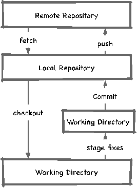

## 问题
* 什么是分布式版本控制系统？
* 为什么要使用版本控制系统？
* 使用版本控制系统时通常执行哪些活动？
* 请解释代码的分支策略？

## Maven
`Maven` 是一个软件项目管理框架，负责项目构建、依赖解析、测试、部署、报告等。`Maven` 基于约定而非复杂的配置。`Maven` 由 `pom.xml`（也称为项目对象模型）文件管理，该文件便于定义各种任务（或 `goals`），并有一个专门的区域来指定各种项目依赖，这些依赖由 `Maven` 进行解析。

## 问题
* 为什么需要一个依赖解析框架——你不能手动下载文件并添加引用吗？
* `Maven` 支持哪些功能？
* 为什么说 `Maven` 是基于约定的？
* `Maven` 中 `goals` 的什么含义？

## Jenkins
持续集成 (Continuous Integration)
持续集成是一种实践，即在同一代码仓库上并行工作的工程师频繁合并他们的更改。每次提交后都会紧随着一系列自动化活动，旨在验证提交的更改。提交后的典型自动化活动包括：
* 从仓库获取更改，
* 执行自动化构建。
* 执行不同的测试，如单元测试、集成测试、验证等。
* 部署更改。
* 发布结果。

`Jenkins` 是一个用于持续集成的开源 Web 工具。`Jenkins` 提供了配置选项来配置和执行上述所有活动。可用的配置选项包括：配置 `JDK`、安全、构建脚本；与 `Git`、`Ant`、`Maven`、`Gradle` 等集成；部署等。作业的执行可以与某些事件关联，也可以基于时间的调度。

## 问题
* 什么是持续集成？
* 持续集成框架应该支持哪些不同的活动？
* 解释 `Jenkins` 支持持续集成的能力？
* 如何将第三方工具集成到 `Jenkins` 中？

# JAVA 面试课程
