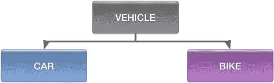
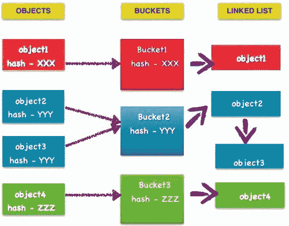
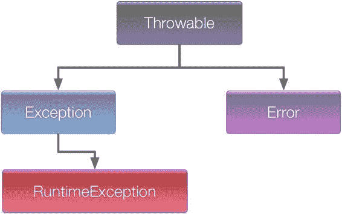
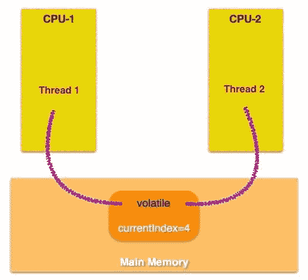
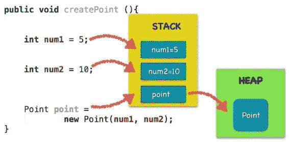
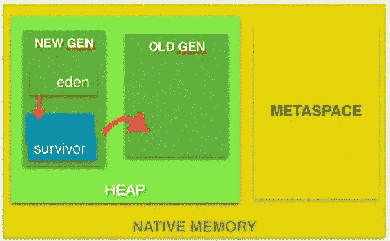
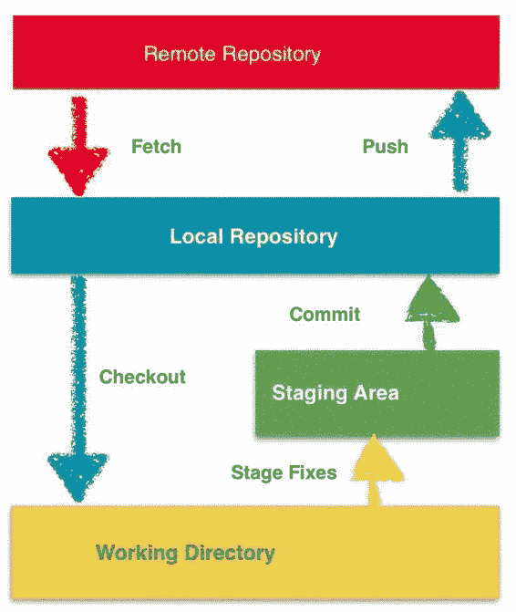

# Java 面试笔记

## 匿名内部类的创建

```java
// 外部类
public class CityNames {
    private List<String> cityNames = new ArrayList<>();
    public Iterator<String> nameIterator() {
        // 匿名内部类
        Iterator<String> nameIterator = new Iterator<String>() {
            @Override
            public boolean hasNext() {
                return false;
            }
            @Override
            public String next() {
                return null;
            }
        };
        // 返回局部内部类的实例。
        return nameIterator;
    }
}
```

## 注意

- 不要返回内部类对象，因为这会导致内存泄漏，因为它持有对外部外部类的引用。
- 当你希望防止在其他地方使用该类时，使用匿名类。
- 必须避免匿名类和内部类的序列化，因为不同的 JRE 实现可能会导致兼容性问题。

## 问题

- 什么是匿名内部类？
- 匿名内部类和局部内部类有什么区别？
- 为什么你不应该从方法返回内部类对象？
- 如果你想防止别人在外部使用你的类，你会定义哪种内部类？
- 为什么应该避免匿名类和内部类的序列化？

## 函数式编程

### 函数式接口

`Functional Interface` 是只有一个抽象方法的接口；但可以有任意数量的默认方法。

```java
@FunctionalInterface
public interface Greator<T> {
    T greater(T arg1, T arg2);
}
```

注解 `@FunctionalInterface` 在接口不是有效的函数式接口时产生编译器警告。

### 函数式接口 Greater

```java
@FunctionalInterface
public interface Greator<T> {
    T greater(T arg1, T arg2);
}
```

`Account` 类定义如下，用作函数接口 `Greater` 的参数使用。

```java
public class Account {
    private int balance;

    public Account(int balance) {
        this.balance = balance;
    }

    public int getBalance() {
        return balance;
    }

    @Override
    public String toString() {
        return "Account{" +
                "balance=" + balance +
                '}';
    }
}
```

### Lambda Expression

下面的代码演示了如何使用 `Lambda expression` 来查找余额更大的账户。同样，相同的函数接口 `Greater` 也可以用于其他类似的业务对象。

```java
public static void main(String[] args) {
    Greator<Account> accountComparer =
            (Account acc1, Account acc2) ->
                    acc1.getBalance() > acc2.getBalance() ?
                            acc1 :
                            acc2;
    Account account1 =
            new Account(6);
    Account account2 =
            new Account(4);
    System.out.println(
            " Account with greater balance: " + accountComparer.greater(account2, account1));
}
```

Java 还为最常见的场景提供了一组预定义的函数接口。

## Questions

- 什么是函数接口（Functional Interface）？
- 使用函数接口有什么好处？

### Lambda Expression

`Lambda expressions` 为创建`匿名类`提供了一种方便的方法。`Lambda expressions` 以更紧凑的方式实现了`函数接口`。当你想要将某些功能作为参数传递给另一个方法，并推迟该功能的执行直到恰当的时机时，`Lambda Expressions` 非常有用。

Lambda 表达式可以仅仅是一个带有方法体和可选参数类型的语句块，但没有方法名或返回类型。它可以作为方法参数传递，并存储在变量中。

```java
// lambda expressions
() -> 123
(x, y) -> x + y
(Double x, Double y) -> x * y
```

## Questions

- 什么是 Lambda Expression？
- Lambda Expression 和匿名类之间有什么关系？
- 你可以将 Lambda Expression 作为方法参数传递吗？
- 使用 Lambda Expression 时，功能延迟执行意味着什么？
- 使用 Lambda Expression 有什么好处？
- Lambda Expression 和函数接口之间有什么关系？

### Pure Functions

纯函数（Pure Functions）是指结果仅取决于传递给它的参数的函数，不受应用程序中任何状态变化的影响，也不会改变应用程序的状态。纯函数对于相同的参数始终返回相同的结果。

```java
public int increaseByFive(int original) {
    int toAdd = 5;
    return original + toAdd;
}
```

## Questions

- 什么是纯函数（Pure Function）？
- 纯函数在函数式编程中的作用是什么？
- 如何保证纯函数对于相同的参数总是相同的结果？

### Fluent Interface

`Fluent interface`（流式接口）用于将命令传递给后续调用，无需创建中间对象，并通过方法链实现。当链式方法返回 `void` 时，`fluent interface` 链结束。`Fluent interface` 通过减少不必要的对象创建数量提高了可读性。

在下面的代码中，`Fluent Interface` 被用于添加新的员工（Employee）。

```java
employee.create()
        .atSite("London")
        .inDepartment("IT")
        .atPosition("Engineer");
```

流式接口主要用于构建查询、创建一系列对象或按层次顺序构建节点的场景。

## Questions

- 什么是流式接口（Fluent Interface）？
- 定义和使用流式接口有什么好处？
- 描述流式接口的一些用法？

### Generics

`Generics`（泛型）是一种机制，允许同一类型（类或接口）或方法操作不同类型的对象，同时提供编译时的类型安全。`Generics` 的引入是为了强制类型安全，特别是对于集合类。

- 一旦在泛型中定义了参数类型，对象将仅与定义的类型协同工作。
- 在 `generics` 中，`形式类型参数`（下例中的 `E`）用类型（类或接口）指定：

```java
// Generic List 类型
// E 是类型参数
public interface List<E> {
    void add(E x);
    Iterator<E> iterator();
}
```

- 在 `generics` 中，当声明类型变量或创建类型类型对象时，会指定`参数化类型`（本例中 `Integer`）：

```java
// 声明了 List 类型变量
// 使用 Integer 参数类型
List<Integer> integerList = new ArrayList<Integer>();
```

## Notes

- 泛型中有一个通用的参数命名约定。`E` 代表元素（element），`T` 代表类型（type），`K` 代表键（key），`V` 代表值（values）。
- 泛型是编译支持。所有类型参数在编译期间都会删除，这个过程被称为擦除。
- 由于强类型检查，泛型避免了许多 `ClassCastException` 实例发生。

#### Generic Class Example

- 以下 `NodeId` 泛型类的定义可以用于任何类型的对象。

```java
// 带有类型参数的 NodeId 泛型类
public class NodeId<T> {
    private final T Id;
    public NodeId(T id) {
        this.Id = id;
    }
    public T getId() {
        return Id;
    }
}
```

- 常用的`父类型 – 子类型`（SuperType – SubType）规则不适用于泛型。在本例中，尽管 `Integer` 派生自 `Object`，但带有 `Integer` 参数的 `NodeId` 仍然不能赋值给带有 `Object` 参数的 `NodeId`：

```java
// 参数类型 Object
NodeId<Object> objectId = new NodeId<>();

// 参数类型 Integer
NodeId<Integer> integerId = new NodeId<>(1);
```

## Questions

- 什么是泛型（Generics）？
- 泛型为集合提供了哪些好处？
- “泛型是编译支持”这句话是什么意思？泛型不是运行时的吗？

### Type Wildcards

泛型中的通配符以 `?` 的形式表示。例如，接收 `List<?>` 作为参数的方法可以接受任何类型的 List。

```java
public void addVehicles(List<?> vehicles) {
    //...
}

// 只能添加 Truck 车辆
public void addVehicles(List<? extends Truck> vehicles) {
    //...
}
```

## Notes

- 不要在返回值中使用通配符，因为知道方法的返回值更安全。

### Upper Bound

为了实施限制，可以在类型参数上设置上界（Upper Bound）。上界限制方法接受扩展自指定数据的未知类型参数，如示例中的 `Number`。

```java
// 上界通配符
public void addIds(List<? extends Number> T) {}
```

### Lower Bound

为了实施限制，可以在类型参数上设置下界（Lower Bound）。下界限制方法接受指定数据的父类的未知类型参数，如下例中的 `Float`。

```java
// 下界通配符
public void addIds(List<? super Float> T) {}
```

### Type Inference

类型推断（Type Inference）是编译器通过方法调用和声明来推断类型参数的能力。

在泛型中，称为`钻石运算符`的 `<>` 有助于类型推断。

```java
// 使用钻石操作符的类型推断
List<Integer> integerList = new ArrayList<>();
```

## Questions

- 泛型中的类型通配符（Type Wildcards）是什么？
- 解释上界通配符？
- 解释下界通配符？
- 泛型中如何使用不同的类型通配符？
- 泛型中的自动类型推断是什么？泛型中的钻石运算符是什么？

### Generic Method

泛型方法定义自己的类型参数。

```java
// 泛型方法
public <T> void addId(T id) {}
```

- 如果我们从上述方法中移除 `<T>`，会导致编译错误，因为它代表了泛型方法中类型参数的声明。
- 拥有泛型方法的类型（类或接口）不需要是泛型类型。
- 在调用泛型方法时，我们不需要显式指定类型参数。

### 注意事项

- 优先使用泛型（Generics）和参数化类/方法来强制编译时类型安全。
- 使用边界类型参数（Bounded Type parameter）来增加方法参数的灵活性，同时它也有助于限制可以使用的类型。

## 问题

- 解释什么是泛型方法？
- 你可以在非泛型类型中添加泛型方法吗？
- 将边界类型定义为方法参数的处是什么？
- 泛型是如何强制执行编译类型安全的？

# Java 泛型 vs Java 数组

## Java Generics

考虑以下层级结构：



由于 `Car` 和 `Bike` 均派自 `Vehicle`，是否可以将 `List<Car>` 或 `List<Bike>` 赋值给 `List<Vehicle>` 变量？

实际上不能，`List<Car>` 或 `List<Bike>` 不能替换为 `List<Vehicle>`，因为你不能在一个包含汽车的列表中放入一辆自行车。所以，即使 `Bike` 是一个 `Vehicle`，它也并不是一个 `Car`。

```java
List<Bike> bikes = new ArrayList<Bike>();
// 假设这是允许的
List<Vehicle> vehicles = bikes;
vehicles.add(new Car());

// Error - Bike 和 Vehicle 被认为是不兼容的类型。
Bike bike = vehicles.get(0);
```

Java 编译器会在编译时对这些不兼容的类型进行检查。更多信息请参考 类型擦除。

## Java Array

然而，与泛型不同，`Car` 数组可以赋值给 `Vehicle` 数组：

```java
Car[] cars = new Car[3];
Vehicle[] vehicles = cars;
```

对于数组，尽管编译器允许上述代码编译，但当你运行这段代码时，会得到 `ArrayStoreException`。

```java
// 这将导致 ArrayStoreException
vehicles[0] = new Bike();
```

所以，即使编译器没有捕获此问题，运行时类型系统捕获了它。数组是可实例化类型（reifable types），这意味着运行时感知其类型。

## 问题

- 什么是可实例化类型（reifable types）？
- 为什么不能将子类型的泛型集合对象赋值给父类型的泛型集合对象？
- 为什么允许将子类型的数组对象赋值给父类型的数组对象？Java 数组比泛型更具多态性吗？

# Type Erasure

对于 Java 泛型类型，由于被称为 `type erasure` 的过程，Java 编译器会丢弃类型信息，这些信息在运行时是不可用的。由于类型信息在运行时不可用，Java 编译器会格外小心在编译阶段就阻止你，防止任何堆污染。

泛型类型也属于非可实例化类型（`non-reifiable`），这意味着它的类型信息在编译期间被移除了。

## 问题

- 什么是非可实例化类型？
- 什么是类型擦除？
- 如果没有类型擦除会发生什么？

# Co-variance

`Covariance`（协变）是一种概念，你可以从带有上限类型通配符定义的泛型中读取项，但不能向集合中写入任何内容。

考虑以下带有上限类型通配符的声明：

```java
List<? extends Vehicle> vehicles = new ArrayList<Bike>();
```

你允许从 `vehicles` 泛型集合中读取，因为列表中存在的任何内容都是 `Vehicle` 的子类，并且可以向上转换为 `Vehicle`。

```java
Vehicle vehicle = vehicles.get(0);
```

然而，你不允许向协变结构中放入任何内容。

```java
// 这是编译错误
vehicles.add(new Bike());
```

这是不允许的，因为 Java 无法保证泛型结构中对象的实际类型。它可以是任何扩展 `Vehicle` 的类型，但编译器无法确定。所以你可以读取，但不能写入。

## 问题

- 解释什么是协变？
- 为什么不能向带有上限类型通配符定义的泛型中添加子类元素？

# Contra-variance

`Contra-variance`（逆变）是一种概念，你可以向带有下界类型通配符定义的泛型中写入项，但不能从集合中读取任何内容。

考虑以下带有下界类型通配符的声明：

```java
List<? super Car> cars = new ArrayList<Vehicle>();
```

在这种情况下，尽管 ArrayList 是 `Vehicle` 类型，你也可以通过逆变向其中添加 `Car`；因为 `Car` 派生自 `Vehicle`。


```java
cars.add(new Car());
```

然而，你不能假设你会从这个逆变结构中获得一个 `Car` 对象。

```java
// 这是编译错误
Car vehicle = cars.get(0);
```

## 问题

- 解释什么是逆变？
- 为什么不能从带有下界类型通配符定义的泛型中读取元素？

# Co-variance vs Contra-variance (协变 vs 逆变)

- 当你只打算从集合中读取泛型值时，使用 `covariance`（协变）；
- 当你只打算向集合中添加泛型值时，使用 `contra-variance`（逆变）；
- 当你打算同时对集合进行读取和写入时，使用特定的泛型类型。

## 问题

- 你什么时候应该使用协变？
- 你什么时候应该使用逆变？

# COLLECTIONS (集合)

## Collections (集合)

集合是创建任何生产级 Java 应用程序的基础构建块。面试官对理解与集合正确用法相关的不同方面感兴趣。

问题通常用于检查面试者是否理解集合的正确用法以及是否了解可选的替代方案。

以下是关于集合的问题涉及：

- Java 中的集合类型。
- 不同集合类型的特性。
- 同步集合。
- 并发集合。
- 集合元素的排序。
- 从集合读取的速度。
- 写入集合的速度。
- 集合元素的唯一性。
- 集合间的操作。
- 只读集合。
- 集合遍历。

## Collection Fundamentals (集合基础)

集合是一个将多个元素组合的容器。这是一个简单的集合示例：

```java
// 创建城市列表
List<String> cities = new ArrayList<>(); 
// 添加城市名称
cities.add("London"); 
cities.add("Edinburgh"); 
cities.add("Manchester");
```

### 注意事项

- 集合处理引用类型。
- 所有的集合接口实现都是泛型的（Generic）。
- 所有的集合类型都可以增长或缩小，与数组不同。
- Java 提供了许多根据其用法操作集合的方法，因此在添加之前，始终检查已有的方法。

## Collection Framework (集合框架)

集合框架由以下组件定义：

- `Interfaces`（接口）：是为每个特定用法和集合类型定义的抽象类型。
- `Implementation`（实现）：是用于创建表示不同类型集合对象的具体实现类。
- `Algorithms`（算法）：应用于这些集合，以执行各种计算并操作集合中的元素。

`Collection Framework`（集合框架）通过提供数据结构和对其操作的算法来减少编程工作量。

## 问题

- 解释集合？
- 集合和泛型有什么关系？
- 你可以在基本类型上使用集合吗？
- 你如何可以在基本类型使用集合？
- 解释集合和数组的区别？
- 集合框架的好处是什么？
- 集合框架的不同组件有哪些？

接口通过其定义的方法签名来定义其行为。使用集合时，你应该始终针对集合接口编写代码，而不是类实现，这样代码就不会依赖于特定的实现。这可以防止底层实现类可能发生的变化的影响。

以下是定义集合及其行为最重要的接口。下方的每个子节点都继承自其父节点。

- `Collection`
    - `Queue`
        - `BlockingQueue`
        - `TransferQueue`
        - `BlockingDeque`
        - `Deque`
- `BlockingDeque`
    - `List`
    - `Set`
    - `SortedSet`
    - `NavigableSet`
- `Map`
    - `SortedMap`

## 问题

- 为什么你应该针对集合接口编写代码而不是具体的实现？

## 集合类型

- `Set` - `Set` 包含唯一元素。
- `List` - `List` 是一个有序集合。
- `Queue` - `Queue` 以先进先出 (FIFO) 的方式在处理前持有元素。
- `Deque` - `Deque` 以先进先出 (FIFO) 和后进先出 (LIFO) 两种方式在处理前持有元素。
- `Map` - `Map` 包含键到对应值的映射。

## 问题

- 有哪些不同的集合类型？
- 定义 `Set` 集合类型？
- 定义 `List` 集合类型？
- 定义 `Queue` 集合类型？
- 定义 `Deque` 集合类型？
- 定义 `Map` 集合类型？
- `Queue` 和 `Deque` 之间的区别是什么？

## Set

### Basic Set

```java
// 创建一个 set
Set<String> set = new HashSet<>();
```

- `Set` 是唯一元素的集合。
- `Set` 中的元素是无序存储。
- `Set` 中只能添加一个 `null` 元素。
- 重复元素会被忽略。
- 当不需要排序时，`Set` 最快且内存占用较小。

### Linked Hashset

```java
// 创建一个 linkedHashSet
Set<String> linkedHashSet = new LinkedHashSet<>();
```

- `LinkedHashSet` 保持 `Set` 元素与其插入时的相同顺序。
- 如果在 `LinkedHashSet` 中重新插入一个元素，插入顺序不会受影响。
- `LinkedHashSet` 中的 `Iterator` 按照这些元素添加到集合的相同顺序返回元素。

### Sorted Set

- `SortedSet` 强制对元素进行排序，要么通过实现 `Comparable` 接口按自然顺序排序，要么使用 `Comparator` 对象进行自定义排序。
- `TreeSet` 是 `SortedSet` 接口的一个实现类。

```java
// 创建按城市名称排序的集合
SortedSet<String> cityNames = new TreeSet<>();
```

- 使用 `Comparator` 对象执行自定义排序。

```java
SortedSet<City> sortedCitiesByName = new TreeSet<>(Comparator.comparing(City::getName));
```

- 如果元素实现了 `Comparable` 接口，则使用 `compareTo()` 方法按自然顺序排序。

### Navigable Set

- `NavigableSet` 继承自 `SortedSet` 并定义了额外方法。
- `NavigableSet` 可以按升序和降序两种顺序进行遍历。
- `TreeSet` 是 `NavigableSet` 接口的实现类之一。

## 问题

- 你可以在 `Set` 中添加重复元素吗？
- 当不需要排序时，你应该使用哪种集合类型？为什么？
- 你可以向 `Set` 添加 `null` 元素吗？
- 你应该使用哪个 `Set` 类来维护插入顺序？
- 如果在 `Set` 中再次插入相同的元素，排序会发生什么？它会保持原始位置还是插入到末尾？
- 你应该使用哪个 `Set` 类来确保元素的顺序？
- 当你需要双向方向遍历时，你应该使用哪个 `Set` 类？

## LIST

- `List` 是对象的有序集合。
- `List` 可以有重复元素。
- `List` 可以有多个 `null` 元素。
- 在 `List` 中，元素可以添加到任何位置。
- 使用 `ListIterator`，列表可以正向和反向两个方向进行迭代。

```java
// 创建一个城市列表
List<String> cities = new ArrayList<>();
```

### ArrayList

- `ArrayList` 基于数组。
- 如果你频繁访问元素，它的性能更好。
- 在 `ArrayList` 中添加和删除较慢。如果在任何位置（末尾除外）添加元素，需要移动元素。如果添加的元素超过了容量，则会将整个数组复制到新分配的地方。

### Linked List

- `LinkedList` 基于列表。
- `LinkedList` 访问元素较慢，且只允许顺序访问。
- 在 `LinkedList` 中添加和删除元素更快。
- `LinkedList` 比 `ArrayList` 消耗更多内存，因为它保留了指向相邻元素的指针。

### List Iterator

- `ListIterator` 在两个方向上迭代列表。

```java
// 全量列表迭代器
ListIterator<String> fullIterator = cityList.listIterator();
// 部分列表迭代器，从索引 3 开始
ListIterator<String> partialIterator = cityList.listIterator(3);
```

## Notes

- `ArrayList` 的随机访问性能更好，因为它为元素维护了基于索引的系统，而 `LinkedList` 的开销更大，因为它需要遍历所有元素。

## 问题

- 你可以向 `List` 添加重复元素吗？
- 你可以向列表添加 `null` 元素吗？
- 在什么情况下你会使用 `ArrayList`：频繁添加/更新还是频繁读取？
- 在什么情况下你会使用 `LinkedList`：频繁添加还是频繁读取？
- `ArrayList` 和 `LinkedList` 之间，哪一个消耗更多内存？
- `ArrayList` 和 `LinkedList` 之间，哪一个适合随机访问？

## Queue

- `Queue` 是在处理前持有元素的集合。
- `Queue` 有两个端：头和尾。
- `Queue` 以先进先出 (FIFO) 的方式工作。

### Types of Queues

- `Deque` - 允许从两端操作的队列。
- `BlockingQueue` - 在满时阻塞添加，在空时阻塞移除。
- `Transfer Queue` - 在线程之间传输数据的特殊 `BlockingQueue`。
- `BlockingDeque` - `Deque` 和 `BlockingQueue` 的结合。
- `Priority queue` - 按优先级移除元素。
- `Delay queue` - 在关联的延迟后允许移除。

### Basic Queue

- `Queue` 有一个入口点（尾）和一个出口点（头）。
- 如果入口和出口点相同，则它是后进先出 (LIFO) `queue`。

```java
// 简单队列
Queue<String> queue = new LinkedList<>();
```

### Priority Queue

- 在 `PriorityQueue` 中，优先级与元素相关。
- 下一个移除优先级最高的元素。
- `PriorityQueue` 不允许 `null` 元素。
- 队列元素实现 `Comparable` 接口或使用 `Comparator` 对象计算优先级。

```java
// City 实现 Comparable 接口
Queue<City> pq = new PriorityQueue<>();
```

### Deque

- `Deque` 允许从两端插入和移除。
- `Deque` 不提供对元素的索引访问。
- `Deque` 继承 `Queue` 接口。

```java
// 创建一个 Deque
Deque<String> deque = new LinkedList<>();
```

### Blocking Queue

- `BlockingQueue` 接口继承自 `Queue`。
- `BlockingQueue` 设计为线程安全的。
- `BlockingQueue` 设计用于生产者消费者队列。

### Transfer Queue

- `TransferQueue` 扩展 `BlockingQueue`。
- 它可能是有界的，`生产者` 可能等待空间可用和/或 `消费者` 可能等待元素可用。

```java
// 传输队列
TransferQueue<String> ltq = new LinkedTransferQueue<String>();
```

## 问题

- `Queue` 的目的是什么？
- `Deque` 和 `Queue` 有什么不同？
- 什么是优先级队列？
- 从优先级队列中移除元素的标准是什么？
- 什么是延迟队列？
- 哪种队列是线程安全的队列？
- 哪种队列实现了生产者消费者模式？
- 解释 `Blocking Queue` 和 `Transfer Queue` 的区别？
- 哪种 `Queue` 是容量限制的，允许 `Queue` 中只有指定数量的元素？如果尝试放入超过其容量的元素会发生？

# Map

- `Map` 包含键值映射。
- 通常 `Map` 允许一个 `null` 作为键以及多个 `null` 作为值，但具体限制取决于 `Map` 实现类的定义。

## Implementation

### HashMap

- `HashMap` 基于哈希表（hash table）。
- `HashMap` 不保证 map 中元素的顺序。
- `HashMap` 的哈希函数为 `get` 和 `put` 操作提供常数时间性能。
- `HashMap` 允许一个 `null` 键和多个 `null` 值。

```java
// 使用 HashMap 创建一个 map
Map<String, String> hashMap = new HashMap<>();
```

### LinkedHashMap

- `LinkedHashMap` 是 `Map` 接口的基于哈希表和链表的实现。
- `LinkedHashMap` 使用双向链表存储条目。
- 如果需要保持插入顺序，请使用 `LinkedHashMap` 代替 `HashSet`。
- `HashMap` 的性能略优于 `LinkedHashMap`，因为 `LinkedHashMap` 还需要维护链表。
- 它确保按照插入顺序对条目进行迭代。

```java
// LinkedHashMap
LinkedHashMap lhm = new LinkedHashMap();
```

### WeakHashMap

- `WeakHashMap` 仅对其键存储弱引用（weak references）。
- `WeakHashMap` 同时支持 `null` 键和 `null` 值。
- 当没有引用指向键时，它们将成为垃圾回收的候选。

```java
// WeakHasMap
Map map = new WeakHashMap();
```

### Sorted Map

- `SortedMap` 对其键提供完全排序。
- 根据自然排序（`Comparable`）或自定义排序（`Comparator`）对 map 条目进行键排序。
- `SortedMap` 接口继承自 `Map`。

```java
// 排序 map
SortedMap<String,String> sm = new TreeMap<>();
```

### Navigable Map

- `NavigableMap` 扩展了 `SortedMap` 接口。
- `TreeMap` 类是 `NavigableMap` 的实现。
- `NavigableMap` 可以以升序和降序方式访问。
- 它支持双向导航并获取键的最接近匹配项。

```java
// 创建一个 Navigable Map
NavigableMap<String,String> nm = new TreeMap<>();
```

### Concurrent Map

- `ConcurrentHashMap` 是 `ConcurrentMap` 接口的具体实现。
- `ConcurrentMap` 通过将 map 划分为多个桶（buckets）并单独锁定每个桶实现细粒度同步机制。
- `ConcurrentHashMap` 在从 map 读取时不会锁定 map。

```java
// 创建一个 Concurrent Map
ConcurrentMap<String,String> cm = new ConcurrentHashMap<>();
```


## Notes

* `Map` 的键和 `Set` 的项不能更改状态，因此这些必须是不可变对象。
* 为了避免实现 `hashCode()` 和 `equals()`，优先使用 JDK 提供的不可变类作为 `Map` 的键。
* 永远不要向调用者暴露集合字段，而是提供方法来操作这些字段。
* `HashMap` 在 map 中插入、定位和删除元素方面提供了更好的性能。
* 如果你需要按排序顺序遍历键，`TreeMap` 更好。

## Questions

* Map 与其他集合有什么区别？
* 你可以向 Map 中添加 `null` 值作为键吗？
* 你能保证 `HashMap` 中元素的顺序吗？
* `HashMap` 如何能够为 `get` 和 `put` 操作提供常数时间性能？
* `HashMap` 和 `LinkedHashMap` 的区别是什么？
* 如果要保持插入顺序，你会使用哪一个：`LinkedHashMap` 还是 `HashSet`？为什么？
* 什么是 `WeakHashMap`？
* 当你想维护键的顺序时，你会使用哪种 Map 类？
* 你使用哪种 Map 类来以升序和降序访问？
* 哪种 Map 实现针对线程安全进行了优化？
* `ConcurrentHashMap` 如何实现扩展性并同时保持良好的性能？
* 为什么用于 Map 的键和用于 Set 的值应该是不可变类型？
* 向调用者暴露内部集合对象有什么坏处？
* 如果你想按排序顺序遍历集合，哪种集合最好？

# Algorithms

* `Sorting` - 用于按升序或降序对集合排序。你可以使用自然顺序（如果 `key` 类实现了 `Comparable` 接口），或者需要传递 `Comparator` 对象进行自定义排序。
* `Searching` - `BinarySearch` 算法用于搜索键。
* `Shuffling` - 它按随机顺序重新排列列表中的元素，通常用于游戏。
* `Data Manipulation` - 提供 `reverse`、`copy`、`swap`、`fill` 和 `addAll` 算法对集合元素执行通常的数据处理。
* `Extreme Value` - 提供 `min` 和 `max` 算法用于查找指定集合中的最大值。

## Questions

* 集合框架支持哪些不同的算法？
* 使用哪种搜索算法搜索键？
* 如何使用洗牌（shuffling）算法？

## Comparable vs Comparator

* 实现 `Comparable` 接口按自然顺序排序集合元素，`Comparator` 对象用于执行自定义排序。
* 如果元素实现了 `Comparable`，则使用 `compareTo()` 方法进行排序。
* `Comparator` 对象用于执行自定义排序。

```java
// Comparable 接口实现

@Override public int compareTo(Employee employee) {

    // 比较逻辑

}
```

```java
// 使用 Comparator

SortedSet<City> sortedCities = new TreeSet<>(Comparator.comparing(City::getName));
```

* `Comparator` 通常用于在你无法完全控制该类时。

## Questions

* `Comparable` 接口和 `Comparator` 类有什么区别？
* 你何时实现 `Comparable` 接口来排序集合？
* 你何时使用 `Comparator` 类来排序集合？

# hashCode() and equals()

* `HashTable`、`HashMap` 和 `HashSet` 使用 `hashCode()` 和 `equals()` 方法来计算和比较作为键的对象。
* Java 中的所有类都继承自 `java.Object` 基类方案，除非它们重写了 `hashCode()` 方法。
* 任何重写了 `hashCode()` 方法的类也应该重写 `equals()` 方法。

## Implementation of hashCode() and equals()

```java
final public class Employee {

    final private int id;

    final private String name;

    final private String department;

    @Override public boolean equals(Object o) {

        if (this == o) return true;

        if (o == null || getClass() != o.getClass()) return false;

        Employee employee = (Employee) o;

        if (id != employee.id) return false;

        if (name != null ? !name.equals(employee.name) : employee.name != null) return false;

        return !(department != null ? !department.equals(employee.department) : employee.department != null);

    }

    @Override public int hashCode() {

        int result = id;

        result = 31 * result + (name != null ? name.hashCode() : 0);

        result = 31 * result + (department != null ? department.hashCode() : 0);

        return result;

    }

}
```

## Rules of hashCode and equals

* 对象一旦创建，在其生命周期内必须始终报告相同的哈希码。
* 相同类的相等对象必须返回相同的哈希码。

> **注意**
>
> 两个不相等的对象可能具有相同的哈希值（hash-code）。

## `hashCode()` 和 `equals()` 的用法

* `hashCode()` 和 `equals()` 方法用于将项隔离开不同的桶（buckets）中，以提高查找效率。如果两个 `Items` 具有相同的哈希值，那么它们将将被存储在**同一个桶**中，并通过链表连接。
* 如果两个对象的哈希值不同，则不会调用 `equals()` 方法；否则，会调用 `equals()` 方法来比较它们是否相等。

下图构性地从概念上展示了对象在哈希桶中的存储情况。



## 问题

* Java 中哪些使用了 `hashCode` 和 `equals` 方法的不同集合类型？为什么这些集合类型需要使用 `hashCode` 和 `equals` 方法？
* 当你重写 `hashCode()` 方法时，为什么要也重写 `equals()` 方法？
* 既然 `java.lang.Object` 类中已经存在 `hashCode()` 方法，为什么你还需要重写它？
* 为什么对象在整个生命周期内每次都要返回相同的哈希值？
* 对象在每次程序运行时都必须返回相同的哈希值吗？
* 两个相等的对象是否必须返回相同的哈希值？
* 两个对象即使不相等，是否仍可能具有相同的哈希值？
* 计算哈希值的目的是什么？
* `equals` 方法的作用是什么？
* 如果两个对象具有相同的哈希值，它们是如何存储在哈希桶中的？
* 如果两个对象的哈希值不同，你还需要 `equals` 方法吗？
* 如果两个对象具有相同的哈希值，`equals` 方法是如何使用的？

## HashTable vs HashMap

`HashTable` 和 `HashMap` 是用于存储**键值对（key-value pair）**的数据结构。它们维护一个桶数组，每个元素根据键对象的哈希值添加到相应的桶中。

它们之间的主要区别在于 `HashMap` 是**非同步的**（non-synchronized）。这使得 `HashMap` 更适用于单线程应用程序，因为由于缺少锁定开销，非同步的 `Objects` 性能优于同步的对象。在多线程应用中应该使用 `HashTable`。

可以使用以下方法将 HashMap 转换为同步集合：

`Collections.synchronizedMap(idToNameMao);`

## 问题

* `HashTable` 和 `HashMap` 的目的是什么？
* `HashTable` 和 `HashMap` 之间有什么区别？
* `HashTable` 和 `HashMap 是如何存储对象的？
* 为什么 `HashMap` 更适合单线程应用程序？
* 为什么 `HashMap` 的性能比 `HashTable` 好？
* 如何在多线程环境中使用 `HashMap`？

## 同步集合与并发集合

`synchronized`（同步）和 `concurrent`（并发）集合类提供了线程安全性，但它们之间的主要区别在于可扩展性和性能。

### 集合同步（Collection Synchronization）

* `集合同步`通过允许一次**仅**单个线程访问集合来实现。
* 它通过将所有公共方法标记为 `synchronized` 来实现。
* 任何调用多个方法的复合操作，都需要在客户端通过锁定该操作来处理。
* 同步集合的示例包括 `HashTable`、`HashSet` 和同步后的 `HashMap`。

### 集合并发（Collection Concurrency）

* `集合并发`通过允许多个线程同时访问集合来实现。
* `ConcurrentHashMap` 通过根据哈希值将集合划分为多个桶，并使用不同的锁来保护每个哈希桶，从而对集合实现了非常细粒度的锁定。
* 它的性能显著更好，因为它允许多个并发写入者同时访问集合，而无需锁定整个集合。
* 并发集合的示例包括 `ConcurrentHashMap`、`CopyOnWriteArrayList` 和 `CopyOnWriteHashSet`。

对于大型集合，应倾向于使用 `ConcurrentHashMap` 等并发集合而不是 `HashTable`，因为由于锁定开销较小，并发集合的性能会更好。

注意，在存在操作间依赖的**多线程场景**中，你仍然需要为并发集合上的这些复合操作提供同步访问，如下所示：

```java
Object synchObject = new Object();

ConcurrentHashMap<String, Account> map = new ConcurrentHashMap<>();

public void updateAccount(String userId){

 synchronized (synchObject) {

 Account userAccount = map.get(userId);

 if (userAccount != null) {

 //// 某些操作 }

 }

}
```

## 问题

* 同步和并发集合的目的是什么？
* 什么是集合同步？
* 什么是集合并发？
* 你如何实现集合同步？
* 在需要调用多个方法完成操作的复合操作情况下，如何确保对集合的同步访问？
* 你如何实现集合并发？
* `ConcurrentHashMap` 如何为多个线程提供并发访问？
* 尽管允许从多个线程同时写入，为什么 `ConcurrentHashMap` 的性能仍然更好？
* 在 `ConcurrentHashMap` 和 `HashTable` 之间你更倾向于哪一个？为什么？

## 遍历集合

Java 中有几种方法可以遍历 `collection`（集合）。以下是最常见的方法。

### Iterable.forEach

`forEach` 方法在实现了 `Iterable` 接口的集合中可用。`forEach` 方法接受一个 `Consumer` 类型的参数。

```java
List<Account> accounts = Arrays.asList(new Account(123), new Account(456));

accounts.forEach(acc -> *print(acc));
```

### for-each 循环

* `for-each` 循环可以用于遍历 `map.entrySet()` 以获取键值。

```java
for (Map.Entry<String, Account> accountEntry : map.entrySet()) {

 *print("UserId - " + accountEntry.getKey() + ", Account - " + accountEntry.getValue());

}
```

* `for-each` 循环可以用于遍历 `map.keySet()` 获取键。
* `for-each` 循环可以用于遍历 `map.values()` 获取值。
* 在运行 `for-each` 循环期间，不能修改集合。
* `for-each` 循环只能向前导航。

### Iterator（迭代器）

* `Iterator` 具有向**后**和**向前**移动的能力。
* 使用 `Iterator` 可以在迭代期间删除项，这在在使用 `for-each` 循环时是不行的。
* `for-each` 内部也使用了 `Iterator`。

```java
Iterator<Map.Entry<String, Account>> accountIterator = map.entrySet().iterator();

while (accountIterator.hasNext()){

 Map.Entry<String, Account> accountEntry = accountIterator.next();

 *print("UserId - " + accountEntry.getKey() + ", Account - " + accountEntry.getValue());

}
```


### 注意事项

* 应优先使用 `for-each` 循环代替 `for` 循环，因为 `for` 循环是错误的根源，特别是与索引计算相关的错误。
* `Iterator` 被认为更安全，因为它在集合发生变化时会抛出异常。

## 数据无关访问（Data Independent Access）

代码的编写方式使得客户端代码**不应**感知存储集合的内部结构。这使得可以在不破坏客户端代码的情况下进行内部更改。因此，为了方便对集合进行“数据无关访问”，必须暴露集合以便可以使用 `Iterator` 遍历集合的所有元素。

## 问题

* 遍历集合的不同方法？
* 在使用 `for-each` 循环时，可以修改集合结构吗？
* 在使用 `for-each` 循环时，可以修改元素的值吗？
* `for-each` 循环在导航方向上有什么局限性？
* `for-each` 循环和 `Iterator` 在导航方向上有什么区别？
* 在使用 `Iterator` 迭代时可以修改集合的结构吗？
* 在使用 `Iterator` 迭代时可以修改集合元素的值吗？
* 在 `for-each` 循环和 `for` 循环之间，你更倾向于哪一个？为什么？
* 为什么认为 `Iterators` 具有更高的线程安全性？
* 解释向集合提供 `Data Independent Access`（数据独立访问）的概念？
* 你如何设计你的类，以便为类内部使用的集合提供数据独立访问？

## 快速失败 (Fail Fast)

`Iterator` 方法被认为是 `fail-fast`（快速失败），因为在获取集合的迭代器后，`Iterator` 会防止集合发生任何结构性修改。这确保了任何失败都能被快速报告，而不是让应用程序在稍后进入损坏的状态。在这种情况下，会抛出 `ConcurrentModificationException`。

来自 `java.util` 的迭代器是快速失败的。

## 问题

* 在集合迭代的语境中，fail-fast 术语的意思是什么？
* 快速失败迭代器有什么好处？
* 什么是快速安全（fail safe）迭代器？
    * 快速安全迭代器在集合被修改时不会抛出任何 `Exception`，因为它在原始集合的副本上工作。来自 `java.util.concurrent` 包的迭代器是快速安全迭代器。

## 错误与异常 (ERROR AND EXCEPTION)

### 异常 (EXCEPTION)

Java 中的异常层次结构：



* `Exception` 是中断程序执行流的**异常情况**。
* 所有异常都继承自 `Throwable`。
* 如果你想创建一个检查异常（checked exception），则要子类 `Exception` 类；如果你想创建一个未检查异常（unchecked exception），则要子类 `RuntimeException`。
* 虽然理论上你也可以子类 `Throwable` 类来创建检查异常，但不建议这样做，因为 `Throwable` 是 Java 中所有异常和错误的父类。

## 问题

* 什么是 `Exception`？
* 解释 Java 中的根层异常超类？
* 你应该子类哪个超类来创建检查异常？
* 你应该子类哪个超类来创建未检查异常？

## 检查异常 vs 未检查异常 vs 错误

### 检查异常 (Checked Exception)

* 检查异常在编译时进行检查。
* 检查异常扩展 `Throwable` 或其子类，`TimeException` 和 `Error` 类除外。
* 检查异常在程序上是可以恢复的。
* 你可以通过 `try/catch` 块或在方法声明中使用 `throws` 子句来处理检查异常。
* 静态初始化器不能抛出检查异常。

```java
public static void main(String args[]) {
    FileInputStream fis = null;
    try {
        fis = new FileInputStream("details.txt");
    } catch (FileNotFoundException fnfe) {
        System.out.println("Missing File :" + fnfe);
    }
}
```

### 未检查异常 (Unchecked Exception)

* 未检查异常在运行时检查。
* 未检查异常扩展 `RuntimeException` 类。
* 无法合理要求你从这些异常中恢复。
* 使用良好的编程技术可以避免未检查异常。
* 抛出未检查异常有助于发现许多缺陷。

```java
public int getAccountBalance(String customerName) {
    int balance = 0;
    if (customerName == null)
        throw new IllegalArgumentException("Null argument");
    // logic to return calculate balance 
    return balance;
}
```

### 错误 (Error)

* `Error` 类用于定义**不可恢复的致命异常**，应用程序不应该捕获这些异常。
* 程序员对这些异常无能为力。
* 即使你捕获了 `OutOfMemoryError`，你仍然会再次得到，因为垃圾回收器可能无法释放内存概率很高。
* 仅在预期失败且有非常合理的恢复方法的情况下使用 `checked` 异常；对于任何其他情况，请使用 `unchecked`。

## 问题

* 什么是检查异常？
* 什么是未检查异常？
* Java 中的 `Error` 类定义了哪些类型的异常？
* 你如何处理检查异常？
* 如果异常未被处理会发生什么？
* 处理检查异常的不同方法有哪些？
* 你可以使用哪些异常类在 `catch` 块中同时处理检查和未检查异常？
* 你如何在检查异常和未检查异常之间做选择？
* 你能从未检查异常中恢复吗？
* 你如何避免未检查异常？
* 可以在静态块中抛出检查异常吗？为什么？
    * 你不能抛出，因为没有特定的地方来捕获它，而且它只调用一次。你必须使用 `try/catch` 来处理检查异常。
* 处理 `Error` 时你应该做什么？

## 异常处理最佳实践

尽管异常处理主要由上下文驱动，但异常处理策略必须保持一致性是非常重要的。以下是几个异常处理的最佳实践：

1. 永远不要抑制异常 - 因为这可能导致你的程序处于不安全且不稳定状态。
2. 不要进行过度的异常处理 - 尤其是当你不知道如何完全从中恢复时。
3. 永远不要吞掉异常 - 因为它可能导致应用程序进入不一致的状态，甚至糟糕的是不记录原因。
4. 不要捕获并继续执行程序 - 带有某些默认行为。今天定义的默认行为在未来可能不再有效。
5. 不要向用户显示通用的错误信息 - 而是清理异常处理以报告用户友好的消息并提供关于下一步的建议。
6. 不要在一个单一的 `try` catch 块中放入多个异常场景 - 因为将无法确定异常的原因。
7. 不要在单一的 `catch` 块中捕获多个异常 - 因为将无法确定异常的原因。
8. 不要不封装异常 - 这可能会掩盖真实的源头。
9. 不要暴露敏感信息 - 而是对可能暴露信息的异常进行清洗。
10. 始终记录异常 - 除非有充分的理由不这样做。
11. 不要捕获 `Throwable` - 因为将无法确定异常的原因。
12. 不要使用异常来控制执行流 - 尽可能使用布尔值验证条件。
13. 程序化处理不同场景 而不是将所有逻辑放在 `try` 块中。
14. 显式命名线程 - 在多线程应用程序中，这极大有助于调试。
15. 永远不要抛出通用异常 - 因为将无法确定异常的原因。

## 问题

* 描述一些异常处理的最佳实践？
* 抑制异常的危害是什么？
* 向用户显示通用错误信息的问题是什么？
* 吞掉异常的缺点是什么？
* 在单一 `catch` 块中处理多个异常的缺陷是什么？
* 如果异常从包含敏感信息的源抛出，你会怎么办？在这种情况下你会记录什么？向用户显示什么消息？
* 将所有异常封装到通用异常类中的缺陷是什么？

### try-with-resource

`try-with-resource` 是 Java 语言结构，它使得能够自动关闭 `try` 语句包含的资源。

```java
try (FileInputStream fis = new FileInputStream("details.txt")) {
    // code to read data
}
```

* 与 `try-with-resource` 使用的资源必须继承 `AutoCloseable` 接口。
* 你可以在 try 块中指定多个资源。

## 问题

* 你可以使用哪种 Java 构造来自动关闭系统资源？
* 在 try-with-resource 构造中使用类对象时，该类应该继承自哪个接口？

# 多线程 (THREADING)

### 线程术语

* `Thread` 是进程中最小的可执行代码单元。
* `Program`（程序）是一组有序的操作。
* `Process`（进程）是程序的实例。
* `Context Switch`（上下文切换）是存储和恢复线程状态的昂贵过程。
* `Parallel processing`（并行处理）是在多个核心上同时执行同一任务。
* `Multithreading`（多线程）是 CPU 同时执行多个进程或线程的能力。
* `Deadlock`（死锁）发生在两个线程等待对方释放锁时。

### 基本概念

* 所有 Java 程序都从用户线程上的 `main()` 方法开始。
* 当没有用户线程可以执行时，程序终止。
* `Thread` 维护一个私有栈和一系列待执行的指令。
* `Thread` 有一个名为线程本地存储（thread local storage）的私有内存，在多线程环境中可存储线程当前操作相关的数据。
* `JVM` 允许进程拥有多个线程。
* 每个线程都有一个优先级。

## 问题

* 什么是线程？
* 什么是程序？
* 什么是进程？
* 线程和进程之间有什么区别？
* 程序和进程之间有什么区别？
* 解释线程的上下文切换？
* 什么是并行处理？
* 什么是多线程？
* 并行处理和多线程有什么联系？
* 什么是死锁？
* 什么是用户线程？
* 什么是线程本地存储？你会用线程本地存储存储哪些内容？
* 线程共享栈内存吗？

## 线程生命周期

以下是线程状态的不同阶段。

* **New**（新建）：线程已创建但尚未启动。
* **Runnable**（可运行）：线程正在运行。
* **Blocked**（阻塞）：线程正在等待进入临界区。
* **Waiting**（等待）：线程通过调用 `wait()` 或 `join()` 进行等待。
* **Time-waiting**（计时等待）：线程通过调用指定超时时间的 `wait()` 或 `join()` 进行等待。
* **Terminated**（已终止）：线程已完成任务并退出。

### 注意事项

你可以使用线程上的 `getState()` 方法获取线程状态。

## 问题

* 描述线程生命周期的不同阶段？
* 阻塞状态（blocked）和等待状态（waiting）有什么区别？
* 如何找到线程的状态？
* 线程的 `sleep()` 方法与线程的 `wait()` 方法有什么区别？

## 线程终止

线程应该通过调用 `interrupt()` 方法来停止。调用线程中断甚至可以跳出 `Thread.sleep()`。

在线程上执行的操作应循环定期调用 `isInterrupted()` 方法来检查线程是否被请求停止，此时你可以安全地终止当前操作并执行任何必要的清理工作。

```java
if (Thread.currentThread().isInterrupted()) {
    // 清理并停止执行
}
```

### 注意事项

* `stop()`、`suspend()` 和 `resume()` 方法已被废弃，因为使用这些方法可能会导致程序处于不一致状态。

## 问题

* 什么定义了终止线程的好策略？
* 什么是线程中断（interrupt）？线程的 `interrupt` 方法与线程的 `stop` 方法有什么区别？
* 如果线程正在睡眠，你对该线程调用 interrupt 会发生什么？
* 调用 interrupt 会立即停止线程吗？
* 为什么你不应该调用线程的 stop 和 suspend 方法？

# 实现 Runnable vs 扩展 Thread

### 实现 `Runnable` 接口实例化线程

```java
public class RunnableDerived implements Runnable { 
    public void run() {
    }
}
```

### 扩展 `Thread` 类创建线程

```java
public class ThreadDerived extends Thread { 
    public void run() {
    }
}
```

* `Runnable` 的 `run()` 方法不会创建新线程，而是在创建它的同一个线程中作为普通方法执行，而 `Thread` 的 `start()` 方法创建一个新线程。
* `Runnable` 是在线程上执行任务的优选方式，除非你专门扩展 `Thread` 类（这在大多数情况下是不可能的）。
* 通过实现 `Runnable`，你为专门的类提供了额外的运行能力。
* 此外，通过将任务分离为 `Runnable`，你可以使用不同的手段执行任务。

## 问题

* 创建线程的不同方式有哪些？
* 实现 `Runnable` 接口与扩展 `Thread` 类有什么区别？
* 什么时候应该扩展 `Thread` 类？
* 什么时候应该实现 `Runnable` 接口？
* 在 `Runnable` 和 `Thread` 之间，哪一种是优选方式？
* 实现 `Runnable` 会创建线程吗？
* `Thread` 类和 `Runnable` 接口都有 run 方法，有什么区别？

# Runnable vs Callable 接口

### `Runnable` 接口

```java
@FunctionalInterface 
public interface Runnable { 
    public abstract void run();
}
```

### `Callable` 接口

```java
@FunctionalInterface 
public interface Callable<V> { 
    V call() throws Exception;
}
```

* `Runnable` 不能返回结果，也不能抛出检查异常（checked exception）。
* `Callable` 需要实现 `call()` 方法，而 `Runnable` 需要实现 `run()` 方法。
* `Callable` 可以与 `ExecutorService` 方法配合使用，但 `Runnable` 不行。

## 问题

* `Callable` 和 `Runnable` 接口有什么区别？
* 使用 `Runnable` 相比 `Callable` 有什么好处？
* `Runnable` 接口可以抛出检查异常吗？
* 为什么 `Runnable` 和 `Callable` 接口被称为函数式接口？
* 哪个接口返回结果：Runnable 还是 Callable？

# 守护线程 (Daemon Thread)

`daemon thread`（守护线程）是一种允许 `JVM` 在程序结束时立即退出的线程，即使它仍在运行。也不会给予 `finally` 块执行的机会。守护线程以极低的优先级执行。

线程继承父线程的守护状态，这意味着由主线程创建的线程都是非守护线程。

通常守护线程用于支持应用程序的后台任务或服务。垃圾回收在守护线程上进行。

你可以这样创建守护线程：

```java
Thread thread = new Thread();
thread.setDaemon(true);
```


非守护线程被称为用户线程。用户线程阻止 JVM 关闭。

当没有用户线程时，进程终止。Java 主线程始终是用户线程。

## 问题
* 什么是守护线程？
* 什么是用户线程？什么是主线程？
* 如果守护线程仍在运行，程序会退出吗？
* 如果用户线程仍在运行，程序会退出吗？
* 当 JVM 停止所有运行的守护线程时，守护线程上的 `finally` 块会有执行的机会吗？
* 创建新线程时，它是作为用户线程还是守护线程创建的？
* 没有用户线程但守护线程仍在运行时会发生什么？
* Java 主线程是用户线程还是守护线程？
* 什么类型的工作应该使用守护线程？

# 竞态条件与不可变对象

`Race condition`（竞态条件）发生在多个线程并发访问共享数据并对其修改时。由于无法预测这些线程读取和写入顺序，可能会导致不可预测的数据值。

当一个对象在构造后没有改变状态的可能性时，它被认为是 `immutable`（不可变的）。如果一个对象是 `immutable` 的，它就可以在多个线程之间共享，而无需担心 `race condition`。

## 如何使一个对象变为不可变
* 将类声明为 `final`。
* 仅允许构造函数创建对象。不要提供字段的 `setter`。
* 将所有字段标记为 `private`。

## Questions
* 不变对象是如何帮助防止竞态条件的？
* 为什么竞态条件可能会产生不可预测的结果？
* 为什么不可变对象在多线程环境中被认为是安全的？
* 为什么应该将不可变类声明为 `final`？
* 为什么构造函数应该是创建不可变对象的唯一方式？如果提供了 setters 会发生什么？

## 线程池

`Thread Pool`（线程池）是指定数量的工作线程的集合，它们独立于 `Runnable` 和 `Callable` 任务存在。

固定线程池减少了线程创建的开销。当请求激增超过其处理能力时，它可以帮助应用程序进行 `degrade gracefully`（优雅降级），防止应用程序进入挂起状态或崩溃。

线程池还通过解耦任务的创建与执行，实现了松耦合的设计。

使用 `Executors` 类可以轻松创建固定线程池，你可以使用 `newFixedThreadPool()` 厂方法创建 `ExecutorService` 来执行任务。

## Questions
* 什么是线程池？
* 线程池如何减少线程创建的开销？
* 线程池如何帮助防止应用程序挂起或崩溃？
* 什么是固定线程池？它是如何创建的？
* 线程池如何实现松耦合的设计？

# 同步

### 并发 vs 并行 vs 异步

`Parallel processing`（并行处理）是在多个核心上同时执行同一个任务。

`Concurrent processing`（并发处理）是同时执行多个任务；可以在多个核心上执行，也可以通过处理器上的抢占式时间共享线程执行。

`Asynchronous processing`（异步处理）是进程独立执行，无需等待中间操作的返回值。

## Questions
* 解释并发处理？
* 解释并行处理？
* 解释异步处理？
* 解释并发与并行处理之间的区别？
* 并行处理需要多个线程吗？
* 什么时候应用程序是并发而非并行的？
    * 当应用程序同时处理多个操作，而不将这些操作进一步划分为更小的任务时。
* 什么时候应用程序是并行而非并发的？
    * 当应用程序处理一个操作，并将该操作划分为更小的任务并并行处理时。
* 什么时候应用程序既不是并发也不是并行的？
    * 当应用程序只处理一个操作，且不将其操作划分为更小的任务时。
* 什么时候应用程序既是并发又是并行的？
    * 当应用程序同时处理多个操作，并将这些操作进一步划分为更小的任务并并行处理时。

## 线程同步

`Race condition`（竞态条件）发生在多个线程并发访问共享数据并对其修改时。由于无法预测这些线程读取和写入数据的顺序，可能会导致不可预测的数据值。

`Critical Section`（临界区）是一个代码块，如果被一个以上的线程并发访问，可能会对结果产生不良影响。

`Thread Synchronization`（线程同步）是控制对 `critical section` 的访问，以防止程序中产生不良影响。

同步创建了内存屏障，称为 `happen-before`（发生于），它确保线程对临界区内本地对象所做的所有更改，对于随后获取相同本地对象的任何其他线程都是可见的。

## Questions
* 解释多线程中的竞态条件？
* 什么是临界区？
* 什么是线程同步？
* 什么是内存屏障？
* 线程同步中 happen-before 的概念是什么？

### 同步方法 vs 同步块

`synchronized` 关键字用于标记代码中的临界区。

互斥同步通过使用 `synchronized` 关键字锁定临界区来实现。

这可以通过以下两种方式完成。

#### 将方法标记为临界区

```java
public class DatabaseWrapper {

  Object reference = new Object();

  // 方法标记为临界区 
  public synchronized void writeX() { // 代码写在此处 }

  // 方法标记为临界区 
  public static synchronized void writeY() { // 代码写在此处 }

}
```

#### 将代码块标记为临界区

```java
public void writeToDatabase() {

  // 多个线程可以到达这里

  // 代码块标记为临界区 
  synchronized (this) {

    // 只有一个线程可以
    // 在这里执行这里

  }

  // 多个线程可以执行这里

}
```

## 注意事项
* 将锁定范围缩小到仅限 `critical section`。这将提高整体性能并最大限度地减少遇到竞态条件的概率。
* 优先使用 `synchronized` 块而不是 `synchronized` 方法，因为块锁只锁定本地对象，而不是整个类对象。
* 在 `synchronized` 内部，永远不要调用由客户端代码提供的方法或为继承设计的方法。

## Questions
* `synchronized` 关键字是如何使用的？
* 同步方法和同步块之间有什么区别？
* 为什么优先选择同步块而不是同步方法？
* 同步方法会锁定整个对象吗？
* 如果你在 `synchronized` 块或方法内部调用由客户端代码（client code）提供的方法，你可能会遇到什么问题？

## 条件同步

条件 `synchronization`（同步）是通过使用条件变量连同 `wait()` 和 `notify()` 或 `notifyAll()` 方法来实现的。

```java
// 条件同步
public void operation() throws InterruptedException {

  synchronized(reference) {

    if (condition1) {

      // 等待通知 
      reference.wait();

    }

    if (condition2) {

      // 通知所有线程 
      reference.notifyAll();

    }

  }

}
```

1. 有两种方法可以通知等待线程。
    * `notify()` - 仅通知一个线程。
    * `notifyAll()` - 通知所有等待状态的线程。
2. `wait()` 有一个重载版本可以传递超时时间，`wait(long timeout)`。
3. 在 `notify()` 和 `notifyAll()` 方法之间，优先使用 `notifyAll()`，因为它通知所有等待线程。
4. `notify()` 唤醒单个线程，如果多个线程在等待，线程的选择是随机的。

## Questions
* 什么是条件同步？
* `wait()` 用的目的是什么？
* `notify` 和 `notifyAll` 方法的区别是什么？
* 当你调用 `notify` 且有多个线程等待时，哪一个会被通知？
* 在 `notify` 和 `notifyAll` 之间，你倾向于哪一个？为什么？

## Volatile

在多线程应用程序中，每个线程都会从主内存维护一个变量的 CPU 缓存副本。因此，线程对其 CPU 缓存中变量的任何更改对其他线程都是不可见的。

标记为 `volatile` 的字段直接从主内存存储和读取。由于 `volatile` 字段存储在主内存中，所有线程对 `volatile` 字段值的最新副本都是可见的，无论哪个线程修改了它。

考虑类 `Ledger`，它有一个成员 `currentIndex` 来跟踪条目的数量。在多线程环境中，每个线程都会独立地增加 `currentIndex` 值。

```java
public class Ledger {

  public int currentIndex = 0;

}
```

如果我们将 `currentIndex` 标记为 `volatile`，那么每个线程将从主内存中使用其值，而不会创建副本。

```java
public class Ledger {

  public volatile int currentIndex = 0;

}
```



## Questions
* 什么是 volatile 字段？
* 解释 volatile 字段解决的问题？
* volatile 字段存储在何处？

## static volatile 与 synchronized

### static 变量
`static` 变量用于类对象语境中，无论创建了多少个类对象，静态变量只存在一份拷贝。

但如果有多个线程访问同一个变量，每个线程都会在自己的 CPU 缓存中创建该变量的副本，一个线程所做出的更改对其他线程是不可见的。

### volatile 变量
`volatile` 变量用于线程语境中，无论有多少个线程或对象访问它，都只存在一个变量，且每个人始终能获取最新更新的值。`volatile` 强制所有读写操作直接在主内存中进行，而不是在 CPU 缓存中进行。

### synchronized
`static` 和 `volatile` 都是字段修饰符，处理与变量相关的内存可见性问题；而 `synchronized` 则用于通过监视器（monitor）控制对代码中 `临界区域` 的访问，从而防止对代码段的并发访问。

## 问题
* 什么是静态变量？
* 类的所有对象共享静态变量。但在多线程环境中，为什么一个对象对静态变量的修改对另一个线程上的对象是不可见的？
* 如果静态和 volatile 变量在对象间是共享的，那么 volatile 变量解决的问题是什么？
* volatile 和静态变量与 synchronized 有何不同，因为即使 synchronized 监视器也保护了内存对象？

## ThreadLocal 存储（线程本地存储）
每个线程都有一个名为 `thread local storage` 的专用内存，可以存储与线程当前操作相关的数据。通常 `ThreadLocal` 变量被实现为 `private static fields`，并用于存储事务标识符、用户标识符等信息。

### ThreadLocal 声明
```java
ThreadLocal<String> threadLocal = new ThreadLocal<String>();
```

### 设置线程本地值
```java
threadLocal.set("Account id value");
```

### 获取线程本地值
```java
String accountId = threadLocal.get();
```

* 由于 `ThreadLocal` 对象被包含在线程内部，你不需要担心对该对象进行同步访问。
* `ThreadLocal` 对象的生命周期与其创建的线程绑定，除非有其他变量引用了同一个对象。
* 为了防止泄漏，使用 `remove()` 方法移除 `ThreadLocal` 对象是一个良好实践。
```java
threadLocal.remove();
```

## 问题
* 什么是线程本地存储？
* 你应该在 ThreadLocal 存储中存储什么类型的信息？
* 为什么你不需要对存储在 ThreadLocal 存储中的对象进行同步访问？
* 为什么要在 ThreadLocal 存储上调用 remove 方法？

## wait() vs sleep()

### wait()
使用 `wait()` 进行条件同步。
```java
public void manageWaitFor(int timeInMs) throws InterruptedException {

    synchronized (reference) {

        if (condition1) {

            // 等待通知
            reference.wait(timeInMs);

        }

    }

}
```

### sleep()
线程进入指定间隔的时间。
```java
public void manageSleepFor(int timeInMs) throws InterruptedException {

    // 暂停 timeInMs 毫秒
    Thread.sleep(timeInMs);

    // 打印消息
    print("Slept for :" + timeInMs + "ms.");

}
```

* `wait` 是在对象的监视器上调用的；而 `sleep` 是在线程上调用的。
* 等待的对象可以被通知；而休眠的线程不能。
* 休眠的线程不能释放锁；而等待的对象可以。
* 要唤醒一个休眠的线程，你需要它的引用，而等待的对象则不需要。

## 问题
* wait 和 sleep 之间有什么区别？
* 为什么可以通知等待的对象唤醒，但不能唤醒休眠的线程？
* 唤醒休眠线程需要直接句柄；你需要直接访问等待的对象吗？为什么？
* 信号对象退出等待状态的机制是什么？

## Joining Threads（连接线程）
当线程之间存在依赖关系时，通常会连接线程。目标线程的 `join()` 方法用于挂起当前线程。在这种情况下，在它依赖的目标线程完成执行之前，当前线程无法继续。

```java
// 主线程连接线程 
public void main(String[] args) {

    Thread thread1 = new Thread(ThreadMethodRef::threadMethod);

    thread1.start();

    // 当前线程等待
    // 直到 thread1 完成
    // 执行
    thread1.join();

}
```

## 问题
* 线程 join 方法的目的是什么？
* 为什么你需要连接两个线程？

## Atomic Classes（原子类）
`Atomic classes` 提供了对原始类型执行原子操作的能力，使得在方法调用完成之前只允许一个线程更改该值。像 `AtomicInteger` 和 `AtomicLong` 这样的原子类封装了相应的原始类型。引用类型也有一个对应的类，即 `AtomicReference`。

不需要对原子类对象提供 `synchronized` 访问。`AtomicInteger` 的方法 `incrementAndGet()` 通常用于替代 `前置和后置递增运算符`（++ 和 --）。

## 问题
* 什么是原子类？
* 为什么你不需要对原子类对象进行同步访问？
* 为什么前置和后置递增运算符不是线程安全的？
    * 前置和后置操作底层是多次操作：读取、递增和写入。这三者没有一起同步执行，因此在之间发生的任何线程切换都会导致非预期的结果。
* 原子变量和 volatile 变量有什么区别？
    * 原子变量提供了发生于（happen-before）读取的。

## Lock（锁）
* `Lock` 是多线程环境下控制共享资源访问的机制。
* `ReentrantLock` 类实现了 `Lock` 接口。
* 锁可以在不同的代码块中获取和释放。
* `Lock` 接口具有用于验证资源可用性的方法 `tryLock()`
* 作为良好实践，获取的锁必须在 `finally` 块中释放。

```java
// 安全类
public class SafeAccount {

    // 创建锁
    private Lock lockObject = new ReentrantLock();

    public void addMoney() {

        // 获取锁
        lockObject.lock();

        try {

            // 在此处添加金额

        } finally {

            // 释放锁
            lockObject.unlock();

        }

    }

}
```

## 问题
* 解释多线程环境下的锁机制？
* 你需要在同一个代码块中获取并释放锁？
* 为什么你应该用 tryLock() 而不是 lock()?

## ReadLock（读写锁）
* `ReadWriteLock` 管理一对关联锁，一个用于写入，另一个用于读取操作。
* 只有一个线程可以获取写锁，但多个线程可以拥有读锁。
* `ReadWriteLock` 接口由 `ReentrantReadWriteLock` 实现。

```java
// ReentrantReadWriteLock
```


# ReentrantReadWriteLock

```java
ReentrantReadWriteLock rwl = new ReentrantReadWriteLock();

// 读锁
Lock rl = rwl.readLock();

// 写锁
Lock wl = rwl.writeLock();
```

## 问题
* 使用 `ReadWriteLock` 的好处是什么？
* 在什么情况下你会倾向于使用 `ReadWriteLock` 而不是其他锁机制？

# Synchronisers（同步器）

同步器同步多个线程以保护`临界区域`。

***Sync***
***Point Threads***

| ------------ | ---------------- | ---------- |

## 同步器类型
* Barriers
* Semaphore
* Phasers
* Exchangers
* Latch

## 问题
* 同步器的目的是什么？
* Java 中提供了哪些类型的同步器？

# Barriers（屏障）
* 在 `Barriers` 中，一组线程等待彼此到达屏障点后才会继续执行。
* `CyclicBarrier` 是 `Barrier` 同步器的具体实现。

## CyclicBarrier

```java
// 有五个线程的 barrier
CyclicBarrier barrier = new CyclicBarrier(5);
```

* `Barrier` 之所以被称为循环，是因为在对其调用 `reset()` 方法后可以重复使用。
* 可以将操作传递给 `CyclicBarrier`，当所有线程到达屏障点时执行。

```java
// 带有要执行操作的 barrier
// 在屏障点执行。
CyclicBarrier barrier = new CyclicBarrier(5, () -> {
    // 屏障点操作代码。
});
```

* 如果任何线程提前终止，则在屏障点等待的所有线程也将退出。
* 当你将一个操作分为在单独线程上的多个任务，并在等待所有任务完成后再继续时，通常会使用 Barrier。

## 问题
* 解释一下 Barrier 同步器吗？
* 你可以再次使用同一个 Barrier 对象吗？如何实现？
* 如果其中一个线程死亡，其他在 Barrier 处等待的线程会发生什么？
* 你会在什么样的工作中使用 Barrier？

# Semaphore

* `Semaphore` 维护了指定数量的许可以访问 `Critical Section`（临界区）。

```java
// 创建带有四个许可的 Semaphore
// 用于四个线程
Semaphore semaphore = new Semaphore(4);
```

* 要获取许可，使用 `acquire()` 方法。每次调用 `acquire()` 方法都会阻塞，直到许可可用。
* 要释放许可，使用 `release()` 方法。
* 许可可以由获取它的之外的其他线程释放。
* 如果调用 `release()` 的次数多于 `acquire()`，则对于每个这样的额外释放调用，都会增加一个额外的许可。
* 如果你想获取互斥锁，请用一个许可初始化 `Semaphore`。
* Semaphore 通常用于允许对昂贵资源进行受限访问。

## 问题
* 解释一下 Semaphore 同步器吗？
* 如果你调用 `release()` 的次数超过 `acquire()`，会发生什么？
* 当你调用 `acquire` 但许可不可用时会发生什么？
* 如何使用 Semaphore 获取互斥锁？
* 你在哪里使用 Semaphore？

# Phaser

* 与其他 barrier 不同，注册到 `Phaser` 上的参与者数量可以随时间动态变化。

```java
// 有四个注册参与者的 Phaser
Phaser phaser = new Phaser(4);
```

* `phaser` 也可以再次重复使用。
* 使用 `register()` 方法注册一个参与者。
* 当给定阶段的最后一个参与者到达时，可以执行一个可选操作，然后 `Phaser` 推进到下一个阶段。
* 使用 `arriveAndAwaitAdvance()` 方法在进入下一个阶段之前等待所有参与者到达。
* `Phasers` 监控已注册、已到达和未到达的参与者的计数。即使是不是注册参与者的调用者也可以监控一个 Phaser 上的这些计数。
* 参与者可以使用 `arriveAndDeregister()` 方法取消注册，从而不再移动到下一个阶段。

## 问题
* 解释一下 Phaser 同步器吗？
* 注册到 Phaser 的参与者数量可以随时间动态变化吗？
* 你可以再次使用同一个 Phaser 对象吗？
* 你可以使用某些外部对象通过 Phaser 监控注册参与者的计数吗？
* 就可以注册的参与者数量而言，Semaphore 和 Phaser 有什么区别？

# Exchanger

* `Exchanger` 让两个线程在同步点等待对方交换元素。

```java
// 交换字符串数组
Exchanger<ArrayList<String>> exchanger = new Exchanger<ArrayList<String>>();
```

* Exchangers 使用 `exchange()` 方法交换信息。

```java
// 交换数据的 exchanger
objectToExchange = exchanger.exchange(objectToExchange);
```

* 在 `exchange()` 上，`consumer` 清空要交换的对象，并等待 `producer` 再次用完整的对象交换。

## 问题
* 解释一下 Exchanger 同步器吗？
* Exchanger 对象需要多少线程？
* Exchanger 同步器的主要目的是什么？
* Exchanger 同步器是每次都使用同一个对象进行交换，还是可以使用不同的对象？

# Latch

* `Latch` 让一组线程等待直到一组操作完成。
* `Latch` 不能被重复使用。
* `CountDownLatch` 类提供了 `Latch` 的实现。
* 所有调用 `await()` 方法的线程都会等待，直到 `countDown()` 被调用的次数等于设置的计数器次数。

```java
// 创建一个带有五个计数器的计数锁
CountDownLatch cdl = new CountDownLatch(5);

// 在线程任务完成后对 latch 计数减
cdl.countDown();

// 等待计数减信号
cdl.await();
```

## 问题
* 解释一下 Latch 同步器吗？
* 你可以再次使用同一个 Latch 对象吗；像 Barrier 和 Phaser 那样？
* 向 Latch 发送任务完成的机制是什么？

# Executor Framework

Executor 框架提供了在线程上执行一组相关任务的基础设施。
它负责管理以下内容：
* 创建和销毁线程。
* 为任务维持最优数量。
* 任务的并行和顺序执行。
* 任务提交与任务执行的隔离。
* 控制任务执行相关的策略。

```java
// Executor 接口定义
public interface Executor { void execute (Runnable command); }
```

## 问题
* 解释一下 Executor 框架？
* Executor 框架有哪些各种功能？

# Executor Service

* `ExecutorService` 继承自 `Executor` 接口，提供了以下额外方法。
    * `shutdown()` - 在提交任务后关闭执行器。
    * `shutdownNow()` - 中断当前任务并丢弃等待的任务。
    * `submit()` - 将任务提交给 `Executor`。
    * `awaitTermination()` - 等待现有任务终止。
* `ExecutorService` 提供 `Future` 对象来跟踪执行任务的进度。
* 提交到 `Executor` 的所有任务都会队列，由线程池线程执行。

```java
// 创建带有五个线程的 Executor
ExecutorService exec = Executors.newFixedThreadPool(5);
```

* 要创建单线程线程池，使用 `newSingleThreadExecutor()` 方法。

## 处理结果

* `Runnable` 接口的 `run()` 方法不能返回结果或抛出异常。
* 可以返回结果的任务是 `Callable` 接口的实例。

```java
// 任务可以通过 Callable 返回结果
public interface Callable<V> { V call() throws Exception; }
```

* `submit()` 返回 `Future` 对象有助于跟踪任务。

```java
// ExecutorService 示例
public class ExecService {
    public static void main(String[] args) throws ExecutionException, InterruptedException {
        // 创建带有五个线程的执行
        ExecutorService exec = Executors.newFixedThreadPool(5);

        // 将可调用任务提交给执行器
        Future<String> task = exec.submit(new Callable<String>() {
            @Override public String call() throws Exception {
                // 某些逻辑
                return null;
            }
        });

        // 等待结果
        String result = task.get();

        // 关闭执行器
        exec.shutdown();
    }
}
```

* 如果任务执行期间发生任何异常，调用 `ExecutorService` 上的 `get()` 方法将抛出 `ExecutionException` 实例。

## 调度任务

* `ScheduledExecutorService` 可用于调度未来运行的任务。
* 调度任务的方法：
    * `schedule(task, delayTime, TimeUnit.SECONDS)`
    * `scheduleAtFixedRate(task, delayTime, repeatPeriod, TimeUnit.SECONDS)`
    * `scheduleWithFixedDelay(task, delayTime, fixedDelay, TimeUnit.SECONDS)`

## ExecutorCompletionService

* `ExecutorCompletionService` 使用 `Executor` 来执行任务。
* `Executor` 的 `CompletionService` 可用于从多个任务中获取结果。

`ExecutorCompletionService` 为 `CompletionService` 具体实现。

```java
// 创建一个五个线程的执行器
ExecutorService es = Executors.newFixedThreadPool(5);

// ExecutorCompletionService 返回一个对象
ExecutorCompletionService<Result> cs = new ExecutorCompletionService<>(es);

// 将任务提交给 ExecutorCompletionService
cs.submit(longTask);

// 获取任务结果
Future<Result> completedTask = cs.take();
```

### 注意事项

- 始终为线程关联基于上下文的名称，这对调试非常有帮助。
- 根据你的用例，通过调用 `shutdown()` 或 `shutdownNow()` 优雅地退出。
- 为 `ExecutorService` 配置线程池，使得池中配置的线程数量不显著大于系统可用的处理器数量。
- 你应该查询主机以找到处理器数量，以便配置线程池。

```java
Runtime.getRuntime().availableProcessors();
```

## 问题

- 解释什么是 `ExecutorService`？
- 你如何跟踪执行任务的进度和状态？
- Executor 服务是否使用专用线程来执行队列中的任务？
- 你可以在 `ExecutorService` 中使用 `Runnable` 对象吗？为什么？
- 你如何发现 `ExecutorService` 中是否抛出了异常？
- 你可以使用 `ExecutorService` 调度任务在未来运行吗？
- 使用 `ExecutorService`，你如何从多个任务中获取结果？
- `ExecutorService` 的 `submit()` 方法和 `execute()` 方法之间的区别是什么？
    - 如果你使用 `submit()`，你可以通过调用 `Future` 对象的 `get()` 方法获取任何抛出的异常；而，如果你使用 `execute()`，异常将传递给 `UncaughtExceptionHandler`。
- 你如何从 `ExecutorService` 优雅地退出？
- 配置线程池大小的标准是什么？如何设置它？

### Fork-Join（分治框架）

- Fork-Join 框架利用了多处理器和多核系统。
- 它将任务划分为子任务并并行执行。
- `fork()` 方法从任务中派生一个新的子任务。

```java
// 派生子任务
subTask.fork();
```

- `join()` 方法让任务等待其他任务完成。

```java
// 等待子任务完成
subTask.join();
```

### Fork-Join 中的重要类

- `ForkJoinPool` - 用于执行子任务的线程池类。
- `ForkJoinTask` - 使用 `fork()` 和 `join()` 方法管理子任务。
- `RecursiveTask` - 产生结果的任务。
- `RecursiveAction` - 不产生结果的任务。
- `RecursiveTask` 和 `RecursiveAction` 都提供了一个抽象的 `compute()` 方法供类实现，该类的对象代表一个 `ForkJoin` 任务。

## 问题

- 解释一下 Java 中的 Fork-Join 框架？
- Fork-Join 框架如何帮助优化任务执行？
- `RecursiveTask` 和 `RecursiveAction` 之间的区别是什么？

# REFLECTION（反射）

## 反射

`Reflection`（反射）用于检查运行时代码并可能修改应用程序的运行时行为。

### 反射的用途

`Reflection` 必须用于特殊目的的问题解决，且仅在信息不可公开时使用。类成员被标记为私有是有原因的。日常开发中反射的几个常用场景包括：

- 反射通过在运行时检查代码和库来插件类和组件，从而促进模块化软件开发。
- 使用反射读取注解。`JUnit` 使用反射来发现用于设置和测试的方法。
- 调试器使用反射读取类的私有成员。
- IDE 使用反射枚举类成员并探测代码。
- 对象关系映射器（ORM）使用反射从数据创建对象。
- 像 `Spring` 这样的依赖注入框架使用反射来解析依赖。

### 使用

下面的代码演示了如何使用反射访问类 `Account` 的 `private field`。

```java
public class Account { 
    private float rate = 10.5f;
}

public static void main(String [] args) throws IllegalAccessException {
    Account account = new Account();
    Class<? extends Account> refClass = account.getClass();

    // 获取所有字段
    Field [] fields = refClass.getDeclaredFields();

    for(Field field : fields){
        // 不再是私有的
        field.setAccessible(true);
        System.out.print(field.get(account));
    }
}
```


## 问题

- 什么是反射？
- 反射可以用于哪些场景？
- 调试器如何使用反射？
- 反射如何帮助创建模块化的软件架构？
- 你可以使用反射访问私有成员吗？
- 给出一些库、工具和框架使用反射的例子？

### 反射的缺点

`Reflection` 必须在某些信息不可公开且有非常充分的理由时才使用；否则，你必须重新审查你的设计。

#### 缺点

- 反射没有编译时检查，成员名称的任何更改都会破坏代码。
- 反射违反了封装性，因为它揭露了内部数据结构。
- 反射违反了抽象性，因为它揭露了内部实现并提供了绕过应用于成员的验证的能力。
- 反射是慢的，因为在运行时解析成员有额外的开销。

## 问题

- 你应该在什么时候使用反射？
- 反射如何违反封装性？
- 反射如何违反抽象性？
- 为什么反射很慢？
- 为什么反射代码会报错？

## DATA EXCHANGE（数据交换）

### JSON

`JavaScript Object Notation`（JSON）在过去几年中数据交换中变得极其流行。现在它不仅是 XML 的替代方案，更是它的继任者。随着大数据和物联网的发展，加上 JSON 能够轻松解析为 JavaScript 对象，它已成为 Web 首选格式。以下是几个主要因素：

- 它是可操作的，因为它仅限于原始数据类型。
- 它比 XML 更轻量。
- 它非常易于进行序列化并在网络上传输结构化数据。
- 几乎所有现代语言都支持它。
- 所有浏览器的 JavaScript 解析器都支持它。

#### JSON 结构

JSON 结构可以分为 JSON 对象和 JSON 数组。

##### JSON 对象

JSON 对象是逗号分隔的键值对。键始终是字符串。


##### JSON 数组

JSON 数组是有序集合。值可以是字符串、数字、对象或数组本身。


## 问题

- 什么是 JSON？
- JSON 和 XML 之间的区别是什么？
- 为什么 JSON 成为 Web 集成的首选格式？
- 解释 JSON 对象和 JSON 数组的区别

## MEMORY MANAGEMENT（内存管理）

### 栈与堆

`Stack`（栈）是与每个系统线程相关的内存；而 `Heap`（堆）是应用程序中所有线程共享的。

- 对于线程访问的每个函数，会在栈顶分配块内存 - 用于局部变量和记录数据，这些数据在函数返回时按后进先出（LIFO）顺序释放。相比之下，堆内存分配是相对随机的，没有强制模式，堆变量手动销毁。
- 当线程不存在时，与线程相关的栈会被回收。当应用程序进程不存在时，堆内存会被回收。

- 栈内存仅对所属线程可见，因此内存访问是直接的。堆内存在应用程序的多个线程间共享；与其他线程的同步会产生性能影响。
- 当栈内存耗尽时，JVM 会抛出 `StackOverflowError`；而当堆空间耗尽时，JVM 会抛出 `OutOfMemoryError`。

### 栈和堆中的内存分配

在此示例中，描述了调用方法 `createPoint()` 时栈和堆内存的分配情况。

- 变量 `num1` 和 `num2` 存储在栈中。
- 引用变量 `point` 存储在栈中。
- `Point` 类对象存储在堆中。



## Questions

- 什么是栈？
- 什么是堆？
- 在栈的生命周期内，内存是如何分配和释放的？
- 栈内存何时被释放？
- 堆内存何时被释放？
- 为什么栈内存的分配比堆快？
- 为什么需要对堆内存应用同步而不是对栈内存？
- 当栈内存耗尽时，你会得到什么异常？
- 当堆内存耗尽时，你会得到什么异常？
- 你需要显式地释放栈上的对象吗？

### 堆碎片

`Heap fragmentation` 发生在 Java 应用在一段时间内分配和释放大小不一的内存块，这导致在使用的内存块之间分布着许多小的空闲内存块。这可能会导致一种情况：尽管所有小空闲块的总大小大于大内存块所需的内存，但没有空间来分配大内存块。

`Heap fragmentation` 会导致长的 `Garbage Collection` 周期，因为 JVM 被强制对堆进行压缩。通过增加堆大小等避免分配大内存块，可以控制 `heap fragmentation`。

## Questions

- 什么是堆碎片？
- 为什么会发生堆碎片？
- 谁负责减少堆碎片？
- 你如何控制堆碎片？
- 当堆碎片程度非常高时会发生什么？
- 为什么堆碎片会降低应用程序速度？

### 对象序列化

将内存中对象的内容转换为字节流以便持久化或传输，被称为 `object serialization`。这些字节可以通过反序列化重新转换回对象。

在 Java 中，如果一个对象的类实现了 `java.io.Serializable` 或其子接口 `java.io.Externalizable`，则该对象是序列化的。标记为 `transient` 的成员不会被序列化。`ObjectInputStream` 和 `ObjectOutputStream` 是专门用于读写对象的流类。

## Questions

- 什么是序列化和反序列化？
- 想要支持序列化的类型需要实现哪个接口？
- 你如何防止成员被序列化？
- Java 中哪些类被用于序列化和反序列化对象？

### 垃圾回收

Java 中的 `Garbage Collection` 是从内存中识别并移除未引用的对象，并将剩余对象移动在一起以释放连续内存块的过程。当垃圾回收发生时，应用程序中所有运行的线程在回收周期内会被暂停。垃圾回收器运行在守护线程（Daemon thread）上。

将所有存活对象移动在一起 `reduces memory fragmentation`，这提高了内存分配的速度。

在垃圾回收周期内，对象根据其生存年龄移动到内存中的不同区域，称为 `generations`。

`System` 类暴露了方法 `gc()`，可以请求 `Garbage Collection`。当你调用 `System.gc()` 时，JVM 不保证立即执行垃圾回收，但可以在可能时执行。你也可以使用 `Runtime.getRuntime().gc()` 来请求垃圾回收。

## Questions

- 什么是垃圾回收？
- 解释垃圾回收周期？
- 为什么垃圾回收被认为是一个昂贵的过程？
- 为什么垃圾回收周期之后，应用程序的性能通常会提高？
- 垃圾回收如何防止 `OutOfMemoryException`？
- 垃圾回收使用什么线程：守护线程还是用户线程？
- 什么是内存碎片？
- 为什么当垃圾回收发生时应用程序似乎变慢了？
- 你可以显式请求垃圾回收吗？
- 你可以调用哪个方法请求垃圾回收？
- 垃圾回收总会在请求时发生吗？

### 内存管理

JVM 内存分为两大类：`stack memory` 和 `heap memory`。

#### 栈内存

`Stack memory` 与每个系统线程相关，并在线程执行期间使用。`Stack` 包含方法定义的局部对象和引用变量；尽管所引用的对象存储在堆中。一旦执行离开方法，方法内声明的所有局部变量都会从栈中移除。

#### 堆内存

`Heap Memory` 分为称为代（generation）的不同区域：

- `New Generation` - 它被分为 Eden 和 Survivor 空间。大多数新对象在 Eden 内存空间中创建。
- `Old Generation`
- `Metaspace`



当新生代满时，会触发垃圾回收。在 `Eden` 中存活此 GC 周期的对象移动到 `Survivor` 空间。同样，经过几次 GC 周期后，存活的对象继续移动到 `old generation`。

`Metaspace` 被 JVM 用于 `keep permanent objects`，主要是类的元数据信息。新生代的垃圾回收比老年代更频繁。

- `New Gen` 和 `Old Gen` 是堆的一部分，而 `Metaspace` 是 `Native memory` 的部分。
- `Metaspace` 可以在运行时扩展，因为它是本地内存。

当垃圾回收发生时，所有应用程序线程都会冻结直到 GC 完成。老年代的垃圾回收通常很慢；因此如果老年代发生大量垃圾回收，可能会导致超时。

## Questions

- 堆内存是如何划分的？
- 解释堆的不同代？对象如何在代之间移动？
- 垃圾回收周期是如何触发的？
- 新一代内存中的 Eden 和 Survivor 空间是什么？
- Eden 中的对象何时移动到 Survivor 空间？
- 什么是 Metaspace？
- Metaspace 中存储什么类型的对象？
- 为什么 Metaspace 具有虚拟无限的空间？
- 哪个代的垃圾回收运行最慢？为什么？
- 哪个代的垃圾回收更频繁？

### 弱引用 vs 软引用 vs 幻引用

如果内存中的对象有引用，垃圾回收就不会收集它。这一原理对于弱引用和软引用并不适用。

#### 弱引用

`Weak reference` 是一种会被垃圾回收器积极收集的引用。弱引用适用于缓存，在需要时可以重新加载。

#### 软引用

`Soft reference` 比 `Weak Reference` 稍强，因为只有在存在 `memory constraint` 时会被垃圾回收器收集。软引用通常用于缓存 `re-creatable` 资源，如文件句柄等。

#### 幻引用

`Phantom reference` 是 Java 中最弱的引用。它在对象被终结（finalize）后被引用，但内存尚未被垃圾回收器认领。它主要用于跟踪内存使用的技术目的。

## Questions

- 什么是弱引用？
- 什么是软引用？
- 什么是幻引用？
- 哪些引用类型即使其类型对象仍在使用时也会被垃圾回收器收集？
- 软引用和弱引用之间有什么区别？
- 弱引用的典型用法是什么？
- 软引用的典型用法是什么？
- 幻引用的典型用法是什么？
- 软引用和弱引用哪个先回收？

### 单元测试

## 为什么要进行单元测试？

最重要的两个原因：

- 只有通过亲身实践才能理解真正的益处。
- 单元测试能帮助你晚上睡得安稳。

其他重要原因：

- 单元测试对代码更改的成功/失败提供快速且持续的反馈。
- 单元测试增加了进行重大更改的信心，而不必担心破坏现有功能。
- 单元测试帮助你理解代码内部实现和设计。
- 单元测试还可以作为各种编码场景的文档。
- 单元测试通过减少对不同场景的多次手动验证周期，在长期内节省时间。

## 问题

- 单元测试有什么益处？
- 单元测试如何在长期内节省时间？
- 你如何利用单元测试来记录编码场景？

## 单元测试 vs 集成测试 vs 回归测试 vs 验证测试

### 单元测试

`Unit testing` 在编写代码时持续进行，以便对所作的最小的可测试更改获得即时反馈。最小的可测试单元可以跨越方法或类，但必须排除外部依赖，如文件 I/O、数据库、网络访问等。

### 集成测试

`Integration testing` 用于在某个场景或功能的所有更改已完全实现后，测试端到端的集成情况。

### 回归测试

`Regression testing` 是在整个软件上执行的一系列测试，以发现功能性和非功能性区域的缺陷。回归测试通常在增强、软件更新等之后进行。

### 验证测试

`Validation testing` 通常在更新或部署软件后执行，以验证更改是否按照需求完成。

## 问题

- 什么是单元测试？
- 什么是集成测试？
- 什么是回归测试？
- 集成测试和回归测试之间有什么区别？
- 什么是验证测试？

## 测试私有成员

可以使用 `reflection`（反射）测试私有成员，但建议在需要测试某些遗留代码且不允许更改私有方法的可见性时，`only` 这样做。

### 用法

以下代码演示了如何使用反射访问 `Account` 类的私有字段。

```java
public class Account {
    private float rate = 10.5f;
}

@Test
public void testConcatenate() throws IllegalAccessException, NoSuchFieldException {
    Account account = new Account();
    Class<? extends Account> refClass = account.getClass();
    Field field = refClass.getDeclaredField("rate");
    field.setAccessible(true);
    assertEquals(10.5f, field.get(account));
}
```

如所述，不建议使用反射访问私有字段；您有以下替代方案来测试私有方法中的代码：

- 通过公共方法测试私有方法。
- 如果可能，更改字段的访问修饰符。
- 修改类设计。

## 问题

- 测试私有成员的不同方法有哪些？
- 你可以使用反射测试私有成员吗？
- 为什么你不应该使用反射测试私有成员？
- 测试私有成员的替代方法有哪些？

## Mock（打桩）

单元测试的主要职责是验证类代码中的条件逻辑，这些逻辑应该运行得极快以便提供即时反馈。为了实现即时反馈，类必须没有外部依赖；这在面向对象的软件开发中是不实际的，因为你需要与外部对象通信以执行文件 IO、管理数据库访问、与 Web 服务通信等。因此，`mocking` 的基本思想是 `将这些外部依赖替换为 mock 对象（模拟对象）` 以隔离被测试对象。

### Mocking 的益处

- Mock 对象帮助你隔离并仅测试类中的条件逻辑，而不测试其依赖项。
- 在 mock 对象中，你可以实现测试所需的部分功能，而无需实现完整的依赖对象。
- 你不需要担心理解依赖的内部实现，这有助于加快开发速度。

## 问题

- 什么是 mock 对象？
- 使用 mock 对象有什么益处？
- 为什么 mock 对象有助于加速测试？
- Mocking 如何帮助实现更快的开发周期？
- 你应该用哪些类型的依赖项来替换 mock 对象？

# JAVA

## 工具

### Git

`Git` 是一个源码级管理系统。它是一个 `分布式版本控制系统 (DVCS)`，便于多个开发人员和团队并行工作。Git 的重点是在维护数据完整性的同时提供速度。

`Git` 还提供了在网络不可用时离线执行几乎所有操作的能力。当网络可用时，所有更改都可以推送到服务器。

让我们讨论几个常用的术语：

- `Repository`（仓库） - 包含所有项目文件的目录。
- `Clone`（克隆） - 创建远程仓库的工作副本。
- `Branch`（分支） - 用于封装新功能的开发或修复 bug。
- `HEAD` - 指向最后提交。
- `Commit`（提交） - 将更改提交到 HEAD 而不是远程仓库。
- `Pull`（拉取） - 从远程仓库获取更改到本地仓库。
- `Push`（推送） - 将本地仓库的更改提交到远程仓库。

Git 工作流结构



## 问题

- 什么是分布式版本控制系统？
- 为什么要使用版本控制系统？
- 你使用版本控制系统执行哪些典型活动？
- 解释你遵循的分支策略？

### Maven

`Maven` 是一个软件项目管理框架，负责项目构建、测试、部署、报告等。Maven 基于约定而非复杂的配置；也就是说，如果项目按照预定义的约定布局（如下所示），它将能够找到执行不同构建操作的资源。


Maven 由 `pom.xml`（也称为项目对象模型）文件管理，该文件便于定义各种任务（或 goals），并设有专门区域来指定各种项目依赖，由 Maven 进行解析。

## 问题

- 为什么需要框架来解析依赖，你可以手动下载文件并添加引用？
- Maven 支持哪些功能？
- 为什么说 Maven 是基于约定的？
- Maven 中的 goals 是什么？

### Ant

`Ant` 是一个强大的基于 XML 的脚本工具，用于自动化构建过程。自动化构建基础设施是持续集成周期中非常重要的元素。

`Ant` 提供对代码编译、测试和打包等支持，这些可以被定义为一系列任务。与 Maven 不同，Ant 是配置驱动而非约定驱动。类似于 Maven 中的 `goals`，你可以在 Ant 中定义 `Targets`（目标），它们是一系列任务。Ant 依赖 `build.xml` 文件（也可以指定不同的名称）来执行定义的目标。

## 问题

- Ant 工具用于什么？
- Ant 支持哪些功能？
- Ant 和 Maven 之间有什么区别？
- Ant 中的 Targets 是什么？

### Jenkins

#### 持续集成

持续集成（Continuous Integration）是一项实践，指在同一代码仓库上并行工作的开发者频繁地合并他们的更改。每次提交都会触发一系列自动化活动，旨在验证提交的更改。代码提交后的典型自动化活动包括：

- 从仓库中获取更改。
- 执行自动化构建。
- 执行不同的测试，如单元测试、集成测试、验证测试等。
- 部署更改。
- 发布结果。

#### Jenkins

`Jenkins` 是一个用于执行持续集成的开源 Web 端工具。Jenkins 提供了配置选项，用于配置和执行上述所有活动。提供的配置选项包括：配置 JDK、安全、构建脚本；与 Git、Ant、Maven、Gradle 等集成；部署等。

作业（Jobs）的执行可以与某些事件关联，也可以基于基于时间的调度。

## 问题

- 什么是持续集成？
- 持续集成框架应该支持哪些不同的活动？
- 请解释 Jenkins 支持持续集成的能力？
- 如何将第三方工具与 Jenkins 集成？
