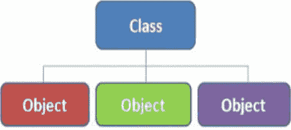
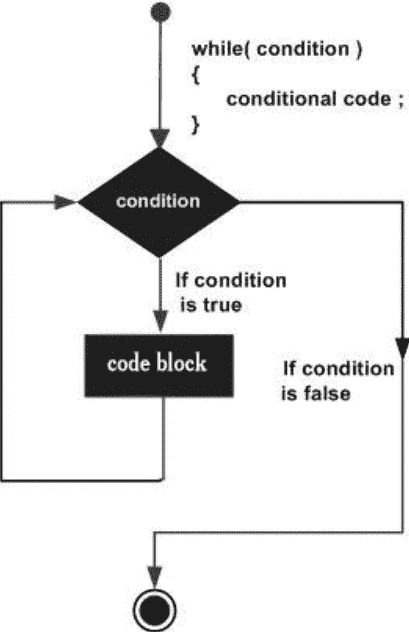
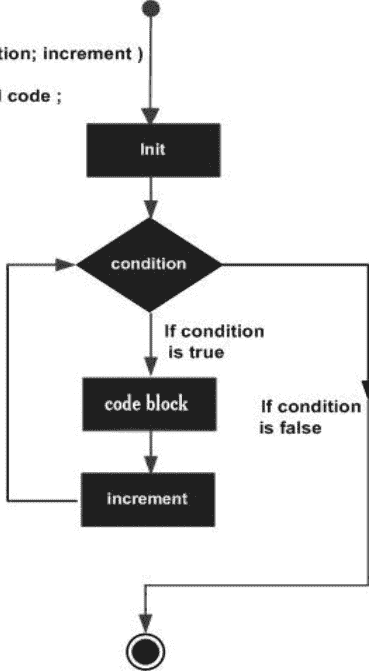
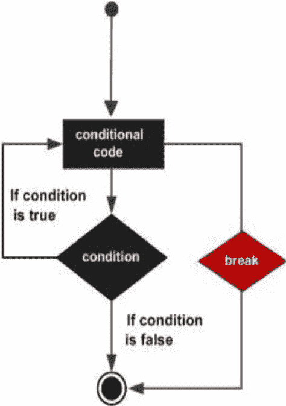
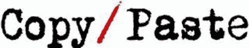
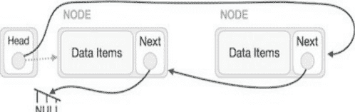
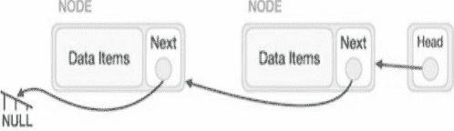
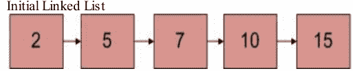
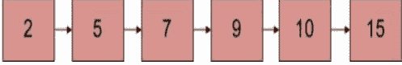
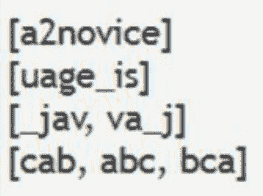

# Java 面试题：20 道 Java 面试程序与答案


# 前言

《Java 编程面试》旨在帮助你度过面试过程，教你你所需的知识，并让你能够发挥出最佳水平。我曾指导和面试过数百名软件工程师。这本书就是这些成果。这些面试题是真实的，并不是从计算机科学教科书中摘抄的。它们反映了顶尖公司真实关注的问题，以便你尽可能做好准备。攻克《编码面试》会让很多事情变得简单得多！它为你提供了获得顶级软件开发工作所需的面试准备。我们还分享了 20 道 Java 面试编程题；这些问题是招聘人员经常问到的。

# 书内包含什么？

- 编程基础
- 20 道编程面试题，涵盖了从基础到最复杂的算法题。
- 在 Google、Apple 或微软等大公司准备面试所需的步骤。
- 成为一名专业程序员必须具备的技能。
- 面试所需的重要数据结构和算法。
- 学习如何成为一名优秀的程序员！
- 编程面试技巧。
- 编程语录！

# 第 1 章 | 简介

## 这本书是关于什么的

这本书的编写是为了回答任何想要学习编程语言并产生产出的人。你可以从零开始，无需事先接触过任何编程语言。读完这本书后，你将具备成为一名合格程序员的技能，或者至少了解阅读和编写代码涉及的内容。之后，你将掌握在学习更多知识时感到所需的所需的知识。在开始之前，你应该具备通用的计算机技能。在此之后，你将知道至少在看代码而不头晕需要什么。

## 为什么要读这本书？

你可以在网上找到视频和教程来学习；然而，在有序且集中在一个处学习这些内容方面，有一个明显的劣势。大多数 YouTube 或教程网站要么对某个主题浅浅带过，要么在特定主题上以龟爬的速度拖延一小时。在线内容通常很短，没有对任何特定主题进行深入探讨。它们是不完整的，或者仍然处于进行过程中。你经常发现自己要等几周才有另一个视频或教程发布。

大多数 Java 在线教程是散乱、无序且缺乏连贯性的。

## 准备微软、亚马逊、谷歌或苹果面试的步骤

软件工程师面试在这些公司都是非常标准的。评估的技能包括通用技术技能（数据结构/算法）、系统设计、测试、沟通。而且由于整个过程非常标准，某些准备方法会让你的生活变得更容易。

### 数据结构和算法准备

我假设你已经完成了学校的那些课程，因此不需要从零开始。那么这个过程可能需要一到几个月。你应该先准备好数据结构和算法的原因是，它们是大多数软件面试的基础。真实的面试题就像要求你运用从基础知识中学到的技能来解决问题；你在分析时间/空间复杂度时应该非常快，这在书中也有涵盖。

### 熟悉通用编程题

在这一步，你应该对计算机科学的基础知识和概念非常熟悉；最好用真实的题目进行练习。这可能需要几个月，取决于你的时间以及对数据结构和算法的熟悉程度。这一步的意图是教你如何使用从书中中学到的知识来解决真实问题，并让你对普通面试中问哪些类型的问题有些想法。事实上，在这一步中我没有太多建议，除了钻研这些问题并尽力练习。

### 从公司搜索真实题目

假设你正在准备 Facebook 的面试，那么我建议你做一些谷歌搜索，对你来说获取大量的 Facebook 面试题并不困难由于不同的公司有不同的风格和重点，这种方法将帮助你更熟悉并准备该公司的面试。不要试图背诵问题和答案，因为这些公司通常避免在公开场合泄露问题，因此极不可能再次遇到同一个问题。

### 第 4 步：持续练习

在这一步，我预计你可能剩下大约 1 个月的时间，除了经验之外，你应该已经了面试所需的一切。技术面试不仅评估你的编码能力，还评估各种技能和能力，如沟通能力、分析能力等。此外，许多人在有人在背后盯着解决问题时会感到紧张，因此他们可能在最简单的问题上失败。我建议你找一个也在准备面试的朋友，你们可以互相进行模拟面试，尝试习惯这种紧张的氛围。

### 结论

强烈建议制定一个准备时间表并严格执行。此外，每天只花半小时准备是起不起作用的。没有比持续练习更好的方法了，你最终将攻克面试。

# 第 2 章 | 编程基础

## 什么是编程？

编程本质上就是编写代码。编程是一个组织数据并使用逻辑对这些数据进行处理的过程。数据是计算机存储的所有内容；它们的范围从数字到视频游戏中的僵尸角色不等。你通过将文本写入称为源代码的文件来实现这一点。写入文本文件的源代码取代了半年前计算机使用的打孔卡。当数据与逻辑结合并写入单个文件时，它们被称为“类”（`class`）。类也是数据，因此可以使用更多的逻辑进行管理。



类用于在计算机内存中创建对象（`object`），并可以复制以拥有自己的生命。类被用于构建对象。类中的每一条数据都成为该对象的一部分。类内部不同的数据块被称为类成员。类成员也可以是逻辑块，称为函数（`function`）或方法（`method`）。例如，在一个有成群僵尸的游戏中，每个僵尸都是从僵尸类复制或实例化的。每个僵尸对于类中的每个属性或数据元素都有独特的值。这意味着生命值和位置对于每个复制的僵尸对象来说是唯一的。从类创建的对象被称为实例（`instance`）。类似于家庭，对象可以相互继承属性。有时称为子类（`subclass`）的孩子从其父类继承属性。例如，从僵尸创建的子类可能会继承父类对大脑的渴望。为了有用，子僵尸还可以添加新对象并更改它从父类继承的对象。结果是，现在子僵尸可能拥有父类没有的触手。对象通过事件（`event`）和消息相互对话。向僵尸射击可以创建一个事件，或者在程序员术语中，它“触发”了一个事件。子弹命中事件告诉僵尸类在被子弹击中后采取必要的步骤。事件命令类对其数据执行操作，这就是函数发挥用场的地方。函数也称为方法，是作用于数据的逻辑集。它们允许你的类创建额外的事件并与更多对象对话。当玩家按下扳机并移动摇杆时，可以触发更多的事件并发送更多的消息。事件和消息允许玩家与你的世界交互；逻辑事件和对象共同构建了你的游戏。

## 什么是数据？

从广义上说，数据类似于名词。和名词一样，数据可以是人、地方或物。程序员将这些名词称为对象，这些对象被存储在内存中作为变量（`variable`）。“变量”一词暗示了可能会改变的东西，但情况并非总是如此。最好将变量想象为计算机内存中用于放置信息的空间。当你玩像 MadLibs 这样的文字游戏时，你可能会要求某人的名字、一个对象、一个副词和一个地方。你的结果可能是“加斯吃了一件外套，并专注地在洗衣店里玩。”在这种情况下，名字、对象、副词和地方是变量类型。数据是你用来给变量赋值的单词。程序员使用**类型**（`type`）一词表示将存储什么种类的数据。计算机并不精通英语，通常不知道英语类型中“名词”和“形容词”的区别，但它们知道字母和各种数字之间的区别。Java 或任何其他语言中都有预定义的类型。如果加上创建新类型数据的能力，我们能够存储的数据种类实际上是无限制的。C# 的内置类型有时被称为 POD，或简单的旧数据（plain old data）。这个术语源于 1979 年的原始 C++ 标准。POD 类型从其原始实现起没有发生根本性的变化。到为止，我们已经多次使用了“类型”一词。程序员定义“类型”一词来描述要存储数据的各种种类。变量通过声明（`declaration`）创建。声明被定义为正式的陈述或公告。程序员写的每组词被称为语句（`statement`）。在英语中我们会使用“句子”（sentence），但程序员喜欢使用自己的词汇。变量的声明语句定义了变量的类型和标识符（`identifier`）。

```
public class Example
{
    int i;
}
```

程序员使用分号（`;`）而不是句号来结束语句。因此，如果你想听起来像个程序员，你可以说你正在“写一条语句来声明一个类型为 `int`、标识符为 `i` 的变量”。或者如果你表现得过度戏剧，你可以宣布：“我宣告了一个类型为 `int` 的新变量，名为 `i`！”事实将是如此。

## 变量

变量用于存储在程序中被引用和处理的信息。它们还提供了一种使用描述性名称标记数据。将变量想象成容器是有帮助的。它们的唯一目的是在内存中标记和存储数据。这些数据可以在程序中使用。变量的名字被称为标识符。大多数情况下，标识符是程序员（在此例中）选择为变量命名的唯一单词。标识符总是你发明的用来描述变量的东西；就像给新宠物或婴儿命名一样。

## 标识符

标识被视为符号或标记（`token`），是你发明的并赋予其意义的单词。标识符可以是简单的字母 `i`，也可以是复杂的 `OhHAICanHasIdentifier01`。标识是用于命名任何函数、变量或数据类型的单词。

```
class MyNewClassWriting
{
}
```

## 变量名

重要的是，变量标识符和类标识符可以是几乎任何内容。但在编程时命名任何事物都有规则。这里有一些有帮助的指南。长名字更容易出现拼写错误，所以保持标识符简短。变量的命名规范应该考虑以下点。变量名应该指示它的用途，或者至少指示你打算用它做什么。这应该是显而易见的，但变量名不应该具有误导性。或者说，如果你在使用一个名为 `radius`（半径）的变量，你不应该把它用作角色的速度。如果你能读出变量的名字也会很有帮助；否则在向另一个程序员解释你的代码时可能会遇到问题。

```
int someLong_complex_hardToRemember
```

将名称尽可能缩短是有优势的，但仍然非常清楚。你的电脑屏幕，以及大多数计算机，单行能容纳的字符是有限的。你可以缩小字体，但当字母变得太小时，就会遇到可读性问题。考虑以下函数，它需要多个变量才能运行。

```
SomeCleverFunction(TopLeftCorner – SomeThickness + OffsetFromSomePosition, BottomRightCorner – SomeThickness + OffsetFromSomePosition);
```

上面的代码使用了许多长变量名。由于每个变量的长度，该语句占据了多行，使得单条语句更难以阅读。我们可以缩短变量名，但也很容易缩得太短。

```
CleverFunc(TL–Thk+Ofst,LR–Thk+Ofst);
```

变量名应该是具有描述性的，这样你才知道打算用它们做什么：如果太短，它们可能会失去意义。

```
int a;
```

虽然 `a` 既短又容易记忆，但其他人在阅读你的代码时，很难知道你用变量 `a` 是做什么的。在与其他程序员合作时，这一点变得尤为困难。变量命名并不是完全没有规则的。

```
int 8;
```

变量名不能是数字。这是不好的；数字在编程中有特殊地位，因为编程中有很多地方有它们的用途。IDE 会尝试帮你发现问题。在它发现的任何问题下方都会出现红色的波浪线。提到带数字的变量名，你可以数字作为变量名的一部分。

```
int varNumber2;
```

上面的名称是完全有效的，并且很有用，但相反，考虑以下：

```
int 13thInt;
```

变量名不能以任何数字开头。老实说，我不确定为什么这种情况下会破坏编译器，但它似乎与为什么单独的数字不能作为变量名有关。

`int $; int this-that; int (^_^);` 大多数特殊字符也有其含义，并被保留用于其他用途。例如，在 JAVA 中，`-` 用于减法；在这种情况下，JAVA 可能会认为你正试着从 `this` 中减去 `that`。你应该记住，关键字也是无效的变量名，因为它们对于 JAVA 已经有了特殊含义。在 IDE（集成开发环境）中，你可能会注意到 `this` 这个词被高亮了，表示它是一个关键字。变量中间的空格也是无效的。

```
int Spaces are bad;
```

很可能的添加非字母字符会破坏编译器。只有下划线和字母可以用于标识符名称。虽然使用表情符号作为变量很有趣，但在与代码的其他部分一起使用时会很难阅读。

`int ADifferenceInCase; int adifferenceincase;`

这里的两个变量实际上是不同的。像 java 这样区分大小写的语言确实会注意字符的大小；这在通过名称调用其他事物时也是如此。考虑到这一点：`A` 不同于 `a`。作为一名程序员，你需要考虑变量应该命名为什么什么。它对于你以及任何与你分享工作的其他人来说都应该是清晰的。你也会多次输入你的变量名，所以它们应该是短小且容易记忆和输入的。我们在这里讨论的最后一个字符是那个奇怪的 `@` 或 at。只有当 `@` 是变量名的第一个字符时，才能使用它。

```
int @home;
int noone@home;
```

在在这里声明的第二个变量中我们将得到一个错误。这些不规则的字符在你的代码中很容易发现。当你有一长长变量列表时，最好是让它们在视觉上脱颖而出。一些受过经典训练的程序员喜欢使用下划线表示类作用范围变量。对于仅存在函数内部的变量，则省略下划线。当你使用 `int` 时，你会发现关于 `@` 的奇怪规则的原因，它是被保留的关键字。你允许使用 `int @int`，之后你可以给 `@int` 赋值任何整数。然而，许多程序员根据他们的编程背景，倾向于使用 `MyInt`、`mInt` 或 `_int` 而不是 `@int`。优秀的程序员会花费大量时间为他们的变量和函数想实用的名称。编写描述性的短名称需要习惯，但这里有一些用的技巧。变量通常使用名词或形容词命名，因为它们描述了与其用途相关的属性。最后，一旦你开始在代码的其他部分使用变量名，它就会变得难以更改，因为需要在所有使用它的地方进行更改。进行全局更改被称为重构，这种情况发生得频繁，以至于有软件可以帮你“重构”类、变量和函数名。

## 注意


# Java 编程基础

## 命名约定

你可能还会注意到大写字母和小写字母使用的模式。这被称为 `BumpyCase` 或 `CamelCase`。有时，首字母是小写的，在这种情况下它看起来像 `headlessCamelCase` 而不是 `NormalCamelCase`。程序员之间经常就哪种是正确的产生许多争论，但最终任何一种都可以。因为 Java 是区分大小写的，你和你任何帮助你的人应该就是否使用大写字母达成一致。这些差异通常源于一个人学习如何写软件的地方或谁教的。

## 函数与方法

函数也被称为其他名称，例如方法（`methods`）。主要的区别在于语言使用语法的方式不同。语法基本上是空格或制表符、操作符或关键字的使用。

归根结底，你所做的一切都是告诉编译器如何将你的指令转换为计算机解释的命令。变量和函数构成了编程的主体。你想要记住的任何数据都存储在变量中。变量由你的函数处理。通常，当你将变量和函数组合在一个地方时，你将其称为一个类（`class`）。

### 示例

```java
public void PrintNum() {
    System.out.println(anotherNum);
}
```

在编写新函数时，在继续其他任务之前，填满整个函数的布局是一个良好的习惯。这会让编译器感到轻松；如果一个函数只留在 `void MyFunction` 的形式然后跳到另一个函数，会让编译器对你计划要做什么感到困惑。在这种情况下，集成开发环境（例如 `MonoDevelop`）会不断读取和解释你正在编写的内容，类似于文字处理器中的拼写检查器。当它遇到一个没有确定形式的语句（如变量、函数或类定义）时，它对你所写代码的解释将引发警告或错误。`MonoDevelop` 看起来可能有点挑剔，但它正在尽力帮助。

## 编写函数

函数由一个声明和一个正体组成。有些程序员喜欢把这些称为方法，但抛开语义不谈，函数基本上是一个语句集合的容器。

让我们继续上面的示例：

```java
void MyFunction() {
}
```

这是一个名为 `MyFunction` 的基础函数。我们可以添加额外的关键字来修改函数的可见性。我们看到的一种常见修饰符是 `public`。

```java
public void MyFunction() {
}
```

`public` 关键字需要出现在函数的返回类型之前。在这种情况下，它是 `void`，意味着函数不返回任何内容。但函数可以以几种不同的方式作为值。作为参考，返回 `int` 的函数看起来像这样。在具有返回类型的函数中，必须始终存在某种返回语句。

```java
public int MyFunction() {
    return 1;
}
```

`public` 修饰符并不总是必要的，除非你需要让这个函数对其他类可用。如果这一点不理解，你很快就会明白了。函数中始终要求的最后部分是参数列表。保持为空它是有效的，但为了感受参数列表中的 `arg`（或参数）看起来什么样，请看下一个示例。

```java
public void MyFunction(int i) {
}
```

目前，我们将暂不使用参数列表，但以后知道你正在看什么很重要，以免产生意外。参数列表用于将信息从函数外部传递到函数内部。这就是类能够将信息从一个发送到另一个的方式。

函数声明与类声明相似。函数是处理变量逻辑的核心。

## 函数作用域

变量通常过着短暂的生活。有些变量只存在几行代码中。变量可能只在函数开始时产生，并在函数结束时消失。类作用域中的变量只要类存在就存在。变量的寿命取决于它创建的位置。

### 示例

```java
public class Classscope {
    int ClassInt;
    void first() {
        int firsttint;
    }
    void second() {
        int secondint;
    }
}
```

如果我们看上面的代码，就可以形象地看到作用域是如何划分的。外层框代表谁可以看到 `ClassInt`。在第一个 `first()` 函数中，我们有一个 `firsttint`，它只存在于第一个 `first()` 函数中。

`secondint` 也是如此，它只存在于第二个 `second()` 函数中。这意味着 `first()` 可以使用 `ClassInt` 和 `firsttint` 但不能使用 `secondint`。同样，`second()` 可以看到 `ClassInt` 和 `secondint` 但不能看到 `firsttint`。

## 逻辑与操作符

逻辑允许你根据变量的变化控制函数部分的评估。使用逻辑，你将能够更改代码中哪些语句将运行。简单来说，你写的一切必须涵盖你计划涵盖的每种情况。逻辑通过几个简单的系统控制，主要是 `if` 关键字和 `if` 的变体。

### 布尔值

Java 中的布尔值（简称为 `bool`）要么是 `true` 要么是 `false`。将这些想象成开启或关闭位置的开关是最简单的。声明一个变量为 `bool`，你使用如下内容。

```java
public class Example {
    public bool SomeBool;
}
```

### 相等操作符

相等操作符创建布尔条件。设置布尔变量有许多方法。例如，值之间的比较是设置变量的有效手段。确定相等的最基本方法是使用以下操作符：`==`。使用单个等号和双等号之间是有区别的。

感知何时实际返回了真实值（即空以外的其他内容）。让我们来看一个更有意义的函数。函数声明开头的 `void` 关键字意味着该函数没有返回类型。如果我们更改了声明，我们需要确保有一个与声明匹配的返回值。这可以像下面的代码片段一样简单。

```java
int MyFunction() {
    // code here...
    return 1;
    // 1 是一个 int
}
```

此函数返回 `int` 1。

声明带有返回值的函数要求返回类型与声明匹配。当使用该函数时，它应该被视为与函数返回类型匹配的数据类型。

## 类变量/静态变量

类变量（也称为静态变量）在类中使用 `static` 关键字声明，但在方法、构造函数或代码块之外。

无论从该类创建了多少个对象，每个类变量都只有一个副本。

除了声明为常量外，静态变量很少被使用。

常量是声明为 `public`/`private`、`final` 和 `static` 的变量。

常量变量永远不会从其初始值改变。静态变量存储在静态内存中。除了声明为 `final` 并用作公有或私有常量外，很少使用静态变量。静态变量在程序启动时创建，程序停止时销毁。

可见性与实例变量相似。然而，大多数静态变量被声明为 `public`，因为类的用户必须可以使用。默认值与实例变量相同。

对于数字，默认值为 0；对于布尔值，默认值为 `false`；对于对象引用，默认值为 `null`。可以在声明期间或构造函数内部赋值。此外，还可以在特殊的静态初始化块中赋值。

可以通过调用类名来访问静态变量：`ClassName.VariableName`。

当将类变量声明为 `public static final` 时，变量名（常量）全部使用大写。如果静态变量不是 `public` 和 `final`，则命名语法与实例和局部变量相同。

### 示例

```java
import java.io.*;

public class Employee {
    // salary 变量是一个私有静态变量
    private static double salary;
    // DEPARTMENT 是一个常量
    public static final String DEPARTMENT = "Development ";
    
    public static void main(String args[]) {
        salary = 1000;
        System.out.println(DEPARTMENT + "average salary: " + salary);
    }
}
```

输出：

```
Development average salary: 1000
```

**注意：** 如果从外部类访问变量，则应通过 `Employee.DEPARTMENT` 访问常量。

## 数组

数组是组织良好的数据列表。想象一个从零开始、每当向列表中添加内容时就扩展一行的编号列表。数组在任何情况下都很有用，因为它们被视为单一的数据块。例如，如果你想存储一组高分，你会想用数组来实现。初始时，你可能想要一个包含 10 个元素的列表。理论上，你可以使用以下代码来存储每个分数。

```java
int score1;
int score2;
int score3;
int score4;
int score5;
int score6;
int score7;
int score8;
int score9;
int score10;
```

更糟糕的是，如果你需要处理每个值，你就需要创建一组通过名称处理每个变量的代码。为了检查 `score2` 是否高于 `score1`，你需要在交换它们之前编写一个特定的函数来检查这两个变量。

数组有两种类型：

- 单维数组
- 多维数组

### Java 中的单维数组

在 Java 中声明数组的语法：

- `dataType[] arr;`（或）
- `dataType []arr;`（或）
- `dataType arr[];`

在 Java 中实例化数组：

`arrayRefVar = new datatype[size];`

#### Java 单维数组的示例

让我们来看一个简单的 Java 数组示例，其中我们将声明、实例化、初始化并遍历一个数组。

```java
class Testarray {
    public static void main(String args[]) {
        int a[] = new int[5]; // 声明和实例化
        a[0] = 10; // 初始化
        a[1] = 20;
        a[2] = 70;
        a[3] = 40;
        a[4] = 50;
        // 打印数组
        for (int i = 0; i < a.length; i++) // length 是长度
            System.out.println(a[i]);
    }
}
```

输出：

```
10
20
70
40
50
```

### Java 数组的声明、实例化和初始化

我们可以通过以下方式同时声明、实例化和初始化 Java 数组：

```java
int a[] = {33, 3, 4, 5}; // 声明、实例化和初始化
```

让我们来看打印此数组的简单示例。

```java
class Testarray1 {
    public static void main(String args[]) {
        int a[] = {33, 3, 4, 5}; // 声明、实例化和初始化
        // 打印数组
        for (int i = 0; i < a.length; i++) {
            System.out.println(a[i]);
        }
    }
}
```

输出：

```
33
3
4
5
```

### 将数组传递给方法

让我们来看打印此数组的简单示例。

```java
class Testarray2 {
    static void printArray(int[] arr) {
        for (int i = 0; i < arr.length; i++) {
            System.out.println(arr[i]);
        }
    }
    
    public static void main(String args[]) {
        int a[] = {33, 3, 4, 5}; // 声明、实例化和初始化
        printArray(a);
    }
}
```

输出：

```
33
3
4
5
```

### Java 中的多维数组

在这种情况下，数据存储在矩阵中。

在 Java 中声明数组的语法：

- `dataType[][] arrVar;`（或）
- `dataType [][] arrVar;`（或）
- `dataType arr[][];`

在 Java 中实例化多维数组的示例：

```java
int[][] arr = new int[3][3];
```

在 Java 中初始化多维数组的示例：

让我们来看一个简单的 Java 数组示例，其中我们将声明、实例化、初始化并遍历一个二维数组。

```java
class Testarray3 {
    public static void main(String args[]) {
        int arr[][] = {{1, 2, 3}, {2, 4, 5}, {4, 4, 5}}; // 声明和初始化
        // 打印数组
        for (int i = 0; i < 3; i++) {
            for (int j = 0; j < 3; j++) {
                System.out.print(arr[i][j] + " ");
            }
            System.out.println();
        }
    }
}
```

输出：

```
1 2 3 
2 4 5 
4 4 5 
```

## 循环控制

程序控制传递到循环后的下一行。

### while 循环

```java
while (condition) {
    // conditional code;
}
```



在这里，`while` 循环的关键在于循环可能永远不会运行。当测试表达式且结果为假时，循环体将被跳过，并执行 `while` 循环之后的第一条语句。

#### 示例

```java
public class Test {
    public static void main(String args[]) {
        int x = 10;
        while (x < 20) {
            System.out.print("value of x : " + x);
            x++;
            System.out.print("\n");
        }
    }
}
```

输出：

```
value of x : 10
value of x : 11
value of x : 12
value of x : 13
value of x : 14
value of x : 15
value of x : 16
value of x : 17
value of x : 18
value of x : 19
```

### for 循环

为了对循环的执行获得更多控制，我们还有另一种选择。`for` 循环需要三个不同的语句来操作。第一条语句称为初始化，第二条是条件，第三条是更新操作。

语法：

```java
for (initialization; Boolean_expression; update) {
    // Statements
}
```

这里是 `for` 循环中的控制流——

- 首先执行**初始化**步骤，且只执行一次。此步骤允许你声明并初始化任何循环控制变量，并且该步骤以分号（`;`）结束。
- 接下来，评估**布尔表达式**。如果为真，则执行循环体。如果为假，则不执行循环体，控制跳转到 `for` 循环之后的下一条语句。
- 在执行完 `for` 循环的**体**之后，控制跳转回更新语句。该语句允许你更新任何循环控制变量。该语句可以留空并在末尾加一个分号。
- 现在再次评估布尔表达式。如果为真，则执行循环并重复该过程（循环体、更新步骤、布尔表达式）。在布尔表达式为假后，`for` 循环终止。

#### 流程图

```java
for (init; condition; increment) {
    // conditional code;
}
```



#### 示例

以下是 Java 中 `for` 循环的示例代码。

```java
public class Test {
    public static void main(String args[]) {
        for (int x = 10; x < 20; x = x + 1) {
            System.out.print("value of x : " + x);
            System.out.print("\n");
        }
    }
}
```

输出：

```
value of x : 10
value of x : 11
value of x : 12
value of x : 13
value of x : 14
value of x : 15
value of x : 16
value of x : 17
value of x : 18
value of x : 19
```

### 循环控制语句

循环控制语句改变执行偏离正常顺序。当执行离开作用域时，在该作用域创建的所有自动对象都会被销毁。

Java 支持以下控制语句：

- `break` 语句
- `continue` 语句

Java 编程语言中的 `break` 语句有以下两种用法——

- 当循环内部遇到 `break` 语句时，循环立即终止，程序控制从循环之后的下一条语句恢复。
- 它可以用于终止 `switch` 语句中的 `case`（在下一章介绍）。

#### 语法

`break` 的语法是任何循环内部的单条语句：

```java
break;
```

#### 流程图



#### 示例

```java
public class Test {
    public static void main(String args[]) {
        for (int x = 10; x < 20; x++) {
            if (x == 15) {
                break;
            }
            System.out.print("value of x : " + x);
            System.out.print("\n");
        }
    }
}
```

输出：

```
value of x : 10
value of x : 11
value of x : 12
value of x : 13
value of x : 14
```


```java
public class Test {
    public static void main(String args[]) {
        int [] numbers = {10, 20, 30, 40, 50};

        for(int x : numbers ) {
            if( x == 30 ) {
                break;
            }
            System.out.print(x);
        }
    }
}
```

这将会产生以下结果：

#### 输出：

| 10 |
| 20 |

循环控制语句改变执行偏离正常顺序。当执行离开作用域时，在该作用域创建的所有自动对象都会被销毁。

Java 支持以下控制语句：

- `Break` 语句
- `Continue` 语句

Java 编程语言中的 `break` 语句有以下两种用法——

- 当循环内部遇到 `break` 语句时，循环立即终止，程序控制从循环之后的下一条语句恢复。
- 它可以用于终止 `switch` 语句中的 `case`（在下一章介绍）。

#### 语法

`break` 的语法是任何循环内部的单条语句：

```java
break;
```

#### 流程图：


#### 示例：

```java
public class Test {
    public static void main(String args[]) {
        int [] numbers = {10, 20, 30, 40, 50};

        for(int x : numbers ) {
            if( x == 30 ) {
                break;
            }
            System.out.print(x);
        }
    }
}
```

这将会产生以下结果：

#### 输出：

| 10 |
| 20 |

等等，算法是完成某些任务的系统过程。在很多情况下，你可以把它看作是一个食谱，制作食物的食谱是算法，折叠衣服或裤子的过程也是算法。事实上，这里是孩子早晨可能写成算法的形式：

```
当闹钟响起时
  按下闹钟按钮
  等待闹响
  起床
洗澡
穿衣服
吃早餐
如果天气 晴朗
  走路上学
否则
  骑车上学
```

## 语句与表达式

当我们阅读书籍或故事时，我们从有序的词汇链中提取含义。

类似地，计算机从指令链中提取命令。

在英语中，我们称之为句子；程序员则称之为语句。

语句被认为是任何以分号隔开、完成某种任务的代码块。在任何给定任务的核心都是算法，不要将其与对数混淆。

算法是完成某些任务的系统性过程。在很多情况下，你可以把它看作是一个食谱，制作食物的食谱是算法。完成一项任务可能只需要一条或两条语句，也可能需要数百条语句。

### 表达式

语句中的主体被称为标识符。赋值语句用于给标识符赋一个值。当你读到“杰克是一个男孩，莉莉是一个女孩”时，你已经在脑中为两个主体分配了性别。

在 Java 中，这可能更像：

```java
gender Jack = male;
gender Jill = female;
```

赋值语句通常包含某种操作。这些被称为表达式性语句。与表达情感不同，代码中的表达式看起来更像 `x + y`。表达式处理数据。处理后，表达式的结果可以赋值给变量。

语句的集合被称为代码块（`code block`），它不像可能会停止你代码运行的路障，而更像是一个构建块，任何用于构建的元素。

在写故事时，我们将一组句子称为一个段落。代码块中的语句相互协作以完成一项任务。

## 学习复制与粘贴

“优秀的艺术家创造，伟大的艺术家窃取。”有很多代码示例供你复制并粘贴到项目中。本书的内容以及所有下载内容并无二致。这意味着你必须理解代码在做什么，才能将其解释并适应你的需求。每个程序员都会习惯性这样做。



学习这样做是非常重要的，因为在很多情况下，你不仅为了学习，而且为了完成任何陌生的任务都需要这样做。编程是一个持续的学习过程。它是命令计算机的语言。

每当你学习一种新语言时，会有很多需要查询的词汇。再加上每个程序员都会创造新词的事实，你拥有一门永远需要词典的语言。

当显示某些代码时，你会预期将这些代码复制到项目中。当你的手指准备好放在键盘时，你会养成打字的习惯。程序员通常是打字高手是有的。这也是为什么程序员对偏好的键盘非常挑剔。在大多数情况下，书中的项目将处于你可以阅读已有文本的状态。

大多数项目处于更完整的状态，你可以运行它们并看到预期的结果。作为一个程序员，我已经习惯了在互联网上搜索示例代码。一旦我发现了很有用的东西，就会将其复制并粘贴到一个简单的测试用例中。当我理解了代码在做什么之后，我会将其重写为更适合我特定案例的形式。即使代码涉及某些有趣的技巧，我也会从该代码中学习。随着我学习新技巧，我作为程序员也在成长。学习新技巧的唯一方法就是找到解决我尚未想出解决方案的新问题的必要性。寻找问题的解决方案是成为一名程序员的基本部分。

## 理解浮点数

浮点数多年一直是计算机的关注焦点。获得浮点精度是许多早期计算机科学家的目标。因为小数点后面可以跟随无限数量的数字，因此使用二进制计算无法真正完全地表示任何分数。一个常见的例子是 $\pi$，我们称之为 pi。假设 3.14 后面有无限多的数字。即使在今天，计算机被允许计算小数点后的数百亿位数字。计算机保留了浮点数的某些位来表示小数点在数字中的位置，但即使这样也是有限的。第一位通常是符号位，设置数字的负范围或正范围。随后的 8 位是数字的指数，称为尾数（`mantissa`）。其余位是小数点周围出现的其余数字。`float` 值可以将小数点向任意方向移动 38 位，但它受限于其能够存储的值。

在没有特殊考虑的情况下，计算机无法处理任意大的数字。要将 `float` 强制转换为 `int`，你需要进行更显式的操作。这就是为什么 Java 要求你使用强制转换，并且你需要在 `int Z = (int)Zmove;` 中添加 `(int)`。

`(int)` 是一个强制转换操作符；或者说 `(type)` 充当从右侧类型到左侧所需类型的转换器。

# 第3 章 | 数据结构与面试题

## 排序与搜索

### 二分查找

二分查找是计算机科学中的基础算法之一。为了探索它，我们将首先建立一个理论框架，然后利用它来正确实现该算法，并避免大家一直在谈论的那些差一错误（`off-by-one errors`）。

#### 在有序序列中查找值

在最简单的形式中，二分查找用于在有序序列中快速查找一个值（目前将序列视为普通的数组）。为了清晰起见，我们将查找的值称为 `target`（目标）值。二分查找维护原始序列的一个连续子序列，其中目标值一定位于其中。这被称为搜索空间。搜索空间最初是整个序列。在每一步中，算法将搜索空间中的中间值与目标值进行比较。根据比较，由于序列是有序的，它可以排除一半的搜索空间。通过重复这种操作，最终将只剩下一个包含单个元素的搜索空间，即目标值。

例如，考虑以下升序排列的整数序列，假设我们正在寻找数字 55：

| 0 | 5 | 13 | 19 | 22 | 41 | 55 | 68 | 72 | 81 | 98 |

我们对 55 的位置感兴趣，我们将搜索空间表示为 `low`（低）和 `high`（高）。最初，搜索空间包含 1 到 11。由于搜索空间是一个区间，只需要存储两个数字 `low` 和 `high` 就足够了。如上所述，我们选择中间值，它是...

取决于我们如何选择偶数个元素的中间值，我们将在下一步找到 55，或者切掉后半部分并剩下一个元素的搜索空间。无论何种情况，我们都得出目标值所在的索引是 7。如果目标值不在序列中，二分查找将完全清空搜索空间。这个条件很容易检查和处理。这里是配合描述的代码：

```python
binary_search(A, target):
    lo = 1, hi = size(A)
    while lo <= hi:
        mid = lo + (hi-lo)/2
        if A[mid] == target:
            return mid
        else if A[mid] < target:
            lo = mid+1
        else:
            hi = mid-1
#### 未找到目标
```

#### 复杂度

由于每次二分查找都会减半空间，我们可以断定并容易证明二分查找查找目标值永远不会超过 $O(\log N)$ 次比较。对数是一个增长非常缓慢的函数。如果你不知道二分查找有多高效，请考虑在包含一百万名字的电话簿中查找名字。二分查找让你能够系统地通过最多 21 次比较找到任何给名字。如果你能管理一个按姓名排序的世界范围内人的列表，你可以在少于 35 步内找到任何人。

#### 程序：Java 递归二分查找的实现

```java
class BinarySearch
{
    // 如果 x 存在于 arr[1..r] 中则返回其索引，否则
    // 返回 -1
    int binarySearch(int arr[], int l, int r, int x)
    {
        if (r>=l)
        {
            int mid = l + (r - l)/2;

            // 如果元素位于
            if (arr[mid] == x)
                return mid;

            // 如果元素小于 mid，
            // 那么它只可能
            // 存在于左侧子数组
            if (arr[mid] > x)
                return binarySearch(arr, 1, mid-1, x);

            // 否则元素只能
            // 存在于右侧
            // 子数组
            return binarySearch(arr, mid+1, r, x);
        }

        // 当元素不在数组中时，到达这里
        return -1;
    }

    public static void main(String args[]) {
        BinarySearch ob = new BinarySearch();
        int arr[] = {2,3,4,10,40};
        int n = arr.length;
        int x = 10;
        int result = ob.binarySearch(arr,0,n-1,x);
        if (result == -1) {
            System.out.println("Element not present");
        } else {
            System.out.println("Element found at index "+result);
        }
    }
}
```

#### 输出：

元素位于索引 3

#### 程序：二分查找的迭代实现

```java
class BinarySearch
{
    // 如果 x 存在于 arr[] 中，则返回索引，
    // 否则返回 -1
    int binarySearch(int arr[], int x)
    {
        int l = 0, r = arr.length - 1;
        while (l <= r)
        {
            int m = 1 + (r-l)/2;

            // 检查 x 是否在 mid 位置
            if(arr[m] == x)
                return m;

            // 如果 x 大，忽略左半部分
            if(arr[m] < x)
                l = m + 1;

            // 如果 x 小，忽略右半部分
            else
                r = m - 1;
        }

        // 如果到达这里，说明元素不存在
        return -1;
    }

    public static void main(String args[])
    {
        BinarySearch ob = new BinarySearch();
        int arr[] = {2, 3, 4, 10, 40};
        int n = arr.length;
        int x = 10;
        int result = ob.binarySearch(arr, x);
        if (result == -1)
            System.out.println("Element not present");
        else
            System.out.println("Element found at index "+result);
    }
}
```

#### 输出：

元素位于索引 3

### 冒泡排序

冒泡排序算法被认为是最简单的排序算法。

在冒泡排序算法中，数组从第一个元素到最后一个元素进行遍历。在这里，当前元素与下一个元素进行比较。如果当前元素大于下一个元素，则对其进行交换。

#### 算法

我们假设列表是一个包含 n 个元素的数组。我们进一步假设交换函数会交换给定数组元素的值。

```
begin BubbleSort(list)
for all elements of list
  if list[i] > list[i+1]
    swap(list[i], list[i+1])
  end if
end for
return list
end BubbleSort
```

#### 程序：Java 冒泡排序程序

```java
public class BubbleSortExample {
  static void bubbleSort(int[] arr) {
    int n = arr.length;
    int temp = 0;
    for (int i=0; i < n; i++) {
      for (int j=1; j <n-i; j++) {
        if(arr[j-1] > arr[j]) {
          // 交换元素
          temp = arr[j-1];
          arr[j-1] = arr[j];
          arr[j] = temp;
        }
      }
    }
  }

  public static void main(String[] args) {
    int arr[] = {3, 60, 35, 2, 45, 320, 5};
    System.out.println("Array Before sorting");
    for(int i=0; i < arr.length; i++) {
        System.out.print(arr[i] + ' ');
    }
    System.out.println();

    bubbleSort(arr);//排序数组
    System.out.println("Array After");
    for (int i=0; i < arr.length; i++) {
        System.out.print(arr[i] + ' ');
    }
  }
}
```

#### 输出：

Array Before Bubble Sort

3 60 35 2 45 320 5

Array After Bubble Sort

2 3 5 35 45 60 320

### 插入排序

插入排序是一种简单的排序算法，其工作方式就像我们在手中整理扑克牌一样。

#### 算法

- **步骤 1** – 如果是第一个元素，它已经是有序的。
- **步骤 2** – 选取下一个元素
- **步骤 3** – 与已排序子列表中的所有元素进行比较
- **步骤 4** – 将已排序子列表中所有大于待排序值的元素向后移动
- **步骤 5** – 插入该值
- **步骤 6** – 重复直到列表排序完成

#### 程序：插入排序的 Java 程序


```java
class InsertionSort
{
    /* 使用插入排序排序数组 */
    void sort(int arr[])
    {
        int n = arr.length;
        for (int i=1; i<n; ++i)
        {
            int key = arr[i];
            int j = i-1;
            /* 将 arr[0..i-1] 中大于 key 的元素
            向当前位置之后移动一位 */
            while (j >= 0 && arr[j] > key)
            {
                arr[j+1] = arr[j];
                j = j-1;
            }
            arr[j+1] = key;
        }
    }

    /* 打印大小为 n 的数组的实用函数 */
    static void printArray(int arr[])
    {
        int n = arr.length;
        for (int i=0; i<n; i++)
            System.out.print(arr[i] + " ");
        System.out.println();
    }

    public static void main(String args[])
    {
        int arr[] = {12, 11, 13, 5, 6};
        InsertionSort ob = new InsertionSort();
        ob.sort(arr);
        printArray(arr);
    }
}
```

输出：

```
5 6 11 12 13
```

### 程序：快速排序算法的 Java 程序

```java
class QuickSort
{
    /* 此函数取最后一个元素作为基准，
    将基准元素放在排序数组中的正确位置，并将所有小于基准的元素放在基准的左侧，
    所有大于基准的元素放在基准的右侧 */
    int partition(int arr[], int low, int high)
    {
        int pivot = arr[high];
        int i = (low-1); // 较元素的索引
        for (int j=low; j<=high-1; j++)
        {
            // 如果当前元素小于等于基准
            if(arr[j] <= pivot)
            {
                i++;
                // 交换 arr[i] 和 arr[j]
                int temp = arr[i];
                arr[i] = arr[j];
                arr[j] = temp;
            }
        }
        // 交换 arr[i+1] 和 arr[high]（或基准）
        int temp = arr[i+1];
        arr[i+1] = arr[high];
        arr[high] = temp;
        return i+1;
    }

    /* 实现
     * QuickSort() 的主函数
     * arr[] -> 需要排序的数组，
     * low -> 起始索引，
     * high -> 结束索引
     */
    void sort(int arr[], int low, int high)
    {
        if (low < high)
        {
            /* pi 是分区索引，arr[pi]
            现在处于正确的位置 */
            int pi = partition(arr, low, high);
            // 递归排序分区之前
            // 和分区之后的元素
            sort(arr, low, pi-1);
            sort(arr, pi+1, high);
        }
    }

    /* 打印大小为 n 的数组的工具函数 */
    static void printArray(int arr[])
    {
        int n = arr.length;
        for (int i=0; i<n; ++i)
            System.out.print(arr[i]+" ");
        System.out.println();
    }

    public static void main(String args[])
    {
        int arr[] = {10, 7, 8, 9, 1, 5};
        int n = arr.length;
        QuickSort ob = new QuickSort();
        ob.sort(arr, 0, n-1);
        System.out.println("sorted array");
        printArray(arr);
    }
}
```

#### 输出

```
Sorted array:
1 5 7 8 9 10
```

### 选择排序

选择排序是一种简单的排序算法。这种排序算法是一种基于比较的原地算法，它将列表分为两部分：左侧的排序部分和右侧的未排序部分。初始时，排序部分为空，未排序部分是整个列表。

从未排序的数组中选择最小元素并与最左侧元素交换，该元素便成为排序数组的一部分。这个过程持续将未排序数组边界向右移动一个元素。

该算法不适用于大型数据集，因为它的平均和最坏情况的时间复杂度均为 `O(n²)`，其中 `n` 是项目的数量。

#### 算法

- **步骤 1** – 将 `MIN` 设置为位置 0
- **步骤 2** – 在列表中查找最小元素
- **步骤 3** – 与位置 `MIN` 处的值交换
- **步骤 4** – 增加 `MIN` 指向下一个元素
- **步骤 5** – 重复直到列表排序完成

#### 程序：Java 中的选择排序

```java
public class SelectionSortExample {
    public static void selectionSort(int[] arr) {
        for (int i = 0; i < arr.length - 1; i++) {
            int index = i;
            for (int j = i + 1; j < arr.length; j++) {
                if (arr[j] < arr[index]) {
                    index = j; //正在寻找最小值
                }
            }
            int smallerNumber = arr[index];
            arr[index] = arr[i];
            arr[i] = smallerNumber;
        }
    }

    public static void main(String a[]) {
      int[] arr1 = {9, 14, 3, 2, 43, 11, 58, 22};
      System.out.println("Before Selection");
      for(int i:arr1) {
        System.out.print(i+" ");
      }
      System.out.println();

      selectionSort(arr1); //排序数组

      System.out.println("After Selection");
      for(int i:arr1){
        System.out.print(i+" ");
      }
    }
}
```

#### 输出

```
Before Selection Sort
9 14 3 2 43 11 58 22
After Selection Sort
2 3 9 11 14 23 58
```

## 链表

链表是可以通过链接连接的数据结构序列。链表是包含项的链接序列。每个链接都包含一个指向另一个的连接。链表是仅次于数组最常用的结构。以下是理解链表概念的重要术语：

- **链接 (Link)**：链表的每个链接可以存储一个名为元素的数据。
- **下一个 (Next)**：每个链接都包含一个指向下一个元素的连接。
- **链表 (LinkedList)**：一个链表。

### 链表表示

链表可以被可视化为节点的链，其中每个节点指向下一个节点。


根据上述图示：

- 链表包含一个链接。
- 每个链接都指向下一个。

### 链表的类型

以下是链表的各种类型：

- **单链表 (Simple Linked List)**：仅可以向前导航。
- **双向链表 (Doubly Linked List)**：项可以双向导航。
- **循环链表 (Circular Linked List)**：最后一个指向第一个元素。

### 基本操作

以下是列表支持的基本操作：

- **插入 (Insertion)**：在列表头部插入元素。
- **删除 (Deletion)**：在列表头部删除元素。
- **显示 (Display)**：显示整个链表。
- **查找 (Search)**：在链表中查找元素。

#### 插入操作

在链表中插入新节点需要多个步骤。我们将通过图示来学习。首先，创建一个新节点 `B`，将其插入 `A`（左侧）和 `C`（右侧）之间。


```
NewNode.next = RightNode;
```


```
LeftNode.next = NewNode;
```


这会将新节点放在链表的中间。新的链表应该如下所示：


#### 删除操作

删除也是一个多步骤的过程。我们将通过图示学习。首先，使用算法定位要删除的目标节点：


目标节点的左侧（前一个）节点现在指向目标节点的下一个节点：

```
LeftNode.next = TargetNode.next;
```


这将移除指向目标节点的链接。现在，使用以下代码，我们将移除目标节点所指向的内容：

```
TargetNode.next = NULL;
```


我们需要使用被删除的节点。我们可以将其保留在内存中，也可以简单地释放内存并完全清除目标节点。


#### 反转操作

反转操作是一个非常彻底的操作。我们需要让最后一个节点被头节点指向，并反转整个链表。


首先，我们遍历到列表末尾。它应该指向 `NULL`。现在，我们让它指向它的前一个节点：


它们的前驱节点，使它们成为前驱节点的新继任者。第一个节点将指向 `NULL`。



我们将使用临时节点让头节点指向新的第一个节点。



现在链表已经反转了。

## 程序：给定一个有序链表，如何以有序的方式插入节点？

算法：

假设输入链表是按升序排列的。

1. 如果链表为空，则将该节点设为头节点并返回。
2. 如果要插入节点的值小于头节点的值，则将节点插入到开头并设置为头节点。
3. 在循环中，找到输入节点（假设为 9）应该插入之后的合适节点。要找到合适的节点，从头节点开始，持续移动直到遇到一个值大于输入节点的节点 `GN`（下图中的 10）。`GN` 之前的节点就是合适的节点（7）。
4. 在步骤 3 找到的合适节点（7）之后插入该节点（9）。



插入 9 之后的链表



```java
class LinkedList
{
    Node head; // head of list

    /* 链表节点*/
    class Node
    {
        int data;
        Node next;
        Node(int d) {data = d; next = null; }
    }

    /* 在列表中插入一个新节点的函数。 */
    void sortedInsert(Node new_node)
    {
        Node current;
        /* 针对头节点的特殊情况 */
        if (head == null || head.data >= new_node.data) {
            new_node.next = head;
            head = new_node;
        } else {
            /* 定位插入点之前的节点。 */
            current = head;
            while (current.next != null && current.next.data < new_node.data) {
                current = current.next;
            }
            new_node.next = current.next;
            current.next = new_node;
        }
    }

    /* 工具函数*/

    /* 创建节点的函数 */
    Node newNode(int data)
    {
        Node x = new Node(data);
        return x;
    }

    /* 打印链表的函数 */
    void printList()
    {
        Node temp = head;
        while (temp != null)
        {
            System.out.print(temp.data+" ");
            temp = temp.next;
        }
    }

    /* 测试上述方法的驱动函数 */

    public static void main(String args[])
    {
        LinkedList llist = new LinkedList();
        Node new_node;
        new_node = llist.newNode(5);
        llist.sortedInsert(new_node);
        new_node = llist.newNode(10);
        llist.sortedInsert(new_node);
        new_node = llist.newNode(7);
        llist.sortedInsert(new_node);
        new_node = llist.newNode(3);
        llist.sortedInsert(new_node);
        new_node = llist.newNode(1);
        llist.sortedInsert(new_node);
        new_node = llist.newNode(9);
        llist.sortedInsert(new_node);
        System.out.println("Created Linked List");
        llist.printList();
    }
}
```

#### 输出

```
Created Linked List
1 3 5 7 9 10
```

## 程序：在给定约束下删除链表中的指定节点

给定一个单向链表，编写一个函数来删除指定的节点。你的函数必须遵循以下约束：

1. 它必须接受起始节点的指针作为第一个参数，并将要删除的节点作为第二个参数，即：头节点的指针不是全局的。
2. 它不应该返回指向头节点的指针。
3. 它不应该接受指向头节点指针的指针。

你可以假设链表永远不会为空。

假设函数名为 `deleteNode()`。在一种直接实现中，当要删除的节点是第一个节点时，函数需要修改头指针。


## Q.3) 在 URL 字符串周围添加 HTML 链接的程序

```java
import java.util.*;
import java.io.*;

public class URLify {
    public static char[] URLify(char[] chars, int len) {
        int spaces = countSpaces(chars, len);
        int end = len - 1 + spaces * 2;
        for (int i = len - 1; i >= 0; i--) {
            if (chars[i] == ' ') {
                chars[end - 2] = '%';
                chars[end - 1] = '2';
                chars[end] = '0';
                end -= 3;
            } else {
                chars[end] = chars[i];
                end--;
            }
        }
        return chars;
    }

    static int countSpaces(char[] chars, int len) {
        int count = 0;
        for (int i = 0; i < len; i++)
            if (chars[i] == ' ') count++;
        return count;
    }

    public static void main(String[] args) throws IOException {
        char[] chars = "Mr John Smith ".toCharArray();
        System.out.println(URLify(chars, 13));
    }
}
```

#### 输出:

**Mr John Smith**

## Q.4) 检查字符串回文排列的程序

```java
import java.util.*;

public class PalindromePermutation {
    public static boolean permuteHash(String str) {
        Map<Character, Integer> map = new HashMap<Character, Integer>();
        for (int i = 0; i < str.length(); i++) {
            Character c = Character.toLowerCase(str.charAt(i));
            if (!Character.isLetter(c))
                continue;
            if (map.containsKey(c))
                map.put(c, map.get(c) + 1);
            else
                map.put(c, 1);
        }
        int odd = 0;
        for (Character key : map.keySet())
            if (map.get(key) % 2 != 0)
                odd++;
        if (odd > 1)
            return false;
        else
            return true;
    }

    public static void main(String[] args) {
        System.out.println(permuteHash("Tac Coa") ? "True" : "False");
        System.out.println(permuteHash("test") ? "True" : "False");
    }
}
```

#### 输出:

```
True
False
```

## Q.5) 字符串压缩的程序

```java
public class StringCompression {
    public String compress(String input) {
        char[] cs = input.toCharArray();
        char temp = cs[0];
        int i = 0, j = 0, count = 0, len = cs.length;
        while (j < len) {
            cs[i++] = temp;
            while (j < len && temp == cs[j]) {
                j++;
                count++;
            }
            if (j < len) {
                temp = cs[j++];
                cs[i++] = String.valueOf(count).charAt(0);
                count = 1;
            }
        }
        return new String(cs, 0, i);
    }

    public static void main(String[] args) {
        StringCompression compression = new StringCompression();
        System.out.println(compression.compress("aabbbcc"));
    }
}
```

#### 输出:

```
a2b3c3
```

## Q.6) 旋转矩阵的程序

```java
import java.util.*;

public class RotateMatrix {
    public static void rotate(int[][] matrix) {
        int n = matrix.length;
        for (int layer = 0; layer < n / 2; layer++) {
            int first = layer;
            int last = n - 1 - layer;
            for (int i = first; i < last; i++) {
                int offset = i - first;
                int top = matrix[first][i];
                // 左 -> 上
                matrix[first][i] = matrix[last - offset][first];
                // 下 -> 左
                matrix[last - offset][first] = matrix[last][last - offset];
                // 右 -> 下
                matrix[last][last - offset] = matrix[i][last];
                // 上 -> 右
                matrix[i][last] = top;
            }
        }
    }

    public static void main(String[] args) {
        int[][] arr = {
            {1, 2, 3, 4, 5},
            {6, 7, 8, 9, 10},
            {11, 12, 13, 14, 15},
            {16, 17, 18, 19, 20},
            {21, 22, 23, 24, 25}
        };
        rotate(arr);
        for (int[] a : arr)
            System.out.println(Arrays.toString(a));
    }
}
```

#### 输出:

```
[21, 16, 11, 6, 1]
[22, 17, 12, 7, 2]
[23, 18, 13, 8, 3]
[24, 19, 14, 9, 4]
[25, 20, 15, 10, 5]
```

## Q.7) 将矩阵中所有 1 转换为 0 的程序

```java
import java.util.*;

public class ZeroMatrix {
    public static void zero(int[][] matrix) {
        int m = matrix.length;
        int n = matrix[0].length;
        boolean[] row = new boolean[m];
        boolean[] col = new boolean[n];

        for (int i = 0; i < m; i++) {
            for (int j = 0; j < n; j++) {
                if (matrix[i][j] == 0) {
                    row[i] = true;
                    col[j] = true;
                }
            }
        }

        for (int i = 0; i < m; i++) {
            for (int j = 0; j < n; j++) {
                if (row[i] || col[j]) {
                    matrix[i][j] = 0;
                }
            }
        }
    }

    public static void main(String[] args) {
        int[][] matrix = {
            {0, 1, 1, 1, 0},
            {1, 0, 1, 0, 1},
            {1, 1, 1, 1, 1},
            {1, 0, 1, 1, 1},
            {1, 1, 1, 1, 1}
        };

        zero(matrix);
        for (int i = 0; i < matrix.length; i++) {
            System.out.println(Arrays.toString(matrix[i]));
        }
    }
}
```

#### 输出:


## Q.8) 旋转字符串的程序

```java
import java.util.*;

public class StringRotation {
    public static boolean isRotation(String s1, String s2) {
        if (s1.length() != s2.length())
            return false;
        String s3 = s1 + s1;
        return s3.contains(s2);
    }

    public static void main(String[] args) {
        System.out.println(isRotation("waterbottle", "erbottlewat") ? "True" : "False");
        System.out.println(isRotation("waterbottle", "bottlewat") ? "True" : "False");
        System.out.println(isRotation("apple", "pleap") ? "True" : "False");
    }
}
```

#### 输出:

```
True
False
False
```

## Q.9) 不使用 '+' 号相两个数字的程序

```java
public class AddWithoutPlus {
    public static int add(int a, int b) {
        if (b > a) {
            int temp = b;
            b = a;
            a = temp;
        }
        int carry = 0;
        while (b != 0) {
            carry = a & b;
            a = a ^ b;
            b = carry << 1;
        }
        return a;
    }

    public static int recursiveAdd(int a, int b) {
        if (b == 0)
            return a;
        else
            return recursiveAdd(a ^ b, (a & b) << 1);
    }

    public static void main(String[] args) {
        int a = 12;
        int b = 34;
        System.out.println(add(a, b));
        System.out.println(recursiveAdd(b, a));
    }
}
```

#### 输出:


## Q.10) 去除字符串重复字符的程序


## Q.11) 从字符串中返回字符的程序

```java
import java.util.*;

public class ReturnKth {
    public static class Node {
        Node next;
        char val;

        public Node(char val) {
            this.val = val;
        }
    }

    public String toString() {
        StringBuilder sb = new StringBuilder();
        Node temp = this;

        while (temp != null) {
            sb.append(temp.val);
            temp = temp.next;
        }
        return sb.toString();
    }

    public static Node returnKth(Node node, int k) {
        k--;
        Node first = node;
        Node last = node;
        for (int i = 0; i < k; i++) {
            last = last.next;
        }
        while (last.next != null) {
            last = last.next;
            first = first.next;
        }
        return first;
    }

    public static void main(String[] args) {
        Node a = new Node('a');
        Node b = new Node('b');
        Node c = new Node('c');
        Node d = new Node('d');
        Node e = new Node('e');
        a.next = b;
        b.next = c;
        c.next = d;
        d.next = e;

        System.out.println(a);
        System.out.println(returnKth(a, 2).val);
    }
}
```

#### 输出:

```
abcde
d
```

## Q.12) 删除字符串中中间字符的程序

```java
import java.util.*;

public class DeleteMiddle {

    public static class Node {
        Node next;
        char val;

        public Node(char val) {
            this.val = val;
        }

        public String toString() {
            StringBuilder sb = new StringBuilder();
            Node temp = this;

            while (temp != null) {
                sb.append(temp.val);
                temp = temp.next;
            }
            return sb.toString();
        }
    }

    public static boolean deleteMiddle(Node node) {
        if (node == null || node.next == null) {
            return false;
        } else {
            node.val = node.next.val;
            node.next = node.next.next;
            return true;
        }
    }

    public static void main(String[] args) {
        Node a = new Node('a');
        Node b = new Node('b');
        Node c = new Node('c');
        Node d = new Node('d');
        Node e = new Node('e');
        a.next = b;
        b.next = c;
        c.next = d;
        d.next = e;

        System.out.println(a);
        deleteMiddle(c);
        System.out.println(a);
    }
}
```

#### 输出:

```
abcde
abde
```

## Q.13) 编写一个 Java 冒泡排序程序

```java
public class MyBubbleSort {

    // 排序元素的逻辑
    public static void bubble_sort(int array[]) {
        int n = array.length;
        int k;
        for (int m = n; m >= 0; m--) {
            for (int i = 0; i < n - 1; i++) {
                k = i + 1;
                if (array[i] > array[k]) {
                    swapNumbers(i, k, array);
                }
            }
        }
        printNumbers(array);
    }

    private static void swapNumbers(int i, int j, int[] array) {
        int temp;
        temp = array[i];
        array[i] = array[j];
        array[j] = temp;
    }

    private static void printNumbers(int[] input) {
        for (int i = 0; i < input.length; i++) {
            System.out.print(input[i] + " ");
        }
        System.out.println("\n");
    }

    public static void main(String[] args) {
        int[] input = { 4, 2, 9, 6, 23, 12, 34, 0, 1 };
        bubble_sort(input);
    }
}
```

#### 输出:

```
2, 4, 6, 9, 12, 23, 0, 1, 34,
2, 4, 6, 9, 12, 0, 1, 23, 34,
2, 4, 6, 9, 0, 1, 12, 23, 34,
2, 4, 6, 0, 1, 9, 12, 23, 34,
2, 4, 0, 1, 6, 9, 12, 23, 34,
2, 0, 1, 4, 6, 9, 12, 23, 34,
0, 1, 2, 4, 6, 9, 12, 23, 34,
0, 1, 2, 4, 6, 9, 12, 23, 34,
0, 1, 2, 4, 6, 9, 12, 23, 34,
0, 1, 2, 4, 6, 9, 12, 23, 34,
```

## Q.14) 编写一个 Java 插入排序程序

```java
public class MyInsertionSort {

    public static void main(String[] args) {
        int[] input = { 4, 2, 9, 6, 23, 12, 34, 0, 1 };
        insertionSort(input);
    }

    private static void insertionSort(int array[]) {
        int n = array.length;
        for (int j = 1; j < n; j++) {
            int key = array[j];
            int i = j - 1;
            while (i > -1 && array[i] > key) {
                array[i + 1] = array[i];
                i--;
            }
            array[i + 1] = key;
            printNumbers(array);
        }
    }

    private static void printNumbers(int[] input) {
        for (int i = 0; i < input.length; i++) {
            System.out.print(input[i] + " ");
        }
        System.out.println("\n");
    }
}
```

#### 输出:

```
2, 4, 9, 6, 23, 12, 34, 0, 1,
2, 4, 6, 9, 23, 12, 34, 0, 1,
2, 4, 6, 9, 23, 12, 34, 0, 1,
2, 4, 6, 9, 12, 23, 34, 0, 1,
2, 4, 6, 9, 12, 23, 34, 0, 1,
2, 4, 6, 9, 12, 23, 34, 0, 1,
2, 4, 6, 9, 12, 23, 34, 0, 1,
```

## Q.15) 编写一个实现 HASHCODE 和 EQUALS 的程序

描述：
Java 对象的 `hashCode` 是由 JVM 分配的 32 位符号整数。但我们知道，如果两个对象根据 `equals()` 方法相等，它们必须返回相同的 `hashCode`。下面的示例展示了如何重写 `equals` 和 `hashCode` 方法。如果对象状态相同，则将相同的 `hashCode`。示例使用了 `HashMap` 来存储 `Price` 对象。

```java
import java.util.HashMap;

class Price {
    String item;
    int price;

    public Price(String item, int pr) {
        this.item = item;
        this.price = pr;
    }

    @Override
    public int hashCode() {
        int hashcode = 0;
        hashcode += item.hashCode();
        return hashcode;
    }

    @Override
    public boolean equals(Object obj) {
        if (obj instanceof Price) {
            Price pp = (Price) obj;
            return (pp.item.equals(this.item) && pp.price == this.price);
        } else {
            return false;
        }
    }

    @Override
    public String toString() {
        return "item: " + item + " price: " + price;
    }

    public static void main(String[] args) {
        HashMap<Price, String> hm = new HashMap<>();
        hm.put(new Price("Banana"), 20);
        hm.put(new Price("Apple"), 40);
        hm.put(new Price("Orange"), 30);
        Price key = new Price("Banana");
        System.out.println("Hashcode of the key: " + key.hashCode());
        System.out.println("Value from map: " + hm.get(key));
    }
}
```

#### 输出:

```
Hashcode of the key: 198247637
Value from map: Banana
```

## Q.16) 如何避免重复元素从数组中获取不同元素？

```java
public class MyDistinctElements {

    public static void printDistinctElements(int[] arr) {
        for (int i = 0; i < arr.length; i++) {
            boolean isDistinct = false;
            for (int j = 0; j < i; j++) {
                if (arr[i] == arr[j]) {
                    isDistinct = true;
                    break;
                }
            }
            if (!isDistinct) {
```


## Q.17) 编写一个程序找到前 1000 个质数的和

```java
public class Main {

    public static void main(String args[]) {

        int number = 2;

        int count = 0;

        long sum = 0;

        while (count < 1000) {

            if (isPrimeNumber(number)) {

                sum += number;

                count++;

            }

            number++;

        }

        System.out.println(sum);

    }

    private static boolean isPrimeNumber(int number) {

        for (int i = 2; i <= number / 2; i++) {

            if (number % i == 0) {

                return false;

            }

        }

        return true;

    }

}
```

## Q.18) 编写一个从有序数组中重复元素的程序

```java
public class MyDuplicateElements {

    public static int[] removeDuplicates(int[] input) {

        int j = 0;

        int i = 1;

        // 如果数组长度小于 2

        if (input.length < 2) {

            return input;

        }

        while (i < input.length) {

            if (input[i] == input[j]) {

                i++;

            } else {

                input[++j] = input[i++];

            }

        }

        int[] output = new int[j + 1];

        for (int k = 0; k < output.length; k++) {

            output[k] = input[k];

        }

        return output;

    }

    public static void main(String a[]) {

        int[] input1 = {2, 3, 6, 6, 8, 9, 10, 10, 10, 12, 12};

        int[] output = removeDuplicates(input1);

        for (int i : output) {

            System.out.print(i + " ");

        }

    }

}
```

#### 输出:

```
2 3 6 8 9 10 12
```

## Q.19) 找到不包含重复字符的最长子串。

```java
import java.util.HashSet;

import java.util.Set;

public class MyLongestSubstr {

    private Set<String> subStrList = new HashSet<String>();

    private int finalSubStrSize = 0;

    public Set<String> getLongestSubstr(String input) {

        // 重置实例变量

        subStrList.clear();

        finalSubStrSize = 0;

        // 对每个字符 ascii 值设置一个布尔标记

        boolean[] flag = new boolean[256];

        int j = 0;

        char[] inputCharArr = input.toCharArray();

        for (int i = 0; i < inputCharArr.length; i++) {

            char c = inputCharArr[i];

            if (flag[c]) {

                extractSubString(inputCharArr, j, i);

                for (int k = j; k < i; k++) {

                    if (inputCharArr[k] == c) {

                        j = k + 1;

                        break;

                    }

                    flag[inputCharArr[k]] = false;

                }

            } else {

                flag[c] = true;

            }

        }

        extractSubString(inputCharArr, j, inputCharArr.length);

        return subStrList;

    }

    private String extractSubString(char[] inputArr, int start, int end) {

        StringBuilder sb = new StringBuilder();

        for (int i = start; i < end; i++) {

            sb.append(inputArr[i]);

        }

        String subStr = sb.toString();

        if (subStr.length() > finalSubStrSize) {

            finalSubStrSize = subStr.length();

            subStrList.clear();

            subStrList.add(subStr);

        } else if (subStr.length() == finalSubStrSize) {

            subStrList.add(subStr);

        }

        return sb.toString();

    }

    public static void main(String a[]) {

        MyLongestSubstr mls = new MyLongestSubstr();

        System.out.println(mls.getLongestSubstr("abcabcbb"));

    }

}
```

#### 输出:



## Q.20) 如何使用临时栈对栈？

```java
import java.util.Stack;

public class StackSort {

    public static Stack<Integer> sortStack(Stack<Integer> input) {

        Stack<Integer> tmpStack = new Stack<Integer>();

        System.out.println("================ debug logs ====================");

        while (!input.isEmpty()) {

            int tmp = input.pop();

            System.out.println("取出的元素:" + tmp);

            while (!tmpStack.isEmpty() && tmpStack.peek() > tmp) {

                input.push(tmpStack.pop());

            }

            tmpStack.push(tmp);

            System.out.println("input:" + input);

            System.out.println("tmpStack:" + tmpStack);

            System.out.println("====================debug logs结束=====================");

        }

        return tmpStack;

    }

    public static void main(String a[]) {

        Stack<Integer> input = new Stack<Integer>();

        input.add(34);

        input.add(3);

        input.add(31);

        // ... 剩余输入

    }

}
```


#### 输出

input: `[34, 3, 31, 98, 92, 23]`
================ debug logs =================================

取出的元素: `23`
input: `[34, 3, 31, 98, 92]`
tmpStack: `[23]`

取出的元素: `92`
input: `[34, 3, 31, 98]`
tmpStack: `[23, 92]`

取出的元素: `98`
input: `[34, 3, 31]`
tmpStack: `[23, 92, 98]`

取出的元素: `31`
input: `[34, 3, 98, 92]`
tmpStack: `[23, 31, 92, 98]` (注：基于逻辑流)
... (剩余日志遵循此模式)
================ debug logs 结束 ====================
最终排序列表: `[3, 23, 31, 34, 92, 98]`

## 自学程序员缺乏的 5 项技能

### 1. 算法

这是经典的计算机科学。没有算法知识的编程就像没有木工的木工。在没有算法知识的情况下编程，就像是没有锯子的木工。

> 计算机科学是经典的。没有算法知识的编程，就像是没有锯子的木工。
>
> 除非学习过它们，否则你无法编写算法。
>
> 并非如此，你无法编写算法。

### 2. 设计模式

这源于教育或经验。有许多方法来组织代码，每种方法都有合适的时间。

> 除非学习过它们，否则你无法编写算法。

### 3. 编程范式

面向对象编程不是唯一途径。函数式编程也不是。响应式编程亦是如此。有不同的编程方法，每种方法都有其目的。

> 如果你只有一把锤子，每个问题看起来都像钉子。

### 4. 数据结构

诚然，你的语言可以让你对数据结构有一个基本概念。但再次，这只是基本概念。自学程序员倾向于只使用他们喜爱的语言中的结构。即使它不是原生类型，甚至在你的语言中并不常见，也不意味着它不能存在。当然，这可能意味着它也不应该存在。

> 如果一切都能放进数组里，世界就变得很小。

### 5. 测试

可能只是我的错觉，在将代码推到环境之前，有很多种测试代码的方法。学习单元测试。更重要的是，学习测试驱动开发。

> 测试你的代码与编写可测试的代码之间是有区别的。

出现频率最高的数据结构有：

- 数组 (`Array`)
- 栈/队列 (`Stack` / `Queue`)
- 哈希集合/哈希映射/哈表/字典 (`Hashset` / `Hashmap` / `Hashtable` / `Dictionary`)
- 树/二叉树 (`Tree` / `binary tree`)
- 堆 (`Heap`)
- 图 (`Graph`)

你应该对这些数据结构了如指掌。它们的插入/删除/查找特性是什么？（例如，平衡二叉树为 `O(log n)`）。常见的注意事项有哪些？（哈希非常复杂，通常需要 `O(k)` 时间，其中 `k` 是哈希对象的大小。）哪些算法通常与每个数据结构配合？（图使用 `Dijkstra` 算法。）但当你理解了这些数据结构后，有时在你刚考虑到使用正确的结构时，解决方案就会在脑海中跳出来。

回归基础。我将以下数据结构归类为**必须掌握**

- 链表 - 单链表和双向链表
- 栈 (`Stack`)
- 队列 (`Queues`)
- 二叉搜索树或通用二叉树
- 堆 (`Heaps`)
- 基础图遍历和最短路径

# 哈希 (Hashing)

可能会问到以下数据结构。我认为它们出现的概率在 50% 到 75% 之间 -

- 字典树 (`Tries`)
- 高级图，如流和最小切等
- 位操作 (`Bit Manipulation`)

如果你掌握了上述知识，可能就能攻克面试。

以下内容出现的概率非常低（< 25%）：

- 段树 / 二叉节索引树 (`Segment Trees` / `Binary Indexed Trees`)
- `AVL` 树
- `B+` 树

其他困难的数据结构是绝对没有必要的。

以下算法/技巧/主题可能同样重要：

- 内存管理
- 基础坐标几何 - 曼顿距离、最近点对
- 分治法
- 贪心算法
- 动态规划 - 极其重要
- 概率和基础数论

# 排序与搜索 (Sorting and Searching)

以下主题对于知识/经验类问题非常重要：

1. 操作系统 - 使用互斥锁 (`Mutex`)、信号量处理线程、进程和锁
2. 可扩展性问题、`RPC`、限流器等
3. `OOP` 面向对象概念
4. 数据库 - `SQL`、`NoSQL`、编写简单查询、事务、`ACID`
5. Linux 命令 - `sed`、`grep`、`ps` 等

# 成为优秀程序员的 9 种方法！

### 1. 练习 (PRACTICE)

除了以下教程外，你应该专注于自己的项目。

> “最根本的一点是你真的去写代码。我听过建议，在你大学毕业时，至少应该写过 100,000 行代码。”
> — 来自 Evernote 的 Andrei Thorp。

但你可能会问，我如何开始？

> “我总是告诉人们找他们每周做超过一次的事情，并尝试将其自动化。不要管别人之前是否解决过这个问题，只需为你自己做一个工具/实用程序来解决生活中的常见问题。”
> — Kasra Rahjerdi，Stack Overflow 移动端负责人。

> “像任何技能一样，需要练习——刻意练习，走出舒适区并学习细微差别和微妙之处——这些才是区分优秀与平庸的。”
> — Derick Bailey，WatchMeCode.net 的创建者。

Derick 是 StackOverflow 前 0.42% 的用户，也贡献过 `MarionetteJS` 和 `BackboneJS` 等开源框架。

失败没关系。编码本质上就是失败和修复问题，以及学习如何做得更好。如果你不构建东西，不在你已知自己薄弱的领域下功夫，你永远不会进步。

如果你需要关于如何改进以及你在哪些方面做得不好的建议，请随时向经验丰富的开发者寻求帮助，通过审查代码或引导你理解你困难掌握的概念来帮你理清思路。

### 2. 有耐心 (BE PATIENT)

这是不言而喻的，但你很容易因为缺乏进展而感到沮丧，并忘记你并不孤单。

> “成为一名优秀的程序员需要很长很长的时间和许多枯燥的夜晚。在写出好代码之前，你必须写几十万行代码。”
> — Mike Arpaia，前 Etsy 开发人员，现在为 Facebook 构建信息安全软件。

Mike 强调，初学者应该放弃“人可以快速成为优秀开发者”的假设。

但是……如果你还没离开过教程阶段呢？如果你仍然在碰南撞墙，怀疑自己是否根本不是搞编程的料呢？在急下结论之前，要知道**每个人都有不同的学习风格**。《Ruby on Rails 教程》作者 Michael Hartl 指出，学者应该尝试许多不同的资源（书籍、视频等），看看哪些能让你“产生感觉”。

事实上，Reserve 的 CTO Craig Coffman 本人就是通过大量的尝试错误以及选择个人且有趣的项目来学习的。然而，由于所有有趣的挑战都是大骨头，他建议初学者从合理的规模开始。这样一来，当你失去兴趣或被困住时，你仍然会有进步感和成就感。

### 3. 保持兴趣 (STAY INTERESTED)

如果你对正在做的项目感到无聊，你可能应该重新考虑学习编程的任何高远目标。或者，也许你只是在做错误的项目，或者通过错误的资源进行学习。**始终通过致力于让你兴奋的个人项目来让自己保持动力。**

Coraline Ada Ehmke，LGBTech 创始人，Rails 和 RSpec 等知名开源项目的贡献者，她出于兴趣在很小就就开始编程。然而，她在大学作为计算机科学专业的第一节课让她怀疑了自己的热情。

“等待工程师的生活应该是样子的，我不想参与其中任何部分，所以我很快就辍学了。”

然而，她继续从事她认为有趣的项目。到 1993 年，她就开始了在线构建网站，并从那时一直开发 Web 应用。

### 4. 热爱错误 (LOVE THE ERROR)

作为初学者，你可能会陷入 Bug 的海洋。如果你对满屏的报错感到恐惧，你并不孤单。Ross Chapman 曾在 Zendesk 担任 UX 工程师，现在工作于 ScienceExchange，他承认刚开始时是个胆小的开发者。我当时没有耐心，因为我还没准备好迎接修复问题的挑战。但这正是我所有真正坏习惯的来源。

尽管如此，Ross 敦促初学者将错误视为关键的学习时刻。由于你的一生都将在调试，你应该习惯错误并学会识别错误信息。

> “能够快速解析和理解错误信息将为你节省大量时间并让你走得很远。你尝试过的这一事实会让帮助你的人非常感激。”
> — 《Beginning jQuery》作者 Jack Franklin。

> — Ross Chapman

简而言之，光有兴趣是不够的。如果你目标是成为一名像样的专业开发者，你就必须努力理解事物是如何运作的。

> “你可以通过筛选 StackOverflow 上的问题开始理解你所使用的工具。我从从中中学到了一点点东西。[最热门的 AngularJS 问题]读起来真的非常有意思，因为 Angular 是一个如此巨大的框架。”
> — Todd Motto，AngularJS 大会演讲师，Google 开发者专家

Spotify 的高级基础设施工程师 Rohan Singh 强调了努力理解你当前工作内容**之下**堆栈第一层原理的重要性。Rohan 说：“作为软件工程师，我们做的每一工作都涉及在某种抽象层级上工作。”换句话说，如果你使用某种数据库，你可以忽略数据库的内部原理，并期望它能‘正常运行’.”

此外，为了真正理解事物是如何运作的，你应该能够解释为什么某些技术选择优于其他选择，并在事物运行方式不符合预期时能够排除故障。Rohan 在实践中通过这一点做到：一点一点地尝试学习并理解他所使用的任何平台或系统的基础知识——无论是 `Python`、`Go` 还是 `Linux` 操作系统。在他看来，这最终能帮助你建立关于底层运行机制的心理模型，并拓宽你的知识基础。

最终，你将作为工程师获得成长，而且额外的是，通过学习如何进行“后倾式”（lean back）调试而不是“前倾式”（lean in）调试，你可以更高效地进行调试。换句话说，你会向后倾并深入思考底层运行机制，以找出问题可能所在。Rohan 说：“这比使用交互式调试器或其他工具进行‘前倾式’调试要快得多，而且盲目尝试少得多。”

事实上，来自 Evernote 的 Andrei Thorp 认为每个人应该尽早学习基础 `C` 语言。

因为它是极简的，不会为你做太多，它迫使你从底层理解计算机到底是如何运作的。例如，`C` 让你自己管理使用的内存——这意味着以后当你使用 `Python` 等工具时，你实际上理解 `Python` 在为你执行什么。当你看到某些奇怪的 bug 时，你脑海中有了这个工具箱来理解问题可能在哪里。

### 6. 持续学习新事物

没有什么比做一份糟糕且平庸的编程工作更能杀死你的职业/手艺轨迹了。目前在亚马逊云服务的 Jonathan Henson 说，去一个鼓励/强迫你不断学习新技巧的地方吧。Jonathan 每年都会尝试学习一种新的编程语言、范式或技术栈。然后他会将自己投入到那些有机会应用这些技能的项目中。

> “我认为最重要的学习技能是元学习（meta-learning）”
> Kasra 说道。“对我来说，这就是工程师和程序员之间的区别。花 12 周时间在一门课程中彻底精通一个框架确实有其价值，但我真的非常尊重（并喜欢雇佣）那些能够根据任务需要、随地学会任何所需技能的开发者。”

那么，学习新技能最好的方法是什么？

阅读关于你想做的事情只是开始。Rust 核心团队成员、在 Rails 历史上所有贡献者榜中排名第 37 的 Steve Klabnik，他会寻找关于该主题的任何既有研究，并试图弄清楚那些擅长他想做的事情的人是如何获得成果的。

最重要的一点就是去做。

1. 尝试去做那件事，可能做得不好。
2. 弄清楚我在哪里错了，需要改进什么。
3. 针对我识别出的问题进行。
4. 重复。

Bellhops 的 CTO Adam Haney 说，他学习新语言最喜欢的技巧是使用该新语言的范式重新实现之前的项目。例如，他会把以前用 `C++` 以面向对象的代码编写的内容，然后用函数式语言重新实现。

我觉得这种练习让我做好了评估新技术的准备，因为即使我不了解语言或框架的复杂细节，我也理解底层的计算机科学原理。

如果你在记忆力上很吃力，Andrei 建议建立一个“记忆宫”。通常的想法是利用你大脑强大的视觉记忆，并将其映射到更技术的数据上（如数字）。他还坚信诸如“西因尔德日历”（The Seinfeld Calendar）之类的技巧，这是基于 Jerry Seinfeld 的观点：你不需要每天都努力——你只需要每天进步一点点。“所以通过他的日历，你只需要勾选你今天是否处理了该项目，”Andrei 说。

“有一些很棒的 App 可以帮助这一点。在 Android 上，我使用 `HabitBull`。随着你的连续记录越长，你觉得越有动力坚持下去。”

### 7. 学习如何与他人协作

学习新事物的另一种方法是与其他人合作项目。

> “独行编码者的传奇是一个神话，”Adam 说，“几乎所有重大的项目都需要团队协作。”这意味着你需要学习将问题拆解为多个部分的技能，在代码库部分之间建立良好的接口，以及在架构上进行协作。

“与一群志同道合且能挑战你的工程师工作绝对会让你进入快车道，”Craig 说，“孤立工作很难让你发现自己的错误并学习新事物。”

每个人都会犯错——编程就是这样。初学者应该努力留在优秀的工程师身边并获得反馈。“不要对你的错误感到敏感，”Jonathan 强调道，“那是你进步的方式。承认你的错误并从中汲训。”

进行代码审查（`Code Review`）也会迫使你思考为什么那样做，并更好地理解代码。“我最喜欢的合作工程师是那些不会在你写的代码上放过你的人，”Ross 说，“我记得第一次被挑战时，我简直坏极了。但那天晚上我回家学习，直到能够自信地解释如何传递代码。”

那么，你在哪里寻找导师或可以与你结对并帮助你的伙伴？

根据 Jack 的说法，当地的聚会通常会有针对任何需要免费指导课程。其他免费资源包括 Twitter 群组、Slack 群组和 `IRC` 频道。

### 8. 不要仅仅编写代码——提供解决方案

> “很多编程并不是关于代码；而是关于理解其他学科或标准。”

如果你不理解对方的问题，你就无法用代码为他们解决问题。参与项目让我接触到小微企业、营销人员、经纪和其他专业人士看待世界的方式。当你了解他们目前如何解决问题时，你就可以与他们一起提出新的更好的解决方案。

> —Adam Haney, Bellhops CTO

Ross 认为他在职业生涯早期应该做的一件事，是更好地欣赏软件工程这门学科及其历史。

如今，人们很容易投入这一职业并只关注“编码”。特别是作为蓬勃市场中的浏览器开发者或 Web 应用开发者，使用大型动态编程语言（`Ruby`、`JavaScript`）以及各种奇特的“计算机”语言和格式（`HTML`、`CSS`），我们可能倾向于花费所有时间竞相掌握各种工具、框架和 `API`，以便攻克面试或在工作中晋级。但在团队中开发产品始终是一项社交练习，而且是一个具有独特挑战的特殊练习，这些挑战是非技术性的。比如，软件中最困难的事情是工程学是决定构建什么，而不是如何构建；尽管随着 `JavaScript` 菌丝体般的剧剧扩张，这一点可能没那么绝对了。

Ross 说，他花了一段时间才理解，大多数软件工程首先发生在你的脑海中。“编码很快就会变成容易的部分。但一个厉害的工程师可以用方框、圆圈和线条画出解决方案——我知道这是一项可以习得的技能，因为我做得越来越多，而且变得越来越熟练了。”这种意识到编码更多是“苦思冥想并在白板上画画”的感觉对他来说实际上非常有共鸣，以至于他为此写了一篇博客。

> “记住，这关乎人类和我们的生活，而不仅仅是你正在编写代码的技术，”Derick 说，“学习人类如何思考、互动以及如何处理彼此关系。然后并在你的软件架构和设计中体现你所学到的。”

### 9. 不要重复造轮子

最后，无论你变得多么优秀，你的代码都不可能是 100% 原创的，因为许多问题在你选择的语言中已经得到了解决。“保持轮子原样没有任何耻处，”Ross 保证道，“不过，当要提交时，你最好百之确定你能像德德··约翰逊那样充满魅力和自信地向你的团队捍卫那段代码。”

> “不要因为你不理解某个抽象就去重复造轮子，”Mike 提醒我们。

然而，这并不意味着重复造轮子完全没有价值。Clarifai 的首席执行官 Matthew Zeiler 鼓励人们如果他们感兴趣，可以去构建那些已经存在解决方案的东西。从零开始构建工具将帮助你学习更多软件工程、系统设计、扩展性等知识。

## 结论

在学习开发应用或项目时，挫折无不在，但希望上面的建议能让你在成为开发者的道路上更有信心。

## 优秀程序员的 4 个秘密！

### #1. 关于职业

编写可以被他人阅读、理解和操作的代码。这让你能够交接工作并承担新的挑战。

如果你囤积知识，你将成为它唯一的守护者——或者在具有工程/商业思维的组织中，你会成为一个风险。

- 停止为代码或熬过的黑客马拉松感到自豪，这在永久团队中毫无意义。执行力和协作将带给你更大的收益。

### #2. 关于解决方案和编码

如果你无法向非程序员解释它，你可能把它过度复杂化或过度优化了。

- 如果你画不出架构图，你可能也把它过度复杂了。
- 不要通过写“紧凑代码”来炫耀。

### #3. 关于个人进步

- 不要做 `Java` 或 `C/C++`（或其他）的死忠粉。在长期的职业生涯中，你将学习 10 多种语言。把它们看作工具，而不是风口。
- 永远会有更好的程序员，而且他们很难被识别。向他们所有人学习。
- 你的价值并不由代码的质量定义。不要那样评价自己。

### #4. 关于哲学

- 编程是让非程序员能够比他们独立做得更多事情的艺术。
- 计算机科学是世界上几乎每个研究领域或各的催化剂。计算机科学让人类做得更多、解决更多问题、变得更好。
- 计算机科学 != 编程。如果你的大学只教你如何编程，去要求退款吧。

# 程序员、优秀程序员与伟大程序员之间的区别。

- **程序员 (Programmer)**：在有足够详细的问题描述的情况下，任何能编写运行的程序来解决问题的人。
- **优秀程序员 (Good programmer)**：能够与他人协作创建易于维护、优雅且适合客户使用的程序，按时交付且缺陷率低，且几乎或完全没有人际纠纷的程序员。
- **伟大程序员 (Great programmer)**：直觉上理解算法和架构的优秀程序员，可以在很少监督的情况下构建自洽的大型系统，可以发明新算法，可以在不破坏现有系统的情况下重构运行系统，能够就技术和非技术问题与非技术人员进行有效且有说服力的沟通，理解如何控制自己的自我，并并将自己的技能传授给他人。

成为伟大程序员的路径是先从一名程序员开始，然后培养成为优秀程序员所需的技能，反复练习这些技能直到精通，然后培养成为伟大程序员所需的技能，反复练习这些技能直到精通。

这所需的时间取决于你的个人技能、性格和培训。它还取决于你在职业生涯中拥有的经验和机会，以及你对它们的反应。

## 简历建议

写简历就像运动：你可能并不期待它，但一旦完成后，你会感觉好很多。就像良好健身的结果一样，一份展示良好的简历可以帮助你保持职业状态。

但在写简历时，什么有效，什么无效呢？我们想过向 Monster 的成员征求建议。

## 标题和目标

一个强有力且具描述性的标题将帮助你在简历的海洋中脱颖而出。“把简历命名为‘Joe 的万能工具’或‘1975 年，寻找工作的人’会让你的简历被丢掉，”一位招聘官说道。

对于简历的纸质版，请确保投入在良好的纸张上。

“在我们的潜在雇主看一眼我们的简历之前，他们会先做一件事，那就是去感受（FEEL）它，”一位也为专业客户撰写和起草简历的 HR 专家说，“在每周处理近数百份简历后，我认为大多数人会惊讶于，仅仅用纸质良好的简历就能获得多少关注。”

思考，就像你把一叠叠简历从这里挪到那里，根据你的需求整理成合适的堆栈时，你总是会在某一张纸张感略显厚重的简历上多留一会儿，比如棉麻混纺材质，或者那种感觉与普通纸略有不同的，比如羊皮纸。如果你选择非白色的专业色高质量纸张，效果会增加一倍。

## 长度：

当林肯总统被问及人的腿应该有多长时，他说腿应该足够从人的身体延伸到地面。同样，你的简历长度应该足够长以充分推销你自己，同时又不夸大你的成就。

但当然，你对此也有自己的意见。关于简历长度的共识非常简单：保持简短。“除非你有 15 年以上的经验并且正在申请高层管理职位，否则不要超过一页，”一位求职者建议道，“确保你的简历在不同的格式和视图下查看时仍保持在一页内且格式正确——如果有人用你创建简历时以外的视图打开你的简历，并看到悬挂行，这看起来会很不专业。”

## 风格与语法：

最后，这听起来可能像小学生的建议，但却值得重申：“尽管我试着指导人们如何写出出色的简历和精彩的求职信，但我收到的许多简历和求职信总是让我感到震惊，它们充满了拼写错误、语法错误，而且基本上在发送之前几乎没有或没有花时间进行校对，”一位在人力资源行业工作了 15 年以上的 Monster 成员说道。“在一个竞争似乎是申请者最坏敌人之一的时代，人们应该尽一切办法脱颖而出。相信我：对于一份满是错误的简历和/或求职信，我根本不会考虑删除它。”

# 你的程序崩溃的 4 个原因！

你的程序崩溃可能有 4 个原因：

- 你的程序可能依赖于某些随机元素：用户输入、随机生成的数字、时间等。
- 如果你的程序使用了未初始化的变量，它可能会访问它不应该访问的数据（访问数组索引之外的内容也是如此）。
- 你的程序可能在使用经常崩溃的外部库。
- 栈溢出！

# 5 个编程面试技巧！

## 态度

在开始之前，你需要以正确的态度对待你的练习。将编程面试视为一种标准化测试。不要抱怨并在心里想：“但我工作中永远不需要手动反转链表，所以这些问题太无聊了！”

博士生们格外是精英主义，因为他们以某种方式认为自己“高于”准备这些琐碎的编程面试。如果你申请的是纯研究或学术工作，这种态度很好，但如果你在一家使用编程面试的公司面试，那么你就必须准备！

类比高中的标准化测试，我通过几个月的高强度练习将我的 SAT 分数提高了 400 分（当时满分还是 1600 分）；以我的原始分数，我是不可能进入麻理工理工的。

所以，在你开始练习之前，你必须仅仅将这些面试视为另一种标准化测试，另一个你需要玩好并击败的游戏。

## 练习

我不在乎你有多聪明；练习大量问题**根本没有替代品**。在大脑爆炸之前，尽可能长时间地攻克问题，然后进行长时间休息来反思并内化你通过挣扎中学到的教训。然后重复！

在面试前的整整两周里，我每次对着白板练习 1 到 2 小时，每天进行 1 到 3 次练习。那大约是 40 小时的专注练习，对我来说感觉恰好。如果你的编程经验较少，可能需要更多练习。

我使用这两本书作为我练习题的主要来源：

- `Programming Interviews Exposed`
- `Cracking the Coding Interview`
- 斯坦福链表题 (PDF)
- 斯坦福二叉树题

即使你不熟悉这些解决方案中使用的编程语言，你仍然可以用你选择的语言编写解决方案，并编写测试验证它们的正确性。

## 身体力：

买你自己的白板马克笔并练习使用它们。我个人喜欢“MARKS-A-LOT 低气味马克笔”，因为大多数办公室会议室里的马克笔让我感到恶心。

- 始终通过在白板上写代码来练习。如果你在学校，校园里应该有很多白板供你使用。如果你在办公室，可以在下班后使用会议室。
- 如果你不能在白板前练习，就在空白白纸上写代码进行练习。
- 在手写完代码后，将其输入电脑以查看它是否能正确编译和运行。这是检查代码中语法或逻辑错误的一种简易方法。在练习几周后，你应该能够在白板上写出没有错误的代码。
- 在经过一两周的高强度练习后，你应该能够在白板上手写字迹清晰、缩进良好、对齐良好的代码。如果在实际面试中无法做到，将留下坏印象。凌乱很反感。
- 如果你正在进行需要在 `Google Docs`（或其他共享文档）中写代码的电话面试，请练习在那种媒介上写代码！记住，你在面试期间永远没有编译器，所以你需要习惯在没有方便编译器的情况下编写可编译、可运行且正确的代码。

## 面试时

当面试官向你提问时，立即画出一些示例并提出大量的澄清问题，以确保你完全理解面试官要求你做什么。

画几个示例并向你的面试官提问：“这种情况，你希望结果是 X，对吗？”在先向面试官确认之前，不要做任何假设。

无论你做什么，不要发火或尝试直接跳到编写答案。可能你：

- 不知道如何解决问题，所以你爆发并恐慌。
- 或者你认为你听过这个问题，所以你想急于求成并立即草拟解决方案。

前者显然不好，但后者可能更糟，因为你可能看到的类似问题与给你的问题并不完全匹配。如果你试图通过记忆来解决错误的问题，你看起来会像个白痴！

## 常见的编程面试惯用法

以下是我在做了数百道练习题后观察到的一些常见惯用法和模式。

### 字符串

- 习惯将字符串视为字符数组，一次处理一个字符进行操作（类似于 `C` 风格字符串）。

### 数值数组

考虑**反向遍历**数组元素，也考虑正向遍历。反向遍历对于，例如，“就地”合并两个数组的内容（即使用 `O(1)` 外部存储）。

### 映射与集合（哈希表）

- 始终考虑将键（`keys`）映射到值（`values`），这会让你的工作变得更容易。如果你可以扫描数据集并创建一个辅助哈希表来映射键值，那么在算法的后半部分你就可以进行 `O(1)` 查找。
- 对于某些基于数组的问题，你可能会发现在数组元素与其索引之间创建一个“反向映射”是有用的。例如，“数字 42 出现在数组的索引 6 处”可以表示为映射 `42 -> 6`。
- 你可以使用哈希表作为集合（`set`）来执行 `O(1)` 成员身份查找。如果你正在接受底层技能的测试，请使用位集（`bitsets`）和适当的位操作来对其进行处理。

### 链表

- 链表问题几乎总是涉及单链表。
- 如果你正在实现一个操作单链表的迭代算法，很有可能你需要使用**两个指针**（我喜欢称它们为 `cur` 和 `prev`）顺着链表向下移动，直到其中一个为空。
- 有些问题要求你的 `cur` 和 `prev` 指针之间保持 `N` 个元素的间隙。
- 有些问题要求你的 `cur` 和 `prev` 指针以不同的速度移动。例如，`prev` 移动一个元素，同时 `cur` 移动两个元素。
- 对于大多数递归算法，基本情况（`base case`）是指针为空。
- 有时，你可能还需要保留一个指向链表末尾元素（尾部）以及头部的指针。

### 二叉树

- 记住并不是所有的二叉树都是二叉搜索树，并了解它们之间的区别。
- 了解平衡二叉搜索树（例如 `AVL` 树或红黑树）的概念，但不必担心在面试中能实现它们。

### 图

- 每当你需要表示二元关系时，请考虑使用图。例如，`X` 是 `Y` 的朋友，或者 `X` 喜欢 `Y`，或者 任务 `X` 需要在任务 `Y` 之前完成。
- 既然你已经有了图的表示，你可以用它做什么呢？可能你不会被要求实现任何复杂的图算法，因为在 1 小时的面试中你根本没有时间这样做。
- 一定要学会如何使用栈数据结构（或使用递归，它隐式地使用函数调用栈）来实现深度优先搜索（`DFS`）。
- 一定要学会如何使用队列数据结构来实现广度优先搜索（`BFS`）。
- 为你的特定问题画几个图，看看会出现什么常见的结构，然后针对该类型的结构定制你的算法。例如，你可能会发现你的问题的图都是环的，或者它们总有一个唯一的源节点和汇节点，或者它们是二分图（例如对于“匹配”问题），或者它们实际上是伪装的树 :)
- 了解拓扑排序的概念。

### 边界情况

始终要在边界情况示例上测试你的算法。例如，如果用户传入了一个空列表或树，或者只有一个节点的列表/树怎么办。

## 编程名言！

> “空谈是廉价的。Show代码。”
> — Linus Torvalds

> “程序必须为了人类阅读而编写，而顺便为了机器执行。”
> — Harold Abelson，《计算机程序的构造与解释》

> “今天的编程是一场竞赛：软件工程师努力构建更大、更好且防痴的程序，而宇宙则试图产生更大、更优质的白痴。到目前为止，宇宙赢赢了。”
> — Rick Cook，《编译后的魔法术》

> “编写代码时，始终假设最终维护你代码的人是一个知道你住址的暴力精神病态者。”
> — John Woods

> “那些认为自己讨厌电脑的人，其之处在于：他们真正讨厌的是糟糕的程序员。”
> — Larry Niven

> “最好的程序是为了让计算机器能够快速运行它们，并为了让人类能够清晰地理解它们。理想情况下，程序员应该是一个散文家，他们运用传统的审美和文学形式以及数学概念，来交流算法的工作原理，并说服读者结果将是正确的。”
> — Donald Ervin Knuth，《计算机科学选集》

> “我不是一个伟大的程序员；我只是一个拥有良好习惯的好程序员。”
> — Kent Beck

> “谁都知道，调试比编写程序本身要困难两倍。所以，如果你在写程序时已经尽可能地聪明了，你以后该如何调试它呢？”
> — Brian W. Kernighan

> “一种不能影响你对编程思考方式的语言是不值得学习的。”
> — Alan J. Perlis

> “计算机程序员是宇宙的创造者，他自己是唯一的法律制定者。任何剧作家、舞台导演、皇帝，无论多强大，都不曾行使如此绝对的权威来安排舞台或战场，并指挥如此忠心不渝的演员或士兵。”
> — Joseph Weizenbaum

> “如果两者都是冻结的，在水上行走和根据规格说明开发软件都是很容易。”
> — Edward Berard

> “Perl —— 唯一在 RSA 加密前后看起来完全一样的语言。”
> — Keith Bostic

> “你能学到的最灾难的事情就是你的第一门编程语言。”
> — Alan Kay

> “计算机就像小提琴。你可以想象一个新手先尝试留声机，然后是尝试小提琴。他说，后者听起来很糟糕。这就是我们从人文主义者和大多数计算机科学家那里听过的这种论点。他们说，计算机程序对于特定目的是很好的，但它们并不灵活。小提琴或打字机也是如此，直到你学会如何使用它。”
> — Marvin Minsky

> “程序最重要的属性是它是否实现了用户的意图。”
> — C.A.R. Hoare

> “面向对象的编程提供了一种编写面条代码（`spaghetti code`）的可持续方法。它让你像积累补丁一样堆积程序。”
> — Paul Graham，《黑客与画家：计算机时代的大型思想》

> “四十岁时，我已经老到不能自己当程序员了；写代码是一项年轻人的工作。”
> — Michael Crichton，《猎物》

> “真的，一些最好的编程是在纸上完成的。把它放入计算机只是一个次要细节。”
> — Max Kanat-Alexander，《代码简单性：软件基础》

> “衡量程序员的标准不应该是他们的才华和逻辑，而应是他们用例分析的完整性。”
> — Alan J. Perlis

> “只有当我们训练自己去思考程序，而不将其视为可执行代码片段时，进步才是可能的。”
> — Edsger W. Dijkstra

> “不要因为你‘知道’它是起作用的就忽略涉及 bug 的例程或代码段。证明它。在这个语境下、用这些数据、用这些边界条件证明它。”
> — Andrew Hunt，《实战编程：从行家到大师》

> “记住，代码本质上是我们最终表达需求的语言。我们可以创建更接近需求的语言。我们可以创建帮助我们解析和将这些需求组成形式化结构的工具。但我们永远无法消除必要的精确性——因此将永远存在代码。”
> — Robert C. Martin

> “软件测试是一项像狩猎一样的运动，猎虫。”
> — Amit Kalantri

> “事实证明，编程是困难的。基本规则通常简单清晰。但在这些规则之上构建的程序往往会变得复杂，足以引入自己的规则和复杂性。在某种意义上，你正在建立自己的迷宫，你可能会迷失其中。”
> — Marijn Haverbeke

## 感谢！
