# Java：Java 崩溃课程：通过 20 节简单课程学习 Java 编程的完整初学者指南

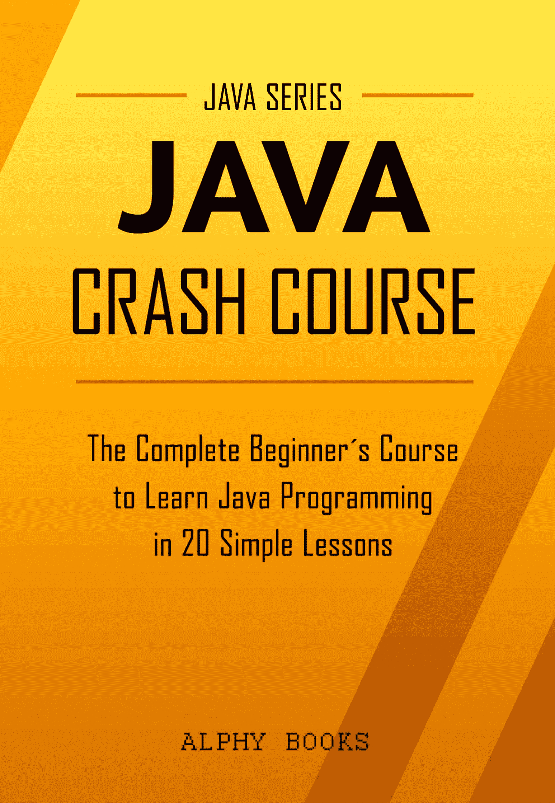

通过 21 节清晰的课程学习 Java 编程的完整初学者教程 - 包含大量实用示例与练习

# 附赠章节：算法

## 3 和 5 的倍数

### 偶斐波那契数

## 最大质因数

# 结语：未来何方

## “我想改变世界，但他们不给我源代码”

未知作者

# 问候与欢迎

欢迎来到你的新编程语言世界。本书是关于使用 `Java` 进行编程的介绍。我们将侧重于广度而非深度。目标是尽快地完成一些有趣的事情。

只想在自己的机器上运行 Java 程序的普通用户只需要安装 `JRE`，因为它包含了允许执行 Java 程序的 `JVM`。然而，Java 程序员必须下载 `JDK`。我们将在下一部分更详细地探讨这些概念。如前所述，Java 编程创建的是面向对象且平台无关的程序，因为 Java 编译器创建的是 `.class` 文件而不是 `.exe` 文件。这个 `.class` 文件是一个包含字节码的中间文件，这就是 Java 程序具有平台无关性的原因。但它也存在缺点：Java 程序的执行需要更长的时间，因为 `.class` 文件在操作系统中之前，必须先加载到 `JVM` 中。

我们可以使用 Java 开发各种应用程序，但我们需要为不同的应用开发使用不同的包。例如，如果你想开发桌面应用程序，那么你就需要使用 `JDK`；如果你想开发 Android 应用程序，你就需要使用 `Android SDK`，因为它们拥有不同的类集合。

# 第 2 章：Java 环境

## Java 的安装

为了在系统上安装 Java，你需要以下工具：

*   适用于 Java 开发者的 IDE（集成开发环境）
*   Java `JDK`

下载这两个工具将开启你成为 Java 程序员的道路。IDE（集成开发环境）是一个包含处理和执行代码所需工具的封装应用程序。它包含一个代码编辑器、编译器、一个调试器和一个图形用户界面（GUI）。有很多类型的 IDE，但最常用的有：

*   Netbeans
*   Eclipse

我个人推荐使用 `Eclipse`，因为它的性质简单。你可以在这里下载：

[`eclipse.org/downloads/`](https://eclipse.org/downloads/)

一旦你进入此链接，你需要找到这个内容：


然后，根据你系统中安装的操作系统/处理器类型，选择 Windows 32 位或 64 位操作系统。

一旦安装了 IDE，我们将下载并安装 `JDK`，这将允许我们与用于创建和执行 Java 代码的代码编辑器进行交互。下方链接提供的 `JDK` 包含了开发 Java 程序所需的所有包和工具。

[`www.oracle.com/technetwork/java/javase/downloads/index.html`](http://www.oracle.com/technetwork/java/javase/downloads/index.html)

在该网站上，找到并点击此图片开始下载：

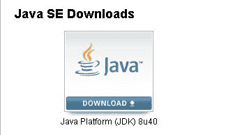

下载安装 `JDK` 后，你将能够启动 `Eclipse`。

从 `Eclipse` 下载包解出的文件夹将包含 `eclipse.exe` 文件。一旦启动，你将看到以下窗口：


此提示仅要求你设置输出目录，以保存你将编写的所有代码。选择完成后，点击“OK”继续。

你现在应该处于主界面了。

为了开始工作，你应该：

1. 点击 `File`（文件）
2. 点击 `New`（新建）→ `Java Project`（Java 项目）


3. 在“Project name:”（项目名称：）字段中输入项目名称
4. 点击“Finish”（完成）
5. 右键点击 `src` → `New`（新建）→ `Class`（类）


6. 在“Name”（名称）字段中填写任何包含字母的内容——不要使用特殊字符。例如：“ThisIsAClass”
7. 点击“Finish”（完成）

你现在会看到一个显示如下：

```java
public class ThisIsAClass {

}
```

恭喜，你已经成功创建了一个类！

# 第 3 章：Java 语言结构

我们现在将以此作为示例。这现在可能还没有什么意义，但当我们学习继承和多态时，你会有更好的理解。

```java
public class ThisIsAClass {
    public static void main (String args[]) {
        int x = 5;
        System.out.println("The number is" + x);
    }
}
```

如上述示例代码所示，两个大括号被加粗，表示它们之间是相互通信的。它们之间编写的任何内容都是名为 `ThisIsAClass` 的“部分”（Section）或“类”（Class）。示例使用了加粗和下划线的大括号来表示它们是父部分内部分的独立部分分隔符。父部分再次被视为一个类，而父部分内的部分被视为子部分、子类，或者用术语来说，就是方法（method）。

方法本质上是一个子类，它也有它自己的特殊元素，类似于类但更具体。它包含四个元素：作用域（`public/private/protected`）、返回类型、名称和参数。作用域、返回类型和参数将在我们学习方法、继承和多态时，你会对它们有更好的理解。

*   `public`—作用域。
*   `static`—`main` 方法的约定关键字。
*   `void`—返回类型。
*   `main`—方法名称（你可以将其命名为任何名称，但在这种情况下，`main` 方法必须存在于每个 Java 程序中，因为它是 Java 程序的起点）。

这个方法是一个特殊方法，因为它被命名为 `main`，因此它将是第一个被调用的方法。编译器始终在进程启动时寻找名为 `main` 的方法。`main` 方法必须具备以下属性：`public static void` 并在参数中具有 `String args[]` 参数。一个 Java 项目中只能有一个 `main` 方法。`main` 方法的想法是它将是第一个被调用的方法，因此你可以将其认为是调用其他方法和跳转到其他类的基地（你稍后将学习这意味着什么）。在本指南的剩余部分中，你的程序必须写在这个 `main` 方法中，因为它是编译器始终在寻找的特殊方法。

该方法的的内容将在本指南稍后学习“变量”部分时一并介绍。目前，这个简短的解释应该足够你理解发生了什么了：

`int x = 5;`—正在声明一个变量（容器），它的类型是整数（整数字），它持有值 5。`=` 用于给变量赋值。

`System.out.println`—这是每位初学者都会学的经典行；它唯一的作用就是向控制台打印一行文本。

示例：


控制台是程序输出所在的地方，以便程序员测试其程序。`System.out.println` 这一行包含括号和括号内的一个文本字符串。文本字符串必须用引号包围，以便程序知道它必须打印文本而不是像 `x` 这样的实际变量。用户不能直接说：`System.out.println("The number is: x");` 的原因是程序并不知道 `x` 是否是一个变量。程序将引号内的任何内容都视为一段文本，而不是持有值的容器。因此，`x` 必须在引号外面。

但话又回来，你不能说 `System.out.println("The number is: " x);`，因为程序需要一个特定的关键字来知道这段文本和变量是两个需要合并或“拼接”在一起的实体。`+` 符号用于显示文本字符串和变量 `x` 将连接在一起；这将允许程序输出“The number is: 5”（不带引号）。这就是为什么那行代码是：`System.out.println("The number is: " + x);`

## 注释

注释是编程语言中需要理解的最后一个基本概念。虽然不是必须的，但如果你忘记了程序是如何工作的，它对你以及周围的其他程序员来说大有帮助。

程序员利用这个概念作为机会使用普通英语来解释他们的代码。编译器始终忽略注释，因为它们不是实际代码。它们只是为了帮助人们理解编写了什么而写的说明。要写注释，你必须使用 `//` 或 `/* */`。

`//` 符号用于单行注释。例如，如果你想解释某个变量将用于什么，你可以这样做：

```java
int x = 5; // 这个变量将用于找到总金额
```

编译器将忽略被注释的行，但会处理 `int x = 5`。然而，你不能对以下内容使用 `//` 符号：

```java
int x = 5; // this variable is going to be
used to find the total money
```

这是因为 `//` 符号只用于一行，而注释跨越了两行。你可以这样做：

```java
int x = 5;
// 这个变量将用于找到总金额
```

只要注释是单行的，就没有问题。该符号之后该行上的任何内容都被视为注释。

另一种技术与 `//` 的作用相同，但它支持多行注释。你必须用 `/*` 开始注释并用 `*/` 结束。

示例：

```java
int x = 5; /* 这个变量将用于找到总金额 */
```

# 第 4 章：变量

## 什么是变量？

变量本质上是一个持有特定类型数据的存储单元。它由程序员命名并用于标识数据。变量通常可以被访问或更改。

## 变量类型

在 Java 中，变量有一个特定的类型，决定了它的大小和内存布局。Java 语言定义了三种变量。

### 实例变量

实例变量在类内部声明但在方法、构造函数或块之外访问。实例变量使用 `new` 关键字创建，并在对象销毁时销毁。实例变量对于声明它的类中的所有方法、构造函数和块都是可见的。通过给变量 `public` 关键字，它可以被子类访问。然而，尽可能将变量的访问修饰符设置为 `private`。所有实例变量都有默认值，而局部变量没有。

示例：

```java
public class Test
{
    public int num; // 名为 num
    public void dog()
    {
        num = 3;
    }
}
```

在这个示例中，我们在方法之外声明了整数 `num`，并在类中的任何方法中轻松访问它。

### 类/静态变量

静态变量在方法、构造函数或块之外声明，并使用 `static` 关键字声明。如果一个变量是静态的，无论调用多少个实例，该变量都只有一个实例。静态变量很少用于常量值，即不会改变的变量。

示例：

```java
public class Test
{
    public static final int num = 3; // 名为 num
    public void dog()
    {
        System.out.println( num );
    }
}
```

在这个示例中，我们声明了一个名为 `num` 的 `int`，并将其设置为 `public`、`static` 和 `final`。这意味着它可以从子类内部进行访问，只能存在一个实例，且值永远无法更改。

### 局部变量

局部变量仅在方法、块或构造函数内部声明。它们只在方法、块或构造函数创建时被创建，并在方法结束时立即被销毁。你只能在调用它的方法、块或构造函数内部访问局部变量；它们在调用处之外是不可见的。局部变量没有默认值。

示例：

```java
public void cat(){ // 方法名为 cat
    int x = 0; // 值为 0 的 int
}
```

在这个示例中，在 `cat` 方法内部调用了一个名为 `x` 的变量。该变量只存在于 `cat` 方法的作用范围内，无法在该方法之外直接调用或访问。

# 数据类型

如上所述，变量用于存储数据。Java 有多种内置数据类型，用于存储预定义类型的数据。这些数据类型被称为基本数据类型（primitive data types），是 Java 编程语言中最基础的数据类型。你也可以创建自己的数据类型，我们将在稍后介绍这一点。Java 有八种基本数据类型。

## Byte

`byte` 数据类型是 8 位带符号补码整数。它在声明时的默认值为 0，最大值为 127，最小值为 -128。当你想要节省内存空间时（特别是在大型数组中），`byte` 是很有用的。

示例：

```java
byte b = 1; // 值为 1
```

## Short

`short` 数据类型是 16 位带符号补码整数。它的最大范围是 32,767，最小值为 -32,768。`short` 用于节省内存或使代码更清晰。

示例：

```java
short s = 1; // 值为 1
```


### Int

`int` 数据类型是 32 位带符号补码整数。它的最大值为 2,147,483,647 (2³¹-1)，最小值为 -2,147,483,648 (-2³¹)。除非考虑内存问题，`int` 是整数类型最常用的数据类型。

示例：

```java
int i = 1; // 值为 1
```

### Long

`long` 数据类型是 64 位带符号补码整数。它的最大值为 9,223,372,036,854,775,807 (2⁶³-1)，最小值为 -9,223,372,036,854,775,808 (-2⁶³)。当需要比 `int` 能够表示更大的数字时，使用这种数据类型。

示例：

```java
long l = 1; // 值为 1
```

### Float

`float` 数据类型是单精度 32 位 IEEE 754 浮点数。其最小和最大范围太大，在此不再讨论。在需要精度的情况下（例如处理货币时），永远不要使用 `float`。

示例：

```java
float f = 1200.5f; // 值为一千二百点五
```

### Double

`double` 数据类型是双精度 64 位 IEEE 754 浮点数。它通常是小数的首选数据类型。其最小和最大范围太大，在此不再讨论。在需要精度的情况下（例如处理货币时），永远不要使用 `float`。

示例：

```java
double d = 1200.5d; // 值为一千二百点五
```

### Boolean

`boolean` 数据类型表示位数据。它可以包含两个值：`true`（真）或 `false`（假）。它用于简单的标记位，以跟踪真假条件。

示例：

```java
boolean b = true; // 值为 true
```

### Char

`char` 数据类型是单个 16 位 Unicode 字符。它的最小值为 `\u0000`（或 0），最大值为 `\uffff`（或 65,535，包含）。

示例：

```java
char c = 'w'; // 返回字母 "w"
```

### String

另一个常用的数据类型是 `String`。`String` 不是基本数据类型，但它是一种非常常用的数据类型，用于存储字符集或文本。

示例：

```java
String cat = "meow"; // 将 cat 的设置为 "meow"
```

这个示例获取了一个名为 `cat` 的 `String`，并将其设置为拼出“meow”的字符字符串。

## 声明变量

变量包含三部分：数据类型、变量名和存储的值。注意，命名变量有一套特定的约定和规则。变量名可以是任意长度的 Unicode 字母和数字，但必须以字母、美元符号 `$` 或下划线 `_` 开头，否则将返回语法错误。常见的命名约定是以小写字母开头，后续每个单词大写字母开头。例如，在名为 `theName` 的变量中，第一个单词 `the` 以小写字母开头，后续每个单词（在此例中为 `Name`）以大写字母开头。

示例：

```java
int theName = 123; // 值为 123
```

在上面的示例中，数据类型是 `int`，变量名是 `theName`。存储在该变量中的值为 123。你也可以声明一个不存储值的变量。

示例：

```java
int name; // 无值
```

如果你稍后声明，可以这样做。

## 使用变量

变量声明后，你可以读取它的值或更改它。在变量初始声明后，你只能通过名称引用它；只有在声明变量时才需要声明数据类型。

示例：

```java
name = 2; // 将 int "name" 设置为 2
```

上面的示例将 `name` 的值设置为 2。注意我没有再次说明数据类型。

示例：

```java
System.out.println(name); // 将 name 的值打印到控制台
```

这个示例读取 `name` 的值并将其写入控制台。

变量也可以相加，例如。

示例：

```java
int a; // 无值

int b = 1; // 值为 1

int c = 2; // 值为 2

a = b + c; // 将 a 设置为 b + c 的值
```

在上面的示例中，我们将 `a` 的值设置为 `b` 和 `c` 的值之和。加号被称为运算符，我们将在接下来的章节中学习它。在一定程度上，也可以组合不同数据类型变量的值。

示例：

```java
int a; // 无值

float b = 1; // 值为 1

int c = 2; // 值为 2

a = (int) (b + c); // 将 int "name" 设置为 b + c 的值
```

这个示例与之前的示例完全相同，只是我们将 `b` 的数据类型从 `int` 改为了 `float`。

## 算术运算符

### 加法

`5 + 5 = 10`

```java
int x = 5;
int y = 5;
int total = 0;
total = x + y;
```

在上面的示例中，变量 `total` 获取两个变量 `x` 和 `y` 并将它们相加，得到一个 10 的值。

### 减法

`5 - 5 = 0`

```java
int x = 5;
int y = 5;
int total = 0;
total = x - y;
```

在上面的示例中，变量 `total` 获取两个变量 `x` 和 `y` 并将它们相减，得到一个 0 的值。

### 乘法

`5 * 5 = 25`

```java
int x = 5;
int y = 5;
int total = 0;
total = x * y;
```

在上面的示例中，变量 `total` 获取两个变量 `x` 和 `y` 并将它们相乘，得到一个 25 的值。

### 除法

`20 / 5 = 4`

```java
int x = 20;
int y = 5;
int total = 0;
total = x / y;
```

在上面的示例中，变量 `total` 获取两个变量 `x` 和 `y` 并将它们相除，得到一个 4 的值。

### 取模运算

`7 % 2 = 1`

```java
int x = 7;
int y = 2;
int total = 0;
total = x % y;
```

在上面的示例中，变量 `total` 获取两个变量 `x` 和 `y` 的余数，并计算 `2` 能够整除 `7` 几次，直到无法整除。在该过程之后，余数就是输出结果。例如：

`2` 能整除 `7` 几次？

3 次。

`2 * 3 = 6`
`7 - 6 = 1`

因此，`7 % 2` 等于 `1`，因为这就是余数。

### 后置自增

`5 + 1 = 6`

```java
int x = 5;
x++;
int y = 0;
y = x++;
```

在上面的示例中，变量 `x` 增加了值 `1`。因此，`x` 的值现在必须是 `6`，因为当 `x = 5` 时 `x + 1 = 6`。如果你打印 `x` 的值，输出将是 `6`。你可以再次执行 `x++`，此时该值将变为 `7`。另一方面，`y` 的值仍然是 `5`，因为它是后置自增，这意味着先将 `x` 的当前值（`6`）赋给 `y`，然后 `x` 再增加 `1`（变为 `7`）。

### 前置自增

`5 + 1 = 6`

```java
int x = 5;
++x;
int y = 0;
y = ++x;
```

在上面的示例中，变量 `x` 的增加方式与其作为单独变量进行后置自增时一样。另一方面，`y` 的值直接变为 `7`，因为它是前置自增。这意味着 `x` 的值先增加了 `1`（变为 `7`），然后 `y` 获取这个新值。

### 后置自减

`5 - 1 = 4`

```java
int x = 5;
x--;
int y = 0;
y = x--;
```

在上面的示例中，变量 `x` 减少了值 `1`。因此，`x` 的值现在必须是 `4`，因为 `x` 原本等于 `5`，`x - 1 = 4`。如果你打印 `x` 的值，输出将是 `4`。你可以再次执行 `x--`，此时该值将变为 `3`。另一方面，`y` 的值仍然是 `4`，因为它是后置自减，这意味着先将 `x` 的当前值（`4`）赋给 `y`，然后 `x` 再减少 `1`（变为 `3`）。

### 前置自减

`5 - 1 = 4`

```java
int x = 5;
--x;
int y = 0;
y = --x;
```

在上面的示例中，变量 `x` 减少了值 `1`。因此，`x` 的值现在必须是 `4`，因为 `x` 原本等于 `5`，`x - 1 = 4`。如果你打印 `x` 的值，输出将是 `4`。你可以再次执行 `--x`，该值将变为 `3`。另一方面，`y` 的值是 `3`，因为它是前置自减。这意味着 `x` 的值先减少了 `1`（变为 `3`），然后 `y` 获取这个新值。

## 赋值运算符

赋值运算符是在给变量赋值时使用的运算符，最常用的运算符是 `=`。以下是一些示例列表：

### 等号：`=`

```java
int x = 5;
```

在这个示例中，如果你打印 `x`，值将是 `5`，因为你将变量 `x` 赋值为 `5`。

### 加赋值运算符：`+=`

```java
int x = 5;
x += 5;
```

在这个示例中，如果你打印 `x`，值将是 `10`，因为你正在 `x` 的值上加上 `5`。这条语句等同于 `x = x + 5` → `x += 5`。

### 减赋值运算符：`-=`

```java
int x = 5;
x -= 5;
```

在这个示例中，如果你打印 `x`，值将是 `0`，因为你正在从 `x` 的值中减去 `5`。

### 乘法赋值运算符：`*=`

```java
int x = 5;
x *= 5;
```

在这个示例中，如果你打印 `x`，值将是 `25`，因为你正在将 `x` 的值乘以 `5`。

### 除法赋值运算符：`/=`

```java
int x = 5;
x /= 5;
```

在这个示例中，如果你打印 `x`，值将是 `1`，因为你正在将 `x` 的值除以 `5`。

### 取模赋值运算符：`%=`

```java
int x = 5;
x %= 2;
```

在这个示例中，如果你打印 `x`，值将是 `1`，因为你正在对 `x` 的值取模。

## 第 6 章：用户输入：获取数据

`Scanner` 对象允许我们获取输入。了解 `Scanner` 的工作方式，如下：

```java
import java.util.Scanner;

public class Main {
    public static void main(String[] args) {
        Scanner scan = new Scanner(System.in);
        System.out.println("输入你的名字：");
        String name = scan.nextLine();
        System.out.println("你好, " + name);
        System.out.println("输入你的年龄：");
        int age = scan.nextInt();
        System.out.println("你的年龄是 " + age + " 岁。");
    }
}
```

这个程序具体做了什么？

它声明了两个整数等待用户输入。首先，它等待第一个数字，即用户输入数字并按回车。然后它等待第二个数字。最后，`sum` 变量将结果相加输出。

### 替代方案：BufferedReader 和 DataInputStream

除了 `Scanner` 对象，我们还可以使用 `BufferedReader` 和 `DataInputStream` 类方法在运行时读取不同类型的数据。在这些类中，我们有一组方法可以读取整数、字符、`float`、`double`、`String` 等。

`BufferedReader` 和 `DataInputStream` 类定义在 `java.io` 包中。如果你想使用这些类，你需要在程序中导入这些包。导入这些包后，你可以在任何地方使用这些类，但在调用这些方法之前你需要创建一个对象。

```java
import java.io.BufferedReader;
import java.io.InputStreamReader;
import java.io.IOException;

public class Main {
    public static void main(String[] args) throws IOException {
        BufferedReader br = new BufferedReader(new InputStreamReader(System.in));
        System.out.println("输入你的名字：");
        String name = br.readLine();
        System.out.println("你好, " + name);
        System.out.println("输入你的年龄：");
        int age = Integer.parseInt(br.readLine());
        System.out.println("你的年龄是 " + age + " 岁。");
    }
}
```

创建 `DataInputStream` 和 `BufferedReader` 的对象：

```java
BufferedReader br = new BufferedReader(new InputStreamReader(System.in));
String name = br.readLine(); // 这将在运行时读取字符串数据。
int no = br.readLine(); /*这将抛出错误，因为你不能将字符串数据存储在整数变量中。你必须通过包装类将此数据转换为整数数据.*/
```

包装类：

*   `Integer`
*   `Float`
*   `Double`
*   `Byte`

*   `Integer.parseInt(String data)`：将字符串数据转换为整数数据。
*   `Float.parseFloat(String data)`：将字符串数据转换为 `float` 数据。
*   `Double.parseDouble(String data)`：将 `String data` 转换为 `double` 类型数据。
*   `Byte.parseByte(String data)`：将 `String data` 转换为 `Byte` 类型数据。

```java
DataInputStream obj = new DataInputStream(System.in);
String data = obj.readLine(); // 读取字符串数据并存储在字符串变量中
int no = Integer.parseInt(data); // 将字符串数据转换为 `Integer` 类型数据。
```

### BufferedReader 示例程序

```java
import java.io.*;

class students {
    private int sno;
    private String sname;
    private int mark1, mark2, total;

    students() throws Exception {
        BufferedReader br = new BufferedReader(new InputStreamReader(System.in));
        System.out.print("Enter Student No : ");
        sno = Integer.parseInt(br.readLine());
        System.out.print("Enter Student Name : ");
        sname = br.readLine();
        System.out.print("Enter mark1 and mark2 : ");
        mark1 = Integer.parseInt(br.readLine());
        mark2 = Integer.parseInt(br.readLine());
    }

    students(int no, String name, int m1, int m2) {
        sno = no;
        sname = name;
        mark1 = m1;
        mark2 = m2;
        total = mark1 + mark2;
    }

    void putstud() {
        System.out.println("Sno : " + sno);
        System.out.println("Sname : " + sname);
        System.out.println("Mark1 : " + mark1);
        System.out.println("Mark2 : " + mark2);
        System.out.println("Total   : " + total);
    }

    public static void main(String args[]) throws Exception {
        students s1 = new students();
        students s2 = new students(100, "Kirthika", 90, 80);
        s1.putstud();
        s2.putstud();
    }
}
```


此示例程序演示了如何在运行时数据读取中使用 `BufferedReader`。在这里，我们创建了一个名为 `students` 的新类，包含两个不同的构造函数。第一个构造函数是空构造函数，不接受任何参数。它将通过 `readLine()` 方法在运行时读取学生的详情，例如学生姓名和编号。该方法在调用时会读取字符串数据。因此，它首先读取数据，然后将其转换为整数数据存储在名为 `sno` 的整数变量中，接着另一个字符串数据将存储在 `sname` 变量中。在第二个构造函数中，我们将输入数据作为参数传递，并存储在 `sno` 和 `sname` 变量中。在 `main` 方法中，我们为第一个和第二个对象创建实例；它们将分别执行这些构造函数。然后将调用 `putstud` 方法，最后打印 `sname` 和 `sno` 数据。

### DataInputStream 示例程序

```java
import java.io.*;

class Const1
{
    private int sno;
    private String sname;

    Const1()
    {
        System.out.println("Constructor Called");
        sno = 0;
        sname = "";
    }

    void getdetails() throws IOException
    {
        DataInputStream br = new DataInputStream (System.in);
        String line;
        System.out.print("Enter Sno : ");
        line = br.readLine();
        sno = Integer.parseInt(line);
        System.out.print("Enter Sname : ");
        sname = br.readLine();
    }

    void putdetails()
    {
        System.out.println("Sno : " + sno);
        System.out.println("Sname : " + sname);
    }

    public static void main(String args[]) throws IOException
    {
        Const1 c1 = new Const1();
        c1.putdetails();
        c1.getdetails();
        c1.putdetails();
    }
}
```

此示例解释了 `DataInputStream` 的用法。在这个示例中，我们使用 `readLine()` 方法读取数据。

## 第 7 章：String 对象

字符串在 Java 中非常常用。`String` 是字符序列，它不是基本数据类型而是一个对象。计算机读取字符串的方式是从 0 到字符串的长度。

### 字符串长度

`length()` 函数返回字符串中的字符数量。例如：

```java
String text = "test";
int amount = text.length();
System.out.println(amount);
```

### 字符串拼接

有多种方法连接两个字符串，例如 `concat()` 方法，或者你可以使用 `+` 运算符。以下是各种示例：

示例 1：

```java
String text = "Hello ";
String text2 = "World!";
System.out.println(text + text2);
```

示例 2：

```java
String text = "Hello ";
String text2 = "World!";
System.out.println(text.concat(text2));
```

示例 3：

```java
String text = "Hello ";
String text2 = "World!";
System.out.println(text + " fun " + text2);
```

示例 4:

```java
String text = "Hello";
String text2 = "World";
System.out.println(text.concat(" fun ").concat(text2));
```

### 字符串方法演示

#### charAt(int index)

`charAt()` 方法返回指定索引处的字符。

```java
String text = "Hello World!";
char letter = text.charAt(0); // letter 为 H
```

#### Equals(String anyText)

`equals()` 方法检查两个字符串是否相等。

```java
String text = "Hello";
boolean doesItEqual = text.equals("Hello");
System.out.println(doesItEqual); // 返回 true
```

#### substring(int beginIndex)

`substring()` 方法从指定的索引开始提取字符串的一部分。

```java
String text = "Hello World";
String justWorld = text.substring(6); // 返回 World
```

#### trim()

`trim()` 方法删除字符串左侧或右侧的空格。

```java
String text = "  Hello World  ";
String trimmedText = text.trim(); // trimmedText 为 Hello World
```

`StringBuffer` 是一个同类类，提供了许多常用功能。`String` 代表固定长度的字符序列，而 `StringBuffer` 则表示长度可变的字符序列。`StringBuffer` 可以在中间插入字符和子字符串，也可以在末尾追加。编译器会自动创建一个 `StringBuffer` 来评估某些表达式，特别是在对字符串对象使用重载运算符 `+` 和 `+=` 时。

### 构造函数

我们有三种不同的构造函数来创建 `StringBuffer` 数据，每个构造函数在此处列出了其语法。

* `StringBuffer sb = new StringBuffer ();`

这是一个空构造函数。它将创建一个 `StringBuffer` 对象，但其中没有任何任何内容。你可以通过简单地向字符串缓冲区对象进行赋值来提供这些数据。

* `StringBuffer sb = new StringBuffer(16);`

这是一个参数化构造函数，只有一个参数：新创建的 `StringBuffer` 的大小。例如，这将会创建一个容量为 16 个字符的新的 `StringBuffer` 对象。

* `String s;`
  `StringBuffer sb = new StringBuffer(s);`

这是一个参数化构造函数，只有一个参数：字符串数据对象。例如，这将会创建一个 `StringBuffer` 对象，然后获取 `String s` 的数据。

## StringBuffer 方法

* `length()`

从此 `StringBuffer` 创建一个字符串或将其转换为字符串。

`length()` 的示例：

```java
StringBuffer text = "test";
int amount = text.length();
System.out.println("The amount of characters are: " + amount);
```

`StringBuffer` 对象中的 `.length()` 函数或属性返回 `String` 对象中字符的数量，并将该值赋值给整数 `amount`。此示例代码的输出将为 4，因为 “test” 长度为四个字符。

* `capacity()`

返回当前分配的空间数。

容量的示例：

```java
StringBuffer s1=new StringBuffer(16);
int capacity=s1.capacity();
System.out.println("Capacity of the StringBuffer" + capacity);
```

`capacity()` 方法将返回 `StringBuffer` 对象的容量。此示例代码将创建一个新的 `StringBuffer` 对象 `s1`，一旦我们调用 `capacity` 方法，它将返回新 `StringBuffer` 对象 `s1` 的容量。结果将存储在整数变量 `capacity` 中。最后，我们通过 `println` 方法打印 `s1` 的容量。

`boolean ensureCapacity()` 使 `StringBuffer` 至少持有所需的空间数。

* `setLength()`

截断或扩展之前的字符字符串，如果扩展，则用空值填充。

`setLength` 的示例：

```java
StringBuffer s1=new StringBuffer();
s1.setLength (25);
```

此 `setLength` 方法将调整 `StringBuffer` 的大小。在这个示例中，我们正在使用 `setLength` 方法调整数据大小。

* `charAt(int)`

返回缓冲区该位置的字符。

`charAt` 的示例：

```java
String text = "Hello World!";
char letter = text.charAt(0);
```

`letter` 的值包含字母 “H”，因为输入的字符串索引为 0，它是字符串的第一个字母。计算机读取字符串的方式是从 0 到字符串的长度，而不是 1。

* `setCharAt(int,char)`

修改该位置的值。

`setCharAt` 的示例：

```java
StringBuffer sb = new StringBuffer("Hello");
sb.setCharAt(2,'w'); // 结果为 Hewlo
```

在这个示例中，我们通过 “w” 更改第二个索引的数据。

* `getChars()`

将字符复制到外部数组中。没有像字符串那样的 `getBytes()`。

* `append()`

将参数转换为字符串并将其追加到当前缓冲区的末尾。

`append` 的示例：

```java
StringBuffer s1=new StringBuffer(25);
s1.append("Hello");
s1.append("AABBCC");
```

在这个示例中，`append` 将 “AABBCC”文本添加到此 `s1` `StringBuffer` 对象的末尾，因此最终结果为 “HELLOAABBCC.”

* `insert()`

将第二个参数转换为字符串并从偏移量开始插入到当前缓冲区。

`insert` 的示例：

```java
StringBuffer s1=new StringBuffer("Dwayne Johnson");
s1.insert(7," The Rock ");
```

此示例代码将第二个参数的文本插入到 `StringBuffer` 对象的指定索引处，最终结果为 “Dwayne The Rock Johnson.”

* `reverse()`

反转缓冲区中字符的顺序。

`reverse` 的示例：

```java
StringBuffer s1=new StringBuffer("Saravanan");
System.out.println("Reverse string is:" + s1.reverse());
```

此示例以反转顺序转换字符串数据；最终结果为 “nanavaraS.”

示例：

```java
class StringBufExample
{
    public static void main(String args[])
    {
        StringBuffer sb = new StringBuffer("Hello World");
        System.out.println(sb + ".capacity() = " + sb.capacity());
        System.out.println(sb + ".length() = " + sb.length());
        System.out.println(sb + ".insert(5,aaa) = " + sb.insert(5,"aaa"));
        System.out.println(sb + ".capacity() = " + sb.capacity());
        System.out.println(sb + ".length() = " + sb.length());
    }
}
```

对于接下来的示例，我将使用 `if` 语句。简单来说，`if` 语句用于检查某个条件是否为真或假。要创建一个 `if` 语句，你只需要写 `if` 单词并在后面跟两个圆括号。括号内包含检查某个条件是否为真的逻辑。`if` 语句还可以包含 `else if` 语句和 `else` 语句。如果 `if` 语句返回假，则会执行 `else if` 语句。然而，它也包含一个必须返回真的自身的参数。当 `if` 语句返回假时，也会执行 `else` 语句。`else` 语句与 `else if` 语句的区别在于，`else` 语句的执行不需要任何参数为真即可运行。

### 示例

```java
int a = 10;
int b = 20;

if (a == b) {
    System.out.println("a is equal to b ");
}
else if (a > b) {
    System.out.println("a is greater than b ");
}
else {
    System.out.println("a is not equal to b or greater than b ");
}
```

此示例中使用的操作符（`==` 和 `>`）在下文中解释。在接下来的代码中，我们首先检查 `a` 是否等于 `b`。如果为真，我们就打印 `a is equal to b` 并忽略代码的剩余部分。如果 `a` 不等于 `b`，则程序调用 `else if`。执行 `else` 是由于第一个 `if` 返回了假。`else if` 的 `if` 部分检查它自身的参数，在本文情况下是检查 `a` 是否大于 `b`。如果 `a` 大于 `b`，那么程序就会打印 `a is greater than b`。然而，由于 `a` 小于 `b`，我们继续向下运行并简单地调用 `else`，它会在上述所有参数都返回假时运行。它不需要要求自身的参数为真。

请注意，每个 `if` 语句后面可以跟无限数量的 `else if` 语句，但只能有一个 `else` 语句。同样注意，你不能在 `if` 语句和 `else` 语句之间放置代码，因为代码将无法找到 `else`。此外，`else` 语句要求前面有一个 `if` 语句，因为为了调用 `else` 语句，紧接其前的 `if` 语句必须等于假。同样重要的一点是，可以在另一个 `if` 语句**内部**包含一个 `if` 语句。这被称为**嵌套的 if 语句**。

### 示例

```java
int a = 20;
int b = 30;

if (a == 20) {
    if (a < b) {
        System.out.println("a is less than b and it is equal to 20");
    }
}
```

在这个示例中，我们首先检查 `a` 的值是否等于 `b` 的值。如果是，我们检查 `a` 的值是否小于 `b` 的值。如果该语句也返回真，我们就可以在控制台上打印 `a is less than b and it is equal to 20`。这可以适用于任意数量的 `if` 语句。如果非常有必要单独检查参数，或者你想在每次检查之间添加额外的逻辑，这将非常有用。在本节结束时，你将完全理解 `if` 语句的工作方式。

## 关系运算符

Java 支持 6 种不同的关系运算符，它们用于比较变量的值。它们如下：

### `==`

该操作符检查两个整数的值是否相等。如果它们相等，操作符返回 `true`。如果不相等，它则返回 `false`。

### 示例

```java
int a = 10;
int b = 10;

if (a == b) {
    System.out.println("they are the same");
}
```

这段代码检查 `a` 的值是否等于 `b` 的值。由于 `a` 的值等于 `b` 的值，括号内的值将为 `true`。这导致上面的代码打印出 `they are the same` 语句。

### `!=`

该操作符检查两个东西是否**不相等**。如果两个东西**不等于**相同的东西，它将返回 `true`。如果它们**等于**相同的东西，它将返回 `false`。

### 示例

```java
int a = 10;
int b = 20;

if (a != b) {
    System.out.println("they are not the same");
}
```

这段代码将检查 `a` 是否等于 `b`。由于 `a` 不等于 `b`，程序将在控制台打印 `they are not the same`。

### `>`

该操作符检查某个东西是否大于另一个东西。如果前面的变量的值大于后面变量的值，它将返回 `true`。如果前面的变量的值小于后面变量的值，它将返回 `false`。

### 示例


```java
int a = 10;
int b = 20;

if (a > b) {
    System.out.println("a is larger than b");
}
else {
    System.out.println("a is not larger than b");
}
```

（注：此处原文代码块未闭合，已按逻辑补齐）

此示例检查 `a` 是否大于 `b`。由于 `a` 小于 `b`，执行 `else` 部分。

### `<`

该操作符检查某个东西是否小于另一个东西。如果前面的变量的值小于后面变量的值，它将返回 `true`。

### 示例

```java
int a = 10;
int b = 20;

if (a < b) {
    System.out.println("a is less than b");
}
```

### `>=`

该操作符检查某个东西是否大于等于另一个东西。如果前面的变量的值大于等于后面变量的值，它将返回 `true`。

### 示例

```java
int a = 20;
int b = 20;

if (a >= b) {
    System.out.println("a is greater or equal");
}
```

### `<=`

该操作符检查某个东西是否小于等于另一个东西。如果前面的变量的值小于等于后面变量的值，它将返回 `true`。

### 示例

```java
int a = 20;
int b = 20;

if (a <= b) {
    System.out.println("a is less or equal");
}
```

## 逻辑运算符

Java 支持三种逻辑运算符用于你的逻辑判断，它们通常与关系运算符结合使用。

### `&&`

这被称为逻辑与（AND）操作符。如果该操作符前后的操作数都返回 `true`，则条件返回 `true`。如果两个操作数都为假，或者其中一个操作数为假，条件将返回 `false`。所有操作数都为真时，条件才会返回真。

### 示例

```java
int a = 20;
int b = 20;

if (a == 20 && a == b) {
    System.out.println("a is equal to 20 and b ");
}
else {
    System.out.println("a is not equal to 20 or a is not equal to b");
}
```

在这个示例中，我们检查 `a` 是否等于 20 且 `a` 是否等于 `b`。这两个条件被称为操作数。由于 `a` 等于 20 且等于 `b`，该语句返回真，我们打印 `a is equal to 20 and b`。

### 示例 2

```java
int a = 20;
int b = 30;

if (a == 20 && a == b) {
    System.out.println("a is equal to 20 and b");
}
else {
    System.out.println("a is not equal to 20 or a is not equal to b");
}
```

在下一个示例中，我们检查与第一个示例完全相同的内容。然而，这次的不同在于，我们将 `b` 的值从 20 改为了 30。这意味着当我们运行这段代码时，`if` 语句将返回 false，因为尽管 `a` 等于 20，但它并不等于 `b`。因此，我们打印 `a is not equal to 20 or a is not equal to b.`。注意，顺序并不重要。如果第一个操作数是 false 而第二个，我们将得到相同的结果。

### `||`

该运算符被称为逻辑或（OR）。如果第一个操作数或第二个操作数为 true，该语句将返回 true。这意味着如果第一个操作数返回 false 而第二个为 true，语句仍然将返回 true，反之亦然。如果两个操作数均为 true，该语句也会返回 true。从本质上说，当使用或运算符时，至少有一个操作数必须返回 true。

### 示例：

```java
int a = 20;
int b = 30;

if (a == 20 || a == b) {
    System.out.println("a is equal to 20 or b");
}
else {
    System.out.println("a is not larger than b");
}
```

在这个示例中，我们检查 `a` 是否等于 20，或者 `a` 是否等于 `b`。在这种情况下，`a` 等于 20 且不等于 `b`。由于这些操作数中只需要一个为 true，整个语句将返回 true，程序将在控制台中打印 `a is equal to 20 or b`。

### 示例 2：

```java
int a = 20;
int b = 20;

if (a == 20 || a == b) {
    System.out.println("a is equal to 20 and b ");
}
else {
    System.out.println("a is not equal to 20 or b ");
}
```

在这个示例中，我将上一个一个示例中 `b` 的值从 30 改为了 20。这意味着 `a` 等于 20 且 `a` 等于 `b`。两个操作数都返回 true，因此语句返回 true。这是因为或运算符要求一个或多个运算符为 true。此程序将在控制台中输出 `a is equal to 20 and b`。

### `!`

该运算符被称为逻辑非（NOT）。它用于反转其操作数的逻辑状态。该操作数可以与任何其他操作数配合使用以反转其输出。如果操作数返回 true，应用逻辑非运算符后，该操作数将返回 false。

### 示例：

```java
int a = 21;
int b = 20;

if (!(a == 20) && a > b) {
    System.out.println("a is not equal to 20, and a is greater than b");
}
else {
    System.out.println("a is equal to 20, and a is not greater than b ");
}
```

在这个示例中，我们检查 `a` 的值是否不等于 20，并检查 `a` 是否大于 `b`。由于 `a` 既不等于 20 又大于 `b`，我们向控制台打印 `a is not equal to 20, and a is greater than b`。

### 示例 2：

```java
int a = 21;
int b = 20;

if (!(a == 20 && a > b)) {
    System.out.println("a is not equal to 20, and a is greater than b ");
}
else {
    System.out.println("a is equal to 20, and a is not greater than b ");
}
```

在这个示例中，括号的位置发生了变化，使得逻辑非运算符扩展到两个操作数。现在，要使语句为真，`a` 必须不等于 20 且 `a` 必须不大于 `b`。在这种情况下，语句将返回 false，因为 `a` 大于 `b`。由于操作数的原因，它需要小于 `b` 语句才能返回 true。因此，此程序将在控制台中返回 `a is equal to 20, and a is not greater than b`。

## 组合运算符

在 Java 中，每个语句可以使用你所需的任意数量运算符。

### 示例：

```java
int a = 21;
int b = 20;

if ((a == 20 && a > b) || (a != 20 && a < b)) {
    System.out.println("correct");
}
else {
    System.out.println("wrong");
}
```

通过这个示例，我们看到了如何实现更复杂的语句。在这里，我们应用了一个带有两个操作数的或运算符；然而，每个操作数也包含了一个与运算符。因此，要使此语句返回 true，`a` 必须等于 20 且大于 `b`，或者 `a` 不等于 20 且 `a` 必须小于 `b`。注意，我们使用括号是为了使代码更容易理解，并防止代码误读我们的逻辑。

### 示例 2：

```java
int a = 21;
int b = 20;

if (a == 20 && (a > b || a != 20) && a < b) {
    System.out.println("correct");
}
else {
    System.out.println("wrong");
}
```

在上面的示例中，我们通过切换括号显著改变了逻辑。注意，我们使用括号是为了使代码更容易理解，并防止代码误读我们的逻辑。在，由于操作数的原因，它小于 `b`，它失败了语句并打印 `wrong`。

## 赋值

现在我们将通过另一个作业来确保我们理解运算符。我们有三个朋友 `tom`、`bob` 和 `john`。我们将编写一个程序来输出谁更有钱。我们将每个的赋值给……

```java
System.out.println("bob is just as rich as john, both are richer than tom");
}

else if (bob < tom) {
    System.out.println("bob is just as rich as john, both are more poor than tom");
}

}

/*
* 现在我检查最后可能的组合
* 每个人拥有的金额都不同
* 下面的 6 条语句涵盖了所有可能的结果
*/
else if (tom > bob && bob > john) {
    System.out.println("tom is richest, followed by bob, followed by john");
}
else if (tom > john && john > bob) {
    System.out.println("tom is richest, followed by john, followed by bob");
}
else if (bob > tom && tom > john) {
    System.out.println("bob is richest, followed by tom, followed by john");
}
else if (bob > john && john > tom) {
    System.out.println("bob is richest, followed by john, followed by tom");
}
else if (john > bob && bob > tom) {
    System.out.println("john is richest, followed by bob, followed by tom");
}
else if (john > tom && tom > bob) {
    System.out.println("john is richest, followed by tom, followed by bob");
}
```

在编写代码时，对所有的逻辑进行注释是非常重要的，这样没有写过代码的人也能轻松理解并编辑它。我建议你根据需要留下尽可能多的注释。我也鼓励你尝试找到更好的解决此问题的方法。也许你可以用四分之一的长度来编写这段代码；在编程中，答案永远只有一个。

## 第 9 章

## 循环与数组

### 循环

在编程时，你可能会遇到需要循环大量数字的情况。如果我们使用目前所学的内容来循环一百个数字，我们需要一百个“if”语句。我认为你同意那样会变得非常混乱且令人沮丧。幸运的是，Java 支持三种类型的循环，它们循环的方式略有不同。以下是对每种循环的简要解释。

### While 循环

while 循环是一种控制结构，允许你按照程序设置的次数重复任务。while 循环的语法如下：

```java
while (expression) {
    // 插入代码
}
```

它的工作方式与 `if` 语句类似，但只要 `expression` 为真，while 循环内的代码就会一直运行，直到表达式变为假（如果发生变化的话）。

示例：

```java
int x = 10;
while (x > 0) {
    System.out.println(x);
    x--;
}
```

前面的代码将打印 `x` 的值，然后不断将其减 1，直到 `x` 的值不再大于零。如果你运行这段代码，你将得到从一到十每个数字的输出。一旦 `x` 的值达到零，它不再允许表达式返回真，此时 while 循环结束。注意，你应该警惕死循环。死循环是你代码中的错误，会导致循环永远不会结束，本质上使程序冻结。当你的逻辑中存在错误导致语句永远不会变为假时就会发生这种情况。

### Do While 循环

do while 循环的工作方式与 while 循环非常相似，但有一个主要区别：“do”——即在 while 语句为真时发生的操作——是在询问条件之前执行的。这意味着 do while 循环至少运行一次，因为它在检查条件之前执行了任务。第二次循环的执行完全取决于条件。

示例：

```java
int x = 10;
do {
    System.out.println(x);
    x--;
}
while(x > 0);
```

在这个示例中，while 循环的最后逻辑直接转移到了 do while 循环中。正如你所看到的，唯一的区别是语句为真时运行的逻辑在 while 循环的上方而不是下方。对于这个特定的示例，代码的输出完全相同。但是，如果我们将代码改为如下：

```java
int x = 0;
do {
    System.out.println(x);
    x--;
}
while(x > 0);
```

输出将与 while 循环不同。如果这是一个 while 循环，循环内的代码将永远不会运行。然而在 do while 循环中，do 发生在 while 之前，所以代码将至少运行一次。在第一次运行期间，在代码块被处理之前，它技术上从未被检查是否为真语句。这在特定情况下很有帮助，但它的使用不像普通的 while 循环那样频繁。

### For 循环

for 循环允许你轻松地循环或递增特定范围的值。for 循环的语法如下：

```java
for (initialization; termination; increment) {
    // 语句
}
```

- **初始化**：初始化计数器变量。
- **终止**：规定要判断为真的表达式。
- **递增**：递增初始化的计数器变量。

示例：

```java
for (int x = 0; x < 10; x++) {
    System.out.println(x);
}
```

在这个示例中，我们从初始化 for 循环开始。创建一个 `x` 的新 `int` 变量并将其设置为零。然后我们规定何时终止。我们只要 `x` 小于十，循环就会继续。然后我们设置递增使 `x` 的值增加一。初始化在循环开始时发生。

## 数组

数组是存储相同类型数量变量的数据结构。与其为存储一百个不同值创建一百个不同的变量，你可以创建一个包含一百个值的整数数组。这使得管理整数变得容易得多，同时也让代码更加组织化简单。

### 声明数组

声明数组与声明普通变量相似。语法如下：

`dataType arrayName[]`

上面的数组目前没有任何数据。我们声明了数组，但没有声明它的大小，也没有声明每个索引的值：

示例：

`int intArray[] = new int[5];`

上面的示例声明了一个具有五个槽位的整数数组。这意味着这个 `intArray` 内部包含五个不同的整数。这些数字中的每一个都可以通过以下方式进行独立的编辑和访问：

```java
int intArray[] = new int[5];
intArray[0] = 2;
intArray[1] = 3;
// ...
System.out.println(intArray[0]);
```

上面的代码声明了具有五个数据槽的 `intArray`。我们可以通过在数组旁方括号内添加 `int` 值来访问这些槽位。当我们执行 `intArray[0]` 时，我们引用的是整数数组索引处的值。当我们声明具有五个值的数组时，我们也创建了 0 到 4 的五个槽位。

### 多维数组

通过为数组添加多个维度，数组还可以变得复杂得多。在上面的示例中，数组只有一个维度。通过添加更多维度，我们实际上是在数组中添加数组。这听起来可能复杂，但相对容易理解。

示例：

```java
int intArray[][] = new int[5][5];
```

以下数组包含两个维度。第一个 `5` 意味着我们声明的数组包含五个索引值。第二个数组意味着对于这五个索引值中的每一个，我们都可以在其内部访问另外五个索引值。例如，对于 `intArray[0]` 的索引，我们又添加了五个可以访问的索引。如果我们将索引 0 视为一个普通的整数，那么我们本质上可以认为 `intArray[0]` 等于 `intSecondArray[5]`。这是因为在索引 0 处的数组包含了五个索引。因此，由于 `intArray` 的每个索引都可以被视为一个独立的数组，我们拥有五个数组，每个数组都包含五个索引，总共有二十五个索引。

我们可以通过以下方式访问这些索引中的每一个：


```java
int[][] intArray = new int[5][5];
intArray[0][0] = 1;
intArray[0][1] = 1;
intArray[0][2] = 1;
intArray[0][3] = 1;
intArray[0][4] = 1;
// 以此类推
```

以下代码演示了如何为 `intArray[0]` 中的每个值赋值。如果你将其视为第一个数字，`intArray[0]` 代表我们想要访问的哪个内部数组，这留下的第二个数字 `intArray[][0]` 就是每个内部数组的实际值。这可能是我们理解这一切的一种更简单的方法。

## 结合循环与数组

在学习了循环和数组之后，你可能已经注意到将它们结合起来可以使你的程序产生更大的用和产出潜力。循环允许我们非常快速地为大范围的值赋值或检索值，而数组允许我们创建非常大范围的数字。将两者结合起来会有多方便呢？以下是每种类型循环的示例、如何快速遍历数组，以及如何轻松编辑多维数组。

### 示例 1

```java
int intArray[] = new int[100];
int x = 0;
while (x < 100) {
    intArray[x] = x;
    System.out.println(intArray[x]);
    x++;
}
```

在这个示例中，我们简单地声明了一个包含一百个索引值的数组。然后我们声明了一个需要递增的 `int` 变量。我们告诉 `while` 循环，只要 `x` 小于 `intArray` 的长度（即它拥有的索引数量），就继续循环；然后在每次迭代后将 `x` 增加一。这段代码快速且轻松地编辑了一百个不同的值，并将它们打印到控制台。这一切只需要七行简单的代码就完成了！

### 示例 2

```java
int intArray[] = new int[100];
int x = 0;
do {
    intArray[x] = x;
    System.out.println(intArray[x]);
    x++;
} while(x < 100);
```

这个示例与第一个示例一样，不同之处在于我们将相同的概念应用了 `do while` 而不是 `while`。输出完全相同；但是，你应该对 `do while` 循环保持提高，因为它们至少运行一次。

### 示例 3

```java
int intArray[] = new int[100];
for (int x = 0; x < 100; x++) {
    intArray[x] = x;
    System.out.println(x);
}
```

这种方法可能是我最喜欢的处理方式。这种方法的优点是计数器变量构建在循环内部，所以你不需要声明另一个变量或手动递增它。在我看来，这要方便得多且有组织得多。

### 示例 4

```java
int[][] intArray = new int[100][100];
for(int x = 0; x < 100; x ++){
    for(int y = 0; y < 100; y++){
        intArray[x][y] = y;
        System.out.println(intArray[x][y]);
    }
}
```

这个示例演示了遍历多维数组最实用的方法。它看起来可能很吓人，但实际上非常简单。我们有两个嵌套的 `for` 循环；每个循环都会遍历数组的一个特定维度。对于这个示例，第一次循环时，它将从 `x = 0` 开始。它将遍历每一个第一个索引为零的数组索引。一旦所有的 `[0][y]` 索引都被调用，`x` 就会增加一。然后它将重复这一过程，直到每一个索引都被调用为止。

## 赋值

循环对于编辑大量值用。得益于循环，可以极大简化的一个方面是图像编辑。一张图像可能由数百甚至数千个像素组成，每个像素都有自己的颜色值。通过循环的力量，我们可以快速编辑那些颜色值。对于这次作业，我们将反转一张你选择的图像的颜色。这个程序中有些部分你还没有在书中学过，我会尝试在这方面提供帮助。要编辑图像，我们首先需要创建一个文件对象缓冲图像对象。为了能够使用这些对象，我们需要导入它们。首先，在你的类顶部添加以下代码行：

```java
import java.awt.image.BufferedImage;
import java.io.File;
import java.io.IOException;
import javax.imageio.ImageIO;
```

之后，我们需要一张要编辑的图像。获取任何你选择的图像，并将其拖入项目的主包文件夹以添加到包中。确保不要意外地将其添加到 `src` 文件夹或任何其他文件夹。接下来，你将使用以下两行开始代码：

```java
File file = new File("image.jpg");
BufferedImage image = ImageIO.read(file);
```

returnType: 方法将返回的数据类型。如果设置为 `void`，则不返回任何内容。

methodName: 方法名称。语法与变量相同，但它以大写字母开头。

## 方法类型

在 Java 中有两种类型的方法：静态方法（Static）和非静态方法（Non-Static）。静态方法以关键字 `static` 开头。调用此类方法不需要任何类对象；然而，所有的非静态方法都需要类对象来调用。

### 静态方法的语法

```java
static return-type method_name (parameters)
{
    ...
    ...
}
```

### 非静态方法的语法

```java
return_type method_name (parameters)
{
    ...
    ...
}
```

## 参数

参数是可以在调用方法时传递给方法并使用的变量。方法也可以不接受参数。

### 示例 1

```java
public static void main(String[] args){
    int x = 0;
    x = SampleMethod (x);
}

public static int SampleMethod (int x) {
    return x + 1;
}
```

在这里，我们创建了一个类型为 `int` 且名为 `SampleMethod` 的方法，它接受一个 `int` 数据类型的参数。我们还声明该方法是 `public` 的，这意味着该方法可以从子类访问。我们将其设置为 `static`，这意味着该方法同时只有一个实例在运行。在 `main` 方法中，我们声明了一个 `int` 变量 `x`。然后我们将 `x` 的值设置为 `SampleMethod(x)`。由于 `sample method` 的返回类型为 `int`，因此每当调用该方法时，它**总是**会返回一个 `int` 值。我们给了它 `x` 的值，方法在该值的基础上加 1 并返回。因此，`x` 现在的值为 1。

### 示例 2

```java
public static void main (String args args) {
    double a = 3;
    double b = 6;
    Average (a,b);
}

public static void Average(double x, double y){
    System. out .println("the average is " + (x+y)/2);
}
```

上面的示例方法数据类型为 `void`。这意味着该方法不会返回任何值。如果你只需要方法执行特定的功能而不需要为它赋值，这就是很好。在上面的示例中，我们创建了一个计算两个数字平均值的方法。该方法仅执行计算平均值的函数并将其打印到控制台上。它永远不会返回任何值。

### 示例 3

```java
public static int a = 1;
public static int b = 2;
public static void main(String[] args) throws IOException {
    Sum ();
}

public static void Sum(){
    System. out .println("sum is" + ( a + b ));
}
```

在这个示例中，我们创建了一个名为 `Sum()` 的方法，它不接受任何参数。当方法不接受参数时，使用空括号进行调用，但无论如何括号都必须存在。这还展示了你如何在类中的任何方法中使用该类的 `public` 变量。该变量不需要作为参数中的参数即可使用。我们将整数 `a` 和 `b` 设置为 `static`。这是因为只有静态变量才能在静态方法中使用。

## 方法重载

方法重载意味着你的程序包含多个具有相同名称但参数和返回类型不同的方法。

### 示例

```java
public static void main (String args[]) throws IOException
{
    int a = 1;
    int b = 2;
    double c = 3;
    double d = 4;
    System. out .println( Sum (a,b));
    System. out .println( Sum (c,d));
}

public static int Sum(int x , int y){
    return x+y;
}

public static int Sum(double x , double y)
{
    return (int) (x+y);
}
```

在上面的示例中，我们创建了两个同名的方法，接受两个不同类型的参数。与变量不同，你可以给两个方法命名相同的名称，因为 Java 可以根据参数和返回类型区分这些方法。如果你运行上面的代码，你会发现两个方法都能正常工作。一个处理 `double` 值的和，另一个处理 `int` 值。

## 赋值

创建一个更高级的计算器。包含三个值。第一个值告诉你要执行哪种操作（例如，如果 `a == 1`，则相加；如果 `a == 2`，则相减）。另外两个值将用于操作。让计算器支持加法、减法、除法和乘法，并为每个操作提供一个独立的方法。

```java
// 主方法
public static void main(String args[])
{
    // 选择操作的整数
    int action = 4;
    // 需要进行操作的变量
    double x = 4.5;
    double y = 3;
    /*
    * 根据 action 的值决定我们对
    * 两个变量做什么。每个 action 都在自己的方法中执行，
    * 如果 action 无效，我们打印无效操作，因为
    * 对这些值无事可做。
    */
    if (action == 1) {
        System. out .println("The sum is " + Addition (x,y));
    }
    else if (action == 2) {
        System. out .println("The difference is " + Subtraction (x,y));
    }
    else if (action == 3) {
        System. out .println("The product is " + Multiply (x,y));
    }
    else if (action == 4) {
        System. out .println("The answer is " + Divide (x,y));
    }
    else {
        System. out .println("Invalid operation");
    }
}

// 加法方法
public static double Addition (double x, double y) {
    return x+y; // 返回 a 和 b 之和
}

// 减法方法
public static double Subtraction (double x, double y) {
    return x-y; // 返回 a 和 b 之差
}

// 乘法方法
public static double Multiply (double x, double y) {
    return x*y; // 返回 a 和 b 之积
}

// 除法方法
public static double Divide (double x, double y) {
    return x/y; // a 除以 b
}
```

到此，上面的代码应该是是不言自明的。也许可以添加一个数组而不是两个变量来玩玩。

```java
public static void main(String[] args)
{
    new Fruit();
}
}
```

这本身并没有什么用。我们创建了对象，但在将其赋值给变量之前，我们无法使用它。`Classes` 可以充当变量数据类型，而对象就是它们的值。

```java
class Fruit
{
    public String name;
    public int timeSincePicked;

    public static void main(String[] args)
    {
        Fruit objectOfFruit = new Fruit();
    }
}
```

现在，我们可以访问 `objectOfFruit` 对象内部的变量了。要访问这些变量，我们只需要编写对象名、一个点（`.`）以及变量名即可。方法也可以放在类中，并访问它们所属对象中的变量。记住，对象中的变量可以有不同的值。不过，请注意编写代码的位置，因为你只能在方法内部编写代码。`Classes` 直接包含变量、`methods` 和其他 `classes`。

```java
class Fruit
{
    public String name;
    public int timeSincePicked;

    public static void main(String[] args)
    {
        Fruit newPear = new Fruit();
        newPear.name = "Pear";
        newPear.timeSincePicked = 24894;
        newPear.checkIfRotten(); // 输出："This Pear is not rotten."

        Fruit oldPear = new Fruit();
        oldPear.name = "Pear";
        oldPear.timeSincePicked = 3659246;
        oldPear.checkIfRotten(); // 输出："This Pear is rotten!"
    }

    public void checkIfRotten()
    {
        if(timeSincePicked > 100000)
        {
            System.out.println("This " + name + " is rotten!");
        }
        else
        {
            System.out.println("This " + name + " is not rotten.");
        }
    }
}
```

`Classes` 可以获得另一个类的属性并在此基础上进行构建。这被称为 `inheritance`（继承）。“扩展”另一个 `class` 的 `Classes` 将拥有被扩展 `class` 的所有变量和 `methods`。正在扩展的 `class` 称为 `child`（子类），而被扩展的 `class` 称为 `parent`（父类）。要进行扩展，在 `class` 名称后输入 `extends` 以及父 `class` 的名称。

```java
class Food
{
    public String name;
}

// Fruit 是子类，Food 是父类
class Fruit extends Food
{
    public boolean isRotten;
    // 可以同时访问 name 和 isRotten
}
```

这导致了 `polymorphism`（多态）。这意味着一个 `child class` 可以作为 `parent class` 对象的值。这被称为 `upcasting`（向上转型）。这里是部分代码来解释这一概念：

```java
class Food {
    public String name;
    public static void main(String[] args)
    {
        Food pear = new Fruit();
        pear.name = "pear";
        // pear.isRotten = true; // 这行不通，因为 pear 在技术上是 Food 类型，没有 isRotten 变量
    }
}

class Fruit extends Food {
    public boolean isRotten;
    // 可以同时访问 name 和 isRotten
}
```

`Casting` 或 `downcasting`（向下转型）可以将对象转换为另一种类型，以便访问该类型的变量。这有特定的规则，即对象不能被转换为它并不所属的类型。例如，如果 `Fruit` 和 `Meat` 都扩展自 `Food`，而 `Pear` 扩展自 `Fruit`，并且你有一个类型为 `Fruit` 且已向上转型为 `Food` 类型的对象，它不能被转换为 `Meat` 类型。这是因为原始对象并不是该类型。同样，该对象不能被转换为 `Pear` 类型，因为它在之前不是该类型。`Casting` 的实现方法是，在想要转换的对象之前的括号中放入你想要转换的 `class` 即可。


```java
class Food {}
class Fruit extends Food { public int variable; }
class Meat extends Food {}
class Pear extends Fruit {}
class Main {
    public static void main(String[] args) {
        Food genericFood = new Fruit();
        Fruit fruit = (Fruit) genericFood;
        fruit.variable = 1; // 能够访问转换后对象的变量
        // Meat meatIsntFruit = (Meat) genericFood; // 不工作，因为 fruit 不是 meat
        // Pear fruitIsntPear = (Pear) genericFood; // 不工作，因为 fruit 不够具体，无法作为 pear
    }
}
```

`Access modifiers`（访问修饰符）几乎自言自义：它们修改了谁可以访问它们。`Access modifiers` 可以放在变量、`methods` 和 `classes` 上。它们始终位于变量的数据类型、`method` 的返回类型或 `class` 关键字之前。有三种访问修饰符：

- `Public`：任何地方都可以访问它。
- `Protected`：只有类本身及其子类可以访问它。
- `Private`：只有类本身可以访问它。

如果你省略了访问修饰符，它将默认为无修饰符，这与 `public` 基本相似。`Access modifiers` 本质上防止了其他程序员破坏你 `class` 内部的流程。放置 `access modifiers` 的要求很少——你可以将几乎所有内容都设为 `public`，你的代码也能正常运行。

```java
name = nameParam; // 我们可以设置正在实例化的类的私有变量，因为我们在类内部。
}

public void saySomething() {
    System.out.println("This is a " + name);
}

public static void main(String[] args) {
    Fruit f = new Fruit("pear");
    f.saySomething(); // "This is a pear"
}
}
```

构造函数也可以重载，这意味着只要参数类型的顺序或数量不同，你就可以拥有多个相同的方法。

```java
class Fruit {
    public String name;

    public Fruit() {
        name = "Generic fruit";
    }

    public Fruit(String nameParam) {
        name = nameParam;
    }

    public static void main(String[] args) {
        Fruit f1 = new Fruit(); // name is "Generic fruit"
        Fruit f2 = new Fruit("pear"); // name is "pear"
    }
}
```

`this` 关键字在构造函数中特别有用。它允许程序员在引用类变量的同时，忽略给定方法中的局部变量。这使得为构造函数的参数与类中的变量提供相同的名称成为可能。在使用时，只需将其视为任何对象即可。

```java
public class Example {
    public int aNumber;

    public Example(int aNumber) {
        this.aNumber = aNumber;
        // this.aNumber 指的是类中的变量，而 aNumber 指的是构造函数的参数
    }
}
```

有一种特殊的类类型被称为“匿名内部类”。这意味着它没有名称，因此被称为“匿名”。它也意味着它只能存在一次（除非你复制了两次代码）。匿名内部类的用途有限，但如果你在某些情况下只需要某个特定的类一次，你可以创建一个，而不是必须创建一个文件并将其定义为类类型。匿名内部类植根于继承，最常用于处理接口和抽象类时，但我们很快就会深入讨论这一点。匿名内部类类似于对象的实例化。首先输入 `new`，后面跟上你希望你的匿名内部类继承的类名，然后是你的参数，最后是一个代码块。这可以重写或创建来自父类的方法，并可以创建变量。最后，用分号结束。不过要小心，该代码块不能创建构造函数，也不能创建供匿名内部类外部使用的方法。

```java
class Food {
    public void eat() {
        System.out.println("Mmmmm");
    }

    public static void main(String[] args) {
        Food specialFood = new Food() {
            public void eat() {
                System.out.println("Yuck! This food is rotten!");
            }
        };

        specialFood.eat(); // "Yuck! This food is rotten!"
    }
}
```

匿名内部类的常用用途是处理输入监听器。与其为每种类型的监听器——键盘监听器、鼠标监听器、鼠标轮监听器等创建类，创建匿名内部类可能更容易。这很大程度上取决于你如何使用。

## 第 12 章

## Java 中的接口和抽象类

还有一些特殊的类类型，特别是接口和抽象类。

抽象类是不能实例化的类——你不能创建抽象类的对象。然而，你可以创建抽象类子类的对象。当你希望一组类拥有一组共同的变量或方法，但不希望有一个未指定的对象时，这非常有用。抽象类需要使用向上转型和向下转型。抽象类通过在类关键字之前使用 `abstract` 关键字来定义。在此基础上，抽象类可以包含抽象方法。这意味着你可以在抽象类型中调用方法，它将运行子类的方法。抽象方法必须包含在抽象类内部，并通过在方法的返回类型之前放置 `abstract` 关键字来定义。抽象方法也没有方法体；它们在参数后直接以分号结束。当子类继承自父抽象类时，它必须重写或定义抽象方法。抽象类也可以包含普通方法以添加共同功能，就像普通类一样。

```java
abstract class Food {
    public abstract void saySomething();

    public static void main(String args[]) {
        Food a = new Fruit();
        Food b = new Meat();
        a.saySomething(); // "This fruit is delicious!"
        b.saySomething(); // "This meat is delicious!"
    }
}

class Fruit extends Food {
    public void saySomething() {
        System.out.println("This fruit is delicious!");
    }
}

class Meat extends Food {
    public void saySomething() {
        System.out.println("This meat is delicious!");
    }
}
```

接口与抽象类的相似之处在于它们可以提供必须重写的方法，且它们不能是对象。接口中不能包含变量。接口不能被“扩展”（extend），而是被“实现”（implement）。区别在于，虽然扩展只能针对一个类进行——这意味着你只能有一个父类——但实现可以针对多个接口进行，而不是类。当你需要若干不相关的类共享共同方法时，可以使用接口。要创建一个接口，只需创建一个类，但将 `class` 关键字替换为 `interface` 关键字。在内部，你只能有方法声明。

```java
interface Eatable {
    void eatObject();
}

abstract class Food {
    public abstract void saySomething();

    public static void main(String args[]) {
        Food a = new Fruit();
        Food b = new Meat();
        a.saySomething(); // "This fruit is delicious!"
        b.saySomething(); // "This meat is delicious!"
    }
}

class Fruit extends Food {
    public void saySomething() {
        System.out.println("This fruit is delicious!");
    }
}

class Meat extends Food {
    public void saySomething() {
        System.out.println("This meat is delicious!");
    }
}
```

## 第 13 章

## 包

包本质上是组织代码的方式，特别是与其他项目一起。当你导入内容时，你正在使用包。`java.util` 是一个包，就像 `java.io` 是一个包一样。当你输入星号 `*` 后，表示导入该包中的所有文件。要创建一个包，最好的方法是在你选择的 IDE 中创建，它会为你准备好一切。

此包包含面向输入和输出的类，例如 `DataInputStream`、`BufferedReader`、`FileReader` 等等。如果你想在程序中使用这些类，则需要导入此包。默认情况下，此包会自动导入到你的程序中。

```java
import java.io.*; // 在程序中导入 java.io 包的格式。
```

## IO 包中的重要类

1. `FileInputStream`
2. `SequenceInputStream`
3. `PipeInputStream`
4. `ByteArrayInputStream`
5. `ObjectInputStream`
6. `StringBufferInputStream`
7. `FilterInputStream`
8. `BufferedInputStream`
9. `PushbackInputStream`
10. `DataInputStream` 类
11. `DataInput` 接口
12. `Java.lang`

此包包含基本数据类型类、异常类、包装类等。该类方法帮助我们把字符串转换为处理异常的其他格式。在接下来的章节中，你将看到 `Java.lang` 包内部的重要类。

* `Java.lang`

```java
import java.lang.*; // java.lang 包的导入风格。
```

## Java.lang 包中的类

1. `Exception`
2. `Throwable`
3. `String`
4. `Integer`
5. `Float`
6. `Double`
7. `Byte`

* `Java.util`

此包包含一些重要的类，如 `Random`、`Date` 等。

* `Java.applet`

此类包含 `Applet` 类，用于使用 `Applet` 创建 GUI 应用程序。它仅仅是一个容器，就像 `Frame`、`Panel` 和 `Dialog`。

* `Java.awt`

AWT 代表 Abstract Window Toolkit（抽象窗口工具）。它包含了事件处理和组件类，如 `Label`、`Button`、`Choice`、`Checkbox` 和 `Scrollbar`、`ActionEvent` 等。将在后面深入讨论。

* `Java.net`

此包包含网络编程类。此包的类帮助开发者开发基于网络的应用程序。

* `Java.sql`

此包包含数据库处理类。你可以使用一些特殊类来检索数据库记录，将在后面的章节中深入讨论。

### 用户自定义包

这些是由用户或开发者为了他们自己的使用而开发的。你可能会发现开发自己的包是有帮助的，因为所有类文件都分组在单个目录中，你可以在需要时轻松地重用所有文件。创建用户自定义包涉及以下重要步骤：

**步骤 1**：在 Java 安装位置的 `bin` 文件夹创建一个目录。

**步骤 2**：为该文件夹指定任何名称；这也将是你的包名。

**步骤 3**：定义你的类并将它们存储在你新创建的包文件夹中。

**步骤 4**：像预定义包一样进行导入。

下表解释了包及其类的访问权限级别。

| | Private | Public | Protected | 无修饰符 |
| :--- | :--- | :--- | :--- | :--- |
| 同一个包同一类 | 是 | 是 | 是 | 是 |
| 同一个包子类 | 否 | 是 | 是 | 是 |
| 同一个包非子类 | 否 | 是 | 否 | 是 |
| 不同包子类 | 否 | 是 | 是 | 否 |
| 不同包非子类 | 否 | 是 | 否 | 否 |

## 创建包的语法


```java
package package_name;

class class_name
{
    类的成员变量;
    . . . . . . . . . . .
    . . . . . . . . . . .
    . . . . . . . . . . .
}
```

## 示例程序

创建一个新包并将你的包保存为 `pack1`。

### pack1 中的 1 号类

```java
package pack1;

public class Factorial
{
    public int getFact(int n)
    {
        int fact1=1;
        for(int i=1;i<=n;i++)
        fact = fact * i;
        return fact;
    }
}
```

### pack1 中的 2 号类

```java
package pack1;

public class Fibonacci
{
    public void fib(int n)
    {
        int f1=0,f2=1,f3,i;
        System . out. println(f1);
        System . out. println(f2);
        For(i=2;i<=n;i++)
        {
            f3=f1+f2;
            System . out. println(f3);
            f1=f2;
            f2=f3;
        }
    }
}
```

### 在你的程序中导入包 pack1

```java
import pack1.Factorial;
import pack1.Fibonacci;

class SamplePack
{
    public static void main(String args[])
    {
        Factorial f1=new Factorial();
        f1.getFact(5);              //它将打印整数 5 的阶乘值为 120
        Fibonacci f2=new Fibonacci();
        f2.fib(5);                  // 它将生成斐波那契数列。
    }
}
```

在这个程序中，我们创建了一个名为 `pack1` 的新包，它包含了两个不同的类：`Factorial` 和 `Fibonacci`。

枚举（Enums）本质上是具有有限可能性的预设。它们在定义上与类和接口相似，但使用的是 `enum` 关键字。它们可以拥有构造函数和变量。枚举不能被实例化，也不能作为子类（但可以实现接口）。在访问 `enum` 的变量时要小心，因为如果你修改了 `enum` 的变量，该 `enum` 的所有实例都会被修改。要填充一个 `enum`，你需要所有预设值的列表。此列表必须位于你枚举块的顶部。如果你的 `enum` 没有构造函数，你可以直接写出可能的值，就像是变量名一样。其余部分用逗号分隔并以分号结束。如果你的 `enum` 有构造函数，你必须编写变量名，然后是用逗号分隔的构造参数（即值），并以分号结束。在分号之后，你可以继续编写变量声明、构造函数以及任何想要的方法。构造函数不能是公共的，只能是保护的或私有的。

```java
enum Number 
{
    One , Two , Three
}
```

```java
enum Color 
{
    Red (255, 0, 0),
    Green (0, 255, 0),
    Blue (0, 0, 255),
    Purple (255, 0, 255),
    Yellow (255, 255, 0),
    Cyan (0, 255, 255);

    public int r;
    public int g;
    public int b;

    Color(int redChannel, int greenChannel, int blueChannel) 
    {
        r = redChannel;
        g = greenChannel;
        b = blueChannel;
    }

    public static void main(String[] args) 
    {
        Number num = Number.Two;
        Color red1 = Color.Red;
        Color red2 = Color.Red;
        red1.g = 255;
        System.out.println(red2.g); // “255”, red2 被修改了，因为 red1 和 red2 是同一个对象。该对象存储在两个变量中，因此会受到任何一个对象的更改的影响。
    }
}
```

## 第 16 章

## 泛型

泛型类型允许我们创建泛型类，这意味着它们可以根据给定的类型表现出不同的行为。程序员为泛型类型提供了一个类列表，用于定义特定的对象类型。泛型通过在类名后放置尖括号（`< >`）并跟上类型标识符列表来创建。这些标识符的作用与变量名一样，但惯例是其中一个使用大写字母，特别是 `T`（代表 type）。这些类型标识符可以代替数据类型。这允许你保持某些变量为一致的类型，从而避免强制类型转换。当使用泛型类作为数据类型创建变量时，该数据类型也必须包含与类类型列表对应的类型列表的尖括号。你创建的对象在参数之前也需要相同的尖括号集合。

```java
class Something<A, B> 
{
    public A variableA;
    public B variableB;

    public Something(A varA, B varB) 
    {
        this.variableA = varA;
        this.variableB = varB;
    }

    public static void main(String[] args) 
    {
        // Class1 将是 A，Class2 将是 B
        Something<Class1, Class2> somethingElse = new Something<Class1, Class2>(new Class1(), new Class2());
        Class1 class1 = somethingElse.variableA; // 这不需要类型转换，因为 variableA 实际上是 Class1 类型
    }
}
```

```java
class Class1{}
class Class2{}
```

泛型类型的一个常见用途是 `ArrayList`，它是 `java.util` 包中的一个类。`ArrayList` 是一个动态数组，意味着你可以在数组初始化后更改数组中元素的数量。`ArrayList` 使用泛型类型来防止程序员添加错误类型的对象，并帮助程序员将对象转换为所需的类型。这里是一个使用 `ArrayList` 的简短示例。

```java
class Food 
{
    public String name;

    public Food(String name) 
    {
        this.name = name;
    }

    public static void main(String[] args) 
    {
        ArrayList<Food> basket = new ArrayList<Food>();
        basket.add(new Food("Pear"));
        basket.add(new Food("Apple"));
        basket.add(new Food("Orange"));
        basket.add(new Food("Apple"));
        basket.add(new Food("Pomegranate"));
        System.out.println(basket.get(2).name); // "Orange"
        basket.remove(3);
        System.out.println(basket.size());// "4"
    }
}
```

`ArrayList` 的良好用法涉及“队列”。这是一种在不需要进行递归（在方法内部调用该方法）的情况下实现递归的方法。递归是相当危险的，因为使用不当会导致无限循环，并迅速导致程序崩溃。递归实际上相当慢，所以我们有使用队列的选择是一件好事。基本上，你创建一个 `ArrayList`（通常以类的形式存在），向数组添加一个起始元素，然后只要 `ArrayList` 不空（或未完成任务），它就会根据 `ArrayList` 中的值继续执行代码。你的代码可以向 `ArrayList` 添加产生新循环的元素，就像在递归方法中，你可以再次调用方法以增加新的深度。

队列并不一定“优于”递归方法。队列用于分支递归“路径”，特别是在寻找最优解决方案的情况下。这可以用于视频游戏中的路径查找，或者现实生活。逻辑上，我们可以尝试最接近目标的路径，如果该路径进入死胡同，我们可以将其从队列中移除并尝试下一个最近的路径。递归可以做到这一点，但它的工作方式像树一样。每条路径都可能从左到右，并遍历每种可能性。队列允许你从迭代树的任何部分跳转到迭代树的任何其他部分，这使得计算机可以使用最快的方法找到路线。递归和队列都可以达到相同的结果，但取决于你构建系统的方式。

线程是一种同时运行两个“线程”代码的方式。线程并不一定能让你的程序运行得更快，但在某些情况下可以。线程共享处理能力，因此它不会加快任何代码的运行速度。线程的工作就像两个非常有礼貌的人穿过一条布满门扇的走廊：第一个人让第二个人通过第一扇门，然后第二个人让第一个人通过第二扇门，如此往复。线程允许程序员运行耗时很长的循环，同时仍然在后台执行其他任务。例如，如果你想让程序接受来自另一台计算机的连接，你可以运行一个不断“监听”连接的循环。但这样做的问题是，程序在监听期间会冻结。相反，我们使用一个线程来监听连接，然后在主线程中执行其他任务。我们可以向用户显示类似 GUI（下一节介绍）的内容，并根据监听状态提供反馈。那么，我们如何创建一个线程呢？首先，我们创建一个“Runnable”。只需实现 `Runnable` 接口并重写它的 `run()` 方法。接下来，我们创建一个以 `MyRunnable` 对象（或任何实现 `Runnable` 的类）作为参数的线程对象，最后调用 `<thread object>.start()`。

```java
class MyRunnable implements Runnable
{
    public void run()
    {
        while(true) // 这个循环无限运行！
        {
            System.out.println("Groundhog Day!");
        }
    }
    public static void main(String[] args)
    {
        Runnable runThis = new MyRunnable();
        Thread aThread = new Thread(runThis);
        aThread.start();
        while(true)
        {
            System.out.println("Bill Murray!");
        }
    }
}
```

上面的代码现在将运行两个无限且不相关的循环，并会“随机”打印出“Groundhog Day!”或“Bill Murray!”不过，线程并不限于无限循环；它们适用于任何需要两条并行处理行的场景。例如，假设你正在为视频游戏制作加载菜单。你可以用一个线程加载游戏数据，然后简单地将其状态放入变量中（例如已加载了多少文件）。然后你可以让另一个线程修改你的窗口、控制台或任何内容，根据原始线程使用的变量来告诉用户加载状态。这就是（大多数）加载条的制作方式。

## 线程的生命周期

线程的生命周期涉及四个阶段。它们是：

* 新生状态（Born state）
* 可运行状态（Runnable state）
* 阻塞状态（Blocked state）
* 死亡状态（Dead state）

### 新生状态

当线程被创建时，它处于新状态。“新”（New）意味着线程对象已经创建，但尚未开始运行。它需要通过 `start()` 方法来启动。

### 可运行状态

当线程在执行一组指令时，说它处于可运行状态。`run()` 方法包含了这些指令。该方法在 `start()` 方法调用后会被自动调用。

### 阻塞状态

线程可以运行，但某些东西在阻止它。当线程处于阻塞状态时，调度器会直接跳过它而不给它任何 CPU 时间。在线程重新进入运行状态之前，它不会执行任何操作。

* `wait()` - `notify()`
* `suspend()` - `resume()`
* `sleep(milliseconds)`

### 死亡状态

线程死亡的正常方式是从其 `run()` 方法返回。我们也可以调用 `stop()`，但这会抛出一个 `Error` 类的异常（这意味着我们通常不会捕获它）。

## 线程的创建

在 Java 中，你可以通过两种方式创建线程。第一种是使用 `Runnable` 接口，第二种使用 `Thread` 类。`Runnable` 接口只有一个方法，即 `run()` 方法和一个构造函数。`Thread` 类包含了许多方法，通过这些方法你可以获取线程的基本信息。

## 常用方法

* `start()`：`start()` 启动调用对象的执行。如果线程已经启动，它可能会抛出 `IllegalThreadStateException`。
* `stop()`：此方法终止调用对象。
* `suspend()`：此方法挂起调用对象。如果线程获取了 `resume()` 方法，它将再次变为可运行。
* `sleep()`：此方法挂起执行线程指定的毫秒数执行。它可能会抛出 `InterruptedException`。

## Thread 类方法

* `activeCount()`：此方法将返回当前线程组中活动线程的数量。
* `currentThread()`：这将返回当前正在执行的线程对象的引用；这是一个静态方法。
* `isAlive()`：此方法将检查给定的线程是否存活。
* `getName()`：这将获取并返回此线程的名称。
* `getPriority()`：这将获取并返回线程的优先级。
* `setName(String)`：此方法用于设置线程的名称。
* `setPriority(int)`：这是用于设置线程优先级的方法。
* `toString()`：这将返回 `Thread` 的字符串表示，包括线程的名称、优先级和线程组。

示例：使用 Runnable 接口创建的线程程序

```java
class RunnableDemo implements Runnable
{
    Thread t;
    RunnableDemo(String name)
    {
        t = new Thread(this,name);  //新生状态
        t.start();
    }
    public void run()
    {
        try
        {
            for(int i=1;i<=5;i++)
            {
                System.out.println(t.getName() + " + i");
            }
        }
    }
}
```

在本指南中，你一直在编写程序并期望从控制台获取输出。现在是时候学习如何开发你自己的界面了。在指南的这一部分，你将学习 Java Swing 和 Applet 编程。在 Java 中开发界面有多种方法，但我们将使用“Swing 和 Applet”方法。

## Applet

首先我们将探索 Applet 编程。这也是开发用户界面的方法之一。`Applet` 是一种容器，我们可以在其中放置组件来创建用户界面。`Applet` 类定义在 `java.applet.*` 包下，而所有其他组件和事件处理类都定义在 `java.awt.*` 和 `java.awt.event.*` 包下。在这一部分，我们将学习如何借助 `Applet` 和 `AWT` 组件来开发用户界面。`Applet` 用于创建一个在 `Applet Viewer` 或任何浏览器中运行的交互式动态程序。然而，它也有一些限制：`Applet` 很容易受到病毒的影响，且我们无法使用读和写等文件系统。

## Applet 程序的结构

```java
import java.applet.*;

import java.awt.*;

public class SampleApplet extends Applet
{
    public void init()
    {}

    public void start()
    {}

    public void paint(Graphics g)
    {}

    public void stop()
    {}

    public void destroy()
    {}
}
```

在上面的示例程序中，你可以看到五个参与 applet 生命周期的方法。你不需要调用这些方法，因为所有方法都会被自动调用。你只能自己调用 `paint()` 方法来更新 applet 窗口，但你必须使用 `repaint()` 方法来调用 `paint()` 方法。

所有 applet 程序都需要一个 `applet` 标签，因为定义 applet 窗口的外观很重要。以下语法将帮助你理解 `applet` 标签及其属性。

### Applet 标签


```html
/*<applet
code="Applet class file name"
codebase="path of the applet class file"
width="width of the applet window in pixels"
height="height of the applet window in pixels"
vspace="vertical space"
hspace="horizontal space"
>
</applet>*/
```

在这个 `applet` 标签代码中，`width` 和 `height` 是条件属性，所以你必须提到它们。剩余的三个（`vspace`, `hspace`, `codebase`）是可选的。

### Parameter 标签

`Param` 标签帮助我们将一些参数数据传递到 applet 程序中。该标签有两个属性：`Name` 和 `Value`。`Name` 参数名称，`value` 存储数据。

```html
<param name="name of the parameter name" value="data"></param>
```

## 示例程序

```java
import java.applet.*;
import java.awt.*;

public class ParamTag extends Applet {
    int a, b;
    String a1;

    public void init() {
        a = Integer.parseInt(getParameter("Data1"));
        b = Integer.parseInt(getParameter("Data2"));
        a1 = "Sum is: " + (a + b);
    }

    public void paint(Graphics g) {
        g.drawString(a1, 200, 100);
    }
}
```

```html
/*<applet code="ParamTag" width="200" height="200">
<param name="Data1" value="15"></param>
<param name="Data2" value="25"></param>
</applet>*/
```

在这个示例程序中，我们创建了两个名为 `Data1` 和 `Data2` 的 `param` 标签，其值分别为 15 和 25。然后我们通过 `getParameter()` 方法获取这些数据。此方法始终返回 `String` 格式的数据，因此我们必须将这些数据转换为整数数据。然后我们相加这些数据并存储在字符串变量中，以便将该数据打印到 applet 窗口。

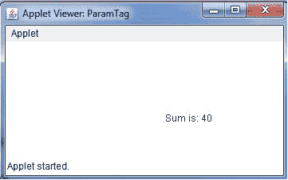

## Applet 编程中的类

*   `Graphics` 类
*   `Font` 类
*   `Color` 类
*   `Image` 类

### Graphics 类

该类包含了用于绘制字符串、线条、矩形以及 `Graphics` 类定义的其他形状的方法。

#### 绘制字符、字节和字符串

*   “g,” “r,” “a,” “p,” “h,” “i,” “c,” “s”——字符
*   100, 101, 108, 114, 67, 47——字节
*   “World”——字符串

```java
void drawBytes(byte[] data, int offset, int length, int x, int y)
```

该方法用于将字节数据绘制到 Applet 窗口。

*   `data` -> 要绘制的数据
*   `offset` -> 数据中的起始偏移量
*   `length` -> 绘制的字节数
*   `x` -> x 坐标
*   `y` -> y 坐标

```java
void drawChars(char[] data, int offset, int length, int x, int y)
```

该方法用于将字符数据绘制到 Applet 窗口。

```java
abstract void drawString(String str, int x, int y)
```

该方法用于将字符串数据绘制到 Applet 窗口。

#### 形状绘制方法

我们有很多方法来绘制不同类型的形状，如矩形、圆形、弧等。

| 方法名 | 参数 | 方法用法 |
| :--- | :--- | :--- |
| `drawLine(int x1, int y1, int x2, int y2)` | `x1, y1`: 起点，`x2, y2`: 终点 | 此方法帮助我们在 applet 窗口上绘制线条形状。 |
| `drawRect(int x1, int y1, int width, int height)` | `x1, y1`: 起点，`width`: 宽度，`height`: 高度 | 此方法帮助我们在 applet 窗口上绘制矩形形状。 |
| `fillRect(int x1, int y1, int width, int height)` | `x1, y1`: 起点，`width`: 宽度，`height`: 高度 | 此方法帮助我们在 applet 窗口上绘制填充矩形。 |
| `drawRoundRect(int x1, int y1, int width, int height, int arcWidth, int arcHeight)` | `x1, y1`: 起点，`width`: 宽度，`height`: 高度，`arcWidth`: 弧宽度，`arcHeight`: 弧高度 | 此方法帮助我们在 applet 窗口上绘制圆角矩形。 |
| `fillRoundRect(int x1, int y1, int width, int height, int arcWidth, int arcHeight)` | `x1, y1`: 起点，`width`: 宽度，`height`: 高度，`arcWidth`: 弧宽度，`arcHeight`: 弧高度 | 此方法帮助我们在 applet 窗口上绘制填充圆角矩形。 |
| `drawOval(int x1, int y1, int width, int height)` | `x1, y1`: 起点，`width`: 宽度，`height`: 高度 | 此方法帮助我们在 applet 窗口上绘制椭圆。 |
| `fillOval(int x1, int y1, int width, int height)` | `x1, y1`: 起点，`width`: 宽度，`height`: 高度 | 此方法帮助我们在 applet 窗口上绘制填充椭圆。 |
| `drawArc(int x1, int y1, int width, int height, int startAngle, int arcAngle)` | `x1, y1`: 起点，`width`: 宽度，`height`: 高度，`startAngle`: 起始角度，`arcAngle`: 弧角 | 此方法帮助我们在 applet 窗口上绘制弧。 |
| `fillArc(int x1, int y1, int width, int height, int startAngle, int arcAngle)` | `x1, y1`: 起点，`width`: 宽度，`height`: 高度，`startAngle`: 起始角度，`arcAngle`: 弧角 | 此方法帮助我们在 applet 窗口上绘制填充弧。 |
| `drawPolygon(int[] x, int[] y, int n)` | `x`: x 坐标数组，`y`: y 坐标数组，`n`: 顶点数 | 此方法帮助我们在 applet 窗口上绘制多边形。 |
| `fillPolygon(int[] x, int[] y, int n)` | `x`: x 坐标数组，`y`: y 坐标数组，`n`: 顶点数 | 此方法帮助我们在 applet 窗口上绘制填充多边形。 |

### Font 类

我们可以在 Applet 窗口中使用各种字体编写数据。Java 提供了许多字体，包括 `Courier`、`Times New Roman` 等。`Font` 类帮助我们定义新的字体对象，并可以通过预定义的方法将其设置为 Applet 窗口的字体。

#### 构造函数

`Font(String name, int style, int size)` — 根据指定的名称、样式和大小创建一个新字体。

#### 方法

*   `abstract void setFont(Font f)` — 将此图形上下文的字体设置为指定的字体
*   `String getStyle()` — 返回表示当前字体样式的字符串值
*   `int getSize()` — 返回表示当前字体大小的整型值
*   `String getFamily()` — 返回作为字符串形式的字体族名称
*   `boolean isPlain()` — 如果字体为正体（罗马体），则返回 true
*   `boolean isBold()` — 如果字体为粗体，则返回 true
*   `boolean isItalic()` — 如果字体为斜体，则返回 true

#### 样式常量

*   `Font.BOLD` — 用于粗体字体样式
*   `Font.ITALIC` — 用于斜体字体样式
*   `Font.PLAIN` — 用于正体（罗马体）字体样式

#### 程序

```java
import java.awt.*;
import java.applet.*;

//<applet code="SampleFont" width="600" height="600"></applet>

public class SampleFont extends Applet {
    Font f1, f2;

    public void init() {
        f1 = new Font("TimesRoman", Font.BOLD, 25);
        f2 = new Font("Courier", Font.ITALIC, 40);
    }

    public void paint(Graphics g) {
        g.setFont(f1);
        g.drawString("This is Times Roman Font", 100, 100);
        g.setFont(f2);
        g.drawString("This is Courier Font", 100, 200);
    }
}
```

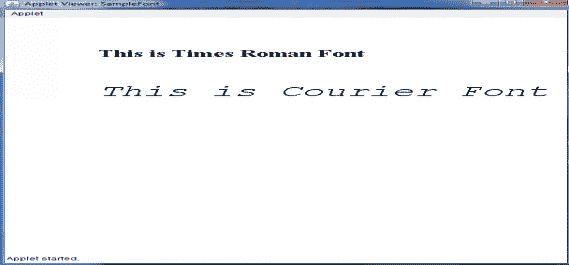

## Color 类

`Color` 类帮助我们通过颜色类的构造函数创建不同的颜色集合。你可以使用颜色类的方法设置 Applet 窗口的背景颜色和前景颜色。我们在颜色类中有许多预定义的方法。

### Color 类构造函数

`Color c1 = new Color(int red, int green, int blue)`

在此构造函数中，我们必须指定 RGB 值。这些值从 0 开始到 255 结束。当你指定此范围内的 RGB 值时，将根据你的数据产生新颜色。我们也有颜色常量，它们列在这里并给出了相应的 RGB 值。

| 颜色常量 | RGB 值 |
| :--- | :--- |
| `Color.red` | 255, 0, 0 |
| `Color.green` | 0, 255, 0 |
| `Color.blue` | 0, 0, 255 |
| `Color.magenta` | 255, 0, 255 |
| `Color.cyan` | 0, 255, 255 |
| `Color.yellow` | 255, 255, 0 |

### Color 类的方法

*   `setColor(Color c)` — 此方法将为对象设置颜色。它只有一个参数，因此你可以传递任何颜色常量值或颜色类对象。
*   `setBackground(Color c)` — 此方法将设置 applet 的背景颜色。它也只有一个参数，即颜色类对象或颜色常量值。
*   `setForeground(Color c)` — 此方法用于在绘制后更改整个 applet 的颜色。
*   `Color getBackground()` — 此方法将返回 Applet 窗口的背景颜色。
*   `Color getForeground()` — 此方法将返回前景颜色类对象。

### 程序

```java
import java.applet.*;
import java.awt.*;

//<applet code="SampleColor" width="400" height="400"></applet>

public class SampleColor extends Applet {
    Color c1, c2;

    public void init() {
        c1 = new Color(10, 255, 200);
        c2 = new Color(100, 100, 100);
    }

    public void paint(Graphics g) {
        g.setBackground(c1);
        g.drawString("Color Class object 1", 200, 200);
        g.setForeground(c2);
        g.drawString("Color Class object 2", 250, 250);
    }
}
```

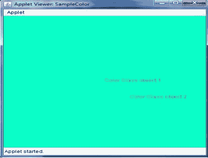

在这个示例程序中，我们声明了两个颜色类对象：`c1` 和 `c2`。然后，在 `init()` 方法内部使用 `Color` 类构造函数创建了 `c1` 和 `c2`。在 `paint()` 方法内部，我们将 `c1` 设置为 Applet 窗口的背景颜色，并将 `c2` 设置为前景。

## Applet 窗口组件

组件无非是 AWT 包中的控件，例如文本框、列表框、选择框、按钮、滚动条等。每个组件类都有其自己的方法和构造函数。组件构造函数帮助我们创建组件并将其添加到 Applet 窗口中。在这里，我们列出了重要的组件类及其方法和构造函数。

### 标签组件

#### 构造函数

*   `Label()` — 这是空构造函数，创建一个空的标签。
*   `Label(String str)` — 这是带字符串的构造函数，创建一个带有指定文本的标签。

#### 方法

*   `getText()` — 返回标签的文本。
*   `setText(String str)` — 设置标签的文本。
*   `setFont(Font f)` — 设置标签的字体。

#### 程序

```java
import java.awt.*;
import java.applet.*;

//<applet code="SampleLabel" width="200" height="200"></applet>

public class SampleLabel extends Applet {
    Label l1, l2, l3;

    public void init() {
        l1 = new Label("First Label");
        l2 = new Label("Second Label");
        l3 = new Label("Third Label");
        add(l1);
        add(l2);
        add(l3);
    }
}
```

### 按钮组件

`Button` 组件用于在用户按下按钮时执行任何操作或任务。按钮类具有构造函数和预定义方法。如果你按下按钮，它会产生一个事件。

#### 按钮类的构造函数

*   `Button()` — 这是空构造函数，创建一个没有文本的按钮。
*   `Button(String str)` — 这是参数化构造函数，创建一个带有指定文本的按钮。

#### 按钮类的方法

*   `addActionListener(ActionListener l)` — 为新创建组件添加监听器。
*   `getActionCommand()` — 返回按下按钮后的命令文本。
*   `getLabel()` — 返回按钮的文本。
*   `setLabel(String text)` — 设置按钮的文本。
*   `getSource()` — 返回被按下的按钮对象。


```java
import java.awt.*;
import java.awt.event.*;
import java.applet.*;

public class SampleButton extends Applet implements ActionListener
{
    String str = " ";
    Button b1, b2, b3;

    public void init()
    {
        b1 = new Button ( "First Button");
        b2 = new Button ("Second Button");
        b3 = new Button ("Third Button");
        add(b1);
        add(b2);
        add(b3);
        b1.addActionListener (this);
        b2.addActionListener (this);
        b3.addActionListener(this);
    }

    public void actionPerformed(ActionEvent ae)
    {
        if(ae.getSource()==b1) {
            str = "You pressed Button 1.";
        }
        else if(ae.getSource()==b2) {
            str = "You pressed Button 2.";
        }else {
            str = "You pressed Button 3.";
        }
        repaint();
    }

    public void paint(Graphics g)
    {
        g.drawString(str,6,100);
    }
}

//<applet code="SampleButton.class" width = 300 height = 100></applet>
```

在本示例中，我们创建了三个按钮 `b1`、`b2` 和 `b3`，标签分别为“第一个按钮”（First Button）、“第二个按钮”（Second Button）和“第三个按钮”（Third Button）。如果你点击“第一个按钮”，它将立即生成 `ActionEvent`，从而调用 `actionPerformed()` 方法，并在 Applet 窗口上打印“You pressed Button 1”的消息。同样的功能也适用于第二个和第三个按钮。

### 3. 复选框组件 (Checkbox Component)

复选框组件帮助我们从多个选项中选择多个项目。我们定义了一个名为 `Checkbox` 的类，它有多个构造函数来创建复选框，以及用于操作这些复选框并获取其详情的方法。

#### Checkbox 组件的构造函数

- `Checkbox()` 创建一个没有标签文本的复选框。
- `Checkbox(String str)` 创建带有标签文本的复选框。
- `Checkbox(String str, Boolean state)` 创建带有标签文本的复选框，你可以使用 `Boolean` `state` 来测试复选框。如果你传递 `true` 值，它将创建一个带有勾选标记的复选框；如果为 `false`，则没有勾选标记。
- `Checkbox(String str, CheckboxGroup, Boolean state)` 用于将复选框转换为单选按钮（Radio button）。如果你传递 `CheckboxGroup` 对象，它将创建一个单选按钮。

#### Checkbox 方法

- `getState()` 返回 `Checkbox` 的状态。如果复选框被选中则返回 `true`，如果未选中则返回 `false`。
- `getItem()` 返回特定 `Checkbox` 的项目对象。
- `setCheckboxGroup(CheckboxGroup g)` 将相应的复选框组设置为指定的组。
- `setLabel(String label)` 将对应复选框的标签设置为指定值。
- `setState(boolean state)` 将对应复选框的状态设置为指定值。
- `getCheckboxGroup()` 此方法确定对应复选框的组。
- `getLabel()` 返回对应复选框的名称。
- `getSelectedObjects()` 返回一个长度为 `l` 的数组，包含复选框标签，如果复选框未被选中则返回 `null`。

## 示例程序

```java
import java.awt.*;
import java.awt.event.*;
import java.applet.*;

public class SampleCheckbox extends Applet implements ItemListener {
    String str = new String();
    Checkbox fe,lam,jag,au;

    public void init() {
        fe = new Checkbox("Ferrari",null,true);
        lam = new Checkbox("Lamborghini");
        jag = new Checkbox("Jaguar");
        au = new Checkbox("Audi");
        add(fe);
        add(lam);
        add(jag);
        add(au);
        fe.addItemListener(this);
        lam.addItemListener(this);
        jag.addItemListener(this);
        au.addItemListener(this);
    }

    public void itemStateChanged(ItemEvent ie) {
        repaint();
    }

    public void paint(Graphics g) {
        str = "Selected Brand : ";
        g.drawString(str,6,80);
        str = "  Ferrari: " + fe.getState();
        g.drawString(str,6,100);
        str = "  Lamborghini: " + lam.getState();
        g.drawString(str,6,120);
        str = "  Jaguar: " + jag.getState();
        g.drawString(str,6,140);
        str = "  Audi: " +au.getState();
        g.drawString(str,6,160);
    }
}
//<applet code="SampleCheckbox.class" width=300 height=200></applet>
```

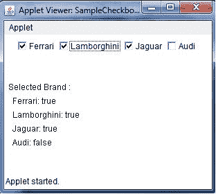

在本示例中，我们借助构造函数创建了四个复选框。首先，我们需要声明复选框对象以及复选框标签。`Checkbox` 生成 `ItemEvent`，因此所有复选框事件都由 `ItemListener` 接口处理。`itemStateChanged()` 方法会调用 `repaint()` 方法。在那里我们可以使用 `getState()` 方法获取复选框的所有状态。由于它是复选框，你可以选择多个。

### 4. 单选按钮 (Radio Button)

这与复选框类似，但你不能选择多个项目。在 Java 中，没有单独的单选按钮类。你可以使用 `Checkbox` 构造函数来创建单选按钮。你只需传递复选框组，它就会将 `Checkbox` 转换为单选按钮。以下程序解释了一切。

## 示例程序

```java
import java.awt.*;
import java.awt.event.*;
import java.applet.*;

public class SampleCBG extends Applet implements ItemListener {
    String str = new String();
    Checkbox fe,lam,jag,au;
    CheckboxGroup cbg;

    public void init() {
        fe = new Checkbox("Ferrari",cbg,true);
        lam = new Checkbox("Lamborghini",cbg,false);
        jag = new Checkbox("Jaguar",cbg,false);
        au = new Checkbox("Audi",cbg,false);
        add(fe);
        add(lam);
        add(jag);
        add(au);
        fe.addItemListener(this);
        lam.addItemListener(this);
        jag.addItemListener(this);
        au.addItemListener(this);
    }

    public void itemStateChanged(ItemEvent ie) {
        repaint();
    }

    public void paint(Graphics g) {
        str = "Selected Brand : ";
        g.drawString(str,6,80);
        str = "  Ferrari: " + fe.getState();
        g.drawString(str,6,100);
        str = "  Lamborghini: " + lam.getState();
        g.drawString(str,6,120);
        str = "  Jaguar: " + jag.getState();
        g.drawString(str,6,140);
        str = "  Audi: " +au.getState();
        g.drawString(str,6,160);
    }
}
//<applet code="SampleCBG.class" width=300 height=200></applet>
```

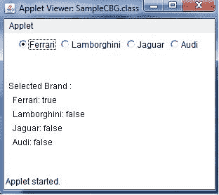

在这个程序中，我们使用 `Checkbox` 和 `CheckboxGroup` 创建了单选按钮。同样，我们没有单独的单选按钮类，但当我们把 `CheckboxGroup` 对象作为参数时，可以通过 `Checkbox` 构造函数创建单选按钮。在这个程序中，我们添加了单选按钮，每个按钮代表一个汽车品牌。

### 5. 选择组件 (Choice Component)

选择框就是一个普通的组合框控件，它是文本和列表框的结合。你可以从列表框选择任何项目，它会立即显示。在 Java 中，我们有 `Choice` 类来创建选择框。

#### Choice 组件的构造函数

`Choice ch=new Choice();`

#### Choice 方法

- `add(String item)` 向相应的选择框添加一个项目。
- `addItem(String item)` 此方法也向相应的选择框添加项目。
- `getItem(int index)` 返回对应选择框中指定索引的字符串。
- `getItemCount()` 返回选择框中的项目数量。
- `getSelectedIndex()` 返回选择框中当前选中项目的索引。
- `getSelectedItem()` 返回作为字符串数据的当前选中项目。
- `insert(String item, int index)` 在指定位置向对应选择框插入项目。
- `remove(int position)` 从对应选择框的指定位置移除项目。
- `remove(String item)` 与上一个类似，这将从相应的选择菜单中移除第一个项目。
- `removeAll()` 从相应的选择菜单中移除所有项目。
- `select(int pos)` 将对应选择菜单的选中项目设置为指定位置。
- `select(String str)` 将对应选择菜单的选中项目设置为与指定字符串相等的项目。

### Choice 组件的示例程序

```java
import java.awt.*;
import java.awt.event.*;
import java.applet.*;

public class SampleChoice extends Applet implements ItemListener {
    Choice country,city;
    String str = new String();

    public void init() {
        country = new Choice();
        city = new Choice();
        country.add("India");
        country.add("USA");
        country.add("England");
        country.add("Canada");
        city.add("Newyork");
        city.add("New Delhi");
        city.add("London");
        city.add("Toronto");
        add(country);
        add(city);
        country.addItemListener(this);
        city.addItemListener(this);
    }

    public void itemStateChanged(ItemEvent ie) {
        repaint();
    }

    public void paint(Graphics g) {
        str = "Selected Country : ";
        str += country.getSelectedItem();
        g.drawString(str,6,80);
    }
}
```

```java
g.drawString(str,6,120);

str = "Selected City : ";

str += city.getSelectedItem();

g.drawString(str,6,140);

}

}

//<applet code="SampleChoice.class" width=500 height=500></applet>
```

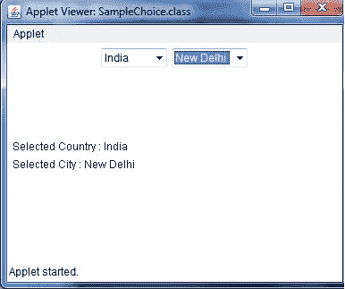

在此程序中，有两个通过 `Choice()` 组件构造函数辅助添加的选择框（choice boxes）。我们随后使用 `add()` 方法在选择框中添加了一个项目列表。两个选择框都有四个项目。选择框会生成 `Item Event`（项目事件），因此该事件由 `Item Listener` 接口方法 `itemStateChanged()` 处理。每当您从列表中选择任何项目时，`itemStateChanged()` 方法就会被调用；在这里我们调用了 `repaint()` 方法。在 `repaint()` 方法内部，将使用 `drawString()` 方法在 applet 窗口中打印两个选择框选中的项目。

### 6. 列表框 (List Box)

该组件包含一个允许我们从中选择的项列表。该组件也会生成 `Item Event`，因此它也由 `Item Listener` 方法 `itemStateChanged()` 处理。此组件类包含三个构造函数来创建列表框，以及一组处理列表框项的方法。

#### 列表框的构造函数

- `List()` 创建一个可滚动的列表框。
- `List(int rows)` 创建一个可滚动的列表框，该框仅显示构造函数中指定的项目数量；其余项目将在您滚动列表框时变得可见。
- `List(int rows, Boolean Multiple)` 创建一个可滚动的列表框，该框仅显示构造函数中指定的项目数量；其余项目将在您滚动列表框时变得可见。如果您将多选模式（multiple mode）设置为 true，则您可以在列表框中选择多个一个项目。

#### List 组件类的方法

- `add(String item)` 在滚动列表的末尾添加指定的项。
- `add(String item, int index)` 在指定位置添加指定的项。
- `deselect(int index)` 取消选择指定索引处的项。
- `getItem(int index)` 返回指定索引处的项。
- `getItemCount()` 返回列表组件中的项目数量。
- `getItems()` 返回列表中的项。
- `getRows()` 返回对应列表中可见的行数。
- `int[] getSelectedIndexes()` 返回列表中被选中项目的索引。
- `getSelectedItem()` 返回对应列表中选中的项。
- `select(int index)` 选择对应列表中指定索引处的项。


- `setMultipleMode(Boolean b)`___ 设置允许对应列表多项选择的标志。

## 示例程序

```java
import java.awt.*;
import java.awt.event.*;
import java.applet.*;

public class SampleList extends Applet implements ItemListener {

    List country, city;

    String str = new String();

    public void init() {
        country = new List(2);
        city = new List(4);
        country.add("India");
        country.add("USA");
        country.add("England");
        country.add("Canada");
        city.add("Newyork");
        city.add("New Delhi");
        city.add("London");
        city.add("Toronto");
        add(country);
        add(city);
        country.addItemListener(this);
        city.addItemListener(this);
    }

    public void itemStateChanged(ItemEvent ie) {
        repaint();
    }

    public void paint(Graphics g) {
        str = "Selected Country : ";
        str += country.getSelectedItem();
        g.drawString(str, 6, 120);
        str = "Selected City : ";
        str += city.getSelectedItem();
        g.drawString(str, 6, 140);
    }
}
```

```java
//<applet code="SampleList.class" width=500 height=500></applet>
```

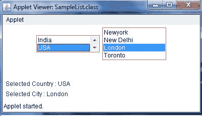

在此示例中，有两个使用 `List()` 组件构造函数添加的列表框。然后，我们使用 `add()` 方法在我们的选择框中添加了项目列表。两个列表框都有四个项目。列表框生成 `ItemEvent`，因此该事件由 `ItemListener` 接口使用 `itemStateChanged()` 方法处理。每当您从列表中选择任何项目时，`itemStateChanged()` 方法就会被调用；在这里我们调用了 `repaint()` 方法。在 `repaint()` 方法内部，将通过 `drawString()` 方法在 applet 窗口中打印两个列表框选中的项目。

## 7. 文本字段组件 (Text Field Component)

这是一个单行数据编辑器，允许您在单行上输入文本数据。`TextField` 组件类包含一组构造函数和方法来处理 TextField 数据。在这里，我们列出了 TextField 组件类的构造函数和方法。它会生成 `TextEvent`（文本事件），因此它由 `TextListener` 的 `textValueChanged()` 方法处理。

### TextField 的构造函数

- `TextField()`
- `TextField(int length)`
- `TextField(String str)`
- `TextField(String str, int length)`

### TextField 组件类的方法

- `getText()`___ 返回对应 `TextField` 的文本。
- `setText(String str)`___ 将给定文本设置到对应 `TextField`。
- `getSelectedText()`___ 返回 `TextField` 中选中的文本部分。
- `select(int startindex, int endindex)`___ 用于选择从起始索引到结束索引的内容。
- `setEditable(boolean b)`___ 如果为 false，文本不可修改。
- `isEditable()`___ 检查文本是否可编辑。
- `setEchoChar(char ch)`___ 设置回显字符（密码字段）。
- `echoChar()`___ 检查是否设置了回显。

## 8. 文本区域组件 (TextArea Component)

这是一个多行数据编辑器。在这里您可以在多行输入数据。它也有一组构造函数和方法。

### TextArea 的构造函数

- `TextArea()`
- `TextArea(int numLines, int numChars)`
- `TextArea(String str)`
- `TextArea(String str, int numLines, int numChars)`
- `TextArea(String str, int numLines, int numChars, int rows)`

### 组件的方法

所有文本组件都支持 TextArea，尽管它们有一些独特的方法。

- `append(String str)`___ 在行末追加文本。
- `insert(String str, int index)`___ 在指定索引插入字符串。
- `replaceRange(String str, int startIndex, int endIndex)`___ 使用起始和结束索引替换字符串。

### 使用文本字段和文本区域的示例程序

```java
import java.awt.*;
import java.applet.*;

//<applet code="SampleText" width="200" height="200"></applet>

public class SampleText extends Applet {

    TextField t1;
    TextArea ta1;

    public void init() {
        t1 = new TextField(25);
        ta1 = new TextArea("Hello this is Text area", 20, 25);
        add(t1);
        add(ta1);
    }
}
```

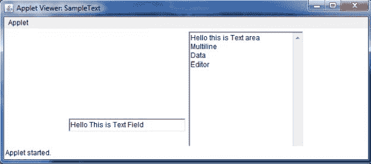

## 9. 滚动条组件 (Scrollbar Component)

`Scrollbar` 是 `java.awt` 包下的预定义类。此组件帮助开发者向 applet 窗口添加新的滚动条。该类有多种构造函数，我们可以使用它们创建控件。我们可以通过此组件创建两种类型的滚动条：水平和垂直。您需要指定想要创建的哪种滚动条，因为水平和垂直滚动条有单独的常量。

### Scrollbar 组件的构造函数

- `Scrollbar()`___ 此构造函数创建一个水平滚动条。如果您没有在构造函数中指定样式或使用此空构造函数创建滚动条，默认创建一个水平滚动条。
- `Scrollbar(int style)`___ 此构造同样创建一个滚动条，但允许您通过发送样式参数来指定想要创建的哪种滚动条。

样式：

- `Scrollbar.VERTICAL`___ 创建垂直滚动条。
- `Scrollbar.HORIZONTAL`___ 创建水平滚动条。
- `Scrollbar(int style, int initialValue, int thumbsize, int min, int max)`___ 此构造函数将创建一个带有额外信息的滚动条，例如样式、初始值、块大小以及滚动条的最小值和最大值。

### Scrollbar 组件的方法

- `setValues(int initialValue, int thumbsize, int min, int max)`___ 帮助开发者访问已创建滚动条的额外信息。
- `int getMinimum()`___ 返回特定滚动条的最小值。
- `int getMaximum()`___ 返回特定滚动条的最大值。
- `int getValue()`___ 返回特定滚动条的当前值。
- `void setUnitIncrement(int newIncr)`___ 按指定的值递增或移动滑块。默认情况下，如果点击滚动条的最大值，当前值将递增 1。
- `void setBlockIncrement(int newIncr)`___ 用于设置块增量。块增量的默认值为 10。

如果你在滚动条上进行了任何更改，它将产生一个 `AdjustmentEvent`，该事件由 `AdjustmentListener` 接口进行处理。该接口有一个名为 `adjustmentValueChanged(AdjustmentEvent aje)` 的方法。此方法将在滚动条上执行任何操作时被调用。接下来的示例将帮助你理解调整值改变方法的签名。

```java
void adjustmentValueChanged(AdjustmentEvent obj)
```

```java
import java.applet.*;
import java.awt.*;
import java.awt.event.*;

public class SampleScrollbar extends Applet implements AdjustmentListener {

    Scrollbar hs1;
    Font f1;
    Color c1;
    String text;

    public void init() {
        f1 = new Font("Courier", Font.BOLD, 15);
        c1 = new Color(200, 100, 50);
        hs1 = new Scrollbar(Scrollbar.HORIZONTAL, 5, 1, 0, 255);
        add(hs1);
        hs1.addAdjustmentListener(this);
    }

    public void adjustmentValueChanged(AdjustmentEvent ae) {
        repaint();
    }

    public void paint(Graphics g) {
        g.setColor(c1);
        g.setFont(f1);
        text = "Current value is :" + hs1.getValue();
        g.drawString(text, 50, 50);
    }
}

//<applet code="SampleScrollbar" height="200" width="300"></applet>
```

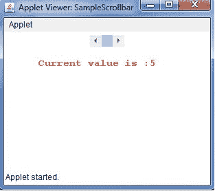

在这个示例中，我们演示了滚动条的使用和功能。我们通过滚动条构造函数只创建了一个滚动条。然后，我们创建了字体和颜色对象来设置 applet 窗口的新字体和颜色。成功创建水平滚动条（在 `Scrollbar` 构造函数内部指定了 `Scrollbar.HORIZONTAL`）后，它将通过 `add()` 方法添加到 applet 中。然后，调整监听器将执行调整事件。如果你在调整事件产生时立即调整滚动条，它将调用 `adjustmentValueChanged` 方法。在那里我们简单地通过 `repaint()` 方法调用 `paint()` 方法来更新 applet 窗口。在 `paint()` 内部，我们使用相应的 `setFont()` 和 `setColor()` 方法设置 applet 窗口的颜色和字体。最后，`drawString()` 方法打印滚动条的当前值。

## 菜单

基本上所有的 GUI 应用程序都有菜单和菜单栏。通常，这些类型的菜单项在点击时可以执行任何任务。我们有一组方法来处理这些菜单事件。如果你点击菜单项，它将产生一个 `ActionEvent`。我们已经讨论过事件处理；`ActionEvent` 由 `ActionListener` 接口处理。让我们来看看这些类及其构造函数和方法。

`MenuBar` 类用于创建菜单栏。该菜单栏包含一个菜单和菜单项。

`Frame.setMenuBar(MenuBar object);`

此方法将在框架上设置菜单栏。`Menu` 类用于创建一个新的 `Menu`。它有一个构造函数，用于创建一个新的菜单，该菜单可以通过 `MenuBar.add(Menu item)` 方法添加到菜单栏。`MenuItem` 类用于创建一个新的菜单项。它有一个构造函数，将创建一个新的菜单项，可以通过相同的 `add(MenuItem obj)` 方法添加到菜单。

### 带有项的示例菜单

```java
MenuBar mb = new MenuBar();
Menu mFile = new Menu("File");
MenuItem mNew = new MenuItem("New");
mFile.add(mNew);
mb.add(mFile);
f.setMenuBar(mb);
```

### Menu 类的方法

- `add(Menu)`___ 将指定的菜单项添加到菜单。
- `add(String)`___ 将指定的字符串添加到菜单。将创建一个以指定字符串为标签的新菜单项并添加到菜单。
- `addSeparator()`___ 在菜单中添加一个分隔符。
- `getItem(int index)`___ 以字符串形式返回指定索引处的项。
- `remove(int index)`___ 从菜单中删除指定索引处的项。

### MenuItem 类的方法

- `getLabel()`___ 以字符串格式返回菜单项的标签。
- `setLabel(String)`___ 将菜单项的标签更改为指定的字符串。
- `setEnabled(boolean)`___ 根据参数是 true 还是 false，使菜单项变为可选/取消选择状态。

### 复选框菜单项

此类将创建复选框菜单项，会在菜单项旁边显示一个勾选。此菜单项也可以像菜单菜单一样执行某些任务。

### 复选框菜单项的方法

- `getState()`___ 以布尔值返回菜单项的状态。值 true 表示复选框菜单项被选中。
- `setState(boolean)`___ 设置菜单项的状态。如果传递的值为 true，则菜单项被设置为选中状态。

### 创建菜单的示例程序

```java
import java.awt.*;
import java.awt.event.*;

public class SampleMenu extends Frame implements ActionListener {

    MenuBar mb;
    Menu mFile, mEdit, mFormat;
    MenuItem mNew, mOpen, mSave, mExit;
    MenuItem mCut, mCopy, mPaste;
    MenuItem mWord, mFon;

    public SampleMenu(String title) {
        super(title);
        mb = new MenuBar();
        mFile = new Menu("File");
        mEdit = new Menu("Edit");
        mFormat = new Menu("Format");
        mNew = new MenuItem("New");
        mOpen = new MenuItem("Open");
        mSave = new MenuItem("Save");
        mExit = new MenuItem("Exit");
        mCut = new MenuItem("Cut");
        mCopy = new MenuItem("Copy");
        mPaste = new MenuItem("Paste");
        mWord = new MenuItem("Word");
        mFon = new MenuItem("Font");

        mFile.add(mNew);
        mFile.add(mOpen);
        mFile.add(mSave);
        mFile.add(mExit);
        mEdit.add(mCut);
        mEdit.add(mCopy);
        mEdit.add(mPaste);
        mFormat.add(mWord);
        mFormat.add(mFon);
        mb.add(mFile);
        mb.add(mEdit);
        mb.add(mFormat);
        setMenuBar(mb);
        addWindowListener(new WindowAdapter() {
            public void windowClosing(WindowEvent we) {
                dispose();
                System.exit(0);
            }
        });
        mExit.addActionListener(this);
        mNew.addActionListener(this);
        setSize(400, 400);
        setVisible(true);
    }

    public void actionPerformed(ActionEvent ae) {
        if (ae.getSource() == mExit) {
            dispose();
            System.exit(0);
        } else if (ae.getSource() == mNew) {
            System.out.println("A new option selected");
        }
    }

    public static void main(String args[]) {
        SampleMenu sm = new SampleMenu("Menu Creation");
    }
}
```

# Dialog 对话框

`Dialog(Frame, boolean)`___ 创建一个初始为不可见的新对话框。在这个构造函数中，我们有两个参数。第一个参数 `Frame` 对象指向此新创建对话框的父窗口。第二个参数 `Boolean` 类型数据表示它是模态对话框还是非模态对话框。

`Dialog(Frame, String, boolean)`___ 创建一个初始为不可见的新对话框。在这个构造函数中，我们有三个参数。第一个 `Frame` 对象指向此新创建对话框的父窗口。第二个 `String` 类型数据是对话框的标题文本。第三个 `Boolean` 类型数据，表示它是模态对话框还是非模态对话框。

### 模态与非模态对话框

`Modal` 模态对话框在关闭之前永远不会允许父窗口激活，但在 `modeless` 非模态对话框中，你可以在父窗口中进行任何操作。

## Dialog 类的方法


- `boolean isModal()`___ 如果对话框是模态的，返回 true。我们已经见过模态对话框的工作模式。如果对话框是非模态的，将返回 false。

- `setResizable(boolean)`___ 设置对话框的可调整大小标志。如果你将此值设置为 true，它将允许我们调整对话框的大小。如果设置为 false，则无法调整大小。

- `boolean isResizable()`___ 用于检查对话框是否可以调整大小。如果返回 true，则对话框是可调整的。

## 对话框示例程序

```java
import java.awt.*;
import java.awt.event.*;

public class Dialog1 extends Dialog implements ActionListener
{
    public Dialog1(Frame fm,String msg)
    {
        super(fm,msg,false);
        setLayout(new GridLayout(2,1,0,0));
        Panel p1 = new Panel();
        Panel p2 = new Panel();
        p1.setLayout(new FlowLayout());
        p1.setFont(new Font("Courier",Font.BOLD,20));
        p2.setLayout(new FlowLayout());
        p1.add(new Label(msg));
        Button b1,b2;
        b1 = new Button("Ok");
        b2 = new Button("Cancel");
        p2.add(b1);
        p2.add(b2);
        b1.addActionListener(this);
        add(p1);
        add(p2);
        setSize(250,150);
        setResizable(false);
        addWindowListener(new WindowAdapter() {
            public void windowClosing(WindowEvent we)
            {
                dispose();
            }
        });
    }

    public void actionPerformed(ActionEvent ae)
    {
        dispose();
    }
}

public class SampleDialog extends Frame implements ActionListener
{
    MenuBar mb;
    Menu myMenu;
    MenuItem mDialog,mExit;
    public SampleDialog(String text)
    {
        super(text);
        mb = new MenuBar();
        mMenu = new Menu("My Menu");
        mDialog = new MenuItem("Open Dialog");
        mExit = new MenuItem("Exit");
        mMenu.add(mDialog);
        mMenu.add(mExit);
        mb.add(mMenu); // 注意：此处原文为 mMenu，此处已修正代码逻辑
        setMenuBar(mb);
        setSize(400,400);
        setVisible(true);
        mDialog.addActionListener(this);
        mExit.addActionListener(this);
        addWindowListener(new WindowAdapter() {
            public void windowClosing(WindowEvent we)
            {
                dispose();
                System.exit(0);
            }
        });
    }

    public void actionPerformed(ActionEvent ae)
    {
        if(ae.getSource() == mDialog)
        {
            Dialog1 d1 = new Dialog1(this,"My New Dialog");
            mb.setVisible(true);
        }
        else if(ae.getSource() == mExit)
        {
            dispose();
            System.exit(0);
        }
    }

    public static void main(String args[])
    {
        SampleDialog sd = new SampleDialog("Dialog Demo");
    }
}
```

在这个程序中，我们使用了 `Dialog` 类来创建一个包含两个面板的新对话框。第一个面板被设置为 `FlowLayout`，因此所有控件都居中添加，并留有 5 像素的水平和垂直空间。第一个面板只包含一个 `Label` 框。第二个面板同样使用 `FlowLayout`，包含两个按钮。第一个按钮标签为“ok”，第二个标签为“cancel”。如果你点击此对话框上的任何按钮，将立即产生动作事件。

在对话框示例程序中，我们创建了一个名为 `My Menu` 的菜单。该菜单中有两个选项。第一个选项是 `Open Dialog`，它会打开对话框。第二个选项是 `Exit`，它会关闭打开的窗口。

## 文件对话框 (File Dialog)

我们在之前的章节中已经提到过文件对话框。在 Java 中，有两个与文件操作相关的重要对话框：`Open Dialog`（打开）和 `Save Dialog`（保存）。我们可以通过 `FileDialog` 构造函数来打开此对话框。`FileDialog` 类有三个构造函数。

### FileDialog 的构造函数

- `FileDialog (Frame parent)`___ 创建一个用于加载文件的对话框。注意：默认对话框是打开的，所以如果你使用此构造函数创建文件对话框，它将加载一个打开对话框。

- `FileDialog (Frame parent,String title)`___ 创建一个用于加载文件的对话框。这里有两个参数：`parent` 窗口和标题 `title`。

- `FileDialog (Frame parent,String title,boolean modal)`___ 创建一个用于加载文件的对话框。这里有三个参数：`parent` 窗口、标题 `title` 以及 `modal`。

在接下来的部分，我们将看到一个使用 `FileDialog` 来加载和保存文本的示例程序。该程序提供了像 Notepad 编辑器一样的用户界面。

在这个 Java 记事本应用程序中，我们创建了一个基础文本编辑器，具有新建、打开、保存和退出等简单功能。这应该能让你了解关于如何使用文本区域组件创建菜单的所有知识。如果你有任何困惑，请查看我们在菜单创建部分中的示例程序。所有菜单项都会生成一个动作事件（action event），因此你需要实现 `ActionListener` 接口来处理由每个选项生成的动作事件。如果你选择了一个新选项，将立即生成一个动作事件并调用 `action()` 方法。在那里，我们检查选择了哪个选项。如果你点击“新建”选项，它将擦除文本区域内的所有内容。如果你选择“打开”选项，它将打开一个加载框，你可以在其中选择任何文件，文件将立即加载到文本区域。如果你选择“保存”选项，它将打开一个保存框，你可以在其中保存文本区域中的文本。最后一个选项是“退出”，它将停止我们的记事本应用程序的运行。

Java Swing 是一个功能全的用户界面开发工具包，用于在 Java 应用程序中创建界面。该工具包包含了大量的各种部件和工具，用于帮助创建图形用户界面。它具有内置控件，如按钮、布局管理器、滑块、文本字段、标签等。它还具有一些高级控件，如树、表格、滚动面板和标签页控件。

在本指南中，你将学习如何在 Java Swing 中开发界面的基础知识。这应该足够你入门了，但剩下的取决于你自己。记住，Java API 可供你使用。

让我们先回顾几个需要记住和理解的重要对象。

在开始之前，记住 Swing 中的以下三个包是非常重要的：

```
import javax.swing.*;
import java.awt.*;
import java.awt.event.*;
```

`javax.swing` 是包含所有 Swing 应用程序开发所需类的包。`JApplet`、`JButton`、`JTree` 和 `JScrollpane` 是 Swing 包的一些示例类。

## JFrame

`JFrame` 对象简单来说是一个允许窗口在屏幕上出现的对象。你可以将 `JFrame` 想象成一块画布，它是向界面中添加元素时所需的的基础基础。在 Swing 中，这些元素被称为“组件”（components），并在本指南的剩余部分将统称为此类。

要声明一个 `JFrame` 对象，你可以执行简单的操作：

```
JFrame frame = new JFrame("Title");
frame.setSize(250,250);
frame.setDefaultCloseOperation(frame.EXIT_ON_CLOSE);
frame.setVisible(true);
```


让我们分析上面示例代码中的每一行。

```
JFrame frame = new JFrame("Title");
```

在这一行中，正在声明 `JFrame` 对象。`JFrame` 构造函数的参数接收一个字符串，该字符串被视为窗口标题。另一种方法是让构造函数为空，然后使用方法：

```
frame.setTitle("Title");
```

让我们继续下一行：

```
frame.setSize(250,250);
```

这一行应该是不言易明的。`JFrame` 对象中有一个名为 `setSize` 的方法，它接收两个值。第一个值是 `JFrame` 的宽度，第二个值是高度。

```
frame.setDefaultCloseOperation(frame.EXIT_ON_CLOSE);
```

下一行简单地告诉窗口，如果通过点击 x 按钮或通过控制台结束程序，它应该退出窗口而不是保持打开状态。

```
frame.setVisible(true);
```

这是所有行中最明显的一行，这一行简单地将 `JFrame` 的可见性设置为 `true`，以便用户能够看到窗口。

## JPanel

在界面的画布 (`JFrame`) 中，我们需要一个面板（panel），这样我们向其中添加组件（按钮、标签等）。你可以将 `JFrame` 想象成剪贴板，将 `JPanel` 想象成纸，这个额外的层允许你在界面上绘制并添加不同类型的组件。需要注意的是，组件可以被添加到原始画布 (`JFrame`) 上。然而，这样做可能会产生很多复杂问题。这就是为什么我们应该向 `JFrame` 添加一个 `JPanel`。

要声明一个 `JPanel`，你可以结合之前的示例代码执行以下操作：

```
JFrame frame = new JFrame();
frame.setTitle("Title");
frame.setSize(250,250); 
frame.setDefaultCloseOperation(frame.EXIT_ON_CLOSE);
JPanel panel = new JPanel(); // 新行代码
frame.add(panel); // 新行代码
frame.setVisible(true);
```

在 Swing 类层次结构中的每个对象中，都有一个常用的方法称为 `add`，它可以接收任何 Swing 组件。`JPanel` 被认为是一个组件，因此被添加到框架中。现在，`JPanel` 可以通过引用 `JPanel` 的对象名称并使用 `add` 方法为其添加组件。`JFrame` 和 `JPanel` 对象在技术上具有相同的方法，因此你可以像使用 `JFrame` 一样使用它们。

## JLabel

`JLabel` 对象仅仅是一个可以添加到面板的 Swing 组件。它在 `JFrame` 窗口中充当文本元素。为了向我们创建的面板添加 `JLabel` 组件，只需执行：

```
JFrame frame = new JFrame();
frame.setTitle("Title");
frame.setSize(250,250);
frame.setDefaultCloseOperation(frame.EXIT_ON_CLOSE);
JPanel panel = new JPanel();
frame.add(panel);
frame.setVisible(true);
JLabel lblText = new JLabel("This is Text");
panel.add(lblText);
```


如上面最后两行所示，你可以看到创建一个 `JLabel` 对象非常简单，它接收一个字符串作为构造函数并用其显示文本。完成此操作另一种方法是让构造函数为空并对 `JLabel` 使用 `setText` 方法。下一行简单地将 `JLabel` 对象添加到面板。你可能在想如何让程序决定在哪里显示文本。我们将在布局管理器部分进一步讨论这个问题。

## JButton

`JButton` 对象也是可以添加到 `JPanel` 的 Swing 组件。该组件在 `JFrame` 窗口中充当按钮元素。为了向面板添加 `JButton` 组件，只需执行：

```
JFrame frame = new JFrame();
frame.setTitle("Title");
frame.setSize(250,250); 
frame.setDefaultCloseOperation(frame.EXIT_ON_CLOSE);
JPanel panel = new JPanel();
frame.add(panel);
frame.setVisible(true);
JLabel lblText = new JLabel("This is Text");
panel.add(lblText);
JButton btnTest = new JButton("Test"); // 新行代码
panel.add(btnTest); // 新行代码
```


在最后两行中，我们看到 `JButton` 对象接收字符串的值作为构造函数，并用作按钮名称。另一种方法是让构造函数为空并对 `JButton` 使用 `setText` 方法。然后，我们将 `JButton` 组件添加到 `JPanel`。

## 布局管理器

在本节中，我们将学习布局管理器以及如何按照你的意愿在窗口中设置 Swing 组件。Java 中有许多种布局管理器。默认布局是 `FlowLayout`，这也是我们一直在使用的布局。对于其他布局，你必须指定你想要使用的布局类型。如果你不指定特定的布局，则默认将使用 `FlowLayout`。如果我们逐一介绍所有布局，这本指南将会变得太长，因此，我们将简要地向你展示不同类型布局的视觉效果，以便你决定想要探索哪些布局。在介绍布局列表之前，让我们先看看如何设置布局。根据你选择的类型，有不同的设置布局的方法，但有一行你必须始终记住的恒定代码：

```
panel.setLayout(new GridLayout(10, 1));
```

在上面的行代码中，我们使用了 `setLayout` 方法，它将接受一个特定的 `Layout` 对象。为了演示目的，我们将在布局参数中输入一个 `GridLayout`。这就是我们如何为 Swing 中不同类型的面板或帧设置布局。

现在，让我们来看所有不同类型的布局：

### BorderLayout（边框布局）


# BorderLayout（边界布局）

`BorderLayout` 让你能够将组件放置在面板的顶部、底部、左侧、右侧和中心。

## BoxLayout（块布局）

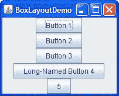

`BoxLayout` 允许你将组件放在单行或单列中，并允许用户轻松指定任何自定义的最大尺寸。此外，它还允许根据你的需求对齐组件。

## CardLayout（卡片布局）

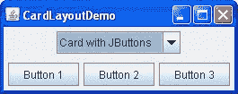
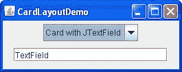

`CardLayout` 允许你实现一个在不同时间包含不同组件的区域。

## FlowLayout（流式布局）


`FlowLayout` 是默认布局管理器，使用时不需要指定。它所做的就是将组件排列在单行中，并根据窗口宽度开始新的一行。

## GridBagLayout（网格包布局）

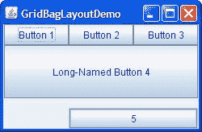

`GridBagLayout` 是所有布局管理器中最灵活的；它允许你在单元格网格中轻松地对齐和放置组件。

## GridLayout（网格布局）

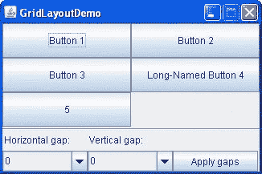

`GridLayout` 使所有组件的大小相等，它们可以在网格中顺序显示，取决于添加元素的顺序——类似于 `FlowLayout` 组织的行和单元。

## GroupLayout（分组布局）


`GroupLayout` 允许你独立地为每个维度处理水平和垂直布局。

## SpringLayout（弹簧布局）


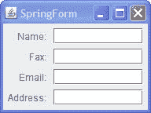

`SpringLayout` 是另一个灵活的布局管理器，允许你指定元素与其他元素之间的距离，例如定义组件相对于另一个组件右侧的边缘。

# 第 18 章：事件处理

事件处理的思想是让 GUI 组件根据特定情况相互交互。在本部分，我们将处理用户在 Java UI 中点击按钮的事件。为了设置一个 `JButton` 组件，我们添加一个 `ActionListener`。`ActionListener` 是一个实现 `ActionListener` 接口的类。一旦实现了接口，你就必须实现该接口的方法。通过对 GUI 的所有知识，我们可以使用事件处理来监听 `JButton` 的点击创建一个基础计算器。

```java
import javax.swing.*;
import java.awt.*;
import java.awt.event.*;

public class GUI extends JFrame implements ActionListener {
    JPanel mainPanel;
    JLabel lblfNum;
    JLabel lblsNum;
    JLabel lblResult;
    JButton btnAdd;
    JButton btnSubtract;
    JButton btnMultiply;
    JButton btnDivide;
    JTextField txt_fNum;
    JTextField txt_sNum;

    public GUI() {
        setDefaultCloseOperation(EXIT_ON_CLOSE);
        setSize(300, 300);
        setTitle("Basic Calculator");
        setVisible(true);
        Initialize();
    }

    private void Initialize() {
        mainPanel = new JPanel();
        mainPanel.setLayout(new GridLayout(10, 1));
        lblfNum = new JLabel("First Number", JLabel.CENTER);
        lblsNum = new JLabel("Second Number", JLabel.CENTER);
        lblResult = new JLabel("---", JLabel.CENTER);
        txt_fNum = new JTextField();
        txt_sNum = new JTextField();
        btnAdd = new JButton("Add");
        btnSubtract = new JButton("Subtract");
        btnMultiply = new JButton("Multiply");
        btnDivide = new JButton("Divide");
        SetListeners();
        mainPanel.add(lblfNum);
        mainPanel.add(txt_fNum);
        mainPanel.add(lblsNum);
        mainPanel.add(txt_sNum);
        mainPanel.add(btnAdd);
        mainPanel.add(btnSubtract);
        mainPanel.add(btnMultiply);
        mainPanel.add(btnDivide);
        mainPanel.add(lblResult);
        add(mainPanel);
        revalidate();
    }

    private void SetListeners() {
        btnAdd.addActionListener(this);
        btnSubtract.addActionListener(this);
        btnMultiply.addActionListener(this);
        btnDivide.addActionListener(this);
    }

    public void actionPerformed(ActionEvent e) {
        String btnName = e.getActionCommand();
        try {
            int fNum = Integer.parseInt(txt_fNum.getText().trim());
            int sNum = Integer.parseInt(txt_sNum.getText().trim());
            if (btnName.equals("Add")) {
                int result = fNum + sNum;
                lblResult.setText(result + "");
            } else if (btnName.equals("Subtract")) {
                int result = fNum - sNum;
                lblResult.setText(result + "");
            } else if (btnName.equals("Multiply")) {
                int result = fNum * sNum;
                lblResult.setText(result + "");
            } else if (btnName.equals("Divide")) {
                int result = fNum / sNum;
                lblResult.setText(result + "");
            }
        } catch (Exception exc) {
            lblResult.setText("Invalid input!");
        }
    }
}

public class ThisIsAClass {
    public static void main(String[] args) {
        GUI g = new GUI();
    }
}
```

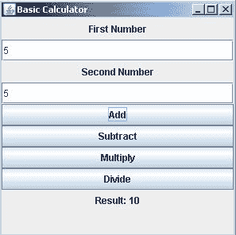

在主类中，我们声明了 `GUI` 对象，该对象在构造函数中会自动初始化 UI。`GUI` 类继承了 `JFrame`，因此在引用其方法时，我们不需要引用 `JFrame` 对象。我们可以直接引用这些方法，这就是为什么 `GUI` 类采用这种组织方式。

```java
setDefaultCloseOperation(EXIT_ON_CLOSE);
setSize(300, 300);
setTitle("Basic Calculator");
setVisible(true);
Initialize();
```

构造函数调用了 `Initialize` 方法，该方法包含以下内容：

```java
mainPanel = new JPanel();
mainPanel.setLayout(new GridLayout(10, 1));
lblfNum = new JLabel("First Number", JLabel.CENTER);
lblsNum = new JLabel("Second Number", JLabel.CENTER);
lblResult = new JLabel("---", JLabel.CENTER);
txt_fNum = new JTextField();
txt_sNum = new JTextField();
btnAdd = new JButton("Add");
btnSubtract = new JButton("Subtract");
btnMultiply = new JButton("Multiply");
btnDivide = new JButton("Divide");
SetListeners();
mainPanel.add(lblfNum);
mainPanel.add(txt_fNum);
mainPanel.add(lblsNum);
mainPanel.add(txt_sNum);
mainPanel.add(btnAdd);
mainPanel.add(btnSubtract);
mainPanel.add(btnMultiply);
mainPanel.add(btnDivide);
mainPanel.add(lblResult);
add(mainPanel);
revalidate();
```

在第一行中：

```java
mainPanel = new JPanel();
```

我们声明了一个 `JPanel` 对象，然后将其布局设置为 `GridLayout`。

```java
mainPanel.setLayout(new GridLayout(10, 1));
```

这两个参数是行和列。程序中共有九行，但为了安全起见，我们输入了十行。计算器只有一列，因此第二个参数只输入了数字一。

```java
lblfNum = new JLabel("First Number", JLabel.CENTER);
lblsNum = new JLabel("Second Number", JLabel.CENTER);
lblResult = new JLabel("---", JLabel.CENTER);
txt_fNum = new JTextField();
txt_sNum = new JTextField();
btnAdd = new JButton("Add");
btnSubtract = new JButton("Subtract");
btnMultiply = new JButton("Multiply");
btnDivide = new JButton("Divide");
```

这是一种常规设置，用于初始化要添加到面板中的 Swing 组件，而面板随后会被添加到 `JFrame` 中。

接下来的一行调用了一个方法：

```java
SetListeners();
```

该方法包含以下内容：

```java
btnAdd.addActionListener(this);
btnSubtract.addActionListener(this);
btnMultiply.addActionListener(this);
btnDivide.addActionListener(this);
```

在该方法中，为每个 `JButton` 都添加了一个 `ActionListener`。参数中的参数是指要引用的哪一个 `ActionListener` 的位置。由于当前类（`GUI`）实现了 `ActionListener` 接口，因此它可以使用关键字 `this` 来引用当前类。`ActionListener` 接口实现了 `actionPerformed` 方法，并对其进行了具体实现。该方法包含以下内容：


```java
public void actionPerformed(ActionEvent e) {
    String btnName = e.getActionCommand();
    try {
        int fNum = Integer.parseInt(txt_fNum.getText().trim());
        int sNum = Integer.parseInt(txt_sNum.getText().trim());
        if (btnName.equals("Add")) {
            int result = fNum + sNum;
            lblResult.setText("Result: " + result + "");
        } else if (btnName.equals("Subtract")) {
            int result = fNum - sNum;
            lblResult.setText("Result: " + result + "");
        } else if (btnName.equals("Multiply")) {
            int result = fNum * sNum;
            lblResult.setText("Result: " + result + "");
        } else if (btnName.equals("Divide")) {
            int result = fNum / sNum;
            lblResult.setText("Result: " + result + "");
        }
    } catch (Exception exc) {
        lblResult.setText("Invalid input!");
    }
}
```

在此方法中，使用了 `try-catch` 语句来检测文本框是否包含字符串，以便 Java 应用程序不会尝试计算文本。上面的代码应该是显而易懂的。当与 Swing 组件交互时，变量 `ActionEvent e` 会提供信息；一旦发生交互，该方法就会被调用并且 `e` 会获得信息。`getActionCommand()` 方法返回被交互按钮的名称。接下来，创建一系列 `if-else` 语句来确定是哪个按钮，并执行相应的操作。

在 `SetListeners()` 方法之后，所有初始化的 Swing 组件都按顺序添加了：

```java
mainPanel.add(lblfNum);
mainPanel.add(txt_fNum);
mainPanel.add(lblsNum);
mainPanel.add(txt_sNum);
mainPanel.add(btnAdd);
mainPanel.add(btnSubtract);
mainPanel.add(btnMultiply);
mainPanel.add(btnDivide);
mainPanel.add(lblResult);
add(mainPanel);
revalidate();
```

这里的所有内容除最后一行外都是显而易懂的，最后一行仅仅是重新验证（`revalidate()`）。

```java
Connection con = DriverManager.getConnection("jdbc:odbc:dsn1", "", "");

String qry = "Create Table Student(sno int,sname varchar(20))";

Statement st = con.createStatement();

st.executeUpdate(qry);

System.out.println("Table has been created");

} catch (Exception e) {

System.out.println("Exception : " + e);

}

}
```

在这个程序中，我们创建了一个新表。首先，我们使用 `getConnection()` 方法创建了一个连接对象。有三个不同的可用参数。第一个是 `jdbc` 和 `odbc` 驱动以及数据源名称。第二个是数据库应用程序的用户名，第三个是数据库应用程序的密码。在下一行中，我们将创建表的查询语句存储在一个字符串变量中。然后，我们创建了一个 `statement` 对象来运行 SQL 查询。最后，我们把字符串 `query` 作为参数传递进去。它将执行查询并创建表。一旦表创建完成，`statement` 就会确认表的创建。你可以在所选的数据库中检查创建的表。

### 插入数据

```java
import java.io.*;
import java.sql.*;

class InsertionSample {
    public static void main(String args[]) {
        int sno;
        String sname;
        String wish = "y";

        try {
            Class.forName("sun.jdbc.odbc.JdbcOdbcDriver");
            Connection con = DriverManager.getConnection("jdbc:odbc:dsn1", "", "");

            BufferedReader br = new BufferedReader(new InputStreamReader(System.in));

            do {
                System.out.print("Enter sno and sname : ");
                sno = Integer.parseInt(br.readLine());
                sname = br.readLine();

                String qry = "Insert into Student values(" + sno + ",' " + sname + " ')";

                Statement st = con.createStatement();
                int r = st.executeUpdate(qry);

                System.out.println(r + " row(s) Inserted");
                System.out.print("Add Another Record (y/n)?");
                wish = br.readLine();
            } while (wish.equals("y"));
        } catch (Exception e) {
            System.out.println("Exception : " + e);
        }
    }
}
```

这个程序将数据插入到我们在上一个示例程序创建创建表中。首先，我们使用 `getConnection()` 方法创建了一个连接对象。在下一行中，我们将创建表的查询语句存储在一个字符串变量中。然后，我们创建了一个 `statement` 对象来运行 SQL 查询。最后，我们把字符串 `query` 作为参数传递进去。它将执行查询，命令行提示系统将等待用户输入数据。首先，你需要输入学号，然后是学生姓名。最后，数据将被插入并显示消息“1 row(s) inserted.”。这条语句确认了过程已成功完成。然后，程序会询问用户输入另一条数据还是离开。如果你输入“y”，该过程将重新开始；如果你按“n”，程序将终止。

### 显示表数据

```java
import java.sql.*;

class SelectionSample {
    public static void main(String args[]) {
        try {
            Class.forName("sun.jdbc.odbc.JdbcOdbcDriver");
            Connection con = DriverManager.getConnection("jdbc:odbc:dsn1", "", "");
            Statement st = con.createStatement();

            String qry = "Select * from student";
            ResultSet rs = st.executeQuery(qry);

            while (rs.next()) {
                System.out.println(rs.getInt(1) + " " + rs.getString(2));
            }
        } catch (Exception e) {
            System.out.println("Exception : " + e);
        }
    }
}
```

这个程序将显示我们在第一个程序中创建的表数据。首先，我们使用 `getConnection()` 方法创建了一个连接对象。在下一行中，我们将创建表的查询语句存储在一个字符串变量中。然后，我们创建了一个 `Statement` 对象来运行 SQL 查询。现在，我们需要为 `ResultSet` 创建一个对象来存储数据。最后，我们把字符串 `query` 作为参数传递进去。它将执行查询并将数据存储到结果集对象中。然后，我们可以通过结果集方法读取这些数据。`getInt()` 方法将显示整数数据，`getString()` 方法将显示结果对象中的字符串数据。`rs.next()` 方法将记录移动到下一条。这个过程将持续，直到结果集指针到达文件末尾。

### 使用 Frame 的示例程序

```java
import java.sql.*;
import java.awt.*;
import java.awt.event.*;

public class DBstudent extends Frame implements ActionListener {
    Label sno, sname;
    TextField sn, sna;
    Button ins, can;
    Connection con;
    String msg = new String();

    public DBstudent(String title) {
        super(title);
        setLayout(new FlowLayout());

        sno = new Label("Sno");
        sname = new Label("Sname");
        sn = new TextField(5);
        sna = new TextField(20);
        ins = new Button("Add Record");
        can = new Button("Cancel");

        add(sno);
        add(sn);
        add(sname);
        add(sna);
        add(ins);
        add(can);

        ins.addActionListener(this);
        can.addActionListener(this);
        addWindowListener(new MWA(this));
    }

    public void actionPerformed(ActionEvent ae) {
        int no;
        String nam;

        if (ae.getSource() == ins) {
            try {
                Class.forName("sun.jdbc.odbc.JdbcOdbcDriver");
                con = DriverManager.getConnection("jdbc:odbc:dsn1", "", "");

                no = Integer.parseInt(sn.getText());
                nam = sna.getText();
                String qry = "Insert into Student Values(" + no + ",'" + nam + "')";

                Statement st = con.createStatement();
                int r = st.executeUpdate(qry);

                msg = r + " row(s) Inserted";

                MessageBox mb = new MessageBox(msg);
                mb.setVisible(true);
            } catch (Exception e) {
                System.out.println("Exception : " + e);
            }
        } else if (ae.getSource() == can) {
            sn.setText("");
            sna.setText("");
        }
    }

    public static void main(String args[]) {
        DBstudent s = new DBstudent("Student Data");
        s.setVisible(true);
        s.setSize(400, 400);
    }
}

class MWA extends WindowAdapter {
    DBstudent s;

    public MWA(DBstudent s) {
        this.s = s;
    }

    public void windowClosing(WindowEvent we) {
        try {
            s.dispose();
            System.exit(0);
        } catch (Exception e) {
        }
    }
}

class MessageBox extends Frame implements ActionListener {
    Label ms;
    Button b1;

    public MessageBox(String lab) {
        setLayout(new FlowLayout());
        ms = new Label(lab);
        b1 = new Button("ok");
        add(ms);
        add(b1);
        setSize(200, 200);
        setLocation(100, 100);
        b1.addActionListener(this);
    }

    public void actionPerformed(ActionEvent ae) {
        try {
            dispose();
        } catch (Exception e) {
        }
    }
}
```

任何编程语言在你犯任何错误时都会抛出错误。在 Java 编程中，我们有两种不同类型的错误：语法错误和运行时错误。基本上，语法错误在我们违反语言规则时产生，例如缺少分号或括号、变量名不匹配等。这类错误可以很容易地修正，因为它们在你编译程序时就会被报告——因此它们也被称为“编译时错误”。另一方面，某些类型的错误只有在你开始运行程序后才会出现。这些被称为“运行时错误”，也称为“异常”。异常有两种不同类型：预定义的异常和用户自定义的异常。所有预定义的异常都是借助 `Exception` 类的帮助定义的。

在编写代码时，你可能会遇到这样的情况：你的代码在尝试执行某项操作时返回了一个异常。例如，如果一个对象在构造函数中需要一个整数，但你给它的是 `null`，编译器将返回一个错误，指示该对象没有接收到相应的参数。`Exception` 类是所有类型 `Exception` 类的父类。因为每个异常都由特定的 `Exception` 类进行处理。例如，除以零异常仅由 `ArithmeticException` 类处理。在接下来的章节中，我们列出了一些预定义的异常类以及它们处理的异常。

## 预定义异常类

- `ArithmeticException`：处理由数学错误引起的异常，例如除以零。
- `ArrayIndexOutOfBoundsException`：处理数组索引越界的异常。
- `ArrayStoreException`：当程序试图在异常中存储错误类型的数据时产生。
- `FileNotFoundException`：当我们尝试访问不存在的文件时产生。
- `IOException`：产生于一般的 I/O 失败，例如无法从文件中读取。
- `NullPointerException`：当我们引用空对象时产生。
- `NumberFormatException`：当字符串和数字之间的转换失败时产生。
- `OutOfMemoryException`：当没有足够的内存分配新对象时产生。
- `SecurityException`：当 applet 尝试执行浏览器安全设置未允许的操作时产生。
- `StringIndexOutOfBoundsException`：当程序尝试访问字符串中不存在的字符位置时产生。
- `NegativeArraySizeException`：当声明数组大小为负数时产生。

另一个示例是你处理文件操作时（稍后会教），并且你尝试读取一个不存在的目录中的文件。编译器会返回诸如“FileNotFoundException”之类的异常——还有其他的，但这种异常在文件处理中经常遇到。

为了在代码中规范异常，你可以使用 `try-catch` 语句。这些语句的作用是检查代码块是否返回了异常；如果是，它不会停止整个程序的运行，而是捕获该异常并尝试修复它或绕过它，取决于程序员编写的代码。

我们可以通过以下语句或块的帮助处理这种类型的异常：

- `Try catch finally` 块
- 嵌套 `Try` 块
- 多个 `catch` 块
- `Throw` 语句
- `Throws` 语句

### 1. Try Catch Finally 块

```java
try {
    // 此块下保留异常产生的语句 . . . . . . . . . .
    // 如果产生任何异常，它们将被抛出到 catch 块
} catch (Exception_class object) {
    // 此块处理抛出的异常并平稳结束程序。
} finally {
    // 这个 finally 块始终运行，不关心异常。
}
```

在下面的示例中，你可以看到 `try catch finally` 块是如何处理抛出的异常的。文件“text.txt”并不。


```java
import java.io.*;
import java.lang.*;

class ExceptionDemo
{
    public static void main(String args[])
    {
        try {
            ReadFile("text.txt");
        }catch(Exception e) {
            System.out.println("文件不存在.");
        }
        finally
        {
            System.out.println ("在读取文件之前请检查它是否存在");
        }
    }
}
```

`try` 语句不需要参数，但 `catch` 异常需要 `Exception` 对象的参数。当异常确实发生时，类型为 `Exception` 的变量 `e` 会被赋予数据，可以对变量 `e` 进行操作以打印错误或执行各种其他事情。用于 `e` 变量的常用方法是 `e.printStackTrace()`。

### 2. 嵌套 Try 块

此块在另一个 `try` 块内部包含一个 `try` 块。遵循该语法有助于你理解嵌套 try 块。在嵌套 try 块中，每个 `try` 块都有自己的 `catch` 块。

```java
try {
    // 异常产生的程序语句 . . . .
    try
    {
        // 异常产生的程序语句 . . . . . .
    }
    catch(Exception_class object)
    {
        // 异常处理语句 . . . . . .
    }
}
catch(Exception_class object)
{
}
```

### 3. 多个 Catch 块

在多个 catch 块中，一个 `try` 块可以包含多个 `catch` 块，这样你可以轻松地处理多个异常。如果发生了异常，它首先被发送到第一个 `catch` 块；如果在那里没有处理，该异常将发送到下一个 `catch` 块。这个过程一直持续到最后一个 `catch` 块。下面的语法有助于你理解多个 catch 块。简单来说，它的工作方式类似于 `if` 语句。

```java
try
{
    // 异常产生的语句 . . . .
}
catch (Exception_class obj)
{
    // 异常处理语句 . . . . . .
}
catch (Exception_class obj) {
    // 异常处理语句 . . . . . .
}
```

## 示例程序

```java
class Exp1
{
    public static void main(String args[])
    {
        int z;
        try
        {
            DataInputStream br=new DataInputStream(System.in);
            String a[]=new String[2];
            System.out.println("输入你的数据");
            for(int i=0;i<=2;i++)
                a[i]=br.readLine();
            int x = Integer.parseInt(a[0]);
            int y = Integer.parseInt(a[1]);
            z = x/y;
            System.out.println("c = " + c);
        }catch(ArithmeticException e)
        {
            System.out.println("算术异常");
            z=0;
        } catch(ArrayIndexOutOfBoundsException e)
        {
            System.out.println("无效参数");
        }
        catch(NumberFormatException e)
        {
            System.out.println("字符串无法转换为整数");
        }
        finally
        {
            System.out.println("到达 finally 块");
        }
    }
}
```

## throws 语句

这些语句特别用于应用于整个方法。在你的方法中，任何部分都可能发送异常，这意味着你可以使用此异常处理语句抛出这些异常。

```java
public void sample(int a) throws Exception
{
    // 方法语句 . . . . .
}
```

## 第 21 章

## 文件处理

文件处理是在编写代码的机器上读取和写入外部文件的思想。在 Java 中，一旦理解了几个基本概念，文件处理并没有那么复杂。在本指南中，我们将回顾一些用于读取文本文件的文件处理基础知识。

### 读取文件

为了读取文件，你必须使用 `FileReader` 类/对象，它用于读取普通的文本文件。

`FileReader` 是一个用于读取文件的类或对象，应该与 `BufferedReader` 对象配合使用，后者将帮助在读取文本文件时保存数据，因为它允许你一次读取一行地读取文本文件。如果你不使用 `BufferedReader`，你将体会读取文本文件中每个字符的痛苦，这比按行读取要困难得多。

你必须做的第一件事是导入所有与输入（Input）和输出（Output）相关的内容。相应的导入目录是：

```java
import java.io.*;
```

我们将使用文本文件 `test.txt` 作为示例。

你必须做的第一件事是声明你的文件名，你可以在对象声明中进行，也可以在一个字符串变量中进行，之后用于构造函数。

示例：

```java
String fileName = "test.txt"; // 这一行是要读取的文件名
```

你必须做的下一件事是声明 `FileReader` 对象——但记住要在 `try-catch` 语句中执行所有操作，因为如果你尝试读取一个不存在的文件，它将抛出异常。

```java
FileReader fileReader = new FileReader(fileName);
```

或者

```java
FileReader fileReader = new FileReader("test.txt");
```

一旦声明了这个对象，你必须如下所示将 `FileReader` 封装在 `BufferedReader` 中：

```java
BufferedReader buffRead = new BufferedReader(fileReader);
```

`BufferedReader` 构造函数接收 `FileReader` 对象的值，因此你必须将 `FileReader` 对象传递构造函数。

你必须做的下一件事是使用一个 `while` 循环来检查 `BufferedReader` 正在读取的当前行是否为非空（不存在）的有效行。每当从 `BufferedReader` 对象调用 `readLine()` 时，它会读取该行并在下一次调用 `readLine()` 时移动到下一行。因此，必须将行存储在字符串中以保留它。在 `while` 循环运行期间，你可以将行声明为 `buffRead.readLine()`。

示例：

```java
String line = " ";
while ((line = buffRead.readLine()) != null) {
    System.out.println(line);
}
```

上面的代码显示了一个 `while` 循环遍历文本文件 `test.txt` 并检查每行是否存在；如果存在，它将相应的打印。一旦完成，如下所示关闭文件：

```java
buffReader.close();
```

如果从读取文件时抛出任何异常并传递到 `catch` 块，你就可以显示错误。

### 写入文件

在 Java 中写入文本文件与读取文本文件类似，不同的是这次你是在输出/写入文本文件。你必须使用 `FileWriter` 类/对象，它用于写入普通的文本文件。

`FileWriter` 是一个可以用于写入文件的类或对象，应该与 `BufferedOutputWriter` 对象配合使用，后者将帮助按行写入文本。

写入文件所采取许多步骤与读取文件相似，但我们将再次回顾。你必须做的第一件事是导入所有与输入（Input）和输出（Output）相关的内容——相应的导入目录是：

```java
import java.io.*;
```

我们将使用文本文件 `test.txt` 作为示例。

你必须做的第一件事是声明你的文件名，你可以在对象声明中进行，也可以在一个字符串变量中进行，之后用于构造函数。记住，在写入文件时，它要么覆盖同名的文件，要么创建一个指定文件名的文件。

示例：

```java
String fileName = "test.txt"; // 这一行是要写入或创建的文件名
```

你必须做的下一件事是声明 `FileWriter` 对象，但记住要在 `try-catch` 语句中执行所有操作，以处理尝试写入文件时可能抛出的任何异常。

```java
FileWriter fileWriter = new FileWriter(fileName);
```

或者

```java
FileWriter fileWriter = new FileWriter("test.txt");
```

一旦声明了这个对象，你必须如下所示将 `FileWriter` 封装在 `BufferedOutputWriter` 中：

```java
BufferedOutputWriter buffWrite = new BufferedOutputWriter(fileWriter);
```

`BufferedOutputWriter` 构造函数接收 `FileWriter` 对象的值，因此你必须像上面的示例代码一样传递 `FileWriter` 对象。

现在，为了写入文件，你必须执行以下操作：

```java
buffWrite.write("Hi, my name is ");
buffWrite.write(" Tom.");
```

在上面的示例中，我们正在写入文件，但只有在同一行。为了移动到下一行，你必须：

```java
buffWrite.newLine();
```

最后，你必须关闭文件：

```java
buffWrite.close();
```

## 第 22 章

## 示例程序

我们要如何通过编写一些示例程序来测试知识？对于这些，我们将使用 2014 竞赛。题目链接在这里：[`cemc.math.waterloo.ca/contests/2014/stage2/juniorEn.pdf`](https://cemc.math.waterloo.ca/contests/2014/stage2/juniorEn.pdf)

### 问题 N1：问题 J1：三角形

**问题描述**
你难以记得是种类型的三角形。你写一个程序来帮助。你的程序读取三个角度（度）。
- 如果三个角度都是 60，输出 `Equilateral`。
- 如果三个角度和为 180 且有两个角度相同，输出 `Isosceles`。
- 如果三个角度和为 180 且没有相同的角度，输出 `Scalene`。
- 如果三个角度和不为 180，输出 `Error`。

**输入规范**
输入由三个整数组成，每个一行。每个整数都大于 0 且小于 180。

**输出规范**
`Equilateral`、`Isosceles`、`Scalene` 或 `Error` 中的一个将打印一行。

**示例输入 1**
```

60

70

50

```
**示例 1 的输出**
```

Scalene

```

**示例输入 2**
```

60

75

55

```
**示例 2 的输出**
```

Error

```

### 解 Solution N1

```java

import java.util.Scanner;

public class J1 {

    public static void main(String[] args) {

        Scanner scan = new Scanner(System.in);

        int a1 = Integer.parseInt(scan.nextLine());

        int a2 = Integer.parseInt(scan.nextLine());

        int a3 = Integer.parseInt(scan.nextLine());

        if (a1 > 0 && a2 > 0 && a3 > 0 && a1 < 180 && a2 < 180 && a3 < 180) {

            if (a1 == 60 && a2 == 60 && a3 == 60) {

                System.out.println("Equilateral");

            } else if ((a1 + a2 + a3 == 180) && ((a1 == a2) || (a2 == a3) || (a3 == a1))) {

                System.out.println("Isosceles");

            } else if ((a1 + a2 + a3 == 180) && ((a1 != a2) && (a2 != a3) && (a3 != a1))) {

                System.out.println("Scalene");

            } else {

                System.out.println("Error");

            }

        } else {

            System.out.println("Error");

        }

    }

}

```

那么我们做了什么呢？首先，我们创建了一个 `scanner`。然后我们获取了给定的三个角度。接着，我们检查角度是否有效。接下来，我们检查三角形的所有角是否都等于 60 度，这意味着它是等边三角形。如果是，我们就将其打印出来。否则，我们检查角度之和是否为 180 度以判断三角形是否有效，并检查是否有任意两个角度相等。这将证明它是一个等腰三角形。如果是，我们就将其打印出来。否则，我们检查三角形是否有效且所有边都不相等，这意味着它是不等三角形。如果是，我们就将其打印出来。如果以上情况都不成立，我们就输出“Error”。

## 问题 №

### 问题 J2：票数计数

### 问题描述
在歌手 A 和歌手 B 歌唱比赛决赛轮对决后，将进行投票。

你的任务是统计票数并确定结果。

### 输入规范
输入分为两行。第一行包含 `V` (1 ≤ `V` ≤ 15)，表示总票数。第二行输入是一个包含 `V` 个字符的序列，每个字符为 `A` 或 `B`，代表对特定歌手的投票。

### 输出规范
输出将是三种可能之一：
- `A`，如果 `A` 的票多于 `B` 的票；
- `B`，如果 `B` 的票多于 `A` 的票；
- `Tie`，如果 `A` 的票和 `B` 的票数相等。

#### 示例输入 1
```

6

ABBABB

```
#### 示例输入 1 的输出
```

B

```

### 示例输入 2
```

6

ABBABA

```
#### 示例输入 2 的输出
```

Tie

```

## 解解 №

```java

import java.util.Scanner;

public class J2

{

public static void main(String[] args)

{

Scanner scan = new Scanner(System. in );

int chars = Integer. parseInt ((scan.nextLine()));

String votes = scan.nextLine();

if(chars > 0 && chars < 16)

{

int voteA = 0;

int voteB = 0;

for(int i = 0; i < chars; i++)

{

if(votes.charAt(i)=='A')

{

voteA++;

}

else if(votes.charAt(i)=='B')

{

voteB++;

}

}

if(voteA == voteB)

{

System. out .println("Tie");

}

else if(voteA > voteB)

{

System. out .println("A");

}

else

{

System. out .println("B");

}

}

}

}
```


那么我们做了什么呢？首先，我们创建了一个 `scanner`。然后我们获取了给定的三个角度。接着，我们检查角度是否有效。接下来，我们检查三角形的所有角是否都等于 60 度，这意味着它是等边三角形。如果是，我们就将其打印出来。否则，我们检查角度之和是否为 180 度以判断三角形是否有效，并检查是否有任意两个角度相等。这将证明它是一个等腰三角形。如果是，我们就将其打印出来。否则，我们检查三角形是否有效且所有边都不相等，这意味着它是不等三角形。如果是，我们就将其打印出来。如果以上情况都不成立，我们就输出“Error”。

## 问题 №

### 问题 J2：票数计数

### 问题描述
在歌手 A 和歌手 B 歌唱比赛决赛轮对决后，将进行投票。

你的任务是统计票数并确定结果。

### 输入规范
输入分为两行。第一行包含 `V` (1 ≤ `V` ≤ 15)，表示总票数。第二行输入是一个包含 `V` 个字符的序列，每个字符为 `A` 或 `B`，代表对特定歌手的投票。

### 输出规范
输出将是三种可能之一：
- `A`，如果 `A` 的票多于 `B` 的票；
- `B`，如果 `B` 的票多于 `A` 的票；
- `Tie`，如果 `A` 的票和 `B` 的票数相等。

#### 示例输入 1
```
6
ABBABB
```
#### 示例输入 1 的输出
```
B
```

### 示例输入 2
```
6
ABBABA
```
#### 示例输入 2 的输出
```
Tie
```

## 解解 №

```java
import java.util.Scanner;

public class J2
{
    public static void main(String[] args)
    {
        Scanner scan = new Scanner(System.in);
        int chars = Integer.parseInt(scan.nextLine());
        String votes = scan.nextLine();
        if (chars > 0 && chars < 16)
        {
            int voteA = 0;
            int voteB = 0;
            for (int i = 0; i < chars; i++)
            {
                if (votes.charAt(i) == 'A')
                {
                    voteA++;
                }
                else if (votes.charAt(i) == 'B')
                {
                    voteB++;
                }
            }
            if (voteA == voteB)
            {
                System.out.println("Tie");
            }
            else if (voteA > voteB)
            {
                System.out.println("A");
            }
            else
            {
                System.out.println("B");
            }
        }
    }
}
```

首先，我们创建了一个 `scanner`。我们获取了第一行输入，即票数。我们获取了第二行输入，即实际投票。我们遍历了第二行的每个字母，如果字母是大写的 `A`，我们就给 `voteA` 变量加 1。如果是大写的 `B`，我们就给 `voteB` 变量加 1。最后，我们检查 `voteA` 和 `voteB` 是否相等；如果是，就是平局。如果 `voteA` 大于 `voteB`，则 `A` 胜；否则 `B` 胜。

## 问题 №3

### 问题 J3：双骰子

### 问题描述
Antonia 和 David 正在玩一个游戏。每个玩家初始有 100 分。游戏使用标准的六面骰子并按回合进行。在每一回合中，每个玩家掷一次骰子。点数较小的玩家将失去点数较高骰子上显示的分数。如果两个玩家掷出的数字相同，则双方都不会损失分数。编写一个程序来确定最终得分。

### 输入规范
输入的第一行包含整数 `n` (1 ≤ `n` ≤ 15)，表示将要进行的回合数。在接下来的 `n` 行中，每行有两个整数：Antonia 在该回合的掷数，后面跟着一个空格，然后是 David 在该回合的掷数。每个点数都是 1 到 6 之间的整数（包含）。

### 输出规范
输出将包含两行。第一行输出所有回合结束后 Antonia 拥有的分数。第二行输出所有回合结束后 David 拥有的分数。

### 示例输入
```
4
5 6
6 6
4 3
5 2
```
### 示例输出
```
94
91
```
#### 示例输入输出的解释
第一回合后，David 胜了，所以 Antonia 失去了 6 分。第二回合后，平局，双方都没有丢分。第三回合后，Antonia 胜了，所以 David 失去了 4 分。第四回合后，Antonia 胜了，所以 David 失去了 5 分。总计，Antonia 输了 6 分，David 输了 9 分。

## 解解 №

```java
import java.util.Scanner;

public class J3 {
    public static void main(String[] args)
    {
        Scanner scan = new Scanner(System.in);
        byte rounds = Byte.parseByte(scan.nextLine());
        if (rounds > 0 && rounds < 16)
        {
            byte scoreA = 100;
            byte scoreD = 100;
            for (byte i = 0; i < rounds; i++)
            {
                // (此处由于原文代码截断，保持原样)
            }
        }
    }
}
```

我们创建了另一个扫描器。我们创建了一个朋友的 `ArrayList`，以便我们可以添加和删除朋友。然后，我们获取了朋友人数以及删除的轮数。接着，我们检查了这些数字是否在范围内。然后，我们对朋友人数进行循环（从 1 开始而不是从 0 开始），每次都将朋友的编号添加到 `ArrayList` 中。接着，我们对删除的轮数进行循环。在每次迭代中，我们获取要删除的倍数，检查该倍数是否在范围内，如果是，则遍历数组（但仅遍历倍数对应的索引），并删除该索引处的朋友。最后，在所有轮次结束后，我们打印出 `ArrayList` 中剩余的朋友编号。

## 第 5 题

### 题目 J5：分配伙伴

### 题目描述
CEMC 正在举办一个研讨会，其中一项活动涉及学生分组。他们决定提前分配伙伴。你需要判断他们的分配方式是否具有一致性。也就是说，每当 `A` 是 `B` 的伙伴时，`B` 也必须是 `A` 的伙伴，并且没有人会成为自己的伙伴。

### 输入规范
输入包含三行。第一行是一个整数 `N` (1 < `N` ≤ 30)，表示班级学生人数。第二行包含 `N` 个学生的名字，用单个空格分隔。（名字仅包含大写或小写字母，且没有两个学生的名字相同）。第三行包含相同的 `N` 个名字，但顺序不同，用单个空格分隔。最后两行中名字的位置指示了伙伴的分配：第二行的第 `i` 个名字是第三行第 `i` 个名字的分配伙伴。

### 输出规范
如果两个名字列表的安排一致，则输出 `good`；如果伙伴安排不一致，则输出 `bad`。

### 示例输入 1
```text
4
Ada Alan Grace John
John Grace Alan Ada
```
### 示例 1 输出
```
good
```
#### 示例 1 解释
Ada 和 John 是伙伴，Alan 和 Grace 是伙伴。这种安排是一致的。

### 示例输入 2
```text
7
Rich Graeme Michelle Sandy Vlado Ron Jacob
Ron Vlado Sandy Michelle Rich Graeme Jacob
```
### 示例 2 输出
```
bad
```
#### 示例 2 解释
Graeme 与 Vlado 是伙伴，但 Vlado 与 Rich 是伙伴。这不一致。此外，Jacob 是自己的伙伴，这也是不一致的。

## 第 5 题解

```java
```


```java
import java.util.Scanner;
import java.util.StringTokenizer;

public class J5 {

    Scanner scan = new Scanner(System.in);
    byte n;

    public J5() {
        n = Byte.parseByte(scan.nextLine());
        String[] partner1 = new String[n];
        String[] partner2 = new String[n];
        assignPartners(partner1, partner2);

        if (checkForSelfPartner(partner1, partner2) || checkForMultiUsage(partner1, partner2) || checkPartnersMatch(partner1, partner2)) {
            System.out.println("bad");
        } else {
            System.out.println("good");
        }
    }

    public void assignPartners(String[] partner1, String[] partner2) {
        StringTokenizer partner1Names = new StringTokenizer(scan.nextLine());
        StringTokenizer partner2Names = new StringTokenizer(scan.nextLine());

        for (byte i = 0; i < n; i++) {
            partner1[i] = partner1Names.nextToken();
            partner2[i] = partner2Names.nextToken();
        }
    }

    public boolean checkForSelfPartner(String[] partner1, String[] partner2) {
        for (byte i = 0; i < partner1.length; i++) {
            if (partner1[i].equals(partner2[i])) {
                return true;
            }
        }
        return false;
    }

    public boolean checkForMultiUsage(String[] partner1, String[] partner2) {
        for (byte name = 0; name < partner1.length; name++) {
            byte usages = 0;
            for (byte i = 0; i < partner1.length; i++) {
                if (partner1[name].equals(partner1[i])) {
                    usages++;
                }
                if (usages > 1) {
                    return true;
                }
            }
        }

        for (byte name = 0; name < partner2.length; name++) {
            byte usages = 0;
            for (byte i = 0; i < partner2.length; i++) {
                if (partner2[name].equals(partner2[i])) {
                    usages++;
                }
                if (usages > 1) {
                    return true;
                }
            }
        }
        return false;
    }

    public boolean checkPartnersMatch(String[] partners1, String[] partners2) {
        for (byte pair = 0; pair < partners1.length; pair++) {
            String p1 = partners1[pair];
            String p2 = partners2[pair];
            boolean foundPair = false;

            for (byte i = 0; i < partners1.length && !foundPair; i++) {
                if (p2.equals(partners1[i])) {
                    if (p1.equals(partners2[i])) {
                        foundPair = true;
                    } else {
                        return true;
                    }
                }
            }
        }
        return false;
    }

    public static void main(String[] args) {
        new J5();
    }
}
```

## 代码解析

好的，这里有很多要做的！首先，我们通过静态方法实例化 `J5` 让全局变量可以使用。接下来，在构造函数中，我们使用了 `Scanner` 并设置了 `n`，即学生人数。在我们调用 `assignPartners` 方法后，我们使用 `StringTokenizer` 填充了两个数组。基本上这个类的作用是分割字符串，我们调用 `nextToken()` 获取下一个元素。所以，我们做了三次检查。

首先有一个名为 `checkForSelfPartner` 的方法，它返回一个布尔值；如果有自我伙伴的情况，该方法将返回 `true`。我们检查这种情况的方法是通过遍历数组并检查 `partner1[i]` 是否等于 `partner2[i]`。如果是，返回 `true`，这意味着有人成了自己的伙伴，这使得整个测试用例为“bad”。如果循环结束没有返回 `true`，说明没有时候伙伴相等。

接下来，我们有 `checkForMultiUsage` 方法，它同样返回一个布尔值，所以如果一个学生名字被使用多次，它将返回 `true`。我们有两个主循环，它们是彼此的副本，除了一个针对 `partner1` 数组，另一个针对 `partner2` 数组。这些循环遍历整个数组。我们在内部还有另一个循环，它遍历我们选定名字之后的数组。这样做是为了减少迭代次数，因为如果重复，我们的名字循环会找到重复项的第一次出现，然后这个内部循环会在数组的剩余部分查找该元素的任何其他出现。所以在这个内部循环中，我们简单地检查所选的名字是否等于我们正在查看的元素（基于我们的 `i` for 循环），如果是，返回 `true`，这意味着一个名字被多次使用。我们在 `partner2` 数组上执行了完全的操作。如果方法在通过两个循环后都没有返回 `true`，说明在任何时候名字都没有被多次使用，所以我们在最后返回 `false`。

最后，我们有了 `checkPartnersMatch` 方法（原文误写为 `checkIfPartnersDontMatch`），它返回一个布尔值，判断伙伴是否无效。这意味着如果学生 A 与学生 B 配对，而学生 B 又与学生 C 配对，那么伙伴关系并没有匹配，该方法应该返回 `true`。那么我们是如何做的呢？首先，我们遍历了数组（技术上我们遍历了 `partners1`，但在同一个迭代中我们将使用相同的索引来访问两个数组），并在每次迭代中，我们根据循环设置两个变量 `p1` 和 `p2`，分别设置为相应的伙伴。然后，我们创建了一个新的 `for` 循环将再次遍历整个数组。在这个循环中，我们检查是否存在反向关系，也就是说我们寻找 `p1` 是否与循环位置的 `partner2` 相同，以及 `p2` 是否与循环位置的 `partner1` 相同。如果其中一个为真而另一个不是，那么我们就返回 `true`，因为伙伴不匹配。如果两个伙伴都为真，我们就跳出内层循环并处理下一组伙伴。最后，如果代码运行结束没有返回 `true`，则我们返回 `false`。

回到我们的构造函数，我们检查这些方法是否有任何返回了 `true`，如果是，我们就向用户输出“bad”，因为其中任何一种情况（学生是自己的伙伴、学生与多人配对、或伙伴关系不匹配）都会导致结果为“bad”。否则，输出“good”。如果我们看我们的构造函数，它是相当简单的。它几乎就像英语！这就是为什么编写方法是一个好主意：它有助于让你的思路更清晰，让你的代码更易读和理解。

# 额外章节

# 算法

让我们来看看 ProjectEuler ([`projecteuler.net`](http://projecteuler.net)) 上几个我们可以用 Java 解决的低难度问题。我们将解释如何处理每种算法，以帮助你开始用程序员的思维进行思考，然后你可以尝试自己解决。建议你注册该网站并在那里练习你新学的 Java 技能。

## 3 和 5 的倍数

### 问题 1

如果我们列出 10 以下的所有 3 或 5 的倍数自然数，我们会得到 3, 5, 6 和 9。这些倍数之和为 23。

找到 1000 以下所有 3 或 5 的倍数之和。

现在让我们思考一下。这个问题到底在要求我们做什么？它要求我们找到 1000 以下所有 3 和 5 的倍数。现在从数学角度来看，在不编程的情况下，想想我们将如何处理。在 1 到 999 的序列中，任何被 3 或 5 整除的数字都会被添加到数字列表中。

在找到所有被 3 或 5 整除的数字后，我们将查看数字列表并将所有数字相加，将总和提供给 ProjectEuler，看看我们的答案是否正确。这看起来足够简单，但如果我们仅用纸笔来完成，将花费很长时间。但现在，有了我们对 Java 的知识，我们能够找出如何让程序找到我们的答案。

为了实际上从 1 循环到 1000，我们应该使用循环。使用什么种类型的循环没有关系，但我们需要使用一个影响变量从 1 增加到 1000 的循环，不包括 1000，因为问题要求我们找到 1000 以下所有 3 或 5 的倍数的和，而不是小于或等于 1000。

然后，通过循环的每次迭代，我们必须检查受循环影响的变量是否被 3 或 5 整除。有多种方法可以做到这一点，可以是检查余数（使用 `%` 符号）或除法并检查它是否为整数。这应该很容易自己想出来。我们必须做的下一件事是，如果数字被 3 或 5 整除，就将其添加到列表中。我们可以将其添加到列表然后遍历列表（数组），或者我们可以将所有数字加在一起，或者我们可以在循环之前创建一个变量，并简单地将任何发现被 3 或 5 整除的数字加到上面。最有效的方法是最后一种。

我们指出数组方法本质上是为了让你知道编程中有很多种解决问题的方法，但找出哪种方法是最有效的方法是非常重要的——利用你的知识和一点逻辑。现在，尝试用你掌握的 Java 知识和我提供的逻辑来编写这个程序。

我们首先检查我们的解决方案是否适用于他们的示例：

```java
import java.io.*;
import java.lang.*;

class MainClass {
    public static void main(String[] args) {
        int limit = 10;
        int sum = 0;

        for (int i = 3; i < limit; i++) {
            if ((i % 3) == 0) {
                sum += i;
            } else if ((i % 5) == 0) {
                sum += i;
            }
        }

        System.out.println("The sum below " + limit + " is: " + sum);
    }
}
```

然后我们得到了输出：The sum below 10 is 23。

输出是正确的，所以我们将使用代码输入他们要求的数字来解决问题：

```java
import java.io.*;
import java.lang.*;

class MainClass {
    public static void main(String[] args) {
        int limit = 1000;
        int sum = 0;

        for (int i = 3; i < limit; i++) {
            if ((i % 3) == 0) {
                sum += i;
            } else if ((i % 5) == 0) {
                sum += i;
            }
        }

        System.out.println("The sum below " + limit + " is: " + sum);
    }
}
```

这次 limit 是 1000。输出是：233168。

## 偶数斐波那契数

### 问题 2

斐波那契序列中的每一项都是通过加上之前的项生成的。从 1 和 2 开始，前 10 项将是：1, 2, 3, 5, 8, 13, 21, 34, 55, 89

通过考虑不超过 400 万的斐波那契序列项，找到偶数项之和。

在这个问题中，我们被告知生成斐波那契序列的模式，然后是我们需要解决的问题。这个问题要求我们找到偶数项之和。不要混淆并认为他们说的是索引！

技术上这里有两个问题，其中一个我们已经完成了。在上一个问题中，你看到我们如何检查一个数字是否被 x 或 y 整除（在 1 到 1000 的范围内），然后将其加到累加变量中。在这里，同样的理念适用，在我们生成斐波那契序列时，我们检查在该迭代中生成的项值是偶数还是奇数。如果项是偶数，我们就简单地将其加到累加变量；否则我们对该迭代什么都不做。

所以在这里我们实际上只在解决斐波那契问题。这就是练习算法的伟大之处：你开始对它们产生“肌肉记忆”，从而变得更加高效。

那么到底如何生成斐波那契序列呢？嗯，我们知道从 1 和 2 开始。然后你将两项相加得到第三项。然后获取最后两个项并将它们相加得到第四项，依此类推。

```text
1 + 2 = 3
3 + 2 = 5
5 + 3 = 8
8 + 5 = 13
```

现在我们更好地理解了斐波那契序列是如何工作的，让我们看看如何在 Java 中重创建这种模式。首先，我们必须创建一个迭代次数与我们想要达到的项值相同的循环。所以如果我们想得到第三项值，那么就有三次迭代，如果我们有三次迭代，我们最终将得到 3 的值，因为序列中第三项的值是 3。

然而，在创建循环之前，我们需要声明两个变量：一个初始化为 1，另一个初始化为 2。为什么呢？因为我们应该通过这两个变量随着循环迭代的进行而动态变化，来精确地模拟斐波那契数列的工作方式。让我们回到循环，看看我们将如何实现这一点。首先，让我们创建一个临时变量，它的值为循环前初始化的两个变量之和。接下来，让我们检查我们声明为 `2` 的第二个变量是否为偶数，如果是，我们就把它加到一个累加变量中。接着，我们将那个赋值为 `1` 的变量赋值给赋值为 `2` 的第二个变量，然后我们将赋值为 `2` 的第二个变量赋值给这两个数字之和。

现在，如果你仔细阅读这段话，你就会理解我们只是在按照我刚刚指定的精确算法在斐波那契数列中循环运行。现在，你可以尝试一下了！

### 通过指定限制为 89 计算前十项的：

```java
import java.io.*;
import java.lang.*;

class MainClass {
    public static void main(String[] args) {
        int limit = 89; // declaring limit
        int sum = 0; // declaring sum
        int left = 1; // first term of fib seq
        int right = 2; // second term of fib seq

        while (true) { // loop continuously
            int sumLR = left + right; // adding two prev terms
            left = right; // swapping values

            if (right > limit) { // if goes over limit, break
                break;
            } else if ((right % 2) == 0) { // if even, add to sum
                sum += right;
            }
            right = sumLR;
        }
        System.out.println("Sum: " + sum);
    }
}
```


```java
System.out.print(right + ", ");

sum += right;

}

right = sumLR; // swap values for next iteration

}

System.out.println("\nThe sum is: " + sum); // display sum

}
```

### 限制改为四百万问题的解决方案：

```java
Import java.io.*;

Import java.lang.*;

class MainClass {

    public static void Main(string[] args) {

        int limit = 4000000; // declaring limit

        int sum = 0; // declaring sum

        int left = 1; // first term of fib seq

        int right = 2; // second term of fib seq

        while (true) { // loop continuously

            int sumLR = left + right; // adding two prev terms

            left = right; // swapping values

            if (right > limit) { // if goes over limit, break

                break;

            } else if ((right % 2) == 0) { // if even, add to sum

                System.out.print(right + ", ");

                sum += right;

            }

            right = sumLR; // swap values for next iteration

        }

        System.out.println("\nThe sum is: " + sum); // display sum

    }  

}
```

现在，让我们来看另一个 Project Euler 问题。

## 最大质因数

### Problem 3

`13195` 的质因数是 `5`、`7`、`13` 和 `29`。

数字 `600851475143` 的最大质因数是什么？

现在，为了在一分钟内高效地解决这个问题，我们必须仔细考虑我们如何处理它。由于我们被要求找到一个高位数字的最大质因数，在程序弄清楚我们的算法配置正确之前，可能会面临很长的处理时间。我们知道，如果我们取像 `100` 这样的数字并想找到最大因子，我们会执行以下操作：

`100 / 2 = 50`
`50 / 2 = 25`
`25 / 2 = Remainder`
`25 / 3 = Remainder`
`25 / 4 = Remainder`
`25 / 5 = 5`
`5 / 2 = Remainder`
`5 / 3 = Remainder`
`5 / 4 = Remainder`
`5 / 5 = 1`

因此，`100` 的最大因子是 `5`。一旦我们的答案达到 1，我们就知道已经达到了最大的因子。这是完成此任务的一种有效方法，这意味着我们没有不断处理想要查找的大数字，而是在除法之前不断缩小它的数值。这是合理的，因为我们所做的只是不断缩小这个数字，直到达到一个除了 1 或自身之外无法被任何数字整除的点。

那么，我们如何用编程的方法处理这个问题呢？嗯，我们必须做的第一件事再次创建一个循环，但在此之前，创建一个布尔值 `MaxPrimeFound` 并设置为 `false`。一旦完成了这个，我们就可以处理从 `1` 到数字变量的循环。在处理过程中，我们尝试将循环过程中的变量除以因子（例如 `2`），并检查它是否为整数。如果是整数，我们就继续。如果不是整数，我们就增加因子，直到达到一个可以被整除的点。如果被整除的数字是它本身，那么我们就知道确实找到了最大的质因数。

#### 使用他们示例的解决方案：

```java
Import java.io.*;

Import java.lang.*;

class MainClass {

    public static void Main(string[] args) {

        int number = 13195;

        int factor = 2;

        int largestPrimeFactor = 0;

        while (true) {

            if (number % factor == 0) {

                number /= factor;

            } else {

                factor++;

            }

            if (factor == number) {

                largestPrimeFactor = number;

                break;

            }

        }

        System.out.println("The largest factor is: " + largestPrimeFactor);

    }

}
```
输出：最大因子是 `29`。

当我们使用 `13195` 时是：

```java
Import java.io.*;

Import java.lang.*;

class MainClass {

    public static void Main(string[] args) {

        long number = 600851475143L;

        long factor = 2;

        long largestPrimeFactor = 0;

        while (true) {

            if (number % factor == 0) {

                number /= factor;

            } else {

                factor++;

            }

            if (factor == number) {

                largestPrimeFactor = number;

                break;

            }

        }

        System.out.println("The largest factor is: " + largestPrimeFactor);

    }  

}
```
输出：最大因子是 `6857`。

# 结语

## 今后的路

这是你作为 Java 程序员旅程的开始。通过本指南，你仅仅触及了表面，学习语言的语法和约定只是开始。编程最重要的部分是逻辑部分。当然，你可能知道如何遍历购物列表之类的数组，但如果有人要求你利用编程知识处理图像，通过 API 的帮助和思考，你可以学会反转图像颜色、翻转、旋转、缩放等。

真正的编程来自于思维。这类似于学习任何其他语言，比如英语。你可以从一个空白记事本开始创建一个东西，并让它运行实现你想要的功能。无论是分析和预测股市的机器人，还是视频游戏，选择权在你手中。

在本指南中，你学习了 `Java` 的基础知识。你并没有学习语言中可以使用的所有方法，但这并不是目的。本指南旨在引导你开启这段旅程，去发现创建你理想程序所需的对象和方法。你已经拥有了阅读 API 并理解它为你的代码增加了什么的的最优知识。

我们希望在未来版本的编程语言学习书中再次与你相遇。

下次见，

Alphy Books
