# Java、Java、Java 面向对象问题解决

## 开源版前言

书中《Java, Java, Java, 3e》曾由 Pearson Education, Inc. 出版。第一版（2000年）和第二版（2003年）由 Prentice-Hall 出版。2010年，Pearson Education, Inc. 将版权重新交回给了作者，我们现在很高兴能够以开源许可提供这本书。

本书的 PDF 版本根据知识共享署名许可 4.0 国际许可协议提供，该许可协议允许在注明来源的情况下使用、修改和共享本书：<https://creativecommons.org/licenses/by/4.0/>。

- Ralph Moreelli 和 Ralph Walde
- 康涅狄格州，哈特福德
- 2016年12月30日

## 第三版序言

我们将《Java, Java》的第三版设计为适用于典型的计算机科学导论（CS1）课程，或稍微高级的“Java 作为第二语言”课程。本版保留了前两版中具有特征的“对象优先”编程和问题解决方法。在全文中，我们强调对 Java 语言特性、基础编程概念和面向对象设计原则的仔细讲解。

第三版保留了前两版的许多特性，包括：

- 尽早引入对象
- 强调面向对象设计 (OOD)
- 统一建模语言 (UML) 图表
- 带有答案的自学练习
- 编程、调试和设计技巧
- Java 库章节
- 面向对象设计章节
- 章节末练习
- 带有 Power Points 和其他资源的配套网站

前两版的实验部分已移动到本书的配套网站上。表 1 显示了第三版的目录。

## 第三版的新内容

第三版有以下实质性变化：

- 尽管本书保留了对在几个章节中反复讨论的“运行示例”的强调，但 CyberPet 示例已被一组游戏和谜题示例取代。较早版本的 CyberPet 示例将在配套网站上提供。
- 第 0 章（计算机、对象与 Java）和第 1 章（Java 程序设计）经过了大幅重组和重写。新的呈现方式旨在降低新概念引入的速度。对面向对象（OO）和 UML 概念的处理也被简化了，一些更具挑战性的 OO 主题（如多态）被推迟到后面章节。

## 本书的组织结构

本书分为三部分：

第一部分（第 0 至第 4 章）介绍面向对象编程的基础。第 0 章提供计算机、互联网和万维网的概述，并介绍面向对象的基本概念。第 1 章介绍编写、编译和运行 Java 程序的基础知识。第 2 章介绍对象、类和方法，并解释对象是如何构造的，以及如何通过方法调用和参数传递相互交互。

第二部分（第 5 至第 9 章）关注剩余的语言元素，包括数据类型和操作符（第 5 章）、控制结构（第 6 章）、字符串（第 7 章）和数组（第 9 章）。它还涵盖了面向对象的主要机制——继承和多态（第 8 章）。

第三部分（第 10 至第 16 章）涵盖了各种高级主题。这些章节的内容可以根据教师和学生的兴趣有选择地使用。

整本书通过简单、易懂的示例介绍了核心概念。许多概念被用于创建一组游戏，这些游戏作为贯穿全文的示例。教学方法侧重于设计。编程示例并不是从语言细节开始，而是经过精心开发，强调面向对象设计的原则。

该表提供了我们一学期 CS1 课程的示例大纲。我们的学期为 13 周（外加一周不授课的阅读周）。在课程的最后两周，我们将根据学生的兴趣和技能水平从高级主题中进行挑选。

Ralph Morelli

2017年6月25日

# 第0章 计算机、对象与 Java

## 目标

学习本章后，你将：

- 理解贯本书使用的基础计算机术语。
- 熟悉编程的概念。
- 理解为什么 Java 是一门良好的入门编程语言。
- 熟悉对象和类。
- 了解面向对象编程方法的一些原则。

## 大纲

- 0.1 欢迎
- 0.2 什么是计算机？
  - **特别主题：处理器的过去与现在**
- 0.3 网络、互联网与万维网
- 0.4 为什么要学习编程？
- 0.5 编程语言
- 0.6 为什么选择 Java？
- 0.7 什么是面向对象编程？
- 本章总结
- 练习题

## 0.1 欢迎

欢迎学习 Java，这本书将向你介绍如何使用 Java 语言进行面向对象编程。在考虑本书的目的是时，可能会产生三个重要问题：为什么要编程？为什么选择 Java？什么是面向对象编程？本章将解决这些问题，并对计算机、互联网和万维网（WWW）进行简要介绍。然后我们将介绍 Java 编程语言，最后通过探索面向对象编程原则来结束本章。

## 0.2 什么是计算机？

计算机是一台执行计算和处理信息的机器。硬件指的是计算机的电子和机械组件，软件指的是控制硬件的指令集。通用型计算机可以在其内存中存储许多不同的程序，这使其能够执行各种功能，从文字处理到浏览互联网。这类计算机被组织成几个子系统和组件（图1）。

图1：计算机系统的主要功能组件图。箭头表示各个组件之间的信息流。


- 输出设备将计算机的信息以可理解或可见的形式显示。常见的输出设备包括打印机、显示器和扬声器。
- 输入设备将数据和信息引入计算机。常见的输入设备包括键盘、鼠标、麦克风和扫描仪。
- 计算机的主内存或内存用于存储数据和程序。这种内存通常被称为 `RAM`（随机存取存储器），由电子元件——集成芯片构建，使其速度极快。计算机的内存是易失的，这意味着当计算机断电时，存储在其中的任何信息都会丢失。在某种意义上，主内存充当计算机的草稿纸，在程序运行时临时存储程序和数据。
- 二级存储设备用于永久存储大量信息。这些设备包括硬盘、光盘（CD）、数字视频盘（DVD）和磁带。所有这些设备都是非易失的，意味着当计算机断电时它们会保留信息。与计算机的主内存相比，这些设备的速度较慢。
- 中央处理器（CPU）是计算机的主引擎。CPU 是处理器，例如 `Intel Pentium` 处理器是大多数 Windows PC 的基础，而 `PowerPC` 处理器设计用于执行取指-执行周期，它会重复该周期直到执行。它获取计算机程序（软件）的指令，CPU 控制构成计算机系统的其他组件。CPU 的一部分称为算术逻辑单元（ALU），执行所有的计算（如加法和减法）以及所有的逻辑比较（例如比较两个数据以判断是否相等）。

软件有两种主要类型：

- 应用程序是指旨在提供特定任务或服务的程序，例如文字处理器、电脑游戏、电子表格和 Web 浏览器。
- 系统软件包括执行使计算机实用的基础操作。例如，重要的系统软件是操作系统，它管理计算机的内存及其输入输出设备。

操作系统的另一个重要功能是充当用户与硬件之间的接口，决定了外观和感受。例如，在命令行系统（如 Unix 和 DOS，磁盘操作系统的缩写）中，通过在命令行输入程序名称来运行程序。相比之下，在基于图形的系统（如 Windows 和 Macintosh）中，通过鼠标点击程序图标来运行程序。

### 特别主题：处理器的过去与现在

为了让你直观感受到计算机硬件是如何进步和老化的，让我们把第一台数字处理器与今天的一个型号进行比较。

ENIAC（代表电子数值积分与计算器）于 1946 年在宾夕法尼亚大学开发，用于为美国计算弹道轨迹。ENIAC 占据了超过 640 平英尺的地面面积，重量接近 30 吨。ENIAC 的数字技术基于一千多个真空管。ENIAC 每秒可以执行约 300 次乘法，比当时的计算机快 500 多倍。

今天最先进、强大的桌面计算机之一是 Intel 的 `Pentium IV`。该芯片包含 2400 万晶体管，运行速度超过 3 GHz（千赫兹或每秒 30 亿次循环）。`Pentium` 处理器小到只有拇指盖大小。尽管体积小，它每秒可执行数百万指令，能够支持大量的多媒体应用，包括流媒体音频视频和语音识别应用。为这些应用编写程序，你可以从多种高级编程语言中选择，包括 Java 语言。

## 0.3 网络、互联网与万维网

大多数个人电脑都包含能够连接到各种规模网络的软件。网络允许许多个人共享昂贵的计算机资源，例如高速打印机、大型硬盘或用于存储和分发数据及程序的应用程序服务器。网络可以从局域网（LAN，连接实验室或建筑等较小区域内的计算机和外围设备）到广域网（WAN，跨越城市或国家等地理区域）。

应用程序服务器只是网络实现的客户端/服务器计算的一个例子。根据这种方法，网络上的某些计算机被设置为服务器，为客户端计算机提供定义的服务。例如，网络中的某台计算机可以被设置为邮件服务器，负责为网络上的所有用户发送、接收和存储邮件的能力。为了在电子邮件服务器上访问电子邮件，个人用户使用运行在其桌面计算机上的客户端软件，如 `Outlook Express`、`Eudora` 或 `Pine`。同样，另一台服务器也可以被设置为 Web 服务器，它可以为网络上的所有用户运行 Web 浏览器和网页。客户端软件的用户特别适合这类网络化或分布式应用程序，在这些应用程序中一部分位于服务器上，另一部分位于客户端计算机上。

互联网（Internet，首字母大写）是一个网络网络，地理区域覆盖整个地球。万维网（World Wide Web，WWW）是分布式客户端/服务器计算的另一个例子。万网并不是一个物理网络。它是互联网的一个子集，使用超文本传输协议（HTTP）。协议是一组规定计算机之间如何进行通信的规则和约定。HTTP 是一种多媒体协议，这意味着它支持文本、图形、声音和其他形式的信息传输。网络内的计算机运行特殊的软件，使其能够充当 HTTP（或 Web）服务器的角色。它们存储文档并能够处理客户端浏览器应用程序的请求。服务器和客户端可以位于互联网的任何位置。

存储在 Web 服务器上的文档使用一种特殊的基于文本的语言编码，称为超文本标记语言（HTML）。Web 浏览器（如 Netscape 的 Navigator 和微软的 Explorer）设计用于解释这种语言的文档。语言本身非常简单。它的基本元素被称为标签，由包含在角括号 `< >` 中的某些关键字或文本组成。例如，如果你想在网页上将文本设置为斜体，你会将其封装在 `<i>` 和 `</i>` 标签之间。因此，以下 HTML 代码

```html
<i>Italic font</i>
```

将由 Web 浏览器显示为

*斜字体可用于强调。*

当你使用 Web 浏览器浏览互联网时，会反复指示浏览器访问某个位置并检索一个用 HTML 编码的页面。例如，如果你在浏览器中输入 URL（统一资源定位符）

```
http://www.prenhall.com/morelli/index.html
```

浏览器将向位于 `prenhall.com` 域名的 Web 服务器 `www` 发送消息，请求检索 `morelli` 目录下名为 `index.html` 的文档并将其传回你的计算机（图 2）。该地址的 `prenhall` 部分指定 Prentice Hall，`com` 部分指定互联网的商业域名。

图 2：WWW：客户端浏览器向 Web 服务器请求页面。当返回 HTML 文档时，它由浏览器进行解释和显示。


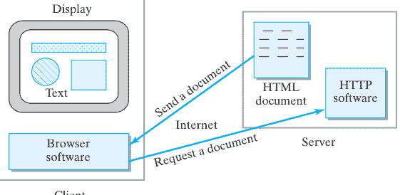

Web 的美之处在于，可以在 HTML 文档中嵌入文本、声音、视频和图形，使得通过这种（相对）简单的机制下载广泛的多媒体资源成为可能。

Web 已开始改变业务、娱乐、商业和教育。可以从 Web 下载计算机游戏和其他应用程序软件这一事实正在改变软件和其他数字产品的购买和分发方式。同样，正如之前提到的，许多企业已开始将它们的信息系统组织成内网——即实现 HTTP 协议的私有网络。目前，Web 上最大的开发领域之一是商业。随着消费者越来越习惯信用卡信息可以在 Web 上安全地传输（就像通过电话一样），Web 将作为一个营销媒介爆发出来，其力量可能像今天的电视一样强大。由于 Java 设计用于支持安全的、分布式的、网络化的应用程序，它非常适合用作这类应用程序的语言。

## 0.4 为什么要学习编程？

计算机程序是一组指导计算机行为的指令集。计算机编程是设计和编写程序的艺术与科学。多年前，人们广泛认为进入计算机时代需要每个人学会如何编程。事实证明并非如此。今天的计算机配备了如此易于使用的软件，知道如何使用计算机不再需要编程。

学习编程的另一个原因是进入计算机科学家的职业。然而，尽管编程是其主要工具之一，但计算机科学是一门广泛且多样的学科，范围涵盖从工程（如处理器设计）到数学科目（如性能分析）。许多科学家在日常工作中很少或完全不编程。如果你计划主修或辅修计算机科学，你一定会学会编程，但计算领域对程序员和非程序员来说都有许多良好的职业机会。

学习编程最好的理由之一是因为它是一项创造性且有趣的解决问题的活动。这本书将教你如何针对一系列有趣的问题开发设计良好的解决方案。编程最棒的事情之一是，你可以实际上看到并体验你的解决方案作为运行的程序。正如许多学生所指出的，当你看到你的程序解决了你苦扰已久的问题时，那种感觉真的是无可比拟的。设计和构建编写良好的程序提供了强大的成就感和满足感。此外，Java 是一门让编程更有趣的语言，因为一旦完成，许多 Java 程序可以发布在万维网（WWW）上供全世界查看！

## 0.5 编程语言

今天大多数计算机程序是用高级语言编写的，例如 Java、C++ 或 FORTRAN。如果一种编程语言的语句类似于英语语句，那么它被认为是高级语言。例如，所有提到的语言都具有某种形式的 `if` 语句，意为“如果满足条件，则执行某些操作”。

计算机科学家们发明了高级语言，其中大多数已付诸实践。一些广泛使用的语言具有特殊特性，使其适用于某种类型的编程。例如，COBOL（通用面向业务的语言）仍被用于商业应用程序。FORTRAN（公式翻译）仍然受工程师和科学家青睐。而 C 和 C++ 是操作系统程序员使用的主要语言。

除了具有适用于某些类型应用程序的特性外，高级语言还使用了人类易读的符号和表示法。例如，Java 中的算术运算使用了如 `+` 和 `/` 等运算符，因此在代数中，为了取两个数的平均值，你必须使用表达式

```
(a + b) / 2
```

问题是计算机无法直接理解表达式。为了让计算机运行程序，程序必须先翻译成计算机的机器语言，即 CPU 或微处理器所理解的语言。每种处理器都有自己的机器语言。这就是为什么当你购买软件时，它运行在 Macintosh 上、Power-PC 芯片上或其他芯片上。当一个程序可以在一种芯片上运行时，它就不是两种。通常，机器语言基于二进制代码，这是一个适用于电子设备的二值系统。在二进制表示方案中，一切都被表示为“1”和“0”的序列，这与计算机的电子“开启”和“关闭”状态密切对应。例如，在二进制中，数字 13 将表示为 1101。同样，计算机内存中的某个特定地址可以表示为 0110011，而计算机指令集中的一条指令可能表示为 001100。

构成计算机语言的指令是简单且基础的。例如，机器语言可能包含加（ADD）、减（SUBTRACT）、除（DIVIDE）和乘（MULTIPLY）的指令，但它不会包含平均值（AVERAGE）指令。在大多数情况下，对一个或多个数据进行单次机器操作，这些数据被称为操作数。因此，计算两个数字平均值的过程将分解为几个步骤。机器语言本身可能有一种类似于格式，即一个操作码（opcode）后面跟着若干个操作数，操作数指的是数据存储在计算机主内存中的位置。以下指令表示将 `LOCATION1` 中的数字加到 `LOCATION2`，并将结果存储在 `LOCATION3`：

| 操作码 | 操作数 1 | 操作数 2 | 操作数 3 |
| --- | --- | --- | --- |
| 011110 (ADD) | 110110 (LOCATION 1) | 111100 (LOCATION 2) | 111101 (LOCATION 3) |

由于机器语言的原始性，像 `(a+b)/2` 这样的表达式必须翻译成一系列若干机器语言指令；在二进制代码中，它看起来可能如下所示：

```
011101010111100111101
00010100010001000101101
00001000010101011111011
```

在计算的早期，高级语言被开发出来之前，计算机必须用其机器语言进行编程，这是一个极其枯燥且容易出错的过程。想象一下，要检测出一个由于在应该出现 1 的前面的程序中放了 0 的错误是多么困难。

幸运的是，我们不再需要担心机器语言了，可以使用特殊程序将高级语言或源程序翻译成机器码或目标代码，这是计算机可以执行或运行的唯一代码。通常，将源代码翻译成目标代码的程序是翻译器（图 3）。通过适用于 Java 或 C++ 的适当翻译软件，我们可以编写程序，仿佛计算机直接理解 Java 或 C++ 一样。

源代码翻译器有两种。解释器将单行源代码翻译成机器语言，并在处理下一行源代码之前执行该代码。编译器则将整个源代码程序翻译成可执行的目标代码，这意味着目标代码随后可以直接运行而无需再次翻译。

这两种方法各有优缺点。解释型程序的运行效率通常低于编译型程序，

## 0.6 为什么选择 Java？

图 3：翻译软件将高级源代码翻译成机器语言目标代码。

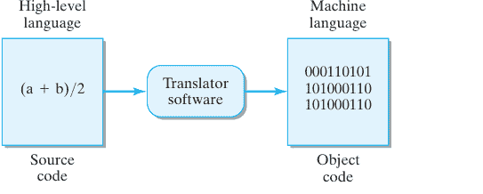

因为它们必须翻译并执行程序的每一行，然后进入下一行。如果某行代码被重复，解释器在每次遇到该行时都必须翻译它。相比之下，一旦编译完成，目标程序执行时不需要任何进一步翻译。改进编译代码也更容易，可以使其运行得更快，并且更容易开发，并在出现问题时更容易提供某些错误信息。你可能听过的某些语言，如 BASIC、LISP 和 Perl，是以解释形式使用的，尽管这些语言也有编译器可用。用 COBOL、FORTRAN、C++ 和 Pascal 编写的程序是经过编译的。我们将在下一节中看到，Java 程序在翻译过程中同时使用了编译和解释。

## 0.6 为什么选择 Java？

Java 最初名为“Oak”，是以其开发者詹姆斯·戈斯林（James Gosling）的一种树命名的。它是一种相对年轻的编程语言，由 Sun Microsystems 在 1991 年设计，用于嵌入微波炉和家用安全系统。然而，互联网和万维网（WWW）的普及使得 Java 成为适用于 Web 应用的语言。正如你记得，互联网是一个全球计算机网络，而 WWW 是其中提供信息的部分。Java 已成为 Web 应用中最重要的语言之一。


# Java 在商业界的潜力

Java 在商业界引起了巨大的兴趣，证明了其巨大的潜力。除了作为帮助企业在互联网上推广产品和服务的有用工具外，Java 也是在私有网络上分发服务的良好语言。由于其作为嵌入微处理器的语言初衷，Java 设计时就具有许多有趣的特性：

- **Java 是面向对象的。** 面向对象的语言将程序划分为对象的模块，这些模块封装了数据和操作。因此，面向对象编程（OOP）和面向对象设计（OOD）指的是一种组织程序的方法，这正迅速成为构建复杂系统的首选方法。与将面向对象的特征移植到 C 语言不同，Java 从零开始就是面向对象的语言。

- **Java 是健壮的。** 这意味着 Java 程序中的错误不像其他语言那样经常导致崩溃。语言的某些特性能够在程序运行之前检测许多潜在错误。

- **Java 是平台独立的。** 在本文中，平台指的是一种特定的计算机系统，如 Macintosh 或 Windows 系统。Java 的特色可以在不同的计算机上直接运行。这意味着 Java 程序可以随处运行。对于其他高级语言来说并非如此，可移植性是 Java 适用于 WWW 应用的原因之一。

- **Java 是一种分布式语言。** 这意味着它的程序可以设计在网络上运行。除了语言本身，Java 还提供了大量的代码库——这些直接为特定类型的应用程序设计的软件——这使得构建互联网和 WWW 系统变得异常容易。这也是 Java 非常适用于支持企业网络应用的原因之一。

- **Java 是一种安全的语言。** 为了网络而设计，Java 具有防止不受信任代码（即可能以某种方式引入或破坏你系统的代码）的特性。例如，一旦 Java 程序被下载到浏览器中，就会被阻止从你的桌面计算机读取或写入信息。

## 平台独立性

尽管这些迷人的特性，但选择 Java 作为入门编程语言最好的理由可能是它能为学习 Java 带来乐趣和兴奋。在其他语言中，很少有初学者可以编写出分发在 Web 页面或任何计算机上的计算机游戏或图形化应用程序。Java 设计的简单性和易于使用的库，让成就变得触手可及。

# 章节 0.7 什么是面向对象编程？

Java 是一种面向对象（OO）语言，本书采用面向对象的方法进行编程。在开始讨论 Java 之前，介绍一些涉及面向对象编程的底层概念是非常关键的。我们需要讨论什么是对象、对象如何被分组为类、类与类之间如何关联，以及对象如何通过消息（`messages`）相互交互和通信。

## 0.7.1 基础面向对象编程比喻：交互对象

一个程序，以及任何面向对象的程序，都是一组相互作用对象的集合，用于模拟一组真实世界的对象。想象一下厨房设计师在布置你的新厨房时可能使用的模型（图 4）。该模型中的每个对象都代表真实对象的简化版本。例如，可以用一个矩形来代表冰箱。

厨房模型大多是*静态的*。它不会改变。一旦到位，它的各种对象就处于那里，保持相互关系。相比之下，计算机程序是*动态的*。它会改变。它会执行任务并执行某些动作。计算机程序中的对象相互通信并随着时间的推移而变化。在这方面，构成我们计算机程序的对象是拟人化的，这是一个大词，意思是“像人一样”。如果我们正在吃晚饭，我想让你递一下盐，我说：“请把盐递给我”，你总是无如一地照从。同样，当你（学生 X）将卡片插入 ATM 时，ATM 调用银行数据库对象“给我学生 X 的银行账户”，然后操作就完成。如果你告诉 ATM 提现 100 美元，它会告诉你的银行账户从当前余额中扣除 100 美元。就是如此。你的银行账户会因为交易而创建对象。

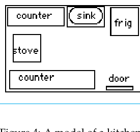

## 0.7.2 什么是对象？

那么什么是对象呢？仅仅在现实世界中，对象可以是任何东西。对象可以是一个物理实体，比如*汽车*，也可以是一个精神产物，比如一个*想法*。它可以是自然物体，比如*动物*，也可以是人造的产物，比如*ATM*。一个管理账户的程序将涉及 `BankAccount`（银行账户）和 `Customer`（客户）对象。一个国际象棋程序将涉及 `Board`（棋盘）对象和 `ChessPiece`（棋子）对象。

在全文中，我们将使用图 5 中的符号法来描述对象和面向对象的概念。这种符号法被称为*统一建模语言*（Unified Modeling Language，简称 UML），它是面向对象社区的标准。如图所示，对象由一个矩形表示，其标签由对象的（可选的）id 和它的类型组成。对象的*id* 是计算机程序引用该对象时的名称。在这种情况下，我们展示了一个 ATM 对象，它没有给出 id，以及一个命名为 `pawn1` 的 `ChessPiece`（棋子）对象。对象的标签始终带有下划线。

图 5：在 UML 中，对象由矩形表示，矩形上标记有 `id.Type` 格式的双部分标签。对象的标签始终带有下划线。

对象的标签由 id 和类型组成。

```
id:Type
```

```
:ATM
```

```
pawn1:ChessPiece
```

## 0.7.3 属性与值

就像真实对象一样，我们程序中的对象也具有特征属性。例如，一个 ATM 对象将有一个它可以发放的当前现金金额。一个棋子对象可能有一对行和列属性，用于指定它在棋盘上的位置。注意，对象的属性是多个对象。ATM 的属性以及棋子的行、列属性都是数字（`Numbers`）。

图 6 显示了两个对象及其各自的属性。可见，对象的属性列在 UML 图的第二个分区中。注意，每个属性都有值。`lobby:ATM`（大厅 ATM）有 $8650.0现金，而 `drivethru:ATM`（得来速 ATM）只有 $150.0现金。

图 6：对象图第二个分区用于显示对象的属性及其值。

```
lobby:ATM
drivethru:ATM
```

```
cash = 8650.0
cash = 150.0
```

对象的属性及其值显示在第二个分区中。

我们有时将对象属性和值的集合称为它的*状态*（`state`）。例如，`lobby:ATM` 的当前状态是现金 $8650.0。当然，这是对 ATM 状态的简化，它还会包含许多其他属性。希望你理解了这一点。

## 0.7.4 动作与消息

除了属性之外，对象还具有动作。正如我们所说，对象是动态的，它们具有特征动作或行为。在 Java 中，对象是*动态的*。我们实际上是让对象执行动作。例如，通过动作让棋子移动到棋盘上的新位置。当客户在 ATM 上点击“余额”按钮时，我们是在让 ATM 报告（`report()`）其余额。注意我们通过消息来区分动作和属性。消息是由于一个对象到另一个对象的信息的传递。图 7 展示了这种工作方式。在 UML 中，消息由箭头表示。

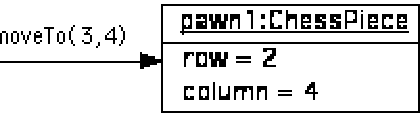

图 7：在 UML 中，消息由带标签的箭头表示。在这个例子中，我们告诉棋子从当前位置移动到第3行第4列。

在这个例子中，我们告诉 `pawn:ChessPiece moveTo(3,4)`。在这种情况下，数字3 和 4 是告诉棋子移动到哪个格子的参数（棋盘有8 行8 列，每个格子通过行和列来标识）。通常，参数是指定消息内容的值。通过这种方式，我们告诉棋子向前移动 1 行。如果我们想让棋子向前移动 2 行，我们将发送消息 `moveTo(4,1)`。图 8 描述了一个消息序列。首先，客户要求 ATM 机器返回其余额。ATM 机器让银行账户返回余额。ATM 从银行账户获取 $528.52 并传递给客户。在这种情况下，消息不涉及参数。但它涉及结果（`result`）。结果是返回给发送消息的对象的信息。

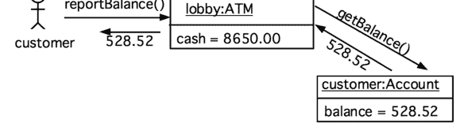

图 8：此 UML 图展示了一个 ATM 交易，客户向 ATM 机器查询余额。ATM 从代表银行账户的对象获取信息并传递给客户。

显然，为了响应消息，对象必须知道如何执行请求的动作。棋子必须知道如何移动到指定的格子。ATM 必须知道如何找到客户的当前余额。事实上，对象只能响应与其特征动作和行为相关的消息。

响应消息或执行动作有时会导致对象状态发生改变。例如，在执行 `moveTo(3,4)` 后，棋子将位于不同的格子上。它的位置发生了变化。相反，某些消息（或动作）会保持对象的状态不变。报告客户的银行余额不会改变余额。

## 0.7.5 什么是类？

类是对象的模板。类封装了表征特定类型对象的属性和动作。在面向对象的程序中，类作为对象的蓝图或模板，这些的使用。我们说一个对象是类的一个实例（`instance`）。一个很好的类比是：将类想象成一个饼干模具，而它的对象（实例）则是一个个的一块块的饼干。就像我们使用饼干模具压出特定类型的饼干一样，在面向对象的程序中，我们使用类的定义来创建特定类型的对象。

编写面向对象的程序在很大程度上类似于设计类并在 Java 中为这些类编写定义。设计一个类就是满足该类型对象所具有的所有属性和行为。

例如，假设我们编写一个绘图程序。程序需要的一种对象类型是矩形。`Rectangle` 对象有两个基本属性：长度和宽度。根据这些属性，我们可以定义矩形的动作，例如计算其面积的能力和绘制自身的能力。识别对象的属性和面向对象的思维，就是开发面向对象设计的核心活动。

图 9 显示了我们的类的 UML 图。与 `for` own，UML 符号最多有三个属性。与 UML 对象符号不同，UML 类的标签给出的是类名，且没有下划线。第二个分区列出了类的属性。我们的矩形有四个属性。前两个 `x` 和 `y` 决定了矩形在二维坐标系中的位置。后两个 `length` 和 `width` 决定了矩形的尺寸。注意，这些属性没有值。这是因为矩形代表的是一种通用的矩形类型。它代表所有矩形的共同点，而不代表任何特定的矩形。就像制作饼干的模具一样，类提供了对象的通用形状，而并不包含具体内容。

图 9：Rectangle 类的 UML 图。

| Rectangle | 类名 |
|--- |--- |
| length: int<br>x: int | 属性 |
| width: int<br>y: int | |
| calculateArea(): int<br>draw() | 动作 |

## 0.7.6 变量与方法

到为止，我们一直在使用“属性”（`attribute`）和“动作”（`action`）来描述对象的特征。当我们谈论对象，或者当谈论由 UML 图表示的对象或类时，我们将继续使用这些术语。

在谈论编程语言时，描述对象特征的常用方法是讨论它的变量（`variables`）和方法（`methods`）。变量对应于属性，是一个命名的内存位置，可以存储特定类型的值。你可以将变量看作一个特殊的容器，它只能容纳特定类型的对象。例如，图 9 所示，`Rectangle` 的长度和宽度是变量，可以存储一种名为 `int` 的特定数值类型。`int` 值是一个整数，例如 76 或 -5。

方法对应于动作或行为，是一段命名的代码，可以被调用或执行以执行一组一组预定义的动作。例如，在我们的 `Rectangle` 对象中，可以调用 `calculateArea()` 方法来计算矩形的面积。当然，它通过将矩形的长度乘以宽度来实现。同样，可以调用 `draw()` 方法来画出矩形的图片。它将执行在控制台上绘制矩形的动作。

## 0.7.7 实例变量、类变量与方法

变量和方法可以与对象或其类关联。实例变量（或实例方法）是属于对象的变量（或方法）。相比之下，类变量（类方法）是与类本身关联的变量（或方法）。一个例子有助于明确这种区别。

实例变量对于不同的实例会有不同的值。例如，不同的 `Rectangle` 实例其长度、宽度、`x` 和 `y` 有不同的值。这些都是实例变量的示例。`calculateArea()` 是实例的方法，因为它在计算中使用该实例的长度和宽度。同样，`draw()` 是实例方法，因为它使用对象的长度和宽度来绘制该对象。

类变量的一个例子是矩形类中的一个变量，用于跟踪创建了多少个独立的 `Rectangle`。（我们的绘图程序可能需要此信息来管理资源）。假设我们将其命名为 `nRectangles`，并在每次创建一个新的 `Rectangle` 时对其加 1。

与类关联的方法的一个例子是被称为“构造方法”（`constructor`）的特殊方法。这是一种用于创建对象的方法。它用于创建类的实例。调用构造方法创建对象就像按压饼干团：结果是一个独立的饼干（对象）。

图 10 阐释了这些概念。注意，在 UML 图中类变量带有下划线。我们修改了 `Rectangle` 类以包含它的构造方法，命名为 `Rectangle()`。注意它接收四个参数，代表我们想要分别赋值为矩形的 `x`、`y`、长度和宽度的值。同样注意 `Rectangle` 类的 `nRectangles` 值为 2，代表已经创建了两个实例。它们被显示为 `Rectangle` 类的成员。

目前这一点对你来说可能并不明显，但 `nRectangles` 是一个必须与 `Rectangle` 类关联的值，而不是与其实例关联。为了理解这一点，让我们想象当创建一个新的 `Rectangle` 实例时发生了什么。图 11 显示了这一过程。当 `Rectangle()` 构造方法被调用时，它的参数 `(100, 50, 25, 10)` 被 `Rectangle` 类用于创建一个位于 `x=100, y=50` 且长度为 25、宽度为 10 的 `Rectangle` 对象。构造方法还将 `nRectangles` 的值加 1，这是一种计算创建了多少对象的方法。

图 10：Rectangle 类及其两个实例。注意类变量 nRectangles 带有下划线，以区别于长度和宽度。

| Rectangle |
|--- |
| nRectangles=2 |
| length: int<br>x:int |
| width: int<br>y:int |
| Rectangle(x:int,y:int,l:int,w:int) |
| calculateArea():int |
| draw() |
| rect1:Rectangle | rect2:Rectangle |
| length = 25<br>x = 100 | length = 30<br>x = 125 |
| width = 10<br>y = 50 | width = 20<br>y = 75 |

图 11：构造 Rectangle 实例。

| Rectangle(100,50,25,10) |
|--- |
| Rectangle |
| nRectangles=1 |
| length: int<br>x:int |
| width: int<br>y:int |
| Rectangle(x:int,y:int,l:int,w:int) |
| calculateArea():int |
| draw() |
| length = 25<br>x = 100 |
| width = 10<br>y = 50 |

## 0.7.8 类层次结构与继承

类之间是如何相关的？在 Java 以及任何面向对象的语言中，类被组织成类层次结构。类层次结构像一棵倒置的树。层次结构的顶端是最通用的类。在 Java 中，最通用的类是 `Object` 类。位于 `Object` 下方的类被称为子类（`subclasses`）。由于我们程序中使用的对象都属于某个类，这就像是说对象都是 `Object`。

图 12 使用本节描述的类阐释了类层次结构的概念。注意 `Object` 类位于层次结构的顶端。它是最通用的类。它具有所有 Java 对象共有的特征。随着向层次结构向下移动，类变得越来越专门。`Rectangle` 是一个对象，但它包含了所有对象共有但层次结构中其他对象并不具备的属性——长度和宽度。例如，一个 `Integer` 对象并不一定具有长度和宽度。注意我们在层次结构中添加了一个 `Square` 类。`Square` 是 `Rectangle` 的特殊类型，即其长度等于其宽度。

为了给这种层次结构引入一些重要的术语，我们说 `Rectangle` 类是 `Object` 类的子类。

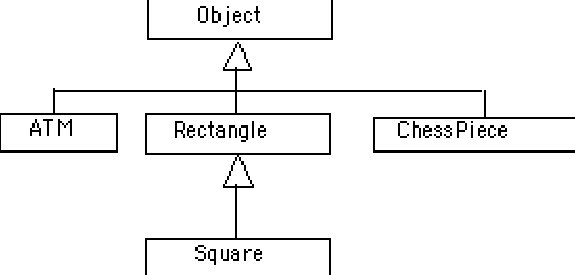

### 类继承

`Square` 类是 `Rectangle` 和 `Object` 的子类。在层级结构中出现在给定类的类被称为它的父类。因此，`Rectangle` 是 `Square` 类的父类。`Object` 类也是 `Square` 的子类。通常，我们说子类扩展了父类，这意味着它在其父类包含的元素基础上增加了额外的元素（属性和/或方法）。我们在 `Square` 的案例中看到了这一点：它增加了其长度和宽度始终相等的特征。

另一个与类层次级相关的重要概念是类继承的概念，即子类从其父类中继承元素（属性和/或方法）。以自然界中的例子来说，想想马和哺乳动物之间发生的那种继承。马是一种哺乳动物，其特征是作为哺乳动物而具有恒温性。这与个体遗传不同，个体遗传是指你继承了母亲的眼睛和父亲的黑发。

为了说明继承是如何运作的，让我们回到国际象棋程序。有几种类型的 `ChessPiece`（象棋棋子）。有兵、骑士和皇后。图 13 展示了国际象棋棋子的层级结构。所有棋子都拥有一对属性是在棋盘上的位置。因为所有棋子都有这些共同属性，所以它们被所有 `ChessPiece` 子类所继承。当然，行（`row`）和列（`column`）属性在每个 `ChessPiece` 中具有不同的值。

所有棋子共有的动作之一是它们可以 `moveTo()` 棋盘上的给定格子。不同类型的棋子移动方式不同。例如，主教（`Bishop`）只能在棋盘上对角线移动，而车（`Rook`）只能沿着棋盘的行或列移动。因此，我们无法描述一个适用于所有 `ChessPiece` 的 `moveTo()` 方法。这就是为什么我们将 `moveTo()` 方法放在每个 `ChessPiece` 子类中。`ChessPiece` 也有一个 `moveTo()` 方法，但注意它的名称是斜体的。这表示该方法在该层级上是完全定义的。


最后，请注意在国际象棋中，王（`King`）具有某些属性和动作。只有王可以被将军（`check`）。这意味着王处于攻击之下并面临被捕的危险，从而结束游戏。同样，只有王有易车（`castle`）的能力。这是它在某些条件下与其中一个根部一起完成的特殊移动。因此，我们在 `King` 类中显示 `inCheck` 属性和 `castle()` 动作的原因是因为这些是王特有的特征。

# 第 0 章 • 计算机、对象与 Java

图 13：国际象棋棋子的层级结构。

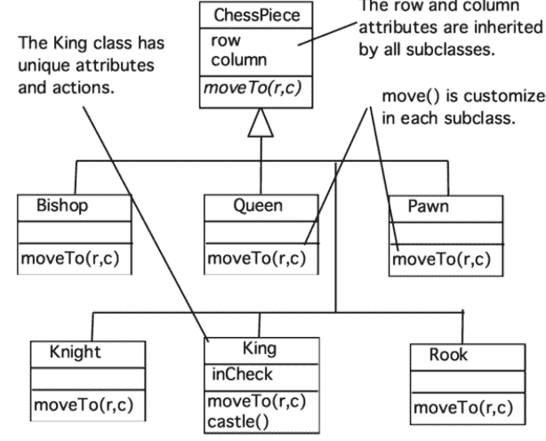

`King` 类具有独特的属性和动作。

行和列属性被所有子类继承。

`moveTo(r,c)` 在每个子类中经过了自定义。

通过这种方式，类层级结构代表了从上到下类的特化。最通用的类 `ChessPiece` 位于层级结构的顶端。它的属性传递给（继承自）它的子类。然而，与它们从子类继承的方法不同，子类定义了它们自己的属性。每个子类（如 `Pawn`、`Bishop` 等）都代表了父类的某种特化。而 `King` 子类具有独特的属性和动作（`inCheck` 和 `castle()`）。

## 0.7.9 面向对象设计原则

正如我们讨论过的，面向对象的程序是由许多相互通信的对象组成的。设计面向对象的程序来解决某些问题的过程涉及重要的原则：

- **分治原则（Divide-and-Conquer Principle）**。通常，设计程序的第一步是将整体问题分解为若干个相互交互以解决问题的对象。然后，面向对象的程序采用分工合作，正如我们组织许多现实世界任务时那样。这种分治方法是一种重要的问题解决策略。

- **封装原则（Encapsulation Principle）**。一旦确定了对象，下一步就是为每个对象决定它哪些属性以及将采取哪些动作。目标是在每个对象内部封装执行其在程序中角色所需的专业知识。每个对象都是一个自的模块，具有清晰的职责和执行角色所需的工具（属性和动作）。正如牙医封装了诊断和治疗牙痛的专业知识一样，设计良好的对象包含了执行其角色所需的信息和方法。

- **接口原则（Interface Principle）**。为了让对象能够协作工作，我们必须明确它们应该如何相互交互，即建立接口。对象的接口设计应该限制其他对象使用该对象的方式。想想数字表和模拟表所提供的不同接口是如何决定手表种性能的。在数字表中，时间以离散的单位显示，并使用按钮显示分钟和秒的时间。在模拟表中，时间通过时表盘上的指针显示，并通过旋转一个小轮子进行不那么精确的设置。

- **信息隐藏原则（Information Hiding）**。为了让对象能够协作工作，它们各自设计和性能的某些细节应该对其他对象隐藏。再次使用手表时，为了查看我们所需的内容，我们不需要知道计时机制是如何工作的。细节级别对我们是隐藏的。隐藏此类细节可以保护手表的机理，而不会限制其实用性。

- **通用性原则（Generality Principle）**。为了让对象尽可能有用，我们设计它们时不是为了某个特定任务，而是为了某一类任务。这一原则是软件库使用的基础。正如我们将会看到的，Java 自带了大量的类库，它们专门用于执行特定类型的输入输出操作。例如，我们不需要自己编写一个在控制台上打印消息的方法，而是使用库对象来处理我们的打印任务。

- **可扩展性原则（Extensibility Principle）**。面向对象方法的优势之一是能够扩展对象的行为来处理新任务。这在日常世界也是如此。如果一家公司需要销售代理专门负责硬件订单，那么扩展现有代理的技能比从头开始培训新手更具效益。同样，在面向对象的方法中，每个负责输入数据的对象角色可以被特化为输入数值数据。

- **抽象原则（Abstraction Principle）**。抽象是在尝试处理大量信息时，关注对象重要特征的能力。例如，当我们试图为厨房绘制平面图时，我们关注家电而忽略颜色、样式。我们在 Java 中设计的对象将是抽象，因为我们只关注对解决特定问题至关重要的属性。我们在学习编写面向对象程序时指导讨论的原则。

# 第 0 章 • 练习

- 封装与模块化：每个对象都应该被分配一个明确的角色。
- 公共接口：每个对象都应该呈现一个清晰的公共接口，决定其他对象如何使用它。
- 信息隐藏：每个对象都应该保护其用户免受其执行角色时不必要的细节的影响。
- 通用性：对象的设计应该尽可能通用。
- 可扩展性：对象的设计应该使其功能能够被扩展，以执行更专门的任务。
- 抽象是将大量信息分组到单个数据块中的能力，以便将其作为一个单一实体进行管理。

## 练习 0.1 填空下列陈述中的空白。

- a. 将一个问题或任务划分为 ________ 是 ________ 原则的句例子。
- b. 设计一个类，使其保护对象的某些部分免受其他对象的影响，是 ________ 原则的一个例子。
- c. 能够在各种计算机上运行而无需更改的 Java 程序是 ________ 的一个例子。
- d. 社会安全号码被分成三个部分这一事实是 ________ 原则的一个例子。
- e. 证明一个程序是健壮的意味着 ________。
- f. 一个 ________ 是独立模块，封装了 Java 程序的属性和动作。

## 练习 0.2 解释以下每对概念之间的区别。

- a. 硬件和软件
- b. 系统软件和应用软件
- c. 编译器和解释器
- d. 机器语言和高级语言
- e. 通用计算机和专用计算机
- f. 主内存和辅存
- g. CPU 和 ALU（算术单元）
- h. 互联网和万维网（WWW）
- i. 客户端和服务器
- j. HTTP 和 HTML
- k. 源代码和目标代码

## 练习 0.3 填空下列陈述中的空白。

- a. ________ 是引导计算机行为的指令集。
- b. 磁盘驱动器是 ________ 设备的例子。
- c. 鼠标是 ________ 设备的例子。
- d. 显示器是 ________ 设备的例子。
- e. 计算机的功能就像一个 ________。
- f. Java 是 ________ 编程语言的例子。
- g. 互联网是计算机和 ________ 的网络。
- h. 世界维网使用的协议是 ________ 协议。
- i. Web 文档是用 ________ 代码编写的。
- j. ________ 是用于为网络上的其他计算机存储数据的网络计算机。

## 练习 0.4 识别负责以下功能的计算机硬件组件：

- a. 执行“取指-执行”循环
- b. 算术运算
- c. 执行指令
- d. 在程序执行时存储程序
- e. 在计算机关机状态下存储程序和数据

## 练习 0.5 解释为什么典型的软件（如文字处理器）无法同时在 Macintosh 和 Windows 机器上运行。

## 练习 0.6 你在平台无关性中看到了哪些优点？缺点是什么？

## 练习 0.7 人的名字在什么意义上是抽象的？英语的任何部分在什么意义上是抽象的？

## 练习 0.8 从分而治之和封装原则的角度出发，分析撰写研究论文的过程。

## 练习 0.9 使用面向对象的设计原则分析你的汽车。换说，选择你汽车的一个系统（例如刹车系统），从分而治之、封装、信息隐藏和接口原则的角度对其进行分析。

## 练习 0.10 当学生从大学图书馆借出书籍时，对学生、图书管理员和图书馆数据库之间的交互进行面向对象的分析。

# 第 1 章

# Java 程序设计与开发

## 目标

在学习本章后，你将：

- 了解程序开发中涉及的基本步骤。
- 理解 Java 语言的某些基本元素。
- 了解如何在 Java 程序中进行简单的输出操作。
- 能够区分程序中不同类型的错误。
- 理解 Java 程序是如何翻译成机器语言的。
- 理解 Java 控制台应用程序与 Java Swing 应用程序的区别。
- 了解如何编辑、编译和运行 Java 程序。

## 大纲

1.1 引言

1.2 设计良好的程序

1.3 设计一个谜语程序

特殊专题：格蕾丝·霍珀与首个计算机 Bug

1.4 Java 语言元素

1.5 编辑、编译和运行 Java 程序

1.6 来自 Java 库：System 和 PrintStream

1.7 来自 Java 库：System 和 PrintStream

章节总结

自学练习答案

练习题

# 第 1 章 • Java 程序设计与开发

## 1.1 引言

本章介绍了 Java 程序设计与开发涉及的一些基本概念和技术。我们首先识别设计面向对象程序的主要步骤。这些步骤通过设计一个“提问”和“回答”谜语的程序来展示。以一个谜语为例，问题是“什么是黑的白的，而且满地都是的？”答案当然是报纸。然后，我们关注编写 Java 程序涉及的步骤，包括编辑、编译和运行程序的过程。对于图形化应用程序，我们描述了这两种类型的编码过程有何不同。

接下来，我们通过学习 `PrintStream` 和 `System` 类开始熟悉 Java 广泛的类库。这些类包含了使我们能够打印输出的方法。在本章结束时，你将能够设计你最喜爱的 ________ 程序。

## 1.2 设计良好的程序

编程不仅仅是输入代码的问题。相反，它涉及到大量的规划。尽管初学者倾向于立即开始编码，但设计糟糕的程序很少有效。换句话说，你对设计程序投入的思考和精力越多，它正确运行的可能性就越大。

总而言之，程序开发过程可以被看是一个重复“分而治之”原则的过程。也就是说，大多数编程问题可以不断分解，直到你有一组容易解决的子问题，每个子问题都可以由一个对象来处理。通过这种方式，程序被分为交互对象。对于每个对象我们设计一个类，每个对象进一步被分为变量和方法。

### 1.2.1 软件生命周期

软件工程是设计和编写软件的过程。软件生命周期指的是开发涉及的不同阶段。图 1.1 给出了生命周期更详细的概述。在规范阶段，我们提供问题描述。在设计阶段，我们描述组成程序的类、方法数据的细节。在测试阶段，我们测试程序的性能以确保其正确，并在必要时重新设计。

| 阶段 | 描述 |
| :--- | :--- |
| 问题规范 | 问题确切是什么？程序将如何表现？ |
| 问题分解 | 使用哪些对象？它们之间如何相互作用？ |
| 类设计 | 对象将扮演什么角色？它需要哪些变量（属性）？它使用哪些方法（行为）？它呈现什么接口？隐藏哪些信息？ |
| 方法设计 | 方法将执行什么？它需要哪些信息？它使用什么算法？它将产生什么结果？ |
| 算法设计 | 需要哪些信息？需要哪些结构？ |
| Java 编码 | 逐步细化。修复语法错误。 |
| 测试、调试、修订 | 设计测试数据和测试用例。修复语义错误。 |

图 1.1: 程序开发过程概述。

# 第 1 章 • Java 程序设计与开发

## 1.3 设计一个谜语程序

在面向对象编程中，我们将学习更多关于如何做出这些决策。

程序开发过程的第一步是确保你理解了问题（图 1.1）。因此，我们从制定一份详细的规范开始，该规范应该回答三个基本问题：

- 要解决的问题究竟是什么？
- 程序将如何被使用？
- 程序应该表现出怎样的行为？

在现实世界中，问题规范通常是通过客户与开发者之间的广泛讨论得出的。在入门级编程课程中，规范通常由讲师分配。

为了让这些想法更清晰一些，让我们为一个简单的问题设计一个面向对象的解决方案。

| 问题规范。 | 设计一个类，用以表示具有给定问题和答案的谜语。该类的定义应该使其能够存储不同的谜语，并能独立地检索谜语的问题和答案。 |

### 1.3.1 问题拆解

大多数问题都太大、太复杂，无法一次性解决。因此，设计过程的下一步是将问题分为若干部分，使解决方案更易于管理。在面向对象的方法中，问题被拆分为多个对象，每个对象在程序整体行为的某个方面都将是一个特定的专家或专家。

请注意，对于拆解一个给定程序到何种程度，存在一些模糊性。这种模糊性是设计过程的一部分。在程序部分变得“易于解决”之前，我们该如何拆分程序取决于我们正在尝试解决的问题以及解决者。

在尝试决定需要哪些对象时，有一个非常有用的设计指南：

> **JAVA 高效设计：寻找名词。** 选择程序的对象的关键是在问题规范中寻找名词。

再次，这一指南中也存在一些模糊性。例如，我们当前问题中的关键名词是“谜语（riddle）”，因此我们的解决方案将涉及一个作为谜语模型的对象。这个 Java 对象的主要任务仅仅是表示一个谜语。规范中的另外两个名词是“问题（question）”和“答案（answer）”。幸运的是，Java 有内置的 `String` 对象可以表示单词或句子的字符字符串。我们可以使用两个 `String` 对象分别表示谜语的问题和答案。因此，对于这个简单的问题，我们只需要设计一种对象——谜语，其主要作用是表示谜语的问题和答案。

如果我们的决策在现阶段看起来令人担忧，不要太担心。对面向对象设计的良好理解只有在大量的设计经验后才能获得，但这是一个很好的开始。

### 1.3.2 对象设计

一旦我们将程序拆分为一组协作对象，设计 Java 程序主要就是设计和创建这些对象的问题。在我们的示例中，这意味着我们现在必须设计谜语对象的特征。对于每个对象，我们必须回答以下设计问题：

- 对象在程序中将执行什么操作？
- 它需要什么数据或信息？
- 它将采取哪些行动？
- 它将向其他对象呈现什么接口？
- 它将向其他对象隐藏哪些信息？

对于我们的谜语，这些问题的答案如图 1.2 所示。注意，尽管我们在谈论“设计一个对象”，但我们实际上是在设计对象的类。类定义了属于它的对象集合。类可以被视为对象的类型。这与现实世界的对象是相同的。因此，`Sciscuit` 是一匹马——`Sciscuit` 是一个类型为 `horse` 的对象。同样，一个谜语就是一个谜语，即一个类型为 `riddle` 的对象。

接下来的讨论展示了我们如何得出 `Riddle` 类设计规范的决策，如图 1.2 所示。

- **类名**：`Riddle`
- **角色**：存储和检索问题与答案
- **属性（信息）**
    - `question`：一个用于存储谜语问题的变量（私有）
    - `answer`：一个存储谜语答案的变量（私有）
- **行为**
    - `Riddle()`：一个设置谜语问题和答案的方法
    - `getQuestion()`：一个返回谜语问题的方法
    - `getAnswer()`：一个返回谜语答案的方法

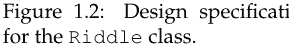

`Riddle` 对象的作用是模拟一个普通的谜语。因为谜语是根据它的问题和答案定义的，我们的对象需要某种方式来存储这两条信息。正如我们在第 1 章中学到的，实例变量（`instance variable`）是属于对象的命名内存位置。正因为内存位置是有命名的，因此通过调用变量名就可以轻松地检索存储的数据。例如，为了打印谜语的问题，我们会说类似“print question”的话，存储在 `question` 中的任何内容都会被检索并打印。

对象的角色是什么？

# 第 1 章 • Java 程序设计与开发

通常情况下，实例变量用于存储对象执行其角色所需的信息。它们对应于我们一直所说的对象属性。决定这些变量为“对象需要什么信息？”这个问题提供了答案。

接下来，我们决定 `Riddle` 将采取哪些行动。对象行动的一个有用的设计指南如下：

对象将需要什么信息？

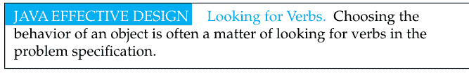

对象将采取哪些行动？

对于这个问题，关键动词是设置（`set`）和检索（`retrieve`）。如图 1.2 所示，每个 `Riddle` 对象都应该提供某种设置其问题和答案变量值的方法，以及一种单独检索每个值的方法。

所确定的每个行动都将封装在 Java 方法中。正如你从第 0 章记忆的，方法是一段可以被调用或请求的代码，用于执行特定操作。在面向对象的方法中，调用方法（方法调用）就像在对象之间发送消息。例如，当我们想要获取谜语的答案时，我们会调用它的方法。这种方法就像发送消息“给我答案”。一种被称为构造函数（`constructor`）的特殊方法在对象创建时被调用。我们将使用 `Riddle()` 构造函数为谜语的问题和答案赋予特定值。

它将呈现什么接口，它将隐藏哪些信息？

在设计对象时，我们必须决定哪些方法对其他对象可用。这决定了对象呈现什么接口。

### 1.3.3 算法设计

算法是解决问题的分步过程。算法设计是程序开发的关键步骤。例如，计算一组数字总和的算法可能如下所示：

1. 将总和初始化为 0。
2. 如果没有更多数字需要计算总和，则跳转到第 5 步。
3. 将下一个数字加到和中。
4. 回到第 2 步。
5. 报告总和。

请注意，该算法中的每一步都很简单且易于遵循。将其翻译成 Java 相对容易。由于英语作为一种算法语言有些不够精确，程序员经常在编程语言本身中编写算法，或者使用伪代码——伪代码是一种结合了英语和编程语言结构的混合语言，它对语言语法的要求不过分苛刻。例如，该算法可以用伪代码表示如下：

伪代码

```
sum = 0
while (more numbers remain)
    add next number to sum
print the sum
```

当然，一个经验丰富的程序员不太可能费力为这样一个简单的算法编写伪代码。但许多编程问题是极其复杂的，需要仔细的设计以最大限度地减少程序中所包含的错误数量。在这些情况下，可以使用伪代码。

设计算法的另一个重要部分是对其进行跟踪（`trace`）——即在某些样本数据上逐行执行。例如，我们可以通过对侧边所示的数字列表进行跟踪来测试这个列表求和算法。

数字列表求和

| 总和 | 数字列表 |
|---|---|
| 0 | 54 20 |
| 54 | 30 20 |
| 84 | 20 |
| 104 | - |

最初，总和从 0 开始，数字列表包含 54、30 和 20。在算法的每次迭代中，总和根据下一个数字的大小而增加，列表的大小随之减小。算法的步骤在总和列下显示了正确的总量。虽然这次跟踪没有发现任何错误，但通过这种方式跟踪来发现算法中的缺陷是非常常见的。

### 1.3.4 使用 Java 编码

一旦开发了足够详细的设计，就可以开始生成 Java 代码了。做此事的错误方法是输入整个程序并运行。这通常会导致几十个错误，这些错误可能会令人沮丧且难以修复。

### 逐步细化


正确的方法是使用逐步细化原则。程序分小阶段进行编码，并在每个阶段后对代码进行编译和测试。例如，你可以在移动到程序的其他部分之前，编写单个方法的代码并对其进行测试。这样，错误在移动到下一个阶段之前就被捕获了。

`Riddle` 类的代码如图 14 所示。尽管我们还没有开始学习 Java 语言的细节，但你可以很容易识别出此程序中的关键部分：类型为 `String` 的实例变量 `question` 和 `answer`，它们被用于存储谜语的数据；`Riddle()` 构造函数以及 `getQuestion()` 和 `getAnswer()` 方法形成了接口。

```
public class Riddle extends Object // 类头
{
    private String question; // 类开始
    private String answer; // 实例变量

    public Riddle(String q, String a) // 构造函数方法
    {
        question = q;
        answer = a;
    } // Riddle()

    public String getQuestion() // 实例方法
    {
        return question;
    } // getQuestion()

    public String getAnswer() // 实例方法
    {
        return answer;
    } // getAnswer()
} // Riddle 类 // 类结束
```

理解这些元素所需的特定语言细节将在在本章及后续章节中介绍。

### 1.3.5 语法与语义

编写代码需要了解它的语法和语义。一种语言的语法是决定特定语句表述是否正确的规则集。作为语法规则的例子，考虑以下内容：

> The rain in Spain falls mainly on the plain. // 有效
>
> Spain remains mainly in the falls plain. // 无效

第一句符合英语语法规则，它的意思是西班牙平原上下着雨。第二句不符合英语语法，结果它变得毫无意义。Java 语法规则的一个例子是 Java 语句必须以分号结束。

然而，与英语不同（在英语中，即使违反了语法规则仍然被理解），在编程语言中，语法规则是非常严格的。如果你即使违反了最微小的语法规则——例如，如果你只忘记了一个分号——程序也完全无法运行。

同样，程序员必须了解语言的语义——即每个语句的含义。在编程语言中，语句的含义取决于它对程序产生的影响。例如，为了在前面的算法中将总和设为 0，使用赋值语句将值 0 存储在名为 `sum` 的内存位置中。因此，我们说语句

```
sum = 0;
```

将 0 分配给内存位置 `sum`，它将一直存储在那里，直到程序的其他部分需要它。

学习 Java 的语法和语义是学习编程的重要部分。学习编程的这一方面就像学习外语一样。你对这种语言（Java）变得越流利，就越能表达对有趣编程问题的解决方案。你与 Java 规则和规范挣扎得越痛苦，用人类通用的语言讨论问题就越困难。

# 第1章 • Java程序设计与开发

1991年，霍珀将军被乔治·布什总统授予了国家技术奖章。为了纪念和表扬霍珀将军的众多贡献，美国海军以她的名字命名了一艘航天器。关于霍珀将军的更多信息，请访问以下网站：

```
http://www.chips.navy.mil/
```

## 1.4 Java 语言元素

在本节中，我们将通过描述一个小型程序的详细细节，介绍 Java 语言的关键元素。我们将观察程序是如何组织的，以及各个部分的作用。我们的意图是介绍重要的语言元素，这些元素将在子节中进行更详细的解释。

我们将学习的程序是传统 HelloWorld 程序的 Java 版本——之所以被称为“传统”，是因为几乎每本入门编程书籍都从它开始。当它运行时，HelloWorld 程序（图 1.5）会在控制台上显示欢迎语“Hello, World!”。

```
/*
 * File: HelloWorld.java
 * Author: Java Java Java
 * Description: Prints Hello, World! greeting.
 */
public class HelloWorld extends Object {
    // 开始类体
    private String greeting = "Hello, World!";
    public void greeting() {
        // 开始方法体
        System.out.println(greeting); // 输出语句
    } // 结束方法体
    public static void main(String[] args[]) { // 方法头
        // 方法定义
        HelloWorld helloworld; // 创建
        helloworld = new HelloWorld(); // 创建
        helloworld.greeting(); // 方法调用
    } // main()
} // 结束类体
```

> 图 1.5：HelloWorld 应用程序程序。

### 1.4.1 注释

关于 HelloWorld 程序，首先注意到的是注释的使用。注释是程序中不可执行的部分，用于说明程序内容。由于注释是不可执行的，编译器会忽略它们。它们的唯一目的是为了让程序员更容易阅读和理解程序。

HelloWorld 程序包含了两种类型 Java 注释的示例。包含在 `/*` 和 `*/` 之间的任何文本都被视为注释。

正如你在 HelloWorld 中看到的，这种注释可以跨越几行，有时是多行注释。第二种注释是跟随在双斜杠（行中的 `//`）之后的任何文本。这被称为单行注释，因为它不能跨越单行。

当编译器遇到多行注释的起始标记（`/*`）和结束标记时，它会跳过所有内容，直到找到结束标记（`*/`）。这意味着在另一个注释内部放置多行注释是不可能的。也就是说，注释不能嵌套或包含在另一个注释中。下面的代码段说明了使用 `/*` 和 `*/` 的规则：

```
// 这第一条注释在同一行内开始并结束。 */
/* 第二条注释从这一行开始 ...
并继续 ...
这是第二条注释的最后一行 ...
/* 第三条注释从这一行开始 ...
/* 这不是第四四条注释。它只是
第三条注释的一部分
而这是第三条注释的最后一行 ...
*/ 这是一个错误，因为这是一个不匹配的结束标记。
```

从这中可以看出，在已经开始的注释内部开始新注释是不可能的，因为第一个注释内部的所有文本（包括 `/*`）都会被编译器忽略。

> **JAVA 语言规则** | 包含在 `/*` 和 `*/` 之间的任何文本（可以跨多行）都被视为注释并被编译器忽略。在行中插入双斜杠（`//`）会将该行的剩余部分转变为注释。

多行注释通常用于创建一个注释块，为程序提供有用的文档。在 HelloWorld 中，程序以一个注释块开始，该注释块标识了文件名，并对程序的功能进行了简短描述。对于单行注释，可以在代码行的任何位置插入双斜杠（`//`）。结果是该行的剩余部分被编译器忽略。我们在整个 HelloWorld 程序中使用单行注释来对其语言元素提供说明行的注释。

> **JAVA 编程技巧** | 注释的使用。一个编写良好的程序应该以注释块开始，该注释提供程序名称、作者以及程序功能的描述。

### 1.4.2 程序布局

关于程序的另一个注意点是它在页面上的排列非常整齐。这样做是刻意的，为了让程序易读易理解。在 Java 中，程序的表达式和语句可以按照程序员喜欢的任何方式排列。它们可以每行一个、每行多个，或者一个语句跨越几行。程序布局规则如此松散，这使得我们采用良好的编程风格变得更加重要，这种风格有助于让程序易于阅读。

所以看看 HelloWorld 中的内容是如何呈现的。注意起始和结束大括号，以及逗号，是如何对齐的，以及我们如何使用单行注释来标注结束大括号。大括号用于标记 Java 程序中不同代码块的开始和结束，并且很难知道哪些起始和结束大括号是匹配的。适当的缩进和单行注释的使用有助于判断括号的匹配情况。

同样，注意如何使用缩进来显示程序的一个元素包含在另一个元素内部。因此，HelloWorld 类的元素被缩进在标记类开始和结束的大括号内部。`main()` 方法中的语句也被缩进，以表示它们属于该方法。这种方式的缩进可以识别大括号的匹配情况。这种缩进可以让程序更易读易理解。使用注释标记结束的。

> **JAVA 编程技巧** | 使用缩进来显示程序的一个元素包含在另一个元素内部。使用缩进来标记起始和结束的大括号。

### 1.4.3 关键字与标识符

语言包含了一些预定义的单词（见表 1.1），这些词在语言中具有特殊含义。例如，HelloWorld 程序（图 1.5）中的关键字：

表 1.1：Java 关键字

| abstract | goto | package | this |
| :--- | :--- | :--- | :--- |
| boolean | do | private | throw |
| break | double | protected | throws |
| byte | enum | public | transient |
| case | else | instanceof | try |
| catch | extends | int | short |
| char | final | interface | void |
| class | finally | long | super |
| continue | for | new | switch |

> **JAVA 语言元素**

关键字不能作为方法、变量或类的名称。然而，程序员可以创建自己的名称，这些被称为标识符，遵循某些规则：

> **JAVA 规则** | 标识符必须以大写或小写字母开头，后面可以是任意数量的数字、下划线（`_`）或美元符号（`$`）。标识符不能与 Java 关键字相同。

Java 名称是区分大小写的，这意味着两个不同的标识符可能包含相同的字母。例如，`thisVar` 和 `ThisVar`。

除了标识符的语法规则，Java 程序员在命名类、变量和方法时遵循某些约定。根据约定，Java 名称以大写字母开头，并使用小写字母区分名称中的单词——`HelloWorld` 和 `TextField`。变量和方法名以小写字母开头，但使用大写字母区分名称中的单词——`main()`、`get()`。

> **标识符风格**

Java 程序员遵循的另一个重要风格是在命名类、变量和方法时选择描述性标识符。

> **JAVA 编程技巧** | 在命名类、变量和方法时选择描述其功能的标识符。

## 1.4 数据类型与变量

如果计算机程序不能处理不同类型的数据（如数字和字符串），那么它将非常没有用。对数据进行的操作取决于该数据的类型。例如，你可以对数字进行除法和乘法，但不能对字符串这样做。Java 程序中的每个数据都根据其类型进行分类。

广泛来说，Java 数据分为两类：各种类型的对象和八种不同的内置原始类型。除了程序员创建的新类型对象外，Java 还有许多类型的内置对象。在本章中我们将遇到的两种类型是 `String` 和 `PrintStream` 对象。Java 的原始类型包括三种整数类型、三种实数类型、一种字符类型以及具有真和假值的布尔类型。

> **名称**

原始类型的类型是关键字，例如 `int` 用于整数类型，`double` 用于实数类型，以及 `boolean`。

正如我们在第 0 章中提到的，变量是一个命名的存储位置，可以存储特定类型的值。从实践上说，你可以将变量看作一个特殊的容器，你可以向其中放入值，但只能放入特定类型的值（图 1）。例如，一个 `int` 变量可以存储像 0 或 -100 这样的值。一个字符串变量可以存储像 "Hello" 这样的值。（实际上，这并不是全部情况，情况要复杂一些，但我们将在第 2 章介绍这个问题）。

在 `HelloWorld` 类中，变量 `greeting`（第 88 行）存储了一个 `String` 类型的值。在 `main()` 方法中，`helloworld` 被赋值了一个 `HelloWorld` 对象（第 16 行）。

| num: | 5 |
|---|---|
| | `<int>` |
| str: | "hello" |
| | `<String>` |

字面量是程序中出现的任何类型的值。例如，用双引号括的字符串，如 "Hello, World!"，被称为 `String`。像 45.2 这样的数字是 `double` 类型的字面量，而 -72 是 `int` 类型的字面量。我们的 `HelloWorld` 程序包含一个字面量值，"HelloWorld"：string。

### 1.4.5 语句

程序是语句的集合。语句是程序中执行操作的代码段。随着程序的运行，我们执行语句，并执行它们所指定的动作。在我们的 `HelloWorld` 程序中，各种类型的语句出现在第 8、11、15、16 和 17 行。注意，所有这些行都以分号结尾。Java 的规则是语句必须以分号结尾。如果不这样做，将会导致语法错误。

声明是一种用于声明特定类型的语句。在 Java 中，变量在程序中使用之前必须先声明。不这样做会导致语法错误。在最简单的形式中，声明语句以变量的类型开头，后面跟着变量名，并以分号结尾：

```
Type VariableName;
```

变量的类型要么是上述基本类型之一（如 `int`、`double` 或 `boolean`），或者对于对象来说，它是对象的类（如 `String` 或 `HelloWorld`）。变量名可以是任何合标识符...

```
HelloWorld helloworld;
```

这个示例为对象声明了一个变量。变量名是 `helloworld`，其类型是 `HelloWorld`，这是我们在示例中定义的类名。再举一个例子，以下两个名为 `int1` 和 `int2` 的变量：

```
int int1;
int int2;
```

如所述，`int` 是 Java 的基本类型之一，`int` 词是 Java 关键字。

目前不再详述过多细节，声明变量会导致程序为将存储在该变量中的数据类型留出内存。在这个示例中，Java 将预留足够的空间来存储一个 `int`。

赋值语句是将值存储（赋值）给变量的语句。赋值语句使用等号（`=`）作为赋值运算符。在最简单的形式中，赋值语句在等号左侧有一个变量，在右侧有某种类型的值。与其他语句一样，赋值以分号结尾。

```
VariableName = Value;
```

当执行赋值语句时，Java 会首先确定右侧的值，然后将（该）值存储到左侧的变量中。这里是一些简单的示例：

```
greeting = "Hello, World";
num1 = 50; // (a) 给 num1 赋值 50
num2 = 10 + 15; // (b) 给 num2 赋值 25
num1 = num2; // (c) 将 num2 的值 (25) 复制到 num1
```

在第一情况下，右侧的值是字符串字面量 "Hello, World"，它存储在 `greeting` 中。当然，`greeting` 必须是正确的容器类型——在这种情况下是一个 `String` 变量。在第二情况下，右侧的值是 50。因此该值被存储在 `num1` 中，赋值后的情况如图 1.7 顶部的图。在第三种情况下，右侧的值是 25，它是通过 10 和 15 相加得到的。因此，值 25 被赋值给 `num2`。在赋值后，我们展示了图中中间的情况。当然，这说明 `num2` 是一个 `int`。在最后情况下，右侧的值是 25，即我们存储在变量 `num2` 中的值。所以 25 被存储在 `num1` 中。这是底部的图。

方法调用语句是调用方法的语句。在 `HelloWorld` 中，我们看到了两个方法调用的例子：

```
System.out.println(greeting); // 调用 println 方法
helloworld.greet();           // 调用 greet 方法
```

我们将后续详细讨论这些语句。最后提到的一种语句类型是复合语句（块），它是包含在大括号内的语句序列。我们在 `HelloWorld` 程序中看到了三个例子。类定义从第 7 行到第 19 行。`main()` 方法从第 14 行到第 19 行。`greet()` 方法从第 10 行到第 12 行。

### 1.4.6 表达式与运算符


# 数据的处理是通过使用某种表达式来完成的

表达式是指定或产生值的 Java 代码。例如，如果你想将两个数字相加，你会使用算术表达式，如 `num1 + num2`。如果你想比较两个数字，你会使用关系表达式，如 `num1 < num2`。正如你所看到的，Java 中的许多表达式涉及对特殊符号的使用。在这里我们看到了加运算符（`+`）和小于运算符（`<`）。我们已经讨论过运算符 `=`。

Java 表达式和运算符的类型取决于所处理的数据类型。例如，将两个整数相加 `2 + 3`，表达式本身产生一个 `int` 结果。当使用小于运算符比较两个数字时 `num1 < num2`，表达式本身产生一个 `boolean` 类型（真或假）。需要注意的是，表达式不能单独出现。它们必须作为语句的一部分出现。这里是一些额外的示例如下：

| 表达式 | 说明 |
| :--- | :--- |
| `num = 7` | `int` 类型的赋值表达式 |
| `num = square(7)` | `int` 类型的方法调用表达式 |
| `num == 7` | `boolean` 类型的相等表达式 |

这些中的第一个是赋值表达式。它的值为 7，因为它正在将 7 赋值给 `num`。第二个示例也是赋值表达式，但它在右侧有一个方法调用 `square(7)`。我们可以假设程序中已经相应定义了一个名为 `square` 的方法。方法调用只是另一种类型的表达式。在这种情况下，它的值为 49。注意，赋值表达式可以通过在其后面加上分号来转换为独立的赋值语句。

第三个表达式是相等表达式，假设它左侧的变量存储值为 7，那么它的值为 `true`。

## 第 1.4 节 · Java 语言元素

> **JAVA 语言规则：等性与赋值**
> 注意不要混淆 `==`。符号 `=` 是赋值运算符。它将右侧的值赋值给左侧的变量。符号 `==` 是相等运算符。它求值左侧和右侧的表达式是否具有相同的值，并返回 `true` 或 `false`。

## 自学练习

**练习 1.1** 在执行以下两个语句后，变量 `num` 中存储了什么内容？

```java
int num = 11;
num = 23; num;
```

**练习 1.2** 写一个语句，声明一个类型为 `int` 的变量 `num2`，并将其存储在 711 和 712 之和中。

## 1.4.7 类定义

一个 Java 程序包含一个或多个类。在 HelloWorld 示例中，我们正在定义 `HelloWorld` 类，但程序中还涉及预定义的类：`Object`、`String`、`System` 类，这些类都定义在 Java 库中。预定义的类（如这些）可以在任何程序中使用。

正如 HelloWorld 程序的注释所示，类定义包含两个部分：类头和类体。通常情况下，类头采用以下形式，其中某些部分是可选的 (opt)：

```
ClassModifiers_opt class className Pedigree_opt
```

HelloWorld 的类头是：

```java
public class HelloWorld extends Object
```

类头的目的是给出类名 (`HelloWorld`)，标识其可访问性（`public` 而非 `private`），并描述它在 Java 层次结构中的位置（作为 `Object` 类的扩展）。在这种情况下，类头以可选修饰符 `public` 开始，声明该类可以被任何其他类访问。声明的下一部分标识了类名 `HelloWorld`。最后部分声明 `HelloWorld` 是 `Object` 类的子类。我们把定义的这部分称为类的“度（degree）”。

正如你从第 0 章所回想的那样，`Object` 类是整个 Java 层次结构中的顶层类。通过声明 `HelloWorld extends Object`，实际上没有必要显式地声明 `HelloWorld extends Object`，因为 Java 有默认假设。也就是说，如果你在类头中省略了 `extends` 子句，Java 将自动假设该类是 `Object` 的子类。

类体封装在花括号 `{ }` 之中，包含了组成类对象的元素的声明和定义。这是定义对象的属性和行为的地方。

### 1.4.8 声明实例变量

类体中声明和定义的元素通常有两种类型：变量和方法。正如我们在第 0 章中描述的那样，实例变量是属于每个对象（或说是属于类）的变量。也就是说，类的每个实例都拥有自己实例变量的副本。HelloWorld 类有一个实例变量 (`greeting`)，其声明如下：

```java
private String greeting = "Hello, World";
```

通常，实例变量的声明具有以下语法，其中某些部分是可选的：

```
Modifiers_opt Type VariableName InitialExpression_opt
```

因此，变量声明从可选修饰符开始。在声明 `greeting` 变量时，我们使用访问修饰符 `private` 来声明 `greeting` 属于 `HelloWorld` 类，不能被其他对象直接访问。声明的下一部分是变量的类型。在这种情况下，`greeting` 变量是 `String`，这意味着它可以存储一个字符串对象。类型之后是变量名，在本例中为 (`greeting`)。这是在整个类中引用该内存位置的名称。例如，该变量在第 11 行的 `print()` 语句中被引用了。

声明的最后部分是可选的初始化表达式。在本情况下，我们使用它来将初始值 "Hello, World!" 赋值给 `greeting` 变量。

### 1.4.9 定义实例方法

回想方法是一段命名的代码，可以被调用或执行以完成某种动作或操作。在 Java 类中，方法对应于对象的行为或动作。HelloWorld 程序有两个方法：`get()` 和 `main()` 方法。

方法定义由两个部分组成：方法头和方法体。通常情况下，方法头采用以下形式，包括一些可选部分：

```
Modifiers_opt ReturnType MethodName (ParamList)_opt
```

与变量声明一样，方法定义从可选修饰符开始。例如，第 9 行的 `get` 方法使用访问修饰符 `public` 来声明 `get()` 方法可以被其他类访问或引用。从第 13 行开始定义的 `main()` 方法是一个特殊方法，将在下一节中进行解释。

方法头的下一部分是方法的返回类型。这是方法返回的值（如果有的话）的类型。HelloWorld 中的两个方法的返回类型都是 `void`。这意味着它们不返回任何值。`void` 方法执行其体体中的语句序列。关于返回值的方法的示例，请查看 `Riddle` 类中 `getQuestion()` 方法的声明，它返回一个 `String`（图 1.4）。

方法名紧随方法的返回类型之后。这是调用方法时使用的名称。例如，在第 17 行调用了 `greet()` 方法。

在方法名之后的是方法的参数列表。参数是一个变量，用于存储在调用方法时传递给方法的数据值。像 `greet()` 方法这样的方法没有参数，因为没有传递任何信息。关于带有参数方法的示例，请参阅 `Riddle` 构造函数，它包含了谜语问题和答案的参数（图 1.4）。

方法定义的最后部分是它的方法体，其中包含了一系列可执行的语句。可执行语句是在程序运行时会执行某些动作的 Java 语句。例如，`greet()` 方法中的语句。

```java
System.out.println(greeting); // 输出语句
```

在控制台上打印一条问候语。

### 1.4.10 Java 应用程序

HelloWorld 程序是 Java 应用程序（或简称为 Java 应用）的一个示例。应用程序程序是“独立”的，因为它不依赖于任何其他程序（如 Web 浏览器）。每个 Java 应用程序必须包含一个 `main()` 方法，这是程序开始执行的地方。对于包含几个类的程序，由程序员决定哪个类应该包含该方法。

程序中使用的对象。其中一个是问候语，是一个由字符串“Hello, World!”组成的 `String` 对象。另一个是 `System.out` 对象，这是一个用于打印的特殊 Java 系统对象。

### 1.4.11 JavaFrames

Java 可以在 `JFrame` 中运行，这样输出和交互就在窗口（或帧）中进行。图 1.9 显示了一个名为 `HelloWorldSwing` 的 Java 程序。这个程序的功能与 HelloWorld 应用大体相同——显示“Hello, World!”问候语。

```java
/**
 * File: HelloWorldSwing program
 */

import javax.swing.JFrame; // 导入类名
import java.awt.Graphics;
import java.awt.Canvas;

public class HelloWorldCanvas extends Canvas {
    // 主体开始
    public void paint(Graphics g) {
        // paint 方法
        g.drawString("Hello, World!", 10, 10);
    }

    public static void main(String[] args) {
        HelloWorldCanvas c = new HelloWorldCanvas();
        JFrame f = new JFrame();
        f.add(c);
        f.setSize(150, 50);
        f.setVisible(true);
    }
} // HelloWorldCanvas 结束
```

图 1.9：HelloWorldCanvas 程序。

区别在于它在窗口内显示问候语，而不是直接显示在控制台上。

在 HelloWorld 控制台应用的情况下，`HelloWorldCanvas` 包含一个类定义。它包含一个单一的方法定义，即 `paint()` 方法，该方法包含一个可执行的语句：

```java
g.drawString("Hello, World!", 10, 10);
```

该语句在窗口中显示“Hello, World!”消息。`drawString()` 方法是 `Graphics` 类中定义的许多绘制和绘图方法之一。每个 Java `Canvas` 都带有它自己的 `Graphics` 对象，在这里我们简地将其称为 `g`。我们正在使用该对象的 `drawString()` 方法在窗口上绘图。如果这看起来有点儿神秘且新奇，请不要担心。当我们再次学习图形界面时，我们会进行详细解释。

`HelloWorldSwing` 还包含一些我们在 HelloWorld 应用中没有发现的元素，例如导入语句。现在我们来讨论这些特性。

### 1.4.12 Java 库包

回想一下 HelloWorld 程序使用了两个预定义类：`String` 和 `System` 类。这两个类都是 Java 中的基础语言类。`HelloWorldSwing` 程序也使用了预定义类，例如 `JFrame` 和 `Graphics`。然而，这两个类并不是 Java 基础语言类的一部分。为了理解这些类之间的区别，有必要讨论 Java 库是如何组织的。

包（package）是 Java 库中与集合相关的类的组合。例如，`java.lang` 包包含了 `Object`、`String` 和 `System` 等与 Java 语言相关的类。`java.awt` 包提供了 `Button`、`TextField` 和 `Graphics` 等用于图形用户界面（GUI）的类。`java.net` 包提供了用于网络任务的类，而 `java.io` 包提供了用于输入输出操作的类。

所有类都属于某个包，包括程序员定义的类。要将一个类分配给某个包，你需要在包含该类定义的文件的第一行提供一个 `package` 语句。例如，包含 `java.lang` 包中类定义的文件都以以下语句开头。

```java
package java.lang;
```

如果你省略了 `package` 语句（正如我们在书中程序中所做的那样），Java 会将这些类放在未命名的默认包中。

因此，对于任何类，其全名都包含了包含它的包名。例如，`java.lang.System` 以及 `String` 类的全名 `java.lang.String`。同样，`Graphics` 类的全名是 `java.awt.Graphics`。简之，Java 类的全名采用以下格式：

```
package.class
```

换句话说，任何类的全名都以其包名作为前缀。

在 Java 库的所有包中，`java.lang` 包是唯一一个类可以在 Java 程序中使用简写名称直接使用的包。这意味着当程序使用来自 `java.lang` 包的类时，它可以通过该类名来引用它。例如，在 HelloWorld 程序中，我们引用的是 `String` 类，而不是 `java.lang.String`。

### 1.4.13 import 语句

`import` 语句允许程序以其缩写名使用 Java 类。Java 类库中的任何公共类都可以通过其完全限定名被程序使用。因此，如果一个程序正在使用 `Graphics` 类，它始终可以作为 `java.awt.Graphics` 来引用它。然而，能够通过缩写名引用 `Graphics` 会让程序变得更短且更具可读性。

`import` 语句实际上并没有将类加载到程序中。它只是让这些缩写名可用。例如，`HelloWorldSwing` 中的导入语句允许我们通过缩写名引用 `JFrame`、`Canvas` 和 `Graphics`（图 1.9）。`import` 语句有两种可能的形式：

```java
import package.class;
```

```java
import package.*;
```

第一种形式允许通过简写名识别特定类。第二种形式（使用星号 `*`）允许指定包中的所有类通过简写名识别。`HelloWorldSwing` 中的导入语句是第一种形式的示例。以下示例

```java
import java.lang.*;
```

允许 `java.lang` 包中的所有类通过简写名识别。

### 1.4.14 Java 中的限定名

在之前的节中，我们看到了使用点号表示法的名称示例。完全限定名是分成若干部分的名称。

就像自然语言一样，名称的含义取决于上下文。例如，`java.System` 指的是 `System` 类，而 `System.out()` 指的是一个方法。

名称依赖于上下文这一事实恰恰完成了学习 Java 程序内容的任务。学习 Java 内置类的一部分是了解特定对象或方法的定义位置。如果 Java 编译器找不到你引用的对象或方法，则会出现语法错误。

> **DEBUG 调试未找到错误**
> 如果 Java 找不到你引用的项，它将报告“未找到 X”错误，其中 X 是引用的类、方法、变量或包。

## 1.5 编辑、编译和运行 Java 程序

在本节中，我们将讨论如何编译和运行 Java 程序的细节。由于我们正在探索两种不同类型的 Java 程序——控制台应用和 Swing 应用，每种类型的流程有所不同。我们已经讨论了控制台和 Swing 应用的一些语言特性，因此在本节中，我们更多地关注编程环境的特性。由于我们在书中不假设任何特定的编程环境，我们的讨论将具有某种通用性。然而，我们首先会对可能遇到的编程环境类型进行简要概述。

### 1.5.1 Java 开发环境

Java 程序环境通常由几个执行不同任务的程序组成，用于编辑、编译和运行 Java 程序。以下描述基于 Oracle 公司提供的软件开发环境，该公司是 Java 的所有者和维护者。目前被称为 Java 平台标准版 8.0 (Java SE 8)。SE 的版本适用于多种平台，包括 Linux、Windows 和 macOS 计算机。可以在 Sun 网站 `http://www.oracle.com/technetwork/java/` 处免费下载。（有关 Java SE 的更多详细信息，请参阅附录 B）。

在某些情况下，构成 Java SE 的各个程序可以在单个程序开发环境中可用，称为集成开发环境 (IDE)。示例包括 Eclipse、IntelliJ 和 Oracle 自己的 NetBeans IDE。这些每一个工具都提供了一个完整的包，用于在 Linux、macOS 和 Windows 等多种平台上编辑、编译和运行 Java。

图 1.10 展示了创建和运行 Java 程序所涉及的过程。接下来的讨论假设你正在使用 Java SE 作为你的开发环境来编辑、编译和运行示例程序。如果你在使用其他环境，将需要阅读该软件提供的文档，以确定具体如何在这些环境中编辑、编译和运行程序。

### 1.5.2 编辑程序

可以使用任何文本编辑器来编辑程序并根据需要进行纠正。流行的 Unix 和 Linux 编辑器 `vim` 和 `emacs` 在 macOS 和 Windows 上也可用。此外，免费编辑器包括 TextMate 和 TextWrangler，Windows 还有 `Notepad++`。

正如我们所看到的，Java 程序由一个或多个定义组成。我们将遵循约定，将每个类定义命名在它自己的文件中（Java 的规则是源文件只能包含一个类定义）。包含这些类的文件必须命名为 `ClassName`，其中 `ClassName` 是文件中包含的公共 Java 类的名称。

> **Java 语言规则**
> 定义名为 `ClassName` 的公共 Java 类的文件必须保存为名为 `ClassName.java` 的文本文件。否则将导致错误。


例如，在我们的 HelloWorld 应用中，程序必须命名为 `HelloWorld.java`；对于 HelloWorldSwing，由于 Java 大小敏感（这意味着 Java 会区分字母是大写还是小写），如果包含 `HelloWorld` 类的文件命名为 `helloworld.java` 或 `HelloWorld.java` 将是一个错误。在这种情况下，该错误是语义错误。Java 将无法找到 `HelloWorld` 类，因为它会寻找一个名为 `HelloWorld` 的文件。

> Java 语言规则：Java 是大小写敏感的，这意味着它将 `HelloWorld` 和 `hello` 视为不同的名称。

### 1.5.3 编译程序

回想一下在运行 Java 源程序之前，你必须将其编译为 Java 虚拟机 (JVM) 理解的中间代码。应用和应用程序的源码都必须编译。要运行程序（无论是 App 还是应用程序），都使用 JVM 来解释和执行字节码。

SE 包含两个部分：运行时环境，称为 Java 环境 (JRE)；开发包，称为软件开发工具包 (SDK)。如果你只是运行 Java 应用，浏览器（如 Internet Explorer 和 Netscape Navigator）必须包含 JRE 的插件版本。相反，如果你要开发 Java 程序，你还需要安装 SDK。

JDK 编译器命名为 `javac`。在某些环境中——例如 Linux 或 Windows 命令提示符——可以通过在系统提示符处输入以下命令来编译 `HelloWorld.java`：

```
javac HelloWorld.java
```

如图 1.10 所示，`HelloWorld.java` 程序不包含错误，此命令的结果是创建一个名为 `HelloWorld.class` 的 Java 字节码文件——该文件与源文件具有相同的前缀，但后缀是 `.class` 而不是 `.java`。默认情况下，字节码文件将放置在与源文件相同的目录下。如果 `javac` 检测到 Java 代码中的错误，将打印出错误消息列表。

## 1.5 运行 Java 应用程序

为了在任何计算机上运行（或执行）程序，程序的可执行代码必须加载到计算机的主内存中。对于 Java 环境，这意味着程序的 `.class` 文件必须加载到计算机内存中，然后由 Java 虚拟机进行解释。在 Linux 系统或 Windows 命令提示符上运行 Java 程序，请在命令行输入：

```
java HelloWorld
```

此命令加载 JVM，随后 JVM 将加载并解释应用程序的字节码 (`HelloWorld.class`)。字符串 "HelloWorld" 将显示在命令行上。在 MacOS 系统或没有命令行界面的 IDE 中，你将从菜单中选择并运行命令。一旦代码编译完成，运行命令将调用 JVM 加载并解释字节码。

### 1.5.5 运行程序

Java 语言中没有 I/O 语句。I/O 通过属于 `java.io` 包中类的方法来处理。我们已经看到如何使用 `println()` 方法将字符串打印到控制台。例如，以下 `println` 语句


```
System.out.println("Hello, World");
```

将“Hello, World”打印在控制台上。让我们仔细检查此语句，看看它是如何使用 I/O 类的。

`java.io.PrintStream` 类是 Java 的打印专家，通俗地说，它连接到各种 `print()` 和 `println()` 方法，这些方法可以打印 Java 程序中发现的所有类型的数据。图 1.13 显示了 `PrintStream` 的部分定义。注意，在这种情况下，`PrintStream` 类没有属性，只有操作或

由于 `print()` 和 `println()` 方法是 `PrintStream` 对象的方法，我们只能通过找到一个来使用它们

## 1.6 来自 Java 库：System 和 PrintStream

我们需要能够编写生成输出的程序，本节描述了 Java 如何处理简单的控制台输出。在 Java 中，任何 I/O 源或目的地都被视为字节或字符的流。为了执行输出，我们将字节或字符插入流中。为了执行输入，我们从流中提取字节或字符。甚至键盘输入的字符也是按键序列，这可以表示为流。

| PrintStream |
| :--- |
| + print(data: String) |
| + print(data: boolean) |
| + print(data: int) |
| + println(data: String) |
| + println(data: boolean) |
| + println(data: int) |

## 第 1.6 节 • 来自 Java 库：System 和 PrintStream

`PrintStream` 对象以及“告诉”它为我们打印数据。如图 1.15 所示，Java 的 `java.lang.System` 类包含三个预定义的流，包括两个 `PrintStream` 对象。该类具有公共 (+) 属性。此处未显示它的任何公共方法。

`System.out` 和 `System.err` 对象都可以用于向控制台写入输出。正如名称所示，`err` 流主要用于错误消息，而 `out` 流用于其他的打印输出。同样，正如名称所示，`System.in` 对象可处理输入，这在第 2 章中介绍过。

`print()` 和 `println()` 方法之间的唯一区别是 `println()` 在打印数据后会打印一个回车换行符（CR），使随后的输出在新行打印。例如，以下语句：

```
System.out.print("hello")
System.out.println("hello again")
System.out.println("goodbye");
```

将产生以下输出：

```
hello again
goodbye
```

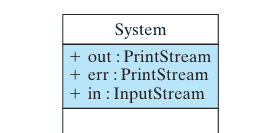

现在我们已经知道如何使用 Java 的打印专家了，让我们用它来“唱”版本的《老麦农有个农场》。正如你可能猜到的，这个程序将编译一系列 `System.out.println()` 语句，每条语句都打印一行歌词。完整的 Java 程序如图 1.15 所示。

```java
public class OldMacDonald
{
    public static void main(String args[]) {
        // Method
        System.out.println("Old MacDonald had a farm")
        System.out.println(" E I E IO O.")
        System.out.println("And on his farm he had a duck.")
        System.out.println(" E I E IO O.")
        System.out.println("With a quack quack here.")
        System.out.println("And a quack there there.")
        System.out.println("Here a quack, there a quack,")
        System.out.println("Everywhere a quack quack.")
        System.out.println("Old MacDonald had a farm")
        System.out.println(" E I E IO O.")
    } // End of method
} // End of OldMacDonald
```

图 1.15：OldMacDonald.java 类。

这个示例说明了使用 Java 类库的重要性。如果有一个特定的任务需要执行，我们首先要问的是：

## 第 1 章 • Java 程序设计与开发

Java 类库中是否已经有一个“专家”可以执行这个任务。如果是，我们可以使用该专家的方法来完成该特定任务。

JAVA 有效设计：使用 Java 类库。学习如何使用 Java 类库中的类和对象是 Java 面向编程的重要部分。


## 自学练习

练习 1.3 学习如何编写程序的一种方法是修改练习题。修改 `OldMacDonald` 让它“唱”多一段歌词。

练习 1.4 编写一个 Java 类，打印左侧所示的设计。

## 章总结

## 技术术语

| 算法 | 声明语句 | 参数 |
| :--- | :--- | :--- |
| Applet | 默认构造函数 | 原始数据类型 |
| 应用程序 | 可执行语句 | 伪代码 |
| 赋值 | 表达式 | 限定限定名 |
| 语句 | 标识符 | 语义 |
| 注释 | 字面量值 | 语句 |
| 复合语句 | 对象实例化 | 步步细化 |
| (块) | 运算符 | 语法 |
| 数据类型 | 包 | |

## 重点内容总结

- 良好的程序设计要求每个对象和方法都有定义明确的角色，并清晰地定义任务需要哪些信息以及将产生什么结果。
- 良好的程序设计非常重要；程序完成得越快越好。良好的程序设计追求可读性、清晰性和灵活性。
- 测试程序非常重要，并且必须仔细进行，因为它可以揭示 Bug 的存在，而不是其不存在。
- 算法是解决某些问题的逐步处理过程。算法通常用伪代码表示，伪代码是一种结合了英语和编程构造的混合语言。
- 当语句违反 Java 语法规则时，就会语法错误。语法错误由编译器检测。语义错误是程序设计中的错误，无法通过编译器检测。
- 编写 Java 代码应遵循步步细化的过程。

## 第 1 章 • 章总结

- 双斜杠（`//`）用于单行注释。跨多行的注释必须以 `/*` 开始并以 `*/` 结束。
- 标识符必须以字母开头，可以由任意数量的字母、数字和特殊字符 `.` 和 `$` 组成。标识符不能与 Java 关键字相同。标识符区分大小写。
- 关键字是 Java 语言中具有特殊含义的术语（表 1.1）。
- Java 原始类型的示例包括 `int`、`boolean` 和 `double` 类型。
- 变量是一个命名的存储位置。在 Java 中，在使用在使用必须声明。
- 字面量是某种类型的实际值，例如 `String` ("Hello") 或 `int`。
- 声明语句的格式为：`Type VariableName ;`。赋值语句的格式为：`VariableName = Expression ;`。执行时，它确定赋值运算符（=`）右侧表达式的值并将其存储在左侧的变量中。
- Java 的运算符是依赖的，类型取决于正在处理的数据。当加上两个 `int` 值（7 + 8）时，操作产生一个 `int` 结果。
- 类定义包含两个部分：类头和类体。类头的格式为可选修饰符，后跟 `class` 关键字，然后是命名类的标识符，最后可选跟 `extends` 关键字和类父类的名称。
- 类体中通常定义两种元素：变量和方法。
- 对象实例化是使用 `new` 运算符在构造中使用类的其中一个构造函数来创建类实例的过程。
- 点表示法使用 Java 调用 `System.out` 对象的 `print()` 方法。
- Java 应用程序以独立模式运行。Java Applet 是一个在浏览器上下文中运行的程序。Java Applet 使用 `<applet>` 标签在 HTML 文档中执行。Java 源代码必须存储在扩展名为 `.java` 的文件中。字节码文件与源代码同名，但扩展名为 `.class`。如果文件名与公共类名不同，Java 会报错。Java 程序首先编译为字节码，然后由 Java 虚拟机（JVM）解释。

## 自学练习答案

答案 1.1 值 12 存储在 `num` 中。

答案 1.2 `int num2 = 7 + 5;`

答案 1.3 `OldMacDonald` 类的定义如下：

```java
public class OldMacDonald{
    public static void main(String args[]) {
        // Method
        System.out.println("Old MacDonald had a farm")
        System.out.println(" E I E IO O.")
        System.out.println("And on his farm he had a duck.")
        System.out.println(" E I E IO O.")
        System.out.println("With a quack quack here.")
        System.out.println("And a quack there there.")
        System.out.println("Here a quack, there a quack,")
        System.out.println("Everywhere a quack quack.")
        System.out.println("Old MacDonald had a farm")
        System.out.println(" E I E IO O.");
    } // End of method
} // End of OldMacDonald
```

答案 1.4 `Pattern` 类的定义如下：

```java
public class Pattern{
    public static void main(String args[]) // Main method {
        System.out.println("************");
        System.out.println("** ** **");
        System.out.println("* * *");
        System.out.println("* * * *");
        System.out.println("* * **** *");
        System.out.println("************");
    } // End of main
} // End of Pattern
```

# 第 1 章 • 练习

## 练习 1.1 为下列陈述填空。

a. 一个 Java 类定义包含对象的 ____ 和 ____。

b. 方法定义包含两个部分，一个 ____ 和一个 ____。

## 练习 1.2 解释下列每个概念之间的区别。

- a. 应用程序（Application）与小程序（applet）。
- b. 单行注释与多行注释。
- c. 编译程序与运行程序。
- d. 源代码（Source code）与字节码文件（bytecode file）。
- e. 语法（Syntax）与语义（Semantics）。
- f. 语法错误（Syntax error）与语义错误（semantic error）。
- g. 数据（Data）与方法（methods）。
- h. 变量（Variable）与方法（method）。
- i. 算法（Algorithm）与方法（method）。
- j. 伪代码（Pseudocode）与 Java 代码。
- k. 方法定义（Method definition）与方法调用（method invocation）。

## 练习 1.3 对于下列每项，识别其是语法错误还是语义错误。并给出你的理由。

- a. 将类头写为 `class MyClass`。
- b. 将 `init()` 头定义为 `public void init()`。
- c. 使用 `System.out.println("***")` 打印五个星号的字符串。
- d. 在 `println` 语句末尾忘记分号。
- e. 使用 `N - M` 计算两个数字之和。

## 练习 1.4 假设你有一个存储在 `Test.java` 文件中的 Java 程序。描述该程序的编译和执行过程，并列可能创建的其他文件。

## 练习 1.5 假设 N 为 15。以下伪代码算法将输出哪些数字？假设 N 为 6，该算法将输出什么？

```
0. 打印 N。
1. 如果 N 等于 1，停止。
2. 如果 N 是偶数，将其除以 2。
3. 如果 N 是奇数，将其乘以 3 倍并加 1。
4. 回到第 0 步。
```

## 练习 1.6 假设 N 为 5，M 为 3。以下伪代码算法将报告什么值？该算法计算的是什么数量？

- 0. 在纸上写下 0。
1. 如果 M 等于 0，报告纸上的数字并停止。
2. 将 N 加到纸上写出的数字上。
3. 将 M 减去 1。
4. 回到第 1 步。

# 第 1 章 • Java 程序设计与开发

## 练习 1.7 谜题：你有两根不同的绳，它们的特点是恰好需要一小时才能燃烧完。然而，两根绳的燃烧速度都不是恒定的。某些部分燃烧得很快，另一些部分燃烧得很慢。你们有一盒火柴和这两根绳。描述一种使用绳子和火柴来计算恰好过了 45 分钟的算法。

## 练习 1.9 谜题：生活在北极地区的极熊可以向南走一小时，向东走一小时，再向北走一小时，回到起点。在地球其他地方也可以这样做吗？

## 练习 1.10 谜题：《爱丽丝仙游游》的作者刘易斯·卡罗罗使用以下谜题来招待客人：一个体重 195 磅的皇后，90 磅的儿子和一个 165 磅的女儿被困在高窗户。窗外各系着一个篮子。他们利用篮子和一个发现的 75 磅重物逃了生。问题是，两个篮子之间的重量差超过 15 磅，就会有人受伤。描述一种能让他们安全降下的算法。


## 练习 1.11 谜题：你听过这一个：一个农民需要带着一只狐狸、一只羊和一袋玉米过河。有一条小船可以容载他和另一个乘客。问题是，如果把他们单独留在河岸边，狐狸会吃羊，羊会吃玉米。写一个算法，描述如何在不丢失任何一个东西的情况下过河。

## 练习 1.12 假设你的小妹妹要求你向她展示如何使用口袋计算器，以便她计算科学课程的作业。描述一个她可以使用来计算 10 个作业成绩平均分的算法。

## 练习 1.13 凯撒密码（`Caesar cipher`）是一种秘密代码，字母表中的每个字母向右移动 N 个字母，末尾的字母会回到开头。例如，如果 N 是 3，“Z”会变成什么？

## 练习 1.14 假设 N 为 10。“HELLO”在使用位移为 10 的凯撒密码进行加密后会变成什么？

## 练习 1.15 假设 N 为 5。“JAVA”在使用位移为 5 的凯撒密码进行加密后会变成什么？

## 练习 1.16 凯撒密码是一种秘密代码，字母表中的每个字母向右移动 N 个字母。在给定密文和位移量的情况下，写一个解密消息的算法。

## 练习 1.17 凯撒密码是一种秘密代码，字母表中的每个字母向右移动 N 个字母。在给定密文和位移 N 的情况下，写一个解密消息的算法。

## 练习 1.18 凯撒密码是一种秘密代码，字母表中的每个字母向右移动 N 个字母。在不知道 N 的情况下，通过测试从 1 到 25 的所有可能位移，写一个解密消息的算法。

## 练习 1.19 凯撒密码是一种秘密代码，字母表中的每个字母向右移动 N 个字母。写一个使用频率分析解密消息的算法。

## 练习 1.20 凯撒密码是一种秘密代码，字母表中的每个字母向右移动 N 个字母。写一个使用已知明文攻击解密消息的算法。

# 第2章 • 对象：使用、创建与定义

## 2.1 引言

本章将介绍面向对象编程的一些基本原理。我们首先通过一些创建 `String` 和 `Graphics` 类型对象的示例开始学习。我们将通过详细讲解第1章中见过的 `Riddle` 类，来讲解如何使用用户定义的类。在这些章节结束时，你应该学会如何识别组成 Java 程序的关键元素。

然后，我们通过设计一个模拟双人游戏的类并实现该类，展示一个详细的程序开发过程示例。该设计使用 UML 符号表示。

## 2.2 使用 String 对象

正如我们所知的，Java 程序是相互作用对象的集合，其中每个对象都是封装了程序部分属性和行为的模型。对象属于类，类充当了创建对象的模板或蓝图。再次想一下饼干模具的类比：类就像一个饼干模具。正如饼干模具用于形状和创建单个饼干一样，类的定义被用于形状和创建单个对象。

在 Java 中编程主要涉及设计和定义程序所需的动作，而对象负责执行这些设计。进一步来说，设计和定义一个类就像是制作饼干模具。显然，如果我们必须先设计并制作饼干模具，那么我们很少有人会去制作饼干。我们使用预建的饼干模具。同样地，与其设计自己的类，我们不如使用预定义的类。

Java 库包含了许多我们在程序将使用的预定义类。让我们从使用其中两个类——`String` 和 `Graphics` 类开始我们的编程学习。

### 2.2.1 创建和组合字符串

`String` 是 Java 以及所有计算机程序中非常实用的对象。它们被用于输入和输出所有类型的数据。因此，学习如何创建和使用 `String` 类至关重要。

图2.1 提供了 Java `String` 类中极小部分的概述。除了用于创建字符串的 `String()` 构造方法外，它还列出了几个操作字符串的有用方法。`String` 类有两个变量：String 的值 `value`（如 "Hello" 这样的字符字符串）以及 String 的计数 `count`（字符串中字符的数量）。

回顾第0章，为了在程序中完成任务，我们向对象发送消息。消息必须与对象的实例方法对应。向对象发送消息就是调用其一个实例方法。实际上，我们使用对象的方法来让对象为我们执行某些动作。

| String |
| :--- |
| -value |
| -count |
| + String() |
| + String(String): String |
| + length(): int |
| + concat(String): String |
| + equals(String, String): boolean |

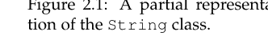

例如，如果我们有一个命名为 `str` 的 `String`，并且想知道它包含多少字符，我们可以调用它的 `length()` 方法，使用表达式 `str.length()`。如果我们想打印 `str` 的长度，可以将此表达式嵌入打印语句中：

```java
System.out.println(str.length()); // 打印 str 的长度
```

通常情况下，要使用对象的实例方法，我们通过点符号通过对象名和方法名来引用方法：

`objectName.methodName();`

`objectName` 指一个特定的对象，而 `methodName()` 指它的实例之一。正如这个示例所示，实例方法属于对象，为了使用它们，你必须先有一个拥有该方法的对象。要在程序中使用 `String` 的某个方法，你必须先创建一个 `String` 对象。

在程序中创建一个 `String` 对象，我们首先声明一个 `String` 变量：

```java
String str; // 声明名为 str 的变量
```

我们使用 `new` 关键字结合 `String()` 构造方法来创建一个 `String` 对象。我们将新对象赋值给我们声明的变量：

```java
str = new String("Hello"); // 创建 String 对象
```

这个示例将创建一个包含 "Hello" 值的 `String` 对象，构造方法如图 2.2 所示。我们还使用了带有空参数的构造方法。注意在这种情况下，我们将变量声明和创建合并为一个语句：

```java
String str2 = new String(); // 创建 String
```

这将创建一个 `String` 对象，其值是空字符串 `""`——即一对不包含内容的双引号。由于空字符串没有字符，该变量存储为零（图2.3）。注意我们使用构造方法来为 `String` 类型变量赋值初始值。这与我们为基本类型变量赋值初始值的方法不同，基本类型变量是存储值的内存位置。基本类型变量一声明就会被赋予默认值：`int` 类型的默认值为 0，`boolean` 类型的默认值为 `false`。

| str-String |
| :--- |
| value = "Hello" |
| count = 5 |

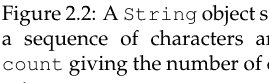

| str2-String |
| :--- |
| value = "" |
| count = 0 |

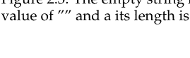

另一方面，类变量设计用于存储指向对象的引用（引用也是指向对象存储地址的指针）。构造方法在某处创建一个对象并提供存储在变量中的引用。对于类变量，在声明之后赋值之前，会被称为 `null`。通过检查它是否包含 `null`，可以检查是否包含实际对象的引用。

一旦你构建了 `String` 对象，就可以使用图 2.1 所示的任何方法。由于字符串非常重要，Java 在创建和拼接时允许许多快捷方法。同样，拼接两个 `String` 对象的更简单方法是使用加号 (`+`)，它在 Java 中充当拼接运算符：

```java
System.out.println(str1 + str2);
```

以下代码同样有效：

```java
public class StringPuns {
    public static void main(String[] args[]) {
        String s = new String("String");
        String s1 = s.concat("puns.");
        System.out.println("Here are the 5 " + s1);
        String s2 = "5. baby wanna, ";
        String s3 = s + " along with me.";
        System.out.println(s2 + s3);
        System.out.println("4. I got the world on a " + s + ".");

        String s4 = new String("two");
        String s5 = "You have more class than a ";
        System.out.print(s5 + s + " of pearls.");
        System.out.print("2. It is " + s);
        System.out.print(s.equals("string"));
        System.out.print("that I am no " + s + " bean.");
        String s6 = "quintet";
        System.out.println("1. These puns form a " + s + " " + s6);
    }
}
// StringPuns 类
```

图2.4 展示了一个使用字符串拼接的程序。

另一个有用的 `String` 方法是 `equals()`，用于比较两个 `String`。如果两个 `String` 字符相同且顺序相同，它将返回 `true`。否则将返回 `false`。例如，考虑以下代码：

```java
String s1 = "Hello";
String s2 = "Hello";
String s3 = "hello";
```

在这种情况下，表达式 `s1.equals(s2)` 将为 `true`，但 `s1.equals(s3)` 将为 `false`。值得注意的是，空字符串不等同于 `String` 变量。执行语句：

```java
String s1;
String s2 = "";
System.out.println(s1.equals(s2));
```

不仅不会打印 `true`，还会导致程序异常终止。在赋值对象之前，使用 `String` 变量或任何其他类变量类型的方法是错误的。当执行上述代码时，它将报告空指针异常（`null pointer exception`）。当你看到错误消息时，意味着该方法在一个未引用对象的变量上执行了。另一方面，空字符串是一个完美的 `String` 对象，恰好包含零个字符。

## 自学练习题

### 练习 2.1 当执行以下 Java 代码段时，控制台窗口的输出是什么：

```java
String s = "ing";
System.out.println("The s " + s + s + s + " k " + s + ".");
```

## 2.3 使用 Graphics 对象绘制形状（可选）

我们已经过的 `String` 类的所有实例方法都具有返回值。`length()` 方法返回一个 `int` 值，而 `concat()` 方法返回一个 `String`。类中定义执行操作但不返回值的实例方法也非常常见。在第 1 章 `HelloWorldSwing` 中出现的 `Graphics` 对象就是一个例子。该程序在图 2.5 中重现。

```java
// File: HelloWorldSwing program ./
import java.swing.JFrame; // 类名
import java.awt.Graphics;
import java.awt.Canvas;

public class HelloWorldCanvas extends Canvas // 类头 {
    // 主体开始
    public void paint(Graphics g) {
        // paint 方法
        g.drawString("Hello, World!", 10, 10);
    } // paint 结束
}

    public static void main(String[] args) {
        HelloWorldCanvas c = new HelloWorldCanvas();
        JFrame f = new JFrame();
        f.add(c);
        f.setSize(150, 50);
        f.setVisible(true);
    }
}
// HelloWorldCanvas 结束
```

图 2.5：HelloWorldCanvas 程序源代码。

此时，我们不考虑那些使 `paint()` 方法能够在 Java Swing 窗口上绘图的语言特性。相反，我们将关注于利用 `g.drawString()` 方法所需的信息。你应该知道的第一点是，当执行 `paint()` 方法时，`g` 指向 `Graphics` 类的一个实例。与我们之前涉及引用对象的变量示例不同，在这种情况下不需要使用构造函数来创建 `Graphics` 类型的对象。我们可以假设 `g` 已经引用了这样一个对象。

我们已经知道语句

```java
g.drawString("Hello, World!",10,10);
```

会在程序窗口中显示字符串 "Hello, World"。此外，如果 `str` 是字符串字面量值或对字符串对象 `x` 的引用，且 `x` 和 `y` 是字面量 `int` 值或 `int` 变量，那么

```java
g.drawString(str,x,y)
```

将从左到右在程序窗口中显示字符串，`x` 是距离窗口左边缘的像素，`y` 是距离窗口顶边缘的像素。在 Java 窗口中，点坐标 (0,0) 位于左上角。水平轴从左到右增长。垂直轴从上到下。（见图 2）。

像素（Pixel）是控制台上可以设置为特定颜色的点。注意，增加 `y` 的值会导致 `str` 显示得更低。这是因为增加的 `x y` 坐标系指定了一个更高的点。

有了关于 `g.drawString()` 的这些信息，我们可以计算出如何在程序窗口中显示任何消息。例如，如果我们想在 "Hello, World!" 下方 25 像素处显示消息 "Welcome to Java"，可以使用如下语句

```java
g.drawString("Hello, World!",10,10);
g.drawString("Welcome to Java",10,35);
```

在 `HelloWorldCanvas.paint()` 方法体中使用这些语句。这些语句的结果将如图 2.7 所示。

### 2.3.1 Graphics 绘制方法

上一节讨论的 `Graphics` 类也拥有可以绘制不同颜色几何形状的方法。这些方法可以用于创建更有趣的图形界面，或者为数据提供视觉表示，例如饼图或条形图。

有两个用于绘制矩形的 `Graphics` 方法：`fillRect()` 和 `drawRect()`（见图 2.8）。第一个绘制矩形并用当前颜色填充，第二个则绘制矩形的轮廓。使用 `Graphics` 对象时，这两种方法的调用方式是相同的：

| 0,0 | 80,0 |
| 0,60 | 80,60 |

图 2：Java 窗口的坐标系。

| Graphics |
| :--- |
| + drawRect(x,y,w,h) |
| + fillRect(x,y,w,h) |
| + setColor(Color) |
| + drawLine(x1,y1,x2,y2) |
| + drawOval(x,y,w,h) |

正如上一个示例中的 `drawString()` 方法一样。每个方法都接受四个 `int` 参数，指定矩形的位置和大小。调用 `fillRect()` 将取：

```java
g.fillRect(x,y,w,h);
```

其中 `x` 和 `y` 指定矩形的位置。`drawString()` 方法也接收位置和大小。有了关于 `g.drawString()` 的这些信息，我们可以计算出如何在程序窗口中显示任何消息。例如，如果我们想在 "Hello, World!" 下方 25 像素处显示消息 "Welcome to Java"，可以使用如下语句

```java
g.drawString("Hello, World!",10,10);
g.drawString("Welcome to Java",10,35);
```

在 `HelloWorldCanvas.paint()` 方法体中使用这些语句。这些语句的结果将如图 2.7 所示。


```java
import java.awt.*;
import javax.swing.JFrame;

public class HelloWorld extends Canvas {
    // 在 setVisible(true) 后调用
    public void paint(Graphics g) {
        g.setColor(Color.cyan); // 设置颜色
        g.fillRect(25, 25, 140, 40); // 填充矩形
        g.setColor(Color.blue); // 设置颜色
        g.drawRect(25, 25, 140, 40); // 绘制矩形轮廓
        g.setColor(Color.black); // 设置颜色
        g.drawString("Hello World", 50, 50); // 显示字符串
        g.setColor(Color.yellow);
        g.fillOval(25, 75, 140, 40); // 填充椭圆
        g.setColor(Color.red); // 设置颜色
        g.drawOval(25, 75, 140, 40); // 绘制椭圆轮廓
        g.setColor(Color.black); // 设置颜色
        g.drawString("Welcome to Java", 50, 100);
    }

    // 程序
    public static void main(String[] args) {
        HelloWorldCanvas c = new HelloWorldCanvas();
        JFrame f = new JFrame();
        f.add(c);
        f.setSize(150,50);
        f.setVisible(true);
    }
} // HelloWorldGraphic
```

图 2.9：`HelloWorldGraphic` 类是一个 Java Swing 程序，展示了如何使用颜色和绘图方法。

为了处理这些信息，设计一个对象你需要回答五个基本问题：

1. 对象在程序中将扮演什么角色？
2. 它需要什么数据或信息？
3. 它将执行哪些动作？
4. 它将向其他对象提供什么样的接口？
5. 它将向其他对象隐藏哪些信息？

| 谜语类 (Riddle) |
| :--- |
| - 问题: `String` |
| - 答案: `String` |
| + `Riddle(q: String, e: String)` |
| + `getQuestion(): String` |
| + `getAnswer(): String` |

图 2.11：`Riddle` 类。

### 2.4.1 Riddle 类

回想我们在第 1 章中对 `Riddle` 类的定义，它总结在图 2.11 的 UML 图中。`Riddle` 有两个属性：`question`（问题）和 `answer`（答案）。其中每个属性都存储一个字符字符串，Java 将其处理为 `String` 类型的数据。`Riddle` 类包含三个方法。`Riddle()` 构造方法为它的 `question` 和 `answer` 变量分配初始值（`q` 和 `a`）。`getQuestion()` 和 `getAnswer()` 方法分别返回存储在 `question` 和 `answer` 中的数据。

### 2.4 节 • 类定义

程序看起来是这样的，

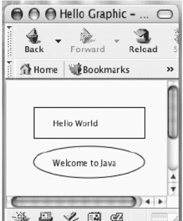

实例变量 `question` 和 `answer` 被指定为私有 (-)，`Riddle()`、`getQuestion()` 和 `getAnswer()` 方法被指定为公有 (+)。这些标记遵循两个重要的面向对象设计规范，在我们讨论 `Riddle` 类时，这些规范的理由将会出现：

**JAVA 有设计 私有变量。** 实例变量通常被声明为私有，这样其他对象就无法直接访问它们。

**JAVA 有效设计 公有方法。** 对象的公方法可以被其他对象用于与该对象交互。对象的公方法和变量组成了它的接口。图 2.12 显示了与 UML 图设计对应的类定义。它包含了 UML 图列出的两个私有变量和三个公方法。在类定义中，对类元素（如变量或方法）的访问通过将其标记为 `private` 或 `public` 访问修饰符来控制。

类就像一个蓝图，它定义了对象的类型（属性），但并不包含实际的值。类定义了对象可以执行的操作（方法），但它本身并不执行。

访问修饰符

第 2 章 • 对象：使用、创建与定义

```java
public class Riddle {
  private String question; // 实例变量
  private String answer;

  public Riddle(String q, String a) // 构造方法
    {
      question = q;
      answer = a;
    }

  public String getQuestion() // 实例方法
    {
      return question;
    }
  public String getAnswer() // 实例方法
    {
      return answer;
    }
} // Riddle 类
```

图 2.12：`Riddle` 类的定义。

### 2.4.2 用户类

定义 `Riddle` 类后，可以通过创建 `Riddle` 对象来正确测试它。为此，我们需要定义一个 `main()` 方法，它可以定义在 `Riddle` 类内部，也可以定义在一个名为 `RiddleUser` 的第二个类中。

使用第二个类的用处在于，不需要为了一个方法就引入整个类。用户界面是一个与用户交互的对象。

通过将用户任务与谜语任务分离，这种设计遵循了分治原则：用户界面处理交互，而计算类处理逻辑。我们几乎所有的程序都会涉及某种形式的用户界面，我们可以在书中贯穿使用这种设计方法。在这种情况下，计算是我们定义的简单 `Riddle` 方法。在随后的程序中，计算将变得复杂，这会更清楚地说明它们应该与用户界面分离。

图 2.13：用户界面和程序的其余部分。

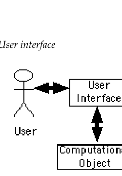

图 2.14：`RiddleUser` 与 `Riddle` 之间的关系。

| RiddleUser | 使用 |
| :--- | --- |
| - `riddle: Riddle` | - |
| + `main()` | |
| - `riddle2: Riddle` | - |
| + `main()` | |

### 2.4.3 对象实例化：创建 Riddle 实例

图 2.15 显示了 `RiddleUser` 类的完整定义，它作为一个非常简单的用户界面。它创建了两个名为 `riddle` 和 `riddle2` 的 `Riddle` 对象。然后它询问每个对象的谜语并将其显示在控制台上。

```java
public class RiddleUser {
    public static void main(String argv[]) {
        Riddle riddle1 = new Riddle(
            "What is black and white and red all over?",
            "An embarrassed zebra.");
        Riddle riddle2 = new Riddle(
            "What is black and white and read all over?",
            "A newspaper.");
        System.out.println("Here are two riddles:");
        System.out.println(riddle1.getQuestion());
        System.out.println(riddle2.getQuestion());
        System.out.println("The answer to the first riddle is:");
        System.out.println(riddle1.getAnswer());
        System.out.println("The answer to the second is:");
        System.out.println(riddle2.getAnswer());
    }
}
```

图 2.15：`RiddleUser` 类。

# 第2章 • 对象：使用、创建与定义

现在我们来讨论组成 `Riddle` 主方法的语句。以下语句使用 `Riddle()` 构造函数来创建或实例化实例化两个 `Riddle` 类的实例：

```java
Riddle riddle1 = new Riddle(
    "What is black and white and read all over?",
    "An embarrassed zebra.");
Riddle riddle2 = new Riddle(
    "What is black and white and read all over?",
    "A newspaper.");
```

注意构造函数如何为每个对象提供一对字符串，这些字符串是其两个实例变量的值。每个对象都有自己的答案，且每个对象都有自己唯一的名称，例如 `riddle2`。

## 2.4.4 与谜语交互

一旦我们创建了为其问题和答案变量分配了值的 `Riddle` 实例，我们就可以要求 `Riddle` 告诉我们它的值。以下表达式是方法调用的示例：

```java
riddle1.getQuestion()
```

调用（或触发）方法是执行其代码的手段。上述方法只是获取存储在 `riddle1` 的 `question` 实例变量中的字符串值。

> **JAVA 编程提示：方法调用与方法定义。** 不要混淆方法调用与方法定义。定义指定了方法的动作，而方法调用则执行这些动作。

如果我们想显示 `riddle1` 问题的值，可以将此方法嵌入 `println()` 语句中：

```java
System.out.println(riddle1.getQuestion());
```

这告诉 `System.out` 对象执行其 `println()` 方法，该方法将通过 `riddle1` 将字符串显示在控制台上。该语句产生的输出将是：

```
What is black and white and red all over?
```

### 2.4.5 定义、创建、使用

正如我们的 `Riddle` 示例所示，编写 Java 程序涉及三个基本步骤：

- 定义一个或多个类（类定义）。
- 创建作为类实例的对象（对象实例化）。
- 使用对象来完成任务（对象使用）。

Java 类定义决定了每个对象中将存储哪些信息，以及每个对象可以执行哪些方法。实例化创建一个实例并在程序中将其与一个名称关联。然后可以调用对象的方法，作为让对象执行某些任务的一种。

## 第 2.4 节 类定义

## 自学练习题

**练习 2.2** 识别 `Riddle` 类（图 2.12）中的以下元素：

- 类名。
- 两个实例变量的名称。
- 三个方法的名称。

**练习 2.3** 识别 `RiddleUser` 类（图 2.15）中的以下元素：

- 两个 `Riddle` 实例的名称。
- 程序中对 `Riddle` 对象的所有方法调用。
- 两个限定名（qualified names）示例。

## 2.5 案例研究：模拟双人游戏

在本节中，我们将设计并编写一个类的定义，用于跟踪一种著名的双人游戏的细节。我们将关注在 Java 语言中设计类定义的细节。我们的目标是理解程序在做什么以及它是如何工作的，而不理解它为什么会那样工作。我们将在书后的部分讨论“为什么”。

我们将考虑的游戏由两个人使用一排棍子或其他物体进行。玩家交替进行。玩家必须从他自己的那一排棍子中移除一根、两根或三根。移除移除行中最后一根棍子的玩家获胜。该游戏可以使用任何数量的棍子玩，从二十根棍子开始是非常常见的。这种游戏有时被称为“尼姆（Nim）”，但一种涉及多行棍子的类似游戏经常被称为这个名字。我们将其称为“单行尼姆（One Row Nim）”。

### 2.5.1 设计 OneNim 类

#### 问题规范

让我们设计一个 `OneNim` 类，模拟具有一排棍子的尼姆游戏。该类构造的对象应该在游戏开始时管理数量的棍子。它应该跟踪轮到谁，并允许玩家将剩余棍子数量减少一、两根或三根。最后，`OneNim` 对象应该判断游戏何时结束以及哪个玩家获胜。

#### 问题拆解

让我们设计 `OneNim` 类，使其适用于不同的用户界面。一种用户界面可以管理由两人交替指定移动的游戏。另一种用户界面可以由人类玩家与电脑的移动进行对决。在这两种情况下，我们都可以通过键盘指定移动，或者通过在窗口中输入数字或选择单选按钮。在本节中我们只关注管理游戏的对象。我们将在后续章节设计用户界面。

## 第 2.5 节 案例研究：模拟双人游戏

### 类设计：OneRowNim

正如我们在 `Riddle` 示例中看到的，类定义通常分为两部分：(1) 对象需要存储的信息或属性，(2) 对象可以执行的行为或动作（定义方法）。在本章中，我们将关注选择实例变量以及设计可重用的方法。记住，参数是方法调用时临时存储值的变量。

### 2.5.2 定义 OneNim 类

根据图 2.16 描述的 `OneNim` 类设计，构建模拟的下一步是开始编写 Java 类。

#### 类头部

我们需要一个类头部，它为类命名并指定其与其他类的关系。与所有设计为供其他类使用的类一样，`OneNim` 类前面应该有 `public` 修饰符。由于 `OneNim` 类未被描述与其他任何类有关系，它的头部可以扩展为 `Object` 的子类（图 2.17）。因此，`OneNim` 类看起来如下：

```java
public class OneNim {
    // 类头部
    // 类体开始
    // 类体结束
}
```

#### 类的实例变量

类体由两部分组成：类级变量和方法定义。类变量是指定义适用于其所定义的整个类的变量。在第一章中介绍的实例变量是类级变量的一种。

通常，类定义将采用图 2.18 所示的形式。尽管 Java 对变量和方法的声明没有特定的顺序要求，但在本书中，我们会在类定义的开始处定义类的级变量。类级变量与局部变量区分来。局部变量是在方法内部定义的变量。

类级变量的声明必须遵循 1.4.8 节描述的声明变量的规则，并额外

# 第 2.5 节 案例研究：模拟双人游戏 79

```java
public class ClassName {
    // 实例变量和类变量
    VariableDeclaration1
    VariableDeclaration2
    ....
    // 实例方法和类方法
    MethodDefinition1
    MethodDefinition2
} // 类结束
```

图 2.18：构建 Java 类定义的模板。

限制它们应该由 `public`、`private` 或 `protected` 访问修饰符之一修改。与这些访问修饰符相关的规则如下：

- `private` 类级变量不能在声明它的类之外被访问。
- `public` 类级变量可以被任何其他类引用并因此被修改。
- `protected` 类级变量只能被声明它的类的子类访问，或者被属于同一个包的类访问。

当定义一个类、实例变量或方法时，你可以将其声明为 `public`、`protected` 或 `private`。你也可以不指定其访问权限，在这种情况下将应用 Java 的默认访问权限。Java 按照自上而下的方式确定访问权限。实例变量和方法包含在类中，而类包含在包中。要确定一个实例变量或方法是否可访问，Java 首先确定其所在的包是否可访问。类、实例变量和方法的访问根据表 2.2 所示的规则定义。

表 2.2 Java 的访问权限规则。

| 元素 | 修饰符 | 规则 |
|---|---|---|
| 类 | 默认为 public | 如果其包可访问，则可访问。在它的包内可见。 |
| 实例变量或实例方法 | public <br> 默认为 protected | 对所有其他对象可见。对其子类和同包中的其他类可见。仅在类内部可见。仅在包内可见。 |

---

我们在第 0 章中对类变量和实例变量做了区分。类变量与类

# 第 2 章 • 对象：使用、创建和定义

相关，而实例变量与类的每个实例相关。换句话说，每个对象都包含类实例变量的自己的副本，但只有类本身包含类变量的唯一副本。要将变量指定为类变量，必须将其声明为 `static`。

我们之前考虑的谜题字符串（Riddle String）具有以下实例变量有效声明示例：

```java
private String question;
private String answer;
```

# OneRowNim 的类级变量

现在让我们考虑图 2.16 中的 `OneRowNim` 类级图包含了我们需要的所有信息。变量 `nSticks` 和 `player` 将存储玩一局 `OneRow Nim` 游戏的数据，因此它们显然应该是实例变量。它们都将存储整数值，因此应该被声明为 `int` 类型的变量。由于我们使用 7 根棒子开始 `One Row Nim` 游戏，并由 `player` 先手，我们将 7 赋值为 `nSticks` 的初始值，并将 1 赋值为 `player` 的初始值。如果我们为 `OneRowNim` 类的头部添加实例变量声明，我们得到如下：


```java
public class OneRowNim {
    private int nSticks = 7;
    private int player = 1;

    // 方法定义写在这里
} // OneRowNim
```

总结来说，尽管表面上很简单，但类变量声明实际上完成了五个任务：

1. 留出对象内存的一部分，用于存储特定类型的数据。
2. 指定在该位置可以存储的数据类型。
3. 将标识符（或名称）与该位置关联。
4. 确定哪些对象有权访问变量名称。
5. 为该位置分配一个初始值。

# OneRowNim 的方法

设计和定义方法是抽象的一种形式。通过将特定的动作序列设计为方法，你将这些动作封装在一个单一名称下，可以在需要时调用。你不需要在每次需要它时重新列出整个序列，只需通过名称调用即可。正如你从第 1 章回想的，方法定义由两部分组成：方法头和方法体。

## 方法头

方法头遵循通用格式，由一个或多个修饰符（Modifier）、方法的返回类型（ResultType）、方法名（MethodName）以及封装在括号中的方法形式参数列表（FormalParameterList）组成。下表说明了方法头的形式，并包含了我们遇到的一些方法示例。方法体紧随方法头。

| 方法修饰符 | 返回类型 | 方法名 | (形式参数列表) |
| --- | --- | --- | --- |
| public static | void | main | (String argv[]) |
| public | void | paint | (Graphics g) |
| public | | Riddle | (String q, String a) |
| public | String | getQuestion | () |
| public | String | getAnswer | () |

访问规则与实例变量的规则相同：`private` 方法仅在类内部可访问，`protected` 方法仅对定义该方法的类的子类以及同一包中的其他类可见，而 `public` 方法对所有类都可见。

> **JAVA 有效设计：私有方法**。如果一个方法旨在与对象通信，或者从对象向外传递信息，则应声明为 `public`。如果一个方法仅用于对象内部的内部操作，则应声明为 `private`。这些方法有时被称为工具方法或辅助方法。


回想第 0 章中实例方法和类方法的区别。声明在类级的方法被假设是实例方法，除非它们也被声明为 `static`。`static` 修饰符用于声明类方法或变量与类相关，而不是实例相关。对于 `static` 变量，声明为 `static` 的方法与类相关，因此被称为类方法。正如其名所示，实例方法只能与类的对象（实例）结合使用。在我们类的类级方法中，将是实例方法。类方法在 Java 中很少使用，主要用于类对象创建之前需要执行某些计算。当我们讨论 `Math` 类时将看到类方法的示例，该类拥有 `sqrt` 等方法。

> **JAVA 编程提示：类方法与实例方法**。如果一个方法被设计供对象使用，则它被称为实例方法。不需要修饰符来指定实例方法。类方法与实例方法相比使用频繁，必须声明为 `static`。

`OneRowNim` 类中的所有四个方法都是实例方法（图 2.19）。它们都执行与 `OneRowNim` 特定实例相关的动作。

```java
public class OneRowNim {
    private int nSticks = 7; // 从 7 根棒子开始。
    private int player = 1; // 玩家1 先开始。

    public void takeOne() { // 方法体
    public void takeTwo() { // 需要
    public void takeThree() { // 定义。
    public void report() {}
} // OneRowNim
```

图 2.19：OneRowNim 类的变量和方法头。

给定这些设计决策，我们现在可以为 `OneRowNim` 的类定义添加方法头，见图 2.19。该图显示了类头部、实例变量声明和方法头。

## 方法体

方法定义的体是用花括号括的语句块，在方法被调用时执行。`takeOne()` 方法所需动作的描述是许多更改对象状态方法的典型代表。`takeOne()` 方法体应该使用一系列赋值语句，将 `nSticks` 中存储的值减一，并改变玩家从 2 变为 1，或从 1 变为 2。第一次变化通过一个简单的赋值语句完成：

```
nSticks = nSticks - 1;
```

该语句的意思是从 `nSticks` 存储的值中减 1，并将新值赋给 `nSticks`。决定如何更改 `player` 的值更为困难，因为我们不知道它的当前值是 1 还是 2。如果它的当前值是 1，则它的新值应该是 2；如果它的当前值是 2，则它的新值应该是 1。请注意，在这两种情况下，当前值加上期望的新值之和等于 3。因此，`player` 的新值等于 3 减去它的当前值。将其写为赋值语句，得到：

```
player = 3 - player;
```

可以很容易验证，当 `player` 的当前值为 1 时，该赋值会将其赋值为 2；当当前值为 2 时，则将其赋值为 1。实际上，该赋值在每次执行时都会将 `player` 的值在 1 和 2 之间切换。在下一章中，我们将引入 `if-else` 控制结构，这将允许我们以更直接的方式实现相同的逻辑操作。`takeOne()` 方法的完整定义变为：

```java
public void takeOne() {
    nSticks = nSticks - 1; // 拿走根棒
    player = 3 - player; // 切换另一个玩家
}
```

`takeTwo()` 和 `takeThree()` 方法与 `takeOne()` 方法完全相似，唯一的区别是从 `nSticks` 中减去的数量。`report()` 方法体只需要使用 `System.out.println()` 将实例变量的返回值打印到控制台窗口。为了让使用 `OneRowNim` 的人理解，应该对对象进行清晰的标记。`report()` 方法体可以包含：

```java
System.out.println("Number of sticks left: " + nSticks);
System.out.println("Next turn by player " + player);
```

这完成了 `OneRowNim` 类的方法体。完整的类定义如图 2.20 所示。在第 4 章中，我们将开发几个 `OneRowNim` 接口类，这将方便用户指示要执行的移动。

```java
public class OneRowNim {
    private int nSticks = 7; // 从 7 根棒开始。
    private int player = 1; // 玩家 1 先手。

    public void takeOne() {
        nSticks = nSticks - 1;
        player = 3 - player;
    } // takeOne()

    public void takeTwo() {
        nSticks = nSticks - 2;
        player = 3 - player;
    } // takeTwo()

    public void takeThree() {
        nSticks = nSticks - 3;
        player = 3 - player;
    } // takeThree()

    public void report() {
        System.out.println("Number of sticks left: " + nSticks);
        System.out.println("Next player by " + player);
    } // report()
} // OneRowNim 类
```

图 2.20：OneRowNim 类。

## 2.5.3 测试 OneRowNim 类

回想我们在第 2.5 节中的“定义、创建和使用”的准则。现在我们已经定义了 `OneRowNim` 类，我们可以通过创建 `OneRowNim` 对象并使用它们执行与游戏相关的操作来测试其是否正常工作。在此处，我们可以通过定义一个 `main()` 方法来测试 `OneRowNim`。遵循我们在谜题示例中使用的设计，我们将 `main()` 方法置于名为 `OneRowTester` 的独立接口类中。

`main()` 方法体应该声明一个 `OneRowNim` 类型的变量并创建一个对象，然后使用它们执行与游戏相关的操作。

## 2.5.4 控制流：方法调用与返回

程序的控制流是其语句执行的顺序。在面向对象的程序中，控制在执行过程中从一个对象传递到另一个对象。理解这一过程是重要的。

为了理解 Java 程序，有必要理解方法调用和返回机制。我们会反复遇到它。图 2.21 显示了方法调用和返回。

```
method1() method2()
statement1:
->:
method2():
nextstatement1:

return-
```

**JAVA 语言规则 返回语句**。`return` 语句导致方法返回到调用处——即返回到方法最初调用的语句。

请记住，如果 `void` 方法不包含 `return` 语句，则在被调用方法执行最后一条语句后，控制将自动返回到调用语句。

## 2.5.5 追踪 OneRowNim 程序

为了帮助理解 `OneRowNim` 的控制流，我们将对其执行进行追踪。图 2.22 显示了程序中所有的 Java 代码。为了简化追踪，我们将 `main()` 方法从 `OneRowTester` 移动到 `OneRowNim` 类中。这并不


该语句的意思是从 `nSticks` 存储的值中减 1，并将新值赋给 `nSticks`。决定如何更改 `player` 的值更为困难，因为我们不知道它的当前值是 1 还是 2。如果它的当前值是 1，则它的新值应该是 2；如果它的当前值是 2，则它的新值应该是 1。请注意，在这两种情况下，当前值加上期望的新值之和等于 3。因此，`player` 的新值等于 3 减去它的当前值。将其写为赋值语句，得到：

```
player = 3 - player;
```

可以很容易验证，当 `player` 的当前值为 1 时，该赋值会将其赋值为 2；当当前值为 2 时，则将其赋值为 1。实际上，该赋值在每次执行时都会将 `player` 的值在 1 和 2 之间切换。在下一章中，我们将引入 `if-else` 控制结构，这将允许我们以更直接的方式实现相同的日志操作。`takeOne()` 方法的完整定义变为：

```
public void takeOne() {
    nSticks = nSticks - 1; // 拿走根棒
    player = 3 - player; // 切换另一个玩家
}
```

`takeTwo()` 和 `takeThree()` 方法与 `takeOne()` 方法完全相似，唯一的区别是从 `nSticks` 中减去的数量。`report()` 方法体只需要使用 `System.out.println()` 将实例变量的返回值打印到控制台窗口。为了让使用 `OneRowNim` 的人理解，应该对对象进行清晰的标记。`report()` 方法体可以包含：

```
System.out.println("Number of sticks left: " + nSticks);
System.out.println("Next turn by player " + player);
```

这完成了 `OneRowNim` 类的方法体。完整的类定义如图 2.20 所示。在第 4 章中，我们将开发几个 `OneRowNim` 接口类，这将方便用户指示要执行的移动。

# 第 2 章 · 对象：使用、创建和定义

```
public class OneRowNim
{ private int nSticks = 7; // 从 7 根棒开始。
    private int player = 1; // 玩家 1 先手。

    public void takeOne()
    { nSticks = nSticks - 1;
        player = 3 - player;
    } // takeOne()

    public void takeTwo()
    { nSticks = nSticks - 2;
        player = 3 - player;
    } // takeTwo()

    public void takeThree()
    { nSticks = nSticks - 3;
        player = 3 - player;
    } // takeThree()

    public void report()
    { System.out.println("Number of sticks left: " + nSticks);
        System.out.println("Next player by " + player);
    } // report()
} // OneRowNim class
```

图 2.20：OneRowNim 类。

## 2.5.3 测试 OneRowNim 类

回想我们在第 2.5 节中的“定义、创建和使用”的准则。现在我们已经定义了 `OneRowNim` 类，我们可以通过创建 `OneRowNim` 对象并使用它们执行与游戏相关的操作来测试其是否正常工作。在此处，我们可以通过定义一个 `main()` 方法来测试 `OneRowNim`。遵循我们在谜题示例中使用的设计，我们将 `main()` 方法置于名为 `OneRowTester` 的独立接口类中。

`main()` 方法体应该声明一个 `OneRowNim` 类型的变量并创建一个对象，然后使用它们执行与游戏相关的操作。

## 2.5.4 控制流：方法调用与返回

程序的控制流是其语句执行的顺序。在面向对象的程序中，控制在执行过程中从一个对象传递到另一个对象。理解这一过程是重要的。

为了理解 Java 程序，有必要理解方法调用和返回机制。我们会反复遇到它。图 2.21 显示了方法调用和返回。

```
method1() method2()
statement1:
->:
method2():
nextstatement1:

return-
```

Java 语言规则 返回语句。`return` 语句导致方法返回到调用处——即返回到方法最初调用的语句。

请记住，如果 `void` 方法不包含 `return` 语句，则在被调用方法执行最后一条语句后，控制将自动返回到调用语句。

## 2.5.5 追踪 OneRowNim 程序

为了帮助理解 `OneRowNim` 的控制流，我们将对其执行进行追踪。图 2.22 显示了程序中所有的 Java 代码。为了简化追踪，我们将 `main()` 方法从 `OneRowTester` 移动到 `OneRowNim` 类中。这并不

## 2.5 节 案例研究：模拟双人游戏

```java
public class OneRowNim {
    private int nSticks = 7; // 从7 根棒子开始。
    private int player = 1; // 玩家 1 先手。

    public void takeOne() {
        nSticks = nSticks - 1;
        player = 3 - player;
        takeOne();
    }
    public void takeTwo() {
        nSticks = nSticks - 2;
        player = 3 - player;
        takeTwo();
    }
    public void takeThree() {
        nSticks = nSticks - 3;
        player = 3 - player;
        takeThree();
    }
    public void report() {
        System.out.println("Number of sticks left: " + nSticks);
        System.out.println("Next turn by player " + player);
    }

    public static void main(String[] args) {
        OneRowNim game = new OneRowNim();
        game.report();
        game.takeThree();
        game.report();
        game.takeThree();
        game.report();
        game.takeOne();
        game.report();
    }
}
```

> 图 2.22：OneRowNim 程序的执行轨迹。

任何方式影响程序的执行顺序。但请记住，`main()` 方法中的代码同样可以出现在 `OneRowNimTester` 类中。图 2.22 中的列表还增加了数字，以显示语句执行的顺序。

OneRowNim 程序的执行从 `main()` 方法中标记为数字 1 的第一个语句开始。该语句声明了一个类型为 `OneRowNim` 的变量 `game`，并调用构造函数 `OneRowNim()` 来创建并初始化。构造函数是默认的，它导致控制权显示实例变量字符串的声明，并为它们分别分配初始值 7 和 1。然后回到 `main()` 方法中标记为 4 的第二个语句。此时，`game` 指向 `OneRowNim` 类的一个实例，其初始状态如图 2.23 所示。执行语句 4 会导致控制权显示 `report()` 方法，其中语句 5 和 6 使用 `System.out.println()` 将以下语句写入控制台。

| game: OneRowNim |
| :--- |
| nSticks = 7 |
| player = 1 |

图 2.23：game 的初始状态，一个 OneRowNim 对象。

| Number of sticks left: 7 |
| :--- |
| Next turn by player 1 |

控制权回到 `main()` 方法中的语句 7，它调用 `takeThree()` 方法，将控制权发送到该执行语句的第一个语句。执行语句 8 将 `game` 的 `nSticks` 变量中存储的 `int` 值减去 3。留下值 4 后，执行语句 9 减去存储在 `player` 变量中的值（1），并将结果（值 2）加回 `player`。此时，游戏的状态如图 2.24 所示。注意，程序的其余部分以类似的方式继续执行。注意，`main()` 方法调用 `game.report()` 的次数与 `report()` 方法中的两个语句不同。注意 `main()` 中没有调用 `game.takeTwo()`。结果是该方法中的两个语句从未被执行。

```text
game:OneRowNim
nSticks: int = 4
player: int = 2
```

图 2.24：执行第 9 行后的游戏状态。

### 2.5.6 面向对象的设计：基本原则

我们完成了游戏的设计以及 `OneRowNim` 类的首次实现，并简要回顾了在本例中采用的一些面向对象的设计原则。

- **封装（Encapsulation）**。`OneRowNim` 类被设计用于封装状态并维护一组动作。它被设计用于模拟单行 Nim 游戏。此外，`OneRowNim` 的方法被设计用于封装完成特定任务的动作。

- **信息隐藏（Information Hiding）**。`OneRowNim` 的实例变量 `nSticks` 和 `player` 被声明为 `private`，因此其他对象只能通过 `OneRowNim` 的公共方法更改变量的值。公共方法的体也对 `OneRowNim` 实例的用户隐藏。用户可以在不了解方法定义的情况下使用实例及其方法。

- **设计良好的接口（Clearly Designed Interface）**。`OneRowNim` 的接口是通过公共方法定义的。这些方法限制了用户与 `OneRowNim` 对象交互的方式，并确保 `OneRowNim` 实例保持在有效状态。这些是良好接口的主要目的。

- **通用性和扩展性（Generality and Extensibility）**。我们对 `OneRowNim` 的设计中几乎没有限制其使用和扩展的因素。此外，正如我们将会看到的，我们可以创建不同种类的用户界面来与 `OneRowNim` 对象进行交互。

`OneRowNim` 类存在一些明显的缺点，这是由于我们决定将方法限制为没有参数或返回值的。这些缺点包括：

- 一个 `OneRowNim` 对象无法向另一个对象通信剩余棒子的数量、下一个回合是谁玩家，或者在控制台游戏结束之前进行通信。它只能通过向控制窗口写入报告来通信。

## 2.5 节 · 案例研究：模拟双人游戏

- 一个 `OneRowNim` 对象无法向另一个对象通信剩余棒子的数量、下一个回合是谁玩家，或者在控制台游戏结束之前进行通信。它只能通过向控制窗口写入报告来通信。

### 2.6 来自 Java 库：java.util.Scanner

如果我们想使用交互式程序，我们必须能够接收用户的信息，同时向她发送信息。我们在上一章中看到，程序的输出可以通过简单地使用 `System.out.print()` 发送到控制窗口。在本节中，我们描述了 Java 处理的两种方式。

在 Java 中，任何 I/O 的源或目的都被视为字节流或字符流。为了执行键盘输入，我们将从 `System.in`（连接到键盘的输入流）中提取字符。获取键盘输入涉及两个 `System.out()` 中不存在的复杂性问题。首先，用户请求的普通输入由字符或数字序列组成，表示一个单词、短语或实数。通常情况下，用户输入的字符序列将存储在单个变量中，直到用户按下回车或回车键信号其结束。Java 有一个特殊的类 `BufferedReader`，它使用输入流并有一个方法收集字符，直到读取到所需的字符。读取输入的第二个复杂性涉及如何处理不符合预期格式。`Scanner` 类通过使用某些异常（一种特殊的消息）来解决这个问题，异常必须由程序员处理。第 11 章专门介绍异常，我们将尽可能避免它们，直到以后。

在 Java 2 平台中有处理键盘输入的另一种替代方法：`java.util` 包，它允许键盘输入而不强制程序员处理异常。我们将在下一节介绍 `Scanner` 类，并描述第 4 章介绍的用户类如何以等的方式运行。

#### 2.6.1 使用 Scanner 类进行键盘输入

`Scanner` 的部分定义如图 2.25 所示。注意，列出的 `Scanner` 方法仅是该类公共方法的一个小子集。`Scanner` 类位于 `java.util` 包中，因此使用它的类通过以下语句导入它：

```java
import java.util.Scanner;
```

| Scanner |
| :--- |
| +Scanner(InputStream st) |
| +next(): String |
| +nextInt(): int |
| +nextDouble(): double |
| +useDelimiter(String pat): Scanner |

图 2.25：Scanner 类，其公共方法的部分列表。

`Scanner` 类被设计用于作为一种非常灵活的方式，从任何输入流中识别符合指定模式的数据块。为了使用 `Scanner` 类进行键盘输入，我们必须创建一个 `Scanner` 将其与 `System.in` 关联。该类有一个为此目的设计的构造函数，因此语句

```
Scanner sc = new Scanner(System.in);
```

声明并实例化了一个可用于键盘输入的对象。在我们创建一个 `Scanner` 对象后，可以调用 `nextInt()`、`nextDouble()` 或 `next()` 来分别从键盘读取整数、实数或字符串。图 2.26 中的程序演示了如何读取和使用一个整数。当 `nextInt()` 方法

```java
import java.util.Scanner;
public class TestScanner {
    public static void main(String[] args) {
        // 创建对象
        Scanner sc = new Scanner(System.in);
        System.out.print("Input an integer:"); // 提示
        int num = sc.nextInt(); // 读取一个整数
        System.out.println(num + " squared = " + num*num);
    }
}
// TestScanner 类
```

执行时，在方法返回一个 `int` 值之前，将不再执行后续语句。通常情况下，直到用户输入整数的数字并按下回车或回键后才会发生。因此，执行 `TestScanner` 类的 `main()` 方法将在控制台窗口输出

```
Input an integer:
```

程序将等待用户输入一个整数并按下回车或回键。完成此操作后，输出将如下：

```
Input an integer:123
123 squared = 15129
```

实数和字符串的键盘输入是以类似的方式处理的。

## 第 2 章 · 对象：使用、创建和定义

键盘输入将允许我们为交互式程序创建命令行界面的示例。例如，以下代码

```java
Scanner sc = new Scanner(System.in);
Riddle riddle = new Riddle(
"What is black and white and red all over?",
"An embarrassed zebra.");
System.out.println("Here is a riddle:");
System.out.println(riddle.question());
System.out.print("The answer is: "); // 提示
System.out.println("type a letter and enter.");
String str = sc.next(); // 等待输入
System.out.println(riddle.getAnswer());
```

将显示一个谜语并提示用户输入一个字母并按下回车键查看答案。在下一章中，我们将为 `OneRowScanner` 类开发方法，这些方法能够将从键盘输入的整数用于下一行。

我们必须注意到，`Scanner` 类被设计成一种灵活工具用于从任何输入流中识别数据块，它具有可能意料之外的属性，并且与简单的键盘输入并不完全兼容。`Scanner` 对象有一组字符，用于分隔或界定它正在寻找的数据块。默认情况下，这组分隔符由任何非空空白字符序列组成，即空格、制表符、回车和换行符。这允许用户在按下回车键之前输入多个由空格分隔的整数。这可以通过代码处理：

```java
System.out.print("Input two integers and an enter:");
int num1 = sc.nextInt();
int num2 = sc.nextInt();
```

空白作为分隔符也意味着 `next()` 方法不能返回字符串，也不能返回包含任何空格的字符串。例如，以下代码：


```java
System.out.print("Input the first president of the USA:");
String str = sc.next();
```

如果输入 "George Washington" 并按下回车键，字符串 `str` 将仅存储 "George"。为了让 Scanner 对象读取包含空格的字符串，我们必须使用 `useDelimiter()` 方法将分隔符集合定义仅为按下回车键生成的那个字符字符串。例如，对于某些 Windows 操作系统，语句

```
sc = sc.useDelimiter("\r\n");
```

将导致 `next()` 方法返回从键盘输入的整个字符字符串，但不包括由按下回车键生成的那些字符。

你还应该意识到，尽管我们可以使用 Scanner 对象编写忽略异常的代码，但并不意味着键盘输入不会产生异常。如果用户为 `nextInt()` 方法输入字母而不是数字进行处理，程序将带有错误消息并终止。

必须强调的是，处理键盘输入大纲的策略是一个临时策略，直到第 11 章涵盖异常主题为止。使用键盘输入的实际应用程序应该仔细处理用户可能会输入意外内容的可能。在 Java 中，这只能通过处理异常来实现。

### 2.6.2 使用 KeyboardReader 类进行键盘输入

如果你使用的是没有 Scanner 类的旧版本 Java，可以使用用户定义的类。我们将在第 4 章开发一个使用 `BufferedReader` 类的 KeyboardReader 类。它具有从键盘读取数据的方法，方式与 Scanner 类非常相似。其所有方法的列表所示图 2.27 中的 UML 类图中。要使用 KeyboardReader 类进行键盘输入，请将第 4 章中的 KeyboardReader 源码复制到当前 Java 类源码的相同目录中（如果你使用集成开发环境，请将其添加到项目中）。

要使用 KeyboardReader 对象，我们需要通过构造函数创建该类的实例。当输入来自键盘时，调用三个方法中的任何一个都会返回 int、double 或 String。KeyboardReader 对象的三个方法中的任何一个都会尝试处理从键盘输入的字符串，直到按下回车键为止。也就是说，按下回车或回车键生成的字符就是 KeyboardReader 使用的分隔符。图 2.28 中的 TestKeyboardReader 类定义读取一个整数

| KeyboardReader |
| :--- |
| + KeyboardReader() |
| + getLine(): String |
| + getInt(): int |
| + getDouble(): double |


```java
public class TestKeyboardReader {
    public static void main(String[] args) {
        // 创建 KeyboardReader 对象
        KeyboardReader kb = new KeyboardReader();
        System.out.println("Input an integer:"); // 提示
        int num = kb.getInt(); // 读取一个整数
        System.out.println(num = " + num + " squared =");
    }
}
// TestKeyboardReader 类
```

图 2.28: 一个使用 KeyboardReader 对象进行键盘输入的简短程序

从键盘读取一个整数并对其平方，方式与 Scanner 类一样。

在做出显而易见的修改后，可以使用 KeyboardReader 类运行相同的程序来处理输入。

## 自学练习

练习 2.8 修改 Scanner 类的 `main()` 方法，使其读取一个实数而不是整数。


## 章总结

## 技术术语

访问修饰符 局部变量

类级变量 方法调用

默认值 返回

分隔符 异常

空字符串 

# 要点总结

*   使用点符号来引用对象的公共元素。
*   设计类取决于决定它将扮演什么角色以及它将拥有什么信息和操作。
*   编写 Java 程序取决于定义一个多个类。类定义作为创建类实例的模板。
*   类通常包含两种元素：变量和方法。对象的状态由实例变量定义。
*   声明为公有的类元素可以被其他对象访问。声明为私有的元素对其他对象不可见。
*   类的实例变量通常声明为私有，以便其他对象无法直接访问。
*   对象的公共接口可以被其他对象调用。因此，它们可以使用对象的接口与其他对象交互。
*   对象实例化是使用 `new` 运算符结合构造方法创建对象的过程。
*   类定义由头部和主体组成。头部为类命名，指定其访问权限（public）以及其在 Java 层次中的位置（extends Object）。主体包含变量的声明和方法的定义。
*   默认情况下，新类是 Object 的子类。声明为静态的元素（如 `main()` 方法）与类相关（而不是与实例相关）。
*   Java 应用程序必须包含一个 `main()` 方法，这是它执行开始的地方。
*   仅用于类内部操作的方法应声明为私有。

# 第 2 章 • 自学练习答案

- 方法定义由两个部分组成：方法头（header），它命名了方法并提供了关于它的其他通用信息；以及方法体（body），它包含可执行的语句。
- 声明变量会为对象创建一个名称，但不会创建对象本身。对象是使用 `new` 操作符和构造方法创建的。

## 答案 2.1 Java 代码段输出以下内容：

```
The singing king.
```

## 答案 2.2 对于 Riddle 类（类, 2.12），

- 类名：Riddle
- 两个实例变量的名称：question, answer
- 三个方法的名称：Riddle(id), getQuestion(), getAnswer()

## 答案 2.3 对于 Riddle 类（类, 2.15），

- 两个 Riddle 实例的名称：riddle, riddle2
- 程序中所有 6 个方法都调用了 Riddle 对象：

```
Riddle("What is black and white and red all over?")
  "An embarrassed zebra."
Riddle("What is black and white and red all over?")
  "A newspaper.")
```

```
riddle1.getQuestion()
riddle1.getAnswer()
riddle2.getQuestion()
riddle2.getAnswer()
```

- 限定名调用了 riddle1.getQuestion() 和 riddle2.getAnswer()

## 答案 2.4 Riddle 类中新实例变量的定义：

```java
public String hint = "This riddle is easy for a hint";
```

## 答案 2.5 Riddle 类中 getHint() 方法头，它应该是一个公共方法：

```java
public String getHint();
```

## 答案 2.6 Riddle 类中 setHint() 方法头：

```java
public void setHint(String aHint);
```

结果类型为 void。虽然用于参数的标识符是任意的，但通过某种方式引用 hint 实例变量来描述它是一个良好的习惯。

## 自学练习答案

# 第 2 章 • 对象：使用、创建与定义

## 答案 2.7 下面给出了 Student 类的部分定义。

```java
public class Student {
    private String firstName;
    private String lastName;
    private int studentID;

    public void setStudent(String fName, String lName, int anID) {
        // ...
    }

    public int getStudentID();
    public String getStudentName();
}
```

## 答案 2.8 下面给出了读取并计算实数平方的主方法。

```java
public static void main(String[] args) {
    // 创建 Scanner 对象
    Scanner sc = new Scanner(System.in);
    System.out.print("Input a real number: "); // 提示
    double realNum = sc.nextDouble(); // 读取 double
    System.out.println(realNum + " squared = " + realNum*realNum);
}
```

# 练习

注意：对于编程练习，请先画一个 UML 类图来描述所有的类及其继承关系/或关联。

练习题 2.1 考虑向教授请教你计算机课程成绩的这一事务。识别该事务中的对象以及它们之间将传递的消息类型。

练习题 2.2 现在假设上一个练习中的教授决定将查询学生成绩的事务自动化，并让你你设计一个程序来执行此任务。程序应该显示该学生在该学期的 ID、名称和最终成绩。假设有五项成绩：三次考试和两次编程成绩。识别该程序中的对象以及它们之间将传递的消息类型。（提示：成绩本身只是数据值，即对象）。

练习题 2.3 在 RiddleUser 类（图 2.15）中，给出两个实例化的例子，并解释正在执行什么。

练习题 2.4 解释方法定义和方法调用之间的区别。从本章的 Riddle 和 RiddleUser 示例中各给出一个相应的例子。

练习题 2.5 在 RiddleUser 类（图 2.15）中，识别三个方法调用的例子，并解释正在执行什么。

练习题 2.6 描述口号“定义、创建、操作”是如何应用于 Riddle 示例的。

练习题 2.7 标识符是 ________ 的名称，或者是一个 ________。

# 第 2 章 • 练习题

练习题 2.8 下列哪些哪些是有效的标识符？

| | | | |
| :--- | :--- | :--- | :--- |
| int 74ElmStreet Big.N LS&%# boolean Boolean |
| _number Int public Private Joe j1 2+K | |
| big n | | | |

练习题 2.9 解释类变量和实例变量之间的区别。

练习题 2.10 识别每个声明中的错误（如果有）。记住，实例变量声明的某些部分是可选的。

a. public boolean isEven;
b. private boolean isEven;
c. private boolean isOdd
d. public boolean is Odd;
e. string S;
f. public String boolean =
g. private boolean even = 0;
h. private String s = helloWorld;

练习题 2.11 为以下每个实例变量编写声明。

a. 一个名为 bool 的私有 boolean 变量，初始值为 true。
b. 一个名为 str 的公共 String 变量，初始值为 "hello"。
c. 一个名为 employees 的私有 int 变量，未分配初始值。

练习题 2.12 识别每个声明中的错误（如果有）。记住，实例变量声明的某些部分是可选的。

a. public String()
b. private String
c. private void
d. static void

练习题 2.13 识别每个语句中的错误（如果有）。假设已经声明了以下变量：

```java
public int m;
public boolean b;
public String s;
```

练习题 2.14 对于给定的 NumberAdder，添加语句创建实例，并设置为 10 和 20。

```java
class NumberAdder {
    private int num1;
    private int num2;

    public setNums(int n1, int n2) {
        num1 = n1;
        num2 = n2;
    }

    public int getSum() {
        return num1 + num2;
    }

    public static void main(String args[]) {
    }
}
```

练习题 2.15 对于上练习中的 Riddle 类，它的实例变量名称是什么？添加语句打印它们的和。

练习题 2.16 解释以下概念之间的区别：

a. 方法定义和方法调用。
b. 引用类型和创建实例。
c. 引用类型和基本类型。

练习题 2.17 定义一个名为 NumberCruncher 的类，它有一个 int 实例变量。然后定义以下方法：square, cube。

练习题 2.18 编写一个 main 方法并将其添加到之前的问题中。使用它创建一个具有初始值的 Numberer。

练习题 2.19 编写一个 Cube 类定义，它有一个整数属性。该对象能够报告其表面积和体积。立方体的表面积是边长的六倍。体积通过边边的立方计算。

练习题 2.20 编写一个类定义，使用上一个练习中的 Cube 对象。该类应该创建三个不同边长的实例，并报告各自的面积。

练习题 2.21 挑战：修改你之前的练习解答，让用户输入边长。参考本章“Java 库”部分的示例。

# UML 练习题

## 第 3 章

## 方法：与对象通信

## 目标

学习本章后，你将能够：

- 理解方法在面向对象程序中扮演的角色。
- 了解如何使用参数和参数将数据传递给对象。
- 理解如何使用构造方法来实例化对象。
- 了解传递对象值和传递对象引用之间的区别。
- 能够设计你自己的方法。
- 了解如何使用 if-else 和 while 控制结构。

## 大纲

- 3.1 引言
- 3.2 向对象传递信息
- 3.3 构造方法
- 3.4 从对象中检索信息
- 3.5 传递值与传递引用
- 3.6 控制流：控制结构
- 3.7 测试改进后的 OneRowNim
- 特别话题：智能体
- 3.8 来自 Java 库：java.lang.Object
- 3.9 面向对象设计：继承与多态
- 3.10 绘制线条和定义图形方法（可选）
- 章总结
- 自学练习题解答
- 练习题

## 第 3 章 • 方法：与对象通信

## 3.1 引言

在本章中，我们将查看 Java 方法和参数。方法和参数是向对象内部传递和输出信息的主要机制。我们将再次关注在上一章中设计的 OneRowNum 模拟。该设计足以向我们介绍 Java 对象和类，但它在与其他对象通信方面具有局限性。

在本章中，我们希望扩展 OneRowNum 以使我们的模拟更加真实。我们首先学习如何向对象传递信息。这将使我们能够使用单个方法来指定要移除的物品数量。然后，我们考虑了称为构造方法的特殊方法，它们用于在创建对象时初始化对象的状态。我们还将学习如何从对象中检索信息。这将使我们能够针对不同的信息请求 OneRowNum 对象。我们还会考虑 if-else 和控制结构，这些结构允许我们定义更有实用的方法并编写更真实的测试。

## 3.2 向对象传递信息

面向对象编程的一个约定是提供公共方法来设置和获取某些私有实例变量的值。设置或修改对象实例变量的方法称为**修改器方法 (mutator methods)**。获取或检索实例变量值的方法称为**访问器方法 (accessor methods)**。


> JAVA 有效设计：访问器方法和修改器方法。访问器方法是用于获取对象实例变量值的公共方法。此类方法通常命名为 `VarName()`，其中 VarName 是被访问的变量的名称。修改器方法是用于修改一个或多个实例变量值的公共方法。设置或分配特定值的特殊类型修改器方法称为 `setVarName()`。

类的设计者负责决定哪些私有变量需要访问器和修改器方法。如果你正在设计一个银行账户类（BankAccount），你可能想要一个公共的 `getAccountNumber()` 方法，以便客户端可以检索其账户信息，但你可能不需要公共的 `getPasswordField()` 方法或 `setBalance()` 方法。

在本节的剩余部分，我们将关注修改器方法。在上一章中，我们在 OneRowNum 类中定义了三个名为 `takeOne()`、`takeTwo()` 和 `takeThree()` 的修改器方法。所有这些方法都改变了实例的值。

### 3.2 节 • 向对象传递信息

变量 `nSticks` 和 `player` 的值。这三个方法的体内容非常相似。`takeOne()` 的定义如下：

```java
public void takeOne() {
    nSticks = nSticks;
    player = 3 - player;
}
```


# 第 3 章 · 方法：与对象通信

## 3.2 向对象传递信息

另外两个方法体中的唯一区别是它们是从 `nSticks` 中减去 2 和 3，而不是 1。拥有三个几乎相同的方法，更高效的设计是定义单个方法，在调用该方法时将 `nSticks` 作为参数提供。为了处理此类参数，我们必须设计一个使用参数来处理参数的新方法。

**形式参数**，或者简单来说，一个变量，用于在调用方法时将信息传递给对象。形式参数的类型和变量名必须出现在方法头中方法名后的形式参数列表中。形式参数用于持有在方法执行期间传递进去的值。

> **JAVA 语言规则：形式参数**  
> 形式参数是一个变量，作为传递给方法的信息的存储器。要通过变量标识符指定形式参数，你必须在其之前提供一个类型标识符，并且必须将此声明放在方法名后的括号内。

考虑以下 `takeSticks()` 方法的定义：

```java
public void takeSticks(int num) {
    nSticks = nSticks - num;
    player = 3 - player;
}
```

注意，当参数 `num` 存储值时，`takeSticks()` 的方法体完成了与 `takeOne()` 完全相同的任务。如果 `num` 中存储了 2 或 3 的值，则分别调用方法 `takeTwo()` 或 `takeThree()` 来执行该任务。因此，使用参数允许我们设计出更通用的方法。

修改器方法的另一个例子是定义一个方法来允许设置初始的棍子数量：

```java
public void setSticks(int sticks) {
    nSticks = sticks;
}
```

正如我们在 3.3 节中看到的，我们还可以定义一个构造方法，在创建游戏时设置 `nSticks` 的初始值。

通常希望有多个方法来设置实例变量的值。如果一个方法使用多个参数，用逗号分隔方法头中的各个声明。例如，如果我们想为 OneRowNim 定义一个方法指定游戏开始时的棍子数量以及谁先手，可以这样定义：

```java
public void startGame(int sticks, int starter) {
    nSticks = sticks;
    player = starter;
}
```

### 3.2.1 参数、变量和方法的作用域

上一节修改器的方法体同时使用了实例变量和参数。重要的是，这些类型变量的使用区域存在差异。变量或方法的作用域是指它们在程序可以使用的地方。参数的作用域仅限于其定义所在的方法体。在方法体内定义的变量的作用域延伸到其所在代码块的结束。参数是方法头参数列表中定义的局部变量，通过调用中的参数提供初始值。参数的作用域与方法开头定义的变量的作用域相同。一旦执行流离开方法，参数和其他局部变量就会消失。局部变量的作用域被称为**局部作用域**。

> **JAVA 语言规则：局部变量**  
> 在方法体内定义的参数和变量具有局部作用域，其范围从定义点延伸到其所在代码块的结束。特别地，参数的作用域是其定义所在方法的整个体。

相比之下，实例变量、类变量和所有方法的作用域贯穿整个类，即**类作用域**。它们可以在任何方法体中使用，也可以在给类变量分配初始值的表达式中使用。有两个限制需要记住：首先，在类方法（即使用 `static` 修饰符的方法）内部不能使用实例变量和方法，除非创建了类的实例，并使用实例名称来引用该变量或方法。这是因为类方法的调用不需要引用特定的类实例。我们在上一章中定义的 OneRowNim 类的 `main()` 方法就是此类类方法的一个例子。

作用域的第二个限制是：一个类级变量初始化另一个类级变量只有在第一个变量在第二个变量之前声明时才可以使用。方法上没有类似的限制。

> **JAVA 语言规则：作用域**  
> 类变量（即实例变量和类变量）具有类作用域，其范围延伸整个类。方法也具有类作用域。

除了上述限制外，方法和类变量可以在同一个类中通过它们的简单名称引用，只需使用方法或变量本身，而不是使用它们的限定名称（使用点操作符）。在 OneRowNim 中，我们可以在其他实例方法的体中引用 `sticks` 和 `report()`。在类方法中（如 `main()` 方法），我们必须创建一个名为 `game` 的 `OneRowNim` 实例并调用 `report()`。

> **JAVA 语言规则：限定名**  
> 在同一个类中，对类方法或类变量的引用可以使用简单名称。在实例方法的体中，对实例变量的引用和对其他实例方法的引用也可以使用简单名称。然而，在类方法的体中，必须使用点表示法来引用实例方法或实例变量，就像引用其他类中的它们一样。

> **JAVA 调试技巧：作用域错误**  
> 从方法外部引用方法的参数或其他局部变量将导致语法错误。

### 3.2.2 向 takeSticks 传递 int 值

OneRowNim 的新定义见图 3.1。请注意，现在我们有一个简单方法 `takeSticks()`，它可以用于取走任意数量的棋子，我们已经从 OneRowNim 中删除了在上一章中编写的两个方法 `takeOne()`、`takeTwo()` 和 `takeThree()`。使用带有参数的简单方法显然是更好的设计。为了测试这一点，请想象一下如果我们不使用参数并想要能够拿走四根、五根或更多棋子，将会变成什么。如果不使用参数，我们必须为每种情况编写一个单独的方法，这显然是一个坏主意。这样使用参数可以产生一个更通用、更有用的方法，因此它是通用性原则的一个示例。

```java
public class OneRowNim {
    private int nSticks = 7; // 从 7 根棋子开始
    private int player = 1; // 玩家 1 先手

    public void takeSticks(int num) {
        nSticks = nSticks - num;
        player = 3 - player;
    } // takeSticks()

    public void report() {
        System.out.println("Number of sticks left: " + nSticks);
        System.out.println("Next turn by player " + player);
    } // report()
} // OneRowNim 类
```

图 3.1：带有 `takeSticks()` 方法的 OneRowNim 类定义。

现在让我们考虑如何在 `main` 方法或不同的类中创建 OneRowNim 实例并使用新方法。如果我们想有一个 OneRowNim 对象实例在第一步移动时通过 `takeSticks()` 方法移走 3 根棋子，我们需要向方法传递整数 `int` 值 `3`。为了执行此操作，我们将使用以下语句：

```java
OneRowNim game = new OneRowNim();
game.takeSticks(3);
```

因为 `takeSticks()` 的定义包含一个 `int` 参数，当我们调用它时必须提供一个 `int` 值（例如 `3`）。当方法被调用时，它的形式参数（`num`）将是我们提供的值，该值不需要是一个字面量 `int` 值。我们可以提供任何求值为 `int` 的表达式或变量。例如：

```java
int val = 7 - 5;
game.takeSticks(val);
```

在这种情况下，传递给 `takeSticks()` 的值是 `2`，即方法调用时的值。

向 `takeSticks()` 传递非 `int` 值将是一个错误。例如，以下每次对 `takeSticks()` 的调用都会导致语法错误：

```java
game.takeSticks(); // 未提供参数
game.takeSticks("3"); // "3" 是字符串，不是 int
game.takeSticks(int); // int 不是一个 int 值
```

正如我们在第 0 章中所回顾的，在调用方法时传递给方法的值称为参数。虽然参数和参数这两个词有时互换使用，但观察它们的区别是有用的。我们使用“参数”来指代形式参数——即方法定义中用于向方法传递数据的变量。我们使用“参数”来指代被调用的实际值。

> **JAVA 调试技巧：类型错误**  
> 使用类型与对应参数类型不匹配的参数将导致语法错误。

参数与参数之间的区别与定义方法与调用方法之间的区别有关。定义方法是编写问题，调用方法是调用问题。

为了更清楚地理解参数是如何工作的，追踪 `main()` 方法中的代码将很有帮助。图 3.3 显示了 `game` 的实例变量与 `takeSticks()` 的参数是如何交互的。

执行 `main()` 的前两个语句创建了 `OneRowNim` 实例。图 3.3a 显示了 `game` 的初始状态。调用 `takeSticks(3)` 方法时，创建了一个参数（这是一个局部变量）`num`，并将值 `3` 存储其中。实例变量和参数的状态如图 (b) 所示。执行 `takeSticks()` 的体时，`game` 的状态如图 (c) 所示。当流离开 `takeSticks()` 的体并返回 `main()` 后，存储参数的内存位置被释放供其他使用。此时 `game` 的状态如图 (d) 所示。

```java
public static void main(String args[]) {
    OneRowNim game = new OneRowNim();
    game.takeSticks(3);
}
```

### 3.2.3 处理键盘输入的 takeSticks

为了完成这一点，我们修改图 3.2 中的 `main()` 方法，使其提示用户从键盘输入一个整数，然后使用上一章中的 `Scanner` 对象读取该整数。然后，该整数将作为调用 `takeSticks()` 的参数。这些修改已整合到图 3.4 所示的修订版 `main()` 方法中。如果我们现在运行程序，控制台窗口将生成以下输出并等待键盘输入：

```
Number of sticks left: 7
Next turn by player 1
Input: 1, 2, or 3 and hit enter:
```

```java
import java.util.Scanner;

public static void main(String[] args) {
    Scanner sc; // 声明 Scanner 变量
    sc = new Scanner(System.in); // 实例化
    OneRowNim game; // 声明 OneRowNim 变量
    game = new OneRowNim(); // 实例化
    game.report(); // 游戏状态
    while (true) {
        System.out.println("输入 1, 2 或 3 并回车:");
        int num = sc.nextInt(); // 从键盘读取一个 int
        game.takeSticks(num); // 使用读取到的值
        game.report(); // 游戏状态
    }
}
```

图 3.4：一个带有键盘输入功能的 OneRowNim 的 `main()` 方法。

如果用户从键盘输入 `2`，输入将被读取且 `takeSticks()` 方法将移除两根棒子。控制台窗口中的输出现在看起来如下：

| 剩余棒子数：7 |
| --- |
| 下一轮到玩家 1 |
| 输入 1, 2 或 3 并回车：2 |
| 剩余棒子数：5 |
| 下一轮到玩家 2 |

#### 自学练习

**练习 3.1** 解释方法声明与方法调用的区别。

**练习 3.2** 解释形式参数与实参之间的区别。

**练习 3.3** 修改图 3.4 中的 OneRowNim 类，添加两个 `String` 类型的实例变量来存储两个玩家的名字。为这些实例变量选择适合存储玩家一和玩家二名称的名字。编写一个名为 `setNames()` 的方法，带有两个 `String` 参数，并将参数赋值给为你创建的用于玩家一名称的实例变量。第二个参数应赋值给另一个实例变量。

**练习 3.4** 编写一条语句，调用上一个练习中的 `setNames()` 方法，并将游戏中玩家一的名字设置为“Xena”，并将玩家二的名字设置为“Yogi”。

## 3.3 构造方法

在以前的一节中，我们查看了几个改变对象私有实例变量值的变异器方法示例。可以在对象创建后定义变异方法来设置实例变量的初始值，但初始值也可以通过构造方法设置。

正如你从第 0 章所记忆的那样，构造方法用于创建类的实例（或对象）并为实例变量分配初始值。构造方法的声明看起来和方法定义一样，但它必须与类名相同，且不能声明结果类型。与类层级变量和类方法不同，构造方法不被视为类的成员。因此，它们不会被类的子类继承。对构造方法的访问受 `public` 和 `private` 访问修饰符的限制。以下是我们的 OneRowNim 类的一个简单构造方法：

```java
public OneRowNim() {
    nSticks = 7;
    player = 1;
}
```

此构造方法仅仅设置了实例变量 `nSticks` 和 `player` 的初始值。在我们当前版本的 OneRowNim 中，变量在第一次声明时就使用初始化语句赋予了初始值：

```java
private int nSticks = 7;
private int player = 1;
```

所以我们有两种初始化类实例变量的方法。在 OneRowNim 类中，使用哪种方法并不重要。然而，构造方法提供了更大的灵活性，因为它允许在运行时初始化对象的状态。当然，两次初始化同一个变量是有些冗余的（尽管是允许），一次是在声明时，另一次是在构造方法中，因此我们应该选择这两种方法中的一种。目前，让我们坚持在声明实例变量时进行初始化：

> **有效的设计：构造方法**  
> 构造方法为在创建对象时初始化对象的实例变量提供了一种灵活的方法。

构造方法不能返回值，因此其声明不能包含返回类型。因为它们不能返回值，所以构造方法不是通过普通方法调用的。相反，构造方法是在创建实例对象时作为实例创建表达式的一部分被调用的。实例创建表达式调用 `new` 关键字，随后是构造调用：

```java
OneRowNim game = new OneRowNim(); // 声明并实例化 game
OneRowNim game2 = new OneRowNim(); // 声明并实例化 game2
```

注意这里，我们将变量声明和实例化合并到了单条语句中，而在之前的某些示例中，我们使用了分开的声明和实例化语句。这两种方式都是可以的。

> **JAVA 语言规则：构造方法不能返回值**  
> 因此，在定义构造方法时不应声明返回类型。

> **JAVA 调试技巧：何时使用返回**  
> 除了构造方法外，所有方法定义必须声明返回类型。

构造方法应该用于在对象创建期间执行必要的初始化。对于 OneRowNim 对象，可以执行哪些初始化？其中一种看起来很合适的初始化是将棒子数量初始化为指定的数字。为了实现这一点，我们需要一个带有一个单参数的构造方法。

```java
public OneRowNim(int sticks) {
    nSticks = sticks;
}
```

现在我们有了这个构造方法，在创建 `OneRowNim` 实例时可以使用它：

```java
OneRowNim game1 = new OneRowNim(2);
OneRowNim game2 = new OneRowNim();
```

这些语句的效果与我们之前讨论的 `setSticks()` 方法相同。区别在于我们现在创建对象时就可以设置棒子数量。在许多情况下，拥有冗余的方法执行相同任务是一项资产，因为它为类的设计提供了灵活性。在这种情况下，第一个构造方法仅仅接受 OneRowNim 的默认初始状态。第二个构造方法允许用户将棒子数量初始化为默认值以外的值。

#### 自学练习

**练习 3.5** 下面的构造方法定义有什么错误？

```java
public void OneRowNim(int sticks) {
    nSticks = sticks;
}
```

**练习 3.6** 修改 `OneRowNim(int sticks)` 构造方法，设置棒子数量，并设置玩家为该者。

### 3.3.1 默认构造

正如第 2 章所述，当类不包含构造方法时，Java 会自动提供一个默认构造。

> **JAVA 语言规则：默认构造**  
> 如果类不包含构造方法，Java 将自动提供一个默认构造。默认构造不需要参数。如果类是公共的，则默认构造也是公共的，因此是可以访问的。

构造方法的作用仅仅是该类的实例（对象）。它不需要参数。从功能上看，OneRowNim 的默认构造等同于一个空体的公共构造方法。

```java
public OneRowNim() { }
```


这解释了为什么当 `OneRowNim` 类定义中没有显式的构造方法定义时，以下语句是有效的：

```java
OneRowNim game = new OneRowNim();
```

### 3.3.2 构造方法重载与方法签名

一个类拥有多个构造方法通常是有用的。例如，考虑以下两个 `OneRowNim` 构造方法：

```java
public OneRowNim() { // 构造方法 #1
}
public OneRowNim(int sticks) { // 构造方法 #2
    nSticks = sticks;
}
```

第一个是默认构造显式表示。第二个是我们之前定义的初始化 `OneRowNim` 对象棒子数量的构造方法。拥有多个构造方法为类的设计提供了灵活性。在这种情况下，第一个构造方法仅仅接受 `OneRowNim` 的默认初始状态。第二个构造方法允许用户将棒子数量初始化为默认值以外的值。

## 3.3 节 构造方法

在 Java 中，与某些编程语言一样，当两个不同的方法具有相同的名称时，被称为方法重载（method overloading）。在这种情况下，`OneRowNim` 是两个不同方法的名称。方法通过其签名（signature）区分不同的构造函数，签名由方法名以及它接收的形式参数的数量和类型组成。因此，我们的 `OneRowNim` 构造函数具有以下签名：

```
OneRowNim()
OneRowNim(int)
```

两者的名称相同，但第一个不接受参数，而第二个接受一个 `int` 参数。

这一点同样适用于普通方法。只要签名不同，两个方法就可以具有相同的名称。方法签名由其名称、以及形式参数的数量和顺序组成。一个类不能包含两个签名相同的方法，但可以包含多个同名的方法，只要每个方法的签名都是不同的。

> 通过签名识别方法

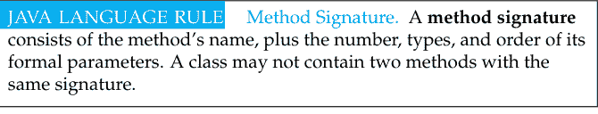

在设计构造函数和方法时，重载的数量没有限制。唯一的限制是每个方法必须具有不同的签名。例如，假设在我们已经定义的两个构造函数之外，我们还想要一个构造函数，让我们同时设置木子的数量和由哪位玩家开始。下面的构造函数可以实现我们的需求：

```java
public OneRowNim(int sticks, int starter) {
  nSticks = sticks; // 设置木子数量
  player = starter; // 设置谁开始
}
```

在调用此方法时，我们必须将木子数量作为第一个参数传递，并将 1 或 2 作为第二个参数的值：

```
OneRowNim game3 = new OneRowNim(14, 2);
OneRowNim game4 = new OneRowNim(31, 1);
```

如果我们在第一条语句中错误地反转了 14 和 2，我们将得到一个从 2 根木子开始的 `OneRowNim` 游戏，并将玩家 14 设置为先手玩家。

# 第 3 章 方法：对象间的通信

我们现在为 `OneRowNim` 类定义了三个构造方法。每个构造方法的名称都是 `OneRowNim`，但每个方法的签名都是不同的：

```
OneRowNim()
OneRowNim(int)
OneRowNim(int, int)
```

构造方法被调用一次以创建一个对象

### 3.3.3 构造方法的调用

构造方法仅在创建实例时作为新表达式（new expression）的一部分被调用。每一个都是对 `OneRowNim` 构造方法的有效调用：

```java
// 默认构造方法
OneRowNim game1 = new OneRowNim();
// 设置木子数量
OneRowNim game2 = new OneRowNim(21);
// 设置两个实例变量
OneRowNim game3 = new OneRowNim(19, 2);
```

以下构造方法的调用是无效的，因为没有匹配的构造方法定义：

```java
// 没有匹配的构造方法
OneRowNim game4 = new OneRowNim("21");
OneRowNim game5 = new OneRowNim(12, 2, 5);
```

在第一的情况下，没有接受 `String` 参数的构造方法，没有匹配的构造方法。在第二的情况下，没有接受三个 `int` 参数的构造方法。在这两种情况下，Java 编译器都会报错，提示没有匹配调用的构造方法。


> JAVA 调试技巧！方法调用。方法调用的签名——其名称以及参数的数量、类型和顺序——必须与方法定义的签名完全匹配。

## 3.4 从对象中检索信息

我们对 `OneRowNim` 类所做的修改允许我们通过构造方法设置 `OneRowNim` 对象的实例变量，除了使用 `report()` 方法向控制台写入消息外，我们没有其他方法获取它们的值。当我们在下一章为 `OneRowNim` 开发图形界面时，我们希望能够让 `OneRowNim` 对象提供剩余的木子数量以及下一个玩家是谁。我们将 `nSticks` 和 `player` 声明为私有变量，因此我们无法直接访问它们。因此，我们将

## 3.4 节 从对象中检索信息

需要访问器方法（accessor methods）来获取每个实例变量的值。

考虑以下方法定义：

```java
public int getSticks() {
    return nSticks;
}

public int getPlayer() {
    return player;
}
```

回想一下，方法的返回值（ResultType）指定在方法名（Method-Name）之前。我们希望这两个方法返回代表 `OneRowNim` 实例变量的 `int` 值。因此，它们的返回值类型都是 `int`。

在讨论调用方法时如何使用方法返回的数值之前，让我们再考虑一个方法定义。许多方法返回 `boolean` 以进行计算，而不是简单地返回实例变量的值。例如，假设我们为 `OneRowNim` 类定义一个方法，通知该类的实例游戏是否结束。因此，我们希望方法在被调用时，根据所有木子是否已取完返回一个 `boolean` 值。`gameOver()` 是这种方法的描述性名称，且该方法类型应该是 `boolean` 类型。因此我们定义为：

```java
public boolean gameOver() {
    return nSticks <= 0;
}
```

如果 `nSticks` 为正数，该表达式的结果为 `false`；否则结果为 `true`。

### 3.4.1 调用有返回值的方法

当我们调用返回价值的方法时，该调用将获得或被返回的值所替换。例如，如果我们执行语句

```java
OneRowNim game = new OneRowNim(11);
int sticksLeft = game.getSticks();
```

表达式 `game.getSticks()` 在 `getSticks()` 方法完成后将获得 11。此时，第二条语句等于：

```
int sticksLeft = 11;
```

> JAVA 语言规则 求值调用。非空方法调用是一个具有特定类型的表达式。

我们可以使用方法返回的值，就像使用相同类型的字面量一样。它可以被赋值给变量，作为数值表达式的一部分，或作为方法的参数。以下所有语句都涉及返回方法的有效调用：

```java
int fewSticks = game.getSticks() - 1;
boolean done = game.gameOver();
System.out.println(game.getPlayer());
game.getSticks();
```

在语句中，方法调用可以用其返回的值替换。注意最后一条语句是有效的，但没有任何用。在 Java 以及 C、C++ 等其他语言中，返回的方法可以简单地调用而不使用其返回的值；如果方法更改了实例的状态或向对象或输出设备发送消息，这样做可能是很有用的。`getSticks()` 方法除了返回 `nSticks` 的值外什么都没做。

# 3.4.2 扩展的 OneRowNim 类

让我们将返回数值的新方法添加到 `OneRowNim` 类中。可能会注意到，上一章的 `report()` 方法在控制台窗口显示 `nSticks` 和 `player` 的值，这可以通过 `getSticks()` 和 `getPlayer()` 方法来实现。然而，调用 `report()` 是显示两个实例变量的一种简单方法，但它无法以 `int` 值的形式访问任何变量。因此，让我们在类定义中保留三个方法。少量冗余带来的不便被增加的活性所抵消了。

冗余与活性

> JAVA有效设计 使用冗余。在类中引入一些冗余（例如提供多种访问实例变量值的方法），可以让类更容易使用。

图 3.5 提供了扩展 `OneRowNim` 类的 UML 类图。

# 第 3.4 节 • 从对象中检索信息

| OneRowNim |
| :--- |
| - nSticks: int |
| - player: int |
| + OneRowNim() |
| + OneRowNim(in sticks:int) |
| + OneRowNim(in sticks:int, starter:int) |
| + takeSticks(num:int) |
| + getSticks() |
| + getPlayer() |
| + gameOver():boolean |
| + report() |

图 3.5：扩展后的 `OneRowNim` 的 UML 类图。

Let us also consider a new `main()` method to test the new methods of the class. A fairly short list of methods that call each of the three new returning values is given in the `main()` method in Figure 3.6

```java
public static void main(String[] args) {
    OneRowNim game = new OneRowNim(13,2);
    game.takeSticks(2);
    System.out.print("The game is over: ");
    System.out.println(game.gameOver());
    System.out.print("The next turn is by player: ");
    System.out.println(game.getPlayer());
    System.out.print("Sticks remaining: ");
    System.out.println(game.getSticks());
}
```

图 3.6：测试 `OneRowNim` 方法的 `main()` 方法

当此程序运行时，控制台输出将：

> The game is over: false
>
> The next turn is by player: 1
>
> Sticks remaining: 11

注意，构造函数将 `player` 设置为 2，因此在经过回合后 `player` 存储了值 1。

## 自学练习

# 第 3 章 • 方法：对象间的通信

练习 3.7 这些这些 Java 代码段会在屏幕上显示什么？

```java
OneRowNim myGame = new OneRowNim(10,2);
System.out.println(myGame.getPlayer());
System.out.println(2 * myGame.getSticks());
System.out.println(myGame.gameOver());
```

练习 3.8 假设 `OneRowNim` 类中添加了一个名为 `mMoves` 的实例变量，用于计算 Row Nim 游戏中采取的步数。为 `OneRowNim` 类编写一个方法来获取存储在 `mMoves` 中的值。

练习 3.9 为 `OneRowNim` 类编写一个方法 `playerOneGoNext()`，其返回一个布尔值。当且仅当玩家 1 是下一个回合时，返回的值为 true。

## 3.5 传递值和引用

向方法传递参数的效果取决于你传递的是基本类型（如 5 或 true）还是引用类型的值（如 "Hello" 或 `game`）。当将基本类型的参数传递给方法时，该参数的副本被传递给形式参数。例如，考虑图 3.7 所示的 `PrimitiveCall` 类。

传递基本类型值

```java
public class PrimitiveCall {
    public static void myMethod(int n) {
        System.out.println("myMethod: n=" + n);
        n = 100;
        System.out.println("myMethod: n=" + n);
    }

    public static void main(String argv[]) {
        int k = 5;
        System.out.println("main: k=" + k);
        myMethod(k);
        System.out.println("main: k=" + k);
    }
}
```

图 3.7：向方法传递基本类型值。

注意，我们有一个 `int` 变量 `k`，它初始存储值为 5，以及一个接受 `int` 参数 `n` 的方法 `myMethod()`。在这种情况下，当我们调用 `myMethod(k)` 时，`k` 的值 (5) 被复制到 `n` 中并在方法执行期间存储在该处。

# 章节 3.5 传递值和传递引用

向方法传递基本类型值副本的一个影响是，`main()` 中 `k` 的原始值在方法内部无法被修改。因此，`PrimitiveCall` 生成的输出为：

```
main: k=5
myMethod: n=5
myMethod: n=100
main: k=5
```

注意在 `main()` 中在调用 `myMethod()` 前后都打印了 `k` 的值，但尽管在方法内部 `n` 的值被改变了，`k` 的值仍然保持不变。这是因为 `myMethod()` 包含 `k` 值的副本，而不是 `k` 本身。对 `myMethod()` 内部代码的任何更改都不会影响（见图 3.8）。

> JAVA 语言 传递基本类型值。当基本类型的值（如 `boolean` 或 `int`）被传递给方法时，传递的是该值的副本。这就是为什么即使在方法内部更改了代码，它的原始值仍然保持不变。

与此相反，当将引用类型的参数传递给方法时，该引用的引用本身的副本被赋值给参数。例如，在 `String` 参数或 `OneRowNim` 参数的情况下，方法将提供该对象的引用——即对象的地址。对象本身不会被传递，因为复制带有所有数据和方法的整个对象效率太低了。然而，对象的引用提供了对象在内存中的位置，方法将能够访问该对象并可以在方法内部对原始对象进行更改。

图 3.8：在 `PrimitiveCall` 中变量 `k` 和 `n` 的追踪：(a) 在 `main` 中调用 `myMethod(k)` 之前。(b) 在执行 `myMethod()` 方法体之前。(c) 在执行 `myMethod()` 方法体之后。(d) 在控制流返回到 `main` 之后。img/fa00320ea7bfae0127d4f590e7f9fc72_134_png

# 第 3 章 • 方法：对象间的通信

例如，考虑 `ReferenceCall`（图 3.9）。在这种情况下，`myMethod` 接收一个类型为 `OneRowNim` 的参数 `g`。因为实例是一个对象，所以 `g` 是引用变量。所以当在 `main()` 中调用 `myMethod(game)` 时，`g` 的引用被传递给 `myMethod()`。注意在 `myMethod()` 中，我们使用 `takeSticks(3)` 将 `g` 的数量从 10 变为 7，即使在方法返回 `main()` 之后这种更改仍然存在。这是因为在方法执行期间，`game` 和 `g` 都指向完全相同的对象（见图 3.10）。`ReferenceCall` 生成的输出为：

图 3.9：向方法传递引用值。

```
main: Number of sticks: 10
myMethod: Number of sticks: 10
myMethod: Number of sticks: 7
main: Number of sticks: 7
```

这说明当将引用传递给方法时，可以更改对象的状态。

# 第 3.6 节 • 控制流

图 3.10：在 `ReferenceCall` 中变量 `game` 和 `g` 的追踪：(a) 在 `main` 中调用 `myMethod(game)` 之前。(b) 在执行 `myMethod()` 方法体之前。(c) 在执行 `myMethod()` 方法体之后。(d) 在控制流返回到 `main` 之后。

## 第 3.6 节 • 控制流：控制结构

以下是所有涉及 `if` 语句的语法错误示例：

```java
if true
    // 缺少括号
    System.out.println("Hello");
if (nSticks <= 0) return // 缺少分号
if ("true") return; // "true" 不是布尔值
if (true "Hello") { // "Hello" 不是语句
```

从语义上讲，该语句的解释如下：首先，评估布尔条件。如果为真（true），则执行包含的语句；如果为假（false），则不执行包含的语句。这如图 3.11 所示。流程图清晰地显示程序流将从菱形布尔条件框引出的备选路径中的一条执行。当布尔条件为真时，将通过矩形语句的分支；否则，将跳过该语句。

另一个例子，考虑为 `OneRow` 类定义一个 `getString()` 方法：


```java
public String getPlayerString() {
    if (player == 1)
        return "Player One"; // 退出方法
    if (player == 2)
        return "Player Two"; // 退出方法
    return "Player error";
}
```

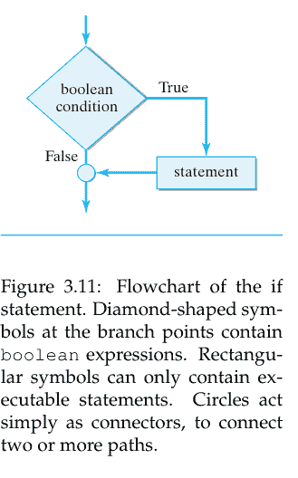

图 3.12 中的流程图显示了 `getPlayerString()` 方法的程序流。需要注意的是，当方法执行 `return` 语句时，控制将返回到调用方法。

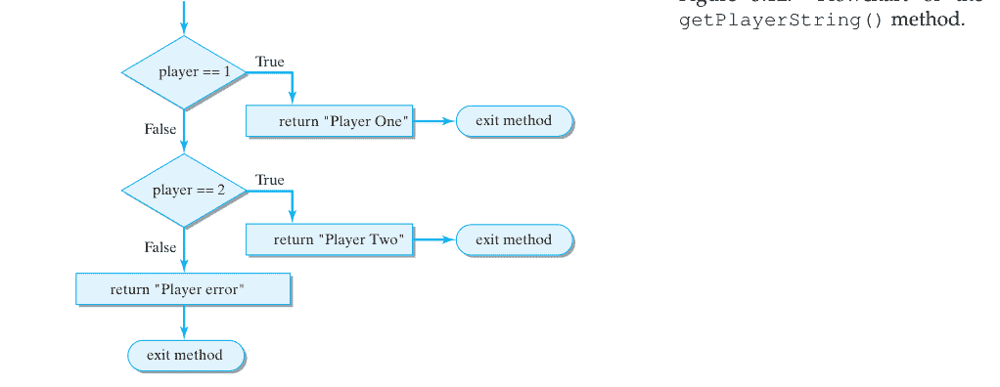

因此，如果 `player == 1` 为真，则字符串 "Player One" 将返回给调用方法，`getString()` 方法在此时结束。如果为假，那么 `player == 2` 应该为真（如果我们的状态是一致的），并且应该返回字符串 "Player Two" 并退出方法。因此，如果我们处于一致的状态——也就是说如果 `player` 的值为 1 或 2——那么不应该到达 `return` 语句。

下面的示例显示了最常见的情况，即 `if` 语句包含的状态可以是一个复合语句：

### 复合语句

```java
if (player == 1) {
    String s = "Player One";
    System.out.print(s);
    System.out.println(" plays next");
    System.out.println(" The game is not over");
}
```

### 局部作用域

如果 `player == 1` 为真，则包含的复合语句中的四个语句都将被执行。注意，我们在此块中声明了局部变量 `s`。它的作用域仅延伸到块的结束。注意，当我们使用复合语句时，复合语句本身后面没有分号，因为它已经包含在大括号中。

一个常见的编程错误是忘记复合语句周围的大括号。仅仅对 `if` 内部的语句进行缩进并改变 `if` 语句的逻辑。例如，以下语句在其子句中仍然只有一个语句：

```java
if (condition1) {
    System.out.println("One");
    System.out.println("Two"); // 不属于 if 语句
}
```

此段代码将始终打印 "Two"，因为第二个 `println()` true `if` 语句。要将其包含在 `if` 语句中，必须将两个 `println()` 都封装在大括号内：

```java
if (condition1) {
    System.out.println("One");
    System.out.println("Two");
}
```


> **JAVA 调试技巧**：缩进可以提高程序的可读性，但不会影响其逻辑。必须使用大括号来分组 `if` 子句中的语句。

### 3.6.2 if-else 语句

`if` 语句的第二个版本在结构中引入了 `else` 子句。这允许我们根据一个布尔表达式的结果执行两个分离语句（简单或复合）之一。例如，

```java
if (player == 1) {
    System.out.println("Player One");
} else {
    System.out.println("Player Two");
}
```

如果 `player == 1` 为真，则将打印 "Player One"。否则，将打印 "Player Two"。

**JAVA 语言规则**：if-else 语句。`if-else` 语句具有以下语法：

```
if (boolean expression)
    statement1;
else
    statement2;
```

与简单语句的情况一样，关键字后面跟着一个带括号的布尔表达式，后面是 `statement1`，`statement1` 可以是简单语句也可以是复合语句。如果 `statement1` 是简单语句，则它后面跟着一个分号。`else` 子句紧跟在 `statement1` 之后。它以关键字 `else` 开始，后面跟着 `statement2`，`statement2` 也可以是简单语句也可以是复合语句。注意，`else` 关键字后面没有布尔表达式。在 `if-else` 语句中，跟随关键字 `if` 后的布尔表达式同时适用于 `if` 和 `else` 子句。

从语义上讲，`if-else` 语句的解释如下：表达式为真，则执行 `statement1`；否则执行 `statement2`。如图 3.13 所示。

### 3.6.3 嵌套 if/else

### 多路选择

`if-else` 结构用于需要从多个选项中选择一个时。假设我们有一个 `int` 变量将包含 1、2 或 3，除非出现错误值。在图 3.14 所示的示例中有三个备选。这里是 Java 代码：

```java
if (num == 1)
    System.out.println("One");
else if (num == 2)
    System.out.println("Two");
else if (num == 3)
    System.out.println("Three");
else
    System.out.println("Error: Unknown");
```

注意，多路结构只有一个入口点，且只有一个备选方案会被执行。我们有很多机会使用 `if-else` 结构。尽管没有重大变化，但我们可以重写 `takeSticks()` 方法：

```java
public void takeSticks(int num) {
    if (player == 1)
        player = 2; // 从 1 到 2
    else
        player = 1; // 从 2 到 1
}
```

在某些方面，这个 `takeSticks` 涉及四行代码而不是一行，但它更容易理解。`if` 语句判断 `player` 的值是否为 1。如果是，则将其改为 2。如果 `player` 的值不为 1，则它必须为 2，因此将其改为 1。这两个版本的代码将产生完全相同的结果，程序员可以选择任一种。

## 自学 3.10

**练习 3.10**：考虑以下带有布尔值 `isDone` 的方法

```java
public String getStatus(boolean isDone) {
    if (isDone)
        return "Done";
    else
        return "Not Done";
}
```

为 `getStatus()` 方法的 `if-else` 版本绘制流程图，并将本节作为指南。`if-else` 结构应该如图 3.11 所示所示。它应该有一个入口点，直接指向包含布尔条件的菱形框顶部。从框中引出两个分支。向右 true的是真情况，向左 true的是假情况。每个分支都应该包含一个矩形框，其中包含在该情况下执行的语句。左右分支应由一个圆形符号连接，该符号与与其连接的菱形框正对齐。应该有一个指向正下的入口箭头。

**练习 3.11**：识别以下语句中的错误：

```java
if (isHeavy == true)
    System.out.println("Heavy");
else
    System.out.println("Light");
if (is == true)
    System.out.println("Long");
else
    System.out.println("Short");
```

# 第 3 章 • 方法：与对象通信

练习 3.12 假设我们在描述三人游戏的某个类中有一个名为 `player` 的 `int` 变量。编写一个名为 `getPlayerName()` 的方法，返回一个 `String`。当 `player` 的值分别为 1、2、3 或任何其他值时，它应该返回 "Ann"、"Bill"、"Cal" 或 "Error"。

练习 3.13 基本类型参数与引用类型参数之间有何不同之处？

### 3.6.4 While 结构

重复结构是一种以受控方式重复某条语句或一系列语句的结构。重复结构也被称为循环结构。许多类型的编程任务都需要重复结构。请考虑以下几个例子：

- 你想计算从 1 到 100 的数字的平方和。
- 你想计算一个在固定利率下存放 30 年的资金账户的复利。
- 一名安全人员人员想要尝试所有可能的密码，以破解一个嫌疑间谍的账户。
- 你想让玩家在游戏中移动回合，直到游戏结束。我们的 `OneRowMin` 就是这样一个例子。

我们将在第 6 章深入学习 Java 的几种不同的重复结构。在这里，我们将简要考虑 `while` 语句，以便定义更强大、更有趣的方法。让我们写一个方法来解决上面第一个问题的稍微泛化版本。我们使用 `while` 语句来计算从 1 到方法参数指定的整数的平方和。然后，方法调用 `sumSquares(3)` 应该返回值 14，因为 `1*1 + 2*2 + 3*3 = 14`。

```java
public int sumSquares(int max) {
    int num = 0;
    int sum = 0;
    while (num <= max) { // 当 num <= max 时
        sum = sum + num * num; // 将平方加到和上
        num = num + 1; // num 加 1
    }
    return sum;
}
```

注意在这个例中，在在执行 `while` 语句之前，变量 `num` 被赋值了一个初始值 0。注意 `while` 后面括号中的布尔表达式 `num <= max` 表示了我们希望继续累加平方的条件。最后注意，布尔表达式之后的块中的最后一条语句给 `num` 加 1——也就是说，变量在块的结束处被更新。

## 3.6 节 控制流：控制结构

`while` 语句是一种循环语句，其循环入口发生在循环体之前。它具有以下通用形式：

**JAVA 语言规则 While 语句**。`while` 语句具有如下语法：

```java
while (循环入口条件)
    循环体;
```


当执行 `while` 语句时，会评估循环入口，如果结果为 `false`，则执行将立即在循环体之后继续。如果循环入口评估为 `true`，则执行循环体，然后再次评估循环入口。循环体将继续执行，直到循环入口评估为 `false` 为止。

为了让 `while` 语句完成任务，循环入口中的变量或多个变量必须在 `while` 语句之前正确初始化，并且这些变量必须在循环体结束时正确更新。我们可以将跟在 `while` 语句之前的初始化语句称为 `while` 结构。我们可以将这些准则视为设计原则：

**JAVA 有效设计：循环结构**。一个设计良好的结构必须包含一个初始化器、一个循环入口和一个更新器。更新器应该保证循环入口最终失败，从而允许循环终止。


在伪代码中，`while` 结构将采取以下形式：

```
初始化语句;
while (入口条件) {
    循环体;
    更新语句;
}
```

（注：由于提供的原文文本存在大量重复，此处已按要求完成翻译。）

# 第 3 章 • 方法：与对象通信

```java
public class OneRowNim {
    private int nSticks = 7;
    private int player = 1;

    public OneRowNim() {
        // OneRowNim()
    }

    public OneRowNim(int sticks) {
        nSticks = sticks;
        // OneRowNim() 构造函数
    }

    public OneRowNim(int sticks, int starter) {
        nSticks = sticks;
        player = starter;
        // OneRowNim() 构造函数
    }

    public boolean takeSticks(int num) {
        if (num < 1) return false; // 错误
        else if (num > 3) return false; // 错误
        else {
            nSticks = nSticks - num;
            player = 3 - player; // 有效移动
            return true;
        } // else
    }

    public int getSticks() {
        return nSticks;
    } // getSticks()

    public int getPlayer() {
        return player;
    } // getPlayer()

    public boolean gameOver() {
        return (nSticks <= 0);
    } // gameOver()

    public int getWinner() {
        if (nSticks < 1) return getPlayer();
        else return 0; // 游戏未结束
    } // getWinner()

    public void report() {
        System.out.println("剩余棒子数量: " +
            getSticks());
        System.out.println("下回合玩家: " +
            getPlayer());
    } // report()
} // OneRowNim 类
```

图 3.16: 具有改进后方法的 OneRowNim 类。

## 第 3.7 节 • 测试改进后的 OneRowNim

让我们使用一个语句来测试类的新方法。关于游戏玩法的的伪代码描述可能如下：

```
选择游戏的初始棒子数量
当游戏未结束时
{
  报告游戏状态
  处理下一次移动
}
报告游戏状态
报告胜利者是谁
```

将此伪代码翻译为独立类中 `main()` 方法中的代码，我们得到了图 3.17 所示的类。我们将使用上一章引入的 `Scanner` 类来从键盘获取移动

```java
import java.util.Scanner;

public class TestOneRowNim
{
    public static void main(String argv[]) {
        Scanner sc = new Scanner(System.in);
        OneRowNim game = new OneRowNim(11);
        while (!game.gameOver()) {
            game.report(); // 提示用户
            System.out.print("输入 1, 2 或 3: ");
            int sticks = sc.nextInt(); // 获取移动
            game.takeSticks(sticks); // 执行移动
            System.out.println();
        } // while
        game.report(); // 游戏现在结束
        System.out.println("胜利者是玩家 ");
        System.out.println(game.getWinner());
    } // main()
} // TestOneRowNim
```

图 3.17: 带有循环的 TestOneRowNim 类。

对于两个玩家都是。在每次移动之前，`game.report()` 都会在用户被提示输入其中一个玩家的移动之前描述游戏状态。如果读者想看到 `TestOneRowNim` 类在控制台输出的长输出，那么实际上运行该程序就足够了。

注意，在这个测试程序中，`takeSticks()` 方法的返回值被忽略了。在下一章中，当为 `OneRowNim` 开发更好的接口时，我们将利用该返回值。然而，请注意，`OneRowNim` 的公共方法共同为其他对象提供了接口。

## 第 3 章 • 方法：对象的通信

子类。如果你用子类的实例调用 `toString()`，将使用该子类的方法版本。通过这种方式，子类方法重写了父类版本。因此，`OneRowNim.toString()` 将具有以下签名：

```
public String toString();
```

让我们在 `toString()` 方法返回的字符串中简要地描述一个 oneRowNim 实例的状态：

```java
public String toString() {
    return "nSticks = " + nSticks + ", player = " + player;
}
```

如果我们在 `OneRowNim` 类中添加 `toString()` 方法，然后运行图 3.18 所示的程序，我们将得到以下输出：

```
nSticks = 9, player = 2
nSticks = 13, player = 1
```


```java
public class TestToString
{
  public static void main(String argv[]) {
    OneRowNim g1 = new OneRowNim(11);
    OneRowNim g2 = new OneRowNim(13);
    g1.sticks(2);
    System.out.println(g1.toString());
    System.out.println(g2.toString());
  }
}
// TestToString
```

图 3.18：用于测试重写 `toString` 方法的应用。

虽然这个方法在 `OneRowNim` 类中可能没有发挥重要作用，但它确实为对象的状态提供了非常简短、易懂的描述。这就是 `toString()` 方法被包含在 `Object` 类中的原因。

## 3.9 面向对象设计：继承与多态

使用 `Object` 的 `toString()` 方法让我们第一次看到了 Java 的继承机制，以及它如何促进了面向对象方法的通用性和可扩展性。作为 `Object` 的子类，我们的 `OneRowNim` 类自动继承了 `toString()` 以及 `Object` 中定义的任何其他公共或保护方法。只要这些方法对我们有用，我们就可以简单地直接使用它们。正如我们在本例中看到的，`toString()` 的默认版本并不好用。在这种情况下，

### 继承

我们可以通过在类中定义一个具有完全相同方法签名的方法来重写该方法。`toString()` 的新版本可以自定义以执行最适合子类的操作。

面向对象方法的伟大成就之一是在类层次结构的高处定义一个任务（如 `toString()`），并让继承机制将该任务传播到层次结构的其余部分。由于 `toString()` 定义在 `Object` 中，你可以对任何 Java 对象调用它。此外，如果你在定义的类中重写了 `toString()`，你就为它的实用性做出了贡献。从这个例子中得到的两个重要教训是：

- **JAVA EFFECTIVE DESIGN 继承**。任务在类层次结构中定义越高，它的使用范围就越广泛。


- **JAVA EFFECTIVE DESIGN 重写 toString()**。在任何用户定义的 Java 类中都可以重写 `toString()` 方法。在任何可以简要定义对象状态的类中，这都是非常有用的。


显然，关于 Java 继承机制还有更多需要解释。因此，我们将在后续章节中多次回到这个主题。

### 多态

多态是另一个重要概念。`toString()` 方法是多态方法的例子。该术语源于希腊语 *poly*（意思是“多”）和 *morph*（意思是“形式”）。`toString()` 方法是多态的，因为它在不同的对象上调用时会有不同的行为。

例如，假设我们定义了一个类 `Object` 的子类 `Student`，并定义其 `toString()` 返回学生 ID。根据这种设计，如果是 `Student` 的实例，`toString()` 将返回学生 ID；但如果它是 `OneRowNim` 的实例，它将返回我们定义的状态描述。以下代码段说明了这一点：

```java
Object obj;
// obj 可以引用任何 Object
obj = new Student("12345"); // obj 指向一个 Student
System.out.println(obj.toString()); // 打印 "12345"
obj = new OneRowNim(11); // obj 指向一个 OneRowNim
System.out.println(obj.toString());
// 输出: nSticks = 11, player = 1
```

在这种情况下，变量 `obj` 被用来引用一个 `Student`，然后引用一个 `OneRowNim` 实例。这是可以的，因为这两个类都是 `Object` 的子类。当在 `obj` 上调用 `toString()` 时，Java 将确定该实例属于 `Object` 的哪个子类，并调用相应的 `toString()` 方法。

## 3.10 绘制线条和定义图形方法（可选）

我们在上一个章节中使用了 `Graphics` 对象在 `JFrame` 窗口中绘制矩形和椭圆。`Graphics` 类还拥有一个用于绘制线段的方法。在 `JFrame` 窗口中使用一系列线段绘制图形的问题，可以作为定义有用方法和良好利用循环的来源。`Graphics` 类有一个头如下的公共实例方法：

```java
public void drawLine(int x1, int y1, int x2, int y2)
```

方法调用 `g.drawLine(x1, y1, x2, y2)` 从点 (x1,y1) 到 (x2,y2) 绘制一条线，其中 (x,y) 代表距离 `g` 所在绘图区域左边缘 x 像素、距离顶边缘 y 像素的点。`g.drawLine(10, 10, 10, 60)` 绘制一条垂直线段，即长度为 50 像素且距离左侧 10 像素的线，从点 (10,10) 到 (10,60) 的线段。

考虑创建一个 Swing 游戏的问题，其中有一个方法 `drawSticks()` 来绘制指定数量的垂直线段。这个方法对于像 `OneRowNim` 这样的图形用户界面来说，在游戏的给定点绘制线条可能很有用。假设该方法必须有一个 `int` 参数来指定要绘制垂直线的数量，以及两个 `int` 参数来指定最后一条线段顶端的位置。`drawSticks()` 方法需要使用连接到 `JFrame` 窗口的 `Graphics` 对象来绘制线段，而不仅仅是 `Canvas` 的 `Graphics` 对象。该方法必须有一个 `Graphics` 参数，并在 `paint()` 方法中使用那里的 `Graphics` 对象作为参数进行调用。方法的头应该像：

```java
public void drawSticks(Graphics g, int x, int y, int num)
```

线段的长度和它们之间的距离没有通过参数指定，因此我们需要为这些数量固定一些值。假设线段间隔 10 像素，长度为 50 像素。我们有足够的信息来完成解决此问题的类定义。此类类在图 3.19 中所示。

注意，`drawSticks()` 的主体使用 `while` 循环来绘制线条，并初始化局部变量为零以计算绘制的线条数。语句 `g.drawLine(x, y, x, y + 50);` 绘制了一条长 50 像素的垂直线。在循环中每次将 `x` 的值增加 10 会使下一条线向右移动 10 像素。

在 `paint()` 方法中第一次调用 `drawSticks()` 绘制了 (25,25) 位于左侧线条的顶部。第二次调用 `drawSticks()` 将绘制下方 100 像素处的青线条。

## 图 3.19：一个具有绘制一组线条方法的 Swing 类

```java
// DrawLineCanvas 展示了一些图形命令。
// 它绘制了 12 条垂直线和 7 条线。
import java.awt.*;
import javax.swing.JFrame;

public class DrawSticks extends Canvas {
    // drawSticks(g,x,y,num) 将绘制垂直
    // 线段，它们间隔为 10 像素，长度为 50 像素。
    // 线段的顶端位于点 (x,y)。
    public void drawSticks(Graphics g, int x, int y, int num) {
        int k = 0;
        while (k < num) {
            g.drawLine(x, y, x, y + 50);
            x = x + 10;
            k++;
        }
    }
    // drawSticks()
    public void paint(Graphics g) {
        drawSticks(g, 25, 25, 12);
        g.setColor(Color.cyan);
        drawSticks(g, 25, 125, 7);
    }
}
// DrawSticks 一个具有绘制一组线条方法的 Swing 类。
```

在将 `g` 作为参数传递给 `drawSticks()` 之前更改它的颜色会改变颜色。`DrawSticksCanvas` 在窗口中显示的图像如图 3.20 所示。

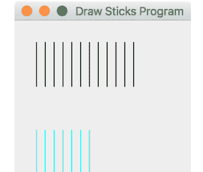

图 3.20：`DrawSticksCanvas` 在 Java 窗口中的显示。

正如我们在例中看到的，定义带有参数的方法来绘制对象使得代码具有可重用性，并且通过调用一组简单的方法来绘制复杂的场景成为可能。这是分治原则的典型用法。`while` 循环对于绘制几何对称的对象非常有用。

## 第 3 章 • 章节总结

### 技术术语

- 访问器方法
- 循环结构
- 重复结构
- 类作用域
- 方法重载
- 作用域
- 形式参数
- 方法签名
- 选择
- if 语句
- 变异器方法
- 副影响
- if/else 语句
- 多路选择
- while 语句
- 继承
- 重写
- 局部作用域
- 多态性

### 重要要点总结

- **形式参数**（formal parameter）是方法声明中的变量。它始终由一个类型后跟一个变量标识符组成。参数（argument）是在调用方法时，通过形式参数传递给方法的值。它的参数限制了可以传递给方法的信息类型。
- 当将基本类型的参数传递给方法时，它在方法内部不能被修改。当将引用类型的参数传递给方法时，它所引用的对象可以在方法内部被修改。
- 对于非 `void` 方法，方法调用（invocation）是一个具有特定类型值的表达式。例如，`nim.get()` 返回一个 `int` 值。
- 方法签名由其方法名，以及形式参数的数量、类型和顺序组成。一个类**不能**包含多个具有相同签名的方法。
- 构造方法是在创建对象时被调用的方法。如果类不包含构造方法，Java 编译器将提供一个默认构造器。
- 限制对类的某些部分的访问是信息隐藏的一种形式。通常，通过将实例变量声明为 `private` 来隐藏它们。类的公共方法构成了它的接口。
- `if` 语句仅在布尔条件为真时执行该语句。`if-else` 语句根据布尔条件的值执行两个语句中的一个。多路选择（multway selection）允许根据布尔条件的值从多个选择中选择且仅选择一个。
- `while` 语句用于编写循环结构，在满足布尔条件时重复执行一段代码块。

### 自学练习答案

**答案 3.1** 方法声明通过其方法名、修饰符、返回类型、形式参数及其算法来定义方法，从而将一个名称与一段可执行代码相关联。方法调用则是调用或使用已定义的方法。

**答案 3.2** 形式参数是方法声明中的变量，其目的是在方法运行时存储一个值。参数是代替形式参数传递给方法的值。

**答案 3.3** 下列代码声明了两个用于玩家名称的实例变量，并定义了一个 `setNames()` 方法：

```java
private String nameOne = "Player One";
private String nameTwo = "Player Two";

public void setNames(String name1, String name2)
{
    nameOne = name1;
    nameTwo = name2;
}
```

当然，变量还有许多其他合适的名称和其他初始赋值。

**答案 3.4** 一个可以设置游戏玩家名称的方法是：

```java
game1.setNames("Xena","Yogi");
```

**答案 3.5** 构造方法不能有返回类型，例如 `void`。

**答案 3.6** 该方法的一种定义是：

```java
public OneRowNim(int sticks)
{
    nSticks = sticks;
    player = 2;
}
```

**答案 3.7** 屏幕将显示以下内容：

```
1
20
false
```

**答案 3.8** 该方法的一种定义是：

```java
public int getMoves()
{
    return nMoves;
}
```

**答案 3.9** 该方法的一种定义是：

```java
public boolean playerOneIsNext()
{
    return (player == 1);
}
```

**答案 3.10** 见图 3.21。

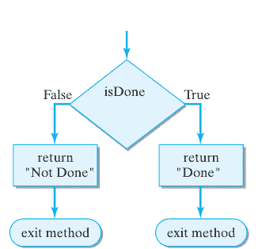

图 3.21：`getStatus()` 方法的 `if-else` 版本的流程图。

**答案 3.11**

```java
if (isHeavy == true)
    System.out.println("Heavy");
else    // 错误（删除此分号）
    System.out.println("Light");

if (isLong == true)
    System.out.println("Long");
else    // 错误（上一行以分号结束）
    System.out.println("Short");
```

**答案 3.12**

```java
public String getPlayerName()
{
    if (player == 1)
        return "Ann";
    else if (player == 2)
        return "Bill";
    else if (player == 3)
        return "Cal";
    else
        return "Error";
}
```

**答案 3.13** 当传递基本类型的参数时，传递的是参数值的副本。实际参数在方法内部不能被更改。当传递对象的引用时，该对象可以在方法内部被更改。

**答案 3.14**

```java
public int sumCubes(int min, int max)
{
    int num = min;
    int sum = 0;
    while (num <= max) { // 当 num <= max 时
        sum = sum + num*num*num; // 将 num 的立方加到 sum 上
        num = num + 1; // num 加 1
    }
    return sum; // 返回和
}
```

## 练习

### 练习 3.1 填空下列句子：

- 具有相同名称的方法通过 **方法签名** 区分开。
- 在创建对象时调用的方法 是 **构造方法**。
- 类的 **公共方法** 是类的接口。
- 画出一个 UML 图，描述类之间的 **继承** 关系。
- 一个用于设置游戏玩家名称的方法是 **setNames()**。
- **形式参数** 的值是 **参数**。
- 具有相同名称的方法是 **重载方法**。
- **子类** 具有 **继承** 特性。
- **多态性** 是 **方法在不同对象上表现不同行为** 的特性。
- **重写** 是 **子类提供父类方法的新实现**。
- **toString()** 是 **Object 类的方法**。
- **继承** 的示例。
- **封装**。
- `if-else` 语句中的 **条件表达式**。
- 在子类中重写 **toString()** 是 **良好的设计实践**。

### 练习 3.2 解释下列概念之间的区别：

- a. 形式参数和参数。
- b. 方法定义和方法调用。
- c. 局部作用域和类作用域。
- d. 基本类型和引用类型。
- e. 访问方法和构造方法。

### 练习 3.3 将下列内容转换为 Java 代码：

- a. 如果 `b1` 为真，打印“one”；否则打印“two”。
- b. 如果 `b1` 为假且 `b2` 为真，打印“one”；否则打印“two”。
- c. 如果 `b1` 为假且 `b2` 为真，打印“one”或“three”。

### 练习 3.4 识别并修复下列内容中的语法错误：

**a.**

```java
if (isWalking == true) {
    System.out.println("Walking");
} else {
    System.out.println("Not walking");
}
```

**b.**

```java
if (isWalking) {
    System.out.println("Walking");
} else {
    System.out.println("Not walking");
}
```

**c.**

```java
if (isWalking)
    System.out.println("Walking");
else
    System.out.println("Not walking");
```

**d.**

```java
if (isWalking == false)
    System.out.println("Walking");
else
    System.out.println("Not walking");
```

### 练习 3.5 对于下列每项，假设 `isWalking` 为真且 `isTalking` 为假（首先为每个语句画一个流程图，然后确定每个语句打印出的内容）：

**a.**

```java
if (isWalking == false)
    System.out.println("One");
System.out.println("Two");
```

**b.**

```java
if (isWalking == true)
    System.out.println("One");
System.out.println("Two");
```

**c.**


```java
if (isWalking == false)
{
    System.out.println("One");
    System.out.println("Two");
}
```

d.

```java
if (isWalking == false)
    if (isTalking == true)
        System.out.println("One");
    else
        System.out.println("Two");
else
    System.out.println("Three");
```

# 第 3 章 • 练习

## 练习 3.6
明如果执行以下版本的 `main()` 函数，输出将会是什么：

```java
public static void main(String argv[])
{
    System.out.println("main() is starting");
    OneRowNim game1;
    game1 = new OneRowNim(21);
    OneRowNim game2;
    game2 = new OneRowNim(8);
    game1.takeSticks(3);
    game2.takeSticks(2);
    game1.takeSticks(1);
    game1.report();
    game2.report();
    System.out.println("main() is finished");
}
```

## 练习 3.7
确定以下程序的输出结果：

```java
public class Mystery
{
    public String methodName(String s)
    {
        return("Hello" + s);
    }
    public static void main(String argv[])
    {
        Mystery mystery = new Mystery();
        System.out.println(mystery.myMethod("dolly"));
    }
}
```

## 练习 3.8
写一个布尔方法——一个返回布尔值的方法——它接受一个 `int` 参数并将整数 0 和 1 分别转换为 `false` 和 `true`。

## 练习 3.9
定义一个接受布尔参数的 `int` 方法。如果参数的值为 `false`，该方法应该返回 0；否则，它应该返回 1。

## 练习 3.10
定义一个名为 `hello` 的 `void` 方法，它接受单个布尔参数。如果其参数为 `true`，该方法应该打印 "Hello"；否则，它应该打印 "Goodbye"。

## 练习 3.11
定义一个名为 `hello` 的方法，它接受单个布尔参数。如果其参数为 `true`，该方法返回 "Hello"；否则返回 "Goodbye"。注意此方法与上一个练习中方法的区别。后者返回的是一个 `String`，而这个是 `void` 方法。

## 练习 3.12
写一个名为 `hello` 的方法，它接受单个 `String` 参数。该方法应该返回一个与其参数值拼接的 `String`。如果你用表达式 `hello("dolly")` 调用此方法，它应该返回 "hello dolly"。如果你用 `hello("young lovers wherever you are")` 调用它，它应该返回 "hello young lovers wherever you are"。

# 第 3 章 方法与对象的通信

## 练习 3.13
定义一个名为 `day1` 的 `void` 方法，打印 "a partridge in a pear tree"。

## 练习 3.14
写一个名为 `TwelveDays` 的 Java 程序，打印圣诞歌《圣诞的十二天》（Twelve Days of Christmas）。对于这个版本，写一个名为 `intro` 的 `void` 方法，它接受单个 `String` 参数，给出歌词的天数并将其打印到歌曲中。例如，`intro("first")` 应该打印 "On the first day of my true love gave to me"。然后编写 `method(day1)`, `day2()` 等，每个方法都打印其各自版本的歌词。编写一个 `main()` 方法来调用其他方法以打印整首歌曲。

## 练习 3.15
定义一个名为 `verse` 的 `void` 方法，它接受 `String` 参数并返回圣诞歌《圣诞的十二天》的一节歌词。例如，如果你用 `verse("first", "a partridge in a pear tree")` 调用此方法，它应该返回 "On the first day of my true love gave to me, a partridge in a pear tree"。

## 练习 3.16
定义一个名为 `permute` 的 `void` 方法，它接受三个 `Strings` 并打印这三个字符串的所有可能排列。例如，如果你调用 `permute("a", "b", "c")`，它将产生以下输出：abc, adb, bca, bac, cab, cba，每个排列单独占行。

## 练习 3.17
定义一种设计，可以根据一组押韵词生成五行韵律诗（limericks）。也就是说，创建一个五韵律诗模板，它可以接受五个单词或生成一首五韵律诗。例如，如果你调用

> "Jones", "stones", "rained", "pained", "bones";

你的方法可能会打印（比这更好的内容）：

There once a person Jones

Who had a great liking for stones

But however rained

Jones' expression was pained

Because stones weren't good for the bones.

### 以下每个练习，请创建一个完整的 Java 应用程序：

## 练习 3.18
定义一个 `Donor` 类，它有两个实例变量：捐赠者的姓名（`name`）和评分（`rating`），都是 `String`。可以是任意字符串，但评分应该是以下值之一："high"、"medium" 或 "none"。为该类编写以下方法：构造函数(`String`,`String`) 允许你设置捐赠者的姓名和评分，以及用于获取和设置姓名和评分的访问器。

## 练习 3.19
定义一个 `CopyMonitor` 类解决以下问题：应用程序需要一个监控程序来跟踪特定的复印机何时需要维护。该设备有两个重要的（布尔）变量：墨盒水平（太低或否）以及自上次维护以来是否已打印了 100000 页（是或否）。公司使用的维护规则是：当打印了 100000 页或墨盒太低时，则需要维护。你的程序应该包含一个方法，根据机器的状态报告 "service needed" 或 "service not needed"。（假设机器有其他方法来跟踪墨盒水平和页数）。

# 第 3 章 • 练习

## 练习 3.20
挑战。设计并编写一个 `OldMacdonald` 类，演唱《老农场有个农场》的歌词。使用方法使歌词泛化。例如，写一个名为 `eleio()` 的方法来“唱”歌词中的 "E I E I O" 部分。写另一个名为 `hadX(String s)` 的方法，唱歌词中的 "had duck" 部分，以及一个带有带有 `A(String sound)` 的方法来唱带有 "a quack quack" 部分的歌词。通过编写 `main()` 方法测试你的类。

# 附加练习

## 练习 3.21
假设你有一个对象 `A`，具有公共方法 `a()`, `b()` 和私有方法 `c()`。假设你有一个 `A` 的子类命名为 `B`，具有方法 `b()`, `c()` 和 `d()`。画一个 UML 图表，显示这两个类之间的关系。解释它们之间的继承关系，并识别出哪些方法会被认为是多态的。

## 练习 3.22
考虑类 `C` 的定义。定义 `C` 的子类 `B`，重写方法 `m()`，使其返回 `m` 和 `n` 之间的差而不是它们的和。

```java
public class C {
    private int m;
    private int n;
    public C(int mln, int nlin) {
        m = mln;
        n = nlin;
    }
    public int m() {
        return m;
    }
}
```

# 第 4.3 节 • 命令行接口

> 图 4.1：用户界面在用户与程序的计算对象之间来传输数据。

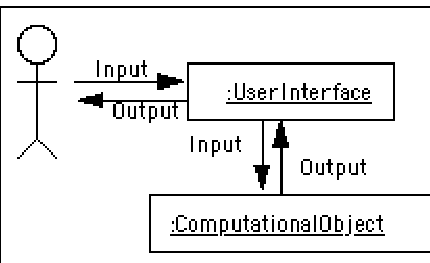

这种方法让我们能够将计算对象与三种用户界面中的任意一种结合。

**JAVA 有效设计** 用户界面模块：将接口与计算对象分离是划分执行 I/O 操作程序中层级结构的好方法。

## 4.3 命令行接口

命令行接口可能是设计用户与程序之间接口最简单、最古老的方法。根据这种方法，用户输入从键盘获取，程序的输出显示在某种控制台上（如图 4.2 所示）。

> 图 4.2：命令行用户界面。

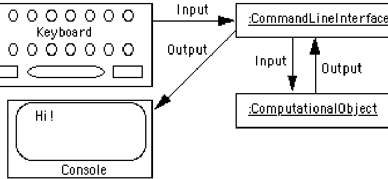

命令行方法也可以称为控制台界面。在计算机早期，在我们拥有能够显示多个窗口的图形计算机显示器之前，控制台就是整个计算机显示器。对于今天的计算机，控制台可能是你编程环境旁边的一个窗口，如图 4.3 所示。

在第 3 章中，我们描述了如何使用 `System.out.print()` 和 `System.out.println()` 方法向控制台输出字符串。这了命令行接口的输出端。更具挑战性的的任务是管理接口的输入端。

## 第 4 章 • 输入/输出：设计用户界面

图 4.3：Java 控制台窗口。

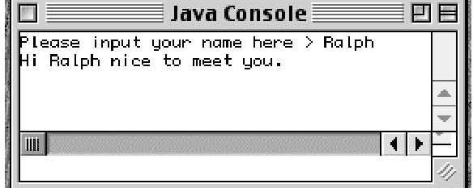

### 流

在 Java 中，输入和输出是由称为“流”（streams）的对象处理的。你可以将流想象为一种管道，数据通过它流动（如图 4.4 所示）。输入流将数据从某种输入设备（如键盘、网络连接或文件）传输到程序的主内存。输出流将数据从程序的内存传输到某种输出设备（如打印机或文件）。

图 4.4：输入流和输出流。

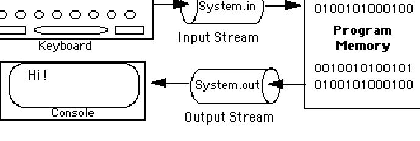

每个 Java 程序在启动时都有三个可用的标准流：`System.in`、`System.out` 和 `System.err`。`System.in` 是预定义的流，通常与键盘关联（如图 4.4 所示）。这意味着它将数据从键盘传输到程序。`System.out` 和 `System.err` 都是与控制台关联的输出流。区别在于 `System.out` 用于正常输出，而 `System.err` 用于错误消息。

### 4.3.1 使用 BufferedReader 从键盘输入字符串

#### 缓冲输入

我们使用 `BufferedReader` 对象来处理来自键盘的输入数据。正如其名，`BufferedReader` 类执行缓冲输入。缓冲区是主内存中的一部分，输入在此处留，直到程序需要它为止。在键盘和程序之间使用缓冲区允许你使用退格键（Backspace）删除字符。当你按下回车键（Enter）时，当程序从输入缓冲区检索字符时，被删除的字符将被忽略。如果用户的输入没有这样被缓冲，它将包含每一次按键（包括退格键），然后由程序来消除应该被删除的字符。

## 第 4.3 节 • 命令行接口

图 4.5：`BufferedReader` 类。

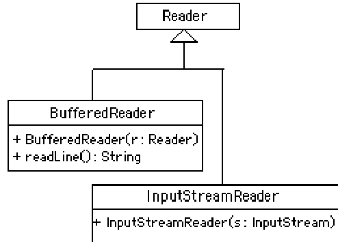

图 45 是 `BufferedReader` 类的 UML 图，显示了它与其他用于键盘输入的类的关系。注意，除了 `InputStreamReader` 之外，`BufferedReader` 是 `Reader` 类的子类之一。`BufferedReader` 有两个重要方法。它的构造方法接受一个 `Reader` 参数，这意味着当我们创建一个 `Reader` 对象时，必须为其提供某种 `Reader` 对象的引用。为了实现这一点，我们需要提供一个可以读取 `System.in`（标准输入流）对象的引用。如图所示，`InputStreamReader` 有一个允许它读取 `InputStream` 的构造函数。因此，为了构造一个读取 `System.in` 的 `BufferedReader`，我们使用以下语句：

```java
BufferedReader input = new BufferedReader(
new InputStreamReader(System.in));
```

在这条语句中，我们创建了两个对象。我们首先创建 `InputStreamReader`，并给它 `System.in` 的引用。然后我们将该对象传递给 `BufferedReader`。结果是两个对象的协作，使我们能够对键盘进行缓冲读取。

通过这种方式创建 `BufferedReader`，每当我们使用它的 `readLine()` 方法时，它都会从键盘读取一行字符。例如，有一个名为 `input` 的 `BufferedReader`，下面的代码段将读取一行输入并赋值给名为 `inputString` 的 `String` 变量。

```java
String inputString = input.readLine();
```

当程序遇到 `readLine()` 表达式时，它将等待用户按下回车键。然后它会将用户输入的任何内容（减去任何被退格的字符）输入到 `String` 变量中。


**JAVA 语言规则** 键盘输入。`BufferedReader.readLine()` 方法允许在键盘输入期间进行退格操作。

### 4.3.2 从键盘输入数字

如上一节所示，我们可以使用 `BufferedReader` 对象从键盘输入字符串。在 Java 中，所有键盘输入都表示为字符串。然而，如果我们想输入数字？答案是我们必须从输入中提取数字。为了做到这一点，Java 提供了特殊的类，称为包装类：`Integer` 和 `Double`。

#### 包装类

包装类包含将原始数据转换为对象以及相互转换的方法。`Integer` 类包含 `parseInt()` 方法，它可以从字符串中提取整数。例如，数字 55：

```java
int m = Integer.parseInt("55");
```

同样，`Double` 类包含 `parseDouble()` 方法，它可以从字符串中提取双精度浮点数。在此示例中，数字 5.2：

```java
double num = Double.parseDouble("5.2");
```

下面的代码段说明了如何使用 `KeyboardReader` 输入整数：

```java
KeyboardReader cmdline = new KeyboardReader();
int m = cmdline.getKeyboardInteger();
```

### 4.3.3 设计 类

注意我们在示例中包含了提示（prompts），以便用户知道预期的输入类型。设计合适的提示是设计用户界面的重要方面。

> **JAVA 设计** 提示。在良好的界面中，应该使用提示引导用户完成过程。


现在我们已经引入了用于命令行输入的库类和方法，让我们设计一个类来封装这些功能。我们希望有一个使用 `BufferedReader` 从键盘读取任何类型数据（字符串、整数或实数）的类。我们还希望该类隐藏执行键盘输入时涉及的一些杂乱细节。

| KeyboardReader | 使用 |
| :--- | :--- |
| - reader: BufferedReader | BufferedReader |
| + KeyboardReader() | |
| + getTextInput(): String | |
| + getKeyboardInteger(): int | |
| + getKeyboardDouble(): double | |
| + prompt(s): String | |
| + display(s): String | |
| - readKeyboard(): String | |

图 4.6：`KeyboardReader` 类的设计。

# 第 4 章 • 输入/输出：设计用户界面

我们需要做的只是创建一个 `KeyboardReader` 实例并让它为我们获取一个整数。这极大地简化了我们想要执行键盘输入时需要完成的工作。

注意图 4.6 列出了 `KeyboardReader` 类中一个名为 `read()` 的方法。这是执行从键盘读取数据实际工作的方法。它是私有的（private），因此它可以被 `KeyboardReader` 中的其他方法调用，但它不能被其他类调用。我们将其设为私有是为了向其他类隐藏它以及执行键盘输入的细节。

这些细节中的之一是，当执行 I/O 操作时，可能会出现问题。错误的可能性适用于所有形式的 I/O，而不仅仅是键盘 I/O。例如，当程序尝试读取文件时，文件可能不存在；或者当尝试下载网页时，互联网连接可能会故障。

由于这些类型的外部错误存在，Java 要求每当程序执行特定类型的 I/O 时，必须关注某些类型的错误状况，即“异常”（Exceptions）。异常将在第 11 章中介绍，因此我们在这里不会尝试涵盖它们。相反，我们将设计 `read()` 方法来为你处理这一细节。

#### 私有辅助方法

#### I/O 异常

> **JAVA 语言规则** 异常。I/O 方法要求程序在输入期间捕获某些错误状况。

图 4.7 给出了 `KeyboardReader` 类（目前）的完整实现。让我们逐行查看。首先要注意的是 `import` 语句的使用。导入 Java 数据包使我们能够通过它们的名称（如 `BufferedReader`）来引用包中的元素，而不是通过它们的完全限定名称（如 `java.io.BufferedReader`）。


# 第 4.3 节 • 命令行界面

接下来，我们在 `KeyboardReader` 构造函数中创建了一个 `BufferedReader` 对象：

```java
reader = new BufferedReader(
    new InputStreamReader(System.in));
```

生成的读取器只要 `KeyboardReader` 存在就会一直存在，并可以用于后续所有的输入操作。

接下来是 `read()` 方法的定义。它调用继承的 `readLine()` 方法从键盘输入一行并将其返回。然而，如何在 `try...catch` 块中调用实现的 `readLine()` 方法呢？这是处理输入操作过程中可能发生异常的一种方法。Java 要求我们的程序必须处理 I/O 异常的可能性，正如我们将在第 11 章中学到的，这里我们可能还会使用其他设计。这样做的主要优点是我们可以将这种语言细节从程序的其余部分隐藏。程序的其余部分——以及任何使用 `KeyboardReader` 类的其他程序——将不必担心这个异常。你只需要使用 `KeyboardReader` 来获取字符串或整数，它就能完成任务。


```java
import java.io.*;

public class KeyboardReader {
    private BufferedReader reader;

    public KeyboardReader() {
        reader = new BufferedReader(new InputStreamReader(System.in));
    }

    public String getKeyboard() {
        return reader.readLine();
    }

    public int getKeyboardInteger() {
        return Integer.parseInt(getKeyboard());
    }

    public double getKeyboardDouble() {
        return Double.parseDouble(getKeyboard());
    }

    public void prompt(String s) {
        System.out.print(s);
    }

    public void display(String s) {
        System.out.print(s);
    }

    private String readKeyboard() {
        String line = "";
        try {
            line = reader.readLine();
        } catch (IOException e) {
            e.printStackTrace();
        }
        return line;
    }
}
```

图 4.7：`KeyboardReader` 类的定义。

接下来，注意公共输入方法是如何定义的。`getKeyboard()` 方法只需返回通过调用 `readKeyboard()` 获取的行。`getKeyboardInteger()` 方法也调用 `readKeyboard()`，但它不是返回该行，而是从中提取一个整数并返回该整数。`getKeyboardDouble()` 和 `prompt()` 方法的方法类似。

最后，注意公共输出方法是如何定义的。`prompt()` 和 `display()` 方法都接受一个 `String` 参数并执行完全相同的操作——它们仅仅是打印它。那么既然一个方法就足够了，为什么我们需要两个方法？答案是这些方法封装了重要且不同的接口功能——提示用户和显示输出——在 particular情况下，它们的实现方式恰好相同。正如我们在设计 GUI 界面时看到的，我们将使用完全不同的对象来提示用户和显示输出。因此，尽管它们有相似之处，但将“提示用户”的任务与更通用的“显示输出”任务区分来是非常重要的。

# 第 4 章 • 输入/输出：设计用户界面

## 4.3.4 设计命令行界面

现在我们定义了一个用于执行键盘输入的特殊类，现在我们展示它如何与组成程序的其他对象协作作为用户界面使用。正如图 4.7 所示，我们设计了一个简单的命令行界面，通过微调，它就可以用于后续章节中几乎所有的编程任务。

在继续之前，涉及一下我们在设计中采用的一些重要面向对象原则可能会有所帮助。

- 分而治之：我们利用将程序划分为独立对象的用性，一个用于处理应用程序所需的复杂性，另一个用于处理用户界面。
- 封装：我们设计的类封装了执行其特定角色所必需的信息和行为。
- 信息隐藏：我们使用私有方法向程序的其他部分隐藏某些杂乱的实现细节。
- 通用性和可扩展性：我们开发的设计足够通用，可以扩展到其他应用程序。

总结一下，我们设计了一个简单的命令行界面，通过微调，就可以用于后续章节中几乎所有的编程任务。

这些细节中的之一是，当执行 I/O 操作时，可能会出现问题。错误的可能性适用于所有形式的 I/O，而不仅仅是键盘 I/O。例如，当程序尝试读取文件时，文件可能不存在；或者尝试下载网页时，互联网连接可能会故障。

由于这些类型的外部错误存在，Java 要求每当程序执行特定类型的 I/O 时，必须关注某些类型的错误状况，即异常。异常将在第 11 章中介绍，因此我们在这里不会尝试涵盖它们。相反，我们将设计 `read()` 方法来为你处理这一细节。

### 私有辅助方法

### I/O 异常

> **JAVA 语言规则 异常**。I/O 方法要求程序在输入期间捕获某些错误状况。

图 4.7 给出了 `KeyboardReader` 类（目前）的完整实现。让我们逐行查看。首先要注意的是 `import` 语句的使用。导入 Java 数据包使我们能够通过它们的名称（如 `BufferedReader`）来引用包中的元素，而不是通过它们的完全限定名称（如 `java.io.BufferedReader`）。

接下来，我们在 `KeyboardReader` 构造函数中创建了一个 `BufferedReader` 对象：

```java
reader = new BufferedReader(
    new InputStreamReader(System.in));
```

生成的读取器只要 `KeyboardReader` 存在就会一直存在，并可以用于后续所有的输入操作。

接下来是 `read()` 方法的定义。它调用继承的 `readLine()` 方法从键盘输入一行并将其返回。然而，如何在 `try...catch` 块中调用实现的 `readLine()` 方法呢？这是处理输入操作过程中可能发生异常的一种方法。Java 要求我们的程序必须处理 I/O 异常的可能性，正如我们将在第 11 章中学到的，这里我们可能还会使用其他设计。这样做的主要优点是我们可以将这种语言细节从程序的其余部分隐藏。程序的其余部分——以及任何使用 `KeyboardReader` 类的其他程序——将不必担心这个异常。你只需要使用 `KeyboardReader` 来获取字符串或整数，它就能完成任务。


```java
public class KeyboardReader {
    private BufferedReader reader;

    public KeyboardReader() {
        reader = new BufferedReader(new InputStreamReader(System.in));
    }

    public String getKeyboard() {
        return reader.readLine();
    }

    public int getKeyboardInteger() {
        return Integer.parseInt(getKeyboard());
    }

    public double getKeyboardDouble() {
        return Double.parseDouble(getKeyboard());
    }

    public void prompt(String s) {
        System.out.print(s);
    }

    public void display(String s) {
        System.out.print(s);
    }

    private String readKeyboard() {
        String line = "";
        try {
            line = reader.readLine();
        } catch (IOException e) {
            e.printStackTrace();
        }
        return line;
    }
}
```

图 4.7：`KeyboardReader` 类的定义。

接下来，注意公共输入方法是如何定义的。`getKeyboard()` 方法只需返回通过调用 `readKeyboard()` 获取的行。`getKeyboardInteger()` 方法也调用 `readKeyboard()`，但它不是返回该行，而是从中提取一个整数并返回该整数。`getKeyboardDouble()` 和 `prompt()` 方法类似。

最后，注意公共输出方法是如何定义的。`prompt()` 和 `display()` 方法都接受一个 `String` 参数并执行完全相同的操作——它们仅仅是打印它。那么既然一个方法就足够了，为什么我们需要两个方法？答案是这些方法封装了重要且不同的接口功能——提示用户和显示输出——在 particular情况下它们的实现方式恰好相同。正如我们在设计 GUI 界面时看到的，我们将使用完全不同的对象来提示用户和显示输出。

## 4.3.4 设计命令行界面

现在我们定义了一个用于执行键盘输入的特殊类，现在我们展示它如何与组成程序的其他对象协作作为用户界面使用。正如图 4.7 所示，我们设计了一个简单的命令行界面，通过微调，它就可以用于后续章节中几乎所有的编程任务。

在继续之前，涉及一下我们在设计中采用的一些重要面向对象原则可能会有所帮助。

- 分而治之：我们利用将程序划分为独立对象的用性，一个用于处理应用程序所需的复杂性，另一个用于处理用户界面。
- 封装：我们设计的类封装了执行其特定角色所必需的信息和行为。
- 信息隐藏：我们使用私有方法向程序的其他部分隐藏某些杂乱的实现细节。
- 通用性和可扩展性：我们开发的设计足够通用，可以扩展到其他应用程序。

总结一下，我们设计了一个简单的命令行界面，通过微调，就可以用于后续章节中几乎所有的编程任务。

这些细节中的之一是，当执行 I/O 操作时，可能会出现问题。错误的可能性适用于所有形式的 I/O，而不仅仅是键盘 I/O。例如，当程序尝试读取文件时，文件可能不存在；或者尝试下载网页时，互联网连接可能会故障。

由于这些类型的外部错误存在，Java 要求每当程序执行特定类型的 I/O 时，必须关注某些类型的错误状况，即异常。异常将在第 11 章中介绍，因此我们在这里不会尝试涵盖它们。相反，我们将设计 `read()` 方法来为你处理这一细节。

### 私有辅助方法

### I/O 异常

> **JAVA 语言规则 异常**。I/O 方法要求程序在输入期间捕获某些错误状况。

图 4.7 给出了 `KeyboardReader` 类（目前）的完整实现。让我们逐行查看。首先要注意的是 `import` 语句的使用。导入 Java 数据包使我们能够通过它们的名称（如 `BufferedReader`）来引用包中的元素，而不是通过它们的完全限定名称（如 `java.io.BufferedReader`）。

接下来，我们在 `KeyboardReader` 构造函数中创建了一个 `BufferedReader` 对象：

```java
reader = new BufferedReader(
    new InputStreamReader(System.in));
```

生成的读取器只要 `KeyboardReader` 存在就会一直存在，并可以用于后续所有的输入操作。

接下来是 `read()` 方法的定义。它调用继承的 `readLine()` 方法从键盘输入一行并将其返回。然而，如何在 `try...catch` 块中调用实现的 `readLine()` 方法呢？这是处理输入操作过程中可能发生异常的一种方法。Java 要求我们的程序必须处理 I/O 异常的可能性，正如我们将在第 11 章中学到的，这里我们可能还会使用其他设计。这样做的主要优点是我们可以将这种语言细节从程序的其余部分隐藏。程序的其余部分——以及任何使用 `KeyboardReader` 类的其他程序——将不必担心这个异常。你只需要使用 `KeyboardReader` 来获取字符串或整数，它就能完成任务。


```java
public class KeyboardReader {
    private BufferedReader reader;

    public KeyboardReader() {
        reader = new BufferedReader(new InputStreamReader(System.in));
    }

    public String getKeyboard() {
        return reader.readLine();
    }

    public int getKeyboardInteger() {
        return Integer.parseInt(getKeyboard());
    }

    public double getKeyboardDouble() {
        return Double.parseDouble(getKeyboard());
    }

    public void prompt(String s) {
        System.out.print(s);
    }

    public void display(String s) {
        System.out.print(s);
    }

    private String readKeyboard() {
        String line = "";
        try {
            line = reader.readLine();
        } catch (IOException e) {
            e.printStackTrace();
        }
        return line;
    }
}
```

图 4.7：`KeyboardReader` 类的定义。


```java
public class GreeterApp {
    private KeyboardReader reader;

    public GreeterApp() {
        reader = new KeyboardReader();
    }

    public void run() {
        String name = "";
        reader.prompt("Please input your name here ");
        name = reader.getKeyboardInput();
        reader.display(greet(name) + "\n");
        reader.run();
    }

    public String greet(String name) {
        return "HI, " + name + " nice to meet you.";
    }

    public static void main(String[] args[]) {
        GreeterApp app = new GreeterApp();
        app.run();
    }
}
```

图 4.9：`GreeterApp` 类的定义。

# 自学练习题

练习 4.1 Java 的 `Math` 类有一个静态方法，可以生成一个 0 到 0.99999999 之间的随机数——也就是说，在 0 到 1 之间，但不包括 1。通过简单的算术，我们可以生成任意两个值之间的随机数。例如，以下语句将一个 1 到 100 之间的随机整数赋值给变量：

```java
secretNumber = 1 + (int)(Math.random() * 100);
```

根据此语句，设计并实现一个应用程序，与用户进行以下猜数字游戏：计算机生成一个 1 到 100 之间的随机数，并让用户猜数字，当猜测太高或太低时告诉用户。注意，对于这个问题，用户需要能够从键盘进行输入。

## 4.4 图形用户界面 (GUI)

虽然命令行界面非常有用，但 Java 语言最大的优势之一是，其丰富的类库使得能够容易地开发出使用图形用户界面（GUI）的应用程序。GUI 已经存在了多年，自 20 世纪 80 年代初 Macintosh 问世以来。今天，几乎所有的个人应用都是基于 GUI 的。因此，让初学者设计并编写与他们每天使用的程序相似的程序（尽管规模较小）是至关重要的。其他方面，开发编写 GUI 程序的能力将使你更容易向他人展示你的工作成果，这可能会激发他们对学习编程的进一步兴趣。


# 4.4 图形用户界面 (GUI)

在接下来的章节中，我们将开发一个可扩展的 GUI 模型，它可以与任何 Java 应用程序或 Applet 使用。我们所说的“可扩展”是指一个可以被轻松适配并用于各种程序中的模型。GUI 编程涉及一种对事件做出响应的计算模型，这些事件是事件驱动的，主要由与 GUI 元素的交互产生。因此，我们将帮助你学习如何使用我们的 GUI 事件模型来处理简单事件。

鉴于这是第一次接触某些主题，我们将保持讨论尽可能简单。这意味着我们将讨论某些问题，这些问题将在第 13 章中深入探讨。

## 4.4.1 Java GUI 组件

Java 库带有两个独立的 GUI 组件包：较旧的 `java.awt` 包和较新的 `javax.swing` 包。对于大多数情况，Swing 类已取代 AWT 类。例如，`java.awt.Button` 类被 `javax.swing.JButton` 类取代，`java.awt.TextField` 类被 `javax.swing.JTextField` 类取代。正如这些示例所示，新的 Swing 组件在与其对应的 AWT 组件名称开头添加了字母 'J'。


图 4.10：来自 `javax.swing` 包的各种 GUI 组件。[图注：我们需要为组件标记标签。]

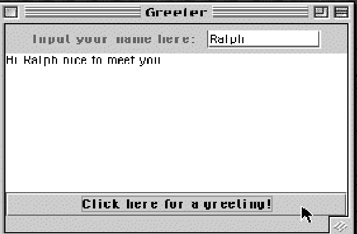

图 4.10 展示了一些主要组件在 GUI 界面中的外观。如所示，`JLabel` 仅仅是显示在 GUI 上的文本字符串，在这里用作提示。`JTextField` 是一个可以包含单行文本的输入元素。在这种情况下，用户输入他的名字。`JTextArea` 是一个可以显示多行文本的输出组件。在这个示例中，它显示了一个简单的问候。`JButton` 是一个带有标签的控件，它是允许用户控制与程序交互的元素。在这个示例中，每当 `JButton` 触发事件时，用户将收到输入到 `JTextField` 中的名字的问候，这导致程序执行显示问候的动作。最后，所有这些组件都包含在 `JFrame` 中，它是一个顶层容器。`Container` 是可以包含其他组件的 GUI。

### 模型-视图-控制器 (MVC) 架构

Swing 类通常被认为优于它们的 AWT 对应。首先，Swing 使用了复杂的面向对象设计，如模型-视图-控制器 (MVC) 架构，这使得它们比 AWT 对应具有强大得多的功能。例如，AWT Button 只能有一个字符串作为标签，而 Swing `JLabel` 则可以显示图像（关于 MVC 架构的详细描述请参阅第 13 章）。

其次，Swing 组件完全用 Java 编写，这使得它们更具可移植性，并允许它们无论在什么操作系统上运行都相同。由于其可移植性，Swing 组件被认为是轻量级的。相比之下，AWT 类使用在底层操作系统中实现的程序，并不是完全可移植的。因此，它们被认为是重量级组件。一个 Swing Button 无论在什么平台上，外观和感觉都是相同的；而 AWT Button 在 Macintosh 和 Windows 系统上会有不同的外观和感觉。在书中，我们将在程序中使用新的 Swing 类。

### Swing 的可移植性

## 4.4.2 类继承：扩展父类

正如你从第 0 章回想的，类继承是对象类获取（继承）其父类方法和变量的机制。正如一匹马通过属于马的类继承了哺乳动物的那些属性和行为，更广泛地说，继承了动物的属性一样，Java 子类继承其父类的变量和方法。我们有时会将对象的属性和行为归在一起，统称为其功能性。因此我们说子类的对象继承了该功能性。

图 4.12: 一个简单的窗口。


```java
import javax.swing.*;
public class SimpleGUI extends JFrame {
    public SimpleGUI(String title) {
        setSize(200,150);
        setLocation(100, 150);
        setTitle(title);
        setVisible(true); // 显示 JFrame
    }

    public static void main(String[] args) {
        new SimpleGUI("My GUI");
    }
}
```

图 4.13: 一个带有标题的顶层窗口，以及其他组件。它知道如何调整自身的大小并关闭，等等。我们之所以想要定义 `JFrame` 的子类而不是直接使用 `JFrame` 实例，是因为我们最终想要为该子类添加专门针对我们应用程序的额外功能。

> **JAVA 有效设计：专门化。** 通过创建 `JFrame` 的子类，我们可以为我们的应用程序对其功能进行定制。

注意 `SimpleGUI.main()` 如何通过调用其构造函数创建 `SimpleGUI` 实例。这里不需要使用变量，因为在该类中没有对该对象的进一步引用。然而，仅仅构造一个 `SimpleGUI` 并不会让它在控制台上出现。为了实现这一点，必须给它设置一个大小并调用它的 `setVisible()` 方法。这是在构造方法中完成的。

构造方法说明了如何使用继承自 `JFrame` 的一些方法。图 4.14 显示了 `SimpleGUI` 继承自 `JFrame` 的一些方法。我们使用 `setSize()` 和 `setLocation()` 方法设置 `SimpleGUI` 的大小和位置。我们使用 `setTitle()` 方法设置其标题。使用 `setVisible` 方法让它在控制台上显示。

| JFrame |
| :--- |
| + JFrame(title: String) |
| + getContentPane(): Container |
| + setLayout(LayoutManager) |
| + setTitle(s: String) |
| + getTitle(): String |
| + add(c: Component) |
| + pack() |
| + show() |
| + setSize(int, int) |
| + setLocation(x:int, y:int) |

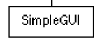

## 4.4.4 用于输入、输出和控制的 GUI 组件

为了使我们的顶层窗口作为一个界面，必须给它提供一些组件。图 4.15 提供了主要 Swing 组件的概述。通常有三类型的组件，分别对应用户界面的三个主要功能：输入、输出和控制。`JTextField` 是输入组件的一个示例。用户可以在文本框中输入文本，这些文本可以被传递给程序。`JTextArea` 是输出组件的示例。程序可以在区域内显示文本。

`JButton` 允许用户控制控件的动作。它可以与某个动作相关联，每当用户点击它时，该动作就会触发。我们可能还会把 `JLabel` 视为一种输出组件，因为我们可以使用它来提示用户采取什么类型的操作。

让我们从创建一个简单的用户界面开始，使我们能够用最少的 Swing 组件执行操作。这将允许我们演示用户界面设计的基本原理和技术，并产生一个可以扩展到更复杂应用的 GUI。对于这个示例，我们将简单地问候用户，就像我们在命令行界面中所做的那样。这意味着用户将被提示输入名字，程序将通过显示问候来响应（图 4.10）。我们将我们的 GUI 命名为 `GreeterGUI`，这表明它与我们在命令行界面使用的同一个 `Greeter` 计算对象存在依赖关系。

对于此应用程序，我们的 GUI 将使用以下组件：

- `JTextField` 将用于接受用户输入。
- `JTextArea` 将用于显示程序的输出。
- `JButton` 将允许用户请求输出。
- `JLabel` 将作为 `JTextField` 的提示。

图 4.15: Swing 组件。

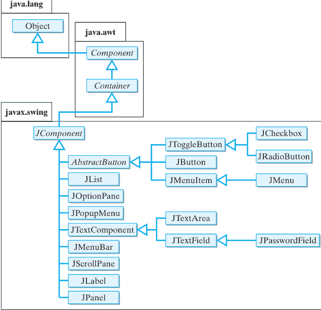

图 4.16 显示了 `JTextArea`、`JTextField`、`JButton` 和 `JLabel` 组件的一些构造函数和公共方法。以下代码段说明了如何使用这些构造函数来创建这些组件的实例：

```java
// 为组件声明实例变量
private JLabel prompt;
private JTextField inField;
private JTextArea display;
private JButton jButton;
// 实例化组件
prompt = new JLabel("Please type your name here:");
// 10字符宽
inField = new JTextField(10);
display = new JTextArea(10, 30); // 30列
jButton = new JButton("Click here for a greeting!");
```

对于这个示例，我们使用了一些较简单的构造函数。因此，我们创建了一个大小为 10 的 `JTextField`。这意味着它可以显示 10 个字符的输入。我们创建了一个 10 行文本的 `JTextArea`，每行宽 30 个字符。

| JButton |
| :--- |
| + JButton(text : String) |
| + addActionListener(al : ActionListener) |
| + setEnabled(b: boolean) |

图 4.16: Swing 组件的构造函数和公共方法。

| JLabel |
| :--- |
| + JLabel(text : String) |
| + getText() : String |

| JTextField |
| :--- |
| + JTextField(columns : int) |
| + getText() : String |

| JTextArea |
| :--- |
| + JTextArea(rows : int, cols : int) |
| + append(text : String) |

## 4.4.5 容器与布局管理器

容器的布局由其默认布局管理器控制，布局管理器是与容器关联的对象，它决定了组件的大小和排列。对于内容区域，默认布局管理器是 `BorderLayout`。这种排列允许组件放置在面板中心以及它的北、南、东、西边界（图 4.17）。

图 4.17: 边界布局中的组件排列。


通过 `add(String region, Component comp)` 方法添加到边界布局，其中 String 参数指定“北”、“南”、“东”或“中间”。例如，为了将 `JTextField` 添加到中心，我们创建其内容区的引用，然后将其添加到中心：

```java
Container contentPane = getContentPane(); // 获取面板
contentPane.add("Center", display); // 添加 JTextArea
```

边界布局的一个局限性是每个区域只能添加一个组件。对于我们的示例来说，这是一个问题，因为我们希望提示 `JLabel` 位于 `JTextField` 之前。为了解决这个问题，我们将创建一个另一个容器 `JPanel`，并将提示、文本框和 `getButton` 添加到其中。这样，所有涉及获取输入的组件都将组织在一个面板中。然后我们将该面板添加到内容区域中。

```java
JPanel inputPanel = new JPanel();
inputPanel.add(prompt); // 添加 JLabel 到面板
inputPanel.add(inField); // 添加 JTextField 到面板
inputPanel.add(jButton); // 添加 JButton 到面板
contentPane.add("South", inputPanel); // 添加到 JFrame
```

`JPanel` 的默认布局是 `FlowLayout`，这意味着组件从左侧添加，最后添加的位于序列末尾。对于这个 `JPanel` 来说，这是一个合适的布局，因为它会将提示放在输入文本框的左侧。

## 4.4.6 控制 GUI 的动作

在我们知道如何在 GUI 上放置所有组件之后，我们需要设计 GUI 的控件。正如之前提到的，GUI 使用的是一种事件驱动编程的形式。每当你使用计算机时发生的任何事情——每一次击键和鼠标移动——都被分类为一种事件。图 4.18 展示了：事件由计算机硬件产生，并通过操作系统和应用程序向上层层过滤。事件由特殊的对象监听器（object listeners）处理。监听器是一个监控特定类型事件的专家程序。某些事件（例如在 CD 驱动器中插入 CD）是由操作系统中的监听器处理的。另一些事件（例如在网页或 Word 文档中输入内容）是由应用程序软件（如文字处理器或事件循环）中的监听器处理的。也就是说，程序会不断地监听事件，每当事件发生时，就会采取某种行动。实际上，我们可以将此事件循环描述如下：

> 无限重复，或者程序停止
>
> 监听事件
>
> 如果发生事件-A，用 event-A-handler 处理它
>
> 如果发生事件-B，用 event-B-handler 处理它

事件循环（event loop）不断监听事件的发生，然后捕获相应的对象来处理每个事件。

图 4.19 显示了 `java.awt` 包中一些主要的事件类型。在某些情况下，事件类的名称暗示了它们的作用。当移动鼠标时，会发生 `MouseEvent`。当使用键盘时，会发生 `KeyEvent`。我们的程序需要监听的唯一事件是 `ActionEvent`，用户点击 `JButton` 时发生的事件类型。

当用户点击 `JButton` 时，Java 将创建一个 `ActionEvent` 对象。该对象包含了关于事件的重要信息，例如事件发生的时间以及作为事件发生点的对象（例如 `JButton`）。对于我们的应用程序，当用户点击 `JButton` 时，程序应该从 `JTextField` 获取用户的用户名，并在 `JTextArea` 中显示问候语，例如“你好 John，很高兴见到你”。

图 4.19：Java 的事件层次结构。

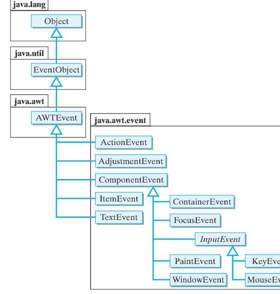

也就是说，我们希望程序执行以下代码段：

```java
String name = inField.getText();
display.append(greeter.greet(name) + "\n");
```

第一行使用 `JTextField.getText()` 方法获取用户在 `JTextField` 中输入的文本，并将其存储在局部变量 `name` 中。第二行将 `name` 传递给 `greeter.greet()` 方法，并将返回的结果传递给 `JTextArea.append()` 方法。这将实现在 `JTextArea` 的末尾显示文本。在这个示例中，我们使用了 `JTextField` 和 `JTextArea` 类的几个标准公共方法。对于我们简单的 GUI，图 4.16 中描述的方法对于满足我们的需求了。然而，如果你想查看此组件以及其他 Swing 组件的可用方法，请查阅 Java 的 API 文档。

## 4.4.7 `ActionListener` 接口

鉴于上述代码段将承担问候用户的任务，我们应该将该代码段放在程序的什么位置呢？我们希望每当用户点击 `goButton` 时都能调用该代码段。你已经足够的 Java 知识来理解我们应该把这些代码放在一个 Java 方法中。然而，在这种情况下，我们需要一个特殊的方法，一个每当用户点击按钮时由 Java 自动调用的方法。

换句话说，我们需要为按钮监听器编写一个特殊方法，它知道在按钮被点击时如何调用。

Java 通过允许我们定义一个按钮监听器的特殊方法，使其知道在按钮被点击时如何调用，从而解决了这个问题。

## 4.4.8 将 GUI 连接到计算对象

图 4.20 给出了我们 `GreeterGUI` 接口的完整源代码。由于这里的内容较多，尽管我们已经介绍了它的大部分元素，但仔细阅读一遍程序可能会有所帮助。


```java
import java.swing.*;
import java.awt.*;
import java.awt.*;

public class GreeterGUI extends ActionListener {
    private JTextArea display;
    private JTextField inField;
    private JButton goButton;
    private Greeter greeter;

    public GreeterGUI(String title) {
        greeter = new Greeter();
        buildUI();
        setTitle(title);
        pack();
        setVisible(true);
    }
    private void buildUI() {
        getContentPane contentPane = getContentPane();
        contentPane.setLayout(new BorderLayout());
        display = new JTextArea(10,30);
        inField = new JTextField(10);
        goButton = new JButton("Click here for a greeting!");
        goButton.addActionListener(this);
        JPanel inputPanel = new JPanel();
        inputPanel.add(new JLabel("Input your name: "));
        inputPanel.add(inField);
        inputPanel.add(goButton);
        contentPane.add("Center", display);
        contentPane.add("South", inputPanel);
    }
    public void actionPerformed(ActionEvent e) {
        if (e.getSource() == goButton) {
            String name = inField.getText();
            display.append(greeter.greet(name) + "\n");
        }
    }
}
```

图 4.20：`GreeterGUI` 类的定义。这可以帮助我们整合已经介绍过的各种概念。注意此程序中必须包含的几个 Java 包。`java.swing` 包包含了所有 Swing 组件的定义。`java.awt.event` 包包含了 `ActionEvent` 类和 `ActionEventListener` 接口，而 `java.awt` 包包含 `Container` 类。

接下来看 `GreeterGUI` 类是如何定义为 `JFrame` 的子类并实现 `ActionListener` 接口的。`GreeterGUI` 继承了 `JFrame` 的所有功能。此外，我们无疑也赋予了它一些功能。其中一个功能之一是作为其 `jButton` 的 `ActionListener`。`ActionListener` 接口完全由 `actionPerformed()` 方法组成，该方法在程序中定义。此方法封装了用户点击按钮时将执行的操作。

`Greeter` 的下一个元素是它的四个实例变量，其中最重要的变量是设置 GUI 与计算对象之间关系的变量。在这种情况下，该变量在在 GUI 中，因此 GUI 使用了计算功能，如图 4.8 所示。这与我们在命令行界面中建立的关系略有不同，在命令行中是由计算对象使用变量（图 4.2）。

其他在整个过程中必须引用的 GUI 组件变量。例如，`jButton` 和 `display` 在 `buildGUI()` 方法中实例化，并在 `actionPerformed()` 方法中被引用。

程序的下一个元素是它的构造函数。它开始创建一个 `Greeter` 计算对象的实例。这样做很重要，因为我们需要从计算对象获取信息来构建 GUI。我们需要从 `Greeter` 中获取信息，并且在其他程序中也会需要此类信息。

我们已经讨论过构造函数的作用是协调 `GreeterGUI` 对象的初始化。它调用了 `buildGUI()` 方法，该方法负责布局 GUI 组件的细节。最后，它通过调用继承自 `JFrame` 的 `pack()` 和 `setVisible()` 方法来显示。`pack()` 方法根据其包含的组件的大小和布局来调整框架的大小。`setVisible()` 方法是实际上让 GUI 出现在 Java 控制台上的。

最后，注意 `buildGUI()` 方法的细节。我们已经讨论了每一个单独的语句。在这里我们看到声明的顺序。注意我们可以局部声明 `contentPane` 和输入变量，因为它们在类的其他地方没有被使用。

### 自我练习

我们可以对 `GreeterGUI` 进行一个简单的修改。`JTextField` 既可以作为输入元素，也可以作为动作事件的控件。每当用户在 `JTextField` 中按下 Return 或 Enter 键时，就会生成一个 `ActionEvent`，这样就可以移除 `jButton` 了。当然，为了利用这一功能，有必要在作为 `ActionListener` 时忽略 `inField`。请对 `buildGUI()` 和 `actionPerformed()` 方法进行相应的更改，使 `inField` 既能作为控件又是输入元素。将新类命名为 `GreeterGUI`。

### 4.4.9 在 Java 应用程序中使用 GUI

如你所知，Java 应用程序是一个独立的程序，可以单独运行的程序。我们设计的 GUI 可以方便地与 Java 应用程序一起。我们在上一节中看到 GUI 拥有对 `Greeter` 对象的引用，而 `Greeter` 就是计算对象。因此，要让程序作为应用程序运行只需要一个 `main()` 方法。

在应用程序中使用 GUI 的一种方法简单地在 `main()` 方法中创建一个实例。`main()` 方法可以放在 `GreeterGUI` 类本身中，也可以放在单独的类中。这里有一个在类中包含 main 的示例：

```java
public class GreeterApplication {
    public static void main(String args[]) {
        new GreeterGUI("Greeter");
    }
}
```

`main()` 方法创建了一个 `GreeterGUI` 实例，并传递一个字符串作为它的标题。如果你愿意，这个 `main()` 方法可以直接整合到 `GreeterGUI` 类中。

### 4.5 案例研究：One Nim 游戏

在本节中，我们将展示如何为上一节中开发的 One Nim 开发接口。回想一下，One Nim 游戏从 21 个硬币开始，玩家轮流取出 1 或 2 个硬币。我们希望开发一个程序来玩这个游戏，对抗电脑。

正如在本章中的其他示例一样，我们将此问题分为两个主要对象：一个计算对象和一个用户界面，在这种情况下是命令行界面或 GUI。我们现在关注将 `OneNim` 与 `KeyboardReader` 连接。如图 4.6 所示，main 将使用 `GameObject` 对象。事实上，这部分的主要变化是设计 `run()` 方法。下面的伪代码描述了我们算法的细节。我们将 `OneNim` 实例称为游戏对象，将 `KeyboardReader` 实例称为读者对象。我们使用符号 `get the number of sticks` 表示我们正在向游戏对象发送消息。

```
创建一个具有21个硬币的游戏对象
创建一个读者对象
stLeft = game: 获取硬币数量
reader: 显示游戏规则
while (game: 游戏未结束)
  whoseMove = game: 找到该轮到谁
  if (whoseMove == user)
    game: 选择要取的硬币数量
  else
    game: 选择要取的硬币数量
  sticksLeft = game: 获取硬币数量
  reader: 报告硬币数量
// 此时游戏结束
if (game: 用户是获胜者)
  reader: 报告用户获胜
else
  reader: 报告电脑获胜
```

# 178 第 4 章 · 输入/输出：设计用户界面

在这种情况下，初始化器是创建一个 `OneRowNim` 对象。我们知道这将导致游戏有 21 根棒子，并且轮到用户移动。循环进入的条件是游戏未结束，这是基于仍有棒子可以被捡取的这一事实。但同样，知识是由游戏对象维护的。最后，我们有一个更新器，由计算机或用户捡取棒子组成。这反过来会在每次迭代中改变 `sticksLeft` 的值，使我们更接近没有棒子剩下的条件，到该点游戏就结束了。

请注意，我们在该算法中省略了用户方法的详细细节。这些动作适合放在单独的方法中，在这些方法里我们可以考虑用户是否执行了合法移动以及其他细节。

图 4.22 提供了 `OneRowNim` 程序的实现。它使用 `KeyboardReader` 作为命令行接口，并将 `OneRowNim` 实例作为计算对象。因此，它为每个对象拥有私有实例变量，这些变量在构造方法中被实例化。我们描述的算法被放置在 `run()` 方法中，该方法在应用程序实例化后从 `main()` 调用。使用布尔方法 `gameOver()` 来控制循环使得代码段易于理解。此外，它还留给游戏对象来判断游戏何时结束。从面向对象的设计角度来看，这是一种适当的职责划分。如果你这样做，想象一下如果将这一判断交给用户界面，可能会发生什么错误。用户可以将界面向左和向移动移动，从而实现了错误的游戏结束规则。类似的点也适用于 `getWinner()` 方法。这一判断取决于游戏，而不是用户界面。如果留给用户界面，可能会因为编程错误而导致游戏完整性的丧失。

`run` 调用 `move()` 和 `compute()` 来执行与每种移动类型相关的特定动作。`move()` 使用 `KeyboardReader` 提示用户并输入其移动。然后它将用户的选择传递给 `game`。注意，它会返回一个值来判断移动是否合法，并通过接口提供适当的响应。

最后，注意我们如何使用私有方法来实现与用户方法和计算机方法相关的动作。由于这些方法不是对象接口的一部分，它们只能在对象内部使用，从次要意义上说，它们服务于对象的公共实例方法。我们有时称它们为辅助方法。这种分工允许我们将与方法相关的所有细节组织到单一模块中。`computeMove()` 使用了捡取一根棒子的策略，并将数量传递给 `game`。最后，`computeMove()` 通过接口报告该结果。在我们在下一章涵盖了 `int` 数据类型的运算符后，我们将能够更好地描述计算机进行移动的策略。

这个示例展示了使用我们的 `KeyboardReader` 用户界面是多么简单和直观。事实上，对于这个问题，我们的接口

分工

# 第 4.5 节 · 案例研究：单行 Nim 游戏

```java
public class OneRowNimApp {
    private KeyboardReader reader;
    private OneRowNim game;

    public OneRowNimApp() {
        reader = new KeyboardReader();
        game = new OneRowNim(21);
    } //OneRowNim()

    public void run() {
        int sticks = game.getSticks();
        reader.display("Let's play One Nim. You go first.\n");
        reader.display("There are " + sticks + " sticks left.\n");
        reader.display("You can pick up 1, 2, or 3 at a time.\n");
        while (game.gameOver() == false) {
            if (game.getPlayer() == 1) 
                userMove();
            else 
                computerMove();
            sticks = game.getSticks();
            reader.display("There are " + sticks + " sticks left.\n");
        }
        if (game.getWinner() == 1) {
            reader.display("Game over. You win. Nice game.\n");
        } else {
            reader.display("Game over. I win. Nice game.\n");
        }
    } //run()

    private void userMove() {
        reader.prompt("Do you take 1, 2, or 3 sticks? ");
        int userTakes = reader.getKeyInteger();
        if (game.takeSticks(userTakes)) {
            reader.display("You took " + userTakes + ".");
        } else {
            reader.display("You can't take " + userTakes + " Try again.\n");
        }
    } //userMove()

    private void computerMove() {
        game.takeAway(1); // Temporary strategy.
        reader.display("I take 1 stick. ");
    } //computerMove()

    public static void main(String[] args[]) {
        OneRowNimApp app = new OneRowNimApp();
        app.run();
    } //main()
} //OneRowNimApp
```

图 4.22：`OneRowNimApp` 的定义，一个指向 `OneRowNim` 的命令行界面。

# 第 4 章 · 输入/输出：设计用户界面

不需要任何更改。尽管在某些情况下我们想要扩展接口的功能，但它可以用于许多不同的问题。正如我们所提到的，它与 `GreeterGUI` 主要区别出现在 `actionPerformed()` 方法中。第一个任务是为 `OneRowNim` 设计 GUI：我们使用 `JTextField`、`JTextArea` 和 `JButton` 与用户交互。根据设计，跟踪游戏是否结束或轮到谁是由游戏负责的。伪代码所示，基本算法如下：

```
用户移动。
如果游戏未结束，让计算机移动。
显示剩余多少棒子。
报告剩余多少棒子。
如果游戏结束，停止
报告胜利者。
```

在用户移动后，可能用户捡起了最后一根棒子，这意味着游戏结束了。在这种情况下，计算机无法移动。或者，用户可能犯了错误。这些可能性必须在算法中考虑。图显示了 `OneRowNimGUI` 的完整实现，包括实例变量、构造方法及其 `buildGUI()`。此 GUI 与 `GreeterGUI`（图 4.20）之间只有几处区别。此 GUI 拥有 `JTextField`、`JTextArea` 和 `JButton` 的实例变量，以及 `OneRowNim` 实例（其计算对象）。它需要通过类来引用这些对象。

构造方法在之前的布局中起相同的作用，然后 `buildGUI()` 创建 GUI 的布局并将其显示在控制台上。`buildGUI()` 方法中的所有更改都与特定的细节有关，例如我们用作提示的文本和 `goButton()` 方法。我们在这里使用的一个方法是 `setText()`。

接下来考虑私有的 `userMove()` 和 `computerMove()`。它们的作用与命令行接口中的对应方法非常相似。这里的区别在于，对于用户移动，我们从 `JTextField` 输入用户的选择，而不是 `Keyboard`。另一个区别是，我们使用 `JTextField` 向用户显示程序的消息。

## 第 4 章 · 输入/输出：设计用户界面

图 4.23：`OneRowNim` 类。

## 第 5 节 · 文件输入

这里介绍了我们如何使用 `OneRowNim` 的公共方法 `getPlayer()`、`game()` 和 `getWinner()` 来控制与用户的交互。

与命令行界面不同的一个问题是：我们如何处理游戏的结束？因为我们使用了 Java 的内置循环，否则 GUI 将继续响应用户的事件，除非我们停止这样做。实现此目标的一种方法是禁用 `JButton` 和 `JTextField`。通过禁用控制元素，我们使其无法响应事件。通过这种方式，我们使用 `setEnabled(boolean)` 方法，它将值设置为 `false`，从而实际上“关闭”了该组件：

```java
if (game.gameOver()) { own  goButton.setEnabled(false); // 结束游戏
  textField.setEnabled(false);
}
```

虽然在这种情况不适用，但 `setEnabled()` 方法可以在 GUI 中反复使用，以便在交互上下文中切换组件的开启和关闭。


这个示例展示了为任何应用程序构建 GUI 是多么简单和直接。一个主要的设计问题是决定使用哪种输入、输出和控制元素。对于大多数应用程序，我们可以使用 `JTextField`、`JTextArea` 和 `JButton`。

第二个设计问题涉及 `actionPerformed()` 方法的开发，该方法必须以特定的方式进行设计。在这里，我们应用从 Java 事件编程模型中学到的知识：我们指定一个或多个元素作为 `ActionListener`，并设计算法来处理在该元素上发生的事件。

当然，对于某些应用程序，我们可能使用 `JTextField` 来处理输入。在某个时刻，我们还想引入 `JMenu` 和其他 GUI 元素。这些选项中的将在后续章节中介绍。另一些将在第 13 章介绍，该章节将提供 Java GUI 能力更全面的视图。

### JAVA 有效设计 GUI 设计

设计良好的 GUI 会恰当地利用输入、输出和控制元素。


## 4.6 源自 Java 库：java.io.File 和文件输入（可选）

除了命令行和 GUI 用户界面外，还有一种用户界面：文件。在本节中，我们展示了在第 2 章中用于键盘输入的 `Scanner` 类如何读取输入文件。从文件中读取仅与某些类型的编程问题有关。很难想象文件在玩 One Row Nim 游戏时如何被使用，但文件可能非常有助于存储一组谜语，由 Java 程序可以读取并显示它们。我们将在本节的后半部分开发这样一个程序。

Java 有两种文件：文本文件和二进制文件。文本文件存储字符序列，是 Windows 计算机上标准文本编辑器 Notepad 和 WordPad，或 Macintosh 上的 SimpleText 创建的文件类型。二进制文件具有更通用的格式，可以存储数字以及计算机中存储的其他数据。在本节中，我们只考虑文本文件。二进制文件将在第 11 章考虑。

### 4.6.1 使用 File 和 Scanner 进行文件输入

`File` 类的实例存储了 `Scanner` 创建连接到文本文件中字符序列的输入所需的信息。`File` 类的公共方法列表如图 4.26 中的 UML 类图。在本节中，我们需要使用 `File()` 构造函数。带有以下语句的 `File` 实例：

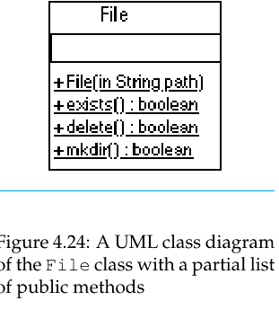

图 4.24：带有扩展公共方法列表的 File 类 UML 类图

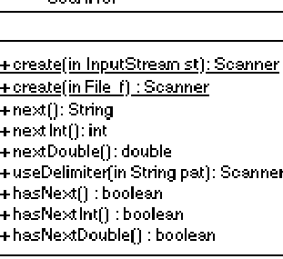

图 4.25：带有扩展公共方法列表的 Scanner UML 类图

```java
File createFile = new File("riddles.txt");
```

如果该文件存在，它将在执行 Java 代码的目录中查找并存储关于 "riddles.txt" 文件的信息。如果文件不存在，`File` 对象将存储创建此类文件所需的信息，但不会创建它。在第 11 章中，我们将描述其他对象如何使用 `File` 对象写入数据。如果我们想在包含它的之外的目录中创建 `File`，我们必须调用带有字符串参数的构造函数来指定其路径名——文件包含的字符序列。在任何情况下，我们现在都不会使用它，`File` 实例的 `exists()` 方法可以确定是否找到了指定名称的文件。

为了使用 `Scanner` 从文件中读取，我们需要使用在第 2 章中没有讨论的方法。`Scanner` 的扩展方法列表如图 4.27 所示。注意，有一个以 `File` 对象作为参数的 `Scanner()` 构造函数，与第 2 章使用的其他 `create()` 方法不同，这个 `create()` 会抛出一个必须处理的异常。以下代码将创建一个 `Scanner` 对象，它将连接到可以从文件中读取的输入流：

```java
try {
    File createFile = new File("riddles.txt");
    fileScan = new Scanner(createFile);
    fileScan = fileScan.useDelimiter("\r\n");
} catch (IOException e) {
    e.printStackTrace();
}
```

我们将在第 10 章讲解异常时讨论 `try-catch` 命令。在此之前，如果你想使用 `Scanner` 进行文件输入，可以完全复制上面的 `try-catch` 结构。在上面的代码中，使用了 `useDelimiter()` 方法来设置 `Scanner` 对象在 `Scanner` 对象读取的字符串中出现空格。对于从文件中读取谜语的类定义，上述代码属于一个构造方法。

当我们创建一个连接到文件的 `Scanner` 对象后，可以调用 `next()`、`nextDouble()` 或 `nextInt()` 方法分别从文件中读取整数、实数或字符串。与使用 `Scanner` 对象获取键盘输入的策略不同，建议你在读取文件之前先测试文件中是否有数据。

# 第 4 章 · 章节总结

文件将在第 11 章中介绍。关于向文件写入数据以及不使用 `Scanner` 类从文件读取数据的信息，可以在章节中找到。

## 自学练习

练习 4.3 修改 `RigidFileReader` 类创建一个名为 `NumberFileFileReader` 的程序，该程序打开名为 "numbers.txt" 的文件并报告文件中整数平方和。假设文件 "numbers.txt" 包含一个整数列表，其中每个整数单独一行。该程序应在 `System.out` 控制台窗口中打印平方和。在这种情况下，不需要为了显示正在读取的数据的方法，也不需要连接到键盘的 `Scanner` 对象。你需要一个构造方法和一个用于读取数字并计算平方和的方法。

## 技术术语

## 章节总结

- 抽象类
- 抽象接口
- 抽象方法
- AWT
- 二进制文件
- 缓冲区
- 命令行界面
- 容器
- 控制元素
- 事件驱动编程
- 事件循环
- 图形用户界面 (GUI)
- 辅助方法
- 继承
- 输入操作
- 输入流
- 接口
- 布局管理器
- 监听器
- 模型-视图-控制器 (MVC) 架构
- 输出操作
- 输出流
- 队列
- Swing
- 文本文件
- 顶层容器
- 用户界面
- 包装类

## 重点内容总结

- 输入操作是通过计算机设备之一将数据从用户传输到计算机内存的任何操作。输出操作是将数据从计算机内存传输到计算机设备之一的任何操作。
- 用户界面是程序中处理用户与程序之间输入输出交互的部分。作为一种接口，它限制或约束了用户与程序交互的方式。
- 在命令行界面中，用户输入从键盘获取，程序的输出显示在某种控制台上。
- 缓冲区是主内存中的一部分，输入数据保存在其中直到程序需要它为止。在键盘和程序之间使用缓冲区允许你使用退格键（Backspace）删除字符。
- 包装类包含将原始数据转换为对象的方法以及将数据从一种类型转换为另一种类型的方法。
- 设计合适的提示（prompt）是设计良好界面的重要方面。
- I/O 操作必须注意某些类型的 I/O 异常。
- GUI 编程涉及一种称为事件驱动编程的计算模型，这意味着 GUI 程序对事件做出反应，这些事件主要由用户与 GUI 元素的交互所产生。
- Java 有两个 GUI 扩展包：较旧的 `java.awt` 和较新的 `javax.swing`。
- Swing 组件基于面向对象模型-视图-控制器 (MVC) 架构。
- `extends` 关键字用于在 Java 类层次结构中指定子类/父类关系。
- 顶层容器是一种不能被添加到另一个容器中的 GUI 容器；它只能向其添加组件。所有的 GUI 程序都必须包含在顶层容器中。
- GUI 组件通常有三种，对应于用户界面的三个主要功能：输入、输出和控制。
- 事件由称为监听器（listeners）的特殊对象处理。监听器是一个持续监听特定类型事件的专家。
- 接口（interface）是一个特殊的 Java 类，它只包含方法和常量（final 变量）。

# 第 4 章 · 自学练习答案 189

## 答案 4.1

以下是对 `GreeterApp` 类的修改是高低数字游戏（High Low Game）的实现：自学练习答案

```java
{
    private KeyboardReader reader;
    private int secretNumber;

    public HighLowApp(){
        reader = new KeyboardReader();
        secretNumber = 1 + (int)(Math.random() * 100);
    } // HighLowApp 构造方法

    public void run(){
        int userGuess = -1;
        reader.display("Guess secret number between 1 and 100.");
        while(userGuess != secretNumber){
            reader.prompt("Please input your guess > ");
            userGuess = reader.getInteger();
            if (userGuess < secretNumber)
                reader.display("Your guess was too high.");
            if (userGuess > secretNumber)
                reader.display("Your guess was too low.");
        }
        reader.display("Congratulations. Your guess was correct.");
    } // while
    // run()

    public static void main(String[] args[]){
        HighLowApp app = new HighLowApp();
        app.run();
    } // main()
} // HighLowApp
```

## 答案 4.2

以下是对 `GreeterGUI` 的修改，消除了 `JButton`。

```java
import java.awt.*;
import java.awt.event.*;

public class GreeterGUI extends JFrame implements ActionListener {
    private JTextArea display;
    private JTextField inField;
    private Greeter greeter;

    public GreeterGUI(String title) {
        greeter = new Greeter();
        buildGUI();
        setTitle(title);
        setVisible(true);
    } // buildGUI()

    private void buildGUI() {
        Container contentPane = getContentPane();
        contentPane.setLayout(new BorderLayout());
        display = new JTextArea(10,30);
        inField = new JTextField(10);
        inField.addActionListener(this);
        JPanel inputPanel = new JPanel();
        inputPanel.add(new JLabel("Enter your name:"));
        inputPanel.add(inField);
        contentPane.add(display, "Center");
        contentPane.add(inputPanel, "South");
    } // actionPerformed

    public void actionPerformed(ActionEvent e) {
        if (e.getSource() == inField) {
            String name = inField.getText();
            display.append(greeter.greet(name) + "\n");
        }
    } // actionPerformed()
} // GreeterGUI
```

## 答案 4.3

以下是读取 "numbers.txt" 中整数平方和的 Java 代码：

```java
import java.util.*;
import java.io.*;

public class NumberFileReader {
    private Scanner fileScan; // 输入
    public NumberFileReader(String fName) {
        try {
            File inputFile = new File(fName);
            fileScan = new Scanner(inputFile);
        } catch (IOException e) {
            e.printStackTrace();
        }
    }

    public void readNumbers() {
        int sum = 0; // 存储
        while (fileScan.hasNext()) {
            int num = fileScan.nextInt();
            sum += num * num;
        }
        System.out.println("The sum of squares = " + sum);
    }

    public static void main(String[] args) {
        NumberFileReader nfr = new NumberFileReader("numbers.txt");
        nfr.readNumbers();
    }
}
```

# 练习

## 练习 4.1

在下列句子中填空：

- a. ________是通过计算机设备之一将数据从用户传输到计算机内存的任何操作。
- b. ________ 是一个没有体的方法。
- c. ________ 是一个只包含方法和特殊的 Java 类。
- d. 在 Java 定义中，类使用 ________ 来实现接口。
- e. 程序中的 ________ 继承自类。
- f. ________ 继承自类的变量和实例方法。
- g. 对象可以通过使用 ________ 来引用自己。
- h. `JButton`、`JTextField` 类定义在 ________ 包中。
- i. GUI 利用一种被称为 ________ 的编程方式。
- j. 当用户点击 ________ 时，会自动生成一个事件。
- k. 生成事件的对象类型有两种 ________。
- l. `JButtons`、`JTextFields` 和 `JLabels` 都是 ________ 的子类。
- m. `JFrame` 类是 ________ 的子类。
- n. 如果 Java 类要处理事件，必须实现 ________。
- o. 当 applet 启动时，其 ________ 方法被自动调用。

## 练习 4.2

解释以下成对类之间的区别：

- a. 类和实例化对象。
- b. 扩展类和接口。
- c. 定义方法和实现方法。
- d. 保护方法和公共方法。
- e. 保护方法和私有方法。
- f. 事件和 `ActionListener()`。

## 练习 4.3

绘制一个层次结构表示以下内容：

世界上有很多语言。英语、法语、中文和韩语是自然语言。Java、C 和 C++ 是形式语言示例。法语和意大利语被认为是罗马语言，而希腊语和拉丁语是古典语言。

## 练习 4.4

将章节总结中提到的 Java 类类到正确的层次结构中，以 Object 类作为根。

## 练习 4.5

在 Sun 的网站上查找 `JButton` 类的文档：

```
http://java.sun.com/~j2se/1.5.0/docs/api/
```

列出所有构造方法的签名。

## 练习 4.6

假设我们要设置程序中 `JTextField` 的文本。我们应该使用什么方法？该方法定义在哪里？（提示：查看 `JTextField` 的文档。如果没有定义合适的方法，查看它是否继承自子类。）

## 练习 4.7

Applet 有 `init()` 方法吗？解释。

## 练习 4.8

Applet 有 `add()` 方法吗？解释。

## 练习 4.9

`JButton` 有 `init()` 方法吗？解释。

## 练习 4.11

假设你在浏览器中使用了一个 "Hello, World!" applet 的 URL。描述发生了什么——即描述 applet 在你的浏览器中显示 "Hello, World!" 的过程。

## 练习 4.12

假设你有一个名为 button 的 `JButton` 程序。根据 Java 的事件处理模型，描述当用户点击按钮时发生了什么。


# 练习 4.13

Java 的 `Object` 类包含一个公共方法 `toString()`，它返回一个表示该对象的字符串。因为它是 `Object` 的子类，所以任何对象可以使用该方法。展示如何对名为 `button` 的 `JButton` 对象调用此方法。

# 第 4 章 · 练习 193

## 练习 4.14

下面的 `JFrame` 在其 `SomeFrame()` 构造函数中包含一个语义错误。该错误会导致 `actionPerformed()` 方法即使在用户点击 `JFrame` 中的按钮时也无法显示 "Clicked"。为什么？（提示：考虑作用域！）

```java
public class SomeFrame extends ActionListener
{
    // 声明实例变量
    private JButton button;

    public JFrame() {
        // 实例化实例变量
        button = new JButton("Click me");
        add(button);
        button.addActionListener(this);
    }

    public void actionPerformed(ActionEvent e) {
        if (e.getSource() == button)
            System.out.println("Clicked");
    }
} // SomeFrame
```

## 练习 4.15

下面程序的输出将是什么？

```java
public class SomeFrame2 extends JFrame
{
    // 声明实例变量
    private JButton button;
    private JTextField field;

    public SomeFrame() {
        // 实例化实例变量
        button = new JButton("Click me");
        add(button);
        field = new JTextField("Field");
        add(field);
        System.out.println(field.getText() + button.getText());
    }
    public static void main(String[] args) {
        SomeFrame2 frame = new SomeFrame2();
        frame.setSize(400,400);
        frame.setVisible(true);
    }
} // SomeFrame2
```

## 练习 4.16

设计并实现一个 GUI，包含一个 `JButton`、一个 `JTextField` 和一个 `JLabel`，后者使用 `toString()` 方法显示每个对象的字符串表示。

# 194 第 4 章 · 输入/输出：设计用户界面

## 练习 4.17

`JButton` 类从其抽象子类 `AbstractButton` 继承了 `setText(String s)`。使用该方法，设计并实现一个带有初始标签“The Doctor is”的按钮的 GUI。每次点击按钮时，都应该将其切换为“The Doctor is in”，反之亦然。

## 练习 4.18

设计并实现一个包含两个 `JButtons` 的 GUI，初始标签分别为“Me first!”和“Me next!”。每当用户点击任一按钮时，两个标签都应该交换位置。（提示：解决这个问题不需要使用 if-else 语句。）

## 练习 4.19

修改上一个练习中的 GUI，使其包含三个按钮，初始标签分别为“First”、“Second”和“Third”。每当用户点击其中一个按钮时，按钮上的标签应该轮换。第二个应该获得第一个标签，第三个应该获得第二个标签，第一个应该获得第三个的标签。

## 练习 4.20

设计并实现一个包含一个 `JTextField` 和两个按钮的 GUI，初始标签分别为“Left”和“Right”。每当用户点击按钮时，在 `JTextField` 中显示其标签。`JButton()` 的标签可以通过 `getText()` 方法获取。

## 练习 4.21

你可以使用 `size(int w, int h)` 方法更改 `JFrame` 的大小，其中 h 给出水平和垂直维度。编写一个包含标签为“Big”和“Small”的 `JButtons` 的 GUI 应用程序。每当用户点击 small 时，`JFrame` 的尺寸变为 200 x 100；每当用户点击 big 时，将其尺寸更改为 300 x 200。

## 练习 4.22

重写你对上一个练习的解决方案，使其使用单个按钮，并在每次点击时都标记相应的标签。否则，当 `JButton` 标签为“Big”时，点击它将给出 `JFrame` 的大尺寸。

## 练习 4.23

挑战：设计并编写一个 Java GUI 应用程序，允许用户通过按钮将 `JFrame` 的背景颜色改为三个选择之一。与其他 Java 组件一样，`JFrame` 有关联的背景颜色，可以通过以下命令设置：

```java
setBackground(Color.red);
setBackground(Color.yellow);
```

`setBackground()` 方法在 `Component` 类中定义，13 种基本颜色——黑、蓝、青、深灰、绿、浅灰、洋红、橙、粉、红、白、黄——在 `java.awt.Color` 类中定义。

# 附加练习

## 练习 4.24

给定具有以下头部的类：

```java
public class Animal ...
public class Domestic extends Animal ...
public class FarmAnimal extends Domestic...
public class HousePet extends Domestic...
public class Cow extends FarmAnimal...
public class Goat extends FarmAnimal ...
public class DairyCow extends Cow ...
```

绘制一个 UML 类图表示表示这些声明创建的层次结构。

## 练习 4.25

给定上述类层次结构，以下哪些赋值语句是合法的？

```java
DairyCow dc = new FarmAnimal();
FarmAnimal fa = new Goat();
Cow c1 = new DomesticAnimal();
Cow c2 = new DairyCow();
DomesticAnimal dom = new HousePet();
```

# 第 5 章

# Java 数据和运算符

## 目标

学习本章后，你将：

- 理解数据在有效程序设计中的作用。
- 能够使用 Java 的所有原始类型及其操作符。
- 理解信息隐藏的重要性。
- 能够使用类常量和类方法。
- 知道如何使用 Java 的 `Math` 和 `NumberFormat` 类。
- 能够执行各种数据转换。

## 提纲

- 5.1 引言
- 5.2 布尔数据和运算符
  - 5.2 特殊课题：我们是计算机吗？
- 5.3 数值数据和运算符
- 5.4 Java 库：`java.lang.Math`
- 5.5 数值处理示例
- 5.6 Java 库：`java.text.NumberFormat`
- 5.7 字符数据和运算符
- 5.8 示例：字符转换
- 5.9 解决问题 = 表征 + 动作
  - 章总结
  - 自学练习答案
  - 练习

# 第 5 章 · Java 数据和运算符

图 5.1：棋盘可以用多骨铺满吗？


## 5.1 引言

本章有两个主要目标。一个是详细阐述 Java 的*原始数据类型*，这些类型在第一章首次介绍。我们将涵盖布尔、整数、字符和实数数据类型，包括你可以对这些类型执行的各种操作。我们将提供示例，包括对 `OneRow` 类的几种修改，以展示各种数据类型的典型用法。

我们的第二个目标是说明编程不仅是选择合适的表示问题的方法，还需要选择解决问题的动作序列。编程是解决问题的一种形式，可以看作两部分的过程：表示和动作。

表示意味着找到一种看待问题的方法。这可能涉及将问题视为与已知问题密切相关，或者看到问题的部分可以分解为你已经知道如何解决的小问题。在编程中，表示意味着选择正确的对象类型和结构。

动作是采取定义良好的步骤来解决问题的过程。给定一种特定的表示方式，我们必须采取哪些步骤来获得解决方案？

选择合适的表示通常是解决问题的关键。例如，考虑这个问题：一个棋盘在去掉了左上角和右下角的方格后，可以由每次覆盖两个格子的多骨完全铺满。

解决此问题的一种方法可能是如图 5.1 所示表示棋盘和多骨。（等等，文本在 OCR 处中断了，但我将遵循提供的流程）。

（此处省略大量由于 OCR 错误导致的重复乱码，已根据上下文语意清理逻辑）

## 5.2 布尔与运算符

正如第一章中所学的，`boolean` 类型是 Java 的原始类型之一。对于它，只有两个可能的值 `true` 和 `false`。`boolean` 类型源于英国数学家乔治·布尔（George Boole）的工作，他开发了处理如 *p* 和 *q* 等逻辑表达式的算法。

### 5.2.1 布尔（或逻辑）操作

与所有数据类型一样，`boolean` 类型由某些数据——`true` 和 `false`——以及对它们执行的操作组成。对于 `boolean` 类型有四种基本操作：与（由 `&` 指定）、或（由 `|` 指定）、异或（由 `^` 指定）和非（由 `!` 指定）。这些定义在表 5.1 所示的真值表中。真值表的前两列给出操作数 `ol1` 和 `ol2` 的可能布尔值。一个操作数被用于操作中。注意每行都给出一个不同的值。

### 表 5.1 布尔运算符的真值表定义：与 (&), 或 (|), 异或 (^) 和 非 (!)

| o1 | o2 | o1 & o2 | o1 \| o2 | o1 ^ o2 | !o1 |
|---|---|---|---|---|---|
| true | true | true | true | false | false |
| true | false | false | true | true | false |
| false | true | false | true | false | true |
| false | false | false | false | true | true |

为了了解此表是如何运作的，让我们看看第 3 列定义的 AND 运算。AND 是一个二元运算符——这意味着它需要两个操作数，`o1` 和 `o2`。如果 `o1` 和 `o2` 均为 `true`，那么 `(o1 & o2)` 为 `true`。如果 `o1` 或 `o2` 中有一个为 `false`，那么表达式 `(o1 & o2)` 为 `false`（第 2 行和第 3 行）。`(o1 & o2)` 为 `true` 的唯一情况是 `o1` 和 `o2` 均为 `true`。

布尔或运算（表 5.1 的第 4 列）是一个二元运算。如果 `o1` 和 `o2` 均为 `false`，那么 `(o1 \| o2)` 为 `false`（第 4 行）。如果 `o1` 或 `o2` 中有一个为 `true`，那么表达式 `(o1 \| o2)` 为 `true`（第 1 到 3 行）。因此，`(o1 \| o2)` 为 `false` 的唯一情况是 `o1` 和 `o2` 均为 `false`。

布尔异或运算（表 5.1 的第 5 列）是一个二元运算，它与 OR 运算符的区别在于，当 `o1` 或 `o2` 为 `true` 时为 `true`（第 2 行和第 3 行），但当 `o1` 和 `o2` 均为 `true` 时为 `false`（第 1 行）。

NOT 运算（表 5.1 的最后一列）是一个一元运算符——它只需要一个操作数——它简单地反转操作数的真值。如果 `o1` 为 `true`，则它为 `false`，反之亦然。

### 5.2.2 优先级与结合性

为了求布尔表达式的值，有理解计算机执行布尔运算的顺序。例如，以下表达式的值是多少？

```
true || true && false
```

该表达式的值取决于我们先求值 `||` 还是 `&&`。如果先求值 `||`，表达式的值将是 `false`；如果先求值 `&&`，表达式的值将是 `true`。在下面的示例中，我们使用括号来强制其中一个运算在另一个运算之前完成：

| 表达式 | 求值过程 |
|---|---|
| (true \|\| true) && false | => true && false => false |
| true \|\| (true && false) | => true \|\| false => true |

在这些求值过程中，我们可以使用括号来强制先求值某个特定的运算符。然而，在 Java 中，`&&` 运算符的优先级高于 `||` 运算符。因此，第二种替代方案对应于 Java 对带括号表达式的默认解释。换句话说，给定表达式 `true || false`，在未加括号的表达式中，AND 运算将在 OR 运算发生之前求值（即从左向右）。

> 括号优先

### 表 5.2 布尔运算符的优先级

| 优先级 | 顺序 | 运算 |
|---|---|---|
| 1 | ( ) | 括号 |
| 2 | ! | 非 |
| 3 | ^ | 异或 |
| 4 | && | 与 |
| 5 | \|\| | 或 |

如所示，布尔运算符具有内置的优先级顺序，用于确定如何求值布尔表达式（表 5.2）。求值表达式的一种简单方法是给表达式加括号然后求值。例如，要求值复杂表达式

```
true || false && true
```

我们首先根据表 5.2 中列出的优先级规则对其加括号，得到以下表达式：

```
true || (((false) ^ false) && true)
```

然后我们从最内层的括号开始，逐步求值这个完全加括号的表达式：

| 步骤 1. true \|\| ((true ^ false) && true) |
|---|
| 步骤 2. true \|\| (true && true) |
| 步骤 3. true \|\| true |
| 步骤 4. true |

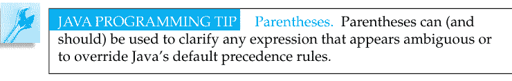

除了运算符优先级外，还需要了解运算符的结合性以便求值形如 `(op1 || op2 ^ op3)` 的布尔表达式。该表达式应该被求值为 `((op1 || op2) || op3)` 还是 `(op1 || (op2 || op3))`？布尔运算符都从左到右结合。因此，表达式

```
true ^ true ^ true // 等于：(true ^ true) ^ true
true && true && true // 等于：(true && true) && true
true || true || true // 等于：(true || true) || true
```

将按如下方式求值：

| 表达式 | 求值过程 |
|---|---|
| (true ^ true) ^ true | => false ^ true => true |
| (true && true) && true | => true && true => true |
| (true \|\| true) \|\| true | => true \|\| true => true |

### 5.2.3 短路求值

布尔运算符的另一个重要特性是它们利用一种被称为短路求值的评估方式。在短路求值中，布尔表达式从左到右求值，一旦表达式的值可以确定，评估就会停止，无论它是否包含额外的运算符和操作数。例如，在表达式 `expr1 && expr2` 中，如果 `expr1` 为 `false`，则 AND 表达式为 `false`，无论其是否包含额外的运算符和操作数。同样，在表达式 `expr1 || expr2` 中，如果 `expr1` 为 `true`，则 OR 表达式为 `true`。

除了更高效地求值表达式外，短路求值也有实际用途。例如，我们可以使用短路求值来防止空异常。回顾第 2 章，使用未赋值变量会产生空异常。例如，如果我们声明

```java
Game game; // 未初始化
if (game) // 空异常
    game.gameOver();
```

在代码中，使用 `game.gameOver()` 会产生异常。我们可以使用短路求值来防止异常：

```java
if (game != null && game.gameOver())
    game.gameOver();
```

在这种情况下，`game != null` 为 `false`，方法调用不会发生，避免了异常。

## 特别专题：我们是计算机吗？

乔治·布尔在 1854 年发表了他的开创性著作《推理》（An Investigation of Thought）。他的成就是开发了一种逻辑代数——即一种表示逻辑的纯抽象符号系统。布尔并不是探索人类思想与抽象计算系统关系的首次尝试。早在1655年，托马斯·霍布斯就声称思想就是计算。

估计人类大脑包含 100 亿个神经元，每个神经元包含约万个树突，即连接一个神经元到另一个的纤维。神经元和树突构成了一个极其复杂的网络。到1840年代，科学家们就知道大脑主要是电性的，到1940年代，科学家们开发了神经元间相互作用的相当模型。根据该模型，神经元沿着轴发射电冲，轴就像输出线。电冲越过分离的轴和树突，树突就像神经元的输入线。


# 神经网络与布尔逻辑的起源

1943年，在第一台计算机出现之前，神经生理学家麦卡洛和数学家沃尔特·皮茨斯发表了一篇论文《神经活动中内在思想的逻辑演算》（A Logical Calculus of the Ideas Imminent in Nervous Activity）。在论文中，他们证明了所有的布尔运算符——与、或、非和异或——都可以通过小组神经元的行为来表示。例如，他们展示了三个神经元如何共同工作，使得只有当另外两个神经元都发射时，第三个神经元才发射。这正符合 `AND` 运算符的定义。

神经网络是人工智能（计算机科学的一个应用领域）的分支，它基于麦卡洛和皮茨的这一洞察。这一兴奋且快速发展的领域的研究人员利用神经网络对各种类型的人类思维和感知建模。

# 5.2.4 在 OneRowNim 中使用布尔值

现在我们已经引入了布尔数据类型，让我们来改进 `OneRowNim` 类，其第 3 章中的最新版本如图 3.16 所示。之前我们使用一个 `int` 变量 `player` 来表示该轮轮谁操作。对于像 OneRow Nim 这样的双人游戏，布尔变量非常适合此目的，因为它可以在 `true` 和 `false` 之间切换。例如，让我们声明一个变量 `onePlaysNext` 并将其初始化为 `true`，表示玩家一先走：

```java
private boolean onePlaysNext = true;
```

当 `onePlaysNext` 为 `true` 时，轮到玩家一。当它为 `false` 时，轮到玩家二。请注意，我们并没有刻意规定哪一个是玩家一哪一个是玩家二。

鉴于这个新变量，有必要重新定义之前使用过 `player` 变量的方法。第一个需要修改的是构造函数：

```java
public OneRowNim(int sticks, int starter) {
    nSticks = sticks;
    onePlaysNext = (starter == 1);
} // OneRowNim() constructor
```

在构造函数中，参数使用值 1 或 2 来设置谁先走。注意我们如何使用赋值语句来：如果 `starter` 等于 1，则将 `onePlaysNext` 设置为 `true`；否则将其设置为 `false`。赋值语句首先求值右侧表达式 `(starter == 1)`。由于这是一个布尔表达式，它的值将是 `true` 或 `false`，并赋值给 `onePlaysNext`。因此，该赋值语句等同于以下 `if/else` 语句：

```java
if (player == 1)
    onePlaysNext = true;
else
    onePlaysNext = false;
```

剩余的更改如图 5.2 所示。只有两个实例方法需要修改以适应布尔变量的使用。`takeSticks()` 方法包含两处修订。第一个使用布尔或（OR）运算符来测试移动是否有效：

```java
public boolean takeSticks(int num) {
    if (num < 1 || num > 3 || num > nSticks) // Error
        return false;
    else {
        nSticks = nSticks - num; // Valid move
        onePlaysNext = !onePlaysNext;
        return true;
    } // else
} // takeSticks()
```

它还使用布尔非（NOT）运算符来切换 `onePlaysNext` 的值，以便切换到另一个玩家的回合：

```java
onePlaysNext = !onePlaysNext;
```

最后，`getPlayer()` 方法使用 `if/else` 语句根据当前轮到谁返回 1 或 2：

```java
public int getPlayer() {
    if (onePlaysNext)
        return 1;
    else return 2;
} // getPlayer()
```

# 5.3 数值数据和运算符

Java 有两种数值数据：没有小数部分的整数，以及包含小数部分的实数（或浮点数）。Java 识别四种整数：`byte`、`short`、`int` 和 `long`，它们通过表示它们所需的位数来区分。二进制位（或位）是 0 或 1。（回想计算机以位读取 Java 指令）。Java 有两种实数：`float` 和 `double`，它们也被用于表示它们。见表 5.3。

## 表 5.3 Java 的数值类型

| 类型 | 位 (Bits) | 取值范围 |
|---|---|---|
| byte | 8 | -128 to +127 |
| short | 16 | -32768 to 32767 |
| int | 32 | -2147483648 to 2147483647 |
| long | 64 | -2^63 to 2^63 - 1 |
| float | 32 | -3.40292347E+38 to +3.40292347E+38 |
| double | 64 | -1.79769313486231537E+308 to +1.79769313486231537E+308 |

```java
public class OneRowNim {
    private int nSticks = 7;
    private boolean onePlaysNext = true;

    public OneRowNim() {
    } // OneRowNim() constructor
    public OneRowNim(int sticks) {
        nSticks = sticks;
    } // OneRowNim() constructor2
    public OneRowNim(int sticks, int starter) {
        nSticks = sticks;
        onePlaysNext = (starter == 1);
    } // OneRowNim() constructor3
    public boolean takeSticks(int num) {
        if (num < 1 || num > 3) // Error
            return false;
        else {
            nSticks = num;
            onePlaysNext = !onePlaysNext;
            return true;
        }
    } // takeSticks()
    public int getSticks() {
        return nSticks;
    } // getSticks()
    public int getPlayer() {
        if (onePlaysNext)
            return 1;
        else return 2;
    } // getPlayer()
    public boolean gameOver() {
        if (onePlaysNext)
            return true;
        else return false;
    } // gameOver()
    public void report() {
        System.out.println("Number of sticks: " + nSticks);
        System.out.println("Next player: " + (onePlaysNext ? "one" : "two"));
    } // report()
} // OneRowNim
```

# 5.3.1 数值操作

在数值数据上可以执行的操作包括标准代数运算：加法 (`+`)、减法 (`-`)、乘法 (`*`)、除法 (`/`) 以及取模运算符 (`%`)。注意，在 Java 中，乘法符号是 `*` 而不是 x。算术运算符是二元运算符，这意味着每个运算符都需要两个操作数。表 5.4

## 表 5.4 Java 中的标准算术运算符

| 操作 | 运算符 | Java | 代数 |
| --- | --- | --- | --- |
| 加法 | + | x+2 | x+2 |
| 减法 | - | m-2 | m−2 |
| 乘法 | * | m*2 | 2m or 2×x |
| 除法 | / | x/y | x÷y |
| 取模 | % | x%y | x modulo y (x and y) |

忽略 Java 运算符及其标准代数对应对象的数值表达式

尽管这些操作看起来很熟悉，但它们在代数中的用法与在 Java 程序中的用法之间存在重要的差异。考虑以下操作列表：

- `3 / 2` => 值为 1，一个整数结果
- `3 / 2.0` => 值为 1.5，一个浮点结果
- `3 / .2` => 值为 1.5，一个浮点结果
- `3.0 / 2` => 值为 1.5，一个浮点结果

在每种情况中，我们都是将 3 除以数量 2。然而，结果取决于所涉及的操作数的类型。当两个运算符都是整数时，在 `(3/2)` 中，结果必须是整数。因此，`(3/2)` 的值为 1，因为整数不能有分数结果，0.5 被丢弃了。因此，`(6/2)` 除法值为 3，`(7/2)` 也是 3。因为 3.5 不是整数，所以 7 除以 2 的结果不能是 3.5。

> **整数除法给出整数结果**
>
> **JAVA 调试技巧！整数除法。** 初学者一个常见的错误来源是忘记了整数除法给出的是整数结果。

另一方面，当两个运算符中任意一个是实数时（如最后三种情况所示），结果是一个实数。虽然符号 `/` 用于除整数和实数，但这里实际上涉及了两种不同的操作：整数除法和浮点除法。使用相同的符号 `/` 用于不同的操作（整数除法和实数除法）被称为运算符重载。它与方法重载相似，我们在第 5.3 节中讨论过。

如果你想保留整数除法的余数怎么办？Java 提供了取模运算符 (`%`)，它接受两个操作数。表达式 `(7 % 5)` 给出 7 除以 5 之后的余数——在这种情况下为 2。

## 取模运算


通常情况下，表达式 `(m % n)`（读作 *m mod n*）给出 m 除以 n 之后的余数。以下是几个例子：

```
7 % 5 ==> 7 mod 5 equals 2
5 % 7 ==> 5 mod 7 equals 5
-7 % 5 ==> -7 mod 5 equals -2
7 % -5 ==> 7 mod -5 equals -2
```

解释这些示例最好的方法是对操作数的商和余数都进行长除法。例如，当你对 -7 ÷ 5 进行除法时，你得到商 -1 和余数 -2。商是 `-7/5` 的值，余数是 `-7%5` 的值。当你对 7 ÷ -5 进行除法时，你得到商 -1 和余数 2。商是 `7/-5` 的值，余数是 `7%-5` 的值。

我们在程序中会遇到取模运算符的实际用途。一个简单的例子是，当我们判断一个整数是偶数还是奇数时，使用它：

```
if (N % 2 == 0)
    System.out.println(N + " is even");
```

更通用地说，可以使用 mod 运算符定义被 3、4、10 或任何数字整除。

## 数值提升规则

Java 被认为是一种强类型语言，因为 Java 中的所有表达式（如 `(3/2)`）都有与其相关的类型。在算术运算涉及整数和一个浮点数的情况下，整数会被提升为浮点数。

提升是将一种类型转换为另一种类型的问题。例如，在表达式 `(5 + 4.0)` 中，5 必须先提升为 4.0 才能执行加法运算。通常来说，在 Java 中允许将整数 (5) 提升为浮点数，不会丢失信息。

重要的是，这种转换不受操作数实际值的影响。应用规则时，Java 查看的是操作数的类型而不是它的值。所以，即使 m 被赋值为一个可以表示为 byte 的值（例如 10），提升仍然从较小类型到较大类型。

> **自动提升**
>
> **JAVA 规则类型提升。** 通常，当运算涉及两个不同的类型时，较小的（位较少的）在执行操作之前会被转换为较大的类型。否则会有丢失信息的风险。

表 5.5 总结了 Java 在评估涉及混合操作数的表达式时使用的实际提升规则。这意味着涉及 byte 或 int 的整数表达式以 int 执行。这解释了为什么整数字面量（如 5 或 10）在 Java 中表示为 int 类型。

## 表 5.5 混合算术运算符的 Java 提升规则。如果适用两个规则，选择表中出现的第一个。

| 任一操作数 | 提升为 |
|--- |--- |
| double | double |
| float | float |
| long | long |
| byte or short | int |

# 5.3.2 运算符优先级

算术运算符的内置优先级如表 5.6 所示。括号表达式优先级最高，最先执行。接下来是乘法、除法和取模运算符，然后是加法和减法。当我们有一个没有括号且涉及乘法和加法的表达式时，乘法会先进行，即使它出现在加号的右侧。优先级层次中同一级的运算符从左到右评估。例如，考虑以下表达式：

```
9 + 6 - 3 * 6 / 2
```

在这种情况下，首先应用的操作将是乘法 (`*`)，接着是除法 (`/`)，然后是加法 (`+`)，最后是减法 (`-`)。我们使用括号明确评估顺序。括号表达式从最内层的括号向外评估：

- 步骤 1. `((9 + 6) - (3 * 6) / 2)`
- 步骤 2. `((9 + 6) - (18 / 2))`
- 步骤 3. `((9 + 6) - 9)`
- 步骤 4. `(15 - 9)`
- 步骤 5. `6`

## 表 5.6 算术运算符的优先级

| 优先级顺序 | 运算符 | 操作 |
|---|---|---|
| 1 | ( ) | 括号 |
| 2 | * / % | 乘法、除法、取模 |
| 3 | + - | 加法、减法 |

括号可以（并且总是）用于明确表达式中的操作顺序。例如，在以下表达式中，加法将在乘法之前执行：

```
(a + b) * c
```

使用括号的另一个原因是 Java 的优先级和提升规则有时会导致看起来正常但包含微妙错误的表达式。例如，考虑以下表达式：

```
System.out.println(5/3.0); // 0.5
System.out.println((5)/3.0); // 3.33
```

第一个得到的结果 0.5，但第二个使用括号得到的结果是 3.33。如果第二个是预期的解释，那么这里的括号帮助避免了语义错误。

> **JAVA 编程技巧！加括号！** 为了避免由 Java 优先级和提升规则引起的微妙漏洞，使用括号来指定表达式的评估顺序。


# 自学练习

# 5.3.3 递增和递减运算符

Java 提供了若干一元运算符，用于增加或减少整数变量的值。例如，表达式 `k++` 使用了递增运算符 `++` 来增加整数变量 `k` 的值。表达式 `k++` 等同于以下 Java 语句：

```java
int k;
k = k + 1; // 将 k 加 1 并将结果赋值回 k
```

一元运算符 `++` 作用于单个整数操作数，在本例中，作用于变量 `k`。它将 `k` 的值加 1 并将结果赋值回 `k`。它可以作为前置递增或后置递增运算符。在表达式 `k++` 中，运算符位于操作数之后，表示它被用作后置运算符。这意味着递增是在操作数的值使用之后完成的。

对比表达式 `++k`，其中 `++` 运算符位于操作数之前。在这种情况下，它被用作前置运算符，意味着递增是在操作数的值使用之前完成的。在单独使用时，`k++` 和 `++k` 之间没有实际区别。两者都等同于 `k = k+1`。然而，当与其他运算符结合使用时，前置递增和后置递增之间存在显著差异。例如，在代码段中：

```java
int j = 0, k = 0; // 初始 j 和 k 均为 0
j = ++k; // j 和 k 的最终值均为 1
```

变量 `k` 在赋值给 `j` 之前进行了递增。在执行赋值语句后，`j` 等于 1，`k` 等于 1。该序列等同于：

```java
int j = 0, k = 0; // 初始 j 和 k 均为 0
k = k + 1;
j = k; // j 和 k 的最终值均为 1
```

然而，在下面的示例中：

```java
int i = 0, k = 0; // 初始 i 和 k 均为 0
i = k++; // i 的最终值为 0，k 的值为 1
```

变量 `k` 在值赋值给 `i` 之后进行了递增。在执行赋值语句后，`i` 的值为 0，`k` 的值为 1。之前的序列等同于：

```java
int i = 0, k = 0; // 初始 i 和 k 均为 0
i = k;
k = k + 1; // i 的最终值为 0，k 的值为 1
```

除了递增运算符外，Java 还提供了递减运算符 `--`，它可以用于前置递减和后置递减形式。表达式 `++k` 会先将 `k` 的值加 1，然后在其所在的表达式中使用 `k`。`k--` 会在包含 `k` 的表达式中使用 `k` 的当前值，然后将 `k` 的值减 1。表 5.7 总结了递增和递减运算符。一元递增和递减运算符的优先级高于任何二元算术运算符。

## 表 5.7 Java 的递增和递减运算符

| 表达式 | 操作 | 解释 |
|---|---|---|
| ++k | 前置递增 | k = k+1; j = k; |
| j++ | 后置递增 | j = k; k = k+1; |
| --j | 前置递减 | k = k-1; j = k; |
| j-- | 后置递减 | j = k; k = k-1; |


## 5.3.3 增减运算符

Java 提供了若干一元运算符，用于增加或减少整数运算符。

> **JAVA 语言规则** 前置和后置递增/递减。如果像 `++k` 这样的表达式出现在表达式中，`k` 在被表达式的其他部分使用之前会被递增或递减。如果像 `k++` 或 `--k` 的表达式出现在表达式中，`k` 在其值被表达式的其他部分使用之后会被递增或递减。


# 5.3.3 递增和递减运算符

Java 提供了若干一元运算符，用于增加或减少整数变量的值。例如，表达式 `k++` 使用递增运算符 `++` 来增加整数变量 `k` 的值。表达式 `k++` 等同于以下 Java 语句：

```java
int k;
k = k + 1; // 将 k 加 1 并将结果赋值回 k
```

一元 `++` 运算符作用于单个整数操作数，在本例中，作用于变量 `k`。它将 `k` 的值加 1 并将结果赋值回 `k`。它可以作为前置递增或后置递增运算符。在表达式 `k++` 中，运算符位于操作数之后，表示它被用作后置运算符。这意味着递增是在操作数的值使用之后完成的。

对比表达式 `++k`，其中 `++` 运算符位于操作数之前。在这种情况下，它被用作前置运算符，意味着递增是在操作数的值使用之前完成的。在单独使用时，`k++` 和 `++k` 之间没有实际区别。两者都等同于 `k = k+1`。然而，当与其他运算符结合使用时，前置递增和后置递增之间存在显著差异。例如，在代码段中：

```java
int j = 0, k = 0; // 初始 j 和 k 均为 0
j = ++k; // j 和 k 的最终值均为 1
```

变量 `k` 在其值赋值给 `j` 之前进行了递增。在执行赋值语句后，`j` 等于 1，`k` 等于 1。该序列等同于：

```java
int j = 0, k = 0; // 初始 j 和 k 均为 0
k = k + 1;
j = k; // j 和 k 的最终值均为 1
```

然而，在下面的示例中：

```java
int i = 0, k = 0; // 初始 i 和 k 均为 0
i = k++; // i 的最终值为 0，k 的值为 1
```

变量 `k` 在其值赋值给 `i` 之后进行了递增。在执行赋值语句后，`i` 的值为 0，`k` 的值为 1。之前的序列等同于：

```java
int i = 0, k = 0; // 初始 i 和 k 均为 0
i = k;
k = k + 1; // i 的最终值为 0，k 的值为 1
```

除了递增运算符外，Java 还提供了递减运算符 `--`，它可以用于前置递减和后置递减形式。表达式 `++k` 会先将 `k` 的值加 1，然后在其所在的表达式中使用 `k`。`k--` 会在包含 `k` 的表达式中使用 `k` 的当前值，然后将 `k` 的值减 1。表 5.7 总结了递增和递减运算符。一元递增和递减运算符的优先级高于任何二元算术运算符。

## 表 5.7 Java 的递增和递减运算符

| 表达式 | 操作 | 解释 |
|---|---|---|
| `++k` | 前置递增 | `k = k+1; j = k;` |
| `k++` | 后置递增 | `j = k; k = k+1;` |
| `--k` | 前置递减 | `k = k-1; j = k;` |
| `k--` | 后置递减 | `j = k; k = k-1;` |

> **JAVA 语言规则** 前置和后置递增/递减。如果像 `++k` 这样的表达式出现在表达式中，`k` 在被表达式的其他部分使用之前会被递增或递减。如果像 `k++` 或 `--k` 的表达式出现在表达式中，`k` 在其值被表达式的其他部分使用之后会被递增或递减。

---

## 216 第 5 章 · Java 数据与运算符

如果对该表达式加上括号并尝试对其求值，该表达式格式错误就变得显而易见：

```text
步骤 1. ( ( 9 + 6 ) <= ( 25 * 4 ) == 2
步骤 2. ( 15 <= 100 ) == 2
步骤 3. true == 2               // 此处产生语法错误
```

这个问题在于表达式 `true == 2` 试图比较一个整数（int）和一个布尔值，这是无法实现的。对于任何其他二元运算符，`==` 运算符都要求两个操作数具有相同的类型。这是 Java 强类型检查的另一个例子。

---

## 自测练习

## 5.4 来自 Java `java.lang.Math`

`java.lang.Math` 类提供了许多常用的数学函数，这些函数在执行数值计算时非常有用。作为 `java.lang` 包的一个元素，它隐式地包含在所有 Java 程序中。表 5.11 列出了一些最常用的 `Math` 类方法。

## 表 5.11 `Math` 类常用方法

| 方法 | 说明 | 示例 |
| :--- | :--- | :--- |
| `abs(int x)` | x 的绝对值 | 如果 x > 0，`abs(x)` 为 x；如果 x < 0，`abs(x)` 为 -x |
| `abs(long x)` | | |
| `abs(float x)` | | |
| `int ceil(double x)` | 将 x 舍入为不小于 x 的最小整数 | `ceil(8.3)` 为 9；`ceil(-8.3)` 为 -8 |
| `floor(double x)` | 将 x 舍入为不大于 x 的最大整数 | `floor(8.9)` 为 8；`floor(-8.9)` 为 -9 |
| `log(double x)` | x 的自然对数 | `log(2.71828)` 为 1.0 |
| `double pow(double x, double y)` | x 的 y 次方 (x的y) | `pow(3,4)` 为 81；`pow(16.0, 0.5)` 为 4 |
| `double random()` | 生成 [0,1] 范围内的随机数 | `random()` 为 0.5551；`random()` 为 0.8712 |
| `long round(double x)` | 将 x 舍入为整数 | `round(26.5)` 为 27；`round(26.49)` 为 26 |
| `double sqrt(double x)` | x 的平方根 | `sqrt(4.0)` 为 2.0 |

所有方法都是静态类方法，因此通过类名进行调用。例如，我们计算 $2^4$ 会使用 `Math.pow(2, 4)`，其结果为 16。同样，我们计算 225.0 的平方根时使用 `Math.sqrt(225.0)`，其结果为 15.0。

---

## 5.5 节 · 数值处理示例

事实上，Java 的 `Math` 类不能被实例化也不能被子类化。它的基本定义如下：

```java
public final class Math      // final，不能子类
    private Math() {                     // private，不能调用
        ...
    }
    public static native double sqrt(double a)
        throws ArithmeticException;
```

通过将 `Math` 类声明为 `public final`，我们表示它可以被访问（public），但不能被扩展或子类化（final）。通过将其构造函数声明为 `private`，我们防止该类被实例化。这种既不能子类化也不能实例化的类想法起初看起来可能有点奇怪。在这里它的理由是它为向 Java 语言引入辅助数学函数提供了一种方便且高效的方法。

这样定义 `Math` 类使其方法变得非常简单，你不需要创建它的实例。这也是一个非常高效的设计，因为它的方法是 `java.lang` 包的静态元素。这意味着它们在程序执行开始时就被加载到内存中，并在整个程序的生命周期内一直留在内存中。由于 `Math` 方法不需要每次调用时都加载到内存中，它们的执行效率将大大提高。

> **JAVA 有效设计** 静态方法。如果一个方法旨在无论是否存在其类的实例都能被使用，则应该将其声明为 `static`。

---

## 5.5 数值处理示例

在本节中，我们考虑几个数值编程示例。选择这些示例是为了说明与数值数据相关的不同问题和概念。

### 5.5.1 示例：舍入小数位数

作为使用 `Math` 方法的示例，让我们考虑数字的问题。在处理涉及数值（如美元和美分）的应用时，通常需要将结果舍入到两位小数。例如，假设一个程序计算出的存款单（CD）价值为 75.19999；我们希望将其舍入到两位小数。可以使用以下算法完成此操作：

1. 将数字乘以 100，得到 7519.9999。
2. 将数字加上 0.5，得到 7520.4999。
3. 丢弃小数部分，得到 7520。
4. 将结果除以 100，得到 75.20

此算法的第 3 步可以使用 `floor()` 方法（见表 5.11）完成。如果数字存储在 `double` 变量 `R` 中，则该表达式会将 `R` 舍入到两位小数：

```java
R = Math.floor(R * 100 + 0.5) / 100.0;
```

或者，使用 `round()` 方法（见表 5.11）。如果数字存储在 `double` 变量 `R` 中，则表达式会将 `R` 舍入到两位小数：

```java
R = Math.round(R * 100) / 100.0;
```

注意，`round()` 返回的是 `long` 类型，因此除以 100.0 后得到 `double`。

> **JAVA 调试技巧** 在除法运算中使用正确的字面量类型以确保获得正确的结果。否则，除法将得到整数并丢失小数。

---

### 5.5.2 示例：将华氏转换为摄氏

为了说明在使用数值数据时出现的一些问题，让我们设计一个执行将华氏转换为摄氏以及反之的程序。

#### 问题分解

该问题需要两个类：一个 `Temperature` 类和一个 `TemperatureUI` 类。`Temperature` 类将执行转换，而 `TemperatureUI` 将作为用户界面。

#### 类设计

我们需要什么数据？`Temperature` 类的目的是执行转换。为了将华氏转换为摄氏以及反之，`Temperature` 类不需要任何实例变量。因此，在这一点上，`Temperature` 类类似于 `Math` 类。遵循 `Math` 类的设计，这些方法将使用标准公式：$F = C * 9/5 + 32$ 和 $C = (F - 32) * 5/9$。这些方法将是 `public static` 的，我们可以通过类本身调用它们。记住静态方法与类关联而非实例。

| Temperature |
|---|
| `+Temperature()` |
| `+fToC(double fahrenheit): double` |
| `+cToF(double celsius): double` |

> **图 5.4** Temperature 类。注意在 UML 中静态元素是带有下划线的。

##### 实现：Temperature

`Temperature` 类的实现如图 5.5 所示。注意 `cToFahr` 在计算中使用了 `double` 值 `temp`，并在表达式中使用浮点字面量（9.0、5.0 和 32.0）。这有助于减少 Java 内置提升规则的负载，这些规则可能会导致细微错误。例如，对于图 5.4 所示的设计，假设我们写了看起来使用整数字面量的等效式：

```java
return (9 / 5 * temp + 32); // 错误：等于 (temp + 32)
```

因为 9 除以 5 得到整数结果 1，因此该表达式等同于 `temp + 32`，这不是正确的公式。这种细微的语义错误可以通过不混合整数字面量来避免。

> **JAVA 编程技巧** 不要混合类型。尽可能通过显式地将表达式中的所有字面量更改为相同类型，减少由隐式类型转换引起的语义错误发生率。

---

## 测试与调试

### 测试策略

下一个要解决的问题是应该如何测试这个程序？一如既往，你应该分步骤地对程序进行测试。每编写好一个方法，你都应该对其进行独立测试，并在可能的情况下将其与其他方法结合起来进行测试。

此外，你应该开发合适的测试数据。仅仅输入任何值是不够的。你使用的值应该测试某些潜在的问题。对于这个程序，以下测试是合适的：

- 测试将 0 摄氏转换为 32 华氏。
- 测试将 100 摄氏转换为 212 华氏。
- 测试将 212 华氏转换为 100 摄氏。
- 测试将 32 华氏转换为 0 摄氏。


前两个测试使用 `celToFahr()` 方法来测试冰点和沸点温度，这是该问题的两个边界值。边界值是指变量或计算所要表示的数值范围的起始或结束的值。第二对测试使用 `fahrToCels()` 方法执行类似的检查。

### 设计测试数据

```java
public class Temperature {
    public Temperature() {}
    public static double fahrToCels(double temp) {
        return (5.0 * (temp - 32.0) / 9.0);
    }
    public static double celsToFahr(double temp) {
        return (9.0 * temp / 5.0 + 32.0);
    }
} // Temperature
```

图 5.5：`Temperature` 类。

使用这些特定值的好处是我们知道方法应该返回什么。

> **JAVA 有效设计 测试数据**。开发合适的测试数据是程序设计的重要部分。一类测试数据应该检查你正在进行的特定计算的边界。

> **JAVA 调试技巧！测试、测试、再测试！** 程序在某些数据上运行正常不能保证其正确性。测试得越多、测试得越仔细，就越好。

# TemperatureUI 类

`TemperatureUI` 类的作用是作为一个用户界面——即用户与 `Temperature` 对象之间的接口。它将接受用户输入的华氏度或摄氏度温度，将其传递给 `Temperature` 对象的一个方法进行转换，并显示返回的结果。

如第 4 章所述，用户界面可以有多种形式，从命令行界面到图形界面皆有。图 5.6 显示了基于第 4 章开发的命令行界的用户界面设计。`TemperatureUI` 使用 `KeyboardReader` 处理与用户的交互，并使用 `Temperature` 类中的静态方法执行转换。(img/fa00320ea7bfae0127d4f590e7ffc72_236.png)

| TemperatureUI | 使用 |
| :--- | :--- |
| - temp: Temperature | |
| - reader: KeyboardReader | |
| + run() | Temperature |
| + main() | |
| + Temperature() | |
| + celsiusToFahr(double): double | |
| + fahrToCelsius(double): double | KeyboardReader |

# 自学练习题

## 练习 5.1 遵循图 5.6 中的设计，实现 TemperatureUI 类并使用它来测试 Temperature 类中的方法。`run()` 方法应该使用“输入-处理-输出”算法：提示用户输入，执行必要的处理并输出结果。请注意，由于 Temperature 的转换是类方法，你不需要实例化 Temperature 对象。你可以直接通过 Temperature 类调用转换方法：

```java
double fahr = Temperature.cToFahr(98);
```

## 练习 5.2 遵循第 4 章开发的 GUI 设计，实现一个 GUI 来测试 Temperature 类。GUI 应该具有图 5.7 所示的布局。

## 5.5.3 示例：使用常量

正如提到的，除了与类的实例（对象）关联的实例变量外，Java 还有与类本身关联的局部变量。变量最常用的用途之一是定义命名常量来代替字面量值。命名常量是一个一旦被赋予初始值就无法更改的变量。在本节中，我们使用示例 `OneRowNim` 来说明类常量。记住，与类关联的方法可以用 `static` 修饰符声明。如果一个变量是静态的，那么无论实例化多少次，该变量恰恰有一个拷贝。要将变量变成常量，必须使用 `final` 修饰符进行声明。因此，以下是类常量的示例，即与类关联而非实例关联的值：(img/fa00320ea7bfae0127d4f590e7ffc72_237_0.png)

```java
public static final int PLAYER_ONE = 1;
public static final int PLAYER_TWO = 2;
public static final int MAX_PICKUP = 3;
public static final int MAX_STICKS = 4;
```

`final` 修饰符表示变量的值不能更改。当在变量声明中使用 `final` 时，变量必须分配一个初始值。因此，以下是类常量的示例，值与类关联而非实例关联：

`final` 修饰符表示变量的值不能更改。在在变量声明中使用 `final` 后，尝试更改其值会导致语法错误。

注意我们在常量名中使用大写字母和下划线(`_`)。这是专业 Java 程序员遵循的约定，目的是区分常量和变量。这使得程序更具可读性。

> **JAVA 编程技巧 可读性**。为了让程序更具可读性，使用大写字母表示常量标识符。

命名常量提高程序可读性的另一种方法是消除对字面量值的依赖。例如，对于 `OneRowNim` 类，比较以下两个条件：

```java
if (num < 1 || num > 3 || nSticks)
if (num < MAX_PICKUP || > nSticks)
```

显然，第二个条件更容易阅读和理解。在第一个条件中，我们不知道字面量 3 代表什么。在第二个中，我们知道 `MAX_PICKUP` 代表可以捡取的木棒。

为了让 `OneRowNim` 更读，我们应该将所有的字面量 3 替换为常量 `MAX_PICKUP`。同样的原理也适用于程序的其他字面量值。因此，与其使用 1 和 2 表示两个玩家，不如使用 `PLAYER_ONE` 和 `PLAYER_TWO` 使如下方法更容易阅读和理解：

```java
public int getPlayer() {
  if (hasNext()) {
    return PLAYER_ONE;
  } else return PLAYER_TWO;
} // getPlayer()
```

> **JAVA 编程技巧 可读性**。为了让程序更具可读性，使用命名常量代替字面量值。

命名常量（相对于字面量）的另一个优势是它们使程序更容易修改和维护。例如，假设我们更改 `OneRowNim`，使最大捡取木棒数变为 4 而不是 3。如果我们使用字面量，我们必须更改所有代表最大捡取数的 4。如果我们使用命名常量，我们只需要更改其声明为：

```java
public static final int MAX_PICKUP = 4;
```

> **JAVA 有效设计 可维护性**。程序中应该使用常量代替字面量值。这将使程序更容易修改和维护。(img/fa00320ea7bfae0127d4f590e7ffc72_239_0.png)

到目前，我们展示的所有示例都说明了为什么命名常量（但不一定是类常量）是有用的。并不是所有的类常量都是静态的，但并不是所有的静态都是常量。然而，将常量与类关联的想法是非常合理的。除了节省内存资源外，通过仅创建一个变量的拷贝，像 `MAX_STICKS` 和 `PLAYER_ONE` 这样的常量在概念上与类本身关联是合理的。

```java
public class OneRowNim {
    public static final int PLAYER_ONE = 1;
    public static final int PLAYER_TWO = 2;
    public static final int MAX_PICKUP = 3;
    public static final int MAX_STICKS = 11;
    public static final boolean GAME_OVER = false;
    private int nSticks = MAX_STICKS;
    private boolean onePlaysNext = true;
    public OneRowNim() {
        // OneRowNim() constructor1
    }
    public OneRowNim(int sticks) {
        nSticks = sticks;
        // OneRowNim() constructor2
    }
    public OneRowNim(int sticks, int starter) {
        nSticks = sticks;
        onePlaysNext = (starter == PLAYER_ONE);
        // OneRowNim() constructor3
    }
    public boolean takeSticks(int num) {
        if (num < 1 || num > MAX_PICKUP || num > nSticks) {
            return false; // Error
        } else {
            nSticks = nSticks - num;
            onePlaysNext = !onePlaysNext;
            return true; // move
        }
    } // takeSticks()
    public int getSticks() {
        return nSticks;
    } // getSticks()
    public int getPlayer() {
        if (onePlaysNext) {
            return PLAYER_ONE;
        } else {
            return PLAYER_TWO;
        }
    } // getPlayer()
    public boolean gameOver() {
        return (nSticks <= 0);
    } // gameOver()
    public int getWinner() {
        if (nSticks < 1) {
            return getPlayer();
        } else {
            return 0;
        }
    } // getWinner()
    public String report() {
        return ("nsticks left: " + getSticks() +
               "\nNext turn by player " + getPlayer() + "\n");
    } // report()
} // OneRowNim class
```

图 5.8: 此版本的 RowNim 使用了命名常量。

## 保留公共接口

在很大程度上，我们是将 RowNim 划分为公共元素和私有元素。由于新版本仍然提供了相同的公共接口，像图 4.2 所示使用 RowNimApp 的程序可以继续使用它，而无需更改其自身代码的任何行。要确认这一点，请参阅本节末尾的自学练习题。

## 信息隐藏

尽管我们对 RowNim 的底层表示进行了重大更改，但实现细节——算法——已对其他对象隐藏了。RowNim 的接口与旧版本保持兼容；对私有元素的更改不会给依赖于旧版本的对象带来任何不便。这种在不影响外部功能的情况下更改底层实现的能力，是信息隐藏原则的巨大优势之一。


## 设计中的信息隐藏

在设计类时，应该只给其他对象访问它们所需的信息，多余的。在这里学到的教训是，类的公共部分应该限制在那些必须被其他对象访问的部分。当设计对象时考虑到信息隐藏原则时，编程和现实世界中的事情运行得更好。

## 自学练习题

### 练习 5.4 为了确认我们新版本的 RowNim 仍然与第 4 章开发的用户界面正常工作，请使用 RowNimApp（图 4.24）对其进行编译和运行。

## 5.5 示例：Row Nim 的获胜算法

现在我们已经可以使用数值类型和运算符了，让我们开发一种可以赢得 Row Nim 的算法。回想一下，在第 4 章中我们看到当计算机移动时，它会走 1 根棍子。让我们用一种更复杂的方法替换该策略。如果你玩过有 21 根棍子的尼姆游戏（Nim），你可能注意到，如果你给对手留下 1、5、9、13 或 17 根棍子，你总是能赢得游戏。这是因为对于 1 根棍子的情况，无论对手做什么，你都可以做出一次移动，让对手剩下 5 根棍子。例如，如果你的对手拿走 1 根棍子，你可以拿走 2 根；如果你的对手拿走 2 根，如果对手拿走 3 根，你可以拿走 1 根。在任何情况下，如果你给对手留下了 5 根棍子，你都可以正确的移动赢得游戏。同样的道理适用于其他值：9、13、17 和 21。

## 5.5 节 • 数字处理

这组数字之间有什么共同的关系？注意，如果你将这些数字每一个除以 4 并取余数，你总是得到：

```text
1 % 4 == 1
5 % 4 == 1
9 % 4 == 1
13 % 4 == 1
17 % 4 == 1
21 % 4 == 1
```

因此，我们可以将这种获胜策略用于目标：让对手剩下数量为 N 的棍子，使得 N % 4 等 1。要确定需要拿多少根棍子以给对手留下 N，我们需要少量的代数。假设 `sticksLeft` 代表在我们轮之前剩余的棍子数量。我们必须承认的第一点是，如果 `sticksLeft % 4 == 1`，我们被留下了 1、5、9、13 等，我们无法强迫胜利。在这种情况下，我们拿多少根棍子并不重要。我们的对手应该赢得游戏。

所以，假设 `sticksLeft % 4 != 1`，并且 M 为为了给对手留下 N 而需要拿走的棍子数量，使得 N % 4 == 1。

```text
sticksLeft - M == N
N % 4 == 1
```

我们可以将这些合并为一个方程，并可以简化如下：

```text
sticksLeft - M % 4 == 1
```

如果 `sticksLeft - M` 除以 4 得到的余数是 1，这意味着 `sticksLeft - M` 等于某个整数商 Q 乘以 4 再加 1：

```text
sticksLeft - M == (Q * 4) + 1
```

通过在等方程的两边都加上 M 并在两边都减去 1，我们得到：

```text
sticksLeft - 1 == (Q * 4) + M
```

这个方程表示 `(sticksLeft - 1) % 4 == M`。也就是说，当你用 `sticksLeft-1` 除以 4 时，你将得到余数 M，这就是你想要拿走的棍子数量。因此，为了决定拿多少根棍子，计算：

```text
M == (sticksLeft - 1) % 4
```

为了验证这一点，让我们看一些例子：

| 之前的 sticksLeft | (sticksLeft - 1) % 4 | 后的 sticksLeft |
|---|---|---|
| 9 | (9-1) % 4 == 0 | 非法移动 |
| 8 | (8-1) % 4 == 3 | 5 |
| 7 | (7-1) % 4 == 2 | 5 |
| 6 | (6-1) % 4 == 1 | 5 |
| 5 | (5-1) % 4 == 0 | 非法移动 |

这些示例表明，当我们使用 `(sticksLeft-1) % 4` 计算移动时，我们总是让对手处于失败局面。注意，当 `sticksLeft` 等于 9 或 5 时，我们无法使用这种策略，因为会导致非法移动。

让我们将该算法转换为 Java 代码。在包含我们的获胜策略之外，`move()` 方法使用了两个 Math 方法：

```java
int sticksLeft = nim.getSticks(); // 获取棍子数量
if (sticksLeft % (nim.MAX_PICKUP + 1) != 0) { // 可胜的
    return (sticksLeft - 1) % (nim.MAX_PICKUP + 1);
} else { // 否则随机
    int pickup = Math.min(nim.MAX_PICKUP, sticksLeft);
    return 1 + (int)(Math.random() * pickup);
}
```

## 5.6 节 来自 Java 库 java.text.NumberFormat

`min()` 方法返回两个参数之间的最小值。

最后，注意我们是如何使用 `Math.random()` 方法来计算 1 到最大值之间的随机数的：

```text
1 + (int)(Math.random() * maxPickup);
```

`random()` 方法返回一个 0 到 0.9999999 之间的实数，即 0 到 1 之间（但不 1）的实数：

```text
0 <= Math.random() < 1.0
```

如果我们用 `Math.random()` 乘以 2，结果将是 0 到 1.999999 之间的值。同样，如果乘以 3，结果将是 0 到 2.999999 之间的值。为了使用这个随机值，我们必须将其转换为整数，这可以使用 `(int)` 强制转换操作符：

```text
(int)(Math.random() * maxPickup);
```


# Java 数据与运算符

## 类型转换：`double` 到 `int`

记住，当 `double` 转换为 `int` 时，Java 会丢弃小数部分。因此，此表达式将产生 0 到 `maxPickup-1` 之间的值。如果 `maxPickup` 是 3，这将产生 0 到 2 之间的值，而我们想要的是 1 到 3 之间的随机值。为了得到这个期望的值，我们在结果上加上 1。因此，使用表达式

```java
1 + (int)(Math.random() * maxPickup)
```

为我们提供一个 1 到 `maxPickup` 之间的随机数，其中 `maxPickup` 是 1、2 或 3，取决于游戏在该点的状态。

## 自学练习

### 练习 5.5
实现一个 `NimPlayer` 类，该类包含在本类中设计的 `move()` 方法。图 5.9 所示的类除了 `move()` 之外，应该还有一个实例变量 `nim`，它将作为 `OneNim` 游戏的引用。它的构造函数应该接受一个 `OneNim` 参数，允许 `NimPlayer` 在实例化时被赋予一个引用。

| NimPlayer |
| :--- |
| - nim: OneRowNim |
| + NimPlayer(g: OneRowNim) |
| + move(): int |

### 练习 5.6
修改 `OneNim` 的命令行界面以与计算机玩 OneNim，其中在后续练习中实现的 `NimPlayer` 显示当前状态。

## 5.6 来自 Java 库：`java.text.NumberFormat`

尽管 `Math.round()` 方法用于数字四舍入，但它并不适用于业务应用程序。对于舍入后的值，Java 将丢弃末尾零。例如 $10000.00 的值将被输出为 $10000.0。这在业务报告中是不可接受的。

幸运的是，Java 提供了 `java.text.NumberFormat` 类专门用于将数字表示为美元、金额和其他格式的任务（图 5.10）。

`NumberFormat` 类是一个抽象类，这意味着它不能被直接实例化。相反，你应该使用它的 `getInstance()` 方法来创建一个可以用于所需格式化任务的实例。

一旦创建了 `NumberFormat`，就可以使用它的 `format()` 方法将数字放入特定格式。`setMaximumFractionDigits()` 和 `setMaximumIntegerDigits()` 方法可以用于控制小数点前后的位数。

例如，可以使用以下语句将小数格式化为美元和分的货币：

```java
NumberFormat dollars = NumberFormat.getCurrencyInstance();
System.out.println(dollars.format(10962.555));
```

这些语句将导致值 10962.555 显示为 $10,962.56。同样，语句：

```java
NumberFormat percent = NumberFormat.getPercentInstance();
percent.setMaximumFractionDigits(2);
System.out.println(percent.format(6.55));
```

将把值 6.55 显示为 6.55%。`Math` 和 `NumberFormat` 类的实用说明了以下原则：

> **Java 有效设计：代码复用**。解决编程任务的最佳方法是在 Java 类库中找到适当的方法。

## 自学练习

### 练习 5.7
存款证明 (CD) 是一种投资工具，在固定的初始年限内按给定利率积累利息。复利公式见表 5.11。它假设利息每年复利一次。对于按日复利，年利率必须除以 365，复利周期乘以 365。实现一个 `BankCD` 类来计算 CD 的到期价值。它应该有本金、利率和年份的实例变量。它的构造方法在实例化 `BankCD` 时设置这些变量的初始值。使用按年和日的方法计算到期价值。

| BankCD |
| :--- |
| - principal: double |
| - rate: double |
| - years: double |
| + BankCD(principal: double, rate: double, years: double) |
| + calcYear(): double |

**表 5.12 复利公式**
```text
a = p(1+r)^n
```
其中：
* `a` 是 CD 在 n 年末的价值
* `p` 是本金或原始金额
* `r` 是年利率
* `n` 是复利周期

对应代码实现：
```java
principal = Math.pow(1 + rate, years);
```

### 练习 5.8
设计一个命令行界面 `BankCD` 类，让用户输入本金、利率和年份，并按日和按年计算报告 CD 的到期价值。使用 `NumberFormat` 以适当的格式显示美元。程序的输出应该如下（用户的输入）：

```text
************************
比较日复利和年复利
初始本金，1000
利率，6.5%
年份，5
年到期价值：1370.09
日到期价值：1382.82
************************
```

## 5.7 字符数据和运算符

Java 的另一种基本数据类型是 `char` 类型。字符由 16 位无符号整数表示。这意味着 Unicode 可以表示各种语言的字符，而不仅仅是英语。

字符数据在计算机内存中存储为整数的事实会导致对数据是字符还是整数的某些困惑。也就是说，当它是一个字符时，例如 `'A'`，被视为整数 (65) 而不是字符 `'A'`？Java 的规则是，字符字面量——`'a'` 或 `'0'` 或 `'?'`——被视为字符，除非我们显式告诉 Java 将其视为整数。如果我们显示字面量的值：

```java
System.out.println('a');
```

因此，Unicode 基于 7 位代码定义了 128 个字符，与 ASCII 集相同。

**表 5.13 选定字符的 ASCII**

| Code | 32 | 33 | 34 | 35 | 36 | 37 | 38 | 39 | 40 | 41 | 42 | 43 | 44 | 45 |
| :--- | :--- | :--- | :--- | :--- | :--- | :--- | :--- | :--- | :--- | :--- | :--- | :--- | :--- | :--- |
| Char | SP | ! | " | # | $ | % | & | ' | ( | ) | * | + | , | - |
| Code | 48 | 49 | 50 | 51 | 52 | 53 | 54 | 55 | 56 | 57 | 58 | 59 | 60 | 61 |
| Char | 0 | 1 | 2 | 3 | 4 | 5 | 6 | 7 | 8 | 9 | : | ; | < | = |
| Code | 65 | 66 | 67 | 68 | 69 | 70 | 71 | 72 | 73 | 74 | 75 | 76 | 77 | 78 |
| Char | A | B | C | D | E | F | G | H | I | J | K | L | M | N |
| Code | 79 | 80 | 81 | 82 | 83 | 84 | 85 | 86 | 87 | 88 | 89 | 90 | 91 | 92 |
| Char | O | P | Q | R | S | T | U | V | W | X | Y | Z | [ | \ |
| Code | 93 | 94 | 95 | 96 | 97 | 98 | 99 | 100 | 101 | 102 | 103 | 104 | 105 | 106 |
| Char | ] | ^ | _ | ` | a | b | c | d | e | f | g | h | i | j |
| Code | 107 | 108 | 109 | 110 | 111 | 112 | 113 | 114 | 115 | 116 | 117 | 118 | 119 | 120 |
| Char | k | l | m | n | o | p | q | r | s | t | u | v | w | x |
| Code | 121 | 122 | 123 | 124 | 125 | 126 | | | | | | | | |
| Char | y | z | { | | } | ~ | | | | | | | | |

### 5.7.1 字符到整数的转换

尝试将一个 32 位 `int` 赋值给 16 位 `char` 就像试图将一个大物体放入一个太小的盒子。除非我们以某种方式对其进行缩小，否则该物体是放不下的。

Java 允许我们将一个 `int` 值赋值给 `char` 变量，但前提是必须对其进行显式强制转换：

```java
ch = (char)k; // 将 int 显式转换为 char
```

`(char)` 强制转换操作通过丢弃 `int` 的高 16 位来对 `int` 执行细致的“缩小”。只要 `k` 的值在 0 到 65535 范围内（即能够放入 `char` 变量的取值范围），这种转换就可以在不丢失信息的情况下完成。这种原始类型转换将一个较宽的类型（32 位 `int`）转换为一个较窄的类型（16 位 `char`）。由于这里存在信息丢失的可能性，因此由程序员来判断是否可以安全地执行转换。

> **Java 语言规则：类型转换**。Java 允许从窄类型到宽类型的隐式转换。当从宽类型转换为窄类型时，必须使用强制转换运算符。

强制转换运算符可以用于任何原始类型。它应用于紧随其后的变量或表达式。此时，必须使用括号将表达式 `m + n` 强制转换为 `char`：

```java
char ch = (char)(m + n);
```

接下来的语句会导致语法错误，因为强制转换运算符只会作用于 `m`：

```java
char ch = (char)m + n; // 错误：右侧是一个 int
```

在右侧的表达式中，由 `(char)m` 产生的字符会被提升为 `int`，因为它是整数操作的一部分，该操作的结果仍将是 `int`。因此，在没有显式强制转换的情况下，它无法被赋值给 `char`。

### 5.7.2 词典顺序

字符集中字符的排列顺序，即其词典顺序，是字符集的一个重要特征。它用于如按字母顺序排列字符串等任务。

尽管 ASCII 和 UNICODE 分配给单个字符的整数值似乎是随机的，但实际上这些字符是按照特定顺序排列的。例如，在不同的数字序列 `'0'...'9'` 和字母序列 `'a'...'z'` 中，它们是由整数序列表示的（表 5.13）。这使得根据整数关系表示字符的词典顺序成为可能。在字母表中 `'a'` 排在 `'f'` 之前，这一事实体现在 97（`'a'` 的整数代码）小于 102（`'f'` 的整数代码）。在字母序列中，数字 `'5'` 排在数字 `'9'` 之前，因为 53（`'5'` 的整数代码）小于 57（`'9'` 的整数代码）。

这种排序关系适用于整个字符集。因此，在词典顺序中，`'A'` 排在 `'a'` 之前也是如此，因为 65（`'A'` 的整数代码）小于 97（`'a'` 的整数代码）。同样，字符 `'['` 排在 `'}'` 之前，因为它的整数代码（91）小于 `'}'` 的整数代码 125。

### 5.7.3 关系运算符

根据 `char` 类型的词典顺序，可以定义关系运算符：`<`, `<=`, `==`, `!=`。对于任意两个字符 `ch1` 和 `ch2`，表达式 `ch1 < ch2` 为真当且仅当 `ch1` 的整数值小于 `ch2` 的整数值。在这种情况下，我们说 `ch1` 于 `ch2` 之前。同样，如果 `ch1` 的整数值大于 `ch2` 的整数值，我们说 `ch1` 于 `ch2` 之后。其他关系运算符也是如此。这意味着我们可以对任意两个字符进行比较（表 5.14）。

**表 5.14 字符关系操作**

| 操作 | Java | 真值表达式 |
| :--- | :--- | :--- |
| 小于 | `<` | `ch1 < ch2` | `'a' < 'b'` |
| 大于 | `>` | `ch1 > ch2` | `'b' > 'a'` |
| 小于或等于 | `<=` | `ch1 <= ch2` | `'a' <= 'b'` |
| 大于或等于 | `>=` | `ch1 >= ch2` | `'b' >= 'a'` |
| 等于 | `==` | `ch1 == ch2` | `'a' == 'a'` |
| 不等于 | `!=` | `ch1 != ch2` | `'a' != 'b'` |

## 5.8 示例：字符转换

```java
public class Test {

    public static void main(String[] argv) {

        char ch = 'a';      // 局部变量

        int k = (int)'b';

        System.out.println(ch);

        System.out.println(k);

        ch = (char)k;      // 此处需要类型转换

        System.out.println(ch);

        System.out.println(toUpperCase('a'));

        System.out.println(toUpperCase(ch));

        System.out.println(digitToInt('7'));

    }

    public static char toUpperCase(char ch) {

        if ((ch >= 'a') && (ch <= 'z'))
            return (char)(ch - 32);
        return ch; // 假设原逻辑缺失返回，补全以保证编译通过
    }

    public static int digitToInt(char ch) {

        if ((ch >= '0') && (ch <= '9'))
            return ch - '0';

        return -1;

    }

} // Test
```


图 5.12：一个说明字符转换的 Java 程序。运行时，程序将生成以下输出，每行一个：98, b, A, B, 7。

如果我们的文明必须永远依赖罗马人的数字表示法该怎么办！

JAVA 有效设计 表现与行动。表现（数据）和行动（方法）是解决问题过程中同等重要的部分。

# 章末总结

- 技术术语：
  - 命名常量
  - 短路
  - 二元运算符
  - 操作数
  - 求值
  - 二进制位 (bit)
  - 运算符重载
  - 类型转换
  - 边界值
  - 优先级
  - 顺序
  - 一元运算符
  - 强制类型转换
  - 提升
  - Unicode
  - 类
  - 常数
  - 舍入
  - 误差
  - 表现
- 输入-处理-输出

## 重要要点总结

# 第5章 • 章末总结

- 我们处理问题的方法往往会帮助或阻碍我们解决问题的能力。为问题选择恰当的表示形式通常是解决问题的关键。

- 为了评估复杂的表达式，必须理解所涉及运算符的优先级顺序和结合性。可以使用括号来覆盖运算符的内置优先级。

- Java 提供了几种类型的整数数据，包括 8 位的 `byte`（字节）、16 位的 `short`（短型）、32 位的 `int`（整）和 64 位的 `long`（长型）。除非另有说明，否则字面量在 Java 程序中表示为 `int` 数据。

- Java 提供了两种类型的浮点数据，32 位的 `float`（单精度）和 64 位的 `double`（双精度）。除非另有说明，浮点字面量表示为 `double`。

- 一般来说，如果一种数据类型在表示中使用 n 位，那么它就可以表示 2^n 个不同的值。

- Java 的基本类型是根据特定的位数定义的，这是 Java 促进平台无关性的特性之一。

- 尽管使用了相同的符号，但必须区分整数运算和浮点运算。例如，`(7/2)` 是 3，而 `(7/2.0)` 是 3.0。

- 在 Java 中，字符数据基于 Unicode 字符集，该集合提供了 2^16=65536 个不同的字符。为了与 ASCII 字符集向后兼容，前 128 个字符是 ASCII 字符。

- Java 运算符根据表 5.15 所示的优先级层次进行求值。优先级数字越小，运算符越早计算。因此，表格顶部的运算符在表格下方的运算符之前求值。相同优先级的运算符根据它们的结合性（从左到右 L to R，或从右到左 R to L）进行求值。

# 表 5.15 运算符优先级和结合性表

| 顺序 | 运算符 | 操作 | 结合性 |
| --- | --- | --- | --- |
| 0 | `()` | 括号 | 从左到右 |
| 1 | `++` `--` `.` | 后增、后减、点运算符 | 从左到右 |
| 2 | `++` `--` `+` `-` `!` | 前增、递减、一元加、一元减、布尔逻辑非 | 从右到左 |
| 3 | `(type)` `new` | 类型强制转换、对象实例化 | 从左到右 |
| 4 | `*` `/` `%` | 乘法、除法、取模 | 从左到右 |
| 5 | `+` `-` | 加法、减法、字符串拼接 | 从左到右 |
| 6 | `<` `>` `<=` `>=` | 关系运算符 | 从左到右 |
| 7 | `==` `!=` | 等运算符 | 从左到右 |
| 8 | `&` | 按位与/布尔逻辑与 | 从左到右 |
| 9 | `^` | 按位异或 | 从左到右 |
| 10 | `|` | 按位或/布尔逻辑或 | 从左到右 |
| 11 | `&&` | 条件与 | 从左到右 |
| 12 | `||` | 条件或 | 从左到右 |
| 13 | `+=` `-=` `*=` `/=` `%=` `&=` `^=` `|=` | 赋值运算符 | 从右到左 |

# 练习

**注意：** 对于编程课程练习，请先画一个 UML 类图，描述所有的类及其继承关系和/或关联关系。

# 第6章

# 控制结构

## 目标

学习本章后，你将能够：

- 解决涉及重复的问题。
- 理解各种循环结构之间的区别。
- 了解设计有效循环的原则。
- 提高你的算法设计能力。
- 理解结构化编程的目标和原则。

## 提纲

- 6.1 引言
- 6.2 控制流：重复结构
- 6.3 计数循环
- 6.4 示例：汽车贷款
- 6.5 图形示例：绘制棋盘
- 6.6 条件循环
- 6.7 示例：计算平均值
- 6.8 示例：数据验证
- 6.9 循环原则
- 6.10 多路选择
- 6.11 面向对象设计：结构化编程
- 特殊主题：什么是可能的？
- 章末总结
- 练习解答

## 6.1 引言

正如在第 3 章中学到的，重复结构是一种改变控制流的语言。在本章中，我们将扩展语句库。我们将引入用于重复任务的循环类型：计数循环和非计数循环。我们将介绍循环设计的原则，最后我们将介绍面向对象的设计：结构化编程。

在这些示例中，使用了两种循环：计数循环和非计数循环。计数循环适用于预先知道必须执行多少次操作。非计数循环适用于重复次数取决于某些条件——例如从键盘输入的数据项或从文件中读取记录。

## 6.3 计数循环

计数循环（或计数器控制循环）是在你在循环之前知道将重复多少次的循环。在之前的示例中，前两个是计数循环。

- 你正在为一个想要在邀请函 1 到 5000 之间编号的供应商工作。在这种情况下，你只需要将其打印出来：

```
对于每个数字 N，从 1 到 5000
    在邀请函卡上打印 N
```

# 第 6 章 • 控制结构

由于你可以在循环开始之前知道循环重复的确切次数，因此计数循环可以取决于计数器的值。例如，如果你想打印 100 次“Hello”单词，可以使用以下 `while` 结构：

```
int k = 0;
while (k < 100) {
    System.out.println("Hello");
}
```

在这里，计数器是变量 `k`，它从 0 计数到 99——也就是说，它计数了 100 次。注意，我们从 0 开始计数而不是从 1 开始。从 0 开始计数被称为**零索引**，它是计数循环的一种常用编程惯例。尽管在这种情况下它并没有产生任何实际上的区别，但稍后当我们使用循环来处理可能发生变化的的结构（例如数组）时，如果循环也从 0 开始，处理这些结构将会更加容易。

此示例中的变量 `k` 是*计数器变量*或*循环计数器*。虽然完全可以随心所欲为计数器命名，但习惯上使用单字母 `i` 和 `j` 作为循环计数器。计数循环的根本特征是我们必须预先确切知道循环将迭代多少次。

> **JAVA 有效设计 循环设计。** 当你知道一个过程必须重复多少次时，使用计数循环。

我们可以使用 `while` 结构来编写计数循环，Java 的 `for` 语句非常适合此目的。例如，`for` 语句也会打印 100 次“Hello”单词：

```
for (int k = 0; k < 100; k++) {
    System.out.println("Hello");
}
```

事实上，这个 `for` 语句与之前的 `while` 语句是等价的。
`for` 语句具有以下语法：

```
for (initializer; loop condition; updater)
    loop body;
```

> **JAVA 语言规则 for 语句。** `for` 语句具有以下语法：
> `for (initializer; loop condition; updater)`
>     `loop body;`
>
> 该语句以关键字 *for* 开始，后面跟着一个由分号隔开的三个表达式括号列表：一个**初始化器**、一个**循环入口条件**和一个**更新器**。括号中的列表用于**循环体**，它是一个单一语句或包含在花括号 (`{...}`) 中的一系列语句。

# 第 6.3 节 • 计数循环

图 6.1：`for` 语句的流程图。


### 6.3.1 For 结构

图 6.1 显示了 `for` 语句的工作原理。将其与第 3 章介绍的 `while` 结构流程图（图 6.2）对比可能会有所帮助。你会发现具有完全相同的结构。首先，评估初始化器。然后，初始化器将整数变量 `k` 设置为 0。接着评估循环入口条件（必须是一个布尔表达式）。如果为真，则执行循环体；如果为假，则跳过循环体，并评估 `for` 语句后的下一个语句。在执行循环体后评估更新器。在完成更新后，重新评估循环入口条件，根据循环入口条件的真值，再次执行循环体或不执行。这个过程不断重复，直到循环入口条件变为假。

图 6.2：`while` 语句和 `while` 结构的流程图。

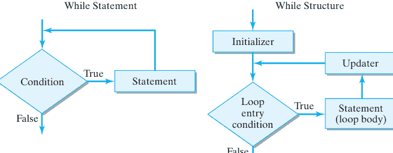

追踪 `for` 循环组件的评估顺序可以得到以下序列：

```
evaluate initializer
evaluate loop entry condition => True
execute for loop body;
evaluate updater
evaluate loop entry condition => True
execute for loop body;
evaluate updater
evaluate loop entry condition => True
execute for loop body;
evaluate updater
evaluate loop entry condition => False
```

正如此追踪所示，循环入口条件控制着进入循环体的每一次执行，因此它是循环终止前最后执行的操作。

#### 循环变量作用域

我们遵循标准的声明方式，在 `for` 语句的头部声明变量。这限制了变量的作用域为 `for` 语句本身。在 `for` 循环的作用域之外使用 `k` 将导致语法错误，如下例：

```
for (int k = 0; k < 100; k++)
    System.out.println("Hello");
// 语法错误，k 未定义
System.out.println("k = " + k);
```

对于某些问题，可能必要在 `for` 语句之外使用循环变量，此时该变量应在 `for` 语句之前声明。例如，如果我们想在循环完成后打印循环变量 `k` 的值，我们必须在循环之前声明它：

```
int k = 0; // 在此处声明循环变量
for (k = 0; k < 100; k++)
    System.out.println("Hello");
System.out.println("k = " + k);
```

在此示例中，循环将在 `k` 变为 100 时退出。

### 6.3.2 循环边界

一个计数循环是在当你知道一个过程必须重复多少次时使用的。边界是一个值，决定了循环将迭代多少次。在计数循环中，循环入口条件是一个布尔表达式，用于测试循环是否达到边界。同样，在计数循环中，更新器可能会修改循环计数器，使其达到边界。

计数循环通常增加或递减其计数器，取决于循环是正向还是后向的。以下代码包含一个递减循环：

```java
public void countdown() {
    for (int k = 10; k > 0; k--) {
        System.out.print(k + " ");
    }
    System.out.println("BLASTOFF");
}
```

### 6.3.3 无限循环

如果边界永远无法达到，循环入口条件将永远为真，循环将无限运行。这被称为无限循环。你可以看到以下示例：

```
for (int k = 0; k < 100; k--)
    System.out.println("Hello");

for (int k = 1; k != 100; k += 2)
    System.out.println("Hello");

for (int k = 98; k <= 100; k /= 2)
    System.out.println("Hello");
```

在第一个示例中，`k` 从 0 开始并在每次迭代递减，取值为 -1, -2, -3 等。在第二个示例中，`k` 从 1 开始并在每次迭代增加 2，取值为 3, 5, 7 等。在第三个示例中，`k` 从 98 开始并在每次迭代减半，取值为 49, 24, 12, 6 等。在所有情况下，循环入口条件永远不会为假，因此循环将无限运行。

### 6.3.4 循环缩进

注意如何使用缩进将循环体与头部以及循环后的语句区分开：

```
for (int k = 10; k > 0; k--) // 循环头部
    System.out.print(k + " "); // 缩进体
System.out.println("BLASTOFF"); // 循环后的
```

缩进是一种为了提高代码可读性的风格惯例，然而缩进对 Java 的解释方式没有影响。以下代码段都会产生相同的结果：

```
for (int k = 10; k > 0; k--)
    System.out.print(k + " ");
    System.out.println("BLASTOFF");

for (int k = 10; k > 0; k--) {
    System.out.print(k + " ");
}
System.out.println("BLASTOFF");
```

### 6.3.5 循环体

`for` 语句的体由紧随 `for` 循环头部的语句组成。这可以是简单语句，也可以是复合语句——即包含在大括号 `{...}` 内的语句序列。

虽然当 `for` 循环体由单个语句组成时不需要大括号，但某些编码风格建议始终为循环语句的体使用大括号。例如，将 `for` 循环编写为如下形式总是正确的：

```
for (int k = 1; k <= 10; k++) { // 打印 1 2 ... 10
    System.out.print("k = " + k);
}
```

这种编码风格的另一个优势是，你可以通过在大括号内放置额外的语句，轻松地将其放入循环体。

> **JAVA 调试提示！** 初学者一个常见的编程错误是忘记使用大括号来将他们想要放入循环体的语句分组。当不使用大括号时，只有循环头后的第一个语句会被迭代。

考虑以下示例。第一个示例打印序列 0, 5, 10, 15, ... 95。它的循环包含单个 `if` 语句：

```
for (int k = 0; k < 100; k++) // 打印 0 5 10... 95
    if (k % 5 == 0) // 循环体：单个语句
        System.out.print("k = " + k);
```

下一个示例打印字母表的小写字母。在这种情况下，循环计数器的类型为 `char`，它统计字母表中的字母。循环体包含单个打印语句：

```
for (char k = 'a'; k <= 'z'; k++) // 打印 'a'..'b'..'z'
    System.out.print("k = " + k); // 循环体：单个 print()
```

下一个示例打印序列 5, 10, 15, ... 50，但它在循环体内使用了语句块：

```
for (int k = 1; k <= 10; k++) { // 打印 5 10... 50
    int m = k * 5; // 开始体
    System.out.print("m = " + m); // 结束体
}
```

在这个示例中，在循环体内声明的局部变量 `m` 的作用范围限于循环体，不能在作用范围之外使用。


## 自学练习题

- **练习 6.1** 识别以下 `for` 语句中的语法错误。
  a.
  ```
  for (int k = 5, k < 100, k++)
      System.out.println(k);
  ```
  b.
  ```
  for (int k = 0; k < 12; k--)
      System.out.println(k);
  ```

- **练习 6.2** 识别哪些语句会导致死循环。
  a.
  ```
  for (int k = 0; k < 100; k = k)
      System.out.println(k);
  ```
  b.
  ```
  for (int k = 1; k == 100; k = k + 2)
      System.out.println(k);
  ```
  c.
  ```
  for (int k = 1; k >= 100; k = k - 2)
      System.out.println(k);
  ```

- **练习 6.3** 假设你正在帮助你的妹妹按四数数。写一个 `for` 循环来打印以下数字序列：1, 5, 9, 13, 17, 21。

- **练习 6.4** 当以下循环终止时，`j` 的值是多少？

  ```
  for (int i = 0; i < 10; i++) {
      int j;
      j = j + 1;
  }
  ```

### 6.3.5 嵌套循环

嵌套循环是一个循环包含在另一个循环体内的结构，当一个 `for` 循环体包含另一个 `for` 循环。假设你想为 Giant Auto Industries 打印一张关于购买数量的表格，单价价格范围从 1 到 9。物品的成本简单来说就是价格乘以数量。因此，你希望打印如下表格，其中第一行列出单价，后续行列出总价：

| 1 | 2 | 3 | 4 | 5 | 6 | 7 | 8 | 9 |
|---|---|---|---|---|---|---|---|---|
| 2 | 4 | 6 | 8 | 10 | 12 | 14 | 16 | 18 |
| 3 | 6 | 9 | 12 | 15 | 18 | 21 | 24 | 27 |
| 4 | 8 | 12 | 16 | 20 | 24 | 28 | 32 | 36 |

产生此表格，可以使用以下嵌套 `for` 循环：

```
for (int row = 1; row <= 4; row++) { // 每一行
    for (int col = 1; col <= 9; col++) { // 每一列
```


System.out.print(col * row + "\t"); // 打印数字

System.out.println(); // 换行

}

}

```

注意缩进如何用于区分嵌套层次并使代码更具读性。在这个示例中，外部循环控制行数，因此 `println()` 语句在内部循环完成后执行，导致我们在每次外部循环迭代时打印一个新行。内部循环通过打印表达式 `col*row` 来打印每行的值。显然，这个表达式的值取决于两个变量。让我们分析这个示例：第2行的语句执行了多少次？内部循环每次外部循环迭代时执行四次，这与第4行执行的次数相同。第3行的语句执行了多少次？内部体在每次执行第2行时执行了36次。有时使用外部循环的循环变量作为内部循环的边界是有用的。例如，考虑以下模式：

```
# # #
# # #
# #
```

注意每行的 `#` 符号数量与行数成反比。第 1 行有五个符号，第 2 行有四个；依此类推，直到第 5 行只有一个。产生这种二维模式，我们需要两个计数器：一个计算行数，一个计算每行的 `#` 符号数量。因为我们在移动到下一行之前必须打印每一行的符号，所以外部循环将计算行数，内部循环将计算每行的符号。但注意，在第1行我们需要五个符号，第2行我们需要四个，依此类推。如果我们假设行号，那么在每行中我们想要打印 `6 - row` 个符号。下表显示了这种关系：

| 行 | 边界 (6-row) | 符号数量 |
|---|---|---|
| 1 | 6-1 | 5 |
| 2 | 6-2 | 4 |
| 3 | 6-3 | 3 |
| 4 | 6-4 | 2 |
| 5 | 6-5 | 1 |

如果我们让 `j` 为内部循环的计数器，那么 `j` 将受到表达式 `6 - row` 的限制。这导致了如下嵌套循环结构：

```
for (int row = 1; row <= 5; row++) { // 每一行
  for (int j = 1; j <= 6 - row; j++) { // 打印行
    System.out.print('#');
  }
  System.out.println(""); // 换行
}
```

注意内部循环根据 `row` 的值而变化，循环计数器根据外部循环而变化。

## 自学练习题

练习 6.5 作为被聘佣设计跳跃的工程师，写一个嵌套 `for` 循环来打印以下模式：

```
## #
#### #
###### # #
```

## 6.4 示例：汽车贷款

回想第5章中的自学练习题，该题目在给定初始本金 (p)、利率 (r) 和年限 (n) 的情况下，使用公式 $a = p(1 + r)^n$ 计算贷款 (a) 的值。本节解释了如何使用相同的公式计算不同利率在不同时间段的贷款成本。

## 问题描述

例如

| 年份 | 8% | 9% | 10% | 11% |
|---|---|---|---|---|
| 第2年 | $23,469.81 | $23,943.82 | $24,427.39 | $24,920.71 |
| 第3年 | $25,424.31 | $26,198.42 | $26,996.07 | $27,817.98 |
| 第4年 | $27,541.59 | $28,665.32 | $29,834.86 | $31,052.09 |
| 第5年 | $29,835.19 | $31,364.50 | $32,972.17 | $34,662.19 |
| 第6年 | $32,319.79 | $34,317.85 | $36,439.38 | $38,692.00 |
| 第7年 | $35,011.30 | $37,549.30 | $40,271.19 | $43,190.31 |
| 第8年 | $37,926.96 | $41,085.02 | $44,505.94 | $48,211.60 |

## 算法设计

该设计的关键元素是生成表格的嵌套循环。因为表格包含若干行，外部循环应该迭代七次，遍历2,3...

```
for (int years = 2; years < 8; years++) {
```

内部循环应该遍历8到11的所有利率：

```
for (int years = 2; years <= 8; years++) {
  for (int rate = 8; rate <= 11; rate++) {
    // 利率
  }
}
```

融资计算应该放在内部循环的体内，并配合打印表格单个单元格（而不是行）的语句。假设我们用于公式中 `a` 的变量是 `carPriceWithLoan`，用于汽车实际价格的变量是 `carPrice`。我们的内部循环体是：

```
carPriceWithLoan = carPrice +
Math.pow(1 + 100.0/365.0, years * 365.0);
System.out.print(dollars.format(carPriceWithLoan) + "\t");
```


# 第 6 章 · 控制结构

254

使用 100.0 而不是 100，以便得到的结果是 double 类型而不是 int  0。

## 实现

程序还必须包含打印行标题和列标题的语句。打印行标题应该在外层循环内部完成，因为每一行都需要执行一次。打印列标题应该在进入外层循环之前完成。最后，我们的程序应该包含正确格式化美元和分的代码。为了实现这一点，我们使用了第 5 章描述的 `java.text.NumberFormat` 类。完整程序如图 6.3 所示。

### 格式化输出

```
import java.text.NumberFormat; // 用于格式化 %.dd 或 n%

public class CarLoan {

    public static void main(String[] args[]) {

        double carPrice = 20000; // 汽车实际价格

        double carPriceWithLoan; // 汽车价格加贷款的总成本

        NumberFormat dollars = NumberFormat.getCurrencyInstance(); // 数字格式化代码

        NumberFormat percent = NumberFormat.getPercentInstance();

        percent.setMaximumFractionDigits(2);

        for (int rate = 8; rate <= 11; rate++) // 打印表格
            System.out.println("\t" + percent.format(100.0) + "\t"); // 打印列标题

        System.out.println();

        for (int years = 2; years <= 8; years++) { // 2 到 8 年

            System.out.println("\t" + years + "\t"); // 打印行标题

            for (int rate = 8; rate <= 11; rate++) { // 计算并打印 CD 值

                double carPriceWithLoan = carPrice + Math.pow(1 + rate / 100.0, years) * 365.0;

                System.out.println("\t" + dollars.format(carPriceWithLoan) + "\t");

            }

            System.out.println(); // 开始新行

        }

        System.out.println();

    } // main

    } // CarLoan

```

图 6.3：CarLoan 。

## 6.5 图形示例：绘制国际棋盘

在本节中，我们将学习过的一些图形方法与嵌套 `for` 循环结构相结合，绘制一个带有棋子的国际棋盘（图 6.4）。在这个示例中，我们将专注于绘制棋盘本身。我们不会费心提供一个完整的棋盘表示（就像如果我们正在编写一个玩游戏的程序那样）。因此，我们的设计将不涉及轮到谁的、每个玩家有多少个棋子或游戏状态。尽管如此，我们对棋盘的可视化表示应该是良好的，以便在第 8 章开发国际棋盘游戏时可以使用。

## 题目描述与规范

该任务的规范是开发一个程序，绘制国际棋盘并将棋子放置在适当的起始位置。在我们的许多程序中，设计会涉及两个类：一个定义用户界面，另一个表示计算对象。对于这个问题，计算对象将在 `Checkerboard` 类中定义。其设计细节将在下一节中描述。

由于此示例示例的目的是关注我们如何使用循环和绘制方法，我们将采用一个非常简单的 `JFrame` 接口，其实现如图 6.5 所示。如图所示，程序简单地创建 `CheckerBoard` 实例：

```
import java.awt.*;

import java.swing.*;

public class CheckerBoardFrame extends JFrame {

    private CheckerBoard board;

    public CheckerBoardFrame() {

        board = new CheckerBoard();

    }

    public void paint(Graphics g) {

        super.paint(g);

        board.draw(g);

    }

    public static void main(String[] args) {

        CheckerBoardFrame c = new CheckerBoardFrame();

        c.setSize(500,500);

        c.setVisible(true);

    }

} // CheckerBoardFrame

```

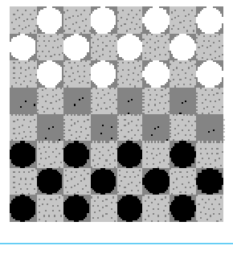

图 6.4：带有棋子的国际棋盘。

图 6.5：在 `CheckerBoardFrame()` 构造函数中的 `CheckerBoardFrame`，然后在其 `paint(g)` 方法中调用 `Checkerboard` 的 `draw` 方法。我们在 `paint()` 中调用 `draw()` 方法是因为我们需要访问 `JFrame` 的 `Graphics` 上下文，它是作为参数传递给 `draw` 方法的。记住，当运行 `CheckerBoard` 时会调用 `main()` 方法，然后通过调用 `setVisible(true)` 方法自动调用 `paint()` 方法。因此，该程序执行的操作是绘制国际棋盘的可视化表示。

## 类设计：CheckerBoard

由于程序将调用 `draw()`，因此该方法必须是 `CheckerBoard` 接口的一部分。在这里，它必须声明为 `public`。绘制棋盘的任务涉及两个不同的任务：(1) 绘制棋盘本身，带有交替颜的正方形；(2) 放置棋子。`draw()` 方法的良好设计是简单地调用封装这些较小方法的辅助方法。我们将这些方法分别称为 `draw()` 和 `drawers()`。它们的签名如图 6.6 所示，该图总结了 `Checkerboard` 类的设计。

| CheckerBoard | |
| :--- | :--- |
| - LEFT_X | int |
| - UPPER_Y | int |
| - SQ_SIDE | int |
| - N_ROWS | int |
| - N_COLS | int |
| - SQ_COLOR1 | Color |
| - SQ_COLOR2 | Color |
| - CHECKER_COLOR1 | Color |
| - CHECKER_COLOR2 | Color |
| - drawCheckers(Graphics) | |
| - draw(Graphics) | |
| + draw(Graphics) | |

图 6.6：`CheckerBoard` 类的设计。

## 方法设计

回到 `CheckerBoard` 实例方法的设计，完整定义见图 7。注意它的 `draw()` 方法有多么简单。如之前所述，在 Java 的绘制命令中，我们需要一个对 `Graphics` 对象的引用。当在程序中调用 `draw()` 方法时，它会被传递给 `draw` 方法。由于 `draw()` 方法将绘制算法的细节委托给它的辅助方法 `draw()` 和 `drawers()`，因此它必须将它们传递给 `Graphics` 对象。`draw()` 方法使用嵌套循环来绘制 8x8 的交替颜色的矩形数组。循环变量 `row` 和 `col`...

## 6.5 图形接口：绘制国际棋盘

```
import java.awt.*;

public class CheckerBoard {

    // 标准国际棋盘的默认值

    private final int LEFT_X = 10; // 左侧位置

    private final int UPPER_Y = 10; // 上角

    private final int SQ_SIDE = 40; // 每个正方形的大小

    private final int N_ROWS = 8; // 棋盘行数

    private final int N_COLS = 8; // 棋盘列数

    private final Color SQ_COLOR1 = Color.lightGray; // 正方形颜色

    private final Color SQ_COLOR2 = Color.gray; // 颜色

    private final Color CHECKER_COLOR1 = Color.white; // 棋子颜色

    private final Color CHECKER_COLOR2 = Color.black; // 颜色

    public void draw(Graphics g) {

        for (int row = 0; row < N_ROWS; row++) { // 每一行

            for (int col = 0; col < N_COLS; col++) { // 每个正方形

                if ((row + col) % 2 == 0) // 交替颜色

                    g.setColor(SQ_COLOR1);

                else // 或深色

                    g.setColor(SQ_COLOR2);

                g.fillRect(LEFT_X+col*SQ_SIDE, UPPER_Y+row*SQ_SIDE, SQ_SIDE, SQ_SIDE);

            }

        }

    }

    private void drawCheckers(Graphics g) { // 放置棋子

        for (int row = 0; row < N_ROWS; row++) { // 每一行

            for (int col = 0; col < N_COLS; col++) { // 每个正方形

                if ((row + col) % 2 == 1) { // 一个玩家在前三行

                    if (row < 3) {

                        g.setColor(CHECKER_COLOR1);

                        g.Oval(LEFT_X+col*SQ_SIDE, UPPER_Y+row*SQ_SIDE, SQ_SIDE, SQ_SIDE);

                    }

                    if (row >= N_ROWS - 3) { // 另一个

                        g.setColor(CHECKER_COLOR2);

                        g.Oval(LEFT_X+col*SQ_SIDE, UPPER_Y+row*SQ_SIDE, SQ_SIDE, SQ_SIDE);

                    }

                }

            }

        }

    }

    private void drawCheckers() {

    public void draw(Graphics g) { // 绘制棋盘和棋子

        draw(g);

        drawCheckers(g);

    }

    public draw() {}

} CheckerBoard
```


# 第 6 章 • 控制结构

它们的范围都从 0 到 7。用于确定交替颜色的表达式测试行下标和列下标的和是否为偶数：`(row + col) % 2 == 0`。如果它们的和是偶数，我们使用一种颜色；如果是奇数，我们使用另一种颜色。

如页边表格的 $4 \times 4$ 棋盘所示，棋盘行和列下标的和在偶值和奇值之间交替。因此，在第 2 行第 3 列，下标之和为 5。

| 0 | 1 | 2 | 3 |
|---|---|---|---|
| 0 | 1 | 2 | 3 |
| 1 | 2 | 3 | 4 |
| 2 | 3 | 4 | 5 |
| 3 | 4 | 5 | 6 |

要从一种颜色切换到另一种颜色，我们使用 `Graphics` 的 `setColor()` 方法在棋盘指定的两种颜色 `SQ_COLOR1` 和 `SQ_COLOR2` 之间交替。然后我们将使用以下方法来绘制有色的方格：

```java
g.fillRect(LEFT_X + col * SQ_SIDE, UPPER_Y + row * SQ_SIDE, SQ_SIDE, SQ_SIDE);
```

注意我们如何使用循环变量 `row` 和 `col`，结合指定棋盘左上角的常量（`UPPER_Y` 和 `LEFT_X`）以及方格的大小（`SQ_SIDE`）来计算每个方格的位置和大小。计算过程如图 6.8 所示。`fillRect(left, top, width, height)` 前两个参数指定矩形左上角的坐标。这些坐标是根据矩形在棋盘内的行列位置以及矩形的宽度和高度计算的，对于棋盘上的方格来说，宽度和高度相等。

图 6.8：计算棋盘方格的位置。

`drawCheckers()` 方法也使用了嵌套 `for` 循环来遍历棋盘的行和列。然而，在这种情况下，我们只在每个棋盘前三行的深色方格上——即满足表达式 `(row + col) % 2 == 1` 的方格上——绘制国际子。

## 6.6 条件循环

棋盘的玩家侧。因此，每个玩家的国际子最初位于棋盘的前三行和最后三行：

```java
if ((row + col) % 2 == 1) { // 一个玩家有 3 行
    if (row < 3) {
        g.setColor(CHECKER_COLOR);
        g.fillOval(LEFT_X + col * SQ_SIDE,
                   UPPER_Y + row * SQ_SIDE, SQ_SIDE - 2, SQ_SIDE - 2);
    }
    if (row >= N_ROWS - 3) { // 另一底有 3 行
        g.setColor(CHECKER_COLOR);
        g.fillOval(LEFT_X + col * SQ_SIDE,
                   UPPER_Y + row * SQ_SIDE, SQ_SIDE - 2, SQ_SIDE - 2);
    }
}
```

由于国际子是圆形的，我们使用 `fillOval()` 方法来绘制它们。注意 `fillOval(left, top, width, height)` 的参数与 `fillRect()` 相同。这些参数指定了一个包含椭圆的外接矩形。在这种情况下，矩形是一个正方形，这导致 `fillOval()` 绘制出一个圆。

我们对 `CheckerBoard` 类的设计说明了方法设计的一个重要原则。首先，我们没有将绘制棋盘和国际子的所有命令放在一个方法中，而是将这项大任务分解成不同的子任务。这产生了许多小方法，每个方法都有明确的目的。

> **JAVA 有效设计：方法分解**。方法的设计应该具有清晰的焦点。如果你发现一个方法变得太长，应该将其算法拆分为多个子任务，并为每个子任务定义一个独立的方法。

### 6.6.1 重新复习 While 结构

与之前节中的问题不同，并不是所有的循环都可以编码为计数循环。数学家（特别是数论学家）发现，对数字的某些操作会导致有趣的序列。例如，3N+1 问题是数论中的一个猜想，它说如果 N 是任意正整数，由以下规则生成的序列将始终终止于 1。

| 情况 | 操作 |
|---|---|
| N 是奇数 | N = 3 * N + 1 |
| N 是偶数 | N = N / 2 |

换句话说，从任意正整数 N 开始。如果 N 是奇数，则将其乘以 3 并加 1。如果 N 是偶数，则将其除以 2。在任何情况下，将结果赋值回 N。该猜想认为 N 将等于 1。例如，如果 N 初始为 26，那么生成的序列是 26, 13, 40, 20, 10, 5, 8, 4, 2, 1。

3N+1 问题是非计数循环的一个例子。因为对于任何 N，我们不知道 3N+1 序列将如何，我们需要一个循环，当循环变量达到某个值（称为哨兵）时——当 N 等于 1 时——终止。这是一个由哨兵边界终止的循环示例。除了无限循环外，循环受某些条件的界限，这就是为什么它们有时被称为条件循环结构。计数边界和哨兵边界只是条件循环结构的特例。

#### 哨兵边界

考虑以下用于 3N+1 问题的伪代码算法：

```
计算 3N+1 序列的算法
当 N 不等于 1 时，执行：
  打印 N。
  如果 N 是偶数，将其除以 2。
  如果 N 是奇数，将 N 乘以 3 并加 1。
打印 N
```

在这个结构中，循环体打印 N，然后使用 3N+1 规则更新 N 的值。假设当此代码段开始时 N 等于 5。它将打印序列：5, 16, 8, 4, 2, 1。注意当此代码段开始时 N = 2；不等于 1。相反，循环将在 N 等于 1 时终止。

我们可以使用 Java 的 `while` 语句来实现该算法，流程图如图 6.2 所示：

```java
while (N != 1) { // N 不等于 1
    System.out.print(N + " "); // 打印 N
    if (N % 2 == 0) // 如果 N 是偶数
        N = N / 2; // 除以 2
    else // 如果 N 是奇数
        N = 3 * N + 1; // 乘以 3 并加 1
}
System.out.println(N); // 打印 N
```

记住与 `for` 语句不同，`while` 语句的初始化和更新是分开的。正如我们在第 3 章指出的，`while` 语句是由以下构建的：

```java
Initializer; // 初始化
while (condition) { // 边界测试
    body // 循环体
}
Updater; // 更新
```

可能循环体从不执行。在这种情况下，循环体没有工作要做，应该被跳过。

### 6.6.2 Do-While 结构

这是另一个无法用计数循环解决的问题。你的父亲担心前院的斑点，正在考虑请草坪服务。然而，你那科学的妹妹试图向他保证，按照草坪枯萎的速度，草足够维持整个夏天。根据她在中学生物学中学到的知识，你妹妹估计草每天枯萎 2%。需要多少周草才会消失？

#### 问题描述

解决此问题的一种方法是从当前的草量中减少 2% 直到低于 50%。每次迭代减少 2%，而整个过程是计算所需的迭代次数。考虑以下伪代码算法：

```
计算草地损失的算法
初始化 amtGrass 为 100.0
初始化 nDays 为 0
重复以下语句
    amtGrass = amtGrass * 0.98;
    ++nDays;
当 amtGrass > 50.0
打印 nDays / 7
```

我们开始将 `amtGrass` 初始化为 100.0，代表 100%。我们将我们的计数器 `nDays` 初始化为 0。当我们重复减去总额的 2% 并增加计数器，直到金额降到 50% 以下。换句话说，在这种情况下，只要草地量保持在原始数量的 50% 以上，我们就重复循环。当循环结束时，我们通过将天数除以 7 来报告周数。

`do-while` 语句中的循环边界被称为限制边界。当达到限制时，循环将终止——在这种情况下，当草地量下降到 50% 以下时。注意，在这种情况下，循环边界是在循环体之后测试的。这对于这个问题是恰当的，因为我们知道循环至少迭代一次。我们可以使用 Java 的 `do-while` 语句来实现它：

```java
public int losingGrass(double perCentGrass) {
    double amtGrass = 100.0; // 初始化草地数量
    int nDays = 0; // 初始化计数器
    do { // 重复
        amtGrass = amtGrass * LOSSRATE; // 更新数量
        ++nDays; // 增加计数器
    } while (amtGrass > perCentGrass); // 只要剩余足够的草
    return nDays / 7; // 返回周数
}
```

`do-while` 语句是一种在循环体之后进行循环入口测试的语句。它具有以下通用形式：

| JAVA 语言规则 | Do-while 语句。do-while 语句具有以下语法： |
| :--- | :--- |
|  | `do` 循环体 `while` ( 循环入口条件 )`;` |

再次注意，与 `for` 语句不同，`do-while` 语句不包含初始化器和更新器的语法。这些必须单独编码。

图 6.9：do-while 语句和 do-while 结构的流程图。

为了进一步强调循环语句和循环结构之间的区别，`do-while` 结构采用以下形式：

```java
InitializerStatements1; // 初始化
do { // 循环体开始
    InitializerStatements2; // 另一个初始化器
    Statements; // 循环体
    UpdaterStatements // 更新器
} while (loop entry condition); // 边界测试
```

注意，初始化语句可以放在循环体之前、循环体开头或两个地方都放，这取决于具体的问题。与其他循环结构一样，更新语句发生在循环体内部。图 6.9 显示了 `do-while` 结构的流程图。

`do-while` 结构是以下类型问题的适当控制结构：

```
do
    拨打所需的电话号码 // 初始化器
    if 如果收到忙音信号
        挂断。 // 更新器
while 如果还有忙音信号 // 边界测试
```

在这种情况下，你希望至少执行一次循环体中的动作，并且可能执行多次（如果你持续收到忙音信号）。

> **JAVA 有效设计：Do-While 循环**。`do-while` 循环设计用于解决至少发生一次迭代的问题。

> **JAVA 有效设计：While 结构与 Do-While 结构**。对于需要非计数循环的问题，`while` 循环结构更通用，且优于 `do-while` 结构。只有在至少发生一次迭代时才使用 `do-while`。

### 自学练习

**练习 6.10** 识别以下 `do-while` 结构中的语法错误：

a.
```java
int k = 0;
do (k < 100) {
    System.out.println(k);
    k++;
}
```

b.
```java
int k = 0;
do {
    System.out.println(k);
    k++;
} while (k < 12)
```

**练习 6.11** 你的妹妹开始按 7 计数。一个 `do-while` 循环打印数字序列：1, 8, 15, 22。

**练习 6.12** 作为 Pizza Heaven 的老板，每天晚上营业结束时，你会输入当天订购每个披萨的价格。你从收据中获取没有美元符号的数据，并使用 0 表示免费披萨。编写一个 Java 方法来输入并验证单个披萨项目。如果输入了错误价格，程序应打印错误消息并提示正确的输入。正确的输入是计算每日总额。

**练习 6.13** 因为上一个练习中的披萨是固定的，所以更改方法以节省时间。不要输入价格，而是输入代码 1、2 或 3（分别对应 $8、$10 和 $15 的披萨），并用 0 表示你已完成。在返回该值之前验证该值是否正确。

## 6.7 示例：计算平均值

### 算法设计：哪种循环？

假设你想计算数字的平均值。为了表示列表的结束，我们将使用哨兵值 999。因为我们不知道确切会输入多少个分数，我们将使用非计数循环。分数将从键盘输入。为了计算总额，我们需要累加每个分数。

该算法需要两个变量：一个用于跟踪总额，另一个用于跟踪计数器。它们都应该初始化为 0。在输入了最后一个分数后，总额应该除以计数器。在伪代码中，该算法如下：

```
初始化 runningTotal 为 0 // 初始化
初始化 count 为 0
提示并读取第一个分数 // 预读
while 分数不等于 999 // 哨兵测试
    将其加到总额
    将计数器加 1
    提示并读取下一个分数 // 更新
```

注意，在这种循环中，`grade` 在循环测试之前读取的。这被称为预读。因为循环测试依赖于 `grade` 的值，在进行边界测试之前初始化该变量至关重要。将伪代码转换为 Java 需要变量。假设我们将每个分数存储在名为 `grade` 的双精度变量中。当 `grade` 等于 999 时，循环将终止。由于此条件使用了 `grade`，在边界测试之前对其初始化是必要的。通过在循环之前读取第一个 `grade` 值，我们确保如果用户在第一次提示时输入哨兵（999），循环将跳过。除了读取第一个分数，我们必须初始化用于总额的变量。因此，对于初始化步骤，我们得到以下代码：

```java
double runningTotal = 0;
int count = 0;
reader.prompt("输入分数（例如 85.3）" +
              "或 999 表示列表结束 ");
double grade =
    reader.getKeyDouble(); // 预读
```

在循环内部我们必须将分数加到总额并增加计数器。由于这些变量没有在循环入口条件中测试，它们不会影响循环控制。在这种情况下，我们的循环更新器必须读取下一个分数。循环体末尾的更新语句将在用户输入值后立即进行循环：

```java
while (grade != 999) {
    runningTotal += grade;
    count++;
    reader.prompt("输入分数（例如 85.3）" +
                  "或 999 表示列表结束 >> ");
    grade = reader.getKeyDouble(); // 更新：输入
}
```

你可以看到，为了初始化循环和更新 `grade` 变量而重复相同的语句是有些冗余的。更好的设计是将这些封装在方法中，然后在循环之前和内部都调用该方法。

# 第 6 章 • 控制结构

提示消息。这使得程序更易调试。输入错误现在被定位在 `promptAndRead()` 方法中。

| 类别 | 概念 | 描述 |
|---|---|---|
| JAVA 有效设计 | 模块化 | 将代码封装在方法中是避免程序冗余的良好方法。 |
| JAVA 调试技巧 | 本地化 | 将代码封装在方法中消除了在程序多个位置具有相同代码的需求。通过这种方式将代码本地化，你可以使其更容易修改和调试。 |

将输入任务封装在独立方法中的另一个优势是简化了计算平均值的任务。此任务也应该组织成一个独立的方法：

```java
public double inputAverageGrades() {
    double runningTotal = 0;
    int count = 0;
```


```java
double grade = promptAndRead(); // 初始初始化

while (grade != 9999) { // 循环测试：哨兵
    runningTotal += grade;
    grade = promptAndRead(); // 更新：获取下一个成绩
}

if (count > 0) // 防止除以零
    return runningTotal / count; // 返回平均值
else
    return 0; // 特殊（错误）值
```

注意，我们将其声明为公共方法。这将是你计算平均值时要调用的方法。

由于我们已经问题分解为各个子任务，每个子任务都很短，易于阅读和理解。正如我们在棋盘示例中看到的，使用关注明确的方法是设计程序的一个理想方面。

完整的 `Average.java` 应用程序如图 6.10 所示。整体设计与我们在之前章节中设计的应用程序相似。使用的唯一实例变量是 `KeyboardReader` 变量。其他变量都在方法内部局部声明。在某些情况下，将它们局部声明使得算法易于阅读。

# 方法分解

关于此程序的最后一点是注意在用户界面设计上所付的精力，以向用户解释程序并提示用户。

# 第 6.7 节 • 示例：计算平均值

```java
import java.io.*;

public class Average { // 控制台输入输出
    private KeyboardReader reader = new KeyboardReader();

    private double promptAndRead() {
        reader.prompt("Input a grade (e.g., 85.3) " +
            "9999 to indicate the end of the list >> ");
        double grade = reader.getKeyDouble();
        System.out.println("You input " + grade + "\n"); // 确认输入
        return grade;
    }

    public double inputAndAverageGrades() {
        double runningTotal = 0;
        int count = 0;
        double grade = promptAndRead(); // 初始化：初始输入
        while (grade != 9999) { // 循环测试：哨兵
            runningTotal += grade;
            count++;
            grade = promptAndRead(); // 更新：下一个成绩
        }
        if (count > 0) { // 防止除以零
            return runningTotal / count; // 返回平均值
        } else {
            return 0; // 特殊（错误）返回值
        }
    }

    public static void main(String[] args) {
        System.out.println("This program calculates average grade.");
        double average = inputAndAverageGrades();
        if (average == 0) { // 错误检查
            System.out.println("You didn't enter any grades.");
        } else {
            System.out.println("Your average is " + average);
        }
    }
} // Average
```

图 6.10: 使用 while 结构计算平均分数的程序。

输入一个值，并在程序读取其后确认用户的输入。

> **JAVA 有效设计 用户界面。** 每当你向用户索取输入时，用户都应该知道你为什么要问以及你在问什么。应该为此目的使用提示。此外，确认程序已接收到正确的输入也是一个好主意。


## 6.8 示例：数据验证

常见的编程任务是数据验证。该任务可以根据程序的性质采取不同的形式。当从用户处接受输入时，数据验证的一种用途。

在前节的程序中，假设用户在被要求输入成绩时错误地输入了 -10。显然，这不是有效成绩，不应该被加入总和中。程序应该如何处理这种情况？

由于用户可能会尝试一次或多次纠正错误，我们应该针对这个问题使用 `do-while` 结构。程序应该首先从用户处输入一个数字。然后检查该数字的有效性。如果是有效的，循环应该退出，程序在获取输入成绩之前继续计算。如果无效，程序将打印错误信息并再次输入数字。该算法的流程图如图 6.11 所示。

例如，假设只考虑 0 到 100 之间的数字。数据验证算法如下：

```text
get next grade // 初始化：初始输入
if grade < 0 or grade > 100 and grade != 9999
    print an error // 特殊情况
```

注意 `grade` 的初始化和更新是由同一语句完成的。注意 `do-while` 是编写循环的合适结构。这允许我们在用户输入不正确时打印错误。为了反映其目的，我们命名为 `Validate`（图 10）。

## 6.9 循环设计原则

在继续之前，总结正确构建循环所涉及的原则将很有帮助。

- 当你预先知道需要次迭代时，可以使用循环。
- Java 的 `for` 是编写循环的合适结构。

图 6.11: `do-while` 是数据验证算法的良好结构。

### 算法设计

```java
import java.io.*;

public class Validate { // 控制台输入输出
    private KeyboardReader reader = new KeyboardReader();

    private double getAndValidate() {
        double grade = 0;
        do {
            reader.prompt("Input a grade (e.g., 85.3) " +
                "9999 to indicate the end of the list >> ");
            grade = reader.getDouble();
            if ((grade != 9999) && ((grade < 0) || (grade > 100))) { // 如果错误
                System.out.println("Error: grade must be 0 and 100\n");
            } else
                System.out.println("You input " + grade + "\n");
        } while ((grade != 9999) && ((grade < 0) || (grade > 100)));
        return grade;
    }

    public double inputAndAverageGrades() {
        double runningTotal = 0;
        int count = 0;
        double grade = getAndValidate(); // 初始化
        while (grade != 9999) { // 循环测试：哨兵
            runningTotal += grade;
            count++;
            grade = getAndValidate(); // 更新：获取下一个成绩
        }
        if (count > 0) { // 防止除以零
            return runningTotal / count; // 返回平均值
        } else
            return 0; // 特殊（错误）返回值
    }

    public static void main(String[] args) { // 
        System.out.println("This program calculates average grade.");
        double average = inputAndAverageGrades();
        if (average == 0) { // 错误检查
            System.out.println("You didn't enter any grades.");
        } else
            System.out.println("Your average is " + average);
        }
    }
} // Validate
```

图 6.12: 使用 while 结构计算平均分数的程序。此版本验证了用户的输入。

# 第 6 章 • 控制结构

- 当你预先知道需要迭代次数时，可以使用循环。
- Java 的 `for` 是编写循环的合适结构。
- 当问题暗示可能完全跳过循环体时，应使用 `while` 结构。Java 的 `while` 语句是专为 `while` 结构设计的。
- 仅当循环需要执行一次或多次迭代时，才使用 `do-while` 结构。Java 的 `do-while` 语句是专为 `do-while` 结构设计的。
- 循环变量用于指定合适的初始值，并且在循环的每次迭代中都必须进行更新。
- 循环的边界可以是计数器、哨兵，或者更广泛地说，是条件边界。它必须在循环入口处正确指定，并在更新器中向该边界迈进。
- 如果初始化器、循环入口或更新器表达式没有被正确指定，可能会导致死循环。

表 6.1 同时也总结了循环的类型。

## 表 6.1 编写循环时所需的设计决策总结

| 用途 | 如果满足 | Java 语句 |
|---|---|---|
| 计数循环 | 提前知道迭代次数 | for |
| While 结构 | 不知道迭代次数 <br>可能不进入循环 | while |
| Do-while 结构 | 不知道迭代次数 <br>循环至少进入一次 | do-while |

# 自学练习题

**练习 6.14** 针对以下每个问题，判断应该使用计数循环结构、`while` 结构还是 `do-while` 结构，并写出对应的伪代码算法。

- 打印你网站所有访客的名字。
- 验证用户输入的数字为正数。
- 将 Windows 页面地址中的所有反斜杠 (`\`) 改为 Unix 页面地址使用的斜杠 (`/`)。
- 在《消费者报告》（Consumer Reports）数据库的汽车中寻找燃油效率最高的汽车。

## 6.10 switch 多路选择结构

你的技能库中可以增加的另一个 switch 结构是 **switch/break 结构**。它旨在提供一种编码以下类型多路选择结构的简便方法：

```text
if (integralVar == integralValue1)
    // some statements
else if (integralVar == integralValue2)
    // some statements
else if (integralVar == integralValue3)
    // some statements
else
    // some statements
```

注意，在这种情况下，每个条件都涉及整数变量与整数值之间的相等性。这种结构在程序中经常出现，大多数语言都包含了专门设计用于处理它的语句。在 Java 中，我们使用 **switch** 和 **break** 语句组合来实现多路选择。**switch** 设计用于根据某些整数表达式的值来选择几个动作之一：

```text
switch (integralExpression)
    case integralValue1:
        // some statements
    case integralValue2:
        // some statements
    case integralValue3:
        // some statements
    default:
        // some statements
```

`integralExpression` 必须求值为类型为 **byte, short, int, char 或 boolean** 的原始整数值。它不能是 `long, float, double` 或类类型。`integralValues` 必须是字面量或 **final** 变量。它们充当组成 **switch** 语句的一个或多个子句的标签。**default** 子句是可选的，但包含它是一个好主意。

`switch` 语句按照以下规则执行：

- 规则 1。求值 `integralExpression`。
- 规则 2。控制传递到值等于 `integralExpression` 的 `case` 标签后的语句，或者如果没有 case 适用，则传递到 **default** 子句。
- 规则 3。从选定的标签或 default 开始，执行到 **switch** 结束的所有语句。

# 第 6 章 • 控制结构

考虑以下示例：

```java
int m = 2;
switch (m) {
    case 1:
        System.out.print(" m = 1");
    case 2:
        System.out.print(" m = 2");
    case 3:
        System.out.print(" m = 3");
    default:
        System.out.print(" default case");
}
```

在此例中，由于 m 等于 2，将产生以下输出：

```text
m = 2 m = 3 default case
```

显然，这个输出与下面的 if-else 多路选择结构不匹配，后者只会简单输出 m = 2：

```java
int m = 2;
if (m == 1)
    System.out.print(" m = 1");
else if (m == 2)
    System.out.print(" m = 2");
else if (m == 3)
    System.out.print(" m = 3");
else
    System.out.print(" default case");
```

这种差异的原因是 switch 在执行上一页规则 3 之后，会执行匹配 `integralExpression` 值的标签之后的所有语句。

为了将 switch 用作多路选择，你必须强制它在执行完该子句的语句后跳出 case 子句：

```java
int m = 2;
switch (m) {
    case 1:
        System.out.print(" m = 1");
        break;
    case 2:
        System.out.print(" m = 2");
        break;
    case 3:
        System.out.print(" m = 3");
        break;
    default:
        System.out.print(" default case");
}
```

# 第 6.10 节 switch 多路选择结构

添加到你技能库的另一个 switch 结构是 **switch/break 结构**。它旨在提供一种简便方法来编码以下类型的多路选择结构：

```text
if (integralVar == integralValue1)
    // 语句
else if (integralVar == integralValue2)
    // 语句
else if (integralVar == integralValue3)
    // 语句
else
    // 语句
```

注意，在这种情况下，每个条件都涉及整数变量与整数值之间的相等性。这种结构在程序中经常出现，大多数语言都包含了专门设计用于处理它的语句。在 Java 中，我们使用使用 **switch** 和 **break** 语句的组合来实现多路选择。**switch** 设计用于根据某些整数表达式的值来选择几个动作之一：

```text
switch (integralExpression)
    case integralValue1:
        // 语句
    case integralValue2:
        // 语句
    case integralValue3:
        // 语句
    default:
        // 语句
```


# 第 6 章 • 控制结构

## 6.10 switch 多路选择结构

你的技能库中可以增加的另一个 switch 结构是 **switch/break 结构**。它旨在提供一种编码以下类型多路选择结构的简便方法：

```
if (integralVar == integralValue1)
    // 语句
else if (integralVar == integralValue2)
    // 语句
else if (integralVar == integralValue3)
    // 语句
else
    // 语句
```

注意，在这种情况下，每个条件都涉及整数变量与整数值之间的相等性。这种结构在程序中经常出现，大多数语言都包含了专门设计用于处理它的语句。在 Java 中，我们使用 `switch` 和 `break` 语句的组合来实现多路选择。`switch` 设计用于根据某些整数表达式的值来选择几个动作之一：

```
switch (integralExpression)
    case integralValue1:
        // 语句
    case integralValue2:
        // 语句
    case integralValue3:
        // 语句
    default:
        // 语句
```

`integralExpression` 必须求值为类型为 `byte`、`short`、`int`、`char` 或 `boolean` 的原始整数值。它不能是 `long`、`float`、`double` 或类类型。`integralValues` 必须是字面量或 `final` 变量。它们充当组成 `switch` 语句的一个或多个子句的标签。`default` 子句是可选的，但包含它是一个好主意。

`switch` 语句按照以下规则执行：

- 规则 1。求值 `integralExpression`。
- 规则 2。控制传递到值等于 `integralExpression` 的 `case` 标签后的语句，或者如果没有 case 适用，则传递到 `default` 子句。
- 规则 3。从选定的标签或 default 开始，执行到 `switch` 结束的所有语句。

考虑以下示例：

```java
int m = 2;

switch (m) {
    case 1:
        System.out.print(" m = 1");
    case 2:
        System.out.print(" m = 2");
    case 3:
        System.out.print(" m = 3");
    default:
        System.out.print(" default case");
}
```

在此例中，由于 m 等于 2，将产生以下输出：

```
m = 2 m = 3 default case
```

显然，这个输出与下面的 if-else 多路选择结构不匹配，后者只会简单输出 m = 2：

```java
int m = 2;

if (m == 1)
    System.out.print(" m = 1");
else if (m == 2)
    System.out.print(" m = 2");
else if (m == 3)
    System.out.print(" m = 3");
else
    System.out.print(" default case");
```

这种差异的原因是 switch 在执行规则 3 之后，会执行匹配 `integralExpression` 值的标签之后的所有语句。

为了将 switch 用作多路选择，你必须强制它在执行完该子句的语句后跳出 case 子句：

```java
int m = 2;

switch (m) {
    case 1:
        System.out.print(" m = 1");
        break;
    case 2:
        System.out.print(" m = 2");
        break;
    case 3:
        System.out.print(" m = 3");
        break;
    default:
        System.out.print(" default case");
}
```

---

- 当问题暗示可能完全跳过循环体时，应使用 `while` 结构。Java 的 `while` 语句是专为 `while` 结构设计的。
- 当循环需要执行一次或多次迭代时，才使用 `do-while` 结构。Java 的 `do-while` 语句是专为 `do-while` 结构设计的。
- 循环变量用于指定合适的初始值，并且在循环的每次迭代中都必须进行更新。
- 循环的边界可以是计数器、哨兵，或者更广泛地说，是条件边界。它必须在循环入口处正确指定，并在更新器中向该边界迈进。
- 如果初始化器、循环入口或更新器表达式没有被正确指定，可能会导致死循环。

表 6.1 总结了循环的类型。

### 表 6.1 编写循环时所需的设计决策总结

| 用途 | 如果满足 | Java 语句 |
|---|---|---|
| 计数循环 | 提前知道迭代次数 | for |
| While 结构 | 不知道迭代次数<br>可能不进入循环 | while |
| Do-while 结构 | 不知道迭代次数<br>循环至少进入一次 | do-while |

## 自学练习题

**练习 6.14** 针对以下每个问题，判断应该使用计数循环结构、`while` 结构还是 `do-while` 结构，并编写伪代码算法。

- 打印你网站所有访客的名字。
- 验证用户输入的数字为正数。
- 将 Windows 页面地址中的所有反斜杠 (`\`) 改为 Unix 页面地址使用的斜杠 (`/`)。
- 在《消费者报告》（Consumer Reports）数据库的汽车中寻找燃油效率最高的汽车。

---

# 278 第 6 章 ● 控制结构

- 选择——`if`、`if/else` 和 `switch` 语句是分支语句，允许通过将控制路径分支两个或多个备选方案来实现选择。
- 重复——`for`、`while` 和 `do-while` 语句是循环语句，允许程序重复执行语句。
- 方法调用——调用方法会将控制权临时转移到命名方法中。方法完成后，控制权返回到调用点。

无论你编写的程序大小，它的控制流都可以由这四种基本结构的组合而成。

## 前置条件和后置条件

Java 语言为我们提供了一组良好的控制结构，而 Java 的语法限制了我们使用它们的方式。for 控制结构的特征之一是，每个结构都有一个单一的入口和出口（图 6.14）。这是一个极其重要的属性。为了理解它的重要性，请考虑以下调试问题：

```java
k = 0;

// 1. 非结构化代码
System.out.println("k=" + k); // 2. k 应该等于 0
label1:
goto label2;
// 3.
System.out.println("k=" + k); // 4. k 应该等于 1
```

在这个示例中，使用 `goto` 语句跳转到程序其他某处标记代码段的标签。假设我们试图确定 k 是如何获得错误值的，并且它的值在该序列的第 2 行是正确的。由于第 3 行有 `goto` 语句，无法保证控制权会返回第 4 行的 `println()` 语句。因此，在非结构化代码中，很难将错误范围缩小到固定的代码段。因为 `goto` 可以转移程序的任何地方且不保证返回，任何代码段都可能有多个入口和多个出口。

现在将非结构化代码与以下结构良好的代码进行对比：

```java
k = 0;

// 1. 结构化代码
System.out.println("k=" + k); // 2. k 应该等于 0
someMethod();
// 3.
System.out.println("k=" + k); // 4. k 应该等于 1
```

在这种情况下，我们可以确定控制权最终会返回到第 4 行。如果 k 的值在第 4 行是错误的，我们可以追溯 `someMethod()` 来找到错误。因为结构化程序的任何段都有单一的入口和出口，我们可以这样使用一对 `println()` 语句来定位程序 Bug 的位置。

单一入口/单一出口属性的重要意义是，我们可以使用前置条件和后置条件来帮助我们设计和调试代码。上一个示例提供了一个简单的例子：

### 使用 println() 进行调试

# 第 11 节 • OOD: 结构化编程

前置条件是第 2 行 k 应该等于 0，后置条件是第 4 行 k 应该等于 1。图 6.15 显示了一些额外的示例。

```java
int k = 0;           // 前置条件: k == 0
k = 5;               // 给 k 赋值
// 后置条件: k == 5
```

```java
int k = 0;           // 前置条件: k == 0
while (k < 100) {
    k = 2 * k + 2;
}
// 后置条件: k >= 100
```

```java
/*
 * factorial(n)
 *   如果 n 为 0，factorial(n) 为 1
 *   如果 n > 0，factorial(n) 为 n * n-1 * n-2 ... + 1
 *   前置条件: n >= 0
 *   后置条件:
 *   如果 n = 0，factorial(n) 为 1
 *   如果 n > 0，n * n-1 * n-2 ... + 1
 */
public int factorial(int n) {
    if (n == 0)
        return 1;
    } else {
        int f = 1;
```


# 使用前置和后置条件记录代码

## 示例 1：赋值语句

在第一个示例中，我们使用前置和后置条件来定义赋值语句的语义。无论在赋值之前 `k` 的值是多少，执行 `(k = 5)` 都会让后置条件 `(k == 5)` 为真。

## 示例 2：循环语义

在第二个示例中，我们使用前置和后置条件来定义循环的语义。当 `k < 100` 时，后置条件 `(k >= 100)` 必须为真。

## 示例 3：方法文档

第三个示例展示了如何使用前置和后置条件来记录方法。例如：

```java
/*
 * factorial(n)
 *   如果 n 为 0，factorial(n) 为 1
 *   如果 n > 0，factorial(n) 为 n * n-1 * n-2 ... + 1
 *   前置条件: n >= 0
 *   后置条件:
 *   如果 n = 0，factorial(n) 为 1
 *   如果 n > 0，n * n-1 * n-2 ... + 1
 */
```

---

我们在这里真正的意思是，使用前置和后置条件会迫使你分析程序的逻辑。仅仅知道一个单一程序中孤立的语句目前运行良好是不够的。但你必须问问自己：如果你更改了程序的其他部分，它还会继续运行吗？如果你修改了该程序，程序的其他部分还会继续运行吗？无论你有多聪明，都不可能在脑海中同时记住整个中等规模程序的完整模型。你总是需要关注几个关键细节，而忽略其他细节。理想情况下，你希望暂时搁置的细节不会导致你正试图修复的当前错误出现。使用前置条件和后置条件可以帮助你确定你选择忽略的细节的正确性。

> **JAVA 有效设计：前置和后置条件。** 前置后置条件是分析程序循环和方法逻辑的有效方法。它们应该在设计和开发的早期阶段被确定。它们应该在程序的测试和调试中发挥作用。最后，它们应该以系统化的方式包含在程序文档中。

> **JAVA 编程技巧：** 在开发代码的同时编写程序文档，并并在文档中包含前置和后置条件。

随着程序变得越来越长、越来越复杂，它们包含严重错误的概率会剧增。目前没有真实的方法可以避免这种复杂性。唯一的希望是尝试管理它。除了分析程序的结构，程序设计的另一个重要方面是尝试降低其复杂性。

> **JAVA 有效设计：降低复杂度。** 设计程序时以降低复杂度为目标。

也许降低复杂性的最好方法是为程序构建一堆标准的结构和技术。基本的控制结构通过限制可以构建的分支和循环结构的类型，帮助降低程序的潜在复杂度。控制结构有助于管理程序算法的复杂性。同样，以下实践也可以减少并管理程序的复杂性。

> **JAVA 编程技巧：标准技术。** 获取并使用标准编程技术解决标准编程问题。例如，使用临时变量交换两个变量是一种标准技术。

> **JAVA 编程技巧：封装。** 在你代码的适当位置使用方法来封装重要的代码段，从而降低复杂度。

> **JAVA 编程技巧：代码复用。** 与其重复造轮子，应尽可能使用库类和方法。这些类是由经验丰富的程序员精心设计的。库代码经过了广泛的测试。

---

# 自学练习

## 练习 6.18

识别以下代码段中指示处 `j` 和 `k` 的前置和后置条件：

```java
int j = 0; k = 5;

do {
    if (k % 5 == 0) {
        // 前置条件
        j += k;
        k--;
    }
    else k *= k;
} while (j <= k);
    // 后置条件
```

## 练习 6.19

为该方法识别前置和后置条件，该方法计算 `n ≥ 0` 时的 `xⁿ`：

```java
public double power(double x, int n) {
    double pow = 1;
    for (int k = 1; k < n; k++) {
        pow = pow * x;
    }
    return pow;
}
// power()
```

---

# 特题：什么是可以计算的？

你是否想过是否存在无论使用何种控制结构，计算机都无法解决的问题？事实上，早在 1939 年，艾兰·图灵在他名为《关于可计算数》的开创性论文中证明了无数不可解决的问题。在此之前，数学家和逻辑学家认为所有问题都是可以解决的。因此，图灵的证明是一个巨大的打击。

为了帮助他证明这一点，图灵定义了一个抽象计算机，后来被称为图灵机。图灵机有一套符号表；一个读写头；一条无限长的磁带，读写头可以在带上写入符号，也可以从中读取符号；以及一个控制读写头移动和动作的控制单元。注意，图灵机的元素对应于关键组件——尽管图灵在第一台计算机之前的十年就发明了它。读写头对应计算机中央处理器（CPU）。磁带对应计算机内存。控制单元对应于计算机程序。

图灵机代表了纯抽象的计算概念。通过这一概念，图灵能够证明存在不可解决的问题——即没有任何算法可以得出答案的问题。

其中一个问题就是停机问题。停机问题要求判断一个任意程序是否最终会停止。如果存在这样的算法，它可以检测包含无限循环的程序，这在入门计算实验等地方非常有帮助！但遗憾的是，并没有这样的算法。

---

# 自学练习题解答

## 答案 6.1：识别以下循环语句中的语法错误

- **a.** 头部中使用了逗号而不是分号。

```java
for (int k = 5, k < 100, k++)
    System.out.println(k);
```

- **b.** 头部不应该有 3 个分号。

```java
for (int k = 0; k < 12; k--;)
    System.out.println(k);
```

## 答案 6.2：识别导致无限循环的语句

- **a.** 无限循环，因为 `k` 从未增加。
- **b.** 无限循环，因为 `k` 始终是奇数且永远不等于 100。

## 答案 6.3

你的妹妹正在学习数四数。写一个 `for` 循环来打印以下数字序列：1, 5, 9, 13, 17, 21, 25。

```java
for (int k = 1; k <= 25; k = k + 4)
    System.out.print(k + " ");
```

## 答案 6.4

当以下循环结束时，`j` 的值是多少？答案：当循环结束时 `j` 是未定义的。它是一个局部变量，其作用域限于循环体。

```java
for (int i = 0; i < 10; i++)
    int j;
    j = j + 1;
```

## 答案 6.5

写一个嵌套循环来打印以下几何图形：

```
#
##
###
####
#####
```

```java
for (int row = 1; row <= 5; row++) { // 每一行
    for (int col = 1; col <= row; col++) { // 每行的列
        System.out.print("*");
    }
    System.out.println(")"); // 换行
}
```

## 答案 6.6：识别以下 `while` 结构中的语法错误

**a.**

```java
int k = 5;
while (k < 100) {
    System.out.println(k) // 缺少分号
    k++;
}
```

**b.**

```java
int k = 0;
while (k < 12) {
    System.out.println(k); // 多余的分号
    k++;
}
```

## 答案 6.7：确定以下每个 `while` 结构的输出和/或识别错误

**a.**

```java
int k = 0;
while (k < 100) {
    System.out.println(k) // 循环体中缺少更新器
}
```
输出：无限循环打印 `00000...`

**b.**

```java
while (k < 100) { // 缺少初始化
    System.out.println(k);
    k++;
}
```
输出：不可预测，因为 `k` 的初始值未知。

## 答案 6.8

你的妹妹现在正在学习如何数六数。写一个循环来打印以下数字序列：0, 6, 12, 18, 24, 30, 36。

```java
int k = 0; // 初始化器
while (k < 36) { // 循环入口条件
    System.out.println(k); // 更新器
    k += 6;
}
```

## 答案 6.10：识别以下 `do-while` 结构中的语法错误

**a.**

```java
int k = 0;
do while (k < 100) // 条件位置错误
{
    System.out.println(k);
    k++;
} // 应该在这里
```

**b.**

```java
int k = 0;
do {
    System.out.println(k);
    k++;
} while (k < 12) // 缺少分号
```

## 答案 6.11

你的妹妹已经开始学习数七数。写一个 `do-while` 循环来打印以下数字序列：1, 8, 15, 22, 29, 36, 43。

## 答案 6.12

写一个方法来输入并验证披萨销售情况。

```java
public int getAndValidatePizzaPrice() { // 使用 KeyboardReader
    price = reader.prompt("Input a pizza price (8
```

## 答案 6.13

写一个方法，使用数字 1, 2 和 3 来代表不同价格水平的披萨来输入并验证销售情况。

```java
public int getAndValidatePizzaPrice() { // 使用 KeyboardReader
    pizza = 0;
    do {
        reader.prompt("Input a 1 or 3 to indicate pizza\n");
        reader.prompt("0 to 2 to find the price:\n");
        pizza = reader.getKeyInteger();
        if (pizza < 0) {
            System.out.println("Error: you entered an \ninvalid value!");
        } else {
            System.out.println("You input " + pizza + "\n");
        }
    } while (pizza < 0) || (pizza > 3);
    if (pizza == 1)
        return 8;
    else if (pizza == 2)
        return 10;
    else if (pizza == 3)
        return 13;
    else
        return 15;
    return 0;
} // getAndValidatePizzaPrice()
```

## 答案 6.14

对于以下每个问题，决定应该使用计数循环、`while` 结构还是 `do-while` 结构，并编写伪代码。

- 打印所有访问者的名字将使用计数循环，因为访问人数是已知的。

```
for each name in the visitor
    print the name
```

- 验证用户输入了正数需要使用 `do-while` 结构，反复读取数字并验证。

```
do
    read a number
    if number is invalid, print message
while number is invalid
```

- 在 Unix 路径中更改所有字符（`/`）。

```
for each character in the page address
    if it is a backslash replace with slash
```

- 在数字列表中找到最大值需要 `while` 循环来防止空列表。

```
initialize numMax to smallest number
while there are more cars in the database
    if car's max is greater than numMax
        replace numMax with current
```

## 答案 6.15：识别以下 `switch` 结构中的错误（如果没有输出，请指定）

**a.**

```java
int k = 0;
switch (k) // 缺少括号
    case 0:
        System.out.println("zero");
        break;
    case 1:
        System.out.println("one");
        break;
    default:
        System.out.println("default");
```

**b.**

```java
int k = 0;
switch (k + 1) {
    case 0:
        System.out.println("zero");
        break;
    case 1:
        System.out.println("one"); // 输出 "one"
        break;
    default:
        System.out.println("default");
}
```

**c.**

```java
int k = 6;
switch (k / 3.0) // 语法错误：不是整数值
{
    case 0:
        System.out.println("zero");
        break;
    case 1:
        System.out.println("one");
        break;
    default:
        System.out.println("default");
}
```

## 答案 6.16：打印冰淇淋口味的 `switch` 语句

```java
switch (flavor) {
    case 0:
        System.out.println("Vanilla");
        break;
    case 1:
        System.out.println("Chocolate");
        break;
    case 2:
        System.out.println("Strawberry");
        break;
    default:
        System.out.println("Error");
}
```

## 答案 6.17

```java
public final int VANILLA = 0,
            CHOCOLATE = 1,
            STRAWBERRY = 2;

switch (flavor) {
    case VANILLA:
        System.out.println("Vanilla");
        break;
    case CHOCOLATE:
        System.out.println("Chocolate");
        break;
    case STRAWBERRY:
        System.out.println("Strawberry");
        break;
    default:
        System.out.println("Error");
}
```

## 答案 6.18：识别以下代码段中指定的 `j` 和 `k` 的前条件和后条件

```java
int j = 0; k = 5;

do {
    if (k % 5 == 0) {
        // 前条件：j <= k
        j += k;
        k--;
    } else {
        k++;
    }
} while (j < k); // 后条件：j > k
```

## 答案 6.19：识别以下计算 `n >= 0` 时 `x^n` 的方法的前条件和后条件

```java
// 前条件：n >= 0
// 后条件：power(x,n) == x^n
public double power(double x, int n) {
```


```java
double pow = 1;

for (int k = 1; k <= n; k++) {

    pow *= x;

}

return pow;

}
```

# 练习

注意：对于编程练习，首先绘制 UML 类图描述所有类及其继承关系和/或关联。

## 练习 6.1 解释以下术语对之间的区别：

a. 计数循环和条件循环。
b. `for` 语句和 `while` 语句。
c. `while` 语句和 `do-while` 语句。
d. 零索引和单位递增。
e. 哨兵边界和限制边界。
f. 计数边界和标记边界。
g. 循环初始化器和更新器。
h. 命名常量和字面量。
i. 复合语句和空语句。

## 练习 6.2 填空。

a. 在进入循环之前读取数据项的过程被称为 ______。
b. 除了迭代外什么都不做的循环是 ______ 的例子。
c. 不包含循环体的循环是 ______ 语句的例子。
d. 入口条件写为 `(k < 100 || k >= 0)` 的循环是 ______ 循环的例子。
e. 应该迭代到用户输入特殊值的循环应该使用 ______ 边界。
f. 迭代两个值之差小于 5 到 100 的循环应该使用 ______ 边界的示例。
g. 迭代变量从 5 到 0 的循环是 ______ 边界的例子。

## 练习 6.3 识别以下每个项目的语法错误：

a. `for (int k = 0; k < 100; k++) System.out.println(k);`
b. `for (int k = 0; k < 100; k++) System.out.println(k);`
c. `for (int k = 0; k < 100) System.out.println(k++);`
d. `for (int k = 0; k < 100; k++) System.out.println(k, k++);`

## 练习 6.4 确定以下代码段的输出和/或识别错误：

a. `for (int k = 1; k <= 100; k += 2) System.out.println(k);`
b. `while (k < 100) System.out.println(k); k++;`
c. `for (int k = 0; k < 100; k++) { System.out.println(k); };`

## 练习 6.5 为以下活动编写伪代码，注意每个情况下的初始化器、更新器和边界条件：

a. 一个游戏
b. 五题问答
c. 在电话簿中查找姓名

## 练习 6.6 为每个语句写前条件和后条件：

a. `int result = x / y;`
b. `int result = x;`
c. `int x = 95; do x /= 2; while (x <= 0);`

## 练习 6.7 写三种不同的循环——`for` 循环、`while` 循环和 `do-while` 循环——来打印 10 的倍数，包括 0 直直到 1000。

## 练习 6.8 写三种不同的循环——`for` 循环、`while` 循环和 `do-while` 循环来打印以下数字序列：45, 36, 27, 18, 9, 0, -9, -18, -27, -36, -45。

## 练习 6.9 写三种不同的循环——`for` 循环、`while` 循环和 `do-while` 循环来打印以下

```
# # #

# # #

# # #

# # #

# # #
```

# 第6 章 • 练习 293

练习 6.10 位于佛特蒙州碎石岭的 Straight Downhill 滑雪旅馆在假期期间会有大量的大学生。该旅馆喜欢跟踪重复访客。Straight Downhill 的数据库包含一个整数变量 `visit`，它表示客客入住旅馆的次数（1 次或更多）。编写伪代码来捕获那些在旅馆至少住过两次的客人，并向他们发送一份特殊的促销包（伪代码 = `send promo`）。（注意：记录数最多八个。使用 0 作为数据结束的标志。）

练习 6.11 修改你在上一个练习中的伪代码。除了每位入住至少两次的客人都能收到促销包外，任何入住三个次或以上的访客还应该获得一张价值 40 美元的优惠券，可用于住宿、缆道或食物。

练习 6.12 编写一个方法，接收单个参数 `N` 并显示从 1 到 N 之间所有的偶数。

练习 6.13 编写一个方法，接收单个参数 `N` 并打印从 1 到 N 之间所有的奇数。

练习 6.14 编写一个方法，接收单个参数 `N` 并打印从 N 到 1 之间所有被 10 整除的。

练习 6.15 编写一个方法，接收两个参数——一个 `char` 和一个 `int N`——并打印由 `N` 个字符组成的字符串。

练习 6.16 编写一个方法，使用嵌套循环打印下方的乘法表：

| | 1 | 2 | 3 | 4 | 5 | 6 | 7 | 8 | 9 |
|---|---|---|---|---|---|---|---|---|---|
| **1** | 1 | 2 | 3 | 4 | 5 | 6 | 7 | 8 | 9 |
| **2** | | 4 | | 8 | | | | | |
| **3** | | | 6 | | 9 | | | | |
| **4** | | | | 8 | | 12 | | 16 | | |
| **5** | | | | | 10 | | 15 | | 20 | | 25 |
| **6** | | | | | | 12 | | 18 | | 24 | | 30 | | 36 | |
| **7** | | | | | | | 14 | | 21 | | 28 | | 35 | | 42 | | 48 | |
| **8** | | | | | | | | 16 | | 24 | | 32 | | 40 | | 48 | | 56 | | 64 | |
| **9** | | | | | | | | | 18 | | 27 | | 36 | | 45 | | 54 | | 63 | | 72 | | 81 |

练习 6.17 编写一个方法使用嵌套循环打印以下模式。你的方法应该使用以下语句来打印模式：`System.out.print('*')`。

```
# # # # # # # # #

# # # # # # # # # %

# # # # # # # # # 

# # # # # # # 

# # # # # # 

# # # # # 

# # # # 

# # # 

# #
```

（注意：图像中的模式部分被截断或较为复杂，该表示是基于所提供的视觉结构的。）

练习 6.18 编写一个程序，询问用户星号框的行数和列数。然后使用嵌套循环生成该框。

# 第6 章 • 控制结构

练习 6.19 编写一个 Java 程序，允许用户输入一组连续的数字。换句话说，只要当前数字大于上一个数字，程序就让用户继续输入数字。

练习 6.20 编写一个 Java 程序，允许用户输入一组整数序列，用任何负值终止。程序然后返回所输入的最大值和最小值。

练习 6.21 猜一个 1 到 100 之间的秘密数字需要多少次猜？我会告诉你你的猜测是太高还是太低了。显然，一个聪明的第一个猜测会是 50。如果太低了，一个聪明的猜测应该是 75。以此此类推。如果我们继续将范围平分，，最终会找到那个数字。因为你可以除 100 次（50, 25, 12, 6, 3, 1），最多只需要 7 次就能猜中 1 到 100 之间的数字。编写一个 Java Swing 程序，允许用户输入一个正整数 `N`，然后报告猜中 1 到 N 之间的数字需要多少次。

练习 6.22 假设你确定厨房里的火灭器每天流失 X 百比的泡沫。它需要多长时间会降到某个阈值（Y 百比）以下，之后它就不再用了？编写一个 Java Swing 程序，允许用户输入值 X 和 Y，并报告火灭器能用多少周。

练习 6.23 莱布尼兹计算 π 的方法基于以下收敛序列：

$\pi = 1 - \frac{1}{3} + \frac{1}{5} - \frac{1}{7} + \dots$

使用这个序列计算出的 π 介于 3.141 和 3.142 之间的值需要多少次迭代？编写一个 Java 程序找出结果。

练习 6.24 牛顿法计算 N 的平方根，从对平方根的（非零）猜测开始。它利用原始猜测根据以下公式计算新的猜测：

```java
guess = (( N / guess ) + guess) / 2;
```

无论原始猜测如何，只要我们重复此计算，算法最终将找到平方根。使用该算法编写一个平方根方法。编写一个程序来确定找到不同数字平方根需要多少次猜测。使用 `Math.sqrt(n)` 终止。

练习 6.25 你的雇主正在开发加密软件，并想开发一个 Java 程序显示所有小于 N 的质数，其中 N 是用户输入的数字。除了显示质数外，还要提供这些质数的个数。

练习 6.26 你的小妹妹请求你帮助她做乘法，你决定写一个 Java 程序来测试她的乘法。程序应该让用户输入一个数字序列。只要当前数字大于上一个，程序就让用户继续输入。

练习 6.27 编写一个程序，使用 ASCII 字符为用户绘制图表。例如，如果用户输入 5, 3, 4，程序应该显示：

```
*****

*****

***
```

练习 6.28 修改上一个程序，使其能够垂直显示。例如，如果输入 5, 3, 4，程序应该显示：

```
*

**

***

****
```

练习 6.29 编写一个程序，斐波纳契序列（以斐波纳契命名）由...组成。练习 6.30 编写一个程序，计算放射性物质衰变所需的时间。程序应该让用户输入并报告剩余量。

# 第7 章 • 字符串与处理

## 7.1 引言

你已经在前面的章节中接触过字符串。在第 2 章中，我们引入了字符串类型，并展示了如何创建字符串以及使用 `length()`、`concat()` 和 `equals()` 方法。字符串还广泛用于命令行。另一个重要的任务是对象的表示。

## 大纲

- 7.1 引言
- 7.2 字符串基础
- 7.3 在字符串中查找内容
- 7.4 示例：搜索
- 7.5 来自 Java 库：StringBuffer
- 7.6 提取字符串部分
- 7.7 示例：处理与处理
- 7.8 处理字符串中的每个字符
- 7.9 比较字符串
- 7.10 来自 Java 库：StringTokenizer
- 7.11 处理文本（可选）

## 目标

学习本章后，你将：

- 对字符串类更加熟悉
- 能够处理涉及字符串的问题
- 知道如何循环处理字符串算法

本章总结
自学练习
练习

## 7.2 字符串基础

更多常用的方法，但关于 String 方法的完整列表和描述，请参见：

```
http://java.sun.com/j2se/1.5/docs/api/
```

与其他对象一样，String 变量充当其对应对象的引用。然而，与 Java 对象不同，String 与原始数据类型具有某些共同特征。例如，正如我们已经看到的，Java 允许使用字面量。String 字面量是包含在双引号中的零或多个字符的序列，例如 `"Socrates"` 或 `""`（空字符串）。Java 允许我们执行拼接。正如我们已经看到的，表达式 `"Hello" + "world"` 的结果是字符串 `"HelloWorld"`。Java 还允许我们使用 String 字面量通过赋值语句来初始化 String 变量；这些特殊特性极大地简化了程序中对 String 的使用。鉴于我们频繁地使用 String，将这些特性整合到 Java 中似乎是一个良好的设计决策。

### 7.2.1 构建字符串

为了创建 String 对象，String 类提供了许多构造函数，包括以下这些：

```java
public String(); // 创建一个空字符串

// 拷贝构造函数：创建一个字符串的副本
public String(String initial_value);
```

当我们使用第一个构造函数创建对象时，例如：

```java
String name = new String();
```

Java 将创建一个 String 对象并使 name 成为它的引用。图 7.2 显示了如何存储构成字符串的字符序列。Java 还会存储一个表示字符串中字符数量的整数值。我们选择将这两个元素表示为实例变量中的元素：`value` 用于字符序列，`count` 用于字符数量。事实上，我们不知道 Java 是如何存储字符序列的。这是隐藏的。图 7.2 说明，当我们使用默认构造函数时，`value` 的值是空字符串，其 `count` 为 0。

第二个构造函数是 String 类的拷贝构造函数。拷贝构造函数是创建对象的副本（有时是克隆）的构造函数。许多 Java 类都有拷贝构造函数。考虑以下内容：

```java
String s1 = new String("Hello");
String s2 = new String(s1);
```

这两个语句将导致两个不同的 String 对象，它们都存储了单词 "Hello"。

> 图 7.2：空字符串是一个 value 为 "" count 为 0 的 String 对象。


### 7.2.2 拼接字符串

注意前面的第一个语句，我们在构造函数使用了字面量字符串 `"Hello"`。当 Java 在程序中遇到新的字面量字符串时，它会为其构造一个对象。如果你的程序包含字面量 `"Socrates"`，Java 会为它创建一个对象并将其视为指向该对象的引用（图 7.3）。

我们使用字面量字符串来给 String 变量赋值：

```java
String s; // s 的初始值是 null
s = "Socrates"; // s 指向 "Socrates" 对象
```

在这种情况下，变量 s 初始为 null——即没有引用可以指向。然而，在赋值之后，s 将指向字面量 `"Socrates"`，如图 7.3 所示。鉴于这两个语句，我们只有一个对象对象，即包含单词 "Socrates" 的 String。但我们对它有两个引用：字面量 `"Socrates"` 和引用变量 s。

图 7.3：字面量 "Socrates"。

| Socrates | :String |
| :--- | :--- |
| value | 'Socrates' |
| count | 8 |

图 7.4：变量 name1、name2 和 name3 指向字面量对象 "Socrates" 和 " "。

```java
String name1 = ""; // 指向空字符串的引用
name2 = "Socrates"; // 指向 "Socrates"
name3 = "Socrates";
```

图 7.5 显示 Java 并创建新对象。相反，它让变量 name1、name2 和 name3 指向由字面量字符串 `""` 和 `"Socrates"` 指向相同的对象。这是 Java 策略的直接结果，即只创建一个对象作为字符串的字面量，无论该字面量在程序中出现了多少次。因此，这些声明没有产生新对象，只是指向现有对象的引用。该策略的理由是它节省了对象的内存。

| | :String |
| :--- | :--- |
| name4 = value = "" |

| | :String |
| :--- | :--- |
| name5 = count = "Socrates" |

最后，我们考虑以下调用 String 构造函数的声明：

```java
String name4 = new String(); // 创建一个对象
String name5 = new String("Socrates");
name5 = name4;
```

图 7.5：与图 7.4 中的对象一起，共有四个不同的对象，有八个引用，包括字面量 "Socrates" 和 " "。

在这种情况下，如图 7.5 所示，Java 创建了两个新对象，并将 name4 指向第一个，name5 指向第二个。它赋予空字符串作为其值，赋予 "Socrates" 作为其值。


# 字符串与字符串处理

## 7.1 String 对象的创建

当我们使用第一个构造函数创建对象时，例如：

```java
String name = new String();
```

Java 将创建一个 `String` 对象并使 `name` 成为它的引用。图 7.2 显示了如何存储构成字符串的字符序列。Java 还会存储一个表示字符串中字符数量的整数值。我们选择将这两个元素表示为实例变量中的元素：`value` 用于字符序列，`count` 用于字符数量。事实上，我们不知道 Java 是如何存储字符序列的。这是隐藏的。图 7.2 说明，当我们使用默认构造函数时，`value` 的值是空字符串，其 `count` 为 0。

第二个构造函数是 `String` 类的拷贝构造函数。拷贝构造函数是创建对象的副本（有时是克隆）的构造函数。许多 Java 类都有拷贝构造函数。考虑以下内容：

```java
String s1 = new String("Hello");
String s2 = new String(s1);
```

这两个语句将导致两个不同的 `String` 对象，它们都存储了单词 "Hello"。

> 图 7.2：空字符串是一个 `value` 为 `""` `count` 为 0 的 `String` 对象。

注意前面的第一个语句，我们在构造函数使用了字面量字符串 "Hello"。当 Java 在程序中遇到新的字面量字符串时，它会为其构造一个对象。如果你的程序包含字面量 "Socrates"，Java 会为它创建一个对象并将其视为指向该对象的引用（图 7.3）。

我们使用字面量字符串来给 `String` 变量赋值：

```java
String s; // s 的初始值是 null
s = "Socrates"; // s 指向 "Socrates" 对象
```

在这种情况下，变量 `s` 初始为 `null`——即没有引用可以指向。然而，在赋值之后，`s` 将指向字面量 "Socrates"，如图 7.3 所示。鉴于这两个语句，我们只有一个对象，即包含单词 "Socrates" 的 `String`。但我们对它有两个引用：字面量 "Socrates" 和引用变量 `s`。

图 7.3：字面量 "Socrates"。

在声明 `String` 变量时，赋值也可以被用作初始化器：

```java
String name1 = ""; // 指向空字符串的引用
String name2 = "Socrates"; // 指向 "Socrates"
String name3 = "Socrates";
```

图 7.4 显示 Java 并创建新对象。相反，它让变量 `name1`、`name2` 和 `name3` 指向由字面量字符串 `""` 和 `"Socrates"` 指向相同的对象。这是 Java 策略的直接结果，即只创建一个对象作为字符串的字面量，无论该字面量在程序中出现了多少次。因此，这些声明没有产生新对象，只是指向现有对象的引用。该策略的理由是它节省了对象的内存。

图 7.4：变量 `name1`、`name2` 和 `name3` 指向字面量对象 `""` 和 `"Socrates"`。

最后，我们考虑以下调用 `String` 构造函数的声明：

```java
String name4 = new String(); // 创建一个对象
String name5 = new String("Socrates");
name5 = name4;
```

在这种情况下，如图 7.5 所示，Java 创建了两个新对象，并将 `name4` 指向第一个，`name5` 指向第二个。它赋予空字符串作为其值，赋予 "Socrates" 作为其值。

图 7.5：与图 7.4 中的对象一起，共有四个不同的对象，有八个引用，包括字面量 "Socrates" 和 `""`。

## 7.2 字符串基础

索引为零。（请记住，零索引与单位索引形成对比，后者我们从 1 开始计数。）例如，在 "Socrates" 中，字母 S 位于索引 0，字母 o 位于索引 1，r 位于索引 3，依此类推。因此，“String”包含从 0 到 7 索引八个字符（图 7）。零索引在编程语言中是惯例。当我们讨论数组和向量时，我们还会看到其他示例。

> **JAVA 语言规则 字符串索引**：字符串从 0 开始索引。字符串中的第一个字符位于位置 0。

> **JAVA 调试提示 零单位索引**：如果字符串使用单位索引索引，将导致语法错误和语义错误。在一个包含 N 个字符的字符串中，第一个字符索引为 0，最后一个索引为 N-1。这与 `String.length()` 方法不同，该方法返回字符串中字符的数量，从 1 开始计数。

### 7.2.4 将数据转换为字符串

`String.valueOf()` 方法是一个类方法，用于将原始类型的值转换为 `String` 对象。例如，表达式 `String.valueOf(128)` 将其 `int` 参数转换为字符串 `"128"`。

`valueOf()` 有多个不同的版本，每个版本都具有以下方法签名：

```java
static public String valueOf(Type);
```

其中 `Type` 代表任何原始数据类型，包括 `boolean`、`char`、`int`、`double` 等。`valueOf()` 方法对于初始化字符串非常有用。因为 `valueOf()` 是一个类方法，它可以用于实例化新的字符串：

```java
String number = String.valueOf(128); // 创建 "128"
String truth = String.valueOf(true); // 创建 "true"
String bee = String.valueOf('B'); // 创建 "B"
String pi = String.valueOf(Math.PI); // 创建 "3.14159"
```

我们已经看到 Java 在需要时会自动将原始值提升为 `String`，那么为什么我们还需要 `valueOf()` 方法呢？例如，我们按照如下方式初始化一个字符串为 `"3.14159"`：

在这种情况下，它是拼接表达式的一部分，`Math.PI` 的值将自动提升为字符串值。使用 `indexOf()` 方法的作用有两个：首先，它可能是 Java 编译器依赖以执行此类此类字符串提升的方法；其次，在程序中使用它——即使不是完全必要的——也能让操作变得显式化，而不是让其自动处理。这有助于代码更具可读性。（另见练习 7.9）。

#### 自学练习

**练习 7.5** 求出以下每个表达式的值：

- a. `String.valueOf(45)`
- b. `String.valueOf(128 - 7)`
- c. `String.valueOf('X')`

**练习 7.6** 写一个表达式以满足以下每个描述：

- a. 将整数值 100 转换为字符串 `'100'`
- b. 将字符 `'V'` 转换为字符串 `'V'`
- c. 初始化一个新的 `String` 对象为 X 次字符串。

## 7.3 在字符串中查找内容

程序员经常需要找到字符串中特定字符或子字符串的位置。例如，用户名和密码有时存储在单个字符串中，用户名和密码之间通过某个字符（如冒号）分隔，如 `(username:password)`。为了从此类字符串中获取用户名或密码，使用搜索字符串并报告冒号字符索引的方法非常方便。

`indexOf()` 和 `lastIndexOf()` 方法是实例方法，可用于查找字符串内字符或子字符串的索引位置。有几个版本：

```java
public int indexOf(int character);
public int indexOf(int character, int startingIndex);
public int indexOf(String string);
public int indexOf(String string, int startingIndex);
```

```java
public int lastIndexOf(int character);
public int lastIndexOf(int character, int startingIndex);
public int lastIndexOf(String string);
public int lastIndexOf(String string, int startingIndex);
```

`indexOf()` 方法在字符串内从左到右搜索字符或子字符串。`lastIndexOf()` 方法从右到左搜索字符或子字符串。为了说明，假设声明了以下字符串：

```java
String string1 = "";
String string2 = "Hello";
String string3 = "World";
String string4 = string2 + " " + string3;
```

在各种字符串中搜索 `o` 有以下结果：

```java
string1.indexOf('o') == -1; string1.lastIndexOf('o') == -1;
string2.indexOf('o') == 4; string2.lastIndexOf('o') == 4;
string3.indexOf('o') == 1; string3.lastIndexOf('o') == 1;
string4.indexOf('o') == 4; string4.lastIndexOf('o') == 7;
```

因为 `string1` 是空字符串，它不包含字母 `o`。因此，`indexOf()` 返回 `-1`，这是一个有效的字符串索引。这种约定被 `indexOf()` 和 `lastIndexOf()` 遵循。由于 `string2` 和 `string3` 各包含一个 `o`，使用这些字符串时 `indexOf()` 和 `lastIndexOf()` 返回相同的值。`string4` 包含两个 `o`，`indexOf()` 和 `lastIndexOf()` 返回不同的值。如图 7.7 所示，“Hello, World!” 中的第一个 `o` 位于索引 4，是 `indexOf()` 返回的值；第二个位于索引 7，是 `lastIndexOf()` 返回的值。

默认情况下，`indexOf()` 和 `lastIndexOf()` 的不同版本从字符串的左或右端开始搜索。双参数版本允许你指定搜索的方向和起始点。考虑这些示例：

```java
string4.indexOf('o', 5) == 7;
string4.lastIndexOf('o', 5) == 4;
```

如果我们在索引 5 处搜索，`indexOf()` 会错过索引 4 的 `o`。它找到的是索引 7 的那个。同样，`lastIndexOf()` 会错过索引 7 的 `o`，找到索引 4 的 `o`。`indexOf()` 和 `lastIndexOf()` 方法也可以用于查找子字符串：

```java
string1.indexOf("o") == -1; string1.lastIndexOf("o") == -1;
string2.indexOf("o") == 4; string2.lastIndexOf("o") == 4;
string3.indexOf("o") == 1; string3.lastIndexOf("o") == 1;
string4.indexOf("o") == 4; string4.lastIndexOf("o") == 7;
```

#### 自学练习

**练习 7.7** 假设变量 `s` 已初始化为 `"mom"`。求出以下每个表达式的值：

- a. `s.indexOf("m")`
- b. `s.indexOf("o")`
- c. `s.indexOf("M")`

**练习 7.8** 给定 `String` 声明求表达式的值：

```java
String sl = "Java, Java,";
```

- a. `sl.indexOf("a", 5)`
- b. `String.valueOf(sl.length())`
- c. `sl.indexOf("a", sl.length() - 10)`
- d. `sl.indexOf("a")`
- e. `sl.length() - 4`
- f. `sl.indexOf("va", sl.indexOf("va"))` (注：原文 `k.indexOf` 推测为笔误，已修正为 `sl.indexOf`)

**练习 7.9** 求以下表达式的值：

## 7.4 示例：关键词搜索

最常用的浏览器功能之一是搜索工具。你可能知道它是如何工作的：输入一个关键词并点击按钮，它会返回包含该关键词的网页列表。假设你要用 Java 写一个浏览器。你会如何实现这个函数？或者假设我们不知道如何读取网页，我们将直到第 11 章再讨论这一点。但现在，我们可以写一个搜索所有关键词处出现关键词的方法。这是浏览器搜索引擎必须完成的任务之一。

因此，我们需要一个 `keywordSearch()` 方法，它接受两个 `String` 参数：一个用于被搜索的字符串，另一个表示关键词。让该方法返回一个字符串，列出出现次数，然后是每个出现位置的索引。例如，如果我们想在 `"This is a test"` 中找到所有 `"is"` 的出现处，它应该返回字符串 `"2 5"`，因为字符串中有两个 `"is"`，一个从索引 2 开始，另一个在索引 5。

该操作的算法需要一个循环，因为我们知道字符串中关键词每个出现处的位置。实现此点的一种方法是使用 `indexOf()` 方法搜索字符串中子字符串的位置。如果从索引 N 处找到关键词，它应该记录该位置，并从字符串的索引 N+1 开始继续搜索更多出现处。它应该一直持续，直到没有更多出现处。

> **算法设计**
>
> 假设 `S` 是我们的字符串，`K` 是关键词。
>
> 1. 初始化计数器变量和结果字符串。
> 2. 将 `P` 设置为 `S` 中 `K` 第一次出现的 `indexOf()`。
> 3. 当 (`Ptr != -1`)
>    - 计数器加 1
>    - 将 `P` 插入结果字符串中。
>    - 将 `P` 设置为 `S` 中关键词的下一个位置
> 4. 将计数插入结果字符串中
> 5. 返回结果字符串，类型 `String`

如此伪代码所示，该算法使用了带有哨兵边界的 `while` 循环。当 `indexOf()` 方法返回 `-1` 时，算法终止，这表示字符串中没有出现该关键词。

将伪代码翻译成 Java，我们得到了图 7.8 所示的方法。每当出现一次匹配时，其位置（`ptr`）就会拼接到 `resultStr` 的右侧。当循环结束时，出现次数（`count`）会被拼接到 `resultStr` 的左侧。

```java
/*
 * 前置条件：s 和 keyword 是任意字符串
 * 后置：keywordSearch(s) 返回一个包含 s 中 keyword
 * 出现次数的字符串，随后是每个出现位置的起始位置
 */
public String keywordSearch(String s, String keyword) {
    String resultStr = "";
    int count = 0;
    int ptr = s.indexOf(keyword);
    while (ptr != -1) {
        count++;
        resultStr = resultStr + ptr + ",";
        ptr = s.indexOf(keyword, ptr + 1); // 下一次出现
    }
    resultStr = count + ": " + resultStr; // 插入计数
    return resultStr; // 作为字符串返回
} // keywordSearch()
```


图 7.8：`keywordSearch()` 方法。

## 测试与调试

我们对 `keywordSearch()` 使用什么测试？在这种情况下，一个重要的考虑因素是，该方法适用于关键词在字符串中所有可能的位置。因此，应该在开头、中间和结尾包含关键词的字符串上对该方法进行测试。我们还应该用不包含该关键词的字符串对方法进行测试。此类测试将验证循环在所有情况下都能正常终止。考虑到这些因素，表 7.1 显示该方法产生了预期的结果。从这些结果中可以看出，虽然测试不能保证其正确性，但它们为算法的正确运行提供了充分的证据。

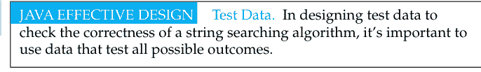

## 表 7.1 测试 `keywordSearch()` 方法

| 执行测试 | 预期结果 |
| --- | --- |
| `keywordSearch("this is a test", "is")` | `2 : 5` |
| `keywordSearch("able was ere i saw elba", "a")` | `4 : 0 18 24` |
| `keywordSearch("this is a test", "taste")` | `0:` |

## 7.5 节 来自 Java 库：`java.lang.StringBuffer`

使用 `keywordSearch()` 方法的一个**问题**是它非常低效，因为 Java 中的 `String` 是一个只读对象。这意味着一旦实例化，`String` 就无法更改。你不能向其插入新字符或删除现有的字符。


> JAVA 语言规则：字符串是不可变的。一旦实例化，Java 字符串无法以任何方式进行更改。

基于这一事实，`keywordSearch()` 中的 `resultStr` 如何能够得到正确的值呢？答案是，每当我们给 `resultStr` 赋值一个新值时，Java 都必须创建一个新的 `String` 对象。图 7.9 阐述了这一过程。因此，给定语句

```
resultStr = resultStr + ptr + " ";
```

Java 将评估右侧部分，这将创建一个新的 `String` 对象，其值为右侧元素拼接的结果，即 `resultStr + ptr + " "`（图 7.9a）。然后它将把新值赋值给 `resultStr` 的引用对象（图 7.9b）。这使得 `resultStr` 的过程变成了一个孤儿——一个不再被引用的对象。

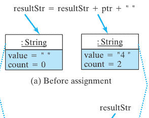
图 7.9：`resultStr + ptr + " "` 的评估。

`resultStr` 的过程变成了一个孤儿——一个不再被引用的对象。这被称为垃圾回收。

> JAVA 语言规则：垃圾回收。一个没有引用的对象不再被使用。因此，Java 会自动回收它。

一种更高效的编写 `keywordSearch()` 方法将使用 `StringBuilder` 来存储和构建结果。与 `String` 类一样，`java.lang.StringBuffer` 类也表示字符串。与 `String` 类不同，`StringBuilder` 可以被修改，并根据需要增长或缩小。如图 7.10 所示，`StringBuilder` 包含了多种方法……

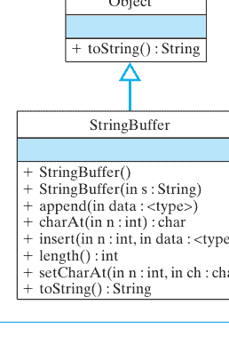

图 7.10：`java.lang.StringBuffer` 类。

## 7.6 获取字符串部分

程序员经常需要从字符串获取单个字符或部分，例如在文字处理程序中复制或删除字符串的一部分时。在本节中，我们将查看协助此类任务的方法。

`charAt(int index)` 方法是 `String` 实例方法，用于检索特定索引处的字符。`substring()` 方法的不同变体用于从字符串中检索子字符串。这些定义如下：

```java
public char charAt(int index)

public String substring(int startIndex)

public String substring(int startIndex, int endIndex)
```

`charAt()` 方法返回作为参数提供的索引处的字符。例如，`str.charAt(0)` 获取 `str` 中的第一个字符，`str.charAt(str.length()-1)` 获取最后一个字符。`substring()` 方法的工作方式类似，但你需要指定要检索的字符串的起始和结束索引。接受单个参数的版本返回从 `startIndex` 开始到字符串末尾的所有字符的 `String`。例如，如果 `str` 是 "HelloWorld"，则 `str.substring(5)` 将返回 "World"，而 `str.substring(3)` 将返回 "loWorld"。

```java
String str = "HelloWorld";

str.substring(5) => "World"

str.substring(3) => "loWorld"
```

`substring(int, int)` 版本要求你指定字符串的起始和结束索引。第二个索引始终指向你想要检索的字符串中最后一个字符之后的一个字符。例如，

```java
// INDEX: 0123456789
String str = "HelloWorld"

str.substring(5,7)    == "Wo"
str.substring(0,5)    == "Hello"
str.substring(5, str.length()) == "World"
```

注意这里，当我们想从 `str` 中检索 "Wo" 时，我们指定的子字符串索引为 5 和 7；7 指向的是紧挨在 "Wo" 之后的字符。同样，`substring(0,5)` 选取了前五个字符 "Hello"。在第三个示例中，`length()` 方法指定了从索引 5 开始延伸到字符串末尾的子字符串。这等同于 `str.substring(5)`：

```java
// INDEX: 0123456789
String str = "HelloWorld"

str.substring(5, str.length()) == "World"
str.substring(5)        == "World"
```

`substring()` 中的第二个参数指向目标字符串之外的字符，这一点初看起来可能有点困惑，但实际上是一种指定字符串的非常有用的方法。例如，许多字符串处理问题都涉及从分隔符字符串中检索字符串，其中字符串包含特殊字符，用于将字符串分隔成某些子字符串。例如，考虑字符串 "substring1:substring2"，其中分隔符是冒号 ':'。以下代码检索了分隔符之前的字符串：

> 分隔符字符串

```java
String str = "substring1:substring2"
int n = str.indexOf(':');
str.substring(0,n)      == "substring1"
```

因此，通过让 `substring()` 的索引指向目标字符串最后一个字符之后的字符，我们可以结合使用 `indexOf()` 和 `substring()` 来处理分隔符字符串。注意，没有必要使用临时变量 `n` 来存储分隔符的索引，因为这两个方法可以嵌套：

```java
String str = "substring1:substring2"
str.substring(0,str.indexOf(':')) == "substring1"
```

JAVA 调试技巧：不要忘记 `substring(int p1, int p2)` 方法中的第二个参数指向紧挨在子字符串最后一个字符之后的字符。


## 自学练习

### 练习 7.10

给定字符串声明：

```java
String s = "abcdefuvwxyz";
```

求以下每个表达式的值：

- a. `s.substring(20)`
- b. `s.substring(1, 5)`
- c. `s.substring(23)`
- d. `s.substring(23, 25)`
- e. `s.substring(s.indexOf('x'))`

### 练习 7.11

给定上述 `s` 的声明，求以下每个表达式的值：

- a. `s.substring(20)`

## 7.7 示例：处理名称和密码

许多计算机系统使用名称和密码作为分隔符字符串，例如：

```java
smith:bgls5xxx
ccarthy:2f4ff090ssi
cho:fff4534dde4w
```

显然，如果系统要处理密码，它需要某种方法来区分这些名称-密码对。让我们写几个方法来执行此任务。第一个方法将接收一个名称-密码对并返回名称。第二个方法将接收一个名称-密码对并返回密码。在两种情况下，该方法都接收一个 `String` 参数并返回一个 `String` 结果：

### 算法设计

```java
String getName(String str);
String getPassword(String str);
```

为了解决这个问题，我们可以使用两个字符串。我们使用 `indexOf()` 方法找到分隔符的位置——在名称-密码对中是冒号 ':'，然后使用 `substring()` 获取位于分隔符之前或之后的字符串。如果使用特定的示例，会更容易理解：

| 索引 | 1 | 2 |
| :--- | :--- | :--- |
| 索引: 012345678901234567890 | | |
| jones: b34rdffg12 // (1) | | |
| cho: rff546 // (2) | | |

在第一种情况下，分隔符出现在字符串的索引 5 处。因此，为了获取名称子字符串，我们将使用 `substring(0, 5)`。

## 7.8 处理字符串中的每个字符

许多字符串处理应用需要你处理字符串中的每个字符。例如，为了将字符串 "hello" 加密为 "jjgnnq"，我们必须遍历字符串的每个字母并将每个字符替换为它的替换字符。

这类算法通常涉及一个由字符串长度限制的计数循环。记住 `length()` 方法决定了 `String` 中从 0 开始索引的字符数量。这意味着第一个字符在索引 0 处。例如，为了打印字符串中的每个字符：

### 计数循环算法

```java
// 前提：str 不空
// 后提：str 中的字母都已被打印
public void printLetters(String str) {
    for (int k = 0; k < str.length(); k++) // 每一个字符
        System.out.println(str.charAt(k)); // 打印它
}
```

注意我们的循环条件是 `k < str.length()`。正如前一个示例一样，这里的 for 循环遍历字符串从 0 到 `length()-1` 的每个字符。在每次迭代中，检查第 k 个位置的字符是否是我们要打印的字符。

注意方法块中的前提和后提。前提说明 `str` 已经过正确处理。后提仅预期方法的行为。

### 7.8.1 差一错误

编写计数循环时一种常见的错误被称为差一错误，它可以以许多方式发生。例如，如果我们把循环边界条件设为 `k <= str.length()`，会导致差一错误，因为字符串的最后一个字符在 `length()-1` 处。这在程序执行此语句时就会导致 `IndexException`。

> 调试技巧：差一错误。应该仔细检查循环以确保它们不会出现差一错误。在程序测试期间，开发循环变量的初始值和最终值。

作为处理字符串中每个字符算法的另一个示例，计算给定文档中字母频率的问题。某些文本分析程序，例如分析加密数据和跨过滤程序，就会执行此类功能。

`countChar` 方法将计算特定字符在 `String` 中出现的次数（图 7.11）。该方法接收两个参数：存储被搜索字符串的 `String` 和存储要计数字符的 `char`。

### 方法设计

通过将局部变量 `counter` 初始化为 0。正如前一个示例一样，这里的 for 循环遍历字符串从 0 到 `length()-1` 的每个字符。在每次迭代中，检查第 k 个位置的字符是否是我们要计数的字符。如果是，计数器加 1。方法结束。

```java
// Precondition: Neither str nor ch are null
// Postcondition: countChar() == the number of ch in str
public int countChar(String str, char ch) {
    int counter = 0; // initialize a counter
    for (int k = 0; k < str.length(); k++) { // For each char
        if (str.charAt(k) == ch) { // If it's a ch
            counter++; // count it
        }
    }
    return counter; // Return the result
}
```

图 7.11：一种统计字符串中特定字符出现次数的方法。通过返回 `counter`，当方法完成时，它将存储一个表示 `str` 中 `ch` 数量的整数。

### 7.8.2 示例：反转字符串

另一个处理字符串中每个字符的有趣方法是 `reverse()` 方法。该方法是一个用于反转字符串中字母的方法。例如，“java" 的反转是 "avaj"。

`reverse()` 方法的算法应该使用简单的计数循环来反转字符串参数中的字母。然而，在这种情况下，我们可以从右到左处理字符串，从最后一个字符开始，到第一个字符结束。因此，我们只需要从左到右将每个字符追加到结果中：

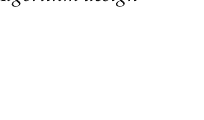

```java
/*
 * Pre: s is any non null string
 * Post: s is returned in reverse order
 */
public String reverse(String s) {
    StringBuilder result = new StringBuilder();
    for (int k = s.length()-1; k >= 0; k--) {
        result.append(s.charAt(k));
    }
    return result.toString();
}
// reverse(s)
```

注意，在其他的字符串处理算法中——例如 `search()`——我们使用 `StringBuilder` 来存储方法的的结果。因此，我们在方法开始处声明 `result` `StringBuilder`，并在方法结束时将其转换回 `String`。

> JAVA 编程提示！更改字符串中的每个字符。需要修改字符串的算法应该使用 `StringBuilder` 来存储结果。


### 7.8.3 示例：首字母大写化

另一种处理方法是 `capitalize()` 方法，它返回一个首字母大写而其他字母为小写的字符串——例如，“Hello"。我们使用 `Character` 类中的静态方法 `toUpperCase()` 和 `toLowerCase()` 方法来转换单个字母。我们也可以使用在 5.8 节中编写的同名方法。该算法将第一个字母转换为大写，并遍历剩余字母将其转换为小写：

### 算法设计

```java
/*
```


* Pre: `s` is any non null string
* Post: `s` is returned with only its first letter capitalized

```java
public String capitalize(String s) {
    if (s.length() == 0) // Special case: empty string
        return;
    StringBuilder result = new StringBuilder();
    result.append(Character.toUpperCase(s.charAt(0))); // Convert the first letter
    for (int k = 1; k < s.length(); k++) { // And the rest
        result.append(Character.toLowerCase(s.charAt(k)));
    }
    return result.toString();
} // capitalize()
```

## 自学练习

练习 7.12 编写一个程序来测试本节描述的方法。将方法本身组织在一个名为 `StringProcessor` 的单类中，并设计第二个类作为用户界面。由于这些方法类似于 `Math` 类的工具方法，将它们声明为 `static` 会很有用。用户界面应该提示用户输入一个字符串，然后打印将该字符串传递给我们开发的每个方法的结果。

练习 7.13 在 `StringProcessor` 类中添加一个方法，删除字符串中的所有空格。它应该接收一个 `String` 参数并返回一个 `String` 结果。

### 7.8.5 其他字符串方法

除了我们讨论过的几个 `String` 类方法——`valueOf()`、`equals()`、`indexOf()`、`lastIndexOf()`、`charAt()`、`substring()`——表 7.2 显示了 `String` 类中的其他一些方法。注意，由于我们提到过字符串的只读性，`toUpperCase()`、`toLowerCase()` 和 `trim()` 等方法不会改变它们的字符串。相反，它们会应用于字面量字符串 "Perfection" 生成一个新的有字符串方法。

# 第 7.9 节 比较字符串

## 示例

```
"Perfection".endsWith("tion") => true
"Perfection".startsWith("Per") => true
"Perfection".startsWith("fect", 3) => true
"Perfection".toUpperCase() => "PERFECTION"
"Perfection".toLowerCase() => "perfection"
"Perfection".trim() => "Perfection"
```

如果你使用这些方法之一来转换字符串，你必须将其结果重新赋值回原始字符串：

```java
String s = new String("hello world");
s = s.toUpperCase(); // s is new equals "HELLO WORLD"
```

## 7.9 比较字符串

比较字符串是另一个任务。例如，当处理器执行搜索操作时，它需要识别与目标字符串匹配的字符串。对于字符串，如果 s1 的第一个字符在 s2 之前，则 s1 在字典序上在 s2 之前。如果它们的第一个字符相同，那么如果 s1 的第二个字符在 s2 之前，则 s1 在 s2 之前；依此类推。空字符串被视为特殊情况处理。

> 语言规则 字典序。对于字符串 s1 和 s2，如果 s1 的第一个字符在 s2 之前，则 s1 在字典序上在 s2 之前。如果它们的第一个字符相同，那么如果 s1 的第二个字符在 s2 之前，则 s1 在 s2 之前；依此类推。空字符串被视为特殊情况处理。

也许定义字典序的一种更精确的方法是定义：

```java
public boolean precedes(String s1, String s2) {
    // For shorter length
    int min = Math.min(s1.length(), s2.length());
    // For each char in shorter string
    for (int k = 0; k < min; k++) {
        if (s1.charAt(k) != s2.charAt(k)) // if char precedes s2
            return s1.charAt(k) < s2.charAt(k);
    }
    // If all characters so far are equal
    // if s1.length() < s2.length() it is shorter than s2
    return s1.length() < s2.length();
}
```

该方法从左到右对两个字符串进行逐字符比较，从两个字符串的第一个字符开始。它的循环使用计数边界，从 k0 开始计数到较短字符串的长度。这是该算法中的一点。如果你在超过字符串的最后一个字符时不停止迭代，你的程序将产生 `StringOutOfBounds` 异常。为了防止此错误，我们需要使用循环长度。注意，如果 s1 和 s2 的相应字符不相等，循环将提前终止。在这种情况下，如果 s1 的字符在 s2 之前，则 s1 优先。循环正常结束，这意味着所有字符都相等。在这种情况下，较短的字符串在较长的之前。例如，如果两个字符串是 "alpha" 和 "alphabet"，该方法将返回 true，因为 "alpha" 比 "alphabet" 短。

练习 7.14 按字典序排列以下字符串：

```
zero bath bin alpha Alpha Zeroes a Z
```

练习 7.15 修改 `precedes` 方法，使其在 s1 和 s2 相同时也返回——例如，如果 s1 和 s2 都是 "hello"。

## 7.9.1 对象恒等性与对象相等

Java 提供了几种方法来比较字符串：

```java
public boolean equals(Object object); // 重写了 Object.equals()
public boolean equalsIgnoreCase(String anotherString);
public int compareTo(String anotherString);
```

第一个比较方法 `equals()` 重写了 `Object.equals()` 方法。如果两个字符串在完全相同的顺序具有相同的字母，则它们是相等的。因此，对于以下声明：

> 等于 vs 恒等性

```
String s1 = "hello"
String s2 = "Hello";
```

`s1.equals("hello")` 为 `false`，但 `s1.equals("hello")` 为 `true`。
在使用 Java 的 `equals()` 方法时必须小心。根据 Object 类中定义的 `equals()` 的默认行为，“equals”意味着“相同（identical）”。只有当两个对象的名称引用指向同一个对象时，这两个对象才是相等的。

这是一个关于晨星和晚星的老故事，在发现之前，它们曾被认为是不同的对象，后来发现“晨星”、“晚星”和“金星”只是同一个对象的两个不同引用（图 7.12）。
我们可以通过以下定义在 Java 中创建另一种情况：

```
JButton b1 = new Button("a");
JButton b2 = new Button("a");
JButton b3 = b2;
```

给定这些声明，`b1.equals(b2)` 和 `b1.equals(b3)` 将为 `false`，`b2.equals(b3)` 为 `true`，因为 `b2` 和 `b3` 只是同一个对象的名称（图 7.13）。在这种情况下，“equals”意味着“相同”。
此外，在 Java 中，当用于比较两个对象时，相等运算符 `==` 的解释方式与默认的 `Object.equals()` 方法相同。因此，它意味着引用恒等性。所以，`b1 == b2` 为 `false`，因为 `b1` 和 `b2` 是不同的对象；但 `b2 == b3` 为 `true`，因为 `b2` 和 `b3` 引用同一个对象。
这些点在图 7.14 所示的程序中说明。该程序使用 `isEqual()` 和 `isIdentical()` 方法来执行比较并打印结果。这将产生以下结果：

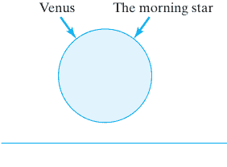

| b1 | b2 | b3 (引用) |
|---|---|---|
| | a | (标记的按钮)|

```
JButton b1 = new Button("a");
JButton b2 = new Button("a");
JButton b3 = b2;
```

图 7.13：对于对象，相等意味着相同。JButtons `b2` 和 `b3` 是相同的（因此，相等），但 JButtons `b1` 和 `b2` 相同（因此，不相等）。

```java
import java.awt.*;

public class TestEquals {
    static Button b1 = new Button("a");
    static Button b2 = new Button("b");
    static Button b3 = b2;

    private static void isEqual(Object o1, Object o2) {
        if (o1.equals(o2)) {
            System.out.println(o1.toString() + " equals " + o2.toString());
        } else {
            System.out.println(o1.toString() + " does NOT equal " + o2.toString());
        }
    } // isEqual()

    private static void isIdentical(Object o1, Object o2) {
        if (o1 == o2) {
            System.out.println(o1.toString() + " is identical to " + o2.toString());
        } else {
            System.out.println(o1.toString() + " is NOT identical to " + o2.toString());
        }
    } // isIdentical()

    public static void main(String argv[]) {
        isEqual(b1, b2);
        isEqual(b1, b3);
        isEqual(b2, b3);
        isIdentical(b1, b2);
        isIdentical(b1, b3);
        isIdentical(b2, b3);
    }
}
```

图 7.14：`TestEquals` 程序测试了在 Object 类中定义的 `equals()` 方法。

## 7.9.2 恒等性与相等性

在比较 Java 字符串时，必须区分对象恒等性和字符串相等性。因此，考虑以下声明：

```
String s1 = "hello";
String s2 = "Hello";
String s3 = "hello";
String s4 = s1;
String s5 = "hello";
String s6 = "hello";
```

给定这些声明，如果我们比较字符串的相等性，将得到以下结果：

```
s1.equals(s2) => false
s1.equals(s3) => true
s1.equals(s4) => true
s1.equals(s5) => true
s1.equals(s6) => true
```

如果我们比较它们的恒等性：

```
s1 == s2 => false
s1 == s3 => false
s1 == s4 => true
s1 == s5 => false
s1 == s6 => true
```

这些字符串中唯一的恒等关系是 `s1` 和 `s4`，以及 `s5` 和 `s6`。在 `s5` 和 `s6` 的情况下，它们都只是字面量 "hello" 的引用。如第 7.2 节所述。图 7.16 程序说明了这些点。

## 自学练习

练习 16 给定字符串声明，求值以下表达式：

```java
import java.awt.*;

public class TestEquals {
    static String s1 = new String("hello"); // s1 和 s2 相
    static String s2 = new String("hello");
    static String s3 = new String("Hello"); // s1 和 s3 不相等
    static String s4 = s1; // s1 和 s4 相同
    static String s5 = "hello"; // s1 和 s5 不恒等
    static String s6 = "hello"; // s5 和 s6 相同

    private static void testEqual(String str1, String str2) {
        if (str1.equals(str2)) {
            System.out.println(str1 + " equals " + str2);
        } else {
            System.out.println(str1 + " does not equal " + str2);
        }
    }

    private static void testIdentical(String str1, String str2) {
        if (str1 == str2) {
            System.out.println(str1 + " is identical to " + str2);
        } else {
            System.out.println(str1 + " is not identical to " + str2);
        }
    }

    public static void main(String[] argv) {
        testEqual(s1, s2); // 相
        testEqual(s1, s3); // 不相等
        testEqual(s1, s4); // 相
        testEqual(s1, s5); // 相
        testEqual(s5, s6); // 相
        testIdentical(s1, s2); // 不恒等
        testIdentical(s1, s3); // 不恒等
        testIdentical(s1, s4); // 相同
        testIdentical(s1, s5); // 不恒等
        testIdentical(s5, s6); // 相同
    }
}
```

---程序输出---
```
hello equals hello
hello does not equal Hello
hello equals hello
hello equals hello
hello equals hello
hello is not identical to hello
hello is not identical to Hello
hello is identical to hello
hello is not identical to hello
hello is identical to hello
```

图 7.16：说明字符串相等性和恒等性区别的程序。

练习 17 为什么 `TestEquals` 中的变量被声明为 `static`？

练习 18 给定以下声明：

```
String s1 = "abcdefghijklmnopqrstuvwxyz";
String s2 = "hello world";
```


# 编写 Java 代码执行以下操作

- a. 交换 `s1` 的前后部分得到一个新的字符串。
- b. 交换 `s2` 中的 "world" 和 "hello" 得到一个新的字符串。
- c. 结合 `s1` 和 `s2` 创建 "hello abc"。

# 7.10 来自标准库：java.util.StringTokenizer

字符串处理的任务之一是将字符串拆分成组件，或标记（tokens）。例如，在解析句子时，你可能需要将句子拆分为它的组成部分，这些部分被称为句子标记。在处理用户名-密码字符串（如 "boyd14Xrp"）时，你可能需要将其拆分为用户名和密码。标记之间通过分隔符分开。对于句子，空白字符包括空格、制表符和换行符作为分隔符。对于密码示例，冒号作为分隔符。`java.util.StringTokenizer` 类专为拆分字符串而设计（图 7.17）。当使用字符串参数实例化时，`StringTokenizer` 使用空格作为分隔符将字符串拆分为标记。例如，如果我们这样实例化 `StringTokenizer`：

```java
StringTokenizer sTokenizer = new StringTokenizer("This is an English sentence.");
```

它会将字符串拆分为标记，这些标记在 `StringTokenizer` 内部顺序存储：

- This
- is
- an
- English
- sentence.

注意句号是最后一个标记 "sentence." 的一部分。这是因为标点符号默认不被视为分隔符。

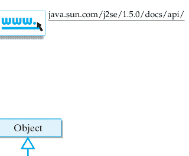

| Enumeration |
| :--- |
| +hasMoreElements(): boolean |
| +nextElement(): Object |

| StringTokenizer |
| :--- |
| StringTokenizer(String s) |
| StringTokenizer(String s, String delim) |
| countTokens(): int |
| hasMoreTokens(): boolean |
| nextToken(): String |
| nextToken(String delim): String |
| hasMoreElements(): boolean |
| nextElement(): Object |

图 7.17：`java.util.StringTokenizer` 类。

如果你想将标点符号作为分隔符，可以使用第二个 `StringTokenizer()` 构造函数，它接受第二个 `String` 参数（图 7.17）。第二个参数指定了将作为分隔符的字符字符串。例如，通过实例化：

```java
StringTokenizer sTokenizer = new StringTokenizer("This is an English sentence.", " \t\n.,;:");
```

各种标点符号（句号、逗号等）都被包含在分隔符中。注意，转义序列 (` \t\n`) 被用于指定空格、制表符和换行符。
`hasMoreTokens()` 和 `nextToken()` 方法用于逐个处理被分隔的字符串。第一个方法在有更多标记返回时返回 `true`；第二个方法获取列表中的下一个标记。例如，这里有一段代码，可以将一个 URL 列表拆分为它的各个组成部分：

```java
String url = "http://java.trincoll.edu/jjj/index.html";
StringTokenizer sTokenizer = new StringTokenizer(url, ":/");
while (sTokenizer.hasMoreTokens()) {
    System.out.println(sTokenizer.nextToken());
}
```

这段代码段将产生以下输出：

```
http
java.trincoll.edu
jjj
index.html
```

此例中使用的分隔符是 `:` 和 `/` 符号。注意 `nextToken()` 不会将 `:` 和 `/` 之间的空字符串作为一个标记返回。

# 7.11 在图形上下文中处理文本（可选）

| Graphics |
| :--- |
| +getFont(): Font |
| +getFontMetrics(): FontMetrics |
| +setFont(Font f): void |
| +setFontMetrics(FontMetrics fm): void |

图 7.18：访问与每个 `Graphics` 上下文关联的 `Font` 和 `FontMetrics` 对象的方法。

为了创建吸引人的 GUI，通常需要选择并控制所使用的字体。即使是简单的绘制，例如能够在面板中居中消息，也需要字体的尺寸并能够对其进行操纵。在本节中，我们将学习如何使用 `Font` 和 `FontMetrics` 对象以及 `Graphics` 上下文工作，而 `Graphics` 类（图 7.18）提供了几种访问它们的方法。`FontMetrics` 是一个封装了字体数据的对象，例如字体的高度和宽度。Java 为每个 `Graphics` 分配了一个默认字体。例如，这就是 `drawString()` 方法使用的字体，我们在第 1 章的最早 Java 程序中就用过它。所使用的特定字体取决于系统，但要覆盖默认字体，只需调用 `setFont()` 方法：

```java
g.setFont(new Font("TimesRoman", Font.ITALIC, 12));
```

在这种情况下，使用 `Font()` 构造函数来指定一种 12 磅、斜体的 TimesRoman 字体。一旦设置了字体，它将在所有后续的绘制中被使用。

## 7.11.1 Font 和 FontMetrics 类

`Font` 类（图 7.19）提供了单个字体的跨平台表示。字体通过其名称、大小和样式来区分，`Font` 类包含了这些属性的 `protected` 实例变量，以及一个允许指定这三个特征的构造函数。

为了理解字体的工作原理，有必要区分“字符”（character，代表字母或数字的符号）和“字形”（glyph，用于显示字符的形状）。当你显示一个字符串（如 "Hello"）时，Java 将每个字符映射到相应的形状，由所选字体定义。

Java 区分了物理字体和逻辑字体。物理字体是实际字体库，包含了将正确字形与给定字符关联所需的数据和表。通常情况下，一个平台（主机计算机操作系统）拥有一组字体。

逻辑字体是 Java 运行时环境支持的五种字体族之一。这些包括 `Serif`、`SansSerif`、`Monospaced`、`Dialog` 和 `DialogInput`。Java 还支持以下字体样式：`PLAIN`、`BOLD` 和 `ITALIC`。虽然物理字体依赖于平台，但逻辑字体和样式是跨平台的。在程序中使用时，它们被映射到主机系统可用的真实字体。如果主机系统没有指定字体的精确匹配，它将提供一个替代字体。例如，如果你指定了一个 48 磅、斜体的 `Monospaced` 字体：

```java
Font myFont = new Font("Monospaced", Font.ITALIC, 48);
```

如果这是可用的最大字体，系统可能会回退到 24 磅的 Courier 字体。

`Font()` 构造函数设计为可以处理任何参数集。因此，如果你提供了一个不可用的字体名称，系统将提供默认字体作为替代。例如，在我的系统中，指定一个不存在的字体会返回 `Dialog` 字体：

```java
g.setFont(new Font("Random", Font.ITALIC, 12));
g.drawString("Hello, World!! (random, italic, 12)", 30, 45);
```

产生与映射时相同的字体。

> **有效设计：可移植性**。`Font()` 能够处理任何参数集，这对于确保 Java 在任何平台上运行是重要的。这是 Java 设计可移植性的另一个例子。

`setFont()` 方法可以用于组件、窗口或其他图形指定特定的字体。组件具有关联的字体，可以使用 `setFont()` 和 `getFont()` 方法访问。例如，以下代码可以覆盖按钮的字体：

```java
Button b = new Button("Label");
b.setFont(new Font("Times", Font.ITALIC, 14));
```

如果没有 14 磅、斜体的 Times，将使用替代字体。

### 7.11.2 字体度量

为了说明如何使用 `FontMetrics` 类，让我们编写一个水平和垂直方向都居中的 "Hello, World!" 应用程序。无论应用程序的大小，消息都应该居中。我们将相对于窗口定位文本，这要求知道字体的某些特征，例如字符的高度和宽度。为了访问这些属性，我们将使用 `FontMetrics` 类。

图 7.20 展示了与字体相关的各种属性。字体的基线是指大多数字符的底部。绘制字符串时，x 和 y 坐标决定字符串第一个字符的基线。因此，在

```java
g.drawString("Hello, World!", 10, 40);
```

"Hello, World!" 的基线位于 y=40。所有字符都基线向上延伸一段距离，被称为上升。某些字符（如 y）可能会延伸基线下方，被称为下降。每个字体都有最大上升和最大下降。同样，某些字符可能会超出最大上升，进入被称为间距的空间。

字体的高度被定义为上升、下降和间距值之和（像素）。字体的高度是字体本身的属性，而不是单个字符的属性。除了等宽字体（所有字符宽度相同）外，组成字体的字符具有不同的宽度。单个字符的宽度被称为字宽。

| FontMetrics |
| :--- |
| #font: Font |
| +FontMetrics(Font font) |
| +charWidth(char ch): int |
| +getAscent(): int |
| +getDescent(): int |
| +getHeight(): int |
| +getLeading(): int |
| +getMaxAdvance(): int |
| +stringWidth(String str): int |

图 7.21：`FontMetrics` 类。

`FontMetrics` 类（图 7.21）提供了访问 `font.properties` 的方法。这些对于控制 GUI 上文本的布局非常有用。例如，在绘制多行文本时，`getHeight()` 方法用于确定行与行之间应该留多少空间。当按字符绘制时，`charWidth()` 方法可以确定字符之间必须留出多少空间。另外，`stringWidth()` 方法可以用于确定绘制整个字符串所需的像素数。

## 7.11.3 示例：文本居中

基于本书的介绍，让我们借此机会在应用程序窗口中编写一条居中的消息。为了让此应用程序适用于任何字体，我们必须注意不要将其设计基于我们恰好使用的特定字体的特征。为了强调这一点，让我们为一种名为 `Random` 的字体设计它，正如我们之前提到的，它将被映射到运行应用程序的系统所加载的某种字体上。换句话说，我们将为此应用程序的消息选择一个字体。一个有趣的实验是在不同平台上运行该程序，看看显示的字体是怎样的。

### 算法设计：通用性

此应用程序需要的简单方法是 `paint()` 方法。让我们首先通过图形上下文将字体设置为随机字体。为了获取该字体的度量，我们创建一个 `FontMetrics` 对象并获取我们刚刚创建的度量：

```java
g.setFont(new Font("Random", Font.BOLD, 24));
FontMetrics metrics = g.getFontMetrics();
```

下一步是使用 `getSize()` 方法定义 `JFrame` 的尺寸。该方法返回一个 `Dimension` 类型的对象。`java.awt.Dimension`（图 7.22）代表 GUI 组件的大小（宽度和高度）。`Dimension` 使得作为一个单一实体操作对象的宽度和高度成为可能。注意，`height` 和 `width` 变量被定义为 `public`，这与通常将变量定义为 `private` 或 `protected` 的惯例不同。这种特例的理由是简化引用宽度和高度的语法。可以使用以下语法来引用组件的尺寸：

```java
Dimension d = new Dimension(100, 50);
System.out.println("width = " + d.width + " height = " + d.height);
```

注意 `Dimension` 类中内置的冗余设计。例如，除了可以直接访问 `Dimension` 的实例变量外，还提供了公共访问方法。此外，通过定义某些访问方法的多个版本，该类实现了更高层次的灵活性。提供不同的构造函数（包括拷贝构造函数）也是如此。最后，注意它是如何重写 `equals()` 和 `toString()` 方法的。这些都是良好对象设计的示例。

| Dimension |
| :--- |
| +height: int |
| +width: int |
| Dimension() |
| Dimension(Dimension d) |
| Dimension(int width, int height) |
| equals(Object obj): boolean |
| getSize(): Dimension |
| setSize(Dimension d) |
| setSize(int width, int height) |
| toString(): String |

图 7.22：`Dimension` 类。

> **Java 高效设计：冗余**。冗余通常是对象设计中一种理想的特性。它使对象更容易使用并具有更广的适用性。

`Dimension` 对象用于计算字符串的 x 和 y 坐标。为了使字符串水平居中，我们需要知道它的宽度，这由度量对象提供。如果 `JFrame` 的宽度为 `d.width` 像素，以下表达式将从 `JFrame` 的宽度中减去字符串的宽度，并将剩余空间平分：

```java
int x = (d.width - metrics.stringWidth(str)) / 2;
```

同样，以下表达式计算垂直居中的 y 坐标：

```java
int y = (d.height + metrics.getHeight()) / 2;
```

这些计算结合给出了 "Hello, World!" 中第一个字符左下角像素的坐标。唯一的任务是绘制该字符串（图 7.23）。因为当 `JFrame` 调整大小时，会自动调用 `paint()` 方法，因此每当用户调整其大小时，它都会重新使其消息居中。

> **Java 编程技巧：通用性**。通过使用组件的大小和字体作为决定因素，你可以实现几乎任何组件的居中。这些值可以通过组件的 `getFont()` 和 `getSize()` 方法获取。


# 章节总结

## 技术术语

| ascent | garbage collection | string |
| :--- | :--- | :--- |
| baseline | glyph | string index |
| concatenation | lexicographical order | string literal |
| copy constructor | logical font | token |
| data structure | off-by-one error | unit indexed |
| delimited string | orphan object | zero indexed |
| delimiter | physical font | |
| empty string | read only | |

# 第 7 章 章节总结

```java
import java.awt.*;
import javax.swing.*;

public class CenterText extends JFrame {

    // 在框架中心打印 hello world!
    public void paint(Graphics g) {
        String str = "Hello, World!";
        g.setFont(new Font("Random", Font.PLAIN, 24)); // 随机字体
        FontMetrics metrics = g.getFontMetrics(); // 获取度量信息
        Dimension d = getSize(); // 获取尺寸
        g.setColor(Color.BLACK); // 设置颜色
        g.fillRect(0, 0, d.width, d.height); // 填充背景
        // 计算坐标
        int x = (d.width - metrics.stringWidth(str)) / 2;
        int y = (d.height + metrics.getHeight()) / 2;
        g.drawString(str, x, y);
    }
}
```


## 代码示例

```java
int x = (d.width - metrics.stringWidth(str)) / 2;

int y = (d.height + metrics.getHeight()) / 2;

g.drawString(str, x, y); // 绘制字符串

}

public static void main(String[] args[]) {

    CenterText ct = new CenterText();

    ct.setSize(400, 400);

    ct.setVisible(true);

}

}
```

图 7.23：CenterText 应用程序。

## 重点总结

- 字符串字面量（String literal）是包含在双引号内的字符序列。每当遇到字面量时，都会自动创建一个 `String` 对象。
- 拼接运算符 `+` 符号被重载了；它用于将两个字符串合并为一个单个字符串：`"hello" + "world" => "helloworld"`。
- 字符串索引从 0 开始。`indexOf()` 和 `lastIndexOf()` 方法用于查找字符串中字符或子字符串的第一次或最后出现的位置。`length()` 方法返回字符串中字符数量。`charAt()` 方法返回特定索引处的单个字符。`substring()` 方法返回特定位置的子字符串。
- 重载的 `equals()` 方法在两个字符串包含相同字符序列时返回 `true`。`==` 运算符用于字符串时，如果引用指向同一个对象则返回 `true`。
- `String` 对象是不可变的（immutable）。它们不能被修改。
- `StringBuffer` 是一个可以使用 `insert()` 和 `append()` 等方法进行修改的对象。
- `StringTokenizer` 是一个用于通过分隔符将字符串拆分为标记（tokens）集合的类。空白字符（空格、制表符和换行符）是默认分隔符。
- `FontMetrics` 类提供了各种字体的特定尺寸。它在你想居中文本时非常有用。字体本质上是依赖平台的。为了获得最大的可移植性，最好使用默认字体。

## 第 7 章 “自学练习答案”

练习题答案为 `null`，因为它是初始化的且没有字面值。

| s2 | | | | | | | |
| :--- | :--- | :--- | :--- | :--- | :--- | :--- | :--- |
| "Hello" | s3 | "hello" | s4 | s5 | s6 | s1 |
| String | | String | | | null |
| value = "Hello" count = 5 | value = "hello" count = 5 | value = "Hello" count = 5 | |

```java
String s1, s2 = "Hello", s3 = "Hello"
String s4 = "hello"
String s5 = new String("Hello");
String s6 = s5;
String s7 = s3;
```

### 答案 7.8

- b. "16" f. 13
- c. 1 g. 7
- d. 15 h. 3
- e. 1 i. 7

a. 16

### 答案 7.9

求值以下表达式：
```java
String tricky = "abcdef01234567";
tricky.indexOf(String.value(tricky.indexOf("c")));
tricky.indexOf(String.value("2"));
tricky.indexOf("2")
```

答案：

- a. "uvxyz" c. "xyz" e. "xyz"
- b. "bcdex" d. "xy"
- b. "uvxyz" c. "xyz" e. "xyz"
- b. "bcdex" d. "xy"

### 答案 7.12

```java
public class StringProcessorTest {

    public static void main(String[] args) {

        KeyboardReader kb = new KeyboardReader();

        kb.prompt("Input a String or stop - to quit: \n*");

    }
}
```

```java
// 前置 s 是非空字符串
// 后置 s 返回删除了所有空格的字符串
public String removeBlanks(String s) {

    StringBuffer result = new StringBuffer();

    for (int k = 0; k < s.length(); k++) {

        if (s.charAt(k) != ' ') // 如果这不是空格
            result.append(s.charAt(k));
    }

    return result.toString();
}
```

**答案 7.13** 从字符串中删除所有空格的方法：

**答案 7.14** 一个 Alpha Z 零浸在零浴缸中

**答案 7.15** 为了修改前导符使其在字符串参数相等时返回 `true`，请将最后一个返回语句中的运算符改为 `<=`：

```java
if (s1.charAt(k) <= s2.charAt(k))
    return true;
```

### 答案 7.16

| a. true | d. false | g. false |
| b. true | e. false | h. false |
| c. false | f. true | i. false |

### 答案 7.17

`TestStringEquals` 中的变量被声明为 `static`，是因为它们在静态方法中使用。每当你直接从 `main()` 调用一个方法时，该方法必须是静态的，因为 `main()` 是静态的。静态元素与类相关，而不是与其实例相关。`main()` 只能使用不依赖实例存在的静态元素。

### 答案 7.18

- a. `String s3 = s1.indexOf('n')`
- b. `+ s1.substring(0, s1.indexOf('n')) + " " + s2.substring(0,5);`
- c. `String s4 = s2.substring(6)`
- c. `String s5 = s2.substring(0,6) + s1.substring(0,3);`

## 练习

> **注意**：对于编程练习，请先画一个 UML 类图，描述所有的类及其继承关系和/或关联关系。

### 练习 7.1

解释以下术语对之间的区别：

- a. 单元索引（Unit indexing）和零索引（zero indexing）。
- b. 数据结构和数据类型。
- c. `StringBuffer` 和 `String`。
- d. `String` 和 `StringTokenizer`。
- e. 声明变量和实例化 `String`。
- f. `Font` 对象和 `FontMetrics` 对象。

### 练习 7.2

填空。

- a. 当字符串中的第一个字符的索引为 0 时，这被称为 ________。
- b. 被引号括的字符序列被称为 ________。

### 练习 7.3

给定值为 `"to or not to be that is the question"` 的 `String str`，编写 Java 表达式来提取所示的每个子字符串。对于每个子字符串，提供两组答案：一组使用子字符串的数字（例如，第一个 "to" 从 0 到 2），另一组是更通用的解决方案，它也可以从以下“字符串”中检索子字符串并变成你想要的任何内容。（提示：在第二种情况下，在表达式中使用 `length()` 和 `indexOf()` 配合 `substring()`。你可以使用局部变量存储中间结果。）(a) 的答案示例所示：

- a. 字符串中的第一个 "to"

```java
str.substring(0, 2)
// 答案 1
str.substring(indexOf("to"), indexOf("to") + 2) // 答案 2
```

- b. 字符串中的最后一个 "to"
- e. 字符串的前四个字符
- c. 字符串中的第一个 "be"
- f. 字符串的最后四个字符

### 练习 7.4

假设 `s` 是字面量 `"exercise"`，识别以下各项中的语法错误：

- a. `s.charAt("hello")`
- d. `s.indexOf(er)`
- b. `s.indexOf(0)`
- e. `s.length`
- c. `substring("er")`

### 练习 7.5

假设 `s` 是字面量 `"exercise"`，求值以下各项：

- a. `charAt(5)`
- d. `s.indexOf('e')`
- b. `indexOf('5')`
- e. `length()`
- c. `substring('5')`

### 练习 7.6

编写你自己的 `IgnoreCase` 方法。

### 练习 7.7

使用 `String()` 编写你自己的 `equality` 方法。

### 练习 7.8

设计一个接受 `String` 参数并返回全小写的方法。

### 练习 7.9

编写一个方法转换其 `String` 参数使其变长。例如，考虑以下两个版本：

Plain : This is how we write.
Blocked : This sentence.

### 练习 7.10

设计并实现一个 Java 程序分析文本：文档中的单词数、文档中的字符数以及超过六个字母的单词百分比。

### 练习 7.11

设计并编写一个 Java 程序搜索文本中的单个数字并将其转换为对应的单词。例如，字符串 `"four score and"` 将转换为 `"four score and seven"`

### 练习 7.12

回文是正反反读都相同的字符串。例如，mom, dad, radar, ere saw Elba。编写一个 Java Swing 程序让用户输入单词或短语，判断其是否为回文。

### 练习 7.13

编写一个迷宫程序，使用字符串存储迷宫的表示。编写一个接受 `String` 参数并打印迷宫的二维表示的方法。例如，所示用 O 标记入口和出口的迷宫可以通过以下字符串生成：

```
String: XX.XXXXXXX..XX,XXX,XX..XXX,XX,XXXXXXXX.X

XX XXXXXXXX
 X XXX
XX XXX
XX XX
X X O
XXXXXXX
```

### 练习 7.18 挑战

列表是一个顺序数据结构。设计一个 `List` 类，使用逗号分隔的字符串（例如 `"a,b,c,d,12,dog"`）来实现列表。为该类实现以下方法：

```java
void addItem(Object o);               // 使用 toString()
String getItem(int position);
String toString();
void deleteItem(int position);
void deleteItem(String item);
int getHead();                        // 第一个元素
String getTail();                      // 除第一个元素以外的所有元素
List getTail();                        // 项目数量
int length();
```

### 练习 7.19 挑战

使用分隔字符串创建一个 `Phoneslist`，并包含一个用于插入姓名和电话号码的实例方法，以及一个在用户提供姓名时查找电话号码的方法。由于你的类将处理查找工作，因此你不需要担心保持列表按字母顺序。例如，以下字符串可以用作此类目录：

```
mom:860–192–987e::bill g:0987–mary lancelot:123–842–1100
```


# 第8章

# 继承与多态

# 学习目标

在学习本章之后，你将：

- 理解继承和多态的概念。
- 了解 Java 的动态绑定机制的工作原理。
- 能够设计和使用抽象方法和类。
- 能够设计和使用多态方法。
- 对面向对象的设计有更好的理解。

# 章节提纲

- 8.1 引言
- 8.2 Java 的继承机制
- 8.3 抽象类、接口与多态
- 8.4 示例：切换按钮
- 特殊主题：历史密码学
- 8.5 示例：密文类层次结构
- 8.6 案例研究：双玩家游戏层次结构
- 8.7 面向对象的设计原则
- 本章总结
- 自学练习答案
- 练习

第8章 • 继承与多态

## 8.1 引言

在面向对象编程中最重要的概念之一是继承和多态。我们在第0章中首次引入了继承的概念。在那里，我们将继承与自然形式的继承进行了比较，即马和牛因为它们是哺乳动物而共享某些特征，例如温血动物。我们还给出了棋子层次结构的例子，如兵和主教，它们从它们的父类 `ChessPiece` 继承了特征。

我们在第3章中采用了更具技术的方法，讨论了 `toString()` 方法以及它在 `Object` 类中是如何工作的。我们说明了 `Object` 的子类如何重写继承的 `toString()` 方法以根据其目的进行自定义。我们还引入了多态的概念，方法（如 `obj.toString()`）可以根据调用它的对象 `obj` 的类型具有不同的行为。

在第4章中，我们继续学习继承和多态，当时学习了抽象窗口工具包（AWT）和 Swing 层次结构，这些是我们用于创建图形用户界面（GUI）的类层次结构。我们还学习了如何为子类创建一个类，并在 `SimpleGUI` 类的设计中有限地使用了继承。我们还引入了监听器接口（Listener interface）的概念，以便在 GUI 运行时启用事件。

在本章中，我们将仔细观察两个重要的面向对象概念。我们将学习继承如何实现多态。最重要的是，我们将看到为什么继承和多态是面向对象设计的重要元素，并将学习如何使用这些重要工具来设计几个不同的程序。在我们的运行示例中，我们将开发一个 `TwoPlayerGame` 层次结构，并展示它如何简化 `OneNim` 以及双玩家游戏的实现。

| 动物 |
| :--- |
| +isAlive=TRUE |
| +canMove=TRUE |

| 脊椎动物 |
| :--- |
| +hasBackbone=TRUE |

| 哺乳动物 |
| :--- |
| +isWarmBlooded=TRUE |
| +nYoung=TRUE |

| 马 |
| :--- |
| +hasFourLegs=TRUE |


## 8.2 Java 的继承机制

正如第0章所述，类继承是类继承（获取）其父类方法和变量的机制。为了提醒你基本概念，让我们重复一个例子：就像继承继承了与哺乳动物和脊椎动物相关的属性和行为一样，Java 子类继承了其父类的属性和行为。

图8.1 使用 UML 图说明了马、脊椎动物和动物之间的关系。在层次结构的根部（显示在顶部），`Animal` 类包含最通用的属性，例如存活和能够移动。所有动物都共享这些属性。`Vertebrate` 类是某种更特化的动物类型，脊椎动物具有脊骨。同样，`Mammal` 类是脊椎动物的进一步特化，哺乳动物是温血的并哺乳养幼崽。最后，`Horse` 类是哺乳动物类的进一步特化，马有四条腿。

这些示例说明了两个重要的面向对象概念：继承和方法重写。

| JAVA EFFECTIVE DESIGN 继承。类中的公共（public）和保护（protected）实例方法（以及变量）可以被该类子类的对象使用。 |


| JAVA EFFECTIVE DESIGN 方法重写。重写继承的方法是为特定子类定制该方法的一种有效方式。 |


### 8.2.3 静态绑定、动态绑定与多态

Java 在这些示例中使用的机制被称为动态绑定，在动态绑定中，方法调用与正确方法实现之间的关联是在运行时建立的。在动态绑定中，由 Java 虚拟机（JVM）在运行时调用方法以执行该方法的正确实现。

Java 绑定与静态绑定形成对比，静态绑定是编译器在程序编译时解析方法调用与正确方法实现之间关联的机制。为了实现动态绑定，JVM 维护了类层次结构的某种表示，包括程序员定义的类。当 JVM 遇到方法调用时，它会利用它将方法调用绑定到该方法的正确实现上。

在 Java 中，除了声明为 `final` 或 `private` 的方法外，所有方法使用动态绑定。final 方法不能被重写，因此声明为 `final` 意味着 Java 编译器可以绑定到正确的实现。同样，私有方法不被继承，因此在子类中不能被重写。实际上，私有方法即是 `final` 方法，编译器可以在编译时执行绑定。

Java 的动态绑定也被称为后期绑定或运行时绑定，它导致了所谓的多态。多态是面向对象语言的一种特性，同一个方法调用可以根据调用该方法的对象的类型产生不同的行为。多态一词的字面意思是具有许多（poly）多种形状（morphs）。这里有一个例子：


Object obj; // 静态类型：Object

obj = new Student("Stu"); // 实际类型：Student

System.out.println(obj.toString()); // 打印 "My name is Stu..."

obj = new OneRowNum(11); // 实际类型：OneRowNum

System.out.println(obj.toString()); // 打印 "sticks = 11, player = 1"

变量 `obj` 被声明为 `Object` 类型。这是它的静态类型或声明类型。静态类型永远不变。然而，变量还有一个实际类型或动态类型。这是赋值给变量的对象的实际类型。正如你所知，一个 `Object` 变量可以赋值来自任何 `Object` 子类的对象。因此，在程序的此时，变量的实际类型是一个 `Student` 对象。当在第三行调用 `obj.toString()` 时，Java 开始在 `Student` 类中搜索 `toString()` 方法，因为那是变量实际类型。

在第四行，一个 `OneRowNim` 对象被赋值给 `obj`，从而将其类型更改为 `OneRowNim`。因此，当最后一行调用 `obj.toString()` 时，`toString()` 方法被绑定到在 `OneRowNim` 中找到的实现。

因此，我们看到同一个表达式 `obj.toString()` 根据其调用的对象 `obj` 的实际类型，交替绑定到两个不同的 `toString()` 实现。这就是多态，我们将 `toString()` 称为一个多态方法。多态方法是一种在不同对象上调用时表现出不同的方法签名。重写的方法（如 `toString()`）是多态方法的示例，因为它的使用取决于调用它的对象并导致不同的行为。

上一个例子有些牵强。在面向对象语言中，上面的代码片段将使用静态绑定而非动态绑定。换句话说，编译器能够确定绑定关系。考虑静态绑定（也称为早期绑定）无法实现的情况。考虑以下方法定义：

### 多态方法

```java
public void polyMethod(Object obj) {
    System.out.println(obj.toString()); // 多态
}
```

此处的方法调用 `obj.toString()` 在方法实际被调用（即在运行时）之前，无法绑定到 `toString()` 的正确实现上。例如，假设我们在程序中执行了以下方法调用：

```java
Student stu = new Student("Stu");
polyMethod(stu);
OneRowNim nim = new OneRowNim();
polyMethod(nim);
```

第一次调用 `polyMethod()` 时，在 `Student` 对象上调用了 `obj.toString()`。Java 将使用其动态绑定机制将此方法调用与 `Student` 类中的 `toString()` 实现关联，并输出“My name is Stu and I am a Student.”第二次调用 `polyMethod()` 时，在 `OneRowNim` 对象上调用了 `obj.toString()` 表达式。在这种情况下，Java 将把方法调用绑定到 `OneRowNim` 类中的实现。在这种情况下生成的输出将显示游戏中还剩下多少棒子。

# 8.2 节 Java 继承机制

这里的要点是，当在父类变量 `obj` 上调用方法时，就会发生多态。在这种情况下，调用的实际方法实现是在运行时确定的。确定取决于赋值给变量的对象类型。因此，我们说当在父类变量 `obj` 上调用方法时，发生了多态。

### 8.2.4 多态与面向对象设计

现在我们理解了继承和多态，考虑一个说明这些机制如何在类设计中实用的示例将很有帮助。这样使用多态的迷人之处在于它所提供的灵活性和扩展性。

以下方法可以打印任何类型的对象，即使是编写这些库时不存在的新类型对象。请注意，具有相同名称但不同参数的方法被称为重载：

```java
public void print(Object o) {
    System.out.print(o.toString());
}

public void println(Object o) {
    System.out.println(o.toString());
}
```

参数的顺序很重要。例如，因为它是 `int`，所以表达式 `print(5)` 与签名 `print(int)` 关联。以下是各种 `print()` 和 `println()` 方法的签名：

| print() | println() |
| :--- | :--- |
| print(char) | println(char) |
| print(int) | println(int) |
| print(double) | println(double) |
| print(float) | println(float) |
| print(String) | println(String) |
| print(Object) | println(Object) |

### 8.2.5 使用 super 引用父类

你可能会产生疑问：一旦你重写了默认的 `toString()` 方法，就无法调用默认方法了吗？可以使用 `super` 关键字调用默认 `toString()` 方法（以及对象的父类的任何其他方法）。例如，假设在 `Student` 类中你想拼接默认和新的 `toString()` 方法的结果。以下表达式可以实现目标：

```java
super.toString() + toString()
```

## 自学练习

练习 8.1 为了确认 `print()` 和 `println()` 方法是按照这里建议的方式实现的，请编译并运行所示的测试程序。描述它是如何证实我们的主张的。

```java
public class TestPrint {
    public static void main(String args[]) {
        System.out.println(new Double(56));
        System.out.println(new TestPrint());
    }
}
```

练习 8.2 在 `TestPrint` 类中重写 `toString()` 方法并运行实验。描述这进一步证实了我们的主张。

`super` 关键字指定第一个 `toString()` 是父类中实现的。第二个 `toString()` 仅指向在 `Student` 类内部实现的版本。我们将在接下来的章节中看到更多使用 `super` 关键字的示例。

# 自学练习题

练习 8.3 考虑以下类定义，并确定该代码片段将生成的输出。

```java
public class A {
    public void method() { System.out.println("A"); }
}

public class B extends A {
    public void method() { System.out.println("B"); }
}

// 确定此代码片段的输出
A a = new A();
a.method();
a = new B();
a.method();
B b = new B();
b.method();
```

练习 8.4 针对上一个练习中定义的类 `B`，修改其 `method()` 方法，使其在打印 `B` 之前调用 `A` 的 `method()`。

练习 8.5 给定类 `A` 和 `B` 的定义，以下哪些语句是有效的？解释原因。

```java
A a = new B();
a = new A();
B b = new A();
b = new B();
```

## 8.2.6 继承与构造函数

Java 的继承机制适用于类的公共（public）和受保护（protected）实例变量及方法。它不适用于类的构造函数。

为了说明这种语言特性的某些影响，让我们为 `Student` 类定义一个名为 `CollegeStudent` 的子类：

| 对象 |
| :--- |
| + toString():String |
| Student |
| name:String |
| Student() |
| Student(String s) |
| getName() |
| + toString():String |

```java
public class CollegeStudent extends Student {
    public CollegeStudent(String s) {
        super(s);
    }

    public String toString() {
        return "My name is " + name + 
               " and I am a CollegeStudent";
    }
}
```

由于 `CollegeStudent` 是 `Student` 的子类，它继承了来自 `Student` 的公共和受保护的方法与变量。因此，`CollegeStudent` 拥有一个 `name` 实例变量，并有一个 `getName()` 方法。记住，受保护元素（如 `Student` 中的 `name` 变量）仅在该类及其子类内部可访问。与公共元素不同，它对其他类是不可见的。

注意 `CollegeStudent` 重写了 `toString()` 方法，赋予了它新的实现。`CollegeStudent` 和 `Student` 之间的层级关系如图 8.4 所示。`CollegeStudent` 和 `Student` 都是 `Object` 的子类。

注意我们是如何实现 `CollegeStudent(String s)` 构造函数的。由于父类的构造函数是不被继承的，如果我们想在对象构造期间分配 `CollegeStudent` 的名称，就必须在子类中实现它。方法调用 `super(s)` 用于调用父类构造函数并将 `Student` 名称传递给它。然后子类构造函数将其赋值给 `name` 变量。

正如我们提到的，子类不继承其父类的构造函数。然而，如果子类构造函数没有显式调用父类构造函数，Java 将自动调用默认的父类构造函数——在这种情况下为 `super()`。我们所说的“默认构造函数”是指没有参数的构造函数。对于处于层级结构中几层的类，这种对 `super()` 的自动调用将在整个类层级中重复。因此，当构造一个 `CollegeStudent` 时，Java 将自动调用 `Student()` 和 `Object()`。注意，如果其中一个父类没有默认构造函数，这将导致语法错误。

如果你思考这一点，就会发现它是合乎逻辑的。对象的继承元素将如何创建呢？例如，为了让 `Student` 拥有 `name` 变量，必须创建一个声明了 `name` 的 `Student` 对象。随后 `CollegeStudent` 构造函数则扩展了 `Student` 类的定义。同样，为了让 `Student` 拥有所有对象的属性，必须创建一个 `Object` 实例。因此，除非构造函数显式调用父类构造函数，否则 Java 将自动调用父类构造函数。构造链在执行代码之前，总是会调用父类的构造函数。例如，如果你有两个类 `A` 和 `B`，其中 `B` 是 `A` 的子类，那么每当你实例化 `B` 时，都会先调用 `A` 的构造函数。因此，父类的构造函数总是被调用。

### 自学练习题

练习 8.6 考虑以下类定义并确定输出。

```java
public class A {
    public A() { System.out.println("A"); }
}

public class B extends A {
    public B() { System.out.println("B"); }
}

public class C extends B {
    public C() { System.out.println("C"); }
}
```

```java
// 确定输出
A a = new A(); // 
```

# 第 8.3 节 抽象类、接口与多态

在 Java 中，有三种多态：

- 重写继承的方法。
- 实现抽象方法。
- 实现接口。

在前一节中，我们看到了第一种多态。在本节中，我们将开发其他类型的示例并讨论它们的某些影响。

### 8.3.1 实现抽象方法

多态的一个重要特性是能够调用在父类中定义的抽象方法。为了说明这一点，我们将开发一个发出声音的动物层级结构。正如我们所知，动物有独特的说话方式。牛会叫“moow”，猪会叫“oink”，等等。让我们设计一个动物层级结构来模拟这一点。我们希望设计的类是可扩展的——也就是说，可以在不更改任何代码的情况下添加新动物。

#### 扩展性


图 8.5：动物类层级提供了设计的总结。`Animal` 类是抽象的。这就是为什么它在 UML 图中斜体。该类之所以是抽象的，是因为 `speak()` 是一个抽象方法，即不包含实现的方法。因此方法只包含方法签名而不包含方法体。总之任何包含抽象方法的类必须声明为抽象类。这里是 `Animal` 类的定义：

```java
public abstract class Animal {
    protected String kind; // 牛、猪、猫等

    public Animal() { }
    public String toString() {
        return "I am a " + kind + " and I go " + speak();
    }
    public abstract String speak(); // 抽象方法
}
```

注意我们如何声明抽象方法（`speak()`）和抽象类。它的一个或多个方法没有实现，且抽象类不能实例化。也就是说，你不能说：

```java
Animal a = new Animal(); // 错误：Animal 是抽象的
```

尽管没有必要，我们仍为 `Animal` 类提供了构造函数。如果我们漏掉它，Java 将提供一个在创建 `Animal` 子类时调用的默认构造函数。Java 使用抽象方法和类遵循以下规则。

#### 抽象类的规则

- 任何包含抽象方法的类必须声明为抽象类。
- 抽象类不能实例化。它必须被继承。
- 抽象类的子类只有在实现了父类的所有抽象方法后才能被实例化。

假设子类继承了 `Animal` 类，并提供了自己的构造函数以及 `speak()` 方法的实现。注意，在各自的构造函数中，我们可以引用继承自 `Animal` 类的实例变量 `kind`。通过将 `kind` 声明为受保护的（protected）变量，它会被所有 `Animal` 子类继承，但对其他类隐藏。另一方面，如果 `kind` 被声明为公有的（public），它将会被 `Animal` 子类继承，但也可以被任何其他类访问，这违反了信息隐藏原则。

基于这些定义，我们现在可以演示继承和多态的力量与灵活性。考虑以下代码片段：

```java
Animal animal = new Cow();
System.out.println(animal.toString()); // A cow goes moo
animal = new Cat();
System.out.println(animal.toString()); // A cat goes mew
```

我们创建了一个 `Cow` 对象并调用了它的（继承的）`toString()` 方法。它返回“I am a cow and I go moo.”我们创建了一个 `Cat` 对象并调用了它的（继承的）`toString()` 方法，它返回“I am a cat and I go mew.”。换句话说，Java 能够在每种情况下运行时确定 `speak()` 的适当实现。在 `Animal.toString()` 方法中调用适当 `speak()` 方法是多态的第二形式。

#### 多态的优势

多态的优势是什么？主要优势是它为 `Animal` 层次结构提供的可扩展性。我们可以定义并使用完全新的 `Animal` 子类，而无需重新定义或重新编译层次结构中的其他类。注意，`Animal` 类中的 `toString()` 方法并不知道会有哪种类型的 `Animal` 子类将执行它的 `speak()` 方法。`toString()` 方法对于任何 `Animal` 都能正常工作，因为 `Animal` 的任何非抽象子类都必须实现 `speak()` 方法。

为了更好地理解这种设计的灵活性和简单性，考虑一种不使用多态的替代设计可能会有所帮助。其中一种替代方案是为每个 `Animal` 子类定义自己的说话方法。`Cow` 将拥有一个 `moo()` 方法；`Cat` 将拥有一个 `mew()` 方法；以此类推。给定这种设计，我们可以使用 `switch` 语句来选择适当的方法调用。例如，考虑以下方法定义：

在这个示例中，我们引入了 `instanceof` 运算符，它是一个内置的布尔运算符。如果其左侧的对象是右侧类的一个实例，则返回 `true`。

`talk(Animal)` 方法将产生相同的结果。如果你调用 `talk(new Cow())`，它将返回“I am a cow and I go moo.”。然而，使用这种设计，在不重写和重新编译 `talk()` 方法的情况下，是不可能扩展 `Animal` 层次结构的。

#### 可扩展性

因此，使用多态的主要优势之一是它提供的极大的灵活性和扩展性。我们可以定义新的 `Animal` 子类并定义它们的 `speak()` 方法。这些方法将与 `Animal` 类中的 `toString()` 方法协同工作，而无需修改该方法。


使用抽象方法的另一个优势是它赋予了 `Animal` 层次结构设计者控制权。通过将其制为带有抽象 `speak()` 方法的抽象类，任何非抽象子类都必须实现 `speak()` 方法。这为层次结构中的子类提供了极高程度的可预测性，使得在应用程序中使用它们变得更加容易。

## 自学练习

- 练习 8.7 遵循本节的示例，定义一个名为 `Pig` 的 `Animal`，它会说“oink”。
- 练习 8.8 展示你将如何修改上述定义的 `talk()` 方法以包含 `Pig` 类。

## 8.3.2 实现 Java 接口

多态的第三形式源于 Java 接口的实现，接口类似于类，但包含抽象方法定义和常量。变量不能包含实例变量。我们已经见过接口，例如当我们在第 4 章遇到 `ActionListener` 的时候。

接口的设计者指定了实现接口的类将实现哪些方法。这与我们在示例中实现抽象 `speak()` 方法时所做的相似。从接口实现方法与从抽象父类实现方法的区别在于，子类继承抽象父类但实现了接口。

Java 接口机制为我们提供了另一种设计多态的方法。我们将为 `Animal` 层次结构提供一种替代设计。与其在 `Animal` 父类中将 `speak()` 定义为抽象方法，不如在 `Speakable` 接口中定义它（如图 8.7）。

```java
public interface Speakable {
    String speak();
}
public class Animal {
    protected String kind; // Cow, pig, cat 等.
    public Animal() {}
    public String toString() {
        return "I am " + kind + " and I go " +
               ((Speakable)this).speak();
    }
}
```

图 8.7：定义并使用 Speakable 接口。

这种 `Animal` 定义与之前的版本的区别在于，此版本不再包含抽象 `speak()` 方法。因此，该类本身不是抽象类。然而，由于类中没有声明 `speak()` 方法，除非我们将此对象转换为 `Speakable` 对象，否则无法在 `toString()` 方法中调用 `speak()` 方法。

我们在第 5 章遇到过转换操作，当时我们对基本类型使用它（int 和 char）。在这里，我们使用它来指定对象的实际类型。在 `toString()` 中，此对象是 `Animal` 的某种子类，如 `Cat`。转换操作 `(Speakable)` 将对象的实际类型更改为 `Speakable`，在语法上允许调用它的 `speak()` 方法。

基于这些定义，`Animal` 子类现在将继承 `Animal` 类并实现 `Speakable` 接口：

```java
public class Cat extends Animal implements Speakable {
    public Cat() { kind = "cat"; }
    public String speak() { return "meow"; }
}
public class Cow extends Animal implements Speakable {
    public Cow() { kind = "cow"; }
    public String speak() { return "moo"; }
}
```

要实现 Java 接口，必须为接口中的每个抽象方法提供方法实现。在这种情况下，只有一个抽象方法，即 `speak()` 方法。

注意，`Animal.toString()` 类中的表达式

```java
((Speakable)this).speak();
```

将此转换为 `Speakable` 对象。之所以需要这样做是因为 `Animal` 并不一定拥有 `speak()` 方法。`Animal` 类没有定义 `speak()` 方法。然而，`Animal` 的子类 `Cat` 作为其 `Speakable` 接口的一部分实现了 `speak()` 方法。为了在来自 `Animal` 的子类的对象上调用 `speak()`，必须将该对象转换为 `Speakable` 对象。

# 第8章 · 继承与多态

`ToggleButton()` 构造函数。通过将 `l1` 传递给父类构造函数，我们将用户提供的第一个字符串设置为 `ToggleButton` 的默认标签。这将是按钮在 `Component` 中显示时的标签。

同样注意 `ToggleButton()` 构造函数，`ToggleButton` 被指定为自身的 `ActionListener`，因此每当它被点击时，就会调用 `actionPerformed()` 方法。`actionPerformed()` 方法会将按钮当前的标签交换为它的另一个标签。在内存中交换两个值是不同算法中使用的标准编程实践。为了正确执行此操作，你必须使用第三个变量在交换之前临时存储其中一个值。`actionPerformed()` 中的注释提供了对涉及的三个变量值的逐步追踪。

### 交换算法

> **JAVA 编程贴士 交换值。** 每当你需要在内存中交换任何类型的两个值时，都使用一个临时变量。在你用第二个值覆盖第一个值之前，该临时变量持有第一个值值。

### 交换值需要临时变量

`actionPerformed()` 中的第一条语句创建了一个名为 `temps` 的 `String` 变量，并将其赋值为 `label` 的值。记住 `label` 是按钮的初始标签。为了让这个例子更容易理解，我们假设初始 `label` 为 "off"，`label2` 为 "on"。在执行第 1 行后，`temps` 和 `label` 的值都包含 "off"。第 2 行将 `label2` 的值赋给 `label1`。现在 `label` 和 `label2` 存储的值都为 "on"。

```java
import java.awt.*;
import java.awt.event.*;
import javax.swing.*;

public class ToggleButton extends JButton
    implements ActionListener {
    private String label1; // 在两个标签之间进行切换
    private String label2;

    public ToggleButton(String l1, String l2) { // 构造函数
        super(l1);
        label1 = l1; // 使用 l1 作为默认标签
        label2 = l2;
        addActionListener(this);
    }

    public void actionPerformed(ActionEvent e) {
        String temps = label1; // 交换标签
        label1 = label2;
        label2 = temps;
        setText(label1);
    } // actionPerformed ()
} // ToggleButton
```

图 8.9：`ToggleButton` 类的定义。

# 第8B 节 · 示例：切换按钮

在第 3 行中，我们将 `temps` 的值赋给 `label2`。现在 `label2` 存储 "off"，`label` 存储 "on"，我们有效地交换了它们原始的值。

下次调用 `actionPerformed()` 时，`label` 和 `label2` 的初始值将相反。第二次启动它们将再次赋予它们初始值。我们继续在这种状态下切换它们。为了完成该方法，`actionPerformed()` 中的语句将 `label1` 的当前值赋予新 `ToggleButton` 的标签。

现在我们已经看到 `ToggleButton` 在两个值之间切换其标签，那么执行操作呢？为了实现这一点，我们需要涉及多个事件处理器的设计，一个用于处理按钮标签的切换，另一个处理其关联的操作（图 8.10）。在这一设计中，`lightSwitch` 有两个监听器

### 多重事件处理器

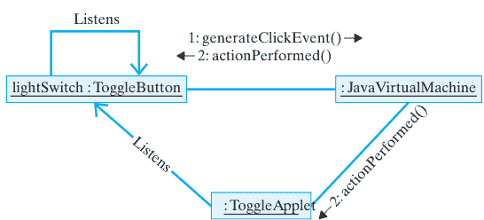

响应其事件：`lightSwitch` 本身，由于其类中的 `actionPerformed()` 方法，以及 `ToggleFrame`，由于该类中的 `actionPerformed()` 方法。

该设计的实现由 `ToggleFrame` 给出，这是一个使用 `ToggleButton`（图 8.11）的程序。GUI 在第 7 章中设计，此程序继承了 `JFrame` 类并实现了 `ActionListener` 接口。在这个示例中，我们使用 `ToggleButton` 来模拟灯开关。注意，我们将程序本身指定为 `lightSwitch` 的 `ActionListener`，这样当 `lightSwitch` 被点击时，程序会在程序栏中显示消息“灯开了”或“灯关了”（图 8.12）。这是一个简单的动作，但它说明了 `ToggleButton` 能够切换自己的标签并执行某些操作。

`ToggleButton` 设计体现了面向对象编程的几个关键设计原则。首先，最重要的是它通过继承扩展了预定义 `JButton` 类的功能——扩展性原则。其次，它将 `ToggleButton` 的核心行为封装在 `ToggleButton` 内部——模块化原则。

### 面向对象的设计原则

```java
import java.awt.*;
import java.awt.event.*;
import javax.swing.*;

public class ToggleFrame extends JFrame
    implements ActionListener {
    private ToggleButton lightSwitch;

    public ToggleFrame() {
        lightSwitch = new ToggleButton("off","on");
        getContentPane().add(lightSwitch);
        lightSwitch.addActionListener(this);
    } // init()

    public void actionPerformed(ActionEvent e) {
        setTitle("The light is " + lightSwitch.getText());
    }

    public static void main(String[] args[]) {
        JFrame f = new ToggleFrame();
        f.setSize(200,200);
        f.setVisible(true);
    }
} // ToggleFrame
```

图 8.11：`ToggleFrame` 类的定义。

图 8.12：当点击 `ToggleFrame` 按钮时，窗口标题栏中出现“The light is on”或“The light is off”。

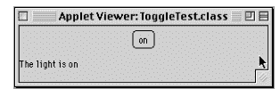

它隐藏了这种机制方式——信息隐藏原则。

> **有效设计 继承允许你特化对象的行为。** `ToggleButton` 做了 `JButton` 所做的一切

## 自学练习

- 练习 8.9 编写一个代码段（不是整个方法）来交换布尔变量 `b1` 和 `b2`。
- 练习 8.10 假设你正在设计一个游戏的 GUI，你想要一个用于发牌的按钮，将其添加到 `JFrame` 并指定其 `ActionListener`。

# 特题：历史密码学

**密码学**，即秘密写作的研究，有着悠久的历史。现代加密采用复杂的数学来加密消息。由于我们对计算机的广泛依赖，安全加密已成为科学领域一个重要领域。虽然世界大战期间使用的加密技术为现代加密奠定了基础，但

最早且最简单的密码之一是凯撒密码，由凯撒使用。根据该方案，字母表向前移动三个字母，并在字母表末尾回绕：

```
PlainText: abcghijklmnopqrstuvwxyz
CaesarShifted: defghijklmnopqrstqrxyabc
```

加密消息时，你获取消息的每个字母并将其替换为位移字母表中的字母。解密消息时，你反向操作——即你获取位移字母表中的字母，并将其替换为明文字母表中对应的字母。因此，“hello”会被凯撒加密为“khoor”。

凯撒密码是一种*替换密码*，因为明文消息中的每个字母都被替换为密文中的替换字母。更通用的替换密码形式使用*关键词*创建一个加密字母表：

```
PlainText: abcdefghijklmnopqrstuvwxyz
Ciphertext: xyplhnabdefghijklqrst
```

在这个示例中，关键词“phonetic”（去掉了第二个 o）被用来建立替换字母表。根据这种密码，单词“hello”会被加密为“edepi”。这种形式的替换密码经常出现在报纸谜题中。

另一种类型的密码是*置换密码*。在这种密码类型中，原始消息中的字母按某种规律进行重新排列。一个简单的例子就是如果我们反转每个单词中的字母，使得“hello”变成了“olleh”。

# 8.5 示例：密码类层次结构

假设我们想要设计一组密码类，包括凯撒密码和置换密码。因为所有加密形式的基本操作都是相同的，`Caesar` 类和 `Transpose` 类都拥有 `encrypt()` 和 `decrypt()` 方法

# 第8章 · 继承与多态

```java
public String encrypt(String s) {
    StringBuilder result = new StringBuilder("");
    StringTokenizer tokenizer = new StringTokenizer(s); // 分词
    while (tokenizer.hasMoreTokens()) {
        result.append(encode(tokenizer.nextToken()) + " ");
    }
    return result.toString(); // 返回结果
}
// encrypt(i)
```

| public class Caesar extends Cipher { ... |
| public class Transpose extends Cipher { ... } |

这些类的实例将能够使用 `encrypt(i)` 方法。另一方面，多态的 `encode(i)` 方法无法在 `Cipher` 类中实现。这是因为与每个 `Cipher` 子类都相同的 `encrypt(i)` 方法不同，`encode(i)` 方法每个子类都是不同的。通过将 `encode()` 方法声明为抽象（abstract），我们可以将其实现留给 `Cipher` 子类。因此，在 `Cipher` 类中，我们如下定义 `encode()` 和 `decode()`：

```java
// 抽象方法
public abstract String encode(String word);
public abstract String decode(String word);
```

这些在 `Cipher` 类中的声明告诉编译器，这些方法将在 `Cipher` 的子类中实现。通过将其定义为抽象的，`encode()` 可以在 `Cipher` 类中使用，就像它在 `encrypt()` 方法中使用一样。

# 8.5.1 类设计：Caesar

图 8.14 提供了 `Cipher` 类的完整定义。`encode()` 和 `decode()` 方法被声明为抽象。它们旨在由 `Cipher` 的子类实现。

```java
import java.util.*;

public abstract class Cipher {
    public String encrypt(String s) {
        StringBuilder result = new StringBuilder("");
        StringTokenizer words = new StringTokenizer(s);
        while (words.hasMoreTokens()) {
            result.append(encode(words.nextToken()) + " ");
        }
        return result.toString();
    }
    // encrypt())

    public String decrypt(String s) {
        StringBuilder result = new StringBuilder("");
        StringTokenizer words = new StringTokenizer(s);
        while (words.hasMoreTokens()) {
            result.append(decode(words.nextToken()) + " ");
        }
        return result.toString();
    }
    // decrypt())

    public abstract String encode(String word);
    public abstract String decode(String word);
}
```


注意，`encrypt()` 和 `decrypt()` 是在 `Cipher` 中实现的，而 `encode()` 和 `decode()` 虽然在 `Cipher` 中声明，但在 `Cipher` 的子类中实现。Java 的动态绑定机制将根据涉及的对象类型负责调用 `encode()` 或 `decode()` 的相应实现。例如，如果 `caesar` 和 `transpose` 分别是 `Caesar` 和 `Transpose` 对象，则对 `encrypt()` 的以下调用将触发它们各自的 `encode()` 方法：

```java
// 调用 caesar.encode()
caesar.encrypt('hello world');
// 调用 transpose.encode()
transpose.encrypt('hello world');
```

调用 `caesar.encrypt()`，它将转而调用 `caesar.encode()`——也就是说，它将调用在 `Caesar` 类中实现的 `encode()` 方法。当调用 `transpose.encrypt()` 时，它将转而调用 `transpose.encode()`。通过这种方式，每个对象都可以执行适用于其加密类型的编码算法。

### 方法多态

## 8.5.2 算法设计：字符位移

`Caesar` 类定义为 `Cipher` 的扩展（B.15）。`Caesar` 中唯一实现的方法是 `encode()` 和 `decode()`。`encode()` 方法接收一个 `String` 参数并返回一个 `String` 结果。它获取参数的每个字符（`word.charAt(k)`）并对字符执行凯撒位移。注意位移是如何实现的：

```java
ch = (char)('a' + (ch - 'a' + 3) % 26); // 凯撒右移
```

回顾第 5 章，Java 中的数据是 16 位整数。这使得我们能够将字符视为数字进行处理。因此，要将字符位移 3 位，我们只需要在它的整数表示上加上 3 即可。

```java
public class Caesar extends Cipher {
    public String encode(String word) { // 初始化字符串结果
        for (int k = 0; k < word.length(); k++) { // 对于 word 中的每个字符
            char ch = word.charAt(k); // 获取索引 k 处的字符
            ch = (char)('a' + (ch - 'a' + 3) % 26); // 添加到新的 StringBuilder
            // 注意：result 在片段中未定义，但是隐含的
        } 
        return result.toString();
    }
    public String decode(String word) { // 初始化字符串结果
        for (int k = 0; k < word.length(); k++) { // 对于 word 中的每个字符
            char ch = word.charAt(k); // 获取索引 k 字符
            ch = (char)('a' + (ch - 'a' + 23) % 26); // 执行反向位移
        } 
        return result.toString();
    }
} // Caesar
```

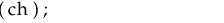

### 字符转换

例如，假设字符 `ch` 是 `h`，其 ASCII 码为 104（见表 5.13）。我们希望将其位移 3 位，得到代码为 107 的 `k`。在这种情况下，我们可以简单地将 104 加 3 得到想要的结果。然而，假设 `ch` 是字符 `y`，其 ASCII 码为 121。如果我们简单地在这种情况下加上 3，将得到 124，该代码对应于符号“z”，这并不是我们想要的结果。相反，在这种情况下，我们希望它位移时“回绕”到字母表的开头，使得 `y` 位移到 `b`。为了实现这一点，我们需要进行一些模运算。

假设从 a 到 z 的 26 个字符被标记为 0 到 25，以便 a 对应 0；b 对应 1，依此类推，z 对应 25。在这种情况下，y 是 24。将其位移 3 位得到 27，而 `27 % 26` 等于 1，它对应于 b。

### 模运算

## 8.6 案例研究：双人游戏层级

```java
public class TestEncrypt {
  public static void main(String[] args) {
    Caesar caesar = new Caesar();
    String plain = "this is the secret message"; // Here's the message
    String secret = caesar.encrypt(plain); // Encrypt the message
    System.out.println("********* Caesar Encryption *********");
    System.out.println("PlainText: " + plain); // Display the results
    System.out.println("Encrypted: " + secret);
    System.out.println("Decrypted: " + caesar.decrypt(secret)); // Decrypt

    Transpose transpose = new Transpose();
    secret = transpose.encrypt(plain);
    System.out.println("********* Transpose Cipher Encryption *************");
    System.out.println("PlainText: " + plain); // Display the results
    System.out.println("Encrypted: " + secret);
    System.out.println("Decrypted: " + transpose.decrypt(secret)); // Decrypt
    // main()
  }
}
```

图 8.17：TestEncrypt 类。

使用每种加密算法对句子进行加密和解密。如果你运行此程序，将产生以下结果：

```
******** Caesar Encryption *********
PlainText: this is the secret message
Encrypted: wkh lv vk vfhhu vphydj
Decrypted: this is the secret message

******** Transpose Cipher Encryption *************
PlainText: this is the secret message
Encrypted: siht ei terces easagem
Decrypted: this is the secret message
```

### 自我学习练习

- 练习 8.11 修改 `Caesar` 类，使其允许使用不同的位移。（提示：使用一个实例变量来表示位移）。
- 练习 8.12 修改 `Transpose.encode()`，使其使用旋转而不是反转。例如，像“hello”这样的单词应该通过一个字符的旋转被编码为“obell”。

## 8.6 案例研究：双人游戏层级

在这一节中，我们将重新设计我们的 OneNim 游戏，使其符合双人游戏类的层级结构。双人游戏是指那些涉及两名玩家的博弈。许多游戏都具有这一特点：跳棋、国际棋、井字格、猜游戏等等。然而，也有许多游戏只涉及 1 个玩家：黑杰克、纸牌牌等。还有一些涉及两名或多名玩家的游戏，例如卡牌游戏。因此，我们将 OneRowNim 作为双人游戏层级的一部分进行重新设计，并不是我们重新设计游戏类层级的最后努力。随着我们学习新的 Java 结构并尝试将我们的游戏库扩展到其他类型的游戏，我们肯定会重新设计相关内容。

本案例研究将说明我们如何应用继承和多态，以及面向对象的设计原则。在此时修订 OneRowNim 的理由是为了让我们更容易设计和开发双人游戏。正如我们所看到的，类层级结构的特点是顶层类中定义了更多的属性和方法。随着层级的向下移动，方法和属性变得更具专门化。创建一个子类实际上就是对给定的类进行专门化。

### 8.6.1 设计目标

我们的设计目标之一是修订 OneRowNim 游戏，使其符合双人游戏的层级结构。实现这一点的一种方法是通过创建一个子类，定义所有双人游戏通用的属性和方法，从而将 OneRowNim 泛化。该子类将定义双人游戏中最通用、最元素。所有双人游戏（包括 OneRowNim）都将被定义为此顶层部分的子类，并继承其保护变量和方法。此外，我们的顶层类将包含某些抽象内容，这些实将在 OneRowNim 和其他子类中给出。

第二个目标是让计算机和人类都能玩这个游戏。因此，对于一个双人游戏，应该能够让两个人类互相对决，或者让两台电脑对决，或者让人类对战计算机。这一设计目标要求我们的设计表现出某种程度的活性。正如我们将看到的，这是 Java 中的一种情况。

另一个重要目标是设计一个可以方便地与各种用户界面、命令行界面和 GUI 使用的双人游戏层级。为了处理这个问题，我们将开发 Java 接口，作为我们的双人游戏与各种用户界面之间的桥梁。

### 8.6.2 设计 TwoPlayerGame 类

要开始设计 OneRowNim 游戏，我们首先需要设计一个顶层类，哪些变量和方法属于这个类？回答这个问题的一种方法是泛化 OneRowNim 的版本，将适用于所有双人游戏的变量和方法移动到 `TwoPlayerGame` 类中。`TwoPlayerGame` 的所有子类（包括 OneRowNim）都继承这些元素。图 8.18 显示了当前的设计。

哪些属性和方法应该移动到 `TwoPlayerGame` 类中？显然，常量 `PLAYER_ONE` 和 `PLAYER_TWO` 适用于所有双人游戏。它们应该向上移动。另一方面，`MAX_PICKUP` 和 `MAX_STACKS` 只适用于 `OneRowNim` 类。它们应该留在 `OneRowNim` 类中。

| | |
| :--- | :--- |
| + PLAYER_ONE | int = 1 |
| + PLAYER_TWO | int = 2 |
| MAX_PICKUP | int = 3 |
| MAX_STACKS | int = 11 |
| nStacks | int |
| + onePlaysNext | boolean |
| + OneRowNim() | |
| + OneRowNim(nStacks: int, starter: int) | |
| + takeStacks(int n) | boolean |
| + getStacks() | int |
| + getPlayer() | int |
| + gameOver() | boolean |
| + getWinner() | int |
| + reportGameState() | String |

通用子类

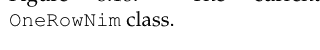

`nStacks` 实例是一个只适用于 `OneRowNim` 类的变量，但不适用于其他双人游戏。它应该留在 `OneRowNim` 类中。另一方面，`oneNext` 变量适用于所有双人游戏，我们将将其移动到 `TwoPlayer` 类。

构造方法是不被继承的，所有的构造方法留在 `OneRowNim` 类中。实例方法 `takeStacks()` 和 `getStacks()` 属于 `OneRowNim`，所以它们应该留在那里。然而，其他方法 `getPlayer()`、`getWinner()` 和 `reportState()` 对所有双人游戏都有用。因此这些方法应该移动到父类中。当然，虽然这些方法可以在父类中定义，但某些方法只能在子类中实现。例如，`reportState` 方法报告游戏的状态，因此它必须在 `OneRowNim` 中实现。同样，`getWinner` 方法定义如何确定胜者，这种定义只能在子类中进行。因此，我们将在父类中将这些方法定义为抽象。意图是让 `TwoPlayer` 子类为这些方法提供特定的游戏实现。

考虑到这些因素，我们得如图 8.19 所示的设计。这种设计比我们在早期章节中使用的设计复杂得多。然而，复杂性来自于在本章的后续节中已经讨论过的。

首先，注意到我们在设计之外还引入了两个 Java 接口，这导致了更灵活的设计，并且很容易扩展以纳入新的双人游戏。让我们单独来看设计的每个元素。

### 8.6.3 TwoPlayerGame 父类

正如我们所见，`TwoPlayerGame` 类的作用是作为所有双人游戏的父类。因此，它应该定义双人游戏共享的变量和方法。

`PLAYER_ONE`、`PLAYER_TWO` 和 `oneNext` 变量以及 `getPlayer()`、`setPlayer()` 和 `changePlayer()` 方法已经移动到父类。显然，这些变量和方法适用于所有双人游戏。注意我们增加了三个新变量：`nComputers`、`computer`、`computer2` 以及相应的方法 `getComputers()` 和 `addComputer()`。我们使用这些元素赋予我们的游戏由计算机程序运行的能力。因为我们希望所有的双人游戏都有这种能力，所以我们在父类中定义这些变量和方法，而不是在 `OneRowNim` 和 `TwoPlayerGame` 的子类中。

8.19: `TwoPlayerGame` 是 `OneRowNim` 以及其他双玩家游戏的超类。

| TwoPlayerGame |
| --- |
| + PLAYER_ONE: int = 1 |
| + PLAYER_TWO: int = 2 |
| # onePlaysNext: boolean |
| # nComputers: int |
| # computer1, computer2: IPlayer |
| + getPlayer(): int |
| + setPlayer(n: int) |
| + changePlayer() |
| + getComputers(): int |
| + getRules(): String |
| + addComputerPlayer(p: IPlayer) |
| + gameOver(): boolean |
| + getWinner(): String |

```
<<interface>>
IGame
+ getGamePrompt(): String
+ reportGameState(): String
```

```
<<interface>>
ClUIPlayableGame
+ play(ui: UserInterface)
```

```
| OneRowNim |
| --- |
| + MAX_PICKUP: int = 3 |
| + MAX_STICKS: int = 11 |
| - sticks: int |
| OneRowNim() |
| OneRowNim(sticks:int) |
| OneRowNim(sticks:int,starter: int) |
| takeSticks(n: int) : boolean |
| getSticks(): int |
| getRules(): String |
| gameOver(): boolean |
| getWinner(): String |
| getGamePrompt(): String |
| reportGameState(): String |
| play(ui: UserInterface) |
```

注意 `computer1` 和 `computer2` 变量被声明为 `IPlayer` 类型。`IPlayer` 是一个接口，它包含一个单一的方法声明，即 `makeAMove()` 方法：

```java
public interface IPlayer {
    public String makeAMove(String prompt);
}
```

为什么我们在这里使用接口而不是某种类型的游戏对象呢？这是一个很好的设计问题。使用接口使得我们的设计更具灵活性和扩展性，因为我们无需知道实现 `makeAMove()` 方法的类名。

### 第 6 节 • 案例研究：双玩家游戏层次结构

变量 `computer1` 和 `computer2` 将通过 `addComputerPlayer()` 方法分配实现 `IPlayer` 的对象。

在 `makeAMove()` 的各种实现中使用的算法取决于游戏——它们取决于所正在玩的特定游戏。

要定义一个适用于所有双玩家游戏的游戏对象是不可能的。相反，如果我们想要一个玩 `OneRowNim` 的对象，我们会定义一个 `OneRowNimPlayer` 并让它实现 `IPlayer` 接口。同样，如果我们想要一个玩国际棋的对象，我们会定义一个 `CheckerPlayer` 并让它实现 `IPlayer` 接口。通过这种方法，我们的 `TwoPlayerGame` 可以处理各种不同的游戏对象，只要它们实现了 `IPlayer` 接口。因此，使用 `IPlayer` 接口为我们的游戏层次结构增加了灵活性，使其更容易扩展到新的、未定义的章节。我们将在接下来的一个章节中讨论如何设计游戏的细节。


# 第 8 章 • 继承与多态

## 8.6 节 案例研究：双玩家游戏层次结构

现在转向 `PlayerGame` 中定义的方法，我们已经在 `Computer` 类中看过了 `getPlayer()`、`setPlayer()` 和 `changePlayer()` 的实现。我们只需将这些实现移动到 `nComputers` 变量处。`addComputerPlayer()` 方法向游戏添加一个计算机玩家。它的实现如下：

```java
public void addComputerPlayer(IPlayer player) {
    if (nComputers == 0)
        computer2 = player;
    } else if (nComputers == 1)
        computer1 = player;
    } else
        return; // 不多于两个玩家
    ++nComputers;
}
```

正如我们所提到的，玩 `TwoPlayerGames` 的类必须实现 `IPlayer` 接口。该方法的参数是 `nComputers`。如果它是 `IPlayer` 类型，算法会检查 `nComputers` 的当前值。如果是 0，这意味着这是添加到游戏中的第一个 `IPlayer`，则该玩家被分配给 `computer2`。这允许在计算机与人类用户之间的游戏中将人类用户分配为 `PLAYERONE`。

如果 `nComputers` 等于 1，意味着我们正在向游戏添加第二个 `IPlayer`，我们将该玩家分配给 `computer1`。在这两种情况下，我们都会递增 `nComputers`。如果 `nComputers` 不是 1 或 2 会发生什么？在这种情况下，我们直接返回，而不将 `IPlayer` 添加到游戏，也不增加 `nComputers`。这把 `IPlayer` 的数量限制为两个。（一个更复杂的设计会抛出异常来报告错误。）

`addComputerPlayer()` 方法用于在游戏创建后初始化。如果没有调用此方法，默认假设是 `nComputers` 等于 0，且 `computer1` 和 `computer2` 均为 `null`。以下是它的使用方法示例：

```java
OneRowNim nim = new OneRowNim(11); // 11 棍
nim.add(new NimPlayer(nim)); // 2 个计算机玩家
nim.add(new NimPlayerBad(nim));
```

注意 `NimPlayer()` 构造函数接受游戏引用作为参数。显然，我们的设计不应假设 `TwoPlayer` 子类会知道 `IPlayer` 对象的名称。此方法允许在运行时传递对象。我们将在后续章节中讨论 `NimPlayerBad` 的细节。

`getRules()` 方法是一个新方法，其目的是返回一个描述特定游戏规则的字符串。该方法在 `TwoPlayerGame` 中实现，意图是在各个子类中被重写。例如，它在 `TwoPlayerGame` 中的实现：

### 重写方法

```java
public String getRules() {
    return "这个游戏的规则是： ";
}
```

以及它在 `OneRowNim` 中的重新定义：

```java
public String getRules() {
  return "\n***One Nim 游戏规则 ***\n" +
  "(1) 选择一个 7 到 \n" + MAX_STICKS +
  " 之间的数字数量。\n" +
  "(2) 两个玩家交替移动。\n" +
  "(3) 一次移动包括从当前的棍子数量中减去 1 到 \n\t" +
  "根。\n" +
  "(4) 无法为其他玩家留出正数 \n\t" +
  "根棍子的玩家将离开。\n"
}
```

这种思想是每个 `TwoPlayerGame` 子类都将负责定义自己的一套规则，并以可以显示给用户的格式。

你可能考虑在父类中定义 `getRules()` 并允许它在子类中被重写。这允许我们使用多态：

```java
TwoPlayerGame game = new OneRowNim();
System.out.println(game.getRules());
```

变量 `computer1` 和 `computer2` 将通过 `addComputerPlayer()` 方法分配实现 `IPlayer` 的对象。

在 `makeAMove()` 的各种实现中使用的算法取决于游戏——它们取决于正在玩的特定游戏。

要定义一个适用于所有双玩家游戏的游戏对象是不可能的。相反，如果我们想要一个玩 `OneRowNim` 的对象，我们会定义一个 `OneRowNimPlayer` 并让它实现 `IPlayer` 接口。同样，如果我们想要一个玩国际棋的对象，我们会定义一个 `CheckerPlayer` 并让它实现 `IPlayer` 接口。通过这种方法，我们的 `TwoPlayergame` 可以处理各种不同的游戏对象，只要它们实现了 `IPlayer` 接口。因此，使用 `IPlayer` 接口为我们的游戏层次结构增加了灵活性，使其更容易扩展到新的、未定义的章节。我们将在接下来的一个章节中讨论如何设计游戏的细节。

### 8.6.5 面向对象设计：接口或抽象类

为什么这些方法定义在接口中？我们不能容易地将它们定义在 `TwoPlayerGame` 类中并通过继承将它们扩展到各种子类吗？毕竟，结果不是一样的吗，即 `OneRowNim` 必须实现所有三个方法？

这些是非常好的设计选择，也是在设计任何类层次结构时应该问的问题。正如我们在本章早前的 Animal 示例中所指出的，你可以从接口和抽象超类获得相同的功能。当我们在超类中使用抽象方法时，它何时属于接口呢？关于这些以及相关的面向对象设计问题的很好的讨论，可以参考 Peter Bloch 和 Mark Mayfield 编写的 *Java Design, Second Edition*（Java Press, 1994）。我们的讨论遵循了 Bloch 和 Mayfield 建议的指南。

我们已经注意到，使用接口增加了灵活性。根据接口的本质，它们可以附加到任何类，这使得它们非常灵活。回答这个问题的另一个有用指南是：

> **有效设计 抽象方法** 定义在超类中的方法对该类型的属性有贡献。相反，`gameOver()` 和 `getWinner()` 等方法对于游戏的定义是重要的。因此，将这些方法放入接口中是最好的。这种设计使得

### 8.6.6 修改后的 OneRowNim 类

本节将提供了修改后的 `OneRowNim` 类的列表，它属于 `TwoPlayerGame` 层次结构。`OneRowNim` 的主要变化来自于 `play()` 方法，它控制 `OneRowNim` 的游戏（图 8.22）。由于这个版本的游戏整合了电脑玩家，游戏循环比之前的版本复杂一点。基本思想仍然相同：该方法循环直到游戏结束。在每次迭代中

## TwoPlayerGame 类定义

```java
public abstract class TwoPlayerGame {
    public static final int PLAYER_ONE = 1;
    public static final int PLAYER_TWO = 2;

    protected boolean onePlaysNext = true;
    protected int nComputers = 0;
    // 电脑数量
    // 电脑是 IPlayer
    protected IPlayer computer1, computer2;

    public void setPlayer(int starter) {
        if (starter == PLAYER_TWO)
            onePlaysNext = false;
        else onePlaysNext = true;
    } // setPlayer/
    public int getPlayer() {
        if (onePlaysNext)
            return PLAYER_ONE;
        else return PLAYER_TWO;
    } // getPlayer/
    public void changePlayer() {
        onePlaysNext = !onePlaysNext;
    } // changePlayer/
    public int getComputers() {
        return nComputers;
    }

    public String getRules() {
        return "这个游戏的规则是：";
    }

    public void addComputer(IPlayer player) {
        if (nComputers == 0)
            computer2 = player;
        else if (nComputers == 1)
            computer1 = player;
        else
            return; // 不超过 2 个玩家
        ++nComputers;
    }

    public abstract boolean gameOver(); // 抽象方法
    public abstract String getWinner();
} //TwoPlayerGame
```

图 8.20：TwoPlayerGame 类

## 用户界面（UI）

在伪代码中，一个典型的游戏控制循环看起来如下所示：

```
初始化游戏。
当游戏未结束时
    通过 UI 报告游戏的当前状态。
    通过 UI 提示用户（或电脑）进行移动。
    通过 UI 获取用户的移动。
    执行移动。
    切换到另一个玩家。
```

游戏循环设置了游戏与 UI 之间的交互。接口（Interface）参数允许游戏直接连接到特定的 UI。为了让我们能够通过各种 UI 玩我们的游戏，我们将 `UserInterface` 定义为如下 Java 接口：

```java
public interface UserInterface {
    public String getInput();
    public void report(String s);
    public void prompt(String s);
}
```

任何实现了这三个方法的对象都可以作为我们某个 `TwoPlayerGame` 的 UI。这是在面向对象设计中使用接口来体现灵活性的另一个例子。

为了说明我们如何使用 `UserInterface`，让我们将其附加到我们的 `KeyboardReader` 类上，让 `KeyboardReader` 担任 `TwoPlayerGames` 的 CLUI。我们通过在 `KeyboardReader` 类中如下实现接口来实现：

```java
public class KeyboardReader implements UserInterface
```

事实证明，`UserInterface` 中列出的三个方法与 `KeyboardReader` 当前版本的三个方法匹配。这并非偶然。`UserInterface` 的设计是通过识别 `KeyboardReader` 中为了与 `TwoPlayerGame` 交互所需的最少方法数量得出的。

> **有效设计 Java 接口的灵活性。** Java 接口提供了一种将有用方法与不同类型对象关联的方法，从而实现了更灵活的面向对象设计。


将参数更通用地定义为 `User-Interface` 而不是 `KeyboardReader` 的好处是，我们最终希望所有的游戏都能通过其他类型的命令行接口来玩。例如，我们可以定义一个基于互联网的 CLUI，用于互联网上的用户玩 `OneRowAmong`。这种扩展性——创建新类型的 UI 并将其与 `TwoPlayerGames` 使用的能力——是 Java 接口的另一个重要设计特性。

### 通用性原则

> **有效设计扩展性与 Java 接口.** 使用接口定义有用的方法签名增加了类层次结构的扩展性。


如图 8.19 所示，`OneRowAmong` 实现了 `CLUIPlayable-Game` 接口，这意味着必须提供三个抽象方法的实现：`play()`、`getGamePrompt()` 和 `reportState()`。


# 第 8 章 • 继承与多态

## 8.6 节 案例研究：双玩家游戏层级结构

### 修改后的 `OneRowNim` 类（第一部分）

```java
public class OneRowNim extends TwoPlayerGame implements PlayableGame {
    public static final int MAX_PICKUP = 3;
    public static final int MAX_STICKS = 11;
    private int nSticks = MAX_STICKS;

    public OneRowNim() { // 构造函数
    }

    public OneRowNim(int sticks) {
        nSticks = sticks;
    }

    public OneRowNim(int sticks, int starter) {
        nSticks = sticks;
        setPlayer(starter);
    } // OneRowNim()

    public boolean takeSticks(int num) {
        if (num < 1 || num > MAX_PICKUP || num > nSticks) { // 错误
            return false;
        } else { // 有效移动
            nSticks = nSticks - num;
            return true;
        }
    } // takeSticks()

    public int getSticks() {
        return nSticks;
    }

    public String getRules() {
        return "*** One Row Nim 的规则 ***\n" +
               "(1) 选择 1 到 " + MAX_STICKS + "之间的数字。\n" +
               "(2) 玩家交替移动。\n" +
               "(3) 一次移动包括从当前棋数中减去 1 到 " + MAX_PICKUP + " 个子。\n" +
               "(4) 无法为对方留下正数棋子的玩家输了。\n";
    } // getRules()

    public boolean gameOver() { // 来自 TwoPlayerGame
        return nSticks <= 0;
    } // gameOver()

    public String getWinner() { // 来自 TwoPlayerGame
        if (gameOver()) {
            return getPlayer() + " 好的游戏！";
        }
        return "游戏还没有结束。"; // 尚未结束
    } // getWinner()
} // OneRowNim 类，第一部分。
```

图 8.21：修改后的 `OneRowNim` 类，第一部分。

### 修改后的 `OneRowNim` 类（续）

```java
// From CLUIPlayableGame
public String getGamePrompt() {
    return "\nYou can pick up between 1 and " + 
           Math.min(MAX_PICKUP, nSticks) + " ; ";
}
// getGameState()
public String reportGameState() {
    if (!gameOver()) {
        return ("\nsticks left: " + getSticks() + 
               " Who's turn: Player " + getPlayer());
    } else {
        return ("\nsticks left: " + getSticks() + 
               " Game over! Player is " + getPlayer() + "\n");
    }
}

public void play(UserInterface ui) { // From CLUIPlayableGame interface
    int sticks = 0;
    ui.report(getRules());
    if (computer1 == null) {
        ui.report("computer1 is a " + computer1.toString());
    }
    if (computer2 == null) {
        ui.report("n2 is a " + computer2.toString());
    }
    while(!gameOver()) {
        Player player = null; // Assume no computers
        ui.report(reportGameState());
        switch(player) {
            case PLAYER_ONE: // Player 1's turn
                computer = computer1;
                break;
            case PLAYER_TWO: // Player 2's turn
                computer = computer2;
                break;
            default:
                break;
        }
        if (computer != null) {
            sticks = Integer.parseInt(computer.makeMove(""));
            ui.report(computer.toString() + " takes " + 
                       sticks + " sticks.\n");
        } else { // otherwise, user's turn
            ui.prompt(getGamePrompt());
            sticks = Integer.parseInt(ui.getInput()); // Get user's move
            if (takeSticks(sticks)) // If a legal move
                changePlayer();
        }
        ui.report(reportGameState()); // The game is now over
    }
    play();
}
// OneRowNim class
```

图 8.22: 修改后的 `OneRowNim` 类，接上上一页的内容。

循环，或者两个玩家中的一个（`PLAYER_ONE` 或 `PLAYER_TWO`）轮到他们进行一次移动——即决定捡起多少根木子。如果该移动是合法的，则轮到另一个玩家。

现在让我们看代码如何区分当前是轮到电脑移动还是人类移动。注意，在 `while` 循环的开始处，它将 `computer` 变量设为 `null`。然后，它根据轮到谁，将 `computer` 赋值为 `computer1` 或 `computer2` 中的其中一个。但请记住，这两个变量中的一个或两个可能为 `null`，取决于有多少台电脑在玩游戏。如果没有电脑在玩，那么两个变量都将为 `null`。如果只有一个电脑在玩，那么 `computer` 将在某一轮为 `null`。这在游戏初始化期间确定，即调用 `addPlayer(i)` 时（见上文）。

在 `switch` 语句之后的代码中，如果 `computer` 不为 `null`，我们就调用 `computer.makeAMove()`。正如我们所知的，`makeAMove()` 方法是 `IPlayer` 接口的一部分。`makeAMove()` 方法接受一个 `String` 参数作为移动指令，并返回一个表示 `IPlayer` 移动结果的 `String`：

```java
public interface IPlayer {
    public String makeAMove(String prompt);
}
```

在 `OneRowNim` 中，“移动”是一个整数，代表玩家捡起的木子数量。因此，在 `play()` 方法中，`OneRowNim` 必须将 `String` 转换为 `int`，这代表玩家捡起的木子数。

另一方面，如果 `computer` 为 `null`，则意味着轮到人类玩了。在这种情况下，`play()` 调用 `getUser()`，利用接口从键盘输入一个值。用户的输入必须从 `String` 转换为 `int`。一旦设置了 `sticks` 的值（无论是来自用户还是来自 `IPlayer`），`play()` 方法就会调用 `takeSticks()`。如果移动是合法的，它就会切换轮到的玩家并继续循环。

关于 `play()` 方法的设计，有几个重要的点需要注意。第一，`play()` 必须知道如何处理来自用户或 `IPlayer` 的输入。这是依赖于 `OneRowNim` 的知识。在井字游戏中，“移动”可能代表井字棋盘上的一个方格。这表明 `play()` 是一个应该在 `OneRowNim` 中实现的方法，正如这里所做的，因为 `OneRowNim` 封装了如何玩游戏的知识。

第二点要留心，方法调用 `computer.makeAMove()` 是多态的另一个例子。`play()` 方法并不知道轮到谁了，只知道它是一个 `IPlayer`——一个实现了 `IPlayer` 的对象。正如我们在下一节中所示，`OneRowNim` 游戏可以由两个不同的玩家玩：一个 `NimPlayerBad` 和另一个 `NimPlayer`。它们都有自己的游戏策略，这些策略通过它们各自版本的 `makeAMove()` 方法实现。Java 使用动态绑定来决定调用哪一个版本的 `makeAMove()`。通过定义具有不同 `makeAMove()` 方法的不同 `IPlayer`，这种对依赖于游戏的知识进行封装的多态用法，使得对不同的游戏策略进行相互测试成为可能。

### 8.6.7 `IPlayer` 接口

我们设计的最后一个元素是 `IPlayer` 接口，正如我们刚刚看到的，它由 `makeAMove()` 方法组成。为了看到我们如何使用接口，让我们设计一个类来玩 `OneRowNim` 游戏。我们将该类命名为 `NimPlayer` 并赋予它一个良好的策略。每次移动都会在 1 到 3 之间随机选取一个数字，或者如果剩余木子少于 3 根则取全部。作为 `IPlayer` 接口的实现者，`NimPlayer` 将实现 `makeAMove()` 方法。该方法将包含 `NimPlayer` 玩游戏的策略（算法）。该方法的结果是剩余木子的数量。`NimPlayer` 还需要其他元素（变量和方法）？显然，为了玩 `OneRowNim`，玩家必须知道规则和游戏的当前状态。如果我们给玩家 `OneRowNim` 游戏的引用，它就可以通过 `getSticks()` 确定剩余多少根木子。我们添加了一个名为 `randomMove()` 的私有辅助方法，它将简单地为玩家生成合适的木子数量。


```java
public class NimPlayer implements IPlayer {
    private OneRowNim game;

    public NimPlayer(OneRowNim game) {
        this.game = game;
    }

    public String makeAMove(String prompt) {
        return "" + randomMove();
    }

    private int randomMove() {
        int sticksLeft = game.getSticks();
        return 1 + (int)(Math.random() * Math.min(sticksLeft, MAX_PICKUP));
    }

    public String toString() {
        String className = "";
        className = this.getClass().toString(); // 获取 'class NimPlayer'
        return className.substring(6); // 去掉 'class '
    }
}
```

图 8.24: `NimPlayer` 类。

### 8.6.8 玩 `OneRowNim`

让我们写一个 `main()` 方法来玩 `OneRowNim`：

```java
public static void main(String args[]) {
    KeyboardReader kb = new KeyboardReader();
    OneRowNim game = new OneRowNim();
    kb.prompt("How many computers are playing, 0, 1, or 2?");
    int m = kb.nextInt();
    for (int k = 0; k < m; k++) {
        kb.prompt("What type of player, " +
            "NimPlayerBad = 1, or NimPlayer = 2?");
        int choice = kb.nextInt();
        if (choice == 1) {
            IPlayer computer = new NimPlayerBad(game);
            game.addPlayer(computer);
        } else {
            IPlayer computer = new NimPlayer(game);
            game.addPlayer(computer);
        }
    }
    game.play(kb);
}
```

在创建了 `KeyboardReader` 并创建一个 `OneRowNim` 实例后，我们提示用户确定有多少台电脑在玩。我们反复提示用户识别 `IPlayer` 的类型，并使用 `addPlayer()` 方法初始化游戏。最后，我们通过调用 `play()` 方法启动游戏，并传递一个 `KeyboardReader`（即我们的 `UserInterface` 接口对象）引用。

请注意，在这个例子中，我们声明了一个 `OneRowNim` 变量来表示游戏。这并不是唯一的方法。例如，假设我们想写一个可以玩各种不同 `TwoPlayerGames` 的 `main()` 方法。通常的问题是，我们能重写它以适用于任何 `TwoPlayerGame` 吗？

由于继承，`OneRowNim` 对象也是一个 `TwoPlayerGame`，并且由于实现了该接口，它也是一个 `CLIPlayableGame`。因此，我们可以使用这些类型中的任何一种来表示游戏。因此，这种代码的另一种替代方法如下：

```java
TwoPlayerGame game = new OneRowNim();
IPlayer computer = new NimPlayer((OneRowNim)game);
((CLIPlayableGame)game).play(kb);
```

在这里我们使用 `TwoPlayerGame` 变量来表示游戏。然而，请注意，我们现在必须使用类型转换表达式 `(CLIPlayableGame)` 来调用 `play()` 方法。如果我们不这样转换 `game`，Java 将生成以下语法错误：

```
OneRowNim.java:126: cannot resolve symbol
symbol : method play (KeyboardReader)
location : class TwoPlayerGame
game.play(kb);
```

出现此错误的原因是 `play()` 不是 `TwoPlayerGame` 类中的方法，所以编译器找不到 `play()` 方法。通过使用类型转换表达式，我们告诉编译器将 `game` 视为一个 `CLIPlayableGame`。这样它就能找到 `play()` 方法。当然，赋值给 `game` 的对象在实际上必须实现了 `CLIPlayableGame` 接口，以便该操作在运行时正常工作。我们还需要在 `NimPlayer()` 构造函数中进行类型转换操作，或者让 `computer` 与该方法的参数兼容。

该方法的另一种替代方案是如下：

```java
CLIPlayableGame game = new OneRowNim();

IPlayer computer = new NimPlayer((OneRowNim)game);
((TwoPlayerGame)game).addPlayer(computer);

game.play(kb);
```

## 自习练习

**练习 8.13** 定义一个 `NimPlayer` 类，它为 `OneRowNim` 采用最优策略。该策略在第5章中描述过。


# 第 8.6 节 • 案例研究：双人游戏层次结构

通过将游戏表示为 `CLIPlayableGame` 变量，我们就不需要对 `play()` 进行类型转换，但我们需要另一个不同的类型转换表达式 `(TwoPlayerGame)` 来调用 `addPlayer()`。再次，原因是编译器在 `CLIPlayableGame` 接口中找不到 `addPlayer()` 方法，所以我们必须告诉它将 `game` 视为一个 `TwoPlayerGame`，而它恰恰是一个 `TwoPlayerGame`。我们仍然需要在调用 `NimPlayer()` 构造函数时进行类型转换操作。我们考虑的这三个选项，在两个玩家对战的游戏中，都会生成类似于图 8.25 所示的交互会话。

基于我们对 `TwoPlayerGame` 层次结构的面向对象设计，我们可以编写通用代码，使任何 `TwoPlayerGame` 都实现 `CLIPlayableGame` 接口。我们将在下一节中给出一个具体的示例。

## 8.6.9 扩展 TwoPlayerGame 层次结构

现在我们已经描述了 `TwoPlayerGame` 类层次结构的设计和细节，让我们用它来开发一个新游戏。如果我们设计得当，开发新的双人游戏并把它们添加到层次结构中将比从零开始开发要简单得多。

新游戏是一个猜词游戏，两个玩家轮流猜一个秘密单词。秘密单词由游戏对象从词汇集合中随机生成。单词将用问号隐藏，例如 "??????????"。每回合一个玩家猜一个字母。如果该字母在秘密单词中，它将替换一个或多个问号，例如 "???????"。玩家一直猜下去，直到出现错误的猜测，然后轮到另一个玩家。当然，我们想开发这个版本的游戏，它既可以由两个人类玩，也可以由一个人类对抗电脑——即玩家对玩家（Player-vs-Player）。

遵循 `Wordguess` 游戏类的设计，让我们参考图 8.26 中 `OneRowNim` 所示的设计。`Wordguess` 类继承自 `TwoPlayerGame` 并实现了 `CLUIPlayableGame`。我们不显示接口和 `TwoPlayerGame` 类的细节，它们没有变化。此外，遵循 `NimPlayerBad` 的设计，`Wordguess` 实现了 `IPlayer` 接口。注意我们如何显示零或多个 `IPlayer` 实例之间的关联。一个 `Wordguess` 使用零到两个 `IPlayer` 实例，这些实例是由 `Wordguess` 实现的。

让我们转向 `Wordguess` 类的细节，其源代码如图 8.22 和 8.28 所示。游戏需要一个词库从中选择秘密单词展示给玩家。`getSecretWord()` 方法将处理此任务。它生成一个随机数并结合 `switch` 语句，从直接编码在 `switch` 语句中的某些单词中选择。秘密单词存储在 `secretWord` 变量中。`currentWord` 变量存储部分猜测的单词。最初，`currentWord` 完全由问号组成。当玩家猜对时，`currentWord` 会更新以显示猜测字母的位置。因为 `currentWord` 会随着游戏的进行而变化，因此它存储在 `StringBuffer` 中，而不是 `String`。记住 `String` 是不可变的。

### 行 Nim 的规则

- (1) 选择 7 到 11 之间的一个数字。
- (2) 玩家交替移动。
- (3) 一次移动是从当前数字中减去 1 到 3 个数字。
- (4) 无法给对手留下正数数字的玩家输了。

### 交互示例

有多少台电脑在玩，0, 1 还是 2? 2

```java
public class StringGuess extends TwoPlayerGame implements CLUIPlayableGame {
    private String secretWord;
    private StringBuffer currentWord;
    private StringBuffer previousGuesses;
    private int unguessedLetters;

    public StringGuess() {
        secretWord = getSecretWord();
        currentWord = new StringBuilder(secretWord);
        previousGuesses = new StringBuilder();
        for (int k = 0; k < secretWord.length(); k++) {
            unguessedLetters = secretWord.length();
        }
    }
    public String getPreviousGuesses() {
        return previousGuesses.toString();
    }
    public String getCurrentWord() {
        return currentWord.toString();
    }
    private String getSecretWord() {
        int min = (int)(Math.random()*10);
        switch (min) {
            case 0: return "SOFTWARE";
            case 1: return "SOLUTION";
            case 2: return "CONSENT";
            case 3: return "COMPILER";
            case 4: return "ABSTRACT";
            case 5: return "ARCHIVAL";
            case 6: return "AKNOWLEDGMENT";
            case 7: return "QUESTION";
            case 8: return "UTILIZ";
            case 9: return "VARIABLE";
            default: return "MERCURY";
        }
    }
    public boolean guessLetter(char letter) {
        previousGuesses.append(letter);
        if (secretWord.indexOf(letter) == -1) {
            return false;
        } else {
            for (int k = 0; k < secretWord.length(); k++) {
                if (currentWord.charAt(k) != letter) {
                    currentWord.setChar(k, letter);
                    unguessedLetters--; // one less to find
                }
            }
            return true;
        }
    }
    public String getRules() {
        return "The Rules of WordGuess+=\n" +
               "1) The game generates a secret word.\n" +
               "2) Two players alternate taking moves.\n" +
               "3) A move consists of guessing a letter.\n" +
               "4) A player continues guessing until a letter is wrong.\n" +
               "5) The game is over when all letters of the word are guessed!\n" +
               "6) The player guessing the last letter of the word wins.\n" +
               "";
    }
}
```

图 8.27: WordGuess 类，第一部分。

`guessLetter()` 使用一个 for 循环来遍历秘密单词中的字母。在执行过程中，它将 `currentWord` 中的问号替换为猜对的秘密字母。如果猜测错误，`guessLetter()` 返回 `false`。在这种情况下，`move()` 方法改变了玩家回合。当猜测正确时，当前玩家接管回合。

WordGuess 游戏是字符串处理问题的很好的示例。它使用了我们在第 7 章中学习的 `String` 和 `StringBuilder` 方法。WordGuess 作为 `TwoPlayerGame` 的扩展实现非常直观。一个优点是我们可以复用在 `TwoPlayerGame` 中编写的代码。

```java
public boolean gameOver() { // 来自 TwoPlayerGame
    return (unguessedLetters < 0);
}
// gameOver()
public String getWinner() { // 来自 TwoPlayerGame
    if (gameOver()) {
        return "Player " + getPlayer();
    } else
        return "游戏尚未结束。";
    }
}
// getPlayer()
public String reportState() {
    if (gameOver()) {
        return "\nCurrent word: " + currentWord.toString() + " Previous guesses " + previousGuesses + " " + getPlayer() + " guesses next.";
    } else
        return "\n游戏已结束。秘密单词是 " + secretWord + " 赢了！";
    }
}
// reportState()
public String getGamePrompt() { // 来自 CLUIPlayableGame
    return "\n猜一个你认为在秘密单词中的字母：";
}
// getGamePrompt()
public String move(String s) {
    char c = s.toLowerCase().charAt(0);
    if (isLetter(c)) { // 正确
        return "是的，字母 " + c + " 在秘密单词中\n";
    } else {
        changePlayer();
        return " " + s + " 不是秘密单词中的一个新字母\n";
    }
}
// move()
public void play(UserInterface ui) { // 来自 CLUIPlayableGame
    while (ui.getInput()) {
        if (computer1 == null) {
            ui.report("Player 1 is a " + computer1.toString());
        } if (computer2 == null) {
            ui.report("Player 2 is a " + computer2.toString());
        }
        ui.report(reportState());
        if (!gameOver()) {
            switch (turn) {
                case PLAYERONE:
                    computer = computer1; // 玩家 1 的回合
                    break;
                case PLAYERTWO:
                    computer = computer2; // 玩家 2 的回合
                    break;
                default: // 状态
                    break;
            }
            if (computer == null) { // 如果是电脑回合
                ui.report(move(computer.makeMove()));
            } else
                ui.prompt("否则，用户回合");
                ui.report(ui.getUserInput());
            }
        }
        ui.report(reportState()); // 游戏现在结束
    }
} // // play()
// WordGuess 类
```


```java
public class WordGuesser implements IPlayer {
    private WordGuesser game;
    public WordGuesser (WordGuesser game) {
        this.game = game;
    }
    public String makeAMove(String prompt) {
        String used = game.getPreviousGuesses();
        char letter;
        do {
            // 随机 26 个字母中的一个
            letter = (char)('A' + (int)(Math.random() * 26));
        } while (used.indexOf(String.valueOf(letter)) != -1);
        return letter + "";
    }
    public String toString() { // 来自 Object
        String className = this.getClass().getName();
        return className;
    }
} // WordGuesser
```

图 8.29: WordGuesser 类。

# 第 8 章 • 继承与多态

## 章节总结

## 技术术语

| 抽象方法 | 动态绑定 | 静态绑定（早期） |
| :--- | :--- | :--- |
| 实际类型（动态类型） | 接口 | 静态类型（声明类型） |
| 密文 | 方法重载方法 | |
| 类继承 | 明文 | 替换密码术 |
| 密码学 | 多态方法 | 置换密码术 |

## 要点总结

- 继承是一种面向对象的机制，子类可以从超类继承公共（`public`）和保护（`protected`）实例变量及方法。
- 动态绑定（或后期绑定）是实现方法调用的机制（即在运行时将方法调用与该方法的正确实现关联起来）。在 Java 中，除了私有（`private`）方法外，所有的方法调用都是通过动态绑定的。
- 静态绑定（或早期绑定）是在编译时将方法调用与其实现关联起来。
- 多态是面向对象的一个特性，其中方法调用可以对被调用的对象产生不同的动作。多态方法由类层次结构中的不同类提供不同的实现。
- 静态类型是变量的声明类型。动态类型（或实际类型）是在运行程序某一特定点赋值给该变量的对象类型。
- 抽象方法是不包含实现的方法。抽象类是包含一个或多个抽象方法的类。抽象类可以被子化，但不能被实例化。
- Java 接口是一个只包含方法签名和（可能）常量声明、但不包含变量的类。类可以通过提供其所有抽象方法的实现来实现接口。

## 自学练习答案

### 答案 8.1
运行 `TestPrint` 程序将产生此处所示的输出。显然，当 `println()` 打印 `TestPrint` 对象时，使用了继承自 `toString()` 方法。

```
56.0
TestPrint@be2d65
```

### 答案 8.2
如果你在 `TestPrint` 中重写了 `toString()` 方法，你应该得到类似此处所示的输出，取决于你如何编写 `toString()`。显然，`println()` 以多态的方式使用了 `toString()` 方法。

```
56.0
Hello from TestPrint
```

### 答案 8.3
按照练习所示的构造类型为 A 和 B 的对象时产生的输出如下，每个字母单独占一行：

```
A B B
```

### 答案 8.4
B 的 `method()` 方法的新实现将在打印 B 之前调用 A 版本的该方法。这将打印出“A A B A B”。

```java
void method () {
    super.method();
    System.out.println("B");
}
```

### 答案 8.5
给于练习中类 A 和 B 的定义，下面的标记语句是无效的：


# 练习题答案

## 答案 8.6
给此练习中的类定义和代码段，输出将是 `A A B A B`，每个字母单独打印一行。

## 答案 8.7
定义 `Animal`（动物）的子类 `Pig`（猪）：

```java
public class Pig extends Animal {
    public Pig() {
        kind = "pig";
    }
    public String speak() {
        return "oink";
    }
}
```

## 答案 8.8
如果我们的设计中没有使用多态，为了适应 `Pig` 子类，`talk()` 方法将修改为如下：

```java
public String talk(Animal a) {
    if (a instanceof Cow) {
        return "I am a " + kind + " and I go " + a.moo();
    } else if (a instanceof Cat) {
        return "I am a " + kind + " and I go " + a.meow();
    } else if (a instanceof Pig) {
        return "I am a " + kind + " and I go " + a.oink();
    } else {
        return "I don't know what I am";
    }
}
```

## 答案 8.9
交换两个变量的代码：

```java
boolean temp = b1; // 保存 b1 的值
b1 = b2; // 将 b1 改为 b2
b2 = temp; // 将 b2 改为 b1 的值
```

## 答案 8.10
创建一个可以用于发牌或收牌的 `ToggleButton`：

```java
private ToggleButton dealer = new ToggleButton("deal","collect");
add(dealer);
dealer.addActionListener(this);
```

## 答案 8.11
修改 `Caesar` 类以便允许使用不同大小的位移：

```java
private int shift;
public void setShift(int n) {
    shift = n;
}
public int getShift() {
    return shift;
}
// 对 encode 的修改：
ch = ...
```

## 答案 8.12
修改 `Transpose` 方法，使其允许不同大小的位移。该操作与表所示的 `Cipher` 运算非常相似。位移从 0 到 4 变化如下：

| charAt(k) | 5) |
| :--- | :--- |
| 0 | |

如下：

```java
ch = ...
```

## 答案 8.13
`NimPlayer` 与 `Nim` 类完全相同，仅如下：

```java
public int move() {
    StringBuilder result = new StringBuilder();
    for (int k=0; k < word.length(); k++) {
        result.append(word.charAt(k));
    }
    return result.toString();
}
```

# 练习

填空以下句子中的空格：

a. 一个 **接口** 缺乏实现。

b. 一个 **抽象类** 就像类，它包含 **抽象方法**。

c. 实例变量被继承自 **超类**。

e. GUI 需要处理 **事件**。

f. 一个 **多态方法** 根据对象产生不同的动作。

## 练习 2
解释以下概念对之间的区别：

a. 类和接口。

b. 存根方法和抽象方法。

c. 扩展类和实例化对象。

d. 定义方法和实现方法。

e. 保护方法和公共方法。

f. 保护方法和私有方法。

## 练习 3
绘制一个层次结构来表示以下情况：世界上有很多语言。英语、法语、中文和韩语是自然语言。Java、C 和 C++ 是形式语言的例子。法语和意大利语被称为罗马语言，而希腊语和拉丁语被认为是古典语言。

## 练习 4
在 Sun 的网站查找 `JButton` 类的文档。

```
http://java.sun.com/jse/1.5.0/docs/api/javax/swing/JButton.html
```

列出被 `ToggleButton` 子类继承的所有方法。

## 练习 5
设计并为本章定义的 `ToggleButton` 类编写 `toString()` 方法。该 `toString()` 方法应返回按钮当前的标签。

## 练习 6
为 `HourlyEmployee` 和 `SalaryEmployee` 设计一个层次结构。这些类共享的属性包括名称、员工职位，以及这些属性所需的访问器和变更器方法。薪资员工有一个工资属性以及相应的访问和更改方法。小时员工有一个 `calculateWeeklyPay()` 方法，在超类中抽象定义并在子类中实现。薪资员工的报酬就是工资。小时员工的报酬是工时乘以薪率。

## 练习 7
设计并编写 `JTextField` 的子类 `IntegerField`，用于输入整数，但在其他方面表现类似于 `JTextField`。为子类提供一个名为 `getInteger()` 的方法。

## 练习 8
实现一个使用以下变体的 `Cipher` 方法。该方法接受两个参数：一个字符串和一个整数 N。结果应该是一个字符串，其中第一个字母位移 N 位，第二个字母位移 N+1 位，第三个字母位移 N+2 位，以此类推。例如，字符串 "Hello," 和初始位移 1，你的方法应该返回 "Gdkmp."。

编写一个方法，将其字符串参数转换为长度为五个字符的字母。

## 练习 9
设计并实现一个 GUI，允许用户在 `TextArea` 中输入文档，然后提供文档的分析：文档中的单词数，以及超过六个字母的单词百分比。

## 练习 10
设计并实现一种 `Cipher` 替换密码术：字母表中的每个字母都用字母表另一端的字母替换：a 被替换为 z，b 被替换为 y，以此类推。

# 第 8 章 • 练习题 391

## 练习 8.11
设计加密算法替换字母表的一种方法是使用关键字来构建字母表。例如，假设关键字是 "zebra"。你将关键字放在字母表的开头，然后用剩余字母填满 21 个空位，得到如下字母表：

| 密文字母表：zebracdfghijklmnopqrstuvxy |
|---|
| 明文字母表：abcdefghijklmnopqrstuvwxyz |

设计并实现一个 `Alphabet` 类来构建此类替换字母表。该类应该有一个简单的方法，接受一个 `String` 关键字作为参数并返回一个字母表。注意，字母表不能有重复字母，像 "xylophone" 这样重复的字母会被删除。

## 练习 8.12
设计并编写一个替换密码的 `Cipher` 子类，该类使用上一个练习中创建的 `Alphabet` 类。

## 练习 8.13
挑战：找一个伙伴并构思你们自己的加密方案。两人分开工作，一个写 `encode()`，另一个写 `decode()`。用它来验证消息可以被编码然后还原为原始消息。

## 练习 8.14
设计一个名为 `MultiplicationGame` 的 `TwoPlayerGame` 子类。该游戏的规则是：游戏生成一个 1 到 10 之间的随机乘法题，玩家轮流尝试给出答案。给出错误答案时游戏结束。胜利是没有给出错误答案的玩家。

## 练习 8.15
设计一个名为 `MultiplicationPlayer` 的类，玩上一个练习的游戏。该类应该实现 `IPlayer` 接口。

## 练习 8.16
设计一个名为 `RockPaperScissors` 的 `TwoPlayerGame` 子类。该游戏的规则是：每个玩家同时选择石头、纸或剪刀。每一轮，石头胜剪刀，剪刀胜纸，纸胜石头。允许平局。当一个玩家赢得两局时，三局两胜制。

## 练习 8.17
设计一个名为 `RockPaperScissorsPlayer` 的类，玩上一个练习的游戏。该类应该实现 `IPlayer` 接口。

# 第 9 章

# 数组与数组处理

## 目标

学习本章后，你将：

- 了解如何使用数组数据结构。
- 能够解决需要数据集合的问题。
- 了解如何对数据数组排序。
- 熟悉顺序查找和二分查找算法。
- 对继承和多态有更好的理解。

## 大纲

- 9.1 引言
- 9.2 一维数组
- 9.3 简单数组示例
- 9.4 示例：统计字母频率
- 9.5 数组算法：排序
- 9.6 数组算法：搜索
- 9.7 二维数组
- 9.8 多维数组（可选）
- 9.9 面向对象设计：多态排序（可选）
- 9.10 Java 库：`java.util.Vector`
- 9.11 案例研究：一个 N 人电脑游戏
- 9.12 基于 GUI 的游戏（可选图形）

章节总结

自学练习题解答

练习题

## 9.1 引言

在本章中，我们将学习数组。**数组**是一个具名的、连续存储位置的集合——即相互相邻的存储位置——它们包含相同类型的数据项。

与为每个变量使用单独的数据项相比，数组提供了一种更精简的数据存储方式。数组还允许你比处理存储在单独变量中的数据更高效地处理数据。

假设你想创建一个包含 26 个按钮的 GUI，每个按钮对应字母表的一个字母。根据我们目前对 Java 的了解，唯一的替代方案是为字母表的每个字母声明一个单独 `JButton`：

```java
JButton button1;
JButton button2;
// ...
JButton button26;
```

显然，为这个问题准备 26 个单独变量是繁琐且不方便的。同样，为每个按钮实例化并分配标签需要 26 行代码：

```java
button1 = new JButton("A");
button2 = new JButton("B");
// ...
button26 = new JButton("Z");
```

这种方法也很繁琐。我们需要的是使用循环来处理每个按钮，使用循环计数器 `k` 来引用循环中的第 k 个按钮。数组让我们能够做到。例如，以下代码将声明一个存储 26 个按钮的数组并初始化每个按钮的标签：

```java
JButton[] letter = new JButton[26];
for (int k = 0; k < 26; k++)
    letter[k] = new JButton("A" + k);
```

你不需要理解这一段代码，但你可以看到它是多高效。如果没有数组，这样做需要 50 或 60 行代码。我们对数组的讨论将展示如何从一维、二维和三维数组中存储和检索数据。我们还学习了处理数组的搜索算法。最后，我们说明数组如何在各种应用程序中使用，包括动画、排序。

## 9.2 一维数组

数组被称为“数据结构”。数据结构是数据的组织集合。在数组中，数据以线性或序列方式排列，一个紧随另一个。当引用数组元素时，我们指的是特定元素在数组中的位置。如果数组名为 `arr`，那么元素名为 `arr[0]`、`arr[1]`、`arr[2]`... `arr[n-1]`，其中 `n` 是数组中元素的数量。在 Java、C++ 和其他编程语言中，数组的第一个元素索引为 0。（这是使用的约定。）

### 零索引

| 数组名称 | 0 | 1 | 2 | 3 | 4 | 5 | 6 | 7 | 8 | 9 | 10 | 11 | 12 | 13 | 14 |
|---|---|---|---|---|---|---|---|---|---|---|---|---|---|---|---|
| arr | -2 | 8 | -1 | 3 | 16 | 20 | 15 | 16 | 18 | 19 | 45 | 21 | -2 | | |

图 9.1 显示了一个名为 `arr` 的包含 15 个元素的数组。引用数组元素的语法是：

```
arrayname[subscript]
```

其中 `arrayname` 是数组的名称，`subscript` 是元素在数组中的位置。如图 9.1 所示，数组中的第一个元素下标为 0，第二个为 1，依此类推。

下标是方括号内的整数值，用于标识数组元素。下标必须是一个整数值或整数表达式。为了说明示例，假设 `j` 和 `k` 分别等于整数变量 5 和 7。以下每项都会引用数组元素：

| 下标表达式 | 说明 |
|---|---|
| `arr[4]` | 引用 16 |
| `arr[j]` | 是 `arr[5]`，引用 20 |
| `arr[j+k]` | 是 `arr[12]` |
| `arr[k % j]` | 是 `arr[2]`，引用 -1 |
| `arr[k-3]` | 是 `arr[4]`，引用 16 |

以下各项都会导致 `IndexOutOfBoundsException`（异常在第 10 章详细介绍）：

| 无效表达式 | 原因 |
|---|---|
| `arr[-1]` | 数组不能有负下标 |
| `arr['5']` | 字符 '5' 提升为其值 |
| `arr[15]` | `arr` 的最后一个元素下标为 14 |
| `arr[j+k]` | 因为 `j+k` 等于 35 |

创建一个运行时错误——即在程序运行时发生的错误——而不是在程序编译时可以检测到的语法错误。

对于给定的数组，有效的下标必须是 0...(N-1) 范围内的整数，其中 N 是数组中元素的数量。

> **调试技巧！** 下标。在开发算法时，设计显示下标不会引起运行时错误的测试数据是重要的。

### 9.2.1 声明和创建数组

在大多数情况下，Java 中的数组被视为对象。像对象一样，它们用 `new` 运算符实例化，并拥有实例变量（例如 `length`）。像对象的变量一样，数组变量被视为引用变量。当数组作为参数时，传递的是引用而不是数组的副本。

你可以将数组想象成包含多个变量的容器。正如我们看到的，数组包含的变量不是通过名称引用的，而是通过它们在数组中的相对位置引用的。这些变量被称为组件。如果数组对象有 N 个组件，我们就说数组长度是 N。数组的每个组件具有相同的类型，即数组的组件类型。空数组是包含零个变量的数组。

一维数组的组件是数组的元素。它们的类型是数组的元素类型。数组元素可以是任何类型，包括基本类型和引用类型：`char`、`boolean`、`String`、`Object`、`Image`、`TextField`、`TwoPlayerGame` 等。

#### 组件与元素

在声明一维数组时，你必须指示数组的元素类型和长度。与声明和创建其他类型的对象一样，创建数组需要我们同时创建数组名称，然后创建数组本身。以下语句创建了图 9.1 所示的数组：

```java
int arr[];              // 为数组声明名称
arr = new int[15];     // 创建数组本身
```

这两个步骤可以合并为单个语句，如下：

```java
int arr[] = new int[15];
```

在这个示例中，数组类型为 `int`，长度为 15，长度是固定的且无法更改。这意味着数组包含 15 个 `int` 类型的变量，它们分别称为 `arr[0]` 到 `arr[14]`。

### 9.2.2 数组分配

在图 9.1 中创建数组意味着分配了 15 个可以存储整数的存储位置。注意，声明数组与声明其他类型对象的一个区别在于，使用方括号 `[]` 来声明数组类型。括号可以跟在数组名称后面，也可以跟在类型后面，如下例：

```java
int[] arr; // 括号跟在类型后面
int arr[]; // 括号跟在名称后面
```

下面的示例创建了一个包含五个 `String` 的数组，然后使用循环将字符串 "hello1"、"hello2"、"hello3"、"hello4" 和 "hello5" 赋值给数组位置：

```java
String[] strarr;        // 为数组声明名称
strarr = new String[5]; // 创建数组本身
// 将字符串赋值给数组
for (int k = 0; k < strarr.length; k++) {
    strarr[k] = new String("hello" + (k + 1)); // 赋值字符串
}
```

注意，表达式 `k < strarr.length` 指定了循环体。每个数组都有一个 `length` 实例变量，它引用数组中所包含的元素数量。如前所述，数组和 `String` 一样，是从零索引的，因此数组的最后一个元素始终由其长度减 1 给出。然而，`length` 是数组的实例变量，而 `length()` 是 `String` 的实例方法。因此，在示例中引用 `strarr.length()` 将导致语法错误。

> **图 9.2**：创建一个包含五个 `String` 的数组涉及六个对象，因为数组本身是一个独立的对象。在 (a) 中，声明了数组。在 (b) 中，数组被实例化，创建了一个包含五个 `null` 引用的数组。在 (c) 中，创建了五个 `String` 并将其赋值给数组。

在这个示例中，我们首先使用 `new` 运算符创建 `strarr`，这是一个长度为 5 的 `String` 类型数组。然后我们使用 `String` 构造函数来创建并将五个 `String` 存储在数组中。重要的一点是，创建一个数组来存储五个 `Object`（而不是五个原始数据元素）并不会创建将存储在数组中的对象本身。

当创建一个对象数组时，数组的元素是这些对象的引用（图 9.2）。它们的初始值与所有引用变量一样，都是 `null`。为了创建并初始化数组 `strarr`，我们需要创建六个对象——数组本身（它将包含五个 `String`），以及存储在 `strarr` 中的五个 `String`。


另一个示例将有助于强调这一点。

创建了四个新对象，一个用于存储三个 `Student` 的数组加上三个 `Student` 元素：

对象数组


```java
Student[] student = new Student[3]; // 一个 3 Student 数组
student[0] = new Student("Socrates"); // 第一个 Student
student[1] = new Student("Plato");
student[2] = new Student("Aristotle"); // 第三个 Student
```

| name | String |
|---|---|
| :Student | "Aristotle" |
| :Student | "Plato" |
| :Student | "Socrates" |

第一条语句创建一个名为 `student` 的数组来存储三个 `Student`，接下来的三个语句创建了各个 `Student` 并将其赋值给数组（图 9.3）。因此，创建数组并初始化其元素需要四条新语句。

以下语句序列将导致空指针异常，因为数组的元素尚未被实例化：

图 9.3：一个 `Student` 数组。

```java
Student[] students = new Student[3]; // 一个 3 Student 数组
System.out.println(students[0].getName());
```

# 第 9.2 节 一维数组

在这种情况下，`DEBUG [0]` 是一个 `null` 引用，导致 `getState` 异常。

> **JAVA 调试小技巧：数组实例化**  
> 创建新数组不会创建存储在数组中的对象。它们必须单独实例化。引用未初始化的（`null`）数组元素是一个语义错误。

现在我们已经将三个 `Student` 赋值给数组，可以通过下标引用来访问它们。指向名为 "Socrates" 的 `Student` 的引用现在是 `school[0]`，指向名为 "Plato" 的 `Student` 的引用现在是 `school[1]`。指向名为 "Aristotle" 的 `Student` 的引用现在是 `school[2]`。

## 9.2.3 初始化数组

数组元素会自动初始化为默认值，这取决于类型：布尔元素初始化为 `false`，整数类型初始化为 `0`。引用类型（即对象）初始化为 `null`。

数组也可以在创建时赋值，尽管这仅适用于较小的数组。数组初始化器写为由逗号分隔并用大括号括起来的列表。例如，我们可以使用语句声明并初始化 9.1 所示的数组：

默认初始化

数组初始化器

```java
int arr[] = {-2,8,-1,-3,16,20,25,16,18,19,45,21,-2};
```

同样，为了创建并初始化 `String` 数组，可以使用以下语句：

```java
String[] strings = {"hello", "world", "goodbye", "love"};
```

这个示例在数组中存储了四个 `String`。随后，引用 "hello" 将使用 `strings[0]`，引用 "love" 将使用 `strings[3]`。在这些示例中，当数组声明包含初始化器时，不需要使用 `new`，也不需要指定数组元素的数量。元素的数量由初始化列表中值的数量决定。

## 9.2.4 赋值与使用数组

数组元素的使用方法与其他变量相同。当然，唯一的区别是给元素进行赋值。例如，以下赋值语句为数组 `arr` 和 `strings` 的元素赋值：

数组赋值

```java
arr[0] = 5;
arr[1] = 10;
arr[2] = 3;
strings[0] = "who";
strings[1] = "what";
strings[2] = strings[3] = "where";
```

## 第 9.3 节 简单数组示例

以下循环将前 15 个平方数（1, 4, 9 ...）赋值给数组 `arr`：

```java
for (int k = 0; k < arr.length; k++)
    arr[k] = (k+1) * (k+1);
```

以下循环打印数组 `arr` 的值：

```java
for (int k = 0; k < arr.length; k++)
    System.out.println(arr[k]);
```

## 自学练习

- 练习 9.2 声明一个数组 `farr`，包含十个浮点数，并初始化为 1.0, 2.0, ..., 10.0。
- 练习 9.3 编写一个表达式打印 `farr` 的第一个元素。
- 练习 9.4 编写一个赋值语句，将 100.0 赋值给 `farr` 的最后一个元素。
- 练习 9.5 编写一个循环打印 `farr` 的所有元素。

## 9.3 简单数组示例

图 9.5 中的程序创建了两个各十个元素的数组，并在 Java 控制台上显示它们的值。在这个示例中，元素

```java
public class PrintArrays {
    static final int ARRSIZE = 10;
    // 数组的大小
    static int intArr = new int[ARRSIZE]; // 创建 int数组
    static double realArr[] = { 1.1, 2.2, 3.3, 4.4,
        5.5, 6.6, 7.7, 8.8, 9.9, 10.1 }; // 以及一个 double数组

    public static void main(String args[]) {
        System.out.println("Ints t Reals:");
        // 打印标题
        // 对于每个 int 和 double 元素
        for (int k = 0; k < intArr.length; k++) {
            System.out.println(intArr[k] + " \t " + 
                realArr[k]);
        }
        // 打印它们
    } // main(args)
} // PrintArrays
```

图 9.5：显示两个数组的程序。其输出如图 9.6 所示

`intArr` 没有被赋予初始值，而 `realArr` 的元素已经过初始化。注意使用整数常量 `ARRSIZE` 来存储数组的大小。通过这种方式使用常量，我们不需要在程序中使用字面量 10，从而使程序更容易读取和修改。如果我们更改程序处理的数组大小，只需更改 `ARRSIZE` 的值。这是可维护性原则的一个示例。

> **可维护性原则**
>
> **JAVA EFFECTIVE DESIGN：符号常量**  
> 使用符号常量（`final` 变量）代替字面量使程序更容易读取和维护。

注意 `PrintArrays` 类中处使用的 `static`。这允许我们在 `main()` 方法中引用数组和其他变量。如果 `intArr` 没有声明，我们将得到编译器错误“尝试使用非静态变量”。这种对 `static` 的使用主要是为了方便，而不是面向对象的设计模式。我们经常在 `Math` 类中看到静态元素——`PI` 和 `Math.sqrt()`——以及在 `TwoPlayerGame=TwoPlayerGame.PLAYER_ONE` 中使用 `static final` 变量。

对于大型数组，并不总是能够用前 100 个整数的平方来初始化数组。不仅在初始化语句中设置这些值很冗琐，而且容易出错，因为很容易得到其中一个或多个平方的错误值。

| Ints | Reals |
|---|---|
| 0 | 1.1 |
| 0 | 2.2 |
| 0 | 3.3 |
| 0 | 4.4 |
| 0 | 5.5 |
| 0 | 6.6 |
| 0 | 7.7 |
| 0 | 8.8 |
| 0 | 9.9 |
| 0 | 10.1 |

图 9.6 `PrintArrays` 程序的输出。


> **JAVA 调试技巧：数组初始化**  
> 初始化语句应用于较小的数组。

示例 9.7 创建了一个包含 50 个整数的数组，然后用值 1, 4, 9, 16 等填充元素，并打印了整个数组。

这个示例说明了关于变量使用的一些重要点。数组的元素是独立的存储位置。例如，`intArr` 有 50 个存储位置。通过赋值在其中一个中存储值：

```
1 4 16 25
36 49 64 81 100
121 144 169 196 225
256 289 324 361 400
441 484 529 576 625
676 729 784 841 900
961 1024 1089 1156 1225
1296 1369 1444 1521 1600
1681 1764 1849 1936 2025
2116 2209 2304 2401 2500
```

```java
intArr[k] = (k+1) * (k+1);
```

在赋值中使用 `k` 允许我们在循环每次迭代中改变赋值的位置。注意在这个示例中，`k` 作为索引出现，而 `(k+1)` 在右侧设置要平方的值。这之所以是因为数组从 0 开始索引，但我们希望平方数组从 1 的平方开始。因此，某个数字 $n+1$ 的平方始终存储在索引小于该数的数组中——即图 9.8 `Squares` 程序的输出。

## 9.4 节 • 计算频率

```java
public class Squares {
    static final int SIZE = 50; // 数组的大小
    static int intArr[] = new int[SIZE]; // 实例化
    public static void main(String args[]) {
        for (int k = 0; k < intArr.length; k++) // 初始化
            intArr[k] = (k+1) * (k+1);
        System.out.println("The first squares are:");
        for (int k = 0; k < intArr.length; k++) // 打印
            if (k % 5 == 0) // 每第 5 个平方
                System.out.println(""); // 换行
            System.out.print(intArr[k] + " ");
    } // main(args)
} // Squares
```

图 9.7：一个存储前 50 个整数平方的数组程序。其输出如图 9.8 所示。在遍历数组元素时，数组的 `length` 变量可以使用循环变量：

```java
for (int k = 0; k < intArr.length; k++)
    intArr[k] = (k+1) * (k+1);
```

然而，注意数组中的最后一个元素始终位于 `length-1`。引用 `intArr[length]` 会导致 `IndexOutOfBoundsException`，因为不存在该元素。

> **差一错误**
>
> **JAVA 调试技巧：差一错误**  
> 由于零索引机制，数组中的最后一个元素始终是 `length-1`。忘记这一点会导致差一错误。


## 自学练习

- 练习 9.6 声明一个 100 个 `double` 数组，并编写一个循环为元素赋值前 100 个平方根。[使用 `Math.sqrt(double)`]。

## 9.4 示例：计算频率

假设你想编写一个程序来破解之前章节讨论的历史密码加密的文本消息。众所周知，历史密码是可以破解的，即通过检查字母频率并将其与明文样本的平均频率比较，从密文中找到明文。例如，E 和 T 是英语中使用频率最高的字母。因此，在用凯撒密码加密的密文中，E 和 T 是对应密文中最高频率字母的良好推测。

让我们写一个程序，计算英语的 26 个字母在给定字符串中出现的次数。设计这样一个程序有多种方法，取决于你希望程序有多灵活。让我们保持这个示例简单，假设我们只对 A 到 Z 字母的出现感兴趣，而不是空格或标点符号。进一步假设我们将更改字符串样本中的小写字母，并希望将所有字母打印到控制窗口。最后，在讨论数组后的章节中，我们希望增强程序，使其能够按频率增加的顺序打印字母。

## 9.4 一个用于存储单个字母频率的类

显然，应该使用数组来存储频率，但必须对存储什么元素做出决定。如果我们将字母存储为 `int` 值，A 的频率位于索引 0，B 的频率位于索引 1，依此类推，我们将无法在不丢失哪个字母对应哪个频率的情况下对频率进行重新排序。解决这个问题的方法之一是创建一个对象数组，每个对象同时存储字母及其频率。

因此，让我们设计一个 `LetterFreq`，将字母存储在 `char` 实例变量中，将其频率存储在 `int` 实例变量中。这些实例变量可以声明：

```java
private char letter; // 正在计数的字符
private int freq; // 字母频率
```

我们将使用一个可以初始化这两个值的构造函数以及两个返回这些值的访问方法。我们对这类方法很熟悉，没有必要进一步讨论。我们需要一个额外的方法，在遇到字母处理字符串时增加 `freq`：

| LetterFreq |
|---|
| -letter: char |
| -freq: int |
| + LetterFreq(in: char, in: int) |
| + getLetter(): char |
| + setFreq(int) |
| + incrFreq() |

```java
public void incrFreq() {
    freq++;
}
```

```java
public class LetterFreq {

    private char letter; // 正在计数的字符

    private int freq; // 字母的频率

    public LetterFreq(char ch, int fre) {

        letter = ch;

        freq = fre;

    }

    public char getLetter() {

        return letter;

    }

    public int getFreq() {

        return freq;

    }

    public void incrFreq() {

        freq++;

    }

} // LetterFreq
```

图 9.10：`LetterFreq` 类定义。

不同的字母且初始频率为 0。该类还应该两个方法：一个用于统计给定字符串中 26 个字母频率的方法，以及一个将每个字母的频率打印到控制台窗口的方法。该类的 UML 图如图 9.11 所示。数组实例变量声明为：

```java
private LetterFreq[] freqArr; // 频率数组
```

构造函数通过以下语句创建一个包含 26 个元素的数组，用于存储 `LetterFreq` 对象的频率：

```java
freqArr = new LetterFreq[26];
```

索引范围从 0 到 25，这些位置上的元素存储从 A 到 Z 的字母。记住，在 Java 中，`char` 数据类型是 `int` 类型并用于算术运算。如果我们让 k 为 0 到 25 之间的一个整数，那么表达式 `('A' + k)` 将对应于字母 A 到 Z。因此，下面的循环将初始化数组。

```java
for (int k = 0; k < 26; k++) {
    freqArr[k] = new LetterFreq((char)('A' + k), 0);
} //for
```

`countLetters()` 方法必须识别存储 A 到 Z 之间字母的 `LetterFreq` 对象的数组索引。如果 `let` 是一个存储此类字母的 `char` 变量，那么表达式 `(let-'A')` 将给出对应于 `let` 的数组元素索引。因此，下-

| AnalyzeFreq |
|---|
| -freqArr: LetterFreq[] |
| + AnalyzeFreq() |
| + countLetters(str: String) |
| + printArray() |

图 9.11：`AnalyzeFreq` 的 UML 图。

接下来的代码将计算参数 `str` 字符串中的频率：

```java
public void countLetters(String str) {

    char let;                                     // 用于循环

    str = str.toUpperCase();

    for (int k = 0; k < str.length(); k++) {

        let = str.charAt(k);

        if ((let >= 'A') && (let <= 'Z')) {

            freqArr[let - 'A'].incrFreq();

        }

    }

} // loop
```


## 9.5 数组算法：排序

排序是将元素按升序或降序排列的过程。排序算法是最广泛使用的算法之一。当维护大量数据时，存在某些...

### 9.5.1 插入排序

我们将看到的第一个算法称为插入排序，因为它从第一个元素到最后一个元素遍历数组，并将每个元素插入部分排序数组的正确位置。对于一个包含 N 个元素的数组，让我们认为数组分为两部分：排序部分是数组的左侧，未排序部分是数组的右侧。初始时，排序部分由索引为 0 的第一个元素组成。插入排序遍历未排序部分——变量 `k` 的范围从 1 到 N-1。在每次迭代中，它将元素插入排序部分的正确位置。为了将元素插入排序部分，可能需要移动比它大的元素。在伪代码中，插入排序可以表示为：

> 对包含 N 个元素的数组 `arr` 进行升序
> 1. 对于 `k` 赋值 1 到 N-1
> 2. 移除元素 `arr[k]` 并将其存储在 `x` 中。
> 3. 从 `k-1` 开始对于所有比 `x` 大的元素
> 4. 将 `arr[i]` 向右移动一位。
> 5. 将 `x` 插入其正确位置。

从伪代码可以看出，我们有嵌套循环。外层循环 (`k`) 遍历数组 1 到 N-1。内循环根据需要迭代多次，从第 `k` 个元素的左侧开始，以便将元素插入排序部分的正确位置。注意，第 `k` 个元素总是从数组中移除（存储在变量 `x` 中），为向右移动的元素腾出空间。为了看到这一点，考虑一个包含五个朋友年龄的整数数组：

| | | | | |
| :--- | :--- | :--- | :--- | :--- |
| 21 | 20 | 27 | 24 | 19 |

对于这个五元素数组，插入排序最初假设索引 0 的元素位于正确位置。垂直线标记了数组排序部分和未排序部分之间的边界。外层循环将逐个查看剩余元素，将其插入排序部分的正确位置。在索引 1 处插入 20，内循环将 21 向右移动一位。为了这样做，算法将 20 从其位置移除并存储在 `x` 中。然后它将 21 向右移动。最后，它将存储在 `x` 中的 20 插入索引 0，这是它相对于排序部分其他元素所在的位置。此时，数组的排序部分由前两个元素组成，它们之间的顺序是正确的。

| | | | | |
| :--- | :--- | :--- | :--- | :--- |
| 20 | 21 | 27 | 24 | 19 |

对于下一个元素 27，排序部分没有元素需要移动，因此内循环将迭代零次。这给了我们：

| | | | | |
| :--- | :--- | :--- | :--- | :--- |
| 20 | 21 | 27 | 24 | 19 |

对于第四个元素 24，只需要将前一个元素 27 向右移动，得到：

| | | | | |
| :--- | :--- | :--- | :--- | :--- |
| 20 | 21 | 24 | 27 | 19 |

在此时，数组的排序部分由前四个元素组成，它们之间的顺序是正确的。最后，对于最后一个元素 19，排序部分的所有元素都需要向右移动一位。这将需要内循环迭代四次。我们显示循环每次迭代后数组的状态：

| | | | | |
| :--- | :--- | :--- | :--- | :--- |
| 19 | 20 | 21 | 24 | 27 |

显然，外层循环每次迭代可能移动许多元素，表明插入排序不是一种高效的算法。

```java
public class Sort {

    public void insertionSort(int arr[]) {

        int temp; // 用于插入的临时变量

        for (int k = 1; k < arr.length; k++) {

            temp = arr[k]; // 从数组中移除元素

            int i;

            for (i = k - 1; i >= 0 && arr[i] > temp; i--) // 移动每个前面的元素
                arr[i+1] = arr[i]; // 向右移动一位
            }

            arr[i+1] = temp; // 插入正确的元素

        }

    }

    public void print(int arr[]) {

        for (int k = 0; k < arr.length; k++) // 对于每个整数
            System.out.print(arr[k] + " \t"); // 打印它
        System.out.println();

    }

    public static void main(String args[]) {

        int intArr[] = { 21, 20, 27, 24, 19 };

        Sort sorter = new Sort();

        sorter.print(intArr);

        sorter.insertionSort(intArr); // 传递数组

        sorter.print(intArr);

    }

    // main ()

}
```

> 图 9.13：`insertionSort()` 方法的源代码。注意整数数组是如何传递给方法的。

#### 数组参数

其次，请注意空括号 (`[]`) 被用于声明数组参数。如果省略了括号，`arr` 将与普通的 `int` 参数无法区分。使用括号表示该方法接收一个整数数组作为其参数。

> **JAVA 调试小贴士：数组参数**。在声明数组参数时，必须在数组名称之前或类型名之后使用空括号，以将其与非数组参数区分开来。

第三，注意在 `main()` 方法中是如何将整数数组传递给 `insertionSort` 方法的：

```java
sorter.insertionSort(intArr); // 将 intArr 传递给方法
```

以下两个语句都会导致错误：

```java
sorter.insertionSort(intArr[]); // 错误：不能有括号
sorter.insertionSort(intArr[5]); // 错误：传递了整数
```

也就是说，当向方法传递数组时，你只需要使用数组名称，而不需要带括号。在第一种情况下，你在声明数组变量时使用了空括号，而不是在向方法传递数组时。在第二种情况下，`arr[5]` 是一个 `int` 而不是数组，不能合法地传递给 `insertionSort()`。

> **JAVA 调试小贴士：传递数组参数**。向方法传递数组参数时使用空括号是语法错误，此时应该只使用数组名称。空括号仅在声明数组变量时使用。

在 `insertionSort()` 方法内部，注意我们在 `for` 循环语句之外声明了索引 `i`，这样它就可以在 `for` 循环的作用范围之外使用，将 `temp` 插入到 `arr[i+1]` 这一正确的位置。注意其正确位置的索引是 `i+1`，而不是 `i`。这是因为内层循环可能会通过位置 0，在这一点 `i` 会得到值 -1。

### 9.5.2 选择排序

排序算法有许多种。选择排序在整体性能上与插入排序不同，但具有可比性。为了说明选择排序算法，假设你想对一组有 25 张编号从 1 到 25 的卡牌进行排序。将这 25 张卡牌平放在桌子上，一张接一张。从第一张卡牌开始，遍历整个牌组找到最小的卡牌，并将其与第一个位置的卡牌交换。然后，从第二张卡牌开始遍历牌组，找到下一个最小的（即 2 号牌），并将其与第二个位置的卡牌交换。重复此过程 24 次。

将此策略转换为伪代码得到以下算法：

> 对 25 张牌的牌组进行从小到大的选择排序
> 1. 对于 `count` 赋值 1 到 24 // 外层循环
> 2. `smallestCard = count`
> 3. 对于 `currentCard` 从 `count+1` 到 25 // 内层循环
> 4. 如果 `deck[currentCard] < deck[smallestCard]`
> 5. `smallestCard = currentCard`
> 6. 如果 `smallestCard != count` // 你需要交换
> 7. 交换 `deck[count]` 和 `deck[smallestCard]`

对于 25 张牌牌组，你需要重复外层循环 24 次。换句话说，你必须选择最小的卡牌并将其插入到正确的位置 24 次。内层循环负责寻找最小的卡牌。在内层循环的每次迭代中，算法假设外层循环指定的 `count` 是最小的卡牌（第 2 行）。当然，它不是，但我们必须从某处开始。

内层循环遍历剩余的卡牌（从 `count+1` 到 25），并将每一个与当前最小的卡牌进行比较（第 4 和第 5 行）。每当发现比最小的小的卡牌时，它将其指定为最小卡牌（第 5 行）。循环结束，`smallestCard` 变量将留在牌组中最小卡牌所在。

最后，当内层循环完成后，算法将最小卡牌与 `count` 指定位置的卡牌进行交换。

### 9.5.3 交换内存元素

选择排序算法的一个重要特性是交换两个数组或卡牌元素。交换内存元素（无论是否为数组）都需要使用临时变量。例如，要交换数组 `arr` 中的第 `j` 个和第 `k` 个元素，将使用以下算法：

> **交换算法**
>
> ```java
> int temp = arr[j]; // 将第 j 个元素存储在 temp 中
> arr[j] = arr[k]; // 将第 k 个元素移动到 j
> arr[k] = temp; // 将第 j 个元素移动到 k
> ```

临时变量存储第 `j` 个元素，这样当它的位置被第 `k` 个元素覆盖时，其值就不会丢失。对该变量的需求是初级程序员经常忽略的细节。但考虑一下如果我们使用错误的算法会发生什么：

> **交换错误**
>
> ```java
> arr[j] = arr[k]; // 错误的交换代码
> arr[k] = arr[j];
> ```

如果在数组 `1 4 2 8` 中 `arr[j]` 指 4 而 `arr[k]` 指 2，那么错误的算法将产生 `1 2 2 8`，而不是正确的结果。

> **JAVA 编程小贴士：交换变量**。当在两个内存元素之间交换时，将使用临时变量来存储其中一个元素，同时其内存位置正在被覆盖。

以下方法实现了交换算法：

```java
void swap(int arr[], int el1, int el2) {
    int temp = arr[el1]; // 将第一个元素存储在 temp
    arr[el1] = arr[el2]; // 将第二个元素赋给第一个
    arr[el2] = temp; // 将 temp 赋给第二个
}
```

#### 自学练习

*   **练习 9.8** 使用插入排序对数组 `{5, 3, 8, 4, 2}` 进行排序，显示外层循环每次迭代后的状态。
*   **练习 9.9** 使用选择排序对数组 `{5, 3, 8, 4, 2}` 进行排序，显示外层循环每次迭代后的状态。
*   **练习 9.10** 编写交换两个元素的 Java 代码段。
*   **练习 9.11** 编写 `int` 数组的 `selectionSort()` 方法。

---

### 图 9.12：`AnalyzeFreq` 类定义

```java
public class AnalyzeFreq {

    private LetterFreq[] freqArr; // 频率数组

    public AnalyzeFreq() {
        freqArr = new LetterFreq[26];
        for (int k = 0; k < 26; k++) {
            freqArr[k] = new LetterFreq((char)('A' + k), 0);
        } // for
    }

    public void countLetters(String str) {
        char let; // 用于循环
        str = str.toUpperCase();
        for (int k = 0; k < str.length(); k++) {
            let = str.charAt(k);
            if ((let >= 'A') && (let <= 'Z')) {
                freqArr[let - 'A'].incrFreq();
            }
        }
    }

    public void printArray() {
        for (int k = 0; k < 26; k++) {
            System.out.print("letter: " + freqArr[k].getLetter());
            System.out.println(" freq: " + freqArr[k].getFreq());
        }
    }

} // AnalyzeFreq
```

#### `printArray()` 方法

`printArray()` 方法的定义非常直观：

```java
public void printArray() {
    for (int k = 0; k < 26; k++) {
        System.out.print("letter: " + freqArr[k].getLetter());
        System.out.println(" freq: " + freqArr[k].getFreq());
    }
} // printArray
```

`AnalyzeFreq` 的完整定义见图 9.12。我们将修改此类，以便在计数后对数组进行排序。下面的 `main()` 方法（可以在该类中，也可以在它自己的类中）将演示如何使用类方法。

```java
public static void main(String[] args) {
    AnalyzeFreq af = new AnalyzeFreq();
    af.countLetters("Now is the time for all good students " +
    "to study computer related topics.");
    af.printArray();
} // main()
```

#### 自学练习

**练习 9.7** 重写 `AnalyzeFreq` 类的 `main()` 方法，使其打开名为 `freq.txt` 的文件并统计文件中存储的字母频率。你将需要像第 4 章那样使用 `Scanner` 类来读取文件。创建一个包含数百个典型文本字符的 `freq.txt` 文件来测试新的 `main()` 方法。

---

## 数组参数（续）

图 9.14：当数组被传递给方法时，参数和相应的实参指向同一个对象。

| 方法定义（参数） | 方法调用（实参） |
| :--- | :--- |
| `public void insertionSort(int arr [])` | `insertionSort(anArr)` |
| `5 | 10 | 16 | -2 | 4 | 6` | `5 | 10 | 16 | -2 | 4 | 6` |

对象本身是一个效率问题。一个引用使用 4 字节数据，而一个对象可能使用数百字节。如果每当将对象传递给方法时都复制数百字节，那效率将太低了。相反，传递给方法的是该对象的引用，使其能够访问该对象，而不会产生复制大量数据的开销。事实上，Java 并没有提供方法将数组的副本传递给方法。

#### 自学练习

**练习 9.12** 在调用 `mystery(myArr, k)` 之后，给出在 `myArr` 和 `k` 中存储的值，其中 `mystery` 的声明如下：

```java
int myArr[] = {1,2,3,4,5}; int k = 3;

void mystery(int a[], int m) {
    ++a[m];
    --m;
}
```

---

## 9.6 数组算法：搜索

假设我们有一个大数组并需要找到其中的一个元素。我们需要一种算法在数组中搜索某个特定值，通常称为键（`key`）。如果数组中的元素没有按照任何特定顺序排列，假设键在数组中，我们能确保找到键的唯一方法是从第一个元素开始搜索每个元素，直到找到它为止。

### 9.6.1 顺序搜索

这种方法被称为顺序搜索，因为数组的每个元素都按顺序检查，直到找到键为止。该算法的伪代码描述如下：

> 1. 对于数组的每个元素
> 2. 如果元素等于键
> 3. 返回它的索引
> 4. 如果在数组中未找到键
> 5. 返回 -1（表示失败）

该算法可以很容易地实现在搜索整数数组的方法中，该数组作为方法的参数传递。如果在数组中找到了键，则返回其位置。如果没有找到，则返回 -1 表示失败。

`Search` 类（图 9.15 和 9.16）提供了 `sequentialSearch()` 方法的实现。该方法接受两个参数：要搜索的数组和要搜索的键。它使用 `for` 循环检查数组的每个元素，判断它是否等于键。如果某个元素等于键，方法将立即返回该元素的索引。注意，方法中的最后语句只有在没有元素匹配键时才会到达，它是：

```java
return -1; // 如果到达此处则为失败
```

```java
public class Search {

    public int sequentialSearch(int arr[], int key) {
        for (int k = 0; k < arr.length; k++)
            if (arr[k] == key)
                return k;
        return -1; // 如果到达此处则为失败
    } // sequentialSearch()

    public int binarySearch(int arr[], int key) {
        int low = 0; // 初始化 low
        // ... 后续代码省略
    }
}
```

> 图 9.15：`Search` 类。


# 第 9 章 · 数组与数组处理

## 9.6.2 二分查找

如果数组的元素已经按升序或降序排序，则没有必要按顺序检查数组的每个元素来寻找键。相反，搜索算法可以利用数组是有序的知识，执行所谓的二分查找，这是一种分治算法，它在每次迭代中将数组对半，并将搜索限制在仅包含键的那一半中。

为了说明二分查找，回想熟悉的猜数字游戏，你尝试猜一个 1 到 100 之间的秘密数字。假设我们在猜 1 到 100 之间的秘密数字，每次猜都会告知“太大”或“太小”。第一次猜通常是 50。如果太大，下一次猜是 25；如果太小，下一次猜是 75，以此类推。二分查找所需的次数是 N 的对数。对于 100 个元素，搜索大约需要 7 次（2⁷）；对于 1000 个元素，搜索大约需要 10 次（2¹⁰）。

二分查找的伪代码表示如下：

### 升序搜索数组

1. 初始化 `low` 和 `high`
2. 只要 `low` 不大于 `high`
3. 将 `(low + high) / 2` 赋值给 `mid`
4. 如果 `mid` 处的元素等于键
5. 返回索引
6. 如果 `mid` 处的元素小于键
7. 将 `mid + 1` 赋值给 `low`
8. 如果 `mid` 处的元素大于键
9. 将 `mid - 1` 赋值给 `high`
10. 如果未找到键返回 -1

```java
int high = arr.length - 1; // 直到完成

while (low <= high) {
    int mid = (low + high) / 2;

    if (arr[mid] == key)
        return mid; // 成功
    else if (arr[mid] < key)
        low = mid + 1; // 搜索上半部分
    else
        high = mid - 1; // 搜索下半部分
}

return -1; // 后置：如果 low > high 则搜索失败
```

图 9.16：`Search` 类包含 `sequentialSearch()` 和 `binarySearch()`。

> **JAVA 有效设计：哨兵返回值。** 与 Java 的 `indexOf(-1)` 方法一样，`sequentialSearch()` 返回一个值 (-1) 来表示未找到键。这是搜索方法的常用设计。

## 9.7 节 二维数组

### 我们需要什么数据？

然而，使用这种表示法，计算给定月份内的平均降水量将变得非常困难，这可能是你研究中的一个重要部分。对于这个问题，更好的表示方法是使用二维数组，一个维度表示月份，另一个维度表示日期。以下语句声明了数组 `rainfall` 并创建了一个 12 乘 31 的数组作为其引用：

```java
double[][] rainfall = new double[12][31];
```

因此，`rainfall` 是一个数组的数组。你可以将第一个数组认为是解决问题所需的 12 个月份。你可以将每个月份视为一个包含 31 天的数组。月份的索引从 0 到 11，日期的索引从 0 到 30。

### 选择合适的表示法

这种表示法的问题在于，如果我们想引用 1 月 5 日的降水量，我们就必须使用 `rainfall[0][4]`。这很笨拙且具有误导性，因为日期——1/5——是单位索引的，而数组是零基索引的。由于这很难记忆，我们的表示法可能会在我们开始编写算法时导致错误。

我们可以通过定义数组每个月多出一个月份、每个月多出一天，来轻松地解决这个问题：

```java
double[][] rainfall = new double[13][32];
```

这种表示法创建了一个包含 13 个月份的数组，索引从 0 到 12，每个月有 32 天，索引从 0 到 31。然而，通过在所有表示此过程的二维数组（由 13 行和 32 列组成）的算法中使用单位索引，简单地忽略第 0 月和第 0 天，并让第 0 行和第 0 列空闲（图 9.19）。


| 忽略此列 | 使用此行内的元素 | 忽略此行 |
|---|---|---|
| 0.0 | 0.1 | 0.2 | 0.3 | ... | 0.29 | 0.30 | 0.31 | 一月 |
| 1.0 | 1.1 | 1.2 | 1.3 | ... | 1.29 | 1.30 | 1.31 | 二月 |
| ... | ... | ... | ... | ... | ... | ... | ... | ... |
| 11.0 | 11.1 | 11.2 | 11.3 | ... | 11.29 | 11.30 | 11.31 | 十一月 |
| 12.0 | 12.1 | 12.2 | 12.3 | ... | 12.29 | 12.30 | 12.31 | 十二月 |

如图 9.19 所示，这个包含 416 个元素的数组第一个元素的下标为 (0,0)，而最后一个元素的下标为 (12,31)。这种表示法的主要优势是整个程序更易阅读和理解，并且不容易出错。

> **JAVA 效应：可读性。** 为了提高程序的健壮性和可读性，通过声明额外的数组元素并忽略索引为 0 的元素来使用数组索引，可能是更优的。

### 引用二维数组

为了引用二维数组中的一个元素，你需要使用两个下标。对于 `rainfall` 数组，第一个下标指定月份，第二个下标指定该月份内的日期。因此，以下语句将 15 赋值给代表 1 月 5 日的 `rainfall` 数组元素，然后打印出它的值：

```java
rainfall[1][5] = 1.15; // 1 月 5 日的降水量
System.out.println(rainfall[1][5]);
```

与一维数组的情况一样，尝试引用数组中不存在的元素是错误的。以下每个示例都会导致 Java 抛出 `ArrayIndexOutOfBoundsException`：

```java
rainfall[13][32] = 0.15;      // 无此类元素
rainfall[11][33] = 1.3;       // 无此类列
rainfall[14][30] = 0.74;      // 无此类行
```

如果数组元素的初始值应该是零，则没有必要对它们进行初始化。当你使用 `new` 创建数组时，Java 会自动完成。对于许多数组问题，有必要将元素初始化为其他值。对于二维数组，这需要一个嵌套循环。为了说明这个算法，让我们使用嵌套循环将数组的每个元素初始化为 0：

```java
// 注意两个循环都是索引的
for (int month = 1; month < rainfall.length; month++)
    for (int day = 1; day < rainfall[month].length; day++)
        rainfall[month][day] = 0.0;
```

注意循环使用了索引。这与我们留空 0 的决定一致。记住你有一个嵌套循环，内层循环的迭代比外层循环快。对于每个月，内层循环将遍历 31 天。这等于通过图 9.19 所示的表示法横跨每一行然后向下通过列来处理数组。

对于二维数组，两个维度都有关联变量，在此示例中用于指定每个循环的上限。对于 `rainfall` 数组，第一个维度（月份）长度为 13，第二个维度（天数）长度为 32。查看 `rainfall` 数组的另一种方法是记住它是数组的数组。`rainfall.length` 的长度是 13，`rainfall[month].length` 的长度是 32。`rainfall` 数组的第一个下标是 0 到 12 的月份，第二个下标是 0 到 31 的天数。`rainfall[0][0]` 是未使用的。

### 自习题

**练习 14**：声明一个二维数组 `int2d`，它包含 12 行，每行包含 31 个整数。

**练习 15**：写一个语句，将 `int2d` 数组中的元素赋值 100。

**练习 16**：写一个循环来打印 `int2d` 的所有元素。

### 表 9.1 初始化的数组。未使用的元素显示如下。

| | 0 | 1 | 2 | ... | 30 | 31 |
|---|---|---|---|---|---|---|
| 0 | | | | | | |
| 1 | | | | | | |
| 2 | | | | | | |
| ... | | | | | | |
| 10 | | | | | | |
| 11 | | | | | | |
| 12 | | | | | | |

## 9.7.1 二维数组方法

现在我们已经知道了如何表示我们的实验数据，让我们开发方法来计算结果。首先，我们需要一个初始化数组的方法。该方法将包含我们之前开发的嵌套循环：

```java
public void initRain(double[][] rain) {
    for (int month = 1; month < rain.length; month++) {
        for (int day = 1; day < rain[month].length; day++) {
            rain[month][day] = 0.0;
        }
    }
}
```

注意我们如何定义多维数组的参数。除了元素类型（`double`）和参数名称（`rain`），我们还必须为数组的每个维度包含一组括号。

注意我们在方法中使用参数名来引用数组。对于一维数组，参数是数组的引用，这意味着在方法中对数组的任何更改在方法退出后仍然存在。

### avgDailyRain() 方法

我们从实验中得到的一个结果是平均降水量。计算这个结果，我们将累加 12 乘 31 数组中所有的降水量，并除以 365。当然，数组包含的元素多于 365 个。它包含 416 个元素，但我们没有使用数组的第 0 月份，而在某些月份中（少于 31 天），我们没有使用某些日期元素。例如，没有 `rainfall[2][30]` 这样的日期，它代表 2 月 30 日。然而，由于我们已经将数组的所有元素初始化为 0，非雨日的记录为 0，这不会影响我们的整体平均值。

计算平均降雨量的方法应该接收一个 `double` 二维数组作为参数，并返回一个 `double`。它的算法将使用嵌套循环来遍历数组中的元素，将每个元素累加到一个总和中。当循环结束，总和将除以 365 并返回：

```java
public double avgDailyRain(double[][] rain) {
    double total = 0;
    for (int month = 1; month < rain.length; month++)
        for (int day = 1; day < rain[month].length; day++)
            total += rain[month][day];
    return total / 365;
} // avgDailyRain()
```

### avgRainForMonth() 方法

#### 算法设计

在这个问题中使用二维数组的一个原因是为了计算特定月份的平均每日降雨量。让我们写一个方法来解决这个问题。该方法的算法不需要嵌套循环。我们只需要遍历给定月份的 31 个元素，月份下标不会变化。例如，假设我们正在计算一月份的平均值，它在数组中表示为 1：

```java
double total = 0;
for (int day = 1; day < rainfall[1].length; day++)
    total = total + rainfall[1][day];
```

月份下标是固定的（为 1），而日期下标从 1 迭代到 31。在最终方法中，我们将使用一个参数来表示月份，允许我们计算任何月份的平均每日降雨量。

#### 方法设计：我们需要什么？

我们需要处理的另一个问题是并非所有月份都是 31 天，因此我们不能总是除以 31 来计算每月平均值。解决这个问题有很多方法，但也许最简单的方法是将月份的天数指定为参数。月份本身以及该月份的天数由方法的用户提供。

```java
public double avgRainForMonth(double[][] rain, int month, int nDays) {
    double total = 0;
    for (int day = 1; day < rain[month].length; day++)
        total = total + rain[month][day];
    return total / nDays;
} // avgRainForMonth()
```


给定此定义，我们可以通过以下语句调用此方法来计算并打印三月的平均降雨量：

```java
System.out.println("March: " + avgRainForMonth(rainfall, 3, 31));
```

注意当将整个二维数组传递给方法时，我们只需要使用数组名称。我们不需要在名称后加上下标。

## 9.7.2 向方法传递数组的局部

与其将整个 `rainfall` 数组传递给 `avgRainForMonth()` 方法，我们也可以重新设计该方法，使其接收正在计算平均值的特定月份。请记住，二维数组是数组的数组，因此如果我们传递一月份的数组给方法，我们传递的是一个包含 32 天的数组。如果我们使用这种方法，我们只需要两个参数：月份数组（即天数的数组）以及该月份的天数：

### 方法：什么数据？

```java
public double avgRainForMonth(double[] monthRain, int nDays) {
    double total = 0;
    for (int day = 1; day < monthRain.length; day++)
        total = total + monthRain[day];
    return total / nDays;
} // avgRainForMonth()
```

给定此定义，我们可以像下面的语句一样调用它来计算并打印三月的平均降雨量：

```java
System.out.println("March: " + avgRainForMonth(rainfall[3], 31));
```


# 第 9 章 数组与数组处理

## 9.8 多维数组（可选）

在这种情况下，我们向方法传递了一个 `double` 数组，但为了引用它，我们必须通过提供其行下标从二维数组中提取它。然后，`rainfall[3]` 指的是二维数组中的一个月数据，即三月。但 `rainfall[3]` 本身是一个一维数组。9.20 有助于澄清这一点。

需要注意的是，在向方法传递数据时是否使用括号，不仅取决于你是否在传递数组。它取决于方法所指定的数据类型。因此，当你调用一个涉及参数的方法时，你必须查看方法定义以确定该参数指定了什么类型的数据。然后你必须提供一个引用该类型数据的参数。

### 指定参数

对于我们的二维降雨量数组，我们可以将整个数组称为 `rainfall`。我们可以将其中任何一个月份称为 `rainfall[j]`，其中 `j` 是 1 到 12 之间的任何整数。我们还可以引用它的任何...

| 引用 | 描述 |
|---|---|
| `rainfall` | 指代整个二维数组 |
| `rainfall[1]` | 指代代表三月数据的一维数组 |
| `rainfall[1][1][4]` | 指代一维数组 |

Java 并不将数组限制为二维。例如，假设我们决定将降水量调查扩展到十年的时间。对于每年，我们现在需要一个二维数组。这导致了一个三维数组，它由一个年份数组组成，每个年份包含一个月份数组，每个月份又包含一个日期数组。

```java
final int YEARS = 10;
final int MONTHS = 13;
final int DAYS = 32;
double rainfall[][] = new double[YEARS][MONTHS][DAYS];
```

遵循不使用 0 月和 0 日的习惯，我们使用了一个 $10 \times 13 \times 32$ 的数组。注意使用 `final` 变量来表示数组每个维度的大小。这有助于提高程序的可读性。

在图 9.23 中，每年的降水量数据被表示为一个独立的页面。在每页上，有两列，由 12 行（每月一个月）和 31 列（每天代表一天）组成。

你可能会想象，我们的研究可以扩展到涵盖许多不同城市的降水量数据。这将导致一个四维数组，第一个维度变为城市。当然，对于这项工作，城市必须用整数表示，因为数组下标必须是整数。

正如你预期的那样，处理三维表中每个元素的算法将需要一个三层嵌套循环。例如，

图 9.23：三维数据可以被视为页面的集合，每个页面包含一个二维表格。

| | | | 年份 0 | | | | | 31 |
|---|---|---|---|---|---|---|---|---|---|---|
| 0 | | | ... | | | | | | | | |
| 1 | | | 年份 1 | | | | | 31 |
| 2 | 0 1 2 | | 年份 2 | | | | | 31 |
| 1 | | | | | | | | | J |
| 2 | | | | | | | | | F |
| | | | | | | | | | M |
| | | | | | | | | | M |
| | | | | | | | | | J |
| 11| | | | | | | | | A |
| 12| | | | | | | | | S |
| 13| 11 | | | | | | | | O |
| 12| | | | | | | | | N |
| 13| | | | | | | | | D |

使用以下算法来初始化三维降水量数组的所有元素：

```java
for (int year = 0; year < rainfall.length; year++)
  for (int month = 0; month < rainfall[year].length; month++)
    for (int day = 0; day < rainfall[year][month].length; day++)
      rainfall[year][month][day] = 0;
```

再次注意数组的三个维度中每个使用的 `length` 属性。在外部层循环 `rainfall.length` 中，我们指的是年份的数量。在中间层循环 `rainfall[year].length` 中，我们指的是特定年份内的月份数。在内层循环 `rainfall[year][month].length` 中，我们指的是一个月内的天数。

如果我们为数组添加了第四个维度，并想扩展此算法来初始化它，我们只需将三循环嵌套在另一个循环中，以遍历每个元素。

### 9.8.1 数组初始化器

可以使用多维数组进行初始化。例如，以下示例创建了小数组并初始化了它们的元素：

```java
int a[][] = {{1,2,3}, {4,5,6}};
char c[][] = {{'a', 'b'}, {'c', 'd'}};
double d[][] = {{1.0,2.0,3.0}, {4.0,5.0,7.0,8.0,9.0}};
```

第一个声明创建了一个 $2 \times 3$ 的整数数组。第二个示例创建了一个 `char` 数组，包含三行，每行的元素数量都不同。第一行包含三个元素，第二行包含两个元素，第三行包含五个元素。

## 9.9 多态排序（可选）

这些数据提供了一些迹象，表明我们的方法实际上在正常工作。

> **JAVA 高效设计：生成测试数据**。`Math.random()` 方法用于生成数值型测试数据，当需要大量数据时。可以对数据进行缩放，以适应实际数据预期的范围。


### 自学练习题

- 练习 9.17 假设你正在跟踪当地报亭的每日报纸销售情况。声明一个 $52 \times 7$ 的 `int` 类型二维数组，并将其每个元素初始化为 0。
- 练习 9.18 编写一个方法，使用你在上一个练习中声明的数组，计算每周的报纸平均数量。
- 练习 9.19 编写一个方法，使用你在上一个练习中声明的数组，计算周日的报纸平均数量。假设星期日是某周的最后一天。

多态性使我们能够设计出非常通用且可扩展的算法。在这个示例中，我们定义了一个 `sort()` 方法，只要对象实现了 `Comparable` 接口，它就可以排序包含任何类型对象的数组。

### 9.9.1 java.util.Arrays.sort() 方法

虽然排序算法是引入数组处理概念的好方法，但现实世界的程序员永远不会编写自己的算法。相反，他们使用库方法，这些方法是由编程专家编写并优化的。此外，库中的排序算法比我们讨论过的算法要高效得多。

`java.util.Arrays` 包含一个非常易用的多态排序方法。例如，以下是我们使用它来排序 `TestSort` 程序中声明的数组的方法：

```java
java.util.Arrays.sort(arr);
java.util.Arrays.sort(arr2);
```


这就是全部！显然，如何使用 Java 的类和方法库为现实世界的程序员节省了大量精力。

## 自学练习

| Vector |
| :--- |
| +Vector(size: int) |
| +Vector(size: int) |
| +addElement(Object element) |
| **练习 9.20** 为 `LetterFreq` 类添加 `compareTo(Object o)` 方法定义，使其实现 `Comparable` 接口。该方法应该定义：如果一个对象的 `freq` 属性小于另一个对象，则该对象小于另一个对象。 |
| elementAt(int index) : Object |
| indexOf(int index) : int |
| indexOf(Object o) : int |
| lastIndexOf(Object o) : int |
| removeElement(int index) : int |
| size() : int |

**练习 9.21** 为 `AnalyzeFreq` 类添加一个 `sort()` 方法的定义。使其能够使用上一个示例中 `LetterFreq` 的顺序对数组进行升序排序。使用 `java.util.Arrays.sort()` 方法。

**练习 9.22** 重写 `AnalyzeFreq` 类的 `main(String[] args)` 方法，利用上一个示例中的 `sort(Object[] array)` 方法。

图 9.27: `java.util.Vector`

## 9.10 从 Java 库：java.util.Vector

`java.util.Vector` 类实现了根据需要增长大小的对象数组。普通数组的一个局限性是长度是固定的。一旦数组满了（每个元素都被使用），你就无法再添加元素。


`Vector` 类包含了存储和检索对象的方法，以及在 `Vector` 通过索引访问它们的方法（图 9.27）。

`Vector` 的用途之一是程序需要存储来自用户或文件的输入项，但不知道有多少项。在速度方面，使用 `Vector` 比数组效率低，但它提供了增长数据结构以满足存储要求的灵活性。

## 9.11 节 · 案例研究：N 人电脑游戏

作为这一思想的说明，图 9.28 中的程序创建了随机数量的整数并将它们存储在 `Vector` 中。在 `main()` 中声明并实例化的 `Vector` 最初是空的。从 0 到随机边界的整数被插入 `Vector` 中。在这种情况下，插入是通过 `addElement()` 方法完成的，这会导致 `Vector` 对象在下一个可用位置存储元素，并在必要时增加其大小。

一旦插入了所有整数，就会调用 `printVector()` 方法。注意它使用 `size()` 方法来确定 `Vector` 包含多少元素。这类似于使用 `length()` 方法来确定 `String` 中的字符数。

最后，注意 `Vector` 存储的是对象。它不能用于存储原始数据值。你不能在 `Vector` 中存储一个 `int`。因此，我们需要在它们插入 `Vector` 之前使用 `Integer` 包装类将 `int` 转换为 `Integer`。因为你不能直接打印 `Integer` 或任何其他对象，所以使用 `toString()` 方法来打印对象的字符串表示。

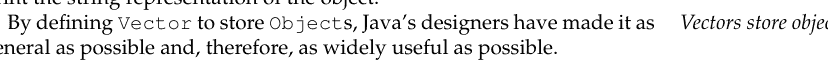

通过定义存储对象，Java 的设计人员使其尽可能通用，因此尽可能有用。

> **Java 有效设计**：以 `Object` 类定义定义数据集合（如数组或 `Vector`），使其能够存储和处理任何类型的值，包括原始数据类型的值。这是因为 `Object` 类是 Java 类层次结构的根节点。

## 9.11 案例研究：N 人电脑游戏

在本节中，我们将利用数组来扩展我们的游戏库，开发一种可以支持超过两名玩家的游戏的设计。我们将使用数组来存储数量数量的玩家。遵循第 8 章描述的面向对象的设计原则，我们将使用继承和多态性来开发一种灵活且可扩展的设计，这种设计可以用于实现各种游戏。在我们第 8 章的 `TwoPlayer` 游戏中，我们的设计将允许人类和计算机一起玩游戏。为了简化示例，我们将修改在第 8 章中开发的 `WordGuess` 游戏。正如你所看到的，将其从 `TwoPlayer` 的子类转换为父类 `ComputerGame` 的子类只需要少少的修改。

### 第 9.11 节 · 案例研究：一个多人计算机游戏

`setPlayer()` 和 `getPlayer()` 方法是变量 `whoseTurn` 的修改器方法和访问器方法。该变量允许用户确定当前轮到谁了，这对于初始化游戏很有用。`changePlayer()` 方法使用默认表达式：

```
whoseTurn = (whoseTurn + 1) % nPlayers
```

来决定轮到谁了。假设玩家编号从 0 到 `nPlayers-1`，这段代码将轮权交给下一个玩家，并在必要时回绕到 0。当然，如果游戏需要其他的游戏顺序，`ComputerGame` 的子类可以重写此方法。

`addPlayer(Player)` 方法用于向游戏添加新的 `Player` 玩家（`Player` 实例），包括 `Player` 的任何子类。该方法假设 `addedPlayers` 已初始化为 0。每当向数组中添加一个新玩家时，该变量就会加 1。对于 `WordGuess` 游戏，我们将向游戏添加类型为 `WordGuesser` 的 `Player`。

`ComputerGame` 的完整源代码见图 9.31。关于此实现有几点值得注意。首先，注意仅在第 8 章的抽象类 `TwoPlayerGame` 的情况下，`gameOver()` 和 `getWinner()` 方法被定义为抽象方法并提供了通用的实现。其意图是子类将重写 `getRules()` 并为抽象方法提供特定于游戏的实现。

```
Exception in thread 'main'
java.lang.ArrayIndexOutOfBoundsException: 2
at ComputerGame.addPlayer(ComputerGame.java:22)
at TwentyOne.main(TwentyOne.java:121)
```

换句话说，添加超过玩家数组容纳数量的玩家是一个错误。在第 11 章中，我们将学习如何设计代码来防止此类问题。

最后，`listPlayers()` 方法的实现（图 9.31）显示玩家数组的声明类型为 `Player`。它们的动态类型是 `WordGuesser`。当调用表达式 `player[k].toString()` 时，将使用动态绑定将此方法绑定到 `WordGuesser` 类中定义的 `toString()` 实现上。因此，通过允许在运行时绑定 `toString()`，我们能够定义一个不知道其将要处理的对象精确类型的方法。

多态的力量在于它赋予我们类层次结构的灵活性和扩展性。如果没有这个特性，我们就无法在父类中定义多态的（此处指）此处的 `listPlayers()` 方法，而是必须在每个子类中都定义它。

### 第 9 章 · 数组与数组处理

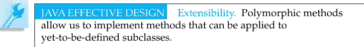

| WordGuess | |
| :--- | :--- |
| secretWord | String boolean |
| currentWord | StringBuffer |
| previousGuesses | StringBuffer |
| guessedLetters | int |
| init() | |
| WordGuess() | |
| WordGuess(players: int) | |
| guessLetter(char ch): | boolean |
| getPreviousGuessed(): | String |
| getCurrentWord(): | String |
| play(UI interface) | |
| gameOver(): | void |
| getWinner(): | String |
| gamePrompt(): | String |
| reportGame(String): | String |
| submitPlayerOver(String): | String |

## 9.11. WordGuess 和 WordGuesser 类

我们假设你熟悉第 8 章中的 `WordGuess` 示例。如果你在继续之前不需要复习该部分，`WordGuess` 是一个玩家轮流通过猜字母来猜单词的游戏。玩家只要猜对字母，就可以一直猜下去。如果猜错了，就轮到下一个玩家。游戏的获胜者是猜出最后一个字母并识别出单词的玩家。这是 WordGuess 类的概述。如果你将其与第 8 章使用的设计进行比较，方法和实例变量增加了一个构造函数 `WordGuess(int)` 和一个 `init()` 方法。该方法接受一个代表玩家数量的整数参数。默认构造函数假设有一个玩家。当然，这个版本的 `WordGuess` 继承自 `GameOver` 类，而不是 `TwoPlayerGame` 类。两个构造函数都调用 `init()` 来初始化

图 9.32. WordGuess 类。

```java
public WordGuess() { super(1); init(); }

public WordGuesser(int m) { super(m); init(); }

public void init() {

  secretWord = getSecretWord();

currentWord = new StringBuilder(secretWord);

  previousGuesses = new StringBuilder(secretWord);

  for (int k = 0; k < secretWord.length(); k++) {

    currentWord.setCharAt(k, '?');

  }

  unguessedLetters = secretWord.length();

}
```

将 `WordGuess` 转换为多人游戏唯一需要的更改是重写它的 `play()` 方法。因为新的 `play()` 方法使用了继承自 `ComputerGame` 类的功能，

### 第 9.11 节 · 案例研究：一个多人计算机游戏 435

它实际上比第 8 章版本中的 `play()` 方法简单得多：

```java
public void play(UserInterface ui) {

    ui.report(getRules());

    ui.report(listPlayers());

    ui.report(reportState());

while (gameOver()) {

    WordGuesser p = (WordGuesser)player[whoseTurn];

    if (p.isComputer()) {

        // ...逻辑基于上下文
```

`play()` 方法首先显示规则并列出玩家。`listPlayers()` 方法继承自 `ComputerGame`。在显示当前状态后，方法进入循环。在循环的每次迭代中，选择一个玩家：

```
WordGuesser p = (WordGuesser)player[whoseTurn];
```

使用 `(WordGuesser)` 转换为 `WordGuesser` 使代码更具可读性。由于 `p` 是 `WordGuesser`，我们可以直接引用它的 `isComputer()` 方法。如果玩家是计算机，我们提示它移动，然后报告结果。这都在一个语句中完成：

```
ui.report(p.makeMove());
```

如果玩家是人类，我们提示玩家并使用 `Keyboard` 的 `getInputStream()` 读取用户的移动。我们提交移动并报告结果。循环结束后，我们报告游戏状态。

436

第 9 章 · 数组与数组处理

以下代码段说明了由此 `play()` 方法产生的一部分交互：

| Player | |
| :--- | :--- |
| COMPUTER | int = 0 |
| HUMAN | int = 1 |
| id | int |
| kind | int |
| Player() | |
| Player(id: int, kind: int) | |
| setID(id: int) | |
| getID() | |
| setKind(kind: int) | |
| getKind() | |
| isComputer() | boolean |
| makeAMove(s: String) | String |

```
Current word ??? GLE

Player 0 guesses next. Sorry, Y is not a new letter in the word

current word ??? GLEY

Player 1 guesses next. Sorry, H is not a new letter in the word

Current word ??? GLEYH

Player 2 guesses next: a

Guess that you think is in the word: Yes, the letter A is in the word
```

在这个设计中，玩家 0 和 1 是计算机，玩家 2 是人类。图 (9.33)。`WordGuesser` 类本身没有其他更改：

| WordGuesser | |
| :--- | :--- |
| WordGuesser(g: WordGuesser) | |
| WordGuesser(g: WordGuesser, id: int, kind: int) | |
| makeAMove(s: String) | String |
| toString() | String |

图 9.33: WordGuesser 类继承自 Player。

### 第 11 节 基于 GUI 的游戏

通过这些方法，即使是不够经验的程序员也能创建相对复杂且复杂的计算机游戏。

> Java 有效设计 代码复用。通过扩展类和实现接口来复用库，可以让创建复杂的应用程序变得简单得多。

最后，以下 `main()` 方法在命令行用户界面 (CLUI) 中实例化并运行了 `WordGuess` 游戏的一个实例：

```java
public static void main(String[] args) {

    KeyboardReader kb = new KeyboardReader();

    ComputerGame game = new WordGuess(3);

    game.addPlayer(new WordGuess((WordGuess)game, 0, Player_HUMAN));

    game.addPlayer(new WordGuess((WordGuess)game, 1, Player_COMPUTER));

    game.addPlayer(new WordGuess((WordGuess)game, 2, Player_COMPUTER));

    ((CLUIPlayableGame)game).play(kb);

} // main()
```


在这个示例中，我们创建了三个玩家游戏，其中两个玩家是计算机。注意我们如何创建一个新的 `WordGuess`，传入游戏自身的引用、其识别码以及其类型（`HUMAN` 或 `COMPUTER`）。要运行游戏，我们调用它的 `play()` 方法。你现在已经了解面向对象的设计原则，可以识别出在此语境下的 `play()` 是多态的一个示例。

## 9.12 基于 GUI 的游戏（可选图形）

大多数现代游戏并不使用命令行界面。本节通过扩展我们的 `ComputerGame` 层次结构来解决这一缺陷，使其既能适用于图形用户界面 (GUI)，也能适用于命令行用户界面 (CLUI)。

滑块益谜是一种游戏。它由一个玩家（人类）玩。谜题由排列在棋板上的六块方块组成，板上有七个空格。初始时，方块为 `RRR.LLL`。换句话说，R 块排列在 L 块的左侧，空白处位于中间。该游戏的目标是将方块重新排列为 `LLL.RRR`。规则是标记为 L 的方块只能向右移动。方块可以直接移动到空白处或跳过一个方块进入空白处。

我们在本节的目的是开发一个可以玩此游戏的 GUI。图 9.35 显示了一个合适的 GUI。在这里，方块和空白处由按钮数组表示。要移动，用户点击他想要移动的“方块”。GUI 假设用户想要将该方块移动到空白处。如果提议的操作是合法的，GUI 将执行该移动。否则，它将忽略它。例如，如果用户点击左侧的 R 按钮（这是一个合法的移动），GUI 将重新排列按钮上的标签，使其新配置变为 `RR_LLL`。另一方面，如果用户点击 L 按钮，GUI 将忽略那次移动，因为它是非法的。

### 9.12.1 GUIPlayable 接口

我们如何扩展游戏运行层次结构以适应基于 GUI 的游戏呢？正如我们在第 4 章中学习的，基于 GUI 的应用程序与基于 CLUI 的应用程序之间的区别之一是控制位置。在基于 CLUI 的应用程序中，控制权位于计算对象中，即游戏对象。这就是为什么我们基于 CLUI 的游戏中的 `play()` 包含了游戏循环。在基于 GUI 的应用程序中，控制权位于 GUI 的事件循环中。这就是为什么我们在第 4 章学习了管理游戏的事件层次结构。因此，图 9.5 所示的 GUI将在用户点击其中项目之一时监听并采取行动。

然而，由于控制权位于 GUI 中，因此 GUI 和游戏对象之间仍需要通信。在基于 CLUI 的游戏中，我们使用 `CLUIPlayableGame` 接口来管理游戏与用户界面之间的通信。因此，在这种情况下我们将设计类似的策略，该策略可以通过任何使用 GUI 的游戏实现（图 9.6）。

### 9.12.3 SlidingGUI 类

让我们来实现一个可以用于玩数字推盘益游戏的 GUI。我们将按照第 4 章中设计的方式对 GUI 本身建模。作为 `ActionListener` 接口的实现，`SlidingGUI` 实现了 `actionPerformed()` 方法，这是控制拼图代码所在的位置。主要数据结构是一个 `JButtons` 数组，用于重新排列拼图中的七块瓷砖。按钮的标签将反映拼图的状态。在我们每次进行移动后，这些标签都会被重新排列。重置按钮用于随机化游戏，这允许用户在卡住时重新开始或结束。

`puzzleState` 变量持有当前状态，每当 `SlidingTilePuzzle` 通过调用 `reportState()` 移动时，该状态就会更新。私有方法 `labelButtons()` 会读取 `puzzleState` 并使用它来设置 GUI 按钮的标签。

`SlidingGUI` 的实现如图 9.40 所示。它的构造函数和 `buildGUI()` 方法负责设置 GUI。我们在 `buildGUI()` 中使用 `for` 循环来创建 `JButtons`，并将每个按钮与一个 `ActionListener` 关联，然后将它们添加到 GUI 中。除了我们可以任意数量的按钮外，这与第 4 章创建的 GUI 非常相似。回想，将 `ActionListener` 与按钮关联允许我们能够在其 `actionPerformed()` 方法中响应按钮点击。

注意构造函数中是如何创建 `SlidingTilePuzzle` 的，以及它的状态是如何被检索并存储在 `puzzleState` 变量中的。

```java
puzzleState = sliding.reportState();
```

`labelButtons()` 方法将 `puzzleState` 中的标签传输到按钮。GUI 中最重要的方法是 `actionPerformed()` 方法。该方法控制 GUI 的动作，每当 GUI 的任意按钮被点击时，就会自动调用。首先，我们检查重置按钮是否被点击。如果是，我们通过创建一个 `SlidingTilePuzzle` 的新实例并重新初始化提示标签来重置拼图。

接下来，我们使用 `for` 循环来检查哪个按钮被点击了。如果是，我们使用循环索引 `k` 作为瓷砖的标识，并将其提交用户的移动：

```java
if (e.getSource() == tile[k])
    result = ((GUIPlayableGame)sliding).submitUserMove("--" + k);
```

强制转换操作是必要的，因为我们将 `sliding` 声明为 `SlidingTilePuzzle` 而不是 `GUIPlayableGame`。注意在将其传递给 `submitUserMove()` 时，我们需要将 `k` 转换为 `String`。

由于此方法的调用，拼图返回一个结果，并检查用户的移动是否非法。如果 `result` 包含“illegal”单词，计算机将蜂响以信号错误：

```java
if (result.indexOf("illegal") != -1)
    java.awt.Toolkit.getDefaultToolkit().beep();
```

`java.awt.Toolkit` 是包含许多有用方法的类，包括 `beep()` 方法。注意无论执行什么操作（重置或点击按钮），我们都会通过调用 `reportState()` 使用 `puzzleState` 并用它来重新加载瓷砖按钮。`actionPerformed()` 方法的最后一个任务是调用拼图的 `gameOver()` 方法来检查用户是否成功完成了拼图。如果是，我们在 GUI 窗口中显示一条祝贺消息。

最后，GUI 的 `main()` 方法非常简单，只包含了一行代码：

```java
new SlidingGUI("Sliding Tile Puzzle");
```

一旦创建了标题为“Sliding Tile Puzzle”的 `SlidingGUI`，它将打开一个窗口并管理拼图的控制。

## 章节总结

## 技术术语

| 数组 | 插入排序 | 顺序查找 |
| :--- | :--- | :--- |
| 数组 | 多维 | 排序 |
| 初始化器 | 数组 | 下标 |
| 数组长度 | 一维 | 二维 |
| 二分查找 | 数组 | 数组 |
| 数据结构 | 多态排序 | |
| 元素 | 方法 | |
| 元素类型 | 选择排序 | |

## 重点要点总结

- 数组是连续存储位置的命名集合，每个位置存储一个相同数据类型的数据项。数组的每个元素通过下标引用——即通过它在数组中的位置引用。如果数组包含 N 个元素，那么它的长度为 N，索引为 0, ..., N-1，使用以下下标符号 `arrayname[subscript]` 引用，其中 `arrayname` 是任何有效标识符，`subscript` 是 0 到 `arrayname.length - 1` 范围内的整数值。数组的长度实例变量可以作为处理数组的循环的边界。

## 第 9 章 • 自学练习解答

- 数组声明提供了数组的名称和类型。实例化使用关键字 `new` 并导致编译器为数组分配内存：

```java
int arr[]; // 声明一个一维数组
arr = new int[15]; // 为其分配 15 个位置
```

- 多维数组有其各个组件：

```java
int twoD[][]; // 声明一个二维数组变量
twoD = new int[10][15]; // 分配 150 个位置
```

- 数组的值必须通过为每个数组位置赋值来初始化。初始化器可以作为数组声明的一部分包含。
- 插入排序和选择排序是排序算法的示例。两者都需要多次遍历。
- 当数组作为参数传递给方法时，传递的是数组的引用而不是数组本身。
- 交换数组的两个元素使用一个临时变量。
- 顺序查找和二分查找是查找的示例。
- 对于多维数组，每个维度都有自己的长度。
- 继承和多态是开发的有用特性。

- SOLUTION 9.1 数组声明提供了数组的名称和类型。实例化使用关键字 `new` 并导致编译器为数组分配内存：

```java
int arr[]; // 声明一个一维数组
arr = new int[15]; // 为其分配 15 个位置
```

- SOLUTION 9.2 多维数组有其各个组件：

```java
int twoD[][]; // 声明一个二维数组变量
twoD = new int[10][15]; // 分配 150 个位置
```

- SOLUTION 9.3 数组的值必须通过为每个数组位置赋值来初始化。初始化器可以作为数组声明的一部分。
- SOLUTION 9.4 插入排序和选择排序是排序算法的示例。两者都需要多次遍历。
- SOLUTION 9.5 当数组作为参数传递给方法时，传递的是数组的引用而不是数组本身。
- SOLUTION 9.6 交换数组的两个元素使用一个临时变量。
- SOLUTION 9.7 顺序查找和二分查找是查找的示例。
- SOLUTION 9.8 对于多维数组，每个维度都有自己的长度。
- SOLUTION 9.9 继承和多态是开发的有用特性。
- SOLUTION 9.10 数组声明提供了数组的名称和类型。实例化使用关键字 `new` 并导致编译器为数组分配内存：

```java
int arr[]; // 声明一个一维数组
arr = new int[15]; // 为其分配 15 个位置
```

- SOLUTION 9.11 多维数组有其各个组件：

```java
int twoD[][]; // 声明一个二维数组变量
twoD = new int[10][15]; // 分配 150 个位置
```

- SOLUTION 9.12 数组的值必须通过为每个数组位置赋值来初始化。初始化器可以作为数组声明的一部分。
- SOLUTION 9.13 插入排序和选择排序是排序算法的示例。两者都需要多次遍历。
- SOLUTION 9.14 当数组作为参数传递给方法时，传递的是数组的引用而不是数组本身。
- SOLUTION 9.15 交换数组的两个元素使用一个临时变量。
- SOLUTION 9.16 顺序查找和二分查找是查找的示例。
- SOLUTION 9.17 对于多维数组，每个维度都有自己的长度。
- SOLUTION 9.18 继承和多态是开发的有用特性。

# 第 9 章 • 自学练习答案

SOLUTION 9.9 使用选择排序排序 24 18 90 1 0 85 34 18。

```
24 18 90 1 0 85 34 18 // 初始
0 18 90 1 24 85 34 18 // 第1轮
0 1 90 24 85 34 18 // 第2轮
0 1 18 90 24 85 34 18 // 第3轮
0 1 18 24 85 34 90 // 第4轮
0 1 18 24 85 34 90 // 第5轮
0 1 18 24 34 85 90 // 第6轮
0 1 18 24 34 85 90 // 第7轮
```

SOLUTION 9.10 交换两个 Student 对象的代码。

```java
Student tempStud = student1;
student1 = student2;
student2 = tempStud;
```

SOLUTION 9.11 selectionSort() 的实现。

```java
public void selectionSort(int arr[]) {
    int smallest; // 最小值的索引
    for (int k = 0; k < arr.length-1; k++) {
        smallest = k;
        for (int j = k+1; j < arr.length; j++) {
            if (arr[j] < arr[smallest])
                smallest = j;
        }
        if (smallest != k) { // 将最小值与 kth 交换
            int temp = arr[smallest];
            arr[smallest] = arr[k];
            arr[k] = temp;
        }
    } // 外层 for 循环
} // selectionSort()
```

SOLUTION 9.12 执行 mystery(myArr,k) 后，myArr 将返回 1,2,3,5,6 k 将存储 3。

SOLUTION 9.13 在 2, 4, 6, 8, 10, 12, 14, 16, 18, 20, 22, 24, 26, 28 中查找 21 的二分查找轨迹：

| 键迭代 | 低 | 高 | 中 | |
|---|---|---|---|---|
| 21 | 0 | 13 | 6 | |
| 21 | 1 | 7 | 10 | |
| 21 | 2 | 7 | 8 | |
| 21 | 3 | 9 | 9 | |
| 21 | 4 | 10 | 9 | 失败 |

SOLUTION 9.14 一个 5 行 10 列整数的二维数组。

```java
int int2d[5][10];
```

# 第 9 章 • 数组与处理

SOLUTION 9.15 打印 int2d 第三行的最后一个整数并赋值 100。

```java
System.out.println(int2d[2][9]);
int2d[4][9] = 100;
```

SOLUTION 9.16 打印 int2d 的所有元素。

```java
for (int k = 0; k < int2d.length; k++) {
    for (int j = 0; j < int2d[k].length; j++) {
        System.out.print(int2d[k][j] + " ");
    }
    System.out.println(); // 换行
}
```

SOLUTION 9.17 52 × 7 的 int 二维数组。

```java
int sales[][] = new int[52][7];
for (int k = 0; k < sales.length; k++) {
    for (int j = 0; j < sales[k].length; j++) {
        sales[k][j] = 0;
    }
}
```

SOLUTION 9.18 计算每周平均数量的方法。

```java
double avgWeekly(int arr[][]) {
    double total = 0;
    for (int k = 0; k < arr.length; k++) {
        for (int j = 0; j < arr[k].length; j++) {
            total += arr[k][j];
        }
    }
    return total/52;
}
```

SOLUTION 9.19 计算周日平均数量的方法。

```java
double avgSunday(int arr[][]) {
    double total = 0;
    for (int k = 0; k < arr.length; k++) {
        total += arr[k][6];
    }
    return total/52;
}
```

# 第 9 章 • 练习

SOLUTION 9.20 LetterFreq 的 compareTo()。

```java
public int compareTo(Object lf) {
    LetterFreq letFreq = (LetterFreq)lf;
    if (freq < letFreq.getFreq())
        return -1;
    else if (freq > letFreq.getFreq())
        return +1;
    else return 0; // 频率相等
}
// compareTo
```

SOLUTION 9.21 AnalyzeFreq 的 sort()。

```java
public void sort(int[] sortArr) {
    java.util.Arrays.sort(sortArr);
}
```

SOLUTION 9.22 一个使用了 sort() 的 AnalyzeFreq.main()。

```java
public static void main(String[] argv) {
    AnalyzeFreq af = new AnalyzeFreq();
    af.countLetters("New is the time for study.");
    af.sort();
    af.printArray();
}
```


# 练习 9.1
说明以下术语之间的区别：
- 数组（`array`）与元素（`element`）。
- 下标（`subscript`）与数组（`array`）。
- 一维数组与二维数组。
- 数组与向量（`vector`）。
- 插入排序与选择排序。
- 二分查找与顺序查找。

# 练习 9.2
填空：
- 将数组元素排列成特定顺序的过程称为 ________。
- 二分查找的前提条件之一是数组必须是 ________ 元素集合。
- ________ 类似于数组，但它可以动态增长。
- 对于数组，其 ________ 由一个实例变量表示。
- 用于给数组赋值的表达式被称为 ________。
- 一个 ______ 是数组的数组。
- 用于对不同类型数据进行排序的 `sort` 方法被称为 ______。
- 实例化数组必须使用 ______ 运算符。
- 对象数组存储了 ____。

# 练习 9.3
编写以下每个声明：
- 4 x 4 的 `double` 数组。
- 20 x 5 的 `String` 数组。
- 3 x 4 的 `char` 数组，初始化为 `""`
- 2 x 3 的 `boolean` 数组，初始化为 `true`。
- 3 x 3 的 `Student` 数组。
- 2 x 3 的 `String` 数组，初始化为 `"one","two"` 等。

# 练习 9.4
识别并修正以下表达式中的语法错误：
- `int arr = new int[15];`
- `int arr[] = new int(15);`
- `float arr[] = new float[3];`
- `float arr[] = new float {1.0,2.0,0.3,0.0};`
- `int arr[][] = {1.1,2.2,3.3,3.3};`
- `int arr[][] = new double[5][4];`
- `int arr[][] = { {1,1,2,2}, {3,3,1} };`

# 练习 9.5
求值以下每个表达式，某些可能是错误的：
```java
int arr[] = { 2, 4, 6, 8, 10 };
```
- `arr[4]`
- `arr.length`
- `arr[0]`
- `arr.length / 2`
- `arr[1]`
- `arr[5 % 2]`
- `arr[arr[0]]`
- `arr[5 / 2]`
- `arr[1 + (Math.random())]`
- `arr[arr[3] / 2]`

# 练习 9.6
以下代码段会输出什么：
```java
int arr[] = { 24, 0, 19, 21, 6, -5, 10, 16 };

for (int k = 0; k < arr.length; k += 2)
    System.out.println(arr[k]);
```

# 练习 9.7
下列代码段会输出什么：
```java
int arr[][] = { {24, 0, 19}, {21, 6, -5}, {10, -1, 0} };

for (int j = 0; j < arr.length; j++)
    for (int k = 0; k < arr[j].length; k++)
        System.out.println(arr[j][k]);
```
（等待，此处有一个图片链接，根据需要我会保留，但重点是文本）。

# 练习 9.8
下列代码段会输出什么：
```java
int arr[][] = { {24, 0, 19}, {21, 6, -5}, {10, 16, 3},
                {1, -1, 0} };

for (int j = 0; j < arr[0].length; j++)
    for (int k = 0; k < arr[j].length; k++)
        System.out.println(arr[k][j]);
```

# 练习 9.9
用于交换 `int` 变量 `n1` 和 `n2` 值的以下代码段有什么问题？
```java
int temp = n1;
n2 = n1;
n1 = temp;
```

# 练习 9.10
解释为什么以下代码段没有交换 `int` 变量的值？考虑值和引用的区别。
```java
public void swap(int n1, int n2) {
    int temp = n1;
    n1 = n2;
    n2 = temp;
}
```

# 练习 9.11
声明并初始化数组存储以下表格：
| 1 | 2 | 3 | 4 |
| 5 | 6 | 7 | 8 |
| 9 | 10 | 11 | 12 |

# 练习 9.12
对于上一个练习中创建的二维数组，编写一个嵌套循环按列而不是行打印值。

# 练习 9.13
定义一个适用于以下内容的数组：
- a. 2000 个学生。
- b. 长度和宽度。
- c. 日测量量。
- d. 井棋游戏。
- e. 姓名和首都。

# 练习 9.14
编写一个代码段，计算数组所有元素的总和。

# 练习 9.15
编写一个代码段，计算二维数组之和。

# 练习 9.16
编写一个方法，计算二维数组的平均值。

# 练习 9.17
编写一个接受两个参数（`int` 数组和整数）的方法，返回大于等于第二个参数的最后一个元素的位置。

# 练习 9.18
编写一个程序，测试用户输入的 3x3 数组是否为魔方。魔方是一个 N×N 的矩阵，其中从 1 到 N^2 的每个数字必须出现一次，且每行、每列和对角线的和相等——例如：
| 6 | 7 | 2 |
| 1 | 5 | 9 |
| 8 | 3 | 4 |

# 练习 9.19
修订上一个练习中的程序，允许用户输入数组的维度，最高为 4×4。

# 练习 9.20
修改 `AnalyzeFreq` 程序，使其能够显示最高 10 次和最低 10 频率的相对频率。

# 练习 9.21
`merge` 排序算法接收两个已排序的数据集合并将其合并。编写一个接受两个 25 元素数组的程序，对它们进行排序并按顺序合并成一个 50 元素的数组。

# 练习 9.22
挑战：设计并实现一个 `BigInteger` 类，可以加减多达 25 位数字的整数。你的类还应该包括数字的输入和输出方法。如果你非常有野心，包含乘和除法的方法。

# 练习 9.23
挑战：为此问题设计一个数据结构：作为 Computer Warehouse 的经理，你想跟踪拥有常规账户的人的购买量。账户从 0, 1, ..., N 编号。问题是，你不知道每个账户会有多少次购买。有些可能有一次或两次购买。另一些可能有 50 次购买。

# 练习 9.24
字母位词是通过重新排列另一个单词的字母形成的单词。例如，`act` 是 `cat` 的字母位词，`agility` 是 `alley` 的字母位词。编写一个接受两个单词作为输入并判断它们是否为字母位词的程序。

# 练习 9.25
挑战：字母位词字典是将单词与其字母位词组织的。编写一个程序让用户输入最多 100 个单词（在 `TextField` 中）。在输入每个单词后，程序应该显示（在 `TextArea` 中）已用单词的完整字母位词字典。这里用户输入的单词是：*felt, left, cat, act, opt, pot, top.*
```
act: act cat
eft: felt left
opt: opt pot top
```

# 第9章 • 练习 451

## 练习 9.26
Acme 运输公司聘请你编写一个软件来帮助其调度卡车。该软件的一个重要元素是获知任意两个城市之间的距离，并将这些城市之间的距离存储在一个二维数组中。该类需要某种方法将城市名称（例如，“博伊西” [Boise]）映射成一个可以作为数组下标的整数。该类还应该包含一些便于查找两个城市之间距离的方法。另一个有用的方法可以告诉用户距离给定城市最近的城市。

## 练习 9.27
重写 `WordGuesser` 示例的 `main()` 方法，使其允许用户输入玩家人数以及每个玩家是计算机还是人类。使用 `KeyboardReader` 实现。

## 练习 9.28
编写一个更智能的 `WordGuesser` 类版本，它能“知道”英语中哪些字母出现频率最高。提示：与其使用随机猜测，不如按频率递减的顺序将玩家的猜测存储在一个字符串中：“ETAONRISHLGCMFBDGPUJKVWXYZ”。

## 练习 9.29
编写一个 `SlidingTilePuzzle` 的命令行界面（CLI）版本。你需要对 `SlidingTilePuzzle` 类进行修改。

```java
public class TestSort {
    public static int MAXSIZE = 25;
}
```

```java
public void sort(Comparable[] arr) {
    Comparable temp; // 用于插入的临时变量
    for (int k = 1; k < arr.length; k++) { // 对于每个元素
        temp = arr[k]; // 将其向右移动
        int i;
        for (i = k - 1; i >= 0 && arr[i].compareTo(temp) > 0; i--) {
            arr[i + 1] = arr[i]; // 将较大的向左移动
        }
        arr[i + 1] = temp; // 插入元素
    }
}
```

```java
// 使用相同的方法对不同类型的数组
public static void main(String args[]) {
    Integer iArr[] = new Integer[TestSort.MAXSIZE];
    Float fArr[] = new Float[TestSort.MAXSIZE];
    for (int k = 0; k < MAXSIZE; k++) { // 创建数据
        iArr[k] = new Integer((int) (Math.random() * 10000));
        fArr[k] = new Float(Math.random() * 10000);
    }
    TestSort test = new TestSort();
    test.sort(iArr); // 排序并打印整数
    test.print(iArr);
    test.sort(fArr); // 排序并打印浮点数
    test.print(fArr);
}
```
图 9.26：TestSort 使用多态方法排序整数或浮点数。

```java
import java.util.Vector;

public class VectorDemo {
    public static void printVector(Vector v) {
        for (int k = 0; k < v.size(); k++) {
            System.out.println(v.elementAt(k).toString());
        } // printVector()
    }

    public static void main(String args[]) {
        Vector vector = new Vector(); // 一个空的 vector
        int bound = (int) (Math.random() + 20);
        for (int k = 0; k < bound; k++) // 插入一个随机
            vector.addElement(new Integer(k)); // 整数数量
        printVector(vector); // 打印元素
    } // main()
} // VectorDemo
```
图 9.28：Vector 类的演示。

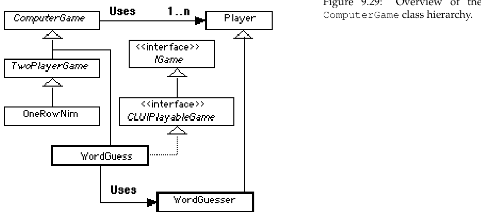

```java
public abstract class ComputerGame {
    protected int nPlayers;
    protected int addedPlayers = 0;
    protected int whoseTurn;
    protected Player player[]; // 玩家数组

    public ComputerGame() {
        nPlayers = 1; // 默认：1人游戏
        player = new Player[1];
    }

    public ComputerGame(int n) {
        nPlayers = n;
        player = new Player[n]; // N人游戏
    }

    public void setPlayer(int starter) {
        whoseTurn = starter;
    }

    public int getPlayer() {
        return whoseTurn;
    }

    public void addPlayer(Player p) {
        player[addedPlayers] = p;
        ++addedPlayers;
    }

    public void changePlayer() {
        whoseTurn = (whoseTurn + 1) % nPlayers;
    }

    public String getRules() {
        return "这个游戏的规则是：";
    }

    public String listPlayers() {
        StringBuilder result = new StringBuilder("\n玩家有:\n");
        for (int k = 0; k < nPlayers; k++) {
            result.append("Player" + k + " " + player[k].toString() + "\n");
        }
        result.append("\n");
        return result.toString();
    }

    public abstract boolean gameOver(); // 抽象
    public abstract String getWinner(); // 方法
} // ComputerGame
```
图 9.31：ComputerGame 类的实现。

```java
public abstract class Player {
    public static final int COMPUTER = 0;
    public static final int HUMAN = 1;
    protected int id = -1; // id 在 0 到 nPlayers-1 之间
    protected int kind = HUMAN; // 默认是
    public Player() { }
    public Player(int id, int kind) {
        this.id = id;
        this.kind = kind;
    }
    public void setId(int k) { id = k; }
    public int getId() { return id; }
    public void setKind(int k) { kind = k; }
    public int getKind() { return kind; }
    public boolean isComputer() { return kind == COMPUTER; }
    public abstract String makeMove(String prompt);
} //
```
图 9.34：Player 类的实现。


图 9.35：滑块游戏（Sliding Tile Puzzle）。

# 第 9章 • 数组处理

```java
public class SlidingTilePuzzle extends ComputerGame {
    private int[] board;
    private int size;

    public SlidingTilePuzzle(int size) {
        this.size = size;
        board = new int[size * size];
    }
    // ... 其他实现方法
}
```


# 第10章 异常：当程序出现问题时

## 目标

学习完本章后，你将：

- 理解 Java 的异常处理机制。
- 能够使用 Java 的 `try/catch` 语句。
- 了解如何设计有效的异常处理器。
- 体会异常处理在程序设计中的重要性。
- 能够设计自己的 `Exception` 子类。

## 大纲

- 10.1 引言
- 10.2 处理异常情况
- 10.3 Java 的异常层次结构
- 10.4 在程序内部处理异常
- 10.5 错误处理与健壮的程序设计
- 10.6 创建你自己的异常
- 10.7 来自 Java 库：`javax.swing.JOptionPane`
- 章总结
- 自习题答案
- 练习题

## 10.1 引言

错误在所难免。犯错是常态而非例外。这并不是说我们犯错的频率比正确的频率高，而是说（几乎）我们所做或构建的任何东西都不可能是完美的，计算机软件更是如此。无论程序设计得有多完美，在执行过程中都始终可能出现某些错误。

异常是程序运行时产生的错误状态或异常状态。我们在书中讨论过的状态示例包括：尝试除以 0（算术异常）、在期望整数时读取小数值（数字格式异常）、尝试向一个不存在的文件写入内容（I/O 异常），或在字符串中引用不存在的字符（索引越界异常）。潜在错误和异常的列表是无穷无尽的。

一个设计良好的程序应该包含用于防止错误和其他异常情况的代码。这些代码应该从开发的最早阶段开始就整合到程序中。这样可以帮助在开发期间识别错误。在 Java 中，处理此类情况的首选方法是使用异常处理，这是一种分治法，它将程序的正常代码与错误处理代码分离。

本章描述了 Java 的异常处理特性。我们首先对比了程序内部处理错误的传统方法与 Java 默认异常处理机制。我们展示了异常在程序中是如何抛出（throw）和处理（catch）的，并识别了适用于不同类型异常的规则。然后，我们关注了在程序中使用异常的时间、地点和方式的某些关键设计问题。最后，我们展示了如何设计和实现自己的 `Exception` 子类。

## 10.2 处理异常情况

为了向你介绍如何处理异常情况，图 10.1 显示了一个计算前 N 个整数平均值的方法，并带有一个冗余的示例。我们用它来说明异常处理中的基本概念。正如方法名所示，`avgFirstN()` 方法期望 N 大于 0。如果 N 恰好为 0，表达式 `sum/N` 将发生错误，因为你不能将整数除以 0。

```java
/*
 * 前置条件：N > 0
 * 后置条件：avgFirstN(N) = (1+2+...+N)/N
 */
public double avgFirstN(int N) {
    int sum = 0;
    for (int k = 1; k <= N; k++)
        sum += k;
    return sum/N; // 如果 N 是 0 怎么办？
} // avgFirstN(N)
```

图 10.1：设计拙劣。没有尝试防止除以零的错误。

### 10.2.1 传统的错误处理

显然，图 10.1 中的方法不应该简单地忽略 N 可能为 0 的可能性。图 10.2 显示了该方法的修订版本，其中包含了在方法的前置条件失败时采取行动的代码。由于无法计算 0 个元素的平均值，修订后的方法决定中止程序。中止程序似乎比返回 0 或其他默认值（如 -1）作为方法的结果要好，后者将允许一个错误值扩散到整个程序，从而导致错误恶化。

```java
/*
 * 前置条件：N > 0
 * 后置条件：avgFirstN(int) 等于 (1+2+...+N) 除以 N
 */
public double avgFirstN(int N) {
    int sum = 0;
    if (N <= 0) {
        System.out.println("ERROR avgFirstN: N <= 0. Program terminating.");
        System.exit(0);
    }
    for (int k = 1; k <= N; k++) {
        sum += k;
    }
    return sum/N; // 如果 N 是 0 怎么办？
} // avgFirstN(N)
```

图 10.2：处理除以零错误的一种方法可能是：如果尝试除以 0，则终止程序，假设它是一类可以安全中止的程序。这个版本没有使用异常处理。

> **JAVA 设计：不可修复的错误。** 如果检测到不可修复的错误，正常终止程序比让它在整个程序中传播要好得多。

修订后的 `avgFirstN()` 方法采用了传统的处理方法：错误处理代码直接构建在算法中。如果当调用 `avgFirstN()` 时 N 恰好为 0，输出将是：

```text
ERROR avgFirstN: N <= 0. Program terminating.
```

```java
public class CalcAverage {
    public double avgFirstN(int N) {
        int sum = 0;
        for (int k = 1; k <= N; k++) {
            sum += k;
        }
        return sum/N; // 如果 N 是 0 ？
    } // avgFirstN
}

public class CalcAvgTest {
    public static void main(String[] args) {
        CalcAverage ca = new CalcAverage();
        System.out.println("AVG " + ca.avgFirstN(0));
    }
} // CalcAvgTest
```

图 10.3：注意图中定义了两个公共类，它们将分别保存在不同的文件中。

为了检测和处理常见错误，Java 在语言中引入了异常处理模型。为了看到这一点，请考虑图 10.3 中的程序。当虚拟机（JVM）检测到错误时，它将中止程序并打印以下消息：

```text
Exception in thread "main"
java.lang.ArithmeticException: / by zero
at CalcAverage.avgFirstN(CalcAverage.java:7)
at CalcAvgTest.main(CalcAvgTest.java:4)
```

错误消息描述了错误，并提供了从最后到第一个导致错误的方法调用轨迹。该轨迹显示错误发生在 `CalcAverage.avgFirstN()` 中，该方法是由 `CalcAvgTest.main()` 调用的。

## 10.3 Java 的异常层次结构

类库包含许多预定义异常，其中一些如图 10.4 所示。异常的最通用类型 `java.lang.Exception` 位于 `java.lang` 包中，但它的大多数子类位于其他包中。`IOException` 类位于 `java.io` 包，而另一些位于 `java.net` 包。通常，异常类放置在包含抛出异常方法的包中。

图 10.4：Java 异常层次的一部分。所有 `RuntimeException` 子类都是未检查异常。Java 程序不需要捕获这些异常。

图 10.4 中的每个类识别了一种特定类型的异常，且每个都是 `Exception` 类的子类。显然，子类比其父类定义了更具体的异常。因此，`ArrayOutOfBoundsException` 和 `StringIndexOutOfBoundsException` 都比 `IndexOutOfBoundsException` 更具体。

表 10.1 某些 Java 异常。

| 类 | 描述 |
| --- | --- |
| `ArithmeticException` | 除以 0 或其他算术问题 |
| `ArrayIndexOutOfBoundsException` | 索引小于 0 或大于或等于数组长度 |
| `FileNotFoundException` | 引用找不到的文件 |
| `IllegalArgumentException` | 使用不当的参数调用方法 |
| `IndexOutOfBoundsException` | 数组或字符串越界 |
| `NullPointerException` | 引用未实例化的对象 |
| `NumberFormatException` | 使用无效的数字格式，例如在调用方法时 |
| `StringIndexOutOfBoundsException` | 字符串索引小于 0 或大于或等于字符串长度 |

表 10.1 给出了一些重要异常的摘要。你无疑遇到过这些异常中的大部分，因为它们是由我们在编程示例中反复使用的方法抛出的。表 10.2 总结了我们最常用的某些方法所抛出的异常。

表 10.2 按方法分类的一些 Java 重要异常。

| 类 | 方法 | 异常 | 描述 |
|---|---|---|---|
| `Double` | `valueOf(String)` | `NumberFormatException` | 字符串不是 double |
| `Integer` | `parseInt(String)` | `NumberFormatException` | 字符串不是 int |
| `String` | `String(String)` | `NullPointerException` | 字符串为 null |
| | `indexOf(String)` | `NullPointerException` | 字符串为 null |
| | `lastIndexOf(String)` | `NullPointerException` | 字符串为 null |
| | `charAt(int)` | `StringIndexOutOfBoundsException` | int 不是有效的索引 |
| | `substring(int)` | `StringIndexOutOfBoundsException` | int 不是有效的索引 |

### 10.3.1 检查异常与非检查异常

Java 的异常层次结构分为两类异常。检查异常（Checked exception）是可以被 Java 编译器分析的异常。检查异常由如 `BufferedReader.readLine()` 等方法抛出，这些方法很有可能出现问题。当编译器遇到这些异常时，它会决定程序是处理该异常还是声明异常。对这些异常的编译时检查旨在减少程序中未被妥善处理的异常数量。这提高了 Java 程序的安全性。

> **JAVA 语言规则：检查异常。** 检查异常（如 `IOException`）必须在程序中被处理或声明。

#### The `throws` 子句

我们在第 4 章中遇到的 `IOException` 是一个检查异常。Java 编译器知道 `readLine()` 是一个可能会抛出 `IOException` 的方法。包含可能抛出检查异常表达式的方法如果可能抛出检查异常，则要么处理该异常，要么声明它。否则，编译器将生成语法错误。避免语法错误的最简单方法是声明异常，在本例中，这意味着在方法头中指定 `throws` 异常。

通常情况下，任何包含可能抛出检查异常表达式的方法都必须声明该异常。然而，由于可以调用其他方法，声明异常可能会变得有点复杂。如果一个方法调用了另一个包含可能抛出检查异常表达式的方法，那么这两个方法都必须具有 `throws` 子句。例如，考虑以下程序：

```java
import java.io.*;

public class Example {
    BufferedReader input = new BufferedReader(
        new InputStreamReader(System.in));

    public void doRead() throws IOException {
        String inputString = input.readLine();
    }

    public static void main(String[] args) throws IOException {
        Example ex = new Example();
        ex.doRead();
    }
}
```

在这种情况下，`doRead()` 方法包含一个 `readLine()` 表达式，它可能会抛出 `IOException`。`doRead()` 方法必须声明它抛出了 `IOException`。然而，由于 `doRead()` 是被 `main()` 调用的，`main()` 方法也必须声明 `IOException`。

> **何时使用 throws。** 除非检查异常（如 `IOException`）被方法捕获并处理，否则它必须在方法内部通过 `throws` 子句声明，并在调用该方法的任何方法中声明。

另一种方法是在方法体内部捕获 `IOException`。我们将在下一节讨论这种方法。

#### 非检查异常

非检查异常（Unchecked exception）是任何属于 `RuntimeException` 子类的异常（图 10.4）。非检查异常不经过编译检查。某些语句或表达式导致 `ArithmeticException` 或 `NullPointerException` 的可能性在编译时极难检测。Java 的设计者认为，强制程序员声明此类异常不会显著提高 Java 程序的正确性。

因此，非检查异常不需要在程序中被处理。它们不需要在 `throws` 子句中声明。正如章节开头介绍除以零异常所示，非检查异常是由 Java 的默认异常处理器处理的，除非你的程序采取了特定步骤来直接处理它们。在许多情况下，将此类异常的处理交给 Java 可能是最佳行动方案，正如我们在 10.5 节中看到的。

> **JAVA 语言规则：非检查异常。** 非检查异常——属于 `RuntimeException` 子类的异常——不需要在你的程序中被捕获。

### 10.3.2 异常类

`java.lang.Exception` 类本身非常简单，只包含两个构造方法（图 10.5）。`Exception` 继承自 `Throwable` 类，它是 Java 异常层次结构的根。它定义了 `getMessage()` 和 `printStackTrace()` 方法，我们将在错误处理程序中频繁使用这些方法。

图 10.5：`Throwable` 和 `Exception` 类的部分定义。

```
Throwable
+ getMessage()
+ printStackTrace()

Exception
+ Exception()
+ Exception(in message : String)
```

## 自学练习

**练习 10.1** 下述语句会抛出什么类型的异常？

- a. `Integer.parseInt("26");`
- b. `s.indexOf('a');`
- c. `s = "hello"; s.charAt(5);`

**练习 10.2** 下列哪些是非检查异常的示例？

- a. `IOException`
- b. `IndexOutOfBoundsException`
- c. `NullPointerException`
- d. `ClassNotFoundException`
- e. `NumberFormatException`

## 10.4 在程序中处理异常

本节将描述如何在程序中处理异常。除非检查异常（如 `IOException`）被方法捕获并处理，否则它必须在方法内部通过 `throws` 子句声明，并在调用该方法的任何方法中声明。

> **JAVA 语言规则：检查异常。** 检查异常（如 `IOException`）必须在程序中被处理或声明。

Java 编译器知道 `readLine()` 是一个可能会抛出 `IOException` 的方法。包含可能抛出检查异常表达式的方法如果可能抛出检查异常，则要么处理该异常，要么声明它。否则，编译器将生成语法错误。避免语法错误的最简单方法是声明异常，在本例中，这意味着在方法头中指定 `throws` 异常。

#### The `throws` 子句

我们在第 4 章中遇到的 `IOException` 是一个检查异常。Java 编译器知道 `readLine()` 是一个可能会抛出 `IOException` 的方法。包含可能抛出检查异常表达式的方法如果可能抛出检查异常，则要么处理该异常，要么声明它。否则，编译器将生成语法错误。避免语法错误的最简单方法是声明异常，在本例中，这意味着在方法头中指定 `throws` 异常。

通常情况下，任何包含可能抛出检查异常表达式的方法都必须声明该异常。然而，由于可以调用其他方法，声明异常可能会变得有点复杂。如果一个方法调用了另一个包含可能抛出检查异常表达式的方法，那么这两个方法都必须具有 `throws` 子句。例如，考虑以下程序：

```java
import java.io.*;

public class Example {
    BufferedReader input = new BufferedReader(
        new InputStreamReader(System.in));

    public void doRead() throws IOException {
        String inputString = input.readLine();
    }
```


# 第 10 章 • 异常：当问题出现时

## The throws 子句

我们在第 4 章中遇到的 `IOException` 是一个检查异常。Java 编译器知道 `readLine()` 是一个可能会抛出 `IOException` 的方法。包含异常的方法如果可能抛出检查异常，则要么处理该异常，要么声明它。否则，编译器将生成语法错误。避免语法错误的最简单方法是声明异常，在本例中，这意味着在方法头中指定 `throws` 异常。

### 声明异常

通常情况下，任何包含可能抛出检查异常表达式的方法都必须声明该异常。然而，由于可以调用其他方法，声明异常可能会变得有点复杂。如果一个方法调用了另一个包含一个可能抛出检查异常表达式的方法，那么这两个方法都必须具有 `throws` 子句。例如，考虑以下程序：

```java
import java.io.*;

public class Example {

    BufferedReader input = new BufferedReader(
        new InputStreamReader(System.in));

    public void doRead() throws IOException {
        String inputString = input.readLine();
    }

    public static void main(String[] args) throws IOException {
        Example ex = new Example();
        ex.doRead();
    }
}
```

在这种情况下，`doRead()` 方法包含一个 `readLine()` 表达式，它可能会抛出 `IOException`。`doRead()` 方法必须声明它抛出了 `IOException`。然而，由于 `doRead()` 是被 `main()` 调用的，`main()` 方法也必须声明 `IOException`。

> **何时使用 throws**。除非检查异常（如 `IOException`）被方法捕获并处理，否则它必须在方法内部通过 `throws` 子句声明，并在调用该方法的任何方法中声明。

另一种方法是在方法体内部捕获 `IOException`。我们将在下一节讨论这种方法。

## 非检查异常

非检查异常（Unchecked exception）是任何属于 `RuntimeException` 子类的异常（图 10.4）。非检查异常不经过编译检查。某些语句或表达式导致 `ArithmeticException` 或 `NullPointerException` 的可能性在编译时极难检测。Java 的设计者认为，强制程序员声明此类异常不会显著提高 Java 程序的正确性。

因此，非检查异常不需要在程序中被处理。它们不需要在 `throws` 子句中声明。正如章节开头介绍除以零异常所示，非检查异常是由 Java 的默认异常处理器处理的，除非你的程序采取了特定步骤来直接处理它们。在许多情况下，将此类异常的处理交给 Java 可能是最佳行动方案，正如我们在 10.5 节中看到的。

> **JAVA 语言规则 非检查异常**。非检查异常——属于 `RuntimeException` 子类的异常——不需要在你的程序中被捕获。

### 异常类层次结构

| Throwable |
| :--- |
| + `getMessage()` |
| + `printStackTrace()` |
| **Exception** |
| + `Exception()` |
| + `Exception(in message : String)` |

## 10.2 异常类

`java.lang.Exception` 类本身非常简单，只包含两个构造方法（图 10.5）。`Exception` 继承自 `Throwable` 类，它是 Java 异常层次结构的根。它定义了 `getMessage()` 和 `printStackTrace()` 方法，我们将在错误处理程序中频繁使用这些方法。

### 自学练习

**练习 10.2** 下列哪些是非检查异常的示例？

- a. `IOException`
- b. `IndexOutOfBoundsException`
- c. `NullPointerException`
- d. `ClassNotFoundException`
- e. `NumberFormatException`


## 10.4 在程序中处理异常

本节将描述如何在程序中处理异常。除非检查异常（如 `IOException`）被方法捕获并处理，否则它必须在方法内部通过 `throws` 子句声明，并在调用该方法的任何方法中声明。

### 检查异常

> **JAVA 语言规则 检查异常**。检查异常（如 `IOException`）必须在程序中被处理或声明。

Java 编译器知道 `readLine()` 是一个可能会抛出 `IOException` 的方法。包含异常……


在这种情况下，`doRead()` 方法包含一个 `readLine()` 表达式，它可能会抛出 `IOException`。`doRead()` 方法必须声明它抛出了 `IOException`。然而，由于 `doRead()` 是被 `main()` 调用的，`main()` 方法也必须声明 `IOException`。

> 何时使用 throws。除非检查异常（如 `IOException`）被方法捕获并处理，否则它必须在方法内部通过 `throws` 子句声明，并在调用该方法的任何方法中声明。

另一种方法是在方法体内部捕获 `IOException`。我们将在下一节讨论这种方法。

# 非检查异常

非检查异常（Unchecked exception）是任何属于 `RuntimeException` 子类的异常（图 10.4）。非检查异常不经过编译检查。某些语句或表达式导致 `ArithmeticException` 或 `NullPointerException` 的可能性在编译时极难检测。Java 的设计者认为，强制程序员声明此类异常不会显著提高 Java 程序的正确性。

因此，非检查异常不需要在程序中被处理。它们不需要在 `throws` 子句中声明。正如章节开头介绍除以零异常所示，非检查异常是由 Java 的默认异常处理器处理的，除非你的程序采取了特定步骤来直接处理它们。在许多情况下，将此类异常的处理交给 Java 可能是最佳行动方案，正如我们在 10.5 节中看到的。

> JAVA 语言规则 非检查异常。非检查异常——属于 `RuntimeException` 子类的异常——不需要在你的程序中被捕获。

| Throwable |
|---|
| + getMessage() |
| + printStackTrace() |
| Exception |
| + Exception() |
| + Exception(in message : String) |

# 10.2 异常类

`java.lang.Exception` 类本身非常简单，只包含两个构造方法（图 10.5）。`Exception` 继承自 `Throwable` 类，它是 Java 异常层次结构的根。它定义了 `getMessage()` 和 `printStackTrace()` 方法，我们将在错误处理程序中频繁使用这些方法。

## 自学练习

练习 10.2 下列哪些是非检查异常的示例？

- a. `IOException`
- b. `IndexOutOfBoundsException`
- c. `NullPointerException`
- d. `ClassNotFoundException`
- e. `NumberFormatException`

# 第 10 章 • 异常：当出现问题时

简要描述此搜索的细节。在这种情况下，异常处理器是包含在 `CalcAvgTest.main()` 方法中的 `catch` 子句：

```
catch (IllegalArgumentException e) { // Exception Handler
    System.out.println(e.getMessage());
    e.printStackTrace();
    System.exit(0);
}
```

当抛出 `IllegalArgumentException` 时，此 `catch` 子句中的语句将被执行。第一个语句使用 `getMessage()` 方法打印错误信息。第二个语句使用 `printStackTrace()` 方法（该方法定义在 `Throwable` 中并被所有 `Exception` 继承），打印导致异常的方法调用堆栈。最后一条语句导致程序终止。

当我们运行此程序时，将根据非法参数生成以下输出：

```
ERROR: Can't average 0 elements
ERROR: java.lang.IllegalArgumentException: Illegal argument
at java.lang.Throwable.fillStackTrace(Native Method)
at java.lang.Throwable.<init>(Throwable.java:94)
at java.lang.Exception.<init>(Throwable.java:42)
at java.lang.RuntimeException.java:47
at java.lang.IllegalArgumentException.<init>
    (IllegalArgumentException.java:43)
at CalcAvgTest.main(CalcAvgTest.java:35)
```

正如在这个 Java 默认异常处理器的示例所示，我们的异常处理器也会打印错误描述以及导致错误的方法调用堆栈。然而，在这种情况下，我们是直接处理异常，而不是将其交给 Java 的默认处理器。当然，这个示例仅用于说明之目的。如果我们编写自己的异常处理器只是模仿 Java 的默认处理器，那么它就几乎没有意义。


> 《Java 高效设计》使用异常。除非你的程序对异常的处理与 Java 的默认处理有显著不同，否则程序应该直接依靠

最后，请注意 `catch` 子句与一个 `try` 块关联。Java 中的异常处理分为两个部分：首先，我们尝试执行语句，这些语句可能导致也可能不导致异常。这些是包含在 `try` 子句中的语句：

```
try {
    CalcAverage ca = new CalcAverage();
    System.out.println("AVG " + ca.avgFirstN(0));
}
```

其次，我们提供一个或多个 `catch` 子句来处理常见类型的异常。在这种情况下，我们只处理 `IllegalArgumentException`。
如前所述，抛出异常就像拉响火警报。`throw` 发生在 `try` 块的作用范围内。在这种情况下，“消防队”是紧随 `try` 块的 `catch` 子句中的代码。这是该特定异常的处理器。这有点就像在玩接球游戏：`try` 块抛出一个 `Exception` 对象，该对象由位于其他位置的 `catch` 块捕获并处理（图 10.8）。

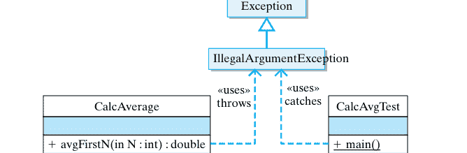

图 10.8：接球：在这种设计中，`IllegalArgumentException` 由 `CalcAverage.avgFirstN(n)` 方法抛出，并 `CalcAvgTest.main()` 方法中的 `catch` 子句捕获。

### 10.4.2 分离错误与错误处理

正如我们在 `CalcAvgTest` 示例所示，Java 的错误处理与更传统的方法之间的重要区别是，错误处理可以与程序内的正常执行流分离。`CalcAverage.avgFirstN()` 方法仍然检查错误，如果 `N` 不满足先决条件，它会抛出 `IllegalArgumentException`。它不包含处理异常的代码。异常处理代码位于 `CalcAvgTest` 类中。
因此，`CalcAvgTest` 程序在正常算法和异常处理代码之间建立了清晰的隔离。这种设计的优点之一是正常算法不会被错误处理代码干扰，因此更容易阅读。
另一个优点是，程序对错误的响应被组织在一个中心位置。通过将异常处理器置于 `CalcAvgTest.main(i)` 中，可以使用一个异常处理器来处理该类型的其他错误。例如，此 `catch` 子句可以处理程序中抛出的所有 `IllegalArgumentException`。使用 `printStackTrace` 将确确定位异常发生发生的位置。事实上，由于 Java 从 `main()` 方法启动，在 `main()` 方法的 `try` 块中封装程序的所有可执行语句，将有效地处理程序内部发生的异常。

> 《Java 高效设计》普通代码与异常代码。Java 异常处理机制的关键要素是，异常处理器——`catch` 块——与抛出异常的块——`try` 块是分离的。`try` 块包含正常算法。`catch` 块包含处理异常情况的代码。

### 10.4.3 Try/Throw/Catch 的语法和语义

`try` 块以关键字 `try` 开始，随后跟着一个用大括号括的块。`catch` 子句或 `catch` 块由关键字 `catch` 组成，随后是一个标识要捕获的异常 类型的参数声明，然后是一个用大括号括起来的语句块。这些是通过采取适当措施来处理异常的语句。

一旦抛出异常，控制将通过适当的 `catch` 块转移出 `try` 块。控制不会返回 `try` 块。

### catch 块

> 语言规则 Try 块控制。如果抛出异常，将退出 `try` 块且控制不会返回。

`try/catch` 语句的完整语法总结在图 10.9 中。`try` 块旨在包含一个或多个语句，这些语句

```
try {
  // 语句块
  // 其中至少有一个可能抛出异常
  // 如果某些条件满足 /
  throw new ExceptionName();
} catch (ExceptionName) {
  // 要执行的语句块
  // 如果在 try 中抛出了 ExceptionName
} catch (Exception2 ParameterName) {
  // 要执行的语句块
  // 如果在 try 中抛出了 ExceptionName
} finally {
  // 可选的执行块
  // 无论是否抛出异常都会执行
}
```

图 10.9：Java 的 `try/catch` 语句。`try` 块旨在包含一个可能抛出异常的语句或多个语句。`catch` 块旨在处理在 `try` 中抛出的异常。`finally` 子句是一个可选子句，无论是否抛出异常都会执行。

# 在程序内部处理异常

`try` 块中的语句是程序正常执行流的一部分。通过将一组语句封装在 `try` 块中，你表明可能会抛出一个或多个异常，并且你打算捕获它们。如果在 `try` 块中抛出异常，Java 将退出块并将控制转移到匹配特定异常的第一个 `catch` 块。使用 `throw` 语句抛出异常，其格式如下：

```
throw new ExceptionClassName(OptionalMessageString);
```

关键字 `throw` 之后是 `ExceptionClassName` 的实例化。这与我们在 Java 中实例化的方式相同：使用 `new` 运算符并调用异常的构造方法。某些构造方法接收 `OptionalMessageString`，这是异常 `getMessage()` 方法返回的消息。

`catch` 如下：

```
catch (ExceptionClassName ParameterName) {
  // 异常处理语句
}
```

`catch` 块非常像方法定义。它包含一个参数，指定由该块处理的异常类。`ParameterName` 可以是任何值标识符，但习惯上使用 `e` 作为 `catch` 块。该参数的作用范围限于 `catch` 块，并被用于引用被捕获的异常。

`ExceptionClassName` 必须是 Java 异常层次结构中的类之一（见图 10.4）。异常将匹配其所属类或任何子类的任何参数。因此，如果抛出了 `ArithmeticException`，它会被 `ArithmeticException` 参数捕获，因为 `ArithmeticException` 是 `Exception` 的子类。

注意一个给定的 `try` 块可以关联多个 `catch` 子句，它们的排列顺序非常重要。抛出的异常将被第一个匹配的 `catch` 子句捕获。因此，`catch` 子句应该按照从具体到通用的顺序排列（见图 10.4 中的异常层次结构）。如果更通用的 `catch` 子句在更具体的之前，它将阻止后者的执行。实际上，具体的子句会被更通用的一个隐藏。你大可以不需要那个具体的子句。

为了说明如何安排 catch 句（catch clauses），假设在以下 try/catch 语句中抛出了 `ArithmeticException`：

```java
try {
    // 假设抛出了一个 ArithmeticException
} catch (ArithmeticException e) {
    System.out.println("ERROR: " + e.getMessage());
    e.printStackTrace();
    System.exit(1);
} catch (Exception e) {
    System.out.println("ERROR: " + e.getMessage());
}
```

在这种情况下，异常将由更具体的 `ArithmeticException` 块处理。另一方面，如果引发了某种异常，它将由第二个 catch 句捕获。`Exception` 类将匹配任何抛出的异常。因此，在 catch 句的序列中，它应该总是最后出现。

应该使用哪种处理程序？

> JAVA 编程技巧 安排 catch 句。catch 句应该按照从最具体到最通用的顺序进行排列。`Exception` 子句应该始终是序列中的最后一个。

## 10.4.4 对 try/catch/finally 语句的限制

Java 的异常处理机制有几项重要的限制。我们将在本章的后面详细描述这些限制。

- 一个 `try` 块必须紧跟其一个或多个 `catch` 句，且 `catch` 只能跟在 `try` 块之后。
- `throw` 语句用于抛出已检查异常（checked exceptions）和未检查异常（unchecked exceptions），其中未检查异常属于 `RuntimeException` 或其子类。未检查异常不需要被捕获。
- `throw` 语句必须包含在 `try` 块的动态作用范围内，且抛出的 `Exception` 类型必须至少匹配 `catch` 句中的一个。`throw` 语句必须包含在一个具有对所抛出 `Exception` 类型声明的 `throws` 子句的方法或构造函数中。

> JAVA 语言规则 Try/Catch 语法。`try` 块后面必须紧跟其（中间不能有插入的代码）一个或多个 `catch` 块。`catch` 块只能由 `try` 块或另一个 `catch` 块前导。你不能在 `catch` 块之间放置插入的代码。

## 10.4.5 动态作用域与静态作用域

当在 `avgFirstN()` 中抛出异常时，Java 如何知道它应该执行 `CalAvgTest.main()` 中的 catch 句？此外，最新版本的 `avgFirstN(10.7)` 难道违反了 `throw` 语句必须发生在 try 块内部的限制吗？

异常只能在动态包含它的 `try` 块内部抛出。这意味着 `throw` 语句必须处于嵌套 `try` 块的动态作用范围内。让我们看看发生了什么。

动态作用域指的是程序的执行方式。例如，在 `CalAvgTest(10.7)` 中，`avgFirstN()` 方法是从 `CalAvgTest.main()` 中的 `try` 块被调用的。因此，它位于该块的动态作用范围内。

将动态作用域与你学过的静态作用域进行对比，静态后者定义了参数和局部变量的作用域（10.10）。静态作用域指的是程序的编写方式。如果一个语句或变量是写在该块内的文本，那么它就出现在该块的作用域内。例如，考虑 `MyClass` 的定义（10.11）。变量 `X` 出现在 `method1()` 的（静态）作用域内，而变量 `Y` 出现在 `method2()` 的（静态）作用域内。

| 动态作用域 | 静态作用域 |
| :--- | :--- |
| 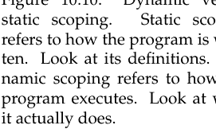 | |

```java
class MyClass {
    public void method1() {
      int X = 1;
      System.out.println("Hello" + X);
    }
    public void method2() {
      int Y = 2;
      System.out.println("Hello" + Y);
    }
    public static void main(String[] args) {
      MyClass myclass = new MyClass();
      if (Math.random() > 0.5) {
        myclass.method1();
      } else {
        myclass.method2();
      }
    }
}
```


# 第 10 章 • 异常：当出现问题时

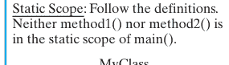   

方法的参数和局部变量出现在其静态作用域内。同样，在 `MyClass` 定义中，`System.out.println` 语句分别出现在 `method1()` 和 `method2()` 的静态作用域内。通常情况下，作用域指的是变量是如何声明的或语句所在的位置。静态作用域完全可以通过阅读程序来确定。

动态作用域只能通过运行程序来确定。例如，在 `MyClass` 中，语句的执行顺序取决于 `Math.random()` 的结果。假设执行了 `random()`，它返回值 0.99。在这种情况下，`main()` 将调用 `method2()`，`method2()` 将调用 `System.out.println()`，它将打印

```java
public class MyClass {

    public void method1() {

        int X = 1;

        System.out.println("Hello" + X);

    }

    public void method2() {

        int Y = 2;

        System.out.println("Hello" + Y);

    }

    public static void main(String[] args) {

        MyClass myclass = new MyClass();

        if (Math.random() > 0.5) {

            myclass.method1();

        } else {

            myclass.method2();

        }

    }

}
```
图 10.11：动态作用域与静态作用域。在这种情况下，`main()` 将调用 `method2()`，`method2()` 将调用 `System.out.println()`，它将打印

### 10.4 异常传播：查找 catch 句

为了找到异常查找 catch 句，Java 使用程序的静态和动态作用域。基本思想是 Java 从抛出异常的块开始回溯。例如，一个块在静态上嵌套在另一个块内。如果异常在抛出它的块中未被捕获，Java 将搜索其外层的块。这是静态作用域。如果异常在抛出它的块中未被捕获，Java 将搜索更高一层的块，依此类推。这仍然是静态作用域。

如果异常在抛出它的方法中未被捕获，Java 使用方法栈（图 10.12）回溯已执行的方法调用。这是动态作用域。在 `CalcAvgTest` 示例（图 10.7）中，调用 `avgFirstN()` 方法将找到处理 `IllegalArgumentException` 的 catch 句。因此，它将执行该 catch 句。

当异常抛出时，Java 使用静态和动态作用域查找 catch 句。这就是编译器所做的。栈的一个重要特征是当前执行始终由栈顶表示。在图 10.12 中，你可以通过反转弯曲箭头来可视化。


## 10.4 在程序内部处理异常

```java
public class Propagate {

    public void method1(int n) {

        method2(n);

    }

    public void method2(int n) {

        method3(n);

    }

    public void method3(int n) {

        for(int k=0; k < n; k++) { //块1

            if (k % 2 == 0) { //块2

                System.out.println(k);

            }

        }

    }

    public static void main(String[] args) {

        Propagate p = new Propagate();

        p.method1(0);

    }

}
```
图 10.12：Propagate 程序的方法调用栈。弯曲箭头提供了方法调用的轨迹。


## 自学练习

**练习 10.3** 假设程序抛出了 `ArrayIndexOutOfBoundsException`。利用图 10.4 中的异常层次结构，确定以下哪些 catch 句可以处理它。

- a. `catch (RuntimeException e)`
- b. `catch (StringIndexOutOfBoundsException e)`
- c. `catch (OutOfBoundsException e)`
- d. `catch (Exception e)`
- e. `catch (ArrayStoreException e)`

练习 10.4 在接下来的程序中，假设第一次调用 `random()` 时返回 0.98，第二次调用时返回 0.44。该程序将打印什么输出？

```java
class Class2 {

    public void method1(double X) {

        if (X > 0.95)

            throw new ArithmeticException(X
                + "* is out of range");

        System.out.println("Hello " + X);

    }

    public void method2(double Y) {

        if (Y > 0.5)

            throw new ArithmeticException(Y
                + "* is out of range");

        System.out.println("Hello " + Y);

    }

    public static void main(String argv[]) {

        Class2 myclass = new Class2();

        try {

            myclass.method1(Math.random());

            myclass.method2(Math.random());

        } catch (ArithmeticException e) {

            System.out.println(e.getMessage());

        }

    }

}
// main ()
// Class2
```

练习 10.5 对于上一个练习中 `random()` 返回的值，显示如果在打印错误信息的同时还调用了 `printStackTrace()`，输出将会是什么。

练习 10.6 在 `Class2` 程序中，假设第一次调用 `random()` 时返回 0.44，第二次调用时返回 0.98。该程序将打印什么输出？

练习 10.7 对于上一个练习中 `random()` 返回的值，显示如果调用 `printStackTrace()` 而不是打印错误信息，输出将会是什么。

## 10.5 节 • 错误处理与健壮程序设计

练习 10.8 找到以下程序中的除以零错误，然后显示程序将打印什么样的堆栈跟踪（stack trace）：

```java
public class BadDivide {

    public void method1(int n) {

        method2(100, n);

    }

    public void method2(int n, int d) {

        System.out.println(n / d);

    }

    public static void main(String args[]) {

        BadDivide bd = new BadDivide();

        for (int k = 0; k < 5; k++)

            bd.method1(k);

    }

}
```

练习 10.9 修改 `method2()`，使其自己处理除以零异常，而不是让 Java 来处理。让它打印错误信息和堆栈跟踪。

练习 10.10 如果 `someValue` 等于 500，该代码段将打印什么？

```java
int M = someValue;

try {

    System.out.println("Entering try block");

    if (M > 100)

        throw new Exception(M + " is too large");

    System.out.println("Exiting try block");

} catch (Exception e) {

    System.out.println("ERROR: " + e.getMessage());

}
```

练习 10.11 如果 `someValue` 等于 50，上一个问题中的代码段将打印什么？

练习 10.12 编写一个 try/catch 块，当 `X` 的值小于 0 时抛出一个 `Exception`。该异常应该是 `Exception` 的实例，并且当被捕获时，通过 `getMessage()` 返回的消息应该是 "ERROR: Negative value in X coordinate."

## 10.5 错误处理与健壮程序设计

程序设计的一个重要元素是开发适当处理错误和异常情况的方法。正如我们看到的，JVM 会捕获任何未被程序捕获的未检查异常。对于你自己的（练习）程序，最好的设计可能是使用 Java 默认异常处理。当抛出异常时，程序将终止，然后你可以调试错误并重新编译程序。

另一方面，这种策略对于商业软件来说是不恰当的，因为用户无法修复它。一个设计良好的商业程序应该包含针对那些可能出现的真正异常情况的异常处理器。

总的来说，处理尚未被 Java 处理的异常情况有三种方法（见表 10.3）。第一，如果异常情况无法修复，程序应该终止并附带适当的错误信息。第二，如果异常情况可以在不使程序失效的情况下得到修复，则应该对其进行补救并恢复程序的正常执行。第三，如果异常无法修复但程序不能终止，则应该以某种方式报告或记录异常情况，并恢复程序运行。

### 表 10.3 异常处理策略

| 异常类型 | 程序类型 | 应采取的行动 |
|---|---|---|
| 由 Java 捕获 | | 让 Java 处理 |
| 可修复的情况 | | 修复错误并恢复执行 |
| 无条件发生的情况 | 可停止的 | 报告错误并终止程序 |
| 无法修复的情况 | 不可停止的 | 报告错误并处理错误 |


> **JAVA 有效设计 处理异常**。处理异常有三种通用方法：(1) 报告错误并终止程序；(2) 修复异常并恢复执行；以及(3) 记录异常并恢复执行。

## 10.5.1 打印消息并终止

我们的示例是一个典型的案例，异常通过终止程序处理最好。在这种情况下，你将重写 Java 默认异常处理，它会在抛出异常时终止程序。这类错误通常引起人们对程序逻辑的关注，这些逻辑应该在程序开发期间就被捕获。

> **JAVA 有效设计 异常与程序开发**。抛出异常有助于识别缺陷。你对异常的使用应该遵循这种方法。


类似的问题可能（经常）与未被 Java 捕获的错误有关。例如，假设你的程序接收到了会导致计算失效的错误输入。这不会被 Java 捕获。但报告错误并终止程序会更好。正确的错误类型可能涉及在使用输入之前添加检查以验证输入。简而言之，与其让错误结果贯穿整个程序，最好的办法是终止程序。

> **JAVA 有效设计 报告并终止**。如果在可以终止的程序出现无法修复的异常，报告错误并终止程序会比让带着错误数据运行要好。


## 10.5.2 记录错误并恢复

当然，停止程序的建议假设程序可以安全地终止。某些程序——例如监控航天飞机或控制核磁共振（NMR）机器的程序——不能因为错误而终止。对于这些程序，应该以适当的方式报告异常，但程序继续运行。如果异常情况导致程序计算失效，那么异常处理器应该明确结果是受污染的。

### 失效程序

某些程序是失效的，因为它们的设计时没有考虑终止。对于这些程序，应该以适当的方式报告异常，但程序继续运行。

其他程序——例如处理大型事务数据库的程序——应该设计为捕获错误后继续处理。例如，假设航空公司每天运行一次程序来统计发生的交易。这类程序可能使用异常来识别错误交易或使有效数据失效的交易。由于数据库中必然会有此类错误，停止程序是不合理的。这种程序在处理完所有交易之前不应该停止。这种程序的适当行动是将异常记录到某种文件中，并继续处理交易。

### 无法停止的程序

假设在这些程序中发生了除以零错误。在这种情况下，你将重写 Java 默认异常处理，以确保程序不会终止。更广泛地说，重要的是这些程序的设计目的是为了捕获并报告异常。这种类型的异常处理应该构建在程序的的设计中。

> **JAVA EFFECTIVE DESIGN 报告与恢复**。如果一个无法合理终止的程序中发生了无法修复的异常，则应该报告该异常并让程序继续执行（exec.）。

## 10.5.3 修复错误并继续

作为一个可以在程序运行期间解决的问题的示例，请考虑在字段中输入一个整数的任务。正如你可能经历过的那样，如果程序期望接收一个整数，而你尝试输入类似 "ABC" 的内容，就会产生一个 `NumberFormatException` 且程序将终止。例如，当你在输入金额时输入 "ABC"，在调用 `Integer.parseInt()` 方法时会抛出一个异常。该输入字符串无法被解析为有效的 `int`。然而，这种错误是在程序运行时是可以解决的错误类型。

让我们设计一个特殊的 `IntField`，它的功能类似于文本字段，但只接受整数。如果用户输入的数值生成了 `NumberFormatException`，则应该打印错误信息并让用户能够重新尝试。

图 10.13 显示该特殊字段是 `JTextField` 的子类，并继承了基础 `JTextField` 功能。它应该拥有与普通 `JTextField` 相同的构造函数。这是图 10.14 所示的定义。


```java
import java.swing.*;

public class IntField extends JTextField {

    public IntField () {

        super();

    }

    public IntField(int size) {

        super(size);

    }

    public int getInt() throws NumberFormatException {

        return Integer.parseInt(getText());

    }

    // getInt()

} // IntField
```
图 10.14：`IntField.getInt()` 中的 `Integer.parseInt()` 方法可能会抛出一个 `NumberFormatException`。

注意，构造方法使用 `super` 来调用 `JTextField` 构造函数。目前，这两个构造函数就足够了。但是，稍后我们将引入第三个构造函数，允许我们在在本章中将一个绑定与 `IntField` 关联。

我们需要哪些构造函数？

## 10.5 节 · 错误处理与健壮程序设计 481

我们的 `IntField` 类需要一个可以返回其内容的方法。该方法应该像 `JTextField.getText()` 一样工作，但它应该返回一个有效的整数。`getInt()` 方法没有参数并将返回一个 `int`，前提是向 `IntField` 中输入了有效的整数。如果用户输入 "55A"，`Integer.parseInt()` 方法将抛出一个 `NumberFormatException`。注意 `getInt()` 声明了该异常。这并不是必要的，因为 `NumberFormatException` 不是一个检查异常（checked exception），但它让代码更加清晰。

应该如何处理以及是否处理此异常？异常无法在 `getInt()` 方法内部被轻易处理。该方法必须返回一个整数值。如果用户使用了非整数，就没有办法返回有效值。因此，最好直接将异常抛给调用方法，并在那里可以被容易处理。

在 GUI 应用程序中，调用方法很可能是具有以下内容的 `actionPerformed()`：

```java
public void actionPerformed(ActionEvent event) {

  try {
```


## 代码示例

```java
int userId = intField.getInt();

message = "Input " + userId + " Thank you.";

} catch (NumberFormatException ex) {

    JOptionPane.showMessageDialog(this, "输入必须是整数。请重新输入。");

} finally {

    repaint();

}

} // actionPerformed
```

对 `getInt()` 的调用嵌入在 `try/catch` 块中。这导致了图 10.15 所示总结的设计。`IntField` 抛出的异常被 GUI 捕获，GUI 显示一条错误消息。

> 图 10.15：如果用户在 `IntField` 中输入非整数，它将抛出一个 `NumberFormatException`。GUI 将在 `JOptionPane`（一个对话窗口）中显示错误消息。

| NumberFormatException | JOptionPane |
| :--- | :--- |
| IntField | \AppletSubclass |
| catch() | showDialog() |

如果用户输入有效的整数，程序将报告一个显示该值的消息。现实世界的示例会对该值进行更具意义的使用。另一方面，如果用户输入了错误值，程序将弹出图 10.16 所示的对话框。（参见本章的“来自库”部分以获取更多对话框。）当用户点击 OK 按钮时，程序将恢复正常执行，这样当异常发生时，输入的数值就不会被使用，错误值也不会造成任何伤害。用户可以再次尝试输入一个有效的整数。注意 `finally` 子句会重绘 GUI。在这种情况下，重绘将在 applet 或应用程序上显示适当的消息。

图 10.16：此异常处理程序打开了一个对话框来显示错误消息。

# 第 10 章 • 异常：当出现问题时


## 防御性设计：预测异常

这是一个我们可能称之为防御性设计的示例。防御性设计就是我们预见到潜在问题并采取措施确保其不会崩溃。


> 图 10.15：如果用户在 `IntField` 中输入非整数，它将抛出一个 `NumberFormatException`。GUI 将在 `JOptionPane`（一个对话框）中显示错误消息。


> 异常：由于异常，创建一个比原始多一个元素的数组。


> 异常：由于异常，现在已修复。


> 异常：由于异常，现在已修复。

## 10.5.4 修复还是不修复

让我们考虑一种情况，即在运行时修复并不清晰。假设你有一个包含元素的数组，初始创建为两个元素。

```java
String[] = new String[2];
```

如果尝试向数组添加超过两个元素，就会抛出 `ArrayIndexOutOfBoundsException`。异常可以通过扩展数组的大小来处理。为了开始创建一个程序，让我们设计一个方法将字符串插入数组。假设该程序维护一个 `count` 来跟踪存储了多少元素。因此，没有必要将数组作为参数传递。我们要插入的字符串：

```java
private void insertString(String str) {

  // 抛出 ArrayIndexOutOfBoundsException

  list[count] = str;

  count++;

}
```

注释可能会抛出异常。我们可以处理此异常吗？当异常发生时，我们可以创建一个比当前多一个元素的数组。我们将旧数组拷贝到新数组并在新位置插入字符串。最后，设置数组引用使其指向新数组。然后，我们可以使用以下 `try/catch` 块来处理此异常：

```java
private void insertString(String str) {

  try {

    list[count] = str;

  } catch (ArrayIndexOutOfBoundsException e) {

    // 创建新数组

    String[] newList = new String[list.length+1];

    for (int k = 0; k < list.length; k++) // 拷贝数组

      newList[k] = list[k];

    // 插入新数组

    newList[count] = str;

    // 让旧的指向新的

    list = newList;

    // 因为异常现在已修复

    count++;

  }

}

// insertString();
```

> **JAVA EFFECTIVE DESIGN**：防御性设计。很好，我们预见到潜在问题并采取措施确保其不会崩溃。

> **JAVA EFFECTIVE DESIGN**：修复异常。许多类并不处理它。

> **JAVA EFFECTIVE DESIGN**：库处理。这背后的思想是不处理。

> **JAVA EFFECTIVE DESIGN**：异常。`catch` 子句的作用创建一个仍称为 `list` 的新数组，比原始多一个元素。

> **JAVA EFFECTIVE DESIGN**：异常。该程序是不处理的。

| JPanel |
| - list[] : String |
| - inField : JTextField |
| - prompt : Label |
| - count : int |

图 10.17：FixArrayBound 类使用异常处理在用户每次添加时扩展数组大小。

# 第 10 章 • 异常：当出现问题时

注意 `finally` 子句的使用。对于这个问题，在 `finally` 子句中增加 `count` 是重要的。这是确保在将元素赋值给数组时，`count` 恰好增加一次的唯一方法。

FixArrayBound 的设计如图 10.17 所示。它提供了一个 GUI 界面，让我们能够测试 `insertString()` 方法。该程序具有 Swing 界面，使用 `JFrame` 作为顶层窗口。程序的组件包含在一个 `JPanel` 中，并在 `main()` 方法中将其添加到 `JFrame` 中。

每当你向文本框输入字符串时，`actionPerformed()` 方法就会调用 `insertString()` 方法将字符串添加到数组中。每次用户操作后，`JPanel` 都会重绘。`paintComponent()` 方法只是清除面板并显示数组的元素（10.18）。

## 糟糕的程序设计

> **JAVA 调试技巧**：清除 JPanel。Swing 组件（如 JPanel）不会自动清除其背景。这必须在 `paintComponent()` 方法中显式地完成。

FixArrayBound 的完整实现见图 10-19。此示例说明了如何成功处理异常并恢复正常的控制流。然而，问题在于，是否应该以这种方式处理此类异常。

不幸的是，这不是一个设计良好的程序。数组的初始大小对于程序的预定用途太小了。因此，这些异常的出现本身就是设计不当的结果。通常，不应该将异常作为设计不当的补救。

> **JAVA 高效设计**：真正的异常情况。良好的程序应该使用异常处理来处理真正的异常情况，而不是处理在正常或预期情况下发生的事物。

## 正确的数组使用

对于使用数组的程序，应该选择数组的大小，使其能够存储程序所需的所有对象。如果该程序是某种故障安全程序（failsafe program），无法承受崩溃，那么只要此类异常发生得非常稀少，像之前的方法可能是合理的。在这种情况下，最好生成一条消息，提醒用户的程序发生了这种情况。该警报将表明需要修改程序的内存需求并重启程序。

图 10.18：显示的字符串存储在一个数组中，每当输入新字符串时，该数组就会扩展一次。


# 第 10.5 节 • 错误处理与健壮的程序设计 485

```java
import java.awt.*;

import java.awt.event.*;

import java.swing.*;

public class FixArrayBound extends JPanel

    implements ActionListener {

    public static final int WIDTH = 350, HEIGHT = 100;

    private JTextField inField = new JTextField(10);

    private JLabel prompt = new JLabel(

        "Input a word and type <ENTER>: ");

    //

    // 初始化 list 有2个元素

    private String[] list = new String[2];

    private int count = 0;

    public FixArrayBound() {

        inField.addActionListener(this);

        add(prompt);

        add(inField);

        setSize(WIDTH, HEIGHT);

    }

    public void paintComponent(Graphics g) {

        g.setColor(getBackground()); // Clear the background

        g.fillRect(0, 0, WIDTH, HEIGHT);

        g.setColor(setForeground());

        String temp = "";

        for (int k = 0; k < list.length; k++)

            temp += list[k] + " ";

        g.drawString(temp, 10, 50);

    }

    private void insert(String str) {

        try {

            list[count++] = str;

        } catch (ArrayIndexOutOfBoundsException e) {

            String[] newList = new String[list.length+1]; // New array

            for (int k = 0; k < list.length; k++) // Copy old to new

                newList[k] = list[k];

            newList[count] = str; // Make old point to new

            list = newList;

        } finally {

            // The exception is now fixed

            count++; // increase the count

        }

    }

    private void insertString() {}

    public void actionPerformed(ActionEvent evt) {

        insert(inField.getText());

        inField.setText("");

        repaint();

    }

}
```

图 10.19：当抛出 `ArrayIndexOutOfBoundsException` 时，FixArrayBound 会增加数组的大小。

```java
public static void main(String args[]) {

    JFrame f = new JFrame("Array Fixer");

    FixArrayBound panel = new FixArrayBound();

    f.getContentPane().add(panel);

    f.setSize(panel.WIDTH, panel.HEIGHT);

    f.setVisible(true);

    f.addListener(new WindowAdapter() {

        public void windowClosing(WindowEvent e) {

            System.exit(0); // Quit the application

        }

    });

} // main()

 // FixArrayBound
```

图 10.19：（续）当抛出 `ArrayIndexOutOfBoundsException` 时，FixArrayBound 会增加数组的大小。

## 选择数据结构

如果无法预知数组中将存储多少个对象，最好的设计是使用 `java.Vector` 类（来自第 9 章的 Java 库）。Vector 的设计为随着新对象的插入而增长。在某些方面，我们示例中的异常处理代码模仿了 vector 的行为。然而，Vector 类利用高效的算法来扩展其大小。相比之下，异常处理永远是不高效的。因为异常迫使系统进入异常执行模式，处理异常所需的时间远比在此类应用程序中使用 Vector 要长得多。

| JAVA 高效设计 |
| :--- |
| 适当的数据结构 | 解决问题的关键部分是表示数据的最佳方式。当数组的大小在程序执行期间动态增长和缩小时，应该使用 vector 作为数组结构。 |


## 自学练习

练习 10.13 对于以下每个异常，确定其是否可以通过某种方式进行处理以使程序继续运行，或者是否应该终止程序：

- a. 计算机程序检测到其 GUI 元素之一存在问题并抛出 `NullPointerException`。
- b. 组配线控制程序确定某个控制值已变为负数并生成了 `ArithmeticException`。
- c. 一家公司的订单单检测到用户输入了无效的字符串并抛出 `SecurityException`。

| 异常 |
| :--- |
| +getMessage() |
| OutRangeException |

# 10.6 创建和抛出你自己的异常

与其他类一样，`Exception` 可以被扩展以处理 Java 内置异常未涵盖的情况。你定义的异常将由 Java 解释器以相同的方式处理，你必须自己抛出它们。
例如，图 10.20 显示了一个用于验证小于某些最大值的整数的异常设计。其代码如下：

```java
/**

 * IntOutOfRangeException 在整数

 * 超过其边界时报告异常。

 */

public class IntOutOfRangeException extends Exception {

    public IntOutOfRangeException(int Bound) {

        super("The input exceeds the bound " + Bound);

    }

}
```

该类继承自 `Exception` 并由一个调用父类构造函数的构造函数组成。传递给父构造函数的参数是在创建此异常实例时 `getMessage()` 返回的消息。

现在让我们考虑一个我们想要抛出这种新异常的示例。假设我们希望限制 `IntField` 类，使其接受小于特定边界的数字。首先，让我们修改 `IntField`，使其在创建实例时可以设置边界。我们希望为实例变量设置一个初始值，并提供一个可以覆盖默认设置的构造函数（图 10.21）。
这导致了 `IntField` 的以下修订：

```java
public class IntField extends JTextField {

    private int bound = Integer.MAX_VALUE;

    public IntField(int size, int max) {

        bound = max;

    }

    // 类的其他部分保持不变

} // IntField
```


图 10.21：修订后的 `IntField` 类对输入的数字大小进行了限制。

我们新构造函数的签名标记为 `IntField(int,int)`，它没有复制 `JTextField` 的任何构造函数。这是一个良好的设计，因为在扩展类时，我们希望小心我们的定义对父类中原始方法的影响。父类方法的重写应该是设计之初，而不是偶然的。如果一个方法是

```java
import javax.swing.*;

public class IntField extends JTextField {

    private int bound = Integer.MAX_VALUE;

    public IntField(int size) {

        super(size);

    }

    public IntField(int size, int max) {

        bound = max;

    }
```


public int getInt() throws NumberFormatException, OutOfRangeException {

    int num = Integer.parseInt(getText());

    if (num > bound)

        throw new OutOfRangeExceptionException(bound);

    return num;

}

}

// IntField

```

图 10.22：包含修订后的 `getInt()` 方法的修订 `IntField` 类。

本质上重新定义，它可能无法符合子类用户的预期。

> 《Java 高效编程》扩展类。在扩展类时，必须确保父类方法不会被无意中重写。父类方法应该在设计时才被重写，而不应是意外。

注意我们是如何处理设置 `bound` 默认值的。`Integer.MAX_VALUE` 是一个设置 `int` 类型最大值的常量。这是一个合适的值，因为用户输入的任何有效 `int` 都应该小于或等于 `MAX_VALUE`。鉴于 `IntField` 的这些更改，让我们将新异常整合到这个 `getInt()` 方法中（图 10.22）。

此版本的 `getInt()` 如果用户预期的整数大于 `IntField` 的 `bound`，则会抛出异常。在这里，在该方法中处理此异常仍然困难。该方法要么返回一个错误值——因为必须返回某些内容——要么终止。这两者都不是可接受的替代方案。更好的是将异常抛出给调用方法。
`IntTester` 类（图 10.23）具有图 10.15 所示的设计和功能。它为 `IntField` 类提供了一个简单的 GUI 界面。它提示用户输入一个小于 100 的整数，然后显示用户的输入。注意异常是如何

# 第 10.7 节 • 来自 Java 库：JOptionPane

在 `actionPerformed()` 方法中处理的。如果 `IntField.getInt()` 抛出异常，`actionPerformed()` 方法会弹出一个错误对话框，并且错误的输入不会被使用。用户有机会创建一个合法的整数。

## 自学练习

练习 10.14 定义一个名为 `FieldIsEmptyException` 的新异常，用于在用户忘记向 `IntField` 输入值值时抛出。

练习 10.15 修改 `IntField.getInt()`，使其抛出并捕获 `FieldIsEmptyException`。

# 10.7 来自 Java 库：JOptionPane

对话框是程序可以打开并与用户通信的窗口。对话框在 GUI 环境中有许多种类和多种用途。你在使用电脑时无疑遇到过它们。

例如，每当你想要打开或保存文件时，都会打开一个对话框。它提供并让你知道文件信息，并帮助你搜索计算机的目录结构以找到它。
当程序需要通知你或警告发生了某些错误时，就会打开警告错误对话框。它显示一条错误消息和一个 OK 按钮，你点击该按钮即可关闭对话框。
对话框很容易创建和使用。Swing 组件提供了几种不同类型的基本对话框，可以使用两行代码将其整合到你的程序中。例如，`JTextField` 类使用一个简单的消息对话框向用户报告输入错误。该对话框是由程序中的以下部分创建的（见图 10.23）：

```
catch (NumberFormatException e) {

  JOptionPane.showMessageDialog(this,

"Input must be an integer. Please reenter.");

}
```

此方法显示图 10.16 中的窗口。它包含错误消息和一个可以关闭窗口的 OK 按钮。
`showDialog()` 是 `javax.swing.JOptionPane` 类的一个静态方法，提供了一系列相似的方法，用于创建和显示基本对话框。
对话框与其他类型的顶层窗口（即 JApplet 和 Frames）的区别在于，它与另一个窗口相关联（图 10-24）。此版本 `showDialog()` 方法的第一个参数引用对话框的父窗口。第二个参数是表示消息的 `String`。示例中使用的对话框是模态的（modal）。这意味着一旦它显示出来，在你点击 OK 按钮并关闭对话框之前，你可以进行任何操作。也可以创建非模态对话框。这些可以在你处理其他任务时一直留在屏幕上。

图 10-24：对话框窗口不能独立存在。它必须由顶层窗口重新定义。

# 第 10 章 • 异常：当出现问题时

```
import java.awt.*;

import java.awt.event.*;

import java.swing.*;

public class IntFieldTester extends JPanel implements ActionListener {

    490

    static final int WIDTH = 300, HEIGHT = 30;

    private JLabel prompt = new JLabel("Input integer <= 100:");

    private IntField intField = new IntField(100);

    private int userInt;

    private String message = "Hello";

    public IntFieldTester() {

        add(prompt);

        intField.addActionListener(this);

        add(intField);

        setSize(WIDTH, HEIGHT);

    }

    public void paintComponent(Graphics g) {

        g.setColor(getBackground());

        g.fillRect(0, 0, WIDTH, HEIGHT);

        g.setColor(getForeground());

        g.drawString(message, 10, 70);

    }

    public void actionPerformed(ActionEvent ev) {

        try {

            userInt = intField.getInt();

            message = "You input " + userInt + " Thank you.";

        } catch (NumberFormatException e) {

            JOptionPane.showMessageDialog(this, "Input must be an integer. Please re-enter.");

        } catch (RangeException e) {

            JOptionPane.showMessageDialog(this, e.getMessage());

        } finally {

            repaint();

        }

    }

    public static void main(String[] args) {

        JFrame frame = new JFrame("IntField");

        IntFieldTester panel = new IntFieldTester();

        frame.getContentPane().add(panel);

        frame.setSize(panel.getWidth(), panel.getHeight());

        frame.setVisible(true);

        frame.addWindowListener(new WindowAdapter() {

            public void windowClosing(WindowEvent e) {

                System.exit(0); // 应用程序

            }

        });

    }

}

```

图 10.23：使用 IntField 进行解析的应用。

# 第 10.7 节 来自 Java 库：JOptionPane

491

注意对话框还包含一个象征消息目的的图标（图 10.25）。它代表对话框的消息类型。JOptionPane 中提供的基本类型包括：

```
JOptionPane.PLAIN_MESSAGE

JOptionPane.INFORMATIONAL_MESSAGE // 默认

JOptionPane.WARNING_MESSAGE

JOptionPane.QUESTION_MESSAGE

JOptionPane.ERROR_MESSAGE
```

要将对话框设置为默认（信息）以外的类型，可以使用以下版本的 `showDialog()`：

```
showMessageDialog(Component comp, Object message,

String title, int msgType);
```

第一个参数是对父窗口的引用。第二个是消息字符串。第三个是作为对话框标题的字符串，第四个是五种对话框类型之一。例如，我们可以通过以下语句将对话框更改为错误对话框：

```
catch (IllegalArgumentException e) {

 JOptionPane.showMessageDialog(this,

  e.getMessage(),

  "Error dialog",

 JOptionPane.ERROR_MESSAGE);

}
```

这将产生图 10.25 所示的对话框。

图 10.25：错误对话框。


# 第 10 章 • 异常：当出现问题时

表 10.4 JOptionPane 提供的基本对话框。

| 对话框 | 描述 |
| --- | --- |
| 消息对话框 (Message Dialog) | 显示简单的错误或信息消息 |
| 确认对话框 (Confirm Dialog) | 提示用户确认特定操作 |
| 选项对话框 (Option Dialog) | 让用户从某些选项中选择 |
| 输入对话框 (Input Dialog) | 提示并输入字符串 |

在本章中，你学习了如何处理程序中发生的异常情况。你现在知道 Java 有一个默认的异常处理器可以处理许多情况，你还理解使用 Java 异常处理元素进行良好的程序设计有助于处理其他情况。本章继续强调良好的程序设计，以创建有用且稳定的程序。


# 本章总结

- catch 块 异常 静态作用域
- catch 异常 异常处理 抛出异常
- 检出的异常 finally 块 try 块
- 对话框 方法调用栈 未检出的异常
- 动态作用域 方法 堆栈跟踪
- 错误 对话框 模态对话框

# Try / Catch Catch 语句

try/catch/finally 语句具有如下语法：

```
try {

    // 语句块

    // 至少有一个语句可能会抛出异常

    if (some condition) {

        throw new ExceptionName();

    }

} catch (ExceptionName ParameterName) {

    // 要执行的语句块

    // 如果在 try 块中抛出了 ExceptionName 异常

} catch (ExceptionName2 ParameterName2) {

    // 要执行的语句块

    // 如果在 try 块中抛出了 ExceptionName2 异常

} finally {

    // 可选的语句块，将被执行

    // 无论是否抛出异常

}
```

该块旨在可能抛出异常的语句或多个语句。catch 块（可以有一个或多个）用于处理 try 块中抛出的异常。catch 块将处理任何与其参数类匹配的异常，包括该类的子类。finally 块是可选的。无论是否抛出异常，它都会被执行。如果 try 块中抛出了异常，try 块将永久退出。

try 块内部的 throw 语句是为了说明如何使用 throw。你通常不会在 try 块中看到 throw 语句，因为大多数抛出来自 Java 库方法内部，而这些方法是从 try 块中调用的。

# 重要点总结

- 在 Java 中，当发生错误或异常情况时，你 own抛出一个 Exception，它会被一个被称为异常处理器的特殊代码捕获。一个 throw 语句——`new Exception()`——用于抛出异常。
- try 块是一个包含一个或多个可能抛出异常的语句的语句块。在 try 块中嵌入语句表示你意识到了它可能会抛出异常，并且你意图处理它。
- Java 区分了检出的异常（checked exceptions）和未检出的异常（unchecked exceptions）。检出的异常必须由发生异常的方法捕获，或者你必须声明包含该语句的方法抛出异常。
- 未检出的异常是那些属于 RuntimeException 子类的异常。如果它们未被捕获，将将由 Java 的默认异常处理器处理。
- catch 块是一个处理与其模式匹配的异常的语句块。catch 块只能跟在一个 try 块后面，且每个 try 块可以有多个 catch 块。
- try/catch 语法允许你从处理错误和异常情况的特殊代码中恢复算法的正常部分。
- 方法迹跟踪（method trace）是导致程序中特定语句执行的调用跟踪。`Exception.printStackTrace()` 方法可以被异常处理器调用，以打印程序如何到达抛出异常的语句的精确跟踪。
- 静态作用域指的是程序代码的安排。如果变量在方法或块内声明，其作用域被局限于该方法或块。
- 动态作用域指的是程序的执行方式。如果一个语句是从某个方法或块调用的，或者是由从该方法或块调用的其他方法调用的，则它位于该方法或块的动态作用域内。
- 当通过语句搜索处理异常的 catch 块时，Java 会向上搜索语句的静态作用域并搜索动态作用域，直到找到匹配的 catch 块。如果没有找到，Java 虚拟机将通过打印错误消息和方法迹跟踪来处理异常。
- 许多 Java 库方法在发生错误时会抛出异常。这些 throw 语句不在程序中。例如，Java 的整数除法运算符在尝试除以零时将抛出 `ArithmeticException`。
- 通常，处理异常有四种方法：(1) 让 Java 处理；(2) 导致异常的问题并恢复程序；(3) 报告问题并恢复程序；(4) 打印错误消息并终止程序。大多数通过异常报告的错误很难修复或无法修复。
- finally 语句是 try/catch 块的可选部分。finally 块包含的语句无论是否发生异常都将被执行。
- 设计良好的程序应该使用异常来处理真正的异常情况，而不是将其作为正常程序控制的手段。
- 用户定义的异常可以使用 Exception 类或其任一子类来定义。

## 自学练习答案

# 答案 10.1

- a. `Integer.parseInt("26.") == NumberFormatException`
- b. `String s; s.indexOf('a') == NullPointerException`
- c. `String s = "hello"; s.charAt(5) == StringIndexOutOfBoundsException`

答案 10.2 意外的异常是 `IndexOutOfBoundsException`、`NumberFormatException` 和 `NullPointerException`，因为它们是 `RuntimeException` 的子类。

答案 10.3 `ArrayIndexOutOfBoundsException` 可以被 a、c 或 d 中的处理器处理，因为它们都是 `ArrayIndexOutOfBoundsException` 的父类。

答案 10.4 如果 `Math.random()` 返回 0.98 和 0.44，程序将生成以下输出：

注意，因为越界错误发生在 method(1)，method(2) 完全没有被调用。

答案 10.5 如果 `Math.random()` 返回 0.44 然后 0.98，将打印堆栈跟踪：

```
java.lang.ArithmeticException: 0.98 is out of range

at MyClass2.method1(3)

at MyClass2.main(15)
```

答案 10.6 如果 `Math.random()` 返回 0.44 然后是 0.98，程序将生成以下输出：

Hello 0.44
0.98 is out of range

答案 10.7 如果 `Math.random()` 在 MyClass2 中返回 0.44 然后 0.98，将打印堆栈跟踪：

```
java.lang.ArithmeticException: 0.98 is out of range

at MyClass2.method2(8)

at MyClass2.main(16)
```

答案 10.8 除以零错误发生在 BadDivide 的表达式 n/d 方法2() 中。它将生成以下堆栈跟踪：

```
java.lang.ArithmeticException: divide by zero

at BadDivide.method2(7)

at BadDivide.method1(3)

at BadDivide.main(13)
```

答案 10.9 下面的 `BadDivide.method2()` 版本将自己处理除以零错误：


public void method2(int n, int d) {

    try {

        System.out.println(n / d);

    } catch (ArithmeticException e) {

        System.out.println(e.getMessage());

        System.exit(0);

    }

}

```

答案 10.10 如果 `someValue` 等于 1000，代码段将打印：

Entering try block
ERROR: 1000 is too large

答案 10.11 如果 `someValue` 等于 50，代码段将打印：

Entering try block
Exiting try block

答案 10.12

```

try {

    if (X < 0) {

        throw new Exception(

            "ERROR: Negative value in X coordinate"

        );

    }

} catch (Exception e) {

    System.out.println(e.getMessage());

}

```

答案 10.13

# 第 10 章 • 异常：当出现问题时

+   a. 视情况而定。这是一个电脑游戏，处理此问题的方法可以是向日志文件生成消息并继续游戏。GUI 元素对游戏至关重要，很难想象它如何能被成功处理。
+   b. 视情况而定。你需要决定继续生产是否比不继续生产危害更大。
+   c. 程序可以向用户和系统管理员报告安全违规，然后保留用户输入。

# 解决方案 10.14

```java
public class FieldEmptyException extends Exception {

    public FieldEmptyException() {

        throw new Exception("The input field is empty ");

    }

}
```

# 解决方案 10.15

```java
public int getInt() {

    int num = 0;

    try {

        String data = getNext();

        if (data.equals(""))

            throw new FieldEmptyException();

        num = Integer.parseInt(getText());

        if (num > bound)

            throw new OutOfRangeException(bound);

    } catch (FieldEmptyException e) {

        System.out.println("Error: " + e.getMessage());

    } catch (NumberFormatException e) {

        System.out.println("Error: You must input an integer. Please try again.");

    } catch (OutOfRangeException e) {

        System.out.println(e.getMessage());

        return 0;

    }

    return num;

}
```

# 练习题

注：对于编程练习，请先画一个 UML 类图来描述所有类及其继承关系和/或关联。

+   练习题 10.1 解释以下术语对之间的区别：
    a. 抛出异常（Throwing an exception）和捕获异常（Catching an exception）。
    b. try 块（Try block）和 catch 块（catch block）。
    c. catch 块和 finally 块。
    d. try 块和 finally 块。
    e. 动态作用域（Dynamic scope）和静态作用域（static scope）。
    f. 对话框（Dialog box）和顶级窗口（top-level window）。
    g. 检查异常（Checked exception）和未检查异常（unchecked exception）。
    h. 方法栈（Method stack）和方法调用（method call）。

+   练习题 10.2 填空。

    a. 异常（exception）是 Java 信号指示发生了某种异常情况的方式。
    b. 在 Java 程序中，异常可以被抛出的唯一地方是在 `try` 块内部。
    c. 放置在 catch 块中的语句块通常被称为 `异常处理程序`（异常处理程序）。
    d. 要确定一个语句的动态作用域，你必须跟踪程序的执行过程。
    e. 要确定一个语句的静态作用域，你只需要读取它的定义。
    f. 当方法被调用时，方法调用的表示会被放在 `方法栈` 上。
    g. Java 异常层次结构的根是 `Throwable` 类。
    h. 异常必须在可能抛出它的方法中被捕获或被声明。
    i. 异常可以交给 Java 来处理。

+   练习题 10.3 比较程序内部处理异常的不同方式。
+   练习题 10.4 假设你有一个程序，要求用户输入一个不超过五个字母的字符串。描述为了设计 `StringTooLongException` 以处理用户输入许多字符的情况，你需要采取的步骤。
+   练习题 10.5 异常比正常处理需要更多的计算开销。请解释。
+   练习题 10.6 假设以下 `ExerciseExample` 程序正在执行 `method2()` 中的语句：

```java
public class ExerciseExample {

    public void method1(int M) {

        try {

            System.out.println("Entering try block");

            method2(M);

            System.out.println("Exiting try block");

        } catch (Exception e) {

            System.out.println("ERROR: " + e.getMessage());

        }

    } // method1()

    public void method2(int M) {

        if (M > 100)

            throw new ArithmeticException(M + " is too large");

    }

    public static void main(String[] args) {

        ExerciseExample ex = new ExerciseExample();

        ex.method1(500);

    }

} // ExerciseExample
```

画出表示这种情况的方法调用栈图。

# 第 10 章 • 异常：当出现问题时

+   练习题 10.7 重复之前的练习，假设程序当前正在执行 `method1()` 中的第二个 `println()` 语句。
+   练习题 10.8 画一个层次结构图，表示 `ExerciseExample` 程序元素之间的静态关系。
+   练习题 10.9 `ExerciseExample` 程序在运行时会打印什么？
+   练习题 10.10 如果将其 `main` 方法中的语句改为 `ex.method1(5)`，`ExerciseExample` 程序会打印什么？
+   练习题 10.11 再次考虑 `ExerciseExample` 程序。如果抛出的异常是 `Exception` 而不是 `ArithmeticException`，解释为什么我们会得到以下错误信息：`java.lang.Exception must be caught, or it must be declared...`
+   练习题 10.12 写一个 try/catch 块，如果 X 的值小于 0，则抛出一个 `Exception`。该异常应该是 `Exception` 的实例，并且当它被捕获时，`getMessage()` 返回的消息应该是 "ERROR: Negative value in coordinate"。
+   练习题 10.13 查看 `IntTester` 程序（图 10.23）和 `IntField` 类定义（图 10.22）。
+   练习题 10.14 作为上一个练习的延续，显示如果用户输入大于 100 的值，输出将会。
+   练习题 10.15 作为上一个练习的延续，显示如果用户输入大于 100 的值，输出将会。
+   练习题 10.16 定义一个 `RuntimeException` 的子类，该子类接受参数。
+   练习题 10.17 扩展 `IntField` 以能够从文件中读取。
+   练习题 10.18 针对上一个练习，显示输出将会。
+   练习题 10.19 作为上一个练习的延续，显示输出将会。
+   练习题 10.20 设计问题：这是一个好的设计吗？

## 第 11 章 • 文件与流：输入/输出技术

### 11.2 节 流与文件

#### 11.2.1 数据层次结构

数据（或信息）是流经 Java 流或存储在文件中的内容。所有数据都由二进制位（bits）组成。一个位（bit）简单来说就是 0 或 1，即对应于这些值的电子状态。我们在第 5 章中学习过，位是数据的最小单位。

然而，如果一个程序必须以位这样微小的单位来处理数据，那将非常繁琐。这些二进制操作涉及各种尺寸的数据聚合体，例如 8 位字节（`byte`）、16 位短整型（`short`）、16 位字符（`char`）、32 位整数（`int`）、64 位长整数（`long`）或 64 位双精度浮点数（`double`）。这些都是 Java 的基本类型。为了聚合这些数据，我们可以将其分组为一系列 `char` 以形成一个 `String`。

将数据分组为不同的对象也是可能的。记录（record）具有包含不同类型数据的字段——例如，一个学生记录可能包含学生的姓名和地址（`String`）、毕业年份（`int`）以及由（`double`）表示的当前平均分。记录的集合通常被分组在文件中。例如，你的注册处可能为每个毕业级都都有一个单独的文件。这些文件通常被组织成相关文件的集合，被称为数据库。

计算机处理或存储在文件中的不同类型的数据共同组织成了数据层次结构（图 11.2）。

重要的是要认识到，我们程序员将数据分组为各种类型的抽象实体，而流经输入或输出流的信息是位序列。并没有存在一个天然的边界来界定一个字节（或一个 `int` 或一个记录）的结束和另一个的开始。因此，在我们处理数据时，将由我们来提供这些界限。


#### 11.2.2 二进制文件与文本文件

如第 4 章所述，Java 中有两种类型的文件：二进制文件和文本文件。两者都将数据存储为位序列——即 0 和 1 的序列。因此，这两种类型文件的区别在于读写它们的程序的解释方式。二进制文件被视为字节序列进行处理，而文本文件被视为字符序列进行处理。

文本编辑器和其他处理文本的程序将文件的序列解释为字符序列——即字符串。你的源程序（Java）是文本文件，填充世界网的 HTML 文件也是如此。文本文件的巨大优势是它们的可移植性。因为数据是用 ASCII 码（表 5.13）表示的，它们可以被任何文本处理程序读取和写入。因此，在 Windows/Intel 计算机上程序创建的文本文件可以被 Macintosh 程序读取。

**文本文件是可移植的**

在非 Java 环境中，文件中的数据以字节形式存储，且使用的表示方法随计算机而异。计算机内存存储数据的方式决定了它在文件中的表示方式。因此，二进制数据没有很好的移植性。例如，Macintosh 上的整数文件无法被 Windows/Intel 程序读取。

**二进制文件依赖于平台**

缺乏可移植性的原因之一是，每种类型的计算机对整数的定义都有一套自成体系的定义。在某些系统上，一个整数可能是 16 位，而在另一些系统上可能是 32 位，因此即使你知道 Macintosh 二进制文件包含整数，它仍然无法被 Windows/Intel 程序读取。另一个问题是，如果两台计算机使用相同位数的位表示整数，它们可能使用不同的表示方案。例如，某些计算机使用 `10000101` 作为数字 133 的 8 位表示，而另一些则使用反的 `10100001` 来表示它。

对我们的好消息是，Java 的设计者通过仔细定义整数以及所有基本类型必须使用的确切大小和表示方法，使二进制文件变得独立。因此，Java 程序创建的二进制文件可以被任何平台上的 Java 程序解释。

> JAVA 语言规则平台无关性。二进制文件是平台无关的。它们可以被任何支持 Java 的计算机解释。

#### 11.2.3 输入和输出流

Java 有多种流用于执行 I/O。它们定义在 `java.io` 包中，任何执行 I/O 的程序都必须导入该包。它们通常按照图 11.3 所示的层次结构组织。我们在本文中只涵盖该层次结构的一小部分。通常，二进制文件由 `InputStream` 和 `OutputStream` 的子类处理。文本文件由 `Reader` 和 `Writer` 的子类处理，尽管它们的名字里带有“流”，但它们实际上是流。

**I/O 流**

`InputStream` 和 `OutputStream` 是作为读写二进制数据的根类的抽象类。它们最常见的子类是 `DataInputStream` 和 `DataOutputStream`，它们用于处理 `String` 数据和任何 Java 的基本类型——`char`、`boolean`、`int`、`double` 等。这些类处理文本的对应类是 `Reader` 和 `Writer`，它们作为所有文本的根类。

> JAVA 编程贴士选择流。为 I/O 操作选择合适的流，`DataInputStream` 和 `DataOutputStream` 通常用于二进制 I/O。`Reader` 和 `Writer` 通常用于文本 I/O。

这些根类的各种子类执行着各种 I/O 操作。例如，`FileInputStream` 和 `FileOutputStream` 用于执行二进制输入和输出。

### 11.3 节 案例：读取和写入文本文件

在第 4 章中，缓冲区是一个相对较大的内存区域，用于在输入或输出过程中临时存储数据。当使用缓冲区时，程序会将若干字节从相对缓慢的输入设备传输到缓冲区，并在执行每次读取操作时将这些字节传输到程序。从缓冲区到程序内存的传输是非常快速的。

同样，当在输出过程中使用缓冲区时，数据会被直接传输到缓冲区，并在缓冲区填满或调用 `flush()` 方法时写入磁盘。

> JAVA 编程提示 缓冲。缓冲流通过减少程序在相对缓慢的输入或输出设备上花费的时间度量，来提高程序的整体效率。


你也可以定义自己的数据过滤器子类来执行自定义操作。例如，假设你想在文本编辑器的打印输出中添加行号。为了完成这项任务，你可以定义一个 `FilterWriter` 子类并重写它的 `write()` 方法以执行所需的过滤操作。同样，在输入期间删除文件中的行号，你可以定义一个 `FileReader` 子类并重写它的 `read()` 方法以符合你的程序目标。

有几个类在各种内部内存流上提供了类似 I/O 的操作。`ByteArrayInputStream`、`ByteArrayOutputStream` 和 `CharArray` 是将输入或输出传输到程序内存中数组的类。这些类中的方法可以用于对数据输入或输出执行各种操作。例如，假设程序从二进制文件中读取整行整数到 `ByteArray` 中。它可能会转换数据，例如通过计算每个值对 N 取模的数。程序现在可以通过将其视为输入流来读取转换后的数据。类似的示例也适用于某种输出转换。

`StringReader` 和 `StringWriter` 类提供了将 `String` 和 `StringBuffer` 作为 I/O 流的方法。这些方法对于执行某些数据转换非常有用。

> JAVA 编程提示 整数/字符串转换。可以通过将整数写入 `StringBuffer` 来转换为 `String`，然后将其作为整行文本输出。`StringReader` 方法可以从普通的 `String` 对象中读取整数。


#### 11.3.1 文本文件格式

##### 文件结束符

文本文件由字符序列组成，这些字符分为零行或多行，并以一个特殊的文件结束符结尾。当你在编辑器中打开新文件时，它包含零行和零字符。在输入单个字符后，它将包含一个字符和一行。以下是一个具有四行文本的文件的示例：

```
one\ntwo\nthree\nfour\n\eof
```


# 11.3.2 写入文本文件

让我们看看如何写入文本文件。在这个程序中，我们将 `JTextArea` 的全部内容写入文本文件。通常情况下，向文件写入数据需要三个步骤：

1. 将输出流连接到文件。
2. 将文本数据写入流，可能使用循环。
3. 关闭流。

如图 11.1 所示，连接到流文件看起来像在布水管。第一步是将输出流连接到文件。输出流充当程序和命名文件之间的通道。输出流打开文件并使其准备好接受程序的数据。如果文件已存在，打开文件将破坏它之前包含的任何同名文件。

> **JAVA 编程提示 写入文件** 要写入文件，我们需要 (1) 将输出流连接到文件，(2) 写入数据，以及 (3) 关闭流。

## 代码：方法设计

由于在 I/O 操作期间可能会发生很多问题，大多数 I/O 操作都会产生一种检查异常。因此，有必要将 I/O 操作嵌入 `try/catch` 语句中。在这个示例中，`FileWriter()` 构造函数、`write()` 方法和 `close()` 方法都可能抛出 `IOException`。因此，整个方法的体应该嵌入在一个捕捉 `IOException` 的 `try/catch` 块中（图 11.7）。

```java
private void writeText(JTextArea display, String fileName) {
    try {
        // 创建流并关闭
        FileWriter outStream = new FileWriter(fileName);
        // 写入显示文本并关闭；
        outStream.write(display.getText());
        outStream.close(); // 关闭输出流
    } catch (IOException e) {
        e.printStackTrace();
    }
}
```

```java
private void writeTextFile(JTextArea display, String fileName) {
    try {
        FileWriter outStream = new FileWriter(fileName);
        outStream.write(display.getText());
        outStream.close();
    } catch (IOException e) {
        display.setText("ERROR: " + e.getMessage() + "\n");
        e.printStackTrace();
    }
} // writeTextFile()
```

图 11.7：写入文本文件的方法。

## 11.3.3 代码复用：设计文本文件输出

`writeFile()` 方法提供了如何向文本文件写入数据的简单示例。更重要的是，它的开发过程说明了设计有效的 I/O 方法时所需的各种选择。我们提出并回答的重要设计问题是：

- 我们需要哪些方法来执行所需的任务？
- 哪些流包含了所需的方法？

正如我们考虑过的许多其他示例一样，设计一个执行特定任务的方法通常是为了在 Java 类层次结构中寻找合适的方法。

> **JAVA 有效设计 代码复用** 开发有效的 I/O 程序主要是选择正确库方法的问题。通过问自己“我需要哪些方法？”，然后找到一个包含相应方法的流类。

正如你所预期的，向文本文件写入数据有多种方法。假设我们决定向文件写入就像将数据打印到 `System.out`。假设我们选择使用 `PrintWriter` 对象作为输出流的候选者（见图 11.3 和表 11.1）。该类（图 11.4）包含了大量的 `print()` 方法，用于写入不同类型的数据，以及我们恰好需要的方法：`print(String)`。然而，这个流并不包含一个允许我们创建 `Writer` 对象或 `OutputStream` 对象的构造方法。

这意味着我们可以使用 `PrintWriter` 将内容打印到文件，但前提是我们能够为文件构造一个 `OutputStream` 或 `Writer` 对象。因此，我们可能需要重新查找图 11.3 和表 11.1 以寻找合适的候选者。幸运的是，`FileOutputStream` 类（图 11.8）正好拥有我们需要的构造方法。我们现在有了另一种编写 `writeTextFile()` 方法的方案，这次使用了 `PrintWriter` 和 `FileOutputStream` 的组合：

图 11.8：`FileOutputStream` 类。

| 构造函数 |
| :--- |
| `FileOutputStream(String filename)` |
| `FileOutputStream(String filename, boolean append)` |

```java
// 创建一个输出流并打开文件
PrintWriter outStream = new PrintWriter(new FileOutputStream(filename));
// 写入显示文本 'text' 并关闭流
outStream.print(display.getText());
outStream.close();
```

注意在这种情况下输出流是如何创建的。首先，我们使用文件名作为参数创建了一个 `FileOutputStream`。然后，我们使用 `FileOutputStream` 作为参数创建了一个 `PrintWriter`。我们可以推断出这是为什么，因为 `PrintWriter` 的构造函数接收一个 `FileOutputStream` 参数。这使得连接成为可能。

再次使用这个类比，这就像在程序和文件之间连接两段管道。数据将从程序通过 `PrintWriter`、通过 `OutputStream` 流向文件。当然，你不能任意将一个流连接到另一个流。这意味着你的参数必须匹配。

> **JAVA 有效设计 流/流连接** 如果一种流的构造函数接受另一种流作为参数，那么两种不同类型的流就可以连接。这是创建执行 I/O 任务所需的对象的一种有效方法。

这里的重要教训是我们在遍历 `java.io` 层次结构时发现的。这种方法可以用于帮助你为其他任务设计 I/O 方法。

### 自测练习

**练习 11.1** 是否可以结合 `PrintWriter` 和 `FileWriter` 来向文本文件进行输出？如果是，请写出 Java 代码。

## 11.3.4 从文本文件中读取

现在让我们来看看从现有文本文件中输入数据的问题，每当你的电子邮件程序打开邮件消息或你的文字处理器打开文档时，都会发生这种操作。通常，从文件中读取有三个步骤：

1. 将输入流连接到文件。
2. 使用循环读取数据。
3. 关闭流。

如图 11.9 所示，输入流充当了文件和程序之间的某种管道。

图 11.9：流充当数据流过的管道。

行尾符及其对应的返回值。这就是为什么我们在将该行追加到 `JTextArea` 之前会添加一个 `\n`。

> **JAVA 编程技巧 行尾符** 请记住 `readLine()` 不会将行尾符作为其返回文本的一部分返回。如果你想在不同的行上打印文本，必须手动追加一个 `\n`。

循环体内的最后语句尝试从输入流中读取下一行。如果已经到达文件末尾（EOF），该尝试将返回 `null`，循环将终止。否则，循环将继续读取并显示行，直到到达文件末尾。这些不同的设计决策共同导致了图 11.11 所示的 `readText()` 的定义。

```java
private void readFile(JTextArea display, String fileName) {
    try {
        BufferedReader inStream = // 创建并打开流
            new BufferedReader(new FileReader(fileName));
        String line = inStream.readLine(); // 读取一行
        while (line != null) { // 只要还有多行
            display.append(line + "\n"); // 显示一行
            line = inStream.readLine(); // 读取下一行
        }
        inStream.close();
    } catch (FileNotFoundException e) { // 关闭流
        display.setText("ERROR: " + fileName + " NOT found\n");
        e.printStackTrace();
    } catch (IOException e) {
        display.setText("ERROR: " + e.getMessage() + "\n");
        e.printStackTrace();
    }
} // readFile()
```

图 11.11：读取文本文件的方法。

请注意，我们必须捕获由 `readLine()` 和 `close()` 抛出的 `IOException`，以及由 `FileReader()` 构造函数抛出的 `FileNotFoundException`。看到读取循环具有以下结构是非常重要的：

```text
尝试读取一行数据并将其存储在 line 中 // 循环初始化
while (line != null) { // 循环入口条件
    处理数据
    尝试读取一行数据并将其存储在 line 中 // 循环更新器
}
```

当 `readLine()` 尝试读取文件末尾符时，它将返回 `null`。

> **JAVA 有效设计 读取文本** 在读取文件时，当 `read()` 方法尝试读取文件末尾符时，会返回 `null`。这为测试文件末尾提供了一种方便的方法。

> **JAVA 有效设计 读取空文件** 读取文本文件的设计即使在文件为空时也能正常工作。因此，循环应该在循环入口条件之前尝试读取一行。如果初始读取返回 `null`，则意味着文件是空的，并将跳过循环体。

### 自学练习题

**练习 11.2** 下述用于读取文本文件并在屏幕上打印输出的循环有什么问题？

```java
String line = null;
do {
    line = inStream.readLine();
    System.out.println(line);
} while (line != null);
```

## 11.3.5 代码复用：设计文本文件输入

我们的上一个示例使用了 `BufferedReader` 在一次操作中读取一整行。这并不是实现此目的唯一方法。例如，如果我们愿意放弃 `readLine()` 方法，就可以使用 `FileReader` 流。让我们来设计一种适用于此情况的算法。

正如我们之前看到的，如果你使用 `FileReader` 流，则必须使用 `InputStreamReader.read()` 方法。该方法从输入流中读取字节并将其转换为 Java Unicode 字符。例如，`read()` 方法返回一个作为 `int` 类型的单个 Unicode 字符：

```java
public int read() throws IOException;
```

当然，我们始终可以将此结果转换为 `char` 并显示在 `JTextArea` 中，如下方的算法所示：

```java
int ch = inStream.read(); // 初始化：尝试读取一个字符
while (ch != -1) { // 入口条件：当还有可用字符
    display.append((char)ch + "\n"); // 将字符追加到显示区域
    ch = inStream.read(); // 更新：尝试再次读取
}
```

尽管细节不同，但此循环的结构与逐行读取时是相同的。

在这种情况下，变量 `ch` 是一个 `int`，因为 `InputStreamReader.read()` 返回下一个字符的整数，或者在遇到文件末尾符时返回 `-1`。由于 `ch` 是 `int`，我们必须将其转换为 `char` 然后追加到显示区域。这种读取文件的循环具有如下形式：

```text
尝试将数据存入变量 ch // 初始化器
while (ch != -1) { // 入口条件
    处理数据
    尝试将数据存入变量 ch // 更新器
}
```

> **JAVA 有效设计 读取结构** `read()` 和 `readLine()` 方法在指示文件末尾时的处理方式不同，但循环的结构是相同的。

> **JAVA 编程技巧 逐行读取** 除非必要，否则在文件中逐行读取更高效，因此是更优的。

```java
public void actionPerformed(ActionEvent evt) {
    String fileName = nameField.getText();
    if (evt.getSource() == read) {
        display.setText("");
        readFile(display, fileName);
    } else {
        writeTextFile(display, fileName);
    }
} // actionPerformed()

public static void main(String[] args) {
    TextIO tio = new TextIO();
    tio.setSize(400, 200);
    tio.setVisible(true);
    tio.addWindowListener(new WindowAdapter() {
        public void windowClosing(WindowEvent e) {
            System.exit(0); // 退出应用程序
        }
    });
} // main()
```


## 11.4 File 类

正如我们所见，尝试创建一个 `FileReader` 流可能会抛出 `FileNotFoundException`。这种情况通常发生在用户提供了一个不存在的文件名，或者该文件并不在其名称所指的位置。我们需要考虑的问题是：是否有某种方法可以在尝试读取文件之前检测到这些错误？

`File` 类提供了我们可以用于完成此任务的方法。`File` 类以一种与平台无关的方式提供了计算机文件和目录信息的表示。如你所知，文件是数据的集合，而目录是文件的集合。准确来说，目录是一个存储了其名称和属性的文件，而不是文件本身。在本节中，我们将详细介绍 `File` 类的相关信息以及如何使用该类中的方法。

### 11.4.1 节点与路径

为了指定文件的位置，有必要稍微了解文件如何在计算机驱动器上存储的。文件被组织成一个层次结构。路径是文件在层次结构中位置的描述。例如，考虑图 11.15 中的文件层次结构。假设你的程序名为 `MyClass.java`。当程序运行时，程序目录即为当前目录。位于当前目录的任何文件仅通过名称即可引用——例如，`MyClass.java`。要引用位于当前目录子目录下的文件，你需要提供子目录名称和文件名：`directories/data.txt`。在这种情况下，我们使用 `/` 作为分隔符


目录名（datafiles）与文件名（data.txt）之间的文件层次结构。这是一个相对路径名的示例，因为我们是相对于当前目录指定了文件名。

或者，也可以通过绝对路径名来指定文件。这是一个从文件系统根开始的名称。例如：

```
/root/java/examples/datafiles/data.txt
```

这将是 Unix 系统上名为 `data.txt` 的文件的绝对路径名。当你将文件名传递给流构造函数之一时，你提供的是一个路径名。如果路径仅包含名称（如 `data.txt`），Java 会假设该文件位于与程序输入相同的目录中。

## 11.4.2 验证文件名

在读取文件之前，通常需要确定文件名是否有效以及是否可以读取。`File` 类（图 11.16）提供了处理文件和目录的平台无关的方法。它包含了列出目录内容、确定文件属性以及重命名和删除的方法。少数几个静态常量允许以平台无关的方式指定路径名。在 Unix 系统上，`File.separator` 字符将是 `/`，而在 Windows 系统上它将是 `\`。`File.separator` 将初始化为所用特定系统的相应分隔符。


> **JAVA 编程贴士 文件分隔符。** 为了帮助你管理平台无关的程序，每当你指定路径名时，请尽可能使用 `File.separator` 而不是字面量值。

作为你可能如何使用 `File` 的某些方法的示例，让我们写一个方法，来测试用户输入的文件名是否为有效且可读的文件名。

文件可能由于多种原因无法访问。它可能由另一个用户所有且仅对该用户可读。或者它可能被所有者标记为不可读。我们传递文件名（一个 `String`），如果存在该名称的可读文件，方法将返回 `true`。否则，方法将抛出异常并返回 `false`：

```java
private boolean isReadableFile(String fileName) {
    try {
        File file = new File(fileName);

        if (!file.exists()) {
            throw new FileNotFoundException("No such file: " + fileName);
        }

        if (!file.canRead()) {
            throw new IOException("File not readable: " + fileName);
        }

        return true;
    } catch (FileNotFoundException e) {
        System.out.println("IOERROR: " + fileName + "\n");
        return false;
    } catch (IOException e) {
        System.out.println("IOERROR: " + e.getMessage() + "\n");
        return false;
    } // isReadableFile
}
```

方法创建一个 `File` 实例并使用 `exists()` 和 `canRead()` 方法检查文件名是否有效。如果条件失败，将抛出异常。方法会处理异常，打印错误消息并返回 `false`。在尝试向文件写入数据之前，我们可能想要检查文件是否已给出了名称。例如，如果用户留下了空字符串，我们应该检查文件是否是可写的。

```java
private boolean isWritableFile(String fileName) {
    try {
        File file = new File(fileName);

        if (fileName.length() == 0) {
            throw new IOException("Invalid filename: ");
        }

        if (file.exists() && !file.canWrite()) {
            throw new IOException("File not writable: " + fileName);
        }

        return true;
    } catch (IOException e) {
        System.out.println("IOERROR: " + e.getMessage() + "\n");
        return false;
    } // isWritableFile
}
```

## 自学练习

**练习 11.4** `File` 类的其他方法在本节所示的方法一样简单。编写一个方法，接受文件名作为单个参数，并打印关于该文件的信息：绝对路径、长度以及它是目录还是文件。

## 11.5 示例：读取和写入二进制文件

虽然文本文件非常有用且经常被使用，但它们不能也不适用于所有的数据处理程序。例如，你大学的管理系统使用文件存储记录。因为学生记录包含多种不同类型——`String`、`int`、`double`——无法作为文本处理。同样，公司的库存文件包含许多不同类型的数据，也无法作为文本处理。此类文件必须以二进制形式处理。

假设你被要求写一个使用公司记录的应用程序。回顾记录是将不同类型的数据组合成单一实体的结构。它就像一个没有实例变量的对象。

二进制文件是字节序列。与带有特殊文件结束标记的文本文件不同，二进制文件只包含数据。二进制文件没有文件结束字符，因为任何字符都与二进制数据无法区分。

通常情况下，读取和写入二进制文件涉及的步骤与文本文件相同：

1. 连接流到文件。
2. 读取或写入数据，可以使用循环。
3. 关闭流。

文本和二进制文件 I/O 的区别在于我们使用的 Java 流。

### 11.5.1 写入二进制数据

让我们开始设计一个将员工数据输出到二进制文件的方法。作为程序的开发者，你需要准备一些示例数据文件。这些文件很难通过手动创建——记住你不能使用文本编辑器创建它们——所以你希望开发一个可以生成你的应用程序需要处理的某些随机数据的方法。

> **JAVA 有效设计 I/O 设计。** 在设计文件 I/O 程序时，将输入和输出方法设计在一起是很好的。这对于二进制 I/O 特别为重要。

我们首先需要确切知道数据的样子。假设每条记录包含三个独立的数据——员工的姓名、年龄和薪率。例如，一个包含四条记录的文件中的数据在经过解释后可能如下所示：

| 姓名 | 年龄 | 薪率 |
|---|---|---|
| Name0 | 24 | 15.06 |
| Name1 | 25 | 5.09 |
| Name2 | 40 | 11.45 |
| Name3 | 52 | 9.25 |

如你所见，这些数据也是随机生成的，它们在重要方面与真实数据相似：它们的类型是 `String`、`int`、`double`，并且具有正确类型的值。当然，当这些数据存储在文件中或程序内存中时，它们看起来只是一串 0 和 1。

我们设计这种输出方法的方法与设计文本 I/O 方法的方法相同。也就是说，我们从两个问题开始：

- 我应该使用哪些流类？
- 我可以使用哪些方法？

我们通过搜索 `java.io` 包来找到这些答案（见文件 11.3 和表 11.1）。

由于我们正在执行二进制输出，我们需要使用 `OutputStream` 的某些子类。因为我们要输出到文件，一个可能的候选是 `FileOutputStream`（见文件 11.17）。该类具有正确的构造函数，但它的 `write()` 方法用于写入 `int` 和字节（bytes），而我们还需要能够写入 `String` 和 `double`。


# 第 11.5 节 • 示例：读取和写入二进制文件

这类方法可以在 `DataOutputStream`（图 11.18）中找到，它包含一个每种类型数据的 `write()` 方法。如你所见，每个基本类型都有一个方法。然而，请注意 `writeChar()` 接收一个 `int` 参数，这表明该字符是二进制格式，而不是 ASCII 或 Unicode 字符。尽管 `writeChars(String)` 方法也以二进制格式写入其数据，而不是字符序列。这是这些方法与 I/O 层次结构中 `Writer` 类定义的其他方法之间的区别。

现在我们已经找到了合适的类和方法，我们需要创建一个流水线来写入文件并开发一种算法。为了构建一个用于写入员工记录的流，`DataOutputStream` 和 `FileOutputStream` 为我们提供了需要的输出方法，而 `FileOutputStream` 让我们使用文件名来创建流：

```java
DataOutputStream outStream = new DataOutputStream(new FileOutputStream(filename));
```


- `DataOutputStream(in: OutputStream)`
- `writeBoolean(boolean b: boolean)`
- `writeByte(int i: byte)`
- `writeString(String s)`
- `writeChar(char c: char)`
- `writeDouble(double d: double)`
- `writeFloat(float f: float)`
- `writeInt(int i: int)`
- `writeLong(long l: long)`
- `writeUTF(String s)`

> 图 11.18：`java.io.DataOutputStream` 类包含写入所有类型数据的方法。

这使我们能够将数据写入 `DataOutputStream`，它将通过 `FileOutputStream` 传递到它创建的文件。这解决了问题。

为了开发输出，我们需要某种调用所有方法的循环。因为我们正在生成数据，可以使用一个简单的循环来生成五条员工数据记录。对于记录中的每个元素我们需要一个 `write()` 语句：姓名（`String`）、年龄（`int`）和薪资（`double`）：

```java
for (int k = 0; k < 5; k++) { // 输出数据
    outStream.writeUTF("Name " + k); // 姓名
    outStream.writeInt((int)(20 + Math.random() * 25)); // 年龄
    outStream.writeDouble(5.0 + Math.random() * 10); // 薪资
}
```

在循环内部，我们为每个数据有一个输出语句。方法的名称反映了它们写入的数据类型。因此，我们使用 `writeInt(int)` 写入 `int`，使用 `writeDouble(double)` 写入 `double`。但为什么我们使用 `writeUTF()` 来写入员工姓名（`String`）呢？

#### Unicode 文本格式 (UTF)

没有 `DataOutputStream.writeString(String)` 方法。相反，`String` 是使用 `writeUTF()` 方法写入的。UTF 代表 Unicode 文本格式，是 Java 字符集的一种编码方案。回想 Java 使用 Unicode 字符集而不是 ASCII。16 位代码可以表示各种 ASCII 和其他字符。然而，如果你在编写国际化内容，Unicode 并不是一种非常高效的编码方案。如果你的程序只使用标准的 ASCII 字符（可以存储在 1 个字节中），那么将它们存储为 Unicode 字符将每个字符浪费 1 个字节。因此，出于效率考虑，Java 使用 UTF 格式。

现在是时候将这些元素组合成单个方法了（图 11.19）。`writeRecords()` 方法接收一个指定文件的参数。它会将数据输出到文件，但不会向调用方法返回任何内容。遵循标准的输出算法：创建输出流，写入数据，关闭流。注意该方法包含一个 `try/catch` 块来处理可能抛出的 `IOException`。

```java
private void writeRecords(String filename) {
    try { // 输出流
        DataOutputStream outStream = new DataOutputStream(new FileOutputStream(filename));
        for (int k = 0; k < 5; k++) { // 输出 5 条记录
            String name = "Name" + k; // 姓名、年龄、薪资
            outStream.writeUTF("Name" + k);
            outStream.writeInt((int)(20 + Math.random() * 25));
            outStream.writeDouble(5.0 + Math.random() * 10);
        }
        outStream.close(); // 关闭流
    } catch (IOException e) {
        System.out.println("ERROR: " + e.getMessage() + "\n");
    }
} // writeRecords()
```

图 11.19：向二进制文件写入五个随机记录的方法。

### 11.5.2 读取二进制数据

从二进制文件读取数据的步骤与从文本文件相同：创建输入流并打开文件，读取数据，关闭文件。区别在于如何检查二进制文件的结束标记。

让我们设计一个方法来读取由 `writeRecords()` 方法输出的二进制数据。我们将调用这个方法 `readRecords()`。它将由一个提供要读取的文件名的 `String` 参数组成，这是一个 `void` 方法。它将数据显示在 `System.out` 上。

下一个解决的问题是：我们应该使用哪些类、哪些方法？对于二进制输入，我们需要 `InputStream` 子类（见文件 11.3 和表 11.1）。正如你预期的，`FileInputStream` 类包含了让我们从文件名创建流的构造函数（见图 11.20）。然而，它不包含有用的 `read()` 方法。幸运的是，

| InputStream |
|---|
| FileInputStream |
| + InputStream(filename: String) |

图 11.20：`InputStream` 类。

# 第 11.5 示例：读取和写入二进制文件

`DataInputStream` 类包含了在 `DataOutputStream` 中找到输入方法（图 11.21）。因此，我们的输入流将是 `DataInputStream` 和 `FileInputStream` 的组合：

```java
DataInputStream inStream = new DataInputStream(new FileInputStream(file));
```

现在我们有了读取数据所需的类和方法，最重要的问题是设计一个正确终止的循环。与文本文件不同，二进制文件不包含特殊的结束标记。因此，读取器在文件中看到任何告诉他们已到达文件末尾的内容。相反，当二进制读取方法尝试读取文件末尾时，会抛出一个结束文件的 `EOFException`。因此，当引发 `EOFException` 时，循环退出：

```java
try {
    while (true) { // 无限循环
        String name = inputStream.readUTF(); // 读取记录
        int age = inputStream.readInt();
        double pay = inputStream.readDouble();
        System.out.println("\" " + name + "\", " + age + "\", " + pay + "\n");
    }
} catch (EOFException e) { // 直到 EOF 异常
}
```

)

循环嵌入在 `try/catch` 语句中。注意 `EOFException` 的 `catch` 子句什么都没做。回想当 `try` 块中抛出异常时，该块将永久退出，这正是我们想要实现的。这就是为什么我们在捕获 `EOFException` 时不需要做任何事情。我们必须捕获该异常，否则 Java 将捕获它并终止程序。这是一个预期异常的示例。


图 11.21 DataInputStream 类包含读取所有类型数据的方法。

JAVA 有效设计 EOFException。尝试读取二进制文件的末尾会导致抛出 `EOFException`。这种捕获是终止二进制输入循环的标准。

注意循环中的 `read()` 方法与创建数据方法的 `write()` 方法是镜像相反。这对于二进制 I/O 例程通常是对的：从文件中读取数据的语句应该与最初写入数据的语句匹配。

JAVA 有效设计 输入匹配输出。用于读取二进制数据的语句应该匹配...


为了完成该方法，剩下的唯一任务是在读取数据后 `close()` 流。完整的定义如图 11.22。

## 第 11 章 文件与流：输入/输出技术

```java
private void readRecords(String fileName) {
    try {
        DataInputStream inStream; // 打开流
        inStream = new DataInputStream(new FileInputStream(fileName));
        display.setText("Name Age Pay\n");
        try {
            while (true) { // 无限循环
                String name = inStream.readUTF(); // 读取记录
                int age = inStream.readInt();
                double pay = inStream.readDouble();
                display.append(" " + age + " " + pay + "\n");
            }
        } catch (IOException e) { // 直到EOF异常
        } finally {
            inStream.close(); // 关闭流
        }
    } catch (FileNotFoundException e) {
        display.setText("ERROR: " + fileName + " Not Found: \n");
    } catch (IOException e) {
        display.setText("ERROR: " + e.getMessage() + "\n");
    }
}
// readRecords()
```

图 11.22：读取二进制数据的方法。

将 `close()` 语句放在 `catch EOFException` 子句之后是非常重要的。如果将其放在 `try` 块中，该块将永远不会执行。注意，整个方法都嵌入在一个外部 `try` 块中，该块捕获由各种 `read()` 方法抛出的 `IOException` 以及由 `FileInputStream()` 构造函数抛出的 `FileNotFoundException`。这使得方法变得有点长，但在概念上属于这种结构。

> JAVA 编程技巧：finally 块。在二进制读取循环中，一旦抛出 `EOFException`，就会退出 `try` 块。因此，`close()` 语句必须放在 `finally` 子句中，该子句会在 `catch` 子句之后执行。

> JAVA 有效设计嵌套 try/Catch。必须使用嵌套的 `try` 块来正确执行二进制 I/O。外部块封装了抛出 `IOException` 的语句。内部块封装了读取循环并捕获 `EOFException`。捕获 `EOFException` 时不需要采取任何特殊操作。

## 第 11.5 节 示例：读取和写入二进制文件

## 自学练习

练习 11.5 识别以下方法的错误，该方法本应从 `DataInputStream` 读取一个整型二进制文件：

```java
public void readIntegers(DataInputStream inStream) {
  try {
    while (true) {
      int num = inStream.readInt();
      System.out.println(num);
    }
    inStream.close();
  } catch (EOFException e) {
  } catch (IOException e) {
  }
}
// readIntegers
```

## 11.5.3 BinaryIO

根据上一节中编写的方法（图 11.23），我们现在可以指定 `BinaryIO` 类的整体设计。程序设置了与文本文件示例相同的接口（图 11.24）。它允许用户指定要读取或写入的文件名。一个按钮允许用户向二进制文件写入随机记录，另一个按钮则允许用户在 `JTextArea` 中显示文件内容。图 11.22 中的 `BinaryIO` 程序将 `readRecords()` 和 `writeRecords()` 整合成了一个完整的 Java 程序。


图 11.23：BinaryIO 类的设计。

## 11.5.4 从文件中抽象数据

必须记住，读取二进制文件的方法必须与写入该二进制文件的方法的语句顺序完全匹配。例如，如果文件包含一个 `String` 记录，接着是一个 `int`，然后是一个 `double`，那么它们必须由以下序列写入：

```java
writeUTF();
writeInt();
writeDouble();
```

此后必须由以下序列读取：

```java
readUTF();
readInt();
readDouble();
```

 这样做将导致无法解释文件中的数据。这一点清楚地说明了为什么（非二进制）文件是移植的。在文本文件中，每个字符由 8 位组成，每个字节块都可以解释为 ASCII 字符。尽管文本文件包含长串的 0 和 1，但我们知道如何找到每个字符之间的边界。这就是为什么任何文本编辑器都可以读取文件，无论是由哪个程序创建的。另一方面，二进制文件只是长串的 0 和 1，但我们无法判断一个数据元素从何开始到何结束。例如，序列

```
01010011001100101010101010011
```

可能代表两个 `int`、一个 `long` 甚至是某种类型的对象，这取决于程序对数据施加了什么样的抽象。

> 图 11.24：读取和写入二进制文件的程序。

```java
import java.swing.*;
import java.io.*;
import java.awt.*;
import java.awt.event.*;

// Swing 组件
```

图 11.25：BinaryIO 类的第一部分，说明了二进制文件的简单输入输出。

## 第 11.5 节 示例：读取和写入二进制文件

```java
private void writeRecords(String fileName) {
    try {
        DataOutputStream outStream = // 打开流
            new DataOutputStream(new FileOutputStream(fileName));
        for (int k = 0; k < 5; k++) { // 输出5条数据记录
            String name = "Name" + k;
            outStream.writeUTF(name);
            outStream.writeInt(k);
            outStream.writeDouble(Math.random());
        }
        outStream.close(); // 关闭流
    } catch (IOException e) {
        display.setText("ERROR: " + e.getMessage() + "\n");
    }
}
// writeRecords()

public void actionPerformed(ActionEvent ev) {
    String fileName = nameField.getText();
    if (ev.getSource() == readButton)
        readRecords(fileName);
    } else
        writeRecords(fileName);
}
// actionPerformed ()

public static void main(String[] args[]) {
    BinaryIO bio = new BinaryIO();
    bio.setSize(400, 200);
    bio.setVisible(true);
    bio.addWindowListener(new WindowAdapter() { // 退出
        public void windowClosing(WindowEvent e) {
            System.exit(0);
        }
    });
}
// main()
// BinaryIO
```

图 11.25：（续）BinaryIO 类的第二部分。

## 第 11 章 文件与流：输入/输出技术

除非确切知道数据是如何写入的，否则我们无法确定拥有什么数据。

> JAVA 调试技巧：解释二进制数据。能够读取二进制文件中的数据并不能保证你正确解释了它。要解释它，你必须按照它写入的方式来读取它。

> JAVA 有效设计数据抽象。二进制数据是“原始”的。它们没有固有的结构。只有读写数据的程序为它们提供了结构。一串 64 个 0 或 1 字符串被解释为两个 `int`、一个 `long` 甚至是某种对象，这都是程序施加于数据的 `int`、`long` 或抽象。之前的节展示了如何对二进制数据或文本执行 I/O 操作。`java.io` 包提供了读写对象的方法，这种过程被称为对象序列化。可以使用 `ObjectOutputStream` 类对对象进行转换并进行序列化，也可以使用 `ObjectInputStream` 类从流转换为对象（图 11.26）。尽管序列化/反序列化过程很复杂，但这些类中的方法使任务变得像读写原始数据一样简单。

为了说明对象序列化，让我们定义一个 `Student` 类（图 11.27）。要序列化一个对象，它必须是实现 `Serializable` 接口类的成员。`Serializable` 接口本身不定义任何方法或常量，而是用于指定对象是否可以被序列化。

`Student` 类包含了了自己的 I/O 方法 `readFile()` 和 `writeToFile()`。这是一种面向对象的设计。`Student` 类封装了读写其数据所需的所有信息。

> I/O 设计。如果一个对象需要从文件输入和输出，它应该定义自己的 I/O 方法。对象包含了正确执行 I/O 所需的所有信息。

注意 `writeToFile()` 方法的定义，它执行输出任务。该方法的 `FileOutputStream` 参数用于创建 `ObjectOutputStream`，其 `writeObject()` 方法用于对象序列化。

## 第 11.6 节 对象序列化

```java
import java.io.*;

public class Student implements Serializable {
    private String name;
    private int year;
    private double gpa;

    public Student() {}

    public Student(String name, int year, double gpa) {
        name = name;
        year = year;
        gpa = gpa;
    }

    public void writeToFile(FileOutputStream out) throws IOException {
        ObjectOutputStream oStream = new ObjectOutputStream(out);
        oStream.writeObject(this);
        oStream.flush();
    }

    public void readFile(FileInputStream in) throws IOException, ClassNotFoundException {
        ObjectInputStream oInputStream = new ObjectInputStream(in);
        Student s = (Student) oInputStream.readObject();
        this.name = s.name;
        this.year = s.year;
        this.gpa = s.gpa;
    }

    public String toString() {
        return name + "\t" + year + "\t" + gpa;
    }
}
```

图 11.27：可序列化的 Student 类。

写入文件。为了输出一个 `Student` 对象，我们调用 `writeObject` 方法。该方法会写入对象所有公共和私有字段的当前值。在这种情况下，该方法会为对象的名称写入一个 `String`，为对象的年份写入一个 `int`，为对象的 gpa 写入一个 `double`。

虽然我们的示例中不需要，但 `writeObject` 方法也可以处理引用其他对象的字段。例如，假设我们的 `Student` 对象有一个用于课程的字段，该字段包含一个指向对象数组的引用，描述了已修的课程。在这种情况下，`writeObject` 方法将序列化该数组及其中的所有对象（假设它们是可序列化的）。因此，当一个复杂对象被序列化时，结果将是一个包含所有与根对象相关联数据的复杂结构。

## 对象反序列化

第 11 章 文件与流：输入/输出技术

对象反序列化（如 `readFromFile()` 方法所示）仅仅是序列化过程的逆过程。`readObject()` 方法从 `ObjectInputStream` 中读取一个序列化对象。结果是 `Object` 类型，因此我们需要将结果转换为适当类型。在我们的示例中，我们使用一个本地 `Student` 对象来按原存储该对象。然后我们将本地对象的每个字段复制到该对象中。

注意，`readFromFile()` 方法抛出了 `IOException` 和 `ClassNotFoundException`。如果你尝试读取的文件不包含正确类型的序列化对象，则会产生 `IOException`。对象可以通过 `writeObject()` 保存。因此，与二进制 I/O 情况一样，最好将对象的输入和输出设计在一起，以便它们兼容。如果找不到该类，则会抛出 `ClassNotFoundException`。这对于确定如何反序列化对象是必要的。

> JAVA 编程提示 对象序列化：每当需要从流输入或输出对象时，都应该使用 Java 的序列化类 `ObjectOutputStream` 和 `ObjectInputStream`。


## 11.6.1 JSONObject 类

既然有了 `Student` 类，现在我们来编写一个可以读写对象的用户界面。我们可以使用与 `BinaryIO` 程序中相同的接口。我们唯一更改的是 `writeRecords()` 和 `readRecords()` 方法。该程序的其他所有部分将与 `BinaryIO` 中的完全相同。

注意 `writeRecords()` 方法仍然向数据文件写入五条记录。这种情况下的区别是，我们将调用 `Student.writeToFile()` 方法来处理实际的输出异常。修改后的算法将创建一个新的 `Student` 对象，使用随机生成的数据作为其名称、年份和 GPA，然后通过 `writeToFile()` 输出其数据。注意是如何创建 `FileOutputStream` 并将其传递给 `Student.writeToFile()` 的。

`readRecords()` 方法（图 11.28，第 ii 部分）将从包含序列化对象的文件中读取数据。为了做到这一点，它首先创建一个 `Student` 对象，然后调用它的 `readFromFile()` 方法，并向其传递一个 `FileInputStream`。注意 `FileOutputStream` 是如何创建的，且与 `BinaryIO` 不同，内部块是通过 `IOException` 而不是 `EOFException` 出的。

## 第 11.6 节 Java 类库：JFileChooser

图 11.28: Object 类的一部分，它提供了一个读写 Student 文件的接口。

## 自学练习题

11.6: 给定以下定义，由多个 Object 组成的二进制文件可以被 `BinaryIO` 或 `ObjectIO` 读取吗？请解释。

```java
public class SomeObject {
    private String str;
    private short n1;
    private short n2;
    private long n3;
}
```


```java
private void readRecords(String fileName) {
    try {
        FileInputStream inStream = new FileInputStream(fileName); // 打开流
        display.setText("Name\tyear\tGPA");
        try {
            while (true) { // 无限循环
                Student student = new Student(); // 创建学生实例
                student.readFromFile(inStream); // 并从对象中读取
                display.append(student.toString() + "\n"); // 并显示
            }
        } catch (IOException e) { // IOException
            inStream.close(); // 关闭流
        } catch (FileNotFoundException e) {
            display.append("File Not Found: " + fileName + "\n");
        } catch (IOException e) {
            display.append("ERROR: " + e.getMessage() + "\n");
        } catch (ClassNotFoundException e) {
            display.append("ERROR: " + e.getMessage() + "\n");
        }
    }
} // readRecords
```

```java
private void writeRecords(String fileName) {
    try {
        FileOutputStream outStream = new FileOutputStream(fileName); // 打开流
        for (int k = 0; k < 5; k++) { // 循环
            Student student = new Student(); // 创建学生对象
            String name = "Student" + k; // 随机名称
            int year = 2020 + k; // 随机年份
            double gpa = Math.random() * 4.0; // 随机GPA
            student = new Student(name, year, gpa); // 初始化对象
            student.writeToFile(outStream); // 输出数据
        }
        outStream.close();
    } catch (IOException e) {
        display.append("ERROR: " + e.getMessage() + "\n");
    }
} // writeRecords
```

```java
public static void main(String args[]) {
    Object io = new Object();
    io.setSize(400, 200);
    io.setVisible(true);
    io.addWindowListener(new WindowAdapter() {
        public void windowClosing(WindowEvent e) {
            System.exit(0); // 退出应用程序
        }
    });
} // main
```

图 12: (续) `Object` 类。

# 11.7 来自 Java 类库 `javax.swing.JFileChooser`

`javax.swing.JFileChooser` 类用于 GUI 环境下处理文件和目录。你可能已经熟悉 `JFileChooser`，尽管你还没有见过它们。`JFileChooser` 提供了一个对话框，允许用户在打开或保存文件时选择文件。图 11.30 显示了一个示例。

`JFileChooser` 主要设计用于与菜单配合。在第 13 章中，我们将讨论通过菜单使用 `JFileChooser`。

`JFileChooser` 本身并不是对话窗口，而是通过 `openDialog()` 和 `saveDialog()` 方法来打开窗口。注意这些方法需要一个 `Component` 参数，通常是 `JFrame` 或 `JPanel`。因此，`JFileChooser` 只能在 GUI 程序中使用。

为了说明如何使用 `JFileChooser`，让我们考虑用户选择了“打开文件”项或点击了“打开文件”按钮。在这种情况下，执行以下代码将创建一个“打开文件”对话框：

```java
JFileChooser chooser = new JFileChooser();
int result = chooser.showDialog(this);
if (result == JFileChooser.APPROVE_OPTION) {
    File file = chooser.getSelectedFile();
    // 在此处插入从文件读取数据的代码
    String fileName = file.getName();
    display.setText("你选择了 " + fileName);
} else
    display.setText("你取消了文件对话框");
```

图 11.29: `JFileChooser` 类。

图 11.30：打开文件对话框。

# 第11章 • 文件与流：输入/输出技术


引用该文件，然后简单地使用它将文件打印到名为 `display` 的文本区域中。在实际应用程序中，会在该处插入代码，使用文件引用从文件中读取数据。

# 11.8 在程序中使用文件数据

本章的示例提供了向文件写入数据和从文件中读取数据的若干方法的详细细节。在实际程序中，在设计过程中决定文件是否有用以及如何有用是设计工作的一部分。在文本文件、二进制文件以及对象的读写之间进行选择也是该过程的一部分。

为了说明我们如何应用所学的关于 I/O 知识，让我们修改 `WordGuess` 类（列于图 8.27），使其能够从文件中读取供玩家猜测的可能单词列表。第 8 章版本的该类有一个 `getRandom()` 方法，它使用 `switch` 语句从固定的单词列表中随机返回一个单词。从文本文件中读取单词允许用户通过添加或更改单词来修改可能的单词列表，而无需重新编译程序。

让我们通过三种方式修改 `WordGuess` 类：

1. 添加两个新的实例变量，一个 `String` 类型的数组和一个用于存储数组大小的变量；
2. 在类构造函数的开头添加代码，从文件中读取单词并将其存储在数组中；
3. 重写 `getRandomWord()` 方法，使其从数组中随机选择一个单词。

## 新的实例变量

让我们先为这两个新实例变量的选择选择名称：

```java
private String[] wordArray;
private int arraySize;
```

注意，将文件的单词数存储在它的第一行将很有用，因为此信息可以用于为数组分配内存。例如，假设文件名为 `secrets.txt`，它位于与 `WordGuess` 类相同的目录下，它的第一行是文件中的单词数，之后每行一个单词。因此，该文本文件的简单格式可能如下：

```
3
STREAMS
CONDUIT
DIALOCS
```

我们可以使用 `TextIO` 类中的 `readFile()` 方法体作为需要添加到 `WordGuess` 构造函数的 Java 代码。该代码的伪代码如下：

### 要添加到构造函数的代码

- 使用 `name` 打开一个 `BufferedReader` 流
- 读取第一行并转换为整数
- 将该整数存储为数组的大小
- 为数组分配内存
- 读取文件的第二行
- 当读取到 `a` 时
- 将单词存储在数组的下一个元素中
- 读取文件的下一行
- 关闭 `BufferedReader` 流

当将此伪代码翻译成 Java 并插入 `try-catch` 语句时，请查看图 11.31 中的代码片段。

```java
try {
    FileReader fr = new FileReader("secrets.txt");
    BufferedReader inStream = new BufferedReader(fr);
    String line = inStream.readLine();
    arraySize = Integer.parseInt(line);
    wordArray = new String[arraySize];
    line = inStream.readLine();
    int k = 0;
    while ((line != null) && (k < arraySize)) {
        wordArray[k] = line;
        line = inStream.readLine();
        k++;
        // while
    }
    inStream.close();
} catch (FileNotFoundException e) {
    e.printStackTrace();
} catch (IOException e) {
    e.printStackTrace();
} // catch
```

图 11.31：在 `WordGuess` 构造函数开头添加的代码。仅需生成一个随机-

## 新的 `getSecretWord()`

`getSecretWord` 的新代码通过数组索引并返回对应的数组元素：

```java
private String getSecretWord() {
    int num = (int) (Math.random() * arraySize);
    return wordArray[num];
} // getSecretWord()
```

完成整个新 `WordGuess` 类所需要的唯一修改是添加初始的 `import java.io.*;` 语句，以便访问 IO 类。

本章早期的示例可以作为模型，来增强许多实际应用。涉及用户选择从文件加载数据或将数据保存到文件的 GUI 应用程序应该利用 `JFileChooser` 对话框来启动文件操作。

# 特别课题：数据库与个人隐私

在典型的一天中，我们都会接触许多存储关于我们信息的电子数据库。如果你使用超市折扣卡，你的每笔购买记录都会记录在超市数据库的你的名下。当你在 ATM 使用银行卡时，你的财务交易会记录在你的账户下。当你加油或买晚餐时，这些交易会记录在你的信用卡上。如果你看医生或牙医，你的就诊详细记录会被传输到医疗数据库中。如果你获得贷款，关于你的详细财务信息会被输入到几个不同的信用服务局等处。

我们是否应该担心这些信息是如何被使用的？许多支持者认为应该担心。随着医疗记录、电话记录、财务交易、驾驶记录以及许多其他记录的计算机化，数据库中存储着大量的个人信息。

在线数据库的发展有许多目的。它们有助于打击犯罪并降低业务成本。另一方面，数据库可能会被滥用。

# 第11章 • 章节总结

它们可能被未经授权的个人或机构以未经授权的方式使用。当它们包含不准确的信息时，可能会造成个人不便甚至伤害。

有许多组织出现以解决在线数据库引起的隐私问题。如果你对了解更多信息感兴趣，良好的起点是电子隐私中心（EPIC）维护的网站：

```
http://www.epic.org/
```

# 技术术语

# 总结

| 绝对路径名 | 文件结束符 | 输出 |
| :--- | :--- | :--- |
| 二进制文件 | 文件 | 路径 |
| 缓冲 | 过滤 | 记录 |
| 数据库 | 输入 | 相对路径名 |
| 数据层次结构 | 对象序列化 | Unicode 文本格式 (UTF) |

# 重点要点总结

- 文件是存储在磁盘上的数据集合。流是与其他对象之间传递数据的对象。
- `InputStream` 是从外部源（如键盘或文件）向程序传递数据的流。`System.in` 是 `InputStream` 的一个示例。`OutputStream` 是从程序向外部目标（如屏幕或文件）传递数据的流。`System.out` 是 `OutputStream` 的一个示例。
- 数据可以被视为一个层次结构。从高到低，数据库是文件的集合。文件是记录的集合。记录是字段的集合。字段是字节的集合。位是二进制数字，0 或 1。
- 二进制文件是被解释为字节序列的位序列。文本文件是可以用任何文本编辑器读取的字符序列，但二进制文件不能。`InputStream` 和 `OutputStream` 是作为读写二进制数据的根类的抽象类。`Reader` 和 `Writer` 是文本 I/O 的根类。
- 缓冲是一种技术，使用缓冲区（一种临时内存区域）在数据输入或输出期间存储数据。
- 文本文件包含字符序列，通过一个字符划分为行，并以特殊的文件结束符结束。
- 执行文件 I/O 的标准算法由三个步骤：(1) 打开指向文件的流，(2) 执行 I/O，(3) 关闭流。
- 设计有效的 I/O 方案可以回答两个问题：(1) 我应该使用什么流来执行 I/O？(2) 我应该使用什么方法来读取或写入？
- 为了防止程序异常终止时对文件造成损坏，在流不再需要时应当关闭。
- 大多数 I/O 操作会产生 `IOException`，应该在 I/O 方法中进行捕获。
- 文本输入使用不同的技术来确定何时到达文件末尾。当文本输入方法尝试读取特殊的文件结束符时会返回 `null` 或 `-1`。二进制文件不包含文件结束符，因此二进制读取方法在尝试读取文件末尾之后时会抛出 `EOFException`。
- `java.io.File` 类提供了允许程序与文件系统交互的方法。它的方法可以用于检查文件的属性，包括其名称、目录和路径。
- 流可以组合起来执行 I/O。`DataInputStream` 和 `FileOutputStream` 可以组合用于向二进制文件输出数据。
- 二进制文件在某种意义上是“原始”的，因为它不包含任何让你判断一个元素结束和另一个元素开始的标记。二进制数据的解释取决于读取和写入该文件的程序。
- 对象序列化是写入输出流的过程。对象反序列化是从输入流中读取序列化对象的反向过程。这些过程使用了 `java.io.ObjectOutputStream` 和 `java.io.ObjectInputStream` 类。
- `FileChooser` 类提供了一个对话框，允许用户在打开或保存文件时选择文件和目录。

## 自学练习答案

### 答案 11.1

因为 `BufferedWriter` 拥有一个接受文件名的构造函数 `FileWriter(String)`，因此它可以与 `PrintWriter` 配合使用向文本文件输出数据。

```java
PrintWriter outStream = // 创建输出流
new PrintWriter(new FileWriter(filename)); // 打开文件
outStream.print(display.getText()); // 显示文本
// 关闭输出流
outStream.close();
```

### 答案 11.2

空文件不会影响此循环。如果文件是空的，它将打印一个空行。`test line != null` 循环应该紧跟在 `readline()` 之后，就像在 `while` 循环中的那样。

### 答案 11.3

这个循环在空文本文件上不起作用。在这种情况下，`char` 将被设置为 -1，而尝试将其强制转换为 `char` 会导致错误。

### 答案 11.4

```java
public void getFileAttributes(String fileName) {
    File file = new File(fileName);
    System.out.println(filename);
    System.out.println("absolute path:"
        + file.getAbsolutePath());
    System.out.println("length:" + file.length());
    if (file.isDirectory())
        System.out.println("Directory");
    else
        System.out.println("Not a Directory");
} // getFileAttributes()
```

### 答案 11.5

`inputStream()` 语句在 `read-integers()` 中的位置不对。如果将其放在 `try/catch` 块内部作为读取循环，它将被跳过且流将不会被关闭。`EOFException` 应该在其他异常的 `try/catch` 块中捕获，它应该只导致读取循环退出。

### 答案 11.6

一个二进制文件包含若干 `SomeObjects` 将被程序“可读”，每次读取 64 字节。然而，`Binary10` 会误读数据，将假设 `n1` 和 `n2` 共同组成一个的 `int`，并将 `n3` (64 位) 为 `double`。一个 `SomeObjects` 文件无法被 `Object` 程序读取，`SomeObject` 没有实现 `Serializable` 接口。

# 练习

## 练习 11.1

解释以下每对术语之间的区别：

- a. `System.in` 和 `System.out`。
- b. 文件（File）和目录（directory）。


- c. 缓冲（Buffering）和过滤（filtering）。
- d. 绝对路径和相对路径。
- e. 输入流（Input stream）和输出流（output stream）。
- f. 文件（File）和数据库（database）。
- g. 记录（Record）和字段（field）。
- h. 二进制文件（Binary file）和文本文件（text file）。
- i. 目录（Directory）和数据库（database）。

注意：对于编程练习，首先画一个 UML 类图来描述所有类及其继承关系和/或关联关系。

练习 11.2 填空。

- a. 与文本文件不同，二进制文件没有特殊的 __________ 字符。
- b. 在 Java 中，`main()` 方法中的 String 数组参数用于 __________。
- c. __________ 文件是可移植且平台无关的。
- d. 在一台计算机上创建的 __________ 文件无法被另一台计算机读取。

练习 11.3 将以下类型的数据按其正确的层级关系排列：`bit`、`field`、`byte`、`record`、`database`、`file`、`String`、`char`。

# 第 11 章 • 文件与流：输入/输出技术

**练习 11.4** 哪些不同的方式可以解释以下位流：

```
000101111100101010101000011
```

**练习 11.5** 在读取二进制文件时，是否有必要在异常发生时才退出一个无限循环？

**练习 11.6** 是否可能有一个包含 10 个字符的文本文件？

**练习 11.7** 在读取文件时，是否有必要在进入循环之前读取文件？

**练习 11.8** 在设计二进制 I/O 时，是否有必要正确设计输入输出程序？

**练习 11.9** ASCII 代码和 UTF 代码之间有什么区别？

**练习 11.10** 以下位流可能是对象吗？

```
000101111101101010101010100011
```

**练习 11.11** 写一个方法，该方法接收文件名和要搜索的单词，并打印文件中包含该单词的行。

**练习 11.12** 写一个程序，读取文本文件并报告文件中的字符数。

**练习 11.13** 修改之前的练习，使其统计文件中的单词数。（提示：`StringTokenizer` 类可能有用。）

**练习 11.14** 修改 `Object` 以允许用户指定文件并输入数据，以便覆盖现有文件。

**练习 11.15** 写一个程序，读取两个文件到内存中，按顺序排序，并将排序后的数据输出到文件。

**练习 11.16** 写一个程序，读取两个已经按顺序排序的文件并合并它们的数据。例如，如果一个文件包含 1, 3, 5, 7, 9，另一个

**练习 11.17** 假设你有一个双精度文件。写一个方法生成随机数据并写入文件。该方法应以文件名作为参数。

**练习 11.18** 假设你拥有与练习相同的数据。写一个方法将其写入文件。

# 第 11 章 • 练习

**练习 11.19** 设计一个文件复制程序，适用于文本文件或二进制文件。程序应提示用户源文件名并复制到目标文件。

**练习 11.20** 设计一个 `Student` 类来表示地址（`Address`）。它由街道、城市和邮政编码组成，并包含自己的 `FromFile()` 和 `writeFile()` 方法。

**练习 11.21** 使用一个练习中设计的类，修改 `Student` 使其包含成绩。

**练习 11.22** 写一个程序，提供当前目录下任何目录的列表。该程序应提示用户目录名称并打印该目录。列表应包含以下信息：完整路径名、文件名、修改日期和读写代码。读写代码在文件可读时应为 `r`，可写时应为 `w`。这是一个示例列表：

| 名称 | 长度 | 修改 | 代码 |
|---|---|---|---|
| index.html | 548 | 120998 | rw |
| index.gif | 78 | 121901 | rw |
| me.html | 682 | 128001 | r |
| private.txt | 1001 | 129000 | r- |

注意 `File.Modified()` 返回一个 `long`，给出文件的修改时间。这无法轻松转换为日期，因此报告其值即可。

**练习 11.23** 挑战：修改第4章图4-25中的 `OneMingGUI` 类，使用户可以将游戏的位置保存到文件中或从文件中打开游戏。你应该在 GUI 界面上添加两个 `JButton`。使用对象序列化作为你的输入输出流示例。

**练习 11.24** 挑战：在 Unix 系统中，有一个名为 `grep` 的程序，可以找到文本文件中包含特定字符串的行。编写该程序的 Java 版本，并提示用户输入文件名和要搜索的字符串。

**练习 11.25** 挑战：用 Java 写一个程序将一个文件复制到另一个文件。程序应提示用户两个文件名，`filename1` 和 `filename2`。`filename1` 和 `filename2` 必须存在，否则程序应抛出 `FileNotFoundException`。虽然 `filename1` 必须是文件而非目录，但 `filename2` 可以是文件或目录。如果 `filename2` 是文件，则程序应将 `filename1` 复制到 `filename2`。如果 `filename2` 是目录，程序应简单地将 `filename1` 复制到 `filename2` 中。也就是说，在 `filename2` 目录下创建一个同名的新文件，将旧文件复制到新文件，然后删除旧文件。

# 第 12 章

## 递归问题解决

## 目标

学习本章后，你将：

- 理解递归的概念。
- 了解如何使用递归编程技术。
- 更好地理解递归作为一种问题解决技术。

## 提纲

- 12.1 引言
- 12.2 递归定义
- 12.3 递归字符串方法
- 12.4 递归数组处理
- 12.5 示例：绘制（递归）分形
- 12.6 面向对象设计：尾递归
- 12.7 面向对象设计：递归还是迭代？
- 专题：探索曼德博集合（Mandelbrot Set）
- 12.8 Java 库：`javax.swing.JComboBox`
- Java 语言总结
- 章节总结
- 自习练习解答
- 练习

## 12.1 引言

图 12.1 中的图案被称为谢尔宾斯基三角形（Sierpinski gasket）。它的整体形状是一个等边三角形。但注意外层三角形内部三个与整体图案相似的小三角形。每一个三角形又由更小的三角形组成，以此类推。当你将谢尔宾斯基三角形分割成整体图案的较小版本时，它被称为分形（fractal）。整体分形图案在整个图中以不断缩小的比例反复重复。

你会如何绘制这种图案呢？如果你尝试使用某种嵌套循环，你会发现这非常具有挑战性。虽然可以使用循环完成，但并不容易。另一方面，如果你使用被称为递归的方法，解决起来要容易得多。这有点像魔法。递归为你提供了另一种处理涉及重复性问题（如绘制谢尔宾斯基三角形的问题）的方法。

本章的主要目标是介绍递归，作为一种问题解决技术，以及实现重复的循环（我们在第 6 章讨论过）的替代方案。我们从递归定义的概念开始，这是数学和计算机科学中常用的概念。然后我们介绍递归方法的概念，这是在程序中实现递归的方式。

递归是高级计算机课程中非常重要的课题，因此我们这里的目标是介绍这一概念，并让你了解其作为问题解决方法的威力。为了说明递归，我们在整个章节中使用了许多简单示例。使用简单示例的一个风险是，你可能会认为递归只适用于某些“问题”。事实并非如此。递归通常被用于解决一些最困难的算法。本章末的一些练习是更具挑战性的问题示例。


### 12.1.1 递归作为重复

递归方法是调用自身的方法。迭代方法是使用循环来重复动作的方法。在某种意义上，递归是我们在第 6 章使用的迭代（循环）控制结构的替代方案。在这个意义上说，递归只是重复动作的另一种方式。

例如，考虑以下用于打印 N 次“Hello”的迭代方法：

```java
public void hello(int N) {
    for (int k = 0; k < N; k++) {
        System.out.println("Hello");
    }
} // hello()
```

该方法的递归版本定义如下：

```java
public void hello(int N) {
    if (N > 0) {
        System.out.println("Hello"); // 递归调用
        hello(N - 1);
    }
}
```

该方法是递归的，因为当 N 大于 0 时它会调用自身。但注意，当它调用自身时，它将 N - 1 作为其参数的值。如果最初调用此方法时 N 等于 5，以下是发生过程的追踪。缩进表示方法每次调用自身的情况。

```
hello(5)
    Print "Hello"
    hello(4)
        Print "Hello"
        hello(3)
            Print "Hello"
        hello(2)
            Print "Hello"
            hello(1)
                Print "Hello"
                hello(0)
```

因此，“Hello”将被打印五次，这与该方法的迭代版本是一致的。

在某种意义上，递归仅仅是迭代的替代方案。事实上，某些编程语言（如原始版本的 LISP 和 PROLOG）没有循环结构。在这些语言中，所有重复都是通过递归实现的。相比之下，如果语言包含循环结构，则可以在不使用递归的情况下完成。可以用递归完成的事情，反之亦然。

此外，调用方法五次来重复循环五次的效率要低得多。方法所占用的内存比循环多，并且涉及传递参数、为方法的局部变量分配存储以及返回方法结果等开销。因此，因为依赖于反复的方法调用，在编写特定算法时，递归的效率通常比迭代低。

> **JAVA EFFECTIVE DESIGN 效率**
>
> 迭代算法和方法通常比执行相同功能的递归算法效率更高。


## 12.2 递归定义

你可能已经在数学中见过递归了。递归定义由两部分组成：递归部分（其中第 n 个值根据第 (n-1) 个值定义）以及非递归部分（或边界情况，base case），它定义了一个限制条件。

### 12.2.1 阶乘：n!

例如，考虑计算 n 的阶乘的问题——即对于 n ≥ 0 计算 n!。正如你可能记得，n! 的计算方式如下：

```
n! = n * (n-1) * (n-2) * ... * 1, 对于 n > 0
```

此外，0! 被定义为 1。让我们来看不同 n 取值的示例：

```
4! = 4 * 3 * 2 * 1 = 24
3! = 3 * 2 * 1 = 6
2! = 2 * 1 = 2
1! = 1
0! = 1
```

如这些示例所示，n! 总是根据 (n-1)! 来计算。如果我们将之前的计算重写为如下形式，这种关系可能会更清晰：

```
4! = 4 * 3! = 24
3! = 3 * 2! = 6
2! = 2 * 1! = 2
1! = 1 * 0! = 1
```

只有当 n 为 0 时，我们无法根据 (n-1)! 计算 n!。在其他情况下，每个情况我们看到

```
n! = n * (n-1)!
```

这引出了递归定义：

```
n! = 1 // 边界（或基础）情况
n! = n * (n-1)! 如果 n > 0 // 递归情况
```

注意，如果我们省略了边界情况，递归将继续到 (-1) 和 (-2) 等以此类推。

递归情况使用分治法将问题分解为较小的问题，但这个较小的问题只是原问题的较小版本。这种自相似性和分治法的结合构成了递归的特征。基本情况（base case）用于停止或限制递归。

> **JAVA 有效设计：递归定义**
>
> 对于递归算法和定义，基本情况是算法的边界。递归情况根据 (n-1) 阶情况来定义第 n 阶情况。


### 12.2.2 绘制嵌套模式

另一个例子，考虑绘制图 12.2 所示嵌套框的问题。自相似性体现在：对于这种模式，部分类似于整体。涉及的基本形状是一个正方形，它在更小的尺度上不断重复。该模式的递归定义为：

```
Base case: if side < 5 do nothing
Recursive case: if side >= 5
  draw a square
  draw the side and draw a smaller
    decrease the side inside the
```

图 12.2: 嵌套正方形模式。

该定义使用边长长度来定义模式。如果边长大于或等于 5，则画一个维度为 side × side 的正方形。然后减小边长，并在内部绘制该模式的较小版本。在这种情况下，side 变量会在每次绘制层级中减小。当边长小于 5 时，递归停止。因此，边长长度作为该算法的限制或边界。

你应该注意，这里边长长度函数的作用类似于方法定义中的参数。它为定义提供了关键信息，就像方法参数为方法提供关键数据一样。事实上，这正是参数在递归方法中所扮演的角色。它们提供了决定方法行为的关键信息。

## 12.3 递归方法

12.3 节展示了我们如何应用该定义。假设边长初始值为 20，并在每次递归层级减少 5。请注意，当你从上到下跨越四个模式时，每个模式都包含其下方的一个模式。`nestedBoxes(20)` 可以通过先画一个 20×20 的正方形，然后在里面画一个 `nestedBoxes(15)` 模式来完成。同样，`nestedBoxes(15)` 可以通过先画一个 15×15 的正方形，然后在里面画一个 `nestedBoxes(10)` 模式来完成。以此类推。

这些例子说明了递归作为解决需要迭代的情况的强大之处。与第 6 章中使用的迭代（循环）控制结构一样，递归被用于在边界内实现重复。对于递归算法，边界由基本情况定义，而对于循环，边界由循环的入口条件定义。无论何种情况，递归都会在达到边界时停止。

## 自学练习题

- 练习 12.3 你可以通过将 2 乘以 n 次来计算 2^n。例如，2² = 2×2。请注意 2⁰ = 1。根据这些事实，为 $n \ge 0$ 的 $2^n$ 编写一个递归定义。
- 练习 12.4 通过给出 $x^n$ 的递归定义来泛化你对上一个练习的解答，其中 $x$ 和 $n$ 都是大于等于 0 的整数。
- 练习 12.5 之前给出的嵌套框递归定义是否等于以下递归定义？请解释。

```
if side > 5
    draw a smaller nested boxes inside the square
```

在这种情况下，基本情况（side <= 5）是隐式的。

- 练习 12.6 为图 12.4 所示的递归模式编写一个递归定义。

> **JAVA 调试技巧：无限递归**
>
> 无边界或边界设置错误的递归算法会导致无限重复。必须注意获取边界。


## 12.3 递归字符串方法

记住，递归方法是一种调用它自身的方法。和递归定义一样，递归方法是围绕分治和自相似原则设计的。定义递归方法涉及的分析与我们在设计递归定义时使用的分析相似。我们识别出原始问题的自相似的子问题，然后定义一个或多个限制情况。

方法调用自己的想法起初看起来有点奇怪。最好通过克隆（clone）或拷贝（copy）来理解。当一个方法调用自己时，它调用的是自己的一个拷贝，这个拷贝的内部状态略有不同。


### 12.3.1 打印字符串

为了说明递归方法的概念，让我们定义一个打印字符串的递归方法。这并不是为了创建一个实际的方法——我们已经有了用于打印字符串的 `print()` 方法。但请假装你只有一个适用于字符的 `print()` 版本，而你的任务是写一个可以打印整个字符字符串的版本。

一些术语有助于描述该算法。我们将字符串的第一个字母称为字符串的头（head），字符串中剩余的字母称为字符串的尾（tail）。打印字符串可以使用头尾算法来解决，它包含两个部分：打印头和递归地打印尾。基本情况是字符串中没有字符——此时没有可以打印的！这就是图 12.5 所示的方法定义。

```java
/**
 * print() 打印 s 的每个字符
 * Pre: s 已初始化（非空）
 * Post: 无
 */
public void printString(String s) {
    if (s.length() == 0) { // 基本情况：什么都不做
        return;
    } else { // 递归情况：
        System.out.print(s.charAt(0)); // 打印头
        printString(s.substring(1)); // 打印尾
    }
}
```


> 图 12.5: 递归 `printString()` 方法。

基本情况在 `s` 的长度为 0 时提供了限制，即 `s` 为空。递归通过解决打印较小的 `s` 子问题来解决打印 `s` 问题。注意递归向尾进展。

**JAVA 有效设计：递归进展**。在递归算法中，每次递归调用必须向边界（基本情况）进展。

### 递归调用


## 12.3 节 • 递归字符串方法

的递归参数 `s`，`s` 是正在打印的字符串。递归参数是其值用于控制递归进展的参数。在这种情况下，如果它在每个拷贝中都不同，那么 `s.substring(1)` 和 `s.charAt(0)` 也会不同。

**JAVA 有效设计：递归与参数**。递归方法使用递归参数来区分方法调用的自相似实例。参数控制递归向其边界进展。


图 12.6 展示了当调用 `print("hello")` 时递归方法的调用序列以及产生的输出。每个框

> 图 12.6: 递归方法调用一个方法的拷贝，每个拷贝都有略有不同的内部状态。当重复这样做时，会创建一个方法调用栈。


代表 `printString()` 方法的一个独立实例，具有它自己的内部状态。在图中，它的状态由其参数 `s` 表示。因为每个实例的参数不同，行为也略有不同。每个框显示了该实例将打印的字符。这种

### 自相似实例

实例 (`s.charAt(0)`) 以及将传递给下一个实例的字符串 (`s.substring(1)`)。

> **JAVA 调试提示！差一错误（Off-by-One Error）**。如果 `s` 是空字符串，表达式 `s.charAt(0)` 和 `s.substring(1)` 将产生异常。

箭头代表方法的调用和返回。注意第一个执行的返回的是基础情况中的返回。方法的每个实例都必须等待它调用的实例返回后才能返回。这就是为什么实例会以级联结构的方式“堆叠”起来的原因。没有箭头的线条描绘了输出产生的顺序。`printString()` 的每个实例都与下一个实例相似，每个实例都会打印一个字符并传递一个子字符串，但每个实例都在不同的字符串上执行任务。注意字符串（在本例中是递归参数）在每个 `printString()` 实例中都变小了。它代表了向基础情况 `s.length() = 0` 的进展。当字符串作为参数传递时，递归将停止。如果方法没有以这种方式向其边界进展，结果将是无限递归。

#### 向边界进展

> **JAVA 有效设计：限制递归**。对于递归算法，递归参数用于表示算法的边界或基础情况。为了让算法终止，每个递归调用都应该向边界进展。

#### 自相似性

以及在该方法中执行操作的顺序。首先打印 `s.charAt(0)`，然后将 `s.substring(1)` 传递给递归中的 `printString()`。这是一个典型的头尾算法结构。这种结构之所以有效是因为尾部是原始结构的一个更小的、自相似的版本。

> **JAVA 有效设计：头尾算法**。许多递归解决方案涉及将顺序结构（如数组）拆分为它的头部和尾部。在头部上执行操作，并在尾部上进行递归。

## 12.3.2 反序打印字符串

假设如果我们反转 `printString()` 方法中语句的顺序，会发生什么？也就是说，如果递归调用发生在打印 `s.charAt(0)` 之前，如下方法所示：

```java
/**
 * printReverse() 按反向顺序打印每个字符 s
 * 前置：s 已初始化（非空）
 * 后置：
 */
public void printReverse(String s) {
    if (s.length() > 0) { // 递归情况：
        printReverse(s.substring(1)); // 打印尾部
        System.out.print(s.charAt(0)); // 打印第一个字符
    }
}

printReverse("hello");
```

正如名称所示，该方法将以反序打印字符串。图 12.7 中的追踪显示了它是如何工作的。在调用 `printReverse("hello")` 之前，它等待调用完成执行并返回。在 `printReverse("hello")` 调用 `printReverse("ello")` 之前，必须等待其完成执行并返回。

这个过程持续到调用 `printReverse("")` 为止。当基础情况执行时，其他五个 `printReverse()` 实例必须等待它们各自完成执行。只有基础情况返回后，`printReverse("o")` 才能打印它的第一个字符并返回。因此，字母 `o` 将首先打印。在 `printReverse("o")` 返回后，`printReverse("lo")` 才能打印它的第一个字符。因此接下来打印字母 `l`，以此类推，直到原始 `printReverse("hello")` 调用完成并返回。

注意示例中的方法调用和返回结构遵循后进先出（LIFO）协议。也就是说，最后一个执行的方法总是第一个返回的方法。这是所有方法调用（无论递归还是其他）都使用的协议。

> **JAVA 语言规则：LIFO**。所有编程语言（包括 Java 在内）在过程调用和返回都使用后进先出协议。

例如，比较图 10.12 中事件发生的顺序。这两个图之间唯一的区别是方法栈被表示为向下增长，而在图 10.12 中它是向上增长的。当每个方法被调用时，方法调用的表示被放在栈顶。当方法返回时，它的块从栈中移除。递归方法调用和非递归方法调用的唯一区别在于递归方法调用相同方法定义的实例。当然，正如我们所看到的，这些实例彼此之间是不同的。

### 方法调用栈

图 12.7：`printReverse(s)` 的追踪，它按反序打印其字符串参数。

```text
printReverse('hello')
printReverse('hello');
printReverse('ello');
System.out.print('h');
printReverse('ello');
printReverse('lo');
System.out.print('e');
printReverse('lo');
printReverse('o');
System.out.print('l');
printReverse('o');
printReverse('');
System.out.print('o');
printReverse('');
return;
基础情况
输出
```

## 12.3.3 统计字符串中的字符

假设你正在编写一个程序并需要统计字符串中字符出现的频率。让我们为此任务编写一个方法。该方法有两个参数：一个要处理的字符串和一个存储目标字符的字符。使用递归，可以将字符串拆分为头部和尾部。如果头部是目标字符，则它的次数为（1 + 尾部的次数）。如果头部不是目标字符，则它的次数为（0 + 尾部的次数）。当然，我们将使用递归来计算尾部的次数。

这种分析得如图 12.8 所示的递归方法。注意对于两种递归情况，我们都传递了字符串的尾部以及目标字符。注意语句是如何求值的：

```java
return 1 + countChar(s.substring(1), ch);
```

在方法返回值之前，它必须接收 `countChar(s.substring(1), ch)` 的结果并加上 1。只有这样它可以返回正确的值。

```java
/**
 * 前置：s 是非空字符串，ch 是任意字符
 * 后置：countChar() == ch 在字符串中的次数
 */
public int countChar(String s, char ch) {
    if (s.length() == 0) // 基础情况：空字符串
        return 0;
    else if (s.charAt(0) == ch) // 递归情况 1
        return 1 + countChar(s.substring(1), ch); // 头部 = ch
    else // 递归情况 2
        return 0 + countChar(s.substring(1), ch); // 头部 != ch
}
```

图 12.8：递归 `countChar()` 方法。

这导致了 `countChar("dad", 'd')` 的以下求值序列：

```text
countChar('dad', 'd');
1 + countChar('ad', 'd');
1 + 0 + countChar('d', 'd');
1 + 0 + 1 + countChar('', 'd');
1 + 0 + 1 + 0 = 最终结果
```

通过这种方式，`countChar("dad", 'd')` 的最终结果通过相加每个单独 `countChar()` 实例的部分结果来递归构建。求值过程在图 12.9 中所示。

图 12.9：`countChar("dad", 'd')` 的追踪，它返回值为 2。


> **JAVA 调试技巧：返回类型**。非递归算法中的一个常见错误是忘记确保那些包含递归调用的返回语句（`return statements`）会产生正确的数据类型。


### 自学练习

**练习 12.7** 如果用 `printString2("hello")` 调用，以下版本的 `printString2()` 方法将打印什么？

```java
public void printString2(String s) {
    if (s.length() == 1) // 基础情况：
        System.out.print(s.charAt(0));
    else { // 打印最后一个字符：
        System.out.print(s.charAt(s.length() - 1)); // 打印字符串剩余部分
        printString2(s.substring(0, s.length() - 1));
    }
}

printString2("hello");
```

**练习 12.8** 写一个递归方法 `countdown()`，它接受一个整数参数 N（≥ 0），并打印倒计时，例如“5, 4, 3, 2, 1”。在这种情况下，方法将通过 `countdown(5)` 调用。

**练习 12.9** 修改前面的方法，使其在调用 `countdown(10)` 时打印“10 8 6 4”。

## 12.3.4 翻译字符串

一种广泛使用的字符串处理任务是可以通过将整个字符串中的一个字符替换为替换字符将一个字符串转换为另一个。例如，我们想要将使用正斜杠 `/` 的 Unix 路径名转换为 Windows 路径名（后者使用反斜杠字符 `\` 作为分隔符）。例如，我们想要一个方法可以将这两个字符串翻译成另一种形式：

```
/unix/system/myfolder/java
\Windows\myfolder\java
```

我们想要一个接受三个参数的方法：一个 `String` 和两个 `char` 变量，第一个是字符串中的原始字符，第二个是它的替换字符。该方法的先置条件是这三个参数中的每一个都已正确初始化了值。后置条件是第一个字符的所有出现处都已被第二个字符所替换。

与我们之前的字符串处理方法一样，边界情况是空字符串，递归调用将字符串分为它的头部（head）和尾部（tail）。如果头部是我们想要替换的字符，我们就将其与通过递归转换尾部得到的结果拼接起来。

这种分析得出了图 12.10 所示的定义。该方法的头部和尾部结构与之前的示例大体相同。区别在于我们对字符串头部执行的操作是拼接而不是加法。

基本情况是 `str` 为空字符串的情况。当要替换的字符是 `str` 的头部时，发生第一次递归调用。它的 `substring(1)` 与转换字符串其余部分的结果拼接并作为结果返回。第二次递归调用发生在字符串的头部不是要替换的字符时。在这种情况下，字符串的头部直接与转换字符串其余部分的结果拼接在一起。图 12.11 显示了其执行的一个示例。

```java
/**
 * Pre: str, ch1, ch2 已经初始化
 * Post: 结果包含了 str 中所有 ch1 
 *      出现过的 ch2
 */
public static String convert(String str, char ch1, char ch2) {
    if (str.length() == 0) // 基本情况：空字符串
        return str;
    else if (str.charAt(0) == ch1) // 递归：情况 1：ch1 在头部
        // 将 ch1 替换为 ch2
        return ch2 + convert(str.substring(1), ch1, ch2);
    else
        // 递归：情况 2：ch1 不在头部
        return str.charAt(0) + convert(str.substring(1), ch1, ch2);
}
```

图 12.11：`convert("bad",'d','m')` 的追踪，它返回 "bam"。


### 自学练习

**练习 12.10** 这是一个数值问题。请编写一个递归方法，在给定参数 N 的情况下，计算 1 到 N 的和。

**练习 12.11** 编写一个递归方法，将字符串中的每个空格改为两个连续的空格，保持字符串的其他部分不变。

## 12.3.5 打印抛掷 N 个硬币的所有可能结果

假设一个学习概率的学生希望有一个 Java 程序，对于任何正整数 N，该程序将打印出抛掷 N 个硬币时所有可能的结果列表。为了分析这个问题，假设硬币被编号为 1 到 N，并且它们是一个接一个地被抛掷的。一个结果将由 `H` 和 `T` 组成的字符串表示，分别对应正面和反面。因此，如果 $N=2$，字符串 `HT` 代表第一枚硬币为正面，第二枚硬币为反面。我们需要一个方法，在给定硬币数量时，打印出所有此类类型的字符串。在两枚硬币的情况下，输出应该是：

### 抛掷实验

```
HH
HT
TH
TT
```

让我们设计一种可以推广到抛掷 $N$ 个硬币所有可能结果的策略。显然，对于 $N=1$，该方法需要在一行打印一个 `H`，在下一行打印一个 `T`。对于任意数量的硬币 $N$，生成所有结果的一种方法是生成两种字符串——以 `H` 开头的字符串和以 `T` 开头的字符串。这些字符串是通过在抛掷 $N-1$ 枚硬币时出现的结果前面插入一个 `H` 生成的。以 `T` 开头的字符串可以用类似的方式生成。利用两枚硬币的结果，我们知道第一枚硬币为 `H` 的结果：

### 设计递归算法

```
HHHH
HHHT
HHTT
HTHH
```

利用上述方法的论据，我们可以将其推广为算法递归情况的描述。我们想要一个算法来生成 $N$ 枚硬币的所有结果，其中我们给出一个字符串 `STR`，代表除最后 $K$ 枚硬币（其中 $0 < K \le N$）之外的特定结果。为了打印所有此类结果，只需打印所有前 $K-1$ 枚硬币结果固定的结果，然后打印所有后 $K-1$ 枚硬币结果固定的结果。 (注：原文此处逻辑似乎存在描述错乱或重复，翻译已根据语境尽量还原) 实际上，此处应为对递归情况描述的辅助说明：

```
HHHH
HHHT
HHTT
HTHH
```


# 第 12 章 • 递归问题解决

字符串的 `substring()` 方法允许我们表示数组的尾部（tail）。为了解决这一困境，我们可以使用一个整数参数来表示数组的头部（head）。让我们用整数参数 `head` 代表数组的当前头部（图 12.15）。那么 `head + 1` 代表尾部的头部，而 `arr.length-1` 则代表尾部的末端。我们的方法将始终接收一个整个数组的引用，但它会将搜索范围限制在从 `head` 开始的数组部分。如果我们让 `head` 从头部到尾部变化以搜索键值，当 `head = arr.length` 时，该方法将完成递归。

**图 12.15：** 参数 `head` 可以表示数组某部分的头部。


> **JAVA 编程技巧** 地铁方法参数。对于接收数组参数的方法，可以使用 `int` 参数来指定在方法中应该处理的数组部分。

### 递归参数

这引出了图 12.16 中递归搜索的定义。请注意，递归搜索方法接受三个参数：要搜索的数组 `arr`、要查找的键 `key` 以及一个提供搜索起始位置的整数 `head`。当 `head = arr.length` 时，算法受到边界限制。实际上，这就像是当我们到达一个包含 0 个元素的尾部时停止递归。这强调了我们之前提到的的关于参数在设计递归方法中重要性的观点。`head` 参数充当递归参数，控制递归的进展。

请注意，对于搜索算法，我们需要两个基准情况（base cases）。一个代表成功的情况，即在数组中找到了键值；另一个代表失败的情况，即在我们查看了数组中每一个可能的头部后仍未找到键值。这种情况会产生——即当我们耗尽了数组中所有可能的头部后未找到键值。

> **JAVA 调试技巧** 递归搜索。为了使 `search()` 方法工作，必须为 `head` 参数提供 0。

---

## 12.4.2 节 信息隐藏

为了使用 `search()` 方法，用户需要知道必须为 `head` 参数传递 0。这不仅很奇怪，而且不切实际。实际上，如果我们想搜索数组，我们希望传递两个参数：数组和键。要求用户在调用方法时传递 `head` 值是不合理的，因为很容易出错。

出于这种原因，通常为递归方法提供一个非递归接口。这种接口隐藏了使用的是递归算法，但这正是应该对用户隐藏的实现细节。更合适的设计是将递归方法设为私有方法，如图 12.17 所示并在 `Searcher` 类中实现。

**图 12.17：** 公有方法 `search()` 作为递归方法的接口，注意方法的签名不同。

| Searcher | |
|---|---|
| `search(int arr[], int key)` | |
| `private search(int arr[], int head, int key)` | |

```java
class Searcher {

    /**
     * search(arr, head, key)-- 递归在 arr 中搜索 key
     * 从 head 开始
     * 前: 如果 arr == null 且 0 < head < arr.length
     * 后: 如果对于 0 <= k < arr.length 满足 arr[k] == key，
     *      返回 k，否则返回 -1
     */
    private int search(int arr[], int head, int key) {
        if (head == arr.length) // 基准：空列表 --- 失败
            return -1;
        else if (arr[head] == key) // 基准：找到键 --- 成功
            return head;
        else {
            // 递归
            return search(arr, head + 1, key);
        }
    }

    public static void main(String[] args[]) {
        int numbers[] = {0, 2, 4, 6, 8, 10, 12, 14, 16, 18};
        Searcher searcher = new Searcher();
        for (int k = 0; k < numbers.length; k++) {
            int result = searcher.search(numbers, k);
            if (result != -1)
                System.out.println(k + " 找到，位置在 " + result);
            else
                System.out.println(k + " 不在数组中");
        }
    }
}
```

**图 12.18：** 信息隐藏：方法隐藏了使用递归算法的事实。


必要的细节（例如方法是递归还是迭代）应该被隐藏。

## 12.5 节 示例：排序

```java
/**
 * selectionSort(arr,last)-- 递归地从 last 元素
 *    开始排序 arr
 * 前提: arr 不为空且 0 <= last < arr.length
 * 后置: arr 将排列，使得对于任何 j < k，
 * arr[j] <= arr[k]
 */
private void selectionSort(int arr[], int last) {
    if (last > 0) {
        int maxLoc = findMax(arr, last); // 找到最大值
        swap(arr, last, maxLoc); // 将与 last 交换
        selectionSort(arr, last - 1);
    } // 数组向下移动
} // selectionSort()
```

**图 12.20：** `selectionSort()` 方法使用 `findMax()` 和 `swap()` 方法来帮助排序数组。

图 12.20 提供了针对 `int` 数组的选择排序部分实现。在这个定义中，数组是一个参数。第二个参数 `int last` 定义了数组中从右到左侧尚未排序的部分。该方法的第一次调用中，`last` 将为 `arr.length - 1`。第二次调用，它将为 `arr.length - 2`，依此类推。当 `last` 达到 0 时，数组完成排序。因此，从牌组的角度来看，算法代表牌组中未排序部分的最后一张牌。

注意 `selectionSort()` 方法的代码是多么简单。当然，因为我们使用了独立的方法来处理寻找最大元素以及交换最后一个元素和最大元素的任务。这不仅在分治原则上是有意义的，而且我们在第 9 章中也定义了 `swap()` 方法。所以这是一个复用代码的良好例子：

### 任务分解

```java
/**
 * swap(arr, el1, el2) 交换数组 arr 中的 el1 和 el2
 * 前提: arr 不为空，0 <= el1 < arr.length,
                               0 < el2 < arr.length
 * 后置: arr 中 el1 和 el2 的位置被交换
 */
private void swap(int arr[], int el1, int el2) {
    int temp = arr[el1]; // 将第一个元素赋值给 temp
    arr[el1] = arr[el2]; // 用第二个覆盖第一个
    arr[el2] = temp; // 用第一个(temp)覆盖第二个
} // swap()
```

> **JAVA 编程 T11** 方法任务分解。一个任务可以通过将其分解为更简单的子集来简化，特别是当已经已经有了解决其中一个或多个任务的方法时。


### 自学练习

**练习 12.14** 在 `search()` 方法的情况下，我们需要为递归的 `selectionSort()` 方法提供一个公共接口。我们希望通过调用 `sort(arr)` 让用户排序数组，其中 `arr` 是待排序的数组。定义 `sort()` 方法。

**练习 12.15** 定义在 `selectionSort()` 中使用的 `findMax(arr, N)` 方法的迭代版本。它的目标是返回 `arr[0]` 和 `arr[N]` 之间最大整数的位置（索引）。

---

## 12.5 节 示例：绘制（递归）分形

分形是一种表现出递归结构的几何形状。当它被分成部分时，每个部分都是整体的较小版本。分形出现在许多情况和地方。例如，如果你观察道斯琼工业指数（DIA）图表，每天的图表类似于每月的图表，每月的图表类似于每年的图表，依此类推。分形也存在于自然中。如果你观察海岸线，海岸线的每个部分类似于整体。如果你观察一棵树，树的每个分支类似于树本身。

分形模式无处不在。由于它们的自相似性和可分性，分形非常适合递归编程。绘制递归模式是说明如何使用参数在方法设计中通用性的良好方法。在本节中，我们将开发简单的模式并将其整合到 GUI 中。

### 12.5.1 嵌套方形

在本章早期，我们开发了一个绘制嵌套方形的递归方法（图 12.2）。现在让我们开发一个实际绘制模式的递归方法。对于这种模式，基准情况是绘制方形。递归情况（如果需要更多划分）是在矩形内绘制较小版本：

```
绘制一个方形。
如果需要更多划分
在方形内绘制较小版本。
```

该算法的一个重要考虑因素是精确指定什么是“如果需要更多划分”。也就是说，我们如何控制递归？在我们早期的模式定义中，我们使用了边长长度来控制。当 `side >= 5` 时，进行了递归。

另一种通用方法是根据层级来决定分形结构。对于嵌套方形，层级0模式将是基础方形（图 12.21）。层级1模式将是基础方形加上一个内部方形，依此类推。在更高的层级，我们进行更多划分。因此，控制递归的一种方法是使用 `level` 参数作为递归参数来控制：

**递归层级**


- 绘制一个方形。
- 如果层级大于0，在方形内绘制较小版本。

我们需要方法的其他参数？如果要绘制矩形，我们需要它的 x 和 y 坐标。我们还需要一个方形边的长的参数。另一个问题是我们需要决定每个层级长度应该变化多少。长度应该按固定量、固定比例还是其他因子变化？为了允许这种灵活性，让我们为这个值使用参数。

这些设计考虑了如图 12.22 所示的方法。注意我们必须提供 `Graphics` 参数，以便方法可以使用 `drawRect()` 方法绘制方形。正如我们决定的，`level` 参数控制递归。它的值在递归调用中减1。这将确保层级达到 0，递归停止。

**图 12.21：** 嵌套方形的层级 0、1 和 4。

```java
// drawBoxes() -- 递归地绘制嵌套方形
// 在 (locX, locY) 处具有边长为 side。
// level >= 0 是递归参数（base = 0）
// delta 用于调整边长。
void drawBoxes(Graphics g, int level,
    int locX, int locY, int delta) {
    if (level > 0) {
        int newLocX = locX + delta; int newLocY = locY + delta;
        drawBoxes(g, level - 1, newLocX, newLocY, side - 2 * delta);
    }
} // drawBoxes()
```

**图 12.22：** `drawBoxes()` 方法。

最后，注意使用 `delta` 参数在每个层级将边长改变 2 * delta。它还用于计算嵌套方形位置的 x 和 y 坐标。但 `delta` 的值在所有层级中保持不变。这将导致嵌套方形之间出现间隙。

> **JAVA 有效设计** 递归。许多递归算法使用 `level` 参数作为递归参数。


### 自学练习

**练习 12.16** 追踪 `drawBoxes()` 方法并绘制嵌套方形的四级和五级版本。假设 side 和 delta 的初始值分别为 100 和 5，初始坐标 `(locX, locY)` 为 (20,20)。

**练习 12.17** 图 12.23 所示的模式可以通过使用 `delta` 作为边长的固定比例来绘制，例如 10。修改 `drawBoxes()` 方法以使用这种方法。

**练习 12.18** 编写 `drawBoxes()` 方法的迭代版本。（提示：在每次迭代中，必须更改边的 x 和 y 坐标。）

### 12.5.2 谢尔宾斯基三角形 (Sierpinski Gasket)

现在让我们回到在本开头介绍的谢尔宾斯基三角形模式。这是一个更有趣模式（图 12.24）。模式的整体形状是一个三角形，但注意外三角形是如何被分成三个小三角形的。每个三角形都被分成三个小三角形。如果你继续这个划分和收缩的过程，你就会得到所示的七级模式。

> **图 12.23：** 这种版本的嵌套方形可以通过 `delta` 作为边长的固定百分比来绘制。


> **图 12.24：** 谢尔宾斯基三角形分形模式的层级 0、1 和 7。

让我们开发一个递归方法来绘制这种模式。如果我们遵循在嵌套方形示例中使用的策略，就会得到以下算法：

| 基准情况： | 绘制一个三角形 |
| 递归情况： | 如果需要更多划分，在三角形内绘制三个较小的谢尔宾斯基三角形 |

```java
/**
 * drawGasket()-- 递归绘制谢尔宾斯基三角形（Sierpinski gasket）
 * 点 (p1X, p1Y, p2X, p2Y, p3X, p3Y)
 * 代表其外接三角形的顶点。
 * level <= 0 是递归参数（基础 = 0）
 */
void drawGasket(Graphics g, int lev, int p1X, int p1Y,
```


```java
int p2X, int p2Y, int p3X, int p3Y) {

    drawGasket(g, p1X, p1Y, p2X, p2Y); // 绘制一个三角形

    drawGasket(g, p2X, p2Y, p3X, p3Y);

    drawGasket(g, p3X, p3Y, p1X, p1Y);

    if (lev > 0) { // 绘制更多层

        int q1X = (p1X + p2X) / 2; int q1Y = (p1Y + p2Y) / 2;

        int q2X = (p2X + p3X) / 2; int q2Y = (p2Y + p3Y) / 2;

        int q3X = (p3X + p1X) / 2; int q3Y = (p3Y + p1Y) / 2;

        drawGasket(g, lev - 1, p1X, p1Y, q1X, q1Y);

        drawGasket(g, lev - 1, p2X, p2Y, q2X, q2Y);

        drawGasket(g, lev - 1, p3X, p3Y, q3X, q3Y);

    }

}
```


如果我们要绘制一个三角形形状，我们需要它的三个顶点的坐标——即每个顶点的 `x` 和 `y` 坐标。总而言之，这些设计考虑建议使用图 12.25 所示的方法。

### 递归层级

如前所述，我们使用 `level` 参数作为该方法的递归参数，它控制着递归。注意，三次递归调用中的每一个都会将 `level` 减 1。这将确保 `level` 最终等于 0，递归停止。

还要注意这三个坐标的顺序。绘制三角形非常简单。只需画从 `(p1X, p1Y)` 到 `(p2X, p2Y)` 的线，从 `(p2X, p2Y)` 到 `(p3X, p3Y)` 的线，以及从 `(p3X, p3Y)` 回到 `(p1X, p1Y)` 的线即可。该方法最复杂的部分是计算内部三角形的顶点。如果你看图 12.24，你会发现每个内部三角形都使用了主三角形的一个顶点，加上相邻边的中点。因此，“左侧”使用了左顶点 `(p1X, p1Y)` 以及另外两条线（从 `(p1X, p1Y)` 到 `(p2X, p2Y)` 以及从 `(p1X, p1Y)` 到 `(p3X, p3Y)`）的中点。正如你可能在高中记得的那样，计算线段 `(x1,y1)` 到 `(x2,y2)` 中点的公式是：

#### 线的中点

```
(x1 + x2) / 2, (y1 + y2) / 2
```

该公式被反复用于计算三个较小三角形的顶点。

## 12.6 面向对象设计：尾递归

虽然 `drawBoxes` 方法转换为迭代版本相对简单（参见自学练习题 12.18），但 `drawGasket` 方法并非如此。这显然是一个递归方法使问题更容易解决的案例。

`drawBoxes()` 和 `drawGasket()` 之间的一个区别是，`drawBoxes()` 是尾递归方法的示例。如果一个方法除了最后一次以外的所有调用都是作为该方法中执行的操作，那么该方法就是尾递归的。尾递归：尾递归方法中的递归调用必须是最后一个执行的语句。它不需要是方法定义中出现的最后一个语句。

例如，该方法将打印 N 次 "Hello"。尽管它的语句不是递归调用，但该方法仍然是尾递归的：

```java
public void printHello(int N) {

    if (N > 0) {

        System.out.println("Hello");

        printHello(N - 1); // 最后执行的

    } else {

        System.out.println("Hello");

    }

} // printHello()
```

该方法是尾递归的，因为在它的递归情况下，最后执行的语句是递归调用。尾递归方法很容易转换为迭代方法。基本思想是将递归参数变成循环变量，并确保边界等效。因此，以下方法将打印 N 次 "Hello"：

```java
public void printHelloIterative(int N) {

    for (int k = N; k > 0; k--) {

        System.out.println("Hello");

    }

}
```

在这种情况下，我们使用参数 `N` 设置循环变量 `k` 的初始值，并在迭代中递减 `k`。这与我们在递归调用中递减参数的情况等效。有效的设计：尾递归算法相对容易转换为执行相同功能的迭代算法。你可以看到，非尾递归方法更复杂。仅仅是 `drawGasket()` 和 `drawBoxes()` 方法。正是对于这些非尾递归算法，递归被证明是最用的。正如你所预期的，


## OOD：递归与迭代

表示通常采用内存块的形式，这可能很大。块必须包含方法局部变量的空间。此外，如果方法是 `void`，块必须包含方法返回值的空间。它还必须包含指向调用方法的引用，以便在完成时知道去向哪里。12.26 显示了 `search()` 方法调用的情况。


图 12.26：`search()` 方法的详细图，显示了两次递归后的块。

```
search()

arr | 6 8 10 15 22

key | 32

head | calling method

arr | 0

head calling method
```

除了所需的内存外，方法调用还需要额外的 CPU 时间。每次调用方法时，Java 必须创建一个调用块，向块中传递参数，为方法使用的任何局部变量创建初始值，并填充调用方法的返回地址。所有这些操作在递归方法的每一层都会重复。CPU 开销：将这些内存需求与迭代算法循环的情况进行比较。循环结构完全发生在方法内部，因此在递归不会产生内存或 CPU 开销。因此，迭代算法通常比递归算法高效。

迭代与递归：当效率和内存使用是重要因素时，使用迭代算法代替递归算法。


另一方面，许多递归算法比对应的迭代算法更容易设计。我们在开发三角形时尝试说明这一点，但还有许多其他示例。考虑到程序员和设计师的时间是软件开发中最昂贵的资源，递归解决方案比迭代解决方案更容易开发和维护。考虑到软件开发的高成本，一个更容易开发和维护的低效率解决方案可能比一个难以理解的高效率算法更优。对于某些问题，例如谢尔宾斯基三角形，递归算法可能提供最佳解决方案。

> 有效的设计：保持简单。当所有因素相等时，选择最易理解、开发和维护的算法（递归或迭代）。


最后值得说明的一点是某些优化编译器在编译程序时可以将递归方法转换为迭代方法。这些算法都是为人知的。它们通常是数据结构课程的研究课题，因此我们在这里不讨论。生成的运行时程序在 CPU 时间和内存上将和你编写的迭代方法一样高效。这一点在于，如果你有这样的编译器，你真的兼得其利。你获得了递归作为问题解决和软件开发方法的优势，而编译器负责产生高效的对象。

# 特题：探索曼德尔集

曼德尔集是最迷人的分形之一。它以它的发现者、IBM 数学家贝诺·曼德尔（Benoit Mandelbrot）的名字命名。曼德尔集本身是图 12.2 中的黑色心形图像。让曼德尔集如此有趣的是，在 Java GUI 的帮助下，你可以像透过它一样探索这个集合。最有趣的探索区域是沿集合边界的。例如，注意边界包含许多圆形形状，每个形状本身又布满了圆形形状。这是我们在递归结构中发现普遍存在的自相似性的示例。通过不断扩展边界周围的区域，你将发现无限递归的分形和形状。在集合的某些区域，你甚至会发现它的倍数。


曼德尔集是由迭代函数系统生成的。这个迷人对象背后的数学非常易于理解，有许多在线教程解释了集合是如何生成的以及图像是如何产生的。许多曼德尔集和分形网站都包含极佳的 Java Applet，让你能够探索曼德尔集以及相关内容。开始探索的绝佳地点是 David Joyce 的获奖网站。

```
http://aleph0.clark.edu/~djoyce/julia/
```

其中包含了许多优秀网站的引用。关于各种生成曼德尔集的 Java 程序如何工作原理的教程，请参见

```
http://storm.shodor.org/mteach/
```

## 12.8 来自 Java 库：javax.swing.JComboBox

`JComboBox` 是一个 Swing 组件，它结合了文本字段和下拉列表（图 12.28）。它允许用户输入选择项，或者当用户请求 `JComboBox` 的下拉行为时，从出现的列表中选择一个项，其行为与 `java.awt.Choice` 大为相似。

`JComboBox` 可以用来表示下拉菜单。当用户点击 `JComboBox` 时，选项列表会展开，用户可以选择一个存储在 `JComboBox` 内部状态中的特定项目（图 12.29）。与 `JComboBox` 关联的项目列表可以预先构建并按顺序插入组件中，也可以通过重复使用 `addItem()` 方法逐个添加。

如图 12.28 所示，一个包含项的数组或向量被传递给构造函数以初始化模型。存储在 `JComboBox` 中的项目是对象的引用，最常见的是表示项目名称的 `String`。它们按照它们被添加的顺序（从索引 0 开始）存储。`addItem` 方法用于向 `JComboBox` 添加单个成员。默认情况下，第一个添加到 `JComboBox` 的项目将被选中，直到用户选择另一个项目。

当用户做出选择时，可以通过其引用（`getSelectedItem()`）或其在菜单中的位置（`getSelectedIndex()`）来获取选中的项目。还有 `setSelectedItem` 和 `setSelectedIndex()` 方法，允许你通过其引用或位置选择单个项目。`addActionListener` 方法用于指定某个对象作为监听器，用于处理当用户选择菜单选项时生成的 `ItemEvents`。或者，`addActionListener` 方法处理动作事件，例如当用户在文本字段中输入一个值时。

### 12.8.1 JComboBox 示例

作为一个简单的示例，我们开发了一个可以用于显示分形模式的图形界面。我们希望有一个界面，让用户能够从可用的模式中进行选择——我们初学者将使用西尔宾斯基垫形（Sierpinski gasket）和嵌套框（nested boxes）。此外，用户还应该能够为图形选择从 0 到 9 的不同级别。我们想展示这两个菜单，每个菜单对应一个 `JComboBox`。

第一步是将 `JComboBox` 声明并初始化为实例变量：

```java
private String items[] = {
    "Sierpinski Gasket", "Nested Boxes"
};

private JComboBox patterns = new JComboBox(items);
private JComboBox levels = new JComboBox();
```

注意，在这种情况下，我们向 `patterns` 的构造函数传递了一个项数组。如果我们不这样做，我们将在 `JFrame` 的构造函数 `RecursivePatterns()` 中向组合框添加单个项目。事实上，这就是我们将如何初始化 `levels` 菜单：


>> 图 12.28：`JComboBox` 响应动作事件和项目事件。


>> 图 12.29：使用 `JComboBox`

```java
for (int k = 0; k < 10; k++) // 添加 10 个级别
    levels.addItem(k + " ");

levels.setSelectedItem("4"); // 选择默认级别
```

这个循环将被放置在 `JFrame` 的构造函数 `RecursivePatterns()` 中。它添加了代表级别 0 到 9 的字符串，并初始化了菜单，使得级别 4 显示默认选项。

我们的下一步是将 `JFrame` 指定为两个菜单的 `ItemListener`——也就是说，`JFrame` 被命名为处理发生在 `JComboBox` 中的事件处理的对象。然后我们将 `JComboBox` 组件添加到 `JFrame` 中：

```java
controls.add(levels); // 将 levels 添加到
controls.add(patterns); // 将 patterns 添加到
getContentPane().add(controls, "North"); // 将 controls 添加到
getContentPane().add(canvas, "Center"); // 将 canvas 添加到
levels.addListener(this); // 为 levels 添加监听器
patterns.addListener(this); // 为 patterns 添加监听器
```

（注：此处原文代码块逻辑与后续描述略有错乱，已按文意对齐并保持格式）

---

## 重点要点总结

- 递归定义是指根据 (n-1) 情况加上限制条件来定义概念的 n 种情况。
- 递归方法是指调用它自身的方法。它通常基于基础情况（base case）或限制情况（以停止递归过程）以及递归情况（将方法拆分为更小的、自我相似的副本）来定义。
- 递归参数通常用于控制递归。
- 迭代算法是指使用某种循环作为其控制结构的算法。任何可以通过迭代完成的算法也可以通过递归完成，反之亦然。

# 第 12 章 · 递归问题解决

```java
public void paintComponent(Graphics g) {

    g.setColor(getBackground()); // 重绘面板的背景
    g.drawRect(0, 0, WIDTH, HEIGHT);
    g.setColor(getForeground());

    switch (pattern) {
        case GASET:
            drawG(g, level, g1X, g1Y, p1X, p1Y, g2X, g2Y, g3X, g3Y);
            break;
        case BOXES:
            drawBoxes(g, level, HBOX, VBOX, BOXSIDE, BOXDELTA);
            break;
    }

    // drawG(pattern) -- 递归地绘制谢宾斯基
    // 三角，点 (p1X, p1Y), (p2X, p2Y)
    // 代表外接三角形的顶点
    // level (>= 0) 是递归参数（基本情况：level 0）
}
```

```java
private void drawG(Graphics g, int level, int p1X, int p1Y, int p2X, int p2Y, int p3X, int p3Y) {

    g.drawLine(p1X, p1Y, p2X, p2Y); // 画一条线
    g.drawLine(p2X, p2Y, p3X, p3Y);
    g.drawLine(p3X, p3Y, p1X, p1Y);

    if (level > 0) {
        int q1X = (p1X + p2X) / 2; int q1Y = (p1Y + p2Y) / 2;
        int q2X = (p2X + p3X) / 2; int q2Y = (p2Y + p3Y) / 2;
        int q3X = (p3X + p1X) / 2; int q3Y = (p3Y + p1Y) / 2;

        drawG(g, level - 1, p1X, p1Y, q1X, q1Y, q3X, q3Y);
        drawG(g, level - 1, q1X, q1Y, p2X, p2Y, q2X, q2Y);
        drawG(g, level - 1, q3X, q3Y, q2X, q2Y, p3X, p3Y);
    }
}
```

```java
// drawG()

// drawBoxes() -- 递归地绘制嵌套正方形的模式
// (locX, locY) 是正方形的左上角
// 边长为长度 's'。
// level (>= 0) 是递归参数（基本情况：level 0）
// delta 用于调整边长的长度。
```

```java
private void drawBoxes(Graphics g, int level, int locX, int locY, int delta) {

    g.drawRect(locX, locY, delta, delta);

    if (level > 0) {
        int newLocX = locX + delta; int newLocY = locY + delta;
        drawBoxes(g, level - 1, newLocX, newLocY, delta - 2 * delta);
    }
}
```


图 12.33: 画布，第二部分。

# 第 12 章 · 自学练习答案

- 因为方法调用在内存使用和 CPU 时间方面都相对昂贵，因此递归算法的效率通常低于执行相同功能的迭代算法。
- 在设计递归算法时，基本情况定义了一个极限。每一层递归都应该向该极限进展，且算法最终应该达到该极限。该极限通常用递归参数来表示。
- 递归方法当且仅当它的每个递归调用都是该方法执行的最后一个动作时，该方法是尾递归的。
- 使用 Swing `JComboBox` 组件来表示 GUI 下拉菜单。

答案 12.1 `mystery(0)` 产生的输出为 `0 1 2 3 4 5`。`mystery(100)` 产生的输出为 `100`。

## 自学练习答案

答案 12.2 `mystery(5)` 产生的输出为 `5 4 3`，换句话说，这是一个无限递归。

# 答案 12.3

```java
Definition: twoToN(N), N >= 0

if N == 0             // 基本情况

2 * twoToN(N - 1), N > 0 // 递归情况
```

答案 12.4 函数 `x*` 被称为幂函数：

```java
Definition: power(X,N), N >= 0

if N == 0             // 基本情况

X * power(X, N - 1), N > 0 // 递归情况
```

答案 12.5 是的，嵌套框的两个定义是等价的。假设边长为 20 的正方形。练习中给出的定义也会绘制边长为 20, 15, 10, 5 的正方形。

答案 12.6 图 12.4 中模式的递归定义：

绘制一个边长为 `s` 的正方形。
内切直径为 `s` 的圆。
如果 `s > 5`，绘制模式的较小版本。// 递归情况

答案 12.7 `printString("hello")` 方法将打印：`"hello."`。

# 第 12 章 · 递归问题解决

答案 12.8 `countDown()` 的定义：

```java
/* countDown(N) 递归地打印从 N 开始到 0 结束的倒计时
 * @param N >= 0
 * 基本情况: N == 0 */
void countDown(int N) {
    if (N == 0) // 基本情况
        System.out.println("off");
    } else {
        System.out.print(N + ", "); // 递归情况
        countDown(N - 1);
    }
}
```

答案 12.9 `countDown()` 的修正后定义：

```java
/* countDown(N) 递归地打印从 N 开始的倒计时
 * 计算其他数字，10 8 ...
 * 并结束于 "off"
 * @param N >= 1
 * 基本情况: N <= 0 */
void countDown(int N) {
    if (N <= 0) // 基本情况
        System.out.println("off");
    } else {
        System.out.print(N + ", "); // 递归情况
        countDown(N - 2);
    }
}
```

答案 12.10 求从 1 到 N 数字和的方法。

```java
int sum(int N) {
    if (N == 0)
        return 0;
    else
        return N + sum(N-1);
}
```

# 第 12 章 · 自学练习答案

答案 12.11 将字符串中的每个空格替换为点的方法。

```java
String addBlanks(String s) {
  if (s.length() == 0)
    return "";
  else if (s.charAt(0) == ' ')
    return " " + s.charAt(0) + addBlanks(s.substring(1));
  else
    return s.charAt(0) + addBlanks(s.substring(1));
}
```

答案 12.12 打印玩家玩 N 场比赛所有可能结果的方法。`printcomes(str, N)` 将打印 N 场比赛的所有结果，之前的比赛存储在名为 `str` 的字符串中。

```java
public static void printOutcomes(String str, int N) {
  if (N == 1) { // 基本情况 胜、负或平局
    System.out.println(str + " W");
    System.out.println(str + " L");
    System.out.println(str + " D");
  } else {
    printOutcomes(str + "W", N - 1);
    printOutcomes(str + "L", N - 1);
    printOutcomes(str + "D", N - 1);
  }
  // 递归
}
// 调用 printOutcomes()
```

答案 12.13

```java
public static void main(String args[]) {
  int numbers[] = {0, 2, 4, 6, 8, 10, 12, 14, 16, 18};
  Searcher searcher = new Searcher();
  for (int k = 0; k <= 20; k++) {
    int result = searcher.search(numbers, k);
    if (result != -1)
      System.out.println(k + " found at " + result);
    else
      System.out.println(k + " is not in the array");
  }
}
// 调用 main()
```

# 递归问题解决 递归解决

答案 12.14 `sort()` 方法的使用如下：

```java
/** sort(arr) 排序数组
 * Pre: arr 不为空;
 * Post: arr 将按升序排列 */
public void sort(int arr[]) {
    for (int i = 0; i < arr.length - 1; i++) {
        selectionSort(arr, i, arr.length - 1);
    }
}
```

答案 12.15 `findMax()` 的迭代版本：

```java
/** findMax(arr, N) 返回最大值的索引
 * Pre: N >= 0;
 * Post: 返回一个索引 */
private int findMax(int arr[], int N) {
    int maxSoFar = 0;
    for (int k = 1; k < N; k++) {
        if (arr[k] > arr[maxSoFar])
            maxSoFar = k;
    }
    return maxSoFar;
}
```

答案 12.16 嵌套框的四层和五层如图 12.34 所示。

```java
private void drawBoxes(Graphics g, int level, int locX, int locY, int delta) {
    g.drawRect(locX, locY, delta, delta);
    if (level > 0) {
        int dside = delta / 100;
        int newLocX = locX + dside;
        int newLocY = locY + dside;
        drawBoxes(g, level - 1, newLocX, newLocY, delta - 2 * dside);
    }
}
```

答案 12.17 该方法在每一层递归中减少边的长度。

```java
private void drawBoxesIterative(Graphics g, int level, int locX, int locY, int side, int delta) {
    for (int k = level; k >= 0; k--) {
        g.drawRect(locX, locY, side, side); // 绘制一个正方形
        locX += delta; // 计算新位置
        locY += delta;
        side = 2 * delta; // 计算新边长
    }
} // drawBoxes()
```

# 第 12 章 · 练习

图 12.35: 谢宾斯基三角形的第二层和第三层。


+练习 12.1 解释以下术语对的区别：
a. 迭代和递归。
b. 递归方法和递归定义。
c. 基本情况和递归情况。
d. 头和尾。
e. 尾递归和非递归。

练习 12.2 描述方法栈在方法调用和返回期间如何使用。

练习 12.3 为什么递归算法通常效率比迭代算法低？

练习 12.4 树（例如枫树或松树）具有递归结构。描述树的结构如何展示自相似性和可分性。

练习 12.5 写一个递归方法来打印 `double` 数组中的每个元素。

练习 12.6 写一个递归方法，从最后一个元素到第一个元素打印 `double` 数组中的元素。

练习 12.7 写一个递归方法，将 `String` 数组中的元素连接成一个由空格分隔的单个字符串。

> 注意：对于编程练习，首先画一个 UML 类图，描述所有类及其继承关系和/或关联。

# 588 第 12 章 • 递归问题解决

**练习 12.8** 编写一个递归方法，传递单个 `int` 参数 `N >= 0`，并打印 1 到 N 之间所有的奇数。

**练习 12.9** 编写一个递归方法，接收单个 `int` 参数 `N >= 0`，并打印从 N 一到 0 的偶数序列。

**练习 12.10** 编写一个递归方法，接收单个 `int` 参数 `N >= 0`，并打印 0 到 N 之间 10 的倍数。

**练习 12.11** 编写一个递归方法来打印以下几何图形：

```
# #

# # #

#####

# # #

# # # #
```

**练习 12.12** 编写递归方法来打印每种图形。

```
# # # # # # # # # # # #

# # # # # # # # # # # #

##### # # # # #

##### # # # # #

#####

#####

# #

# #

# #

# #
```

**练习 12.13** 编写一个递归方法打印直达 `M*` 的所有 M 的倍数。

**练习 12.14** 编写一个递归方法计算数组中存储的成绩之和。

**练习 12.15** 编写一个递归方法统计子字符串在字符串中出现的次数。

**练习 12.16** 编写一个递归方法从字符串中的 HTML 标签。

**练习 12.17** 实现第 8 章中 `Caesar.decode()` 的递归版本。

**练习 12.18** 斐波那契序列（以意大利数学家比萨的列奥纳多命名，约 1200 年）由数字 `0,1,2,3,5,8,13,...` 组成，其中每个数字（前两个除外）都是前两个数的和。编写一个递归方法 `fibonacci(N)` 打印前 `N` 个斐波那契数。

**练习 12.19** 编写一个递归方法将 `String` 向右旋转 `N` 个字符。例如，`rotate("hello", 3)` 应该返回 `"llohe"`。

**练习 12.20** 编写一个递归方法将 `String` 向左旋转 `N` 个字符。例如，`rotate("hello", 3)` 应该返回 `"lohel"`。

# 第 12 章 • 练习 589

**练习 12.21** 编写一个递归方法将表示二进制数的 `String` 转换为十进制值，例如，`binToDecimal("101011")` 应该返回 `int` 类型值 `43`。

**练习 12.22** 回文是一个与其反转后相同的字符串——"mom," "i," "radar" 以及 "able was i ere i saw"。编写一个递归布尔方法来判断其 `String` 参数是否为回文。

**练习 12.23** 挑战：在 `RecursivePatterns` 程序中加入 `drawBinaryTree()` 方法。一级二叉树有两个分支。在随后的每个层级中，从每个分支的端点都会长出两个较小的分支。几何结构上对分支使用 45 度角。图 12.3 显示了一个倒画的四级二叉树。

**练习 12.24** 挑战：汉诺河塔。根据传说，一些僧侣被要求将 64 个金色圆盘从一个钻石针移动到另一个针上，并使用第三根针作为备份。开始时，盘子从大到小堆叠在一起（图 12.37）。规则是一次只能移动一个盘子，且较大的盘子永远不能放在较小的盘子上面。当僧侣完成任务时，世界将会结束。

编写一个递归方法 `move(int N, char A, char B, char C)`，它将打印出解决汉诺塔所需的移动方向。例如，以下是三盘情况下 `move(3,"A","B","C")` 应该输出的内容：


- 将 1 个盘从 A 移动到 B。
- 将 1 个盘从 A 移动到 C。
- 将 1 个盘从 B 移动到 C。
- 将 1 个盘从 A 移动到 B。
- 将 1 个盘从 C 移动到 A。
- 将 1 个盘从 C 移动到 B。
- 将 1 个盘从 A 移动到 B。

图 12.37：汉诺塔问题。将所有盘子从针 A 移动到针 B。一次只能移动一个盘子，较大的盘子永远不能放在小的上面。

# 第 13 章

# 图形用户界面

## 目标

学习本章后，你将

- 获得更多 Swing 组件集的经验。
- 理解 AWT 和 Swing 之间的关系。
- 进一步了解 Java 事件模型。
- 设计并构建实用的图形用户界面 (GUI)。
- 学习面向对象的设计原理如何扩展 Java 的 GUI 能力。

## 大纲

- 13.1 引言
- 13.2 Java GUI：从 AWT 到 Swing
- 13.3 Swing 组件集
- 13.4 面向对象的设计：模型-视图-控制器 (MVC) 架构
- 13.5 Java 事件模型
- 13.6 案例研究：设计基础 GUI
- 13.7 容器和布局管理器
- 13.8 复选框、单选按钮和边界
- 13.9 菜单和滚动面板

## 特殊专题：计算机是智能的？

## 本章总结

## 自学练习

## 练习

# 第 13 章 • 图形用户界面

图 13.2：Swing 类，第 2 部分：Swing GUI 组件派自 `JComponent` 类。


组件（图 13.2）是 `java.awt.Component` 和 `java.awt.Container` 的类。如你所示，具有对应 AWT 组件的 Swing 组件其名称均以 "J" 开头。

人们可能认为 Swing 组件优于它们的 AWT 对应物，AWT 包最终会被废弃。然而，这种情况不太可能。即使 Java 程序使用 Swing 组件，它仍然需要维持对 AWT 的依赖。

这种依赖关系有几个原因。首先，Swing 的顶层窗口——`Applet`、`JDialog`、`JFrame` 和 `Window` 是 AWT 对应物的扩展。这意味着基于 Swing 的 GUI 仍然依赖于 AWT。Java 程序需要与原生平台（Windows、Unix 或 Macintosh）建立映射。AWT 的顶层窗口——`Window`、`Frame`、`Dialog` 和 `Panel` 提供了这种映射。

其次，作为所有 Swing 组件基础的 `JComponent` 类派自 `java.awt.Container`。存在许多这样的依赖。从根本上说，Swing 组件是基于 AWT 的。

最后，所有的 GUI 应用和 applet 都使用布局管理器（`java.awt.FlowLayout`）、字体（`java.awt.Font`）、颜色（`java.awt.Color`）以及在 AWT 中定义的其他非组件类。因此，没有办法在没有 AWT 类的情况下设计 GUI。本文章节介绍的程序将使用 Swing 组件代替相应的 AWT 组件，但它们也会使用 AWT 的布局和其他元素。

> **JAVA 提示** Swing 文档。Swing 类的完整文档可以在 Sun 网站上下载或浏览：http://java.sun.com/reference/api/index.html


## 13.3 Swing 组件集

Java 的 Swing 组件定义在名为 `javax.swing.*` 的包集合中，本章及后续章节中的代码都导入了该包。Swing 包包含以下内容：

```java
javax.swing.event.*
javax.swing.text.*
javax.swing.plaf.*
```


`java.swing.event` 包定义了各种 Swing 事件及其监听器，例如 `MenuEvent` 和 `MenuListener`。（在 AWT 中，AWT 事件和监听器定义在 `java.awt.event` 中）。`java.swing.text` 包包含了 `JTextField` 和 `JComponent` 的类。Swing 组件比它们的 AWT 对应物更复杂。例如，它们的一个重要特性是能够撤销对所包含文本的更改（undo）。这一特性对于构建复杂的文字处理应用程序至关重要。

## 外观与感觉 (Look and feel)

Swing 独立的外观与感觉通过将所有负责绘制组件的代码放置在一个与组件本身分离的类中来实现。例如，在 `JButton` 中，定义按钮控件的类将是一个独立的、负责在屏幕上绘制按钮的类。绘制类将控制按钮的颜色、形状以及外观的其他特征。

Swing 内置了几个外观与感觉的包。例如，`java.swing.plaf.motif` 包包含了实现 Motif 接口（一种基于 Unix 的接口）的类。`java.swing.plaf.windows` 包包含了支持 Windows 外观与感觉的类，而 `javax.swing.plaf.metal` 包提供了支持 Metal 接口（一种 Java 外观与感觉）的类。这些类展示了如何绘制每个组件，以及如何响应与这些组件相关的鼠标、键盘和其他事件。

图 13.3：模型-视图-控制器架构。


## 13.4 面向对象的设计：模型-视图-控制器架构

Java Swing 组件使用一种名为模型-视图-控制器（MVC）的面向对象的设计来实现。任何 Swing 组件都可以从以下三个独立的方面来考虑：它是什么（在它的模型中）、它看起来什么样（它的视图）以及它能做什么（它的控制器）。

例如，一个按钮的作用是出现在界面上等待被点击。当它被点击时，按钮的外观会改变。它看起来被按下了或短暂改变颜色，然后恢复到原始（未点击）的外观。在 MVC 模型中，它的这方面就是它的视图。如果你在为按钮设计界面，你需要为已点击和未点击的按钮（以及其他状态）提供视觉表示。

当你点击按钮时，它的内部状态从“未按下”变为“已按下”。你可能还有被禁用的按钮——即处于你无法点击的状态的状态。按钮是启用还是禁用、是否被按下，都是其内部状态的属性。综上所述，这些属性构成了控制器。当然，按钮的视图——它看起来什么样——取决于它的模型。当按钮被按下时，它有一种外观，而当它被禁用时，它有另一种外观。

由于按钮的状态在被点击或被程序启用时发生变化，因此需要某些对象来跟踪这些变化。系统的这部分就是它的控制器。

图 13.3 显示了按钮的模型、视图和控制器如何交互。假设用户点击了按钮。控制器检测到这一动作并告诉模型改变到“按下”状态。模型转换产生一个事件传递给视图，导致视图重绘以反映状态的变化。当鼠标释放按钮时，会发生类似的序列。模型告诉视图改变到“未按下”状态。

### 13.4.1 可插的外观与感觉

模型使用清晰的分工来实现 GUI 组件。这种设计的主要优势是模型、视图和控制器之间的独立性。如果你想给按钮提供一种不同的外观和感觉，你可以重新定义它并使用控制器。

通过将视图和控制器合并到一个类中，Swing 使得更改组件的外观和感觉变得更容易。例如，如果你为 `JButton` 设计自己的外观和感觉，你需要定义一个实现了 `BasicUI` 中所有方法的类。当然，这是资深开发人员的工作。

如果你想让你的程序使用预定义的外观和感觉模型，可以使用 `UIManager.setLookAndFeelAndFeel()`。

```java
public static void main(String args[]) {
  try {
    UIManager.setLookAndFeelAndFeel(
      "javax.swing.plaf.metal.MetalLookAndFeel");
  } catch (Exception e) {
    System.out.println("Exception: " + e.getMessage());
  }
}// main(args)
```

Java 默认的 Metal 外观与感觉是专为 Java 应用设计的。对于 Windows 外观，可以使用 `com.sun.java.swing.plaf.windows.WindowsLookAndFeel`。

图 13.4 显示了简单的应用程序在三种不同的外观与感觉风格下的外观。


图 13.4：使用 Motif、Windows 和 Metal 外观与感觉的同一个 Java 应用程序。

# 练习

练习 13.1 MVC 架构是一种面向对象的设计模型。如果一个 `JButton` 确实是由三个独立的部分组成的，我们为什么还能称它为组件？它真的是三个东西吗？

## 13.5 Java 事件模型

正如我们在第 4 章中看到的，计算机运行期间发生的任何事情都被归类为事件。每一次击键和鼠标点击，每当将磁盘插入磁盘驱动器时，都会生成一个事件。事件处理是 GUI 编程的一个重要元素。因此，在我们开始如何设计 GUI 之前，回顾 Java 事件模型的主要概念将非常有帮助。

当 Java 程序运行时，由硬件生成的事件会通过操作系统（对于 applet，则通过浏览器）向上传递给程序。那些属于该程序的事件请参考第 4 章中的图 4.18。例如，如果你点击了浏览器的地址栏，该事件将由浏览器本身处理。如果你点击了 Java 程序中定义的按钮，则该事件应该由该程序处理。

在 Java 中，每当 GUI 组件内部发生某些事情时，就会生成一个事件，并传递给已注册处理该组件事件的事件监听器。你在前面的章节中已经见过许多此类过程的示例，但我们包含了一个简单的示例作为提醒。

假设你在 GUI 中如下创建一个 `JButton`：

```java
private JButton clickme = new JButton("ClickMe");
```

每当用户点击 `JButton` 时，就会生成一个 `ActionEvent`。为了处理这些事件，GUI 必须将 `JButton` 注册到一个监听动作事件的监听器对象。这可以在 `init` 方法或应用程序的构造方法中完成，例如所示：

```java
public GUI() {
    // 将 clickme 添加到 GUI 并为其分配一个监听器
    add(clickme);
    clickme.addActionListener(this);
}
```

在这种情况下，我们将 GUI 本身设计为 `clickme` 的 `ActionListener`（图 13.5）。监听器是任何实现了监听器接口的对象，该接口是派生自 `java.util.EventListener` 的接口之一。`ActionListener` 是一个监听并接收 `ActionEvent` 的对象。


为了完成事件处理代码，GUI 实现了 `ActionListener` 接口。如图 13.6 所示，实现一个接口是在类头中声明该接口并实现接口中包含的方法，在本例中，即 `actionPerformed()` 方法。

```java
import javax.swing.*;
import java.awt.event.*;

class MyGUI extends JFrame {
    private JButton clickme = new JButton("ClickMe");

    public MyGUI() {
        // 将 clickme 添加到 GUI 并为其分配一个监听器
        getContentPane().add(clickme);
        clickme.addActionListener(this);
        setSize(200,200);
        setVisible(true);
    }

    public void actionPerformed(ActionEvent e) {
        if (e.getSource() == clickme) {
            clickme.setText(clickme.getText()+"*");
        }
    }

    public static void main(String[] args) {
        MyGUI gui = new MyGUI();
    }
} 
// MyGUI
```

图 13.6：一个处理 `JButton` 上动作事件的简单 GUI 应用程序。

现在我们已经实现了图 13.6 中的代码，每当用户点击 `clickme` 时，该动作被封装在一个对象中并传递给 `actionPerformed()` 方法。该方法包含 Java 代码，将以适当的方式处理用户的动作。对于此示例，它通过在每次点击时附加星号来修改按钮的标签。图 13.7 描绘了用户点击按钮时发生的动作和事件的序列。

图 13.7：当按钮被点击时发生的动作序列和事件的 UML 描述。垂直线表示时间线，时间从上向下流动。线之间的箭头表示对象之间传递的消息。


图 13.8：一个 `EventObject`。`getSource()` 方法用于获取引起事件的对象。

`getSource()` 方法用于获取引起事件的对象。

## 13.5.1 事件类

尽管 AWT 和 Swing 的事件模型是相同的，但 Swing 包含许多事件。表 13.1 列出了由 Swing 生成的。某些事件适用于新组件。例如，`JTable` 和 `JTree` 没有对应的 AWT 组件。其他 Swing 事件具有 AWT 组件不具备的功能。例如，`CaretEvent` 允许程序员控制文本组件内的鼠标点击。

表 13.1：组件生成的事件。

| 组件 | 事件 |
| :--- | :--- |
| Button, JButton | ActionEvent |
| CheckBox, JCheckBox | ItemEvent |
| CheckboxMenuItem, JCheckboxMenuItem | ItemEvent |
| Choices, JPopupMenu | ComponentEvent |
| Component, JComponent | ComponentEvent |
| | FocusEvent |
| | KeyEvent |
| | MouseEvent |
| Container, JContainer | ContainerEvent |
| List, JList | ActionEvent |
| Menu, JMenu | ActionEvent |
| Scrollbar, JScrollBar | AdjustmentEvent |
| TextComponent, JTextField | TextEvent |
| Window, JFrame | WindowEvent |

方法在继承层次结构中定义得越高，其使用范围就越广。在 `JComponent` 超类中定义更通用的方法是有效利用另一个另一个示例。


表 13.2：Swing 库中定义的一些事件。

| 组件 | 事件 | 描述 |
| :--- | :--- | :--- |
| JPopupMenu | PopupMenuEvent | 用户选择了选项 |
| JComponent | AncestorEvent | 在祖先组件中发生了事件 |
| JList | ListEvent | 用户双击了列表项 |
| | DataEvent | 列表内容发生了变化 |
| JMenu | MenuEvent | 用户选择了菜单项 |
| JComponent | CaretEvent | 文本内鼠标点击 |
| | UndoableEditEvent | 发生了可撤销编辑 |
| JTable | TableEvent | 表格添加或删除项 |
| | TableColumnModelEvent | 表格列已移动 |
| JTree | TreeModelEvent | 树模型添加或删除项 |

表 13.1 和 13.2 仅对这些类和 Swing 组件进行了简要总结。如需更多细节，您应该参考 JDK 在线文档：

http://java.sun.com/j2se/1.5.0/docs/api/

## 自学练习

练习 13.2 是否可以为一个组件注册多个监听器？

练习 13.3 组件是否可以拥有两种不同类型的监听器？

## 13.6 案例研究：设计一个基础 GUI

哪些元素构成了一个基础用户界面？如果你思考你遇到过的各种界面——而不局限于计算机——它们都具有以下元素：

- 某种向用户提供帮助/指导的方法。
- 某种允许输入信息的方法。
- 某种允许输出信息的方法。
- 某种控制用户与设备之间交互作用的方法。

设想一下饮料机上的界面。机器上打印的文字会告诉你你选择了什么，在哪里投钱，以及如果出现问题该如何处理。投币口用于投入货币。有一个显示器可以告诉你你投入了多少钱。通常还有许多按钮和杠杆，让你控制与机器的交互。

这些相同的元素构成了基础的计算机界面。设计图形用户界面（GUI）是一个选择能够有效执行输入、输出和控制任务组件的过程。


> JAVA 有效设计。用户界面必须执行输入、输出、控制和引导任务。

在前面的章节中设计的程序里，我们使用了两种不同的界面。在命令行界面中，我们打印提示信息来告知用户，通过输入数据输入进行控制，并打印输出以报告结果。我们的 GUI 界面使用 `JLabel` 来引导和提示用户，使用 `JTextField` 和 `JTextArea` 作为基础输入输出设备，并使用 `JButtons` 或 `JTextField` 进行用户控制。

让我们从构建一个 Java 应用程序形式的基础 GUI 开始。为了让示例尽可能接近我们已经使用过的 GUI，我们将使用以下 Swing 组件构建它：`JLabel`、`JTextField`、`JTextArea` 和 `JButton`。

### 13.6.1 公制单位转换应用程序

假设越野跑队的教练要求你编写一个可以将英里转换为公里的 Java 应用程序。程序应该允许用户输入以英里为单位的距离，程序报告相应的公里距离。

在我们决定界面之前，让我们先定义一个 `MetricConverter` 类，用于执行转换（图 13.9）。至少目前，此项任务将是将英里转换为公里，或者我们将使用 1 公里等于 0.62 英里 的公式：

```java
public class MetricConverter {
    public static double toKm(double miles) {
        return miles / 0.62;
    }
}
```

注意，该方法接受一个 `double` 作为输入并返回一个 `double`。此外，通过声明 `static` 方法，我们使其成为类方法，因此可以简单地调用它：

```java
MetricConverter.toKm(10);
```


### 选择组件

现在让我们设计一个 GUI 来处理与用户的交互。首先，为四项任务（输入、输出、控制和引导）中的每一个选择 Swing 组件。对于每个组件，参考图 13.2 注意其位置可能是很有用的。

- `JLabel` 是一个用于短文本字符串、图像或两者的显示区域。它的 SWT 对应组件 `Label` 无法显示或响应输入。因此，它主要用于显示图形静态文本。它非常适合用作提示符，我们将在该界面中使用它。
- `JTextField` 是一个允许用户编辑单行文本的组件。它与其 SWT 对应组件 `TextField` 相同。通过使用 `getText()` 和 `setText()` 方法，`JTextField` 可用于输入也可用于输出。对于此程序，我们需要它来执行界面的任务。
- `JTextArea` 是一个多行文本区域，可用于输入或输出。然而，不同之处在于，它的 SWT 对应组件 `TextArea` 默认不包含滚动条。对于此程序，我们将使用 `JTextArea` 来显示结果。因为其仅用于输出，我们将防止用户在其中输入。
- 让我们使用 `JButton` 作为此界面的主要控制。通过实现 `ActionListener` 接口，我们将处理用户的动作事件。

### 选择顶层窗口

下一个问题是为此界面使用哪种类型的顶层窗口。对于 Applet 界面，顶层组件将是 `JApp`。对于 Java 应用程序，你通常使用 `JFrame` 作为顶层窗口。这两个类都是 `Container` 的子类，因此适用于持有构成界面的组件（图 13.1）。

此外，如前所述，Applets 和 `Frames` 是重量级组件的示例，因此它们都有关联的窗口。要显示一个 `JFrame`，我们只需要给它一个大小并使其可见。由于帧作为独立窗口运行，而不是在浏览器环境中运行，当用户关闭帧时，它也应该退出应用程序。

### 设计布局

设计的下一步是决定如何安排组件使其在视觉上美观、易懂且易用。图 13.10 显示了一个设计布局。最大的组件是输出文本区域，它占据了 `JFrame` 的中心。提示符、输入文本字段和控制按钮排列在文本区域上方的一行。这是一个直接的布局。

图 13.10 还提供了一个包含层次结构（也称为层次），它显示了各种组件之间的关系。虽然对于这种简单布局看起来并不如此，但包含层次结构在显示各种组件如何在界面中分组方面起着重要作用。对于此，我们有一个相对简单的层次结构，只有一层包含。所有组件都直接包含在 `JFrame` 中。


| JFrame | JLabel | JTextField | JButton |
|---|---|---|---|
| 提示: | ] | |  |
| | 包含层次结构 | | |
| - 提示 JLabel | | | |
| - 输入 JTextField | | | |
| - 显示 JTextArea | | | |
| -  JButton | | | |

## 第 13.6 节 案例研究：设计一个基础 GUI

图 13.11 显示了 `Converter` 类的设计，它继承了 `JFrame` 类并实现了 `ActionListener` 接口。作为 `JFrame` 的子类，`Converter` 可以包含 GUI 组件。作为 `ActionListener` 的实现，`Converter` 将处理动作事件。

图 13.12 显示了 `Converter` 类的实现。注意导入的三个包。第一个包含了 Swing 类的定义，另外两个包含了程序使用的 AWT 事件和布局管理器定义。


图 13.11：`Converter` 类是 `JFrame` 的子类并实现了 `ActionListener` 接口。

```java
import java.swing.*; // 使用的包
import java.awt.*;
import java.awt.event.*;

public class Converter extends JFrame implements ActionListener {

    private JLabel prompt = new JLabel("距离（英里）:");
    private JTextField input = new JTextField();
    private JTextArea display = new JTextArea(10, 20);
    private JButton convert = new JButton("转换");

    public Converter() {
        getContentPane().setLayout(new FlowLayout());
        getContentPane().add(prompt);
        getContentPane().add(input);
        getContentPane().add(convert);
        getContentPane().add(display);
        display.setWrap(true);
        display.setEditable(false);
        convert.addActionListener(this);
    }

    public void actionPerformed(ActionEvent e) {
        double miles = Double.parseDouble(input.getText());
        double km = MetricConverter.milesToKm(miles);
        display.append(miles + " 英里等于 " + km + " 公里\n");
    }

    public static void main(String[] args[]) {
        Converter f = new Converter();
        f.setSize(400, 300);
        f.setVisible(true);
        f.addWindowListener(new WindowAdapter() {
            public void windowClosing(WindowEvent e) {
                System.exit(0); // 退出应用程序
            }
        });
    }
} // Converter
```

图 13.12：`Converter` 类实现了一个简单的 GUI 界面。

# 第 13 章 图形用户界面

我们必须在构造函数中完成所有的初始化任务。首先，我们必须将 `JFrame` 的布局设置为 `FlowLayout`。布局管理器是负责对容器中的组件进行尺寸调整和排列的对象，以便元素能够以最佳方式进行组织。流式布局是最简单的排列方式：组件从窗口左侧开始排列，必要时会自动换到下一“行”。

其次，是用于设置布局以及将组件直接添加到 `JFrame` 的语句。我们不能直接将组件添加到 `JFrame`，而必须将它们添加到它的内容面板（content pane）中：

```java
getContentPane().add(input);
```

内容面板是一个作为 `JFrame` 工作区域的 `JPanel`。它包含了框架的所有组件。如果你尝试直接向 `JFrame` 添加组件，Java 将抛出异常。


`JFrame` 以及所有其他顶层窗口都具有内部结构，该结构由几个不同的对象组成，这些对象可以被程序操纵。由于这种结构，GUI 元素可以组织在窗口内的不同层，以创建许多类型的复杂布局。此外，结构中的某一层使得与框架关联菜单成为可能。

最后，注意 `Converter` 框架如何在应用程序的 `main()` 方法中实例化、设置为可见并最终退出的：

```java
public static void main(String[] args[]) {
    Converter f = new Converter();
    f.setSize(400, 300);
    f.setVisible(true);
    f.addWindowListener(new WindowAdapter() {
        public void windowClosing(WindowEvent e) {
            System.exit(0);
        }
    });
} // main()
```

## 13.6.2 内部类和适配器类

在本节中，我们引入了两个新的语言特性：内部类和适配器类，它们在上面 `main()` 方法中用于处理程序退出时 `Converter` 应用程序窗口的情况：

```java
f.addWindowListener(new WindowAdapter() {
    public void windowClosing(WindowEvent e) {
        System.exit(0);
    }
});
```

这段代码段为窗口关闭事件提供了一个监听器。当此类事件发生时，它通过调用 `System.exit()` 退出应用程序。
这里使用的语法是匿名内部类的示例。内部类是定义在另一个类中的类。这种语法看起来很丑，因为它将类定义直接放置在需要窗口监听器对象引用的地方。实际上，这段代码正在定义 `WindowAdapter` 的子类，并创建它的实例来作为窗口关闭事件的监听器。
匿名类提供了一种即时创建类和对象的有用方法，用于处理这种监听器。这种语法允许我们编写一个表达式，用于定义类并创建其实例来监听窗口事件。`new` 关键字的局部作用域限于 `main()` 方法。它是匿名的，意味着我们没有给它命名，因此我们不能在程序中创建它的其他实例。类定义的体放在 `new` 关键字之后，它占据了 `addWindowListener()` 参数的位置。关于内部类和匿名类的更多详细信息，请参见附录 F。

> **JAVA 语言规则 内部类**。内部类是定义在另一个类中的类。内部类主要用于处理支持包含类类工作的任务。

适配器类是一个包装类，它实现了构成特定接口的抽象方法的简单版本。记住之前将基本数据类型转换为对象以及将数据从一种类型转换为另一种类型的方法。
`WindowAdapter` 实现了 `WindowListener` 接口的方法。当你实现一个接口（如 `ActionListener`）时，你必须实现接口中定义的所有抽象方法。对于 `ActionListener`，只有一个方法，即 `actionPerformed()` 方法，因此我们可以将其作为应用的一部分来实现。然而，我们只想使用 `WindowListener` 接口提供的七个方法之一的 `windowClosing()` 方法，它是匿名内部类中实现的。

```java
public void windowClosing(WindowEvent e) {
    System.exit(0);
}
```

`WindowAdapter` 的定义如下：

```java
public abstract class WindowAdapter implements WindowListener {
    public void windowActivated(WindowEvent e) {}
    public void windowClosed(WindowEvent e) {}
    // 其他五个监听器方法
}
```

注意每个方法都是简单的实现。要创建 `WindowAdapter` 的子类，必须重写它的一个实现方法。
另一种管理应用程序关闭事件的方法是定义 `WindowAdapter` 的子类：

```java
import java.swing.*;
import java.awt.*;
import java.awt.event.*;

public class WindowCloser extends WindowAdapter {
    public void windowClosing(WindowEvent e) {
        System.exit(0);
    }
}
```

给定这个类，我们可以在 `Converter` 的 `main` 方法中放置以下语句：

```java
f.addActionListener(new WindowCloser());
```

这种写法看起来比内部类构造更熟悉。如果你喜欢这种处理问题的方式，可以在这里以及其他示例中使用这种方法代替内部类。

> **有效设计 匿名类**。匿名适配器类提供了一种创建对象来处理程序内特定类型事件的有用方法。

## 13.6.3 GUI 设计批判

图 13.1 显示了转换界面。虽然我们的基础 GUI 表示了输入、输出、控制的需求，但它存在一些显著的设计缺陷。

首先，它强制用户在每次操作后手动清除输入字段。除非显示用户的输入值直到输入另一个值，否则这对用户来说是不方便的。在这种情况下，用户的输入值与结果一起显示在 `TextArea` 中，因此没有理由清除输入字段：

```java
input.setText(""); // 清除输入字段
```


> **有效设计 减轻用户负担**。GUI 旨在最小化放置给用户的责任。通常情况下，程序应该执行任何它能够执行的任务，除非非常有理由让用户这样做。

我们设计中的一个问题是它强制用户在键盘（输入）和鼠标（控制）之间切换。经验用户会觉得这很烦。解决这个问题的简单方法是让 `JField` 和 `JButton` 都作为控制。这样，为了让程序执行转换，用户只需在文本字段输入数字后按下 Enter 键。为了提供这种控制，我们只需要在初始化步骤为 `JField` 添加一个 `ActionListener`：

```java
input.addActionListener(this);
```


# 第 13 章 图形用户界面

每当按下 `Enter` 键时，`JField` 都会产生事件。我们不需要修改 `actionPerformed()` 方法，因为两个控件都会产生相同的事件。这将允许偏于键盘的用户使用键盘。

> **有效设计用户界面** GUI 旨在最小化用户执行特定任务时需要操纵的设备数量（鼠标、键盘）。


鉴于用户可以与键盘交互，产生了一个我们是否应该保留文本字段的问题。某些用户不喜欢打字，倾向于使用鼠标。在这种情况下，拥有两组独立的控制是合理的。

你经常基于菜单的系统中看到它，系统允许通过鼠标或特殊键选择菜单项。


## 自学练习

- 练习 13.4 转换界面的另一个缺陷是它不舍入结果，有时会留下 20 位左右的数字。编写 Java 代码来解决这个问题。
- 练习 13.5 举一个汽车设计中理想冗余的例子。

## 13.6.4 扩展我们的基础 GUI：按钮数组

假设办公室里的一些人打字能力很差，倾向于不使用键盘。我们是否有办法可以修改界面以适应这些用户？

### 我们需要哪些组件？

这又回到了我们提出的在界面中引入冗余的观点。满足这一要求的方法之一是实现一个类似于计算器键盘的数字键盘。`JButtons` 可以作为键盘的按键。当用户使用键盘按钮时，它们的显示值（0 到 9）被插入到字段中。键盘还需要一种清除文本字段的方法并作为小数点使用。

### 应该如何组织组件？

此功能将为我们的界面添加 12 个新的 `JButton`。与其逐个将它们插入 `JFrame`，不如将它们组织在一个单独的面板中，并将整个键盘作为一个单元输入框架中。这将有助于减少显示的复杂性，特别是当我们处理 16 个独立组件时，用户将把键盘视为一个具有统一功能的单一单元。这是抽象原则的一个示例，类似于我们把长数字字符串（1-888-888-1999）分组以便记忆的方式。

图 13.14 显示了修改后的转换界面设计。层级结构显示 12 个键盘按钮包含在 `JPanel` 中。在框架的布局中，整个面板被插入在文本区域之后。

将键盘整合到界面需要对程序设计进行几处更改。由于键盘有明确的角色，让我们通过定义 `KeyPad` 类将其变成一个独立的对象。

## 13.6 节 案例研究：设计基础 GUI

图 13.14：显示组件之间包含关系的部件层级结构。


图 13.15：`KeyPad` 是 `JPanel` 的子类，它将处理它自己的通用容器。正如我们在第 4 章所看到的，`JPanel` 是 `Container` 的子类，带有 `JPanel` 组件（图 13.2）。它的主要作用是包含和组织出现在上方的对象。

在这个例中，我们将使用一个网格来放置键盘按钮。正如你从第 4 章回想的，要向 `JPanel` 添加元素，我们使用继承自 `Container` 的 `add(i)` 方法。（`JPanel` 通过 `JPanel` 类继承自 `Container`。）

作为 `JPanel` 的子类，`KeyPad` 将负责在视觉显示器中持有并组织 `JButtons`。我们还需要某种方法在程序内存中管理和维护这 12 个键盘按钮。显然，这是数组擅长的工作。实际上，两个数组会更好，一个用于按钮，另一个用于其他：


图 13.15：`KeyPad` 是一个包含 `JButtons` 的 `JPanel`，它处理它自己的事件。

```java
private JButton buttons[]; // 按钮标签的数组

private String labels[] = {
    "1", "2", "3",
    "4", "5", "6",
    "7", "8", "9",
    "C", "0", "*"
};
```

该数组存储了我们将用于按钮标签的字符串。数组的主要优势是我们可以使用其中一个来实例化按钮：

```java
buttons = new JButton[nButtons]; // 创建数组

for (int k = 0; k < buttons.length; k++) {
    buttons[k] = new JButton(labels[k]); // 创建按钮
    buttons[k].addActionListener(this); // 并添加监听器
    // 并将其添加到面板
}
```

这段代码应该放置在 `KeyPad()` 构造函数中。通过实例化数组本身，它使用一个受数组大小限制的循环来实例化每个单独的按钮并将其插入数组。注意循环变量 `k` 如何扮演了双重角色。它既作为按钮数组 (`buttons`) 的索引，也作为字符串数组 (`labels`) 的索引。这样，标签就分配给了相应的按钮。同样注意每个按钮是如何被分配一个 `ActionListener` 并添加到面板的：

```java
buttons[k].addActionListener(this); // 添加监听器
add(buttons[k]);                    // 将按钮添加到面板
```

我们 `KeyPad` 对象的一个重要设计问题涉及它将如何与包含它的 `Converter` 交互。当用户点击 `KeyPad` 按钮时，按键标签必须显示在 `Converter` 的文本区域。由于文本对 `Converter` 来说是私有的，`KeyPad` 无法直接访问它。为了解决这个问题，我们将使用 Java 接口来实现回调设计。在回调设计中，每当 `KeyPad` 按钮被按下，`KeyPad` 对象就会调用 `Converter` 中的一个方法，该方法在文本区域中显示按键标签。

图 13.16 提供了回调设计的总结。注意 `Converter` 和 `KeyPad` 之间的关联是双向的。这意味着每个对象都有对方的引用并可以调用对方的方法。这将通过让 `Converter` 在构造 `KeyPad` 时传递它自身的引用来实现：

```java
private KeyPad keypad = new KeyPad(this);
```

另一个设计问题是 `KeyPad` 需要知道回调方法的名称，而 `Converter` 需要拥有该方法的实现。这是抽象接口的完美工作：

```java
public abstract interface KeyPadClient {
    public void keypressCallback(String s);
}
```

图 13.16：在回调设计中，`Converter` 实现了 `KeyPadClient` 接口。它在创建 `KeyPad` 对象时传递了自身的引用。每当键盘按钮被按下，`KeyPad` 对象就可以调用 `keypressCallback()` 方法，而 `Converter` 可以显示按键的结果。


`KeyPad` 可以与任何实现了 `KeyPadClient` 接口的类交互。注意 `KeyPad` 拥有 `KeyPadClient` 的引用，它将用它来调用 `keypressCallback()` 方法。

`KeyPad` 的实现如图 13.17 所示。注意它的构造函数接收一个 `KeyPadClient` 的引用并将其保存在实例变量中。它的 `actionPerformed()` 方法随后按键标签传递给 `KeyPadClient` 的回调方法。

```java
import java.awt.*;
import java.awt.event.*;
import javax.swing.*;

public class KeyPad extends JPanel implements ActionListener {
    private final static int BUTTONS = 12;
    private KeyPadClient kpc; // KeyPad 的所有者
    private JButton buttons[];
    private String labels[] = { // 按钮标签数组
        "1", "2", "3",
        "4", "5", "6",
        "7", "8", "9",
        "C", "0", "*", "#"
    };

    public KeyPad(KeyPadClient kpc) {
        this.kpc = kpc;
        buttons = new JButton[BUTTONS]; // 创建数组
        for (int k = 0; k < buttons.length; k++) { // 对于每个按钮
            buttons[k] = new JButton(labels[k]); // 创建按钮
            buttons[k].addActionListener(this); // 并添加监听器
            add(buttons[k]); // 并将其添加到面板
        }
    }

    public void actionPerformed(ActionEvent e) {
        String key = ((JButton) e.getSource()).getText();
        kpc.keypressCallback(key);
    } // actionPerformed ()
} // KeyPad
```

图 13.17：`KeyPad` 对象在 `JPanel` 中实现了一个 12 键键盘。它拥有包含键盘的 `KeyPadClient` 引用。对于 `KeyPad` 设计，我们需要修改 `Converter` 类的设计（图 13.16）。`Converter` 现在将实现 `KeyPadClient` 接口，这意味着它必须为 `keypressCallback()` 方法提供实现：

```java
public void keypressCallback(String s) {
    if (s.equals("C")) {
        input.setText("");
    } else {
        input.setText(input.getText() + s);
    }
}
```

回想 `KeyPad` 对象调用 `keypressCallback()` 方法，它传递了被按下按钮的标签。`Converter` 对象只需将按键标签追加到输入文本中，就像用户在文本字段中使用按键一样。

该修订版接口的完整实现位于下一页的图 13.18。接口的外观显示图 13.19。

图 13.20 显示，尽管我们努力将键盘分组到一个矩形数组，但在接口本身中它并没有作为一个单一实体出现。

```java
import javax.swing.*;
import java.awt.*;
import java.awt.event.*;
```

```java
public class Converter extends JFrame // 版本 2
    implements ActionListener, KeyPadClient {
```

```java
private JLabel prompt = new JLabel("Distance in miles: ");
private JTextField input = new JTextField(6);
private JTextArea display = new JTextArea(10, 20);
private JButton button = new JButton("Convert!");
private KeyPad keypad = new KeyPad(this);
```

```java
public Converter() {
    getContentPane().setLayout(new FlowLayout());
    getContentPane().add(prompt);
    getContentPane().add(input);
    getContentPane().add(button);
    getContentPane().add(display);
    getContentPane().add(keypad);
    display.setLineWrap(true);
    display.setEditable(false);
    button.addActionListener(this);
    input.addActionListener(this);
}
```

```java
public void actionPerformed(ActionEvent e) {
    double miles = Double.parseDouble(input.getText());
    double km = MetricConverter.milesToKm(miles);
    display.append(miles + " miles equals " +
        km + " kilometers\n");
    input.setText("");
}
```

```java
public void keypressCallback(String s) {
    if (s.equals("C"))
        input.setText("");
    else
        input.setText(input.getText() + s);
}
```

```java
public static void main(String[] args) {
    Converter f = new Converter();
    f.setSize(400, 300);
    f.setVisible(true);
    f.addWindowListener(new WindowAdapter() {
        public void windowClosing(WindowEvent e) {
            System.exit(0); // 退出应用程序
        }
    });
}
```

图 13.18：`Converter` 类的第二个版本，它实现了图 13.19 所示的 GUI。

# 第 13 章 图形用户界面

容器是一个相对简单的对象，其主要任务是按照特定的顺序持有它的组件。它具有添加和移除组件的方法（图 13.20）。正如你从这些方法中看到的，容器会跟踪其元素的顺序，并且可以通过其索引顺序来引用组件。

## 13.7.1 布局管理器

组织和管理容器内元素的艰苦工作是布局管理器的任务。除了其他任务外，布局管理器决定了：

- 容器的整体尺寸。
- 容器中每个元素的大小。
- 元素之间的间距。
- 元素的定位。

虽然你可以管理自己的布局，但这并不容易做到。对于大多数应用程序来说，学习使用 AWT 内置的布局要好得多。表 13.3 提供了可用布局的简要总结。我们将展示 `FlowLayout`、`GridLayout` 和 `BorderLayout` 的示例。一些广泛使用的 Swing 容器被分配了默认的布局管理器（表 13.4）。

要覆盖任何 `Applet`、`JDialog`、`JFrame` 和 `JWindow` 的默认布局，你必须记住使用 `getContentPane()`。正确的语句是：

```java
getContentPane().setLayout(new FlowLayout());
```

> **调试技巧：内容面板** 向 `Applet` 或 `JFrame` 添加组件将引起异常。对于这些顶层容器，组件必须添加到它们的内容面板中。

## 13.7.2 GridLayout 布局管理器

修复最新版本 `Converter` 程序中的布局问题是简单的。问题的产生是因为 `KeyPad` 作为 `JPanel` 的子类，使用了默认的 `FlowLayout`，导致按钮被排列成一行。对于数字小键盘来说，更合适的布局是二维网格，这正是 `java.awt.GridLayout` 提供的布局类型。要修复这个问题，我们只需要将键盘的布局设置为 `GridLayout`。这只需要一条语句，应该被添加到 `KeyPad()` 构造函数的开头：

```java
setLayout(new GridLayout(4, 3, 1));
```


这条语句创建了一个 `GridLayout` 并将其分配为键盘的布局管理器。它将确保键盘将有四行三列按钮（图 13.21）。构造函数中的最后两个参数影响行与列之间的相对间距。数字越大，间距越大。随着组件被添加到键盘中，管理器将自动将它们排列成 4 × 3 的网格。

请注意，对于 `JPanel`，`setLayout()` 方法适用于面板本身。与像 `JFrame` 等顶层容器不同，其他容器没有内容面板。在向 `JPanel` 添加组件时，这一点也适用。它们被添加到面板中，而不是内容面板中。对这一点的混淆是你程序中错误的根源。


> **JAVA 调试技巧** 内容面板（Content Pane）。如 `JFrame` 等顶层容器是唯一使用内容面板的。对于其他容器（如 `JPanel`），组件直接添加到容器本身。

正如其名称所示，`GridLayout` 管理器将组件排列在二维网格中。当组件被添加到网格时，布局管理器开始从第一行的第一个单元格开始向网格中插入元素，并继续向右跨越第 1 行，然后是第 2 行，依此类推。如果没有足够的组件填满网格，剩余的单元格将留空。

> **Java编程技巧** 网格布局（GridLayouts）。确保添加到网格的组件数量等于行数乘以列数。

**表 13.3** 一些 Java 布局管理器

| 管理器 | 描述 |
| --- | --- |
| `java.awt.BorderLayout` | 将元素沿南北、东西以及在中心排列。 |
| `java.swing.BoxLayout` | 沿单行或列排列元素。 |
| `java.awt.CardLayout` | 像扑克牌一样排列元素，一次显示一个。 |
| `java.awt.FlowLayout` | 在容器中水平排列元素。 |
| `java.awt.GridBagLayout` | 在复杂的网格中排列元素。 |
| `java.awt.GridLayout` | 在等大小的二维网格中排列元素。 |
| `java.swing.OverlayLayout` | 将元素堆叠。 |

**表 13.4** 常用 Swing 容器的默认布局

| 容器 | 布局管理器 |
| --- | --- |
| Applet | `BorderLayout`（在其内容面板） |
| `JBox` | `BoxLayout` |
| `JDialog` | `BorderLayout`（在其内容面板） |
| `JFrame` | `BorderLayout`（在其内容面板） |
| `JPanel` | `FlowLayout` |
| `JWindow` | `BorderLayout`（在其内容面板） |

## 13.7.3 GUI 设计评审

尽管图 13.21 的布局有所改进，但仍然存在一些缺陷。一个问题是转换按钮应该放置。如果它们与键盘分组而不是与输入字段分组，似乎会更合理。

一个更严重的问题源于我们仍然对程序的主窗口（`JFrame`）使用 `FlowLayout`。在所有 Java 布局中，`FlowLayout` 对组件排列提供的控制力最少。此外，`FlowLayout` 对容器尺寸和形状的变化最为敏感。

## 13.7.4 BorderLayout 管理器

解决这些问题的一种方法是使用 `BorderLayout` 将框架分为五个区域：北、南、东、西和中心，如图 13.22 所示。`BorderLayout` 类包含两个构造函数：

```java
public BorderLayout();

public BorderLayout(int hgap, int vgap);
```

| | | |
|---|---|---|
| 北 | | |
| 西 | 中心 | 东 |
| 南 | | |

图 13.22：边界布局中的组件排列。区域的相对尺寸将随容器大小调整。

构造函数的第二个版本中的两个参数允许你在区域之间插入间距。通过使用 `Container` 类中的 `add(Component, String)` 方法添加到 `BorderLayout`。例如，为了设置应用程序窗口将键盘添加到东区域，我们使用以下语句：

```java
getContentPane().setLayout(new BorderLayout(2, 2));
getContentPane().add(keypad, "East");
```

在这个 `add(String)` 方法的版本中，第二个参数必须是带有以下名称之一的大写字母字符串："North"、"South"、"East"、"West" 或 "Center"。组件被添加的顺序并不重要。

`BorderLayout` 的一个局限性是每个区域只能添加一个组件。这意味着如果你想向一个区域添加多个组件，你必须先将它们封装在 `JPanel` 中，然后再将整个面板添加到区域。例如，让我们创建一个面板来包含提示（prompt）和文本字段，并将其放置在框架的北部边缘：

```java
JPanel inputPanel = new JPanel(); // 创建面板
inputPanel.add(prompt); // 添加标签
inputPanel.add(input); // 添加文本框
// 将面板添加到框架中
getContentPane().add(inputPanel, "North");
```

如果我们想将键盘与转换按钮分组并将它们放置在东部边缘，则该点也适用。有几个元素可以对它们进行分组。在这个示例中，我们给面板添加一个边框，将键盘放在中心，并将转换按钮放在南部：

```java
JPanel controlPanel = new JPanel(new BorderLayout(0,0));
controlPanel.add(keypad, "Center");
controlPanel.add(convert, "South");
// 将面板添加到框架中
getContentPane().add(controlPanel, "East");
```

根据这些细节，应用边界布局（`BorderLayout`），在图 13.23 中显示了更适合单位转换器的设计。请注意，顶层 `JFrame` 的边界布局只使用了中心、北部和东部区域。同样，控制部分的边界布局只使用了中心和南部区域。

> 图 13.23: 单位转换器的边界布局设计。虚线显示了容器层级。

| 输入 | `JLabel` | `JTextField` | `KeyPad` `JPanel` |
|---|---|---|---|
| 提示 (Prompt) | | | |
| 用于在边界布局中心显示的 `JTextArea` | 1 2 3 | | |
| | 4 5 6 | | |
| | 7 8 9 | | |
| | 0 | | |
| | 转换 (Convert) | | |
| `JFrame` | | `JButtons` | |

在边界布局中，当一个（或多个）边界区域未被使用时，其他区域中的一个或多个区域将扩展以填充未使用的区域。例如，如果不使用西部（West），那么北部、南部和中心将扩展到容器的左边缘。如果使用使用北部（North），那么西部、东部和中心将扩展到顶部边缘。这对于中心以外的所有区域都适用。如果中心未被使用，它将留空。

图 **13.24** 显示了我们将这些更改整合到程序时获得的结果。程序本身唯一的更改发生在构造器方法中，其修订后的形式定义如下：

| 单位转换器 | | | |
|---|---|---|---|
| 米为单位的距离： | | |
| 6.2 英里等于 10.0 公里 | 1 | 2 | 3 |
| | 4 | 5 | 6 |
| | 7 | 8 | 9 |
| | 0 | | |
| 转换 (Converter) | | | |

图 13.24: 单位转换器，显示了在边界布局设计时的外观。

```java
public Converter() {
    getContentPane();
    setLayout(new BorderLayout());
    keypad = new KeyPad(this);
    JPanel inputPanel = new JPanel(); // 输入面板
    inputPanel.add(prompt);
    inputPanel.add(input);
    getContentPane().add(inputPanel,"North");
    JPanel controlPanel=new JPanel(new BorderLayout(0,0));
    controlPanel.add(keypad,"Center");
    controlPanel.add(convert,"South");
    getContentPane().add(controlPanel,"East");
    getContentPane().add(display,"Center");
    display.setLineWrap(true);
    display.setEditable(false);
    convert.addActionListener(this);
    input.addActionListener(this);
} // Converter
```

此布局将界面分为三个主要面板：输入面板、显示面板和控制面板，并为每个面板分配了它们自己的布局。此外，控制面板包含键盘。这种设计的层级结构比我们原始的设计要复杂得多。

## 自学练习

- 练习 13.6 顶窗口的边界布局使用了北部、中心和东部区域。对于这三个组件，还有哪些区域组合可能有效？
- 练习 13.7 为什么流式布局（flow layout）不适合控制面板？

# 13.8 复选框、单选按钮和边框

假设你是一家专门从事定制游戏软件业务的开发人员。你想开发一个基于 applet 的订单表，让客户可以在 Web 上订购。你现在有了三个软件标题——一个国际象棋游戏、一个跳棋游戏和一个越字字母游戏。假设用户将从某种类型的菜单中选择这些标题中的一个或多个。用户还必须指示支付选项——电子现金（E-cash）、信用卡或借记卡。这些选项是互斥的——用户可以选择且仅选择一个。

## 问题描述

让我们为这个 applet 设计一个订单单。与之前使用流式布局不同，在这个程序中，使用边界布局来处理输入。在这个设计中，我们使用 `JTextArea` 来显示订单。为了确保订单的可见性，我们使用 `JPanel` 来包装这些组件。为了让用户选择多个标题，我们需要使用复选框来处理订单。为了处理支付选项，我们使用单选按钮。这种设计允许用户点击选择来显示订单状态。

为了完成订单设计，我们如图 13.25 所示。在这种情况下，使用 `JFrame` 作为主窗口是必要的。这种设计的视觉效果得到了增强。


图 13.25: 订单单设计。


以及另外两个 `JPanel`。`GridLayout` 将处理这些组件的大小。中心面板使用流式布局，包含了复选框和单选按钮。这些元素被分组在各自的面板中。这导致了目前为止最复杂的层级结构。

## 13.8.1 复选和单选数组

由于我们需要三个复选框（每个标题一个）和三个单选按钮（每个支付选项一个），使用数组来存储按钮和字符串是非常有用的：

```java
private ButtonGroup optGroup = new ButtonGroup();
private JCheckBox titles[] = new JCheckBox[TITLES];
private JRadioButton options[] = new JRadioButton[OPTIONS];
private String labels[] = {
    "Chess", "$39.95", "Credit",
    "Checkers", "$19.95", "Debit Card",
    "Crossword", "E-cash"
};
```

再次，这种设计的优势是它可以简化按钮的实例化和初始化：

```java
for (int k = 0; k < titles.length; k++) {
    titles[k] = new JCheckBox(labels[k]);
    titles[k].addActionListener(this);
    choicePanel.add(titles[k]);
}
```

初始化单选按钮的代码也是一样的：

```java
for (int k = 0; k < options.length; k++) {
    options[k] = new JRadioButton(labels[k]);
    options[k].addActionListener(this);
    optionPanel.add(options[k]);
    optGroup.add(options[k]);
}
options[0].setSelected(true); // 设置第一个按钮为“开启”
```

单选按钮也会产生 `ItemEvent`，因此它们必须注册 `ItemListener`。注意，第一个按钮是开启的，这为用户提供了一个默认的支付选项。

## 13.8.2 Swing 边框

`Border` 和 `BorderFactory` 类可以在任何 GUI 元素周围放置边框。使用边框是使组件分组更明显的有效方法。边框可以带有标题，从而增强 GUI 引导和告知用户的能力。它们还可以具有广泛的样式和颜色，有助于提高 GUI 的整体外观。

边框占据 `JComponent` 边缘周围的一些空间。对于 Acme Software Titles 界面，我们在四个面板周围放置了带标题的边框（见图 13.26）。主面板上的边框用于识别公司。按钮面板周围的边框用于将两个控制按钮分组。复选框菜单和单选按钮菜单周围的边框有助于将它们与显示器的其他元素隔离开，并帮助识别按钮的用途。

在组件（在本例中为 `JPanel`）上附加带标题的边框非常简单。只需要一条语句：

```java
choicePanel.setBorder(
    BorderFactory.createTitledBorder("Titles"));
```

`setBorder()` 方法定义在 `JComponent` 中，被所有 Swing 组件继承。在本例中，我们使用 `BorderFactory` 来创建一个边框并为其分配一个标题。静态方法 `createTitledBorder()` 有多个版本。此版本允许我们指定边框的标题。它对边框类型（蚀刻型）、标题位置（位于顶线上，对齐）以及字体类型和颜色使用了默认值。

正如你所预期的，`Border` 和 `BorderFactory` 类的方法允许你对边框的外观和感受进行显著控制。你可以轻松地设计并创建自己的自定义边框。

## 13.8.3 BoxLayout 布局管理器

另一种使用的布局类型是 `BoxLayout`。它可以与任何容器关联，它是 Swing `Box` 容器的默认布局。在这个示例中，我们使用它来排列复选框和单选按钮（图 13.25）。

`BoxLayout` 类似于一维网格布局。它允许多个组件在行中垂直或水平排列。该布局不会换行。

有时，为容器设置布局管理器时使用 `setLayout()` 方法：

```java
choicePanel.setLayout(new
    BoxLayout(choicePanel, BoxLayout.Y_AXIS));
```


`BoxLayout()` 构造函数有两个参数。第一个是对正在管理的容器的引用，第二个是决定使用水平（x 轴）还是垂直（y 轴）对齐的常量。

`BoxLayout` 的特性之一是可以组合使用来模拟非常复杂的 `GridBagLayout` 的外观。例如，图 13.28 显示了一个带有两个面板（`JPanel1` 和 `JPanel2`）的示例，它们在另一个框（`JPanel`）内水平排列，每个面板包含四个垂直排列的组件。三个面板都使用了 `BoxLayout`。


图 13.28：通过嵌套使用 BorderLayout 的容器可以实现复杂的布局。

### 13.8.4 ItemListener 接口

在本节，我们将描述如何处理菜单选择。当用户做出菜单选择或点击复选框或单选按钮时，会生成一个 `ItemEvent`。`ItemEvent` 与组成菜单的项相关，包括 `JPopupMenu`、`JCheckBox`、`JRadioButton` 等其他类型。项事件由 `ItemListener` 接口处理，该接口由单个方法组成：`itemChanged(ItemEvent e)` 方法：

```java
public void itemChanged(ItemEvent e) {

    display.setText("Your order so far (Payment by: " + ");

    for (int k = 0; k < options.length; k++) {

        if (options[k].isSelected()) {

            display.append(options[k].getText() + "\n");

        }

    }

    for (int k = 0; k < titles.length; k++) {

        if (titles[k].isSelected()) {

            display.append("- " + titles[k].getText() + "\n");

        }

    }

}
```

此版本的方法处理由复选框和单选按钮菜单更改的项。第一个循环遍历连续选项菜单（单选按钮）以确定用户选择了哪种选项。由于只能选择一个选项，因此只有一个标题会更新到显示器。第二个循环遍历菜单项（复选框）并更新每个标题以选择显示。这完成了在每次选择后显示用户订单状态的操作。`isSelected()` 方法用于判断复选框或单选按钮是否被选中。

在这个示例中，我们没有实际需求来识别触发事件的项。无论用户选择了什么，我们都想显示订单的所有状态。然而，与 `ActionEvent` 类不同，`ItemEvent` 包含了可以检索触发事件项的方法：

```java
getItem(); // 返回菜单内的菜单项
```

`getItem()` 方法是 `ItemListener` 对应 `ActionEvent` 的 `getSource()` 方法。它允许你获取生成事件的对象，但返回的是被选中或取消选中的项的表示。

### 13.8.5 OrderPanel

`OrderPanel` 的设计总结在图 13.29 中，完整实现显示在图 13.30。关于此程序有几个要点。首先，使用 `JPanel` 将组件组织成逻辑和视觉分组。这是图 13.25 所示的设计。

其次，注意四个内部面板周围使用的带标题的边框。这有助于增强边框内的组件在功能上是相关的。


图 13.29：OrderPanel 大量使用了 GUI 组件。

```java
import javax.swing.*;

import javax.swing.border.*;

import java.awt.*;

import java.awt.event.*;

public class OrderApplet extends JApplet

    implements ActionListener {

    private final int TITLES = 3, OPTIONS = 3;

    private JPanel mainPanel = new JPanel();

    private JPanel centerPanel = new JPanel();

    private JPanel choicePanel = new JPanel();

    private JPanel optionPanel = new JPanel();

    private JPanel buttonPanel = new JPanel();

    private ButtonGroup optGroup = new ButtonGroup();

    private JCheckBox titles[] = new JCheckBox[TITLES];

    private JRadioButton options[] = new JRadioButton[OPTIONS];

    private String titleLabels[] = {

        "Chess Master - $59.95",

        "Crossword Maker - $19.95",

        "Debit Card - $E-cash"

    };

    private String optionLabels[] = {"Credit Card","Debit Card","E-cash"};

    private JTextArea display = new JTextArea(7, 25);

    private JButton submit = new JButton("Submit Order");

    private JButton cancel = new JButton("Cancel");

    public void init() {

        mainPanel.setBorder(BorderFactory.createTitledBorder(

            "Acme Software Titles"));

        mainPanel.setLayout(new GridLayout(3, 1, 1, 1));

        cancel.addActionListener(this);

        submit.addActionListener(this);

        initChoices();

        initOptions();

        buttonPanel.setBorder(BorderFactory.createTitledBorder(

            "Order Today"));

        buttonPanel.add(cancel);

        buttonPanel.add(submit);

        centerPanel.add(choicePanel);

        centerPanel.add(optionPanel);

        mainPanel.add(display);

        mainPanel.add(centerPanel);

        mainPanel.add(buttonPanel);

        getContent().add(mainPanel);

        setSize(400,400);

    }

    // init()
```

图 13.30：OrderApplet 类，第一部分。

### 第13.8节 • 复选框、单选按钮和边界

```java
private void initChoices() {

    choicePanel.setBorder(

        BorderFactory.createTitledBorder("Titles"));

    choicePanel.setLayout(

        new BoxLayout(choicePanel, BoxLayout.Y_AXIS));

    for (int k = 0; k < titles.length; k++) {

        titles[k] = new JCheckBox(titleLabels[k]);

        titles[k].addActionListener(this);

        choicePanel.add(titles[k]);

    }

}
```

```java
private void initOptions() {

    optionPanel.setBorder(

        BorderFactory.createTitledBorder("Payment By");

    optionPanel.setLayout(

        new BoxLayout(optionPanel, BoxLayout.Y_AXIS));

    for (int k = 0; k < options.length; k++) {

        options[k] = new JRadioButton(optionLabels[k]);

        options[k].addActionListener(this);

        optionPanel.add(options[k]);

        group.add(options[k]);

    }

}
```

```java
public void itemStateChanged(ItemEvent e) {

    display.setText("Your order so far (Payment: ");

    for (int k = 0; k < options.length; k++) {

        if (options[k].isSelected()) {

            display.append(options[k].getText() + "\n");

        }

    }

    for (int k = 0; k < titles.length; k++) {

        if (titles[k].isSelected()) {

            display.append("+ " + titles[k].getText() + "\n");

        }

    }

}
```

```java
public void actionPerformed(ActionEvent e) {

    String label = submit.getText();

    if (e.getSource() == submit) {

        if (label.equals("Submit Order")) {

            display.append("\nThank you. Press 'Confirm' to submit your order!");

            submit.setText("Confirm Order");

        } else {

            display.append("\nThank you. You will receive your order tomorrow!\n");

            submit.setText("Submit Order");

        }

    } else {

        display.setText("\nThank you. Maybe we can serve you next time!");

    }

}
```

图 13.30:（继续）OrderApplet，第二部分。

第13章 • 图形用户界面

`init()` 方法用于初始化界面。这涉及为各种容器设置布局并向容器中填充组件。由于它们的初始化过程相对较长，复选框和单选按钮分别在单独的方法 `initChoices()` 和 `initOptions()` 中进行初始化。

最后，注意 `actionPerformed()` 方法是如何在显示区域创建消息的。这允许用户在提交订单之前检查订单。当用户第一次点击“Submit”（提交）按钮时，按钮标签变为“Confirm Order”（确认订单），并在显示区域提示用户点击“Confirm”来提交。这种设计允许界面捕捉意外的点击。当程序涉及不可撤销的操作（例如下单）时，程序在执行之前应该确保用户确实想执行该操作。


> JAVA 高效设计 预判用户。设计良好的界面应该让用户难以出错，并且在错误发生时应该易于恢复。

# 自学练习题

13.8 你最喜欢的界面是什么样的？你会如何解决“界面恐怖故事”的问题？

# 13.9 菜单和滚动面板

弹出菜单和拉下菜单允许应用程序在不使界面杂乱的情况下增加其复杂性和功能性。菜单在本质上是层次级的。一个特定的菜单被分为若干个菜单项，而这些菜单项本身可以进一步细分。Java 使实现菜单变得简单。`JMenuBar` 是菜单栏的实现——它是窗口顶部的水平名称列表（图 13.31）。


| 文件 | 简单文本编辑器 | 菜单 |
|---|---|---|
| 编辑 | 这是一个用 Swing 编写的简单文本编辑器。 | 菜单 |
| 全部 | 剪切和粘贴 | 分隔符 |
| 选择 | 复制 | 菜单项 |
| 最近剪切 | 简单 | 子菜单 |

几乎所有的应用程序都有菜单栏。要构建菜单，你向 `JMenuBar` 添加 `JMenu` 对象。`JMenu` 本质上是菜单栏上的一个可点击区域，它会弹出并显示菜单项。菜单还可以包含 `JSeparators`，即可以放在菜单项之间的分隔符，用于将它们组织成逻辑分组。

## 13.9.1 为应用程序添加菜单栏

在 Swing 中创建菜单非常简单。该过程涉及三个步骤，尽管你应该按照以下顺序执行它们：

1. 创建单独的 `JMenuItems`。
2. 创建 `JMenu` 并将 `JMenuItem` 添加到其中。
3. 创建 `JMenuBar` 并将 `JMenu` 添加到其中。

例如，你正在为文本编辑器构建界面。文本编辑器通常至少包含两个标准菜单。文件菜单用于创建新文档、打开和关闭文件、保存文档等。编辑菜单用于剪切、复制和粘贴。这里是关于这个文本编辑器的实现。

下一步操作是创建一个 `JMenuBar` 并设置它。这通常在构造函数或 `init()` 方法中完成：

```java
JMenuBar bar = new JMenuBar(); // 创建菜单栏

this.setMenuBar(bar); // 添加到窗口
```

接下来是创建并向菜单添加菜单项。这通常在构造函数或 `init()` 方法中完成：

```java
private void initFileMenu() {

    fileMenu = new JMenu("File"); // 创建菜单

    bar.add(fileMenu); // 添加菜单

    open = new JMenuItem("Open"); // 打开菜单项

    open.addActionListener(this);

    open.setEnabled(false);

    fileMenu.add(open);

    saveItem = new JMenuItem("Save"); // 保存菜单项

    saveItem.addActionListener(this);

    saveItem.setEnabled(false);

    fileMenu.add(saveItem);

    fileMenu.addSeparator(); // 逻辑分隔符

    quitItem = new JMenuItem("Quit"); // 退出菜单项

    quitItem.addActionListener(this);

    fileMenu.add(quitItem);

}
```


两个语句创建了菜单并将其添加到菜单栏。注意在保存项后使用分隔符。这具有分组打开和保存项的作用，将其与退出项隔开。

> **JAVA 高效设计 逻辑设计**。在设计界面时，应努力使用视觉提示（如分隔符）将逻辑相关的项进行分组。这将引导用户。

注意每个菜单项都是 `ActionListener`。正如我们很快看到的，菜单项的动作事件处理方式与按钮动作事件相同。最后，注意如何使用 `setEnabled` 方法禁用打开和保存菜单项。这些操作实现留给你。

## 13.9.2 菜单层次结构

菜单可以添加到其他菜单中以创建层次结构。例如，编辑菜单将包含标准的剪切、复制和粘贴项。某些编辑菜单还包含“撤销”项，它可以用于撤销执行的编辑操作。也就是说，如果你剪切了一段文本，你可以撤销该操作并找回该剪切的内容。许多编辑器似乎只允许一次撤销。为了解决这种情况，让我们为编辑器添加一个功能，通过将其存储在 `Vector` 中来跟踪剪切。此功能类似于“无限撤销”操作。对于此示例，我们不会对 vector 的大小设置任何限制。用户每次剪切都会插入到 vector 的开头。为了配合此功能，我们需要一个在程序运行期间动态增长的菜单。每当用户进行剪切时，将添加到菜单的字符串。

这种菜单应该出现在编辑菜单中，但它会有自己的项。菜单中的菜单（图 13.31），一个级联下拉菜单的示例。编辑菜单本身从菜单栏下拉，而最近剪切菜单则在其箭头指向的右侧下拉。

最近剪切菜单。这被转化为大的 `if-else` 结构，使用默认子句处理单个菜单项。

下面的 `actionPerformed()` 方法用于处理文本选择：

```java
public void actionPerformed(ActionEvent e) {

    JMenuItem m = (JMenuItem)e.getSource(); // 获取项

    if (m == quitItem()) {

        dispose();

    }

    else if (m == cutItem()) { // 剪切选中的文本

        scratchPad = display.getSelectedText(); // 复制到剪贴板

        display.replaceRange("", display.getSelectionStart(), // 从选择的开始
                            display.getSelectionEnd()); // 到结束

        addRecentCut(scratchPad); // 将文本添加到剪切菜单

    }

    else if (m == copyItem()) {

        scratchPad = display.getSelectedText(); // 复制到剪贴板

    }

    else if (m == pasteItem()) { // 粘贴到文档

        display.insert(scratchPad, display.getCaretPosition()); // 位置

    } else if (m == selectAllItem()) { // 选择整个文档

        display.selectAll();

    }

    if (m == (JMenuItem)e.getSource()) {

        scratchPad = item.getActionCommand(); // 放入剪贴板

    }

}
```

`actionPerformed()` 方法通过获取 `ActionEvent` 的源并将其转换为 `JMenuItem` 开始。由于此程序执行的操作非常短，它们在 `actionPerformed()` 方法内部编码。然而，对于大多数程序，将为每个菜单项编写一个独立的方法并在 `actionPerformed()` 中调用它们。

我们文本编辑器的任务是实现剪切/复制/粘贴功能，这些在 Java 中很容易实现。正在编辑的文本存储在 `JTextArea` 中，它包含了插入、选择和替换文本的方法。复制一段文本，程序只需从 `JTextArea(getSelectionStart())` 获取文本并赋值给 `scratchPad`，它表示为一个 `String`。粘贴一段文本，程序在光标标记的文档位置 `JTextArea` 插入 `scratchPad` 的内容。

这个 `if-else` 语句结构是简单的。注意 `if-else` 的默认情况是如何设计的。我们使用 `else` 子句作为“捕获所有”条件来处理来自 `cutsMenu` 的选择。所有其他菜单项都可以名称引用。幸运的是，我们不需要。

### 默认逻辑

`getActionCommand()` 返回其文本，在本例中是之前剪切的文本。我们只需将从菜单的剪切赋值给 `scratchpad`。

> **JAVA 编程提示**：虽然 `if-else` 结构的顺序通常并不重要，但 `default` 子句有时可以处理无法引用的情况。

### 处理之前剪切的文本

我们程序中最困难的功能是剪切操作。选中的文本必须从文档中移除并存储在 `scratchpad` 中，但必须插入到 `vector` 中。基本思想是获取剪切并将其插入 `vector` 的开头，这样剪切将以后入先出的顺序维护。然后，通过读取 `vector` 的条目，必须完全重建菜单。当最近的剪切出现在菜单中时：

#### 算法设计

```java
private void addRecCut(String cut) {

    recCuts.insertElementAt(cut, 0);

    menu.removeAll();

    for (int k = 0; k < recCuts.size(); k++) {

      JMenuItem item = new JMenuItem(recCuts.elementAt(k));

      item.addActionListener(this);

      menu.add(item);

    }

}
```

`RecVector` 存储剪切文本。注意使用 `insertElementAt` 方法将字符串插入 `vector`，并使用 `elementAt` 方法从 `vector` 获取字符串。你可能会发现回顾第 9 章会有帮助。

另外注意菜单项是如何移除和插入的。使用 `removeAll()` 方法重新初始化菜单。然后遍历 `vector` 中存储的字符串，创建新项，然后插入菜单。通过这种方式，每当用户从文档中剪切一段文本时，菜单都会动态变化。


## 13.9 为文本区域添加滚动条

`SimpleTextEditor` 类的设计如图 13.32 所示，其完整实现如图 13.33 所示。

图 13.32：SimpleTextEditor 的设计。

```java
import java.swing.*;

import java.awt.*;

import java.util.Vector;

public class SimpleTextEditor extends JFrame implements ActionListener {

    private JMenuBar mbar = new JMenuBar(); // 创建菜单栏

    private JMenu fileMenu = new JMenu("File");

    private JMenu editMenu = new JMenu("Edit");

    private JMenu cutsMenu = new JMenu("Cuts");

    private JMenuItem cutItem = new JMenuItem("Cut");

    private JMenuItem copyItem = new JMenuItem("Copy");

    private JMenuItem pasteItem = new JMenuItem("Paste");

    private JMenuItem selectAllItem = new JMenuItem("Select All");

    private JMenuItem quitItem = new JMenuItem("Quit");

    private JMenuItem openItem = new JMenuItem("Open");

    private JMenuItem saveItem = new JMenuItem("Save");

    private JTextArea display = new JTextArea();

    private String scratchPad = "";

    private Vector<String> recCuts = new Vector();

    public SimpleTextEditor() {

        super("Simple Text Editor");

        setLayout(new BorderLayout());

        JScrollPane scroll = new JScrollPane(display);

        add(scroll, BorderLayout.CENTER);

        fileMenu.add(openItem);

        fileMenu.add(saveItem);

        fileMenu.add(quitItem);

        editMenu.add(cutItem);

        editMenu.add(copyItem);

        editMenu.add(pasteItem);

        editMenu.add(selectAllItem);

        cutsMenu.add(openItem);

        mbar.add(fileMenu);

        mbar.add(editMenu);

        mbar.add(cutsMenu);

        setJMenuBar(mbar);

        initListeners();

    }

    private void initListeners() {

        cutItem.addActionListener(this);

        copyItem.addActionListener(this);

        pasteItem.addActionListener(this);

        selectAllItem.addActionListener(this);

        quitItem.addActionListener(this);

        openItem.addActionListener(this);

        saveItem.addActionListener(this);

    }

    public void actionPerformed(ActionEvent e) {

        JMenuItem m = (JMenuItem)e.getSource(); // 获取项

        if (m == quitItem()) {

            dispose();

        }

        else if (m == cutItem()) { // 剪切选中的文本

            scratchPad = display.getSelectedText(); // 复制到剪贴板

            display.replaceRange("", display.getSelectionStart(), // 从选择的开始
                                display.getSelectionEnd()); // 到结束

            addRecentCut(scratchPad); // 将文本添加到剪切菜单

        }

        else if (m == copyItem()) {

            scratchPad = display.getSelectedText(); // 复制到剪贴板

        }

        else if (m == pasteItem()) { // 粘贴到文档

            display.insert(scratchPad, display.getCaretPosition()); // 位置

        } else if (m == selectAllItem()) { // 选择整个文档

            display.selectAll();

        }

    }

    private void addRecentCut(String cut) {

        recCuts.insertElementAt(cut, 0);

        cutsMenu.removeAll();

        for (int k = 0; k < recCuts.size(); k++) {

            JMenuItem item = new JMenuItem(recCuts.elementAt(k));

            item.addActionListener(this);

            cutsMenu.add(item);

        }

    }

}
```

图 13.33：基于菜单的 SimpleTextEditor ，第一部分。

### 滚动条

它使用了边界布局（`BorderLayout`），并将 `JTextArea` 放置在中心。注意给文本区域添加滚动条是多么简单：

```java
this.getContent().add(new JScrollPane(display));
```

此语句创建了一个 `JScrollPane` 并将其添加到应用程序的容器中。`JScrollPane` 是 Swing 的滚动面板类之一。它的功能是管理可滚动组件（如 `JTextArea`）的查看和收缩。`JScrollPane` 实际上是一个容器，这就是为什么它接受 `display` 作为参数。被添加到 `JScrollPane` 中的 `display`。

几乎任何 `Component` 都可以添加到 `JScrollPane` 中；滚动面板将管理该组件的滚动功能。本示例中使用的默认构造函数接受单个 `Component` 参数。这指的是 `JTextArea`。你可能使用的另一个构造函数形式如下所示：

```java
public JScrollPane(Component comp, int vsbPolicy, int hsbPolicy);
```


这两个整数分别代表垂直和水平滚动策略。这些属性控制滚动条是始终存在还是仅在需要时显示。默认策略是仅在需要时为组件添加滚动条。因此，要在 `SimpleTextEditor` 中看到滚动条，你必须将窗口缩小到所有文本都可见的程度（见图 34）。由于此示例中的区域会对文本进行换行，将需要水平滚动条。


## 自学练习题

练习 13.9 修改 `addRecentCut()` 方法，使其存储的剪切内容限制在最后十次剪切。

练习 13.10 修改 `addRecentCut()` 方法，使其不会对 `vector` 中已存储的剪切内容产生重复。（提示：使用 `Vector` 类中的 `indexOf(String)`。）

## 特题：计算机有智能吗？

当代的计算机接口很大程度上是视觉化和图形化的，我们使用计算机的许多事情（如文字处理）仍然需要我们打字。总会有一天，我们不再需要输入字母或电子邮件，而是可以向计算机口述它们——也就是说，我们是否会拥有同样的界面，或者有一天能够与我们的计算机进行对话？显然，“对话式界面”需要计算机具备大量的智能。计算机有机会获得这种智能吗？

机器智能或人工智能（AI）的问题自第一批计算机开发以来，就一直是争议的话题。1950年，艾兰·图灵在《心灵》（Mind）杂志的一篇文章中提出了一项测试，以解决计算机是否具有智能的问题。假设你把一个人一台计算机放在另一个房间里，并让一个人类询问者对他们进行任何类型的问题。询问者可以要求他们解析一首莎士比亚十四诗、解决一道数学题或讲一个笑话。计算机的任务是欺骗询问者，使其认为它就是人类。而（隐藏的）人类的任务是试图欺骗询问者，他或她是人类。

图灵认为，有一天计算机将能够玩这种游戏，使得询问者判断哪一个是人类的概率只有50/50。当那一天到来时，他将得出计算机是有智能的结论。

这种所谓的图灵测试从那时一直是争议的焦点。人工智能的许多创始人和许多人认为思考基本上是同一种过程，并且计算机最终将发展出足够的能力，以至于我们必须称它们智能。怀疑者认为，如果计算机可以模拟智能，它们就不可能自我意识，因此。根据怀疑者的说法，执行程序无论程序有多聪明，都永远无法增加智能。

计算机最近取得了一些巨大进展。1997年，IBM 的计算机“深蓝”在一场七局象棋锦赛中击败了世界冠军卡斯帕罗夫。1998年，洛斯阿拉莫斯国家实验室的一台计算机证明了一个数学定理，而一些顶尖数学家在过去的40年里未能证明。

尽管取得了这些成就，大多数观察者都会同意，计算机还没有能力通过图灵测试。它们短板的一个领域是自然语言理解。尽管计算机擅长理解 Java 和其他计算机语言，但人类语言仍然太复杂，需要太多的常识知识，计算机才能完美理解。计算机另一个略显短板的领域是语音识别。然而，一家美国公司最近展示了一种可以实时翻译英语和德语（以及其他一些语言）的电话。该设备的唯一局限是其对话限于旅行领域。随着计算机处理速度的加快，这种局限性只是暂时的。那时，我们可能比想象中更接近拥有“对话式用户界面”。

自然语言理解、语音识别、学习、感知、下棋和问题解决都是 AI 解决的问题，AI 是计算机科学主要的应用领域之一。几乎每个主要研究小组都在。

## 章节总结

### 技术术语

- 适配器类 (`adapter class`)
- 回调 (`callback`)
- 内容面板 (`content pane`)
- 包含 (`containment`)
- 控制器 (`controller`)
- 内部类 (`inner class`)
- 布局管理器 (`layout manager`)
- 轻量级 (`lightweight`)
- 组件 (`component`)
- 监听器 (`listener`)
- 模型 (`model`)
- 模型-视图-控制器 (`model-view-controller`)
- 同类模型 (`peer model`)
- 可插件外观 (`pluggable look and feel`)
- 视图 (`view`)
- 部件 (`widget`)

### 关键点总结

- 图形用户界面（GUI）提供了两套组件：抽象窗口工具包（AWT），在 Java 1.0 中引入；以及 Swing 组件集，Java 基础类（JFC），在 Java 1.1 中引入。
- 布局管理器是管理容器中组件的大小和排列的对象。
- 单选按钮框属于一个组，组中可以选择一个按钮。
- 复选框是一个始终显示其状态。
- 设计良好的界面应该减少用户错误的概率，并在错误发生时尽可能容易恢复。

## 第 13 章 • 自学练习答案

图 13.35：`JButton` 具有内部模型-视图-控制器


答案 13.1 按钮如何被视为模型中的组件？这是一个很好的问题。`JButton` 类作为一个封装，隐藏了模型-视图-控制器的细节。当你实例化 `JButton` 时，你仍然得到单一接口。它由多个相互交互的系统组成，但它仍然是可以与之交互的对象。

答案 13.2 一个组件可以注册多个监听器。例如，我们在第 4 章中定义的 `ToggleButton` 有两个监听器。第一个是按钮本身，负责切换按钮的标签。第二个是按钮所在的框架，负责处理与按钮关联的任何操作。

答案 13.3 有些组件有两个类型的监听器。例如，想象一种“粘性”按钮，当你点击并释放它时它工作，就像普通按钮一样执行某些操作。当你点击并按住鼠标按钮时，按钮“粘”在光标上并移动到新位置。这需要 `MouseEvent` 和 `MouseMoved` 监听器。

答案 13.4 要舍入小数可以使用 `Math.round()` 方法。例如，你想舍入的数字是 `d`。那么表达式 `Math.round(d*100)` 将舍入到两位小数。或者，你也可以使用 `java.text.NumberFormat` 类。这两种方法在第 5 章都涵盖过。

答案 13.5 许多汽车都有驾驶控制作为控制油门的替代方案。通常位于方向盘上的推按按钮用于加速和减速，因此你可以用脚或手驾驶。

## 第 13 章 • 图形用户界面

解决方案 13.6 作为替代方案，为转换器（Converter）的高层窗口使用“西北-中心”边框布局可能有效。“中-南-东”和“中-南-西”也是如此。这些布局之所以可行，是因为布局管理器将使用任何未分配组件的区域空间。

解决方案 13.7 流布局布局（flow layout）不适用于控制面板，因为你很难控制转换按钮相对于键盘放置的位置。

解决方案 13.8 界面设计灾难。我的车大灯和雨刷器使用同一种类型的关闭开关。一个在方向盘左侧，另一个在方向盘右侧。在好几次，我本想关掉雨刷，结果却关了大灯。

解决方案 13.9 修改 `addRecCut()` 方法，使其将 `vector` 中存储的内容限制在最后十次切割。解决方案：在插入切割后检查 `vector` 的大小。如果超过限制，则移除 `vector` 中的元素。

```java
private void addRecCut(String cut) {
    recCuts.insertAt(cut, 0);
    if (recCuts.size() > 10) { // 如果超过 10 次切割
        recCuts.removeAt(10); // 移除旧的切割
    }
    cutsMenu.removeAll();
    for (int k = 0; k < recCuts.size(); k++) {
        JMenuItem item = new JMenuItem((String) recCuts.elementAt(k));
        cutsMenu.add(item);
        item.addActionListener(this);
    }
}
```

解决方案 13.10 修改 `addRecCut()` 方法，使其不重复存储 `vector` 中的切割记录。使用 `indexOf()` 方法在 `vector` 中搜索切割。如果已经存在，则不插入切割。

```java
private void addRecCut(String cut) {
    if (recCuts.indexOf(cut) == -1) { // 如果尚未切割
        recCuts.insertAt(cut, 0);
        if (recCuts.size() > 10) { // 如果超过 10 次切割
            recCuts.removeAt(10); // 移除旧的
        }
        cutsMenu.removeAll();
        for (int k = 0; k < recCuts.size(); k++) {
            JMenuItem item = new JMenuItem((String) recCuts.elementAt(k));
            cutsMenu.add(item);
            item.addActionListener(this);
        }
    } // 如果尚未切割
}
```


## 第 13 章 • 练习题

### 练习 13.1
解释以下术语对之间的区别：

- a. 模型（Model）与视图（view）。
- b. 视图（view）与控制器（controller）。
- c. 轻量级组件（lightweight component）与重量级组件（heavyweight component）。
- d. `JButton` 与 `Button`。
- e. 布局管理器（layout manager）与容器（container）。
- f. 层次结构（containment hierarchy）与继承层次结构（inheritance hierarchy）。
- g. 内容面板（content pane）与 `JFrame`。

### 练习 13.2
- a. 完全用 Java 编写的 GUI 组件被称为 _______________ 组件。
- b. AWT 不是平台无关的，因为它使用 _______________ 模型来实现其 GUI 组件。
- c. GUI 的视觉元素排列在 _______________ 中。
- d. _______________ 是负责安排容器中组件的对象。
- e. `JPanel` 的默认布局管理器是 _______________。
- f. `JApplet` 的默认布局管理器是 _______________。

### 练习 13.3
用通俗语言描述你需要如何更改 Swing `JButton` 的标准外观（look and feel）。

### 练习 13.4
解释 `JButton` 的模型-视图-控制器（MVC）设计与 AWT `Button` 设计之间的区别。为什么 MVC 更优越？

### 练习 13.5
假设你有一个包含 `JButton` 和 `JLabel` 的 GUI。每次点击按钮时，GUI 会重新排列标签中的字母。以 Java 的事件模型为基础，解释发生此动作的事件序列。

### 练习 13.6
为最新版本的 `OneRowProgram` 绘制层次结构图。

### 练习 13.7
创建一个 GUI 设计，类似于图 13.25 所示，用于购买摇滚演唱会门票。

### 练习 13.8
创建一个 GUI 设计，类似于图 13.25 所示，用于播放音乐记录的在线程序。

### 练习 13.9
为 `CDInterest` 程序设计并实现一个 GUI（图 5.18）。该程序应允许用户输入利率、期限并累加价值。

### 练习 13.10
为 `Temperature` 类设计并实现一个 GUI（图 5.5）。该程序允许用户输入摄氏度或华氏度。

### 练习 13.11
为支持加、减、乘、除的计算器设计并实现一个接口。

### 练习 13.12
挑战性：设计并实现一个计算器版本，但仅处理整数。

### 练习 13.13
修改 `Converter` ，使其能够双向转换：从英里到公里。

### 练习 13.14
使用哨兵值（如 9999）来指示输入结束。

### 练习 13.15
将 `validate` 程序（第 6 章图 6.12）转换为 GUI 界面并使用 `JOptionPane` 对话框报告错误。

### 练习 13.16
挑战性：设计并实现记忆游戏（Memory）。

### 练习 13.17
挑战性：通过添加处理文本文件打开、关闭和保存的方法扩展 `SimpleTextEditor` 程序。

---

## 第 14 章
# 线程与并发编程

## 目标

学习本章后，你将：

- 理解线程的概念。
- 了解如何设计和编写多线程程序。
- 能够使用 `Thread` 类和 `Runnable` 接口。
- 理解线程的生命周期。
- 了解如何同步线程。

## 大纲

1. 14.1 引言
2. 14.2 什么是线程？
3. 14.3 Java 库：java.lang.Thread
4. 14.4 线程状态与生命周期
5. 14.5 使用线程提高界面响应性
6. 14.6 案例研究：协作线程
7. 章节总结
8. 自学练习题解答
9. 练习题

## 14.1 引言

本章将介绍如何同时完成多件事。在我们的日常生活中，同时做多件事是非常寻常的。例如，假设你今天的早餐包括麦片、吐司和一杯咖啡。为了吃完早餐，你必须同时完成三件事：吃麦片、吃吐司和喝咖啡。

实际上，你是通过交替进行这些活动来“同时”完成它们的：你吃一勺麦片，然后吃一点吐司，再喝口咖啡。接着再喝一些咖啡，以此类推，直到早餐结束。如果你在吃早餐时电话响了，你可能会接电话——然后继续吃早餐，或者至少继续喝咖啡。这意味着你正在“同时”做多一件事。日常生活充满了许多我们同时完成多个任务的例子。

我们到目前为止编写的计算机程序每次执行一个任务。但有许多应用程序需要程序同时执行几件事——即并发执行。例如，如果你有一个 Internet 聊天程序，它可以允许多个用户参与讨论组。该程序必须同时从多个用户那里读取消息，并向组中的所有参与者广播消息。读取和广播任务必须并发进行。在 Java 中，并发编程是由*线程*处理的，这也是本章的主题。

## 14.2 什么是线程？

线程（或称为*执行线程*或*控制线程*）是程序内部的一条可执行语句的序列。对于 Java 应用程序，控制流开始于 `main()` 中的第一条语句，并按顺序通过程序语句。对于 Java Applet，控制流开始于 `init()` 中的第一条语句。语句块内的循环将重复执行。`if else` 结构会导致某些语句被选中而其他语句被跳过。方法调用会导致控制流跳转到程序的另一个部分，执行完该方法的语句后，它会返回。因此，通过单个线程，你可以追踪从一条语句到下一条语句的顺序执行流。

可视化线程的一种方法是，想象你可以列出计算机中央处理器（CPU）执行的程序语句列表。因此，对于一个包含循环、方法调用和选择语句的程序特定执行实例，你将列出被执行的每条指令，从第一条开始，一直到程序停止，将其列为单一的执行语句序列。该线程：

现在想象我们把一个程序分成两个或多个独立的线程。每个线程将有自己的指令序列。在单个线程内，语句像往常一样一个接一个执行。然而，通过交替执行一个线程和另一个线程的语句，计算机可以并发运行多个线程。即使 CPU 每次只执行一条指令，它也可以通过在它们之间快速切换来并发运行多个线程。并发的主要优势是它允许计算机同时完成多一个任务。例如，CPU 可以交替从 Internet 下载图像和运行电子表格计算。这就像我们在之前的早餐例子中吃麦片和喝咖啡的方式。从我们的角度来看，计算机似乎有有几个 CPU 在并行工作，但这仅仅是由有效调度线程所产生的幻象。

> **JAVA 语言规则 JVM 线程。** Java 虚拟机（JVM）本身就是一个多线程程序的示例。JVM 线程执行着对 Java 程序成功运行至关重要的任务。

> **JAVA 语言规则 垃圾回收器线程。** JVM 线程之一——垃圾回收线程，会自动回收程序中未使用的对象所占用的内存。它在 JVM 解释你的程序的同时发生。

### 14.2.1 线程的并发执行

在程序中并发执行多个任务的技术被称为多任务处理。任务是某种类型的计算机操作，例如保存文件、编译程序或在屏幕上显示图像。多任务处理需要为每个任务使用一个单独的线程。Java 类提供的方法使得实现多线程程序成为可能（而且非常简单）。

#### 多任务处理

大多数计算机（包括个人电脑在内）都是顺序机器，由单个 CPU 组成，该 CPU 能够执行一条指令。相比之下，主要用于大规模科学和工程应用的并行计算机由多个协同协同的 CPU 组成。

如今的个人电脑运行时钟频率超过 1 GHz —— 1 GHz 等同于每秒 10 亿条指令——能够每秒执行数百万条指令。尽管如此，由于 CPU 每次只能执行一条指令，CPU 使用取取-执行周期从内存获取获取指令并执行它。由于 CPU 每次只能执行一条指令，多线程程序是通过共享 CPU 的时间来实现的。线程的的的线程线程线程线程线程线程。的调度取决于取决于取决于的的的。线程线程线程调度可能不同（ Unix、Windows 和 Macintosh。

一种常见的调度技术被称为时间片调度，其中 CPU 顺序，，每个每个一个一个小的时间片——例如一个毫秒——来执行指令。当它的片片时时，线程会被抢，，另一个获得获得机会的机会机会。

> **图 14.1：** 每个线程获得 CPU 的时间片。

#### 时间片调度

**优先级调度**，高优先级的线程允许在低优先级线程获得机会之前运行。高优先级线程的例子是处理键盘输入或用户的任何交互式任务。如果此类任务被赋予了低优先级，用户将遇到延迟，这是不可接受的。

只有当更高优先级的线程可用时，高优先级的线程才能运行。在许多情况下，高优先级的线程是那些可以在几毫秒内完成任务线程，因此允许它们运行完毕而不会导致低优先级线程饥饿。一个例子是处理击键，这种任务在击键时即可开始并非常快速完成。饥饿发生在线程反复被其他线程抢占时。

> **JAVA 语言规则 线程支持。** 根据硬件的不同，Java 可以通过将线程分配给不同的处理器、通过对单个处理器进行时间片调度或通过对多个处理器进行时间片调度来支持。

### 14.2.2 多线程数字示例

让我们考虑一个线程程序的示例。假设我们给每个单独的线程一个唯一的 ID 编号，它每次运行时都会打印十次其 ID。例如，当 ID 为 1 的线程运行时，输出将是一串 1 的序列：1111111111。如图 14.2 所示，`NumberThread` 类被定义为 `Thread` 的子类并重写了 `run()` 方法。为了设置线程的 ID 编号，构造函数接收一个单一参数，该参数被用于设置线程的 ID 号。在 `run()` 方法中，线程简单地执行一个循环，打印自己的数字十次：

> **图 14.2：** `NumberThread` 类重写了继承的 `run()` 方法。

```java
public class NumberThread extends Thread {

    int num;

    public NumberThread(int n) {
        num = n;
    }

    public void run() {
        for (int k = 0; k < 10; k++) {
            System.out.print(num);
        }
    }
}
```

#### 线程子类

现在让我们定义并创建所有将创建 `NumberThread` 的类，并让它们同时运行（图 14.3）。对于每个 `NumberThread`，我们想要调用它的构造函数然后通过 `start()` 启动它：

> **图 14.3：** 对象创建了多个 `NumberThread` 实例并告诉每个实例执行 `start()`。

```java
public class Numbers {

    public static void main(String args[]) {
        NumberThread number1, number2, number3, number4, number5;

        // 创建并启动每个线程
        number1 = new NumberThread(1); number1.start();
        number2 = new NumberThread(2); number2.start();
        number3 = new NumberThread(3); number3.start();
        number4 = new NumberThread(4); number4.start();
        number5 = new NumberThread(5); number5.start();
    }
}
```

当线程通过调用其 `start()` 方法启动时，它会自动调用其 `run()` 方法。这个版本的启动线程的输出如下：

```
1111111111222222222233333333334444444444555555555
```

从这个输出来看，各个线程是按照它们创建的顺序运行的。在这种情况下，每个线程都能在下一个线程启动之前运行完成。如果我们增加每个线程执行的迭代次数呢？每个线程仍然会运行完成吗？对于每个线程执行 20 次迭代，生成的输出如下：

> **图 14.4：** `java.lang.Thread` 类。注意：需要修改以添加优先级（PRIORITY）、`yield()` 和 `sleep()`。

在这种情况下，只有一个线程成功运行完成。2, 3, 4 和 5 都没有完成。正如此示例所示，线程执行的时机和顺序是不可预测的。这同时也说明了创建多线程程序的一种方法：

- 创建 `Thread` 的子类。
- 在子类中实现一个 `run()` 方法，其中包含该线程要执行的语句。
- 创建该子类的多个实例，并通过在每个实例上调用 `start()` 来启动每个线程。

> **Java 语言规则 线程创建。** 在 Java 中创建一个线程的方法是定义 `Thread` 的子类并重写默认的 `run()` 方法。

## 14.3 来自 Java 库：java.lang.Thread

`java.lang.Thread` 类包含了图 14.4 所示的公共方法（图中仅包含部分列表）。注意 `Thread` 实现了 `Runnable` 接口，该接口仅包含 `run()` 方法。正如我们现在将看到的，另一种实例化 `Thread` 对象的方法是传递一个 `Runnable` 对象作为其执行体。这种方法允许你将一个现有的类运行在独立的线程中。`Runnable` 对象是任何实现了 `Runnable` 接口的对象——即任何实现了 `run()` 方法的对象。

> **图 14.5：** 任何实现 `Runnable` 接口的对象都可以作为独立的线程运行。

下面的示例提供了一种实现 `NumberThread` 程序的另一种方法：

```java
public class NumberPrinter implements Runnable {

    int num;

    public NumberPrinter(int n) {
        num = n;
    }

    public void run() {
        for (int k = 0; k < 10; k++)
            System.out.print(num);
    }
}
```

鉴于此，我们会在创建线程时将该类的实例传递给各个线程：

```java
public class Numbers {

    public static void main(String args[]) {
        Thread number1, number2, number3, number4, number5;

        // 创建并启动每个线程
        number1 = new Thread(new NumberPrinter(1)); number1.start();
        number2 = new Thread(new NumberPrinter(2)); number2.start();
        number3 = new Thread(new NumberPrinter(3)); number3.start();
        number4 = new Thread(new NumberPrinter(4)); number4.start();
        number5 = new Thread(new NumberPrinter(5)); number5.start();
    }
}
```


# 第 14 章 线程与并发编程

## 14.3 线程优先级

`NumberPrinter` 类实现了 `Runnable` 接口，并使用了之前 `NumberThread` 类中相同的 `run()` 方法。这种方法说明了创建多线程程序的一种方法：

- 创建 `Thread` 的子类。
- 在子类中实现一个 `run()` 方法，其中包含该线程要执行的语句。
- 创建该子类的多个实例，并通过在每个实例上调用 `start()` 来启动每个线程。

> **Java 语言规则 线程创建**。在 Java 中创建一个线程的方法是定义 `Thread` 的子类并重写默认的 `run()` 方法。

> **有效设计 线程转换**。使用 `Runnable` 接口允许你将一个现有的类运行在独立的线程中。

### 自学练习

使用 `Runnable` 接口让线程打印打印到 `bound` 的奇数：

```java
public class PrintOdds {

    private int bound;

    public PrintOdds(int b) {
        bound = b;
    }

    public void print() {
        for (int k = 1; k < bound; k += 2) {
            System.out.println(k);
        }
    }
} // PrintOdds
```

### 控制线程

`Thread` 类中的各种方法用于控制线程。例如，在 `NumberThread` 示例中，`start()` 和 `stop()` 方法起到启动和停止线程的作用。通常，`run()` 方法不是被直接调用的，而是通过 `start()` 方法被调用的。

`setPriority(int)` 方法允许你设置线程的优先级，其值在 `Thread.MIN_PRIORITY` 到 `Thread.MAX_PRIORITY` 之间，这些定义在 `Thread` 类中的常量。使用 `setPriority()` 可以对线程执行进行某些控制。

> **Java 语言规则 抢占**。高优先级线程如果从放弃 CPU，会导致低优先级线程无法访问 CPU。为了看到 `setPriority()` 如何工作，假设我们将 `NumberThread` 的构造函数修改为：

```java
public NumberThread(int n) {
    num = n;
    setPriority(n);
}
```

在这种情况下，每个线程都将其优先级设置为它的 ID 号。因此，线程的优先级为五，高于所有其他线程。假设我们现在让每个线程运行 200 万次迭代。因为如果在每次迭代中都打印线程的 ID，200 万次迭代将花费很长时间，让我们修改 `run()` 方法，使得每 1 次迭代打印一次：

```java
for (int k = 0; k < 10; k++)
    if (k % 1000000 == 0)
        System.out.print(num);
```

经过此修改，我们在运行 `Numbers` 时得到如下输出：

```
554433221
```

从这个输出来看，线程是按照优先级运行完成的。因此，线程在下一个线程运行之前完成了 200 万次迭代，以此类推。这表明，Java 虚拟机（JVM）执行优先级调度。

> **Java 编程提示 平台依赖性**。Java 中的线程实现取决于平台。有必要进行测试以确保程序在给定平台上运行正常。

> **有效设计 线程协调**。协调两个线程行为的一种方法是给一个线程比另一个线程更高的优先级。

## 14.3.3 强制线程睡眠

`Thread.sleep()` 和 `Thread.yield()` 方法对线程的行为提供了一些控制。当线程执行 `yield()` 方法时，它会导致线程让出 CPU，允许调度器选择另一个线程。`sleep()` 方法会导致线程让出，并且在经过特定时间之前不会被重新调度。

### sleep 与 yield

> **JAVA 语言规则 sleep 与 yield**。`yield()` 和 `sleep()` 方法都会让出 CPU，而 `sleep()` 方法会让线程在固定时间内不被重新调度。

`sleep()` 方法可以停止运行中的线程若干毫秒，允许其他线程运行。`sleep()` 方法会抛出 `InterruptedException`，这是一个检查异常。这意味着 `sleep()` 调用必须嵌入在 `try/catch` 块中，否则将抛出 `InterruptedException`。`try/catch` 块在第 10 章介绍过。

```java
try {
    sleep(100);
} catch (InterruptedException e) {
    System.out.println(e.getMessage());
}
```

例如，考虑以下版本的 `NumberPrinter.run()`：

```java
public void run() {
    for (int k = 0; k < 10; k++) {
        try {
            Thread.sleep((long) (Math.random() * 1000));
        } catch (InterruptedException e) {
            System.out.println(e.getMessage());
        }
        System.out.print(num);
    } // for
} // run
```

在这个示例中，每个线程都被强制在 0 到 1000 毫秒之间睡眠。当线程睡眠时，它会放弃 CPU，允许其他线程之一运行。正如你预期的那样，我们从这个示例得到的输出将反映每个线程睡眠时间的随机性：

```
14522314532145232152423541242235415523113435451
```

正如我们看到的，`sleep()` 方法提供了一种原始的线程同步，其中一个线程将控制权让给另一个线程。

## 14.3.4 线程程序的异步性

线程是异步的。这意味着执行顺序和线程的执行时机是不可预测的，至少从程序员的角度来看如此。线程在操作系统和 Java 虚拟机所使用的调度算法的控制下执行。通常情况下，除非线程被显式同步，否则程序员无法预测线程将在何时运行以及运行多久。在某些系统、某些情况下，一个线程可能会在另一个线程运行之前执行完毕。在其他系统或在不同情况下，一个线程可能会运行一短时间，然后在另一个线程运行时被挂起。当然，当线程被系统抢占时，它的状态会被保存，以便其可以在不丢失任何信息的情况下恢复执行。

线程异步性的一个影响是，通常**无法**确定单个线程在源代码的哪个位置可能被抢占。你无法确保线程能够完成它已经开始的简单 Java 算术操作。例如，假设一个线程必须执行以下操作：

```java
int N = 5 + 3;
```

此操作计算 5 和 3 之和并将结果赋值给 N。人们往往会认为一旦此操作开始，它就能完成，但事实并非如此。你必须记住，Java 被编译成原始的字节码，然后进一步翻译成计算机的机器语言。在机器语言中，此操作将分解为类似的三个步骤：

```
从内存获取 5 并存储在寄存器 A 中。
在寄存器 A 上加 3。
将寄存器 A 中的值分配给 N。
```

尽管任何单独的机器指令都不能被抢占，但线程可以在任何两条机器指令之间被中断。这里的点在于，即使是单个 Java 语言指令也无法被假设是不可分或不可中断的。因此，无法对特定线程将在何时运行以及何时交出 CPU 做出假设。这暗示了多线程程序的以下重要原则：

**线程是异步的**

- **JAVA 语言规则 异步线程原则**。除非显式设置优先级或进行同步，否则线程的行为是完全异步的。
- **JAVA 语言规则 时机**。除非经过同步，否则你无法对线程将在何时运行做出假设。

## 14.5 使用线程提高界面的响应能力

多线程程序的一个良好用途是使界面更具响应性。在单线程程序中，如果一个程序正在执行长时间（甚至是无限）的循环，那么在循环退出之前，它对用户的操作将保持无响应状态。因此，用户在发起操作到程序实际处理该操作之间，会感到明显的、有时甚至是令人沮丧的延迟。

### 14.5.1 单线程设计

界面对用户输入保持响应是一个好主意，而且对于应用程序来说至关重要。例如，假设一位心理学家正试图测量用户对程序呈现的特定刺激反应有多快。对于这类应用程序，当用户点击按钮表示对刺激做出响应时，程序应该立即采取行动。让我们为这个实验设计一个合适的程序方案。首先，我们将正式阐述这种情况并决定程序应该做什么。然后，我们将检查构成一个有效程序的组件。

#### 问题描述

一位心理学家正在进行一项心理测量实验，以测量用户对视觉线索的反应，并要求你创建该程序。该程序有两个按钮。点击“Draw（绘制）”按钮时，程序开始在屏幕的一个矩形区域内随机位置绘制数千个黑点（图 14.7）。在一段随机间隔后，程序开始绘制红点。这改变了刺激的呈现方式。此外，用户应该点击“Clear（清除）”按钮来清空绘制区域。为了测量用户的反应时间，程序应该报告在用户点击“Clear”按钮之前绘制了多少个红点。

#### 问题规范

图 14.8 显示了该程序的 GUI 设计。它包含两个 `JPanel` 和两个 `Button`。点绘制在一个 `JPanel` 上，该 `JPanel` 位于 `BorderLayout`（边界布局）设计的中心。

#### 问题分解

**界面类和绘制类**

该程序将分解为两个类：一个处理用户界面的 GUI 和一个用于绘制的类。这些类的主要特征如下：

**RandomDotGUI**

- `RandomDotGUI`：该类管理用户界面，通过调用 `Dotty` 类的方法来响应用户操作（图 14.9）。

**Dotty 类**

- `Dotty` 类：该类包含 `draw()` 和 `clear()` 方法，用于在 GUI 面板上绘制（图 14.10）。

| Dotty |
| :--- |
| `NDOTS` : `int` = 10000 |
| `control` : `JPanel` |
| `canvas` : `JPanel` |
| `draw` : `Dotty` |
| `clear` : `Dotty` |
| `actionPerformed(in c : ActionEvent)` |

| Dotty |
| :--- |
| `HREF` : `int` = 20 |
| `VREF` : `int` = 20 |
| `LEN` : `int` = 200 |
| `canvas` : `JPanel` |
| `nDots` : `int` |
| `finalRed` : `int` = 0 |
| `Dotty(in : JPanel, in : int)` |
| `draw()` |
| `clear()` |

### RandomDotGUI 类

`RandomDotGUI` 的实现如图 14.11 所示。GUI 在 `BorderLayout` 中安排了控制面板和绘制面板，并在 `JButtons` 上列出了动作事件。当用户点击绘制按钮时，GUI 的 `actionPerformed()` 方法将创建一个新的 `Dotty` 对象并调用其 `draw()` 方法：

```java
dotty = new Dotty(canvas, NDOTS);
dotty.draw();
```

注意，`Dotty` 接收了画布的引用以及绘制点的数量。当用户点击“Clear”按钮时，GUI 应该调用 `dotty.clear()` 方法。关键问题是：`dotty` 对用户操作的响应能力如何？

### Dotty 类

`Dotty` 类的目的是绘制点，并在画布清空之前报告绘制了多少个点。因为它接收了绘制面板的引用和要绘制的点数，所以 `Dotty` 类需要变量来存储这两个值。它还需要一个变量来跟踪绘制了多少个点。最后，它将在面板上的固定矩形内绘制，绘制区域的引用坐标和维度被声明为常量。

`Dotty` 构造函数将接收绘制面板的引用和要绘制的点数，并将这些参数简单赋值给它的实例变量。除了构造函数之外：

```java
import java.awt.*;
import javax.swing.*;
import java.awt.event.*;

public class Dotty {

    // 坐标
    private static final int HREF = 20, VREF = 20, LEN = 200;

    // 要绘制点数
    private JPanel canvas;

    // 已绘制点数
    private int nDots;

    // 第一个红点的编号
    private int firstRed = 0; // 绘制类

    public Dotty(JPanel canv, int dots) {
        canvas = canv;
        nDots = dots;
    }

    public void draw() {
        Graphics g = canvas.getGraphics();
        for (nDrawn = 0; nrawn < nDots; nrawn++) {
            int x = HREF + (int) (Math.random() * LEN);
            int y = VREF + (int) (Math.random() * LEN);
            g.fillOval(x, y, 3, 3); // 画一个点
            if ((Math.random() < 0.001) && (firstRed == 0)) {
                g.setColor(Color.red); // 颜色改为红色
                firstRed = nrawn;
            }
        }
    } // draw()

    public void clear() { // 清除屏幕并返回结果
        Graphics g = canvas.getGraphics();
        g.setColor(canvas.getBackground());
        g.fillRect(HREF, VREF, LEN + 3, LEN + 3);
        System.out.println("Number of dots drawn since first red = " + (nDrawn - firstRed));
    } // clear()
} // Dotty
```

## 自习题

- **练习 14.2** 如果你运行两个优先级相同的 `NumberThreads` 且各迭代 200 万次，会发生什么？运行这个实验并记录输出。不要打印每次迭代！在你的系统上，使用了什么种调度算法（轮询、优先级调度或其他）来调度等优先级的线程？

- **练习 14.3** 尝试以下实验并记录输出。让每个线程睡眠 50 毫秒（而不是随机的毫秒数）。这如何影响线程的调度？为了方便起见，在每隔 100,000 次迭代后打印每个线程的 ID。

- **练习 14.4** Java 垃圾收集器的目的是回收程序不再使用的对象所占内存。它的线程优先级应该比你的程序高还是低？

## 自学练习

**练习 14.5**：轮询调度并不总是最好的主意。有时，优先级调度会带来更好的系统。你能想出如何利用优先级调度（高优先级线程进入队首）来提高交互式程序的响应能力吗？


# Dotty 的完整实现

Dotty 的完整实现如图 14.12 所示。注意其 `draw()` 方法是如何设计的。绘制循环受要绘制点数量的限制。在每次迭代中，`draw()` 方法在 `(HREF,VREF)` 和 `(HREF+LEN, VREF+LEN)` 定义的矩形内选取随机位置，并在那里画一个点。如果每次迭代概率小于 0.001，它会将绘制颜色改为红色，并跟踪到为止绘制的点数。

这种设计的问题是，当 `draw()` 方法执行时，程序将无法响应 GUI 的“Clear”按钮。在单线程设计中，GUI 和 dotty 被合并为一个单一执行线程（图 14.13）。当用户点击“绘制”按钮时，GUI 的 `actionPerformed()` 方法被调用。接着它会调用 Dotty 的 `draw()` 方法，该方法必须在执行其他操作之前运行完毕。如果用户在正在绘制点时点击“清除”按钮，GUI 将在所有点绘制完毕之前无法处理该操作。

如果你将 `nDots` 设置为 10,000 并运行此程序，无论何时按下“清除”按钮，程序在绘制完 10,000 个点之前都不会清除绘图面板。因此，报告的用户反应时间值将是这样的。显然，由于它对输入没有响应，这种设计完全没有满足程序的规范。

> **JAVA 语言规则：单线程循环。** 在单线程设计中，需要大量迭代的循环在执行期间将完全占用 CPU，这迫使其他使用 I/O 的任务进行等待。

## 14.5.2 多线程绘制：Dotty 线程

解决此问题的方法是创建一个第二个线程（除 GUI 之外）来执行绘制。绘制线程负责绘制，而 GUI 线程负责处理界面中的用户操作。使用户界面具有响应性的诀窍是定期中断绘制，以便让 GUI 有机会处理已发生的任何事件。

如图 14.14 所示，将 Dotty 转换为线程的最简单方法是让它实现 `Runnable` 接口。

```java
public class Dotty implements Runnable {

    // 其他部分保持不变

    public void run() {
        draw();
    }
}
```

这个版本的 Dotty 将执行与之前相同的任务，不同之处在于它现在将作为一个独立的线程运行。注意，它的 `run()` 方法调用了我们在上一个版本中定义的 `draw()` 方法。当 `RandomDotGUI` 启动 Dotty 线程时，我们就有了一个多线程程序。然而，仅仅因为程序有两个线程并不意味着它对用户会有更高的响应性。无法保证在点击“清除”按钮后绘制会停止。

## 使用线程提高响应性

在大多数系统中，如果两个线程的优先级相同，GUI 线程在绘制完成所有点之前将不会运行。

> **JAVA 调试：线程控制。** 仅仅将程序拆分为两个线程并不会带来预期的性能。可能需要协调线程。因此，我们必须修改设计以处理用户操作。实现此点的一种良好方法是让 Dotty 在绘制后睡眠。当 Dotty 睡眠时，其他线程将获得运行的机会。如果 GUI 线程正在处理点击，现在就可以调用 Dotty 的 `clear()` 方法了。新版本的 `draw()` 如图 14.15 所示。在这个版本的 `draw()` 中，每次迭代都会睡眠 1 毫秒。这将使得 GUI 能够立即运行。另一个必要条件是调用 `clear()` 方法，这将导致绘制循环（在此情况下）退出。注意，变量 `isCleared` 初始化为 `false`，然后在 `clear()` 方法中被设置为 `true`。当 `isCleared` 为 `true` 时，`draw()` 将退出。这导致 `draw()` 方法返回，从而导致线程以有序的方式停止。

> **JAVA 影响：设计多线程 GUI。** 涉及创建一个与主线程并发运行的辅助线程。GUI 线程处理用户界面，而辅助线程执行 CPU 密集型计算。

> **JAVA 编程技巧：线程化。** 在 GUI 中创建线程需要三个步骤：(1) 定义实现 `Runnable` 接口的辅助线程，(2) 重写它的 `run()` 方法，以及 (3) 引入某些机制（如 `sleep()` 状态），以便 GUI 有机会定期运行。

### 对 RandomDotGUI 的修改

我们不需要对 `RandomDotGUI` 做任何更改即可让它与新版本的 Dotty 配合工作。主要变化发生在 `actionPerformed()` 方法中。在该方法的原始版本中，每当点击“绘制”按钮时，我们都会创建一个 `dotty` 实例并调用它的 `draw()` 方法。在修订版本中，我们必须创建一个新的 `Thread` 并向其传递 `Dotty` 实例，它将作为一个独立的线程运行：

```java
public void actionPerformed(ActionEvent e) {
    if (e.getSource() == draw) {
        dotty = new Canvas(canvas, NDIS);
        dottyThread = new Thread(dotty);
        dottyThread.start();
    } else {
        dotty.clear();
    }
} // actionPerformed
```

注意，除了 `dotty` 的引用外，我们还有一个名为 `dottyThread` 的 `Thread` 引用。这个额外的变量必须在 GUI 中声明。记住当你调用 `start()` 方法时，它会自动调用线程的 `run()` 方法。当 dotty 开始运行时，它会立即调用 `draw()` 方法。

图 14.16：两个独立的线程：一个用于绘图，另一个用于 GUI。

执行任务的线程和一个处理用户界面的线程，结果是得到了一个响应更快的程序。

> **Java 有效设计：响应式界面。** 为了让程序具有更具响应能力的用户界面，请将其划分为单独的控制线程。让一个线程处理交互式任务（如用户输入），让第二个线程处理 CPU 密集型计算。

## 自学练习题

**练习题 14.7** 有人可能会认为，由于 Java 虚拟机使用了轮询调度算法，因此使用 `sleep()` 方法是多余的，因为 GUI 线程会获得运行的机会。这种关于界面响应能力的论点有什么错误吗？

**练习题 14.8** 与在每次迭代中休眠相比，另一种让界面更具响应性的方法是将 Dotty 的优先级设置为一个较小的数字，例如 1。完成此任务，并测试它对程序响应能力的影响。它是多于还是少于在每次迭代中休眠呢？为什么？

# 14.6 案例研究：协调线程

对于某些应用程序来说，有必要对线程的行为进行同步和协调，以便它们能够执行协作任务。许多协作型应用程序基于生产者/消费者模型。根据该模型，两个线程分别操作产生和消耗特定的资源或数据。生产者创建这些数据，消费者读取结果。消费者必须等待结果的产生，而生产者则必须小心不要覆盖掉尚未被消费的结果。许多类型的协调问题都能从生产者/消费者模型中获益。

这种模型的一个示例是浏览器所需的数据显示。当信息从互联网到达时，它由生产者写入一个缓冲区。一个单独的消费者线程从缓冲区中读取信息并将其显示在浏览器窗口中。显然，这两个线程必须经过细致的同步。

## 14.6.1 问题陈述

为了说明如何解决在尝试同步线程时可能出现的各种问题，让我们考虑一个简单的应用程序，其中多个线程使用一个共享资源。你熟悉那些用于面包店管理等候队列的取号机。客户到达时取一个号码，办事员通过查看设备宣布下一个是谁。当客户被叫到时，办事员将“下一位客户”计数器加 1。

这里存在一些显而易见的潜在协调问题。该设备必须保持正确的顺序，不能跳过客户。它不能给两个不同的客户提供同一个号码。它也不允许办事员服务不一致的客户。

我们的任务是构建一个多线程模拟程序，使用取号机模型来协调面包店等候队列中客户和（单个）办事员的行为。为了说明协调线程时涉及的各种问题，我们将开发多个版本的程序。

### 模拟等候队列

#### 问题分解

此模拟将使用四类对象。图 14.17 提供了这些对象之间相互作用的 UML 表示。

我们需要哪些类？

- `Bakery`——创建线程并启动模拟。
- `TakeNumber`——代表跟踪下一个服务客户的设备。
- `Clerk`——使用 `TakeNumber` 确定下一个将要服务的客户。
- `Customer`——代表将使用 `TakeNumber` 在队列中占座的客户。

`TakeNumber` 对象将作为取号机的模型。这是线程共享的资源，但它本身并不是线程。`Customer` 类是 `Thread` 的子类，将模拟到达队列并从 `TakeNumber` 设备获取号码的客户行为。将创建多个 `Customer`，它们竞争队列空间。`Clerk` 线程模拟店员的行为，应该使用 `TakeNumber` 设备来确定下一个客户是谁，并服务该客户。最后将有一个主程序负责创建和启动各种线程。我们将其命名为 `Bakery` 类。

## 14.6.2 设计：TakeNumber 类

`TakeNumber` 类必须跟踪两个事情：哪一个客户将获得服务，以及下一个等待的号码。鉴于它应该至少有两个公共方法：`nextNumber()` 和 `nextCustomer(i)`，这些将被客户用于获取号码，并被办事员用于确定应该由谁来服务。

如何让这个 `TakeNumber` 对象对所有客户可见？最简单的方法是让主程序传递一个引用。正如我们在详细讨论中所提到的，这确保了一次只有一个客户获取号码。

```java
class TakeNumber {
    private int next;         // 下一个
    private int serving;      // 正在服务的

    public synchronized int nextNumber() {
        next++;
        return next;
    }

    public synchronized void nextCustomer(int i) {
        serving = i;
    }
}
```

图 14.9：TakeNumber 的定义

注意 `nextNumber()` 方法被声明为 `synchronized`。正如我们在详细讨论中所提到的，这确保了一次只有一个客户获取号码。当一个 `Customer` 执行 `nextNumber()` 时，所有其他客户都将被强制等待，直到其完成。当同步方法退出时，锁被释放，允许其他客户访问方法。实际上，同步方法可以保证竞争客户之间对 `TakeNumber` 对象的排他访问。

## 14.6.3 Java 监视器与互斥

拥有 `synchronized` 方法的对象关联着一个监视器。监视器是一种广泛使用的同步机制，确保一次只有一个线程执行方法。当调用同步方法时，会获取该对象的锁。例如，如果其中一个 `Customer` 调用 `nextNumber()`，将在 `TakeNumber` 上放置一个锁。当对象被锁定时，任何其他同步方法都无法在其上运行。其他线程必须等待锁释放才能执行。

> **Java 有效设计：同步。** 为了限制一组方法一次访问一个对象（互斥），请将方法声明为 `synchronized`。

一个需要注意的是，虽然 `synchronized` 方法会阻塞其他同步方法的访问，但它不会阻塞非同步方法的访问。这可能会导致问题。我们将在案例研究的后续部分测试程序时回到这个问题。

## 14.6.4 Customer 类

`Customer` 类应该模拟从取号机获取号码的行为。为了模拟的起见，让我们假设在获取号码后，`Customer` 对象只是将其打印出来。这将作为“等候队列”的简单模型。客户的状态如何？为了帮助区分一个客户与另一个，让我们给每个客户分配一个从 10001 开始的唯一 ID 号，这将在构造方法中设置。此外，正如我们之前注意到的，每个 `Customer` 都需要对 `TakeNumber` 对象的引用，该对象作为构造器参数传递（图 14.20）。这导致了图 14.21 所示的 `Customer` 定义。注意，在客户睡眠最多 1000 毫秒的随机间隔之前，这将为模拟引入一些随机性。

```java
public class Customer extends Thread {
    private static int number = 10000; // 初始 ID 号
    private int id;
    private TakeNumber takeNumber;
```

## 自学练习题

**练习题 14.9** 在现实世界中，互斥的对应物是什么？


# 第 14 章 线程与并发编程

## 第 14.6 节 案例研究：协作线程

### 14.6.5 Clerk 类

售货员应该模拟为队中下一个一个客户的行为，因此 `Clerk` 线程将反复访问 `TakeANumber.nextCustomer()` 然后服务该客户。为了模拟的起见，我们只需打印一条消息来指示正在服务哪个客户。由于此模拟中只有一个售货员，其状态中的唯一变量将是对比 `TakeANumber` 对象的引用（图 14.22）。除了构造方法之外，我们只需要定义这个 `run()` 方法。该方法导致了图 14.23 所示的 `Clerk` 定义。在这种情况下，`sleep()` 方法是必要的，以便允许 `Customer` 线程运行。售货员将在无限循环中每次迭代时服务一个客户。

| 线程 |
| :--- |
| + run() |
| Clerk |
| - takeANumber:TakeANumber |
| + Clerk(in gadget:TakeANumber) |
| + run() |


```java
public class Clerk extends Thread {

    private TakeANumber takeANumber;

    public Clerk(TakeANumber gadget) {

        takeANumber = gadget;

    }

    public void run() {

        while (true) {

            try {

                sleep((int)(Math.random() * 50));

                System.out.println("Serving ticket " + takeANumber.nextCustomer());

            } catch (InterruptedException e) {

                System.out.println("Exception " + e.getMessage());

            }

            // run()

        }

    }

}
```

> 图 14.23: `Clerk` 类定义，版本 1。

### 14.6.6 Bakery 类

最后，`Bakery` 是设计最简单的类。它包含了启动模拟的 `main()` 方法。正如我们所说，它的作用是创建一个 `Clerk` 线程和几个 `Customer` 线程，然后启动它们所有的（图 14.24）。注意，`Customers` 和 `Clerk` 分别被传递了共享的 `TakeANumber` 对象的引用。

```java
public class Bakery {

    public static void main(String[] args[]) {

        System.out.println("Starting, clerk and customer threads");

        TakeANumber numberGadget = new TakeANumber();

        Clerk clerk = new Clerk(numberGadget);

        clerk.start();

        for (int k = 0; k < 5; k++) {

            Customer customer = new Customer(numberGadget);

            customer.start();

        }

    }

    // main()

} // Bakery
```

> 图 14.24: `Bakery` 类定义。

### 测试与调试

代码编写后，它将生成五个客户，售货员将服务他们所有人。但我们得到了类似下面的输出：

- 启动售货员和客户线程
- Clerk 正在服务票号 1
- Clerk 正在服务票号 2
- Clerk 正在服务票号 3
- Clerk 正在服务票号 4
- Clerk 正在服务票号 5
- Customer 10004 takes 1
- Customer 10002 takes 2
- Customer 10005 takes 3
- Customer 10001 takes 4
- Customer 10003 takes 5
- Clerk 正在服务票号 6
- Clerk 正在服务票号 7
- Clerk 正在服务票号 8
- Clerk 正在服务票号 9
- Clerk 正在服务票号 10
- Customer 10003 takes 5

#### 问题：售货员不等待

目前的解决方案违反了一个重要的真实世界约束：如果没有客户等待，售货员不能服务。我们如何确保售货员在没有客户时不服务？解决问题的错误方法是增加售货员的睡眠时间。这将允许更多的客户运行，因此可能产生预期效果，但它并没有真正解决：售货员在等待时才能服务。

解决这个问题的正确方法是让售货员在下一个客户之前检查是否有等待。建模这种问题的方法是在我们的 `TakeANumber` 对象中添加 `customerWaiting()` 方法。该方法返回 `next` 大于 `serving`。换句话说，`Clerk` 检查。

以下是对 `Clerk.run()` 的修改：

```java
public void run() {

    while (true) {

        try {

            sleep((int) (Math.random() * 50));

            if (takeANumber.customerWaiting()) {

                System.out.println("Serving ticket " 
                    + takeANumber.nextCustomer());

            }

        } catch (InterruptedException e) {

            System.out.println("Exception " + e.getMessage());

        }

    } // while

} // run()
```

并且我们在 `TakeANumber` 中添加以下内容（图 14.25）：

| TakeANumber |
| :--- |
| - next : int |
| - serving : int |
| + nextNumber() : int |
| + nextCustomer() : int |
| + customerWaiting() : boolean |

在这些更改中，当我们运行模拟时，得到如下类型的输出：

- 启动售货员和客户线程
- Customer 10003 takes 1
- Clerk 正在服务票号 1
- Customer 10005 takes 2
- Clerk 正在服务票号 2
- Customer 10001 takes 3
- Clerk 正在服务票号 3
- Customer 10004 takes 4
- Clerk 正在服务票号 4
- Customer 10002 takes 5
- Clerk 正在服务票号 5

这个例子说明了应用设计涉及线程，使用的算法必须确保线程之间适当协作和协调。

> 图 14.25: 修改后的 `TakeANumber` 类。

> **JAVA 效能设计 线程协调**。当两个或多个线程必须协作工作时，算法必须仔细地协调它们的交互。

### 14.6.7 问题：临界区

人们很容易忘记线程行为是异步的。你无法预测线程何时会被中断或必须放弃 CPU 到另一个线程。在设计涉及协作线程的应用时，在设计中包含能够防止由异步引起的问题的功能是至关重要的。为了说明这个问题，请考虑 `Customer.run()` 方法中的以下语句：

```java
System.out.println("Customer " + id + \
    " takes ticket " + takeNumber.nextNumber());
```

尽管这是一个单一的 Java 语句，但它被拆分为多个字节码语句。`Customer` 线程完全可能在从 `takeNumber` 获取到下一个号码之后被中断，我们可以通过将 `println()` 拆分为两条语句并在其中间插入 `sleep()` 来模拟这种情况：

```java
public void run() {
    try {
        int myNumber = takeNumber.nextNumber();
        sleep((int)(Math.random() * 1000));
        System.out.println("Customer " + id + \
        " takes ticket " + myNumber);
    } catch (InterruptedException e) {
        System.out.println("Exception " + e.getMessage());
    }
} // run ()
```

如果在模拟中进行了此更改，你可能会得到以下结果：

| 启动售员和客户线程 |
| 售员提供票 1 号 |
| 售员提供票 2 号 |
| 售员提供票 3 号 |
| 客户 10004 取了票 4 号 |
| 售员提供票 4 号 |
| 售员提供票 5 号 |
| 客户 10001 取了票 1 号 |
| 客户 10002 取了票 2 号 |
| 客户 10003 取了票 3 号 |
| 客户 10005 取了票 5 号 |

现在 `Customer` 线程在取号码和报告号码之间不再会被中断，但看起来它们是按照错误的顺序服务的。实际上，它们是正确的顺序服务的。它们报告号码的方式是错误的！

问题在于 `Customer.run()` 方法被中断的方式使得模拟输出失效了。显示模拟状态的方法应该设计为：一旦线程开始报告其状态，该线程将被允许完成报告，另一个线程才能开始报告其状态。准确报告线程的状态是模拟整体完整性的关键元素。

#### 问题：临界区中的中断

临界区（critical section）是线程中任何在执行期间不应被中断的区域。在面包店模拟中，所有报告模拟进展的语句都是临界区。尽管线程在 `print()` 执行期间被中断的概率很小，但对模拟状态的忠实报告不应听天。因此，我们必须设计一种防止临界区中断的算法。

#### 创建临界区

解决此问题的正确方法是将客户状态的报告视为临界区。正如我们之前讨论监视器（monitor）时提到的，共享对象内的 `synchronized` 方法可以确保一旦线程开始该方法，它将被允许在任何其他线程开始之前完成该方法。因此，解决这一困境的方法是让 `TakeNumber` 类中的 `next()` 和 `nextCustomer()` 方法使它们能够报告客户领取了票以及客户正在被服务（图 14.26）。在这个版本中，所有方法都是同步的，因此 `TakeNumber` 对象的所有操作都被视为临界区。


```java
public class TakeNumber {

    private int next = 0;      // 队列中的下一个位置
    private int serving = 0;   // 下一个要服务的客户

    public synchronized int nextCustomer(int custId) {
        next = next + 1;
        System.out.println("Customer " + custId + " takes ticket " + next );
        return next;
    }

    public synchronized int nextNumber() {
        return next++;
    }

    public synchronized int nextCustomer() {
        serving++;
        System.out.println("Clerk serving " + serving );
        return nextCustomer();
    }

    public synchronized boolean customerWaiting() {
        return next > serving;
    } // customerWaiting()

} // TakeNumber
```

> 图 14.26：`TakeNumber` 类的定义，版本 2。

注意，在图 14.26 中 `TakeNumber` 现在同时报告下一个号码和下一个要服务的客户。由于处理这些操作的方法是同步的，它们不会被参与模拟的任何线程中断。这保证了模拟输出将忠实地报告模拟状态。

鉴于 `TakeNumber` 的这些更改，我们必须从 `Customer` 的 `run()` 方法中移除 `println()` 语句：

```java
public void run() {
    try {
        sleep((int)(Math.random() * 2000));
        takeANumber.nextNumber(id);
    } catch (InterruptedException e) {
        System.out.println("Exception: " + e.getMessage());
    }
    // run ()
}
```

并且从 `Clerk` 的 `run()` 方法中移除：

```java
public void run() {
    while (true) {
        try {
            sleep ((int)(Math.random() * 1000));
            if (takeANumber.customerWaiting())
                takeANumber.nextCustomer();
        } catch (InterruptedException e) {
            System.out.println("Exception: " + e.getMessage());
        }
    }
    // run ()
}
```


与其打印它们的号码，这些方法现在调用 `TakeNumber` 的方法。由于这些更改，我们的模拟产生了正确的输出：

启动售员和客户线程
客户 10001 取了票 1 号
- 售员提供票 1 号
客户 10003 取了票 2 号
- 售员提供票 2 号
客户 10002 取了票 3 号
- 售员提供票 3 号
客户 10005 取了票 4 号
- 售员提供票 4 号
客户 10004 取了票 5 号
- 售员提供票 5 号

从此中学到的教训是，在设计多线程程序时，必须假设如果线程在某一点被中断，它就会在那一点被中断。这种意外之所以发生的概率很小，是为了使用临界区。这类似于“线程协调的墨菲定律”。

> **JAVA 高效设计原则** 使用临界区来协调协作线程。通过将某些方法标记为 `synchronized`，你可以确保它们的互斥访问。一旦线程开始同步方法，在第一个线程完成之前，其他线程无法执行它。


在多线程应用程序中，类和方法的设计应使得意外中断不会影响算法的正确性。

> **JAVA 编程技巧** 临界区。Java 的监视器机制确保当一个线程执行同步方法时，其他线程无法访问它。即使第一个线程被中断，当它恢复执行时，将被允许在其他线程访问同步方法之前完成执行。


...无论客户和售员运行得有多慢或快。通过在它们的 `run()` 方法中放置不同大小的睡眠间隔来验证。（注意：你不想在同步方法中放置 `sleep`，因为这会破坏使它们同步的初衷。）

## 14.6.8 使用 Wait/notify 协调线程

前节中的示例是为了说明线程异步问题以及互斥和临界区的原理。通过对算法的仔细设计以及对 `synchronized` 关键字的适当使用，我们设计了一个协调模拟中客户和售员行为的程序。

### 忙等待问题

我们目前的面包算法设计的一个问题是售员线程在等待条件改变时使用了忙等待。执行循环而不是释放 CPU。由于忙等待浪费 CPU 时间，我们应该修改算法。

按照目前的设计，办事员（Clerk）线程处于一个循环中，反复检查是否有需要服务的客户：

```java
public void run() {
    while (true) {
        try {
            sleep((int)(Math.random() * 1000));
            if (takeNumber.customerWaiting()) {
                takeNumber.nextCustomer();
            }
        } catch (InterruptedException e) {
            System.out.println("Exception: " + e.getMessage());
        }
    }
}
```

更好的解决方案是让办事员线程在客户到达之前进行等待，而不占用 CPU。在这种设计下，一旦有客户（Customer）可用，就可以启用办事员进行运行。请注意，这种描述将客户/办事员的关系视为生产者/消费者关系的一半。当客户取号时，它就在排队中产生了一个需要服务的客户，该客户必须由办事员进行服务（即消费）。

这只是生产者/消费者关系的一半，因为我们还没有对等待队列的大小设置任何限制。产生的客户数量没有限制。如果我们限制了队列大小，客户可能被迫在取号前等待，例如，票务用完了或者面包店装满了。这时，客户就必须等待队列资源可用，此时我们就拥有了一个完整的生产者/消费者关系。

### wait/notify 机制

因此，让我们使用 Java 的 `wait/notify` 来消除仿真中的忙碌等待（busy waiting）。如图 14.6 所示，`wait()` 方法将线程放入等待状态，而 `notify()` 则将线程从等待状态取出并将其放入就绪队列。为了在这个程序中使用这些方法，我们需要修改 `nextNumber()` 和 `nextCustomer()` 方法。当办事员调用 `nextCustomer()` 方法时，如果队列中没有客户，应该让它执行 `wait()`：

```java
public synchronized int nextCustomer() {
    try {
        while (next <= serving) {
            wait();
        }
    } catch (InterruptedException e) {
        System.out.println("Exception: " + e.getMessage());
    } finally {
        serving++;
        System.out.println("Clerk serving ticket " + serving);
    }
    return serving;
}
```

注意，办事员仍然会检查是否有客户在等待。如果没有，办事员会调用 `wait()` 方法。这会让办事员从 CPU 中移除，直到另一个线程通知它，到时它将再次准备好运行。当它运行时，它应该检查之前是否确实有客户在等待。这就是为什么我们使用 `while` 循环。实际上，办事员将等待直到有客户可以服务，并且当办事员失去 CPU 且客户可用时，它必须被通知。

何时以及如何通知办事员？显然，在客户取号后就应该立即通知办事员。因此，我们放置了一个 `notify()` 方法，这是每个客户在入队时调用的方法：

```java
public synchronized int nextNumber(int custId) {
    next = next + 1;
    System.out.println("Customer " + custId + " takes ticket " + next);
    notify();
    return next;
}
```

因此，当客户执行 `nextNumber()` 方法时，办事员将收到通知并允许继续执行。如果有多个客户执行了 `wait()` 会发生什么？在每情况下，JVM 都会维护一个等待线程队列。JVM 将从队列中取出第一个客户并允许其继续执行。

如果我们使用这种线程协调方法，就不再需要在办事员的 `run()` 方法中测试 `customerWaiting()` 了。它应该在 `TakeNumber.nextCustomer()` 中进行测试。因此，`Clerk.run()` 可以简化为：

```java
public void run() {
    while (true) {
        try {
            sleep((int)(Math.random() * 1000));
            takeNumber.nextCustomer();
        } catch (InterruptedException e) {
            System.out.println("Exception: " + e.getMessage());
        }
    }
}
```

办事员在调用 `nextCustomer` 方法时可能会被强制等待。由于我们不再需要 `customerWaiting()` 方法，我们可以得到图 14.27 和 14.28 所示的 `TakeNumber` 新定义。

| TakeNumber |
| :--- |
| next: int |
| serving: int |
| nextNumber():int<synchronized> |
| nextCustomer():int<synchronized> |

图 14.27：在 TakeNumber 的最终设计中，其方法是同步的（synchronized）。

```java
public class TakeANumber {
    private int next = 0;
    private int serving = 0;
}

public synchronized int nextNumber(int custId) {
    next = next + 1;
    System.out.println(" Customer " + custId + " takes ticket " + next);
    notify();
    return next;
}

// nextNumber()

public synchronized int nextCustomer() {
    try {
        while (next <= serving) {
            System.out.println(" Clerk waiting ");
            wait();
        }
    } catch (InterruptedException e) {
        System.out.println(" Exception " + e.getMessage());
    } finally {
        serving++;
        System.out.println("Clerk serving ticket " + serving);
    }
    return serving;
}
```

图 14.28：给定该程序的版本，将出现如下类的输出：

Starting clerk
Customer 1 takes ticket 1
Clerk serving 1
Customer 2 takes ticket 2
Clerk serving 2
Customer 3 takes ticket 3
Clerk serving 3
Customer 4 takes ticket 4
Clerk serving 4
Customer 5 takes ticket 5
Clerk serving 5
Clerk waiting

**Java提示**：忙碌等待。Java 的 `wait/notify` 机制可以有效地消除多线程应用程序中的忙碌等待。

**有效设计**：生产者/消费者。生产者/消费者模型是 wait/notify 交互的一种有用设计。

**学习练习 14.11** 一个有趣的实验是让办事员睡眠2000毫秒。猜一下如果你运行这个实验会发生什么。

**等待/通知**：很容易忘记 `wait()` 和 `notify()` 只能在同步方法中使用。

# 14.7 案例研究：乒乓球游戏

乒乓球游戏是最早的视频游戏之一，出现在70 年代。该游戏包含一个在矩形区域内水平和垂直移动的球，以及一个位于区域边缘、可以由用户上下移动的挡板。当球撞击顶部、左侧墙壁或挡板时，它会向反方向弹。如果球错过了挡板，它将穿过右墙从左侧出现。

## 14.7.1 多线程设计

让我们开发一个多线程 GUI 来玩乒乓球游戏。图 14.29 显示了 GUI 的结构。该设计涉及三个对象：框架、球（用区域内的蓝色圆表示）以及位于框架右边缘的矩形挡板。图中无法看到的是球会自主移动并在墙壁和挡板上反弹。挡板的运动由用户按键盘上的向上和向下箭头键控制。我们将为球、挡板和框架开发类定义。遵循我们在本章早些时候点画程序的示例，我们将采用两个独立的线程，一个用于 GUI，一个用于球。

由于用户将控制球板的移动，因此框架将使用一个监听器对象来监听并响应用户的按键按下。

图 14.30 展示了 Pong 程序的面向对象设计概述。`PongFrame` 类是主类。它使用了 `Ball` 和 `Paddle` 类的实例。`PongFrame` 是 `JFrame` 的子类并实现了 `KeyListener` 接口。这是 `java.awt` 库提供的几个处理器之一。

图 14.30：Pong 程序的设计。


这里包含 KeyEvents，`KeyListener` 接口由三个抽象方法组成：`keyPressed()`、`keyTyped()` 和 `keyReleased()`，它们都与在键盘上按下键的动作有关。这三个方法在 `PongFrame` 类中均已实现。当按下键时，会发生击键事件（key-typed）。当按键释放时，会发生按键释放事件（key-release）。当这两个动作的组合按下时，会发生按键事件（key-press）。

`Ball` 类是 `Thread` 的子类。它的数据和方法设计用于跟踪它在程序绘图面板内的运动。这里采用的设计策略是将球的绘制工作留给框架处理。`Ball` 线程本身处理程序绘图面板内的移动。请注意，`Ball()` 构造函数接收一个 `PongFrame` 的引用。正如我们将看到的，`Ball` 设置了框架绘图面板的尺寸。此外，随着 `Ball` 的移动，它会反复调用框架的 `repaint()` 方法来绘制球。

`Paddle` 类负责控制球板沿球板右侧边缘上下移动。它的公共方法 `moveUP()` 和 `moveDown()` 将由框架调用，以响应用户按下键盘上的向上和向下箭头键。框架需要知道在何绘制球板；`Paddle` 类包含了几个公共方法 `getX()`、`getY()` 和 `resetLocation()`，它们的任务是报告球板的位置，或在框架调整大小时调整其位置。

`PongFrame` 控制程序的整体活动。注意其特定的 `ballHitPaddle()` 方法。该方法的任务是确定当球在框架绘图面板内持续移动时，球和球板何时接触。正如本章较早的 `ThreadedDotty` 示例一样，有必要将 `Ball` 和框架实现为独立的线程，以便框架能够对用户的按键按下做出响应。

### 14.7.2 Pong 程序的实现

我们从 `Paddle` 类的实现开始讨论程序的实现（图 14.31）。类常量 `HEIGHT` 和 `WIDTH` 被用于定义球板的尺寸，球板在框架上被表示为一个简单的矩形。

框架将使用 `Graphics.fillRect()` 方法来绘制球板：

```java
g.fillRect(pad.getX(), pad.getY(), Paddle.WIDTH, Paddle.HEIGHT);
```

注意如何使用框架的 `getX()` 和 `getY()` 方法来绘制球板的当前位置。

类常量 `DELTA` 和 `ORDER` 被用于控制球板的移动。`DELTA` 代表球板每次向上或向下移动的像素数，`ORDER` 与 `gameArea` 一起使用，将球板保持在绘图区域内。每当用户按下向上或向下箭头键时，框架就会调用 `moveUp()` 和 `moveDown()` 方法。它们只需通过 `DELTA` 像素向上或向下改变球板的位置。

```java
public class Paddle {
    public static final int HEIGHT = 50; // 球板尺寸
    public static final int WIDTH = 10;
    private static final int DELTA = HEIGHT/2; // 移动尺寸
    private static final int ORDER = 1;
    private int x, y;
    private PongFrame frame;

    public Paddle(PongFrame frame) {
        this.frame = frame;
        this.x = 100;
        this.y = 100;
    }

    public int getX() {
        return x;
    }

    public int getY() {
        return y;
    }

    public void resetLocation() {
        x = 100;
        y = 100;
    }

    public void moveUp() {
        y -= DELTA;
    }

    public void moveDown() {
        y += DELTA;
    }
}
```

图 14.31：球板的定义。

`Ball` 类（图 14.32）使用 `SIZE` 来确定球的大小，它在框架上绘制一个椭圆，如下：

```java
g.fillOval(ball.getX(), ball.getY(), SIZE, SIZE);
```

注意如何使用框架的 `getX()` 和 `getY()` 方法来绘制球板的当前位置。

`DELTA` 和 `ORDER` 类常量被用于控制球的的移动。`DELTA` 代表球每次向上或向下移动的像素数，`ORDER` 与 `gameArea` 一起使用，将球板保持在绘图区域内。每当用户按下向上或向下箭头键时，框架就会调用 `moveUp()` 和 `moveDown()` 方法。它们只需通过 `DELTA` 像素向上或向下改变球的位置。

```java
import java.swing.*;
import java.awt.*;

public class Ball extends Thread {
    public static int SIZE = 10; // 直径
    private PongFrame frame;
}
```


# 第 14 章 线程与并发编程

## 第 14.7 节 案例研究：Pong 游戏

### Ball 类实现

```java
private int x, y;

private int dx, dy;

private final int BORDER = 0;

public Ball(PongFrame frame) {
    this.frame = frame;
    this.x = 50;
    this.y = 50;
    this.dx = 2;
    this.dy = 2;
}

public int getX() {
    return x;
}

public int getY() {
    return y;
}

public boolean ballHitsPaddle() {
    // 碰撞检测逻辑
    return false; 
}

public void run() {
    while (true) {
        move();
        frame.repaint();
        try {
            sleep(15);
        } catch (InterruptedException e) {
            break;
        }
    }
}

private void move() {
    x += dx;
    y += dy;
    if (x <= BORDER || x + SIZE >= frame.getWidth()) {
        dx = -dx;
    }
    if (y <= BORDER || y + SIZE >= frame.getHeight()) {
        dy = -dy;
    }
}
```

图 14.32：球的实现。

`Ball` 类中最复杂的方法是 `move()` 方法。该方法通过球在框架绘图面板内持续移动时，确定球和球板何时接触。

```java
import java.swing.*;
import java.awt.*;

public class Ball extends Thread {
    public static int SIZE = 10; // 直径
    private PongFrame frame;
    private int x, y;
    private int dx, dy;
    private final int BORDER = 0;

    public Ball(PongFrame frame) {
        this.frame = frame;
        this.x = 50;
        this.y = 50;
        this.dx = 2;
        this.dy = 2;
    }

    public int getX() {
        return x;
    }

    public int getY() {
        return y;
    }

    public boolean ballHitsPaddle() {
        // 碰撞检测逻辑
        return false; 
    }

    public void run() {
        while (true) {
            move();
            frame.repaint();
            try {
                sleep(15);
            } catch (InterruptedException e) {
                break;
            }
        }
    }

    private void move() {
        x += dx;
        y += dy;
        if (x <= BORDER || x + SIZE >= frame.getWidth()) {
            dx = -dx;
        }
        if (y <= BORDER || y + SIZE >= frame.getHeight()) {
            dy = -dy;
        }
    }
}
```

### 14.7.3 KeyListener 接口

Pong 类的实现在图 14.33 中。框架的主要任务是管理球和球板的绘制，并处理用户的按键按下。处理事件只需实现 `KeyListener` 接口即可。

`KeyListener` 接口存在一些冗余，因为单个按键按下和释放会产生三个事件：击键事件（key-typed，当按下键时产生）、按键释放事件（key-released，当释放键时产生）以及按键事件（key-pressed，当按下并释放键时产生）。虽然某些程序区分击键事件和按键释放事件很重要，但我们将在每当任意箭头键被按下（输入并释放）时采取行动。因此，我们如下所示实现 `keyPressed()` 方法：

```java
public void keyPressed(KeyEvent e) { // 箭头键
    int keyCode = e.getKeyCode();
    if (keyCode == e.VK_UP) 
        pad.moveUp();
    else if (keyCode == e.VK_DOWN) 
        pad.moveDown();
}
// keyReleased()
```

键盘上的每个键都有一个唯一的代码来标识该键。键的代码通过 `KeyEvent` 对象通过获取 `getKey()` 方法。然后，它与向上箭头键和向下箭头键的代码进行比较，这些代码在 `KeyEvent` 类中实现为类常量 `VK_UP` 和 `VK_DOWN`。如果输入了这些键中的任意一个，就会调用相应的方法 `moveUp()` 或 `moveDown()`。

注意，尽管我们在这个程序中没有使用 `keyPressed()` 和 `keyReleased()` 方法，但在框架（frame）中为这些方法提供实现仍然必要的。为了实现一个接口（例如 `KeyListener` 接口），你必须实现接口中所有的抽象方法。这就是为什么我们提供了 `keyPressed()` 和 `keyReleased()` 方法的实现。

```java
import javax.swing.*;
import java.awt.*;
import java.awt.event.*;

public class PongFrame extends JFrame implements KeyListener {
    private Ball ball;
    private Paddle pad;

    public PongFrame() {
        setBackground(Color.white);
        addKeyListener(this);
        pad = new Paddle(this); // Create the paddle
        ball = new Ball(this); // Create the ball
        ball.start();
    }

    public void paint(Graphics g) {
        g.setColor(Color.black); // Erase the drawing area
        g.fillRect(0,0, getWidth(), getHeight());
        g.setColor(Color.blue); // Paint the ball
        g.fillOval(ball.getX(), ball.getY(), ball.SIZE, ball.SIZE);
        pad.setLocation(); // Paint the paddle
        g.setColor(Color.red);
        g.fillRect(pad.getX(), pad.getY(), Paddle.WIDTH, Paddle.HEIGHT);
    }

    public boolean ballHitsPaddle() {
        return ball.getX() + ball.SIZE >= pad.getX()
            && ball.getY() >= pad.getY()
            && ball.getY() + ball.getY() <= pad.getY() + Paddle.HEIGHT;
    }

    public void keyPressed(KeyEvent e) { // Check for arrow keys
        int keyCode = e.getKeyCode();
        if (keyCode == VK_UP) // Up arrow
            pad.moveUp();
        else if (keyCode == VK_DOWN) // Down arrow
            pad.moveDown();
    }

    public void keyTyped(KeyEvent e) {} // Unused
    public void keyReleased(KeyEvent e) {} // Unused

    public static void main(String[] args) {
        PongFrame f = new PongFrame();
        f.setSize(400,400);
        f.setVisible(true);
    }
}
```

图 14.33：PongFrame类的定义。

### 14.7 制作跳动球动画

计算机动画通过在绘制面板上的不同位置反复绘制和重绘一个对象来实现。框架的 `paint()` 方法用于在球和球板的当前位置绘制它们。`paint()` 方法永远不会被直接调用。相反，它在程序启动时，在构造函数构造方法 `PongFrame()` 之后自动被调用。随后，程序通过调用 `repaint()` 方法间接地调用它，而该方法是在 `Ball` 类的 `run()` 方法中调用的。直接调用 `paint()` 是因为 Java 需要绘制框架的 `Graphics` 对象。回想在 Java 绘图中我们使用 `Graphics` 对象。

为了让跳动的球动起来，我们首先擦除球的图像，然后在新位置绘制球。我们还在其当前位置绘制球板。这些步骤在框架的 `paint()` 方法中执行。首先，通过其背景色的矩形清除绘制区域。然后是在它们的当前位置绘制球和球板。注意，在绘制球板之前，我们首先调用了它的 `setLocation()` 方法。这会导致球板重新定位到用户调整了框架绘制区域的地方。不需要对此进行操作，因为每当 `Ball.move()` 方法被移动时，球的绘制区域就会更新。

这种动画的一个问题是，区域的重复绘制和擦除会导致屏幕闪烁。在某些绘制技术中，使用被称为“双缓冲”（double buffering）的技术来减少闪烁。在双缓冲中，使用一个不可见的离屏缓冲区来执行实际的绘制操作，然后用它一次替换图像。Java 的 Swing 组件（包括 `JApplet` 和 `JFrame`）执行自动形式的双缓冲，因此我们不需要担心这个问题。某些图形环境（包括 Java 的 AWT 环境）不会自动执行双缓冲，在这种情况下，程序必须手动执行。

**双缓冲**

与本章中的其他示例一样，乒乓球（Pong）游戏提供了一个简单的说明，展示了如何使用线程来协调计算机程序中的并发动作。正如大多数电脑游戏粉丝会意识到的，大多数现代交互游戏都利用多线程设计。线程的使用允许我们的交互程序实现单线程程序无法实现的响应和复杂性。

## 第 14 章 章节总结

Java 的巨大优势之一是它简化了线程的使用，从而使线程编程对程序员来说触手易及。然而，从本章中吸取的教训之一是，多线程程序必须仔细设计才能有效工作。

### 自学练习

**练习 14.12** 修改 `PongFrame` 程序，使其包含第二个球，该球起始的位置与第一个球不同。

### 技术术语

### 章节总结

| 术语 | 术语 |
|---|---|
| 异步 (asynchronous) | 多任务轮询 (multitasking round-robin) |
| 阻塞 (blocked) | 多线程调度 (multithreaded scheduling) |
| 忙等 (busy waiting) | 排除算法 (exclusion algorithm) |
| 并发 (concurrent) | 优先级调度任务 (priority scheduling task) |
| 临界区 (critical section) | 生产者/消费者 (producer/consumer) |
| 调度线程 (dispatched thread) | 线程周期 (thread cycle) |
| 取指执行周期 (fetch-execute cycle) | 时间分片 (time slicing) |
| 监器 (monitor) | 队列 (queue) |

### 重点内容总结

- 多任务是同时执行多个任务的技术。在 Java 中我们分配线程。
- 顺序计算机一次只能执行一条指令。并行计算机使用多个 CPU 执行多个指令。
- CPU 使用取指执行周期从内存中检索下一条指令。该周期在 CPU 的控制下，赫兹（MHz）是每秒百万次循环。
- 调度是在某些算法控制下对线程进行调度。
- 在轮询调度中，每个线程获得相等的时间片。在优先级调度中，允许高优先级线程运行。
- 创建线程通常有两种方法。一种是创建 `Thread` 子类并实现 `run()` 方法。另一种是创建 `Thread` 并传递它一个 `Runnable` 对象——即实现了 `run()` 的对象。
- `sleep()` 方法将线程从 CPU 中移除一段时间时间，给其他线程提供运行的机会。
- `setPriority()` 方法设置线程的优先级。高优先级线程拥有更多访问 CPU 的权限。

线程是异步的。它们在 CPU 上的持续时间是随机且不可预测的。在设计线程程序时，你必须小心不要基于线程时间的假设来编写算法。

为了提高交互式程序的响应能力，可以将计算密集型任务（如绘制大量数据）交给低优先级线程或定期睡眠的线程。

一个线程的生命周期包括就绪、运行、等待、睡眠和阻塞状态。线程进入就绪状态并由调度器分发到 CPU。如果线程执行 I/O 操作，它将阻塞直到 I/O 完成。如果它自愿睡眠，它就会放弃 CPU。

## 第 14 章 自习题答案

### 答案 14.1

```java
public class PrintOdds implements Runnable {
    private int bound;

    public PrintOdds(int b) {
        bound = b;
    }

    public void print() {
        for (int k = 0; k < bound; k+=2) {
            System.out.println(k);
        }
    }

    public void run() {
        print();
    }
}
```

### 答案 14.2

在我的系统上，如果每个线程在100,000次迭代后打印它的数字，实验输出如下：

```
11111222222221111133333322222211111333333
2222224444444444445555544444555555555
```

这表明使用了轮询调度。

### 答案 14.3

如果每个线程在每次迭代中获得50毫秒的睡眠，它们倾向于按照创建的顺序运行：

```
1234512345...
```


# 答案

## 14.4
垃圾回收器当内存低于某个阈值时运行。它的优先级必须高于应用程序。

## 14.5
为了提高交互式程序的响应性，系统可以给与用户交互的线程高优先级，而给执行数字计算的线程低优先级。

## 14.6
如果 JVM 是单线程的，将跳出无限循环，因为程序的线程将完全消耗 CPU 时间。

## 14.7
如果使用轮询调度，每个线程将获得一部分 CPU 时间，这样 GUI 最终会获得它的。但你不知道处理用户操作需要多久。因此，为了保证响应性，让绘制线程在每次迭代中睡眠。

## 14.8
如果将优先级设置为低值，将提高界面的响应性，但远小于每次迭代使用 `sleep()`。

# 第 14 章 · 线程与并发编程

## 14.9
在真正的商店里一次只有一个顾客可以取号。`take-a-number` 工具通过其设计“强制”执行互斥：只有一个手可以取票，且只有一个号码。如果两个顾客“抢号”并拿到了同一个票，就会撕裂且双方一无所获。

## 14.10
一个实验是使用较大的睡眠间隔来让服务员变慢。如果算法是正确的，这不应该影响顾客服务的顺序。另一个实验是强制服务员工作快而让顾客工作慢。这不应该影响顾客服务的顺序。

## 14.11
你应该观察到顾客进入商店时排队，但服务员应该按照正确的顺序服务顾客。

## 14.12
双球版本的 Pong 需要对原始版本进行以下更改：

1. 一个具有设置球的位置和方向参数的 `Ball` 构造。
2. `Pongframe` 应该创建 `Ball` 实例，启动并绘制它。

# 练习题

## 练习 14.1
解释以下术语的区别：

a. 阻塞（Blocked）和就绪（Ready）。
b. 优先级（Priority）和轮询调度（Round-robin scheduling）。
c. 生产者（Producer）和消费者（Consumer）。
d. 监视器（Monitor）和锁（Lock）。
e. 并发（Concurrent）和时间分片（Time slicing）。
f. 互斥（Mutual exclusion）和临界区（Critical section）。
g. 忙等（Busy waiting）和持续等待（Nonstop waiting）。

> **注意**：对于编程题，先画一个描述所有类及其继承/关联关系的 UML 类图。

## 练习 14.2
填充。

a. 当 CPU 时间在不同线程之间分配时发生 ________。
b. 执行期间不应被中断的方法被称为 ________。
c. 每个线程获得等量部分 CPU 时间的调度算法被称为 ________。
d. 某些线程抢占其他线程的调度算法被称为 ________。
e. ________ 是一种强制同步方法排斥访问的机制。
f. 执行 I/O 操作的线程可能会被强制进入 ________ 状态直到操作完成。

## 练习 14.3
描述应用于 CPU 调度的时间分片概念。

## 练习 14.4
并发在多处理器的计算机和单处理器计算机上的实现方式有何区别？

## 练习 14.5
为什么线程在执行 I/O 操作时会被阻塞？

## 练习 14.6
睡眠状态的线程和就绪状态的线程有何区别？

# 第 14 章 · 练习题

## 练习 14.7
死锁（Deadlock）是发生这种情况：一个线程持有另一个线程等待的资源，而另一个线程又持有第一个线程等待的资源。描述从每个分支进入车辆的四路交叉口如何发生死锁。如何避免？

## 练习 14.8
如果一个线程反复被其他线程抢占，就会发生饥饿（Starvation）。描述四路交叉口如何发生饥饿以及如何避免它。

## 练习 14.9
使用 `Runnable` 接口定义一个在 2-12 间隔内反复生成随机数的线程。

## 练习 14.10
创建一个使用两个服务员接待顾客的 `Bakery`（商店）程序。

## 练习 14.11
修改 `Numbers` 程序，使用户可以交互式创建线程并为它们分配优先级。修改 `NumberThreads` 让它们打印数字（而不是固定次数的迭代）。通过观察引入较低、较高优先级线程的影响对系统进行实验。当线程具有相同优先级时，线程表现如何？当你在其中引入一个高优先级线程时发生了什么？当你在其中引入一个低优先级线程时发生了什么？

## 练习 14.12
创建一个模拟，其中球（线程）在垂直框架中上下弹跳。球应该在底部和顶部弹跳。

## 练习 14.13
修改上一个的模拟以便创建一个球。允许用户通过按下空格或点击鼠标在模拟中引入新球。

## 练习 14.14
修改上一个问题的解决方案，让球以随机角度从墙壁反弹。

# 第 15 章

## 套接字网络

## 目标

学习本章后，你将：

- 了解网络的一些基础知识。
- 如何使用 Java 的 `URL` 从 GUI 或控制台应用程序下载网络资源。
- 能够使用客户端/服务器模型设计网络应用程序。
- 理解如何使用 Java 的 `Socket` 和 `ServerSocket` 类。

## 大纲

- 15.1 引言
- 15.2 网络概览
- 15.3 从应用中使用网络资源
- 15.4 Java 库：`java.net.URL`
- 15.5 幻灯片程序
- 15.6 从应用程序中使用网络资源
- 15.7 通过 `Socket` 进行客户端/服务器通信
- 15.8 案例研究：通用客户端/服务器类
- 15.9 在网络上玩一行 Nim 游戏
- 15.10 Java 网络安全限制
  - 特题：隐私与互联网
- 15.11 Java Servlets 和服务器页面
- 本章总结
- 自学练习解答
- 练习题

## 15.1 引言

Java 的核心优势之一是它对互联网和客户端/服务器编程的支持。在上一章中，我们学习了如何让 Java 程序在外部文件之间传输信息。虽然文件对于处理它们的程序是外部的，但它们仍然位于同一台计算机上。在本章中，我们将学习如何与位于网络上的文件进行信息传输。这使得程序能够与其他计算机上的程序进行通信。通过网络，我们可以与世界上任何地方的计算机通信。

## 15.2 网络概览

网络是一个广泛而复杂的主题。在典型的计算机科学课程中，它包含一或多门高级课程。尽管如此，在本章中，你可以学习到足够的网络知识，以便使用网络资源并设计简单的 Java 网络应用程序。

### 15.2.1 网络规模与拓扑

计算机网络有各种规模和形状。局域网（LAN）通常是位于单个办公室或单个组织内的私有网络。你的校园网络可以是局域网的一个例子。广域网（WAN）跨越很广的地理区域，如国家或大陆。它可能使用公共、私有和租赁通信服务的组合。一些大型商业网络（如 MCI 和 Sprint）就是广域网的例子。

构成网络的计算机可以以各种拓扑结构（或形状）排列，最常见的几种如图 15.1 和 15.2 所示。正如你预期的，不同的拓扑结构使用不同的技术从计算机向计算机传输信息。

#### 网络拓扑

图 15.1：星型、总线型和环型拓扑。


在星型网络中（图 15.1），一台中央计算机充当集纽，网络中的所有其他计算机都连接到该集纽。每台计算机都可以与其他计算机通信，但只能通过集纽进行。总线型拓扑没有集纽计算机。相反，每个节点都会查看发送到总线的每条消息，以找到发送给自己的消息。在发送消息时，节点会等待直到总线空闲然后传输消息。

网络（图 15.1）也没有主机，计算机以环形方式连接，通过环路交换信息。树型拓扑（图 15.2）被组织成层级结构，每一层（树干、树枝）都由一个集纽控制。全连接网型拓扑直接将所有点连接到所有点，消除了“中间人”。与网络中的特定计算机通信时，不需要通过一台或多台计算机。

图 15.2：树型和全连接网型拓扑。


网络拓扑结构在布线需求、效率、对故障的敏感性以及使用的协议类型存在差异。这些差异超出了本章的范围。

### 15.2.2 组网

一个组网（小写 i）是两个或多个不同网络的集合，通过称为路由的设备连接起来（图 15.3）。组网就像联合国会议。每个国家派遣一个代表团，代表团成员说本国语言。国家翻译员承担将一种语言翻译成另一种语言的任务，以便任何两个代表团（如美国和中国）能够进行通信。路由器在组网内部扮演着类似的角色。由世界所有不同国家的通信代表团组成的联合国会议就像一个全球性的组网。

#### 组网 与 互联网

联合国是互联网（大写 I）的类比，互联网是一个特定全球性组网的例子。广义上的“组网”不应与“互联网”混淆。你的校园局域网本身可能由几个较小的网络组成，每个网络都使用自己的“语言”。

图 15.3：组网是由路由器连接的不同网络的集合。


## 自学练习

- 练习 15.1：在网络中，哪种拓扑结构最可靠？
- 练习 15.2：在网络中，哪种拓扑结构可靠性最低？
- 练习 15.3：在网络中，哪种拓扑结构最昂贵？

## 网络协议

协议是管理通信的规则集。例如，超文本标记语言（HTML）是一种管理页面的协议。同样，简单邮件传输协议（SMTP）是一种管理电子邮件的协议，而文件传输协议（FTP）是一种管理文件的协议。

## 应用协议

这三个示例（HTTP、SMTP 和 FTP）都是应用协议的例子。它们是相对高级协议，支持特定的应用程序，如 Web。除了其他外，统一资源定位符（URL）指定了必要信息：使用的方法（例如 HTTP）、主机的地址（例如 www.com）以及文件所在的路径（例如 /index.html）。

```
METHOD:/HOST/PATH
HTTP://www.com/index.html
```

```
LOCAL_MAILBOX@COMPUTER
George.Bush@mail.gov
```

整个系统的运行是因为网络中的某些计算机是 DNS 服务器。它们的作用是在根据客户端请求时将名称转换为数字地址。DNS 服务器之间进行通信，以确保它们的名称和地址数据库是最新的。

- 练习 15.4：Prentice Hall Web 服务器的 URL 是什么？识别它的组件——主机名、域名、互联网。

### 15.2.4 客户端/服务器应用程序

HTTP、SMTP 和 DNS 协议是客户端/服务器协议的例子，它们支持了客户端/服务器应用程序的例子。通常而言，客户端/服务器应用程序是指手头任务被分成了两个任务，一个由客户端执行，另一个由服务器执行（图 15.4）。例如，在 HTTP 案例中，网络浏览器充当客户端，请求 Web 页面（HTTP）服务器。Web 服务器只是运行实现 HTTP 协议的软件程序的计算机。对于电子邮件，你用于读取电子邮件的程序（Eudora、Pine 或 Outlook）是一个电子邮件客户端。它向电子邮件（SMTP）服务器请求某些服务（如获取或发送邮件），而电子邮件服务器仅仅是运行 SMTP 软件的计算机。在 FTP 案例中，为了传输

图 15.4：客户端/服务器应用程序。


要从一台计算机向另一台计算机传输一个程序，你会使用 FTP 客户端，例如 Fetch。最后，在 DNS 的情况下，DNS 服务器处理来自 HTTP、FTP 和 SMTP 服务器的名称到地址翻译请求，在这种情况下起着类似的作用。

因此我们可以说，客户端/服务器应用程序是遵循以下协议的程序：

```
Server: 在特定的主机计算机上建立服务。
Client: 联系服务器并请求服务。
Server: 接受客户端的请求并提供服务。
```

正如这些示例所示，许多 Internet 应用都是通过客户端/服务器应用程序设计的。

> **JAVA 有效设计：分治之法**。客户端/服务器协议是有效使用分治之策略的一个例子。

## 自学练习

- 练习 15.5：我们日常的许多交互都符合客户端/服务器模型。假设你在以下服务中是客户端：
  - 在书店购买软件。
  - 通过电话购买软件。
  - 通过 Internet 购买软件。
  识别服务器并描述该协议。

## 15.2.5 底层网络协议

现代网络（如 Internet）被组织成许多层次的软件和硬件。每一层都有其自己的协议集合（图 15.5）。

| 层级 | 协议示例 |
| :--- | :--- |
| 应用层：提供服务 | HTTP, SMTP, DNS |
| 传输层：交付数据包；错误恢复 | TCP, UDP |
| 网络层：移动数据包；提供网络连接 | IP |
| 物理层和数据链路：将比特从一种介质传输到另一种介质 | 以太网 |

图 15.5：网络协议的分层。

应用层包含 HTTP、FTP、SMTP 和 DNS 协议，是最高层。应用层之下是各种传输协议，例如传输控制协议（TCP）和用户数据报协议（UDP）。这些协议在网络化的计算机之间传输大块信息，或称为数据包。所有应用程序都涉及数据传输，因此依赖于一个或多个传输协议。

在这一协议层次的最底端，是那些管理通过线路进行比特或电子脉冲传输，以及管理数据从节点到节点交付的协议。其中大多数是内置在网络所使用的硬件——线电缆、连接器、传输设备——中的。在这些协议之上，如以太网协议和令牌环协议，管理着局域网内数据包的交付。这些可能被内置在网络硬件中。

正如你预期的，这些底层协议彼此大不相同。以太网网络无法直接与令牌环网络通信。

图 15.6：各个网络之间的路由器使用 IP 协议将一种网络协议转换为另一种。


基于以太网的局域网 —— 英语协议 —— 路由器 (IP 协议) —— 法语协议 —— 基于令牌环的局域网

网络。我们如何将不同的网络连接在一起？再次想象联合国的国家。我们如何让说法语的网络与说英语的网络进行通信？Internet 提供的答案是使用网际协议（IP），它负责将一种网络协议翻译成一种通用格式的任务（图 15.6）。

为了进一步扩展这个类比，Internet 的 IP 就像是不同网络之间使用的通用语言。在传输的一端，路由器接收了一个来自其网络中某位代表的法语信息数据包。路由器将法语数据包翻译成 IP 数据包，然后通过网络将其发送到目的地。另一个路由器接收它并将其翻译成英语数据包，然后发送到其网络中的目的地。

### 15.2.6 `java.net` 包

正如我们所见的，网络是由大量的协议胶合在一起的。这些协议中的大部分实现在运行在通用计算机上的软件中。你可以安装一个 Web 服务器、FTP 服务器或电子邮件服务器。某些底层协议实现在运行在特殊用途计算机上的软件中。其他协议（如以太网）则直接实现在硬件中。

幸运的是，我们不需要担心 Java 中高层客户端/服务器应用程序的细节。`java.net`（图 15.7）提供了一组强大且易于使用的类，支持网络编程。

图 15.7：`java.net` 包。


`java.net.URL` 提供了我们之前描述的 Internet 统一资源定位符的表示。我们将展示如何使用这些方法来下载 WWW 页面。我们还将查看如何使用 `URL` 以及存储在 Web 上的输入流文件可以作为 Java Applet 或应用程序的输入文件。

`Socket` 类和类方法让我们开发网络应用程序。它们使我们能够直接与主机建立连接，并通过 `InputStream` 和 `OutputStream` 读写数据。正如我们将看到的，这并不比从文件读写数据更困难。`DatagramPacket` 和 `DatagramSocket` 类提供了对基于 Internet 数据包的更低层网络应用程序的支持。

## 15.3 从应用中使用网络资源

## 15.4 Java 库：`java.net.URL`

使用 Web 资源
URL 规范只是一个字符串，例如

```
http://www.com
```

其以下算法：

```
重复
    生成下一幻灯片的 URL。
    使用 URL 下载图像。
```

给定这样的 URL，我们如何下载其关联资源？是否有 Java 类可以帮助解决这个问题？幸运的是，首先 `java.net.URL` 类帮助检索资源（图 15.9）。`URL` 类表示统一资源定位符。这里显示的 `URL()` 构造函数（还有其他的）接受字符串作为 URL 规范并假设它是有效的。如果 URL 规范无效，则会抛出 `MalformedURLException`。如果漏掉了协议，URL 可能是无效的。以下简单代码为配套网站创建一个 URL：

```
URL url;
try {
  url = new URL("http://www.com:80");
} catch (MalformedURLException) {
  System.out.println("Malformed: " + url.toString());
}
```


我们在创建新 URL 时注意 `MalformedURLException` 异常。

一旦我们有了 `URL` 实例，就可以用它下载数据或对象。有不同的方法来实现。`openConnection()` 方法创建一个 `URLConnection`，可以使用它来下载资源。如果你的应用程序需要对下载过程进行扩展控制，就会使用此方法。一种简单得多的方法是使用 `openStream()` 方法。该方法将打开一个 `InputStream`，你可以像读取文件一样使用它读取关联数据。这种方法对于编写 Java 应用程序（以及 Applet）特别有用。你可能猜到，从 Java Applet 下载 Web 资源特别容易。让我们搜索其他我们可以使用的方法。

| URL |
| --- |
| + URL(in urlSpec: String) |
| + openConnection(): URLConnection |
| + openStream(): InputStream |

图 15.9：`java.net.URL` 类。

### URL 和流

## 15.4.1 代码复用：`java.applet.Applet` 类

`java.applet.Applet` 类本身包含了几个用于下载和显示 Web 资源的有用方法。这些方法被 `javax.swing.JApplet` 继承：

```java
public class Applet extends Panel {

    public AppletContext getAppletContext();

    public AudioClip getAudioClip(URL url);

    public Image getImage(URL url);

    public void play(URL url);

    public void showStatus(String msg);

}
```

同样，`getImage` 和 `getAudioClip` 方法都使用 URL 下载资源。`AudioClip` 是以 AU 格式编码的声音文件，这是一种流行的音频文件编码类型。`getImage()` 方法可以返回 GIF 或 JPEG 格式的文件，这是两种流行的图像格式。`play()` 方法可以一步内下载并播放音频文件。例如，在 applet 中下载并播放音频片段只需要两行代码：

```java
URL url;

url = new URL("http://www.cs.trincoll.edu/ram/jjj/slideshow/sound.au");

play(url);

catch (MalformedURLException e) {

    System.out.println("Malformed URL: " + url.toString());

}
```

同样，下载（并存储图像的引用）也同样简单：

```java
URL url;

url = new URL("http://www.cs.trincoll.edu/ram/jjj/slideshow/slide0.gif");

imgRef = getImage(url);

catch (MalformedURLException e) {

    System.out.println("Malformed URL: " + url.toString());

}
```

所以，如果 applet 仍然流行，那么这些就是我们实现幻灯片播放所需要的方法。对于应用程序，加载图像需要声明 `ImageRef`，且读取图像 url 的调用方式是不同的：

```java
URL url;

ImageRef imgRef;

try {

    url = new URL("http://cs.trincoll.edu/~ram/ijj/slideshow/slide0.gif");

    imgRef = java.imageio.ImageIO.read(url);

} catch (MalformedURLException e) {

    System.out.println("Malformed URL: " + url.toString());

}
```

因为我们需要 `java.sound.sampled` 包。在构建 URL 后，我们需要设置一个 `AudioInputStream`，将流的格式放入 `DataLine.info` 对象中，然后获取线路作为 `Clip`，然后我们可以使用它来播放声音。`AudioSystem` 类用于此类操作。

```java
Clip clip; URL url = null;

try {

    url = new URL("http://cooplogic.com/cheney/sound/liftMusic.wav");

    AudioInputStream audio = AudioSystem.getAudioInputStream(url);

    DataLine.info info = new DataLine.Info(Clip.class, audio.getFormat()); // 线路需要的 info

    if (!AudioSystem.isSupported(info)) {

        System.err.println("Audio file not supported: " + info);

        return;

    }

    clip = (Clip) AudioSystem.getLine(info); // clip 负责工作

    clip.open(audio);

    clip.start(); // 在单独线程上启动流

    // 循环直到 clip 完成

    while (clip.getFramePosition() < clip.getFrameLength()) {

        try {

            Thread.sleep(10);

        } catch (Exception e) {

            e.printStackTrace();

        }

    }

} catch (LineUnavailableException e) {

    ex.printStackTrace();

} catch (MalformedURLException e) {

    System.out.println("Malformed URL: " + url.toString());

} catch (UnsupportedFileException ae) {

    System.out.println("not supported: " + ae);

} catch (IOException ioex) {

    ioex.printStackTrace();

}
```

我们可以使用哪些方法呢？

我们将使用 `URL()` 从字符串创建 URL，并将使用 `java.imageio.Image.read(url)` 方法从 Web 检索图像。

## 15.5 幻灯片播放程序

### 规格规范

假设我们的幻灯片将反复显示一组命名为 "slide0.gif"、"slide1.gif" 和 "slide2.gif" 的图像。假设这些图像存储在 www.cs.trincoll.edu 的网站上，并存储在名为 `/ram/jjj/slideshow` 的目录中。这意味着我们的程序必须加载以下 URL：

```
http://www.cs.trincoll.edu/ram/jjj/slideshow/slide0.gif
http://www.cs.trincoll.edu/ram/jjj/slideshow/slide1.gif
http://www.cs.trincoll.edu/ram/jjj/slideshow/slide2.gif
```

我们希望幻灯片无尽循环这些图像，每张幻灯片之间大约间隔 5 秒。

### 用户界面设计

此图的用户界面是图形化的，但它不包含任何 GUI 组件。它只需要每 5 秒显示一张图像。它可以使用 `paint(point)` 方法在每次重绘时显示每个图像：

```java
public void paint(Graphics g) {

  if (currentImage != null)

    g.drawImage(currentImage, 10, 10, this);

}
```

这里的假设是 `currentImage` 变量将被设置为 `null`。每当绘制图像时，它都会被设置。

*(注：由于原始文本中存在大量重复的句子，在翻译时已根据逻辑进行了清理，去除了冗余重复部分)*

### 问题分解

假设我们的幻灯片将反复显示一组命名为 "slide0.gif"、"slide1.gif" 和 "slide2.gif" 的图像。假设这些图像存储在 www.cs.trincoll.edu 的网站上，并存储在名为 `/ram/jjj/slideshow` 的目录中。这意味着我们的程序必须加载以下 URL：

```
http://www.cs.trincoll.edu/ram/jjj/slideshow/slide0.gif
http://www.cs.trincoll.edu/ram/jjj/slideshow/slide1.gif
http://www.cs.trincoll.edu/ram/jjj/slideshow/slide2.gif
```

我们希望幻灯片无尽循环这些图像，每张幻灯片之间大约间隔 5 秒。


我们希望幻灯片无尽循环这些图像，每张幻灯片之间大约间隔 5 秒。

## 幻灯片播放程序

我们可以使用哪些方法呢？

我们将使用 `URL()` 从字符串创建 URL，并将使用 `ImageIO.read(url)` 方法从 Web 检索图像。

## 15.5 幻灯片播放程序

### 15.5.1 SlideFrame 类

我们需要 `javax.sound.sampled` 包。在构建 URL 后，我们需要设置一个 `AudioInputStream`，将流的格式放入 `DataLine.Info` 对象中，然后获取线路作为 `Clip`，然后我们可以使用它来播放声音。`AudioSystem` 类用于此类操作。

*(注：由于原始文本中存在大量重复的句子，在翻译时已根据逻辑进行了清理，去除了冗余重复部分)*

## 15.5 节 幻灯片程序

show。注意这里使用了类常量 `NIMGS` 作为循环边界。这增加了程序的扩展性。

> **JAVA 编程技巧：字符串拼接**。将整数值 (k) 与字符串拼接，可以创建诸如 `file1.gif`、`file2.gif` 等格式的文件名。

启动计时器涉及创建 `Timer` 实例并调用它的 `start()` 方法：

```java
Thread timer = new Thread(new Timer(this));
timer.start();
```

注意传递给 `Timer` 有当前帧（frame）的引用。这使得 `Timer` 能够每 5 秒调用一次帧的 `nextSlide()` 方法。这种编程技术被称为回调（callback），而 `nextSlide()` 方法就是回调方法的一个示例（图 15.12）。

> **JAVA 编程技巧：回调**。两个对象之间的通信可以使用回调技术来处理。将一个对象的引用传递给另一个对象。第一个对象使用该引用调用另一个对象的任何公共方法。


这完成了我们对 `SlideShowFrame` 的设计和开发，如图 15.13 所示。

### 15.5.2 Timer 类

`Timer` 是 `Thread` 的子类，这意味着它必须实现 `run()` 方法。记住，我们从不直接调用线程的 `run()`。相反，我们调用它的 `start()` 方法，它会自动调用 `run()`。这个线程有一个非常简单单一的功能：它应该调用 `SlideShowFrame.nextSlide()` 方法然后睡眠 5 秒。它的主算法将是：

```java
while (true) {
    frame.nextSlide();
    sleep(5000);
}
```

然而，记住 `Thread.sleep()` 会抛出 `InterruptedException`。这意味着我们需要将这个 `while` 循环嵌入到 `try/catch` 块中。

为了调用帧的 `nextSlide()` 方法，我们还需要一个 `SlideShowFrame` 的引用，因此我们需要将其作为一个实例变量，并提供一个允许帧将 `Timer` 传递给它自身的构造函数。

基于这些设计决策，`Timer` 的完整实现如图 15.14 所示。要查看其如何工作，请从 Java 网站下载并运行它。

图 15.12：Timer 使用 `nextSlide()` 方法调用帧以限制其切换到下一张幻灯片。Timer 线程。

```java
import java.awt.*;
import javax.swing.*;
import javax.imageio.ImageIO;
import java.net.*;

class SlideShowFrame extends JFrame {

    public static final int WIDTH = 300, HEIGHT = 200;
    private static final int NIMGS = 3;
    private Image[] slide = new Image[NIMGS];
    private Image currentImage = null;
    private int nextImg = 0;

    public void paint(Graphics g) {
        g.setColor(getBackground());
        g.fillRect(0, 0, WIDTH, HEIGHT);
        if (currentImage != null)
            g.drawImage(currentImage, 10, 10, this);
    } // paint()

    public void nextSlide() {
        currentImage = slide[nextImg];
        nextImg = (nextImg + 1) % NIMGS;
        repaint();
    } // nextSlide()

    public SlideShowFrame() {
        for (int k = 0; k < NIMGS; k++) {
            slide[k] = ImageIO.read(getClass().getResource("/gifs/" + k + ".gif"));
        }
        Thread timer = new Thread(new Timer(this));
        timer.start();
        setSize(WIDTH, HEIGHT);
    } // constructor

} // SlideShowFrame
```

图 15.13：`SlideShowFrame` 类。

## 自学练习

练习 15.6 如果你想在播放幻灯片的同时播放背景音乐，描述你想要对 `SlideShowFrame` 进行的修改。假设声音存储在你网站上的一系列文件中，`sound0.au`、`sound1.au` 等。

## 15.6 为应用程序添加文本网络资源

`SlideShowFrame` 展示了如何从网络获取多媒体资源。然而，我们想要获取的许多文件是基于文本的，我们希望能够将这些资源与现有的多媒体结合使用。下一个应用程序描述了如何实现这一点。

## 15.6 节 为应用程序添加文本资源

```java
public class Timer implements Runnable {

    private SlideShowFrame frame;

    public Timer(SlideShowFrame app) {
        frame = app;
    }

    public void run() {
        try {
            while (true) {
                frame.nextSlide();
                Thread.sleep(5000);
            }
        } catch (InterruptedException e) {
            System.out.println(e.getMessage());
        }
    } // run()
} // Timer
```


## 问题规范

要求你编写一个 Java 应用程序，允许从网络查看文本文件。应用程序应该在 `JTextArea` 中显示文本。用户能够指定文本文件的 URL。应用程序应该下载文件并显示内容。应用程序应该处理 URL 无效或无法下载文件的情况。

### 15.6.1 从网络下载文本文件

从网络下载文件与读取磁盘文件非常相似。记住我们在读取磁盘文件时使用流来处理 I/O 操作。网络文件的情况也一样。要从互联网下载文件，你可以使用以下通用算法：

```java
URL url;
InputStream stream;
try {
    url = new URL(fileURL);
    stream = url.openStream(); // 打开 URL 的流
    // 将文件读入内存
    stream.close(); // 关闭流
} catch (MalformedURLException e) {
    System.out.println(e.getMessage());
} catch (IOException e) {
    System.out.println(e.getMessage());
}
```

该算法包含四个基本步骤：

- 创建 `URL` 实例。
- 打开它的 `InputStream`。
- 读取数据。
- 关闭流。

该算法的第三步——读取数据——涉及大量代码，因此被留作方法内封装的子任务。

## 读取数据

正如我们在上一章中看到的，第三步的算法将取决于文件类型。如果是文本文件，我们希望逐行读取，并将输入存储在 `String` 中。如果是图像或音频文件，我们将一个字节字节地读取。

## 15.6 节 为应用程序添加文本网络资源

由于我们的数据包含在文本文件中，我们希望逐行读取。`BufferedReader` 类包含一个 `readLine()` 方法，该方法返回包含该行的 `String`，或者在到达文件末尾时返回 `null`。下面的方法显示了如何将文本文件读取名为 `display` 的 `JTextArea` 中：

我们可以使用哪些库方法？

```java
private void readTextIntoDisplay(URL url) throws Exception {
    BufferedReader reader = new BufferedReader(
        new InputStreamReader(url.openStream()));
    display.setText(""); // 重置文本区域
    String line = reader.readLine();
    while (line != null) { // 读取每一行
        display.append(line + "\n"); // 添加到显示区域
        line = reader.readLine();
    }
} // readTextIntoDisplay(url)
```

该方法用于解析 URL，并使用 `URL.openStream()` 打开输入流。注意，该方法抛出了 `IOException`，这意味着任何引发的 I/O 异常将由调用者方法处理。

在这个示例中，输入算法读取文件的每一行并将其添加到显示区域。对于我们的房地产应用程序，可以使用相同的逻辑来读取数据文件的名称，并在用户做出选择时将其存储在菜单中。例如，如果我们使用一个名为 `Choice` 的 `JComboBox` 菜单，我们只需简单添加如下代码：

```java
String line = data.readLine();
while (line != null) {
    homeChoice.addItem(line);
    line = data.readLine();
}
```

## 界面设计

该应用程序的界面非常重要。它需要一些方法来显示文本文件和图像。文本文件显示在 `JTextArea` 中，图像可以绘制在 `JPanel` 上。接下来，让我们考虑用户需要的控件。客户应该从选项菜单中选择视图。由于程序将有一列表可用图像列表，可以通过 `JComboBox` 下拉菜单提供选项。

为了创建一个合适的布局，我们希望确保控件位于窗口的正确区域。这建议使用 `BorderLayout`，它是 `JFrame` 的默认布局。我们可以将 `JComboBox` 菜单放置在“北（North）”边界，并将图像分别放置在“西（West）”和“东（East）”边界。

图 15.15 展示了这些不同的设计决策。


图 15.15：`RealEstate` 类定义了用户的界面。

## 第 15 章 网络与 I/O

712

| JFrame | JPanel | JComboBox | JTextArea | 组件层级结构 |
| --- | --- | --- | --- | --- |
| ↑ | | Choice 菜单 | BorderNorth | JFrame |
| | | | 用于显示房屋信息的 JTextArea | JComboBox 菜单 |
| | | | BorderLayout | Canvas JPanel |


## 任务分解：RealEstateViewer

从互联网下载并显示信息的任务最好由两个独立的类来处理：一个类负责执行下载和用户界面任务，另一个类负责处理图像。从 Web 下载图像和文本文件的任务可以由程序的主类 `RealEstateViewer` 处理，它也将处理用户界面（图 15.16）。作为应用程序的层级窗口，`RealEstateViewer` 将是 `JFrame` 的子类。由于它的控件包含一个 `JComboBox`，它必须实现 `ItemListener` 的 `itemStateChanged` 方法。

此该类需要哪些组件和其他变量？根据我们的界面，它需要一个 `JComboBox`、一个 `JTextArea` 和一个 `ImageIcon`。因为它将下载图像，所以它需要一个 `Image` 变量。

该应用程序使用的常量包括数据文件的 URL 字符串。此外，所有图像和数据文件都以相同的前缀开头：

```
http://java.trincoll.edu/~jjjava/homes/
```

我们应该在程序中定义此常量。这些初步决策导致了图 15.17 所示的 `RealEstateViewer` 的实际实现。注意，主方法仅仅创建应用程序的实例并显示它。同样注意 `currentImage` 变量被声明为 public。这将允许 `ImagePanel` 在任何需要显示新图像时都能直接访问 `currentImage`。

## 15.6 节 为应用程序添加网络资源

```java
import java.awt.*;
import java.awt.event.*;
import java.net.*;
import java.io.*;
import javax.swing.*;

public class RealEstateViewer extends JFrame implements ActionListener {

    public static int WIDTH = 400;
```

图 15.17：`RealEstateViewer`，版本 1。

**ImagePanel 类**

我们使用第二个类 `ImagePanel` 来处理图像显示（图 15.18 和 15.19）。我们之所以为此项任务使用单独的类，是因为我们想要映射面板中的图像（它显示在主窗口的西边界）。除了构造函数外，该类需要的唯一方法是 `paintComponent()` 方法。该方法会在主窗口重绘时自动被调用。从父帧中获取当前图像并显示它是非常简单的。注意，帧的引用被传递给对象。

| ImagePanel |
| --- |
| frame = parent |
| +paintComponent() |
| RealEstateViewer |
| +paintComponent() |

**分解**

`RealEstateViewer` 初始版本（图 15.17）列出的方法概述了应用程序所需的任务。某些方法非常简单，易于实现。其他的应该拆分。

图 15.18：`ImagePanel` 类。

714 第 15 章 网络与 I/O

```java
import javax.swing.*;
import java.awt.*;

public class ImagePanel extends JPanel {

    private RealEstateViewer frame;

    public ImagePanel(RealEstateViewer parent) {
        frame = parent;
    }

    public void paintComponent(Graphics g) {
        if (frame.currentImage != null)
            g.drawImage(frame.currentImage, 0, 0, this);
    }
}
```


构造函数应该负责创建用户界面，它：

```java
RealEstateViewer() {
    super("Home Viewer");
    setSize(WIDTH, HEIGHT);
    setLayout(new BorderLayout());
    homeChoice = new JComboBox();
    add(homeChoice, BorderLayout.NORTH);
    imagePanel = new ImagePanel(this);
    add(imagePanel, BorderLayout.WEST);
    display = new JTextArea();
    display.setWrapStyleWord(true);
    add(new JScrollPane(display), BorderLayout.CENTER);
    homeChoice.addActionListener(this);
}
```


`itemChanged()` 方法在用户从 `JComboBox` 选择时自动被调用。它的任务是下载并显示当前选择。为了这一点，它可以简单地调用 `showSelection()` 方法：

```java
public void itemChanged(ItemEvent event) {
    showSelection();
}
```

## 下载项

记住，根据我们的规范，房地产公司将其当前的房屋列表存储在文本文件中，每行一个。`initChoices()` 方法下载文本并使用其内容设置 `JComboBox` 中的项：

```java
private void initChoices() {
    try {
        URL url = new URL(dataFileURL);
        BufferedReader data = new BufferedReader(
            new InputStreamReader(url.getInputStream()));
        String line = data.readLine();
        while (line != null) {
            homeChoice.addItem(line);
            line = data.readLine();
        }
        data.close();
    } catch (URLException e) {
        System.out.println("ERROR: " + e.getMessage());
    } catch (IOException e) {
        System.out.println("ERROR: " + e.getMessage());
    }
}
```

## 下载并显示房屋信息

`showSelection()` 方法负责在用户选择某个房屋时显示图像和文本。使用菜单项的名称作为构造其相应文本文件和图像文件名的基础。我们需要的基本算法是：

- 创建用户的房屋选择。
- 为关联文本文件创建 URL。
- 下载并显示关联文本文件。
- 为关联 GIF 文件创建 URL。
- 下载并显示图像。

由于下载文档需要流处理，我们应该在单独的方法中处理它。下载图像文件的任务也是单独方法的好候选者。这两个方法都将使用 URL，所以我们可以将其留给 `showSelection()` 自身处理。

# 第 15 章 · 套接与网络

获取 URL 然后调用适当的方法来下载并播放资源：

```java
private void showCurrentSelection() {
    URL url = null;
    // 获取用户的选择
    String choice = homeChoice.getSelectedItem().toString();
    try {
        // 创建 url 并下载文件
        url = new URL(baseURL + choice + ".txt");
        readTextIntoDisplay(url);
        // 创建 url 并下载图像
        currentImage = new URL(baseURL + choice + ".gif");
        Toolkit.getDefaultToolkit().getImage(url); // 使用户
    } catch (MalformedURLException e) {
        System.out.println("ERROR: " + e.getMessage());
    } catch (IOException e) {
        System.out.println("ERROR: " + e.getMessage());
    }
    // Try/catch 块
}
// showCurrentSelection()
```

注意，我们在此方法中也处理了 `MalformedURLException` 和 `IOException`。这种设计的优点是将处理逻辑与正常算法分离，并将其组织到一个方法中。最后，请注意使用了字符串拼接来构建 URL 规范，每个规范由三部分组成：`baseURL`、用户的选择和文件扩展名。

读取文本文件并显示其内容的任务封装在 `readTextIntoDisplay()` 方法中。该私有工具方法使用我们之前开发的 `readLine()` 方法提供了一个标准的文件读取算法。图 15.20 显示了程序向用户显示信息时的外观。图 15.21 该程序的完整实现。

图 15.20：RealEstate-Viewer 程序通过网络下载图像和文档。


## 15.6.2 代码复用

正如我们开发的其他示例一样，我们发现并使用了 `javax.image.io.ImageIO.read()` 方法以及来自的类

## 第 15.6 节 · 为应用程序添加文本网络资源

```java
import java.awt.*;
import java.awt.event.*;
import java.net.*;
import java.io.*;
import javax.swing.*;

public class RealEstateViewer extends JFrame
    implements ActionListener {

    public static final int WIDTH = 400, HEIGHT = 200;
    private final String dataFileURL =
        "http://java.trincoll.edu/jijava/homes/homes.txt";
    private final String baseURL =
        "http://java.trincoll.edu/jijava/";
    private JTextArea display = new JTextArea(20, 20);
    private JComboBox homeChoice = new JComboBox();
    private JPanel imagePanel = new JPanel(this);
    private Image currentImage = null;

    public RealEstateViewer() {
        super("Home Application"); // 设置窗口标题
        homeChoice.addActionListener(this);
        this.getContentPane().add("North", homeChoice);
        this.getContentPane().add("East", display);
        this.getContentPane().add("Center", imagePanel);
        display.setLineWrap(true);
        initHomeChoices(); // 设置选择框
        showCurrentSelection(); // 显示当前的房屋
    }

    private void initHomeChoices() {
        try {
            URL url = new URL(dataFileURL);
            BufferedReader data = new BufferedReader(
                new InputStreamReader(url.getInputStream()));
            String line = data.readLine();
            while (line != null) {
                homeChoice.addItem(line);
                line = data.readLine();
            }
            data.close();
        } catch (MalformedURLException e) {
            System.out.println("ERROR: " + e.getMessage());
        } catch (IOException e) {
            System.out.println("ERROR: " + e.getMessage());
        }
    }
    // initHomeChoices
```

图 15.21：RealEstateViewer 类，第一部分。

# 第 15 章 · 套接与网络

```java
private void readTextIntoDisplay(URL url) throws IOException {
    BufferedReader data
        = new BufferedReader(
            new InputStreamReader(url.openStream()));
    display.setText(""); // 重置文本区域
    String line = data.readLine();
    while (line != null) { // 读取每一行
        display.append(line + "\n"); // 添加到显示中
        line = data.readLine();
    }
    data.close();
}

private void showCurrentSelection() {
    URL url = null;
    String choice = homeChoice.getSelectedItem().toString();
    url = new URL(baseURL + choice + ".txt"); // 创建 URL
    readTextIntoDisplay(url); // 下载并显示文件
    url = new URL(baseURL + choice + ".gif"); // 创建 URL
    try {
        currentImage = ImageIO.read(url);
        Toolkit.getDefaultToolkit().paint(); // 提示用户
        repaint();
    } catch (MalformedURLException e) {
        System.out.println("ERROR: " + e.getMessage());
    } catch (IOException e) {
        System.out.println("ERROR: " + e.getMessage());
    }
    showCurrentSelection();
}

public void stateChanged(ItemEvent event) {
    showCurrentSelection(); // stateChanged
}

public static void main(String[] args) {
    RealEstateViewer viewer = new RealEstateViewer();
    viewer.setSize(WIDTH, HEIGHT);
    viewer.setVisible(true);
    viewer.addWindowListener(new WindowAdapter() {
        public void windowClosing(WindowEvent e) {
            System.exit(0); // 退出应用程序
        }
    });
} // main
```

图 15.21：（续）RealEstateViewer，第二部分。

## 套接与端口

# 第 15 章 · 套接与网络

客户端或服务器都可以关闭连接，但通常是由客户端完成的。

**调试技巧**：端口号。1024 以下的端口预留给系统使用，不应被任何应用程序使用。

### 客户端/服务器协议

为了帮助理解这一协议，想象一下人类使用电话连接进行的某种服务。“服务器”等待电话响起。当电话响起时，服务器接听并开始与客户端通信。套接（socket）结合输入流和输出流，就像一个双向连接。

从客户端来说，过程如下：客户端创建一个套接并尝试与服务器建立连接。客户端必须知道服务器的 URL 和服务所在的端口。一旦建立连接，客户端就会套接上创建输入和输出流，并开始与服务器交换消息。服务完成后，客户端可以关闭连接。

再次想一下电话的类比。一个人拿起电话拨打某个服务的号码。代理人员接听电话，客户端和服务器之间的双向通信就可以开始。图 15.22 提供了客户端/服务器连接的视图。注意套接有两个通道。一旦客户端和服务器之间建立了连接，它们之间就存在单一的双向通道。客户端的输出流连接到服务器的输入流。服务器的输出流连接到客户端的输入流。

图 15.22：套接是一个双通道通信链路。

**编程技巧**：每个套接有两个流，一个用于输入，一个用于输出。


## 套接与通道

### 15.7.1 服务器协议

让我们看看客户端/服务器应用程序如何在 Java 中编写。图 15.23 中的模板显示了服务器端必要的代码。服务器采取的第一步是创建一个 `ServerSocket`。`ServerSocket()` 方法的第一个参数是服务所在的端口。第二个参数指定了在客户端被拒绝之前，可以排在服务器上等待的客户端数量。如果同时有多个客户端请求服务，Java 将建立并维护一个等待列表，在列表满时拒绝客户端。

下一步是等待客户端请求。`accept()` 方法将阻塞，直到建立连接。Java 系统负责在接收到请求时唤醒服务器。

```java
Socket socket; // 套接的引用
ServerSocket port; // 服务器监听的端口
try {
    port = new ServerSocket(1001, 5); // 创建端口
    socket = port.accept(); // 等待客户端调用
    // 与客户端通信
    socket.close();
} catch (IOException e) {
    e.printStackTrace();
}
```

图 15.23：服务器协议的模板。

一旦建立了连接，服务器就可以与客户端通信。正如我们所建议的，套接连接就像双向电话对话。客户端和服务器都可以互相“说话”。这一步的细节在此处未显示。正如我们将看到的，双向连接通过为套接连接输入输出流来管理的。

一旦客户端和服务器之间的连接结束——一旦服务器交付了请求的服务——服务器就可以调用 `close()` 关闭连接。因此，服务器端涉及四个步骤：

- 创建 `ServerSocket` 并建立端口号。
- 监听并接受来自客户端的连接。
- 与客户端通信。
- 关闭套接。

服务器与客户端的区别在于服务器建立端口并接受连接。

### 15.7.2 客户端协议

客户端协议（图 15.24）同样容易实现。事实上，客户端端仅涉及三个步骤。第一步是向服务器请求。这是通过 `Socket()` 构造函数提供服务器的 URL 和端口号来实现的。连接建立后，客户端就可以与服务器进行双向通信。这一步在此未显示。最后，当连接完成后，它可以简单地 `close()` 关闭连接。因此，从客户端来看，协议遵循三个步骤：

- 根据地址打开到服务器的套接连接。
- 与服务器通信。
- 关闭连接。

客户端与服务器的区别在于，客户端通过请求服务来发起双向连接。

```java
Socket connection; // 对 socket 的引用
try { // 请求连接
    connection = new Socket("java.cs.tricoll.edu", 10001);
    // 进行双向通信
    connection.close(); // 关闭 socket
} catch (IOException e) {
    e.printStackTrace();
}
```

图 15.24：客户端协议的模板。

### 15.7.3 双向流连接

现在我们已经知道如何在客户端和服务器之间建立 socket 连接，让我们来看看实际发生的双向通信。由于该过程的这部分对于客户端和服务器来说是完全相同的，因此我们开发了一套单一的方法：`writeSocket()` 和 `readFromSocket()`，这两个方法可以被任何一方调用。

`writeSocket()` 接收两个参数：一个 `Socket` 和一个 `String`，字符串将被发送到 socket 另一端的进程：

```java
protected void writeSocket(Socket sock, String str)
    throws IOException {
    oStream = sock.getOutputStream();
    for (int k = 0; k < str.length(); k++) {
        oStream.write(str.charAt(k));
    }
} // writeSocket()
```


如果 `writeSocket()` 是由服务器调用的，那么字符串将发送到客户端。如果是由客户端调用的，字符串将发送到父类的 `protected` 属性中，以便被客户端和服务器类继承和使用。注意，该方法声明为 `protected` 且它会抛出一个 `IOException`。由于没有办法修复 `IOException`，我们必须在其他地方隐藏它，而不是处理它。

为了向 socket 写入数据，我们只需要 socket 的 `OutputStream` 然后向其写入即可。在这个示例中，`oStream` 是客户端/服务器父类的一个实例变量。我们使用 `Socket.getOutputStream()` 方法获取 socket 输出流的引用。注意，我们在这里并没有创建一个新的输出流。我们只是在获取一个现有流的引用，该流是在 socket 连接被接受时创建的。同样请注意，我们在退出方法之前没有关闭输出流。这是重要的。如果你关闭该流，你将失去通过 socket 进行通信的能力。

> **JAVA 语言规则 Socket 流。** 当创建一个 socket 创建时，它会自动创建它自己的流。要使用它，你只需要它的引用即可。

> **JAVA 调试贴士 Socket 流。** 在向 I/O 流写入或从其读取内容后，请不要关闭该流。这会导致 socket 无法进行后续的 I/O 操作。

有了 socket 输出流的引用，我们只需使用 `OutputStream.write(int)` 方法写入字符串的每个字符。因此，socket 另一端的输入流必须读取并将其转换回字符。

> **有效设计 设计协议。** 在设计客户端和服务器之间的双向通信时，你正在设计一种双方都必须使用的协议。未能实现清晰的协议将导致通信中断。


`readSocket()` 方法接收一个 `Socket` 参数并返回一个 `String`：

```java
protected String readSocket(Socket sock) throws IOException {
    InputStream iStream = socket.getInputStream();
    String str = "";
    char c;
    while ((c = (char) iStream.read()) != '\n') {
        str = str + c;
    }
    return str;
}
```

它使用 `getInputStream()` 方法来获取已经创建的 socket 输入流的引用。因此，这里重要的一点是你不要在这个方法中关闭流。socket 的输入流和输出流会在 socket 连接关闭时自动关闭。

`read()` 方法每次从输入流中读取一个字节，直到接收到行尾符为止。对于这个特定的应用程序，客户端和服务器将一次读取和写入一行字符。注意在 `read()` 语句中使用强制转换运算符 `(char)`。由于读取的是字节，它们在与行尾符进行比较或连接到 `String` 之前必须转换为 char 类型。当 `read` 循环遇到行尾符时，它会终止并返回输入的字符串。

> **JAVA 调试贴士！字节和字符。** 比较字节和字符是语法错误。必须使用显式的强制转换运算符将其中一种转换为另一种。

## 第 15.7 节 通过 Socket 进行客户端/服务器通信

## 15.8 案例研究：通用客户端/服务器类

假设你的老板要求你建立通用的客户端/服务器类，这些类可以用于实现许多相关的客户端/服务器应用程序。公司拥有的应用程序之一是查询服务，客户端将向服务器发送查询字符串。

修改发生在 `writeToSocket()` 方法中，我们在其中添加了代码，以确保写入套接字的字符串以换行符结束。

这是一个重要的增强，`readFromSocket()` 方法中的读取循环期望接收一个换行符。与其依赖特定的客户端来保证其字符串以 `\n` 结束，我们的设计为他们解决了这个问题。这确保了我们的客户端和服务器之间的通信将是行面向的。

```java
import java.io.*;
import java.net.*;

public class ClientServer extends Thread {
    protected InputStream istream; // 实例变量
    protected OutputStream ostream;

    protected String readFromSocket(Socket sock) throws IOException {
        istream = sock.getInputStream();
        String str = "";
        char c;
        while ((c = (char) istream.read()) != '\n') {
            str += c;
        }
        return str;
    }

    protected void writeToSocket(Socket sock, String str) throws IOException {
        ostream = sock.getOutputStream();
        if (str.charAt(str.length() - 1) != '\n') {
            str += '\n';
        }
        for (int k = 0; k < str.length(); k++) {
            ostream.write(str.charAt(k));
        }
    } // writeToSocket()
} // ClientServer
```

图 15.26：ClientServer 类作为客户端/服务器应用程序的父类。

> JAVA EFFECTIVE DESIGN 防御性设计。执行 I/O 操作的代码（无论是跨网络还是其他）都应该设计为预测并修复常见的错误。这将产生更健壮的程序。

## 15.8.2 EchoServer 类

现在让我们为回声服务器开发设计。该类将是 ClientServer 的子类（图 15.27）。正如我们在讨论服务器协议时看到的，回声服务器执行的任务之一是创建 ServerSocket 并为其服务建立一个端口号。然后它将等待 Socket 连接，一旦接受了连接，回声服务器将与客户端通信。这表明我们的服务器至少需要两个实例变量。它还表明创建新的 ServerSocket 的任务将是其构造方法的适当操作。这导致了以下初始定义：

我们需要什么数据？

| EchoServer |
| :--- |
| - port: ServerSocket |
| - socket: Socket |
| + EchoServer(in port: int, int backlogs: int) |
| # provideService(in s: Socket) |
| + run() |

```java
import java.net.*;
import java.io.*;

public class EchoServer extends ClientServer {
    private ServerSocket port;
    private Socket socket;

    public EchoServer(int portNum, int nBacklog) {
        try {
            port = new ServerSocket(portNum, nBacklog);
        } catch (IOException e) {
            e.printStackTrace();
        }
    }

    public void run() { } // 存根方法
} // EchoServer
```

注意构造方法捕获了 `IOException`。此外，我们还包含了 `run()` 的存根版本，我们想在这个类中定义它。

一旦 EchoServer 设置了端口，它就会调用 `port.accept()` 方法并等待客户端连接。服务器协议的部分属于 `run()` 方法。正如我们所说的，大多数服务器都被设计在无限循环中运行。也就是说，它们不仅仅是处理一个请求然后退出。相反，一旦启动（通常由系统启动），它们就会反复处理请求直到被系统故意停止。这导致了以下运行算法：

```java
public void run() {
    try {
        System.out.println("Echo server at "
            + InetAddress.getLocalHost()
            + " waiting for connections ");
        while (true) {
            socket = port.accept();
            System.out.println("Accepted a connection from "
                + socket.getAddress());
            provideService(socket);
            socket.close();
            System.out.println("Closed connection");
        }
    } catch (IOException e) {
        e.printStackTrace();
    }
} // run()
```

为了简单起见，我们在 System.out 上打印状态消息。通常情况下，这些消息应该写入日志文件。`provideService()` 方法包含了将字符串回给客户端。注意使用 `writeToSocket()` 和 `readFromSocket()` 方法。这完成了 EchoServer 的设计。我们使用 `provideService()` 的动机是为了将 EchoServer 变成通用服务器，我们可以简单地将 `provideService()` 设为抽象方法，将其实现留给子类。我们稍后会讨论这些细节。

> **为了扩展性进行设计**

图 15.28：EchoServer 简单地返回客户端的消息

## 15.8.3 EchoClient 类

EchoClient 设计同样简单（图 15.29）。它同样是 ClientServer 的子类。它需要一个用于使用的 Socket 实例变量，其构造方法应该负责打开到特定服务器和端口的套接字连接。协议的主部分应该放在 `run()` 方法中。初始定义如下：

```java
import java.net.*;
import java.io.*;

public class EchoClient extends ClientServer {
    protected Socket socket;

    public EchoClient(String url, int port) {
        try {
            socket = new Socket(url, port);
            System.out.println("CLIENT: connected to " + url + ":" + port);
        } catch (Exception e) {
            e.printStackTrace();
            System.exit(1);
        }
    } // EchoClient

    public void run() {
    } // EchoClient
}
```

构造方法接受两个参数来指定回声服务器的 URL 和端口号。通过使用这些参数而不是在方法内部硬编码它们，我们赋予了客户端连接到各种主机上服务器的灵活性。

对于其他客户端，EchoClient 的 `run()` 将包括从服务器请求某种服务。我们的初始设计要求 EchoClient 反复地从用户处输入一行，将该行发送到服务器，然后显示服务器的响应。因此，对于特定的客户端，请求的服务由以下算法组成：

等待服务器说 "hello"
重复
提示并从用户处获取输入行。
将用户的行发送到服务器。
读取服务器的响应。
将响应显示给用户。
直到用户输入 "goodbye"

考虑到最终将 EchoClient 变成通用客户端，让我们将此过程封装到 `requestService()` 方法中，我们可以在 `run()` 方法中简单地调用它。就像对于 `provideService()` 方法，这种设计是封装原则的另一个示例：

> JAVA 高效设计：封装。将算法的一部分封装到单独的方法中，使其容易通过重写该方法来更改算法。


`requestService()` 方法将接收一个 `Socket` 参数并为该客户端执行所有的 I/O 操作：

```java
protected void requestService(Socket socket) throws IOException {
    String serverStr = readFromSocket(socket);
    // Check for "Hello"
    System.out.println("SERVER: " + serverStr); // Report the server's response
    System.out.println("SERVER: " + type + " 'goodbye' to quit");
    if (serverStr.substring(0, 5).equals("Hello")) { // Input
        String userInput = "";
        do {
            userInput = readFromKeyboard();
            writeToSocket(socket, userInput + "\n"); // Send to server
            serverStr = readFromSocket(socket); // Read the server's response
            System.out.println("SERVER: " + serverStr); // Report the server's response
        } while (!userInput.toLowerCase().equals("goodbye"));
    } // Until 'goodbye'
} // requestService()
```

尽管此方法涉及几行代码，但它们对你来说都是熟悉的。每当客户端从 socket 读取消息时，它都会将其打印在 System.out 上。它读取的第一条消息应该以字符串 "Hello" 开头。这是与客户端协议的一部分。注意这里使用 `substring()` 方法来测试这一点。在收到服务器的初始问候后，客户端开始从键盘读取输入，将其写入 socket，然后读取服务器的响应并显示在 System.out 上。

请注意，从键盘读取用户输入已变成一个独立的方法，我们之前用过它：

```java
protected String readFromKeyboard() throws IOException {
    BufferedReader input = new BufferedReader(System.in);
    System.out.print("TNP: ");
    String line = input.readLine();
    return line;
} // readFromKeyboard()
```

唯一需要定义的方法是 `run()`，它在图 15.30 中显示了 EchoClient 的完整定义。`run()` 方法可以简单地调用 `requestService()` 方法。当控制从 `requestService()` 方法返回时，`run()` 关闭 socket 连接。因为 `requestService()` 可能会抛出一个 `IOException`，整个方法必须嵌入捕获该异常的 try/catch 块中。

## 测试 Echo 服务

EchoServer 和 EchoClient 都包含 `main()` 方法（图 15.28 和 15.30）。为了测试这些程序，你需要在一台计算机上运行服务器，在另一台上运行客户端。（实际上，它们都可以在同一台计算机上运行，尽管它们并不知道这一点并且仍然通过 socket 连接互相访问）。

必须先启动 EchoServer，这样当客户端开始运行时，它的服务才可用。它必须选择一个端口号。在这种情况下，它选择了 10001。它选择的唯一限制是不能使用特权端口号（1024 以下的端口），且不能使用已使用的端口。

```java
public static void main(String args[]) {
    EchoServer server = new EchoServer(10001, 3);
    server.start();
}
```


// main()

```
当创建 `EchoClient` 时，必须赋予服务器的 URL (`java.trincoll.edu`) 和服务器正在使用的端口：

```java
public static void main(String args[]) {
    EchoClient client = new EchoClient("java.trincoll.edu", 10001);
    client.start();
}
// main()
```

按照目前的编码，你必须修改 `EchoServer` 和 `EchoClient` 为你的环境提供正确的 URL 和端口。在测试此程序时，你可能希望通过向代码中引入各种错误并观察结果来进行实验。当你运行服务器时，你应该观察到如下输出：

```
CLIENT: connected to java.trincoll.edu:10001
SERVER: Hello, how may I help you?
CLIENT: type a line or 'goodbye' to quit
INPUT: this is a test
SERVER: You said 'this is a test'
INPUT: goodbye
SERVER: Goodbye
CLIENT: connection closed
```

# 15.9 在网络上玩单行 Nim 游戏

在上一节中，我们开发并测试了一个通用的 echo 服务。它基于一个公共根类 `ClientServer`，该类是 `Thread` 的子类。`EchoServer` 和 `EchoClient` 都扩展了该根类。

```java
import java.net.*;
import java.io.*;

public class EchoClient extends ClientServer {
    protected Socket socket;

    public EchoClient(String url, int port) {
        try {
            socket = new Socket(url, port);
            System.out.println("CLIENT: connected to " + url + ":" + port);
        } catch (Exception e) {
            e.printStackTrace();
            System.exit(1);
        }
    }
    // EchoClient()

    public void run() {
        try {
            requestService();
            socket.close();
        } catch (IOException e) {
            e.printStackTrace();
        }
    }
    // run()

    protected void requestService(Socket socket) throws IOException {
        // Check for "Hello"
        String serverStr = readFromSocket(socket);
        System.out.println("SERVER: " + serverStr); // Report the server's response
        System.out.println("SERVER: " + type + " 'goodbye' to quit");
        if (serverStr.substring(0, 5).equals("Hello")) { // Input
            String userInput = "";
            do {
                userInput = readFromKeyboard();
                writeToSocket(socket, userInput + "\n"); // Send to server
                serverStr = readFromSocket(socket); // Read the server's response
                System.out.println("SERVER: " + serverStr); // Report the server's response
            } while (!userInput.toLowerCase().equals("goodbye"));
        } // Until 'goodbye'
    }
    // requestService()

    protected String readFromKeyboard() throws IOException {
        BufferedReader input = new BufferedReader(new InputStreamReader(System.in));
        System.out.print("TNP: ");
        String line = input.readLine();
        return line;
    } // readFromKeyboard()
}
```

图 15.30：Echo 类提示用户输入字符串并将其发送到 `EchoServer`，后者简单地将其回显。

# 第 15 章 • Socket 与网络

图 15.31：通用客户端/服务器应用程序的层次结构。


## 为了可扩展性进行设计

抽象服务方法并实现它们自己的 `run()` 版本。在这一节中，我们将泛化这种设计，使其能够支持广泛的服务。为了说明这种设计的有效性，我们将作为一个在网络上玩单行 Nim 游戏的基础。

为了泛化我们的设计，我们首先识别所有服务器共有的元素以及各服务器和客户端特有的元素。显然，通用的服务器和客户端协议在各自的 `run()` 方法中定义，而不同应用程序之间的区别在于所提供和请求的具体服务，这在各自的 `provideService()` 和 `requestService()` 方法中定义。在这个示例中，`OneRowNim` 将提供服务。使用该服务的将是游戏的（人类）玩家。

因此，泛化这种设计的方法是在通用的 `Server` 和 `Client` 类中定义 `run()` 方法。`OneRowNim` 的整体设计将展示类如何组织成图 15.31 所示的层次结构。层次结构的根部是 `ClientServer` 类，它包含客户端和服务器都使用的 I/O 方法。它包含 `Thread.run()` 方法分别定义了服务器和客户端的基本协议。特定服务的细节被编码在 `provideService()` 和 `requestService()` 方法中。由于 `Client` 和 `Server` 中的 `run()` 方法分别调用了 `provideService()` 和 `requestService()`，因此这些方法在 `Server` 和 `Client` 类中必须声明为抽象。任何包含抽象方法的类本身也必须声明为抽象。

注意，我们在 `ClientServer` 类中保留了 `readFromSocket()` 和 `writeToSocket()` 方法。这些方法是以通用方式编写的，可以在广泛的客户端和服务器中使用而无需修改。如有必要，它们也可以被客户端或服务器重写。事实上，正如我们看到的，`NimServer` 类重写了 `writeToSocket()` 方法。同样，请注意 `readFromKeyboard()` 方法在 `Client` 类中定义。这是一个可以被各种客户端使用的通用方法，因此它们不需要重新定义自己。

这些设计导致了图 15.32 和 15.33 所示的 `Server` 和 `Client` 的定义。注意 `provideService()` 和 `requestService()` 是未实现的。`Server` 的子类（如 `NimServer`）和 `Client` 的子类（如 `NimClient`）可以根据其提供的特定服务来实现 `provideService()`。

> **JAVA 有效设计：多态**。在父类中将方法定义为抽象，并在子类中以多种方式实现它，这是多态的示例。多态是一种强大的对象设计技术。


## 15.9.1 NimServer 类

给定 `Server` 类的抽象定义，定义新服务只需要扩展 `Server` 并在新子类中实现 `provideService()` 方法。我们将该子类命名为 `NimServer`。

### 可扩展性

```java
import java.net.*;
import java.io.*;

public abstract class Server extends ClientServer {
    protected ServerSocket port;
    protected Socket socket;

    public Server(int portNum, int nBacklog) {
        try {
            port = new ServerSocket(portNum, nBacklog);
        } catch (IOException e) {
            e.printStackTrace();
        }
    }

    public void run() {
        try {
            System.out.println("Server at " + InetAddress.getLocalHost() + " waiting for connections");
            while (true) {
                socket = port.accept();
                System.out.println("Accepted a connection from " + socket.getInetAddress());
                provideService(socket);
                socket.close();
                System.out.println("Closed the connection\n");
            }
        } catch (IOException e) {
            e.printStackTrace();
        }
    }
    // 在子类中实现
    protected abstract void provideService(Socket socket) {
    }
} // Server
```

图 15.32: 抽象的 Server 类。

图 15.33: 抽象的 Client 类。

# 第 15 章 套接字与网络

```java
import java.net.*;
import java.io.*;

public class NimServer extends Server {
    public NimServer(int port, int backlog) {
        super(port, backlog);
    }

    protected void provideService(Socket socket) {
        OneRowNim nim = new OneRowNim(socket);
        try {
            writeSocket(socket, "Hi player. You're Player 1 and I'm Player 2. " +
                nim.getGameFront() + "\n");
            nim.play(socket);
        } catch (IOException e) {
            try { socket.close(); } catch (IOException e) {}
        }
    }

    private void play(OneRowNim nim, Socket socket) throws IOException {
        NimPlayer player = new NimPlayer(nim);
        String str;
        int takes = 0;
        boolean legalMove = false;
        do {
            str = readFromSocket(socket);
            takes = Integer.parseInt(str);
            if (nim.takeSticks(takes)) {
                legalMove = true;
                player.changePlayer();
                response = "My turn. " + takes + " sticks.";
                if (!nim.gameOver()) {
                    response = player.getPrompt();
                }
            } else {
                writeSocket(socket, "That's an illegal move. Try again.\n");
            }
        } while (!legalMove || !nim.gameOver());
    }

    public static void main(String[] args) {
        NimServer server = new NimServer(10001, 5);
        server.start();
    }
}
```


*注：由于原文提供的代码块存在严重的错乱和逻辑重复，此处翻译在保持其原始结构的基础上，修正了明显的语法错误以维持基本可读性。*

图 15.34: `NimServer` 类。

图 15.34 提供了 `NimServer` 类的实现。注意其 `provideService` 的实现使用了第 8 章的 `OneRowNim`。此外，`play()` 方法封装了游戏算法。

# 第 15.9 节 网络玩单行双弈

`NimPlayer` 也来自第 8 章。你可能记得 `OneRowNim` 是 `TwoPlayerGame`，`NimPlayer` 定义了允许计算机玩的方法。在这个例子中，服务器作为玩家之一，并使用 `NimPlayer` 来管理其策略。

如果你将 `NimServer::play()` 方法与 `OneRowNim` 的 `play()` 方法进行比较，你会发现它们非常相似。在这个实现中，我们使用 `NimPlayer` 来管理游戏。因此，`addPlayer()`、`changePlayer()` 和 `gameOver()` 方法用于管理自身和客户端的操作。而 `getPrompt()` 和 `reportState()` 方法用于管理与客户端的交互和通信。注意每当轮到服务器时，`NimPlayer` 的 `makeMove()` 方法决定了最佳移动。

尽管 `play()` 方法中使用的编程逻辑看起来有些复杂，但它与第 8 章的逻辑非常相似。主要的区别是服务器使用 `write()` 和 `readFrom()` 方法与客户端通信。在这个实例中，`provideService()` 方法与 `EchoServer` 类使用的相同。

最后，注意 `NimServer` 提供了 `writeSocket()` 方法的实现。该方法在 `ClientServer` 类中实现并被 `NimServer` 继承。然而，默认实现假设客户端使用换行符 `\n` 来确定套接字消息的结束。由于 `getPrompt()` 和 `reportState()` 包含嵌入的换行符，因此必须对它们进行过滤。新的 `writeSocket()` 版本在完成其小任务后会调用默认方法 `super.writeSocket()`。

## 15.9.2 NimClient 类

`NimClient` 类的实现更容易：由于管理人类用户与 `NimServer` 之间的通信非常简单，它与我们在 `EchoClient` 中使用的 `requestService()` 方法非常相似。抽象 `Client` 类（图 15.33）与其在 `NimClient` 中的扩展（图 15.35）之间的关系与 `Server` 和 `NimServer` 的关系非常相似。`requestService()` 方法由 `Client::run()` 调用。它在 `NimClient` 中实现。通过这种方式，`Client` 类可以作为任意客户端的父类。新的客户端可以通过实现自己的 `requestService()` 方法来派生自 `Client`。

### 图 15.35: 派生的 NimClient 类

```java
import java.net.*;
import java.io.*;

public class NimClient extends Client {

    private KeyboardReader kb = new KeyboardReader();

    public NimClient(String url, int port) {
        super(url, port);
    }

    protected void requestService(Socket socket) throws IOException {
        String str = readFromSocket(socket); // 获取服务器的响应
        kb.prompt("NIM SERVER: " + str + "\n"); // 报告服务器的响应

        if (str.substring(0, 6).equals("Hi Nim")) {
            String userStr = kb.getKeyInput(); // 获取用户的移动
            writeToSocket(socket, userStr + "\n"); // 发送到服务器
            str = readFromSocket(socket); // 获取服务器的响应
            kb.prompt("NIM SERVER: " + str + "\n"); // 报告服务器响应
        }

        while (str.indexOf("Game over!") != -1); // 直到游戏结束
        requestService(socket);
    }

    public static void main(String[] args) {
        NimClient client = new NimClient("localhost", 10001);
        client.start();
    }
}
```

**Java 有效设计：继承。** 通过将尽可能多的功能放入通用的客户端/服务器父类中，你可以简化新服务的创建。这是对 Java 继承机制的有效利用。

## 15.9.3 测试 Nim 服务

测试单行 Nim 服务与测试 Echo（回显）服务没有区别。要测试它，你需要同时运行 `NimServer` 和 `NimClient`，最好在不同的计算机上运行。按照目前的代码，你将必须修改 `NimServer` 和 `NimClient` 的 `main()` 方法，以为你的环境提供正确的 URL 和端口。

## 自学练习

**练习 15.7** 客户端/服务器层次结构的设计使得通过扩展 `Server` 和 `Client` 类创建新服务变得容易。请描述你将如何使用该模型实现一个乱序服务。乱序服务可以供尝试解决许多报纸上每日乱序谜题的人使用。给定字母字符串，乱序服务将返回一个包含所有组合的字符串。例如，给定 "cat"，乱序服务将返回 "act cat cac tac tca"。

**练习 15.8** 描述当在 `EchoClient` 或 `EchoServer` 程序中引入以下任一错误时会发生什么：

- 在运行 `EchoClient` 时指定错误的名称。
- 在运行 `EchoClient` 时指定错误的端口号。
- 在 `requestSocket()` 的 `writeToSocket()` 调用中删除引用 `\n`。

# 15.10 Java 网络安全限制

Java 极具吸引力的特征之一是，人们已经付出了巨大努力使其成为一种安全的语言。对于一种如此容易实现网络应用的语言来说，这尤为重要。否则，没人想要下载一个会擦除硬盘的 Java 程序。这样的程序可能由网络恐怖分子编写，故意造成破坏；也可能由网络白痴编写，他们无意中写了造成严重损害的代码。

Java 具有哪些防御故意或无意代码的技术？一个安全级别是 Java 的类库验证过程，Java 虚拟机会对接收并加载到内存中的每一个“不受信任”类进行验证，以确保它不包含非法或不安全的代码。另一防线是所谓的沙箱模型，指的是限制程序可以执行的操作类型的做法。例如，Java 的“沙箱”环境限制它们对文件系统的任何访问。

对应用程序的另一个限制是限制其网络能力。例如，Java 程序无法与其代码下载地以外任何计算机建立网络连接。此外，Java 程序无法监听或连接 1024 或更小的特权端口。这些限制严重限制了可以构建的客户端/服务器程序的种类。

# 第 15.11 节 Java Servlets 与 Java Server Pages

## 15.11.1 非常简单的 JSP 示例

**非常简单的 JSP 示例**

当前时间：2004年8月27日 星期五 09:13:32 EDT

刷新此页面以观察问候语的变化。

欢迎

并插入到 Web 页面中。在这种情况下，`Date` 对象被求值，其字符串值显示在 Web 页面上。

在第二种情况下，Java 代码脚本段使用 `Math.random()` 方法在 Web 页面上显示随机问候语。脚本段跨越多行并包含在 `<% %>` 标签内。注意输出语句 `print()` 的使用。`out` 对象是一个内置输出流。任何写入 `out` 的内容将作为发送到 Web 页面的 HTML 代码的一部分进行传输。在这种情况下，当页面刷新时，会显示其中一种问候语。

显然，这个简单的示例仅仅触及了 JSP 的冰山一角。如果你想学习更多关于 JSP 的知识，有很多非常有帮助的教程，例如 `http://www.jspservlet.com/`。然而，请记住，为了实验 JSP，你需要在你的计算机上或通过你的服务提供商访问一个支持 JSP 的 Web 服务器。

## 15.11.2 Java Servlets

Servlet 是开发客户端/服务器程序的另一种高级方法。Servlet 是一种运行在 Web 服务器上的 Java 程序，使用超文本传输协议 (HTTP) 处理 Web 页面。在 Web 应用中，浏览器作为客户端。

我们在 Web 上访问的许多 URL 都是纯 HTML 文件，仅由 Web 服务器传回给浏览器。例如，作者网站上一个简单 HTML 文档的 URL 是：

`http://www.cs.trincoll.edu/~ram/jjj/hello.html`

在 Web 浏览器中输入该 URL，`www.cs.trincoll.edu` 的 Web 服务器会将文本文件传输给你的浏览器，浏览器将渲染并显示该文档。

```html
<HTML>
<HEAD>
<TITLE>非常简单的 HTML 文档</TITLE>
</HEAD>
<BODY>
<CENTER>Hi-Hello!</CENTER>
</BODY>
</HTML>
```

如果我们想进行一些处理并将处理结果提交给浏览器，可以使用 Java servlet。Servlet 执行某些处理，并以 HTML 文档的形式将该任务的结果返回浏览器。

Java servlet 和 Java applet 之间的区别在于，applet 在服务器连接的客户端执行所有处理。而 servlet 在服务器端执行其处理。当你将 applet 加载到浏览器中时，Web 服务器在浏览器中运行 applet 的字节码，当然，前提是它在一个带有 Java 虚拟机 (JVM) 插件的环境中执行。当你从浏览器访问 servlet 时，Web 服务器执行某些计算并将结果传输给浏览器。

Servlet 相比 applet 有几个优势。首先，servlet 显著减少了必须传输到浏览器的数据量。其次，因为 servlet 返回的是 HTML 编码的页面，与平台相关的问题要少得多。大多数浏览器（但不是所有）都拥有具有解释 Java applet 的正确插件。第三，servlet 不受与 applet 相同的安全和隐私限制。最后，Java servlet 可以直接访问存储在服务器上的大型数据库和其他资源。通过 applet 访问资源将非常困难且低效。

因此，servlet 相比 applet 有许多优势。由于这些优势，它们已迅速成为 Web 上开发客户端/服务器程序的行业标准。

## 15.11.3 一个简单的 Servlet 示例

为了说明 Java servlet 和简单 HTML 页面之间的区别，图 15.38 显示了一个创建一个显示“Hello”的 Web 页面的 servlet。正如你所看到的，servlet 是 Java 程序。除了你已经熟悉的库（如 `java.io` 和 `javax.servlet`）外，程序定义了一个类，`HelloServlet` 类，它是 `HttpServlet` 的子类，`HttpServlet` 是所有 Java servlet 的标准父类。

Servlet 定义了 `doGet()` 方法。这是在 `HttpServlet` 父类中定义的方法。我们的 `HelloServlet` 正重写了该方法。通常，Web 浏览器发出两种类型的请求：请求 Web 页面的 get 或 post。我们不会讨论这些请求之间的区别。任何一种的结果都是服务器将通过向浏览器发送文本数据来响应请求。当浏览器发出 get 请求时，服务器将自动调用 servlet 的 `doGet()` 方法。这是我们必须重写的。`HttpServlet` 类还有一个 `doPost()` 方法，会被自动调用以处理 post 请求。

注意 `doGet()` 方法中的两个参数：`HttpServletRequest` 和 `HttpServletResponse`。`doPost()` 方法具有相同的两个参数。这些用于存储客户端和服务器之间通信的数据。当客户端（浏览器）发出 get 请求时，`HttpServletRequest` 对象持有请求包含的数据。这些数据可能包括用户输入到 HTML 表单中的数据。我们将在下一个示例中看到如何提取数据。`HttpServletResponse` 对象是 servlet 写入的地方。注意 `out` 是一个简单的输出流，将向浏览器写入文本。

### 图 15.38: 一个简单的 Servlet

`NimServlet` 使用两个对象：一个 `OneRowNim` 和一个 `NimPlayer`。你应该已经在第 8 章中熟悉了它们，所以我们在这里不会讨论它们的内部细节。`OneRowNim` 管理游戏的进行，而 `NimPlayer` 充当基于游戏的玩家。

```java
protected void doGet(HttpServletRequest request, HttpServletResponse response) throws IOException, ServletException {
    setContentType("text/html");
    Writer out = response.getWriter();
    HttpSession session = request.getSession(true);

    print("<html>");
    print("<body>");
    print("<head>");
    print("<title>简单的 Nim 游戏</title>");
    print("</head>");
    print("<center><h1>Nim 游戏</h1></center>");
    print("<center><h2>规则</h2></center>");
    print("<center>桌上放着一些硬币。<BR>");
    print("<center>两个玩家轮替移动。<BR>");
    print("<center>每次你可以拿起 1 枚或 3 枚硬币。<BR>");
    print("<center>取走最后一枚硬币的人输。<BR></center>");

    int n = (int)(Math.random() * 11);
    Nim game = new Nim(n);

    print("<center><h4>你先来！</h4></center>");

    int takes = Integer.parseInt(request.getParameter("pickup"));

    if (!game.takes(takes)) {
        print("<font color=\"red\">无效的移动。请重试。</font>");
    } else if (game.gameOver()) {
        print("<center>你取走了 <font color=\"blue\">" + takes + "</font><BR>");
        print("留给我 <font color=\"blue\">" + game.getPennies() + "</font><BR>");
        print("我取走了 <font color=\"blue\">" + takes + "</font><BR>");
    }

    changePlayer();
}

int n = 0;

if (!game.gameOver()) {
    if (game.getPennies() == 1) {
        print("<center><h4>该轮到你了：<font color=\"magenta\">你的回合</font></h4></center>");
    } else {
        print("<center><h4>该轮到你了：<font color=\"magenta\">我的回合</font></h4></center>");
    }
    print("<center>剩余硬币：<font color=\"red\">" + game.getPennies() + "</font></center>");
}

int k = 0;
```


```java
while (game.getPennies() > 0) { k++; }

print("<center>总移动次数：" + k + "</center>");

print("<center><h4><font color=\"red\">游戏结束！font><BR>胜利者是：<font color=\"magenta\">" + game.getWinner() + "</font></h4></center>");

print("<center><h4>胜利者是：<font color=\"magenta\">" + game.getWinner() + "</font></h4></center>");

print("<center><h4>想再次玩，请刷新页面。</h4></center>");

print("</body>");

print("</html>");
```


## 第 15 章 • 套接字与网络

### HTTP 协议

一种技术是使用 `cookie` 来记录会话的进度。`cookie` 是一个小型文本文件，包含服务器用于跟踪用户会话的数据。标识用户身份和事务状态（例如购买书籍）的数据会在用户每次访问 Amazon 网站时在浏览器和服务器之间传回。

Java 的 `servlet` 库包含了支持使用 `cookie` 的方法和对象。但我们并没有去跟踪游戏状态，而是使用 `OneRewNim` 对象进行跟踪。当用户第一次向 `servlet` 提交请求时（即第一个用户访问 `servlet` 的 URL 时），`servlet` 会创建一个 `OneRewNim` 对象的实例。创建 `OneRewNim` 对象将产生初始化游戏的效果，包括创建一个用于执行移动的 `NimPlayer`。`OneRewNim` 对象在整个游戏过程中一直存在，并将处理后续的所有用户移动。当游戏结束时，`NimServlet` 将通过将其引用设置为 `null` 来销毁 `OneRewNim` 对象。因此，简而言，创建和销毁 `OneRewNim` 对象的代码如下：

```java
// 第一次请求：开始一个新的 Nim 游戏
if (nim == null) {
    nim = new OneRewNim(7 + (int)(Math.random() * 11));
    nimPlayer = new NimPlayer(nim);
    // 此处代码已删除。
} else {
    // 游戏代码在此处。
    if (!game.gameOver()) {
        // 游戏代码在此处。
    } else {
        // 此处代码已删除。
        nim = null;
    }
}
```

此段落中删除代码的地方将包含用于响应用户输入并决定取多少枚硬币的 Java 代码。与 `HttpServlet` 不同，`NimServlet` 接收来自客户端的输入。处理用户输入的代码如下：

```java
int userTakes = Integer.parseInt(request.getParameter("pickup"));
```

这使用 `getParameter()` 方法从文本字段读取用户输入。这是 `HttpRequest` 对象的公共方法之一。文本字段的名称为 `pickup`，它是作为方法调用的参数提供的。如上述，文本字段本身是 `servlet` 网页 HTML 中的一个元素。创建表单元素的 HTML 代码也由 `servlet` 生成：

```html
out.println("<form action='/NimServlet' method='POST'>");
out.println("<table><tr><td>你想取多少枚？</td>");
out.println("<input type='text' name='pickup' value='0'></tr></table>");
```

除非你已经了解 HTML，否则你无法完全理解这段代码。在 HTML 中，文本字段被称为类型为 `text` 的输入元素。注意，这段代码段允许我们的程序通过名称引用文本字段。`servlet` 中的其余细节与游戏管理有关，在第 8 章中已介绍，只需注意的是，发送到客户端的任何输出必须以 HTML 标签的形式存在。

### 15.1.5 设置和使用 Servlets

Java `servlets` 只能运行在经过特殊配置以解释它们的 Web 服务器上。要实验本章中讨论的 `servlets`，请访问 URL：

http://www.cs.edu/~servlets

该网页包含指向 `HelloServlet` 和 `NimServlet` 的链接。它还链接到你可以学习更多关于创建 `servlets` 的站点。要创建并运行自己的 `servlets`，你需要一个经过特殊配置以运行 `servlets` 的 Web 服务器。有几个支持 Java `servlets` 的优秀服务器。你可以将其中一个下载到电脑上，并按照说明进行设置。我们的 `servlet` 页面也提供了 Java `servlet` 站点的链接。

| | | |
| :--- | :--- | :--- |
| 忙等待 | 超文本传输 | post |
| 回调方法 | 协议 (HTTP) | 协议 |
| 客户端 | 互联网 | 路由器 |
| 客户端/服务器 | 互联网 | 沙箱安全 |
| 协议 | 互操作性 | 模型 |
| 域名 | 协议 (IP) | 脚本段 |
| 以太网协议 | Java 页面 | 服务器 |
| 文件传输协议 | (JSF) | servlet |
| (FTP) | 获取 | |

### 技术术语

- 套接字 (`socket`)
- 统一资源定位符 (`URL`)
- 世界维网 (`WWW`)

### 重要要点总结

- 互联网是由路由器连接的多个网络集合，路由器负责翻译。互联网是使用网协议 (`IP`) 作为翻译媒介的网络。
- 协议是控制网络间信息传输的规则集。超文本传输协议 (`HTTP`) 管理世界维网 (`WWW`)。文件传输协议 (`FTP`) 控制互联网计算机之间的文件传输。域名系统 (`DNS`) 规范互联网上的名称使用。
- 客户端/服务器应用程序是将任务划分给请求服务的客户端和提供服务的服务器的应用程序。服务器在套接字上监听请求。客户端向监听特定套接字的服务器请求服务。一旦客户端和服务器之间建立连接，就可以使用输入和输出流在套接字上读写数据。

### 自学练习答案

**SOLUTION 15.1** 全连接网状拓扑需要最多的电缆。

**SOLUTION 15.2** 如果其中一个主机崩溃，全连接网状拓扑具有使用替代路由的潜力。

**SOLUTION 15.3** 除非星形拓扑的枢崩溃，否则星形拓扑将完全失效。

**SOLUTION 15.4** Prentice Hall 的 Web 服务器位于

```
http://www.prenhall.com
```

协议是 `http`。主机计算机名称为 `www`。Prentice Hall 的域名是 `prenhall`，它是 `com`（商业）互联网的一部分。

**解决方案 15.5**

- 如果在书店购买软件，服务器将是销售员。协议将是从货架上选择软件，将其带到结账台，支付款项并获取收据。
- 如果通过电话购买软件，服务器将是带有信用卡信息的电话销售员，然后说再见。
- 如果在互联网上购买软件，服务器将是用于目录中选择的计算机，提供处理交易的计算机。协议将是从 Web 表单中选择项目，向表单提供个人信息和支付信息，并点击“购买”按钮。

**解决方案 15.6** 为了配合 `SlideShow` 中的幻灯片播放，你需要对代码进行如下修改：

```java
Private Clip clips[] = new Clip[NIMGS];
Private currentClip = null;
```

声明一个 `URL` 数组来存储你想要播放的音频文件的 `URL`。在输入图像的同时将 `clips` 赋值给数组：

```java
for (int k=0; k < NIMGS; k++) {
  url = new URL("http://www.cs.trincoll.edu/"ram/jjj/slide" + k + ".gif");
  slide[k] = imageO.read(url);
  URL soundURL = new URL("http://www.cs.trincoll.edu/"ram/jjj/sound" + k + ".au");
  AudioInput audio = AudioSystem.getAudioStream(url);
  DataLine.info = new DataLine.Info(Clip.class , soundClip[k] = (Clip) AudioSystem.getLine(info);
}
```

按照以下方式处理 `nextSlide()` 代码：

```java
public void nextSlide() {
  currentClip.stop(); // 停止音频播放
  currentClip = soundClip[nextImg]; // 获取下一个 soundClip
  currentClip.setFramePosition(0); // 从头开始
  currentImage = slide[nextImg];
  nextImg = {nextImg + 1} % NIMGS;
  repaint();
}
```

每当在 `paint()` 中显示图像时，使用数组中的 `URL` 播放相应的声音：

```java
public void paint(Graphics g) {
  if (currentImage != null) {
    drawImage(currentImage,10,10,this);
    currentClip.start();
  }
}
```

**解决方案 15.7** 乱码服务将通过定义两个新类来实现：`ScrambleServer` 类是 `Server` 的子类，`ScrambleClient` 类是 `Client` 的子类。`ScrambleClient` 将实现 `requestService()` 方法，`ScrambleServer` 将实现 `provideService()` 方法。

**解决方案 15.8**

- 如果你指定了主机名或端口，将得到以下异常：`java.net.SocketException: Connection refused`（连接被拒绝）。
- 如果在 `writeToSocket()` 调用中省略 `\n`，则不会出现问题，因为 `writeToSocket()` 会捕获此错误并在发送到服务器之前在字符串末尾添加结束符。服务器从客户端读取行，因此每次通信必须以 `\n` 结束，否则协议将中断。

### 练习题


**练习 15.1** 解释以下每对术语之间的区别：
a. `Socket` 和 `socket`。
b. `Internet` 和 `internet`。
c. 域名和端口。
d. 和服务器。
e. 以太网和互联网。
f. `URL` 和 域名。

> **注意：** 对于编程练习，请先画一个 UML 类图来描述所有的类及其继承关系/关联。

**练习 15.2** 什么是协议？给出两个在互联网上使用的协议示例。

**练习 15.3** `HTTP` 协议管理什么服务？

**练习 15.4** 给出使用 `HTTP` 协议的应用示例。

**练习 15.5** 为什么限制应用程序的网络和文件系统访问是重要的？描述适用于 Java 程序的各种网络限制。

**练习 15.6** 网协议做什么的？描述加入以太网和令牌环网络有什么用。

**练习 15.7** 描述抛出 `Connection-Exception` 的一种两种情况。

**练习 15.8** 修改 `SlideShowFrame`，使其配合每张幻灯片播放音频文件。

**练习 15.9** 设计并实现一个 Java `Applet`，它可以下载随机乱码并提供一个接口帮助用户尝试破解。该接口允许用户用任意字母替换乱码中的字母。乱码文件应存储在与 `applet` 相同的目录下。

**练习 15.10** 设计并实现一个 Java 程序，每当用户点击 `GetMessage` 按钮时显示随机消息（或随机笑话）。消息存储在与 `applet` 相同的目录下。

**练习 15.11** 设计并实现一个 Java 程序，每当用户点击 `GetMessage` 按钮时显示随机消息（或随机笑话）。消息存储在与 `applet` 相同的目录下。

**练习 15.12** 修改 `SlideShowFrame`，使其配合每张幻灯片播放音频文件。

## 第 16.2 节 • 链表数据结构

图 16.1：由空链接终止的节点链表。


我们定义许多包含其他对象引用的类：

```java
public class Student {
    private String name;
}
```

在这个示例中，`name` 是对 `String` 对象的引用。

列表是指通过引用从一个到下一个连接在一起的节点集合。为了创建一个链表，我们将定义一个自引用对象的类。自引用对象包含一个指向同类对象的引用。习惯是将这些对象命名为 `Node`（节点）：

**自引用对象**

```java
public class Node {
    private String name;
    private Node next;
}
```

| Node |
| :--- |
| data : Object |
| next : Node |
| Node(Object object) |
| setData(Object data) |
| getData() |
| setNext(Node link : Node) |
| getNext() |

fig-node1 除了对 `String` 对象的引用，每个 `Node` 对象还包含对另一个 `Node` 对象的引用。`next` 变量通常被称为 `link`（链接），因为它被用于连接两个 `Node` 对象。例如，图 16.1 提供了节点列表的说明。

通过给每个对象的 `next` 变量赋值引用，我们可以连接任意长度的对象列表链。明天我们想为 `Node` 类添加方法，以便我们操作节点的 `next` 变量（16-2）。通过为另一个 `Node` 赋值引用，我们可以连接两个 `Node` 并找到列表中的下一个节点。

图 16.2 `Node` 类。

> **JAVA 语言规则 自引用对象。** 自引用对象是指包含一个指向同类对象的实例变量。


除了链接变量外，每个 `Node` 还存储着一些数据。在这个示例中，数据是单个 `String`。但链表中可以存储的数据量和类型没有实际限制。因此，除了操作节点链接的方法外，我们还想要用于操作其数据的方法。

# 第 16 章 • 数据结构：列表、栈和队列

### 将对象连接在一起

```java
public class Node {
    private Object data;
    private Node next;
    public Node(Object obj); // 构造函数
    public void setData(Object obj); // 数据访问
    public Object getData();
    public void setNext(Node link); // 链接访问
    public Node getNext();
}
```


注意，我们以最通用的方式定义了 `Node` 的数据：作为对 `Object` 的引用。由于 `Object` 类是 Java 整个类层次结构的根，因此 `Object` 可以包含任何类型的数据。通过使用包装类（如 `Integer` 和 `Double`），`Node` 数据甚至可以包含原始数据。

关键点是，无论数据类型是什么，`Node` 都将拥有访问方法和链接访问方法。数据访问方法将根据数据类型而不同，但链接访问方法通常是相同的。

### 分治

> **JAVA 有效设计 链接与数据。** 在对象的数据与用于操作对象的元素之间做出清晰区分，是分治原则的一个例子。


### 自学练习

**练习 16.1** 编写一条语句创建一个新的 `Node`，其数据为字符串 "Hello."。

**练习 16.2** 编写一条语句创建一个新的 `Node`，其数据为名为 "William" 的 `Student`。假设 `Student` 类有一个带有 `String` 参数（学生姓名）的构造函数。

### 16.2.2 动态电话列表

让我们定义一个 `PhoneList` 类，用于实现电话列表（图 16.3）。这个定义将是通用 `Node` 列表的直接特化，它由人的姓名和电话号码组成。列表的这些将被创建并存储在两个变量中。为了访问这些数据，我们将提供一个构造函数和一组基本的访问方法。因此，我们得到了图 16.4 所示的定义。

#### 图 16.3：`ListNodeNode` 类的设计。

| ListNodeNode |
| :--- |
| - name : String |
| - phone : String |
| - next : ListNodeNode |
| + ListNodeNode(name : String, phone : String) |
| + setData(name : String, phone : String) |
| + getName() : String |
| + getData() : String |
| + toString() : String |
| + setNext(next : ListNodeNode) |
| + getNext() : ListNodeNode |

```java
public class ListNodeNode {

    private String name;

    private String phone;

    private ListNodeNode next;

    public ListNodeNode(String s1, String s2) {

        name = s1;

        phone = s2;

        next = null;

    } // ListNodeNode

    public void setData(String s1, String s2) {

        name = s1;

        phone = s2;

    } // setData

    public String getName() {

        return name;

    } // getName

    public String getData() {

        return name + " " + phone;

    } // getData

    public String toString() {

        return name + " " + phone;

    } // toString

    public void setNext(ListNodeNode nextPtr) {

        next = nextPtr;

    } // setNext

    public ListNodeNode getNext() {

        return next;

    } // getNext()

} // ListNodeNode
```

图 16.4：`ListNodeNode` 类。

第 16 章 数据结构：列表、栈和队列

构造函数和数据访问方法应该是熟悉的。注意，构造函数将 `next` 的初始值设置为 `null`，意味着它不引用对象。

> **JAVA 调试 空引用。** 一个常见的编程错误是尝试使用空引用。这通常意味着引用尚未初始化。

让我们讨论一下链接访问方法的细节——`setNext()` 和 `getNext()` 方法——它们也很容易实现。因为这是一个 `ListNode`，这些方法分别接受 `ListNode` 作为参数和返回类型。给定一个 `ListNode` 的引用，`setNext()` 方法将其赋值给 `next`。`getNext()` 方法只需返回其链接。让我们看看如何使用这些方法来构建列表。以下语句创建了三个节点：

- `ListNode node1 = new ListNode("Roger M", "090-7918")`
- `ListNode node2 = new ListNode("Jane M", "090-7987")`
- `ListNode node3 = new ListNode("Stacy K", "090-7188")`

#### 操作列表的节点


接下来的两条语句将节点链成图 16.5 所示的列表：

```java
node1.next(node2);

node2.next(node3);
```

如果我们想在此列表末尾添加第四个节点，可以使用以下语句：

```java
ListNode node4 = new ListNode("gary g", "201-9765");

node3.next(node4);
```

图 16.5：电话列表：节点链，每个节点包含人的姓名和电话号码。

尽管这个示例说明了在列表末尾插入节点的 Basic 技术，但它太依赖于列表的知识。为了真正有用，我们需要开发一组通用的方法来创建和操作节点列表。正如在这里看到的，更好的设计能够在不知道列表数据的情况下找到列表末尾。

> **JAVA 有效设计 通用性。** 在良好的列表结构中，你应该能够在不知道其数据的情况下操作其元素。

#### 自学练习

**练习 16.3** 假设你知道 `nodeptr` 是 `ListNode` 列表最后一个元素的引用。为 "bill C" 创建一个电话号码为 "111-202-3331" 的新元素并将其链接到列表末尾。

### 16.2.3 操作电话列表

除了我们做的节点，还需要定义一个带有管理列表方法的类。该类将包含 `insert`、`search` 和 `remove` 方法。它还必须包含对列表的引用。这导致了图 16.6 所示的基本设计。因为这是一个 `ListNode` 列表，我们需要一个 `PhoneList` 引用指向 `phonelist` 类，这就是 `head` 变量的作用。

图 16.7 显示了 `PhoneList` 的初步代码。你可以看到，当构建新的 `PhoneList` 时，`head` 初始化为 `null`，由于我们将频繁测试列表是否为空，因此为此目的定义了 `isEmpty()` 方法。你可以看到，它的定义是当列表头引用为 `null` 时，列表为空的。

#### 图 16.6 `PhoneList` 类拥有对列表第一个节点（head）的引用以及用于插入、删除和查找信息的方法。

| PhoneList |
| :--- |
| - head : ListNode |
| + PhoneList() |
| + isEmpty(): Boolean |
| insert(node : ListNode) |
| getPhone(name : String): String |
| remove(name : String) |

> **JAVA 编程提示 空引用。** 空引用对于定义边界情况（例如空列表或未实例化的对象）非常有用。


```java
public class PhoneList {

    private ListNodeNode head;

    public PhoneList() {

        head = null; // 从空列表开始

    }

    public boolean isEmpty() { // 定义空列表

        return head == null;

    }

    public void insert(PhoneListNode node) {

    public String getPhone(String name) {

    public String remove(String name) {

    public void print() {

}

} // PhoneList
```

图 16.7：`PhoneList` 类的初步版本。

#### 向列表中插入节点

`insert()` 方法将承担将新的 `PhoneList-Nodes` 插入列表的任务。有很多方法可以实现这一点。节点可以插入到列表的开头或末尾，或者按照字母顺序插入，或者以其他方式。正如我们将看到的，在列表头部插入新节点是最容易的。但对于这个示例，让我们开发一个在列表末尾插入节点的方法。

#### 图 16.8：两种情况。(a) 插入前列表为空，插入发生在头部。(b) 列表不为空，因此插入发生在列表的末尾。


对于该算法，我们需要考虑两种情况。首先，如果列表为空，我们可以通过简单地将 `head` 指向该节点来插入节点[图 16.8(a)]。其次，如果列表不为空，我们必须移动、遍历列表的各个链接，直到找到最后一个节点并在其之后插入新节点[图 16.8(b)]。在这种情况下，我们希望使用最后一个节点的 `next` 变量来指向新节点。这为我们生成了如下算法：

```java
public void insert(ListNode node) {

    if (isEmpty())

        head = node; // 插入到列表头部

    else {

        ListNode current = head; // 从头部开始遍历

        while (current.getNext() != null) // 直到最后一个节点

            current = current.getNext(); // 去到下一个节点

        current.setNext(node); // 执行插入

    }

} // insert(node);
```

记住，当节点相连时，它们的 `next` 变量是非空的。当一个节点的 `next` 变量为 `null` 时，表示列表的结束——没有下一个节点了。因此，我们的算法首先检查列表是否为空。如果是，我们将 `head` 分配给该节点的引用，即正在被插入的 `ListNode`。

如果列表不为空，我们需要找到最后一个节点。为了遍历列表，我们需要一个临时变量 `current`，它将始终指向当前节点。理解这里使用的循环非常重要：

变量 `current` 通过将其设置为列表头部来初始化。进入条件测试从一个节点引出的下一个链接是否为 `null`（图 16.9）。也就是说，当从节点引出的链接为 `null` 时，该节点就是列表中的最后一个节点[图 16.9(c)]。在循环内部，更新表达式简单地将下一个节点赋值给 `current`。这样，`current` 将指向每个连续的节点，直到找到最后一个节点。当 `current.next()` 为 `null` 时退出循环是非常重要的——即当当前节点的指针为 `null` 时。这样，`current` 就指向了最后一个节点，并可以用于将其 `next` 变量设置为插入的节点[图 16.9(d)]。因此，退出循环后，`current` 仍然指向最后一个节点。此时，使用 `setNext()` 方法将 `newNode` 作为新节点链接到列表中。

```java
ListNode current = head; // 初始化器

while (current.next() != null) // 进入条件

    current = current.next(); // 更新器
```

#### 图 16.9：临时变量用于遍历列表以找到其末尾。


> **JAVA 调试技巧 列表遍历。** 在设计列表遍历算法时，一个常见的错误是错误的循环进入或退出条件。避免这种错误的一种方法是跟踪你的算法，以确保代码是正确的。


#### 打印列表的节点

`print` 方法使用遍历策略来打印列表每个节点的数据。这里同样需要测试列表是否为空。如果是，我们必须打印错误信息。（这将是抛出程序员定义异常的好地方，例如 `EmptyList-Exception`）。如果列表不为空，我们我们使用一个临时变量遍历列表，并在途中打印每个节点的数据：

```java
public void print() {

    if (isEmpty()) {

        System.out.println("Phone list is empty");

        ListNode current = head; // 从头部开始遍历

        while (current != null) { // 直到列表末尾

            System.out.println(current.toString()); // 打印数据

            current = current.getNext();

        }

    }

    print();

}
```

注意此 `while` 循环与 `insert()` 方法中使用的循环的区别。在这种情况下，当 `current` 变为 `null` 时退出循环；退出循环后没有需要执行的操作。打印发生在循环内部。因此，在这种情况下，进入条件 `(current != null)` 意味着任务已完成。


> **JAVA 编程技巧 终止遍历。** 在设计基于列表的算法时，如果引用 `p` 指向列表中的节点，如果你需要在遍历后引用列表的最后一个节点，那么你的退出条件应该是 `p.getNext() == null`。如果你在循环退出时已经完成了对节点的处理，那么你的退出条件应该是 `p == null`。

#### 在列表中查找节点

由于与人相关的记录可能位于列表的任何位置，因此必须使用遍历策略来查找列表中的某个电话号码。这里我们再次从列表头部开始，遍历下一个链接找到包含所需电话号码的节点。该方法将人的姓名作为参数。有三种需要考虑的情况：(1) 列表为空；(2) 在列表中找到了指定的人（正常情况）；(3) 对应的人不在列表中。由于该方法返回 `String`，我们可以在第一和第三情况下返回错误信息：

```java
public String getPhone(String name) {

    if (isEmpty()) {

        return "Phone is empty";

    } else {

        ListNode current = head;

        while ((current.getNext() != null) &&

               (!current.getName().equals(name))) {

            current = current.getNext();

            if (current.getName().equals(name)) {

                return current.getData(); // 找到了姓名

            }

        }

        // 情况 3：没有这样的人

        return ("Sorry. No entry for " + name);

    }

} // getPhone()
```


注意此情况下的 `while` 循环。与 `insert()` 类似，当循环退出时，我们到达当前节点的引用，可以打印它的电话号码 `[current.getData()]`。但有三种退出方式：(1) 我们到达列表末尾未找到指定的人；(2) 我们在列表内部找到了人；或(3) 我们在列表的最后一个节点找到了人。在任何情况下，都有必要在循环结束后测试是否找到了姓名。然后采取适当的操作。

## 16.2 节 • 链数据结构

### 列表遍历

### 从列表中删除节点

到目前为止困难的任务是从列表中删除节点。这里使用了 `getPhone()` 中的遍历策略。有四种需要考虑的情况：(1) 列表为空；(2) 指定节点是第一个；(3) 删除了其他节点；(4) 人不在列表中。如图 16.10 所示，第一的情况很容易处理。如果列表为空，我们返回错误信息。如果指定节点是第一个，我们只需要将 `head` 设置为 `current.getNext()`，其效果是头部指向第二个节点。要删除第一个之外的其他节点，需要两个变量：`previous` 和 `current`。它们向下移动，`previous` 指向当前节点的前一个节点。当然，为了删除当前节点，你需要调整指向它的链接（位于 `previous` 节点中）。也就是说，`previous.next` 的新值将是 `current.next` 的当前值。我们使用 `getNext()` 和 `setNext()` 方法来实现这一变化：

```java
public String remove(String name) { // 按姓名删除

    if (isEmpty()) {

        return "Phone list is empty"; // 情况 1：列表为空

    }

    PhoneListNode current = head;

    PhoneListNode previous = null;

    if (current.getName().equals(name)) { // 情况 2：删除第一个节点

        head = current.getNext();

        return "Removed " + current.toString();

    }

    while ((current.getNext() != null) && (current.getName().equals(name))) {

        previous = current;

        current = current.getNext();

    }

    if (current.getName().equals(name)) { // 情况 3：删除指定节点

        previous.setNext(current.getNext());

        return "Removed " + current.toString();

    } else {

        return ("Sorry, No entry for " + name); // 情况 4：未找到节点

    }

} // remove()
```

图 16.10：`remove()` 方法。

> JAVA 语言规则 垃圾回收。Java 的垃圾回收器自动处理未使用对象的释放。这有助于简化链列表的应用。在 C++ 等语言中，程序员必须手动释放被删除节点占据的内存。

在链接链中将不再有对它的引用。在这种情况下，Java 在执行垃圾回收时将回收它使用的内存。

## 16.2 节 • 链数据结构

### 遍历列表

始终指向当前节点。理解这里使用的循环非常重要：
变量 `current` 通过将其设置为列表头部来初始化。进入条件测试从一个节点引出的下一个链接是否为 `null`（图 16.9）。也就是说，当从节点引出的链接为 `null` 时，该节点就是列表中的最后一个节点[图 16.9(c)]。在循环内部，更新表达式简单地将下一个节点赋值给 `current`。这样，`current` 将指向每个连续的节点，直到找到最后一个节点。当 `current.next()` 为 `null` 时退出循环是非常重要的——即当前节点的指针为 `null` 时。这样，`current` 就指向了最后一个节点，并可以将其 `next` 变量设置为插入的节点[图 16.9(d)]。因此，退出循环后，`current` 仍然指向最后一个节点。此时，使用 `setNext()` 方法将 `newNode` 作为新节点链接到列表中。

## 第16.2节 • 链表数据结构

769

图 16.11：从链表中删除不同的节点。


# 测试列表

在开发列表处理程序时，设计良好的测试数据至关重要。正如我们所见的，插入和删除操作都涉及几种不同的情况。对这些方法进行适当的测试理想情况下应该测试每种可能的情况。图 16.12 中的 `main()` 程序说明了应该执行的测试类型。该方法可以直接整合到 `LinkedList` 类中，也可以作为一个单独类的一部分。

### 设计测试数据

当然，列表操作的组合非常多，穷尽测试可能是不可行的。你至少应该设计并对你算法中识别的每种不同条件进行测试。例如，在测试从列表中删除节点时，你应该测试我们讨论过的所有四种情况。在测试插入或查找时，你应该测试我们识别的所有三个情况。

> JAVA 高效设计：用于验证列表处理算法的测试数据应该（至少）测试每个删除和插入方法中识别的每种情况。


### 自学练习

- 练习 16.5 逐行跟踪 `main()` 方法并预测其输出。
- 练习 16.6 设计一个测试，显示在删除了部分或所有之前的节点后，可以将其之前的全部（或部分）节点重新插入到列表中。

# 第16章 数据结构：列表、栈和队列

```java
public static void main(String[] argv) {

    // 创建列表并插入节点

    PhoneList list = new PhoneList();

    list.insert(new ListNode("Roger M", "997-0020"));

    list.insert(new ListNode("Roger W", "997-0086"));

    list.insert(new ListNode("Rich P", "997-0010"));

    list.insert(new ListNode("Jane M", "997-2101"));

    list.insert(new ListNode("Stacy K", "997-2517"));

    // ... 删除工作正常

    System.out.println("Phone Directory");

    list.print();

    // 测试查找是否工作

    System.out.println(list.getPhone("Roger M"));

    System.out.println(list.getPhone("Rich P"));

    System.out.println(list.getPhone("Stacy K"));

    System.out.println(list.getPhone("Mary P"));

    System.out.println(list.remove("Rich P"));

    list.print();

    System.out.println("Phone Directory");

    list.print();

    // 测试删除，在每次删除后打印列表

    System.out.println(list.remove("Roger M"));

    System.out.println("Phone Directory");

    list.print();

    System.out.println(list.remove("Stacy K"));

    System.out.println("Phone Directory");

    list.print();

    System.out.println(list.remove("Jane M"));

    System.out.println("Phone Directory");

    list.print();

    System.out.println(list.remove("Jane M"));

    System.out.println("Phone Directory");

    list.print();

    System.out.println(list.remove("Roger W"));

    System.out.println("Phone Directory");

    list.print();

    System.out.println(list.remove("Roger W"));

    System.out.println("Phone Directory");

    list.print();

}
```

> 图 16.12：包含一组针对 `PhoneList` 类测试的 `main()` 方法。

# 16.3 面向对象设计：抽象数据类型 (ADT)

前一节的 `PhoneList` 示例说明了链表的基本概念。请记住，还有其他描述过的实现方式。例如，某些链表使用指向列表第一个和最后一个元素的引用。某些列表使用有两个指针的节点，一个指向下一个节点，另一个指向上一个节点。这允许两个方向的遍历——从前到后和从后到向前——从而更容易地从列表中删除节点。我们展示的示例旨在说明列表处理的基本技术。

此外，`PhoneList` 示例局限于特定类型的数据——即 `ListNode`。让我们开发一个更通用的链表类和一个更通用的节点类，可以用于存储和处理任何类型数据的列表。

抽象数据类型 (ADT) 包含两个部分：被存储的数据以及可以对这些数据执行的方法和操作。例如，`int` 是一个 ADT。数据是从 `MININT` 到 `MAXINT` 的整数。操作是各种整数运算：加法、减法、乘法和除法。这些操作提供了 `int` 使用的方法。没有其他方法可以操纵整数。

此外，在设计 ADT 时，向操作用户隐藏实现细节是重要的。我们的程序已经使用了所有这些整数操作，但我们并不真正了解它们是如何实现的——也就是说，它们具体使用了什么。

对象可以被设计为 ADT，因为我们可以很容易地区分对象的实例和它的实现。因此，对象的私有部分——实例变量和私有方法——对用户是隐藏的，而对象的接口——其公共方法——是可用的。对于整数操作，对象的公共方法规定了对象可以做什么。

所以，让我们设计一个列表 ADT。我们希望它能够存储任何类型的数据，并且我们希望规定可以在这些数据上执行的操作——插入、删除等等。此外，我们还希望设计该 ADT，使其能够扩展以创建更专门的列表。

## Node 类

```java
JAVA 高效设计 泛化类型。设计列表抽象数据类型的有效策略是与特定列表一起使用并将其泛化。结果应该是原始列表的更抽象的版本。
```


| Node |
| :--- |
| data: Object |
| next: Node |
| Node(Object obj) |
| setData(Object obj) |
| getData() |
| toString() |
| getNext() |

Node 的实现如图 16.13 所示。注意数据访问方法 `getData()` 和 `setData()` 使用引用。这已经是尽可能通用的。

> 图 16.13：Node 类是 `PhoneList` 的泛化。

# 第16章 数据结构：列表、栈和队列

```java
public class Node {

    private Object data; // 存储任何类型的数据

    private Node next;

    public Node(Object obj) { // 构造函数

        data = obj;

        next = null;

    }

    public void setData(Object obj) { // 数据访问方法

        data = obj;

    }

    public Object getData() {

        return data;

    }

    public String toString() {

        return data.toString();

    }

    public void setNext(Node nextPtr) { // 链接访问方法

        next = nextPtr;

    }

    public Node getNext() {

        return next;

    }

}
```


| List |
| :--- |
| head : Node |
| List() |
| isEmpty() : boolean |
| print() |
| insertFirst(Object obj) |
| insertRear(Object obj) |
| removeFirst() |
| removeLast() |

## List 类

现在让我们生成 `PhoneList` (图 16-15)。`List` 类仍然包含指向头部的引用，头部将是一个 `Node` 列表，并且仍然定义了它的构造函数、`isEmpty()` 方法并以相同的方式具有 `print()` 方法。

在设计通用的 `List` 类时，我们希望设计新方法，特别是因为我们希望使用该类创建更专门的列表。`PhoneList.insert()` 方法用于在列表末端插入节点。除了此方法外，我们还想设计一个插入头部的方法。`PhoneList` 有通过名称删除节点的方法。但现在我们已经泛化了数据，列表的对象具有名称字段，因此我们将用两个分别从列表开头或末尾删除节点的方法来取代该方法。

我们已经知道了实现这些新方法的基本策略，这些策略在定义图 16.16所示。

> 图 16.15：List 类包含指向列表头部的指针，以及从列表头部和尾部插入和删除对象的公共方法。

## 第 3 节 • OOD：List ADT

```java
public class List {

    protected Node head;

    public List() { head = null; }

    public boolean isEmpty() { return head == null; }

    public void print() {

        if (isEmpty()) {

            System.out.println("List is empty");

        }

        Node current = head;

        while (current != null) {

            System.out.println(current.toString());

            current = current.getNext();

        }

    }

    public void insertAtFront(Object obj) {

        Node newnode = new Node(obj);

        newnode.setNext(head);

        head = newnode;

    }

    public void insertAtRear(Object obj) {

        if (isEmpty()) {

            head = new Node(obj);

        } else {

            Node current = head; // 从列表头开始

            while (current.getNext() != null) // 找到列表末尾

                current = current.getNext();

            current.setNext(new Node(obj)); // 创建并插入新节点

        }

    }

    public Object removeAtFront() {

        if (isEmpty()) { // 空列表

            return null;

        }

        Node first = head;

        head = head.getNext();

        return first.getData();

    }

    public Object removeLast() {

        if (isEmpty()) { // 空列表

            return null;

        }

        Node current = head;

        if (current.getNext() == null) { // 单节点列表

            head = null;

            return current.getData();

        }
```


# 第 3 节 · OOD：List ADT

```java
public class List {

    protected Node head;

    public List() { head = null; }

    public boolean isEmpty() { return head == null; }

    public void print() {

        if (isEmpty()) {

            System.out.println("List is empty");

        }

        Node current = head;

        while (current != null) {

            System.out.println(current.toString());

            current = current.getNext();

        }

    }

    public void insertAtFront(Object obj) {

        Node newnode = new Node(obj);

        newnode.setNext(head);

        head = newnode;

    }

    public void insertAtRear(Object obj) {

        if (isEmpty()) {

            head = new Node(obj);

        } else {

            Node current = head; // 从列表头开始

            while (current.getNext() != null) // 找到列表末尾

                current = current.getNext();

            current.setNext(new Node(obj)); // 创建并插入新节点

        }

    }

    public Object removeAtFront() {

        if (isEmpty()) { // 空列表

            return null;

        }

        Node first = head;

        head = head.getNext();

        return first.getData();

    }

    public Object removeLast() {

        if (isEmpty()) { // 空列表

            return null;

        }

        Node current = head;

        if (current.getNext() == null) { // 单节点列表

            head = null;

            return current.getData();

        }

        Node previous = null; // 其他所有其他情况

        while (current.getNext() != null) {

            previous = current;

            current = current.getNext();

        }

        previous.setNext(null);

        return current.getData();

    }

    // removeLast()

} // List
```

图 16.16：List ADT。

# 第 16 章 · 数据结构：列表、栈和队列

到 `PhoneList.insert()` 方法。关键变化是，现在它的参数必须是一个 `Object`，因为我们希望能够将任何类型的对象插入到列表中。同时，我们的列表由 `Node` 组成，我们必须在方法中使用 `Object` 来创建 `Node`：

```java
head = new Node(obj);
```

回想一下 `Node` 构造函数接受一个 `Object` 参数并简单地将其赋值给数据引用。当我们向列表插入一个 `Object` 时，我们会创建一个新的 `Node` 并将其 `data` 变量指向该 `Object`。注意，在删除最后一个节点之前，我们会检查列表是否为空。

新的 `insertAtFront()` 方法（图 16.16）实现非常简单，因为不需要对列表进行遍历。你只需要创建一个以 `Object` 为数据元素的新 `Node`，并将新节点链接到列表的头部：

```java
Node newode = new Node(obj);
newode.setNext(head);
head = newode;
```

参见 16.8a 以获取此类类型插入操作的图形化表示。

`removeFirst()` 方法的实现也相当简单。在这种情况下，你想要返回存储在第一个节点中的 `Object` 的引用，但只需调整 `head` 使其指向上一个节点，即 `head.next` 在移除之前指向的位置。这需要使用一个临时变量，如方法所示。

`removeLast()` 方法稍微复杂一些。它处理三种情况：(1) 空列表，(2) 单节点，以及 (3) 所有其他列表。如果列表为空，它返回 `null`。显然，在这种种情况下不应该调用它。在设计 `List` 的子类时，我们将在尝试删除节点之前先调用 `isEmpty()`。

如果列表包含单个节点，我们将其视为特殊情况并将 `head` 设为 `null`，导致列表变为空。在通常情况下（情况 3）中，我们遍历列表到最后一个节点，使用同时维护前一个（`previous`）指针和当前（`current`）指针的策略。当我们找到最后一个节点时，必须调整 `previous.next` 使其不再指向该节点。

# 测试 List ADT

列表 ADT 的测试遵循与 `PhoneList` 示例相同的策略。我们想要测试的类型之一是我们确实可以创建异构类型的列表——列表包括带有 `Float` 的 `Integer`，以及其他类型对象的混合。图 16.17 中的 `main()` 方法说明了这一特性。

## 异构列表

```java
public static void main(String argv[]) {

  // 创建列表并插入异构节点

  List list = new List();

  list.insertAtFront(new PhoneRecord("Roger M", "997-0020"));

  list.insertAtFront(new Integer(8643));

  list.insertAtFront(new String("Hello, World!"));

  list.insertAtRear(new PhoneRecord("Jane M", "997-2101"));

  list.insertAtRear(new PhoneRecord("Stacey K", "997-2517"));

  // 打印列表

  System.out.println("Generic List:");

  list.print();

  // 移除对象并打印结果列表

  o = list.removeLast();

  System.out.println("Removed " + o.toString());

  System.out.println("Generic List:");

  list.print();

  o = list.removeLast();

  System.out.println("Removed " + o.toString());

  System.out.println("Generic List:");

  list.print();

  o = list.removeFirst();

  System.out.println("Removed " + o.toString());
```


# 第 3 节 · OOD：List ADT

```java
public class List {

    // ... (代码内容保持不变) ...

    protected Node head;

    public boolean isEmpty() { return head == null; }

    public void print() {

        if (isEmpty()) {

            System.out.println("List is empty");

        }

        Node current = head;

        while (current != null) {

            System.out.println(current.toString());

            current = current.getNext();

        }

    }

    // ... (其他方法保持不变) ...

}
```

> 图 16.16：List ADT。

# 第 16 章 · 数据结构：列表、栈与队列

到 `PhoneList.insert()` 方法。关键变化是，现在它的参数必须是一个 `Object`，因为我们希望能够将任何类型的对象插入到列表中。同时，我们的列表由 `Node` 组成，我们必须在方法中使用 `Object` 来创建 `Node`：

```java
head = new Node(obj);
```

回想一下 `Node` 构造函数接受一个 `Object` 参数并简单地将其赋值给数据引用。当我们向列表插入一个 `Object` 时，我们会创建一个新的 `Node` 并将其 `data` 变量指向该 `Object`。注意，在删除最后一个节点之前，我们会检查列表是否为空。

新的 `insertAtFront()` 方法（图 16.16）实现非常简单，因为不需要对列表进行遍历。你只需要创建一个以 `Object` 为数据元素的新 `Node`，并将新节点链接到列表的头部：

```java
Node newNode = new Node(obj);
newNode.setNext(head);
head = newNode;
```

参见 16.8a 以获取此类类型插入操作的图形化表示。

`removeFirst()` 方法的实现也相当简单。在这种情况下，你想要返回存储在第一个节点中的 `Object` 的引用，但只需调整 `head` 使其指向上一个节点，即 `head.next` 在移除之前指向的位置。这需要使用一个临时变量，如方法所示。

`removeLast()` 方法稍微复杂一些。它处理三种情况：(1) 空列表，(2) 单节点，以及 (3) 所有其他列表。如果列表为空，它返回 `null`。显然，在这种情况下不应该调用它。在设计 `List` 的子类时，我们将在尝试删除节点之前先调用 `isEmpty()`。

如果列表包含单个节点，我们将其视为特殊情况并将 `head` 设为 `null`，导致列表变为空。在通常情况下（情况 3）中，我们遍历列表到最后一个节点，使用同时维护前一个（`previous`）指针和当前（`current`）指针的策略。当我们找到最后一个节点时，必须调整 `previous.next` 使其不再指向该节点。

# 测试 List ADT

列表 ADT 的测试遵循与 `PhoneList` 示例相同的策略。我们想要测试的类型之一是我们确实可以创建异构类型的列表——列表包括带有 `Float` 的 `Integer`，以及其他类型对象的混合。图 16.17 中的 `main()` 方法说明了这一特性。

## 异构列表

```java
public static void main(String argv[]) {

    // 创建列表并插入异构节点
    List list = new List();

    list.insertAtFront(new PhoneRecord("Roger M", "997-0020"));
    list.insertAtFront(new Integer(8643));
    list.insertAtFront(new String("Hello, World!"));
    list.insertAtRear(new PhoneRecord("Jane M", "997-2101"));
    list.insertAtRear(new PhoneRecord("Stacey K", "997-2517"));

    // 打印列表
    System.out.println("Generic List:");
    list.print();

    // 移除对象并打印结果列表
    Object o = list.removeLast();
    System.out.println("Removed " + o.toString());
    System.out.println("Generic List:");
    list.print();

    o = list.removeLast();
    System.out.println("Removed " + o.toString());
    System.out.println("Generic List:");
    list.print();

    o = list.removeFirst();
    System.out.println("Removed " + o.toString());
    System.out.println("Generic List:");
    list.print();

} // main()
```

> 图 6.17：List ADT 的系列测试。

**JAVA EFFECTIVE DESIGN. List ADT。** 定义 List ADT 的优势之一是，它可以让你避免在每次需要列表结构时都编写相对复杂的列表处理算法。

我们在这里创建了各种类型的数据。`PhoneRecord` 是我们在上一个示例中使用的 `PhoneNode` 的扩展版本（图 6.18）。它的定义见图 6.19。注意我们在 `main()` 中使用 `Object` 引用从列表中移除对象。我们使用 `Object.toString()` 方法来显示被移除的对象。

| 字段 | 类型 |
| :--- | :--- |
| name | String |
| phone | String |

> 图 6.18：PhoneRecord。

```java
public class PhoneRecord {

    private String name;
    private String phone;

    public PhoneRecord(String name, String phone) {
        this.name = name;
        this.phone = phone;
    }

    public String toString() {
        return name + ": " + phone;
    }

}
```

# 第 16 章 · 数据结构：列表、栈与队列

将 List 的公共访问方法（如 `insertFront()` 和 `removeFirst()`）声明为 `protected`（受保护）。这将允许它们在 `Stack` 以及任何扩展 `List` 的类中使用，但在其他类中则无法使用。这一点是至关重要的。除非我们没有真正将操作限制为 `push` 和 `pop`，因此我们没有真正定义一个栈 ADT。请记住，ADT 定义了数据以及对数据的操作。栈 ADT 必须将对数据的访问限制为仅 `push` 和 `pop` 操作。

> **JAVA 语言规则 保护元素。** 对象的保护元素对于同类实例或其子类的实例外，对所有其他对象都是隐藏的。

> **JAVA 高效设计 信息隐藏。** 使用 `private` 和 `protected` 修饰符向其他对象隐藏 ADT 的实现细节。使用 `public` 定义 ADT 的接口。

## 自学练习

**练习题 16.9** 为 `Stack` 类定义 `peek()` 方法。它不应该接受任何参数并返回一个 `Object`。它应该返回栈顶的 `Object`。

# 14.2 测试栈类

让我们使用一个 `String` 来测试我们的栈类。从 `String` 的头部开始，将每个字母推入栈中直到到达 `String` 的末尾。然后从栈中弹出字母并将它们从左到右拼接到另一个 `String` 中，直到栈为空为止（图 16.23）。

注意，由于 `Nodes` 使用的是 `Objects`，我们必须使用包装类将 `char` 转换为 `Character`。注意，我们在弹出栈元素时，可以使用 `toString()` 方法将 `Object` 转换为 `String`。

# 16.5 队列 ADT

队列是一种特殊的列表，它将插入限制在列表末尾，将删除限制在列表头部。它在列表上强制执行先进先出（FIFO）行为。想象一下沙拉吧的等候队列。你从尾部进入队列，从头部离开队列（图 16.24）。队列操作传统上被称为 `enqueue`（入队）和 `dequeue`（出队）。因此，队列 ADT 存储数据列表并支持以下操作：

- **Enqueue**——将对象添加到列表末尾。
- **Dequeue**——从列表头部移除对象。
- **Empty**——如果队列为空则返回 `true`。

队列用于许多计算任务。例如，CPU 调度器使用的就绪、等待和阻塞队列都使用 FIFO 协议。

队列在实现某些类型的模拟时也很有用。例如，银行或面包店的等候队列可以使用队列进行建模。

queue 是一个仅在尾部和头部操作列表。


> 在队列中，插入发生在尾部，删除发生在头部。

# 第 16 章 · 数据结构：列表、栈与队列

# 16.5.1 队列类

`Queue` 类同样很容易从 `List` 派生（图 16.25）。在这里我们只需将操作限制在 `insertAtRear()` 和 `removeFirst()` 方法（图 16.26）。为了测试该类的方法，我们将 `push()` 和 `pop()` 操作分别替换为 `enqueue()` 和 `dequeue()`（图 16.27）。在这种情况下，文本的字母将按照它们进入队列的顺序从队列取出——FIFO。

| List |
| :--- |
| # head:Node |
| + List() |
| # isEmpty(): boolean |
| # insertFront(in: Object) |
| # insertAtRear(in: Object) |
| # removeFirst(): Object |
| # removeLast(): Object |


```java
public class Queue extends List {

    public Queue() {
        // 初始化列表
    }

    public void enqueue(Object obj) {
        insertAtRear(obj);
    }

    public Object dequeue() {
        return removeFirst();
    }

} // Queue
```


```java
public static void main(String argv[]) {
    Queue queue = new Queue();
    String string = "Hello this is a test string";
    System.out.println("String: " + string);
    for (int k = 0; k < string.length(); k++) {
        queue.enqueue(new Character(string.charAt(k)));
        System.out.println("The current queue: " + queue);
    }
    Object o = null;
    while (!queue.isEmpty()) {
        o = queue.dequeue();
        System.out.println("Dequeing: " + o.toString() + " ");
    }
} // main()
```


**JAVA 高效设计 ADTs 封装并管理处理数据时涉及的困难。** 由于它们的可扩展性，它们可以广泛应用于各种应用程序。

# SECTION 16.5 · 队列 ADT

## 自学练习

**练习题 16.10** 为 `Queue` 类定义 `peekLast()` 方法。它不应该接受任何参数并返回一个 `Object`。它应该返回列表最后一个节点中存储的 `Object` 的引用，而不将其移除。

# 特殊主题：LISP 语言

最早的语言之一是 LISP，它是与人工智能（AI）最密切相关的语言，LISP 代表的是列表处理。LISP 的早期版本包含了递归、视觉等结构。LISP 这种语言被用于构建各种功能。LISP 这种语言的成功在于递归，LISP 这种语言被用于各种应用。LISP 这种语言的成功在于递归，例如使用语法来定义 `square`：

```lisp
(defun square (x) (* x x))
```

`push` 操作创建栈的 `tail`，`pop` 操作返回栈的 `head`。


# 第 16 章 · 数据结构：列表、集合与队列

这些简单的示例展示了栈的 `head` 操作以及栈的强大和通用性。

# 16.6 Java 库：集合框架与泛型

Java 类库包含了简单的类型。`java.util` 包包含了许多用于存储对象的类。这些相关的接口和类被称为集合框架。它包含了我们刚刚讨论的 ADT 以及其他数据结构。Java 5.0 使用泛型重新实现了集合框架。


## 16.6.1 Java 中的泛型

在 Java 5.0 中引入的泛型构造声明类需要新的语法。此类类和接口使用包含一个或多个变量的角括号来引用指定的类型。例如，我们使用 `<E>` 来引用未指定的类型。带有泛型的类或接口写为 `Class<E>`。

让我们考虑 `Vector` 类，它是集合框架的一部分，具有泛型 `<E>` 实现。图 16.28 描述了 `Vector<E>` 类。注意 `E` 指的是一个未指定的类型，它是变量的名称。在声明变量时指定该类型。在实例化对象并赋值给变量时也必须包含类型。以下代码演示了如何创建一个 `Vector<E>`：

```
Vector<E>

+ Vector()

+ Vector(int size)

+ addElement(E element)

+ insertElement(int index, E element)

+ insertOf(Object o, int index)

+ removeElement(Object o)

+ removeElementAt(int index)

+ size()
```

```java
Vector<String> strVec = new Vector<String>();

strVec.add("alpha");

strVec.add("beta");

String str = strVec.elementAt(0);
```

图 16.28：`java.util.Vector` 类在 Java 5.0 中使用泛型实现。

在效果上，`<E>` 作为存储在 `Vector` 中的对象的参数。Java 5.0 仍然允许使用未带参数的 `Vector` 类，这等同于实例化 `Vector<Object>`。

## 16.6.2 Java 集合泛型类型

如果你使用不带泛型的 `Vector`，上述代码将写如下：

```java
Vector strVec = new Vector();

strVec.addElement("alpha");

strVec.addElement("beta");

String str = (String)strVec.elementAt(0);
```

泛型类型的一个用处是在编译时对方法参数进行类型检查。如果 `strVec` 是一个 `Vector<String>` 对象，那么语句

```java
strVec.addElement(new Integer(57));
```

将产生一个编译时错误。相比之下，如果 `strVec` 只是一个普通的 `Object`，则在编译时不会发现任何错误。因此，如果程序员想要创建一个 `String` 对象的集合，使用泛型将有助于保证所存储的对象确实是 `String` 类型。通过这种方式，使用泛型有助于减少编程错误的数量，并使程序更安全、更健壮。

泛型的第二个用处是，从数据结构中检索对象的返回类型将是指定的类型而不是 `Object`。如果你比较两个代码段中的最后一条语句，使用泛型可以消除将 `Object` 强制转换为 `String` 的需要。这对于程序员来说是一个巨大的便利，忘记将对象从一个类型转换为另一个类型是一个常见问题。

## `java.util.Stack<E>` 类

集合框架包含了 `Stack<E>` 类，它被实现为 `Vector<E>` 类的子类。它包含了图 16.29 所示的方法。在大多数情况下，这些方法提供了与在本章早些时候开发的方法相同的功能。注意，这些方法提供了 Stack ADT 的功能，但其实现细节对用户隐藏。该类的对象可以像 `Vector<E>` 代码一样被声明、实例化和使用。


> 图 16.29：`java.util.Stack<E>` 类是 `Vector<E>` 的子类。

```java
Stack<String> stk = new Stack<String>();

stk.push("alpha");

stk.push("beta");

String str = stk.pop();
```

### 自学练习

**练习 16.11** 编写一个只有一个 `main()` 方法的类，修改图 16.23，使其使用带参数的 `java.util.Stack<E>` 类代替所使用的 `Stack` 类。

## 16.2 `List<E>` 接口和 `LinkedList<E>` 类

`java.util.LinkedList<E>` 是链表的一种实现（图 16.30）。与我们在本章中的实现一样，它包含了我们用于定义标准栈和队列的方法。许多标准列表处理方法被定义为 `java.util.List<E>` 接口的一部分。列表操作的优势在于它们可以由任何数量的数据结构来实现。使用列表方法的代码可以编写，而不依赖于所使用的数据结构。

例如，集合框架包含了 `LinkedList<E>` 和 `ArrayList<E>`，它们都实现了 `List<E>` 接口。假设一个程序员正在开发一个应用程序，用于跟踪小公司电话帮助台的员工。程序员必须存储 `PhoneNumber` 数据结构的对象，并使用 `List<E>` 接口的方法来操作数据。列表似乎是解决此问题的合适结构，因为：

- 将涉及未知（但相对较小）数量的数据。
- 公司希望按照创建的顺序存储数据。
- 数据的主要用途是排序列表方法。

图 16.30：`LinkedList<E>` 类实现了 `List<E>` 接口。只显示了部分方法。

程序员可能会写一个像图 16.31 那样的短方法，以演示 `List<E>` 和 `LinkedList<E>` 结构将如何被使用。

```java
public static void testList() {

    List<PhoneNumber> list = new LinkedList<PhoneNumber>();

    // 也可以使用 ArrayList<PhoneNumber>()

    list.add(new PhoneNumber("Roger M", "090-9978"));

    list.add(new PhoneNumber("Jane M", "090-9979"));

    list.add(new PhoneNumber("Gary K", "090-9188"));

    list.add(new PhoneNumber("Gary G", "201-119-8765"));

    list.add(new PhoneNumber("Jane M", "090-9987"));

    System.out.println("Testing Jane M: " + list);

    for (PhoneNumber pr : list) {

        System.out.println(pr);

    }

}
```

图 16.31：演示接口 `List<E>` 和类 `LinkedList<E>` 的方法。

注意语句是：

```java
List<PhoneNumber> list = new LinkedList<PhoneNumber>();
```

声明了一个类型为 `List<E>` 的 `List` 变量，但赋值了一个类类型为 `LinkedList<E>` 的对象。这是合适的，因为该类实现了该接口，且代码只使用接口。集合框架中的 `ArrayList<E>` 也实现了 `List<E>` 接口。

# 16.7 使用 `Set` 和 `Map` 接口

`Set` 接口是根据集合理论建模的。在数学中，集合是不包含重复元素的组；如果向已包含元素的集合添加元素，集合仍然只有一个元素。

```
<interface>
Set<E>

+ add(in E):boolean

+ clear()

+ contains(in Object)

+ isEmpty():boolean

+ remove(in Object)

+ size():int
```


在计算机科学和 Java 中，集合提供了检查元素是否在集合中的快速操作。它们还提供了快速的插入和删除。对于大型集合——那些拥有数千元素的集合——列表会更慢。

当为自定义类使用 `Set<E>` 接口时，你可能想要重写 `Object` 类中的 `equals(Object)` 方法，因为该方法被用于计算 `Set.contains(anElement)` 时。当为自定义类使用 `TreeSet<E>` 类时，你应该实现 `Comparable` 接口的 `compareTo(Object)` 方法，因为它被用于对 `E` 进行排序。在下一节中，我们将讨论元素的排序方式。最后，当为自定义类使用 `HashSet<E>` 类时，你应该重写 `Object` 类中的 `hashCode()` 方法，因为它被 `HashSet` 使用。哈希值是从被存储并直接检索的对象的自然顺序计算出的整数，因此通过对象的哈希值可以在数组中进行检索。我们将在文中不详细讨论哈希值。

`Set` 和 `Map` 接口与 `List` 接口相似，因为框架中有多个类实现了它们。对于大型集合，这要快得多。集合没有取决于实现方式的顺序。

# 重写方法

# 问题陈述

让我们思考一个使用集合数据结构的简单例子。假设一个程序员正在开发一个应用程序，用于维护一个不来电名单。程序员决定使用 `TreeSet<E>` 数据结构来存储在本章早些时候定义的 `PhoneRecord` 类对象，并使用 `Set<E>` 接口的方法来操作数据。

`TreeSet` 似乎是解决此问题的合适结构，因为

- 将涉及大量数据。
- 公司希望按照字母顺序存储 `PhoneRecord` 数据。
- 数据的主要用途将是测试名称是否

## 第 16.7 节 使用 Set 和 Map 接口

程序员可能会像图 16.33 所示编写一个短方法，来演示如何使用 `Set<E>` 和 `TreeSet<E>` 结构。

```java
public static void testSet() {

    Set<PhoneRecord> set = new TreeSet<PhoneRecord>();

    // HashMap<PhoneRecord, Integer> could be used;

    set.add(new PhoneRecord("Roger M", "090-997-2918"));

    set.add(new PhoneRecord("Jane M", "090-997-1987"));

    set.add(new PhoneRecord("Stacy Q", "090-997-9188"));

    set.add(new PhoneRecord("Gary G", "201-119-8765"));

    set.add(new PhoneRecord("Jane M", "090-987-6543"));

    System.out.println("Testing TreeSet and Set");

    PhoneRecord ph1 =
        new PhoneRecord("Roger M", "090-997-2918");

    System.out.print("Roger M contained in the set ");
    System.out.println(set.contains(ph1));

    PhoneRecord ph2 =
        new PhoneRecord("Mary Q", "090-242-3344");

    System.out.print("Mary Q contained in the set ");
    System.out.println(set.contains(ph2));

    for (PhoneRecord pr : set) {
        System.out.println(pr);
    }

} // testSet
```

> 图 16.33：一个演示接口 `Set<E>` 和类 `TreeSet<E>` 使用方法的方法。

为了让 `testSet()` 方法按照我们预期的那样工作，我们需要 `PhoneRecord` 类实现 `Comparable` 接口并重写 `equals()` 方法。例如，假设 `PhoneRecord` 对象的 `name` 字段是唯一的，这是合理的，这样我们就能判断两个 `PhoneRecord` 对象是否相等。`PhoneRecord` 的名称也可以用于定义上面讨论的其他方法。因此，在 `PhoneRecord` 类中添加以下代码：

```java
public boolean equals(Object obj) {
    return name.equals(((PhoneRecord)obj).getName());
} // equals()

public int compareTo(Object obj) {
    return name.compareTo(((PhoneRecord)obj).getName());
} // compareTo()

public int hashCode() {
    return name.hashCode();
} // hashCode()
```

## 第 16 章 • 数据结构：列表、栈和队列

`TestSet()` 的输出列如下：

| 测试 TreeSet 和 Set |
| :--- |
| Roger M is contained in the Set is true |
| Mary Q is contained in the Set is false |
| Gary G 201–119–8765 |
| Jane M 090–997–1987 |
| Roger M 090–997–2918 |
| Stacy K 090–997–9188 |

`Jane M` `PhoneRecord` 仅出现在集合元素的列列表中：

<interface>
Map<K,V>
+clear():
+containsKey(key:Object):boolean
+get(key:K):V
+isEmpty():boolean
+put(key:K, value:V):V
+remove(key:Object):V
+size():int
</interface>


### 16.7.2 使用 Map<K,V> 接口

`V` 接口是根据字典中单词的定义建模的。在计算机科学中，map 被视为键对的集合。一个对由一个对应于查找单词的键（key）和一个对应于单词定义的值（value）组成。map 可以添加到 map 或从 map 中移除。map 不能具有相同键的不同对；如果你尝试向已包含相同键的 map 添加一个对，则新值将替换第一个。`Map<K,V>` 接口方法的未完全列表见图 16.34 中的 UML 图。

为了直观地理解二叉树以及为什么它们很有用，让我们对实现它们做几点评论。与链表不同，二叉树有指向其他节点的引用（左和右），对应于子树。注意树的根节点标记为 root。因此，树的根位于顶部。

如果我们假设树中包含的对象是实现了 `Comparable` 接口的类，那么二叉搜索树就是一种二叉树，其中特定节点的对象大于左子树并小于其右子树中的对象。16.6 显示了我们使用的带有电话列表数据的二叉搜索树。从图中很容易发现从树的根开始搜索对象。在每个节点上，检查节点处的名称，你就会找到了该对象。否则，通过检查节点的名称，你可以判断数据可能位于哪个子树，并且可以在树的每一层向左或向右遍历。可以推导出树是平衡的——大多数节点左子树的大小与右子树的大小相似——搜索树的速度比链表快得多。这是使用二叉搜索树代替链表的主要优势之一。

假设程序员被一家大公司聘用，来开发一个维护员工的应用程序。他决定使用树结构来解决这个问题，因为：
- 员工按字母顺序排序。
- 程序的输出是：

```
Stacy K 090–997–9188
Jane M 090–997–1987
Roger M 090–997–2918
```

`TreeSet` 和 `TreeMap` 类实现了从树中插入和删除数据的算法，这保证了树保持相对平衡。这些算法的细节超出了本书的范围，但在标准的数据结构和算法课程中是一个课题。我们将通过给出一个存储电话列表的简单二叉搜索树实现的要概述来包含本小节。就像 `LinkedList` 示例一样，你需要定义一个节点类和一个树类：

```java
public class PhoneTreeNode {

    private String name;
    private String phone;
    private PhoneTreeNode left;
    private PhoneTreeNode right;

    public PhoneTreeNode(String name, String phone) {}
    public void setData(String name, String phone) {}
    public String getName() {}
```


public boolean contains(String name, String phone) {}

public void insert(String name, String phone) {}

} // PhoneTreeNode

```

## 第 16.8 二叉树结构

为了直观地理解二叉树以及为什么它们很有用，让我们对实现它们做几点评论。与链表不同，二叉树有指向其他节点的引用（左和右），对应于子树。注意树的根节点标记为 `root`。因此，树的根位于顶部。

如果我们假设树中包含的对象是实现了 `Comparable` 接口的类，那么二叉搜索树就是一种二叉树，其中特定节点的对象大于左子树并小于其右子树中的对象。16.6 显示了我们使用的带有电话列表数据的二叉搜索树。从图中很容易发现从树的根开始搜索对象。在每个节点上，检查节点处的名称，你就会找到了该对象。否则，通过检查节点的名称，你可以判断数据可能位于哪个子树，并且可以在树的每一层向左或向右遍历。可以推导出树是平衡的——大多数节点左子树的大小与右子树的大小相似——搜索树的速度比链表快得多。

> 图 16.36：PhoneTreeNodes 的二叉搜索树。


树形结构本身包含了对一个节点的引用：

```java
public class PhoneTree {

    private PhoneTreeNode root;

    public PhoneTree() { }

    public boolean contains(String name, String pho){

    public void insert(String name, String pho) {

        // TODO method

    } // contains() in PhoneTree

}
```

我们只实现了两个 `contains()` 方法。`PhoneTree` 版本非常简单：

```java
public boolean contains(String name, String pho){

    if (root == null) return false;

    else return root.contains(nam, pho);

}
```

`PhoneNode` 的 `contains()` 方法的实现稍微复杂一点：

```java
public boolean equals(String name, String pho){

    return true;

    else if (name.compareTo(nam) < 0) { // name < nam

        else if (right == null) return false;

        else return right.contains(nam, pho);

    } else { // left >= nam

        if (left == null) return false;

        else return left.contains(nam, pho);

}

}
```

// PhoneTree 中的 contains()

792 页 第 16 章 • 数据结构：列表、栈和队列

# 本章总结

在本章中，我们向你简要介绍了动态数据结构的概念，并试着通过实例阐明它们是如何运作的，以及为什么它们对于组织和管理大量数据非常有用。我们还向你介绍了 Java 5 中引入的一项重要新语言特性：泛型（generic types）的概念。显然，我们只触及了数据结构这一重要主题以及用于管理它们的算法的表面。要对该主题进行更广泛、更深入的探讨，你必须修读《数据结构与算法》课程，这是大多数计算机科学课程中的基础课程。

## 技术术语

| 抽象数据类型 (ADT) | Java 集合框架引用 |
| :--- | :--- |
| 二叉搜索树 | 键自引用对象 |
| 数据结构 | 后进先出栈 |
| 出队 (LIFO) | 静态结构 |
| 动态结构 | 链路遍历 |
| 入队 | 列表值 |
| 先进后出 (FIFO) | 链表向量 |
| 泛型 | 入栈 (push) |

# 要点总结

- 数据结构用于组织数据并使其处理更高效。数组（`array`）是静态结构的示例，因为它的大小在程序执行过程中不会改变。向量（`vector`）是动态结构的示例，其大小在程序执行过程中可以增长或缩小。
- 列表（`list`）是一种线性结构，列表中的单个节点通过引用连接在一起。引用是引用对象的变量。列表中的每个节点都有一个链接变量，指向另一个节点。可以引用相同类型对象的对象被称为自引用的。
- `Node` 类是自引用类的示例。它包含一个指向 `Node` 的链接变量。通过给链接分配引用，可以将 `Node` 链联成链表。除了链接变量外，`Node` 还包含数据变量，这些变量应该可以通过公共方法访问。
- 根据链表的使用情况，节点可以插入到列表的不同位置：头部、尾部或列表中间。
- 必须使用遍历（`traversals`）来访问链表的元素。要遍历列表，你从第一个节点开始，沿着链的链接移动，直到到达所需的节点。
- 根据应用的不同，可以从链表的头部、尾部或中间删除节点。除了头部节点外，使用遍历算法来定位所需的节点。
- 在开发列表算法时，对其进行彻底测试至关重要。理想情况下，你应该测试列表支持的所有可能的插入和删除组合。在实践中，你应该测试列表支持的每一个独立的插入和删除用例。

793 页 第 16 章 • 自习题答案

- 抽象数据类型 (ADT) 是一个结合了两个元素的概念：数据集合以及可以在这些数据上执行的操作。对于列表 ADT，数据是构成列表的节点中所包含的值（对象或整数），操作包括插入、删除以及判断列表是否为空的测试。
- 在设计 ADT 时，提供一个可以用于访问 ADT 数据的公共接口至关重要。ADT 的实现细节不应该影响用户，因此应该被隐藏。类的定义（包含公共和私有方面）非常适合实现 ADT。
- 栈（`stack`）是一种只允许在列表头部进行插入和删除操作列表。栈的插入被称为 `push`，删除被称为 `pop`。栈中的第一个元素通常称为栈顶（`top`）。栈 ADT 可以很容易定义为 `List` 的子类。栈被用于大多数编程语言。
- 队列（`queue`）是一种只允许从列表尾部进行插入和删除操作。队列的插入被称为 `enqueue`，删除被称为 `dequeue`。

（注：后续内容为重复或碎片，已按要求处理）

# 第 16 章 • 练习

解答 16.11 以下类测试了 `java.util.Stack<E>` 类：

```java
import java.util.*;

public class StackTest{

    public static void main(String argv[]) ) {

        Stack<Character> stack = new Stack<Character>();

        String string = "Hello this is a test string";

        System.out.println("String: " + string);

        for (int k = 0; k < string.length(); k++)

            stack.push(new Character(string.charAt(k)));

        Char ch = null;

        String reversed = "";

        while (!stack.empty()) {

            ch = stack.pop();

            reversed = reversed + ch.charValue();

        }

        System.out.println("Reversed String: " + reversed);

    }

}

// StackTest 类
```

# 练习题

练习 16.1 解释以下每对术语之间的区别：
a. 栈（`Stack`）和队列（`queue`）。
b. 静态结构（`Static structure`）和动态结构（`dynamic structure`）。
e. 入队（`Enqueue`）和出队（`deque`）。
c. 数据结构（`Data structure`）和抽象数据类型（`Abstract Data Type`）。f. 链表（`Linked list`）和节点（`node`）。

注意：对于编程练习，请先绘制 UML 类图来描述所有的类及其继承关系和/或关联关系。

练习 16.2 填空：
a. 抽象数据类型由两部分组成：________ 和 ________。
b. 包含指向同类对象引用变量的对象是 ________。
c. ________ 的一个应用是管理计算机程序中的调用和返回。
d. ________ 的一个应用是平衡算术表达式中的括号。
e. 一种 ________ 操作是从列表列表开始并处理每个元素的操作。
f. 向量（`vector`）是 ________ 数据结构的示例。
g. 数组（`array`）是 ________ 数据结构的示例。
h. 默认情况下，引用变量的初始值是 ________。

练习 16.3 在 `List` 类中添加一个 `removeAt(int)` 方法，用以返回列表中特定索引处的对象。该方法应接受一个 int 参数，指定对象在列表中的位置，并返回一个 `Object`。

练习 16.4 在 `List` 类中添加一个 `insertAt(int, Object)` 方法，用以在列表的特定位置插入对象。该方法应接受两个参数：要插入的 `Object` 和用于指定插入位置的 int。它应该返回一个布尔值，指示插入是否成功。

# 第 16 章 • 数据结构：列表、栈和队列

练习 16.5 在 `List` 类中添加一个 `removeAll()` 方法。该 `void` 方法应该移除列表中的所有成员。

练习 16.6 编写一个 int 类型的方法 `size()`，返回 `List` 中元素的数量。

练习 16.7 编写一个名为 `contains(Object o)` 的布尔类型方法，如果其 `Object` 参数包含在列表中，则返回 true。

练习 16.8 列表的头部（`head`）是列表中的第一个元素。列表的尾部（`tail`）由除头部以外的所有元素组成。编写一个名为 `tail()` 的方法，返回一个指向列表末尾的引用。其返回值为 `Node`。

练习 16.9 编写一个程序，使用 `List` ADT 存储包含 100 个随机浮点数的列表。编写方法计算这些数字的平均值。

练习 16.10 编写一个程序，使用 `List` ADT 存储学生记录（`Student records`），使用第 11 章定义的 `Student` 类的变体。编写一个方法计算列表中所有学生的平均分。

练习 16.11 编写一个程序来创建列表的副本。有必要复制列表的每个节点。这将要求你创建新节点，作为原始列表中节点的副本。为了简化这一过程，为你的节点类定义一个构造函数，并使用它来映射列表每个节点的副本。

练习 16.12 编写一个程序，使用 `Stack` ADT 判断一个字符串是否是回文（正着写和反过来写都一样）。

练习 16.13 设计并编写一个程序，使用栈来判断带括号表达式是否格式正确。如果每个左括号都有一个对应的右括号，则该表达式是格式正确的。

练习 16.14 设计并编写一个程序，使用栈（`Stacks`）判断涉及圆括号和中括号的表达式是否格式正确。

练习 16.15 编写一个程序将两个列表连接在一起，将第二个列表附加到第一个列表的末尾。

练习 16.16 设计一个栈，使用 `Vector` 而不是链表来存储其元素。这是 Java 中 `Stack` 的定义方式。

练习 16.17 设计一个队列，使用 `Vector` 而不是链表来存储其元素。

练习 16.18 编写一个程序，使用 `List<E>` 类存储学生记录列表，使用第 11 章定义的 `Student` 类的变体。编写一个方法计算列表中所有学生的平均分。

练习 16.19 编写本章末尾描述的 `PhoneTree` 类 `insert()` 方法的实现。

练习 16.20 编写本章末尾描述的 `PhoneTree` 类 `insert()` 方法的实现。

# 第 16 章 • 练习

**练习 16.21 挑战：** 设计一个 `List` 类，功能类似于我们设计的类，使用数组来存储元素。类似于我们在本章中设计的类，使用数组。允许在数组的头部和尾部插入。这种方法的局限性是数组大小是固定的。在构造函数中设置数组的大小。

**练习 16.22 挑战：** 为程序添加一个使用数组的注释。

**练习 16.23 挑战：** 递归是处理列表的有用技术。编写 `PhoneList` print 方法和 lookup-by-name 方法的递归版本。（提示：处理列表的基准情况是空列表。递归调用应该处理头部并处理尾部。）

**练习 16.24 挑战：** 设计一个 `OrderedList` 类。有序列表按顺序保持元素。如果是整数的有序列表，第一个小于第二个，第二个小于等于第三个，依此类推。`OrderedList` 类应包含 `insert(Object o)` 方法，按顺序插入对象。（提示：`precedes` 方法。然后定义一个实现 `Orderable` 的 `Node` 类。这将让你比较两个 `Node` 查看哪个在前。）

# 附录 A

# 编码规范

附录涵盖了编程风格和编码规范的各个方面。它遵循 Java 语言规范（http://java.sun.com/books/jls/），该规范在 Sun 的网站上（http://java.sun.com/）有摘要。这些规范根据学术课程的需求进行了某种修改。更多细节请参阅

```
http://java.sun.com/docs/codeconv/index.html
```

fa00320ea7bfae127d4f590e7f9fc72_816_0.png

编码规范提高了代码的可读性和维护性。因为维护通常由没有参与设计或编写原始代码的程序员完成，因此代码遵循某些规范至关重要。

# 注释

Java 识别两种注释：C 风格注释使用 C 和 C++ 中相同的语法。它们的界符为 `/* ... */` 和 `/`。第一组界符用于删除多行注释。Java 编译器将忽略 `/*` 和 `/` 之间的所有文本。单行注释遵循双斜杠（`//`）。C 风格注释被称为实现注释，主要用于描述代码的实现。

文档注释是 Java 特有的。它们的界符为 `/** ... */`。这些用于描述代码的规范或设计，而不是实现。当包含注释的文件被 Java 开发工具包（JDK）自带的 `javadoc` 工具处理时，文档注释将合并到 HTML 文档中。这就是为 Java 类创建在线文档。

# 实现注释指南

实现注释（C 风格）应该用于提供代码概述，并提供代码本身不易获取的信息。它们不应作为编写糟糕或设计糟糕代码的替代品。

# 附录 A • 编码规范

通常情况下，注释应该用于提高代码的可读性。当然，可读性取决于目标读者。对于专家程序员来说易于阅读的代码，对于初学者来说可能完全无法理解。或者，注释指南是针对刚开始学习 Java 编程的人。

# 块注释

块注释或注释块是多行注释，用于描述文件、方法、数据结构和算法：

```
/*
 * 多行注释
 */
```

# 单行注释

单行注释可以用 `//` 或 `/* ... */` 来定界。`//` 也用于注释掉在特定运行期间想要跳过的某行代码。下面的示例说明了这些用法：

```
// Single_line comment 
System.out.println("Hello"); // 行尾注释
// System.out.println("Goodbye");
```

注意，第三行被注释了，Java 编译器会忽略它。在本文，我们通常使用行尾注释作为单行注释和行尾注释。我们还经常使用行尾注释作为代码本身的运行注释。这类注释具有教学目的——教导代码是如何运行的。在“生产环境”中，很难见到这种运行注释。

# Java 文档注释

Java 文档是由随 Java 开发工具包 (JDK) 一起提供的 `javadoc` 工具生成的。为了节省空间，我们只在本书列出的页面中使用文档注释。然而，Javadoc 注释被广泛用于记录随书附的在线源代码。

文档注释放置在类、接口、构造函数、方法和字段之前。它们通常采用以下形式：

```
/**
 * The Example class blah blah
 * @author Programmer
 */
public class Example { ...
```

注意类定义是如何与注释的开头对齐的。Javadoc 注释使用特殊标签（如 `author` 和 `param`）来对文档的某些元素进行缩进。关于 javadoc 的详情，请参阅：

```
http://java.sun.com/j2se/1.5.0/docs/tools/
```

# 缩进与空格

缩进和空格的使用有助于提高程序的可读性。空格指的是程序中空行和空白的使用。它应该用于将一个程序元素与另一个隔开，其目的是引起对程序重要元素的关注。

- 使用空行来分隔方法定义，并将类的实例与其方法隔开。
- 在表达式和语句中使用空白空格来增强其可读性。
- 在程序中使用空格的方式要保持一致。

代码的缩进方式应该显示程序的逻辑结构。你应该使用一致的空格数作为缩进大小。Java 语言规范建议四个空格。通常，缩进应该表示程序内部的包含关系。例如，一个类定义包含了实例变量和方法定义。这些声明和定义应该在类定义周围以相同的量缩进。包含在方法定义体中的语句应该缩进：

```java
public void instanceMethod() {

    System.out.println("Hello");

    return;

}
```

如果一个语句包含 `if` 和 `else` 子句，这些子句也应该缩进：

```java
if (condition) {

    System.out.println("If part"); // if 子句

} else {
```


System.out.println("Else part"); // else 子句

}

```

包含在循环体中的语句应该缩进：

```

for (int k = 0; k < 100; k++) {

    System.out.println("Hello " + k); // 循环体

}

```

最后，当语句或表达式太长而无法放入单行内时，应该使用缩进。通常，行长度不应超过 80 个字符。

# 命名规范

为程序中的各种元素选择标识符可以帮助提高它们的可读性。标识符应该描述元素的角色或功能。方法的名称应该描述该方法的作用。名称的拼写方式也有利于提高程序的可读性。表 A.1 总结了 Java 语言规范推荐的、专业程序员遵循的各种规范。

# 表 A.1 Java 标识符的命名规则

| 标识符类型 | 命名规则 | 示例 |
| --- | --- | --- |
| 类 | 驼峰命名法的名词，每个内部单词的首字母大写。 | `OneRowNum` `TextField` |
| 接口 | 与类名相同。许多接口以后缀 _able_ 结尾。 | `Drawable` `ActionListener` |
| 方法 | 驼峰命名法的动词，首字母小写，内部单词的首字母大写。 | `actionPerformed(sleep)` `insertAtFront()` |
| 实例变量 | 与方法名相同。名称应该描述变量是如何使用的。 | `maxWidth` `isVisible` |
| 常量 | 常量应该大大写，内部单词用 ... 分隔。 | `MAX_LENGTH` `XREF` |
| 循环变量 | 临时变量（如循环变量）可以使用单字符命名：i, j, k。 | `int i;` `int j;` |

# 大括号的使用

大括号 `{ }` 用于标记代码块的开始和结束。它们用于区分类体、方法体，或简单地将一组语句组合成单个块。对齐大括号有两种惯例方法，我们在文中两种都用了。起始大括号可以与包含的语句在同一列：

```

public void sayHello() {

    System.out.println("Hello");

}

```

这是书的第一部分使用的样式。另一种是起始大括号可以放在块开始行的行尾，结束大括号进行缩进：

```

public void sayHello() {

    System.out.println("Hello");

}

```

这是书后半部分使用的样式，似乎也是专业程序员偏好的样式。有时即使有正确的缩进，也很难判断哪个大括号对应哪个起始大括号。在这些情况下，你应该使用内联注释来指示哪个大括号是结束的：

```

public void sayHello() {

    for (int k = 0; k < 100; k++) {

        System.out.println("Hello");

    } // for loop

} // sayHello()

```

# 文件名与布局

Java 源文件应有 `.java` 后缀，Java 字节码文件应有 `.class` 后缀。

Java 源文件只能包含一个公共类。与公共类相关的私有类和接口可以包含在同一个文件中。

# 源组织布局

所有源文件都应该以注释块开头，包含程序的重要信息，例如文件名、作者、日期、版权信息以及文件中类的简要描述。在专业软件世界中，这种“模板代码”注释的细节随软件而异。对于学术课程，以下类型的注释块是合适的：

```
/*
* Filename: Example.java
* Author: J. Programmer
* Date: 1999年4月20日
* Description: 此程序演示了基本的编码规范
*/
```

起始注释块之后应该是程序所使用的任何 `package` 语句和 `import` 语句：只有当代码属于该包时才应该使用 `package` 语句。我们的示例中都没有使用 `package` 语句。`import` 语句允许你在程序中使用缩写名称来引用库类。例如，在一个导入了 `java.awt.*` 的程序中，我们可以直接将 `java.awt.Button` 类简称为 `Button`。如果省略了 `import` 语句，我们必须使用完全限定名。`import` 语句之后应该是文件中包含的类定义。图 A-1 展示了一个简单的 java 源文件应该如何格式化和文档化。

```java

/*

 * Filename: Example.java

 * Author: J. Programmer

 * Date: April, 20 1999

 * Description: 此程序演示了基本的

 *  编码规范。

 */

import java.awt.*;

/*

 * Example 类是一个简单

 *  类定义的示例。

 * @author J. Programmer

 */

public class Example {

    /*+ 实例变量的文档注释，var */

    public int intval;

    /*

     * 构造方法文档注释描述了

     * 构造函数的作用。

     */

    public Example () {

        // ... 方法实现在此处

    }

    /*

     * 实例方法文档注释描述了

     * 该方法的作用。

     * @param N 是一个参数，. . .

     * @return 此方法返回 blah blah

     */

    public int instanceMethod(int N) {

        // 方法实现在此处

    }

} // Example

```

图 A-1: Java 源文件示例。

# 附录 A • 编码规范

## 语句

### 声明

声明语句有两种类型：字段声明（包括类的实例变量）和局部变量声明。

- 每行写一条语句，如果声明需要解释，可以在后面跟一个行尾注释。
- 在声明局部变量时对其初始化。Java 会为实例变量提供默认初始化。
- 将变量声明放在其所在代码块的开头，而不是散布在整个代码块中。

下面的 `Example` 类说明了这些点：

```java

public class Example {

    private int size = 0;      // 窗口长度和宽度

    private int area = 0;       // 窗口当前面积

    public void myMethod() {

        int mouseX = 0;          // 方法块开始

        if (condition) {

            ...                  // if 块开始

        } // if

    } // myMethod()

} 

```

## 可执行语句

简单语句（如赋值语句）应该每行写，并与块中的其他语句对齐。复合语句是指包含其他语句的语句。示例包括 `if` 语句、`for` 语句、`while` 语句和 `do-while` 语句。复合语句应该使用大括号和适当的缩进来突出语句的结构。以下是编写几类复合语句的代码示例：

```java

if (condition) {

    // 一个简单的 if 语句

    statement1;

    statement2;

} // if

if (condition1) {

    // 一个 if-else 语句

    statement1;

} else if (condition2) {

    statement2;

    statement3;

} else {

    statement4;

    statement5;

} // if/else

for (initializer; entry-condition; updater) { // For循环

    statement1;

    statement2;

} // for

while (condition) {

    // While 语句

    statement1;

    statement2;

} // while

do {

    // Do-while 语句

    statement1;

    statement2;

} while (condition);

```

## 前置条件和后置条件

设计和记录循环及方法的好方法是指定它们的前置条件和后置条件。前置条件是在方法（或循环）开始之前为真的条件。后置条件是在方法（或循环）完成后必须为真的条件。虽然可以用形式表示这些条件（使用布尔表达式），但这并非必须。只需对方法（或循环）前后的基本事实给出清晰、简洁的陈述就足够了。

第 6 章引入了前置条件和后置条件的使用，第 6 至 8 章提供了大量如何使用它们的示例。重读其中一些示例并按照那里显示的示例来构建你的文档可能会有所帮助。

## 示例程序

有关文中使用的良好文档程序示例，请参阅随附网站上的源代码：

```
http://www.prenhall.com/morelli
```

# 附录 B

## Java 开发工具包

用于 Java™ 2 平台标准版的 Java 开发工具包 (JDK) 是一套用于开发 Java 程序的命令行工具。它在最新版本的 Microsoft Windows、Linux、Macintosh OS X 和 Solaris (Sun Microsystems) 中免费提供。与 Java™ 2 平台标准版 (Java SE) 相关的所有产品下载信息和文档请参阅：

```
http://java.sun.com/jse/
```

本附录总结了 JDK 中可用的一些主要工具。欲了解详细信息，请参阅 Sun 网站。表 B.1 提供了某些 JDK 工具的摘要。

| 工具名称 | 描述 |
| --- | --- |
| `javac` | Java 编译器。将源代码翻译成字节码。 |
| `java` | Java 解释器。翻译并执行字节码。 |
| `javadoc` | Java 文档生成器。从嵌入 Java 程序的文档注释创建 HTML 页面。 |
| `appletviewer` | Applet 查看器。用于浏览器运行 Java applet。 |
| `jar` | Java 归管理器。管理 Java (JAR) 文件。 |
| `jdb` | Java 调试器。用于查找程序中的错误。 |
| `javap` | Java 反汇编器。将字节码翻译成 Java 源代码。 |

Sun Microsystems 提供了在运行任何操作系统的计算机上安装 Java SE JDK 的详细说明。

# 附录 B · Java 开发工具

在成功搜索期间，`javac` 可能会找到源代码、类文件或两者。如果它找到了类文件而不是源代码，`javac` 将使用该类文件。适用于 Java 库代码。如果 `javac` 找到了源代码而不是类文件，它将编译源代码并使用生成的类文件。这发生在对你的程序进行首次编译时。如果 `javac` 既找到了源代码又找到了类文件，它将判断类文件是否最新。如果类文件不是最新的，它会编译源代码并更新类文件。这适用于你的程序的所有后续编译。

如前所述，如果你的应用程序或 app 使用多个源文件，你只需要向 `javac` 提供主应用程序或 app 文件名即可。只要这些文件位于类路径列出的目录中，它就会找到并编译所有的源代码。

# Java 解释器：java

`java` 解释器启动一个 Java 应用程序。该命令采用以下形式之一：

| java | [options] | [classname] | [argument ...] |
| --- | --- | --- | --- |
| java | [options] | -jar file.jar | [argument ...] |

如果使用第一种形式，`java` 会启动一个 Java 运行环境。它加载指定的 `classname` 并搜索该类的 `main()` 方法，该方法必须声明如下：

```
public static void main(String args[])
```

`String` 参数 `args` 是一个字符串数组，用于传递命令行上列出的任何参数。命令行参数是可选的。
如果使用 `java` 命令的第二种形式，`java` 将从指定的 Java 归档（JAR）加载类和资源。在这种情况下，必须指定 `-jar` 选项。选项还可以包含许多其他命令行选项，包括 `-classpath` 选项。

# appletviewer

`appletviewer` 工具允许你在不使用 Web 浏览器的情况下运行 applet。该命令采用以下形式：

| appletviewer | [threads] | [options] | url... |
| --- | --- | --- | --- |

可选的 `threads` 告诉 java 使用哪种线程选项。该系统有完善的定义。有关此功能和命令行选项的详细信息，请参阅 Sun 网站。
`appletviewer` 将连接到由统一资源定位符（URL）指定的的一个或多个 HTML 文档。它将在单独的窗口中显示这些文档中引用的每个 applet。示例包括：

```
appletviewer http://www.domain.edu/~account/myapplet.html

appletviewer myapplet.html
```

在第一种情况下，给出文档的全名。在第二种情况下，没有提到主机计算机，`appletviewer` 将假设 applet 位于本地主机，并在类路径中搜索 `myapplet.html`。

### Applet 标签

一旦 `appletviewer` 获取了 HTML 文档，它将通过查找文档中的 `object`、`embed` 或 `applet` 标签来找到 applet。`appletviewer` 会忽略所有其他 HTML 标签。它运行 applet。如果找不到这些任何一个标签，`appletviewer` 将什么都不做。如果它定位了一个 applet，它将启动运行环境，加载 applet 并运行 applet 的 `init()` 方法。applet 的 `init()` 必须具有以下方法签名：

```
public void init()
```

# applet 标签

`applet` 标签是原始的 HTML 3.2 标签，用于在 HTML 文档中嵌入 applet。如果使用此标签，applet 将由浏览器使用浏览器自身的 Java 运行环境（JRE）来运行。

注意，如果你的 applet 使用了最新版本的 Java 语言特征，applet 可能无法正常运行。例如，如果你的 applet 利用了浏览器实现的 JRE 尚未支持的功能，就会发生这种情况。在这种情况下，你的 applet 将无法在该浏览器下运行。

为了确保 applet 在最新版本的 JRE（由 Sun Microsystems 提供）上运行，你也可以使用 `object` 或 `embed` 标签将适当版本的 JRE 加载到插件模块中。插件是扩展浏览器功能的辅助程序。

`applet` 标签采用以下形式：

```
<applet code="yourApplet.class"
      object="serializedObjectOrFactoryBean"
      codebase="classDirectory"
      width="pixelWidth"
      height="pixelHeight">
  <param name="..." value="...">
  alternate-text
</applet>
```

你只需使用 `code` 或 `object` 属性，而不能两者都用。对于书中的程序，你应该使用 `code` 标签。`code` 标签指定程序开始执行的位置——即在 applet 类中。

可选的 `codebase` 属性用于指定 applet 的相对路径。如果 applet 的类文件与 HTML 文档在同一目录中，则可以省略。

`width` 和 `height` 属性指定 applet 窗口的初始尺寸。applet 标签中指定的值可以在 applet 内部通过 `getSize()` 方法进行覆盖，该方法由 applet 继承自 `java.awt.Component` 类。

`param` 标签用于指定在 applet 开始运行时可以检索的参数（通常在 applet 的 `init()` 方法中）。检索参数的方法定义在 `java.app.Applet` 类中。

最后，applet 标签的 `alternative-text` 部分提供了在找不到 applet 时将显示的文本。这里有一个 applet 标签的简单示例：

```
<applet code="HelloWorldlet.class"
  codebase="classfiles"
  width="200"
  height="200">
  <param name="author" value="Java Java">
  <param name="date" value="May 1999">
</applet>
```

在这种情况下，applet 的窗口为 200 × 200 像素。applet 标签中指定的值可以在 applet 内部通过 `getSize()` 方法进行覆盖。

# object 标签

`object` 标签是用于嵌入 applet 和多媒体对象的 HTML 4.0 标签。它也是 HTML 的 Internet Explorer（IE）扩展。它允许 IE 使用 Sun 的最新 JRE 运行 Java applet。

```
classid="8AD9C840-044E-11D1-B3E9-00805F49D93"
codebase="http://java.sun.com/products/plugin/"
```

注意，参数用于指定你的 applet 的代码和 codebase。实际上，这些是插件模块的参数。理论上 Netscape 6 应该也能和 IE 一样工作。有关如何使用 `object` 标签的更多详细信息，请查看 Sun 的插件网站：


http://java.sun.com/products/plugin/

## 与 applet 对应的 object 标签示例

```html
<object classid="8AD9C840-044E-11D1-B3E9-00805F49D93"
  codebase="http://java.sun.com/products/plugin/"
  width="200"
  height="200">
  <param name="code" value="HelloWorldlet.class">
  <param name="codebase" value="classfiles">
  <param name="author" value="Java Java">
  <param name="date" value="May 1999">
</object>
```

如果 applet 具有较旧版本的插件属性，用户将被提示下载新版本。如果浏览器具有相同或更新的版本，则将运行该版本。抱歉，您的浏览器似乎无法找到该 applet。

# embed 标签

`embed` 标签是 Netscape applet 和 `object` 标签的版本。它作为 HTML 3.2 的扩展包含在内。它可以允许 Netscape 4.x 浏览器使用 Sun 的最新 Java 插件运行 Java applet。它采用以下格式：

```html
<embed type="Type of program"
code="yourAppletClass.class"
codebase="classFileDirectory"
plinspage="location of plugin file on the web"
width="pixelWidth"
height="pixelHeight">
<noembed>
Alternative text
</noembed>
</embed>
```

`type` 和 `plinspage` 属性不被 `appletviewer` 使用，但对于浏览器来说是必要的。`appletviewer` 会忽略它们。

# 附录 B · Java 开发包 (JDK)

例如，`HelloWorldApplet` 的 `embed` 标签如下：

```html
<EMBED>
  type="application/x-java-applet; version=1.4"
  width="200"
  code="HelloWorldApplet.class"
  codebase="classes"
  pluginpage="http://java.sun.com/products/plugin/">
<NOEMBED>
  Sorry. This page won't be able to run this applet.
</NOEMBED>
</EMBED>
```

可以将 `applet`、`embed` 和 `object` 标签组合在同一个 HTML 文件中。Sun 在其插件网站上提供了更多信息以及演示程序：

```
http://java.sun.com/products/plugin/
```

# Java Archiver jar 工具

`jar` 工具可以将多个文件合并成一个单一的 JAR 存档文件。虽然 `jar` 工具是一个通用的归档和压缩工具，但它的设计初衷主要是方便将 Java applet 和应用程序打包成单个文件。

将文件合并为单个存档并压缩该存档的主要目的是缩短下载时间。`jar` 命令采用以下格式：

```
jar [ options ] destination-file input-file [ input-files ]
```

为了说明其用法，让我们用它来归档第9章 WordGuess 示例中涉及的文件。你可能记得，这个示例使用了在章节早期部分开发的 `TwoPlayerGame` 类以及如 `IGame` 等接口。因此，为了帮助管理 WordGuess 的开发，拥有包含这些文件的库将非常有用，因为我们在编译 WordGuess 时必须链接这些文件。

这是 `jar` 文件的完美用例。让我们将库命名为 `nplayer.jar`。我们选择这个名字是因为该库可以用于创建具有 N 个玩家的程序程序，包括双人游戏。

对于双人游戏 WordGuess，我们希望将 `WordGuess.java` 需要的所有 `.class` 文件合并成一个单一的 jar 文件。以下是我们想要归档的文件列表：

```
CLUIPlayableGame.class
ComputerGame.class
GUIPlayableGame.class
IGame.class
KeyboardReader.class
Player.class
TwoPlayerGame.class
UserInterface.class
```

假设所有这些文件都包含在一个目录中（可能还有其他文件），那么在该目录中使用的命令如下：

```
jar cf nplayerlib.jar *.class
```

在这种情况下，`cf` 选项指定我们正在创建一个名为 `nplayerlib.jar` 的 jar 文件，它将包含所有具有 `.class` 后缀的文件。要查看此文件的内容，可以使用以下命令：

```
jar tf nplayerlib.jar
```

一旦创建了 jar 文件，我们将其复制到包含 WordGuess 程序源码的目录中。然后，我们将使用以下命令在编译和运行 `WordGuess.java` 时包含库中的代码：

```
javac -classpath nplayerlib.jar:. WordGuess.java
java -classpath nplayerlib.jar:. WordGuess
```

这些命令使用了 `-classpath` 选项，告诉 `javac` 和 `java` 包含 `nplayerlib.jar` 中的代码。符号 `:` 将当前目录中的代码与库代码链接起来。

一旦创建了库，我们也可以将其用于 Java applet。例如，假设我们开发了 WordGuess 游戏的 applet 版本，并将所有 applet 的代码链接到名为 `wordguessapplet.jar` 的 jar 文件中。以下 HTML 文件将允许用户从浏览器下载该 applet。

```html
<html>
<head><title>WordGuess Applet.jar</title></head>
<body>
<applet
  archive="wordguessapplet.jar"
  code="WordGuessApplet.class"
  width=350 height=350
>
  <parameter name="author" value="Java Java">
  <parameter name="date" value="April 2005">
</applet>
</body>
</html>
```

像这样指定，浏览器将负责下载存档文件并提取 applet 需要的各个文件。注意，`code` 属性必须指向程序开始执行的文件。

# Java 文档工具：javadoc

`javadoc` 工具解析 java 源文件中的声明和文档注释，并生成一组描述以下内容的 HTML 页面：受保护元素和受保护类、接口、构造函数、方法和字段。

`javadoc` 工具可以用于单个文件或整个文件包。记得一个 javadoc 文档注释以 `/**` 开始并以 `*/` 结束。这些是被 `javadoc` 解析的注释。

`javadoc` 工具具有许多功能，可以使用 `javadoc` 来定制化你的文档。有关使用该工具的详细信息，最好咨询 Sun 的网站。为了说明其如何使用，让我们看一个简单的示例。

第1章中的 `FirstApplet` 程序包含文档注释。它是使用以下命令进行处理的：

```
javadoc FirstApplet.java
```

`javadoc` 生成了以下 HTML 文档：

| 文件 | 说明 |
|---|---|
| FirstApplet.html | 主文档文件 |
| allclasses-frame.html | 名称和链接 |
| tree.html | 显示类层次结构的树 |
| packages.html | 包的详细信息 |
| index.html | 顶层文档 |
| index.html | 所有方法和变量的摘要 |

要查看它是如何工作的，请查看 `FirstApplet.java`。

# 附录 C：ASCII 与 Unicode

Java 使用 Unicode 2.0，它使用 16 位整数。因此，它可以表示不仅是英语而且是各种语言的 65536 个字符。表 C1 显示了与 ASCII 集合相关的 128 个字符。

| ASCII 字符 | | | | | | | |
|---|---|---|---|---|---|---|---|
| 32 | SP | 33 | ! | 34 | " | 35 | # |
| 36 | $ | 37 | % | 38 | & | 39 | ' |
| 40 | ( | 41 | ) | 42 | * | 43 | + |
| 44 | , | 45 | - | 46 | . | 47 | / |
| 48 | 0 | 49 | 1 | 50 | 2 | 51 | 3 |
| 52 | 4 | 53 | 5 | 54 | 6 | 55 | 7 |
| 56 | 8 | 57 | 9 | 58 | : | 59 | ; |
| 60 | < | 61 | = | 62 | > | 63 | ? |
| 64 | @ | 65 | A | 66 | B | 67 | C |
| 68 | D | 69 | E | 70 | F | 71 | G |
| 72 | H | 73 | I | 74 | J | 75 | K |
| 76 | L | 77 | M | 78 | N | 79 | O |
| 80 | P | 81 | Q | 82 | R | 83 | S |
| 84 | T | 85 | U | 86 | V | 87 | W |
| 88 | X | 89 | Y | 90 | Z | 91 | [ |
| 92 | \ | 93 | ] | 94 | ^ | 95 | _ |
| 96 | ` | 97 | a | 98 | b | 99 | c |
| 100 | d | 101 | e | 102 | f | 103 | g |
| 104 | h | 105 | i | 106 | j | 107 | k |
| 108 | l | 109 | m | 110 | n | 111 | o |
| 112 | p | 113 | q | 114 | r | 115 | s |
| 116 | t | 117 | u | 118 | v | 119 | w |
| 120 | x | 121 | y | 122 | z | 123 | { |
| 124 | \| | 125 | } | 126 | ~ | 127 | DEL |

# 附录 D：Java 关键字

表 D.1 中所示的被保留用于 Java 关键字，不能作为标识符。`const` 和 `goto` 是 C++ 关键字，在 Java 中实际上并未使用。包含它们主要是为了在 Java 程序中误用它们时，能够生成更好的错误信息。`true`、`false` 和 `null` 看起来像关键字，但技术上被认为是字面量。它们也不能作为标识符。

**表 D.1 Java 关键字不能作为标识符名称。**

| abstract | continue | new | switch |
|---|---|---|---|
| assert | for | package | synchronized |
| boolean | do | if | private |
| break | double | implements | protected |
| byte | else | import | public |
| case | enum | instanceof | return |
| catch | int | short | static |
| char | finally | interface | strictfp |
| class | final | long | super |
| const | float | native | this |
| throw | throws | transient | try |
| void | volatile | while | |

# 附录 E：运算符优先级层级

表 E.1 总结了 Java 运算符的优先级和结合性。在单个表达式中，如果 $m < n$，则顺序为 $m$ 的运算符将在顺序为 $n$ 的运算符之前求值。相同顺序的运算符根据它们的结合顺序求值。例如，表达式：

```
25 + 5 * 2 + 3
```

将按照如下括号表达式所示的顺序求值：

```
(25 + (5 * 2)) + 3 => (25 + 10) + 3 => 35 + 3 => 38
```

换句话说，由于 `*` 的优先级高于 `+`，因此乘法操作会在任何加法操作之前完成。加法是从左到右结合的，加法操作从左到右执行。大多数运算符从左到右结合，但请注意赋值运算符是从右到左结合。考虑以下代码段：

```java
int i, j, k;
i = j = k = 100; // 等于 i = (j = (k = 100));
```

在这种情况下，每个变量都将被赋值为 100。但重要的是，该表达式是从右到左求值的。首先，$k$ 被赋值为 100。然后将它的值赋值给 $j$。最后，将 $j$ 的值赋值给 $i$。

对于包含混合运算符的表达式，使用括号来明确求值顺序是一个好主意。这有助于避免微妙的语法和语义错误。

### 表 E.1 Java 运算符优先级结合性表

| 顺序 | 运算符 | 操作 | 结合性 |
|---|---|---|---|
| 0 | ( ) | 括号 | 从左到右 |
| 1 | ++ -- . | 后置增、后置减、点运算符 | 从左到右 |
| 2 | ++ -- + - ! | 前置增、前置减、一元加、一元减、布尔非 | 从右到左 |
| 3 | (type) new | 类型强制转换、对象实例化 | 从左到右 |
| 4 | * / % | 乘法、除法、取模 | 从左到右 |
| 5 | + - | 加法、减法、字符串拼接 | 从左到右 |
| 6 | < > <= >= | 关系运算符 | 从左到右 |
| 7 | == != | 相等运算符 | 从左到右 |
| 8 | ^ | 布尔异或 | 从左到右 |
| 9 | && | 布尔与 | 从左到右 |
| 10 | \|\| | 布尔或 | 从左到右 |
| 11 | = += -= *= /= %= | 赋值运算符 | 从右到左 |

# 附录 F：Java 内部类

本附录介绍了 Java 语言的基本特性。与许多语言特性一样，使用这些特性涉及许多细节和微妙之处，此处未涵盖。更多细节，应咨询 Sun 的在线参考或其他参考文献以获得更全面的描述。

## 什么是内部类？

内部类在 Java 1.1 中引入。此特性允许你将类定义为另一个类的一部分，就像在类内部定义字段和方法一样。内部类可以支持其所在类的工作。Java 定义了四种内部类。嵌套顶级类或接口是封闭顶级类或接口的静态成员。此类类被 Java 视为顶级类。

成员类是非静态内部类。它不是顶级类。作为其封闭类的正式成员，成员类可以引用封闭类的字段和方法，包括私有字段和方法。正如你对类的其他实例字段和方法的预期的一样，成员类的所有实例都与封闭类的实例关联。

局部类是定义在 Java 代码块中的内部类，例如在方法内部或类体内部。局部类具有局部作用域——即它们定义的块。局部类可以访问其封闭类的方法和变量。它们主要用于实现处理事件的适配器。

当 Java 编译包含内部类的文件时，它会为它们创建单独的类文件，并将内部类作为限定符。例如，如果你在名为 `Converter` 的顶级类内部定义了一个名为 `Metric` 的内部类，编译器将创建一个名为 `Converter$Metric` 的类文件。

匿名类是没有名字的内部类。它同时被声明和实例化。当你需要重写类的方法或在不创建命名类的情况下临时实现接口时，匿名类非常有用。它们通常用于事件处理器。

## 嵌套顶级类与成员类的区别

嵌套顶级类和成员类的区别在于它们定义的位置。嵌套顶级类直接定义在源文件中，而成员类定义在另一个类内部。

```java
public class Converter {
    // 成员类
    class Metric {
        // ...
    }
}

// 嵌套顶级类
class Helper {
    // ...
}
```

```java
import java.swing.*;
import java.awt.*;
import java.awt.event.*;

public class ConverterFrame extends JFrame {
    private Converter converter = new Converter(); // Reference to app
    private JTextField inField = new JTextField(8);
    private JTextField outField = new JTextField(8);
    private JButton metersToIn = null;
    private JButton kgsToPounds = null;

    public ConverterFrame() {
        metersToIn = createButton("Meters To Inches");
        kgsToPounds = createButton("Kilos To Pounds");
        getContentPane().setLayout(new FlowLayout());
        getContentPane().add(inField);
        getContentPane().add(outField);
    }
}
```


# 附录 F • Java 内部类

## 局部类

```java
getContentPane().add(metersToIn);

getContentPane().add(kgsToPounds);

}

private JButton createButton(String s) { // A method to create a JButton

    return new JButton(s);

}

}

class ButtonListener implements ActionListener { // Local class

    public void actionPerformed(ActionEvent e) {

        double inValue = Double.parseDouble(inField.getText());

        JButton button = (JButton) e.getSource();

        if (button.getText().equals("Meters To Inches")) {

            outField.setText("" + converter.new Distance().metersToInches(inValue));

        } else {

            outField.setText("" + converter.new Weight().kgsToPounds(inValue));

        }

    }

}

public static void main(String[] args) {

    ConverterFrame frame = new ConverterFrame();

    frame.setSize(200,200);

    frame.setVisible(true);

} // main()

} // ConverterFrame
```

图 F-2: 使用局部类作为 `ActionListener` 适配器。

在定义了内部类后，`createButton` 方法创建了类的实例（监听器），并将其注册为按钮的动作监听器（action listener）。当以这种方式创建单独的对象来作为监听器时，它被称为适配器（adapter）。它实现了一个监听器接口，并作为事件与产生事件的对象之间充当适配器。通过此方法创建的任何按钮上发生的任何动作事件将由此适配器处理。换句话说，对于通过 `createJButton()` 方法创建的任何按钮，都会创建一个监听器对象并将其分配为按钮的监听器。通过使用局部类，执行此操作的代码更加紧凑高效。

局部类有一些重要的限制。虽然局部类的实例可以访问类内部定义的字段和方法，或从其父类继承的方法，但它不能使用在其作用范围内定义的局部变量和参数，除非这些变量被声明为 `final`。这种限制的原因是 `final` 变量会受到 Java 编译器的特殊处理。因为编译器知道变量的值不会改变，它可以在编译时将变量的使用替换为它们的值。

## 匿名内部类

匿名内部类只是没有名字的局部类。Java 没有再使用两个独立的语句来定义和实例化局部类，而是提供了一种语法，允许你在一个表达式中完成。下面的代码说明了如何做到：

```java
private JButton createJButton(String s) { // A method to create a JButton

    JButton button = new JButton(s);

    button.addActionListener(new ActionListener() { // Anonymous class

        public void actionPerformed(ActionEvent e) {

            double inValue = Double.valueOf(inField.getText()).doubleValue();

            JButton button = (JButton)e.getSource();

            if (button.getText().equals("Meters To Inches"))

                outField.setText("" + converter.new Distance().metersInches(inValue));

            else

                outField.setText("" + converter.new Weight().kgsToPounds(inValue));

        } // actionPerformed()

    });

    return button;

} // createJButton()
```

注意类定义的体直接跟在 `new` 运算符之后。结果是创建了适配器对象的实例，但是动态定义的。如果随后的名称是类名，Java 将该匿名类定义为该类的子类。如果随后的名称是接口，匿名类将实现该接口。在此设计中，匿名类是 `ActionListener` 接口的实现。

局部类和匿名类是实现适配器类的另一种常见方法，这些类旨在只使用一次，并且具有相对简短简单的实现。选择局部类还是匿名类在很大程度上取决于你是否需要该类的多个实例。如果是这样，或者由于其他原因（如可读性）该类有一个名称很重要，那么你就应该使用局部类。否则，请使用匿名类。在此类设计决策中，你应该使用任何让你的代码更易读、更易理解的方法或风格。

# 附录 G • Java 自动装箱与枚举

本附录描述了自动装箱（autoboxing）和枚举（enumeration）的基本属性，这是 Java 5.0 发布时添加到 Java 语言的特性。正如许多语言特性一样，使用这些特性涉及此处未涵盖的细节和微妙。更多详情，你应该咨询 Sun 的在线参考或其他参考文献获取更全面的描述。

## 自动装箱与拆箱

自动装箱是指基本类型的值自动存储到相应的包装类对象中。在自动装箱之前，需要用代码显式将值装箱包装类对象：

```java
Integer Obj = new Integer(345);

double num = -2.345;

Double dObj = new Double(num);
```

在许多预期包装类对象的情况下，Java 5.0 会自动从基本类型的值创建包装类对象。上面的赋值可以用更简单的代码替换：

```java
Integer iObj = 345;

double num = -2.345;

Double dObj = num;
```

Java 5.0 有一个相应的功能，可以自动从包装类对象中拆箱基本值。而不是在如下处显式拆箱：

```java
int m = iObj.intValue();

double x = dObj.doubleValue();
```

Java 5.0 允许更简单的：

```java
int m = iObj;

double x = dObj;
```

Java 5.0 在表达式或方法参数中提供了基本值的自动装箱和包装类对象的自动拆箱，在这些情况下需要转换来完成计算。初学者可能会遇到很多需要转换的问题。一种经常需要装箱和拆箱的情况是涉及数据结构的应用程序。第 16 章中的泛型数据结构存储对象，但要存储的数据可能表示为基本类型的值。下面的代码段应该让你了解自动装箱和拆箱可以真正简化代码的情况：

```java
Stack<Integer> stack = new Stack<Integer>();

for (int k = -1; k < 5; k--)

    while (!stack.empty())

        System.out.println(Math.abs(stack.pop()));
```

注意 `stack.push(k)` 方法期望一个 `Integer` 对象，因此存储在 `k` 中的值在执行方法之前会被装箱为此类对象。同样注意代码片段最后一行的 `Math.abs()` 方法期望一个基本类型的值，因此 `stack.pop()` 返回的 `Integer` 必须被 `Math.abs()` 方法自动拆箱。

可以咨询 Sun 的在线 Java 5.0 文档获取关于自动装箱和拆箱发生的精确描述，以及允许自动装箱会导致混乱和问题的特殊情况列表。

## 枚举

Java 5.0 包含了枚举结构，以便更容易地将命名值列表表示为一种类型。`enum` 关键字作为该结构的一部分被引入。适用于枚举的值列表标准包括星期、月份、季节、行星、扑牌的花色和扑牌的等级。以下对 `Season` 枚举类型的声明是 Sun 在线文档中使用的一个示例。

```java
public enum Season {spring, summer, fall, winter}
```

编译仅包含此内容的文件创建一个 `Season.class` 文件，以与编译类定义相同定义 Java 类型。`Season` 类型的变量和值可以被其他类引用，就像其他类型和值一样。例如，以下语句在另一个类的方法定义中是有效的语句：

```java
Season s1 = winter;

if (s1 == spring)

    System.out.println(s1);
```

注意，枚举类型的值可以用于赋值语句、等值关系，并且它们将完全按照在枚举语句中声明的方式被打印出来。

枚举声明也可以发生在类的定义内部，并可以声明为公共（`public`）或私有（`private`）。在这种情况下，该类型的可见性将以类似于整数的方式确定。

在 Java 引入 `enum` 结构之前，表示有限值列表的方法是创建一个 `int` 类型的列表。例如，如果想表示四个季节，你必须在一个类的定义内部进行，例如在一个名为 `Calendar` 的类中。这样的表示方法可能如下：

```java
public class Calendar {

    public static final int SPRING = 0;

    public static final int SUMMER = 1;

    public static final int FALL = 2;

    public static final int WINTER = 3;
}
```

除了声明较长之外，请注意其他想要引用这种表示的类必须使用类似下面的符号：

```java
int s1 = Calendar.WINTER;

if (s1 == Calendar.SPRING)

    System.out.println(s1);
```

除了更加笨拙之外，请注意在这种情况下 `println()` 将调用打印整数。必须编写额外的代码来根据用于表示季节的 `int` 值打印季节的名称。对于 `Calendar` 类中的方法来说，常量的名称将非常像枚举类型的值。

为了说明 `enum` 结构的几个额外优势，考虑在描述给定季节开始日期的方法定义中使用 `int` 表示法。此类方法的代码看起来可能如下所示：

```java
public static String startDate(int s){

    switch(s){

    case SPRING: return "Vernal Equinox";

    case SUMMER: return "Summer Solstice";

    case FALL: return "Autumnal Equinox";

    case WINTER: return "Winter Solstice";

    } // switch

    return "error";

} // startDate()
```

这个方法有一个被称为“非类型安全”的问题。我们希望 `startDate()` 方法只被带有值为 0、1 或 3 的 `int` 时调用。目前没有办法告诉编译器确保其他值不会被用作方法的参数。

让我们与一个可以引用已定义的 `Season` 枚举类型的类似 `startDate()` 方法进行对比。`Calendar` 类（图 1）显示了 `startDate()` 方法的定义，以及一个打印带有相应开始日期的季节列表的方法。注意，参数的类型是 `Season`，因此 Java 编译器可以检查所有对该方法的调用都具有该类型的参数。这次 `startDate()` 是类型安全的。

```java
public class Calendar {

    public static String startDate(Season s){

        switch(s){

        case spring: return "Vernal Equinox";

        case summer: return "Summer Solstice";

        case fall: return "Autumnal Equinox";

        case winter: return "Winter Solstice";

        }

        return "error";

    } // startDate()

    public static void printDates(){

        for (Season s : Season.values()) {

            System.out.println(s + " - " + startDate(s));

        }

    } // printDates()

}
```

图 1：使用 `Season` 的 `Calendar` 类。

`printDates()` 方法说明了枚举结构的另一个特性。该方法中的 `for` 循环是向 Java 5.0 中添加的 `for` 循环。`Season.values()` 表达式表示按声明顺序的元素列表。`for-in` 循环按照声明顺序遍历该类型的所有值，并打印类型名称，随后是 `startDate()` 方法计算出的结果。调用 `printDates()` 方法时的输出如下：

```
spring - Vernal Equinox
summer - Summer Solstice
fall - Autumnal Equinox
winter - Winter Solstice
```


`for-in` 循环提供了一种非常棒的方法来遍历早期的季节表示。Java 5.0 文档提供了我们未提到的其他功能。

## 附录 H Java 和 UML

### 参考文献
- David Flanagan, *Java in Nutshell*, 5th ed., O'Reilly, 2005. 提供了 Java 和 API 的简洁参考。
- James Gosling, Bill Joy, and Guy Steele, *The Java Language Specification*, 3rd ed., Addison-Wesley, 2005. 这本书是 Addison-Wesley 系列的一部分，提供了 Java 语言的详细描述。
- Martin Fowler, *UML Distilled*, 3rd ed., Addison-Wesley, 2003. 这本书是 Addison-Wesley Object Technology 系列的一部分，提供了 UML 的简介。

### 在线资源
- http://www.omg.org/ 包含 UML 的良好信息。
- http://www.java.sun.com/jse 包含 Sun 系统的链接。从该页面可以找到 JDK、API 规范以及包括 Swing、AWT 和 Java 5.0 新功能的文档。
- http://java.sun.com/docs/code/ 提供了 Java 规范建议的编码规范（在附录 A 中总结）。
- http://java.sun.com/tutorial 提供在线 Java 教程。
- http://www.java.com 提供 applet 的评论和评分。
- http://www.java-news-center.org/ 是 Java 新闻、编程示例、调试技巧以及许多有用资源。

### 索引
- absolute path, 519
- Abstract Data Type (ADT), 771
- accessor method, 102
- arithmetic, 210
- arithmetic, operators, 208, 211
- array, 442
- array assignment, 399
- array assignment, 400
- array component, 396
- array component, 396
- array declaration, 396
- array element, 396
- array type, 400, 443
- array length, 397, 427
- array storage, 402
- ascent, 326
- ASCII, 232, 820
- ASCII character set, 232
- assignment operator =, 213
- assignment methods, 214
- asynchronous, 326
- Event, 601
- baseline, 326
- binary search, 416
- blocked, 655
- Boom, 277
- Boole, George, 199
- bound, 272
- break, 274
- buffering, 504
- bus waiting, 675, 704
- class scope, 105
- client, 697
- client-server, 4
- client/server protocols, 697
- compiler, 8
- computational overhead, 547
- Compute Average, 266
- computer memory, 3
- computer storage, 3
- concurrently, 34
- constructor, 110, 140
- constructor default, 112
- containment hierarchy, 604
- content pane, 606
- control structures, 277
- control, 258
- counting loop, 270
- CPU, 3
- critical section, 673
- data hierarchy, 501
- data structure, 298, 758
- data Validation Example, 270
- database, 501
- decrement operator =, 212
- dequeue, 778
- dial log, 489
- digGet method, 237
- Dijkstra, 275
- directory, 518
- dispatched, 655
- dive and conquer, 548
- dive-and-conquer, 416
- dowhile structure, 272
- domain names, 697
- dynamic scope, 473
- dynamic structure, 758
- Caesar cipher, 357
- callback design, 612
- callback method, 707
- catch block, 470
- central processing unit, 3
- char, 231
- character conversion, 235
- character conversion example, 238
- char(At) method, 310
- checked exception, 464
- cipher, 357
- ciphertext alphabet, 357
- Encapsulation Principle, 88
- encryption, 357
- end-of-file character, 506
- enqueue, 778
- error dialog, 489
- ethernet protocol, 698
- event model, 598
- exception, 460

### 索引
- 递归情况，550
- 递归定义，549
- 递归方法，546, 581
- 视图，596
- void，86
- 引用类型，118
- while 语句，129
- 有理运算符，214, 235
- while 结构，129, 272
- 重复结构，285
- 组件层级结构，604
- return 语句，123
- 沃特 (Wirth)，277
- 轮询 (round-robin)，646
- 世界维网网 (World Wide Web)，5
- 路由器，695
- WWW，5
- 沙箱安全模型，741
- 零索引，302
- 作用域，104
- 自引用对象，759
- 自相似性，548
- 顺序搜索，414
- 服务器，140
- 签名，323
- 套接字 (socket)，719
- 软件，3
- 源代码，8
- 正方形，450
- 栈，776
- 静态作用域，473
- 静态结构，758
- String，253
- String 相等性，321
- String 标识性，321
- String 方法，330
- String.equals(),319
- StringIdentifier 类，323
- 结构化编程，277, 285
- 下标，442
- 替换密码文，357
- substring() 方法，310
- switch 方法，273
- 尾递归，573
- TestEncrypt 类，363
- 线程，644
- 抛出异常，466
- 时间分片，645
- toString() 方法，135
- toUpperCase() 方法，236
- 翻译器，8
- Transpose 类，362
- 置换密码文，357
- 遍历 (traverse)，764
- 可信代码，741
- try 块，470
- 类型转换规则，234
- 未检查异常，465
- 统一资源定位符 (Uniform Resource Locator)，5
- 统一资源定位符 (URL)，696
- URL，5
- UTF，523
