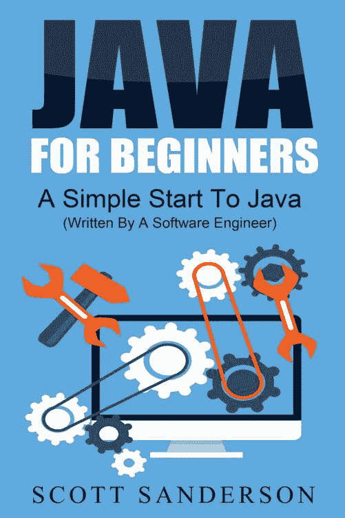

# Java 编程初学者指南




## 引言

Java 是一种编程语言，由甲骨文科技（Sun Microsystems）引入。这项工作由 James Gosling 发起，Java 的最终版本于 1995 年发布。

然而，最初 Java 是作为 Sun 微系统核心平台的一个组件发布的，称为 `J2SE` 或 Java 1.0。Java 或 J2SE 的最新发布版本是 Java 标准版 6。

随着 Java 作为一种编程平台和语言的日益普及，促成了许多针对 Java 开发的工具和配置的发展。例如，`J2ME` 和 `J2EE` 就是两种这样的配置。Java 的最新版本被称为 `Java SE` 和 `Java EE` 或 `Java ME`，而不是 `J2SE`、`J2EE` 和 `J2ME`。使用 Java 平台最大的优势是它允许你在任何机器上运行代码。因此，你只需要编写一次代码，并期望它在任何地方运行。

关于 Java 的特性，如下所示：

## 面向对象

在 Java 中，一切都是对象。由于 Java 围绕对象模型构建，它可以被有效地扩展和延伸到无法想象的维度。

## 平台无关

与包括 `C` 和 `C++` 在内的许多其他编程语言不同，Java 在汇编时不会转换为适用于任何特定机器的格式。相反，它被转换为与机器无关的字节码。这些字节码通过网络传输，并在运行的任何阶段由虚拟机或 `JVM` 解码。

## 简单

Java 的设计初衷是易于学习。如果你理解 OOP（面向对象编程）的核心思想，精通 Java 并不困难。

## 安全

凭借 Java 的安全框架，它能够创建不受病毒和篡改的框架。公钥加密被用作核心认证策略。

## 与机器架构无关

Java 编译器产生的对象文件格式与机器架构是无关的。经过汇编后的代码可以在许多处理器上执行，唯一的要求是它们都必须拥有 Java 运行时框架。

## 可移植性

Java 代码与机器和平台无关的这一事实使其极其紧凑。Java 编译器用 `ANSI C` 编写，具有整洁的可传输性限制，即 `POSIX` 子集。

## 健壮性

Java 通过重点强调运行时检查和编译时检查，试图消除可能导致潜在系统失败的情况。

## 支持多线程应用程序

凭借 Java 的多线程特性，可以编写同时执行许多任务的程序。这种配置技巧允许设计人员构建运行的智能应用程序。

## 解释型代码

Java 字节码在本地机器上被实时解释。开发方法更加快速且直观，因为接口是一个增量且轻量级的过程。

## 高性能

通过利用即时编译器（Just-In-Time compilers），Java 增强了系统性能。

## 分布式

Java 是为了 Web 的分布式环境设计的。

## 动态

Java 被认为比 `C` 或 `C++` 更具动态性，因为它旨在适应一个不断进步的环境。Java 项目可以传递大量的运行时数据，这些数据可用于检查并在运行时对其做出响应。

# Java 历史

James Gosling 于 1991 年 6 月开始开发 `Java` 编程语言，用于他众多许多机顶盒项目之一。该编程语言最初被称为 `Oak`（橡树），这个名字源自 Gosling 办公室外的一棵橡树。后来，这个名字被更改为 `Green`（绿色），并最终从字典中随机选取的一组单词列表中重命名为 `Java`。

Sun 公司在 1995 年发布了第一个开放使用的版本 `Java 1.0`。它保证了“编写一次，随处运行”（WORA），在主流平台上提供了免费的运行环境。2006 年 11 月 13 日，Sun 公司根据 `GNU` 通用公共许可证 (GPL) 的条款，将大部分 `Java` 以免费开源的形式发布。2007 年 5 月 8 日，Sun 公司完成了这一程序，使 `Java` 的大部分核心代码免费并开源，除了一小部分 Sun 公司不拥有版权的代码外。

# 前提条件

为了运行和实验本书中的示例，你需要一台至少带有 64 MB RAM 的 Pentium 200-Mhz 机器。你还需要配套的编程平台：

- Microsoft 记事本或任何文字处理器
- Java JDK `5`
- Linux `7.1` 或 Windows `XP` 或更高操作系统

# Java 基础语法

一个基础的 Java 程序可以分为几个结构和元素。通常，它可以被描述为对象的集合，这些对象通过调用彼此的例程进行通信。对象和类的基本定义如下：

## 类

类可以被描述为蓝图，描绘其对象的所有行为和状态。

## 对象

对象由两个组件组成，即方法和属性或变量。例如，考虑小狗的例子，它具有以下属性或状态：名称、颜色和品种。此外，它还具有以下行为，包括汪汪、摇尾和进。任何对象都只是类的实例。

## 实例变量

每个对象都有一组变量。对象的状态是由程序执行期间分配给这些变量的属性形成的。

## 方法

方法是行为的定义。此外，一个类可以包含许多方法。在这些方法中，组合了逻辑等行为，控制了信息并执行了所有的活动。

# 第一个 Java 程序

为了开始基础的 Java 编程，让我们来看标准的 Hello World 程序。

```java
public class MyFirstJavaProgram {
    public static void main(String []args) {
        System.out.println("Say Hello World To The World!");
    }
}
```

你可以看到，程序在 `main()` 函数中使用单行代码打印出语句“Hello World!”。然而，在执行这一操作之前，让我们看看你在执行该文件时必须遵循的步骤。

1. 打开任何文本编辑器并将此代码粘贴到文件中。
2. 以 `.java` 扩展名保存文件。例如，你可以将文件保存为 `Sample.java`。
3. 下一步是打开系统的命令提示符，并将其引用切换到保存文件的目录。例如，如果你将文件保存在 `C:\`，那么你必须将提示符切换到同一个目录。
4. 为了编译代码，你必须输入：`javac Sample.java`
5. 如果没有错误，你将自动跳转到下一行。你现在可以使用以下命令执行代码：`java Sample.java`

你应该能在屏幕上看到以下输出。

Say Hello World To The World!

# 基础语法规则

关于 Java 程序，记住以下几点非常重要。

## 类名

对于所有类名，首字母应当大写。如果使用几个单词来构建类名，则每个内部单词的首字母都应该是大写。例如，一个标准的类名如下：`class Sampleclass`

## 大小写敏感

Java 是大小写敏感，这意味着标识符 `Hi` 和 `hi` 在 Java 中具有不同的含义。

## 方法名

所有方法名应以小写字母开头。如果使用几个单词来构建方法名，则每个内部单词的首字母应该是大写。这一惯例示例如下：`public void mysamplemethod()`

## 文件名

记录名称必须与类名精确匹配。在保存文件时，你应该使用类名进行保存。记住 Java 是大小写敏感的，并在末尾添加 `.java`。如果文件名和类名不匹配，你的系统将无法编译。

考虑类名 `Sample` 的例子。在这种情况下，你必须将文件命名为 `Sample.java`。

`public static void main(String args[])`

Java 系统处理从 `main()` 函数开始，它是每个 Java 程序的必不可少部分。

# Java 标识符

所有的 Java 组件都需要名称。用于类、变量和方法的名称被称为标识符。在 Java 中，关于标识符有几点需要记。它们遵循以下标准：

- 所有标识符必须以字母（从 a 到 z）、下划线（`_`）或特殊字符（`$`）开头。
- 在第一个字符之后，标识符可以包含任何字符组合。
- 不能使用关键字作为标识符。
- 最重要的是，标识符是大小写敏感的。因此 `Sample` 不等于 `sample`。

标识符示例包括 `$salary`、`age`。非法标识符示例包括 `123abc`。

# Java 修饰符

与其他语言一样，可以使用修饰符来修改类和方法。修饰符分为两种：

- 访问修饰符：`public`、`default`、`protected` 和 `private`
- 非访问修饰符：`static`、`final` 和 `abstract`

我们将在后续章节研究更多关于修饰符的信息。

# Java 变量

Java 支持多种变量。这些变量类型包括：

- 实例变量（非静态变量）
- 类变量（静态变量）
- 局部变量

# Java 数组

数组是存储相同类型变量的连续内存位置。另一方面，数组本身是一个对象。我们将在后续章节研究如何声明、创建和实例化。

# Java 枚举

枚举是在 `Java 5.0` 中作为包引入的。枚举限制变量仅具有预定义的属性之一。此标识列表中的属性被称为枚举。使用枚举可以减少代码中的错误数量。例如，如果我们考虑一个咖啡馆应用程序，可以将杯子尺寸限制为 `extra large`、`large`、`medium` 和 `small`。这可以确保人们不会请求菜单或应用程序列出的尺寸之外的任何尺寸。请注意，枚举可以独立声明，也可以在类内部声明。此外，在枚举体内也可以创建方法、变量和构造函数。

# Java 关键字

Java 中的关键字或保留字在下表所示。根据规则，这些单词不能用作变量或常量的名称。

`assert`, `abstract`, `break`, `boolean`, `case`, `byte`, `char`, `catch`, `const`, `class`, `default`, `continue`, `double`, `do`, `enum`, `else`, `final`, `extends`, `float`, `finally`, `goto`, `for`, `implements`, `if`, `instanceof`, `import`, `int`, `long`, `interface`, `new`, `native`, `private`, `package`, `protected`, `return`, `public`, `static`, `short`, `super`, `strictfp`, `synchronized`, `switch`, `throw`, `this`, `transient`, `throws`, `while`, `try`, `volatile`, `void`

## Java 中的注释

与 `C++` 和 `C` 一样，Java 支持两种类型的注释，即单行注释和多行注释。这些类型注释的语法如下：

### 单行注释

```java
// <comment>
```

### 多行注释

```java
/* <comment> */
```

注释区域中存在的所有字符都会被 Java 编译器直接忽略。

### 空行

任何仅由空白字符或注释组成的行都被视为空行。这些行会被编译器忽略，且不会包含在可执行文件中。

## 继承

Java 支持继承。换句话说，在这一编程语言中，可以从一个类派生出另一个类。例如，如果你需要创建一个现有类的扩展新类，那么你就可以简单地从一个现有类派生出这个新类。这允许新类访问现有类中已经实现的元素。在这种情况下，新类被称为派生类，而现有类被称为超类。

## 接口

如之前所述，Java 的核心在于对象之间的交互。不同对象之间通信的方式是在所谓的“接口”（interface）中定义的。此外，接口也是 Java 继承功能的一个重要方面。作为接口的一部分，声明了派生类或子类可以使用的方法。然而，所有声明为子类可用的方法必须在子类中实现。

## 对象与类

Java 是一种面向对象的编程语言。作为具有面向对象特性的语言，Java 支撑了以下核心思想：

- 继承
- 多态
- 抽象
- 封装
- 对象
- 消息传递
- 类
- 方法
- 实例

在此部分，我们将研究类和对象的概念。

**类**：类可以被描述为一个蓝图，它声明并定义了对象将实现和使用的属性与方法。

**对象**：对象是拥有状态及其特征行为的简单现实实体。例如，如果你考虑一个现实世界的实体——一只拉布拉犬，那么这只狗就是一个对象。但是，它属于狗类。因此，相关的类是 `Dog`。

### Java 中的对象

现在让我们深入研究什么是对象。当我们考虑当前的现实时，我们可以发现周围有许多实体，汽车、人类、狗以及其他等。事实上，任何现实世界的实体都可以建模为一个对象。这些实体之间的共同点是它们都包含状态和行为。如果我们考虑一只狗，那么它的状态是 `breed`（品种）、`name`（名字）和 `color`（颜色）。然而，它的行为包括进食习惯以及跑步和吠叫等特征。

### Java 中的类

类是制造单个对象的蓝图。下面给出了类的示例：

```java
class Dogs {
    String breed;
    String shade;
    int age;
    void eating() { }
    void barking() { }
}
```

类可以包含以下任何一种变量类型。

**局部变量**

在方法、构造函数或代码块内部声明并使用的变量称为局部变量。变量将在方法或作用域内声明并实例化，并在方法执行结束时被销毁。

**实例变量**

实例变量是类内部但在任何方法之外的变量。这些变量在类被加载时实例化。可以从该特定类的任何方法、构造函数或代码块中访问这些变量。

**类变量**

类变量是在类内部声明、在任何方法之外，且前面带有 `static` 关键字的变量。

一个类可以拥有任意数量的方法来实现不同类型的行为。在上面的示例中，`eating()` 和 `barking()` 是被使用的方法。

下面列出了研究 Java 语言类时需要检查的一些重要主题。

### 构造函数

在谈论类时，最重要的子主题之一就是构造函数。每个类都有一个构造函数。如果我们没有显式地为类编写构造函数，Java 编译器会为该类生成一个默认构造函数。每当创建一个对象时，至少会调用一次构造函数。

构造函数的基本原理是它们的名称必须与类名相同。一个类可以有多个构造函数，根据给定的参数调用匹配的构造函数。下面给出这种方法的示例实现：

```java
public class Puppies {
    public Puppies() {
    }
    public Puppies(String puppyname) {
    }
}
```

上面的类有两个构造函数。其中一个构造函数不需要参数。然而，另一个构造函数需要一个等于小狗名字的字符串。Java 还支持单例类，你有能力为类创建一个且仅有的对象。

## 创建对象

如之前所述，类为对象的创建提供了框架。因此，从根本上说对象是从类创建的。在 Java 中，使用 `new` 关键字来创建新对象。

创建任何对象涉及三个步骤。这些步骤如下：

1. **声明**：带有变量名和对象类型的变量声明。
2. **实例化**：利用 `new` 关键字创建已声明类的对象。
3. **初始化**：`new` 关键字后紧跟对构造函数的调用。该调用实例化类并结果创建一个相同的对象。

为了更好地理解该概念，给出的示例实现如下：

```java
public class Puppies {
    public Puppies(String name) {
        System.out.println("传递的名字是: " + name);
    }
    public static void main(String []args) {
        Puppies samplepuppy = new Puppies("jimmy");
    }
}
```

如果我们编译并运行上面的代码，将得到以下结果：

`传递的名字是: jimmy`

## 获取实例变量和方法

变量和方法通过创建的对象来获取。要访问变量，正确的方法应该是：

以下语句创建一个对象。

```java
NewObject = new ConstructorMethod();
```

可以使用以下语句访问与对象相关的变量和方法。

```java
NewObject.variableName;
NewObject.methodName();
```

这里给出了该概念的示例实现：

```java
public class Dog {
    int dogAge;
    public Dog(String dogname) {
        System.out.println("狗传递的名字是: " + dogname);
    }
    public void initAge(int dogage) {
        dogAge = dogage;
    }
    public int getDogAge() {
        System.out.println("狗现在的年龄是: " + dogAge);
        return dogAge;
    }
    public static void main(String []args) {
        Dog myDog = new Dog("jimmy");
        myDog.initAge(5);
        myDog.getDogAge();
        System.out.println("变量 dogAge 的值是: " + myDog.dogAge);
    }
}
```

编译并执行以下代码后，你将看到以下结果：

`变量 dogAge 的值是: 5`

## 源文件声明规范

作为该部分的最后，我们现在研究源文件的声明标准。这些原则在源文件中声明类、导入声明和包时至关重要。

- 每个源文件只能有一个公共类（`public class`）。


- 一个源文件可以有多个非公共类。

`public` 类 `name` 应该是源文档的名称。源文件名必须以 `.java` 字符串结尾。例如，如果类名是 `public class Employeerecord{}`，那么源文档应该保存为 `Employeerecord.java`。

如果类声明在包（`package`）内部，那么包声明应当是源记录中的第一个陈述。

如果存在导入（`import`）语句，则它们必须置于包声明和类揭示之间。如果没有包声明，那么导入语句应该是源文件的第一行。

导入语句和包声明将告知源记录中显示的所有类。在源文件中为不同的类声明不同的导入和/或包说明是不切实际的。

类有几种访问级别。此外，还有不同类型的类，包括 `final` 类，以及其他的若干类。除了上述上述的类之外，Java 还有一些不常见的类，被称为 `Inner` 类（内部类）和 `Anonymous` 类（匿名类）。

## Java 包

基本上，它是一种对类和接口分类的方法。在 Java 中创建应用程序时，会组成许多类和接口。在这种情况下，对这些类进行排序是一项不可或缺的要求，并使生活变得简单得多。在 Java 中，如果给出一个包含类名和包名的完全限定名，那么编译器可以轻松地找到源代码或类。导入声明是为编译器提供正确区域以找到该特定类的方法。

例如，为了加载 `java_installation/java/io` 中可访问的所有类，你必须使用以下语句：

```java
import java.io.*;
```

该概念的示例实现下所示：

以下代码使用了两个类 `Employeerecord` 和 `Employeerecordtest`。第一步是在你的系统中打开打算使用的文本编辑器，并将下方所示的代码复制并粘贴到文本编辑器应用程序中。请记住，代码中的公共类是 `Employeerecord`。因此，文件名应该是 `Employeerecord.java`。该类使用了如下的变量、方法和构造函数：

```java
import java.io.*;

public class Employeerecord {
    int empage;
    String empname;
    double empcompensation;

    public Employee(string empname){
        this.empname = empname;
    }

    public void employeeage(int employeeage){
        empage = employeeage;
    }

    public void empcompensation(double empcompensation){
        empcompensation = empcompensation;
    }

    public void printemp(){
        System.out.println(“empname:”+ empname );
        System.out.println(“empage:” + empage );
        System.out.println(“empcompensation:” + empcompensation);
    }
}
```

正如刚才在此练习中指定的，处理从 main 函数开始。

因此，为了这个目标，我们应该为这个 `Employeerecord` 类创建一个 main 函数。下面是 `Employeerecordtest` 类，它创建了两个 `Employeerecord` 类实例，并为每个项目调用技术为每个变量分配值。你可以将此文件保存为 `Employeerecordtest.java`。

```java
import java.io.*;

public class Employeerecordtest{
    public static void main(String args[]){
        Employeerecord employee1 = new Employeerecord“Jack Wright”); 
        Employeerecord employee2 = new Employeerecord“Mary John”); 
        employee1.employeeage(32);
        employee1.empcompensation(5000);
        employee2.employeeage(25);
        employee2.empcompensation(2000);
        employee1.printemp();
        employee2.printemp();
    }
}
```

编译并执行后，你将获得以下输出：

empname: Jack Wright

empage: 32

empcompensation: 5000

empname: Mary John

empage: 25

empcompensation: 2000

## 基本数据类型

变量只是用于存储值的内存区域。这意味着当你创建一个变量时，你就在内存中节省了一些空间。根据变量的数据类型，工作框架会分配内存并选择可以放入所持内存的内容。

因此，通过为变量指定不同的数据类型，你可以在这些变量中存储整数、小数或字符。

Java 中有两种可用的数据类型：

1. 引用/对象数据类型
2. 基本数据类型

## 基本数据类型

Java 支持八种基本信息类型。基本数据类型由语言预定义，并用特定的短语命名。本节将详细讨论这些数据类型。

### byte

`byte` 信息类型是一个 8 位的带符号补码整数。

最大值为 `2⁷ -1`，等于 `127`。该值也包含在这些值的范围内。

最小值为 `-2⁷`，等于 `-128`。

存储在此类型变量中的默认值为 `0`。

`byte` 信息类型用于在大型数组中节省空间，特别是数字的设置，因为一个字节比一个 `int` 小四倍。

示例：

```java
byte x = 200, byte y = -20
```

### short

`short` 信息类型是一个 16 位的带符号补码数。

最大值为 `2¹⁵ -1`，等于 `32767`。该值也包含在这些值的范围内。

最小值为 `-2¹⁵`，等于 `-32768`。

示例：

```java
short x = 42, short y =76
```

### int

`int` 信息类型是一个 32 位的带符号补码数。

最大值为 `2³¹ -1`，等于 `2147483647`。该值也包含在这些值的范围内。

最小值为 `-2³¹`，等于 `-2147483648`。

`int` 通常作为整数的默认信息类型。

示例：

```java
int x = 8263, int y = -647
```

### long

`long` 信息类型是一个 64 位的带符号补码整数。

最大值为 `2⁶³ -1`，等于 `9223372036854775807`。

最小值为 `-2⁶³`，等于 `-9223372036854775808`。

`long` 在需要比 `int` 更大的内存范围时使用。

示例：

```java
long x = 174636L, long y = -53645L
```

### float

`float` 是一种类型以单精度 32 位 IEEE 754 浮点数为特征。

`float` 通常在大型浮点数数组中节省内存。

该数据类型的默认值为 `0.0f`。

示例：

```java
float x = 254.3f
```

### double

`double` 信息类型是双精度 64 位 IEEE 754 浮点数。

`double` 通常作为小数属性的默认信息类型。

该数据类型的默认值为 `0.0d`。

示例：

```java
double x = 321.4
```

### boolean

`boolean` 信息类型表示比特数据。

任何 `boolean` 变量可以是两个值之一：`true` 或 `false`。

`boolean` 信息类型用于跟踪真/假条件的基本旗帜。

该数据类型的默认值为 `false`。

示例：

```java
boolean check = true;
```

### char

`char` 信息类型是一个单 16 位 Unicode 字符。

该类型变量的最大值为 `\uffff`（或 65535）。

该类型变量的最小值为 `\u0000`（或 0）。

示例：

```java
char text = 'a';
```

## 引用数据类型

引用变量通过类的特征化构造函数创建。

它们被用于访问对象。这些变量（常量）被声明为特定的数据类型，且该类型不可更改。此类数据类型的几个示例是 `Employee` 和 `Dog`。

类对象和不同类型的变量属于引用数据类型。

任何引用变量的默认估值都是无效的。

引用变量可以用于引用已声明种的任何对象。

示例：`myanimal = new Animals(“rabbit”);`

## Java 字面量

Java 中的字面量是固定值的源码表示。它们在代码中被具体地表达，而不经过任何计算。字面量可以分配给任何基本类型变量。例如：

```java
byte x = 86;
char x = “a”
```

`int`、`byte`、`short` 和 `long` 也可以以十六进制（16 进制）、十进制（10 进制）或八进制（8 进制）数字框架进行通信。在利用这些数字框架表示字面量时，使用前缀 `0` 表示八进制，而使用前缀 `0x` 表示十六进制。例如，

```java
int numd = 134;
int numo = 0243;
int numx = 0x95;
```

Java 中的字符串字面量与大多数其他编程语言一样，通过在一对双引号之间封装一组字符来确定。

字符串字面量的示例为：

“Hi Everyone” “two\nlines” “"these characters are inside quotes"”

字符串类型的字面量可以包含任何 Unicode 字符。例如：`String news = “\u0001”`。

你也可以在 Java 中转义序列。以下是你可以使用的转义序列列表：

- 双引号 - `"`
- 回车 (0x0d) - `\r`
- 新行 (0x0a) - `\n`
- 单引号 - `'`
- 退格 (0x08) - `\b`
- 换页 (0x0c) - `\f`
- 制表符 - `\t`
- 空格 (0x20) - `\s`
- 八进制字符 (ddd) - `\ddd`
- 反斜杠 - `\`
- 十六进制 UNICODE 字符 (xxxx) - `\uxxxx`

## 变量类型

变量为我们提供了代码可以控制的具名容量。Java 中的每个变量都有特定的类型，该类型决定了变量内存的大小和格式；内存中可以存储的值范围；以及可以与变量关联的操作 set。在使用所有变量之前，必须对其进行显式声明。变量可以用以下方式声明：`Data type <variable name>;`

这里 `data type` 是 Java 的数据类型之一。相反，变量是与变量关联的名称或标识符。要声明多个指定类型的变量，你可以使用逗号分隔的列表。这里是声明的几个示例：

以下声明声明了三个整数变量。

```java
int x, y, z;
```

同样，也可以声明其他数据类型的变量。Java 支持三种类型的变量。这些类型如下：

1. 类/静态变量
2. 实例变量
3. 局部变量

## 局部变量

局部变量在方法、构造函数或作用域中声明。

局部变量在进入构造函数或方法时创建，一旦退出方法、构造函数或作用域，该变量将被销毁。

访问修饰符不能用于局部变量。

局部变量仅在声明的方法、构造函数或作用域内部可见。

局部变量在栈级别执行。

这些变量没有默认值。因此，局部变量在第一次使用之前必须被声明并分配一个初始值。

### 示例实现

在这里，`age` 是一个局部变量。它在 `pupage()` 方法内部被定义，其范围仅限制于此方法。

```java
public class myTest{
    open void newfunc(){
        int myvar = 1;
        myvar = myvar + 10;
        System.out.println(“The value of myvar is: ” + myvar);
    }
    public static void main(string args[]){
        mytest = new myTest ();
        mytest.myfunc();
    }
}
```

此代码执行的输出为：

`The value of myvar is: 11`

## 实例变量

实例变量的声明在类内部。然而，它是在方法、构造函数或任何作用域之外创建。

当使用 `new` 关键字创建对象时会创建实例变量，并在对象被销毁时销毁。

当内存中为对象分配空间时，会为每个变量值创建一个空间。

实例变量可以在类级别在使用之前或之后声明。

实例变量持有的值必须被多个方法、构造函数或部分引用，或者对象表达式中在整个类中必须可见的关键部分。

实例变量可以赋予访问修饰符。

实例变量有默认值。对于数字，默认值是 0。然而，对于 `Booleans`，它是 `false`，对于对象引用，它是无效的。值可以在语句中或构造函数内部分配。

类变量对于类中的所有方法、构造函数和作用域都是可见的。通常，建议将这些变量设为私有（访问级别）。然而，可以使用访问修饰符为这些变量赋予子类可见性。

可以通过在类内部调用变量名来访问实例变量。此语句可用于语句：`Objectreference.variablename.`

### 示例实现

```java
import java.io.*;

public class Employeerecord{
    public String empname;
    private double empcompensation;

    public Employee (String name){
        empname = name;
    }
    public void initsalary(double empsalary){
        empcompensation = empsalary;
    }
    public void printemployee(){
        System.out.println(“Employee name : ” + empname);
        System.out.println(“Employee salary :” + empcompensation);
    }
    public static void main(string args[]){
        Employeerecord employee1 = new Employeerecord“Mary”);
        employee1.initsalary(7500);
        employee1.printemployee();
    }
}
```

结果：

`Employee name : Mary`

`Employee salary :7500.0`

## 类/静态变量

类变量也称为静态变量，在类中使用 `static` 关键字声明，但在构造函数、方法或作用域之外。每个类都只有一个类变量的副本，无论创建了多少对象。

静态变量除了被声明为常量外很少使用。常量是声明为 `private/public`、`static` 和 `final` 的变量。常量变量从不改变其初始值。

静态变量存储在静态内存中。静态变量除了作为私有或公共常量使用外极少使用。静态变量在系统启动时创建，在执行停止时销毁。

可见性类似于实例变量。在任何情况下，大多数静态变量被声明为公共，因为它们必须对类的客户端可见。

这些变量的默认值与实例变量相同。对于数字，默认值通常是 0。然而，`Booleans` 的相同值是 `false`，对于对象引用无效无效。值可以在断言或构造函数内部分配。此外，值可以在唯一的静态初始化块中分配。

可以通过调用类名访问静态变量：`Classname.variablename.` 当声明类变量为 `public static final` 时，变量名（常量）必须全大写。此外，静态变量不是公有的，命名约定与局部和实例变量相同。

### 示例实现

```java
import java.io.*;

public class Employeerecord{
    private static double empcompensation;
    public static final String empdept = “HR “;

    public static void main(string args[]){
        empcomp = 7500;
        System.out.println(empdept+” Compensation: ”+empcompensation);
    }
}
```

结果：

`HR Compensation: 7500`

修饰符是你添加到定义中的短语，用于改变它们的含义。Java 编程语言拥有丰富且多样的修饰符，包括：

### 非访问修饰符

## Java 访问修饰符

为了使用修饰符，将其短语整合到类、变量或方法的含义中。修饰符位于声明内容的之前。

### 访问控制修饰符

Java 提供了各种访问修饰符来设置类、变量、程序和构造函数的访问级别。四种访问权限为：

- `Private`：类内可见。
- `Default`：包内可见。不需要修饰符。
- `Secured`：对所有子类和包可见。
- `Public`：对所有人可见。

### 非访问修饰符

Java 提供了各种非访问修饰符来实现许多其他用途。

- `Static`：用于创建类变量和方法的 `static` 修饰符。


# Java 修饰符

- `Final`：用于结束类、变量和方法执行的 `final` 修饰。
- `Abstract`：此修饰符用于创建抽象方法和抽象类。
- `Volatile` 和 `Synchronized`：这些修饰符通常用于线程。

# Java 中的运算符

Java 中的运算符集非常丰富。广而言，Java 中可用的运算符分为以下几类：

- 关系运算符
- 算术运算符
- 逻辑运算符
- 位运算符
- 杂运算符
- 赋值运算符

## 算术运算符

Java 中的操作方式本质上与代数中相同。它们与变量配合执行算术操作。以下是 Java 中可用的算术运算符列表。

| 操作 | 运算符 | 描述 |
| :--- | :--- | :--- |
| 加法 | `+` | 相两个变量的值 |
| 减法 | `-` | 减去两个变量的值 |
| 乘法 | `*` | 乘两个变量的值 |
| 除法 | `/` | 除以两个变量的值。结果为 |
| 取模 | `%` | 除法的余数 |
| 递增 | `++` | 将值加 1 |
| 递减 | `--` | 将值减 1 |

## 关系运算符

Java 还支持几种关系运算符。Java 支持的关系运算符列表所示。

| 操作 | 运算符 | 描述 |
| :--- | :--- | :--- |
| 等于 | `==` | 比较两个变量的值是否相等 |
| 不等于 | `!=` | 比较两个变量的值是否不等 |
| 大于 | `>` | 检查一个值是否大于另一个值 |
| 小于 | `<` | 检查一个值是否小于另一个值 |
| 大于等于 | `>=` | 检查一个值是否大于或等于另一个值 |
| 小于等于 | `<=` | 检查一个值是否小于或等于另一个值 |

## 位运算符

Java 中可用的位运算符可以很容易应用于多种数据类型。

这些数据类型包括 `byte`、`short`、`long`、`int` 和 `char`。通常，任何位运算符都会按位执行相关操作。例如，考虑整数 `x`，其值为 `60`。因此，`x` 的二进制等效值是 `00111100`。

考虑另一个变量 `y`，其值为 `13` 或 `00001101`。如果我们对这两个数字执行位运算 `&`，你将得到以下结果：`x & y = 0000 1100`

下表显示了 Java 中可用的位运算符列表。

| 操作 | 运算符 | 描述 |
| :--- | :--- | :--- |
| 二进制与 | `&` | 执行 AND 运算 |
| 二进制或 | `\|` | 执行 OR 运算 |
| 二进制异或 | `^` | 执行 XOR 运算 |
| 补码 | `~` | 对一元变量执行取反操作 |
| 二进制左移 | `<<` | 执行位的左移 |
| 二进制右移 | `>>` | 执行位的右移 |

除了上述提到的，Java 还支持右移零符号填充运算符 (`>>>`)，它会将移后的右侧位填充零。

## 逻辑运算符

逻辑运算符是任何运算符集的不可或缺的一部分。Java 支持的逻辑运算符如表所示。

| 操作 | 运算符 | 描述 |
| :--- | :--- | :--- |
| 逻辑与 | `&&` | 如果两个提到的条件都为真，则返回 True |
| 逻辑或 | `\|\|` | 如果提到的条件一个或两个都为真，则返回 True |
| 逻辑非 | `!` | 如果提到的条件为假，则返回 True |

## 赋值运算符

Java 语言支持以下赋值运算符：

| 操作 | 运算符 | 描述 |
| :--- | :--- | :--- |
| 简单赋值 | `=` | 将右侧的值赋值给左侧的变量 |
| 加赋值 | `+=` | 将右侧的值加到左侧变量的值，并将结果赋值给左侧变量 |
| 减赋值 | `-=` | 将右侧的值从左侧变量的值减去，并将结果赋值给左侧变量 |
| 乘赋值 | `*=` | 将右侧的值乘以左侧变量的值，并将结果赋值给左侧变量 |
| 除赋值 | `/=` | 将右侧的值除以左侧变量的值，并将结果赋值给左侧变量 |
| 取模 | `%=` | 取左侧和右侧的模，并将结果赋值给左侧变量 |
| 左移 | `<<=` | 取左侧和右侧的左移，并将结果赋值给左侧变量 |
| 右移 | `>>=` | 取左侧和右侧的右移，并将结果赋值给左侧变量 |
| 位与 | `&=` | 取左侧和右侧的位与，并将结果赋值给左侧变量 |
| 位异或 | `^=` | 取左侧和右侧的位异或，并将结果赋值给左侧变量 |
| 位或 | `\|=` | 取左侧和右侧的位或，并将结果赋值给左侧变量 |

## 杂运算符

除了上述提到的，Java 还支持其他几种运算符。

### 条件运算符 ( ? : )

条件运算符是一个包含三个操作数的三元运算符。本质上，该运算符用于布尔表达式的评估。运算符测试第一个操作数或条件，如果条件为真，则将第二个值赋予变量。然而，如果条件为假，则将第三个操作数赋予变量。

该运算符的语法如下：

`变量 a = (<条件>) ? 真值 : 假值`

```java
public class myTest {
    public static void main(String args[]) {
        int x, y;
        x = 5;
        y = (x == 5) ? 15 : 40;
        System.out.println("y = " + y);
        y = (x == 34) ? 60 : 95;
        System.out.println("x = " + y);
    }
}
```

此代码的编译和执行将给出结果：

```
y = 15
x = 95
```

### instanceof 运算符

只有对象引用变量可以使用此运算符。此运算符的目的是检查对象是否是现有类的实例。该运算符的语法如下：

`(<对象引用变量>) instanceof (<接口/类>)`

```java
public class myTest {
    public static void main(String args[]) {
        int x = 4;
        boolean resultant = x instanceof int;
        System.out.println(resultant);
    }
}
```

此代码的输出应为 true。此运算符也可以用于比较。示例实现如下所示：

```java
class Animal {}
public class Monkey extends Animal {
    public static void main(String args[]) {
        Animal newa = new Monkey();
        boolean resultant = newa instanceof Monkey;
        System.out.println(resultant);
    }
}
```

此代码的输出也为 true。

通常情况下，运算符在表达式中是组合使用的。然而，你可能已经意识到，预测执行期间操作完成的顺序会变得困难。`Java` 的运算符优先级表将帮助你在进行表达式推导时预测运算符的操作顺序。例如，如果你在同一个表达式中执行加法和乘法，那么乘法将先于加法。下表展示了 `Java` 中运算符的顺序和层次结构。所有运算符的结合性从左到右。然而，一元、赋值和条件运算符遵循从右到左的结合性。

| 运算符 | 类别 |
| :--- | :--- |
| `()` `[]` `.` (点运算符) | 后置 |
| `++` `--` `-` `!` `~` | 一元 |
| `*` `/` `%` | 乘法 |
| `+` `-` | 加法 |
| `>>` `>>>` `<<` | 移位 |
| `>` `>=` `<` `<=` | 关系 |
| `==` `!=` | 相等 |
| `&` | 按位与 |
| `^` | 按位异或 |
| `\|` | 按位或 |
| `&&` | 逻辑与 |
| `\|\|` | 逻辑或 |
| `?:` | 条件 |
| `=` `+=` `-=` `*=` `/=` `%=` `>>=` `<<=` `&=` `^=` `\|=` | 赋值 |
| `,` | 逗号 |

# Java 中的循环

循环是你预计会经常遇到的常见编程情况。循环简单地描述为你可能需要重复执行同一块代码的情况。`Java` 支持三种循环结构，如下所示：

- `for` 循环
- `do…while` 循环
- `while` 循环

此外，还存在 `foreach` 循环结构。然而，该结构将在数组的章节中进行解释。

## while 循环

`while` 循环是一种控制结构，允许你按特定次数重新执行某个任务。该构造的语法如下：

```java
while (boolean_expression) {
    // 语句
}
```

在执行点上，如果 `boolean_expression` 的结果为真，则圆括号内的活动将被执行。这将一直持续，直到条件的结果为真。在这里，`while` 循环的主要作用是循环可能永远不会运行。当尝试解释且结果为假时，循环体将被跳过，并将执行 `while` 循环后的第一个声明。

示例：

```java
public class myTest {
    public static void main(String args[]) {
        int i = 5;
        while (i < 10) {
            System.out.print(" i = " + i);
            i++;
            System.out.print("\n");
        }
    }
}
```

这将交付相应的结果：

```
i = 5
i = 6
i = 7
i = 8
i = 9
```

## do…while 循环

`do…while` 循环与 `while` 循环结构相似，不同之处在于 `do…while` 循环被确保至少执行一次。该循环构造的语法如下：

```java
do {
    // 语句 
} while (<boolean_expression>);
```

请注意，布尔声明出现在循环的末尾，因此代码在尝试布尔之前会执行一次。如果布尔声明为真，控制流将跳回 `do`，代码再次执行一次。这种方法将重复，直到布尔表达式为假。

示例实现：

```java
public class myTest {
    public static void main(String args[]) {
        int i = 1;
        do {
            System.out.print("i = " + i);
            i++;
            System.out.print("\n");
        } while (i < 1);
    }
}
```

这将产生相应的结果：

```
i = 1
```

## for 循环

`for` 循环是一种迭代控制结构，允许你有效地组合一个需要执行特定次数的循环。当你知道一个任务要重复执行多少次时，`for` 循环构造非常有帮助。该循环构造的语法如下：

```java
for (initialization; Boolean_expression; update) {
    // 语句 
}
```

这里是 `for` 循环中的控制流：

1. 首先执行初始化步骤，且仅一次。此步骤允许你声明并引入任何循环控制变量。你不需要在这里进行声明，分号的长度会出现。
2. 接下来评估布尔输出。如果为真，则执行循环体。如果为假，则不执行循环体，控制流跳转到 `for` 循环之后的下一个声明。
3. 在 `for` 循环体执行后，控制流跳回更新声明。此声明允许你更新任何循环控制变量。此声明可以留空，布尔声明后会出现分号的长度。
4. 再次评估布尔输出。如果为真，循环执行并作用域重写。在布尔声明为假后，`for` 循环结束。

示例实现：

```java
public class myTest {
    public static void main(String args[]) {
        for (int i = 0; i < 5; i++) {
            System.out.print("i = " + i);
        }
    }
}
```

这将交付相应的结果：

```
i = 0
i = 1
i = 2
i = 3
i = 4
```


## Java 运算符优先级

通常情况下，运算符在表达式中是组合使用的。然而，你可能已经意识到，预测执行期间操作完成的顺序会变得困难。`Java` 的运算符优先级表将帮助你在进行表达式推导时预测运算符的操作顺序。例如，如果你在同一个表达式中执行加法和乘法，那么乘法将先于加法。下表展示了 `Java` 中运算符的顺序和层次结构。所有运算符的结合性从左到右。然而，一元、赋值和条件运算符遵循从右到左的结合性。

| 运算符 | 类别 |
| :--- | :--- |
| `()` `[]` `.` (点运算符) | 后置 |
| `++` `--` `-` `!` `~` | 一元 |
| `*` `/` `%` | 乘法 |
| `+` `-` | 加法 |
| `>>` `>>>` `<<` | 移位 |
| `>` `>=` `<` `<=` | 关系 |
| `==` `!=` | 相等 |
| `&` | 按位与 |
| `|` | 按位或 |
| `^` | 按位异或 |
| `&&` | 逻辑与 |
| `||` | 逻辑或 |
| `?:` | 条件 |
| `=` `+=` `-=` `*=` `/=` `%=` `>>=` `<<=` `&=` `^=` `|=` | 赋值 |
| `,` | 逗号 |

## Java 中的循环

循环是你预计会经常遇到的常见编程情况。循环简单地描述为你可能需要重复执行同一块代码的情况。`Java` 支持三种循环结构，如下所示：

- `for` 循环
- `do…while` 循环
- `while` 循环

此外，还存在 `foreach` 循环结构。然而，该结构将在数组的章节中进行解释。

### while 循环

`while` 循环是一种控制结构，允许你按特定次数重新执行某个任务。该构造的语法如下：

```java
while(boolean_expression) {
    // 语句
}
```

在执行点上，如果 `boolean_expression` 的结果为真，则圆括号内的活动将被执行。这将一直持续，直到条件的结果为假。在这里，`while` 循环的主要特点是循环可能永远不会运行。当尝试解释且结果为假时，循环体将被跳过，并将执行 `while` 循环后的第一个声明。

示例：

```java
public class myTest {
    public static void main(string args[]) {
        int i = 5;
        while(i < 10) {
            System.out.print(" i = " + i );
            i++;
            System.out.print("\n");
        }
    }
}
```

这将交付相应的结果：

```text
i = 5
i = 6
i = 7
i = 8
i = 9
```

### do…while 循环

`do…while` 循环与 `while` 循环结构相似，不同之处在于 `do…while` 循环被确保至少执行一次。该循环构造的语法如下：

```java
do {
    // 语句
}
while(<booleanexpression>);
```

请注意，布尔声明出现在循环的末尾，因此代码在尝试布尔之前会执行一次。如果布尔声明为真，控制流将跳回 `do`，代码再次执行一次。这种方法将重复，直到布尔表达式为假。

示例实现：

```java
public class myTest {
    public static void main(string args[]){
        int i = 1;
        do{
            System.out.print("i = " + i );
            i++; System.out.print("\n");
        }while( i < 1 );
    }
}
```

这将产生相应的结果：

```text
i = 1
```

### for 循环

`for` 循环是一种迭代控制结构，允许你有效地组合一个需要执行特定次数的循环。当你知道一个任务要重复执行多少次时，`for` 循环构造非常有帮助。该循环构造的语法如下：

```java
for(initialization; Boolean_expression; redesign)
{
    // 语句
}
```

这里是 `for` 循环中的控制流：

1. 首先执行初始化步骤，且仅一次。此步骤允许你声明并引入任何循环控制变量。你不需要在这里进行声明，分号的长度会出现。
2. 接下来评估布尔输出。如果为真，则执行循环体。如果为假，则不执行循环体，控制流跳转到 `for` 循环之后的下一个声明。
3. 在 `for` 循环体执行后，控制流跳回重写声明。此声明允许你重写任何循环控制变量。此声明可以留空，布尔声明后会出现分号的长度。
4. 再次评估布尔输出。如果为真，循环执行并作用域重写。在布尔声明为假后，`for` 循环结束。

示例实现：

```java
public class myTest {
    public static void main(string args[]) {
        for(int i = 0; i < 5; i++) {
            System.out.print("i = " + i);
        }
    }
}
```

这将交付相应的结果：

```text
i = 0
i = 1
i = 2
i = 3
i = 4
```

## if…else 语句

一个 `if` 声明后面可以跟一个非强制的 `else` 解释，该解释在布尔输出为假（false）时执行。该构造的语法如下：

```java
if(<condition>){
    // 如果条件为真则执行
}
else{
    // 如果条件为假则执行
}
```

示例实现：

```java
public class myTest {
    public static void main(string args[]){
        int i = 0;
        if( i > 1 ){
            System.out.print("The if construct is executing!");
        }
        else{
            System.out.print("The else construct is executing!");
        }
    }
}
```

这将产生相应的结果：

```text
The else construct is executing!
```

## if…else if 语句

一个 `if` 声明后面可以跟一个非强制的 `else if…else` 解释，这对于利用单一 `if…else if` 表达式来测试不同的条件非常有帮助。

在使用 `if`、`else if`、`else` 声明时，有几点需要记住：

- 一个 `if` 可以有零个或一个 `else`，并且它必须在任何 `else if` 之后。
- 一个 `if` 可以有零个到多个 `else if`s，并且它们必须在 `else` 之前。
- 如果其中一个 `if` 条件返回真（true），则其他的 `else ifs` 和 `else` 将被忽略。

使用此决策性构造的语法如下：

```java
if(condition_1){
    // 如果 condition_1 为真则执行
}
else if(condition_2){
    // 如果 condition_2 为真则执行
}
else if(condition_3){
    // 如果 condition_3 为真则执行
}
else
{
    // 如果所有条件为假则执行
}
```

示例实现：

```java
public class myTest {
    public static void main(string args[]){
        int i = 0;
        if( i > 1 ){
            System.out.print("The first if construct is executing!");
        }
        else if(i == 0){
            System.out.print("The second if construct is executing!");
        }
        else{
            System.out.print("The else construct is executing!");
        }
    }
}
```

这将产生相应的结果：

```text
The second if construct is executing!
```

## 嵌套 if…else 语句

嵌套 `if-else` 构造是允许的，这意味着你可以在另一个 `if` 或 `else if` 解释内部使用 `if` 或 `else if` 声明。使用此构造的语法如下：

```java
if(condition_1){
    // 如果 condition_1 为真则执行
    if(condition_2){
        // 如果 condition_2 为真则执行
    }
}
else if(condition_3){
    // 如果 condition_3 为真则执行
}
else
{
    // 如果所有条件为假则执行
}
```

示例实现：

```java
public class myTest {
    public static void main(string args[]){
        int i = 1;
        if( i >= 1 ){
            System.out.println("The if construct is executing!");
            if(i == 1){
                System.out.println("The nested if construct is executing!");
            }
        }
        else{
            System.out.print("The else construct is executing!");
        }
    }
}
```

这将产生相应的结果：

```text
The if construct is executing!
The nested if construct is executing!
```

## switch 语句

`switch` 构造允许对变量与一组值进行等效性比较。

每个值被称为一个 `case`，而被比较的变量会在每个 `case` 中进行检查。使用此决策性构造的语法如下：

```java
switch(<condition>){
    case value1:
        // 语句
        break;
    case value2 :
        // 语句
        break;
    default:
        // 可选
}
```

相应的规则适用于 `switch` 构造：

- 作为 `switch` 解释一部分使用的变量必须是 `short`、`byte`、`char` 或 `int`。
- 你可以在 `switch` 内部拥有任意数量的 `case` 解释。每个 `case` 后面跟着要对比的值和一个冒号。
- `case` 的值类型必须与 `switch` 中的变量类型相同，并且它必须是一个常量或精确值。
- 当被比较的变量等于某个 `case` 时，该 case 之后的语句将执行，直到遇到 `break`。
- 当遇到 `break` 时，`switch` 结束，控制流跳转到 `switch` 之后的行。
- 并不是每个 `case` 都需要包含一个 `break`。如果没有出现 `break`，控制流将向下贯穿到后续的 `case`，直到遇到 `break` 为止。
- `switch` 声明可以有一个可选的 `default` case，它必须出现在 `switch` 的末尾。`default` case 可用于在没有任何 `case` 为真时执行某些操作。`default` case 不需要 `break`。但是，根据惯例，建议使用它。

示例实现：

```java
public class myTest {
    public static void main(string args[]){
        char mygrade = 'A';
        switch(mygrade)
        {
            case 'A':
                // 语句
                break;
            case 'B' :
                // 语句
                break;
            default:
                // 语句
                System.out.println("Failed");
        }
    }
}
```

> 注：此处示例代码逻辑与原文略有出入（引号符号问题），但根据要求保留了代码块内容。

相应的运行结果适用于 `switch` 构造：

```text
Excellent!
```

## String 类方法

本节包含了 `String` 类中可用的方法列表。

- `int compareTo(Object obj)` – 此函数将指定的字符串与相关的对象进行比较。
- `char charAt(int chindex)` – 此函数返回位于索引值 `index` 处的字符。
- `int compareToIgnoreCase(String mystr)` – 此函数对两个字符串进行字典序比较。然而，该函数会忽略大小写差异。
- `int compareTo(String aString)` – 此函数在字符串之间进行字典序比较。
- `boolean contentEquals(StringBuffer strb)` – 此函数检查字符串是否与 `StringBuffer` 中存在的字符序列相同。成功时返回 true，失败时返回 false。
- `String concat(String strnext)` – 此函数在字符串末尾附加另一个字符串。
- `static String copyValueOf(char[] mydata, int xoffset, int xcount)` – 此函数返回一个字符串，该字符串表示原始字符串中的字符序列。
- `static String copyValueOf(char[] newdata)` – 此函数将字符字符串以字符序列的形式复制到字符缓冲区中。
- `boolean equals(Object aObject)` – 此函数将对象与相关的字符串进行比较。
- `boolean endsWith(String newsuffix)` – 此函数检查字符串是否带有指定的后缀。
- `byte getBytes()` – 使用此函数，可以将字符串编码为字节格式，并将其存储在结果数组中。
- `boolean equalsIgnoreCase(String aString)` – 此函数在不考虑字符大小写的情况下对两个字符串进行比较。
- `void getChars(int srcBegin, int sourceEnd, char[] dst, int destinationBegin)` – 此函数将从指定的起始字符到结束字符的字符复制到数组中。
- `byte[] getBytes(String charsetnm)` - 使用此函数，可以使用命名字符集将字符串编码为字节格式，并存储在结果数组中。
- `int indexOf(int charx)` – 此函数返回与函数调用中指定的字符相同的第一个字符的索引。
- `int hashCode()` – 返回字符串的哈希值。
- `int indexOf(String newstr)` - 此函数返回子字符串在字符串中首次出现的索引。
- `int indexOf(int charx, int fromIndexloc)` – 此函数返回与函数调用中指定的字符相同的第一个字符的索引。搜索从指定的索引开始。
- `String intern()` – 返回函数调用给出的字符串对象的规范表示。
- `int indexOf(String newstr, int fromIndexloc)` - 此函数返回子字符串在字符串中首次出现的索引。搜索从指定的索引开始。
- `int lastIndexOf(int charx, int fromIndexloc)` - 此函数从指定的索引开始搜索字符，并返回最后一次出现处的索引。
- `int lastIndexOf(int charx)` - 此函数反向搜索字符，并返回反向搜索中最后一次或首次出现处的索引。
- `int lastIndexOf(String newstr, int fromIndexloc)` – 此函数从指定的索引搜索子字符串，并返回最后一次出现处的索引。
- `int lastIndexOf(String newstr)` - 此函数反向搜索子字符串，并返回反向搜索中最后一次或首次出现处的索引。
- `boolean matches(String aregex)` - 此函数检查字符串区域与正则表达式之间的相等性。
- `int length()` – 此函数计算并返回字符串长度。


# Java String 方法

`boolean regionMatches(int totaloffset, String otherstr, int otheroffset, int strlen)` – 此函数检查字符串区域之间的相等性。

`boolean regionMatches(boolean ignorecharcase, int totaloffset, String otherstr, int otheroffset, int strlen)` – 此函数检查字符串区域之间的相等性。

`String replace(char oldCharx, char newCharx)` - 此函数查找匹配正则表达式的子字符串，然后将所有出现处替换为指定的字符串。函数返回完成所有替换后的结果字符串。

`String replaceFirst(String newregex, String newreplacement)` – 此函数查找匹配正则表达式的子字符串，然后将第一次出现处替换为指定的字符串。

`String replaceAll(String newregex, String xreplacement)` - 此函数查找匹配正则表达式的子字符串，然后将所有出现处替换为指定的字符串。

`String[] split(String newregex, int xlimit)` – 此函数根据正则表达式和给定限制对字符串进行分割。

`String[] split(String newregex)` - 此函数根据正则表达式对字符串进行分割。

`boolean startsWith(String newprefix, int totaloffset)` – 此函数检查给定字符串在指定索引处是否具有前缀。

`boolean startsWith(String newprefix)` – 此函数检查给定字符串是否以函数调用传递的前缀开头。

`String substring(int beginIndexloc)` – 此函数返回字符串的子字符串。子字符串由起始索引到字符串末尾确定。

`CharSequence subSequence(int beginIndexloc, int endIndexloc)` – 此函数返回字符序列，它是指定字符序列的子字符序列。子字符串由起始和结束索引确定。

`char[] toCharArray()` – 此函数执行字符串到字符数组的转换。

`String substring(int beginIndexloc, int endIndexloc)` – 此函数返回字符串的子字符串。子字符串由起始索引和结束索引确定。

`String toLowerCase(Locale localenew)` - 此函数使用指定的语言规则将指定字符串中的所有字符转换为小写。

`String toLowerCase()` - 此函数使用默认语言规则将指定字符串中的所有字符转换为小写。

`String toUpperCase()` - 此函数使用默认语言规则将指定字符串中的所有字符转换为大写。

`String toString()` – 此函数返回字符串本身。

`String toUpperCase(Locale localenew)` – 此函数使用语言规则将指定字符串中的所有字符转换为大写。

`static String valueOf(primitive data type x)` – 此函数返回一个字符串表示。

`String trim()` – 去除字符串开头和结尾的空白字符。

# 数组

Java 支持一种类似于簇（cluster）的信息结构。这种信息结构被称为数组。它能够存储相同数据类型组件的尺寸可变的连续累积。数组用于存储信息的累积，但将其考虑为存储同类变量的容器通常更有价值。

与声明单个变量（例如 `num0`、`num1` 和 `num99`）相比，可以声明一个数组。

你可以利用 `new` 运算符配合以下语句来创建一个数组：`myarray = new datatype[sizeofarray];`

上述声明执行了两个操作：

1. 它在 `new` 运算符的帮助下以以下方式创建了一个数组：`new datatype[arraysize];`
2. 它将最近创建的数组的引用赋值给变量 `myarray`。

声明一个数组变量、创建数组并将该数组的引用分配给变量可以合并为一个声明，如所示：`datatype[] myarray = new datatype[sizeofarray];`

另一方面，你也可以通过以下方式创建聚类数组：`datatype[] myarray = {val0, val1, …, valk};`

数组的组件可以通过记录获取。数组列表是基于 0 索引的；也就是说，它们从 0 开始到 `myarray.length-1` 结束。

## 示例实现

所示的声明定义了一个数组 `myarray`，创建了一个包含 10 个 `double` 类型组件的聚类，并将其引用赋值给 `myarray`：`double[] myarray = new double[10];`

## 处理数组

在处理数组组件时，我们经常使用 `for` 或 `foreach`，因为数组中的大多数组件都是相同类型，且数组的长度是已知的。

## 示例

```java
public class Mytestarray {
    public static void main(string[] args) {
        double[] myarray = {0.5, 1.2, 2.2, 3.4, 4.7};
        for (int k = 0; k < myarray.length; k++) {
            System.out.println(myarray[k] + " ");
        }
        double aggregate = 0;
        for (int k = 0; k < myarray.length; k++) {
            aggregate += myarray[k];
        }
        System.out.println("Aggregate value = " + aggregate);
        double maxval = myarray[0];
        for (int k = 1; k < mylist.length; k++) {
            if (myarray[i] > maxval)
                maxval = myarray[k];
        }
        System.out.println("Max Value is " + maxval);
    }
}
```

这将会产生相应的的结果：

0.5 1.2 2.2 3.4 4.7

Aggregate = 12.0

Max Value is 4.7

## foreach 循环

JDK 1.5 提供了另一种 for 结构，被称为 `foreach` 循环或扩展 for 循环。这种结构允许你在不使用额外变量的情况下连续遍历整个数组。

## 示例实现

```java
public class Mytestarray {
    public static void main(string[] args) {
        double[] myarray = {0.5, 1.2, 2.2, 3.4, 4.7};
        for (double i: myarray) {
            System.out.println(i);
        }
    }
}
```

这将会交付相应的的结果：

0.5 1.2 2.2 3.4 4.7

## 将数组传递给方法

通常，就像你可以将基本类型值传递给方法或函数一样，你也可以向系统传递数组。例如，下面的方法显示了 `int` 数组中的组件：

```java
public static void printarr(int[] arr) {
    for (int k = 0; k < arr.length; k++) {
        System.out.print(arr[k] + " ");
    }
}
```

你可以通过传递数组来调用它。例如，下面的声明调用了 `printarr` 函数来显示数组的元素：

`printarr(new int[]{0, 3, 5, 3, 1});`

该代码的编译和执行产生以下结果：0 3 5 3 1

## 方法如何返回数组

方法也可以返回一个数组。例如，下面演示的方法返回一个另一个数组反转后的数组：

```java
public static int[] revarr(int[] myarr) {
    int[] resultarr = new int[myarr.length];
    for (int k = 0, i = resultarr.length - 1; k <= myarr.length/2; k++, i--) {
        resultarr[j] = myarr[k];
    }
    return resultarr;
}
```

## Arrays 类

`java.util.arrays` 类包含了不同的函数，用于对数组进行排序、查找值、查看数组以及填充数组组件。这些函数适用于所有基本数据类型。

- `public static boolean equals(long[] a, long[] a2)` - 如果两个指定的数组相互相等，则返回 true。如果两个数组包含相同数量的组件，且两个数组中所有相关的组件集都是等等的，则认为这两个数组是等等的。如果两个数组相等，则返回 true。所有其他基本数据类型也可以使用相同的函数。

- `public static int binarysearch(object[] an, Object key)` - 使用二分查找在指定的 `Object` 数组中查找定义的值。在进行此调用之前必须对数组排序。如果键在列表中，则返回键的索引；通常为 `(-(插入点 + 1))`。

- `public static void sort(Object[] a)` - 对数组进行排序。

- `public static void fill(Object[] a, int val)` - 将值填充到数组中。

# 正则表达式语法

- `\Z`: 字符串末尾，但终止 `\Z` 字符的最后一行外。

- `re*`: 匹配表达式的 0 次或多次。

- `re+`: 匹配表达式的 1 次或多次。

- `re?`: 匹配表达式的 0 次或 1 次。

- `re{ n}`: 精确匹配 `n` 次表达式。

- `re{ n,}`: 匹配指定的 `re` 表达式 `n` 次或多次。

- `re{ n, m}`: 匹配最少 `n` 次最多 `m` 次 `re{ n, m}` 表达式。

- `a| b`: 匹配其中之一：`a` 或 `b`。

- `(re)`: 分组正则表达式。匹配的文本会被记录为 `(re)`。

- `(?: re)`: 分组正则表达式。文本不会被记录为 `(?: re)`。

- `(?> re)`: 匹配独立模式。不支持回溯的 `(?> re)`。

- `\w`: 匹配单词字符。

- `\W`: 匹配非单词字符。

- `\s`: 匹配空白字符。这些字符等于 `\s` 到 `[\t\n\r\f]`。

- `\S`: 匹配非空白的空格。

- `\d`: 匹配数字。这些通常等于 `0` 到 `9`。

- `\D`: 匹配非数字。

- `\A`: 匹配字符串开头。

- `\Z`: 匹配在换行字符 `\Z` 之前的字符串末尾。

- `\z`: 匹配字符串末尾。

- `\G`: 匹配上一次匹配条件 `\G` 所在的位置。

- `\n`: 分组数字 `n` 的反引用。

- `\b`: 在不带括号使用时匹配单词边界。然而，在括号内使用 `\b` 时匹配的是退格符。

- `\B`: 匹配非单词的边界。

- `\n, \t, etc.`: 匹配回车符、换行符和制表符。

- `\Q`: 转义所有字符，直到找到 `\E`。

- `\E`: 结束任何以 `\Q` 开始的引号。

# `Matcher` 类的方法

## 索引方法

下表列出了在信息字符串中正确显示匹配发现位置的方法列表：

```java
public int start(int bunch)
```

提供在过去的匹配操作中，由给定分组捕获的后续内容的比例回报记录。

```java
public int begin()
```

提供过去匹配的比例回报记录。

```java
public int end(int bunch)
```

提供在过去的匹配操作中，由给定分组捕获的后续内容的最后一个字符之后的比例回报记录。

```java
public int end()
```

提供匹配最后一个字符之后的比例回报记录。

## 查询方法

查询方法调查信息字符串并返回一个布尔值，证明是否找到了示例：

```java
public boolean find()
```

尝试在信息安排中发现匹配示例的后续子序列。

```java
public boolean lookingat()
```

尝试从区域开始处，将信息安排与示例进行匹配。

```java
public boolean matches()
```

尝试将整个区域与示例进行匹配。

```java
public boolean find(int begin)
```

重置此匹配器，并在之后从详细列表开始尝试信息分组中匹配示例的后续子序列。

## 替换方法

替换方法是替换数据字符串中内容的有效方法：

```java
public static String quotereplacement(string mystr)
```

为标记的 `String` 返回精确的替换 `String`。此方法创建一个 `String`，它将作为 `Matcher` 类 appendreplacement 系统中的问题替换项 `s`。

```java
public Stringbuffer appendtail(stringbuffer strbuff)
```

实现末尾附加和替换步骤。

```java
public Matcher appendreplacement(stringbuffer strbuff, String strsubstitution)
```

实现非终端附加和替换步骤。

```java
public String replacefirst(string strsubstitution)
```

用给定的替换字符串替换数据序列中匹配示例的第一个子序列。

```java
public String replaceall(string strsubstitution)
```

用给定的替换字符串替换数据序列中匹配示例的每个子序列。

# begin 和 end 方法

以下示例统计了语句“felines”在数据字符串中出现的次数：

```java
import java.util.regex.pattern;
import java.util.regex.matcher;

public class Regexmatches {
    private static last String INPUT = "feline cattie feline"; 
    private static last String REGEX = "\bcat\b";

    public static void principle( String args[] ){
        Pattern myp = Pattern.compile(regex);
        Matcher mym = myp.matcher(input);
        int checkval = 0;

        while(mym.find()) {
            count++;
            System.out.println("match number "+count);
            System.out.println("start(): "+mym.start());
            System.out.println("end(): "+mym.end());
        }
    }
}
```

你可以看到此示例使用了单词边界来保证字母“c” “a” “t”不仅是单词的一部分。

这里是上述名为 `maxval()` 方法的源代码。该技术接收两个参数 `number1` 和 `number2`，并在它们之间提供比例的返回值：

```java
public static int minval(int num1, int num2) {
    int minvalue;
    if (num1 > num2) minvalue = num2;
    else minvalue = num1;
    return minvalue;
}
```

## 调用方法

要使用一个方法，必须对其进行调用。技术调用有两种方式，即技术返回一个值或不返回任何值（无返回值）。系统调用的方法是基本的。当项目调用一个方法时，系统控制权会转移到被调用的方法。该被调用的方法在两种条件下会将控制权返回给调用者。这些条件包括：

1. 到达了方法的结束大括号。
2. 执行了 return 语句。

返回 `void` 的方法被视为声明的调用。让我们考虑一个示例：

```java
System.out.println("This is the end of the method!");
```

返回值的方法可以通过附图看到：`double resultant = sumval(4.2, 2.5);`

## 示例实现：


```java
public class Minnumber {
    public static void main(String[] args) {
        double x = 21.5;
        double y = 2.0;
        double z = minvalfunc(x, y);
        System.out.println("The returned value = " + z);
    }
    public static double minvalfunc(double num1, double num2) {
        double minval;
        if (num1 > num2)
            minval = num2;
        else
            minval = num1;
        return minval;
    }
}
```

这将产生相应的结果：

`The returned value = 2.0`

## void 关键字

`void` 关键字允许我们创建不返回值的方法。在这里，在附的插图中，我们正在考虑一个 `void` 方法。此函数是一个 `void` 方法，不返回任何值。对 `void` 系统调用必须是一个声明，例如 `rankpoints(657.3);`。这是一个 Java 解释语句，如所示以分号结尾。

### 示例实现

```java
public class Myexample {
    public static void main(String[] args) {
        rankpoints(657.3);
    }
    public static void rankpoints(double valfoc) {
        if (valfoc >= 100.5) {
            System.out.println("A1 Rank");
        } else if (valfoc >= 55.4) {
            System.out.println("A2 Rank");
        } else {
            System.out.println("A3 Rank");
        }
    }
}
```

这将交付相应的结果：

`A1 Rank`

## 按值传递参数

在调用过程工作期间，需要传递内容。这些内容应该与其函数调用中的特定参数在同一个请求中。参数可以通过引用或值传递。按值传递参数意味着带有参数调用方法。通过这种方式，参数的值被传递给参数。

### 示例实现

附带的项目演示了按值传递参数的示例。

```java
public class Myswapping {
    public static void main(String[] args) {
        double x = 0.43;
        double y = 34.65;
        System.out.println("Values of X and Y before swapping, x = " + x + " and y = " + y);
        myswapfunc(x, y);
        System.out.println("\nValues of X and Y after swapping: ");
        System.out.println("x = " + x + " and y is " + y);
    }
    public static void myswapfunc(int x, int y) {
        System.out.println("Inside the function: Values of X and Y before swapping, x = " + x + " y = " + y);
        System.out.println("Inside the function: Values of X and Y after swapping, x = " + x + " y = " + y);
    }
}
```

## 方法重载

当一个类拥有两个或多个相同名称但参数不同的方法时，被称为方法重载。这与重写不同。在重写中，方法具有相同的名称、相同的参数数量、数据类型等。

下方的插图阐明了这一点：

```java
public class Myoverloading {
    public static void main(String[] args) {
        int x = 50;
        int y = 34;
        double s = 14.3;
        double r = 13.6;
        int resultant1 = minfunc(x, y);
        double resultant2 = minfunc(s, r);
        System.out.println("Value of minfunc = " + resultant1);
        System.out.println("Value of minfunc = " + resultant2);
    }
    public static int minfunc(int num1, int num2) {
        int minval;
        if (num1 > num2)
            minval = num2;
        else
            minval = num1;
        return minval;
    }
    public static double minfunc(double num1, double num2) {
        double minval;
        if (num1 > num2)
            minval = num2;
        else
            minval = num1;
        return minval;
    }
}
```

重载方法使程序更清晰。在这里，方法具有相同名称但不同的参数。

## 命令行参数

当你运行它时，你可能需要向方法传递数据。这是通过命令行参数来实现的。

示例：

```java
public class Mycommand {
    public static void main(String args[]) {
        for (int k = 0; k < args.length; k++) {
            System.out.println("ARGS[" + k + "]: " + args[k]);
        }
    }
}
```

## 构造函数

构造函数在创建对象时被调用。它与类同名，且没有返回类型。它用于初始化对象。

构造函数分为两种：

1. 默认构造函数：如果程序员没有定义构造函数，Java 会提供一个默认。
2. 参数构造函数：接受参数来初始化对象的构造函数。

下方的插图阐明了这一点：

```java
public class Myclass {
    int i;
    Myclass() {
        i = 0;
    }
    Myclass(int k) {
        i = k;
    }
}
public class Myconsdemo {
    public static void main(String args[]) {
        Myclass obj1 = new Myclass();
        System.out.println(obj1.i);
        Myclass obj2 = new Myclass(35);
        System.out.println(obj2.i);
    }
}
```

## 重载构造函数

构造函数可以通过具有相同名称但不同参数列表的多个构造函数来进行重载。这允许以不同的方式初始化对象。

```java
public class Myclass {
    int x;
    int y;
    Myclass() {
        x = 0;
        y = 0;
    }
    Myclass(int x) {
        this.x = x;
        y = 0;
    }
    Myclass(int x, int y) {
        this.x = x;
        this.y = y;
    }
}
```

## finalize() 方法

`finalize()` 方法在对象从内存中移除之前由垃圾器调用。它用于执行清理操作，如关闭文件流或数据库连接。

```java
public class Myclass {
    protected void finalize() {
        System.out.println("Object is being destroyed");
    }
}
```

可以想象调用一个在对象最后销毁之前被调用的方法。此方法被称为 `finalize()`，它可以被用于确保项能够整洁地结束。例如，你可以利用 `finalize()` 来验证该对象拥有的打开记录已关闭。要向类中添加终结器（finalizer），你基本上调用 `finalize()` 即可。Java 会在准备重用该类对象的任何点调用该技术。

在此函数内部，你将指出在对象被移除之前必须执行的活动。使用和实现此函数的语法如下：

```java
protected void finalize() {
    // Statements
}
```

用于该方法的访问修饰修饰符确保了该方法无法被特定类之外的元素访问。这意味着你无法知道该方法何时执行或如何执行。

# 文件处理

在日常的 I/O 编程中，你可能需要的所有类都包含在 `java.io` 包中。该包中存在的流泛指了输出和输入位置。此外，Java 支持的流包括对象、基本数据类型和本地化字符。流可以简单地描述为顺序排列的数据。

虽然 `InputStream` 可用于从源输入数据，但 `OutputStream` 可用于向汇点输出数据。Java 提供的 I/O 支持是灵活且广泛的。本章似乎涵盖了 Java 文件处理的所有基本方面。

## 字节流

Java 中的字节流用于执行 8 位字节的输出和输入。尽管有很多与字节流识别的类，但最常用的类是 `FileOutputStream` 和 `FileInputStream`。这里有一个关于它们在实际编程中使用的示例。

```java
import java.io.*;

public class Filecopy {
    public static void main(String args[]) throws IOException {
        FileInputStream inputx = null;
        FileOutputStream outputx = null;
        try {
            inputx = new FileInputStream("inputfile.txt");
            outputx = new FileOutputStream("outputfile.txt");
            int charx;
            while ((charx = inputx.read()) != -1) {
                outputx.write(charx);
            }
        } finally {
            if (inputx != null) {
                inputx.close();
            }
            if (outputx != null) {
                outputx.close();
            }
        }
    }
}
```

目前我们应该有一个记录 `inputfile.txt`，其内容为：这仅用于测试目的。

作为一个重要的步骤，编译并执行上述代码。代码的执行将导致 `outputfile.txt` 文件的创建。

## 字符流

Java 字节流用于执行 8 位字节的输出和输入。相反，Java 字符流用于执行 16 位 Unicode 的输出和输入。

尽管有很多与字符流识别的类，但最常用的类包括 `FileReader` 和 `FileWriter`。

这里值得提到 `FileReader` 的实现利用了 `FileInputStream`，`FileWriter` 利用了 `FileOutputStream`。这可能让你好奇两者之间的区别是什么。`FileReader` 一次读取两个字节，而 `FileWriter` 一次组合两个字节。我们可以重新组合上面的示例，利用这两个类将一个信息记录（带有 Unicode 字符）复制到 `outputfile.txt` 中。

```java
import java.io.*;

public class Mycopyfile {
    public static void main(String args[]) throws IOException {
        FileReader inputx = null;
        FileWriter outputx = null;
        try {
            inputx = new FileReader("inputfile.txt");
            outputx = new FileWriter("outputfile.txt");
            int charx;
            while ((charx = inputx.read()) != -1) {
                outputx.write(charx);
            }
        } finally {
            if (inputx != null) {
                inputx.close();
            }
            if (outputx != null) {
                outputx.close();
            }
        }
    }
}
```

现在我们如何有一个记录 `inputfile.txt`，其对应的文本为：这仅用于测试目的。

编译并执行包含此代码的文件。该代码的执行应该创建一个输出文件 `outputfile.txt`。

## 标准流

所有的编程语言都支持标准 I/O，客户端代码可以从控制台获取信息，并在机器屏幕上交付相应的输出。如果你对 C 或 C++ 有一些了解，那么你必须注意三个标准工具，即 `STDIN`、`STDOUT` 和 `STDERR`。Java 提供了三个标准流，下文讨论：

- **标准错误 (Standard Error)**：用于产生客户端代码创建错误信息，通常使用机器屏幕作为标准错误流，并称为 `System.err`。
- **标准输出 (Standard Output)**：用于产生客户端代码创建的信息，通常使用机器屏幕作为标准输出流，并称为 `System.out`。
- **标准输入 (Standard Input)**：用于向客户端代码鼓励信息，通常使用控制台作为标准数据流，并称为 `System.in`。

### 示例实现

```java
import java.io.*;

public class Myreadconsole {
    public static void main(String args[]) throws IOException {
        InputStreamReader cinx = null;
        try {
            cinx = new InputStreamReader(System.in);
            System.out.println("Input string, press “e” to exit.");
            char charx;
            do {
                charx = (char) cinx.read();
                System.out.print(charx);
            } while (charx != 'e');
        } finally {
            if (cinx != null) {
                cinx.close();
            }
        }
    }
}
```

上述代码必须保存在文件 `Myreadconsole.java` 中。在编译并执行此代码后，系统必须能够接收字符。

## 读取和写入文件

如前所述，流可以被定义为信息的序列。`InputStream` 用于从源读取信息，`OutputStream` 用于向汇点输出信息。

这里是管理输入输出流的重要类。两个核心流是 `FileInputStream` 和 `FileOutputStream`，将在后续节介绍：

### FileInputStream

此流用于从文件中读取信息。对象可以利用 `new` 关键字创建，并且有几种构造函数可用。`InputStream` 可以以下方式读取文件：

```java
InputStream inputx = new FileInputStream("inputfile.txt");
```

构造函数接受一个记录以创建数据流对象。最初，我们利用 `File()` 技术创建一个记录：


```java
File myfx = new File("inputfile.txt");
InputStream inputx = new FileInputStream(myfx);
```

当你控制 `InputStream` 对象时，有一系列辅助方法，可以用于读取流或对流执行不同的操作。

```java
protected void finalize() throws IOException {}
```

此系统清理与文件的任何关联，并确保该文件输出流的本地方法被调用。此外，此方法也可能抛出异常。

```java
public void close() throws IOException {}
```

此系统关闭文件的输出流并释放与其相关的任何框架资源。它也可能抛出异常。

```java
public int available() throws IOException {}
```

此函数返回一个 int，表示输入流仍可读取的字节数。

```java
public int read(int r) throws IOException {}
```

`read` 方法用于从 `InputStream` 读取内容并返回 int 类型的下一个字节。然而，在到达文件末尾时它会返回 -1。

```java
public int read(byte[] r) throws IOException {}
```

此 `read` 方法的操作与上述 `read` 方法相似，区别在于它读取给定数组 `r` 的数据长度。该函数返回读取的字节数，并在到达文件末尾时返回 -1。

其他输入流也可供使用。其中一些包括：`DataInputStream`、`ByteArrayInputStream`。

## `FileOutputStream`

`FileOutputStream` 用于创建文件并向其中写入文本。如果文件目前不存在，该流会在打开它进行输出之前创建一个文件。这里有两个可以用于创建 `FileOutputStream` 对象的构造函数。

### 方法 1

```java
OutputStream myfx = new FileOutputStream("c:/java/hi")
```

### 方法 2

```java
File myfx = new File("c:/java/hi");
OutputStream myfx = new FileOutputStream(myfx);
```

当你控制一个 `OutputStream` 对象时，有一份辅助方法列表可以使用，这些方法可用于与流保持联系或对流执行不同的操作。

```java
public void write(int w) throws IOException {}
```

该方法将带标记的字节写入输出流。

```java
protected void finalize() throws IOException {}
```

此策略会清理与记录相关的任何关联。此外，它还保证了用于该文件输出流的本地方法被调用。此方法可能会抛出异常。

```java
public void close() throws IOException {}
```

此方法关闭文件的输出流。此外，它会释放与文档相关的任何框架资源。此方法也会抛出 `IOException`。

```java
public void write(byte[] w)
```

该方法从指定的字节数组向 `OutputStream` 写入 `w.length` 个字节。

还有其他可用的命令输出流，如下：`ByteArrayOutputStream`、`DataOutputStream`。

### 示例实现

```java
import java.io.*;

public class Mytestfile {
    public static void main(string args[]) {
        try {
            byte bytewrite[] = {45, 64, 22, 49, 1};
            OutputStream myos = new FileOutputStream("mytest.txt");
            for (int i = 0; i < bytewrite.length; i++) {
                myos.write(bytewrite[x]);
            }
            myos.close();
            InputStream myis = new FileInputStream("mytest.txt");
            int sizex = myis.available();
            for (int z = 0; z < sizex; z++) {
                System.out.print((char) myis.read() + " ");
            }
            myis.close();
        } catch (IOException e) {
            System.out.print("Exception Caught!");
        }
    }
}
```

上述代码将创建一个文件 `mytest.txt`，并以并行组织组合给数字。同样的内容将输出到 `stdout` 屏幕。

## 文件导航与 I/O

我们通过接触几个不同的类来了解文件导航和 I/O 的基础知识。

- `File` 类
- `FileWriter` 类
- `FileReader` 类

## 目录

目录是一个 `File`，它可以包含一系列不同的目录和文件。你利用 `File` 对象创建目录，列出索引中可访问的文档。要了解完整要点，请查看可以访问 `File` 项的所有技术列表以及与索引标识的项。

### 创建目录

有两个有用的 `File` 工具方法可以创建目录：`mkdirs()` 方法会同时创建目录和索引中的所有元素。`mkdir()` 方法创建一个目录，成功时返回 true，失败时返回 false。失败表示 `File` 对象中指定的路径已存在，或者由于整个路径尚不存在而无法创建索引。

### 示例实现

```java
import java.io.File;

public class MyCreateDir {
    public static void main(String args[]) {
        String directoryname = "/tmp/user/java/bin";
        File dir = new File(directoryname);
        dir.mkdirs();
    }
}
```

### 列出目录

你可以利用 `File` 类提供的 `list()` 方法提供索引中所有可访问记录和目录的列表。

### 示例实现

```java
import java.io.File;

public class MyReadDir {
    public static void main(String[] args) {
        File myfile = null;
        String[] paths;
        try {
            myfile = new File("/tmp");
            mypaths = file.list();
            for (String path : mypaths) {
                System.out.println(path);
            }
        } catch (Exception e) {
            e.printStackTrace();
        }
    }
}
```

## 异常处理

在程序执行期间，可能会遇到异常或特殊情况。由于这些情况，系统可能会崩溃。异常可能由于多种原因引起。其中一些包括：

- 找不到需要打开的文件。
- 客户端输入了无效信息。
- 程序中丢失了系统关联或 `JVM` 耗尽了所有可用内存。

这些特殊情况有些是由客户端错误引起的，有些是开发者疏忽造成的，还有一些是以某种方式进入你代码的物理故障。要了解 Java 中的异常处理如何工作，你必须理解异常的三种分类：

- **错误 (Errors)**：这些完全不是特殊情况。因此，错误可以定义为超出客户端或软件工程师理解和控制范围的问题。在你的代码中，它们通常被忽略，因为你无法处理它们。
- **运行时异常 (Runtime Exceptions)**：这些是通常可以避免的特殊情况。它们在代码中通常被忽略。
- **受检异常 (Checked Exceptions)**：这些是开发者通常可以预料的特殊情况。例如，如果要打开的文件未找到，就会发生此类异常。这些异常情况在编译时不能被忽略。

### 异常层次

所有异常类都是 `java.lang.Exception` 类的子类。该类是 `Throwable` 类的子类。除了异常类，还有一个名为 `Error` 的子类，它自 `Throwable` 类派生。这些特殊情况通常不被 Java 程序捕获。错误是由运行时环境产生的故障。示例异常为“内存溢出”或“栈溢出”。`Exception` 类有两个主要的子类：`IOException` 和 `RuntimeException`。

### 异常方法

以下是 `Throwable` 类可用的方法列表。

```java
public Throwable getCause()
```

该方法返回由 `Throwable` 对象指定的异常原因。

```java
public String getMessage()
```

该方法返回异常的完整消息和细节。此消息通常包含在 `Throwable` 构造中。

```java
public void printStackTrace()
```

该方法将 `toString()` 的结果以及堆栈跟踪打印到 `System.err`（错误输出流）。

```java
public String toString()
```

该方法返回类名以及 `getMessage()` 结果的字符串。

```java
public Throwable fillInStackTrace()
```

该方法用当前的堆栈跟踪填充 `Throwable` 对象的栈，并添加到跟踪栈中的任何历史数据。

```java
public StackTraceElement[] getStackTrace()
```

该方法返回一个包含堆栈跟踪中每个元素的数组。索引为 0 的组件对应调用栈的最高点，而最后一个组件对应于调用栈底的系统。

### 获取异常

系统利用 `try` 和 `catch` 关键字的组合来发现特殊情况。`try` 范围围绕可能会产生异常的代码。此范围内的代码被称为安全代码，使用 try/catch 的结构如下：

```java
try {
    // 可能会产生异常的代码
} catch (ExceptionName exp_1) {
    // 发生异常时执行的代码
}
```

`try` 块包含了对你尝试获取的异常类型的声明。如果在受保护的代码中发生了异常，将检查尝试后执行的 `catch` 块。如果在 `try` 块中发生了此类特殊情况，异常将传递到 `catch` 块，并也会作为系统参数传递。

### 示例实现

```java
import java.io.*;

public class MyException {
    public static void main(string args[]) {
        try {
            int myarr[] = new int[2];
            System.out.println("This statement attempts to access the third element of the array:" +
            a[3]);
        } catch (ArrayIndexOutOfBoundsException e_1) {
            System.out.println("The thrown exception is: " + e_1);
        }
        System.out.println("Exception: Out of Bounds");
    }
}
```

这将输出相应的结果：

```
The thrown exception is: java.lang.ArrayIndexOutOfBoundsException: 3
Exception: Out of Bounds
```

### 使用多个 try 块

单段代码可以拥有多个 `catch` 块来捕获不同的异常。多个 `try/catch` 块的结构如下：

```java
try {
    // 要测试的语句
} catch (ExceptionType1 e_1) {
    // catch 块 1
} catch (ExceptionType2 e_2) {
    // catch 块 2
} catch (ExceptionType3 e_3) {
    // catch 块 3
}
```

这段代码使用了三个 catch。然而，你可以根据需要为代码使用任意数量的 catch 块。如果在保护的代码中发生了异常，异常将被抛出并首先被第一个 `catch` 块捕获。如果异常类型匹配，则执行该 `catch` 块。但是，如果异常类型不匹配，异常将由下一个 `catch` 块捕获。此过程将持续，直到找到匹配的异常类型或检查完所有的 `catch` 块为止。

### 示例实现

```java
try {
    filex = new FileInputStream(nameoffile);
    num = (byte) filex.read();
} catch (IOException e_1) {
    e_1.printStackTrace();
    return -1;
} catch (FileNotFoundException f_1) {
    f_1.printStackTrace();
    return -1;
}
```

### throws 关键字

万一系统没有处理检查异常，则该方法必须使用 `throws` 关键字对其进行声明。`throws` 关键字出现在方法签名的末尾。你可以利用 `throw` 关键字抛出异常，无论是新实例化的异常，还是你刚刚发现的特殊情况。

### finally 关键字

`finally` 关键字用于标记一段在程序中最后执行的代码。无论是否发生了异常，`finally` 代码块都会可靠地执行。使用 `finally` 块允许你在无论受保护代码发生任何情况的情况下运行任何需要执行的清理类语句。

### 创建异常

你可以在 Java 中创建自己的异常。在编写异常类时，请记住以下几点：

- 所有异常必须是 `Throwable` 的子类。
- 如果你需要编写一个自然符合“处理或声明规则”（Handle or Declare Rule）的检查异常，你必须创建一个 `Exception` 类的扩展类。
- 如果你需要编写一个运行时异常，你将创建一个 `RuntimeException` 类的扩展类。

你可以使用以下结构创建自己的异常：`class MyNewException extends Exception { }`

### 常见异常

在 Java 中，可以将异常和错误分为两类。

1. **程序异常**：这些特殊情况由应用程序或 API 软件工程师明确抛出。示例：`IllegalArgumentException`、`IllegalStateException`。
2. **JVM 异常**：这些是完全或始终由 JVM 抛出的异常/错误。此类别的某些异常包括 `ArrayIndexOutOfBoundsException`、`NullPointerException` 和 `ClassCastException`。

## 接口与包

抽象方法组合在一起形成一个包。类实现接口，从而继承接口的抽象方法。接口不是类。

编写接口就像编写类。但它们是两个独立的概念。类描述对象的属性的行为。接口包含了类应该实现的行为。除非实现接口的类是抽象类，否则接口的所有方法都需要在类中实现。

- 接口定义在具有 `.java` 扩展名的文件中，接口名称与文件名匹配。
- 接口可以包含任意数量的方法。
- 接口出现在包中，其相关的字节码文件必须位于与包名匹配的目录结构中。
- 接口的字节码出现在 `.class` 记录中。

另一方面，接口在某些方面是独特且不同于类的。这些：

- 接口不包含任何构造函数。
- 接口不能实例化。
- 接口中不能包含实例字段。接口要求其主字段必须是 `final` 且 `static` 的。
- 所有方法必须是抽象方法。
- 接口可以扩展不同的接口。
- 类并不访问接口。实际上，类实现接口。

### 声明接口

为了声明接口，你必须使用 `interface` 关键字。这是一个用于声明接口的简单示例。声明接口的标准结构和语句顺序如下：

```java
import java.lang.*;

public interface InterfaceName {
    // 语句
}
```

接口具有以下属性：

- 接口是动态的。声明接口时不需要使用 `abstract` 关键字。
- 接口中的每个方法都是动态的，因此不需要 `abstract` 关键字。
- 接口方法显然是 `public` 的。

### 示例实现

```java
interface MyAnimal {
    public void eatinghabits();
    public void walkinghabits();
}
```

### 包


# Java 包与 Applet 概述

包作为 Java 的一部分，用于避免命名冲突、控制访问、简化查找/放置和使用类、接口、标识和注解，以及其他许多目的。包可以被描述为相关类型（类、接口、标识和注解）的集合，提供访问安全和命名空间管理。

## Java 中的一些包

- `java.io` – 所有输入输出类都可以在此包中可用。
- `java.lang` – 所有核心类都可以在此包可用。

开发者可以创建自己的包，或者类/接口的包集合。

## Applet 简介

为了运行一个程序（applet），你必须有一个网络浏览器。applet 可以是一个完全实用的 Java 应用程序，因为它可以使用整个 Java API。

applet 与独立的 Java 应用程序之间存在一些本质区别，包括以下内容：

- applet 不产生 `main()` 函数，且 applet 类不会定义 `main()`。
- applet 是一个继承并增强了 `java.applet.Applet` 类的 Java 类。
- 当客户端看到一个包含 applet 的 `HTML` 页面时，applet 的代码会自动下载到客户端的机器上。
- applet 的设计初衷是插入到 `HTML` 页面内部。
- 客户端机器上的 `JVM` 会创建 applet 类的实例，并在 applet 的生命周期内创建不同的例程。
- applet 的安全性要求非常严格。applet 的安全性经常被提及为沙箱安全，将 applet 比作在沙箱中玩耍的小孩，它必须模拟不同的决策。
- `JVM` 是查看 applet 的基本要求。`JVM` 既可以是 Web 程序的一个模块，也可以是不同的运行时环境。
- applet 需要的其他类可以在单个 Java 归档文件 (`JAR`) 中下载。

## Applet 的生命周期

创建任何 applet 都需要实现 `Applet` 类的四个方法。这些方法在下文中得到了讨论。

- `init()`: 该方法用于你的 applet 需要的任何初始化。它在 applet 标签内部的 `param` 标签转换后调用。
- `start()`: 该方法在程序调用 `init()` 策略后自然会被调用。同样，当客户端在离开不同页面后返回包含 applet 的页面时，它也会被调用。
- `stop()`: 该方法在客户端离开 applet 所在的页面时随之调用。因此，它可以在同一个 applet 中被反复调用。
- `destroy()`: 该技术仅在程序关闭时被调用。由于 applet 设计为存在于 `HTML` 页面上，在客户端离开包含 applet 的页面后，你不应该经常放弃资源。
- `paint()`: 该方法在 `start()` 方法之后立即被调用。此外，每当程序中 applet 需要重绘自身时，都需要调用此方法。`paint()` 方法继承自 `java.awt`。

## 一个“你好，世界” Applet

以下是一个名为 `BasicApplet.java` 的基础 applet：

```java
import java.applet.*;
import java.awt.*;

public class BasicApplet extends Applet {
    public void paint(Graphics gx) {
        gx.drawString("Say Hello To The World!", 35, 70);
    }
}
```

这些导入语句将类引入我们 applet 类的范围内：`java.awt.Graphics`、`java.applet.Applet`。没有这些导入语句，Java 编译器将无法识别 applet 类引用的 `Applet` 和 `Graphics` 类。

## Applet 类

每个 applet 都是 `java.applet.Applet` 类的增强。基础 `Applet` 类提供了特定的 `Applet` 类可以调用的技术以从程序连接中获取数据和管理。这些包含了以下操作的技术：

- 获取 applet 的参数
- 获取包含 applet 的 HTML 记录的系统区域
- 获取 applet 类注册表的系统区域
- 在程序中打印状态消息
- 获取图片
- 获取声音
- 播放声音
- 执行 applet 调整大小

此外，`Applet` 类提供了一个接口，通过该接口查看器或程序获取有关 applet 的数据并控制 applet 的执行。查看器可以：

- 请求有关 applet 表单、创建者版权的数据
- 请求 applet 感知的参数的描述
- 执行 applet 初始化
- 执行 applet 销毁
- 开始 applet 的执行
- 停止 applet 的执行

`Applet` 类允许这些例程的默认用法。这些执行可以根据需要重写。“你好，世界！”applet 本身是完整的。但作为实现的一部分，只重写了 `paint()` 函数。

---

# 初学者 jQuery、JavaScript 和 HTML5 入门

*软件工程师编写*

**Scott Sanderson**

## 目录

- [第 1 章：引言](https://docs.google.com/document/d/1PEmpr_dft0fjFxGmZpN0Vk8E1eNfbwhMsOYisITJptw/edit#heading=h.2xcytpi)
- [第 2 章：HTML5 基础](https://docs.google.com/document/d/1PEmpr_dft0fjFxGmZpN0Vk8E1eNfbwhMsOYisITJptw/edit#heading=h.1ci93xb)
- [第 3 章：JavaScript 基础](https://docs.google.com/document/d/12YBHe7wYK07gdt9Lpl8LCpRyx2SVBnKprZK1EWgGujM/edit#heading=h.3whwml4)
- [第 4 章：CSS3 基础](https://docs.google.com/document/d/12YBHe7wYK07gdt9Lpl8LCpRyx2SVBnKprZK1EWgGujM/edit#heading=h.2bn6wsx)
- [第 5 章：HTML5 详解](https://docs.google.com/document/d/1PEmpr_dft0fjFxGmZpN0Vk8E1eNfbwhMsOYisITJptw/edit#heading=h.2xcytpi)

---

# HTML5 核心概念

HTML（超文本标记语言）是一种用于创建网页的语言。事实上，这种语言从第一个网页被创建起就一直在使用。然而，随着更现代、更好的版本的推出，其功能也在不断演进。

众所周知这种语言源于 `SGML`（标准通用标记语言），它以前被用于文档出版。HTML 继承了来自 `SGML` 的格式化功能概念及其语法。

对于浏览器而言，HTML 使用最有趣且最有用的方面之一，是浏览器同时支持向后兼容和向前兼容。虽然向后兼容通常很容易实现，但向前兼容非常棘手，因为在在这种情况下，问题领域是无限大的。然而，为了实现这一点，浏览器被设计为忽略它们无法识别的标签。

多年来，HTML 一直是人们的需求。但随着时间的推移，人们觉得需要更多，而另一种技术 `XML`（可扩展标记语言）的出现催了这种需求。尽管 `XML` 与 `HTML` 有许多相似之处，但两者之间存在许多根本区别。首先，`XML` 要求标签匹配，这意味着对于每一个起始标签，必须存在一个闭合标签。

此外，`XML` 允许你创建自己的标签，因为它不像 `HTML` 那样拥有固定的标签集。

`XML` 中使用的标签是元标签，或者描述包含起始标签和闭合标签之间的数据的标签。为了确保 `XML` 文档的有效性，使用名为 `XSD`（XML 架构定义）的技术。然而，这种技术无法验证 `HTML` 文档，因为 `HTML` 文档缺乏定义的结构。

`W3C`（世界维网联盟）引入了 `XHTML` 来尝试修复 `HTML` 的缺陷。根据 `XHTML` 规范，`HTML` 文档被强制遵循 `XML` 的格式规范。因此，这允许使用 `XSD` 工具对 `HTML` 文档进行验证。尽管在框架中集成 `XML` 了一些问题，但某些问题仍然不断出现。现代令人震惊的问题之一是对多媒体集成日益增长的需求。虽然 `CSS` 确实了一定程度的格式化，但它已无法满足用户日益增长的需求。

为了给交互性和动画视觉提供支持，该组合增加了一种名为 `JavaScript` 的可编程支持。然而，这种支持的初期对程序员来说难以理解，且执行速度缓慢。这导致了诸如 `Flash` 等插件的引入，以获得关注。这些插件执行了预期的任务，但浏览器与多媒体的集成在本质上仍然是松散。

`HTML5` 并不是 `XHTML` 的演进形式。相反，`HTML5` 可以被描述为 `HTML 4.01` 的重新定义形式，以及 `HTML`、`CSS` 和 `JavaScript` 如何结合使用来解决用户日益增长的需求。

## 语义标记

`HTML5` 的基本特性是它强调行为、表现和结构的分离。网站开发的语义标记指定了文档的结构。换句话说，它指定了标签的含义以及它们将为你做什么。另一方面，行为和表现分别由 `CSS` 和 `JavaScript` 主管。

## HTML5 元素

在 `HTML` 中，一个元素简单来说包含起始标签、内容和闭合标签的语句。因此，当你写下时：

```html
<div>
  <b>This is my world!</b>
</div>
```

在这个示例中，`div` 元素包含了从 `<div>` 到 `</div>` 的所有内容。因此，`<b></b>` 标签也是 `div` 元素的一部分。

> **注意**：`HTML5` 是不区分大小写的。因此，无论你为加粗标签写 `<B>` 还是 `<b>`，浏览器都会认为它们是相同的。然而，`W3C` 标准建议对标签使用小写。

## 在 HTML5 中使用元素

`HTML5` 定义了超过 100 个元素。这些元素及其定义在附录中提供。

### 如何向元素添加属性？

附加数据可以以属性的形式添加到起始标签中。属性通常可以表示为 `name="value"`。属性名的值包含在引号内。对于起始标签，可以添加的属性数量没有限制。对于这些属性，属性有一个名称，但没有值。

示例：

```html
<div id="main" class="mainContent"></div>
```

在这里，`id` 和 `class` 是属性，其中 `id` 唯一标识元素，`class` 指定了该 `div` 所属的 CSS 样式。

### 布尔属性

可以使用多种类型的属性。最常用的类型之一是布尔属性。布尔属性可以从允许的值集中取一个值。一些可能的值包括：

- `checked`
- `disabled`
- `selected`
- `readonly`

有两种方法指示布尔属性的值：

```html
<input type="checkbox" name="vegetable" value="Broccoli" checked />
<input type="checkbox" name="vegetable" value="Broccoli" checked="checked" />
```

在第一情况下，没有给出值而是被假设的。尽管后者看起来是冗余的形式，但它是更优选的形式，特别是当你使用 `jQuery` 时。

### 全局属性引用

`HTML5` 中有一组命名属性可以与任何元素一起。这些属性包括 `accesskey`、`spellcheck` 和 `draggable` 以及其他许多。

### 空元素

某些元素在任何情况下都不包含内容。这些元素包括 `<link>`、`<br>` 和 `<area>` 以及其他许多。

### 自闭标签

如果你使用不包含任何内容的元素，可以使用自闭标签。这种标签的示例是 `<br/>`。但请注意，像 `<div>` 这样的标签即使没有内容也必须写成 `</div>`。

### 如何添加扩展属性

你定义的任何属性扩展扩展属性。需要时，可以为自定义属性命名并赋值。

## 如何添加注释

注释可以使用 `!` 和两个连字符 `--` 添加。添加注释的语法如下：

```html
<!--text-->
```

你也可以使用以下语法添加条件注释：

```html
<!--[if lte IE7]><html class="no-js" lang="en"><![endif]-->
```

此注释判断使用的浏览器是否早于 IE7。

## 如何创建 HTML 文档

HTML 文档可以简单描述为包含元数据、内容的框架。

HTML 文档必须以 `<!DOCTYPE html>` 开始。在 `HTML5` 中，该声明指示浏览器以无怪模式或 HTML 兼容模式运行。

下一个标签应该是 `<html>`。该元素内部包含了 `<head>` 和 `<body>`。`<head>` 元素可以包含 HTML 文档的元数据，使用 `<meta>` 标签声明和定义。`<head>` 元素还包含 `<title>` 元素，它有以下作用：

- 搜索引擎使用
- 此内容显示在浏览器工具栏中
- 为页面提供默认名称

`<body>` 元素包含了任何要在 HTML 文档上显示的其他信息。示例 HTML 文档如下：

```html
<!DOCTYPE html>
<html>
<head>
  <meta charset="utf-8" />
  <title>TITLE OF DOC</title>
</head>
<body>
  CONTENT
</body>
</html>
```

### 注意事项

1. 像 `>` 或 `<` 这样作为 HTML 语法部分的特殊字符可以使用它们的名称或数字在 HTML 文档中使用。它们的用法语法为：`&entity_name` 或 `&entity_number;`。附录包含要使用的实体名称和数字表格。
2. 使用制表符、换行符和空格创建的空白会被 HTML 归一化为单个空格。因此，如果你想使用多个空格，必须使用不间断空格字符。例如，如果你想显示 `10 mph` 使 `10` 和 `mph` 之间不被换行分隔，你可以写 `10&nbsp;mph`。

## 如何嵌入内容

现在你已经知道如何用你的内容创建 HTML 文档，你可能想从其他源向文档嵌入内容。这些内容可能是来自另一个 HTML 文档的文本或 Flash 应用程序。

### 内联框架

内联框架用于在当前 HTML 文档的内容中嵌入 HTML 文档。因此，在某种意义上，此元素创建了嵌套浏览器，因为多个网页加载在同一个窗口中。这些是通过使用 `<iframe>` 元素实现的。可以使用以下方法导航嵌套浏览上下文：

- `window.parent` – 此 `WindowProxy` 对象代表父浏览上下文。
- `window.top` – 此 `WindowProxy` 对象代表顶层浏览上下文窗口。
- `window.frameElement` – 这代表浏览上下文容器，如果没有容器，则返回 `null`。

`<iframe>` 元素的语法如下：

```html
<iframe src="name"></iframe>
```

这里的 `name` 属性定义了浏览上下文的名称。该名称可以是任何字符串，如 `sample.html`。然而，强类型字符串不应以下划线开头，因为以下划线开头的名称保留给 `_blank` 等特殊键名。

### 沙箱

沙箱用于避免在你的 HTML 文档中引入弹出窗口或其他任何恶意软件。为了实现这一点，使用了 `sandbox` 属性。你可以按照以下方式使用该属性：

```html
<iframe sandbox="keywords" src="name"></iframe>
```

当你使用沙箱时，会对调用的上下文实施若干限制。这些限制包括禁用表单、脚本、插件以及自身以外的任何框架。你可以使用等关键词强制系统覆盖这些限制：

- `allow-same-origin`
- `allow-scripts`
- `allow-forms`
- `allow-top-navigation`

可以使用空格分隔来使用多个关键词。

### 无缝嵌入

`seamless` 属性可以在 `<iframe>` 元素中使用，以这种方式嵌入的内容使得该内容看起来是主内容的一部分。该属性可以使用以下方式使用：

```html
<iframe seamless="" src="name"></iframe>
<iframe seamless src="name"></iframe>
<iframe seamless="seamless" src="name"></iframe>
```

许多浏览器可能不支持此属性。因此，你可以使用 CSS 来实现类似的效果。

### 超链接

超链接可以使用 `<a>` 元素实现。该元素可以用于链接外部（另一个 HTML 文档）以及内部（同一个 HTML 文档中的另一个位置）链接。

所有链接都带有下划线，根据链接的性质，链接的颜色会变化。

- 蓝色 - 未访问的链接
- 紫色 - 已访问的链接
- 红色 - 激活链接

`<a>` 元素的第一个属性是 `href`，其值为 URL 的地址。

外部链接的语法：

```html
<a href="address">Text</a>
```

内部链接的语法：

```html
<a href="#id">Text</a>
```

这里的 `id` 是你想要链接跳转到的标签的 `id`。然而，如果你只使用 `#` 值，链接将跳转到页面顶部。

与 `<a>` 元素使用的另一个属性是 `target`，它允许你控制链接的行为。例如，如果你想让链接在另一个窗口中打开，则可以使用此属性指定此需求。

- `_blank`: 在新的浏览器窗口中打开链接。
- `_parent`: 在父窗口中打开链接。
- `_self`: 在当前窗口中打开链接，并是默认设置。
- `_top`: 在当前窗口的最顶层框架中打开链接。
- `<iframe_name>`: 在指定名称的 `<iframe>` 元素中打开链接。这通常用于菜单。

超链接还可以使用以下语法发送电子邮件：


```html
<a href="mailto:email address">Text</a>
```

当用户点击链接时，一封电子邮件将发送指定的地址。

## 嵌入图像 (Embedding Images)

`` 元素用于向 HTML 文档中添加图像。`` 标签是一个空元素，不需要闭合标签。

该元素所需的属性是 `src`，它指定了存储图像的绝对或相对地址。与 `` 标签配合使用的另一个属性是 `alt`，用于指定在图像不可用时必须显示的文本。

语法：

```html

```

需要注意的是，你只是提供了图像的引用，实际上并没有将其嵌入到 HTML 文档中。允许的图像格式有 `jpeg`、`svg`、`png` 和 `gif`。

### 如何创建图像地图 (How to Create Image Map)

`<map>` 元素可以创建可点击的图像地图。为了在地图和图像之间创建链接，必须为地图设置 `name`，并在 `img` 标签的 `usemap` 属性中使用此名称。

示例：

```html

<map name="country">
<area shape="circle" coords="105,50,30" href="China.html" alt="China" />
<area shape="default" href="InvalidCountry.html" alt="Please Again" />
</map>
```

插件同样可以使用 `<embed>` 和 `<object>` 元素嵌入到 HTML 文档中。虽然这两个元素执行相似的任务，但它们是由不同的浏览器创建的。因此，它们在 HTML5 中共存。虽然 `<embed>` 元素提供了便利性，但 `<object>` 元素为用户提供了更多功能。这两个元素的语法如下：

### `<embed>` 标签

```html
<embed src="Flash.swf"></embed>
```

`src` 属性指定要嵌入的文件 URL 或地址。`<embed>` 元素接受的其他属性包括：

- `type`：用于指定内容的 MIME 类型
- `height`：指定内容高度（像素）
- `width`：指定内容宽度（像素）

如之前所述，某些浏览器可能不支持 `<embed>` 元素。因此，如果在文档中使用它，必须添加备用内容规范。例如，如果你正在嵌入 flash 文件，如果浏览器不支持，你必须将用户重定向到 flash player 的下载链接。

你可以按照以下方式操作：

```html
<embed src="Flash.swf">
  <a href="link for downloading flash player">
    
  </a>
</embed>
```

### `<object>` 标签

`<object>` 标签允许嵌入各种媒体文件，如视频、音频、PDF、applet 和 Flash。该元素接受以下属性：

- `type`：指定数据的 MIME 类型
- `form`：用于指定对象的表单 id 或多个 id
- `data`：用于指定对象所使用的资源的 URL
- `usemap`：用于指定对象使用的客户端图像映射的名称
- `name`：用于指定对象的名称
- `height`：用于指定对象以像素为单位的高度
- `width`：用于指定对象以像素为单位的宽度

在上述所有属性中，有必要提到 `data` 或 `type` 属性。

数据可以使用 `<param>` 标签传递到 `<object>` 元素，标签是 `name` 和 `value` 属性的组合。可以使用此标签声明多个参数。

```html
<object data="file.wav">
<param name="autoplay" value="false" />
</object>
```

### 注意

1. `<object>` 元素必须始终在 `<body>` 元素内部。
2. HTML5 仅支持上述列表属性以及 `<object>` 元素的全局属性。

## 第 3 章：JAVASCRIPT 基础

交互是任何网站的重要方面。为了与观众建立更好的联系，为网站添加行为至关重要。这可以是简单的按钮，也可以是复杂的动画。这些任务可以使用 JavaScript 完成，JavaScript 是一种 Web 和编程语言。本章将介绍 JavaScript，并将帮助你立即开始学习 JavaScript。

### 背景

JavaScript 是客户端脚本的首选编程语言。与大众的认知相反的是，JavaScript 与 Java 没有任何关系。事实上，它与 ECMAScript 具有相似之处。此外，这种编程语言与 C 和 C++ 等其他编程语言的唯一共同点是它们使用大括号。JavaScript 的国际标准在 ISO/IEC 16262 和 ECMA-262 规范中给出。

这种编程语言最重要的特征之一是它是无类型的。换句话说，使用变量时不需要指定其类型。例如，如果你给一个变量赋值了一个字符串，稍后可以给同一个变量赋值一个整数。变量使用关键字 `var` 进行声明。

## 数据与表达式

任何程序都会访问、处理并向用户表示数据。数据以不同的类型和形式存在。这些数据可以很容易地分解为值。在 JavaScript 中，数据可以表示为原始值、对象或函数。

最低层级的数据表示称为原始数据类型，包括 `null`、`undefined`、`number`、`string` 和 `Boolean`。

JavaScript 中定义了几个内置对象。这些包括 `Object` 对象、全局对象、`Array` 对象、`Function` 对象、`Boolean` 对象、`String` 对象、`Math` 对象、`Number` 对象、`RegExp` 对象、`Date` 对象、`Error` 对象和 `JSON` 对象。

任何可调用的对象都称为函数。如果函数与对象关联，则也可以称为方法。

数据通过表达式产生，表达式是任何生成值的代码的名称。它可以直接被赋值，也可以通过替换和计算由操作数和运算符组成的表达式来计算值。需要注意的是，操作数也可以是另一个表达式。

### 数字数据类型

`number` 数据类型是一种原始数据类型，它在内部被存储为浮点数，这是一种 64 位双精度数。这 64 位字段存储了符号、指数和尾数。最左侧的位留给符号，0 到 51 位用于存储尾数，52-62 位用于指数。

由于系统的内存限制，2^53 是可以存储的最大整数。

需要注意的是，整数计算会产生精确的值。然而，小数数据的计算可能会给出不精确的结果。因此，这些值必须被截断。

除了数字和字符串外，JavaScript 还支持使用以下特殊字符：

- `undefined`：指定该值尚未赋值。
- `NaN`：代表“不是数字”。
- `-Infinity`：任何小于 -1.7976931348623157E + 10308 的数字都用 `-Infinity` 表示。
- `Infinity`：任何超过值 1.7976931348623157E + 10308 的数字都用 `Infinity` 表示。

### 字符串数据类型

字符串可以简单地描述为字符集合。当你在引号内声明字符时，系统都会解释为字符串。示例字符串包括：

- `'Hello World!'`
- `"Hello World!"`

然而，如果你想在字符串中包含引号，必须在字符之前添加 `\'`。示例字符串：

- `'You\'re Welcome'`
- `"You\'re Welcome"`

JavaScript 支持其他转义序列，如用于制表的 `\t` 和用于换行的 `\n`。

### 布尔数据类型

`Boolean` 数据类型是一种二进制数据类型，返回 `true` 或 `false`。这些运算符通常用于指示比较结果。例如，`10 > 5` 将得到 `true`，而 `5 > 10` 将得到 `false`。

### 数字数据类型上的操作

为了执行计算，使用了运算符。JavaScript 支持所有基础运算符，运算符的优先级如下：

- 加法和减法的优先级相同。
- 乘法和除法的优先级相同。
- 乘法和除法的优先级高于加法和减法。
- 如果一个表达式包含多个相同优先级的运算符，则从左到右计算。

除了基础运算符，JavaScript 还支持取模运算符 `%`。该运算符执行除法并返回余数。例如，`23 % 7` 等于 2。

### 一元运算符

虽然加法减法运算符需要操作数，但某些运算符只需要一个。此类运算符示例是 `typeof`，它返回数据的类型。例如，`typeof 12` 返回 `number`。请注意 `+` 和 `-` 也可以用作一元运算符，当它们用于指定数字的符号时。

## 逻辑运算符

提供了三种逻辑运算符，分别是非 (`!`)、或 (`||`) 和与 (`&&`)。涉及这些运算符的操作结果为布尔值（真或假）。结果按照以下方式计算：

- `&&` (与)：二元运算符。两个条件都为真。
- `||` (或)：二元运算符。至少有一个条件为真。
- `!` (非)：一元运算符。条件的数值被取反。

例如：

- `'Red' != 'Blue' && 5 > 1` = `true`
- `'Red' != 'Blue' && 5 < 1` = `false`
- `'Red' == 'Blue' && 5 < 1` = `false`

对于条件运算符，JavaScript 使用短路求值。换句话说，如果第一个条件的结果为 `false`，系统就不会评估另一个条件并直接给出结果。

## 在 JavaScript 中编写代码

任何以分号结尾的语句都是语句。与表达式不同，语句可能不产生值。

### 变量

通过变量操作数据。数据存储在内存中，对该内存位置的命名引用称为变量。任何标识符通过在其前面加上关键字 `var` 来声明为变量。变量定义的示例如下：

```javascript
var result;
```

该语句声明了变量 `result`。你也可以在声明变量时定义它，如下语句所示：

```javascript
var result = 0;
var result = 23 * 4 + 6;
```

JavaScript 关键字是保留的，不能使用。

请注意，JavaScript 与 HTML 不同，它是区分大小写的。因此 `VAL` 和 `val` 是两个不同的变量。此外，建议变量名能够描述其使用的用途。例如，如果我们将变量命名为 `result`，那么显而易见，该变量将包含代码计算出的结果值。

JavaScript 中使用的另一个约定是变量命名时首字母使用小写。然而，变量名中的后续每个单词都以大写字母开头。一个例子是变量名 `arrayResult`。此外，不建议使用下划线 `_` 和美元符号 `$`，但在 jQuery 对象中它们会被广泛使用。

## 环境

一组完整的变量及其包含的值构成了所谓的“环境”。因此，每当你在浏览器中加载新网页时，你都在创建一个新的环境。以 Windows 8 为例，它在应用程序启动时会创建一个环境，并在应用程序结束时销毁该环境。

## 函数

一组实现特定目的的语句被称为函数。使用函数的目的是代码复用。如果你的程序在多次使用某项功能，则将其实现为一个函数，并在需要时进行调用。由于函数是从代码内部调用的，因此可以从代码向函数发送参数。执行后，函数会将一个值返回给调用函数。函数声明和定义的语法如下：

```javascript
function multiply(a, b){
  return a * b;
}
```

函数名之前必须始终带有 `function` 关键字。变量 `a` 和 `b` 是传递给函数的参数，函数返回通过计算 `a * b` 的值。这是一个简单的函数，但你可以根据所需的功能实现复杂且庞大的函数。

现在你已经实现了函数，可能在想知道如何调用函数。这里有一个示例：

```javascript
var x = 2;
var y = 5;
var c = multiply(x, y);
```

在这里，`x` 和 `y` 是函数 `multiply` 接收作为参数的实参。

JavaScript 是一种弱类型语言。这意味着如果你传递给函数的参数多于它预期的，系统将仅使用所需的第一个 `n` 个参数并丢弃其余部分。这种功能的优势是，你可以使用已经实现的函数，并传递额外的参数来扩展该函数并为其添加功能。另一方面，如果你无意中传递了错误的参数数量，将无法获得任何错误提示。

JavaScript 还提供了一些与用户交互的内置函数。这些函数如下：

### alert

此函数会弹出一个带有消息的警报框，用户点击 OK 按钮后系统恢复操作。示例实现：

```javascript
alert('Alert message!');
```

### prompt

此函数向用户显示一个文本框并要求其提供输入。你可以在显示的文本框中提供默认值，用户可以点击 OK 按钮来接受输入的值是正确的。示例实现：

```javascript
var result = prompt('Enter a value', 'default value');
```

### confirm

此消息让用户选择确认（OK）或取消（CANCEL）某个操作。示例实现：

```javascript
var result = confirm('Do you wish to proceed?');
```

## 函数作用域

你定义的每个变量都拥有操作作用域，即该变量所在的函数。这被称为局部作用域。与其他许多语言通过变量所在的大括号来定义局部作用域不同，JavaScript 的局部作用域与函数作用域相同。

此外，JavaScript 还支持全局作用域的概念，在全局作用域中可以声明全局变量，从而可以在程序的任何地方使用。

## 嵌套函数

函数可以在任何层级进行嵌套。也就是说，一个函数可以在另一个函数内部被调用，而该函数又可能是从另一个函数被调用的。然而，重要的是，变量的作用域是在定义它的函数内部。

## 数据类型之间的转换

上一个函数讨论的 `prompt` 函数返回一个字符串。然而，你要求用户输入一个数字。在这种情况下，可能需要字符串到数字的转换。在 JavaScript 中，可以使用以下函数将变量从一种类型转换为另一种：

### Number Function

此函数将传递的对象转换为数字数据类型。然而，如果函数无法执行转换，则返回 `NaN`。

### String Function

此函数将传递的对象转换为字符串数据类型。

## 条件编程

在编写代码时，你将遇到几种情况：如果条件为真，则执行一组指令；如果条件为假，则执行另一组指令。

### if-else

为了实现此类场景，你可以使用 `if-else` 结构。

语法：

```javascript
if(condition)
{
  //code
}
else
{
  //code
}
```

考虑这样一个场景：你使用 `prompt` 函数要求用户输入其年龄。现在，在对提供的值进行任何计算之前，你必须验证该年龄是否为有效数字。这是实现条件编程的理想场景。该场景的示例实现如下：

```javascript
var userAge = prompt('Enter your age: ', '');
if(isNaN(userAge))
{
  alert('Age entered is invalid!');
}
else
{
  //code
}
```

在此示例代码中，`if` 子句检查输入的值是否为数字。如果条件为真（即输入值不是数字），则弹出警报。否则（如果条件为假），则执行 `else` 中的代码。

在这里需要注意的是，对于单条语句，没有必要使用大括号。上述代码也可以写成：

```javascript
var userAge = prompt('Enter your age: ', '');
if(isNaN(userAge))
  alert('Age entered is invalid!');
else
  //code
```

然而，为了方便以后添加代码，使用大括号是一个良好的习惯。

### if-else if

另一种条件编程结构是 `else if` 结构。该结构允许你声明多个条件以及与之相关的操作。语法为：

```javascript
if(condition)
{
  //code
}
else if(condition)
{
  //code
}
else
{
  //code
}
```

### Switch

可以使用此结构实现多个 `else if`。这种条件编程结构的执行开销较高，因为需要按顺序检查条件的有效性。作为替代，可以使用另一个关键字 `switch`，它以跳转表的形式实现多个条件。因此，`switch` 的执行开销小于 `if-else if`。

示例实现：


```javascript
var userChoice = prompt('Choose an alphabet: a, b, c', 'e');
switch (userChoice) {
  case 'a':
    alert('a chosen\n');
    break;
  case 'b':
    alert('b chosen\n');
    break;
  case 'c':
    alert('c chosen\n');
    break;
  default:
    alert('None of the alphabets chosen\n');
    break;
}
```

`switch` 结构将用户输入的值与 `case` 中的值进行匹配。如果找到了匹配的值，则执行该 `case`。然而，如果没有任何 `case` 值与输入的内容匹配，则执行 `default` 情况。此外，你也可以在 `case` 值中使用条件，并执行条件成立的那个 `case`。

如果你在 `case` 代码后不使用 `break` 语句，则匹配项之后的所有 `case` 都将被执行。例如，如果用户在上述示例中输入了 `b`，且 `case` 代码后没有 `break` 语句，那么输出将是：

```
b chosen
c chosen
None of the alphabets chosen
```

此外，在 `default` 分句中使用 `break` 语句也是一种良好的编程习惯。

### 注意

如果你想判断一个关键字是否已赋值任何值，可以使用以下代码：

```
if (c) {
    // code
} else {
    // code
}
```

如果变量 `c` 被赋值了一个非空值，则 `if` 条件为真，并执行相应的代码。相反，如果变量 `c` 的值为 `undefined` 或 `null`，则执行 `else` 结构中的代码。

### 注意

以下条件的值将始终为真：

- `"" == 0`
- `null == undefined`
- `'123' == 123`
- `false == 0`

请注意，JavaScript 在进行比较时会转换相关变量的类型以确保兼容性。然而，如果你想同时比较两个变量的值和类型，JavaScript 提供了另一组运算符，`===` 和 `!==`。当使用这组运算符对上述示例中提到的值进行比较时，结果将始终为假。

## 实现代码循环

循环是任何编程语言中重要且常用的结构。当你需要在给定的次数执行某组指令时，会遇到几种情况。为了实现这种场景，必须使用循环。JavaScript 中提供的循环结构包括 `for`、`while` 和 `do-while`。

`while` 循环包含一个条件，只要条件保持为真，循环就会执行。`do–while` 循环是 `while` 循环的变体。如果 `while` 中的条件为假，则 `while` 循环将完全不执行。相反，即使 `while` 条件为假，`do-while` 循环至少执行一次。

### while 循环的语法

```
while (condition) {
    // code
}
```

### do-while 循环的语法

```
do {
    // code
} while (condition)
```

JavaScript 中可用的最后一种循环是 `for` 循环。`for` 循环允许你在同一个语句中初始化循环变量、检查条件并修改循环变量。

### 语法

```
for (initialize; condition; modify) {
    // code
}
```

### 示例代码

```
for (i = 0; i < 10; i = i + 1) {
    // code
}
```

此循环将运行 10 次。

### 注意

1. 如果在任何时刻你想中断循环，可以使用 `break` 语句。
2. 如果你没有指定条件，或者指定了一个始终为真的条件，循环将无限运行。

## 异常处理

异常可能会在你代码的几处发生。因此，最好实现一种可以帮助你处理这些异常并避免崩溃的机制。

异常可以描述为非法操作或任何意外之外且非正常的情况。异常的示例包括未经授权的内存访问。

你可以通过在执行任何操作之前验证变量的值来进行异常处理。例如，在执行除法之前，建议检查分母的值是否为零。任何涉及除以零的操作都会引发除零异常。

然而，还有其他无法以此方式处理的情况。例如，如果网络连接突然中断，你无法采取先措施处理这种情况。因此，对于这类情况，使用了 `try`、`catch` 和 `finally` 关键字。

预期抛出异常的代码放在 `try` 块中。该异常一旦发生，会被 `catch` 块捕获，该块将执行捕获异常后应当立即执行的代码。`catch` 之后可能紧跟 `finally` 块，用于执行最后的清理。该块在 `try` 和 `catch` 块执行后运行。

### 语法

```
try {
    // code
} catch (exceptionName) {
    // code
} finally {
    // code
}
```

## 操作对象

JavaScript 允许用户访问许多现有对象。其中一个对象就是数组。本节将讨论与本章相关的所有基础知识。在 JavaScript 中处理对象还包括自定义对象的创建和处理。然而，这一主题将在 JavaScript 和 jQuery 章节介绍。

## 数组

一组连续排列的相似对象集合被称为数组。该数组有一个名称，每个元素可以使用索引器以以下形式访问：

假设 `arrName[]` 是一个存储名称的数组。元素 `arrName[2]` 指向数组的第三个元素。

可以使用以下三种方法创建数组：

### 1. 使用索引插入项

可以使用 `new` 关键字创建一个数组，然后通过给数组的独立元素赋值来将元素添加到数组。`new` 关键字使用相同的构造函数创建 `Array` 对象的实例。

示例实现：

```
var arrName = new Array();
arrName[0] = 'Jack';
arrName[1] = 'Alex';
```

### 2. 紧凑数组

第二种实现也使用了 `new` 关键字。在这种情况下，值作为 `Array` 对象的构造函数的参数传递给元素。

示例实现：

```
var arrName = new Array('Jack', 'Alex');
```

### 3. 字面量数组

在这种类型的数组定义中，值位于方括号内。

示例实现：

```
var arrName = ['Jack', 'Alex'];
```

使用第一种定义的优点允许你在代码的任何地方为元素赋值。相反，第二和第三种实现要求你事先准备好精确的元素列表。

所有对象都关联有一些属性。其中对你有帮助的属性是 `length`，它是一个只读值，调用时返回数组中存在的元素数量。你可以在循环和条件中使用该属性。

对象也可以有自己的函数。这些函数被称为方法。`Array` 可用的方法包括：

- `concat()`: 返回一个数组，它是提供的两个数组的合并结果。
- `indexOf()`: 找到数组中相关元素的位置并返回索引。
- `join()`: 该方法连接数组中存在的所有值。然而，默认情况下所有这些值都用逗号分隔。你也可以指定自己的分隔符。
- `lastIndexOf()`: 该方法的作用与 `indexOf()` 类似，但它从数组的最后一个元素开始搜索。因此，它返回匹配标准的最后一个元素的索引。
- `pop()`: 移除最后一个元素并返回其值。
- `push()`: 将相关元素添加到数组末尾并返回修改后的长度值。
- `reverse()`: 该方法反转数组元素的顺序。原始数组会被该方法修改。
- `shift()`: 移除并返回第一个值。如果数组为空，则返回 `undefined`。
- `slice()`: 该方法需要两个参数，起始索引和结束索引。创建一个新数组，其元素与位于（起始索引）和（结束索引–1）处的元素相同。
- `sort()`: 该方法对元素进行排序并修改原始数组。
- `splice()`: 该方法在指定的数组中删除和添加元素。该方法接收的参数是起始索引（系统从哪里开始删除元素的索引）、要删除的元素个数以及要添加的元素。如果传递的元素个数的值为 0，则不删除任何元素。相反，如果此值大于数组大小，则从起始索引到数组结束的所有元素都被删除。
- `toString()`: 该方法创建一个字符串，它是数组中存在的所有元素的逗号分隔的连接字符串。
- `unshift()`: 该方法在数组的第一个位置添加元素并返回修改后的长度值。
- `valueOf()`: 返回数组的原始值。

此方法返回一个字符串，该字符串是包含数组中所有值的逗号分隔的连接字符串。

### 注意事项

1. 在使用函数时，你可以传递整个数组（使用数组名称）或数组的特定元素（使用 `arrayName[indexer]`）。
2. 可以通过索引器访问元素来修改数组元素。例如，`arrName[1] = 'Danny'` 将值 `'Danny'` 赋值给数组的第二个元素。

## DOM 对象

在构建应用程序时，你需要访问的主要对象是与其关联的 DOM 对象。这种访问对于你控制并获取网页上发生事件的通知是必要的。

DOM 是对象层级结构的表示。可以使用内置的 `document` 变量访问这些对象。该变量引用 DOM 并执行搜索，可能会返回一个活跃或静态 `NodeList`。由于活跃的 `NodeList` 包含一个不断变化的元素列表，而静态的 `NodeList` 包含不随时间变化的元素。由于获取静态的 `NodeList` 耗时较长，建议选择适用于活跃 `NodeList` 的搜索方法。

DOM 可用的搜索方法包括：

### `getElementById()`

此方法返回具有指定 ID 的第一个元素的引用。

### `getElementsByTagName()`

此方法返回具有指定标签名称的活跃 `NodeList`。

### `getElementsByName()`

此方法返回具有指定名称的活跃 `NodeList`。这是单选按钮的首选方法。

### `getElementsByClassName()`

此方法返回具有指定类名称的活跃 `NodeList`。然而，此方法不支持 Internet Explorer 8 及更早版本。

### `querySelector()`

此方法接受 CSS 选择器作为参数并返回第一个匹配元素。然而，此方法不支持 Internet Explorer 7 及更早版本。

### `querySelectorAll()`

此方法接受 CSS 选择器作为参数并返回所有匹配元素。因此，它返回一个静态的 `NodeList`。然而，此方法不支持 Internet Explorer 7 及更早版本。

## 事件

如果你将 JavaScript 视为引擎，那么事件就是赋予它所需的火花。

事件可以在两种情况下发生。第一类事件是在用户交互期间发生的。用户可能会点击图像或输入文本。所有这些都被归类为事件。

此外，系统状态的变化也被视为事件。例如，如果视频开始或停止，就认为发生了一个事件。DOM 允许你捕获事件并执行相应的代码。

在 JavaScript 中，事件基于发布-订阅机制。在创建对象时，开发者可以发布与该对象相关的事件。此外，当使用该对象时，可以向该对象添加事件处理器。事件处理器函数会通知订阅的事件事件已经触发。此通知包含了有关事件的信息，如鼠标位置和按键按下，以及与事件相关的其他几个细节。

### 捕获事件

可能会出现事件绑定到按钮点击上的情况，而该按钮可能位于超链接内部。在这种情况下，元素存在嵌套。因此，事件在触发时会沿着 DOM 层级结构向下传递。这个过程被称为事件捕获。然而，一旦事件到达元素，该事件就会向上层级冒泡。这个过程被称为事件冒泡。事件在层级结构中的移动为开发者提供了根据需要订阅或取消传播的机会。

### 订阅事件

可以使用函数 `addEventListener()` 进行订阅过程。该函数需要三个参数：事件、该事件发生被调用的函数，以及一个决定该函数是在捕获还是冒泡过程中被调用的布尔值（`true` – 捕获，`false` – 冒泡）。大多数情况下，此值被设置为 `false`。这是 W3C 标准中提到的首选订阅方法。

示例代码：

```javascript
var btn = document.getElementById('btnDownload');
btn.addEventListener('click', initiateDownload, false);
```

然而，其他方法，包括为 HTML 标签提供内联订阅。这会将事件订阅到冒泡过程中。使用这种方法的优点是它是最老且最被接受的方法。因此，你可以确定无论你使用什么种浏览器，这种方法都将有效。请查看下方的标签以了解如何操作。

```html
<button id='btnDownload' onclick='initiateDownload();'>Download</button>
```

你也可以使用传统的订阅过程，即使用 JavaScript 订阅事件。

```javascript
var btn = document.getElementById('btnDownload');
btn.onclick = initiateDownload;
```

### 取消订阅

可以使用函数 `removeEventListener()` 取消订阅，它接受与 `addEventListener()` 相同的参数集。对于上一个示例中使用的 `btn`，可以通过以下方式实现：

```javascript
var btn = document.getElementById('btnDownload');
btn.removeEventListener('click', initiateDownload, false);
```

### 如何取消传播？

使用函数 `stopPropagation()` 执行此项操作。可以通过以下方式实现：

```javascript
var btn = document.getElementById('btnDownload');
btn.addEventListener('click', initiateDownload, false);

function initiateDownload(e) {
    // download
    e.stopPropagation();
}
```

### 如何阻止默认操作？

可以通过以下方式使用函数 `preventDefault()` 实现：

```javascript
var hyperlink = document.getElementById('linkSave');
hyperlink.addEventListener('click', saveData, false);

function saveData(e) {
    // save data
    e.preventDefault();
}
```

JavaScript 还提供了 `this` 关键字，如果你希望频繁访问触发事件的元素，可以使用它。

### 窗口事件引用

当前浏览器窗口由 `window` 变量表示，它是 `Window` 对象的实例。以下事件与此对象关联：`afterprint`、`beforeonload`、`beforeprint`、`error`、`blur`、`haschange`、`load`、`message`、`focus`、`online`、`offline`、`pageshow`、`pagehide`、`redo`、`popstate`、`storage`、`resize`、`unload`、`undo`。

### 表单事件引用

HTML 表单内部发生的动作会触发以下事件：`change`、`blur`、`focus`、`contextmenu`、`forminput`、`formchange`、`invalid`、`input`、`submit`、`select`。

### 键盘事件引用

键盘触发以下事件：`keyup`、`keypress`、`keydown`。

### 鼠标事件引用

鼠标触发以下事件：`click`、`drag`、`drop`、`scroll`、`dblclick`、`dragenter`、`dragstart`、`dragend`、`dragover`、`dragleave`、`mousemove`、`mousedown`、`mouseover`、`mouseout`、`mousewheel`、`mouseup`。

### 媒体事件引用

视频、图像和音频等媒体元素也会触发事件，如下：`canplay`、`abort`、`waiting`、`durationchange`、`canplaythrough`、`ended`、`emptied`、`loadeddata`、`error`、`loadstart`、`loadedmetadata`、`play`、`pause`、`progress`、`playing`、`readyState`、`ratechange`、`seeking`、`seeked`、`suspend`、`stalled`、`volumechange`、`timeupdate`。

# 第 4 章：CSS3 基础

级联样式表或 CSS 提供了网页众闻的呈现效果。尽管 HTML 能够为网页提供基本结构，但 CSS 为开发者提供了大量的设计选择。此外，这项技术的最新版本是 CSS3，它是 50 个模块的集合。

CSS 最强大的特性是它的层级联能力。简单来说，它允许网页从多个样式表中获取样式，使得后续读取的样式表中的更改将覆盖掉从一个或多个之前的样式表中已实现的样式。

## 如何定义和应用样式

样式的定义和应用涉及两个方面或部分：选择器和声明。选择器决定了网页中需要设置样式的区域，而声明块描述了必须实现的样式规范。为了说明其工作原理，让我们考虑以下示例：

```css
body {
    color: white;
}
```

在这个示例中，选择器选择了网页的 `body`，声明块定义了字体颜色应更改为白色。这是一个简单的示例，声明和选择器可以比这要复杂得多。

## 如何添加注释

可以使用以下格式在样式表中添加注释：

```css
/* 在此处写下注释 */
```

## 如何创建内联样式


每个元素都有一个关联的全局属性 `style`。可以在该元素的标签内对该全局属性进行操作，以修改该元素的外观。这种类型的样式不需要你指定选择器。只需要声明块即可。下面是这种操作的示例：

```html
<body style='color: white;'>
</body>
```

此 HTML 标签执行与上一节指定的 CSS 代码相同的功能。使用这种方法的优点是，这种方式提供的样式信息会覆盖任何其他样式信息。因此，如果你需要为一个元素使用不同的样式，而文档的其他部分需要遵循不同的样式，你可以为文档使用样式表，并在标签中为该元素指定样式。

## 如何使用嵌入式样式

实现内联样式相同结果的另一种方法是在相关元素内部使用 `<style>` 元素来定义其样式规范。以下是实现方法：

```html
<!DOCTYPE html>
<html xmlns='http://www.w3.org/1999/xhtml'>
<head>
<title></title>
<style>
body {
color: white;
}
</style>
</head>
<body>
</body>
</html>
```

## 如何创建外部样式表

对于你希望对整个网页或多个网页使用相同样式的用例，最佳方法是使用外部样式表。

可以通过以下方式将此外部样式表链接到 HTML 页面：

```html
<!DOCTYPE html>
<html xmlns='http://www.w3.org/1999/xhtml'>
<head>
<title></title>
<link rel='stylesheet' type='text/css' href='Content/mainstyle.css' />
</head>
<body>
</body>
</html>
```

你必须在 `Content` 文件夹中创建一个名为 `mainstyle.css` 的文件，并将指定的样式规则放入文件中。

```css
body {
color: white;
}
```

## 定义媒体

需要注意的是，样式表可以包含你想要的任意数量的样式规则。

此外，你还可以为不同的媒体链接不同的 CSS 文件。不同的媒体类型如下：

- all
- embossed
- braille
- print
- handheld
- speech
- screen
- tv
- tty

使用的媒体可以通过以下方式定义：

```html
<link rel='stylesheet' type='text/css' href='Content/all.css' media='all' />
```

## 定义字符编码

你也可以使用以下格式定义所使用的字符编码。样式表：

在样式表中的样式规则上方放置此行。

```css
@charset 'UTF-8';
```

HTML 页面：

你必须将此行放在 link 元素上方。

```html
<meta http-equiv='Content-Type' content='text/html;charset=UTF-8' >
```

## 导入样式表

随着你的网页变得复杂，使用的样式表也会变得复杂。

因此，你可能需要使用许多样式表。你可以使用以下方法将一个样式表中的样式规则导入到另一个：

```css
@import url('/Content/header.css');
```

在这里，导入了 `header.css`，`url` 给出了要导入样式表的相对地址。

## 导入字体

可以使用以下格式导入字体：

```css
@font-face {
font-family: newFont;
src: url('New_Font.ttf'),
url('New_Font.eot'); /* IE9 */
}
```

## 选择器、特殊性与层级

选择器有三种类型：类选择器、ID 选择器和元素选择器。元素选择器类型最简单，要求你只需命名需要使用的元素。例如，如果你想更改 body 的背景颜色，那么使用的元素选择器就是 `body`。

在声明任何元素时，你可以使用 `id` 属性为其分配一个 ID。你可以使用带有 `#` 前缀的 ID 作为选择器。例如，如果你有一个 ID 为 `btnID` 的按钮，那么它的 ID 选择器就是 `#btnID`。同样，你可以使用 `class` 属性为元素分配类名。类名可以使用以下方式以点 (`.`) 为前缀，即 `.className`。

然而，如果你想选择网页中的所有元素，则对其使用星号 (`*`)。

## 使用后代选择器和子选择器

你可能希望为选择器的后代应用特定的样式。可以通过以下方式实现：

```css
a {
color: black;
}
```

另一方面，你可能只想在元素是选择器的直接子元素时对其设置样式。可以通过 `>` 分隔父元素和子元素来实现：

```css
a {
color: white;
}
```

## 伪元素与伪类选择器

现在你已经知道如何对特定元素应用样式，让我们转向更具体的元素选择器。为了根据名称、内容或状态对元素分类，可以使用伪类。可用的伪类包括：

- :visited
- :link
- :hover
- :active
- :focus
- :nth-last-child(n)
- :not
- :only-child
- :nth-child(n)
- :lang(language)
- :first-of-type
- :only-of-type

如果你想访问其他无法访问的 DOM 树信息，可以使用伪元素。伪元素包括：

- ::first-letter
- ::first-line
- ::after
- ::before

## 选择器分组

多个选择器可以用于同一个样式规则。这些选择器必须用逗号分隔。

```css
body, button {
color: white;
}
```

## 使用相邻选择器

如果你想设置 div 或任何相邻元素中的第一个标题，选择器使用加号 (`+`) 连接两个选择器。

```css
div + h1 {
color: white;
}
```

### 兄弟选择器

兄弟选择器与相邻选择器相似，不同在于它会设置所有匹配元素，而相邻选择器只设置第一个匹配元素。选择器使用波浪号 (`~`) 连接两个选择器。

```css
div ~ h1 {
color: white;
}
```

## 使用属性选择器

此选择器选择所有具有指定属性的元素。选择器的写法如下：

```css
a[title]
```

此选择器将选择所有指定了 `title` 属性的链接。

此外，可以通过以下方式指定属性值将此选择器修改为属性值选择器：

```css
a[title = value]
```

## 浏览内置样式

每个浏览器都有一个内置样式表，应用于所有使用该浏览器打开的网页。事实上，此样式表位于任何其他样式表之前。你可以使用工具中的辅助访问选项为浏览器定义自己的样式表。然而，用户样式表是特定于浏览器的因此，如果你打开另一个浏览器，你定义的样式表可能无法访问。

在情况下，如果你希望用户定义的样式表能够覆盖 HTML 页面指定的任何其他样式，你可以使用 `!important` 修饰符。该修饰符为指定的样式语句设置最高优先级。示例实现：

```css
body {
  color: white !important;
}
```

### 样式级联

样式的优先级和顺序基于以下参数决定的：

- 重要性 (Importance)
- 特异性 (Specificity)
- 文本顺序 (Textual Order)

## 使用 CSS 属性

现在你已经熟悉了选择器的使用，下一步是查看 CSS 属性。

### 颜色

网页中最的属性之一是颜色，可以使用 `ARGB`、`RGB` 和颜色名称来定义。`RGB` 值通常使用数字定义，介于 0-255 之间。

- `white #ffffff`
- `red #ff0000`
- `black #000000`
- `green #008000`

颜色值也可以代替颜色名称。下面给出了这种用法的的示例。

```css
body {
  color: #ffffff;
}
```

指定颜色的另一种方法是使用 `rgb()` 函数，它使用 0-255 之间的数字或百分比来指定参数值。这种类型的声明示例所示：

```css
h1 { color: rgb(255,0,0); }
```

指定颜色的其他方式还有 `RGBA`（它接受 4 个值）和 `HSL`（它定义了色调、饱和度和亮度值）。

### 透明度

透明度或不透明度由 0.0（不可见）到 1.0（不透明）之间的值定义。

### 文本

至于文本，可以指定 `font-face` 和 `font-size`。这些属性可以用以下方式定义：

```css
h1 { font-family: arial, verdana, sans-serif; }
h1 { font-size: 12px; }
```

## CSS 盒模型

CSS 盒模型假设网页可以被认为是盒子组成的。这些盒子之间的间距由 `margins`（外边距）和 `padding`（内边距）设置给出。这些属性可以用以下方式赋予值：

```css
margin: 15px;
padding: 25px;
border: 10px;
```

### 定位 `<div>` 元素

用于创建页面布局的元素是 `<div>`。虽然 HTML5 推荐使用语义化标记代替 `div` 元素，但它们仍然用于无法使用语义化标记进行样式化的的内容。 `div` 元素可以被想象为一个矩形块，并以以下方式声明：

```html
<div>
  <!--其他元素包含在此区域内-->
</div>
```

用于定义 `div` 元素位置的属性包括：`div` 元素的位置可以使用 `top`、`bottom`、`left` 和 `right` 属性以像素为定义。属性 `position` 用于定义指定的位置是静态的 (static) 还是相对的 (relative)。`float` 属性允许元素向右或向左浮动，定义为 `float: left` 或 `float: right`。`clear` 属性在浮动元素之后放置一个清除元素。

你还可以通过 `box-sizing` 属性来更改浏览器计算宽度的方式。该属性可以取三个值：`content-box`（默认设置）、`border-box` 和 `padding-box`。

### 居中内容

如果你使用固定宽度，可以使用 `margin-left` 和 `margin-right` 属性使 `div` 元素居中。如果你固定宽度并将边距设置为 `auto`，则边距上的额外空间将平均分配。可以通过以下方式实现：

```css
#container {
  width: 850px;
  margin-left: auto;
  margin-right: auto;
}
```

# 第 5 章：HTML5 详解

本章专注于 HTML5 的基础知识以及如何使用它们来创建高性能的新一代页面。然而，该章解释的大多数元素包含了 HTML5 从其前身继承的元素。本章将你在学习 HTML5 的道路上更进一步，引入了这项技术新新增的概念。

在上一章关于 CSS 的章节中，我们向你介绍了 `<div>` 元素的概念。在创建页面布局方面，该元素优于所有备选方案。虽然有些人也使用 `<table>` 元素，但它通常不是推荐的解决方案，因为它难以维护和使用。然而，这两个概念将在本章中进行详细阐述。

## 语义化标记

`<div>` 和 `<span>` 元素是定位和格式化内容常用且推荐的元素。然而，建议你应该使用不同的 `<div>` 元素来指定页面的不同部分，如 `header` 和 `footer`。这将允许你以更有组织的方式单独对它们进行定位。因此，W3C 为这些新元素命名为 `<footer>` 和 `<header>` 等名称。

## 浏览器支持

诚然，你的 HTML 代码不会被你的任何用户读取。然而，还有其他工具和机器在不断解析你的代码。这些工具包括用于索引网页以供搜索的网络爬虫，以及 `NVDA`（非视觉桌面访问）设备，许多有特殊需求的用户将其作为阅读和理解网页的替代方案。因此，它们要求你使用可理解的标签。

## 如何创建 HTML5 文档

尽管上述讨论明确提到了使用语义标记的重要性并禁止使用像 `<div>` 和 `<span>` 这样的标签，你仍然需要为它们提供样式。随着阅读的，你会发现必须为标签提供含义。例如，你可能希望浏览器在打开时关注某个 `div` 元素。

## 如何创建 HTML5 布局容器

布局容器正如其名，是一个包含页面布局的容器。换句话说，该容器以这种方式包含了布局的不同部分。作为开发者，你可以根据类和 ID 轻松区分 `<div>` 元素。然而，对于浏览器并非如此。因此，必须有一种方式让浏览器解释元素。所有这些以及更多可以通过有助于浏览器和用户理解的方式表达元素的布局容器来实现。

创建布局容器的一些常用元素包括：

- `<header>`：用于定义文档的头部部分或顶部。该元素也可以定义在 `<article>` 元素内部。
- `<footer>`：用于定义文档的页脚部分或底部。该元素也可以定义在 `<article>` 元素内部。
- `<nav>`：用于定义包含所有链接的部分。
- `<aside>`：该元素通常用于侧边栏，并将 `<aside>` 元素中的内容与其外部的内容隔离开。
- `<section>`：该元素定义了区域的一部分，并用 `<h1>`、`<h2>`、`<h3>`、`<h4>`、`<h5>` 和 `<h6>` 元素命名。
- `<article>`：该元素定义了一个完整的内容单元，你可以从一个位置复制到另一个位置。这种单元的示例是博客文章。

### 使用角色 (Roles)

`role` 属性可以声明在 `<div>` 和 `<aside>` 元素内部。角色类的层次结构以及为了提供特定含义而使用角色的方法（就访问性而言）是在 `WAI-ARIA`（Web 可访问倡议 - 丰富交互应用程序）中定义的。父角色类之一是地标角色类，它定义了网页上的导航地标。父角色类的子类包括：`banner`。

这定义了网站特定的内容，这些内容预计不会像页眉一样在网页之间发生变化。

### application

这定义了指定区域是一个 Web 应用程序。

### contentinfo

这定义了网页中包含的关于网页的信息，例如版权信息。这些信息主要是页脚内容的一部分。

### complementary

这定义了页面的一个部分，该部分在脱离页面时同样具有意义。

### main

主内容使用此子角色类（role class）来定义。

### form

这定义了网页中预期接收网页输入的区域。

### search

该子角色类用于定义网页上用于从用户获取搜索查询并显示搜索结果的位置。

### navigation

包含导航链接的区域是该子角色类的一部分。

这些角色可以用于提供语义化。然而，HTML5 包含的新元素本身就具有语义。尽管如此，某些工具在 HTML5 中可用，对于这些工具，可以使用 `role` 属性。

### 如何使用 `<div>` 元素控制格式？

如前所述，`<div>` 元素本质上是不可见的，不会为元素提供任何语义。但是，如果你只想将其用于格式化目的，那么它非常适合这一用途。

### 如何添加主题性断开（Thematic Breaks）？

空元素 `<hr/>` 可用于添加主题性断开，用于表示从一组内容到另一组内容的过渡。

### 如何对内容注释？

有几个元素可用于注释。这些包括你已经使用了很久的 `<b>` 和 `<i>`。然而，除了它们表示的样式之外，它们现在有了新的含义。例如，`<b>` 元素表示“**粗**”样式。此外，HTML5 增加了“具有特殊关注的文本跨范围，但语气、重要性水平或隐含意义没有变化”的含义。

尽管如此，虽然在这种语境下使用粗体样式更有意义，但你仍然可以使用此元素来表示评论中的产品名称或关键词。同样，`<strong>` 元素指示内容的相对重要性，而 `<i>` 表示相关内容语气或含义的变化。此外，`<em>` 元素用于读者可能会交替读音的文本。

### 如何使用 `<abbr>` 处理缩写和首字母？

在 HTML 之前的版本中，`<acronym>` 元素用于此目的。然而，该元素已过时，用于此目的的新元素是 `<abbr>`。它是一个内联元素，通常与 `<em>` 和 `<strong>` 等其他内联元素一起使用。

### 元素 - `<address>`

此元素用于定义网页所有者或作者的联系信息。

### 引用和来源

你可以使用 `<blockquote>` 元素指示特定文本为引用，它用于长段引用；使用 `<q>` 元素，它用于行内引用。你可以使用 `cite` 属性或 `<cite>` 元素提到引用的来源。

然而，在 `<q>` 和 `<blockquote>` 元素内部使用 `<cite>` 元素被认为是更好的方法。请记住，`<cite>` 元素只能提到作品的名称，像作者姓名和出版地等其他信息元素不包含在内。

### 如何在 HTML5 中编写代码文档？

有两个元素 `<code>` 和 `<samp>` 用于记录代码。`<code>` 元素用于记录源代码，而 `<samp>` 元素用于代码的输出。下面给出了如何执行此操作的示例 HTML：

```html
<code class="maintainWhiteSpace">
echoContent('Screen');

function echoContent(name)
{
  alert('This is' + name + '.');
}
</code>

<samp class="maintainWhiteSpace">
This is Screen.
</samp>
```

### `<pre>` 元素

在这里需要提到，这些元素并不保留空白。因此，需要为此实现一个类。该类应该像：`style rule`。

```css
.maintainWhiteSpace {
  white-space: pre;
}
```


某些浏览器可能不支持此样式规则。因此，对于此类浏览器，建议使用 `<pre>` 元素。因此，`<pre>` 元素可以用于定义预格式规则。

## `<var>` 元素

此元素用于声明内部指定的文本是一个变量。例如：

```html
<p>
  变量 <var>i</var> 代表循环执行的次数。
</p>
```

## `<br/>` 和 `<wbr>` 元素

`<br/>` 元素实现换行。另一方面，`<wbr/>` 实现单词换行。

## `<dfn>` 元素

有时你可能想要定义一个术语。这可以使用 `<dfn>` 元素完成，它将标题作为属性之一。

## 处理插图（Figures）

图像和插图是任何网页内容的不可或缺的一部分。因此，每个插图也可以被视为一个内容单元，它可能由标题和指向所属页面的引用组成。为了定义一个或多个图像，使用了 `<figure>` 元素。`<figcaption>` 元素可以用于定义插图的标题。

然而，在这里需要提到，`<figure>` 元素并没有赋予插图位置任何重要性，且位置与内容一起。

如果插图的位置对你很重要，那么你必须考虑使用 `<div>` 元素。

## `<summary>` 和 `<details>` 元素

`<summary>` 包含摘要，可以通过 `<details>` 元素以折叠列表的形式显示。因此，当你加载页面时，只有 `<summary>` 会显示，而 `<details>` 的内容在点击时显示。

## 其他注释

除了上述提到的，还有一些注释可用：

- `<s>` - 用于删除文本
- `<u>` - 用于下划文本
- `<mark>` - 用于高亮文本
- `<ins>` - 用于指示已插入文本
- `<del>` - 用于指示已删除文本
- `<small>` - 用于指示以较小字体打印
- `<sub>` - 表示文本是下标
- `<sup>` - 文本是上标
- `<time>` - 用于指示文本表示时间和日期
- `<kbd>` - 用于指示文本是用户输入

## 语言元素

你可能需要在文本中使用中文、日语或韩语来源的字符。为了支持这种包含，可以使用 `<ruby>` 元素。在此元素内部，其他元素如 `<bdi>` 和 `<bdo>` 用于定义文本的隔离和方向。此外，`<rt>` 和 `<rp>` 元素也可用于在 `<ruby>` 元素的文本放置注释或括号。

## 处理列表

在 HTML5 中，存在定义无序列表、有序列表和描述列表的元素。还有第四类“自定义列表”允许开发者进行自定义。

所有这些列表项都使用 `<li>` 元素声明。此外，这三种列表都支持列表嵌套。

### 有序列表

有序列表使用 `<ol>` 元素声明，列表的“顺序”通过对包含的元素自动编号来实现。

用于有序列表的属性包括：

- `start`: 用于设置列表的起始数字
- `reversed`: 用于声明列表是否按升序或降序排列
- `type`: 用于声明列表的类型，可以是 `A`、`a`、`1` 或 `I`。

### 无序列表

这种类型的列表使用 `<ul>` 元素声明，并且没有编号此例中的元素。列表的元素被简单地表示为项目符号。

### 描述列表

这种类型的列表使用 `<dl>` 元素声明。使用此元素，你可以提供一个包含零或多个术语的描述。此外，列表的元素使用 `<dt>` 元素声明，用于指定术语，以及 `<dd>`，用于提供该术语的描述。

### 自定义列表

开发者可以使用 CSS 样式来创建自定义列表。在这种情况下，可以为嵌套列表的每一层创建不同的样式规则。

## 使用表格

在网页中安排和展示数据的另一种格式是表格。表格使用 `<table>` 元素声明，并以行列的形式表示数据。表格的单元格使用 `<tr>` 和 `<td>` 元素定义。其中 `<tr>` 用于行，而 `<td>` 用于列。

尽管 HTML5 表格是开发者可以使用的最强大的结构之一，但理解如何以及在何处最恰当地使用表格至关重要。以下是不应使用表格的原因：为网页创建的表格在读取到 `</table>` 标签之前不会进行渲染。相反，如果使用 `<div>` 元素创建相同的结构，内容将在读取时立即进行渲染。

- 表格极难维护。
- 表格对于无障碍辅助设备来说难以解释。

### 示例实现

```html
<table>
  <tr>
    <td>Frank</td>
    <td>1978</td>
  </tr>
  <tr>
    <td>David</td>
    <td>1967</td>
  </tr>
  <tr>
    <td>Alex</td>
    <td>1989</td>
  </tr>
</table>
```

上面创建的表格看起来像：

Frank 1978 David 1967 Alex 1989

当你观察表格时，你一定已经意识到，除非我们定义所谓的表头（table headers），否则表格是不完整的。这可以使用 `<th>` 元素完成。你可以同时在垂直和水平方向创建表头。例如，我们可以在上面使用的代码中定义以下表头。

```html
<table>
  <tr>
    <th>Name</th>
    <th>Year of Birth</th>
  </tr>
  <tr>
    <td>Franky</td>
    <td>1978</td>
  </tr>
  <tr>
    <td>David</td>
    <td>1967</td>
  </tr>
  <tr>
    <td>Alex</td>
    <td>1989</td>
  </tr>
</table>
```

该代码生成的表格将如下所示：

Name Year of Birth Franky 1978 David 1967 Alex 1989

在上面的情况下，表头仅仅是字体大了一些。然而，你可以通过样式规则按你的意对它们进行样式。可以通过以下方式实现：

```css
th {
  background-color: black;
  color: white;
}
```

此样式规则将表头单元格涂成黑色，文本将写为白色。

大多数浏览器的默认行为是将所有 `<tr>` 元素自动放在 `<tbody>` 中，表示这是表格的主体。然而，显式定义 `<tbody>` 是一个良好的习惯。此外，还可以显式定义 `<thead>` 和 `<tfoot>`。可以使用 CSS 分别对表格的表头、主体和页脚设置样式。按照规定，你可以有一个表头元素、一个或多个主体元素和一个页脚元素。

上述创建的表格必须添加的下一个重要内容功能是表格标题（table caption）。为了定义表格标题，使用了 `<caption>` 元素。

在某些情况下，你可能觉得需要对单列进行样式处理。考虑到 HTML 中的表格本质上是以行为中心的，这似乎是一项艰巨的任务。虽然你有 `<tr>` 元素来识别行，但没有识别列的 `<tc>` 元素。然而，你仍然可以使用 `<colgroup>` 或 `<col>` 元素对单列设置样式。`<table>` 元素可以包含 `<colgroup>` 元素，它包含了 `<col>` 元素，用于作为该元素组一部分的列。此外，`<col>` 元素还有一个 `span` 属性，用于定义属于该组的列。下面提供了一个解释其工作原理的示例实现：

```html
<colgroup>
  <col span="2" class="vHeader" />
</colgroup>
```

用于为此组列设置样式的 CSS 样式规则如下：

```css
.vHeader {
  color: red;
}
```

虽然为止讨论的表格都是普通表格，但 HTML5 也支持不规则表格，这可以描述为每行的列数不同的表格。可以使用 `rowspan` 和 `colspan` 属性来管理表格的布局。

# 第 6 章：JavaScript 和 jQuery

你可能已经体会到了 JavaScript 的强大。在关于 JavaScript 的章节中，你已经学习了如何创建和添加 JavaScript 来使网页动态化。Web 开发最大的挑战是设计可以在任何浏览器上运行良好的网页元素，因为不同的浏览器对不同的元素提供支持，这使得寻找共同点变得困难。

本章通过教你如何创建对象并使用它们，在 JavaScript 开发上更进一步。此外，它还向你介绍了 jQuery 的概念，它尝试创建浏览器兼容性。

## 如何创建 JavaScript 对象

JavaScript 中从数字到字符串的任何内容都是对象。因此，知道如何创建对象是非常重要的。创建对象简单的方法是使用对象字面量语法。

```javascript
var customer1 = {
  yearOfBirth: 2000,
  name: 'Alex',
  getCustomerInfo: function () {
    return 'Customer: ' + this.name + ' ' + this.yearOfBirth;
  }
};
```

这段代码创建一个对象 `customer1`，具有数据成员 `name` 和 `yearOfBirth` 以及成员函数 `getCustomerInfo()`。注意 `this` 关键字的使用也很重要，它可以正确地访问用于对象的值。

此外，你还可以使用 `new` 关键字动态地创建对象。

```javascript
function getCustomer(myName, myYearOfBirth) {
  var newCust = new Object();
  newCust.name = myName;
  newCust.yearOfBirth = myYearOfBirth;
  newCust.getCustomerInfo = function () {
    return 'Customer: ' + this.name + ' ' + this.yearOfBirth;
  };
  return newCust;
}
```

这段代码动态地创建一个对象 `newCust`。可以按以下方式创建多个实例：

```javascript
var cust1 = getCustomer('Alex', 1978);
var cust2 = getCustomer('David', 1986);
```

尽管 JavaScript 不支持特定的 `class` 关键字，但你可以使用上述方法来模拟类。

## 命名空间

没有特定的如 `namespace` 的关键字用于实现命名空间。然而，可以使用类和对象的概念来实现命名空间。如果你将变量和方法分类到对象中并作为这些对象的实例来访问它们，那么你只是将这些对象的名称放在全局命名空间中，将变量的作用范围缩小到它们所属的对象。

## 实现继承

你可以通过创建对象并根据共同特征对这些对象进行分类，在 JavaScript 中定义对象之间的“是一个”（is-a）关系。例如，如果你正在为公司的员工实现一个对象。你可以为特定类型的对象如 `managerTechnical`、`managerGeneral`、`technicalStaff`、`recruitmentStaff` 和 `officeStaff` 创建对象，然后将它们分类为对象：`technicalStaff`（包括 `managerTechnical` 和 `technicalStaff`）以及 `adminStaff`（包括 `managerGeneral`、`recruitmentStaff` 和 `officeStaff`）。

## 使用 jQuery

jQuery 是一个浏览器兼容的辅助函数库，你可以在代码中使用它来尽量减少输入、实现和测试所需的工作。这些函数本质上是用 JavaScript 编写的。因此，你也可以调用 `jQuery`，这是一个 JavaScript 库。

jQuery 提供的功能列表包括：

- **属性（Attributes）**：一组用于获取和设置 DOM 元素属性的方法。
- **Ajax**：一组提供同步和异步服务器调用支持的方法。
- **核心方法（Core Methods）**：基础 jQuery 函数。
- **回调对象（Callbacks object）**：提供的一个用于管理回调的对象。
- **数据方法（Data Methods）**：促进 DOM 元素与任意数据之间建立关联的方法。
- **CSS 方法（CSS Methods）**：用于获取和设置 CSS 相关属性的方法。
- **尺寸（Dimensions）**：用于访问和操作 DOM 元素尺寸的方法。
- **延迟对象（Deferred object）**：一种可以在注册多个回调的同时维护状态更改数据，并将状态从一个回调传递到下一个回调的对象。
- **表单（Forms）**：用于控制表单相关控件的方法。
- **遍历（Traversing）**：一组提供 DOM 遍历支持的方法。
- **效果（Effects）**：用于为网页创建动画的方法。
- **事件（Events）**：用于执行基于事件的操作的方法。
- **选择器（Selectors）**：用于在 CSS 选择器中访问 DOM 元素的方法。
- **偏移量（Offset）**：用于为 DOM 元素定位的方法。
- **工具方法（Utilities）**：一组工具方法。

在使用 jQuery 之前，你需要将它引入到你的项目中。一旦你安装了它并准备好将其用于你的项目，下一步就是学习如何使用它。

首先，你需要按照以下方式在需要使用 jQuery 的网页上引用 jQuery 库：

```html
<script type="text/javascript" src="Scripts/qunit.js"></script>
<script src="Scripts/jquery-1.8.2.js"></script>
```

接下来需要知道的是，你希望在 HTML 页面使用的 jQuery 代码位于 jQuery 命名空间中，该命名空间有一个别名 `$`。因此，在引用 jQuery 的功能时，你可以编写 `jQuery.jFeature` 或 `$.jFeature`。

在开始在网页中使用它之前，你还需要按照如下方式更改 `default.js` 文件：

```javascript
function initialize() {
    txtInput = $('#txtInput');
    txtResult = $('#txtResult');
    clear();
}
```

这允许你通过使用 ID 匹配来使用 jQuery 和 CSS 选择器。

此外，当你继续使用 jQuery 进行编码时，记住在进行任何更改后使用 `Ctrl+F5` 刷新屏幕，因为浏览器可能无法立即捕获 JavaScript 的修改。此外，尽可能使用 jQuery 对象，因为它们提供了跨浏览器兼容性。

可以以以下方式从 jQuery 包装器引用 DOM 对象：`var domElement = $('#txtInput')[0];`。

这是一个在引用元素之前检查元素是否存在的简单代码：

```javascript
var domElement;
if ($('#txtInput').length > 0) {
    domElement = $('#txtInput')[0];
}
```

### 如何为引用 DOM 元素创建 jQuery 包装

可以以以下方式从 DOM 元素引用创建 jQuery 包装：`var myDoc = $(document);`、`var inText = $(this).text();`。

第一条语句将包装的对象赋值给变量。另一方面，第二条语句包装了使用 `this` 用的对象。

### 如何添加事件监听器

jQuery 提供了 `.on()` 方法来订阅事件。此外，你可以使用 `.off()` 方法取消订阅。这些方法可以如下所示使用：

```javascript
$('#btnSubmitInfo').on('click', onSubmit);
$('#btnSubmitInfo').off('click', onSubmit);
```

### 如何触发事件处理器

jQuery 提供了 `triggerHandler()` 方法，用于触发事件处理器或处理器代码的执行。可以通过以下方式实现：

```javascript
$('#btnSubmitInfo').triggerHandler('click');
```

### 初始化代码

你经常会遇到在 HTML 文档加载时运行初始化代码的需求。你可以通过以下方式使用 jQuery 实现：

```html
<script>
$(document).ready(function () {
    initializationFunction();
});
</script>
```

这可以放在 HTML 文档的底部。它将调用 `initializationFunction()`。

# 第 7 章：表单

在之前的章节中，你已经学习了如何创建和操作 HTML 文档。借鉴这些内容，我们现在可以开始理解表单，表单是网页开发中最关键且最常用的内容单元之一。

简单来说，表单是收集数据并将其发送到处理位置的方法（在大多数情况下是服务器）。然而，由于我们还没有讨论服务器端脚本，我们将重点关注将数据发送到电子邮件地址。但是，需要注意的是，我们不建议这种做法，它仅用于理解目的。

## 网络通信

在转向表单的工作之前，了解一些 HTTP 的基础知识非常重要。典型的网络通信由以下活动组成：

1. 当用户浏览网页时，通过发送 `GET` HTTP 请求来启动对 Web 服务器资源的访问。
2. 服务器处理该请求并使用 HTTP 协议向浏览器发送响应。
3. 浏览器处理服务器响应并以“表单”的形式呈现给用户。
4. 用户向表单输入内容，并在点击提交或回车键后，这些数据发送到服务器。
5. 这些数据再次由服务器处理，服务器将其响应发布到浏览器并显示在网页上。

## Web 服务器

最初，Web 服务器设计用于接收和处理请求，并使用 HTTP 将结果传回浏览器。最初网页非常简单，这样的 Web 服务器能够在单位时间内处理大量请求。当时不涉及状态，因为发送和接收请求只是打开连接、传输数据并关闭连接。


# 新时代的 Web 服务器

新时代的 Web 服务器比这些简单的服务器配备得多。如今的 Web 服务器实现了所谓的“保持连接”（`keep alive`）功能，确保连接在规定时间内保持开启，以便同一浏览器的后续请求。

## 浏览器

Web 浏览器是一个桌面应用程序，用于显示网页并管理网页与服务器之间的交互。服务器与页面之间的通信通过 `AJAX` 和异步 `JavaScript` 等技术建立。

## 数据如何提交到 Web 服务器

可以使用 `<form>` 元素按照如下方式创建 HTML 表单：

```html
<form method="post" action="getCustomerInformation.aspx">
输入客户号：
<input type="text" name="Number" />
<input type="submit" value="获取客户信息" />
</form>
```

此表单接收客户号并返回一个显示客户详情的页面。

然而，需要注意的是，并不是所有元素都可以用于表单提交数据。为此目的的元素有：

- `<textarea>`：用于多行输入。
- `<button>`：这是一个按钮，可以放置在任何内容或图像上。
- `<select>`：这是一个下拉列表，允许多次选择。可以使用 jQuery 识别选中的选项：`$('option:selected')`。
- `<input type='checkbox'>`：这是一个复选框，具有一个用于设置以及读取复选框状态的属性。识别已选中复选框的 jQuery 为：`$('input[type=checkbox]:checked')`。
- `<input type='button'>`：这是一个可点击按钮，带有文本提示。
- `<input type='datetime'>`：这是一个控件，显示日期和时间（UTC）。
- `<input type='date'>`：这是一个控件，仅显示日期。
- `<input type='email'>`：这是一个文件选择字段，带有一个浏览按钮用于上传文件。
- `<input type='color'>`：这是一个颜色选择器。
- `<input type='hidden'>`：这是一个隐藏输入字段。
- `<input type='datetime-local'>`：这是一个控件，显示日期和时间（任何时区）。
- `<input type='month'>`：这是一个月份-年份控件。
- `<input type='image'>`：这是一个图像提交按钮。
- `<input type='password'>`：这是一个密码字段，字符会被掩码。
- `<input type='number'>`：这是一个数值字段。
- `<input type='range'>`：这是一个控件，接受数值并定义允许的数值范围。
- `<input type='radio'>`：这是一个选项按钮，带有 `value` 属性用于设置和读取按钮状态。用于识别已选单选按钮的 jQuery 是 `$('input[type=radio]:checked')`。
- `<input type='search'>`：这是一个文本字段，用于输入搜索字符串。
- `<input type='reset'>`：这是一个用于重置表单字段的按钮。
- `<input type='url'>`：这是一个 URL 字段。
- `<input type='tel'>`：这是一个电话字段。
- `<input type='submit'>`：这是一个提交按钮。
- `<input type='time'>`：这是一个控件，接受时间值。
- `<input type='text'>`：这是一个单行文本字段。
- `<input type='week'>`：这是一个周-年份控件。

## `<label>` 元素

它是向用户传达元素含义的元素。此元素中的文本显示在文本框内，当用户点击它时，会自动移除。你还可以指定标签的样式。

## 指定父表单

某些情况下，表单的提交元素可能不在同一个结构中。因此，在这种情况下，收集数据可能是一个巨大的挑战。为了解决这个问题，HTML5 提供了一个 `id` 属性，可以为多个表单元素设置它。这将允许一次性从不同的表单元素中收集数据。

## 如何触发表单提交

触发时，从表单或相同 `id` 的表单的提交元素收集的所有数据都将使用 HTTP 方法发送到服务器。`<input>` 元素可用于触发表单提交。此外，你也可以用 JavaScript 实现此目的。为了实现这一点，你必须给相关的表单一个 `id`，`myFirstForm`。链接到 HTML 文档的 `default.js` 文件必须包含以下代码：

```javascript
$(document).ready(function () {
  $('#myFirstButton').on('click', submitMyFirstForm);
});

function submitMyFirstForm() {
  $('#myFirstForm').submit();
}
```

如果表单的 `method` 属性没有赋予值，则会被设置为默认 `GET`。

此外，`action` 属性也有默认值。因此，按钮点击将引用到当前页面。然而，URL 现在将包含一个 `QueryString`，它是用户选择或输入的值的组合。例如，如果表单要求用户输入 Customer ID，用户输入了 1245，那么 `QueryString` 将是：

`customerID=1245`

此 `QueryString` 将按以下方式附加 URL：`Mywebpage.asp?customerID=1245`

这里同样重要的是说明的是，`QueryString` 是经过 URI 编码的。因此，特殊字符由特定值表示。

```javascript
http.createServer(function (request, response) {
  response.writeHead(200, {'Content-Type': 'text/plain'});
  response.end('Hello World!\n');
  console.log('Handled request');
}).listen(8080, 'localhost');
console.log('Server running at http://localhost:8080/');
```

第一行加载了 `http` 模块，第二行创建一个服务器对象。`createServer` 函数接收两个参数：`request` 和 `response`。所有的网站处理都通过这些函数完成。在这个示例中，`response` 函数通过在屏幕上写入“Hello World”来结束。

`createServer` 函数返回一个服务器对象，该对象调用 `listen` 函数。该函数在端口 `8080` 监听并将主机的 IP 地址设置为 `127.0.0.1`。因此，如果你的系统中安装了网络适配器，你的 Web 服务器将立即开始监听网络请求。最后一行会在屏幕上打印一行，让用户服务器正在运行并监听请求。

一旦你创建了文件并按照上述方法保存了文件内容，你必须打开命令行提示符并输入命令：

`node myFile.js`

现在，保持命令行提示符活动，你必须打开浏览器并输入地址：`http://localhost:8080/`

一旦发送请求并收到响应，将通过控制窗口通知用户。如果你成功完成了这些操作，那么你刚刚创建了你的第一个 `node.js` 网站。如果你想停止代码运行，只需按 `Ctrl+C`。

现在你已经知道了请求是如何被接收的，是时候查看这些请求是如何被处理以及响应是如何生成的。你可能需要使用 `url` 模块来解析 `QueryString`。

下面的代码演示了如何解析 URL 字符串并根据它生成响应。

```javascript
var http = require('http');
var url = require('url');
http.createServer(function (request, response) {
  var url_parts = url.parse(request.url, true);
  response.writeHead(200, {'Content-Type': 'text/plain'});
  response.end('Hey ' + url_parts.query.name + '.\n');
  console.log('Handled request from ' + url_parts.query.name);
}).listen(8080, 'localhost');
console.log('Server is running at: http://localhost:8080/');
```

你可以以类似于之前代码的方式测试这段代码的运行。

## 如何创建 Node.js 模块

你可以通过以函数形式编写代码然后在主代码中调用这些模块来创建模块。

```javascript
var myHttp = require('http');
var myUrl = require('url');
function start(){
  http.createServer(function (request, response) {
    var url_parts = url.parse(request.url, true);
    response.writeHead(200, {'Content-Type': 'text/plain'});
    response.end('Hello ' + url_parts.query.name + '!\n');
    console.log('Handled request from ' + url_parts.query.name);
  }).listen(8080, 'localhost');
  console.log('Server running at http://localhost:8080/');
}
exports.start = start;
```

当将这段代码保存到文件中时，一个模块就被创建了。这个模块可以被其他使用 `require` 函数的函数使用。例如，如果文件保存为 `sample1.js`，则可以在另一个函数中使用：`var samplex = require('./sample1.js');`

`sample1.start();`

## 如何创建 Node.js 包

模块的集合被称为应用程序。一旦你发布了包，它就可以被安装和使用。考虑一个包含不同数学模块的包。

根文件夹必须包含以下内容：

- `README.md`
- `\packName`
- `\lib`
- `main.js`
- `\bin`
- `mod1.js`
- `mod2.js`

## 创建聚合模块

你可能只想为用户提供一个对象。用户应该能够通过这个对象访问包的所有模块。为了实现这一点，必须在 `bin` 文件夹中创建一个 `main.js` 模块，并在其中定义包含在 `module.exports` 中的模块。

## 如何创建 README.md 文件

`README.md` 文件是一个帮助文件，开发者可以将其作为使用包的启动指南。该文件的扩展名是 `.md`，它是 mark-down 的缩写。这种格式为文件中编写的文本提供了可读性。

下面是这种类型的示例文件：

```
samplePackage package
====================
```

在 `samplePackage` 中，可用以下函数：

- `add` 执行两个数字相加并显示结果。
- `sub` 执行一个数字减去另一个数字并显示结果。

## 如何创建 package.json 文件

此文件包含包的元数据，可以使用命令手动创建：

`npm init`

此命令创建该文件，稍后可以对其进行编辑。示例如下：

```json
{
  "name": "sample",
  "version": "0.0.0",
  "description": "This",
  "main": "main.js",
  "scripts": {
    "test": "echo \"This is a test\" && exit 1"
  },
  "repository": "",
  "keywords": [
    "sample",
    "example",
    "add",
    "sub"
  ],
  "author": "XYZ",
  "license": "ABC"
}
```

## 如何发布包

如之前所述，包是以文件夹的形式定义的。当你发布包时，它是对所有用户可见的。为了执行此操作，你必须在发布任何包之前创建一个账户：`npm adduser`。当你输入信息后，账户就会创建。

## 如何安装并使用包

发布的包可以被任何用户下载和安装。你只需要进入文件夹并运行命令 `npm install samplePackage`。这将安装包。另一方面，如果你想全局安装包，可以使用命令 `npm install -g samplePackage`。对于全局安装，你需要使用 `npm link samplePackage` 为应用程序创建一个链接。你可以通过 `cd` 命令进入 `node_modules` 文件夹并返回。在文件夹内部，你可以运行 `npm install contoso` 来启动安装。现在你可以编写使用该包的代码。示例如下：

```javascript
var samplePackage = require('samplePackage');
var finalResult = 0;
console.log();
finalResult = samplePackage.add(5, 10);
console.log('add(5,10) = ' + finalResult);
console.log();
result = samplePackage.sub(50, 10);
console.log('sub(50,10) = ' + finalResult);
console.log();
console.log('done');
```

这段代码测试了包的模块。你可以使用 `node main` 执行代码。

可以使用以下命令本地卸载包：

`npm uninstall samplePackage`

但如果你想全局卸载包，可以使用 `npm uninstall -g samplePackage`

## 如何使用 Express

1. 第一步是安装 Node.js 并创建一个存放所有 `.js` 文件和项目的示例。此外，你必须安装 Express，它是用于 Node.js 开发的 Web 应用程序框架。

2. 你可以使用以下命令和指令创建一个包。

   1. `npm init`
   2. 你可以创建一个包含内容的 `myPackage.js` 文件（实际应为 `package.json`）：

```json
{
  "name": "Sample",
  "version": "0.0.0",
  "description": "This is a sample website.",
  "main": "main.js",
  "scripts": {
    "test": "echo \"Error: Test not specified\" && exit 1",
    "repository": "",
    "author": "XYZ",
    "license": "BSD",
    "private": true,
    "dependencies": {
      "express": "3.0.0"
    }
  }
}
```

为了在 `Express` 中使用该文件，必须添加依赖项。

此外，如果你不将其设置为私有（`private`），当计算机尝试加载该页面时，可能会来自防火墙的错误。

3. 执行安装命令：`npm install`

4. 你可以使用命令 `npm ls` 来查看该包是否存在于注册表中。

5. 你可以使用以下指令集创建一个简单的应用程序：

   1. 创建一个文件 `myApp.js` 并向文件中添加以下内容：

```javascript
var express = require('express');
var app = express();
```

   2. 你可以使用 `app.METHOD()` 语法来定义路由。

```javascript
app.get('/', function(request, response){
  response.send('Hey World!');
});
```

上述代码将在接收到请求时发送响应 ‘Hey World!’。

   3. 必须添加的最后一段代码用于监听请求。该代码如下：

```javascript
var port = 8080;
app.listen(port);
console.log('Listening on port: ' + port);
```

   4. 一旦文件完成，你就可以保存并使用命令 `node app` 运行它。现在如果你打开浏览器并输入地址 `http://localhost:8080/`，你将获得响应 `Hey World!`。

   5. 你可以通过将 `app.get` 语句替换为 `app.use(express.static(__dirname + '/public'));` 为应用程序添加网页。这将允许你为多个网页使用相同的代码。该概念的示例实现如下：

```html
<!DOCTYPE html>
<html xmlns="http://www.w3.org/1999/xhtml">
<head>
  <title></title>
</head>
<body>
  <form method="get" action="/submitHey">
    Enter First Name: <input type="text" name="firstName" />
    <input type="submit" value="Submit" />
  </form>
</body>
</html>
```


请注意 `action` 属性被设置为 `/submitHey`。换句话说，服务器调用此资源是为了处理通过 `QueryString` 传递给它的数据。`myApp.js` 文件应包含内容：

```javascript
var express = require('express');
var app = express();
app.use(express.static(__dirname + '/public'));
app.get('/SubmitHey', function (request, response) {
  response.writeHead(200, { 'Content-Type': 'text/html' }); 
  response.write('Hey ' + request.query.userName + '!<br />'); 
  response.end('Enjoy.');
  console.log('Handled request from ' + request.query.userName);
});
var port = 8080;
app.listen(port);
console.log('Listening on port: ' + port);
```

可以按照上述方式运行该应用。

### 5. `formidable` 包可以用于回传数据

之前的方法使用了 GET 方法，而此方法使用 POST 方法。

#### 1. 为了说明其工作原理，请创建一个如下 HTML：

```html
<!DOCTYPE html>
<html xmlns="http://www.w3.org/1999/xhtml">
<head>
  <title></title>
</head>
<body>
  <form method="post" action="/SubmitHeyPost">
    Enter Name: <input type="text" name="firstName" />
    <input type="submit" value="Submit" />
  </form>
</body>
</html>
```

#### 2. 现在，在命令提示符中，你需要输入命令来获取 formidable 包：`npm info formidable`

#### 3. 你也可以按照如下方式修改 `package.json` 文件：

```json
{
  "name": "HelloExpress",
  "version": "0.0.0",
  "description": "Sample Website",
  "main": "index.js",
  "scripts": {
    "test": "echo \"Error: test not specified\" && exit 1"
  },
  "repository": "",
  "author": "XYZ",
  "license": "BSD",
  "private": true,
  "dependencies": {
    "formidable": "1.x",
    "express": "3.0.0"
  }
}
```

#### 4. 现在你可以在命令提示符中输入以下命令来安装 `formidable` 包：`npm install`

此命令将包安装在本地。因此，你需要在 `myApp.js` 中添加一行允许文件引用该包的代码：`var formidable = require('formidable');`

#### 5. 一个示例 `myApp.js` 文件应如下：

```javascript
var express = require('express');
var app = express();
var formidable = require('formidable');
app.use('/forms', express.static(__dirname + '/public')); 
app.post('/SubmitHeyPost', function (request, response) {
  if (request.method.toLowerCase() == 'post') {
    var form = new formidable.IncomingForm();
    form.parse(request, function (err, fields) {
      // 实现逻辑
    });
  }
});
```

可以按照上述方式运行该应用。

这种类型的 Web 服务也称为大型 Web 服务。此类服务的示例是 `WCF` 或 `Windows Communication Foundation`（Windows 通信框架）。任意 Web 服务通过不限于将其操作映射到协议的某些方面，扩展了其操作范围。

结果是它们提供了更多功能，包括许多安全机制和消息路由。

这种类型的 Web 服务具有一种典型的接口格式，客户端可以使用它来读取和解析信息。因此，客户端可以立即调用该服务。一种常见的 API 格式是 `Web Services Description Language (WSDL)`。对于任意 Web 服务，客户端必须在 `SOAP`（简单对象访问协议）消息的帮助下组装请求。这种 Web 服务不使用 `HTTP` 协议，而是使用 `TCP`。

## 如何使用 Node.js 创建 RESTful Web 服务

在之前提到的示例中，`samplePackage` 可以暴露为 Web 服务。

可以在该包上使用 `GET` 方法，并将操作作为参数传递。该包良好的 RESTful 实现可能像这样：`http://localhost:8080/samplePackage?operation=add&x=1&y=5`

## 如何使用 AJAX 调用 Web 服务

可以使用 `AJAX` 异步调用 Web 服务，`AJAX` 实际上是 `JavaScript`。`AJAX` 不是向服务器发送调用并重绘 HTML 文档，而是直接回调服务器。在这种情况下，屏幕不会重绘。下面给出了示例实现：

可以使用以下代码创建一个 `MyPage.html`：

```html
<!DOCTYPE html>
<html xmlns="http://www.w3.org/1999/xhtml">
<head>
<title></title>
<script type="text/javascript" src="/scripts/jquery-1.8.2.min.js"></script>
<script type="text/javascript" src="/scripts/default.js"></script>
</head>
<body>
<form id="myForm">
Enter Value of X:<input type="text" id="x" /><br />
Enter Value of Y:<input type="text" id="y" /><br />
Result of Operation: <span id="result"></span><br />
<button id="btnAdd" type="button">Add the Numbers</button>
</form>
</body>
</html>
```

必须修改 `default.js` 文件以包含处理这些函数所需的代码。务必检查 `jQuery` 的版本以及是否与你在 `default.js` 中提到的版本匹配。此处使用的 `<form>` 元素仅用于排列数据格式，数据实际上并未通过服务器发送。`JavaScript` 和 `jQuery` 访问数据。

## 如何使用 XMLHttpRequest

真正执行 `AJAX` 用的对象是 `XMLHttpRequest`，它可以发送/接收 `XML` 和其他类型的数据。该对象可以使用以下方式使用：

```javascript
var xmlhttp=new XMLHttpRequest();
xmlhttp.open("GET","/add?x=50&y=1",false);
xmlhttp.send();
```

第一行创建对象，第二行设置使用指定字符串的 `GET` 方法，并使用 `false` 表示该操作必须异步执行。下一行发送请求，最后一行将响应设置到一个变量，稍后可以读取并解析以处理响应。然而，生成的输出是 `JSON` 而不是 `XML`，因此 `default.js` 文件必须更改为：

```javascript
$(document).ready(function () {
    $("#btnAdd").on('click', addTwo)
});

function addTwo() {
    var x = document.getElementById('x').value;
    var y = document.getElementById('y').value;
    var result = document.getElementById('finalResult');
    var xmlhttp = new XMLHttpRequest();
    xmlhttp.open("GET", "/add?x=" + x + "&y=" + y, false);
    xmlhttp.send();
    xmlhttp.onreadystatechange = function () {
        if (xmlhttp.readyState == 4 && xmlhttp.status == 200) {
            var jsonObject = JSON.parse(xmlhttp.response);
            result.innerHTML = jsonObject.result;
        }
    };
}
```

状态 `codes` 如下：

- 0: 未初始化 (Uninitialized)
- 1: 加载中 (Loading)
- 2: 已加载 (Loaded)
- 3: 交互中 (Interactive)
- 4: 完成 (Completed)

如果服务器提供了进度事件，你可以订阅浏览器的进度事件。然后可以添加一个事件监听器，在事件触发时启动代码执行。可以通过以下方式实现：

要测试页面，你可以输入命令：`node app`

该命令启动 Web 服务，之后你可以通过链接 `http://localhost:8080/SamplePage.html` 打开浏览器窗口，此代码现在可以运行。然而，你可能希望以异步方式进行 `AJAX` 调用。为此，你必须找到 `open` 方法并将 `false` 参数改为 `true`。此外，你还需要订阅 `onreadystatechange` 来管理异步调用。

# 文档目录

- Java - 基础语法
    - 第一个 Java 程序
    - 基础语法
    - Java 关键字
    - Java 中的注释
    - 使用空行
    - 继承
    - 接口
- 对象与类
- 基础数据类型
- 变量类型
- Java 中的运算符
    - 算术运算符
    - 关系运算符
    - 位运算运算符
    - 逻辑运算符
    - 赋值运算符
    - 其他运算符
    - 三元运算符 ( ? )
    - instanceof 运算符
    - Java 运算符的优先级
- Java 中的循环
    - while 循环
- 决策选择
- Java 中的字符串
    - 字符串方法
- 数组
- 正则表达式
    - 正则表达式语法
    - Matcher 类的方法
    - 索引方法
    - PatternSyntaxException 类方法
- 方法
- 文件处理
    - 字节流
    - FileOutputStream
- 异常处理
    - Throws 关键字
    - Finally 关键字
    - 创建异常
    - 常见异常
- 接口与包
- Java Applets
