# Java 与 JVM 编程

```java
try
{
    int x = 1/0;
}
```

```text
0: iconst_1
1: iconst_0
2: idiv
3: istore_1
```

Christopher Panaretos

## 类文件分析

在开始之前，先简要介绍一下——这本书面向中级水平的 Java 学习者，因为它深入探讨了 `.class` 文件的细节以及 JVM 的工作原理。然而，我相信学习 `.class` 文件和 JVM 是学习 Java 的最佳方式，因此我认为初学者也能从中受益。

本书假设你已经如何创建一个 `.java` 文件并将其编译为 `.class` 文件，并且熟悉基本的 Java 源代码命令，如静态和非静态初始化块、字段和方法。

正如你将看到的，这些许多基础的 Java 编程概念并没有显式地包含在书中。原因是已经有很多优秀的书籍和网站会教你这些基础的 Java 操作和命令了。你绝对应该查看的一个非常重要的网站是 Java 官方语言规范：

<https://docs.oracle.com/javase/specs/index.html>

它包含了一份 Java 源代码语言指南和另一份关于 Java 虚拟机的指南。这些官方文档可能是你能找到的最详尽的信息源，但它们非常技术化且难以阅读。希望这本书能够通过更易吸收的方式涵盖其中一些技术话题，至少能弥补一点鸿沟。

让我们直接进入主题，通过检查一个简单的 Java 类，看看它的源代码在编译后的 `.class` 文件是如何表示的。

`Empty.java` 是用 Java 源代码编写的类示例：

```java
// Empty.java
class Empty {
    static public void main(String[] args) {
    }
}
```

- `class`：Java 关键字 `class` 声明后面的单词将作为类模板的名字。
- `Empty{}`：单词 `Empty` 不是 Java 关键字，它只是用于标识此类模板的某些文本——通常将类名的首字母大写，但如果你愿意也可以使用全小写字母；大括号包含了 `Empty` 类内部的所有内容。
- `static public void main(String[] args){`：这是一个方法，方法名为 `main`，它接受一个名为 `args` 的 `String` 数组作为参数，`void` 表示方法没有返回值，`public` 表示任何代码都可以使用此方法，`static` 表示此方法的信息存储在方法区（`MethodArea`）内存中；此外，如果我们想在 JVM 中作为程序运行此类，则该方法是程序的入口点。

与其他类相比，这个 `Empty` 类非常简单。它只声明了一个方法，且该方法什么都不做。类中没有其他内容。但它确实可以编译为 `.class` 文件，而这个 `.class` 文件包含了运行该类作为 Java 程序所需的所有信息。

`Empty.class` 是 Java 编译器产生的字节。下面是使用十六进制编辑器查看时该文件的数据图像。这些数据看起来没有任何意义，但这个文件确实有一种特定的格式，称为类格式（Class format）。该文件及其信息可以被 Java 虚拟机（JVM）直接执行。能够读取 `.class` 文件并理解其数据对于理解 Java 编程语言和 JVM 如何协同工作至关重要。因此，在接下来的 75 页中，我们将检查这个简单类 `Empty.class` 的信息：

| 偏移 (h) | 00 01 02 03 04 05 06 | 解码文本 |
|---|---|---|
| 00000000 | CA FE BE 00 00 3C | Ëþ¤< |
| 00000008 | 00 0F 0A 00 02 00 03 | .. |
| 00000010 | 00 04 0C 00 05 00 06 | .. |
| 00000018 | 00 10 6A 61 76 61 2F 6C | ..java/ |
| 00000020 | 61 6E 67 7F 42 6A 65 6A | ang/Obje |
| 00000028 | 63 74 01 60 00 3C | ct...in |
| 00000030 | 69 74 3E 01 00 03 28 | it...)... |
| 00000038 | 56 07 00 08 01 00 05 | V....E |
| 00000040 | 6D 70 74 79 01 00 04 | mty...C |
| 00000048 | 6F 64 65 01 00 0F 4C | ode...Li |
| 00000050 | 69 65 4E 74 65 62 65 | neNumber |
| 00000058 | 54 61 62 6C 65 01 00 04 | Table.... |
| 00000060 | 6D 64 69 6E 61 01 16 28 | main... ( |
| 00000068 | 61 6E 67 2F 53 74 72 26 | [Java/1 |
| 00000070 | 6E 6E 67 7F 53 74 72 69 | ang/Stri |
| 00000078 | 6E 67 3B 29 56 01 00 0A | ng);V |
| 00000080 | 53 6F 72 63 65 46 69 | SourceFI |
| 00000088 | 65 01 00 04 45 63 64 70 | le...Emp |
| 00000090 | 74 79 2E 65 61 76 61 | ty.java. |
| 00000098 | 20 00 07 00 02 00 00 | |
| 000000A0 | 00 00 02 00 00 00 05 00 | | |
| 000000A8 | 06 00 01 01 09 00 00 00 | | |
| 000000B0 | 01 0D 00 01 01 00 00 00 | | |
| 000000B8 | 05 2A B7 00 01 B1 00 00 | | |
| 000000C0 | 00 01 01 00 00 00 06 | | |
| 000000C8 | 00 01 00 00 00 01 00 09 | | |
| 000000D0 | 00 0B 00 0C 00 01 00 09 | | |
| 000000D8 | 00 00 00 19 00 00 01 | | |
| 000000E0 | 00 00 00 01 B1 00 00 | | |
| 000000E8 | 01 00 0A 00 00 06 00 | | |
| 000000F0 | 00 01 01 00 00 05 01 00 00 | | |
| 000000F8 | 01 00 00 00 00 00 00 | | |

`Empty.java` 的源代码是易读的。编译后的 `.class` 文件并不那么容易读，但它是通过十六进制编辑器查看的。该文件及其信息可以被 Java 虚拟机（JVM）直接执行。能够读取 `.class` 文件并理解其数据对于理解 Java 编程语言和 JVM 如何协同工作至关重要。因此，在接下来的 75 页中，我们将检查这个简单类 `Empty.class` 的信息。

可扩展的部分：常量池、字段、方法、属性。

`.class` 文件必须以 `0xCAFEB` 值开头。这是一个可以查看的 Java 虚拟机规范：

<https://docs.oracle.com/javase/specs/index.html>

```java
ClassFile {
    4 magic;
    2 minor_version;
    2 major_version;
    2 constant_pool_count;
    2 access_flags;
    2 super_class;
    2 interfaces_count;
    2 attributes;
}
```

关于类的信息，常量池、字段、方法等部分是可扩展的。以列表形式存在的某些部分不是源代码，它们是由编译器生成的。

`.class` 文件必须以 4 个字节开始：

```text
CA FEABE
```

接下来，有 2 个字节用于记录 Java 的次版本号。次版本号为 0，显示如下：

```text
CA FE BA BE EE 00 00 3C 00 0F 0A 00 02 00 03 07 00 04 0C 00
05 00 06 01 00 10 6A 61 76 61 2F 6C 61 6E 67 2F 4F 62 00 03 28 56 07 00 08
63 74 01 01 06 3C 69 6E 69 74 3E 01 00 03 28 59 07 00 00 01
01 00 05 45 6D 62 70 74 79 01 00 04 43 6F 64 65 01 00 04 6D 61 69 6E
6E 65 4A 75 6D 62 65 72 54 61 01 00 00 00 00 06 2 5 4 41 00 00 0A 53 63 6F 71 71 61 2F 6C 61 6E 67 27 2F 53 74 72 69
6E 67 3B 29 56 01 00 0A 53 63 6F 71 71 61 2F 6C 61 6E 67 27 2F 53 74 72 69
0A 00 02 00 00 05 00 06 00 01 00 09 00 00 00 1D 01 01
00 00 00 00 05 2A 07 01 00 00 00 00 00 00 00 00 00 00 01 01
00 00 00 00 00 00 00 00 00 00 00 00 00 00 00 00 00 00 00      00 00 00 00 00    00 000  00000000000000000000000000000000000000000000000000000000000000000000000000000000000000000000E
```

然后，另外 2 个字节用于记录 Java 的主版本号。我使用的版本是 60，它于 2021 年 3 月发布。十进制数字 60 的十六进制表示为 `0x3C`（二进制 `0b0011_1100`）：

- `2⁷ x 0`
- `2⁶ x 0`
- `2⁵ x 1 = 32`
- `2⁴ x 1 = 16`
- `2³ x 1 = 8`
- `2² x 1 = 4`
- `2¹ x 0`

```text
CA FE BA BE 00 00 00 3C 0F 0A 00 02 00 03 07 00 04 0C 00
05 00 06 01 00 06 3C 6E 69 74 31 2F 6C 61 6E 67 2F 42 6A 65
63 74 01 00 06 3C 69 74 34 31 00 03 28 29 56 07 00 08
01 00 05 45 70 70 72 74 71 00 00 03 63 64 65 05 01 00 0F 63 69 69
6E 65 45 3B 29 5B 01 00 0A 63 6F 75 72 63 65 6C 6E 67 2F 53 74 72 69
6E 67 73 74 79 56 01 05 00 01 01 00 00 00 00 01 01 0A 45 6D 70 79 6E 61 00 20 00 00 00 00 00 00 00 00 00 00 25 00 00 00 00 00 00 00 00 00 00 00 00 00 00 00 00 00 00 00 00 00 00 00 00 00 00 00 00 00 00 00 00 00 00 00 00 00 00 00 00 00 00 00 00 00 00 00 00 00 00 00 00 00 00 00 00 00 00 00 00 00 00 00 00 00 00 00 00 00 00 00 00 00 00 00 00 00 00 00 00 00 00 00 00 00 00 00 00 00 00 00 00 00 00 00 00 00 00 00 00 00 00 00 00 00 00 00 00 00 00 00 00 00 00 00 00 00 00 00 00 00 00 00 00 00 00 00 00 00 00 00 00 00 00 00 00 00 00 00 00 00 00 00 00 00 00 00 00 00 00 00 00 00 00 00 00 00 00 00 00 00 00 00 00 00 00 00 00 00 00 00 00 00 00 00 00 00 00 00 00 00 00 00 00 00 00 00 00 00 00 00 00 00 00 00 00 00 00 00 00 00 00 00 00 00 00 00 00 00 00 00 00 00 00 00 00 00 00 00 00 00 00 00 00 00 00 00 00 00 00 00 00 00 00 00 00 00 00 00 00 00 00 00 00 00 00 00 00 00 00 00 00 00 00 00 00 00 00 00 00 00 00 00 00 00 00 00 00 00 00 00 00 00 00 00 00 00 00 00 00 00 00 00 00 00 00 00 00 00 00 00 00 00 00 00 00 00 00 00 00 00 00 00 00 00 00 00 00 00 00 00 00 00 00 00 00 00 00 00 00 00 00 00 00 00 00 00 00 00 00 00 00 00 00 00 00 00 00 00 00 00 00 00 00 00 00 00 00 00 00 00 00 00 00 00 00 00 00 00 00 00 00 00 00 00 00 00 00 00 00 00 00 00 00 00 00 00 00 00 00 00 00 00 00 00 00 00 00 00 00 00 00 00 00 00 00 00 00 00 00 00 00 00 00 00 00 00 00 00 00 00 00 00 00 00 00 00 00 00 00 00 00 00 00 00 00 00 00 00 00 00 00 00 00 00 00 00 00 00 00 00 00 00 00 00 00 00 00 00 00 00 00 00 00 00 00 00 00 00 00 00 00 00 00 00 00 00 00 00 00 00 00 00 00 00 00 00 00 00 00 00 00 00 00 00 00 00 00 00 00 00 00 00 00 00 00 00 00 00 00 00 00 00 00 00 00 00 00 00 00 00 00 00 00 00 00 00 00 00 00 00 00 00 00 00 00 00 00 00 00 00 00 00 00 00 00 00 00 00 00 00 00 00 00 00 00 00 00 00 00 00 00 00 00 00 00 00 00 00 00 00 00 00 00 00 00 00 00 00 00 00 00 00 00 00 00 00 00 00 00 00 00 00 00 00 00 00 00 00 00 00 00 00 00 00 00 00 00 00 00 00 00 00 00 00 00 00 00 00 00 00 00 00 00 00 00 00 00 00 00 00 00 00 00 00 00 00 00 00 00 00 00 00 00 00 00 00 00 00 00 00 00 00 00 00 00 00 00 00 00 00 00 00 00 00 00 00 00 00 00 00 00 00 00 00 00 00 00 00 00 00 00 00 00 00 00 00 00 00 00 00 00 00 00 00 00 00 00 00 00 00 00 00 00 00 00 00 00 00 00 00 00 00 00 00 00 00 00 00 00 00 00 00 00 00 00 00 00 00 00 00 00 00 00 00 00 00 00 00 00 00 00 00 00 00 00 00 00 00 00 00 00 00 00 00 00 00 00 00 00 00 00 00 00 00 00 00 00 00 00 00 00 00 00 00 00 00 00 00 00 00 00 00 00 00 00 00 00 00 00 00 00 00 00 00 00 00 00 00 00 00 00 00 00 00 00 00 00 00 00 00 00 00 00 00 00 00 00 00 00 00 00 00 00 00 00 00 00 00 00 00 00 00 00 00 00 00 00 00 00 00 00 00 00 00 00 00 00 00 00 00 00 00 00 00 00 00 00 00 00 00 00 00 00 00 00 00 00 00 00 00 00 00 00 00 00 00 00 00 00 00 00 00 00 00 00 00 00 00 00 00 00 00 00 00 00 00 00 00 00 00 00 00 00 00 00 00 00 00 00 00 00 00 00 00 00 00 00 00 00 00 00 00 00 00 00 00 00 00 00 00 00 00 00 00 00 00 00 00 00 00 00 00 00 00 00 00 00 00 00 00 00 00 00 00 00 00 00 00 00 00 00 00 00 00 00 00 00 00 00 00 00 00 00 00 00 00 00 00 00 00 00 00 00 00 00 00 00 00 00 00 00 00 00 00 00 00 00 00 00 00 00 00 00 00 00 00 00 00 00 00 00 00 00 00 00 00 00 00 00 00 00 00 00 00 00 00 00 00 00 00 00 00 00 00 00 00 00 00 00 00 00 00 00 00 00 00 00 00 00 00 00 00 00 00 00 00 00 00 00 00 00 00 00 00 00 00 00 00 00 00 00 00 00 00 00 00 00 00 00 00 00 00 00 00 00 00 00 00 00 00 00 00 00 00 00 00 00 00 00 00 00 00 00 00 00 00 00 00 00 00 00 00 00 00 00 00 00 00 00 00 00 00 00 00 00 00 00 00 00 00 00 00 00 00 00 00 00 00 00 00 00 00 00 00 00 00 00 00 00 00 00 00 00 00 00 00 00 00 00 00 00 00 00 00 00 00 00 00 00 00 00 00 00 00 00 00 00 00 00 00 00 00 00 00 00 00 00 00 00 00 00 00 00 00 00 00 00 00 00 00 00 00 00 00 00 00 00 00 00 00 00 00 00 00 00 00 00 00 00 00 00 00 00 00 00 00 00 00 00 00 00 00 00 00 00 00 00 00 00 00 00 00 00 00 00 00 00 00 00 00 00 00 00 00 00 00 00 00 00 00 00 00 00 00 00 00 00 00 00 00 00 00 00 00 00 00 00 00 00 00 00 00 00 00 00 00 00 00 00 00 00 00 00 00 00 00 00 00 00 00 00 00 00 00 00 00 00 00 00 00 00 00 00 00 00 00 00 00 00 00 00 00 00 00 00 00 00 00 00 00 00 00 00 00 00 00 00 00 00 00 00 00 00 00 00 00 00 00 00 00 00 00 00 00 00 00 00 00 00 00 00 00 00 00 00 00 00 00 00 00 00 00 00 00 00 00 00 00 00 00 00 00 00 00 00 00 00 00 00 00 00 00 00 00 00 00 00 00 00 00 00 00 00 00 00 00 00 00 00 00 00 00 00 00 00 00 00 00 00 00 00 00 00 00 00 00 00 00 00 00 00 00 00 00 00 00 00 00 00 00 00 00 00 00 00 00 00 00 00 00 00 00 00 00 00 00 00 00 00 00 00 00 00 00 00 00 00 00 00 00 00 00 00 00 00 00 00 00 00 00 00 00 00 00 00 00 00 00 00 00 00 00 00 00 00 00 00 00 00 00 00 00 00 00 00 00 00 00 00 00 00 00 00 00 00 00 00 00 00 00 00 00 00 00 00 00 00 00 00 00 00 00 00 00 00 00 00 00 00 00 00 00 00 00 00 00 00 00 00 00 00 00 00 00 00 00 00 00 00 00 00 00 00 00 00 00 00 00 00 00 00 00 00 00 00 00 00 00 00 00 00 00 00 00 00 00 00 00 00 00 00 00 00 00 00 00 00 00 00 00 00 00 00 00 00 00 00 00 00 00 00 00 00 00 00 00 00 00 00 00 00 00 00 00 00 00 00 00 00 00 00 00 00 00 00 00 00 00 00 00 00 00 00 00 00 00 00 00 00 00 00 00 00 00 00 00 00 00 00 00 00 00 00 00 00 00 00 00 00 00 00 00 00 00 00 00 00 00 00 00 00 00 00 00 00 00 00 00 00 00 00 00 00 00 00 00 00 00 00 00 00 00 00 00 00 00 00 00 00 00 00 00 00 00 00 00 00 00 00 00 00 00 00 00 00 00 00 00 00 00 00 00 00 00 00 00 00 00 00 00 00 00 00 00 00 00 00 00 00 00 00 00 00 00 00 00 00 00 00 00 00 00 00 00 00 00 00 00 00 00 00 00 00 00 00 00 00 00 00 00 00 00 00 00 00 00 00 00 00 00 00 00 00 00 00 00 00 00 00 00 00 00 00 00 00 00 00 00 00 00 00 00 00 00 00 00 00 00 00 00 00 00 00 00 00 00 00 00 00 00 00 00 00 00 00 00 00 00 00 00 00 00 00 00 00 00 00 00 00 00 00 00 00 00 00 00 00 00 00 00 00 00 00 00 00 00 00 00 00 00 00 00 00 00 00 00 00 00 00 00 00 00 00 00 00 00 00 00 00 00 00 00 00 00 00 00 00 00 00 00 00 00 00 00 00 00 00 00 00 00 00 00 00 00 00 00 00 00 00 00 00 00 00 00 00 00 00 00 00 00 00 00 00 00 00 00 00 00 00 00 00 00 00 00 00 00 00 00 00 00 00 00 00 00 00 00 00 00 00 00 00 00 00 00 00 00 00 00 00 00 00 00 00 00 00 00 00 00 00 00 00 00 00 00 00 00 00 00 00 00 00 00 00 00 00 00 00 00 00 00 00 00 00 00 00 00 00 00 00 00 00 00 00 00 00 00 00 00 00 00 00 00 00 00 00 00 00 00 00 00 00 00 00 00 00 00 00 00 00 00 00 00 00 00 00 00 00 00 00 00 00 00 00 00 00 00 00 00 00 00 00 00 00 00 00 00 00 00 00 00 00 00 00 00 00 00 00 00 00 00 00 00 00 00 00 00 00 00 00 00 00 00 00 00 00 00 00 00 00 00 00 00 00 00 00 00 00 00 00 00 00 00 00 00 00 00 00 00 00 00 00 00 00 00 00 00 00 00 00 00 00 00 00 00 00 00 00 00 00 00 00 00 00 00 00 00 00 00 00 00 00 00 00 00 00 00 00 00 00 00 00 00 00 00 00 00 00 00 00 00 00 00 00 00 00 00 00 00 00 00 00 00 00 00 00 00 00 00 00 00 00 00 00 00 00 00 00 00 00 00 00 00 00 00 00 00 00 00 00 00 00 00 00 00 00 00 00 00 00 00 00 00 00 00 00 00 00 00 00 00 00 00 00 00 00 00 00 00 00 00 00 00 00 00 00 00 00 00 00 00 00 00 00 00 00 00 00 00 00 00 00 00 00 00 00 00 00 00 00 00 00 00 00 00 00 00 00 00 00 00 00 00 00 00 00 00 00 00 00 00 00 00 00 00 00 00 00 00 00 00 00 00 00 00 00 00 00 00 00 00 00 00 00 00 00 00 00 00 00 00 00 00 00 00 00 00 00 00 00 00 00 00 00 00 00 00 00 00 00 00 00 00 00 00 00 00 00 00 00 00 00 00 00 00 00 00 00 00 00 00 00 00 00 00 00 00 00 00 00 00 00 00 00 00 00 00 00 00 00 00 00 00 00 00 00 00 00 00 00 00 00 00 00 00 00 00 00 00 00 00 00 00 00 00 00 00 00 00 00 00 00 00 00 00 00 00 00 00 00 00 00 00 00 00 00 00 00 00 00 00 00 00 00 00 00 00 00 00 00 00 00 00 00 00 00 00 00 00 00 00 00 00 00 00 00 00 00 00 00 00 00 00 00 00 00 00 00 00 00 00 00 00 00 00 00 00 00 00 00 00 00 00 00 00 00 00 00 00 00 00 00 00 00 00 00 00 00 00 00 00 00 00 00 00 00 00 00 00 00 00 00 00 00 00 00 00 00 00 00 00 00 00 00 00 00 00 00 00 00 00 00 00 00 00 00 00 00 00 00 00 00 00 00 00 00 00 00 00 00 00 00 00 00 00 00 00 00 00 00 00 00 00 00 00 00 00 00 00 00 00 00 00 00 00 00 00 00 00 00 00 00 00 00 00 00 00 00 00 00 00 00 00 00 00 00 00 00 00 00 00 00 00 00 00 00 00 00 00 00 00 00 00 00 00 00 00 00 00 00 00 00 00 00 00 00 00 00 00 00 00 00 00 00 00 00 00 00 00 00 00 00 00 00 00 00 00 00 00 00 00 00 00 00 00 00 00 00 00 00 00 00 00 00 00 00 00 00 00 00 00 00 00 00 00 00 00 00 00 00 00 00 00 00 00 00 00 00 00 00 00 00 00 00 00 00 00 00 00 00 00 00 00 00 00 00 00 00 00 00 00 00 00 00 00 00 00 00 00 00 00 00 00 00 00 00 00 00 00 00 00 00 00 00 00 00 00 00 00 00 00 00 00 00 00 00 00 00 00 00 00 00 00 00 00 00 00 00 00 00 00 00 00 00 00 00 00 00 00 00 00 00 00 00 00 00 00 00 00 00 00 00 00 00 00 00 00 00 00 00 00 00 00 00 00 00 00 00 00 00 00 00 00 00 00 00 00 00 00 00 00 00 00 00 00 00 00 00 00 00 00 00 00 00 00 00 00 00 00 00 00 00 00 00 00 00 00 00 00 00 00 00 00 00 00 00 00 00 00 00 00 00 00 00 00 00 00 00 00 00 00 00 00 00 00 00 00 00 00 00 00 00 00 00 00 00 00 00 00 00 00 00 00 00 00 00 00 00 00 00 00 00 00 00 00 00 00 00 00 00 00 00 00 00 00 00 00 00 00 00 00 00 00 00 00 00 00 00 00 00 00 00 00 00 00 00 00 00 00 00 00 00 00 00 00 00 00 00 00 00 00 00 00 00 00 00 00 00 00 00 00 00 00 00 00 00 00 00 00 00 00 00 00 00 00 00 00 00 00 00 00 00 00 00 00 00 00 00 00 00 00 00 00 00 00 00 00 00 00 00 00 00 00 00 00 00 00 00 00 00 00 00 00 00 00 00 00 00 00 00 00 00 00 00 00 00 00 00 00 00 00 00 00 00 00 00 00 00 00 00 00 00 00 00 00 00 00 00 00 00 00 00 00 00 00 00 00 00 00 00 00 00 00 00 00 00 00 00 00 00 00 00 00 00 00 00 00 00 00 00 00 00 00 00 00 00 00 00 00 00 00 00 00 00 00 00 00 00 00 00 00 00 00 00 00 00 00 00 00 00 00 00 00 00 00 00 00 00 00 00 00 00 00 00 00 00 00 00 00 00 00 00 00 00 00 00 00 00 00 00 00 00 00 00 00 00 00 00 00 00 00 00 00 00 00 00 00 00 00 00 00 00 00 00 00 00 00 00 00 00 00 00 00 00 00 00 00 00 00 00 00 00 00 00 00 00 00 00 00 00 00 00 00 00 00 00 00 00 00 00 00 00 00 00 00 00 00 00 00 00 00 00 00 00 00 00 00 00 00 00 00 00 00 00 00 00 00 00 00 00 00 00 00 00 00 00 00 00 00 00 00 00 00 00 00 00 00 00 00 00 00 00 00 00 00 00 00 00 00 00 00 00 00 00 00 00 00 00 00 00 00 00 00 00 00 00 00 00 00 00 00 00 00 00 00 00 00 00 00 00 00 00 00 00 00 00 00 00 00 00 00 00 00 00 00 00 00 00 00 00 00 00 00 00 00 00 00 00 00 00 00 00 00 00 00 00 00 00 00 00 00 00 00 00 00 00 00 00 00 00 00 00 00 00 00 00 00 00 00 00 00 00 00 00 00 00 00 00 00 00 00 00 00 00 00 00 00 00 00 00 00 00 00 00 00 00 00 00 00 00 00 00 00 00 00 00 00 00 00 00 00 00 00 00 00 00 00 00 00 00 00 00 00 00 00 00 00 00 00 00 00 00 00 00 00 00 00 00 00 00 00 00 00 00 00 00 00 00 00 00 00 00 00 00 00 00 00 00 00 00 00 00 00 00 00 00 00 00 00 00 00 00 00 00 00 00 00 00 00 00 00 00 00 00 00 00 00 00 00 00 00 00 00 00 00 00 00 00 00 00 00 00 00 00 00 00 00 00 00 00 00 00 00 00 00 00 00 00 00 00 00 00 00 00 00 00 00 00 00 00 00 00 00 00 00 00 00 00 00 00 00 00 00 00 00 00 00 00 00 00 00 00 00 00 00 00 00 00 00 00 00 00 00 00 00 00 00 00 00 00 00 00 00 00 00 00 00 00 00 00 00 00 00 00 00 00 00 00 00 00 00 00 00 00 00 00 00 00 00 00 00 00 00 00 00 00 00 00 00 00 00 00 00 00 00 00 00 00 00 00 00 00 00 00 00 00 00 00 00 00 00 00 00 00 00 00 00 00 00 00 00 00 00 00 00 00 00 00 00 00 00 00 00 00 00 00 00 00 00 00 00 00 00 00 00 00 00 00 00 00 00 00 00 00 00 00 00 00 00 00 00 00 00 00 00 00 00 00 00 00 00 00 00 00 00 00 00 00 00 00 00 00 00 00 00 00 00 00 00 00 00 00 00 00 00 00 00 00 00 00 00 00 00 00 00 00 00 00 00 00 00 00 00 00 00 00 00 00 00 00 00 00 00 00 00 00 00 00 00 00 00 00 00 00 00 00 00 00 00 00 00 00 00 00 00 00 00 00 00 00 00 00 00 00 00 00 00 00 00 00 00 00 00 00 00 00 00 00 00 00 00 00 00 00 00 00 00 00 00 00 00 00 00 00 00 00 00 00 00 00 00 00 00 00 00 00 00 00 00 00 00 00 00 00 00 00 00 00 00 00 00 00 00 00 00 00 00 00 00 00 00 00 00 00 00 00 00 00 00 00 00 00 00 00 00 00 00 00 00 00 00 00 00 00 00 00 00 00 00 00 00 00 00 00 00 00 00 00 00 00 00 00 00 00 00 00 00 00 00 00 00 00 00 00 00 00 00 00 00 00 00 00 00 00 00 00 00 00 00 00 00 00 00 00 00 00 00 00 00 00 00 00 00 00 00 00 00 00 00 00 00 00 00 00 00 00 00 00 00 00 00 00 00 00 00 00 00 00 00 00 00 00 00 00 00 00 00 00 00 00 00 00 00 00 00 00 00 00 00 00 00 00 00 00 00 00 00 00 00 00 00 00 00 00 00 00 00 00 00 00 00 00 00 00 00 00 00 00 00 00 00 00 00 00 00 00 00 00 00 00 00 00 00 00 00 00 00 00 00 00 00 00 00 00 00 00 00 00 00 00 00 00 00 00 00 00 00 00 00 00 00 00 00 00 00 00 00 00 00 00 00 00 00 00 00 00 00 00 00 00 00 00 00 00 00 00 00 00 00 00 00 00 00 00 00 00 00 00 00 00 00 00 00 00 00 00 00 00 00 00 00 00 00 00 00 00 00 00 00 00 00 00 00 00 00 00 00 00 00 00 00 00 00 00 00 00 00 00 00 00 00 00 00 00 00 00 00 00 00 00 00 00 00 00 00 00 00 00 00 00 00 00 00 00 00 00 00 00 00 00 00 00 00 00 00 00 00 00 00 00 00 00 00 00 00 00 00 00 00 00 00 00 00 00 00 00 00 00 00 00 00 00 00 00 00 00 00 00 00 00 00 00 00 00 00 00 00 00 00 00 00 00 00 00 00 00 00 00 00 00 00 00 00 00 00 00 00 00 00 00 00 00 00 00 00 00 00 00 00 00 00 00 00 00 00 00 00 00 00 00 00 00 00 00 00 00 00 00 00 00 00 00 00 00 00 00 00 00 00 00 00 00 00 00 00 00 00 00 00 00 00 00 00 00 00 00 00 00 00 00 00 00 00 00 00 00 00 00 00 00 00 00 00 00 00 00 00 00 00 00 00 00 00 00 00 00 00 00 00 00 00 00 00 00 00 00 00 00 00 00 00 00 00 00 00 00 00 00 00 00 00 00 00 00 00 00 00 00 00 00 00 00 00 00 00 00 00 00 00 00 00 00 00 00 00 00 00 00 00 00 00 00 00 00 00 00 00 00 00 00 00 00 00 00 00 00 00 00 00 00 00 00 00 00 00 00 00 00 00 00 00 00 00 00 00 00 00 00 00 00 00 00 00 00 00 00 00 00 00 00 00 00 00 00 00 00 00 00 00 00 00 00 00 00 00 00 00 00 00 00 00 00 00 00 00 00 00 00 00 00 00 00 00 00 00 00 00 00 00 00 00 00 00 00 00 00 00 00 00 00 00 00 00 00 00 00 00 00 00 00 00 00 00 00 00 00 00 00 00 00 00 00 00 00 00 00 00 00 00 00 00 00 00 00 00 00 00 00 00 00 00 00 00 00 00 00 00 00 00 00 00 00 00 00 00 00 00 00 00 00 00 00 00 00 00 00 00 00 00 00 00 00 00 00 00 00 00 00 00 00 00 00 00 00 00 00 00 00 00 00 00 00 00 00 00 00 00 00 00 00 00 00 00 00 00 00 00 00 00 00 00 00 00 00 00 00 00 00 00 00 00 00 00 00 00 00 00 00 00 00 00 00 00 00 00 00 00 00 00 00 00 00 00 00 00 00 00 00 00 00 00 00 00 00 00 00 00 00 00 00 00 00 00 00 00 00 00 00 00 00 00 00 00 00 00 00 00 00 00 00 00 00 00 00 00 00 00 00 00 00 00 00 00 00 00 00 00 00 00 00 00 00 00 00 00 00 00 00 00 00 00 00 00 00 00 00 00 00 00 00 00 00 00 00 00 00 00 00 00 00 00 00 00 00 00 00 00 00 00 00 00 00 00 00 00 00 00 00 00 00 00 00 00 00 00 00 00 00 00 00 00 00 00 00 00 00 00 00 00 00 00 00 00 00 00 00 00 00 00 00 00 00 00 00 00 00 00 00 00 00 00 00 00 00 00 00 00 00 00 00 00 00 00 00 00 00 00 00 00 00 00 00 00 00 00 00 00 00 00 00 00 00 00 00 00 00 00 00 00 00 00 00 00 00 00 00 00 00 00 00 00 00 00 00 00 00 00 00 00 00 00 00 00 00 00 00 00 00 00 00 00 00 00 00 00 00 00 00 00 00 00 00 00 00 00 00 00 00 00 00 00 00 00 00 00 00 00 00 00 00 00 00 00 00 00 00 00 00 00 00 00 00 00 00 00 00 00 00 00 00 00 00 00 00 00 00 00 00 00 00 00 00 00 00 00 00 00 00 00 00 00 00 00 00 00 00 00 00 00 00 00 00 00 00 00 00 00 00 00 00 00 00 00 00 00 00 00 00 00 00 00 00 00 00 00 00 00 00 00 00 00 00 00 00 00 00 00 00 00 00 00 00 00 00 00 00 00 00 00 00 00 00 00 00 00 00 00 00 00 00 00 00 00 00 00 00 00 00 00 00 00 00 00 00 00 00 00 00 00 00 00 00 00 00 00 00 00 00 00 00 00 00 00 00 00 00 00 00 00 00 00 00 00 00 00 00 00 00 00 00 00 00 00 00 00 00 00 00 00 00 00 00 00 00 00 00 00 00 00 00 00 00 00 00 00 00 00 00 00 00 00 00 00 00 00 00 00 00 00 00 00 00 00 00 00 00 00 00 00 00 00 00 00 00 00 00 00 00 00 00 00 00 00 00 00 00 00 00 00 00 00 00 00 00 00 00 00 00 00 00 00 00 00 00 00 00 00 00 00 00 00 00 00 00 00 00 00 00 00 00 00 00 00 00 00 00 00 00 00 00 00 00 00 00 00 00 00 00 00 00 00 00 00 00 00 00 00 00 00 00 00 00 00 00 00 00 00 00 00 00 00 00 00 00 00 00 00 00 00 00 00 00 00 00 00 00 00 00 00 00 00 00 00 00 00 00 00 00 00 00 00 00 00 00 00 00 00 00 00 00 00 00 00 00 00 00 00 00 00 00 00 00 00 00 00 00 00 00 00 00 00 00 00 00 00 00 00 00 00 00 00 00 00 00 00 00 00 00 00 00 00 00 00 00 00 00 00 00 00 00 00 00 00 00 00 00 00 00 00 00 00 00 00 00 00 00 00 00 00 00 00 00 00 00 00 00 00 00 00 00 00 00 00 00 00 00 00 00 00 00 00 00 00 00 00 00 00 00 00 00 00 00 00 00 00 00 00 00 00 00 00 00 00 00 00 00 00 00 00 00 00 00 00 00 00 00 00 00 00 00 00 00 00 00 00 00 00 00 00 00 00 00 00 00 00 00 00 00 00 00 00 00 00 00 00 00 00 00 00 00 00 00 00 00 00 00 00 00 00 00 00 00 00 00 00 00 00 00 00 00 00 00 00 00 00 00 00 00 00 00 00 00 00 00 00 00 00 00 00 00 00 00 00 00 00 00 00 00 00 00 00 00 00 00 00 00 00 00 00 00 00 00 00 00 00 00 00 00 00 00 00 00 00 00 00 00 00 00 00 00 00 00 00 00 00 00 00 00 00 00 00 00 00 00 00 00 00 00 00 00 00 00 00 00 00 00 00 00 00 00 00 00 00 00 00 00 00 00 00 00 00 00 00 00 00 00 00 00 00 00 00 00 00 00 00 00 00 00 00 00 00 00 00 00 00 00 00 00 00 00 00 00 00 00 00 00 00 00 00 00 00 00 00 00 00 00 00 00 00 00 00 00 00 00 00 00 00 00 00 00 00 00 00 00 00 00 00 00 00 00 00 00 00 00 00 00 00 00 00 00 00 00 00 00 00 00 00 00 00 00 00 00 00 00 00 00 00 00 00 00 00 00 00 00 00 00 00 00 00 00 00 00 00 00 00 00 00 00 00 00 00 00 00 00 00 00 00 00 00 00 00 00 00 00 00 00 00 00 00 00 00 00 00 00 00 00 00 00 00 00 00 00 00 00 00 00 00 00 00 00 00 00 00 00 00 00 00 00 00 00 00 00 00 00 00 00 00 00 00 00 00 00 00 00 00 00 00 00 00 00 00 00 00 00 00 00 00 00 00 00 00 00 00 00 00 00 00 00 00 00 00 00 00 00 00 00 00 00 00 00 00 00 00 00 00 00 00 00 00 00 00 00 00 00 00 00 00 00 00 00 00 00 00 00 00 00 00 00 00 00 00 00 00 00 00 00 00 00 00 00 00 00 00 00 00 00 00 00 00 00 00 00 00 00 00 00 00 00 00 00 00 00 00 00 00 00 00 00 00 00 00 00 00 00 00 00 00 00 00 00 00 00 00 00 00 00 00 00 00 00 00 00 00 00 00 00 00 00 00 00 00 00 00 00 00 00 00 00 00 00 00 00 00 00 00 00 00 00 00 00 00 00 00 00 00 00 00 00 00 00 00 00 00 00 00 00 00 00 00 00 00 00 00 00 00 00 00 00 00 00 00 00 00 00 00 00 00 00 00 00 00 00 00 00 00 00 00 00 00 00 00 00 00 00 00 00 00 00 00 00 00 00 00 00 00 00 00 00 00 00 00 00 00 00 00 00 00 00 00 00 00 00 00 00 00 00 00 00 00 00 00 00 00 00 00 00 00 00 00 00 00 00 00 00 00 00 00 00 00 00 00 00 00 00 00 00 00 00 00 00 00 00 00 00 00 00 00 00 00 00 00 00 00 00 00 00 00 00 00 00 00 00 00 00 00 00 00 00 00 00 00 00 00 00 00 00 00 00 00 00 00 00 00 00 00 00 00 00 00 00 00 00 00 00 00 00 00 00 00 00 00 00 00 00 00 00 00 00 00 00 00 00 00 00 00 00 00 00 00 00 00 00 00 00 00 00 00 00 00 00 00 00 00 00 00 00 00 00 00 00 00 00 00 00 00 00 00 00 00 00 00 00 00 00 00 00 00 00 00 00 00 00 00 00 00 00 00 00 00 00 00 00 00 00 00 00 00 00 00 00 00 00 00 00 00 00 00 00 00 00 00 00 00 00 00 00 00 00 00 00 00 00 00 00 00 00 00 00 00 00 00 00 00 00 00 00 00 00 00 00 00 00 00 00 00 00 00 00 00 00 00 00 00 00 00 00 00 00 00 00 00 00 00 00 00 00 00 00 00 00 00 00 00 00 00 00 00 00 00 00 00 00 00 00 00 00 00 00 00 00 00 00 00 00 00 00 00 00 00 00 00 00 00 00 00 00 00 00 00 00 00 00 00 00 00 00 00 00 00 00 00 00 00 00 00 00 00 00 00 00 00 00 00 00 00 00 00 00 00 00 00 00 00 00 00 00 00 00 00 00 00 00 00 00 00 00 00 00 00 00 00 00 00 00 00 00 00 00 00 00 00 00 00 00 00 00 00 00 00 00 00 00 00 00 00 00 00 00 00 00 00 00 00 00 00 00 00 00 00 00 00 00 00 00 00 00 00 00 00 00 00 00 00 00 00 00 00 00 00 00 00 00 00 00 00 00 00 00 00 00 00 00 00 00 00 00 00 00 00 00 00 00 00 00 00 00 00 00 00 00 00 00 00 00 00 00 00 00 00 00 00 00 00 00 00 00 00 00 00 00 00 00 00 00 00 00 00 00 00 00 00 00 00 00 00 00 00 00 00 00 00 00 00 00 00 00 00 00 00 00 00 00 00 00 00 00 00 00 00 00 00 00 00 00 00 00 00 00 00 00 00 00 00 00 00 00 00 00 00 00 00 00 00 00 00 00 00 00 00 00 00 00 00 00 00 00 00 00 00 00 00 00 00 00 00 00 00 00 00 00 00 00 00 00 00 00 00 00 00 00 00 00 00 00 00 00 00 00 00 00 00 00 00 00 00 00 00 00 00 00 00 00 00 00 00 00 00 00 00 00 00 00 00 00 00 00 00 00 00 00 00 00 00 00 00 00 00 00 00 00 00 00 00 00 00 00 00 00 00 00 00 00 00 00 00 00 00 00 00 00 00 00 00 00 00 00 00 00 00 00 00 00 00 00 00 00 00 00 00 00 00 00 00 00 00 00 00 00 00 00 00 00 00 00 00 00 00 00 00 00 00 00 00 00 00 00 00 00 00 00 00 00 00 00 00 00 00 00 00 00 00 00 00 00 00 00 00 00 00 00 00 00 00 00 00 00 00 00 00 00 00 00 00 00 00 00 00 00 00 00 00 00 00 00 00 00 00 00 00 00 00 00 00 00 00 00 00 00 00 00 00 00 00 00 00 00 00 00 00 00 00 00 00 00 00 00 00 00 00 00 00 00 00 00 00 00 00 00 00 00 00 00 00 00 00 00 00 00 00 00 00 00 00 00 00 00 00 00 00 00 00 00 00 00 00 00 00 00 00 00 00 00 00 00 00 00 00 00 00 00 00 00 00 00 00 00 00 00 00 00 00 00 00 00 00 00 00 00 00 00 00 00 00 00 00 00 00 00 00 00 00 00 00 00 00 00 00 00 00 00 00 00 00 00 00 00 00 00 00 00 00 00 00 00 00 00 00 00 00 00 00 00 00 00 00 00 00 00 00 00 00 00 00 00 00 00 00 00 00 00 00 00 00 00 00 00 00 00 00 00 00 00 00 00 00 00 00 00 00 00 00 00 00 00 00 00 00 00 00 00 00 00 00 00 00 00 00 00 00 00 00 00 00 00 00 00 00 00 00 00 00 00 00 00 00 00 00 00 00 00 00 00 00 00 00 00 00 00 00 00 00 00 00 00 00 00 00 00 00 00 00 00 00 00 00 00 00 00 00 00 00 00 00 00 00 00 00 00 00 00 00 00 00 00 00 00 00 00 00 00 00 00 00 00 00 00 00 00 00 00 00 00 00 00 00 00 00 00 00 00 00 00 00 00 00 00 00 00 00 00 00 00 00 00 00 00 00 00 00 00 00 00 00 00 00 00 00 00 00 00 00 00 00 00 00 00 00 00 00 00 00 00 00 00 00 00 00 00 00 00 00 00 00 00 00 00 00 00 00 00 00 00 00 00 00 00 00 00 00 00 00 00 00 00 00 00 00 00 00 00 00 00 00 00 00 00 00 00 00 00 00 00 00 00 00 00 00 00 00 00 00 00 00 00 00 00 00 00 00 00 00 00 00 00 00 00 00 00 00 00 00 00 00 00 00 00 00 00 00 00 00 00 00 00 00 00 00 00 00 00 00 00 00 00 00 00 00 00 00 00 00 00 00 00 00 00 00 00 00 00 00 00 00 00 00 00 00 00 00 00 00 00 00 00 00 00 00 00 00 00 00 00 00 00 00 00 00 00 00 00 00 00 00 00 00 00 00 00 00 00 00 00 00 00 00 00 00 00 00 00 00 00 00 00 00 00 00 00 00 00 00 00 00 00 00 00 00 00 00 00 00 00 00 00 00 00 00 00 00 00 00 00 00 00 00 00 00 00 00 00 00 00 00 00 00 00 00 00 00 00 00 00 00 00 00 00 00 00 00 00 00 00 00 00 00 00 00 00 00 00 00 00 00 00 00 00 00 00 00 00 00 00 00 00 00 00 00 00 00 00 00 00 00 00 00 00 00 00 00 00 00 00 00 00 00 00 00 00 00 00 00 00 00 00 00 00 00 00 00 00 00 00 00 00 00 00 00 00 00 00 00 00 00 00 00 00 00 00 00 00 00 00 00 00 00 00 00 00 00 00 00 00 00 00 00 00 00 00 00 00 00 00 00 00 00 00 00 00 00 00 00 00 00 00 00 00 00 00 00 00 00 00 00 00 00 00 00 00 00 00 00 00 00 00 00 00 00 00 00 00 00 00 00 00 00 00 00 00 00 00 00 00 00 00 00 00 00 00 00 00 00 00 00 00 00 00 00 00 00 00 00 00 00 00 00 00 00 00 00 00 00 00 00 00 00 00 00 00 00 00 00 00 00 00 00 00 00 00 00 00 00 00 00 00 00 00 00 00 00 00 00 00 00 00 00 00 00 00 00 00 00 00 00 00 00 00 00 00 00 00 00 00 00 00 00 00 00 00 00 00 00 00 00 00 00 00 00 00 00 00 00 00 00 00 00 00 00 00 00 00 00 00 00 00 00 00 00 00 00 00 00 00 00 00 00 00 00 00 00 00 00 00 00 00 00 00 00 00 00 00 00 00 00 00 00 00 00 00 00 00 00 00 00 00 00 00 00 00 00 00 00 00 00 00 00 00 00 00 00 00 00 00 00 00 00 00 00 00 00 00 00 00 00 00 00 00 00 00 00 00 00 00 00 00 00 00 00 00 00 00 00 00 00 00 00 00 00 00 00 00 00 00 00 00 00 00 00 00 00 00 00 00 00 00 00 00 00 00 00 00 00 00 00 00 00 00 00 00 00 00 00 00 00 00 00 00 00 00 00 00 00 00 00 00 00 00 00 00 00 00 00 00 00 00 00 00 00 00 00 00 00 00 00 00 00 00 00 00 00 00 00 00 00 00 00 00 00 00 00 00 00 00 00 00 00 00 00 00 00 00 00 00 00 00 00 00 00 00 00 00 00 00 00 00 00 00 00 00 00 00 00 00 00 00 00 00 00 00 00 00 00 00 00 00 00 00 00 00 00 00 00 00 00 00 00 00 00 00 00 00 00 00 00 00 00 00 00 00 00 00 00 00 00 00 00 00 00 00 00 00 00 00 00 00 00 00 00 00 00 00 00 00 00 00 00 00 00 00 00 00 00 00 00 00 00 00 00 00 00 00 00 00 00 00 00 00 00 00 00 00 00 00 00 00 00 00 00 00 00 00 00 00 00 00 00 00 00 00 00 00 00 00 00 00 00 00 00 00 00 00 00 00 00 00 00 00 00 00 00 00 00 00 00 00 00 00 00 00 00 00 00 00 00 00 00 00 00 00 00 00 00 00 00 00 00 00 00 00 00 00 00 00 00 00 00 00 00 00 00 00 00 00 00 00 00 00 00 00 00 00 00 00 00 00 00 00 00 00 00 00 00 00 00 00 00 00 00 00 00 00 00 00 00 00 00 00 00 00 00 00 00 00 00 00 00 00 00 00 00 00 00 00 00 00 00 00 00 00 00 00 00 00 00 00 00 00 00 00 00 00 00 00 00 00 00 00 00 00 00 00 00 00 00 00 00 00 00 00 00 00 00 00 00 00 00 00 00 00 00 00 00 00 00 00 00 00 00 00 00 00 00 00 00 00 00 00 00 00 00 00 00 00 00 00 00 00 00 00 00 00 00 00 00 00 00 00 00 00 00 00 00 00 00 00 00 00 00 00 00 00 00 00 00 00 00 00 00 00 00 00 00 00 00 00
```

接下来，有 2 个字节用于计算**常量池**中的项数（加 1）。十六进制值 `0xF00111` 等于从右侧开始的 `2^0 + 2^1 + 2^2 = 7`，因此类中有 14 项：

```text
CA FE BA BE 00 00 00 3C 00 0F 0A 00 02 00 03 07 00 04 0C 00
05 00 06 01 00 00 00 60 61 71 6C 6C 61 6E 67 2F 42 65 63 74 01 00 06 3C 69 6E 79 3E 01 03 28 29 56 07 00 08
01 00 05 45 6D 62 70 74 79 01 00 04 43 6F 64 65 01 00 04 6D 61 69 6E
6E 65 4A 75 6D 62 65 72 54 61 01 00 00 00 00 06 2 5 4 41 00 00 0A 53 63 6F 71 71 61 2F 6C 61 6E 67 27 2F 53 74 72 69
6E 67 3B 29 56 01 00 0A 53 63 6F 71 71 61 2F 6C 61 6E 67 27 2F 53 74 72 69
0A 00 02 00 00 05 00 06 00 01 00 09 00 00 00 1D 01 01
00 00 00 00 05 2A 07 01 00 00 00 00 00 00 00 00 00 00 01 00 00 00 00 00 00 00 00 00 00 00 00 00 00 00 00 00 00 00 00 00 00 00 00 00 00 00 00 00 00 00 00 00 19
00 00 01 00 00 00 01 00 00 00 00 00 00 00 06 00
01 00 00 00 05 00 01 00 0D 00 00 00 00 02 00
```

现在，常量池列表中的每一项都有其特定的格式，项本身的大小取决于它们包含的内容。常量池项只有 17 种唯一类型，并不多，但我们只讨论此类中存在的类型。

关于常量池项需要了解的重要点是，每个项的第一个字节会告诉你它是什么，然后你可以查找该项的格式。第一个常量池项的类型是十六进制值 `00A`，等于十进制值 10：

```text
CA FE BA BE 00 00 00 3C 69 76 01 0F 8A 00 02 00 03 07 00 04 0C 00
05 00 06 01 00 6A 61 72 2F 6C 65 61 67 2F 4F 62 6A 65
73 74 01 00 06 69 6E 74 3E 01 22 28 59 00 56 07 08
01 00 05 45 63 70 74 79 01 00 04 65 65 01 01 00 61 61 09 0F 4C 69
6E 45 75 65 72 54 62 75 61 61 65 65 01 00 04 64 61 69 6E
01 00 16 28 58 54 6A 61 71 71 2F 6C 61 61 27 53 74 72 69
6E 67 3B 29 56 01 00 0A 53 65 72 73 75 73 65 69 65 01 11 01 05 60 74 74 79 22 21 61 01 01 00 00 00 00 00 00 00 00
00
00  0  00 00 00  0  01 01 00 09 00 00 0D 01 01 01
01 00 00 00 05 2A 07 01 00 00 00 00 00 01 01 00 00 00 00
01 01 00 00 00 01 00 09 00 00 00 00 01 00 00 00 00 00 n00 00 00
01 00 00 00 01 00 00 00 00 00 00 00 00 00 00 00 00 00 00 00 02 0E
```

项 `#10` 是 `Methodref tag class_index name_index`；显示第一个字节是 ID，接下来的两个字节是其他常量池项的数量，且该项将引用常量池表。因此，此 `Methodref` 项的总字节数为 5，我们知道文件中有多少字节与此项相关。


第一个项后的第一个字节是`0x07`（十进制 7），也是第二个常量池的 ID：

```
CA FE BA BE 00 00 00 3C 00 0F 0A 00 02 00 03 07 00 04 0C 00
05 00 06 01 01 10 6A 61 76 21 2F 6C 61 6E 67 2F 42 62 65 73 73 01 00 00  9 66  E  E  1  2  2  2  0  0 0 0 0 0 0 0 0 0 0 0 0 0 0 0 0 0 0 0 0 0 0 0 0 0 0 0 0 0 0 0 0 0 0 0 0 0 0 0 0 0 0 0 0 0 0 0 0 0 0 0 0 0 0 0 0 0 0 0 0 0 0 0 0 0 0 0 0 0 0 0 0 0 0 0 0 0 0 0 0  00 0 0 0 0   0   0 0 0                  0       0  00 0   0 0 00000000 0 00000000000000000000 000000000000000000000000000000000000000000000000000000000000000000000000000000000000E
```

现在，常量池列表中的每一项都有其特定的格式，项本身的大小取决于它们包含的内容。常量池项只有 17 种唯一类型，并不多，但我们只讨论此类中存在的类型。关于常量池项需要了解的重要点是，每个项的第一个字节会告诉你它是什么，然后你可以查找该项的格式。第一个常量池项的类型是十六进制值`00A`，等于十进制值 10：

```
CA FE BA BE 00 00 00 3C 00 0F 0A 00 02 00 03 07 00 04 0C 00
05 00 06 01 00 10 6A 61 72 2F 6C 65 61 67 2F 4F 62 6A 65
73 74 01 00 06 69 6E 74 3E 01 22 28 59 00 56 07 08
01 00 05 45 63 70 74 79 01 00 04 65 65 01 01 00 61 61 09 0F 4C 69
6E 45 75 65 72 54 62 75 61 61 65 65 01 00 04 64 61 69 6E
01 00 16 28 58 54 6A 61 71 71 2F 6C 61 61 27 53 74 72 69
6E 67 3B 29 56 01 00 0A 53 65 75 72 73 65 63 45 69 65 01
11 0A 65 70 74 74 29 22 61 71 01 00 00 00 00 00 00 00 00
00
00  0  00 00 00  0  01 01 00 09 00 00 0D 01 01 01
01 00 00 00 05 2A 07 01 00 00 00 00 00 01 01 00 00 00 00
01 01 00 00 00 01 00 09 00 00 00 00 01 00 00 00 00 00 n00 00 00
01 00 00 00 01 00 00 00 00 00 00 00 00 00 00 00 00 00 00 05 01 0 00 01 0D 00 00 00 00 02 0E
```

当常量池项 #2 完成后，下一个是第 3 个常量池项的 ID 字节，该字节为`0x0C`，等于等于 12 (`0x0C`)：

```
CA FE BA BE 00 00 3C 00 0F 0A 00 02 00 03 07 00 04 0C 00
05 00 06 01 00 10 6A 61 76 61 2F 6C 61 6E 67 2F 4F 62 6A 65
63 74 01 01 00 06 3C 69 6E 74 3E 01 00 03 28 29 56 07 08 00
01 01 05 45 6D 70 74 79 01 08 43 6F 64 65 01 00 04 63 69 6E
EE 65 45 45 65 62 62 52 52 61 61 61 05 00 00 64 61 69 69 11 01 16 28 28 4C 4C 61 61 71 61 6F 2F 6C 61 67 61 01 74 72 62
6E 67 3B 29 29 01 01 00 0A 53 6F 75 65 63 45 49 69 60 00 00
00 05 64 64 79 29 21 61 61 71 01 00 00 00 02 00 00 00
00 02 00 00 00 00 05 00 01 01 00 00 00 00 01 01 01 01 01 00 00 00 06 01 00 00 01 00 01 01 00 00 00 00 01 01 01 00 00 00 000 00 00
01 00 00 01 00 00 00 01 00000000 00 00 00 00 00 00 00

0  0 00001 00000 00 00  0 00000000 00  0002 200
```

类型 12 被称为`NameAndType`，因为它包含了变量或方法的名称和最后的类型。`NameAndType`常量池项长度为五个字节，第一个是 ID，接下来的两个字节指向另一个包含名称的常量池项，最后两个字节指向一个包含类型描述符的池：

```
CONSTANT_NameAndType_info {
  u1 tag;
  u2 name_index;
  u2 descriptor_index;
}
```

因此，`tag`字节为`0x0C`，指向常量池项中名称的两个字节为`0x0005` (`0x05`)，而类型描述符常量池项是另外两个常量池项，5 和 6：

```
CA FE BA BE 00 00 3C 00 0F 0A 00 02 00 03 07 00 04 0C 00
05 00 06 01 00 10 6A 61 76 61 2F 6C 61 6E 67 2F 4F 62 6A 65
63 74 01 01 00 06 3C 69 6E 74 3E 01 00 03 28 29 56 07 08 00
01 01 05 45 6D 70 74 79 01 08 43 6F 64 65 01 00 04 63 69 6E
EE 65 45 45 65 62 62 52 52 61 61 61 05 00 00 64 61 69 69 11 01 16 28 28 4C 4C 61 61 71 61 6F 2F 6C 61 67 61 01 74 72 62
6E 67 3B 29 29 01 01 00 0A 53 6F 75 65 63 45 49 69 60 00 00
00 05 64 64 79 29 21 61 61 71 01 00 00 00 02 00 00 00
00 02 00 00 00 00 05 00 01 01 00 00 00 00 01 01 01 01 01 00 00 00 06
01 00 00 01 00 01 01 00 00 00 00 01 01 01 00 00 00 0000 19
01 00 00 01 00 00 01 01 00 00 00 00 00 00 00 00 06
01 00 00 01 00 00 01 05 00 00 00 00 00 00 02 00
```

第四个常量池项的 ID 为`0x01` (`0x01`)，这是一个`UTF8`项。`UTF8`项的格式为：

```
CONSTANT_Utf8_info {
  u1 tag;
  u2 length;
  u1 bytes[];
}
```

此池包含一个字符串，你可以看到常量池 ID 第一字节：

```
CA FE BA BE 00 00 3C 00 0F 0A 00 02 00 03 07 00 04 0C 00
05 00 06 01 00 10 6A 61 76 61 2F 6C 61 6E 67 2F 4F 62 6A 65
63 74 01 01 00 06 3C 69 6E 74 3E 01 00 03 28 29 56 07 08 00
01 01 05 45 6D 70 74 79 01 08 43 6F 64 65 01 00 04 63 69 6E
EE 65 45 45 65 62 62 52 52 61 61 61 05 00 00 64 61 69 69 11 01 16 28 28 4C 4C 61 61 71 61 6F 2F 6C 61 67 61 01 74 72 62
6E 67 3B 29 29 01 01 00 0A 53 6F 75 65 63 45 49 69 60 00 00
00 05 64 64 79 29 21 61 61 71 01 00 00 00 02 00 00 00
00 02 00 00 00 00 05 00 01 01 00 00 00 00 01 01 01 01 01 00 00 00 06
01 00 00 01 00 01 01 00 00 00 00 01 01 01 00 00 00 0000 19
01 00 00 01 00 00 01 01 00 00 00 00 00 00 00 00 06
01 00 00 01 00 00 01 05 00 00 00 00 00 00 02 00
```

初始 ID 后的两个字节给出长度。这两个长度字节为`0x00`，十进制为 16。因此接下来的十六个字节是`UTF8`字符串：

```
CA FE BA BE 00 00 3C 00 0F 0A 00 02 00 03 07 00 04 0C 00
05 00 06 01 00 10 6A 61 76 61 2F 6C 61 6E 67 2F 4F 62 6A 65
63 74 01 01 00 06 3C 69 6E 74 3E 01 00 03 28 29 56 07 08 00
01 01 05 45 6D 70 74 79 01 08 43 6F 64 65 01 00 04 63 69 6E
EE 65 45 45 65 62 62 52 52 61 61 61 05 00 00 64 61 69 69 11 01 16 28 28 4C 4C 61 61 71 61 6F 2F 6C 61 67 61 01 74 72 62
6E 67 3B 29 29 01 01 00 0A 53 6F 75 65 63 45 49 69 60 00 00
00 05 64 64 79 29 21 61 61 71 01 00 00 00 02 00 00 00
00 02 00 00 00 00 05 00 01 01 00 00 00 00 01 01 01 01 01 00 00 00 06
01 00 00 01 00 01 01 00 00 00 00 01 01 01 00 00 00 0000 19
01 00 00 01 00 00 01 01 00 00 00 00 00 00 00 00 06
01 00 00 01 00 00 01 05 00 00 00 00 00 00 02 00
```

字符串编码与`UTF8`不完全相同，尽管 JVM 内部进行了一些压缩/解压缩，但它接近`UTF8`编码。逐个通过字节，可以看到该常量池项表示的字符串：

| # | JVM 字节 | 位 | UTF8 ID | 字符 |
|---|---|---|---|---|
| 1 | 6A | 01101010 | 0x6A | j |
| 2 | 61 | 01100001 | 0x61 | a |
| 3 | 76 | 01110110 | 0x76 | v |
| 4 | 61 | 01100001 | 0x61 | a |
| 5 | 2F | 00101111 | 0x2F | / |
| 6 | 6C | 01101100 | 0x6C | 1 |
| 7 | 61 | 01100001 | 0x61 | a |
| 8 | 6E | 01101110 | 0x6E | n |
| 9 | 67 | 01100111 | 0x67 | g |
| 10 | 2F | 00101111 | 0x2F | / |
| 11 | 4F | 01001111 | 0x4F | O |
| 12 | 62 | 01100010 | 0x62 | b |
| 13 | 6A | 01101010 | 0x6A | j |
| 14 | 65 | 01100101 | 0x65 | e |
| 15 | 63 | 01100011 | 0x63 | c |
| 16 | 74 | 01110100 | 0x74 | t |

常量池项 #5 以单一 ID`0x01` (`0x01`) 开始。随后的两个字节`0x0006` (`0x06`) 表示接下来的六字节为`init`。

```
CA FE BA BE 00 00 3C 00 0F 0A 00 02 00 03 07 00 04 0C 00
05 00 06 01 00 10 6A 61 76 61 2F 6C 61 6E 67 2F 4F 62 6A 65
63 74 01 01 00 06 3C 69 6E 74 3E 01 00 03 28 29 56 07 08 00
01 01 05 45 6D 70 74 79 01 08 43 6F 64 65 01 00 04 63 69 6E
EE 65 45 45 65 62 62 52 52 61 61 61 05 00 00 64 61 69 69 11 01 16 28 28 4C 4C 61 61 71 61 6F 2F 6C 61 67 61 01 74 72 62
6E 67 3B 29 29 01 01 00 0A 53 6F 75 65 63 45 49 69 60 00 00
00 05 64 64 79 29 21 61 61 71 01 00 00 00 02 00 00 00
00 02 00 00 00 00 05 00 01 01 00 00 00 00 01 01 01 01 01 00 00 00 06
01 00 00 01 00 01 01 00 00 00 00 01 01 01 00 00 00 0000 19
01 00 00 01 00 00 01 01 00 00 00 00 00 00 00 00 06
01 00 00 01 00 00 01 05 00 00 00 00 00 00 02 00
```

常量池项 #7 ID 为`0x07`，它是一个`Class`项，指向另一个常量池`0x0008` (`0x08`)：

```
CA FE BA BE 00 00 3C 00 0F 0A 00 02 00 03 07 00 04 0C 00
05 00 06 01 00 10 6A 61 76 61 2F 6C 61 6E 67 2F 4F 62 6A 65
63 74 01 01 00 06 3C 69 6E 74 3E 01 00 03 28 29 56 07 08 00
01 01 05 45 6D 70 74 79 01 08 43 6F 64 65 01 00 04 63 69 6E
EE 65 45 45 65 62 62 52 52 61 61 61 05 00 00 64 61 69 69 11 01 16 28 28 4C 4C 61 61 71 61 6F 2F 6C 61 67 61 01 74 72 62
6E 67 3B 29 29 01 01 00 0A 53 6F 75 65 63 45 49 69 60 00 00
00 05 64 64 79 29 21 61 61 71 01 00 00 00 02 00 00 00
00 02 00 00 00 00 05 00 01 01 00 00 00 00 01 01 01 01 01 00 00 00 06
01 00 00 01 00 01 01 00 00 00 00 01 01  1  0 00  0 00000 0 19
00 00 00 01 00000 01  00 0  00 00 0  0 00 00 00 00
00 000 0  0  0000000  0  00000 00 00 00 00 02 00
```

常量池项 #8 的 ID 为`0x01`，一个`UTF8`项。字符串长度为`0x0005`，十进制为 5。因此接下来的五个字节表示 "Empty"：

```
CA FE BA BE 00 00 3C 00 0F 0A 00 02 00 03 07 00 04 0C 00
```


```
05 00 06 01 00 10 6A 61 76 61 2F 6C 61 6E 67 2F 4F 62 6A 65
63 74 01 01 00 06 3C 69 6E 74 3E 01 00 03 28 29 56 07 08 00
01 01 05 45 6D 70 74 79 01 08 43 6F 64 65 01 00 04 63 69 6E
EE 65 45 45 65 62 62 52 52 61 61 61 05 00 00 64 61 69 69 11 01 16 28 28 4C 4C 61 61 71 61 6F 2F 6C 61 67 61 01 74 72 62
6E 67 3B 29 29 01 01 00 0A 53 6F 75 65 63 45 49 69 60 00 00
00 05 64 64 79 29 21 61 61 71 01 00 00 00 02 00 00 00
00 02 00 00 00 00 05 00 01 01 00 00 00 00 01 01 01 01 01 00 00 00 06
01 00 00 01 00 01 01 00 00 00 00 01 01 01 00 00 00 0000 19
01 00 00 01 00 00 01 01 00 00 00 00 00 00 00 00 06
01 00 00 01 00 00 01 05 00 00 00 00 00 00 02 00
```

池项 #ID 为 1，是一个 UTF-8 字符串条目。字符串数据的长度为 4，随后的四个字节为字符串 "Code"：

```
CA FE BA BE 00 00 00 30 0C 00 0F 0A 00 02 00 03 07 00 04 0C 00
05 00 06 01 00 10 6A 61 76 61 2F 6C 61 6E 67 2F 42 65 6A 53 00 03 28 56 07 00 08
63 74 01 00 06 3C 69 6E 69 74 3E 01 00 03 28 29 56 07 00 08
01 00 05 45 6D 62 65 72 74 79 01 00 04 43 66 64 65 01 00 04 6D 61 69 69 6E
65 67 3B 29 56 01 00 0A 53 6F 76 75 72 63 65 46 69 6C 65 01 00
0A 05 00 02 02 00 00 05 00 06 06 01 01 00 09 00 00 00 0D 01 01 06
01 00 00 00 05 2A B7 00 B1 00 00 00 01 01 00 00 00 00 00
00 00 00 00 00 00 00 00 00 01 01 09 00 00 00 00 19
00 00 00 01 00 00 01 B1 00 00 00 01 00 00 00 00 60
01 00 00 00 01 01 00 0D 00 00 00 02 00 0E
```

池项 #10 的 ID 为 1，是一个 UTF-8 字符串条目。字节数据的长度为 `00_0F` (0d15)，字符串为 "LineNumberTable"：

```
CA FE BA BE 00 00 00 3C 00 0F 0A 00 02 00 03 07 00 04 0C 00
05 00 06 01 00 10 6A 61 76 61 2F 6C 61 6E 67 2F 4F 62 28 56 07 00 08
63 74 01 00 06 3C 69 6E 69 74 3E 01 00 03 28 29 56 07 00 08
01 00 05 45 6D 62 65 72 74 79 01 00 04 43 66 64 65 01 00 04 6D 61 69 69 6E
65 67 3B 29 56 01 00 0A 53 6F 76 75 72 63 65 46 69 6C 65 01 00
0A 05 00 02 02 00 00 05 00 06 06 01 01 00 09 00 00 00 0D 01 01 06
01 00 00 00 05 2A B7 00 B1 00 00 00 01 01 00 00 00 00 00
00 00 00 00 00 00 00 00 00 01 01 09 00 00 00 00 19
00 00 00 01 00 00 01 B1 00 00 00 01 00 00 00 00 00 01 00 00 00 01 01 00 0D 00 00 00 02 00 0E
0
```

池项 #11 的 ID 为 1，是一个 UTF-8 类型条目。字节数据的长度为 `0x00_04` (0d04)，字符串为 "main"：

```
CA FE BA BE 00 00 00 3C 0C 0F 0A 00 02 00 03 07 00 04 0C 00
05 00 06 01 00 06 3C 69 6E 69 74 3E 01 00 03 28 29 56 07 00 08
01 00 01 00 05 65 62 62 62 74 74 61 01 01 00 61 61 69 69 01 00 05 65 6D 70 74 79 01 00 04 63 64 65 01 00 0F 04 4C 69
6E 67 3B 29 56 01 00 0A 53 6F 76 75 72 63 65 46 69 6C 65 01 00
0A 00 02 00 00 05 06 00 01 00 09 00 00 1D 01 01 00
01 00 00 00 05 2A B7 00 B1 00 00 00 01 00 01 0A 00 00 00 00
01 00 01 00 00 01 00 00 00 00
```

池项 #12 的 ID 为 1，是一个 UTF-8 类型条目。字节数据的长度为 `0x0016` (0d22)，字符串为 "([java/lang/String;)V"：

```
CA FE BA BE 00 00 00 00 3C 00 0F 0A 00 02 03 07 00 04 0C 00
05 00 06 01 00 3C 69 6E 69 74 3E 01 00 03 28 29 56 07 00 08
63 74 01 00 05 64 74 74 61 64 64 65 01 00 04 61 61 69 00
01 00 05 65 6D 70 74 79 01 00 04 63 64 65 01 00 0F 04 4C 69
6E 67 3B 29 56 01 00 0A 6F 75 72 63 65 46 69 6C 01 00
01 00 16 28 5B 4C 6A 76 61 72 2F 6C 61 6E 67 2F 53 74 72 6E 67 29 7D
6E 67 3B 70 74 72 62 61 71 61 01 00 00 00 00 00 02 00 00
00 00 00 00 05 06 00 01 00 09 00 00 1D 01 01 00
01 00 00 00 05 2A B7 00 111 00 00 00 01 01 00 00 00 00
01 00 00 00 01 00 09 00 0B 00 0C 01 00 09 00 00 19
00 00 01 00 00 00 01 01 00 00 00 01 00 00 00 00 00 02 00 0E
```

池项 #13 的 ID 为 1，是一个 UTF-8 类型条目。字节数据的长度为 `0x00_0A` (0d10)，字符串为 "SourceFile"：

```
CA FE BA BE 00 00 00 00 3C 00 0F 0A 00 02 03 07 00 04 0C 00
05 00 06 01 00 10 6A 61 76 61 2F 6C 61 6E 67 2F 4F 62 28 56 07 00 08
63 74 01 00 06 3C 69 6E 69 74 3E 01 00 03 28 29 56 07 00 08
01 00 05 45 6D 62 65 72 74 79 01 00 04 63 66 64 65 01 00 04 6D 61 69 69 6E
65 67 3B 29 56 01 00 0A 53 6F 76 75 72 63 65 46 69 6C 65 01 00
0A 05 00 02 02 00 00 05 00 06 06 01 01 00 09 00 00 00 0D 01 01 06
01 00 00 00 05 2A B7 00 B1 00 00 00 01 01 00 00 00 00 00
00 00 00 00 00 00 00 00 00 01 01 09 00 00 00 00 19
00 00 00 01 00 00 01 B1 00 00 00 01 00 00 00 00 60
01 00 00 00 01 01 00 0D 00 00 00 02 00 0E 0
```

池项 #14 是最后一个池项，ID 为 1。字符串的长度为 `0x00_0A` (0d10)，字符串为 "Empty.java"：

```
CA FE BA BE 00 00 00 3C 00 0F 0A 00 02 03 07 00 04 0C 00
05 00 06 01 00 06 3C 69 6E 69 74 3E 01 00 03 28 29 56 07 00 08
01 00 01 00 06 3C 69 6E 69 74 3E 01 00 03 28 29 56 07 00 08
63 05 4E 75 6D 62 72 54 61 61 62 61 01 05 05 00 04 6D 61 69 69
6E 67 3B 29 56 01 00 0A 53 6F 76 75 72 63 65 46 69 6C 65 01 00
01 00 16 28 5B 4C 6A 76 61 2F 6C 61 61 67 67 23 53 74 74 72 66 6E 67
0A 45 6D 70 74 79 2E 6A 61 76 61 00 00 00 07 00 00 00 00
00 00 00 00 05 00 00 00 01 01 00 00 00 0D 01 00 00
01 00 00 00 05 20 01 01 00 00 00 01 00 00 00 00
00 00 00 00 00 00 00 00 00 0C 01 01 09 00 00 00 19
00 00 01 00 00 00 01 01 0D 00 00 00 01 00 00 00 00 06 00 01 00 00 00 05 00 01 01 00 00 00 00 00 02 00 0E
```

常量池已完成，ClassFile 中的新数据是其他信息。具体来说，池中的前两个字节包含了关于 ClassFile 所表示的类型的信息，因为它始终是一个 Java 类，此外 ClassFile 的权限也表示这是一个 Java 类。这两个字节中的 16 位表示一个“标志”，其值为开启 (1) 或关闭 (0)。有时会有多个标志被开启，有时则没有。对于这个示例，这两个字节为 `0x00_02`：

```
CA FE BA BE 00 00 00 00 3C 00 0F 0A 00 02 03 07 00 04 0C 00
05 00 06 01 01 10 6A 61 71 76 21 2F 6C 6E 67 2F 4F 62 6A 65
73 01 01 06 3C 69 66 74 79 01 00 01 03 28 29 56 07 00 08
01 01 05 45 6D 70 74 79 01 00 04 63 64 01 01 00 0F 4C 69
6E 65 4E 75 6D 62 75 72 61 61 61 61 61 61 61 00 04 69 69 69\ 05 00 74 74 79 29 00 00 00 00 00 00 07 2F 53 74 72 69
6E 67 38 29 56 01 00 01 00 00 01 00 00 00 00 00 00 00 00 00 00 00 00 00 00 00 00 00 00 00 00 00 00 00 00 00 00 00 00 01 00 00 01 00 00 00 00 00 01 00 00 00 00 00 00 00
```

这两个字节表示 16 位：

```
0000_0000_1000
```

你可以看到从右侧开始的第六位是开启的。这个“标志”告诉 JVM 它应该调用父类，并且始终设置为开启。最右侧位是公共/默认访问位。公共类可以被任何类使用，而默认（非公共）类只能在同一个包内使用。访问标志稍后可见。

你可以在 Java虚拟机规范的第 4.1 节看到所有标志位：https://docs.oracle.com/javase/specs/jvm/se17/index.html

`.class` 文件中的后续两个字节是对常量池的引用，指向提供 ClassFile 名称的池项。在 Java 源码中，类内部引用通过关键字 `this` 实现，因此在 java 源文件中输入 `this` 将链接到这两个字节，指向命名自身的常量池。对于这个名为 Empty 的示例类，这两个字节为 `0x00_07`，其十进制值为 7，意味着 ClassFile 由常量池项 #7 中的类名表示：

```
CA FE BA BE 00 00 00 00 3C 00 0F 0A 00 02 03 07 00 04 0C 00
05 06 06 01 01 10 6A 61 71 76 21 2F 6C 6E 67 2F 4F 62 6A 65
73 01 01 06 3C 69 66 74 79 01 00 01 03 28 29 56 07 00 08
01 01 05 45 6D 70 74 79 01 00 04 63 64 01 01 00 0F 4C 69
6E 65 4E 75 6D 62 75 72 61 61 61 61 61 61 61 00 04 69 69 69\ 05 00 74 74 79 29 00 00 00 00 00 00 07 2F 53 74 72 69
6E 67 38 29 56 01 00 01 00 00 01 00 00 00 00 00 00 00 00 00 00 00 00 00 00 00 00 00 00 00 00 00 00 00 00 00 00 00 00
00 01 00 00 01 00 00 00 00 00 01 00 00 00 00 00 00 00
```

`.class` 文件中的接两个字节是指向常量池项的另一个引用。这些字节为 `0x00_02` (0d2)，指向第 2 个池项：

```
CA FE BA BE 00 00 3C 00 0F 0A 00 02 03 07 07 04 0C 0C
05 00 06 01 00 10 6A 71 61 2F 6C 61 6E 67 2F 4F 62 6A 65
63 74 01 01 00 63 69 6E 79 74 3E 01 00 23 28 59 56 07 00 08
01 01 05 45 6D 70 74 01 01 00 04 43 64 65 05 01 00 04 0F 4F 4C 4C
6E 45 45 75 62 62 62 51 61 65 01 01 00 04 61 69 69
01 01 06 28 28 4C 6C 61 71 61 2F 6C 61 6E 67 2F 5F 74 74 62 n9E 6E 37 39 26 51 01 00 53 53 61 75 73 63 65 65 61 01 00 00
0A05 00 74 70 79 61 61 61 61 01 00 00 02 00 00 00 00
00 00 00 00 00 00 00 01 01 00 00 00 00 01 01 01
01 01 01 00 00 05 27 01 01 00 00 01 01 00 00 06
00 01 01 00 00 01 09 00 00 0C 01 00 09 00 19
00 00 01 00 00 01 01 01 01 01 00 00 00 01 01 01 00 00 00 00 02 0 0
```

池项 #2 存储了该类的父类名称。它实际上指向另一个池项 #4，该项包含字符串 "java/lang/Object"，即 Empty 类的全限定名。在 Empty 源码中，并没有指定父类（通常会通过 `extends` 关键字来实现）。事实证明，当你编写一个不继承任何其他类的新类时，编译器会自动将 `java.lang.Object` 作为父类。然而，你无法在源码中看到这一点，因为编译器仅仅是将其添加到了 `.class` 文件中。这只是 Java 程序中自动添加信息的一个示例。

类文件中的接两个字节表示该类实现的接口数量。由于此类没有使用任何接口，因此该值为 `0x0000`。如果有接口，它们将包含在在这两个字节之后的接口列表中，但由于没有接口，所以没有额外数据：

```
CA FE BA BE 00 00 00 3C 00 0F 0A 00 02 00 03 07 00 04 0C 00
05 00 06 01 00 10 6A 71 61 2F 6C 61 6E 67 2F 4F 62 6A 65
73 74 01 00 06 70 79 01 00 43 6F 01 03 28 59 06 07 08 4C 69
01 00 05 45 6D 70 71 01 00 04 64 65 01 00 4C 69
6E 45 75 6D 4C 61 76 61 2F 6C 61 6E 67 2F 53 74 72 69
67 3B 29 56 01 74 79 2E 6A 61 76 61 20 00 07 00 02 00 00
0A 45 6D 70 00 02 00 00 00 00 00 00 00 00 00 01 01 00 00 00 00 01 01 01
01 01 01 00 00 05 27 01 01 00 00 01 01 00 00 06
```


接口列表之后是字段列表。接两个字节表示类中的字段数量，即字段列表中的项。由于 `Empty` 类没有字段，因此它是 `0x0000`。

```
CA FE BA BE 00 00 00 3C 00 0F 0A 00 02 00 03 07 00 04 0C 00
05 00 06 01 00 10 6A 71 61 2F 60 61 61 6E 67 6F 62 62 60 60 60 70 00 00 00 00 09 60 00 00 0E 01 00 00 00 09 00 00 00 00 00 00 00 00 00  0  0  0  0  0  00  0              0        0  0        0  0  0  0 00 00 00 00 00 00 00 00 00 00 00 00 00 00 01 01
01 00 00 00 00 01 01 01 01 01 00 00 00 00 01 00 00 00 00 09
01 00 00 01 01 00 00 00 00 00 00 00 00 01 00 00 05 01 01 00 00 00 00 00 02 0E
```

由于字段列表中没有项，因此 `.class` 文件的这部分没有额外数据。

接下来是类中的方法列表。接两个字节表示方法的数量。尽管该类的源码中只写了一个方法，但方法列表实际上有 `0x0002`：

```
CA FE BA BE 00 00 3C 00 0F 0A 00 02 03 07 00 04 0C 00
05 00 06 01 00 10 3C 09 6A 71 6E 21 2F 6C 61 6E 67 2F 4A 62 65
73 64 01 00 06 3C 09 6E 69 74 3E 01 00 03 28 29 56 07 00 08
01 00 05 45 6D 70 74 79 01 00 01 01 00 01 6F 64 65 01 00 0F 4C 69 69 4E 75 6D 61 61 71 61 2F 6F 6C 6C 61 00 00 64 64 69  00 01 00 16 26 28 5B 4C 6A 65 65 61 2F 6C 6C 63 63 65 69 6C 67 79
6E 67 3B 29 00 0A 53 65 7F 75 72 63 65 65 69 6C 67 65 01 00
04 65 70 74 79 2E 6A 61 71 01 00 01 01 00 00 00 00 00 00 00
00 02 02 00 00 00 00 00 00 00 00 00 00 00 00 00 01 01
01
00 00 00 00 01 01 01 01 01 00 00 00 00 01 00 00 00 00 09
01 00 00 01 01 00 00 00 00 00 00 00 00 01 00 00 05 01 01 00 00 00 00 00 02 0E
```

方法表中的每项的格式如下：

```
method_info {
  access_flags;
  name_index;
  descriptor_index;
  attributes_count;
  attribute_info[];
}
```

接两个字节提供关于类型和访问的信息。接两个字节是指向包含全限定名（包）的常量池项。接两个字节是另一个常量池引用，显示方法的参数类型和返回值。接两个字节显示方法属性列表的数量，后面是属性列表。注意此类文件有一个方法列表，每个方法都有一个属性列表。现在，让我们看看方法表中的第一个项。接两个字节是访问标志。方法可以是 `public`、`default`、`protected` 或 `static`，以及 `final`。对于这个第一个方法，标志为 `0x0000`，表示该方法可以被包内的类使用，但不能被其他包使用：

```
CA FE BA BE 00 00 00 3C 00 0F 0A 00 02 03 07 00 04 0C 00
05 00 06 01 00 10 3C 69 6E 76 34 3E 01 00 03 28 29 56 07 00 08
01 00 05 45 6D 72 64 01 74 79 01 01 04 64 65 01 01 0F 4C 69
E 45 45 62 62 61 61 61 61 61 61 61 01 01 28 2B 61 69 61 01 00 61 65 75 75 63 63 49 6C 65 01 00
0A 45 6D 02 00 05 00 00 00 01 00 00 00 00 00 00 00 00 00
6E 67 3B 29 56 01 00 0A 63 6F 75 75 63 63 49 6C 65 01 00
00 00 02 00 00 05 00 00 00 01 00 00 00 00 00 0D 01 01 00
00 00 00 05 00 00 00 01 00 00 00 00 00 00 00 00 00 00 00 00
00 01 00 00 00 01  0  0  00 00 00 00 00 00 00 06
```

第一个方法项中的接两个字节指向持有方法名称的常量池项。这些字节为 `0x0005` (`0x0005`)，意味着方法名应该在池 #5 中：

```
CA FE BA BE 00 00 3C 00 0F 0A 00 02 03 07 00 04 0C 00
05 00 06 01 00 10 6A 71 61 2F 6C 61 6E 67 2F 4F 62 6A 65
73 74 01 00 06 70 79 01 00 43 6F 01 03 28 59 06 07 08 4C 69
01 00 05 45 6D 70 71 01 00 04 64 65 01 00 4C 69
6E 45 75 6D 4C 61 76 61 2F 6C 61 6E 67 2F 53 74 72 69
67 3B 29 56 01 74 79 2E 6A 61 76 61 20 00 07 00 02 00 00
0A 45 6D 70 00 02 00 00 00 00 00 00 00 00 00 01 01 00 00 00 00 01 01 01
01 01 01 00 00 05 27 01 01 00 00 01 01 00 00 06
00 01 01 00 00 01 09 00 00 0C 01 00 09 00 19
00 00 01 00 00 01 01 01 01 01 00 00 00 01 01 01 00 00 00 00 02 0 0
```

接两个字节是指向常量池条目的另一个引用，这次是为了获取方法的参数和返回类型，它们共同定义了方法的签名。这里的字节值为 `0x0006` (`0x0006`)，指向 #6 号池项，该项是一个值为 `"0V"` 的 UTF-8 字符串：

```
CA FE BA BE 00 00 3C 0F 0F 0A 00 02 03 07 00 04 0C
05 00 05 45 06 03 69 71 61 71 2F 61 62 61 65 65 65
54n74 01 01 06 39 69 69 74 01 62 6C 65 01 00 03 61 21 29 57 07 n08 01 05 65 60 70 74 01 00 04 04 64 64 01 01 01 01 49 69
65 45 75 6D 5B 29 01 00 63 65 75 75 63 45 69 69 67 53 03 63
6  6  6  61 61 61 61 61 61 61 61 61 61 01
0A 45 00 00 00 00 05 00 06 00 01 00 09 00 00 00 01 00 01 01
01 01 00 00 00 00 00 00 00 00 00 00 00 00 00 00 00 00 00 00 00 00 01 00 00 00 00 00 00 00 00 00 00 00  00 00 00
00 00 00 000 00 00 0  0  0  0  0  0  00 00 00 00 00 00 00 00 00 00 00 00 00 00 00 00 00 00 00 00 00 00 00 00 00 00 00 00 00 00 00 00 00 00 00 00 00 00
```

`V` 是这个特定的 `<init>` 方法的签名。括号内部没有列出参数类型，因此此 `<init>` 方法不接受任何参数。

大写字母 `V` 表示此 `<init>` 方法的返回类型为 `Void`，意味着它不返回任何值，正如前一页提到的，这对于初始化方法来说是的。

接两个字节告诉你该方法属性列表中包含的属性数量。它是 `0x0001` (`0x0001`)，意味着属性列表中只有一个条目：

```
CA FA BE 00 00 00 3C 00 00 02 00 03 07 00 04 0C 00
05 00 06 01 00 10 6A 61 76 71 2F 63 61 6E 67 2F 4F 62 6A 65
73 74 01 01 06 3C 69 6E 79 74 3E 01 00 03 29 56 07 00 08 00
01 00 05 45 6D 70 74 79 01 00 04 43 61 64 65 01 00 04 0C 49 69
6E 65 45 75 6D 52 4C 62 62 72 51 61 62 65 01 01 00 04 61 69 6F 24 74 72 62  01 00
01 10 28 58 2B 6A 61 71 21 2F 6F 61 61 53 74 72 69
6E 67 3B 29 56 01 00 0A 53 71 75 72 63 65 69 69 60 00 00
0A 65 6D 70 74 79 2E 61 61 71 00 00 00 00 01 00 00
00 00 02 00 00 00 01 01 00 00 00 00 00 01 01
00 00 01 00 00 01 09 00 00 00 0C 01 00 01 09 00 00 00 19
00 00 01 01 00 00 01 00 00 00 00 00 01 00 00 00 06 00
01 00 01 00 05 00 01
```

什么是属性？

理解属性的最佳方式是，它是获取 Java 代码结构信息的简单方法。我认为属性令人困惑，因为它们附加在不同的层级，例如：

- 类属性（`class`）
- 接口属性（`interface`）
- 字段属性（`field`）

在 JVM 中，所有这些不同种类的属性都聚集在一起。总共有 30。某些属性可以用于任何代码。其他属性是特定类型的代码，如方法。每个属性都有自己的格式，但前两个字节始终是用于属性类型的引用。这在下一页中演示。对于此附加到 `<init>` 的属性，我们可以检查前两个字节获取其常量池引用，然后看它是什么类型的属性：

```
CA FE BA BE 00 00 3C 00 0F 0A 00 02 00 03 07 00 04 0C 00
05 00 06 01 00 10 6A 61 76 71 2F 6C 61 6E 67 2F 4F 62 6A 65
63 74 01 01 06 3C 69 6E 79 74 3E 01 00 03 29 56 07 00 08
01 00 05 45 6D 70 74 79 01 00 04 43 61 64 65 01 00 04 0C 49 69
6E 65 45 75 6D 52 4C 62 62 72 51 61 62 65 01 01 00 04 61 69 6F 24 74 72 62 01 00
01 10 28 58 2B 6A 61 71 21 2F 6F 61 61 53 74 72 69
6E 67 3B 29 56 01 00 0A 53 71 75 72 63 65 69 69 60 00 00
0A 65 6D 70 74 79 2E 61 61 71 00 00 00 00 00 01 00 00
00 00 02 00 00 00 00 01 01 00 00 00 00 00 01 01
00 00 01 00 00 01 09 00 00 00 0C 01 00 01 09 00 00 00 19
00 00 01 01 00 00 01 00 00 00 00 00 01 00 00 00 06 00
01 00 01 00 05 00 01 0D 00 00 00 00 02 00 0E
```

字节为 `0x0009` (`0x0009`)，指向常量池第 #9 条目。池项 #9 包含字符串 `"Code"`。此属性是一个 `Code` 类型属性，我们可以在《Java虚拟机规范》中查找此属性类型的字节格式，以查看其字节是如何结构化的：

```
Code_attribute {
  u2 attribute_name_index;
  u4 attribute_length;
  u2 max_locals;
  u2 max_stack;
  u4 code_length;
  u1 [code_length];
  u2 exception_table_length;
  {
    u2 start_pc;
    u2 end_pc;
    u2 handler_pc;
    u2 catch_type;
  }
  exception_table[exception_table_length];
  u2 attributes_count;
  attribute_info[attributes_count];
}
```

前两个字节是属性的 ID，我们已经找到了。接下来的四个字节是所有信息的总长度。两个字节是该方法的操作栈大小（当方法被调用时）。两个字节是局部变量数组的数量（当被调用时）。四个字节是代码数组的长度（紧随其后的数据）。两个字节是异常表的数量。接下来的八字节是异常表中的单个条目，指示抛出异常时要执行的操作码的起始和结束范围，以及处理器，最后是异常表中的名称。异常表项完成后，接两个字节是该特定 `Code` 属性的属性数量。然后是属性列表，每个属性都有自己的格式。让我们浏览方法的 `Code` 属性。前两个字节是属性名称的常量池引用。我们上面看过了，它是 `0x0009`，指向池项 #9，该项包含字符串 `"Code"`：

```
CA FE BA BE 00 00 00 3C 00 0F 0A 00 02 00 03 07 00 04 0C 00
05 00 06 01 00 10 6A 61 76 71 2F 6C 61 6E 67 2F 4F 62 6A 65
63 74 01 01 06 3C 69 6E 79 74 3E 01 00 03 29 56 07 00 08
01 00 05 45 6D 70 74 79 01 00 04 43 61 64 65 01 00 04 0C 49 69
6E 65 45 75 6D 52 4C 62 62 72 51 61 62 65 01 01 00 04 61 69 6F 24 74 72 62 01 00
01 10 28 58 2B 6A 61 71 21 2F 6F 61 61 53 74 72 69
6E 67 3B 29 56 01 00 0A 53 71 75 72 63 65 69 69 60 00 00
0A 65 6D 70 74 79 2E 61 61 71 00 00 00 00 00 01 00 00
00 00 02 00 00 00 00 01 01 00 00 00 00 00 01 01
00 00 01 00 00 01 09 00 00 00 0C 01 00 01 09 00 00 00 19
00 00 01 01 00 00 01 00 00 00 00 00 01 00 00 00 06 00
01 00 01 00 05 00 01 0D 00 00 00 00 02 00 0E
```

接下来的四个字节是该属性中剩余信息的长度。它是 `0x0000001D`，等于 29，因此此 `Code` 属性还有 29 字节待填充：

```
CA FE BA BE 00 00 00 3C 00 0F 0A 00 02 00 03 07 00 04 0C 00
05 00 06 01 00 10 6A 61 76 71 2F 6C 61 6E 67 2F 4F 62 6A 65
63 74 01 01 06 3C 69 6E 79 74 3E 01 00 03 29 56 07 00 08
01 00 05 45 6D 70 74 79 01 00 04 43 61 64 65 01 00 04 0C 49 69
6E 65 45 75 6D 52 4C 62 62 72 51 61 62 65 01 01 00 04 61 69
6F 24 74 72 62 01 00
01 10 28 58 2B 6A 61 71 21 2F 6F 61 61 53 74 72 69
6E 67 3B 29 56 01 00 0A 53 71 75 72 63 65 69 69 60 00 00
0A 65 6D 70 74 79 2E 61 61 71 00 00 00 00 00 01 00 00
00 00 02 00 00 00 00 01 01 00 00 00 00 00 01 01
00 00 01 00 00 01 09 00 00 00 0C 01 00 01 09 00 00 00 19
00 00 01 01 00 00 01 00 00 00 00 00 01 00 00 00 06 00
01 00 01 00 05 00 01 0D 00 00 00 00 02 00 0E
```


接下来的两个字节告诉该方法操作栈应该是多少。它是`0x0001`（0d1），意味着 JVM 将为该方法分配一个值：

```
CA FE BA BE 00 00 00 3C 00 0F 0A 00 02 00 03 07 00 04 0C 00
05 00 06 01 00 10 6A 61 76 71 2F 63 61 6E 67 2F 4F 62 6A 65
63 74 01 01 06 3C 69 6E 79 74 3E 01 00 03 29 56 07 00 08
01 00 05 45 6D 70 74 79 01 00 04 43 61 64 65 01 00 04 0C 49 69
6E 65 45 75 6D 52 4C 62 62 72 51 61 62 65 01 01 00 04 61 69
6F 24 74 72 62 01 00
01 10 28 58 2B 6A 61 71 21 2F 6F 61 61 53 74 72 69
6E 67 3B 29 56 01 00 0A 53 71 75 72 63 65 69 69 60 00 00
0A 65 6D 70 74 79 2E 61 61 71 00 00 00 00 00 01 00 00
00 00 02 00 00 00 00 01 01 00 00 00 00 00 01 01
00 00 01 00 00 01 09 00 00 00 0C 01 00 01 09 00 00 00 19
00 00 01 01 00 00 01 00 00 00 00 00 01 00 00 00 06 00
01 00 01 00 05 00 01 0D 00 00 00 00 02 00 0E
```

接下来是 2 个字节，表示局部变量数组中的条目数量。这里是`0x00_01`（0d1），因此只有一个局部变量条目的存储空间：

```
CA FE BA BE 00 00 3C 00 0F 0A 00 02 00 03 07 00 04 0C 0A 65
05 00 06 01 00 10 6A 71 76 21 2F 61 61 67 2F 4F 4F 6A 6A
73 74 01 00 06 3C 69 6E 69 74 3E 01 00 03 28 29 56 07 00 08
01 00 45 6D 70 74 79 01 00 04 43 64 65 01 00 0F 4C 69
6E 65 4E 75 6D 62 65 72 54 61 62 6C 65 01 00 04 6D 61 6E
01 00 16 28 5B 4C 6A 61 76 76 21 6F 61 61 67 2F 53 74 72 69
6E 67 3B 29 56 01 00 0A 53 6F 75 75 72 63 65 46 69 65 01 00
0A 45 6D 70 74 79 6A 61 76 76 00 29 00 07 00 02 00 00
00 00 02 00 00 00 05 00 06 00 01 00 00 00 00 00 0D 01 01 011 01 00 00 05 25 27 00 01 01 0 00 00 00 00 00 00 00 00
01 01 00 00 0000  00 00 09 00 00 00 00 00000
```

接下来是 4 个字节，给出后续操作码数据的总长度（以字节为单位）。这里是`0x00_00_00_05`（0d5），因此总共有 5 个字节包含此代码段的操作码：

```
CA FE BA BE 00 00 3C 00 0F 0A 00 02 00 03 07 00 04 0C 00
05 00 06 01 00 10 6A 71 76 21 2F 6C 61 6E 27 4F 62 6A 65
63 74 01 00 06 3C 69 6E 69 74 3E 01 00 03 28 29 56 07 00 08
01 00 45 6D 70 74 79 01 00 04 43 64 65 01 00 0F 4C 69
6E 65 4E 75 6D 62 65 72 54 61 62 6C 65 01 00 04 6D 61 6E
01 00 16 28 5B 4C 6A 61 76 76 21 6F 61 61 67 2F 53 74 72 69
6E 67 3B 29 56 01 00 0A 53 6F 75 75 72 63 65 46 69 65 01 00
0A 45 6D 70 74 79 6A 61 76 76 00 29 00 07 00 02 00 00
00 00 02 00 00 00 05 00 06 00 01 00 00 00 00 00 0D 01 01 011 01 00 00 00
```

操作码指令是 JVM 在获取方法时执行的指令。这些 JVM 指令是 JVM 的魔法所在。无论你使用什么平台（Windows、Mac 或 Linux），你的源代码都会转换为`.class`格式。JVM 本身是针对特定平台的（这意味着有 Windows 版、Mac 版和 Linux 版），但每个 JVM 都可以读取`.class`文件中的操作码指令。因此从理论上讲，你可以将在 Windows 上编译的任何`.class`数据复制到 Mac 上运行，操作码是相同的。这就是 Java 虚拟机（JVM）的核心思想。

总之，接下来是 5 个字节的操作码数据。JVM 操作码由单个字节识别，随后是该命令所需的任何参数。因此，可以通过查找 JVM 规范格式来逐一解析操作码数据。例如，操作码数据的第一个字节是`0x2A`，对应于 JVM 操作码`aload_0`。这是一个将局部变量数组索引 0 加载到帧操作栈的 1 字节命令：

```
CA FE BA BE 00 00 00 3C 00 0F 0A 00 02 00 03 07 00 04 0C 65
05 00 06 01 00 10 6A 61 76 61 2F 6C 61 6E 27 4F 62 6A 65
63 74 01 00 06 3C 69 6E 69 74 3E 01 00 03 28 29 56 07 00 08
01 00 45 6D 70 74 79 01 00 04 43 64 65 01 00 0F 4C 69
6E 65 4E 75 6D 62 65 72 54 61 62 6C 65 01 00 04 6D 61 6E
01 00 16 28 5B 4C 6A 61 76 61 2F 6C 61 6E 27 53 74 72 69 69A 45 65 6D 74 24 6A 61 76 71 01 00 28 00 07 00 02 00 00
00 00 02 00 00 05 00 06 00 01 00 09 00 00 00 01 01 011 00 00 00 05 25 27 00 01 01 B0 00 00 00 01 01 01 00 00 00 00
00 01 01 00 00 01 0B 00 0C 01 01 09 00 00 00 00 00 00 00 00 01 01 00 00 00
```

下一个字节是`0xB7`，对应于 JVM 操作码`invokespecial`，后面跟着两个字节。这两个字节是指向`invokespecial`命令所需的类名和描述符的常量池指针。这两个字节是`0x00_01`，指向常量池中的 #1：

```
CA FE BA BE 00 00 00 3C 00 0F 0A 00 02 03 07 00 04 0C 00
05 00 06 01 00 10 6A 61 76 61 2F 6C 61 6E 27 42 6A 65
63 74 01 00 06 3C 69 6E 69 74 3E 01 00 03 28 29 56 07 00 08
01 00 45 6D 70 74 79 01 00 04 43 64 65 01 00 0F 4C 69
6E 65 4E 75 6D 62 65 72 54 61 62 6C 65 01 00 04 6D 61 6E
01 00 16 28 5B 4C 6A 61 76 61 2F 6C 61 6E 27 53 74 72 69 69A 45 65 6D 74 24 6A 61 76 71 01 00 28 00 07 00 02 00 00
00 00 02 00 00 05 00 06 00 01 00 09 00 00 00 01 01 011 00 00 00 05 25 27 00 01 01 B0 00 00 00 01 01 01 00 00 00 00
00 01 01 00 00 01 0B 00 0C 01 01 09 00 00 00 00 00 00 00 00 01 01 00 00 00 0000
```

常量池条目 #1 是一个`methodref`，指向包含相关信息的条目。因此常量池条目 #1 的值为`java/lang/Object.<init>()`，其中点和冒号是由 JVM 添加的。此字符串标识了类（`java/lang/Object`）、方法名（`<init>`）和方法签名（`V`），这些是 JVM 查找并执行该方法所需的信息。

你可能会疑惑为什么 JVM 在运行 Java Object 类的`<init>`方法？是因为 Java 中的每个类都继承自另一个类，即使你没有在源文件中写。如果你没有在源代码中显式写你的类继承自另一个类，那么 JVM 将自动让你的类继承自名为`Object`的顶层类。这种自动的类继承是在后台完成的，因此即使你没有在源代码中显式包含类继承，你的代码仍然可以工作。

然而，继承`Object`类的副作用是，你的类包含了你也没有在源代码中显式写的字段和方法！这些字段和方法继承自`Object`，但你无法在源代码中看到它们，因为这一切都发生在 JVM 系统内部。因此，这个看起来没有包含任何字段或方法的`Empty`类实际上确实拥有字段和方法，即在`Object`中找到的那些。字段必须初始化为某些默认值，因为 Java 就是这样运行的。我们的`Empty`类没有构造函数或初始化代码，所以 JVM 只是向上移动到父类`Object`并在那里寻找初始化代码。这就是为什么这个不包含初始化代码或构造方法的`Empty`类调用了`java.lang.Object`类的构造函数。

五字节操作码部分的下一个也是最后一个字节是`0xB1`，对应于操作码`return`。这是 JVM 从方法返回 VOID 的操作码命令，这是合理的，因为这是方法的最后一个代码字节：

```
CA FE BA BE 00 00 00 3C 00 0F 0A 00 02 03 07 00 04 0C 00
05 00 06 01 00 10 6A 61 76 61 2F 6C 61 6E 27 4F 62 6A 65
63 74 01 00 06 3C 69 6E 69 74 3E 01 00 03 28 29 56 07 00 08
01 00 45 6D 70 74 79 01 00 04 43 64 65 01 00 0F 4C 69
6E 65 4E 75 6D 62 65 72 54 61 62 6C 65 01 00 04 6D 61 6E
01 00 16 28 5B 4C 6A 61 76 61 2F 6C 61 6E 27 53 74 72 69 69A 45 65 6D 74 24 6A 61 76 71 01 00 28 00 07 00 02 00 00
00 00 02 00 00 05 00 06 00 01 00 09 00 00 00 01 01 011 00 00 00 05 25 27 00 01 01 B0 00 00 00 01 01 01 00 00 00 00
00 01 01 00 00 01 0B 00 0C 01 01 09 00 00 00 00 00 00 00 00 01 01 00 00 00 0000
```

再次参考 Code 格式：

- `attribute-name`
- `length`
- `max_stack`
- `max_locals`
- `code`
- `exception_table`
- `start_pc`
- `end_pc`
- `catch_type`
- `attributes_count`

`code`部分之后的 2 个字节是异常表中的条目数量。这些字节是`0x0000`，意味着此代码中没有列出任何条目：

由于没有特殊情况，此代码属性的下一部分是它的属性列表 - 关于此代码属性的属性！2 个字节表示后续属性表中属性条目的数量。这里是`0001`，等于`0x01`，因此此代码属性只有一个属性：

```
CA FE BA BE 00 00 00 3C 0F 0F 0A 02 00 03 07 00 04 0C 00
05 00 06 01 00 10 6A 61 76 61 2F 6C 61 67 2F 4F 62 6A 65
63 74 01 01 06 3C 69 6E 69 74 03 01 00 28 29 56 07 00 08
01 00 05 45 70 74 72 65 52 61 62 62 65 67 01 01 00 04 64 6D 61 69 6E
6E 45 45 75 65 62 62 54 61 61 01 00 00 00 64 64 49
01 01 16 28 5B 4C 6A 61 76 61 2F 6C 61 67 2F 53 74 72 69
6E 67 3B 29 56 05 01 00 0A 0A 63 75 75 62 65 65 61 65 01 00
0A 45 6D 70 74 79 2E 6A 61 76 61 00 20 07 02 02 00 00
00 00 02 00 00 00 05 2A 07 00 01 B1 00 00 00 01 00 00 00 00 0D 01 01 00
01 00 00 00 00 00 01 09 00 0B 00 00 01 01 00 00 00 00 00 00
00 00 01 00 00 01 09 00 0C 00 01 01 00 0A 00 00 06 00 01 00 00 00 05 00 01 01 00 00 00 00 02 02 00 EE
```

附加到其他属性的属性与附加到类、字段或方法的属性没有任何不同。它们都具有相同的字节格式，因此前两个字节指向常量池条目，以提供属性的名称。这里的这些字节是`0x000A`（0x0A），指向常量池第 #10 个条目，即字符串`LineNumberTable`。因此此属性是`LineNumberTable`类型：

```
CA FE BA 8E 8E 00 00 00 3C 00 0F 0A 00 03 07 00 04 0C 00
05 00 06 01 00 10 6A 61 76 61 2F 6C 61 6E 67 2F 4F 62 56 07 00 08
63 74 01 00 45 06 3C 69 6E 69 74 01 00 04 63 62 65 01 00 04 6D 61 69 6E
01 00 05 05 60 00 01 04 61 61 01 00 04 61 61 69 6E 05 05 65 00 0A 63 65 72 63 69 6C 53 72 69 01 00
01 00 26 28 53 6C 61 61 61 0F 6C 6F 53 72 69 01 00 6E 67 3B 29 00 00 00 00 00 00 00 00 00 00 6D 6D 70 79 01 61 61 00 00 00 00 00 00 00 00 00 00 00 00 00 00 00 00 00 00 00 00 00 00 00 00 00 00 00 00 00 00 00 00 00 00 00 00 00 00 00 00 0 0E
```

`LineNumberTable`是 JVM 字节码与原始源代码的映射。它仅仅是查看特定 JVM 字节码来源的有用方法。该属性的格式如下：

```
LineNumberTable_attribute {
  u2 attribute_name_index;
  u4 attribute_length;
  u2 line_number_table_length;
  u2 start_pc;
  u2 line_number;
} line_number_table[line_number_table];
```

接下来的 4 个字节给出该属性剩余部分的字节长度。即`0x00000006`（0x06），因此此`LineNumberTable`属性的剩余部分为六个字节：

```
CA FE BA BE 00 00 3C 00 0F 0A 00 02 00 03 07 00 04 0C 00
05 00 06 01 00 10 6A 61 76 61 2F 6C 61 6E 67 2F 4F 6A 63
63 74 01 00 06 3C 69 6E 69 74 0E 01 00 03 28 29 56 07 00 01 00 05 45 00 74 72 65 72 01 00 04 64 65 01 00 04 6D 61 69 6E
6E 45 4E 75 65 62 62 54 61 61 01 00 00 00 64 64 49
01 01 16 28 5B 4C 6A 61 76 61 2F 6C 61 6E 67 2F 53 74 72 69
6E 67 3B 29 56 05 01 00 0A 0A 63 75 75 62 65 65 61 65 01 00
0A 45 6D 70 74 79 2E 6A 61 76 61 00 20 07 02 02 00 00
00 00 02 00 00 00 05 2A 07 00 01 B1 00 00 00 01 00 00 00 00 0D 01 01 00
```


```
01 00 00 00 00 00 01 09 00 0B 00 00 01 01 00 00 00 00 00 00

00 00 01 00 00 01 09 00 0C 00 01 01 00 0A 00 00 06 00

01 00 00 00 05 00 01 00 0D 00 00 00 02 00 EE
```

接下来的 2 个字节给出行表中的条目数量为 `0x0001` (`0x01`)，意味着行表中只有一个条目：

```
CA FE BA 8E 00 00 00 3C 00 0F 0A 00 02 00 03 07 00 04 0C 00

05 00 06 01 00 10 6A 61 76 61 2F 6C 61 6E 67 2F 4F 62 56 07 00 08

63 74 01 00 45 06 3C 69 6E 69 74 01 00 04 63 62 65 01 00 04 6D 61 69 6E

01 00 05 05 60 00 01 04 61 61 01 00 04 61 61 69 6E 05 05 65 00 0A 63 65 72 63 69 6C 53 72 69 01 00

01 00 26 28 53 6C 61 61 61 0F 6C 6F 53 72 69 01 00 6E 67 3B 29 00 00 00 00 00 00 00 00 00 00 6D 6D 70 79 01 61 61 00 00 00 00 00 00 00 00 00 00 00 00 00 00 00 00 00 00 00 00 00 00 00 00 00 00 00 00 00 00 00 00 00 00 00 00 00 00 00 00 0 0E
```

每个行条目包含四个字节，分为两个字节块。前 2 个字节是该 `Code` 属性中 JVM 字节码的索引。这些字节是 `0x0000`，指示字节码数据的索引 0。这是第一个字节码，`aload_0`：

```
CA FE BA BE 00 00 00 3C 00 0F 0A 00 02 00 03 07 00 04 0C 00

05 00 06 01 00 10 6A 61 76 61 2F 6C 61 6E 67 2F 4F 62 6A 65

63 74 01 01 00 3C 69 6E 74 03 01 00 03 28 29 56 07 00 08

01 00 05 45 06 33 70 74 62 65 72 01 00 04 64 65 01 00 04 6D 61 69 6E

6E 45 4E 75 65 62 62 54 61 65 01 00 04 6D 61 67 2F 53 72 69

01 00 16 28 5B 4C 6A 61 76 61 2F 6C 61 6E 67 2F 53 74 72 69

6A 45 6D 70 74 79 2E 6A 61 76 61 61 00 20 07 02 02 00 00

00 00 00 00 00 05 00 00 01 01 00 00 00 1D 00 01 00

01 00 00 00 00 00 00 00 00 00 00 00 00 00 00 00 00 00 00 00 00 00 00 00 00 00 00 00 00
```

接下来的 2 个字节告诉我们 `Empty.java` 源文件中对应于上述字节的 `aload_0` 的行号。这些源文件字节是 `0x0001` (`0x01`)，指示 `Empty.java` 源代码的第一行：

```
CA FE BA BE 00 00 00 3C 00 0F 0A 00 02 00 03 07 00 04 0C 00

05 00 06 01 00 10 6A 61 76 61 2F 6C 61 6E 67 2F 4F 62 6A 65

73 74 01 00 06 3C 69 6E 69 74 0E 01 00 03 28 29 56 07 08

01 00 05 45 6D 70 74 79 01 00 04 43 64 65 01 00 0F 4C

69

6E 65 4E 75 6D 62 65 72 54 61 6C 62 65 01 00 04 64 61 69 6E

01 00 16 28 5B 4C 6A 61 76 61 2F 6C 61 6E 67 2F 53 74 72 69

6E 67 3B 29 56 01 00 0A 53 6F 75 72 63 63 65 49 69 65 01 01 00

0A 65 6D 70 74 79 6A 61 61 01 00 20 07 02 02 00 00

00 00 00 05 2A 00 01 00 00 01 00 00 00 00 00 00 00 01 01 011 01 00 00 00 00 00 09 00 00 00 00 00 00 00 00 00 00 00

06 00 00 00 00 00 00 00 00 00 00 00 00 00 00 00 00 00 00 00 00 00 0
```

这 0 个字节是 `LineNumberTable` 属性，它本身是最后一个属性。其层级结构如下：

```
ClassFile (Empty.class)

Method (init>)

    Code

    -->LineNumberTable Attribute
```

为了刷新，方法条目的字节格式为：

```
method_info {

  u2 access_flags;

  u2 name_index;

  u2 descriptor_index;

  u2 attributes[];

}
```

现在进入第二个方法。前 2 个字节是该方法的访问标志，为 `0x0009` (`0x09`)，右位是 `public`，意味着该方法是 `static` 的：

```
CA FE BA BE 00 00 00 3C 00 0F 0A 00 02 00 03 07 00 04 0C 00

05 00 06 01 00 10 6A 61 76 61 2F 6C 61 6E 67 2F 4F 62 5A 63

63 74 01 00 06 3C 69 6E 69 74 0E 01 00 03 28 29 56 07 08

01 00 05 45 6D 70 74 79 01 00 04 43 64 65 01 00 0F 4C

69

6E 65 4E 75 6D 62 65 72 54 61 6C 62 65 01 00 04 64 61 69 6E

01 00 16 28 5B 4C 6A 61 76 61 2F 6C 61 6E 67 2F 53 74 72 69

6E 67 3B 29 56 01 00 0A 53 6F 75 72 63 63 65 49 69 65 01 01 00

0A 65 6D 70 74 79 6A 61 61 01 00 20 07 02 02 00 00

00 00 00 05 2A 00 01 00 00 01 00 00 00 00 00 00 00 01 01 011 01 00 00 00 00 00 09 00 00 00 00 00 00 00 00 00 00 00

06 00 00 00 00 00 00 00 00 00 00 00 00 00 00 00 00 00 00 00 00 00 0
```

接下来的 2 个字节是常量指针，给出方法的名称。字节为 `0x000B` (`0x0B`)，指向池第 `#11` 条目，即字符串 `"main"`：

```
CA FE BA BE 00 00 00 3C 00 0F 0A 00 02 00 03 07 00 04 0C 00

05 00 06 01 00 10 6A 61 76 61 2F 6C 61 6E 67 2F 4F 6A 63

63 74 01 00 06 3C 69 62 69 74 0E 01 00 03 28 29 56 07 08

01 00 05 45 6D 70 74 79 01 00 04 43 64 65 01 00 0F 4C

69

6E 65 4E 75 6D 62 65 72 54 61 6C 62 65 01 00 04 64 61 69 6E

01 00 16 28 5B 4C 6A 61 76 61 2F 6C 61 6E 67 2F 53 74 72 69

6E 67 3B 29 56 01 00 0A 53 6F 75 72 63 63 65 49 69 65 01 01 00

0A 65 6D 70 74 79 6A 61 61 01 00 20 07 02 02 00 00

00 00 00 05 2A 00 01 00 00 01 00 00 00 00 00 00 00 01 01 011 01 00 00 00 00 00 09 00 00 00 00 00 00 00 00 00 00 00

06 00 00 00 00 00 00 00 00 00 00 00 00 00 00 00 00 00 00 00 00 00 0
```

接下来的 2 个字节指向一个池条目，它提供了方法签名，称为描述符（`descriptor`）。描述符列出了方法的参数和返回类型。这些字节为 `0x000C` (`0d12`)，指向常量池 `#12`，该字符串为 `"{Ljava/lang/String;}"`：

```
CA FE BA BE 00 00 3C 00 0F 0A 00 02 03 07 00 04 0C 00

05 08 01 00 06 01 00 6A 61 71 61 2F 6C 61 62 67 2F 4A 62 6A 65

73 04 01 00 06 62 3C 69 6E 74 3E 01 03 28 29 56 07 00 08

01 00 05 45 6D 70 74 79 01 00 43 6F 64 65 01 00 04 6D 61 69

6E 45 04 75 64 62 65 72 54 61 62 65 65 01 01 04 64 61 69 69 6E

01 01 16 26 28 5B 6A 6A 61 71 61 2F 6C 61 67 27 27 73 74 62 72 69

6E 67 3B 29 72 00 00 05 65 65 75 75 63 63 69 65 01 00 00

0A 05 04 74 79 29 6A 61 61 71 28 00 00 07 00 00 00

0

00 00 02 02 00 00 05 05 06 01 01 09 00 00 01 01 00 06

01 00 00 05 02 07 00 01 00 01 00 00 00 00 00 00 00 00 00 00 00

00 00 00 00 00 01 00 00 00 01 00 00 00 00 00 00 00 00 00 00 00 01 00 00 00 05 01 00 01 01 01 00 00 00 00 00 00
```

为了解释方法描述符，它们的格式为 `"(参数类型)返回类型"`，其中括号内是参数类型列表，之后是方法的返回类型。基本类型由大写字母标识，其中空白处填充了类型的全限定名，即对象类型 `"java/lang/String"`。对象类型前的方括号表示该参数实际上是一个一维数组，但其中包含 `String`。

接下来的 2 个字节表示该方法的属性条目数量，此处为 `0x0001`，即单个属性：

```
CA FE BA BE 00 00 3C 00 0F 0A 00 02 03 07 00 04 0C 00

05 05 00 01 00 10 6A 71 66 71 2F 6C 61 67 2F 4F 62 6A 65

63 74 01 00 01 3C 69 6F 74 23 0E 01 00 03 28 29 56 07 00 08

01 01 05 04 6D 70 74 79 01 00 43 6F 64 65 01 00 04 6D 61 69

66 65 04 75 65 62 72 51 61 65 65 01 00 00 04 61 69 69 69A 0A 01 01 16 28 58 4C 61 61 61 61 6C 6C 65 27 2F 53 74 72 69

6E 67 3B 29 56 01 00 0A 53 6F 75 72 63 45 69 65 01 00

0A 45 6D 02 00 00 05 06 00 01 00 09 00 00 1D 00 01 00

00 00 00 05 2A 07 00 01 00 00 00 00 00 00 00 00

01 00 00 00 01 00 00 00 00 00 00 00 00 00 00 01

00 00 00 01 00 01 00 00 00 00 00 00 00 00 00

00 01 00 00 00 01 00 00 00 00 00 00 00 00 00 00
```

这些字节现在是第一个属性。无论其类型如何，其前 2 个字节都指向属性名称。这些字节为 `0x0009`，指向常量池中的 `#9`，即 `"Code"`：

```
CA FE BA BE 00 00 03 00 0F 0A 00 02 02 03 00 00 04 00 00 05 05 01 01 00 10 6A 71 71 2F 6C 61 67 2F 4F 62 6A 65 63 74 01 00 01 3C 69 6F 74 23 0E 01 00 03 28 29 56 07 00 08 01 00 05 04 6D 70 74 79 01 00 43 6F 64 65 01 00 04 6D 61 69 66 65 04 75 65 62 72 51 61 65 65 01 00 00 04 61 69 69 69A 0A 01 01 16 28 58 4C 61 61 61 61 6C 6C 65 27 2F 53 74 72 69 6E 67 3B 29 56 01 00 0A 53 6F 75 72 63 45 69 65 01 00 0A 45 6D 02 00 00 05 06 00 01 00 09 00 00 1D 00 01 00 00 00 00 05 2A 07 00 01 00 00 00 00 00 00 00 00 01 00 00 00 01 00 00 00 00 00 00 00 00 00 00 01 00 00 00 01 00 01 00 00 00 00 00 00 00 00 00 01 00 00 00 01 00 00 00 00 00 00 00 0
```

`Code` 属性的格式如下：

- `attribute_name_index`
- `attribute_length`
- `max_stack`
- `max_locals`
- `code_length`
- `code`
- `exception_table_length`
- `start_pc`
- `end_pc`
- `handler_pc`
- `exception_type`
- `exception_table_length`
- `attributes_count`

在初始名称字节之后，接下来的 4 个字节给出该属性的长度，为 `0x00000019` (`25`)，因此该属性剩余 25 个字节：

```
CA FE BA BE 00 00 00 3C 00 0F 0A 00 02 03 07 00 04 0C 00

05 00 06 01 00 10 6A 61 76 71 2F 6C 61 67 2F 4F 62 6A 65

63 74 01 00 01 3C 69 6E 74 3E 01 00 03 28 29 56 07 00 08

01 00 05 45 28 5B 4C 61 76 61 2F 6C 61 67 2F 53 74 72 69

6E 65 4E 75 6D 62 72 61 61 62 65 01 00 04 61 69 69

01 00 00 00 05 2A 00 01 B1 00 00 0C 01 00 00 0A 00 00 06 06 66 67 3B 29 56 01 00 0A 03 6F 75 72 63 65 45 69 65 01 00

0A 45 6D 70 74 79 62 61 76 61 61 20 00 00 07 02 00 01 01 00

00 00 00 00 00 00 00 01 01 00 00 00 00 01 01 01

11 01 00 00 00 00 01 00 00 00 00 0A 00 00 06 00

00 01 00 00 00 01 01 00 09 0B 00 00 01 00 01 00 09 00 00 19

01 00 00 05 00 01 00 0D 00 00 00 02 00 0E
```

接下来的 2 个字节给出该方法帧中操作数栈的最大项目数。这两个字节为 `0x0000`，意味着为该方法分配了 0 个操作数槽：

```
CA FE BA BE 00 00 00 3C 00 0F 0A 00 02 03 07 00 04 0C 00

05 00 06 01 00 10 6A 61 76 71 2F 6C 61 67 2F 4F 62 6A 65

63 74 01 00 01 3C 69 6E 74 3E 01 00 03 28 29 56 07 00 08

01 00 05 45 28 5B 4C 61 76 61 2F 6C 61 67 2F 53 74 72 69

6E 65 4E 75 6D 62 72 61 61 62 65 01 00 04 6D 61 69

6E 65 3B 29 56 01 00 75 72 63 6F 69 65 01 00

01 00 16 28 5B 2F 6A 61 76 71 2F 6C 61 67 2F 53 74 72 69

6E 67 00 02 00 00 00 05 00 06 00 01 01 09 00 00 00 00 1D 00

0A 45 6D 70 74 79 2E 61 76 71 61 00 00 00 00 02 00 02 00

00 00 00 00 00 00 00 01 01 00 00 0
```


接下来的 2 个字节给出与该方法相关的变量数量。这两个字节为 `0x0001` (`0d1`)，因此该方法的局部变量数组只有一个空间：

```
CA FE BA BE 00 00 3C 00 0F 0A 00 02 00 03 07 00 04 0C 00
05 00 06 01 00 10 6A 61 76 71 2F 6C 61 67 2F 4F 62 6A 65
63 74 01 00 01 3C 69 6E 74 3E 01 00 03 28 29 56 07 00 08
01 00 05 45 28 5B 4C 61 76 61 2F 6C 61 67 2F 53 74 72 69
6E 65 4E 75 6D 62 72 61 61 62 65 01 00 04 6D 61 69
6E 65 3B 29 56 01 00 75 72 63 6F 69 65 01 00
01 00 16 28 5B 2F 6A 61 76 71 2F 6C 61 67 2F 53 74 72 69
6E 67 00 02 00 00 00 05 00 06 00 01 01 09 00 00 00 00 1D 00
0A 45 6D 70 74 79 2E 61 76 71 61 00 00 00 00 02 00 02 00
00 00 00 00 00 00 00 01 01 00 00 00
```

接下来的 4 个字节给出该方法所有操作码的字节数。操作码数组中有 `0x00000001` (`0d1`) 个字节：

```
CA FE BA 8E 00 00 3C 00 0F 0A 00 02 00 03 07 00 04 0C 00
05 00 06 01 00 10 6A 61 76 71 2F 6C 61 67 2F 4F 62 6A 65
63 74 01 00 01 3C 69 6E 74 3E 01 00 03 28 29 56 07 00 08
01 00 05 45 28 5B 4C 61 76 61 2F 6C 61 67 2F 53 74 72 69
6E 65 4E 75 6D 62 72 61 61 62 65 01 00 04 6D 61 69
6E 65 3B 29 56 01 00 75 72 63 6F 69 65 01 00
01 00 16 28 5B 2F 6A 61 76 71 2F 6C 61 67 2F 53 74 72 69
6E 67 00 02 00 00 00 05 00 06 00 01 01 09 00 00 00 00 1D 00
0A 45 6D 70 74 79 2E 61 76 71 61 00 00 00 00 02 00 02 00
00 00 00 00 00 00 00 01 01 00 00 00
```

接下来的 1 个字节是 `0xB1`，它是操作码数组中的第一个字节。该方法不返回任何值。

接下来 2 个字节表示此 `Code` 属性异常表中的异常条目数量。为 `0000` (`0d0`)，表示此方法列出了 0 个异常：

```
CA FE BA BE 00 00 00 3C 00 0F 0A 00 02 00 03 07 00 04 0C 00
05 00 06 01 10 6A 61 76 71 2F 63 61 67 27 4F 62 6A 65
63 74 01 00 06 3C 69 62 69 74 3E 01 00 28 29 56 07 00 08
01 00 16 28 5B 4C 6A 61 76 61 2F 63 61 6E 67 2F 53 74 72 69
6E 65 4E 75 6D 62 65 72 54 61 62 6C 65 01 00 04 64 61 69 6E
01 00 67 3B 29 56 01 00 0A 53 6F 75 72 2E 63 65 66 69 65 01 00
0A 45 6D 70 74 79 2E 6A 61 76 61 61 00 00 00 07 02 02 00 00
00 00 02 00 00 05 2A 00 01 B1 00 00 01 00 0C 00 00 00 06
01 00 00 00 01 00 01 00 00 00 00 00 00 00 00 00 00 00 00 00 00 00 00 00 00 00 000000000000000000000000 00 00 00 00 00 00 00 00 00 00 00 02 00 0E
```

通常情况下后面会紧跟异常表数据，但由于此处为空，接下来的 2 个字节给出与此 `Code` 属性关联的属性数量——再次，该属性的属性！有一个（`0x0001`）属性与此 `Code` 属性关联：

```
CA FE BA BE 00 00 00 3C 00 0F 0A 00 02 03 07 00 04 0C 00
05 00 06 01 00 10 6A 61 76 61 2F 6C 61 6E 67 2F 4F 56 57 00 08
63 74 01 00 3C 69 6E 69 74 3E 01 00 03 28 29 57 00 00
01 00 44 65 60 70 74 74 01 00 64 60 60 01 00 00 09 69 6E 6E 75 62 62 72 64 61 62 65 01 00 00 60 60 61 60 00 60 60 60 60 60 60 60 60 60 60 60 60 00 00 00 00 00 00 00 00 00 00 00 00 00 00 00 00 00 00 00 00 00 00 00 00 00 00 00 00 00 00 00 00 00 00 00 00 00 00 00 00 00 00 00 00 00 00 00 00 00 00 00 00 00 00 00 00 00 00 00 00 00 00 00 00 00 00 00 00 00 00 00 00 00 00 00 00 00 00 00 00 00 00 00 00 00 00
```

无论该属性嵌套多深，前 2 个字节都是指向常量池的引用。这两个字节是 `0x000A`，指向常量池 #10，因此该属性是 `LineNumberTable`：

```
CA FE BA BE 00 00 00 3C 00 0F 0A 00 02 00 03 07 00 04 0C 00
05 05 06 31 00 01 10 6A 71 66 71 2F 61 6E 67 2F 4F 62 6A 65
63 74 01 01 06 3C 69 6F 74 31 00 04 44 63 65 01 00 28 59 07 07 08
01 01 05 45 60 70 74 79 01 00 04 44 64 64 61 01 00 4C 69 69 65
45 45 75 6D 62 62 51 61 62 65 01 04 2F 53 74 72 69
6E 67 37 28 26 51 00 0A 53 7F 75 63 65 43 69 69 65 01 00
0A 45 6D 70 74 79 79 61 61 61 61 01 00 00 00 02 00 00 00
00 02 02 00 00 05 05 06 00 01 01 09 00 00 00 0D 01 01
01 00 00 00 05 2A 07 00 09 00 01 00 00 00 00 01 01 00 00 00
01 00 00 00 00 01 09 01 00 00 00 00 01 00 00 00 00 10
01 00 00 00 00 01 00 00 00 00 00 00 00 00 00 00 00 00 06 00
01 01 00 0 0 05 01 01 00 0D 00 00 00 00 02 02 0E
```

`LineNumberTable` 属性的字节格式为：

```
LineNumberTable_attribute {
u2 attribute_name;
u4 length;
u2 line_number_table_length;
u2 start_pc;
u2 line_number;
} line_number_table[];
```

接下来的 4 个字节给出 `LineNumberTable` 剩余部分的字节长度。它为 `0x000006` (`0d6`)：

```
CA FE BA BE 00 00 00 3C 00 0F 0A 00 02 03 07 00 04 0C 00
05 00 06 01 00 10 6A 61 76 61 2F 6C 61 6E 67 2F 4F 62 6A 65
63 74 01 01 06 3C 69 69 69 74 7E 01 01 00 28 29 59 07 00 00 01 01 01 05 45 6D 70 74 79 01 00 04 44 64 64 61 01 00 4C 69 69 65
45 45 75 6D 62 62 51 61 62 65 01 04 2F 53 74 72 69
6E 67 37 28 26 51 00 0A 53 7F 75 63 65 43 69 69 65 01 00
0A 45 6D 70 74 79 79 61 61 61 61 01 00 00 00 02 00 00 00
00 02 02 00 00 05 05 06 00 01 01 09 00 00 00 0D 01 01
01 00 00 00 05 2A 07 00 09 00 01 00 00 00 00 01 01 00 00 00
01 00 00 00 00 01 09 01 00 00 00 00 01 00 00 00 00 10
01 00 00 00 00 01 00 00 00 00 00 00 00 00 00 00 00 00 06 00
01 01 00 0 0 05 01 01 00 0D 00 00 00 00 02 02 0E
```

接下来的 2 个字节给出行号表中的条目数量。字节为 `0x0001`，因此表中只有一个条目：

```
CA FE BA BE 00 00 00 3C 00 0F 0A 00 02 03 03 07 00 04 0C 00
05 00 06 01 10 6A 61 1 76 61 2F 6C 61 6E 67 2F 4F 62 28 29 56 07 00 08
63 74 01 45 7D 62 62 72 51 61 62 6C 65 01 00 04 6D 61 69
6E 4E 47 65 62 62 70 70 01 00 00 04 43 64 65 01 00 00 0C 4C 91 01 16 28 2B 5B 6A 61 71 61 2F 61 61 6E 67 2F 53 73 74 62 9E 6E 67 3B 29 01 00 00 0A 63 75 79 62 65 46 69 6C 65 01 00
0A 45 60 02 00 00 05 00 06 00 01 00 09 00 00 00 1D 00 01 90 00 00 00 05 0A 00 00 01 00 00 00 00 00 00 00 00 00 00 00 00 01 00 00 00 00 02 00
```

接下来的 2 个字节是 `LineNumberTable` 条目的半部分。这些字节指向方法数组中的索引。此处字节为 `0x0000`，即代码数组中的第一个字节，对应 `return` opcode：


```
CA FE BA BE 00 00 00 3C 00 0F 0A 00 02 03 07 00 04 0C 00
05 00 06 01 00 10 6A 61 76 61 2F 6C 61 6E 67 2F 4F 62 6A 65
63 74 01 01 06 3C 69 69 69 74 7E 01 00 03 28 29 59 07 00 08
01 01 05 45 6D 70 74 79 01 00 04 43 65 66 67 2F 01 00 4C 69
6E 65 4E 75 62 62 72 72 52 62 65 62 65 01 01 00 64  61 69
6E 01 01 28 58 4C 6A 61 61 6F 6C 6C 65 67 63 65  1 01  2 69
6E 67  3B  9  0  00 
```

接下来的 2 个字节指向常量池项，该项指明了属性的名称。这些字节为 `0x000D`（`0d13`），常量项 `#13` 包含字符串 `"SourceFile"`：

```
CA FE BA BE 00 00 03 0C 0F 0A 00 02 00 03 07 00 04 00
05 05 06 01 01 10 03 3C 69 76 61 71 2F 6C 61 6E 67 2F 2F 4F 6A 65
73 74 01 01 06 3C 69 74 3E 79 01 00 04 43 6F 64 65 01 00 0F 4C 69
01 00 16 28 5B 64 61 76 21 2F 6C 61 6E 67 67 2F 53 74 72 69 6E
6E 45 65 75 72 62 62 54 61 61 65 01 00 00 64 61 69 6E
01 00 16 67 3B 29 56 01 00 0A 53 75 72 63 65 45 69 69 65 01 00
00 02 00 00 00 06 00 00 05 00 01 01 00 00 00 00 0D 00 01 00
00 00 00 05 2A 77 01 01 00 00 00 00 00 00 00 00 00 06
00 00 01 00 00 00 01 00 09 00 60 00 0C 01 01 09 00 00 00 19
00 00 01 01 00 00 01 01 00 00 00 00 00 00 00 00 00 00 00 00 00 00 00 00  0 00  00 00 00 00 02 00 0E
```

`SourceFile_attribute` 具有字节格式为：

```
SourceFile_attribute {
u2 attribute_name_index;
u4 attribute_length;
u2 sourcefile_index;
}
```

根据 `SourceFile` 格式，接下来的 4 个字节给出该 `SourceFile` 属性中剩余数据的字节长度。该长度为 `0x00_00_00_02`，因此此属性中仅剩两个字节：

```
CA FE BA BE 00 00 00 3C 00 00 0F A0 00 02 00 03 07 00 04 0C 00
05 00 06 01 00 10 6A 61 76 71 2F 6C 61 6E 67 2F 4F 62 65
63 74 01 00 06 3C 69 6E 73 3E 01 00 03 28 29 56 07 00 08
6E 45 7E 6D 62 65 72 54 61 61 62 6C 65 01 00 04 6D 61 69 6E
6E 65 3B 29 56 01 00 75 72 63 46 69 6C 65 01 00
01 00 16 28 5B 2C 6A 61 76 71 2F 6C 61 6E 67 2F 53 74 72 69
6E 67 3B 29 56 01 00 05 00 06 00 01 01 00 09 00 01 0D 01 00
0A 45 6D 70 74 79 2E 6A 61 76 71 00 00 00 02 00 00 00 00 00 01 00 09 00 00 00 01 00 00 00 01 00 00 00 00 05 27 00 01 01 00 00 00 01 00 00 00 00 06 01 00 00 00 00 01 00 00 00 00 00 00 00
```

接下来的 2 个字节指向常量池，它应该持有生成此类的文件名。这些字节为 `0x00D`，指向常量项 `#14`，该项包含字符串 `"Empty.java"`：

```
CA FE BA BE 00 00 00 3C 00 00 0F A0 00 02 00 03 07 00 04 0C 00
05 00 06 01 00 10 6A 61 76 71 2F 6C 61 6E 67 2F 4F 62 65
63 74 01 00 06 3C 69 6E 73 3E 01 00 03 28 29 56 07 00 08
6E 45 7E 6D 62 65 72 54 61 61 62 6C 65 01 00 04 6D 61 69 6E
6E 65 3B 29 56 01 00 75 72 63 46 69 6C 65 01 00
01 00 16 28 5B 2C 6A 61 76 71 2F 6C 61 6E 67 2F 53 74 72 69
6E 67 3B 29 56 01 00 05 00 06 00 01 01 00 09 00 01 0D 01 00
0A 45 6D 70 74 79 2E 6A 61 76 71 00 00 00 02 00 00 00 00 00 01 00 09 00 00 00 01 00 00 00 01 00 00 00 00 05 27 00 01 01 00 00 00 01 00 00 00 00 06 01 00 00 00 00 01 00 00 00 00 00 00 00
```

随着 `SourceFile` 属性完成后，我们终于到达了 `Empty.class` 文件的末尾。

恭喜！

```
CA FE BA BE 00 00 00 3C 00 0F 0A 00 02 00 03 07 00 04 00 00
05 00 06 01 00 06 6E 69 6F 74 3E 01 00 03 28 29 56 07 00 08
63 74 01 00 06 6E 69 6F 74 3E 01 00 03 6F 65 01 00 04 0F 00 69
01 00 05 45 6D 70 74 79 01 00 04 33 64 65 01 00 04 4C 69
6E 65 45 75 6D 62 65 72 54 61 76 61 62 65 01 00 69 6C 73 69
0A 01 60 70 29 29 21 00 00 6A 61 61 71 72 20 6C 65 00 00 00 00
00 00 00 00 05 2A 07 00 00 00 00 00 01 00 00 00 00 00
01 00 00 00 00 01 00 00 00 00 00 00 00 00 00 00 00 00 00 00 00 00
```


尽管这个类文件很小，但由于嵌套结构的存在，你可以看到其中有很多复杂性。让我们重写该类文件以反映其结构。如下所示：

- `Magic`: `CAFEBABE`
- `Version`: `00_00`
- `Minor Number`: `00_3C`
- `Constant Pool Length`: `00_0F`，共 14 项
- `Pool Entry #1 (Methodref)`: `00 02 00 03`
- `Pool Entry #2 (Class)`: `07 00 04`
- `Pool Entry #3 (NameAndType)`: `0C 05 00 06`
- `Pool Entry #4 (Utf)`: `01 00 1B 6A 61 76 71 2F 6C 61 6E 67 2F 53 74 72 69 67` (`java/lang/String`)
- `Pool Entry #5 (Utf)`: `01 00 03 3C 69 6E 73 3E` (`SourceFile`)
- `Pool Entry #6 (Utf)`: `01 00 03 28 29 56 07 00 08`
- `Pool Entry #7 (Class)`: `01 00 05 45 6D 70 74 79` (`Empty`)
- `Pool Entry #8 (Code)`: `01 00 43 6F 64 64` (`Code`)
- `Pool Entry #9 (Utf)`: `01 00 0F 6C 69 6E 65 4E 75 6D 62 65 72` (`LineNumberTable`)
- `Pool Entry #10 (Utf)`: `01 00 04 64 69 6E` (`main`)
- `Pool Entry #11 (Utf)`: `01 00 16 28 5F 4C 6A 61 76 71 2F 6C 61 6E 67 2F 53 74 72 69 67` (`(Ljava/lang/String;)`)
- `Pool Entry #12 (Utf)`: `01 00 03 5A 03 6F 72 63 73 69 6F 6C` (`SourceFile`)
- `Class Flags`: `00 20` (`super` flag)
- `Constant Pool Pointer`: `00 07 #7`
- `Super Constant Pool Pointer`: `00 02 #2`
- `Interfaces Length`: `00 00`
- `Fields Length`: `00 00`
- `Methods Table Length`: `00 02`

- `Method #1`:
    - `Access Flags`: `00 00` (default access)
    - `Constant Pool Pointer to Type Name`: `00 09 #5`
    - `Constant Pool Pointer to Descriptor`: `00 06 #6`
    - `Method Attributes Length`: `00 01`
    - `Method Attribute #1`:
        - `Constant Pool Pointer to Type Name`: `00 09`
        - `Length`: `00 00 1D` (+22 bytes long)
        - `Operand Stack Size`: `00 01`
        - `Local Variable Array Size`: `00 01`
        - `Opcode Table Length`: `00 05`
        - `Opcode at Index 0`: `2A 0A` (`aload_0`)
        - `Opcode at Index 1`: `B7 00 01` (`invokespecial`)
        - `Opcode at Index 4`: `B1` (`return`)
        - `Exception Table Entries Length`: `00 00`
        - `Attributes within Attribute Length`: `00 01`
        - `WithAttribute #1`:
            - `Constant Pool Pointer to Type Name`: `00 0A #10`
            - `WithAttribute Length`: `00 00 00 06` (+6 bytes long)
            - `LineNumberTable Length`: `00 01`
            - `Opcode's Index`: `00 08` (opcode at index 0, `aload_0`)
            - `Source File Line`: `00 01` (line 1 in source file)

- `Method #2`:
    - `Access Flags`: `00 09` (public, static)
    - `Constant Pool Pointer to Method Name`: `00 0B #11`
    - `Constant Pool Pointer to Descriptor`: `00 0C #12`
    - `Method Attributes Length`: `00 01`
    - `Method Attribute #2`:
        - `Pool Pointer to Type Name`: `00 09 #9`
        - `Length`: `00 00 19` (+25 bytes long)
        - `Operand Stack Size`: `00 00`
        - `Local Variable Array Size`: `00 01`
        - `Opcodes Table Length`: `00 00 00`
        - `Opcode at index 0`: `B1` (`return`)
        - `Exception Attribute Entries Length`: `00 00`
        - `Attributes within Attribute Length`: `00 01`
        - `WithAttribute #1`:
            - `Constant Pool Pointer to Type Name`: `00 0A #10`
            - `WithAttribute Length`: `00 00 00 06` (+6 bytes long)
            - `LineNumberTable Length`: `00 01`
            - `Opcode's Index`: `00 08` (opcode at index 0, `aload_0`)
            - `Source File Line`: `00 01` (line 1 in source file)

```
Classfile :/c/base/classes/Empty.class
Last modified Nov 5, 2021; size 255 bytes
SHA-256 checksum
1b0dd06b6445652e9fe425b177cc5c9a1a3e8bcca350f436979f7bd398f19d
Compiled from "Empty.java"
```

```java
class Empty
minor version: 0
major version: 60
flags: (0x020) ACC_SUPER
this_class: #7 // Empty
super_class: #2 java/lang/Object
interfaces: 0, fields: 0, methods: 2
Constant pool:
#1 = Methodref #2.#3 // java/lang/Object."init":()V
#2 = Class #4 java/lang/Object
#3 = NameAndType #5.#6 // "init":()V
#4 = Utf java/lang/Object
#5 = Utf <init>
#6 = Utf ()V
#7 = Class #8 Empty
#8 = Utf #9 Code
#10 = Utf LineNumberTable
#11 = Utf main
#12 = Utf ([java/lang/String;])V
#13 = Utf SourceFile
#14 = Utf
```

```java
{
descriptor: ()V
flags: (0x0000)
Code:
stack=1, locals=1, args_size=1
0: aload_0
1: invokespecial #1 // Method java/lang/Object."init":()V
4: return
LineNumberTable:
line 1: 0
}
```

```java
public static void main(java.lang.String[])
descriptor: ([java/lang/String;)V
flags: (0x0009) ACC_PUBLIC, ACC_STATIC
Code:
stack=0, locals=1, args_size=1
0: return
LineNumberTable:
line 5: 0
}
```

`SourceFile`: `"Empty.java"`

这为我们提供了一种快速剖析 `.class` 文件的方法，因此我们将使用此工具来观察 Java 源代码语言与 `.class` `ClassFile` 信息之间的关联。请注意，`ClassFile` 数据在 JVM 内存中的存储方式与 `.class` 文件中的内容并不完全相同，但查看编译文件中存在哪些信息仍然有用。

让我们看看当类中存在静态字段时，class 文件信息是如何变化的。这里有一个 Java 类，它通过 `static` 关键字将一个布尔变量声明为类字段：

## `ClassField.java` 源代码文件

```java
class Fields {
    static boolean classFieldBool = true;
    //
    static public void main(String[]) {
    }
}
```

## `ClassField.class` `ClassFile` 文件

```
Classfile C:/base/classes/ClassField.class
Modified Nov 8, 2021; size 358 bytes
SHA-256 checksum
4143b9b9685e6bbb8f23eb943f5bb2d91ace52ea4f7df6a560f7c3e0
Compiled from "ClassField.java"
```

```
ClassField
minor version: 0
major version: 60
flags: (0x020) ACC_SUPER
this_class: #0 // ClassField
super_class: #2 java/lang/Object
interfaces: 0, fields: 1, methods: 3, attributes: 1
Constant pool:
#1 = Methodref #2.#3 // java/lang/Object."init"
#2 = Class #4 java/lang/Object
#3 = NameAndType #5.#6
#4 = Utf java/lang/Object
#5 = Utf <init>
#6 = Utf #8.#9
#7 = Field #10 ClassField:Z
#8 = Class #10 ClassField
#9 = NameAndType #11.#12 ClassField:Z
#10 = Utf ClassField
#11 = Utf classFieldBool
#12 = Utf Z
#13 = Utf Code
#14 = Utf LineNumberTable
#15 = Utf main
#16 = Utf ([java/lang/String;])V
#17 = Utf <init>
#18 = Utf SourceFile
#19 = Utf ClassField.java
```

```java
{
    static boolean classFieldBool;
    descriptor: Z
    flags: (0x008) ACC_STATIC

ClassField();
descriptor: ()V
flags: (0x000)
Code:
stack=1, locals=1, args_size=1
0: aload_0
1: invokespecial #1 // Method java/lang/Object."init":()V
4: return
LineNumberTable:
line 1: 0
}
```

```java
public static void main(java.lang.String[])
descriptor: ([java/lang/String;])V
flags: (0x0009) ACC_PUBLIC, ACC_STATIC
Code:
stack=0, locals=1, args_size=1
0: return
LineNumberTable:
line 7: 0
}
```

```java
static ():
descriptor: ()V
flags: (0x008) ACC_STATIC
Code:
stack=1, locals=0, args_size=0
0: iconst_1
1: putstatic #7 // Field classField:Z
4: return
LineNumberTable:
line 3: 0
```

`SourceFile`: `"ClassField.java"`

向类中添加类字段对 `ClassFile` 做了两件事。首先，在字段表中添加了一个条目。如果你使用十六进制编辑器查看文件字节，你会发现这是一个条目，尽管 `javac` 编译器将该类字段的名称（`classFieldBool`）与其类型描述符（布尔为 `Z`）以及访问标志（`static`）放在了一起。`static` 关键字告诉 JVM 这些是类字段，它们应该存储在所谓的 `MethodArea` 中。JVM 内存布局将在稍后讨论，但简之，`MethodArea` 是每个 JVM 执行都可以访问的共享全局内存区域。

第二个变化是由于添加了类字段，方法表中增加了方法。该方法的名称为 `<clinit>`，在常量池项 `#7` 中可见，尽管在方法摘要中 `<clinit>` 方法被术语 `static` 替换。`<clinit>` 方法或类初始化方法，是类生命周期内只运行一次的方法，并且在 `.class` 文件加载到全局 `MethodArea` 时最先执行。因此，由于类字段在 `ClassFileData` 加载到 `<init>` 方法时也会初始化一次，JVM 字节码知道在 `<init>` 方法中进行类初始化，这意味着我们不需要显式告诉 JVM 初始化类字段的正确时间。不过，有一种方法可以显式在类生命周期最开始时运行代码。在 Java 源代码中，可以使用 `static` 关键字 + 代码块 `{}` 来创建一个在类首次加载到 `MethodArea` 内存时仅运行一次的代码。大括号内部就是你想要运行代码的地方。

你可能认为可以在该静态代码块中放置静态字段变量，并且与直接将类字段放在 `static {}` 中是相同的。遗憾的是，并不是这样。`static {}` 中的大括号表示其中的任何代码都被视为局部变量，就像 `{}` 是一个方法一样，而 JVM 禁止将局部变量声明为静态。换句话说，这行不通。

但这引发了一个问题：如果我有一个静态类字段，并在源码中也写了一个静态初始化块，`ClassFile` 数据中会列出一个还是两个独立的 `<clinit>` 方法？

现在来看这个 Java 源代码文件，它既声明了静态字段，又在静态初始化块中运行了一个局部变量：

## `StaticInitField.java` 源代码文件

```java
class StaticInitField2 {
    static boolean classFieldBool = true; // 类字段
    static{boolean localBool = true;} // 局部变量
    //
    static public void main(String[] args) {
    }
}
```

## `StaticInitField2.class` `ClassFile` 文件

```
Classfile /C:/base/classes/StaticInitField2.class
Modified Nov 10, 2021; size 376 bytes
SHA-256 checksum
fe7447111d3892d38d0d5810a4a8d4e1ff64ae979f4c5f50827d89bf5
Compiled from "StaticInitField2.java"
```

```java
class StaticInitField2
minor version: 0
flags: (0x0020) ACC_SUPER // StaticInitField2
this_class: #0
super_class: #2 java/lang/Object
interfaces: 0, fields: 1, methods: 3, attributes: 1
Constant pool:
#1 = Methodref #2.#3 // java/lang/Object."init"
#2 = Class #4 java/lang/Object
#3 = NameAndType #5.#6
```


#4 = Utf java/lang/Object

#5 = Utf <init>

#6 = Utf #8.#9

#7 = Field #10 ClassField:Z

#8 = Class #10 ClassField

#9 = NameAndType #11.#12 ClassField:Z

#10 = Utf ClassField

#11 = Utf classFieldBool

#12 = Utf Z

#13 = Utf Code

#14 = Utf LineNumberTable

#15 = Utf main

#16 = Utf ([java/lang/String;])V

#17 = Utf <init>

#18 = Utf SourceFile

#19 = Utf ClassField.java

```


# JVM 内存区域

展示两个 `<init>` 和 `<clinit>` 初始化方法的 ClassFile 示例与 JVM 在何处以及何时存储数据的问题有关。我认为 JVM 内存有两个主要概念：(1) 数据存储在内存的哪个位置，以及(2) 这些数据是何时创建的？在回答这些问题之前，我们应该快速浏览一下 JVM 的内存区域。

JVM 是一个模拟计算机（Java 虚拟机），因此它使用了人工划分的内存区域。计算机并不一定有这样的内存，这只是 JVM 的设计工作方式。JVM 拥有三个独立的内存块：方法区（MethodArea）、堆区（HeapArea）和线程区（ThreadArea）。

方法区内存是存储类模板的地方。类内部所有的字段、方法、构造函数和其他所有内容都保存在这个方法区内存中。基本上，我们正在分析的这种 `.class` 字节格式 ClassFile 中的几乎所有内容都存储在方法区内存中。至关重要的一点是，如果源代码中的某个字段或方法被标记为静态（static），那么该字段或方法只存在方法区中，而不会作为类实例的一部分存储在名为堆区（HeapArea）的另一个内存位置中。理解方法区内存的关键在于，它是一个永久存储区域，持有你代码中使用的每个类的单一模板副本。静态字段和方法的数值或代码就存储在这个内存区域中。

堆区是存储类实例的地方。实例基本上是基于存储在方法区中的类模板的类副本。这些副本在内存中是它们自己的对象，并且不会与类模板或其他实例副本实时共享任何值。换句话说，更新其中一个实例拷贝中字段的值不会改变任何其他实例拷贝中相同字段的值，因为它们是不同的实例，因此内存地址也是不同的。堆区内存中的每个实体都是独有的，每个类实例都有自己的地址，该地址被用于访问该实例内部的字段和方法，这就是为什么即使不同实例拷贝中的字段简单名称相同，但它们也是真正不同的原因。

线程区内存主要关于方法的调用以及在这些方法内部声明的变量（称为局部变量）。这个内存区域之所以被称为线程区，是因为程序中的每个线程都有自己私有的区区内存。有些程序使用多个执行线程，但多线程是一种超出现本书范范围的高级编程技术，因此我将只考虑单线程程序。然而，每个线程的线程区内存结构是相同的，所以如果你理解了单线程程序的线程区内存是如何工作的，你也能理解具有多个线程区内存块的程序。线程区内存块本身分为两个更小的块：(1) 程序计数器和(2) 方法栈。

- 程序操作码计数器是一个不断递增的计时器，指向 JVM 计算机当前正在执行的 JVM 操作码（opcode）。单个线程在任何给定时间内只能执行一个操作码，这就是为什么 JVM 每个线程都有一个操作码计数器。
- 方法帧栈基本上是一个所谓的“方法帧”的列表。每当在 Java 代码中调用一个方法时，该栈区域就会创建一个新帧。这意味着如果一个方法被调用多次，则可能存在多个表示该方法的帧。每个方法帧被分为三个方法区域：(1) 指向定义该帧方法的类的常量池（位于方法区内存中）的引用；(2) 一个只能由同一帧使用的所谓局部变量列表；以及(3) 一个将供 JVM 操作码指令使用（即进行操作）的操作数值栈。

  - 类模板常量池引用 - 这是指向类模板常量池的地址，该常量池存储在方法区内存中。操作码执行需要此引用，因为字段和方法的名称仅通过引用存储在常量池表中。
  - 局部变量数组 - 这是一个变量数组，根据它们位于此数组中的定义，被称为局部变量。局部变量数组中存储了四种不同类型的信息：
    - 指向调用该方法的类模板或实例拷贝的内存地址。
    - 括号内传递给方法的参数。
    - 在方法代码块内部声明的变量。
    - 方法返回的任何值应该返回到的内存地址。
  - 操作数栈 - 这是一个必须被 JVM 操作码指令使用（即进行操作）的空列表。

换句话说，更新一个实例拷贝中字段的值不会改变任何其他实例拷贝中相同字段的值，因为它们是不同的实例，因此内存地址也是不同的。堆区内存中的每个实体都是独有的，每个类实例都有自己的地址，该地址被用于访问该实例内部的字段和方法，这就是为什么即使不同实例拷贝中的字段简单名称相同，但它们也是真正不同的原因。

学习 Java 时一种常见的错误信息是“无法从静态文中引用非静态变量”（Non-static variable cannot be referenced from a static context）。例如，这段代码无法编译：

```java
class Hello

{

    String instField = "Hi";

    static public void main(String[])

{

        System.out.println(instField);

    }

}
```

为什么会发生这个错误？这是由于类静态字段和实例字段在内存中创建的顺序导致的。类字段在源代码中被引用时就会创建并初始化为它们的值，因为 JVM 会找到类模板，将其加载到方法区（MethodArea）内存，并立即初始化任何类字段。另一方面，实例字段只有在 JVM 执行 `new` 字节码后，在堆区（HeapArea）中构建新的类实例时才会被创建和初始化。

在上面的 `Hello` 类中，源代码里确实写了一个实例字段。但这段代码仅仅是类的模板。实例字段只有在通过 `new` 字节码构建了类模板的实例副本后才会被创建。如果你能够在 JVM 中运行上述类，在执行打印命令瞬间的内存布局将如下所示：

| MethodArea | HeapArea | ThreadArea |
| --- | --- | --- |
| Hello.class Template | | static main() |

此时实例字段 `instField` 并不存在！某种程度上，编译器足够智能，可以预测到这种情况，因此它不允许你编译这个类。

所以，如果你想在源代码中引用实例变量，必须先创建类的实例，这会导致 JVM 初始化实例对象中的任何实例变量。一旦实例变量在堆内存（HeapMemory）的实例中存在，你就可以使用该实例作为地址引用来获取它的实例字段。只需在尝试访问实例字段之前添加创建类实例的代码，并包含实例 ID 以让 JVM 知道去内存的哪个位置查找该实例字段：

```java
class Hello {

  String instField = "Hi";

  static public void main(String[] args) {

    Hello instance1 = new Hello();

    System.out.println(instance1.instField);

  }

}
```

当代码执行到打印命令时，JVM 会寻找位于与名称 `instance1` 关联地址的实例字段。该实例副本存在于堆区内存中，并且拥有一个同名的实例字段，因此 JVM 获取该实例字段的值，打印命令产生输出：

| MethodArea | HeapArea | ThreadArea |
| --- | --- | --- |
| Hello.class Template | Hello instance1 instField = "Hi" | static main() |

如果你一直读到了这里，恭喜你！还有很长的路要走，但我希望你已经学习了一些关于 Java 和 JVM 的有趣实用的知识。下一节将专门讨论类及其组件。我们已经看到了字段和方法，但还有其他几种东西可以放入类中。

## 类成员 (Class Members)

类是 Java 的基本构建块。你在 Java 中编写几乎的所有代码都会发生在类内部。那么，类里面可以放什么呢？你的类中可以包含 7 种不同的内容。它们是：

- 类 (classes)
- 接口 (interfaces)
- 字段 (fields)
- 方法 (methods)
- 静态初始化代码块 (static initialization code blocks)
- 实例初始化代码块 (instance initialization code blocks)
- 构造方法 (constructors)

### 嵌套类 (Nested Class)
虽然很奇怪，但一个类内部嵌套另一个类。我不知道为什么有人要这样做，但在技术上是可能的。对于这本仅涵盖 Java 基础功能的书，我们完全不会分析这些。源代码看起来如下：

```java
class OuterClass {

  class InnerClass {

    // 字段 & 方法

  }

}
```

### 接口 (Interfaces)
接口是一组旨在供类继承的方法列表。和嵌套类一样，在类内部声明接口似乎很奇怪，因为它们实际上应该声明在各自的 `.class` 文件中。然而，在技术上在类内部声明接口是可行的，写法如下：

```java
class OuterClass {

  interface Interface {

    // 方法签名

  }

}
```

至少在刚开始 Java 时，我建议避免使用嵌套类和嵌套接口。它们在某些特定情况下（如增加代码安全性）可能有用，但它们增加了大量的复杂性，而且对于程序的正常运行来说，永远都不需要它们。

### 字段 (Fields)
接下来是字段，我们之前见过过了。使用 `static` 关键字声明的字段被称为类字段，因为它们在类模板加载到方法区内存时就会被创建并初始化。没有使用 `static` 关键字声明的字段被称为实例字段，它们在堆区内存中创建类副本时被创建和初始化。字段的源代码如下：

```java
class OuterClass

{

    static boolean classField = true;

    boolean instanceField = true;

}
```

### 方法 (Methods)
方法也可以被声明为静态（static）或非静态。虽然方法在加载到内存后不会像字段那样初始化值，但它们仍然会被加载到内存的某处。类方法存储在方法区内存中，并在其类模板加载到方法区内存时立即创建。因此，可以通过引用类模板本身来调用它们。实例方法存储在堆区内存中，并在新的类实例副本加载到堆区内存时被创建。因此，实例方法必须通过引用类实例的地址来调用。方法这样写入类中的：

```java
class OuterClass

{

    static void className()

    {

        //

    }

    void instanceMethod()

    {

    }

}
```

上述四个组件：嵌套类、嵌套接口、字段和方法是特殊的，因为它们都可以被子类继承。接下来的三个结构是无法被子类继承的。

### 静态初始化代码块 (Static initialization code blocks)
静态初始化代码块指示在类模板首次加载到方法区内存时运行一次的代码。正如我们上面看到的，静态初始化块中的代码被整合到一个名为 `<clinit>` 的特殊方法中，JVM 在加载类模板后立即运行它。在源代码中，静态块如下：

```java
class Class {

  static {

    // 局部变量

  }

}
```

类似于静态初始化块，还有非静态代码块，它们在堆内存中创建新的类实例时运行。实例初始化块内部的代码进入 `.class` 文件中的 `<init>` 方法。它看起来如下：

```java
class Class {

  // 局部变量

}
```


### 构造方法 (Constructors)

最后的不可继承结构是构造方法。构造方法是在每次使用`new`关键字创建类实例时执行的特殊方法类型。它们与非静态初始化块同时运行，构造方法内部的代码也进入 JVM 的`<init>`方法中。源代码中的构造方法与静态初始化块不同，因为构造方法可以通过括号接收参数。因此，构造方法比实例初始化块更灵活。尽管能够接收参数，但构造方法与方法非常不同，因为：

- 它们没有返回类型且不能返回值
- 它们的名称始终是类本身的名称
- 每当创建类实例时都必须调用构造方法

如果你没有在类中显式编写构造方法，JVM 会在 ClassFile 中自动为你添加一个，这将是对你的类的父类的构造方法的调用。此外，如果你继承了任何需要初始化的父类字段，而没有没有在类中对其初始化，那么 JVM 将自动调用父类的构造方法。构造方法如下：

```java
class MyClass
{
    MyClass() // 默认构造方法
    {
        super();
    }

    MyClass(int a, int b) // 向构造方法传递数据
    {
        int c = a + b;
    }
}
```

`super`关键字是一个指向父类类模板内存地址的变量。你可以在`javap`输出中看到你的类的父类是什么。除了 Java 的顶级类`java/lang/Object`之外，每个类都有一个父类。

## 类元成员 (Class Meta-Members)

在类中你可能会看到三种元信息结构。这些是单行注释、多行注释和注解接口。所有这些结构都用于存储关于 Java 程序有用但非必需的信息。也就是说，这些结构可以写在你的源文件中，但它们永远不会以任何方式影响字段、方法或你程序的执行。它们仅仅是保持组织整洁和记录的一种良好方法。

单行注释非常简单。在两个正斜杠`//`之后的任何内容都会被程序注释掉：

```java
class SomeClass {
  // this is a comment
  int field = 1; // this is also a comment
}
```

多行注释也很简单。你在两个正斜杠之间放置两个星号，其之间的任何内容都会被注释掉：

```java
class SomeClass {
  /* This is a
     multi-line comment
  * You can do this too
  */
}
```

注解接口比较复杂，因为它们有三种变体，有多种用途，并且可以与 Java 编译器交互。简单来说，接口的外观与类相似，但它不能包含任何字段，只能有方法。你对方法唯一定义的是它们的返回类型、名称和参数。接口允许方法签名，因为接口旨在被类继承。要创建你自己的注解接口，你只需要编写一个看起来像普通接口的内容，但在关键字前面加上`@`符号，如下所示：

```java
@interface FieldAnnotation {}
```

现在你可以在源代码中使用这个注解接口了。当你使用它时，必须始终将其添加到特定的元素上，例如类、字段或方法。例如：

```java
class ExampleClass {
  @FieldAnnotation int someNumber = 1;
  @FieldAnnotation int anotherNumber = 2;
}
```

你从上面的示例中看到，注解直接放在你想要关联的物体前面。如果你愿意，可以将其放在同一行，也可以放在上方的一行，这是编写注解的常用方式。使用注解接口的另一种方法是在其声明中包含一个方法。然而，注解接口实际上的使用方式像存储数据的字段一样。例如，下面的注解接口声明了一个返回类型为`String`的方法，并在源代码中像字段一样使用它：

```java
// Custom Annotation Interface Definition
@interface Programmed {
  String value();
}
```

```java
// Using the annotation type to mark a class
@Programmed(value = "B")
class SomeClass {}
```

最后，我想请你注意一个有趣的知识：Java 允许注解接口定义是为了给该接口应用某些属性。换句话说，它是元数据！

```java
@interface AnnotationInterfaceDefinition {}
```

所以注解可能会让人困惑，但请记住，程序的正常运行完全不需要它们。它们真正的设计目的是供专业软件公司用于跟踪版本信息和元数据。如果你看到注解，可以忽略忽略它。

## 限制类的访问权限 (Restricting Access to Classes)

在本书前面的部分解析`.class`文件时，你可能注意到类文件中有一个被称为访问标志（access flags）的区域。这是常量池条目后的双字节区域，它包含的标志是位（bits）。每个位都有不同的含义，最右边的最后一个位被称为公共标志（public flag）。如果你将类声明为公共类，该位被设置为 1；如果不是，则设置为 0。类是公共或非公共意味着什么？

简而言之，公共类可以被与该类所在包不同的包的代码使用。而非公共（默认）类只能被标记为同一包一部分的代码使用。我们将在稍后详细介绍包，但基本上，它们是将类分组在一起的方法。无论你是否显式声明，Java 中的每个类都是某个包的一部分。你通过在类源码前面加上`package`关键字和包名来显式声明一个类属于某个包。如果你不显式为类声明包，JVM 将自动创建一个包并将你的类放入其中。

关于类级限制，让我们先通过在 Java 源码中写一个默认访问（包私有）类来看。我们也会显式声明该类的包，因为每个 Java 类都要求位于包内部，我们最好明确这一点：

```java
package testpackage;

class DefaultAccessClass {
}
```

该类有默认访问限制，意味着它只能被`testpackage`包中的其他类使用。该类的`javap`输出如下：

```
class DefaultAccessClass
  minor version: 0
  major version: 60
  flags: (0x0020) ACC_SUPER
  this_class: #7 // DefaultAccessClass
  super_class: #2 // java/lang/Object
  interfaces: 0, fields: 0, methods: 1, attributes: 1
  Constant pool:
    #1 = Methodref #2.#3 // java/lang/Object.<init>():V
    #2 = Class #4 // java/lang/Object
    #3 = NameAndType
    #4 = Utf
    #5 = Utf
    #6 = Utf
    #7 = Class
    #8 = Utf
    #9 = Utf
    #10 = Utf
    #11 = Utf
    #12 = Utf
    #5:#6 // "init":():V
    java/lang/Object
    <init>
    #8:#7 // DefaultAccessClass
```

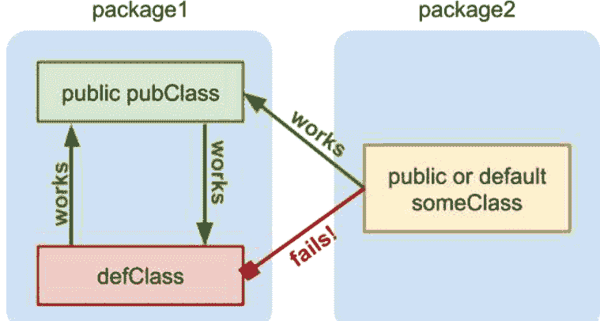

这张图中两个要点。第一是同一个包内的类始终可以相互访问。第二是包外部的类只能访问标记有`public`关键字的类。

- 包内部的类无论访问限制如何，都可以可以相互访问。
- 只有标记为`public`的类才能被从其包外部访问。
- 默认（无关键字）标记的类对其他包的类不可用。

关于类访问唯一需要知道的另一点是，它是类内部字段和方法的第一道屏障，每个字段和方法都有自己的访问限制！你将在下一节中发现，字段和方法被标记为四个访问限制级别之一。因此，即使字段或方法被标记为可供外部类访问，如果类整体是被禁止的，它们仍然无法被访问。

## 限制类成员的访问

正如在类组件部分提到的，有七种被称为类成员的内容可以放在你的类中。它们是：

- 类 (classes)
- 接口 (interfaces)
- 字段 (fields)
- 方法 (methods)
- 静态初始化代码块 (static initialization code blocks)
- 实例初始化代码块 (instance initialization code blocks)
- 构造函数 (constructors)

除了两种初始化块类型，这些组件都标记有各自的访问限制级别。这意味着五个类组件具有访问限制：

- 类
- 接口
- 字段
- 方法
- 构造函数

这些组件有四种可能的访问限制级别。其中三个通过在源代码中输入特殊的关键字指示，一个是默认访问限制级别，它通过没有关键字来指示：

- public
- protected
- default（无关键字）
- private

对于所有五个类成员来说，访问限制实际上是强制性的，这意味着你创建的每个类中的每个类组件都有某种程度的访问限制。之所以这在源代码中并不显而易见，是因为默认访问级别没有关联的关键字，所以如果你简单地忽略访问限制，你的代码仍然可以工作，因为 JVM 会自动将你的变量分配给默认访问限制。

由于五个类组件和四个访问限制级别，它们的组合数量是有限的：

- 嵌套类 (Nested Class)
    - `public class C {}`
    - `protected class C {}`
    - `default class C {}`
    - `private class C {}`

- 嵌套接口 (Nested Interface)
    - `public interface I {}`
    - `protected interface I {}`
    - `default interface I {}`
    - `private interface I {}`

- 字段 (Field)
    - `public boolean boolField;`
    - `protected boolean boolField;`
    - `default boolean boolField;`
    - `private boolean boolField;`

- 方法 (Method)
    - `public void Method()`
    - `protected void Method()`
    - `default void Method()`
    - `private void Method()`

- 构造函数 (Constructor)
    - `public ClassName()`
    - `protected ClassName()`
    - `default ClassName()`
    - `private ClassName()`

此时，你可能在想`static`关键字如何影响访问限制系统。回想`static`关键字可以与五个类组件中的每一个关联，其目的是告诉 JVM 将该组件存储在 MethodArea（方法区）内存中，这是一个共享的、全局的始终存在的内存位置。非静态组件存储在 HeapArea（堆区）内存中，只有当使用`new`关键字创建类实例或数组对象时，它们才会被创建。

事实证明向类组件添加`static`不会任何方式影响其访问限制级别。静态字段仍然声明在类内部，而类仍然是包的一部分。因此，相同的访问限制适用于静态字段，就像适用于非静态字段一样。

`static`关键字唯一改变的是该成员能够被其他标记为非静态的代码访问的能力。你会在 Java 中频繁地看到此错误消息，这是因为 Java 编译器的设计是寻找任何 MethodArea（静态）方法、字段等，并尝试访问 HeapArea（非静态）内容。Java 仅仅会将此标记为潜在问题且无法编译。

因此，`static`可以在某些情况下限制对非静态代码的访问。但这一事实并没有以任何方式改变访问限制系统。它们是两个独立的系统。现在让我们检查访问限制的四种级别，看看它们是如何运作的：

`public`成员限制意味着任何地方的代码都可以使用此组件。无论代码是否在不同的包、不同的类或继承的子类中：

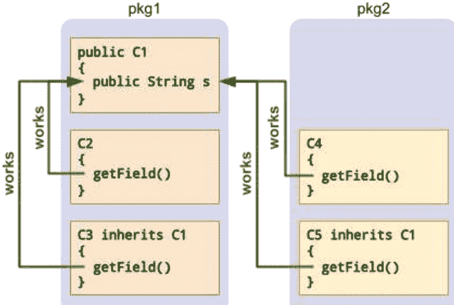

对于这个示例，此类包含一个`String`类型的 public 字段：

```
public class C1
{
    public String s = "hello";
}
```

如果你编译这个类并使用`jav`检查`.class`文件，你会看到：

```
public class C1
minor version: 0
major version: 6
flags: (0x021) ACC_PUBLIC
super_class: #10
interfaces: 0, fields: 1, methods: 1
Constant pool:
#1 = Methodref      #2.#3      // java/lang/Object.<init>():V
#2 = Class           // java/lang/Object
#3 = NameAndType     #5:6       // <init>():V
#4 = Utf           java/lang/Object
#5 = <init>
#6 = Utf           (V)
#7 = String #8 // hello
#8 = Utf
#9 = Fieldref #10.#11 // C1.s:Ljava/lang/String;
#10 = Class #12 // C1
#11 = NameType #14 // s:L/lang/String;
#12 = Utf 8
#13 = Utf C1
#14 = Utf Ljava/lang/String;
#15 = Utf Code
#16 = Utf LineNumberTable
#17 = Utf C1.java
{
public java.lang.String s;
descriptor: Ljava/lang/String;
flags: (0x0001) ACC_PUBLIC
public C1();
descriptor: ()V
flags: (0x0001) ACC_PUBLIC
stack=2, locals=1, args_size=1
0: aload_0 // Method
1: invokespecial #1
java/lang/Object.<init>():V
4: aload_0 #7 String
5: ldc
7: putfield #9 Field s:Ljava/lang/String;
10: return
LineNumberTable:
line 1: 0
line 3: 4
}
```

SourceFile: "C1.java" 是你在源代码中输入的字段（类型为`java/lang/String`的变量`s`）。该字段被标记为 public，与字段关联的 flags 显示了`.class`文件中的该字段访问位。输出显示该类有一个方法（自动的`<init>`实例构造器方法），还有一个属性（SourceFile 字段）。

我们可以通过二进制检查这两个 flags，查看`.class`文件是如何存储字段的。`0x0001`的表示是：

```
0000000000000001
```

最右边的位是 PUBLIC 访问位，它确实被设置为 1。

`protected`成员限制意味着此组件可以被同一个包内的任何代码以及来自其他包的子类代码使用。未继承该成员类的包外部类无法访问此成员：

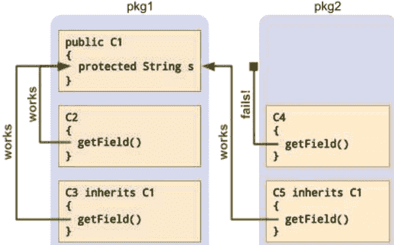

对于具有`protected`字段的类，源代码是：

```java
public class C1
{
  protected String s = "hello";
}
```

在 Class 文件的 jalap 输出中，该字段被列为：

```
protected java.lang.String s;
descriptor: Ljava/lang/String;
flags: (0x0004) ACC_PROTECTED
```

其二进制为：`0000000000000100`

所以你可以看到从右侧数起第三位被设置为 1，表示该字段具有 protected 访问限制。

`default`（无关键字）成员限制防止另一个包中的任何代码访问此成员，无论另一个包中的类是否继承自该成员的类：

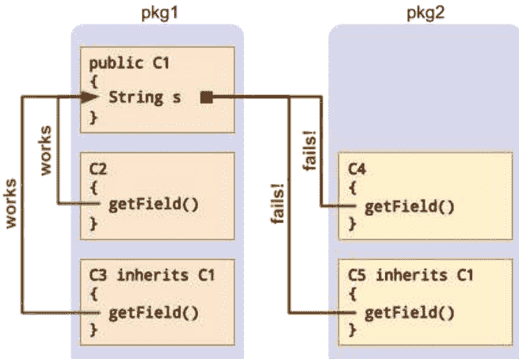

对于默认类成员访问，你不需要在源代码中输入任何特殊的关键字：

```java
public class C1
{
  String s = "hello";
}
```

在 ClassFile 的 jav 输出中，这个默认实例字段被列为：

```
java.lang.String s;
descriptor: Ljava/lang/String;
flags: (0x0000)
```

在二进制中，两个 flags 字节为：`0000000000000000`

你可以看到，默认类成员限制通过不设置任何其他访问位来指示，这些位是最右侧的前三个位。

私有成员限制意味着只有来自同一个类模板内部的代码才能访问该成员！这是对象可以拥有的最安全的访问类型：

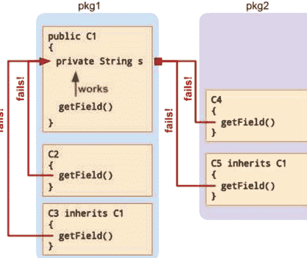

私有类成员使用`private`关键字标明：

```java


`public class C1`

```
{
    private String s = "hello";
}
```

要查看此类中的私有字段，你必须在`javap`命令中添加额外的`-p`设置，否则你将看不到私有字段（`javap -cp ../classes/ -v -p C1`）：

```java
private java.lang.String s;

descriptor: Ljava/lang/String;

flags: (0x0002) ACC_PRIVATE
```

16位标志位是：`0000_0000_0000_0010`

你可以看到类成员的私有限制是从右起第二个比特位表示的。

关于访问限制的另外一点是，只有在允许访问组件的整个类时，组件访问级别才有效。换句话说，访问限制是分层的。例如，默认访问权限（即包保护）类中的公有字段是不可访问的：

- 访问类（`C2`）与被访问类（`C1`）不在同一个包中
- 但`C1`是一个公共类，因此它对`C2`是可见的
- 因此，`C1`的字段将决定访问限制

`# pkg1`
`# pkg2`

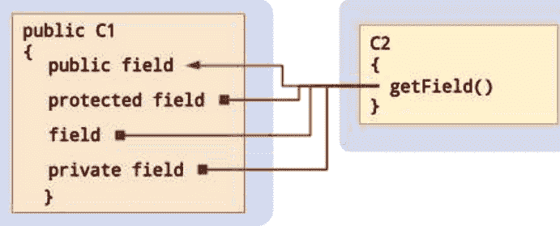

- 访问类（`C2`）与被访问类（`C1`）不在同一个包中
- 但现在`C1`具有默认限制，因此它对`C2`是不可见的
- 因此，`C2`无法访问`C1`的任何字段

`# pkg1`
`# pkg2`

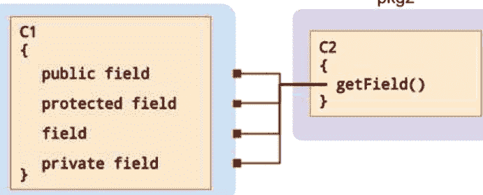

关于访问限制最后需要了解的一点是，它也适用于在方法内定义的变量。在方法内定义的任何变量都是局部变量，局部变量无法被方法外部的代码访问。因此，访问限制的概念在方法内部并不适用。

## 将类组织到包中

Java 编码的基本单元是类。你想要包含在程序中的所有数据和所有操作都在 Java 类内部。`.java`源代码的编译被离散化为`.class`编译单元，每个编译单元要么是一个类，要么是一个接口（本质上是类的特殊子类型）。Java 虚拟机以类为单位进行操作，因为它一次只向内存中加载一个`.class`文件。

然而，类出现的一个问题是，你可以创建无限数量的类，它们的名称可能相同也可能不同。世界上的任何人都可以创建 Java 类，所以如果互联网上存在任何 Java 类的共享，当然，必须有一个中央数据库或命名权威机构，以防止人们创建同名的类。

但 Java 并没有中央命名权威机构。相反，Java 有一种名为“包（packages）”的系统，它将类在包名下分组在一起。这个系统本质上使类名变长了，因为类名包含了它的包名。这种包名 + 类名被称为类的全限定名（fully qualified name），JVM 正通过这些全限定名来搜索并找到类。

在类名前面加上包名并不能100%地解决同名类的问题，因为两个人也可能使用相同的包名，但它确实降低了名称冲突发生的可能性。事实上，Java 建议人们将包命名为与其组织或公司相同的名称，因为组织往往具有独特的名称。

包对 Java 来说如此重要，以至于每个类必须属于一个包是强制性的。

如果你不在源代码中编写类的包名，那么当你用 JVM 运行你的`.class`文件时，JVM 会自动为你创建一个包并将你的类添加到其中，而不会通知你。JVM 选择的包名是任意的——`unnamedpackage`，但要点是，你的类必须与一个包关联才能被 JVM 使用。

由于 JVM 要求包归属关系，我建议在源文件中显式声明你的类的包名。这样可以清楚地看出你的类确实是包的一部分，正如它必须是的那样。显式将你的类放在包内的另一个好处是，你将更熟悉 Java 包的一般工作原理，这在你进行任何专业的 Java 编码、开发 Android 应用时会非常有帮助，因为你在编写这些应用时使用的类都是由第三方开发的包层次结构的一部分。

要显式声明你自己的类属于一个包，你只需要在源文件中`package`关键字后输入包名。这种包声明通常放在源文件的顶部，如下所示：

```java
package pkg;

class myClass

{
```

包名本身是完全任意的，所以你可以写任何名称。并没有允许的包名列表。之所以有效，是因为通过在关键字后写入包名，JVM 知道去哪里查找类。在类名前面加上包名并不能100%地解决同名类的问题，因为两个人也可能使用相同的包名，但它确实降低了名称冲突发生的可能性。事实上，Java 建议人们将包命名为与其组织或公司相同的名称，因为组织往往具有独特的名称。

包对 Java 来说如此重要，以至于每个类必须属于一个包是强制性的。

如果你不在源代码中编写类的包名，那么当你用 JVM 运行你的`.class`文件时，JVM 会自动为你创建一个包并将你的类添加到其中，而不会通知你。

第 2 步：你想使用 Java 编译器来创建`.class`字节码格式文件以便在 JVM 中运行。你知道编译器会自动创建一个名为`pkg`的文件夹并将`.class`文件放在其中，你只需要告诉它将所有内容放在哪里。因此，你使用`-d`选项运行编译器，并将路径设置为`classes/`，因为这是存放`.class`文件的合理文件夹名称：

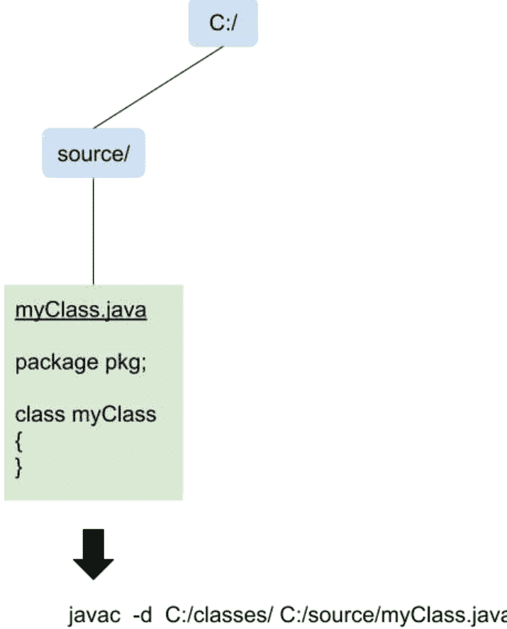

```
javac -d C:/classes/ C:/source/myClass.java
```

第 3 步：编译器从`myClass.java`源文件中获取包名，并决定创建一个与包名同名的文件夹，将`myClass.class`文件放在其中。由于你告诉了编译器将文件存放在`C:/classes/`文件夹，它也会创建这个文件夹：

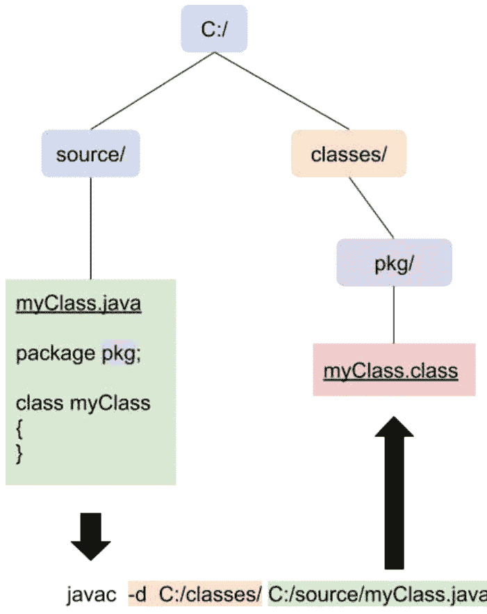

```
javac -d C:/classes/ C:/source/myClass.java
```

上述的 3 步过程在你运行`javac` Java 编译器时总是发生。在命令行提示符中，你向`javac`提供`.java`源代码文件名。你还使用`-d`选项告诉编译器将任何包文件夹和编译后的类文件放在哪里。`javac`程序获取这些命令行选项，读取 Java 源以获取包名，创建相应的文件夹层级结构，并将编译后的类文件放在那里。

在上面的示例中，包是一个单一且简单的包，这通过包名是一个单词来指示。如果 Java 愿意，它可以将包的复杂性保持在这一水平，并强制类分组在这样的简单包中。这是一种非常方便且简单的方法，程序员只需习惯于将所有的类都放在一个包文件夹中。例如，这里有五个独特的类，拥有五个完全限定类名，由三个不同的程序员编写。每个程序员都选择一个唯一的包名，这样他们就不必担心它们的类具有相同的简单名称了：

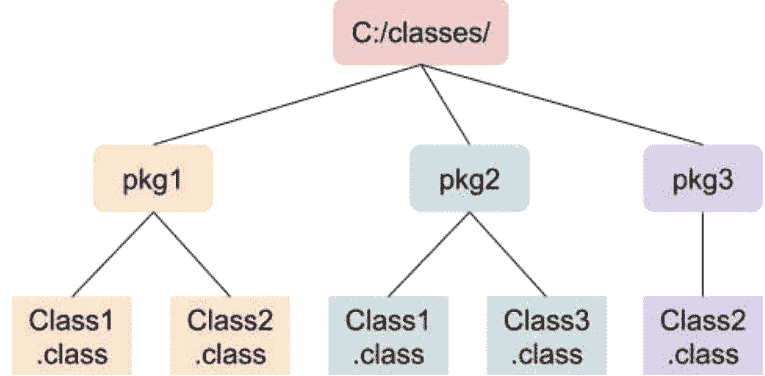

然而，Java 类通常不是以这种简单的方式组织的。在现实中，类组织在复杂的包层级结构中，这是因为 Java 支持子包。

子包是包中的包，这种结构可以不断重复，在子包中还可以包含许多许多子包。但让我们来看一个只增加一层子包的情况。

要创建一个子包，过程基本上与之前相同。你只需要在源文件中声明类的包所属关系时，编写`package.sub-package`即可。看看这个示例类文件：

```
//myClass.java

package pkg.subpkg;

class myClass

{}
```

`package`关键字用法与之前完全相同，我们也写了顶层包。但现在这里有一个点，后面跟着另一个单词，只需在源文件中编写这种`packagename+点+subpackagename`的结构就会告诉编译器存在嵌套的包层级结构。`pkg`是顶层包，该包内部有一个名为`subpkg`的子包。

编译器如何处理这种情况？`javac`实际上像之前一样自动处理子包层级结构。我看到你在另一个包内部有一个子包，因此当它创建包文件夹时，包层级结构会反映在文件夹目录结构中。

命令行提示符的指令与简单情况完全相同。你只需要包含`"-d path"`选项来告诉编译器在哪里创建更复杂的文件夹层级结构，如下：

```
javac -d C:/classes/ C:/source/myClass.java
```

你可以看到，命令与之前完全相同。对于上面写的类（它被分组在名为`subpkg`的子包下），在运行编译器后，你硬盘上的文件夹结构看起来如下：

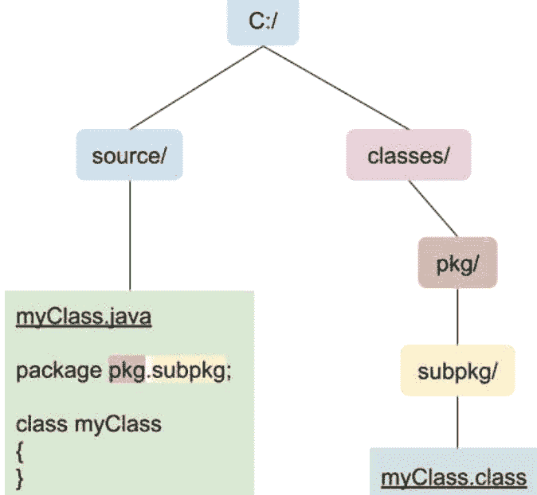

```
javac -d C:/classes/ C:/source/myClass.java
```

因此，你仍然需要告诉编译器你想让它在硬盘的什么位置放置生成的类文件，以及如何组织它们（习惯上是放在`classes/`文件夹中），但在之后，编译器将根据源文件中的包声明推导出正确的文件夹结构。

当然，你可以在顶层包内添加你喜欢的任意数量的子包，只要它们的名称是不同的即可。你可以在`pkg.sub1`中有一个类，在`pkg.sub2`中另一个类，以此类推。

但重要的是，存储在同一个顶层包的不同子包中的类仍然被认为位于完全不同的包中！

这意味着，对于之前章节提到的类级访问限制（`public` / `default`）或类成员级访问限制（`public` / `protected` / `default` / `private`），两个独立子包中的类，无论它们是在同一个包层级结构还是完全不同的包层级结构中，都被认为是完全不同的包。

另一种变体是，你可以将类分配到包层级结构的多个层级中。这实际上并不意味着编写源码。位于不同包的类被视为位于完全不同的包，无论这意味着一个子包对比另一个子包，还是一个子包对比一个顶层包。只有当包名完全相同时，JVM 才会认为两个类属于同一个包。

由于 Java 的包系统以及它要求的文件系统层级结构，你会看到类存储的所有变体。事实上，开发者将类存储在包层级结构的每一层是非常常见的，尽管层级结构中的每一层在 JVM 看来实际上都被视为一个独立的包。因此，看到类存储在如下文件夹结构中是很（下一页）：

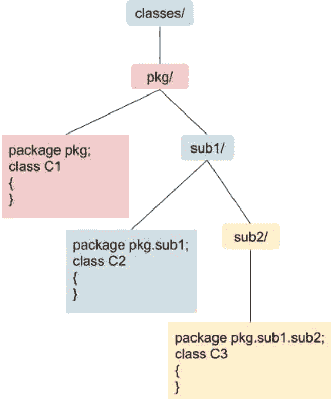

对于 JVM 来说，类`C1`、`C2`和`C3`在完全不同的包中，尽管它们都在同一个包中。

对我来说，不允许包的分层似乎是一个更好的选择，因为子包反正会被视为不同的包。无论如何，这就是 Java 中包的工作方式，而且让事物井然有序是件好事。要记住的主要点是，子包与其上方或下方的包之间没有意义上的关系，除了名称和硬盘上的文件夹结构之外。

## 将包组织成模块

几年前，Java 通过引入一个名为“模块（modules）”的完全新概念进行了重大更新。之所以向 Java 添加这个概念，是因为之前的 Java 版本没有方法可以阻止对整个类包的访问。当然，一直可以将包中的每个类标记为默认访问权限（default access），这意味着它不能被包外部的类使用。但这个系统没有考虑到一个类可能被某些外部包需要，但不需要被所有包需要。

换句话说，标记为非公共的类对任何和所有外部包都是不可见的。相反，如果你想让某个外部包访问你的类，你就必须将其标记为公共类（public class），那么 Java 中所有的类都可以访问你的类，而不仅仅是你心中的那一个。因此，增加了一个新系统，可以授予某些而非所有其他包使用特定包的权限。

模块的另一种概念化方式是将其视为访问类成员的另一个障碍，一个位于类级之上的障碍：

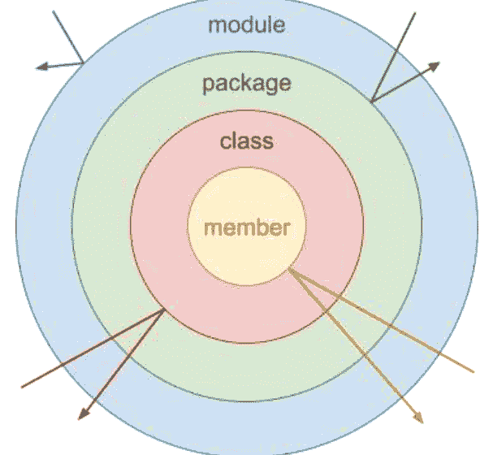

一个更真实的图会显示模块内有多个不同的包，而且一个包内有多个类：

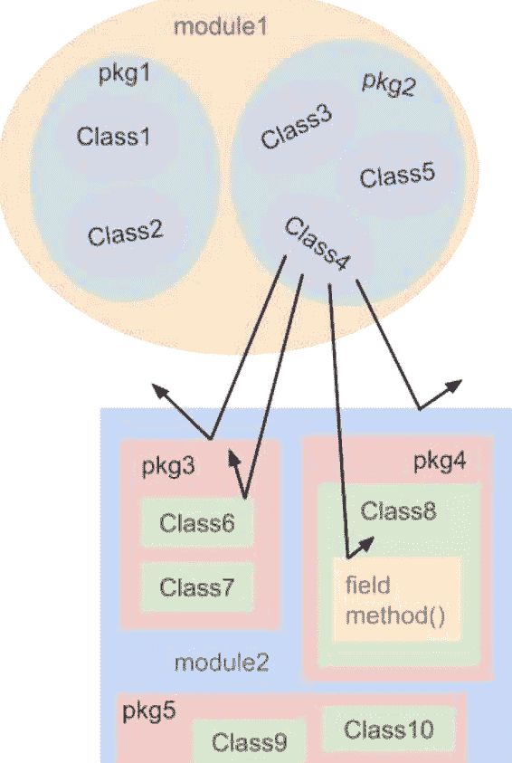

这一切都是为了向你展示 Java 中存在多种分层的访问限制。除了包、类访问修饰符和成员访问修饰符之外，模块只是实现访问限制的另一种方式。

## 模块到底什么是模块？

它是包及其类的集合，放置在同一个文件夹中，并包含一个特殊类型的`.java`文件，称为`module-info`文件。这个特殊文件必须位于模块的根目录。它说明了该模块中的哪些包可以供其他模块的代码使用。它还说明了自己的类为了正常运行需要哪些其他模块的代码。

`module-info.java`文件的基本结构如下：

```
module modulename // 关键字 + 模块名称

exports package; // 允许外部代码使用此包

requires module; // 访问另一个模块的代码
```

- `module` :: 这是一个 Java 源码关键字，它告诉编译器你正在编写一个`module-info`定义。
- `modulename` :: 这是你模块的名称，它可以只包含字母，或者字母与点的组合，但无论包含多少个点，它始终被视为单个单词。
- `exports` :: 告诉 JVM 应该允许其他模块访问该模块中特定包的类。
- `package` :: 外部可见的包名。
- `requires` :: 告诉 JVM 该模块内的某些类需要访问另一个模块的代码才能正常工作。
- `module` :: 包含该模块所需代码的另一个模块的名称。

模块具有组织良好的文件结构，包含包及其类，其`module-info.java`文件位于模块的根文件夹。模块的根文件夹名称应与模块名称相同。这是模块在你的硬盘上的样子：

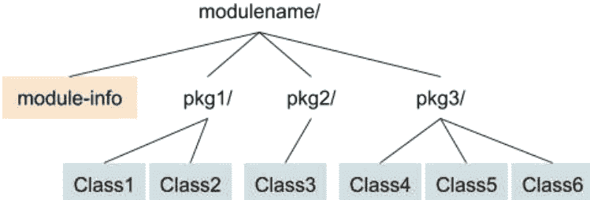

如果模块尚未编译，那么`module-info`和类文件将以源文本的形式存在，其文件类型为 "java"。

一旦你编译了模块，`module-info`和类文件将转换为它们的`ClassFile`格式，其文件类型将变为 "class"。

如果你正在编写一个较小的项目，你可能需要将文件放在一个单一模块中。然而，你可以为多个模块编写代码，然后将所有模块放在一个大文件夹中。这个大文件夹被称为模块目录（module directory folder），你告诉编译器和 JVM 在需要查找模块时去那里查找。例如，如果你创建了两个模块，可以这样做：

```
C:/

sourcemoddir/

moduleone/ moduletwo/

module-info.java pkgone/ module-info.java pkgtwo/

ClassOne.java ClassTwo.java
```

在这个文件树中，模块目录被称为`sourcemod/`，该文件夹包含两个模块的根文件夹。在这个简单的示例中，每个模块只有一个包，每个包中有一个类。注意，尽管它们在不同的模块中，但包名是唯一的。

我写了一个简单的程序，来演示`module-info`文件中的`requires`和`exports`关键字。让我们来看看每个`.java`文件，看看这个小小的 Java 程序将做什么。首先是`ClassOne.java`文件：

```
// ClassOne.java

package pkgone;

public class ClassOne {

    static public void main(String[]) {

        System.out.println(pkgtwo.ClassTwo.classTwoField);

    }

}
```

该文件包含一个名为`ClassOne`的类的定义，它是`pkgone`包的一部分。该类包含 Java 程序的入口方法`main()`。在`main()`方法内部，调用了`System.out.println()`方法，它打印的内容是来自`ClassTwo`类的一个字段，该字段位于`pkgtwo`包中，而该包位于`moduletwo`模块中。让我们来看看`ClassTwo`类中将被打印的字段：

```
// ClassTwo.java

package pkgtwo;

public class ClassTwo {

    static public String classTwoField = "Hello there";

}
```

`ClassTwo`非常简单。它被列为`pkgtwo`包的一部分，并且是一个公共类。它只有一个类成员，一个持有字符串值“Hello there!”的静态字段。

所以，这个 Java 程序包含两个类。`ClassOne`是代码执行的起点，因为它有`main()`入口方法。

在`main()`方法内部，调用了`System.out.println()`方法并将`ClassTwo`的静态字段作为其参数。因此，为了让这个项目正常运行，`ClassOne`需要访问`ClassTwo`的字段。

这是一个问题，因为`ClassOne`和`ClassTwo`位于不同的模块中。然而，可以通过适当设置两个模块的`module-info`文件来授予访问权限。也就是说，`ClassOne`模块需要请求对`ClassTwo`模块的访问权限。而`ClassTwo`模块需要允许其`pkgtwo`包被其他模块访问。

首先，让我们看看`moduleone`如何设置其`module-info`文件以请求对`moduleletwo`代码的访问：

```
// moduleone's module-info.java

module moduleone

{

    requires moduleletwo;

}
```

你可以看到`moduleone`使用`requires`关键字告诉 JVM 它想要访问`moduleletwo`模块包含的包。如果`moduleletwo`有任何公共类，那么来自`moduleone`的代码就可以使用它们。现在来看看`moduleletwo`的`module-info`文件：

```
// moduleletwo's module-info.java file

module moduleletwo

{

    exports pkgtwo;

}
```


你可以看到`moduleletwo`使用`exports`关键字告诉 JVM，允许其他模块使用其`pkgtwo`包中的类。

所以，这四个 java 文件组成了一个简单的 Java 程序。当然，将两个类放在同一个模块的同一个包中会更容易，但这是一个关于如何使用模块系统的示例，它们位于不同的模块。

要用 JVM 运行这些模块中的代码，你必须首先将它们编译为`.class`单元。幸运的是，你可以指示编译器在一个命令中编译所有的四个`.java`文件，告诉它模块目录在哪里，然后给它一个源代码列表。你必须告诉编译器它应该创建一个新的模块目录，这个目录包含`.class`文件。编译器命令通常写在一行，但我将每个`javac`参数分行写，以便你看得更清楚：

```
javac
-d C:/classesmoddir/
--module-source sourcemoddir/
--module-path C:/sourcemoddir/
sourcemoddir/moduleone/module-info.java sourcemoddir/moduleone/pkgone/ClassOne.java sourcemoddir/moduletwo/module-info.java sourcemoddir/moduletwo/pkgtwo/ClassTwo.java
```

（注：命令行的 OCR 严重乱码；我根据上下文重构了逻辑`javac`命令）。

如果你不显式地创建模块，JVM 将创建一个“未命名”模块，并将你的代码放入其中。

因此，我强烈建议你直接将代码放入一个模块中，因为这实际上是 Java 要求的。虽然这需要多花一些精力，但我认为在完全了解 JVM 实际工作原理的情况下来操作你的 Java 程序会比较好。

显式创建和使用模块的另一个用处是，你将更熟悉模块的通用工作原理。如果你将来要进行任何专业的 Java 开发或 Android 应用开发，你会发现模块是无处不在的。有时甚至像 jpeg 图像和 XML 文件这样的原始数据也会与`.class`编译单元一起被包含在模块中。这使得模块变成了一个自包含的应用程序，就像手机 App 一样，拥有独立运行所需的所有数据和代码。

回到模块，我认为在只有一个模块的情况下，展示一个如何设置文件夹目录和 Java 文件的示例会很好，因为在学习 Java 的早期，你只需要一个模块。这与上面的示例策略相同，只是更简单一些。

首先，你应该在硬盘上手动创建一个目录结构，其中包含一个名为`sourcemoddir/`的模块目录文件夹，它将存放模块的根目录。然后，你可以为模块本身创建一个文件夹，然后在模块文件夹内创建所需的`module-info.java`文件、一个包的文件夹，以及在包文件夹内部的一个`.java`源码文件。树形结构看起来应该是这样的：

```
C:/
|
sourcemoddir/
|
modulename/
|
module-info.java pkgname/
|
ClassName.java
```

和之前一样，`module-info.java`文件是必须的。它必须命名为`module-info`，并且必须放在模块的根目录中，与包文件夹并列。它包含了信息，告知该模块的哪些包可以被其他模块访问，以及该模块的代码需要哪些其他 Java 模块。

因此，`module-info.java`文件的通用格式为：

```
module modulename {
  exports package;
  requires module;
}
```

在这个单模块示例中，我们不需要从该模块导出任何包。然而，如果我们想使用 Java 的其他任何类（例如向控制台打印文本或其他基本功能），我们确实需要引用某些 Java 随带的其它模块。

事实上，如果你将模块信息文件留空，并且不指定任何所需的模块，如下所示：

```
module modulename {
}
```

那么 JVM 将自动添加该行：

```
requires java.base;
```

因为`java.base`是预装于 Java 的模块名称，它包含了 51 个包，这些包包含了程序员经常使用的有用内容，例如无处不在的`System.out.println()`命令。

由于 JVM 会自动在你所有的`module-info.java`文件中添加`requires java.base`，我建议你自己手动将其输入到`module-info.java`文件中。如果你这样做，那么`module-info`文件将是：

```
module modulename {
}
requires java.base;
}
```

- **module** :: Java 关键字，告诉 JVM 这是一个 module-info 结构。
- **modulename** :: 模块的名称，它可以是一个单词，也可以包含点（例如`com.app.base`），尽管点在模块名中不像在包名中那样具有特殊意义。
- **requires java.base** :: 告诉 JVM 该模块需要访问名为`java.base`的包模块，因为该模块中的代码使用了该模块中的代码。

要实际运行任何 Java 代码，你当然需要源码文件工具，你可以将其放在与你决定的包同名的文件夹中。源码文件需要声明自己是该包的一部分，并且还需要 JVM 用作程序入口的静态`main`方法：

```
// ClassName.java 源码文件
package pkgname;
```

```java
import pkgname.*; // JVM 自动导入！
import java.lang.*; // JVM 也会自动导入这个！
```

```
class ClassName {
    static public void main(String[] str) {
        System.out.println("Howdy!");
    }
}
```

我在之前的章节中提到过它，但请注意，如果你不手动添加它们，JVM 会向你的源码文件添加两个包导入。第一个是它所属的包，以便它可以访问同包内的任何其他类。第二个是名为`java.lang`的包，它位于自动添加到 module-info 文件中的`java.base`模块中。星号（`*`）意味着这些包中的所有公共类都将被导入。（自动导入`java.lang`是你之所以可以在`System.out.println()`方法中使用`System`类的原因。`System`是`java.lang`包中的类之一之一。）

所以，单模块项目的硬盘文件夹树和源文件看起来如下：

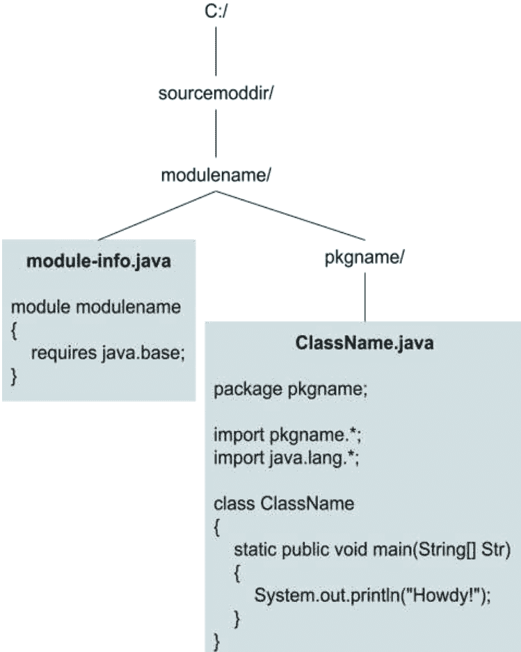

然后你可以像以前一样运行编译器，将项目视为一个模块：

```
javac
-d C://classesmoddir/
--module-source-path C://sourcemoddir/
C://source/modulename/module-info.java
C://source/modulename/pkgname/ClassName.java
```

- **-d <path>** :: 该选项告诉编译器将编译后的文件存放在该文件夹中，如果文件夹不存在则创建它。
- **--module-source-path** :: 选项告诉编译器去哪里寻找模块的根目录，从而寻找它的 module-info 文件及其所有的包。
- **java files** :: module-info 和类源文件的位置和文件名，编译器将把它们转换为`.class`格式。

运行此命令后，你的硬盘看起来应该是这样：

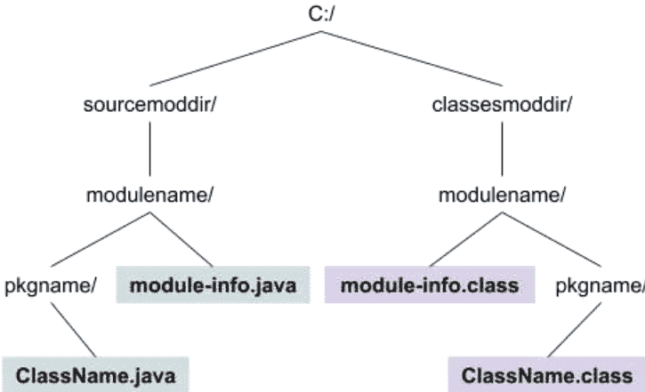

现在你可以使用以下命令在 JVM 中运行模块中的代码：

```
java
--module-path C:/classesmoddir/
--module modulename/pkgname.ClassName
```

- **--module-path <path>** :: 告诉 JVM 去哪里寻找模块的`.class`文件。
- **--module <module/pkgClass>** :: 告诉 JVM 模块、包和包含静态`main`入口方法的类名称，以便它开始执行你的代码。

运行该程序后，你应该看到字符串`Howdy!`打印到控制台。

恭喜你完成了 Java 模块的这一章节！我认为模块是 Java 最令人困惑的部分之一，所以如果你已经读到了这里，说明你正朝着成为 Java 专家的道路迈进。

关于模块的章节也是最后一个真正涉及 Java “元（meta）”结构的章节。理解将 Java 代码组织成模块、包和类至关重要，这就是为什么我将这些章节放在书的最前面的原因。

现在你已经对 Java 的元结构有了坚实的理解，是时候开始查看类和方法内部的内容。这是编写 Java 程序的“编码”部分，也是初学者 Java 书籍涵盖的典型内容。不想在这里重复这些内容，我将采用稍微不同的方法处理 Java 代码元素，展示源码与`.class` ClassFile 数据如何关联。希望这能让你更好地理解 Java 代码元素是如何表示和处理的。

布尔（Boolean）数据可以被视为单位的值，即 1 或 0，开启（ON）或关闭（OFF）。有趣的是，在 JVM 内部，`boolean`实际上被存储为 32 位的块，但对于所有的实际 Java 编程，你可以将其视为单位。

让我们通过使用`javap`命令检查简单类的`.class`文件，来看看 JVM 是如何处理`boolean`原始类型的：

```java
class ClassName {
  static boolean instField = true;
}
```

我写了一个非常简单的类，包含一个原始`boolean`类型的静态字段。当然，JVM 秘密地添加了实例构造器方法`<init>`，在`javap`输出中也称为`ClassName()`。由于布尔字段是静态的，而且我在源代码中设置了该布尔变量的值，JVM 还会秘密地添加静态初始化块`<clinit>`。以下是该类的`javap`输出：

```
class ClassName
minor version: 0
major version: 50
flags: (0x020) ACC_SUPER
this_class: #8 // ClassName
super_class: #2 // java/lang/Object
interfaces: 0
```

```
ClassName():
descriptor: (V)
flags: (0x0000)
Code:
stack=1, locals=1, args_size=1
0: aload_0
1: invokespecial #1    // Method java/lang/Object."<init>":V
4: return
LineNumberTable:
 line 1: 0
```

```
static {};
descriptor: (V)
flags: (0x0008) ACC_STATIC
Code:
stack=1, locals=0, args_size=0
0: const_1
1: putstatic #7    // Field field:Z
4: return
LineNumberTable:
 line 3: 0
```

SourceFile: "ClassName.java"

静态布尔字段被列为唯一的字段，紧跟常量池之后。该条目告诉了字段的名称、数据类型以及为该字段设置的任何标志。

在源代码中，一个值被赋值了这个静态布尔字段，这在`.class`文件中体现为：静态初始化块（实际上在`.class`文件中转换为一个方法）包含了一些执行赋值操作的操作码指令。让我们逐步查看这些操作码，以便你看到它是如何工作的：

第一个操作码是**const_1**。该操作码的大小为一字节，它将一个整数值 1 推送到（push）方法帧的操作数数栈上。

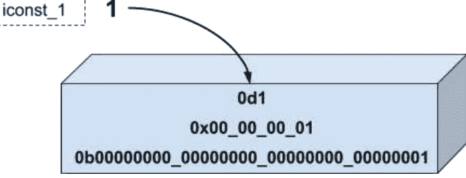

第二个操作码是**putstatic #7**。该命令的大小为三个字节。第一个字节是`putstatic`操作码，接下来两个字节是指向常量池条目 #7 (`ClassName.field:Z`) 的指针，它告诉了静态布尔字段在 JVM 内存中的位置。此`putstatic`命令还使用了操作数栈顶部的值（在上一个操作码之后现在是 1），并将其转移到常量池引用所指示的变量。简而言之，`putstatic`命令从操作数栈顶端取出值 1，并将其移动到常量池引用所指向的内存位置`ClassName.field:Z`，该位置是由紧随`putstatic`操作码的两个字节提供的。

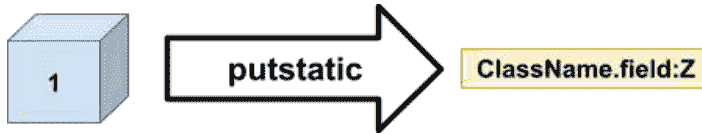

第三个操作码是**return**。该命令长度为一字节，它是从方法返回`void`的命令，意味着没有实际的返回值。这是`<clinit>`静态初始化块中的最后一个操作码，它将程序执行控制返回给最初调用此方法的代码。

让我们看另一个`boolean`原始类型的例子，我们在方法内部创建了一个布尔值。以下是执行此操作的简单类的源代码：

```java
class ClassName {
  void method() {
    boolean local = false;
  }
}
```

在该源代码中有一个名为`method()`的实例方法，在方法内部，名为`local`的布尔变量被赋值为`false`。让我们看看这个简单类的`javap`输出，看看这个布尔值是如何创建的：

```
class ClassName
minor version: 0
major version: 60
flags: (0x0020) ACC_SUPER // ClassName
this_class: #7
super_class: #2 // java/lang/Object
interfaces: 0, fields: 2, attributes: 1
Constant pool:
#1 = Methodref #2.#3 // java/lang/Object."<init>():V
#2 = Class #4 // java/lang/Object
#3 = NameAndType #5.#6 // <init>():V
#4 = Utf8 java/lang/Object
#5 = Utf8 <init>
#6 = Utf8 (V)
#7 = Class // ClassName
#8 = Utf8 Code
#9 = Utf8 LineNumberTable
#10 = Utf8 method
#11 = Utf8 SourceFile
#12 = Utf8 ClassName.java
#13 = Utf8
ClassName():
descriptor: ()V
flags: (0x0000)
Code:
stack:1, locals=1, args_size=1
0: aload_0
1: invokespecial #1    // Method java/lang/Object."<init>":V
4: return
LineNumberTable:
 line 1: 0
```

剩下的第一个操作码是`bipush`。完整的`bipush`操作码长度为两个字节，第一个字节是`bipush`操作码本身，第二个字节是将要推入方法帧操作数栈（operand stack）的值。在这个示例中，推入操作数栈的值是整数 65，即代表大写字母 A 的数字。

选择操作码`bipush`非常有趣，因为它在技术上它取一个字节（8位）的信息，将该值转换为整数（32位），然后将其推入操作数栈。然而，`char`原始数据类型应该是两个字节（16位）长，因此如果字符表示的数字大于 255（8位的最大正数），JVM 必须使用不同的操作码。让我们来看源代码示例，其中`char`是由整数 937 表示的字符，代表 Omega 字符 Ω，其十六进制值为 0x03A9，在源代码中可以使用 unicode 指示符`\u`表示，如下：

```
class ClassName {
  static char field = '\u03A9';
}
```

`javap`输出中的`<init>`静态初始化方法：

```
static <init>;
descriptor: (0x0002) ACC_STATIC
Code:
  stack=1, locals=0, args_size=0
  0: bipush             937
  3: putstatic          // Field field:C
  6: return
LineNumberTable:
  line 3: 0
```

如果你查看方法`Code`属性中的第一个操作码命令，你会发现`bipush`命令被`sipush`命令替换了。由于属于同一家族，`sipush`操作码取 16 位的信息，并将其推入方法帧的操作数栈。在这个示例中，你可以看到推入操作数栈的值是十进制 937，这与源代码中编写的十六进制 0x03A9 相同。因此，这个推入操作数栈的数值是代表源代码中所写字符的数值。由于我们将变量设为静态类字段，该值通过`putstatic`命令传输到方法区（MethodArea）内存中静态字段的内存位置。

接下来是`Byte`原始类型……

`Byte`数据是有符号的 8 位。有符号意味着字节类型的数据可以同时表示负数或正数，但在限制范围内。限制是什么？8 位的二进制信息可以存储 $2^8=256$ 个唯一值，因此允许的值范围是从 -128 到 +127。包括零，这里有 128 个负数和 128 个正数，总共 256 个唯一数字，以 0 为中心。


与上一个示例类似，我们将使用静态类字段作为示例结构，查看 JVM 如何创建 `byte` 原始类型。这里是源代码类：

```
class ClassName
{
  static byte field = -1;
}
```

`javap` 输出的静态初始化方法为：

```
static {};
descriptor:(V)
flags:(0x0008) ACC_STATIC
Code:
stack=1, locals=0, args_size=0
0: iconst_m1
1: putstatic #7 // Field field:B
4: return
LineNumberTable:
line 3: 0
```

在这里，使用 `iconst_m1` 操作码将字节数据推入方法帧的操作数栈。`iconst_m1` 将 8 位值 `Ob1111111` 推入栈中。这个值实际上代表十进制数字 -1，因为 `byte` 类型是有符号类型，它使用补码系统来表示负数。

那么其他负数呢——它们是如何创建的？

这段源代码：

```
class ClassName
{
  static byte field = -127;
}
```

对于 `<init>` 静态初始化方法提供了 `javap` 输出：

```
static {};
descriptor: ()V
flags: (0x0008) ACC_STATIC
Code:
stack=1, locals=0, args_size=0
0: bipush             -127
2: putstatic          #7 // Field field:B
5: return
LineNumberTable:
line 3: 0
```

`iconst_m1` 操作码被 `bipush` 操作码替换。整个 `bipush` 命令实际上是两个字节长。第一个字节是 `bipush` 操作码本身。第二个字节持有要推入帧操作数栈的值。因为源代码将值 -127 分配给类字段，该值被作为参数传递给 `bipush` 命令。

接下来是 `short` 原型……

`short` 数据是有符号的 16 位。因此它总共持有 $2^{16} = 65,536$ 个唯一值，分布在零周围，这意味着 Java `short` 的可能值范围是从 -32,768 到 32,767。

你现在可能已经掌握了 JVM 中原始类型的表示方法，所以让我们加快速度。这里有一个包含 `short` 原始类型的类：

```
class ClassName
{
    static short field = -1;
}
```

这是 `<clinit>` 静态初始化方法的 `javap` 输出：

```
static {};
descriptor: ()V
flags: (0x0008) ACC_STATIC
Code:
stack=1, locals=0, args_size=0
  0: const_m1
  1: putstatic      # // Field field:S
  4: return
LineNumberTable:
line 3: 0
```

尽管源代码中字段的类型是原始 `short`，但仍使用了与 `byte` 类型相同的 JVM 操作码将值 -1 推入操作数栈。这些值是相同的，在这些示例中，`byte` 或 `short` 字段都是 -1，所以相同的操作码完全可以工作。让我们看看使用哪个操作码处理原始 `short` 可能的最大数字，即 32767。

源代码如下：

```
class ClassName
{
    static short field = 32767;
}
```

`javap` 输出显示：

```
static {};
descriptor: ()V
flags: (0x0008) ACC_STATIC
Code:
stack=1, locals=0, args_size=0
  0: sipush      32767
3: putstatic      7 // Field field:S
6: return
LineNumberTable:
line 3: 0
```

现在用于推送值的操作码是 `sipush`，这是一个三个字节的命令。第一个字节指定 `sipush` 为操作码，后续的两个字节持有要赋值给类字段的值。

`int` 数据是有符号的 32 位。由于总共有 $2^{32}=4,294,967,296$ 个可能的唯一值，Java `int` 可以是 -2,147,483,648 到 2,147,483,647 之间的任何数字。

这个类将值 1 分配给整数字段：

```
class ClassName
{
    static int field = -1;
}
```

静态 int 方法的 `javap` 输出为：

```
static {};
descriptor: ()V
flags: (0x0008) ACC_STATIC
Code:
stack=1, locals=0, args_size=0
0: iconst_m1
1: putstatic          // Field field:I
4: return
LineNumberTable:
line 3: 0
```

再次使用 `iconst_m1` 命令将此值推入操作数栈。现在，这个类将一个较大的数字（下划线被忽略）赋值给整数字段：

```
class ClassName
{
    static int field = 1_000;
}
```

我们需要这一个的 `javap` 输出，结果如下：

```
static {};
descriptor: ()V
flags: (0x0008) ACC_STATIC
Code:
stack=1, locals=0, args_size=0
0: bipush             1000
1: putstatic #7 // Field field:I
4: return
LineNumberTable:
line 3: 0
```

`long` 类型是一个带符号的 64 位整数。总共有 $2^{64} = 18,446,744,073,709,551,616$ 种可能的值，Java 的 `long` 类型可以是 -9223372036854775808 到 9223372036854775807 之间的任何数字。

让我们来看给一个原始 `long` 类型字段赋值一个较小的数字的情况：

```
class ClassName {
    static long field = -1L;
}
```

我们再次查看整个类文件的 `javap` 输出：

```
class ClassName
minor version: 0
major version: 60
flags: (0x0020) ACC_SUPER
this_class: #10 // ClassName
super_class: #2 // java/lang/Object
interfaces: 0, fields: 1, methods: 2, attributes: 1
constant_pool:
    #1 = Methodref #2.#3 // java/lang/Object."<init>():(V)
    #2 = Class #4 // java/lang/Object
    #3 = NameType #5.#6 // java/lang/Object."<init>():(V)
    #4 = Utf8 <init>
    #5 = Utf8 (V)
    #6 = Utf8
    #7 = Long -11
    #8 = Fieldref #10.#11 // ClassName.field:J
    #9 = Class #12 // ClassName
    #10 = Class // field:J
    #11 = NameType #13.#14
    #12 = Utf8 ClassName
    #13 = Utf8 field
    #14 = Utf8 J
    #15 = Code NumberTable
    16 = <class>
    17 = SourceFile
    18 = ClassName.java
    19 = n

static long field;
descriptor: J
flags: (0x0000) ACC_STATIC

ClassName();
descriptor: ()V
flags: (0x0000)
Code:
    stack:1, locals:1, args_size=1
    0: load_0
    1: invokespecial #1 // Method java/lang/Object."<init>():(V)
    4: return
LineNumberTable:
line 1: 0

static {};
descriptor: ()V
flags: (0x0008) ACC_STATIC
Code:
stack=2, locals=0, args_size=0
  0: ldc2_w               #7 // long -11
  3: putstatic              #9 // Field field:J
  6: return
LineNumberTable:
line 3: 0
```

SourceFile:"ClassName.java"

用于将 -1 推送到 `long` 类型操作数栈上的操作码是 `ldc2_w`。该操作码专门用于将 `long`（64位）和 `double`（64位）数字加载到操作数栈上。整个命令长度为三个字节。第一个字节是操作码 `ldc2_w` 本身，接下来两个字节是对类文件常量池的引用，指向池项 #7。查看此池项，你可以发现它的值为 -1，这意味着它实际上是一个 8 字节的值。`ldc2_w` 操作码获取常量池中存储的值并将其推送到操作数栈上。

如果是更大的数字呢？

这段源代码为 `long` 字段赋值了一个更大的值：

```
class ClassName
{
  static long field = 9223372036854775807L;
}
```

而 Classfile 的信息如下：

```
class ClassName
minor version: 0
major version: 60
flags: (0x0020) ACC_SUPER               // ClassName
this_class: #10                          // java/lang/Object
super_class: #2                           // java/lang/Object
interfaces: 0, 1, methods: 2, attributes: 1
Constant pool:
#1 = Methodref                            #2.#3 // java/lang/Object.<init>():V
#2 = Class                               #4 // java/lang/Object
#3 = NameAndType                         #5.#6 // <init>():V
#4 = Utf                                 java/lang/Object
#5 = Utf                                 <init>
#6 = Utf                                 V
#7 = Long 9223372036854775807L
#9 = Field #10.#11 // ClassName.field:J
#10 = Class #12 // ClassName
#11 = NameType #13.#14 // field:J
#12 = Utf8 field
#13 = Utf8 J
#14 = Utf8 Code
#15 = Utf8 LineNumberTable
#16 = Utf8 <init>
#17 = Utf8 SourceFile
#18 = Utf8 ClassName.java
#19 = Utf8
```

```
static long field;
descriptor: J
flags: (0x0008) ACC_STATIC

ClassName();
descriptor: ()V
flags: (0x0000)
Code:
    stack=1, locals=1, args_size=1
0: aload_0
1: invokespecial #1 // Method java/lang/Object."<init>():V
4: return
LineNumberTable:
line 1: 0

static {};
descriptor: ()V
flags: (0x0008) ACC_STATIC
Code:
stack=2, locals=0, args_size=0
  0: ldc2_w               #7 // long 9223372036854775807
3: putstatic              #9 // Field field:J
  6: return
LineNumberTable:
line 3: 0
```

SourceFile:"ClassName.java"

再次使用了 `ldc2_w` 操作码，对于 `long` 类型，无论赋值的值是什么，使用的操作码都是相同的。`float` 数据与之前的数字类型不同。`byte`、`short`、`long` 值只能表示整数，而 `float` 值带有小数点并可以表示分数。Java 的 `float` 类型为 32 位，可以涵盖很大的正负范围，且以 0 为中心。来看看 JVM 是如何处理 `float` 的。这里有一个给 `float` 赋值的示例：

```
class ClassName {
    static float field = 1.0F;
}
```

这是来自 `javap` 的 ClassFile：

```
class ClassName
minor version: 0
major version: 60
flags: (0x0020) ACC_SUPER // ClassName
this_class: #8 // java/lang/Object
super_class: #2
interfaces: 0, fields: 1, methods: 2, attributes: 1
Constant pool:
#1 = Methodref #2.#3 // java/lang/Object."<init>():V
#2 = Class #4 // java/lang/Object
#3 = NameAndType #5.#6 // <init>():V
#4 = Utf8 java/lang/Object
#5 = Utf8 ClassName.field:F
#6 = Utf8 <init>
#7 = Field #8.#9
#8 = Class #10 // ClassName
#9 = NameType #11.#12 // field:
#10 = Utf8 ClassName
#11 = Utf8 field
#12 = Utf8 F
#13 = Utf8 Code
#14 = Utf8 LineNumberTable
#15 = Utf8 <clinit
#16 = Utf8 SourceFile
#17 = Utf8 ClassName.java

{
static float field;
descriptor: F
flags: (0x0008) ACC_STATIC

ClassName()
descriptor: ()V
flags: (0x0000)
Code:
    stack:1, locals:1, args_size=1
0: aload_0
1: invokespecial #1 // Method java/lang/Object."<init>():V
4: return
LineNumberTable:
line 1: 0

static {};
descriptor: ()V
flags: (0x0008) ACC_STATIC
Code:
stack=1, locals=0, args_size=0
  0: fconst_1
  1: putstatic #7 // Field field:F
4: return
LineNumberTable:
line 3: 0
```

SourceFile="ClassName.java"

所以在给 `float` 字段赋值 `float` 值 1.0 的情况下，JVM 使用单字节操作码 `fconst_1` 将 1.0F 推送到操作数栈上。但这是一个简单的数字，如果值在小数点后还有内容呢？在另一个示例中，该类赋值了 `float` 值 1.5：

```
class ClassName {
  static float field = 1.5F;
}
```

`javap` 输出为：


```
class ClassName
minor version: 0
major version: 0
flags: (0x0030) ACC_SUPER
this_class: #9 // ClassName
super_class: #2 // java/lang/Object
interfaces: 0, fields: 1, methods: 2, attributes: 1
Constant_pool:
#1 = Methodref #2.#3 // java/lang/Object.<init>():V
#2 = Class #4 // java/lang/Object
#3 = NameAndType #5.#6 // <init>():V
#4 = Utf8 java/lang/Object
#5 = Utf8 <init>
#6 = Utf8 (V)
#7 = Float #9.#10 // ClassName.field:F
#8 = Field #11 // ClassName
#9 = NameType #12.#13 // field:F
#10 = Utf8
#11 = Utf8
#12 = Utf8
#13 = Utf8
#14 = Utf8
#15 = Utf8 LineNumberTable
#16 = Utf8 <clinit
#17 = Utf8 SourceFile
#18 = Utf8 ClassName.java
{
static float field;
descriptor: F
flags: (0x0008) ACC_STATIC

ClassName();
descriptor: ()V
flags: (0x0000)
Code:
    stack=1, locals=1, args_size=1
0: aload_0
1: invokespecial #1 // Method java/lang/Object."<init>():V
4: return

LineNumberTable:
line 1: 0

static {};
descriptor: ()V
flags: (0x0008) ACC_STATIC
Code:
    stack=1, locals=0, args_size=0
  0: ldc #7 // float 1.5
  2: putstatic #8 // Field field:F
5: return
LineNumberTable:
line 3: 0
}
SourceFile: "ClassName.java"
```

现在给类字段赋值值 `1.5F` 会导致 JVM 使用三字节操作码 `ldc` 将该值加载到操作数栈上。命令的第一个字节是操作码，第二个和第三字节是对常量池项 `#7` 的引用，该项持有 `float` 值 `1.5F`。

`Double` 数据的工作原理与 `float` 相同，但它有 64 位，可以涵盖更广泛的正负数范围。

让我们看看 JVM 是如何使用简单的 `double` 值的。这个类给原始 `double` 字段赋值了 `1.0`：

```
class ClassName
{
    static double field = 1.0D;
}
```

初始化方法的 `javap` 输出为：

```
static {};
descriptor: (0x0008) ACC_STATIC
Code:
  stack=2, locals=0, args_size=0
  0: dconst_1
  1: putstatic#7             // Field field:D
  4: return
LineNumberTable:
    line: 0
```

对于简单的 `1.0` `double` 值，JVM 有一个快速且简单的单字节操作码可以将 `1.0D` 推送到操作数栈上。

这里有一个赋值复杂的 `double` 值的类：

```
class ClassName
{
    static double field = 1.5D;
}
```

来自 `javap` 的 `ClassFile` 信息为：

```
class ClassName
minor version: 0
major version: 0
flags: (0x0020) ACC_SUPER      // ClassName
this_class: #10                // java/lang/Object
super_class: #2
interface: 0, methods: 2, attributes: 1
Constant_pool:
  #1 = Methodref #2.#3 // java/lang/Object."<init>():V
  #2 = Class #4 // java/lang/Object
  #3 = NameAndType #5.#6 // <init>():V
  #4 = Utf8 java/lang/Object
  #5 = Utf8 <init>
  #6 = Utf8 (V)
  #7 = Double #9.#10 // ClassName.field:F
  #8 = Field #11 // ClassName
  #9 = NameType #12.#13 // field:F
  #10 = Utf8
  #11 = Utf8
  #12 = Utf8
  #13 = Utf8
  #14 = Utf8
  #15 = Utf8 LineNumberTable
  #16 = Utf8 <clinit
  #17 = Utf8 SourceFile
  #18 = Utf8 ClassName.java
```

```
#9 = Fieldref #10.#11 // ClassName.field:D
#10 = Class #12 // ClassName
#11 = NameAndType #13:#14 // field:D
#12 = Utf ClassName
#13 = Utf field
#14 = Utf D
#15 = Utf Code
#16 = Utf LineNumberTable
#17 = Utf <init>
#18 = Utf SourceFile
ClassName.java
```

```java
{
  static double field;
  descriptor: D
  flags: (0x0008) ACC_STATIC

ClassName():
  descriptor: ()V
  flags: (0x0000)
Code:
  stack=1, locals=1, args_size=1
  0: aload_0 // Method java/lang/Object."init">():V
  1: invokespecial #1
  4: return
LineNumberTable:
  line 1: 0
}
```

```java
static {}{
  descriptor: ()V
  flags: (0x0008) ACC_STATIC
  Code:
    stack=2, locals=0, args_size=0
    0: ldc2_w #7 // double 1.5d
    3: putstatic #9 // Field field:D
    6: return
  LineNumberTable:
    line 3: 0
}
```

`SourceFile: "ClassName.java"`

对于更复杂的值，JVM 使用了 `ldc2_w` 操作码，这是一个更长的三字节指令，用于从常量池条目中检索 `double` 值并将其推入操作数栈。

现在你应该对 JVM 如何处理不同类型的原始数据有了相当好的理解。我认为关于 Java 原始数据有两个主要点需要理解。

首先，创建和为变量赋值的整体策略对于所有原始类型都是相同的，即将值推入操作数栈，然后移动到字段或局部变量的位置，无论它位于 JVM 内存的哪个位置。

其次，在 JVM 中将原始值推入操作数栈时使用的特定操作码实际上取决于该值，这令人惊讶。JVM 似乎有特殊的单字节操作码，用于推送程序员经常使用的简单值，如 `-1`、`0` 和 `1`。但对于较大或更复杂的值，可能使用了速度较慢的操作码来处理这些复杂值。

我们还没有完全介绍 Java 的值类型，因为我们仍然需要涵盖引用类型，但请坚持下去，完成本章已经不远了。

# 引用类型

引用数据是通过间接访问的数据，即通过引用访问。一个被引用的数据结构可以是以下四种之一：

- 接口模板，存储在方法区（`MethodArea`）内存中
- 类模板，存储在方法区（`MethodArea`）内存中
- 类实例对象，存储在堆区（`HeapArea`）内存中
- 数组对象，存储在堆区（`HeapArea`）内存中

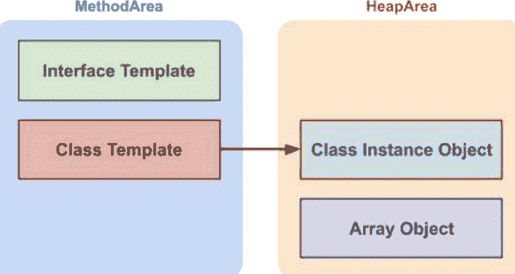

这四种数据结构通过内存指针访问，因为它们太大了，无法直接存储在分配给字段或局部变量的空间中。

为了在源码中使用这些结构，使用关键字或变量作为引用，JVM 知道该引用指向所需的数据结构。

## (A) 模板引用

如果数据结构是接口模板或类模板，则访问模板使用的引用是接口或类本身的名称。

### (A.1) 接口模板

例如，接口设计用于被类继承，因此要告诉 JVM 你想使用接口，只需在源文件中编写接口的名称：

```java
// 声明一个接口
interface InterfaceName
{
  void interfaceMethod()
}
```

```java
// 使用接口的类
class SomeClass implements InterfaceName
{
  void interfaceMethod() {
    System.out.println("howdy partner!");
  }
}
```

你可以看到，不需要声明一个数据类型为接口的变量，你只需要在源文件中直接编写接口名称，JVM 就知道如何找到并访问与该名称关联的数据结构。

### (A.2) 类模板

类模板的工作原理相同。你不需要声明一个变量来持有类模板的内存指针，只需要在源码中编写类本身的名称，JVM 就能找到它。例如，如果你想访问定义在方法区内存中类模板数据结构中的静态类字段，你只需要编写类名，后面跟一个点（`.`），这是 JVM 知道你想访问该类成员的方式：

```java
// 带有静态字段的类
class ClassOne
{
  static int classField = 5;
}
```

```java
// 引用第一个类的类
class ClassTwo
{
  static public void main(String[] str) {
    System.out.println(ClassOne.classField);
  }
}
```

你可以看到，访问 `ClassOne` 的类字段只需要在源码中写下 `ClassOne` 单词，然后在后面加一个点，这告诉 JVM 你想访问该类的成员。JVM 足够智能，能够知道 `ClassOne` 不是一个实例对象，而是存储在方法区内存中的一个模板。

## (B) 对象引用

存储在堆区（`HeapArea`）内存中的对象可以通过创建一个存储指向对象内存地址指针的变量来引用。该变量必须声明为与对象本身相同的类型或其父类类型。遗憾的是，存储在变量中的地址对你（程序员）来说是不可见的，因此你必须信任 JVM 正在执行正确的操作。我认为实际内存地址不可见的原因是它在程序执行过程中会发生变化，因为 JVM 会清理并重排其堆区内存，以根据需要释放更多空间。无论如何，拥有指向对象的变量的结果是，可以在源码中输入变量名来告诉 JVM 你想访问对象的数据结构。JVM 会理解你正在通过引用访问对象数据，并将你的代码指向堆区内存中正确的对象。

堆区对象的创建始终是 Java `new` 关键字的结果。`new` 关键字会导致 JVM 执行：

- 创建一个新的堆区对象
- 使用默认值对其进行初始化
- 返回指向对象的内存指针

然后，将该内存指针存储在声明的字段或局部变量中。

对象的“类型”好比你应该编写定义该对象的类模板（或 Java 数组）的名称。

### (B.1) 类实例对象

现在让我们来看一个如何创建类对象的实际示例。以下源代码声明了两个类模板，然后在第二个类内部根据第一个类实例化了一个对象。第一个类模板只是简单地在实例字段中持有一个值。第二个类类模板包含一个主入口方法，并同样根据第一个类创建了一个对象：

```java
/**ClassOne.java**/
package pkg;

public class ClassOne
{
    public int instanceField = 1;
}
```

```java
/**ClassTwo.java**/
package pkg;

import pkg.*;
import java.lang.*;

class ClassTwo
{
    public static void main(String[] args) {
        ClassOne objectName = new ClassOne();
        System.out.println(objectName.instanceField);
    }
}
```

在这个例子中，`ClassOne.java` 源代码定义了一个有一个字段的类模板。`ClassTwo.java` 文件拥有 JVM 启动程序执行所需的主入口方法，在该方法中，使用了 `ClassOne` 模板来创建一个类实例对象。在 `ClassOne` 对象创建后，变量 `objectName` 存储了指向此新创建的 `Class` 对象的内存指针，且该变量 `objectName` 声明的类型与对象的模板 `ClassOne` 相同。现在引用指针存储在 `objectName` 中，可以使用点操作符从对象中查询成员。在这种情况下，`ClassOne` 对象有一个字段，因此源代码关键字 `objectName.instanceField` 获取了存储在对象字段中的值。

以下是 `ClassTwo.java` 中 `main()` 方法的 `javap` 输出，该方法是创建 `lang.type ClassOne` 类型的新对象的地方：

```
public static void main(java.lang.String[])
descriptor: ([Ljava/lang/String;)V
flags: (0x0009) ACC_PUBLIC, ACC_STATIC
stack=2, locals=2, args_size=1
0: new #7 // class pkg/ClassOne
3: dup
4: invokespecial #9 // Method pkg/ClassOne.<init>:()V
7: astore_1
8: getstatic #10 // Field java/lang/System.out:java/io/PrintStream;
11: load_1
12: getfield #16 // Field pkg/ClassOne.instanceField:I
15: invokevirtual #20 // Method java/io/PrintStream.println:(I)V
18: return
LineNumberTable:
line 8: 0
line 9: 0
line 10: 18
```

`new` 是方法中的第一个操作码。`new` 命令创建一个名为常量池项目 `#7` 中指定的类型 `pkg.ClassOne` 的新实例，随后它将一个指向该对象的内存指针推到操作数栈上。

`dup` 命令简单地复制操作数栈顶部的值，并将该副本推回操作数栈。现在操作数栈上有两个指向该对象的内存指针。

一旦对象创建完成，JVM 就会调用 `invokespecial` 命令，该命令调用操作数栈顶部内存指针所指向对象的构造方法（该指针显然是指向新对象的指针），`invokespecial` 还会获取常量池项目 `#9` 中持有的值，即新对象的类类型、构造方法 `<init>` 的名称以及构造方法的签名（这里是 `(V)`，意味着没有向构造方法传递参数，且没有返回值）。

剩余的操作码（索引 7 到 15）用于获取新对象字段的值、设置 `println()` 方法，然后将对象字段值打印到控制台，正如你在源代码看到的那样。

### (B.2) Java 数组对象

Java 有一套专门设计的内置系统，用于在源代码中创建值数组。该系统使用方括号作为特殊操作符，帮助你创建数组并更改其值。从表面上看，Java 数组似乎与类实例没有关系，但实际上，这些数组是位于 JVM 内存堆区（`HeapArea`）的“对象”，就像类实例“对象”一样。然而在源代码中，你不需要担心数组存储在内存的什么位置，因为这些都由 JVM 在底层处理好了。

在编写项目时，你可能会在某些时刻使用 Java 的内置数组对象，因此当我们讨论数组的地址引用时，可能也应该讨论一下数组本身的功能。理解数组的第一点是，创建一个数组对象并将其内存指针赋值给变量是一个三步过程，就像类实例对象一样：

- 使用 `new` 关键字让 JVM 在堆区内存中创建数组对象，并返回指向该对象的内存指针
- 声明一个与你想创建的数组对象相同数据类型的变量
- 使用赋值运算符 `=` 将内存指针赋值给声明的变量

这是创建 Java 数组的源代码形式：

```java
int[] objectName = new int[3]
```


赋值运算符是中间的等号。

赋值运算符的右侧是`new`关键字，后面是整数数组对象的构造函数`int[]`。方括号内的数字`3`告诉 JVM 要存储整数原型数字。此外，你从源代码中看不到这一点，但当 JVM 创建此整数数组时，它会将数组中的每个槽位都设置为零，用默认值初始化数组。

赋值运算符的左侧是变量及其类型的声明。现在，这部分与基于类模板创建对象不同。这些 Java 数组类型不是普通的类模板名称。Java 数组的类型是存储在数组内部的类型，后面跟着一个或多个一组方括号。例如：

- `int[]`
- `char[][]`
- `String[][][][]`

这些都是有效 Java 数组对象的“类型”。

第一个是整数原型值的一维数组。

第二个是`char[]`类型的一维数组（类似于类模板），而`char[]`是`char`类型的一维数组。因此，这是一个数组对象的数组，内部数组持有`char`原型。

第三个是类型为`String[][][]`的数组，它持有`String[][]`类型的对象，该对象持有`String[]`类型的对象，该对象持有`String`类型的值。`String`本身是一种引用类型，所以你可以看到 Java 数组可以包含内存地址指针，就像它们包含原型值一样。

在接几页中，我们将查看 Java 数组的一些示例，以及它们是如何被 JVM 创建的。

## 原型数据类型的一维数组

现在让我们来看示例类的`.class`文件，看看 JVM 是如何创建数组对象并分配内存指针的。这里是一些源代码：

```java
class ClassName
{
    static int[] field = new int[3];
}
```

对应的`.class`编译单元的`javap`输出为：

```
class ClassName
minor version: 0
major version: 60
flags: (0x020) ACC_SUPER
this_class:#8 // ClassName
super_class:#2 // java/lang/Object
interfaces: 0, fields: 1, methods: 2, attributes: 1
Constant pool:
#1 = Methodref #2.#3 // java/lang/Object."init":()V
#2 = java/lang/Object
#3 = ()V
#4 = ClassName
#5 = NameType:6 // "init":()V
#6 = ()
#7 = ClassName
#8 = Fieldref // field:[I]
#9 = <init>
#10 = ClassName
#11 = field
#12 = I
#13 = Code
#14 = LineNumberTable
#15 = <init>
#16 = SourceFile
#17 = ClassName.java

static int[] field;
descriptor: [I
flags: (0x0008) ACC_STATIC

ClassName()<()
descriptor: ()V
Code:
stack=1, locals=1, args_size=1
0: aload_0
1: invokespecial #1 // Method java/lang/Object."init":()V
4: return
LineNumberTable:
line 3: 0

descriptor ()V
flags: (0x0008) ACC_STATIC
Code:
stack=1, locals=0, args_size=0
0: const_3
1: newarray               int
3: putstatic              #7 // field:[I]
6: return
LineNumberTable:
}
File: "ClassName.java"
```

静态类字段被列为类的唯一字段，你可以看到它的类型描述符是一个左括号，后面跟着大字母`I`，`[I]`。括号表示一维数组，`I`表示数组持有整数数据。

`<init>`静态初始化方法包含了在堆内存中创建整数数组的操作指令。数组的创建随后是将数组元素初始化为某个默认值。对于整数原型，默认值为 0。让我们走一下这三个操作码看看它们是如何工作的：

### 0: const_3

第一个操作码是`const_3`，它将值`3`加载到操作数栈上。

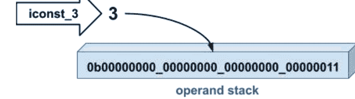

### 1: newarray int

第二个操作码是双字节`newarray`指令。第一个字节是操作码本身，下一个字节是传递给`newarray`操作码的参数，告诉它数组元素将持有什么类型的原型值。这个`newarray`命令获取操作数栈顶部的值（在上一个指令后是 3）opcode 指令，并创建一个带有 3 个空槽的数组对象，每个槽位都持有整数原始类型的数据。最后，`newarray`命令将一个数组引用内存指针推送到操作数栈上：

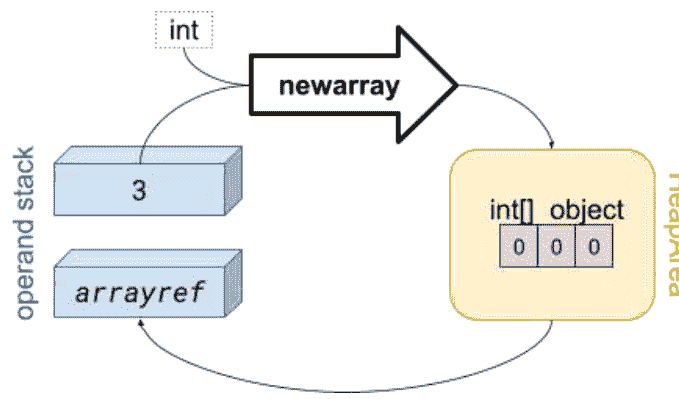

### 3: putstatic #7

第三个操作码是`putstatic`，它获取操作数栈顶的值并将其存储在方法区（MethodArea）的静态字段内存位置。由于之前的`newarray`命令已经将数组对象的内存指针推到了操作数栈上，因此`putstatic`将该内存指针转移到类字段的值中：

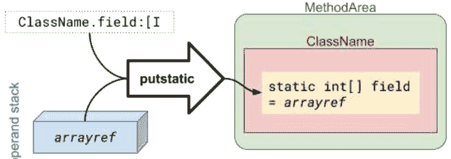

现在，为了操作你创建的数组，你将使用类字段变量名作为指向实际数组数据的引用。这些 Java 数组使用了方括号的特殊语法，你可以用它来更改存储在数组元素中的值。不过，我不会详细介绍获取和设置数组值的方法，因为网上有很多资源会教你如何操作。

相反，让我们在下一页继续另一个 Java 数组对象的示例：

### 二维数组，内部数组包含整数原始类型

此示例将是一个整数原始类型的二维数组。源代码如下：

```java
class ClassName
{
    static int[][] field = new int[2][3];
}
```

以及`javap`对 ClassFile 信息的输出：

```
class ClassName
minor version: 60
flags: (0x0020) ACC_SUPER // ClassName
this_class: #10 // java/lang/Object
super_class: #2 // java/lang/Object
interfaces: 0, fields: 1, methods: 2, attributes: 1
Constant pool:
    #1 = Methodref #2.#3 // java/lang/Object."<init>()V
    #2 = Class #4
    #3 = NameAndType #5:#6 // "init":()V
    #4 = Utf #6 java/lang/Object
    #5 = Utf #7 (V)
    #6 = Utf #8 // "[I"
    #7 = Class [I
    #8 = Utf #10 #11 // ClassName.field:[I]
    #9 = Class #12 // ClassName
    #10 = NameAndType #13 // field:[I]
    #11 = Utf #14 ClassName
    #12 = Utf Code
    #13 = Utf LineNumberTable
    #14 = Utf <clinit>
    #15 = Utf SourceFile
    #16 = Utf ClassName.java
    #17 = Utf
```

```
static int[][] field:
descriptor: [[I
flags: (0x0008) ACC_STATIC
```

```
ClassName();
descriptor: ()V
flags: (0x0000)
Code:
stack:1, locals:1, args_size=1
0: load_0
1: invokespecial #1 // Method java/lang/Object."<init>()V
4: return
LineNumberTable:
1: 0
```

```
static {};
```

```
descriptor: ()V
flags: (0x0008) ACC_STATIC
Code:
stack=2, locals=0, args_size=0
0: iconst_2
1: iconst_3
2: multianewarray #7, 2 // class "[[I"
6: putstatic #9 // Field field:[I]
9: return
LineNumberTable:
line 3: 0
```

你也可以看到类字段的描述符为`[[I]`。两个方括号表示这是一个二维数组，大写的`I`表示数组中存储的是整数原始类型。注意的是，外部数组和内部数组可以被认为具有不同的类型。内部数组用于存储整数值，而外部数组存储内部数组，这些内部数组实际上存储在堆内存（HeapMemory）中。

在`<clinit>`方法中，多维数组通过四个操作码被创建并初始化。

- 0: `iconst_2`
- 1: `iconst_3`

前两个操作码是`iconst_2`和`iconst_3`，它们导致值 2 和 3 被推送到操作数栈上。

`multianewarray #7, 2`
第三个操作码是`multianewarray`，这是一个四字节命令。第一个字节是操作码本身。接下来的两个字节是对常量池项的引用，指向数组的数据类型，该类型实际上被列为类型`[[I]`的类名，与数组描述符相同。命令的最后一个字节是数字 2，表示数组的维度数。

`multianewarray`命令取操作数栈顶的两个值，并将它们作为数组对象的维度，因此第一维有 2 个元素，第二维有 3 个元素。来自常量池的值`[[I]`决定了每个维度将存储什么类型的数据（外部数组中是对象引用，内部数组中是整数原始类型）。`multianewarray`命令的第四个字节持有值 2，表示数组的维度。最后，在创建数组后，`multianewarray`将一个`arrayref`内存指针推送到栈。

- 6: `putstatic #9`
第四个操作码是`putstatic`，我们之前见过。该命令从操作数栈中取出值（现在栈中包含指向新创建数组的内存地址），并将其存储在常量池项 #9 列出的变量中，即静态字段。

### 内存地址的一维数组

数组部分快结束了，我想向你展示最后一个数组创建的示例。这是一个一维数组，但它持有指向堆对象的引用值。源代码如下：

```java
class ClassName {
    static String[] field = new String[10];
}
```

以及`javap`的输出：

```
ClassName
minor version: 60
flags: (0x0020) ACC_SUPER // ClassName
this_class: #10 // java/lang/Object
super_class: #2 // java/lang/Object
interfaces: 0, fields: 1, methods: 2, attributes: 1
Constant pool:
    #1 = Methodref #2.#3 // java/lang/Object."<init>()V
    #2 = Class #4
    #3 = NameAndType #5:#6 // "init":()V
    #4 = Utf #6 java/lang/Object
    #5 = Utf #7 (V)
    #6 = Utf #8 // "[L;"
    #7 = Class [L;
    #8 = Utf #10 #11 // ClassName.field:[L;
    #9 = Class #12 // ClassName
    #10 = NameAndType #13 // field:[L;]
    #11 = Utf #14 ClassName
    #12 = Utf Code
    #13 = Utf LineNumberTable
    #14 = Utf <clinit>
    #15 = Utf SourceFile
    #16 = Utf ClassName.java
    #17 = Utf
```

```
static java.lang.String[] field;
descriptor: [Ljava/lang/String;
flags: (0x0008) ACC_STATIC

ClassName();
descriptor: ()V
flags: (0x0000)
Code:
stack:1, locals:1, args_size=1
0: load_0
1: invokespecial #1 // Method java/lang/Object."<init>()V
4: return
LineNumberTable:
1: 0
```

```
static {};
descriptor: ()V
flags: (0x0008) ACC_STATIC
Code:
stack=1, locals=0, args_size=0
0: bipush
2: anewarray #7 // class java/lang/String
5: putstatic #9 // Field field:[L;]
8: return
SourceFile: "ClassName.java"
```

你可以看到类字段的类型描述符`[Ljava/lang/String;`。这看起来很复杂但实际上并不是。最左侧是方括号，表示这是一个一维数组。数组元素持有的数据类型是`String`，它实际上是基于`String`模板的类对象的内存指针。JVM 以这种格式持有引用信息：“L” + 类名 + ";"

在这种情况下，由于数组元素中持有的数据类型是`String`（即定义该数据结构的类），使用了该类的完全限定名。该名称是`java.lang.String`，其中`java.lang`是包名，`String`是该包内定义的类名。JVM 在其内部表示类名时会将点替换为斜杠，但这就是它的样子。

你应该能够理解操作码是如何创建这个持有地址指针的数组的：

### bipush 10

将值 10 推送到帧的操作数栈上。

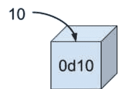

### anewarray #7

从操作数栈中弹出值 10，用它在堆内存中创建一个持有 10 个信息的数组对象。信息的类型由操作码的参数常量池项 #7 `java/lang/String`决定，它是数组元素可以设置的类模板名。目前，元素尚未指向任何特定对象，因此它们都被设置为引用指针的默认值，即`null`。最后，一个指向整个数组对象的引用指针被推送到操作数栈上。

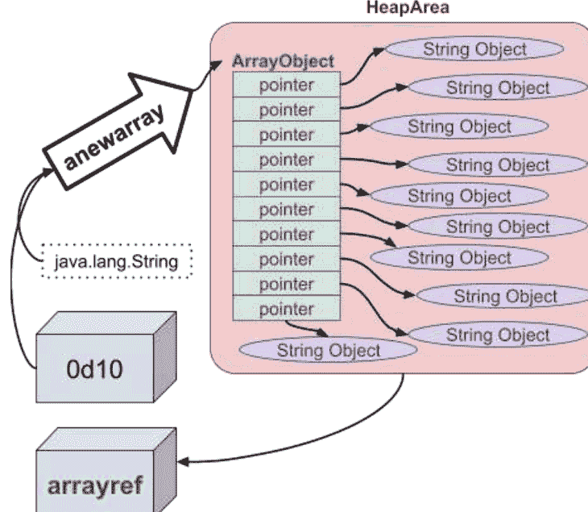

### putstatic #9

从操作数栈中弹出数组引用指针，并将其放入常量池引用 #9 所指向的变量中，`ClassName.field:[Ljava/lang/String;;`。现在由于数组对象的地址指针已存储在类字段中，你就可以在源代码中通过字段名来操作该数组对象。

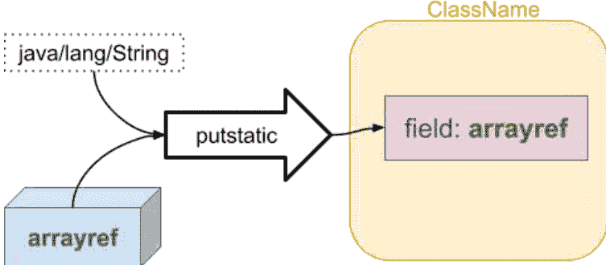

关于 Java 数据类型的章节到此结束。这是一个很长的章节，但了解在 Java 程序中可以存储什么类型的数据以及如何访问它们对任何程序都至关重要。

你的计算机程序以及你的计算机本身，实际上只做两件事：存储信息和处理信息。这一节涵盖了你的程序执行的第一件事。下一节将关注方法，处理的是第二件事。

当然，你可以在源代码的任何地方编写表达式，这些表达式将由 JVM 求值。因此，处理信息并不只发生在方法内部。然而，你的程序执行的大多数操作码（opcodes）可能来自方法内部，所以对你的 Java 程序的一种简单思考方式是：

字段存储源数据。

方法处理字段。

## 处理信息

从技术上讲，你可以在源代码的任何地方对数据进行操作。例如，数学表达式可以直接放在变量声明中，返回结果的方法可以在任何需要值的地方调用。然而，执行操作的一种简单思考方式是这些活动发生在方法内部。事实上，Java 编程的一种常用方法是认为字段存储数据，而方法被用于“set”或“get”这些数据。

当然，除了获取和设置字段数据之外，你还可以进行复杂的数学计算、通过互联网连接其他计算机或其他任何操作。这一节实际上是关于方法的、它们是如何工作的，以及你在内部处理数据或执行操作的不同方式。

让我们从一个返回整数的简单方法开始：

```java
class ClassName
{
    int methodName()
    {
        return 5;
    }
}
```

该类的`javap`输出如下：

```
class ClassName
minor version: 0
major version: 60
flags: (0x0020) ACC_SUPER
this_class: #7 // ClassName
```


`super_class: #2 // java/lang/Object`

`interfaces: 0, fields: 2, attributes: 1`

## 常量池

```
#1 Methodref #8 // java/lang/Object."init>():V
#2 Class #4 // java/lang/Object
#3 NameType #5:6 // <init>():V
#4 Utf8 java/lang/Object
#5 Utf8 <init>
#6 Utf8 ()
#7 Class ClassName
#8 Utf8 Code
#9 Utf8 LineNumberTable
#10 Utf8 methodName
#11 Utf8 ()
#12 Utf8 SourceFile
#13 Utf8 ClassName.java
```

```
{
  ClassName():
    descriptor: ()V
    flags: (0x0000)
    Code:
      stack=1, locals=1, args_size=1
      0: aload_0
      1: invokespecial #1 // Method java/lang/Object.<init>():V
      2: return
    LineNumberTable:
      line 1: 0

  int methodName():
    descriptor: ()I
    flags: (0x0000)
    Code:
      stack=1, locals=1, args_size=1
      0: const_5
      1: ireturn
    LineNumberTable:
      line 5: 0
}
```

正如前面的章节所述，这个类有两个方法，尽管我们只在源代码中写了一个方法。`<init>` 方法（也称为构造方法）是对 `ClassName` 类的父类 `Object` 的调用。因此我们将忽略构造方法，只关注写入源代码中的方法。

让我们逐行查看 `methodName()`：

- `int methodName();` :: 方法名以及它在 Java 源代码中出现的签名。
- `descriptor: (I)` :: 方法的描述符是它接收的参数，加上方法的返回类型，在这种情况下是 `I`（整型）。
- `flags: (0x0000)` :: 这些是方法的访问标志，未设置，意味着该方法是非静态实例方法，只有在通过 `new` 关键字在堆中实例化后才存在；同时也意味着该方法具有默认访问限制，只能在同一个包内调用。
- `Code:` :: 这告诉你 `javap` 输出中后续行是附加在该方法的 `Code` 属性。
- `stack=1` :: 操作数栈帧中可用的槽位数。
- `locals=1` :: 局部变量帧中允许的条目数。
- `args_size=1` :: 传递给方法的参数个数。
- `0: const_5` :: 该方法操作码数组中的第一个操作码，它将值 5 加载到操作数栈上。
- `1: ireturn` :: 弹出方法操作数栈顶部的值，并将其推入调用方法的操作数栈中，然后执行返回。
- `LineNumberTable:` :: 这是 `Code` 属性的一个，包含了与原始源代码文件 `ClassName.java` 中的行匹配的信息。
- `line 5:0` :: 0 指向 `ClassName.java` 中的第五行，对应索引 0 的操作码 `0: const_5`。

总结来说，`javap` 输出中的 `methodName()` 条目告诉你方法名、参数类型和返回类型、方法的标志、栈帧设置的信息以及 JVM 将执行的操作码。

`ClassName` 类中的 `methodName()` 方法非常简单。它只是将 5 的值返回给调用它的方法。你可以清楚地看到 JVM 是通过读取操作码做到这一点的。

我想回过头仔细看一眼 `args_size=1`。这看起来有点奇怪，因为我们没有显式地向方法传递任何参数。这是怎么的？事实是 JVM 会自动传递一个特殊参数到每个方法，而这个参数是该类的 `this` 引用。这是因为允许你在方法中使用 `this` 关键字来引用同类的其他字段和方法。如果方法帧中没有指向所属类的指针，该方法将无法访问类类的成员，或者它必须使用完全限定名来引用类模板或实例对象。

让我们来看方法内部使用 `this` 关键字的源代码类：

```java
class ClassName
{
  int objectField;

  //
  void methodName()
  {
    this.objectField = 5;
  }
}
```

这是 `.class` 文件信息：

```
class ClassName
minor version: 0
major version: 60
flags: (0x0020) ACC_SUPER
this_class: #7 // ClassName
super_class: #2 // java/lang/Object
interfaces: 0, fields: 2, attributes: 1
Constant pool:
#1 Methodref #8 // java/lang/Object."init>():V
#2 Class #4 // java/lang/Object
#3 NameType #5:6 // <init>():V
#4 Utf8 java/lang/Object
#5 Utf8 <init>
#6 Utf8 ()
#7 Class ClassName
#8 Utf8 Code
#9 Utf8 LineNumberTable
#10 Utf8 methodName
#11 Utf8 ()
#12 Utf8 SourceFile
#13 Utf8 ClassName.java
```

```
ClassName():
  descriptor: ()V
  flags: (0x0000)
  Code:
    stack=1, locals=1, args_size=1
    0: aload_0
    1: invokespecial #1 // Method java/lang/Object.<init>():V
    2: return
  LineNumberTable:
    line 1: 0

int methodName():
  descriptor: ()I
  flags: (0x0000)
  Code:
    stack=1, locals=1, args_size=1
    0: const_5
    1: ireturn
  LineNumberTable:
    line 5: 0
```

```
void methodName();
  descriptor: (V)
  flags: (0x0000)
  Code:
    stack=2, locals=1, args_size=1
    0: aload_0
    1: iconst_5
    2: putfield #7 // Field objectField:I
    5: return
  LineNumberTable:
    line 7: 0
    line 8: 5
```

## 让我们遍历 `methodName()` 操作码

- `0: aload_0`: 将局部变量数组中第一个条目的 `this.class` 引用（JVM 自动将其放在那里）加载到操作数栈上。
- `1: iconst_5`: 将值 5 推入操作数栈，现在操作数栈同时存储了两个值，这就是为什么 `Code` 属性显示 `stack=2` 的原因，因为该方法的帧需要两个操作数槽位。
- `2: putfield #7`: 将操作数栈顶部的值传输到由指向类模板（常量池 #7）的指针和指向该类模板的特定实例对象的指针（栈第二个值）定义的实例字段中。注意，实例对象的地址指针并不直接可见，正如之前关于指针类型的章节中所述。

偶尔基于此的，所以你只需要信任 JVM 会为你提供指向对象的正确指针即可。

现在让我们来看一个拥有所谓“getter”（获取）和“setter”（设置）方法的类。这是 Java 编程中的一个常见主题，实例字段持有数据，而 getter 和 setter 方法负责检索或修改该字段：

```java
class ClassName {
  boolean instField;

  //
  void setInstField() {
    this.instField = true;
  }

  //
  boolean getInstField() {
    return this.instField;
  }
}
```

这里是 `javap` 的输出：

```
class ClassName
minor version: 0
major version: 60
flags: (0x0020) ACC_SUPER
this_class: #8 // ClassName
superclass: #2 // java/lang/Object
interfaces: 0, fields: 1, methods: 3, attributes: 1
Constant pool:
#1 = Methodref #2.#3 // java/lang/Object."<init>():(V)
#2 = Class // java/lang/Object
#4 = NameAndType // "<init>():V
#5 = Utf java/lang/Object
#6 = Utf <init>
#7 = Fieldref // ClassName.instField:Z
#8 = Class // ClassName
#9 = NameAndType #11:#12 // instField:Z
#10 = Utf ClassName
#11 = Utf instField
#12 = Utf Z
#13 = Utf Code
#14 = Utf LineNumberTable
#15 = Utf setInstField
#16 = Utf getInstField
#17 = Utf (Z)
#18 = Utf8
#19 = Utf8
```

```
boolean instField;

descriptor: Z

flags: (0x0000)

ClassName();

descriptor: ()V

flags: (0x0000)

Code:

stack=1, locals=1, args_size=1

0: aload_0

1: invokespecial #1    // Method java/lang/Object."<init>():V

4: return

LineNumberTable:

line 1: 0
```

```
void setInstField();

descriptor: ()V

Code:

stack=2, locals=1, args_size=1

0: aload_0

1: iconst_1

2: putfield #7    // Field instField:Z

5: return

LineNumberTable:

line 7: 0

line 8: 5
```

```
boolean getInstField();

descriptor: ()V

Code:

stack=1, locals=1, args_size=1

0: aload_0

1: getfield #7    // Field instField:Z

4: ireturn

LineNumberTable:

line 12: 0
```

`SourceFile: "ClassName.java"`

setter 方法用紫色突出显示。它不接受任何参数，也没有返回值。它包含的字节码指令如下：

- **`0: aload_0`** - 将对象实例的地址指针推入操作数栈。
- **`1: iconst_1`** - 将值 1 推入操作数栈。
- **`2: putfield #7`** - 将值 1 传输到由第七个常量池引用给出的类类型标识符所标识的字段，以及推入操作数栈的对象指针。
- **`5: return`** - 最后，该方法将执行控制权传回调用它的方法，且没有返回值。

getter 方法用红色突出显示。它没有任何参数，但它确实会返回一个布尔值。它的字节码指令为：

- **`0: aload_0`** - 将指向类对象的内存地址推入帧的操作数栈中。
- **`1: getfield #7`** - 获取常量池条目 7 中列出的类类型所标识的字段值，加上推入栈的对象的指针，然后将该值推入操作数栈。
- **`4: ireturn`** - 从操作数栈中弹出顶值（现在是布尔字段的值），并将其推入任何调用此方法的栈帧的操作数栈中；最后，它将程序控制权转移给该调用方法，以便你的 Java 程序能够继续运行。

希望通过这些内容，你能够更好地理解方法如何实现帮助你的程序运行的功能，例如获取、修改和设置变量以及字段。

需要注意的一点是，由于方法始终位于类内部，JVM 会为每个方法提供其所属对象的地址指针，以便它可以引用其所属对象实例的其他成员。你可以在源码中通过 `this` 关键字利用这个地址指针，它直接链接到 `.class` 文件中的对象指针。结合你对 Java 访问限制的知识，以及静态类成员与非静态实例对象成员之间的区别，了解方法的工作原理应该让你有足够的知识来设计源码来实现你的目标。

## 异常与错误处理

我觉得这个主题在《Java 语言规范》中解释得并不清楚，所以我想添加这一部分来展示异常（`Exception`）和错误（`Error`）如何在 `.class` 文件表示。查看类信息会让这个主题更容易理解。

首先，什么是异常和错误？简单来说，这些都是计算机在执行你的程序时遇到的问题。例如，如果你尝试除以零，计算机将生成一条错误消息，告诉它无法将无限作为整数数据类型存储或类似。其他错误可能是尝试打开一个不存在的文件，或者打开一个不接受连接的网站的网络连接。还有许多类型的问题可能发生。

与某些直接退出程序或崩溃的编程语言不同，Java 允许你在源代码中处理程序遇到的错误！我不知道这是如何实现的，但可能是因为你的程序运行在一个模拟计算机即 JVM 中，所以对你程序的执行具有某种程度的元控制。换句话说，JVM 的构建方式可能能够观察并检测你的程序何时遇到问题。

Java 用来处理这些问题的系统完全基于三个概念：

- `Throwable` 类
- `try{}` / `catch{}` 源代码命令
- JVM 字节码跳转

`Throwable` 是 Java 预装的一个 Java 类名称。该类是 Java 虚拟机抛出的所有错误和异常的基类。`Throwable` 的子类分为 `Error`（错误）和 `Exception`（异常）。错误代表合理的应用程序不尝试捕获的严重问题。异常代表应用程序可能想要捕获的情况。

`try` 块用于封装可能会抛出异常的代码。`catch` 块用于处理异常。`finally` 块用于无论是否抛出异常都执行代码。

```java
try {
    int result = 10 / 0;
} catch (ArithmeticException e) {
    System.out.println("Division by zero: " + e.getMessage());
} finally {
    System.out.println("This will always execute.");
}
```

JVM 使用字节码来处理异常。当抛出异常时，JVM 在当前方法中查找异常处理程序。如果没有找到，它将返回调用方法并重复该过程。一直持续到找到处理程序或程序终止。

`.class` 文件中的异常表包含有关异常处理程序的信息。表中的每个条目由：

- 可以抛出异常的代码指令范围的起始偏移量。
- 代码指令范围的结束偏移量。
- 处理偏移量（异常处理程序开始的地址）。
- 处理程序处理的异常类型。

这里是上述代码的异常表示例：

```
exception table:
  from 0 to 5 by 12 to java/lang/ArithmeticException
```

该条目意味着如果偏移量 0 到 5 的任何指令抛出了 `ArithmeticException`，则执行偏移量 12 的处理器。

| 起始偏移量 | 结束偏移量 | 处理偏移量 | 异常类型 |
| :--- | :--- | :--- | :--- |
| 0 | 5 | 12 | `ArithmeticException` |

在这个示例中，如果在偏移量 0 到 5 之间的指令抛出了 `ArithmeticException`，JVM 将跳转到偏移量 12 的代码，即 `catch` 块的开始。

异常表是 Java 类文件的至关部分，因为它允许 JVM 知道如何高效处理异常，而无需对每条指令都检查潜在的异常。

`getstatic`, `ldc` 和 `invokirtual` 仅仅是执行 `println()` 方法并向控制台打印 "catch" 单词所需的指令。

如果你喜欢，也可以在源代码中放置多个 `catch{}` 块。这允许你根据错误的错误的特定类型，更细致地控制如何处理错误。例如，Java 有一个专门用于数学错误的异常类，因此你可以在将其放在一个新的 `catch()` 块中。更具体的错误类型必须放在不那么具体的类型之前，如下所示：

```java
class ClassName {
  static public void main(String[] args) {
    try {
      int x = 1/0;
    } catch(ArithmeticException e) {
      System.out.println("catch1");
    }
    catch(Throwable e) {
      System.out.println("catch2");
    }
  }
}
```

来自 `javap` 的 `main()` 方法入口是：


`public static void main(java.lang.String[])`

`descriptor: ((Ljava/lang/String;)V)`

`flags: (0x0009) ACC_PUBLIC, ACC_STATIC`

`Code:`

`stack=2, locals=2, args_size=1`

```
0: istore_1
1: idist_0
2: idiv
3: istore_1
4: goto
7: astore_1
8: getstatic #9 // Field java/lang/System.out:Ljava/io/PrintStream;
11: ldc #15 // String catch1
13: invokirtual #17 // Method java/io/PrintStream.println:(Ljava/lang/String;)V
16: goto
19: astore_1
20: getstatic #9 // Field java/lang/System.out:Ljava/io/PrintStream;
23: ldc #25 // String catch2
25: invokirtual #17 // Method java/io/PrintStream.println:(Ljava/lang/String;)V
28: return
```


| 异常表 | 起始 (from) | 目标 (target) | 类型 (type) |
| :--- | :--- | :--- | :--- |
| 4 | 7 | Class java/lang/ArithmeticException |
| 4 | 19 | Class java/lang/Throwable |

我高亮了代码的不同部分，以便看到两个 `catch` 语句在指令数组中的位置。第一个 `catch` 语句的指令（传入 `ArithmeticException` 对象）从索引 7 开始，到索引 16 结束，在该处 `goto` 命令会让 JVM 跳转到 `return` 语句。

第二个 `catch` 语句捕获除第一个 `catch` 语句过滤掉的任何 `Throwable` 对象，从指令索引 19 开始，到索引 25。这个 `catch` 语句并没有以 `goto` 命令结尾，这是因为 JVM 可以在执行完最后一个指令后直接执行 `return` 语句。

注意，两个 `catch` 语句的指令程序都从 `astore_1` 指令开始，该指令存储指向传入特定块对象的内存地址指针。这个原子指令的工作原理是从操作栈顶部弹出内存指针，然后将其移动到局部变量数组中，但请注意，`main()` 方法中没有列出任何将此内存指针推入操作栈的指令。这一定是因为 JVM 在检测到错误后立即将指针推入栈，我认为这里发生了一些 JVM 的“魔法”。

你可以通过引用源代码中的参数变量来使用指向 `Throwable` 或 `Throwable` 子类对象的指针，如下：

```
class ClassName {
    static public void main(String[] args) {
        try {
            int x = 1/0;
        } catch (Throwable e) {
            System.out.println(e);
        }
    }
}
```

`main()` 方法的 `javap` 输出为：

```
public static void main(java.lang.String[])
descriptor: ([Ljava/lang/String;)V
flags: (0x0009) ACC_PUBLIC, ACC_STATIC
Code:
  stack=2, locals=2, args_size=1
    0: iconst_1
    1: iconst_0
    2: idiv
    3: istore_1
    4: goto
    7: astore_1
    8: getstatic #9 // Field java/lang/System.out:Ljava/io/PrintStream;
   11: aload_1
   12: invokirtual #15 // Method java/io/PrintStream.println(Ljava/lang/Object;)V
   15: return
```

异常表：

| 起始 (from) | 结束 (to) | 目标类型 (target type) |
| :--- | :--- | :--- |
| 0 | 4 | Class java/lang/Throwable |

你可以看到在 `catch` 块的指令中，并不是向控制台打印字符串值，而是 `Throwable e`（`Throwable` 类对象）的内存指针通过 `aload_1` 指令推入操作栈，供 `println()` 方法使用。当你运行这个 Java 程序时，你会看到 `java.lang.ArithmeticException: / by zero`，这是 Java 决定打印的字符串，而不是内存指针的值。

总结 Java 处理程序执行期间遇到问题的几个要点：

- `Throwable` 是 Java 用于分类运行期间检测到的任何问题的类名。
- 继承自 `Throwable` 的类（即 `Throwable` 的子类）也可以用于标记错误。
- Java 具有内置的检测和分类问题的能力，JVM 会扫描你的代码，寻找参数类型匹配错误类型的 `catch{}` 块。
- JVM 将指向 `Throwable` 对象的内存指针推入操作栈，因此你可以根据需要直接处理该错误。
- 在源代码中使用 `try{}` 代码块来告诉 JVM 监控闭闭代码中出现的任何问题，并在之后放置 `catch{}` 块。
