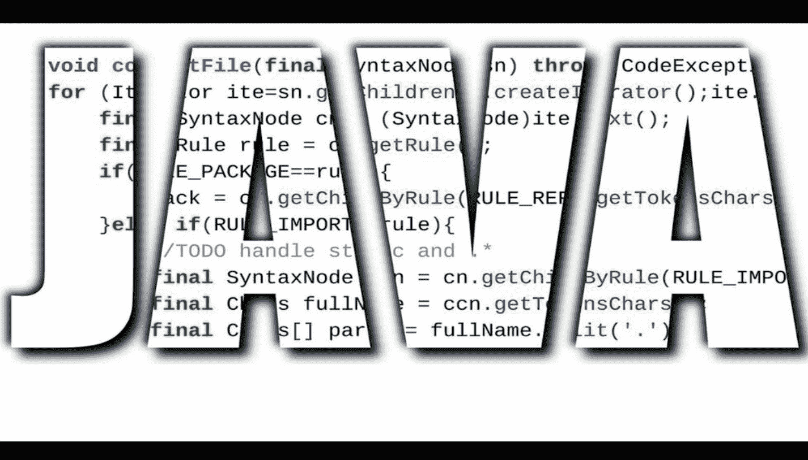
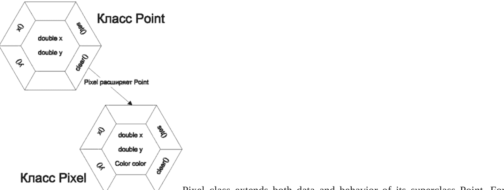
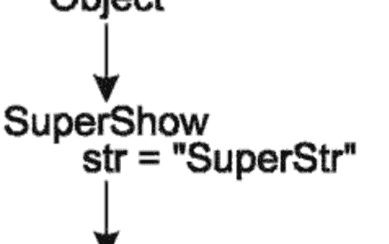
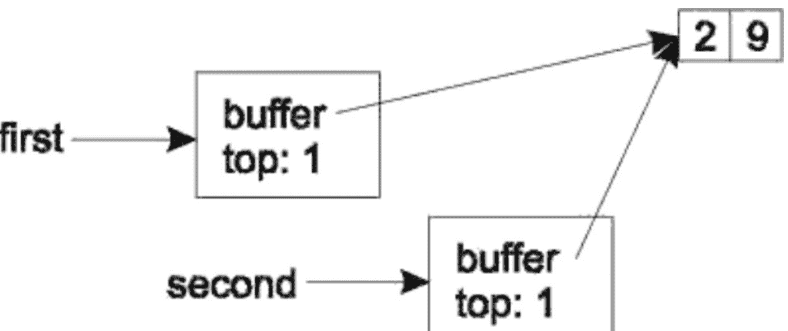
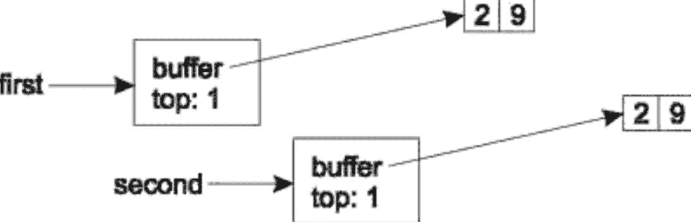
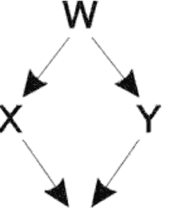
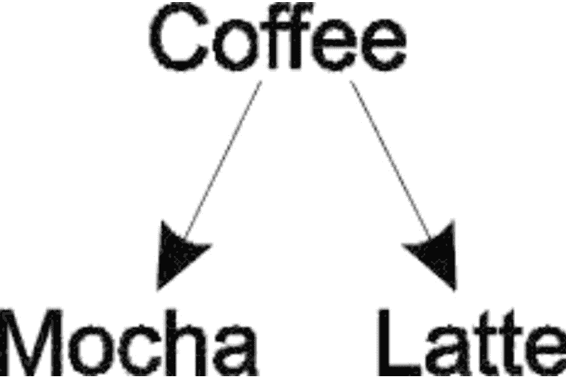
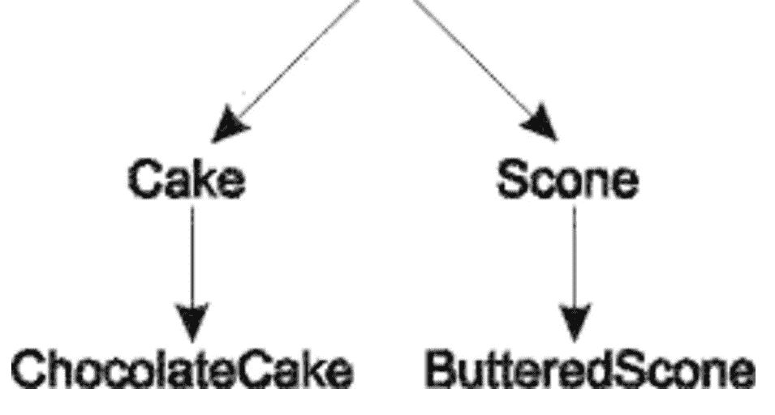

# Java 语言初学者指南：Java 编程语言逐步进阶指南

```java
void tFile(final SyntaxNode node) throws CodeException {
    for (Iterator it = node.children.createIterator(); it.hasNext(); it++) {
        SyntaxNode c = (SyntaxNode)it.next();
        final Rule rule = c.getRule();
        if (c.E_PACKAGE == rule) {
            ack = c.getByRule(RULE_REF).getChars();
        } else if (RULE_IMPORT == rule) {
            // TODO handle c and *\n
            final SyntaxNode n = cn.getByRule(RULE_IMPORT);
            final String s = fullName = cn.getChars();
            final String[] part = fullName.split('.');
        }
    }
}
```



# 目录

- 第 7 章
  - 创建新类型的异常
  - 异常应用
- 第 8 章
  - 基础字符串操作
  - 练习题
  - 辅助方法
  - 转换字符串
  - `getChars(int srcBegin, int srcEnd, char[] dst, int dstBegin)`
  - `StringBuffer` 类
  - 返回 `int`
  - 容量
  - 练习题
  - 流
  - 同步
  - `synchronized` 语句
  - 线程调度
  - 挂起流
  - 终止线程
  - 使用 `Runnable`
  - 线程安全与
  - 调试线程
  - 包
  - 批处理访问
- 第 11 章
  - 流
  - `OutputStream` 类
  - 标准流类型
  - 练习题
  - `PrintStream` 类
  - `ByteInputStream`
  - `FileStreams` 和 `FileDescriptor`
  - `LineNumber` 类
  - `PushbackInputStream`
  - `wordChars(int)`
  - 数据
  - 练习题
  - `RandomAccessFile(File file, String mode) throws IOException`
  - 练习题
  - 文件名接口
  - `IOException` 类
  - 标准
  - `Enumeration` 接口
  - `Vector` 类
  - `Stack` 类
  - `Dictionary` 类
  - 练习题
  - `Properties` 类
  - 练习题
  - `Date(int year, int month, int day, int hr, int min, int sec)`
  - `void setSeconds(int)`
  - `Random` 类
  - `synchronized setSeed(long)`
  - 练习题
  - 练习题
  - 类型的应用
  - 编程
  - 类
  - 练习题
  - 加载类
  - 练习题
  - 包装类：概述
  - `Boolean` 类
  - `Character` 类
  - `static int(ch, int)`
  - `static boolean isTitle(char)`
  - `static boolean`
  - `static char toLowerCase(char)`
  - `static char toUpperCase(char)`
  - `static char titleCase(`
  - `static int(ch, int)`
  - `Integer` 类
  - `Long` 类
  - `Float and Double` 类
  - 编程
  - 标准流
  - 内存管理
  - 系统属性
  - `static boolean Boolean.getLong(String)`
  - `static long Long.getLong(String)`
  - 进程创建
  - 练习题
  - 练习题
  - `Runtime` 类
  - 练习题
  - 杂项
  - 安全
  - `Math` 类
  - 附录 A 原生方法
    - A.2 与 C 和 C++ 的协调
      - A.2.1 名称
      - A.2.2 方法
    - A.3 类型
    - A.5 安全
    - A.6 内存操作
    - A.3 示例
    - 练习 A.1
    - 练习 A.2
    - A.3 Lockable文件的内部结构
    - A.4 字符串
    - 练习 A.3
    - 练习 A.4
    - 练习 A.5
    - A.5 数组
    - 练习 A.6
    - A.6 对象创建
    - A.7 调用 Java 方法
    - A.8 最后警告
  - 附录 B
    - B.1 Java 中的 `RuntimeException`
    - B.2 异常类
  - 附录 C 详情表
    - B.0.2 差异

---

本章提供了 Java 编程语言的概述。阅读后，你可以编写你的第一个 Java 程序。在这里，我们将考虑语言的基本特性，而不深入探讨细节。

Java 程序是由类构建的。根据类的定义，开发者可以创建该类的任意数量的对象（或实例）。类和它的对象可以分别比作图纸和零件——有了图纸，生产出所需数量的零件并不困难。

类包含两种类型的成员：字段和方法。字段是属于类本身或其对象的数据；字段值决定了对象或类的状态。方法是操作符的序列，对字段执行某些操作以改变对象的状态。

按照既定传统，所学编程语言的第一个程序应该输出 "Hello, world" 字符串。此类 Java 程序的文本如下：

```java
class HelloWorld {
    public static void main(String[] args) { System.out.println("Hello, world"); }
}
```

使用喜欢的编辑器将原始文本编辑为文件。然后运行 Java 编译器将源代码转换为字节码，这是 Java 虚拟机的“机器语言”。程序的类型和编译在不同系统中可以通过不同的方式进行，因此在此不描述——有关信息，请参阅相应的文档。

如果你启动程序，屏幕上将出现：

Hello, world

我们的 Java 小程序做了一些事情——但实际上，它是如何发生的呢？

上面的程序声明了一个类 `HelloWorld`，它只包含一个方法。类成员列在类名后的大括号内。`HelloWorld` 包含一个方法且没有字段。

唯一的方法 `main` 方法是 `String` 数组，代表用于运行程序的命令行参数。数组和字符串，以及 `main` 方法的值将在下讨论。

`main` 方法使用 `void` 关键字声明，因为它不返回任何值。该方法在 Java 中具有特殊含义；当类作为程序运行时，如上所示声明的类的 `main` 方法将被执行。

应用程序。当启动时，主方法可以创建对象、评估表达式值、调用其他方法，并执行程序员放入其中的任何操作。

在上面的示例中，`main` 包含一条语句，该语句调用了 `System` 类的 `out` 对象的 `println` 方法。要调用方法，必须指定对象和方法名，并用点（.）将它们隔开。`out` 对象的 `println` 会向标准输出打印一行文本并换行符。

在你的计算机上输入、编译并运行 `HelloWorld` 程序。

尝试更改 `HelloWorld` 程序的不同部分并检查收到的错误信息。

以下示例展示了斐波纳契数——一个无限序列，其前几个成员为：

- 1
- 1
- 2
- 3
- 5
- 8
- 13
- 21
- 34

斐波纳契数列从 1 和 1 开始，每个后续元素都是前两个数字之和。打印斐波纳契数列的程序并不困难，但它演示了变量的声明、简单循环的操作以及算术运算的执行：

```java
class Fibonacci {
    // Print Fibonacci numbers <50
    static void main(String[] args) {
        int lo = 1;
        int hi = 1;
        System.out.println(lo);
        while (hi < 50) {
            System.out.println(hi);
            int h = lo + hi; // Change the value of
            lo = hi - lo; /* The new value for lo is
            the old hi, that is, the sum minus the old lo */
        }
    }
}
```

这个示例声明了 `Fibonacci` 类，它和 Hello World 一样包含一个 `main` 方法。`main` 方法的前几行声明并初始化了变量。变量前面必须跟上它的类型。变量 `hi` 和 `lo` 是 `int` 类型——也就是说，它们是有符号的 32 位整数，范围从 −2³¹ 到 2³¹−¹。

Java 语言具有内置的“原始”数据类型，用于处理整数、实数、布尔和符号值。Java 可以直接对原始类型的值进行操作，而不是对程序员定义的对象。Java 中没有默认类型；每个变量的类型必须在程序中指定。Java 提供了以下：

| 类型 | 说明 |
| :--- | :--- |
| `boolean` | 数值之一：`true` 或 `false` |
| `char` | 16 位 Unicode |
| `byte` | 8 位（有符号）整数 |
| `short` | 16 位整数（有符号） |
| `int` | 32 位整数（有符号） |
| `long` | 64 位整数（有符号） |
| `float` | 32 位浮点数 (IEEE 754-1985) |
| `double` | 64 位浮点数 (IEEE 754-1985) |

在显示斐波纳契数的程序中，变量 `hi` 和 `lo` 被赋值为值 1。可以在声明变量时使用运算符 `=` 设置变量的初始值（这被称为初始化）。`=` 左侧的变量被赋值为右侧表达式的值。在我们的程序中，变量 `hi` 包含该行的最后一个数字，而 `lo` 是上一个数字。在初始化之前，变量是未定义的。如果你尝试在变量赋值之前运行它，Java 编译器将拒绝编译。

上一个示例中的语句演示了 Java 中的循环选项之一。循环中测试的条件是一个布尔表达式，用于检查当前行数（`hi`）是否小于 50。如果为真，则执行循环体，然后再次检查表达式。如果它仍然为假，程序将无限运行，直到遇到某些情况——例如遇到 `break` 语句。

注意，在上面的示例中，`println` 方法传递了一个整数参数，而在 `HelloWorld` 中，参数是一个字符串。`println` 方法是许多可用不同参数调用的方法之一。

**练习：**
- 打印斐波纳契数列表列表。
- 编写一个生成不同数字序列的程序，例如斐波纳契平方（使用 `*` 运算符执行乘法）。

我们程序中的文本是注释。Java 中有三种注释——在我们的示例中都出现了。跟随 `//` 直到行尾的文本会被编译器忽略；`/* */` 之间的文本也是如此。注释允许你为未来需要理解你程序的程序员添加描述和解释。通过对程序进行注释，你可以节省自己的时间。此外，在编写注释时，经常会发现程序中的错误。第三种注释出现在程序的最开头，位于符号 `/**` 之间。以两个星号开头的注释是文档注释。文档注释用于描述后续代码段的作用；我们的示例刻画了 `main` 方法。一个名为 `javadoc` 的特殊程序会为它们生成 HTML 文件。

常量是固定值——例如整数或“String”。在你的帮助下，你可以处理在程序生命周期内保持不变的数值。程序员倾向于使用命名常量有两个原因。第一个是常量名称定义了含义；另一个原因是命名常量定义在程序的一个位置。当需要更改它的值时，只需在该处修改即可。在 Java 中创建命名常量，必须在声明时指定 `static` 和 `final` 关键字并设置初始值：

```java
class CircleStuff {
    static double p = 3.1416;
}
```

如果小数点后四位的精度不够，我们将 `p` 声明为 `double`，一种 64 位双精度浮点数，这样 `p` 可以更精确地指定——例如 3.141592653589793284。

相关的常量可以组合在一个类中。例如，以下常量在游戏中可能有用：

```java
class Suit {
    final static int CLUBS = 1;
    final static int DIAMONDS = 2;
    final static int HEARTS = 3;
    final static int SPADES = 4;
}
```

通过这种分组，可以使用 `Suit.HEARTS`、`Suit.SPADES` 等——所有的花色名称集中在一个 `Suit` 类中。

## Unicode 字符

停一下，注意上一个示例中用于常量名的 `p`。在大多数编程语言中，标识符通常限于 ASCII 字符集中的字母和数字。

Java 将你引入国际化软件的世界。Java 使用字符集标准 Unicode。Unicode 字符长度为 16 位，以支持许多语言中的字母。这就是为什么我们能够在上面的示例中使用 `p` 作为常量名。`p` 字符是希腊 Unicode 部分，因此可能会出现在程序的源代码中。现在编程通常使用 ASCII 字符集（7 位编码）或 ISO-Latin-1（一种称为 Latin-1 的 8 位标准）。

然而，这些字符在处理之前会被转换为 Unicode，因此在 Java 中始终使用 Unicode 编码。

**练习：**
- 修改 `HelloWorld` 应用，使输出字符串由命名常量表示。
- 修改斐波纳契应用，使条件循环中的字面量常量（50）变为命名常量。

“执行顺序”是语句执行的顺序。影响执行顺序的一个例子是打印斐波纳契数程序中的循环。其他改变执行顺序的运算符包括 `if / else`、`for`、`switch`、`do while` 以及块（即包含在大括号 `{}` 内并分组的多个语句）。

```java
System.out.println(": " + lo);
for (int i = 2; i < MAX_INDEX; i++) {
    if (hi % 2 == 0) {
        mark = "*";
    } else {
        mark = "";
    }
    System.out.println(i + ":" + mark);
    hi = lo + hi; // Change the value of hi
    lo = hi - lo; // * The new value for lo is old hi, that is, the sum minus the old lo * /
}
```

这是程序运行的结果所示：

eleven

+ 2: 1

3: 2 *

4: 3

5: 5

6: 8 *

7: 13

8: 21

9: 34 *

为了简化行计数，使用了 `for` 循环代替 `while`。`for` 是 `while` 的一种特殊情况，它在循环变量的基础上增加了初始化和增量。上面的 `for` 循环等于以下的 `while`：

```java
{
    int i = 2;
    while (i < MAX_INDEX) {
        // .. output
        i++;
    }
}
```

这段代码段中的 `++` 运算符对于不熟悉追溯到 C 的编程语言的人来说可能令人困惑。该运算符增加它所应用变量的值——在这种情况下，如果它在操作数之前，它是前置运算符；如果在之后它是后置运算符。同样，`--` 运算符将它所应用变量的值减 1，也可以是前置或后置的。`++` 和 `--` 运算符源于 C 编程语言。在上面的示例中，运算符

```java
i++;
```

可以替换为表达式

```java
i = i + 1;
```

```java
i += 1;
```

`+=` 运算符右侧的值（即 `1`）被加到左侧变量（即 `i`）的值，并将结果写入同一个变量中。Java 中的大多数二元运算符（换句话说，具有两个操作数的运算符）都可以以类似的方式与 `=` 运算符结合。

在循环内部使用了 `if / else` 结构，它检查 `i` 的当前值的奇偶性。`if` 语句解析括号中表达式的值。如果为真，则执行 `if` 内部的第一个语句或块。如果值为假，则执行 `else` 关键字之后的语句或块。`else` 不是必须的；如果缺少 `else` 且条件为假，则跳过该块。

在执行完 `if / else` 结构的两个可能分支之一后，控制将传递到 `if` 语句之后的语句。

在我们的示例中，使用 `%` 运算符检查 `hi` 的奇偶性。这是左操作数除以右操作数的余数。如果左侧的值是偶数，余数将为 `0`，下一个运算符会将星号分配变量 `marker` —— 标记偶数的指示。对于奇数，满足 `else` 条件，将 `marker` 设置为空字符串。

`println` 稍微复杂一点——`+` 运算符用于连接以下字符串：`i`、分隔符、`hi` 值的字符串、指示字符串。当 `+` 运算符应用于字符串时，它执行的是连接，而在算术表达式中执行的是加法。

**练习：**
- 修改循环，使得变量 `i` 的值不直接改变，而是向相反的方向改变。

Java 像任何面向对象的编程语言一样，具有构建类和对象的机制。Java 中的每个对象都有一个类型；它是对象所属的类。每个类都有两种成员：字段（fields）和方法（methods）。

- 字段是包含数据和对象的变量。它们存储该类方法计算的结果。
- 方法包含该类的可执行代码。方法由运算符组成；这些运算符以及调用方法的方式最终决定了程序是如何执行的。

一个表示平面上某点的简单类声明可能如下所示：

```java
class Point {
    public double x, y;
}
```


# 类与对象

## Point 类基础

`Point` 类包含两个带有点的 `x` 和 `y` 坐标的字段，其中没有方法（当然，在当前的实现中）。这样的类声明定义了从它创建的对象将看起来的样子，并且通过一系列指令定义了对象的行为。一个图纸在添加了技术规范和指令后获得了最大的价值。

类成员可以有不同的访问权限。将 `x` 和 `y` 字段声明为 `public` 意味着任何类都可以访问它们。

通常情况下，需要一个对象的字段值与所有对象中同名字段的值不同。在 Java 中，对象通过 `new` 关键字创建。对象分配在称为堆（heap）的内存中。每个类的对象都有这些字段的自己的拷贝。例如，更改 `lowerLeft` 的 `x` 字段对 `upperRight` 的 `x` 字段没有影响。对象字段有时被称为实例变量（instance variables），因为类的每个对象（实例）都包含这些字段的独立拷贝。

```java
Point lowerLeft = new Point();
lowerLeft.x = 0;
lowerLeft.y = 0;

Point upperRight = new Point();
upperRight.x = 1280.0;
upperRight.y = 1024.0;

Point middlePoint = new Point();
middlePoint.x = 640.0;
middlePoint.y = 512.0;
```

## 类变量（静态字段）

然而，有时需要一个供类所有对象共享的字段。此类字段也被称为类变量（class variables）即适用于整个类的变量，相对于引用对象的变量。

什么是类变量？让我们想象一个生产索尼播放器（Sony Walkman）的工厂。每个播放器都被分配一个序列号。在我们的术语中，这意味着每个对象都有一个存储数字的唯一字段。然而，工厂需要分配给下一个播放器的数字。在每个对象中重复此信息是不明智的——你只需要一个数字的拷贝，它存储在工厂本身，换句话说，类变量中。

要使用字段存储特定于整个类的信息，使用 `static` 关键字声明它，这就是为什么此类字段被称为静态。对于表示原点的 `Point` 对象经常遇到，因此在 `Point` 类中为它分配一个静态字段是合理的：

```java
public static Point origin = new Point();
```

如果这出现在 `Point` 对象内部，将恰出现一个名为 `origin` 的数据实例，它始终指向 (0,0) 对象。无论存在多少个 `Point` 对象（即使没有创建对象），静态字段始终存在。因为数值字段没有分配初始值，所以它们被初始化为零。

我们在第一个程序中已经遇到过一个静态对象。`System` 类——一个标准的 Java 类，它有一个名为 `out` 的静态字段，用于将程序的输出路由到标准输出。

当该术语出现在本书中时，“字段”通常指的是每个对象唯一的字段，尽管在某些情况下为了清晰可能会使用“非静态”术语。

## 垃圾回收

假设你通过调用 `new` 创建了一个对象；但当这个对象不再需要时，如何移除它呢？答案很简单——没有办法。未使用的 Java 对象由垃圾回收器自动销毁。垃圾回收器在后台运行并跟踪对象的引用。当一个对象不再有任何引用时，就可以从其临时存储的堆中移除它，尽管这种移除可以推迟到更合适的时机。

## 数据封装与方法

在任何包含 `Point` 对象引用的片段程序中，上述 `Point` 类的对象都可以被修改，因为该类的字段是使用 `public` 关键字声明的。`Point` 类是类最简单的示例。事实上，有时你通过简单的类就能解决问题——例如，执行包的纯内部任务，或者当最简单的类型就足够满足你的需求时。

尽管如此，面向对象编程的真正优势在于隐藏类的实现的能力。在 Java 语言中，对类的操作是通过类方法执行的——即在对象数据上执行以获得所需结果的指令。方法通常会使用类的实现细节，而这些细节应该对所有其他对象隐藏。数据被隐藏并对所有其他对象不可访问——这就是数据封装的核心点。

每个方法都有零或多个参数。方法可以返回一个值，或者使用 `void` 关键字，方法语句包含在跟随方法名及其签名声明的圆括号块中。签名是方法的名称，后面紧跟参数的数量和类型。你可以增强 `Point` 类并向它添加一个简单的 `clear` 方法，它看起来像这样：

```java
public void clear () { 
    x = 0;
    y = 0;
}
```

该方法没有参数，因为其名称后的括号 `()` 是空的；此外，此方法是用 `void` 关键字声明的，因为它不返回任何值。在方法内部，允许直接对类的字段和方法进行命名——你只需直接写 `x` 和 `y`，而无需引用特定的对象。

对象并不直接与其他数据交互，虽然正如我们在 `Point` 类示例中看到的，类可以将其字段设为公有。在一个设计良好的类中，数据通常是隐藏的，以便通过类方法进行更改。要调用方法，你必须指定对象名和方法名，并用点（`.`）将它们隔开。参数以参数化值列表的形式传递给方法并用逗号隔开。即使调用方法时没有参数，你仍然需要包含空括号。调用该方法的对象（接收调用方法请求的对象）是接收者对象，或简称为接收者。

方法只能返回一个值作为方法的结果。这意味着为了让一个方法返回多个值，你需要创建一个特殊的对象，其目的是存储返回值，并返回该对象。

下面是 `distance` 方法，它是之前示例中 `Point` 类的一部分。该方法接受另一个 `Point` 对象作为参数，计算两个点之间的欧几里得距离，并将结果作为双精度浮点值返回：

```java
public double distance (Point that) {
    double xdiff, ydiff;
    xdiff = x - that.x; 
    ydiff = y - that.y;
    return Math.sqrt(xdiff * xdiff + ydiff * ydiff);
}
```

对于在实例化对象部分中定义的 `lowerLeft` 和 `upperRight`，对 `distance` 方法的调用可能如下：

```java
double d = lowerLeft.distance(upperRight);
```

执行此操作后，变量 `d` 将包含点 `lowerLeft` 和 `upperRight` 之间的欧几里得距离。

## `this` 引用

有时接收者对象需要知道自己的引用。例如，接收者对象可能想要将自己添加到对象列表中。每个方法都可以使用 `this` 这一点——指向当前对象（接收器对象）的引用。

`clear` 的定义等同于上面：

```java
public void clear () {
    this.x = 0;
    this.y = 0;
}
```

此引用通常用参数传递给那些需要对象引用的方法。此外，它也可以用于命名当前对象的成员。这里是另一个 `Point` 方法名为 `move`，用于给 `x` 和 `y` 字段分配特定值：

```java
public void move (double x, double y) {
    this.x = x;
    this.y = y;
}
```

在 `move` 方法中，`this` 引用可以帮助你判断涉及哪个 `x` 和 `y`。给 `move` 的参数命名为 `x` 和 `y` 是合理的，这些参数将点的 `x` 和 `y` 坐标传递给方法。但随后发现参数的名称与 `Point` 字段的名称相同，且参数名称隐藏了字段。如果我们只写 `x = x`，那么参数 `x` 的值将赋值给参数本身，而不是我们所想要的字段 `x`。`this.x` 表达式定义的是对象的字段，而不是 `move` 方法的 `x` 参数。

## 静态方法

我们已经知道类可以拥有与类整体相关的静态字段，而不是与其特定实例相关。与它们类比，可以存在适用于整个类的静态方法，这些方法通常被称为类方法。静态方法通常被设计用于执行类特定的操作，并作用于静态字段而不是类的特定实例。类方法用 `static` 关键字声明，并被称为静态方法。

当本书中包含“方法”一词时（类似于“字段”一词），指的是类的方法。

## 数组

只有一个值的简单变量是有用的，但它们对于许多应用程序来说是不够的。假设开发一个纸牌程序需要许多可以整体操作的 `Card` 对象。对于这类情况，Java 语言提供了数组。

数组是相同类型变量的集合。数组元素通过简单的索引访问。在纸牌游戏中，`Deck` 对象可能如下所示：

```java
final int DECK_SIZE = 52;
Card[] cards = new Card[DECK_SIZE];
```

```java
public void print() {
  for (int i = 0; i < cards.length; i++) 
    System.out.println(cards[i]);
}
```

## String 类

在 Java 中处理字符序列时，有 String 对象类型以及语言对它们初始化的支持。String 类提供了多种方法来处理 String 对象。

我们在示例中已经遇到过 String 字面量示例 - 特别是在 `HelloWorld` 程序中。当程序中出现以下操作符时：

```java
System.out.println("Hello, world");
```

Java 编译器实际上会创建一个 String 对象，将指定字面量的值赋值，并将其作为参数传递给 `println` 方法。

String 对象与数组的不同之处在于，它们在创建时不需要指定大小。创建一个新的 String 对象并对其初始化可以在语句语句完成，如下所示：

```java
class StringDemo {
    static public void main(String args []) {
        String myName = "Petronius";
        myName = myName + "Arbiter";
        System.out.println("Name = " + myName);
    }
}
```

创建了一个名为 `myName` 的 String 对象并初始化其字符串字面量。初始化后的 `+` 拼接操作符表达式会创建一个具有新值的新 String。最后，`myName` 的值被打印到标准输出。上述程序的运行如下：

Name = Petronius Arbiter

除了 `+` 之外，你还可以使用 `+=` 操作符作为简写的操作符，将变量名放在语句的左侧。上述示例的改进版本如下：

```java
class BetterStringDemo {
    static public void main(String args []) {
        String myName = "Petronius";
        String occupation = "Reorganization Specialist";
        myName = myName + "Arbiter";
        myName += " ";
        myName += "(" + occupation + ")";
        System.out.println("Name = " + myName);
    }
}
```

现在，当程序启动时，将显示以下字符串：Name = Petronius Arbiter (Reorganization Specialist)

String 对象包含一个 `length` 方法，返回行中的字符数。字符的索引从 0 到 `length() - 1`。

String 对象是不可变的，或者说是只读的；String 的内容永远不会改变。当程序中遇到如下形式的操作符时：

```java
str = "redwood";
// ... 对 str 进行某些操作 ...
str = "oak";
```

第二次赋值操作符指定的是对象引用的新值，而不是字符串的内容。每当你执行一个乍看改变了对象内容的操作（例如上面使用的 `+=`），都会精确地创建一个新的 String，该 String 也是只读的 - 而原始 String 对象的内容保持不变。`StringBuffer` 类允许你创建内容可变的字符串；该类在第 8 章中描述，该章将详细介绍 String 类。

比较两个 String 对象并判断它们的内容是否相同的最简单方法是使用 `equals` 方法：

```java
if (oneStr.equals(twoStr)) foundDuplicate(oneStr,twoStr);
```

其他比较字符串部分或忽略大小字符的方法在第 8 章中也有介绍。

### 练习

1. 修改你的 `StringDemo` 应用以使用不同的行。
2. 修改 `ImprovedFibonacci` 应用，使其创建的 String 对象最初被保留在数组中，而不是立即使用 `println` 方法打印。

## 继承

面向对象编程最大的益处之一是能够扩展、子类化现有的类，这样你就可以使用为原始类编写的代码。

当基于新类创建一个扩展类时，它会继承可扩展类的所有字段和方法。被扩展的类被称为父类（superclass）。

如果子类没有重写父类的行为，那么它就会继承父类的所有属性，如前提到的，扩展类继承了父类的字段和方法。

这里也可以使用 Walkman 播放机的例子。在最新型号的播放器中，安装了两个耳机插孔，以便两个人可以同时听同一张磁带。在面向对象的世界中，双槽模型扩展了基础模型。该模型继承了基础模型的所有特征和行为，并在此基础上了自己的特性。

客户告诉索尼，他们希望在听磁带时能够互相交流。索尼改进了其模型，带有两个接口，让人们可以边听边说话。带有两个接口且可通话的模型是双接口模型的子类，它继承了它的所有属性并添加了自己的特性。

索尼还有其他播放器型号。后续系列扩展了基础模型的功能 - 它们是基础模型的子类，并继承了它的属性和行为。

让我们看看 Java 中的继承是如何工作的。让我们扩展我们的 `Point` 类来表示显示器上的像素。新的 `Pixel` 类在 x 和 y 坐标的基础上增加了像素颜色信息：

```java
class Pixel extends Point {
    Color color;
    public void clear () {
        super.clear();
        color = null;
    }
}
```



`Pixel` 扩展了其父类的数据和行为。对于数据，这意味着 `Pixel` 类中出现了额外的颜色字段。`Pixel` 还通过重写 `Point` 类的 `clear` 方法扩展了 `Point` 的行为。这一概念在图中清晰所示：

`Pixel` 对象可以用于任何设计为处理 `Point` 对象的程序。如果方法需要传递 `Point` 参数，你可以传递一个 `Pixel` 对象 - 一切都会正常。你可以使用 `Pixel` 子类代替 `Point` 对象；这种现象被称为“多态”（Polymorphism） - 同一个对象（Pixel）以多种形式（poly-morphs）出现，并可以同时被用作 Pixel 和 Point 使用。

`Pixel` 的行为扩展了 `Point` 的行为。它可以被完全转换（例如在我们示例中处理颜色），也可能代表对旧行为的某种限制，以满足所有原始需求。

后者的例子是一个属于某个 `Object Screen`（屏幕）的 `Pixel` 类对象，其中坐标 x y 的值受到屏幕尺寸的限制。在原始的 `Point` 类中，坐标值可以是任意的，因此受限的坐标值仍然在原始（无限制）的范围内。

扩展类通常通过重新实现一个或多个继承的方法来重写其子类（即它所基于的类）的行为。在上面的示例中，我们重写了 `clear` 方法，使其按照 `Pixel` 对象的要求的运行 - 从 `Point` 继承的 `clear` 方法关于 `Point` 字段的存在，当然并不知道子类 `Pixel` 中声明的 `color` 字段的存在。

### 练习

编写一组反映索尼 Walkman 家族结构的类。使用方法隐藏所有数据，将数据声明为 `private`，将方法声明为 `public`。哪些方法应该属于基础 Walkman 类？哪些方法将在扩展类中添加？

## Object 类

未指定扩展类的类都是 `Object` 类的隐式扩展。所有对象引用都可以多态地引用 `Object` 类，它是所有对象引用的基类：

```java
Object oref = new Pixel();
oref = "Some String";
```

在此示例中，引用被合法地赋值给 `Pixel` 和 `String` 对象，尽管这些类除了隐式子类 `Object` 之外没有任何共同点。

`Object` 类还定义了一些重要的方法，见 v

为了正确清理 `Pixel` 对象，我们重写了 `clear` 方法。它首先通过 `super` 引用调用父类的 `clear` 方法。`super` 引用在许多方面与之前提到的 `this` 引用相似，不同之处在于 `super` 用于引用父类的成员，而 `this` 引用当前对象的成员。

```java
super.clear() 调用父类来执行。clear 方法访问任何子类的方式都是相同的 - 在我们的案例中是 Point 类。
```

在调用 `super.clear()` 之后是新代码，它为颜色字段赋予了一个合理的初始值。我们选择了 `null` - 也就是说不返回任何对象。


# 如果我们没有调用 `super.clear()` 会发生什么？

`Pixel` 类的 `clear` 方法为 `color` 字段赋值为 `null`，但继承自 `Point` 类的变量 `x` 和 `y` 保持不变。可能遗漏继承自 `Point` 的字段的 `Pixel` 对象清理是一个程序错误。

当调用 `super.method()` 方法时，运行时系统遍历层次结构类直到第一个包含该方法的父类。例如，如果 `Point` 类中不存在 `clear` 方法，运行时系统将尝试在其父类中查找该方法，并且如果找到，将调用它。

在所有其他调用该方法的情况下，使用的是对象的类型，而不是对象的引用类型。让我们来看一个例子：

```
Point point = new Pixel();
```

```
point.clear(); // 使用 Pixel 类的 clear() 方法
```

尽管包含 `Pixel` 对象的变量被声明为 `Point` 的引用，这将调用 `Pixel` 类的 `clear` 方法。

有时只需要声明对象应该支持的方法，而不需要具体实现它们。只要对象的行为满足某些标准，方法的实现细节就是无关紧要的。如果你想知道某个值是否包含在特定集合，你并不感兴趣存储这些对象的特定方式。方法在链表、哈希表或任何其他数据结构上同样良好地工作。

Java 使用接口（`interface`）——一种特殊的类，其中只声明方法而不定义方法。接口设计者决定了实现给定接口的类应该支持哪些方法，以及这些方法应该做什么。这里是 `Lookup` 接口的一个示例：

```java
interface Lookup {
/** 返回与名称关联的值，或者
   如果没有此类值则返回 null */
Object find (String name);

}
```

`Lookup` 接口只声明了一个方法，用于查找 `String` 类型的值 (name) 并返回与给定名称关联的值，如果未找到此类值则返回 `null`。对于声明的方法没有提供具体的实现——它完全取决于实现接口的类。在引用 `Lookup` 对象（实现 `Lookup` 接口的对象）的代码段中，无论具体类型如何，你都可以找到方法并获得预期的结果：

```java
void processValues(String [] names, Lookup table) {
    for (int i = 0; i < names.length; i++) {
        Object value = table.find(names[i]);
        if (value != null)
            processValue(names[i], value);
    }
}
```

一个类可以实现任意数量的接口。在下面的示例中，简单数组的 `Lookup` 接口实现如下（假设我们没有实现添加或删除元素的方法）：

```java
class SimpleLookup implements Lookup {
    private String [] Names;
    private Object [] Values;

    public Object find (String name) {
        for (int i = 0; i < Names.length; i++) {
            if (Names [i].equals(name)) {
                return Values [i];
            }
        }
        // ... ...
    }
}
```

接口像类一样，可以使用 `extends` 关键字进行扩展。接口可以通过一个或多个接口扩展，向它们添加新的常量和方法，这些方法应该在实现扩展接口的类中实现。

超类型是它所扩展的类的名称以及它实现的接口，包括这些类和接口的所有超类型。因此，对象的类型不仅是一个类，还包括它所有的超类型。对象可以在父类和所有接口（包括任何超类型）中多态地使用。

## 练习 1.13

编写一个扩展的 `Lookup` 接口，增加 `add` 和 `remove` 方法。

在新类中实现它。

# 异常 (Exceptions)

如果程序发生错误该怎么办？在许多语言中，这通过异常的返回代码含义来指示——例如 -1。程序员检查程序是否有异常并不罕见，因为他们认为不应该有错误。另一方面，在结构简单的程序中搜索危险位置和恢复正常运行可能会模糊其逻辑到这种程度，以至于发生的所有事情都变得不可理解。一个简单的任务，如将文件读取到内存中需要七行代码。处理和报告错误将代码增加到 40 行。程序的本质就像大海捞针般的检查——这显然是不可接受的。

Java 错误处理使用异常。当发生错误时，异常会强制程序员采取某些行动。程序中的异常在发生时就会被检测到，而不是在之后（此时未处理的错误会导致许多问题）。

发现错误的方法会抛出（`throw`）。它可以被类栈中后续的代码捕获（`catch`）——这个片段可以处理异常并继续执行程序的运行。未被捕获的异常将传递给标准的 Java 处理器，它可以报告异常并终止程序。

Java 异常是对象——它们有类型、方法和数据。将异常表示为对象是有用的，因为异常对象可以拥有数据或方法（两者都有）来处理特定情况。异常对象通常从 `Exception` 类抛出，该类包含一个描述错误的字符串字段。Java 要求所有异常都是名为 `Throwable` 的类的扩展。

处理异常的基本范式封装在 `try-catch-finally` 序列中。首先，程序尝试执行某些操作；如果发生异常，它就会捕获异常（`catch`）；最后，程序根据发生的情况在标准代码或异常处理代码中采取某些最终行动。

以下是 `averageOf` 方法，它返回两个数组元素的算术平均值。如果任何索引超出数组范围，程序将抛出一个异常并报告错误。第一步是定义一个新类型 `IllegalAverageException` 来显示错误消息。然后，你需要使用 `throws` 关键字指定 `averageOf` 方法抛出此异常：

```java
class IllegalAverageException extends Exception {
}

class MyUtilities {
    public double averageOf(double[] vals, int i, int j) throws IllegalAverageException {
        try {
            return (vals[i] + vals[j]) / 2;
        } catch (ArrayIndexOutOfBoundsException e) {
            throw new IllegalAverageException();
        }
    }
}
```

## 练习 1.14

编辑 `IllegalAverageException` 以包含索引。

# 包 (Packages)

名称冲突是开发代码时严重问题的根源。无论你如何仔细地选择类和方法的名称，别人都可以使用相同的名称。使用简单的名称会加剧这个问题——即使用常用的命名约定。

Java 采用了更正式的概念，将包作为类型和子包的成员。包是层次结构，用点分隔。当使用包组件时，你必须输入其完整名称或导入整个包或部分。包的层次结构允许你使用更长的名称。它避免了命名冲突——两个包具有相同的名称，你可以使用名称的形式来调用它们，这包含了包名。

这里有一个使用完全限定名使用 Java 辅助类 `Date` 显示当前日期的示例（该类在第12章中介绍）：

```java
class Date1{
    public static void main (String [] args) {
        java.util.Date now = new java.util.Date();
        System.out.println(now);
    }
}
```

将此示例与另一个使用 `import` 关键字声明 `Date` 类型的示例进行比较：

```java
import java.util.Date;
```

```java
class Date2 {
    public static void main (String [] args) {
        Date now = new Date();
        System.out.println(now);
    }
}
```

导入？新手经常尝试导入 `System.out` 对象以避免在调用 `println` 之前输入其名称。这种选项是不可行的，因为 `System` 是一个类，并且它是一个静态字段，该字段的内容由 `println` 方法支持。

另一方面，`java.util` 是一个包，因此允许导入 `java.util`（或 `java.util.*`），如果你想导入该包的所有内容。如果你在导入内容时遇到问题，请停止并确保你导入的是类型。

Java 类总是成包在一起的。包名设置在文件的开头：

```
package com.sun.games;
```

```
class Card
```

```
{
  // ...
}
```

```
// ...
```

如果在包声明中没有指定包名，则类将成为无命名包的一部分。虽然这适用于与其它代码独立使用的应用程序（或小程序），但所有意图在库中使用的类必须包含在命名的包中。

# Java 基础设施

Java 语言的设计旨在确保最大的可移植性。Java 的许多方面是为所有可能的实现一次性定义的。例如，`int` 必须始终是 32 位的二进制补码整数。在许多编程语言中，精确的类型定义是特定的；在语言级别上，只提供通用的保证，例如给定类型的数字最小范围，或者通过系统查询来确定给定平台上的范围的可能性。

在 Java 语言中，此类要求被提升到了程序文本翻译所在的语言级别。Java 源代码被编译成在 Java 虚拟机上运行的字节码。字节码是一种通用语言。

虚拟机为执行运行环境分配了自身的时间上下文，这同时隔离了各个应用程序，并确保了操作的安全性。每个运行环境的安全管理器决定了给定应用程序可以使用哪些功能。例如，安全管理器可以防止应用程序读取或写入本地文件，或限制与计算机的连接。

这些工具共同使得 Java 语言完全独立，并为在各个级别执行通过网络传输的代码提供了安全方案。编译为 Java 字节码的 Java 源可以在任何拥有 Java 虚拟机的计算机上运行。代码可以在适当的安全级别运行，以防止对系统的意外或恶意破坏。信任级别取决于字节码的来源——本地磁盘或安全网络上的字节码比从远程计算机接收的字节码更可靠，后者甚至不知道它位于何处。

# 其他

Java 包含许多其他特征，此处简要提及，并在后续章节中讨论：

- **流 (Streams)**：Java 内置了用于构建多线程应用程序的线程支持。为了同步对对象和类数据的并发访问，使用了对象级和类级锁定。细节见第 9 章……

- **输入输出 (Input Output)**：Java 包含了 `java.io` 包，用于执行各种 I/O 操作。I/O 能力在第 11 章描述。

- **通用类 (General Purpose Classes)**：Java 包含了表示许多原始数据类型的类（如 `Integer`、`Double` 和 `Boolean`），以及用于处理不同类的 `class` 类。编程类型将在第 13 章介绍……

- **辅助类和接口 (Helper Classes and Interfaces)**：Java 包含 `java.util` 包，其中包含许多类，如 `BitSet`、`Vector`、`Stack` 和 `Date`。更多关于辅助类的信息，请参第 12 章……

# 第 2 章

## 类对象

Java 编程的基本单元是类（`Class`）……类包括可执行代码片段，所有的计算都在其中进行。类还定义了对象的结构，并提供了基于类定义创建对象的机制。你可以将程序限制为仅使用原始类型（整数、实数等），但几乎任何非平凡的 Java 程序都会创建对象并与它们进行交互。

在面向对象的编程中，“做什么”和“怎么做”之间有明确的区别。“做什么”被描述为一组方法（有时也包括公共数据）和相关的语义。这种组合（数据和语义）通常被称为类开发者与使用该类的程序员之间的某种“契约”，因为它决定了当调用对象的特定方法时会发生什么。通常认为类中声明的方法构成了其合约的所有内容。此外，类的概念还包含了这些操作的语义，尽管这只能在文档中进行描述。两个方法可能有相同的名称和签名，但它们并不是等价的。

（注：从此处开始的 OCR 文本似乎由于高度损坏/重复。我根据标准的 Java 术语语境清理了逻辑流。）

类的主要组成部分是字段（数据）和方法（代码）。这里有一个用于存储信息的简单类：

```java
class Body {
    public String name;
    public orbits;
    public static long nextID = 0;
}
```

## 字段

类变量被称为字段（fields）；例如 `name` 和 `orbits`，它们是 `Body` 类的一部分。每个 `Body` 对象都有其字段的独立实例：一个 `long` 值区分了该天体与其他物体，一个 `String` 变量包含它的名称，指向另一个 `Body` 对象的引用定义了该天体。每个对象拥有独立的实例意味着它的状态是唯一的。更改一个对象中的 `orbits` 字段不会影响其他对象中字段的值。

然而，必须确保没有字段实例被该类的所有对象共享。此类字段用 `static` 关键字声明，被称为静态字段或类变量。当在类中声明静态字段时，该类的所有对象共享同一个副本。在我们的案例中，`Body` 类包含一个静态字段——`nextID`，它存储了天体的下一个标识符。在类的初始化期间（发生在类的加载和链接之后），`nextID` 字段被设置为 0。在下面，我们将确保 `nextID` 的当前值被赋值给该类的每个新创建对象的标识符。

当本书使用“字段”或“方法”术语时，通常指的是非静态字段和方法。在上下文不明确的情况下，我们将使用“非静态字段”或“非静态方法”术语。

### 访问修饰符

- **Public（公共）**：这些成员允许被任何类访问。
- **Private（私有）**：这些成员仅允许在声明它们的类内部访问。
- **Protected（受保护）**：这些成员允许被子类和同一个包中的类访问。成员会被子类继承。扩展对象（继承）将在第 3 章中详细讨论……
- **Package-private（包私有/默认）**：未指定属性声明的成员仅在同一个包内访问。成员会被该包的子类继承。包将在第 10 章中讨论……

`Body` 类的字段被声明为 `public`，是因为程序员需要访问这些字段来完成任务。通过 `Body` 类后续版本的示例，我们将看到这种解决方案很容易失败。

## 对象创建

对于 `Body` 类的第一个版本，代表天体的对象的创建和初始化过程如下：

```java
Body sun = new Body(); 
sun.idNum = Body.nextID++; 
sun.nameFor = "Sol";
sun.orbits = null; // 太阳是太阳系的中心

Body earth = new Body(); 
earth.idNum = Body.nextID++; 
earth.nameFor = "Earth"; 
earth.orbits = sun;
```

我们声明了指向 `Body` 类型对象的两个引用（`sun` 和 `earth`）。如上所述，这里并没有创建对象 - 只是声明了指向它们的变量。这些引用的初始值为 `null`，必须在程序中显式地创建相应的对象。

太阳使用 `new` 运算符创建。这被认为是构造对象最常见的方式（稍后我们将查看其他可能性）。使用 `new` 运算符创建对象时，必须指定所构造对象的类型和所需的参数。运行时系统分配区域内存来存储对象的字段，并根据下面讨论的规则对其初始化。初始化后，运行时系统返回创建对象的引用。

如果系统无法分配足够的内存来创建对象，它可以运行垃圾回收器来回收未使用的内存。如果之后内存仍然不足，`new` 运算符将返回一个 `OutOfMemoryError` 异常。

通过创建一个新的 `Body`，我们初始化了它的变量。`Body` 类的每个对象都从下一个静态字段获取一个唯一的 `id`。程序会增加该字段的值，以确保新 `Body` 对象的标识符是唯一的。

在我们的示例中，正在构建一个太阳系模型。太阳以太阳为中心，太阳的 `orbits` 字段被设置为 `null` —— 太阳没有旋转的轨道。在创建和初始化 `earth` 对象时，我们将 `orbits` 设置为 `sun`。如果我们正在构建银河系模型，太阳也将围绕位于银河系中间某处的“黑洞”旋转。

## 练习 2.4

为 `Vehicle` 类编写一个 `main` 方法，创建几个车辆对象并打印它们字段的值。

## 练习 2.5

为 `LinkedList` 类编写一个 `main` 方法，创建几个 `Vehicle` 类型的对象并列出它们。

## 构造函数

每个新创建的对象都有一些初始状态。字段值可以在声明时进行初始化 - 有时这足够了。

数据的初始化将在“初始化”部分进行详细讨论，但本质上，它隐藏了初始值的通常赋值。如果程序中没有给字段赋值，它将接收值 0、`false` 或 `null`，具体取决于其类型。然而，仅通过初始化数据来确定初始状态是不够的；例如，你可能需要一些原始数据，或者你执行的操作无法表示为简单的赋值。

对于初始化不足的情况，请使用构造函数。构造函数的名称与它所初始化的类名相同。构造函数像方法一样，可以接受一个或多个参数，但它们是方法且不能返回任何值。当使用 `new` 运算符创建对象时，构造函数参数（如果有）在类型名称后的括号中指定。构造函数在新实例对象中的变量被分配了初始默认值并被 `Body` 初始化 之后被调用。


在 `Body` 类的改进版本中，对象的初始状态部分通过初始化设置，部分通过构造函数设置：

```java
class Body {
    public long idNum;
    public String name = "";
    public Body orbits = null;
    private static long nextID = 0;

    Body () {
        idNum = nextID++;
    }
}
```

`Body` 类的构造函数不带参数调用，但它执行了一个重要的功能，即为新创建的对象设置 `idNum` 字段的正确值。在使用类的旧版本时可能发生的简单错误——比如，你忘记给 `idNum` 字段赋值，或者在使用后没有增加 `nextID`——会导致程序中出现多个 `idNum` 字段值相同的 `Body` 类对象。结果是，基于此的代码逻辑出现了问题，因为缺少了“所有 `idNum` 值必须不同”的契约条款。

通过让类本身负责生成 `idNum` 值，我们从而防止了此类错误。`Body` 构造函数变成了程序中为 `idNum` 赋值的唯一地方。下一步是用 `private` 关键字声明 `nextID` 字段，以便只有该类可以访问它。我们消除了处理 `Body` 的程序员的另一个错误来源。

此外，这种解决方案允许我们自由地更改 `Body` 对象上 `idNums` 字段的赋值方式。例如，我们类的未来实现查看已知天体的数据库，并且仅当该天体之前没有被分配不同的标识符时，才为 `idNum` 赋值。这种更改将不会以任何方式影响现有的程序代码，因为它没有参与 `idNum` 值的赋值。

在初始化期间，`name` 和 `orbits` 字段被分配了合理的起始值。因此，在执行以下构造函数后，新 `Body` 的所有字段都将被初始化。之后，你可以通过给其字段分配所需的值来改变对象的状态：

```java
Body earth = new Body(); // idNum 是 1
earth.name = "Earth";
earth.orbits = sun;
```

当使用 `new` 运算符创建新对象时，会在 `name` 和 `orbits` 字段被分配初始值之后调用 `Body` 构造函数。将 `orbits` 字段初始化为 `null` 意味着在我们的程序中没有给 `sun.orbits` 赋值。

如果经常创建具有两个参数（名称和旋转中心）的天体对象，那么你可以提供一个单独的构造函数，将这两个值作为参数传递：

```java
Body (String bodyName, Body orbitsAround) {
    this ();
    name = bodyName;
    orbits = orbitsAround;
}
```

如你所示，你可以从一个构造函数调用同一类的另一个构造函数——为此，执行的第一语句必须是调用 `this()`。这被称为“显式构造函数调用”。如果调用构造函数需要参数，可以传递它们。在案例中，为字段 `idNum` 赋值的是无参构造函数。现在创建它变得简单多了：

```java
Body sun = new Body("Sol", null);
earth = new Body("Earth", sun);
```

可选，你可以定义一个只有一个参数的单独构造函数，用于创建的 Body 没有旋转中心的情况。调用这种构造函数等同于使用带有两个参数的构造函数，其中第二个参数为 `null`。

某些类要求对象的创建者提供某些数据。例如，应用程序可能要求所有 `Body` 对象都有名称。为了确保创建的所有 `Body` 对象都传递名称，你必须在 `Body` 类所有的构造函数中包含相应的参数。

以下是支持创建专用构造的一些通用考虑因素：

- 如果你不传递参数，类将没有初始状态。
- 在构造某些类型的对象时，传递初始状态证明是最方便、合理的方式（对于带有两个参数的 Body 构造函数）。
- 对象构造开销可能，因此建议在创建对象时立即设置初始状态。例如，如果每个对象包含一个表格，那么构造函数将表格的原始大小作为参数，将允许你从一开始就创建一个具有所需表格的对象。
- 访问属性非公共（public）的构造函数会限制创建该类对象的能力。例如，如果你将所有构造函数仅对包内可见，就可以防止使用你包的程序员扩展某个特定的类。此外，你还可以使用 `protected` 关键字标记那些打算供子类专门使用的构造函数。

在调用时不接收任何参数的构造函数非常常见，因此为它们出现了一个特殊术语：“**无参参数**”（no-arg）构造函数。

如果你没有为类提供任何构造函数，语言会创建一个什么都不做的**默认无参构造函数**。当没有其他构造函数时，该构造函数会自动创建——没有无参构造函数的类将无法正常工作（例如我们将在下一节中介绍的 `Attr` 类）。

如果无参构造函数必须与一个或多个构造函数并存，你可以显式定义它。没有父类的类自动生成的无参构造函数等同于以下代码（我们在扩展类中看到）：

```java
class SimpleClass {
    /** 等同于默认构造函数 */ 
    public SimpleClass () {
    }
}
```

如果类具有公共属性，则默认构造函数具有 `public` 属性，否则没有。

### 练习 2.6

请注意，在 `Vehicle` 类中有两个构造函数。第一个是无参的，另一个必须接收机器所有者的名称作为参数。修改 `main` 方法，使其产生与之前相同的结果。

### 练习 2.7

你想为 `LinkedList` 类添加哪些构造函数？

### 方法 (Methods)

方法通常包含分析对象状态并改变其状态的代码。某些类具有程序员可以直接访问的公共字段，但在大多数情况下，这种方法并不理想（参见“设计可扩展的类”）。许多类的函数无法被简化为读取或更改一个值——它们需要计算。

**调用方法**是通过对象的引用并使用运算符对对象执行的操作：`reference.method(parameters)`

每个方法都是带有特定数量参数调用的。Java 不支持接受变长参数的方法。每个参数都有严格定义的类型——基本类型或引用类型。此外，方法有一个位于名称之前的返回类型。例如，这里有一个类方法可以创建一个描述 `Body` 对象的 `String`：

该方法使用 `+` 和 `+=` 运算符拼接 `String`。另一个形成了包含对象标识符和名称的字符串。如果这个天体绕另一个天体旋转，则会在它上附带一个描述旋转中心的字符串，此时会调用对应对象的 `toString` 方法。

递归调用的序列将继续构建一个相互旋转的天体链，直到某个天体没有旋转中心为止。

`toString` 并不常见。如果一个对象有一个名为 `toString` 的方法在不带参数调用时返回 `String` 值，那么当它参与由 `+` 执行的字符串拼接时，将用于将对象强制转换为 `String` 类型。在以下表达式中：

`System.out.println("Body" + sun); System.out.println("Body" + earth);`

存在间接调用对 `sun` 和 `earth` 对象的 `toString` 方法，导致以下结果：

- Body 0 (Sol)
- Body 1 (Earth) 轨道运行 0 (Sol)

有几种方法可以让方法返回多个值：你可以返回一个对象的引用，这些值存储在对象的字段中；将用于存储结果的对象的引用作为参数传入；最后，你可以返回一个包含结果的数组。

例如，假设你需要写一个方法来返回特定个人可以使用银行账户执行的财务交易列表。可能会有此类操作（从账户存入和取款等）；因此，该方法必须返回多个值。这个 `boolean` 对象的结构如下，其中存储了布尔值以确定特定操作的可能性：

```java
class Permissions {
    public boolean canDeposit, canWithDraw, canClose;
}

public Permissions permissionsFor(Person who) {
    Permissions perm = new Permissions(); 
    perm.canDeposit(who); 
    perm.canWithDraw = canWithDraw(who); 
    perm.canClose = canClose(who);
    return perm;
}

// ... 方法定义 canDeposit()
}
```

这里是方法填充这些字段的样子：类 `Account`。

如果方法没有返回值，则在返回类型处放入 `void` 关键字。否则，其运算符的所有可能方式必须返回一个可以赋值给声明类型变量的值。例如，`permissionsFor` 方法不能返回 `String` 值，因为你不能将 `String` 对象赋值给 `Permissions` 变量。然而，你可以声明 `permissionsFor` 方法返回 `String` 值而不改变返回语句，因为 `Permissions` 对象的引用可以赋值给 `Object` 类型的变量。

### 参数值 (Parameter values)

Java 中的所有参数都是“**按值传递**”（by value）的。也就是说，参数的值在调用时是所提供值的副本。如果你向方法传递某个类型的值，该参数将是值的副本；在方法内部的修改不会影响代码外部的变量。例如：

```java
class PassByValue {
    public static void main(String [] args) {
        double one = 1.0;
        System.out.println("before: one " + one);
        halveI(one);
        System.out.println("after: one " + one);
    }

    public static void halveI(double arg) {
        arg /= 2.0;
        System.out.println("halved: " + arg);
    }
}
```

从这一刻起，需要知道天体标识符的程序员必须调用 `id` 方法来返回所需的值。程序员无法更改该标识符——实际上，在类外部，它可以被视为一个只读值。该字段只能通过 `Body` 类的内部方法进行更改。

控制类内部数据访问的方法有时称为访问器方法（accessor methods）。它们也可以（并且可能）保护名称和/或字段。

即使应用程序的需求并不需要只读字段，使用 `private` 关键字声明类字段并创建用于赋值/获取（get）它们值的方法，也允许你确定未来对该对象执行的必要操作。如果程序员可以直接访问类的字段，你将不可避免地失去对这些字段取值以及当它们发生变化时程序中发生情况的控制。由于这些原因，在本书随后的示例中，公共字段非常罕见。

### 练习 2.8

使用 `private` 关键字声明 `Vehicle` 类字段，并描述合适的访问器方法。对于哪些字段你应该提供更改其值的方法，而对于哪些字段不需要？

### 练习 2.9

使用 `private` 关键字声明 `LinkedList` 的字段，并在类中包含相应的访问器。对于哪些字段你应该提供更改其值的方法，而对于哪些字段不需要？

### 练习 2.10

在 `Vehicle` 类中包含一个 `changeSpeed` 方法以根据传递的值设置汽车的当前速度，并包含一个 `stop` 方法来重置速度。

### 练习 2.11

在 `LinkedList` 中包含一个计数方法，用于统计列表中的项目数量。

### 此链接

我们已经看到（在第 [page] 页）在构造函数开始时，如何显式地调用另一个类。这种特殊的对象引用也可以用在非静态方法内部；它指向调用该方法的当前对象。这通常用于将当前对象的引用作为参数传递给其他方法。假设一个方法需要补充等待服务的对象列表。这样的调用可能像所示：

`Service.add(this);`

`this` 会被隐式地附加到每个字段或方法引用的开头，除非程序员指定了指向另一个对象的引用。例如，在以下类中给 `str` 字段赋值：

```java
class Name {
    public String str; 
    Name () {
        str = "";
    }
}
```

等同于以下内容：

`this.str = "";`

通常此方法只在需要时使用，即当你正在访问的字段名称被变量或参数声明隐藏时。

例如：

```java
class Moose {
    String hairdresser;
    Moose (String hairdresser) {
        this.hairdresser = hairdresser;
    }
}
```

构造函数内部的 `hairdresser` 字段被同名参数的存在隐藏了。为了引用 `hairdresser` 字段而不是参数，我们在名称前面加上一个链接：`this`，这表示该字段属于当前对象。以这种方式刻意隐藏标识符，只有在构造函数和访问器方法中以惯用方式使用时，才能被视为良好的编程风格。

除了这种引用外，`super` 引用也可以访问隐藏的字段并调用重写的父类方法。`super` 关键字在“重写方法和隐藏字段”章节中进行了详细讨论。

### 方法重载

在 Java 中，每个方法都有特定的签名（signature），它是带有参数名称和类型的集合。如果两个方法的签名在参数数量或类型上不同，它们就可以具有相同的名称。这被称为重载（overloading），因为一个简单的方法名被“负载”了多个值。当程序员调用编译器时，编译器会根据参数的数量和类型寻找现有方法中的一个，其签名对其他方法都是最好的。这里是我们的 `Body` 类中不同方法的示例：

```java
public Body orbitsAround () { return orbits; }
public void orbitsAround(Body around) { orbits = around; }
```

使用类似的编程风格，重载通过参数的数量或类型来区分。这种编程方式使得，重载在静态块中执行时，区分了获取参数和设置参数。这确保了 `orbitsAround` 方法在静态块执行之前已经完成静态初始化。如果 `orbitsAround` 在没有参数的情况下调用，如果调用 `orbitsAround` 时还没有完成静态初始化，程序将无法编译。

### 练习 2.12

在 `Vehicle` 类中添加两个静态方法：一个接收参数 `TURN_LEFT`，另一个是 `TURN_RIGHT`。

### 静态成员

静态成员包含两种类型：字段和方法。对于它们中的每一种，都可以声明 `private`、`protected` 或 `public`。静态方法为整个类调用的，而不是为从类创建的特定对象调用的。静态方法只与静态变量和静态方法工作。对于静态成员，只有一个实例，无论创建了多少个对象。静态字段在被使用之前就已经初始化。在示例中，`Body` 类的 `unset` 字段在静态方法运行之前就已经初始化了。

### 静态块

类还可以包含对静态字段赋值或执行其他工作的静态初始化。静态初始化器在简单的字段初始化不充分时非常有用。例如，需要创建一个静态数组：

```java
class Primes {
    protected static int [] knownPrimes = new int [4];
    static {
        knownPrimes[0] = 2;
        for (int i = 1; i < knownPrimes.length; i++)
            knownPrimes[i] = nextPrime();
    }
}
```

类内部静态初始化是从左到右、从上到下的顺序。静态变量的初始化器或静态块先执行。这确保了 `knownPrimes` 数组在静态块执行之前已经创建。

如果 X 的静态初始化调用了 Y 的方法，而 Y 的静态初始化反过来调用了 X，会发生什么？这种循环在编译时无法可靠地检测，因为在静态时类 Y 可能还不存在。如果出现类似的情况，那么 X 的静态初始化会在调用 Y 之前执行。当 Y 反过来调用 X 时，后者将在没有完成初始化的情况下执行。静态字段初始化器不应该调用根据声明可能会抛出异常的方法。这一点在于初始化器是在类加载时执行的，而程序可能还没有准备好处理异常。静态初始化块也可以抛出异常，但仅当它准备好拦截时。静态类字段在被使用之前就已经初始化了。示例是 `Body` 类的 `unset` 字段：

```java
class Value {
    public static unset;
    private static double V;
    static void unset() {
        V = unset;
    }
}
```


在 `Vehicle` 类中包含一个静态方法，返回当前使用的最大值标识符。

### 回收机制与 finalize 方法

Java 自动执行所有的软件垃圾回收，并将你从显式释放内存中解放出来。

简单来说，这意味着未使用的对象所占据的内存可以返回系统。在这种情况下，你无需采取任何操作——事实上，你无法做任何事情。当一个对象没有指向静态数据的引用，或者在方法执行的当前时刻没有任何变量持有对它的引用，且无法通过追踪静态数据、数组字段和方法变量等方式找到对它的引用时，该对象即被认为是“未使用的”。对象通过 `new` 操作符创建，但没有对应的删除操作符。在你完成对某个对象的操作后，只需停止引用它（更改其引用使其指向无对象或 `null`）或从方法返回，以便其局部变量消失且不再指向该对象。当任何对象有被引用时（未使用的对象除外），该对象可以被垃圾回收器销毁。之所以使用“可能（may）”一词是因为内存并不总是立即释放，或者是垃圾回收器为了防止内存溢出。

自动垃圾回收意味着你永远不需要担心悬空引用。在提供直接删除控制的系统中，被其他对象引用的对象可以被释放。在这种情况下，链接会变得“冻结”，然后“悬空引用”被系统视为已释放。这种“释放”的内存可以创建一个新对象，而“悬空引用”将指向与原对象完全不同的内容。结果是，这部分内存的内容可能会发生完全不可预测且彻底的改变。Java 为你解决了栈泄露问题——被引用的对象永远不会被垃圾回收。

垃圾回收在没有你干预的情况下发生，但仍需引起注意。许多对象的创建和销毁可能会干扰对运行时间要求严苛的应用程序的操作。设计程序时，应确保其创建的对象数量是合理的。

垃圾回收并不保证为任何新创建的对象提供内存。你可以无限地创建对象并将它们放入列表，并一直持续下去直到内存耗尽，而此时没有任何一个可以被销毁的未使用对象。例如，“内存泄漏”可能是由于你继续保持对不必要对象的引用。垃圾回收解决了许多但并非所有的内存分配问题。

### finalize 方法

通常情况下，你并不会注意到销毁是如何发生的。然而，一个类可以实现 `finalize` 方法，该方法在对象被销毁之前或虚拟机关闭时会被执行。`finalize` 方法允许你通过对象清理来释放其他非 Java 资源。它的声明方式如下：

```java
// protected void finalize() throws Throwable { super.finalize(); }
```

在处理 Java 外部资源时，`finalize` 方法的作用变得尤为重要。例如，打开的文件（通常数量有限）无法一直等到 `finalize` 阶段——无法保证在所有打开文件的资源被耗尽之前，包含打开文件的对象会被垃圾回收器销毁。

因此，管理外部资源的对象应该包含一个 `finalize` 方法，以释放资源并防止泄漏。此外，你必须为程序员提供显式释放这些资源的能力。例如，一个为了自身目的而打开文件的类应该包含一个关闭文件的类方法，以便使用该类的程序员可以显式地控制系统上打开的文件数量。

有时可能会出现尽管已完成对象的操作，`close` 方法仍未被调用的情况。你可以通过在内部包含并在其中调用 `close` 方法的 `finalize` 方法来部分防止文件泄漏，这样你就可以确保无论其他程序员做得多好，你的类永远都不会消耗打开的文件。这在实践中看起来是这样的：

```java
public class ProcessFile { 
    private Stream File;

    public ProcessFile(String path) { 
        File = new Stream(path);
        // ...
    }

    public void close() {
        if (File != null) {
            File.close(); 
            File = null;
        }
    }

    protected void finalize() throws Throwable {
        super.finalize();
        close();
    }
}
```

请注意，`close` 方法的编写方式确保它可以被重复调用。由于 `finalize` 方法的执行具有不确定性。

类名不包含在传递给 `main` 的字符串数量中。它是预先已知的，因为它是应用程序类的名称。

一个应用程序可以包含多个 `main` 方法，因为每个类都可能有这样的方法。然而，每个程序只使用一个在启动时指定的 `main` 方法——在上面的示例中，它是来自 `Echo` 类的一个方法。拥有多个 `main` 方法具有积极影响——每个类都可以拥有一个方法来测试自身的代码，这是测试类的一种极佳方式。我们建议在你的程序中使用类似的技术。该方法出现在此书的许多示例中。由于空间限制，我们无法为每个示例提供该方法，但在开发非复杂应用程序和库类时，我们通常会使用这种方法。

### 练习 2.14

修改 `Vehicle.main` 方法，为命令行指定的名称所有者创建车辆对象，并打印新对象的信息。

### ToString 方法

如果一个对象包含一个不带参数并返回 `String` 对象的公共 `toString` 方法，那么每当该类型的对象出现且在 `+` 运算符中代替字符串使用时，就会调用该方法。例如，以下代码段显示了天体数组的内容：

```java
static void displayBodies(Body[] bodies) {
    for (int i = 0; i < bodies.length; i++) System.out.println("" + bodies[i]);
}
```

如果你仔细观察 `println` 调用，可以发现两个到字符串值的隐式转换：第一个是针对索引 `i`，第二个是针对 `Body` 对象。所有原始类型的值在用于此类表达式时，都会被隐式转换为 `String` 对象。

Java 中没有一种通用的机制将 `String` 值转换为对象。当然，你可以在类中包含自己的函数来实现这一点。通常，这是通过某些类似于 `from` 方法的机制来实现的，该方法改变对象的当前状态；或者使用一个接受 `String` 参数的构造函数，用来定义对象的初始状态。

### 练习 2.15

在 `Vehicle` 类中包含 `toString` 方法。

### 练习 2.16

在 `LinkedList` 类中包含 `toString` 方法。

### 原生方法

如果你需要编写一个需要使用另一种语言编写的代码的 Java 程序，或者你必须直接处理某些硬件，可以使用原生方法。原生方法可以从 Java 程序中调用，但它是用“原生”语言编写的——通常是 C 或 C++。

使用原生方法时，无需讨论程序的可移植性和可靠性。例如，原生方法不能用于必须通过网络发送并在另一台计算机上执行的代码中（例如在 applet 中）——它的架构可能与你的不同，但即使它们相同，远程计算机也可能不会足够信任你的系统，从而允许其在其上运行编译后的 C 程序。

有关编写原生方法的信息，请参阅第 3 章。

# 第 3 章

### 类的扩展

在导览过程中，我们简要地熟悉了扩展是如何发生的，即子类化，通过这种方式，扩展类可以用来替代原始类。这种特性被称为多态性——这意味着该类的对象可以以几种形式存在，可以是独立地存在，也可以作为其父类的对象存在。一个类相对于它所扩展的类来说是子类或扩展类；而被扩展的类反而是父类。

在类外部可访问的一组类（方法和字段）结合预期的行为，通常被称为类契约。契约是开发者承诺该类应该做的事情。每当你扩展一个类并为其添加新功能时，你就创建了一个具有扩展契约的新类。然而，修改继承自可扩展类的契约部分时应谨慎；你可以改进契约的实现方式，但更改不能违反父类契约。

### 扩展类

我们在书中看到的每个类都是扩展的，无论它是否声明了 `extends` 关键字。即使是像 `Body` 这样没有扩展其他类的，实际上也隐式地派生自 Java 的 `Object` 类。也就是说，`Object` 是整个类层次结构的根。它声明了所有对象都实现的方法。`Object` 类型的变量可以引用任何对象、类实例或数组。

例如，在开发一个列表类时，如果元素可以是任意对象，那么你可以在其中提供一个 `Object` 类型的字段。

### 甜点

```java
protected int calories;
```

### 蛋糕 与 司康饼

`ChocolateCake` 更确切地说，类中的 `protected` 成员可以通过指向至少与该类类型相同的对象引用来访问。一个示例将帮助我们理解这一陈述。

假设你有以下类层次结构：

`Dessert` 类中的字段是 `protected` 的。每个继承 `Dessert` 的类都继承了它的 `calories` 字段；然而，`Cake` 类的代码只能通过类型为 `Cake` 或其子类的引用（例如 `ChocolateCake` 类型）访问 `calories` 字段。`Cake` 不能通过 `Scone` 引用访问 `calories` 字段。这种限制让你确保 `protected` 字段只在类层次结构内部访问。

`Cake` 类有一个指向更通用 `Dessert` 对象的引用，你无法使用它来访问 `calories` 字段，但你可以将其转换为 `Cake` 并使用结果——当然，前提是它指向的对象确实是一个 `Cake`（至少是）。

`protected` 方法也是如此——它们只能通过至少相同类的类型引用进行调用。如果 `calories` 是 `static` 的，那么 `Cake`、`ChocolateCake` 和 `Scone` 中的任何方法（静态或非静态）都可以从其他任何类型中引用它。

用 `protected` 关键字声明的类成员对相同包中的任何代码也可用。如果上述 `Dessert` 族的类在同一个包中，那么它们就可以访问彼此的 `calories` 字段。

### 扩展类中的构造函数

在扩展类时，你必须选择一个超类构造函数并在构造新类的对象时调用它。除了为所有字段设置正确的初始状态外，必须创建对象的超类部分。

可以在子类构造函数通过显式调用 `super()` 来调用超类构造函数。一个示例是子类 `ColorAttr` 中的第一个构造函数。如果对超类构造函数的调用不是新类中执行的第一条语句，则在执行其余内容之前会自动调用无参数构造函数。如果超类没有无参数构造函数，你必须显式调用带参数的超类构造函数。

对超类构造函数的调用通过第一个 `ColorAttr` 构造函数的示例所示。生成的名称和值传递给超类构造函数，它接收两个参数。构造函数调用它自己的 `decodeColor` 方法，使 `Color` 引用所需的颜色对象。

在这种情况下，你可能会推迟对超类构造函数的调用并使用同类的构造函数之一：

第三个构造函数 `ColorAttr` 允许程序创建 `ColorAttr` 对象并立即指定一个 `ScreenColor` 对象。前两个构造函数使用 `decode` 方法将它们的参数转换为 `ScreenColor` 对象，该方法的调用是有开销的。如果程序员已经有一个可用的 `ScreenColor` 对象来使用该值，那么最好避免不必要的转换成本。在这个示例中，设计者是为了效率，而不是添加新功能。

`ColorAttr` 构造函数的签名与超类构造函数完全相同，但这绝不是要求的。有时这样做方便，让扩展类的所有构造函数都将必要的参数传递给超类的构造函数，且没有它们自己的参数（或者此类参数的数量将是最少的）。扩展类构造函数的签名与超类签名无关的情况并不常见。

Java 语言可以创建一个无参数的默认构造函数。此类构造函数的工作从调用无参数超类构造函数开始。然而，如果超类没有无参数构造函数，扩展类必须包含至少一个构造函数。

默认的扩展构造函数等同于以下代码：

```java
public class ExtendedClass extends SimpleClass {
    public ExtendedClass() {
        super();
    }
}
```

记住，构造函数的访问权限由类的访问权限决定。因为 `ExtendedClass` 声明为 `public`，默认构造函数将是 `public`。

### 构造函数调用顺序

在创建对象时，它的所有字段都根据其类型默认分配初始值（所有数值类型为 0，`char` 为 `''`，`boolean` 为 `false`，对象引用为 `null`）。然后调用构造函数。每个构造函数执行三个阶段：

- 调用超类的构造函数。
- 使用初始化器分配字段。
- 执行构造函数体。

以下示例允许我们遵循这一过程：

```java
class X {
    protected int xMask = 0x0ff; 
    protected int fullMask; 

    public X() {
        fullMask = 0xff;
    }

    public int mask(int orig) {
        return xMask ^ orig;
    }
}

class Y extends X {
    int yMask = 0x00;

    public Y() {
        super();
        yMask = 0xbb;
    }

    public int mask(int orig) {
        return super.mask(orig) ^ yMask;
    }
}
```


在创建对象时，它的所有字段都根据其类型默认分配初始值（所有数值类型为 0，`char` 为 `''`，`boolean` 为 `false`，对象引用为 `null`）。然后调用构造函数。每个构造函数执行三个阶段：

| 步骤 | 发生什么 | xMask | yMask |
| :--- | :--- | :--- | :--- |
| 0 | 调用超类的构造函数 | | |
| 1 | 使用初始化器分配字段 | 0x0ff | |
| 2 | 执行构造函数体 | | 0xff |
| 3 | 调用 | | |
| 4 | 使用初始化器分配字段 | | 0x00 |
| 5 | 执行构造函数体 | | 0xbb |
| 6 | 执行构造函数体 | | |

这种顺序对设计有重要影响。当为某个对象调用方法时，其实现取决于对象的实际类型。访问字段时，使用的是声明的链接类型。以下示例将帮助你理解这一点：

```java
class SuperShow {
    public String str = "SuperStr";

    public void show() {
        System.out.println("Super.show:" + str);
    }
}
```

```java
class ExtendShow extends SuperShow {
    public String str = "ExtendStr";

    public void show() {
        System.out.println("Extend.show:" + str);
    }

    public static void main(String[] args) {
        ExtendShow ext = new ExtendShow();
        SuperShow sup = ext;
        sup.show();
        ext.show();
        System.out.println("sup.show:" + str);
        System.out.println("ext.show:" + str);
    }
}
```

我们只有一个对象，但有两个引用指向它 - 其中一个引用的类型与对象的类型相同，另一个被声明为指向父类的引用。该示例的输出如下：

ExtendShow.str = ExtendStr; SuperShow sup.str = ExtendStr

方法的行为完全正如预期的那样：调用的方法取决于对象的实际类型，而不是引用的类型。当我们处理一个 `ExtendShow` 对象时，调用的是该特定类的方法，即使它是通过 `SuperShow` 类型的引用访问的。



对于 `str` 字段，该字段所属类的选择是基于引用的声明类型，而不是对象的实际类型。本质上，每个 `ExtendShow` 对象都包含两个 `String` 字段，都命名为 `str`；其中一个继承自父类并被另一个隐藏，后者是 `ExtendShow` 类自身拥有的字段：

我们已经看到，方法重写允许你通过与那些开发者未提供扩展属性的对象结合，来增加现有代码的能力。但涉及到隐藏字段时，很难想出什么情况下会有用的场景。

如果一个现有方法接收一个 `SuperShow` 参数并通过参数对象引用访问 `str`，那么它始终会接收 `SuperShow.str`，即使实际传递给方法的是一个 `Show` 对象。如果类被设计为使用特殊方法来访问字符串，那么返回 `ExtendShow` 的重写方法将被调用。

这也是为什么倾向于使用通过方法访问私有数据的类的另一个原因。

Java 允许隐藏字段，以便在对现有父类进行新实现时，包含具有 `public` 或 `protected` 属性的新字段，而不会破坏子类的运行。如果禁止在父类和子类中使用相同名称，那么在现有子类中包含新字段可能会与已使用该名称的其他子类产生冲突。在这种情况下，禁止向现有父类添加新字段将限制程序员，使他们无法向父类添加具有 `public` 或 `protected` 属性的新字段。从形式上，可以认为类应该只包含私有数据，但 Java 支持这两种可能性。

### super 关键字

`super` 关键字可以用于所有非静态方法。在访问字段或调用方法时，`super` 关键字是对作为子类实例的当前对象的引用。事实证明，`super` 是方法实现取决于引用类型的唯一情况。诸如 `super.method` 的调用始终使用子类的方法实现，而不是它的重写实现（后者位于类层次结构中较低的位置）。

使用 `super` 关键字调用方法与任何其他引用不同之处在于，方法是根据对象的实际类型选择的，而不是根据引用的类型。当你通过 `super` 引用调用方法时，你是在引用基于父类类型方法实现。让我们来看一个 `super` 的实际用途示例：

```java
class That {
  /** 返回类名 */ protected String nm() {
    return "That";
  }
}
```

```java
class More extends That {
  protected String nm() {
    return "More";
  }
}
```

```java
  protected void printNM() {
    That sref = super;
    System.out.println("this.nm() = " + this.nm());
    System.out.println("sref.nm() = " + sref.nm());
    System.out.println("super.nm() = " + super.nm());
  }
}
```

而 `printNM` 的输出如下：
this.nm() = More sref.nm() = More super.nm() = That

`super` 关键字也可以用于访问父类的受保护成员。

### 使用 final 关键字声明方法和类

如果一个方法被声明为 `final`，这意味着任何扩展类都不能重写该方法以更改其行为。换句话说，这个版本的方法是最终确定的。

整个类也可以以类似的方式声明：

```java
final class NoExtending {
    // ...
}
```

标记有 `final` 属性的类不能被子类，并且是隐式的 `final` 类。

声明带有 `final` 属性的方法有两个理由。第一是安全性；每个使用该类的人都可以确信，无论与其处理的对象如何，其行为将保持不变。

`final` 类和方法增强了安全性。如果一个类是 `final` 的，你就不能声明一个扩展它的类且无法违反约。如果一个方法是 `final` 的，你只能依赖它的实现（当然，只有当在其内部调用非 `final` 方法时）。例如，`final` 可以用于

在优化方面，`final` 类更快。对 `final` 类的某些检查在编译时处理；此外，错误被检测得更迅速。当 Java 编译器处理 `final` 引用时，它确切地知道它指向的对象的类型。对于此类类，整个层次结构是已知的，因此编译器可以检查是否符合顺序。对于指向非 `final` 对象的引用，许多检查仅在运行时执行。

### 练习 3.4

`Vehicle` 和 `PassengerVehicle` 的哪些方法适合设为 `final`（如果有）？

### Object 类

所有类都是 `Object` 类的显或隐式扩展，并继承它的方法。后者分为两类：通用工具方法和支持线程的方法。流的操作将在第 9 章中介绍
本节描述了 `Object` 工具方法及其目的。以下方法属于服务方法类：

```java
public boolean equals(Object obj)
```

比较接收的对象与 `obj` 指向的对象；如果对象相等则返回 `true`，否则返回 `false`。如果你需要确定两个引用是否指向同一个对象，可以使用 `==` 和 `!=` 操作符进行比较，而 `equals` 方法用于比较值。

Object 中 `equals` 方法的默认实现假设对象只与自己相等。

```java
public int hashCode()
```

返回此对象的哈希值。在处理哈希表时，每个对象都可以分配某个哈希值。默认情况下，返回一个对于每个对象都是唯一的值。它用于存储在 `Hashtable` 中，后者在“Hashtable 类”中描述……

```java
protected Object clone() throws CloneNotSupportedException
```

返回一个副本对象。副本对象是调用 `clone` 方法的对象的拷贝。对象复制过程将在本章稍后的 3.8 节中讨论。

```java
public final Class getClass()
```

返回一个与此对象对应的 `Class` 类型对象。在 Java 程序执行期间，


你通过 `getClass` 方法作为 `Class` 返回来取消类信息。
`protected void finalize() throws Throwable`

在垃圾回收期间对对象执行的最终操作。这在“finalize 方法”节中进行了详细描述。

如果你引入了不同于 `Object` 类的对象相等新概念，则必须重写 `hashCode` 和 `equals` 方法。默认情况下，假设两个对象是不等的，它们的哈希码（hash codes）也不相同。

如果你的类引入了相等的概念，使得两个不同的对象可以被认为是等等的，那么 `hash` 方法必须为它们返回相同的哈希值。这是因为 `Hashtable` 依赖 `equals` 方法在相同值存在于哈希表中时返回 `true`。例如，`String` 类重写了 `equals` 方法，当两个字符串的内容匹配时返回 `true`。此外，该类还重写了 `hashCode` 方法——其新版本返回基于 `String` 内容计算的哈希值，两个相同的字符串具有相同的哈希值。

### 练习 3.5

在 `Vehicle` 类中重写 `equals` 和 `hashCode` 方法。

### 抽象类和方法

抽象类是面向对象编程中一个非常有用的概念。通过它们的帮助，你可以声明只部分实现的类，将实现留给扩展类。

当某些行为对于给定类的大部分或所有对象都是常见的，但某些方面仅对有限数量的对象有意义，且这些对象并不构成父类时，抽象是非常有用的。在 Java 中，此类类用 `abstract` 关键字声明，并且类中未实现的每个方法也都被声明为 `abstract`。如果你最终需要定义某些在某些地方支持的方法但不为它们提供实现，那么与其使用抽象类，可能使用第 4 章描述的接口会更好。

假设你想创建一个基础设施，用于编写在运行时测量某些指标的代码。此类类的实现可以考虑如何进行测量，但你并不知道将在哪个指标上进行测量。大多数抽象类完全遵循这一原则：对于该类可以完成的具体工作，需要有人提供缺失的部分。在我们的示例中，这种缺失的环节是执行测量的程序。相应的类可能如下所示：

```java
abstract class Benchmark {
    abstract void Benchmark();
}
```

```java
return (System.currentTimeMillis() - start);
}
}
```

该类用 `abstract` 关键字声明，因为这是任何包含抽象方法的类的声明方式。这种冗余允许在阅读程序时，快速理解给定的类是否是抽象类，而无需遍历所有方法并在它们之间搜索抽象方法。

`repeat` 方法提供了一个进行测量的通用大纲。它知道如何以固定间隔多次调用测量例程。如果计时应该是复杂的（例如，有必要测量每次启动的时间并计算偏离平均值的统计数据），可以改进该方法，而这不会影响扩展类中测量过程的实现。

抽象的 `benchmark` 必须在非抽象的子类中实现。正因如此，该类中没有实现，只有一个声明。这里是 `Benchmark` 类最简单扩展的示例：

```java
class MethodBenchmark extends Benchmark {
    void benchmark() {
    }
}
```

```java
public static void main(String[] args) {
    int count = Integer.parseInt(args[0]);
    long time = new MethodBenchmark().repeat(count);
    System.out.println("methods in " + time + "milliseconds");
}
```

此类使用 `benchmark` 来确定调用方法所需的时间。你现在可以通过运行 `MethodBenchmark` 来运行计时，告诉它重复测试的次数。该值作为字符串参数传递给程序，并使用 `Integer` 类的 `parseInt` 方法进行检索，正如“转换字符串”中所描述……

你不能创建抽象类的对象，因为某些可调用方法可能没有实现。

任何类都可以重写其父类的方法并将其声明为抽象的——类型层次结构中的具体方法变为抽象方法。这很有用，例如，当类的默认实现不符合其层次结构中的某些级别时。

### 练习 3.6

编写一个新类来测量其他内容——例如，从 0 循环到作为参数传递的值的时间。

### 练习 3.7

修改 `Vehicle` 类，使其在构造函数中包含与 `Vehicle` 关联的 `EnergySource` 对象引用 (`sourceenergy`)。`EnergySource` 类必须是抽象的，因为 `GasTank` 对象的填充状态必须与 `Battery` 对象标记不同。在 `EnergySource` 抽象方法中，在 `GasTank` 和 `Battery` 类中实现它。转换 `Vehicle start` 方法，在旅行开始时检查电源的状态。

### 对象克隆

`Object.clone` 方法帮助你在类中克隆对象。当返回新的复制对象时，其初始状态是调用 `clone` 方法的对象的拷贝。随后对复制对象所的任何更改都不会改变原始对象的状态。

在编写 `clone` 方法时，请记住以下三点：

- 为了让 `clone` 方法正常工作，你必须实现 `Cloneable` 接口。
- `Object.clone` 方法执行简单的复制，即将原始对象的所有字段复制到新对象中。此选项适用于许多类，但在你的类中可能需要通过重写该方法来进行补充（见下文）。
- `CloneNotSupportedException` 表示不应调用此类的克隆方法。

有四种方法将类与 `clone` 方法联系起来：

- 类支持克隆。此类类实现了 `Cloneable`，并且在声明 `clone` 方法时通常不指定任何异常。
- 类有条件支持克隆。此类类可以是一个集合（对象集合），原则上可以克隆，但前提是所有内容都被复制。此类类实现了 `Cloneable`，但也允许 `clone` 方法抛出 `CloneNotSupportedException`，当其他对象尝试克隆它们时会抛出异常。此外，可能希望允许类的克隆，但并不要求对所有子类克隆。
- 类在子类中允许克隆，但未声明。此类类没有实现 `Cloneable`，但提供了 `clone` 实现以防默认实现证明是不正确的。
- 类拒绝克隆。此类类没有实现 `Cloneable`，并且它们的 `clone` 方法总是抛出 `CloneNotSupportedException`。

`Object.clone` 首先检查调用 `clone` 方法的对象是否支持 `Clone` 接口；如果不支持，抛出 `CloneNotSupportedException`。否则，创建一个新对象，其类型与原始对象相同，并用原始值对其初始化。完成后，`Object.clone` 返回新对象的引用。

创建副本的最方法是在 `Cloneable` 接口中声明实现：

```java
public class MyClass extends AnotherClass implements Cloneable {
  // ...
}
```

`clone` 方法是公共的，因此继承自 `Object` 的 `MyClass.clone` 方法也是公共的。在此声明之后，你可以克隆 `MyClass`。在这种情况下克隆是简单的——`Object.clone` 将 `MyClass` 的所有字段复制到一个新的

让我们用一个例子来解释问题的本质。假设我们有一个包含整数的简单栈：

```java
public class IntegerStack implements Cloneable {
    private int[] buffer;
    private int top;

    public IntegerStack(int maxContents) {
        buffer = new int[maxContents];
        top = -1;
    }

    public void push(int val) {
        buffer[++top] = val;
    }
}
```

[第 63 页]

现在来看创建 `Integer Stack` 对象、向其推入数据然后克隆的代码片段：

```java
IntegerStack first = new IntegerStack(2);
first.push(2);
first.push(9);
IntegerStack second = (IntegerStack) first.clone();
```



当使用默认的 clone 方法时，内存中的数据看起来如下：
现在考虑在调用 `first.pop()` 之后调用 `first.push(17)` 会发生什么。如所预期的，栈 `first` 的顶元素的值从 9 变为 17。然而，令程序员感到惊讶的是，第二个栈 `second` 的顶元素也变成了 17，因为这些栈共享同一个数据集。


解决方法是重写 `clone` 方法并在单独的数组副本中创建：

```java
public Object clone() {
    try {
        IntegerStack nObj = (IntegerStack) super.clone();
        nObj.buffer = (int[]) buffer.clone();
        return nObj;
    } catch (CloneNotSupportedException e) {
        // 不可能发生 - clone() 方法受支持
        // 我们的类和数组都支持
        throw new InternalError(e.toString());
    }
}
```

`clone` 方法从 `super.clone()` 开始，它的存在极其重要，因为子类可以解决某些与共享对象相关的问题。此外，调用 `super.clone` 调用了 `Object.clone` 方法，它通过创建新对象来避免某些问题。它创建了一个正确类型的对象。在 `IntegerStack.clone` 中构造 `IntegerStack` 对象会导致 `IntegerStack` 扩展类无法正常工作；在扩展类中调用 `super.clone` 将创建一个 `IntegerStack` 对象而不是预期的扩展类型。

`super.clone` 返回的值被转换为 `IntegerStack` 的引用。类型转换机制在“类型转换”（Casting）节中进行了描述；它将一种类型的引用（在本例中，为 `clone` 返回的 `Object` 类型）转换为另一种类型（`IntegerStack`）。只有当该对象可以作为引用被转换的类型对象时，转换才成功。

`Object.clone` 用原始 `Object` 中对应字段的值对复制对象的每个字段进行初始化。你必须编写专门的代码来处理不适合值传递的字段。`IntegerStack.clone` 不拷贝顶字段，因为在标准字段值拷贝过程中，正确的值已经输入到其中。

在出现专门的 `clone` 方法后，我们示例的内存内容如下：



有时为了让某项工作变得值得投入精力，某些类放弃了对 `clone` 的支持。在这种情况下，你的 `clone` 方法必须抛出 `CloneNotSupportedException`，这样调用永远不会导致创建无效对象。

你还可以通过重写 `clone` 方法来要求给定类的所有子类都支持 `clone` 方法，使其方法签名不包含抛出 `CloneNotSupportedException` 的声明。结果是，实现 `clone` 方法的子类无法抛出 `CloneNotSupportedException`，因为子类的方法不能抛出比其对应的父类方法可见的新异常。

### 练习 3.8

在 `Vehicle` 和 `PassengerVehicle` 类中实现 `Cloneable` 接口。在上述的四种选项中，与复制的关系应该在这些类中如何实现？在 `Object.clone` 中进行简单复制可以处理这些类对象的复制吗？

### 练习 3.9

编写一个 `Garage` 类，其中数组包含若干 `Vehicle` 对象。实现 `Cloneable` 接口并为它编写一个合适的 `clone` 方法。编写一个 `Garage.main` 方法来测试它。

### 练习 3.10

在 `LinkedList` 类中实现 `Cloneable` 接口；`clone` 方法应该返回一个带有原始列表值（而不是它们的副本）的新列表。换句话说，一个列表的变化不应影响另一个列表，但对列表中引用对象的更改应该出现在所有列表中。

### 扩展类：何时以及如何

创建扩展类的能力是面向对象编程的许多优势之一。当你扩展一个类以添加功能时，它创建了一种所谓的“IsA”（是一个）关系——扩展创建了一个“类似于”原始类的新类型对象。相似性与“HasA”（包含）关系有显著区别，后者是指一个对象使用另一个对象来存储其状态信息或执行其功能——它“拥有”对该对象的引用。

让我们来看一个例子。假设我们有一个 `Point` 类，它用坐标对 (x, y) 表示二维空间中的一个点。`Point` 类可以被扩展，并在此基础上创建一个 `Pixel` 类，表示屏幕上的彩色像素。`Pixel` “类似于” `Point`；任何对于简单点成立的真理也适用于像素。在 `Pixel` 类中，你可以包含一个存储像素颜色信息的机制，或者一个指向像素所在屏幕对象的引用。`Pixel` “类似于”点（也就是说，它是点的一个特例），因为它是平面（屏幕）上的一个点，并且具有扩展的契约（颜色和屏幕的概念也为它定义了）。

正确的选择并不显而易见——不同的选项取决于具体的应用程序。唯一的要求是让应用程序运行起来，并且是有意义的方式运行。

在相似性和归属关系之间建立联系是一项非凡的任务，充满了复杂性。例如，当使用面向对象的工具设计公司员工数据库时，你可以遵循最明显且常见的路径——创建一个 `Employee` 类。

```java
/** 在派生类中比较元素 **/
protected int compare(int i, int j) {
    curMetrics.compareCnt++;
    double d1 = values[i];
    double d2 = values[j];
    if (d1 == d2)
        return 0;
    else
        return (d1 < d2) ? -1 : 1;
}
```

```java
/** 在派生类中交换元素 **/
protected final void swap(int i, int j) {
    curMetrics.swapCnt++;
    double tmp = values[i];
    values[i] = values[j];
    values[j] = tmp;
}
```

```java
// 在派生类中实现并在排序中使用 **/
protected abstract void doSort();
```

该类包含用于存储排序后数组（`values`）以及指向指标对象（metrics object）引用的字段。为了确保所有计数都是正确的，`SortDouble` 包含了扩展类在获取数据或执行比较和置换时使用的方法。

在设计类时，你需要决定在多大程度上可以信任派生类。`SortDouble` 类并不信任它们，而在开发旨在用于进一步扩展的类时，这种方法通常是有成效的。安全的设计不仅可以防止对类的恶意使用，还能防止程序中的 Bug。

`SortDouble` 正确地将类的每个成员访问到相应的级别。所有非抽象方法都被声明为 `final`。所有这些方法都包含在 `SortDouble` 类的合约中，这意味着测量算法受到了不受外部干扰的保护。使用 `final` 关键字声明方法有助于编译器生成优化代码，并防止其在派生类中被重写。

`SortMetrics` 对象描述了要执行排序的选项。它包含三个开放字段。它的唯一目的是为了传输数据，因此没有必要将数据隐藏在访问方法（accessor methods）之后。`SortMetrics` 返回数据的副本，以免让外部人员获取其内部数据的链接。这防止了创建 `SortDouble` 对象的代码以及扩展类代码发生更改。`SortMetrics` 类如下：

```java
final class SortMetrics implements Cloneable {
    public long probeCnt, compareCnt, swapCnt;

    public void init() {
        probeCnt = swapCnt = compareCnt = 0;
    }

    public String toString() {
        return probeCnt + "probes" + compareCnt + "compares" + swapCnt + "swaps";
    }

    // 此类支持 clone() **/
    public Object clone() {
        try {
            return super.clone(); // 默认机制
        } catch (CloneNotSupportedException e) {
            // 不可能：此对象和 Object 都支持
            throw new InternalError(e.toString());
        }
    }
}
```

让我们来看一个扩展 `SortDouble` 的类示例。`BubbleSort` 类产生泡泡排序，泡泡排序是一种极其低效但简单的排序算法，其主要优势是易于编程和易于理解。

```java
class BubbleSortDouble extends SortDouble {
    protected void doSort() {
        for (int i = 0; i < dataLength(); i++) {
            for (int j = i + 1; j < dataLength(); j++) {
                if (compare(i, j) > 0)
                    swap(i, j);
            }
        }
    }

    static double[] testData = {0.3, 1.3e-2, 7.9, 3.17};

    public static void main(String[] args) {
        BubbleSortDouble bsort = new BubbleSortDouble();
        SortMetrics metrics = bsort.sort(testData);
        System.out.println("Bubble Sort:" + metrics);
        for (int i = 0; i < testData.length; i++) {
            System.out.println("\t" + testData[i]);
        }
    }
}
```

通过 `main` 方法作为示例，你可以看到它是如何工作的：`SortDouble` 包含了执行操作的计数器。`sort` 方法初始化了数据并调用了 `doSort`。在需要时使用 `dataLength`、`compare` 和 `swap` 方法。泡泡排序结束后，计数器的状态如下：

```
Bubble Sort:0probes6pares0swaps
0.013
0.3
3.17
7.9
```

另一方面，接口字段总是被声明为 `static`（静态）和 `final`（最终）。在调用方法时，它们是常量。例如，一个在合同中具有多级别的接口可能如下：

```java
interface Verbose {
    int SILENT = 0;
    int TERSE = 1;
    int NORMAL = 2;
    int VERBOSE = 3;
}

void setVerbosity(int level);
int getVerbosity();
```

`SILENT`、`TERSE`、`NORMAL` 和 `VERBOSE` 常量被传递给 `setVerbosity` 方法；通过这种方式，我们可以为具有特定含义的常量命名。它们必须是常量，而且接口的所有字段都被隐式地声明为 `static` 和 `final`。

- 单继承与多重继承

在 Java 中，一个新类可以扩展一个父类——这被称为单继承。扩展新类从其父类继承的类，不仅继承了合约，还继承了实现。面向对象的语言使用多重继承，即一个新类可以拥有两个或多个父类。



当你想要为一个类添加新功能，同时保留大部分（或全部）旧属性时，多重继承是非常有用的。然而，由于有多个父类，会出现双重继承问题。例如，考虑以下类型层次：

通常这种情况被称为“菱继承”，它并没有问题——这种结构非常常见。问题在于实现继承。如果类 `W` 包含一个公共字段 `goblin`，并且你有一个类型名为 `zref` 的对象的引用，那么引用 `zref` 将对应于什么？引用 `zref` 会对应于哪个？

要使用一个实现了接口（例如 `AttributedImpl`）的类，你可以扩展该类。在可以使用这种方法的情况下，事实证明这是最简单的，因为它继承了方法以及其实现。然而，如果你必须同时支持多个接口或扩展其他某个类，你可能需要采取不同的方法。大多数情况下，程序员会创建实现类的对象，并将所有对接口的调用重定向到该对象，返回所需的值。

这就是 `Attributed` 接口的实现方式，其中 `AttributedImpl` 对象：

```java
import java.util.Enumeration;
```

```java
class AttributedBody extends Body implements Attributed {
```

```java
AttributedImpl attrImpl = new AttributedImpl();
```

```java
AttributedBody() {
    super();
}
```

```java
AttributedBody(String name, Body orbits) {
    super(name, orbits);
}
```

```java
// 将所有对 Attributed 的调用重定向到 attrImpl 对象
```

```java
public void add(Attr newAttr) {
    attrImpl.add(newAttr);
}
public Attr find(String name) {
    return attrImpl.find(name);
}
public Attr remove(String name) {
    return attrImpl.remove(name);
}
public Enumeration attrs() {
    return attrImpl.attrs();
}
```


`AttributedBody` 扩展 `Body` 类并实现 `Attributed` 接口的声明定义了 Attributed Body 约定。所有 `Body` 方法的实现继承自 `Body` 类本身。每个 `Attributed` 方法的实现是将调用重定向到 `AttributedImpl` 对象的对应方法，并返回它收到的值（如果有）。因此，你需要在用于重定向调用的字段中包含一个 `AttributedImpl` 的类型，并使用对 `AttributedImpl` 对象的引用来初始化它。

重定向工作不需要太多的技巧，而且比从头实现 `Attributed` 要花费的精力少得多。此外，如果未来有了更好的 `Attributed` 实现，你可以快速升级到它。

### 接口的用途

接口和抽象类之间有两个重要的区别：

- **接口提供了某种形式的多重继承，因为一个类可以实现多个接口。** 另一方面，一个类只能扩展一个类，而不是两个或多个，即使它们都由抽象方法组成。
- **抽象类可以包含部分实现、保护组件、静态方法等，而接口仅限于公共的、未指定的方法和常量。**

这些区别通常决定了在特定情况下应该使用什么工具。如果你需要利用多重继承，则使用接口。然而，在与抽象类工作时，你可以部分或完全地限制它们的实现以方便继承。重定向可能是无聊乏味且易于出错的，在缝合方法之前你应该仔细考虑。

然而，任何需要扩展的重要类（无论是抽象与否）必须代表一个接口的实现。这需要一些额外的努力，但将为你开启许多在其他地方无法获得的新可能性。例如，如果我们简单地创建 `Attributed` 类，而不是在基类上实现 `Attributed` 接口，那么只有这个类可以被扩展。由于 `Attributed` 是一个接口，程序员有选择；他们既可以直接扩展 `AttributedImpl` 以避免重定向，也可以在无法扩展的情况下，至少使用重定向来实现该接口。如果整个实现被证明是错误的，他们将编写自己的实现。无论程序员选择哪种实现策略，创建的对象将都是 `Attributed`。

### 练习 4.1

如果你之前没有这样做过，请使用接口重写你对练习 3.7 的解决方案。

### 练习 4.2

如果你之前没有这样做过，请使用接口重写你对练习 3.12 的解决方案。

### 练习 4.3

上一个练习中的 `LinkedList` 应该是一个接口吗？回答这个问题，并使用实现类来重写它。

### 练习 4.4

使用相同的接口设计一个类层次结构。

### 练习 4.5

思考如何表示以下类型（以接口、抽象类或普通类的形式）：
1) `TreeNode` - 用于表示 N 叉树的节点；
2) `TreeWalker` - 用于按定义的顺序枚举树节点（例如，按深度或宽度枚举）；
3) `Drawable` - 用于表示可以在图形系统中绘制的物体；
4) `Application` - 用于可以从图形工作表面（桌面）启动的程序。

### 练习 4.6

如何改变练习 4.5 中的条件，以便让你的答案也随之改变？

# 第 5 章

### 词法标记、操作符和表达式

本章涵盖了 Java 的基本构建模块——类型、运算符和表达式。我们已经见过许多程序，并熟悉了它们的组件。本章将对这些基本元素进行详细描述。

#### 字符集

大多数程序员在处理程序代码时，必须使用两种字符表示法之一：ASCII 编码及其变体（Latin-1 和 EBCDIC）。这两组字符都用于英语以及其他一些西欧语言。

相比之下，Java 程序是用 Unicode 编写的，这是一个 16 位的字符集。前 256 个 Unicode 字符是 Latin-1 字符集，前 128 个 Latin-1 字符大部分是 7 位 ASCII 字符。目前，Java 环境可以读取 ASCII 或 Latin-1 字符，并将其立即转换为 Unicode。Java 使用 Unicode 1.1，错误引用信息见“参考文献”部分。

目前，只有少数编辑器能够处理 Unicode 字符，因此 Java 识别如 `\u005c\u0075\u006e\u0069` 等序列。

将程序划分为标记（tokens）的算法根据“越多越好”的原则运行；它尽可能为下一个标记分配尽可能多的字符，而不必担心发生错误。因此，由于 `++` 比 `+` 长，表达式

```
j = i++++; // 错误
```

被误解为

```
j = i + + + i; // 错误
```

而不是正确的

```
j = i + + + i ;
```

#### 标识符

在程序中用于命名声明值（变量和常量）以及标签的标识符必须以字母、下划线（`_`）或美元符号（`$`）开头，随后是字母或数字，无特定顺序。许多程序员对这感到很熟悉，由于 Java 程序的源代码是用 Unicode 编码编写的，在大多数编程语言中，“字母”或“数字”的概念实际上要广泛得多。Java 中的“字母”可以代表亚美尼亚语、韩语、格鲁吉亚语、印度语以及今天使用的任何任何字母。在这里，除了 `id` 之外，你还可以使用标识符 `cat` 和 `/`。这些词在英语、塞尔维-克罗地亚语、俄语、波斯语、泰米语和日语中分别表示“猫”或“小猫”。如果它们在其他语言中有不同的含义，我们诚挚希望这并不冒犯；否则，我们道歉并保证这并非本意。Unicode 中的“字母”和“数字”术语解释非常广泛，如果一个字符在某种语言中被认为是字母或数字，那么它在 Java 中很可能具有类似的含义。使用 Unicode 数字表和 Unicode 字母表获取这些概念的完整定义。

标识符中包含字符的任何差异都会导致两个标识符不同。字符的大小写（如 `etc.`）是不同的标识符。看起来相同或几乎相似的符号并不难相互混淆。

例如，拉丁字母大写 n (N) 和希腊字母大写 N (Ν) 看起来非常相同，但它们是不同的字符（分别为 N 和 9）。避免错误的唯一方法是每个标识符只用一种语言编写（因此使用已知字符集中的字符），这样程序员就可以判断你是指 E 还是 E。其中一个字母是西里字母，另一个是 ASCII。区分出它们，你将获得奖品。

Java 标识符的长度是任意的。

#### Java 保留字

Java 关键字不能用作标识符。以下是 Java 关键字列表（标记为 * 的单词是保留的但目前尚未应用）：

| abstract | double | int | super |
|---|---|---|---|
| boolean | else | interface | switch |
| break | extends | long | synchronized |
| byte | final | native | this |
| case | new | throw | |
| catch | float | package | throws |
| char | for | private | transient * |
| class | goto * | protected | try |
| const * | if | public | void |
| continue | implements | return | volatile |
| default | import | short | while |
| do | instanceof | static | |

虽然单词 `null`、`true` 和 `false` 在表面上与关键字相似，但它们在形式上指的是字面量（例如数字 12），因此不在上表中。然而，你不能将 `null`、`true` 和 `false`（如 12）作为标识符，尽管它们可以作为标识符的一部分。从形式上讲，`null`、`true` 和 `false` 不是关键字，但适用相同的限制。

#### 基本数据类型

某些保留字是类型名称。在 Java 中，提供了以下基本类型：

| 类型 | 说明 |
|---|---|
| `boolean` | `true` 或 `false` |
| `char` | 16位 Unicode 字符 |
| `byte` | 8位有符号补码表示整数 |
| `short` | 16位有符号补码表示整数 |
| `int` | 32位有符号补码表示整数 |
| `long` | 64位有符号补码表示整数 |
| `float` | 32位浮点数 (IEEE 754 1985) |
| `double` | 64位浮点数 (IEEE 754 1985) |

Java 语言类型，除了 `short` 和 `byte` 之外，都对应于 `java.lang` 包中的类。`short` 和 `byte` 的值在进行任何计算之前总是转换为 `int`。基本类型类（`Boolean`、`Character`、`Integer`、`Long`、`Float`、`Double`）定义了一些有常量 `MIN_VALUE` 和 `MAX_VALUE`。`Float` 和 `Double` 类定义了 `NEGATIVE_INFINITY`、`POSITIVE_INFINITY` 和 `NaN`，以及 `isNaN` 方法，用于检查浮点值是否为非数字。浮点值可以表示除以零的无效操作。`NaN` 值可以指向任何特定对象。包装类将在第 13 章详细讨论...

#### 字面量

对于每个类型，字面量的概念已经定义，代表给定类型的常量值。后续章节描述了每个类型的字面量（未命名常量）。

##### 对象引用

对于对象引用，字面量是 `null`。可以在任何地方找到 `null`。`null` 不是任何类型，甚至不是对象。

##### 布尔值

`boolean` 类型有两个字面量：`true` 和 `false`。

##### 整数值

整数常量是八进制、十进制或十六进制数字的序列。常量的开头定义基数：0（零）表示八进制，`0x` 表示十六进制，无前缀表示十进制。

#### 变量声明

变量声明中可以包含修饰符。`static` 修饰符声明该变量在方法退出后保留其值；`final` 修饰符声明变量的值仅在初始化时赋值一次。`final` 修饰符只能用于字段。

声明中的类型指示了所声明变量的值是什么，以及它们应该如何表现。

单独声明变量或与多个变量同时声明，在其他变量上没有区别。例如，一个声明：

```
float [] x, y; // equivalent to float [] x;
float [] y;
```

变量可以在程序源代码的任意位置声明。你不需要将它们放在类、方法或块的开头。通常情况下，标识符可以在其在块内声明后的任何时间使用（参见“运算符和块”章节），但有一个例外：非静态字段在静态方法中是不可用的。

`final` 方法必须在声明时进行初始化。类成员声明之前可以跟几个修饰符中的一个。

修饰符的顺序没有特殊要求，但我们建议达成某种共识并坚持遵守。本书使用以下顺序：访问修饰符（`public`、`private`、`protected`）在前，然后是 `static`，接着是 `synchronized`，最后是 `final`。使用统一的修饰符顺序更容易阅读程序的源代码。

#### 名字的含义

每个生成的标识符都存在于命名空间中。同一命名空间内的标识符名称必须不同。当你使用标识符为变量、类或方法命名时，将按照以下顺序进行搜索以确定名称的值：

- 在块中、循环 `for` 中或异常处理程序的参数中声明的局部变量。块是包含在花括号中的一个或多个语句。变量也可以在循环初始化期间声明。
- 如果代码存在方法或构造函数中，方法或构造函数的参数。
- 给定类或前端类型的成员，即它的字段和方法，包括所有继承的成员。
- 显式命名的导入类型。
- 在同一包中声明的其他类型。
- 隐式命名的导入类型。
- 系统上可用的其他包。

可以在每个嵌套块或 `for` 语句中声明新名称。为了避免混淆，你不能使用嵌套来重新声明外层块或 `for` 语句中的参数或标识符。因此，在出现名为 `over` 的局部标识符或参数后，你不能在嵌套块中创建一个同名为 `over` 但与其不同的新标识符。

命名空间根据标识符的类型进行区分。变量名可以与包、类型、方法、字段或运算符标签的名称相同。极端情况可能如下所示：

```
class Reuse {
  Reuse Reuse (Reuse) {Reuse;
  for (); {
  if (Reuse.Reuse(Reuse) == Reuse) break Reuse;
  }
  return Reuse;
}
```

上述查看顺序意味着在方法内部声明的标识符可以隐藏外部标识符。通常隐藏标识符是一种糟糕的编程风格，因为在阅读程序时，你必须遍历层次结构的所有级才能确定在特定情况下使用了哪个变量。

嵌套范围意味着变量仅存在于计划使用它的程序部分。例如，在初始化 `for` 循环时声明的变量无法在循环范围之外访问。这很有用，因为 `for` 循环之外的代码无法确定控制变量在什么值处结束。

嵌套有助于增强局部代码的作用。如果允许使用外部变量，那么在类或接口中增加新字段可能会破坏使用相同名称变量的现有程序的运行。范围的概念是为了提供通用的系统安全，而不是为了支持名称重用。

#### 数组

数组是项的有序集合。数组元素可以是原始类型或对象的引用，包括对其他数组的引用。

```
int [] ia = new int [3];
```

声明了一个名为 `ia` 的数组，初始存储三个 `int` 类型。

在声明数组变量时，并没有指定大小。元素的数量是在使用 `new` 操作符创建时设置的，而不是在声明时。数组对象的大小在创建时是固定的，将来无法更改。注意：固定的是数组对象的大小；在上面的示例中，`ia` 可以被赋值任何不同大小数组的引用。

数组的第一个元素的索引为 0（零），数组的最后一个元素的索引为 n-1。在我们的示例中，数组的最后一个元素是 2。当索引越界时，会抛出 `IndexOutOfBounds` 异常。

可以从 `length` 获取数组的大小。对于我们的示例，以下代码段遍历数组并输出每个值：

```
for (int i = 0; i < ia.length; i++) {
  System.out.println(ia[i]);
}
```


### 多维数组

Java 中的数组元素可以是其他数组。例如，一个二维矩阵可能看起来像这样：

```java
float[][] mat = new float[4][4];
```

```java
for (int y = 0; y < mat.length; y++) {
    for (int x = 0; x < mat[y].length; x++) {
        System.out.println(mat[x][y] + " ");
    }
}
```

在声明时可以指定数组的第一（左侧）大小。其他大小稍后指定。使用多个维度允许创建一个嵌套集。上面的数组可以这样创建：

```java
float[][] mat = new float[4][];
```

```java
for (int y = 0; y < mat.length; y++) {
```

多维数组的优势之一是每个嵌套数组的大小可以不同。你可以模拟操作 4x4 数组，但创建一个包含四个数组的数组，每个数组都有其存储数据所需的长度。

### 练习 5.1

编写一个程序构建深度为 12 的杨辉三角。三角形的每个数值行都存储在相应长度的数组中，行数组存储在一个包含 12 个 `int` 类型数组元素的数组中。

开发你的解决方案，使得结果由一个方法输出二维数组的内容，该方法使用每个嵌套数组的长度，而不是常量 12。现在修改程序以使用除 12 外的常量，而无需更改输出方法。

变量初始化的时刻取决于它的作用域。局部变量在每次声明时都会初始化。对象的字段和数组的元素在通过运算符创建对象或数组时初始化——参见“构造函数调用顺序”。类级变量的初始化发生在给定类加载的任何代码执行之前。

### 数组初始化

要初始化数组，你必须在声明后使用大括号设置其元素的值。以下声明创建并初始化了一个数组对象：

```java
String[] dangers = {"Lions", "Tigers", "Bears"};
```

这等同于以下代码段：

```java
String[] dangers = {"Lions"; dangers[1] = "Tigers";};
```

单个数组数组的嵌套可以用于初始化多维数组。这里是一个示例，初始化了一个 4x4 矩阵：

```java
double[][] identityMatrix = {
    {1.0, 0.0, 0.0, 0.0},
    {0.0, 1.0, 0.0, 0.0},
    {0.0, 0.0, 1.0, 0.0},
    {0.0, 0.0, 0.0, 1.0}
};
```

### 运算符优先级和结合性

语句的优先级是它相对于其他语句执行的顺序。不同的运算符具有不同的优先级。条件运算符的优先级比布尔运算符高，因此你可以写成：

```java
if (i == 0 && i < max) process(i);
```

而无需双倍语句的执行顺序。由于 `*`（乘法）的优先级高于 `-`（减法），表达式的值：

```java
5 * 3 - 3
```

结果是 12，而不是零。可以使用括号改变运算符优先级；例如，如果你在上一个表达式中需要获得精确的 0，那么只需要加上括号即可：

```java
5 * (3 - 3)
```

当两个优先级相同的运算符并排出现时，它们的执行顺序由运算符的结合性决定。由于 `+`（加法）指的是左结合性运算符，表达式 `a + b + c` 等同于以下：

```java
(a + b) + c
```

所有运算符按优先级从高到低列在下方。除了一元运算符、类型创建和转换运算符（也是一元的）以及三元条件运算符外，它们都是二元运算符。具有相同优先级的运算符列在表格的一行：

| 优先级 | 运算符 |
| :--- | :--- |
| 后置运算符 | `[]` `.` `expr++` `expr--` |
| 一元运算符 | `++expr` `--expr` `+expr` `-expr` `~` `!` |
| 创建和转换 | `new` `(type)` `expr` |
| 乘/除 | `*` `/` `%` |
| 加/减 | `+` `-` |
| 移位 | `<<` `>>` `>>>` |
| 关系 | `<` `<=` `>` `>=` `instanceof` |
| 等于 | `==` `!=` |
| 位与 | `&` |
| 位异或 | `^` |
| 位或 | `|` |
| 逻辑与 | `&&` |
| 逻辑或 | `||` |
| 条件运算符 | `?:` |
| 赋值 | `=` `+=` `-=` `*=` `/=` `%=` `&=` `^=` `|=` `<<=` `>>=` `>>>=` |

除赋值运算符外的所有二元运算符都是左结合的。赋值运算符是右结合的——也就是说，表达式 `a = b = c` 等于 `a = (b = c)`。

可以使用括号改变优先级。在表达式 `x + y * z` 中，先与 `z` 相乘，然后将 `x` 加到结果上；在表达式 `(x + y) * z` 中，先计算 `x` 和 `y` 的和，然后将结果与 `z` 相乘。

在使用逻辑判断或在布尔表达式内执行赋值的表达式中，括号通常是必要的。考虑以下代码段示例：

```java
while ((v = stream.next()) != null) processValue(v);
```

布尔运算符的优先级比赋值运算符高，因此你可以写成：

```java
while ((v = stream.next()) != null) processValue(v);
```

整数类型的强制转换包括剥离其最高位。如果较大整数的值可以放入执行转换的较小类型中，则不会发生任何糟糕的事情。然而，如果较宽整数类型的值超出了较窄类型的限制，最高位的丢失会导致值发生变化，并可能改变符号位。

```java
short s = -134;
byte b = (byte) s;

System.out.println("s = " + s + ", b = " + b);
```

输出以下结果（因为在将值保存到 `b` 中时，`s` 的最高位丢失了）：

```text
s = -134, b = 122
```

`char` 可以转换为任何整数类型，反之亦然。当将整数强制转换为 `char` 时，将使用最低的 16 位，其余位被丢弃。当将 `char` 转换为整数类型时，高 16 位将填充零。然而，稍后，处理这些位的方法与其他位的方法相同。下面的代码段将最大的 Unicode 字符转换为 `int`（隐式）和 `short`（显式）。`int` 类型的值（`0x0000ffff`）结果为正数，因为字符的最高位被设置为零。然而，强制转换为 `short` 会导致负值，因为 `short` 的最高位是符号位：

```java
class CharCast {
    public static void main(String[] args) {
        int i = '\uffff';
        short s = (short) '\uffff';
        System.out.println("i = " + i);
        System.out.println("s = " + s);
    }
}
```

这就是工作结果的样式：

```text
i = 65535
s = -1
```

强制转换也可以应用于对象。虽然允许使用扩展类型对象代替超类类型，但通常来说，反过来是错误的。假设你有以下对象层次结构：



`Coffee` 引用并不一定是 `Mocha` 类型——对象也可以是 `Latte` 类型。因此，通常来说，在需要 `Mocha` 类型对象引用的地方放置 `Coffee` 类型对象的引用是错误的。这种类型的转换在类层次结构中被称为收窄转换（narrowing）或向下转型（downcasting）。它有时被称为不安全转换，因为它并不总是有效的。从层次结构中较低的类型移动到较高的类型的操作称为向上转型（upcasting）；此外，使用的是最可靠的转换，因为它在所有情况下都有效。

但有时你确切知道 `Coffee` 对象实际上是 `Mocha` 类的实例。在这种情况下，可以执行显式的向下转型。其方法如下：

```java
Mocha fancy = (Mocha) joe;
```

如果此类转换有效（即 `joe` 链接确实指向 `Mocha` 类型的对象），那么 `fancy` 链接将指向与 `joe` 相同的同一个对象，但可以用于访问 `Mocha` 类提供的额外功能。如果转换无效，将会抛出 `ClassCastException`。如果转换甚至无法发生（例如，如果 `Mocha` 不是 `joe` 所属类的子类），则在程序编译期间将生成错误消息。这避免了由于对类层次结构的错误假设而导致的潜在问题。

有时，方法不需要对象与扩展类型相关，但可以提供具有附加功能的扩展类型对象。你可以计数并处理异常，但将异常用于此类目的相对较慢，因此被认为是不良风格。要确定一个对象是否是特定类型，使用了 `instanceof` 运算符，它对于有效转换返回真值：

```java
public void quaff(Coffee joe) {
    // ...
    if (joe instanceof Mocha) {
        Mocha fancy = (Mocha) joe;
        // ... 使用 Mocha 功能
    }
}
```

`null` 引用不指向任何特定对象，因此表达式 `null instanceof Type` 的结果对于任何 `Type` 始终为 `false`。

### String 强制转换

该类与众不同：`String` 对象。我们已经遇到过相关示例：在进行字符串拼接时，Java 会尝试将任何不是已经是该类型的类型转换为 `String`。此类转换对所有基本类型都有定义，并通过调用对象的 `toString()` 方法来执行（参见“toString”）。

如果你将一个空引用转换为 `String`，则结果将是 `"null"`。如果给定类没有定义 `toString()` 方法，则该方法将从 `Object` 类继承，并返回对象类型的字符串表示。

访问对象的成员使用运算符 `.`，例如 `obj.method()`。运算符也可以通过类名或通过对对象的引用来访问静态成员。如果使用对象引用来访问静态成员，则选择基于引用的声明类型，而不是对象的实际类型。要访问数组元素，使用方括号 `[]`——例如 `array[i]`。如果你对 `null` 引用使用它，则会抛出 `NullPointerException`。如果数组索引越界，则会抛出 `IndexOutOfBoundsException`。为了正确调用方法，你必须提供所需的参数数量和正确的类型，以便恰好有一个具有相同签名的方法。如果方法没有被重载，即使只声明了一个同名方法，选择也是容易的。如果有两个或多个具有相同参数数量的重载方法，选择正确的版本将变得困难。为了实现这一点，Java 使用以下算法被称为“最佳匹配”（best match）：

- 找到所有可以匹配此内容的方法——即构建一个所有具有所需名称和参数类型的重载方法的列表，所有参数都可以分配给这些方法。如果只有一个方法具有所有相应的参数，则调用那一个。
- 我们有一个方法列表，其中每个方法都适合调用。让我们执行以下步骤：查看列表中的方法。如果第一个方法中的参数可以被列表中的另一个方法代替，我们将排除第一个方法。此过程尽可能地重复进行。
- 如果恰好只有一个方法，那么它的匹配结果将是最准确的，并将被调用。如果留下了多个方法，则调用具有歧义；不存在精确匹配，且调用是无效的。



例如，假设我们有一个第 3.2 节中类的改进版本：假设我们有几个针对特定参数组合调用的重载方法：

```java
void merge(Dessert d, Scone s) /* 第一种形式 */
void merge(Cake c, Dessert d) /* 第二种形式 */
void merge(Chocolate cc, Scone s) /* 第三种形式 */
```

现在考虑以下调用：

```java
merge(dessertRef, sconeRef); // 第一种调用
merge(cakeRef, dessertRef); // 第二种调用
merge(chocolateCakeRef, butteredSconeRef); // 第三种调用
merge(cakeRef, sconeRef); // 第四种调用
```


# 方法重载解析

第一种调用使用第一种形式，因为参数类型匹配。第二种调用使用第二种形式，因为参数类型匹配。第三种调用使用第三种形式，因为参数类型匹配。第四种调用是歧义的，因为 `cakeRef` 可以分配给 `Dessert`（第一种形式）也可以分配给 `Cake`（第二种形式），`sconeRef` 可以分配给 `Scone`（第一种形式）也可以分配给 `Scone`（第三种形式）。

第三种挑战更为复杂。候选列表包括所有形式，因为 `chocolateCakeRef` 可以分配给参数，`ButteredSconeRef` 也可以分配给参数。因此，在上述算法的第 1 步后，我们得到了三个候选方法。

在第 2 步中，排除所有不精确的方法。我们排除第一种形式，因为第三种形式更准确。事实上，是第三和第一种方法。`ChocolateCake` 可以分配给 `Dessert`（第三种形式），而 `ButteredSconeRef` 被直接分配给 `Scone`（第一种形式）。第二种形式被排除在集合之外，原因也是如此。结果，方法的数量减少到了一个（第三种形式），并将调用该方法。

最后一种情况是无效的。在第 1 步后，可能的方法集由第一和第二形式组成。由于任何形式的参数都无法分配给另一种形式，在第 2 步中无法从集合中排除任何形式。因此，我们处理的是一个歧义调用，编译器无法做出任何决策，这是无效的。

相同的规则也适用于基本类型。例如，`int` 值可以分配给 `float` 变量，这一事实在考虑重载调用时会被考虑——就像将 `ButteredScone` 引用分配给 `Scone` 引用一样。

# 算术运算符

Java 支持适用于任何数值类型的七种算术运算符：

- `+` 加法
- `-` 减法
- `*` 乘法
- `/` 除
- `%` 取余

Java 还支持一元负号（`-`）来改变数字的符号。符号可以通过运算符更改。

遵循形式：
```
val = -val;
```
此外，还有一元加号（`+`）的示例，例如 `+3`。为了对称性，包含了一元加号，如果没有它，将无法编写 `+2.0` 形式的常量。

## 整数算术

整数算术使用 2 补码进行运算——即，当数值超出其可接受的值范围（`int` 或 `long`）时，该值将对该范围的值进行取模。因此，在整数算术中，永远不会发生溢出，只会发生值超出范围的情况。

整数除法向零舍入（即 `7/2` 是 `3`，`-7/2` 是 `-3`）。整数类型的除法和取余遵循以下规则：
```
(x / y) * y + x%y == x
```
因此，`7%2` 等于 `1`，`-7%2` 等于 `-1`。整数算术中不允许除以 `0` 或对 `0` 取模，这将抛出 `ArithmeticException`。

字符的算术运算在将 `char` 隐式转换为 `int` 后是整数运算。

## 浮点数算术

在 Java 中处理浮点数（用于表示和执行操作）使用了 IEEE 754-1985 标准。根据该标准，会发生溢出（值超过了 `double` 或 `float` 允许的最大值）和向零退化（值变得太小，以至于对于 `double` 或 `float` 而言无法与零区分）。对于除以 `0` 等非法操作的结果，还有一个特殊的 NaN（"非数字"）表示法。

操作数的算术运算遵循通常公认的规范。浮点数表达式也遵循这些规则；两个相同符号的数相乘得到正结果，而两个不同符号的数相乘得到负结果。

两个同符号的数相加得到带有该符号的无穷大。如果符号不同，结果为 NaN。同符号数相减得到 NaN；不同符号数相减得到无穷大，其符号与左操作数的符号相同。任何涉及 NaN 的算术运算也会返回 NaN。发生溢出时，获得相应的符号；发生退化时，保留零符号。IEEE 有一个负零，即 `-0.0`，但 `x / +0.0` 是正无穷大，而 `x / -0.0` 是负无穷大。

如果 `-0.0 == 0.0`，如何区分退化产生的负结果和正结果呢？它应该在一个涉及符号的表达式中，并检查结果。例如，如果 `x` 是负的，表达式 `1 / x` 将是负的；如果是正的，则是正无穷大。

无穷大的操作根据数学规则进行。任何无穷大加上或减去一个有限数得到无穷大。例如，对于任何有限的 `x`，`Infinity + x` 等于 `Infinity`。

可以通过相应的算术运算或使用 `float` 或 `double` 对象的无穷大名称：`POSITIVE_INFINITY` 或 `NEGATIVE_INFINITY`。例如，`Double.NEGATIVE_INFINITY` 代表 `double` 对象的负无穷大值。

`0 * Infinity` 会导致 NaN。NaN 与非零有限数相乘得到相应符号的无穷大。除法以及带余数的除法可以产生无穷大或 NaN，但永远不会抛出异常。表列出了不同操作数值的算术运算结果：

| x | y | x / y | x%y |
|---|---|---|---|
| 有限非零 | ±0.0 | ±∞ | NaN |
| ±∞ | 有限非零 | ±∞ | NaN |
| ±0.0 | ±0.0 | NaN | NaN |
| ±∞ | ±∞ | NaN | NaN |

在所有其他方面，寻找浮点数除法的余数与寻找整数余数相似。`Math.IEEERemainder` 方法计算余数的描述见 14.8 节。

## IEEE-754 标准

Java 语言中的浮点算术是 IEEE 754-1985 标准的子集。需要完全理解所有相关方面的读者应参考《Java 语言规范》。以下是关键要点的快速总结：

- 浮点数的表示遵循 IEEE 754-1985 标准。
- 浮点数的运算也遵循 IEEE 754-1985 标准。
- 溢出。
- 向零退化。
- NaN 表示。

# 短路逻辑运算符

内部的 `if` 只有在两个值（`w` 和 `x`）都为真时才会执行。如果 `w` 为假，Java 将不会评估 `x`。如果 `y` 或 `z` 的值中至少有一个为真，则执行内部 `if` 的主体。如果 `y` 为真，Java 将不会计算 `z`。

这条规则经常用于许多 Java 程序中，以确保操作的正确性或高效性。例如，这种方法使得代码段是安全的：

```
if (ix >= 0 && ix < array.length && array[ix] != 0) {
  // ...
}
```

程序会执行一个范围检查——只有当 `ix` 在可接受范围内时，它会被用于访问数组元素。

只有相等运算符 `==` 和 `!=` 被用作布尔值，因为“真或假哪个更重要”这个问题是没有意义的。

这种情况可以用来模拟“逻辑异或”。在下方的代码段中，只有当 `x` 和 `y` 具有相同符号（或同时相等）时，`sameSign` 方法才会被执行，否则执行 `differentSign`：

```
if (x < 0 == y < 0)
  sameSign();
else
  differentSign();
```

浮点值遵循标准排序（`-1.0` 小于 `0.0`，而 `0.0` 又小于正无穷），但 NaN 值除外。所有关系运算符比较 NaN 与数字时都返回假，但 `!=` 运算符除外，它总是返回真。即使两个操作数都是 NaN，该陈述仍然成立。

```
Double.NaN == Double.NaN
```
结果为假。要检查值是否为 NaN，需要使用在类型级别定义的特殊方法：静态方法 `Float.isNaN(float)` 和 `Double.isNaN(double)`。

可以检查对象的两个引用是否相等。如果两个引用都指向同一个对象，或者它们都为 `null`，则 `ref1 == ref2` 为 `true`，即使引用的声明类型不同。否则，返回 `false`。

对于 `String`，相等运算符的作用可能不像你预期的那样。对于 `String` 对象 `str1` 和 `str2`，`str1 == str2` 检查的是引用是否指向同一个 `String` 对象。它并不检查这些字符串的内容是否相同。内容的相等性由第 8 章描述的 `String.equals` 方法决定……

# 位运算

存在以下二进制位运算：

- `&` 位与 (AND)
- `|` 位或 (OR)
- `^` 位异或 (XOR)

除此外，还有一个一元补码运算符 `~`，它会反转操作数每个位的状态。整数值 `0x00003333` 的补码是 `0xffffcccc`。

其他对位级操作数进行操作的运算符不会导致整数值移位。这些运算符是：

- `<<` 左移，用 `0` 填充位
- `>>` 右移，用最高位（符号位）填充
- `>>>` 右移，用 `0` 填充左侧位

移位运算符的左侧表示要移位的值，右侧表示位数。例如，`var >>> 2` 将 `var` 的位向右移动两位，并将两个最高位用 `0` 填充。

移位运算符的类型规则与其他二进制运算符略有不同。移位运算符的结果类型与左操作数相同——即要移位的值。如果移位运算符的左侧包含 `int` 类型的值，那么移位结果将是 `int` 类型，即使这些位是作为 `long` 类型的值移位的。

如果位数超过了字长，或者结果为负数，则实际位数将与指定的位数不同。它将使用与类型位宽减一的掩码的指定的位数。例如，对于 32 位 `int`，掩码为 `0x1f` (31)，表达式 `n << 35` 和 `n << -29` 求值结果为 `n << 3`。

位运算符可以与布尔值一起使用。位运算符 `&` 和 `|` 总是评估两个操作数，而逻辑运算符 `&&` 和 `||` 只有在需要时才评估。位运算符 `^` 可以用来模拟“逻辑异或”。


# Java 运算符详解

## 短路求值与逻辑运算符

内部的 `if` 只有在两个值（`w` 和 `x`）都为真时才会执行。如果 `w` 为假，Java 将不会评估 `x`。如果 `y` 或 `z` 的值中至少有一个为真，则执行内部 `if` 的主体。如果 `y` 为真，Java 将不会计算 `z`。

这条规则经常用于许多 Java 程序中，以确保操作的正确性或高效性。例如，这种方法使得代码段是安全的：

```java
if (ix >= 0 && ix < array.length && array[ix] != 0) {
  // ...
}
```

程序会执行一个范围检查——只有当 `ix` 在可接受范围内时，它才会被用于访问数组元素。

只有相等运算符 `==` 和 `!=` 被用作布尔值，因为“真或假哪个更重要”这个问题是没有意义的。

这种情况可以用来模拟“逻辑异或”。在下方的代码段中，只有当 `x` 和 `y` 具有相同符号（或同时相等）时，`sameSign` 方法才会被执行，否则执行 `differentSign`：

```java
differentSign:
if (x < 0 == y < 0)
  sameSign();
else
  differentSign();
```

## 浮点数比较与 NaN 处理

浮点值遵循标准排序（`-1.0` 小于 `0.0`，而 `0.0` 又小于正无穷），但 `NaN` 值除外。所有关系运算符比较 `NaN` 与数字时都返回假，但 `!=` 运算符除外，它总是返回真。即使两个操作数都是 `NaN`，该陈述仍然成立。

```java
Double.NaN == Double.NaN
```

结果为假。要检查值是否为 `NaN`，需要使用在类型级别定义的特殊方法：静态方法 `Float.isNaN(float)` 和 `Double.isNaN(double)`。

## 对象引用相等性

可以检查对象的两个引用是否相等。如果两个引用都指向同一个对象，或者它们都为 `null`，则 `ref1 == ref2` 为 `true`，即使引用的声明类型不同。否则，返回 `false`。

## 字符串比较

对于 `String`，相等运算符的作用可能不像你预期的那样。对于 `String` 对象 `str1` 和 `str2`，`str1 == str2` 检查的是引用是否指向同一个 `String` 对象。它并不检查这些字符串的内容是否相同。内容的相等性由第 8 章描述的 `String.equals` 方法决定……

## 位运算

存在以下二进制位运算：

| 运算符 | 说明 |
| :--- | :--- |
| `&` | 位与 (AND) |
| `\|` | 位或 (OR) |
| `^` | 位异或 (XOR) |

除此外，还有一个一元补码运算符 `~`，它会反转操作数每个位的状态。整数值 `0x00003333` 的补码是 `0xffffcccc`。

其他对位级操作数进行操作的运算符不会导致整数值移位。这些运算符是：

- `<<` 左移，用 0 填充位
- `>>` 右移，用最高位（符号位）填充
- `>>>` 无符号右移，用 0 填充左侧位

移位运算符的左侧表示要移位的值，右侧表示位数。例如，`var >>> 2` 将 `var` 的位向右移动两位，并将两个最高位用 0 填充。

移位运算符的类型规则与其他二进制运算符略有不同。移位运算符的结果类型与左操作数相同——即要移位的值。如果移位运算符的左侧包含 `int` 类型的值，那么移位结果将是 `int` 类型，即使这些位是作为 `long` 类型的值移位的。

如果位数超过了字长，或者结果为负数，则实际位数将与指定的位数不同。它将使用与类型位宽减一的掩码的指定的位数。例如，对于 32 位 `int`，掩码为 `0x1f` (31)，表达式 `n << 35` 和 `n << -29` 求值结果为 `n << 3`。

位运算符可以与布尔值一起使用。位运算符 `&` 和 `\|` 总是评估两个操作数，而逻辑运算符 `&&` 和 `\|\|` 只有在需要时才评估（短路）。位运算符 `^` 可以用来模拟“逻辑异或”。如下所示：

```java
differentSign:
if (x < 0 == y < 0)
  sameSign();
else
  differentSign();
```


# 逻辑运算符与短路求值

内部的 `if` 只有在两个值（`w` 和 `x`）都为真时才会执行。如果 `w` 为假，Java 将不会评估 `x`。如果 `y` 或 `z` 的值中至少有一个为真，则执行内部 `if` 的主体。如果 `y` 为真，Java 将不会计算 `z`。

这条规则经常用于许多 Java 程序中，以确保操作的正确性或高效性。例如，这种方法使得代码段是安全的：

```
if (ix >= 0 && ix < array.length && array[ix] != 0) {
  // ...
}
```

程序会执行一个范围检查 —— 只有当 `ix` 在可接受范围内时，它才会被用于访问数组元素。

# 相等运算符

只有相等运算符 `==` 和 `!=` 被用作布尔值，因为真或假哪个更重要这个问题是没有意义的。

这种情况可以用来模拟“逻辑异或”。在下方的代码段中，只有当 `x` 和 `y` 具有相同符号（或同时相等）时，`sameSign()` 方法才会被执行，否则执行 `differentSign()`：

```
if (x < 0 == y < 0)
  sameSign();
else
  differentSign();
```

## 浮点数比较与 NaN

浮点值遵循标准排序（`-1.0` 小于 `0.0`，而 `0.0` 又小于正无穷），但 `NaN` 值除外。所有关系运算符比较 `NaN` 与数字时都返回假，但 `!=` 运算符除外，它总是返回真。即使两个操作数都是 `NaN`，该陈述仍然成立。

```
Double.NaN == Double.NaN
```

结果为假。要检查值是否为 `NaN`，需要使用在类型级别定义的特殊方法：静态方法 `Float.isNaN(float)` 和 `Double.isNaN(double)`。

## 对象引用相等性

可以检查对象的两个引用是否相等。如果两个引用都指向同一个对象，或者它们都为 `null`，则 `ref1 == ref2` 为 `true`，即使引用的声明类型不同。否则，返回 `false`。

## 字符串比较

对于 `String`，相等运算符的作用可能不像你预期的那样。对于 `String` 对象 `str1` 和 `str2`，`str1 == str2` 检查的是引用是否指向同一个 `String` 对象。它并不检查这些字符串的内容是否相同。内容的相等性由第 8 章描述的 `String.equals()` 方法决定……

# 位运算

存在以下二进制位运算：

| 运算符 | 含义 |
| :--- | :--- |
| `&` | 位与 (AND) |
| `\|` | 位或 (OR) |
| `^` | 位异或 (XOR) |

除此外，还有一个一元补码运算符 `~`，它会反转操作数每个位的状态。整数值 `0x00003333` 的补码是 `0xffffcccc`。

## 移位运算符

其他对位级操作数进行操作的运算符不会导致整数值移位。这些运算符是：

- `<<` 左移，用 `0` 填充位
- `>>` 右移，用最高位（符号位）填充
- `>>>` 无符号右移，用 `0` 填充左侧位

移位运算符的左侧表示要移位的值，右侧表示位数。例如，`var >>> 2` 将 `var` 的位向右移动两位，并将两个最高位用 `0` 填充。

移位运算符的类型规则与其他二进制运算符略有不同。移位运算符的结果类型与左操作数相同 —— 即要移位的值。如果移位运算符的左侧包含 `int` 类型的值，那么移位结果将是 `int` 类型，即使这些位是作为 `long` 类型的值移位的。

如果位数超过了字长，或者结果为负数，则实际位数将与指定的位数不同。它将使用与类型位宽减一的掩码的指定的位数。例如，对于 32 位 `int`，掩码为 `0x1f` (31)，表达式 `n << 35` 和 `n << -29` 求值结果为 `n << 3`。

## 布尔值上的位运算

位运算符可以与布尔值一起使用。位运算符 `&` 和 `\|` 总是评估两个操作数，而逻辑运算符 `&&` 和 `\|\|` 只有在需要时才评估（短路）。位运算符 `^` 可以用来模拟“逻辑异或”。如下所示：

```
if (x < 0 == y < 0)
  sameSign();
else
  differentSign();
```

浮点值遵循标准排序（`-1.0` 小于 `0.0`，而 `0.0` 又小于正无穷），但 `NaN` 值除外。所有关系运算符比较 `NaN` 与数字时都返回假，但 `!=` 运算符除外，它总是返回真。即使两个操作数都是 `NaN`，该陈述仍然成立。

```
Double.NaN == Double.NaN
```

结果为假。要检查值是否为 `NaN`，需要使用在类型级别定义的特殊方法：静态方法 `Float.isNaN(float)` 和 `Double.isNaN(double)`。

可以检查对象的两个引用是否相等。如果两个引用都指向同一个对象，或者它们都为 `null`，则 `ref1 == ref2` 为 `true`，即使引用的声明类型不同。否则，返回 `false`。

对于 `String`，相等运算符的作用可能不像你预期的那样。对于 `String` 对象 `str1` 和 `str2`，`str1 == str2` 检查的是引用是否指向同一个 `String` 对象。它并不检查这些字符串的内容是否相同。内容的相等性由第 8 章描述的 `String.equals()` 方法决定……


# 位运算

## 二进制位运算符

存在以下二进制位运算：

- `&` 位与 (AND)
- `|` 位或 (OR)
- `^` 位异或 (XOR)

除此外，还有一个一元补码运算符 `~`，它会反转操作数每个位的状态。整数值 `0x00003333` 的补码是 `0xffffcccc`。

## 移位运算符

其他对位级操作数进行操作的运算符不会导致整数值移位。这些运算符是：

- `<<` 左移，用 0 填充位
- `>>` 右移，用最高位（符号位）填充
- `>>>` 右移，用 0 填充左侧位

移位运算符的左侧表示要移位的值，右侧表示位数。例如，`var >>> 2` 将 `var` 的位向右移动两位，并将两个最高位用 0 填充。

移位运算符的类型规则与其他二进制运算符略有不同。移位运算符的结果类型与左操作数相同——即要移位的值。如果移位运算符的左侧包含 `int` 类型的值，那么移位结果将是 `int` 类型，即使这些位是作为 `long` 类型的值移位的。

如果位数超过了字长，或者结果为负数，则实际位数将与指定的位数不同。它将使用与类型减一的掩码的指定的位数。例如，对于 32 位 `int`，掩码为 `0x1f` (31)，表达式 `n << 35` 和 `n << -29` 求值结果为 `n << 3`。

## 位运算符与布尔值

位运算符可以与布尔值一起使用。位运算符 `&` 和 `|` 总是评估两个操作数，而逻辑运算符 `&&` 和 `||` 只有在需要时才评估。位运算符 `^` 可以用来模拟“逻辑异或”。如下所示：

```
differentSign:
if (x < 0 == y < 0)
  sameSign();
else
  differentSign();
```

## 浮点值比较与 NaN

浮点值遵循标准排序（-1.0 小于 0.0，而 0.0 又小于正无穷），但 NaN 值除外。所有关系运算符比较 NaN 与数字时都返回假，但 `!=` 运算符除外，它总是返回真。即使两个操作数都是 NaN，该陈述仍然成立。

```
Double.NaN == Double.NaN
```

结果为假。要检查值是否为 NaN，需要使用在类型级别定义的特殊方法：静态方法 `Float.isNaN(float)` 和 `Double.isNaN(double)`。

## 对象引用相等性

可以检查对象的两个引用是否相等。如果两个引用都指向同一个对象，或者它们都为 `null`，则 `ref1 == ref2` 为 `true`，即使引用的声明类型不同。否则，返回 `false`。

## String 相等性

对于 `String`，相等运算符的作用可能不像你预期的那样。对于 `String` 对象 `str1` 和 `str2`，`str1 == str2` 检查的是引用是否指向同一个 `String` 对象。它并不检查这些行的内容是否相同。内容的相等性由第 8 章描述的 `String.equals` 方法决定……


# 第 6 章

## 执行顺序

由按顺序执行的语句组成的程序无疑是有用的，因为语句是按照它们在程序中出现的顺序执行的。然而，控制操作符顺序的能力（即检查某个条件，并根据检查结果执行不同的操作）标志着开发工具进入了质的飞跃阶段。本章涵盖了几乎所有决定程序执行顺序的控制语句。异常处理将在第 7 章中单独讨论。

## 操作符与语句块

运算符主要分为两大类：表达式运算符和声明语句；我们在书中已经都过过这两者了。表达式运算符（如 `i++` 或方法调用）正如其名所示，是末尾带有分号的表达式。有必要记住终止符（末尾字符）和分隔符之间的区别。在声明中列出标识符时，使用分隔符，因为它们分隔了列表中的项。分号是终止符；它结束每条语句。如果分号是块中的最后一个分号，它将是多余的，甚至可能是无效的。并不是每个表达式都能变成操作符，例如，将 `<=` 检查转换为独立的运算符总是没有意义的。以下类型的表达式可以通过添加末尾分号转换为操作符：

- 赋值 `assignments =` 或来自操作符 `op =`
- 前缀或后继形式 `++` 和 `--`
- 方法调用（无论它们是否返回任何值）
- 使用 `new` 操作创建对象的表达式

声明语句（应该称为局部变量声明语句）声明变量并可能对其进行初始化。它们可以是块中的任何地方——不必非在开头。局部变量仅在定义的块执行期间存在。在使用之前，必须指定它们的初始值——通过声明时的初始化，或通过赋值运算符。尝试使用未接收输入值的局部变量将抛出编译时错误。

除了表达式运算符，还有其他影响程序流的运算符，如 `if` 和 `for`。在本章中，我们将仔细查看这些运算符中的每一个。

大括号 (`{}`) 用于在每个块中分组零个或多个操作符。后者可以使用任何允许单独操作符的地方，因为块本身就是一个操作符（尽管是复合型操作符）。

## if-else 语句

控制程序执行的主要方法之一是 `if` 运算符，它允许你决定是否执行某些操作。其语法如下：

```
if (boolean expression) statement1
else
statement2
```

首先，确定布尔表达式的值。如果真，则执行 `statement1`；否则，如果使用了 `else` 关键字，则执行 `statement2`。`else` 是可选的。

将一个新的 `if` 绑定到上一个 `else` 之后，允许执行一系列测试。这里有一个方法，根据字符串等于某些已知单词之一的内容，对第二个参数进行选择并执行某些操作：

```java
public void setProperty(String keyword, double value) throws UnknownProperty {
    if (keyword.equals("charm")) charm(value);
    else if (keyword.equals("strange")) strange(value);
    else
        throw new UnknownProperty(keyword);
}
```

如果程序中有多个 `if` 但没有对应的 `else` 会发生什么？
例如：

```java
public double sumPositive(double[] values) {
    double sum = 0.0;
    if (values.length > 1)
        for (int i = 0; i < values.length; i++) if (values[i] > 0)
            sum += values[i];
    else //
        sum = values[0];
    return sum;
}
```

你可能认为 `else` 子句与检查数组的大小有关，但这不仅仅是由缩进引起的幻觉；Java 并不忽略它们。`else` 子句与没有该子句的最近的 `if` 语句相关；因此，代码段等同于以下内容：

```java
public double sumPositive(double[] values) {
    double sum = 0.0;
    if (values.length > 1) {
        for (int i = 0; i < values.length; i++) if (values[i] > 0)
            sum += values[i];
    } else //
        sum = values[0];
    return sum;
}
```

## 逻辑运算符

内部的 `if` 只有在两个值（`w` 和 `x`）都为真时才会执行。如果 `w` 为假，Java 将不会评估 `x`。如果 `y` 或 `z` 的值中至少有一个为真，则执行内部 `if` 的主体。如果 `y` 为真，Java 将不会计算 `z`。

这条规则经常用于许多 Java 程序中，以确保操作的正确性或高效性。例如，这种方法使得代码段是安全的：

```java
if (ix >= 0 && ix < array.length && array[ix] != 0) {
    // ...
}
```

程序会执行一个范围检查——只有当 `ix` 在可接受范围内时，它会被用于访问数组元素。

只有相等运算符 `==` 和 `!=` 被用作布尔值，因为真或假哪个更重要这个问题是没有意义的。

这种情况可以用来模拟“逻辑异或”。在下方的代码段中，只有当 `x` 和 `y` 具有相同符号（或同时相等）时，`sameSign` 方法才会被执行，否则执行 `differentSign`：

```java
differentSign:
if (x < 0 == y < 0)
    sameSign();
else
    differentSign();
```

## 浮点数比较与 NaN

浮点值遵循标准排序（`-1.0` 小于 `0.0`，而 `0.0` 又小于正无穷），但 `NaN` 值除外。所有关系运算符比较 `NaN` 与数字时都返回假，但 `!=` 运算符除外，它总是返回真。即使两个操作数都是 `NaN`，该陈述仍然成立。

```
Double.NaN == Double.NaN
```

结果为假。要检查值是否为 `NaN`，需要使用在类型级别定义的特殊方法：静态方法 `Float.isNaN(float)` 和 `Double.isNaN(double)`。

## 对象引用相等性

可以检查对象的两个引用是否相等。如果两个引用都指向同一个对象，或者它们都为 `null`，则 `ref1 == ref2` 为 `true`，即使引用的声明类型不同。否则，返回 `false`。

## String 相等性

对于 `String`，相等运算符的作用可能不像你预期的那样。对于 `String` 对象 `str1` 和 `str2`，`str1 == str2` 检查的是引用是否指向同一个 `String` 对象。它并不检查这些行的内容是否相同。内容的相等性由第 8 章描述的 `String.equals` 方法决定……

## 位运算

存在以下二进制位运算：

```
& 位与 (AND)
| 位或 (OR)
^ 位异或 (XOR)
```

除此外，还有一个一元补码运算符 `~`，它会反转操作数每个位的状态。整数值 `0x00003333` 的补码是 `0xffffcccc`。

其他对位级操作数进行操作的运算符不会导致整数值移位。这些运算符是：

- `<<` 左移，用 0 填充位
- `>>` 右移，用最高位（符号位）填充
- `>>>` 右移，用 0 填充左侧位

移位运算符的左侧表示要移位的值，右侧表示位数。例如，`var >>> 2` 将 `var` 的位向右移动两位，并将两个最高位用 0 填充。

移位运算符的类型规则与其他二进制运算符略有不同。移位运算符的结果类型与左操作数相同——即要移位的值。如果移位运算符的左侧包含 `int` 类型的值，那么移位结果将是 `int` 类型，即使这些位是作为 `long` 类型的值移位的。

如果位数超过了字长，或者结果为负数，则实际位数将与指定的位数不同。它将使用与类型位宽减一的掩码的指定的位数。例如，对于 32 位 `int`，掩码为 `0x1f` (31)，表达式 `n << 35` 和 `n << -29` 求值结果为 `n << 3`。

位运算符可以与布尔值一起使用。位运算符 `&` 和 `|` 总是评估两个操作数，而逻辑运算符 `&&` 和 `||` 只有在需要时才评估。位运算符 `^` 可以用来模拟“逻辑异或”。如下所示：

```java
differentSign:
if (x < 0 == y < 0)
    sameSign();
else
    differentSign();
```


# 第 6 章

### 执行顺序

由按顺序执行的语句组成的程序无疑是有用的，因为语句是按照它们在程序中出现的顺序执行的。然而，控制操作符顺序的能力（即检查某个条件，并根据检查结果执行不同的操作）标志着开发工具进入了质的飞跃阶段。本章涵盖了几乎所有决定程序执行顺序的控制语句。异常处理将在第 7 章中单独讨论。

### 操作符与语句块

运算符主要分为两大类：表达式运算符和声明语句；我们在书中已经都遇到过这两者了。表达式运算符（如 `i++` 或方法调用）正如其名所示，是末尾带有分号的表达式。有必要记住终止符（末尾字符）和分隔符之间的区别。在声明中列出标识符时，使用分隔符，因为它们分隔了列表中的项。分号是终止符；它结束每条语句。如果分号是块中的最后一个分号，它将是多余的，甚至可能是无效的。并不是每个表达式都能变成操作符，例如，将 `<=` 检查转换为独立的运算符总是没有意义的。以下类型的表达式可以通过添加末尾分号转换为操作符：

- 赋值 `assignments =` 或来自操作符 `op =`
- 前缀或后继形式 `++` 和 `--`
- 方法调用（无论它们是否返回任何值）；
- 使用 `new` 操作创建对象的表达式。

声明语句（应该称为局部变量声明语句）声明变量并可能对其进行初始化。它们可以是块中的任何地方——不必非在开头。局部变量仅在定义的块执行期间存在。在使用之前，必须指定它们的初始值——通过声明时的初始化，或通过赋值运算符。尝试使用未接收输入值的局部变量将抛出编译时错误。

除了表达式运算符，还有其他影响程序流的运算符，如 `if` 和 `for`。在本章中，我们将仔细查看这些运算符中的每一个。

大括号 (`{}`) 用于在每个块中分组零个或多个操作符。后者可以使用任何允许单独操作符的地方，因为块本身就是一个操作符（尽管是复合型操作符）。

### if-else 语句

控制程序执行的主要方法之一是 `if` 运算符，它允许你决定是否执行某些操作。其语法如下：

```
if (boolean expression) operator1
else
operator2
```

首先，确定布尔表达式的值。如果真，则执行 `statement1`；否则，如果使用了 `else` 关键字，则执行 `statement2`。`else` 是可选的。

将一个新的 `if` 绑定到上一个 `else` 之后，允许执行一系列测试。这里有一个方法，根据字符串等于某些已知单词之一的内容，对第二个参数进行选择并执行某些操作：

```java
public void setProperty(String keyword, double value) throws UnknownProperty {
    if (keyword.equals("charm")) charm(value);
    else if (keyword.equals("strange")) strange(value);
    else
        throw new UnknownProperty(keyword);
}
```

如果程序中有多个 `if` 但没有对应的 `else` 会发生什么？

例如：

```java
public double sumPositive(double[] values) {
    double sum = 0.0;
    if (values.length > 1)
        for (int i = 0; i < values.length; i++) if (values[i] > 0)
            sum += values[i];
    else //
        它不是这样的！sum = values[0];
    return sum;
}
```

你可能认为 `else` 子句与检查数组的大小有关，但这不仅仅是由缩进引起的幻觉；Java 并不忽略它们。`else` 子句关联与没有该子句的最后一个 `if` 语句；因此，代码段等同于以下：

```java
public double sumPositive(double[] values) {
    double sum = 0.0;
    if (values.length > 1) {
        for (int i = 0; i < values.length; i++) {
            if (values[i] > 0)
                sum += values[i];
            else {
                // 它不是这样的！sum = values[0];
            }
        }
    }
    return sum;
}
```

（注：根据 Java 语法，`else` 匹配的是 `if (values[i] > 0)`）

### switch 语句

`switch` 语句评估表达式并匹配标签。如果找到了匹配标签，控制权转移到该标签处。如果没有找到，则执行 `default` 标签。

常量。在每个单独 `switch` 语句中，`case` 标签的值必须是不同的。最多允许一个 `default` 标签。

### 练习 6.2

使用 `switch` 语句重写练习 6.1 中的方法。

### While 循环和 do-while 循环

`while` 循环如下：

```java
while (boolean expression) operator
```


在操作执行开始时，会评估逻辑表达式，如果为真，则执行该语句（当然，这可以是一个块）；此过程会一直进行，直到布尔表达式求值为假。`while` 循环运行零次或多次，因为布尔表达式在第一次求值时可能为假。有时候需要让循环体至少执行一次，因此 Java 语言还提供了 `do-while` 结构：

```java
do operator while (boolean expression);
```

在这里，布尔表达式在操作之后进行求值。只要表达式求值为真，循环就会运行。`do-while` 循环的语句体始终是一个块。

## For 语句

`for` 语句用于循环遍历特定范围内的值。它的形式如下：

```java
for (initialization; boolean; increment) operator
```

这种表示法等同于：

```java
initialization;
while (boolean) {
    operator;
}
increment;
```

只不过即使循环体为空，增量操作总是执行的。`for` 的一个常见用途是交替为变量赋值，直到到达该范围的末尾。`for` 循环中的初始化表达式和增量是逗号分隔的值列表。这些表达式的求值与其他运算符一样，是从左到右进行的。例如，若要使用两个索引以反方向遍历数组中的所有元素，可以使用以下代码：

```java
for (i = 0, j = arr.length - 1; j >= 0; i++, j--) {
    // ...
}
```

用户选择循环变量范围值。例如，`for` 通常用于遍历链表或数学序列中的值。这使得 Java 中的 `for` 结构比其他语言更强大，在其他语言中，循环通常限于在预定义范围内增加变量。这里有一个计算大于设定值的幂指数的 `for` 示例：

```java
public static int power(int value) {
    for (exp = 0, v = value - 1; v > 0; exp++, v /= 2);
    return exp;
}
```

在这种情况下，两个变量在循环中同时变化：指数 (`exp`) 和值 (`v`)。在这种情况下，逗号分隔的列表是保持值同步的正确方法。循环体是一个启动循环迭代的简单语句。你不需要在循环体中做任何事情——一切都发生在检查的条件和迭代表达式中。示例中使用的 `continue` 语句是创建空循环体的可能方法之一；相反，你也可以创建一个由单个分号组成的单独行，或者在花括号中创建一个空块。仅仅把自己限制在语句末尾的分号是危险的——如果不小心删除了分号，`for` 之后的语句将成为循环的体。

循环头部中的所有表达式都是可选的。如果你跳过了初始化或增量，那么循环的相应部分就不会被执行。缺失的布尔表达式始终被视为真。因此，要创建一个无限循环，你可以使用以下代码：

```java
for (;); operator
```

理解循环将通过其他手段中断——例如，如下文所示的 `break` 语句或通过抛出异常。按照惯例，循环用于值的范围。当初始化或增量表达式与条件测试无关时，使用 `break` 被认为是不好的编程风格。

### 练习 6.3

编写一个接收两个 `char` 参数并打印范围内（包括自身）所有字符的方法。

## 标签

运算符可以分配标签。块和循环中最常用的标签。标签如下所示置于语句之前：

```
label: operator
```

命名块通常与 `break` 和 `continue` 语句一起使用。

## Break 语句

`break` 语句用于退出任何块，而不仅仅是 `switch` 语句。`break` 语句通常用于中断循环，但它也可以用于立即退出任何块。在下面的示例中，该运算符有助于在 `Contained` 对象引用数组中找到第一个空元素：

```java
class Container {
    private Contained[] objs;

    // ...

    public void addIn(Contained obj) throws NoEmptySlotException {
        int i;
        for (i = 0; i < objs.length; i++)
            if (objs[i] == null) break;
        if (i >= objs.length)
            throw new NoSlotException();
        objs[i] = obj; // 添加到元素
        obj.inside(this); // 报告进入
    }
}
```

无标签的 `break` 语句用于退出 `switch`、`for`、`while` 或 `do` 的内部语句。要退出外部语句，请对其标记并将其包含在 `break` 语句中：

```java
private float[][] matrix;

public boolean workOnFlag(float flag) {
    int y, x;
    boolean found = false;

search:
    for (y = 0; y < matrix.length; y++) {
        for (x = 0; x < matrix[y].length; x++) {
            if (matrix[y][x] == flag) {
                found = true; 
                break search;
            }
        }
    }
    if (!found)
        return false;
    // 对矩阵中找到的元素进行操作
    return true;
}
```

标签的使用由程序员决定。然而，它可以作为防止修改程序的良好防御措施——例如，将程序的部分包含在 `switch` 语句或循环中。注意，带标签的 `break` 不等同于 `goto`。`break` 语句用于退出任何块，而不仅仅是 `switch` 语句。

# 第 7 章

## 异常

应用程序在运行过程中有时遇到各种异常情况。调用某些对象的方法时，它可以检测内部问题（变量值错误）、发现其他对象或数据中的错误（例如文件或网络地址）、确定违反其基本契约的事实（从关闭的流中读取数据）等。

许多程序员并没有检查所有可能的错误来源，这有其合理的理由：如果你对每次方法调用都分析每一个可能想到的错误，程序将变得完全不可读。因此，在正确性（检查所有错误）和清晰性（避免用许多检查杂乱主程序逻辑）之间达到了折中。

异常提供了一种方便的方法来检查错误，避免了文本杂乱。此外，异常直接信号错误，并且不会改变标志位或任何字段的值（而这些值随后需要被检查）。

异常使可能出现的信号变为该方法契约的显式部分。排除列表对程序员是可见的，它在覆盖此方法的扩展异常中被检查并保存。

当发生意外错误时，会抛出一个异常。随后，该异常将由方法调用处的相应条件捕获。如果没有被捕获，将触发默认异常处理器，它通常会输出关于异常的有用信息（例如调用堆栈的内容）。

### 创建新类型的异常

Java 异常 - 所有异常类型（即所有作为异常抛出的对象）必须继承 Java 语言类类 `Throwable` 类或其中一个子类。`Throwable` 类包含一个可以描述异常的字符串。按照惯例，你的异常应该应该继承 `Exception` 类，而不是 `Throwable`。

Java 异常主要是可抛出的，这意味着编译器会确保你的方法只抛出在方法头部中声明的异常。标准的运行时异常和错误继承 `RuntimeException` 和 `Error` 类，抛出未检查的异常。所有程序员定义的异常都继承 `Exception` 类并且是可测试的。

有时你可能需要更多内容来描述异常状态——仅一行 `Exception` 是不够的。在某些情况下，你可以扩展 `Exception` 类并基于它创建一个新类，并带有额外的数据（这些值通常在构造函数中设置）。

例如，假设 `replaceValue` 方法中添加了接口 `AttributeError`，该方法替换了 `name` 属性的当前值。

如果不存在指定的属性，则会抛出异常——可以合理地假设无法替换不存在的属性。异常必须包含属性的名称和尝试赋值的新值。为了处理此类异常，创建了 `NoSuchAttributeException`：

```java
public class NoSuchAttributeException extends Exception {
    public String attrName;
    public Object newValue;

    public NoSuchAttributeException(String name, Object value) {
        super("No attribute named " + name + " found");
        attrName = name;
        newValue = value;
    }
}
```

`NoSuchAttributeException` 继承自 `Exception` 并包含一个传递属性名称和赋值值的构造函数；此外，添加了用于存储数据的开放字段。在构造函数内部，调用了父类构造函数并传入一个描述发生情况的字符串。这类异常可以用于程序片段中捕获异常，它们会显示错误的可读描述以及引起错误的数据。添加有用信息是创建新异常的原因之一。

出现新类型异常的另一个原因是类型是异常数据的重要部分，因为异常是通过类型被捕获的。出于这些原因，如果你不包含新数据，则应该抛出 `NoSuchAttributeException`；在这种情况下，只对此异常感兴趣的程序员可以通过 `Attributed` 接口的方法或其他应用于同一程序中其他对象的方法从所有其他异常中捕获它。

通常，当程序员处理一种类型的错误并跳过另一种类型的错误时，应该抛出新类型的异常。在这种情况下，他可以利用新异常来执行所需的程序片段，而不是检查对象的内容并判断是否对此异常感兴趣，或者它是否无关且意外发生的。

### throw 语句

当对象作为参数传递时，异常通过 `throw` 语句抛出。例如，这是第 4 章中 `AttributedImpl` 类中 `replaceValue` 的实现方式：

```java
public void replaceValue(String name, Object newValue) throws NoSuchAttributeException
{
  Attr attr = find(name); // 查找 attr
  if (attr == null) // 如果未找到属性
    throw new NoSuchAttributeException(name, this); 
  attr.valueOf(newValue);
}
```

`replaceValue` 方法首先在当前 `Attr` 中查找属性名。如果未找到属性，则抛出一个 `NoSuchAttributeException` 对象，并为其构造函数提供有意义的数据。异常是对象，你需要在使用它们之前创建它们。如果属性不存在，则其值将被替换为新值。

当然，异常也可以由方法调用在调用内部抛出。

### throws 子句

在上述 `replaceValue` 方法中引起你眼球的是它抛出的异常列表。在 Java 中，你需要列出方法抛出的受检查异常，因为程序员在调用方法时，必须了解像他想象的一样多的方法正常行为。方法抛出的受检查异常与返回值一样重要——两者都必须声明。

受检查异常声明在 `throws` 子句中，该子句可以包含由逗号分隔的值列表。

在方法内部，允许抛出 `throws` 子句中 `Exception` 类型的扩展异常，因为始终允许多态地使用一个类而不是其父类。

`throws` 子句定义的契约必须被严格遵守——你只能抛出此条件指定的异常。抛出任何其他异常（直接或间接通过另一个方法）都是无效的。缺少 `throws` 子句并不意味着方法可以抛出任何异常；相反，它表示不抛出。所有的运行时异常（如 `ClassCastException` 和 `ArithmeticException`）都是 `RuntimeException` 类的扩展。更严重的错误由 `Error` 类的扩展异常信号，这些异常发生在程序的任意点。

`RuntimeException` 和 `Error` 是唯一不需要列在 `throws` 子句中的异常；它们被广泛接受并在任何方法中抛出，因此编译器不检查它们。有关未检查异常类的完整列表，请附录 B。

初始化器和静态初始化块无法处理受检查异常，无论是直接还是通过调用抛出异常的方法。在对象构造期间，没有办法捕获和处理异常。在初始化字段时，你可能在一个可以在捕获异常的构造函数内部对其。对于静态初始化器，你可以将初始化放在捕获并处理异常的静态块中。静态块不抛出异常，但它们可以捕获异常。Java 对检查异常非常严格，这有助于避免无作为导致的软件故障。经验表明，程序员会忘记错误处理或将其推迟到永远不会来的未来。`throws` 子句清楚地显示了方法抛出的哪些异常，并确保它们被处理。

调用带有 `throws` 子句的方法时有三种选择：

- 捕获异常并处理它。
- 捕获异常并通过抛出 `throws` 子句中声明的异常将其重定向到你的异常处理器之一。
- 在子句中声明此异常不在方法中处理它（尽管它可能有一个 `finally` 子句先执行某些清理工作；见下文细节）。

对于这些任何选择，你都需要捕获该方法抛出的异常；这将是节的主题。

### 练习 7.1

为之前的练习中构建的 `LinkedList` 类创建一个 `ObjectNotFoundException` 类。包含一个在列表中查找对象的方法，该方法要么返回正确的 `LinkedList`，要么在对象不在列表中时抛出异常。为什么这种方案比为未找到的对象返回 `null` 更好？什么数据应该放入 `ObjectNotFoundException`？

### try、catch 和 finally 语句

要捕获异常，你需要将程序片段放在 `try` 语句中。`try` 语句的基本语法如下：

```java
try
catch (exception-type identifier) block
catch (exception-type identifier) block
....
finally
block
```

`try` 语句的主体将执行，直到抛出异常或成功完成。如果抛出异常，则将按顺序扫描所有 `catch` 条件，直到找到与所需类或其子类匹配异常。如果仍然没有找到合适的 `catch` 条件，则该异常将从当前 `try` 语句抛出到可以处理它的外部 `try` 语句中。一个 `try` 语句中可以包含任意数量的 `catch` 条件，也可以一个都没有。如果方法内部的 `catch` 条件都没有捕获到该异常，则它将被传递给调用该方法的程序片段。

如果 `try` 中存在 `finally` 子句，则其包含的语句将在 `try` 内部的所有处理完成后执行。无论语句以何种终止——正常情况下是由于异常的结果，还是执行了如 `return` 或 `break` 等控制语句的执行——`finally` 都会发生。

下面的示例为处理 `replaceValue` 中抛出的异常之一做了准备工作：

```java
try {
    attributeObj.replaceValue("Age", new Integer(8));
} catch (NoSuchAttributeException e) {
    // it shouldn't be that way, but if it happened, 
    RestoreAttr = new Attr(e.attrName, e.newValue); 
    attributeObj.add(attr);
}
```

`try` 包含一个语句（一个块），它执行某些通常会成功的操作。如果一切顺利，该块的工作到此结束。如果在程序执行期间，在 `try` 块中抛出了异常（直接、通过某种方式或间接地，通过对方法的内部调用），则 `try` 内部的代码执行将停止，并检查相关的 `catch` 条件以确定是否发生相应的 `catch` 异常。

`catch` 子句类似于有一个参数的内联方法——该参数就是被捕获的异常类型。在 `catch` 子句内部，你可以尝试从发生的异常中恢复程序，或者执行某些操作并修复异常，以便调用者捕获它。此外，`catch` 可以处理它看到的内容并修复它的工作——在这种情况下，控制权将转移给 `try` 语句的运算符 `finally`（如果有 `finally`，则在 `finally` 之后）。

通用的 `catch`（例如 `catch Exception`）说明实现考虑不周，因为它将捕获所有异常，而不仅仅是我们感兴趣的那一个。如果你在程序中使用类似的条件，那么由于属性 false 的问题，一个 `ClassException` 将被处理。

`try` 语句中的 `catch` 子句按顺序从第一个到最后一个执行，以确定异常对象的类型是否可以赋值给 `catch` 中声明的类型。当找到合适类型的子句时，将执行其块，并且 `catch` 头部中的标识符将被赋值为异常对象的引用。其他的 `catch` 条件将不再满足。`try` 语句可以关联任意数量的 `catch` 子句，只要其中一个 `catch` 捕获了新类型的异常即可。


由于 catch 条件是逐一检查的，因此在捕获扩展类型异常之前捕获某种类型的异常是错误的。第一个条件将始终捕获该异常，而第二个永远不会捕获。由于这个原因，在父类异常的 `catch` 子句之前放置其子类异常的 `catch` 子句会导致编译时错误：

```java
class BadCatch {
    public void goodTry() {
        /* INCLUDED exception catch order */
        try {
            throw new SubException();
        } catch (SuperException superRef) {
            // Intercepts both SuperException and SubException
        } catch (SubException subRef) {
            // Never executed
        }
    }
}
```

在发生的每个 `try` 语句中只处理一个异常。如果 `catch` 或 `finally` 抛出新异常，则这些 `catch` 子句将不再重新检查。`catch` 和 `finally` 子句中的代码不再受 `try` 语句的保护。当然，在它们中抛出的异常可以由任何嵌套了其内部 `catch` 或 `finally` 的外部 `try` 块处理。

### finally 子句

`try` 语句的 `finally` 子句允许你执行一段程序，无论是否发生了异常。通常，此类片段的工作简化为“清理”对象的内部状态或释放存储在局部变量中的“非对象”资源（如打开的文件）。这是一个方法的示例，它即使在发生错误时也会工作完成后完成文件的关闭：

```java
public boolean searchFor(String file, String word) throws StreamException {
    Stream input = null; 
    try {
        input = new Stream(file); 
        while (!input.eof()) {
            if (input.next() == word) return true;
        }
        return false; // search failed
    } finally {
        if (input != null) input.close();
    }
}
```

如果通过 `new` 运算符创建对象失败，`input` 将保留其原始的 `null` 值。如果 `new` 成功，`input` 将包含指向对应打开文件的对象的引用。在执行 `finally` 条件期间，只有当输入流之前已打开时，它才会被关闭。无论在处理流时是否抛出了异常，`finally` 子句都会确保文件被关闭；得益于此，节省了同时打开的文件数量这一受限资源。`searchFor` 声明它抛出 `StreamException`，以便在其中抛出的任何异常在执行 `finally` 操作后传递给调用代码。

`finally` 子句还可以用于在 `break`、`continue` 和 `return` 语句之后执行最终操作——这就是为什么你可以发现没有对应 `catch` 的 `try`。在处理任何将控制转移到另一个点的语句时，所有的 `finally` 子句都会被满足。在不满足其 `finally` 子句的情况下离开 `try` 块是不可能的。

在上面的示例中，`finally` 还用于在 `return` 语句正常返回时执行最终操作。其他语言中 `goto` 最用途之一是需要在程序块完成后（无论成功还是异常）执行某些操作。当执行 `return` 语句和抛出异常时，文件会被关闭。

`finally` 子句总是有其原因的。它的原因可能在于控制语句返回的正常完成，也可能在于在 `try` 块封装的片段中抛出异常。当退出 `finally` 块时，这个原因会被记住。然而，如果 `finally` 块中发生了新的退出原因（例如执行了如 `break` 或 `return` 等控制语句，或抛出了异常），它将取消旧的原因，并且后者的存在会被遗忘。例如，考虑以下片段：

```java
try {
    // do something ... return 1;
} finally {
    return 2;
}
```

当在 `try` 块内部执行 `return` 时，进入 `finally` 块时，返回代码是 1。但在 `finally` 块内部，返回了值 2，因此原始返回代码被遗忘记了。事实上，如果在 `try` 块本身抛出了异常，返回代码也将是 2。如果 `finally` 块没有返回任何值，而是直接终止，那么返回代码将是 1。

### 异常适用场景

在本章开始，我们使用“意外错误条件”来描述抛出异常的情况。异常并不是用于简单的、可预测的情况。例如，到达输入流的末尾是可以预判的，因此检查“流的耗尽”是方法预期行为的一部分。信号输入结束的返回代码并在调用时对其进行检查看起来非常合理——事实证明也更容易理解。让我们比较一个使用返回标志的典型循环。

```java
while ((token = stream.next()) != Stream.END) process(token);
stream.close();
```

与另一个通过异常信号输入结束的循环进行比较：

```java
try {
    for (;;) {
        process(stream.next());
    }
} catch (StreamEndException e) {
    stream.close();
}
```

在第一种情况下，程序执行的逻辑变得非常直观且易懂。循环一直运行到输入结束，随后流被关闭。在第二种情况下，循环看起来像是在无限运行。如果你不知道输入结束是由 `StreamEndException` 信号指示的，那么就不清楚循环何时退出。然而，即使你猜到了存在 `StreamEndException`，由于循环的结束逻辑被从其循环体（`for`）移到了外部 `try` 块之外，这使得理解发生的情况变得困难。

在某些情况下，无法找到一个可以接受的返回值。例如，表示双精度浮流的类可以包含任何有效的双精度数值，因此无法设置数值结束标记。更智能的方法是提供一个特殊方法来检查流的结束，该方法必须在每次读取操作之前执行：

```java
while (!stream.eof()) process(stream.nextDouble());
stream.close();
```

另一方面，在到达文件末尾后尝试读取是不可预测的。这表明程序没有注意到输入流的结束，现在正尝试做一些本不应该做的事情。这为我们应用 `RePastEndException` 异常提供了一个绝佳的机会。

这超出了线程类的预期行为，因此在这种情况下抛出异常是非常合适的。

有时判断哪些情况是可预测的、哪些是不可预测的可能会困难。关键在于不要滥用异常来报告可预测的情况。

### 练习 7.2

你认为程序是否应该向程序员告知以下情况：

- 程序尝试在 `PassengerVehicle` 对象中为汽车的容量分配一个负值。
- 在用于设置对象初始状态的配置文件中遇到了语法错误。
- 在字符串数组中查找程序员指定的单词的方法没有找到该单词的实例。
- 传递给 `open` 方法的文件不存在。
- 传递给 `open` 方法的文件存在，但系统安全不允许用户对其进行操作。
- 当尝试与远程服务器进程建立网络连接时，无法与远程计算机通信。
- 在与远程服务器进程交互期间，网络中断了。

# 第 8 章

### 字符串

Java 字符串（`String`）是具有内置语言支持的标准对象。我们已经看到了许多如何从字面量创建字符串对象的示例；此外，我们看到了如何使用 `+` 和 `=` 运算符来拼接和创建新字符串。然而，`String` 类的功能并不仅限于此。字符串对象是只读的，因此 Java 还有一个用于可变字符串的 `StringBuilder` 类。本章描述了 `String` 和 `StringBuilder` 类，以及如何将字符串转换为其他类型（如整数或布尔值）。

### 基础字符串操作

`String` 类允许你处理只读字符串并支持对其进行操作。字符串可以使用引号字符序列隐式创建（例如 `"Gr\u04e9"`），也可以通过对两个 `String` 对象执行 `+` 或 `=` 运算符来创建。

此外，允许使用 `new` 运算符显式构造 `String` 对象。在 `String` 类中提供了以下构造函数：

#### public String ()

构造一个值为 `""` 的新 `String`。

#### public String (String value)

构造一个作为指定字符串拷贝的新 `String`。

在工作中，有两个搜索 `String` 对象的基本方法：`length` 和 `charAt`。`length` 方法返回字符串中字符的数量，`charAt` 方法返回指定位置的字符。循环统计字符串中每个字符出现的次数：

```java
for (int i = 0; i < str.length(); i++) counts[str.charAt(i)]++;
```

当尝试调用 `charAt` 或任何其他方法搜索一个大于长度（长度 - 1）的位置时，会抛出 `IndexOutOfBoundsException`。这些处理错误通常由程序中的错误引起。

此外，还有几种方法用于搜索特定字符或子字符串的第一次和最后一次出现。以下方法返回字符串中给定字符第一次和最后一次出现之间的字符数：

```java
static int countBetween(String str, char ch) { 
    int begPos = str.indexOf(ch);
    if (begPos < 0) // 排除
        return -1;
    int endPos = str.lastIndexOf(ch); 
    return endPos - begPos - 1;
}
```

该方法找到 `char` 在 `str` 中的第一个和最后一个位置。如果字符在字符串中出现的次数少于两次，该方法返回 -1。位置编号之间的差异大于它们之间字符的数量（位置 2 和 3 之间的字符数量为 0）。

`indexOf` 方法（用于向前查找）和 `lastIndexOf` 方法（用于反向搜索）有多个重载。每个方法都返回找到的位置索引，如果搜索失败则返回 -1：

| 方法 | 返回值 |
| --- | --- |
| `indexOf(char ch)` | `ch` 的第一个位置 |
| `indexOf(char ch, int)` | `ch` 的起始位置 |
| `indexOf(String str)` | `str` 的第一个位置 |
| `indexOf(String str, int)` | `str` 的起始位置 |
| `lastIndexOf(char ch)` | `ch` 的最后一个位置 |
| `lastIndexOf(char ch, int)` | `ch` 的起始位置 |
| `lastIndexOf(String str)` | `str` 的最后一个位置 |
| `lastIndexOf(String str, int)` | `str` 的起始位置 |

### 练习 8.1

编写一个方法，统计字符串中给定字符的出现次数。

### 练习 8.2

编写一个方法，统计字符串中子字符串出现次数。

### 字符串比较

`String` 类提供了几种方法来比较字符串。例如，在比较字符串时，`compareTo` 方法返回一个小于、等于或大于另一个字符串的 `int`。这在需要对字符串排序时非常有用。要以忽略大小写的方式比较字符串，请使用 `equalsIgnoreCase` 方法。

针对排序字符串数组的二分查找方法如下：

```java
private String[] table;

public int position(String key) {
    int lo = 0;
    int hi = table.length - 1;

    while (lo <= hi) {
        int mid = lo + (hi - lo) / 2;
        int cmp = key.compareTo(table[mid]);
        if (cmp == 0) // 找到！
            return mid;
        else if (cmp < 0) // 在下半部分搜索
            hi = mid - 1;
        else // 在上半部分搜索
            lo = mid + 1;
    }
    return -1;
}
```

这是基础二分查找算法。首先检查中间位置并将键与该处的元素进行比较。如果值匹配，则找到了所需的元素。如果键值小于元素，则在下半部分继续搜索；否则，在上部分继续搜索。

你不仅可以比较行，还可以比较它们的内部部分。为了实现这一点，使用了两种形式的 `regionMatches` 方法：

#### public boolean regionMatches(int start, String other, int ostart, int len)

如果 `String` 对象的指定子字符串匹配 `other` 字符串的指定子字符串，则返回 `true`。字符从给定行的开始以及另一个行的偏移位置开始。仅比较前 `len` 个字符。

#### public boolean regionMatches(boolean ignoreCase, int start, String other, int ostart, int len)

此版本的 `regionMatches` 行为与上一个完全相同，区别在于布尔值 `ignoreCase` 决定了比较时是否忽略大小写。

让我们举个例子：

```java
class RegionMatch {
    public static void main(String[] args) {
        String str = "Look, look!";

        boolean b1, b2, b3;

        b1 = str.regionMatches(6, "Look", 0, 4);
        b2 = str.regionMatches(true, 6, "Look", 0, 4);
        b3 = str.regionMatches(true, 6, "Look", 0, 5);

        System.out.println("b1 = " + b1); 
        System.out.println("b2 = " + b2); 
        System.out.println("b3 = " + b3);
    }
}
```

运行结果如下：b1 = false, b2 = true, b3 = false。

第一次比较的结果为 `false`，因为字符 'l' 位于主行的第 6 个位置，而字符 'L' 位于第二行的第 0 位置。第二次比较结果为 `true`，因为它不区分大小写。最后，第三次比较的结果为 `false`，因为所比较的子字符串长度为 5，而在这 5 个字符中，即使不区分大小写，字符串也存在差异。

使用 `startsWith` 和 `endsWith` 方法可以检查参数是否匹配字符串的开头或结尾：

#### public boolean startsWith(String prefix, int offset)

如果字符串以子字符串（带有偏移量 `offset` 的 `prefix`）开头，则返回 `true`。`public boolean startsWith(String prefix)` 是 `startsWith(prefix, 0)` 的简写。

#### public boolean endsWith(String suffix)

如果字符串以 `suffix` 结尾，则返回 `true`。

通常情况下，不能像下面所示使用 `==` 运算符来比较字符串：

```java
if (str == "Peca") answer(str);
```

这种记录并没有解析两行的内容。它只是比较了一个对象的引用 (`str`) 与另一个对象的引用（由常量 "Pesa?" 引用的隐式字符串对象）。即使两个字符串对象具有相同的内容，它们的引用方式也可能不同。

然而，两个内容相同的字符串字面量将指向 `String` 类的同一个对象。

```java
String str = "Pena?";
//...
if (str == "Pena?") answer(str);
```

因为 `str` 最初被赋值为一个字符串字面量，将其与另一个字符串字面量比较等同于检查这些字符串具有相同的内容。但你需要小心——只有当你确定所有字符串字面量的引用来源时，这种方法才有效。如果 `str` 指向一个派生的 `String` 对象——例如用户输入内容的结果——即使用户输入的是字符串 "Pesa?"，`==` 运算符也会返回 `false`。

### 辅助方法

`String` 类包含两个在特殊应用程序中有用的方法。一个是 `hashCode`，它根据字符串的内容返回哈希值。任何两个内容相同的字符串具有相同的哈希值，尽管两个不同的字符串也可能具有相同的哈希值。哈希值用于处理哈希表，例如 `java.util` 中的 `Hashtable` 类。

第二个辅助方法 `intern` 返回一个内容与原始字符串内容相同的字符串。然而，对于两个内容相同的字符串，`intern` 返回 `String` 对象的引用，这允许你通过比较引用来检查字符串相等性，而不是之后检查字符串的内容。让我们来看一个例子：


```java
int putln(String key) {
    String unique = key.intern(); 
    int i;
    // 检查表里是否存在元素
    for (i = 0; i < tableSize; i++) { 
        if (table[i] == unique)
            return i;
    }
    // 如果没有，添加 table[i] = unique; tableSize++;
    return i;
}
```

表数组中的所有行都来自 `intern`。在数组中搜索内容与 `key` 匹配的字符串。如果找到了，则搜索结束。如果没有这样的字符串，则会在数组末尾添加一个内容与 `key` 匹配的字符串。在处理 `intern` 调用的结果时，比较对象引用等同于比较字符串的内容，但速度快得多。

### 派生字符串创建

`String` 类中的某些方法返回新行，这些行与原始行相似，但经过了某些修改。提醒一下，必须返回新是因为 `String` 对象是只读的。例如，可以使用以下方法从字符串中提取由指定字符分隔的片段：

```java
public String getBetween(String from, char start, char end) {
    int startPos = from.indexOf(start);
    if (startPos == -1) return null;
    int endPos = from.lastIndexOf(end);
    if (endPos == -1 || endPos <= startPos) return null;
    return from.substring(startPos + 1, endPos);
}
```

```
return new String(chars, 0, len);
```

`squeezeOut` 方法首先使用 `toCharArray` 方法将其输入字符串转换为字符数组。它遍历数组元素以寻找丢弃符号（toss symbol）。当找到此类字符时，返回的字符串长度会减 1，并将数组中的所有后续字符都移动到开头。`i` 的值会递减，以便我们可以检查位置 `i` 处的新字符并判断它是否也应该被删除。当方法完成数组扫描后，它返回一个包含压缩后字符串的新 `String` 对象。为此，它使用了 `String` 构造函数，并将原始数组、数组内的起始位置和字符数量作为参数传递。

此外，还有一个独立的 `String` 构造函数，它只接受一个字符数组作为参数并完整地使用它。这两个构造函数都会创建数组的副本，因此在创建 `String` 之后，你可以更改数组的内容而不影响字符串的内容。

如果需要，除非使用构造函数，否则你可以使用两个静态方法 `String.copyValueOf`。例如，`squeezeOut` 方法可以以以下代码行结束：

```
return String.copyValueOf(chars, 0, len);
```

第二种形式 `copyValueOf` 接受一个参数并复制整个数组。为了完整起见，决定让两个静态 `copyValueOf` 方法与两个 `String` 构造函数等效。

`toCharArray` 方法在大多数情况下是简单且足够的。当你希望对片段字符串转换为字符数组的过程有更多控制权时，可以使用 `getChars` 方法：

```
public void getChars(int srcBegin, int srcEnd, char [] dst, int dstBegin)
```

从一个字符串复制到另一个。给定子字符串的字符将从 `dst[dstBegin]` 开始复制到数组中。子字符串是原始字符串从 `srcBegin` 开始到 `srcEnd` 结束（不包括它！）的部分。任何越界字符串或字符数组的尝试都会抛出 `IndexOutOfBoundsException`。

### 字节字符串与数组

可以使用方法将字符串转换为 8 位到 16 位 Unicode 字符串，反之亦然。这些方法有助于从 ASCII 或 ISO-Latin-1 字符创建 Unicode 字符串，这些是 Unicode 集中前 256 个字符。这些方法与其处理字符数组的原型相似：

```
public String (byte [] bytes, int hiByte, int offset, int count)
```

该构造函数创建一个由给定子数组字符组成的新字符串，该子数组位于 `bytes` 数组的 `offset` 处，长度为 `count`。每个字符的高位 8 位可以在 `hiByte` 变量中指定，因为构造函数最常用于将 8 位 ASCII 或 ISO-Latin-1 字符转换为 16 位 Unicode 字符串。如果 `offset` 和 `count` 导致构造函数访问数组外的元素，将抛出 `IndexOutOfBounds` 异常。

`String (bytes, hibyte, bytes.length)` 的简写。

### public void int getBytes(int srcBegin, int srcEnd, byte [] dst, int dstBegin)

在 `dst` 数组中创建从 `dst[dstBegin]` 开始的字符串片段副本。在这种情况下，每个字符的高位 8 位将丢失。复制从 `srcBegin` 位置开始并在 `srcEnd` 结束（但不包括它！）。任何转换字符串或字符数组的尝试都会抛出 `IndexOutOfBoundsException` 异常。

两个从字节数组内容创建字符串的构造函数都会创建数据的副本，因此对字节数组内容的进一步更改不会反映在字符串的内容中。

### StringBuffer 类

如果程序员只为了读取而操作字符串，你必须为连续字符串操作中的每个中间结果都创建一个新的 `String` 对象。例如，让我们考虑编译器将如何评估以下表达式：

如果编译器将自己编译为 `String` 表达式，它的行为方式如下：

```
quoted = String.valueOf(""\
```

在每次调用 `valueOf` 和 `concat` 时，都会创建一个新的 `String` 对象；因此，此操作将产生四个 `String`，其中只有一个会被使用。其余字符串的创建、初始值的分配和删除将与其他操作相关。

当然，编译器的效率要高得多。构建中间字符串时使用 `StringBuffer` 类，并且仅在需要时创建 `String` 对象。`StringBuffer` 对象是可变的，因此不需要新对象来存储中间结果。使用 `StringBuffer`，上述表达式可以表示如下：

```
quoted = new StringBuffer().append("\"
```

这种变体只创建了一个 `StringBuffer` 对象来存储字符串，向其添加新片段，并使用 `toString` 方法将其工作结果转换为 `String` 对象。

你可以使用 `StringBuffer` 类来构建和修改字符串。

`StringBuffer` 类包含以下构造函数：

```
public StringBuffer()
```

构造一个初始值为 `""` 的新 `StringBuffer`。

```
public StringBuffer (String str)
```

构造一个原始值与 `str` 相同的新 `StringBuffer` 对象。

`StringBuffer` 类在许多方面与 `String` 类相似，它包含的许多方法与 `String` 方法具有相同的名称和约定。然而，`StringBuffer` 并不是 `String` 的扩展，反之亦然。这两个类都是 `Object` 类的独立扩展。

### 缓冲区修改

有几种方法可以更改 `StringBuilder` 对象缓冲区的内容，包括在末尾添加新字符或在中间插入。这些方法中最简单的是 `setCharAt`，用于替换特定位置的字符。还有一个 `replace` 方法，其功能与 `String.replace` 相同，但它是针对 `StringBuilder` 对象工作的。`replace` 方法不需要创建新对象来存储结果。

```java
public static void
replace(StringBuilder str, char from, char to)
{
    for (int i = 0; i < str.length(); i++) if (str.charAt(i) == from)
        setCharAt(i, to);
}
```

`setLength` 方法截断或扩展存储在缓冲区中的字符串。如果传递长度小于当前长度，字符串将被截断。如果传递长度超过当前长度，字符串将扩展，新位置将填充为空字符。

此外，还有 `append` 和 `insert` 方法可以将任何类型的数据转换为字符串，然后将结果添加到末尾或插入到中间。当执行 `insert` 方法时，字符将移动以为新字符留空间。`append` 和 `insert` 方法支持以下类型：

- Object
- char []
- boolean
- int
- long
- double

`append` 和 `insert` 也可以传递数组作为。例如，为了创建一个描述整数平方的 `StringBuilder` 对象，你可以这样写：

```java
String sqrtInt(int i) {
    StringBuilder buf = new StringBuilder();
    buf.append("sqrt(").append(i).append(")");
    buf.append("=").append(Math.sqrt(i)); return buf.toString();
}
```

`append` 和 `insert` 方法返回原始对象，在这种情况下允许我们在上一个操作的结果上添加新符号。

`insert` 方法接受两个参数。第一个参数是新字符插入 `StringBuilder` 的位置。第二个参数是要插入的值，可选地转换为 `String`。有一个方法将数据插入到缓冲区头部：

```java
public static StringBuilder addDate(StringBuilder buf) {
    String now = new java.util.Date().toString(); 
    buf.ensureCapacity(buf.length() + now.length() + 2); 
    buf.insert(0, now); 
    buf.insert(now.length(), ":-"); 
    return buf;
}
```

它首先创建一个包含当前日期的字符串。为此目的使用了 `java.util.Date` 类；你需要确保缓冲区足够存储所有添加的字符——缓冲区应该只扩展一次，而不是在每次 `insert` 调用后扩展。然后将包含当前时间的行插入缓冲区，随后是简单的分隔符行。最后，返回缓冲区，这样当调用此方法时，你可以进行处理 `StringBuilder` 原生方法时非常有用的拼接操作。

`reverse` 方法会反转 `StringBuffer` 中字符的顺序。例如，如果缓冲区包含字符串 "good"，那么执行 `reverse()` 之后，它将包含字符串 "doog"。

### 获取数据

要从 `StringBuilder` 对象创建一个 `String` 对象，请调用 `toString()`。

`StringBuilder` 中没有可以删除缓冲区部分内容的方法——你必须将缓冲区转换为字符数组，删除所需的内容，并使用剩余字符构建新缓冲区。你可能应该使用 `getChars` 方法，它类似于 `String` 的 `getChars` 方法。

```java
public void getChars(int srcBegin, int srcEnd, char [] dst, int dstBegin)
```

将字符从缓冲区的一部分（由位置 `srcBegin` 和 `srcEnd` 定义）复制到从 `dst[dstBegin]` 开始的 `dst` 数组。拷贝是从 `srcBegin` 到 `srcEnd` 执行（但不包括 `srcEnd`！）。`srcBegin` 位置必须是给定缓冲器的有效索引，且 `srcEnd` 位置不能超过缓冲区中当前行的长度（如果一个或多个索引无效，则会抛出 `IndexOutOfBoundsException`）。

这是一个使用 `getChars` 来移除缓冲区部分内容的方法：

```java
public static StringBuilder
remove(StringBuilder buf, int pos, int cnt)
{
    if (pos < 0 || cnt < 0 || pos + cnt > buf.length()) throw new IndexOutOfBoundsException();

    int leftover = buf.length() - (pos + cnt);
    if (leftover == 0) { // 简单的剪切
        buf.setLength(pos); 
        return buf;
    }

    char [] chr = new char[leftover]; 
    buf.getChars(pos + cnt, buf.length(), chr, 0); 
    buf.setLength(pos);
    buf.append(chr); 
    return buf;
}
```

首先，你需要确保数组索引的值超出范围。你仍然可以在稍后通过在获取控制权时立即检查来处理异常。然后，我们计算数组中被移除部分之后有多少个元素；如果没有这些元素，我们修剪缓冲区并返回。否则，在从方法返回之前，你需要使用 `getChars` 方法选择这些字符，然后修剪缓冲区并将之前分配的剩余部分赋值给它。

### 操作缓冲区容量

`StringBuilder` 缓冲区具有特定的容量——这是在必须分配额外空间之前可以容纳的字符串的最大长度。随着新字符的添加，缓冲区可以自动增长，但为了提高效率，建议设置一次其大小。

可以使用构造函数设置 `StringBuilder` 对象的原始缓冲区大小，仅接受一个类型的参数：

```java
public StringBuffer (int capacity)
```

创建一个具有给定初始容量和初始值 `""` 的新 `StringBuilder`。

```java
public synchronized void ensureCapacity (int minimum)
```

允许你验证缓冲区的容量小于指定的最小值。

```
public int capacity ()
```

返回缓冲区的当前容量。

通过使用这些方法，你可以避免修改缓冲区。以下是 `sqrtInt` 的新版本，它提供的新缓冲区空间分配不超过一次：

```java
String sqrtIntFaster (int i) {
    StringBuffer buf = new StringBuffer(50); 
    buf.append("sqrt ").append(i).append(" ");
    buf.append("=").append(Math.sqrt(i)); 
    return buf.toString();
}
```

唯一的变化是这次使用了构造函数，它创建了一个足够大的容纳结果字符串的 `StringBuffer` 对象。50 的值略高于最大需求；因此，缓冲区永远不需要再次增加。

### 练习 8.4

编写一个转换带有小数数字字符串的方法，使得从右侧每三个数字后放置一个逗号。例如，对于原始字符串 "1542729"，该方法应返回字符串 "1,542,729"。

### 练习 8.5

修改上一个练习中的方法，以便在调用它时，可以指定分隔符字符和分隔符之间的位数。

# 第 9 章

### 流 (STREAMS)

```java
a = A.getBalance();
```

```java
a += deposit;
```

```java
A.setBalance(a);
```

大多数程序员习惯于编写按特定顺序逐步执行的程序。下面的演示了如何检索银行余额、增加账户金额并记录回账户余额记录中：

银行员工和计算机程序都执行相似的操作。这种一个接一个执行的操作序列被称为（事务）。在大多数语言中，程序员必须处理单线程模型。

然而，在真实的银行中，这些事务是同时发生的。几名员工可以相互独立地更新银行账户状态：

这种情况在计算机中的类比被称为多线程。一个线程（如银行员工）可以独立于其他线程进行操作，由于两名银行员工使用同一个档案柜，线程也会共享对象。

共享是多线程最有用的特性之一，也是最大问题的来源。当使用上述“获取-修改-写入”方案时，当两个线程同时操作同一个对象时，存在潜在危险，可能会发生重叠，导致对象的破坏。假设在我们的银行账户中，有人想向账户存入资金。

几乎同时，第二个客户命令另一名银行员工向同一个账户存款。两名员工都去档案室查找有关账户的信息（曾有时代银行用户使用档案柜！）并获取了相同的数据。他们回到办公桌前存款。

我们定义了一个名为 `PingPong` 的流类型。它的 `run` 方法在无限循环中运行，输出 `word` 字段的内容并暂停几微秒。`PingPong` 方法不会抛出异常，除非 `Thread.run` 方法重写了它但它并没有这样做。因此，我们必须捕获由 `sleep` 方法抛出的 `InterruptedException`。

之后，你可以直接创建线程——这正是 `PingPong` 方法的作用。它构建了两个 `Pong` 对象，每个对象都有自己的输出单词和延迟间隔，然后调用这两个线程对象的方法。从这一刻起，线程的工作开始了。工作的大致结果可能如下：

ping ping ping ping ping ping ping ping ping ping ping ping ping ping ping ping ping ping ping

ping ping ping ping ping ping ping ping ping ping ping ping ping ping ping ping ping ping ping ping

ping ping ping ping PONG PONG PONG PONG PONG PONG PONG PONG ...


# 线程同步与控制

## 流的命名与获取

流可以有一个名称，作为 `String` 类型的参数传递给构造函数或 `setName` 方法。如果你调用 `getName` 方法，将获得流的当前名称。线程名称仅是为了程序员的方便——它们在 Java 系统中并不被使用。

调用静态方法 `Thread.currentThread` 允许你获取一个 `Thread` 对象，该对象对应于运行中的线程。

## 同步

让我们回想一下章节开头提到的银行员工的例子。当两个工作人员（线程）必须使用同一个文件夹（对象）时，存在操作重叠导致数据损坏的危险。

银行员工使用便利签来同步他们的访问。在多线程环境中，这等同于阻塞对象。当一个对象被某个线程锁定时，该线程就可以对其进行操作。

### 同步方法

对于多线程环境中的类，你需要使用带有 `synchronized` 属性声明适当的方法（我们稍后会学习“匹配”的什么意思）。如果某个线程调用了 `synchronized` 方法，该对象就会被锁定。另一个线程对同一个对象的 `synchronized` 方法的调用将被挂起，直到锁释放。

同步导致两个线程的执行在时间上变得互斥。嵌套调用的问题以一种显而易见的方式解决：如果在之前已经被同一个线程锁定的对象上调用 `synchronized` 方法，则该方法将执行，但在最外层的 `synchronized` 方法退出之前不会释放锁。

同步解决了我们示例中出现的问题：如果在 `synchronized` 方法中执行了操作，那么当第一个线程正在处理对象时，第二个线程尝试访问该对象，访问将被延迟直到锁释放。

这里是一个 `Account` 类的示例，设计用于多线程环境的工作：

```java
class Account {
    private double balance;

    public Account(double initialDeposit) {
        balance = initialDeposit;
    }

    public synchronized double getBalance() {
        return balance;
    }
    public synchronized void deposit(double amount) {
        balance += amount;
    }
}
```

我们将解释与 `synchronized` 方法相关的“适当”概念的含义。

构造函数不需要是 `synchronized` 的，因为它只在创建对象时执行，并且 `balance` 字段通过使用 `synchronized` 访问器保护受任何异步更改的影响。这是另一个原因，与其将字段声明为 `public` 或 `protected`，你应该使用它们的方法：你可以控制对它们访问的同步。

如果一个字段可以更改，则绝不能在另一个线程写入时进行读取。字段访问必须是同步的。`synchronized` 声明确保了两个（或多个）线程不会互相干扰工作。然而，对于事务执行的顺序不提供任何保证；或者哪个顺序先发生，但在另一个开始之前，反之亦然。如果你希望一切都按照严格定义的顺序发生，线程的工作必须以依赖规范的方式进行协调。

如果在扩展类中重写了 `synchronized` 方法，则新方法不需要是 `synchronized` 的。子类方法保持为 `synchronized` 的，这样扩展类中的匿名方法就不会覆盖其在子类中的同步行为。如果未同步的方法使用 `super.method()` 来构造父类方法，则对象在调用持续期间将被阻塞，直到父类方法退出。

### 同步语句

`synchronized` 语句允许你执行一段同步的程序，该程序会锁定一个对象，而不需要程序员对该对象调用 `synchronized` 方法。`synchronized` 语句包含两个部分：指定要锁定的对象和获取锁后执行的语句。`synchronized` 语句的一般形式如下：

```java
synchronized (expression)
```

圆括号内的表达式必须指向一个可锁定的对象——通常是一个对象引用。阻塞后，将执行该语句，就像在对象上执行了 `synchronized` 方法一样。大多数情况下，在锁定对象时，你需要一次执行多条语句，因此该语句原则上是一个块。下面的方法用其模值替换数值数组的每个元素，通过 `synchronized` 语句控制对数组的访问：

```java
/** 使所有数组元素非负 */
public void abs (int [] values) {
    synchronized (values) {
        for (int i = 0; i < values.length; i++) {
            if (values[i] < 0)
                values[i] = -values[i];
        }
    }
}
```

`values` 数组包含可变元素。我们通过在 `synchronized` 语句中将其指定为对象来同步对它的访问。之后，你可以执行循环，并确保数组不会被任何也对 `values` 数组设置了同步的程序片段更改。

你不需要使用作为 `synchronized` 语句体参数的对象。你可以想象一种情况：代理对象用于锁定一组更大的对象。在这种情况下，代理对象可能没有自己的函数，但在所有想要对集合中的某些或所有对象执行操作的同步语句中使用它。

在这种情况下，还有另一种方法——设计一个具有多个 `synchronized` 方法的代理类，对其他对象执行操作。这种方法不仅使操作更清晰，而且消除了可能的错误来源——由于程序员遗忘而在同步语句之外访问对象。然而，许多在同步对象上执行的操作可以封装为类方法，你必须使用 `synchronized` 语句来保护多线程访问。

类的开发者没有考虑到其在多线程环境中的使用，也没有同步方法。要在多线程环境中使用此类类，你有两种选择：

- 创建一个扩展类，在其中重写所需的方法，将其声明为 `synchronized` 并使用 `super` 引用重定向这些调用。
- 使用 `synchronized` 操作符为对象提供访问，由多个线程运行。

在这种情况下，类扩展是更好的解决方案——它消除了由于程序员可能忘记在同步语句中添加对象而导致的后果。如果同步只需要一或两处代码，那么 `synchronized` 语句提供了一个更简单的解决方案。

### wait 和 notify 方法

阻塞机制解决了线程重叠的问题，但我希望线程之间能够相互通信。有两个方法用于：`wait` 和 `notify`。`wait` 方法允许线程等待某些条件的满足，而 `notify` 方法通知所有等待的线程某些事件已经发生。

`wait` 和 `notify` 方法定义在 `Object` 类中，并被所有类继承。它们和阻塞一样，指的是特定的对象。当你执行 `wait` 时，你期望某个线程会向发生 `wait` 的那个特定对象通知（notify）事件的发生。

在使用 `wait` 和 `notify` 时，有一个标准的构造结构可以使用。等待事件的线程应该包含类似下面的代码段：

```java
synchronized void doWaitCondition() { 
    while (!condition)
        wait(); 
    // ... 满足条件后执行的操作
}
```

这里需要注意以下几个方面：

- 所有操作都在同步方法（`synchronized method`）中进行。这是非常有必要的——否则你无法确定对象的内容。例如，如果方法不是同步的，那么 `while` 语句的执行就无法保证条件一定为真——该情况可能被另一个线程改变。
- `wait` 定义的重要属性之一是，当线程被挂起时，对象会被原子性锁定。当我们谈论线程的原子挂起和释放锁时，是指这些操作是同时发生且无法相互分离的。否则将再次出现“竞态”：通知可能在锁释放之后、线程挂起之前到达。在这种情况下，通知对流的工作没有任何任何影响，并且实际上丢失了。当线程在接收到通知后恢复，会发生重新阻塞。
- 必须在循环内部检查条件。永远不要认为线程工作的恢复意味着条件已经满足。换句话说，不要用 `if` 替换它。

另一方面，`notify` 方法由修改数据的方法调用，这些数据可能是另一个线程所期望的：

```java
synchronized void changeCondition() {
    // 在检查条件时更改值 ... 
    notify();
}
```

多个线程可以等待同一个对象。`notify` 会唤醒等待时间最长的线程。如果你需要唤醒所有等待的线程，请使用 `notifyAll` 方法。

下方的类实现了队列的概念。它包含了用于入队和移除元素的方法：

```java
class Queue {
    // 队列的头和尾元素
    Element head, tail;

    public synchronized void append (Element p) {
        if (tail == null)
            head = p;
        else {
            tail.next = p;
            p.next = null; 
            tail = p;
        }
        notify(); // 通知等待线程有新元素
    }

    public synchronized Element get () { 
        try {
            while (head == null)
                wait(); // 等待元素出现
        } catch (InterruptedException e) { 
            return; 
        }

        Element p = head; // 记住第一个元素
        head = head.next; // 从队列中移除它
        if (head == null) // 检查队列是否为空
            tail = null; return p;
    }
}
```

该队列的实现与其在单线程系统中的实现非常相似。并没有太大区别：方法是同步的；当新元素被添加到队列时，会通知等待的线程；`get` 方法不再为空队列返回 `null`，而是等待某个线程入队元素。队列元素的插入和提取都可以由多个线程执行（而不一定仅是一个线程）。

### 关于 wait 和 notify 的细节

存在三种形式的 `wait` 和两种形式的 `notify`。它们都属于 `Object` 类，并由当前线程执行：

```java
public final void wait (long timeout) throws InterruptedException
```

当前线程的执行被挂起，直到接收到通知或指定的超时间隔到期。超时值以毫秒为单位。如果它等于零，则 `wait` 不会被超时中断，而是持续到接收到通知。

```java
public final void wait (long timeout, int nanos) throws InterruptedException
```

前一个方法的类似物，具有更精确的时间控制可能；超时间隔是两个参数之和：`timeout`（毫秒）和 `nanos`（纳秒，范围在 0–9999999 之间的值）。

```java
public final void wait ()
public final void notify ()
```

等同于 `wait`。向某一个等待特定条件满足的线程发送通知。只有在条件满足时才恢复工作的线程可以调用 `wait` 的其中一种变体。在这种情况下，无法选择要通知的流。你可能需要使用 `notifyAll` 方法。

```java
public final void notifyAll()
```

向所有等待特定条件满足的线程发送通知。`notify` 方法由修改数据的方法调用。

所有这些方法都在 `Object` 类中实现。

## 线程调度

Java 可以运行在单处理器和多处理器系统、单线程和多线程系统上，对于线程只给出通用的保证。Java 系统可以挂起最高优先级的线程以允许相同优先级的线程运行，这意味着所有相同优先级的线程最终都会执行。尽管如此，这很难被视为一种严格保证，“随着时间的推移”是一个模糊的概念。

优先级应该只用于影响调度策略以提高效率。但是，如果算法依赖优先级来正确工作，请不要依赖。

线程的初始优先级与其创建的线程相同。要设置优先级，请使用 `setPriority` 方法并传入一个 `MIN_PRIORITY` 和 `MAX_PRIORITY` 之间的参数。流的默认优先级是 `NORMAL_PRIORITY`。运行线程的优先级可以随时更改。如果线程被分配的优先级低于当前优先级，系统可能会启动另一个线程，因为原始线程可能不再具有更高的优先级。`getPriority` 方法返回线程的优先级。

通常，持续运行的任何部分的优先级应该低于忙处理事件（如输入）的线程。当用户点击标记为 STOP 的按钮时，应用程序将停止。如果图像刷新和输入输出以相同的优先级执行，并且输出在按下按钮时发生，输入流可能需要一些时间对按钮点击做出响应。

```java
sleep(millis) throws InterruptedException
```

挂起当前线程至少指定的毫秒数。“至少”意味着不能保证在指定的精确时间点执行恢复工作。恢复时间可能会受到系统流布局、系统时钟的粒度和准确性以及许多因素的影响。

```java
public static void sleep(long millis, int nanos) throws InterruptedException
```

挂起当前线程至少指定的毫秒数以及额外的纳秒数。纳秒间隔值范围为 0-9999999。

```java
public static void yield()
```

当前线程让出控制权，以允许其他可执行线程也运行。线程调度器会从系统中可执行的线程中选择一个新线程。在这种情况下，如果让出控制权的线程优先级最高，则可能会调用它。

下面的示例演示了工作。应用程序获取列表并创建流来显示列表中的单个单词。应用程序的第一个参数决定每个线程在每次调用 `print` 后是否应该传递控制权；第二个参数的值等于单词在输出中重复的次数。参数的结果包含列表中：

```java
class Babble extends Thread {
    static boolean doYield; // 将控制权传递给其他线程？
    static int howOften; // 输出中的静态重复次数
    String word; // word
    
    Babble(String whatToSay) { 
        word = whatToSay;
    }

    public void run() {
        for (int i = 0; i < howOften; i++) { 
            System.out.println(i); 
        }
        if (doYield) {
            yield(); // 将控制权传递给另一个线程
        }
    }

    public static void main(String[] args) { 
        howOften = Integer.parseInt(args[1]);
        doYield = Boolean.valueOf(args[0]).booleanValue(); 
        
        // 为每个单词创建一个流并分配最大优先级
        Thread cur = currentThread(); 
        cur.setPriority(Thread.MAX_PRIORITY); 
        for (int i = 2; i < args.length; i++)
            new Babble(args[i]).start();
    }
}
```

当线程在运行且互不传递控制权时，它们会被赋予很长的时间片——通常足够在独占模式下完成输出。例如，当你运行一个 `doYield` 设置为 `false` 的程序时：

```text
Babble false 2 Did DidNot
```

结果将看起来像这样：

```text
Did Did DidDidNot
```

如果每个线程在下一次 `println` 之前都传递控制权，那么线程也将能够工作。如果我们将 `doYield` 设置为 `true`：

```text
Babble true 2 Did DidNot
```

那么其余线程也能够在下一次结论之间运行，反之将交出控制权，导致以下结果：

```text
Did Did DidDidNot
```

上述结果是近似的。在不同的线程实现中，结果可能会不同，尽管即使使用相同的实现，程序的不同运行也可能产生不同的结果。然而，对于任何实现，让出执行都能提高其他线程在竞争 CPU 时间时的几率。

# 互锁

如果你正在处理两个线程和两个阻塞对象，可能会出现死锁情况，此时每个对象都在等待另一个对象释放锁。假设对象 X 包含一个同步方法，在该方法内部调用了对象 Y 的同步方法，而该方法反过来又包含一个调用对象 X 同步方法的方法。每个对象都会等待另一个对象释放锁，结果是它们一个都无法工作。这有时被称为“死抱”。考虑一种 `jareth` 和 `cory` 对象属于某个 `Friend` 类的场景：

- 线程 1 调用同步的 `jareth.hug` 方法。从这一刻起，流 1 锁定了 `jareth` 对象。
- 线程 2 调用同步的 `cory.hug` 方法。从现在开始，流 2 锁定了 `cory` 对象。
- 现在 `cory.hug` 调用同步的 `jareth.hugBack` 方法。流 1 处于阻塞，正在等待 `cory` 释放锁（当前由线程 2 持有）。
- 最后，`jareth.hug` 调用同步的 `cory.hugBack` 方法。线程 2 也处于阻塞，因为它正在等待 `jareth` 释放锁（当前由流 1 执行）。

发生死锁——`cory` 在清除与 `jareth` 的阻塞之前无法工作，反之亦然，两个线程永远陷入死胡同中。


当然，你可能会幸运，其中一个线程将完成整个 `hug` 方法而不涉及另一个线程。如果步骤 3 和 4 的顺序不同，那么 `jareth` 对象将在需要锁定 `jareth` 之前执行 `hug` 和 `hugback`。但在未来启动相同的应用程序时，线程调度器可能会触发不同的行为，导致死锁。最简单的解决方案是将 `hug` 和 `hugBack` 方法声明为非同步，并在所有 `Friendly` 朋友共享的单个对象上对其工作进行同步。这意味着在任何给定时间只能有一个 `hug` 方法在执行——死锁的危险消失了。其他更复杂的技巧使得在不产生死锁危险的情况下同时执行多个 `hug` 可能。

互锁的所有责任都在你身上。Java 无法检测或防止这种情况。这类问题很难调试，因此需要在设计阶段就进行预防。参考文献部分包含许多关于线程设计和阻塞问题书籍的有用链接。

# 挂起流 (Suspending streams)

如果你需要确保线程只在获得你的许可后恢复，可以挂起它。例如，假设用户在长时间操作期间按了 CANCEL 按钮。工作将挂起直到该时刻。

```java
public void userCancel() {
    if (cancel) {
        suspend(); // 挂起
    } else {
        stop(); // 停止
    }
}
```

```java
if (userCancel()) {
    if (cancel) {
        suspend(); // 挂起
    } else {
        stop(); // 停止
    }
}
```

其余线程也能够在下一次结论之间运行，反之将交出控制权，导致以下结果：

Did DidDidNot

```java
public double calculate() {
    // ...
}

class join {
    public static void main(String[] args) {
        CalcThread calc = new CalcThread();
        calc.start();
        doSomethingElse(0);
        try {
            calc.join());
            System.out.println("result is\n" + calc.result());
        } catch (InterruptedException e) {
            System.out.println("No answer: interrupted");
        }
    }
}
```

首先，创建了一个新类型的线程 `CalcThread`，它执行一些计算。我们启动该线程，执行其他操作一段时间，然后尝试连接（join）该线程。当你退出 `join` 时，可以确定 `CalcThread` 方法已经完成，并且接收到了结果值。无论 `CalcThread` 是否在 `somethingElse` 执行之前结束，这种方法都有效。当一个线程结束时，它的对象不会消失在任何地方，因此你可以仍然引用它。

当调用其他 `join` 时，会向它们传递超时间隔，类似于 `sleep` 方法中使用的间隔。`join` 有三种类型：

- `public final void join() throws InterruptedException`：等待调用该方法的线程无条件地结束。
- `public final synchronized void join(long millis) throws InterruptedException`：等待线程完成或达到指定的毫秒数，以先到为准。参数为零表示不超时等待。
- `public final synchronized void join(long millis, int nanos) throws InterruptedException`：等待线程完成或使用更精细的计时器超时。累计时间为 0 纳秒同样表示不超时。纳秒数范围为 0-999999。

在线程上调用 `destroy` 方法是最激进的措施。该方法会在不执行正常关闭操作销毁线程，这包括释放线程中的所有对象，因此使用 `destroy` 可能会永久阻塞其他线程。尽量避免调用 `destroy`。

## 应用程序终止

每个应用程序由一个线程启动 - 在 `main` 方法中执行的线程。如果你的应用程序没有创建其他线程，那么它将在退出 `main` 时退出。但假设应用程序中正在产生其他线程；在退出 `main` 之后，它们会发生什么呢？

线程有两种类型：用户线程和守护线程（daemon）。用户线程的存在会导致应用程序继续运行，而守护线程会被移除，所有守护线程关闭后，应用程序结束。`setDaemon(true)` 方法用于标记守护线程，而 `isDaemon()` 方法会检查创建标记。默认情况下，线程的“守护”状态与其创建者的状态相同。一旦线程启动，你就无法更改此属性；尝试这样做将抛出 `IllegalThreadStateException`。

如果在 `main` 方法中创建了新线程，它将继承其创建者的用户线程状态。在 `main` 完成后，应用程序将一直运行，直到这个生成的线程也结束。原始线程并没有特殊之处 - 它恰好是应用程序实际启动时的第一个线程。之后，该线程与任何其他线程都没有不同。应用程序将一直运行，直到所有线程都完成。从运行时系统的角度来看，创建原始线程仅仅是为了产生另一个线程，并让生成的线程完成所有工作。如果你希望应用程序在原始线程终止时终止，你必须将所有生成的线程标记为守护线程。

## 使用 Runnable

`Runnable` 接口抽象了一个在活动状态下执行程序的实体概念。`Runnable` 接口声明了一个方法：

```java
public void run();
```

类实现 `Runnable` 接口，因为线程正是这种实体 - 在其活动期间，程序会被执行。我们已经看到可以扩展 `Thread` 类来执行某些特殊计算，但在许多情况下这并不容易。首先，类的扩展是基于单继承的 - 如果某个类被扩展得已经可以在线程中执行，那么就不可能同时扩展它和 `Thread` 类。此外，如果你只想要执行能力，你可能不想继承与 `Thread` 相关的开销。

在许多情况下，实现 `Runnable` 更容易。`Runnable` 对象可以在单独的线程上运行 - 要做到，将其传递给 `Thread` 构造函数。如果使用 `Runnable` 构建了一个 `Thread` 对象，那么 `Thread` 的 `run` 方法实现将调用传递对象的 `run` 方法。

这里是一个使用 `Runnable` 接口的 `PingPong` 类版本。对比两个版本可以发现它们看起来几乎一样。主要的区别在于超类型（`Runnable` 而不是 `Thread`）和 `main` 方法：

```java
class PingPong implements Runnable {
    String word;
    int delay;

    PingPong(String whatSay, int delayTime) {
        word = whatSay;
        delay = delayTime;
    }

    public void run() {
        try {
            for (;;) {
                System.out.print(word + " ");
                Thread.sleep(delay);
            }
        } catch (InterruptedException e) {
            return;
        }
    }

    public static void main(String[] args) {
        Runnable ping = new PingPong("ping", 3);
        Runnable pong = new PingPong("pong", 10);
    }
}
```

首先，定义了一个实现 `Runnable` 的新类。该类中 `run` 方法的代码与其实现相同。在 `main` 方法中，以不同的间隔创建了两个 `PingPong` 对象；然后为每个对象创建一个新的 `Thread` 对象并立即启动。你传递了四种构造函数：

- `Thread(Runnable target)`：使用指定目标的 `run` 方法构建新的 `Thread` 对象。
- `Thread(Runnable target, String name)`：使用给定的名称构建带有该名称的 `Thread` 对象。
- `Thread(ThreadGroup group, Runnable target)`：在指定的组中构建 `Thread` 对象。
- `Thread(ThreadGroup group, Runnable target, String name)`：在指定的组中构建带有给定名称的 `Thread` 对象。

## volatile 关键字

`volatile` 关键字可以解决许多问题，它有助于防止线程对变量进行缓存。

## volatile 与 ThreadGroup

`ThreadGroup` 包含以下构造函数和方法：

`public ThreadGroup(String name)`

创建一个由当前线程的 `ThreadGroup` 拥有的新 `ThreadGroup`。组名与线程名一样，并不被运行时使用。如果 name 为 null，则会抛出 `NullPointerException`。这把 `ThreadGroup` 对象与 `Thread` 对象区分开来，后者不需要名称。

`public ThreadGroup(ThreadGroup parent, String name)`

创建一个具有指定名称并由指定的 `ThreadGroup` 拥有的新 `ThreadGroup`。与其他构造函数一样，该名称是必选的。

`public final String getName()`

返回 `ThreadGroup` 的名称。

`public final ThreadGroup getParent()`

返回父组，如果不存在则返回 null。

`public final void setDaemon(boolean daemon)`

设置组的“守护线程（daemon）”状态。

`public final boolean isDaemon()`

返回组的“守护线程”状态。

`public final synchronized void setMaxPriority(int maxPri)`

`public final int getMaxPriority()`

返回组当前的最大优先级。

`public final boolean parentOf(ThreadGroup g)`

检查当前组是否是 g 的父组或与 g 相同。将此方法理解为“是其一部分”更好，因为组是其自身的一部分。

`public final void checkAccess()`

如果当前线程不允许修改该组，则抛出 `SecurityException`。否则，方法正常终止。

`public final synchronized void destroy()`

销毁类型为 `ThreadGroup` 的当前组。包含线程的组无法被销毁；尝试这样做将抛出 `IllegalStateException`。`destroy` 方法不能用于销毁组中的所有线程——必须使用下面描述的枚举方法完成。如果组包含其他组，则这些组也必须为空。

要控制组，使用两组并行的方法：一组用于获取线程信息，另一组用于获取属于给定组的线程组。以下是在 `safeExit` 方法中使用这些方法的示例。

`public synchronized int activeCount()`

返回组中活跃线程的大致数量，包括子组中的线程。该值仅为近似值，因为在接收到值时，活跃线程的数量可能已经发生变化；在调用 `activeCount` 期间，某些线程可能会终止，另一些可能会开始运行。

```java
public int enumerate(Thread[] threadsInGroup, boolean recurse)
```

用组中所有活跃线程的引用填充 `threadsInGroup` 数组，直到数组填满。如果 `recurse` 为 false，则只列出直接包含在组中的线程；如果为 true，则列出层级中的所有线程。`ThreadGroup.activeCount` 允许你决定是否包含子组中的线程。这意味着你可以对存储递归枚举结果所需的数组大小得到合理的估算，但对于不考虑子组的枚举，此估算值会偏大。

```java
public int enumerate(Thread[] threadsInGroup)
```

等同于 `enumerate(threadsInGroup, true)`。

`public synchronized int activeGroupCount()`

与 `activeCount` 方法相同，它计算线程组但不计算线程，包括所有子组中的组。在这种情况下，“活跃”意味着“存在”。不存在不活跃的组；使用该术语仅为了与 `activeCount` 保持风格上的统一。

```java
public int enumerate(ThreadGroup[] groupsInGroup, boolean recurse)
```

与用于线程的 `enumerate` 方法类似，用类型为 `ThreadGroup` 的组对象引用填充数组，而不是 `Thread` 对象。

```java
public int enumerate(ThreadGroup[] groupsInGroup)
```

等同于 `enumerate(groupsInGroup, true)`。

`ThreadGroup` 对象也可用于控制属于该组的线程。下面列出的方法影响组中的所有线程及其所有子组：

```java
public final synchronized void stop()
```

终止组及其所有子组中的所有线程。

`public final synchronized void suspend()`

挂起组及其所有子组的所有线程。

`public final synchronized void resume()`

恢复组及其所有子组的所有线程运行。


# ThreadGroup 类

ThreadGroup 对象可用于控制组中的线程。下面列出的方法影响组中的所有线程及其所有子组：

## 线程控制方法

```java
public final synchronized void stop()
```
终止组及其所有子组中的所有线程。

```java
public final synchronized void suspend()
```
挂起组及其所有子组的所有线程。

```java
public final synchronized void resume()
```
恢复组及其所有子组的所有线程运行。

## 优先级管理

设置组的优先级是必需的：

```java
public final int getMaxPriority()
```
返回组当前的最大优先级。

```java
public final synchronized void setPriority(int maxPri)
```
设置组的最大优先级。

## 组关系查询

```java
public final boolean parentOf(ThreadGroup g)
```
检查当前组是否是 `g` 的父组或与 `g` 相同。将此方法理解为“是其一部分”更好，因为组是其自身的一部分。

```java
public final void checkAccess()
```
如果当前线程不允许修改该组，则抛出 `SecurityException`。否则，方法正常终止。

```java
public final synchronized void destroy()
```
销毁当前 `ThreadGroup` 对象。包含线程的组无法被销毁；尝试这样做将抛出 `IllegalStateException`。`destroy` 方法不能用于销毁组中的所有线程——必须使用枚举方法完成。如果组包含其他组，则这些组也必须为空。

## 枚举方法

要控制组，使用两组并行的方法：一组用于获取线程信息，另一组用于获取属于给定组的线程组。

```java
public synchronized int activeCount()
```
返回组中活跃线程的大致数量，包括子组中的线程。该值仅为近似值，因为在接收到值时，活跃线程的数量可能已经发生变化；在调用 `activeCount` 期间，某些线程可能会终止，另一些可能会开始运行。

```java
public int enumerate(Thread[] threadsInGroup, boolean recurse)
```
用组中所有活跃线程的引用填充 `threadsInGroup` 数组，直到数组填满。如果 `recurse` 为 `false`，则只列出直接包含在组中的线程；如果为 `true`，则列出层级中的所有线程。`ThreadGroup.activeCount` 允许你决定是否包含子组中的线程。这意味着你可以对存储递归枚举结果所需的数组大小得到合理的估算，但对于不考虑子组的枚举，此估算值会偏大。

```java
public int enumerate(Thread[] threadsInGroup)
```
等同于 `enumerate(threadsInGroup, true)`。

```java
public synchronized int activeGroupCount()
```
与 `activeCount` 方法相同，但它计算的是组而非线程，包括所有子组中的组。在这种情况下，“活跃”意味着“存在”。不存在不活跃的组；使用该术语仅为了与 `activeCount` 保持风格上的统一。

```java
public int enumerate(ThreadGroup[] groupsInGroup, boolean recurse)
```
与用于线程的 `enumerate` 方法类似，用类型为 `ThreadGroup` 的组对象引用填充数组，而不是 `Thread` 对象。

```java
public int enumerate(ThreadGroup[] groupsInGroup)
```
等同于 `enumerate(groupsInGroup, true)`。

---

# 包设计

## 包名

包名应该只使用一次，选择一个有意义且唯一的名称是包设计的一个重要方面。然而，由于现在世界各地的程序员都在使用 Java 语言开发包，无法确定他们正在使用哪些包名。因此，选择一个唯一的名称面临一些问题。如果你确信该包只会在你的组织内部使用，那么你可以邀请一个内部仲裁者来选择包名，以确保所有包都有不同的名称。

尽管如此，在我们广阔的世界里，这种方法是不可行的。Java 包的 ID 只是普通名称，因此使它们唯一的良好方法是包含所属的 Internet 域名。如果你为 Magic, Inc. 工作，一个属性包可以声明如下：

```java
package COM.magic.attr;
```

注意，组件名称的顺序与普通域名相反，且顶级域名（在此例中为 `COM`）是大写的。这样做是为了避免与不遵循此惯例的包名发生冲突——它们的名称可能会意外与顶级域名重名，而它们不太可能以大写字母出现。

如果你遵循这一约定，就不会产生冲突（除非在组织内部）。如果确实出现了问题（在一个非常大的组织中），你可以继续细化域名。许多大型公司拥有名为 `east`、`europe` 等内部域名。你可以使用内部名称来细化包名：

```java
package COM.magic.japan.attr;
```

这可能会使包名非常长，但这种方案是相对安全的——没有人会选择一个与你的包名匹配的名称。

在许多开发环境中，包名会反映在文件系统中——通常要求来自同一个包的所有程序都位于特定的文件夹或目录中，且该目录的名称与包名对应。详情请参阅你开发环境的文档。

## 包级访问

包含在包中的类和接口有两个访问级别：包（package）和公共（public）。`public` 类或接口对包外部的程序是可用的。非公共类型是包作用范围的；它们对相同包中的所有程序都是可见的，但在包外部是隐藏的，即使对于嵌套包中的程序也是如此。

类成员也有访问级别。没有用 `public` 或 `private` 关键字声明的成员可以被同一包内的任何类使用，但在包外部是不可访问的。换句话说，默认情况下标识符具有“包”访问权限，接口成员除外，它们是公共的。

包中没有用 `private` 关键字修饰的字段或方法对此包中的所有程序都是可见的。因此，相同包中的类被认为是“友好的”或“可信任的”。然而，子包在其外部包中是不被信任的。例如，`dit` 包中的受保护和包级成员对 `dit.dat` 包中的程序是不可用的，反之亦然。

## 包内容

如果源文件中没有 `package` 声明，那么它包含的类型被认为属于一个“未命名”包。

包设计应该仔细考虑，并且应该包含功能上相关的类和接口。包中的类可以自由访问彼此的非私有成员。类成员保护的设计是为了防止访问其他类内部实现细节的类进行误操作。包内部除 `private` 之外没有访问限制，结果可能会导致外部类对其他类获得比你预想更接近的访问。

此外，包应该由任务的逻辑分离组成，以帮助程序员寻找所用的接口和类。如果包由无关的类组成，将很难确定其中哪些可以应用于工作。逻辑分离鼓励你复用代码，因为它让程序员更容易导航代码。

如果一个包由相关类型组成，你可以给它们起显眼的名称，避免与同一包中的无关类型发生冲突。

包可以由另一个包组成。例如，`java.lang` 包是嵌套的，这意味着它只包含其他包。嵌套允许你为相关包构建一个分层命名系统。

例如，为了为自适应系统（例如神经网络或遗传算法）创建一组包，可以使用嵌套包，用点号分隔它们的名称：

```java
package adaptive.neuralNet;
```

带有此类声明的源文件包含在 `adaptive.neuralNet` 包中，该包反而是 `adaptive` 包的子包。`adaptive` 包包含与通用自适应算法相关的类，例如，具有通用问题通用表述或用于测量指标的方法。层级中较低的每个包（例如 `adaptive.neuralNet`）都包含与特定自适应算法相关的类。

---

# I/O 流

## InputStream 类

```java
public void close() throws IOException
```
关闭输入流。必须调用此方法以释放与流相关的任何资源（如文件描述符）。如果你不这样做，这些资源将一直被视为占用，直到垃圾回收器调用此线程的 `finalize` 方法。

下面的程序统计文件中字符总数以及分隔符（空白字符）的数量：

```java
import java.io.*;

class CountSpace {
    public static void main(String[] args) throws IOException {
        InputStream in;
        if (args.length == 0) in = System.in;
        else
            in = new FileInputStream(args[0]);
        int ch;
        int total;
        int spaces = 0;
        for (total = 0; (ch = in.read()) != -1; total++) {
            if (Character.isSpace((char) ch)) {
                spaces++;
            }
        }
        System.out.println(total + " chars, " + spaces + " spaces");
    }
}
```

该程序要么从变量 `args` 中获取文件名，要么从标准输入流 `System.in` 中读取。输入流由变量 `in` 表示。如果没有指定文件名，则使用标准输入；如果指定，则会创建一个扩展 `InputStream` 的 `FileInputStream` 对象。

循环统计了文件中的字符总数和分隔符数量；为了识别后者，使用了 `Character` 类的 `isSpace` 方法。最后，显示结果。当程序用于处理一个包含其自身源代码的文件时，它们的显示结果如下：

```
434 chars, 109 spaces
```

你可能想使用 `available` 方法进行赋值，但对于 `System.in` 流，这是不起作用的。`available` 方法返回在不阻塞的情况下可以读取的字节数。对于文件，这通常是其长度。如果 `System.in` 流与键盘关联，该方法的返回值可能为 0；如果没有原始输入字符，则下一次调用 `read` 将被阻塞。

## OutputStream 类

抽象的 `OutputStream` 类在许多方面与 `InputStream` 相似；它抽象化了发往接收者的字节流。该类包含以下方法：

```java
public OutputStream()
```
`OutputStream` 类仅包含一个无参数的构造函数。

```java
public abstract void write(int b) throws IOException
```
将 `b` 写入流。字节以 `int` 值的形式传递，因为它通常是字节算术操作的结果。包含字节数据的表达式是 `int` 类型，因此 `int` 参数无需转换为 `byte` 即可使用。但请注意，传输的是 `int` 的低 8 位——高 24 位会丢失。

该方法会阻塞程序直到字节写入完成。

```java
public void write(byte[] buf) throws IOException
```
将字节数组的内容写入流。方法在记录结束前会阻塞程序。

```java
public void write(byte[] buf, int offset, int len) throws IOException
```
写入字节数组中从 `buf[offset]` 开始的长度为 `len` 的字节，如果提前遇到数组末尾，则只写到数组末尾为止。

```java
public void flush() throws IOException
```
清空流，即将缓冲区中的所有字节发送到目标地。

```java
public void close() throws IOException
```
关闭流。必须调用此方法以释放与流相关的任何资源。

除非另有明确说明，否则在输出流中检测到错误时，所有这些方法都会抛出 `IOException`。

下面是一个应用程序，它将输入复制到输出，并在过程中替换某些字符。`Translate` 应用程序接收两个参数：一个 `from` 字符串和一个 `to` 字符串。如果某个字符出现在输入流的字符串中，它将被 `to` 字符串中相同位置的字符所替换：

```java
import java.io.*;

class Translate {
    public static void main(String[] args) {
        InputStream in = System.in;
        OutputStream out = System.out;

        if (args.length != 2) {
            error("must provide from / to arguments");
        }
        String from = args[0], to = args[1];
        int ch, i;

        if (from.length() != to.length())
            error("from and to must be same length");

        try {
            while ((ch = in.read()) != -1) {
                if ((i = from.indexOf(ch)) != -1)
                    out.write(to.charAt(i));
                else
                    out.write(ch);
            }
        } catch (IOException e) {
            error("I/O Exception: " + e);
        }
    }

    public static void error(String err) {
        System.err.print("Translate: " + err);
        System.exit(1); // 非零值意味着异常终止
    }
}
```

### 练习 11.1

重写 `Translate` 程序，使其成为一个从 `InputStream` 传输字符到 `OutputStream` 的方法，并将转换方法（字符替换规则）和流作为参数。对于本讨论的每种 `InputStream` 和 `OutputStream` 类型，编写一个新方法，以考虑输入或输出转换字符的能力。如果输入流和输出流是对称的，则对它们可以使用通用方法。

## 标准流类型


如 11.1 所示，`java.io` 包定义了多种类型的流。通常它们构成了 I/O 对：

- 管道流（Piped pipelined streams）设计用于成对使用，写入 `PipedOutputStream` 的字节可以从 `PipedInputStream` 中读取。
- 字节流（Byte Streams）通过对字节数组执行 I/O 操作。
- 过滤流（Filtered Streams）是抽象的字节流类，对字节执行某些操作。`FilterInputStream` 对象接收来自另一个 `InputStream` 对象的输入，处理方式过滤字节并返回结果。过滤流可以组合使用。输出的过滤以类似的方式进行——使用了各种 `OutputStream` 类。
- 缓冲流（Buffered streams）扩展了过滤流的概念，增加了缓冲区，以免每次调用 `read` 都访问文件系统。
- 数据流（Data streams）分为两类。`DataInput` 和 `OutputStream` 定义了读写内置类型的方法，其中一个的输出被解释为另一个的输入。这些由 `DataInputStream` 类实现。
- 文件流（File streams）通过将字节流与特定文件关联扩展了过滤流的概念。它们具有处理文件名的内置方法。

该包还包括一些没有对应输出的输入（输出）流：

- `SequenceInputStream` 将一系列 `InputStream` 转换为一个公共 `InputStream`，以便连接的输入流被视为单个流。
- `StringInputStream` 使用 `StringBuffer` 对象作为输入。
- `LineNumberInputStream` 扩展了 `FilterInputStream` 并跟踪输入行号。
- `PushbackInputStream` 扩展了 `FilterInputStream` 并增加了按字节回退能力，在扫描和解析输入时非常有用。
- `PrintStream` 扩展了 `OutputStream` 并包含了用于格式化输出 `print` 和 `println` 方法。这种类型包含了 `System.out` 和 `System.err` 流。

除了上述类型外，还有其他 I/O 类：

- `File` 类（不要与 `File` 类混淆！）设计用于处理本地文件系统的文件名和路径。它包含了路径组件分隔符、后缀以及许多处理文件名的有用方法。
- `RandomAccessFile` 你在随机访问流级别处理文件。它实现了 `DataInput` 和 `OutputStream` 接口，以及 `InputStream` 和 `OutputStream` 类的大部分输入输出方法。
- `Tokenizer` 类将 `InputStream` 分分为标记。它以可理解的“单词”形式呈现输入流，这在解析用户表达式时通常是必要的。

所有这些类都可以被扩展，并为特定应用程序产生新的流类。

### 过滤流

过滤流为 `InputStream` 和 `OutputStream` 基类添加了多个新构造函数。它们接收一个适当类型（输入或输出）的流，该对象必须与之连接。过滤流允许它们链式调用以创建一个具有巨大潜力的流。上面的程序打印了文件中给定字符首次出现的行号：

```java
import java.io.*;
```

```java
class FindChar {
    public static void main(String[] args) throws Exception {
        if (args.length != 2)
            throw new Exception("need char and file");
        int match = args[0].charAt(0);
        FileInputStream in
    }
}
```

```java
    filein = new FileInputStream(filein);
    int ch;
    while ((ch = in.read()) != -1) {
        if (ch == match) {
            System.out.println((char) ch + "at line " + in.getLineNumber());
            System.exit(0);
        }
    }
    System.out.println(ch + " - not found");
    System.exit(1);
```

该程序创建名为 `filein` 的 `FileInputStream` 用于从指定文件读取数据，并在前面插入了一个 `LineNumberInputStream` 流。

`LineNumberInputStream` 对象从其后后的输入流接收输入，并跟踪行号。从该流读取字节实际上是从 `fileIn stream` 读取的，该流从输入文件接收字节。如果你带源文件和字母 T 作为参数运行该程序，输出如下：

T at line 10

你可以连接任意数量的 `FilterInputStream` 对象。原始源码允许连接任意 `InputStream` 对象，而不一定必须是 `FilterInputStream` 类。连接是过滤器流的主要优点之一，且链中的第一个流不需要是 `FilterInputStream`。

`OutputStream` 对象也可以以相同的方式进行链接。在这种情况下，写入一个输出的字节将经过过滤并写入另一个输出中。从第一个到最后一个，所有的流都必须是 `FilterOutputStream` 类，而最后一个可以是任何 `OutputStream` 变体。

流的使用改进了标准流的行为。例如，若要始终知道 `System.in` 中的当前行号，你可以在程序的开头插入以下代码段：

```java
LineNumberInputStream in;
Inum = new LineNumberInputStream(System.in);
System.in = Inum;
```

在程序的其余部分，执行对 `System.in` 的常规操作，但现在可以跟踪行号了。为此，，使用了以下调用：

`Inum.getLineNumber();`

如果 `InputStream` 是该流可能的唯一类型，那么固定到另一个 `InputStream` 流的 `LineNumberInputStream` 遵循后者的约定。`System.in` 只能被归类为 `InputStream`，因此使用它的所有代码只能依赖于该类型约定的执行。`LineInputStream` 支持更广泛的功能，因此将原始对象替换为添加了行号功能的相同对象是完全可以的。

### 练习题 11.2

扩展 `FilterInputStream` 以创建一个按行读取并返回数据的类，该类使用一个阻塞程序直到出现整行输入的方法方法。

### 练习题 11.3

扩展 `OutputStream` 以创建一个类，将输入流中的每个单词转换为大写（标题大小写）。参见第 13.5 节 - 注意，译 /

### 练习题 11.4

创建一对过滤流类来处理任意压缩数据；其中 `CompressInputStream` 应该能够解码由 `CompressOutputStream` 生成的数据。

### PrintStream 类

每当程序遇到对 `print` 或 `println` 方法的调用时，就会使用 `PrintStream`。`PrintStream` 是 `OutputStream` 的扩展，因此传输的字节可以被过滤。该类包含针对以下类型的 `print` 和 `println` 方法：

| char | float | Object | boolean | char[] | long | String |

此外，一个无参数的简单 `println` 调用将跳转到另一行而不显示任何信息。

`PrintStream` 包含两个构造函数。其中一个是 `FilterOutputStream` 构造函数，接收一个流对象作为参数。另一个构造函数有一个第二个布尔参数，控制流的自动刷新（autoflush）。如果此参数为 `true`，在调用 `flush` 方法时向流写入新字符 `'\n'`。否则，该符号与其他符号无异，且不会调用 `flush`。一旦构造了流，其自动清理行为无法再更改。

当启用自动刷新时，调用任何写入字节数组的 `write` 方法都会导致调用 `flush`。数组内部出现的 `'\n'` 字符无论 `autoflush` 标志的状态如何，都不会调用 `flush`。

`print (String)` 和 `print (char [])` 方法是同步的。所有其他 `print` 和 `println` 方法都是使用这两个方法实现的，因此在多线程环境下打印到 `PrintObject` 是安全的。

### 缓冲流

`BufferedInputStream` 和 `BufferedOutputStream` 用于减少对磁盘的物理访问次数。在创建缓冲流时，遵循以下操作：

```java
BufferedInputStream in;
in = new BufferedInputStream(System.in);
```

`read` 方法从缓冲区中返回尽可能多的字节。`write` 方法用于填充缓冲区。以下显示了用法：

```java
OutputStream out;
out = new BufferedOutputStream(System.out);
```

`BufferedInputStream` 和 `BufferedOutputStream` 类用于减少对磁盘的物理访问次数。`size` 返回缓冲区的当前大小。

### 字节流

`ByteArrayInputStream` 和 `ByteArrayOutputStream` 用于处理字节数组。它们的构造函数是：

ByteArrayInputStreamInputStream a from a a.

`ByteArrayInputStream` 从字节数组读取 `InputStream`。它包含以下构造函数：

```java
public ByteArrayInputStream()
```

创建一个具有默认大小的 `ByteArrayInputStream`。

```java
public ByteArrayInputStream(int size)
```

创建一个指定大小的 `ByteArrayInputStream`。

```java
public ByteArrayInputStream(byte[] buf)
```

从指定的字节数组创建一个 `ByteArrayInputStream`。还有：

```java
public ByteArrayInputStream(byte[] buf, int offset, int length)
```

从指定的字节数组中从 `offset` 到 `offset+length` 创建 `ByteArrayInputStream`。

`ByteArrayOutputStream` 用于输出。它包含以下构造函数：

```java
public ByteArrayOutputStream()
```

创建一个默认大小的 `ByteArrayOutputStream`。

```java
public ByteArrayOutputStream(int size)
```

创建一个指定大小的 `ByteArrayOutputStream`。

```java
public ByteArrayOutputStream(byte[] buf)
```

从指定的字节数组创建一个 `ByteArrayOutputStream`。还有：

```java
public byte[] toByteArray()
```

该方法返回字节数组的拷贝。

```java
public int size()
```

返回缓冲区的大小。

```java
public String toString(int hiByte)
```

根据字节数组的内容创建一个字符串。字符串中每个字符的高8位设置为 `hiByte`。还有一个无参数的 `toString`，等同于 `toString(0)`。

### StringBufferInputStream 类

`StringBufferInputStream` 从字符串而非字节数组读取数据。该类包含一个构造函数，其参数是一个字符串。对字符串字符的操作就像处理字节一样。

例如，下面的程序从命令行或 `System.in` 读取：

```java
class Factor {
    public static void main(String[] args) {
        if (args.length == 0) {
            factorNumbers(System.in);
        } else {
            InputStream in;
            for (int i = 0; i < args.length; i++) {
                in = new StringBufferInputStream(args[i]);
                factorNumbers(in);
            }
        }
    }
}
```

如果不带参数调用命令，则 `factorNumbers` 从标准输入流获取数字。如果命令行上有参数，则为每个参数创建一个 `StringBufferInputStream` 对象并调用 `factorNumbers` 方法。

注意传递给 `StringBufferInputStream` 构造的是 `String` 类而非 `StringBuffer`。

### 文件流与文件描述符

程序的输入输出通常与读写有关。Java 中的文件 I/O 由两个流表示：`FileInputStream` 和 `FileOutputStream`。这些类型的对象通过三个构造函数之一创建：

- 带有文件名的 `String` 参数的构造函数。
- 带有 `File` 参数的构造函数（参见“File 类”节）。
- `FileDescriptor` 类的带参数构造函数。

文件描述符 `FileDescriptor` 是一个依赖于系统的对象，用于描述打开的文件。可以通过调用 `File` 或 `RandomAccessFile` 类中任何对象的 `getFD` 方法获取。`FileDescriptor` 允许你像创建其他流一样创建新的 `File` 或 `RandomAccessFile` 流，而无需知道文件名。必须确保不同线程不会同时对文件执行不同的操作。因为无法预测当两个线程尝试使用两个不同的 `FileDescriptor` 对象同时向同一个文件写入信息时会发生什么。

`OutputStream` 类的 `flush` 方法仅保证将缓冲区中的内容刷新到文件。它不保证数据会被写入——文件系统本身可能有自己的缓冲机制。

### 输送流 (Conveyor streams)

管道流（Piped streams）成对使用用于输入/输出；写入对端输入流的字节会在对端的输出端被读取。管道流在多线程环境中是安全的；事实上，处理管道流的一种非常可靠的方法是使用两个程序，一个用于读取，一个用于写入。如果管道满了，写入程序将被阻塞。如果在同一个程序线程中执行读取和写入，它将永远阻塞。

下面的示例创建了一个新程序，接收来自某些生成器对象的输入并将其输出定向到 `OutputStream` 对象：

```java
class Pipe {
    public static void main(String[] args) try {
        PipedOutputStream out = new PipedOutputStream();
        PipedInputStream in = new PipedInputStream(out);

        // 数据生成器输出数据
        // 到指定的流中
        DataGenerator data = new DataGenerator(out);
        data.setPriority(Thread.MIN_PRIORITY);
        data.start();

        int ch;
        while ((ch = in.read()) != -1) System.out.print((char) ch);
        System.out.println();

    } catch (IOException e) { System.out.println("Exception:" + e);
    }
}
```

我们通过将 `PipedInputStream` 作为参数传递给 `PipedOutputStream` 构造函数来创建管道流。顺序并不重要：你完全也可以将输出流传递给输入构造函数。成对的 I/O 流必须已经连接在一起。接下来，构造一个 `DataGenerator` 对象，并由 `PipedOutputStream` 分配生成数据的输出流。然后循环从生成器读取数据并将其写入系统输出流。最后，你需要确保最后一行输出被正确终止。

### 顺序输入流 (SequenceInputStream)

`SequenceInputStream` 类通过从一个或多个输入流读取数据来创建一个单一输入流：首先读取第一个流到末尾，然后是下一个，依此类推，直到最后一个流。它包含两个构造函数：一个用于通过构造函数参数传递两个输入流的最简单情况；另一个构造函数用于任意数量的输入流，它使用第12节描述的抽象 `Enumeration` 表示……实现 `Enumeration` 接口允许你获取任何类型对象的有序列表。如果包含其他任何内容，在尝试从列表中获取对象时将抛出 `SequenceException`。


例如，`Factor` 应用为命令行中的每个参数调用 `Factors` 方法。所有数字都被单独处理，这种参数的解耦并不重要。然而，如果你的应用程序被用于求加输入流中的数字，那么就有必要将所有值收集。以下应用程序使用 `SequenceInputStream` 为每个参数创建一个 `StringBufferInputStream` 对象的单一流：

```java
import java.io.*;
import java.util.Vector;
```

```java
class Sum {
    public static void main (String[] args) {
        InputInputStream in; // 从此处读取数字的流

        if (args.length == 0) {
            in = System.in;
        } else {
            InputInputStream stringIn;
            Vector vector = new Vector(args.length);
            for (int i = 0; i < args.length; i++) {
                String arg = args[i] + "";
                stringIn = new StringBuffer(arg);
                inputs.addElement(stringIn);
            }
            in = new SequenceInputStream(inputs.elements(0));
        }

        try {
            double total = sumStream(in);
            System.out.println("The sum is " + total);
        } catch (IOException e) {
            System.out.println(e);
            System.exit(-1);
        }
    }
    // ...
}
```

如果没有参数，则使用 `System.in` 进行数据输入。否则，将创建一个 `Vector` 对象，其大小足以容纳与命令行参数数量相当的 `StringBufferInputStream` 对象。然后我们为每个参数创建一个流，并在行中添加空格以分隔它们。

然后这些流被引入 `streams` 向量中。循环完成后，我们调用向量的 `elements` 方法来获取一个带有元素的 `Enumeration` 对象。`Enumeration` 用于 `SequenceInputStream` 构造函数中，它将所有参数流合并成单一的 `InputStream`。然后该流中的所有数字都由 `sumStream` 求和并显示结果。`sumStream` 的实现在 `StreamTokenizer` 类的示例中。当然，可以通过另一种方法解决问题——获取包含所有参数的单一字符串，并创建一个单一的 `StringBufferInputStream`。

此外，还可以创建 `Enumeration` 的新实现，使其可以访问每个参数的 `StringInputStream`。详细信息请参见“Enumeration 接口”部分。

### 行号输入流 (LineNumberInputStream)

`LineNumberInputStream` 类的对象允许你在从输入流读取数据时跟踪行号。`getLineNumber` 返回当前行号。行号从1开始。

可以通过 `setLineNumber` 指定当前行号。当你与多个流工作时，这非常有用。当使用 `SequenceInputStream` 读取文件时，行号是相对于起始位置的。

### 回退输入流 (PushbackInputStream)

`PushbackInputStream` 类提供了返回一个位置以便再次读取的能力。这在你需要确定标记结束位置时特别有用。以下示例使用 `PushbackInputStream` 查找流中的单词并打印行数：

```java
import java.io.*;

class PushbackInputStream {
    public static void main(String[] args) {
        PushbackInputStream in = new PushbackInputStream(System.in);
        int max = 0;
        int maxB = -1;
        do {
            int cnt;
            int b1 = in.read();
            for (cnt = 1; cnt <= b1; cnt++) {
                if (cnt > max) {
                    max = cnt;
                    maxB = b1;
                }
            }
            in.unread(maxB);
        } while (b1 != -1);
        System.out.println(max + " bytes of " + maxB);
    }
}
```

### 分词器类 (StreamTokenizer class)

将输入流分成不同的标记是常见的，`java.io` 包包含一个用于词法分析的特殊 `StreamTokenizer` 类。目前，该类完全支持Unicode的低8位，即 Latin-1 字符，因为该类的内部数组存储字符信息，由256个元素组成。大于 0xff 的字符被视为字母。在绝大多数情况下确实如此（事实上，大多数字符都是字母），你无法将字符 `?` 分为分隔符。即使在这种情况下，许多情况下也能正常突出标记。

要突出标记，从 `InputStream` 对象创建一个 `StreamTokenizer` 对象，然后解析器循环 `nextToken` 方法，该方法返回流中下一个标记的类型。某些标记类型与 `StreamTokenizer` 对象字段的值关联。

该类设计用于解析包含 Java 风格文本的标记；它并不是通用的。然而，许多配置文件与 Java 非常相似，可以成功解析。在开发新的配置文件或其他数据时，你可以让它们看起来像 Java 文本，这样可以使用 `StreamTokenizer` 进行解析从而节省精力。

当 `nextToken` 方法识别下一个标记时，它会返回其类型并将相同的值赋值给类型字段。共有四种标记类型：

- `TT_WORD`: 找到单词。找到的单词存放在类型为 String 的 `snval` 字段中。
- `TT_NUMBER`: 找到数字。找到的数字存放在 double  `nval` 中。只有浮点小数（带或不带小数点）被识别。分析器不识别 3.4e79 为浮点数，也不识别 0xffff 为十六进制数。
- `TT_EOL`: 找到行尾。
- `TT_EOF`: 检测到文件结束。

输入符号分为特殊符号和普通符号。在分析过程中以特殊方式处理的符号是特殊符号——如空格、构成数字和单词的符号等。所有其他符号都是普通符号。流中的下一个字符是普通符号，那么其令牌（token）的类型就与该字符相同。例如，如果在流中遇到字符 'B' 且它不是特殊符号，那么令牌类型（以及 `type` 字段）等于 `type int` 类型中 'B' 字符的值。

作为一个示例，让我们考虑 `Sum` 类中 `Sum.sum` 流处理方法的实现：

```java
static double sumStream(InputStream in) throws IOException {
    StreamTokenizer tokens = new StreamTokenizer(in);
    double result = 0.0;
    while (nums.nextToken() == StreamTokenizer.TT_NUMBER) result += nums.nval();
    return result;
}
```

为原始流创建一个 `StreamTokenizer` 对象，随后在循环中从流中读取令牌。如果检测到的令牌是数字，则将其累加到累加结果中。当流中的数字用完时，返回 `sum` 的最终值。

示例 `one give` 读取文件内容，搜索其中作为 `name = value` 对的属性，并将其存储在 `Interfaces` 部分实现的 `AttributedImpl` 对象中：

```java
public static void readAttrs(String file) throws IOException {
    FileInputStream file = new FileInputStream(file);
    StreamTokenizer in = new StreamTokenizer(file);
    AttributedImpl impl = new AttributedImpl();
    Attr attr = null;

    while (in.commentChar('#') == /* '/' - comment to the end of the line */ in.ordinaryChar('/')) {
        while (in.nextToken() != StreamTokenizer.TT_EOF) {
            if (in.type() == StreamTokenizer.TT_WORD) {
                if (attr == null) {
                    attr.valueOfOf(in.sval);
                    attr = null; // used
                } else {
                    attr = new Attr(in.sval);
                    attr.adds(attr);
                }
            } else if (in.type() == '=') {
                if (attr == null) {
                    throw new IOException("misplaced '=' ");
                } else if (attr == null) { // expected word
                    throw new IOException("bad Attr name ");
                }
                attr.valueOfOf(new Double(in.nval));
                attr = null;
            }
        }
    }
    return attrs;
}
```

在属性文件中，`#` 字符用于指示注释的开始，注释在搜索过程中会被忽略。程序在流中查找字符串令牌，该令牌后面可能（尽管并非必须）紧跟一个 `=` 号，随后是跟一个字符串或数字。每一个这样的属性都存储在 `Attr` 对象中，该对象被添加到 `AttributedImpl` 的属性集中。当文件被解析时，会返回一组属性。

通过将 `#` 指定为注释字符，我们实际上在设置它的类别。分析器识别了几种类别的符号，这些类别由以下方法决定：

### public void wordChars (int low, int hi)

此范围内的字符构成单词；它们可以进入 `TT_WORD` 类型的令牌。此方法可以带有不同的范围多次调用。一个单词由一个或多个落在其任何一个有效范围内的字符组成。

### public void whitespaceChars (int low, int hi)

此范围内的字符是分隔符。它们在分析期间会被忽略；其目的是分隔令牌——例如，两个连续的单词。通过 `wordChars`，你可以多次调用此方法，所有范围的拼接决定了分隔符集。

### public void ordinaryChar (int ch)

`ch` 是一个普通字符。当流流过时，会返回单个字符，请参见上例。

### public void ordinaryChars (int low, int hi)

该范围内的字符是普通字符。

### public void commentChar(int ch)

`ch` 标记一个单行字符——从 `ch` 到最近的行尾的字符被视为一个长分隔符。

### public void quoteChar(int ch)

`ch` 成对出现作为字符串常量的分隔符。当在流中识别出字符串常量时，`ch` 作为令牌返回，而 `vast` 字段包含字符串的主体（不含分隔符）。在读取字符串时，`\` 后的标准 Java 字符（例如 `\1`）会被处理，但并非所有的都会处理。`StreamTokenizer` 感知的字符串是 Java 字符串的子集。特别严格禁止使用 `\xxx` 或（遗憾的是）`\Q`，其中字符 `Q` 匹配分隔符 `ch`。流中可能存在不同的分隔符，但必须以相同的分隔符开始和结束。换句话说，带有一个分隔符的行将持续到相同字符的下次出现。

### public void parseNumbers()

指示我们从流中提取数字。`StreamTokenizer` 输出双精度浮点数并返回令牌类型 `TT_NUMBER`，其值存放在 `near` 字段中。放弃搜索数字是不可能的——为此你只需选择其中一：此处（注：此处翻译逻辑为：指示我们从流中提取数字。`StreamTokenizer` 输出双精度浮点数并返回令牌类型 `TT_NUMBER`，其值存放在 `near` 字段中。放弃搜索数字是不可能的——为此你只需选择其中一：。*注：原文此段逻辑略显跳跃，翻译已按原意对齐*）

### public void resetSyntax()

通过 `InputStream` 传递数据。`resetSyntax` 写入所有字符。以下是创建的 `StreamTokenizer` 方法：

```java
wordChars('a', 'z');
wordChars('A', 'Z');
whitespaceChars(' ', '\t');
ordinaryChars(32, 126);
commentChar('#');
quoteChar('\"');
```

以下是控制分析器的方法：

### public void significant(boolean flag)

如果 `flag` 为 `true`，则结尾是重要的。默认为 `false`。

### public void lowerCase(boolean flag)

如果 `flag` 为 `true`，所有字符都将转换为小写。

这里还有一些通用方法：

### public void pushBack ()

将之前的令牌写回流。`nextToken` 将返回相同的令牌。回溯深度为单个。

### public int lineno ()

返回当前行号。这通常用于显示错误。

### public String toString ()

返回最后一个令牌的字符串表示，包括行号。

### 练习 11.6

编写一个程序，接收格式为 `name operator value` 的输入，其中 `name` 是三者之一，`operator` 是，`value` 是命名值。将运算符应用于命名值，并在程序结束时打印所有。为了增加难度，使用 `Hashtable` 类（该类在开发 `AttributeImpl` 时曾使用），以便你可以处理任意数量的值。

### 数据流

虽然读取和写入字节流的能力有用，但通常需要传输特定类型的数据。`DataInput` 接口和 `DataOutput` 定义了在流上传递 Java 基本类型的方法。这些接口的默认实现由 `DataInputStream` 和 `DataOutputStream` 提供。我们将先看接口，然后看实现。输入和输出流接口几乎是镜像。下表包含了每个类型的并行读取和写入方法：

| 读取 | 写入 | 类型 |
|---|---|---|
| readBoolean | writeBoolean | boolean |
| readChar | writeChar | char |
| readByte | writeByte | byte |
| readShort | writeShort | short |
| readInt | writeInt | int |
| readLong | writeLong | long |
| readFloat | writeFloat | float |
| readDouble | writeDouble | double |
| readUTF | writeUTF | UTF 格式的字符串 |

UTF 是“Unicode传输格式”的缩写——Unicode 字符被转换为 Unicode-1-1-UTF-8，这是一种将 16 位 Unicode 字符编码为 8 位字节的紧凑二进制形式。

除了这些成对的方法外，`DataInput` 还包含了一些特有的方法：

`public abstract void readFully (byte [] ) throws IOException`

将字节序列读取到 `buf` 中，阻塞程序直到完成。

`public abstract void readFully (byte [] b, int off, int len) throws IOException`

将长度为 `len` 的字节序列读取到 `buf` 中，从位置 `off` 开始，除非遇到 `buf` 的结尾。程序阻塞直到所有字节都被读取。


## `skipBytes` 方法

```java
public abstract void skipBytes(int n) throws IOException
```

跳过流中的字节。程序阻塞直到跳过 `n` 个字节。

## `readLine` 方法

```java
public abstract readLine() throws IOException
```

读取一个字符串，包括 `\n`、`\r` 或 `\r\n` 终止的字符。不包含行终止符。当到达输入流末尾时，返回 `null`。

## `readUnsignedByte` 方法

```java
public abstract int readUnsignedByte() throws IOException
```

读取一个无符号 8 位整数并将其作为 `int` 返回。

## `readUnsignedShort` 方法

```java
public abstract int readUnsignedShort() throws IOException
```

读取一个 `unsigned short` 类型的 16 位整数并将其作为 `int` 类型的值返回，该值是 0-65535 (2^16) 之间的数字。

## 异常处理

`DataInput` 接口通过抛出异常来处理遇到的文件末尾。`EOFException` 类继承自 `IOException` 类。

## `DataOutput` 接口

`DataOutput` 接口包含签名与 `OutputStream` 的三种形式 `write` 方法签名匹配的方法，此外它还支持另外三个方法：

### `writeBytes` 方法

```java
public abstract void writeBytes(String s) throws IOException
```

将字符串作为字节序列写入。每个字符的高字节会丢失，因此此方法应仅用于包含在 `\u0000` 到 `\u00ff` 范围内字符的字符串，除非你愿意接受数据丢失。

### `writeChars` 方法

```java
public abstract void writeChars(String s) throws IOException
```

将字符串作为 `char` 类型序列写入。

读取由这些方法写入的行应该通过循环调用 `readChar` 方法来完成，因为没有 `readBytes` 或 `readChars` 方法可以返回与 `writeBytes` 或 `writeChars` 方法写入相同数量的字符。你必须记录第一个字符串的长度，或者使用一个特殊标记来标记字符串的结束。在第一的情况下，你可以使用 `fully` 方法读取整个字节数组，但对于 `charBytes` 将不起作用，因为你需要的是 `char` 值而不是 `byte` 值。

## 11.16.1. 数据流类

每个 `Data` 接口都有一个对应的流。此外，`RandomAccessFile` 类同时实现了输入和输出数据流的两个接口（参见“RandomAccessFile 类”章节）。每个 `Data` 类都是 `Filter` 类的扩展，因此数据可以用于过滤其他流。因此，每个 Data 类的类的构造函数必须具有一个不同的输入或输出流作为参数。例如，在写入文件时，可以通过在 `FileOutputStream` 对象之前创建 `DataOutputStream` 对象来应用过滤；而在从文件读取数据时，将 `DataInputStream` 对象置于 `FileInputStream` 对象之前。

### 练习 11.7

在第 2 章的 `Body` 类中包含一个方法，将对象的内容写入 `DataOutputStream`，以及一个从 `DataInputStream` 读取对象状态的构造函数。

## RandomAccessFile 类

`RandomAccessFile` 类提供了一种比文件流更优异的文件处理机制。它不是 `InputStream` 或 `OutputStream` 的扩展，因为它可以执行任何读/写操作，或者通过参数为各种构造函数指定文件模式。`RandomAccessFile` 类实现了 `DataInputStream` 和 `DataOutputStream` 接口，因为它可以读取/写入内置的 Java 类型。

尽管 `RandomAccessFile` 类不是输入和输出流类的扩展，但其方法的名称和签名与调用 `read` 和 `write` 相同。虽然这意味着你不需要学习一套新的名称和语义来完成相同的任务，但 `RandomAccessFile` 类对象不能代替 `InputStream` 或 `OutputStream` 对象使用。然而，你可以使用 `RandomAccessFile` 对象代替 `DataInputStream` 或 `DataOutputStream` 对象。

`RandomAccessFile` 类包含三个构造函数：

```java
public RandomAccessFile(String name, String mode) throws IOException
```

为指定的文件名模式创建一个 `RandomAccessFile` 对象。模式分别指定为 "r" 或 "rw" 以表示读取/写入访问。任何其他模式值都将抛出 `IOException`。

```java
public RandomAccessFile(File file, String mode) throws IOException
```

为指定的 `File` 文件类对象和模式创建一个 `RandomAccessFile` 对象。

```java
public RandomAccessFile(FileDescriptor fd) throws IOException
```

为给定的 `FileDescriptor` 类型的 `fd` 创建 `RandomAccessFile` 对象（参见“FileDescriptor”）。

“随机访问”术语指的是 `RandomAccessFile` 可以在文件中的任何位置进行读/写操作，通过各种构造函数的参数指定文件模式。这些方法提供了操作文件指针的能力：

```java
public long getFilePointer() throws IOException
```

返回从文件开始的当前偏移量。

```java
public void seek(long pos) throws IOException
```

将文件指针设置到指定的 `pos`。

```java
public long length() throws IOException
```

返回文件的长度。

### 练习 11.8

编写一个程序，使用 `File` 类获取关于文件组成部分的信息。

## File 类

`File` 类包含了标准命名。它的方法允许你将完全限定名称（包括路径）拆分为各个部分，并查询文件信息。

`File` 对象通常与完全限定名称关联，但不一定是存在的文件。例如，要检查名称是否代表一个存在的文件，创建一个 `File` 对象然后调用该方法。

`File` 对象通过三个构造函数之一创建：

```java
public File(String path)
```

创建一个操作路径 `path` 的 `File` 对象。如果参数为 `null`，将抛出 `NullPointerException`。

```java
public File(String dirName, String name)
```

创建一个位于 `dirname` 目录下的文件名 `File` 对象。如果 `dirname` 参数为 `null`，则仅使用 `name` 组件。否则，调用该构造函数等同于：

```java
File(dirName + File.separator + name)
```

```java
public File(File fileDir, String name)
```

为给定的 `File` 类型目录 `fileDir` 和名为 `name` 的文件创建一个 `File` 对象。

该构造函数等同于：`File(fileDir.getPath(), name)`

四个方法用于获取 `File` 对象完全限定名称组件的信息。在下面的代码片段中调用了这些方法中的：

```java
File src = new File("ok", "FileMethods");
System.out.println(src.getName() + " = " + src.getName());
System.out.println(src.getPath() + " = " + src.getPath());
System.out.println(src.getAbsolutePath() + " = " + src.getAbsolutePath());
System.out.println(src.getParent() + " = " + src.getParent());
```

程序的输出结果：

```
getName() = FileMethods
getPath() = ok/FileMethods
getAbsolutePath() = /ok/java_prop/src/ok/FileMethods
getParent() = ok
```

几个方法返回布尔值来描述 `File` 对象表示的文件：

- **exists**: 如果文件于系统中，返回 `true`。
- **canRead**: 如果文件存在且可读，返回 `true`。
- **canWrite**: 如果文件存在且可写，返回 `true`。
- **isFile**: 如果文件存在且是普通文件（即不是目录或特殊类型），返回 `true`。
- **isDirectory**: 如果文件是目录，返回 `true`。
- **isAbsolute**: 如果路径是完整的文件名，返回 `true`。

`File` 类包含其他方法：

```java
public long lastModified()
```

返回文件的最后修改日期。该返回值仅应用于比较不同文件的最后修改日期，判断文件在之后是否被编辑过，并检查文件是否被修改过。文件的最后修改时间不应用于任何其他用途。

```java
public long length()
```

返回以字节（bytes）计算的文件长度。

```java
public boolean mkdir()
```

创建目录并在成功时返回 true。

```java
public boolean mkdirs()
```

创建路径中包含的所有目录，并在成功时返回 true。该方法确保特定目录出现，如果这需要创建当前不存在的、层级更高的目录。

```java
public boolean renameTo(File new_name)
```

重命名文件并在成功时返回 true。

```java
public boolean delete()
```

删除由 `File` 对象表示的文件或目录，如果成功则返回 true。

```java
public String[] list()
```

返回目录目录下的文件列表。如果 `File` 对象不是目录，则返回 null；否则返回一个包含名称的数组。该列表包含目录中的所有文件，但排除了 "." 和 ".."（分别代表当前目录和父目录）。

```java
public String[] list(FilenameFilter filter)
```

使用指定的过滤器来构建目录中的文件列表（见下文“Interface Filename Filter”章节）。

重写的 `File.equals` 方法值得关注。如果两个 `File` 对象的完全限定名称匹配，则认为它们相等，而不是如果它们代表系统上的同一个文件。`File.equals` 方法无法判断两个 `File` 对象是否对应同一个文件。

创建文件应使用 `FileOutputStream` 类或 `RandomAccessFile` 对象，而不是 `File` 类的对象。

最后提一下，`File.pathSeparator` 和 `File.separator` 代表完全限定名称中分隔目录或文件的字符。例如，在 UNIX 上，使用冒号来分隔限定名称的组件：":/bin:/usr/bin"。因此，在 UNIX 上，`pathSeparator` 是冒号。

完整文件名存储在一个名为 `String path` 的受保护字符串字段中。`File` 子类可以根据需要直接访问或修改此字段。

### 练习 11.9

编写一个方法，以完整文件名作为参数，并显示关于对应文件的所有信息（如果存在）。

## FilenameFilter 接口

`FilenameFilter` 接口允许你创建用于过滤文件列表并从中删除不必要对象的对象。它只包含一个方法：

```java
boolean accept(File dir, String name)
```

如果 `dir` 目录中名为 `name` 的文件必须在过滤列表中，则返回 true。

以下示例使用了 `FilenameFilter` 对象，使得列表中只包含目录：

```java
import java.io.*;

class DirFilter implements FilenameFilter {
    public boolean accept(File dir, String name) {
        return new File(dir, name).isDirectory();
    }
}
```

```java
public static void main(String[] args) {
    String[] files = dir.list(new DirFilter());
    System.out.println(files.length + " dir(s):");
    for (int i = 0; i < files.length; i++) {
        System.out.println("\t" + files[i]);
    }
}
```

首先，我们创建一个 `File` 对象，它是命令行指定的目录。然后我们构造一个 `DirFilter` 对象并将其作为参数传递给 `list` 方法。对于目录中的每个名称，`list` 调用过滤对象的 `accept` 方法，只有当过滤器对象返回 true 时，才会将该名称包含在列表中。对于我们的 `accept` 方法，true 表示该名称匹配目录。

### 练习 11.10

使用 `FilenameFilter` 接口编写一个程序，以目录名和扩展名作为参数，并列出目录下所有具有给定扩展名的文件。

## IOException 类

为了报告 `java.io` 包中的类所遇到的所有 I/O 错误，必须使用 `IOException` 的子类异常。大多数类都是为通用目的设计的，大多数异常也是通用的。例如，`InputStream` 中抛出 `IOException` 的方法无法预判将抛出哪些异常，因为每个特定的流类都可能抛出 `IOException` 的某个子类，指示特定于该流的错误。例如，过滤输入输出流只会传递而不处理创建它们时所依据对象抛出的异常，且这些流可以是任何类型。

`java.io` 包使用了 `IOException` 的四个子类：

### EOFException

继承 `IOException`。由数据流接口在到达输入末尾（无论是预期的还是意外的）时抛出。

### FileNotFoundException

继承 `IOException`。如果参数传递的文件名未找到，则由文件流的构造函数抛出。

### InterruptedIOException

继承 `IOException`。当任何线程中断一个 I/O 操作程序时抛出（参见“Interrupting a stream”章节）。实际上，I/O 操作会将 `InterruptedIOException` 转换为 `InterruptedIOException`。

### UTFDataFormatException

继承 `IOException`。如果读取的字符串具有无效的 UTF 语法，由 `DataInputStream.readUTF` 方法抛出。

除了这些特定异常外，`java.io` 使用 `IOException` 报告所有异常，包含一个描述特定错误的字符串。

# 第 12 章

## 标准工具类

`java.util` 包包含了一些辅助接口和类。它们中的许多在之前的章节中使用过，例如 `Collections`。其他常用的接口和类：

- **BitSet**: 动态调整大小的位向量。
- **Enumeration**: 用于枚举集合的接口。
- **Vector**: 元素的向量。
- **Stack**: `Vector` 的扩展（后进先出）。
- **Dictionary**: 抽象类。
- **Hashtable**: 键映射的实现。
- **Properties**: `Hashtable` 的扩展。

设计概念：

- **Observer / Observable**: 使用此接口/类，当发生某些时可以收到通知。

其他：

- **Date**: 处理日期和精度。
- **Random**: 生成伪随机数。
- **StringTokenizer**: 分解字符串并考虑分隔符。默认情况下，它们是空白字符。

## BitSet 类

`BitSet` 类允许创建一个动态调整大小的位向量。事实上，`BitSet` 是一个大小到 2^32-1 的真值位集，所有位初始化为 false。为了设置集合，会分配内存以存储到最高位。

创建 `BitSet` 时，你可以显式设置初始大小，或使用无参数的构造函数设置默认大小。

```java
public void set(int bit)
```

设置位置 `bit` 处的位为 true。

```java
public void clear(int bit)
```

将位置 `bit` 处的位清除为 false。

```java
public boolean get(int bit)
```

返回位置 `bit` 的值。

```java
public void and(BitSet other)
```

与集合进行逻辑 AND 运算，并将结果赋值给指定的集合。

```java
public void or(BitSet other)
```

与指定的集合进行逻辑 OR 运算，并将结果赋值给指定的集合。

```java
public void xor(BitSet other)
```

与指定的集合进行异或 XOR 运算，并将结果赋值给指定的集合。

```java
public int size()
```

返回集合中可以在不增加集合的情况下设置或清除的最高位。

```java
public int hashCode()
```

根据位值返回集合的哈希码。小心不要在 `BitSet` 哈希表期间更改集合位，否则它将丢失。

```java
public boolean equals(BitSet other)
```


如果 `other` 中的所有位与此集合中的位相同，则返回 true。

在下面的类中，使用 `BitSet` 对象，标记了字符串中出现的字符。该对象可以打印并显示字符串中包含哪些字符：

```java
public String toString () {
    String desc = "[";
    int size = used.size();
    for (int i = 0; i < size; i++) {
        if (used.get(i)) {
            desc += (char) i;
        }
    }
    return desc + "]";
}
```

### Enumeration 接口

大多数集合类使用 `Enumeration` 接口作为遍历集合中包含对象的手段。此外，该接口还被 Java 库中的其他类以及用户程序使用。通常，这会创建一个实现 `Enumeration` 接口的自定义类，并包含一个或多个返回 `Enumeration` 对象的方法。`Enumeration` 接口声明了两个方法：

```java
public abstract boolean hasMoreElements()
```

如果枚举元素尚未遍历完成，则返回 true。在连续调用 `nextElement` 之间，可以多次调用该方法。

```java
public abstract Object nextElement()
```

返回枚举的下一个元素。该方法可能会对所有元素进行顺序枚举。如果不存在下一个元素，则抛出 `NoSuchElementException`。

在某种查找中，`Enumeration` 被用于遍历集合类，在这种情况下——哈希表元素：

```java
Enumeration e = table.elements(); while (e.hasMoreElements()) {
    doSomethingWith(e.nextElement());
}
```

`Enumeration` 契规定了 `Enumeration` 用于保证一个快照。换句话说，如果集合的内容在迭代期间发生变化，这可能会影响方法返回的值。例如，如果 `nextElement` 的实现使用了原始集合的内容，那么从列表迭代中移除对象可能是灾难性的。如果初始状态是固定的，那么对对象的操作将以它们在 `Enumeration` 时的形式进行。只有当返回 `Enumeration` 对象的方法显式保证了这一点时，你才能认为初始状态是被提交（固定的）。

### 接口实现

#### Enumeration

在开发新的集合类时，你可能需要实现你自己的 `Enumeration`。上面的 `WhichChars` 类表示一个用于处理源字符串字符集的集合。接下来的 `elements` 类元素实现了 `Enumeration` 接口，用于返回 `WhichChars` 中由 `BitSet` 对象表示的字符：

```java
class EnumerateWhichChars implements Enumeration {
    private BitSet bits;
    private int pos; // 下一次检查的位置
    private int setSize; // 位数（为了优化）

    EnumerateWhichChars(BitSet whichBits) {
        bits = whichBits;
        setSize = whichBits.size();
        pos = 0;
    }

    public boolean hasMoreElements() {
        while (pos < setSize && !bits.get(pos)) {
            pos++;
        }
        return pos < setSize;
    }

    public Object nextElement() {
        if (hasMoreElements())
            return new Character((char) pos++);
        } else {
            return null;
        }
    }
}
```

该类遍历 `BitSet` 中的位，并返回其值值与 `BitSet` 中的位对应的 `Character` 对象。`hasMoreElements` 方法将当前位置移动到下一个返回的元素。它的编写方式允许每次调用 `nextElement` 时复用。

现在，在 `WhichChars` 类中，你需要包含一个返回对象枚举的方法：

```java
public Enumeration characters() {
    return new EnumeratorWhichChars(used);
}
```

注意，类方法返回的是 `Enumeration` 类的对象，而不是 `EnumerateWhichChars`。`EnumerateWhichChars` 类并非设计供公共使用，因此你可以隐藏枚举的实现。除非你想返回一个带有新公共特性的枚举对象，否则你应该隐藏对象的类型，以便根据自己的意愿更改其实现。

### Vector 类

`Vector` 类设计用于处理一个由 `Object` 元素组成的变长数组。新项可以添加到 `vector` 的开头、中间或结尾，并且可以通过索引访问任何元素。Java 语言中的数组具有固定大小，因此当在创建数组时未知存储元素的最大数量，或者该数量很大但很少达到时，`Vector` 对象是非常有用的。

`Vector` 类方法分为三类：

- 修改 `vector` 方法。
- 获取存储在 `vector` 中的对象的方法。
- 当容量不足时控制 `vector` 扩展过程的方法。

无参构造函数创建一个根据默认规则调整大小的 `Vector` 对象。其他构造函数将在下文中讨论，连同操作 `vector` 大小的方法。

许多类方法会修改 `vector` 的内容。除 `setElements` 之外，所有方法都会根据其需求动态调整 `vector` 的大小。

```java
public synchronized void setElement(Object obj, int index)
```

将 `obj` 赋值给索引为 `index` 的元素向量。该元素的旧值将丢失。当索引大于当前 `vector` 大小时，，会抛出 `IndexOutOfBoundsException`。在应用之前确保索引正确，请使用 `set` 方法（见下文）。

```java
public synchronized void removeElement(Object obj, int index)
```

移除索引 `index` 处的元素。删除之后的项将向开头移动，`vector` 的大小减 1。

```java
public synchronized void insertElement(Object obj, int index)
```

在位置 `index` 处插入 `obj` 元素。被删除之后的项将移动以为插入留空间。

```java
public synchronized void addElement(Object obj)
```

在 `vector` 的末尾添加元素 `obj`。

```java
public synchronized boolean removeElement(Object obj)
```

等同于 `indexOf(obj)`，如果成功则返回 `vector`。从 `vector` 中移除所有元素。

```java
public synchronized void removeAll()
```

从 `vector` 中移除所有元素。`Polygon` 类设计用于存储 `Point` 对象。

```java
import java.util.Vector;

public class Polygon {
    private Vector vertices = new Vector();

    public void add(p) {
        vertices.addElement(p);
    }

    public void remove(p) {
        vertices.remove(p);
    }

    public int size() {
        return vertices.size();
    }

    // ... 其他方法
}
```

元素的容量增量。

`public Vector (int initialCapacity)` 等同于 `Vector (initialCapacity, 0)`。`public Vector ()`

使用默认提供的原始容量和增量值创建一个空向量。

`public final int capacity ()`

返回向量的当前容量 - 在不增加容量的情况下可以存储的元素数量。

`public final synchronized void ensureCapacity (int minCapacity)`

该方法保证向量的容量不会低于指定的容量，并在必要时增加当前容量。

此以下是 `Polygon` 类的一个方法，它用于附加另一个多边形的顶点：

```java
public void merge (Polygon other) {
    int otherSize = other.vertices.size();
    vertices.ensureCapacity(vertices.size() + otherSize);
    for (int i = 0; i < otherSize; i++) {
        vertices.addElement(other.vertices.elementAt(i));
    }
}
```

此示例使用了 `ensureCapacity` 方法，确保在添加新顶点时，向量的容量最多增加一次。

`vector.toString()` 输出一个包含向量完整描述的字符串，包括其包含的每个元素的 `toString` 结果。

除了这些公共方法外，`Vector` 子类可以使用受保护的字段。请务必使用这些字段 —— 例如，`Vector` 方法假设缓冲区比向量中的元素数量大。

`public Object elementData []`

存储向量元素的缓冲区。`public int elementCount`

缓冲区中当前的元素数量。`public int capacityIncrement`

当缓冲区 `elementData` 满时，添加到向量容量的元素数量。如果此值为 0，则每次需要增加容量时，缓冲区的大小都会翻倍。

### 练习题 12.1

编写一个程序打开文件并从文件中读取行（一次一行），将每行存储在一个 `Vector` 中，并根据 `String.compareTo` 方法进行排序。这里你在练习题 11.2 中创建的读取文件行的类就派上用场了。

### Stack 类

该类扩展了 `Vector`，通过添加方法来实现简单的 LIFO（后进先出）对象栈。`push` 方法将对象推入栈中，`pop` 方法从栈顶弹出元素。`peek` 方法返回栈顶元素的值，而元素本身保留在栈中。

`empty` 方法在栈为空时返回 `true`。在空栈对象上调用 `pop` 或 `peek` 会抛出 `EmptyStackException`。

要找到另一个元素距离栈顶有多远，可以应用 `search` 方法；1 对应栈顶。如果未找到对象，则返回 -1。使用 `Object.equals` 方法来检查栈中的对象与搜索的对象是否匹配。

在示例中，`Stack` 类被用于跟踪当前谁持有某个物品 —— 比如一个玩具。首先将原始所有者的名字推入栈中。当有人从他那里借玩具时，将债务人的名字推入栈中。当玩具归还时，将债务人的名字从栈中弹出。最后一个必须保留在栈中，否则所有者信息将丢失。

```java
import java.util.Stack;
```

```java
public class Borrow {
    private String itemName;
    private Stack hasIt = new Stack ();

    public Borrow(String name, String owner) {
        itemName = name;
        hasIt.push(owner); // 第一个是所有者的名字
    }

    public void borrow (String borrower) {
        hasIt.push(borrower);
    }

    public String currentHolder() {
        return (String) hasIt.peek();
    }

    public String returnIt () {
        String ret = (String) hasIt.pop();
        if (hasIt.empty()) // 意外推入了所有者
            hasIt.push (ret); // 拿回来
        return ret;
    }
}
```

### 练习题 12.2

添加一个使用 `search` 方法来统计债务人的方法。

### Dictionary 类

抽象的 `Dictionary` 类实际上是一个接口。它定义了若干抽象方法，旨在通过某些键存储元素并通过键检索元素。该接口是 `Hashtable` 类的基础，但单独定义 `Dictionary` 类是为了让其他实现可以使用不同的算法将键映射到元素。`Dictionary` 类返回 `null` 表示不存在给定键的元素等事件；因此，键和元素都不能为 `null`。如果你为键参数或成员指定 `null`，将抛出 `NullPointerException` 异常。如果你需要输入一个特殊的标记元素，你应该使用 `null` 以外的值。

`Dictionary` 类包含以下方法：

`public abstract Object put (Object key, Object element)`

使用键 `key` 将元素写入字典。返回与键 `key` 关联的旧元素，如果没有元素则返回 `null`。

`public abstract Object get (Object key)`

返回通过键 `key` 输入字典的对象，如果未定义键，则返回 `null`。

`public abstract Object remove (Object key)`

从字典中移除键为 `key` 的元素，并返回被删除元素的值，如果未定义键则返回 `null`。

`public abstract int size ()`

返回字典中的元素数量。`public abstract boolean isEmpty ()`

如果字典不包含任何项目，则返回 `true`。`public abstract Enumeration keys ()`

返回字典中包含的所有键的枚举。`public abstract Enumeration elements ()`

返回字典中所有元素的枚举。

当你创建一个类时，不能保证由 `keys` 和 `elements` 方法返回的枚举对象已初始化。

### Hashtable 类

哈希表是存储键/元素值对的常用机制。它们具有多功能性和简单等优点。`Hashtable` 对象在变得太远时会自动增长。... 

`Hashtable` 实现了 `Dictionary` 接口。当表增长时，其新容量约为当前容量的两倍。为了提高效率，请选择由质数表示的容器，这样当 `Hashtable` 放大时，也会选择最接近的质数。哈希表的初始容量和负载因子可以在 `Hashtable` 构造函数中指定。

默认容量被选择为“合理”，而合理性的标准取决于具体实现。一旦 Hashtable 构建完成，你就无法更改负载率或显式地设置新容量。

当 Hashtable 增大时，它会使用 `reshape` 方法进行重哈希（rehashing）。`reshape` 方法是受保护的，因此扩展类可以在它们认为是时候增加表格容量时调用它。在这种情况下，无法设置新大小——新大小始终由 `reshape` 方法计算的。

在实现时，`Hashtable.ToString` 方法返回一个完整描述表格内容的字符串，包括对其中包含的所有键（keys）和元素调用 String 方法的结果。

### 练习题 12.3

在 `WhichChars` 类中，标记 Unicode 范围顶部的字符存在一个问题，因为高字符值会在范围底端留出大量未使用的位。请使用 `Hashtable` 类解决这个问题，为它遇到的每个字符都保留一个 `Character` 对象。不要忘记编写你的枚举（enum）。

### 练习题 12.4

现在使用 `Hashtable` 为输入字符串中出现的每个新高字节（8 位）存储一个 `BitSet`，且每个 `BitSet` 必须包含该高字节以及低字节。不要忘记编写你的枚举类。

### 练习题 12.5

编写一个程序，使用 `StringTokenizer` 将输入文件分割为单词并统计文件中的单词数，最后输出结果。

### Properties 类

元素对（element pair）的另一种常见变体是属性列表（property list），它由字符串名称及其关联字符串元素组成。这种字典对于不在表格中的属性有一个默认的辅助集合。`Properties` 类是 `Hashtable` 的扩展。几乎所有对属性列表的操作都使用 `Hashtable` 方法，但其中两个 `getProperty` 方法中的一个被用于获取获取属性：


# Properties 类

## `getProperty` 方法

### `public String getProperty(String key)`

返回给定键对应的项。如果该键不在属性列表中，则查看默认属性列表（如果存在）。如果未找到属性，该方法返回 `null`。

### `public String getProperty(String key, String defaultElement)`

返回给定键对应的项。如果该键不在属性列表中，则查看默认属性列表（如果存在）。如果元素不在列表中，则返回 `defaultElement`。

`Properties` 类包含两个构造函数：一个不带参数调用，另一个传递一个 `Properties` 对象，该对象代表默认的辅助属性列表。如果在主属性列表中搜索失败，则会查找辅助 `Properties` 对象，而该对象又可以包含你带有默认属性的对象，依此类推。主列表和辅助列表的链可以是任意长度的。

## 构造函数

### `public Properties()`

创建一个空属性列表。

### `public Properties(Properties defaults)`

创建一个空属性列表，并带有指定的辅助对象，用于在不在主列表中的属性搜索。

## `save` 方法

### `public void save(OutputStream out, String header)`

将属性列表的内容保存到 `OutputStream` 中。头部行（header line）将作为单行注释写入输出流。不要使用多行注释头，否则保存的属性列表将无法加载。只有主列表中的属性会被保存到文件中，辅助列表中的属性不会。

## `load` 方法

### `public synchronized void load(InputStream in) throws IOException`

从 `InputStream` 加载属性列表。假设该属性列表之前已通过 `save` 方法保存。该方法只将属性加载到主列表，而不加载到辅助列表。

## `propertyNames` 方法

### `public Enumeration propertyNames()`

要获取属性列表中键的“快照” `Enumeration` 对象，应用了 `propertyNames` 方法。创建一个包含所有键列表的枚举对象。该方法保证了初始状态。

## `list` 方法

### `public void list(PrintStream out)`

将列表中的属性输出到指定的 `PrintStream`。此方法在调试期间非常有用。

> 一旦创建了对象，无法更改其辅助属性列表。如果你仍然需要这样做，可以派生 `Properties` 类并更改 `defaults` 保护字段的值，该字段包含默认属性列表。

# Observer / Observable 类

`Observer / Observable` 提供了一种协议，通过该协议，任意数量的 `Observer` 对象会被通知任意数量的 `Observable` 的任何变化或事件。`Observable` 派生自一个子类，这允许你维护一个 `Observer` 对象列表，这些对象会被通知 `Observable` 的变化。列表中所有的 `Observer` 对象必须实现 `Observer` 接口。当被观察对象发生变化、或者发生 Observer 感兴趣的事件时，会调用 `Observable` 的 `notifyObservers` 方法，该方法会调用每个 `Observer` 对象的 `update` 方法。`Observer` 接口的 `update` 方法看起来如下：

```java
public abstract void update(Observable obj, Object arg)
```

当对象 `Observable` 必须通知观察者变化或事件时调用该方法。`arg` 参数允许你传递一个包含变化或事件描述的任意对象。

`Observer / Observable` 机制在设计时考虑了通用性。每个 `Observable` 类都规定了在什么情况下应该调用 `Observer` 的 `update` 方法。

`Observable` 类实现了维护 `Observer` 对象列表的方法，用于设置对象变化标记，并调用这些观察者的 `update` 方法。以下方法用于维护 `Observer` 对象列表：

### `public synchronized void addObserver(Observer o)`

将类型为 `Observer` 的 o 添加到列表中。

### `public synchronized void deleteObserver(Observer o)`

从列表中删除类型为 `Observer` 的 o。

### `public synchronized void deleteObservers()`

移除列表中所有的 `Observer` 对象。

### `public synchronized int countObservers()`

返回观察者的数量。

### `public synchronized void notifyObservers(Object arg)`

通知所有 `Observer` 对象发生了什么，然后重置对象变化标记。对于列表中的每个观察者，调用其 `update` 方法，其第一个参数是 `Observable` 对象，第二个参数是 `arg`。

### `public void notifyObservers()`

等同于 `notifyObservers(null)`。

## 示例：监控用户

下面的示例展示了如何使用 `Observer / Observable` 协议来监控用户。首先，定义 `Users` 类并扩展自 `Observable`：

```java
import java.util.*;

public class Users extends Observable {
    private Hashtable loggedIn = new Hashtable();

    public void login(String name, String password) throws BadUserException {
        // 如果密码无效，方法抛出 BadUserException
        if (!passwordValid(name, password))
            throw new BadUserException(name);

        UserState state = new UserState(name);
        loggedIn.put(name, state);
        setChanged();
        notifyObservers(state);
    }

    public void logout(UserState state) {
        loggedIn.remove(state.name());
        setChanged();
        notifyObservers(state);
    }
}
```

`Users` 对象包含一个活跃用户列表，并为每个用户创建一个 `User` 对象。当用户登录或注销时，所有观察者都会被传递 `ModelState`。`notifyObservers` 方法只在被观察对象发生变化时向观察者发送消息，我们还必须调用 `setChanged` 方法，否则 `notifyObservers` 将无所作为。除了 `setChanged` 方法外，还有两个处理状态变化标记的方法：`clearChanged` 将标记为未变化，`hasChanged` 返回标记的布尔值。

以下是观察对象 `update` 实现的可能样子，持续监控注册观察者的组成：

```java
import java.util.*;

public class Eye implements Observer {
    Users watching;

    public Eye(Users users) {
        watching = users;
        users.addObserver(this);
    }

    public void update(Observable users, Object whichState) {
        if (users != watching)
            throw new IllegalArgumentException();

        UserState state = (UserState) whichState;

        if (watching.loggedIn.containsKey(state)) // 登录
            addUser(state); // 添加到列表中
        else
            removeUser(state); // 从列表中移除
    }
}
```

每个 `Eye` 对象都观察一个特定的 `Users` 对象。当用户登录或注销时，`Eye` 会收到此通知，因为它的构造函数调用了 `Users` 对象上的 `addObserver` 方法，该方法将 `Eye` 对象指定为观察者。当 `update` 方法被调用时，它会检查参数的正确性，并根据给定的用户是已登录还是注销来更改显示的信息。

在这种情况下，检查 `UserState` 对象的变化是直观的。然而，可以通过传递包装对象而不是 State 对象本身来避免这种情况，包装对象描述了在谁身上发生了什么。这种方案看起来更清晰，并且易于在不破坏现有代码的情况下添加新功能。

`Observer / Observable` 机制与前文描述的线程 `wait / notify` 机制有些相似；但它更灵活，限制更少。线程机制确保同步访问保护程序免受多任务意外副作用的影响。观察机制组织了参与者之间的任何通信，无论使用何种流。这两种机制都提供了一个提供者（`Observable` 和调用 `notify` 的对象）和一个消费者（`Observer` 和调用 `wait` 的对象），但它们服务不同的需求。当引擎需要特定线程时使用 `wait / notify`，在更一般的情况下使用 `Observer / Observable`。

## 练习 12.6

创建一个 `Attribute` 接口的实现，在其中使用 `Observer / Observable` 机制来通知观察者对象上发生的变化。

# Date 类

`Date` 类为程序员提供了一种计算日期和时间并显示结果的机制（默认情况下，输出使用的是美国格式）。你可以设置并确定日期，并在必要时考虑本地时区。

`Date` 类被设计为按照 UTC（协调世界时）运行，但这并不总是可行的。不准确性源于系统所使用的计时机制。几乎所有的时间系统都假定一天由 24*60*60 秒组成。在 UTC 中，每年会有一次在一天中增加一秒，被称为“闰”秒。大多数计算机时钟并没有反映这一事实的精度的需求，因此 `Date` 类没有考虑这一点。计算机标准定义在 GMT 中——这个名称很常用，而 UT 是同一日期（格林尼治时间）的“科学”名称。UTC 和 UT 的区别在于 UT 标准基于原子钟，用于天文观测。在实践中，这种差异被认为忽略不计。参考文献中提供了额外信息的链接。Date 组件以 UTC 单位指定，并属于各自的范围。超出范围的值会被正确解释——例如，1 月 32 日等于 2 月 1 日。范围定义如下：

| 字段 | 范围 |
| :--- | :--- |
| year | 1900 年之后，数字为 0-11 |
| date of month | 1–31 |
| hour | 0-23 |
| minutes | 0-59 |
| seconds | 0–61（包括闰秒） |

`Date` 类易用，但包含许多方法：

### `public Date()`

创建一个对应于当前日期/时间的 `Date` 对象。

### `public Date(int year, int month, int date, int hrs, int min, int sec)`

创建一个对应于指定日期/时间的 `Date` 对象。

### `public Date(int year, int month, int date, int hrs, int min)`

等于 `Date(year, month, date, hrs, min, 0)`，即当前分钟的开始。

### `public Date(int year, int month, int date)`

等于 `Date(year, month, date, 0, 0, 0)`，即给定日期的午夜。

### `public Date(String s)`

根据 `parse` 方法（见下文）接受的语法从字符串创建日期。

### `public static long UTC(int year, int month, int date, int hrs, int min, int sec)`

计算指定日期的 UTC 值。

### `public static long parse(String s)`

解析表示时间的字符串并返回结果值。该方法可以处理许多格式，但最重要的是它接受 IETF 标准格式：`"Sat, 12 Aug 1995 13:30:00 GMT"`。它还能理解美国时区的偏差，但通常情况下应该使用时区偏移量：`"Sat, 12 Aug 1995 13:30:00 GMT + 0430"`（格林尼治午线以西 4 小时 30 分钟）。如果没有指定时区，则假设为本地时区。在指定时间时，GMT 和 UTC 被视为等效。

### `public Date(long date)`

创建一个日期对象。在创建 `Date` 对象之前会对字段进行归一化。该方法接受的参数值由 `UTC` 的 `parse` 方法返回。

### `public int getYear()`

返回年份，始终是 1900 年之后的年份。

### `public int getMonth()`

返回 0–11 范围内的月份（分别对应 1 月到 12 月）。

### `public int getDate()`

返回月的几号。

### `public int getDay()`

返回 0–6 范围内的星期（分别对应星期日到星期六）。

### `public int getHours()`

返回 0-23 范围内的小时（0 对应午夜）。

### `public int getMinutes()`

返回 0-59 范围内的分钟。

### `public int getSeconds()`

返回 0–61 范围内的秒。

### `public long getTime()`

返回 UTC 格式的时间。

### `public int getTimezoneOffset()`

返回时区偏移。结果考虑了当天的时间，并可能受夏令时的影响——如果考虑了夏令时，则取决于年份。

### `public void setYear(int year)`

设置年份。

### `public void setMonth(int month)`

设置月份。

### `public void setDate(int date)`

设置日期。

### `public void setHours(int hours)`

设置小时。

### `public void setMinutes(int minutes)`

设置分钟。

### `public void setSeconds(int seconds)`

设置秒。

### `public boolean before(Date other)`

如果日期早于其他，返回 true。

### `public boolean after(Date other)`

如果日期晚于其他，返回 true。

### `public boolean equals(Object other)`

如果对象表示与另一个日期相同，返回 true。

### `public int hashCode()`

计算哈希值，以便 `Date` 对象用于哈希表。

### `public String toString()`

将日期转换为字符串，例如：`"Fri Oct 13 14:33:57 EDT 1995"`。字符串格式遵循 ANSI 标准。

### `public String toLocaleString()`

使用本地格式将日期转换为字符串。也就是说，美国用户看到月份在前面（`"June 13"`），而欧洲用户通常看到相反（`"13 June"`）。

### `public String toGMTString()`

使用 GMT 约定转换日期，格式为 `d mon yyyy hh:mm:ss`，其中 d 是日期（一位或两位），mon 是月份的前三个字母，yyyy 是四位年份，hh 是小时（0-23），mm 是分钟，ss 是秒。忽略本地时区信息。

# Random 类

`Random` 类对象设计用于处理独立的伪随机序列。如果你需要 `double` 类型的序列且不在乎顺序，可以使用 `java.lang.Math.random()` 方法——它在第一次调用时创建一个 `Random` 对象并从中返回伪随机数。为了对序列有更多控制（例如可以设置起始值），创建一个 `Random` 对象并从中获取数字。

### `public Random()`

创建一个新的随机生成器。起始值根据当前时间确定。

### `public Random(long seed)`

使用指定的起始值创建一个新的随机生成器。使用相同 seed 创建的两个 `Random` 对象将产生匹配的伪随机序列。

### `public synchronized void setSeed(long seed)`

将随机生成器的起始值设置为 seed。该方法可以在任何时间调用——结果是序列将重置并根据起始值重新生成。

### `public int nextInt()`

返回在 `Integer.MIN_VALUE` 和 `Integer.MAX_VALUE` 之间均匀分布的伪随机 int。

### `public long nextLong()`

返回在 `Long.MIN_VALUE` 和 `Long.MAX_VALUE` 之间均匀分布的伪随机 long。

### `public float nextFloat()`

返回一个伪随机 `float`，均匀分布在 `Float.MIN_VALUE` 和 `Float.MAX_VALUE` 之间（包含边界值）。

### `public double nextDouble()`

返回一个伪随机 `double`，均匀分布在 `Double.MIN_VALUE` 和 `Double.MAX_VALUE` 之间（包含边界值）。


```java
public synchronized double nextGaussian()
```

返回一个 `double` 类型的伪随机值，服从高斯分布，期望值为 0.0，标准差为 1.0。

### 练习题 12.7

对于一组已知数量的六面骰，你可以计算出每个可能的总和出现的理论概率。例如，对于两个六面骰，得到 7 分的概率是 1/6。编写一个程序，使用 `Random` 生成 1 到 6 之间的数字，将已知骰子数量的得分理论分布与多次“掷”的实验数据进行比较。生成数字的方法选择是否重要？

### 练习题 12.8

编写一个程序，通过以图表的形式显示大量数字的分布来测试 `nextGaussian` 方法——可以使用符号 `*` 来充当直方图。

### StringTokenizer 类

`StringTokenizer` 类使用分隔符字符将字符串划分为部分。从字符串中提取的标记（tokens）序列实际上是一个有序顺序的枚举对象，因此 `StringTokenizer` 类实现了 `Enumeration` 接口。你可以将 `StringTokenizer` 对象传递给处理 `Enumeration` 对象的方法，也可以使用 `Enumeration` 方法进行迭代。`StringTokenizer` 还提供了许多更具体的方法。`StringTokenizer` 枚举不保证一定已初始化，但这并不重要，因为 `String` 对象是只读的。例如，可以使用以下循环将字符串划分为逗号和空格分隔的标记：

```java
String str = "Gone, and forgotten";

StringTokenizer tokens = new StringTokenizer(str, " , ");
while (tokens.hasMoreTokens()) {
    System.out.println(tokens.nextToken());
}
```

逗号包含在 `StringTokenizer` 构造函数的分隔符列表中，因此解析器可以“吞掉”逗号和空格，只留下逐个返回的单词。该示例的结果如下：

```
Gone
and
forgotten
```

`StringTokenizer` 类包含几个方法来确定读取的内容，简而言之，我们应该单独处理字符串、数字等：

`public StringTokenizer(String str, String delim, boolean returnTokens)`

使用 `delim` 中的字符作为分隔符为字符串 `str` 构建 `StringTokenizer` 对象。布尔值 `returnTokens` 决定分隔符是标记还是跳过。在第一种情况下，每个分隔符都会被返回。

`public StringTokenizer(String str, String delim)`

等同于 `StringTokenizer(str, delim, false)`，意味着跳过分隔符。

`public StringTokenizer(String str)`

等同于 `StringTokenizer(str, "\t \n\r")`，即使用标准字符作为分隔符。

`public boolean hasMoreTokens()`

如果字符串词法中更多标记，则返回 `true`。

`public String nextToken()`

返回字符串中的下一个标记。如果没有更多标记，将抛出 `NoSuchElementException`。

`public String nextToken(String delim)`

将分隔符字符集替换为字符串 `delim` 中的字符并返回下一个标记。在获取下一个标记之前，你无法更改分隔符字符集。

`public int countTokens()`

返回使用当前分隔符集字符串中剩余的标记数量。它等于在抛出异常之前可能调用 `nextToken` 的次数。如果你需要知道标记的数量，此方法比循环调用 `nextToken` 更快，因为标记字符串只被计数，而没有构造和返回值的开销。

`StringTokenizer` 类继承自 `Enumeration` 接口的两个方法（`hasMoreElements` 和 `nextElement`）分别相当于 `hasMoreTokens` 和 `nextToken` 方法。

如果你需要一个更强大的机制来进行行划分或其他输入值的标记化，请参阅“Stream 类”部分以获取具有更多输入识别能力的类。要在字符串上使用 `StringTokenizer` 类，请为其创建一个 `StringBufferInputStream` 对象。然而，在许多情况下，简单的 `StringTokenizer` 类就足够了。

### 练习 12.9

编写一个方法接收一个字符串，使用标准分隔符将其划分为标记，并返回一个每个单词首字母转换为大写的字符串。

# 第 13 章

## 类型的应用

## 在编程中

Java 中的类型由类表示。对于几乎每种基本类型（`int`、`boolean` 等），都有一个名为包装类（wrapper）的独立类；此外，还有一个类 `Class`，它表示类和接口的类型。这些类具有以下优势：

- 为基本类型的有用静态方法有了一个自然的“居住地”。例如，将字符串转换为 `float` 的方法是 `Float` 类的静态方法。
- 描述性方法和字段也是如此。每个基本数值类型的类都包含常量 `MIN_VALUE` 和 `MAX_VALUE`；通过使用 `Class` 对象，你可以访问描述类超类型的方法。
- 对于基本类型的值……

（注：此处原文在此处中断，翻译已根据提供的文本结束至此）

```java
extends java.lang.Object
```

在程序的文中，随后是输出流的声明。为了简洁起见，我们对其进行了声明，但在实际应用中，它应该被关闭，并且应该通过访问器方法进行访问。接下来是对两个字符串数组的描述。

`printType` 方法打印其类型描述，并递归地调用自己来打印父类型的属性。`depth` 显示了我们在类型层次结构中爬越了多少层级；根据其含义，每行描述都会进行相应的缩进。随着每次递归层级的增加，该值也会增大。

在类型推断中，`isInterface` 方法判断类型是否为接口。调用的结果用于选择一个前缀——一个解释性的标记。在类型层次结构的最底部（`depth` 为 0 的地方），会显示“class”和“interface”标签；层次结构中较高处的类型扩展或实现了它们的原始类型，因此会使用 `extends` 或 `implements` 术语。类型前缀通过调用 `getName` 方法确定。对于 `Class` 构造函数的 `toString` 方法，该方法已经使用了前缀 "class" 或 "interface"。我们想自己控制前缀，因此创建了该方法的自定义实现。

### 练习 13.1

修改 `TypeDesc` 以避免关于 `Object` 类的信息。这些信息是冗余的，因为每个对象都扩展了 `Object` 类。对于 `type object` 使用对象引用。

类可以使用 `newInstance` 方法创建它所代表的类型的新实例（对象）。这会调用一个无参构造函数，如果该类没有无参构造函数，则抛出 `NoSuchMethodError`。如果类或带参构造函数不可用（不是公共或在不同的包中），将抛出 `IllegalAccessException`。如果类是抽象的、或者是一个接口，或者由于某种原因创建失败，将抛出 `InstantiationException`。用这种方式创建新对象在你想编写通用代码并使用它来设置所需的类时非常方便。例如，在 `Extensible Class` 中设计的排序测试程序中，用户可以输入测试的类名，并将其作为 `forName` 的参数。如果输入的类名是有效的，`newInstance` 方法就能创建该类型的对象。`SortDouble` 类的 `main` 方法如下：

```java
static double[] testData = {0.3, 1.3e-2, 7.9, 3.17};
public static void main(String[] args) {
    for (int i = 0; i < args.length; i++) {
        Class classFor = Class.forName(args[i]);
        SortDouble sorter = (SortDouble) classFor.newInstance();
        sorter.sort(testData);
        for (int i = 0; i < testData.length; i++) {
            System.out.println("\t" + testData[i]);
        }
    } catch (Exception e) {
        System.err.print(e); // report a bug
    }
}
```

此方法与 `BubbleSortDouble` 几乎相同，只是名称不同。它适用于任何对象可以作为 `SortDouble` 对象（且包含无参构造函数）的类型。现在我们不需要为每个排序算法重写 `main` 方法——通用的 `main` 方法适用于所有情况。你只需要执行命令：

`java SortDoubleTestClass ...`

对于任何类（如 `BubbleSortDouble`）；该类将被加载并完成初始化。

### 加载类

Java 运行时系统在需要时引用类。加载类的细节在不同的 Java 实现中可能有所不同，但在大多数情况下，使用 "classpath" 机制来定位程序中尚未加载的类的编译字节码。在许多情况下，这种机制是有效的，但 Java 的强大之处很大程度上源于实现特定应用程序类加载的能力。在类加载机制与标准机制不同的程序中编写代码时，你需要创建一个 `ClassLoader` 来接收类名并加载该类。

例如，你正在开发一个游戏，玩家可以使用他们自己的类创建自己的类。你需要创建一个 `ClassLoader` 来接收类名并加载该类。

要为指定的 Class 对象获取加载器对象，请调用它的 `getClassLoader` 方法。上述讨论了类加载过程。如果给定的类没有加载器类，该方法将返回 `null`。

加载器类仅在类准备的第一阶段工作。总共分为三个阶段：

- 加载（Loading）：获取带有类实现的字节码。
- 链接（Linking）：查找类的超类型并在必要时加载它们。
- 初始化（Initialization）：为类的静态字段分配初始值，并执行它们的初始化器以及所有的静态代码块。

### 练习题 13.2

为某些简单游戏（例如：井跳棋）实现 `Game` 和 `Player` 类。在多次启动中评估 `Player` 的不同实现方案。

### 包装类：概览

对于 Java 语言中的大多数原始类型，都有表示该类型取值的类。这些包装类有两个主要功能。

首先，它们包含了与类型相关的方法和变量（例如，字符串转换方法和范围边界常量）。下面的示例展示了如何检查给定值是否可以执行浮点数计算，或者其范围是否超出了浮点数的允许范围：

```java
if (value >= Float.MIN_VALUE && value <= Float.MAX_VALUE)
    return falseFloatCalc((float) value);
else
    return slowerDoubleCalc(value);
```

第二个功能是能够创建包含特定原始类型取值的对象，这适用于只能处理 `Object` 引用的泛型类。例如，哈表对象只能包含 `Object` 的引用，而不能包含原始类型。要在 `Hashtable` 对象中使用 `int` 作为键，你需要创建一个包含所需取值的 `Integer` 对象：

```java
Integer keyObj = new Integer(key);
map.put(keyObj, value);
```

本章的剩余部分将讨论可以引入 Java 包装类的方法和常量。其中一些方法类是所有类共有的，因此我们在讨论特定类之前会提到它们。

所有包装类都存在以下构造函数和方法：

- 一个接收原始值并创建类对象的构造函数（例如，`Character(char)` 构造函数）。
- 一个通过 `String` 类型的单个参数确定对象原始值的构造函数。
- `toString` 方法，返回对象的字符串表示。
- `TypeValue` 方法，返回原始类型值 - 例如 `Character.charValue` 或 `Boolean.booleanValue`。
- `equals` 方法，确定相关对象是否属于同一个类。
- `hashCode` 方法，返回哈希表中的哈希码。

这些方法在每个包装类中均可用，但在下方特定类的描述中未列出。获取和解码系统属性的方法将在“系统属性（System Properties）”章节中讨论，且未于类描述。

包装类中有时使用的术语“base（基数）”对应术语“radix”。例如，将一个 `long` 值解码为 8 等于将其解码为八进制。

### Boolean 类

`Boolean` 类用于表示布尔类型。`valueOf` 方法和带有字符串参数的构造函数确保字符串 "true" 在任何大小写组合的情况下都是 `true`；任何其他字符串都会被解释为 `false`。

### Character 类

`Character` 类用于表示字符类型。除了常量 `MIN_VALUE` 和 `MAX_VALUE` 外，它还包含两个常量 `MIN_RADIX` 和 `MAX_RADIX`，它们等于数值系统的最小和最大基数，用于方法（下文描述）将单个数字字符转换为其整数值，反之亦然。基数应在 2–36 之间；大于 9 的数字用字母 A 到 Z 或其等效的小字母表示。

```java
public static int digit(char ch, int radix)
```

返回基数的数值等价值。

如果字符不是有效数字，则返回 -1。

```java
public char digit(int digit, int radix)
```

返回指定数值系统中指定数字的字符值。如果该数字在该系统中无效，则返回 `\u0000`。

`Character` 类还包含用于处理各种属性的方法，包括 Unicode 的三种形式：大写、小写和标题式写法（title case）。读者可能对大写和小写很熟悉。Unicode 用于表示由多个组件组合的字符，并且在单词首字母通常大写的语言中其拼写会发生变化。例如，“美”一词是 "beauty"。第一个字母是 L，第二个是 `\u01c9`，这是一个来自扩展拉丁字母集的用于编写西里尔数字的字符。如果这出现在书名中，并且你想将所有单词的首字母转换为大写，那么你就调用 `toTitleCase` 方法，我们将为你提供字符串 "Lipotica"（使用代码为 `\u01c8` 的字符 L）。如果你错误地调用了 `toUpperCase` 方法，你将得到字符串 "Lipotica"（代码为 `\u01c7` 的 LJ 字符）。

与注册的所有问题都根据 Unicode 标准解决。例如，`toUpperCase` 方法不会将格鲁吉字母转换为大写，尽管 `toLowerCase` 方法会将大写字母转换为小写字母。

```java
public static String toString(int i, int radix)
```

这是一个额外的静态方法，返回一个表示为基数 radix 的 String 对象。标准的 `toString` 方法假设使用十进制符号进行操作。

此外，还有三个静态方法 `toHexString`、`toOctalString` 和 `toBinaryString`，它们分别将 `int` 参数转换为十六进制、八进制或二进制字符串。

### Long 类

`Long` 类继承自 `Number`，将 long 类型表示为一个类。除了 `Number` 的标准方法外，`Long` 类包含以下方法：

```java
public static long parseLong(String str, int radix) throws NumberFormatException
```

返回根据基数 radix 从字符串 `str` 计算出的 long 值。如果字符串无法按照指定的基数转换为 long，则会抛出 `NumberFormatException`。

```java
public static long parseLong(String str) throws NumberFormatException
```

等同于 `parseLong(str, 10)`。

```java
public static Long valueOf(String str, int radix) throws NumberFormatException
```

与 `parseLong(str, radix)` 类似，但它返回的是 `Long` 对象。

```java
public static String toString(long i, int radix)
```

这是一个额外的静态方法，返回一个表示为基数 radix 的 i 的 String 对象。标准的 `toString` 方法假设十进制符号。

类比等等的 `Integer` 类方法，静态方法 `toHexString`、`toOctalString` 和 `toBinaryString` 分别将 long 参数转换为十六进制、八进制或二进制字符串。

### Float 和 Double 类

`Float` 和 `Double` 类继承自 `Number`，将 float 和 double 表示为类。在少数例外情况下，两者的方法和名称是相同的。下面的列表对应于 `Float` 类，但 `float` 和 `Float` 可以在任何地方替换为 `Double` 和 `Double`，这将为 `Double` 类提供相应的字段和方法。除了 `Number` 类的标准方法外，`Float` 和 `Double` 类包含以下方法：

```java
public static final float POSITIVE_INFINITY
```

对应 +∞ 的值。


# 系统编程

本章解释了如何处理运行时系统的常用函数。Java 和操作系统。这些包括：确定系统属性、数学计算。这些包括：

- `Runtime` 类描述了运行时状态。
- `Process` 类代表正在运行的进程。
- `System` 类提供了访问运行时状态的方法。
- `Math` 类包含了数学计算，例如对数等。

## 标准 I/O

你可以使用三个 `System` 类来执行 I/O 操作：

```
public static InputStream
```

标准输入流。

```
public static OutputStream
```

输出流。

```
public static PrintStream
```

错误流。

## 内存管理

虽然 Java 不允许你显式销毁对象，但你可以通过 `Runtime` 方法调用垃圾回收器。`Runtime` 类还包含了关于内存状态的方法：

- `public long freeMemory()`：返回可用内存的大致字节数。
- `public long totalMemory()`：返回系统内存中的总字节数。

`System` 类包含了用于垃圾回收的静态方法。

在某些情况下（当资源短缺时），强制执行所有完成操作是有益的。当然，无法保证待处理的对象正在使用资源，因此调用 `Finalization` 可能是无用的。在某些应用程序（特别是对时间敏感的应用程序）中，由于垃圾回收的影响，调用 `gc` 是值得的：

```java
public static void gc() {
    Runtime rt = Runtime.getRuntime();
    long isFree = rt.freeMemory();
    long wasFree;

    do {
        wasFree = isFree;
        rt.gc();
        isFree = rt.freeMemory();
    } while (isFree > wasFree);
}
```

该方法循环调用 `gc`，内存量会增加直到达到某个限制，之后调用 `gc` 可能会失败。

## 系统属性

`System` 类中存储了许多 `Properties` 对象的系统属性。它们定义了系统环境并被需要信息的类使用。例如，这是某个系统的属性列表：

```
#System properties
#Tue Feb 27 19:45:22 EST 1996
java.home = / lab / edit / tools / java / java
java.version = 1.0.1
file.separator = /
line.separator = \
java.vendor = System Micros Inc.
user.name = arnold
os.arch = spac
os.name = Solaris
java.vendor.url=http://www.sun.com/
user.dir = / bob / java_prog / src
java.class.path=.: classes / home / arnold / java / lib / classes.zip:/home/arnold/classes
class.version = 45.3
os.version = 2.x
path.separator =
user.home = /home / arnold
```

上述所有属性都在所有系统中定义，尽管其值会变化。某些被标准 Java 包使用。例如，`File` 类使用 `file.separator` 构建和解析文件路径。程序员也会使用这些属性。以下方法在用户的个人文件夹中查找配置文件：

```java
public static File PersonalConfig(String fileName) {
    String home = System.getProperty("user.home");
    if (home == null)
        return null;
    else
        return new File(home, fileName);
}
```

列如下用于处理系统属性的 `System` 类方法：

- `public static Properties getProperties()`：返回一个表示系统属性的 `Properties` 类对象。
- `public static void setProperties(Properties props)`：使用指定的 `Properties` 类对象设置系统属性。
- `public static String getProperty(String key)`：返回以字符串键 `key` 指定的系统属性的当前值。等同于 `System.getProperties().getProperty(key);`。
- `public static String getProperty(String key, String defValue)`：返回以字符串键 `key` 指定的系统属性的当前值。如果未指定，则返回 `defaultValue`。等同于 `System.getProperties().getProperty(key, def);`。

属性值是以字符串形式存储的，但某些值代表其他类型，如整数或布尔值。存在一些特殊方法（即对应包装类的静态方法），用于读取属性并将其转换为原始类型。这些方法中的每个都会接收第二个参数（标记为 `def`），如果未找到给定名称的属性，则返回该默认值。没有此参数的方法在未找到属性时会返回数值类型为 0 或布尔类型为 false。所有这些方法都会将值转换为 Java 原始类型格式。

```java
public static boolean Boolean.getBoolean(String name)
public static Integer.getInt(String name)
public static Integer.getInt(String name, int def)
public static Long.getLong(String nm)
public static Long Long.getLong(String name, long def)
```

`getBoolean` 方法与其他方法的不同之处在于，它返回一个布尔值而不是 `Boolean` 对象。如果找到了属性，`getBoolean` 会传递 false。

## Process 创建

如上所述，Java 程序可以并发运行多个流。大多数运行 Java 环境的系统也支持通过调用 `System.exec` 方法的某种形式来调用进程。每次成功的 `exec` 调用都会创建一个新的 `Process` 对象，该对象表示一个正在运行的程序。你可以请求有关进程状态的信息，并调用控制其进度的方法。`exec` 方法有两种主要形式：

```java
public Process exec(String[] cmdarray) throws IOException
```

在当前系统上执行 `cmdarray` 对象中指定的命令，并返回一个表示正在运行进程（下文描述）的 `Process` 对象。`Cmdarray[0]` 是命令名，数组中所有后续行都是参数。

```java
public Process exec(String command) throws IOException
```

等同于第一种 `exec`，其中数组元素合并成一行并用分隔符字符分隔。这里是使用这种形式的示例：

```java
String cmd = " /bin / ls " + opts + " " + dir;
Process child = Runtime.getRuntime().exec(cmd);
```

启动的进程被称为子进程。类比地，创建的进程被称为父进程。`exec` 方法为每个运行的子进程返回一个 `Process` 对象。该对象与子进程的关系有两个重要方面：首先，它包含了访问子进程输入流、输出流以及错误流的方法：

- `public abstract OutputStream getOutputStream()`：返回与子进程输入流连接的 `OutputStream`。写入此流的数据将由子进程作为输入读取。该流是有缓冲的。
- `public abstract InputStream getInputStream()`：返回与子进程输出流连接的 `InputStream`。当子进程写入输出时，可以从此流中读取。该流是有缓冲的。
- `public abstract InputStream getErrorStream()`：返回与子进程错误流连接的 `InputStream`。当子进程发出错误消息时，可以从此流中读取。该流是不缓冲的，以确保立即报告错误。

下面是一个将 Java 标准流与新进程线程连接的程序示例，以便所有输入进入指定的程序，并且其所有输出对用户可见：

```java
public static Process UserProg(String cmd) throws IOException {
    Process proc = Runtime.getRuntime().exec(cmd);
    plugTogether(System.in, proc.getOutputStream());
    plugTogether(System.out, proc.getInputStream());
    plugTogether(System.err, proc.getErrorStream());
    return proc;
}
```

`plugTogether` 方法旨在连接两个流，从其中一个流读取数据并写入另一个流。

### 练习 14.1

编写一个 `plugTogether` 方法。提示：使用多线程模型。

父进程与子进程之间关系的第二个方面是 `Process` 对象包含了用于进程控制和确定其状态的方法：

- `public abstract int waitFor() throws InterruptedException`：它无限期等待子进程终止，并返回传递给 `System.exit` 方法或等等方法的值（0 表示成功完成，其他所有值均表示失败）。如果进程已经退出，则立即返回该值。
- `public abstract int exitValue()`：返回此进程的终止代码。如果进程仍处于活动状态，则 `exitValue()` 抛出 `IllegalStateException`。
- `public abstract void destroy()`：销毁进程。如果进程已经退出，则无所作为。如果对象被垃圾回收器销毁，并不意味着进程本身被销毁；只是在将来你将无法控制它。

例如，以下方法返回一个包含给定参数的 `ls` 命令输出的字符串数组。当命令失败时，将抛出 `LSFailedException`：

```java
// java.io.*; * java.util.*; * imported
public String[] ls(String dir, String opts) throws LSFailedException {
    try {
        // 启动进程
        String[] cmdArray = {"/bin/ls", opts, dir};
        Process child = Runtime.getRuntime().exec(cmdArray);
        DataInputStream in = new DataInputStream(child.getInputStream());

        // 输出
        Vector lines = new Vector();
        String line;
        while ((line = in.readLine()) != null) lines.addElement(line);

        if (child.waitFor() != 0) {
            // 失败
            throw new LSFailedException(child.exitValue());
        }
        String[] retval = new String[lines.size()];
        lines.copyInto(retval, 0, lines, 0, lines.size());
        return retval;
    } catch (LSFailedException e) {
        throw e;
    } catch (Exception e) {
        throw new LSFailedException(e.toString());
    }
}
```

## 运行时退出

如果你使用 `System.in` 流（它从该键盘读取字符并接收其本地化输入），Orissa 字符将被翻译为 `\u0b00-\u0b7f` 范围内的 16 位 Unicode 等效字符。本地化输出流则执行相反转换。

运行时上下文已销毁；要执行此操作，请调用 `exit` 并为其传递退出码。该方法会杀死当前运行时上下文中的线程，无论其状态如何。此方法不会使用 `Thread` 异常来杀死线程；它们会在不执行 `finally` 块的情况下停止。要杀死线程组中的所有线程，最好的方法是使用 `ThreadGroup.stop` 方法，它允许根据 `finally` 条件执行终止操作。

传统上，退出码为 0 表示任务成功完成，非零则表示失败。通过退出码传递信息有两种方法。第一种是立即调用 `exit` 并停止所有线程。第二种是确保所有线程已安全退出，然后调用 `exit`。

下面的示例停止了当前组中的所有线程，让它们退出，然后调用 `exit`：

```java
public void safeExit(int status) {
    // 获取所有线程列表
    Thread myThread = Thread.currentThread();
    ThreadGroup thisGroup = myThread.getGroup();
    int count = thisGroup.activeCount();
    Thread[] thds = new Thread[count + 20]; // 为所有人留220的空间
    thisGroup.enumerate(thds);

    // 停止所有线程
    for (int i = 0; i < thds.length; i++) {
        if (thds[i] != null && thds[i] != myThread) thds[i].stop();
    }

    // 等待所有线程完成
    for (int i = 0; i < thds.length; i++) {
        if (thds[i] != null && thds[i] != myThread) {
            try {
                thds[i].join();
            } catch (InterruptedException e) {
                // 跳过
            }
        }
    }

    // 现在你可以退出了
    System.exit(status);
}
```

### 练习题 14.4

修改 `safeExit` 方法以处理调用 `enumerate` 后创建的流。此外，该方法必须跳过会自动销毁的守护线程（daemon threads）。

# 杂记


# System 类中的两个时间方法

不属于任何类别：

```java
public static long currentTimeMillis()
```

返回从纪元（1970 年 1 月 1 日 00:00:00 UTC）开始的毫秒 GMT 时间。返回的时间是一个 `long` 值，因此溢出只会发生在 292280995 年——对于大多数实际用途来说，这足够了。对于更复杂的应用程序，`Date` 类可能会派上用场；参见“Date 类”章节。

```java
public static void arraycopy(Object src, int srcPos, Object dst, int dstPos, int count)
```

将源数组从 `srcPos` 元素开始的内容复制到目标数组的 `dstPos` 元素处。恰好复制 `count` 个元素。所有引用都必须在数组范围内，否则将抛出 `IndexOutOfBoundsException`。源数组的数据类型必须与目标数组的类型兼容，否则将抛出 `ArrayStoreException`。“兼容性”应理解为：对于包含引用的数组，源数组中的每个对象都必须分配给目标数组的对应元素。对于内置类型的数组，类型必须完全相同，而不仅仅是赋值兼容；`arraycopy` 不能用于将 `short` 数组复制到 `int` 数组。

`arraycopy` 方法在重叠数组上运行正常，因此它可以将数组的一个部分复制到另一部分。例如，你可以将数组的所有内容移动到开头，就像在 `squeezeOut` 方法中所做的那样。

`Runtime` 类的两个轨迹 `traceInstructions` 和 `traceMethodCalls` 也不属于任何类别。每个方法都接收一个布尔参数；如果为 `true`，则分别启用指令跟踪或方法跟踪。要禁用跟踪，请带有等于 `false` 的参数调用该方法。每个实现可以根据需要灵活完成，包括在无处输出跟踪结果时忽略它们。这些技术可能主要用于开发环境。

## 安全

`System` 类包含两个用于与 `SecurityManager` 类对象操作的方法。`SecurityManager` 类包含了允许或拒绝打开套接字、访问文件、创建程序流的方法。有关安全管理器如何工作的细节，请参考《Java 语言规范》。

```java
public static void setSecurity(SecurityManager s)
```

指定作为安全管理器的系统对象。此值仅赋值一次，因此在配置系统安全时，你可以认为它不会改变。

```java
public static SecurityManager getSecurity()
```

提供安全管理器系统对象。对安全管理器的描述会使本书变得过于复杂；详情请参见在线文档。

## Math 类

`Math` 类由用于通用数学计算的静态常量和方法组成。所有操作均在双精度浮点运算（`double` arithmetic）中执行。

常量 `Math.E` 代表数字 e 的值（2.718281828459045），`Math.PI` 代表数字 π 的值（3.141592653589793）。方法中的角度值以弧度为单位。

### 创建 Java 对象？

在解决这些及其他问题时，你必须做出妥协。例如，C 和 C++ 不对数组提供安全保护，因此协商假设 C 和 C++ 的原生方法在这方面是不安全的。虽然这不理想，但在 C 和 C++ 中看起来仍然是自然的，因为速度被认为比保险更重要。例如，要在 C 或 C++ 中实现此类检查，你将通过 Java 检查访问数组的所有元素。这看起来是不自然且缓慢的，但由于原生方法的主要目的是速度，这种权衡是值得的。此外，它无法与使用标准 C 和 C++ 数组范式的现有代码良好地工作。

## A.2 与 C 和 C++ 的协调

将 Java 转换为 C 非常简单。为了将原生方法与 C 调用结合，需要一个生成的头文件，其中包含所有所需的类型声明和函数签名，以及帮助 Java 运行时调用这些方法的 C 存根（stubs）。

我们将考虑协议的主要点。这里作为示例的程序是来自本地包 `/local` 的 `LockableFile`：遗憾的是，我们无法使用命名规范，因为这会增加标识符的长度并使书籍更难以阅读。

```java
package local; import java.io.*;

class LockableFile extends File {
    LockableFile (String path) {
        super(path);
    }
}
```

```java
// native parameters lock ()
public static int READ = 0, WRITE = 1;
```

```java
public native void lock (int type) throws IOException;
public native void unlock () throws IOException;
private int d = -1;
```

```java
static {
    System.load("LockableFile");
}
```

在此程序被 Java 编译器处理后，你应该使用 `javah` 工具生成头文件，并传递创建该文件所需的类名。该工具将生成一个包含对接所需的所有 C 声明和定义的文件。在我们的示例中，命令如下：

```
javah local.LockableFile
```

生成文件的名称根据下面描述的命名规范从类名衍生。在我们情况下，头文件将命名为 `local_LockableFile.h`。此头文件的内容及其原生方法的实现将在本章稍后部分显示。

C++ 的协调过程也是一样的。实际上，与 C++ 的一致性取决于将生成的头文件包含在 "C" 声明中：

```cpp
extern "C" {
#include local_LockableFile.h
}
```

程序执行期间用于封装原生方法的符号是在 C 命名空间中创建的，而不是“修饰”（mangled）C 名称，因此原生方法必须用 C 编写以绕过此局限性，但为了描述和实现的简单性，最好接受这一点。主要的含义是你不能使用 C++ 重载来实现原生方法。事实上，更正确的方法是对于原生方法，完全不使用与 C++ 直接对接，但由于在 C++ 中调用 C 函数，可以进行间接耦合。当然，Java 程序与 C++ 的对接还可以得到改进，未来无疑会如此。

在 C 或 C++ 中实现原生方法时，你必须将编译后的代码链接到应用程序；要做到，你需要创建一个动态链接库并将其链接到你的程序。大多数情况下，程序员会创建一个静态块（就像 `LockableFile` 库中的那样），然后调用 `System` 类的两个静态方法之一来加载库：

```java
public synchronized void load (String pathname)
```

加载位于 `pathname` 全限定路径的动态库。在某些情况下，该名称会被修改以满足本地系统的要求。如果未找到文件或未找到库所需的符号，将抛出 `UnsatisfiedLinkError`。

```java
public synchronized void loadLibrary (String libname)
```

加载具有指定 `libname` 的动态库。`loadLibrary` 必须在要加载的类的静态初始化块（即包含被调用方法的类）中实现。尝试加载同一个库会被忽略。如果未找到库，将抛出 `UnsatisfiedLinkError` 异常。

`load` 方法需要全限定文件名，但在开发期间此版本特别有用，因为它定义了未定义的字符。`loadLibrary` 将任何输入（包括未定义的字符）转换为“文件未找到”错误。如果库包含未定义的符号，那么这种转换将隐藏关于发生情况的真实原因的重要信息。如果你使用 `load` 方法直到原生方法工作，然后将其替换为 `loadLibrary` 方法，你可以在开发期间获取更多细节，并在完成后获得你代码的可移植性。

`System` 类的库加载方法是调用 `Runtime` 类同名方法的简写，`Runtime.getRuntime()` 表示当前的运行时上下文。

## A.2.1 名称

翻译方法名和 C 字段时，使用全限定名，包括包名，其中所有的点 (`.`) 都被替换为下划线 (`_`)。在不支持重载的语言中（C 就指这类语言），你不能在类中实现多个同名的方法，因为它们将对应同一个函数名。

## A.2.2 方法

每个方法表示为一个函数。例如，`lock` 方法将命名为 `local_LockableFile_lock` 并具有相应的参数。方法的第一个参数是调用方法的对象的句柄（引用）。对于静态方法，此句柄始终为 `null`。描述将在下面详细讨论。

为了调用方法，你需要一个以存根文件形式存在的额外层。后者也是由 `javah` 工具生成的，但带有 `-stubs` 参数：

```
javah -stubs local.LockableFile
```

此类命令生成一个 C 源文件，该文件必须被编译并加载到动态库中。该文件的名称与头文件相同，但扩展名改为 `.c` -在我们情况下它将是 `local_LockableFile.c`。

## A.2.3 类型

表显示了 Java 原生类型与作为方法或字段使用时的 C 类型之间的关系（数组的类型匹配将在下文讨论）。

| Java 类型 | C 类型 |
|---|---|
| boolean | long |
| byte | long |
| short | long |
| int | long |
| long | int64_t |
| float | float |
| double | double |
| char | long |

Java 类在 C 中由结构体（`struct`）表示。类的所有非静态字段都是结构体的成员，它们的名称与 Java 中相同（Unicode 字符映射到 `_0dddd` 等效物除外）。这意味着包含原生方法的类有两个同名的非静态字段；否则 C 结构体将包含同名的成员，这是被禁止的。

问题出现在具有父类字段的类中——顺便说，这是你不应该隐藏字段名称的另一个原因。然而，问题适用于包含相同名称字段的类，因为这些字段与其他所有字段一起存在于结构中。在你编写原生方法遇到它之前，你无法判断该问题是否相关。情况是如果隐藏字段位于无法更改的父类中，情况会更糟。在这种情况下，将陷入停滞：

- 你无法在不修改类字段的情况下编写原生方法。

每个 `final static` 常量都由带有前缀（包名和类名）的 `#define` 常量表示。非 `final` 静态字段不会转换为任何内容。例如，`LockableFile` 类的类型和常量在头文件中定义如下：

```c
typedef struct Classlocal_LockableFile { 
    struct Hjava_lang_String *path;
    /* * unavailable static field: separator * /
    /* * unavailable static field: separatorChar * /
    /* * unavailable static field: pathSeparator * /
    /* * unavailable static field: pathSeparatorChar */
#define local_LockableFile_READ 0L
#define local_LockableFile_WRITE 1L 
    long fd;
} Classlocal_LockableFile;
```

对象引用由类型 "descriptor" 表示，在一个将 `Class` 替换为 `H` 的区分名中。对 `LockableFile` 类的引用将被命名为 `Hlocal_LockableFile`。`unhand` 宏接收一个句柄并返回指向持有该结构的指针。

下面是 C 语言函数的签名，在其中我们定义了 `LockableFile` 类的原生方法：

```c
extern void local_LockableFile_lock(struct Hlocal_LockableFile *, long);
extern void local_LockableFile_unlock(struct Hlocal_LockableFile *);
```

在 Java 中，错误通过异常信号。C 语言中没有异常。要从 C 抛出异常，调用 `SignalError` 函数然后退出。Java 运行时会检测并抛出由 `SignalError` 函数标记的异常。下面你将看到这种操作的几个示例。

## A.2.5 安全设备

Java 语言的安全特性在 C 语言中是无可比拟的。你完全负责运行一个 C 程序（通常情况下如此），而没有任何 Java 的帮助。

## A.2.6 处理内存

原生方法可以使用下面描述的函数创建新的 Java 对象。

## A.3 示例

让我们考虑 `LockableFile` 类原生方法的一种可能实现。首先，我们需要生成一个头文件和一个存根文件，并编译后者。然后，你需要编写方法本身的实现代码。例如，`lock` 方法可以这样实现：

```c
#include "local_LockableFile.h" 
#include <java.h> 
#include <fcntl.h>
#include <errno.h>
```

```c
void local_LockableFile_lock (
    struct Hlocal_LockableFile *this_h, long mode
) {
    Classlocal_LockableFile *this = unhand(this_h); 
    struct flock lock;

    if (this->fd == -1 || open_fd(this)) return; /* * 发生了错误 */

    if (!setup_lock(&lock, mode)) return;
    if (fcntl(this->fd, F_SETLKW, &lock) == -1) 
        SignalError(EE, "java/io/IOException", strerror(errno));
}
```

首先，包含所需的头文件 - 为 `LockableFile` 生成的文件、处理字符串的辅助头文件 `<java_string.h>`、定义了 POSIX 锁调用的系统头文件 `<fcntl.h>`，以及用于处理系统函数调用期间收到的错误的系统头文件 `<errno.h>`。

方法实现的第一行将 `this_h` 描述符转换为指向 `Classlocal_LockableFile` 结构的指针，其中使用了 `unhand` 宏，它返回与描述符对应的对象。Java 中的空引用映射到描述符的指针，这些指针也是 `NULL`。由于传递空引用不会导致错误，你需要在调用 `unhand` 之前检查句柄 - 这在下面的示例中有所演示。

第二行 `local_LockableFile_lock` 声明了一个 `flock` 结构。`flock` 结构用于 POSIX 锁。`open_fd` 和 `setup_lock` 的实现在“LockableFile 的内部结构”部分。

接下来，我们检查文件描述符是否存在。如果缺失且 `open_fd` 函数无法打开文件，似乎抛出了异常，信号了错误，因此我们退出函数。如果描述符存在，则必须通过调用内部函数 `setup_lock` 来准备 `flock` 结构。函数调用也可能失败（例如，如果 `mode` 无效）并抛出异常 - 在这种情况下我们退出函数。

`open_fd` 和 `setup_lock` 的实现是特定于 POSIX 的代码。

然后我们尝试使用 POSIX 函数 `fcntl` 的 `F_SETLKW` 来锁定文件，如果需要它将等待阻塞机会。如果 `fcntl` 返回 -1，则阻塞失败，我们通过调用 Java 运行时 `SignalError` 抛出异常。

```c
void SignalError(ExecEnv *exenv, char * type, char *constructor)
```

在原生方法后信号已抛出异常。`exenv` 通常由 `EE` 宏返回，代表环境当前状态。`type` 参数是异常对象的完全限定类名，其中点 (`.`) 被替换为斜杠 (`/`)。最后一个参数包含异常的字符串描述，如果不存在则为 `NULL`。

在我们的情况下，使用了调用的 POSIX 函数 `strerror` 的值，它返回描述错误编号的字符串。在实践中，这是我们原生方法能做的最好的。`SignalError` 函数准备异常。可以在不等待的情况下构造锁，如果是由线程[的话]。

`unlock` 的实现看起来更简单。

```c
void local_LockableFile_unlock (
    struct Hlocal_LockableFile *this_h
) {
    Classlocal_LockableFile *this = unhand(this_h); 
    struct flock lock;

    lock.l_whence = SEEK_SET;
    lock.l_start = 0;
    lock.l_len = 0;
    lock.l_type = F_UNLCK;

    if (fcntl(this->fd, F_SETLK, &lock) == -1)
        SignalError(EE, "java/io/IOException", strerror(errno));
}
```

对 `LockableFile` 进行一些增强。例如，创建一个检查文件是否锁定的函数。

### Exercise A.1

如果你只与 POSIX 兼容系统工作，实现。

### Exercise A.2

如果你完成了 A.1，包含。

## A.3.1 LockableFile 的内部结构

为了完整性，我们展示了 `LockableFile` 使用的内部函数。`open_fd` 和 `setup_lock` 静态函数用于实现锁和解锁：


```c
static int open_fd(Classlocal_LockableFile *this) {
    char *path = allocCString(this);
    if ((this->fd = open(path, O_RDWR)) == -1) {
        SignalError(EE, "java/io/IOException", strerror(errno));
        free(path); /* 不再需要 */
        return -1;
    }
    free(path);
    return 0;
}

static int setup_lock(struct flock *lock, long mode) {
    lock->l_whence = SEEK_SET;
    lock->l_start = 0;
    lock->l_len = 0;
    switch (mode) {
        case LockableFile_READ:
            lock->l_type = F_RDLCK;
            break;
        case LockableFile_WRITE:
            lock->l_type = F_WRLCK;
            break;
        default:
            SignalError(EE, "java/lang/IllegalArgumentException", NULL);
            return 0;
    }
    return 1;
}
```

返回一个可以被垃圾回收的 C 字符串。垃圾回收器在查找引用时不仅扫描 Java 对象，还会扫描 C 数据；如果原生方法使用了指向该字符串的指针，则垃圾回收器无法销毁它。

```c
int javaStringLength(Hjava_lang_String * str)
```

返回 Java 字符串的长度。向函数传递了一个描述符参数 `descriptor`。

```c
unicode * javaString2unicode(Hjava_lang_String * str, unicode * buf, int len)
```

从 `str` 拷贝最多 `len` 个 Unicode 字符到缓冲区 `buf`。`unicode` 数据类型在包含 `<native.h>` 文件时定义，是一个 16 位字符值。

`makeJavaString` 函数用于创建新对象：`Hjava_lang_String * makeJavaString(char * str, int len)`

返回一个从 `Cstr` 字符串创建的新字符串对象，使用字符串的起始字节。字符串长度不应包含 C 字符串的空终止符。

如果这些方法中的任何一个遇到错误（例如，内存不足），它将抛出一个带有适当异常的 `SignalError` 并返回 `NULL`。在这种情况下，你需要执行必要的结束操作并退出函数。

下面展示了如何使用 ANSI C 字符串函数编写原生方法，该方法从普通的 8 位 Latin-1 字符串创建一个与本地语言上下文匹配的序数字符串。生成的字符串可用于将原始字符串与其他字符串进行比较。本地语言上下文决定了法语、挪威语、西班牙语等使用的排序顺序。使用 `strxfrm` 函数对字符串进行排序如下：

- 在两行上调用 `strxfrm`，为它们每人各创建一个序数字符串。
- 使用 `strcmp` 比较序数字符串，如果第一个字符串相应地小于、等于或大于第二个字符串，则返回负数、零或正数。
- 根据两个序数行调用 `strcmp` 的结果对原始行进行排序。

如果你的程序需要根据本地语言顺序对字符串排序，这个过程将非常有用。另一种可能性是使用 `strcoll` 代替 `strcmp`。调用 `strcoll` 的开销比调用 `strcmp` 高，但它不需要存储序数供以后使用。

以下是一个类示例，该类包含了在处理字符串时考虑了语言特征的辅助方法：

```java
package local;

public class LocalString {
    /** 返回 str 的序数字符串 */
    public native String xfrm(String str);

    /** 根据本地上下文对数组 */
    public static String[] sort(String[] input);

    static {
        System.loadLibrary("LocalString");
    }
}
```

我们将在下一节介绍 `sort` 方法。实现 `xfrm` 的方法如下：

```c
HString * local_LocalString_xfrm(
    struct Hlocal_LocalString * this_h,
    Hjava_lang_String * str_h
) {
    Hjava_lang_String ** retval;
    char *str, *xfrm;
    size_t xfrm_len;
    set_locale();
    str = allocString(str_h);
    if (str == NULL)
        return NULL; /* allocString() own SignalError */
    xfrm_len = strxfrm(NULL, str, 0);
    if ((xfrm = (char*) malloc(xfrm_len + 1)) == NULL) {
        SignalError(EE(), "java/lang/OutOfMemoryException", NULL);
        return NULL;
    }
    strxfrm(xfrm, str, xfrm_len);
    retval = makeJavaString(xfrm, xfrm_len);
    free(xfrm);
    free(str);
    return retval;
}
```

我们需要做的第一件事是使用 `set_locale` 函数设置本地上下文：

```c
#include <locale.h>

void set_locale() {
    static int done_set = 0;
    if (!done_set) {
        setlocale(LC_COLLATE, "");
        done_set++;
    }
}
```

`set_locale` 函数根据环境变量（由参数 `""` 所示）为本地上下文设置比较算法字符串。在退出 `set_locale` 后，我们为新的 C 字符串分配空间，其内容与传递的参数内容匹配，并检查可能的错误。接下来，我们使用 `strxfrm` 的变体来返回序数字符串的字符数，为给定的字符数加上一个用于空字节的字符分配缓冲区，并使用 `strxfrm` 函数填充缓冲区。然后我们调用 `makeJavaString` 创建一个包含序数字符串的新 `String` 对象。

在返回它之前，你必须释放分配的内存。最后，我们返回一个包含序数字符串的 `String` 对象。

没有任何东西阻止 C 程序修改对应于 Java `String` 对象的 `java_lang_String` 结构中的字符。然而，这违反了 `String` 对象只读的保证，Java 运行时系统、生成代码和类通常依赖于此保证。例如，两个内容相同的 `String` 对象可以共享内存区域。修改一个 `String` 对象不仅违反了保证，还可能导致其他 `String` 对象的并发修改。

### 练习题 A.3

编写原生方法输出 `String` 对象的内容。

### 练习题 A.4

编写一个原生方法返回 Java 类无法访问的系统字符串——例如，当前工作目录或文件夹的名称。

### 练习题 A.5

编写一个类，使用原生方法让 Java 程序访问你系统上的某些库。

### A.5 数组

Java 中的数组是带类型的——它们可以由基本类型的值或类对象组成。在将其翻译为 C 时，会考虑数组类型。对于数组有特殊的数组类型。C 中的每个数组表示为如下形式：

```c
typedef struct {
    CType *;
} ArrayToJava;
```

在每个结构体中有一个字段指向数组的元素；`CType` 是数组对应的 C 类型，`JavaType` 是 Java 名称。表显示了从 Java 翻译各种数组的情况：

`Obj_Length` 函数返回数组元素的数量。`Array` 函数用于创建数组：

```c
Handle * ArrayAlloc(int type, int size)
```

创建一个给定类型 `type` 的新数组，该类型必须是表中类型之一。如果参数 `type` 为 `T_CLASS`，则会创建一个额外的元素指向类对象。

让我们以创建一个给定类型对象数组的函数为例：

```c
HArrayOfObject * alloc_class_array(char * type, int cnt) {
    retval = (HArrayOfObject*) ArrayAlloc(T_CLASS, cnt);
    if (retval == NULL) {
        SignalError(EE(), "java/lang/OutOfMemoryException", NULL);
        return NULL;
    }
    unhand(retval) >> [cnt] = (HObject*) FindClass(EE(), type, TRUE);
}
```

```c
in_strings = unhand(strings_h);
str_cnt = obj_length(strings_h);
strings = (char **) malloc(str_cnt * sizeof * strings);
if (strings == NULL) {
    SignalError(EE(), "java/lang/OutOfMemoryException", NULL);
    return NULL;
}
```

```c
for (i = 0; i < str_cnt; i++) {
    if (strings->body[i] == NULL) {
        SignalError(EE(), "java/lang/NullPointerException", "Null string in array");
        cleanup;
    }
    strings[i] = makeCString(in_strings->body[i]);
    if (strings[i] == NULL) {
        cleanup(); /* SignalError() function has already been called */
    }
}

qsort(strings, str_cnt, sizeof * strings, cmp);
retval = (HArrayOfString *) alloc_class_array("java/lang/String", str_cnt);
retstrs = unhand(retval);
for (i = 0; i < str_cnt; i++) {
    retstrs->body[i] = makeJavaString(strings[i], strlen(strings[i]));
}

cleanup;
free(strings);
return retval;
}
```

接下来 - 我们创建了一个字符串数组，用于存储排序后的 `String` 对象的的内容。要创建一个字符串数组，你需要知道数组中有多少个字符串 - 这个数字是通过对字符串数组描述符调用 `obj_length` 获取的。然后，我们使用 `malloc` 分配内存指针并检查其返回值。

错误检查是极其重要的。原生方法如果不分析错误，将违反 Java 为程序员提供的安全保障。例如，如果我们跳过了空引用检查，那么当我们尝试使用该指针而不是抛出 `NullPointerException` 时，一切都将导致程序流的崩溃，可能导致整个应用程序的崩溃。

在有了存储 C 字符串的地方后，我们遍历输入数组的元素，并将原始字符串的副本存储在排序数组中。同时，我们没有忘记检查这些元素之间的引用。在我们的函数中使用了 `makeCString` 函数，主要为了演示如何使用它。此外，它简化了程序，使得垃圾回收器会自动销毁所有返回的字符串，包括发生错误时。

`strings` 数组现在包含了 C 中原始行的等效内容。我们调用 C 库函数 `qsort` 对数组进行排序，并传递一个函数（在此例中为 `cmp`）作为最后一个参数：

```c
static int cmp(const void *str1, const void *str2) {
    return strcmp(*(char **)str1, *(char **)str2);
}
```

比较函数 `cmp` 将输入指针转换为 `char **`（`qsort` 要求参数为 `void *` 类型；程序员需要自己处理所有必要的转换）。调用了 C 标准库函数 `strcmp`，它会在本地上下文中比较两个字符串。如果第一个字符串在本地字符串顺序上下文中分别小于、等于或大于第二个字符串，该函数将返回负数、零或正数。`qsort` 函数期望其比较函数返回结果，因此 `cmp` 函数返回了 `strcmp` 的结果。

执行 `qsort` 后，`strings` 已经根据 `strcmp` 函数进行了排序。剩下的工作是构建一个新的 `String` 对象数组并填充结果。然后，将使用上面讨论的 `alloc_class_array` 函数构建一个数组，最后在循环中调用 `makeJavaString` 来设置每个 `String` 对象。最后，我们释放由 `malloc` 创建的数组并返回结果。

### 练习 A.6

修改 `LocalStorage` 类，使其与对象工作，每个对象都有自己的本地上下文，而不是依赖于一个通用上下文。方法将不再是静态的，并且需要一个新的字段来定义上下文。记住 POSIX 函数 `setlocale` 只会设置本地上下文直到下一次调用 `setlocale` 为止。

### A.6 对象创建

你可以在原生方法的实现内部使用 `execute_java_constructor` 函数创建 Java 对象：

```c
Object * execute_java_constructor(ExecEnv *ee, char *className, ClassClass *classObj, char *signature, ...)
```

创建一个指定类型的新对象，由参数 `className` 或 `classObj` 指定指定（未使用的参数必须为 `NULL`）。要创建对象，将调用签名行描述的构造函数。`signature` 参数之后是构造函数的参数。

例如，使用无参数类构造函数创建一个类型为 `Simple` 的新对象：

```c
execute_java_constructor(NULL, "Simple", NULL, "")
```

在这种情况下，构造函数的签名是简单的。要使用接收一个或多个参数的构造函数，你需要在签名中包含它们的类型，并在签名字符串之后按所需的顺序放置值。签名字符串中的类型与 `Class.getName` 返回的类型相似，并使用单字符缩写表示基本类型。适用以下缩写：

| 符号 | 类型 |
| :--- | :--- |
| Z | boolean |
| I | int |
| C | char |
| L | long |
| B | byte |
| F | float |
| D | double |

为了避免类/接口名称与这些字母之间的冲突，对象类型获得名为 `Ltype` 的格式名称，其中 `type` 是类或接口的完全限定名，将点替换为斜杠，并在末尾加上分号。例如，代表 `String` 对象的参数被替换为 `Ljava/lang/String;`。对于数组，用前缀 `[]` 表示；一个 `long` 值的数组类型将是 `[J`。多维数组使用多个括号。`String[]` 数组看起来像 `[[Ljava/lang/String;]`。

如果你不知道如何在某行中指定特定类型，则 ...

包括返回值。我们将长值（long value）转换为特定方法所需的类型。在这种情况下，我们需要一个通用的 `OBJECT` 描述符，而不是一个特定的 `java.io.Print` 描述符。

调用方法后，会检查是否抛出了异常。这可能会影响对 Java 方法的所有调用或来自原生代码调用，否则你可能会漏掉异常并在以后才将其抛出。如果我们由于异常退出函数，将返回一个占位值，该值会被程序忽略。

一旦访问了输出流，你就可以循环计算。当每个周期通过它时，都会通过 `System.out.println` 方法进行编号。要调用此方法，我们使用 `execute_java_dynamic_method` 函数，并将调用该方法的对象、方法名、签名和参数作为参数传递给它。我们需要一个接受参数的 `println` 版本；因此我们使用签名 `("IV")` 并传递一个要打印的整数 (i) 作为签名参数。同样，在从方法返回时，你需要检查是否抛出了异常。

对于 Java 方法中的许多返回类型，转换为所需的类型是直接的。然而，Java 中的 `double` 和 `long` 类型是 64 位的，而在大多数编译器中它们是 32 位的，因此返回值将只有一半长度。虽然有多种方法可以获取值的全部 64 位，但由于它们依赖于内存，本书并未涵盖这些内容。

### A.8 最后警告


再次，我们必须警告，这里的特定对接模式（docking pattern）在未来将发生变化。改进可能发生在实现和概念两个方面。与 C++ 的对接方案将具有不同的特征，并且可能导致与 C 的对接方案发生变化，同时保持兼容性。此外，未来开发环境的创建者通常拒绝使用此方案中应用的所有原则。我们希望，无论在任何情况下，这里介绍的内容都能帮助你理解连接不同编程语言时出现的一些通用方面，并掌握系统中将使用的方法绑定方案。

## 附录 B

### Java 中的运行时异常

Java 运行时抛出两种主要类型的异常：以 `RuntimeException` 类结尾的运行时异常，以及确保 `Error` 类的错误。这两类异常都是未检查的（参见第 7.3 节）。异常层次结构的顶部所示：

`Error` 异常表示非常严重的问题，之后程序通常会终止，并且不应该（或大多数情况下不）被拦截。`Error` 异常不是 `RuntimeException` 的扩展，因此程序员编写通用的 `catch` 语句来捕获所有 `Exception` 和 `RuntimeException`（通常不应该）无法捕获 `Error`。当然，在发生任何异常后，`try` 语句的最终条件将被满足，除了所有必要的操作。

程序员可以独立地扩展 `RuntimeException` 和 `Error` 类以创建你自己的未检查异常变体——即可以在不从 `throws` 子句中指定它们的情况下抛出。我们报告这一点只有一个原因——让你知道你应该。

提供 `throws` 子句正是为了在调用该方法时，其行为的所有可能方面都是可见的。通过隐藏来自 `RuntimeException` 或 `Error` 的异常，你是在虚假地报告它（仿佛是由运行时系统触发的）。

此外，阅读你程序的人会假设 `throws` 子句为他们关于你方法可能行为的信息；你违反了这一假设。

即使你是为自己使用而编写程序，也不应该抛出未检查异常：不完全理解你代码的程序员可能会漏掉重要内容。此外，可能在编写程序几个月后，你就是那个在不完全了解发生了什么的情况下修改它的人。使程序易懂的规则之一是将 `RuntimeException` 和 `Error` 类视为不可扩展的。

所有的 `Error` 和 `RuntimeException` 至少包含两个构造函数：一个不带参数的调用，另一个接收一个带有描述的 `String` 对象。

直接或扩展 `RuntimeException` 或 `Error` 的异常不会在 `throws` 子句中声明，因为它们可能任何时候发生，使得它们变得冗余。

`CloneNotSupportedException` 直接从 `Exception` 类抛出，因为每个调用引发此异常的复制方法的程序必须显式地处理它。它在“复制对象”部分进行了讨论。

本章分为两部分——一部分用于 `RuntimeException` 类，另一部分用于 `Error` 类。对于每个异常，都给出了含义、抛出异常的情况描述以及任何额外的构造函数。

### B.1 RuntimeException 类

- `ArithmeticException` 继承自 `RuntimeException`
  - 计算过程中抛出的异常（例如，整数除以零）。

- `ArrayStoreException` 继承自 `RuntimeException`
  - 尝试保存到错误类型的数组对象中。

- `ClassCastException` 继承自 `RuntimeException`
  - 尝试进行无效的类型转换。

- `IllegalArgumentException` 继承自 `RuntimeException`
  - 方法接收到的参数无效（例如，对一个 `String` 类型的对象调用了 `String.equals` 方法）。

- `IllegalMonitorStateException` 继承自 `RuntimeException`
  - 在同步代码之外使用了 `wait / notify` 机制。

- `IllegalThreadException` 继承自 `IllegalArgumentException`
  - 线程状态不允许执行请求的操作。

- `ArrayIndexOutOfBoundsException` 继承自 `RuntimeException`
  - 当数组索引超出或 String 对象超出范围时，运行时系统抛出此异常。

- `NegativeArraySizeException` 继承自 `RuntimeException`
  - 尝试创建一个负数大小的数组。

- `NullPointerException` 继承自 `RuntimeException`
  - 使用空引用访问字段或方法。如果此值对于给定的参数无效，则相同的异常表示向方法传递了空参数。用法与 `IllegalArgumentException` 类似。

- `NumberFormatException` 继承自 `IllegalArgumentException`
  - 应该是数字的字符串内容无效。`Integer.parseInt` 等方法会抛出此异常。

- `SecurityException` 继承自 `RuntimeException`
  - 尝试执行被安全系统禁止的操作——通常是当前上下文的 `SecurityManager` 对象。

### B.2 Error 类

- `AbstractMethodError` 继承自 `IncompatibleChangeError`
  - 调用了抽象方法。这只会在极少数情况下，所以你不会遇到这种异常。

- `ClassFormatError` 继承自 `LinkageError`
  - 加载的类或接口格式不正确（通常与使用“混淆”名称有关）。

- `IllegalAccessError` 继承自 `IncompatibleChangeError`
  - 排除未经授权的访问。

- `IncompatibleChangeError` 继承自 `LinkageError`
  - 在加载类或接口时，遇到了与该类或接口信息不兼容的变化。例如，在类的编译和使用它的程序的编译之间，类中被移除了一个未关闭的方法。

- `InstantiationError` 继承自 `IncompatibleChangeError`
  - 解释器尝试创建一个抽象类或接口的对象。

- `InternalError` 继承自 `VirtualMachineError`
  - 发生了内部运行时崩溃。在正常情况下不应发生错误。

- `LinkageError` 继承自 `Error`
  - 来自 `LinkageError` 类及其子类的异常意味着该类以某种方式依赖于另一个类，并且它们之间的连接无法建立。

- `NoClassDefFoundError` 继承自 `LinkageError`
  - 未找到所需的类。

- `NoSuchFieldError` 继承自 `IncompatibleChangeError`
  - 类或接口中缺少该字段。

- `NoSuchMethodError` 继承自 `IncompatibleChangeError`
  - 类或接口中缺少该方法。

- `OutOfMemoryError` 继承自 `VirtualMachineError`
  - 内存溢出。

- `StackOverflowError` 继承自 `VirtualMachineError`
  - 栈溢出。可能表示无限递归。

- `ThreadDeath` 继承自 `Error`
  - 当受害者线程被 thread 方法 销毁时，由该线程抛出 `ThreadDeath` 异常。如果捕获了 `ThreadDeath` 异常，必须重新抛出才能销毁线程。如果没有拦截 `ThreadDeath`，顶层错误处理程序不会打印任何消息。

- `UnknownError` 继承自 `VirtualMachineError`
  - 未知但严重的错误。

- `UnsatisfiedLinkError` 继承自 `LinkageError`
  - 原生方法内部的绑定错误。这通常意味着实现该原生方法的库包含了未在任何库中找到的定义符号。

- `VerifyError` 继承自 `LinkageError`
  - 发生了验证错误 - 即在加载时，类未通过验证。在验证过程中，通常会发现该类违反了任何 Java 安全要求。

- `VirtualMachineError` 继承自 `InternalError`
  - 虚拟机未运行或资源不足。

## 附录 B 有用表格

### 表 1. 关键字

| abstract | int | super | |
| :--- | :--- | :--- | :--- |
| boolean | else | interface | switch |
| break | extends | synchronized | |
| byte | final | native | this |
| case | finally | new | throw |
| catch | float | package | throws |
| char | for | transient † | |
| class | got † | protected | try |
| const † | if | public | void |
| continue | implements | return | volatile |
| default | import | short | while |
| do | instanceof | static | |

带有符号 † 的关键字目前未使用使用

### 表 6. Java 1.0 与 Java 1.2 的差异，对本书至关重要（包含相关章节）

- Java 1.0 字符类常量 `MIN_VALUE` 和 `MAX_VALUE` 错误地出现在 `Boolean` 类中。参见第 13.5 节。
- 在 Java 1.2 的 String 和 Character 类中，某些字符属性（大写/小写、数字等）仅针对 ISO-Latin-1 Unicode 字符集（`\u0000` 到 `\u0ff`）定义；此范围之外的所有字符均被视为没有意义。此外，Character 类没有除了返回大写或小写之外的返回字符类信息的方法（例如 `toUpperCase` 和 `isLetter` 方法）。参见第 8.2 节、第 8.4 节和第 13.5 节。
- Java 1.0 不保证具有相同值的 String 字面量具有相同的引用，尽管有时确实如此。参见第 8.2 节。
- Java 1.0 标识符中使用的字母和数字列表与 Java 1.0.2 在 ISO-Latin-1 范围之外的列表略有不同。参见表 4 和表 5。
- Java 允许（甚至地允许）组合使用 `private` 和 `protected` 关键字。
- Java 1.0 中的 `Integer` 包装类和 `Long` 不包含 `toHexString`、`toOctalString` 和 `toBinaryString` 方法。参见第 13.7 节和第 13.8 节。
