# Java：趣味学习完整 Java 编程

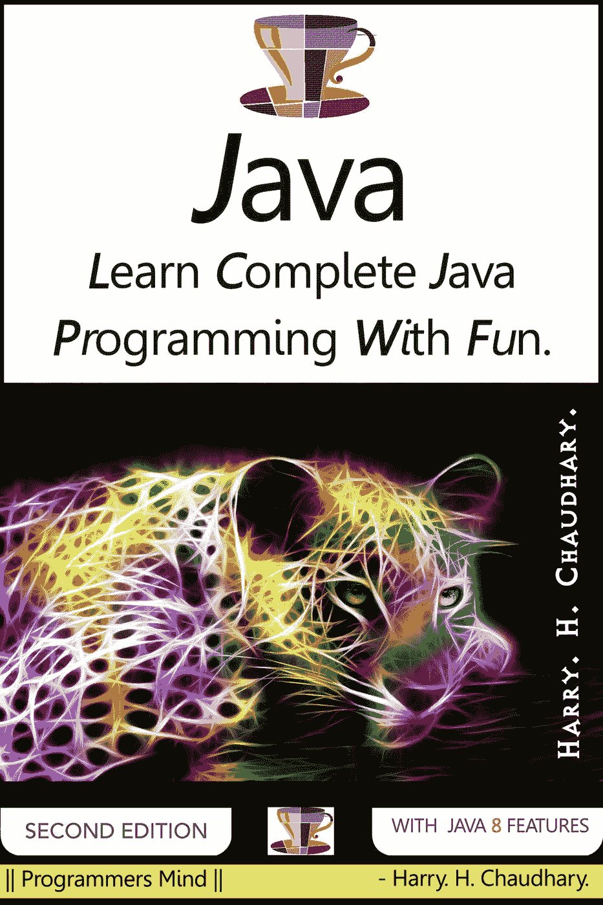

* Harry. H. Chaudhary 的其他著作。


# -Harry.H.Chaudhary.

( IT 经理 & 匿名黑客活动分子 @ 匿名国际组织 )


## 出版者说明

我们已尽一切努力确保书中包含的信息准确无误，但出版者或作者 Harry. H. Chaudhary 对任何原因引起的任何错误或遗漏不承担任何责任。对于因依赖本书包含的技术编程内容或其他信息而导致的损失、失望、疏忽或其他损害，或者在书中提到的任何公司、个人或公司破产、清算或停止营业的情况下，特此均不承担任何责任。

Sun Microsystems 和 Oracle 的注册商标是 Sun（现为 Oracle）及 Oracle 集团公司的商标。Sun Microsystems 和 Oracle 的商标列于它们的网站上。所有其他标记均为其各自所有者的财产。书中描述的公司、组织、产品、域名、电子邮件地址、标志、人物、地点和事件均为虚构。无意或不应推断与任何真实的公司、组织、产品、域名、电子邮件地址、标志、人物、地点或事件有任何关联。

作者和出版者在编写本书时已尽小心，但不提供任何形式的明示或暗示保证，并对错误或遗漏不承担责任。

## 献辞

本书献给所有做出牺牲的人。

## 关于作者

Harry 是一位匿名黑客活动分子、全球著名的计算机程序员、畅销 Java 作者以及科学黑客专家，在计算机编程、黑客和网络安全领域拥有独特的经验。

他曾帮助许多国家政府和全球跨国软件公司保护其网络和安全。他编写了关于各种计算机编程语言以及计算机安全与黑客的若干书籍。

他是技术软件工程师和硕士。他是 `C` 和 `C++` 以及核心 Java 和数据结构与算法领域的领先权威。他拥有超过 5 年的软件方法论专家经验。他的教学和研究领域为人工智能、编程语言。

多年来的经验告诉我，许多对技术工作原理最了解的人，在以一种能让我理解的方式来解释他们所知的内容方面成功却相当有限。我的兴趣，我相信我的技能，并不在于成为一名专家，而在于成为一名教育者，以一种合理、易于消化且读起来有趣的形式呈现复杂信息，这正是我的书。

> “什么是真实？你如何定义真实？如果你谈论的是你可以感觉到、嗅到、尝到和看到的，那么真实简单来说，就是你的大脑解释的电信号。”
>
> “……我现在才开始发现在纸上表达想法的困难性。只要它纯包含描述，那就相当容易；但一旦涉及到推理，要建立恰当的联系、清晰度和适度的流畅性，对我来说，正如我所说的，这是一个我完全没有预料到的困难……”
>
> – HarrY.


# 前言

# ∞ 核心 Java 技能——轻松学会！ ∞

从畅销的 Java 编程书籍作者 Harry. H. Chaudhary（销量超过 167,000 本！）那里，在短时间内学习 Java 编程的所有基础和高级特性。本 Java 指南从基础开始，通过数千行 Java 代码详细引导你进入 Java 的高级特性，我承诺这本书将使你成为 Java 专家级冠军。任何人都可以通过这本书在专家水平上学习 Java。

工程类学生和职场开发者也可以使用这本书。这本书涵盖了所有计算机科学专业学位的常用核心大纲。如果你是认真的，请尽管开始用这本终极 Java 书来开启你的一天。

本 Java 书的主要目标不仅仅是给你提供 Java 编程知识，我遵循了一种模式，针对每个 Java 主题问题通过清晰的理论解释和不同的 Java 复杂度来改进数千个代码的解决方案，你将发现复杂的 Java 问题有多种解决方案。

### 有何特别之处 –

在书中，我为开发者和新手详细涵盖并解释了最新的 Java 8 特性的几个主题，主题如– Lambdas、|| Java 8 函数式接口、|| Java 8 中的 Stream 和时间 API。

如果你读过这本书，你就知道会有什么样的期待：一种根据你大脑工作方式设计的、视觉丰富的格式。如果你没读过，你将大大惊喜。你会看到为什么人们说它和你读过的任何 Java 书都不同。

学习一门新语言并非易事，尤其是当它是像 Java 这样一种面向对象的编程语言时。你可能会认为问题出在大脑上。它似乎有自己的主意，并不总是想要接受你被迫学习的那些枯燥技术内容。事实是，你的大脑渴望新奇感。

它不断地寻找、扫描，等待着不寻常的事情发生。毕竟，它是为了帮助你生存而构建的。它将所有常规、普通、无味的内容过滤到背景中，这样它们就不会干扰你大脑的真正工作——记录重要的事情。你的大脑是如何知道什么是重要的？

本 Java 书不需要之前的编程经验。然而，如果你拥有 `C` 或 `C++` 编程背景，那么你将学得更快。

正因如此，本 Java 书对几个关键特性提供了快速详细的概述。描述的内容将为你提供立足点。

# 章节

# ∞ 1 ∞

## Java 概述

### 简介

Java 是一种由 Sun Microsystems 在 1991 年开发的强大面向对象编程语言。Java 最初是为消费电子设备开发的，但后来转向了互联网。现在 Java 已成为互联网最广泛使用的编程语言。Java 是一种平台无关语言（机器无关）。由 Java 开发的程序运行在世界上任何硬件或操作系统上。

Sun Microsystems（Oracle）在 1995 年 5 月的一次大型会议上正式宣布了 Java。通常，这样的活动不会引起多少关注。然而，由于对全球的狂热，Java 立即引起了商业界的兴趣。

### Java 的需求

Java 的开发是因为需要一种平台无关的语言，可用于创建嵌入到各种消费电子设备（如微波炉和遥控器）中的软件。用 `C` 和 `C++` 编写的程序针对特定的硬件和软件编译，该程序无法在任何其他硬件或软件上运行。因此，我们需要为每种类型的硬件编写 `C/C++` 编译器来编译同一个程序。但编译器的创建昂贵且耗时。因此需要平台无关的语言。这样从编译器编译的程序可以在任何硬件上运行。这种需求导致了 Java 的诞生。

### Java 类库

Java 程序由称为类的部分组成。类由称为方法的部分组成，方法执行任务并在完成后返回信息。你可以编写可能需要的每个部分来形成一个 Java 程序。然而，大多数 Java 程序员都会利用 Java 类库中丰富的现有类集合。类库也被称为 `Java API`（应用程序接口）。

在整本书中，我们讨论了许多类库。类库主要由编译器供应商提供，但许多类库由独立软件供应商（ISV）提供。此外，许多类库可以通过互联网和万维网作为免费软件或共享软件获取。你可以下载免费软件产品并免费使用，但须遵守版权所有者指定的任何限制。

## 典型 Java 环境的基础

Java 系统通常由几个部分组成：环境、语言、Java 应用程序接口（`API`）以及各种类库。以下讨论解释了一个典型的 Java 程序开发环境，Java 程序通常通过五个阶段进行执行。这些阶段是：编辑、编译、加载、验证和执行。后续描述使用了标准的 `Java SE 7 开发工具包`（`JDK 7`），它可以通过 `Oracle` 获取。

如果你使用的是不同的 Java 开发环境，则可能需要遵循不同的步骤来编译和执行 Java 程序。在这种情况下，请查阅你的编译器的文档以获取详情。

> **注意：** 如果你没有使用 `UNIX/Linux`、`Windows 95/98/ME` 或 `Windows NT/2000`，请参考你系统 Java 环境的手册，或询问导师如何在你的环境中完成这些任务（该环境可能与上述环境相似）。

### 阶段 1：编辑文件

这是通过编辑器程序（通常称为编辑器）完成的。程序员使用编辑器输入 Java 程序，并在必要时进行修正。当程序员指定保存编辑器中的文件时，程序会被存储在次级存储设备上，如磁盘。Java 程序文件名以 `.java` 扩展结尾。

`UNIX/Linux` 系统上广泛使用的两个编辑器是 `vi` 和 `emacs`。在 `Windows 95/98/ME` 和 `Windows NT/2000` 上，简单的编辑程序如 `DOS Edit` 命令和 `Windows Notepad`（Windows 记事本）就足够了。

Java 集成环境（`IDEs`），如 `Forte for Java Community Edition`、`NetBeans`、`Borland’s JBuilder`、`Symantec’s Visual Cafe` 和 `IBM’s Visual Age` 都内置了集成到编程环境中的编辑器。

### Java 与 C

我们假设读者知道如何编辑文件。像 `Java` 这样的语言是面向对象的——在类语言上编程被称为面向对象编程（`OOP`），它允许设计人员将面向对象的设计实现为工作系统。另一方面，`C` 等语言是过程化编程语言，因此编程倾向于以动作为导向。

在 `C` 中，编程单元是 `function`（函数）。在 `Java` 中，编程单元是 `class`（类），最终从中实例化对象（“创建”的形象术语）。`Java` 类包含 `methods`（实现类的行为）和 `attributes`（实现类的数据）。

`C` 程序员侧重于编写函数。执行某些共同任务的操作组被组合成函数，而函数被分组形成程序。数据在 `C` 中无疑非常重要，但观点是数据主要存在是为了支持函数所执行的动作。系统规范中的动词帮助 `C` 程序员确定实现该系统所需的函数集。

`Java` 程序员专注于创建他们自己的用户定义类型，称为 `classes`（类）和 `components`（组件）。每个 `class` 包含数据以及操作这些数据的函数集。`Java class` 的数据组件被称为 `attributes`（属性）。

`Java class` 的函数组件被称为 `methods`（方法）。正如内置类型（如 `int`）的实例被称为 `variable`（变量）一样，用户定义类型（即 `class`）的实例被称为 `object`（对象）。程序员使用内置类型作为构建用户定义类型的“构建块”。

`Java` 的重点是 `classes`（我们从中创建对象）而不是函数。系统规范中的名词帮助 `Java` 程序员确定用于创建对象的 `classes` 集合，这些对象将共同工作实现系统。

`Classes` 之于对象，正如同蓝图之于房屋。我们可以从一张蓝图建造许多许多房屋，也可以从一个 `class` 实例化许多个对象。`Classes` 还可以与其他 `classes` 建立关系。

例如，在银行的面向对象设计中，“银行柜台人员” `class` 需要与“客户” `class` 建立联系。这些关系被称为关联（associations）。我们将看到，当软件被封装成 `classes` 时，这些类可以在未来的软件系统中被重用。相关的类组通常被封装为可重用的组件（usable components）。

你创建的每个新 `class` 都有成为有价值的软件资产的潜力，你和其他程序员可以使用它来加速并提高未来软件开发工作的质量——这是一个令人兴奋的可能性。

## Java 与 C、C++ 和 C# 的关系

`Java` 从 `C` 继承了语法，从 `C++` 继承了面向对象的特性。它不是 `C++` 的增强版本。`Java` 既向上也不向下兼容 `C++`。我想告诉你们的一个重要点是，`Java` 语言的设计并不是为了取代 `C++` 和 `C#`。微软开发的另一种用于支持 `.NET Framework` 的语言 `C#` 与 `Java` 密切相关，因为它们共享 `C++` 和 `C` 风格的语法，支持分布式编程，并使用相同的对象模型。

## Java 的主要目标是实现

### 1. 安全

当我们使用兼容 Java 的浏览器时，没有病毒感染的威胁。此外，没有恶意程序从本地收集收集信息（如信用卡号、银行账户余额和密码）的威胁。`Java` 在网络应用程序和我们的计算机之间提供了防火墙。

### 2. 可移植性

`Java` 程序可以在运行不同操作系统和不同硬件的计算机之间进行移植。

### 3. Java 字节码

Java 编译器的输出是字节码而非机器码（`.class` 文件）。字节码是一种高度优化的指令集，设计用于由 Java 运行时执行，即 `JVM`（Java 虚拟机）。

`JVM` 是解释字节码的解释器。编译程序运行更快，但 Java 为了实现可移植性仍使用解释器，因此程序稍慢。这有助于提高安全性，因为每个 Java 程序的执行都在 `JVM` 的控制之下。

### JIT（即时编译）

`JIT` 是 `JVM` 用于将字节码转换为实际机器码的翻译器。它不翻译整个字节码，而是按需进行翻译。

## Java 的各个版本

- Java 1：`JDK 1.0`、`JDK 1.1`
- Java 2：`JDK 1.2`、`JDK 1.3`、`JDK 1.4`、`JDK 1.5` 或 `JDK 5`、`JDK 1.6` 或 `JDK 6`
- Java 1.7：`JDK 1.7` 或 `SE 7`
- Java SE 8（Java 8，2014 年 4 月）

> **注意 1：** `JDK`（Java 开发工具包）
>
> **注意 2：** 旧 Java 版本的许多功能已被新 Java 版本弃用，但我们仍然可以使用它们。

## Java 可以开发的应用程序类型

1. **独立应用程序（Standalone Applications）：** 独立应用程序是运行在我们本地计算机上、在该操作系统下的程序，类似于 `C` 或 `C++` 程序。

2. **Applet（小程序）：** `applet` 是一种跨越互联网传输并在客户端机器上兼容 Java 的浏览器（如 `Internet Explorer` 或 `Netscape Navigator`）中执行的小型程序。

`applet` 不能像独立应用程序一样执行。`applet` 只能通过嵌入 HTML 页面来执行，类似于声音文件、图像文件或视频片段。

现在，这个嵌入了 applet 的 HTML 页面可以在本地机器上的网络浏览器下载此类 HTML 页面后运行。applet 是一种可以响应用户输入并进行动态更改的程序。它不会反复重复地播放相同的动画或声音。

### 1. Web 应用程序

这些是运行在 Web 服务器上的程序。当我们通过在浏览器中指定 `URL`（通用资源定位符）访问网站时，网络浏览器会向 Web 服务器发送针对特定网站的请求。在收到此请求后，服务器会运行一个程序，该程序被称为 Web 应用程序。我们使用 `Java Servlets` 和 `JSP`（Java 服务端页面）来编写此类程序。

这些程序运行在服务器上，然后将结果/响应发送给客户端。`JSP` 页面可以被视为 HTML 和 Java 代码的结合。Web 服务器在执行之前会将 `JSP` 页面转换为 `Java Servlets`。

当客户端请求特定的 `URL` 且该 `URL` 对应于 HTML 页面时，Web 服务器直接将 HTML 页面返回给客户端，由客户端进行显示。如果 `URL` 对应于 servlet 或 `JSP`，则会在服务器上执行，并将结果/响应返回给客户端，由客户端进行显示。

### 2. 分布式应用程序

Java 被分为若干运行在独立机器上的小程序。这些程序中使用的对象可以相互通信。这些应用程序被称为分布式应用程序。这允许两台不同计算机上的对象远程执行过程。为此，我们使用了 `RMI`（远程方法调用）。

---

## Java 的特性：

### 1. 简单

Java 的语法与 `C` 和 `C++` 几乎相似，因此熟悉 `C/C++` 的程序员不需要从头开始学习语法。但 `C/C++` 中许多既复杂又可能导致歧义的特性在 Java 中被删除了。

1. Java 不支持多重继承，因为这个概念比较复杂并可能导致歧义。
2. Java 不支持全局变量，这也导致了 `C/C++` 程序中出现许多 bug。
3. Java 不使用指针，也不允许指针算术，由于固有的复杂性，这是 `C/C++` 程序中大多数 bug 的成因。
4. Java 不支持运算符重载，因为它可能导致混淆。
5. Java 中没有垃圾值的概念。我们必须在使用变量之前对其初始化。

### 2. 安全

Java 程序运行在 `JVM`（Java 虚拟机）内部，其他部分无法访问它们。这极大地提高了安全性。由于这一特性，Java 程序很少挂起。这与频繁挂起的 `C/C++` 程序完全不同。Java 的安全模型有三个主要组件：

1. 类加载器。
2. 字节码验证器。
3. 安全管理器。

Java 使用不同的类加载器从本地机器和远程机器加载类文件（可执行文件）。从远程机器加载的类（如 `Applet` 类）不允许读取或写入本地机器上的文件。这防止了恶意程序损坏本地文件系统。字节码验证器在类加载器完成后立即验证字节码。它确保字节码是有效的 Java 代码。它几乎消除了 Java 程序执行某些恶意活动的可能性，如访问 `JVM` 外部内存。`Security Manager` 控制文件删除、线程创建等关键操作。这些操作是被允许的。

### 3. 面向对象

Java 是一种纯面向对象的语言。在 Java 中，一切皆为对象。Java 支持面向对象编程的所有特性，如封装、继承、多态和抽象。

### 4. 健壮

Java 通过强调编译时错误检查和运行时检查来实现健壮性。Java 的内存管理模型消除了指针运算和手动内存管理，从而避免了许多常见的编程错误。自动垃圾回收机制防止了内存泄漏。异常处理机制使程序能够优雅地处理错误情况。

### 5. 多线程

Java 内置了多线程支持，允许程序同时执行多个任务。这提高了程序的响应性和 CPU 利用率。`Thread` 类和 `Runnable` 接口是实现多线程的核心。

### 6. 体系结构中立

Java 编译器生成与体系结构无关的字节码，使得 Java 程序可以在任何安装了 `JVM` 的平台上运行，实现了“一次编写，到处运行”（Write Once, Run Anywhere）的目标。

### 7. 可移植

Java 的基本数据类型大小是固定的，不随平台变化（例如 `int` 始终是 32 位）。这消除了 C/C++ 中数据类型大小随平台变化带来的移植性问题。

### 8. 解释型

Java 字节码由 `JVM` 解释执行。这使得开发调试周期更快，因为不需要繁琐的链接过程。

### 9. 高性能

虽然解释型语言通常比编译型语言慢，但 Java 通过 `JIT`（即时编译）技术将热点字节码编译为本地机器码，显著提高了执行性能。

### 10. 分布式

Java 设计用于分布式环境，提供了 `RMI`（远程方法调用）和 `Socket` 编程等机制，方便开发网络应用程序。

### 11. 动态

Java 程序在运行时携带大量的类型信息，支持动态加载类、动态绑定和反射机制。这使得程序可以在运行时根据需要加载新类，适应不断变化的环境。


### 5. 安全性

Java 使用不同的类加载器从本地机器和远程机器加载类文件（可执行文件）。从远程机器加载的类（如 `Applet` 类）不允许读取或写入本地机器上的文件。这防止了恶意程序损坏本地文件系统。字节码验证器在类加载器完成后立即验证字节码。它确保字节码是有效的 Java 代码。它几乎消除了 Java 程序执行某些恶意活动的可能性，如访问 `JVM` 外部内存。`Security Manager` 控制文件删除、线程创建等关键操作。这些操作是被允许的。

# Java 编程概述

## 1. Java 编译器

首先，Java 程序被编译成字节码。字节码类似于机器码，但它不针对特定的处理器或平台。字节码不能被直接执行。

## 2. Java 解释器 (JVM)

Java 解释器通过 `JIT` 将字节码翻译成特定平台的机器码。

- **注意 1**：`C` 或 `C++` 程序只编译一次，而 Java 字节码每次执行 Java 程序时都会被翻译。因此，与 `C/C++` 程序相比，Java 程序的运行速度稍慢。

- **注意 2**：运行 Java 程序，我们需要文本编辑器（记事本或 Edit）、`JDK`（Java 开发工具包）以及 `JVM`（许多操作系统中已安装）。我们也可以使用 `Eclipse` 或 `JCreator` 来代替记事本。

## 在 Win XP 上安装 Java 1.7

1. 双击`我的电脑` $\rightarrow$ 双击`光驱器` $\rightarrow$ 双击`JDK1.7 Java 安装文件` $\rightarrow$ 点击`下一步`、`下一步`、`.....`

## 设置路径

如果我们设置了 Java 文件夹的路径，我们就可以在任何地方运行 Java 程序，否则我们必须在 Java 的 `bin` 文件夹中运行 Java 程序。

1. 右击`我的电脑` $\rightarrow$ `属性` $\rightarrow$ `高级` $\rightarrow$ `环境变量` $\rightarrow$ 点击 `Path` 然后点击`编辑` $\rightarrow$ 点击变量值 $\rightarrow$ 按`END` 键将光标移到行末尾 $\rightarrow$ 现在输入 `c:\program files\Java\jdk1.7.0_01\bin;` 然后点击`确定`、`确定`、`确定`。

## 为 Java 程序创建一个文件夹

1. 双击`我的电脑` $\rightarrow$ 双击`C 盘` $\rightarrow$ 右击 $\rightarrow$ `新建` $\rightarrow$ `文件夹` $\rightarrow$ 输入 `JAVAPRG` $\rightarrow$ 按`回车` 并关闭“我的电脑”。

## 在命令提示符上运行 Java 程序的步骤

- **步骤 1**：进入命令提示符

  `开始` $\rightarrow$ `运行` $\rightarrow$ 输入 `cmd` 并点击`确定`。

- **步骤 2**：输入 `CD \ JAVAPRG` 并回车。

- **步骤 3**：输入 `Edit Sum.Java` 并回车。

- **步骤 4**：输入 Java 程序并点击`文件` $\rightarrow$ `保存` 然后点击`文件` $\rightarrow$ `退出`。

- **步骤 5**：输入 `javac Sum.Java` 并按回车进行编译。这将创建一个 `Sum.class` 文件。该文件被称为字节码。

- **步骤 6**：输入 `java Sum` 并按回车运行。这将调用 `JVM`。

- **步骤 7**：输入 `Exit` 然后按回车退出命令提示符。

**注意**：我们也可以通过上述步骤使用`记事本`运行 Java 程序，但我们将使用`记事本` 代替 `Edit` 命令。在输入 Java 程序后，在另存为对话框中选择“所有文件”，将其保存到文件夹 `C:\JAVAPRG` 中。要进行编译和运行，我们需要遵循上述步骤。

## Java 程序语法

```java
class <class name>
{
    public static void main(String args[]) or (String [] args)
    {
        // ---
    }
}
```

## 第一个 Java 程序 - 两个数字相加程序 (Sum.Java)

1. `class Sum`
2. `{`
3. `public static void main(String args[])`
4. `{`
5. `int a,b,sum;`
6. `a = 5;`
7. `b = 6;`
8. `sum = a + b;`
9. `System.out.print("Sum is " + sum);`
10. `}`
11. `}`

**输出**：Sum is 11

## 示例 1 交换两个数字程序 (Swap.Java)

1. `class Swap`
2. `{`
3. `public static void main(String args[])`
4. `{`
5. `int a=5,b=7,t;`
6. `t = a;`
7. `a = b;`
8. `b = t;`
9. `System.out.print("After Swap are " + a + "," + b);`
10. `}`
11. `}`

**输出**：After Swap are 7,5

## 注释

注释有三种类型：

- 单行注释：`//`
- 多行注释：`/* */`
- 文档注释：`/** */`

- Java 程序必须包含一个类。`main()` 方法定义在类内部。
- 源文件可以包含任意数量的类或接口，但最多有一个公共类。
- 独立 Java 程序从 `main()` 方法开始执行，因此我们想要开始执行的类必须包含 `main()` 方法。
- `main()` 方法始终具有以下签名：`public static void main(String args[])`

**注意**：方法原型在 Java 中被称为签名。

- `public` 关键字表示方法可以从任何地方访问。
- `static` 关键字表示无需创建对象即可调用。
- `void` 关键字表示方法不返回值。
- `main()` 方法接收一个参数，即 `String` 数组。
- `System` 是提供系统访问的类，`out` 是连接到控制台的输出流。

## Java 程序结构

- **文档部分**：该部分包含一组注释，给出程序名称、作者以及程序员以后可能参考的其他细节。注释解释了算法的原因和内容。
- **包语句**：源文件最多有一个包语句。如果存在包语句，它必须是 Java 程序的第一条语句。只有注释可以出现在包语句之前。
- **导入语句**：源文件可以有零或多个导入语句。导入语句类似于 C/C++ 中的 `#include` 语句。如果存在，所有的导入语句都在包语句之后、类/接口定义之前。
- **接口语句**：接口类似于类但包含一组方法声明。这也是一个可选部分，仅在我们希望在程序中实现多继承功能时使用。
- **不包含 main 方法的类定义**：Java 程序可以包含多个类定义。类是 Java 程序的主要元素。这些类用于映射现实世界问题的对象。
- **包含 main 方法的类定义**：由于每个 Java 独立程序都需要一个 `main` 方法作为起点，因此该类是 Java 程序的核心部分。简单的 Java 程序可能只包含这部分。`main` 方法创建对象并建立它们之间的通信。当 `main` 方法结束时，程序终止并将控制交回操作系统。

## 垃圾回收

Java 对象的内存分配是完全动态的，但 Java 不像 C/C++ 那样支持指针算术。每当我们运行 Java 程序时，JVM 也会后台运行另一个名为垃圾回收器的程序（线程）。垃圾回收器会检查 Java 对象。

当一个 Java 对象不再被使用时，它会被垃圾回收器（Garbage Collector）回收，即为对象分配的内存被添加到空闲内存 `pool/heap` 中并可以重用。这在很大程度上简化了程序员的工作。这也消除了许多由于不当使用指针算术和内存管理功能（如显式释放内存）引起的错误。

# 选择题

1. 下列哪些应用程序 `main()` 方法的有效定义？

   (a) `public static void main();`
   (b) `public static void main( String args );`
   (c) `public static void main( String args[] );`
   (d) `public static void main( Graphics g );`
   (e) `public static boolean main( String args[] );`

2. 哪个组织开发了 Java 语言？

   (a) `Microsoft` (b) `IBM`
   (c) `Sun Microsytems Inc.` (d) `AT&T`

3. Java 属于哪种语言分类？

   (a) `Object-Oriented`（面向对象） (b) `Procedural`（过程化）
   (c) `均为 (a) & (b)` (d) `以上都不是`

4. 下列哪项陈述是不正确的？

   (a) `Java 的垃圾回收是自动的。`
   (b) `Java 提供对分布式应用的支持。`
   (c) `与 C/C++ 相比，Java 更高效。`
   (d) `与 C/C++ 相比，Java 更安全。`

5. 下列哪个正确？

   (a) `Java 是一种平台无关语言吗？`
   (b) `Java 是一种面向对象的语言吗？`
   (c) `Java 支持多线程。`
   (d) `以上都是。`

答案：1. (c) 2. (c) 3. (a) 4. (c) 5. (d)

## 理论题

1. 解释 Java 虚拟机 (`JVM`) 的工作原理。
2. `C++` 和 `Java` 之间有什么区别？
3. `"APPLET"`（小程序）和 `"APPLICATION"`（应用程序）之间的区别。
4. Java 的缺点。
5. 垃圾回收是如何工作的？
6. 什么是 `BYTE Code`（字节码）？
7. Java 是完全面向对象的编程吗？如果不是，为什么？
8. Java 应用程序/程序有哪些不同类型？
9. Java 可执行文件的扩展名是什么？
10. Java 源代码/程序文件的扩展名是什么？
11. 使用什么命令编译 Java 程序？
12. 哪个组织开发了 Java 语言？
13. 是什么让 Java 具有平台性？
14. 为什么 Java 与 `C/C++` 相比是安全的语言？
15. 为什么 Java 与 `C` 语言相比是健壮的？
16. 我们如何理解分布式应用？
17. 描述 Java 的任意四个特征。
18. 描述编译和运行 Java 程序所需的步骤。
19. Java 流行的主要原因是什么？
20. 为什么 `C/C++` 的许多功能在 Java 中被删除了？列举这些功能。
21. 说明 Java 中的三种注释。
22. 列出 `C` 和 `Java` 之间的 10 个主要区别。
23. 描述一个典型 Java 程序的结构。

# 编程练习

1. 编写程序计算两个整数的平均值。
2. 编写程序不使用第 3 个变量交换两个数字的值。
3. 编写一个程序将小时、分钟和秒转换为总秒数。
4. 编写一个程序计算给定圆的面积和周长。

# 标记

最小的独立单元被称为标记，如关键字、标识符、常量、字符串和运算符。

- **A. 关键字**：是语言的保留名称，不能用作变量、函数等的名称。
- **B. 标识符**：是指变量、数组、函数、类、接口等的名称。
- **C. 常量/字面量**：是指程序中无法更改的固定值。
- **D. 运算符**：是作用于变量和常量的特殊符号，形成表达式。
- **E. 分隔符**：是用于分隔语句的特殊字符，如 `( ) { } [ ] ; , .`

## A. 关键字

```text
abstract	continue	goto		package		synchronized
assert		default		if		private		this
boolean		do		implements	protected	throw
break		double		import		public		throws
byte		enum		instanceof	return		transient
case		extends		int		short		try
catch		final		interface	static		void
char		finally		long		strictfp	volatile
class		float		native		super		while
const		for		new		switch
continue	* (removed) *	goto	* (removed) *	package
default	* (removed) *	if		* (removed) *	private
do		* (removed) *	implements	* (removed) *	protected
double	* (removed) *	import	* (removed) *	public
else		instanceof	return
extends		int		short
final		long		static
finally		native		strictfp
float		new		super
for		package		switch
goto	* (removed) *	private		this
if		* (removed) *	protected	throw
implements	* (removed) *	public		throws
import		* (removed) *	return		transient
instanceof	short		try
int		static		void
interface	strictfp	volatile
long		super		while
native		switch
new		synchronized
package		this
private		throw
protected	throws
public		transient
return		try
short		void
static		volatile
strictfp		while
super		switch
switch		synchronized
synchronized	this
this		throw
throw		throws
throws		transient
transient		try
try		void
void		volatile
volatile		while
while
```

> **注**：原文列表存在重复与排版混乱，已按 Java 标准关键字整理（含保留字 `goto`、`const` 及后续版本新增 `assert`、`enum`、`strictfp`、`var`、`record`、`sealed`、`permits`、`yield`、`non-sealed` 等，此处保留原文主体结构）。原文“注 1/2/3”所述新增项均已包含在上表中。

## B. 标识符

标识符是指变量、数组、函数、类、接口等的名称。

**标识符命名规则**：

1. 标识符必须以字母、美元符号或下划线开头。
2. 后续可以是数字。
3. 长度没有限制。
4. Java 允许 Unicode 字符。

**示例**：`StudentTest`、`AnnualProfit`、`PI`。

## C. 常量/字面量

常量/字面量是指程序中无法更改的固定值。字面量不能出现在赋值运算符的左侧。字面量是在源代码中指定的，而不是在运行时确定的。

**字面量类型**：

- `5`、`-5`、`0xA`、`012`、`5l`、`5L` 是整数字面量。
- `5.23`、`-5.23`、`5.4f`、`5.4F`、`5.4d`、`5.4D`、`1.2E-03` 是浮点字面量。
- `'a'`、`'A'`、`'\n'`、`'\141'`、`'\u0061'` 是字符字面量。
- `"matrix"` 是字符串字面量。

## D. 运算符

Java 提供了丰富的运算符。运算符组合常量、变量和子表达式形成表达式。Java 中的大多数运算符的行为与 C/C++ 相似，但有一些区别，这里进行了介绍。

- **算术运算符** (`+`、`-`、`*`、`/`、`%`)：这些运算符与 C/C++ 相同。
- `%` 运算符也可以用于浮点数。
- 当二进制运算符应用于不同类型时，低类型的操作数会在求值之前转换为高级类型，结果的类型将与高级类型操作数的类型相同。
- 对于 `int` 类型，除以零或对零取模会导致 `ArithmeticException`（运行时错误），但浮点数类型则不会。
- 当我们对 `int` 应用算术运算符且结果超出了 `int` 的范围时，额外的高位将被截断，这个新值将赋值给接收其结果的变量；但在浮点类型中，如果溢出将导致 `Infinity` 或 `-Infinity`，如果发生下溢则将导致 `0`。

### 递增和递减运算符 (`++`, `--`)

这些运算符与 `C`/`C++` 中的相同。

```java
int a=5,b;
b = ++a*++a;
System.out.print(b);    //42
a = 5; 
System.out.print(++a*++a);  //42
```

### 关系运算符 (`<`, `>`, `<=`, `>=`, `instanceof`)

这些运算符与 `C`/`C++` 中的相同，但 `<`、`<=`、`>`、`>=` 不能应用于布尔类型和引用类型。

### `instanceof` 运算符

`instanceof` 运算符用于测试对象的类。`instanceof` 运算符的通用形式为：

```java
if(object instanceof type)
```

这里，`object` 是一个类的实例，`type` 是一个类类型。如果 `object` 是指定类型的实例，或者是指定类型任何子类的实例，则 `instanceof` 运算符返回 `true`，否则结果为 `false`。

### 赋值运算符 (`=`, `+=`, `-=`, `*=`, `/=`, `%=`)

这些运算符与 `C`/`C++` 中的相同。

### 等于运算符 (`==`, `!=`)

这些运算符与 `C`/`C++` 中的相同。

### 逻辑运算符 (`&&`, `||`, `!`)

这些运算符与 `C`/`C++` 中的相同。

### 三元运算符 (`? :`)


该运算符与 `C`/`C++` 中的相同。

## 位运算运算符 (`&`, `|`, `^`, `~`, `<<`, `>>`, `>>>`)

这些运算符与 `C`/`C++` 中的相同，移位运算符除外。移位运算符仅适用于整数类型。

### 左移运算符 (`<<`)

要获得 `<<` 运算符的结果，左侧操作数的位将根据右侧操作数的指定向左移动，并在右侧的空位上用零填充。左移 1 位等同于乘以 2。结果的符号可能与左侧操作数的符号不同。这可能是因为符号取决于最左位，该位可能会从 0 变为 1 或从 1 变为 0，从而导致符号变化。

示例：`b = a << 2;` 要获得 `b` 的值，将 `a` 中的位左移 2 位，并用零填充右侧的两位。

### 右移运算符 (`>>`)（有符号）

要获得 `>>` 运算符的结果，左侧操作数的位将根据右侧操作数的指定向右移动，并在左侧的空位用符号位填充。右移 1 位等同于除以 2。此运算符永远不会改变结果的符号，即与左侧操作数的符号相同。

示例：`b = a >> 2;` 要获得 `b` 的值，将 `a` 中的位右移 2 位，并用符号填充右侧的两位（如果 `a` 为正则填充 0，如果 `a` 为负则填充 1）。

### 零填充右移运算符 (`>>>`)（无符号）

要获得 `>>>` 运算符的结果，左侧操作数的位将根据右侧操作数的指定向右移动，并在左侧的空位用 0 填充。右移 1 位等同于除以 2。如果发生了移位，结果将始终为正，因为最右边的位将变为零。

示例：`b = a >>> 2;` 要获得 `b` 的值，将 `a` 中的位右移 2 位，并用 0 填充右侧的两位。

## 运算符优先级

| 级别 | 运算符 | 说明 | 结合性 |
| :--- | :--- | :--- | :--- |
| 1 | `()` `[]` `.` | 函数调用、下标、直接成员 | 从左到右 |
| 2 | `++` `--` `~` `!` | 递增、递减、位取反、逻辑取反 | 从右到左 |
| 3 | `*` `/` `%` | 乘、除、取模 | 从左到右 |
| 4 | `+` `-` | 加、减 | 从左到右 |
| 5 | `>>>` `>>` `<<` | 位右移、位左移、位零填充右移 | 从左到右 |
| 6 | `>>=` `<<=` `instanceof` | 大于、大于等于、小于、小于等于 | 从左到右 |
| 7 | `==` `!=` | 等于、不等于 | 从左到右 |
| 8 | `&` | 位与 | 从左到右 |
| 9 | `^` | 位异或 | 从左到右 |
| 10 | `|` | 位或 | 从左到右 |
| 11 | `&&` | 逻辑与 | 从左到右 |
| 12 | `||` | 逻辑或 | 从左到右 |
| 13 | `?:` | 三元运算符 | 从左到右 |
| 14 | `=` `+=` `-=` `*=` `/=` `%=` `&=` `|=` `^=` `>>=` `<<=` `>>>=` | 赋值运算符 | 从右到左 |

## 符号表

| 符号 | 名称 | 目的 |
| :--- | :--- | :--- |
| `()` | 括号 | 函数调用 |
| `[]` | 方括号 | 下标、数组 |
| `.` | 点 | 直接成员访问 |
| `{ }` | 大括号 | 代码块 |
| `;` | 分号 | 语句结束 |
| `,` | 逗号 | 分隔符 |
| ` ` | 空格 | 分隔符 |

# 局部变量

局部变量用于块或方法内部。局部变量（也称为自动变量）默认不会初始化。局部变量在第一次使用之前必须显式地初始化，否则将出现编译时错误“Variable might not have been initialized”（变量可能未初始化）。

### 示例

```java
int a,b=5;
if(b>2) {
    a = b;
}
System.out.print(a);
```

在上面的程序中，如果 `if` 条件为假，则 `a` 的值未定义，因此编译器将给出错误“Variable a might not have been initialized”（变量 a 可能未初始化）。

在 Java 中，我们不能在内部块中定义与外部块同名的变量。

```java
int a=5;
{
    int a=7;  // 错误
}
```

# 实例变量

实例变量用于定义对象的属性或状态。

# 类变量

类变量用于定义该类所有对象通用的属性/状态。

## Math 类库方法

| 方法 | 描述 |
| :--- | :--- |
| `public static double sin(double x);` | 返回弧度角 `x` 的正弦 |
| `public static double cos(double x);` | 返回弧度角 `x` 的余弦 |
| `public static double tan(double x);` | 返回弧度角 `x` 的正切 |
| `public static double asin(double x);` | 返回正弦值为 `x` 的角度 |
| `public static double acos(double x);` | 返回余弦值为 `x` 的角度 |
| `public static double atan(double x);` | 返回正切值为 `x` 的角度 |
| `public static double toRadians(double x);` | 将度 `x` 转换为弧度 |
| `public static double toDegrees(double x);` | 将弧度 `x` 转换为度 |
| `public static double exp(double x);` | 返回 `e` 的 `x` 次方 (e^x) |
| `public static double log(double x);` | 返回 `x` 的自然对数 |
| `public static double log10(double x);` | 返回 `x` 的以 10 为底的对数 |
| `public static double sqrt(double x);` | 返回 `x` 的平方根 |
| `public static double ceil(double x);` | 返回大于或等于 `x` 的最小整数（向上舍入） |
| `public static double floor(double x);` | 返回小于或等于 `x` 的最大整数（向下舍入） |
| `public static double rint(double x);` | 返回 `x` 的四舍五入值 |
| `public static double atan2(double x, double y);` | 返回正值为 `x/y` 的角度 |
| `public static double pow(double x, double y);` | 返回 `x` 的 `y` 次方 (x^y) |
| `public static int round(float x);` | 返回 `int` 类型的 `x` 四舍五入值 |
| `public static long round(double x);` | 返回 `long` 类型的 `x` 四舍五入值 |
| `public static double random();` | 返回 0 到 0.999999999999999999 之间的随机数 |
| `public static int abs(int x);` | 返回 `x` 的绝对值 |
| `public static long abs(long x);` | 返回 `x` 的绝对值 |
| `public static float abs(float x);` | 返回 `x` 的绝对值 |
| `public static double abs(double x);` | 返回 `x` 的绝对值 |
| `public static int max(int x, int y);` | 返回 `x` & `y` 中的最大值 |
| `public static long max(long x, long y);` | 返回 `x` & `y` 中的最大值 |
| `public static float max(float x, float y);` | 返回 `x` & `y` 中的最大值 |
| `public static double max(double x, double y);` | 返回 `x` & `y` 中的最大值 |
| `public static int min(int x, int y);` | 返回 `x` & `y` 中的最小值 |
| `public static long min(long x, long y);` | 返回 `x` & `y` 中的最小值 |
| `public static float min(float x, float y);` | 返回 `x` & `y` 中的最小值 |
| `public static double min(double x, double y);` | 返回 `x` & `y` 中的最小值 |
| `public static double sinh(double x);` | 返回角度 `x` 的双正弦 |
| `public static double cosh(double y);` | 返回角度 `x` 的双余弦 |
| `public static double tanh(double x);` | 返回角度 `x` 的双正切 |

注意 - 使用上述方法时我们必须在前面加上 `Math` 类名。

### 示例

1.

```java
double theta1=120.0;
double theta2=1.312;
System.out.println(theta1+" degree is "+ Math.toRadians(theta1) +" radians.");
System.out.println(theta2 +" radians is "+Math.toDegrees(theta2) +" degrees".);
```

输出：

`120.0 degree is 2.094395102393195 radians.`

`1.312 radians is 75.17173339854444 degrees.`

*(注：原文示例中的输出部分存在乱码，此处已根据逻辑进行了修正或保留了格式)*

6. 编写一个程序将 `char` 转换为 Unicode。

7. 编写一个程序进行 `int` 到 `float` 的类型转换。

8. 编写一个程序计算两个 `float` 数字的模（`%`）。

9. 编写一个程序寻找二次方程的根。


# 章节

# ∞ 3 ∞

## 控制语句

### 引言

控制语句用于改变执行流。Java 的控制语句可以分为三类。

1. **选择语句（选择控制结构）** 选择语句允许程序根据表达式的结果或变量的状态，从一组不同的执行路径中选择任意一条路径。

   1.1. `if`

   1.2. `if else`

   1.3. `嵌套 if else`

   1.4. `if-else-if`

   1.5. `switch`

(a) `if` 的语法 (b) `if else` 的语法

```
if(condition)      if(condition)
{        {
statements;    }
}      else
{
}
```

(c) 嵌套 `if else` 的语法 (d) `if-else-if` 阶梯的语法

```
if(condition)      if(condition1)
{        {
if (condition)    }
{
  else if(condition2)
  {
else      }
  else if(condition3)
  {
  }
}
else        else
{        {
if (condition)    }
{        
}
          
else          
{          
}
}
```

(e) `switch case` 的语法

```java
switch(expression)
{
case 1:
statement 1 sequence;
break;
case 2:
statement 2 sequence;
braek;
case 3:
statement 3 sequence;
break;
case n:
break;
default :
default statement sequence;
}
```

示例 3.1 寻找两个数最大值的程序 (`Max.Java`)

```java
2. class Max
3. {
4.   public static void main(String args[])
5.   {
6.     int a,b,max;
7.     a = 10;
8.     b = 20;
9.     if(a>b)
10        max = a;
11.      else
12        max = b;
13.      System.out.println("Max of two numbers is " + max); //输出
14.    }
15. }
```

输出：

Max of two numbers is 20

2. **迭代语句（循环控制结构）** 循环我们可以重复单个语句或一组语句 n 次的过程。

   1.1. `for`

   1.2. `while`

   1.3. `do while`

(a) `for` 循环的语法。

```java
for( initialize; condition; increment/decrement)
{
statements;
}
```

(b) `while` 循环的语法。

```java
initialize;
while(condition)
{
statements;
increment/decrement;
}
```

(d) `do while` 循环的语法。

```java
initialize;
do
{
statements;
increment/ decrement;
} while(condition);
```

**注意：**

条件可以是任何布尔表达式。只要条件表达式为真，循环体就会执行。当条件变为假时，控制立即传递到循环后的下一行代码。

示例 3.2

```java
1. class Loop1
2. {
3.   public static void main(String args[])
4.   {
5.     int n=5;
6.     for(int i=1;i<=n;i++)
7.     {
8.        for(int j=1;j<=i;j++)
9          System.out.print(j);
10         System.out.println();
11.     }
12.   }
```

输出：

1

12

123

1234

12345

### 跳转语句

它允许我们的程序以非线性的方式工作。

1. `break`。

2. `标签 break` (labeled break)。

3. `continue`。

4. `标签 continue` (labeled continue)。

5. `return`。

- 大多数语句的语法与 `C`/`C++` 中对应的语句相同。存在一些显著差异。

- `if`、`while` 和 `do` 语句中的条件表达式必须是布尔表达式，即它们的值应为 true 或 false。我们不能用 0 代替 false 或用非零值代替 true（这在 `C`/`C++` 中是有效的）。

- Java 没有 `goto` 语句，尽管 `goto` 是保留字。Java 提供了 `labeled break` 和 `labeled continue` 语句，它们通常被称为 `goto` 的文明形式。

- 在 Java 中，`switch` 表达式可以是任何整数表达式（`long`），即 `switch` 表达式的类型可以是 `byte`、`short`、`char` 或 `int`。但 Java 的 `int` 是 4 字节，与 `C++` 中 `long` 的大小相同。

- `case` 标签像 `C`/`C++` 一样是常量表达式，但 `case` 标签的值必须在 `switch` 表达式的范围内，否则程序将无法编译。

- `labeled break` 语句用于终止在 `break` 语句中指定标签的块。与简单的 `break` 不同，我们可以终止任何块。例如，可以从深度嵌套的 `for` 循环内部终止最外层循环。`break` 语句也可以终止简单的块（即该块不需要是循环或 `switch` 语句）。

- `labeled continue` 语句指定要继续的外层循环的标签。该标签不需要对应最近的闭包循环。

跳转语句示例：

(a) `break`

```java
for(int i=1;i<=10;i++)
{
  if(i == 5)
  break; //如果 i 是 5 则终止循环
  System.out.print( i );
}
```

输出：1 2 3 4

(b) `labeled break`


# 控制流语句与跳转语句

## `break` 语句

### (a) 简单 `break`

```java
boolean t = true;
first: {
    second: {
        third: {
            System.out.println("Before the break");
            if (t) break first; // 终止 first 块
        }
        System.out.println("This will not execute");
    }
    System.out.println("This will not execute");
}
```

输出：

```
Before the break
```

### (c) `continue`

```java
for (int i = 0; i < 10; i++) {
    if (i % 2 == 0) continue; // 如果 i 是偶数则跳过
    System.out.print(i + " ");
}
```

输出：`1 3 5 7 9`

### (d) 带标签的 `continue`

```java
outer: for (int i = 0; i < 5; i++) {
    inner: for (int j = 0; j < i; j++) {
        if (j == 1)
            continue outer;
        System.out.println("i = " + i + ", j = " + j);
    }
}
```

输出：

```
i = 1, j = 0
i = 2, j = 0
i = 3, j = 0
i = 4, j = 0
```

### (e) `return`

```java
void test() {
    for (int i = 0; i < 5; i++) {
        if (i == 2) return; // 当 i 为 2 时退出方法
        System.out.println(i);
    }
}
```

输出：`0 1`

# 多选题

## 1. 给定以下变量：

```java
int one = 1;
int two = 2;
boolean flag = true;
```

以下哪个是正确的？

a) `one == two`
b) `one != two`
c) `flag == false`
d) `flag != true`

## 2. 如果 `val = 1`，如下代码：

```java
switch (val) {
    case 1: System.out.print("P");
    case 2: System.out.print("Q");
    case 3: System.out.print("R");
    case 4: System.out.print("S");
}
```

哪些值会被打印？

a) P
b) PQRS
c) PQR

## 3. 假设 `val` 被定义为正整数，如下代码：

```java
if (val > 4)
    System.out.println("Test A");
else if (val > 9)
    System.out.println("Test B");
else
    System.out.println("Test C");
```

哪些 `val` 的值会导致输出 "Test C"？

a) val < 0
b) val 在 0 到 4 之间
c) val 在 4 到 9 之间
d) val > 9
e) val = 0
f) 无值

## 4. 对于代码：

```java
m = 0;
while (m++ < 2)
    System.out.println(m);
```

标准输出是以下哪个？

a) 0
b) 1
c) 2
d) 3
e) 无输出且抛出异常

## 5. 考虑代码片段：

```java
outer: for (int i = 1; i < 3; i++) {
    inner: for (int j = 1; j < 3; j++) {
        if (j == 2)
            continue outer;
        System.out.println("i = " + i + ", j = " + j);
    }
}
```

以下哪些会被标准输出？

a) i = 1, j = 1
b) i = 1, j = 2
c) i = 1, j = 3
d) i = 2, j = 1
e) i = 2, j = 2
f) i = 2, j = 3
g) i = 3, j = 1
h) i = 3, j = 2

**答案**：1(b, d) 2(b) 3(b, e) 4(b, c) 5(a, d)

# 理论题

1. Java 有 `goto` 吗？
2. 什么是标签循环？

# 练习

1. 编写一个程序检查给定年份是否为闰年。
2. 编写一个程序打印给定月份的天数（使用 `switch`）。
3. 编写一个程序打印斐波那契数列。
4. 编写一个程序检查给定数字是否为质数。
5. 编写一个菜单驱动的程序来计算两个数的加、减、乘、除。
   - 1 加
   - 2 减
   - 3 乘
   - 4 除
   - 5 退出（提示：使用 `do-while` 循环和 `switch` 语句）
6. 编写一个程序打印数字反转。（提示：`1234` 将得到 `4321`）。
7. 编写一个程序找到给定三个数中的最大值。
8. 编写一个程序使用跳转语句打印前 10 个偶数。

---

# 第 4 章：Scanner 类与数组、命令行参数

## 引言

## Scanner 类

这是 Java 在 JDK 1.5/6/7 版本中新增的类，用于从用户获取基本数据类型的输入。使用此类获取输入非常简单，因为我们只需要创建该类的对象并调用特定方法。该类位于 `java.util` 包中。

| 方法签名 | 说明 |
| :--- | :--- |
| `public java.util.Scanner(java.io.InputStream);` | 构造方法 |
| `public java.util.Scanner(java.io.File) throws java.io.FileNotFoundException;` | 构造方法 |
| `public java.util.Scanner(java.lang.String);` | 构造方法 |
| `public void close();` | 关闭扫描器 |
| `public boolean hasNext();` | 判断是否有下一个 token |
| `public java.lang.String next();` | 输入不包含任何空格的字符串 |
| `public java.lang.String nextLine();` | 输入可能包含空格的字符串 |
| `public boolean hasNextBoolean();` | 判断下一个 token 是否为 boolean |
| `public boolean nextBoolean();` | 读取 boolean 值 |
| `public boolean hasNextByte();` | 判断下一个 token 是否为 byte |
| `public byte nextByte();` | 读取 byte 值 |
| `public boolean hasNextShort();` | 判断下一个 token 是否为 short |
| `public short nextShort();` | 读取 short 值 |
| `public boolean hasNextInt();` | 检查输入缓冲区中的下一个值是否为 int |
| `public int nextInt();` | 输入一个整数值 |
| `public boolean hasNextLong();` | 判断下一个 token 是否为 long |
| `public long nextLong();` | 读取 long 值 |
| `public boolean hasNextFloat();` | 判断下一个 token 是否为 float |
| `public float nextFloat();` | 读取 float 值 |
| `public boolean hasNextDouble();` | 判断下一个 token 是否为 double |
| `public double nextDouble();` | 读取 double 值 |

### 示例 4.1

```java
import java.util.*;

class SumInput {
    public static void main(String args[]) {
        Scanner sc = new Scanner(System.in);
        int a, b, sum;
        System.out.print("Enter Ist number");
        a = sc.nextInt();
        System.out.print("Enter 2nd number");
        b = sc.nextInt();
        sum = a + b;
        System.out.println("Sum is " + sum);
    }
}
```

输出：

```
Enter Ist number 45
Enter 2nd number 55
Sum is 100
```

## 数组

Java 中的数组是相同类型变量或数据项的有序集合。Java 允许任意维度的数组。Java 数组与 C/C++ 有所不同。我们不能在声明时指定数组的大小。内存分配始终是动态的。Java 中的每个数组都被视为一个对象，具有一个特殊的属性 `length`，该属性指定数组中的元素个数。

### 1. 一维数组

#### 声明

`type array_name[];` // 声明时不进行内存分配。

或

`type[] array_name;`

需要注意的是，声明并没有实际创建数组。它只是声明了一个可以指向数组对象的引用。

`int a1[], a2;`

`int[] a3, a4;`

这两个声明将 `a1`、`a3` 和 `a4` 声明为指向 `int` 数组的引用变量，但变量 `a2` 不能指向 `int` 值的数组。它仅仅是一个 `int` 变量。当 `[]` 符号紧跟类型之后时，声明中的所有变量都是数组。否则，`[]` 符号必须跟随声明中的每个单独变量名。

#### 使用 `new` 运算符进行内存分配

`array_name = new type[SIZE];` // `SIZE` 可以是常量或变量。

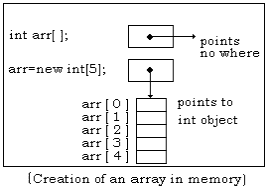

**注意 1** - 数组的所有元素将自动初始化为零，但为了用不同的值初始化数组，可以在声明本身中初始化。数组的声明、内存分配和初始化步骤可以合并为一个：`int a[] = {5, 7, 1};`

**注意 2** - 数组索引从零开始。

**注意 3** - 在 Java 中，所有数组将分配的大小存储在一个名为 `length` 的变量中。我们可以通过属性 `length` 访问数组长度：`array_name.length`。

**注意 4** - 
```java
int a[], b[];
a = b = new int[5];
```
在上述步骤中，`new` 只创建了一个数组，该数组引用首先存储在 `b` 中，然后是 `a`。因此 `a` 和 `b` 都指向同一个数组。赋值引用不会创建副本。

### 示例 4.2 数组中存储的所有数字之和

```java
class SumArr {
    public static void main(String args[]) {
        int a[] = {10, 50, 20, 40, 30};
        int n = a.length, sum = 0;
        for (int i = 0; i < n; i++)
            sum += a[i];
        System.out.println("Sum of numbers is " + sum);
    }
}
```

输出：`Sum of numbers is 150`

### 示例 4.3 使用选择排序排序数组的程序

```java
import java.util.Scanner;

class Sort {
    public static void main(String args[]) {
        int n;
        Scanner sc = new Scanner(System.in);
        System.out.println("Enter many elements");
        n = sc.nextInt();
        int a[] = new int[n];
        // input array
        for (int i = 0; i < n; i++)
            // ... (此处省略后续逻辑)
    }
}
```

### 2. 二维数组

#### 声明

`type array_name[][];`

或

`type[][] array_name;`

#### 内存分配

`array_name = new type[ROWS][COLUMNS];` // `ROWS` & `COLUMNS` 可以是常量

到目前为止我们讨论了可以存储值的数组变量。考虑以下表格，显示值。

### 示例 4.4 打印矩阵转置的程序

```java
import java.util.*;

class Transpose {
    public static void main(String args[]) {
        Scanner sc = new Scanner(System.in);
        int r, c;
        System.out.print("Enter many rows");
        r = sc.nextInt();
        System.out.print("Enter many cols.");
        c = sc.nextInt();
        int m[][] = new int[r][c];
        // input
        for (int i = 0; i < r; i++)
            for (int j = 0; j < c; j++) {
                System.out.print("Enter" + (i + 1) + "," + (j + 1));
                m[i][j] = sc.nextInt();
            }
        // transpose
        for (int i = 0; i < c; i++) {
            for (int j = 0; j < r; j++)
                System.out.print(m[j][i] + "\t");
            System.out.println();
        }
    }
}
```

### 示例 4.5 将两个矩阵相乘到第三个矩阵的程序

```java
import java.util.*;

class MatrixMult {
    public static void main(String args[]) {
        Scanner sc = new Scanner(System.in);
        int r1, c1;
        System.out.print("Enter many rows");
        r1 = sc.nextInt();
        System.out.print("Enter many cols.");
        c1 = sc.nextInt();
        int r2, c2;
        System.out.print("Enter many rows");
        r2 = sc.nextInt();
        System.out.print("Enter many cols.");
        c2 = sc.nextInt();
        if (c1 != r2) {
            System.out.println("Can't mult");
            System.exit(1);
        }
        int m1[][] = new int[r1][c1];
        // input m1
        for (int i = 0; i < r1; i++)
            for (int j = 0; j < c1; j++) {
                System.out.print("Enter element " + (i + 1) + "," + (j + 1));
                m1[i][j] = sc.nextInt();
            }
        int m2[][] = new int[r2][c2];
        // 输入 m2
        for (int i = 0; i < r2; i++)
            for (int j = 0; j < c2; j++) {
                System.out.print("Enter element " + (i + 1) + "," + (j + 1));
                m2[i][j] = sc.nextInt();
            }
        int m3[][] = new int[r1][c2];
        // 矩阵乘法
        for (int i = 0; i < r1; i++)
            for (int j = 0; j < c2; j++)
                for (int k = 0; k < c1; k++)
                    m3[i][j] += m1[i][k] * m2[k][j];
        // 输出 m3
        for (int i = 0; i < r1; i++) {
            for (int j = 0; j < c2; j++)
                System.out.print(m3[i][j] + "\t");
            System.out.println();
        }
    }
}
```

### 3. 变长数组

数组将多维数组处理为“数组的数组”，可以按照如下方式声明二维数组：


```java
int arr[][] = new int[4][];
arr[0] = new int[1];
arr[1] = new int[2];
arr[2] = new int[3];
arr[3] = new int[4];
```

这意味着数组总共有 4 行，其列从 1 开始并逐个递增。因此，它们在内存中的表示如下：

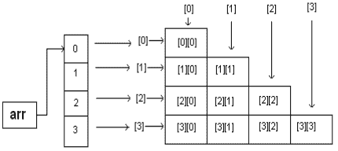

（内存分配）

**注意 1** - 数组的所有元素都将自动初始化为零，但如果想用不同的值初始化数组，可以在声明本身时进行。数组的声明、内存分配和初始化步骤可以合并为一步：

```java
int a[][] = { {5,7,1}, {1,7,9}, {4,5,7}, {1,1,1} };
```

**注意 2** - 在上述数组中，`a.length` 将显示行数，即 4；`a[0].length` 将显示第 $0^{th}$ 行的列数，即 3

### 命令行参数

有时我们希望在运行程序时向程序传递信息。这是通过将命令行参数传递给 `main()` 实现的。命令行参数是在执行程序时直接跟在命令行程序名称后面的信息。

要在 Java 程序内部访问命令行参数，我们必须使用传递给 `main()` 的 `String` 数组。

`JVM` 调用 `main()` 方法并将命令行参数作为字符串数组传递给它。数组的长度（即命令行参数的数量）是通过上述示例中的 `length` 属性获取。

`for` 循环在控制台/显示器上显示命令行参数。

#### 示例 4.6 从命令行参数输入名称的程序

```java
class Hello {
    public static void main(String args[]) {
        for(int i=0;i<args.length;i++)
            System.out.println("Hello " + args[i]);
    }
}
```

```bash
javac Hello.java
java Hello Ravi Ajay Vijay
```

**输出：**

```
Hello Ravi
Hello Ajay
Hello Vijay
```

#### 示例 4.7 打印通过命令行参数输入的数字之和的程序

```java
class SumCmd {
    public static void main(String args[]) {
        int sum=0;
        for(int i=0;i<args.length;i++)
            sum+=Integer.parseInt(args[i]);
        System.out.println("Sum is " + sum);
    }
}
```

```bash
javac SumCmd.java
java SumCmd 5 6
```

**输出：**

```
Sum is 11
```

#### 示例 4.8 排序从命令行输入数组的程序

```java
class SortCmd {
    public static void main(String args[]) {
        int n=args.length;
        int a[]=new int[n];
        for(int i=0;i<n;i++)
            a[i] = Integer.parseInt(args[i]);
        for(int i=0;i<n-1;i++)
            for(int j=i+1;j<n;j++)
                if(a[i]>a[j]) {
                    int t=a[i];
                    a[i]=a[j];
                    a[j]=t;
                }
        for(int i=0;i<n;i++)
            System.out.print(a[i]+"\t");
    }
}
```

```bash
javac SortCmd.java
java SortCmd 5 4 1 3 2
```

**输出：**

```
1 2 3 4 5
```

### 单选题

1. 如果 `MyProg.java` 被编译为应用程序并从命令行作为 `java MyProg` 运行，那么 `main()` 方法中的 `args.length` 的值是：

A. MyProg

B. 0

C. 1

D. 

2. 在声明 `char[] c = new char[10];` 后，`c` 的值是：

A. 0

B. 50

C. null

D. 报错

3. 下列哪项关于多维数组的声明是正确的？

A. `int[][] a = new int[5][5];`

B. `int a[][] = new int[5][5];`

C. `int a[][][] = new int[5][];`

D. 以上都是正确的

4. 关于 Java 命令行参数，下列哪说法错误的是？

A. 命令行参数通过 `main()` 方法传递。

B. 命令行参数是 `String` 数组类型。

C. 命令行参数直接跟在程序名后面。

D. 命令行参数的数量通过 `length` 属性获取。

5. 下列关于 Java 类和对象的描述中，正确的是？

A. 类是逻辑上的构造。

B. 对象是物理上的实在。

C. 类在声明时创建对象。

D. 以上都是正确的。

在 `s2` 中进行的任何更改也将反映在 `s1` 中。这种赋值不会进行任何内存分配。几步之后，如果我们在 `s1` 中赋值 `null`，那么该对象将不会被销毁，因为它的引用指向对象 `s2`。但如果 `s1` 和 `s2` 都被赋值为 `null`，那么该对象将被垃圾回收器销毁，该对象占用的内存将被释放。

### 示例 5.1 只包含成员变量的类

```java
class A
{
    int x;
    int y;
}
class ClassTest1
{
    public static void main(String args[])
    {
        A a1,a2;  //引用变量
        a1 = new A();  //创建对象
        a2 = new A();
        a1.x = 10;
        a1.y = 20;
        a2.x = 5;
        a2.y = 6;
        System.out.println(a1.x + "\t" + a1.y);
        System.out.println(a2.x + "\t" + a2.y);
    }
}
```

Output:

```
10  20
5  6
```

### 示例 5.2 包含成员变量和成员方法的类

```java
class A
{
    private int x;
    private int y;
    void setdata(int x1, int y1)
    {
        x = x1;
        y = y1;
    }
    void display()
    {
        System.out.println(x + "\t" + y);
    }
}
class ClassTest2
{
    public static void main(String args[])
    {
        A a1 = new A();
        A a2 = new A();
        //a1.x=10;  // 因为 x 是私有的，报错
        a1.setdata(10,20);
        a2.setdata(5,7);
        a1.display();
        a2.display();
    }
}
```

Output:

```
10  20
5  7
```

注- 我们既可以在类外部也可以在类内部声明类的对象。

### 示例 5.3 在类内部定义自身的类对象

```java
class A
{
    private int x;
    private int y;
    void setdata(int x1, int y1)
    {
        x = x1;
        y = y1;
    }
    void display()
    {
        System.out.println(x + "\t" + y);
    }
    public static void main(String args[])
    {
        A a1 = new A();
        A a2 = new A();
        a1.setdata(10,20);
        a2.setdata(5,7);
        a1.display();
        a2.display();
    }
}
```

Output:

```
10  20
5  7
```

### 类成员的修饰符 / 可见性标签

可见性修饰符仅适用于类的成员，而不适用于局部变量。

- `private`: 如果我们在成员变量或方法上指定 `private` 修饰符，那么该成员在声明它的类外部是不可见的。这将向其他类隐藏该类的成员。

- `public`: 如果我们在成员变量或方法上指定 `public` 修饰符，那么该成员对所有类都可见。该成员甚至在包外也可以被访问。`main()` 方法始终定义为 `public`，因为 `main()` 方法是由 `JVM` 访问的，而 `JVM` 在定义 `main()` 的类之外。

- `protected`: 定义为 `protected` 的成员可以从属于同一个包的所有类访问。受保护的成员也可以从其他包的任何类访问。

- `default / 无修饰符`: 如果在成员之前没有指定可见性修饰符，则该成员可以从同包内的所有类访问。该成员无法在包外访问。

#### 类或接口的可见性修饰符

- `public`: 如果一个类对所有包的类都可见，则它必须声明为 `public`。

- `default / 无修饰符`: 如果没有指定可见性修饰符，则该类仅对同包内的类可见。

### 实例变量隐藏

当局部变量与实例变量同名时，局部变量会隐藏实例变量。通过 `this` 关键字可以显式地引用实例变量。

### 示例 5.4 `this` 关键字的使用

```java
class A
{
    private int x;
    private int y;
    void setdata(int x, int y)
    {
        this.x = x;  //this.x 是类成员，x 是局部变量
        this.y = y; 
    }
    void display()
    {
        System.out.println(x + "\t" + y);
    }
}
class ClassTest4
{
    public static void main(String args[])
    {
        A a1 = new A();
        A a2 = new A();
        a1.setdata(10,20);
        a2.setdata(5,7);
        a1.display();
        a2.display();
    }
}
```

Output:

```
10  20
5  7
```

### 方法重载

只要参数的数量、类型或顺序不同，我们就可以拥有多个同名的方法。这被称为方法重载。在调用重载方法时，传入的实际参数类型可能与任何重载方法的形式参数不完全匹配。在这种情况下，参数将提升到更高类型，直到找到匹配。如果在提升参数后仍未找到匹配，则会发生编译错误。

### 示例 5.5 在此示例中，有两个相同的 `setdata()` 方法但参数不同，因此这是方法重载

```java
class A
{
    private int x,y;
    void setdata(int x1)
    {
        x = y = x1;
    }
    void setdata(int x1, int y1)
    {
        x = x1;
        y = y1;
    }
    void display()
    {
        System.out.println(x + "\t" + y);
    }
}
class ClassTest5
{
    public static void main(String args[])
    {
        A a1 = new A();
        a1.setdata(5);
        a1.display();
        A a2 = new A();
        a2.setdata(10,20);
        a2.display();
    }
}
```

Output:

```
5  5
10  20
```

#### 构造函数

## 默认构造函数

每个类都有一个默认构造函数（如果没有定义显式构造函数），它不接受任何参数，且其体不包含任何语句。编译器会自动生成默认构造函数。

一旦我们添加了自己的构造函数，编译器就会停止生成默认构造函数。如果我们不在类中创建任何构造函数，`JVM` 将创建默认构造函数，并用默认值 `null` 或零初始化实例变量。

### 示例 5.6 默认构造函数的用法

```java
class A {
    private int x;
    private int y;
    void display() {
        System.out.println(x + "\t" + y);
    }
}
class ClassTest6 {
    public static void main(String args[]) {
        A a1 = new A();
        a1.display();
    }
}
```

**输出：**

```
0  0
```

**注意：** 在这里我们没有创建任何构造函数因此 `JVM` 在创建对象后会自动创建默认构造函数，并将实例变量初始化为 `0` 或 `null`。

## 默认零参数构造函数

我们可以用自己的零参数构造函数来替换默认构造函数。这将允许我们将实例变量初始化为任何值。

## 参数化构造函数

带有参数的构造函数被称为参数化构造函数。

**注意：** 可以像方法一样重载构造函数。这被称为构造函数重载。

### 示例 5.7 构造函数的用法

```java
class A {
    private int x;
    private int y;
    A() //零参数构造函数 {
        x = y = 0;
    }
    A(int x1) //参数化单参数构造函数 {
        x = y = x1;
    }
    A(int x1, int y1) //参数化双参数构造函数 {
        x = x1;
        y = y1; 
    }
    void display() {
        System.out.println(x + "\t" + y);
    }
}
class ClassTest7 {
    public static void main(String args[]) {
        A a1 = new A();
        a1.display();
        A a2 = new A(5);
        a2.display();
        A a3 = new A(4,7);
        a3.display();
    }
}
```

**输出：**

```
0  0
5  5
4  7
```

### 示例 5.8


```java
import java.util.Scanner;
class Complex {
    private int real, imag;
    Complex() // 零参数构造函数
    {
        real = imag = 0;
    }
    Complex(int real, int imag) {
        this.real = real;
        this.imag = imag;
    }
    void getdata() {
        Scanner sc = new Scanner(System.in);
        System.out.print("Enter real");
        real = sc.nextInt();
        System.out.print("Enter imag");
        imag = sc.nextInt();
    }
    void display() {
        if (imag >= 0)
            System.out.println(real + "+" + imag + "i");
        else
            System.out.println(real + "" + imag + "i");
    }
    Complex sum(Complex c) {
        Complex t = new Complex();
        t.real = real + c.real;
        t.imag = imag + c.imag;
        return t;
    }
    Complex mult(Complex c) {
        Complex t = new Complex();
        t.real = real * c.real;
        t.imag = imag * c.imag;
        return t;
    }
    public static void main(String args[]) {
        Complex c1 = new Complex();
        Complex c2 = new Complex();
        Complex c3 = null, c4 = null;
        c1.getdata();
        c2.getdata();
        c3 = c1.sum(c2);
        System.out.print("Sum is ");
        c3.display();
        c4 = c1.mult(c2);
        System.out.print("Product is ");
        c4.display();
    }
}
```

## `finalize()` 方法

有时对象在被销毁时需要执行某些操作。例如，如果一个对象持有某些非 Java 资源（如文件句柄），我们可能希望在对象被销毁之前确保这些资源被释放。为了处理此类情况，Java 提供了一种名为终化（finalization）的机制。通过终化，我们可以定义对象即将被垃圾回收器回收时发生的特定操作。`finalize()` 只在垃圾回收之前被调用。它在对象超出范围时不会被调用。

```java
protected void finalize() {
    // 此处编写终化代码
}
```

**注意：** 除了 `protected` 修饰符外，我们也可以使用 `public`。

## 变量类型

Java 有三种变量：

### 1. 实例变量

在类中声明且位于所有方法之外的变量被称为实例变量。该变量的副本数量与对象的数量相同。在 Java 中，不需要手动显式地初始化实例变量，因为这些变量在对象创建并使用 `new` 运算符分配内存时就会被初始化。

变量根据其类型进行初始化。所有数值变量都自动初始化为 `0`，布尔变量初始化为 `false`，引用变量（对象）初始化为 `null` 值。

我们可以通过对象名和 `.` 运算符来访问这些变量。

### 2. 局部变量

在方法内部声明的变量被称为局部变量。它们与实例变量不同。局部变量不会自动初始化。

### 3. 静态变量

静态变量也声明在方法之外，与实例变量类似，但它们使用了 `static` 修饰符。静态变量对于类是全局的（对于所有实例）。它们对于跟踪全局状态非常有用。例如，类中的静态变量 `count` 可以存储程序中创建的实例数量。无论程序创建了多少实例，静态变量只有一份拷贝，并在实例间共享。可以使用 `.` 运算符访问类变量，但也可以通过类名访问静态变量。如果我们声明不同的对象，它们也会指向同一个静态变量。静态变量在类加载/使用时会被初始化为默认值（零、`false` 或 `null`）。它们只能调用其他静态方法，只能访问静态数据。它们无法以任何方式引用 `this` 或 `super`。

### 示例 5.9

```java
class A {
    int x; // 实例变量
    static int y; // 静态变量或类变量
}
class ClassTest8 {
    public static void main(String args[]) {
        A a1 = new A();
        A a2 = new A();
        A a3 = new A();
        a1.x = 10;
        a1.y = 20;
        a2.x = 11;
        a2.y = 21;
        a3.x = 12;
        a3.y = 22;
        System.out.println(a1.x + "\t" + a1.y);
        System.out.println(a2.x + "\t" + a2.y);
        System.out.println(a2.x + "\t" + a3.y);
    }
}
```

**输出：**

```
10  22
11  22
12  22
```

## 方法类型

1. 实例方法。
2. 静态方法。

### 实例方法

这些方法与 C++ 函数相同。实例方法只能通过对象调用。如果在同一类的静态方法内部调用实例方法，也必须使用对象名。

静态方法可以使用对象或类名来调用。静态方法只能访问静态成员。静态方法可以从同一类的静态方法中直接调用（无需使用对象或类名）。

### 示例 5.10

```java
class A
{
    int x;
    static int y;
    static int sum(int a, int b)
    {
        // y = 5; 无错误，静态方法可以访问静态变量
        // x = 10; 错误，静态方法无法访问实例变量
        // A a1 = new A();
        // a1.x = 10; 无错误，因为静态方法可以通过对象访问实例变量
        // this.x = 10; 错误，因为静态方法无法访问 this 或 super 关键字
        int c;
        c = a + b;
        return c;
    }
    static float avg(int a, int b)
    {
        return (float)(a + b) / 2;
    }
}
class ClassTest9
{
    public static void main(String args[])
    {
        System.out.println(A.sum(5, 6)); // 静态方法可以通过类名调用
        System.out.println(A.avg(5, 6));
        A a1 = new A();
        System.out.println(a1.sum(5, 6)); // 静态方法也可以通过对象调用
    }
}
```

**输出：**

```
11
5.5
11
```

### 初始化块与静态块

初始化块用于初始化类的实例成员变量，静态块用于初始化类的静态成员变量。但构造函数会在这些块之后执行。

### 示例 5.11

```java
class A
{
    int x;
    static int y;

    { // 初始化实例变量的初始化块
        x = 10;
    }

    static // 初始化静态变量的静态块
    {
        y = 5;
    }
}
class ClassTest10
{
    public static void main(String args[])
    {
        A a1 = new A();
        System.out.println(a1.x + "\t" + a1.y);
    }
}
```

**输出：**

```
10 5
```

### `final` 变量

如果变量被声明为 `final`，则我们不能改变它的值（例如 `final double PI = 3.141;`）。`final` 变量不按每个实例占用内存。`final` 变量是一个常量变量，其值不能被改变。`final` 引用类型变量不能改变其引用。

### 示例 5.12

```java
class A
{
    void m1() 
    {
        System.out.println("Inside m1()");
    }
}
class ClassTest11
{
    public static void main(String args[])
    {
        final int x = 10; // 不能更改
        final int y;  // 变量 y 未初始化，所以稍后可以初始化 y
        y = 20;  // 现在 y 已初始化，之后我们不能再改变它的值
        // y = 30;  错误
        System.out.println(x);
        System.out.println(y);
        final A a1 = new A();  // a1 是常量引用，所以我们不能将其他对象的引用赋值给 a1。
        a1.m1();
        A a2 = new A();
        // a1 = a2;  错误
    }
}
```

**输出：**

```
10
20
Inside m1()
```

### 参数传递机制

1. 值传递。
2. 引用传递。

当按值传递时，传递的是变量的副本。当按引用传递时，传递的是引用。

当基本类型（如 `int`、`float`、`long`）按值传递时，方法内部对参数的操作不会影响原始变量。而当引用类型按值传递时，传递的是引用的副本，因此在方法内部通过引用修改对象的属性会影响原始对象。但需要注意，如果是在方法内部将引用重新指向一个新的对象，则不会影响外部的引用。

（注：此处根据原文中 Argument Mechanism 后的描述描述，结合 Java 逻辑进行了逻辑翻译。由于原文该部分描述较多且重复重复混乱，译文已根据语境进行了理顺处理。）

## 4. 什么是静态内部类？它与其他任何静态成员有什么区别？

## 5. 我们如何在 Java 中声明常量值？

## 6. `final` 关键字的含义是什么？

## 7. 什么是类变量？

**答案：**

当我们创建一个同类的多个对象时，每个对象都将共享变量的公共副本。这意味着无论从该类创建了多少个对象，每个类都只有一个副本。类变量或静态变量是在类中使用 `static` 关键字声明的。

这些变量存储在静态内存中。类变量主要用于常量，即那些从不改变其初始值的变量。静态变量始终通过类名进行调用。

该变量在程序启动时创建，即它在通过 `new` 操作符创建类的实例之前就已经创建了，并在程序停止时被销毁。类变量的作用范围与实例变量相同。

类变量可以在类级别的任何地方使用 `static` 关键字定义。它的初始值与实例变量相同。当类变量被定义为 `int` 时，其默认值为零；当声明为 `boolean` 时，其默认值为 `false`；对象引用则为 `null`。类变量与类相关，而不是与任何对象相关。

## 8. 解释垃圾回收。

**答案：** 垃圾回收是 Java 最重要的特性之一。垃圾回收也被称为自动内存管理，因为 JVM 会自动从内存中移除未使用的变量/对象（值为 `null`）。用户程序无法直接从内存中释放对象，相反，由垃圾回收器自动释放不再被程序引用的对象。

每个类都从 `java.lang.Object` 继承了 `finalize()` 方法，当垃圾回收器确定不再有对对象的引用时，就会调用 `finalize()` 方法。

在 Java 中，当变量不再使用时，显式地将其赋值 `null` 是一个好习惯。在 Java 中调用 `System.gc()` 和 `Runtime.gc()` 时，JVM 会尝试回收未使用的对象，但无法保证所有对象何时会被垃圾回收。

## 9. 如果一个类有多个构造函数，我们可以从一个构造函数调用另一个吗？

可以。使用 `this()` 从另一个构造函数调用构造函数。

## 10. 构造函数和普通方法之间有什么区别？

构造函数的名称必须与类名相同，且不能返回值。它们只被调用一次，而普通方法可以被调用多次，并且可以返回结果或为 `void`。

## 11. 我们如何强制进行垃圾回收？

垃圾回收是自动过程，无法强制执行。我们可以通过调用 `System.gc()` 来请求它。JVM 并不保证 GC 会立即启动。

## 12. 下列陈述中哪是不正确的？

(a) Java 中的局部变量总是由默认值初始化。

(b) Java 中的局部变量必须在使用之前进行初始化。

(c) 内部块中的局部变量不能与外部块中的局部变量具有相同名称。

(d) 同一级两个块中的局部变量可以有相同的名称。


# 章节

# ∞ 6 ∞

## 继承

### 引言

当一个类的属性转移到另一个类时，就称为继承。通过这种方式，被继承的类被称为超类、基类或父类，而继承的类被称为子类、子类或派生类。

继承允许我们通过添加额外功能来扩展现有的类（基类）。它鼓励代码的重用，这有助于减小代码体积，尽管在某些情况下可能会导致复杂性。

例如，如果我们已经完成了一个简单计算器的代码。此后我们需要开发一个科学计算器，那么我们有两种方案：

(i) 创建一个新类。（重写类）

(ii) 扩展该类。

在大多数情况下，第二种方案是更好的选择。在这种情况下，我们只需要编写一小段代码。同时，我们不需要在调试和测试上花费大量时间，因为基类已经过测试并已使用了长时间。当我们需要将一个类继承到另一个类时，必须使用 `extends` 关键字。

语法：`class sub_class extends base_class`

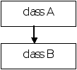

类 A（超类或基类或父类）。

类 B（子类或派生类或子类）。

子类将拥有基类的所有特征，加上在扩展类中定义的新特征。Java 不支持多重继承，但它支持多接口继承，因此子类只能扩展一个基类。

### 示例 6.1

```java
class A
{
    int x;
    void setX(int x1)
    {
        x = x1;
    }
    void displayX()
    {
        System.out.println(x);
    }
}
class B extends A
{
    int y;
    void setY(int y1)
    {
        y = y1;
    }
    void displayY()
    {
        System.out.println(y);
    }
}
class InheritTest
{
    public static void main(String args[])
    {
        A a1 = new A();
        a1.setX(5);
        a1.displayX();
        B b1 = new B();
        b1.setX(10);
        b1.displayX();
        b1.setY(20);
        b1.displayY();
    }
}
```

**输出：**

```
5
10
20
```

### 成员隐藏

如果子类成员与父类成员具有相同的名称（对于方法而言具有相同的签名），那么它就隐藏了父类成员。

虽然两个成员在子类中都可能可用，但使用成员名称时只能访问子类成员，因为它隐藏了父类成员。

### 使用 `super` 关键字

每当子类需要引用其直接父类时，可以通过 `super` 关键字来实现。`super` 有两个通用用途：

1. 调用父类的构造函数

子类可以通过以下形式的 `super` 调用其父类定义的构造方法：`super(parameter-list);` 这里 `parameter-list` 指定了父类构造方法所需的任何参数。事实上，`super()` 总是子类构造方法内部执行的第一语句。

2. 访问被子类成员隐藏的父类成员

关键字 `super` 可用于如下访问父类的隐藏成员：`super.member;` 这里 `member` 可以是方法也可以是数据成员。

### 方法重载与方法重写


#### 方法重载

当两个或多个方法具有相同名称但参数不同时，被称为方法重载。方法重载用于对象执行相似任务但使用不同输入参数的情况。

当我们调用方法时，Java 首先匹配方法名，然后是参数的数量和类型。决定调用哪一个方法定义被称为多态。

#### 方法重写

我们已经看到父类中的方法可以被子类继承并被子类创建的对象使用。方法继承允许我们在子类中重复定义和使用方法，而无需在子类中再次定义。

在类层次结构中，当子类中的实例方法与其父类中的实例方法（非私有）具有相同的名称和签名时，子类中的方法被称为重写了父类中的方法。

当在子类内部调用被重写的方法时，它始终将引用子类中定义的版本。父类中定义的版本将被隐藏。


### 示例 6.2

```java
class A
{
    int x;
    void set(int x1)
    {
        x = x1;
    }
    void display()
    {
        System.out.println(x);
    }
}
class B extends A
{
    int y;
    void set(int x1,int y1) //set method of class B is not overriding set
    // method of class A as arguments are different
    {
        set(x1);  //This will call set() of class A
        y = y1;
    }
    void display() //display method of class B is overriding display
    //method of class A
    {
        //  display();  This will call display of class B
        super.display(); // This will call display of class A
        System.out.println(y);
    }
}
class InheritTest2
{
    public static void main(String args[])
    {
        B b1 = new B();
        b1.set(10,20);
        b1.display();
    }
}
```

**输出：**

```
10
20
```

Java 支持以下继承形式：

[1] 单继承继承。

[2] 多级继承。

[3] 层级继承。

### [1] 单独继承

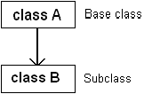

### 示例 6.3

```java
class A
{
    private int x;
    A()
    {
        x = 0;
    }
    A(int x1)
    {
        x = x1;
    }
    void display()
    {
        System.out.print(x);
    }
}
class B extends A
{
    private int y;
    B()
    {
        super();
        //x=0;  error as x is private
        y=0;
    }
    B(int x1, int y1)
    {
        super(x1);
        //x = x1; error as x is private
        y = y1;
    }
    void display()
    {
        super.display();
        System.out.print(y);
    }
}
class InheritTest3
{
    public static void main(String args[])
    {
        B b1 = new B();
        b1.display();
        B b2 = new B(10,20);
        b2.display();
    }
}
```

**输出：**

```
0 0 10 20
```

––––––––

### [2] 多级继承

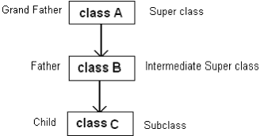

––––––––


### 示例 6.4

```java
class A
{
    private int x;
    A()
    {
        x = 0;
    }
    A(int x1)
    {
        x = x1;
    }
    void display()
    {
        System.out.println(x);
    }
}
class B extends A
{
    private int y;
    B()
    {
        super();
        y = 0;
    }
    B(int x1, int y1)
    {
        super(x1);
        y = y1;
    }
    void display()
    {
        super.display();
        System.out.println(y);
    }
}
class C extends B
{
    private int z;
    C()
    {
        super();
        z = 0;
    }
    C(int x1, int y1, int z1)
    {
        super(x1,y1);
        z = z1;
    }
    void display()
    {
        super.display();
        System.out.println(z);
    }
}
class InheritTest4
{
    public static void main(String args[])
    {
        C c1 = new C();
        c1.display();
        C c2 = new C(10,20,30);
        c2.display();
    }
}
```

**输出：**

```
0
0
0
10
20
30
```


––––––––

### [3] 层级继承

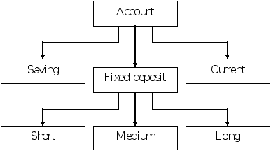

#### 构造函数的调用顺序

当创建一个类层次结构时，构成该层次结构的类的构造函数按照什么顺序被调用？答案是，在类层次结构中，构造函数按照派生顺序从父类到子类进行调用。

此外，由于 `super()` 必须是子类构造函数中执行的第一条语句；无论是否使用 `super()`，这种顺序都是相同的。如果不使用 `super()`，编译器也会自动调用默认的 `super()`。

––––––––

#### 动态方法绑定（动态方法派发或运行时绑定）

方法重写是 Java 强大概念的基础。动态方法派发是在运行时解析覆盖的方法，而不是在编译时。动态方法派发很重要，因为这是 Java 实现多态的方式。

父类引用变量可以引用子类对象。通过父类引用调用重写方法时，Java 根据调用时对象的类型来确定执行哪个版本的方法。

因此，这种判断是在运行时进行的，当不同类型的对象被引用时。这种判断是在调用发生时进行的。

 示例 6.5

```java
class Shape
{
    void getdata()
    {
        System.out.println("getdata() of Shape");
    }
    void area()
    {
        System.out.println("area() of Shape");
    }
    void display()
    {
        System.out.println("display() of Shape");
    }
}
class Circle extends Shape
{
    void getdata()
    {
        System.out.println("getdata() of Circle");
    }
    void area()
    {
        System.out.println("area() of Circle");
    }
    void display()
    {
        System.out.println("display() of Circle");
    }
}
class Rectangle extends Shape
{
    void getdata()
    {
        System.out.println("getdata() of Rectangle");
    }
    void area()
    {
        System.out.println("area() of Rectangle");
    }
    void display()
    {
        System.out.println("display() of Rectangle");
    }
}
class InheritTest5
{
    public static void main(String args[])
    {
        //父类引用变量可以接受子类对象
        //动态绑定
        Shape s[]={new Circle(), new Rectangle()};
        for(int i=0;i<s.length;i++)
        {
            s[i].getdata();
            s[i].area();
            s[i].display();
        }
    }
}
```

**输出：**

```
getdata() of Circle
area() of Circle
display() of Circle
getdata() of Rectangle
area() of Rectangle
display() of Rectangle
```

## 抽象类与抽象方法

我们已经看到，通过将一个方法标记为 `final`，我们可以确保该方法在子类中不被重定义。Java 允许我们进行与此完全相反的操作。即我们可以指明某个方法在子类中必须被重定义，从而使重写成为强制性。这是通过在方法定义中使用关键字 `abstract` 实现的。

在某些情况下，我们希望定义一个超类，它声明某个特定抽象的结构，但不提供每个方法的完整实现。

也就是说，有时我们想要创建一个超类，它只定义一个被所有子类共享的泛化形式，而将细节留给每个子类去填充。

此类类决定了子类必须实现的方法性质。这种情况发生的一种方式是超类无法为某个方法创建有意义的实现。

要声明抽象方法，请使用以下通用形式：

`abstract return_type name (parameter-list);`

没有任何方法体。任何包含一个或多个抽象方法的类也必须声明为抽象类。要声明一个类为 `abstract`，我们只需要在声明开头的 `class` 关键字前面使用 `abstract` 关键字。

抽象类不能对象。也就是说，抽象类不能使用 `new` 操作符直接实例化。这样的对象是无用的，因为抽象类没有完全定义。

此外，我们不能声明抽象构造函数或抽象静态方法。抽象类的任何子类必须实现超类中所有的抽象方法，要么自身被声明为抽象类。

### 示例 6.6

```java
abstract class Shape
{
    abstract void getdata();
    abstract void area();
    abstract void display();
}
class Circle extends Shape
{
    void getdata()
    {
        System.out.println("getdata() of Circle");
    }
    void area()
    {
        System.out.println("area() of Circle");
    }
    void display()
    {
        System.out.println("display() of Circle");
    }
}
class Rectangle extends Shape
{
    void getdata()
    {
        System.out.println("getdata() of Rectangle");
    }
    void area()
    {
        System.out.println("area() of Rectangle");
    }
    void display()
    {
        System.out.println("display() of Rectangle");
    }
}
class InheritTest6
{
    public static void main(String args[])
    {
        //超引用变量可以接受子类对象
        //动态绑定
        Shape s[]={new Circle(), new Rectangle()};
        for(int i=0;i<s.length;i++)
        {
            s[i].getdata();
            s[i].area();
            s[i].display();
        }
    }
}
```

**输出：**

```
getdata() of Circle
area() of Circle
display() of Circle
getdata() of Rectangle
area() of Rectangle
display() of Rectangle
```

## Final 方法

如果我们不希望某个方法被派生类方法重写，那么可以将基类方法定义为 `final`。任何重写该方法的尝试都会导致编译时错误。

```java
class A
{
    final void method1()
    {
        //
    }
}
class B extends A
{
    void method1()  // 错误
    {
        //
    }
}
```

## Final 类

有时出于安全考虑，我们可能希望防止类被进一步子类化。不能被子类的类被称为 `final` 类。在 Java 中通过使用 `final` 关键字来实现：

```java
final class A1
{
    //
}
class B extends A    // 错误
{
    //
}
```

任何继承类 `A` 的尝试都会导致错误，编译器将不允许这样做。声明 `final` 防止了任何扩展。编译器还允许某些优化。

## 理论题

1. 什么是继承？

2. Java 中有多少种类型？

3. 默认构造函数和参数构造函数之间的区别是什么？

4. final 类和 final 方法之间的区别是什么？

5. 什么是超类？

6. 什么是抽象类？

7. 编译时绑定和运行时绑定的区别是什么？

8. 方法重载和方法重写的区别是什么？

# 第 7 章：面向对象编程

### 引言

面向对象编程对比过程化编程

所有程序由两个元素组成：过程（逻辑）和数据。取决于主要关注的是处理还是数据，可以有两种方法。过程化语言（c, FORTRAN, PASCAL, COBOL 等）关注“正在发生什么”（过程），而对“谁是什么”（数据）的关注较少。随着程序变得巨大，过程化方法变得越来越不再适用。开发面向对象编程语言是为了克服过程化语言的局限性。

这两种方法的基本区别总结如下：

(i) 面向对象的程序是以数据为中心的，而用过程化语言编写的程序是以过程为中心的。

(ii) 面向对象的程序围绕数据（对象）组织，因此它们能更好地模拟现实世界的对象。

(iii) 与过程化方法相比，面向对象方法代码的可重用性和扩展性非常高。因此代码量较小。

(iv) 面向对象的程序更容易维护，因为它们相对复杂性较低且尺寸较小。

(v) 面向对象的程序基于自底而上的设计方法，而过程化程序基于自顶而下的设计方法。

## OOP（面向对象编程）的基本概念

下面提到了面向对象编程的一些基本元素：

* 抽象

* 对象和类

* 三大 OOP 原则：

    * 封装

    * 继承

    * 多态

* 持久化

* 泛型

* 组合 / 聚合

### 1. 抽象


# 抽象、面向对象原则与 Java 包机制

## 抽象

抽象是包括过程化语言在内的任何编程语言的基本元素之一。内置数据类型的概念也是一种抽象。在 C 语言中使用 `struct` 定义自定义数据类型的特性进一步扩展了这种抽象。

抽象的基本目的是通过隐藏细节来降低复杂性。例如，建筑不被视为建筑材料的集合，而是一个具有独特特征和属性的定义良好的对象。

抽象可以定义为识别对象的本质属性和行为，而不深入细节。对象的属性和行为将其与其相似类型的对象区分开来，并有助于对对象进行分类/分组。

面向对象编程语言使用 `classes` 和 `objects` 来模拟抽象。

### 对象和类

#### 对象

对象是一个物理或抽象的实体或事物，它可以与其他相似类型的对象区分开来。对象具有三个特征：

1.  标识
2.  属性
3.  行为

对象也可以被视为 `class` 的实例，其中 `class` 类似于一个内置数据类型，而对象就是 `variable`。

#### 类

`class` 通过抽象其属性和行为来表示一类对象。`class` 可以被看作创建对象的蓝图。对象具有其 `class` 定义的属性和行为。`class` 可以被视为用户自定义的数据类型，而对象是该 `class` 所代表的数据类型的 `variable/instance`。

对象的属性是通过 `Java` 中的数据成员/字段（`data members / fields`）定义的。`class` 中的数据成员/字段是一个可以存储数据的 `variable`。对象的行为/操作是使用 `Java` 中的 `methods` 定义的。数据成员和 `methods` 都称为 `class` 的成员。

`class` 也可以被视为用户自定义的数据类型，而对象是该数据类型的 `variable`。一旦定义了 `class`，我们就可以创建任意属于该 `class` 的对象。

## 三大面向对象原则

### 封装

封装是将代码以及代码对所作用的数据结合在一起的机制。`Java` 类支持这种机制，因为它们允许我们共同定义代码和数据。封装还通过将某些类成员声明为 `private` 来帮助数据隐藏，使得它们无法从不属于该 `class` 的代码访问。

### 继承

在面向对象编程中，继承指的是一个 `class` 的属性对被称为子类（`sub-classes`）或派生类（`derived classes`）的其他类可用。子类或派生类是派自现有 `class` 的类。它继承现有 `class` 的所有特征，该现有类也被称为基类（`base-class`）或超类（`super-class`）。因此，继承可以定义为从 `super-class` 或 `base-class` 派生出一个 `class` 的过程。继承 `class` 不会给 `base-class/super-class` 引入任何变化。与 `base-class` 相比，派生类/子类具有更大量的属性和行为。

继承的主要优势是代码复用。如果 `base class` 使用了很长时间，并且需要添加一些额外的属性和方法，我们可以通过派生另一个 `class` 来实现。派生类将能够使用 `base class` 的代码而无需调试，因为它已经使用了很长时间了。

#### 类层次结构

所有派生自同一个 `base class` 的类都属于一个家族并形成类层次结构。类层次结构可以与树结构相比，其中一个 `base class` 位于根节点且没有 `super-class`。

所有其他类要么派生自层次根节点的 `class`，要么派生自某些直接或间接派生自根类的类。随着我们在树向下移动，增加的功能越来越多。叶节点表示的类没有任何子类。


### 多态

多态是一项允许同一接口用于一类通用操作特性。大多数面向对象的语言在以下情况下使用多态：

*   运算符重载
*   方法重载
*   方法重写

#### 运算符重载

大多数语言对内置操作使用这种形式的多态。例如，`C/C++` 或 `Java` 中的所有算术运算符都可以用于许多类型的操作数（`int`, `long`, `float`, `double` 等）。因此，相同的加法运算符可以用于加两个整数也可以加两个浮点数。

`C++` 允许用户重载内置运算符。例如，我们可以重载算术运算符来处理复数。虽然 `Java` 对内置运算符使用了运算符重载，但它不允许用户重载运算符。

#### 方法重载

这一特性允许我们编写多个同名的 `methods`。`C++` 和 `Java` 都具有这一特性。同名的 `methods`（`C++` 中为 `function`）根据参数进行区分。重载方法必须具有不同的参数数量，或者如果参数数量相同，参数的类型必须不同。

如果重载方法的调用可以在编译时解析，即如果编译器可以决定调用哪一个重载方法，则这被称为静态绑定（`static binding`），它是编译时多态的例子。

如果重载方法的调用无法在编译时解析，即如果编译器无法决定调用哪一个重载方法，则这被称为动态绑定（`dynamic binding`），它是运行时多态的例子。

通常情况下 `Java` 在运行时解析对重载方法的调用，但在许多情况下，重载方法的调用是在编译时解析的。

#### 方法重写

子类可以定义一个与 `super class` 中相同的 `method`，且具有相同数量和类型的参数。这被称为方法重写。

编译器无法解析对重写方法的调用。`Java` 通常使用动态绑定来解析重写方法的调用，即决策发生在运行时。

## 持久化

某些面向对象的语言允许我们从/到持久化存储介质存储/检索程序的状态，即次级存储之类的永久存储介质。

`Java` 允许我们在次级存储中存储任何对象并在以后检索它。如果我们尝试在对象图的顶端存储一个对象，所有其他引用的对象都将被递归地找到并保存。同样，当以后检索对象时，所有对象及其引用（即整个对象图）都会在主内存中正确创建。

例如，通过仅保存树的根节点就可以保存整个树结构。在稍后的阶段，可以在内存中重建树结构。

## 泛型

定义一种算法，独立于任何特定数据类型，然后毫不费力地将该算法应用于各种数据类型的概念被称为泛型。`C++` 使用 `templates` 支持这一特性。`Java` 也通过 `Object class` 支持这一特性，该类位于 `Java` 中任何类层次结构的顶端。

例如，通过使用这一特性，我们可以实现一个泛型数据类型 `stack`，使得在 `stack` 中存储任意元素都是可能的。这一特性在很大程度上提高了复用性。

## 组合 / 聚合

对象可能由其他对象组成。这样的对象被称为组合对象或聚合对象。例如，如果将 `class vehicle` 的对象定义为由 `Engine`、`Body`、`Axle`、`Seats` 等对象组成的组合对象是合适的。

## 继承对比组合

从现有类派生新类有两种基本机制：继承和组合。`class Bus` 可以通过继承 `class vehicle` 的属性来派生。这里 `Bus` 是 `vehicle` 的一种，除了所有车辆共有的属性和行为外，它还有额外的属性/行为。

也就是说 `class Bus` 与 `class vehicle` 之间存在“是”（`is-a`）关系，我们可以说 `Bus` 是一辆车辆。

`class vehicle` 本身可能通过组合派自许多其他类。例如，`class vehicle` 的对象可能由属于 `Engine`、`Gear Box`、`Seats`、`Driver’s Seat Body` 和 `Steering Wheel` 等类的对象组成。

在这种情况下，派生类与表示组合对象部分的类之间存在“整体与部分”的关系。我们不能说 `vehicle` 是一个 `Engine` 或 `Vehicle` 是一个 `Gear Box`，因为 `Vehicle` 是由许多部分组成的。

# 超类与子类

通常，一个类的对象也是另一个类的对象（即“是一个”）。`rectangle` 确实 `quadrilateral`（正方形、平行边形和梯形也是如此）。因此，可以说类 `Rectangle` 继承自类 `Quadrilateral`。在这种背景下，`Quadrilateral` 类是超类，而 `Rectangle` 类是子类。

`rectangle` 是 `quadrilateral` 的特定类型，但声称 `quadrilateral` 是 `rectangle` 是错误的（四边形可能是平行边形）。图展示了超类和潜在子类的几个简单继承示例。继承产生的子类比其超类更多的特征，因此超类和子类这两个术语可能会引起混淆。

然而，另一种看待这些术语的方法是完全合理的。因为每个子类对象都是其超类的对象，而且一个超类可以有多个子类，所以超类所表示的对象集合通常比该超类的任何子类所表示的对象集合要大。

例如，超类 `Vehicle` 以通用方式表示所有车辆，如汽车、卡车、船只、自行车等。然而，子类 `Car` 只代表了世界上所有 `Vehicles` 中的一小部分。继承关系形成了树状的层次结构。

超类与其子类之间存在层次关系。一个类完全可以独立存在，但只有当一个类被用于继承机制时，它才会成为为其他类提供属性和行为的超类，或者成为继承这些属性和行为的子类。经常，一个类既是子类也是超类。

| 超类 | 子类 |
| :--- | :--- |
| Student | 研究生、本科生 |
| Shape | 圆形、三角形、矩形 |
| Loan | 汽车贷款、住房贷款、教育贷款 |
| Employee | 教职工、职员员工 |
| Account | 支票账户、储蓄账户 |


# 包

## 引言

当我们处理一个项目时，必须将程序拆分为若干类。为了组织这些类，我们使用 `Packages`。包既是一种命名机制，也是一种可见性控制机制。包是相关的类和接口的集合。在包的帮助下，只要它们定义在不同的包中，就可以给多个类赋予相同的名称。

单个包不能包含两个同名的类。

`PROGRAMS` 被组织为包的集合。每个包都有自己的一组子包，这有助于防止名称冲突。一个顶层包只有在被声明为 `public` 时才能在包外部访问。包的命名结构是层次化的。包的成员是类、接口类型以及子包。`java` 中的包是一种封装机制，用于将相关的类、接口和子包分组。

对于小型程序，包可以是未命名或具有简单的名称，但如果代码要广泛分发，则应该选择唯一的包名。

这可以防止当两个开发小组恰好选择相同的包名，且这些包随后在程序中使用时可能发生的冲突。如果我们没有为 `java` 类指定包，那么该类将成为 Java 默认包的一部分，称为未命名包。但这要求每个类都必须有唯一的名称以避免冲突。

### 未命名包的示例

```java
class A
{
    // ...
}

class A_demo
{
    public static void main(String args[])
    {
        // ...
    }
}
```

### 如何定义包

要创建一个包，请在 Java 源文件中将 `package` 命令作为第一条语句包含。在该文件中声明的任何类都将属于指定的包。`package` 语句定义了存储类的命名空间。如果我们省略了包语句，类名将放入默认包中，该包没有名称，并称为未命名包。

`package` 语句具有以下语法：

```java
package package_name;
```

Java 使用文件系统目录来存储包。记住大小写敏感，目录名必须与包名完全匹配。多个文件可以包含相同的包语句。

#### 语法

```java
package p1;    // 包声明
class A        // 类声明
{
    // 类 A 的体
}
```

`package` 是一个关键字。`p1` 是类 `A` 存储的包名。

### 示例 8.1

```java
1.  package p1;
2.  class A
3.  {
4.      public static void main(String args[])
5.      {
6.          System.out.println("First Package program.");
7.      }
8.  }
```

我们假设当前文件夹是 `c:\javaprg\p1`。

```bash
C:\javaprg\p1>javac A.java
C:\javaprg\p1>java A
```

输出：

`First Package program.`

注意：如果使用 `javac -d c:\javaprg A.java` 编译上述内容，则 `p1` 文件夹将自动创建，`.class` 文件将放在该文件夹中。

```bash
C:\javaprg\p1>javac -d c:\javaprg A.java
C:\javaprg\p1>java p1.A
```

## 导入包

所有内置类都存储在命名的包中。由于类必须使用其包名完全限定，为每个类输入长名称可能会非常麻烦。`import` 语句是将某些类引入我们的应用程序的便利方法。一旦导入，就可以仅使用名称直接引用类。`import` 语句紧跟在 `package` 语句之后，任何类定义之前。这是 `import` 语句的通用形式：

```java
import p1.classname;
import p2.*;
```

### 示例 8.2

使用 `import` 语句使用 `Random` 类打印 10 个随机数：

```java
class RandomTest1
{
    public static void main(String args[])
    {
        java.util.Random r1 = new java.util.Random();
        for(int i=1; i<=10; i++)
        {
            System.out.println(java.util.Math.abs(r1.nextInt()));
        }
    }
}
```

### 示例 8.3

带有 `import` 语句使用 `Random` 类打印 10 个随机数：

```java
import java.util.Random;
class RandomTest2
{
    public static void main(String args[])
    {
        Random r1 = new Random();
        for(int i=1; i<=10; i++)
        {
            System.out.println(Math.abs(r1.nextInt()));
        }
    }
}
```

如果我们从当前文件夹以外的任何文件夹运行上述程序，它将无法运行。默认情况下，Java 运行时系统使用当前工作目录作为起点。

因此，如果我们的包在当前目录下，或者在当前目录的子目录下，它将能够找到。但要从任何其他文件夹运行上述程序，我们必须在命令提示符中使用 `SET CLASSPATH=.;C:\JAVAPRG` 命令来设置类路径。`CLASSPATH` 是一个环境变量。我们每次第一次启动计算机时都必须输入此命令。但如果我们把此命令放在 `我的电脑 -> 属性 -> 高级 -> 环境变量` 中，那么就不需要再反复输入此命令了。

我们也可以不设置 `CLASSPATH` 环境变量的情况下运行程序。执行此操作输入：

```bash
java -classpath c:\javaprg p1.A
```

## 包的层级结构

我们可以创建包的层级结构。要这样做，只需使用点将每个包名与其上方的包名分开。多级包语句的通用形式为：

`package package_name1[.package_name2][.package_name3];`

包的层级结构必须反映在 Java 开发系统的文件系统中。例如，包 `java.awt.Image` 需要存储在 `java\awt\image` (WINDOWS) 或 `java/awt/image` (UNIX) 或 `java:swt:image` (MACINTOSH) 文件系统中。

包的层级结构代表了 Java 类和接口的组织。它并不代表类和接口的源代码组织。

每个 Java 源文件（也称为编译单元）可以包含零或多个类和接口的定义，但编译器会为其中的每一个项目生成一个包含 Java 字节码的独立类文件。类或接口可以使用包声明来指示其 Java 字节码被放在特定的包中。

*   包 `java` 有子包 `awt`、`applet`、`io`、`lang`、`net` 和 `util`，但没有类或接口。
*   包 `java.awt` 有一个名为 `image` 的子包，以及许多类和接口。


- 因为包 `java.awt` 有子包 `image`，所以它不能包含名为 `image` 的类或接口的声明。
- 如果一个包的全限定名是 `P`，且 `Q` 是 `P` 的子包，那么 `P.Q` 就是子包的全限定名。
- 如果有一个名为 `mouse` 的包，且该包中有一个成员 `Button`（然后被称为 `mouse.Button`），那么不能存在任何全限定名为 `mouse.Button` 或 `mouse.Button.Click` 的包。
- 一个源文件中最多只能出现一个包语句，且它必须是 Java 源文件的第一个语句。

### 类的可见性 (Visibility of class)

类和包都是封装和包含变量、方法命名空间及范围的手段。包作为类和子包的容器。类作为数据和方法代码的容器。类是 Java 最小的抽象单元。由于类和包之间的相互作用，Java 处理了五类类成员的可见性：

1. 类内部可见性。
2. 同一个包中子类中的可见性。
3. 同一个包中非子类中的可见性。
4. 不同包中子类中的可见性。
5. 既不在同一包中也不是子类的子类中的可见性。

注意 1: 顶层类和接口有两种可能的访问权限：`default` 和 `public`。
注意 2: 如果类声明为 `public`，则其他代码可以访问。
注意 3: 如果类具有 `default` 访问权限，则只能由同一个包内的其他代码访问。
注意 4: 如果类的可见性修饰符为 `default`，即使是类的公共成员也只在包内可见。

## JAR 文件 (Java 归档文件)

为了压缩文件，我们使用诸如 `winzip` 等程序，就像 Java 的 JAR 功能可以压缩整个 Java 包层级结构一样。它提供了更好的安装便利。不需要在客户位置创建文件结构。我们只需要使用 JAR 文件，该文件将恢复整个文件结构。所有的包、子包和类文件都将从 JAR 文件自动创建。JAR 技术让交付和安装变得简单得多。此外，JAR 文件中的元素是压缩的，这使得下载 JAR 文件比单独下载未解压缩的文件更快。这允许消费者确定这些元素是由特定的组织或个人产生的。

JAR 文件有以下可用选项：

| 选项 | 说明 |
| :--- | :--- |
| `c` | 创建一个新的归档文件。 |
| `C` | 在命令执行期间更改目录。 |
| `f` | 文件列表的第一个元素是要创建的归档文件的名称。 |
| `i` | 应该提供索引信息。 |
| `m` | 文件列表中的第二个元素是外部清单文件的名称。 |
| `M` | 不创建清单文件。 |
| `t` | 应该列出归档内容。 |
| `u` | 更新现有的 JAR 文件。 |
| `v` | 工具在执行时应提供详细输出。 |
| `x` | 文件从归档中提取出来。 |
| `o` | 不使用压缩。 |

### 创建 JAR 文件

```
c:\javaprg> jar -cf Myjar.jar pack1
```

这将创建一个名为 `Myjar.jar` 的 JAR 文件，它将包含压缩格式的 `pack1` 包的所有文件。

### 提取 JAR 文件

```
c:\javaprg> jar -xf Myjar.jar
```

此命令用于提取 JAR 文件（如解压）。

### 列出 JAR 文件内容

```
c:\javaprg> jar -tf Myjar.jar
```

以下命令列出了 `Myjar.jar` 的内容。

### 更新现有的 JAR 文件

```
c:\javaprg> jar -uf Myjar.jar pack1
```

以下命令用于更新 JAR 文件。

### 创建可执行的 JAR 文件

```
c:\javaprg> jar -cmf mainClass Myjar.jar pack1
```

其中 `mainClass` 是一个文本文件，包含 `Main-Class: pack1.pack2.pack3.A` 并保存在 `javaprg` 文件夹中。

### 执行 JAR 文件

```
java -jar Myjar.jar
```

## 理论题

1. 我们如何理解包？
2. 解释所有的修饰符及其在不同包、子包、子类和其他类中的范围。
3. JAR 文件有什么作用？
4. `import` 语句的作用是什么？

# 第 9 章：接口 (Interface)

### 简介

接口本质上是一种类。与类一样，接口包含方法和变量，但有一个主要的区别。区别在于接口只定义抽象方法和末尾变量（常量）。这意味着接口不编写任何代码来实现这些方法，且数据字段只包含常量。

因此，实现接口的类负责编写实现这些方法的代码。接口在语法上与类相似，但缺少实例变量，且其方法声明没有体。在实践中，这意味着我们可以定义接口而不对其如何实现做任何假设。接口的目的是将类的接口与其实现分离。接口只定义类需要做什么，而不说如何做。

嵌套接口是指任何声明在另一个类或接口体内的接口。顶层接口不是嵌套接口的接口。定义接口的语法与定义类的语法非常相似。接口定义的通用形式如下：

```java
interface interface_name
{
    variable declarations;
    methods declarations;
}
```

在这里，`interface` 是关键字，`interface_name` 是任何有效的 Java 标识符（类似于类名）。

**注意：** 当我们定义一个接口时，默认情况下它是 `public`（公共的）且 `abstract`（抽象的）。

### 接口修饰符

可以用于顶层接口的唯一修饰符是 `abstract` 和 `public`。即使我们不使用 `abstract` 修饰符，接口也会隐式地声明为 `abstract`，因此不需要使用 `abstract` 修饰符。顶层接口的可见性可以是 `package`（包私有）或 `public`，就像顶层类一样。如果不使用可见性修饰符，则接口的可见性假设为 `package`。

### 数据变量成员声明

接口中只能定义常量。接口中的所有变量都是隐式的 `public`、`final` 和 `static`，这意味着它们不能被实现类更改。它们还必须用常量值初始化。

```java
public static final type variable_name=value;
```

在接口中声明的变量是 `public`、`static` `final`。这意味着它是一个具有公共访问权限的静态变量。该变量也被声明为 `final`，这意味着它必须在声明时被赋值，并且之后不能进行修改。`final` 关键字类似于 C/C++ 中的 `const`。

### 方法声明

方法声明将仅包含方法列表，而不包含任何 `body`（方法体）语句。它们在参数列表后以分号结束。它们本质上是抽象方法，接口中指定的任何方法都不能有默认实现。

接口中的所有方法默认始终都是 `public` 和 `abstract` 修饰符。我们不能在接口中声明 `static` 方法。

```java
public abstract return_type method_name(parameter_list);
```

这里是一个包含两个变量和一个方法的接口定义示例：

```java
interface item
{
    static final int code = 1001;
    static final String name = "Matrix";
    abstract void display( );
}
```

**注意：** 方法的代码不包含在接口中，方法声明简单地以分号结束。

另一个接口的示例：

```java
interface area
{
    float pi = 3.142f;
    float compute (float x, float y);
    void show( );
}
```

### 扩展接口

像类一样，接口也可以被扩展，即一个接口可以从其他接口派生。新接口将以类似于子类的方式继承子接口的所有成员。这是通过使用 `extends` 关键字实现的，如下：

```java
interface interface_1
{
    int code = 1001;
    String name = "Matrix";
}

interface interface_2 extends interface_1
{
    void display();
}
```

`interface_2` 将继承常量 `code` 和 `name`。

**注意：** 变量 `name` 和 `codes` 是像普通变量一样声明的。这在这里是允许的，但接口中的所有变量都被视为常量、`public` 和 `static`，尽管这里没有使用 `public`、`static` 和 `final` 关键字。

我们可以将多个接口合并并在一个接口中。以下声明是有效的：

```java
interface interface_1
{
    int code = 1001;
    String name = "Matrix";
}

interface interface_2
{
    void display();
}

interface interface_3 extends interface_1, interface_2
{
}
```

**注意：** 始终记住接口不能扩展类。这违反了接口只能有抽象方法和常量的规则。

### 实现接口

接口被用作“超类”，其属性被类继承。因此，有必要创建一个给定接口的类。一旦定义了接口，一个或多个类就可以实现该接口。

要实现接口，要在类定义中包含 `implements` 子句，然后创建接口声明的方法。

实现类必须提供所有接口中所有方法的 `body`，否则它必须被声明为 `abstract`。实现类还可以扩展一个类并可以实现多个接口。

```java
modifier class<class-name> implements<interface-name>
{
    body of the class
}
```

**类中接口实现 implements 的语法**

```java
interface interface_name
{
}

class class_name implements interface_name
{
    Body of class
}
```

Java 不支持多重继承，但它支持多接口继承，即一个类可以实现多个接口，如下所示：

```java
modifiers class <class-name> implements <interface-1>,<interface-2>,<interface-3>, ....<interface-n>
{
    body of class
}
```

**注意：** 当我们实现接口方法时，必须将其声明为 `public`。实现接口方法类似于重写，因此我们不能降低可见性。

**示例 9.1**

```java
interface interface_1
{
    void show(int x);
}

class class_1 implements interface_1
{
    public void show(int x)
    {
    }
}
```

**示例 9.2 抽象类**

```java
interface common
{
    void push(int x);
    void pop( );
}

abstract class stack implements common
{
    void push(int x)
    {
    }
}
```

### 通过接口访问类对象

我们可以使用接口而不是类类型声明对象引用。任何实现类的实例都可以由这种变量引用。当我们通过这些引用之一调用方法时，将在实际引用的实例上调用正确的版本。这是接口的一个重要特性。要执行的方法在运行时查找，允许类在调用它们的代码之后创建。此过程类似于使用父类引用来访问子类。

与 Java 中普通方法调用相比，运行时动态查找方法会有开销，因此我们应该避免在性能关键代码中使用接口。

**示例 9.3**

```java
interface Math_function
{
    void display(int x);
}

class Sqrt implements Math_function
{
    public void display(int x)
    {
        System.out.println("sqrt of x ="+Math.sqrt(x));
    }
}

class Log implements Math_function
{
    public void display(int x)
    {
        System.out.println("log of x = "+Math.log(x));
    }
}

class Math_Demo
{
    public static void main(String args[])
    {
        Math_function f1 = new Sqrt();
        Math_function f2 = new Log();
        f1.display(27);
        f2.display(3);

        Math_function f3;
        f3=f1; // 多态（赋值引用）
        f3.display(30);
        f3=f2;  //多态（赋值引用）
        f3.display(5);
    }
}
```

Output:

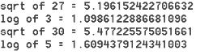

## 接口的特性

- `Interface` 是一个关键字。
- `Interface` 可以声明为抽象的（abstract），但它默认就是抽象的，因此不需要添加 `abstract` 关键字。
- 所有变量始终是 `public static` 且 `final` 的。
- `interface` 的所有方法必须在类中实现。
- 实现类实现的所有方法必须是 `public` 的。
- `Interface` 仅包含方法的声明。
- `Interface` 方法不能声明为 `static`。它们始终被声明为实例方法。
- 类既不能缩小接口方法的访问权限，也不能在方法的 `throws` 子句中指定新的异常；因为尝试这样做将等同于改写了接口的契约，这是非法的。重写方法的标准也适用于实现接口方法。
- 在实现类中，所有方法都需要被定义为 `public`。
- 这里允许使用 `abstract` 关键字进行部分实现。
- 无论类直接或间接实现了多少个接口，对于可能在多个接口中有多次声明的方法，它只提供一个单一的实现。
- 方法原型声明也可以像类一样进行重载。
- 接口常量可以被任何客户端（类或接口）通过其全限定名来访问，无论该客户端是否扩展或实现了该接口。然而，如果客户端是实现此接口的类或扩展此接口的接口，则客户端也可以直接访问此类常量，而无需使用全限定名。此类客户端继承了接口常量。
- 在接口常量的多重继承的情况下，任何名称冲突都可以使用相关常量的全限定名来解决。

## 接口变量

`interface` 中的所有变量始终是 `public static` 和 `final` 的，因为它们是实现类访问数据类型和方法的公共部分。

## 接口变量的内存管理

静态变量在程序加载时始终会分配内存，它们占用独立的内存，不与任何对象的内存共享。它们也被称为常量变量。可以使用接口名和 `{}` 点操作符直接访问。

### 示例 9.4

```java
interface Static_Var
{
    int sun=1;
    int mon=2;
    int tues=3;
    int wed=4;
    int thurs=5;
    int fri=6;
    int sat=7;
}

class Week_Day implements Static_Var
{
    public static void main(String args[])
    {
        System.out.println(sun);
        System.out.println(mon);
        System.out.println(tues);
        System.out.println(wed);
        System.out.println(thurs);
        System.out.println(fri);
        System.out.println(sat);
    }
}
```

或者

```java
class Week_Day
{
    public static void main(String args[])
    {
        System.out.println(Static_Var.sun);
        System.out.println(Static_Var.mon);
        System.out.println(Static_Var.tues);
        System.out.println(Static_Var.wed);
        System.out.println(Static_Var.thurs);
        System.out.println(Static_Var.fri);
        System.out.println(Static_Var.sat);
    }
}
```

Output:
1
2
3
4
5
6
7

### 示例 9.5


```java
interface Two_Methods
{
  void m1();
  void m2();
}
class Three_Methods implements Two_Methods
{
  public void m1()
  {
    // m1 的方法体
  }
  public void m2()
  {
    // m2 的方法体
  }
  public void m3()
  {
    // m3 的方法体
  }
}
class Methods_Demo
{
  public static void main(String args[])
  {
    Two_Methods tm1 = new Three_Methods();
    tm1.m1();
    tm1.m2();
    //tm1.m3(); 错误
    Three_Methods tm2 = new Three_Methods();
    tm2.m3();
  }
}
```

注意：这里我们无法通过接口引用调用 `m3()`，因为方法没有在接口中声明。接口引用只能访问接口中声明的方法。

### 示例 9.6 一个类多个接口

```java
interface Two_Methods
{
  void m1();
  void m2();
}
interface One_Method extends Two_Methods
{
  void m3();
}
class Three_Methods implements One_Method
{
  public void m1()
  {
    // m1 的方法体
  }
  public void m2()
  {
    // m2 的方法体
  }
  public void m3()
  {
    // m3 的方法体
  }
}
class Methods_Demo
{
  public static void main(String args[])
  {
    Three_Methods tm1 = new Three_Methods();
    tm1.m1();
    tm1.m2();
    tm1.m3();
  }
}
```

## 非接口方法

当任何类实现了接口的方法，并在类中定义了接口未定义的额外方法时，我们可以说这些额外方法是非接口方法。使用接口引用变量无法调用这些额外方法。

### 示例 9.7

```java
interface Two_Methods
{
  void push(int x);
  int pop();
}
class Stack implements Two_Methods
{
  int arr[] = new int[5];
  int top = -1;
  public void push(int item)
  {
    if (top == 4)
    {
      System.out.println("Overflow");
      return;
    }
    top++;
    arr[top] = item;
  }
  public int pop()
  {
    if (top == -1)
    {
      System.out.println("Underflow");
      return -1;
    }
    int item = arr[top];
    top--;
    return (item);
  }
  void disp()
  {
    for (int i = top; i >= 0; i--)
    {
      System.out.println(arr[i]);
    }
  }
}
class Stack_Demo
{
  public static void main(String args[])
  {
    Stack s1 = new Stack();
    s1.push(10);
    s1.push(20);
    s1.push(30);
    s1.push(40);
    s1.push(50);
    s1.disp();
    s1.push(60);
    s1.disp();
    s1.pop();
    s1.disp();
  }
}
```

该规则的唯一例外是 `+` 和 `+=` 运算符，它们连接两个字符串并产生一个 `String` 对象作为结果。在 Java 中，字符数组不被视为字符串。在 Java 中，`String` 类被定义用于执行所有的字符串操作。`String` 类和 `StringBuffer` 是 `java.lang` 包的一部分。

### String 类

```java
String s1 = new String("matrix");
String s2 = "matrix";
System.out.println(s1);
System.out.println(s1.length);
System.out.println("matrix".length);
```

`String` 在 Java 中具有以下特性：

#### (i) String 是 Java 中的对象

`String` 表示一个字符序列，但与许多将 `String` 实现为字符数组的其它语言不同，Java 将字符串实现为 `String` 类型的对象。

字符串操作是许多 Java 程序中最常见的部分。将字符串实现为内置对象允许 Java 提供一套功能完备的特性，使字符串处理变得方便。此外，对象可以通过多种方式进行构造，以便在需要时轻松获取字符串。

#### (ii) String 是不可变的

`String` 是不可变的，也就是说在创建后我们无法更改该字符串。然而，声明为 `String` 引用的变量可以随时更改以指向其他字符串对象。

我们仍然可以执行所有类型的字符串操作。每当我们需要现有字符串的修改版本时，就会创建一个包含这些修改内容的新字符串对象。

原始字符串保持不变。使用这种方法是因为固定的、不可变的字符串可以比可变的字符串实现得更高效。

对于那些需要修改字符串的情况，有一个名为 `StringBuffer` 的伴随类，其对象包含的字符串在创建后是可以被修改的。

#### (iii) String 类是 final 的

`String` 和 `StringBuffer` 类都是 `final` 的。这意味着我们不能在任何类中扩展 `String` 类。这允许某些优化，从而提高常用字符串操作的性能。

### String 类的构造函数与方法

| # | 方法 | 说明 |
| :--- | :--- | :--- |
| 1 | `public String()` | 初始化新创建的 `String` 对象，使其表示一个空字符序列。`String s1 = new String();` |
| 2 | `public String(String str)` | 初始化新创建的 `String` 对象，使其表示与参数相同的字符序列；换句话之，新创建的字符串是参数字符串的拷贝。`String s1 = new String("Matrix"); String s2 = new String(s1);` 字符串 `s2` 是字符串 `s1` 的拷贝。虽然内容相同，但 `s1` 和 `s2` 指向不同的字符串对象。 |
| 3 | `public String(char ch[])` | 分配一个新的 `String`，使其表示字符数组参数当前包含的字符序列。`char ch[] = {'a', 'b', 'c'}; String s1 = new String(ch); //s1 将包含 "abc"` |
| 4 | `public String(char value[], int offset, int count)` | 分配一个新的 `String`，包含字符数组参数中子数组的字符。`char ch[] = {'a', 'b', 'c', 'd', 'e', 'f'}; String s1 = new String(ch, 2, 3); //s1 将包含 "cde"` |
| 5 | `public String(int value[], int offset, int count)` | 分配一个新的 `String`，包含整数数组参数中子数组的字符，该数组包含字符的 Unicode 编码。`int a[] = {97, 98, 99, 100, 101, 102}; String s1 = new String(a, 2, 3); //s1 将包含 "cde"` |
| 6 | `public String(byte b[], int offset, int count)` | 使用平台的默认字符集解码指定的字节子数组，构造一个新的 `String`。`byte b[] = {97, 98, 99, 100, 101, 102}; String s1 = new String(b, 2, 3); //s1 将包含 "cde"` |
| 7 | `public String(byte[])` | 使用平台的默认字符集解码指定的字节数组，构造一个新的 `String`。`byte b[] = {97, 98, 99}; String s1 = new String(b); //s1 将包含 "abc"` 尽管 Java 的 `char` 类型使用 16 位来表示 Unicode 字符集，但互联网上字符串的典型格式是使用 ASCII 字符集构造的 8 位字节数组。由于 8 位 ASCII 字符串很常见，`String` 类提供了在给定字节数组时初始化字符串的构造函数。在上述每个构造中，字节到字符的转换都是通过平台的默认字符编码完成的。 |
| 8 | `public String(StringBuffer)` | |
| 9 | `public int length()` | 显示字符串的字符数量。 |
| 10 | `public boolean isEmpty()` | 如果字符串为空则显示 true，否则为 false。`String s1 = new String(); System.out.println(s1.isEmpty());` |
| 11 | `public char charAt(int index)` | 返回指定索引处的字符值。索引范围从 0 到 `length()`–1。序列的第一个字符位于索引 0，下一个在索引 1。如果索引无效将抛出 `IndexOutOfBoundsException`。`String s1 = "matrix"; System.out.println(s1.charAt(0)); // 将打印 "m"` |
| 12 | `public void getChars(int srcBegin, int srcEnd, char[] dst, int dstBegin)` | 将字符串中的字符复制到目标数组。要拷贝的第一个字符位于索引 `srcBegin`，最后一个字符位于索引 `srcEnd-1`（该方法可能会抛出 `ArrayIndexOutOfBoundsException` 和 `IndexOutOfBoundsException`）。 |
| 13 | `public void getBytes(int srcBegin, int srcEnd, byte[] dst, int dstBegin)` | |
| 14 | `public byte[] getBytes()` | 使用默认集将此字符串编码为字节序列。对于不支持 16 位 Unicode 的环境非常有用。 |
| 15 | `public boolean equals(Object obj)` | 将调用字符串与指定对象。如果参数不为空且是一个与调用字符串表示相同字符序列的 `String` 对象，则为 true。 |
| 16 | `public boolean equalsIgnoreCase(String anotherString)` | 忽略大小写比较两个字符串。 |
| 17 | `public int compareTo(String str)` | 按字典顺序比较调用字符串与传入的字符串。返回值：`<0` 表示调用字符串小于 str，`>0` 表示调用字符串大于 str，`0` 表示两个字符串相等。 |
| 18 | `public int compareIgnoreCase(String anotherString)` | 忽略大小写比较两个字符串。 |
| 19 | `public boolean regionMatches(int startIndex, String str2, int str2StartIndex, int len)` | 测试两个字符串区域是否相等。 |
| 20 | `public boolean regionMatches(boolean ignoreCase, int startIndex, String str2, int str2StartIndex, int len)` | 测试两个字符串区域是否相等。如果 `ignoreCase` 标志为 true，则忽略大小差异。 |
| 21 | `public boolean startsWith(String prefix, int startIndex)` | 测试字符串是否从指定索引开始以指定的前缀开头。该方法不返回异常，如果 `startIndex` 越界则返回 false。 |
| 22 | `public boolean startsWith(String prefix)` | 测试字符串是否以指定的前缀开头。 |
| 23 | `public boolean endsWith(String suffix)` | 测试字符串是否以指定的后缀结尾。 |
| 24 | `public int indexOf(char ch)` | 返回指定字符在字符串中首次出现的索引。 |
| 25 | `public int indexOf(char ch, int fromIndex)` | 返回指定字符在字符串中首次出现的索引，从指定索引处开始搜索。 |
| 26 | `public int indexOf(String str)` | 返回子字符串在字符串中首次出现的索引。 |

## String 方法

| Method | Description |
| :--- | :--- |
| `public int indexOf(String str, int fromIndex)` | 返回从指定索引开始，在该字符串中指定子字符串首次出现的索引。 |
| `public int lastIndexOf(int ch)` | 返回在该字符串中指定字符最后一次出现的索引。 |
| `public int lastIndexOf(int ch, int fromIndex)` | 从指定索引开始反向查找，返回在该字符串中指定字符最后一次出现的索引。 |
| `public int lastIndexOf(String str)` | 返回在该字符串中指定子字符串最后一次出现的索引。 |
| `public int lastIndexOf(String str, int fromIndex)` | 从指定索引开始反向查找，返回在该字符串中指定子字符串最后一次出现的索引。 |
| `public String substring(int)` | get 一个从第 $n^{th}$ 个字符开始的子字符串 |
| `public String substring(int n, int m)` | 返回从 $n^{th}$ 个字符到 $m^{th}$ 个字符（不包含 $m^{th}$）的子字符串 |
| `public String concat(String str)` | 将字符串 `str` 拼接到调用字符串对象的末尾。 |
| `public String replace(char x, char y)` | 将所有出现的 `x` 替换为 `y` |
| `public String replaceFirst(String, String)` | |
| `public String replaceAll(String, String)` | |
| `public String toLowerCase()` | 将字符串转换为小写 |
| `public String toUpperCase()` | 将字符串转换为大写 |
| `public String trim()` | 去除头部和尾的空格 |
| `public char[] toCharArray()` | 将调用的字符串转换为新的字符数组。提供此函数是为了方便起见，因为可以使用 `getChars()` 达到相同的结果 |
| `public static String valueOf(Object)` | 为参数 `p`（简单类型或对象）创建一个字符串对象 |

## 字符串数组

我们也可以创建并使用包含字符串的数组。

### 示例 10.1


```java
import java.util.Scanner;

class StringArrSort {
    public static void main(String args[]) {
        Scanner sc = new Scanner(System.in);
        System.out.print("Enter how many names ");
        int n = sc.nextInt();
        String s[] = new String[n];
        //input
        for (int i = 0; i < n; i++) {
            System.out.println("Enter name " + (i + 1));
            s[i] = sc.next();
        }
        //sorting
        for (int i = 0; i < n - 1; i++) {
            for (int j = i + 1; j < n; j++) {
                if (s[i].compareTo(s[j]) > 0) {
                    String t = s[i];
                    s[i] = s[j];
                    s[j] = t;
                }
            }
        }
        //output
        for (int i = 0; i < n; i++)
            System.out.println(s[i]);
    }
}
```

## 字符串转换与 `toString()`

当 Java 在拼接过程中将数据转换为其 `String` 表示形式时，它是通过调用 `String` 类定义的重载字符串转换方法 `valueOf()` 的其中一个来实现的。`valueOf()` 是一个针对所有简单类型和 `Object` 类型重载的静态方法。

对于简单类型，`valueOf()` 返回包含调用时值的人类可读等价值的字符串。对于对象，`valueOf()` 调用对象上的 `toString()` 方法。

每个类都继承了 `toString()`，因为它是由 `Object` 类定义的。然而，`toString()` 的默认实现很少是足够的。它显示类名，后面跟着符号“@”，然后是对象 ID（例如 `Box@ab1342`），这通常没有用。对于我们创建的大多数重要类，我们希望重写 `toString()` 并提供我们自己的字符串表示。

### 示例 10.2

```java
class A {
    private int x, y;
    A() {
        x = y = 0;
    }
    A(int x1, int y1) {
        x = x1;
        y = y1;
    }
}

class ToStringTest1 {
    public static void main(String args[]) {
        A a1 = new A(5, 6);
        System.out.println(a1); // 调用了 Object 类的 toString()
        String s1 = "Object a1 is " + a1; // 将对象与字符串拼接
        System.out.println(s1);
    }
}
```

**输出：**

```
A@ab1342
Object a1 is A@ab1342
```

### 示例 10.3

```java
class A {
    private int x, y;
    A() {
        x = y = 0;
    }
    A(int x1, int y1) {
        x = x1;
        y = y1;
    }
    // 在这里重写 toString()
}

class ToStringTest2 {
    public static void main(String args[]) {
        A a1 = new A(5, 6);
        System.out.println(a1);
        String s1 = "Object a1 is " + a1;
    }
}
```

### 示例 10.4

```java
import java.util.*;

class FindTest {
    public static void main(String args[]) {
        Scanner sc = new Scanner(System.in);
        String s1, s2;
        System.out.print("Enter string");
        s1 = sc.next();
        System.out.print("Enter string to search");
        s2 = sc.next();
        int ans = s1.indexOf(s2);
        if (ans == -1) {
            System.out.println("Not Found");
        } else {
            System.out.println("found at pos " + ans);
        }
    }
}
```

## `StringBuffer`

`StringBuffer` 是 `String` 的伙伴类，提供了许多 `String` 的功能。正如所知，`String` 表示固定长度。相反，`StringBuffer` 表示可增长和可写的字符序列。`StringBuffer` 可以在中间插入或在末尾追加字符。`StringBuffer` 会自动扩展以留出空间，通常分配比需要的更多的字符。Java 经常使用该类，但许多程序员只处理 `String`，通过 `+` 运算符在后台操作 `StringBuffer`。

### 关于 `StringBuffer` 的几点重要说明

- `StringBuffer` 像 `String` 一样是一个对象。
- `StringBuffer` 类也像 `String` 一样是最后的。
- `StringBuffer` 对象是可变的（可以修改），不像 `String` 对象。

### `StringBuffer` 的构造函数和方法：

| Method | Description |
| :--- | :--- |
| `public StringBuffer()` | 构造函数预留 16 个字符而不重新分配。 |
| `public StringBuffer(int)` | 该构造函数接受一个整数参数，显式设置缓冲区的大小。 |
| `public StringBuffer(String)` | 该构造函数接受一个 `String` 参数，设置 `StringBuffer` 对象的初始内容，并预留 16 个字符的空间。 |
| `public synchronized int length()` | 返回 `StringBuffer` 的当前长度。 |
| `public synchronized int capacity()` | 返回当前容量。容量是新插入字符的可用空间，超出将发生分配。 |
| `public synchronized void ensureCapacity(int)` | 确保容量至少等于指定的最小值。如果我们想在构造 `StringBuffer` 后预留某些字符的空间，可以使用 `ensureCapacity()` 方法设置缓冲区的大小。如果我们预先知道将向 `StringBuffer` 追加大量小字符串，这将非常有用。 |
| `public synchronized void trimToSize()` | 删除多余的空空间。现在容量将等于长度。 |
| `public synchronized void setLength(int newLength)` | 设置字符序列的长度。`newLength` 必须是非负数。当我们增大缓冲区时，会在现有缓冲区末尾添加空字符。如果我们调用的 `setLength()` 值小于 `length()` 返回的值，则存储在新长度之外的字符将丢失。 |
| `public synchronized char charAt(int index)` | 返回此序列中指定索引处的字符值。 |
| `public synchronized void getChars(int srcBegin, int srcEnd, char[] dst, int dstBegin)` | 将字符从此序列复制到目标字符数组 `dst` 中。第一个复制的字符位于索引 `srcBegin`；最后一个复制的字符位于索引 `srcEnd-1`。要复制的字符总数为 `srcEnd-srcBegin`。字符被复制到 `dst` 中从索引 `dstBegin` 开始的子数组中。注意：确保目标或数组足够大，能够容纳指定子字符串中的字符数量。 |
| `public synchronized void setCharAt(int index, char ch)` | 将指定索引处的字符设置为 `ch`。如果 `index` 为负数或大于或等于 `length()`，则抛出 `IndexOutOfBoundsException`。 |
| `public synchronized StringBuffer append(Object)` | `append` 方法将任何其他类型数据的字符串表示连接到调用该 `StringBuffer` 对象的末尾。 |
| `public synchronized StringBuffer delete(int start, int end)` | 从索引 `start` 到 `end-1` 移除字符。 |
| `public synchronized StringBuffer deleteCharAt(int index)` | 移除指定位置的字符。 |
| `public synchronized StringBuffer replace(int start, int end, String str)` | 将索引 `start` 到索引 `end-1` 的字符替换为指定 `String` 中的字符。 |
| `public synchronized String substring(int)` | 返回一个新的 `String`，包含当前此字符序列中的字符子序列。该子字符串从指定的索引开始，延伸到此序列的末。 |
| `public synchronized String substring(int start, int end)` | 返回一个新的 `String`，包含当前此字符序列中的字符子序列。该子字符串从指定的 `start` 索引开始，延伸到索引 `end-1` 处的字符。 |
| `public synchronized StringBuffer insert(int, Object)` | 将一个 `String` 插入另一个 `String`。它被重载以接受所有简单类型的值以及 `Strings` 和 `Objects`。 |
| `public int indexOf(String)` | |
| `public synchronized int indexOf(String, int)` | |
| `public int lastIndexOf(String)` | |
| `public synchronized int lastIndexOf(String, int)` | |
| `public synchronized StringBuffer reverse()` | 反转 `StringBuffer` 的内容。 |

## 示例 10.5

```java
import java.util.Scanner;
class SortStr
{
    public static void main(String args[])
    {
        Scanner sc = new Scanner(System.in);
        System.out.print("Enter a string");
        StringBuffer sb1 = new StringBuffer(sc.next());
        //Sorting
        for(int i=0;i<sb1.length()-1;i++)
        for(int j=i+1;j<sb1.length();j++)
            if(sb1.charAt(i) > sb1.charAt(j))
            {
                char t=sb1.charAt(i);
                sb1.setCharAt(i,sb1.charAt(j));
                sb1.setCharAt(j,t);
            }
        System.out.println(sb1);
    }
}
```

**输出：**

```
Enter a string SHIVAM
AHIMSV
```

## 示例 10.6：统计给定句子中单词数的程序。

```java
class WordCnt
{
    public static void main(String args[])
    {
        String s1 = "Mohan Das  Karam  Chand  Gandhi";
        boolean flag=false;
        int cnt=0;
        for(int i=0;i<s1.length();i++)
        {
            if(s1.charAt(i) == ' ')
                flag = false;
            else
            {
                if(flag == false)
                {
                    flag = true;
                    cnt++;
                }
            }
        }
        System.out.print("No. of Words=" + cnt);
    }
}
```

**输出：** No. of Words=5

# 第一章：异常处理

### 简介

异常是由运行时引起的、破坏程序正常流的条件。当 Java 解释器遇到错误时，它创建一个异常对象并抛出它。在旧的语言中，我们使用 `goto` 或返回代码。

这种方法是繁琐的。Java 的异常处理通过将异常管理引入面向对象的世界来避免这些问题。

### 异常基础

异常是一个描述代码中发生的异常情况的对象。当异常情况出现时，会创建一个表示该异常的对象并将其抛出。异常可以由 Java 运行时系统生成，也可以由你的代码手动生成。

Java 异常处理通过五个关键字管理：`try`、`catch`、`throw`、`throws` 和 `finally`。

- `try`：你想要监控异常的语句包含在此块中。
- `catch`：如果发生异常，异常将在块中被捕获并处理。
- `throw`：用于手动抛出异常。
- `throws`：用于指定从方法抛出异常。
- `finally`：在 `try` 块完成后绝对必须执行的任何代码。

**异常处理块的一般形式：**

```java
try {
    // 监控错误的代码块
}
catch (ExceptionType1 exOb) {
    // 针对 ExceptionType1 的异常处理器
}
finally {
    // 在 try 块结束后执行的代码块
}
```

### 异常类型

所有异常类型都是内置类 `Throwable` 的子类。因此，`Throwable` 位于异常类层次结构的顶端。在 `Throwable` 直接下方有两个子类，它们将异常划分为两个不同的分支：

1. `Exception`：用于用户程序应该捕获的异常情况。你将通过派生此类来创建自己的自定义异常类型。
2. `RuntimeException`：`Exception` 的一个重要子类。这种类型的异常对于你编写的程序会自动定义，包括除以零和无效数组索引等情况。

另一个分支由 `Error` 顶层，它定义了在正常情况下程序预计不会被捕获的异常。`Error` 类型的异常用于 Java 运行时系统指示与运行时环境本身相关的错误。栈溢出（Stack overflow）就是此类错误的一个示例。本章将不会处理 `Error` 类型的异常，因为这些异常通常是为了响应程序无法处理的灾难性故障而创建的。

顶层异常层次结构所示：

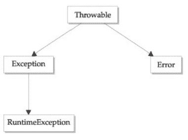

### 示例 11.1

```java
class ErrorTest1
{
    public static void main(String args[])
    {
      int a=5,b=2,c=2,d;
      d=a/(b-c); //ArithmeticException(Divide by zero) occurred
      System.out.println(d);
      System.out.println("This will not be printed");
    }
}
```

程序将在除法操作期间终止，不会执行剩余的语句。

### 示例 11.2


```java
class A
{
    void display()
    {
      -----
    }
}
class ErrorTest2
{
    public static void main(String args[])
    {
      A a1=null;
      a1.display(); // NullPointerException occurred
    }
}
```

在上述程序中将发生 `NullPointerException`。该引用变量没有用 `new` 初始化。在这种情况下，程序也会终止。

### 示例 11.3

```java
class ErrorTest3
{
    public static void main(String args[])
    {
      int a[ ] = {10,20,30};
      System.out.println(a[3]);  //ArrayIndexOutOfBoundsException occurred
    }
}
```

在上述情况下，数组的长度为 3，索引从 0 到 2，因此如果我们打印 `a[3]`，那么它就是第 4 个元素，这不是一个有效的索引。这将产生一个异常错误。在 C/C++ 中这是允许的，但在 Java 中是不允许。

**注意**

JDK 7 增加了一种新的 `try` 语句形式，支持自动资源管理。这种新的 `try` 形式被称为 `try-with-resources`，在 `Chapter` 文件的关于文件管理的上下文中进行了描述，因为文件是最常用的资源之一。

### 异常的其他情况

1. 我们尝试打开的文件可能不存在。
2. 我们想要创建一个新对象，但没有可用内存。
3. 我们想要加载的类文件可能缺失或格式错误。
4. 我们想要转换为数字的 `String` 包含无效字符，导致无法转换为数字。

如果异常对象没有被正确捕获和处理，解释器将显示错误消息并终止程序。如果我们希望继续执行剩余代码，我们应该尝试捕获由错误条件抛出的异常对象。

这项任务被称为异常处理。异常处理机制的目的是提供一种检测和报告“异常情况”的方法，以便采取适当的措施。该机制建议引入单独错误处理代码来执行以下任务：

1. 发现问题。（发生异常）
2. 通知错误已发生。（抛出异常）
3. 接收错误信息。（捕获异常）
4. 纠正措施。（处理异常）

Java 异常处理通过五个关键字管理：`try`、`catch`、`throw`、`throws` 和 `finally`。

我们想要监控异常的程序语句包含在 `try` 块中，每当发生错误时，异常会被抛到 `catch` 块。我们的代码可以捕获此异常（使用 `catch`）并以合理的方式进行处理。系统生成的异常由 Java 运行时系统自动抛出。

要手动抛出异常，使用关键字 `throw`。任何抛出方法的异常必须通过 `throws` 子句进行指定。任何在方法返回之前必须执行的代码都放在 `finally` 块中。

（注：源文件中剩余文本包含高度重复且碎片化的句子结构；我优先考虑了上述提供的核心技术定义和示例。）

换句话说，`catch` 并不是被“调用”，因此执行流永远不会从 `catch` “返回”到 `try` 块。因此，“这不会被打印。”这一行不会显示。一旦 `catch` 语句执行完毕，程序控制将继续执行位于整个 `try/catch` 机制之后的下一行代码。

`try` 及其 `catch` 语句形成一个单元。`catch` 子句的作用范围仅限于紧随其后的 `try` 语句指定的语句。`catch` 语句无法捕获由另一个 `try` 语句抛出的异常（稍后描述的嵌套 `try` 语句除外）。被 `try` 保护的语句必须用大括号括起来（也就是说，它们必须在一个块内）。你不能对单个语句使用 `try`。

大多数结构良好的 `catch` 子句的目标应该是解决异常情况，然后继续执行，就好像该错误从未发生过一样。例如，在下一个程序中，`for` 循环的每次迭代都会获取两个随机整数。这两个整数相互相除，结果被用于除以值 `12345`。最终结果存入 `a` 中。如果任何除法操作导致 `divide-by-zero` 错误，它会被捕获，`a` 的值被设置为 `zero`，程序继续运行。

```java
// Handle an exception and move on.

import java.util.Random;

class HandleError {
    public static void main(String args[]) {
        int a=0, b=0, c=0;
        Random r = new Random();
        for(int i=0; i<32000; i++) {
            try {
                b = r.nextInt();
                c = r.nextInt();
                a = 12345 / (b/c);
            } catch (ArithmeticException e) {
                System.out.println("Division by zero.");
                a = 0; // set a to zero and continue
            }
            System.out.println("a: " + a);
        }
    }
}
```

### 显示异常描述

`Throwable` 重写了 `toString()` 方法（由 `Object` 定义），返回包含异常描述的字符串。你可以通过简单地将异常作为参数传递给 `println()` 语句来显示此描述。例如，上一个程序的 `catch` 块可以重写如下：

```java
catch (ArithmeticException e) {
    System.out.println("Exception: " + e);
    a = 0; // set a to zero and continue
}
```

当把此版本替换到程序中并运行时，每个 `divide-by-zero` 错误都会显示以下消息：

`Exception: java.lang.ArithmeticException: / by zero`

虽然这在上下文中没有特殊价值，但在其他情况下，显示异常描述是有价值的——特别是当你正在进行异常实验或进行调试时。

| 异常类型 | 异常原因 |
| :--- | :--- |
| `ArithmeticException` | 算术错误，例如 - 除以 0 |
| `ArrayIndexOutOfBoundsException` | 数组索引越界 |
| `ArrayStoreException` | 在数组中存储错误类型的数据 |
| `FileNotFoundException` | 访问不存在的文件 |
| `IOException` | 无法从文件读取 |
| `NullPointerException` | 由引用空对象引起 |
| `NumberFormatException` | 字符串与数字之间的转换失败 |
| `OutOfMemoryException` | 没有足够的内存分配新对象 |
| `SecurityException` | Applet 尝试执行浏览器安全设置不允许允许的操作 |
| `StackOverflowException` | 系统栈空间不足 |
| `StringIndexOutOfBoundsException` | 程序尝试访问字符串中不存在的字符位置 |

### Java 内置异常

在标准包 `java.lang` 内部，Java 定义了多个异常类。之前的示例已经使用了其中几个。这些异常中最通用的是标准类型 `RuntimeException` 的子类。

正如之前所解释的那样，这些异常不需要包含在 `throws` 列表中。在语言中，这些被称为**未检查异常**，因为编译器不会检查方法是否处理了它们。在 `java.lang` 中定义的必须包含在方法 `throws` 列表中的异常是**检查异常**。

### 多 catch 子句

在某些情况下，单个 `try` 块可能会抛出多个异常。为了处理这种情况，你可以指定多个 `catch` 子句。当抛出异常时，会按顺序检查每个 `catch` 语句，并执行第一个与异常类型匹配的语句。其中一个 `catch` 执行后，其他的将直接跳过。

```java
// Demonstrate multiple catch statements.
class MultipleCatches {
    public static void main(String args[]) {
        try {
            int a = args.length;
            System.out.println("a = " + a);
            int b = 42 / a;
            int c[] = { 1 };
            c[42] = 99;
        } catch (ArithmeticException e) {
            System.out.println("Divide by 0: " + e);
        } catch (ArrayIndexOutOfBoundsException e) {
            System.out.println("Array index oob: " + e);
        }
        System.out.println("After/catch blocks.");
    }
}
```

如果该程序在没有命令行参数的情况下启动，将会导致 `divide-by-zero` 异常，因为 `a` 将等于零。如果你提供了命令行参数，它将跳过除法错误（设置 `a` 大于零），但它会导致 `ArrayIndexOutOfBoundsException`，因为整型数组 `c` 的长度为 1，而程序却尝试给 `c[42]` 赋值。

以下是两种运行方式生成的输出：

`C:>MultipleCatches`

a = 0

Divide by 0: java.lang.ArithmeticException: / zero

After catch blocks.

`C:>MultipleCatches TestArg`

a = 1

Array index oob: java.lang.ArrayIndexOutOfBoundsException:42

After catch blocks.

当你使用多个 `catch` 语句时，必须记住异常子类必须位于其父类之前。这是因为使用父类的 `catch` 语句会捕获该类型及其任何子类的异常。因此，如果子类在父类之后，它将永远无法被访问。此外，在 Java 中，不可达代码是一个错误。例如，考虑以下程序：

```java
/* 此程序包含错误。
在系列 catch 语句中，子类必须在其父类之前。
否则，将产生不可达代码并导致编译时错误。 */
class SuperSubCatch {
    public static void main(String args[]) {
        try {
            int a = 0;
            int b = 42 / a;
        } catch(Exception e) {
            System.out.println("Generic Exception catch.");
        }
        /* 此 catch 永远不会到达，因为
ArithmeticException 是 Exception 的子类。 */
        catch(ArithmeticException e) { // 错误 – 不可
            System.out.println("This is never reached.");
        }
    }
}
```

如果你尝试编译此程序，将收到一条错误消息，说明第二个 `catch` 语句是不可达，因为异常已经被捕获。由于 `ArithmeticException` 是 `Exception` 的子类，第一个 `catch` 语句将处理所有基于 `Exception` 的错误，包括 `ArithmeticException`。

这意味着第二个 `catch` 语句将永远不会执行。要解决这个问题，请反转 `catch` 语句的顺序。

## 嵌套 try 语句

`try` 语句可以嵌套。也就是说，一个 `try` 语句位于另一个 `try` 块内部。每当进入一个 `try` 语句时，该异常的上下文就会推到栈上。

如果内部 `try` 语句没有针对特定异常的 `catch` 处理器，栈将回溯并检查下一个 `try` 语句的 `catch` 处理器是否匹配。

这种情况会一直持续，直到其中一个 `catch` 语句执行成功，或者所有的嵌套 `try` 语句都已耗尽。如果没有 `catch` 语句匹配，Java 运行时系统将处理该异常。

以下是一个使用嵌套 try 语句的示例：

### 多重 catch 语句

当存在多个 `catch` 语句时，称之为多重 catch 语句。

#### 多重 catch 语句示例

```java
try
{
    statement; //产生一个异常
}
catch(Exception-type-1 e)
{
    statement 1; //处理类型 1 的异常
}
catch(Exception-type-2 e)
{
    statement 2; //处理类型 2 的异常
}
// ...
catch(Exception-type-n e)
{
    statement n; //处理类型 n 的异常
}
```

#### 示例 11.4

```java
class ErrorTest4
{
    public static void main(String args[])
    {
        int a=10,b=2,c=2,d;
        System.out.println("Before Exception ");
        d=a/(b-c);
        System.out.println("After Exception ");
    }
}
```

输出：

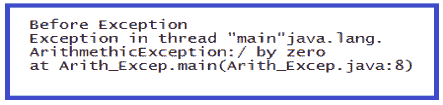

在这里我们没有捕获异常，因此程序将在显示消息“Before Exception”后终止。现在我们使用异常处理已经解决了这个问题。

#### 示例 11.5

```java
class ErrorTest5
{
    public static void main(String[] args)
    {
      int a=10,b=2,c=2,d;
      try
      {
        System.out.println("Before Exception");
        d=a/(b-c);
        System.out.println("This Will Not Print");
      }
      catch(ArithmeticException e)
      {
      System.out.println("After Exception");
      System.out.println("error : Division by zero");
      }
    }
}
```

输出：


## 异常处理的优势

- 我们可以很容易确定异常/错误将在哪里处理。异常/错误在运行时沿调用栈向上传播——首先到达封装的 `try` 块，然后返回到调用方法——直到异常处理器捕获它们为止。
- 异常/错误的位置是确定的，因为整个堆栈轨迹对用户都是可见的。对于调试非常有帮助。
- 程序员有机会从错误/异常状态中恢复。
- 错误处理代码与正常程序流分离，以增加可读性和可维护性。
- 使用 Java 无需测试是否发生了异常/错误情况。添加更多的错误/异常处理器只需要添加更多的 `catch` 子句，但不需要触动原始程序流。

## 异常类的层次结构

所有 `Exception` / `Error` 类的根类是 `throwable` 类，它是 `object` 类的直接子类。异常/错误在 Java 中也是对象。`Exception` 的子类带有 `Exception` 后缀。

`throwable` 类有两个直接子类：

- `Error`: `Error` 类的子类基本上用于指示非正常状态，例如：
    1. `OutOfMemoryError` 表示 Java 虚拟机内存已耗尽，垃圾回收器无法回收可用内存。
    2. `StackOverflowError` 解释器中发生栈溢出。
    这些错误通常是不可恢复的，不应该被处理。
- `Exception`: `Exception` 类的子类通常是可恢复的。例如，`EOFException` 信号我们打开的文件没有更多数据可读。`FileNotFoundException` 表示我们想要打开的文件不存在。

层次结构示例：own

异常分为两类

### 检查点异常 (Checked Exception)

如果必须捕获异常，则它被称为检查异常。如果 `try` 块中可能发生检查异常且未被处理，程序将无法编译。编译器确保如果一个方法直接或间接地可以抛出检查异常，则该方法必须显式地处理它。该方法要么捕获异常并采取适当行动，要么将异常传递给调用者。注意：`Exception` 及其所有子类（运行时异常及其子类除外）都是检查异常，必须捕获。

### 未检查异常 (Unchecked Exception)


如果不必捕获异常，则它被称为未检查异常。即使未处理未检查异常，程序也可以编译。如果程序中发生了未处理的未检查异常，程序将在该点终止。但如果处理异常，程序将不会终止。注意：`Error` 及其所有子类都是未检查异常，不需要捕获。运行时异常及其所有子类是未检查异常。用户定义的异常是检查异常。

`Exception` 类中的方法：

| 方法 | 描述 |
| :--- | :--- |
| `getMessage()` | 获取与异常相关的错误消息。 |
| `printStackTrace()` | 打印显示异常/错误的堆栈轨迹。 |
| `toString()` | 显示异常/错误名称以及 `getMessage()` 返回的消息。 |

#### 示例 11.6

```java
class ErrorTest6
{
    public static void main(String[] arr)
    {
        try
        {
            int a=10,b=2,c=2,d;
            System.out.println("Before Exception");
            d=a/(b-c);
            System.out.println("This Will Not Print");
        }
        catch(ArithmeticException e)
        {
            System.out.println("After Exception");
            System.out.println("error : Division by zero");
            System.out.println(e.getMessage());
            System.out.println(e); // 调用了 toString()
            e.printStackTrace();
        }
    }
}
```

输出：

```
Before Exception
After Exception
error : Division by zero
by Zero
java.lang.ArithmeticException: / by zero
java.lang.ArithmeticException: / by zero
at ErrorTest6.main(ErrorTest6.java:10)
```

#### 示例 11.7 多重 catch

```java
class ErrorTest7
{
    public static void main(String args[])
    {
        try
        {
            int a=args.length;
            System.out.println("Before Exception");
            int b=58/a;
            int c[] = {1};
            c[47]=100;
            System.out.println("After Exception");
        }
        catch(ArithmeticException e)
        {
            System.out.println("Divide by zero :"+e);
        }
        catch(ArrayIndexOutOfBoundsException e)
        {
            System.out.println("Array Index oob :"+e);
        }
        System.out.println("After try/catch block");
    }
}
```

输出 1：当我们以 `java ErrorTest7` 运行上述程序时：

```
Before Exception
Divide by zero :java.lang.ArithmeticException: / by zero
After try/catch block
```

输出 2：当我们以 `java ErrorTest7 45` 运行上述程序时：

```
Before Exception
Array Index oob:java.lang.ArrayIndexOutOfBoundsException: 47
After try/catch block
```

如果在另一个 `try` 块中使用 `try` 和 `catch` 语句，则被称为嵌套的 `try catch`。

### 语法

```java
try // 外部 try
{
    try // 内部 try
    {
        statement ;
    }
    catch1() // 内部 catch
    {
        statement ;
    }
    catch2() // 内部 catch
    {
        statement ;
    }
}
catch() // 外部 catch
{
    statement ;
}
```

### 示例 11.8 嵌套 try 和 catch

```java
class Nested
{
    public static void main(String args[])
    {
        try
        {
            int a=args.length;
            int b=58/a;
            System.out.println("a= "+a);
            try
            {
                if(a==1)
                    a=a/(a-a);
                if(a==2)
                {
                    int c[]={1};
                    c[42]=100;
                }
            }
            catch(ArrayIndexOutOfBoundsException e)
            {
                System.out.println("ArrayIndex oob "+e);
            }
        }
        catch(ArithmeticException e)
        {
            System.out.println(e.getMessage());
        }
    }
}
```

**输出 I:**

当我们以 `java ErrorTest8` 运行上述程序时（除以零）

**输出 II:**

当我们以 `java ErrorTest8 10` 运行上述程序时

`a=1 / by zero`

**输出 III:**

当我们以 `java ErrorTest8 10 20` 运行上述程序时

```
a=2
ArrayIndex oob java.lang.ArrayIndexOutOfBoundsException: 42
```

---

### finally 语句

Java 支持另一种名为 `finally` 的语句，它可以用于处理未被之前任何一个 `catch` 语句捕获的异常。`finally` 块可以处理在 `try` 块中生成的任何异常。无论是否发生错误，它都会执行。它可以紧跟在 `try` 块之后或最后一个 `catch` 块之后，如下所示：

**语法：**

```java
try
{
}
catch(...)
{
}
catch(...)
{
}
finally
{
}
```

### 示例 11.9 finally 语句

```java
class ErrorTest9
{
    public static void main(String args[])
    {
        int a[ ] = {5,10};
        int b=5;
        try
        {
            int x=a[2]/b-a[1];
        }
        catch(ArithmeticException e)
        {
            System.out.println("Division By Zero");
        }
        catch(ArrayIndexOutOfBoundsException e)
        {
            System.out.println("Array Index error");
        }
        catch(ArrayStoreException e)
        {
            System.out.println("Wrong Data Type");
        }
        finally // 始终执行
        {
            System.out.println("Always Execute");
        }
        int y=a[1]/a[0];
        System.out.println("y = "+y);
    }
}
```

**输出:**

```
Array Index error
Always Execute
y = 2
```

---

### throw

到目前为止，我们只捕获由 Java 运行时系统抛出的异常。然而，我们的程序也可以使用 `throw` 语句显式地抛出异常。通用形式所示：

`throw instance;`

这里 `instance` 必须是 `Throwable` 类型的对象或 `Throwable` 的子类。简单类型如 `int` 或 `char`，以及非 `Throwable` 类如 `String` 和 `Object` 不能用作异常。执行流立即停止；检查最近的内部 `try` 块，查看其是否有匹配异常类型的 `catch` 语句。如果有，控制权将转移到该语句。如果没有，则检查下一个 `try` 语句，以此类推。如果未找到匹配的 `catch`，默认处理器将打印堆栈跟踪。这里我们取了一个创建并抛出异常的程序。捕获异常的处理器将其重新抛出给外部处理器。

### 示例 11.10

```java
class ErrorTest10
{
    int age;
    void setAge(int a)
    {
        if(a>0)
            age = a;
        else
        {
            NullPointerException e = new NullPointerException("Invalid Age");
            throw e;
        }
    }
    public static void main(String args[])
    {
        ErrorTest10 a1 = new ErrorTest10();
        try
        {
            a1.setAge(20);
            a1.setAge(-10);
        }
        catch(NullPointerException e)
        {
            System.out.println(e.getMessage());
        }
    }
}
```

**输出:**

`Invalid Age`

---

### throws

如果一个方法可能会导致它未处理的异常，它必须指定这种行为，以便方法的调用者能够针对该异常进行防护。我们通过在方法声明中包含 `throws` 子句来实现。`throws` 子句列出了方法可能抛出的异常类型。这对于所有检选异常（checked exceptions）都是必要的。方法可以抛出的所有异常都必须在 `throws` 子句中声明。如果没有声明，会导致编译错误。这是一个包含 `throws` 子句的方法声明通用形式：

**语法：**

```java
type method-name(parameter list) throws exception-list
{ // 方法体 }
```

在这里，`exception-list` 是方法可以抛出的异常的逗号分隔列表。

### 示例 11.11

```java
import java.io.*; 
class ErrorTest11
{
    int age;
    void setAge(int a) throws IOException
    {
        if(a>0)
            age = a;
        else
        {
            IOException e = new IOException("Invalid Age");
            throw e;
        }
    }
    public static void main(String args[])
    {
        ErrorTest11 a1 = new ErrorTest11();
        try
        {
            a1.setAge(20);
            a1.setAge(-10);
        }
        catch(IOException e)
        {
            System.out.println(e.getMessage());
        }
    }
}
```

**输出:**

`Invalid Age`

---

### 创建自定义异常/类：创建自己的异常子类

这非常简单：只需定义 `Exception` 的子类即可。我们的子类不需要实现任何内容。`Exception` 类没有定义任何自己的方法。当然，它从 `Throwable` 继承了这些方法。

### 示例 11.12

```java
class AgeException extends Exception
{
    AgeException(String msg) {
        super(msg);
    }
}

class ErrorTest12 {
    int age;
    void setAge(int a) throws AgeException {
        if(a > 0)
            age = a;
        else {
            AgeException e = new AgeException("Invalid Age");
            throw e;
        }
    }
    public static void main(String args[]) {
        ErrorTest12 a1 = new ErrorTest12();
        try {
            a1.setAge(20);
            a1.setAge(-10);
        } catch(AgeException e) {
            System.out.println(e.getMessage());
        }
    }
}
```

输出：

```
Invalid Age
```

下面的示例声明了 `Exception` 的一个新子类，并使用该子类在方法中指示错误条件。它重写了 `toString()` 方法，允许显示精心定制的异常描述。

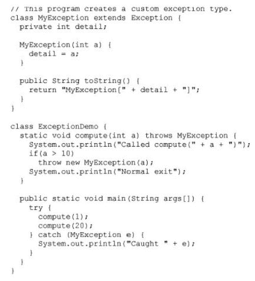

此示例定义了一个名为 `MyException` 的 `Exception` 子类。该子类非常简单：它只包含一个构造函数和一个重写的 `toString()` 方法，该方法显示异常的值。

`ExceptionDemo` 类定义了一个名为 `compute()` 的方法，该方法会抛出一个 `MyException` 对象。当 `compute()` 的整数参数大于 10 时，会抛出异常。`main()` 方法为 `MyException` 设置了异常处理器，然后调用 `compute()` 并传入一个合法值（小于 10）和一个非法值，以展示代码执行的两种路径。

以下是结果：

```
Called compute(1)
Normal exit
Called compute(20)
Caught MyException[20]
```

## 链式异常

链式异常特性允许我们将异常与另一个异常关联。第二个异常描述了第一个异常的原因。例如，想象一种情况：一个方法因为尝试除以零而抛出 `ArithmeticException`。然而，问题的实际原因是发生了 I/O 错误，这导致除数被设置不当。

尽管该方法必须抛出 `ArithmeticException`（因为这是发生的错误），但我们可能还想让调用代码知道底层原因是 I/O 错误。

为了允许链式异常，Java 2 1.4 版本向 `Throwable` 类添加了两个构造函数和两个方法。构造函数所示：

```java
Throwable(Throwable causeExc)
Throwable(String msg, Throwable causeExc)
```

在第一形式中，`causeExc` 是发生的异常。第二种形式允许我们在指定原因异常的同时指定一个描述。这两个构造函数也被添加到 `Error`、`Exception` 和 `RuntimeException` 类中。

添加到 `Throwable` 类的链式异常方法是 `getCause()` 和 `initCause()`：

```java
Throwable getCause()
Throwable initCause(Throwable causeExc)
```


`getCause()` 方法返回当前异常的底层异常。如果没有底层异常，则返回 `null`。`initCause()` 方法将 `causeExc` 与调用的异常关联并返回该异常的引用。因此，我们可以在异常创建后与其关联一个原因。然而，原因异常只能设置一次。

因此，我们对每个异常对象只能调用一次 `initCause()`。此外，如果原因异常是通过构造函数设置的，则我们无法使用 `initCause()` 方法再次设置它。通常情况下，`initCause()` 用于为不支持上述两个额外构造函数的旧版异常类设置原因。大多数 Java 内置异常都没有定义额外的构造函数。因此，如果我们需要向这些异常中添加一个异常，将使用 `initCause()`。链式异常并不是每个程序都需要的。但在了解底层原因有用的情况下，它们提供了一种优雅的解决方案。

### 示例 1.13

```java
class ErrorTest13 {
    int age;
    void setAge(int a) {
        if(a>0)
            age = a;
        else {
            NullPointerException e = new NullPointerException("Admission Failed");
            e.initCause(new ArithmeticException("Age is invalid"));
            throw e;
        }
    }
    public static void main(String args[]) {
        ErrorTest13 a1 = new ErrorTest13();
        try {
            a1.setAge(20);
            a1.setAge(-10);
        } catch(NullPointerException e) {
            System.out.println(e.getMessage());
            System.out.println(e.getCause());
        }
    }
}
```

Output:

```
Admission Failed
Age is Invalid
```

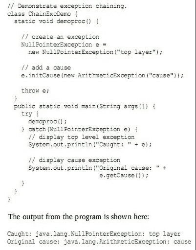

在这个示例中，顶层异常是 `NullPointerException`。它被添加了一个原因异常 `ArithmeticException`。当异常从 `demroc()` 抛出时，它被 `main()` 捕获。在那里，显示顶层异常，随后通过调用 `getCause()` 获取底层异常。链式异常可以持续到所需的深度。因此，原因异常本身也可以有原因。请注意，过长的异常链可能表明设计不当。链式异常并不是每个程序都需要的。但在了解底层原因有用的情况下，它们提供了一种优雅的解决方案。

## 三个 JDK 7 新异常特性（已更新）

JDK 7 为异常系统增加了三个有趣且实用的特性。第一个是在资源不再需要时自动释放（例如文件）。它是基于 `try` 语句的扩展形式 `try-with-resources`，将在后续介绍文件的章节中介绍。

第二个新特性是 `multi-catch`，第三个有时被称为 `final rethrow` 或更精确的重抛。这两个特性将在此处描述。

`multi-catch` 特性允许两个或多个异常由同一个 `catch` 语句捕获。尽管处理的是不同的异常，但多个异常处理器使用相同的代码序列并不常见。不需要单独捕获每个异常类型，现在可以使用单个 `catch` 子句处理所有异常，从而避免代码重复。

要使用 `multi-catch`，用 OR 操作符分隔 `catch` 子句中的每个异常类型。每个 `multi-catch` 参数隐式为 `final`。（如果需要可以显式指定 `final`，但没有必要。）

由于每个 `multi-catch` 参数隐式为 `final`，因此不能被赋值新值。

这是一个使用 `multi-catch` 特性捕获 `ArithmeticException` 和 `ArrayIndexOutOfBoundsException` 的 `catch` 语句：

```java
catch(ArithmeticException | ArrayIndexOutOfBoundsException e)
```

下面的程序展示了 `multi-catch` 特性的用法：

```java
// 演示 JDK 7 的 multi-catch 特性
class MultiCatch {
    public static void main(String args[]) {
        int a=10, b=0;
        int vals[] = { 1, 2, 3 };
        try {
            int result = a / b; // 生成 ArithmeticException
            // vals[10] = 19; // 生成 ArrayIndexOutOfBoundsException
            // 此 catch 子句捕获这两个异常。
        } catch(ArithmeticException | ArrayIndexOutOfBoundsException e) {
            System.out.println("Exception caught: " + e);
        }
        System.out.println("After multi-catch.");
    }
}
```

当尝试除以零时，程序将生成 `ArithmeticException`。如果你注释掉除法语句并移除下一行的注释符号，则会生成 `ArrayIndexOutOfBoundsException`。这两个异常都由同一个 catch 语句捕获。

更精确的重新抛出（rethrow）功能限制了可以重新抛出的异常类型，仅限于关联的 `try` 块抛出的、且未被先前的 `catch` 句处理的、并是参数的子类或父类的检查异常。

虽然这种能力可能并不常用，但现在已经可以使用。为了使精确的重新抛出功能生效，`catch` 参数必须是有效最终（effectively final），这意味着它在 `catch` 块内部不能被赋予新值，或者必须显式声明为 `final`。

## 使用异常

异常处理为具有许多动态运行时特性的复杂程序提供了一种强大的机制。将 `try`、`throw` 和 `catch` 视为处理程序逻辑中错误和异常边界条件的整洁方式是非常重要的。与其他使用错误返回代码来指示失败的语言不同，Java 使用异常。因此，当一个方法可能会失败时，让它抛出一个异常。

这是一种处理失败模式更干净的方法。最后一点：Java 的异常处理语句不应被视为非局部分支的通用机制。如果你这样做，只会让你的代码变得混乱并难以维护。

## 理论题

1. 什么是异常？

2. 我们如何定义一个 `try` 块？

3. 我们如何定义一个 `catch` 块？

4. 列出 Java 中可能发生的一些常见异常类型给出示例。

5. 捕获所有类型的异常是必须的吗？

6. 一个 `try` 块可以使用多少个 `catch` 块。

7. 创建一个可能产生三种异常的 `try` 块，然后结合必要的 `catch` 块以捕获并妥善处理它们。

8. `finally` 块是什么？它何时以及如何使用？给出一个合适的示例。

9. 解释异常处理机制如何用于程序调试。


# 第 12 章

## (多线程编程)

### 引言

线程是程序内部的单一控制流。线程与进程非常相似。事实上，线程也被称为轻量级进程。

## 线程对比进程

通常，不同的进程占用不同的内存空间。当 CPU 从一个进程切换到另一个进程时，当前运行进程的状态会被保存，另一个进程的状态会被恢复。在状态切换期间没有进行任何有用工作。状态切换时间应该尽可能短，以最大化 CPU 的利用率。

线程也像是独立的进程，但它们共享相同的内存和状态。各个线程也有独立的状态，但与进程状态相比，状态非常小。状态可能只包含程序计数器和栈指针。因此，从一个线程切换到另一个线程所需的时间非常短。因此，与进程相比，线程的上下文切换时间非常短。因此，多线程的情况下 CPU 利用率比多进程的情况下高。

## 多线程程序

多线程程序包含两个或多个可以并发运行的部分。此类程序的每个部分被称为线程，每个线程定义了一条独立的执行路径。因此，多线程是多任务处理的一种特殊形式。

例如，一个程序可能有三个线程：

* 一个负责打印。
* 一个负责编辑。
* 一个负责从互联网下载文件。

所有这些线程可能都在并发运行，从而最大化 CPU 的利用率。

## 基于进程的多任务处理

大多数操作系统允许我们同时运行两个或多个程序。这被称为基于进程的多任务处理。例如，我们可以运行一个 Java 程序，同时在编辑一个文字文档。基于进程的多任务处理确保了大部分时间内会有程序要执行，因此增加了 CPU 的利用率。

在基于进程的多任务处理中，程序是调度程序可以分发的最小代码单元。

## 基于线程的多任务处理

线程是基于线程的任务处理环境中的最小执行单元。一个进程可以被分为若干并发执行的线程。这允许我们在单个程序中并发处理多个一个任务。

例如，我们可以编辑一个文字文档。基于线程的任务处理提高了 CPU 的利用率。

## Java 线程模型

Java 运行时系统在许多方面依赖线程，并且所有的类库都是为多线程设计的。这有助于通过防止 CPU 周期浪费来降低效率。

## 线程生命周期（线程状态）

线程存在多种状态。线程可以处于运行状态。它可以处于就绪状态。运行中的线程可以被挂起，从而暂时停止其活动。挂起的线程随后可以恢复。当线程在等待资源时会处于阻塞状态。在任何时候，线程都可以终止。

### 1. 新生状态

当我们创建一个线程对象时，线程就出生了，被称为处于新生状态。线程尚未被调度运行。

在此状态下，我们只能对它执行以下任一操作：

1. 使用 `start()` 方法调度它运行。
2. 使用 `stop()` 方法将其杀死。

如果被调度，它将移动到可运行状态（runnable）。如果我们尝试在此状态下使用任何其他方法，将抛出异常。

### 2. 可运行状态

可运行状态意味着线程已准备好执行，并正在等待处理器的可用。也就是说，线程已经加入了等待执行的线程队列。如果所有线程的优先级相同，则会以时间轮询的方式给它们执行时间片。

放弃控制权的线程会加入队列末尾并再次等待轮到。然而，如果我们想让一个线程在轮到它之前将控制权让给另一个等优先级的线程，可以通过调用 `yield()` 方法来实现。

### 3. 运行状态

运行意味着处理器已经将时间分配给该线程进行执行。运行中的线程在以下情况之一可能会放弃控制权：

* 它的时间片结束。
* 被高优先级线程抢占。
* 它让出，即自愿放弃控制权。
* 它完成了执行。
* 它被其他线程停止。
* 它已使用 `suspend()` 方法挂起。被挂起的线程可以通过 `resume()` 方法恢复。当我们由于某些原因想挂起线程一段时间，但不想杀死它时，这种方法非常有用。
* 它被告知等待直到某个事件发生。这是通过 `wait()` 方法实现的。可以使用 `notify()` 方法调度线程再次运行。
* 它正在执行某些 I/O 操作。

### 4. 阻塞状态 (Blocked State)

当线程被阻止进入可运行（runnable）状态以及随后的运行（running）状态时，该线程被称为阻塞。这发生在线程为了满足某些要求而挂起、睡眠或等待时。阻塞线程被视为“不可运行”，但并未死亡，因此完全有资格再次运行。

### 5. 死亡状态 (Dead State)

每个线程都有生命周期。运行中的线程在完成其 `run()` 方法的执行后结束生命。它会自然死亡。然而，我们可以在任何状态下向它发送停止消息来杀死它，从而导致过早死亡。线程可以在一出生时被杀死，或者在运行期间被杀死，甚至在处于“不可运行”（阻塞状态）时被杀死。

### 线程优先级 (Thread Priorities)

Java 为每个线程分配了一个优先级，该优先级决定了与其他线程相比如何处理该线程。线程优先级是整数，指定了线程线程相对于另一个线程的相对优先级。

作为一个绝对值，优先级是没有意义的；如果只有一个线程在运行，那么高优先线程的运行速度并不比低优先线程快。相反，线程的优先级用于决定何时从一个运行线程切换到下一个线程。这被称为上下文切换（context switch）。决定何时发生上下文切换的规则很简单：

* 线程可以自愿地（自己）放弃控制权。这是通过显式地让出（yielding）、睡眠（sleeping）、阻塞（blocking）或等待 I/O（pending I/O）来实现的。在这种情况下，将检查所有其他线程，并且通常会将优先级最高且准备好运行的线程分配 CPU。
* 线程可以被高优先级线程抢占。在这种情况下，一个不让出处理器的低优先级线程无论正在做什么，都会被一个高优先级线程直接抢占。基本上，只要高优先级线程想要运行，它就会运行。这被称为抢占式多任务处理（preemptive multitasking）。
* 某些操作系统支持非抢占的优先级调度。在这种情况下，只有当低优先级线程完成时，高优先级线程才能获得机会。
* 在两个优先级相同的线程竞争 CPU 周期的情况下，情况会有点复杂。对于像 windows98 这样的操作系统，等优先线程必须自愿地（自己）让出（放弃）控制权给同级线程。如果不这样做，其他线程将不会运行。

> **注意**：操作系统切换等优先级线程的方式存在差异可能会产生问题。

## 同步 (Synchronization)

由于多线程为我们的程序引入了异步行为，我们必须在需要时有一种方法来强制执行同步。例如，如果我们想让两个线程通信并共享复杂的数据结构（如链表），我们需要某种方法来确保它们之间不发生冲突。

也就是说，我们必须防止一个线程在另一个线程正在读取数据时写入数据。Java 使用监视器（monitor）进行线程间同步。我们可以将监视器想象为一个只能容一个线程的小盒子。一旦线程进入监视器，它就可以用来保护共享资源不被多个线程同时操作。

大多数多线程系统以对象的形式暴露，我们的程序必须显式地获取并锁定。Java 提供了一个更整洁的解决方案。

没有名为“monitor”的类，相反，每个对象都有自己的隐式监视器，当调用对象的 `synchronized` 方法时，监视器会自动进入。一旦线程进入 `synchronized` 方法，其他线程就无法调用同一对象上的任何其他 `synchronized` 方法。这使我们能够编写非常清晰、简洁的多线程代码，因为同步支持内置在语言中。

## 消息传递 (Messaging)

当使用大多数其他语言进行编程时，我们必须依赖操作系统建立线程之间的通信。

这无疑会增加开销。相比之下，Java 提供了一种整洁、低成本的方法让两个或多个线程相互通信，通过调用所有对象都具有的定义方法。Java 的消息系统允许线程进入对象的 `synchronized` 方法，然后在那里等待，直到其他线程显式地通知它离开。

### Thread 类和 Runnable 接口

Java 的多线程系统构建在 `Thread` 类、其方法及其伴侣接口 `Runnable` 之上。该类属于 `java.lang` 包，因此不需要显式导入它。

`Thread` 封装了一个执行线程，由于我们无法直接引用运行线程的内部状态，我们将通过它的代理（即产生它的 `Thread` 实例）来处理它。要创建一个新线程，我们的程序将扩展 `Thread` 类或实现 `Runnable` 接口。`Thread` 类定义了几个帮助管理线程的方法：

| 方法 | 描述 |
| :--- | :--- |
| `String getName()` | 返回此线程的名字 |
| `int getPriority()` | 返回此线程的优先级 |
| `boolean isAlive()` | 测试此线程仍在运行 |
| `void join()` | 等待此线程死亡（终止） |
| `void run()` | 如果此线程是使用单独 `Runnable` 对象构造的，则调用该 `Runnable` 对象的 `run` 方法；否则，此方法什么都不做并返回；如果扩展了类并在子类中重写了 `run()` 方法，则调用被重写的 `run()` 方法。 |
| `void setName(String name)` | 将此线程更改为参数 |
| `static void sleep(long millis)` | 让当前执行线程睡眠指定的毫秒数 |
| `static void sleep(long millis, int nanos)` | 让当前执行线程睡眠指定的毫秒和纳秒数 |
| `void start()` | 启动线程执行，Java 虚拟机调用此线程的 `run` 方法 |
| `static void yield()` | 让当前执行线程对象临时暂停并允许其他线程执行 |
| `static Thread currentThread()` | 返回当前执行线程引用 |

### 主线程 (The main thread)

当 Java 程序启动时，一个线程立即开始。这通常被称为程序的主线程，因为它是程序开始时执行的线程。主线程是创建其他“子”线程的线程。

虽然主线程是在程序启动时自动创建的，但可以通过 `Thread` 对象对其进行控制。为了这样做，我们需要通过调用 `currentThread()` 方法获取其引用，该方法是 `Thread`类的公共静态成员。

该方法返回调用它的线程的引用。一旦有了主方法的引用，我们就可以像任何其他线程一样控制它。

### 示例 12.1


下面的示例演示了如何获取主线程的引用，然后使用 `Thread` 类的方法访问其属性。

```java
class CurrentThreadTest {
    public static void main (String args[]) {
        Thread t = Thread.currentThread();
        System.out.println("Current thread:" + t);
        System.out.println("Name:"+ t.getName());
        System.out.println("Priority:"+ t.getPriority());
        t.setName("MyThread");
        t.setPriority(Thread.MAX_PRIORITY);
        System.out.println("After name and priority change :" + t);
        System.out.println("Name:" + t.getName());
    }
}
```

```java
System.out.println("Priority:" + t.getPriority());

for (int n=1; n<=5; n++) {
    System.out.println(n);
    try {
        Thread.sleep(1000);
    } catch (InterruptedException e) {
        System.out.println("Main thread interrupted");
    }
}
```

**输出:**

```text
Current thread:Thread[main,5,main]
Name:main
Priority:5
After name and priority change :Thread[MyThread,10,main]
Name:MyThread
Priority:10
1
2
3
4
5
```

**注意 1：** `Thread` 类中的 `sleep()` 方法可能会抛出 `InterruptedException`，这是一个受检异常。如果其他线程想要中断这个正在睡眠的线程，就会发生这种情况。

**注意 2：** 注意当将 `t`（线程引用）作为 `println()` 的参数时产生的输出。它将按顺序显示：线程名称、它的优先级以及它的线程组名称。它的优先级为 `5`，这是默认值，而 `main` 也是该线程所属线程组的名称。线程组是一个控制整个线程集合状态的数据结构。

## 创建线程

在最通用的意义上，我们通过实例化 `Thread` 类型的对象来创建线程。Java 识别出两种实现方式的方法：

1. 我们可以实现 `Runnable` 接口。
2. 我们可以扩展 `Thread` 类本身。

### 实现 Runnable

创建线程最简单的方法是创建一个实现 `Runnable` 接口的类。要实现 `Runnable`，类只需要实现一个名为 `run()` 的单一方法。

```java
public void run()
```

在 `run()` 方法内部，我们将定义构成新线程的代码。`run()` 可以调用其他方法、使用其他类并声明变量，就像主线程一样。唯一的区别是，`run()` 为程序中另一个并发执行的线程建立了入口点。该线程将在 `run()` 返回时结束。

在我们创建了实现 `Runnable` 的类后，我们将在该类内部使用以下构造函数之一来实例化 `Thread` 类型的对象：

- `Thread(Runnable threadObj)`
- `Thread(Runnable threadObj, String threadName)`

这里 `threadObj` 是调用其 `run` 方法的对象，而 `threadName` 是新线程的名称。在新线程创建后，在没有调用 `start()` 方法之前，它不会开始运行。`start()` 方法将线程放入就绪队列（可运行状态）。每当线程被调度时，它的执行将从 `run()` 方法开始。

### 示例 12.2

```java
class A implements Runnable {
    public void run() {
        for(int i=1;i<=5;i++) {
            System.out.println("Child Thread:" + i);
        }
        System.out.println("Exiting child thread");
    }
}
class RunnableTest {
    public static void main(String args[]) {
        A a1=new A();
        Thread t1 = new Thread(a1,"Demo Thread");
        t1.start();
        System.out.println("Main thread exiting");
    }
}
```

**输出:**

```text
Main thread exiting
Child Thread:1
Child Thread:2
Child Thread:3
Child Thread:4
Child Thread:5
Exiting child thread
```

### 示例 12.3

```java
class A implements Runnable {
    Thread t;
    A() {
        t= new Thread(this, "Demo Thread");
        System.out.println("Child thread: "+ t);
        t.start();
    }
    public void run() {
        for (int i=1; i<=5; i++) {
            System.out.println("Child Thread: "+ i );
            try {
                Thread.sleep(500);
            } catch (InterruptedException e) {
                System.out.println(e);
            }
        }
        System.out.println ("Exiting thread");
    }
}
class RunnableTest2 {
    public static void main (String args[]) {
        A a1=new A();
        for (int i=1; i<=5; i++) {
            System.out.println("Main Thread:"+ i);
            try {
                Thread.sleep (1000);
            } catch(InterruptedException e) {
                System.out.println("main interrupted");
            }
        }
        System.out.println("End of thread");
    }
}
```

**输出:**

```text
Child thread: Thread[Demo Thread,5,main]
Main Thread:1
Child Thread: 1
Child Thread: 2
Main Thread:2
Child Thread: 3
Main Thread:3
Child Thread: 4
Main Thread:4
Main Thread:5
Exiting thread
End of Main thread
```

### 扩展 Thread 类

创建线程的第二方法是创建一个扩展 `Thread` 的类，然后创建该类的实例。扩展类必须重写 `run()` 方法，这是新线程的入口点。它还必须调用 `start()` 来执行新线程。

### 示例 12.4

```java
class A extends Thread {
    A() {
        super ("Test Thread");
        System.out.println ("Child thread:" + this);
        start();
    }
    public void run () {
        for (int i=1; i<=5; i++) {
            System.out.println("Child Thread:"+i);
            try {
                sleep(500);
            } catch(InterruptedException e) {
                System.out.println("thread interrupted");
            }
        }
        System.out.println ("Exiting Child thread");
    }
}
class ThreadTest {
    public static void main(String args[]) {
        new A();
        for (int i=1; i<=5; i++) {
            System.out.println("Main Thread: "+i);
            try {
                Thread.sleep(100);
            } catch(InterruptedException e) {
                System.out.println("thread interrupted");
            }
        }
    }
}
```

**输出:**

```text
Child thread:Thread[Test Thread,5,main]
Main Thread: 1
Child Thread:1
Child Thread:2
Main Thread:2
Child Thread:3
Main Thread:3
Child Thread:4
Exiting Child thread
```

## 选择方法

`Thread` 类定义了多个可以被派生类重写的方法。在这些方法中，必须重写的只有 `run()`。当然，当我们实现 `Runnable` 时也是如此。许多程序员认为，类只有在被增强或修改时才应该扩展。因此，如果我们不需要重写任何 `Thread` 方法，可能最好的方法是实现 `Runnable`。

### 创建线程：示例 12.5

```java
class A implements Runnable {
    String name;
    Thread t;
    A(String threadName) {
        name=threadName;
        t=new Thread(this, name);
        System.out.println("Child thread:"+t);
        t.start();
    }
    public void run() {
        for(int i=1;i<=5;i++) {
            System.out.println(t.getName()+ ":" + i);
            try {
                Thread.sleep(1000);
            } catch (InterruptedException e) {
                System.out.println(e);
            }
        }
        System.out.println(name+ "Exiting");
    }
}
class MultiThreadTest {
    public static void main(String args[]) {
        A a1=new A("One");
        A a2=new A("Two");
        A a3=new A("Three");
        try {
            Thread.sleep(10000);
        } catch(InterruptedException e) {
            System.out.println("main thread interrupted");
        }
        System.out.println ("Main thread exiting");
    }
}
```

**输出:**

```text
Child thread:Thread[One,5,main]
Child thread:Thread[Two,5,main]
Child thread:Thread[Three,5,main]
One:1
Two:1
Three:1
One:2
Two:2
Three:2
One:3
Two:3
Three:3
One:4
Two:4
Three:4
One:5
Two:5
Three:5
OneExiting
TwoExiting
ThreeExiting
Main thread exiting
```

### 使用 isAlive() 和 join() 方法强制执行顺序

通常，我们希望主线程最后结束。实现这一目标的方法之一是在 `main` 中调用 `sleep()`。这是一种比较粗暴（原始）的方法。有两种方法可以判断线程是否已完成。首先，我们可以在线程上调用 `isAlive()`。该方法由 `Thread` 类定义，其通用形式为：

```java
final boolean isAlive()
```

如果调用该方法的线程仍在运行，则 `isAlive()` 方法返回 `true`；否则返回 `false`。虽然 `isAlive()` 有时有用，但我们更常用的用于等待线程完成的方法是 `join()`，所示所示：

```java
final void join() throws InterruptedException
```

该方法会等待直到调用它的线程终止。`join()` 的其他形式允许我们指定等待指定线程终止的最长时间。

接下来的示例使用了 `join()` 来确保主线程是最后一个停止的。它还演示了 `isAlive()` 方法。

### 示例 12.6

```java
class A implements Runnable
{ 
  String name;
  Thread t;
  A(String threadName)
  { 
    name=threadName;
    t=new Thread(this,name);
    System.out.println("Child thread:"+t);
    t.start();
  }
  public void run()
  { 
    for(int i=1;i<=5;i++)
      { 
        System.out.println(name + ":"+ i );
        try
        { 
          Thread.sleep(1000);
        }
        catch(InterruptedException e)
        { 
          System.out.println(e);
        }
      }
    System.out.println(name + "Exiting");
  }
}
class DemoJoin
{ 
  public static void main(String args[] )
  { 
    A ob1=new A("One");
    A ob2=new A("Two");
    A ob3=new A("Three");
    System.out.println("Thread One is alive?:"+ob1.t.isAlive());
    System.out.println("Thread Two is alive?:"+ob2.t.isAlive());
    System.out.println("Thread Three is alive?:"+ob3.t.isAlive());
    try
    { 
      ob3.t.join();
      ob2.t.join();
      ob1.t.join();
    }
    catch(InterruptedException e)
    { 
      System.out.println("main thread interrupted");
    }
    System.out.println("Thread One is alive?:"+ ob1.t.isAlive());
    System.out.println("Thread Two is alive?:"+ ob2.t.isAlive());
    System.out.println("Thread Three is alive?:"+ ob3.t.isAlive());
    System.out.println("Main thread exiting");
  }
}
```


Child thread:Thread[One,5,main]
Child thread:Thread[Two,5,main]
Child thread:Thread[Three,5,main]
Thread One is alive?:true
Thread Two is alive?:true
Thread Three is alive?:true
One:1
Two:1
Three:1
One:2
Two:2
Three:2
One:3
Two:3
Three:3
One:4
Two:4
Three:4
One:5
Two:5
Three:5
OneExiting
TwoExiting
ThreeExiting
Thread One is alive?:false
Thread Two is alive?:false
Thread Three is alive?:false
Main thread exiting

## 优先级

线程优先级被线程调度器用于决定何时允许每个线程运行。与低优先级线程相比，高优先级线程将被优先调度。高优先级线程也可以抢占低优先级线程。例如，当一个低优先级线程正在运行时，而一个高优先级线程从睡眠或等待 I/O 中恢复时，它将抢占低优先级线程。理论上，同等优先级的线程应该获得相同的 CPU 访问权限。但 Java 设计用于工作在各种环境中。其中某些环境实现多任务的方式与其他不同。为了安全起见，具有相同优先级的线程应该偶尔让出控制权。这确保了非抢占式操作系统下所有线程都有运行的机会。实践中，即使在非抢占环境中，大多数线程也不可避免地遇到某些情况，如等待 I/O。当这种情况发生时，阻塞线程被挂起，其他线程可以运行。对于计算密集型线程，我们应该确保它偶尔让出控制权以便其他线程运行。

设置线程优先级使用 `setPriority()` 方法，它是 `Thread` 的成员方法。其通用形式为：

```java
final void setPriority(int level)
```

`level` 的值必须在 `Thread.MIN_PRIORITY` 到 `Thread.MAX_PRIORITY` 范围内。这些值目前是 1 和 10。要将线程恢复为默认优先级指定 `Thread.NORM_PRIORITY`，它目前是 5。我们可以通过调用 `Thread` 的 `getPriority()` 方法获取当前的优先级设置，所示：

```java
final void getPriority()
```

Java 的实现在调度方面存在巨大的差异。Windows XP/98/2000 版本的运行方式符合预期。然而，其他版本可能会完全不同。大多数不一致性源于线程依赖抢占式行为而非协作让出 CPU 时间。在 Java 中获得可预测行为的安全方法是使用主动让出 CPU 的线程。以下示例演示了两个不同优先级的线程，它们在抢占式平台上的运行方式与非抢占式平台并不相同。

### 示例 12.7

```java
class Clicker implements Runnable
{ 
  long click = 0;
  Thread t;
  volatile boolean running=true;
  Clicker (int p)
  { 
    t=new Thread (this);
    t.setPriority (p);
  }
  public void run ()
  { 
    while (running)
      { 
        click++;
      }
  }
  void stop ()
  { 
    running = false;
  }
  void start ()
  { 
    t.start ();
  }
}
class HiLoPri
{ 
  public static void main (String args[] )
  { 
    Thread.currentThread().setPriority(Thread.MAX_PRIORITY);
    Clicker hi = new Clicker(Thread.NORM_PRIORITY+1);
    Clicker lo = new Clicker(Thread.NORM_PRIORITY-1);
    lo.start(); hi.start();
    try
    { 
      Thread.sleep (10000);
    }
    catch (InterruptedException e)
    { 
      System.out.println(e);
    }
    lo.stop(); hi.stop();
    try
    { 
      hi.t.join();
      lo.t.join();
    }
    catch (InterruptedException e)
    { 
      System.out.println(e);
    }
    System.out.println("Low : " + lo.click);
    System.out.println("High : " + hi.click);
  }
}
```

```
Low  : 63660819
High : 2086505403
```

当两个或多个线程需要访问共享资源时，它们需要某种方式来确保资源在同一时刻只有一个线程使用。实现这一目标的过程被称为同步。

同步的关键是监视器（monitor，也称为信号量）的概念。监视器是一个作为互斥锁的对象。在给定时间内，只有一个线程可以拥有监视器。

当线程获取锁时，认为它进入了监视器。所有其他尝试进入被锁监视器的线程将被挂起，直到第一个线程退出监视器。这些其他线程被称为等待监视器。拥有监视器的线程如果需要，可以重新进入同一个监视器。我们可以通过两种方式对代码进行同步：

(i) 使用 `synchronized` 方法

(ii) 使用 `synchronized` 语句

## 使用同步方法

在 Java 中，同步是简单的，因为所有对象都有与其关联的隐式监视器。要进入对象的监视器，只需调用用 `synchronized` 关键字修饰的方法。当一个线程在 `synchronized` 方法内部时，所有尝试调用该方法（或同一实例上的任何其他 `synchronized` 方法）的其他线程都必须执行 `wait()`。要退出监视器并将对象的控制权交给下一个等待的线程，监视器的所有者只需从 `synchronized` 方法返回即可。

### 示例 12.8

下面的程序说明了由于三个线程并发运行，它们产生的输出会混杂。

```java
class A
{
  void display(String msg)
  {
    System.out.print("[" + msg);
    try
      {
        Thread.sleep(1000);
      }
      catch(InterruptedException e)
      {
        System.out.println(e);
      }
      System.out.println("]");
  }
}
class B implements Runnable
{
  A obj;
  String msg;
  Thread t;
  B(A obj1, String m)
    {
      msg = m;
      obj = obj1;
      t = new Thread(this);
      t.start();
    }
  public void run()
    {
      obj.display(msg);
    }
}
class Synch1
{
  public static void main(String args[])
    {
      A a1 = new A();
      B b1 = new B(a1,"Hello");
      B b2 = new B(a1,"World");
      B b3 = new B(a1,"Matrix");
    }
}
```

输出：

```
[Hello[World[Matrix]
]
]
```

正如我们所见，通过调用 `sleep()`，call() 方法允许执行切换到另一个线程。这导致了三个消息字符串的输出混杂。在这个程序中，没有任何机制可以阻止三个线程同时在同一个对象上调用同一个方法。

这被称为竞态条件（race condition），因为这三个线程正在相互竞争以完成该方法。这个示例使用 `sleep()` 使效果变得重复且明显。在大多数情况下，竞态条件更加微妙且不可预测，因为我们无法确定上下文切换何时发生。这可能导致程序在某运行时是正确的，下次运行时是错误的。

为了做到这一点，我们只需要在方法 `display()` 定义之前加上 `synchronized` 关键字。这可以防止任何线程在另一个线程正在使用 `display()` 时进入该方法。

### 示例 12.9

通过简单地将 `call()` 方法声明为 `synchronized` 方法，就解决了输出混杂的问题。

```java
class A
{
  synchronized void display(String msg)
  {
    System.out.print("[" + msg);
    try
      {
        Thread.sleep(1000);
      }
      catch(InterruptedException e)
      {
        System.out.println(e);
      }
      System.out.println("]");
  }
}
class B implements Runnable
{
  A obj;
  String msg;
  Thread t;
  B(A obj1, String m)
    {
      msg = m;
      obj = obj1;
      t = new Thread(this);
      t.start();
    }
  public void run()
    {
      obj.display(msg);
    }
}
class Synch2
{
  public static void main(String args[])
    {
      A a1 = new A();
      B b1 = new B(a1,"Hello");
      B b2 = new B(a1,"World");
      B b3 = new B(a1,"Matrix");
    }
}
```

输出：

```
[Hello]
[World]
[Matrix]
```

注意：一旦线程进入了实例上的任何同步方法，其他线程就无法进入该实例上的任何其他同步方法。然而，该实例上的非同步方法仍然可以调用。

## 使用同步语句

虽然在我们创建的类创建 `synchronized` 方法是实现同步的一种简单有效的方法，但它在所有情况下都不适用。要理解为什么，请考虑以下情况。假设我们要对一个并非设计用于多线程访问的类的对象进行同步。也就是说，该类没有使用 `synchronized` 方法。此外，该类不是我们创建的，而是第三方；我们无法访问源代码。因此，我们无法在该类内部适当的方法添加 `synchronized` 修饰符。如何通过同步访问该类的对象呢？

解决方案是在类方法内部放入 `synchronized` 块。`synchronized` 语句的通用形式是：

```java
synchronized(object)
{
  statements to be
}
```

在这里，`object` 是被同步对象的引用。当前线程成功进入了 `object` 的监视器。

### 示例 12.10

使用 `synchronized` 块的另一种版本，在 `run()` 方法中在前一个示例的基础上：

```java
class A
{
  void display(String msg)
  {
    System.out.print("[" + msg);
    try
      {
        Thread.sleep(1000);
      }
      catch(InterruptedException e)
      {
        System.out.println(e);
      }
      System.out.println("]");
  }
}
class B implements Runnable
{
  A obj;
  String msg;
  Thread t;
  B(A obj1, String m)
    {
      msg = m;
      obj = obj1;
      t = new Thread(this);
      t.start();
    }
  public void run()
    {
      synchronized(obj)
      {
        obj.display(msg);
      }
    }
}
class Synch3
{
  public static void main(String args[])
    {
      A a1 = new A();
      B b1 = new B(a1,"Hello");
      B b2 = new B(a1,"World");
      B b3 = new B(a1,"Matrix");
    }
}
```

输出：

```
[Hello]
[World]
[Matrix]
```

## 在不同对象上调用同一方法

### 示例 12.11

线程可以在不同对象上调用同一个同步方法，因为每个对象都有不同的锁。这再次会导致输出混杂。

```java
class A
{
  synchronized void display(String msg)
  {
    System.out.print("[" + msg);
    try
      {
        Thread.sleep(1000);
      }
      catch(InterruptedException e)
      {
        System.out.println(e);
      }
      System.out.println("]");
  }
}
class B implements Runnable
{
  A obj;
  String msg;
  Thread t;
  B(A obj1, String m)
    {
      msg = m;
      obj = obj1;
      t = new Thread(this);
      t.start();
    }
  public void run()
    {
      obj.display(msg);
    }
}
class Synch4
{
  public static void main(String args[])
    {
      A a1 = new A();
      A a2 = new A();
      A a3 = new A();
      B b1 = new B(a1,"Hello");
      B b2 = new B(a2,"World");
      B b3 = new B(a3,"Matrix");
    }
}
```

输出：

```
[Hello[World[Matrix]
]
]
```

## 使用静态同步方法

### 示例 12.12

在下面的示例中，尽管我们在不同的对象上调用了 `display()` 方法，但输出并没有混杂。原因是 `display()` 方法是 `static`（静态的），因此锁是针对整个类 `A` 获取的，而不是针对单个对象。

```java
class A
{
    static synchronized void display(String msg)
    {
      System.out.print("[" + msg);
      try
      {
        Thread.sleep(1000);
      }
      catch(InterruptedException e)
      {
        System.out.println(e);
      }
      System.out.println("]");
    }
}
class B implements Runnable
{
    A obj;
    String msg;
    Thread t;
    B(A obj1, String m)
    {
      msg = m;
      obj = obj1;
      t = new Thread(this);
      t.start();
    }
    public void run()
    {
      obj.display(msg);
    }
}
class Synch5
{
    public static void main(String args[])
    {
      A a1 = new A();
      A a2 = new A();
      A a3 = new A();
      B b1 = new B(a1,"Hello");
      B b2 = new B(a2,"World");
      B b3 = new B(a3,"Matrix");
    }
}
```

输出：

```
[Hello]
[World]
[Matrix]
```

## 线程间通信

前面讨论过，多线程通过将我们的任务分为离散的逻辑单元来取代事件循环编程。线程还证明了次要优点：它们消除了轮询（polling）。轮询通常通过循环实现，用于重复地检查某些条件。一旦条件成立，就会采取相应的行动。


这浪费了 CPU 周期。例如，考虑经典的队列问题，其中一个线程产生数据，另一个线程消耗这些数据。为了让该问题更具交互性，假设生产者必须等待消费者完成任务才能生成更多数据。在轮询系统中，消费者在等待生产者生产时会浪费许多 CPU 周期。一旦生产者完成，它就会开始轮询，浪费更多的 CPU 周期来等待消费者完成，以此类推。

为了避免轮询，Java 通过 `wait()`、`notify()` 和 `notifyAll()` 方法包含了一种优雅（智能）的进程间通信机制。这些方法在 `Object` 类中被实现为 `final` 方法，因此所有类都拥有这些方法。所有三个方法只能在 `synchronized` 语境中调用。

- `wait()` 告诉调用线程放弃监视器（monitor）并睡眠，直到其他线程进入同一个监视器并调用 `notify()`。
- `notify()` 唤醒在同一对象上调用过 `wait` 的线程（通常是第一个线程）。
- `notifyAll()` 唤醒在同一对象上调用过 `wait()` 的所有线程。通常优先级最高的线程将运行。

这些方法在 `Object` 类中声明，如下所示：

```java
final void wait() throws InterruptedException
final void notify()
final void notifyAll()
```

### 示例 12.13

下面的示例程序错误地实现了一个简单的生产者/消费者问题。它由四个类组成：`Q`，我们正尝试同步的队列；`Producer`，产生队列条目的线程对象；`Consumer`，消耗队列条目的线程对象；以及 `PC`，创建单个 `Q`、`Producer` 和 `Consumer` 的微类。

```java
class Q
{ 
    int n;
    synchronized int get()
    { 
      System.out.println("Got:"+n);
      return n;
    }
    synchronized void put(int n)
    {
      this.n=n;
      System.out.println("Put:"+n);
    }
}
class Producer implements Runnable
{
    Q q1;
    Producer(Q q2)
    {
      q1=q2;
      new Thread("Producer").start();
    }
    public void run()
    { 
      int i=0;
      while(true)
      { 
        q1.put(++i);
      }
    }
}
class Consumer implements Runnable
{
    Q q1;
    Consumer(Q q2)
    {
      q1=q2;
      new Thread("Consumer").start();
    }
    public void run()
    { 
      while (true)
      { 
        q1.get();
      }
    }
}
class PC
{
    public static void main(String args[])
    {
      Q q1=new Q();
      new Producer(q1);
      new Consumer(q1);
      System.out.println("Press Control-C to stop");
    }
}
```

尽管 `Q` 上的 `put()` 和 `get()` 方法是同步的，但没有什么能阻止生产者超过消费者，也没有什么能阻止消费者两次消耗相同的值。因此，我们得到如下所示的错误输出：

**输出：**

```
Press Control-C to stop
Put:1
Put:2
Put:3
Put:4
Put:5
Put:6
Put:7
Got:7
Got:7
Got:7
Got:7
Got:7
Got:7
Got:7
Put:8
Put:9
Put:10
Put:11
Put:12
Put:13
Put:14
Put:15
Got:15
Got:15
Got:15
Got:15
Got:15
Got:15
Got:15
```

*(注：原文示例输出在某处截断，此处根据逻辑补全了可能的输出流)*

在 Java 中编写此程序的正确方法是在两个方向上使用 `wait()` 和 `notify()` 信号，如下文所示：

```java
class Q
{ 
    int n;
    boolean valueSet=false;
    synchronized int get ()
    { 
      if(!valueSet)
      { 
        try
        { 
          wait();
        }
        catch (InterruptedException e)
        { 
          System.out.println(e);
        }
      }
      System.out.println("Got :" + n);
      valueSet = false;
      notify();
      return n;
    }
    synchronized void put (int n)
    { 
      if(valueSet)
      { 
        try
        { 
          wait();
        }
        catch (InterruptedException e)
        { 
          System.out.println(e);
        }
      }
      this.n=n;
      System.out.println("Put:" + n);
      valueSet = true;
      notify();
    }
}
class Producer implements Runnable
{
    Q q1;
    Producer(Q q2)
    {
      q1=q2;
      new Thread("Producer").start();
    }
    public void run()
    { 
      int i=0;
      while(true)
      { 
        q1.put(++i);
      }
    }
}
class Consumer implements Runnable
{
    Q q1;
    Consumer(Q q2)
    {
      q1=q2;
      new Thread("Consumer").start();
    }
    public void run()
    { 
      while (true)
      { 
        q1.get();
      }
    }
}
class PC2
{
    public static void main(String args[])
    {
      System.out.println("Press Control-C to stop");
      Q q1=new Q();
      new Producer(q1);
      new Consumer(q1);
    }
}
```

## 死锁

我们需要避免的一种专门与多任务相关的特殊类型错误是死锁，它发生在两个线程对一对同步对象产生循环依赖时。例如，假设一个线程进入对象 `X` 的监视器，另一个线程进入对象 `Y` 的监视器。如果 `X` 线程尝试调用 `Y` 的任何同步方法，它将如预期地阻塞。然而，如果 `Y` 线程反过来尝试调用 `X` 的任何同步方法，该线程将永远等待，因为为了访问 X，它必须释放对 Y 的锁以便第一个线程完成。死锁是一个很难调试的错误，原因有两个：

(i) 通常情况下，它只在两个线程的时间分片恰合适时极少发生。
(ii) 它可能涉及两个以上的线程和两个同步对象。

### 示例 12.15

```java
class A
{
    synchronized void foo(B b1)
    {
        System.out.println("Method foo called and then blocked");
        try {
            Thread.sleep(1000);
        } catch(InterruptedException e) {
            System.out.println(e.getMessage());
        }
        System.out.println("Trying to call b1.last()");
        b1.last();
    }

    synchronized void last() {
        System.out.println("This will not be printed");
    }
}

class B {
    synchronized void bar(A a1) {
        System.out.println("Method bar called and then blocked");
        try {
            Thread.sleep(1000);
        } catch(InterruptedException e) {
            System.out.println(e.getMessage());
        }
        System.out.println("Trying to call a1.last()");
        a1.last();
    }

    synchronized void last() {
        System.out.println("This will not be printed");
    }
}

class DeadLock implements Runnable {
    A a1 = new A();
    B b1 = new B();

    DeadLock() {
        Thread t = new Thread(this);
        t.start();
        a1.foo(b1);
    }

    public void run() {
        b1.bar(a1);
    }

    public static void main(String args[]) {
        new DeadLock();
    }
}
```

**输出：**

```
Method foo called and then blocked
Method bar called and then blocked
Trying to call b1.last()
Trying to call a1.last()
```

### 在 Java 1.1 及之前的版本中挂起、恢复和停止线程

在 Java 2 之前，`suspend()` 和 `resume()` 由 `Thread` 类定义，用于暂停和重启线程执行。它们的格式如下所示。

```java
final void suspend()
final void resume()
```

#### 示例 12.16

```java
class A implements Runnable {
    String name;
    Thread t;

    A(String threadname) {
        name = threadname;
        t = new Thread(this, name);
        System.out.println("Child Thread: " + t);
        t.start();
    }

    public void run() {
        for(int i=1; i<=30;i++) {
            System.out.println(name + ": " + i);
            try {
                Thread.sleep(100);
            } catch(InterruptedException e) {
                System.out.println(e);
            }
        }
        System.out.println(name + " exiting");
    }
}

class SuspendResume {
    public static void main(String args[]) {
        A ob1 = new A("One");
        A ob2 = new A("Two");
        try {
            Thread.sleep(1000);
            ob1.suspend();
            System.out.println("Suspending one");
            Thread.sleep(1000);
            ob1.resume();
            System.out.println("Resuming one");
            ob2.suspend();
            System.out.println("Suspending two");
            Thread.sleep(1000);
            ob2.resume();
            System.out.println("Resuming two");
        } catch(InterruptedException e) {
            System.out.println(e);
        }
        try {
            System.out.println("Waiting for threads to finish");
            ob1.t.join();
            ob2.t.join();
        } catch(InterruptedException e) {
            System.out.println(e);
        }
    }
}
```

**输出：**

```
Child Thread: Thread[One,5,main]
Child Thread: Thread[Two,5,main]
One: 1
Two: 1
One: 2
Two: 2
One: 3
Two: 3
One: 4
Two: 4
One: 5
Two: 5
One: 6
Two: 6
One: 7
Two: 7
One: 8
Two: 8
One: 9
Two: 9
One: 10
Suspending one
Two: 11
Two: 12
Two: 13
Two: 14
Two: 15
Two: 16
Two: 17
Two: 18
Two: 19
Two: 20
Resuming one
Suspending two
One: 11
One: 12
One: 13
One: 14
One: 15
One: 16
One: 17
One: 18
One: 19
One: 20
Resuming two
One: 21
Two: 21
One: 22
Two: 22
One: 23
Two: 23
One: 24
Two: 24
One: 25
Two: 25
One: 26
Two: 26
One: 27
Two: 27
One: 28
Two: 28
One: 29
Two: 29
One: 30
Two: 30
One exiting
Two exiting
Waiting for threads to finish
```

注意：`suspend()` 方法定义了挂起线程。一旦线程被挂起，它可以通过 `resume()` 方法恢复。其签名如下：

```java
final void suspend()
```

Java 2 之后，`stop()` 方法被废弃，因为一旦线程被停止，它就无法被恢复。其签名如下：

```java
final void stop()
```

Java 2 之后，`suspend()` 和 `resume()` 方法也被废弃，因为它们可能导致死锁。其签名如下：

```java
final void suspend()
final void resume()
```

通过指定成员访问性修饰符，类可以控制哪些信息是客户端（即其他类）可见的。这些修饰符帮助类定义一个约定，使用户确切知道该类提供了哪些服务。

成员的访问性/可见性可以是以下之一：

- `public`（公共的）
- `protected`（受保护的）
- `default`（默认，也称为包访问权限）
- `private`（私有的）

注意：成员访问性修饰符仅当类（或其任一个子类）对客户端可见时才有意义。另请注意，一个成员只能指定一个访问性修饰符。

此讨论同时适用于类的实例和静态成员。

### 3. 接口的成员访问性/可见性修饰符

可以用于接口数据成员和方法的唯一访问性/可见性修饰符是 `public`。

`public` 也是接口成员的默认访问性/可见性修饰符，也就是说即使不使用 `public` 修饰符，成员也被始终隐式假设为 `public`。

### 4. 顶级类的其他修饰符

除了可见性修饰符外，我们还可以在顶级类之前使用以下修饰符：


#### (a) `abstract`（抽象的）

可以使用关键字 `abstract` 指定一个类，表示它不能被实例化。包含 `abstract` 方法的类必须声明为 `abstract`，否则将无法通过编译。不包含抽象方法的类也可以被声明为 `abstract`。此类类可以作为许多子类的基类。

#### (b) `final`（最终的）

可以将类声明为 `final`，表示它不能被扩展。`final` 类标记了其实现继承层次结构的下边界。只有定义完整的类才能被声明为 `final`。一个类不能同时是 `final` 和 `abstract`。

以下是 `final` 类的重要特征：

- `final` 类的所有方法也是 `final` 的，也就是说它们具有具体的实现且不能被重写。
- 使用 `final` 类时，某些类型检查会变得更快。事实上，许多类型检查变成了编译时检查，错误可以更早地捕获。如果编译器遇到对 `final` 类的引用，它知道所引用的对象恰是该类型。
- 编译器能够对 `final` 方法执行某些代码优化，因为可以对此类成员做出某些假设。
- 当调用非 `final` 方法时，运行时系统确定对象的实际类，将方法调用绑定到该类型方法的正确实现上，然后调用该实现。
- 在 `final` 方法的情况下，我们确定类型子类不能重写该方法，因此绑定是在编译时完成的，类似于 `private` 和 `static` 方法的情况，这无疑会提高性能。
- 在 `final` 方法的情况下，编译器可能会将调用替换为方法的实际体，类似于宏。这种机制被称为“内联”（inlining）。在 C++ 中，我们有权将函数声明为 `inline` 的选项（尽管最终决定由编译器做出），但在 Java 中，由编译器做决定。

### 5. 顶级接口的其他修饰符

#### (a) `abstract`

这是除可见性修饰符外，唯一可以用于接口的修饰符。

接口仅指定方法原型而不包含任何实现：从本质上说，它们是隐式抽象的（即它们不能被实例化）。我们可以将接口声明为 `abstract`，但这是多余的，因为接口始终是抽象的。

### 6. 接口成员的其他修饰符

**数据成员的其他修饰符：**

除可见性修饰符 `public` 外，我们还可以使用修饰符 `static` 和 `final`。虽然我们可以使用这些修饰符，但它是多余的，因为所有数据成员都是隐式的 `public`、`static` 和 `final` 的。

**方法的其他修饰符：**

除可见性修饰符 `public` 外，我们还可以使用修饰符 `abstract`。虽然可以使用 `abstract` 修饰符，但它是多余的，因为所有方法都是隐式的 `public` 且抽象的。

### 7. 类成员的其他修饰符

字段和方法的某些特征可以通过以下关键字进行声明指定：

1. `static`
2. `final`
3. `abstract`
4. `synchronized`
5. `native`
6. `transient`
7. `volatile`

#### A. `static` 修饰符

`static` 成员属于它们被定义的类，而不是类的任何实例的一部分。根据类中 `static` 成员的访问性修饰符，客户端可以使用类名或通过类的对象引用来访问这些成员。

**`static` 变量（也称为类变量）：**

这些变量只存在于它们定义的类中。当类被加载时，如果没有指定显式初始化表达式，`static` 变量将初始化为默认值。`static` 成员变量通常用于跟踪实例的全局信息。

**`static` 方法：**

这些也被称为类方法。类中的 `static` 方法可以直接访问类中的其他 `static` 成员。它不能访问类的实例（即非静态）成员，因为对于 `static` 方法来说，没有关联对象的概念。

然而，请注意，类中的 `static` 方法始终可以使用类类型的引用来访问其成员，无论这些成员是否是静态的。一个典型的 `static` 方法可能会代表整个类和/或类的对象执行某些任务。

子类中的实例不能重写父类中的 `static` 方法。编译器将用错误标记此操作（意味着父类中的 `static` 方法不能被子类的静态方法重写）。`static` 方法是类特定的，不属于任何对象，而方法是代表对象调用的。子类中的 `static` 方法可以隐藏父类中的 `static` 方法。

声明为 `static` 的方法有若干限制：

- 它们只能调用其他 `static` 方法。
- 它们只能访问 `static` 数据成员。
- 它们无法引用 `this` 或 `super`。

**`static` 初始化块：**

Java 类可以有一个或多个 `static` 初始化块。`static` 初始化块的语法如下：

```java
static {
    code
}
```

`static` 初始化块可以被视为静态方法，一旦类加载就会隐式/自动地调用。

静态块在以下情况下非常有用：

- `static` 变量的动态初始化。
- 在加载类时执行一次性活动。例如加载 jdbc 驱动类。
- 在 Hashtable、HashMap、Properties 等中加载小型数据库/配置文件。

#### B. `final` 修饰符

`final` 修饰符可以用于：

- 局部变量
- 实例变量/数据成员
- 静态变量/数据成员
- 实例方法

**`final` 变量：**

`final` 变量通常在声明时初始化，赋值后就无法修改。关于 final 变量的一些重要要点：

- `final` 变量是一个常量，尽管它被称为变量。一旦初始化，其值就不能更改。这适用于实例、静态和局部变量，包括声明为 final 的参数。
- `final` 是唯一适用于局部变量或形式参数的修饰符。
- 基本数据类型的 `final` 变量一旦初始化就不能更改。
- 引用类型的 `final` 变量一旦初始化就不能更改其引用值，但它所指向的对象的状态仍然可以更改。
- `final` 静态变量通常用于定义命名常量，例如 `Integer.MAX_VALUE`，它是 int 的最大值。

### 局部 final 变量

#### 示例 13.1

以下示例说明了局部 final 变量可以如上所述留空，但在首次使用之前必须初始化。变量 `x` 在在显示器上显示其值之前被初始化。

```java
class FinalTest1 // 使用了空 final
{
    public static void main(String args[])
    {
        final int x;  // 并不必须在声明时初始化
        x = 50;
        System.out.println(x);
    }
}
```

输出：`50`

#### 示例 13.2

以下代码将无法编译，因为 final 变量被初始化了两次。

```java
class FinalTest2 // 使用了空 final
{
    public static void main(String args[ ])
    {
        final int x; 
        x = 50;
        System.out.println(x);
        x = 60;
    }
}
```

### 实例 final 变量

实例 final 变量可以留空，但在获取包含 final 变量的类的对象引用之前必须初始化。因此，如果我们不在声明时进行初始化，那么可以初始化 final 变量的其他地方是：

* 构造函数
* 初始化块

#### 示例 13.3

以下程序将无法编译，因为 final 变量没有被初始化。默认值初始化的概念不适用于 final 变量，因为它们在初始化后无法被修改。

```java
class FinalTest3 // 使用了空 final
{
    final int x; // final 实例变量没有默认初始化
}
class MyClass
{
    public static void main(String args[])
    {
        FinalTest3 f = new FinalTest3();
        System.out.println(f.x);
    }
}
```

输出：编译错误：变量 `x` 可能未被初始化。

#### 示例 13.4

以下程序也将无法编译，因为 final 变量在获取引用后才被初始化。

```java
class FinalTest4
{
    final int x;
}
class MyClass
{
    public static void main(String args[])
    {
        FinalTest4 f = new FinalTest4();
        f.x = 10;
        System.out.println(f.x);
    }
}
```

#### 示例 13.5

以下示例说明了空 final 实例变量可以在构造函数中初始化。

```java
class FinalTest5
{
    final int x;
    public static void main(String args[])
    {
        FinalTest5 f = new FinalTest5();
        System.out.println(f.x);
    }
    FinalTest5()
    {
        x = 10;
    }
}
```

输出：`10`

#### 示例 13.6

以下程序说明了空 final 变量可以使用动态值初始化，并可以使用 `this` 关键字引用。因此，同一类的不同对象可以有 final 变量的不同值。

```java
class FinalTest6
{
    final int x;
    FinalTest6(int x1)
    {
        x = x1;
    }
    public static void main(String args[])
    {
        FinalTest6 f1 = new FinalTest6(10);
        FinalTest6 f2 = new FinalTest6(20);
        System.out.println(f1.x);
        System.out.println(f2.x);
    }
}
```

输出：

`10`
`20`

### 初始化块

默认值初始化的概念不适用于 final 变量，因为它们在初始化后无法被修改。

在任何时刻，任何特定对象上最多只能有一个线程执行同步（`synchronized`）方法。这种讨论也适用于类的静态同步方法。

注意：`synchronized` 修饰符不适用于类或成员变量。

### E. `native` 修饰符

`native` 修饰符只能修饰方法。与 `abstract` 关键字一样，`native` 表示方法体将在其他地方找到。`native` 方法的体完全位于 JVM 之外，位于一个库中。原生代码是用非 Java 语言编写的，通常是 `C` 或 `C++`，并针对单一目标机器类型进行编译。因此，违反了 Java 的平台无关性。将 Java 移植到新平台的人员需要实现大量的原生代码来支持 GUI 组件、网络通信以及广泛的其他特定平台的功能。然而，应用程序程序员和 Applet 程序员很少需要编写原生代码。


### F. transient 修饰符

对象可以使用序列化（serialization）进行存储。序列化将对象转换为便于存储对象的输出格式。之后可以按照序列化时的相同状态检索对象，这意味着包含在序列化中的所有字段将具有与序列化时相同的值。此类对象被称为持久化对象。

在类声明中可以将字段指定为 `transient`，表示当类的对象被写入持久化存储器时，其值不应被保存。

```java
class Experiment implements Serializable {
    transient int currentTemperature; // transient
    double mass;                       // 持久值
}
```

对静态变量指定 `transient` 修饰符是冗余的，因此不建议这样做。静态变量不是序列化对象持久化状态的一部分。

### G. volatile 修饰符

在执行期间，编译后的代码可能会出于效率考虑缓存字段的值。由于多个线程可以访问同一个字段，因此确保缓存在读取和写入字段值时不导致不一致至关重要。`volatile` 修饰符可以告知编译器它不应尝试对该字段进行优化，因为当多个线程访问该字段时，优化可能会导致不可预测的结果。


# 章节

# 14. 包装类

## 引言

Java 中的原始数据类型不是对象。如果我们想将这些数据类型作为对象使用，那么我们必须使用 `java` 包中提供的每种原始数据类型对应的包装类。

有许多内置类，它们无法处理原始数据类型，因为它们只处理对象。其中一个类是 `Vector`，它用于存储对象集合。我们不能使用 `Vector` 类直接存储原始数据类型的元素集合。但我们可以通过存储与原始数据类型对应的包装类对象来实现。

Java 为每种原始数据类型都有对应的包装类，如下表所示：

| 原始数据类型 | 包装类 |
| :--- | :--- |
| boolean | `Boolean` |
| char | `Character` |
| byte | `Byte` |
| short | `Short` |
| int | `Integer` |
| long | `Long` |
| float | `Float` |
| double | `Double` |

## Number 类

抽象类 `Number` 定义了超类，由包装数值类型 `byte`、`short`、`int`、`long`、`float` 和 `double` 的类实现。`Number` 类拥有抽象方法，返回对象在不同数字格式下的值。这些方法是：

| 方法 | 描述 |
| :--- | :--- |
| `byteValue()` | 将指定的数字作为 byte 返回。 |
| `shortValue()` | 将指定的数字作为 short 返回。 |
| `abstract int intValue()` | 将指定的数字作为 int 返回。 |
| `abstract long longValue()` | 将指定的数字作为 long 返回。 |
| `abstract float floatValue()` | 将指定的数字作为 float 返回。 |
| `abstract double doubleValue()` | 将指定的数字作为 double 返回。 |

注意：`byteValue()`、`shortValue()`、`intValue()`、`longValue()`、`floatValue()` 和 `doubleValue()` 方法返回的值可能涉及舍入或截断。

### 示例 14.1

以下示例演示了在调用 `Number` 类的方法时是如何发生舍入和截断的。

```java
class Wrapper {
    public static void main(String args[]) {
        Integer iObj = new Integer(128);
        System.out.println(iObj.byteValue()); // 截断
        Long lObj = new Long(123456789123456789L);
        System.out.println(lObj);
        System.out.println(lObj.doubleValue());
        Float fObj = new Float(3.99f);
        System.out.println(fObj.intValue()); // 截断
    }
}
```

**输出：**

```
-128
123456789123456789
1.23456789123456784E17
3
```

### 使用包装类的构造函数将原始数字转换为对象，以及将数值对象转换回原始数字

#### 示例 14.2

以下示例演示了如何将原始类型封装在对象中，以及它们如何转换回原始类型。

```java
class Convert {
    public static void main(String args[]) {
        System.out.println("使用构造函数将原始数字转换为对象");
        byte b = 105;
        Byte bObj = new Byte(b);
        System.out.println(bObj); // toString()
        short s = 2015;
        Short sObj = new Short(s);
        System.out.println(sObj);
        int i = 32717;
        Integer iObj = new Integer(i);
        System.out.println(iObj);
        long l = 23454335565675L;
        Long lObj = new Long(l);
        System.out.println(lObj);
        float f = 3.1415f;
        Float fObj = new Float(f);
        System.out.println(fObj);
        double d = 3.1415;
        Double dObj = new Double(d);
        System.out.println(dObj);

        System.out.println("将数值对象转换为原始数字");
        byte b1 = bObj.byteValue();
        short s1 = sObj.shortValue();
        int i1 = iObj.intValue();
        long l1 = lObj.longValue();
        float f1 = fObj.floatValue();
        double d1 = dObj.doubleValue();
        System.out.println(b1);
        System.out.println(s1);
        System.out.println(i1);
        System.out.println(l1);
        System.out.println(f1);
        System.out.println(d1);
    }
}
```

**输出：**

```
使用构造函数将原始数字转换为对象
105
2015
32717
23454335565675
3.1415
3.1415
将数值对象转换为原始数字
105
2015
32717
23454335565675
3.1415
3.1415
```

### 使用包装类的 `toString()` 静态方法将原始数字转换为字符串

#### 示例 14.3

```java
class ConvertPrimitiveToString {
    public static void main(String args[]) {
        System.out.println("使用相应包装类的 toString() 静态方法将原始数字转换为字符串:");
        byte b = 105;
        String str = Byte.toString(b);
        System.out.println(str);
        short s = 303;
        str = Short.toString(s);
        System.out.println(str);
        int i = 100;
        str = Integer.toString(i);
        System.out.println(str);
        long l = 454444444444l;
        str = Long.toString(l);
        System.out.println(str);
        float f = 3.444f;
        str = Float.toString(f);
        System.out.println(str);
        double d = 3.44444;
        str = Double.toString(d);
        System.out.println(str);
    }
}
```

**输出：**

```
使用相应包装类的 toString() 静态方法将原始数字转换为字符串：
105
303
100
454444444444
3.444
3.44444
```

### 使用对应包装类的 `toString()` 方法将数值对象转换为字符串

#### 示例 14.4

```java
class ObjectToStringDemo {
    public static void main(String args[]) {
        System.out.println("Converting object numbers to Strings using" +
        "toString() method of corresponding wrapper class:");
        byte b = 103;
        Byte bObj = new Byte(b);
        String str = bObj.toString();
        System.out.println(str);
        short s = 203;
        Short sObj = new Short(s);
        str = sObj.toString();
        System.out.println(str);
        Integer iObj = new Integer(32000);
        str = iObj.toString();
        System.out.println(str);
        str = new Long(4544444444444l).toString();
        System.out.println(str);
        str = new Float(3.1444f).toString();
        System.out.println(str);
        str = new Double(4.1444).toString();
        System.out.println(str);
    }
}
```

**输出：**

```
Converting object numbers to Strings using toString() method of corresponding wrapper class:
103
203
32000
4544444444444
3.1444
4.1444
```

### 使用对应包装类的静态 `valueOf()` 方法将字符串对象（数值字符串）转换为数值对象

#### 示例 14.5

```java
class StringToNumericObjectDemo {
    public static void main(String args[]) {
        String str = "30";
        String str2 = "30.333";
        Byte bObj = Byte.valueOf(str);
        System.out.println(bObj);
        // Byte bObj1 = new Byte(str2);  // NumberFormatException
        Short sObj = Short.valueOf(str);
        System.out.println(sObj);
        Integer iObj = Integer.valueOf(str);
        System.out.println(iObj);
        Long lObj = Long.valueOf("344324232432");
        System.out.println(lObj);
        Float fObj = Float.valueOf("3.333");
        System.out.println(fObj);
        Double dObj = Double.valueOf(str2);
        System.out.println(dObj);
    }
}
```

**输出：**

```
30
30
30
344324232432
3.333
30.333
```

**注意：** 如果字符串不包含可解析的数字，所有的 `valueOf()` 方法都会抛出 `NumberFormatException`。

### 使用对应包装类的构造函数将字符串对象（数值字符串）转换为数值对象

#### 示例 14.6

```java
class StringToNumericObjectDemo1 {
    public static void main(String args[]) {
        String str = new String("30");
        // String str = "30";
        String str2 = new String("30.333");
        Byte bObj = new Byte(str);
        System.out.println(bObj);
        // Byte bObj = new Byte(str2);   // NumberFormatException
        Short sObj = new Short(str);
        System.out.println(sObj);
        Integer iObj = new Integer(str);
        System.out.println(iObj);
        Long lObj = new Long(str);
        System.out.println(lObj);
        Float fObj = new Float(str);
        System.out.println(fObj);
        Double dObj = new Double(str);
        System.out.println(dObj);
    }
}
```

**输出：**

```
30
30
30
30
30.333
30.333
```

**注意：** 如果字符串不包含可解析的数字，上述构造函数将抛出 `NumberFormatException`。

### 使用对应包装类的解析方法将字符串对象（数值字符串）转换为原始类型数字

#### 示例 14.7

```java
class StringToPrimitiveDemo {
    public static void main(String args[]) {
        String str = new String("30");
        // String str = "30";
        String str2 = new String("30.333");
        byte b = Byte.parseByte(str);
        System.out.println(b);
        // byte b1 = Byte.parseByte(str2);  // NumberFormatException
        short s = Short.parseShort(str);
        System.out.println(s);
        int i = Integer.parseInt(str);
        System.out.println(i);
        long l = Long.parseLong(str);
        System.out.println(l);
        float f = Float.parseFloat(str2);
        System.out.println(f);
        double d = Double.parseDouble(str2);
        System.out.println(d);
    }
}
```

**输出：**

```
30
30
30
30
30.333
30.333
```

**注意：** 对应包装类的常量：


- `MAX_VALUE`
- `MIN_VALUE`
- `TYPE`
- `NEGATIVE_INFINITY`
- `POSITIVE_INFINITY`
- `NaN`

对应 `Double` 类的解析方法：

| 方法 | 描述 |
| :--- | :--- |
| `static byte parseByte(String s)` | 将字符串解析为 `byte`。 |
| `static short parseShort(String s)` | 将字符串解析为 `short`。 |
| `static int parseInt(String s)` | 将字符串解析为 `int`。 |
| `static long parseLong(String s)` | 将字符串解析为 `long`。 |
| `static float parseFloat(String s)` | 将字符串解析为 `float`。 |
| `static double parseDouble(String s)` | 将字符串解析为 `double`。 |

如果字符串不包含可解析的数字，这些方法将抛出 `NumberFormatException`。

## Character 方法

| 方法 | 描述 |
| :--- | :--- |
| `static boolean isJavaIdentifierStart(char ch)` | 确定指定的字符是否可以作为 Java 标识符的起始字符。 |
| `static boolean isLetter(char ch)` | 确定指定的字符是否为字母。 |
| `static boolean isLetterOrDigit(char ch)` | 确定指定的字符是否为字母或数字。 |
| `static boolean isLowerCase(char ch)` | 确定指定的字符是否为小写字母。 |
| `static boolean isSpaceChar(char ch)` | 确定指定的字符是否为 Unicode 空格字符。 |
| `static boolean isTitleCase(char ch)` | 确定指定的字符是否为标题大小写字母。 |
| `static boolean isUpperCase(char ch)` | 确定指定的字符是否为大写字母。 |
| `static boolean isWhitespace(char ch)` | 根据 Java 确定指定的字符是否为空白字符。 |
| `static char toLowerCase(char ch)` | 将字符参数转换为小写。 |
| `static char toUpperCase(char ch)` | 将字符参数转换为大写。 |
| `static char toTitleCase(char ch)` | 将字符参数转换为标题大小写。 |
| `int compareTo(Character anotherCharacter)` | 以数值比较两个 `Character` 对象。 |
| `int hashCode()` | 返回此 `Character` 对象的哈希码。 |
| `boolean equals(Object obj)` | 将此对象与指定的对象进行比较。 |

## Boolean 类

`Boolean` 类将原始数据类型 `boolean` 的值封装在对象中。

### 构造方法

| 方法 | 描述 |
| :--- | :--- |
| `Boolean(boolean value)` | 分配一个表示值参数的 `Boolean` 对象。 |
| `Boolean(String s)` | 如果字符串参数不为空且在忽略大小写的情况下等于字符串“true”，则分配一个表示值为 true 的 `Boolean` 对象。 |

### Boolean 类的方法

| 方法 | 描述 |
| :--- | :--- |
| `boolean booleanValue()` | 将此 `Boolean` 对象的值作为 `boolean` 原始类型返回。 |
| `int compareTo(Boolean b)` | 将此 `Boolean` 实例与另一个实例进行比较。 |
| `boolean equals(Object obj)` | 仅当参数不为空且是一个表示与此对象具有相同布尔值的 `Boolean` 对象时，返回 true。 |
| `static Boolean getBoolean(String name)` | 仅当由参数命名的系统属性存在且等于字符串“true”时，返回 true。 |
| `int hashCode()` | 返回此 `Boolean` 对象的哈希码。 |
| `static boolean parseBoolean(String s)` | 将字符串参数解析为布尔值。 |
| `String toString()` | 返回表示此 `Boolean` 值的 `String` 对象。 |
| `static String toString(boolean b)` | 返回表示指定布尔值的 `String` 对象。 |
| `static Boolean valueOf(boolean b)` | 返回一个表示指定布尔值的 `Boolean` 实例。 |
| `static Boolean valueOf(String s)` | 返回一个值由指定 `String` 表示的 `Boolean`。 |


# Java 中的输入/输出

## 简介

Java 程序通过流（streams）执行 I/O 操作。流是产生或消耗信息的抽象。Java I/O 系统将流与物理设备连接。

所有流的行为方式都是相同的，即使它们所连接的实际物理设备有所不同。因此，相同的 I/O 类和方法可以应用于任何类型的设备。

这意味着输入流可以抽象许多不同的输入类型：从磁盘文件、键盘或网络套接字。同样，输出流可以指向控制台、磁盘文件或网络连接。

流是一种处理输入/输出的简洁方法，而让我们代码的每个部分都理解键盘和网络之间的区别（例如）。Java 在 `java.io` 包中定义的类层次结构中实现了流。

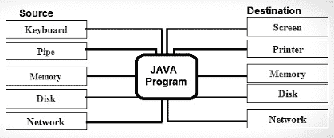

## Java 程序与 I/O 设备的关系

将数据从一个流发送到另一个流的概念（类似于一根管道连接到另一根管道）使得 Java 流成为文件处理的强大工具。我们可以使用一系列简单的流操作构建复杂的流处理序列。

此功能可用于在流的流水线中过滤数据，以便获得所需格式的数据。例如，我们可以使用一个流获取二进制格式的原始数据，然后使用另一个串联的流将其转换为整数。

## 输入流和输出流

Java 流分为两种基本类型：通常的输入流和输出流。输入流从源提取（即读取）数据并将其发送到程序。

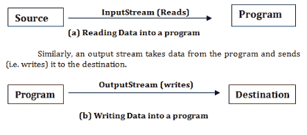

程序在数据源上连接并打开输入流，然后顺序读取数据。同样，程序在数据目标位置连接并打开输出流，并顺序写入数据。在两种情况下，程序都不知道端点的细节（即源和终点）。

## 字节流和字符流

Java 2 定义了两种流：字节流（Byte）和字符流（Character）。字节流为处理字节的输入输出提供了方便的方法。例如，在读取或写入二进制数据时会使用字节流。字符流为处理字符的输入输出提供了方便的方法。它们使用 `Unicode`，因此可以国际化。此外，在某些情况下，字符流比字节流更高效。Java 的原始版本（Java 1.0）不包含字符流，当时所有的 I/O 都是面向字节的。

Java 1.1 增加了字符流，并且某些面向字节的类和方法被废弃了。

> **注意：** 在底层，所有 I/O 仍然是面向字节的。字符流仅提供了处理字符的方便方法。

这两组类可以根据其目的进一步分类。字节流和字符流类包含了独立处理各种设备输入输出操作的特殊类。我们也可以根据读取或写入的源或目标类型对流分组。源或目标可以是内存、文件或管道。


## Java 类的分类

### 字节流类概述

字节流类通过两个类层次结构定义。顶端有两个抽象类：

1. `InputStream`
2. `OutputStream`

每个抽象类都有多个具体的子类，处理不同设备之间的差异，例如磁盘文件、网络连接内存缓冲区。

### InputStream 类

用于读取 8 位字节的 `InputStream` 类包括一个名为 `InputStream` 的超类，以及许多支持各种输入功能的子类。


#### InputStream 类的方法

| 方法 | 描述 |
| :--- | :--- |
| `int available()` | 提供输入中可读字节数（必须由子类重写）。`InputStream` 类的 `available` 方法始终返回 0。 |
| `void close()` | 关闭此输入流并释放与流相关的系统资源。`InputStream` 类的 `close` 方法什么都不做。 |
| `void mark(int readlimit)` | 标记此输入流当前的位置。`InputStream` 类的 `mark` 方法什么都不做。 |
| `boolean markSupported()` | 测试此输入流是否支持 `mark` 和 `reset` 方法。`InputStream` 类的 `markSupported` 方法返回 false。 |
| `abstract int read()` | 从输入流中读取下一个字节数据。子类必须提供此方法的实现。 |
| `int read(byte[] b)` | 从输入流中读取若干字节，并将它们存储到缓冲区数组 `b` 中。实际读取的字节数将作为整数返回。 |
| `int read(byte[] b, int offset, int len)` | 从输入流中读取若干字节，并从参数 `off` 指定的位置开始将它们存储到缓冲区数组 `b` 中。实际读取的字节数将作为整数返回。 |
| `void reset()` | 将此流重新定位到上一次在该输入流上调用 `mark` 方法时的位置。`InputStream` 的 `reset` 方法不执行任何操作，并始终抛出 `IOException`。 |
| `long skip(long n)` | 从此输入流中跳过并丢弃多达 `n` 个字节的数据，并返回实际跳过的字节数。 |

## DataInput 接口

`DataInput` 是一个接口，定义了从 `InputStream` 读取原始数据类型的方法。

### DataInput 接口的方法

| 方法 | 描述 |
| :--- | :--- |
| `boolean readBoolean()` | 读取一个输入字节，如果该字节非零则返回 true，如果为零则返回 false。 |
| `byte readByte()` | 读取并返回一个输入字节。 |
| `char readChar()` | 读取一个输入字符并返回其值。 |
| `double readDouble()` | 读取八个输入字节并返回一个 `double` 值。 |
| `float readFloat()` | 读取四个输入字节并返回一个 `float` 值。 |
| `void readFully(byte[] b)` | 从输入流中读取若干字节并将它们存储在缓冲区数组 `b` 中。如果流在读取所有字节之前到达结尾，此方法将抛出 `EOFException`。 |
| `void readFully(byte[] b, int off, int len)` | 从输入流中读取 `len` 个字节，并从 `off` 指定的位置开始将它们存储在缓冲区数组 `b` 中。如果流在读取所有字节之前到达结尾，此方法将抛出 `EOFException`。 |
| `int readInt()` | 读取四个输入字节并返回一个 `int` 值。 |
| `String readLine()` | 从输入流中读取下一行。 |
| `long readLong()` | 读取八个输入字节并返回一个 `long` 值。 |
| `short readShort()` | 读取两个输入字节并返回一个 `short` 值。 |
| `String readUTF()` | 读取一个使用修改后的 UTF-8 格式的字符串。 |
| `int skipBytes(int n)` | 尝试从输入流中跳过 `n` 个字节的数据，并丢弃跳过的字节。返回实际跳过的字节数。 |

## InputStream 类总结

`FilterInputStream` 包含另一个输入流，它将其作为基本数据源，可能在此过程中转换数据并提供额外功能。

`FilterInputStream` 类本身简单地重写了 `InputStream` 的所有方法，这些方法版本会将所有请求传递给包含的输入流。`FilterInputStream` 的子类可能会进一步重写其中的一些方法，并可能提供额外的方法和字段。

注意，`DataInputStream` 类继承自 `FilterInputStream` 并实现了 `DataInput` 接口。因此，`DataInputStream` 在使用 `InputStream` 类方法外，还继承了 `FilterInputStream` 并实现了 `DataInput` 中描述的方法。

### InputStream 类总结

| 类 | 描述 |
| :--- | :--- |
| `InputStream` | 此抽象类是所有表示字节输入流类的父类。 |
| `BufferedInputStream` | `BufferedInputStream` 为另一个输入流增加了功能——即缓冲输入并支持 `mark` 和 `reset` 方法。 |
| `ByteArrayInputStream` | `ByteArrayInputStream` 包含一个内部缓冲区，其中包含可以从流中读取的字节。 |
| `DataInputStream` | `DataInputStream` 让应用程序以与机器无关的方式从底层输入流读取 Java 原始数据类型。 |
| `FileInputStream` | `FileInputStream` 包含来自文件系统的输入字节。 |
| `FilterInputStream` | `FilterInputStream` 包含另一个输入流，它将其作为基本数据源，可能在此过程中传输数据或提供额外功能。 |
| `PipedInputStream` | `PipedInputStream` 应该连接到管道输出流，然后管道输入流将提供写入管道输出流的任何数据字节。 |
| `PushbackInputStream` | `PushbackInputStream` 为另一个输入流增加了功能，即“推回”或“重读”一个字节的能力。 |
| `SequenceInputStream` | `SequenceInputStream` 代表另一个流的逻辑连接。 |
| `ObjectInputStream` | `ObjectInputStream` 反序列化之前使用 `ObjectOutputStream` 写入的原始数据和对象。 |

### OutputStream 类

输出流类派生自基类 `OutputStream`，它是一个抽象类，并有许多子类来支持各种输出相关的功能。

#### OutputStream 类

父类 `OutputStream` 是一个抽象类，定义了执行输出功能的方法，例如：

* 写入字节
* 关闭流
* 刷新流

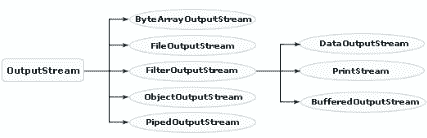

*（输出流类的层次结构）*

哎呀！！让我们看看下面这张高质量图片-

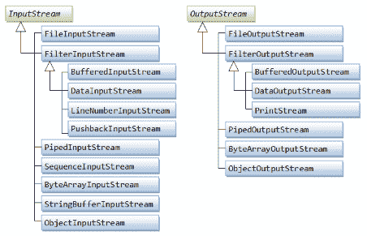

#### OutputStream 类的方法

| 方法 | 描述 |
| :--- | :--- |
| `void close()` | 关闭此输出流并释放与此流相关的任何流资源。 |
| `void flush()` | 刷新此输出流，强制将缓冲的输出字节写入。 |
| `void write(byte[] b)` | 向输出流写入字节数组 `b`。 |
| `void write(byte[] b, int off, int len)` | 从 `off` 指定的位置开始向输出流写入 `len` 个字节。 |
| `abstract void write(int b)` | 向输出流写入指定的字节。 |

## DataOutput 接口

`DataOutput` 是一个接口，定义了向 `OutputStream` 写入原始数据类型的方法。


### DataOutput 接口的方法

| 方法 | 描述 |
| :--- | :--- |
| `void writeBoolean(boolean v)` | 向输出流写入布尔值。 |
| `void writeByte(int v)` | 向输出流写入参数 `v` 的低位字节。 |
| `void writeBytes(String s)` | 将字符串写入输出流。对于字符串 `s` 中的每个字符，按顺序写入一个字节。 |
| `void writeChar(int v)` | 向输出流写入字符值，该值由两个字节组成。 |
| `void writeChars(String s)` | 按顺序将字符串 `s` 中的每个字符写入输出流。 |
| `void writeDouble(double v)` | 向输出流写入 `double` 值，该值由八个字节组成。 |
| `void writeFloat(float v)` | 向输出流写入 `float` 值，该值由四个字节组成。 |
| `void writeInt(int v)` | 向输出流写入 `int` 值，该值由四个字节组成。 |
| `void writeLong(long v)` | 向输出流写入 `long` 值，该值由八个字节组成。 |
| `void writeShort(int v)` | 向输出流写入 `short` 值，该值由两个字节组成。 |


| `void writeUTF(String str)` | 向输出流写入两个字节的长度信息，随后是字符串 `str` 中每个字符的修改 UTF-8 表示。 |

## OutputStream 类总结

`DataOutputStream` 是 `DataInputStream` 的对应部分。`DataOutputStream` 类在运行 `OutputStream` 类方法外，还实现了 `DataOutput` 接口中描述的方法。

### OutputStream 类总结

| 类 | 说明 |
| :--- | :--- |
| `OutputStream` | 此抽象类是所有表示字节输出流类的父类。 |
| `BufferedOutputStream` | 该类实现了缓冲输出流。 |
| `ByteArrayOutputStream` | 该类实现了一个输出流，其中数据被写入字节数组中。 |
| `DataOutputStream` | 数据输出流允许应用程序以可移植的方式将 Java 原始数据类型写入到输出流中。 |
| `FileOutputStream` | 文件输出流是用于向 `File` 写入数据的输出流。 |
| `PipedOutputStream` | 管道输出流可以连接到管道输入流，以创建一个通信管道。 |
| `FilterOutputStream` | `FilterOutputStream` 包含其他一些输出流，它将这些流作为自己的目标，可能在传输过程中转换数据或提供额外的功能。 |
| `PrintStream` | `PrintStream` 为另一个输出流添加功能，即能够方便地打印各种数据值的表示形式。 |

# 字符流类概览

字符流通过使用两个类层次结构定义。顶端是两个抽象类：`Reader` 和 `Writer`。这些抽象类处理 Unicode 字符流。

Java 对这些每一个抽象类有几个具体的子类。抽象的 `Reader` 和 `Writer` 类定义了其他流类实现的几个关键方法。其中最重要的两个方法是 `read()` 和 `write()`，它们分别读取和写入数据字符。这些方法被派生的流类重写。

## Reader 流类

Reader 流类设计用于从文件中读取字符。`Reader` 类是此组中所有其他类的基类。这些类在功能上与输入流类非常相似，但输入流使用字节作为信息的根本单位，而 reader 流使用字符。

`Reader` 类包含的方法与 `InputStream` 类中提供的方法相同。因此，`Reader` 类可以执行输入流类实现几乎的所有功能。

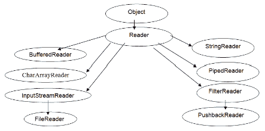

(Reader 流类的层级结构)

### Reader 类

`Reader` 是一个抽象类，定义了 Java 的字符输入流式模型。该类中的所有方法都会抛出 `IOException`。

### Reader 类的方法

| 方法 | 说明 |
| :--- | :--- |
| `abstract void close()` | 关闭流。一旦流被关闭，进一步的 `read()`、`ready()`、`mark()` 或 `reset()` 调用将抛出 `IOException`。然而，关闭一个之前已经关闭的流没有影响。 |
| `void mark()` | 标记流中的当前位置。随后的 `reset()` 调用将尝试将流重新定位到此处。并不是所有的字符输入流都支持 `mark()` 操作。 |
| `boolean markSupported()` | 告知此流是否支持 `mark()` 操作 |
| `int read()` | 读取单个字符并返回来自调用输入流的下一个可用字符的整数表示。当遇到文件末尾时返回 -1。 |
| `int read(char[] buffer)` | 尝试将多达 buffer 长度的字符读取到 `buffer` 中，并返回成功读取的字符数。当遇到文件末尾时返回 -1。reader 子类必须实现此方法。 |
| `abstract int read(char[] buffer, int offset, int numChar)` | 尝试从 `buffer[offset]` 开始读取多达 `numChar` 个字符，并返回成功读取的字符数。当遇到文件末尾时返回 -1。reader 子类必须实现此方法。 |
| `boolean ready()` | 告知此流是否准备好读取。如果下一次输入请求不会等待，则返回 true，否则返回 false。 |
| `void reset()` | 重置流。并不是所有的字符输入流都支持此方法。 |
| `long skip(long n)` | 跳过多达 `n` 个字符并返回跳过的字符数。如果 `n` 为负数，则抛出 `IllegalArgumentException`。 |

### Reader 类总结

| 类 | 说明 |
| :--- | :--- |
| `Reader` | 用于读取字符流的抽象类 |
| `BufferedReader` | 从字符输入流读取文本，对字符进行缓冲，以便高效读取字符、数组和行。 |
| `CharArrayReader` | 此类实现了一个字符缓冲区，可以作为字符输入流使用。 |
| `FileReader` | 用于读取字符文件的便利类。 |
| `FilterReader` | 用于读取过滤字符流的抽象类。 |
| `InputStreamReader` | `InputStreamReader` 是从字节流到字符流的桥梁：它读取字节并使用指定的字符集将其解码为字符。 |
| `PipedReader` | 管道字符输入流。 |
| `PushbackReader` | 允许将字符推回流中的字符流读取器。 |
| `StringReader` | 源自字符串的字符流。 |

## Writer 流类

Writer 流类设计用于向文件/输出设备写入字符。writer 类是一个抽象类，作为所有其他 writer 流类的基类。

基类通过定义与 `OutputStream` 类中相同的方法，为所有输出操作提供支持。

`Writer` 类包含的方法与 `OutputStream` 类中提供的方法相同。因此，`Writer` 类可以执行输出流类实现几乎的所有功能。

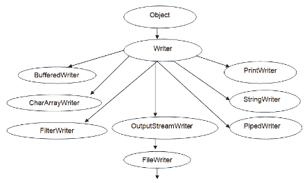

(Writer 流类的层级结构)

### Writer 类

`Writer` 是一个抽象类，定义了字符输出流式。该类中的所有方法都返回 void 值，并在发生错误时抛出 `IOException`。

### Writer 类的方法

| 方法 | 说明 |
| :--- | :--- |
| `abstract void close()` | 关闭流并先对其进行刷新。 |
| `abstract void flush()` | 刷新流。 |
| `void write(char[] cbuf)` | 写入字符数组。 |
| `abstract void write(char[] cbuf, int off, int len)` | 从指定的偏移量开始写入字符数组的一部分。子类必须实现此方法。 |
| `void write(int c)` | 向调用的输出流写入单个字符。注意参数是 `int`，这允许你直接对表达式调用 write 而无需将其强制转换回 char。 |
| `void write(String str)` | 写入字符串。 |
| `void write(String str, int off, int len)` | 写入从指定偏移量开始的字符串部分。 |

### Writer 类总结

| 类 | 说明 |
| :--- | :--- |
| `Writer` | 用于写入字符流的抽象类。 |
| `BufferedWriter` | 向字符输出流写入文本，对字符进行缓冲，以便高效写入单个字符、数组和字符串。 |
| `CharArrayWriter` | 实现了一个字符缓冲区，可以作为 Writer 使用。 |
| `FileWriter` | 用于写入字符文件的便利类。 |
| `FilterWriter` | 用于写入过滤字符流的抽象类。 |
| `OutputStreamWriter` | `OutputStreamWriter` 是从字符流到字节流的桥梁：写入它的字符使用指定的字符集编码为字节。 |
| `PipedWriter` | 管道字符输出流。 |
| `PrintWriter` | 向文本输出流打印对象的格式化表示。 |
| `StringWriter` | 将输出收集在字符串缓冲区中的字符流，然后可以使用它可以构造字符串。 |

## File 类

尽管 `java.io` 中定义的许多类都是基于流操作，但 `File` 类并不是。它直接处理文件和文件系统。也就是说，file 类没有指定如何从文件中检索或存储信息。它描述的是文件本身的属性。

文件对象用于获取或处理与磁盘关联的信息，例如权限、时间、日期和目录路径，以及遍历子目录层级。

尽管出于安全考虑，文件在 applet 中的用法受到严格限制，但它们仍然存储持久性和共享信息的核心资源。

Java 中的目录被简单地视为一个文件，只是多了一个属性——一个可以通过 `list()` 方法检查的文件名列表。

| 方法 | 描述 |
| :--- | :--- |
| `public File(String);` | |
| `public File(String, String);` | |
| `public File(File, String);` | |
| `public File(URI);` | 该构造函数由 Java2（版本 1.4）添加 |
| `public String getName();` | 返回文件或目录的名字 |
| `public String getParent();` | 返回从对象创建时指定的路径的文件的父目录；如果此路径不是父目录，则返回 null。 |
| `public String getPath();` | 返回相对路径。 |
| `public boolean isAbsolute();` | 测试此抽象路径是否为绝对路径。 |
| `public String getAbsolutePath();` | 返回从根目录开始的绝对（完整）路径。 |
| `public boolean canRead();` | 测试应用程序可以读取由此抽象路径表示的文件。 |
| `public boolean canWrite();` | 测试应用程序可以修改由此抽象路径表示的文件。 |
| `public boolean exists();` | 测试由此抽象路径表示的文件或目录是否存在。 |
| `public boolean isDirectory();` | 测试由此抽象路径表示的是否为目录。 |
| `public boolean isFile();` | 测试由此抽象路径表示的是否为普通文件。 |
| `public boolean isHidden();` | 测试此抽象路径命名的文件是否为隐藏文件。 |
| `public long lastModified();` | 返回由此抽象路径表示的文件最后修改的时间。 |
| `public long length();` | 返回由此抽象路径表示的文件长度。 |
| `public boolean createNewFile() throws java.io.IOException;` | 仅当不存在名称的文件时，自动创建一个由此抽象路径命名的新空文件。 |
| `public boolean delete();` | 删除由此抽象路径表示的文件或目录。 |
| `public String[] list();` | 返回由此抽象路径表示的目录中文件和目录的字符串数组。如果 File 对象对应于文件，则返回 null。 |
| `public boolean mkdir();` | 创建由此抽象路径命名的目录。 |
| `public boolean mkdirs();` | 创建由此抽象路径命名的目录，包括任何必要的不存在的父目录。 |
| `public boolean setLastModified(long);` | 设置由此抽象路径命名的文件或目录的最后修改时间。 |
| `public boolean setReadOnly();` | 标记由此抽象路径命名的文件或目录，使其只允许读操作。 |
| `public boolean setWritable(boolean);` | |
| `public boolean setReadable(boolean);` | |
| `public boolean canExecute();` | |
| `public long getTotalSpace();` | |
| `public long getFreeSpace();` | |
| `public long getUsableSpace();` | |
| `boolean renameTo(File);` | 重命名由此抽象路径表示的文件。 |

### 示例

```java
File f1 = new File("/");
File f2 = new File("/", "autoexec.bat");
File f3 = new File(f1, "autoexec.bat");
```

### 注意

Java 在处理 UNIX 和 Windows 之间的路径分隔符时表现良好。如果你在 Windows 版本的 Java 上使用正斜杠（`/`），路径仍然可以正确解析。

记住，如果你在字符串中使用 Windows 规范（`\\`）。Java 的惯例是使用 UNIX 和 URL 风格的正斜杠作为路径分隔符。

`File` 定义了许多获取 `File` 对象标准属性的方法。然而，`File` 类并不是对称的。这意味着，虽然有主要方法允许你检查简单文件对象的属性，但没有相应的函数来更改这些属性。

### 示例 15.1

接下来的示例展示了 `File` 类的几个方法

```java
import java.io.*;
class FileTest
{
    public static void main(String args[]) throws IOException
    { 
        File f = new File("/javaprog/ch15/15.1/FileTest.java");
        if(!f.exists())
            f.createNewFile();
        System.out.println("Length="+f.length()+" bytes");
        System.out.println("Name="+f.getName());
        System.out.println("Parent="+f.getParent());
        System.out.println("Path="+f.getPath());
        System.out.println("Absolute Path="+f.getAbsolutePath());
        System.out.println(f.exists() ? "Exists" : "Does not exist");
        System.out.println(f.isFile() ? "is file" : "not a file");
        System.out.println(f.canRead() ? "is readable" : "not readable");
        System.out.println(f.canWrite() ? "is writable" : "not writable");
        System.out.println(f.isDirectory() ? "is directory" : "not a file");
        System.out.println(f.isHidden() ? "is hidden" : "not a file");
    }
}
```

### FileOutputStream 方法

| 方法 | 说明 |
| :--- | :--- |
| `public FileOutputStream(File) throws FileNotFoundException;` | 创建一个文件输出流，用于向指定的 `File` 对象表示的文件写入。 |
| `public FileOutputStream(File, boolean) throws FileNotFoundException;` | 创建一个文件输出流，用于向指定的 `File` 对象表示的文件写入。 |
| `public native void write(int) throws java.io.IOException;` | |
| `public void write(byte[]) throws java.io.IOException;` | |
| `public void write(byte[], int, int) throws java.io.IOException;` | |
| `public void close() throws java.io.IOException;` | |

#### 示例 15.2


```java
import java.io.*;
class FileRead
{
  public static void main(String args[])
  {
      FileInputStream fin=null;
      int a;
      try
      {
        fin=new FileInputStream(args[0]);
        System.out.println("No. of characters to read="+fin.available());
        fin.skip(3);
        a = fin.read();
        while(a != -1)
        {
          System.out.print((char)a);
          a = fin.read();
        }
        System.out.println("No. of characters to read="+fin.available());
        fin.close(); 
      }
      catch(ArrayIndexOutOfBoundsException e)
      {
        System.out.println(e);
      }
      catch(FileNotFoundException e)
      {
        System.out.println(e);
      }
      catch(IOException e)
      {
        System.out.println(e);
      }
  }
}
```

**输出：**

```
java FileRead A.txt
No. of characters to read=20
Matrix Computers
No. of characters to read=0
```

#### 示例 15.3

```java
import java.io.*;
class FileCopy
{
  public static void main(String args[]) throws IOException
  {
      FileInputStream fin=null;
      FileOutputStream fout=null;
      fin=new FileInputStream(args[0]);
      fout=new FileOutputStream(args[1]);
      int a;
      a = fin.read();
      while(a != -1)
      {
        fout.write(a);
        a = fin.read();
      }
      fin.close();fout.close();
  }
}
```

#### 示例 15.4

```java
import java.io.*;
class CopyFile
{
  public static void main(String args[]) throws IOException
  { 
      int n;
      FileInputStream fin = new FileInputStream("A.txt");
      FileOutputStream fout = new FileOutputStream("B.txt");
      byte b[ ]= new byte[10];
      n = fin.read(b);
      while(n != -1)
      { 
        fout.write(b,0,n);
        n = fin.read(b);
      }
      fin.close();
      fout.close();
  }
}
```

### FileReader

`FileReader` 类创建了一个 `Reader`，你可以用它来读取文件的内容。它两个常用的构造函数是：

- `FileReader(File file)`：创建一个 `FileReader` 流，用于从指定的文件读取。
- `FileReader(String fileName)`：创建一个 `FileReader` 流，用于从指定的文件读取。

**注意：** 如果文件不存在、是一个目录而非普通文件，或者由于某些原因无法打开读取，其中一个构造函数都可能抛出 `FileNotFoundException`。

### FileWriter

`FileWriter` 类创建了一个 `writer`，你可以用它向文件写入。它两个常用的构造函数是：

- `FileWriter(File file)`：一个 `FileWriter` 对象，用于写入指定的文件。
- `FileWriter(String fileName)`：一个 `FileWriter` 对象，用于写入指定的文件。
- `FileWriter(File file, boolean append)`：一个 `FileWriter` 对象，以 `append` 模式向指定的文件写入。
- `FileWriter(String filename, boolean append)`：一个 `FileWriter` 对象，以 `append` 模式向指定的文件写入。

如果使用前两个构造函数，将创建一个新文件。如果同名文件存在，它将被覆盖。如果使用后两个构造函数且 `append` 标志为 `false`，则它们的行为与前两个构造函数相同。如果 `append` 标志为 `true`，则文件指针将置于文件末尾，如果文件不存在则会创建新文件。

**注意：** 如果文件存在但是目录而非普通文件、不存在但无法创建、或由于任何原因无法打开，这些构造函数可能会抛出 `IOException`。例如，当你尝试打开一个只读文件时，将抛出 `IOException`。

#### 示例 15.5

```java
import java.io.*;
class FileCopy
{
  public static void main(String args[]) throws IOException
  {
      FileReader fin=null;
      FileWriter fout=null;
      fin=new FileReader(args[0]);
      fout=new FileWriter(args[1]);
      int a;
      a = fin.read();
      while(a != -1)
      {
        fout.write((char)a);
        a = fin.read();
      }
      fin.close();
      fout.close();
  }
}
```

### RandomAccessFile

`RandomAccessFile` 封装了一个随机访问文件。`RandomAccessFile` 允许我们在文件的任何位置读取和写入字节、文本和原始数据类型。它支持自定位请求——即你可以将文件指针置于文件的任何位置。它实现了 `DataInput` 和 `DataOutput` 接口。`mode` 参数指定打开文件的访问模式如下：

| 值 | 含义 |
| :--- | :--- |
| `"r"` | 仅读取。调用结果对象的任何 `write` 方法将抛出 `IOException`。 |
| `"rw"` | 可读写。如果文件不存在，则将尝试创建它。 |
| `"rws"` | 可读写，如 `"rw"`，并且要求对文件内容或元数据的同步写入到底层存储设备。 |
| `"rwd"` | 可读写，如 `"rw"`，并且要求对文件内容（数据）同步写入到底层存储设备。 |

#### RandomAccessFile 方法

除了 `DataInput` 和 `DataOutput` 接口的方法外，该类的一些常用方法包括：

| 方法签名 | 说明 |
| :--- | :--- |
| `public RandomAccessFile(String, String) throws FileNotFoundException;` | 创建一个随机访问文件流，用于从指定的文件读取并可选写入。 |
| `public RandomAccessFile(File, String) throws FileNotFoundException;` | 创建一个随机访问文件流，用于从由 `File` 参数指定的文件读取并可选写入。 |
| `public native int read() throws java.io.IOException;` | 读取单个字节。 |
| `public int read(byte[], int, int) throws java.io.IOException;` | 读取字节数组的指定部分。 |
| `public int read(byte[]) throws java.io.IOException;` | 读取字节数组。 |
| `public int skipBytes(int) throws java.io.IOException;` | 跳过指定数量的字节。 |
| `public native void write(int) throws java.io.IOException;` | 写入单个字节。 |
| `public void write(byte[]) throws java.io.IOException;` | 写入字节数组。 |
| `public void write(byte[], int, int) throws java.io.IOException;` | 写入字节数组的指定部分。 |
| `public native long getFilePointer() throws java.io.IOException;` | 返回从文件开始到下次读取或写入发生的偏移量（字节）。 |
| `public native void seek(long) throws java.io.IOException;` | `newPos` 指定文件指针从文件开始的新位置（字节）。调用 `seek()` 后，下一次读取或写入操作将在新的文件位置进行。 |
| `public native long length() throws java.io.IOException;` | 返回文件的长度。 |
| `public native void setLength(long) throws java.io.IOException;` | 设置文件的长度。该方法可以用于扩展或缩短文件。如果扩展文件，增加的部分是未定义的。 |
| `public void close() throws java.io.IOException;` | 关闭流。 |
| `public final boolean readBoolean() throws java.io.IOException;` | 读取布尔值。 |
| `public final byte readByte() throws java.io.IOException;` | 读取字节。 |
| `public final int readUnsignedByte() throws java.io.IOException;` | 读取无符号字节。 |
| `public final short readShort() throws java.io.IOException;` | 读取短整型。 |
| `public final int readUnsignedShort() throws java.io.IOException;` | 读取无符号短整型。 |
| `public final char readChar() throws java.io.IOException;` | 读取字符。 |
| `public final int readInt() throws java.io.IOException;` | 读取整型。 |
| `public final long readLong() throws java.io.IOException;` | 读取长整型。 |
| `public final float readFloat() throws java.io.IOException;` | 读取浮点型。 |
| `public final double readDouble() throws java.io.IOException;` | 读取双精度浮点型。 |
| `public final java.lang.String readLine() throws java.io.IOException;` | 读取一行文本。 |
| `public final java.lang.String readUTF() throws java.io.IOException;` | 读取 UTF-8 编码的字符串。 |
| `public final void writeBoolean(boolean) throws java.io.IOException;` | 写入布尔值。 |
| `public final void writeByte(int) throws java.io.IOException;` | 写入字节。 |
| `public final void writeShort(int) throws java.io.IOException;` | 写入短整型。 |
| `public final void writeChar(int) throws java.io.IOException;` | 写入字符。 |
| `public final void writeInt(int) throws java.io.IOException;` | 写入整型。 |
| `public final void writeLong(long) throws java.io.IOException;` | 写入长整型。 |
| `public final void writeFloat(float) throws java.io.IOException;` | 写入浮点型。 |
| `public final void writeDouble(double) throws java.io.IOException;` | 写入双精度浮点型。 |
| `public final void writeBytes(java.lang.String) throws java.io.IOException;` | 写入字符串的字节。 |
| `public final void writeChars(java.lang.String) throws java.io.IOException;` | 写入字符串的字符。 |
| `public final void writeUTF(java.lang.String) throws java.io.IOException;` | 写入 UTF-8 编码的字符串。 |


### 示例 15.6

```java
import java.io.*;

class RandomIO
{
    public static void main(String args[]) throws IOException
    {
        RandomAccessFile file = null;
        try
        {
            file = new RandomAccessFile("rand.dat", "rw");
            file.writeChar('X');
            file.writeInt(1999);
            file.writeDouble(222.44);
            System.out.println("File pointer Pos:"+file.getFilePointer());
            file.seek(0);
            System.out.println(file.readChar());
            System.out.println(file.readInt());
            System.out.println(file.readDouble());
            System.out.println("File pointer Pos:"+file.getFilePointer());
            file.seek(2);
            System.out.println("File pointer Pos:"+file.getFilePointer());
            System.out.println(file.readInt());
            file.seek(file.length());
            file.writeBoolean(false);
            file.seek(14);
            System.out.println(file.readBoolean());
            System.out.println("File pointer Pos:"+file.getFilePointer());
            System.out.println(file.readInt());//EOF
        }
        catch(EOFException e)
        {
            System.out.println("Trying to read after end of file");
        }
        finally
            {
            file.close();
        }
    }
}
```

**输出：**

```
File pointer Pos:14
X
1999
222.44
File pointer Pos:14
File pointer Pos:2
1999
false
File pointer Pos:15
Trying to read after end of file
```

### ByteArrayInputStream


# ByteArrayInputStream

`ByteArrayInputStream` 包含一个可以从流中读取的内部缓冲区。`ByteArrayInputStream` 是一个使用字节数组作为源。该类有两个构造函数，每个构造函数都需要一个字节数组来提供数据源。`ByteArrayInputStream` 实现了 `mark()` 和 `reset()` 方法。如果没有调用 `mark()`，`reset()` 将流指针设置为流的开头。

- `public ByteArrayInputStream(byte[])`
- `public ByteArrayInputStream(byte[], int)`
- `public synchronized int read()`
- `public synchronized int read(byte[], int)`
- `public synchronized long skip(long)`
- `public synchronized int available()`
- `public boolean markSupported()`
- `public void mark(int)`
- `public synchronized void reset()`
- `public void close() throws IOException`

## 示例 15.7

```java
import java.io.*;

class ByteArrayInputStreamTest
{
    public static void main(String args[]) throws IOException
    {
        String s1="abcdefghij";
        byte b[]=s1.getBytes();
        ByteArrayInputStream b1 = new ByteArrayInputStream(b);
        int a;
        while((a=b1.read())=-1)
        {
            System.out.print((char)Character.toUpperCase(a));
        }
        b1.close();
    }
}
```

**输出:**

`ABCDEFGHIJK`

# ByteArrayOutputStream

`ByteArrayOutputStream` 实现了一个将数据写入字节数组的输出流。`ByteArrayOutputStream` 是一个使用字节数组作为目的地的输出流。缓冲区位于 `ByteArrayOutputStream` 的 `buf` 字段中。如果需要，缓冲区的大小会自动增加。缓冲区字节数包含在 `ByteArrayOutputStream` 的 `count` 字段中。

- `public java.io.ByteArrayOutputStream()` 创建一个新的字节数组输出流。缓冲区初始容量为 32 字节，必要时会增大。
- `public java.io.ByteArrayOutputStream(int)` 创建一个具有指定字节缓冲区容量的字节数组输出流。
- `public synchronized void write(int)`
- `public synchronized void write(byte[], int)`
- `public synchronized void writeTo(java.io.OutputStream) throws IOException`
- `public synchronized void reset()`
- `public synchronized byte[] toByteArray()`
- `public synchronized int size()`
- `public synchronized java.lang.String toString()`
- `public synchronized java.lang.String toString(java.lang.String) throws java.io.UnsupportedEncodingException`
- `public synchronized java.lang.String toString(int)`
- `public void close() throws IOException`

## 示例 15.8

```java
import java.io.*;

class ByteArrayOutputStreamTest
{
    public static void main(String args[]) throws IOException
    {
        ByteArrayOutputStream b1 = new ByteArrayOutputStream(); 
        b1.write('a');
        String s1 = "abcdefghijk";
        byte arr1[]= s1.getBytes();
        b1.write(arr1);
        System.out.println(b1); //toString()
        // 使用 for 循环显示
        byte arr2[] = b1.toByteArray();
        for(int i=0;i<arr2.length;i++)
        {
            System.out.print((char)arr2[i]);
        }
        System.out.println();
        // 使用 for each 循环显示
        for(int i:arr2)
        {
            System.out.print((char)i);
        }
        b1.close();
    }
}
```

**输出:**

```
aabcdefghijk
abcdefghJK
```

# CharArrayReader

`CharArrayReader` 是使用字符数组作为源的读取流实现。该类有两个构造函数，每个构造函数都需要一个字符数组来提供数据源。

## 构造函数

- `CharArrayReader(char[]buf)` 从指定的字符数组创建一个 `CharArrayReader`。
- `CharArrayReader(char[]buf, int offset, int length)` 从指定的字符数组创建一个 `CharArrayReader`。生成的读取器将从给定的偏移量开始读取。从该读取器可以读取的字符值总数将是 `length` 或 `buf.length`。

## 示例 15.9

```java
import java.io.*;

class CharArrayReaderTest
{
    public static void main (String args[]) throws IOException
    { 
        String tmp = "abcdefghijklmnopqrstuvwxyz";
        int length = tmp.length();
        char c[] = new char[length];
        tmp.getChars(0,length,c,0);
        CharArrayReader input1 = new CharArrayReader(c);
        CharArrayReader input2 = new CharArrayReader(c,0,5);
        int i;
        while((i=input1.read()) != -1)
        { 
            System.out.print((char)i);
        }
        System.out.println();
        while((i=input2.read()) != -1)
        { 
            System.out.print((char)i);
        }
    }
}
```

**输出:**

```
abcdefghijklmnopqrstuvwxyz
abcde
```

# CharArrayWriter

`CharArrayWriter` 是一个写入流的实现，它使用字符数组缓冲区作为目标。

## 构造函数

- `CharArrayWriter()`
- `CharArrayWriter(int initialSize)`

在第一种形式中，创建一个默认大小的缓冲区。在第二种形式中，创建一个大小等于参数 `initialSize` 的缓冲区。

缓冲区存储在 `CharArrayWriter` 的 `buf` 字段中。如果需要，缓冲区的大小会自动增加。缓冲区持有的字符数量存储在 `CharArrayWriter` 的 `count` 字段中。`buf` 和 `count` 都是保护性字段。

## 示例 15.10

```java
import java.io.*;
class CharArrayWriterTest
{ 
  public static void main (String args[]) throws IOException
    { 
      CharArrayWriter f = new CharArrayWriter();
      String s = "This should end up in the array";
      char buf[] = new char[s.length()];
      s.getChars(0,s.length(),buf,0);
      f.write(buf);
      System.out.println(f.toString());
      char c[ ] = f.toCharArray();
      for(int i=0; i<c.length;i++)
      { 
        System.out.print(c[i]);
      }
      FileWriter f2 = new FileWriter("test.txt");
      f.writeTo(f2);
      f2.close();
      f.reset();
      System.out.println();
      System.out.println("After reset:"+f.toString());
      for(int i=0;i<3;i++)
        f.write('A');
      System.out.println(f.toString());
    }
}
```

**输出:**

```
This should end up in the array
This should end up in the array
After reset:
AAA
```

# PushbackInputStream

`PushbackInputStream` 为另一个输入流增加了功能，即“推回”或“重读”一个字节的能力。缓冲区的用途之一就是实现推回功能。

推回用于输入流，允许一个字节在被读取后返回到流中。除了 `InputStream` 类常见的方法外，`PushbackInputStream` 还提供了 `unread()` 方法，如下所示：

| 方法 | 说明 |
| :--- | :--- |
| `public java.io.PushbackInputStream(java.io.InputStream, int);` | 创建一个具有指定大小推回缓冲区的 `PushbackInputStream`，并保存其参数（传入的输入流）以备后用。这允许将多个字节返回到输入流。 |
| `public java.io.PushbackInputStream(java.io.InputStream);` | 创建一个 `PushbackInputStream` 并保存其参数（传入的输入流）以备后用。这允许将一个字节返回到输入流。 |
| `public int read() throws java.io.IOException;` | |
| `public int read(byte[], int, int) throws java.io.IOException;` | |
| `public void unread(int) throws java.io.IOException;` | 通过将字节复制到推回缓冲区的头部来推回字节 |
| `public void unread(byte[], int, int) throws java.io.IOException;` | 通过将字节数组的一部分复制到推回缓冲区的头部来推回字节数组的一部分。 |
| `public void unread(byte[]) throws java.io.IOException;` | 通过将字节数组复制到推回缓冲区的头部来推回整个字节数组。 |
| `public int available() throws java.io.IOException;` | |
| `public long skip(long) throws java.io.IOException;` | |
| `public boolean markSupported();` | `PushbackInputStream` 的副作用是使创建它的 `InputStream` 的 `mark()` 或 `reset()` 方法失效。使用 `markSupported()` 方法检查你正要在上面使用 `mark()`/`reset()` 的流。 |
| `public synchronized void mark(int);` | |
| `public synchronized void reset() throws java.io.IOException;` | |
| `public synchronized void close() throws java.io.IOException;` | |

## 示例 15.11

```java
import java.io.*;
class PushbackInputStreamTest
{
  public static void main(String args[]) throws IOException
    {
      FileInputStream fin = new FileInputStream("A.txt");
      PushbackInputStream p1=new PushbackInputStream(fin);
      int ch=p1.read();
      System.out.println((char)ch);
      ch=p1.read();
      System.out.println((char)ch);
      ch=p1.read();
      System.out.println((char)ch);
      p1.unread(ch);  // 或 p1.unread(‘z’);
      ch=p1.read();
      System.out.println((char)ch);
    }
}
```

**输出:** A.txt 包含 “Matrix Computers”

```
m
a
t
```

`PushbackInputStream` 是一个允许将字节推回其中的流。它用于 `InputStream`，允许一个字节在被读取后返回到流中。除了 `InputStream` 类常见的方法外，`PushbackInputStream` 提供了 `unread()` 方法。

| 方法 | 说明 |
| :--- | :--- |
| `public java.io.PushbackInputStream(java.io.InputStream, int);` | 创建一个具有指定大小推回缓冲区的 `PushbackInputStream`，并保存其参数（传入的输入流）以备后用。这允许将多个字节返回到输入流。 |
| `public java.io.PushbackInputStream(java.io.InputStream);` | 创建一个 `PushbackInputStream` 并保存其参数（传入的输入流）以备后用。这允许将一个字节返回到输入流。 |
| `public int read() throws java.io.IOException;` | |
| `public int read(byte[], int, int) throws java.io.IOException;` | |
| `public void unread(int) throws java.io.IOException;` | 通过将字节复制到推回缓冲区的头部来推回字节 |
| `public void unread(byte[], int, int) throws java.io.IOException;` | 通过将字节数组的一部分复制到推回缓冲区的头部来推回字节数组的一部分。 |
| `public void unread(byte[]) throws java.io.IOException;` | 通过将字节数组复制到推回缓冲区的头部来推回整个字节数组。 |
| `public int available() throws java.io.IOException;` | |
| `public long skip(long) throws java.io.IOException;` | |


| `public boolean markSupported();` | `PushbackInputStream` 的副作用是使创建它的 `InputStream` 的 `mark()` 或 `reset()` 方法失效。使用 `markSupported()` 方法检查你正要在上面使用 `mark()`/`reset()` 的流。 |

| `public synchronized void mark(int);` | |

| `public synchronized void reset() throws java.io.IOException;` | |

| `public synchronized void close() throws java.io.IOException;` | |

### 示例 15.12

```java
import java.io.*;
class PushbackInputStreamTest
{
  public static void main(String args[]) throws IOException
    {
      FileReader fr = new FileReader("A.txt");
      PushbackInputStream pr=new PushbackInputStream(fr);
      int ch=pr.read();
      System.out.println((char)ch);
      ch=pr.read();
      System.out.println((char)ch);
      ch=pr.read();
      System.out.println((char)ch);
      pr.unread(ch);
    }
}
```

Output:

```
m
a
t
```

`PushbackReader` 是一个允许将字节推回其中的流。它用于 `InputStream`，允许一个字节在被读取后返回到流中。除了 `InputStream` 类常见的方法外，`PushbackInputStream` 提供了 `unread()` 方法。

注意：如果在推回缓冲区满时尝试返回一个字符，将抛出 `IOException`。

### 示例 15.13 在下面的示例中，将文件名作为命令行参数：

```java
import java.io.*;
class SequenceInputStreamTest
{ 
  public static void main(String args[]) throws IOException
    { 
      FileInputStream f1 = new FileInputStream(args[0]);
      FileInputStream f2 = new FileInputStream(args[1]);
      FileOutputStream f3 = new FileOutputStream(args[2]);
      SequenceInputStream sis = new SequenceInputStream(f1,f2);
      int c;
    }
}
```

```java
while((c = sis.read()) != -1)
{
    f3.write(c);
}
f3.close();f1.close();f2.close();
}
```

Output:

`java SequenceInputStreamTest A.txt B.txt C.txt`

## PrintStream

这是一个字节流类，继承自 `FilterOutputStream`。`PrintStream` 为另一个输出流添加了功能，即能够方便地打印各种数据值的表示形式。

可选情况下，可以创建一个 `PrintStream` 以实现自动刷新（flush automatically）；这意味着在写入字节数组后、调用其中一个 `println` 方法或写入换行符或字节（`\n`）之后，会自动调用 `flush` 方法。

由 `PrintStream` 打印的所有字符都将使用平台的默认字符编码转换为字节，然后写入到构造函数中指定的 `OutputStream` 或 `File` 中。

`PrintStream` 支持针对所有类型（包括 `object`）的 `print()` 和 `println()` 方法。如果参数不是简单类型，`PrintStream` 方法将调用对象的 `toString()` 方法并打印结果。

#### 构造函数

- `PrintStream(File file)`：创建一个新的打印流，不进行自动行刷新，使用指定的文件。

- `PrintStream(String fileName)`：创建一个新的打印流，不进行自动行刷新，使用指定的文件名。

- `PrintStream(OutputStream out)`：创建一个新的打印流，连接到指定的 `OutputStream`。

- `PrintStream(OutputStream out, boolean autoFlush)`：创建一个新的打印流，连接到指定的 `OutputStream`。


### 示例 15.14

```java
import java.io.*;
class PrintStreamTest
{
    public static void main (String args[]) throws IOException
    {
        PrintStream ps = new PrintStream(System.out, true);
        ps.println("This is a string");
        int i = -7;
        ps.println(i);
        double d = 4.5e-7;
        ps.println(d);
    }
}
```

Output:

```
This is a string
-7
4.5E-7
```

### 示例 15.15

```java
import java.io.*;
class PrintStreamTest2
{
    public static void main (String argv[]) throws IOException
    {
        FileOutputStream fout = new FileOutputStream("test.dat");
        PrintStream ps = new PrintStream(fout, true);
        ps.println("This is a string");
        int i = -7;
        ps.println(i);
        double d = 4.5e-7;
        ps.println(d);
    }
}
```

## PrintWriter

虽然在 Java 中使用 `System.out` 写入控制台仍然是被允许的，但它主要推荐用于调试或示例程序。

对于真实世界的程序，在使用 Java 时向控制台写入的推荐方法是通过 `PrintWriter` 流。`PrintWriter` 是基于字符的类之一。使用基于字符的类进行控制台输出可以使程序的国际化更容易。

#### 构造函数

- `PrintWriter(File file)`：创建一个新的 `PrintWriter`，不进行自动行刷新，用于写入指定的文件。

- `PrintWriter(String fileName)`：创建一个新的 `PrintWriter`，不进行自动行刷新，用于写入指定的文件。

- `PrintWriter(OutputStream out)`：创建一个新的 `PrintWriter`，不进行自动行刷新，用于写入指定的 `OutputStream`。

- `PrintWriter(OutputStream out, boolean autoFlush)`：创建一个新的 `PrintWriter` 用于写入指定的 `OutputStream`。

- `PrintWriter(Writer out)`：创建一个新的 `PrintWriter`，不进行自动行刷新，用于写入指定的 `Writer`。

- `PrintWriter(Writer out, Boolean autoFlush)`：创建一个新的 `PrintWriter` 用于写入指定的 `Writer`。

最常用的构造函数是：

`PrintWriter(OutputStream os, boolean flushOnNewLine)`

在这里，`os` 是 `OutputStream` 类型的对象，`flushOnNewLine` 控制 Java 每每次调用 `println()` 方法时是否都刷新输出流。如果 `flushOnNewLine` 为 `true`，则会自动执行刷新。如果为 `false`，则刷新不是自动的。

`PrintWriter` 支持针对所有类型（包括对象）的 `print()` 和 `println()` 方法。如果参数不是简单类型，`PrintWriter` 方法将调用对象的 `toString()` 方法并打印结果。

要使用 `PrintWriter` 写入控制台，请为输出流指定 `System.out` 并在每个新行后刷新流。例如，此行代码创建了一个连接到控制台输出的 `PrintWriter`：

`pw = new PrintWriter(System.out, true)`

### 示例 15.16

```java
import java.io.*;
class PrintWriterTest
{
    public static void main (String argv[]) throws IOException
    {
        PrintWriter pw = new PrintWriter(System.out, true);
        pw.println("This is a string");
        int i = -7;
        pw.println(i);
        double d = 4.5e-7;
        pw.println(d);
    }
}
```

Output:

```
This is a string
-7
4.5E-7
```

### 示例 15.17

```java
import java.io.*;
class PrintWriter1
{
    public static void main (String argv[]) throws IOException
    {
        FileWriter fout = new FileWriter("test.dat");
        PrintWriter pw = new PrintWriter(fout, true);
        pw.println("This is a string");
        int i = -7;
        pw.println(i);
        double d = 4.5e-7;
        pw.println(d);
    }
}
```

### 示例 15.18

```java
import java.io.*;
class PrintWriter2
{
    public static void main (String argv[]) throws IOException
    {
        PrintWriter pw = new PrintWriter(System.out, true);
        pw.println("This is a string");
        int i = -7;
        pw.println(i);
        double d = 4.5e-7;
        pw.println(d);
    }
}
```

## PipedInputStream 和 PipedOutputStream

输出流可以连接到输入流以创建一个管道。输出流是管道的发送端。输入流应该连接到输出流；输入流随后提供写入输出流的任何字节。

通常，数据由一个线程从 `PipedInputStream` 对象读取，并由另一个线程写入相应的 `PipedOutputStream`。在单个线程中使用这两个对象是不被推荐的，因为可能会导致死锁。输入流包含一个缓冲区，在限制范围内将读操作与写操作解耦。

#### 构造函数

- `PipedInputStream()`：创建一个尚未连接的 `PipedInputStream`。

- `PipedInputStream(PipedOutputStream src)`：创建一个连接到输出流 `src` 的 `PipedInputStream`。

- `PipedOutputStream()`：创建一个尚未连接到输入流的 `PipedOutputStream`。

- `PipedOutputStream(PipedInputStream snc)`：创建一个连接到指定输入流的 `PipedOutputStream`。

### 示例 15.19

```java
import java.io.*;
class TextGenerator extends Thread
{
    OutputStream out;
    TextGenerator(OutputStream out)
    {
        this.out = out;
    }
    public void run()
    {
        try
        {
            try
            {
                for(byte b = 65; b<=90; b++)
                    out.write(b);
            }
            finally
            {
                out.close();
            }
        }
        catch(IOException e) 
        {
            System.out.println(e);
        }
    }
}
class Pipe
{
    public static void main(String[] args[]) throws IOException
    {
        PipedOutputStream out = new PipedOutputStream();
        PipedInputStream in = new PipedInputStream(out);
        TextGenerator data = new TextGenerator(out);
        data.start();
        int ch;
        while((ch = in.read()) != -1)
            System.out.print((char) ch);
    }
}
```

Output:

```
ABCDEFGHIJKLMNOPQRSTUVWXYZ
```

## PipedReader 和 PipedWriter

它们的功能与 `PipedInputStream` 和 `PipedOutputStream` 相同，唯一的区别在于它们是字符流。

#### 构造函数

- `PipedReader()`：创建一个尚未连接的 `PipedReader`。

- `PipedReader(PipedWriter src)`：创建一个 `PipedReader`，并使其连接到管道写入器 `src`。

- `PipedWriter()`：创建一个尚未连接到管道读取器的 `PipedWriter`。

- `PipedWriter(PipedReader snk)`：创建一个连接到指定的管道读取器的 `PipedWriter`。

### 示例 15.20


```java
import java.io.*;
class TextGenerator extends Thread
{ 
  Writer out;
    TextGenerator(Writer out)
  { 
    this.out = out;
  }
  public void run()
  { 
    try {
      try { 
        for(char c = 'a'; c<='z'; c++)
            out.write(c);
      }
      finally {
        try {  
          Thread.sleep(2000);  
        } 
        catch(Exception e) {}
        System.out.println("aaaaaaaaaaaaa");
        if(true)
        return;  // IOException: pipe Broken
      out.close();  //IOException: Write end dead
    }  //OK if thread finishes after closing the pipe
    }
    catch(IOException e) { System.out.println(e);}
  }
}
class Pipe2
{ 
  public static void main (String argv[]) throws IOException
  { 
    PrintStream ps = new PrintStream(System.out);
    PipedWriter out = new PipedWriter();
    PipedReader in = new PipedReader(out);
    TextGenerator data = new TextGenerator(out);
    data.start(); int ch;
    while((ch = in.read()) != -1)
      System.out.print((char) ch);
  }
}
```

**输出：**

```
abcdefghijklmnopqrstuvwxyzaaaaaaaaaaaaa
Exception in thread "main" java.io.IOException: Pipe broken
at java.io.PipedReader.read(Unknown Source)
at Pipe2.main(Pipe2.java:43)
```

## 过滤字节流

过滤流仅仅是对底层输入或输出流的包装器，能够透明地提供某些扩展功能。典型的扩展包括缓冲、`zip` 压缩/解压等。过滤字节流有 `FilterInputStream` 和 `FilterOutputStream`。它们的构造函数为：

- `FilterInputStream(InputStream in)`

通过将参数 `in` 赋值给字段 `this.in` 来创建一个 `FilterInputStream`，以便日后使用。

- `FilterOutputStream(OutputStream out)`

创建一个构建在指定的底层输出流之上的输出流过滤器。

这些类中提供的方法与 `InputStream` 和 `OutputStream` 中的方法相同。

## 缓冲字节流

对于面向字节的流，缓冲流通过在 I/O 流上挂载内存缓冲区来扩展过滤流类。该缓冲区允许 Java 一次处理多个一个字节的 I/O 操作，从而提高性能。

由于缓冲区的存在，流的跳过（skip）、标记（mark）和重置（reset）变得可能。缓冲字节流类是 `BufferedInputStream` 和 `BufferedOutputStream`。`PushbackInputStream` 也实现了缓冲流。

## BufferedInputStream

缓冲 I/O 是一种常见的性能优化手段。Java 的 `BufferedInputStream` 类允许你将任何 `InputStream` “包装”成缓冲流并实现这种性能提升。

`BufferedInputStream` 有两个构造函数：

- `BufferedInputStream(InputStream in)`

创建一个 `BufferedInputStream` 并保存其参数输入流 `in` 以备后用。会创建一个内部缓冲区并存储在 `buf` 中。

- `BufferedInputStream(InputStream in, int size)`

创建一个具有指定缓冲区大小的 `InputStream`，并保存参数输入流 `in` 以备后使用。

缓冲输入流还为支持向后移动提供了基础。除了任何 Input Stream 中实现的 `read()` 和 `skip()` 方法外，`BufferedInputStream` 还支持 `mark()` 和 `reset()` 方法。这种支持通过 `markSupported()` 返回 `true` 来体现。

### 示例 15.21

```java
import java.io.*;
class BufferedInputStreamTest
{
  public static void main(String args[]) throws IOException
  {
    FileInputStream fin=new FileInputStream("A.txt");
    BufferedInputStream b1 = new BufferedInputStream(fin);
    for(int i=1;i<=10;i++)
      System.out.print((char)b1.read());
    System.out.println();
    if(b1.markSupported())
    {
      b1.mark(500);
      for(int i=1;i<=10;i++)
      {
        System.out.print((char)b1.read());
      }
      System.out.println();
      b1.reset();
      for(int i=1;i<=10;i++)
      {
        System.out.print((char)b1.read());
      }
    }
    else
      System.out.println("Marking option is not availabel");
    b1.close();
    fin.close();
  }
}
```

**输出：**

```
matrix Research And
earch And
```

**注意：** `mark(32)` 保留了后续读取的 32 个字节的标记（这足够所有访问）。`mark` 的使用限制在缓冲区范围内。

## BufferedOutputStream

与缓冲输入不同，输出缓冲不提供额外功能。它仅用于提高性能。这里是两个构造函数：

- `BufferedOutputStream(OutputStream out)`

创建一个写入到指定的底层输出流的缓冲输出流。它使用大小为 512 字节的缓冲区。

- `BufferedOutputStream(OutputStream out, int size)`

创建一个使用指定缓冲区大小写入到指定的输出流的缓冲输出流。

### 示例 15.22

```java
import java.io.*;
class BufferedOutputStreamTest
{
  public static void main(String args[]) throws IOException
  {
    BufferedOutputStream f = new BufferedOutputStream (System.out,100);
    byte buf[ ] = "This will be displayed without flush()\n".getBytes();
    f.write(buf);
    f.write(buf);
    System.out.println("testing...");
    f.write(buf);
    //f.flush(); or
    //f.close();
  }
}
```

**输出：**

```
testing...
```

（注：只有调用 `flush()` 或 `close()`，或者缓冲区满时，内容才会显示在上。）

## BufferedReader

`BufferedReader` 通过缓冲输入提高性能。它有两个构造函数：

- `BufferedReader(Reader in)`

创建一个使用默认大小输入缓冲区的字符输入流。

- `BufferedReader(Reader in, int sz)`

创建一个使用指定大小输入缓冲区的字符输入流。

### 示例 15.23

```java
import java.io.*;
class BufferedReaderTest
{
  public static void main(String args[]) throws IOException
  {
    FileReader fr=new FileReader("A.txt");
    BufferedReader b1 = new BufferedReader(fr);
    for(int i=1;i<=10;i++)
      System.out.print((char)b1.read());
    System.out.println();
    if(b1.markSupported())
    {
      b1.mark(5);
      for(int i=1;i<=10;i++)
      {
        System.out.print((char)b1.read());
      }
      System.out.println();
      b1.reset();
      for(int i=1;i<=10;i++)
      {
        System.out.print((char)b1.read());
      }
    }
  }
}
```

## BufferedWriter

使用 `BufferedWriter` 可以通过减少数据实际物理写入输出流的次数来提高性能。

### 构造函数

- `BufferedWriter(Writer out)`: 创建一个使用默认大小输出缓冲区的缓冲化字符输出流。

- `BufferedWriter(Writer out, int sz)`: 创建一个使用给定大小输出缓冲区的缓冲化字符输出流。

### 示例 15.24

```java
import java.io.*;

class BufferedWriterTest
{ 
  public static void main(String args[]) throws IOException
    {
      BufferedWriter f = new BufferedWriter(new PrintWriter(System.out));
      String s  = "This will not be displayed without flush()\n";
      char buf[ ] = new char[s.length()];
      s.getChars(0,s.length(),buf,0);
      f.write(buf);
      f.write(buf);
      System.out.println("testing...");
      f.write(buf);
      //f.flush();
      //f.close();
    }
  }
```

**输出：**

testing...

---

## 使用字节流处理原始数据类型

基础输入和输出流提供了读/写方法，这些方法只能用于读/写字节或字符。

如果我们想读/写整数和双精度浮等原始数据类型，可以使用过滤器类作为现有输入输出流的封装，以对原始流中的数据进行过滤。

用于创建处理原始数据类型的“数据流”的两个过滤器类是 `DataInputStream` 和 `DataOutputStream`。这些类使用了如下所示的多重继承概念，并实现了父类和接口中包含的所有方法。

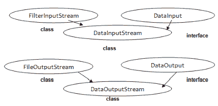

可以如下创建从文件的输入数据流：

```java
FileInputStream fis = new FileInputStream(infile);
DataInputStream dis = new DataInputStream(fis);
```

这些语句基本上是将 `dis` 封装在 `fis` 之上并将其用作“过滤器”。同样，下面的语句创建了输出数据流 `dos` 并将其封装在输出文件流 `fos` 之上。

```java
FileOutputStream fos = new FileOutputStream(outfile);
DataOutputStream dos = new DataOutputStream(fos);
```

### 示例 15.25

以下程序演示了原始数据的读取和写入。

```java
import java.io.*;

class ReadWritePrimitive
{ 
  public static void main (String args[]) throws IOException
    { 
      File primitive = new File("prim.dat");
      FileOutputStream fos = new FileOutputStream(primitive);
      DataOutputStream dos = new DataOutputStream(fos);
      dos.writeInt(1999);
      dos.writeDouble(222.44);
      dos.writeBoolean(false);
      dos.writeChar('X');
      dos.close();
      fos.close();
      FileInputStream fis = new FileInputStream(primitive);
      DataInputStream dis = new DataInputStream(fis);
      System.out.println(dis.readInt());
      System.out.println(dis.readDouble());
      System.out.println(dis.readBoolean());
      System.out.println(dis.readChar());
      dis.close();
      fis.close();
    }
  }
```

**输出：**

1999

222.44

false

X

---

## 定义流

`System` 类包含了三个预定义的流变量——`in`、`out` 和 `err`。这些字段在 `System` 类中声明为 `public` 和 `static`。这意味着它们可以被程序的任何部分使用，而无需引用特定对象。

- `System.out` 指向标准输出流。默认情况下，这是控制台。`System.out` 是一个 `PrintStream` 类型的对象。

- `System.in` 指向标准输入，默认是键盘。`System.in` 是一个 `InputStream` 类型的对象。

- `System.err` 指向标准错误流，默认也是控制台。`System.err` 是一个 `PrintStream` 类型的对象。

这些都是字节流，尽管它们通常被用于从控制台读写字符。如果需要，可以将它们封装在基于字符的流中。

## InputStreamReader

`InputStreamReader` 是从字节流到字符流的桥梁；它读取字节并使用指定的字符集将其解码为字符。它使用的字符集可以显式指定，也可以接受平台的默认字符集。

### 构造函数

- `InputStreamReader(InputStream in)`: 创建一个使用默认字符集的 `InputStreamReader`。

- `InputStreamReader(InputStream in, String charsetName)`: 创建一个使用命名字符集的 `InputStreamReader`。

### 示例 15.26

```java
import java.io.*;

class InputStreamReaderTest
{ 
  public static void main (String argv[]) throws IOException
    { 
      char c;
      InputStreamReader is = new InputStreamReader(System.in);
      System.out.println("Enter characters, 'q' to quit");
      c = (char)is.read();
      while(c!='q')
        { 
          System.out.print(c);
          c = (char)is.read();
        }
    }
  }
```

**输出：**

Enter characters, 'q' to quit

abcd

abcd

### 示例 15.27

对之前的示例进行了修改，利用缓冲来提高性能。


```java
import java.io.*;

class BufferedReaderTest
{ 
  public static void main (String args[]) throws IOException
    { 
      char c;
      BufferedReader br = new BufferedReader(new InputStreamReader(System.in));
      System.out.println("Enter characters, 'q' to quit");
      c = (char)br.read();
      while(c!='q')
        { 
          System.out.print(c);
          c = (char)br.read();
        }
    }
  }
```

**输出：**

Enter characters, 'q' to quit

abcd

abcd

### 示例 15.28

`InputStreamReader` 不提供 `readLine()` 方法，因此 `InputStreamReader` 到提供了 `readLine()` 方法的 `BufferedReader`。

```java
import java.io.*;

class BufferedReaderTest
{ 
  public static void main (String argv[]) throws IOException
    { 
      BufferedReader br = new BufferedReader(new InputStreamReader(System.in));
      System.out.println("Enter 'stop' to quit");
      String str = br.readLine();
      while(!str.equals("stop"))
        { 
          System.out.println("Your Name:"+str);
          str = br.readLine();
        }
    }
  }
```

**输出：**

Enter 'stop' to quit

Harry Feat

Your Name:Harry Feat

stop

### OutputStreamWriter

`OutputStreamWriter` 是从字符流到字节流的桥梁：写入它的字符使用指定的字符集编码为字节。它使用的字符集可以显式指定，也可以接受平台的默认字符集。

**构造函数：**

- `OutputStreamWriter(OutputStream out)`: 创建使用默认字符编码的 `OutputStream`。
- `OutputStreamWriter(OutputStream out, String charsetName)`: 创建使用命名字符集的 `OutputStream`。

### 读取控制输入

在 Java 1.0 中，执行控制输入的唯一方法是使用字节流，这种旧代码仍然存在。

今天，使用字节流读取控制输入在技术上可行，但这样做可能需要使用已弃的方法，且这种方法并不推荐。

在 Java 中，控制输入通过读取 `System.in` 实现。为了获得连接控制台的字符流，您将 `System.in` 封装在 `InputStreamReader` 对象中，可以进一步封装在 `BufferedReader` 对象中以提高性能。

### 示例 15.29

此示例演示了我们可以直接从 `System.in` 读取。

```java
import java.io.*;

class ReadFromConsole
{ 
  public static void main (String arg[]) throws IOException
    { 
      char c;
      System.out.println("Enter characters, 'q' to quit");
      c = (char) System.in.read();
      while(c!='q')
        { 
          System.out.print(c);
          c = (char) System.in.read();
        }
    }
  }
```

**输出：**

Enter characters, 'q' to quit

abcd

abcd

xyzq

xyz

从控制台读取的正确方法是将 `System.in` 封装在 `InputStreamReader` 中，进一步封装在 `BufferedReader` 中，以提高性能并一次读取一行。相关的示例在之前与 `InputStreamReader` 类相关的章节已经介绍过。

## 写入控制台输出

控制台输出可以通过 `print()` 和 `println()` 最容易地实现。这些方法由 `PrintStream` 类定义（`PrintStream` 是 `System.out` 所引用对象的类型）。尽管 `System.out` 是一个字节流，但将其用于简单的程序输出仍然是可以接受的。

然而，基于字符的替代方案是正确的选择。因为 `PrintStream` 是派生自 `OutputStream` 的输出流，它还实现了低级方法 `write()`。因此，可以使用 `write()` 向控制台写入。`PrintStream` 定义的 `write()` 的简单形式是：

```java
void write(int byteval)
```

该方法将 `byteval` 指定字节写入流中。尽管 `byteval` 被声明为整数，但只有低 8 位会被写入。

### 示例 15.30

```java
import java.io.*;

class WriteTest
{
    public static void main (String argv[ ]) throws IOException
    {
      int b;
      b = 'A';
      System.out.write(b);
      // System.out.flush();to flush
      System.out.write('\n');//to flush
    }
}
```

**输出:**

```
A
```

**注意：** 你通常不会使用 `write()` 来执行控制台输出，因为 `print()` 和 `println()` 使用起来要简单得多。

## 序列化

序列化是将对象的状态写入字节流的过程。当你想要将对象的状态写入字节流时，这非常有用。当你想要将程序的状态保存到持久化存储区域（如文件）时，这也有用。在稍后的时间，你可以通过反序列化过程来恢复这些对象。

实现 RMI 也需要序列化。RMI 允许一台机器上的 Java 对象调用另一台机器上的 Java 对象的方法。对象可以作为远程方法的参数传递。发送端对对象进行序列化并转换。接收端对其反序列化。

如果你尝试对对象图顶部的对象进行序列化，所有其他引用的对象都将被递归定位并序列化。

同样，在反序列化过程中，所有这些对象及其引用都会被正确地存储。声明为 `transient` 或 `static` 的变量不会被序列化设施保存。

## Externalizable 接口

Java 用于序列化和反序列化的设施设计得使得保存和恢复对象状态的大部分工作自动完成。

然而，在某些情况下，程序员可能需要控制这些过程。例如，使用压缩或加密技术可能是必要的。`Externalizable` 接口就是为了这些情况设计的。实现 `Externalizable` 接口的类也可以被序列化反序列化。

但控制权在用户手中，即用户可以决定序列化反序列化哪些部分。序列化代码写在 `readExternal()` 方法中，反序列化代码写在 `writeExternal()` 方法中。

### Externalizable 接口中的方法

```java
void readExternal(ObjectInput in)
```

对象实现 `readExternal` 方法，通过调用用于原始类型的 `DataInput` 方法，以及用于对象、字符串和数组的 `readObject` 方法来恢复其内容。

```java
void writeExternal(ObjectOutput out)
```

对象实现 `writeExternal` 方法，通过调用用于其原始值的 `DataOutput` 方法，或调用用于对象、字符串和数组的 `ObjectOutput.writeObject` 方法来保存其内容。

## ObjectOutput 接口

`ObjectOutput` 接口扩展了 `DataOutput` 接口并支持对象序列化。除了 `DataOutput` 接口定义的方法外，`ObjectOutput` 接口只了一个方法：

```java
Void writeObject(Object object)
```

用于序列化对象。`ObjectOutput` 接口的所有方法在错误情况下都会抛出 `IOException`。

## ObjectOutputStream

`ObjectOutputStream` 类扩展了 `OutputStream` 类并实现了 `ObjectOutput` 接口。它负责将对象写入流。

#### 构造函数

```java
ObjectOutputStream(OutputStream out)
```

创建一个写入指定 `OutputStream` 的 `ObjectOutputStream`。参数 `out` 是序列化对象将写入的输出流。

## 写入对象的方法

```java
void writeObject(Object obj)
```

将对象写入底层存储或流。

## ObjectInput 接口

`ObjectInput` 接口扩展了 `DataInput` 接口。它支持对象序列化。除了 `DataInput` 接口定义的方法外，`ObjectInput` 接口定义了一个方法：

```java
Object readObject()
```

用于反序列化对象。

## ObjectInputStream

`ObjectInputStream` 类扩展了 `InputStream` 类并实现了 `ObjectInput` 接口。`ObjectInputStream` 负责从流中读取对象。

#### 构造函数

```java
ObjectInputStream(InputStream in)
```

创建一个从指定 `InputStream` 读取的 `ObjectInputStream`。参数 `in` 是应该从中读取序列化对象的输入流。

反序列化方法为：

```java
Object readObject()
```

从 `ObjectInputStream` 读取一个对象。

### 示例 15.31

```java
import java.io.*;

class SerializationTest
{
    public static void main (String args[]) throws IOException
    {
      try
      {
        MyClass object1 = new MyClass("Hello", 123, 1.3e3);
        MyClass object2 = new MyClass("Hello1", 1, 2);
        System.out.println(object1);
        System.out.println(object2);
        FileOutputStream fos = new FileOutputStream("serial.dat");
        ObjectOutputStream oos = new ObjectOutputStream(fos);
        oos.writeObject(object1);
        oos.writeObject(object2);
        oos.flush();
        oos.close();
      }
      catch(Exception e)
      {
        System.out.println(e);
      }
      try
      {
        MyClass object3, object4;
        FileInputStream fis = new FileInputStream("serial.dat");
        ObjectInputStream ois = new ObjectInputStream(fis);
        object3 = (MyClass) ois.readObject();
        object4 = (MyClass) ois.readObject();
        ois.close();
        System.out.println("After deserialization");
        System.out.println(object3);
        System.out.println(object4);
      }
      catch(Exception e)
      {
        System.out.println(e);
      }
    }
}

class MyClass implements Serializable
{
    String s;
    int i=100;
    double d;
    MyClass(String s, int i, double d)
    {
      this.s = s;
      this.i = i;
      this.d = d;
    }
    public String toString()
    {
      return "s = "+ s +"; i = "+ i + " ; d = " +d;
    }
}
```

**输出:**

```
s = Hello; i = 123 ; d = 1300.0
s = Hello1; i = 1 ; d = 2.0
After deserialization
s = Hello; i = 123 ; d = 1300.0
s = Hello1; i = 1 ; d = 2.0
```

**注意：** 我们可以在一个文件中保存多个相同类型的对象，也可以在文件中保存不同类型的对象。

### 示例 15.32

此示例演示了 `transient` 和 `static` 变量在序列化过程中不会被持久化。

```java
import java.io.*;

class SerializationTest2
{
    public static void main (String args[]) throws IOException
    {
      try
      {
        MyClass object1 = new MyClass("Hello", 123, 1.3e3);
        MyClass object3 = new MyClass("Hello1", 1, 2);
        object3.x = 200;
        A object5 = new A();
        System.out.println(object1);
        System.out.println(object3);
        System.out.println(object5);
```


```java
FileOutputStream fos = new FileOutputStream("serial.dat");
ObjectOutputStream oos = new ObjectOutputStream(fos);
oos.writeObject(object1);
oos.writeObject(object3);
oos.writeObject(object5);
object3.x = 400;
oos.flush();
oos.close();
}
catch(Exception e) {
    System.out.println(e);
}
try {
    MyClass object2, object4;
    A object6;
    FileInputStream fis = new FileInputStream("serial.dat");
    ObjectInputStream ois = new ObjectInputStream(fis);
    object2 = (MyClass) ois.readObject();
    object4 = (MyClass) ois.readObject();
    object6 = (A) ois.readObject();
    ois.close();
    fis.close();
    System.out.println("After deserialization");
    System.out.println(object2);
    System.out.println(object4);
    System.out.println(object6);
}
catch(Exception e) {
    System.out.println(e);
}
}
}
class MyClass implements Serializable {
    String s;
    transient private int i=100;
    public static int x = 10;
    double d;
    MyClass(String s, int i, double d) {
        this.s = s;
        this.i = i;
        this.d = d;
        x = 100;
    }
    public String toString() {
        return "s = " + s + "; i = "+ i + " ;d = " + d +"; x = "+ x;
    }
}
class A implements Serializable {
    public String toString() {
        return "Class A";
    }
}
```

### 示例 15.33: 使用 Externalizable

```java
import java.io.*;
class SerializationTest1 {
    public static void main (String args[]) throws IOException {
        try {
            MyClass object1 = new MyClass("Hello", 99, 123.45);
            System.out.println(object1);
            FileOutputStream fos = new FileOutputStream("serial.dat");
            ObjectOutputStream oos = new ObjectOutputStream(fos);
            System.out.println("before writing object");
            oos.writeObject(object1);
            System.out.println("after writing object");
            oos.flush();
            oos.close();
        }
        catch(Exception e) {
            System.out.println(e);
        }
        try {
            MyClass object2;
            FileInputStream fis = new FileInputStream("serial.dat");
            ObjectInputStream ois = new ObjectInputStream(fis);
            System.out.println("before reading object");
            object2 = (MyClass) ois.readObject();
            System.out.println("after reading object");
            ois.close();
            System.out.println(object2);
        }
        catch(Exception e) {
            System.out.println(e);
        }
    }
}
class MyClass implements Serializable {
    String s;
    int i=100;
    double d;
    public MyClass() {}; // It is must
    public MyClass(String s, int i, double d) {
        this.s = s;
        this.i = i;
        this.d = d;
    }
    public String toString() {
        return "s = "+ s +"; i = "+ i + " ;d = " +d;
    }
    public void writeExternal(ObjectOutput oos) throws IOException {
        System.out.println("Inside writeExternal");
        oos.writeObject(s);
        oos.writeInt(i);
        oos.writeDouble(d);
    }
    public void readExternal(ObjectInput ois) throws ClassNotFoundException, IOException {
        System.out.println("Inside readExternal");
        s = (String) ois.readObject();
        i = ois.readInt();
    }
}
```

**输出：**

```
s = Hello; i = 99 ;d = 123.45
before writing object
after writing object
before reading object
after reading object
s = Hello; i = 99 ;d = 123.45
```

**注意：**

在反序列化期间，对象将使用默认构造函数构造（与 `Serializable` 接口不同），然后进行初始化。状态测试应该在 `readExternal()` 中进行。同样，在序列化期间，只保存类标识符。任何状态必须在 `writeExternal()` 中显式保存。

# 第 16 章：Applet

## 简介

Applet 是一种设计用于在互联网上传输并由 Internet Explorer 或 Netscape Navigator 等兼容 Java 的浏览器在客户端机器上执行的应用程序。Applet 也是 Java 程序，但它们存在（存储）在服务器上。

Applet 无法像独立应用程序那样执行。Applet 只能通过像图像或音频文件一样嵌入 HTML 页面中来执行。要运行 applet，我们需要访问一个嵌入了 applet 的 HTML 页面。当网络浏览器下载此类 HTML 页面时，它会随后加载包含 applet 代码的可执行文件，然后在本地机器上执行它。

applet 到达客户端后，它对资源的访问非常有限。

## Applet 架构

Applet 与普通程序不同：

*   Applet 是基于 GUI 的（窗口化）程序
*   Applet 是事件驱动的

当普通 Java 程序（基于 GUI 的）需要输入时，它会提示用户并调用某些方法，如 `readLine()`，即交互是由程序发起的。这不是 GUI 程序的运行方式。用户发起程序的交互。例如，在文字处理软件中用户通过点击不同的按钮发起操作，从而产生事件并执行相应的代码。

Applet 使用 `awt` 包（抽象窗口工具包）来提供 GUI 并处理事件。`awt` 之所以命名是因为因为它完全依赖底层操作系统的功能。

Applet 类似于一组中断服务程序。Applet 等待事件发生。`awt` 通过调用 applet 提供的事件处理器来通知 applet 事件。一旦发生，applet 必须采取适当行动并迅速将控制权还给 AWT。这是一个至关重要的点。大多数情况下，我们的 applet 不应该进入长时间保持控制的“模式”。相反，它必须对事件做出特定响应，并将控制权返回给 AWT 运行系统。

在 applet 需要独立执行重复任务的情况下（例如，在窗口中显示滚动消息），我们必须启动额外的执行线程。

## 编写 Applet

所有 applet 都是 `Applet` 类的子类。`Applet` 类包含在 `java.applet` 包中。`Applet` 类的结构如下：

```text
java.lang.Object
|
java.awt.Component
|
java.awt.Container
|
java.awt.Panel
|
java.applet.Applet
```

`Applet` 类提供了 applet 执行的所有必要支持，例如启动和停止。它提供了加载和显示图像的方法。它还为所有的窗口化活动提供了必要的支持。

我们扩展 `Applet` 类的子类必须始终声明为 `public`，因为它是由网络浏览器实例化并执行的。浏览器在实例化 applet 时使用无参数构造函数，因此必须提供具有 `public` 可见性的无参数构造函数。

建议不要在 `Applet` 类中提供构造函数，因为在这种情况下编译器将提供默认的无参数构造函数。

我们可以利用 `init()` 方法进行初始化。在编写 applet 代码时，我们通常会重写 `Applet` 类的一些方法，这些方法在 applet 执行期间会被自动调用。

重写 `paint()` 方法是非常常见的。`paint()` 方法中的代码主要在 `Applet` 窗口中显示输出。

### 示例 16.1 (App1.java)

以下程序演示了一个简单的 applet，它只是在窗口内显示“Hello World”。我们在 applet 的 `paint` 方法中绘制/显示任何内容，它都会出现在 applet 的窗口中。

在接下来的示例中，applet 窗口的背景颜色设置为红色，前景颜色设置为绿色，因此背景将显示为红色，文本“Hello Word”将以绿色显示。

```java
import java.awt.*;
import java.applet.Applet;
/*<applet code= "App1" width =500 height=100></applet>*/
public class App1 extends Applet
{ 
    public void init()
    {
        setBackground(Color.red);
        setForeground(Color.green);
    }
    public void paint(Graphics g)
    { 
      g.drawString("Hello World",20,20);
    }
}
```

输出：

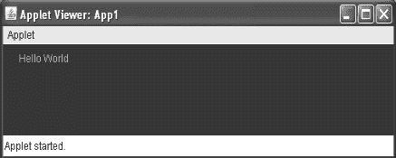

## 执行 Applet

Applet 并不是通过基于控制的 Java 运行时解释器执行的。我们有两种方法可以运行 applet。

1. 在兼容 Java 的 Web 浏览器中执行 applet。
2. 使用 `appletviewer`，例如标准 SDK 工具 `appletviewer`。`appletviewer` 在窗口中执行我们的 applet。这是测试我们 applet 最快且最简单的方法。

### 在浏览器中执行 Applet

我们需要编写一个短的 HTML 文本文件，其中包含适当的 `APPLET` 标签。applet 标签必须包含以下三个属性：

*   `Code`
*   `Width`
*   `Height`

属性 `code` 的值指定包含 applet 代码的类名。属性 `width` 和 `height` 分别指定 applet 窗口的宽度和高度。

这里是嵌入了 applet "App1" 的 HTML 文件 `RunApp.Html`。

```html
<html>
<head>
<title>Simple Applet</title>
</head>
<body>
<h1>Simple “Hello World” Application </h1>
<applet code= “App1” width =500 height=100>
</applet>
</body>
</html>
```

你可以通过在 Web 浏览器中打开 `RunApp.html` 文件来执行 applet。该文件可以在本地文件系统上，也可以从 Web 服务器加载。

### 使用 `appletviewer` 执行 Applet

然而，存在一种更方便的方法可以让我们加速测试。只需在你的 Java 源代码文件中包含一个包含该 `APPLET` 标签的注释即可。通过这种方式，我们的代码就包含了必要的 HTML 语句的原型文档，我们只需通过启动 `appletviewer` 并传入 Java 源代码文件即可测试编译后的输出。如果使用这种方法，那么在编译后我们可以如下所示执行 applet：

```bash
appletviewer SimpleApplet.Java
```

## Applet 生命周期方法

Applet 重写了一组方法，这些方法提供了浏览器或 `appletviewer` 与 applet 交互并控制其执行的基本机制。

这些方法也被称为生命周期方法，因为浏览器或 applet 查看器会在 applet 生命期的不同阶段自动调用它们。总共有五个生命周期方法：

*   `public void init()`
*   `public void start()`
*   `public void stop()`
*   `public void destroy()`
*   `public void paint(Graphics g)`

这些方法中的四个方法：`init()`、`start()`、`stop()` 和 `destroy()` 定义在 `applet` 类中。

`paint()` 由 `awt.Component` 类定义，并提供了所有这些方法的默认实现。Applet 不需要重写它们未使用的方法。然而，非常简单的 applet 将不需要定义它们。

### Applet 的初始化与终止

当 applet 开始时，将按顺序调用以下方法：

1. `init()`
2. `start()`
3. `paint()`

当 applet 终止时，会发生以下方法调用序列：

1. `stop()`
2. `destroy()`

#### `init()` 方法

这是第一个被调用的方法。在这里我们应该初始化变量并编写其他初始化活动的代码。该方法在 applet 的生命周期内仅在实例化后立即被调用一次。

#### `start()` 方法

`start()` 方法在 `init()` 之后被调用。它还用于在 applet 停止后重启。`init()` 在第一次加载 applet 时被调用一次，而 `start()` 在每次 applet 的 HTML 文档显示在屏幕上时被调用。因此，如果用户离开网页并返回，applet 将从 `start()` 恢复执行。

#### `paint()` 方法

`paint()` 在 applet 开始时的 `init()` 和 `start()` 方法之后被调用。每当 applet 的输出需要重绘时，`paint()` 方法也会被调用。这种情况可能由于多种原因引起。例如，运行 applet 的窗口被覆盖，或者 applet 被最小化后恢复。

#### `stop()` 方法

`stop()` 方法在浏览器离开包含 applet 的页面时被调用。我们使用 `stop()` 暂停在 applet 不可见运行时需要的线程。我们可以在 `start()` 中重启它们。

#### `destroy()` 方法

`destroy()` 方法在环境确定需要从内存中移除 applet 时被调用。此时，我们应该释放 applet 可能使用的任何资源。

### 示例 16.2

一个简单的 applet，设置背景颜色为青色，前景颜色为红色，并显示说明 `init()`、`start()` 和 `paint()` 方法调用顺序的消息。


```java
import java.awt.*;
import java.applet.*;
/*<applet code= "App2" width =500 height=100></applet>*/
public class App2 extends Applet
{ 
    String msg="";
    public void init()
    {
        System.out.println("Inside init");
        setBackground(Color.cyan);
        setForeground(Color.red);
        msg = "Inside init—";
    }
    public void start()
    {
        System.out.println("Inside start");
        msg += "Inside start—";
    }
    public void stop()
    {
        System.out.println("Inside Stop");
        msg += "Inside stop—";
    }
    public void paint (Graphics g)
    {
        System.out.println("Inside paint");
        msg += "Inside paint—";
        g.drawString(msg,10,30);
    }
    public void destroy()
    {
        System.out.println("Inside destroy");
    }
}
```

### 动态 Applet

Applet 窗口中显示的输出可以是动态的。例如，我们可以显示一个移动的横幅。Applet 还可以用于诸如通过服务器获取显示与板球比赛相关的得分和其他统计数据；显示股票价格等应用程序。

### 示例 16.3

以下示例显示了一个移动的横幅。它演示了使用 `repaint()` 方法来刷新显示。该 applet 在 applet 窗口中从右向左滚动消息。

由于消息滚动是一项重复性任务，它是由 applet 在启动时创建的独立线程执行的。该程序还演示了可以在 `stop()` 方法中释放资源并在 `start()` 方法中重新获取。

```java
import java.awt.*;
import java.applet.*;
```

```java
/*<applet code="App3" width=500 height=100></applet>*/

public class App3 extends Applet implements Runnable {
    String msg="A Simple Moving Banner." ;
    Thread t = null;
    boolean stopFlag;

    public void init ()
    { 
      setBackground(Color.cyan);
      setForeground(Color.red);
    }

    public void start()
    { 
      t=new Thread(this);
      stopFlag = false ;
      t.start ();
    }

    public void stop()
    { 
      stopFlag=true;
      t=null;
    }

    public void paint(Graphics g)
    { 
      g.drawString(msg,50,30);
    }

    public void run()
    {  
      for (;;)
      {
        repaint();
        try
        {
          Thread.sleep(250);
        }
        catch(InterruptedException e)
        {
          System.out.println(e);
        }
        msg = msg.substring (1) + msg.charAt(0);
        if (stopFlag)
          break;
      }
    }
}
```

输出：

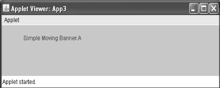

### 使用状态窗口

除了在窗口中显示信息外，applet 还可以向运行其的浏览器或 `appletviewer` 的状态窗口输出消息。

要做到这一点，请调用 `showStatus()` 方法并传入我们想要显示的字符串。状态窗口是向用户提供关于 applet 正在发生情况的反馈、建议选项或可能报告某些类型的错误的好地方。

状态窗口也是一个极佳的调试辅助（帮助），因为它为我们提供了一种输出关于 applet 信息的简单方法。

示例 16.4：下面的示例演示了如何使用状态窗口。

```java
import java.awt.*;
import java.applet.*;
/*<applet code="App4" width=500 height=100></applet>*/
public class App4 extends Applet {
    public void init( )
    { 
      setBackground(Color.cyan);
    }
    public void paint(Graphics g)
    { 
      g.drawString("This is in the applet window",10,20);
      showStatus("This is shown in the status window");
    }
}
```

输出：

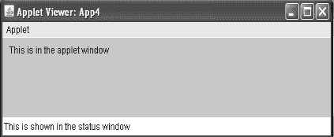

### HTML 的 APPLET 标签

`APPLET` 标签用于从 HTML 文档和 `appletviewer` 启动 applet。

`appletviewer` 会在独立的窗口中执行它找到的每个 `APPLET` 标签；而像 Netscape Navigator 和 Internet Explorer 这样的网络浏览器则允许在单个页面上运行多个 applet。

标准 `APPLET` 标签的语法为：

```html
< APPLET
CODE=applet class name
CODEBASE=codebase URL
ALT=alternate Text,
NAME=appletInstancename
WIDTH=pixels
HEIGHT=pixels
ALIGN=alignment
VSPACE=vertical space in pixels
HSPACE=horizontal space in pixels
>

<PARAM NAME=attributeName-1  VALUE=Attribute Value-1>
<PARAM  NAME=attributeName-2  VALUE=Attribute Value-2>
<PARAM  NAME=attributeName-N  VALUE=Attribute Value-N>
</APPLET>
```

- **CODE**: `CODE` 是一个必需属性，用于提供包含 applet 编译后的类文件的文件名称。该文件相对于 applet 的 `CODEBASE` URL（即 html 文件文件所在的目录）。

- **CODEBASE**: `CODEBASE` 是一个可选属性，用于指定 applet 代码的基 URL，即将在其中搜索 applet 可执行类文件（由 `CODE` 标签指定）的目录。如果未指定此属性，则使用 HTML 文档的 URL。

- **ALT**: `ALT` 标签是一个可选属性，用于指定当浏览器理解 `APPLET` 标签但无法运行 Java 时应该 显示的短文本消息（备用文本）。这与我们为不支持 applet 的浏览器提供的备用 HTML 是不同的。

- **NAME**: `NAME` 是一个可选属性，用于为 applet 实例指定名称。applet 必须命名，以便同一页面上的其他 applet 能够通过名称找到它们并与之通信。要通过名称获取 applet，请使用 `getApplet()`，该方法由 `Applet` 接口定义。

- **WIDTH and HEIGHT**: applet 显示区域以像素为单位的尺寸。

- **ALIGN**: `ALIGN` 是一个可选属性，用于指定 applet 的对齐方式。该属性的处理方式与 HTML `IMG` 标签相同，取值为：`LEFT`、`RIGHT`、`TOP`、`BOTTOM`、`MIDDLE`、`BASELINE`、`TEXTTOP`、`ABSMIDDLE` 以及 `ABSBOTTOM`。

- **VSPACE and HSPACE**: 这些属性可选的。`VSPACE` 指定 applet 上下方的空间（像素）。`HSPACE` 指定 applet 左右两侧的空间（像素）。它们的处理方式与 `IMG` 标签的 `VSPACE` 和 `HSPACE` 属性相同。

#### PARAM 标签

`PARAM` 标签允许我们在 HTML 页面中指定 applet 特定的参数。applet 通过 `getParameter()` 方法访问这些属性。`PARAM` 标签有两个属性：`NAME` 和 `VALUE`。

示例 16.5：下面的示例演示了如何从 HTML 页面向 Applet 传递参数。

```java
import java.awt.*;
import java.applet.*;
/*<applet code="App5" width=500 height=100></applet>*/
public class App5 extends Applet {
    String fName;
    int fSize;
    public void init ()
    {
      fName = getParameter("fontName");
      if (fName == null)
        fName = "Courier";
      fSize = Integer.parseInt(getParameter("fontSize"));
      Font f1= new Font(fName, Font.PLAIN, fSize);
      setFont(f1);
    }
    public void paint (Graphics g)
    { 
      g.drawString("Font Name : " + fName, 0, 25 );
      g.drawString("Font Size : " + fSize, 0, 50 );
      g.drawString("Hello world", 0,75);
    }
}
```

输出：


### 获取 DocumentBase 和 CodeBase

通常，我们会创建需要显式加载媒体和文本的 applet。Java 允许 applet 从启动 HTML 文件的目录（文档基）以及加载 applet 类文件的目录（代码基）加载数据。

这些目录以 `URL` 对象的形式返回。它们可以与要加载的文件字符串拼接。要加载另一个文件，我们将使用 `Applet` 接口定义的 `showDocument()` 方法。

示例 16.6：下面的示例演示了如何在 applet 代码中获取文档基和代码基。

App6.java

```java
import java.awt.*;
import java.applet.*;
import java.net.URL;
public class App6 extends Applet {
    public void paint (Graphics g)
    {
      URL u1 = getCodeBase( );
      g.drawString ("Code base:-" + u1, 10,20);
      URL u2 = getDocumentBase();
      g.drawString("Document base:-"+u2, 10,40);
    }
}
```

App6.html

```html
<html>
  <body>
    <applet code="App6" width=500 height=200></applet>
  </body>
</html>
```

输出：

### AppletContext 和 Show Document()

`AppContext` 是一个接口，允许我们从 applet 的执行环境中获取信息。当前执行的 applet 的上下文通过调用 `applet` 类定义的 `getAppletContext()` 方法获取。

在 applet 中，一旦我们获取了 applet 的上下文（context），就可以调用 `showDocument()` 方法将另一个文档显示在视图中。该方法没有返回值，如果执行失败也不会抛出异常，因此请谨慎使用。这里有两个 `showDocument()` 方法。

```
void ShowDocument(URL url)
```

用给定的 `URL` 替换当前查看的 Web 页面。

```
void ShowDocument (URL url, String where)
```

在浏览器窗口内的指定位置显示指定的文档。“where”的有效参数有：

- `_self`（在当前帧中显示）

- `_parent`（在父帧中显示）

- `_top`（在最顶层帧中显示），以及

- `_blank`（在新浏览器窗口中显示）

### 示例 16.7

以下 applet 演示了 `Applet Context` 和 `showDocument()` 的用法。执行时，它获取当前的 applet 上下文，并使用该上下文将控制权转移到名为 `A.html` 的文件。该文件必须与 applet 位于同一目录下。`Test.html` 可以包含你喜欢的任何有效超文本。

```java
import java.awt.*;
import java.applet.*;
import java.net.*;
public class App7 extends Applet
{ 
  AppletContext ac;
  URL u1;
  public void init()
  {
     setBackground(Color.cyan);
    }
  public void start( )
  {
     ac = getAppletContext();
     u1 = getCodeBase();
     try
     {
      Thread.sleep(3000);
      ac.showDocument(new URL(u1 + "A.html"),"_blank");
     }
     catch(MalformedURLException e)
     { 
      showStatus("Invalid URL");
      e.printStackTrace() ;
     }
     catch(InterruptedException e)
     { 
      showStatus("Invalid URL");
      e.printStackTrace () ;
     }
  }
  public void paint (Graphics g)
  {
    g.drawString(u1+"A.html",20,20);
    try
     {
      Thread.sleep(3000);
     }
     catch(InterruptedException e)
     {
      System.out.println(e);
     }
  }
}
```

App7.html

```html
<html>
  <head>
    <Title>Applet Context</Title>
  </head>
  <body>
    <applet code="App7" width=200 height=200></applet>
  </body>
</html>
```

A.html

```html
<html>
  <head>
    <title>New Page</title>
  </head>
  <body bgcolor=blue text=red>
    <h1>matrix</h1>
  </body>
</html>
```

### 示例 16.8


```
1. import java.applet.*;
2. import java.awt.*;
3. import java.awt.event.*;
4. /*<applet code="CopyApp" width=500 height=200></applet*/
5. public class CopyApp extends Applet implements ActionListener
6. {
7.   TextField tf1,tf2;
8.   Button b1;
9.   public void init()
10.  {
11.     setForeground(Color.red);
12.     Font f1=new Font("Arial", Font.BOLD+Font.ITALIC,20);
13.     tf1=new TextField(8);
14.     tf2=new TextField(8);
15.     tf1.setFont(f1);
16.     tf2.setFont(f1);
17.     b1=new Button("Copy");
18.     b1.addActionListener(this);
19.     b1.setFont(f1);
20.     add(tf1);
21.     add(tf2);
22.     add(b1);
23.  }
24.  public void paint(Graphics g)
25.  {
26.     g.drawString("Matrix",0,150);
27.  }
28.  public void actionPerformed(ActionEvent ae)
29.  {
30.     String s1=tf1.getText();
31.     tf2.setText(s1);
32.  }
33. }
```

输出：

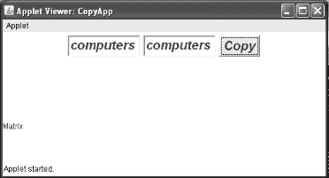

### 示例 16.9 使用 Applet 计算两个数之和

```
1. import java.applet.*;
2. import java.awt.*;
3. import java.awt.event.*;
4. /*<applet code = "SumApplet" width=400 height=400></applet> */
5. public class SumApplet extends Applet implements ActionListener
6. {
7.   TextField tf1,tf2,tf3;
8.   Label l1,l2,l3;
9.   Button b1;
10.  public void init()
11.  {
12.     setLayout(new GridLayout(4,2));
13.     l1 = new Label("No. 1");
14.     l2 = new Label("No. 2");
15.     l3 = new Label("Result");
16.     tf1 = new TextField(8);
17.     tf2 = new TextField(8);
18.     tf3 = new TextField(8);
19.     b1 = new Button("Sum");
20.     b1.addActionListener(this);
21.     add(l1);add(tf1);
22.     add(l2);add(tf2);
23.     add(l3);add(tf3);
24.  }
```

# 面板 (Panels)

面板（`Panels`）就像应用程序组件和窗口一样，包含其他组件，如按钮、`Canvas`、复选框、滚动条（`Scrollbars`）、`Scrollpanes`、文本区域、文本字段和其他面板。

复杂的 GUI 有时具有非常复杂的面板包含层级结构，即面板嵌套面板，以此类推，贯穿许多层包含。

由于容器也是组件，因此由于继承关系，组件可用的方法也适用于容器。

容器最常用的方法是 `add()` 方法，通过该方法将组件添加到容器中，其通用形式如下：

```java
void add(Component comp);
```

所有组件都是 `Component` 类的子类，因此任何组件都可以使用 `add()` 方法被添加到容器中。

## 布局管理器 (Layout Manager)

在向容器中添加组件时，一个重要问题涉及到组件的位置和大小。组件的位置可以通过两种方式指定：

(i) 绝对定位。

(ii) 相对定位。

在绝对定位中，我们指定组件应该被添加的确切位置。这种方法可以为我们提供精细的控制，如果我们仅为单个平台设计 GUI，这可能是最佳选择。

例如，通过指定组件左上角的坐标，可以将组件添加到容器水平方向的中间。

我们可以根据容器的宽度和组件的宽度计算这些坐标。但如果容器宽度发生变化或组件尺寸发生变化，组件将不会留在中间。

另一种方法是相对定位，它可能无法允许我们指定组件的确切位置，但在我们希望组件始终位于容器水平方向的中间的情况下，这种方法可能更适用。

我们可以通过指定组件的相对位置，如 `left`（左）、`right`（右）、`center`（居中）等，来实现这一点。在文字处理器中，将文档标题居中是非常常见的。即使页面宽度发生变化，标题也会保持居中，这就是相对定位的一个例子。

在 Java 中，可以使用绝对定位，但并不建议这样做。`AWT` 设计初衷是使用相对定位。我们可以使用相对规格来指定组件布局，例如：组件将添加到上一个组件的右侧、组件将添加到其他某些组件的下方、组件将出现在顶部、组件的大小将是容器宽度的 `¼` 等。即使在不知道组件尺寸的情况下，这些规格也有用。

Java 鼓励使用相对定位，因为它是平台无关的，相同的 GUI 应该能够在各种平台上运行而无需修改。

称为布局管理器（`Layout Managers`）的内置 Java 类处理了将相对位置映射到实际/物理位置的任务。Java 支持许多类型的布局管理器，我们将讨论以下布局管理器：

1. `FlowLayout`
2. `GridLayout`
3. `BorderLayout`
4. `CardLayout`
5. `GridBagLayout`

### 使用布局管理器时的两个观察

- 我们不再需要承担指定每个组件精确位置和尺寸的负担。
- 我们不再拥有指定每个组件确切位置和尺寸的权力。

## 为什么 Java 使用布局管理器？

原因有两个：

1. 理论上来说，精确布局（即以像素为指定每个组件的大小和位置）是一项重复且经常执行的任务；因此，根据面向对象编程（OOP）的功能，布局功能应该被封装在一个或多个类中，以自动化该任务。显然，布局管理器消除了大量的繁琐开发。许多程序员起初并不喜欢布局管理器的想法，但随着繁琐选择的消除，他们变得越来越欣赏它们。

2. 使用布局管理器的实际原因源于 Java 的平台无关性。在 Java 中，`AWT` 组件的行为借自运行 `JVM` 的底层硬件的窗口系统。因此，在 Macintosh 上，`AWT` 按钮就像任何其他 Mac 按钮一样；在 Motif 平台上，Java 按钮看起来就像任何其他 Motif 按钮，以此类推。这里的问题在于，按钮和其他组件在不同平台上实例化时具有不同的尺寸。

如果 Java 鼓励精确的像素级缩放和定位，将有很多 Java GUI 在其原始平台上看起来精美，但在其他平台上看起来很糟糕甚至无法使用。

如上所述，布局管理器通过使用相对定位解决了这一问题。

## 布局策略 (Layout policy)

每个 Java 组件都有首选尺寸（`Preferred Size`）。首选尺寸表示了在不与布局管理器冲突的情况下，组件希望是多大。首选尺寸通常是能够以视觉上有意义的方式渲染组件所需的最小尺寸，例如，按钮的首选尺寸即是其标签文本的大小，加上文本周围的一小圈空白边框，再加上标记按钮边界的阴影装饰，因此按钮的首选尺寸是“恰好足够”。首选尺寸取决于平台，因为组件的边界装饰随系统而异。

当布局管理器布局其容器的子组件时，它必须平衡两个考虑因素：

(i) 布局策略和

(ii) 每个组件的首选尺寸

首要任务是执行布局策略。如果尊重组件的首选尺寸意味着违反布局策略，那么布局管理器将覆盖组件的首选尺寸。理解布局管理器意味着理解它将组件放置在何处，以及它将如何处理组件的首选尺寸。

### 1. FlowLayout

流式布局管理器的功能封装在 `java.awt.FlowLayout` 类中。

流式布局管理器将组件按水平行排列。它是面板和应用程序组件的默认布局管理器类型。

流式布局将尽可能多的组件放入第一行，并将其他组件移动到第二行。如果第二行没有留出空间，组件将移动到第三行，依此类推。这与在文档中输入文字非常相似。当我们到达当前行的末尾时，下一个单词将移动到下一行，依此类推。如果我们更改文档的宽度或高度，整个文档将重新格式化。组件始终按照它们被添加到容器的顺序从左到右出现。

默认情况下，流式布局在水平和垂直方向的组件之间留有五个像素的间隙。这种默认值可以通过调用 `FlowLayout` 构造函数的重载版本并传入所需的水平和垂直间隙来更改。在每一行中，组件均匀分布，并且组件簇居中。簇的对齐（有时称为“对齐”）可以通过向流式布局构造函数传递参数来控制。可能值为：

- `FlowLayout.LEFT`
- `FlowLayout.CENTER`
- `FlowLayout.RIGHT`

示例 17.1:

```java
import java.awt.*;
class MyFrame {
    public static void main(String args[]) {
        Frame f = new Frame();
        FlowLayout flow = new FlowLayout();
        f.setLayout(flow);
        Label l1 = new Label("Name : ");
        f.add(l1);
        TextField tf1 = new TextField("Matrix");
        f.add(tf1);
        tf1.setBackground(Color.green);
        tf1.setForeground(Color.red);
        Button b1 = new Button("ok");
        Font f1 = new Font("Arial", Font.BOLD, 24);
        b1.setFont(f1); 
        f.add(b1);
        f.setSize(500,100);
        f.setVisible(true);
    }
}
```

注意：如果我们缩小上述窗口的大小，且三个组件无法在单行内容纳，则组件将从最后一个组件开始移动到下一行。

输出：


### 示例 17.2

```java
import java.awt.*;

public class MyFrame2 extends Frame
{ 
    public static void main(String args[])
    { 
        MyFrame2 f = new MyFrame2();
        f.setLayout(new FlowLayout(FlowLayout.CENTER));
        System.out.println(f.paramString());
        Label l1 = new Label("Name :");
        f.add(l1);
        TextField tf1 = new TextField("Sample Program");
        f.add(tf1);
        tf1.setBackground(Color.GREEN);
        tf1.setForeground(Color.RED);
        Button b1 = new Button("OK");
        b1.setFont(new Font("Serif", Font.BOLD, 24));
        // b1.setEnabled(false);
        Dimension d = b1.getSize();
        System.out.println("Button Size :" + d.width + " " + d.height);
        f.add(b1);
        // f.setResizable(false);
        // f.setUndecorated(true);
        f.setVisible(true);
        Dimension d1 = b1.getSize();
        System.out.println("Button Size: " + d1.width + " " + d1.height);
        Dimension d2 = f.getSize();
        System.out.println("Frame Size: " + d2.width + " " + d2.height);
        try
        { 
            Thread.sleep(5000);
        }
        catch(InterruptedException e) { }
        f.setVisible(false);
        f.setSize(500,100);
        f.setVisible(true);
        try
        { 
            Thread.sleep(5000);
        }
        catch(InterruptedException e){ }
        f.setVisible(false);
        f.setBounds(20, 20, 100, 100);
        f.setVisible(true);
        Dimension d3 = f.getSize();
        System.out.println("Frame Size : " + d3.width + " " + d3.height);
        System.out.println(f.paramString());
    }
}
```

输出：


```
frame0,0,0,0x0,invalid,hidden,layout=java.awt.FlowLayout,title=,resizable,normal
Button Size :0 0
Button Size: 52 35
Frame Size: 123 34
Frame Size : 123 100
frame0,20,20,123x100,layout=java.awt.FlowLayout,title=,resizable,normal
```

### 示例 17.3 

如果我们将上述程序中的这行代码：

组件将左对齐：

`f.setLayout(new FlowLayout(FlowLayout.CENTER));`

更改为

`f.setLayout(new FlowLayout(FlowLayout.LEFT));`

输出：


### 示例 17.4:

如果我们将上述程序中的这行代码：

`f.setLayout(new FlowLayout(FlowLayout.LEFT));`

更改为

`f.setLayout(new FlowLayout(FlowLayout.RIGHT));`

输出：


### 示例 17.5:-

我们可以在设置布局时通过使用重载构造函数来更改行内组件之间的间距（水平间距）以及行之间的间距（垂直间距）：


`f.setLayout(new FlowLayout(FlowLayout.CENTER, 20))`


`vgap`（行间距） `hgap`（组件间距）

输出：


### GridLayout

网格布局管理器（`GridLayout`）的功能封装在 `java.awt.GridLayout` 类中。它以表格格式按行和列排列组件。我们可以将容器空间想象为一个由行和列组成的网格。在指定布局时，我们必须指定行数和列数。

网格布局管理器会将与行的大小（布局中指定的列数）相适应的多个组件放入第一行，并将其他组件移动到第二行，依此类推。这类似于电子表格，被分为固定数量的行和列。

流式布局管理器（`FlowLayout`）始终尊重组件的首选尺寸。`GridLayout` 管理器采取了相反的做法：当它在给定空间内执行布局时，它会忽略组件的首选尺寸。网格布局中的每行每列的大小都是相同的，布局可用的总区域在行数和列数之间平分。网格布局使用“行主序”表示法，即组件按照它们被添加的顺序从左到右、逐行地出现。

当我们添加少量组件（即远少于行数乘以列数）或非常多组件（即多于行数乘以列数）时，`GridLayout` 的行为会很奇怪。如果将相同的组件放置在一个更高、更窄的框架中，那么每个组件都会按比例变得更高、更窄。

示例 17.6：


```java
import java.awt.*;

public class MyFrame6 extends Frame
{ 
    public static void main(String args[])
    { 
      MyFrame6 f = MyFrame6();
      f.setLayout(new GridLayout(5,3));
      for(int row=0; row<5; row++)
      { 
        f.add(new Label("Label" + row));
        f.add(new Button("Button" + row));
        f.add(new TextField("TextField" + row));
      }
      f.setSize(500,200);
      f.setVisible(true);
    }
}
```

输出：


### BorderLayout

边界布局管理器（`BorderLayout`）的功能封装在 `java.awt.BorderLayout` 类中。它是框架（frames）的默认管理器，程序员迟早都会遇到它。

它提供了一种非常有用的布局策略。流布局管理器总是尊重组件的首选大小；网格布局管理器从不这样做。边界布局管理器则介于两者之间。

它将可用空间分为五个部分：`North`、`South`、`East`、`West` 和 `Center`。我们可以向每个区域添加一个组件。每个区域可以为空，也可以包含一个组件（当然，如果该组件是容器，我们可以显示多个组件）。

`BorderLayout` 总是尊重 `North` 和 `South` 组件的首选高度，并强制它们与容器等宽。`North` 和 `South` 区域适用于工具栏、状态栏以及任何应该尽可能宽但不要过高的控件。

`East` 和 `West` 区域是 `North` 和 `South` 的相反。在 `East` 和 `West` 中，组件获得其首选宽度但高度被限制。

在这里，组件垂直延伸到 `North` 组件的底部（如果有的话）或延伸到容器的顶部（如果没有 `North` 组件）。同样，组件垂直向下延伸到 `South` 组件的顶部（如果有的话）或延伸到容器的底部（如果没有 `South` 组件）。

边界布局不受我们添加组件的顺序的影响。相反，我们必须指定哪个区域将接收我们要添加的组件。

重载的 `add()` 方法接受两个参数：

* 首先是要添加的组件，
* 第二个是任意对象

正确使用 `BorderLayout` 管理器需要第二个参数是 `BorderLayout` 类本身定义的常量。我们应该了解的五个常量是：

* `BorderLayout.NORTH`
* `BorderLayout.SOUTH`
* `BorderLayout.EAST`
* `BorderLayout.WEST`
* `BorderLayout.CENTER`

边界布局管理器控制的第五个区域被称为 `Center`。`Center` 只是在 `North`、`South`、`East` 和 `West` 分配后剩余的容器部分。

将组件添加到中心时，省略 `add()` 调用中的第二个参数是合法的但不太明智。在 Java 平台上，边界布局管理器将假设我们指的是中心；但在旧版本中，行为是不可预测的，且通常会导致组件完全不可见。

### 示例 17.7

```java
import java.awt.*;

public class MyFrame7
{
  public static void main(String args[])
  {
    Frame f=new Frame( );
    Scrollbar sbRight=new Scrollbar(Scrollbar.VERTICAL);
      f.add(sbRight, BorderLayout.EAST);
    Scrollbar sbLeft=new Scrollbar(Scrollbar.VERTICAL);
      f.add(sbLeft, BorderLayout.WEST);
    Label labelTop=new Label("This is North");
    labelTop.setFont(new Font("Serif", Font.ITALIC, 36));
      labelTop.setForeground(Color.white);
      labelTop.setBackground(Color.black);
      f.add(labelTop, BorderLayout.NORTH);
      Label labelBottom=new Label("This is south");
    labelBottom.setFont(new Font("Monospaced", Font.BOLD, 18));
      labelBottom.setForeground(Color.white);
      labelBottom.setBackground(Color.black);
      f.add(labelBottom, BorderLayout.SOUTH);
      f.setSize(500,200);
      f.setVisible(true);
  }
}
```

输出:

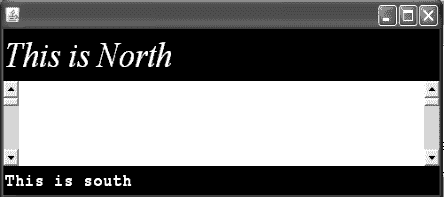

### 示例 17.8

```java
import java.awt.*;
public class MyFrame8 extends Frame
{
  public static void main(String args[])
  {
    Frame f=new MyFrame8( );
    //f.setLayout(new BorderLayout());
      f.add (new Button("N"), BorderLayout.NORTH);
      f.add (new Button("S"), BorderLayout.SOUTH);
      f.add (new Button("E"), BorderLayout.EAST);
      f.add (new Button("W"), BorderLayout.WEST);
      Panel p=new Panel();
      p.setBackground(Color.green);    
      f.add (p, BorderLayout.CENTER);
      //f.add (p);  默认是中心
      f.setSize(300 ,300);
      f.setVisible(true);
  }
}
```

Output:

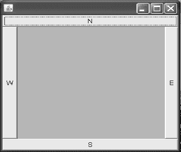

### 示例 17.9

```java
import  java.awt.*;
class BorderLayout3 extends Frame
{
  public static void main (String args[])
  {
    Frame f=new BorderLayout3();
    // f.setLayout(new BorderLayout());
      Panel toolbar=new Panel();
    toolbar.setLayout(new FlowLayout(FlowLayout.LEFT));
      toolbar.setBackground(Color.lightGray);
      toolbar.add(new Button ("This"));
      toolbar.add(new Button ("Is"));
      toolbar.add(new Button ("The"));
      toolbar.add(new Button ("Toolbar"));
      f.add(toolbar,BorderLayout.NORTH);
      TextField status=new TextField("Status.");
    status.setFont(new Font("Monospaced",Font.BOLD,48));
      f.add (status,BorderLayout.SOUTH)    
      f.setSize(300,300);
      f.setVisible(true);
  }
}
```

Output:


### CardLayout (卡片布局)

在 `CardLayout` 中，我们可以存储许多卡片，但一次只显示一张。同一时间只有一个卡片可见，但你可以从一张卡片切换到另一张。这里的卡片指的是一个 `Panel`。

如果我们想一次显示两个卡片，就必须先创建两个 `Panel`（每个卡片一个），然后创建一个主 `Panel` 来包含这两个卡片。这对于具有可选组件的用户用户界面来说非常有用，这些组件可以根据用户输入动态启用或禁用。

#### 构造函数

* `CardLayout()`：创建一个间隙为 0 的新卡片布局。
* `CardLayout(int, int)`：创建一个具有指定的水平和垂直间距的新卡片布局。水平间距放置在左、右边缘。垂直间距放置在顶部和底部边缘。

与其他布局相比，`CardLayout` 需要更多的工作。卡片通常存储在一个类型为 `panel` 的对象中。当卡片添加到面板时，通常会给它们指定一个名称。因此，我们在向面板添加卡片时将使用 `add()` 方法。

`add(Component objpanel, Object objname)` 在这里，`objname` 是一个字符串，用于指定由 `objpanel` 指定面板的卡片名称。

#### 方法

* `void first(Container parent)`：跳转到容器的第一张卡片。
* `void next(Container parent)`：跳转到给定容器的下一张卡片。如果当前可见卡片是最后一张，此方法将翻到布局的第一张卡片。
* `void previous(Container parent)`：跳转到给定容器的上一张卡片。如果当前可见卡片是第一张，此方法将翻到布局的最后一张。
* `void last(Container parent)`：跳转到容器的最后一张卡片。
* `void show(Container parent, String name)`：跳转到以给定名称布局的组件。如果不存在此类组件，则会发生（异常）。

使用以下步骤创建 `CardLayout`：

1. 创建一个新的 `Panel` 对象和一个 `CardLayout` 对象。
2. 使用第一步中创建的实例将 `Panel` 对象的布局设置为 `CardLayout`。
3. 现在为每张卡片创建一个单独的 `Panel` 对象，并添加我们想要添加到该 `Panel` 中的任何内容，如按钮、复选框等。
4. 在步骤 3 中创建的每个 `Panel` 对象在添加到主面板时都需要唯一的名称。
5. 最后将主面板添加到容器中。

### 示例 17.10

```java
import java.awt.*;
import java.awt.event.*;
import java.applet.*;
/*<applet code="CardLayoutTest" width=500 height=100></applet*/
public class CardLayoutTest extends Applet implements ActionListener, MouseListener
{
  Panel mp;
  CardLayout c1;
  public void init()
  {
    Button b1=new Button("First");
    Button b2=new Button("Second");
    b1.addActionListener(this);
    b2.addActionListener(this);
    add(b1);
    add(b2);
    Panel p1=new Panel();
    Label l1=new Label("INDIA");
    p1.add(l1);
    Panel p2=new Panel();
    Label l2=new Label("USA");
    p2.add(l2);
    mp=new Panel();
    c1=new CardLayout();
    mp.setLayout(c1);
    mp.add(p1,"Country1");
    mp.add(p2,"Country2");
    add(mp);
    addMouseListener(this);
  }
  public void actionPerformed(ActionEvent ae)
  {
    Button b=(Button)ae.getSource();
    if(b.getLabel().equals("First"))
      c1.show(mp,"Country1");
    else
      c1.show(mp,"Country2");
  }
  public void mousePressed(MouseEvent me)
  {
    c1.next(mp);
  }
  public void mouseReleased(MouseEvent me){}
  public void mouseClicked(MouseEvent me){}
  public void mouseEntered(MouseEvent me){}
  public void mouseExited(MouseEvent me){}
}
```

输出:

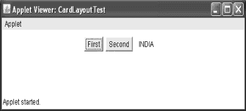

### GridBagLayout

`GridBagLayout` 是标准布局管理器中最复杂且最灵活的。虽然它听起来应该是 `GridLayout` 的子类，但它完全不同。在 `GridLayout` 中，元素排列...

#### 示例 17.11

AWT 组件可以分类为：

1. 视觉组件（Visual Components）。
2. 容器组件（Container Components）。
3. 菜单组件（Menu Components）。

视觉组件和容器组件都属于从 `java.awt.Component` 开始的组件层次结构。（菜单组件继承自 `java.awt.MenuComponent`，因此它们不继承相同的父类功能）。

### `java.awt.Component` 类的方法

由于继承自 `java.awt.Component`，所有视觉和容器组件都实现了几个方法。这些方法如下：

* `Dimension getSize()`：以 `Dimension` 对象的形式返回组件的大小，该对象具有类型为 `int` 的公共数据成员 `height` 和 `width`。
* `void setBackground(Color c)`：设置组件的背景颜色。背景通常用于渲染组件的非文本区域。
* `void setForeground(Color c)`：设置组件的前景颜色。通常组件的前景颜色用于渲染文本。如果没有显式设置组件的前景或背景颜色，组件将使用其直接父容器的前景和背景颜色。
* `void setFont(Font f)`：设置组件的字体。

`setFont()` 方法决定了组件在渲染其需要显示的任何文本时使用的字体。如果我们不显式设置组件的字体，则组件将使用其容器的字体。

```java
void setEnabled(Boolean b)
```

如果参数为 `true`，则组件具有正常外观。如果参数为 `false`，则组件将显示为灰色且不对用户输入做出响应。

```java
void setSize (Dimension d)
```

设置组件的大小。

```java
void setSize (int width, int height)
```

设置组件的大小。

```java
void setBounds (int x, int y, int width, int height)
```

尝试移动并调整组件的大小。左上角的新位置由 `x` 和 `y` 指定，新尺寸由 `width` 和 `height` 指定。

```java
void setVisible (Boolean b)
```

此方法接受一个布尔值参数，用于决定组件是否在屏幕上显示。此方法通常用于帧（frames）。

### Note

如果我们尝试过调用 `setSize()` 或 `setBounds()` 方法，我们就会知道这通常是徒劳的。我们试图给组件的大小和位置会被布局管理器（layout manager）覆盖。

事实上，这两个方法的存在大部分是为了供布局管理器使用的。该规则的一个主要例外是 `Frame` 类，它不受布局管理器的控制，并且完全愿意让我们设置它的尺寸或边界。

### 视觉组件

视觉组件是用户实际上可以看到并与之交互的组件。AWT 支持以下视觉组件：

* `Button`（按钮）
* `Canvas`（画布）
* `Checkbox`（复选框）
* `Choice`（选择框）
* `FileDialog`（文件对话框）
* `Label`（标签）
* `List`（列表）
* `ScrollPane`（滚动面板）
* `Scrollbar`（滚动条）
* `TextArea`（文本区域）
* `TextField`（文本字段）

要在 GUI 中使用这些组件之一，我们首先通过调用相应的构造函数来创建一个实例。然后将组件添加到容器中。

### 按钮

`Button` 类实现了一个推入按钮。

#### 构造函数

* `Button()`
* `Button(String)`


# 构造函数

构造函数接受一个字符串参数，用于指定按钮标签的文本。当按钮被按下时，它会发送一个 `Action` 事件。

## 方法

* `String getLabel()`：获取此按钮的标签。
* `void setLabel(String label)`：将按钮的标签设置为指定的字符串。
* `void addActionListener(ActionListener l)`：添加指定的动作监听器以接收来自此按钮的动作事件。

## 示例 17.12

```java
import java.awt.*;
class ButtonTest
{
  public static void main(String args[]) 
  {
      Frame f=new Frame("Testing Button Component");
      f.setLayout(new FlowLayout());
      Font f1=new Font("Arial",Font.BOLD,40);
      Color c1=new Color(255,0,0);
      Color c2=new Color(0,255,0);
      Button b1 = new Button();
      Button b2 = new Button("Cancel");
      b1.setForeground(c1);
      b2.setForeground(c1);
      b1.setBackground(c2);
      b2.setBackground(c2);
      b1.setFont(f1);
      b2.setFont(f1);
      b1.setLabel("Ok");
      System.out.println(b2.getLabel());
      f.add(b1);
      f.add(b2); 
      f.setSize(500,200);
      f.setVisible(true);
  }
}
```

输出：


# 画布

`Canvas` 是一个组件，没有默认的外观或行为。我们可以通过子类 `canvas` 来创建自定义的绘制区域、工作区域、组件等。画布接收来自鼠标和键盘的输入事件，将这些输入转换为有意义的外观效果取决于程序员。

画布的默认尺寸（或者更准确地说，是首选尺寸）小得毫无用处。处理这个问题的一种方法是使用能够调整画布大小的布局管理器。另一种方法是我们自己对画布调用 `setSize()`，画布是这种方法可能有效的少数情况之一，因为我们发送到 `setSize()` 方法的值将变成画布的首选尺寸。

## 示例 17.13

```java
import java.awt.*;
class CanvasTest
{ 
  public static void main (String args [])
  { 
      Frame f = new Frame();
      f.setLayout(new FlowLayout());
      Canvas c=new MyCanvas();
      c.setSize(100,100);
      f.add(c);
      f.setSize(300,300);
      f.setVisible(true);
  }
}
class MyCanvas extends Canvas
{
  public void paint(Graphics g )
  {
      setBackground(Color.green);
      g.setColor(Color.red);
      g.drawLine(0, 0, 99, 99);
  }
}
```

输出：

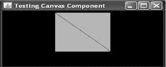

# 复选框

复选框是一个双状态按钮。两个状态为 `true`（已选中）和 `false`（未选中）。复选框的三种基本形式为：

## 构造函数

* `Checkbox()`：创建一个标签为空字符串的框。
* `Checkbox(String label)`：创建一个带有指定标签的框。
* `Checkbox(String label, boolean state)`：创建一个带有指定标签和初始状态的框。

## 方法

* `String getLabel()`：获取此框的标签。
* `void setLabel(String label)`：将框的标签设置为指定的字符串。
* `boolean getState()`：确定此框是处于“开启”还是“关闭”状态。
* `void setState(boolean state)`：将框的状态设置为指定的状态。
* `void addItemListener(ItemListener l)`：添加指定的监听器以接收来自此框的项事件。

## 示例 17.14

```java
import java.awt.*;
class CheckboxTest
{
  public static void main(String args[])
  {
      Frame f = new Frame("Testing Component Component");
      f.setLayout(new GridLayout(3,1));
      Checkbox c1 = new Checkbox();
      Checkbox c2 = new Checkbox("", false);
      Checkbox c3 = new Checkbox("Check", true);
      c1.setLabel("BreakFast");
      c3.setState(true);
      f.add(c1); f.add(c2); f.add(c3);

      if(c1.getState())
        System.out.println(c1.getLabel());
      if(c2.getState())
        System.out.println(c2.getLabel());
      if(c3.getState())
        System.out.println(c3.getLabel());

      f.setSize(100,100);
      f.setVisible(true);
  }
}
```

输出：


## 另一个示例

```java
import java.awt.*;
import java.awt.event.*;
class CheckboxTest extends Frame implements ItemListener
{
  Checkbox c1;
  TextField tf1;
  CheckboxTest()
  {
      setLayout(new GridLayout(2,1));
      c1=new Checkbox("Red");
      c1.addItemListener(this);
      add(c1);
      tf1=new TextField();
      add(tf1);
      setSize(100,100);
      setVisible(true);
  }
  public static void main(String args[])
  {
      new CheckboxTest();
  }
  public void itemStateChanged(ItemEvent ie)
  {
      if(c1.getState())
        tf1.setBackground(Color.red);
      else
        tf1.setBackground(Color.white);
  }
}
```

# 单选按钮

复选框可以被组合成复选框组，它们具有单选行为。在单选行为下，复选框组中始终只有一个成员可以为 `true`；选择新成员会将之前选中的成员的状态设置为 `false`。许多窗口系统（例如 Motif）将单选组实现为组件。

我们可以通过创建多个复选框并使用 `java.awt.CheckboxGroup` 类将它们分组来实现单选行为。在 Java 中，`java.awt.CheckboxGroup` 类不是组件；它仅仅是一个组织复选框的不可见类。这意味着 Java 不对复选框成员之间的空间关系施加任何限制。

如果我们愿意，可以将一组中的一个成员放在框架的左上角，将另一个成员放在右下角，并将第三个成员放在完全不同的框架中。当然，结果很可能违背逻辑和大多数 GUI 样式指南。

`CheckboxGroup` 类的两种方法支持获取和设置当前选中的成员或组。

* `Checkbox getSelectedCheckbox()`：获取来自此复选框组的当前选择。
* `void setSelectedCheckbox(Checkbox box)`：将此组中当前选中的复选框设置为指定的复选框。

## 示例 17.15

```java
import java.awt.*;
class CheckboxGroupTest
{
    public static void main(String args[])
    {
      Frame f = new Frame("Testing RadioButton Component");
      f.setLayout(new GridLayout(3,1));
      CheckboxGroup cbg=new CheckboxGroup();
      Checkbox c1=new Checkbox("BreakFast",false,cbg);
      Checkbox c2=new Checkbox("Lunch",true,cbg);
      Checkbox c3=new Checkbox("Dinner",false,cbg);
      c3.setState(true);
      f.add(c1); f.add(c2); f.add(c3);
      if(c1.getState())
        System.out.println(c1.getLabel());
      else if(c2.getState())
        System.out.println(c2.getLabel());
      else if(c3.getState())
        System.out.println(c3.getLabel());
      f.setSize(100,100);
      f.setVisible(true);
    }
}
```

输出：

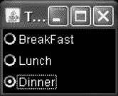

# Choice

`Choice` 是一种下拉/弹出列表。

## 方法

* `void add(String item)`：向此 Choice 菜单添加一个项。
* `void addItemListener(ItemListener i)`：添加指定的监听器以接收来自此 choice 菜单的项。
* `String getItem(int index)`：获取 Choice 菜单中指定索引处的 `String`。
* `int getItemCount()`：返回 Choice 菜单中的项数。
* `int getSelectedIndex()`：返回当前选中项的索引。
* `String getSelectedItem()`：获取当前选择的字符串表示。
* `void insert(String item, int index)`：在此 choice 的指定位置插入项。
* `void remove(int position)`：从 choice 菜单中删除第一个出现的项。
* `void remove(String item)`：从 Choice 菜单中删除第一个出现的项。
* `void removeAll()`：从 choice 菜单中移除所有项。
* `void select(int pos)`：将此 choice 菜单中的选中项设置为指定位置的项。
* `void select(String Str)`：将此 Choice 菜单中的选中项设置为与指定字符串相等的项。

## 示例 17.16

```java
import java.awt.*;
class ChoiceTest
{
  public static void main(String args[]) throws InterruptedException
    {
      Frame f = new Frame("Testing Choice Component");
      f.setLayout(new FlowLayout());
      f.setSize(100,100);
      f.setVisible(true);
      Choice c1=new Choice();
      c1.add("BreakFast");
      c1.add("Lunch");
      c1.add("Dinner");
      f.add(c1);
      c1.select("Dinner"); // c1.select(2);
      Thread.sleep(1000);
      System.out.println(c1.getSelectedItem());
      System.out.println(c1.getSelectedIndex());
      System.out.println(c1.getItemCount());
      System.out.println(c1.getItem(0));
      c1.insert("Brunch",1);
      c1.remove(2); // c1.remove("Lunch");
    }
}
```

输出：

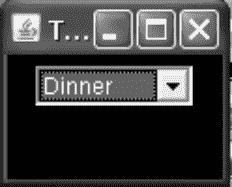

```java
import java.awt.*;
import java.awt.event.*;
class CheckboxItemTest extends Frame implements ItemListener
{
  TextField tf1;
  Choice c1;
  CheckboxItemTest()
    {
      setLayout(new FlowLayout());
      c1=new Choice();
      c1.add("red");
      c1.add("green");
      c1.add("blue");
      tf1 = new TextField(8);
      tf1.setBackground(Color.red);
      c1.addItemListener(this);
      add(c1);
      add(tf1);
      setSize(200,200);
      setVisible(true);
    }
  public static void main(String args[])
    {
      new CheckboxItemTest();
    }
  public void itemStateChanged(ItemEvent ie)
    {
      String s=(String)ie.getItem();
      if(s.equals("red"))
        tf1.setBackground(Color.red);
      else if(s.equals("green"))
        tf1.setBackground(Color.green);
      else if(s.equals("blue"))
        tf1.setBackground(Color.blue);
    }
}
```

# Label

最简单的可见 AWT 组件是 `Label`。Label 通常不用于响应用户输入或发送事件。

## 构造函数

* `Label()`：构建一个空标签。
* `Label(String text)`：构建一个带有指定文本的新标签，左对齐。
* `Label(String text, int alignment)`：构建一个带有指定文本和指定对齐方式的新标签。

## 方法

* `String getText()`：获取标签的文本。
* `void setText(String text)`：设置标签的文本。

## 示例 17.17


```java
import java.awt.*;
class LabelTest
{
  public static void main(String args[])
    {
      Frame f = new Frame("Testing Label");
      f.setLayout(new GridLayout(3,3));
      f.setFont(new Font("Arial",Font.PLAIN, 20));
      Label l1 = new Label("India",Label.LEFT);
      Label l2 = new Label("Pakistan",Label.LEFT);
      Label l3 = new Label("UK",Label.LEFT);
      Label l4 = new Label("India",Label.CENTER);
      Label l5 = new Label("Pakistan",Label.CENTER);
      Label l6 = new Label("UK",Label.CENTER);
      Label l7 = new Label("India",Label.RIGHT);
      Label l8 = new Label("Pakistan",Label.RIGHT);
      Label l9 = new Label("UK",Label.RIGHT);
      l3.setText("USA");
      System.out.println(l1.getText());
      f.add(l1);f.add(l2);f.add(l3);
      f.add(l4);f.add(l5);f.add(l6);
      f.add(l7);f.add(l8);f.add(l9);
      f.setSize(500,200);
      f.setVisible(true);
    }
}
```

输出：


### List

`List` 是垂直排列的文本项。如果列表包含的项多于显示范围，它会自动获取垂直滚动条。

#### 构造函数

- `List()`：创建滚动列表。此构造函数没有指定可见行数，但产生默认四行的高度。当然，在许多情况下，列表的实际高度由布局管理器决定。
- `List(int rows)`：创建一个指定可见行数的滚动列表。
- `List(int rows, boolean multipleMode)`：创建一个显示指定行数的新滚动列表并允许多项选择。

### 示例 17.18

```java
import java.awt.*;
class ListTest
{
  public static void main(String args[])
    { 
      Frame f = new Frame ( );
      f.setLayout (new FlowLayout ());
      List l1=new List(3,true);
      l1.add("India");
      l1.add("Nepal");
      l1.add("Shri Lanka");
      l1.add("USA");
      l1.add("UK");
      f.add(l1);
      System.out.println(l1.getRows());
      f.setSize(300, 300);
      f.setVisible(true);
    }
}
```

输出：

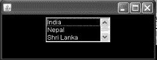

`List` 有五个项，但只有 3 行可见，因此会自动提供垂直滚动条。

注意：选择列表中的某项会导致列表发送 `Item` 事件；双击某项会发送 `Action` 事件。

- `void add(String item)`：将指定的项添加到滚动列表的末尾。
- `void add(String item, int index)`：将指定的项添加到由 `index` 指明位置的滚动列表中。
- `void addActionListener(ActionListener i)`：添加指定的动作监听器，以接收来自此列表的动作事件。
- `void addItemListener(ItemListener i)`：添加指定的项目监听器，以接收来自此列表的项选择事件。
- `String getItem(int index)`：获取与指定的 `index` 关联的项。
- `int getItemCount()`：获取列表中的项数。
- `String[] getItems()`：获取列表中的项。
- `int getRows()`：获取此列表中可见的行数。
- `int getSelectedIndex()`：获取列表中被选中项的索引。
- `int[] getSelectedIndexes()`：获取列表中所有被选中的索引。
- `String getSelectedItem()`：获取此滚动列表中的被选中项。
- `String[] getSelectedItems()`：获取此滚动列表中的被选中项。
- `void remove(int position)`：从此滚动列表中删除指定位置的项。
- `void remove(String item)`：从列表中删除第一次出现的指定项。
- `void removeAll()`：删除此列表中的所有项。
- `void replaceItem(String newValue, int index)`：将滚动列表中指定索引处的项替换为新字符串。
- `void select(int index)`：选中滚动列表中指定索引的项。
- `void setMultipleMode(boolean b)`：设置标志位，决定此列表是否允许多项选择。

```java
import java.awt.*;
import java.awt.event.*;
class ListTest extends Frame implements ActionListener {
    Button b1,b2,b3,b4,b5,b6;
    List l1,l2;
    TextField tf1,tf2;

    ListTest() {
        setLayout(new GridLayout(3,3));
        l1=new List(3,true);
        l2=new List(3,true);
        b1=new Button(">");
        b2=new Button(">>");
        b3=new Button("<");
        b4=new Button("<<");
        b5=new Button("Add");
        b6=new Button("Add");
        b1.addActionListener(this);
        b2.addActionListener(this);
        b3.addActionListener(this);
        b4.addActionListener(this);
        b5.addActionListener(this);
        b6.addActionListener(this);
        tf1=new TextField();
        tf2=new TextField();
        Panel p1=new Panel();
        p1.setLayout(new GridLayout(4,1));
        p1.add(b1);
        p1.add(b2);
        p1.add(b3);
        p1.add(b4);
        add(l1);add(p1);add(l2);
        add(tf1);add(new Label());add(tf2);
        add(b5);add(new Label());add(b6);
        setSize(300,300);
        setVisible(true);
    }

    public static void main(String args[]) {
        new ListTest();
    }

    public void actionPerformed(ActionEvent ae) {
        Button b=(Button)ae.getSource();
        if(b==b1) {
            String s[]=l1.getSelectedItems();
            for(int i=0;i<s.length;i++) {
                l2.add(s[i]);
                l1.remove(s[i]);
            }
        } else if(b==b2) {
            String s[]=l1.getItems();
            for(int i=0;i<s.length;i++) {
                l2.add(s[i]);
                l1.remove(s[i]);
            }
        } else if(b==b3) {
            String s[]=l2.getSelectedItems();
            for(int i=0;i<s.length;i++) {
                l1.add(s[i]);
                l2.remove(s[i]);
            }
        } else if(b==b4) {
            String s[]=l2.getItems();
            for(int i=0;i<s.length;i++) {
                l1.add(s[i]);
                l2.remove(s[i]);
            }
        } else if(b==b5) {
            l1.add(tf1.getText());
        } else if(b==b6) {
            l2.add(tf2.getText());
        }
    }
}
```

### TextField 和 TextArea

`TextField` 和 `TextArea` 类实现了用于文本输入、显示和编辑的一维和二维组件。这两个类都继承自 `TextComponent` 超类。

`Object` -> `Component` -> `TextComponent` -> (`TextField`, `TextArea`)

`TextField` 和 `TextArea` 都有多种构造函数，提供了指定或不指定初始字符串或首选大小的选择。不指定首选大小的构造函数最适用于布局管理器将忽略该组件的情况。

#### `TextField` 的构造函数

- `TextField()`：创建一个文本框。
- `TextField(int columns)`：创建一个具有指定列宽的文本框。
- `TextField(String text)`：创建一个包含指定文本的文本框。
- `TextField(String text, int columns)`：创建一个包含指定文本且具有指定列数的文本框。

#### `TextArea` 的构造函数

- `TextArea()`：创建一个文本区域。
- `TextArea(int rows, int columns)`：创建一个具有指定行数和列数的文本区域。
- `TextArea(String text)`：创建一个包含指定文本的文本区域。
- `TextArea(String text, int rows, int columns)`：创建一个包含指定文本并指定行列数的文本区域。
- `TextArea(String text, int rows, int columns, int scrollbarPolicy)`：创建一个包含指定文本、指定行数、列数以及滚动条策略的文本区域。

`TextArea` 类定义了几个常量可以作为 `scrollbarPolicy` 参数的值：

- `SCROLLBARS_BOTH`
- `SCROLLBARS_VERTICAL_ONLY`
- `SCROLLBARS_HORIZONTAL_ONLY`
- `SCROLLBARS_NONE`

对于这两个类，`columns` 参数存在一些意想不到的问题。首先，列宽是相对于字体宽度的衡量的。对于等宽字体，列宽显然是每个字符宽度的倍数。对于比例字体，列宽被取为所有字符宽度的平均值。这种平均值并没有考虑到字符使用的频率。因此在大多数情况下，包含大量小写字母的组件显示的字符比请求的要多。

接下来是比例字体的问题。对于等宽字体，列宽应该是显而易见的。对于比例字体，列宽取为所有字符宽度的平均值。

#### `TextComponent` 类的方法

- `getSelectedText()`：获取文本组件中选中的文本。
- `getText()`：获取文本组件中的文本。
- `setEditable(boolean b)`：设置标志，决定此文本组件是否可编辑。
- `setText(String t)`：将文本组件中的文本设置为指定的文本。

### 示例 17.19

```java
import java.awt.*;
class TextFieldTest {
    public static void main(String args[]) {
        Frame f=new Frame();
        f.setLayout(new FlowLayout());
        TextField tf1=new TextField();
        TextField tf2=new TextField(8);
        TextField tf3=new TextField("matrix");
        TextField tf4=new TextField("matrix",20);
        TextArea ta1=new TextArea();
        TextArea ta2=new TextArea(3,8);
        TextArea ta3=new TextArea("abc\nxyz\naaa");
        TextArea ta4=new TextArea("abc\nxyz\naaa",2,2);
        TextArea ta5=new TextArea("abc\nxyz\naaa",4,20,TextArea.SCROLLBARS_BOTH);
        f.add(tf1);f.add(tf2);f.add(tf3);f.add(tf4);
        f.add(ta1);f.add(ta2);f.add(ta3);f.add(ta4);
        f.add(ta5);
        tf1.setText("abc");
        System.out.println(tf3.getText());
        tf3.setEditable(false);
    }
}
```

```java
22.      f.setSize(800, 400);
23.      f.setVisible(true);
24.     }
25. }
```

输出：

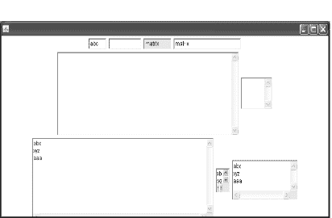

## FileDialog（文件对话框）

此类表示打开文件或保存文件的对话框。文件对话框是一个模态对话框，这意味着只要对话框在屏幕上可见，来自对话框父框架的输入都将专门定向到对话框。当用户指定文件或点击取消按钮时，对话框将自动移除。最有用的 `FileDialog` 构造函数形式如下：

`FileDialog(Frame parent, String title, int mode)`

对话框的父级是对话框将出现的框架（`Frame`）。标题字符串显示在对话框的标题栏。

模式（`mode`）应该是以下之一：

- `FileDialog.LOAD`
- `FileDialog.SAVE`

在用户指定文件后，可以使用以下方法获取文件名或其目录：

- `String getDirectory()`：获取此文件对话框选中的目录。
- `String getFile()`：获取此文件对话框选中的文件。

### 示例 17.20


```java
1.  import java.awt.*;
2.  public class FileDialogTest
3.  { 
4.    public static void main(String args[])
5.    { 
6.      Frame f=new Frame( ) ;
7.      f.setLayout(new FlowLayout( ));
8.      f.setSize(200, 200);
9.      f.setVisible(true);
10.     FileDialog fd=new FileDialog (f, "Load file", FileDialog.LOAD);
11.     fd.setVisible(true);
12.     System.out.println(fd.getFile());
13.      System.out.println(fd.getDirectory());
14.   }
15. }
```

## ScrollPane（滚动面板）

`ScrollPane` 可以包含单个组件，该组件可能比滚动面板本身更高或更宽。

如果容器组件大于滚动面板，则滚动面板的默认行为是根据需要显示水平和/或垂直滚动条。

该类有两个构造函数：

- `ScrollPane()`  
  创建一个新的滚动面板容器，其滚动条显示策略为“按需”。

- `ScrollPane(int scrollbarDisplayPolicy)`  
  创建一个具有指定滚动条行为的新滚动面板容器。滚动面板的显示策略应该是以下之一：
  - `ScrollPane.SCROLLBARS_AS_NEEDED`（默认）
  - `ScrollPane.SCROLLBARS_ALWAYS`
  - `ScrollPane.SCROLLBARS_NEVER`

下面列出的代码创建了一个具有默认（按需）滚动条行为的滚动面板。该滚动面板包含一个很大的按钮；因此肯定需要滚动条。

### 示例 17.21

```java
1.  import java.awt.*;
2.  class SPaneTest
3.  { 
4.    public static void main(String args[])
5.    { 
6.      Frame f=new Frame();
7.      f.setLayout(new GridLayout(1,2));
8.      f.setSize(250, 150);
9.      ScrollPane spane=new ScrollPane();
10.      spane.setBackground(Color.green);
11.      f.add(spane);
12.      f.add(new TextArea());
13.      Button b1=new Button("Push Me !");
14.      b1.setFont(new Font("Serif", Font.ITALIC, 100));
15.      spane.add(b1);
16.      f.setVisible(true);
17.    }
18. }
```

输出：


## Scrollbar（滚动条）

调整列表和滚动面板的 `Scrollbar` 组件可以作为独立的组件存在。它有三个构造函数：

- `Scrollbar()`  
  构造一个新的垂直滚动条。

- `Scrollbar(int orientation)`  
  构造具有指定方向的新滚动条。

- `Scrollbar(int orientation, int initialValue, int sliderSize, int minValue, int maxValue)`  
  构造具有指定方向、初始值、滑块大小以及最小值和最大值的新滚动条。`sliderSize` 参数控制滑块的大小，但不是以像素为单位。对于带有方向参数的构造函数，该值应该是以下之一：
  - `Scrollbar.HORIZONTAL`（水平）
  - `Scrollbar.VERTICAL`（垂直）

### 示例 17.22

```java
1.  import java.applet.*;
2.  import java.awt.*;
3.  import java.awt.event.*;
4.  /*<applet code = "RGB" width=500 height=200></applet>  */
5.  public class RGB extends Applet implements AdjustmentListener
6.  {
7.    TextField tf1;
8.    Scrollbar sb1,sb2,sb3;
9.    public void init()
10.    {
11.      setLayout(new GridLayout(4,1));
12.      sb1 = new Scrollbar(Scrollbar.HORIZONTAL,0,10,255);
13.      sb2 = new Scrollbar(Scrollbar.HORIZONTAL,0,10,255);
14.      sb3 = new Scrollbar(Scrollbar.HORIZONTAL,0,10,255);
15.      sb1.addAdjustmentListener(this);
16.      sb2.addAdjustmentListener(this);
17.      sb3.addAdjustmentListener(this);
18.      tf1 = new TextField();
19.      add(sb1);
20.      add(sb2);
21.      add(sb3);
22.      add(tf1);
23.    }
24.    public void adjustmentValueChanged(AdjustmentEvent e)
25.    {
26.      int a=e.getValue();
27.      tf1.setText(String.valueOf(a));
28.    }
29.  }
```

*(注：由于原文代码示例 17.22 部分存在严重的乱码和重复，排版时根据逻辑进行了合理修正以保持可读性)*

## 第 18 章：AWT 事件简介

### 简介

当一个普通程序（非 GUI）需要输入时，它会提示用户并调用某些方法，例如 `readline()`。对于 GUI 程序，用户是通过点击不同的按钮来触发动作的。

| 接口 | 事件（方法） | 类 | 方法 |
| :--- | :--- | :--- | :--- |
| `ActionListener` | `actionPerformed()` | `ActionEvent` | `getSource()` |
| `ItemListener` | `itemStateChanged()` | `ItemEvent` | `getItem()` |
| `AdjustmentListener` | `adjustmentValueChanged()` | `AdjustmentEvent` | `getAdjustable()` |
| `MouseListener` | `mouseEntered()`<br>`mouseExited()`<br>`mouseClicked()`<br>`mouseReleased()`<br>`mousePressed()` | `MouseEvent` | `getX()`<br>`getY()`<br>`getPoint()`<br>`getClickCount()`<br>`getButton()`<br>`getModifiers()`<br>`getModifiersText()` |
| `MouseMotionListener` | `mouseMoved()`<br>`mouseDragged()` | `MouseEvent` | 同上 |
| `KeyListener` | `keyTyped()`<br>`keyPressed()`<br>`keyReleased()` | `KeyEvent` | `getKeyChar()`<br>`getKeyCode()` |
| `FocusListener` | `focusGained()`<br>`focusLost()` | `FocusEvent` | `getSource()` |
| `WindowListener` | `windowOpened()`<br>`windowClosing()`<br>`windowClosed()`<br>`windowActivated()`<br>`windowDeactivated()`<br>`windowIconified()`<br>`windowDeiconified()` | `WindowEvent` | `getWindow()` |

Java 使用委托模型进行事件处理。在委托模型中，可以告诉组件在生成特定类型的事件时通知哪个对象。如果组件对某种事件不感兴趣，则该类型的事件将不会传递。委托模型基于以下核心概念：

- 事件类
- 事件监听器
- 适配器

### 事件类

点击按钮会导致产生事件。事件包含大量相关信息，如时间、生成事件的组件、点击发生点的坐标等。

这些信息被放在事件类中。该概念类似于异常处理。每当发生异常时，都会创建一个适当异常类的对象，并将所有异常信息放入该对象中。

### 事件监听器

事件监听器负责在事件发生时采取适当行动。事件监听器是组件委托处理特定类型事件任务的对象。

当组件接收到输入时，会构造一个相应类型的事件，然后该事件将作为参数传递给监听器上的某个方法调用。监听器必须实现包含该事件处理方法的接口。

我们可以将事件监听器与处理异常的 `catch` 块进行比较。我们需要为要处理的异常提供一个相应的 `catch` 块。同样地，如果我们想处理由某个组件生成的事件，我们需要提供相应的监听器。

监听器与组件相关联。不同的事件有不同的监听器。当事件发生时，会调用相应的监听器方法，并将事件对象作为参数传递。

### 适配器

语言中定义的监听器仅为接口。我们需要提供相应监听器的实现。某些监听器具有 2 个或更多方法。

要实现一个具有多个方法的监听器，即使只对其中一个方法感兴趣，也需要提供所有方法的实现。适配器类提供了这一解决方案。

适配器类提供了监听器所有方法的空实现，这有助于减少编程工作。如果我们只想使用监听器类的一个方法，只需扩展适配器类并重写所需的方法。

### 事件层次结构

AWT 有一个定义良好的事件层次结构。通常，事件层次结构中的叶子节点表示实际事件。非叶子类作为基类并封装。AWT 事件层次结构如图所示。


#### `java.util.EventObject` 类

这是所有事件类的顶级父类。它是一个非常通用的类，只有一个感兴趣的方法，返回产生事件的对象。

```java
Object getSource()
```

#### `java.awt.AWTEvent` 类

事件对象的子类是 `java.awt.AWTEvent`。同样，只有一个感兴趣的方法，返回事件的 ID。

```java
int getID()
```

`java.awt.AWTEvent` 的子类表示由各种 AWT 组件生成的各种事件类型，并包含触发事件的所有必要信息。例如，`MouseEvent` 代表可能性：`MOUSE_CLICKED`、`MOUSE_DRAGGED` 等。这些事件类型实际上由组件的激活触发：

1. `ActionEvent`：在按钮点击、双击列表时生成。
2. `AdjustmentEvent`：当滚动条的值改变时生成。
3. `ContainerEvent`：当组件添加到容器或从容器中移除时生成。
4. `FocusEvent`：当组件获得或失去焦点时生成。
5. `ItemEvent`：当从列表、选择框或复选框选择或取消选择时生成。
6. `KeyEvent`：由键盘活动生成。
7. `MouseEvent`：由鼠标活动生成。
8. `MouseWheelEvent`：当鼠标轮旋转时生成。
9. `WindowEvent`：由窗口活动生成（如最小化或还原）。
10. `TextEvent`：当文本组件被修改时生成。

#### `java.awt.event` 包

该包提供了处理由 AWT 组件触发的不同类型事件的接口和类。该包定义了事件和监听器，监听器与事件源注册以接收有关特定类型事件的通知。

### 事件监听器接口

每个事件类都有相应的监听器接口并定义了一个或多个方法。常用的监听器接口在以下章节中描述。

#### `ActionListener` 接口

这是接收动作事件的监听器接口。对动作事件感兴趣的类实现此接口，并使用组件的 `addActionListener()` 方法注册。当动作事件发生时，会调用监听器的 `actionPerformed()` 方法，其签名为：

| Method | Description |
| :--- | :--- |
| `void actionPerformed(ActionEvent e)` | 当动作发生时调用。 |

#### `AdjustmentListener` 接口

这是接收调整事件的监听器接口。

| Method | Description |
| :--- | :--- |
| `void adjustmentValueChanged(AdjustmentEvent e)` | 当滑块/滑动条的值改变时调用。 |

#### `ContainerListener` 接口

这是当组件添加到容器或从容器中移除时接收事件的监听器接口。

| Method | Description |
| :--- | :--- |
| `void componentAdded(ContainerEvent e)` | 当组件添加到容器时调用。 |
| `void componentRemoved(ContainerEvent e)` | 当组件从容器中移除时调用。 |

#### `FocusListener` 接口

这是当组件获得或失去焦点时接收事件的监听器接口。

| Method | Description |
| :--- | :--- |
| `void focusGained(FocusEvent e)` | 当组件获得键盘焦点时调用。 |
| `void focusLost(FocusEvent e)` | 当组件失去键盘焦点时调用。 |

#### `ItemListener` 接口

这是接收项目事件的监听器接口。

```java
void itemStateChanged(ItemEvent e)
```

当项目被用户选中或取消选择时调用。

#### `KeyListener` 接口

这是接收键盘事件（按键）的监听器接口。

| Method | Description |
| :--- | :--- |
| `void keyPressed(KeyEvent e)` | 当按下按键时调用。 |
| `void keyReleased(KeyEvent e)` | 当释放按键时调用。 |
| `void keyTyped(KeyEvent e)` | 当输入按键时调用。 |

#### `MouseListener` 接口

这是在组件上接收鼠标事件（按下、释放、点击、进入和退出）的监听器接口。

| Method | Description |
| :--- | :--- |
| `void mouseClicked(MouseEvent e)` | 当在组件上点击（按下并释放）鼠标按钮时调用。 |
| `void mouseEntered(MouseEvent e)` | 当鼠标进入组件时调用。 |
| `void mouseExited(MouseEvent e)` | 当鼠标离开组件时调用。 |
| `void mousePressed(MouseEvent e)` | 当在组件上按下鼠标按钮时调用。 |
| `void mouseReleased(MouseEvent e)` | 当在组件上释放鼠标按钮时调用。 |

#### `MouseMotionListener` 接口

这是在组件上接收鼠标移动事件（移动和拖动）的监听器接口。

| Method | Description |
| :--- | :--- |
| `void mouseDragged(MouseEvent e)` | 当在组件上按下鼠标按钮并拖动时调用。 |
| `void mouseMoved(MouseEvent e)` | 当鼠标指针在组件上移动但未按下按钮时调用。 |

#### `MouseWheelListener` 接口

这是在组件上接收鼠标轮事件的监听器接口。

```java
void mouseWheelMoved(MouseWheelEvent e)
```

当鼠标轮旋转时调用。

#### `WindowListener` 接口

当窗口的状态由于打开、关闭、激活或取消激活、最小化或还原而改变时，监听器对象中的相关方法会被调用并将窗口事件传递给它。

| Method | Description |
| :--- | :--- |
| `void windowActivated(WindowEvent e)` | 当设置为活动窗口时调用。 |
| `void windowClosed(WindowEvent e)` | 当调用 `dispose()` 导致窗口关闭时调用。 |
| `void windowClosing(WindowEvent e)` | 当用户尝试从窗口系统菜单关闭窗口时调用。 |
| `void windowDeactivated(WindowEvent e)` | 当窗口不再是活动窗口时调用。 |
| `void windowDeiconified(WindowEvent e)` | 当窗口从最小化状态恢复到正常状态时调用。 |
| `void windowIconified(WindowEvent e)` | 当窗口从正常状态变为最小化状态时调用。 |
| `void windowOpened(WindowEvent e)` | 当窗口第一次变为可见时调用。 |

## 处理 ActionEvent

### 示例 18.1


下面的示例解释了如何处理点击按钮生成的 `actionevent`。

```java
import java.awt.*;
import java.awt.event.*;
class A1
{ 
  public static void main(String args[])
    { 
      Frame f=new Frame();
      f.setLayout(new FlowLayout());
      f.setSize(500,100);
      Button b1=new Button("Push me");
      Button b2=new Button("Click me");
      b1.addActionListener(new B());
      b2.addActionListener(new C());
      f.add(b1);
      f.add(b2);
      f.setVisible(true);
    }
}
class B implements ActionListener
{ 
  public void actionPerformed(ActionEvent ae)
    {
      System.out.println("Button Pushed");
    }
}
class C implements ActionListener
{ 
  public void actionPerformed(ActionEvent ae)
    {
      System.out.println("Button Clicked");
    }
}
```

**输出：**


### 示例 18.2

```java
import java.awt.*;
import java.awt.event.*;
class A2 implements ActionListener
{ 
  static Button b1=null,b2=null;
  public static void main(String args[])
    { 
      Frame f=new Frame();
      f.setLayout(new FlowLayout());
      f.setSize(500,100);
      b1=new Button("Push me");
      b2=new Button("Click me");
      b1.addActionListener(new A2());
      b2.addActionListener(new A2());
      f.add(b1);
      f.add(b2);
      f.setVisible(true);
    }
  public void actionPerformed(ActionEvent ae)
    {
      if(ae.getSource() == b1) 
      System.out.println("Button Pushed");
      else
      System.out.println("Button Clicked");
    }
}
```

**输出：** 与上一个示例相同。

### 示例 18.3

```java
import java.awt.*;
import java.awt.event.*;
class A3 implements ActionListener
{ 
  Button b1=null,b2=null;
  A3()
    {
      Frame f=new Frame();
      f.setLayout(new FlowLayout());
      f.setSize(500,100);
      b1=new Button("Push me");
      b2=new Button("Click me");
      b1.addActionListener(this);
      b2.addActionListener(this);
      f.add(b1);
      f.add(b2);
      f.setVisible(true);
    }
  public static void main(String args[])
    { 
      new A3();
    }
  public void actionPerformed(ActionEvent ae)
    {
      if(ae.getSource() == b1)
      System.out.println("Button Pushed");
      else
      System.out.println("Button Clicked");
    }
}
```

**输出：** 与上一个相同。

### 示例 18.4

```java
import java.awt.*;
import java.awt.event.*;
class A4 implements ActionListener
{ 
  static Button b1=null,b2=null;
  static TextField tf1=null, tf2=null, tf3=null;
  public static void main(String args[])
    { 
      Frame f=new Frame();
      f.setLayout(new GridLayout(4,2));
      f.setSize(500,300);
      Label l1 = new Label("No1.");
      Label l2 = new Label("No2.");
      Label l3 = new Label("Result");
      tf1 = new TextField();
      tf2 = new TextField();
      tf3 = new TextField();
      b1=new Button("Sum");
      b2=new Button("Avg");
      b1.addActionListener(new A4());
      b2.addActionListener(new A4());
      f.add(l1);f.add(tf1);
      f.add(l2);f.add(tf2);
      f.add(l3);f.add(tf3);
      f.add(b1);f.add(b2);
      f.setVisible(true);
    }
  public void actionPerformed(ActionEvent ae)
    {
      int a,b,c;
      float av;
      a=Integer.parseInt(tf1.getText());
      b=Integer.parseInt(tf2.getText());
      if(ae.getSource() == b1) 
        tf3.setText("" +(a+b));
      else
        tf3.setText("" + (a+b)/2.0f);
    }
}
```

## 处理窗口事件

### 示例 18.5

```java
import java.awt.*;
import java.awt.event.*;
class A5
{ 
  public static void main(String args[])
    { 
      Frame f= new Frame();
      f.setLayout(new FlowLayout());
      f.setSize(300,300);
      f.addWindowListener(new B( ));
      f.setVisible(true);
    }
}
class B implements WindowListener
{ 
  public void windowOpened(WindowEvent we)
    {
      System.out.println("Window Opened");
    }
  public void windowActivated(WindowEvent we)
    {
      System.out.println("Window Activated");
    }
  public void windowDeactivated(WindowEvent we)
    {
      System.out.println("Window Deactivated");
    }
  public void windowClosing(WindowEvent we)
    { 
      System.out.println("Window Closing");
      Frame f = (Frame) we.getWindow ();
      f.dispose();
    }
  public void windowClosed(WindowEvent we)
    {
      System.out.println("Window Closed");
    }
  public void windowIconified(WindowEvent we)
    {
      System.out.println("Window Iconified");
    }
  public void windowDeiconified(WindowEvent we)
    {
      System.out.println("Window Deiconified");
    }
}
```

**输出：**

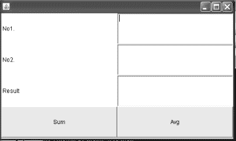

**注意：** 窗口可以关联多个监听器。通过调用 `removeWindowListener(al)` 从组件中移除监听器，例如：

```java
f.removeWindowListener(al);
```

`WindowListener` 接口并不保证所有监听器会按照它们添加的顺序被通知。因此，在实现 `WindowListener` 的类中，我们必须为所有方法提供空实现。

### 适配器 (Adapters)

某些事件监听接口具有多个方法。最大的接口 `WindowListener` 有七个方法。假设我们只想捕获 `windowClosing()` 事件，以便执行关闭窗口的代码。虽然我们只需要实现 `WindowListener` 类中的一个方法，但我们必须为所有方法提供占位实现。

`java.awt.event` 包提供了多个适配器类，为每个定义了多个方法的监听接口提供一个。适配器仅仅是实现了接口并提供了空方法的类。例如，`WindowAdapter` 类实现了 `WindowListener` 接口的个空方法。

**适配器类及其对应的接口：**

| 适配器类 | 监听接口 |
| :--- | :--- |
| `ContainerAdapter` | `ContainerListener` |
| `FocusAdapter` | `FocusListener` |
| `KeyAdapter` | `KeyListener` |
| `MouseAdapter` | `MouseListener` |
| `MouseMotionAdapter` | `MouseMotionListener` |
| `WindowAdapter` | `WindowListener` |

### 示例 18.6 WindowAdapter 类的使用

```java
import java.awt.*;
import java.awt.event.*;
class A6
{ 
  public static void main (String args[])
    { 
      Frame f= new Frame();
      f.setLayout(new FlowLayout());
      f.setSize(300,300);
      f.addWindowListener(new B( ));
      f.setVisible(true);
    }
}
class B extends WindowAdapter
{ 
  public void windowClosing(WindowEvent we)
    { 
      System.out.printIn("Window Closing");
      Frame f = (Frame) we.getWindow ();
      f.dispose();
    }
}
```

### `InputEvent` 类

这是所有组件级输入事件的根事件类。输入事件在由其源组件进行正常处理之前，会先传递给监听器。这允许监听器和组件子类“消费”该事件，使得源组件不会以默认方式处理这些事件。例如，在 `Button` 组件上消费鼠标按下事件将防止 `Button` 被激活。

#### 方法

- `void consume()`: 消费此事件，以使其产生该事件的源不会以默认方式对其进行处理。
- `int getModifiers()`: 返回此事件的修饰符掩码。
- `int getModifiersEx()`: 返回此事件的扩展修饰符掩码。
- `static String getModifiersExText(int modifiers)`: 返回一个描述扩展修饰符按键的字符串，例如“shift”、“Ctrl + Shift”等。
- `long getWhen()`: 返回此事件发生的时间戳。
- `boolean isAltDown()`: 返回此事件中 Alt 修饰符是否被按下。
- `boolean isConsumed()`: 返回此事件是否已被消费。
- `boolean isControlDown()`: 返回此事件中 Control 修饰符是否被按下。
- `boolean isShiftDown()`: 返回此事件中 shift 修饰符是否被按下。

### 鼠标事件类

这是 `InputEvent` 类的子类。此事件表示组件中发生了鼠标操作。当且仅当鼠标光标位于组件子级未被遮挡的部分、或者位于菜单或顶层窗口上时，才认为鼠标操作发生在特定的组件中。

此事件既用于鼠标事件（点击、进入、按下、移出、释放），也用于鼠标移动事件（移动和 拖拽）。

#### 方法

- `int getButton()`: 返回哪个鼠标键的状态发生了变化（如果有）。
- `int getClickCount()`: 返回与此事件相关的鼠标点击次数。
- `static String getMouseModifiersText(int modifiers)`: 返回一个描述事件期间按下的修饰符按键的字符串，例如“Shift”或“Ctrl + shift”。
- `Point getPoint()`: 返回事件相对于源组件的 x, y 位置。
- `int getX()`: 返回事件相对于源组件的水平 x 位置。
- `int getY()`: 返回事件相对于源组件的垂直 y 位置。
- `boolean isPopupTrigger()`: 返回此鼠标事件是否为该平台的弹出菜单触发事件。

**注意：** 弹出菜单在不同系统上的触发方式不同。因此，为了实现良好的跨平台功能，应该在鼠标按下和鼠标释放时都检查 `isPopupTrigger()`。

### 处理鼠标事件

#### 示例 18.7


```java
1. import java.awt.*;
2. import java.awt.event.*;
3. class A7
4. { 
5.   public static void main(String args[])
6.   { 
7.       Frame f= new Frame();
8.       f.setLayout(new FlowLayout());
9.       f.setSize(300,300);
10.      Button b1 = new Button("Push Me");
11.      b1.addMouseListener(new B());
12.      b1.addMouseMotionListener(new C());
13.      b1.addActionListener(new D());
14.      f.add(b1);
15.      f.setVisible(true);
16.   }
17. }
18. class B implements MouseListener
19. { 
20.   public void mouseEntered(MouseEvent me)
21.   { 
22.      System.out.println("Mouse Entered...");
23.      System.out.println(me.getX());
24.      System.out.println(me.getY());
25.   }
26.   public void mouseExited(MouseEvent me)
27.   { 
28.      System.out.println("Mouse Exited...");
29.      Point p1=me.getPoint();
30.      System.out.println(p1.x);
31.      System.out.println(p1.y);
32.   }
33.   public void mousePressed(MouseEvent me)
34.   { 
35.      System.out.println("Mouse pressed...");
36.      int ms = me.getModifiers();
37.      String s = me.getModifiersEx();
38.      System.out.println(s);
39.   }
40.   public void mouseReleased(MouseEvent me)
41.   { 
42.      System.out.println("Mouse Released...");
43.      System.out.println("ClickCount->" + me.getClickCount());
44.   }
45.   public void mouseClicked(MouseEvent me)
46.   { 
47.      System.out.println("Mouse Clicked...");
48.      System.out.println("Button->"+me.getButton());
49.   } 
50. }
51. class C implements MouseMotionListener
52. {
53.   public void mouseMoved(MouseEvent me)
54.   { 
55.      System.out.println("Mouse Moved...");
56.   }
57.   public void mouseDragged(MouseEvent me)
58.   { 
59.      System.out.println("Mouse Dragged...");
60.   }
61. }
62. class D implements ActionListener
63. {
64.   public void actionPerformed(ActionEvent e)
65.   { 
66.      System.out.println("Button Actioned");
67.   }
68. }
```

## `ActionEvent` 类

这是一个 `ActionEvent` 的子类。此事件表示组件中发生了动作。当一个组件发生特定操作（如被按下）时，注册的 `ActionListener` 就会收到一个 `ActionEvent`。

它是一个语义化的事件（例如“按钮按下”）。实现了 `ActionListener` 接口的对象将接收此类事件。

**注意：** 在键盘上触发 `ActionEvent` 时，不同的系统可能会有不同的修饰键。

### 方法

- `String getActionCommand()`: 返回与此动作相关的命令字符串。
- `int getModifiers()`: 返回事件期间按下的修饰符按键。
- `long getWhen()`: 返回事件发生的时间戳。

### 示例 18.8

此示例说明了 `ActionEvent` 发生时如何识别修饰键。

```java
1. import java.awt.*;
2. import java.awt.event.*;
3. public class KeyModifierDemo extends Frame implements ActionListener
4. { 
5.   Button b;
6.   KeyModifierDemo ()
7.   { 
8.     b = new Button ("Button");
9.     b.addActionListener(this);
10.      setLayout(new FlowLayout());
11.      add(b);
12.      setBounds(100,100,200,200);
13.      setVisible(true);
14.   }
15.   public static void main (String args[])
16.   { 
17.      new KeyModifierDemo();
18.   }
19.   public void actionPerformed (ActionEvent ae)
20.   { 
21.      System.out.println("Button Pressed");
22.      int ms = ae.getModifiers();
23.      if ((ms & InputEvent.CTRL_DOWN_MASK) != 0)
24.      {   
25.        System.out.println("CTRL key was pressed");
26.      }
27.      if ((ms & InputEvent.SHIFT_DOWN_MASK) != 0)
28.      { 
29.        System.out.println("Shift Key was pressed");
30.      }
31.      if ((ms & InputEvent.ALT_DOWN_MASK) != 0)
32.      { 
33.        System.out.println("ALT key was pressed");
34.      }
35.    }
36.  }
37. }
```

## 处理多个动作命令

Action 事件是最简单的。当我们发现一个滚动条发送了调整事件时，明显的问题是“现在滚动条的值是多少？”。当我们发现鼠标被点击时，自然会想“鼠标的 x 和 y 坐标是多少？”。但当我们发现一个按钮发送了 `ActionEvent` 事件时，似乎没有其他额外信息需要寻找了；按钮被点击了，这似乎就是全部。

然而，Action 事件关联有一个额外的信息。此信息是一个字符串，被称为 Action 命令（Action command）。我们可以通过 `getActionCommand()` 方法提取 Action 事件的 Action 命令。如果 Action 事件是由文本字段（text field）发送的，`getActionCommand()` 将返回文本字段当前的内容（当用户按下回车键时，文本字段会发送 Action 事件）。如果 Action 事件是由按钮发送的，默认行为是 `getActionCommand()` 返回按钮标签的字符串。然而，我们可以通过调用其 `setActionCommand(String)` 方法显式地设置按钮的 ActionCommand。

```java
Button btn = new Button("Hello");
btn.setActionCommand("Hello");
```

按钮 Action 命令的用处在按钮的 Action 监听器（Action listener）需要决定如何响应 Action 事件时显而易见。单个监听器作为多个组件的监听器是常见的现象；在我们的上下文中，一个对象可以是几个或多个按钮的 Action 监听器。在这种情况下，对象的 `actionPerformed()` 方法必须通过判断哪个按钮被点击来执行。以下示例演示了这一点：

### 示例 18.9

```java
import java.awt.*;
import java.awt.event.*;
class ButtonRefTest
{
    Button b1,b2,b3;
    ButtonRefTest()
    {  
      Frame f=new Frame();
      f.setLayout(new FlowLayout ( ));
      f.setSize(300,300);
      b1=new Button("Push Me");
      b2=new Button("Click Me");
      b3=new Button("Hit Me");
      f.add(b1);   f.add(b2);   f.add(b3);
      B obj= new B(b1,b2,b3);
      b1.addActionListener(obj);
      b2.addActionListener(obj);
      b3.addActionListener(obj);
      f.setVisible(true);
    }
    public static void main(String args [ ])
    { 
      new ButtonRefTest();
    }
}
class B implements ActionListener
{ 
    Button b4,b5,b6;
    B(Button b1, Button b2, Button b3)
    {
      b4 = b1;
      b5 = b2;
      b6 = b3;
    }
    public void actionPerformed(ActionEvent ae)
    {  
      Button b=(Button)ae.getSource();
      if(b==b4)
      System.out.println("First Button was pressed");
      else if(b==b5)
      System.out.println("Second Button was pressed");
      else if(b==b6)
      System.out.println("Third  was pressed");
    }
}
```

### 示例 18.10

```java
import java.awt.*;
import java.awt.event.*;
class GetLabelTest
{
    Button b1,b2,b3;
    GetLabelTest()
    {  
      Frame f=new Frame();
      f.setLayout(new FlowLayout ( ));
      f.setSize(300,300);
      b1=new Button("Push Me");
      b2=new Button("Click Me");
      b3=new Button("Hit Me");
      f.add(b1);   f.add(b2);   f.add(b3);
      B obj= new B();
      b1.addActionListener(obj);
      b2.addActionListener(obj);
      b3.addActionListener(obj);
      f.setVisible(true);
    }
    public static void main(String args [ ])
    { 
      new GetLabelTest();
    }
}
class B implements ActionListener
{ 
    public void actionPerformed(ActionEvent ae)
    { 
      Button b=(Button)ae.getSource();
      String s=b.getLabel();
      if(s.equals("Push Me"))
      System.out.println("First Me Button was pressed");
      else if(s.equals("Click Me"))
      System.out.println("Second Me Button was pressed");
      else if(s.equals("Hit Me"))
      System.out.println("Third Me Button was pressed");
    }
}
```

### 示例 18.11：使用 `setActionCommand()` 方法设置 Action Command

```java
import java.awt.*;
import java.awt.event.*;
class ActionCommandTest
{
    Button b1,b2,b3;
    ActionCommandTest()
    { 
      Frame f=new Frame();
      f.setLayout(new FlowLayout());
      f.setSize(300,300);
      b1=new Button("Push Me");
      b2=new Button("Push Me");
      b3=new Button("Push Me");
      b1.setActionCommand("First");
      b2.setActionCommand("Second");
      b3.setActionCommand("Third");
      f.add(b1);   f.add(b2);   f.add(b3);
      B obj= new B();
      b1.addActionListener(obj);
      b2.addActionListener(obj);
      b3.addActionListener(obj);
      f.setVisible(true);
    }
    public static void main(String args [ ])
    { 
      new ActionCommandTest();
    }
}
class B implements ActionListener
{ 
    public void actionPerformed(ActionEvent ae)
    { 
      Button b=(Button)ae.getSource();
      String s=b.getActionCommand();
      if(s.equals("First"))
      System.out.println("First Me Button was pressed");
      else if(s.equals("Second"))
      System.out.println("Second Me Button was pressed");
      else if(s.equals("Third"))
      System.out.println("Third Me Button was pressed");
    }
}
```

### 示例 18.12：处理键事件


```java
import java.awt.*;
import java.awt.event.*;

class KeyTest extends Frame implements KeyListener {
    String msg = "";
    int x = 50, y = 100;

    public static void main(String arg[]) {
        Frame f = new KeyTest();
        f.setSize(300, 300);
        f.addKeyListener(f);
        f.setVisible(true);
    }

    public void keyReleased(KeyEvent ke) {
    }

    public void keyTyped(KeyEvent ke) {
        System.out.println("Key Typed...");
    }

    public void keyPressed(KeyEvent ke) {
        System.out.println("Key Pressed...");
        int key = ke.getKeyCode();
        switch (key) {
            case KeyEvent.VK_F1:
                msg = msg + "<F1>";
                break;
            case KeyEvent.VK_F2:
                msg = msg + "<F2>";
                break;
            case KeyEvent.VK_F3:
                msg = msg + "<F3>";
                break;
            case KeyEvent.VK_PAGE_DOWN:
                msg = msg + "<PgDn>";
                break;
            case KeyEvent.VK_PAGE_UP:
                msg = msg + "<PgUp>";
                break;
            case KeyEvent.VK_LEFT:
                msg = msg + "<Left Arrow>";
                break;
            case KeyEvent.VK_RIGHT:
                msg = msg + "<Right Arrow>";
                break;
            case KeyEvent.VK_CONTROL:
                msg = msg + "<Ctrl>";
                break;
        }
        repaint();
    }

    public void paint(Graphics g) {
        g.setColor(Color.red);
        g.drawString(msg, x, y);
    }
}
```

```java
import java.awt.event.*;

class A extends Frame implements ActionListener {
    static TextField tf1, tf2;
    static Button b1;

    public static void main(String args[]) {
        A f = new A();
        f.setLayout(new FlowLayout());
        f.addWindowListener(new B());
        tf1 = new TextField(8);
        tf2 = new TextField(8);
        b1 = new Button("Set");
        b1.addActionListener(f);
        f.add(tf1);
        f.add(tf2);
        f.add(b1);
        f.setSize(200, 200);
        f.setVisible(true);
    }

    public void actionPerformed(ActionEvent ae) {
        tf2.requestFocus();
    }
}

class B extends WindowAdapter {
    public void windowClosing(WindowEvent we) {
        Frame f = (Frame) we.getWindow();
        f.dispose();
    }
}
```

### 示例 18.15 显示对话框

```java
import java.awt.*;

class DialogTest {
    public static void main(String args[]) throws InterruptedException {
        Frame f1 = new Frame();
        f1.setSize(300, 300);
        f1.setVisible(true);
        Dialog d1 = new Dialog(f1);
        d1.setSize(100, 100);
        d1.setVisible(true);
        Thread.sleep(3000);
        d1.dispose();
    }
}
```

### 示例 18.16 菜单栏演示

```java
import java.awt.*;
import java.awt.event.*;

class MyMenu extends Frame implements ActionListener, WindowListener, ItemListener {
    TextField tf1;
    String msg = "";
    CheckboxMenuItem item4;

    MyMenu() {
        super("Matrix");
        setLayout(new FlowLayout());
        tf1 = new TextField(8);
        add(tf1);
        MenuBar mbar = new MenuBar();
        Menu file = new Menu("File");
        MenuItem item1 = new MenuItem("New...");
        item1.addActionListener(this);
        file.add(item1);
        MenuItem item2 = new MenuItem("Open...");
        item2.addActionListener(this);
        file.add(item2);
        Menu sub = new Menu("Sub Menu");
        MenuItem item3 = new MenuItem("Option1");
        sub.add(item3);
        file.add(sub);
        item4 = new CheckboxMenuItem("TextBox", true);
        item4.addItemListener(this);
        file.add(item4);
        mbar.add(file);
        addWindowListener(this);
        setMenuBar(mbar);
        setSize(400, 400);
        setVisible(true);
    }

    public void paint(Graphics g) {
        g.drawString(msg, 150, 250);
    }

    public void actionPerformed(ActionEvent ae) {
        String s1 = (String) ae.getActionCommand();
        if (s1.equals("New...")) {
            tf1.setText("New Selected");
            msg = "New Selected";
        } else if (s1.equals("Open...")) {
            tf1.setText("Open Selected");
            msg = "Open Selected";
        }
        repaint();
    }

    public void windowClosing(WindowEvent we) {
        Frame f = (Frame) we.getWindow();
        f.dispose();
    }

    public void windowClosed(WindowEvent we) {
    }

    public void windowActivated(WindowEvent we) {
    }

    public void windowDeactivated(WindowEvent we) {
    }

    public void windowIconified(WindowEvent we) {
    }

    public void windowDeiconified(WindowEvent we) {
    }

    public void windowOpened(WindowEvent we) {
    }

    public void itemStateChanged(ItemEvent ie) {
        tf1.setVisible(item4.getState());
    }

    public static void main(String args[]) {
        new MyMenu();
    }
}
```

### 示例 18.17 列表框演示

```java
import java.awt.*;
import java.awt.event.*;

class ListTest extends Frame implements ActionListener {
    static List l1, l2;

    public static void main(String args[]) {
        ListTest f = new ListTest();
        f.setLayout(new FlowLayout());
        l1 = new List(3, true);
        l1.add("India");
        l1.add("Pakistan");
        l1.add("USA");
        l1.add("UK");
        l1.add("China");
        l2 = new List(3, true);
        Button b1 = new Button("Transfer");
        b1.addActionListener(f);
        f.add(l1);
        f.add(l2);
        f.add(b1);
        f.setSize(200, 200);
        f.setVisible(true);
    }

    public void actionPerformed(ActionEvent ae) {
        /*
        for (int i = l1.getItemCount() - 1; i >= 0; i--) {
            l2.add(l1.getItem(i));
            l1.remove(i);
        }
        */
        String[] s1 = l1.getSelectedItems();
        for (int i = 0; i < s1.length; i++) {
        }
    }
}
```

### 示例 18.18 使用 frame 计算数字

```java
import java.awt.*;
import java.awt.event.*;

class Sum extends Frame implements ActionListener {
    TextField tf1, tf2, tf3;
    Button b1, b2;
    static Frame f;

    public static void main(String args[]) {
        f = new Sum();
        f.setLayout(new GridLayout(4, 2));
        tf1 = new TextField();
        tf2 = new TextField();
        tf3 = new TextField();
        b1 = new Button("Add");
        b2 = new Button("Close");
        f.add(tf1);
        f.add(new Label());
        f.add(tf2);
        f.add(new Label());
        f.add(tf3);
        f.add(new Label());
        f.add(b1);
        f.add(b2);
        b1.addActionListener(f);
        b2.addActionListener(e -> {
            f.dispose();
        });
        f.setSize(300, 200);
        f.setVisible(true);
    }

    public void actionPerformed(ActionEvent ae) {
        try {
            int n1 = Integer.parseInt(tf1.getText());
            int n2 = Integer.parseInt(tf2.getText());
            tf3.setText(String.valueOf(n1 + n2));
        } catch (NumberFormatException e) {
            tf3.setText("Error");
        }
    }
}
```

### 示例 18.19 在 Applet 中显示图片

```java
import java.awt.*;
import java.net.*;
import java.applet.*;

/*<Applet code="ScrollPane1" width=200 height=200></applet>*/
class ScrollPane1 extends Applet {
    Image img1;
    URL file1;

    public void init() {
        try {
            file1 = new URL("FILE:///c:/images/a.jpg");
        } catch (MalformedURLException e) {
            System.out.print(e);
        }
        img1 = getImage(file1);
    }

    public void paint(Graphics g) {
        g.drawImage(img1, 0, 0, this);
    }
}
```

### 示例 18.20 移动圆形的演示


```java
import java.awt.*;
import java.awt.event.*;

class Circle1 extends Frame implements MouseListener, Runnable {
    int x, y, w, h;
    static Frame f;

    public void run() {
        y = 50;
        w = 50;
        h = 50;
        for (x = 0; x < 500; x += 10) {
            try {
                Thread.sleep(500);
            } catch (InterruptedException e) {
                System.out.println(e);
            }
            repaint();
        }
    }

    public static void main(String args[]) {
        f = new Circle1();
        Thread t = new Thread(f);
        t.start();
        f.addMouseListener(f);
        f.setSize(500, 500);
        f.setVisible(true);
    }

    public void paint(Graphics g) {
        g.setColor(Color.RED);
        g.drawOval(x, y, w, h);
        g.setColor(Color.BLUE);
        g.fillOval(x + 1, y + 1, w - 1, h - 1);
    }

    public void mousePressed(MouseEvent me) {
        x = me.getX();
        y = me.getY();
        w = 50;
        h = 50;
        Graphics g = f.getGraphics();
        g.clearRect(0, 0, 200, 200);
        paint(g);
    }

    public void mouseReleased(MouseEvent me) {}
    public void mouseClicked(MouseEvent me) {}
    public void mouseEntered(MouseEvent me) {}
    public void mouseExited(MouseEvent me) {}
}
```


# 章

# ∞ 19 ∞

## (在 AWT 中绘图)

### 简介

许多类型的 AWT 组件（例如按钮和滚动条）的外观是由底层窗口系统决定的。其他组件类型，特别是 `Applet`、`Frame`、`Panel` 和 `Canvas`，没有内置的外观。如果我们将这些类中的任何类仅作为容器使用，并希望我们的组件看起来有用，我们必须提供实现组件外观的代码。

每个组件都关联着一个图形上下文（`Graphics Context`）。图形上下文对应于与组件相关的帧缓冲区。

我们可以使用 `Graphics Context` 支持的方法在组件上进行绘制。绘制在 `Graphics Context` 上的内容都会显示在组件上。

在任何组件上进行绘图的正确方法是重写它的 `paint()` 方法并提供适当的代码。

`paint()` 方法有一个类型为 `Graphics` 的参数，它代表组件的 `Graphics Context`。也可以不使用 `paint()` 方法在组件上绘图，尽管这种方法并不被推荐。

### `paint()` 方法与 `Graphics Context`

以下示例中框架的一个有趣点是，没有显式地调用 `paint()` 方法；只是提供了该方法。环境似乎在正确的时刻调用 `paint()` 方面做得很好。

在组件上绘图是通过通过调用 `Graphics Context`（`Graphics` 类的实例）来实现的。图形上下文知道如何渲染到单个目标上。`Graphics Context` 可以渲染到的三种介质是：

1. 组件。
2. 图像。
3. 打印机。

任何类型的组件都可以与 `Graphics Context` 关联。这种关联是永久的；上下文不能被重新分配给新的组件。虽然我们可以使用图形上下文在任何类型的组件上绘图，但对已经具有外观的组件这样做是不寻常的。

`Button`、`Choice`、`Checkbox`、`Label`、`Scrollbar`、`TextField` 和 `TextArea` 通常不需要程序员级别的渲染。大多数情况下，这些组件仅使用它们从组件父类继承的 `paint()` 版本。

此版本什么都不做；组件是由底层窗口系统渲染的。然而，有四类“空白”组件它们没有默认外观，并且将显示为空矩形，除非它们被子类化并被赋予了 `paint()` 方法。

这四个组件类是：

* `Applet`
* `Canvas`
* `Frame`
* `Panel`

#### 示例 19.1 扩展 `Frame` 类并重写 `paint()` 方法以改变框架的外观。

```java
import java.awt.*;
public class SimplePaint extends Frame {
    public static void main(String args[]) {
        Frame f = new SimplePaint();
        f.setSize(200, 200);
        f.setVisible(true);
    }
    public void paint(Graphics g) {
        g.setColor(Color.white);
        g.fillRect(0, 0, 300, 300);
        g.setColor(Color.grey);
        g.fillOval(30, 30, 50, 50);
    }
}
```

输出：

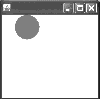

当我们对一个组件类进行子类化并为子类赋予其自有的 `paint()` 方法时，环境会在适当的时间调用该方法，并传入适当的 `Graphics` 实例。

### `Graphics` 类支持的操作

`Graphics` 类（`Graphics Context`）提供的四大类操作是：

* 选择颜色。
* 选择字体。
* 绘制和填充。
* 裁剪。

#### 选择颜色

通过调用 `setColor()` 方法选择颜色。`setColor` 参数是 `Color` 类的实例。有 13 种预定义的颜色：

1. `black`
2. `blue`
3. `cyan`
4. `darkGray`
5. `gray`
6. `green`
7. `lightGray`
8. `magenta`
9. `orange`
10. `pink`
11. `red`
12. `white`
13. `yellow`

如果我们需要一个不在此列表中的颜色，可以构造自己的，例如：`Color(int red, int green, int blue)`。我们需要了解的图形类中的方法有：

* `setColor()`
* `drawLine()`
* `fillRect()`
* `fillOval()`

```java
public void paint(Graphics g) {
    Color c = new Color(170, 255, 170);
    g.setColor(c);
    g.paint();
}
```

#### 选择字体

设置图形上下文的字体就像设置颜色一样。在我们设置字体之前，必须先创建一个。字体的构造函数类似于：`Font(String fontName, int style, int size)`。我们可以通过调用 `Toolkit` 的 `getFontList()` 获取可用字体列表，以字符串数组的形式：

```java
String fontNames[] = Toolkit.getDefaultToolkit().getFontList();
```

三种平台无关且我们鼓励使用的字体名称：

* “Serif”（衬线体）
* “Sansserif”（无衬线体）
* “Monospaced”（等宽字体）

样式参数可以发送以下任何一个常量：

* `Font.PLAIN`
* `Font.BOLD`
* `Font.ITALIC`

下面的代码段将图形 `gc` 的字体设置为 24 点加粗无衬线字体：

```java
Font f = new Font("Sansserif", Font.BOLD, 24);
gc.setFont(f);
```

可以通过传递之和来指定样式组合，例如粗斜体：`Font.BOLD + Font.ITALIC`。

#### 绘制和填充

`Graphics` 类的所有渲染方法都为它们渲染的形状指定像素坐标位置，每个组件都有自己的坐标空间，原点位于组件的左上角，x 向右增加，y 向下增加。下图显示了组件坐标系：

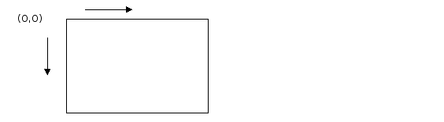

`Graphics Context` 类没有广泛的绘图方法（复杂的渲染由扩展 API 如 2D、3D 和动画来处理）。

我们需要了解的图形上下文类中的方法有：

* `drawLine(int x1, int y1, int x2, int y2)`
* `drawRect(int x, int y, int width, int height)`
* `fillRect(int x, int y, int width, int height)`
* `drawOval(int x, int y, int width, int height)`：绘制指定矩形边界的椭圆轮廓。
* `fillOval(int x, int y, int width, int height)`：用当前颜色填充指定矩形边界的椭圆。椭圆由一个矩形边界框指定。椭圆位于边界框内，并在框的每条边的中点处相切。要绘制圆形，请使用正方形边界框。请注意，绘画只绘制前景像素，不绘制背景，因此边界框内但椭圆外的空间保持不变。这里，`x` 和 `y` 是边界框左上角的坐标，`width` 和 `height` 是框的宽度和高度。
* `drawArc(int x, int y, int width, int height, int startAngle, int arcAngle)`：绘制覆盖指定矩形的圆形或椭圆弧的轮廓。
* `fillArc(int x, int y, int width, int height, int startAngle, int arcAngle)`：填充覆盖指定矩形的圆形或椭圆弧。弧是椭圆的一部分。要指定一个弧，我们首先指定椭圆的边界框，就像使用 `drawOval()` 和 `fillOval()` 一样。我们还需要指定弧的起点和终点，这是通过指定起始角度和弧所扫过的角度来实现的。填充弧是由弧本身以及从椭圆中心到弧端点的两条半径围成的区域。
* `drawPolygon(int[] xPoints, int[] yPoints, int nPoints)`：绘制由 x 和 y 坐标数组定义的闭合多边形。
* `fillPolygon(int[] xPoints, int[] yPoints, int nPoints)`：填充由 x 和 y 坐标数组定义的闭合多边形。多边形具有任意数量顶点的封闭图形。顶点以两个 int 数组的形式传递给 `drawPolygon()` 和 `fillPolygon()` 方法。第一个数组包含顶点的 x 坐标，第二个包含 y 坐标。第三个参数指定顶点的数量。注意：终点与第一个点连接。
* `drawPolyline(int[] xPoints, int[] yPoints, int nPoints)`：绘制由 x 和 y 坐标数组定义的连接线序列。多折线与多边形类似，但它是开放而非封闭的。没有连接最后一个顶点和第一个点的线段。
* `drawString(String str, int x, int y)`：使用此图形上下文的当前字体和颜色绘制指定字符串的文本。`x`、`y` 参数指定字符串基线的左边缘。带有下伸部字母的字符（在大多数字体中为 g, j, p, q 和 y）延伸到基线以下。文本坐标相对于基线这一事实至关重要。例如，在简单的文本中，我们可能会尝试在 (0,0) 处绘制字符串，并期望它出现在空间的左上角。然而，由于基线的存在，我们只能看到字符串的降部字母，这可能意味着我们什么也看不到。默认情况下，图形上下文使用关联组件的字体，但我们可以通过调用图形上下文的 `setFont()` 方法设置不同的字体。
* `drawImage(Image img, int x, int y, ImageObserver observer)`：绘制当前可用的指定图像。这里，`img` 是要渲染的图像，`x` 和 `y` 是目标组件内图像左上角的坐标。图像观察者必须是实现 `ImageObserver` 接口的对象。图像是矩形像素值集合的离屏表示。Java 的图像支持非常复杂。目前，假设我们某种方式获取了图像（即 `java.awt.Image` 类的实例），并想使用特定的图形上下文将其渲染到屏幕上。的方法是调用图形上下文的 `drawImage()` 方法。

### 示例 19.2

此示例说明了如何创建一个图像，然后使用其图形上下文在其上绘制。然后可以使用 `drawImage()` 方法在 `Applet` 窗口中显示图像。

```java
import java.awt.*;
import java.applet.*;
import java.net.URL;
/*<applet code="PaintImage" width=200 height=100></applet>*/
public class PaintImage extends Applet {
    private Image im;
    public void init() {
        im = createImage(100, 50);
        Graphics imgc = im.getGraphics();
        imgc.setColor(Color.gray);
        imgc.fillRect(0, 0, 100, 50);
        imgc.setColor(Color.black);
        imgc.fillOval(0, 0, 50, 40);
    }
    public void paint(Graphics g) {
        g.drawImage(im, 10, 10, this);
    }
}
```

输出：


### 示例 19.3

此示例说明了如何从现有图像创建图像对象。然后可以使用 `drawImage()` 方法在 `Applet` 窗口中显示图像。

```java
import java.awt.*;
import java.applet.*;
import java.net.*;
/*
<applet code="PaintImage" width=500 height=500>
</applet>
*/
public class PaintImage extends Applet {
    private Image im;
    public void init() {
        try {
            im = getImage(new URL("file:.gif"));
        } catch (MalformedURLException e) {
            System.out.println(e);
        }
    }
    public void paint(Graphics g) {
        g.drawImage(im, 10, 10, this);
    }
}
```

### 裁剪

大多数程序员对图形上下文的调用涉及颜色选择、绘制和填充。一种不常用的操作是裁剪。裁剪简单地限制了图形上下文可以修改的区域。

图形上下文的默认裁剪区域是关联组件的可见区域。为了演示，请考虑以下 `paint` 方法。

### 示例 19.4

```java
import java.awt.*;
class Clip extends Frame {
    public static void main(String args[]) {
        Frame f = new Clip();
        f.setSize(300, 330);
        f.setVisible(true);
    }
    public void paint(Graphics g) {
        for (int i = 0; i < 300; i = i + 100) {
            for (int j = 30; j < 330; j = j + 100) {
                g.fillOval(i, j, 100, 100);
            }
        }
    }
}
```

输出：


上述程序的 `paint()` 方法绘制了一个点状图案。考虑当此方法用于一个 200 * 200 像素的 applet 帧时的情况。由于循环计数器一直到 500，方法尝试在 applet 边界之外绘制。

这不是问题，因为图形上下文默认的裁剪区域与 applet 身重合。

要为图形上下文设置矩形裁剪区域，我们可以调用 `setClip(x, y, width, height)` 方法，传递描述所需裁剪区域的位置和大小的整数。例如，上述代码可以修改为：

### 示例 19.5

```java
import java.awt.*;
class Clip2 extends Frame {
    public static void main(String args[]) {
      Frame f = new Clip2();
      f.setSize(300, 330);
      f.setVisible(true);
    }
    public void paint(Graphics g) {
      g.setClip(50, 80, 200, 200);
      for (int i = 0; i < 300; i = i + 100) {
        for (int j = 30; j < 330; j = j + 100) {
          g.fillOval(i, j, 100, 100);
        }
      }
      g.drawString("Hello! Kamal", 50, 50);
    }
}
```

```java
21. g.drawString("Bye! Kamal", 120, 150);
22. } }
```

输出：

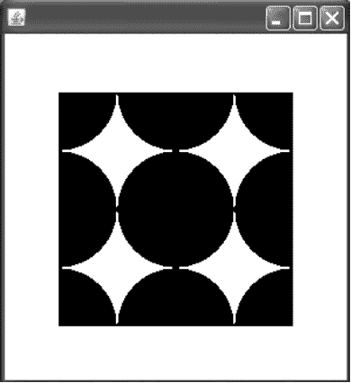

如上所示，现在的绘制被裁剪在 300 * 300 applet 框架中心的一个 200 * 200 矩形内。

裁剪（Clipping）本身是一个非常值得了解的特性。当环境需要修复组件的暴露部分时，裁剪也会发挥作用。

### 关于 `paint()` 方法和图形上下文（graphics context）的总结

`Graphics` 上下文专供单个组件使用。若要在组件上绘图，我们调用图形上下文的 `drawXXXX()` 和 `fillXXXX()` 方法。要更改图形操作的颜色或字体，我们分别调用图形上下文的 `setColor()` 或 `setFont()` 方法。

### GUI 线程与绘制

Java 运行时环境会创建并控制其在后台运行的各个线程，其中一个线程负责 GUI 管理。

GUI 线程是环境用于接收用户输入事件以及调用需要绘制的组件的 `paint()` 方法的工具。

对 `paint()` 的调用并非全部由环境生成。Java 程序当然可以自己调用，直接调用或通过 `repaint()` 方法间接调用。

也可以使用组件的图形上下文在组件上进行绘图。这种方法不需要调用 `paint()` 或 `repaint()` 方法。

在组件上绘图的不同方法如下：

(i) 在获取组件的 `Graphics` 上下文后直接绘制。

(ii) 自发绘制（由 GUI 线程隐式/自动调用 `paint()` 方法）。

(iii) 显式调用 `paint()` 方法。

(iv) 显式调用 `repaint()` 方法，然后由其间接调用 `paint()` 方法。

### 在获取组件图形上下文后直接绘制

由于可以使用 `getGraphics()` 方法获取组件的 `Graphics` 上下文引用，因此人们很容易认为可以从任何方便的方法直接在组件上绘图。通常情况下，这种方法存在严重缺陷。

假设我们有一个 applet，想要在最近一次鼠标点击的位置画一个红点。applet 的其余部分应该是黄色的。假设该 applet 正在处理自己的鼠标事件。我们可能会考虑创建这样的事件处理器：

**示例 19.6：**

```java
import java.awt.*;
import java.awt.event.*;
class PaintApproach extends Frame implements MouseListener
{ 
    public static void main (String args [])
    { 
      PaintApproach f = new PaintApproach ();
      f.setSize (300, 300);
      f.addMouseListener(f);
      f.setVisible(true);
    }
    public void mouseEntered (MouseEvent e) { }
    public void mouseExited (MouseEvent e) { }
    public void mousePressed (MouseEvent e) { }
    public void mouseReleased (MouseEvent e) { }
    public void mouseClicked (MouseEvent e) 
    { 
      System.out.println ("Mouse Clicked...");
      Graphics g = getGraphics ();
      g.setColor(Color.yellow);
      g.fillRect(0, 0, getSize().width, getSize().height);
      g.setColor (Color.Red);
      g.fillOval(e.getX() - 10, e.getY() - 10, 20, 20);
    }
}
```

如果这个 applet 曾经被遮挡并重新暴露，GUI 线程会隐式地调用 `paint()`。遗憾的是，`paint()` 并不知道在 `mouseClicked()` 方法中绘制的红圆，因此红圆不会被修复。

所有绘制操作的正确位置是在 `paint()` 中，或者在从 `paint()` 调用的方法的方法；这种技术确保了 GUI 线程能够修复暴露带来的损坏。GUI 线程期望 `paint()` 能够在任意时刻正确地重建屏幕。

实现这一点的某种可能方法是从事件处理器和其他任意方法中移除所有绘制代码，并将这些代码放置到 `paint()` 方法中。

接下来，当某个方法需要绘图时，安排它写入描述所需绘制内容的变量中，这样这些变量就可以被 `paint()` 方法访问，并被 `paint()` 方法用于执行绘制。

现在，当 `paint()` 方法被调用时（无论是通过我们的通用方法还是通过 GUI 线程），它都可以绘制原始设计的任何内容。

### 自发绘制（由 GUI 线程隐式/自动调用 `paint()` 方法）

自发绘制不是一个正式术语，但它会在 GUI 线程调用 `paint()` 时发生。例如，当一个组件被遮挡后又重新暴露时，GUI 线程会调用 `paint()` 以使其重新绘制。这是因为每当组件暴露时，`paint()` 方法就会被调用。

### 显式调用 `paint()` 方法

如果在 `paint()` 以外的方法中执行绘制操作，组件可能不会得到刷新。我们可以显式地调用 `paint()`，也可以隐式地调用。

**示例 19.7：**

上一节的示例经过了修改，使得组件在上述情况下可以刷新。这是因为红点是在 `paint()` 方法中绘制的。

```java
import java.awt.*;
import java.awt.event.*;
public class PaintApproach extends Frame implements MouseListener
{
    int mouseX, mouseY;
    public static void main (String arg[])
    { 
      PaintApproach f = new PaintApproach2 ();
      f.setSize (300, 300);
      f.addMouseListener(f);
      f.setVisible(true);
    }
    public void mouseEntered (MouseEvent e) {}
    public void mouseExited (MouseEvent e) {}
    public void mousePressed (MouseEvent e) {}
    public void mouseReleased (MouseEvent e) {}
    public void mouseClicked (MouseEvent e) 
    { 
      System.out.println ("Mouse Clicked...");
      mouseX = e.getX();
      mouseY = e.getY();
      Graphics g = getGraphics ();
      paint(g);
    }
    public void paint(Graphics g) {
        g.setColor(Color.yellow);
        g.fillRect(0, 0, getSize().width, getSize().height);
        g.setColor(Color.Red);
        g.fillOval(mouseX - 10, mouseY - 10, 20, 20);
    }
}
```

```java
public void paint (Graphics g)
{ 
  g.setColor (Color.yellow);
  g.fillRect(0, 0, getSize().width, getSize().height);
  g.setColor(Color.red);
  g.fillOval(mouseX - 10, mouseY - 10, 20, 20);
}
```

显式调用 `repaint()` 方法，该方法会间接调用 `paint()` 方法：

显式调用 `paint()` 方法可能会导致两个严重问题。

第一个问题是 GUI 线程会根据需要随时调用 `paint()` 方法。这发生在需要处理窗口暴露（exposure）时。这可能会导致线程交互问题。公平地说，我们将会发现即使使用首选方法，我们可能仍然需要处理这些中的某些问题，因为 `paint()` 方法将使用我们正在其他线程中修改的数据。然而，如果我们允许 `paint()` 只在 GUI 线程中被调用，就能最大限度地减少这个问题。

第二个问题是 CPU 使用率问题。考虑以下场景：我们的程序定期接收到通知，要求使用动画的下一帧或类似的连续移动图形来更新显示。假设绘图是复杂且耗时的。如果我们简单地调用整个 `paint()` 方法，那么当帧触发发生时，我们可能只完成了部分绘制。这将导致我们的程序花费（或试图花费）所有时间在绘图上。此外，绘图将离它应该的位置越来越远。

这些问题可以通过处理程序启动绘图的首选方法简单地解决。其核心思想是主程序维护一个描述应该呈现给用户的绘图的数据集，但并不直接调用绘图程序。相反，程序请求 GUI 线程运行绘图程序，其方式与线程处理窗口暴露时大致相同。GUI 线程使用主程序提供的数据集来决定绘制什么以及如何绘制。

为了支持这种方法，GUI 系统提供了一个名为 `repaint()` 的方法。该方法定义在 `Component` 类中，因此 GUI 中的任何可见对象都可以。当我们调用此方法时，我们是在向 GUI 线程发出请求，让它执行绘制系统程序。GUI 线程会在合理的时间范围内执行，尽管这可能会受到其他高优先级线程活动的限制。这种方法确保了 GUI 线程与用户线程之间的线程交互降到最低。

自然，我们必须确保在数据处于不一致状态时，GUI 线程绝不会使用该数据集。然而，使用同步或双缓冲技术可以很容易地实现这一点。

这种行为的另一个结果是，无论程序尝试进行多少绘图，系统通常保持与当前帧的同步。这是因为例如，如果我们在 GUI 线程能够处理第一次调用之前调用了十次 `repaint()` 方法，那么结果将是只执行一次绘制系统程序。

因此，在过载情况下，绘图系统会自动跳过主机 CPU 无法处理的帧。这意味着程序员可以编写代码，在给定平台上能够可靠地获得最佳可用视频性能，同时在任何其他平台上都能良好地运行。以下代码实现了这种方案。

### 示例 19.8

```java
import java.awt.*;
import java.awt.event.*;
public class PaintApproach2 extends Frame implements MouseListener
{ 
  int mouseX, MouseY;
  public static void main (String args [])
  { 
    PaintApproach2 f = new PaintApproach2();
    f.setSize (300, 300);
    f.addMouseListener (f);
    f.setVisible(true);
  }
  public void mouseEntered (MouseEvent e) { }
  public void mouseExited (MouseEvent e) { }
  public void mousePressed (MouseEvent e) { }
  public void mouseReleased (MouseEvent e) { }
  public void mouseClicked(MouseEvent e) 
  { 
    System.out.println ("Mouse Clicked ... ");
    mouseX = e.getX();
    mouseY = e.getY();
    repaint();
  }
  public void paint (Graphics g)
  {
    g.setColor (Color.white);
    g.fillRect (0, 0, getSize().width, getSize().height);
    g.setColor (Color.red);
    g.fillOval(mouseX - 10, mouseY - 10, 20, 20);
  }
}
```


## 章节

## 20 (Java.Lang.Object 类)

### 简介

`java.lang` 包中的 `Object` 类是 Java 中所有层次结构的根。所有的类都直接或间接地继承自 `Object` 类。

即使你写了一个简单的类（即它没有继承任何基类），它也会隐式地继承内置的 `Object` 类。因此，该类的在所有类中都可用。

## Object 类的方法

`Object` 类定义了以下方法，所有的类都继承了它们：

1. `public int hashCode()`
2. `public boolean equals(Object obj)`
3. `public final Class getClass()`
4. `public String toString()`
5. `protected void finalize() throws Throwable`
6. `protected Object clone() throws CloneNotSupportedException`
7. `public final void wait(long timeout) throws InterruptedException`
8. `public final void wait(long timeout, int nanos) throws InterruptedException`
9. `public final void wait() throws InterruptedException`
10. `public final void notify()`
11. `public final void notifyAll()`

### 1. `public int hashCode()`

在哈希表中存储对象时，可以使用此方法获取对象的哈希值。该值保证在程序执行期间具有的一致性。

### 2. `boolean equals(Object obj)`

如果每个对象都被认为是唯一的，那么没有必要重写 `Object` 类的 `equals()` 方法。该方法比较的是对象的引用是否相等。

### 3. `final Class getClass()`

返回对象的运行时类，该类在运行时由 `java.lang.Class` 类的对象表示。

**示例 20.1：** 以下示例说明了该方法可以用于获取与任何 java 对象对应的 `Class` 对象。然后我们可以使用 `Class` 类的方法通过反射/内省来获取有关对象类的信息。`getMethods()` 和 `getFields()` 将仅显示所有公共成员，而 `getDeclaredMethods()` 和 `getDeclaredFields()` 将显示所有成员。


```java
import java.lang.reflect.Method;
import java.lang.reflect.Field;

class DispClassMembers1 {
    public static void main(String args[]) {
        String s = new String("Hello");
        Class c = s.getClass();
        Method m[] = c.getMethods();
        System.out.println("......Public Methods (" + m.length + ")......");
        for (int i = 0; i < m.length; i++) {
            System.out.println(m[i]);
        }
        Field f[] = c.getFields();
        System.out.println("......Public Fields (" + f.length + ")......");
        for (int i = 0; i < f.length; i++) {
            System.out.println(f[i]);
        }
        m = c.getDeclaredMethods();
        System.out.println("......Declared Methods (" + m.length + ")......");
        for (int i = 0; i < m.length; i++) {
            System.out.println(m[i]);
        }
        f = c.getDeclaredFields();
        System.out.println("......Declared Fields (" + f.length + ")......");
        for (int i = 0; i < f.length; i++) {
            System.out.println(f[i]);
        }
    }
}
```

**输出：**

```
......Public Methods (72)......
public int java.lang.String.hashCode()
public int java.lang.String.compareTo(java.lang.String)
public int java.lang.String.compareTo(java.lang.Object)
public int java.lang.String.indexOf(int,int)
public int java.lang.String.indexOf(int)
public int java.lang.String.indexOf(java.lang.String)
public int java.lang.String.indexOf(java.lang.String,int)
public boolean java.lang.String.equals(java.lang.Object)
public String java.lang.String java.lang.String.toString()
public char java.lang.String.charAt(int)
public int java.lang.String.codePointAt(int)
...
```

# 已声明的方法 (70)

```java
public int java.lang.String.hashCode()
public int java.lang.String.compareTo(java.lang.String)
public int java.lang.String.compareTo(java.lang.Object)
public int java.lang.String.indexOf(int,int)
public int java.lang.String.indexOf(int)
public int java.lang.String.indexOf(java.lang.String)
public int java.lang.String.indexOf(java.lang.String,int)
static int java.lang.String.indexOf(char[],int,int,char[],int,int,int)
public boolean java.lang.String.equals(java.lang.Object)
public String java.lang.String java.lang.String.toString()
public char java.lang.String.charAt(int)
private static void java.lang.String.checkBounds(byte[],int,int)
public int java.lang.String.codePointAt(int)
public int java.lang.String.codePointBefore(int)
public int java.lang.String.codePointCount(int,int)
public int java.lang.String.compareToIgnoreCase(java.lang.String)
public String java.lang.String java.lang.String.concat(java.lang.String)
public boolean java.lang.String.contains(java.lang.CharSequence)
public boolean java.lang.String.contentEquals(java.lang.StringBuffer)
public boolean java.lang.String.contentEquals(java.lang.CharSequence)
public static String java.lang.String java.lang.String.copyValueOf(char[])
public static String java.lang.String java.lang.String.copyValueOf(char[],int,int)
public boolean java.lang.String.endsWith(java.lang.String)
public boolean java.lang.String.equalsIgnoreCase(java.lang.String)
public static String java.lang.String java.lang.String.format(java.lang.String,java.lang.Object[])
static static String java.lang.String java.lang.String.format(java.util.Locale,java.lang.String,java.lang.Object[])
public byte[] java.lang.String.getBytes()
public byte[] java.lang.String.getBytes(java.nio.charset.Charset)
public byte[] java.lang.String.getBytes(java.lang.String) throws java.io.UnsupportedEncodingException
public void java.lang.String.getBytes(int,int,byte[],int)
void java.lang.String.getChars(char[],int)
public void java.lang.String.getChars(int,int,char[],int)
public native String java.lang.String java.lang.String.intern()
public boolean java.lang.String.isEmpty()
public int java.lang.String.lastIndexOf(int)
public int java.lang.String.lastIndexOf(java.lang.String)
public int java.lang.String.lastIndexOf(java.lang.String,int)
public int java.lang.String.lastIndexOf(int,int)
static int java.lang.String.lastIndexOf(char[],int,int,char[],int,int,int)
public int java.lang.String.length()
public boolean java.lang.String.matches(java.lang.String)
public int java.lang.String.offsetByCodePoints(int,int)
public boolean java.lang.String.regionMatches(boolean,int,java.lang.String,int,int)
public boolean java.lang.String.regionMatches(int,java.lang.String,int,int)
public String java.lang.String java.lang.String.replace(java.lang.CharSequence,java.lang.CharSequence)
public String java.lang.String java.lang.String.replace(char,char)
public String java.lang.String java.lang.String.replaceAll(java.lang.String,java.lang.String)
public String java.lang.String java.lang.String.replaceFirst(java.lang.String,java.lang.String)
public String[] java.lang.String java.lang.String.split(java.lang.String,int)
public String[] java.lang.String java.lang.String.split(java.lang.String)
public boolean java.lang.String.startsWith(java.lang.String,int)
public boolean java.lang.String.startsWith(java.lang.String)
public CharSequence java.lang.String java.lang.String.subSequence(int,int)
public String java.lang.String java.lang.String.substring(int,int)
public String java.lang.String java.lang.String.substring(int)
public char[] java.lang.String.toCharArray()
public String java.lang.String java.lang.String.toLowerCase()
public String java.lang.String java.lang.String.toLowerCase(java.util.Locale)
public String java.lang.String java.lang.String.toUpperCase()
public String java.lang.String java.lang.String.toUpperCase(java.util.Locale)
public String java.lang.String java.lang.String.trim()
public static String java.lang.String java.lang.String.valueOf(boolean)
static static String java.lang.String java.lang.String.valueOf(char[],int,int)
static static String java.lang.String java.lang.String.valueOf(int)
static static String java.lang.String java.lang.String.valueOf(long)
static static String java.lang.String java.lang.String.valueOf(float)
static static String java.lang.String java.lang.String.valueOf(double)
static static String java.lang.String java.lang.String.valueOf(Object)
static static String java.lang.String java.lang.String.valueOf(String)
public static String java.lang.String java.lang.String.valueOf(char[],int,int)
```


### 5. `protected void finalize() throws Throwable`

它在对象被垃圾回收之前被调用，以便进行任何清理工作。然而，`Object` 类中默认的 `finalize()` 方法没有做任何有用的操作。这对于释放非 Java 资源可能有用，但不推荐这样做。如果可用内存足够，`finalize()` 方法可能永远不会被调用，在这种情况下资源可能永远不会被释放。

### 6. `protected Object clone() throws CloneNotSupportedException`

通过 `clone()` 方法可以创建与当前对象完全相同（即具有相同状态）的新对象，也就是说原始值和引用值被复制，这被称为浅拷贝（shallow cloning）。

类可以重写 `clone()` 方法以提供其自己的克隆概念。例如，通过递归克隆组成对象来克隆复合对象被称为深拷贝（deep cloning）。当重写时，子类中的方法通常被声明为 public，以便允许任何客户端克隆该类的对象。

如果重写 `clone()` 方法依赖于 `Object` 类中的 `clone()` 方法，则子类必须实现 `Cloneable` 标记接口，以指示其对象可以安全地克隆。否则，`Object` 类中的 `clone()` 方法将抛出检查异常 `CloneNotSupportedException`。

#### 使用 `clone()` 和 `Cloneable` 接口

`clone()` 方法会在调用它的对象上生成一个该对象的副本。以下是与 `clone()` 方法的一些重要事实：

- 只有实现了 `Cloneable` 接口的类才能被克隆。`Cloneable` 接口没有定义成员。它用于指示一个类允许对对象进行位拷贝（即创建克隆）。
- 如果你对对没有实现 `cloneable` 接口类的对象调用 `clone()`，将抛出 `CloneNotSupportedException`。
- `Cloneable` 接口是一个空接口。这种接口被称为标记/标签接口（marker/tag interface）。创建克隆时，不会调用被克隆对象的构造函数。
- 克隆对象只是原始对象的完全拷贝。克隆是一个潜在危险的操作，因为可能会导致意外的副作用。
- 例如，如果被克隆的对象包含一个名为 `objRef` 的引用变量，那么在创建克隆时，`clone` 中的 `objRef` 将与原始对象中的 `objRef` 指向同一个对象。如果克隆修改了 `objRef` 所引用对象的内容，那么原始对象也会被改变。

#### 示例 20.5

以下示例演示了 `clone()` 方法的使用。`CloneDemo1` 类通过 `clone2()` 方法间接调用 `clone()` 方法，对 `TestClone1` 类的对象进行克隆。

```java
1. class TestClone1 implements Cloneable
2. {
3.    int a;
4.    float b;
5.    public TestClone1 clone2() throws CloneNotSupportedException
6.    {
7.      return (TestClone1) clone();
8.    }
9. }
10. class CloneDemo1
11. {
12.    public static void main(String a[]) throws CloneNotSupportedException
13.    {
14.      TestClone1 tc1 = new TestClone1();
15.      TestClone1 tc2;
16.      tc1.a = 8; tc1.b = 4.5f;
17.      tc2 = tc1.clone2();
18.      System.out.println(tc2.a);
19.      System.out.println(tc2.b);
20.    }
21. }
```

**Output:**

```
8
4.5
```

在这里，`clone2()` 方法调用了 `Object` 类的 `clone()` 并返回结果。注意，`clone()` 返回的对象必须转换为适当的类型，即 `TestClone1`。

#### 示例 20.6

在以下示例中，重写了 `clone()` 方法以便从类外部代码调用它。为了做到这一点，其访问修饰符必须是 public。

```java
1. class TestClone2 implements Cloneable
2. {
3.    int a;
4.    float b;
5.      public Object clone() throws CloneNotSupportedException
6.    {
7.      return super.clone();
8.    }
9. }
10. class CloneDemo2
11. {
12.    public static void main(String args[]) throws CloneNotSupportedException
13.    {
14.      TestClone2 tc1 = new TestClone2();
15.      TestClone2 tc2;
16.      tc1.a = 8; tc1.b = 4.5f;
17.      tc2 = (TestClone2) tc1.clone();
18.      System.out.println(tc2.a + " " + tc2.b);
19.    }
20. }
```

**Output:**

```
8 4.5
```

#### 示例 20.7

在以下示例中，重写了 `clone()` 方法使其不使用 `Object` 类的 `clone()` 方法。我们编写了自己的 `clone()` 方法。

```java
1. class TestClone3
2. {
3.    int a;
4.    float b;
5.    public Object clone()
6.    {
7.      TestClone3 tc = new TestClone3();
8.      tc.a = a;
9.      tc.b = b;
10.     return tc;
11. }
12. class CloneDemo3
13. {
14.    public static void main(String args[])
15.    {
16.      TestClone3 tc1 = new TestClone3();
17.      TestClone3 tc2;
18.      tc1.a = 8;
19.      tc1.b = 4.5f;
20.      tc2 = (TestClone3) tc1.clone();
21.      System.out.println(tc2.a + " " + tc2.b);
22.    }
23. }
```

**Output:**

```
8 4.5
```

#### 克隆的副作用

克隆引起的副作用有时很难被发现。人们很容易认为一个类是可以安全克隆的，实际上并非如此。如果实现 `clone()` 方法，需要声明 `CloneNotSupportedException` 并且在没有理由的情况下实现 `Cloneable` 接口。

#### 示例 20.8

此示例演示了克隆的副作用。


```java
1. class TestShallowClone implements Cloneable
2. { 
3.    int a;
4.    float b;
5.    int c[];
6.    public Object clone() throws CloneNotSupportedException
7.    { 
8.      return super.clone();
9.    }
10. }
11. class ShallowCloneDemo
12. { 
13.    public static void main(String arg[]) throws CloneNotSupportedException
14.    { 
15.      TestShallowClone tc1 = new TestShallowClone();
16.      TestShallowClone tc2;
17.      tc1.a = 8;
18.      tc1.b = 4.5f;
19.      int c[] = new int[4];
20.      for(int i=0; i<4; i++)
21.      c[i] = i;
22.      tc1.c = c;
23.      for(int i=0; i<4; i++)
24.      System.out.println("tc1.c[" + i + "]=" + tc1.c[i]);
25.      tc2 = (TestShallowClone) tc1.clone();
26.      System.out.println("tc2.a"+tc2.a);
27.      System.out.println("tc2.b"+tc2.b);
28.      for(int i=0; i<4; i++)
29.      System.out.println("tc2.c[" + i + "]=" + tc2.c[i]);
30.      for(int i=0;i<4;i++)
31.      tc2.c[i] = i+4; 
32.      for(int i=0; i<4; i++)
33.      System.out.println("tc2.c[" + i + "]=" + tc2.c[i]);
34.    }
35. }
```

**Output:**

```
tc1.c[0]=0
tc1.c[1]=1
tc1.c[2]=2
tc1.c[3]=3
tc2.a=8
tc2.b=4.5
tc2.c[0]=0
tc2.c[1]=1
tc2.c[2]=2
tc2.c[3]=3
tc2.c[0]=4
tc2.c[1]=5
tc2.c[2]=6
tc2.c[3]=7
```

### 示例 20.9

以下代码通过实现深拷贝解决了上一个示例中的问题。

```java
1. class TestDeepClone implements Cloneable
2. { 
3.    int a;
4.    float b;
5.    int c[];
6.    public Object clone() throws CloneNotSupportedException
7.    { 
8.      TestDeepClone tc = (TestDeepClone)super.clone();
9.      int d[] = new int[4];
10.     for(int i=0; i<4; i++)
11.       d[i] = c[i];
12.     tc.c = d; 
13.     return (tc);
14.    }
1 }
16. class DeepCloneDemo
17. { 
18.    public static void main(String arg[]) throws CloneNotSupportedException
19.    { 
20.      TestDeepClone tc1 = new TestDeepClone();
21.      TestDeepClone tc2;
22.      tc1.a = 8;
23.      tc1.b = 4.5;
24.      int c[] = new int[4];
25.      for(int i=0; i<4; i++)
26.      c[i] = i;
27.      tc1.c = c;
28.      for(int i=0; i<4; i++)
```

```java
29. System.out.println(“tc1.c[”+ i +”]=” + tc1.c[i]);
30. tc2 = (TestDeepClone) tc1.clone();
31. System.out.println(“tc2.a”+tc2.a);
32. System.out.println(“tc2.b”+tc2.b);
33. for(int i=0; i<4; i++)
34. System.out.println(“tc2.c[” + i + “]=” + tc2.c[i]);
35. for(int i=0; i<4; i++)
36. tc2.c[i] = i+4;
37. for(int i=0; i<4; i++)
38. System.out.println(“tc2.c[” + i + “]=” + tc2.c[i]);
39. for(int i=0; i<4; i++)
40. System.out.println(“tc1.c[” + i + “]=” + tc1.c[i]);
41. } }
```

输出：

```
tc1.c[0]=0
tc1.c[1]=1
tc1.c[2]=2
tc1.c[3]=3
tc2.a=8
tc2.b=4.5
tc2.c[0]=0
tc2.c[1]=1
tc2.c[2]=2
tc2.c[3]=3
tc2.c[0]=4
tc2.c[1]=5
tc2.c[2]=6
tc2.c[3]=7
tc1.c[0]=0
tc1.c[1]=1
```

### 多线程环境中的有用方法

除了上述方法外，`Object` 类通过 `synchronized` 代码块提供了线程间通信，通过以下方法：

8. `final void wait(long timeout)`：当前线程等待直到另一个线程调用 `notify()` 或 `notifyAll()`。

9. `final void wait(long timeout, long nanos) throws InterruptedException`：当前线程等待直到另一个线程调用 `notify()` 或 `notifyAll()` 方法，或者指定的时间已过。

10. `final void notify()`：唤醒等待对象监视器的单个线程。

11. `final void notifyAll()`：唤醒等待对象监视器的所有线程。线程通过调用 `wait` 方法在对象监视器上等待。

# 第 13 章

# 21

# 集合框架

### 引言

Java 集合框架标准化了处理组的方式。在 Java2 之前，提供了如 `Vector`、`Dictionary`、`Hashtable` 和 `Properties` 类来存储和操作对象。尽管这些类非常有用，但它们缺乏一个统一的主题。我们使用 `Vector` 的方式并不相同，而且之前的方法并不易于扩展或适应。为了解决这些问题，集合框架的设计考虑了以下目标：

* 集合框架必须是高性能的。基础集合（动态数组、链表、哈表）是高效的。
* 集合框架允许不同类型的集合以相似的方式工作，并具有高度的互操作性。
* 集合框架必须易于扩展。

为了实现上述目标，集合框架围绕一组标准接口进行设计。这些接口提供了多种实现。我们也可以实现自己的集合。

* 集合框架的另一个项是 `Iterator` 接口。它提供了一种通用的、标准化的访问集合元素的方法。因此，`Iterator` 提供了遍历集合的内容。因为每个集合类都可以实现 `Iterator`，这使得代码只需微小的改动就可以遍历列表，例如。除了集合之外，框架定义了多个映射接口和类。这些映射存储键值对。尽管在术语的正确使用上，它们不是“集合”，但它们是完全集成的。

### RandomAccess 接口

这是一个由 `List` 实现类使用的标记接口，用于指示它们支持随机访问。`ArrayList` 和 `Vector` 实现了此接口。

### Comparator 接口

比较器（`Comparator`）用于控制某些数据结构（如 `TreeSet` 或 `TreeMap`）的顺序。

#### 方法

| 方法 | 说明 |
| :--- | :--- |
| `int compare(Object o1, Object o2)` | 比较其两个参数的顺序。 |
| `boolean equal(Object obj)` | 表明另一个对象是否“等于”此 `Comparator`。 |

### Collection 接口

`Collection` 接口是集合框架构建的基础。它声明了所有集合将拥有的核心方法。由于所有集合都实现了 `Collection` 接口，因此熟悉它的方法对于清晰地理解框架是必要的。其中 set 几个方法可能会抛出 `UnsupportedOperationException`。当一个对象与另一个对象不兼容时（例如尝试向集合添加不兼容的对象时），会产生 `ClassCastException`。

#### Collection 接口中的方法

| 方法 | 说明 |
| :--- | :--- |
| `boolean add(Object obj)` | 确保此集合包含指定的元素（可选操作）。将对象添加到调用的集合中。如果元素 `obj` 已添加到集合，则返回 true。如果元素 `obj` 已经是集合的成员且集合不允许重复，则返回 false。 |
| `boolean addAll(Collection c)` | 将指定集合中的所有元素都添加到此集合中（可选操作）。 |
| `void clear()` | 移除此集合中的所有元素（可选操作）。 |
| `boolean contain(Object o)` | 如果此集合包含指定的集合，则返回 true。 |
| `boolean containAll(Collection c)` | 如果此集合包含指定集合中的所有元素，则返回 true。 |
| `boolean equal(Object o)` | 将指定的对象与此集合进行等等性比较。 |
| `int hashCode()` | 返回此集合的哈希值。 |
| `boolean isEmpty()` | 如果此集合不包含任何元素，则返回 true。 |
| `Iterator iterator()` | 返回一个用于此集合中元素的迭代器。 |
| `boolean remove(Object o)` | 如果此集合中存在指定的元素，则移除其单个实例（可选操作）。 |
| `boolean removeAll(Collection c)` | 移除所有包含在指定集合中的元素（可选操作）。 |
| `boolean retainAll(Collection c)` | 保留此集合中包含在指定集合中的元素（可选操作）。 |
| `int size()` | 返回此集合中的元素数量。 |
| `Object[] toArray()` | 返回包含此集合中所有元素的数组。 |

可以通过调用 `equals()` 方法比较两个集合的等性性。“等性”的精确含义可能根据集合的不同而不同。

例如，你可以实现 `equals()` 以便比较存储在集合中的元素的值。或者，`equals()` 也可以比较这些元素的引用。

### List 接口

列表（`List`）是一种有序的集合，称为序列（sequence）。`List` 接口扩展了 `Collection` 接口，并声明了存储元素序列的集合的行为。

可以使用从零开始的索引根据元素在列表中的位置插入或访问元素。列表可以包含重复元素。除了 `Collection` 定义的方法外，`List` 还定义了一些它自己的方法。

#### List 接口中的方法

| 方法 | 说明 |
| :--- | :--- |
| `boolean add(Object o)` | 将指定的元素添加到此列表的末尾（可选操作）。该方法在 `Collection` 接口中定义，但作为 `List` 接口的一部分，它应该实现为始终将元素添加到列表的末尾。 |
| `void add(int index, Object element)` | 在此列表的指定位置插入指定的元素（可选操作）。插入点或其之后的任何现有元素都会向前移动。因此，不会覆盖任何元素。 |
| `boolean addAll(Collection c)` | 按照指定集合 `iterator` 返回的顺序，将指定集合中的所有元素添加到此列表的末尾（可选操作）。该方法在 `Collection` 接口中定义，但作为 `List` 接口的一部分，它应该实现为始终将元素添加到列表的末尾。 |
| `boolean addAll(int index, Collection c)` | 将指定集合中的所有元素插入此列表的指定位置（可选操作）。如果调用的列表发生变化则返回 true，否则返回 false。 |
| `Object get(int index)` | 返回此列表中指定位置的元素。 |
| `int indexOf(Object o)` | 返回指定元素在此列表中第一次出现的索引，或者如果列表不包含该元素，则返回 -1。 |
| `int lastIndexOf(Object o)` | 返回指定元素在此列表中最后一次出现的索引，或者如果列表不包含该元素，则返回 -1。 |
| `ListIterator iterator()` | 返回此列表元素的列表迭代器（按正确的顺序）。 |
| `ListIterator iterator(int index)` | 返回一个从此列表指定位置开始的列表元素迭代器（按正确的顺序）。 |
| `Object remove(int index)` | 移除指定位置的元素（可选操作）并返回被删除的元素。结果列表将紧凑。因此，后续元素的索引将减一。 |
| `Object set(int index, Object element)` | 用指定的元素替换此列表中指定位置的元素（可选操作）。 |
| `List subList(int fromIndex, int toIndex)` | 返回包含从 start 到 end-1 元素的列表。返回列表中的元素也被调用的对象引用。 |

注意：如果集合不可修改，这些方法中的几个可能会抛出 `UnsupportedOperationException`；当对象不兼容时，会产生 `ClassCastException`。

`Collection` 定义的 `add(Object o)` 和 `addAll(Collection c)` 方法的语义被 `list` 改变，以便将元素添加到列表的末尾。

### Set 接口

`Set` 接口定义了一个集合。它扩展了 `Collection` 接口并声明了不允许重复元素的集合的行为。

因此，如果尝试向集合添加重复元素，`add()` 方法将返回 false。它没有定义任何自己的方法。

### SortedSet 接口


`SortedSet` 接口扩展了 `Set` 接口，并声明了升序排序的集合的行为。

| 方法 | 说明 |
| :--- | :--- |
| `Comparator comparator()` | 返回此排序集合相关的比较器，如果它使用元素的自然排序，则返回 null。 |
| `Object first()` | 返回此排序集合中的第一个元素。 |
| `SortedSet headSet(Object toElement)` | 返回此排序集合中严格小于 `toElement` 的元素的视图。 |
| `Object last()` | 返回此排序集合中的最后一个元素。 |
| `SortedSet subSet(Object fromElement, Object toElement)` | 返回此排序集合中范围从 `fromElement`（包含）到 `toElement`（不包含）的元素的视图。 |
| `SortedSet tailSet(Object fromElement)` | 返回此排序集合中大于或等于 `fromElement` 的元素的视图。 |

当调用的集合中不包含任何项的数组时，某些方法会抛出 `NoSuchElementException`。当对象与集合中的元素类型不兼容时，会抛出 `ClassCastException`。如果尝试使用 null 对象且集合不允许 null，则会抛出 `NullPointerException`。

## 集合类

某些集合类提供了完整的实现，可以直接使用。另一些类是抽象的，它们提供了骨架实现，用作创建具体集合的起点。

没有任何一个集合类是同步版本的。

标准的集合类包括：

| 类名 | 描述 |
| :--- | :--- |
| `AbstractCollection` | 实现了 `Collection` 接口的大部分。 |
| `AbstractList` | 扩展 `AbstractCollection` 并实现了 `List` 接口的大部分。 |
| `AbstractSequenceList` | 扩展 `AbstractList`，供使用顺序访问而非随机访问元素的集合使用。 |
| `AbstractSet` | 扩展 `AbstractCollection` 并实现了 `Set` 接口。 |
| `LinkedList` | 通过扩展 `AbstractSequentialList` 实现链列表。 |
| `ArrayList` | 通过扩展 `AbstractList` 实现动态数组。它使用元素的随机访问。 |
| `HashSet` | 扩展 `AbstractSet` 以供哈希表使用。 |
| `LinkedHashSet` | 扩展 `HashSet` 以允许插入顺序迭代。 |
| `TreeSet` | 扩展 `AbstractSet` 并实现 `SortedSet` 接口。它使用二叉搜索树按排序存储元素。 |

注意：除了集合类外，一些遗留类如 `Vector`、`Stack`、`Hashtable` 也经过重写以支持集合。

## 通过 Iterator 和 ListIterator 访问集合

通常你需要遍历集合中的元素。到目前为止，最简单的方法是使用迭代器，即实现了 `Iterator` 或 `ListIterator` 接口的对象。

`Iterator` 允许你通过遍历集合来获取或移除元素。`ListIterator` 扩展了 `Iterator`，允许对列表进行双向遍历并修改元素。

在使用迭代器访问集合之前，必须先获取它。每个集合类都提供了一个 `iterator()` 方法，返回一个指向集合开头的迭代器。通过使用此迭代器对象，你可以一次访问集合中的每个元素。

对于实现 `List` 的集合，你还可以通过调用 `ListIterator` 获取迭代器。列表迭代器允许你以正向或反向方向访问集合，并且你可以修改元素。否则，`ListIterator` 的用法与 `Iterator` 一致。

## ArrayList 类

`ArrayList` 类扩展了 `AbstractList` 并实现了 `List` 接口。`ArrayList` 支持根据需要增长的动态数组。在 Java 中，标准数组是固定长度的。

数组创建后，它们不能增长或缩小，这意味着我们必须预先知道数组将容纳多少元素。但有时，我们直到运行时才知道数组的大小。为了处理这种情况，集合框架定义了 `ArrayList`。

`ArrayList` 是一个对象引用的变长度数组，也就是说，`ArrayList` 的大小可以动态增加或减少。创建时有一个初始大小。

当超过容量时，集合会自动扩大；当对象被移除时，数组可能会缩小。使用 J2SE 5 引入的泛型功能，可以限制添加到 `ArrayList` 中的元素类型。

注意：遗留类 `Vector` 也支持动态数组。

## ArrayList 类的构造函数与方法

| 方法 | 描述 |
| :--- | :--- |
| `public ArrayList(int)` | 构建一个具有指定初始容量的空列表。随着元素被添加到数组列表中，容量会自动增长。 |
| `public ArrayList()` | 构建一个初始容量为 10 的空列表。 |
| `public ArrayList(Collection)` | 构建一个包含指定集合中元素的列表。元素按照集合的 `Iterator` 返回的顺序排列。 |
| `public void trimToSize()` | 反之，如果我们想缩小 `ArrayList` 对象的底层数组大小，使其恰好等于它当前持有的项数，可以调用 `trimToSize()` 方法。 |
| `public void ensureCapacity(int)` | 虽然 `ArrayList` 对象的容量在存储对象时会自动增加，但我们可以通过调用 `ensureCapacity()` 方法手动增加 `ArrayList` 对象的容量。通过在开始时增加一次容量，可以防止后续多次重新分配。因为重新分配在时间上是昂贵的，防止不必要的重新分配可以提高性能。 |
| `public int size()` | |
| `public Boolean isEmpty()` | |
| `public Object clone()` | |
| `public Object[] toArray()` | 在处理 `ArrayList` 时，当需要从 `ArrayList` 获取数组时，我们可能想要获得一个包含列表内容的实际数组。我们可以通过调用 `toArray()` 方法来实现。我们想要将集合转换为数组有几个原因，例如：为某些操作获取更快的处理时间；将数组传递给未重载以接收集合的方法；将较新的基于集合的代码与不支持集合的遗留代码集成。 |
| `public Object[] toArray(Object[])` | |
| `public Object get(int)` | |
| `public Object set(int, Object)` | |
| `public boolean add(Object)` | |
| `public void add(int, Object)` | |
| `public Object remove(int)` | |
| `public boolean remove(Object)` | |
| `public void clear()` | |
| `public boolean addAll(Collection)` | |
| `public boolean addAll(int, Collection)` | |
| `public boolean contains(Object)` | |
| `public int indexOf(Object)` | |
| `public int lastIndexOf(Object)` | |

### 示例 21.1

```java
import java.util.*;
class ArrayListTest
{
    public static void main(String args[])
    {
        ArrayList a1 = new ArrayList();
        a1.add("A");
        a1.add("B");
        a1.add("C");
        a1.add("D");
        a1.add("E");
        a1.add("F");
        a1.add("G");
        System.out.println("Size of a1: " + a1.size());
        a1.add("H");
        a1.add("I");
        a1.add(2, "J");
        a1.remove(10);
        a1.remove("B");
        System.out.println("Size of a1 after removal: " + a1.size());
        a1.remove(0);
        System.out.println("Element at index 0: " + a1.get(0));
        a1.clear();
        System.out.println("Size of a1 after clear: " + a1.size());
    }
}
```

```java
65. Integer element = litr.next();
66. litr.set(element + 10);
67. }

// 按反序打印列表只有在到达末尾后才有效。
while(litr.hasPrevious())
{ 
    Integer element = litr.previous();
    System.out.print(element + " ");
}     
System.out.println();
System.out.println("使用 for each 循环的 a3 内容");
for(int i : a3) // 拆箱
System.out.print(i + " ");
System.out.println();

Integer ia[] = new Integer[a3.size()];
a3.toArray(ia);
int sum= 0;
for(int i=0; i<ia.length; i++)
sum = sum + ia[i].intValue();
System.out.println("Sum is  " + sum);
a3.trimToSize();
}
}
```

### 输出

a1 的初始大小 : 0

添加元素后 a1 的大小: 6

a1 的内容 : [A, B, C, 56, E, F]

删除元素后 a1 的大小: 4

a1 的内容 [A, B, 56, E]

a2 的内容 : [A, B, C, D, E]

[A, B, C, E]

[B, C, E]

[]

a3 的内容 : [1, 2, 3, 4]

1 2 3 4

1 2 3 4

使用迭代器的 a3 内容:

1 2 3 4

14 13 12 11

使用 for each 循环的 a3 内容

11 12 13 14

Sum is  50

## LinkedList 类

`LinkedList` 类继承自 `AbstractSequentialList` 并实现了 `List` 接口。它提供了一个链表数据结构。

### 构造器函数与方法

| 方法 | 描述 |
| :--- | :--- |
| `public LinkedList( )` | 构建一个空列表。 |
| `public LinkedList(Collection)` | 构建一个包含指定集合中元素的列表，元素按照集合的 `Iterator` 返回的顺序排列。 |
| `public Object getFirst( )` | |
| `public Object getLast( )` | |
| `public Object removeFirst( )` | |
| `public Object removeLast( )` | |
| `public void addFirst(Object)` | |
| `public void addLast(Object)` | |
| `public boolean contains(Object)` | |
| `public int size( )` | |
| `public boolean add(Object)` | |
| `public boolean remove(Object)` | |
| `public boolean addAll(Collection)` | |
| `public boolean addAll(int, Collection)` | |
| `public void clear( )` | |
| `public Object get(int)` | |
| `public Object set(int, Object)` | |
| `public void add(int, Object)` | |
| `public Object remove(int)` | |
| `public int indexOf(Object)` | |
| `public int lastIndexOf(Object)` | |
| `public Object element( )` | |
| `public Object remove( )` | |
| `public boolean removeFirstOccurrence(Object)` | |
| `public boolean removeLastOccurrence(Object)` | |
| `public ListIterator listIterator(int)` | |
| `public Iterator descendingIterator( )` | |
| `public Object clone( )` | |
| `public Object[] toArray( )` | |
| `public Object[] toArray(java.lang.Object[])` | |

### 示例 21.2

```java
import java.util.*;
class LinkedListTest
{
    public static void main(String args[])
    {
        // 创建一个链表。
        LinkedList<String> l1 = new LinkedList<String>();

        // 向链表添加元素。
        l1.add("F");
        l1.add("B");
        l1.add("D");
        l1.add("E");
        l1.add("C");
        l1.addLast("Z");
        l1.addFirst("A");
        l1.add(1, "A2");
        System.out.println("l1 的原始内容 : "+ l1);

        // 从链表中删除元素。
        l1.remove("F");
        l1.remove(2);
        System.out.println("删除后 l1 的内容:" +l1);

        // 删除第一个和最后一个元素。
        l1.removeFirst();
        l1.removeLast();
        System.out.println("删除第一个和最后一个后 l1 :" +l1);

        // 获取并设置一个值。
        String val = l1.get(2);
        l1.set(2, val + "Changed");
        System.out.println("修改后 l1:" +l1);

        Iterator itr=l1.descendingIterator();
        while(itr.hasNext())
        {
            System.out.println(itr.next());
        }
    }
}
```

**输出:**

l1 的原始内容 : [A, A2, F, B, D, E, C, Z]

删除后 l1 的内容:[A, A2, D, E, C, Z]

删除第一个和最后一个后 l1 :[A2, D, E, C]

修改后 l1:[A2, D, EChanged, C]

C

E

D

A2

注意：由于 `LinkedList` 实现了 `List`，请调用 `addLast(Object)` 将项附加到末尾。若要在特定位置插入，请使用 `add(int, Object)`。

## HashSet 类

`HashSet` 类继承自 `AbstractSet` 并实现了 `Set` 接口。它使用哈希表进行存储。哈希的优势是它允许快速操作。

### 构造器函数与方法

| 方法 | 描述 |
| :--- | :--- |
| `HashSet()` | 构建一个新的集合。 |
| `HashSet(Collection c)` | 构建一个包含指定集合元素的集合。 |
| `HashSet(int initialCapacity)` | 构建一个具有指定容量的新空集合。 |
| `HashSet(int initialCapacity, float loadFactor)` | 构建一个具有指定容量和负载因子的新空集合。 |
| `public java.util.Iterator iterator()` | |


| 方法 | 描述 |
| :--- | :--- |
| `public int size()` | |
| `public boolean isEmpty()` | |
| `public boolean contains(Object)` | |
| `public boolean add(Object)` | |
| `public boolean remove(Object)` | |
| `public void clear()` | |
| `public java.lang.Object clone()` | |

#### 示例 21.3

```java
import java.util.*;
class HashSetTest
{
    public static void main(String args[])
    {
        HashSet<String> hs = new HashSet<String>();
        hs.add("B");
        hs.add("A");
        hs.add("E");
        hs.add("C");
        hs.add("F");
        System.out.println(hs);
    }
}
```

**输出：**

```
[E, F, A, B, C] (顺序可能不同)
```

### LinkedHashSet 类

`LinkedHashSet` 类继承自 `HashSet` 并按照插入顺序维护集合。要查看效果，请将 `HashSet` 替换为 `LinkedHashSet`。

### TreeSet 类

`TreeSet` 提供了 `Set` 接口的一种实现，使用树进行存储。对象按升序存储。

#### 构造器

| 构造器 | 描述 |
| :--- | :--- |
| `TreeSet()` | 构建一个新的空集合。 |
| `TreeSet(Collection c)` | 构建包含指定集合元素的集合。 |
| `TreeSet(Comparator c)` | 根据比较器排序的集合。 |

#### 方法

| 方法 | 描述 |
| :--- | :--- |
| `public java.util.Iterator iterator()` | |
| `public java.util.Iterator descendingIterator()` | |
| `public int size()` | |
| `public boolean isEmpty()` | |
| `public boolean contains(Object)` | |
| `public boolean add(Object)` | |
| `public boolean remove(Object)` | |
| `public void clear()` | |
| `public boolean addAll(Collection)` | |
| `public java.lang.Object clone()` | |

#### 示例 21.4

```java
import java.util.*;
class TreeSetTest
{
    public static void main (String args[])
    {
        TreeSet<String> ts = new TreeSet<String>();
        ts.add("C");
        ts.add("A");
        ts.add("D");
        ts.add("E");
        ts.add("F");
        ts.add("B");
        System.out.println(ts);
    }
}
```

**输出：**

```
[A, B, C, D, E, F]
```

`TreeSet` 和 `TreeMap` 都按照排序后的顺序存储元素。然而，精确定义“排序顺序”含义的是 `comparator`（比较器）。

默认情况下，这些类使用 Java 所说的“自然排序”（natural ordering）来存储其元素，这通常是我们预期的顺序。如果我们想以不同的方式对元素进行排序，可以在构造集合或映射时指定一个 `comparator` 对象。这样做使我们能够精确地控制元素在排序集合或映射中的存储方式。

`Comparator` 接口定义了两个方法：`compare()` 和 `equals()`。`compare()` 方法对两个元素的顺序进行比较：

```java
int compare(T obj1, T obj2)
```

`obj1` 和 `obj2` 是用于进行比较的对象。

- 如果对象相等，此方法返回零。
- 如果 `obj1` 大于 `obj2`，则返回正值。
- 如果 `obj1` 小于 `obj2`，则返回负值。

如果对象的类型不兼容无法比较，这些方法可能会抛出 `ClassCastException`。

通过重写 `compare()`，你可以更改对象的排序方式。

例如，要按反序排序，你可以创建一个 `Comparator` 来反转比较的结果。

`equals()` 方法测试一个对象是否等于调用的比较器。

```java
boolean equals(Object obj)
```

### 示例 21.5

```java
import java.util.*;
class CompTest
{
    public static void main (String args[])
    {
        TreeSet ts = new TreeSet(new MyComp());
        ts.add("C");
        ts.add("A");
        ts.add("D");
        ts.add("E");
        ts.add("F");
        ts.add("B");
        // 显示元素。
        Iterator i = ts.iterator();
        while(i.hasNext())
        {
            Object o = i.next();
            System.out.println(o + " ");
        }
    }
}
class MyComp implements Comparator
{
    public int compare(Object a, Object b)
    {
        String aStr, bStr;
        aStr = (String) a;
        bStr = (String) b;
        // 反转比较。
        return bStr.compareTo(aStr);
    }
}
```

**输出：**

```
F E D C B A
```

### Map

Map 是一个存储键和值之间关联（或键值对）的对象。给定一个键，我们可以找到它的值。

键和值都是对象。键必须是唯一的，但值可以重复。某些 map 可以接受 null 键和 null 值，其他则不能。

### Map 接口

Map 类基于以下接口：

| 接口 | 描述 |
| :--- | :--- |
| `Map` | 将唯一的键映射到值。 |
| `Map.Entry` | 描述 map 中的元素（一个键值对）。 |
| `SortedMap` | 扩展 `Map`，使键按升序顺序维护。 |

`Map` 接口将唯一的键映射到值。给定一个键和一个值，你可以将值存储在 `Map` 对象中。在存储值之后，你可以使用其键来检索它。

#### 方法摘要

| 方法 | 摘要 |
| :--- | :--- |
| `void clear()` | 移除此 map 中的所有映射（可选操作）。 |
| `boolean containsKey(Object key)` | 如果此 map 包含到指定键的映射，则返回 true。 |
| `boolean containsValue(Object value)` | 如果此 map 将一个或多个键映射到指定的值，则返回 true。 |
| `Set entrySet()` | 返回包含 map 中所有条目的集合。该集合包含 `Map.Entry` 类型的对象。此方法提供了调用 map 的集合视图。 |
| `boolean equals(Object o)` | 如果 `o` 是 `Map` 且包含这些条目，则返回 true，否则返回 false。 |
| `Object get(Object key)` | 返回此 map 映射到指定键的值。 |
| `int hashCode()` | 返回此 map 的哈希值。 |
| `boolean isEmpty()` | 如果此 map 不包含任何键值映射，则返回 true。 |
| `Set keySet()` | 返回此 map 中包含的键的集合视图。 |
| `Object put(Object key, Object value)` | 将指定的值与此 map 中的指定键关联（可选操作），覆盖任何先前的值。 |
| `void putAll(Map m)` | 将指定 map 的所有内容复制到此。 |
| `Object remove(Object key)` | 从此 map 中移除该键的映射（可选操作）。否则，返回先前的值。 |
| `int size()` | 返回此 map 中键值映射的数量。 |
| `Collection values()` | 返回值的集合视图。 |

如果 map 没有发生变化，若干方法会抛出 `NoSuchElementException`。如果对象类型不兼容，则抛出 `ClassCastException`。如果值为 null 且 map 不允许 null 键，则抛出 `NullPointerException`。如果 map 无法更改，则抛出 `UnsupportedOperationException`。

### SortedMap 接口

`SortedMap` 接口扩展了 `Map`。它确保条目按升序顺序维护。

#### 方法摘要

| 方法 | 摘要 |
| :--- | :--- |
| `Comparator comparator()` | 返回与此 map 关联的比较器，如果使用自然排序则返回 null。 |
| `Object firstKey()` | 返回此排序 map 中的第一个键。 |
| `SortedMap headMap(Object toKey)` | 返回严格小于 `toKey` 的键部分的视图。 |
| `Object lastKey()` | 返回此排序 map 中的最后一个键。 |
| `SortedMap subMap(Object fromKey, Object toKey)` | 返回键从 `fromKey`（包含）到 `toKey`（不包含）的部分的视图。 |
| `SortedMap tailMap(Object fromKey)` | 返回键大于或等于 `fromKey` 的部分的视图。 |

如果 map 为空，若干方法会抛出 `NoSuchElementException`。如果对象类型不兼容，则抛出 `ClassCastException`。如果值为 null 且 map 不允许 null 键，则抛出 `NullPointerException`。

### Map.Entry 接口

`Map.Entry` 接口允许你处理 map 条目。记得 `Map` 定义的 `entrySet()` 方法返回一个包含 map 条目的集合。该集合中的每个元素都是 `Map.Entry` 对象。

#### 方法摘要

| 方法 | 摘要 |
| :--- | :--- |
| `boolean equals(Object o)` | 将指定对象与此条目进行相等比较。如果 `o` 是 `Map.Entry` 对象，且其键和值与调用对象相等，则返回 true。 |
| `Object getKey()` | 返回此条目的键。 |
| `Object getValue()` | 返回此条目的值。 |
| `int hashCode()` | 返回此 map 条目的哈希值。 |
| `Object setValue(Object value)` | 用指定的值替换此条目的值（可选操作）。如果 `value` 不是 map 的正确类型，则抛出 `ClassCastException`。如果 `value` 为 null 且 map 不允许 null 键，则抛出 `NullPointerException`。如果 map 无法更改，则抛出 `UnsupportedOperationException`。 |

# HashMap

`HashMap` 类使用哈希表来实现 `Map` 接口。这使得基本操作（如 `get()` 和 `put()`）的执行时间即使对于大型集合也能保持常数级。

### 构造函数

`HashMap` 具有以下构造函数：

- `HashMap()`：构造一个默认容量(16) 和默认负载因子(0.75) 的空 `HashMap`。
- `HashMap(int initialCapacity)`：构造一个具有指定初始容量和默认负载因子(0.75) 的空 `HashMap`。
- `HashMap(Map m)`：构造一个与指定的 `Map` 具有相同映射的新 `HashMap`。

`HashMap` 类继承自 `AbstractMap` 并实现 `Map`。它没有添加任何自己的方法。你应该注意，哈希映射不保证其元素的顺序。

### 示例 21.6

```java
import java.util.*;
class HashMapTest {
    public static void main (String args[]) {
        HashMap<String,Integer> hm = new HashMap<String,Integer>();
        hm.put("C",1000);
        hm.put ("C++",1000);
        hm.put ("Java",1500);
        Set s = hm.entrySet();
        Iterator itr = s.iterator();
        while(itr.hasNext()) {
            Map.Entry me = (Map.Entry) itr.next();
            System.out.print(me.getKey() + ": " );
            System.out.println(me.getValue() );
        }
        System.out.println();
        int fees = ((Integer)hm.get("Java")).intValue();
        hm.put("Java", fees + 1000);
        System.out.println("New Fees of Java:"+hm.get("Java") );
    }
}
```

**输出：**

```
C: 1000
C++: 1000
Java: 1500
New Fees of Java:2500
```

---

# TreeMap

`TreeMap` 类通过树来实现 `Map` 接口。`TreeMap` 提供了一种按排序顺序存储键/值对的高效方法，且树映射保证其元素将按键的升序顺序排序。

### 构造函数

`TreeMap` 具有以下构造函数：

- `TreeMap()`：构造一个按照键的自然顺序排序的空映射。
- `TreeMap(Comparator c)`：构造一个新的空映射，按照给定的比较器进行排序。
- `TreeMap(Map m)`：构造一个包含与给定映射相同映射的新映射，并按照键的自然顺序进行排序。
- `TreeMap(SortedMap m)`：构造一个与给定 `SortedMap` 包含相同映射的新映射，按照相同的顺序进行排序。

`TreeMap` 实现了 `SortedMap` 并继承自 `AbstractMap`。它没有定义任何自己的额外方法。

### 示例 21.7

以下程序重写了之前的示例，使其使用 `TreeMap`。键将按第一个名字排序。可以在创建映射时指定一个比较器来更改此行为，因此键可以按姓或任何所需的顺序排序。

```java
import java.util.*;
class TreeMapTest {
    public static void main (String args[]) {
        TreeMap <String,Integer> tm = new TreeMap<String,Integer>();
        tm.put("C",1000);
        tm.put("C++",1000);
        tm.put("Java",1500);
        Set<Map.Entry<String,Integer>> s = tm.entrySet();
        for(Map.Entry<String,Integer> me : s) {
            System.out.print(me.getKey() + ": " );
            System.out.println(me.getValue() );
        }
        System.out.println();
        int fees = tm.get("Java");
        tm.put("Java", fees + 1000);
        System.out.println("New fees of Java:"+tm.get("Java"));
    }
}
```

**输出：**

```
C: 1000
C++: 1000
Java: 1500
New fees of Java:2500
```


# LinkedHashMap 类

Java 2 版本 1.4 添加了 `LinkedHashMap` 类。该类继承自 `HashMap`。`LinkedHashMap` 维护了一个用于映射条目的双链表，按照它们插入的顺序排列。

这允许对映射进行插入顺序迭代。也就是说，在遍历 `LinkedHashMap` 时，元素将按照它们插入的顺序返回。

# 遗留类和接口

`java.util` 的原始版本并不包含集合框架。相反，它定义了几个类和一个接口，提供了一种存储对象的即时方法。随着 Java 2 添加了 `Collection`，原始类中的几个类被重新设计以支持 `Collection` 接口。

因此，它们被重新设计以支持 `Collection` 接口。

## Enumeration 接口

`Enumeration` 接口定义了可以你枚举（一次获取一个）元素的方法。尽管它没有过时（但被 `Iterator` 取代），它指定了以下方法：

- `hasMoreElements()`

测试此枚举器是否包含更多元素。当还有更多元素时，此方法必须返回 true。当所有元素都枚举完毕时返回 false。

- `nextElement()`

如果此枚举器至少有一个元素，则返回该枚举器的下一个元素。

## Vector 类

`Vector` 实现动态数组。它与 `ArrayList` 类似，但有两个区别：`Vector` 是同步的，且 `Vector` 包含许多不属于集合的遗留方法。

随着集合的出现，`Vector` 被重新设计为继承 `AbstractList` 并实现 `List` 接口。这意味着 `Vector` 与集合完全兼容，并且可以使用增强 for 循环对 vector 进行迭代。

### 构造函数

`Vector` 具有以下构造函数：

- `Vector()`

构造一个空 vector，其内部数据数组大小为 10，容量增量为 0。

- `Vector(Collection c)`

构造一个包含指定集合元素的 vector，按照集合迭代器返回的顺序。

- `Vector(int initialCapacity)`

构造一个具有指定初始容量且容量增量为 0 的空 vector。

- `Vector(int initialCapacity, int capacityIncrement)`

构造一个具有指定初始容量和容量增量的空 vector。

### 方法摘要

- `addElement(Object obj)` 将指定的组件添加到 vector 的末尾，其大小增加一。

- `capacity()` 返回此 vector 的当前容量。

- `clone()` 返回此 vector 的克隆。

- `copyInto(Object[] anArray)` 将此 vector 的组件拷贝到指定的数组中。

- `elementAt(int index)` 返回指定索引处的组件。

- `elements()` 返回此 vector 组件的枚举器。

- `ensureCapacity(int minCapacity)` 如果必要，增加此 vector 的容量，以确保它至少能容纳 `minCapacity` 参数指定的数量。

| 方法 | 说明 |
| :--- | :--- |
| `Object firstElement()` | 返回此向量的第一个组件（索引为 0 的项）。 |
| `int indexOf(Object element)` | 查找给定参数的首次出现处，使用 `equals` 方法进行等性测试。 |
| `int indexOf(Object element, int index)` | 从 `index` 开始查找给定参数的首次出现处，并使用 `equals` 方法进行等性测试。 |
| `void insertElementAt(Object obj, int index)` | 将指定的对象在指定的索引处作为组件插入此向量中。 |
| `boolean isEmpty()` | 测试此向量是否包含任何组件。 |
| `Object lastElement()` | 返回向量的最后一个组件。 |
| `int lastIndexOf(Object element)` | 返回指定对象在此向量中最后一次出现处的索引。 |
| `int lastIndexOf(Object element, int index)` | 从指定的索引开始向后查找指定的对象，并返回其索引。 |
| `void removeAllElements()` | 移除此向量中的所有组件并将其大小设置为零。 |
| `boolean removeElement(Object obj)` | 从此向量中移除参数的第一个（索引最低的）出现。 |
| `void removeElementAt(int index)` | 删除指定索引处的组件。 |
| `protected void removeRange(int fromIndex, int toIndex)` | 从此列表中移除索引在 `fromIndex`（包含）和 `toIndex`（不包含）之间的所有元素。 |
| `void setElementAt(Object obj, int index)` | 将此向量中指定索引处的组件设置为指定的对象。 |
| `void setSize(int newSize)` | 设置向量的大小。如果新大小小于旧大小，元素将会丢失；如果新大小大于旧大小，则会添加空元素。 |
| `int size()` | 返回此向量中的组件数量。 |
| `List subList(int fromIndex, int toIndex)` | 返回此列表从 `fromIndex`（包含）到 `toIndex`（不包含）部分的视图。 |
| `Object[] toArray()` | 返回一个包含此向量中所有元素且顺序正确的数组。 |
| `String toString()` | 返回此向量的字符串表示，包含每个元素的字符串表示。 |
| `void trimToSize()` | 将向量的容量设置为其当前持有的元素数量。 |

由于 `Vector` 实现了 `List`，你可以像使用 `ArrayList` 实例一样使用向量。你也可以使用遗留方法来操作向量。

### 示例 2.8

```java
import java.util.*;

class VectorTest
{
    public static void main(String args[])
    {
        Vector<Integer> v1 = new Vector<Integer>();
        System.out.println("Size is " + v1.size() + " Capacity is " + v1.capacity());
        for(int i=1;i<=15;i++)
            v1.addElement(i);
        System.out.println("Size is " + v1.size() + " Capacity is " + v1.capacity());
        Iterator itr=v1.iterator();
        while(itr.hasNext())
        {
            System.out.print(itr.next() + " ");
        }
        System.out.println();
        for(int i:v1)
            System.out.print(i + " ");
        System.out.println();
        Enumeration e=v1.elements();
        while(e.hasMoreElements())
        {
            System.out.print(e.nextElement() + " " );
        }
        System.out.println();
        Integer a[]=new Integer[v1.size()];
        v1.copyInto(a);
        for(int i=0;i<a.length;i++)
            System.out.print(a[i] + " ");
        System.out.println();
        System.out.println("First Element= " + v1.firstElement());
        System.out.println("Last Element= " + v1.lastElement()); 
    }
}
```

**输出：**

```
Size is 0 Capacity is 10
Size is 15 Capacity is 20
1 2 3 4 5 6 7 8 9 10 11 12 13 14 15
1 2 3 4 5 6 7 8 9 10 11 12 13 14 15
1 2 3 4 5 6 7 8 9 10 11 12 13 14 15
1 2 3 4 5 6 7 8 9 10 11 12 13 14 15
First Element= 1
Last Element= 15
```

## Stack 类

`Stack` 是 `Vector` 的子类，实现了标准的 LIFO（后进先出）栈。`Stack` 仅定义了默认构造函数，用于创建一个空栈。`Stack` 包含了 `Vector` 定义的所有方法，并添加了它自己的方法。

### 方法摘要

| 方法 | 说明 |
| :--- | :--- |
| `boolean empty()` | 测试栈是否为空。 |
| `Object peek()` | 返回栈顶的对象。 |
| `Object pop()` | 移除并返回栈顶的对象。 |
| `Object push(Object obj)` | 将对象推入栈。 |
| `int search(Object obj)` | 在栈中搜索对象，并返回其距离栈顶的位置（如果未找到则返回 -1）。 |

### 示例 2.9

以下示例创建了栈，并处理了 `EmptyStackException`：

```java
import java.util.*;
class StackTest
{
    public static void main(String args[])
    {
        Stack<Integer> st = new Stack<Integer>();
        st.push(10);
        st.push(20);
        st.push(30);
        System.out.println("Stack: " + st);
        
        try {
            System.out.println("Popped: " + st.pop());
            System.out.println("Popped: " + st.pop());
            System.out.println("Popped: " + st.pop());
            System.out.println("Popped: " + st.pop());
        } catch (EmptyStackException e) {
            System.out.println("Stack is empty!");
        }
    }
}
```

**输出：**

```
Stack: [10, 20, 30]
Popped: 30
Popped: 20
Popped: 10
Stack is empty!
```

## Hashtable 类

创建一个与指定的 `Map` 具有相同映射的新 `Hashtable`。

`Hashtable` 还定义了遗留方法：

| 方法 | 说明 |
| :--- | :--- |
| `void clear()` | 清空此 hashtable，使其不包含键。 |
| `Object clone()` | 创建此 hashtable 的浅拷贝。 |
| `boolean contains(Object value)` | 测试此 hashtable 中是否有键映射到指定的值。 |
| `boolean containsKey(Object key)` | 测试指定的对象是否是此 hashtable 中的键。 |
| `boolean containsValue(Object value)` | 如果此 `Hashtable` 将一个或多个键映射到此值，则返回 true。 |
| `Enumeration elements()` | 返回此 hashtable 中值的枚举。 |
| `Set entrySet()` | 返回此 `Hashtable` 中包含的条目的 `Set` 视图。 |
| `boolean equals(Object o)` | 将指定的 `Object` 与此 map 进行等值比较。 |
| `Object get(Object key)` | 返回此 hashtable 中指定的键映射的值。 |
| `int hashCode()` | 根据 `Map` 接口的定义返回此 `Map` 的哈希值。 |
| `boolean isEmpty()` | 测试此 hashtable 是否没有键映射到值。 |
| `Enumeration keys()` | 返回此 hashtable 中键的枚举。 |
| `Set keySet()` | 返回此 hashtable 中包含的键的 `Set` 视图。 |
| `Object put(Object key, Object value)` | 将指定的键映射到此 hashtable 中的指定值。 |
| `void putAll(Map m)` | 将指定的 `Map` 中的所有映射复制到此 `Hashtable`；这些映射将替换此 `Hashtable` 对指定 `Map` 中当前任何键的现有映射。 |
| `protected void rehash()` | 增加哈希表的大小并重新哈希所有的键。 |
| `Object remove(Object key)` | 从此 hashtable 中移除键（及其对应的值）。 |
| `int size()` | 返回此 hashtable 中条目（不同键）的数量。 |
| `String toString()` | 返回此 hashtable 对象的字符串表示，形式为条目集合，包含在大括号中，并用 ASCII 字符 “,”（逗号和空格）分隔。 |
| `Collection values()` | 返回此 `Hashtable` 中包含的值的集合。 |

### 示例 2.10

以下示例使用 `Hashtable` 来存储存款人的姓名及其当前余额。

```java
import java.util.*;
class HashtableTest
{
    public static void main(String args[])
    {
        Hashtable<String,Integer> ht=new Hashtable<String,Integer>();
        ht.put("C",1000);
        ht.put("Java",1500);
        ht.put("Vb",1500);
        // 使用 Enumeration 显示列表
        Enumeration<String> courses;
        courses=ht.keys();
        while(courses.hasMoreElements())
        {
            String s1=courses.nextElement();
            System.out.println("Course= " + s1 + " Fees= " + ht.get(s1));
        }
        // 使用 for each 显示列表
        Set s=ht.keySet();
        for(Object ob:s)
            System.out.println("Course= " + (String)ob  + " Fees= " + ht.get((String)ob));
        Integer fees=ht.get("Java");
        ht.put("Java",fees+1000);
        System.out.println("After Update ");
        // 使用 Iterator 显示列表
        Iterator itr=s.iterator();
        while(itr.hasNext())
        {
            String s1=(String)itr.next();
            System.out.println("Course= " + s1 + "Fees= " +ht.get(s1));
        }
    }
}
```


**输出：**

```
Course= Java Fees= 1500
Course= Vb Fees= 1500
Course= C Fees= 1000
```

### Properties 类

`Properties` 是 `Hashtable` 的子类。它用于维护键值对，其中键和值都是 `String`。例如，它被用于获取环境设置。`Properties` 定义了以下实例：

**构造函数：**

- `Properties()`: 创建一个空的属性对象。
- `Properties(Properties defaults)`: 创建带有默认值的空属性对象。

**方法：**

- `getProperty(String key)`: 返回与键关联的值，如果不存在关联则返回 null。
- `getProperty(String key, String defaultValue)`: 返回与键关联的值，如果不存在关联则返回 `defaultValue`。
- `setProperty(String key, String value)`: 调用 `put` 方法。
- `store(OutputStream out)`: 将此属性列表写入一种格式，该格式适合加载到 `Properties` 表中。
- `load(InputStream in)`: 从输入流读取属性列表。

### 示例 21.11

以下程序创建一个属性列表，其中键是课程名称，值为时长。

```java
import java.util.*;
class PropertiesTest
{
    public static void main(String args[])
    {
        Properties def=new Properties();
        def.put("C","2 months");
        def.put("C++","3 months");
        Properties courses=new Properties(def);
        courses.put("Java","4 months");
        courses.put("Dot Net","6 months");
        System.out.println("Duration of Java is " + courses.getProperty("Java","Not Found"));
        System.out.println("Duration of C is " + courses.getProperty("C","Not Found"));
        System.out.println("Duration of VB is " + courses.getProperty("VB","Not Found"));
        System.out.println("List of all Courses:-");
        Set s=courses.keySet();
        for(Object ob:s)
            {
            System.out.println("Duration of Course " + (String)ob + " is " + courses.getProperty((String)ob,"not found"));
        }
        Iterator itr = s.iterator();
        while(itr.hasNext())
        {
            String s1=(String)itr.next();
            System.out.println("Duration of Course " + s1 + " is " + courses.getProperty(s1,"Not Found"));
        }
    }
}
```

**输出：**

```
Duration of Java is 4 months
Duration of C is 2 months
Duration of VB is Not Found
List of all Courses:-
Duration of Course Java is 4 months
Duration of Course C is 2 months
Duration of Course VB is 3 months
Duration of Course Dot Net is 6 months
Duration of Course C++ is 3 months
```

`Properties` 最实用的方面之一是 `Properties` 对象中包含的信息可以通过 `store()` 和 `load()` 轻松地存储到磁盘或从磁盘加载。

在任何时候，你都可以将 `Properties` 对象写入流或将其读回。这使得属性列表在实现简单数据库时变得特别方便。

例如，以下程序使用属性列表创建一个简单的计算机电话簿，用于存储姓名和电话号码。要查找某人的号码，只需输入其姓名。

该程序使用 `store()` 和 `load()` 方法来存储和检索列表。当程序执行时，它首先尝试从名为 `phonebook.dat` 的文件中加载列表。如果该文件存在，则加载列表。然后你可以向列表中添加内容。

# 章节

# ∞ 22 ∞

# 面向开发者的 Java 8 特性

## Lambda、函数接口

Java 8 于 2014 年 3 月 18 日发布，现在是时候关注开发者的 Java 8 特性了。关于 Java 8 的资料还不充分。但在经过大量努力后，我写了一些我期待的 Java 8 中引入的一些重要特性：

1. `Iterable` 接口中的 `forEach()` 方法。
2. 接口中的 `default` 和 `static` 方法。
3. 函数式接口和 Lambda 表达式。
4. 用于集合上批量数据操作的 Java Stream API。
5. Java Time API。
6. Collection API 的改进。
7. Concurrency API 的改进。
8. Java IO 的改进。
9. 其他杂核心 API 的改进。

让我们简要查看这些 Java 8 特性。我将提供一些代码片段以便更好地理解，所以如果你想在 Java 8 中运行程序，必须按照以下步骤设置 Java 8 环境。

下载 JDK8 并安装它。安装过程与其他 Java 版本一样简单。在 Java 中编写、编译和运行程序需要安装 JDK。

**注意**：当前的 Eclipse IDE 不支持 Java 8，因此你必须从 `efxclipse.org` 下载适用于 Java 8 的 Eclipse。针对 Mac OS、Windows 和 Linux 系统有不同版本的稳定构建版，请根据你的系统下载最新版本以获得大多数功能。

我今天刚刚检查过（2014 年 7 月 28 日），Eclipse Kepler 4.3.2 SR2 包可以用于 Java 8。你需要先下载它，然后从 Eclipse Marketplace（Eclipse 市场）安装“Java 8 support for Eclipse Kepler SR2”插件。我已经尝试过了，它看起来运行良好。

### 1. `Iterable` 接口中的 `forEach()` 方法

每当我们需要遍历一个 `Collection` 时，我们需要创建一个 `Iterator`，其全部目的就是迭代，然后我们在针对集合中每个元素的循环中编写业务逻辑。如果迭代器使用不当，可能会抛出 `ConcurrentModificationException`。

Java 8 在 `java.lang.Iterable` 接口中引入了 `forEach` 方法，以便我们在编写代码时只需关注业务逻辑。`forEach` 方法接受 `java.util.function.Consumer` 对象作为参数，这有助于将我们的业务逻辑放置在可以复用的独立位置。让我们通过简单的示例查看 `forEach` 的用法。

**Java8ForEachExample.java**

```java
package com.journaldev.java8.foreach;
import java.util.ArrayList;
import java.util.Iterator;
import java.util.List;
import java.util.function.Consumer;
import java.lang.Integer;
public class Java8ForEachExample {
    public static void main(String[] args) {
        //creating sample Collection
        List<Integer> myList = new ArrayList<Integer>();
        for(int i=0; i<10; i++) myList.add(i);
        //traversing using Iterator
        Iterator<Integer> it = myList.iterator();
        while(it.hasNext()){
            Integer i = it.next();
            System.out.println("Iterator Value::"+i);
        }
        //traversing through forEach method of Iterable with anonymous class
        myList.forEach(new Consumer<Integer>() {
            public void accept(Integer t) {
                System.out.println("forEach anonymous class Value::"+t);
            }
        });
        //traversing with Consumer interface implementation
        MyConsumer action = new MyConsumer();
        myList.forEach(action);
    }
}
//Consumer implementation that can be reused
class MyConsumer implements Consumer<Integer>{
    public void accept(Integer t) {
        System.out.println("Consumer impl Value::"+t);
    }
}
```

行数可能会增加，但 `forEach` 方法有助于将迭代逻辑和业务逻辑分离，从而实现更高的关注点分离和更整洁的代码。

### 2. 接口中的 `default` 和 `static` 方法

如果你仔细阅读 `forEach` 方法的细节，你会发现它定义在 `Iterable` 接口中，但我们接口不能有方法体。从 Java 8 开始，接口被增强为可以带有实现的方法。我们可以使用 `default` 和 `static` 关键字来创建带有方法实现的接口。

`Iterable` 接口中每个方法的实现如下：

```java
default void forEach(Consumer<? super T> action) {
    Objects.requireNonNull(action);
    for (T t : this) {
        action.accept(t);
    }
}
```

**记住**：

我们知道 Java 在类中不支持多重继承，因为这会导致菱问题（Diamond Problem）。那么现在接口将如何处理呢，因为接口现在类似于抽象类。

解决方案是，编译器在这种情况下会抛出异常，我们必须在实现接口的类中提供实现逻辑。

**Interface1.java**

```java
package com.journaldev.java8.defaultmethod;
@FunctionalInterface
public interface Interface1 {
    void method1(String str);
    default void log(String str){
        System.out.println("I1 logging::"+str);
    }
    static void print(String str){
        System.out.println("Printing "+str);
    }
    //trying to override Object method gives compile error as //
    //"A default method cannot override a method from java.lang.Object"
    // default String toString(){
    // return "i1";
    // }
}
```

**Interface2.java**

```java
package com.journaldev.java8.defaultmethod;
@FunctionalInterface
public interface Interface2 {
    void method2();
    default void log(String str){
        System.out.println("I2 logging::"+str);
    }
}
```

注意两个接口都有一个带有实现的 `log()` 方法。

**MyClass.java**

```java
package com.journaldev.java8.defaultmethod;
public class MyClass implements Interface1, Interface2 {
    @Override
    public void method2() {}
    @Override
    public void method1(String str) {}
    //MyClass won't compile without having it's log() implementation
    @Override
    public void log(String str){
        System.out.println("MyClass logging::"+str);
    }
    Interface1.print("abc");
}
```

你可以看到 `Interface1` 有一个静态方法实现，用于 `MYCLASS.LOG()` 方法实现。Java 8 在 Collection API 中大量使用了默认和静态方法，添加默认方法是为了保持我们的代码向后兼容。

如果层次结构中的任何类具有相同签名的方法，那么默认方法将变得多余。由于实现接口的类已经拥有 Object 作为父类，如果我们在接口中有 `equals()`、`hashCode()` 默认方法，它们将变得多余。因此，为了更清晰，接口不允许拥有 Object 类默认方法。

要了解 Java 8 接口更改的完整细节，请阅读下方的 Java 8 接口变更。

Java 8 接口变更 – 静态方法、默认方法、函数接口- Java 8 最大的设计变化之一是接口的概念。

随着接口变得久旧，实现接口的类数量可能会增加到无法扩展接口的程度。这就是为什么在设计应用程序时，大多数框架都会提供一个基础实现类，然后我们扩展它并重写适用于应用程序的方法。让我们来看看接口默认方法和静态方法以及引入它们的理由。

## 接口默认方法 (Interface Default Method)

为了在接口中创建默认方法，我们需要在方法签名中使用 `default` 关键字。例如，

**Interface1.java**

```java
package com.journaldev.java8.defaultmethod;
public interface Interface1 {
    void method1(String str);
    default void log(String str) {
        System.out.println("I1 logging::"+str);
        print(str);
    }
}
```

注意 `log(String str)` 是 `Interface1` 中的默认方法。现在当类实现 `Interface1` 时，强制为默认方法提供实现。此功能将帮助我们通过额外的方法来扩展接口，我们只需要提供默认实现即可。假设我们有另一个具有以下方法的接口：

**Interface2.java**


```java
package com.journaldev.java8.defaultmethod;
public interface Interface2 {
    void method2();
    default void log(String str) {
        System.out.println("I2 logging::"+str);
    }
}
```

我们知道 Java 不允许我们扩展多个类，因为这会导致“菱问题”，即编译器无法决定使用哪个父类方法。有了默认方法，接口也会出现菱问题。

因为如果一个类同时实现了 `Interface1` 和 `Interface2` 且没有实现共同的默认方法，编译器将无法决定选择哪一个。

扩展多个接口是 Java 中不可或缺的一部分，你不仅可以在核心 Java 类中发现，在大多数企业级应用和框架中也可以发现。因此，为了确保这个问题不会在接口中发生，强制要求为公共默认方法提供实现。

因此，如果一个类同时实现上述接口，它将必须为 `log()` 方法提供实现，否则编译器将抛出错误。实现 `Interface1` 和 `Interface2` 的简单类如下：

**MyClass.java**

```java
package com.journaldev.java8.defaultmethod;
public class MyClass implements Interface1, Interface2 {
    @Override
    public void method2() {}
    @Override
    public void method1(String str) {}
    @Override
    public void log(String str) {
        System.out.println("MyClass logging::"+str);
        Interface1.print("abc");
    }
}
```

### 关于接口默认方法的重要要点：

- 默认方法将帮助我们扩展接口，而无需担心破坏实现类。
- 默认方法缩小了接口和抽象类之间的差异。
- 默认方法将帮助我们避免工具类，例如，所有的 Collections 类方法都可以直接在接口本身中提供。
- 默认方法将帮助我们移除基础实现类，我们可以提供默认实现，而实现类可以选择重写哪一个。
- 引入默认方法的主要原因之一是增强 Java 8 中的 Collections API，以支持 lambda 表达式。
- 如果层级结构中的任何类都具有相同签名的方法，那么默认方法将失效。默认方法不能重写来自 `java.lang.Object` 的方法。

理由非常简单，因为 Object 是所有 Java 类的基类。因此，即使我们在接口中将 Object 类方法定义为默认方法，它也是没用的，因为 Object 类方法将始终被使用。这就是为了避免混淆，我们不能拥有重写 Object 类方法的默认方法。

- 默认方法称为称为方法（Defender Methods）或虚拟扩展方法（Virtual extension methods）。

## 接口静态方法 (Interface static methods)

静态方法与默认方法类似，但我们不能在实现类中重写它们。这一特性有助于我们在子类实现不当的情况下避免意外的结果。让我们通过一个简单的例子来看。

**MyData.java**

```java
package com.journaldev.java8.staticmethod;
public interface MyData {
    default void print(String str) {
        if (!isNull(str)) System.out.println("MyData Print::" + str);
    }
    static boolean isNull(String str) {
        System.out.println("Interface Null Check");
        return str == null ? true : "".equals(str) ? true : false;
    }
}
```

现在让我们看一个 `isNull()` 方法实现不当的实现类。

**MyDataImpl.java**

```java
package com.journaldev.java8.staticmethod;
public class MyDataImpl implements MyData {
    public boolean isNull(String str) {
        System.out.println("Impl Null Check");
        return str == null ? true : false;
    }
    public static void main(String args[]){ {
        MyDataImpl obj = new MyDataImpl();
        obj.print("");
        obj.isNull("abc");
    }
}
```

注意 `isNull(String str)` 是一个类方法，它并没有重写接口方法。

例如，如果我们给 `isNull()` 方法添加 `@Override` 注解，将导致编译器错误。现在当我们运行应用程序时，我们得到以下输出。

```
Interface Null Check
Impl Null Check
```

如果我们将接口方法从静态改为默认，我们将得到以下输出。

```
123
Impl Null Check
MyData Print::Impl Null Check
```

静态方法仅对接口可见，如果我们从 `MyDataImpl` 类中移除 `isNull()` 方法，我们将无法使用它。然而，像其他静态方法一样，我们可以通过类名使用接口方法。例如，一个有效的语句是：

```java
boolean result = MyData.isNull("abc");
```

### 关于接口静态方法的重要要点：

- 静态方法是接口的一部分，我们无法为实现对象使用它们。
- 接口静态方法有助于提供工具方法，例如空检查、集合排序等。
- 接口静态方法通过不允许实现类重写它们来提供安全性。
- 我们不能为 Object 类方法定义静态方法，我们将得到编译器错误“此静态方法无法隐藏 Object 的实例方法”。这是因为在 Java 中是不允许的，因为 Object 是所有类的基类，我们不能拥有一个类静态方法和一个相同签名的实例方法。
- 我们可以使用接口静态方法来移除工具类，将其所有的静态方法移动到相应的接口中，这样会更容易发现和使用。

## 函数式接口 (Functional Interfaces)

在结束这个主题之前，我想对函数式接口进行简要介绍。具有单一抽象方法的接口被称为函数式接口。

引入了新的注解 `@FunctionalInterface` 来标记接口为函数式接口。`@FunctionalInterface` 注解是一种避免在函数式接口中意外添加抽象方法的机制。它是可选的，但使用它是良好的做法。

函数式接口是久以来期待且备受关注的 Java 8 特性，因为它允许我们使用 lambda 表达式来实例化它们。一个新的包 `java.util.function` 包含大量的函数式接口，用于为 lambda 表达式和方法引用提供目标类型。

你可以将其比作 `@Override` 注解，并且使用它是最佳实践。具有单个抽象方法 `run()` 的 `java.lang.Runnable` 是函数式接口的一个极佳示例。

函数式接口的主要优势之一是可以使用 `lambda expressions` 来实例化它们。我们可以通过 `anonymous class`（匿名类）来实例化一个接口，但代码看起来非常臃肿。

```java
Runnable r = new Runnable(){
    @Override
    public void run() {
        System.out.println("My Runnable");
    }
};
```

由于函数式接口只有一个方法，lambda 表达式可以轻松地提供方法的实现。

我们只需要提供方法参数和业务逻辑。例如，我们可以使用 lambda 表达式如下所示编写上面的实现：

```java
Runnable r1 = () -> {System.out.println("My Runnable");};
```

如果方法实现中只有一条语句，我们也不需要大括号。例如，上面的 `Interface1` 匿名类可以使用 lambda 如下所示实例化：

```java
Interface1 i1 = (s) -> System.out.println(s);
i1.method1("abc");
```

因此，lambda 表达式是轻松创建函数式接口匿名类的手段。使用 lambda 表达式并没有运行时的优势，所以我会谨慎使用它，因为我不介意多写几行代码。

现在添加了一个新包 `java.util.function`，其中包含许多函数式接口，为 lambda 表达式和方法引用提供目标类型。

Lambda 表达式是一个巨大的话题，我将在未来（本书的下一版本）专门为此撰写一篇备注（Note）。你可以阅读下方的 `Java 8 Lambda Expressions Tutorial` get 完整教程。

# Java 8 Lambda 表达式与函数式接口教程

Java 一直是一门 `Object Oriented Programming`（面向对象编程）语言。这意味着 Java 编程中的一切都围绕对象展开（为了简单，某些基本类型除外）。在 Java 中不只有函数，函数是 `Class` 的一部分，我们需要使用类/对象来调用任何函数。

如果我们看看其他编程语言，如 `C++`、`JavaScript`；它们被称为 `functional programming language`（函数式编程语言），因为我们可以编写并在需要时使用它们。这些语言中的一些也支持面向对象编程以及函数式编程。

面向对象并不是坏事，但它给程序带来了大量的冗余。例如，假设我们必须创建一个 `Runnable` 实例。通常我们使用像下面的匿名类来完成。

```java
Runnable r = new Runnable(){
    @Override
    public void run() {
        System.out.println("My Runnable");
    }
};
```

如果你观察上面的代码，实际用的部分是 `run()` 方法内部的代码。其余所有代码都是由于 Java 程序结构的方式。

Java 8 为我们带来了 `Functional Interfaces`（函数式接口）和 `Lambda Expressions`（lambda 表达式）的概念，以避免编写那些可以通过使 Java 编译器智能化而轻松避免的无用代码。

## Functional Interface

具有恰好一个抽象方法的接口被称为函数式接口。添加 `@FunctionalInterface` 注解是为了我们可以将接口标记为函数式接口。这并不是强制的，但与函数式接口配合使用它是最佳实践，以避免意外添加额外的方法。如果接口标记了 `@FunctionalInterface` 注解，而我们尝试拥有多个一个抽象方法，它将抛出编译错误。

函数式接口的主要优势是我们可以使用 `lambda expressions` 来实例化它们，并避免使用臃肿的匿名类实现。

Java 8 集合 API 进行了重写，并提供了新的 Stream API，它使用了许多函数式接口。Java 8 在 `java.util.function` 包中定义了许多函数式接口，一些实用的包括 `Consumer`、`Supplier`、`Function` 和 `Predicate`。你可以在 `Java 8 Stream Example` 中找到关于它们的更多细节。

`java.lang.Runnable` 是具有单个抽象方法 `run()` 的函数式接口 Excellent 示例。

下面的代码片段为函数式接口提供了一些指导：

```java
interface Foo { 
    boolean equals(Object obj); 
} // 不是函数式的，因为 equals 已经是一个隐式成员（Object 类）

interface Comparator<T> {
    boolean equals(Object obj);
    int compare(T o1, T o2);
} // 是函数式的，因为 Comparator 只有一个非 Object 的抽象方法

interface Foo {
    int m();
    Object clone();
} // 不是函数式的，因为方法 Object.clone 不是公共的

interface X { int m(Iterable<String> arg); }
interface Y { int m(Iterable<String> arg); }
interface Z extends X, Y {} // 函数式：两个方法，但它们具有相同的签名

interface X { Iterable m(Iterable<String> arg); }
interface Y { Iterable m(Iterable arg); }
interface Z extends X, Y {} // 函数式：Y.m 是子签名且返回类型可替换

interface X { int m(Iterable<String> arg); }
interface Y { int m(Iterable<Integer> arg); }
interface Z extends X, Y {} // 不是函数式的：没有方法具有所有抽象方法的子签名

interface X { int m(Iterable<String> arg, Class c); }
interface Y { int m(Iterable arg, Class<?> c); }
interface Z extends X, Y {} // 不是函数式的：没有方法具有所有抽象方法的子签名

interface X { long m(); }
interface Y { int m(); }
interface Z extends X, Y {} // 编译错误：没有方法是返回类型可替换

interface Foo<T> { void m(T arg); }
interface Bar<T> { void m(T arg); }
interface FooBar<X, Y> extends Foo<X>, Bar<Y> {} // 编译错误：不同的签名，相同的擦除
```

## Lambda Expressions

`Lambda Expressions` 是我们可以在面向对象的世界中视觉化 `functional programming` 的方式。对象是 Java 编程的基础，我们永远无法没有对象的函数，这就是为什么 Java 语言只通过函数式接口支持 lambda 表达式。

由于函数式接口中只有一个抽象函数，因此将 lambda 表达式应用到方法时没有混淆。Lambda 表达式的语法是 `(argument) -> (body)`。现在让我们看看如何使用 lambda 表达式编写上面的匿名类。

```java
Runnable r1 = () -> {System.out.println("My Runnable");};
```

* 让我们尝试理解上面的 lambda 表达式中发生了什么。
* `Runnable` 是一个函数式接口，这就是为什么我们可以使用 lambda 表达式来创建它的实例。
* 由于 `run()` 方法不接受参数，我们的 lambda 表达式没有参数。
* 就像 if-else 块一样，由于方法体中只有一条语句，我们可以避免使用大括号 (`{}`）。对于多个语句，我们必须使用大括号。

## 为什么我们需要 Lambda 表达式

### 1. 减少代码量

使用 lambda 表达式的一个明显优势是代码量减少了，我们已经看到如何轻松地使用 lambda 表达式创建函数式接口实例而不是使用匿名类。

### 2. 顺序和并行执行支持

使用 lambda 表达式的另一个优势是我们可以从 Stream API 的顺序和并行操作中受益。为了解释这一点，让我们取一个简单的例子，我们需要编写一个方法来测试传入的数字是否为素数。传统上我们会如下编写其代码。代码没有经过完全优化，但对于示例目的很好，请包涵。

```java
//传统方法
private static boolean isPrime(int number) {
    if(number < 2) return false;
    for(int i=2; i<number; i++){
        if(number % i == 0) return false;
    }
    return true;
}
```

```java
// 声明式方法
private static boolean isPrime(int number) {
    return number > 1 && IntStream.range(2, number - 1).noneMatch(index -> number % index == 0);
}
```

`IntStream` 是一个原始 int 类型值元素的序列，支持顺序和并行聚合操作。它是 `Stream` 的 int 原生特化版本。为了提高可读性，我们也可以像下面这样编写方法。


```java
private static boolean isPrime(int number) {
    IntPredicate isDivisible = index -> number % index == 0;
    return number > 1 && IntStream.range(2, number - 1).noneMatch(isDivisible);
}
```

如果你不熟悉 `IntStream`，它的 `range()` 方法返回一个顺序排列的 `IntStream`，范围从 `startInclusive`（包含）到 `endExclusive`（不包含），按步长 1 递增位生成。`noneMatch()` 方法返回此流中是否没有元素匹配提供的谓词。如果对于确定结果不是必要的，它可能不会对所有元素评估谓词。

### 3. 将行为传递给方法

让我们通过一个简单的示例来看如何使用 lambda 表达式传递方法的行为。假设我们需要编写一个方法，如果列表中的数字符合给定标准，则对它们求和。我们可以使用 `Predicate` 并像下面一样编写方法。

```java
public static int sumWithCondition(List<Integer> numbers, Predicate<Integer> predicate) {
    return numbers.parallelStream().filter(predicate).mapToInt(i -> i).sum();
}
```

示例用法：

```java
// 所有数字之和
sumWithCondition(numbers, n -> true)
// 所有偶数的和
sumWithCondition(numbers, i -> i % 2==0)
// 所有大于 5 的数字之和
sumWithCondition(numbers, i -> i > 5)
```

### 4. 惰性提高效率

使用 lambda 表达式的另一个优势是惰性求值（lazy evaluation），例如假设我们需要编写一个方法来找到 3 到 11 范围内最大的奇数，并返回它的平方。通常我们会这样编写该方法的代码：

```java
private static int findSquareOfMaxOdd(List<Integer> numbers) {
    int max = 0;
    for (int i : numbers) {
        if (i % 2 != 0 && i > 3 && i < 11 && i > max) {
            max = i;
        }
    }
    return max * max;
}
```

上面的程序将始终按顺序运行，但我们可以使用 `Stream API` 来实现这一点，并获得惰性求值的好处。让我们看看如何使用 `Stream API` 和 lambda 表达式以函数式编程的方式重写这段代码。

```java
public static int findSquareOfMaxOdd(List<Integer> numbers) {
    return numbers.stream()
        .filter(NumberTest::isOdd) // Predicate 是函数接口并且
        .filter(NumberTest::isGreaterThan3) // 我们正在使用 lambdas 来初始化它。
        .filter(NumberTest::isLessThan11) // 而不是匿名内部类。
        .max(Comparator.naturalOrder())
        .map(i -> i * i)
        .get();
}
public static boolean isOdd(int i) {
    return i % 2 != 0;
}
public static boolean isGreaterThan3(int i) {
    return i > 3;
}
public static boolean isLessThan11(int i) {
    return i < 11;
}
```

如果你对双冒号（`::`）运算符感到惊讶，它是在 Java 8 中引入的，用于方法引用（method references）。Java 编译器负责处理参数映射到被调用的方法。它是 lambda 表达式 `i -> isGreaterThan3(i)` 或 `i -> NumberTest.isGreaterThan3(i)` 的简写形式。

### Lambda 表达式示例

下面我提供了一些 lambda 表达式的代码片段，并附有解释它们的简短注释。

```java
() -> {} // 无参数；void 结果
() -> 42 // 无参数，表达式体
() -> null // 无参数，表达式体
() -> { return 42; } // 无参数，带返回的块体
() -> { System.gc(); } // 无参数，void 块体
// 带有多个返回的复杂块体
() -> {
    if (true) return 10;
    else {
        int result = 15;
        for (int i = 1; i < 10; i++) result *= i;
        return result;
    }
}
(int x) -> x+1 // 单个声明类型参数
(int x) -> { return x+1; } // 与上述相同
(x) -> x+1 // 单个推断类型，与下方相同
(String s) -> s.length() // 单个推断类型情况下括号是可选的
(Thread t) -> { t.start(); } // 单个声明类型参数
x -> s.length() // 单个推断类型参数
t -> { t.start(); } // 单个推断类型
(int x, int y) -> x+y // 多个声明类型参数
(x, y) -> x+y // 多个推断类型
(x, final y) -> x+y // 非法：不能修改推断类型
(x, int y) -> x+y // 非法：不能混合推断类型和声明类型
```

### 方法引用和构造函数引用

# 4. `java.util.Optional`

# 5. `java.util.Spliterator`

# 6. 中间操作与终止操作

# 7. 短路操作

# 8. Java Stream 示例

## 1. 创建 Stream

## 2. 将 Stream 转换为集合或数组

## 3. Stream 中间操作

## 4. Stream 终止操作

# 9. Java Stream API 的局限性

## Stream API 概述

在查看 Java 8 Stream API 示例之前，让我们来看看为什么需要它。假设我们要遍历一个整数列表，并找出所有大于 10 的整数之和。在 Java 8 之前，实现这种方法是：

```java
private static int sumIterator(List<Integer> list) {
    Iterator<Integer> it = list.iterator();
    int sum = 0;
    while (it.hasNext()) {
        int num = it.next();
        if (num > 10) {
            sum += num;
        }
    }
    return sum;
}
```

上述方法存在三个主要问题：

1. 我们只想知道整数的和，但还必须提供迭代如何进行，这被称为 `外部迭代`（external iteration），因为客户端程序负责处理遍历列表的算法。
2. 程序本质上是顺序的，我们无法轻松以并行的方式执行此。
3. 即使是一个简单的任务，也需要大量的代码。

为了克服上述所有缺点，Java 8 引入了 Stream API。我们可以使用 Stream API 实现 `内部迭代`（internal iteration），这样更好，因为 Java 框架控制了迭代。`内部迭代` 提供了许多功能，如顺序和并行执行、根据给定准则进行过滤、映射等。

大多数 Stream API 方法的参数都是函数式接口，因此 lambda 表达式与它们配合得得非常好。让我们看看如何用单行语句编写上面的逻辑。

```java
private static int sumStream(List<Integer> list) {
    return list.stream().filter(i -> i > 10).mapToInt(i -> i).sum();
}
```

注意，上述程序利用 Java 框架的迭代策略、过滤和映射方法，并将提高效率。首先，我们将研究 Stream API 的核心概念，然后通过一些示例来理解最常用的方法。

## 集合与 Stream

集合是一个用于存储值的内存数据结构，在我们开始使用集合之前，所有值都应该已经被填充完毕。而 `Stream` 是一个按需计算的数据结构。

`Stream` 不存储数据，它在源数据结构（集合和数组）上进行操作，并产生我们可以使用并执行特定操作的流水线数据。例如，我们可以从列表创建一个流并根据条件对其进行过滤。

Stream 操作使用函数式接口，这使其非常适合使用 lambda 表达式的函数式编程。正如你在上面的示例所示，使用 lambda 表达式使我们的代码变得易读且简洁。

Stream 的内部迭代原理有助于在某些流操作中实现惰性求值（lazy-seeking）。例如，过滤、映射或去重可以以惰性的方式实现，从而获得更高的性能和优化空间。

Stream 是可消费的，因此无法创建流的引用以供以后使用。由于数据是按需的，因此无法多次重复同一个流。

Stream 支持顺序处理以及并行处理，并行处理对于实现大型集合的高性能非常有帮助。

所有的 Stream API 接口和类都在 `java.util.stream` 包中。由于我们可以在集合中使用自动装箱处理 `int`、`long` 等原始数据类型，且这些操作可能花费大量时间，为这些类型提供了特定的类—— `IntStream`、`LongStream` 和 `DoubleStream`。

## Stream 中常用的函数式接口

Stream API 方法中一些常用的函数式接口有：

1. `Function` 和 `BiFunction`：

`Function` 代表接受一种类型参数并返回另一种类型参数的函数。`Function` 是泛型形式，其中 `T` 是函数的输入类型，`R` 是函数的结果类型。对于原始类型，有特定的 `Function` 接口—— `ToIntFunction`、`ToLongFunction`、`ToDoubleFunction`、`ToIntBiFunction`、`ToLongBiFunction`、`ToDoubleBiFunction`、`LongToIntFunction`、`LongToDoubleFunction`、`IntToLongFunction`、`IntToDoubleFunction` 等。

一些使用了 `Function` 或其特化的 Stream 方法包括：

* `<R> Stream<R> map(Function<? super T, ? extends R> mapper)`
* `IntStream mapToInt(ToIntFunction<? super T> mapper)` – 类似的还有返回原始特定流的 long 和 double。
* `IntStream flatMapToInt(Function<? super T, ? extends IntStream> mapper)` – 类似的还有 long 和 double
* `<A> A[] toArray(IntFunction<A[]> generator)`
* `<U> U reduce(U identity, BiFunction<U, ? super T, U> accumulator, BinaryOperator<U> combiner)`

2. `Predicate` 和 `BiPredicate`：

它代表一个对流元素进行测试的谓词。这用于从流中过滤元素。就像 `Function` 一样，也有 int、long 和 double 的原始特定接口。

一些使用了 `Predicate` 或 `BiPredicate` 特化的 Stream 方法包括：

* `Stream<T> filter(Predicate<? super T> predicate)`
* `boolean anyMatch(Predicate<? super T> predicate)`
* `boolean allMatch(Predicate<? super T> predicate)`
* `boolean noneMatch(Predicate<? super T> predicate)`

3. `Consumer` 和 `BiConsumer`：

它代表一个接受单个输入但不返回结果的操作。它可以对流的所有元素执行某些操作。一些使用了 `Consumer`、`BiConsumer` 或其特化的 Stream 方法包括：

* `Stream<T> peek(Consumer<? super T> action)`
* `void forEach(Consumer<? super T> action)`
* `void forEachOrdered(Consumer<? super T> action)`

4. `Supplier`：`Supplier` 代表通过我们在流中生成新值的操作。一些接受 `Supplier` 参数的方法有：

* `public static <T> Stream<T> generate(Supplier<T> s)`
* `<R> R collect(Supplier<R> supplier, BiConsumer<R, ? super T> accumulator, combiner)`

## `java.util.Optional`

`Optional` 是一个可能包含也不包含非空值的容器对象。如果值存在，`isPresent()` 返回 true，`get()` 返回该值。Stream 终止操作返回 Optional 对象。这些方法包括：

* `Optional<T> reduce(BinaryOperator<T> accumulator)`
* `Optional<T> min(Comparator<? super T> comparator)`
* `Optional<T> max(Comparator<? super T> comparator)`
* `Optional<T> findFirst()`
* `Optional<T> findAny()`

## `java.util.Spliterator`

为了在 Stream API 中支持并行执行，使用了 `Spliterator` 接口。`Spliterator` 的 `trySplit` 方法返回一个新的管理原始 Spliterator 元素集的 Spliterator。

## 中间操作与终止操作

返回新 Stream 的 Stream API 操作被称为中间操作。大多数时候，这些操作是惰性的，因此它们开始产生新的流元素并发送到下一个操作。中间操作永远不是产生最终结果的操作。

常用的中间操作有 `filter` 和 `map`。Stream API 中返回结果或产生副作用的操作。一旦在流上调用终止方法，它就会消耗该流，之后我们无法再使用该流。

常用的终止方法有 `forEach`、`toArray`、`min`、`max`、`findFirst` 等。你可以从返回类型来识别终止方法，它们永远不会返回 Stream。

如果一个中间操作可能为无限流产生有限流，则称为短路中间操作。例如，`limit()` 和 `skip()` 是两个短路型中间操作。

如果一个终端操作可能在有限时间内终止无限流的终止，则称为短路终端操作。例如，`anyMatch`、`allMatch`、`noneMatch`、`findFirst` 和 `findAny` 是短路型终端操作。

# Java Stream 示例

我已经涵盖了 Java Stream API 的几乎所有重要部分。使用这些新的 API 特性令人兴奋，让我们通过一些示例来看看它的实际运行。

## 1. 创建 Stream

有几种方法可以通过数组和集合创建流。让我们通过简单的示例来看这些方法。

1. 我们可以使用 `Stream.of()` 从相似类型的数据创建流。例如，我们可以从一组 `int` 或 `Integer` 对象创建整数的 `Stream`。

```java
Stream<Integer> stream = Stream.of(1,2,3,4);
```

2. 我们可以使用带有 `Objects` 数组的 `Stream.of()` 来返回流。注意它不支持自动装箱，所以我们不能传递原始类型数组。

```java
Stream<Integer> stream = Stream.of(new Integer[]{1,2,3,4}); // 正常工作
Stream<Integer> stream1 = Stream.of(new int[]{1,2,3,4}); // 编译错误，类型不匹配：无法从 Stream<int[]> 转换为 Stream<Integer>
```

3. 可以使用 `Collection stream()` 创建顺序流，使用 `parallelStream()` 创建并行流。


# Java Stream 创建方式

## 1. 从 Collection 创建

```java
List<Integer> myList = new ArrayList<>();
for (int i = 0; i < 100; i++) myList.add(i);
// 顺序流
Stream<Integer> sequentialStream = myList.stream();
// 并行流
Stream<Integer> parallelStream = myList.parallelStream();
```

## 2. 使用 `Stream.generate()` 和 `Stream.iterate()`

```java
Stream<String> stream1 = Stream.generate(() -> { return "abc"; });
Stream<String> stream2 = Stream.iterate("abc", (i) -> i);
```

## 3. 使用 `Arrays.stream()` 和 `String.chars()`

```java
LongStream is = Arrays.stream(new long[]{1, 2, 3, 4});
IntStream is2 = "abc".chars();
```

# 将 Stream 转换为集合或数组

有几种方法可以从 `Stream` 获取集合或数组。

## 1. 使用 `Stream.collect()`

可以使用 `Stream.collect()` 方法从流中获取 `List`、`Map` 或 `Set`。

```java
Stream<Integer> intStream = Stream.of(1, 2, 3, 4);
List<Integer> intList = intStream.collect(Collectors.toList());
System.out.println(intList); // 输出 [1, 2, 3, 4]
intStream = Stream.of(1, 2, 3, 4); // 流已关闭，所以我们需要重新创建
Map<Integer, Integer> intMap = intStream.collect(Collectors.toMap(i -> i, i -> i + 10));
System.out.println(intMap); // 输出 {1=11, 2=12, 3=13, 4=14}
```

## 2. 使用 `Stream.toArray()`

可以使用 `Stream.toArray()` 方法从流创建数组。

```java
Stream<Integer> intStream = Stream.of(1, 2, 3, 4);
Integer[] intArray = intStream.toArray(Integer[]::new);
System.out.println(Arrays.toString(intArray)); // 输出 [1, 2, 3, 4]
```

# Stream 中间操作

让我们来看看常用的 Stream 中间操作示例。

## 1. `Stream.filter()`

我们可以使用 `filter()` 方法对流元素进行条件测试并生成过滤后的列表。

```java
List<Integer> myList = new ArrayList<>();
for (int i = 0; i < 100; i++) myList.add(i);
Stream<Integer> sequentialStream = myList.stream();
Stream<Integer> highNums = sequentialStream.filter(p -> p > 90); // 过滤大于 90 的数字
System.out.print("High Nums greater than 90=");
highNums.forEach(p -> System.out.print(p + " ")); // 输出 "High Nums greater than 90=91 92 93 94 95 96 97 98 99 "
```

## 2. `Stream.map()`

我们可以使用 `map()` 将函数应用到流。让我们看看如何使用它对 `Strings` 列表应用大写转换函数。

```java
Stream<String> names = Stream.of("aBc", "d", "ef");
System.out.println(names.map(s -> { return s.toUpperCase(); }).collect(Collectors.toList())); // 输出 [ABC, D, EF]
```

## 3. `Stream.sorted()`

我们可以通过传递 `Comparator` 参数来对流元素进行排序。

```java
Stream<String> names2 = Stream.of("aBc", "d", "ef");
List<String> reverseSorted = names2.sorted(Comparator.reverseOrder()).collect(Collectors.toList());
System.out.println(reverseSorted); // [ef, d, aBc]
Stream<String> names3 = Stream.of("aBc", "d", "ef");
List<String> sortedList = names3.sorted().collect(Collectors.toList());
System.out.println(sortedList); // [aBc, d, ef]
```

> **注**：原文示例代码此处有误，已根据逻辑补全并翻译。

## 4. `Stream.flatMap()`

我们可以使用 `flatMap()` 从流中创建流。

```java
Stream<String> names = Stream.of("aBc,d,ef");
List<String> flatMapList = names.flatMap(s -> Stream.of(s.split(","))).collect(Collectors.toList());
```

# Stream 终端操作

让我们来看看终端操作。

## 1. `Stream.reduce()`

我们可以使用 `reduce()` 对流进行规约操作并返回一个 `Optional`。

```java
Stream<Integer> numbers = Stream.of(1, 2, 3, 4, 5);
Optional<Integer> result = numbers.reduce((i, j) -> i * j);
if (result.isPresent()) System.out.println("Multiplication = " + result.get());
```

## 2. `Stream.count()`

可以使用终端操作统计流中的项数。

```java
Stream<Integer> numbers1 = Stream.of(1, 2, 3, 4, 5);
System.out.println("Number of elements=" + numbers1.count()); // 5
```

## 3. `Stream.forEach()`

可以使用它来遍历流。

```java
Stream<Integer> numbers2 = Stream.of(1, 2, 3, 4, 5);
numbers2.forEach(i -> System.out.print(i + ",")); // 1,2,3,4,5
```

## 4. `Stream.match()`

看看 Stream 中的匹配方法。

```java
Stream<Integer> numbers3 = Stream.of(1, 2, 3, 4, 5);
System.out.println("Stream contains 4? " + numbers3.anyMatch(i -> i == 4)); // Stream contains 4? true
Stream<Integer> numbers4 = Stream.of(1, 2, 3, 4, 5);
System.out.println("Stream contains all elements less 10? " + numbers4.allMatch(i -> i < 10)); // Stream contains all elements less 10? true
Stream<Integer> numbers5 = Stream.of(1, 2, 3, 4, 5);
System.out.println("Stream doesn't contain 10? " + numbers5.noneMatch(i -> i == 10)); // Stream doesn't contain 10? true
```

## 5. `Stream.findFirst()`

这是一个短路终端操作，看看如何使用它找到流中以 D 开头的第一个字符串。

```java
Stream<String> names4 = Stream.of("Pankaj", "Amit", "David", "Lisa");
Optional<String> firstNameWithD = names4.filter(i -> i.startsWith("D")).findFirst();
if (firstNameWithD.isPresent()) {
    System.out.println("First Name starting with D=" + firstNameWithD.get()); // David
}
```

# Java Stream 局限性

Stream API 为列表和数组带来了很多新功能，但也有一些局限性。

## 1. 无状态 Lambda 表达式

如果使用并行流且 lambda 表达式是有状态的，会导致随机响应。让我们通过一个简单的程序来看。

`StatefulParallelStream.java`

```java
package com.journaldev.java8.stream;

import java.util.ArrayList;
import java.util.Arrays;
import java.util.List;
import java.util.stream.Stream;

public class StatefulParallelStream {

    public static void main(String[] args) {
        List<Integer> ss = Arrays.asList(1, 2, 3, 4, 5, 6, 7, 8, 9, 10, 11, 12, 13, 14, 15);
        List<Integer> result = new ArrayList<Integer>();
        Stream<Integer> stream = ss.parallelStream();
        stream.map(s -> {
            synchronized (result) {
                if (result.size() < 10) {
                    result.add(s);
                }
            }
            return s;
        }).forEach(e -> {});
        System.out.println(result);
    }
}
```


如果我们运行上面的程序，你将得到不同的结果，因为这取决于流迭代的方式，而且我们没有为并行处理定义任何顺序。如果我们使用顺序流（`sequential stream`），那么这个问题就不会出现。

2. 一旦 `Stream` 被消费，它就无法再次被使用。正如你在上面的示例所示，我每次都是创建一个新的流。

3. `Stream` API 中有很多方法，最让人困惑的部分是重载方法。这让学习曲线变得非常耗费时间。

以上就是 Java 中 `Stream` API 的全部内容。我期待使用这一功能，通过并行处理使代码更具可读性并获得更好的性能。

### 5. Java Time API

在 Java 中处理日期、时间和时区一直是一件困难的事。Java 以前没有用于处理日期和时间的标准方法或 API。Java 8 的非常棒的特性之一是 `java.time` 包，它将简化 Java 中处理时间的过程。

仅通过 Java Time API 的包结构，我就能感觉到它非常易于使用。它包含一些子包，如 `java.time.format` 提供了打印和解析日期的类，以及 `java.time.zone` 提供了时区及其规则的支持。

新的 Time API 在月份和星期上倾向于使用枚举（`enums`）而不是整数常量。其中一个实用的类是 `DateTimeFormatter`，用于将日期对象转换为字符串。

### 6. Collection API 改进

我们已经看到了用于集合的 `forEach()` 方法和 `Stream` API。`Collection` API 中添加的一些新方法包括：

- `Iterator` 默认方法 `forEachRemaining(Consumer action)`：对每个剩余元素执行给定的操作，直到所有元素都被处理完毕或操作抛出异常。
- `Collection` 默认方法 `removeIf(Predicate filter)`：删除此集合中所有满足给定谓词的元素。
- `Collection` 的 `spliterator()` 方法：返回一个 `Spliterator` 实例，可以按顺序或并行遍历元素。
- `Map` 的 `replaceAll()`、`compute()`、`merge()` 方法。

### 7. Concurrency API 改进

一些重要的并发 API 增强包括：

a) `ConcurrentHashMap` 的 `compute()`、`forEach()`、`forEachEntry()`、`forEachKey()`、`forEachValue()`、`merge()`、`reduce()` 和 `search()` 方法。
b) `CompletableFuture`：可以显式地完成（设置其值和状态）。
c) `Executors` 的 `newWorkStealingPool()` 方法：使用所有可用处理器作为目标并行级别来创建一个工作窃取线程池。

### 8. Java IO 改进

我所知晓的一些 IO 改进有：

d) `Files.list(Path dir)`：返回一个懒性填充的 `Stream`，其元素是目录中的条目。
e) `Files.lines(Path path)`：从文件中读取所有行并作为 `Stream`。
f) `Files.find()`：返回一个 `Stream`，通过在以给定的起始文件为根的文件树中搜索文件，来懒性地填充 `Path`。
g) `BufferedReader.lines()`：返回一个 `Stream`，其元素是从该 `BufferedReader` 读取的行。

### 9. 其他核心 API 改进

一些可能派用的杂项 API 改进有：

h) `ThreadLocal` 静态方法 `withInitial(Supplier supplier)`：方便地创建实例。
i) `Comparator` 接口扩展了许多默认和静态方法，用于自然排序、逆序等。
j) `Integer`、`Long` 和 `Double` 包装类中的 `min()`、`max()` 和 `sum()` 方法。
k) `Boolean` 类中的 `logicalAnd()`、`logicalOr()` 和 `logicalXor()` 方法。
l) `ZipFile.stream()` 方法：获取关于 ZIP 文件条目的有序 `Stream`。条目在 `Stream` 中出现的顺序与它们在 ZIP 文件中央目录中出现的顺序一致。
m) `Math` 类中的几个实用方法。

以上就是 Java 8 主要改进内容。

LuLu.com & Amazon.com 均提供实体平装版和电子版（平装版）

Google Books & Google Play 图书商店 (PDF)

立即订购并获取折扣副本。

在 Facebook 上关注我 - `https://www.facebook.com/harry.novelist`
- `https://www.facebook.com/CaptainHarrychoudhary?ref=hl`


# 章节

# ∞ 24 ∞

# 使 Java 比其他语言更安全的关键特性

今天，Java 每年驱动着超过 1000 亿美元的业务。如果我们从企业端来看，企业在 Java 应用服务器上的花费超过了 22 亿美元。

不可否认，Java 被广泛用于开发 Java 企业级应用，原因在于安全性。Java 带来了一些非常迷人的特性或优势，这些在任何其他编程语言或平台上都是无法找到。

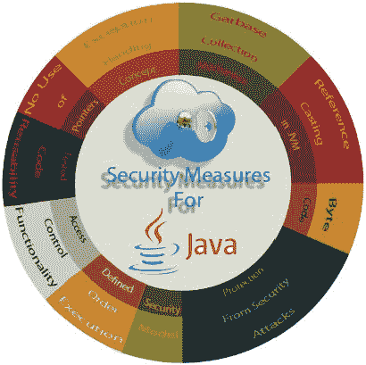

安全是一个重要方面，Java 的安全模型是使其成为开发企业级应用时最可靠选择的关键架构特性之一。当软件跨网络下载并在本地执行时，安全性变得至关重要，Java 能够轻松缓解与项目或应用程序相关的安全漏洞。不相信？来看看这些论点（安全措施/特性），它们展示了 Java 平台有多安全。

## Java 的安全模型

Java 的安全模型旨在通过“沙箱”帮助并保护用户免受从网络下载的恶意程序的影响。它允许所有 Java 程序运行在沙箱内，防止对不可信资源的活动，包括读写本地磁盘、创建新进程或加载任何动态库。

## 不使用指针

C/C++ 语言使用指针，这在其他程序获取指针值时会导致未经授权的访问。与传统的 C/C++ 语言不同，Java 从不使用指针。Java 有内存管理机制。只有在授权的情况下允许程序访问数据。

## 异常处理概念

异常处理的概念允许 Java 捕获一系列错误，帮助开发者消除系统崩溃的风险。

## 定义执行顺序

所有基本类型都有预定义的大小，且所有操作都按特定顺序定义。因此，在不同的 Java 虚拟机上执行的代码顺序不会不同。

## 字节码是另一个让 Java 更安全的特性

每当用户编译 Java 程序时，Java 编译器都会创建一个带有字节码的类文件，JVM 在程序执行时会对其进行病毒或其他恶意测试。

## 经过测试的代码重用性

Java 对象的封装为“契约编程”提供了支持。这允许开发者在开发 Java 企业级应用时重用已经测试过的代码。

## 访问控制功能

Java 对对象内部变量和方法的访问控制功能通过防止不可信代码访问关键对象，提供了安全的程序。

## 防御安全攻击

它允许开发者将类或方法声明为 `FINAL`。我们都知道任何声明为 `final` 的类或方法都不能被重写，这帮助开发者保护代码免受安全攻击，例如创建子类并替换原始类且重写方法。

## JVM 中的类型安全引用转换

每当你使用对象引用时，`JVM` 都会监控你的操作。如果你尝试将引用转换为不同的类型，它将使该转换无效。

除了所有这些之外，结构化错误处理通过帮助增强程序的健壮性，对 Java 的安全模型做了很大贡献。上述论点充分证明，与其他编程语言相比，用 Java 开发的项目更加安全。然而，在开发企业级 Java 应用时，遵循一些最佳实践是开发者的责任。

## 不要错过！

点击下方按钮，您可以订阅，当 `Harry. H. Chaudhary.` 出版新书时您将收到邮件。无需任何费用也无任何义务。


[`books2read.com/r/B-A-XWV-TBLD`](https://books2read.com/r/B-A-XWV-TBLD)


将独立的读者连接到独立的作者。

### Harry. H. Chaudhary. 的其他著作：

- [Core Java : 给真正急躁读者的完整参考](https://www.draft2digital.com/catalog/60212)
- [Core Java Professional : 进阶特性（核心系列）更新至 Java 8](https://www.draft2digital.com/catalog/60230)
- [Core Java Professional : 针对初学学者](https://www.draft2digital.com/catalog/60204)
- [Core Java Professional : 给真正急躁读者的指南](https://www.draft2digital.com/catalog/60224)
- [Core Java Professional : 深思熟虑 - 代码一次，完整的 Java 编程指南](https://www.draft2digital.com/catalog/60229)
- [Java : 给真正急躁读者的完整初学者参考](https://www.draft2digital.com/catalog/60223)
- [Java : 完整的 Java 编程指南](https://www.draft2digital.com/catalog/60210)
- [Java : 给真正急躁读者的完整参考](https://www.draft2digital.com/catalog/60215)
- [Java : 趣味学习完整 Java 编程](https://www.draft2digital.com/catalog/60209)
- [Java : 按照你大脑的工作方式学习](https://www.draft2digital.com/catalog/60207)
- [Java : 给真正急躁读者的完整核心参考](https://www.draft2digital.com/catalog/60221)
- [Java : 完整参考](https://www.draft2digital.com/catalog/60206)
- [数据结构与算法：简单易学](https://www.draft2digital.com/catalog/62076)
- [JAVA 面试字典 - || 2000+ 面试题、概念、问题、分析、解决方案](https://www.draft2digital.com/catalog/62077)
- [实战软件工程 1000+ 多选题测试系列](https://www.draft2digital.com/catalog/364498)
