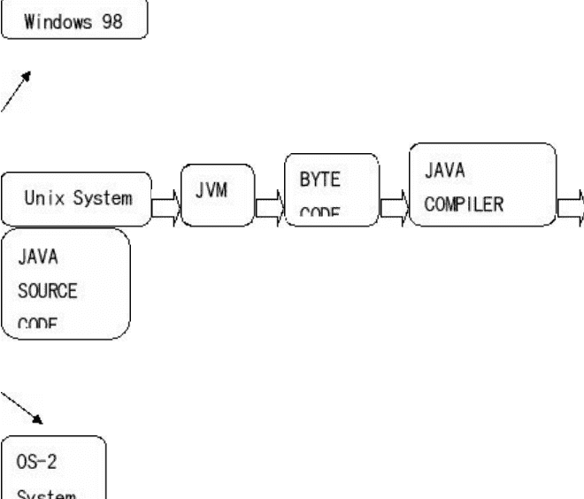
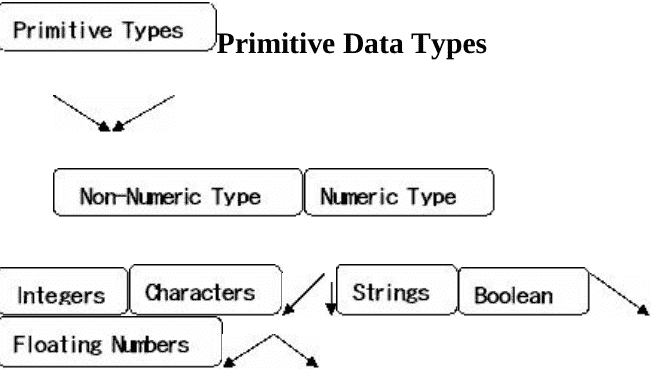
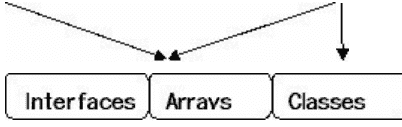
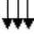

# Java：3天学会 Java！

## 11.4 多线程

## 12.5 错误与异常的区别

# 第1章 面向对象编程基础

## 1.1 绪论 (OOP)

面向对象编程 (OOP) 是一种通过为数据和方法创建划分的内存区域来标准化程序的方法。它的开发是为了提高程序员的生产力，并克服传统的编程方法。不同的面向对象编程语言有 `C++`、`Java`、`Simula-67` 等。

面向对象编程 (OOP) 允许数据在指定的程序区域内应用。它比方法赋予了数据更大的重要性，这意味着它还提供了重用性特性，以开发高效的逻辑。

### 面向对象编程 (OOP) 的特性

- 对象可以作为桥梁，使数据从一个方法流到另一个方法。
- 它重视数据项而非方法。
- 它通过将整个程序分为若干个对象，使程序变得更简单。
- 在不改变方法的情况下可以轻松修改数据。

### (OOP) 的原则

- 对象
- 类
- 数据抽象
- 封装
- 数据隐藏
- 继承
- 多态

## 1.2 对象与类

### 对象

对象是一个唯一的实体，它将数据和方法（特征和行为）结合在一起，在面向对象编程中被称为对象。

面向对象编程 (OOP) 允许数据在指定的程序区域内应用。它比方法赋予了数据更大的重要性，这意味着它还提供了重用性特性，以开发高效的逻辑。

对象可以作为桥梁，使数据从一个方法流到另一个方法。

它重视数据项而非方法。

它通过将整个程序分为若干个对象，使程序变得更简单。

在不改变方法的情况下可以轻松修改数据。

对象具有以下特性：

- 它是可见的。
- 它是易于描述的。

### 类

类是一组具有属性的在 Java 中的类，`apple`、`apple`、`orange`、`orange` 属于类。

`fruit = new fruit();`

## 1.3 数据抽象

抽象是指在不包含背景细节的情况下减少复杂性和提高效率。

抽象是类的属性。数据成员只通过相关方法访问。类使用抽象。

## 1.4 封装

**封装是将数据和函数封装成单个单元（称为类）。**

面向对象编程 (OOP) 允许数据在指定的程序区域内应用。它比方法赋予了数据更大的重要性，这意味着它还提供了重用性特性，以开发高效的逻辑。

封装是类最重要的特性。数据成员只通过相关方法访问。类使用抽象。数据类型类型。无法从外部直接访问的数据被称为**数据隐藏**。

## 1.5 多态

多态的字面意思是“以多种形式存在”。假设你开发了一个方法来进行加法，它将找到两个数字的和。如果传递的参数是字符串，函数将产生连接后的字符串。

多态是不同对象对相同消息以自己的方式做出响应的能力。它允许相同的外部接口。

## 1.6 继承

继承可以定义为一个类的对象可以链接并共享另一个类的公共属性。

一个类的对象从另一个类中获取某些属性。父类或基类是用于继承的类。子类或派生类是继承自`父类`的类。

# 第2章 Java 简介

## 2.1 Java 历史

Java 语言最初由 `James Gosling` 在 `Sun Microsystems`（美国科罗拉州布鲁姆菲）开发，并于1995年作为 `Sun Microsystems` Java 平台的核心组件发布。该语言最初被称为 `Oak`（以 `Gosling` 办公室外的橡树命名）。平台无关是 Java 优于其他语言的最显著优势之一。

Java 封装了 `C++` 的许多特性。最初 Java 设计用于执行在网络浏览时下载的 `applet`。但逐渐，它作为编程语言已获得了广泛认可，经常替换 `C` 或 `C++`。

## 2.2 Java 基础特性

Java 具有以下特性：

- Java 不是一个纯的面向对象编程语言。
- Java 程序既被编译又被解释。
- 它既可以从本地系统访问数据，也可以从网络访问数据。
- Java 程序写在类中。
- Java 程序可以创建 `Applet`（在 Web 浏览器上运行的程序）。
- Java 是区分大小写敏感的语言。它区分大写字母和小写字母。

## 2.3 编译器与解释器

所有高级程序语言都需要转换为机器码，以便计算机在获取所需的输入后能够理解程序。

从高级语言到机器级语言的转换可以通过两种方式完成。可以使用编译器（`Compiler`）或解释器（`Interpreter`）来实现。

通过逐行将高级指令转换成机器语言的软件被称为解释器。如果在某一行发现错误，后续执行将停止，直到对其进行纠正。这种纠错过程要简单得多，但程序成功执行所需的时间更长。

### 源代码 -> 编译器/解释器 -> 机器码

然而，如果所有指令一次性转换为机器级语言并将所有错误列在一起，那么该软件被称为编译器。这个过程要快得多，但有时很难一次性调试程序中的所有错误。

Java 源代码和 Java 字节码在 `javac` 命令中进行编译。

编译语法：`javac filename.java`

## 2.4 JVM

JAVA 是一种高级程序语言（HLL），在 HLL 中编写的程序会经过编译，然后转换为一种称为“字节码”（`Byte Code`）的中间语言。字节码使 Java 程序具有高度的可移植性，因为字节码可以轻松从一个系统传输到另一个系统。当这些字节码要在任何其他系统上运行时，需要一个名为 Java 虚拟机（`Java Virtual Machine`）的解释器，将字节码翻译为机器码。



Java 机器码适用于 Windows 98、Unix 系统等不同平台。因此，JVM充当虚拟处理器，并将字节码转换为相应平台的机器码。这就是它被称为 Java 虚拟机的原因。

JVM 的三个概念是实现（`Implementation`）、实例（`instance`）和规范（`specification`）。规范文档描述了 JVM 实现的要求。单一规范确保了所有实现都是可操作的。实现程序满足 JVM 规范的要求。JVM 实例是运行在进程中的实现，执行编译为 Java 字节码的程序。

因此，Java 也使用编译器和解释器。

## 2.5 Java 运行环境 (JRE)

Java 运行环境（`JRE`）用于提供运行环境。它是 JVM 的实现。它包含了 JVM 在运行时使用的其他文件和一组库。它是一个包含运行 Java 程序所需内容的软件包。它共同包含了 Java 类库实现和 Java 虚拟机实现。拥有 Java 商标的 Oracle 公司分发了带有名为 `HotSpot` Java 虚拟机的 Java 运行环境。

## 2.6 Java 开发工具包 (JDK)

Java 开发工具包（`JDK`）包含 `JRE` 和开发工具。`JDK` 工具（如编译器和调试器）对于开发应用程序和 `Applet` 是必须的。

### JDK 1.3 中的 Java 库

Java 开发工具包（`JDK`）包含用于不同用途的 Java 类库。下面列出了其中一些实用的包：

- `java.io`：支持处理输入和输出语句的类。
- `java.lang`：支持包含 `String`、`Character`、`Math`、`Integer`、`Thread` 等等类。
- `java.net`：支持网络相关操作和处理 `URL`（统一资源定位符）的类。
- `java.txt`：用于支持日期、时间、货币等文本元素。
- `java.math`：支持数学函数功能，如平方根（同时支持整数和小数）。
- `java.applet`：支持生成 `applet` 特有环境的类。
- `java.awt`：支持抽象窗口工具包和管理 `GUI`（图形用户界面）。

## 2.7 保留字

保留字或关键字是系统保留的单词。这些单词不能在任何程序中作为变量名。Java 也有保留字。下面列出了部分保留字/关键字：

| case | switch | int | void | default |
|---|---|---|---|---|
| do | break | double | import | boolean |
| try | const | long | class | char |
| catch | if | new | package | goto |
| for | else | byte | static | throws |
| while | short | public | private | float |

### Java编程中的注释语句

在某些情况下，用户很难理解程序中的逻辑，特别是当程序是由他人开发时。在这种情况下，程序员通过在程序中使用注释语句说明不同步骤的目的和采取的操作。

在 Java 编程中提供注释有三种方式。

1. `//`：用于单行注释
2. `/* 编写的注释 */`：用于多行注释
3. `/** 文档注释 **/`

### Java 编程中的输出语句

`System.out.println()` 和 `System.out.print()` 是用于获取程序输出或在屏幕上显示消息的语句。

在使用 `System.out.println()` 语句时，光标在显示所需结果后会跳行到下一行。

而且，当您使用 `System.out.print()` 语句时，光标在显示内容后仍留在同一行。

**语法：**`System.out.println("Welcome to Java");`

注意：

- 在双引号内显示消息。
- 在双引号内显示。

# 第3章 数据类型与标记

## 3.1 数据类型

数据类型是预定义的类型，规定了数据的大小和类型。数据分为两种：

* 原始类型
* 非原始类型



原始数据类型是预定义的或内置类型，独立于任何类型。例如 `int`、`long`、`float`、`double`。

### 整数类型

整数类型可以存储如 `123` 和 `-96` 的整数。数值取决于整数类型。它不包含小数点。有两种类型的声明：

- `int`：适用于短整数。位大小为32位，格式为 `int a=10`
- `long`：适用于大整数。位大小为64位，格式为 `long b=34578`

### 浮点类型

浮点数据类型用于表示带有小数部分的数字。有两种类型的声明：

- `float`：适用于小范围小数。位大小为32位，格式为 `float m=32.65`
- `double`：适用于宽范围小数。位大小为64位，格式为 `double n=0.006547839`

### 字符类型

它在内存中存储字符常量并包含单个字符。字符包含在单引号（`‘ ’`）中。字符串包含在双引号（`“ ”`）中。

Java 中的字符类型如下：

| 非数值 | 字符类型 | 位大小 | 格式 |
|---|---|---|---|
| 单字符 | `char` | 16位(2字节) | `char c='A'; char d; d='*'; char c ='A';` |
| 多字符/单词/句子 | `String` | 大16位 | `String a; a="College";` |

### 布尔类型

布尔数据类型用于存储具有两种状态的值：`true` 或 `false`。这些是非数字常量。你可以使用布尔类型变量设置 `true` 或 `false`，以确保逻辑条件是否满足。它假设为 `true` 或 `false` 之一，且不加引号。

例如：`boolean flag=true;` 或 `boolean flag=false;`

```
非原始类型 非原始数据类型
```



在 Java 语言中，类（`class`）用于创建对象以及定义对象数据类型和方法的模板。

例如：

```java
public class MyFirstJavaProgram {
/*
这是我的第一个 java 程序。
它会将‘Welcome' 作为输出打印。
*/
public static void main (String[] args) {
System.out.println("Welcome"); // 打印 Welcome
}
}
```

让我们来看如何保存文件、编译并运行程序——

- 打开记事本并添加上述代码。
- 将文件保存为：`MyFirstJavaProgram.java`。
- 打开命令提示符窗口并进入保存该类的目录。假设是 `C:\n`
- 输入 `javac MyFirstJavaProgram.java` 并按回车编译你的代码。如果代码没有错误，命令提示符将处理下一行。然后，输入 `java MyFirstProgram` 并按回车运行你的程序。
- 你将看到窗口上打印出 `Welcome`。

我们稍后将在第 7 章学习数组（`Arrays`）

## 3.2 JAVA 标记 (TOKENS)

Java 语句中使用的每个单独字符被称为 Java 标记（`Java Token`）。

### Java 标记类型

### 字面量 (常量)

这些是 Java 程序中常量。Java 按以下方式对字面量进行分类：

- **整数字面量 (Integer Literals)**：这些具有正或负值的整数。例如 `15`、`256` 等。
- **实数字面量 (Real Literals)**：它们代表带有小数点的数字。例如 `24.6`、`0.0045` 等。
- **字符字面量 (Character Literals)**：本质上是字母数字的常量被称为字符字面量。例如 `‘A’`、`‘b’`、`‘*’` 等。
- **字符串字面量 (String Literals)**：字符串是字母数字字符集。例如 `“Year 2017”` 等。


### 标识符 (变量)

标识符在 Java 编程中也称为变量。变量是一个命名的内存位置，包含一个值。变量可以用任何不含空格的字母组合来处理。我们可以在语句中声明多个相同类型的变量。

语法：`数据类型 变量名;`

例如 `int a; float a,b,c;`

### 赋值 (Assignments)

赋值标记将其右侧的值赋给左侧的操作数。为了赋值对象引用，也可以使用运算符。

例如 `int speed = 0; int gear = 1;`

### 标点符号 (Punctuators)

标点符号是 Java 中使用的标点符号。某些标点是：`; , ?` 等。

### 分隔符 (Separators)

这些是 Java 中用于分隔字符或变量的特殊字符。

例如 `( ) { } [ ]` 等。

### 运算符 (Operators)

运算符是用于在 Java 编程中执行算术或逻辑操作的符号。例如 `+ - * / || & & & < >`

注意：我们将在下一章中详细介绍运算符 (Operators)

# 第 4 章 运算符与表达式 (OPERATORS AND EXPRESSIONS)

运算符基本上是一个符号或标记，它执行逻辑或算术操作并给出有意义的结果。参与操作的值称为操作数（operands）。

例如：`a + b * c` 其中 a b 和 c 是操作数，`+` 和 `*` 是运算符。

## 4.1 运算符类型 (TYPES OF OPERATORS)

基本上，Java 中有三种运算符，如下：

- 算术运算符 (Arithmetical)
- 关系运算符 (Relational)
- 逻辑运算符 (Logical)

### 算术运算符 (ARITHMETICAL OPERATORS)

用于在程序执行算术计算的运算符被称为算术运算符，如 `+ - *` 等。

算术表达式 (Arithmetical Expression)：

算术表达式可以包含变量、常量和算术运算符，以产生有意义的结果。

例如 `a+b, x-10, b*-4*a*`

算术语句 (Arithmetical Statement)：

如果将算术表达式赋给变量，则称为算术语句。

语法：`变量 = 算术表达式;`

例如 `x = a + b, z=b-4*a`

算术运算符类型

- 一元运算符
- 二元运算符
- 三元运算符

#### 一元运算符

一元运算符也可以认为是应用于单个操作数的算术运算符。例如 `+ - ++` 等。

一元增和减运算符：

一元增运算符 (`++`) 将操作数的值加一，一元减运算符 (`--`) 将操作数的值减一。

例如：

1. `i=i+1` 应用增运算符可以写为 `++i`
2. `j=j-1` 应用减运算符可以写为 `j--`

一元增/减运算符类型：

- 前缀 (Prefix)
- 后缀 (Postfix)

##### 前缀 (Prefix)

当增减运算符应用于操作数之前时，被称为前缀运算符。该运算符遵循“操作前更改”的原则。这意味着变量在操作发生之前变化。

例如：`p = 5;`

`p = ++p * 4;` 在操作执行前 p 增加了 1。

`p = --p * 4;` 在操作执行前 p 减少了1。

##### 后缀 (Postfix)

当增减运算符应用于操作数之后时，被称为后缀运算符。该运算符遵循“操作后更改”的原则。这意味着变量在执行操作后变化。

例如：`p = 5;`

`p = p++ * 4;` 在操作执行后 p 增加了 1。

`p = p-- * 4;` 在操作执行后 p 减少了1。

#### 二元算术运算符 (Binary Arithmetic Operators)

处理两个操作数的算术运算符被称为二元算术运算符。例如 `a + b, a – b` 等。

#### 三元运算符（条件运算符）（Ternary Operators / Conditional Operator）

三元运算符接受三个操作数。它被称为条件运算符，因为赋给变量的值取决于逻辑表达式。

语法：`变量 = (测试表达式) ? 表达式1 : 表达式2;`

如果测试条件为真，则变量包含表达式1的结果，否则为表达式2。

例如 `a = 4; b = 2;`

```java
max = (a>b) ? a : b;
```

在这里，条件为真，所以 a 的值为4。

#### 嵌套三元运算符 (Nested Ternary Operator)

你可以如下所示的形式使用嵌套的三元运算符：

寻找三个数中最大值的程序：

```java
int a = 4, b = 10, c = 2;
```

```java
max = (a>b) ? (a>c) ? a : b : (b>c) ? b : c;
```

由于测试条件为假，它将操作表达式2，使值12存储在 max 中。因此，`max = 12`。

### 关系运算符 (RELATIONAL OPERATORS)

关系运算符比较变量的值并返回“真”或“假”（即 0 或 1）。Java 有六种关系运算符：`<, <=, >=, ==, !=`。

### 逻辑运算符 (LOGICAL OPERATORS)

Java 使用逻辑运算符 `AND(&), OR (|), NOT (!)`。这些运算符根据不同表达式的输出产生 1 或 0。

例如 `(a>b)&&(a<c), !(a==b)`

注意：如果语句包含所有逻辑运算符，NOT运算符将先执行。

### 位运算符 (BITWISE OPERATORS)

位运算符使用 `byte, short, int, long` 类型的操作数。然而，不允许 `float` 和 `double` 类型。

例如：
- `&` 位与
- `|` 位或
- `^` 位异或
- `<<` 左移
- `>>` 右移

## 4.2 表达式 (EXPRESSIONS)

在 Java 中编写程序时，有必要将算术表达式转换为 Java 表达式。

### 混合表达式 (Mixed Expression)

包含不同类型变量或值以产生结果的表达式被称为混合表达式。

例如 `int a; float b; double c;`

```java
double z = a + b * c;
```

隐式类型转换 (Implicit Type Conversion)

在混合表达式中，结果的数据类型会自动转换为更高类型而无需用户干预。这种类型转换被称为隐式类型转换。

显式类型转换 (Explicit Type Conversion)

当数据类型在用户干预后转换为另一种类型时，类型转换被称为显式类型转换。

```java
int a, b;
```

```java
float x = (float) (a+b);
```

# 第5 章 条件判断语句 (CONDITIONAL AND DECISION MAKING STATEMENTS)

在章的第一部分，我们将讨论无条件语句，这将有助于提供在程序中编写 Java 指令的细节。

为了在程序中执行指定任务，你需要提供一些在程序执行期间可以使用的值。从用户处接受值的语句被称为输入语句。Java 提供了多种在编程中使用输入语句的方法。方法如下：

- 通过赋值值
- 使用输入流
- 使用命令行参数

## 5.1 使用赋值语句编程 (PROGRAMMING BY USING ASSIGNMENT STATEMENT)

通过赋值语句，你可以获取你自己的或程序中提到的数据值。

例如：使用 Java 查找两个数之和的程序

```java
public class sum
{
    public static void main (String args[])
    {
        int a,b,c;c=0;
        a=15;b=45;
        c=a+b;
        System.out.println("The sum of the two numbers "+c);
    }
}
```

输出:

两个数字之和 = 60。

## 5.2 使用流进行编程

Java 中的包（Package）本质上是类的集合。每个包都包含一些相关的内置函数，这些函数可以在开发编程逻辑时使用。

### 缓冲区 (Buffer)

CPU 或处理器是计算机中最快的设备。其他外围设备相对于处理器较慢。由于速度差异，处理器与外围设备之间进行数据通信变得困难。因此，在 I/O 设备和处理器之间应用了高速内存，作为桥梁来同步它们的速度。这种高速临时存储（缓存内存）被称为缓冲区。在进行任何输入/输出操作之前，你都需要激活缓冲区。

### 在 Java 中激活缓冲区

```java
InputStreamReader <object name1> = new InputStreamReader (System.in);
```

```java
BufferedReader <object name2> = new BufferedReader <object name1>
```

```java
OR
DataInputStream<object name> = new DataInputStream(System.in);
```

### 主函数 (Main function)

下一步是按照所示内容声明主函数：

```java
public static void main (string args[]) throws IOException
```

主函数用于执行程序。随后，`throws IOException` 消除了程序中的 I/O 错误（如果有）。它会将 I/O 错误的报告传递给 Java 系统的异常处理器。

## 5.3 使用流时的声明

1. 首先需要定义 Java 库包。

语法：`import java.io.*;` 或 `import java.io.*;` 或两者都包含。

2. 当你使用输入流来激活缓冲区时，本质上需要两个语句。

```java
DataInputStream in = new DataInputStream(System.in);
```

OR

```java
public static void main(String args[]) throws IOException
InputStreamReader read = new InputStreamReader(System.in);
BufferedReader in = new BufferedReader(read);
```

3. 在输入语句之前显示一条消息以便启用输入编辑器。

语法：`System.out.println("Enter your name");`

4. Java 编程中输入语句的语法

```java
n = Integer.parseInt(in.readLine());
```

此语句将仅接受用户的整数，而：

```java
n = Float.parseFloat(in.readLine());
```

将接受用户的小数。

示例：一个 Java 程序，接受直角三角形的直和底，计算并显示三角形的斜边和面积。

```java
import java.io.*;
public class Triangle
{
    public static void main(String args[]) throws IOException
    {
        float p,b;
        double area=0,hyp=0;
        InputStreamReader read = new InputStreamReader(System.in);
        BufferedReader in = new BufferedReader(read);
        System.out.println("Enter perpendicular and base");
        p=Float.parseFloat(in.readLine());
        b=Float.parseFloat(in.readLine());
        hyp=Math.sqrt(p*p+b*b);
        area=(float)1/2*p*b;
        System.out.println("Hypotenuse ="+hyp);
    }
}
```

## 5.4 Java 中的决策判断

有时我们的程序需要根据是否发生了特定条件来做出决策。然后我们的程序将根据此决策执行某些语句。

Java 中的决策可以使用以下任何一种语句实现：

- if 语句
- switch 语句
- 条件运算符语句

### if 语句

你可以使用 if 语句来检查指定的条件。如果条件为真，它会执行一系列操作；否则，忽略该操作。

语法：`if(condition)`


如果语句为真，则执行语句 1 和语句 2。如果条件为假，则忽略这些语句并跳到程序的下一行。

示例：

```java
public class IfStatement{
    public static void main(String args[]){
        // 声明一个变量 test 并初始化为 10
        int test=10;

        // 检查 test 是否大于 5
        if(test>5)
        {
            // 只有当 test 大于 5 时才执行此块
            System.out.println("Success");
        }
        // if 块结束
        System.out.println("Executed successfully");
    }
}
```

输出：执行成功

### if-else 语句

如果条件为真，则执行 `if` 大括号中的代码。如果条件为假，则执行 `else` 大括号中的代码。

语法：

```java
if(condition)
{
    // 如果条件为真则执行语句
}
else
{
    // 如果条件为假则执行语句
}
```

示例： 

```java
public class IfElse
{
    public static void main(String args[])
    {
        // 声明一个变量 test 并初始化为 10
        int test=10;

        // 检查 test 是否大于 5
        if(test>5)
        {
            // 只有当 test 大于 5 时才执行此块
            System.out.println("Success");
        }
        else
        {
            // 只有当 test 不大于 5 时才执行此块
            System.out.println("Failure");
        }
    }
}
```

输出：Success

### if-else 链 (if-else ladder)

条件从顶部开始计算。如果第一个 `if(condition)` 为真，则执行 `if` 块中的代码；如果为假，则计算 `else if(condition)`，以此类推。如果所有条件为假，则执行 `else` 块中的代码。

示例：

```java
public class IfElseLadder {
  public static void main(String[] args) {
    // 声明一个变量 test 并初始化为 2
    int test=2;
    if(test==1) {
      // 只有当 test 等于 1 时才执行此块
      System.out.println("Hello");
    }
    else if(test==2)
    {
      // 只有当 test 等于 2 时才执行此块
      System.out.println("Hi");
    }
    else if(test==3)
    {
      // 只有当 test 等于 3 时才执行此块
      System.out.println("Good");
    }
    else
    {
      System.out.println("No Match Found");
    }
  }
}
```

输出：Hi

### 嵌套 if...else 语句

当你组合多个 `if` / `if-else` / `if-else-if` 链时，涉及到大量的顺序决策。你需要处理程序遇到顺序条件时的执行指令。

示例：


```java
public class NestedIf
{
  public static void main(String args[])
  {
    // 声明一个变量 a 并初始化为 5
    int a=3;
    // 声明一个变量 b 并初始化为 3
    int b=3;

    if(a==5)
    {
      // 只有当 a 等于 5 时才执行此块
      if(b==3)
      {
        /* 只有当 a 等于 5 且 b 等于 3 时才执行此块 */
        System.out.println("Hi, a is 5 and b is 3");
      }
      else
      {
        /* 只有当 a 等于 5 且 b 不等于 3 时才执行此块 */
        System.out.println("Hi, a is 5 and b is some value other than 3");
      }
    } else if(a==4)
    {
      // 只有当 a 为 4 时才执行此块
      System.out.println("Hi, a is 4");
    }
    else if(a==3)
    {
      // 只有当 a 等于 3 时才执行此块
      if(b==3)
      {
        /** 只有当 a 等于 3 且 b 等于 3 时才执行此块 */
        System.out.println("Hi, a is 3 and b is 3");
      }
      else if(b==2)
      {
        /** 只有当 a 等于 3 且 b 等于 2 时才执行此块 */
        System.out.println("Hi, a is 3 and b is 2");
      }
      else
      {
        /** 只有当 a 为 5,4,3 以外值时才执行此块 */
        System.out.println("Hi, a is some value other than 5,4,3");
      }
    }
  }
}
```

输出：Hi, a is 3 and b is 3

## switch 语句

`switch case` 语句是一种多分支语句。在该系统中，控制根据 `switch` 值跳转到执行多个操作中的特定一个。

`switch` 语句与多个块相关。每个块都定义在特定的 `case` 下。控制流转移到与给定的 `switch` 值匹配的特定 `case`。每个 `case` 都以 `break` 语句结束，该语句可以作为 `case` 的终止符。`break` 语句将控制流传出 `switch` 块。

你可以使用一个名为 `default` case 的特殊 `case`，如果没有没有 `case` 匹配给定的 `switch` 值，则会自动执行该 `case`。

示例：一个 Java 程序，接受两个数字并根据用户的选择计算和、差值或乘积。

```java
import java.io.*;
public class choice {
    public static void main(String[] args) throws IOException {
        int a,b,ch;
        InputStreamReader read = new Reader(System.in);
        BufferedReader in = new BufferedReader(read);
        System.out.println("输入两个数字");
        a=Integer.parseInt(in.readLine());
        b=Integer.parseInt(in.readLine());
        System.out.println("输入 1 加法, 2 减法, 3 乘法");
        System.out.println("输入你的选择");
        ch=Integer.parseInt(in.readLine());
        switch(ch) {
            case 1:
                System.out.println("两个数字之和：+(a+b));
        }
    }
}
```

```java
break;
case 2:
System.out.println("两个数字之差：+(a-b));
break;
case 3:
System.out.println("两个数字之积：+(a*b));
break;
default:
System.out.println("选择错误");
}
}
```

# 第 6 章 循环

## 6.1 循环结构

循环结构包含以下部分：

- 控制变量
- 循环体
- 测试条件
- 步进值

## 6.2 循环的类型

Java 中的循环类型：

- `for` 循环
- `while` 循环
- `do while` 循环

### for 循环

借助 `for` 循环，我们可以很容易地执行任何条件类型的重复流。它用于固定次数的迭代。

语法：`for(初始值; 最终值; 步进值)`

```java
{
  要执行的任务
}
```

示例：一个打印从 1 到 5 所有自然数字的 Java 程序。

```java
public class num
{
  public static void main(String args[])
  {
    int a;
    for(a=1;a<=5;a++)
    {
      System.out.println(a);
    }
  }
}
```

输出：
1
2
3
4
5

### 嵌套 for 循环

当你在另一个 `for` 循环内部应用 `for` 循环时，这种结构被称为嵌套 `for` 循环。

示例：使用 `for` 循环显示给定模式的 Java 程序。

- 1
- 1 2
- 1 2 3

```java
public class pattern
{
  public static void main(String args[])
  {
    int a;
    for(a=1;a<=3;a++)
    {
      for(b=1;b<=a;b++)
      {
        System.out.print(b);
      }
      System.out.println();
    }
  }
}
```

### while 循环

`while` 循环在给定条件为真时重复语句或一组语句。它在执行循环体之前测试条件。循环将一直执行直到测试条件为真。

语法：`while(condition)`

```java
{
  要执行的语句
}
```

示例：一个使用 `while` 语句在屏幕上显示 10 次消息的 Java 程序。

```java
public class msg
{
  public static void main(String args[])
  {
    int i=1;
    while(i<=10)
    {
      System.out.println("欢迎来到 Java.");
      i++;
    }
  }
}
```

### 无限 while 循环

在 `while` 循环中，如果用户不提供增/减表达式，它将变成无限循环。由于测试条件始终为真，循环无限重复。

```java
int i=1;
while(i<=10)
{
  s+i;
}
```

### 嵌套 while 循环

嵌套 `while` 循环被称为在另一个循环内部使用的 `while` 循环。

**示例:** 使用 `while` 循环显示给定模式的 Java 程序。

- 1
- 1 2
- 1 2 3

```java
public class pattern
{
  public static void main(String args[])
  {
    int a=1;
    while(a<=3)
    {
      b=1;
      while(b<=a)
      {
        System.out.print(b);
        b++;
      }
      System.out.println();
      a++;
    }
  }
}
```

### do-while 循环

`do-while` 循环用于迭代次数固定的程序。在这种系统中，控制流不检查任何条件进入循环，执行给定的步骤，然后检查是否继续以退出循环。

语法：
```java
do
{
  要执行的任务
}
while(condition);
```

示例：计算 10 阶乘的 Java 程序。

```java
public class factorial
{
  public static void main(String args[])
  {
    int i,f;i=1;f=1;
    do
    {
      f*i;
      i++;
    }
    while(i<=10);
    System.out.println("10 的阶乘 = " +f);
  }
}
```

### break 语句的使用

有时当条件满足时需要突然停止循环。`break` 语句用于异常终止循环。

语法：
```java
while(condition)
{
    if(true)
    break;
}
```

### continue 语句的使用

`continue` 语句是 `break` 语句的相反。一旦在循环中执行 `continue` 语句，控制将跳过该值的其余语句并继续下一次迭代。

语法：
```java
while(condition)
{
    if(true)
    continue;
}
```

# 第 7 章 数组

## 数组

在 Java 编程中，可能需要通过应用最少变量和优化内存空间来组织大量数据项。在内存中以最方便的方式存储数据。Java 数组是包含相同数据类型的对象。它是存储相似元素的数据结构。在 Java 数组中，第一个元素存储在索引 0。

| 0 | 1 | 2 | 3 | 4 | 5 | 6 | 7 | 8 | 9 |
|---|---|---|---|---|---|---|---|---|---|

## 7.1 数组的类型

- 一维数组
- 二维数组

### 一维数组

当元素通过单个下标指定时，称为一维数组。

声明一维数组的语法：

- `dataType[] arr;` (或)
- `dataType []arr;` (或)
- `dataType arr[];`

## 7.2 在 JAVA 中声明数组

一维 Java 数组示例

```java
class TestSingleArray{
  public static void main(String args[]){
    int a[]=new int[5];//int 的声明和实例化
    a[0]=10;//用数字初始化 a
    a[1]=20;
    a[2]=70;
    a[3]=40;
    a[4]=50;
    //打印数组
    for(int i=0;i<a.length;i++) // length是数组的属性
      System.out.println(a[i]);
  }
}
```

输出：
10
20
70
40
50

同时实例化和初始化 Java 数组可以声明为：

```java
class Test1Instantiateandinitializing{
  public static void main(String args[]){
    int a[]={33,3,4,5}; //int 的声明、实例化和初始化
    
    //打印数组
    for(int i=0;i<a.length;i++) // length是数组的属性
      System.out.println(a[i]);
  }
}
```

输出：
33
3
4
5

### 7.3 将数组传递给方法

我们可以将 Java 数组传递给方法，以便在任何数组上重用相同的逻辑。

```java
class Test2PassingMethod{
  static void min(int arr[]){
    int min=arr[0];
    for(int i=1;i<arr.length;i++)
      if(min>arr[i])
        min=arr[i];
    
    System.out.println(min);
  }

  public static void main(String args[]){
    int a[]={33,2,4,5};
    min(a);//传递数组给方法
  }
}
```

输出：2

### 二维数组

在这种情况下，数据存储在基于行和列的索引中（也称为矩阵形式）。

语法：

- `dataType[][] arrayRefVar;` (或)
- `dataType [][]arrayRefVar;` (或)
- `dataType arrayRefVar[];` (或)
- `dataType [][]arrayRefVar][];`

实例化二维数组的示例：

`int[][][] arr = new int[3][3];` // 3 行和 3 列

### 初始化二维数组的示例：

```java
arr[0][0]=1;
arr[0][1]=2;
arr[0][2]=3;
arr[1][0]=4;
arr[1][1]=5;
arr[1][2]=6;
arr[2][0]=7;
arr[2][1]=8;
arr[2][2]=9;
```

### 二维数组示例：

```java
class Testarray3Dimensional{
  public static void main(String args[])
  {
    //声明和初始化二维数组
    int arr[][]={{1,2,3},{2,4,5},{4,4,5}};
    
    //打印二维数组
    for(int i=0;i<3;i++){
      for(int j=0;j<3;j++){
        System.out.print(arr[i][j]+" ");
      }
      System.out.println();
    }
  }
}
```

输出：
1 2 3
2 4 5
4 4 5

## 7.4 JAVA 的基本操作

数组提供了以下基本操作：

- 搜索
- 排序
- 插入
- 删除
- 合并

### 搜索

这是一个确定给定项目是否存在于数组中的过程。可以通过两种方式实现：

- 线性查找
- 二分查找

### 线性查找

这是最简单的技术之一，对项目的搜索从数组的开始（即数组的第 0 个位置）开始。该过程一个接一个持续，数组的每个元素都会与给定的数据项进行检查和比较，直到到达数组的末尾。这个过程也称为顺序查找。

### 二分查找

这是另一种使用最小可能时间在给定数组中搜索元素的技术。通过将数组进一步划分为两部分，在数组的任一部分进行搜索。

然而，二分查找仅在数组元素按顺序（升序/降序）排列好时才能应用。它总是将要搜索的元素与排序数组的中间元素进行比较。如果中间成员较小，则在上半部分搜索，否则在下半部分继续搜索。将任一部分部分的中间元素与搜索项进行比较。重复此过程，直到搜索结束。

| 18 | 32 | 50 | 56 | 65 | 79 | 88 |
| :--- | :--- | :--- | :--- | :--- | :--- | :--- |
| 0th | 1st | 2nd | 3rd | 4th | 5th | 6th |



### 起 中 后

第 1步：`First=0, Last=6, Mid=(First+Last)/2=(0+6)/2=3`

第 2步：`num[Mid]=num[3]=55`

`55>31`

由于 55 大，因此搜索将在数组的第一半部分进行。

第 3步：`Last=Mid-1 3-1=2`

（如果要搜索的数字大于中间值，则 `First=Mid+1`）。

`Mid=(First+Last)/2=(0+2)/2=1`

`Num[Mid]= num[1]=31`

| 18 | 32 | 50 |
| :--- | :--- | :--- |
| ↓ 0th | ↓ 1st | ↓ 2nd |

### 起 中 后

### 排序

这是一个按照指定顺序（可以是升序或降序）排列数据的过程。

- 选择排序
- 冒泡排序

### 选择排序

这是按指定顺序（升序/降序）对给定数据项进行排序的技术之一。假设你必须从未排序的数据按升序排列数字。

第 1步：首先，通过迭代从未排序的数据列表中选择最小的数字。将此数字与第 0th 位置的数字交换（即 16 从 6th 位置移动到 0th 位置，45 从 0th 位置移动到 6th 位置）。

| 45 | 98 | 50 | 57 | 90 | 28 | 16 | 78 |
| :--- | :--- | :--- | :--- | :--- | :--- | :--- | :--- |
| 0th | 1st | 2nd | 3rd | 4th | 5th | 6th | 7th |

第 2步：从 1st 位置开始找到下一个较小的元素（即 28）。将其与 1st 位置的元素交换。

| 16 | 98 | 50 | 57 | 90 | 28 | 45 | 78 |
| :--- | :--- | :--- | :--- | :--- | :--- | :--- | :--- |
| 0th | 1st | 2nd | 3rd | 4th | 5th | 6th | 7th |

第 3步：从 2nd 位置开始找到下一个较小的元素（即 45）。将其与 2nd 位置的元素交换。

| 16 | 28 | 50 | 57 | 90 | 98 | 45 | 78 |
| :--- | :--- | :--- | :--- | :--- | :--- | :--- | :--- |
| 0th | 1st | 2nd | 3rd | 4th | 5th | 6th | 7th |


| :--- | :--- | :--- | :--- | :--- | :--- | :--- | :--- |
| 0th | 1st | ↑ 2nd | 3rd | 4th | 5th | 6th | 7th |

第 4 步：从 3rd 位置开始找到下一个较小的元素（即 50）。将其与 3rd 位置的元素交换。

| 16 | 28 | 45 | 57 | 90 | 98 | 50 | 78 |
| :--- | :--- | :--- | :--- | :--- | :--- | :--- | :--- |
| 0th | 1st | 2nd | ↑ 3rd | 4th | 5th | 6th | 7th |

第 5 步：从 4th 位置开始找到下一个较小的元素（即 57）。将其与 4th 位置的元素交换。

| 16 | 28 | 45 | 50 | 90 | 98 | 57 | 78 |
| :--- | :--- | :--- | :--- | :--- | :--- | :--- | :--- |
| 0th | 1st | 2nd | 3rd | ↑ 4th | 5th | 6th | 7th |

第 6 步：从 5th 位置开始找到下一个较小的元素（即 78）。将其与 5th 位置的元素交换。

| 16 | 28 | 45 | 50 | 90 | 98 | 57 | 78 |
| :--- | :--- | :--- | :--- | :--- | :--- | :--- | :--- |
| 0th | 1st | 2nd | 3rd | 4th | ↑ 5th | 6th | 7th |

第 7 步：从 6th 位置开始找到下一个较小的元素（即 90）。将其与 6th 位置的元素交换。

| 16 | 28 | 45 | 50 | 57 | 78 | 90 | 98 |
| :--- | :--- | :--- | :--- | :--- | :--- | :--- | :--- |
| 0th | 1st | 2nd | 3rd | 4th | 5th | ↑ 6th | 7th |

因此，使用选择排序按升序排列数字。

### 冒泡排序

该技术广泛用于一维数组元素的排序。在这种技术中，数组被扫描多次，在每次迭代期间，比较相邻元素对并交换为特定顺序（升序/降序）。这是一种简单的技术，但在交换次数多时会消耗大量时间。升序排序数字的方法：

| 10 | 7 | 25 | 12 |
| :--- | :--- | :--- | :--- |
| 0th | 1st | 2nd | 3rd |

比较 10 和 7。由于 10 > 7，它们是可以交换的。

| 7 | 10 | 25 | 12 |
| :--- | :--- | :--- | :--- |
| 0th | 1st | 2nd | 3rd |

比较 10 和 25，但由于 10 < 25，它们是交换的。

| 7 | 10 | 25 | 12 |
| :--- | :--- | :--- | :--- |
| 0th | 1st | 2nd | 3rd |

比较 25 和 4，由于 25 > 4，它们是可以交换的。

| 7 | 10 | 4 | 25 |
| :--- | :--- | :--- | :--- |
| 0th | 1st | 2nd | 3rd |

比较 25 和 12，由于 25 > 12，它们是可以交换的。

因此，使用冒泡排序按升序排列数字。

### 插入排序

要执行插入排序，从数组最左侧的元素开始，并调用插入将遇到的每个元素插入到其正确位置。插入元素的有序序列存储在数组的开头，已检查的索引集中。

# 第 8 章 类、对象和方法

## 8.1 Java 中的类

类是用于创建单个对象的蓝图。

示例：`public class boy`

```java
class boy {
  String name;
  int age;
  void study(){}
  void hungry(){}
}
```

类包含以下类型的变量：

- **局部变量**：局部变量可以定义在方法、构造函数或块内部。
- **实例变量**：在类内部但在任何方法之外并在类内初始化的变量是实例化的。可以从任何方法、构造函数或块内部访问变量。

## 8.2 创建对象

从类创建对象。使用 `new` 关键字创建对象。

- 声明 – 类的类型。
- 实例化 – 使用 `new` 关键字。
- 初始化 – 随 `new` 关键字。

示例：`public class boy`

```java
public Boy(String name){
    System.out.println("Name is:" + name);
}
public static void main(String args[]){
    Boy obj = new Boy("");
}
```

输出：

Name is: Ram

## 8.3 方法

在程序中同时使用的模块被称为方法。

## 8.4 创建方法

```java
语法: public static int user(int a, int b){
    // body
}
```

在这里：

- `public static` – 修饰符
- `int` – 类型
- `user` – 方法名
- `a, b` – 形式参数
- `int a, b` – 参数列表

## 8.5 方法调用

方法调用有两种方式。

- 方法返回一个值
- 不返回（无返回值）。

方法调用过程非常简单。当程序调用方法时，程序控制转移到调用方法。然后调用方法在两种情况下返回控制权给调用者。

- 首先在执行 `return` 语句时，
- 其次在到达方法结束的大括号时。

`void` 关键字：它允许我们创建不返回值的方法。

## 8.6 Java 中的 `this` 关键字

有时，在成员方法中需要使用调用方法的对象。Java 通过 `this` 关键字使用它。被调用的对象可以通过 `this` 进行引用。

示例：`class 类`

```java
class calculate {
    int a, b;

    void getvalue(int p, int q) {
        a = p;
        b = q;
    }

    void sum(calculate x, calculate y) {
        this.a = x.a + y.a;
        this.b = x.b + y.b;
    }

    void display() {
        System.out.println("sum of a " + this.a);
    }

    public static void main(String args[]) {
        calculate obj1 = new calculate();
        calculate obj2 = new calculate();
        calculate obj3 = new calculate();
        obj1.getvalue(2, 3);
        obj2.getvalue(4, 6);
        obj3.sum(obj1, obj2);
        obj3.display();
    }
}
```

(注：由于原文中存在部分段落重复和逻辑混乱，翻译时已根据技术背景进行了修正以保持通顺)

```java
int value1 = miniVal(w, x);
double value2 = miniVal(y, z);
// 相同函数名的不同参数
System.out.println("Minimum value =" + value1);
System.out.println("Minimum value =" + value2);
}
// 整数类型
public static int miniVal(int x1, int x2){
    int mini;
    if(x1 > x2){
        mini = x2;
    }
    else{
        mini = x1;
    }
    return mini;
}
// 数值型函数
public static double miniVal(double x1, double x2){
    double mini;
    if(x1 > x2){
        mini = x2;
    }
    else{
        mini = x1;
    }
    return mini;
}
}
```

## 8.7 方法重写

Java 中的**方法重写**是指子类（子类）拥有了与父类中声明的相同方法。

示例：`class schoolclass`

```java
void run(){System.out.println("school is running");}
class classroom2 extends schoolclass{
    void run(){System.out.println("class is running");}
    public static void main(String args[]){
    classroom2 obj = new classroom2();
    obj.run();
    }
}
```

### 我们可以重写静态方法吗？

不能，静态方法不能被重写，因为静态方法与类绑定，而实例方法与对象绑定。静态属于类，实例属于堆区域。我们无法重写 Java 的 `main` 方法，因为 `main` 是静态方法。

# 第 9 章 接口与包

## 9.1 接口

接口在语法上与类相似，但你不能创建接口的实例，且它们的方法没有方法体。接口用于在 Java 中实现完全抽象。

语法：`interface interface_name{}`

在类中实现接口时，应该使用 `implements` 关键字，方法内部可以有不同的语句。一个类可以实现多个接口。接口中的任何方法都应该在类中使用，否则在编译时会发生错误。

示例：`interface UseInterface`

```java
interface UseInterface {
    int a = 20;
    void use();
}
class Value implements UseInterface {
    public void use() {
        System.out.println("The value of a=" + a);
    }
    public static void main(String args[]) {
        Value v = new Value();
        v.use();
    }
}
```

输出：The value of a=20

## 9.2 Java 中的包

包是类的组，可以导入到程序中，用户可以使用其中提供的隐式功能。

Java 程序中的包可以通过 `import` 命令进行包含。

例如：`import java.util.data`

导入 util 函数是为了利用其内置的数据类。

```java
import java.util.*;
```

它允许包含 `java.util` 包中的所有类。一些可以为了各种基础操作而导入的基础包包括：

- `java.io`
- `java.util`
- `java.awt`
- `java.net`

### 用于数学计算的 Java 包

对于数学函数，我们可以包含 `import java.lang.Math;`。

### 下面列出部分函数：

| 函数 | 描述 | 格式 |
| --- | --- | --- |
| `sqrt(a)` | 返回正数的平方根 | `Math.sqrt(a);` |
| `min(a,b)` | 返回 a 和 b 之间的较小值 | `Math.min(a,b);` |
| `max(a,b)` | 返回 a 和 b 之间的较大值 | `Math.max(a,b);` |
| `abs(a)` | 返回任何数值的绝对值 | `Math.abs(a);` |
| `round(a)` | 返回四舍五入的整数 | `Math.round(a);` |
| `exp(a)` | 返回指数 | `Math.exp(a);` |
| `ceil(a)` | 返回高位整数 | `Math.ceil(a);` |

### 用户自定义包

到为止，我们讨论了 Java 内置包。用户可以定义包以便用于各种编程逻辑。这些被称为用户自定义包。

例如：`package mypackage`

```java
package mypackage;

class MyClass {
    public static void main(String args[]) {
        System.out.println("Hello from package");
    }
}
```

### 要使用用户自定义包，我们使用 import 命令。

```java
import mypackage;

class Test {
    public static void main(String args[]) {
        mypackage.MyClass obj = new mypackage.MyClass();
        obj.main(args);
    }
}
```

使用线程是因为它们共享公共内存区域而不分配单独的内存区域以节省更多空间，而且比之前的进程耗时短。

# 第 12 章 处理异常与错误

异常是在程序执行过程中出现的问题。当发生异常时，程序的正常执行流会被中断，程序将异常终止，这是不推荐的，因此，必须对这些异常进行处理。

以下是发生异常的一些场景：

- 当用户输入无效数据时。
- 当找不到文件时。
- 当通信过程中丢失网络连接，或者 Java 虚拟机内存耗尽时。

这些异常是由用户、程序员以及某些方法中失败的物理资源引起的。

## 12.1 使用 TRY-CATCH 处理异常

`try` 关键字包含一个要执行的语句块。`try` 块内发生的任何异常都会被捕获。因此，它是错误捕获器。此外，需要向异常处理器传递错误报告，可以通过 `catch` 块来实现。

`finally` 块包含无论如何都会执行的语句。

使用 try-catch 异常处理器的语法：

```
try {
    // 一组语句
}
catch (Exception e) {
    // 处理异常
}
finally {
    // 无论如何执行的语句
}
```

示例：`import java.io.*;`

```java
public class Test {
    public static void main(String args[]) {
        try {
            int a[] = new int[2];
            System.out.println("Access element three :" + a[3]);
        } catch (ArrayIndexOutOfBoundsException e) {
            System.out.println("Exception thrown :" + e);
        }
        System.out.println("Out of the block");
    }
}
```


```
java.lang.ArrayIndexOutOfBoundsException: 3
Out of the block
```

# 12.2 使用 THROWS 关键字处理异常

如果你希望系统报告错误，则可以使用 `throws` 关键字。`throws` 关键字应用于函数签名上。

示例：`public void getdata() throws IOException`

这表示如果函数中发生了与 I/O 操作相关的错误，可能会将报告传递给错误处理器。

## 编译异常 (Checked Exception)

继承 `Throwable` 类的 `RuntimeException` 和 `Error` 之外被称为编译异常，例如 `IOException`、`SQLException` 等。编译异常在编译时会被检查。

## 非检编译异常 (Unchecked Exception)

继承 `RuntimeException` 的类被称为非检编译异常，例如 `ArithmeticException`、`NullPointerException`、`ArrayIndexOutOfBounds` 等。非检编译异常在编译时不进行检查，而是在运行时检查。

# 12.3 JAVA 异常处理的优势

- 异常处理有助于分离结果，使代码更简单且具可读性。它在逻辑上也更强大，因为不需要在正常实现路径中进行错误测试。
- 逻辑错误类型：异常可以与相互相关的错误分组在一起。这使我们能够使用单个异常处理器处理关联异常。异常处理器可以捕获其参数指定的类或任何子类的异常。
- 异常处理允许在错误发生的地方捕获相关信息，并显示可以在何处进行成功控制。

# 12.4 错误 (ERROR)

错误是不可恢复的，例如 `OutOfMemoryError`、`VirtualMachineError` 等。

## 常见编码错误

- 语法错误 (Syntax Error) – 语法错误发生在程序中特定字符序列的语法中。
- 逻辑错误 (Logical Errors) – 当程序中存在设计缺陷时发生逻辑错误。
- 运行时错误 (Runtime Errors) – 运行时错误在程序执行期间发生。

# 12.5 错误与异常的区别

| 错误 (ERRORS) | 异常 (EXCEPTIONS) |
| :--- | :--- |
| 运行时错误无法被编译器感知 | 编译异常已知，非检异常运行时未知 |
| 错误在应用程序运行时发生或引起 | 异常由应用程序本身产生 |
| Java 中的错误大多是非检编译类型 | Java 中的编译异常和非检编译异常 |

# 第 13 章 一些问答

## 问题

1. 由用户开发和执行的 Java 程序被称为
   - a> Application
   - b> Applet
   - c> Object
   - d> 无

2. Java 虚拟机 (JVM) 是一个
   - a> 解释器
   - b> 解释器
   - c> 机器码
   - d> 字节码

3. 求一个数的平方根需要哪个包？
   - a> java.txt
   - b> java.math
   - c> java.lang
   - d> java.net

4. 下列哪个不是 Java 关键字？
   - a> private
   - b> public
   - c> break
   - d> character

5. 用于修正程序中错误的术语被称为
   - a> bug
   - b> 调试
   - c> 错误移除
   - d> 无

6. 提供数据精确表示的常量称为
   - a> 变量
   - b> 字面量 (Literal)
   - c> 标识符
   - d> 字符

7. 语句 `n++` 等于
   - a> `++n`
   - b> `n=n+1`
   - c> `n+1`
   - d> 无

8. 如果 `int a,b; a=10;b++;a;` `a & b` 的输出是什么？
   - a> 10,0
   - b> 10,11
   - c> 11,10
   - d> 11,11

9. 如果 `int a=-1; a++;` `a` 的输出是什么？
   - a> 1
   - b> -1
   - c> 0
   - d> 无

10. `if` 条件本质上通过形成
    - a> 算术运算符
    - b> 关系运算符
    - c> 逻辑运算符
    - d> 三元运算符

11. 
    ```
    If(a!=b){
       c=a;
    }
    else
    {
       c=b;
    }
    ```
    可以写为
    - a> `c=(a!=b)?a:b;`
    - b> `c=(a!=b)?a:b;`
    - c> `c=(a!=b)?b:a;`
    - d> a 和 b 都

12. `a[10]` 代表哪个元素
    - a> 第10个
    - b> 第9个
    - c> 第11个
    - d> 无

13. 语句：`int code[]={26,38,39,43};`
    - a> 将 38 赋值给 `code[1]`
    - b> 将 26 赋值给 `code[1]`
    - c> 将 39 赋值给 `code[3]`
    - d> 无

14. 具有多个定义的函数被称为
    - a> 多重函数
    - b> 函数重载 (function overloading)
    - c> 浮动函数
    - d> 无

15. 通过类类型调用函数
    - a> 对象
    - b> 系统
    - c> 参数
    - d> 无

## 答案

1. a  2. a  3. b  4. d  5. b
6. b  7. b  8. b  9. c  10. b
11. d  12. c  13. a  14. b  15. a
