# Java：从初学者到高级的 Java 编程指南

## 引言

欢迎来到 Java 世界，这是一门塑造了现代软件开发格局的语言。无论你是在迈出编程的第一步，还是寻求精进技能的资深开发者，本书都是你通往掌握 Java 之路的指南。

二十年来，Java 一直处于编程世界的核心，驱动着从移动应用到企业级系统的一切。它的多功能性，结合强大的社区和丰富的库，使其成为各水平开发者的首选语言。本书旨在成为你的伙伴，帮助你理清基础概念，并清晰、轻松地引导你走向高级主题。

当你翻开书籍时，你将发现 Java 强大的功能如何应用于解决现实问题，为你提供创建稳健、高性能应用程序的工具。

我们将从基础知识开始——配置环境、理解语法并编写你的第一行代码。从那里开始，我们将深入面向对象编程、数据结构和多线程等更复杂的话题，确保你对该语言有深入且全面的理解。

每一章都设计为在上一章的基础上进行，并通过实用的示例和练习来强化你的学习。读完本书，你不仅能够熟练地编写 Java 代码，还能像开发者一样思考——高效且富有创意地解决问题。

通过《Java：从入门到专业的 Java 编程学习》，释放 Java 编程的全部潜力，开启你通往高薪开发者之路。无论你是初学者，还是希望提升自己的技能，这本全面的指南都将帮助你掌握 Java —— 这世界上最受青睐的编程语言之一。

这本书不仅仅是一本学习工具——它是你在竞争激烈的科技行业中成功的蓝图。通过循序渐进的指令、真实世界的示例和专家见解，你将培养应对复杂项目并创建健壮、可扩展应用程序所需的技能。从语法和结构的基础知识到多线程、网络和 `JavaFX` 等高级概念，每一章都将建立你的信心和能力。

但这段旅程不仅仅关乎学习编写代码，更关乎将你的技能转化为丰厚的机会。随着学习的不断深入，你将获得获得顶尖工作、获取高薪自由职业机会、甚至开启自己的科技创业项目所需的知识和专业技能。市场对熟练的 Java 开发者的需求正在飙升，凭借正确的工具和理解，你可以在行业内获得六位甚至七位数的收入。

Java 不仅仅是一种编程语言；它是通往创新的大门，我非常高兴能在这段激动人心的旅程中帮助你。那么，让我们开始吧。你从初学者到专业 Java 开发者的道路从这里开始！

《Java：从入门到专业的 Java 编程学习》，你不仅是在投资一本书——你是在投资你的未来。准备好将对编程的热爱转化为盈利的职业了吗？你的旅程从这里开始。

# 第一章：Java 编程简介

## Java 的历史

根据谷歌的介绍，Java 语言项目由 James Gosling、Mike Sheridan 和 Patrick Naughton 于 1991 年 6 月启动。尽管 Java 最初的设计初衷是交互式电视，但当时的数字电缆电视行业无法处理其高级功能。该语言最初以 Gosling 办公室外的一棵橡树命名，名为 `Oak`。随后，该项目被称为 `Green`，最后在以 Java 咖啡（一种印度尼西亚咖啡）命名后被更名为 `Java`。Gosling 创建的 `Java` 具有类似于 `C/C++` 的语法，专为系统和应用程序程序员设计。

20 世纪 90 年代中期，太阳微系统公司开始开发 `Java`。尽管它对于当时的数字电缆电视市场来说过于复杂，但它最初是用于交互式电视的。最初以开发者 James Gosling 办公室外的一棵橡树命名，名为 `Oak`。开发团队喝了大量的 Java 咖啡，这导致了后来更名为 `Java`。

`Java` 最初由 James Gosling 在太阳微系统公司开发。它于 1995 年 5 月作为太阳公司 Java 平台的核心组件发布。原始的和参考实现的 `Java` 编译器、虚拟机和类库最初是由太阳公司以专有许可发布的。截至 2007 年 5 月，根据 Java 社区处理程序（Java Community Process）的规范，太阳公司已将其大部分 `Java` 技术根据 `GPL-2.0-only` 许可进行了重新授权。然而，Oracle 提供了自己的 `HotSpot Java Virtual Machine`，但官方的参考实现是 `OpenJDK JVM`，它是免费开源软件，被大多数开发者使用，并且是几乎所有 Linux 发行版的默认 `JVM`。

`Java` 是一种高级编程语言，基于类、面向对象，并旨在减少实现上的依赖。这种通用编程语言允许程序员编写一次代码，并在任何地方运行。编译后的 Java 代码可以运行在任何支持 `Java` 的平台上，而无需重新编译。`Java 10` 程序通常被编译为字节码。

`Java` 在发布后不久便获得了普及，从那时一直是非常流行的编程语言。根据 GitHub 的数据，`Java` 是 2022 年第三流行的编程语言。尽管仍然广受欢迎，但近年来随着其他使用 `JVM` 的语言流行，`Java` 的使用率逐渐下降。

### 关键里程碑

* 1991 年：James Gosling、Mike Sheridan 和 Patrick Naughton 启动项目。
* 1995 年：太阳微系统公司发布 `Java 1.0`。
* 1996 年：发布第一版本的 Java 开发包 (`JDK`)。
* 1999 年：发布了带有改进的 `Java 2` (`J2SE 1.2`)。
* 2004 年：引入了 `Java 5` (`J2SE 5.0`) 的泛型、注解、枚举类型和增强 for 循环等新功能。
* 2009 年：甲骨文公司（Oracle Corporation）收购了太阳微系统公司，包括 `Java`。
* 2014 年：发布了 `Java 8`，包含 lambda 表达式、`Stream API` 和新的日期时间 API。

## Java 的特性

### 核心特性

1. **简单**：`Java` 的语法易于学习和使用，由于以下原因，其设计简洁直接：
   * `Java` 包含了与 `C` 和 `C++` 相同的语法。
   * 它拥有自动垃圾回收功能。
   * `Java` 删除了不使用的特性。
   * 它不断定期更新以获得更好的性能。
   * `Java` 拥有自己的社区，使学习和使用 `Java` 变得简单。

2. **面向对象**：`Java` 基于对象和类的原则，使其具有模块化、灵活和可扩展性。

`Java` 中编写几乎一切都是对象和类，使其成为一种真正的面向对象编程 (OOP) 语言。OOP 的基本概念是：

* **对象 (Object)**：`Object` 是 Java 中的现实世界实体，包含状态、功能和身份。
* **类 (Class)**：`Class` 是一个逻辑实体，包含了具有共同属性的对象组。它包含字段、方法、构造函数、嵌套类和接口。
* **继承 (Inheritance)**：Java 中的一种概念，开发者可以在现有类的基础上创建新类以实现运行时多态。
* **多态 (Polymorphism)**：Java 中的一种机制，可以通过多种方式执行单一操作。多态分为编译时和运行时两种。
* **抽象 (Abstraction)**：它是一种方法，用于隐藏内部处理并向用户展示本质内容。

3. **平台无关**：`Java` 程序可以运行在任何带有虚拟机 (`JVM`) 的设备上。这种特性被称为“编写一次，到处运行”。

与其他语言不同，`Java` 不限于任何特定机器，运行取决于其他因素。Java 平台是独立的，是因为：
* 它使用自己的运行时环境，即 `JVM`。
* 它是一种编写一次，到处运行的语言。
* 它是一个运行在其他硬件平台之上的软件平台。
* 它的代码可以在 Windows、Linux、Sun Solaris 和 Mac/OS 等多个平台上执行。

Java 代码由编译器编译成字节码。

4. **安全**：`Java` 通过字节码验证和安全管理器等功能为开发应用程序提供了安全环境。

`Java` 编程语言以安全性著称。通过它，你可以创建无病毒系统，因为：
* `Java` 编程语言运行在虚拟机内部。
* 它使用自己的运行时环境。
* 它包含一个安全管理器，用于决定类可以访问哪些资源，例如读写本地磁盘。
* 在 Java 运行时，类加载器将本地文件系统的类与从网络导入的文件分开。

`Java` 还包含 `字节码验证器`，它用于检查非法代码片段。

5. **健壮**：`Java` 具有强大的内存管理、异常处理和类型检查机制，可以创建可靠的应用程序。

自动内存管理是 Java 编程的一项功能。它有助于：
* 创建高性能系统。
* 自动分配和释放对象空间。
* 消除对内存管理的担忧。
* 不会发生对象销毁等问题。
* 不需要添加内存管理逻辑。

6. **多线程**：Java 支持多个线程的并发执行，使得同时执行许多任务成为可能。

多线程是 Java 的一项基本特性，使得 Java 编程具有独特性。它提供了许多用处：
* 它让 Java 开发者同时执行多个线程。
* 它用于实现多任务处理。
* 它节省了时间。
* 它主要用于游戏和动画。

线程独立工作，即使是同时创建，也不会影响其他线程。

7. **高性能**：Java 通过即时编译（JIT）编译器和高效的垃圾回收实现了高性能。

Java 是一种具有高性能率的编程语言。这是因为：
* Java 使用字节码，可以很容易地翻译成原生机器代码。
* 它有多个易于使用的框架。
* 它兼容多个平台，包括 Windows、Linux、Sun Solaris 和 Mac/OS。
* 它是一次“编写一次，到处运行”的语言。

Java 还会自动清理垃圾以增强其性能。

8. **分布式**：Java 支持分布式计算，允许开发者创建可以在跨网络不同系统上运行的应用。

Java 为用户提供了可扩展性，这意味着它可以处理越来越多的用户和工作任务。这是因为：
* Java 是一种面向对象的编程语言。
* 它具有处理大型数据库的能力。
* Java 在运行时不需要多个额外的资源。
* 它使用了多线程和多进程处理。
* Java 包含大量的代码量。

9. **动态**：Java 可以动态加载类，即使这些类在编译时并未知，这使得它具有灵活的适应性。

## 设置 Java 环境：分步指南

### 第一步：下载并安装 JDK

1. **访问 Oracle JDK 官方下载页面**：前往 Oracle JDK 下载页面。
2. **选择并下载合适的 JDK 版本**：为您的操作系统（Windows、macOS 或 Linux）选择合适的 JDK 版本并点击下载链接。
3. **接受许可协议**：接受许可协议并下载安装程序。
4. **运行安装程序**：找到下载的安装程序文件并运行它。按照屏幕上的指示完成安装。

### 第二步：设置 JAVA_HOME 环境变量

1. **找到 JDK 安装目录**：安装后，找到 JDK 安装的目录。默认安装路径通常为：
   * Windows: `C:\Program Files\Java\jdk-<version>`
   * macOS: `/Library/Java/JavaVirtualMachines/jdk-<version>.jdk/Contents/Home`
   * Linux: `/usr/lib/jvm/jdk-<version>`

2. **在 Windows 上设置 JAVA_HOME**：
   * 右键点击“此电脑”或“我的电脑”，选择“属性”。
   * 点击“高级系统设置”。
   * 点击“环境变量”按钮。
   * 在“系统变量”下，点击“新建”添加新变量。
   * 将变量名设置为 `JAVA_HOME`，变量值设置为 JDK 安装路径（例如 `C:\Program Files\Java\jdk-<version>`）。
   * 点击“确定”保存更改。

3. **在 macOS 上设置 JAVA_HOME**：
   * 打开终端窗口。
   * 使用文本编辑器编辑 `~/.bash_profile` 文件（如果使用 zsh 则编辑 `~/.zshrc`）。
   * 在文件中添加以下行：
     ```bash
     export JAVA_HOME=$(/usr/libexec/java_home)
     ```
   * 保存文件并重新加载 shell 配置：`source ~/.bash_profile`。

4. **在 Linux 上设置 JAVA_HOME**：
   * 打开终端窗口。
   * 使用文本编辑器编辑 `~/.bashrc` 或 `~/.profile` 文件。
   * 在文件中添加以下行：
     ```bash
     export JAVA_HOME=/usr/lib/jvm/jdk-<version>
     export PATH=$JAVA_HOME/bin:$PATH
     ```
   * 保存文件并重新加载 shell 配置：`source ~/.bashrc`。

### 第三步：将 JDK 的 bin 目录添加到系统 PATH

1. **在 Windows 上添加到 PATH**：
   * 在“环境变量”窗口（与设置 `JAVA_HOME` 相同的位置），找到“系统变量”下的 `Path` 变量并选中它。
   * 点击“编辑”，然后点击“新建”。
   * 添加 JDK 安装的 bin 目录路径（例如 `C:\Program Files\Java\jdk-<version>\bin`）。
   * 点击“确定”保存更改。

2. **在 macOS 和 Linux 上添加到 PATH**：
   * 打开终端窗口。
   * 编辑 `~/.bash_profile` 或 `~/.bashrc`（zsh 则编辑 `~/.zshrc`）。
   * 在文件中添加以下行：
     ```bash
     export PATH=$JAVA_HOME/bin:$PATH
     ```
   * 保存文件并重新加载 shell 配置。

### 第四步：验证安装

1. **打开命令提示符或终端**：打开一个新的命令提示符（Windows）或终端窗口（macOS/Linux）。
2. **检查 Java 版本**：运行以下命令检查已安装的 Java 版本：
   ```bash
   java -version
   ```
   你应该会看到类似下面的输出：
   ```
   java version "17.0.2" 2022-01-18 LTS
   Java(TM) SE Runtime Environment (build 17.0.2+8-LTS-86)
   Java HotSpot(TM) 64-Bit Server VM (build 17.0.2+8-LTS-86, mixed mode, sharing)
   ```
3. **检查 Java 编译器版本**：运行以下命令检查 Java 编译器版本：
   ```bash
   javac -version
   ```
   你应该会看到类似下面的输出：
   ```
   javac 17.0.2
   ```

### 第五步：编写并运行你的第一个程序

1. **创建 Java 文件**：创建一个名为 `HelloWorld.java` 的新文件并编写以下代码：
   ```java
   public class HelloWorld {
       public static void main(String[] args) {
           System.out.println("Hello, World!");
       }
   }
   ```
2. **编译 Java 源文件**：
   * 打开命令提示符或终端。
   * 导航到 `HelloWorld.java` 所在的目录。
   * 运行以下命令编译文件：
     ```bash
     javac HelloWorld.java
     ```
     将在目录下生成一个 `HelloWorld.class` 文件。
3. **运行编译后的 Java 程序**：
   * 在同一个命令提示符或终端窗口中，运行以下命令：
     ```bash
     java HelloWorld
     ```
     这将执行程序并显示输出：
   ```
   Hello, World!
   ```

Java 程序是用以 `.java` 结尾的纯文本文件编写。这些文件包含一个或多个类及其定义。

## 基础 Java 程序示例

### 解释

* `public class HelloWorld`：定义了一个名为 `HelloWorld` 的公共类。
* `public static void main(String[] args)`：主方法，任何 Java 程序的入口。
* `System.out.println("Hello, World!")`：在控制台打印 "Hello, World!"。

### 练习

1. 写一个打印你名字的 Java 程序。
2. 写一个打印两个数字之和的 Java 程序。

### 答案：1

#### 解释

* `PrintName` 类包含一个 `main` 方法，它是程序的入口。
* `System.out.println("Craig")`：在控制台打印名字 "Craig"。

```java
public class PrintName {
    public static void main(String[] args) {
        System.out.println("Craig");
    }
}
```

### 答案：2

#### 解释

* `SumOfTwoNumbers` 类包含一个 `main` 方法。
* 声明并初始化了两个整数变量 `num1` 和 `num2`，值分别为 `10` 和 `20`。
* 通过将 `num1` 和 `num2` 相加计算出变量 `sum` 的值。
* `System.out.println("The sum of " + num1 + " and " + num2 + " is: " + sum)`：以格式化字符串的形式在控制台打印求和结果。

```java
public class SumOfTwoNumbers {
    public static void main(String[] args) {
        int num1 = 10;
        int num2 = 20;
        int sum = num1 + num2;
        System.out.println("The sum of " + num1 + " and " + num2 + " is: " + sum);
    }
}
```

这些示例有助于理解 Java 语法的基础以及变量和运算符的使用。通过修改和实验这些程序，你可以更熟练地编写和运行 Java 代码。

## Java 程序结构

1. **包声明（可选）**：包用于对相关的类进行分组。包声明是 Java 源文件的第一行。
2. **导入语句（可选）**：用于将其他 Java 类导入到你的代码中。
3. **类声明**：类是 Java 程序的根本单元。每个 Java 应用程序至少有一个类。
4. **主方法**：任何 Java 应用程序的入口。

### 示例

```java
package com.example;

import java.util.Date;

public class MyProgram {
    public static void main(String[] args) {
        System.out.println(new Date());
    }
}
```

## 数据类型与变量

Java 是一种强类型语言，这意味着每个变量必须有一个数据类型。

### 原始数据类型

* `int`：整数（例如：`int age = 25;`）
* `double`：双精度浮点数（例如：`double price = 19.99;`）


- `char`：字符（例如：`char grade = 'A';`）
- `boolean`：布尔（例如：`boolean isJavaFun = true;`）

1. `byte`：8 位整数（`-128` 到 `127`）
2. `short`：16 位整数（`-32,768` 到 `32,767`）
3. `int`：32 位整数（`-2³¹` 到 `2³¹-1`）
4. `long`：64 位整数（`-2⁶³` 到 `2⁶³-1`）
5. `float`：32 位浮点数
6. `double`：64 位浮点数
7. `char`：16 位 Unicode 字符
8. `boolean`：真或假

### 示例

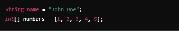 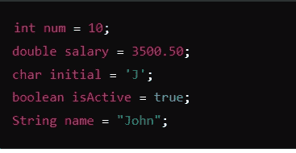

### 引用数据类型

- `String`：字符序列（例如：`String message = "Hello";`）
- 类、数组、接口等。

### 示例

### 变量声明与初始化

### 练习

1. 声明并初始化不同类型的变量并打印它们。
2. 写一个程序使用临时变量交换两个数字。

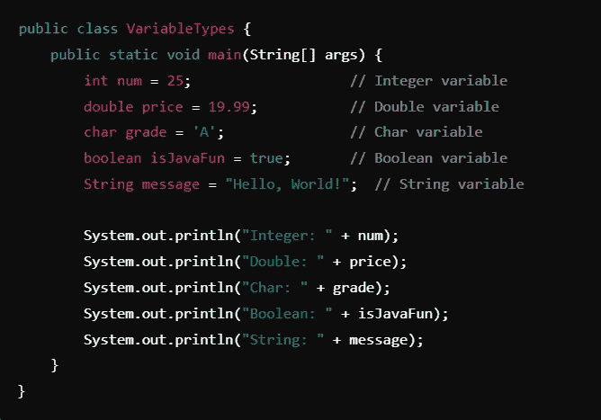

## 练习题答案 1

### 解释

- `VariableTypes` 类包含一个 `main` 方法。
- 声明并初始化了不同类型的变量。
- 使用 `System.out.println` 将每个变量打印到控制台。

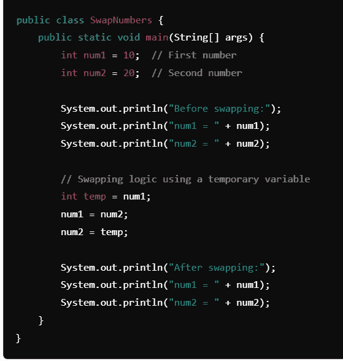

### 练习题答案 2

### 解释

- `SwapNumbers` 类包含一个 `main` 方法。
- 声明并初始化了两个整数变量 `num1` 和 `num2`，值分别为 `10` 和 `20`。
- 在控制台打印 `num1` 和 `num2` 的原始值。
- 使用临时变量 `temp` 在交换期间持有 `num1` 的值。
- 使用临时变量交换 `num1` 和 `num2` 的值。
- 在控制台打印交换后的 `num1` 和 `num2` 的值。

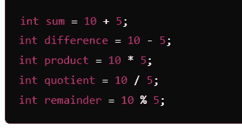 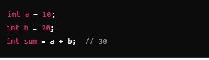

这些示例说明了如何声明和使用不同类型的变量，以及如何使用临时变量执行交换等基本操作。通过练习这些概念，你将加强对 Java 中变量操作的理解。

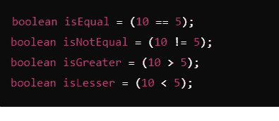

## 运算符与表达式

运算符用于对变量执行操作。

### 算术运算符

- `+` 加法
- `-` 减法
- `*` 乘法
- `/` 除法
- `%` 取模

### 示例


### 关系运算符（比较运算符）

- `==` 等于
- `!=` 不等于
- `>` 大于
- `<` 小于
- `>=` 大于等于
- `<=` 小于等于

### 示例

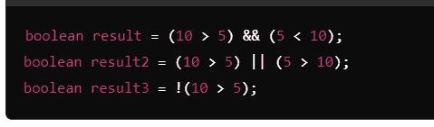

### 逻辑运算符

- `&&` 逻辑与
- `||` 逻辑或
- `!` 逻辑非

### 示例

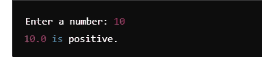

### 赋值运算符

- `=` 赋值
- `+=` 加赋值
- `-=` 减赋值
- `*=` 乘赋值
- `/=` 除赋值
- `%=` 取模赋值

### 示例

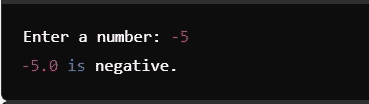

### 练习

1. 写一个程序计算矩形的面积和周长。
2. 写一个程序检查数字是奇偶。

## 练习题答案 1

### 答案

### 解释

- `Rectangle` 类包含一个 `main` 方法。
- 声明并初始化了两个双型变量 `length` 和 `width`。
- 通过乘以 `length` 和 `width` 计算面积。
- 通过加上 `length` 和 `width` 计算周长。
- 使用 `System.out.println` 将结果打印到控制台。

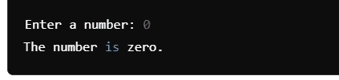

### 练习题答案 2

### 答案

### 解释

- `EvenOrOdd` 类包含一个 `main` 方法。
- 创建了一个 `Scanner` 对象从用户处读取输入。
- 使用 `System.out.print` 提示输入数字。
- 使用 `scanner.nextInt()` 读取输入的数字。
- 使用 `if-else` 语句和取模运算符 `%` 检查数字奇偶。
- 如果数字除以 `2` 余数为 `0`，则是偶数；否则是奇数。
- 将结果打印到控制台。
- 调用 `scanner.close()` 方法关闭扫描器。

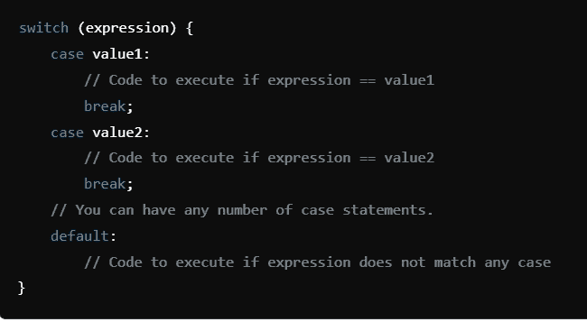

## 控制流语句

控制流语句决定语句执行的顺序。它们允许分支和循环，提供了根据条件重复执行代码的能力。

### if 语句

### if-else 语句

`if-else` 语句允许根据条件执行代码。

### 语法

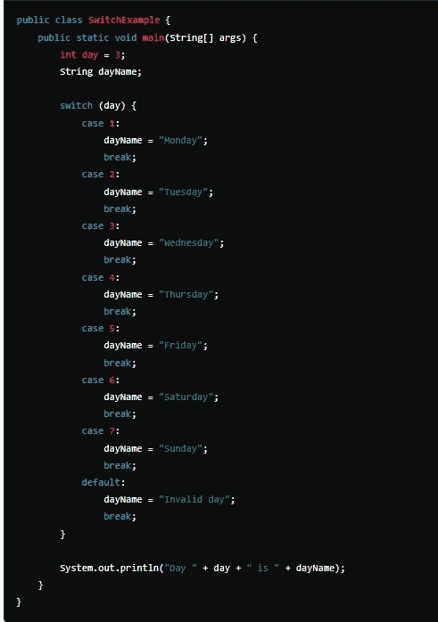 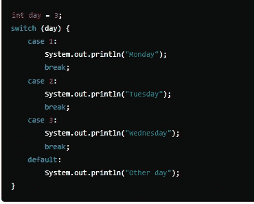

### 示例

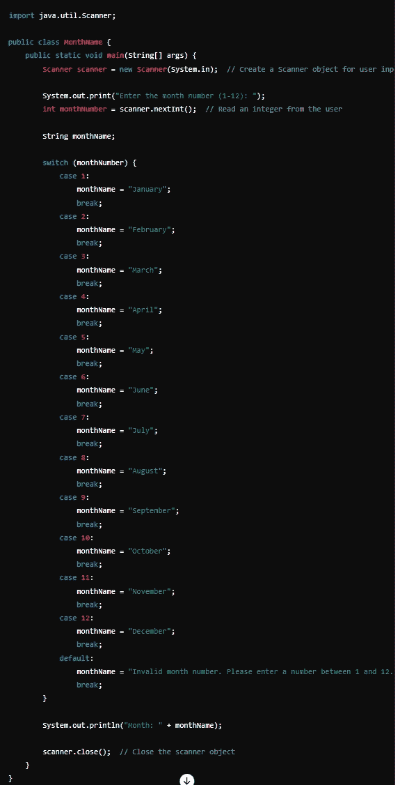

### 练习

1. 写一个程序检查给定数字是正、负还是零。

### 练习：检查给定数字是正、负还是零 答案

### 答案

### 解释

- `CheckNumber` 类包含一个 `main` 方法。
- 创建了一个 `Scanner` 对象从用户处读取输入。
- 使用 `System.out.print` 提示输入数字。
- 使用 `scanner.nextDouble()` 读取输入的数字。
- 使用 `if-else-if` 语句检查数字是正、负还是零：

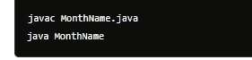 

- 如果数字大于 `0`，则是正数。
- 如果数字小于 `0`，则是负数。
- 如果数字等于 `0`，则是零。
- 将结果打印到控制台。
- 调用 `scanner.close()` 方法关闭扫描器。

### 测试程序

你可以编译并运行此程序以查看它在不同输入下的工作原理：示例运行：

 

通过练习和运行此程序，你可以看到在 Java 中如何使用 `if-else-if` 等控制流语句根据用户输入做出决策。


## switch 语句

`switch` 语句允许你根据表达式的值在多个代码块中执行其中一个。

### 语法

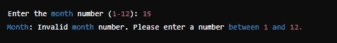

### 示例

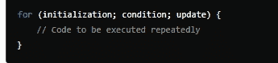

### 练习

1. 写一个程序，根据月份数字（1-12）打印月份名称。


### 答案

### 解释

- `MonthName` 类包含一个 `main` 方法。
- 创建了一个 `Scanner` 对象从用户读取输入。
- 使用 `System.out.print` 提示用户输入月份数字。
- 使用 `scanner.nextInt()` 读取进入的月份数字。
- 使用 `switch` 语句根据月份数字确定月份名称：
  - 每个 `case` 对应一个月份数字（1-12），将 `monthName` 变量设置为相应的月份名称。
  - `default` 情况通过将 `monthName` 设置为错误消息来处理无效的月份数字。
- 将结果打印到控制台。
- 调用 `scanner.close()` 方法关闭扫描器对象。

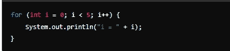  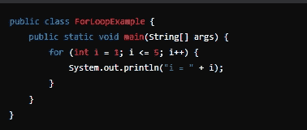 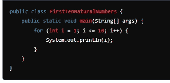

### 测试程序

你可以编译并运行此程序以查看它在不同输入下的工作原理：通过练习和运行此程序，你可以看到在 Java 中如何使用 `switch` 等控制流语句来处理多个条件。

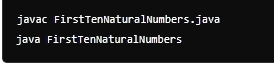 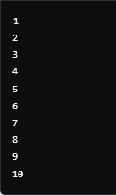

## for 循环

Java 中的 `for` 循环用于执行固定次数地执行一段代码块。它由三部分组成：初始化、条件和更新。这些部分控制循环执行的迭代次数。

### 语法

- **初始化**：该部分在循环开始时只执行一次。它通常声明并初始化循环控制变量。
- **条件**：在每次迭代之前进行评估。如果条件为真，则执行循环体。如果为假，则循环终止。
- **更新**：该部分在循环体每次迭代后执行。它通常更新循环控制变量。

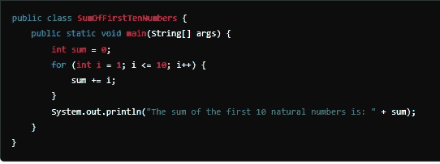

### 示例：打印从 1 到 5 的数字

### 解释

- `for` 循环从 `i` 初始化为 1 开始。
- 条件 `i <= 5` 确保只要 `i` 小于或等于 5，循环就会运行。
- 每次迭代后，使用 `i++` 将 `i` 增 1。

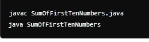

### 练习

1. 写一个程序打印前 10 个自然数

### 答案

 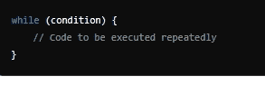

### 测试程序

你可以编译并运行此程序以查看它是如何工作的：

预期输出：

### 解释

- 循环初始化 `i` 为 1，并在每次迭代中将 `i` 加 1。
- 条件 `i <= 10` 确保循环运行十次，打印从 1 到 10 的数字。

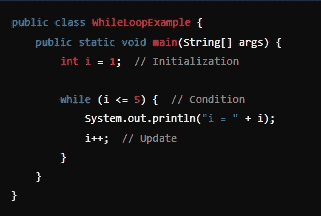

2. 写一个程序打印前 10 个自然数的和

### 答案

### 解释

- 循环初始化 `i` 为 1，并在每次迭代中将 `i` 加 1。
- 条件 `i <= 10` 确保循环运行十次。
- `sum` 变量在每次迭代中累加 `i` 的和。
- 在循环完成后打印最终的 `sum`。

  

### 测试程序

你可以编译并运行此程序以查看它是如何工作的：

预期输出：

通过练习这些示例，你将习惯在 Java 中使用 `for` 循环来执行重复性任务。

## while 循环

Java 中的 `while` 循环用于在当指定条件为真时反复执行一段代码块。它在预先不知道迭代次数时特别有用。

### 语法

- **条件**：在每次迭代之前对其进行评估。如果条件为真，则执行循环体。如果为假，则循环终止。


### 示例：打印从 1 到 5 的数字

### 解释

- 循环初始化 `i` 为 1。
- 条件 `i <= 5` 确保只要 `i` 小于或等于 5，循环就会运行。
- 每次迭代后，使用 `i++` 将 `i` 增 1。

 

### 练习

1. 写一个程序打印前 10 个自然数的和使用 while 循环

### 答案


### 解释

- 循环初始化 `i` 为 1，并在每次迭代中将 `i` 加 1。
- 条件 `i <= 10` 确保循环运行十次。
- `sum` 变量在每次迭代中累加 `i` 的和。
- 在循环完成后打印最终的 `sum`。

### 测试程序

你可以编译并运行此程序以查看它是如何工作的：

预期输出：


3. 写一个程序打印前 10 个自然数使用 while 循环

### 答案

### 解释

- 循环初始化 `i` 为 1，并在每次迭代中将 `i` 加 1。
- 10 个偶数。

 

### 测试程序

你可以编译并运行此程序以查看它是如何工作的：

预期输出：

通过练习这些示例，你将习惯在 Java 中使用 `while` 循环来执行重复性任务。

 

## do-while 循环

Java 中的 `do-while` 循环用于在指定条件为真时反复执行一段代码块，但它保证了循环代码块至少执行一次。

### 语法

- **代码块**：`do` 块中的代码至少执行一次，直到条件为假。
- **条件**：在循环体后对其进行评估。


### 示例：打印从 1 到 5 的数字

### 解释

- 循环初始化 `i` 为 1。
- 执行 `do` 块中的代码打印 `i` 的值。
- 打印后，`i` 增 1。
- 在循环体后检查条件 `i <= 5`。只要 `i` 小于或等于 5，循环就会继续。


### 练习

1. 写一个程序打印前 10 个自然数的和使用 do-while 循环

### 答案

### 解释

- 循环初始化 `i` 为 1，`sum` 为 0。
- `do` 块中的代码将 `i` 加到 `sum` 并将 `i` 增 1。
- 在循环体后检查条件 `i <= 10`。只要 `i` 小于或等于 10，循环就会继续。
- 在循环完成后打印最终的 `sum`。

 

### 测试程序

你可以编译并运行此程序以查看它是如何工作的：

预期输出：


2. 写一个程序打印前 10 个奇数使用 do-while 循环

### 答案

### 解释

- 循环初始化 `i` 为 1，`count` 为 0。
- `do` 块中的代码打印 `i`（当前奇数）并将 `i` 增 2 以获取下一个奇数。
- 每打印一个奇数，`count` 增 1。
- 循环持续直到 `count` 达到 10。

 

### 测试程序

你可以编译并运行此程序以查看它是如何工作的：

预期输出：

通过练习这些示例，你将理解 `do-while` 循环的工作原理，并看到它们在无论条件如何都必须执行一次循环体的情况场景中的优势。

# 面向对象编程 (OOP) 简介

面向对象编程 (OOP) 是一种基于“对象”概念的编程范式。

“对象”（objects）可以包含以字段形式的数据（通常称为属性或属性值）以及以过程形式的代码（通常称为方法）。Java 是一种面向对象的语言，它利用这种范式以模块化和可重用的方式来构建程序。

## OOP 核心概念

## Java 中的类

Java 中的类是创建对象的蓝图或模板。它通过指定对象的属性（字段）和行为（方法）来定义对象类型。类封装了对象的数据以及操作这些数据的方法。

### 类的结构

类通常由以下组件组成：

1. `Fields`（字段或属性）：持有对象数据的变量。
2. `Methods`（方法）：定义对象行为函数。
3. `Constructors`（构造方法）：用于初始化新对象的特殊方法。
4. `Access Modifiers`（访问修饰符）：控制类及其成员可见性的关键字（例如：`public`、`private`、`protected`）。

 

### 类语法

### 创建和使用类的示例

### 解释

1. **类定义**：`MyClass` 定义了两个字段（`myNumber` 和 `myString`）、一个构造方法和两个方法（`display` 和 `getNumber`）。
2. **构造方法**：使用创建对象时提供的值初始化 `myNumber` 和 `myString`。
3. **方法**：`display` 打印 `myNumber` 和 `myString` 的值。`getNumber` 返回 `myNumber` 的值。
4. **对象创建**：在 `Main` 类中，`MyClass obj = new MyClass(10, "Hello World");` 创建了一个 `MyClass` 的新对象，使用构造方法初始化其字段。
5. **方法调用**：`obj.display();` 调用对象 `obj` 的 `display` 方法。`obj.getNumber();` 调用 `getNumber` 方法获取 `myNumber` 的值。


## 访问修饰符

访问修饰符控制类、字段、构造方法和方法的可见性和可访问性：

- `public`：成员可以从任何其他类访问。
- `private`：成员只能在类内部访问。
- `protected`：成员可以在同一个包内以及子类中访问。
- `Default`（无修饰符）：成员只能在同一个包内访问。

### 访问修饰符示例


### 创建和使用类

1. **创建类文件**：将类定义保存在 `.java` 文件中。
2. **编译**：使用 `javac ClassName.java` 编译类。


## 3. 运行

使用 `java Main` 运行使用定义类的 `Main` 类。

Java 中的类是一种基础结构，允许你创建具有特定属性和行为的对象。通过定义字段、方法和构造方法，你可以模拟现实世界的实体并以模块化和可重用的方式组织代码。尝试创建自己的类，以更深地理解它们的功能和用法。

### 类

* 类是创建对象的蓝图或模板。它通过绑定数据和操作该数据的方法来定义对象类型。

### 语法

### 练习示例

#### 1. 创建 Person 类

**目标**：定义一个带有 `name` 和 `age` 属性的 `Person` 类。包含显示人员详情和检查人员是否为成年人的方法。

**解：**

**解释：**

* **字段**：`name` 和 `age`。
* **构造方法**：初始化 `name` 和 `age` 字段。
* **方法**：`displayDetails` 打印人的姓名年龄，`isAdult` 返回人员是否为成年人。
* **测试**：在 `main` 方法中，创建了两个 `Person` 对象并显示它们的详情和成年状态。

#### 2. 创建 BankAccount 类

**目标**：定义一个带有 `accountNumber` 和 `balance` 属性的 `BankAccount` 类。包含存款、取款和检查余额的方法。

**解：**

**解释：**

* **字段**：`accountNumber` 和 `balance`。
* **构造方法**：初始化 `accountNumber` 和 `balance`。
* **方法**：`deposit` 向 `balance` 添加金额，`withdraw` 从 `balance` 中扣除金额，`getBalance` 返回当前的 `balance`。
* **测试**：在 `main` 方法中，创建了一个 `BankAccount` 对象并演示了存款、取款和余额检查。

#### 3. 创建 Rectangle 类

**目标**：定义一个带有 `width` 和 `height` 属性的 `Rectangle` 类。包含计算矩形面积和周长的方法。

**解：**

**解释：**

* **字段**：`width` 和 `height`。
* **构造方法**：初始化 `width` 和 `height`。
* **方法**：`getArea` 返回矩形的面积，`getPerimeter` 返回周长。
* **测试**：在 `main` 方法中，创建了一个 `Rectangle` 对象并计算其面积和周长。

这些练习涵盖了创建类、初始化对象和使用方法。通过尝试这些示例，你能更好地理解如何在 Java 中定义和使用类。欢迎修改和扩展这些示例以进一步学习！

## Java 中的对象

在面向对象编程（OOP）中，对象是类的实例。它们封装了数据以及操作该数据的方法。对象是程序的基础构建部分，代表现实世界的实体。

### 对象的核心概念

1. 创建对象
2. 访问字段和方法
3. 对象初始化
4. 对象引用

### 创建对象

在 Java 中创建对象使用 `new` 关键字后跟类名。此过程为对象分配内存并使用构造方法进行初始化。

### 2. 访问字段和方法

一旦创建对象，可以使用点 (`.`) 运算符访问它的字段和方法。

### 3. 对象初始化

对象可以使用构造方法初始化，可以是不带参数。如果没有显式定义构造方法，Java 提供默认构造方法。

### 4. 对象引用

在 Java 中，持有对象引用的变量被用于引用对象。这些引用指向存储对象的内存位置。

### 5. 垃圾回收

Java 使用自动垃圾回收管理内存。当对象不再被程序的任何部分引用时，它们符合垃圾回收条件，内存会被回收。

* 创建对象：使用 `new` 关键字和构造方法创建对象。
* 访问字段和方法：使用点 (`.`) 运算符与对象的数据和行为交互。
* 初始化：对象可以使用带参数的构造方法初始化。
* 对象引用：变量持有引用，多个引用可以指向同一个对象。
* 垃圾回收：Java 回收不再被引用的对象的内存。

理解并练习这些概念将帮助你在 Java 程序中有效地使用和管理对象。

# 面向对象编程 (OOP)

面向对象编程（OOP）是一种使用“对象”及其交互来设计和实现软件的编程范式。Java 是一种经典的面向对象语言，它利用 OOP 原则有效地组织和管理代码。以下是 OOP 核心原则及其在 Java 中实现的概述：Java 使用类和对象来结构化组织代码。通过运用封装、继承、多态和抽象原则，你可以创建健壮、可维护且可重用的代码。理解这些原则并通过编码练习来实践它们将帮助你精通 OOP。

## 类和对象

### 类定义

* 创建对象的蓝图。

### 创建对象

* 类的实例。

## OOP 的核心原理

1. 封装
2. 继承
3. 多态
4. 抽象

## Java 中的封装

封装是面向对象编程（OOP）中的一个基本概念，用于将数据（属性）和操作这些数据的方法（函数）打包成一个单一的单元或类。封装还涉及限制对对象某些组件的直接访问，这有助于保护数据的完整性。

### 封装的关键方面

1. **私有字段（Private Fields）**：类的属性应被标记为 `private`，以限制从类外部进行的直接访问。
2. **公共方法（Public Methods）**：提供公共方法来获取（访问）和设置（修改）私有属性。这些方法被称为 getter 和 setter。
3. **数据隐藏（Data Hiding）**：防止类外部直接修改字段，以确保对象的状态受控并验证。

### 实现封装

以下是在 Java 中实现封装的步骤指南：

1. **定义私有字段**：使用 `private` 访问修饰符在类中定义字段。这限制了类外部对这些字段的访问。
2. **提供公共 Getter 和 Setter 方法**：定义公共方法以提供对私有字段的受控访问。getter 方法允许读取值，setter 方法允许修改值。

### 封装示例

#### 封装的类定义

#### 使用封装的类

### 封装的优势

1. **控制**：封装通过提供访问和修改数据的方法来实现对对象的控制。这确保了数据始终处于有效状态。
2. **灵活性**：可以更改内部实现，而不影响使用该类的代码其他部分。
3. **可维护性**：封装有助于保持代码结构整洁，使其更易管理和维护。
4. **提高安全性**：通过隐藏对象的内部状态，封装减少了意外干扰和误用的风险。

Java 中的封装通过使用 `private` 字段和公共的 getter/setter 方法来实现。这种方法确保了对象的内部状态免受未经授权的访问和修改。封装通过提供对对象数据和行为的受控访问，增强了代码的安全性、可维护性和灵活性。

## Java 实现

* **私有字段**：使用 `private` 字段保护数据免受外部访问。
* **公共方法**：使用公共 getter 和 setter 方法访问并更新 `private` 字段。

## Java 中的继承

继承是面向对象编程（OOP）的核心原理之一。它允许新类继承现有类的属性和方法。新类被称为子类或派生类，而它继承的类被称为父类或基类。继承促进了代码复用，并在类之间建立了自然的层次结构。

### 继承的关键概念

1. 父类与子类
2. `extends` 关键字
3. 构造函数继承
4. 方法重写
5. 访问父类方法
6. `super` 关键字
7. 类型转换

### 继承示例

让我们考虑一个基础示例，父类 `Animal` 被子类 `Dog` 继承。

#### 父类：`Animal`

#### 子类：`Dog`

### 详细解释

#### 1. 父类与子类

* **父类**：被继承属性和方法的类。
* **子类**：从父类继承属性和方法的类。
* 父类（在本例中为 `Animal`）是被继承属性和方法的类。
* 子类（在本例中为 `Dog`）是自父类继承属性和方法的类。

#### 2. `extends` 关键字

在 Java 中，继承使用 `extends` 关键字来指定。子类继承其父类所有可访问的属性和方法。`extends` 关键字用于在父类和子类之间建立继承关系。

#### 3. 构造函数继承

构造函数是不被继承的。然而，子类可以使用 `super` 关键字调用其父类的构造函数。

#### 4. 方法重写

子类可以对其父类中已经定义的方法提供特定的实现。这被称为方法重写。方法重写允许子类对其父类中已定义的方法提供特定的实现。被重写的方法必须具有相同的名称、返回类型和参数。

#### 5. `super` 关键字

`super` 关键字用于引用直接父类。它可以用于：

* 调用父类的构造函数。
* 访问父类的方法和字段。

**调用父类构造函数：**

**调用父类方法：**

### 继承的类型

* **单继承**：子类继承自一个父类。
* **多级继承**：子类继承另一个子类。
* **层级继承**：多个子类继承自同一个父类。

Java 中的继承允许基于现有类创建新类。它促进了代码复用、逻辑层次结构和方法重写。通过使用 `extends` 和 `super` 关键字，Java 提供了一种实现继承的清晰且直接的方法。一个类继承另一个类的字段和方法。

### 练习示例

**练习 1**：创建一个具有 `name` 和 `age` 字段以及显示方法的父类 `Person`。然后创建一个增加 `studentID` 的子类 `Student` 并重写方法以包含学生 ID。

**Person.java:**

**Student.java:**

此示例演示了如何使用继承构建类层次结构，允许子类扩展并自定义其父类的行为。

#### 6. 访问父类方法

子类可以使用 `super` 关键字访问父类的方法。当你需要调用在子类中重写的父类方法时，这非常有用。

#### 7. 类型转换

Java 支持相关类之间的类型转换。这涉及将子类引用转换为父类引用，反之亦然。

* 继承允许类继承另一个类的属性和方法，促进代码复用。
* 使用 `extends` 关键字创建子类。
* 子类可以继承父类的方法但不继承构造函数。
* 方法重写允许子类对其父类中定义的方法提供特定实现。
* 使用 `super` 关键字访问父类的方法、字段和构造函数。
* 类型转换实现了父类和子类引用之间的转换。

通过理解并应用这些概念，你就可以使用 Java 继承创建良好的代码库。

## 多态

多态允许方法根据其所作用的对象来执行不同的操作。这可以通过方法重载（编译时多态）和方法重写（运行时多态）来实现。

## Java 实现

* **方法重载**：在同一个类中，多个具有相同名称但参数不同的方法。
* **方法重写**：子类为其父类中已经定义的方法提供特定的实现。

### 示例

#### 方法重载

#### 方法重写

## Java 中的抽象

抽象是面向对象编程 (OOP) 中的一个核心概念，允许你隐藏系统复杂的实现细节，并只暴露本质特征。抽象的目标是降低复杂性，让程序员能够关注更高层次的交互，而无需理解每个组件的复杂细节。

在 Java 中，抽象通过以下方式实现：

1. 抽象类
2. 接口

### 1. 抽象类

**定义**：`abstract class` 是一个无法独立实例化的类，它可能包含必须由子类实现的 `abstract methods`。`abstract methods` 是没有方法体的方法，旨在派生类中被重写。

**特征**：

* 可以拥有 `abstract methods`（没有方法体的方法）。
* 可以拥有非抽象方法（带有方法体）。
* 可以拥有字段和构造函数。
* 可以被其他类扩展。

### 示例

#### 抽象类

### 接口

Java 中的 `interface` 是一种引用类型，类似于类，但只能包含常量、方法签名、默认方法、静态方法和嵌套类型。接口不能包含实例字段或构造函数。类 `implements` 一个 `interface`，从而继承接口的抽象方法。

#### 特征

* 不能包含实例字段或构造函数。
* 可以包含 `abstract methods` 以及默认/静态方法。
* 一个类可以实现多个接口。

### 接口

### 抽象的优势

1. **简化代码**：抽象通过隐藏实现细节并只显示必要的特征，有助于降低复杂性。
2. **提高可维护性**：由于实现细节的更改不会影响外部接口，代码变得更容易管理和维护。
3. **促进代码复用**：通过在 `abstract classes` 或 `interfaces` 中定义通用功能，可以在多个类之间复用代码。
4. **增强灵活性**：允许你在更改实现方式而不影响使用这些抽象组件的代码。

### 在抽象类和接口之间进行选择

* **使用抽象类的场景**：
    * 你有一个不应该被实例化的基类。
    * 你想在相关类之间共享通用代码。
    * 你需要提供某些方法的实现，但同时也要求某些方法是 `abstract` 的。

* **使用接口的场景**：
    * 你想定义一个可以被任何类实现的合约。
    * 你需要定义必须由来自不同层次结构的多个类实现的方法。
    * 你想支持类型多继承（一个类可以实现多个接口）。

Java 中的抽象有助于管理复杂性，因为它允许你关注高层次的交互，同时隐藏实现细节。你通过 `abstract classes` 和 `interfaces` 实现抽象。抽象类提供在相关类之间共享代码的方法，并定义了必须由子类实现的 `abstract methods`。接口定义了任何选择实现接口的类必须实现的方法，促进了灵活且可用的设计。

## 第 3 章

## Java 中的方法和构造函数

在 Java 中，方法和构造函数是类的基本组成部分。它们定义了对象的行为以及如何初始化对象。

### 方法

方法是执行特定任务的代码块。它们用于定义从类创建的对象的行为。方法可以有参数、返回值，并可以被调用以对对象执行操作。

### 核心概念

1. 方法声明
2. 方法重载
3. 方法重写
4. 静态方法
5. 实例方法
6. 方法参数和返回值

### 1. 方法声明

方法在类内部声明，并由以下组件组成：

* **访问修饰符**：定义方法的可见性（例如 `public`、`private`）。
* **返回值**：指定方法将返回的值的类型（例如 `int`、`void`）。
* **方法名**：方法的名称。
* **参数**：传递给方法的可选值。
* **方法体**：调用方法时执行的代码块。

### 示例

#### 方法

* 执行特定任务的代码块。

### 2. 方法重载

当多个方法具有相同名称但不同的参数（类型、数量或两者兼有）时，发生方法重载。它允许方法根据不同的输入执行相似的功能。

### 3. 方法重写


# 方法重写

当子类为其父类中已经定义的方法提供特定实现时，发生方法重写。重写的方法必须与父类中的方法具有相同的名称、返回值和参数。

**示例**：

127

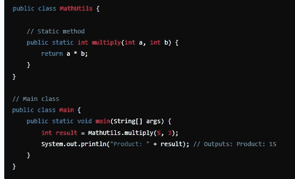

# 静态方法

静态方法属于类而不是任何特定实例。它们可以在不创建类实例的情况下被调用，并且只能访问静态字段和方法。

**示例**：

128

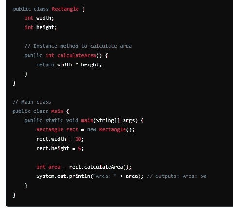

# 实例方法

实例方法作用于类的实例，并可以访问实例字段和方法。它们需要该类的对象才能被调用。

**示例**：

129

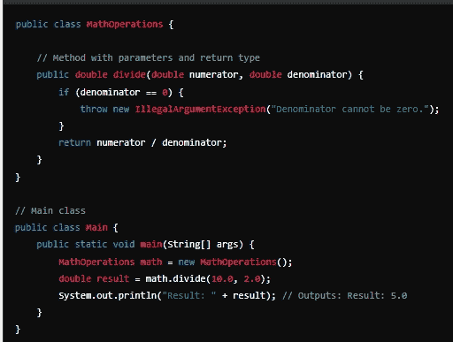

# 方法参数和返回值

方法可以接受参数并返回以执行操作并提供结果。

- **参数**：传入方法以提供输入数据。
- **返回值**：指定方法将返回值的类型。如果方法没有返回值，其返回类型为 `void`。

**示例**：

130

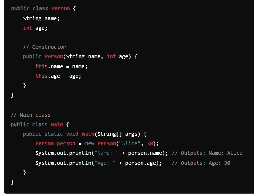

# 第 4 章：构造函数

构造函数是用于创建对象时初始化对象的特殊方法。它们与类名相同，且没有返回值。

## 核心概念

1. 构造函数声明
2. 默认构造函数
3. 参数构造函数
4. 构造函数重载
5. 构造函数链

## 1. 构造函数声明

构造函数的声明名称与类名相同，且没有返回值。它在创建对象时初始化对象的状态。

**示例**：

131

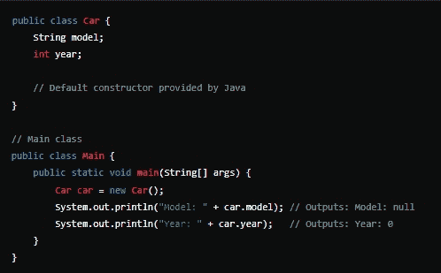

## 2. 默认构造函数

如果没有定义任何构造函数，Java 会提供一个默认构造函数，将实例变量初始化为默认值（例如，对象为 `null`，数值类型为 `0`）。

**示例**：

132

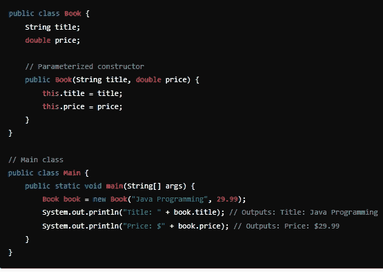

## 3. 参数构造函数

参数构造函数允许你使用特定值初始化对象。

**示例**：

133

## 4. 构造函数重载

构造函数重载是 Java 中的一种技术，允许类拥有多个具有不同参数列表的构造函数。每个构造函数执行不同的任务，但构建相同类的对象。重载的构造函数通过允许不同的初始化对象的方式提供了对象创建的灵活性。

### 核心概念

1. 同一类，不同参数
2. 无返回值
3. 不同的初始化选项

### 构造函数重载示例

让我们考虑一个演示构造函数重载的 `Rectangle` 类：

134

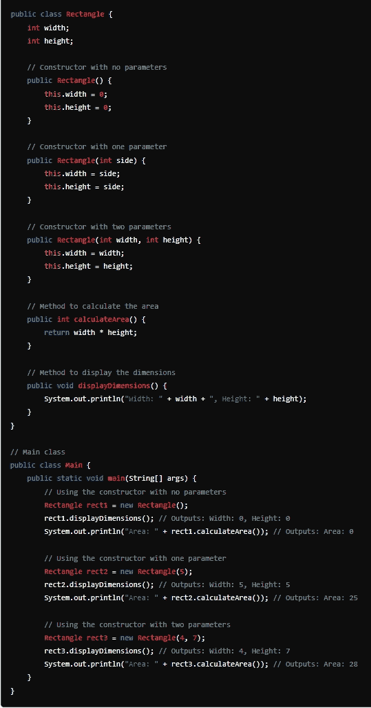

135

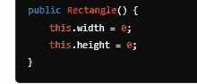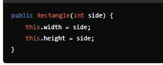

### 详细解释

1. **无参数的构造函数**：
   此构造函数将 `width` 和 `height` 都初始化为 `0`。当你想要创建一个不指定任何维度的 `Rectangle` 对象时，它非常有用。

2. **单参数构造函数**：
   此构造函数将 `width` 和 `height` 都初始化为相同的值，这对于创建正方形 `Rectangle` 对象很有用。

136

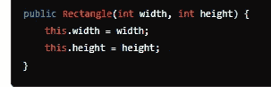

3. **双参数构造函数**：
   此构造函数将 `width` 和 `height` 初始化为指定的值，允许你创建任何尺寸的矩形。

137

### 构造函数重载的优势

- **对象创建的灵活性**：用户可以根据传递的参数创建不同初始值的对象。
- **代码的可读性与维护性**：使用有意义的参数重载构造函数可以使代码更具可读性和维护性。
- **默认和特定初始化**：允许提供初始化对象的默认和特定方式。

构造函数重载增强了 `Java` 中对象创建的灵活性。通过提供具有不同参数的多个构造函数，你可以以多种方式初始化对象，同时保持代码结构的清晰。这种技术在 `Java` 中被广泛用于为初始化对象提供多种选项，使类变得更加通用且易于使用。

138

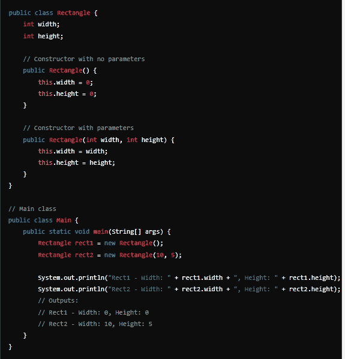

构造函数重载允许一个类拥有多个具有不同参数列表的构造函数。

139

### Java 中的构造链调用

`Java` 中的构造链调用是在同一个类内或从子类中从一个构造函数调用另一个构造函数的过程。这允许以更高效的方式通过多个构造函数初始化对象，减少了代码重复并增强了维护性。

#### 构造链调用的类型

1. 同一类内：使用 `this()`
2. 从子类：使用 `super()`

#### 1. 同一类内的构造链调用

当在同一个类中有多个构造函数时，可以使用 `this()` 关键字从一个构造函数调用另一个构造函数。这种方法有助于重用构造函数代码并将初始化逻辑保持在一个地方。

140

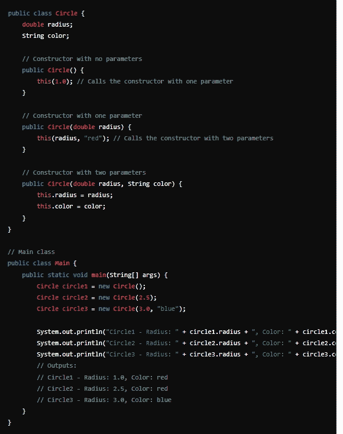

**示例**：

在此示例中：

- 无参数的 `Circle()` 构造函数调用了 `Circle(double radius)` 构造函数。
- `Circle(double radius)` 构造函数调用了 `Circle(double radius, String color)` 构造函数。
- `Circle(double radius, String color)` 构造函数初始化实例变量 `radius` 和 `color`。

141

142

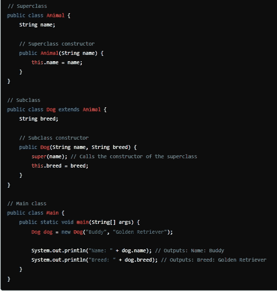

#### 2. 从子类的构造链调用

当你有一个继承父类的子类时，可以使用 `super()` 关键字调用父类的构造函数。这确保了在子类添加自己的初始化之前，父类已经正确初始化。

**示例**：

在此示例中：

- `Dog` 类继承 `Animal` 类。
- `Dog` 构造函数使用 `super(name)` 调用 `Animal` 构造函数，在初始化 `Dog` 类中的 `breed` 字段之前先初始化 `Animal` 类中的 `name` 字段。

143

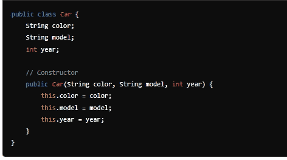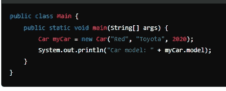

构造链是 `Java` 中一种强大的技术，允许通过调用同一类内或来自父类的其他构造函数来重用代码并确保正确的初始化。这有助于减少冗余并保持代码库的清晰有序。

在同一类内使用 `this()` 进行链式调用以及从父类使用 `super()` 进行调用，确保了对象被正确且高效地构造。

- 用于初始化对象的特殊方法。

**示例**：

144

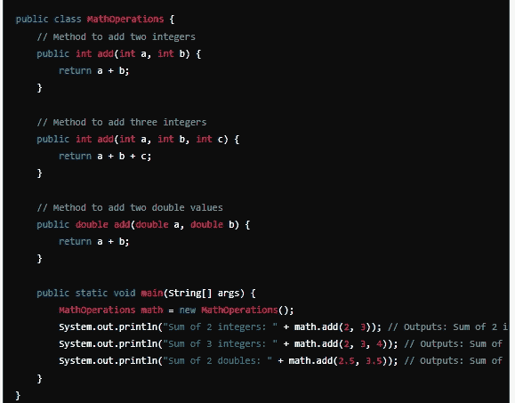

# Java 中的多态

多态是面向对象编程 (OOP) 四大基本概念之一。它允许对象被视为其父类的实例，而不是其实际类。`Java` 中多态的两种主要类型：

1. 编译时多态（方法重载）
2. 运行时多态（方法重写）

## 核心概念

1. 方法重载
2. 方法重写
3. `instanceof` 关键字
4. 动态方法分派

### 1. 方法重载（编译时多态）

方法重载允许一个类拥有多个同名但参数不同的方法。这些方法在编译时解析。

**示例**：

145

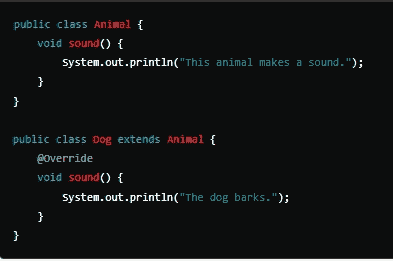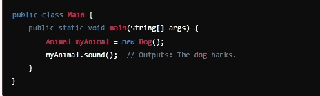

**多态**：
- 采取多种形式的能力，通常通过方法重写和方法重载实现。

**方法重写**：
- 在子类中重新定义方法。

**示例**：

146

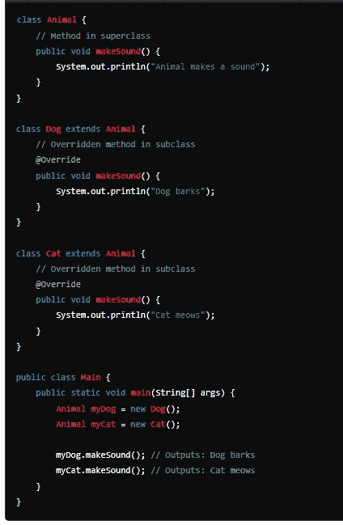

### 2. 方法重写（运行时多态）

方法重写允许子类对其已在父类中定义的方法提供特定的实现。要执行的方法在运行时确定。

**示例**：

147

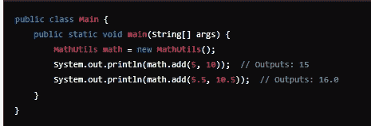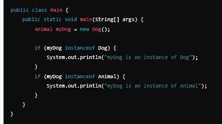

### 3. `instanceof` 关键字

`instanceof` 关键字用于测试一个对象是否是特定类或其子类的实例。

**示例**：

148

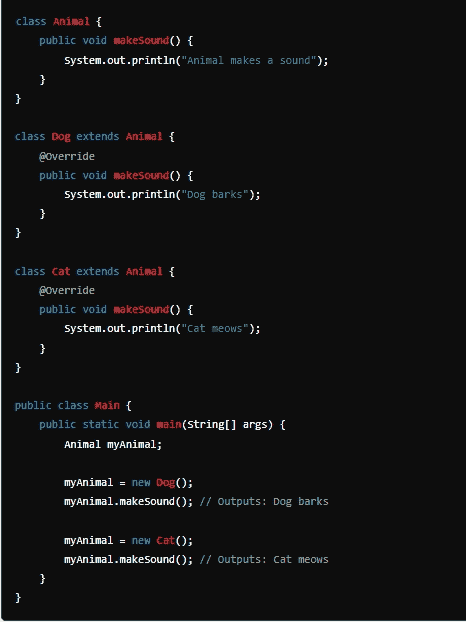

### 4. 动态方法分派

动态方法分派是一种机制，其中对重写方法的调用在运行时而非编译时解析。它允许 `Java` 支持运行时多态。

**示例**：

149

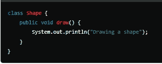

### 多态的优势

- **代码复用**：方法可以在多种形式下使用。
- **可维护性**：简化了代码的维护和可读性。
- **可扩展性**：可以以最少现有代码修改来添加新功能。

### 练习示例

**练习 1**：

创建一个带有 `draw()` 方法的父类 `Shape`。然后，创建子类 `Circle` 和 `Rectangle` 并重写 `draw()` 方法。通过调用这些类对象的 `draw()` 方法来演示多态。

`Shape.java`:

`Circle.java`:

150


`Rectangle.java`:

`Main.java`:

此示例阐明了多态如何允许单一方法 `draw()` 根据实际的对象类型（`Circle` 或 `Rectangle`）具有不同的实现方式。这种灵活性是 OOP 的核心优势之一，并增强了代码的模块化和可扩展性。

151

# 第 5 章：封装与抽象

## Java 中的封装

封装是面向对象编程 (OOP) 的基本原则之一。

它指的是将数据（字段）和操作这些数据的方法（函数）封装在一个单元或类中。封装还涉及限制对对象某些组件的直接访问，这是一种防止意外干扰和误用数据的手段。这通常通过访问修饰符来实现。

### 核心概念

1. 数据隐藏
2. 访问修饰符
3. Getter 和 Setter 方法

### 封装示例

让我们考虑一个演示封装的 `Person` 类示例。

152


`Person.java`

153


`Main.java`

### 详细解释

#### 1. 数据隐藏

通过将类变量声明为 `private` 来实现数据隐藏。这限制了类外部对字段的直接访问。

154


#### 2. 访问修饰符

`Java` 中的访问修饰符控制类成员的可见性。主要的访问修饰符有：

- `private`：仅在类内部可见。
- `default`（无修饰符）：仅在同一包内可见。
- `protected`：在同一包内及子类中可见。
- `public`：从任何其他类均可见。

#### 3. Getter 和 Setter 方法

Getter 和 Setter 方法提供了访问和修改 `private` 字段的受控方式。这些方法允许在设置值时进行必要的验证。

155

### 封装的优势

- **改进的控制**：通过限制直接访问和允许受控修改，提供了对数据的控制。
- **增加灵活性**：允许在实现上进行更改而不影响代码的其他部分。
- **增强可维护性**：使代码更容易于维护和理解。
- **数据完整性**：帮助保护数据免受意外或未经授权的修改。

### 练习示例

**练习 1**：

创建一个类 `BankAccount`，并包含私有字段 `accountNumber`、`balance` 和 `accountHolderName`。为这些字段实现 getter 和 setter 方法，并包含一个带有验证逻辑的存款和取款方法。

`BankAccount.java`:

156


### 答案

157


### `Main.java`:

此示例演示了封装如何允许你创建带有私有字段的类，这些字段只能通过公共方法访问和修改。这确保了对象的内部状态受到保护，并且只能以控制的方式进行更改。

158


#### 封装：

- 将数据（字段）和方法封装到单个单元（类）中，并限制对对象某些组件的直接访问。

示例：

159


#### 抽象：

- 隐藏复杂的实现细节，仅显示必要的特征。

示例：

160


# 第 6 章：基础数据结构

## 数组

- 数组是相同类型元素的集合，存储在连续的内存位置。
- 数组一旦创建，大小就是固定的。

**声明与初始化**：

**访问元素**：

示例：

161


## 字符串

- 字符串是 Java 中的对象，表示字符序列。
- 字符串是不可变的，这意味着一旦创建，其值就无法更改。

**声明与初始化**：

### 常用字符串方法

- `length()`：返回字符串的长度。
- `charAt(int index)`：返回指定索引处的字符。
- `substring(int beginIndex, int endIndex)`：返回一个子字符串。
- `equals(Object another)`：比较两个字符串的相等性。
- `toUpperCase()`：将所有字符转换为大写字母。

示例：

162


## ArrayList 和 LinkedList

### ArrayList

- `List` 接口的可伸缩数组实现。
- 允许重复元素并维护插入顺序。

示例：

163


### LinkedList

- `List` 和 `Deque` 接口的双向链表实现。
- 对于在两端进行插入和删除操作非常高效。

示例：

164


# 第 7 章：异常处理

## 异常简介

### 异常

- 异常是破坏程序正常流程的事件。
- Java 提供了一种健壮的机制，通过异常处理来处理运行时错误。

#### 异常类型

- **检查异常 (Checked Exceptions)**：`Exception` 的子类（`RuntimeException` 除外）。必须在方法中被捕获或在方法签名中声明。
- **未捕获异常 (Unchecked Exceptions)**：`RuntimeException` 的子类。不需要声明或捕获。
- **错误 (Errors)**：`Error` 的子类。表示应用程序不应尝试捕获的严重问题。

### Try, Catch 和 Finally

**语法**：

165


示例：

### 自定义异常

#### 创建自定义异常

- 继承 `Exception` 类（用于检查异常）或 `RuntimeException` 类（用于未捕获异常）。

示例：

166


167


# 第 8 章：文件 I/O 与序列化

文件 I/O（输入/输出）是 Java 编程的基础部分，允许你从文件读取并写入文件。序列化是将对象状态转换为字节流的机制，然后可以将字节流保存到文件中或通过网络发送。反序列化是反相反的过程，将字节流转换回对象。

## 1. 读取和写入文件

### 读取文件

在 Java 中读取文件，你可以使用 `FileReader`、`BufferedReader` 或 `Scanner` 等类。

#### 使用 `FileReader` 和 `BufferedReader`

`FileReader` 类是从文件中读取字符的简单方法。为了提高效率，你通常将其配合 `BufferedReader` 使用，后者对输入进行缓冲以使读取更高效。

**示例：逐行读取文件**

168


**解释**：

- `FileReader` 用于读取文件 `"example.txt"`。
- `BufferedReader` 封装了 `FileReader` 以允许高效地读取行。
- 程序读取并打印文件中的每一行，直到结束。

**从文件读取**：

169


### 写入文件

要写入文件，你可以使用 `FileWriter` 或 `BufferedWriter`。

#### 使用 `FileWriter` 和 `BufferedWriter`

`FileWriter` 类允许你向文件写入字符，而 `BufferedWriter` 可将文本写入字符输出流，通过缓冲字符来提供高效写入。

**解释**：

- `FileWriter` 用于写入文件 `"example.txt"`。
- `BufferedWriter` 封装了 `FileWriter` 以允许高效写入。

- `add(E e)`: 将指定的元素添加到列表末尾。
- `add(int index, E element)`: 将指定的元素插入列表的指定位置。
- `get(int index)`: 返回列表中指定位置的元素。
- `remove(int index)`: 移除列表中指定位置的元素。
- `indexOf(Object o)`: 返回指定元素在列表中首次位置的索引。
- `size()`: 返回列表中元素的数量。

178


## 使用 ArrayList 的示例

输出：

179


`List`、`Set` 和 `Map` 接口是 Java 集合框架（Collections Framework）的一部分，它们为处理具有不同行为和特征的对象组（集合）提供了强大的工具。下面，我们将详细探讨这些每个接口，包括它们的关键特征、用法和示例。我们还包括了带有答案的练习题。

## List 接口

### 概述

- **有序集合**：`List` 保持元素被插入时的顺序。
- **允许重复**：`List` 可以包含重复元素。
- **索引访问**：可以通过索引位置访问元素。

### 常见实现

- `ArrayList`
- `LinkedList`
- `Vector`（较少使用）

### 示例

```
List<String> list = new ArrayList<>();
list.add("Apple");
list.add("Banana");
list.add("Cherry");
System.out.println(list);
```

输出

```
[Apple, Banana, Cherry]
```

### 关键方法

- `add(E e)`：向列表添加一个元素。
- `get(int index)`：获取指定索引处的元素。
- `remove(int index)`：移除指定索引处的元素。
- `contains(Object o)`：检查列表是否包含指定的元素。
- `size()`：返回列表中元素的数量。

### 示例

```
List<Integer> numbers = new ArrayList<>();
numbers.add(10);
numbers.add(20);
numbers.add(30);
System.out.println("Element at index 1: " + numbers.get(1));
numbers.remove(0);
System.out.println("List after removal: " + numbers);
```

## Set 接口

`Set` 接口扩展了 `Collection` 接口，表示一个不能包含重复元素的集合。它模拟了数学中的集合抽象。

### 关键实现

- `HashSet`：在哈希表中存储元素，不保证元素的任何特定顺序。
- `LinkedHashSet`：维护集合中条目的链表，按照它们被插入的顺序排列。
- `TreeSet`：实现 `NavigableSet` 接口，使用树进行存储。元素使用它们的自然排序或自定义比较器进行排序。

### Set 中的常用方法

- `add(E e)`：如果指定的元素不存在，则将指定的元素添加到集合中。
- `contains(Object o)`：如果集合包含指定的元素，则返回 true。
- `remove(Object o)`：如果指定的元素存在，则从集合中移除它。
- `size()`：返回集合中元素的数量。
- `isEmpty()`：如果集合不包含元素，则返回 true。

### 概述

- **无序集合**：`Set` 不维护元素的任何顺序。
- **无重复**：`Set` 不允许重复元素。

### 常见实现

- `HashSet`
- `LinkedHashSet`（维护插入顺序）
- `TreeSet`（维护排序顺序）

### 示例：使用 HashSet

```
Set<String> set = new HashSet<>();
set.add("Red");
set.add("Green");
set.add("Blue");
set.add("Red"); // Duplicate
System.out.println(set);
```

### 示例 1

```
Set<Integer> numbers = new HashSet<>();
numbers.add(1);
numbers.add(2);
numbers.add(3);
numbers.add(2); // Duplicate
System.out.println("Set: " + numbers);
System.out.println("Contains 2: " + numbers.contains(2));
numbers.remove(1);
System.out.println("After removing 1: " + numbers);
```

### 示例 2

```
Set<String> linkedSet = new LinkedHashSet<>();
linkedSet.add("First");
linkedSet.add("Second");
linkedSet.add("Third");
System.out.println("LinkedHashSet maintains insertion order: " + linkedSet);
```

输出

### 关键方法

- `add(E e)`：向集合添加一个元素。
- `remove(Object o)`：从集合中移除指定的元素。
- `contains(Object o)`：检查集合是否包含指定的元素。
- `size()`：返回集合中元素的数量。
- `isEmpty()`：检查集合是否为空。

## Map 接口

`Map` 接口表示键值对的集合，其中每个键都是唯一的。Maps 不属于 `Collection` 接口。

### 关键实现

- `HashMap`：基于哈希表的实现，允许 null 键和空值。
- `LinkedHashMap`：扩展了 `HashMap` 并维护条目的链表，保留插入顺序。
- `TreeMap`：实现 `NavigableMap` 接口，并使用树按排序顺序存储键。
- `Hashtable`：与 `HashMap` 类似，但它是同步的且不允许 null 键或值。

### Map 中的常用方法

- `put(K key, V value)`：在映射中将指定的值与指定的键关联。
- `get(Object key)`：返回指定键的映射值，如果此映射不包含该键的映射，则返回 null。
- `remove(Object key)`：如果键存在，则从映射中移除该键的映射。
- `containsKey(Object key)`：如果此映射包含指定键的映射，则返回 true。
- `keySet()`：返回包含映射中键的 `Set` 视图。
- `values()`：返回包含映射中值的 `Collection` 视图。

### 概述

- **键值对集合**：`Map` 以键值对的形式存储元素。
- **无重复键**：`Map` 中的每个键必须是唯一的。
- **键值**：值可以重复，但键不能。

### 常见实现

- `HashMap`
- `LinkedHashMap`（维护插入顺序）
- `TreeMap`（按键维护排序顺序）

### 使用 HashMap 的示例

```
Map<String, Integer> map = new HashMap<>();
map.put("Alice", 25);
map.put("Bob", 30);
map.put("Charlie", 35);
System.out.println("Bob's age: " + map.get("Bob"));
map.remove("Alice");
System.out.println("Map after removal: " + map);
```

输出

### 总结

- **List**：一种可以包含重复元素的有序集合。可以通过索引访问元素。
- **Set**：一种不能包含重复元素的集合。默认是无序的（`LinkedHashSet` 除外）。
- **Map**：一种键值对的集合，其中每个键都是唯一的。它允许根据键快速检索值。

### 示例 1

```
Map<String, String> capitalMap = new HashMap<>();
capitalMap.put("France", "Paris");
capitalMap.put("Japan", "Tokyo");
capitalMap.put("USA", "Washington D.C.");
System.out.println("Capital of Japan: " + capitalMap.get("Japan"));
```

输出

### 关键方法

- `put(K key, V value)`：向映射添加一个键值对。
- `get(Object key)`：获取与键关联的值。
- `remove(Object key)`：从映射中移除指定的键。
- `containsKey(Object key)`：映射是否包含指定的键。
- `size()`：返回映射中键值对的数量。

### 示例 2

```
Map<Integer, String> idMap = new TreeMap<>();
idMap.put(3, "Three");
idMap.put(1, "One");
idMap.put(2, "Two");
System.out.println("TreeMap (sorted by keys): " + idMap);
```

### 练习示例

### 练习 1：使用 List

任务：创建一个整数列表 `List` 并执行以下操作：

1. 向列表添加数字。
2. 移除一个数字。
3. 检查列表是否包含特定数字。
4. 打印列表的所有元素。

输出

```
List: [10, 20, 30, 40]
After removal: [10, 20, 40]
Contains 20: true
```

### 练习 2：使用 Set

任务：创建一个颜色的字符串 `Set` 并执行以下操作：

1. 向集合添加颜色。
2. 检查集合是否包含特定颜色。
3. 移除一种颜色。
4. 打印集合的所有颜色。

输出

```
Set: [Red, Green, Blue]
Contains Blue: true
After removal: [Red, Green]
```

### 练习题

1. **任务**

   创建一个学生姓名的 `ArrayList`。添加姓名，移除特定姓名并显示列表。

   - 答案

     ```
     List<String> students = new ArrayList<>();
     students.add("John");
     students.add("Jane");
     students.add("Doe");
     students.remove("Jane");
     System.out.println(students);
     ```

2. **任务**

   创建一个书籍标题的 `HashSet`。添加标题，检查特定标题是否存在，并显示所有标题。

   - 答案

     ```
     Set<String> books = new HashSet<>();
     books.add("Java Basics");
     books.add("Advanced Java");
     books.add("Java Basics"); // Duplicate
     System.out.println("Contains 'Advanced Java': " + books.contains("Advanced Java"));
     System.out.println(books);
     ```

3. **任务**

   创建一个存储产品名称为键、价格为值的 `HashMap`。添加、更新、移除产品并显示所有条目。

   - 答案：这些练习有助于巩固你对 `List`、`Set` 和 `Map` 接口及其常见实现的理解。

## 练习：使用 Map

任务：创建一个员工姓名（键）及其工资（值）的 `Map` 并执行以下操作：

1. 将员工及其工资添加到映射中。
2. 更新特定员工的工资。
3. 从映射中移除员工。
4. 打印所有员工及其工资。

答案

```
Map<String, Double> employees = new HashMap<>();
employees.put("Alice", 50000.0);
employees.put("Bob", 60000.0);
employees.put("Charlie", 55000.0);
employees.put("Alice", 52000.0); // Update
employees.remove("Bob");
for (Map.Entry<String, Double> entry : employees.entrySet()) {
    System.out.println(entry.getKey() + ": " + entry.getValue());
}
```

## 总结

- **List**：允许重复元素的有序集合。常见的实现有 `ArrayList` 和 `LinkedList`。
- **Set**：不允许元素的无序集合。常见的实现有 `HashSet` 和 `TreeSet`。
- **Map**：键值对的集合，键唯一。常见的实现有 `HashMap` 和 `TreeMap`。

这些接口及其实现为在 Java 中处理集合奠定了基础，使开发者能够根据特定需求选择最合适的数据结构。

# 第 10 章：理解 HashMap, TreeMap, HashSet, TreeSet

Java 集合框架 (JCF) 提供了强大的数据结构来高效地存储和操作数据。该框架中常用的四种数据结构是 `HashMap`、`TreeMap`、`HashSet` 和 `TreeSet`。这些结构都有独特的特性、优势和权衡，使得它们适用于不同的场景。

## 1. HashMap

### 概述

- `HashMap` 是一种实现了 `Map` 接口并存储键值对的数据结构。
- 它使用哈希表进行存储，提供了快速查找、插入和删除。
- 键被哈希到桶（buckets）中，桶在哈希表的位置由键的 `hashCode` 决定。

### 主要特性

- **顺序**：`HashMap` 不保证元素的任何特定顺序。
- **空值**：允许一个 null 键和多个 null 值。
- **性能**：`get()`、`put()`、`remove()` 等操作的平均时间复杂度为 `O(1)`。

### 常用方法

- `put(K key, V value)`：将指定的值与此映射中的指定键关联。
- `get(Object key)`：返回指定键的映射值。
- `remove(Object key)`：移除指定键的映射。
- `containsKey(Object key)`：如果此映射包含到指定键的映射，则返回 true。
- `keySet()`：返回此映射包含的键的 `Set` 视图。
- `values()`：返回此映射包含的映射的 `Collection` 视图。

### HashMap 使用示例

```
Map<String, Integer> map = new HashMap<>();
map.put("A", 1);
map.put("B", 2);
System.out.println(map.get("A"));
```

### 输出

```
1
```

### 示例

```
HashMap<String, String> capitalMap = new HashMap<>();
capitalMap.put("USA", "Washington");
capitalMap.put("France", "Paris");
System.out.println(capitalMap);
```

### 输出

```
{USA=Washington, France=Paris}
```

### 练习题 1

- **任务**：创建一个 `HashMap` 来存储学生姓名及其成绩。编写方法来实现：
  1. 添加学生及其成绩。
  2. 根据学生姓名检索成绩。
  3. 更新学生的成绩。
  4. 从 `HashMap` 中删除学生。
  5. 打印所有学生及其成绩。

### 答案 1

该方案包含了添加学生及其成绩、根据学生姓名检索成绩、更新学生成绩、删除学生以及打印所有学生及其成绩的方法。

```
import java.util.HashMap;
import java.util.Map;

public class StudentGrades {
    private Map<String, Integer> studentGrades = new HashMap<>();

    public void addStudent(String name, int grade) {
        studentGrades.put(name, grade);
    }

    public Integer getGrade(String name) {
        return studentGrades.get(name);
    }

    public void updateGrade(String name, int newGrade) {
        studentGrades.put(name, newGrade);
    }

    public void removeStudent(String name) {
        studentGrades.remove(name);
    }

    public void printAllStudents() {
        for (Map.Entry<String, Integer> entry : studentGrades.entrySet()) {
            System.out.println(entry.getKey() + ": " + entry.getValue());
        }
    }

    public static void main(String[] args) {
        StudentGrades sg = new StudentGrades();
        sg.addStudent("Alice", 90);
        sg.addStudent("Bob", 85);
        System.out.println("Alice's grade: " + sg.getGrade("Alice"));
        sg.updateGrade("Bob", 95);
        sg.removeStudent("Alice");
        sg.printAllStudents();
    }
}
```

### 解释

1. **studentGrades HashMap**
   - 使用 `HashMap` 存储学生姓名（作为键）和成绩（作为值）。

2. **方法**
   - `addStudent(String name, int grade)`：将学生的姓名和成绩添加到 `HashMap` 中。
   - `getGrade(String name)`：检索指定姓名学生的成绩。
   - `updateGrade(String name, int newGrade)`：更新指定学生的成绩。
   - `removeStudent(String name)`：从 `HashMap` 中删除指定的学生。
   - `printAllStudents()`：打印所有学生及其成绩。

3. **Main 方法**
   - 通过添加学生、检索成绩、更新成绩、删除学生以及打印所有学生及其成绩来演示该功能。

### 输出

当你运行该程序时，输出将是：

```
Alice's grade: 90
Bob: 95
```

此程序清晰地演示了如何在 Java 中使用 `HashMap` 管理学生及其成绩的集合。

### 示例 2

- 实现了 `Map` 接口。
- 使用哈希表进行存储。
- 允许 null 键值。

## 2. TreeMap

### 概述

- `TreeMap` 是一种实现了 `NavigableMap` 接口并存储键值对的数据结构。
- 它使用红黑树来维护键的顺序。
- 元素根据它们的自然顺序或在创建映射时提供的自定义 `Comparator` 进行排序。

### 主要特性

- **顺序**：`TreeMap` 按照键的升序维护元素。
- **空值**：不允许 null 键（抛出 `NullPointerException`），但允许多个 null 值。
- **性能**：由于树形结构，`get()`、`put()`、`remove()` 等操作的时间复杂度为 `O(log n)`。

### 常用方法

- `put(K key, V value)`：将指定的值与指定的键关联。
- `get(Object key)`：返回与指定键关联的值。
- `remove(Object key)`：移除键的映射。
- `firstKey()`：返回第一个（最小的）键。
- `lastKey()`：返回最后一个（最大的）键。
- `subMap(K fromKey, K toKey)`：返回此映射中键范围从 `fromKey` 到 `toKey` 的部分的视图。

### 输出

- **目的**：`TreeMap` 是一个维护键的排序顺序的 `Map` 实现。
- **排序**：自然顺序（根据键的 `Comparable` 实现）或自定义的 `Comparator`。
- **空值**：`TreeMap` 不允许 null 键，但允许多个 null 值。
- **性能**：为基本操作提供 `O(log n)` 时间复杂度。

### 内部工作

- `TreeMap` 使用红黑树（一种自平衡二叉搜索树）来维护排序顺序。
- 确保元素根据自然顺序或指定的 `Comparator` 排序。

- 实现了 `Map` 接口。
- 使用红黑树存储。
- 不允许 null 键。

### 示例 1

```
TreeMap<String, Integer> treeMap = new TreeMap<>();
treeMap.put("C", 3);
treeMap.put("A", 1);
treeMap.put("B", 2);
System.out.println(treeMap); // {A=1, B=2, C=3}
```

### 示例 2

```
TreeMap<Integer, String> map = new TreeMap<>();
map.put(3, "Three");
map.put(1, "One");
map.put(2, "Two");
System.out.println("First Key: " + map.firstKey());
System.out.println("Last Key: " + map.lastKey());
```

### 输出

```
First Key: 1
Last Key: 3
```

### 练习题

- **任务**：创建一个 `TreeMap` 来存储产品名称及其价格。编写方法来实现：
  1. 添加产品及其价格。
  2. 根据产品名称检索价格。
  3. 更新产品的价格。
  4. 从 `TreeMap` 中删除产品。
  5. 打印所有产品及其价格。

### 答案

该方案包含了添加产品及其价格、根据产品名称检索价格、更新产品价格、删除产品以及打印所有产品及其价格的方法。

```
import java.util.TreeMap;
import java.util.Map;

public class ProductPrices {
    private Map<String, Double> productPrices = new TreeMap<>();

    public void addProduct(String productName, double price) {
        productPrices.put(productName, price);
    }

    public Double getPrice(String productName) {
        return productPrices.get(productName);
    }

    public void updatePrice(String productName, double newPrice) {
        productPrices.put(productName, newPrice);
    }

    public void removeProduct(String productName) {
        productPrices.remove(productName);
    }

    public void printAllProducts() {
        for (Map.Entry<String, Double> entry : productPrices.entrySet()) {
            System.out.println(entry.getKey() + ": " + entry.getValue());
        }
    }

    public static void main(String[] args) {
        ProductPrices pp = new ProductPrices();
        pp.addProduct("Laptop", 1200.0);
        pp.addProduct("Phone", 800.0);
        pp.addProduct("Tablet", 500.0);
        System.out.println("Price of Phone: " + pp.getPrice("Phone"));
        pp.updatePrice("Phone", 850.0);
        pp.removeProduct("Tablet");
        pp.printAllProducts();
    }
}
```

### 解释

1. **productPrices TreeMap**
   - 使用 `TreeMap` 存储产品名称（作为键）和价格（作为值）。确保按自然顺序排序。

2. **方法**
   - `addProduct(String productName, double price)`：将产品名称和价格添加到 `TreeMap` 中。
   - `getPrice(String productName)`：检索指定名称产品的价格。
   - `updatePrice(String productName, double newPrice)`：更新指定产品的价格。
   - `removeProduct(String productName)`：从 `TreeMap` 中删除指定的产品。
   - `printAllProducts()`：打印所有产品及其价格。

3. **Main 方法**
   - 通过添加产品、检索产品价格、更新价格、删除产品以及打印所有产品及其价格来演示该功能。

### 输出

当你运行该程序时，输出将是：

```
Price of Phone: 800.0
Laptop: 1200.0
Phone: 850.0
```

此程序清晰地演示了如何在 Java 中使用 `TreeMap` 管理产品及其价格的集合。

## 3. HashSet

### 概述

- `HashSet` 是一种实现了 `Set` 接口并存储唯一元素的数据结构。
- 它由 `HashMap` 支撑（元素存储在底层 `HashMap` 的键中）。
- **顺序**：不保证元素的任何特定顺序。

### 主要特性

- **重复**：不允许重复元素。
- **空值**：允许一个 null 元素。
- **性能**：`add()`、`remove()`、`contains()` 等操作的平均时间复杂度为 `O(1)`。

### 常用方法

- `add(E e)`：如果元素不存在，则将指定的元素添加到集合中。
- `remove(Object o)`：如果元素存在，则从集合中移除指定的元素。
- `contains(Object o)`：如果集合包含指定的元素，则返回 true。
- `size()`：返回集合中元素的数量。
- `isEmpty()`：如果集合不包含元素，则返回 true。

### 概述

# HashSet


- **目的**：`HashSet` 是一种 `Set` 的实现，以无序的方式存储唯一元素。
- **排序**：不维护任何顺序。
- **空值**：允许存储单个 `null` 元素。
- **性能**：基本操作提供 `O(1)` 时间复杂度。

## 内部工作原理

- `HashSet` 内部使用 `HashMap`，集合的元素被存储为 `HashMap` 的键（key），而关联的值是一个常量对象。

### 示例

### 输出

- 实现了 `Set` 接口。
- 使用哈希表进行存储。
- 不允许重复元素。

### 示例

### 练习题

- **任务**：创建一个 `HashSet` 来存储用户访问过的唯一城市。编写方法来：
  1. 添加一个城市。
  2. 检查某个城市是否被访问过。
  3. 从集合中移除一个城市。
  4. 打印所有访问过的城市。

该练习题的解决方案涉及如何使用 `HashSet` 存储用户访问过的唯一城市。该解决方案包含了添加城市、检查城市是否被访问、从集合中移除城市以及打印所有访问过的城市的方法。

### 解析

1. `visitedCities HashSet`:
   - 使用 `HashSet` 来存储用户访问的城市名称。由于 `HashSet` 只允许唯一元素，它会自动防止重复城市出现。

2. **方法**：
   - `addCity(String city)`：向 `HashSet` 添加一个城市。如果该城市已在集合中，则不会再次添加，并会显示消息指示该城市已被访问。
   - `hasVisited(String city)`：检查某个城市是否在 `HashSet` 中，如果是则返回 `true`，否则返回 `false`。
   - `removeCity(String city)`：从 `HashSet` 中移除一个城市。如果未找到该城市，则会提示未找到。
   - `printAllCities()`：打印所有已添加到 `HashSet` 中的城市。

3. **主方法 (Main Method)**：
   - 通过添加城市、检查城市是否访问、移除城市以及打印所有访问过的城市来演示其功能。

### 输出

当运行程序时，输出将是：

```
此程序展示了如何使用 HashSet 管理唯一城市集合，确保不存储重复项，并提供添加、检查、移除和列出城市等基本操作。
```

# TreeSet

## 概述

- `TreeSet` 是一种实现了 `NavigableSet` 接口并存储唯一元素的数据结构。
- 它由 `TreeMap` 支持，这意味着元素被存储在红黑树中。
- **排序**：保持元素按升序排列。

## 关键特性

- **重复项**：不允许重复元素。
- **空值**：不允许 `null` 元素。
- **性能**：`add()`、`remove()`、`contains()` 等操作的时间复杂度为 `O(log n)`。

## 常用方法

- `add(E e)`：如果指定的元素尚不存在，则将其添加到此集合中。
- `remove(Object o)`：如果指定的元素存在，则将其从此集合中移除。
- `contains(Object o)`：如果此集合包含指定的元素，则返回 `true`。
- `first()`：返回第一个（最低的）元素。
- `last()`：返回最后一个（最高的）元素。
- `subSet(E fromElement, E toElement)`：返回此集合中元素从 `fromElement` 到 `toElement` 之间的部分的视图。

### 使用 TreeSet 的示例

### 输出

## 主要区别

- **排序**：
  - `HashMap` 和 `HashSet` 不保证顺序。
  - `TreeMap` 和 `TreeSet` 保持元素的排序顺序。
- **性能**：
  - `HashMap` 和 `HashSet` 的基本操作提供平均 `O(1)` 时间复杂度。
  - `TreeMap` 和 `TreeSet` 的操作提供 `O(log n)` 时间复杂度。
- **空值处理**：
  - `HashMap`：允许一个 `null` 键和多个 `null` 值。
  - `TreeMap`：不允许 `null` 键。
  - `HashSet`：允许一个 `null` 元素。
  - `TreeSet`：不允许 `null` 元素。

## 结论

选择这些数据结构取决于你的应用程序的需求。

当你需要快速访问元素且不关心顺序时，使用 `HashMap` 或 `HashSet`。当你需要元素排序时，请选择 `TreeMap` 或 `TreeSet`。理解这些差异对于优化 Java 程序的性能和功能至关重要。

### 概述

- **目的**：`TreeSet` 是一种 `Set` 的实现，以排序的方式存储唯一元素。
- **排序**：维护自然顺序或由 `Comparator` 指定的自定义顺序。
- **空值**：不允许 `null` 元素。
- **性能**：基本操作提供 `O(log n)` 时间复杂度。

## 内部工作原理

- `TreeSet` 内部使用 `TreeMap` 来存储其元素。元素存储在 `TreeMap` 中，以排序的方式存储。

### 示例

- 实现了 `Set` 接口。
- 使用哈希表进行存储。
- 不允许重复元素。

### 示例

### 输出

### 练习题

- **任务**：创建一个 `HashSet` 来存储用户访问过的唯一城市。编写方法来：
  1. 添加一个城市。
  2. 检查某个城市是否被访问过。
  3. 从集合中移除一个城市。
  4. 打印所有访问过的城市。

该练习题的解决方案涉及如何使用 `HashSet` 存储用户访问过的唯一城市。该解决方案包含了添加城市、检查城市是否被访问、从集合中移除城市以及打印所有访问过的城市的方法。

### 解析

1. `visitedCities HashSet`:
   - 使用 `HashSet` 来存储用户访问的城市名称。由于 `HashSet` 只允许唯一元素，它会自动防止重复城市出现。

2. **方法**：
   - `addCity(String city)`：向 `HashSet` 添加一个城市。如果该城市已在集合中，则不会再次添加，并会显示消息指示该城市已被访问。
   - `hasVisited(String city)`：检查某个城市是否在 `HashSet` 中，如果是则返回 `true`，否则返回 `false`。
   - `removeCity(String city)`：从 `HashSet` 中移除一个城市。如果未找到该城市，则会提示未找到。
   - `printAllCities()`：打印所有已添加到 `HashSet` 中的城市。

3. **主方法 (Main Method)**：
   - 通过添加城市、检查城市是否访问、移除城市以及打印所有访问过的城市来演示其功能。

### 输出

当您运行程序时，输出将是：

```
此程序展示了如何使用 HashSet 管理唯一城市集合，确保不存储重复项，并提供添加、检查、移除和列出城市等基本操作。
```

# 第 11 章：Java 中的迭代器和增强 for 循环

在 Java 中，`Iterator` 和增强 for 循环（也称为 for-each 循环）是用于遍历或迭代集合（如 `List`、`Set` 和 `Map`）的工具。理解如何有效地使用这些工具是关键。

## 1. 迭代器 (Iterator)

### 概述

- `Iterator` 是 Java 中的一个接口，提供逐个遍历集合元素的方法。
- `Iterator` 是集合框架的通用游标。
- 当你需要在迭代时移除元素时，它特别有用。

### Iterator 接口中的关键方法

- `hasNext()`：如果还有更多元素可以迭代，则返回 `true`。
- `next()`：返回迭代的下一个元素。
- `remove()`：从集合中移除上一次由 `next()` 方法返回的元素。

### 使用 Iterator 的优点

- **迭代移除**：`Iterator` 允许在迭代时安全地移除元素，这是增强 for 循环无法实现的。
- **通用游标**：`Iterator` 适用于大多数集合类（`List`、`Set`、`Map` 等）。

### 使用 Iterator 的缺点

- **冗长性**：与增强 for 循环相比，需要的代码更多。
- **单向遍历**：`Iterator` 只能向前移动。如果需要反向遍历，应该使用 `ListIterator`。

## 2. 增强 for 循环 (Enhanced ForLoop)

### 概述

- 增强 for 循环是一种用于遍历数组和集合的简化循环。
- 它是在 Java 5 中引入的，作为一种更具读性且更不易出错的迭代元素的方式。

`Type`：集合或数组中元素的数据类型。
`element`：迭代过程中持有当前元素的变量。
`collection`：正在被迭代的集合或数组。

### 增强型 循环 (Enhanced For-Loop)

- 简化了集合和数组的迭代。

示例：

示例：对数组使用增强 for 循环

输出：

示例：对列表使用增强 for 循环

输出：

### 使用增强 for 循环的优点

- 简单性：编写的代码更少，可读性更高。
- 更不容易出错：不需要管理循环计数器或处理 `IndexOutOfBoundsException`。

### 使用增强 for 循环的缺点

- 无法访问索引：在迭代期间你无法获取当前元素的索引。
- 无法修改：你不能迭代期间修改集合（例如删除元素）。这样做会导致 `ConcurrentModificationException`。

### 3. 迭代器 vs 增强 for 循环

在以下情况下使用 `Iterator`：
- 你需要在迭代的同时从集合中删除元素。
- 你想要遍历 `Map`。可以使用增强 for 循环来遍历 `Map` 的 entry set，但 `Iterator` 提供了更多控制。

在以下情况下使用增强 for 循环：
- 你只是读取集合的元素，而不需要修改集合。
- 你想要用一种简洁易读的方式来遍历数组或集合。

示例：使用迭代器对比增强 for 循环删除元素

使用迭代器删除元素

输出

使用增强 for 循环读取元素

输出

## 结论

- 增强 for 循环最适用于简单的迭代，即你只需要读取和处理元素，而不修改集合。
- `Iterator` 提供了更多的控制，当你需要在迭代期间删除元素时，它是必要的。理解这两个工具将使你能够根据特定需求选择最合适的一个。

# 第 12 章：泛型

## Java 中的泛型

Java 泛型允许你编写灵活、可重用且类型安全的代码。泛型在 Java 5 中引入，使得类、接口和方法能够对程序员指定的类型进行操作，增强了语言的表达能力和健壮性。

### 1. 什么是泛型？

泛型提供了一种类型参数化的方法，使你能够创建可以操作任何指定数据类型的类、接口和方法。这消除了为不同数据类型编写多个版本相同代码的需求，从而促进了代码的可重用性和类型安全。

在定义类、接口和方法时，允许类型（类和接口）作为参数。

示例：

不使用泛型的示例：

在这个示例中，`list` 是一个可以存储任何类型对象的 `ArrayList`。如果你不小心向此列表添加了一个 `Integer` 并在之后尝试将其强制转换为 `String`，你将在运行时得到 `ClassCastException`。

使用泛型的示例：

在这里，`ArrayList<String>` 指定了列表只能包含 `String` 对象。任何添加不兼容类型的尝试都将导致编译时错误，防止潜在的运行时异常。

### 泛型的益处

- 类型安全：确保只有特定类型的数据被添加到集合中或在方法中使用。
- 消除强制转换：从集合中检索对象时不再需要进行强制转换。
- 代码可重用：编写适用于各种类型的通用算法，而无需编写重复代码。

### 3. 泛型类

泛型类通过类型参数进行定义。该类型参数可以用作任何数据类型的占位符。

语法

`T` 是一个类型参数，可以被任何类或接口类型替换。

示例：泛型 Box 类

输出：

在这个示例中，`Box<T>` 是一个可以持有任何类型 `T` 的泛型类，该类型在创建 `Box` 实例时指定。

### 4. 泛型方法

泛型方法是一种可以在泛型类或非泛型类中声明，并操作各种类型对象的方法。

`<T>`：表示类型参数。它可以是任何名称，但通常使用单字母如 `T`、`E`、`K` 或 `V`。

示例：交换两个元素的泛型方法

输出：

`swap` 方法适用于任何数组类型，无论是 `Integer[]` 还是 `String[]`。

### 5. 边界类型参数

有时，你希望限制可以作为泛型类或方法参数的类型。边界类型参数允许你实施此类约束条件。

语法：

示例：泛型方法中的边界类型参数

输出：

在这个示例中，类 `BoundExample<T>` 只接受 `Number` 的子类。

### 6. 泛型中的通配符

通配符在泛型中表示未知类型。当你希望方法可以接受或返回多种类型，且具体类型未知时，它们非常有用。

通配符类型：

1. 无边界通配符 (`?`)：表示任何类型。
2. 上边界通配符 (`<? extends T>`)：表示 `T` 的子类。
3. 下边界通配符 (`<? super T>`)：表示 `T` 的超类。

示例：使用通配符

输出：

### 泛型接口

和类、方法一样，接口也可以是泛型的。

示例：泛型接口

输出

### 8. 类型擦除 (Type Erasure)

Java 泛型通过类型擦除实现，这意味着类型参数信息在编译期间会被移除。这一过程确保了与非泛型代码的后兼容。

- 类型擦除的结果：
  - 你不能使用基本类型作为类型参数。使用 `Integer`、`Double` 等包装类。
  - 你不能创建泛型的实例（例如 `new T()` 是不允许的）。
  - 与泛型相关的运行时异常（如 `ClassCastException`）可能仍发生。

### 泛型的局限性

- 基本类型：不能将基本类型作为类型参数。
- 泛型数组：不能创建泛型类型的数组。
- 类型擦除：泛型在运行时不保留其类型信息，这在处理反射或序列化时可能会导致一些问题。

### 泛型方法和类

泛型方法：

泛型类：

### 边界类型

边界类型参数：
- 使用边界类型参数来限制作为类型参数的类型。

示例：

- **并行性**：多个任务的并行执行，通常在不同的处理器或核心上进行。

## 2. 在 Java 中创建线程

Java 提供了两种创建和启动线程的主要方式：

### 2.1 继承 `Thread` 类


创建线程的最简单方法是通过扩展 `Thread` 类并重写它的 `run()` 方法。

### 实现 `Runnable` 接口

创建线程的另一种方法是实现 `Runnable` 接口，该接口包含一个 `run()` 方法。

## 3. 线程状态与生命周期

Java 中的线程在生命周期内可以处于以下几种状态之一：

- **新建**：已创建但尚未启动的线程。
- **可运行**：已准备好运行或正在运行的线程。
- **阻塞**：正在等待监视器锁以进入 `synchronized` 块/方法的线程。
- **等待**：无限期等待另一个线程执行特定操作的线程。
- **计时等待**：在规定时间限制内等待另一个线程执行特定操作的线程。
- **终止**：已完成执行的线程。

## 4. Java 中的同步

同步是通过控制多个线程对共享资源的访问来实现的过程，以防止竞态条件。

### 4.1 `synchronized` 方法

你可以使用 `synchronized` 关键字来同步一个方法。当一个方法是 `synchronized` 时，对于给定的对象，一次只有一个线程可以执行它。

### 同步块

为了实现更细粒度的控制，你可以同步方法内部特定的代码块。

## 线程间通信

Java 提供了几种让线程之间相互通信的方法：

### 5.1 `wait()`、`notify()` 和 `notifyAll()` 方法

这些方法用于线程之间的通信。它们必须在 `synchronized` 块或方法内部调用。

- `wait()`：使当前线程等待，直到另一个线程在同一对象上调用 `notify()` 或 `notifyAll()`。
- `notify()`：唤醒一个在对象监视器上等待的线程。
- `notifyAll()`：唤醒所有在对象监视器上等待的线程。

### 示例：生产者-消费者问题

### 死锁

当两个或多个线程永久阻塞并等待对方释放资源时，就会发生死锁。要避免死锁：

- 按一致的顺序获取资源。
- 使用带有超时时间的 `tryLock` 以防止无限等待。

### 死锁示例

## 7. 并发工具类

Java 提供了一个 `java.util.concurrent` 包，其中包含了高级并发工具，例如：

### 7.1 执行器框架 (Executor Framework)

`Executor` 框架提供了一种管理线程池以异步执行任务的方法。

- `ExecutorService`：提供管理异步任务终止和跟踪其进度的接口。
- `Executors`：创建线程池的工厂方法。

### Future 和 Callable

`Callable` 接口与 `Runnable` 类似，但它可以返回结果并抛出检查异常。结果可以使用 `Future` 获取。

### 锁 (Locks)

`ReentrantLock` 提供了显式的锁管理，与 `synchronized` 块相比，具有更高级的功能。

### 原子变量

像 `AtomicInteger` 这样的原子变量提供了一种无锁且线程安全的机制来执行原子操作。

## 结论

理解 Java 中的多线程和并发对于构建高性能应用程序至关重要。Java 提供了丰富的 API 和工具类来帮助你有效地管理线程，确保你的程序在执行复杂的并发任务时也能顺利运行。通过利用这些工具和技术，你可以避免竞态条件、死锁和线程管理低效等常见陷阱。

### 线程

- 线程是一个轻量级进程。
- Java 通过 `java.lang.Thread` 类对多线程提供了内置支持。

### 创建线程（Runnable 和 Thread 类）

#### 使用 `Runnable` 接口

#### 使用 `Thread` 类

### 同步

- 确保一次只有一个线程可以访问资源。

示例：

### 并发工具类（ExecutorService, Future, Callable）

#### `ExecutorService`

- 管理线程的高级替代方案。

示例：

#### `Callable` 和 `Future`

- `Callable` 可以返回结果并抛出检查异常。

- `Future` 代表异步计算的结果。

示例：

## 第 14 章：Java 特性

### Lambda 表达式

- 提供了一种清晰且简洁的方式来表示方法。

### Stream API

- 提供处理序列的新抽象。
- 支持 `filter`、`map` 和 `reduce` 等操作。

示例：

### 函数式接口

- 仅有一个抽象方法的接口。
- Lambda 表达式和方法引用的基础。

示例：

### 默认方法

- 允许在接口中添加新方法而不破坏现有实现。

示例：

### 静态方法

- 可以在接口中定义。

示例：

第三部分：高级 Java

## 第 15 章：Java 网络

### 网络简介

网络：

- Java 通过 `java.net` 包提供网络支持。
- 常用类包括 `URL`、`URI`、`Socket` 和 `DatagramSocket`。

### URL 和 URI

- `URL` 是指向网络资源的定位符。
- `URI` 是用于标识资源的字符串。

示例：

### Socket 和 ServerSocket

Socket：

- 提供机器间的通信方式。
- `Socket` 类用于客户端，`ServerSocket` 类用于服务器。

示例（客户端-服务器）：

服务器：

客户端：

### 数据报和多播 Socket

数据报：

- 用于发送和接收数据包。
- `DatagramSocket` 用于发送和接收数据报。

示例：

## 第 16 章：Java 数据库连接 (JDBC)

### JDBC 简介

JDBC：

- 连接数据库并执行查询的 Java API。
- 包含 `Connection`、`Statement`、`PreparedStatement` 和 `ResultSet` 等接口。

### 连接数据库

示例：

### 执行 SQL 查询

示例：

### 准备语句和事务

准备语句：

- 用于执行参数化查询。
- 防止 SQL 注入攻击。

示例：

第三部分：高级 Java

## 第 17 章：Java GUI 编程

### AWT 和 Swing 简介

AWT（抽象窗口工具）：

- Java 基金类（JFC）的一部分。
- 提供了一套创建图形用户界面的 API。
- 组件是重量级的。

Swing：

- AWT 的扩展。
- 提供更丰富的 GUI 组件。
- 组件是轻量级的。

示例：

### 使用 Swing 构建 GUI 应用

示例：

### 事件处理

事件处理：

- 处理按钮点击等事件的机制。
- 使用事件监听器和事件源。

示例：

### 布局管理器

## 布局管理器 (Layout Managers)

* 用于在容器中安排 GUI 组件。
* 常见的布局管理器包括 `BorderLayout`、`FlowLayout`、`GridLayout` 和 `BoxLayout`。

示例：

# 第 18 章：JavaFX

## JavaFX 简介

JavaFX:

* 用于构建丰富 GUI 应用的现代 Java 框架。
* 取代 `Swing` 和 `AWT`。
* 支持 2D 和 3D 图形、音频和视频。

### 使用 JavaFX 构建 GUI

示例：

### JavaFX 属性与绑定

属性与绑定：

* JavaFX 属性允许观察对象状态的变化。
* 绑定连接属性，使得一个属性的变化反映在另一个属性上。

示例：

### FXML 和 Scene Builder

FXML:

* 基于 XML 的用户界面定义语言。
* Scene Builder 是用于设计 JavaFX 应用的可视化布局工具。

示例：

* `Main.java`:

`layout.fxml`:

`Controller.java`:

# 第 19 章：Java Web 应用

## Java EE 简介

Java EE (企业版):

* Java SE 的扩展，包含了用于分布式计算和 Web 服务等企业级功能的规范。

### Servlets

运行在服务器上并处理客户端请求的 Java 程序。

扩展通过请求-响应模型访问的应用托管服务器的能力。

示例：

### Java Server 页面 (JSP)

JSP:

* 一种帮助基于 HTML、`XML` 或其他文档类型创建动态生成网页的技术。
* 允许在 HTML 中直接嵌入 Java 代码。

示例：

* `index.jsp`:

### 使用 Spring Boot 构建 Web 应用

Spring Boot:

* 用于快速构建生产就绪应用的框架。
* 简化了 `Spring` 应用的配置和设置。

示例：

* `Application.java`:

# 第 20 章：设计模式

## 设计模式简介

设计模式：

* 设计中常见问题的解决方案。
* 可以分为创建模式、结构模式和行为模式。

### 创建模式 (Creational Patterns)

单例模式 (Singleton):

* 确保一个类只有一个实例并提供全局访问点。

示例：

工厂模式 (Factory):

* 定义一个创建对象的接口，但允许子类更改将创建的对象类型。

示例：

构建器模式 (Builder):

* 将复杂对象的构建与其表示分离。

示例：

### 结构模式 (Structural Patterns)

适配器模式 (Adapter):

* 允许不兼容的接口协同工作。

示例：

组合模式 (Composite):

* 将对象组合成树结构以表示部分-整体的层次结构。

示例：

装饰器模式 (Decorator):

* 动态地给对象附加职责。

示例：

### 行为模式 (Behavioral Patterns)

策略模式 (Strategy):

* 定义一个算法族，封装每一个算法并使它们可以相互替换。

示例：

观察者模式 (Observer):

* 定义对象之间一对多的依赖关系，当一个对象的状态发生变化时，所有依赖者都会收到通知。

示例：

命令模式 (Command):

* 将请求封装为对象，从而允许用队列、请求和操作对客户端进行参数化。

示例：

# 第 21 章：高级主题

### 反射 API (Reflection API)

* 允许在运行时检查和修改类、方法和字段。

示例：

注解 (Annotations):

* 为代码提供元数据。
* 可用于编译器指令、运行时处理或生成代码。

示例：

### Java Native Interface (JNI)

JNI:

* 允许 Java 代码与 `C/C++` 等语言编写的原生应用和库交互。

示例：

`nativeLib.c`:

### 性能调优与分析

性能调优：

* 让你的 Java 应用运行得更快、更高效的过程。

分析工具：

* 如 `JVisualVM`、`YourKit` 和 `JProfiler` 等工具有助于识别性能瓶颈。

示例：

### Java 9 模块化编程

模块 (Modules):

* 引入自 `Java 9`，用于创建更易管理和可扩展的应用。

模块声明：

* `module-info.java`:

示例：

* `module-info.java`:

`Main.java`:

# 第 22 章：测试与调试

### 使用 JUnit 进行单元测试

JUnit:

* 用于编写和运行单元测试的框架。

示例：

### 使用 Mockito 进行 Mock

Mockito:

* 创建 Mock 对象的框架。

示例：

### 调试技术

调试技术：

* 断点、单步代码和检查变量。

调试工具：

* 如 `IntelliJ IDEA`、`Eclipse` 和 `NetBeans` 等 IDE 提供了强大的调试工具。

示例：

# 第 23 章：构建与部署

### 构建工具

Maven:

* 主要用于 Java 项目的构建自动化。

示例：

* `pom.xml`:

Gradle:

* 基于 `Apache Maven` 概念的构建自动化工具。

示例：

* `build.gradle`:

### 持续集成

持续集成 (CI):

* 每天多次合并代码到主线的实践。

工具：

* `Jenkins`、`CircleCI`。

示例：

### 应用 Docker 化

Docker:

* 在容器内开发、交付和运行应用的平台。

示例：

* `Dockerfile`:

### 参考文献

* Arnold, K., Gosling, J., & Holmes, D. (2005). The Java tutorial: A short course on the basics (6th ed.).
* Bloch, J. (2018). Effective Java (3rd ed.).


# 参考书目

* Dehorst, S. (2013). *Modern Java in Action*.
* Niemeyer, P., & Knudsen, J. (2005). *Head First Java* (3rd ed.).
* Lippman, S. B. (2012). *C++ Primer* (5th ed.).
* Schildt, H. (2014). *Java: The Complete Reference* (9th ed.).
* Goetz, B. (2006). *Java Concurrency in Practice*.
* Fowler, M. (2003). *Patterns of Enterprise Architecture*.
* Gamma, E., Helm, R., Johnson, R., & Vlissides, J. (1994). *Design Patterns: Elements of Reusable Object-Oriented Software*.
* Joshua, J., & Eckstein, R. (2007). *Java SE 6*.
* Vermeulen, M. (2013). *Java 7 New Cookbook*.
* Yoon, H. (2007). *Java SE 6: What's New?*.
* Liang, Y. D. (2020). *Introduction to Java Programming and Data Structures* (12th ed.).
* Bates, B. (2008). *SCJP Certified Programmer for Java 6 Study Guide* (CX-310-065).
* Mak, G., & Russell, G. (2004). *Java Server Pages*.
* Gupta, A. (2017). *Spring 5 Design Patterns*.
* Nguyen, D. H., & Johnson, K. (2018). *Mastering Microservices with Java*.
* Lefranois, S. (2018). *[Note: Entry title missing in source]*.
* Richards, M. (2015). *Software Architecture Patterns*.
* Sedgewick, R., & Wayne, K. (2011). *Algorithms* (4th ed.).
* Sonmez, J. (2015). *Soft Skills: The Software Developer's Life Manual*. Manning Publications.
* Pramod, S., & Mak, G. (2002). *JSP: The Complete Reference*. McGraw-Hill Education.
* Vasudevan, V. (2005). *Java EE 5: The Complete Reference*. McGraw-Hill Education.
* Raj, S. (2019). *Microservices Architecture*. Packt Publishing Ltd.
* Pilone, D., & Pitman, N. (2005). *UML 2.0 in a Nutshell*. O'Reilly Media, Inc.
* Kousen, K. (2013). *Making Java Groovy*. Manning Publications.
