# Java 轻松上手：Java 初学者指南


Gooleicker.com

- 节 50.2: 静态与非静态嵌套类的对比 290
- 节 54.3: 收窄与扩展 308
- 第 61.3 节：Map<K, V> 工厂方法示例 361
- 97.8 节：从脚本实现接口 557
- 105.2 节: 创建 GUI 593
- 106.3 节: 表达式求值顺序 598
- 106.4 节: 常量表达式 599
- 110.2 节: 写入 XML 文件

## 第 124 章：Java Native 接口访问 (JNA) 667

### 124.1 节：JNA 简介 667

## 第 125 章：模块 668

## 第 126 章：并发与线程 669

### 126.1 节：Callable 和 Future 669
### 126.6 节：同步 675
### 126.9 节：创建一个 `java.lang.Thread` 实例 679
### 126.11 节：独斥写 / 并发读访问 681
### 126.13 节：使用 `synchronized` / `volatile` 时的读写屏障可视化 584
### 126.14 节：你的程序启动的所有线程（排除系统线程）的状态 685
### 126.15 节：使用 `ThreadLocal` 686
### 126.16 节：带有共享全局队列的多生产者/消费者示例 687
### 126.17 节：使用线程池相加两个 `int` 数组 688
### 126.18 节：暂停执行 689
### 126.19 节：线程中断 / 停止线程 690

## 第 127 章：Executor, ExecutorService 和线程池 693

### 127.1 节：ThreadPoolExecutor 693
### 127.2 节：从计算中获取值 - Callable 694
### 127.3 节：`submit()` 695
### 127.4 节：`execute()` 差异
### 127.5 节：提交并忘记 - Runnable 任务 697
### 127.6 节：ExecutorService 的用例
### 127.7 节：等待所有任务完成 698
### 127.8 节：ExecutorService 的不同用例
### 127.9 节：在固定时间、延迟或循环调度任务 701
### 127.10 节：使用线程池 704

## 第 128 章：ThreadLocal 705

### 128.1 节：ThreadLocal 基础用法 706
### 128.2 节：Java 8 中的 ThreadLocal 初始化 707
### 128.3 节：带有共享对象的多个线程 709

## 第 129 章：在多线程应用中使用 ThreadPoolExecutor 710

### 129.1 节：需要返回值的异步任务 - Runnable 实例 713
### 129.2 节：需要返回值的异步任务 - Callable 实例 715
### 129.3 节：使用 Lambda 定义异步任务 715

## 第 130 章：常见的 Java 陷阱 715

### 130.1 节：陷阱：使用 `==` 比较包装类（如 `Integer`） 715
### 130.2 节：陷阱：使用 `==` 比较字符串
### 130.3 节：陷阱：忘记释放资源 715
### 130.4 节：陷阱：在尝试打开文件之前测试 717
### 130.5 节：陷阱：将变量视为对象 718
### 130.6 节：陷阱：内存泄漏 719
### 130.7 节：陷阱：不理解 `String` 是不可变类 722
### 130.8 节：陷阱：结合赋值与副作用 723

## 第 131 章：Java 陷阱 - 异常使用 724

### 131.1 节：陷阱：捕获 `Throwable`、`Exception` 或 `RuntimeException` 725
### 131.2 节：陷阱：忽略或吞没异常 725
### 131.3 节：陷阱：抛出 `Throwable`、`Exception` 或 `RuntimeException` 726
### 131.4 节：陷阱：使用异常进行流程控制 727
### 131.5 节：陷阱：直接子类化 `Throwable` 728
### 131.6 节：陷阱：捕获 `InterruptedException` 729
### 131.7 节：陷阱：过度或不适当的堆栈轨迹 729

## 第 132 章：Java 陷阱 - 语言语法 731

### 132.1 节：陷阱：在 switch 分支中缺少 `break` 732
### 132.2 节：陷阱：声明与标准类同名的类 732
### 132.3 节：陷阱 - 遗漏括号：“悬空 if”和“悬空 else”问题 733
### 132.4 节：陷阱 - 进制字面量 735
### 132.5 节：陷阱 - 使用 `==` 测试布尔值 735
### 132.6 节：陷阱 - 忽略方法的可见性 736
### 132.7 节：陷阱：使用 `assert` 进行参数或用户输入验证 736
### 132.8 节：陷阱 - 通配符导入可能使你的代码变得脆弱 737
### 132.9 节：陷阱 - 位置错误的分号和缺失的括号 738
### 132.10 节：陷阱 - 重载而非重写 739
### 132.11 节：将空对象自动拆箱为基本类型的陷阱 740

## 第 133 章：Java 陷阱 - 线程与并发 741

### 133.1 节：陷阱 - 扩展 `java.lang.Thread` 741
### 133.2 节：陷阱 - 线程过多导致应用程序运行缓慢 742
### 133.3 节：陷阱：错误使用 `wait()` / `notify()` 743
### 133.4 节：陷阱 - 共享变量需要适当的同步 743
### 133.5 节：陷阱 - 线程创建相对昂贵 746

## 第 134 章：Java 陷阱 - 空值与 NullPointerException 749

### 134.1 节：陷阱 - “妥善处理”意外的空值 749
### 134.2 节：陷阱 - 使用 `null` 表示空数组或集合
### 134.3 节：陷阱 - 在关闭 I/O 流时未检查其是否已初始化 750
### 134.4 节：陷阱 - 返回 `null` 而不抛出异常 751
### 134.5 节：陷阱 - 不必要的使用基本类型包装类会导致 NullPointerException 752
### 134.6 节：陷阱 - 使用“尤达表示法”避免 NullPointerException 753

## 第 135 章：Java 陷阱 - 性能问题 754

### 135.1 节：陷阱 - 循环中的字符串拼接不可扩展 754
### 135.2 节：陷阱 - 使用 `size()` 测试集合是否为空 755
### 135.3 节：陷阱 - 对可以使用 `==` 的字符串进行池化是一个坏主意 755
### 135.4 节：陷阱 - 使用 `new` 创建基本类型包装类实例 757
### 135.5 节：陷阱 - 正则表达式的效率问题 757
### 135.6 节：陷阱 - 未缓冲流上的小规模读写 760
### 135.7 节：陷阱 - 过度使用基本类型包装类 762
### 135.8 节：陷阱 - 创建日志消息的开销 763
### 135.9 节：陷阱 - 遍历 Map 的键可能会很慢 764
### 135.10 节：陷阱 - 调用 `System.gc()` 764
### 135.11 节：陷阱 - 调用 `new String(String)` 765

## 第 136 章：ServiceLoader 766

### 136.1 节：SimpleServiceLoader 示例 766
### 136.2 节：Logger 767

## 第 137 章：Classloaders 769

### 137.1 节：实现自定义 ClassLoader 769
### 137.2 节：加载外部类文件 769
### 137.3 节：实例化 ClassLoader 770

## 第 138 章：编程创建图像 772

### 138.1 节：编程创建并显示简单图像 772
### 138.2 节：将图像保存到磁盘 773
### 138.3 节：在 BufferedImage 中设置像素颜色 774
### 138.4 节：指定图像质量 776
### 138.5 节：使用 BufferedImage 创建图像 777
### 138.6 节：使用 BufferedImage 编辑和复用图像 778
### 138.7 节：如何缩放 BufferedImage 778

## 第 139 章：原子类型 779

### 139.1 节：创建原子类型 779
### 139.2 节：原子类型的动机 779

## 第 140 章：RSA 783


## 第 140.1 节：使用 OAEP 的示例

## 第 141 章：Sealed 对象

## 第 141.1 节：SealedObject

## 第 141.2 节：SignedObject

## 第 142 章：安全与密码学

## 第 142.1 节：计算加密哈希

## 第 142.2 节：加密和解密数据

## 第 142.3 节：生成加密随机数据

## 第 142.4 节：生成公钥/私钥

## 第 142.5 节：计算并验证数字签名

## 第 143 章：安全与密码学

## 第 143.1 节：JCE

## 第 143.2 节：密钥与管理

## 第 143.3 节：常见漏洞

## 第 143.4 节：网络问题

## 第 143.5 节：随机性与你

## 第 144 章：SecurityManager

## 第 144.1 节：对 ClassLoader 加载的类进行沙箱化

## 第 144.2 节：启用 SecurityManager

## 第 144.3 节：实现策略规则

## 第 145 章：JNDI

## 第 145.1 节：通过 JNDI 进行 RMI

## 第 146 章：sun.misc.Unsafe

## 第 146.1 节：通过反射实例化 sun.misc.Unsafe

## 第 146.2 节：通过 bootclasspath 实例化 sun.misc.Unsafe

## 第 146.3 节：获取 Unsafe 实例

## 第 146.4 节：Unsafe 的用途

## 第 147 章：Java 内存模型

## 第 147.1 节：内存模型的动机

## 第 147.2 节：Happens-before（发生在此）关系

## 第 147.3 节：如何避免需要理解内存模型

## 第 147.4 节：应用于某些示例的 Happens-before 推理

## 第 148 章：Java 部署

## 第 148.1 节：从命令行创建可执行 JAR

## 第 148.2 节：为应用程序及其依赖项创建 UberJAR

## 第 148.3 节：创建 JAR、WAR 和 EAR 文件

## 第 148.4 节：Java Web Start 简介

## 第 149 章：Java 插件系统实现

## 第 149.1 节：使用 URLClassLoader

## 第 150 章：JavaBean

## 第 150.1 节：基础 Java Bean

## 第 151 章：Java SE 7 特性

## 第 151.1 节：新的 Java SE 7 编程语言特性

## 第 151.2 节：二进制字面量

## 第 151.3 节：try-with-resources 语句

## 第 151.4 节：数字字面量中的下划线

## 第 151.5 节：泛型实例创建的类型推断

## 第 151.6 节：switch 语句中的字符串

## 第 152 章：Java SE 8 特性

## 第 152.1 节：新的 Java SE 8 编程语言特性

## 第 153 章：动态方法分派

## 第 153.1 节：动态方法分派 - 示例代码

## 第 154 章：生成 Java 代码

## 第 154.1 节：从 JSON 生成 POJO

## 第 155 章：JShell

## 第 155.1 节：编辑代码片段

## 第 155.2 节：进入和退出 JShell

## 第 155.3 节：表达式

## 第 155.4 节：方法与类

## 第 155.5 节：变量

## 第 156 章：栈遍历 API

## 第 156.1 节：打印当前线程的所有栈帧

## 第 156.2 节：打印当前调用者类

## 第 156.3 节：显示反射和其他隐藏栈帧

## 第 157 章：套接字

## 第 157.1 节：从套接字读取

## 第 158 章：Java 套接字

## 第 158.1 节：一个简单的 TCP 回显服务器

## 第 159 章：FTP（文件传输协议）

## 第 159.1 节：连接并登录 FTP 服务器

## 第 160 章：在 Java 中使用其他脚本语言

## 第 160.1 节：在 nashorn 的 -script 模式下评估 JavaScript 文件

## 第 161 章：C++ 比较

## 第 161.1 节：静态类成员

## 第 161.2 节：在其他结构内部定义的类

## 第 161.3 节：值传递与引用传递

## 第 161.4 节：继承 vs 组合

## 第 161.5 节：强制向下转换

## 第 161.6 节：抽象方法与类

## 第 162 章：音频

## 第 162.1 节：播放 MIDI 文件

## 第 162.2 节：循环播放音频文件

## 第 162.3 节：基础音频输出

## 第 162.4 节：裸金属声音

## 第 163 章：Java 打印服务

## 第 163.1 节：构建将打印的文档

## 第 163.2 节：发现可用的打印服务

## 第 163.3 节：定义打印请求属性

## 第 163.4 节：监听打印作业请求的状态变化

## 第 163.5 节：发现默认打印服务

## 第 163.6 节：从打印服务创建打印作业

## 第 164 章：CompletableFuture

## 第 164.1 节：CompletableFuture 的简单示例


# 第 165 章：运行时命令

- 第 165.1 节：添加关闭钩子

# 第 166 章：单元测试

- 第 166.1 节：什么是单元测试？

# 第 167 章：断言

- 第 167.1 节：使用 `assert` 检查算术运算

# 第 168 章：多版本 JAR 文件

- 第 168.1 节：多版本文件内容的示例
- 第 168.2 节：使用 `jar` 工具创建多版本 Jar
- 第 168.3 节：多版本 Jar 内部加载类的 URL

# 第 169 章：即时 (JIT) 编译器

- 第 169.1 节：概述

# 第 170 章：字节码修改

- 第 170.1 节：什么是字节码？
- 第 170.2 节：使用 ASM 编辑 jar 文件
- 第 170.3 节：将 `ClassNode` 加载为类
- 第 170.4 节：在 jar 文件中重命名类
- 第 170.5 节：Javasist 基础

# 第 171 章：反汇编与反编译

- 第 171.1 节：使用 `javap` 查看字节码

# 第 172 章：JMX

- 第 172.1 节：使用平台 MBean 服务器的简单示例

# 第 173 章：Java 虚拟机 (JVM)

- 第 173.1 节：这些是基础

# 第 174 章：XJC

- 第 174.1 节：从简单的 XSD 文件生成 Java 代码

# 第 175 章：JVM 参数

- 第 175.1 节：`-XXaggressive`
- 第 175.2 节：`-XXallocClearChunks`
- 第 175.3 节：`-XXallocClearChunkSize`
- 第 175.4 节：`-XXcallProfiling`
- 第 175.5 节：`-XXdisableFatSpin`
- 第 175.6 节：`-XXdisableGCHeuristics`
- 第 175.7 节：`-XXdumpSize`
- 第 175.8 节：`-XXexitOutOfMemory`

# 第 176 章：JVM 工具接口

- 第 176.1 节：遍历从对象可达的对象（堆 1.0）
- 第 176.2 节：获取 JVMTI 环境
- 第 176.3 节：Agent OnLoad 方法内部进行初始化的示例

# 第 177 章：Java 内存管理

- 第 177.1 节：设置堆、持久代和栈的大小
- 第 177.2 节：垃圾回收
- 第 177.3 节：Java 中的内存泄漏
- 第 177.4 节：终化
- 第 177.5 节：手动触发 GC

# 第 178 章：Java 性能调优

- 第 178.1 节：基于证据的 Java 性能调优方法
- 第 178.2 节：减少字符串数量
- 第 178.3 节：通用方法

# 第 179 章：基准测试

- 第 179.1 节：简单的 JMH 示例

# 第 180 章：上传文件到 AWS

- 第 180.1 节：上传文件到 s3 桶

# 第 181 章：AppDynamics 和 TIBCO BusinessWorks 插桩以便于集成

- 第 181.1 节：为 AppDynamics 一步完成所有 BW 插桩示例

# 附录 A：安装 Java（标准版）

- 第 A.1 节：Windows 安装后设置 `%PATH%` 和 `%JAVA_HOME%`
- 第 A.2 节：在 Linux 上安装 Java JDK
- 第 A.3 节：在 macOS 上安装 Java JDK
- 第 A.4 节：在 Windows 上安装 Java JDK 或 JRE
- 第 A.5 节：使用 `alternatives` 在 Linux 上配置和切换 Java 版本
- 第 A.6 节：Java 开发需要什么
- 第 A.7 节：选择合适的 Java SE 发布版本
- 第 A.8 节：Java 发布和版本命名
- 第 A.9 节：使用最新的 tar 包在 Linux 上安装 Oracle Java
- 第 A.10 节：Linux 安装后的检查与配置

# 附录 B：Java 版本、版本、发布版和发行版

- 第 B.1 节：Java SE JRE 或 Java SE JDK 发行之间的差异
- 第 B.2 节：Java SE 版本
- 第 B.3 节：Java EE、Java SE、Java ME 和 JavaFX 之间的差异

# 附录 C：类路径 (Classpath)

- 第 C.1 节：指定类路径的不同方式
- 第 C.2 节：将目录中的所有 JARs 添加到类路径
- 第 C.3 节：从类路径加载资源
- 第 C.4 节：类路径路径语法
- 第 C.5 节：动态类路径
- 第 C.6 节：将类名映射到路径名
- 第 C.7 节：引导类路径
- 第 C.8 节：类路径的含义：搜索工作原理

# 附录 D：资源（类路径上的）

- 第 D.1 节：加载默认配置
- 第 D.2 节：从资源加载图像
- 第 D.3 节：使用类加载器查找并读取资源
- 第 D.4 节：从多个 JAR 中加载同名文件

# 致谢

# 关于

# 第 1 章：开始 Java

| Java SE 版本 | 代号 | 终止支持 (免费) | 发布日期 |
|---|---|---|---|
| Java 10 | (早期访问) | 无 | |
| Java 9 | 无 | 无 | |
| Java 8 | Spider | 未来 | 2018-03-20 |
| Java 7 | Dolphin | 未来 | 2017-07-27 |
| Java 6 | Mustang | 未来 | 2014-03-18 |
| Java 5 | Tiger | 无 | 2015-04-14 |
| Java 4 | Merlin | 无 | 2011-07-28 |
| Java 3 | Kestrel | 未来 | 2013-04-16 |
| Java 2 | 无 | 无 | 2006-12-23 |
| Java 1.4 | 无 | 无 | 2009-11-04 |
| Java 1.3 | 无 | 无 | 2004-10-04 |
| Java 1.2 | Playground | 无 | 2004-02-06 |
| Java 1.1 | 无 | 无 | 2000-05-08 |
| Java 1.0 | Oak | 无 | 1996-01-21 |

## 第 1.1 节：你的第一个 Java 程序

在你的文本编辑器或 IDE 中创建一个名为 `HelloWorld.java` 的新文件。将此代码块粘贴到文件中并保存：


```java
public class HelloWorld {
    public static void main(String[] args) {
        System.out.println("Hello, World!");
    }
}
```

注意：为了让 Java 识别为公共类（而不是抛出编译时错误），文件名必须与类名（在本例中为 `HelloWorld`）相同并带有 `.java` 扩展名。类名前面应该有一个 `public` 修饰符。

命名规范建议 Java 类应以大写字母开头，并采用驼峰命名法（即每个单词的首字母均大写）。规范不建议使用下划线 (`_`) 和美元符号 (`$`)。

要进行编译，请打开终端窗口并导航到 `HelloWorld.java` 所在的目录：

```bash
cd /path/to/containing/folder/
```

注意：`cd` 是切换目录的终端命令。

输入 `javac` 后面跟接文件名和扩展名，如下所示：

```bash
$ javac HelloWorld.java
```

即使你已经安装了 JDK 并能够从 IDE（如 eclipse 等）运行程序，也经常遇到“'javac'不是内部或外部命令、可运行程序或批文件”的错误。这是因为该路径默认没有被添加到环境变量中。

如果在 Windows 上遇到此问题，要解决它，首先尝试浏览到 `javac.exe` 路径，它最可能位于 `C:\Program Files\Java\jdk(版本号)\bin`。尝试使用以下命令运行：

```bash
$ C:\Program Files\Java\jdk(版本号)\bin\javac HelloWorld.java
```

以前我们调用 `javac` 时与上述命令相同。只有在这种情况下，你的操作系统才知道 `javac` 位于何处。告诉你这一点，这样你就不需要每次都输入整个路径了。我们需要将其添加到我们的 `PATH` 中。

在 Windows XP/Vista/7/8/10 中编辑 `PATH` 环境变量：

控制面板 ⇒ 系统 ⇒ 高级系统设置 切换到“高级”选项卡 ⇒ 环境变量 在“系统变量”中，向下滚动并选择“PATH” ⇒ 编辑

此操作无法撤销，请务必倍加小心。首先，将你现有的路径复制到记事本中。然后，为了获取 `javac` 的准确路径，手动浏览到 `javac` 所在的文件夹，点击地址栏并复制。它看起来应该像 `c:\Program Files\Java\jdk1.8.0_xx\bin`

### 深入研究 Hello World 程序

对于基于 Linux 的系统请尝试这里。注意：`javac` 命令调用 Java 编译器。

编译器随后生成一个字节码文件 `HelloWorld.class`，可以在 Java 虚拟机 (JVM) 中执行。Java 编程语言编译器 `javac` 读取用 Java 语言编写的源文件并将其编译成字节码类文件。可选地，编译器还可以使用插件式注解处理 API（Pluggable Annotation Processing API）处理源文件和类文件中的注解。编译器是一个命令行工具，但可以通过 Java 编译器 API 调用。

要运行你的程序，输入 `java` 后跟接包含 `main` 方法的类名（我们的示例中 `HelloWorld`）。注意省略了 `.class`：

```bash
$ java HelloWorld
```

注意：`java` 命令运行 Java 应用程序。

将在你的控制台输出：

```text
Hello, World!
```

你成功编写并构建了你的第一个 Java 程序！

注意：为了让 Java 命令（`java`、`javac` 等）被识别，你需要确保：

1. 已安装 JDK（例如 Oracle、OpenJDK 其他来源）
2. 你的环境变量已正确设置

你需要使用由 JVM 提供的编译器 (`javac`) 和执行器 (`java`)。要查看你安装了哪些版本，请在命令行中输入 `java -version` 和 `javac -version`。你的程序版本号将在终端中打印（例如 `1.8.0_73`）。

"Hello World" 程序包含单个文件，该文件由 `HelloWorld` 类定义、一个 `main` 方法以及 `main` 方法内部的一条语句组成。

```java
public class HelloWorld {
```

`class` 关键字开始一个名为 `HelloWorld` 的类的定义。每个 Java 应用程序至少包含一个类定义（关于类的更多信息）。

```java
public static void main(String[] args) {
```

这是一个入口方法（通过其名称和 `public static void main(String[])` 签名定义），JVM 从此处运行你的程序。每个 Java 程序都应该有一个。它是：

- `public`：意味着方法可以从程序外的任何地方调用。更多信息请参见可见性（Visibility）。
- `static`：意味着它独立存在并可以运行（在类级别运行，无需创建对象）。
- `void`：意味着不返回任何值。*注意：*这与 C 和 C++ 不同，后者期望返回如 `int` 之类的返回代码（Java 的 `System.exit()`）。

此 `main` 方法接受：

一个字符串数组（通常称为 `args`），作为参数传递给 `main` 函数（例如来自命令行参数）。

几乎所有内容对于 Java 入口方法都是必需的。

非必需部分：

名称 `args` 是变量名，所以你可以称它为任何名字，尽管通常称之为 `args`。它的参数类型是数组 (`String[] args`) 还是变长参数 (`String... args`) 并不重要，因为数组可以传递给变长参数。

*注意：*一个应用程序可以有多个包含入口（`main`）方法的类。应用程序的入口由作为 `java` 命令参数的类名决定。

在 `main` 方法内部，我们看到以下语句：

```java
System.out.println("Hello, World!");
```

| 元素 | 用途 |
| :--- | :--- |
| `System` | 这表示随后的表达式将调用来自 `java.lang` 包的 `System` 类。 |
| `.` | 这是一个“点运算符”。点运算符让你能够访问类的成员。 |

在“变量值”（Variable value）字段中，将此内容粘贴在所有现有目录的**前面**，后跟一个分号 (`;`)。不要删除任何现有条目。

变量名：`PATH`

变量值：`c:\Program Files\Java\jdk1.8.0_xx\bin;[现有条目...]`

现在应该解决了。

```java
public Member(String name, String type, int level, int rank) {
    this.name = name;
    this.type = type;
    this.level = level;
    this.rank = rank;
}

/* let's define our getter functions here */
public String getName() {
    // what is your name?
    return this.name; // my name is ...
}
```

```java
public String getType() {
    // what is your type?
    return this.type; // my type is ...
}
```

```java
public int getLevel() {
    // what is your level?
    return this.level; // my level is ...
}
```

```java
public int getRank() {
    // what is your rank?
    return this.rank; // my rank is ...
}
```

Auriel light
10

1

在 ideone 上运行
再次，`Test` 类内部的 `main` 方法是程序的入口点。如果没有 `main` 方法，我们就无法告诉 Java 虚拟机 (JVM) 从何处开始执行程序。
1 - 因为 `HelloWorld` 类与 `System` 类之间的关系很小，它只能访问公共数据。

## 第 2 章：类型转换

### 第 2.1 节：数值原始类型转换

数值原始类型有两种方式进行转换。当源类型的范围小于目标类型时，会发生隐式转换。

```java
// 隐式转换
byte byteVar = 42;
short shortVar = byteVar;
int intVar = shortVar;
long longVar = intVar;
float floatVar = longVar;
double doubleVar = floatVar;
```

当源类型的范围大于目标类型时，应进行显式转换。

```java
// 显式转换
double doubleVar = 42.0d;
float floatVar = (float) doubleVar;
long longVar = (long) floatVar;
int intVar = (int) longVar;
short shortVar = (short) intVar;
byte byteVar = (byte) shortVar;
```

当将浮点原始类型（`float`、`double`）转换为整数原始类型时，数字会被向下取整。

### 第 2.2 节：基础数值提升

```java
static void testNumericPromotion() {
    char char1 = 1, char2 = 2;
    short short1 = 1, short2 = 2;
    int int1 = 1, int2 = 2;
    float float1 = 1.0f, float2 = 2.0f;
}
```

```java
// char1 = char1 + char2; // 错误：无法将 int 转换为 char
// short1 = short1 + short2; // 错误：无法将 int 转换为 short
int1 = char1 + char2; // char 被提升为 int。
int1 = short1 + short2; // short 被提升为 int。
int1 = char1 + short2; // char 和 short 都被提升为 int。
float1 = short1 + float2; // short 被提升为 float。
int1 = int1 + int2; // int 保持不变。
```

```java
Float floatVar = new Float(42.0f);
Number n = floatVar;
Float floatVar2 = (Float) n;
Double doubleVar = (Double) n;
```

```java
// 隐式 (Float 实现 Number)
// 显式
// 抛出异常（该对象不是 Double）
```

## 第 2.5 节：使用 instanceof 测试对象是否可以转换

Java 提供了 `instanceof` 运算符来测试对象是否属于特定类型，或者是该类型的子类。程序可以据此选择对该对象进行转换。

```java
Object obj = Calendar.getInstance();
long time = 0;
if (obj instanceof Calendar) {
    time = ((Calendar) obj).getTime();
}
if (obj instanceof Date) {
    time = ((Date) obj).getTime(); // 这行永远不会被执行，obj 不是 Date 类型。
}
```

## 第 3 章：Getters 和 Setters

本文讨论了 getters 和 setters，这是 Java 类中提供数据访问的标准方法。

### 第 3.1 节：使用 setter 或 getter 实现限制

Setter 和 Getter 允许对象包含私有变量，这些变量可以在限制范围内被访问和修改。例如，

```java
public class Person {
    private String name;

    public String getName() {
        return name;
    }

    public void setName(String name) {
        if (name != null && name.length() > 2) {
            this.name = name;
        }
    }
}
```

在这个 `Person` 类中，只有一个变量：`name`。该变量可以使用 `getName()` 方法访问，并使用 `setName(String)` 方法修改，但是，设置新名称时长度必须大于 2 个字符且不能为空。使用 setter 而不是将变量设为 `public`，允许其他人在某些限制下设置 `name` 的值。同样的方法适用于 getter 方法：

```java
public String getName() {
    if (name.length() > 16) {
        return "Name is too large!";
    }
    return name;
}
```

在上述修改后的 `getName()` 方法中，只有当长度小于或等于 16 时才会返回 `name`。否则，返回 "Name is too large"。这允许程序员创建可以随其意愿访问和修改的变量，防止客户端类在无意的情况下编辑这些变量。

### 第 3.2 节：为什么要使用 Getters 和 Setters

考虑一个包含带有 getters 和 setters 对象的基础类：

```java
public class CountHolder {
    private int count;

    public int getCount() {
        return count;
    }

    public void setCount(int c) {
        count = c;
    }
}
```

这些私有变量无法从类外部直接访问。因此，它们受到了未经授权访问的保护。但如果你想查看或修改它们，可以使用 Getter（get器）和 Setter（设置器）。`getXXX()` 方法将返回变量 `xxx` 的当前值，而你可以使用 `setXxx()` 设置变量 `xxx` 的值。这些方法的命名规范如下（示例中变量名为 `variableName`）：

所有非布尔变量

- `getVariableName()` // Getter，变量名应以大写开头
- `setVariableName()` // Setter，变量名应以大写开头

布尔变量

- `isVariableName()` // Getter，变量名应以大写开头
- `setVariableName()` // Setter，变量名应以大写开头

公共的 Getter 和 Setter 是 Java Bean 属性定义的一部分。

## 第 4 章：引用数据类型

### 第 4.1 节：解引用 (Dereferencing)

解引用通过 `.` 操作符发生：

```java
Object obj = new Object();
String text = obj.toString(); // 'obj' 被解引用。
```

解引用遵循引用中存储的内存地址，指向内存中实际对象所在的位置。当找到对象后，就会调用请求的方法（在此例中为 `toString`）。当引用的值为 `null` 时，解引用会导致 `NullPointerException`（空指针异常）：

```java
Object obj = null;
obj.toString(); // 执行此语句时会抛出 NullPointerException。
```

`null` 表示值的缺失，即遵循内存地址将导致无处可去。因此，没有可以调用请求方法的对象。

### 第 4.2 节：实例化引用类型

```java
Object obj = new Object(); // 注意 'new' 关键字
```

其中：

- `Object` 是一个引用类型。
- `obj` 是用于存储新引用的变量。
- `Object()` 是对 `Object` 构造函数的调用。

发生了什么

- 在内存中为对象分配空间。
- 调用构造函数 `Object()` 来初始化该内存空间。
- 将内存地址存储在 `obj` 中，使其引用新创建的对象。

这与基本数据类型不同：`int i = 10;` 其中实际值 `10` 存储在 `i` 中。

## 第 5 章：Java 编译器 - 'javac'

### 第 5.1 节：'javac' 命令 - 入门

#### 简单示例

假设 "HelloWorld.java" 包含以下 Java 源代码：

```java
public class HelloWorld {
    public static void main(String[] args) {
        System.out.println("Hello world!");
    }
}
```


（有关上述代码的解释，请参阅《Java 语言入门》）
我们使用此命令编译上述文件：
`$ javac HelloWorld.java`
这将产生一个名为 "HelloWorld.class" 的文件，随后我们可以如下运行它：
`$ java HelloWorld Hello world!`
从此示例中需要注意的关键点是：

1. 源文件名 "HelloWorld.java" 必须与源文件中的类名匹配……即为 `HelloWorld`。如果它们不匹配，你将得到编译错误。
2. 字节码文件名 "HelloWorld.class" 对应类名。如果你重命名了 "HelloWorld.class"，在尝试运行它时会导致错误。
3. 使用 `java` 运行 Java 程序时，提供的是类名 `className` 而不是字节码文件名。

## 带有包的示例

大多数的 Java 代码使用包来组织类的命名空间，并减少无意类冲突的风险。

如果我们想在一个名为 `com.example` 的包中声明 `HelloWorld` 类，"HelloWorld.java" 将包含以下 Java 源代码：

```java
package com.example;

public class HelloWorld {

    public static void main(String[] args) { System.out.println("Hello world!"); }

}
```

此代码文件需要存储在结构与包命名对应的目录树中。

| .（当前目录（在本例中）） |
| :--- |
| com |
| example |
| HelloWorld.java |

我们可以使用此命令编译上述文件：
`$ javac com/example/HelloWorld.java`
这将产生一个名为 "com/example/HelloWorld.class" 的文件；即编译后，文件结构应该如下：

| .（当前目录（在本例中）） |
| :--- |
| com |
| example |
| HelloWorld.class |

随后我们可以如下所示运行应用程序：
`$ java com.example.HelloWorld Hello world!`
从此示例中额外注意的点是：

1. 目录结构必须与包名结构匹配。
2. 运行类时，必须提供全类名；即 "com.example.HelloWorld" 而不是 "HelloWorld"。
3. 你不需要在当前目录之外编译和运行 Java 代码。我们在这里这样做仅仅是为了说明。

## 使用 'javac' 一次编译多个文件

如果你的应用程序由多个源代码文件组成（大多数情况都是如此！），你可以一个一个编译它们。或者，你可以通过列出路径名同时编译多个文件：

```bash
$ javac *.java

$ javac com/example/*.java

$ javac **/*.java # 仅在 Zsh 或 shell 启用 globstar 时有效
```

这将分别编译当前目录、"com/example" 目录以及递归的子目录中的所有 Java 源文件。
第三种替代方案是提供一个包含源文件名列表（以及编译器选项）的文件。例如：

```bash
$ javac @sourcefiles
```

其中 sourcefiles 文件包含：

```
Foo.java Bar.java
```

注意：编译 Java 代码时并使用其 JDK 的编译器是适用于一次性项目。此外，程序员通常使用 IDE（如 NetBeans, eclipse, IntelliJ IDEA）提供了嵌入式构建。

## 常用的 'javac' 选项

这里是 `javac` 命令可能对你有用的几个选项：

- `-d` 选项设置写入 .class 文件的目标目录。
- `-sourcepath` 选项设置源码搜索路径。
- `-cp` 或 `-classpath` 选项设置查找外部类的搜索路径。关于 classpath 以及如何指定它的更多信息，请参阅 Topic。
- `-version` 选项打印编译器的版本信息。

更完整的 javac 选项将在单独章节描述。**References**

# 第 5 章：为不同版本的 Java 编译

Java 语言（及其运行时）自发布以来经历了多次变化。这些变化包括：

- Java 语言语法和语义的变化。
- Java 标准库提供的 API 的变化。
- Java（字节码）指令集和类文件格式的变化。

在某些例外（例如 enum 关键字、某些类的变化），这些变化是向下兼容的。

## 使用新编译器编译旧版 Java

如果你需要在旧平台上运行，最简单的方法是安装你所需的旧版本 JDK 并使用该 JDK 的编译器。

你也可以使用较新的 Java 编译器编译，但首先必须满足一些前提条件：

- 你编译的代码不能使用目标 Java 版本中不存在的 Java 语言结构。
- 代码不能依赖于旧版本中不存在的标准 Java 类、字段和方法等。
- 代码依赖的第三方库也必须针对旧平台构建，并在编译和运行时可用。

在满足前提条件的情况下，可以使用 `-target` 选项为旧平台重新编译代码。例如：

```bash
$ javac -target 1.4 SomeClass.java
```

这将编译上述类生成与 Java 1.4 或更高版本兼容的字节码。（事实上，source 隐含了一个兼容的 target，因此 `javac -source 1.4 ...` 将具有相同的效果。）

## 为旧平台编译

如果你需要为旧平台编译 Java 运行，最简单的方法是安装你所需的旧版本 JDK 并使用该 JDK 的编译器。

尽管如此，如果你仅仅使用 `-target` 或 `-source`，你仍然会针对编译器 JDK 提供的标准类库进行编译。如果你不小心，可能会得到字节码版本正确但依赖于不可用 API 的类。解决方案是使用 `-bootclasspath` 选项。例如：

```bash
$ javac -1.4 -bootclasspath path/to/java1.4/rt.jar SomeClass.java
```

这将针对一组替代的运行时库进行编译。如果被编译的类具有（无意的）对新库的依赖，这将给你带来编译错误。

# 第 6 章：Java 代码文档化

Java 代码的文档通常使用 javadoc 生成。Javadoc 由 Sun Microsystems 创建，目的是从 Java 源代码中生成 HTML 格式的 API 文档。使用 HTML 格式的方便之处在于可以将相关文档通过超链接连接在一起。

## 第 6.1 节：从命令行构建 Javadocs

许多 IDE 都提供自动从 Javadocs 生成 HTML 的支持；某些构建工具（例如 Maven 和 Gradle）也拥有可以处理 HTML 创建的插件。
然而，生成 Javadoc HTML 并不需要这些工具；可以使用命令行 `javadoc` 工具完成。
该工具最基础的用法是：

```bash
javadoc JavaFile.java
```

它将根据 JavaFile.java 中的 Javadoc 注释生成 HTML。

该命令行工具的一种更实用的用法是，它将递归地读取 [source-directory] 中的所有 java 文件，为 [package.name] 及其所有子包创建文档，并将生成的 HTML 放在 [docs-directory] 中：

```bash
javadoc -d [docs-directory] -subpackages -sourcepath [source-directory] [package.name]
```

## 第 6.2 节：类文档

所有的 Javadoc 都以块注释开始，后面紧跟一个星号（`/**`），并在块注释结束时结束（`*/`）。可选情况下，每行可以以任意空格和一个单个星号开头；这些内容在生成文档文件时会被忽略。

```java
/**

* 此类的简要摘要，以句号结尾。

*

* 在摘要和更多详细信息之间留一个空行是常见做法。
* 摘要（第一个句号之前的内容）被用于类或包中。
*
* 可以使用以下内联标签（不是详尽列表）：
  * {@link some.other.class.Documentation} 用于链接到其他文档或符号
  * {@link some.other.class.Documentation Some Display Name} 通过在文档或符号后添加显示名称来自定义链接的外观
  * {@code code goes here} 用于格式化为代码
  * {@literal|foo} 用于解释字面量文本，而不将其转换为 HTML 标记 * 或其他标签。
*
* 可选情况下，在类文档的末尾可以使用以下标签
*（不是详尽列表）：
  * @author John Doe
  * @version 1.0
  * @since 5/10/15
  * @see 5.other.class.Documentation
  * @deprecated 此类已被 some.other.package.BetterFileReader 替换
* 你可以拥有自定义标签来显示额外信息。* 使用 @custom.<NAME> 标签和 -custom 标签。
* <NAME>:htmltag="context" 命令行选项，你可以创建一个自定义标签。
*
* 示例自定义标签和生成：
  * @custom.updated 2.0
* Javadoc 标记：-tag custom.updated:a "Updated in version:"
* 上述标记将在 "Updated in version: " 下显示 @custom.updated 的值
*/

public class FileReader {

}
```

用于类（Classes）的标签和格式同样枚举（Enums）和接口（Interfaces）。

## 第 6.3 节：方法文档

所有的 Javadoc 注释都以块注释开始，后面紧跟两个星号（`/**`），并在块注释结束时结束（`*/`）。可选情况下，每行可以以任意空格和一个单个星号开头；这些内容在生成文档文件时会被忽略。

```java
/**

* 方法的简要摘要，以句号结尾。
* 对方法及其作用的进一步描述，包含尽可能详细的内容。可以使用内联标签，如 {@code code here}、{@link some.other.Docs} 和 {@literal text here}。
* 如果方法覆盖了父类方法，可以使用 {@inheritDoc} 复制
* 父类方法的文档
* @param stream 描述此参数。包含尽可能详细的信息。参数文档通常在此处对齐，但这是可选的。
* 可选情况下，在类文档的末尾可以使用以下标签
*（不是详尽列表）：
  * @author John Doe
  * @version 1.0
  * @since 5/10/15
  * @see 5.other.class.Documentation
  * @deprecated 此类已被 some.other.package.BetterFileReader 替换
* 你可以拥有自定义标签来显示额外信息。* 使用 @custom.<NAME> 标签和 -custom 标签。
* <NAME>:htmltag="context" 命令行选项，你可以创建一个自定义标签。
*
* 示例自定义标签和生成：
  * @custom.updated 2.0
* Javadoc 标记：-tag custom.updated:a "Updated in version:"
* 上述标记将在 "Updated in version: " 下显示 @custom.updated 的值
*/

public class FileReader {

}
```

```java
/*

class TestUtils {

有时你可能需要将一些复杂的代码放入 javadoc 注释中。@符号特别棘手。使用旧的 <code> 标签

配合 {@literal} 构造函数可以解决这个问题。

}
```

```java
/**

* 使用方法：

 * <pre><code
 * class SomethingTest { {@literal}@Rule
 * public SingleTestRule singleTestRule = new SingleTestRule("test1");
 * {@literal} @Test
 * public void test1() {
 * //只有这个测试会被执行
 * ...
 * }
 * </code></pre>
 * */

class SingleTestRule implements TestRule {
```

## 第 6.7 节：字段文档

所有的 Javadoc 注释都以块注释开始，随后跟着一个星号 (`/**`)，并在块注释结束时结束 (`*/`)。可选情况下，每行可以以任意空格和单个星号开头；在生成文档文件时，这些会被忽略。

```java
/**

* 字段也可以被文档
*
* 与其他 javadoc 一样，第一个句号之前的文档被用作 *摘要*，通常与文档的其他部分用空 * 行隔开。
```

```java
* 
* 字段文档可以使用内联标签，例如：
* {@code 代码在此}
* {@literal 文字在此}
* {@link other.docs.Here}
*
* 字段文档还可以利用以下标签：
*
* @since 2.1.0
* @see some.other.class.Documentation
* @deprecated 描述为什么该字段已过时
*/

```

```java
public static final String CONSTANT_STRING = "foo";
```

## 第 6.8 节：行代码文档

除了 Javadoc 文档外，代码可以在行内进行注释。
单行注释以 `//` 开始，可以位于同一行语句之后，但不能放在之前。

```java
public void method() {
//单行注释
someMethodCall(); //语句后的单行注释
}
```

多行注释定义在 `/*` 和 `*/` 之间。它们可以跨多行，甚至位于语句之间。

```java
public void method(Object object) {
/*
多
行
注释
*/
object/*行内注释*/.method(); 
}
```

JavaDocs 是多行注释的一种特殊形式，以 `/**` 开始。

由于过多的行内注释可能会降低代码的可读性，因此应稀疏使用，除非代码不够自解释或设计决策显而易见。
单行注释的另一个用例是使用 TAG，它们是简短的、约定驱动的关键字。某些开发环境识别此类单行注释的某些约定。常见示例是

```java
//TODO //FIXME
```

或者问题引用，例如针对 Jira 的 `//PRJ-1234`

# 第 7 章：命令行参数处理

## 参数详情

`args`
命令行参数。假设 main 方法是由 Java 启动器调用的，`args` 将非空，且不会有 null 元素。

## 第 7.1 节 使用 GWT ToolBase 处理参数

如果你想解析更复杂的命令行参数（例如带有可选参数），最佳方法是使用谷歌的 GWT 方案。所有类均可用：

`https://gwt.googlesource.com/gwt/+/2.8.0-beta1/dev/core/src/com/google/gwt/util/tools/ToolBase.java`

处理命令行 `myprogram -dir "~/Documents" port 8888` 的示例：

```java
public class MyProgramHandler extends ToolBase {

    protected File dir;
    protected int port;
    // 获取 dir 和 port 的 getter
    ...
}
```

```java
public MyProgramHandler() {
    this.registerHandler(new ArgHandlerDir() {
        @Override
        public void setDir(File dir) {
            this.dir = dir;
        }
    });
    this.registerHandler(new ArgHandlerInt() {
        @Override
        public String[] getTagArgs() {
            return new String[] {"port"};
        }
        @Override
        public void setInt(int value) {
            this.port = value;
        }
    });
}
```

```java
public static void main(String[] args) {
    MyProgramHandler myShell = new MyProgramHandler();
    if (myShell.processArgs(args)) {
        // 主程序操作
        System.out.println(String.format("port: %d; dir: %s", myShell.getPort(), myShell.getDir()));
    }
    System.exit(1);
}
```

`ArgHandler` 还有一个 `isRequired()` 方法，可以重写以表示命令行参数是必须（默认返回 false），这样该参数就是可选的。

## 第 7.2 节 手动处理参数

当应用程序的命令行语法简单时，完全在自定义代码中进行命令行参数处理是合理的。

在这个示例中，我们将展示一系列简单的案例研究。在每种情况下，如果参数不可接受，代码将产生错误信息，然后调用 `System.exit(1)` 告诉 shell 命令执行失败。（我们假设在种情况下，Java 代码都是通过一个名为 "myapp" 的包装器调用的）。

### 无参数的命令

在这个案例研究中，命令不需要任何参数。代码说明了 `args.length` 给出了命令行参数的数量。

```java
```


public class Main {

    public static void main(String[] args) {

        if (args.length > 0) {

            System.err.println("usage: myapp");

            System.exit(1);

        }

        System.out.println("It worked");

    }

}

### 带有两个参数的命令

在这个案例研究中，命令需要两个参数。

```java
public class Main {

    public static void main(String[] args) {

        if (args.length != 2) {

            System.err.println("usage: myapp <arg1> <arg2>");

            System.exit(1);

        }

        System.out.println("It worked: " + args[0] + " " + args[1]);

    }

}
```

### 带有 "flag" 选项和至少一个参数的命令

注意我们忽略了检查 `args.length`，如果用户带有（可选的）flag 选项运行它，命令将会崩溃，且它至少需要一个参数。

```java
package tommy;

public class Main {

    public static void main(String[] args) {

        boolean feelMe = false;

        boolean seeMe = false;

        int index;

        for (index = 0; index < args.length; index++) {

            String opt = args[index];

            switch (opt) {

                case "-c":

                    seeMe = true;

                    break;

                case "-f":

                    feelMe = true;

                    break;

                default:

                    if (!opts.isEmpty() && opt.charAt(0) == '-') error("Unknown option: '" + opt + "'");

            }

        }

        if (index >= args.length) {

            error("Missing argument(s)");

        }

        private static void error(String message) {

            if (message != null) {

                System.err.println(message);

            }

        }

    }

}
```

如所示，如果命令行语法复杂，处理参数和选项会变得繁琐。建议使用命令行解析库；参见其他示例。

## 第 8 章：Java 命令 - `java` 和 `javaw`

### 第 8.1 节 入口类

Java 入口类具有以下签名和修饰符的 main 方法：
`public static void main(String[]) args`
备注：由于数组的工作方式，也可以是 `(String args[])`

当命令启动虚拟机时，它会加载指定的入口类并尝试寻找 `main`。如果成功，命令行参数将转换为 Java String 对象并汇成数组。如果这样调用 `main`，该数组将**不会**为空，且不会包含任何 null 元素。

有效的入口类方法必须满足以下条件：

- 命名为 `main`（区分大小写）
- 为 `public` 且 `static`
- 返回类型为 `void`
- 具有单个参数，类型为数组 `String[]`。参数必须存在，且最多允许一个。
- 不是泛型：不允许类型参数。
- 位于非泛型的、顶层的（不是嵌套或内部）类中

习惯上将类声明为 `public`，但这并非严格必要。从 Java 5 开始，`main` 方法的参数类型可以是 `String` 变长（varargs）而不是字符串数组。`main` 可以可选地抛出异常，参数可以命名为任何内容，但习惯上是 `args`。

### JavaFX 入口点

从 Java 8 开始，`java` 命令也可以直接启动 JavaFX 应用程序。JavaFX 在 JavaFX 标签中有说明，但 JavaFX 入口点必须满足以下条件：

- 扩展 `javafx.application.Application`
- 公共化而非抽象化
- 不要泛化或嵌套
- 有一个显式或隐式的公共无参构造函数

## 第 8.2 节：排查 `java` 命令

本示例涵盖了使用 `java` 命令时常见的错误。

### “Command not found”

如果你在尝试运行 `java` 命令时收到类似下面的错误消息：
`java: command not found`

这意味着在你的 shell 命令行搜索路径上没有 `java` 命令。原因可能是：
- 你完全没有安装 java JRE 或 JDK；
- 你没有在 shell 初始化文件中（正确地）更新了 `PATH` 环境变量，或者你没有在当前 shell 中“执行（`source`）”相关的初始化文件。

请参阅“安装 Java”以获取你需要执行的步骤。

### “Could not find or load main class”

如果 `java` 命令无法找到/加载你指定的入口点类，则会输出此错误消息。通常情况下，发生这种情况有三个大体的原因：

1. 你指定的入口点类不存在。
2. 类存在，但你指定的方式不正确。
3. 类存在且你指定的方式正确，但 Java 找不到它，因为类路径（classpath）错误。

以下是诊断和解决该问题的步骤：
1. 确定入口点类的全名。

如果你有该类的源代码，那么全名由包名和简单的类名组成。如果实例 "Main" 类声明在包 "com.example.myapp" 中，那么它的全名就是 "com.example.myapp.Main"。

如果你有一个编译后的类文件，可以通过对它运行 `javap` 来查找类名。如果类文件在一个目录中，你可以从目录名中推断出类的全名。如果类文件在一个一个 JAR 或 ZIP 文件中，你可以根据 JAR 或 ZIP 文件中的文件路径推断出类的全名。

2. 查看 `java` 命令输出的错误消息。该消息应该以 `java` 尝试使用的类全名结尾。

检查它是否与入口点类的全名完全匹配。它不应以 ".java" 或 ".class" 结尾。它不应包含斜杠或任何 Java 标识符中不合法的字符。名称的大小写应与全名完全匹配。

3. 如果你使用的是正确的全名，请确保该类确实在类路径上：

找出全名映射到的路径；参见“类名到路径的映射”。找出类路径是什么；参见此示例：“指定类路径的各种方法”。查看类路径上的每个 JAR 和 ZIP 文件，检查它们是否包含所需路径的类。查看每个目录，检查路径是否解析为该目录内的文件。

如果通过手动检查类路径没有发现问题，你可以添加 `-Xdiag -XshowSettings` 选项。前者列出所有加载的类，后者打印出包含 JVM 有效类路径的设置。

最后，该问题还有一些晦涩的原因：

- 具有 Main-Class 属性的可执行 JAR 文件，但该属性指定了一个不存在的类。
- 具有错误的 Class-Path 属性的可执行 JAR 文件。
- 如果你在全名之前弄乱了选项，`java` 命令可能会尝试将其中一个选项解释为类名。
- 如果有人忽略了 Java 风格规则，使用了仅字母大小写不同的包或类标识符，而你运行的平台对文件名的大小写不敏感。
- 代码或命令行中类名存在同形字（homoglyphs）问题。

```
"Main method not found in class <name>"
```

此问题发生于：`java` 命令能够找到并加载你指定的类，但随后无法找到入口点方法。有三种可能的解释：

- 如果你尝试运行一个可执行 JAR 文件，该 JAR 的 manifest 有一个错误的 "Main-Class" 属性，指定的类不是一个有效的入口点类。
- 你告诉 `java` 命令的类不是入口点类。入口点类不正确；更多信息请参阅“入口点类”。

### 其他资源

## 第 8.3 节：运行带有库依赖的 Java 应用程序

这是“主类”和“可执行 JAR”示例的延续。

典型的 Java 应用程序由特定应用程序代码以及你实现或第三方实现的各种可重用库代码组成。后者通常称为依赖项，通常被封装为 JAR 文件。

Java 是一种动态绑定语言。当你运行带有库依赖的 Java 应用程序时，JVM 需要知道依赖项所在的位置，以便根据需要加载类。泛而言之，处理此问题有两种方法：

- 可以应用程序及其依赖项重新封装成一个包含所有所需类和资源的单个 JAR 文件。
- 可以通过运行时类路径（runtime classpath）告诉 JVM 在哪里寻找依赖的 JAR 文件。

对于可执行 JAR 文件，运行时类路径由 manifest 中的 "Class-Path" 属性指定。（编辑注：这应该在 jar 命令的单独主题中描述。）否则，需要使用 `-cp` 选项或使用 `CLASSPATH` 环境变量提供运行时类路径。

例如，假设我们在 "MyApp.jar" 文件有一个 Java 应用程序，其入口点类为 `com.example.MyApp`。假设应用程序依赖于库 JAR 文件 `lib/library1.jar` 和 `lib/library2.jar`。我们可以在命令行中使用 `java` 命令如下启动应用程序：

```bash
# 方案 1（推荐）
java -cp MyApp.jar:lib/library1.jar:lib/library2.jar com.example.MyApp

# 方案 2
export CLASSPATH=MyApp.jar:lib/library1.jar:lib/library2.jar
java com.example.MyApp
```

（在 Windows 上，你将使用 `;` 代替 `:` 类路径分隔符，并且设置变量而不是 export。）

虽然 Java 开发者对这样做很熟悉，但这并不“用户友好”。因此，通常的做法是写一个简单的脚本（或 Windows 批处理文件），隐藏用户不需要知道的细节。例如，如果你将以下脚本放入名为 "MyApp" 的文件中，使其具有可执行权限，并将其放入命令行路径上的目录中：

```bash
#!/bin/bash

# 'MyApp' 包装脚本

export DIR=/usr/libexec

export CLASSPATH=$DIR/MyApp.jar:$DIR/lib/library1.jar:$DIR/lib/library2.jar

java com.example.MyApp
```

然后你可以这样运行它：
`$ MyApp arg1 arg2`

命令行上的任何参数将通过 `$@` 扩展传递给 Java 应用程序。GNU/Linux 不支持 `--` 选项。

## 第 8.4 节：Java 选项

`java` 命令支持广泛的选项：
- 所有选项都以单个连字符或减号（`-`）开头：GNU/Linux 不支持 `--` 选项。
- 选项必须出现在 `<classname>` 或 `-jar <jarfile>` 参数之前才能被识别。它们之后的任何参数将被视为正在运行的 Java 的参数。
- 不以 `-X` 或 `-XX` 开头的选项是标准选项。你可以认为所有 Java 实现都支持任何标准选项。
- 以 `-X` 开头的选项是非标准选项，可能会在 Java 版本之间被取消。
- 以 `-XX` 开头的选项是高级选项，也可能会被取消。

### 使用 `-D` 设置系统属性

`-D<property>=<value>` 选项用于设置系统属性。该参数可以重复使用以设置不同的属性。

### 内存、栈和垃圾回收选项

控制堆和栈大小的主要选项在“设置堆、PermGen 和栈大小”中进行了描述。（编辑注：垃圾回收选项应在同一个主题中描述。）

### 启用和禁用断言

`-da` 选项禁用所有断言的检查。
`-da:<packagename>...` 禁用指定包及其所有子包中的断言检查。
`-da:<classname>...` 禁用指定类中的断言检查。

`-esa` 选项启用所有系统类的断言检查。
`-dsa` 选项禁用所有系统类的断言检查。

这些选项可以组合使用。例如：

```bash
# 在非系统类中启用断言检查
$ java -ea -dsa MyApp
# 为除一个类以外的所有类启用断言。
$ java -ea:com.wombat.fruitat... -da:com.wombat.fruitat.Brickbat MyApp
```

注意，启用断言检查可能会改变 Java 程序的行为。

- 它通常会导致应用程序运行变慢。
- 它可能会导致特定方法的运行时间变长，从而改变多线程应用程序中线程的定时情况。
- 它可能会引入意外的“发生于”（happens-before）关系，从而导致内存异常消失。实现不正确的 `assert` 语句可能会产生意外的副作用。

### 选择 VM 类型

`-client` 和 `-server` 选项允许你在两种不同的 HotSpot VM 之间进行选择：

- “client”形式针对用户应用程序优化，并提供更快的启动速度。
- “server”形式针对长时间运行的应用程序优化。它在 JVM “预热”期间收集统计信息需要更长时间，这允许 JIT 编译器能够更好地优化原生代码。

默认情况下，根据平台的能力，JVM 将尽可能以 64 位模式运行。`-d32` 和 `-d64` 选项允许你显式选择该模式。

- 查看 `java` 命令的官方手册。有时标准选项会被描述为“可能会更改”。

## 第 8.5 节：参数中的空格和其他特殊字符

首先，处理参数中的空格问题并不是 Java 的问题。相反，这是一个需要由运行 Java 程序时使用的命令行 shell 处理的问题。例如，假设我们有如下简单程序，用于打印文件的大小：

```java
import java.io.File;

public class PrintFileSizes {
    public static void main(String[] args) {
        for (String name : args) {
            File file = new File(name);
            System.out.println("Size of " + name + " is " + file.length());
        }
    }
}
```

现在，假设我们想打印一个路径包含空格的文件的大小；例如：`/home/steve/Test File.txt`。如果我们这样运行命令：`$ java PrintFileSizes /home/steve/Test File.txt`

shell 将**不知道** `/home/steve/Test File.txt` 实际上是一个路径。相反，它将向 Java 应用程序传递 2 个不同的参数，Java 应用程序将尝试寻找它们各自的文件大小，并因为这些路径的文件（可能）不存在而失败。

### 使用 POSIX shell 的解决方案

POSIX shell 包括 `sh` 以及 `bash` 和 `ksh` 等派生版本。如果你使用的是其中之一，可以通过给参数加引号来解决问题。

`$ java PrintFileSizes "/home/steve/Test File.txt"`

路径周围的引号告诉 shell 它应该作为一个单个参数传递。在执行传递时，引号会被移除。还有其他几种方法实现：

`$ java PrintFileSizes '/home/steve/Test File.txt'`

单引号（直引号）的处理方式与双引号类似，但它们还会抑制参数内的变量扩展。

`$ java PrintFileSizes /home/steve/Test\ File.txt`

反斜杠转义了后续空格，使其不被解释为参数分隔符。有关全面的文档（包括如何处理参数中其他特殊字符的描述），请参考 Bash 文档中的引号主题。

### Windows 解决方案

Windows 的基本问题是，在操作系统层面，参数是通过双引号传递的。这意味着对于所有字面量，都可以使用双引号。例如，在 Java 命令中，可以使用双引号来包裹数字。

在 Java 案例中，使用双引号来包裹字符串，这允许你在字符串中使用空格。如下：

`Version Java 7`

`byte color = 1_2_3`

`cmd.exe` 具有其他转义机制。

更多信息，请参考 Batch 文档。

## 第 8.6 节：运行可执行 JAR 文件

可执行 JAR 文件是程序代码组合成文件的最简单方法。（编辑注：JAR 文件的创建）。假设你有一个可执行 JAR 文件，可以如下运行它：

```bash
java -jar <jar-path>
```

如果命令需要命令行参数，将它们放在 `<jar-path>` 之后。例如：

```bash
java -jar <jar-path> arg1 arg2
```

如果你需要提供额外的 JVM 选项，它们需要放在 `-jar` 选项之前。注意，如果你使用 `-jar`，`-cp` 选项将被忽略。

## 第 8.7 节：运行 Java 类

假设 .class 文件位于当前目录，可以如下启动：

```bash
java HelloWorld
```

如果类在包中声明，我们提供给 `java` 命令的名称必须是全限定名。例如：

```bash
java com.example.HelloWorld
```

除非我们使用 `-jar` 命令语法，否则 `java` 命令通过搜索 classpath 来查找类；我们可以通过 `-cp` 选项更显式地指定要使用的 classpath。

字面量是表示值的语法元素（即你在 Java 程序源码可见的内容）。示例有 `1`、`0.333F`、`false`、`'X'` 和 `"Hello world"`。

### 9.1 使用下划线提高可读性

从 Java 7 开始，可以在原始数字字面量中使用一个或多个下划线 (`_`) 来分隔数字组，以提高其可读性。

例如，以下两个声明是等价的：

```java
// Version ≥ Java SE 7
int i1 = 123456;
int i2 = 123_456;
System.out.println(i1 == i2); // true
```


这适用于所有的原始数字字面量，如下所示：

```java
Version ≥ Java SE 7
byte color = 1_2_3;
short yearsInAnnoDomini = 2_016;
int socialSecurityNumber = 999_99_9999;
long creditCardNumber = 1234_5678_9012_3456L;
float fourDecimals = 3.14_15F;
double piTenDecimals = 3.14_15_92_65_35;
```

对于带有二进制、八进制和十六进制基础的前缀同样有效：

```java
Version ≥ Java SE 7
short binary = 0b0_1_0_1;
int octal = 07_7_7_7_7_7_7_0;
long hexBytes = 0xFF_EC_DE_5E;
```

关于下划线（`_`）有几条规则禁止将其放置在以下位置：

- 数字的开头或结尾（例如 `_123` 或 `123_` 都是无效的）
- 浮点字面量中相邻小数点（例如 `1._23` 或 `1_.23` 是无效的）
- 在 `F` 或 `L` 后缀之前（例如 `1.23_F` 或 `9999999_L` 是无效的）
- 在期望数字字符串的位置（例如 `0_XFFFF` 是无效的）

## 第 9.2 节：十六进制、八进制和二进制字面量

十六进制是 16 进制的值。它有 16 个数字，0-9 和字母 A-F（不区分大小写）。A-F 代表 10-15。八进制数是 8 进制的值，使用数字 0-7。二进制数是 2 进制的值，使用数字 0 和 1。所有这些数字得到相同的值 110：

```java
int dec = 110; // 无前缀 --> 十进制字面量
int bin = 0b1101110; // '0b' 前缀 --> 二进制字面量
int oct = 0156; // '0' 前缀 --> 八进制字面量
int hex = 0x6E; // '0x' 前缀 --> 十六进制字面量
```

注意，二进制字面量语法是在 Java 7 中引入的。八进制字面量可能是语义错误的陷阱。如果你在十进制字面量前定义 `0`，将得到错误的值：

```java
int a = 0100; // 而不是 100，a == 64
```

## 第 9.3 节：布尔字面量

布尔字面量是 Java 编程语言中最简单的字面量。两个可能的布尔值由字面量 `true` 和 `false` 表示。这些是区分大小写的。例如：

```java
boolean flag = true; // 使用 'true' 字面量
boolean flag = false; // 使用 'false' 字面量
```

## 第 9.4 节：字符串字面量

字符串字面量提供了在 Java 源码中表示字符串值最方便的方法。字符串字面量由以下部分组成：

- 一个起始的双引号 (`""`)
- 零或多个既不是双引号也不是换行符的字符。（反斜杠 (`\`) 会改变后续字符的含义；在字面量中使用转义序列。）
- 一个闭合的双引号字符。

例如：

```java
"Hello world"
""
```

```java
// 表示 11 字符字符串的字面量
// 表示空（长度为0）字符串的字面量
// 表示由单个双引号字符组成的字符串的字面量
// 另一个带有转义序列的字面量
```

注意，单个字符串字面量不能跨越多行源代码。在字面量的闭合双引号之前出现换行（或源文件末尾）将是编译错误。例如：

```java
"Jello // 编译错误（在行末！）
```

### 长字符串

如果你需要一个长到无法放入一行的字符串，传统的表示方法是将其拆分为多个字面量，并使用连接运算符 (`+`) 将部分连接起来。

```java
String typingPractice = "The quick brown fox " + "jumped over " + "the lazy dog";
```

像上面那样由字符串字面量 `+` 组成的表达式符合常量表达式的要求。这意味着该表达式将由编译器评估，并在运行时由单个 `String` 对象表示。

### 字符串字面量的池化

当包含字符串字面量的类文件被 JVM 加载时，运行时系统会对相应的 `String` 对象进行池化。这意味着在多个类中使用的字符串字面量所占的空间并不比在单个类中使用时空间大。

有关池化和字符串池的更多信息，请参阅 Strings 主题中的字符串池和堆存储的示例。

## 第 9.5 节：Null 字面量

Null 字面量（写为 `null`）代表空类型的唯一值。这里是一些示例：

```java
MyClass object = null;
MyClass[] objects = new MyClass[] {new MyClass(), null, new MyClass()};
myMethod(null);
```

```java
if (objects != null) {
  // 执行操作
}
```

空类型相当特殊。它没有名称，所以你无法在 Java 源码中表示它。（它也没有运行时表示。）

空类型的唯一目的是作为 `null` 的类型。它与所有引用类型都是赋值兼容的，并且可以强制转换为任何引用类型。（在后者的情况下，强制转换不涉及运行时检查。）

最后，`null` 具有这样一个属性：无论类型是什么，`null` instanceof `<SomeReferenceType>` 的求值都为 `false`。

## 第 9.6 节：字面量中的转义序列

字符串和字符字面量提供了一种转义机制，允许表示在字面量中是不允许的字符代码。一个转义序列由一个反斜杠字符 (`\`) 后跟一个或多个其他字符组成。相同的序列在字符字面量和字符串字面量中都是有效的。

完整的转义序列集如下：

| 转义序列 | 含义 |
| :--- | :--- |
| `\\` | 表示反斜杠 (`\`) 字符 |
| `\'` | 表示单引号 (`'`) 字符 |
| `\"` | 表示双引号 (`"`) 字符 |
| `\n` | 表示换行 (LF) 字符 |
| `\r` | 表示回车 (CR) 字符 |
| `\t` | 表示制表符 (HT) 字符 |
| `\f` | 表示分页符 (FF) 字符 |
| `\b` | 表示退格符 (BS) 字符 |

上面的 `\uXXXX` 由四个十六进制数字（`0` 到 `F`）组成，代表 0 到 65535 之间的数字。注意，反斜杠后跟任何其他字符都是无效的转义序列，会被视为编译错误。

参考：JLS 3.10.6. 字符和字符串字面量的转义序列

### Unicode 转义

除了上述的字符串和字符序列外，Java 还有一种更通用的 Unicode 转义机制，如 JLS 3.3 定义。Unicode 转义具有以下语法：

```
\u<hex-digit><hex-digit><hex-digit><hex-digit>
```

其中 `<hex-digit>` 是 `0` 到 `F` 之一。注意反斜杠后跟任何其他字符都是无效的转义序列，会被视为编译错误。

## 第 9.7 节：字符字面量

字符字面量提供了在需要 `char` 时可以使用的值。十六进制、八进制、十进制的字符字面量由：

- 一个起始单引号 (`'`)。
- 一个闭合单引号字符。

例如：

```java
char a = 'a';
char b = '\n';
```

在字面量的闭合单引号之前出现换行是编译错误。

```java
char newline = ' // 编译错误
char newline = '\''; // 正确
```

## 第 9.8 节：十进制整数字面量

整数字面量提供了可以在 `byte`、`short`、`int` 或 `long` 使用的值。（这里重点是十进制、八进制、十六进制。）

### 普通整数字面量

最简单且常用的字面量形式是十进制。例如：

```java
0 // 十进制零（类型 'int'）
1 // 十进制一（类型 'int'）
42 // 十进制四十二（类型 'int'）
```

你需要对前导零小心。前导零会导致整数字面量被解释为八进制。

```java
077 // 这个字面量实际上是 63
```

如果你看到 `-10` 或 `+10`，这些实际上是使用一元运算符 `-` 和 `+` 的表达式。这种形式的字面量的内在类型为 `int`，且范围在 0 到 `2^31` 之间。

注意 `2^31` 大于 `Integer.MAX_VALUE`。从 0 到 `2147483647` 的字面量可以在任何地方使用，但在没有前置一元运算符的情况下使用 `2147483648` 是错误的。（也就是说，它是保留用于表示 `Integer.MIN_VALUE`。）

```java
int max = 2147483647; // 正确
int min = -2147483648; // 正确
int tooBig = 2147483648; // 错误
```

### 长整数字面量

`long` 字面量通过添加 `L` 后缀来表示。例如：

```java
0L // 十进制零（类型 'long'）
1L // 十进制一（类型 'long'）
2147483648L // Integer.MAX_VALUE + 1 的值
```

```java
long big = 2147483648; // 错误
long big2 = 2147483648L; // 正确
```

注意 `int` 和 `long` 字面量之间的差异在其他地方是非常重要的。例如：

```java
int i = 2147483647;
long l1 = i + 1; // 产生负值，因为操作使用的是32位运算，且加法溢出了
long l2 = i + 1L; // 产生（直觉上的）正确值
```

参考：

JLS 3.10.1 - Integer Literals

## 第 9.9 节：浮点字面量

浮点字面量提供了可以在需要 `float` 或 `double` 实例使用的值。有三种浮点字面量。

### 简单十进制形式

### 缩放进制形式

### 十六进制形式

（JLS 语法规则将这两种进制形式合并为单一形式。为了方便解释，我们将其分开处理。）

`float` 和 `double` 字面量的不同字面量类型，通过后缀表示。各种形式使用字母表示不同的含义。这些字母不区分大小写。

#### 简单十进制形式

最简单的浮点数字面量形式由一个或多个十进制数字、小数点 (`.`) 以及一个可选的后缀（`f`、`F`、`d` 或 `D`）组成。可选后缀允许你指定该字面量是 `float`（`f` 或 `F`）或 `double`（`d` 或 `D`）值。默认值（当未指定后缀时）是 `double`。

例如：

```
0.0 // 这表示零
.0 // 这也表示零
0. // 这也表示零
3.14159 // 这表示圆周率，精确到（大约!）5 位小数。
1.0F // 一个 `float` 字面量
1.0D // 一个 `double` 字面量。（如果没有给出后缀，默认为 double）
```

事实上，十进制数字后面跟后缀也是浮点数字面量。

```
1F // 含义与 1.0F 相同
```

十进制字面量的含义是：接近由十进制浮点形式所表示的无限精度数学实数的 IEEE 浮点数。这个概念值通过“四舍五入到最近”转换为 IEEE 二进制浮点表示。（十进制转换的精确语义在 `Double.valueOf(String)` 和 `Float.valueOf(String)` 的 javadoc 中有所说明，请注意数字语法上存在差异。）

#### 缩放进制形式

缩放进制形式由简单进制加上由 `E` 或 `e` 引入的指数部分组成，指数部分后面跟着一个带符号的整数。指数部分是将十进制形式乘以 10 的幂的简写，如下例所示。此外还有一个可选的后缀用于区分 `float` 字面量。以下是一些示例：

```
1.0E1 // 这意味着 1.0 x 10^1 ... 或者 10.0 (double)
1E-1D // 这意味着 1.0 x 10^(-1) ... 或者 0.1 (double)
1.0e10f // 这意味着 1.0 x 10^(10) ... 或者 10000000000.0 (float)
```

字面量的大小受表示类型（`float` 或 `double`）的限制。如果缩放因子导致数值太大或太小，会导致编译错误。

#### 十六进制形式

从 Java 6 开始，可以使用十六进制表示浮点字面量。十六进制形式与简单进制和缩放进制形式具有类似的语法，不同点如下：

1. 每个十六进制浮点字面量都以零 (`0`) 开头，然后是一个 `X`。
2. 数字（但不包括指数部分！）也包括通过 `f` 及其大写对应的十六进制数字。
3. 指数是强制的，由字母 `p` (或 `P`) 而不是 `e` 或 `E` 引入。指数代表 2 的幂而不是 10 的幂的缩放因子。

以下是一些示例：

```
0x0.p0f // 这是十六进制形式的零 ('float')
0xff.0p19 // 这是 255.0 x 2^19 ('double')
```

> 建议：由于十六进制浮点形式对大多数 Java 程序员来说很陌生，建议稀少使用。

#### 下划线

从 Java 7 开始，在所有三种浮点字面量形式的数字字符串中允许使用下划线。这也适用于“指数”部分。参见“使用下划线提高可读性”。

#### 特殊情况

如果浮点字面量表示的数字太大或太小，无法由所选表示表示，会导致编译错误；如果数字溢出到 `+INF` 或 `-INF`，或者下溢到 `0.0`。然而，字面量表示非零的规化数是合法的。

浮点语法没有提供 IEEE 754 特殊值（如 `INF` 和 `NaN` 值）的字面量表示。如果你需要在源代码中表示它们，推荐的方法是使用 `java.lang.Float` 和 `java.lang.Double` 定义的常量；例如 `Float.NaN`、`Float.NEGATIVE_INFINITY` 和 `Float.POSITIVE_INFINITY`。

# 第 10 章：原始数据类型

`byte`、`short`、`int`、`long`、`char`、`boolean`、`float` 和 `double` 这 8 种原始数据类型是 Java 程序中存储大多数原始数值数据的类型。

## 第 10.1 节：char 原始类型

`char` 可以存储单个 16 位的 Unicode 字符。字符字面量用单引号括起来。

```java
char myChar = 'u';
char myChar2 = '5';
char myChar3 = 65; // myChar3 == 'A'
```

它的最小值为 `\u0000`（十进制表示为 0，也称为空字符），最大值为 `\uffff`（65,535）。

`char` 的默认值为 `\u0000`。

为了定义一个值为 `\` 的 `char`，必须使用转义序列（字符前加反斜杠）：

还有其他转义序列：

```java
char tab = '\t';
char space = '\b';
char newline = '\n';
char carriageReturn = '\r';
char formfeed = '\f';
char singleQuote = '\'';
char doubleQuote = '\"'; // 在此处转义；效果是一样的；
char backslash = '\\';
char unicode = '\uXXXX'; // 表示 Unicode 值
char heart = '\u2764';
System.out.println(Character.toString(heart)); // 打印包含该字符行
```

也可以对 `char` 进行加，例如通过遍历小写：

```java
for (int i = 0; i <= 26; i++) {
    char letter = (char) ('a' + i);
    System.out.println(letter);
}
```

## 第 10.2 节：原始类型

显示原始类型大小和范围的表格：

| 数据类型 | 大小 | 表示 | 范围 | 默认值 |
| :--- | :--- | :--- | :--- | :--- |
| `boolean` | | | | `false` |
| `byte` | 8-bit | 有符号 | -128 to +127 | 0 |
| `short` | 16-bit | 有符号 | -32,768 to +32,767 | 0 |
| `int` | 32-bit | 有符号 | -2,147,483,648 to +2,147,483,647 | 0 |
| `long` | 64-bit | 有符号 | -9,223,372,036,854,775,808 to 9,223,372,036,854,775,807 | 0L |
| `char` | 16-bit | 无符号 | 0 to 65,535 | `\u0000` |
| `float` | 32-bit | 浮点数 | -1.1754935e-38 to 3.4028235e+38 | 0.0F |
| `double` | 64-bit | 浮点数 | -1.7976931348623157e-308 to 1.7976931348623157e+308 | 0.0 |

1. Java 规范规定整数类型（`byte` 到 `long`）使用补码表示，浮点类型使用标准的 IEEE 754 二进制表示。
2. Java 8 及更高版本提供了对 `int` 和 `long` 执行无符号算术操作的方法。最小浮点数是非规的；即它们小于规值。最小规数是 `1.1754935e-38` 和 `2.22507385807214e-308`。
3. `char` 代表 Unicode / UTF-16 代码单元。
4. 虽然 `boolean` 包含位信息，但它的内存大小取决于 Java 实现。

## 第 10.3 节：float 原始类型

`float` 是单精度 32 位 IEEE 754 浮点数。默认情况下，十进制被解释为 `double`。要创建 `float`，只需在十进制字面量后加上 `f`。

```java
double doubleExample = 0.5;
float floatExample = 0.5f;
// 不加 'f' 后是 double // 加了 'f' 后是 float
```

```java
float myFloat = 92.7f;
float positiveFloat = 89.3f;
float negativeFloat = -89.3f;
float integerFloat = 43.0f;
```


// 这是一个 float...

// 它可以是正的

// 也可以是负的

// 它可以是一个整数（但不是 `int`）

```
float underZero = 0.0549f; // 它可以是一个小于 0 的小数
```

`float` 处理五种常用运算：加、减、乘、除和取模。

注意：以下结果可能会因为浮点误差而略有不同。为了清晰和易读，某些结果经过了舍入（例如加法示例的打印结果实际上是 `34.600002`）。

### 加法

```
float result = 37.2f + 2.6f; // 结果：34.6
```

### 减法

```
float result = 45.1f - 10.3f; // 结果：34.8
```

### 乘法

```
float result = 26.3f * 1.7f; // 结果：44.71
```

### 除法

```
float result = 37.1f / 4.8f; // 结果：7.729166
```

### 取模

```
float result = 37.1f % 4.8f; // 结果：3.4999971
```

由于浮点数的存储方式（即以二进制形式），许多数字没有精确的表示。

```
float notExact = 3.1415926f;
System.out.println(notExact); // 3.14159255
```

虽然 `float` 适用于大多数应用程序，但 `float` 或 `double` 都不应该用于存储十进制的精确表示（如金额），或需要更高精度的数字。相反，应该使用 `BigDecimal` 类。

`float` 的默认值为 `0.0f`。

```
float defaultFloat; // defaultFloat == 0.0f
```

`float` 的精度大约为百万分之一的误差。

注意：`Float.POSITIVE_INFINITY`、`Float.NEGATIVE_INFINITY`、`Float.NaN` 是 `float` 值。`NaN` 代表无法确定的操作结果，例如除以两个无限大值。此外 `0f` 和 `-0f` 是不同的，但比较结果为 `true`：

```
float f1 = 0f;
float f2 = -0f;
System.out.println(f1 == f2); // true
System.out.println(1f / f1); // Infinity
System.out.println(1f / f2); // -Infinity
System.out.println(Float.POSITIVE_INFINITY / Float.POSITIVE_INFINITY); // NaN
```

## 10.4 int 基本类型

像 `int` 这样的基本数据类型将值直接存储在使用它的变量中，而使用 `Integer` 声明的变量持有指向该值的引用。

根据 Java API：“`Integer` 类将基本类型 `int` 的值封装在一个对象中。`Integer` 对象包含一个类型为 `int` 的单字段。”

默认情况下，`int` 是一个 32 位有符号整数。它可以存储 `-2^31` 的最小值和 `2^31 - 1` 的最大值。

```
int example = 42;
int myInt = 284;
int anotherInt = 73;
```

```
int addedInts = myInt + anotherInt; // 284 + 73 = 357
int subtractedInts = myInt - anotherInt; // 284 - 73 = 211
```

如果你需要存储此范围之外的数字，应该使用 `long`。超出 `int` 的值范围会导致整数溢出，导致超出范围的值被加到范围的对面（正数变为负数，反之亦然）。该值为 `((value - MIN_VALUE) % RANGE) + MIN_VALUE`。

```
int demo = 2147483647; // 最大正整数
System.out.println(demo); // 打印 2147483647
demo = demo + 1; // 导致整数溢出
System.out.println(demo); // 输出 -2147483648
```

`int` 的最大值和最小值可以在此处找到：

```
int high = Integer.MAX_VALUE; // high == 2147483647
int low = Integer.MIN_VALUE; // low == -2147483648
```

`int` 的默认值为 `0`。

```
int defaultInt; // defaultInt == 0
```

## 10.5 基本类型的转换

在 Java 中，我们可以在整数值和浮点值之间转换。此外，由于每个字符在 Unicode 编码中都对应一个数字，`char` 类型可以在整数和浮点类型之间转换。`boolean` 是唯一无法与任何其他基本数据类型相互转换的基本数据类型。

转换有两种类型：宽转换（widening conversion）和窄转换（narrowing conversion）。
宽转换是指将一个数据类型的值转换为另一个占据位（bits）比前者更多的数据类型的值。在这种情况下，不存在数据丢失的问题。
与此相对应的是，窄转换是指将一个数据类型的值转换为另一个占据位（bits）比前者更少的数据类型的值。在这种情况下，可能会发生数据丢失。

Java 会自动执行宽转换。但如果你想执行窄转换（如果你确定不会发生数据丢失），则可以使用一种称为强制转换（cast）的语言结构来强制 Java 执行转换。

### 宽转换

```
int a = 1;
double d = a; // 转换为 double 有效，不需要强制转换（宽转换）
```

### 窄转换

```
double d = 18.96;
int b = d; // 转换为 int 无效，将抛出编译错误
int b = (int) d; // 转换为 int 有效，但结果会被截断（向下取整）
// 这是类型强制转换
// 现在，b = 18
```

## 10.6 基本类型与包装基本类型的内存消耗

| 基本类型 | 包装类型 | 基本类型/包装类型的内存大小 |
| :--- | :--- | :--- |
| boolean | Boolean | 1 字节 / 16 字节 |
| byte | Byte | 1 字节 / 16 字节 |
| short | Short | 2 字节 / 16 字节 |
| char | Character | 2 字节 / 16 字节 |
| int | Integer | 4 字节 / 16 字节 |
| long | Long | 8 字节 / 16 字节 |
| float | Float | 4 字节 / 16 字节 |
| double | Double | 8 字节 / 16 字节 |

包装对象始终需要 8 字节用于类型和内存管理，因为对象的大小始终是 8 的倍数，所以所有包装类型总共需要 16 字节。此外，每个包装对象的使用都涉及存储引用，根据 JVM 和 JVM 选项，这额外增加了 4 或 8 字节。

在数据密集操作中，内存消耗对性能有很大影响。使用数组时，内存消耗增长更快：`float[5]` 数组只需要 32 字节；而存储 5 个不同的非空值的 `Float[5]` 总共需要 112 字节（在 64 位且无压缩指针的情况下，这会增加到 152 字节）。

### 包装值缓存

包装类型的空间开销可以通过包装值缓存部分缓解。某些包装类型实现了实例缓存。例如，默认情况下，`Integer` 类将缓存表示 `-128` 到 `+127` 范围内数字的实例。然而，这并没有减少由于额外的内存间接带来的额外成本。

如果你通过自动装箱（autoboxing）或调用静态 `valueOf(primitive)` 方法创建包装类型的实例，运行时系统将尝试使用缓存值。如果你的应用程序在缓存范围内使用了大量值，那么这可以大幅减少使用包装类型的内存惩罚。当然，如果你是“手动”创建包装值实例，使用 `valueOf` 比使用 `new` 更好（`new` 操作总是会创建一个新实例）。但是，如果你的大多数值都不在缓存范围内，调用 `new` 并节省缓存查找可能会更快。

## 10.7 double 基本类型

`double` 是一个双精度 64 位的 IEEE 754 浮点数。

```
double example = 7162.37;
double myDouble = 974.21;
double anotherDouble = 658.87;
```

```
double addedDoubles = myDouble + anotherDouble; // 974.21 + 658.87 = 1633.08
double subtractedDoubles = myDouble - anotherDouble; // 974.21 - 658.87 = 315.34
```

`double` 的最大值和最小值可以在此处找到：

```
double high = Double.MAX_VALUE; // high == 1.7976931348623157E+308
double low = Double.MIN_VALUE; // low == 4.90092625712513E-324
```

`double` 的默认值为 `0.0`。

```
double defaultDouble; // defaultDouble == 0.0
```

## 10.8 long 基本类型

默认情况下，`long` 是一个 64 位整数（在 Java 中它是有符号的）。它可以存储 `-2^63` 的最小值和 `2^63 - 1` 的最大值。

```
long example = 42;
long myLong = 284;
long anotherLong = 73;
```

```
// 在数字末尾必须附加 "L"，因为默认数字被假设为 int 类型。
// 附加 "L" 使其变为 long，因为 5497551388 (2^39) 大于 int 的
// 最大值 (2^31-1)，必须附加 "L"
long bigNumber = 5497551388L;
```

```
long addedLongs = myLong + anotherLong; // 284 + 73 = 357
long subtractedLongs = myLong - anotherLong; // 284 - 73 = 211
```

`long` 的最大值和最小值可以在此处找到：

```
long high = Long.MAX_VALUE; // high == 9223372036854775807L
long low = Long.MIN_VALUE; // low == -9223372036854775808L
```

`long` 的默认值为 `0L`。

```
long defaultLong; // defaultLong == 0L
```

注意：附加在 `long` 字面量末尾的 "L" 不区分大小写，但这是一个良好的习惯，使用大写字母更容易区分：

```
2L == 2; // true
```

警告：Java 缓存了 `-128` 到 `127` 范围的对象实例。

在此处解释原理：
https://blogs.oracle.com/darcy/entry/boxing_and_caches_integer_value

可以发现以下结果：

```
Long val1 = 127L; Long val2 = 127L;
System.out.println(val1 == val2); // true
Long val3 = 128L; Long val4 = 128L;
System.out.println(val3 == val4); // false
```

要正确比较两个对象值，请使用以下代码（从 Java 1.7 及以后）：

```
Long val3 = 128L; Long val4 = 128L;
System.out.println(Objects.equals(val3, val4)); // true
```

将基本类型 `long` 与对象 `Long` 进行比较，不会像使用 `==` 比较两个对象那样产生假阴性结果。

## 10.9 布尔型基本类型

`boolean` 可以存储两个值之一：`true` 或 `false`。

```
boolean foo = true;
System.out.println("foo = " + foo); // foo = true

boolean bar = false;
System.out.println("bar = " + bar); // bar = false

boolean notFoo = !foo;
System.out.println("notFoo = " + notFoo); // notFoo = false

boolean fooAndBar = foo & bar;
System.out.println("fooAndBar = " + fooAndBar); // fooAndBar = false

boolean fooOrBar = bar || bar;
System.out.println("fooOrBar = " + fooOrBar); // fooOrBar = true

boolean fooXorBar = foo ^ bar;
System.out.println("fooXorBar = " + fooXorBar); // fooXorBar = true
```

`boolean` 的默认值是 `false`。

```
boolean defaultBoolean;
defaultBoolean = false;
```

## 10.10 字节型基本类型

`byte` 是一个 8 位有符号整数。它可以存储的值为 `-128`，最大值为 `2^7 - 1` (127)。

```java
byte example = 36;
byte myByte = 96;
byte anotherByte = 7;
```

```java
byte addedBytes = (byte) (myByte + anotherByte); // 103
byte subtractedBytes = (byte) (myByte - anotherByte); // -89
```

`byte` 的最大值和最小值可以通过找到：

```
byte high = Byte.MAX_VALUE; // high == 127
byte low = Byte.MIN_VALUE; // low == -128
```

`byte` 的默认值是 `0`。

```
byte defaultByte; // defaultByte == 0
```

## 10.11 负值的表示

Java 和大多数其他语言使用一种名为“补码”的表示法来存储负整数。

对于使用 `n` 位表示的数据类型的唯一二进制表示，其值的编码方式如下：

最低的 `n-1` 位存储整数表示法中的正整数 `x`。最高位存储一个值为 `s` 的位。数值为 `x - s * 2^(n-1)`。

即：如果最高位是 `1`，则减去一个比其他位所能表示的数值（`2^(n-2) + 2^(n-3) + ... + 2^1 + 2^0 = 2^(n-1) - 1`）大 `1` 的值，从而为从 `-2^(n-1)` (`s = 1; x = 0`) 到 `2^(n-1)-1` (`s = 0; x = 2^(n-1)-1`) 的每一个值提供了唯一的二进制表示。

这种方法还有一个非常棒的副作用，你可以像处理正二进制数一样相加这些二进制表示：

| s1 | s2 | x1 + x2 | 溢出加法结果 |
|---|---|---|---|
| 0 | 0 | 否 | x1 + x2 = v1 + v2 |
| 0 | 0 | 是 | 用数据类型表示（溢出） |
| 0 | 1 | 否 | x1 + x2 - 2^(n-1) = x1 + x2 - s2 * 2^(n-1) = v1 + v2 |
| 0 | 1 | 是 | (x1 + x2) mod 2^(n-1) = x1 + x2 - 2^(n-1) = v1 + v2 |
| 1 | 0 | * | 见上文（交换加数） |
| 1 | 1 | 否 | 数值小到无法用数据类型表示 (x1 + x2 - 2^(n-1) < -2^(n-1); 溢出) |
| 1 | 1 | 是 | (x1 + x2) mod 2^(n-1) - 2^(n-1) = (x1 + x2 - 2^(n-1)) - 2^(n-1) = (x1 - s1 * 2^(n-1)) + (x2 - s2 * 2^(n-1)) = v1 + v2 |

注意这一事实使得寻找加法逆（即负值）的二进制表示变得简单：

观察发现，对数字进行按位取反会导致所有位都变为 `1`。现在加 `1` 使数值溢出并得到中元素 `0`（所有位均为 `0`）。

因此，数字 `i` 的负值可以使用以下公式计算（忽略可能向 `int` 的提升）：

`(~i) + 1`

**示例：**取 `0` (`byte`) 的负值：

对 `0` 取反的结果是 `11111111`。加 `1` 得到一个值 `100000000` (9 位)。因为 `byte` 只能存储 8 位，最左侧的值被截断，结果为 `00000000`。

**原始过程结果**

```
0 (00000000) 负 -0 (11111111)
11111111 加 1 得到 100000000
00000000 截断为 8 位 00000000
```

## 10.12 short 型基本类型

`short` 是 16 位有符号整数。它的最小值为 `-32768`，最大值为 `2^15 - 1` (32767)。

```java
short example = 48;
short myShort = 98;
short anotherShort = 17;
```


```java
short addedShort = (short) (myShort + anotherShort); // 115
short subtractedShort = (short) (myShort - anotherShort); // 81
```

`short` 的最大值和最小值可以通过找到：

```java
short high = Short.MAX_VALUE; // high == 32767
short low = Short.MIN_VALUE; // low == -32768
```

`short` 的默认值是 `0` `defaultShort`; // defaultShort == 0

## 章节：Strings

`java.lang.String` 是存储在程序中的文本。在 Java 中，`String` 不是基本类型，但它们非常常见。在 Java 中，`String` 是不可变的，这意味着它们不能被更改。（点击此处查看关于不可变性的更多详细说明。）

## 章节 11.1：比较 Strings

为了比较 `String` 是否相等，你应该使用 `String` 对象的 `equals` 或 `equalsIgnoreCase` 方法。

例如，以下代码将根据字符判断两个 `String` 实例是否相等：

```java
String firstString = "Test123";
String secondString = "Test123";
if (firstString.equals(secondString)) {
    // 两个 String 内容相同。
}
```

此示例将忽略大小写比较它们：

```java
String firstString = "Test123";
String secondString = "TEST123";
if (firstString.equalsIgnoreCase(secondString)) {
    // 两个 String 相等，忽略单个字符的大小写。
}
```

注意 `equalsIgnoreCase` 不允许你指定 `Locale`。例如，如果你比较 "Turkish" 和 "turkish"，在英语中它们是等的；但在土耳其语中是不同的（土耳其语中的小写 'i' 是 'ı'）。对于这种情况，使用 `Locale` 将两个字符串转换为小写后再进行比较是解决方案。

```java
String firstString = "Turkish";
String secondString = "turkish";
System.out.println(firstString.equalsIgnoreCase(secondString)); // 输出 true
Locale locale = Locale.forLanguageTag("tr-TR");
System.out.println(firstString.toLowerCase(locale).equals(secondString.toLowerCase(locale))); // 输出 false
```

## 不要使用 == 运算符比较 Strings

除非你能保证所有字符串都已池化（见下文），否则**不应该**使用 `==` 或 `!=` 运算符来比较 `Strings`。这些运算符实际上测试引用，由于多个 `String` 对象可以表示相同的 `String`，这会导致错误的答案。

相反，请使用 `equals(Object)` 方法，它将根据值比较 `String` 对象。需要详细解释，请参考使用 `==` 比较字符串的陷阱。

## 在 switch 语句中比较 Strings *Java >= 7*

从 Java 7 开始，可以在 `switch` 语句将 `String` 变量与字面量进行比较。确保 `String` 不为空，否则将始终抛出 `NullPointerException`。值使用 `equals` 进行比较，即大小敏感。

```java
String stringToSwitch = "A";
switch (stringToSwitch) {
    case "a":
        System.out.println("a");
        break;
    case "A":
        System.out.println("A"); // 代码在此处
        break;
    case "B":
        System.out.println("B");
        break;
    default:
        break;
}
```

## 与常量值比较 Strings

在将 `String` 与常量值比较时，可以将常量值放在 `equals` 的左侧，以确保如果另一个 `String` 为空也不会得到 `NullPointerException`。

```java
"baz".equals(foo)
```

虽然 `foo.equals("baz")` 在 `foo` 为空时会抛出 `NullPointerException`，但 `"baz".equals(foo)` 将为 `false`。

Java SE 7 以上

一种可读的替代方案是使用 `Objects.equals()`，它对两个参数都进行空检查：`Objects.equals(foo, "baz")`。

（注：关于通常上避免 `NullPointerException` 还是让它们发生并修复根源更好存在争议；见此处和此处。显然，将避免策略称为“最佳实践”是不合理的。）

## String 排序

`String` 类实现了 `Comparable<String>` 并带有 `String.compareTo` 方法（如示例开头所示）。这使得 `String` 的自然排序是大小敏感的。`String` 类提供了一个名为 `CASE_INSENSITIVE_ORDER` 的 `Comparator<String>` 常量，适用于忽略大小写的排序。

## 与池化的 Strings 比较

Java 语言规范 (JLS 3.10.6) 规定：

> “此外，字符串字面量始终引用 `String` 类的同一个实例。这是因为字符串字面量——或者更泛地说，常量表达式值的字符串——通过使用 `String.intern` 方法进行池化以共享唯一的实例。”

这意味着使用 `==` 比较两个字符串字面量的引用是安全的。此外，对于使用 `String.intern()` 方法产生的 `String` 对象引用也是如此。

例如：

```java
String strObj = new String("Hello!");
String str = "Hello!";
```

```java
// 如果两个字符串引用指向两个相等的字符串，
if (strObj.equals(str)) {
    System.out.println("The strings are equal");
}
// 如果两个字符串引用指向同一个同一个对象，则
if (strObj != str) {
    System.out.println("The strings are not the same object");
}
```

// 如果我们对与给定字面量相同的字符串进行 intern 操作，结果将是
// 与字面量具有相同引用的字符串

```java
String internedStr = strObj.intern();

if (internedStr == str) {
    System.out.println("The interned string and the literal are the same object");
}
```

在底层，`intern` 机制维护着哈希表，其中包含了所有仍然可达的池化字符串。当你对一个 `String` 调用 `intern()` 时，如果找到了该字符串，则返回该值作为池化字符串。

否则，字符串的副本会被添加到哈希表中，并返回该字符串作为池化字符串。

可以使用池化来允许字符串使用 `==` 进行比较。

然而，这样做存在严重问题；详情请参阅 [陷阱-使用 == 是一个坏主意]。在大多数情况下，不建议这样做。

## 11.2: 更改字符串内字符的大小写

`String` 类型提供了两种方法在全写和小全写之间转换字符串：

- `toUpperCase` 将所有字符转换为大写
- `toLowerCase` 将所有字符转换为小写

这两个方法都将转换后的字符串作为新实例返回：由于原始的 `String` 对象不会被修改，因为 `String` 在 Java 中是不可变的。

关于不可变性的更多信息请参阅：[Java 中字符串的不可变性]

```java
String string = "This is a Random String";
String upper = string.toUpperCase();
String lower = string.toLowerCase();
```

```java
System.out.println(string);
System.out.println(lower);
System.out.println(upper);
```

// 输出 "This is a Random String"
// 输出 "this is a random string"
// 输出 "THIS IS A RANDOM STRING"

非字母字符（如数字和标点符号）不受这些方法的影响。注意，某些某些条件下这些方法可能会错误地处理某些 Unicode 字符。

注意：这些方法是与区域敏感的，如果使用的字符串旨在与区域无关，则可能会产生意想不到的结果。示例包括编程语言标识符、协议键和 HTML 标签。

例如，在土耳其语区域下，`"TITLE".toLowerCase()` 返回 `"title"`，其中 `\u0131` 是拉丁字母无点 i 。对于与区域无关的字符串，可以通过将 `Locale.ROOT` 作为对应转换方法的参数（例如 `toLowerCase(Locale.ROOT)` 或 `toUpperCase(Locale.ROOT)`）来获得正确的结果。

在大多数情况下，使用 `Locale.ENGLISH` 也是正确的，但语言无关的方法是 `Locale.ROOT`。
需要特殊大小写的 Unicode 字符的详细列表可以在 Unicode 联盟网站上找到。

## 更改 ASCII 字符串中特定字符的大小写

要更改 ASCII 字符串中特定字符的大小写，可以使用以下算法：

步骤：

1. 声明字符串。
2. 输入字符串。
3. 将字符串转换为字符数组。
4. 输入要搜索的字符。
5. 在字符数组中搜索该字符。
6. 如果找到，检查该字符是大写还是小写。如果是大写，则将字符的 ASCII 码加 32。如果是小写，则从字符的 ASCII 码减去 32。
7. 修改字符数组中的原始字符。
8. 将字符数组转换回字符串。

完成，字符的大小写已改变。

该算法示例：

```java
Scanner scanner = new Scanner(System.in);

System.out.println("Enter the String");

String s = scanner.next();

char[] a = s.toCharArray();

System.out.println("Enter the character you are looking for");

System.out.println(s);

String c = scanner.next();

char d = c.charAt(0);

for (int i = 0; i < s.length(); i++) {

    if (a[i] == d) {

        if (d >= 'a' && d <= 'z') {
            d -= 32;
        } else if (d >= 'A' && d <= 'Z') {
            d += 32;
        }

        a[i] = d;
        break;
    }
}

s = String.valueOf(a);

System.out.println(s);
```

## 11.3: 在另一个字符串中查找字符串

要检查特定字符串 `a` 是否包含在字符串 `b` 中，我们可以使用 `String.contains()` 方法，语法如下：

- `b.contains(a);` // 如果 `b` 包含 `a` 则返回 `true`，否则返回 `false`

`String.contains()` 方法可以验证在 `String` 中是否找到了字符序列。该方法以大小写敏感的方式在字符串 `b` 中查找字符串 `a`。

```java
String str1 = "Hello World";
String str2 = "Hello";
String str3 = "hello";

System.out.println(str1.contains(str2)); // 输出 true
System.out.println(str1.contains(str3)); // 输出 false
```

Ideone Live演示

要找到字符串在另一个字符串中开始的精确位置，请使用 `String.indexOf()`：

```java
String s = "this is a long sentence";

int i = s.indexOf('i'); // String 中的第一个 'i' 索引为 2
int j = s.indexOf("long"); // s 中 "long" 首次出现的索引为 10
int k = s.indexOf('z'); // k 为 -1，因为 String 中没有找到 'z'
int h = s.indexOf("LoNg"); // h 为 -1，因为 String 中没有找到 "LoNg"
```

Ideone Live演示

`String.indexOf()` 方法返回字符或字符串在另一个字符串中的首次索引。如果没有找到则返回 -1。

注意：`String.indexOf()` 方法对大小写敏感。

忽略大小写的示例：

```java
String str1 = "Hello World";
String str2 = "wOr";

str1.indexOf(str2); // -1
str1.toLowerCase().contains(str2.toLowerCase()); // true
str1.toLowerCase().indexOf(str2.toLowerCase()); // 6
```

Ideone Live演示

## 11.4: String 池

与其他对象一样，当我们使用双引号创建字符串时，它首先会在池中查找相同的值，如果找到则直接返回引用；否则，使用 `new` 运算符我们强制 `String` 类在堆空间中创建新对象。让我们来看这个示例：

```java
class Strings {

    public static void main(String[] args) {

        String a = "alpha";
        String b = "alpha";
        String c = new String("alpha");

        // 所有字符串都是等等的
        System.out.println(a.equals(b)); // true
        System.out.println(a.equals(c)); // true
        System.out.println(a == b); // true
        System.out.println(a == c); // false
    }
}
```

上述输出为：
true true true false

"你", "需要", "什么", "从", "我", "这里得到"；

你甚至可以直接拆分字符串字面量（String literal）：
`String[] firstNames = "Mickey";`

警告：不要忘记参数始终被视为一个正则表达式。

```java
aaa.bbb.split(".");
```

在上一个例中，`.` 被视为正则表达式的通配符，匹配任何字符，由于每个字符都是分隔符，结果是一个空数组。

# 基于正则元字符的分隔符进行分割

以下字符在正则表达式中是特殊的（也称为元字符）：
`<>` `-` `=` `!` `(!)` `[\]{}` `$\|?*+..`

要根据其中一个分隔符分割字符串，你需要使用 `\\` 对其进行转义或者使用 `Pattern.quote()`：

```java
String s = "a|bc";
String regex = Pattern.quote("||");
String[] arr = s.split(regex);
```

转义特殊字符：

```java
String s = "a|bc";
String[] arr = s.split("\\|");
```


# split 会移除空值

`split(delimiter)` 默认移除结果数组末尾的空字符串。要关闭此机制，我们需要使用重载的 `split(delimiter, limit)`，并将 `limit` 设置为负值，例如：
```java
String[] split = data.split("\\", -1);
```
`split(regex)` 内部返回 `split(regex, 0)` 的结果。

`limit` 参数控制模式应用的次数，从而影响结果数组的长度。
如果 `n` 大于零，数组的长度将不超过 `n`，数组的最后一个元素将包含最后一个分隔符之后的所有输入。如果 `n` 为负数，模式将尽可能应用，数组可以是任何长度。如果 `n` 为零，则模式将尽可能应用，数组可以是任何长度，但末尾的空字符串将被丢弃。

# 使用 StringTokenizer 分割

除了 `split()` 方法，字符串还可以使用 `StringTokenizer` 进行分割。

`StringTokenizer` 比 `String.split()` 更严格，使用起来也稍微困难。它本质上是为提取由固定字符集（以字符串形式给出）分隔的标记设计的。每个字符都作为一个分隔符。由于这种限制，它的速度大约是 `String.split()` 的两倍。

默认字符集是空格（`\s\n\r`）。下面的示例将分别打印每个标记。

```java
String str = "the lazy fox jumped over the brown fence";
StringTokenizer tokenizer = new StringTokenizer(str);
while (tokenizer.hasMoreTokens()) {
    System.out.println(tokenizer.nextToken());
}
```

这将输出：
```
the
lazy
fox
jumped
over
the
brown
fence
```

你可以使用不同的字符集进行分割。

```java
String str = "jumped over";
// 在这种情况下，字符 `u` 和 `e` 将作为分隔符
StringTokenizer tokenizer = new StringTokenizer(str, "ue");
while (tokenizer.hasMoreTokens()) {
    System.out.println(tokenizer.nextToken());
}
```

这将输出：
```
j
mpd
dov r
```

# 第 11.6 节：使用分隔符连接字符串

版本 ≥ Java SE 8
可以使用静态方法 `String.join()` 连接字符串数组：

```java
String[] elements = { "foo", "bar", "foobar" };
String singleString = String.join(",", elements);
System.out.println(singleString); // 输出 "foo,bar,foobar"
```

同样，还有一个针对 `Iterable` 接口的重载 `String.join()` 方法。
为了对连接进行细粒度控制，你可以使用 `StringJoiner` 类：

```java
StringJoiner sj = new StringJoiner(", ", "[", "]");
// 最后两个参数是可选的，
// 它们定义了结果字符串的前缀和后缀
```

```java
sj.add("foo");
sj.add("bar");
sj.add("foobar");
System.out.println(sj); // 输出 "[foo, bar, foobar]"
```

要连接字符串流（stream），可以使用连接收集器（collector）：

```java
Stream<String> stringStream = Stream.of("foo", "bar", "foobar");
String joined = stringStream.collect(Collectors.joining("", " ", ""));
System.out.println(joined); // 输出 "foo, bar, foobar"
```

# 第 11.7 节：字符串拼接和 StringBuilder

可以使用 `+` 运算符执行字符串拼接。例如：

```java
String s1 = "a";
String s2 = "b";
String s3 = "c";
String s = s1 + s2 + s3; // abc
```

通常，编译器实现会在底层使用涉及 `StringBuilder` 的方法来执行上述拼接。编译后，代码看起来类似于下面：

```java
StringBuilder sb = new StringBuilder("a");
String s = sb.append("b").append("c").toString();
```

`StringBuilder` 拥有多个重载方法来追加不同类型，例如使用 `int` 代替 `String`。例如，某种实现可以将：

```java
String s1 = "a";
String s2 = "b";
String s = s1 + s2 + 2; // ab2
```

转换为以下内容：

```java
StringBuilder sb = new StringBuilder("a");
String s = sb.append("b").append(2).toString();
```

上面的示例说明了简单的拼接操作，该操作实际上在代码的一个地方完成。拼接涉及单个 `StringBuilder` 实例。在某些情况下，拼接是在循环中进行的，这是低效的。在这种情况下，使用 `StringBuilder` 更好：

```java
StringBuilder sb = new StringBuilder();
sb.append("a");
sb.append("b");
sb.append("c");
String s = sb.toString();
```

# 第 11.8 节：子字符串

`substring` 方法提取字符串的一部分。当提供一个参数时，该参数是起始位置，片段延伸到字符串的末尾。当给定两个参数时，第一个参数是起始字符索引，第二个参数是结束之后字符的索引（不包含该索引处的字符）。一种简单的检查方法是第二个参数减去第一个参数应该得到预期的字符串长度。

```java
String s = "this is an example";
String a = s.substring(11); // a 将持有从 11 开始的字符串 ("example")
String b = s.substring(5);  // b 将持有 "is an example"
```

子字符串也可以应用于切片和替换原始字符串中的字符。例如，你可以解析包含包含中文字符的日期，但你希望将其存储为格式良好的日期。

```java
String datestring = "2015年11月17日";
String datstring = datestring.substring(0, 4) + "-" + datestring.substring(5, 7) + "-" + datestring.substring(8, 10);
// 结果为 2015-11-17
```

# 第 11.9 节：平台无关换行符

由于新行符分隔符随平台而异（例如，Unix 类系统上的 `\n` 或 Windows 上的 `\r\n`），通常需要一种与平台无关的方法来访问它。在 Java 中，可以从系统属性中获取：

```java
System.getProperty("line.separator") // 版本 >= Java SE 7
```

由于换行分隔符非常常用，从 Java 7 开始，提供了一个快捷方法，其返回的结果与上述代码完全相同：

```java
System.lineSeparator()
```

注意：由于换行分隔符在程序执行期间发生变化的概率极低，因此最好将其存储在 `static final` 变量中，而不是每次需要时都从系统中获取。在使用 `String.format` 时，使用 `%n` 而不是 `\n` 或 `\r\n` 来输出平台无关的换行符。

```java
System.out.println(String.format("line 1: %s%nline 2: %s", lines[0], lines[1]));
```

## 第 11.10 节：反转字符串

有几种方法可以反转字符串使其变成倒序。

1. `StringBuilder`/`StringBuffer`：
```java
String code = "code";
System.out.println(code);

StringBuilder sb = new StringBuilder(code);
code = sb.reverse().toString();

System.out.println(code);
```

2. 字符数组（Char array）：
```java
String code = "code";
System.out.println(code);

char[] array = code.toCharArray();

for (int index = 0, mirroredIndex = array.length - 1; index < mirroredIndex; index++, mirroredIndex--) {
    char temp = array[index];
    array[index] = array[mirroredIndex];
    array[mirroredIndex] = temp;
}

// 打印反转结果
System.out.println(new String(array));
```

## 第 11.11 节：为自定义对象添加 toString() 方法

假设你定义了以下 `Person` 类：

```java
public class Person {
    String name;
    int age;

    public Person(int age, String name) {
        this.age = age;
        this.name = name;
    }
}
```

如果你实例化一个新的 `Person` 对象：
`Person person = new Person(25, "John");`
并且在代码中使用以下语句来打印该对象：

```java
System.out.println(person.toString());
```

Ideone 实时演示
你将得到类似下面的输出：
`Person@7ab89`

这是 `Object` 类中定义的 `toString()` 方法的实现结果，`Object` 是 `Person` 的超类。`Object.toString()` 的文档规定：

> Object 类的 toString 方法返回一个字符串，该字符串由对象实例所属类的名称、at 符号 '@' 以及对象哈希码（hash code）的无符号十六进制表示组成。换句话说，此方法返回的字符串值等于：
> ```
> getClass().getName() + '@' + Integer.toString(hashCode())
> ```

因此，为了有意义的输出，你必须重写 `toString()` 方法：

```java
@Override 
public String toString() {
    return "My name is " + this.name + " and my age is " + this.age;
}
```

现在的输出将是：
`My name is John and my age is 25`

你也可以写：
`System.out.println(person);`
Ideone 实时演示 实际上，`println()` 隐式地调用了对象的 `toString` 方法。

## 第 11.12 节：移除字符串首尾的空白

`trim()` 方法返回一个删除了开头和末尾空白的新字符串。

```java
String s = new String(" Hello World!");
String t = s.trim(); // t = "Hello World!"
```

如果你修剪一个没有可移除空白的字符串，将返回相同的字符串实例。
注意 `trim()` 方法有其自己对空白的定义，这与使用 `Character.isWhitespace()` 方法的定义不同：

所有代码为 U+0000 到 U+0020 的 ASCII 字符都被视为空白并被 `trim()` 移除。这包括 U+0020 'SPACE'（空格）、U+0009 'CHARACTER TABULATION'（制表符）、U+000A 'LINE FEED'（换行）和 U+000D 'CARRIAGE RETURN'（回车）字符，还包括如 U+0007 'BELL'（响铃）等字符。

Unicode 空白如 U+00A0 'NO-BREAK SPACE'（不换行空格）或 U+2003 'EM SPACE'（宽空格）不会被 `trim()` 识别。

## 第 11.13 节：大小不敏感 switch

版本 ≥ Java SE 7
`switch` 本身无法配置为大小不敏感，但如果绝对需要，可以通过 `toLowerCase()` 或 `toUpperCase()` 使对输入字符串的大小不敏感：

```java
switch (myString.toLowerCase()) { 
    case "case1":
        break;
    case "case2":
        ...
        break;
}
```

注意这可能会影响大小转换的发生！必须注意标签中不要包含任何大写字符——那些标签永远不会被执行！

## 第 11.14 节：替换字符串的部分

两种替换方法：通过正则表达式或通过精确匹配。
注意：原始 `String` 对象将保持不变，返回值持有更改后的 `String`。

### 精确匹配

将单个字符替换为另一个字符：
`String replace(char oldChar, char newChar)`
返回一个将所有出现的 `oldChar` 替换为此字符的新字符串。

```java
String s = "popcorn";
System.out.println(s.replace('p','W')); // 结果为 Woorn
```

将字符序列替换为字符序列：
`String replace(CharSequence target, CharSequence replacement)`
将字符串中每个匹配目标序列替换为指定的替换序列。

```java
String s = "metal al.";
System.out.println(s.replace("etal","alla")); // 结果为 mattica al.
```

### 正则表达式

注意：分组使用 `$` 符号引用，如 `$1`。
替换所有匹配：

```java
String replaceAll(String regex, String replacement)
```
将字符串中匹配正则表达式的部分替换为替换。

```java
String s = "spiral petal al";
System.out.println(s.replaceAll("\\w*etal", "$lica")); // 结果为 spiral petallica al
```

**仅替换第一个匹配：**

```java
String replaceFirst(String regex, String replacement)
```
将字符串中第一个匹配正则表达式的部分替换为替换。

```java
String s = "spiral petal al";
System.out.println(s.replaceFirst("\\w*etal", "$lica")); // 结果为 spiral petallica al
```

## 第 11.15 节：获取字符串的长度

为了获取字符串的长度，请调用它的 `length()` 方法。
长度等于字符串中 UTF-16 代码单元（字符）的数量。

```java
String str = "Hello, World!";
System.out.println(str.length()); // 输出 13
```

Ideone 实时演示

`String` 中的 `char` 是 UTF-16 值。对于值 ≥ 0x1000 的 Unicode 代码点（例如 emoji），你可以计算代码点的数量：

```java
int length = str.codePointCount(0, str.length());
```

从 Java 8 开始，你可以使用代码点流：

```java
long length = str.codePoints().count();
```

## 第 11.16 节：获取字符串中的第 n 个字符

要获取字符串中的第 n 个字符，只需在 `String` 上调用 `charAt(n)`，其中 n 是你想要检索的字符索引。
注意：索引 n 从 0 开始，第一个元素位于 n=0。

```java
String str = "My String";
System.out.println(str.charAt(0)); // "M"
System.out.println(str.charAt(1)); // "y"
System.out.println(str.charAt(2)); // " "
System.out.println(str.charAt(str.length()-1)); // 最后字符 "g"
```


```java
}
return stringOccurrences;
```

## 第 12 章：StringBuilder

Java `StringBuilder` 类介绍。

### 第 12.1 节：StringBuilder 类

关键点：

- 用于创建可变的（可修改）字符串。
- 可变（Mutable）：可以被改变。
- 不是线程安全的，即多个线程不能同时访问它。

方法：

```java
public synchronized StringBuilder append(String s)
public synchronized StringBuilder insert(int offset, String s)
public synchronized StringBuilder replace(int startIndex, int endIndex, String str)
public synchronized StringBuilder delete(int startIndex, int endIndex)
public synchronized StringBuilder reverse()
public int capacity()
public void ensureCapacity(int minimumCapacity)
public char charAt(int index)
public int length()
public String substring(int beginIndex)
public String substring(int beginIndex, int endIndex)
```

显示 `String` 和 `Buffer` 实现之间差异的示例：

```java
class Test {
    public static void main(String args[]) {
        String str = "study";
        str.concat("tonight");
        System.out.println(str); // 输出: study

        StringBuilder strB = new StringBuilder("study");
        strB.append("tonight");
        System.out.println(strB); // 输出: studytonight
    }
}
```

## 第 13 章：StringBuilder

Java `StringBuilder` 类用于创建可变的（可修改）字符串。Java `StringBuilder` 类与 `StringBuffer` 类相同，不同之处在于它是非同步的。它从 JDK 1.5 版本开始可用。

### 第 13.1 节：比较 StringBuilder、StringBuffer、Formatter 和 StringJoiner

`StringBuilder`、`StringBuffer`、`Formatter` 和 `StringJoiner` 类都是 Java 工具类，主要用于从其他信息组装字符串：

`StringBuffer` 类自 Java 1.0 以来一直存在，提供了多种方法来构建和修改包含字符序列的“缓冲区”（buffer）。

`StringBuilder` 类是在 Java 5 中添加的，旨在解决原始 `StringBuffer` 类的性能问题。这两个类的 API 基本上是相同的。`StringBuffer` 和 `StringBuilder` 之间的主要区别是前者是线程安全的同步的，而后者不是。

此示例展示了如何使用 `StringBuilder`：

```java
int one = 1;
String color = "red";
StringBuilder sb = new StringBuilder();
sb.append("One=").append(one).append(", Color=").append(color).append("\n");
System.out.print(sb);
// 打印 "One=1,color=red" 然后跟一个 ASCII 换行符。
```

（`StringBuffer` 类的用法相同：只需将上面的 `StringBuilder` 更改为 `StringBuffer` 即可）

`StringBuffer` 和 `StringBuilder` 类适用于组装和修改字符串；即它们提供了替换、删除字符以及以各种方式添加字符的方法。其余的类则专门用于组装字符串的任务。

`Formatter` 类是在 Java 5 中添加的，它在设计上大致参考了 C 标准库中的 `sprintf` 函数。它接受一个带有嵌入格式占位符的格式字符串以及其他参数序列，通过将参数转换为文本并替换格式占位符来生成字符串。格式占位符的细节说明了如何将参数转换为文本。

`StringJoiner` 类是在 Java 8 中添加的。它是一种特殊用途的格式化器，用于简洁地格式化其之间有分隔符的字符串序列。它采用流式 API 设计，并与 Java 8 流（streams）配合使用。

以下是 `Formatter` 使用的一些典型示例：

```java
// 这样做与上面的 StringBuilder 示例的作用相同
int one = 1;
String color = "red";
Formatter f = new Formatter();
System.out.print(f.format("One=%d", one));
```

这 4 类类的用例可以总结为：

- `StringBuilder` 适用于任何字符串组装或字符串修改任务。
- 仅当你需要一个线程安全的 `StringBuilder` 版本时使用 `StringBuffer`。
- `Formatter` 提供了更丰富的字符串格式化功能，但效率没有 `StringBuilder` 高。这是因为每次调用 `Formatter.format(...)` 都涉及：
    - 解析格式字符串，
    - 创建并填充变长参数数组，以及
    - 对任何基本类型参数进行装箱（boxing）。
- `StringJoiner` 提供带分隔符的字符串序列的简洁且高效的格式化，但不适用于其他格式化任务。

### 第 13.2 节：将字符串重复 n 次

问题：创建一个包含重复 n 次字符串 s 的字符串。简单的方法是反复拼接字符串。

```java
final int n = ...
final String s = ...
String result = "";
```

```java
for (int i = 0; i < n; i++) {
    result += s;
}
```

这会创建包含 1 到 n 次 s 的新字符串实例，导致运行时间为 $O(s.length() * n) = O(s.length() * (1+2+...+(n-1)+n)$。
为了避免这种情况，应该使用 `StringBuilder`，它允许以 $O(s.length() * n)$ 的复杂度创建字符串：

```java
final int n = ...
final String s = ...
StringBuilder builder = new StringBuilder();
```

```java
for (int i = 0; i < n; i++) {
    builder.append(s);
}
String result = builder.toString();
```

## 第 14 章：String Tokenizer

`java.util.StringTokenizer` 类允许你将字符串拆分为标记（tokens）。拆分字符串非常简单。
分隔符（分隔标记的字符）可以在创建时指定，也可以按标记指定。

### 第 14.1 节：按空格分割 StringTokenizer

```java
import java.util.StringTokenizer;

public class Simple {
    public static void main(String args[]) {
        StringTokenizer st = new StringTokenizer("apple dog", " ");
        while (st.hasMoreTokens()) {
            System.out.println(st.nextToken());
        }
    }
}
```

**输出：**
apple
dog

### 第 14.2 节：按逗号分割 StringTokenizer

```java
import java.util.StringTokenizer;

public class Simple {
    public static void main(String args[]) {
        StringTokenizer st = new StringTokenizer("apple,banana", ",");
        while (st.hasMoreTokens()) {
            System.out.println(st.nextToken());
        }
    }
}
```

**输出：**
apple
banana


（`StringBuilder` 类的用法相同：只需将上面的 `StringBuilder` 更改为 `StringBuffer` 即可）

`StringBuffer` 和 `StringBuilder` 类适用于组装和修改字符串；即它们提供了替换、删除字符以及以各种方式添加字符的方法。其余的类则专门用于组装字符串的任务。

`Formatter` 类是在 Java 5 中添加的，它在设计上大致参考了 C 标准库中的 `sprintf` 函数。它接受一个带有嵌入格式占位符的格式字符串以及其他参数序列，通过将参数转换为文本并替换格式占位符来生成字符串。格式占位符的细节说明了如何将参数转换为文本。

`StringJoiner` 类是在 Java 8 中添加的。它是一种特殊用途的格式化器，用于简洁地格式化其之间有分隔符的字符串序列。它采用流式 API 设计，并与 Java 8 流配合使用。

以下是 `Formatter` 使用的一些典型示例：

```java
// 这样做与上面的 StringBuilder 示例的作用相同
int one = 1;
String color = "red";
Formatter f = new Formatter();
System.out.print(f.format("One=%d", one));
```

这 4 类的用例可以总结为：

- `StringBuilder` 适用于任何字符串组装或字符串修改任务。
- `StringBuffer` 仅当你需要一个线程安全的 `StringBuilder` 版本时使用 `StringBuffer`。
- `Formatter` 提供了更丰富的字符串格式化功能，但效率没有 `StringBuilder` 高。这是因为每次调用 `Formatter.format(...)` 都涉及：
    - 解析格式字符串，
    - 创建并填充变长参数数组，以及
    - 对任何基本类型参数进行装箱。
- `StringJoiner` 提供带分隔符的字符串序列的简洁且高效的格式化，但不适用于其他格式化任务。

### 第 13.2 节：将字符串重复 n 次

问题：创建一个包含重复 n 次字符串 s 的字符串。简单的方法是反复拼接字符串。

```java
final int n = ...
final String s = ...
String result = "";
```

```java
for (int i = 0; i < n; i++) {
    result += s;
}
```

这会创建包含 1 到 n 次 s 的新字符串实例，导致运行时间为 $O(s.length() * n) = O(s.length() * (1+2+...+(n-1)+n))$。

为了避免这种情况，应该使用 `StringBuilder`，它允许以 $O(s.length() * n)$ 的复杂度创建字符串：

```java
final int n = ...
final String s = ...
StringBuilder builder = new StringBuilder();
```

```java
for (int i = 0; i < n; i++) {
    builder.append(s);
}
String result = builder.toString();
```

## 第 14 章：String Tokenizer

`java.util.StringTokenizer` 类允许你将字符串拆分为标记。拆分字符串非常简单。

分隔符（分隔标记的字符）可以在创建时指定，也可以按标记指定。

### 第 14.1 节：按空格分割 StringTokenizer

```java
import java.util.StringTokenizer;

public class Simple {
    public static void main(String args[]) {
        StringTokenizer st = new StringTokenizer("apple dog", " ");
        while (st.hasMoreTokens()) {
            System.out.println(st.nextToken());
        }
    }
}
```

**输出：**

apple

dog

### 第 14.2 节：按逗号分割 StringTokenizer

```java
import java.util.StringTokenizer;

public class Simple {
    public static void main(String args[]) {
        StringTokenizer st = new StringTokenizer("apple,banana", ",");
        while (st.hasMoreTokens()) {
            System.out.println(st.nextToken());
        }
    }
}
```

**输出：**

apple

banana


```java
public synchronized StringBuilder append(String s)
public synchronized StringBuilder insert(int offset, String s)
public synchronized StringBuilder replace(int startIndex, int endIndex, String str)
public synchronized StringBuilder delete(int startIndex, int endIndex)
public synchronized StringBuilder reverse()
public int capacity()
public void ensureCapacity(int minimumCapacity)
public char charAt(int index)
public int length()
public String substring(int beginIndex)
public String substring(int beginIndex, int endIndex)
```

显示 String 和 Buffer 实现之间差异的示例：

```java
class Test {
    public static void main(String args[]) {
        String str = "study";
        str.concat("tonight");
        System.out.println(str); // 输出: study

        StringBuilder strB = new StringBuilder("study");
        strB.append("tonight");
        System.out.println(strB); // 输出: studytonight
    }
}
```

# 第 13 章：StringBuilder

Java `StringBuilder` 类用于创建可变的（可修改）字符串。Java `StringBuilder` 类与 `StringBuffer` 类相同，不同之处在于它是非同步的。它从 JDK 1.5 版本开始可用。

## 第 13.1 节：比较 StringBuilder、StringBuffer、Formatter 和 StringJoiner

`StringBuilder`、`StringBuffer`、`Formatter` 和 `StringJoiner` 类都是 Java 工具类，主要用于从其他信息组装字符串：

`StringBuffer` 类自 Java 1.0 以来一直存在，提供了多种方法来构建和修改包含字符序列的“缓冲区”（buffer）。

`StringBuilder` 类是在 Java 5 中添加的，旨在解决原始 `StringBuffer` 类的性能问题。这两个类的 API 基本上是相同的。`StringBuffer` 和 `StringBuilder` 之间的主要区别是前者是线程安全的同步的，而后者不是。

此示例展示了如何使用 `StringBuilder`：

```java
int one = 1;
String color = "red";
StringBuilder sb = new StringBuilder();
sb.append("One=").append(one).append(", Color=").append(color).append("\n");
System.out.print(sb);
// 打印 "One=1,color=red" 然后跟一个 ASCII 换行符。
```

（`StringBuffer` 类的用法相同：只需将上面的 `StringBuilder` 更改为 `StringBuffer` 即可）

`StringBuffer` 和 `StringBuilder` 类适用于组装和修改字符串；即它们提供了替换、删除字符以及以各种方式添加字符的方法。其余的类则专门用于组装字符串的任务。

`Formatter` 类是在 Java 5 中添加的，它在设计上大致参考了 C 标准库中的 `sprintf` 函数。它接受一个带有嵌入格式占位符的格式字符串以及其他参数序列，通过将参数转换为文本并替换格式占位符来生成字符串。格式占位符的细节说明了如何将参数转换为文本。

`StringJoiner` 类是在 Java 8 中添加的。它是一种特殊用途的格式化器，用于简洁地格式化其之间有分隔符的字符串序列。它采用流式 API 设计，并与 Java 8 流（streams）配合使用。

以下是 `Formatter` 使用的一些典型示例：

```java
// 这样做与上面的 StringBuilder 示例的作用相同
int one = 1;
String color = "red";
Formatter f = new Formatter();
System.out.print(f.format("One=%d", one));
```

这 4 个类的用例可以总结为：

- `StringBuilder` 适用于任何字符串组装或字符串修改任务。
- `StringBuffer` 仅当你需要一个线程安全的 `StringBuilder` 版本时使用 `StringBuffer`。
- `Formatter` 提供了更丰富的字符串格式化功能，但效率没有 `StringBuilder` 高。这是因为每次调用 `Formatter.format(...)` 都涉及：
    - 解析格式字符串，
    - 创建并填充变长参数数组，以及
    - 对任何基本类型参数进行装箱。
- `StringJoiner` 提供带分隔符的字符串序列的简洁且高效的格式化，但不适用于其他格式化任务。

## 第 13.2 节：将字符串重复 n 次

问题：创建一个包含重复 n 次字符串 s 的字符串。简单的方法是反复拼接字符串。

```java
final int n = ...
final String s = ...
String result = "";
```

```java
for (int i = 0; i < n; i++) {
    result += s;
}
```

这会创建包含 1 到 n 次 s 的新字符串实例，导致运行时间为 $O(s.length() * n) = O(s.length() * (1+2+...+(n-1)+n))$。

为了避免这种情况，应该使用 `StringBuilder`，它允许以 $O(s.length() * n)$ 的复杂度创建字符串：

```java
final int n = ...
final String s = ...
StringBuilder builder = new StringBuilder();
```

```java
for (int i = 0; i < n; i++) {
    builder.append(s);
}
String result = builder.toString();
```

# 第 14 章：String Tokenizer

`java.util.StringTokenizer` 类允许你将字符串拆分为标记。拆分字符串非常简单。

分隔符（分隔标记的字符）可以在创建时指定，也可以按标记指定。

## 第 14.1 节：按空格分割 StringTokenizer

```java
import java.util.StringTokenizer;

public class Simple {
    public static void main(String args[]) {
        StringTokenizer st = new StringTokenizer("apple dog", " ");
        while (st.hasMoreTokens()) {
            System.out.println(st.nextToken());
        }
    }
}
```

**输出：**

apple

dog

## 第 14.2 节：按逗号分割 StringTokenizer

```java
import java.util.StringTokenizer;

public class Simple {
    public static void main(String args[]) {
        StringTokenizer st = new StringTokenizer("apple,banana", ",");
        while (st.hasMoreTokens()) {
            System.out.println(st.nextToken());
        }
    }
}
```

**输出：**

apple

banana


```java
import java.util.Tokenizer;

public class Simple {

    public static void main(String args[]) {

        Tokenizer st = new Tokenizer("apple dog", " ");

        while (st.hasMoreTokens()) {

            System.out.println(st.nextToken());

        }

    }

}
```

**输出：**
apple
dog

### 第 14.2 节：按逗号分割 StringTokenizer

```java
import java.util.Tokenizer;

public class Simple {

    public static void main(String args[]) {

        Tokenizer st = new Tokenizer("apple,banana", ",");

        while (st.hasMoreTokens()) {

            System.out.println(st.nextToken());

        }

    }

}
```

**输出：**
apple
banana

## 第 15 章：将字符串重复 n 次

问题：创建一个包含重复 n 次字符串 s 的字符串。
简单的方法是反复拼接字符串。

```java
final int n = ...
final String s = ...
String result = "";
```

```java
for (int i = 0; i < n; i++) {
    result += s;
}
```

这会创建包含 1 到 n 次 s 的新字符串实例，导致运行时间为 $O(s.length() * n) = O(s.length() * (1+2+...+(n-1)+n))$。
为了避免这种情况，应该使用 `StringBuilder`，它允许以 $O(s.length() * n)$ 的复杂度创建字符串：

```java
final int n = ... final String s = ...
StringBuilder builder = new StringBuilder();
```

```java
for (int i = 0; i < n; i++) { 
    builder.append(s);
}
String result = builder.toString();
```


```java
}
return stringOccurrences;
```

## 第 12 章：StringBuilder

Java `StringBuilder` 类介绍。

### 第 12.1 节：StringBuilder 类

关键点：

- 用于创建可变的（可修改）字符串。
- 可变：可以被改变。
- 不是线程安全的，即多个线程不能同时访问它。

方法：

```java
public synchronized StringBuilder append(String s)
public synchronized StringBuilder insert(int offset, String s)
public synchronized StringBuilder replace(int startIndex, int endIndex, String str)
public synchronized StringBuilder delete(int startIndex, int endIndex)
public synchronized StringBuilder reverse()
public int capacity()
public void ensureCapacity(int minimumCapacity)
public char charAt(int index)
public int length()
public String substring(int beginIndex)
public String substring(int beginIndex, int endIndex)
```

显示 `String` 和 `Buffer` 实现之间差异的示例：

```java
class Test {
    public static void main(String args[]) {
        String str = "study";
        str.concat("tonight");
        System.out.println(str); // 输出: study

        StringBuilder strB = new StringBuilder("study");
        strB.append("tonight");
        System.out.println(strB); // 输出: studytonight
    }
}
```

## 第 13 章：StringBuilder

Java `StringBuilder` 类用于创建可变的（可修改）字符串。Java `StringBuilder` 类与 `StringBuffer` 类相同，不同之处在于它是非同步的。它从 JDK 1.5 版本开始可用。

### 第 13.1 节：比较 StringBuilder、StringBuffer、Formatter 和 StringJoiner

`StringBuilder`、`StringBuffer`、`Formatter` 和 `StringJoiner` 类都是 Java 工具类，主要用于从其他信息组装字符串：

`StringBuffer` 类自 Java 1.0 以来一直存在，提供了多种方法来构建和修改包含字符序列的“缓冲区”。

`StringBuilder` 类是在 Java 5 中添加的，旨在解决原始 `StringBuffer` 类的性能问题。这两个类的 API 基本上是相同的。`StringBuffer` 和 `StringBuilder` 之间的主要区别是前者是线程安全且同步的，而后者不是。

此示例展示了如何使用 `StringBuilder`：

```java
int one = 1;
String color = "red";
StringBuilder sb = new StringBuilder();
sb.append("One=").append(one).append(", Color=").append(color).append("\n");
System.out.print(sb);
// 打印 "One=1,color=red" 然后跟一个 ASCII 换行符。
```

（`StringBuffer` 类的用法相同：只需将上面的 `StringBuilder` 更改为 `StringBuffer` 即可）

`StringBuffer` 和 `StringBuilder` 类适用于组装和修改字符串；即它们提供了替换、删除字符以及以各种方式添加字符的方法。其余的类则专门用于组装字符串的任务。

`Formatter` 类是在 Java 5 中添加的，它在设计上大致参考了 C 标准库中的 `sprintf` 函数。它接受一个带有嵌入格式占位符的格式字符串以及其他参数序列，通过将参数转换为文本并替换格式占位符来生成字符串。格式占位符的细节说明了如何将参数转换为文本。

`StringJoiner` 类是在 Java 8 中添加的。它是一种特殊用途的格式化器，用于简洁地格式化其之间有分隔符的字符串序列。它采用流式 API 设计，并与 Java 8 流配合使用。

以下是 `Formatter` 使用的一些典型示例：

```java
// 这样做与上面的 StringBuilder 示例的作用相同
int one = 1;
String color = "red";
Formatter f = new Formatter();
System.out.print(f.format("One=%d", one));
```

这 4 个类的用例可以总结为：

- `StringBuilder` 适用于任何字符串组装或字符串修改任务。
- `StringBuffer` 仅当你需要一个线程安全的 `StringBuilder` 版本时使用 `StringBuffer`。
- `Formatter` 提供了更丰富的字符串格式化功能，但效率没有 `StringBuilder` 高。这是因为每次调用 `Formatter.format(...)` 都涉及：
    - 解析格式字符串，
    - 创建并填充变长参数数组，以及
    - 对任何基本类型参数进行装箱。
- `StringJoiner` 提供带分隔符的字符串序列的简洁且高效的格式化，但不适用于其他格式化任务。

### 第 13.2 节：将字符串重复 n 次

问题：创建一个包含重复 n 次字符串 s 的字符串。简单的方法是反复拼接字符串。

```java
final int n = ...
final String s = ...
String result = "";
```

```java
for (int i = 0; i < n; i++) {
    result += s;
}
```

这会创建包含 1 到 n 次 s 的新字符串实例，导致运行时间为 $O(s.length() * n) = O(s.length() * (1+2+...+(n-1)+n))$。

为了避免这种情况，应该使用 `StringBuilder`，它允许以 $O(s.length() * n)$ 的复杂度创建字符串：

```java
final int n = ...
final String s = ...
StringBuilder builder = new StringBuilder();
```

```java
for (int i = 0; i < n; i++) {
    builder.append(s);
}
String result = builder.toString();
```

## 第 14 章：String Tokenizer

`java.util.StringTokenizer` 类允许你将字符串拆分为标记。拆分字符串非常简单。

分隔符（分隔标记的字符）可以在创建时指定，也可以按标记指定。

### 第 14.1 节：按空格分割 StringTokenizer

```java
import java.util.StringTokenizer;

public class Simple {
    public static void main(String args[]) {
        StringTokenizer st = new StringTokenizer("apple dog", " ");
        while (st.hasMoreTokens()) {
            System.out.println(st.nextToken());
        }
    }
}
```

**输出：**
apple
dog

### 第 14.2 节：按逗号分割 StringTokenizer

```java
import java.util.StringTokenizer;

public class Simple {
    public static void main(String args[]) {
        StringTokenizer st = new StringTokenizer("apple,banana", ",");
        while (st.hasMoreTokens()) {
            System.out.println(st.nextToken());
        }
    }
}
```

**输出：**
apple
banana

## 第 15 章：将字符串重复 n 次

问题：创建一个包含重复 n 次字符串 s 的字符串。简单的方法是反复拼接字符串。

```java
final int n = ...
final String s = ...
String result = "";
```

```java
for (int i = 0; i < n; i++) {
    result += s;
}
```

这会创建包含 1 到 n 次 s 的新字符串实例，导致运行时间为 $O(s.length() * n) = O(s.length() * (1+2+...+(n-1)+n))$。

为了避免这种情况，应该使用 `StringBuilder`，它允许以 $O(s.length() * n)$ 的复杂度创建字符串：

```java
final int n = ...
final String s = ...
StringBuilder builder = new StringBuilder();
```

```java
for (int i = 0; i < n; i++) {
    builder.append(s);
}
String result = builder.toString();
```


```java
for (int i = 0; i < n; i++) { 
    builder.append(s);
}
String result = builder.toString();
```

## 第 12 章：StringBuilder

Java StringBuilder 类介绍。

### 第 12.1 节：StringBuilder 类

关键点：

- 用于创建可变的（可修改）字符串。
- 可变（Mutable）：可以被改变。
- 不是线程安全的，即多个线程不能同时访问它。

方法：

```java
public synchronized StringBuilder append(String s)
public synchronized StringBuilder insert(int offset, String s)
public synchronized StringBuilder replace(int startIndex, int endIndex, String str)
public synchronized StringBuilder delete(int startIndex, int endIndex)
public synchronized StringBuilder reverse()
public int capacity()
public void ensureCapacity(int minimumCapacity)
public char charAt(int index)
public int length()
public String substring(int beginIndex)
public String substring(int beginIndex, int endIndex)
```

显示 String 和 Buffer 实现之间差异的示例：

```java
class Test {
    public static void main(String args[]) {
        String str = "study";
        str.concat("tonight");
        System.out.println(str); // 输出: study

        StringBuilder strB = new StringBuilder("study"); 
        strB.append("tonight");
        System.out.println(strB); // 输出: studytonight
    }
}
```

## 第 13 章：StringBuilder

Java StringBuilder 类用于创建可变的（可修改）字符串。Java StringBuilder 类与 StringBuffer 类相同，不同之处在于它是非同步的。它从 JDK 1.5 版本开始可用。

### 第 13.1 节：比较 StringBuilder、StringBuffer、Formatter 和 StringJoiner

StringBuilder、StringBuffer、Formatter 和 StringJoiner 类都是 Java 工具类，主要用于从其他信息组装字符串：

StringBuffer 类自 Java 1.0 以来一直存在，提供了多种方法来构建和修改包含字符序列的“缓冲区”（buffer）。

StringBuilder 类是在 Java 5 中添加的，旨在解决原始 StringBuilder 类的性能问题。这两个类的 API 基本上是相同的。StringBuffer 和 StringBuilder 之间的主要区别是前者是线程安全的同步的，而后者不是。

此示例展示了如何使用 StringBuilder：

```java
int one = 1;
String color = "red";
StringBuilder sb = new StringBuilder();
sb.append("One=").append(one).append(", Color=").append(color).append("\n");
System.out.print(sb);
// 打印 "One=1,color=red" 然后跟一个 ASCII 换行符。
```

（StringBuilder 类的用法相同：只需将上面的 StringBuilder 更改为 StringBuffer 即可）

StringBuffer 和 StringBuilder 类适用于组装和修改字符串；即它们提供了替换、删除字符以及以各种方式添加字符的方法。其余的类则专门用于组装字符串的任务。

Formatter 类是在 Java 5 中添加的，它在设计上大致参考了 C 标准库中的 `sprintf` 函数。它接受一个带有嵌入格式占位符的格式字符串以及其他参数序列，通过将参数转换为文本并替换格式占位符来生成字符串。格式占位符的细节说明了如何将参数转换为文本。

StringJoiner 类是在 Java 8 中添加的。它是一种特殊用途的格式化器，用于简洁地格式化其之间有分隔符的字符串序列。它采用流式 API 设计，并与 Java 8 流（streams）配合使用。

以下是 Formatter 使用的一些典型示例：

```java
// 这样做与上面的 StringBuilder 示例的作用相同 int one = 1;
String color = "red";
Formatter f = new Formatter();
System.out.print(f.format("One=%d", one));
```

这 4 类类的用例可以总结为：

- StringBuilder 适用于任何字符串组装或字符串修改任务。
- StringBuffer 仅当你需要一个线程安全的 StringBuilder 版本时使用 StringBuffer。
- Formatter 提供了更丰富的字符串格式化功能，但效率没有 StringBuilder 高。这是因为每次调用 `Formatter.format(...)` 都涉及：
    - 解析格式字符串，
    - 创建并填充变长参数数组，以及
    - 对任何基本类型参数进行装箱。
- StringJoiner 提供带分隔符的字符串序列的简洁且高效的格式化，但不适用于其他格式化任务。

### 第 13.2 节：将字符串重复 n 次

问题：创建一个包含重复 n 次字符串 s 的字符串。简单的方法是反复拼接字符串。

```java
final int n = ...
final String s = ...
String result = "";
```

```java
for (int i = 0; i < n; i++) {
    result += s;
}
```

这会创建包含 1 到 n 次 s 的新字符串实例，导致运行时间为 $O(s.length() * n) = O(s.length() * (1+2+...+(n-1)+n))$。
为了避免这种情况，应该使用 StringBuilder，它允许以 $O(s.length() * n)$ 的复杂度创建字符串：

```java
final int n = ... 
final String s = ...
StringBuilder builder = new StringBuilder();
```

```java
for (int i = 0; i < n; i++) { 
    builder.append(s);
}
String result = builder.toString();
```

## 第 14 章：String Tokenizer

`java.util.Tokenizer` 类允许你将字符串拆分为标记。拆分字符串非常简单。
分隔符（分隔标记的字符）可以在创建时指定，也可以按标记指定。

### 第 14.1 节：按空格分割 StringTokenizer

```java
import java.util.Tokenizer;

public class Simple {
    public static void main(String args[]) {
        Tokenizer st = new Tokenizer("apple dog", " ");
        while (st.hasMoreTokens()) {
            System.out.println(st.nextToken());
        }
    }
}
```

**输出：**
apple
dog

### 第 14.2 节：按逗号分割 StringTokenizer

```java
import java.util.Tokenizer;

public class Simple {
    public static void main(String args[]) {
        Tokenizer st = new Tokenizer("apple,banana", ",");
        while (st.hasMoreTokens()) {
            System.out.println(st.nextToken());
        }
    }
}
```

**输出：**
apple
banana


```java
}
return stringOccurrences;
```

## 第 12 章：StringBuilder

Java `StringBuilder` 类介绍。

### 第 12.1 节：StringBuilder 类

关键点：

- 用于创建可变的（可修改）字符串。
- 可变（Mutable）：可以被改变。
- 不是线程安全的，即多个线程不能同时访问它。

方法：

```java
public synchronized StringBuilder append(String s)
public synchronized StringBuilder insert(int offset, String s)
public synchronized StringBuilder replace(int startIndex, int endIndex, String str)
public synchronized StringBuilder delete(int startIndex, int endIndex)
public synchronized StringBuilder reverse()
public int capacity()
public void ensureCapacity(int minimumCapacity)
public char charAt(int index)
public int length()
public String substring(int beginIndex)
public String substring(int beginIndex, int endIndex)
```

显示 `String` 和 Buffer 实现之间差异的示例：


```java
class Test {
    public static void main(String args[]) {
        String str = "study";
        str.concat("tonight");
        System.out.println(str); // 输出: study

        StringBuilder strB = new StringBuilder("study");
        strB.append("tonight");
        System.out.println(strB); // 输出: studytonight
    }
}
```

## 第 13 章：StringBuilder

Java `StringBuilder` 类用于创建可变的（可修改）字符串。Java `StringBuilder` 类与 `StringBuffer` 类相同，不同之处在于它是非同步的。它从 JDK 1.5 版本开始可用。

### 第 13.1 节：比较 StringBuilder、StringBuffer、Formatter 和 StringJoiner

`StringBuilder`、`StringBuffer`、`Formatter` 和 `StringJoiner` 类都是 Java 工具类，主要用于从其他信息组装字符串：

- `StringBuffer` 类自 Java 1.0 以来一直存在，提供了多种方法来构建和修改包含字符序列的“缓冲区”（buffer）。
- `StringBuilder` 类是在 Java 5 中添加的，旨在解决原始 `StringBuffer` 类的性能问题。这两个类的 API 基本上是相同的。`StringBuffer` 和 `StringBuilder` 之间的主要区别是前者是线程安全的同步的，而后者不是。

此示例展示了如何使用 `StringBuilder`：

```java
int one = 1;
String color = "red";
StringBuilder sb = new StringBuilder();
sb.append("One=").append(one).append(", Color=").append(color).append("\n");
System.out.print(sb);
// 打印 "One=1,color=red" 然后跟一个 ASCII 换行符。
```

（`StringBuffer` 类的用法相同：只需将上面的 `StringBuilder` 更改为 `StringBuffer` 即可）

`StringBuffer` 和 `StringBuilder` 类适用于组装和修改字符串；即它们提供了替换、删除字符以及以各种方式添加字符的方法。其余的类则专门用于组装字符串的任务。

`Formatter` 类是在 Java 5 中添加的，它在设计上大致参考了 C 标准库中的 `sprintf` 函数。它接受一个带有嵌入格式占位符的格式字符串以及其他参数序列，通过将参数转换为文本并替换格式占位符来生成字符串。格式占位符的细节说明了如何将参数转换为文本。

`StringJoiner` 类是在 Java 8 中添加的。它是一种特殊用途的格式化器，用于简洁地格式化其之间有分隔符的字符串序列。它采用流式 API 设计，并与 Java 8 流（streams）配合使用。

以下是 `Formatter` 使用的一些典型示例：

```java
// 这样做与上面的 StringBuilder 示例的作用相同
int one = 1;
String color = "red";
Formatter f = new Formatter();
System.out.print(f.format("One=%d", one));
```

这 4 个类的用例可以总结为：

- `StringBuilder` 适用于任何字符串组装或字符串修改任务。
- `StringBuffer` 仅当你需要一个线程安全的 `StringBuilder` 版本时使用 `StringBuffer`。
- `Formatter` 提供了更丰富的字符串格式化功能，但效率没有 `StringBuilder` 高。这是因为每次调用 `Formatter.format(...)` 都涉及：
    - 解析格式字符串，
    - 创建并填充变长参数数组，以及
    - 对任何基本类型参数进行装箱。
- `StringJoiner` 提供带分隔符的字符串序列的简洁且高效的格式化，但不适用于其他格式化任务。

### 第 13.2 节：将字符串重复 n 次

问题：创建一个包含重复 n 次字符串 s 的字符串。简单的方法是反复拼接字符串。

```java
final int n = ...
final String s = ...
String result = "";
```

```java
for (int i = 0; i < n; i++) {
    result += s;
}
```

这会创建包含 1 到 n 次 s 的新字符串实例，导致运行时间为 $O(s.length() * n) = O(s.length() * (1+2+...+(n-1)+n))$。

为了避免这种情况，应该使用 `StringBuilder`，它允许以 $O(s.length() * n)$ 的复杂度创建字符串：

```java
final int n = ...
final String s = ...
StringBuilder builder = new StringBuilder();
```

```java
for (int i = 0; i < n; i++) {
    builder.append(s);
}
String result = builder.toString();
```

## 第 14 章：String Tokenizer

`java.util.StringTokenizer` 类允许你将字符串拆分为标记。拆分字符串非常简单。

分隔符（分隔标记的字符）可以在创建时指定，也可以按标记指定。

### 第 14.1 节：按空格分割 StringTokenizer

```java
import java.util.StringTokenizer;

public class Simple {
    public static void main(String args[]) {
        StringTokenizer st = new StringTokenizer("apple dog", " ");
        while (st.hasMoreTokens()) {
            System.out.println(st.nextToken());
        }
    }
}
```

**输出：**

apple

dog

### 第 14.2 节：按逗号分割 StringTokenizer

```java
import java.util.StringTokenizer;

public class Simple {
    public static void main(String args[]) {
        StringTokenizer st = new StringTokenizer("apple,banana", ",");
        while (st.hasMoreTokens()) {
            System.out.println(st.nextToken());
        }
    }
}
```

**输出：**

apple

banana


```java
}
return stringOccurrences;
```

## 第 12 章：StringBuilder

Java `StringBuilder` 类介绍。

### 第 12.1 节：StringBuilder 类

关键点：

- 用于创建可变的（可修改）字符串。
- 可变：可以被改变。
- 不是线程安全的，即多个线程不能同时访问它。

方法：

```java
public synchronized StringBuilder append(String s)
public synchronized StringBuilder insert(int offset, String s)
public synchronized StringBuilder replace(int startIndex, int endIndex, String str)
public synchronized StringBuilder delete(int startIndex, int endIndex)
public synchronized StringBuilder reverse()
public int capacity()
public void ensureCapacity(int minimumCapacity)
public char charAt(int index)
public int length()
public String substring(int beginIndex)
public String substring(int beginIndex, int endIndex)
```

显示 `String` 和 `Buffer` 实现之间差异的示例：

```java
class Test {
    public static void main(String args[]) {
        String str = "study";
        str.concat("tonight");
        System.out.println(str); // 输出: study

        StringBuilder strB = new StringBuilder("study");
        strB.append("tonight");
        System.out.println(strB); // 输出: studytonight
    }
}
```

## 第 13 章：StringBuilder

Java `StringBuilder` 类用于创建可变的（可修改）字符串。Java `StringBuilder` 类与 `StringBuffer` 类相同，不同之处在于它是非同步的。它从 JDK 1.5 版本开始可用。

### 第 13.1 节：比较 StringBuilder、StringBuffer、Formatter 和 StringJoiner

`StringBuilder`、`StringBuffer`、`Formatter` 和 `StringJoiner` 类都是 Java 工具类，主要用于从其他信息组装字符串：

`StringBuffer` 类自 Java 1.0 以来一直存在，提供了多种方法来构建和修改包含字符序列的“缓冲区”。

`StringBuilder` 类是在 Java 5 中添加的，旨在解决原始 `StringBuffer` 类的性能问题。这两个类的 API 基本上是相同的。`StringBuffer` 和 `StringBuilder` 之间的主要区别是前者是线程安全的同步的，而后者不是。

此示例展示了如何使用 `StringBuilder`：

```java
int one = 1;
String color = "red";
StringBuilder sb = new StringBuilder();
sb.append("One=").append(one).append(", Color=").append(color).append("\n");
System.out.print(sb);
// 打印 "One=1,color=red" 然后跟一个 ASCII 换行符。
```

（`StringBuffer` 类的用法相同：只需将上面的 `StringBuilder` 更改为 `StringBuffer` 即可）

`StringBuffer` 和 `StringBuilder` 类适用于组装和修改字符串；即它们提供了替换、删除字符以及以各种方式添加字符的方法。其余的类则专门用于组装字符串的任务。

`Formatter` 类是在 Java 5 中添加的，它在设计上大致参考了 C 标准库中的 `sprintf` 函数。它接受一个带有嵌入格式占位符的格式字符串以及其他参数序列，通过将参数转换为文本并替换格式占位符来生成字符串。格式占位符的细节说明了如何将参数转换为文本。

`StringJoiner` 类是在 Java 8 中添加的。它是一种特殊用途的格式化器，用于简洁地格式化其之间有分隔符的字符串序列。它采用流式 API 设计，并与 Java 8 流配合使用。

以下是 `Formatter` 使用的一些典型示例：

```java
// 这样做与上面的 StringBuilder 示例的作用相同
int one = 1;
String color = "red";
Formatter f = new Formatter();
System.out.print(f.format("One=%d", one));
```

这 4 类的用例可以总结为：

- `StringBuilder` 适用于任何字符串组装或字符串修改任务。
- `StringBuffer` 仅当你需要一个线程安全的 `StringBuilder` 版本时使用 `StringBuffer`。
- `Formatter` 提供了更丰富的字符串格式化功能，但效率没有 `StringBuilder` 高。这是因为每次调用 `Formatter.format(...)` 都涉及：
    - 解析格式字符串，
    - 创建并填充变长参数数组，以及
    - 对任何基本类型参数进行装箱。
- `StringJoiner` 提供带分隔符的字符串序列的简洁且高效的格式化，但不适用于其他格式化任务。

### 第 13.2 节：将字符串重复 n 次

问题：创建一个包含重复 n 次字符串 s 的字符串。简单的方法是反复拼接字符串。

```java
final int n = ...
final String s = ...
String result = "";
```

```java
for (int i = 0; i < n; i++) {
    result += s;
}
```

这会创建包含 1 到 n 次 s 的新字符串实例，导致运行时间为 $O(s.length() * n) = O(s.length() * (1+2+...+(n-1)+n))$。

为了避免这种情况，应该使用 `StringBuilder`，它允许以 $O(s.length() * n)$ 的复杂度创建字符串：

```java
final int n = ... final String s = ...
StringBuilder builder = new StringBuilder();
```

```java
for (int i = 0; i < n; i++) { 
    builder.append(s);
}
String result = builder.toString();
```

## 第 14 章：String Tokenizer

`java.util.StringTokenizer` 类允许你将字符串拆分为标记。拆分字符串非常简单。

分隔符（分隔标记的字符）可以在创建时指定，也可以按标记指定。

### 第 14.1 节：按空格分割 StringTokenizer

```java
import java.util.StringTokenizer;
public class Simple {
    public static void main(String args[]) {
        StringTokenizer st = new StringTokenizer("apple dog", " ");
        while (st.hasMoreTokens()) {
            System.out.println(st.nextToken());
        }
    }
}
```

**输出：**

```
apple
dog
```

### 第 14.2 节：按逗号分割 StringTokenizer

```java
import java.util.StringTokenizer;
public class Simple {
    public static void main(String args[]) {
        StringTokenizer st = new StringTokenizer("apple,banana", ",");
        while (st.hasMoreTokens()) {
            System.out.println(st.nextToken());
        }
    }
}
```

**输出：**

```
apple
banana
```


```java
}
return stringOccurrences;
```

## 第 12 章：StringBuilder

Java `StringBuilder` 类介绍。

### 第 12.1 节：StringBuilder 类

关键点：

- 用于创建可变的（可修改）字符串。
- 可变：可以被改变。
- 不是线程安全的，即多个线程不能同时访问它。

方法：

```java
public synchronized StringBuilder append(String s)
public synchronized StringBuilder insert(int offset, String s)
public synchronized StringBuilder replace(int startIndex, int endIndex, String str)
public synchronized StringBuilder delete(int startIndex, int endIndex)
public synchronized StringBuilder reverse()
public int capacity()
public void ensureCapacity(int minimumCapacity)
public char charAt(int index)
public int length()
public String substring(int beginIndex)
public String substring(int beginIndex, int endIndex)
```

显示 `String` 和 `StringBuilder` 实现之间差异的示例：

```java
class Test {
    public static void main(String args[]) {
        String str = "study";
        str.concat("tonight");
        System.out.println(str); // 输出: study

        StringBuilder strB = new StringBuilder("study");
        strB.append("tonight");
        System.out.println(strB); // 输出: studytonight
    }
}
```

## 第 13 章：StringBuilder

Java `StringBuilder` 类用于创建可变的（可修改）字符串。Java `StringBuilder` 类与 `StringBuffer` 类相同，不同之处在于它是非同步的。它从 JDK 1.5 版本开始可用。

### 第 13.1 节：比较 StringBuilder、StringBuffer、Formatter 和 StringJoiner

`StringBuilder`、`StringBuffer`、`Formatter` 和 `StringJoiner` 类都是 Java 工具类，主要用于从其他信息组装字符串：

`StringBuffer` 类自 Java 1.0 以来一直存在，提供了多种方法来构建和修改包含字符序列的“缓冲区”。

`StringBuilder` 类是在 Java 5 中添加的，旨在解决原始 `StringBuffer` 类的性能问题。这两个类的 API 基本上是相同的。`StringBuffer` 和 `StringBuilder` 之间的主要区别是前者是线程安全且同步的，而后者不是。

此示例展示了如何使用 `StringBuilder`：

```java
int one = 1;
String color = "red";
StringBuilder sb = new StringBuilder();
sb.append("One=").append(one).append(", Color=").append(color).append("\n");
System.out.print(sb);
// 打印 "One=1,color=red" 然后跟一个 ASCII 换行符。
```

（`StringBuffer` 类的用法相同：只需将上面的 `StringBuilder` 更改为 `StringBuffer` 即可）

`StringBuffer` 和 `StringBuilder` 类适用于组装和修改字符串；即它们提供了替换、删除字符以及以各种方式添加字符的方法。其余的类则专门用于组装字符串的任务。

`Formatter` 类是在 Java 5 中添加的，它在设计上大致参考了 C 标准库中的 `sprintf` 函数。它接受一个带有嵌入格式占位符的格式字符串以及其他参数序列，通过将参数转换为文本并替换格式占位符来生成字符串。格式占位符的细节说明了如何将参数转换为文本。

`StringJoiner` 类是在 Java 8 中添加的。它是一种特殊用途的格式化器，用于简洁地格式化其之间有分隔符的字符串序列。它采用流式 API 设计，并与 Java 8 流配合使用。

以下是 `Formatter` 使用的一些典型示例：

```java
// 这样做与上面的 StringBuilder 示例的作用相同
int one = 1;
String color = "red";
Formatter f = new Formatter();
System.out.print(f.format("One=%d", one));
```

这 4 个类的用例可以总结为：

- `StringBuilder` 适用于任何字符串组装或字符串修改任务。
- `StringBuffer` 仅当你需要一个线程安全的 `StringBuilder` 版本时使用 `StringBuffer`。
- `Formatter` 提供了更丰富的字符串格式化功能，但效率没有 `StringBuilder` 高。这是因为每次调用 `Formatter.format(...)` 都涉及：
    - 解析格式字符串，
    - 创建并填充变长参数数组，以及
    - 对任何基本类型参数进行装箱。
- `StringJoiner` 提供带分隔符的字符串序列的简洁且高效的格式化，但不适用于其他格式化任务。

### 第 13.2 节：将字符串重复 n 次

问题：创建一个包含重复 n 次字符串 s 的字符串。简单的方法是反复拼接字符串。

```java
final int n = ...
final String s = ...
String result = "";
```

```java
for (int i = 0; i < n; i++) {
    result += s;
}
```

这会创建包含 1 到 n 次 s 的新字符串实例，导致运行时间为 $O(s.length() * n) = O(s.length() * (1+2+...+(n-1)+n))$。

为了避免这种情况，应该使用 `StringBuilder`，它允许以 $O(s.length() * n)$ 的复杂度创建字符串：

```java
final int n = ...
final String s = ...
StringBuilder builder = new StringBuilder();
```

```java
for (int i = 0; i < n; i++) {
    builder.append(s);
}
String result = builder.toString();
```

## 第 14 章：String Tokenizer

`java.util.StringTokenizer` 类允许你将字符串拆分为标记。拆分字符串非常简单。

分隔符（分隔标记的字符）可以在创建时指定，也可以按标记指定。

### 第 14.1 节：按空格分割 StringTokenizer

```java
import java.util.StringTokenizer;

public class Simple {
    public static void main(String args[]) {
        StringTokenizer st = new StringTokenizer("apple dog", " ");
        while (st.hasMoreTokens()) {
            System.out.println(st.nextToken());
        }
    }
}
```

**输出：**
apple
dog

### 第 14.2 节：按逗号分割 StringTokenizer

```java
import java.util.StringTokenizer;

public class Simple {
    public static void main(String args[]) {
        StringTokenizer st = new StringTokenizer("apple,banana", ",");
        while (st.hasMoreTokens()) {
            System.out.println(st.nextToken());
        }
    }
}
```

**输出：**
apple
banana

## 第 15 章：将字符串重复 n 次

问题：创建一个包含重复 n 次字符串 s 的字符串。简单的方法是反复拼接字符串。

```java
final int n = ...
final String s = ...
String result = "";
```

```java
for (int i = 0; i < n; i++) {
    result += s;
}
```

这会创建包含 1 到 n 次 s 的新字符串实例，导致运行时间为 $O(s.length() * n) = O(s.length() * (1+2+...+(n-1)+n))$。

为了避免这种情况，应该使用 `StringBuilder`，它允许以 $O(s.length() * n)$ 的复杂度创建字符串：

```java
final int n = ...
final String s = ...
StringBuilder builder = new StringBuilder();
```

```java
for (int i = 0; i < n; i++) {
    builder.append(s);
}
String result = builder.toString();
```


## 第 12 章：StringBuilder

Java `StringBuilder` 类介绍。

### 第 12.1 节：StringBuilder 类

关键点：

- 用于创建可变的（可修改）字符串。
- 可变（Mutable）：可以被改变。
- 不是线程安全的，即多个线程不能同时访问它。

方法：

```java
public synchronized StringBuilder append(String s)
public synchronized StringBuilder insert(int offset, String s)
public synchronized StringBuilder replace(int startIndex, int endIndex, String str)
public synchronized StringBuilder delete(int startIndex, int endIndex)
public synchronized StringBuilder reverse()
public int capacity()
public void ensureCapacity(int minimumCapacity)
public char charAt(int index)
public int length()
public String substring(int beginIndex)
public String substring(int beginIndex, int endIndex)
```

显示 `String` 和 `Buffer` 实现之间差异的示例：

```java
class Test {
    public static void main(String args[]) {
        String str = "study";
        str.concat("tonight");
        System.out.println(str); // 输出: study

        StringBuilder strB = new StringBuilder("study");
        strB.append("tonight");
        System.out.println(strB); // 输出: studytonight
    }
}
```

## 第 13 章：StringBuilder

Java `StringBuilder` 类用于创建可变的（可修改）字符串。Java `StringBuilder` 类与 `StringBuffer` 类相同，不同之处在于它是非同步的。它从 JDK 1.5 版本开始可用。

### 第 13.1 节：比较 StringBuilder、StringBuffer、Formatter 和 StringJoiner

`StringBuilder`、`StringBuffer`、`Formatter` 和 `StringJoiner` 类都是 Java 工具类，主要用于从其他信息组装字符串：

`StringBuffer` 类自 Java 1.0 以来一直存在，提供了多种方法来构建和修改包含字符序列的“缓冲区”（buffer）。

`StringBuilder` 类是在 Java 5 中添加的，旨在解决原始 `StringBuffer` 类的性能问题。这两个类的 API 基本上是相同的。`StringBuffer` 和 `StringBuilder` 之间的主要区别是前者是线程安全的同步的，而后者不是。

此示例展示了如何使用 `StringBuilder`：

```java
int one = 1;
String color = "red";
StringBuilder sb = new StringBuilder();
sb.append("One=").append(one).append(", Color=").append(color).append("\n");
System.out.print(sb);
// 打印 "One=1,color=red" 然后跟一个 ASCII 换行符。
```

（`StringBuffer` 类的用法相同：只需将上面的 `StringBuilder` 更改为 `StringBuffer` 即可）

`StringBuffer` 和 `StringBuilder` 类适用于组装和修改字符串；即它们提供了替换、删除字符以及以各种方式添加字符的方法。其余的类则专门用于组装字符串的任务。

`Formatter` 类是在 Java 5 中添加的，它在设计上大致参考了 C 标准库中的 `sprintf` 函数。它接受一个带有嵌入格式占位符的格式字符串以及其他参数序列，通过将参数转换为文本并替换格式占位符来生成字符串。格式占位符的细节说明了如何将参数转换为文本。

`StringJoiner` 类是在 Java 8 中添加的。它是一种特殊用途的格式化器，用于简洁地格式化其之间有分隔符的字符串序列。它采用流式 API 设计，并与 Java 8 流（streams）配合使用。

以下是 `Formatter` 使用的一些典型示例：

```java
// 这样做与上面的 StringBuilder 示例的作用相同
int one = 1;
String color = "red";
Formatter f = new Formatter();
System.out.print(f.format("One=%d", one));
```

这 4 个类的用例可以总结为：

- `StringBuilder` 适用于任何字符串组装或字符串修改任务。
- `StringBuffer` 仅当你需要一个线程安全的 `StringBuilder` 版本时使用 `StringBuffer`。
- `Formatter` 提供了更丰富的字符串格式化功能，但效率没有 `StringBuilder` 高。这是因为每次调用 `Formatter.format(...)` 都涉及：
    - 解析格式字符串，
    - 创建并填充变长参数数组，以及
    - 对任何基本类型参数进行装箱。
- `StringJoiner` 提供带分隔符的字符串序列的简洁且高效的格式化，但不适用于其他格式化任务。

### 第 13.2 节：将字符串重复 n 次

问题：创建一个包含重复 n 次字符串 s 的字符串。简单的方法是反复拼接字符串。

```java
final int n = ...
final String s = ...
String result = "";
```

```java
for (int i = 0; i < n; i++) {
    result += s;
}
```

这会创建包含 1 到 n 次 s 的新字符串实例，导致运行时间为 $O(s.length() * n) = O(s.length() * (1+2+...+(n-1)+n))$。

为了避免这种情况，应该使用 `StringBuilder`，它允许以 $O(s.length() * n)$ 的复杂度创建字符串：

```java
final int n = ...
final String s = ...
StringBuilder builder = new StringBuilder();
```

```java
for (int i = 0; i < n; i++) {
    builder.append(s);
}
String result = builder.toString();
```

## 第 14 章：String Tokenizer

`java.util.StringTokenizer` 类允许你将字符串拆分为标记。拆分字符串非常简单。分隔符（分隔标记的字符）可以在创建时指定，也可以按标记指定。

### 第 14.1 节：按空格分割 StringTokenizer

```java
import java.util.StringTokenizer;

public class Simple {
    public static void main(String args[]) {
        StringTokenizer st = new StringTokenizer("apple dog", " ");
        while (st.hasMoreTokens()) {
            System.out.println(st.nextToken());
        }
    }
}
```

**输出：**
apple
dog

### 第 14.2 节：按逗号分割 StringTokenizer

```java
import java.util.StringTokenizer;

public class Simple {
    public static void main(String args[]) {
        StringTokenizer st = new StringTokenizer("apple,banana", ",");
        while (st.hasMoreTokens()) {
            System.out.println(st.nextToken());
        }
    }
}
```

**输出：**
apple
banana


```java
final int n = ... final String s = ...
StringBuilder builder = new StringBuilder();
```

```java
for (int i = 0; i < n; i++) { 
    builder.append(s);
}
String result = builder.toString();
```

## 第 14 章：String Tokenizer

`java.util.Tokenizer` 类允许你将字符串拆分为标记。拆分字符串非常简单。

分隔符（分隔标记的字符）可以在创建时指定，也可以按标记指定。

### 第 14.1 节：按空格分割 StringTokenizer

```java
import java.util.Tokenizer;
public class Simple {
    public static void main(String args[]) {
        Tokenizer st = new Tokenizer("apple dog", " ");
        while (st.hasMoreTokens()) {
            System.out.println(st.nextToken());
        }
    }
}
```

**输出：**

apple

dog

### 第 14.2 节：按逗号分割 StringTokenizer

```java
import java.util.Tokenizer;
public class Simple {
    public static void main(String args[]) {
        Tokenizer st = new Tokenizer("apple,banana", ",");
        while (st.hasMoreTokens()) {
            System.out.println(st.nextToken());
        }
    }
}
```

**输出：**

apple

banana

## 第 15 章：将字符串重复 n 次

问题：创建一个包含重复 n 次字符串 s 的字符串。简单的方法是反复拼接字符串。

```java
final int n = ...
final String s = ...
String result = "";
```

```java
for (int i = 0; i < n; i++) {
    result += s;
}
```

这会创建包含 1 到 n 次 s 的新字符串实例，导致运行时间为 $O(s.length() * n) = O(s.length() * (1+2+...+(n-1)+n))$。

为了避免这种情况，应该使用 StringBuilder，它允许以 $O(s.length() * n)$ 的复杂度创建字符串：

```java
final int n = ... final String s = ...
StringBuilder builder = new StringBuilder();
```

```java
for (int i = 0; i < n; i++) { 
    builder.append(s);
}
String result = builder.toString();
```


# Java 日期时间处理

## 日期与 LocalDate 相互转换

```java
// 从时区创建日期
LocalDateTime.now(ZoneId.systemDefault());

// Date 与 LocalDate 反向转换
Date date = Date.from(Instant.now());
ZoneId defaultZoneId = ZoneId.systemDefault();

// 转换为 LocalDate
LocalDate localDate = date.toInstant().atZone(defaultZoneId).toLocalDate();

// 转换为 Date
Date.from(localDate.atStartOfDay(defaultZoneId).toInstant());
```

## LocalDateTime 与 Date 相互转换

```java
// LocalDateTime 与 Date 反向转换
Date date = Date.from(Instant.now());
ZoneId defaultZoneId = ZoneId.systemDefault();

// 转换为 LocalDateTime
LocalDateTime dateTime = date.toInstant().atZone(defaultZoneId).toLocalDateTime();

// 转换为 Date
Date out = Date.from(localDateTime.atZone(defaultZoneId).toInstant());
```

## 第 16.4 节：创建特定日期

虽然 Java `Date` 类有几个构造函数，但你会发现大多数都已弃用。直接创建 `Date` 实例的唯一可行方法是使用空构造函数或传递一个 `long` 值（自标准基准时间以毫秒数）。除非你正在寻找当前日期或另一个已有的 `Date` 实例，否则这些方法都不方便。

要创建一个新日期，你需要一个 `Calendar` 实例。从那里，你可以将 `Calendar` 设置为你需要的日期。

```java
Calendar c = Calendar.getInstance();
```

这返回一个设置为当前时间的新 `Calendar` 实例。`Calendar` 有许多方法可以修改其日期或直接设置。在这种情况下：

```java
c.set(1974, 6, 2, 8, 0, 0);
Date d = c.getTime();
```

`getTime` 方法返回你需要的 `Date` 实例。请记住，`Calendar` 的设置方法只设置一个或多个字段，而不会设置所有字段。也就是说，如果你设置了年份，其他字段将保持不变。

### 陷阱

在许多情况下，此代码段实现了目的，但请记住日期/时间的重要部分并没有定义。

参数 `(1974, 6, 2, 8, 0, 0)` 在其他地方定义的默认时区内解释的，毫秒数未设置为零，而是根据创建 `Calendar` 实例时的系统时钟填充的。

## 第 16.5 节：将 Date 转换为特定的字符串格式

`SimpleDateFormat` 类中的 `format()` 方法有助于通过使用提供的模式字符串将 `Date` 对象转换为特定格式的 `String` 对象。

```java
Date today = new Date();
SimpleDateFormat dateFormat = new SimpleDateFormat("dd-MM-yyyy"); // 在此处指定模式
System.out.println(dateFormat.format(today)); // 25-Feb-16
```

在使用 `applyPattern()` 时可以应用模式：

```java
dateFormat.applyPattern("dd-MM-yyyy");
System.out.println(dateFormat.format(today)); // 25-02-2016
dateFormat.applyPattern("dd-MM-yyyy HH:mm:ss E");
System.out.println(dateFormat.format(today)); // 25-02-2016 06:14:33
```

> **注意：** 此处 `mm`（小写）表示分钟，`MM`（大写）表示月份。格式化年份时要特别注意：大写的 "Y" 表示“一年中的周”，而小写的 "y" 表示年份。

## 第 16.6 节：LocalTime

要使用 Date 的时间部分可以使用 `LocalTime`。你可以通过几种方式实例化 `LocalTime` 对象：

1. `LocalTime time = LocalTime.now();`
2. `time = LocalTime.MIDNIGHT;`
3. `time = LocalTime.NOON;`
4. `time = LocalTime.of(12, 12, 45);`

`LocalTime` 还有一个内置的 `toString` 方法，可以非常漂亮地显示格式。

```java
System.out.println(time);
```

你还可以获取、增加和减去小时、分钟和纳秒，例如 `time.plusMinutes(1); time.minusMinutes(1);`。

你可以通过以下代码将其转换为 `Date` 对象：

```java
LocalTime lTime = LocalTime.now();
Instant instant = lTime.atZone(ZoneId.systemDefault()).toInstant();
Date time = Date.from(instant);
```

## 第 16.7 节：将格式化的字符串转换为 Date 对象

此方法用于将格式化的字符串表示转换为 `Date` 对象。

```java
/**
 * 使用给定的格式解析日期
 * @param formattedDate 格式化的日期
 * @param dateFormat 日期格式
 * @return date
 */
public static Date parseDate(String formattedDate, String dateFormat) {
    Date date = null;
    SimpleDateFormat sdf = new SimpleDateFormat(dateFormat);
    try {
        date = sdf.parse(formattedDate);
    } catch (ParseException e) {
        // 需要处理异常
    }
    return date;
}
```

## 第 16.8 节：创建 Date 对象

`Date` 对象最好通过 `Calendar` 实例创建，因为直接使用 `Date` 构造函数是不被鼓励的。这样做可以通过 `Calendar` 设置年份、月份、日等常量，提高代码的可读性。

```java
Calendar calendar = Calendar.getInstance();
calendar.set(1990, Calendar.NOVEMBER, 1, 0, 0);
Date date = calendar.getTime(); // 这样创建 Date 对象
```

## 第 16.9 节：比较 Date 对象、Calendar 和 LocalDate

### Java SE 8 之前

Java SE 8 之前使用 `before`、`after` 和 `compareTo` 方法。

```java
// 使用 Calendar 和 Date
Date today = new Date();

Calendar calendar = Calendar.getInstance();
calendar.set(1990, Calendar.NOVEMBER, 1, 0, 0);
Date birthdate = calendar.getTime();

Calendar calendar2 = Calendar.getInstance();
calendar2.set(1990, Calendar.NOVEMBER, 1, 0, 0);
Date samebirth = calendar2.getTime();

// Before 示例
System.out.printf("Is %1$t before %2$t? %3$b%n", today, birthdate, Boolean.valueOf(today.before(birthdate)));
System.out.printf("Is %1$t before %1$t? %3$b%n", today, today, Boolean.valueOf(today.before(today)));

// After 示例
System.out.printf("Is %1$t after %2$t? %3$b%n", today, birthdate, Boolean.valueOf(today.after(birthdate)));
System.out.printf("Is %1$t after %1$t? %3$b%n", today, today, Boolean.valueOf(today.after(today)));

// Compare 示例
System.out.printf("Compare %1$t to %2$t? %3$d%n", today, birthdate, Integer.valueOf(today.compareTo(birthdate)));
System.out.printf("Compare %1$t to %1$t? %3$d%n", today, today, Integer.valueOf(today.compareTo(today)));
System.out.printf("Compare %2$t to %1$t? %3$d%n", today, birthdate, Integer.valueOf(birthdate.compareTo(today)));

// Equal 示例
System.out.printf("Is %1$t equal to %2$t? %3$b%n", today, birthdate, Boolean.valueOf(today.equals(birthdate)));
System.out.printf("Is %1$t equal to %2$t? %3$b%n", birthdate, samebirth, Boolean.valueOf(birthdate.equals(samebirth)));
System.out.printf("Because birthdate.getTime() -> %1$d is different from today samebirth.getTime() -> %2$d, 有毫秒！%n", Long.valueOf(birthdate.getTime()), Long.valueOf(samebirth.getTime()));

// 从日历中清除毫秒
calendar.clear(Calendar.MILLISECOND);
calendar2.clear(Calendar.MILLISECOND);
birthdate = calendar.getTime();
samebirth = calendar2.getTime();

System.out.printf("清除毫秒后 %1$tf 等于 %2$tf 吗？ %3$b%n", birthdate, samebirth, Boolean.valueOf(birthdate.equals(samebirth)));
```

### Java SE 8 及之后

#### isBefore, isAfter, compareTo 和 equals 方法

```java
// 使用 LocalDate
final LocalDate now = LocalDate.now();
final LocalDate birthdate2 = LocalDate.of(2012, 6, 30);
final LocalDate birthdate3 = LocalDate.of(2012, 6, 30);

// 小时、分钟、秒和纳秒也可以通过另一个类 LocalDateTime 配置
// LocalDateTime.of(year, month, dayOfMonth, hour, minute, second, nanoOfSecond);

// isBefore 示例
System.out.printf("%1$tf 在 %2$tf 之前吗？ %3$b%n", now, birthdate2, Boolean.valueOf(now.isBefore(birthdate2)));
System.out.printf("%1$tf 在 %1$tf 之前吗？ %3$b%n", now, birthdate2, Boolean.valueOf(now.isBefore(now)));
System.out.printf("%2$tf 在 %1$tf 之前吗？ %3$b%n", now, birthdate2, Boolean.valueOf(birthdate2.isBefore(now)));

// isAfter 示例
System.out.printf("%1$tf 在 %2$tf 之后吗？ %3$b%n", now, birthdate2, Boolean.valueOf(now.isAfter(birthdate2)));
System.out.printf("%1$tf 在 %1$tf 之后吗？ %3$b%n", now, birthdate2, Boolean.valueOf(now.isAfter(now)));
System.out.printf("%2$tf 在 %1$tf 之后吗？ %3$b%n", now, birthdate2, Boolean.valueOf(birthdate2.isAfter(now)));

// compareTo 示例
System.out.printf("比较 %1$tF 和 %2$tF %3$d%n", now, birthdate2, Integer.valueOf(now.compareTo(birthdate2)));
System.out.printf("比较 %1$tF 和 %1$tF %3$d%n", now, birthdate2, Integer.valueOf(now.compareTo(now)));
System.out.printf("比较 %2$tF 和 %1$tF %3$d%n", now, birthdate2, Integer.valueOf(birthdate2.compareTo(now)));

// equals 示例
System.out.printf("%1$tF 等于 %2$tF 吗？ %3$b%n", now, birthdate2, Boolean.valueOf(now.equals(birthdate2)));
System.out.printf("%1$tF 等于 %2$tF 吗？ %3$b%n", birthdate2, birthdate3, Boolean.valueOf(birthdate2.equals(birthdate3)));

// isEqual 示例
System.out.printf("%1$tF 等于 %2$tF 吗？ %3$b%n", now, birthdate2, Boolean.valueOf(now.isEqual(birthdate2)));
System.out.printf("%1$tF 等于 %2$tF 吗？ %3$b%n", birthdate2, birthdate3, Boolean.valueOf(birthdate2.isEqual(birthdate3)));
```

### Java 8 之前的日期比较

在 Java 8 之前，可以使用 `java.util.Calendar` 和 `java.util.Date` 类来比较日期。`Date` 类提供了 4 个方法来比较日期：

- `after(Date when)`
- `before(Date when)`
- `compareTo(Date anotherDate)`
- `equals(Object obj)`

`after`、`before`、`compareTo` 和 `equals` 方法比较每个日期通过 `getTime()` 方法返回的值。`compareTo` 方法返回正整数。

- 值大于 0：当 Date 在 Date 参数之后
- 值小于 0：当 Date 在 Date 参数之前
- 值等于 0：当 Date 与 Date 参数相等

`equals` 的结果可能会出乎意料，如示例所示，因为如果没有显式给出，像毫秒这样的值不会初始化为相同的值。

### Java 8 之后

在 Java 8 中，可以使用处理日期的新对象 `java.time.LocalDate`。`LocalDate` 实现了 `ChronoLocalDate`，它是日期的抽象表示，其中年代法（或日历系统）是可插的。

为了获得日期的精度，必须使用 `java.time.LocalDateTime`。`LocalDate` 和 `LocalDateTime` 使用相同的方法进行比较。

使用 `LocalDate` 比较日期与 `ChronoLocalDate` 不同，因为前者没有考虑年代法（或日历系统）。

由于大多数应用程序都应该使用 `LocalDate`，因此示例中未包含 `ChronoLocalDate`。更多阅读请参阅此处。

> 大多数应用程序应该将方法签名、字段和变量声明为 `LocalDate`，而不是这个 `ChronoLocalDate` 接口。

`LocalDate` 有 5 个方法用于比较：

- `isAfter(ChronoLocalDate other)`
- `isBefore(ChronoLocalDate other)`
- `isEqual(ChronoLocalDate other)`
- `compareTo(ChronoLocalDate other)`
- `equals(Object obj)`


在 `LocalDate` 参数的情况下，`isAfter`、`isBefore`、`equals` 和 `compareTo` 使用此方法：

```java
int compareTo(LocalDate other) {
    int cmp = (year - other.year);
    if (cmp == 0) {
        cmp = (month - other.month);
        if (cmp == 0) {
            cmp = (day - other.day);
        }
    }
    return cmp;
}
```

`equals` 方法检查参数是否等于日期，而 `isEqual` 直接调用 `compareTo`。使用 Epoch 比较日期。Epoch 计数 0 是 1970-01-01 (ISO)。

# 第 16.10 节：字符串转换为 Date

`SimpleDateFormat` 类的 `parse()` 有助于将字符串转换为 `Date` 对象。

```java
DateFormat dateFormat = DateFormat.getDateInstance(DateFormat.SHORT, Locale.US);
String dateStr = "02/25/2016"; // 输入
Date date = dateFormat.parse(dateStr);
System.out.println(date.getY()); // 2016
```

日期格式有 4 种样式：`SHORT`、`MEDIUM`（默认）、`LONG` 和 `FULL`，它们取决于 locale。如果未指定 locale，则使用系统默认。

- `SHORT`: 6/30/09
- `MEDIUM`: Jun 30, 2009
- `LONG`: June 30, 2009
- `FULL`: Tuesday, June 30, 2009

# 第 16.11 节：时区和 java.util.Date

`java.util.Date` 对象没有时区的概念。没有方法为 `Date` 设置时区。使用 `new Date()` 构造函数创建的 `Date` 对象将带有系统默认的时区。但是可以使用 `java.text.SimpleDateFormat` 显示不同时区的 `Date` 对象：

```java
Date date = new Date();
SimpleDateFormat sdf = new SimpleDateFormat("yyyy-MM-dd HH:mm:ss"); // 注意：格式中没有时区！

// 打印默认时区
System.out.println(TimeZone.getDefault().getDisplayName());

// 打印原始时区
sdf.setTimeZone(TimeZone.getTimeZone("Europe/London"));
System.out.println(sdf.format(date));
```

输出：
Central European Time
2016-07-21 22:50:56
2016-07-21 21:50:56

# 第 17 章：日期与时间 (java.time.*)

# 第 17.1 节：计算 LocalDate 之间的差异

使用 `LocalDate` 和 `ChronoUnit`：

```java
LocalDate d1 = LocalDate.of(2017, 5, 1);
LocalDate d2 = LocalDate.of(2017, 5, 18);

// 现在，由于 ChronoUnit 方法接收 temporal 参数，所以可以直接传递
long days = ChronoUnit.DAYS.between(d1, d2);
System.out.println(days); // 17
```

# 第 17.2 节：日期和时间

没有时区信息的日期和时间：

```java
LocalDateTime dateTime = LocalDateTime.of(2016, Month.JULY, 27, 8, 0);
LocalDateTime now = LocalDateTime.now();
LocalDateTime parsed = LocalDateTime.parse("2016-07-27T07:00:00");
```

带有时区信息的日期和时间：

```java
ZoneId zoneId = ZoneId.of("UTC+2");
ZonedDateTime dateTime = ZonedDateTime.of(2016, Month.JULY, 27, 7, 0, 0, zoneId);
ZonedDateTime composition = ZonedDateTime.of(localDate, localTime, zoneId);
ZonedDateTime now = ZonedDateTime.now(); // 默认时区
ZonedDateTime parsed = ZonedDateTime.parse("2016-07-27T07:00:00+01:00[Europe/Stockholm]");
```

带有偏移量信息的日期和时间（即不考虑夏令时变化）：

```java
ZoneOffset zoneOffset = ZoneOffset.ofHours(2);
OffsetDateTime dateTime = OffsetDateTime.of(localDate, localTime, zoneOffset);
OffsetDateTime composition = OffsetDateTime.of(localDate, localTime, zoneOffset);
OffsetDateTime now = OffsetDateTime.now(); // 从默认 zoneId 获取偏移量
OffsetDateTime parsed = OffsetDateTime.parse("2016-07-27T07:00:00+02:00");
```

# 第 17.3 节：日期和时间操作

```java
LocalDate tomorrow = LocalDate.now().plusDays(1);
LocalDateTime anHourFromNow = LocalDateTime.now().plusHours(1);
Long daysBetween = java.time.temporal.ChronoUnit.DAYS.between(LocalDate.now(), LocalDate.now().plusDays(3)); // 3
Duration duration = Duration.between(Instant.now(), Instant.now());
```

# 第 17.4 节：Instant

代表时间中的瞬间。可以被认为是对 Unix 时间戳的封装。

```java
Instant now = Instant.now();
Instant epoch1 = Instant.ofEpochMilli(0);
Instant epoch2 = Instant.parse("1970-01-01T00:00:00Z");
java.time.temporal.ChronoUnit.MICROS.between(epoch1, epoch2); // 0
```

# 第 17.5 节：日期时间 API 各类的用法

接下来的示例也包含了理解其中示例所需的解释。

```java
import java.time.Clock;
import java.time.Duration;
import java.time.Instant;
import java.time.LocalDate;
import java.time.LocalDateTime;
import java.time.LocalTime;
import java.time.ZoneId;
import java.time.ZonedDateTime;
import java.util.TimeZone;

public class SomeMethodsExamples {
```

```java
/**
 * 包含类 {@link LocalDateTime} 方法
 */
public static void checkLocalDateTime() {
    LocalDateTime dateTime = LocalDateTime.now();
    System.out.println("Local date time using static now() method :: : >>> " + dateTime);

    LocalDateTime ldt1 = LocalDateTime.now(ZoneId.of(ZoneId.SHORT_IDS.get("AET")));
    System.out.println("LOCAL TIME USING now(ZoneId zoneId) method :: >>>> " + ldt1);

    LocalDateTime ldt2 = LocalDateTime.now(Clock.system(ZoneId.of(ZoneId.SHORT_IDS.get("PST"))));
    System.out.println("Local TIME USING now(Clock.system(ZoneId.of())) :: >>>> " + ldt2);

    System.out.println("Following is a static map in ZoneId class which has mapping short timezone names to their Actual timezone names");
    System.out.println(ZoneId.SHORT_IDS);
}
```

```java
/**
 * 包含类 {@link LocalDate} 方法
 */
public static void checkLocalDate() {
    LocalDate date = LocalDate.now();
    System.out.println("Gives date without Time using now() method. >> " + date);

    LocalDate date2 = LocalDate.now(ZoneId.of(ZoneId.SHORT_IDS.get("ECT")));
    System.out.println("now() is overridden to take ZoneID as parameter using this we can get the same date under different timezones. >> " + date2);
}
```

```java
/**
 * 包含抽象类 {@link Clock} 方法。Clock 可用于带有 {@link TimeZone} 属性的时间。
 */
public static void checkClock() {
    Clock clock = Clock.systemUTC();
    // 根据 ISO 8601 表示时间
    System.out.println("Time using Clock class : " + clock.instant());
}
```

```java
/**
 * 包含 {@link Instant} 类方法。
 */
public static void checkInstant() {
    Instant instant = Instant.now();
    System.out.println("Instant using now() method :: " + instant);
    Instant ins1 = Instant.now(Clock.systemUTC());
    System.out.println("Instants using now(Clock clock) :: " + ins1);
}
```

```java
/**
 * 此类检查 {@link Duration} 类的方法。
 */
public static void checkDuration() {
    // toString() 根据 ISO-8601 标准将持续时间转换为 PTnHnMnMs 格式。如果字段为 0，则会被忽略。
    // P 是持续时间标识符（历史称为 "period"），位于持续时间表示的开头。
    // Y 是年份标识符，跟在年份数值之后。
    // M 是月份标识符，跟在月份数值之后。
    // W 是周标识符，跟在周数数值之后。
    // D 是天标识符，跟在天数数值之后。
    // T 是时间标识符，位于表示法的时间组件之前。
    // H 是小时标识符，跟在小时数数值之后。
    // M 是分钟标识符，跟在分钟数值之后。
    // S 是秒标识符，跟在秒数数值之后。
    System.out.println(Duration.ofDays(2));
}
```

```java
/**
 * 显示不带日期的本地时间。它不存储或表示日期和时间。相反，它的表示类似于墙上的时钟。
 */
public static void checkLocalTime() {
    LocalTime localTime = LocalTime.now();
    System.out.println("LocalTime :: " + localTime);
}
```

```java
/**
 * ISO-8601 标准下的带时区日期时间。
 */
public static void checkZonedDateTime() {
    ZonedDateTime zonedDateTime = ZonedDateTime.now(ZoneId.of(ZoneId.SHORT_IDS.get("CST")));
    System.out.println(zonedDateTime);
}
```

## 第 17.6 节：日期与时间格式化

在 Java 8 之前，`java.text` 包中存在 `DateFormat` 和 `SimpleDateFormat` 类，这些遗留代码将继续使用一段时间。

但 Java 8 提供了一种处理格式化和解析的现代方法。在格式化和解析之前，你首先将 `String` 对象传递给 `DateTimeFormatter`，然后使用它进行格式化或解析。

```java
import java.time.*;
import java.time.format.*;

class DateTimeFormat {
    public static void main(String[] args) {
```

```java
// 解析
String pattern = "d-MM-yyyy HH:mm";
DateTimeFormatter dtF1 = DateTimeFormatter.ofPattern(pattern);
LocalDateTime ldp1 = LocalDateTime.parse("2014-03-25T01:30", DateTimeFormatter.ISO_LOCAL_TIME); // 默认
LocalDateTime ldp2 = LocalDateTime.parse("15-05-2016 13:55", dtF1);
System.out.println(ldp1 + "\n" + ldp2);
```

```java
// 格式化
DateTimeFormatter dtF2 = DateTimeFormatter.ofPattern("EEE, MMMM d, yyyy HH:mm");
LocalDateTime ldt = LocalDateTime.now();
System.out.println(ldt.format(dtF2));
```

重要的注意的是，比起使用自定义模式，使用预定义的格式器是更好的做法。你的代码将变得更清晰。

## 第 17.7 节：日期操作

获取当前日期。

```java
LocalDate y = LocalDate.now();
```

获取昨天的日期。

```java
LocalDate t = LocalDate.now().minusDays(1);
```

获取特定日期。

```java
LocalDate t = LocalDate.of(1974, 6, 25);
```

除了加减方法外，还有 `with` 方法可以设置特定字段。

```java
LocalDate ld = LocalDate.now().withMonth(6);
```

以上方法返回一个新的实例。由于 `LocalDate` 实例是不可变的，这些方法也可以链式调用。

```java
LocalDate ld = LocalDate.now().plusYears(1);
```

这是明年的日期。

## 第 18 章：本地时间

计算 `LocalTime` 之间的方法有两种：

1. `until(Temporal, TemporalUnit)` 方法
2. `ChronoUnit.between(Temporal, Temporal)`


```java
import java.time.LocalTime;
import java.time.ChronoUnit;

public class AmountTime {
    public static void main(String[] args) {
        LocalTime start = LocalTime.of(1, 0, 0);
        LocalTime end = LocalTime.of(2, 10, 20);
        long halfDays1 = start.until(end, ChronoUnit.HALF_DAYS);
        long halfDays2 = ChronoUnit.HALF_DAYS.between(start, end);
        long hours1 = start.until(end, ChronoUnit.HOURS);
        long hours2 = ChronoUnit.HOURS.between(start, end);
        long minutes1 = start.until(end, ChronoUnit.MINUTES);
        long minutes2 = ChronoUnit.MINUTES.between(start, end);
        long seconds1 = start.until(end, ChronoUnit.SECONDS);
        long seconds2 = ChronoUnit.SECONDS.between(start, end);
        long millis1 = start.until(end, ChronoUnit.MILLIS);
        long millis2 = ChronoUnit.MILLIS.between(start, end);
        long microsec1 = start.until(end, ChronoUnit.MICROS);
        long microsec2 = ChronoUnit.MICROS.between(start, end);
        long nanosec1 = start.until(end, ChronoUnit.NANOS);
        long nanosec2 = ChronoUnit.NANOS.between(start, end);
    }
}
```

输出：

当前系统时间 `23:59:59.999999999`

`00:00`

`23:59:59.999999999`

`00:00`

等等，上面的输出是针对 `23:59:59.999999999` 和 `00:00` 的。

```
UnsupportedTemporalTypeException. // 以下方法为相关示例。
long days1 = start.until(end, ChronoUnit.DAYS);
long days2 = ChronoUnit.DAYS.between(start, end);
}
}
```

# 第 18.2 节：简介

`LocalDateTime` 是一个不可变且线程安全的类，用于表示时间，通常被视为时-分-秒。时间的表示精度达到纳秒。例如，值 `13:45.30.123456789` 可以存储在 `LocalTime` 中。

该类不存储或表示日期或时区。相反，它是对墙上钟本地时间的描述。在没有偏移量（offset）或时区额外信息的情况下，它无法表示时间线上的某个瞬间。这是一个基于值的类，应该使用 `equals` 方法进行比较。

### 字段

- `MAX` - 支持的最大 `LocalTime`，`23:59:59.9999999999`，`MIDNIGHT`（午夜），`MIN`（最小），`NOON`（正午）

### 重要静态方法

- `now()`，`now(Clock clock)`，`now(ZoneId zone)`，`parse(CharSequence text)`

### 重要实例方法

- `isAfter(LocalTime other)`，`isBefore(LocalTime other)`，`minus(TemporalAmount amountToSubtract)`，`minus(long amountToSubtract, TemporalUnit unit)`，`plus(TemporalAmount amountToAdd)`，`plus(long amountToAdd, TemporalUnit unit)`

```java
ZoneId zone = ZoneId.of("Asia/Kolkata");
LocalDateTime now = LocalDateTime.now();
LocalDateTime now1 = LocalDateTime.now(zone);
LocalDateTime then = LocalDateTime.parse("04:16:40");
```

可以通过以下任何一种方式计算时间差：

```java
long timeDiff = Duration.between(now, now1).toMinutes();
long timeDiff1 = java.time.temporal.ChronoUnit.MINUTES.between(now2, now1);
```

你可以从任何 `LocalTime` 对象中加减小时、分钟或秒。

- `minusHours(long hoursToSubtract)`
- `minusMinutes(long hoursToMinutes)`
- `minusNanos(long nanosToSubtract)`
- `minusSeconds(long secondsToSubtract)`
- `plusHours(long hoursToSubtract)`
- `plusMinutes(long hoursToMinutes)`
- `plusNanos(long nanosToSubtract)`
- `plusSeconds(long secondsToSubtract)`

```java
now.plusHours(1L);
now1.minusMinutes(20L);
```

# 第 18.3 节：时间修改

你可以增加小时、分钟、秒和纳秒：

```java
LocalTime time = LocalTime.now();
LocalTime addHours = time.plusHours(5); // 增加5小时
LocalTime addMinutes = time.plusMinutes(15); // 增加15分钟
LocalTime addSeconds = time.plusSeconds(30); // 增加30秒
LocalTime addNanoseconds = time.plusNanos(150_000_000); // 增加150.000.000ns (150ms)
```

# 第 18.4 节：时区及其时间差

```java
import java.time.LocalTime;
import java.time.ZoneId;
import java.time.temporal.ChronoUnit;
```

```java
public class Test {
    public static void main(String[] args) {
        ZoneId zone1 = ZoneId.of("Europe/Berlin");
        ZoneId zone2 = ZoneId.of("Brazil/East");

        LocalTime now = LocalTime.now();
        LocalTime now1 = LocalTime.now(zone1);
        LocalTime now2 = LocalTime.now(zone2);

        System.out.println("Current Time : " + now);
        System.out.println("Berlin Time : " + now1);
        System.out.println("Brazil Time : " + now2);

        long minutesBetween = ChronoUnit.MINUTES.between(now2, now1);
        System.out.println("Minutes Between Berlin and Brazil : " + minutesBetween + "mins");
    }
}
```

# 第 19 章：BigDecimal

`BigDecimal` 类提供了算术运算（加、减、乘、除）、精度操作、舍入、比较、哈希和格式转换。`BigDecimal` 表示不可变的、任意精度的小数。在需要高精度计算时，应当使用此类。

## 第 19.1 节：比较 BigDecimal

应该使用 `compareTo` 方法来比较 `BigDecimal`：

```java
BigDecimal a = new BigDecimal(5);
a.compareTo(new BigDecimal(0));
a.compareTo(new BigDecimal(5));
a.compareTo(new BigDecimal(10));
```

```java
// a 大，返回 1
// a 等于，返回 0
// a 小，返回 -1
```

通常你不会使用 `equals` 方法，因为它只有在两个 `BigDecimal` 的值且精度（scale）也相同时才会认为它们相等：

```java
BigDecimal a = new BigDecimal(5);
a.equals(new BigDecimal(5)); // 值和精度相等，返回 true
a.equals(new BigDecimal(5.00)); // 值相等但精度不同，返回 false
```

## 第 19.2 节：使用 BigDecimal 代替 float

由于 `float` 类型在计算机内存中的表示方式，使用该类型进行的操作结果可能是不准确的——某些值以近似形式存储。货币计算就是这类很好的例子。如果需要高精度，应该使用其他类型。

```java
import java.math.BigDecimal;

public class FloatTest {
    public static void main(String[] args) {
        float a = 0.1f;
        float b = 0.2f;
        float sum = a + b;
        System.out.println("Sum of 0.1f and 0.2f: " + sum);

        BigDecimal bd1 = new BigDecimal("0.1");
        BigDecimal bd2 = new BigDecimal("0.2");
        BigDecimal bdSum = bd1.add(bd2);
        System.out.println("Sum of 0.1 and 0.2 as BigDecimal: " + bdSum);
    }
}
```

```java
BigDecimal result = a.multiply(b, returnRules);
System.out.println(result);
```

Result : 36.90

## 4.除法

除法比其他算术操作稍微复杂一点，例如考虑下面的示例：

```java
BigDecimal a = new BigDecimal("5");
BigDecimal b = new BigDecimal("7");
```

```java
BigDecimal result = a.divide(b);
System.out.println(result);
```

我们期望得到一个类似于 `0.7142857142857143` 的结果，但我们得到的是：

```
Result : java.lang.ArithmeticException: Non-terminating decimal expansion; no exact representable decimal result.
```

当结果是有限小数时（例如，我想用 5 除以 2），这种工作运行得非常完美，但对于那些除法后产生无限循环小数结果的数字，我们会得到 `ArithmeticException`。在实际场景中，人们无法预测除法过程中遇到的值，因此我们需要为 `BigDecimal` 除法指定标度（Scale）和舍入模式（Rounding Mode）。有关 Scale 和 Rounding Mode 的更多信息，请参阅 Oracle 文档。

例如，我可以这样做：

```java
BigDecimal a = new BigDecimal("5");
BigDecimal b = new BigDecimal("7");
```

```java
// 等同于 result = a / b（保留 10 位小数并采用四舍五入）
BigDecimal result = a.divide(b, 10, RoundingMode.HALF_UP);
System.out.println(result);
```

Result : 0.7142857143

## 5.余数或模运算

```java
BigDecimal a = new BigDecimal("5");
BigDecimal b = new BigDecimal("7");
```

```java
// 等同于 result = a % b
BigDecimal result = a.remainder(b);
System.out.println(result);
```

Result : 5

## 6.幂

```java
BigDecimal a = new BigDecimal("5");
```

```java
// 等同于 result = a^10
BigDecimal result = a.pow(10);
System.out.println(result);
```

Result : 9765625

## 7.最大值

```java
BigDecimal a = new BigDecimal("5");
BigDecimal b = new BigDecimal("7");
```

```java
// 等同于 result = MAX(a,b)
BigDecimal result = a.max(b);
System.out.println(result);
```

Result : 7

## 8.最小值

```java
BigDecimal a = new BigDecimal("5");
BigDecimal b = new BigDecimal("7");
```

```java
// 等同于 result = MIN(a,b)
BigDecimal result = a.min(b);
System.out.println(result);
```

Result : 5

## 9.小数点向左移动

```java
BigDecimal a = new BigDecimal("5234.49843776");
```

```java
// 将小数点向当前位置左移动 2 位
BigDecimal result = a.movePointLeft(2);
System.out.println(result);
```

Result : 52.3449843776

## 10.小数点向右移动

```java
BigDecimal a = new BigDecimal("5234.49843776");
```

```java
// 将小数点向当前位置右移动 3 位
BigDecimal result = a.movePointRight(3);
System.out.println(result);
```

Result : 5234498.4376

上述示例还有许多其他选项和参数组合（例如，`divide` 方法有 6 种变体），此列表并不是详尽的，仅涵盖了一些基础示例。

## 第 19.5 节：使用零、一或十初始化 BigDecimal

`BigDecimal` 为数字 0、1 和 10 提供了静态属性。使用这些属性代替实际数字是一个良好的实践：

- `BigDecimal.ZERO`
- `BigDecimal.ONE`
- `BigDecimal.TEN`

通过使用静态属性，你避免了不必要的实例化，在代码中使用的是字面量而不是“魔术数字”。

```java
// 坏示例：
BigDecimal bad0 = new BigDecimal(0);
BigDecimal bad1 = new BigDecimal(1);
BigDecimal bad10 = new BigDecimal(10);
```

```java
// 好的示例：
BigDecimal good0 = BigDecimal.ZERO;
BigDecimal good1 = BigDecimal.ONE;
BigDecimal good10 = BigDecimal.TEN;
```

## 第 19.6 节：BigDecimal 对象是不可变的

如果你想用 `BigDecimal` 进行计算，你必须使用返回值，因为 `BigDecimal` 对象是不可变的：

```java
BigDecimal a = new BigDecimal("42.23");
BigDecimal b = new BigDecimal("10.001");
a.add(b); // a 仍然是 42.23
BigDecimal c = a.add(b); // c 将是 52.231
```

# 第 20 章：BigInteger

`BigInteger` 类用于涉及大整数的数学运算，这些整数的大小超过了基本类型数据类型的表示范围。例如，100 的阶乘有 158 位数字——远大于 `long` 类型能表示范围。`BigInteger` 提供了 Java 所有基本类型整数运算符的对应方法，以及 `java.lang.Math` 中的所有相关方法以及其他一些操作。

## 第 20.1 节：初始化

`java.math.BigInteger` 类提供了 Java 所有基本类型整数运算符的对应方法。


System.out.println(value1.min(value2)); 输出: 10

## 第 20.3 节：比较 BigInteger

你可以像在 Java 中比较 String 或其他对象一样比较 BigIntegers。

例如：

```java
BigInteger one = BigInteger.valueOf(1);
BigInteger two = BigInteger.valueOf(2);
if(one.equals(two)){
    System.out.println("Equal");
} else {
    System.out.println("Not Equal");
}
```

输出：

Not Equal

注意：

通常情况下，不要使用 `==` 运算符来比较 BigIntegers。

`==` 运算符：比较引用；即两个值是否引用同一个对象。

`equals()` 方法：比较 BigIntegers 的内容。

例如，不应该以以下方式比较 BigIntegers：

```java
if (firstBigInteger == secondBigInteger) {
    // 仅检查引用相等性，不检查内容相等性！
}
```

这样做会导致意外的行为，因为 `==` 运算符只检查引用相等性。如果 BigIntegers 包含相同的内容但没有引用同一个对象，判断将失败。相反，请像上面解释的那样使用 `equals` 方法来比较 BigIntegers。

你也可以将 BigInteger 与 0, 1, 10 等常量进行比较。

例如：

```java
BigInteger reallyBig = BigInteger.valueOf(1);
if(BigInteger.ONE.equals(reallyBig)){ // 当它们相等时执行代码。
```

你也可以使用 `compareTo()` 方法来比较 BigIntegers，如下：`compareTo()` 返回 3 个值。

- **0**：当两者相等时。
- **1**：当第一个大于第二个（括号中的）时。
- **-1**：当第一个小于第二个时。

```java
BigInteger reallyBig = BigInteger.valueOf(10); 
BigInteger reallyBig1 = BigInteger.valueOf(100);
```

```java
if (reallyBig.compareTo(reallyBig1) == 0){
    // 当两者相等时执行代码。
}
else if(reallyBig.compareTo(reallyBig1) == 1){ 
    // 当 reallyBig 大于 reallyBig1 时执行代码。
}
else if(reallyBig.compareTo(reallyBig1) == -1){ 
    // 当 reallyBig 小于 reallyBig1 时执行代码。
}
```

## 第 20.4 节：BigInteger 的二进制逻辑运算

BigInteger 也支持 Number 类型可用的二进制逻辑运算。与所有操作一样，它们通过调用方法来实现。

二进制位或（Binary Or）：

```java
BigInteger val1 = new BigInteger("10");
BigInteger val2 = new BigInteger("9");
val1.or(val2);
```

输出：11（等同于 10 | 9）

二进制位与（Binary And）：

```java
BigInteger val1 = new BigInteger("10"); 
BigInteger val2 = new BigInteger("9");
val1.and(val2);
```

输出：8（等同于 10 & 9）

二进制位异或（Binary XOR）：

```java
BigInteger val1 = new BigInteger("10"); 
BigInteger val2 = new BigInteger("9");
val1.xor(val2);
```

输出：3（等同于 10 ^ 9）

右移（RightShift）：

```java
BigInteger val1 = new BigInteger("10");
val1.shiftRight(1); // 参数是一个 Integer
```

输出：5（等同于 10 >> 1）

左移（LeftShift）：

```java
BigInteger val1 = new BigInteger("10");
val1.shiftLeft(1); // 这里参数是 Integer
```

输出：20（等同于 10 << 1）

二进制取反（Inversion / Not）：

```java
BigInteger val1 = new BigInteger("10");
val1.not();
```

输出：5

非与（NAND / And-Not）：

```java
BigInteger val1 = new BigInteger("10"); 
BigInteger val2 = new BigInteger("9");
val1.andNot(val2);
```

输出：3

## 第 20.5 节：生成随机 BigInteger

BigInteger 类有一个专门用于生成随机 BigInteger 的构造函数，它接收一个 `java.util.Random` 实例和一个指定 BigInteger 使用多少位的 int。当像这样调用构造函数 `BigInteger(int, Random)` 时，用法非常简单：

```java
BigInteger randomBigInt = new BigInteger(bitCount, sourceOfRandomness);
```

然后你将得到值在 0（包含）和 2^bitCount（不包含）之间的 BigInteger。

这意味着在有足够的时间，`new BigInteger(2147483647, sourceOfRandomness)` 可能会返回任何正数 BigInteger。

`sourceOfRandomness` 是什么取决于你。例如，在大多数情况下，一个新的 `Random()` 就足够了：

```java
new BigInteger(32, new Random());
```

如果你愿意为了更高质量的随机数牺牲速度，可以使用新的 `SecureRandom()` 代替：

```java
import java.security.SecureRandom;
// 代码中的某处...
new BigInteger(32, new SecureRandom());
```

你甚至可以使用匿名类动态实现一个算法！注意，自己编写 RNG 算法会导致随机性较低，请务必使用被证明是可预测的算法。

```java
new BigInteger(32, new Random()) {
    int seed = 0;
    @Override
    protected int nextBits(int bits) {
        seed = (seed * 21 + 1) & 2147483647; // 取自线性同余生成器的值
        return seed;
    }
};
```

## 第 21 节：NumberFormat

不同的国家有不同的格式，使用上述方法你可以执行各种任务：

1. 数字格式
2. 货币
3. 百分比
4. 控制数字

```java
Locale locale = new Locale("en", "IN");
NumberFormat numberFormat = NumberFormat.getInstance(locale);
numberFormat.format(10000000);

NumberFormat currencyFormat = NumberFormat.getCurrencyInstance(locale);
currencyFormat.format(10340.99);

NumberFormat percentageFormat = NumberFormat.getPercentInstance(locale);
percentageFormat.format(0.9299);

numberFormat.setMinimumDigits(2);
```

## 第 22 节：位操作（Bit Operations）

假设我们要对一个整数进行位操作：

- `&`：检查某位
- `|`：设置某位
- `~`：取反某位
- `^`：翻转某位

```java
public class BitOperations {
    public static void main(String[] args) {
        int n = 0; // 00000000
        int position = 3;

        // 检查第3位
        if ((n & (1 << position)) != 0) {
            System.out.println("第 " + position + " 位是 1");
        }

        // 设置第3位为1
        n |= (1 << position); // 00001000

        // 取消第3位
        n &= ~(1 << position); // 00000000

        // 翻转第3位
        n ^= (1 << position); // 00001000
    }
}
```

我们实际上拥有 `READ` 权限，其值为 4。

现在，例如，如果我们被赋予了 `RESOURCE` 的 `READ`、`WRITE`、`EXECUTE` 权限，我们可以为这个 `RESOURCE` 设置权限呢？

让我们先以二进制权限为例（仍假设使用 4 位数字系统）：

READ = 0001

WRITE = 0100

EXECUTE = 0110

如果你认为我们会简单地执行：

READ | WRITE | EXECUTE，我们部分是对的，但不完全正确。看，

如果执行 `READ | WRITE | EXECUTE` 会发生什么：

0001 | 0100 | 0110 => 0111

但权限（在我们的示例中）实际上表示为 0001 0110

因此，为了实现这一点，我们知道 READ 放置在后 8 位，WRITE 放置在后 4 位，而 `PERMISSIONS` 放在最后。用于 `RESOURCE` 权限的数字系统实际上是 12 位（在我们的示例中）。它在不同的系统中可能会（将）有所不同。

```
(READ << 8) | (WRITE << 4) | (EXECUTE)
0000 0000 0001 << 8 (READ)
0001 0000 0000 (左移 8 位)
0000 0000 0100 << 4 (WRITE)
0000 0100 0000 (左移 4 位)
0000 0000 0001 (EXECUTE)
现在如果我们将上述移位的结果相加，结果将类似于：
0000 0000 (READ)
0000 0100 0000 (WRITE)
0000 0000 0001 (EXECUTE) 0001 0100 0001 (PERMISSIONS)
```

## 第 22.4 节：符号与无符号移动

在 Java 中，所有数字基本类型都是带符号的。例如，`int` 始终表示 [-2^31 - 1, 2^31] 之间的值，保留第一位作为数值的符号：

- 1 表示负值，0 表示正值。

基础移位运算符 `>>` 和 `<<` 是符号运算符。它们会保留数值的符号。

但程序员经常使用无符号数来存储值。对于 `int` 来说，这意味着将范围移动到 [0, 2^32 - 1]，从而获得与带符号 `int` 一倍的数值范围。

对于那些高级用户来说，符号位没有意义。这就是为什么 Java 添加了 `>>>`（逻辑右移/无符号右移运算符），它忽略了该符号位。

初始值：4 ( 100 ) 符号左移：4 << 1 ( 1000 ) 符号右移：4 >> 1 ( 10 ) 无符号右移：4 >>> 1 ( 10 ) 初始值：-4 ( 11111111111111111111111111111100 ) 符号左移：4 << 1-8 ( 11111111111111111111111111111000 ) 符号右移：4 >> 1-2 ( 11111111111111111111111111111110 ) 无符号右移：4 >>> 1 2147483646 ( 11111111111111111111111111111110)

为什么没有 `<<<`？

这源于右移的预期定义。由于它填充的是左侧的空位，因此不需要对符号位做出任何决策。结果是，不需要两个不同的运算符。请参考此问题获取更详细的答案。

## 第 22.5 节：表示 2 的幂

为了表示 2 的幂 (2^n) 整数，可以使用位移操作来显式指定 n。

语法基本上是：

`int pow2 = 1<<n;`

示例：

```
int twoExp4 = 1<<4; //2^4
int twoExp5 = 1<<5; //2^5
int twoExp6 = 1<<6; //2^6
...
int twoExp31 = 1<<31; //2^31
```

这在定义常量值时特别有用，可以很明显地看出使用的是 2 的幂，而不是使用十六进制或十进制值。

```
int twoExp4 = 0x10; //十六进制
int twoExp5 = 0x20; //十六进制
int twoExp6 = 64; //十进制
...
int twoExp31 = 2147483648; // 这是 2 的幂吗？
```

计算 `int` 2 幂的简单方法是：

```
int pow2(int exp) { return 1<<exp; }
```

## 第 22.6 节：作为位碎片进行值的打包/解包

为了内存性能，将多个值压缩到单个基本类型中是常见的。这对于将各种信息传递到单个变量中非常有用。例如，可以将 3 个字节（例如 RGB 颜色代码）打包到一个 `int` 中。

打包值

// 原始字节

`byte[] b = {(byte)0x65, (byte)0xFF, (byte)0x31};`

// 大端序：x == 0x65FF31

int x = (b[0] & 0xFF) << 16 // 红色
| (b[1] & 0xFF) << 8 // 绿色
| (b[2] & 0xFF) << 0; // 蓝色

// 小端序：y == 0x31FF65

int y = (b[0] & 0xFF) << 0
| (b[1] & 0xFF) << 8
| (b[2] & 0xFF) << 16;

解包值

// 原始 int

`x = 0x31FF65;`

// 大端序：{0x65, 0xFF, 0x31}

byte[] c = {(byte)(x >> 16), (byte)(x >> 8), (byte)(x & 0xFF)};

// 小端序：{0x31, 0xFF, 0x65}

byte[] d = {(byte)(x >> 16), (byte)(x >> 8), (byte)(x & 0xFF)};

## 第 23 章：数组

数组详情

- 类型：数组的。可以是基本类型（`int`、`long`、`byte`）或对象（`String` 等）。
- 索引：指向数组中某个对象的位置。
- 长度：每个数组在创建时都需要指定长度。创建空数组时 (`new int[3]`) 或指定值时 (`{1, 2, 3}`)。

数组允许存储和检索任意数量的值。它们在数学上类似于向量。数组数组类似于矩阵，并作为多维数组。数组可以存储任何类型的数据：基本类型或引用类型。

### 第 23.1 节：创建和初始化数组

基础情况

`int[] numbers1 = new int[3];` // 3个 int 值的数组，默认值为0

`int[] numbers2 = {1, 2, 3};` // 3个 int 值的字面量数组

`int[] numbers3 = {1, 2, 3};` // 3个 int 值的字面量数组

`int[][] numbers4 = {{1, 2}, {3, 4}};` // 初始化的 int 值的锯齿字面量数组

`int[][] numbers5 = new int[5][];` // 锯齿数组

`int[][] numbers6 = new int[5][4];` // 一维多维数组：5x4

可以使用任何基本类型或引用类型创建数组。

`float[] boats = new float[5];` // 5个32位浮点数数组

`double[] header = new double[]{4.56, 3.267, 7.0, 0.367, 10.0};` // 5个64位浮点数数组

`String[] theory = new String[] {"a", "b", "c"};` // 三个字符串数组（引用类型）。

`Object[] dA = {new Object(), "stack.", new Integer()};` // 对象数组（引用类型）。

对于最后一个示例，注意数组中允许声明数组类型的子类型。用户也可以从基本类型构建数组。

`UserDefinedClass[] uType = new UserDefinedClass[5];`

数组、集合和流

版本 >= Java SE 1.2

// 参数需要对象，而不是基本类型

// int 127 的自动装箱

`List<Integer> initial = Arrays.asList(127, Integer.valueOf(42));`
`List<Integer> toList = Arrays.asList(initial);` // 固定大小！

// 注意：对于所有集合

`Integer[] fromCollection = toList.toArray(new Integer[toList.size()]);` // Java不允许创建泛型数组


`List<String[]> list = new ArrayList<String>[2];` // 编译错误！

版本 >= Java SE 8

// 流 - JDK 8+

`Stream<Integer> toStream = Arrays.stream(initial);`

`fromStream = toStream.toArray(Integer[]::new);`

## 简介

数组是一种持有固定数量基本值或对象实例引用的数据结构。

数组中的每一项称为元素，每个元素通过其数值索引访问。数组的长度在数组创建时确立：

```
int size = 42;
```

```
int[] array = new int[size];
```

**数组的大小在初始化时在运行时是固定的。** 它在初始化后无法更改。如果大小在运行时必须是可变的，应该使用 Collection 类而不是 `ArrayList`。`ArrayList` 在数组中存储元素，并通过分配新数组并从旧数组复制元素来支持调整大小。

如果数组是基本类型，例如：

`int[] array1 = {1, 2, 3}; int[] numbers2 = new int[10];`

值存储在数组本身中。在缺少初始化器的情况下（如上面的 array2），分配每个元素的默认值为0（零）。

如果数组是对象引用，例如

`SomeClassOrInterface[] array = new SomeClassOrInterface[10];`

则数组包含 `SomeClassOrInterface` 类型对象的引用。这些引用可以指向 `SomeClassOrInterface` 子类（对于类）或实现类（对于接口）的实例。如果数组声明没有初始化器，则为每个元素分配默认值 `null`。

例如，下面的图片表示一个大小为 10 的数组。在这里，第一个元素位于索引 0，最后一个元素位于索引 9，而不是第一个元素位于索引 1 而最后一个元素位于索引 10（见下图）。

| 初始索引 | 元素（索引 8 处） |
| --- | --- |
| 0 1 2 3 4 5 6 7 8 9 — 索引 | |
| | | | | | | | | | | | | |
| 数组长度为 10 |

数组元素的访问是常数时间完成的。这意味着访问数组的第一个元素的代价（时间上）与访问第二个元素、第三个元素等是相同的。

Java 提供了几种定义和初始化数组的方法，包括字面量符号和构造函数符号。当使用 `new Type[length]` 构造函数声明数组时，每个元素将用以下默认值进行初始化：

- 原始数值类型（`byte`, `short`, `int`, `long`, `float` 和 `double`）为 0。
- `char` 类型为 `\0`（空字符）。
- `boolean` 类型为 `false`。
- 引用类型为 `null`。

## 创建和初始化原始数组

```java
int[] array1 = new int[] { 1, 2, 3 }; // 使用 new 运算符和数组初始化器创建数组。
int[] array2 = {1, 2, 3 }; // 使用数组初始化器的快捷语法。
int[] array3 = new int[3]; // 等于 { 0, 0, 0 }
int[] array4 = null; // 数组本身是一个对象，因此它可以设置为 null。
```

在声明数组时，`[]` 会作为声明中类型的一部分（在类型名之后），或者作为特定变量的声明符的一部分（在变量名之后），或者两者都存在：

```java
int array5[]; /* 等于 */ int[] array5;
int a, b[], c[][]; /* 等于 */ int a; int[] b; int[][] c;
int[] a, b[]; /* 等于 */ int[] a; int[][] b;
int a, []b, c[]; /* 编译错误，[] 不是声明开始处类型的一部分，而是在 'b' 之前。 */
```

// 在声明返回数组的方法时，适用相同的规则：

```java
int foo() { ... } /* 等于 */ int[] foo() { ... }
```

在下面的示例中，两种声明都是正确的，并且可以无问题地编译和运行。然而，Java 编码规范和 Google Java 风格指南都不建议使用在变量名后加括号的形式——括号标识数组类型并应该出现在标识符中。方法的返回签名也应该使用这种写法。

```java
float array[]; /* 和 */ int foo() { ... } /* 不建议使用 */
float[] array; /* 和 */ int foo() { ... } /* 建议使用 */
```

不建议的类型是为了适应从 C 语言的用户，他们熟悉 C 语言变量名后加括号的语法。

在 Java 中，可以拥有大小为 0 的数组：

```java
int[] array = new int[0]; // 编译和运行正常。
int[] array2 = {}; // 等价语法。
```

由于这是一个空数组，无法从中读取元素或向其分配元素：

```java
array[0] = 1; // 抛出 java.lang.ArrayIndexOutOfBoundsException。
int i = array[2]; // 也会抛出 ArrayIndexOutOfBoundsException 。
```

这种空数组通常作为返回值很有用，这样调用代码只需要处理数组，而不需要担心可能导致 `NullPointerException` 的潜在空值。

数组的长度必须是非负整数：

```java
int[] array = new int[-1]; // 抛出 java.lang.NegativeArraySizeException
```

数组的大小可以通过名为 `length` 的公共 final 字段确定：

```java
System.out.println(array.length); // 在这种情况下打印 0。
```

注意：`array.length` 返回数组的实际大小，而不是分配了值的数组元素个数，而 `ArrayList.size()` 返回的是赋值了值的元素个数。

## 创建和初始化多维数组

创建多维数组简单的方法如下：

```java
int[][] a = new int[2][3];
```

它将创建长度为 3 的 int 数组——`a[0]` 和 `a[1]`。这与经典的 C 风格矩形多维数组初始化非常相似。你可以同时创建并初始化：

```java
int[][] a = {{1, 2}, {3, 4}, {5, 6}};
```

与 C 语言仅支持矩形多维数组不同，内部数组不需要长度相同，甚至不需要定义定义：

```java
int[][] a = {{1}, {2, 3}, null};
```

在这里，`a[0]` 是长度为 1 的 int 数组，而 `a[1]` 是长度为 2 的 int 数组，`a[2]` 是 `null`。这样的数组被称为锯齿数组（jagged arrays），也就是说它们是数组。Java 中的多维数组实现为“数组的数组”，即 `array[i][j][k]` 等于 `(array[i])[j])[k]`。与 C# 不同，Java 不支持 `array[i][j]` 语法。

## Java 中多维数组的表示

如果你创建一个数组 `A = new int[3][4]`，你应该将其考虑为一个具有 3 行 4 列的“矩阵”。

| 1 | 0 | 12 | -1 |
|---|---|---|---|
| 7 | -3 | 2 | 5 |
| -5 | -2 | 2 | 9 |


实际上，A 持有一个包含 3 个元素的数组引用，其中每个元素都是一个包含 4 个元素的数组引用。

## 创建和初始化类型数组

```java
String[] array6 = new String[] {"Laurel", "Hardy"}; // 使用 new 运算符和数组初始化器创建数组。
String[] array7 = {"Laurel", "Hardy"}; // 使用数组初始化器的快捷语法。
String[] array8 = new String[3]; // { null, null, null }
String[] array9 = null; // null
```

除了上述 String 字面量和原始类型外，数组初始化的快捷语法也适用于标准的 Object 类型：

```java
Object[] array10 = { new Object(), new Object() };
```

（注：array10 的文本存在碎片，已根据标准 Java 数组初始化进行了重构。）

3, 4, ...) 且小于数组的长度（索引从零开始）。

否则，将抛出 `ArrayIndexOutOfBoundsException`：

```java
int[] array9; // 数组声明 - 未初始化
array9 = new int[3]; // 初始化数组 - { 0, 0, 0 }
array9[0] = 10; // 设置索引 0 的值 - { 10, 0, 0 }
array9[1] = 20; // 设置索引 1 的值 - { 10, 20, 0 }
array9[2] = 30; // 设置索引 2 的值 - { 10, 20, 30 }
```

数组可以使用数组初始化器快捷语法重新初始化

无法通过数组初始化器的快捷语法重新初始化数组，因为数组初始化器只能在字段声明或局部变量声明中，或作为数组创建的一部分进行指定。

然而，可以使用旧数组创建一个新数组并赋值给变量。虽然这会导致该变量引用的数组被重新初始化，但变量的内容是一个全新的数组。要做到这一点，可以使用 `new` 运算符配合任何初始化器，并赋值给数组变量：

```java
// 数组初始化器
int[] array = new int[] { 1, 2, 3 };
// 打印 "1 2 3"
for (int i : array) {
    System.out.print(i + " ");
}
// 将数组重新初始化为新的 int[] 数组。
array = new int[] { 4, 5, 6 };
// 打印 "4 5 6"
for (int i : array) {
    System.out.print(i + " ");
}
array = { 1, 2, 3, 4 }; // 编译错误！无法通过数组初始化器的快捷语法重新初始化数组。
```

## 第 23.2 节：从数组创建 List

`Arrays.asList()` 方法可以返回一个包含给定数组元素的固定大小 `List`。生成的 `List` 的类型与数组的基类型类型相同。

```java
String[] stringArray = {"foo", "bar", "baz"};
List<String> stringList = Arrays.asList(stringArray);
```

注意：此列表由原始数组（数组的视图）支持，这意味着对列表的任何更改都会改变数组，反之亦然。然而，任何会改变其大小（从而改变数组长度）的列表更改将抛出异常。

要创建列表的副本，请使用 `java.util.ArrayList` 的构造函数，并将 `Collection` 作为参数：

版本 ≥ Java SE 5

```java
String[] stringArray = {"foo", "bar", "baz"};
List<String> list = new ArrayList<String>(Arrays.asList(stringArray));
```

版本 ≥ Java SE 7

在 Java SE 7 及更高版本中，可以使用一对角括号 `<>`（空类型参数参数集），这被称为“菱形运算符”（Diamond）。编译器可以从上下文中确定类型参数。这意味着在调用 `ArrayList` 构造函数时可以省略这些信息，它将在编译期间自动推断。这被称为类型推断（Type Inference），是 Java 泛型的一部分。

```java
// 使用 Arrays.asList()
String[] stringArray = {"foo", "bar", "baz"};
List<String> stringList = new ArrayList<>(Arrays.asList(stringArray));

// 使用 ArrayList.addAll()
String[] stringArray = {"foo", "bar", "baz"};
ArrayList<String> list = new ArrayList<>();
list.addAll(Arrays.asList(stringArray));

// 使用 Collections.addAll()
String[] stringArray = {"foo", "bar", "baz"};
ArrayList<String> list = new ArrayList<>();
Collections.addAll(list, stringArray);
```

关于菱形运算符有一点需要注意的是它不能与匿名类一起使用。

```java
// 版本 >= Java SE 8 // 使用 Streams
int[] ints = {1, 2, 3};
List<Integer> list = Arrays.stream(ints).boxed().collect(Collectors.toList());
String[] stringArray = {"foo", "bar", "baz"};
List<Object> object = Arrays.stream(stringArray).collect(Collectors.toList());
```

使用 `Arrays.asList()` 方法的重要注意事项

此方法返回 `List`，它是 `Arrays$ArrayList`（Arrays 的静态内部类）的实例，而不是 `java.util.ArrayList`。生成的 `List` 是固定大小的。不支持添加或删除元素，并将会抛出 `UnsupportedOperationException`：

```java
stringList.add("something"); // 抛出 java.lang.UnsupportedOperationException
```

通过将一个数组支持的 List 解析到新 List 的构造函数，可以创建一个 List。这创建了数据的新副本，其大小是可以改变，且不受原始数组支持：

```java
List<String> modifiableList = new ArrayList<>(Arrays.asList("foo", "bar"));
```

在原生数组（如 `int[]`）上调用 `<T> List<T> asList(T... a)` 将产生 `List<int[]>`，其元素是源原生数组而不是源实际元素。

这种行为的原因是原生类型不能代替泛型类型参数，因此在这种情况下，整个原生数组替换了泛型类型参数。为了将原生数组转换为 `List`，首先要对原生数组调用 `Arrays.asList`。

## 第 23.3 节：从集合创建数组

`java.util.Collection` 中的两个方法创建数组：

1. `toArray()`
2. `toArray(T[] a)`

`toArray()` 方法返回 `Object` 数组。`toArray(T[] a)` 方法返回指定类型的数组。

```java
List<String> list = new ArrayList<>();
list.add("foo");
list.add("bar");
Object[] objArray = list.toArray();
String[] array = list.toArray(new String[0]);
```

它们之间的区别不仅仅是类型。`toArray(new T[size])` 需要在运行时填充数组，而 `toArray(new T[0])` 不需要。这种避免使得后者更快。

版本 ≥ Java SE 8

从 Java SE 8 开始，引入了 `Stream` 概念，可以使用集合产生的 `Stream` 通过 `toArray` 方法创建数组。

```java
String[] strings = list.stream().toArray(String[]::new);
```

## 第 23.4 节：多维锯齿数组

可以定义多个维度的数组。不是通过提供单个索引来访问，而是通过为每个维度指定索引来访问。多维数组的声明可以通过为数组声明的每个维度添加 `[]` 来完成。例如，创建一个二维 `int` 数组，在声明中添加一组括号，如 `int[][]`。这继续适用于三维数组（`int[][][]`）等。

要定义一个三行三列的二维数组：

```java
int rows = 3;
int columns = 3;
int[][] table = new int[rows][columns];
```

可以使用此构造结构对数组进行索引并对其赋值。注意，未赋值的值是数组类型的默认值，在此情况下 `int` 为 `0`。

```java
table[0][0] = 0; table[0][1] = 1; table[0][2] = 2;
```

还可以一次时间实例化一个维度，甚至是非矩形的数组。这些通常被称为锯齿数组（jagged arrays）。

```java
int[][] jagged = new int[4][];
jagged[0] = new int[2];
jagged[1] = new int[5];
```

需要注意的是，虽然可以定义锯数组（jagged array）的任何维度，但其前一个维度必须先定义。


# Java 中如何表示多维数组

如果你创建一个数组 `A = new int[3][4]`，你应该将其考虑为一个具有 3 行 4 列的“矩阵”。

**A:**

| 1 | 0 | 12 | -1 |
|---|---|---|---|
| 7 | -3 | 2 | 5 |
| -5 | -2 | 2 | 9 |

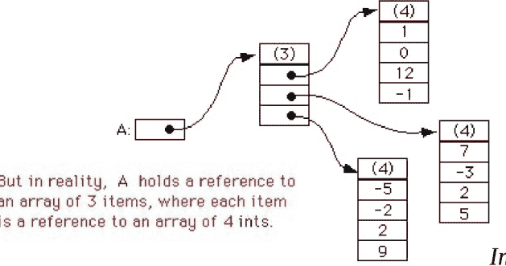

但实际上，`A` 存储的是对一个包含 3 个元素的数组的引用，其中每个元素都是对包含 4 个 `int` 数组的引用。

参考链接：<http://math.hws.edu/eck/cs124/javanotes/3/c8/s5.html>

## 锯数组的字面量初始化

多维数组和锯数组也可以用字面量表达式进行初始化。以下代码声明并填充了一个 2x3 的 `int` 数组：

```java
int[][] table = {{1, 2, 3}, {4, 5, 6}};
```

注意：锯齿子数组也可以为 `null`。例如，以下代码声明并填充了一个二维 `int` 数组，其第一个子数组为 `null`，第二个子数组长度为 0，第三个子数组长度为 1，最后一个子数组是长度为 2 的数组：

```java
int[][] table = {null, {}, {1}, {1, 2}};
```

对于多维数组，可以通过索引提取低维度的数组：

```java
int[][][] arr = new int[3][3][3];

int[][] arr1 = arr[0]; // 从 arr 获取第一个 3x3 维数组
int[] arr2 = arr1[0];  // 从 arr1 获取第一个 3 维数组
// int[] arr3 = arr[0]; // 错误：无法从 int[][] 转换为 int[]
```

## 第 23.5 节：ArrayIndexOutOfBoundsException

当访问数组不存在的索引时，会抛出 `ArrayIndexOutOfBoundsException`。数组是从 0 开始索引，因此第一个元素的索引为 0，最后一个元素的索引是数组容量减 1（即 `array.length - 1`）。因此，任何通过索引 `i` 对数组元素的请求都必须满足 `0 <= i < array.length` 的条件，否则将抛出 `ArrayIndexOutOfBoundsException`。

以下代码是一个抛出 `ArrayIndexOutOfBoundsException` 的简单示例：

```java
String[] people = new String[] { "Carol", "Andy" };
// 将创建一个数组：
// people[0]: "Carol"
// people[1]: "Andy"

// 注意：索引 2 上没有项目。尝试访问它将触发异常：
System.out.println(people[2]); // 抛出 ArrayIndexOutOfBoundsException
```

输出：
```text
Exception in thread "main" java.lang.ArrayIndexOutOfBoundsException: 2 at your.package.path.method(YourClass.java:15)
```

注意，异常中也包含了正在访问的非法索引（示例中的 2）；这些信息可能有助于找到异常的根源。

要避免这种情况，只需检查索引是否在数组的限制范围内即可：

```java
int index = 2;
if (index >= 0 && index < people.length) {
    System.out.println(people[index]);
}
```

## 第 23.6 节：数组协变

对象数组是协变的，这意味着就像 `Integer` 是 `Number` 的子类一样，`Integer[]` 也是 `Number[]` 的子类。这看起来很符合直觉，但会导致意想不到的行为：

```java
Integer[] integerArray = {1, 2, 3};
Number[] numberArray = integerArray; // 有效
Number firstElement = numberArray[0]; // 有效
numberArray[0] = 4L; // 运行时抛出 ArrayStoreException
```

尽管 `Integer[]` 是 `Number[]` 的子类，但它只能持有 `Integer`，尝试分配一个 `Long` 元素会抛出运行时异常。

注意这种行为是数组特有的，可以通过使用泛型 `List` 来避免：

```java
List<Integer> integerList = Arrays.asList(1, 2, 3);
// List<Number> numberList = integerList; // 编译错误
List<? extends Number> numberList = integerList;
Number firstElement = numberList.get(0);
numberList.set(0, 4); // 编译错误
```

并没有要求所有的数组元素都共享相同的类型，只要它们是数组类型的子类即可：

```java
interface I {}

class A implements I {}
class B implements I {}
class C implements I {}

I[] array10 = new I[] { new A(), new B(), new C() }; // 使用 new 运算符和数组初始化器创建数组。
I[] array11 = { new A(), new B(), new C() }; // 使用数组初始化器的快捷语法。
I[] array12 = new I[3]; // { null, null, null }
I[] array13 = new A[] { new A(), new A() }; // 因为 A 实现了 I。
Object[] array14 = new Object[] { "Hello, World!", 3.14159, 42 }; // 使用 new 运算符和数组初始化器创建数组。
Object[] array15 = new Object[]{ 64, "My String" }; // 使用初始化器的快捷语法。
```

## 第 23.7 节：数组转换为 Stream

版本 ≥ Java SE 8

将对象数组转换为 `Stream`：

```java
String[] arr = new String[] { "str1", "str2", "str3" };
Stream<String> stream = Arrays.stream(arr);
```

使用 `Arrays.stream()` 将原始类型数组转换为 `Stream` 将数组转换为 `Stream` 的原始类型特化：

```java
int[] intArr = { 1, 2, 3 };
IntStream intStream = Arrays.stream(intArr);
```

你也可以将 `Stream` 限制为数组中的元素范围。起始索引包含内，结束索引不包含：

```java
int[] values = {1, 2, 3, 4};
IntStream stream = Arrays.stream(values, 1, 3); // 包含索引 1, 2 对应的元素
```

## 第 23.8 节：遍历数组

你可以使用增强 `for` 循环（即 `foreach`）或索引来遍历数组：

```java
int[] numbers = {1, 2, 3, 4};

for (int value : numbers) {
    System.out.println(value);
}
```

```java
for (int i = 0; i < numbers.length; i++) {
    System.out.println(numbers[i]);
}
```

在使用增强 `for` 循环时也可以获取索引：

```java
int i = 0;
for (int value : numbers) {
    System.out.println(i + ": " + value);
    i++;
}
```

基本类型变量将被复制到数组中，因此无法修改。

## 第 23.9 节：数组转换为字符串

版本 ≧ Java SE 5

自 Java 1.5 开始，可以在不遍历元素的情况下获取数组内容的字符串表示。对于多维数组，只需使用 `Arrays.toString(Object[])` 或 `Arrays.deepToString(Object[])`：

```java
int[] arr = {1, 2, 3, 4, 5};
System.out.println(Arrays.toString(arr)); // [1, 2, 3, 4, 5]
```

```java
int[][] arr = {
    {1, 2, 3},
    {4, 5, 6},
    {7, 8, 9}
};
System.out.println(Arrays.deepToString(arr)); // [[1, 2, 3], [4, 5, 6], [7, 8, 9]]
```

`Arrays.toString()` 方法使用 `Object.toString()` 方法生成数组中每个项的字符串值，除了基本类型数组外，还可以用于所有类型的数组。例如：

```java
public class Cat { /* 隐式继承 Object */
    @Override
    public String toString() {
        return "CAT!";
    }
}

Cat[] arr = {new Cat(), new Cat()};
System.out.println(Arrays.toString(arr)); // [CAT!, CAT!]
```

如果类没有重写 `toString()`，则将使用继承自 `Object` 的 `toString()`。通常输出结果没用，例如：

```java
public class Dog {
    /* 隐式继承 Object */
}

Dog[] arr = { new Dog() };
System.out.println(Arrays.toString(arr)); // [Dog@17ed40e0]
```

## 第 23.10 节：数组排序

可以使用 `Arrays` API 轻松完成数组排序。

```java
import java.util.Arrays;

// 创建一个整数数组
int[] array = {7, 4, 2, 1, 19};

// 这是排序部分，只需一个函数即可
Arrays.sort(array);

// 打印 [1, 2, 4, 7, 19]
System.out.println(Arrays.toString(array));
```

### 排序数组

`String` 不是数值数据，它定义了自己的排序顺序，称为字典序，也称为字母序。当使用 `sort()` 方法对 `String` 数组排序时，它按照 `Comparable` 接口定义的自然顺序对数组进行排序，如下所示：

#### 升序

```java
String[] names = {"John", "Steve", "Shane", "Adam", "Ben"};
System.out.println("排序前的 String 数组： " + Arrays.toString(names));
Arrays.sort(names);
System.out.println("升序排序后的 String 数组： " + Arrays.toString(names));
```

输出：
```text
排序前的 String 数组： [John, Steve, Shane, Adam, Ben]
升序排序后的 String 数组： [Adam, Ben, John, Shane, Steve]
```

#### 降序

```java
Arrays.sort(names, 0, names.length, Collections.reverseOrder());
System.out.println("降序排序后的 String 数组： " + Arrays.toString(names));
```

输出：
```text
降序排序后的 String 数组： [Steve, Shane, John, Ben, Adam]
```

### 排序对象数组

为了对对象数组排序，所有元素必须实现 `Comparable` 或 `Comparator` 接口以定义排序顺序。我们可以使用 `sort(Object[])` 方法按照自然顺序对对象数组排序，但你必须确保数组中的所有元素都实现了 `Comparable`。

此外，它们还必须是相互可比较的，例如对于数组中的任何元素 `e1` 和 `e2`，`e1.compareTo(e2)` 不得抛出 `ClassCastException`。或者，你可以使用 `sort(T[], Comparator)` 方法按照自定义顺序对对象数组进行排序，如下例所示：

```java
// 使用 Comparator 和 Comparable 在 Java 中对对象数组排序
Course[] courses = new Course[4];
courses[0] = new Course(101, "Java", 200);
courses[1] = new Course(201, "Ruby", 300);
courses[2] = new Course(301, "Python", 400);
courses[3] = new Course(401, "Scala", 500);

System.out.println("排序前的对象数组： " + Arrays.toString(courses));
Arrays.sort(courses);
System.out.println("自然序排序后的对象数组： " + Arrays.toString(courses));
Arrays.sort(courses, new Course.PriceComparator());
System.out.println("按价格排序后的对象数组： " + Arrays.toString(courses));
Arrays.sort(courses, new Course.NameComparator());
System.out.println("按名称排序后的对象数组： " + Arrays.toString(courses));
```

输出：
```text
排序前的对象数组： [#101 Java@200, #201 Ruby@300, #301 Python@400, #401 Scala@500]
自然序排序后的对象数组： [#101 Java@200, #201 Ruby@300, #301 Python@400, #401 Scala@500]
按价格排序后的对象数组： [#101 Java@200, #201 Ruby@300, #301 Python@400, #401 Scala@500]
按名称排序后的对象数组： [#101 Java@200, #201 Ruby@300, #301 Python@400, #401 Scala@500]
```

## 第 23.11 节：获取数组长度

数组是提供空间以存储指定类型元素的对象。数组的大小在创建后无法修改。数组中的 `length` 字段存储数组的长度。它是 `final` 字段且不可修改。

```java
int[] arr1 = new int[0];
int[] arr2 = new int[2];
int[] arr3 = new int[]{1, 2, 3};
int[] arr4 = new int[]{1, 2, 3, 4, 5, 6, 7};

int len1 = arr1.length; // 0
int len2 = arr2.length; // 2
int len3 = arr3.length; // 3
int len4 = arr4.length; // 7
```

这段代码展示了数组长度和对象数量之间的差异。

```java
public static void main(String[] args) {
    Integer[] arr = new Integer[]{1, 2, 3, null, 5, null, 7};
    int arrayLength = arr.length;
    int nonEmptyElementsCount = 0;

    for (int i = 0; i < arrayLength; i++) {
        Integer arrElt = arr[i];
        if (arrElt != null) {
            nonEmptyElementsCount++;
        }
    }
    System.out.println("数组 'arr' 的长度为 " + arrayLength + " 包含 " + nonEmptyElementsCount + " 个非空值");
}
```

输出：
```text
数组 'arr' 的长度为 7 且包含 5 个非空值
```

## 第 23.12 节：在数组中查找元素

有很多方法可以找到数组中的值。以下代码段假设数组如下：

```java
String[] strings = new String[] {"A", "B", "C"};
int[] ints = new int[] {1, 2, 3, 4 };
```


此外，每种方法都会将 `index` 或 `index2` 设置为所需元素的索引，如果元素不存在则设为 -1。

- 使用 `Arrays.binarySearch`（针对已排序数组）
```java
int index = Arrays.binarySearch(strings, "A");
int index2 = Arrays.binarySearch(ints, 1);
```

- 使用 `Arrays.asList`（针对非基本类型数组）
```java
int index = Arrays.asList(strings).indexOf("A");
int index2 = Arrays.asList(ints).indexOf(1); // 编译错误
```

- 使用 `Stream` Java SE 8
```java
int index = IntStream.range(0, strings.length)
    .filter(i -> "A".equals(strings[i]))
    .findFirst()
    .orElse(-1); // 如果不存在，则返回 -1。
```

- 对于基本类型数组：使用基本类型进行线性查找
```java
int index = 1;
for (int i = 0; i < array.length; i++) {
  if ("A".equals(array[i])) {
    index = i;
    break;
  }
}
```

- 对于基本类型数组：使用第三方库如 `org.apache.commons` 进行线性查找
```java
int index = org.commons.lang3.ArrayUtils.contains(strings, "A");
int index2 = org.commons.lang3.ArrayUtils.contains(ints, 1);
```

注意：直接搜索比封装在列表中更高效。

### 测试数组是否包含元素

上面的示例可以改为测试数组是否包含某个元素，只需测试计算出的索引是否大于等于零。或者，还有一些更简洁变体：

```java
boolean isPresent = Arrays.asList(strings).contains("A");
```

版本 >= Java SE 8
```java
boolean isPresent = Stream<String>.of(strings).anyMatch(x -> "A".equals(x));
```

```java
boolean isPresent = false;
for (String s : strings) {
    if ("A".equals(s)) {
        isPresent = true;
    }
}
```

```java
boolean isPresent = org.commons.lang3.ArrayUtils.contains(ints, 4);
```

## 第 23.13 节：如何更改数组的大小？

简单的答案是你不能这样做。一旦数组被创建，其大小就无法更改。相反，数组只能通过创建一个适当大小的新数组并将元素从现有数组复制到新数组来“调整大小”。

```java
String[] listCities = new String[3]; // 创建了大小为 3 的数组
listCities[0] = "New York";
listCities[1] = "London";
listCities[2] = "Berlin";
```

假设（例如）需要向上面定义的 `listCities` 数组添加新元素。为了实现这一点，你需要：

1. 创建大小为 4 的新数组；
2. 将旧数组现有的 3 个元素复制到新数组偏移 0 和 2 的位置；
3. 在新数组偏移 3 的位置添加新元素。

有多种方法实现上述操作。在 Java 6 之前，最简洁的方法是：

```java
String[] newArray = new String[listCities.length + 1];
```

```java
System.arraycopy(listCities, 0, newArray, 0, listCities.length);
newArray[listCities.length] = "Sydney";
```

从 Java 6 开始，`Arrays.copyOf` 和 `Arrays.copyRange` 方法可以更简单地实现此功能：
```java
String[] newArray = Arrays.copyOf(listCities, listCities.length + 1);
newArray[listCities.length] = "Sydney";
```

复制数组的其他方法，请参考以下示例。请记住，在调整数组大小时，你需要一个长度与原始数组不同的数组副本。

### 复制数组

### 调整数组大小的更佳替代方案

上述调整数组大小的方法有两个主要缺点：
- **效率低下**。让数组变大（或变小）涉及复制许多或所有现有的数组元素，并分配一个新的数组对象。数组越大，开销越高。你需要能够更新任何包含旧数组引用的“存活”变量。
- 另一种替代方案是在创建数组时就分配足够大的空间。这只有在你能够分配数组之前准确确定该大小时才是可行的。如果你无法做到，那么调整数组大小的问题将再次出现。
- 另一种替代方案是使用 Java SE 类库或第三方库提供的数据结构类。例如，Java SE "collections" 框架提供了具有运行时属性的 `List`、`Set` 和 `Map` API 的多种实现。`ArrayList` 类在性能特征上最接近普通数组（例如：O(N) 查找，O(1) 获取和设置，O(N) 随机插入和删除），同时提供了更高效的调整机制，且没有引用更新的问题。

`ArrayList` 的调整效率源于它每次调整时底层数组的增长。对于典型用例，这意味着你只需要偶尔进行调整。当对列表的生命周期进行摊销时，每次插入的调整成本为 O(1)。在调整普通数组时，可能可以使用相同的策略。

## 第 23.14 节：基本类型与包装类型之间的数组转换

有时需要将基本类型转换为包装类型。要转换数组，可以使用流（Java 8 及以上版本）：

```java
Version ≥ Java SE 8
int[] primitiveArray = {1, 2, 3, 4};
Integer[] boxedArray = Arrays.stream(primitiveArray).boxed().toArray(Integer[]::new);
```

在较低版本中，可以通过遍历基本类型数组并显式将其拷贝到包装数组：

```java
Version < Java SE 8
int[] primitiveArray = {1, 2, 3, 4};
Integer[] boxedArray = new Integer[primitiveArray.length];
for (int i = 0; i < primitiveArray.length; ++i) {
    boxedArray[i] = primitiveArray[i]; // 每个元素在这里自动装箱
}
```

同样地，包装数组也可以转换为其对应的基本类型数组：

```java
Version ≥ Java SE 8
Integer[] boxedArray = {1, 2, 3, 4};
int[] primitiveArray = Arrays.stream(boxedArray).mapToInt(Integer::intValue).toArray();
```

Java 8 版本
```java
Integer[] boxedArray = {1, 2, 3, 4};
int[] primitiveArray = new int[boxedArray.length];
for (int i = 0; i < boxedArray.length; ++i) {
    primitiveArray[i] = boxedArray[i]; // 每个元素在这里自动拆箱
}
```

## 第 23.15 节：从数组中删除元素

Java 在 `java.util.Arrays` 中没有提供直接从数组删除元素的方法。要执行此操作，你可以将原始数组拷贝到一个不包含要删除元素的新数组，或者将数组转换为允许删除的其他结构。

### 使用 ArrayList

你可以如下所示将数组转换为 `java.util.List`，删除元素并将列表转换回数组：

```java
String[] array = {"foo", "bar", "baz"};
List<String> list = new ArrayList<>(Arrays.asList(array));
list.remove("foo");
// 创建一个与列表大小相同的新数组并将列表拷贝到其中。
array = list.toArray(new String[list.size()]);
System.out.println(Arrays.toString(array)); // [bar, baz]
```

### 使用 System.arraycopy

`System.arraycopy()` 可用于原始数组的副本并删除你需要的元素。示例如下：

```java
int[] array = new int[]{1, 2, 3, 4}; // 原始数组。
int[] result = new int[array.length - 1]; // 将包含结果的数组。
int index = 1; // 删除值 "2"
// 拷贝索引左侧的元素。
System.arraycopy(array, 0, result, 0, index);
// 拷贝索引右侧的元素。
System.arraycopy(array, index + 1, result, index, array.length - 1);
System.out.println(Arrays.toString(result)); // [1, 3, 4]
```

### 使用 Apache Commons Lang

为了方便删除元素，可以使用 Apache Commons Lang 库，特别是 `ArrayUtils` 类的静态方法 `removeElement()`。示例如下：

```java
int[] array = {1, 2, 3, 4};
array = ArrayUtils.removeElement(array, 2);
System.out.println(array); // [1, 3, 4]
```

## 第 26 节：比较数组

`java.util.Arrays` 提供了 `equals()` 来比较两个数组。对于多维数组，请使用 `deepEquals()`：

```java
int[] a = {1, 2, 3};
int[] b = {1, 2, 3};
System.out.println(Arrays.equals(a, b)); // true
int[] c = {1, 2, 3};
int[] d = {1, 2, 4};
System.out.println(Arrays.equals(c, d)); // false
int[][] a2 = {{1, 2}, {3, 4}};
int[][] b2 = {{1, 2}, {3, 4}};
System.out.println(Arrays.equals(a2, b2)); // false
System.out.println(Arrays.deepEquals(a2, b2)); // true
```

## 第 27 节：复制数组

Java 提供了几种拷贝数组的方法。

- for 循环
```java
int[] a = {4, 1, 3, 2};
int[] b = new int[a.length];
for (int i = 0; i < a.length; i++) {
    b[i] = a[i];
}
```

- Object.clone()
由于数组是对象，你可以使用 `Object.clone()`。注意，数组的 `clone` 方法执行的是浅拷贝，即它返回一个指向相同元素的新数组。
```java
int[] a = {4, 1, 3, 2};
int[] b = a.clone(); // [4, 1, 3, 2];
```

- Arrays.copyOf()
`java.util.Arrays` 提供了一种将数组拷贝到另一个数组的简单方法。基本用法：
```java
int[] a = {4, 1, 3, 2};
int[] b = Arrays.copyOf(a, a.length); // [4, 1, 3, 2];
```
注意 `Arrays.copyOf` 提供了一个重载方法，允许你更改数组类型：
```java
Double[] doubles = {1.0, 2.0, 3.0};
Number[] numbers = Arrays.copyOf(doubles, doubles.length);
```

- System.arraycopy()
`public static void arraycopy(Object src, int srcPos, Object dest, int destPos, int length)` 从指定的源数组从指定位置开始，拷贝到目标数组的指定位置。用法示例如下：
```java
int[] a = {4, 1, 3, 2};
int[] b = new int[a.length];
System.arraycopy(a, 0, b, 0, a.length); // [4, 1, 3, 2];
```

- Arrays.copyOfRange()
主要用于拷贝数组的一部分，你也可以像下面所示将整个数组拷贝到另一个数组：
```java
int[] a = {4, 1, 3, 2};
int[] b = Arrays.copyOfRange(a, 0, a.length); // [4, 1, 3, 2];
```

```java
int[] a = { 4, 1, 3, 2 };
int[] b = Arrays.copyOfRange(a, 0, a.length); // [4, 1, 3, 2]
```

## 第 23.18 节：数组强制转换

数组是对象，但它们的类型是由包含的对象的类型定义的。因此，不能直接将 `A[]` 强制转换为 `T[]`，而必须将特定 `A[]` 中的每个 `A` 成员转换为 `T` 对象。泛型示例：

```java
public static <T, A> T[] castArray(T target, A[] array) {
    for (int i = 0; i < array.length; i++) {
        target[i] = (T) array[i];
    }
    return target;
}
```

因此，给定一个 `A[]` 数组：
`T[] target = new T[array.Length]; target = castArray(target, array);`

Java SE 提供了 `Arrays.copyOf(original, newLength, newType)` 方法来实现此目的：

```java
Double[] doubles = { 1.0, 2.0, 3.0 };
Number[] numbers = Arrays.copyOf(doubles, doubles.length);
Number[].class;
```

## 第 24 章：集合

`java.util` 中的集合框架为数据集提供了许多泛型类，它们提供了普通数组无法的功能。

集合框架包含了 `Collection<O>` 接口，主接口有 `List<O>` 和 `Set<O>`，以及映射集合 `Map<K,V>`。`Collections` 是根接口，并被许多其他集合框架实现。

## 第 24.1 节：在循环中从列表中删除项

在循环期间从列表中删除项是微妙的，这是因为列表的索引和长度会发生变化。给定以下列表，是一些产生意外结果的示例，以及一些产生正确结果的示例。

```java
List<String> fruits = new ArrayList<String>();
fruits.add("Apple");
fruits.add("Banana");
fruits.add("Strawberry");
```

### 错误

**在迭代语句中删除会导致跳过 Banana：**
代码示例只会打印 Apple 和 Strawberry。Banana 被跳过了，因为它移动到了索引 0，Apple 被删除了，但同时 i 增加到了 1。

```java
for (int i = 0; i < fruits.size(); i++) {
    System.out.println(fruits.get(i));
    if ("Apple".equals(fruits.get(i))) {
        fruits.remove(i);
    }
}
```

**在增强语句中删除会抛出异常：**
因为在遍历集合的同时修改了它。抛出：`java.util.ConcurrentModificationException`

```java
for (String fruit : fruits) {
    System.out.println(fruit);
    if ("Apple".equals(fruit)) {
        fruits.remove(fruit);
    }
}
```

### 正确

**使用 Iterator 使用 while 循环**
```java
```


```java
Iterator<String> fruitIterator = fruits.iterator(); 

while(fruitIterator.hasNext()) {

    String fruit = fruitIterator.next();

    System.out.println(fruit);

    if ("Apple".equals(fruit)) {

        fruitIterator.remove();

    }

}
```

`Iterator` 接口内置了一个 `remove()` 方法专门用于这种情况。
然而，该方法在文档中被标记为“可选的”，它可能会抛出 `UnsupportedOperationException`。
抛出：`UnsupportedOperationException` - 此迭代器不支持删除操作。

因此，建议检查文档以确保此操作受支持（在实践中，除非集合是通过第三方库获取的不可变对象或使用了 `Collections.unmodifiable(...)` 方法，否则该操作几乎总是受支持的）。

在使用 `Iterator` 时，如果 `List` 的 `modCount` 自 `Iterator` 创建时起发生了变化，就会抛出 `ConcurrentModificationException`。这可能发生在同一个线程中，也可能发生在共享相同列表的多线程应用程序中。

`modCount` 是一个 `int` 变量，用于计数此列表被结构性修改的次数。结构性变化本质意味着在集合对象上调用了 `add()` 或 `remove()` 操作（`Iterator` 的修改不计入内）。当创建 `Iterator` 时，它存储此 `modCount`，并在列表的每次迭代中检查当前 `modCount` 是否与创建 `Iterator` 时相同。如果 `modCount` 值发生变化，它将抛出 `ConcurrentModificationException`。

因此，对于上述声明的列表，下面的操作不会抛出任何异常：

```java
Iterator<String> fruitIterator = fruits.iterator(); 

fruits.set(0, "Watermelon");

while(fruitIterator.hasNext()){

    System.out.println(fruitIterator.next()); 

}
```

在初始化 `Iterator` 后向列表中添加新元素将抛出 `ConcurrentModificationException`：

```java
Iterator<String> fruitIterator = fruits.iterator();

fruits.add("Watermelon");

while(fruitIterator.hasNext()){

    System.out.println(fruitIterator.next()); //ConcurrentModificationException

    here 

}
```

### 反向迭代

```java
for (int i = (fruits.size() - 1); i>=0; i--) { 

    System.out.println(fruits.get(i)); 

    if ("Apple".equals(fruits.get(i))) {

        fruits.remove(i);

    }

}
```

这种方法不会跳过任何内容。这种方法的缺点是输出是反向的。但在大多数删除无关紧要项的情况下，这没有问题。你不永远应该对 `LinkedList` 这样做。

正向迭代：`for (int i = 0; i < fruits.size(); i++) { System.out.println(fruits.get(i)); if ("Apple".equals(fruits.get(i))) { ... } }`

```java
void howToCreateMaps(Function<? super K, ? extends V> valueFunction,
    Iterable<K> keys1,
    Set<K> keys2,
    SortedSet<K> keys3) {

    ImmutableMap<K, V> map1 = setTo(keys1, valueFunction); // Immutable

    Map<K, V> map2 = asMap(keys2, valueFunction); // Live Map view

    SortedMap<K, V> map3 = toMap(keys3, valueFunction); // Live Map view

}
```

版本 >= Java SE 8

使用 Stream，

```java
Stream.of("xyz", "abc").collect(Collectors.toList());

or Arrays.stream("xyz", "abc").collect(Collectors.toList());
```

## 第 23 节：声明 ArrayList 并添加对象

我们可以创建一个 `ArrayList`（实现 `List` 接口）：

```java
List<String> aListOfFruits = new ArrayList();
```

版本 >= Java SE 5

```java
List<String> aListOfFruits = new ArrayList<String>();
```

版本 >= Java SE 7

```java
List<String> aListOfFruits = new ArrayList<>();
```

现在，使用 `add` 方法添加一个 String：
`aListOfFruits.add("Melon"); aListOfFruits.add("Strawberry");`
在上面的示例中，`ArrayList` 将在索引 0 处包含字符串 "Melon"，在索引 1 处包含字符串 "Strawberry"。
此外我们还可以使用 `addAll(Collection<? extends E> c)` 方法添加多个元素

```java
List<String> aListOfFruitsAndVeggies = new ArrayList<String>();

aListOfFruitsAndVeggies.add("Onion");

aListOfFruitsAndVeggies.addAll(aListOfFruits);
```

现在 "Onion" 被放置在 `aListOfFruitsAndVeggies` 的索引 0 处，“Melon" 位于索引 1，“Strawberry" 位于索引 2。

## 第 24.4 节：遍历集合

### 遍历 List

```java
List<String> names = new ArrayList<>(Arrays.asList("Clementine", "Duran", "Mike"));
```

版本 >= Java SE 8

```java
names.forEach(System.out::println);
```

如果我们需要并行处理，使用

```java
names.parallelStream().forEach(System.out::println);
```

版本 >= Java SE 5

```java
for (String name : names) {

    System.out.println(name);

}
```

版本 < Java SE 5

```java
for (int i = 0; i < names.size(); i++) {

    System.out.println(names.get(i));

}
```

版本 >= Java SE 1.2

```java
// 创建支持正向和反向遍历的 Iterator

List<String> listIterator = names.listIterator();

// 正向方向遍历列表

while(listIterator.hasNext()) {

    System.out.println(listIterator.next());

}

// 从上面开始反向方向遍历列表直到到达最后一个元素

while(listIterator.hasPrevious()) {

    System.out.println(listIterator.previous());

}
```

### 遍历 Set

```java
Set<String> names = new HashSet<>(Arrays.asList("Clementine", "Duran", "Mike"));
```

版本 >= Java SE 8

```java
names.forEach(System.out::println);
```

版本 >= Java SE 5

```java
for (Iterator<String> iterator = names.iterator(); iterator.hasNext(); ) {

  System.out.println(iterator.next());

}

for (String name : names) {

  System.out.println(name);

}
```

版本 < Java SE 5

```java
Iterator iterator = names.iterator();

while (iterator.hasNext()) {

    System.out.println(iterator.next());

}
```

### 遍历 Map

```java
Map<Integer, String> names = new HashMap<>();

names.put(1, "Clementine");

names.put(2, "Duran");

names.put(3, "Mike");
```

版本 >= Java SE 8

```java
names.forEach((key, value) -> System.out.println("Key: " + key + " Value: " + value));

for (Map.Entry<Integer, String> entry : names.entrySet()) {

  System.out.println(entry.getKey());

  System.out.println(entry.getValue());

}
```

// 仅遍历键

```java
for (Integer key : names.keySet()) {

  System.out.println(key);

}
```

// 仅遍历值

```java
for (String value : names.values()) {

  System.out.println(value);

}
```

版本 < Java SE 5
```java
Iterator entries = names.entrySet().iterator();

while (entries.hasNext()) {

    Map.Entry entry = (Map.Entry) entries.next();

    System.out.println(entry.getKey());

    System.out.println(entry.getValue());

}
```

## 第 24.5 节：不可变空集合

有时使用不可变的空集合是合适的。`Collections` 类提供了以高效方式获取此类集合的方法：

```java
List<String> anEmptyList = Collections.emptyList();

Map<Integer, Date> anEmptyMap = Collections.emptyMap();

Set<Number> anEmptySet = Collections.emptySet();
```

这些方法是泛型的，且返回的集合是不可变的。尝试修改它们将抛出异常。需要注意的是，集合内部的对象仍然可以被修改。

## 第 24.6 节：子列表

`List subList(int fromIndex, int toIndex)`

子列表是底层集合的视图，因此对子列表的更改会影响原始集合。

1. 如果 `fromIndex` 或 `toIndex` 不在索引范围内，将抛出 `IndexOutOfBoundsException`。
2. 如果 `fromIndex` 大于 `toIndex`，将抛出 `IllegalArgumentException`。

示例：

```java
List<String> list = new ArrayList<>();

list.add("Onion");

list.add("Melon");

list.add("Strawberry");

List<String> list2 = list.subList(0, 2);

System.out.println("Before: " + list);

list2.add("Watermelon");

System.out.println("After: " + list);
```

现在 "Onion" 被放置在 `aListOfFruitsVeggies` 的索引 0 处，“Melon" 位于索引 1，“Strawberry" 位于索引 2。

输出：
Before: [Onion, Melon, Strawberry]
After: [Onion, Watermelon, Melon, Strawberry]

## 第 24.7 节：不可变集合

为了提供“只读”集合，Java 提供了不可变版本。不可变集合通常是可变集合的副本，保证集合本身不能被修改。

```java
import java.util.ArrayList;

import java.util.Collections;

import java.util.List;

public class MyPojoClass {

    private List<Integer> intList = new ArrayList<>();

    public void addToInt(Integer value) {

        intList.add(value);

    }

    public List<Integer> getIntList() {

        return Collections.unmodifiableList(intList);

    }

}
```

以下尝试修改不可变集合将抛出异常：

```java
import java.util.List;

public class App {

    public static void main(String[] args) {

        MyPojoClass pojo = new MyPojoClass();

        pojo.addToInt(42);

        List<Integer> list = pojo.getIntList();

        list.add(69);

    }

}
```

输出：
Exception in thread "main" java.lang.UnsupportedOperationException at java.util.Collections$UnmodifiableCollection.add(Collections.java:1055) at App.main(App.java:12)

## 第 24.8 节：陷阱：并发修改异常

这种异常在迭代过程中使用迭代器以外的方法修改集合时就会发生。例如，我们有一个帽子列表，想要删除所有带耳朵的帽子：

```java
List<IHat> hats = new ArrayList<>();

hats.add(new Uyshanka()); // 那一个有耳朵 hats.add(new Fedora());

hats.add(new Sombrero());

for (IHat hat : hats) {

    if (hat.hasEarFlaps()) {

        hats.remove(hat);

    }

}
```

如果我们运行这段代码，将抛出 `ConcurrentModificationException`，因为代码在迭代时修改了集合。如果多个线程处理同一个列表，其中一个线程尝试修改集合，而其他线程正在遍历，也可能发生相同的异常。多线程并发修改集合是自然现象，但应该使用并发编程工具箱中的常用工具进行处理，如同步锁、专门为并发修改设计的集合、修改从初始创建的副本等。

## 第 24.9 节：使用 Iterator 移除 List 中的匹配项

上面我注意到一个在循环中从 List 移除项的示例，我想到了另一个这次可能用的示例，即使用

### 迭代器接口

本文演示了一种技巧，当你想要移除列表中的重复项时，这个技巧可能会非常有用。

注意：这只是对“在循环中从列表中移除项”内容的补充。
所以我们按照常例定义列表：

```java
List<String> names = {"James", "Smith", "Sonny", "Huckle", "Berry", "Finn", "Allan"};

List<String> nameList = new ArrayList<>();
```


// 从数组创建列表

`nameList.addAll(Arrays.asList(names));`

`List<String> removeNames = {"Sonny", "Huckle", "Berry"};`

`List<String> removeNameList = new ArrayList<>();`

// 从数组创建列表

`removeNameList.addAll(Arrays.asList(removeNames));`

以下方法接收两个 `Collection` 对象，并执行“魔法”：移除 `removeNameList` 中与 `nameList` 匹配的元素。

```java
private static void removeNames(Collection<String> collection1, Collection<String> collection2) { //获取迭代器。
    Iterator<String> iterator = collection1.iterator();
    // 当集合中还有项时循环
    while (iterator.hasNext()) {
        if (collection2.contains(iterator.next()))
            iterator.remove(); //移除当前的名称或项
    }
}
```

如下调用该方法并传入 `nameList` 和 `removeNameList`：`removeNames(nameList, removeNameList);`
将产生以下输出：

移除名称前的 Array List: James Smith Sonny Huckle Berry Finn Allan
移除名称后的 Array List: James Smith Finn Allan
这是 `Collections` 的一个简单整洁的用法，可能用于移除列表中的重复元素。

# 章节 24.10：合并列表

可以使用以下方法在不修改源列表的情况下合并列表。

## 第一种方法：代码较多，但易于理解

```java
List<String> newList = new ArrayList<String>();
newList.addAll(listOne); // 注意：已从 List 修正
newList.addAll(listTwo);
```

## 第二种方法：一行，但可读性较低

```java
List<String> newList = new ArrayList<String>(listOne);
newList.addAll(listTwo);
```

## 第三种方法：需要第三方 Apache commons-collections 库

```java
ListUtils.union(listOne, listTwo);
```

## 版本 > Java SE 8

使用 Streams 实现相同效果可以通过：

```java
List<String> newList = Stream.concat(listOne.stream(), listTwo.stream()).collect(Collectors.toList());
```

引用：接口 `List`

# 章节 24.11：创建用于 Iterator 或 for-each 循环的 Iterable 结构

为了确保我们的集合可以使用迭代器（`iterator`）或 for-each 循环进行迭代，我们必须处理以下步骤：

1. 我们迭代的内容必须是 `Iterable` 的，并暴露 `iterator()` 方法。
2. 通过重写 `next()` 和 `remove()` 来设计一个 `java.util.Iterator`。

我在下方添加了一个简单的泛型列表实现，它使用实体来构建链表迭代器。

```java
package org.algorithms.linkedlist;

import java.util.Iterator;
import java.util.NoSuchElementException;

public class LinkedList<T> implements Iterable<T> {

    Node<T> head, current;

    private static class Node<T> {
        T data;
        Node<T> next;

        Node(T data) {
            this.data = data;
        }
    }

    public LinkedList(T data) {
        head = new Node<>(data);
    }

    public Iterator<T> iterator() {
        return new LinkedListIterator();
    }

    private class LinkedListIterator implements Iterator<T> {
        Node<T> node = head;

        @Override
        public boolean hasNext() {
            return node != null;
        }

        @Override
        public T next() {
            if (!hasNext()) {
                throw new NoSuchElementException();
            }
            Node<T> prevNode = node;
            node = node.next;
            return prevNode.data;
        }

        @Override
        public void remove() {
            throw new UnsupportedOperationException("未实现移除逻辑");
        }
    }

    public void add(T data) {
        Node<T> current = head;
        while (current.next != null) {
            current = current.next;
        }
        current.next = new Node<>(data);
    }
}

class App {
    public static void main(String[] args) {
        LinkedList<Integer> list = new LinkedList<>(1);
        list.add(2);
        list.add(4);
        list.add(3);

        // 测试 #1
        System.out.println("using Iterator: ");
        Iterator<Integer> itr = list.iterator();
        while (itr.hasNext()) {
            Integer i = itr.next();
            System.out.print(i + " ");
        }

        // 测试 #2
        System.out.println("\nusing for-each: ");
        for (Integer data : list) {
            System.out.print(data + " ");
        }
    }
}
```

# 输出

using Iterator: 1 2 4 3
using for-each: 1 2 4 3

这将在 Java 7+ 上运行。你也可以通过替换使其在 Java 5 和 Java 6 上运行：
`LinkedList<Integer> list = new LinkedList<>(1);`
替换为
`LinkedList<Integer> list = new LinkedList<Integer>(1);` 或通过包含兼容更改任何其他版本。

# 章节 24.12：集合与原始值

遗憾的是，许多 Java 集合（如 `HashMap`）仅适用于对象。这是因为它们需要使用 `hashCode()` 和 `equals()` 方法。对于原始类型，这会导致开销，因为它们必须经过装箱（boxing）和拆箱（unboxing）。

存在其他库，如 fastutil 或 Trove，它们提供了原始类型集合以避免这种开销。

## 25.3 节：实现 List 的类 - 优缺点

`List` 接口由不同的类实现。每个类都有其自己的实现方式，具有不同的策略，并提供不同的优缺点。

### 实现 List 的类

这些是 Java SE 8 中实现 `java.util.List` 接口的所有公共类：

#### 1. 抽象类
- `AbstractList`
- `AbstractSequentialList`

#### 2. 具体类
- `ArrayList`
- `AttributeList`
- `CopyOnWriteArrayList`
- `LinkedList`
- `RoleList`
- `RoleUnresolvedStack`
- `Vector`

### 各种实现方式在时间复杂度方面的优缺点

#### ArrayList

```java
public class ArrayList<E>
extends AbstractList<E>
implements List<E>, RandomAccess, Cloneable, Serializable
```

`ArrayList` 是 `List` 接口的一种可调整大小的实现。通过将列表存储在数组中，`ArrayList` 提供了（除实现 `List` 接口的方法外）用于操作数组大小的方法。

初始化一个大小为 100 的 Integer `ArrayList`：

```java
List<Integer> myList = new ArrayList<Integer>(100); // 构建一个指定初始容量的空列表。
```

**优点**：
`size`、`isEmpty`、`get`、`set`、`iterator` 和 `listIterator` 操作在常数时间内运行。因此获取和设置 List 的每个元素的时间成本相同：

```java
int e1 = myList.get(0); //
int e2 = myList.get(10); // 成本均相同 => O(1)
myList.set(2, 10); //
```

**缺点**：
由于是用数组（静态结构）实现的，在数组大小之外添加元素代价很大，因为需要对整个数组进行新的分配。然而，根据文档说明：
`add` 操作在分摊常数时间内运行，即 n 个元素需要 O(n) 时间。
删除一个元素需要 O(n) 时间。

#### AttributeList
待发布中

#### CopyOnWriteArrayList
待发布中

#### LinkedList

```java
public class LinkedList<E>
extends AbstractSequentialList<E>
implements List<E>, Deque<E>, Cloneable, Serializable
```

`LinkedList` 是通过双向列表实现的，这是一种链式数据结构，由一组顺序链接的记录（节点）组成。

初始化 Integer 的 `LinkedList`：

```java
List<Integer> myList = new LinkedList<Integer>(); // 构建一个空列表。
```

**优点**：
在列表头部或末尾添加或删除元素是常数时间。

```java
myList.add(10); //
myList.add(0, 2); // 常数时间 => O(1)
myList.remove(); //
```

**缺点**：
根据文档说明：
从列表开始或结束对列表进行索引的操作，以靠近指定索引的一端为准。

操作：

```java
myList.get(10); //
myList.add(11, 25); // 最坏情况耗时为 O(n/2)
myList.set(15, 35); //
```

#### RoleList
待发布中

#### RoleUnresolvedList
待发布中

#### Stack
待发布中

#### Vector
待发布中

## 25.4 节：寻找两个列表之间的公共元素

假设你有两个列表：A 和 B，你需要找到两个列表中都存在的元素。
你可以通过调用 `List.retainAll()` 方法来实现。

示例：

```java
public static void main(String[] args) {
    List<Integer> numbersA = new ArrayList<>();
    List<Integer> numbersB = new ArrayList<>();

    numbersA.addAll(Arrays.asList(new Integer[] { 1, 3, 4, 7, 5, 2 }));
    numbersB.addAll(Arrays.asList(new Integer[] { 13, 32, 533, 3, 4, 2 }));

    System.out.println("A: " + numbersA);
    System.out.println("B: " + numbersB);

    List<Integer> numbersC = new ArrayList<>();
    numbersC.addAll(numbersA);
    numbersC.retainAll(numbersB);

    System.out.println("List A: " + numbersA);
    System.out.println("List B: " + numbersB);
    System.out.println("A 和 B 之间的公共元素: " + numbersC);
}
```

## 25.5 节：List 元素的原地替换

此示例关于在替换 List 元素的同时，确保替换后的元素与被替换元素处于相同位置。可以使用以下方法完成：

- `set(int index, T type)`
- `int indexOf(T type)`

考虑一个包含 "Program starting!", "Hello world!" 和 "Goodbye world!" 元素的 `ArrayList`：

```java
List<String> strings = new ArrayList<String>();
strings.add("Program starting!");
strings.add("Hello world!");
strings.add("Goodbye world!");
```

如果知道想要替换的元素的索引，我们可以简单地如下使用 `set`：

```java
strings.set(1, "Hi world");
```

如果不知道索引，可以先搜索它。例如：

```java
int pos = strings.indexOf("Goodbye world!");
if (pos >= 0) {
    strings.set(pos, "Goodbye cruel world!");
}
```

1. `set` 操作不会导致 `ConcurrentModificationException`。

## 25.6 节：使列表不可变

如果知道想要替换的元素的索引，我们可以简单地使用 `set`：

```java
strings.set(1, "Hi world");
```

如果不知道索引，可以先搜索它。例如：

```java
int pos = strings.indexOf("Goodbye world!");
if (pos >= 0) {
    strings.set(pos, "Goodbye cruel world!");
}
```

1. `set` 操作不会导致 `ConcurrentModificationException`。
2. `set` 操作是常数时间内的。

## 25.7 节：移动元素

如果知道想要替换的元素的索引，我们可以简单地使用 `set`：

```java
strings.set(1, "Hi world");
```

如果不知道索引，可以先搜索它。例如：

```java
int pos = strings.indexOf("Goodbye world!");
if (pos >= 0) {
    strings.set(pos, "Goodbye cruel world!");
}
```


## 25.8 节：创建、添加和从 ArrayList 元素

`ArrayList` 是 Java 内置的数据结构之一。它是动态数组（不需要声明大小），用于存储元素（对象）。

它继承 `AbstractList` 并实现 `List` 接口。`ArrayList` 可以包含重复元素并维护插入顺序。应该注意的是 `ArrayList` 类是非同步的，因此在处理并发时需要小心。`ArrayList` 允许随机访问，因为可以使用数组。

```java
List<T> myArrayList = new ArrayList<>();
```

泛型 `T` 是存储在 `ArrayList` 内部的类型。`ArrayList` 的类型可以是任何对象。类型不能是基本类型（请使用包装类）。

向 `ArrayList` 添加元素使用 `add` 方法：

```java
myArrayList.add(element);
```

或者在特定索引处添加：

```java
myArrayList.add(index, element); // 索引应该是从0开始的整数
```

从 `ArrayList` 移除元素使用 `remove` 方法：

```java
myArrayList.remove(element);
```

或者从特定索引移除元素：

```java
myArrayList.remove(index); // 索引应该是从0开始的整数
```

## 25.9 节：创建一个 List

### 为你的列表指定类型

创建列表需要一个类型（任何类，例如 `String`）。这是你的 `List` 的类型。该 `List` 意味着指定类型的对象。

```java
List<String> strings;
```

可以存储 "string1"、"hello world!"、"goodbye" 等，但不能存储 `9.2`，例如：

```java
List<Double> doubles;
```

### 初始化你的列表

如果你尝试向上面的列表添加内容，将得到 `NullPointerException`，因为 `strings` 和 `doubles` 都等于 `null`！

初始化列表有两种方法：

#### 选项 1：使用实现 List 的类

`List` 是一个接口，这意味着它没有构造函数，而是类必须重写的方法。`ArrayList` 是常用的 `List`，尽管 `LinkedList` 也很常用。所以我们这样初始化列表：

```java
List<String> strings = new ArrayList<String>();
```

或

```java
List<String> strings = new LinkedList<String>(); // 版本 ≥ Java SE 7
```

从 Java SE 7 开始，你可以使用菱操作符：

```java
List<String> strings = new ArrayList<>();
```

或

```java
List<String> strings = new LinkedList<>();
```

#### 选项 2：使用 Collections 类

`Collections` 类提供了两个非常有用的方法，可以在无需 `List` 变量的情况下创建 `List`：

- `emptyList()`: 返回一个空列表，
- `singletonList(T)`: 创建一个 `T` 类型的列表并添加指定的元素。

还有一个用于使用现有 `List` 填充数据的方法：

- `addAll(L, T...)`: 将所有指定的元素添加到作为第一个参数传递的列表中。

示例：

```java
import java.util.List;
import java.util.Collections;

List<Integer> l = Collections.singletonList(11);
List<Integer> l1 = Collections.singletonList(42);
Collections.addAll(l, 1, 2, 3);
```

## 25.10 节：位置访问操作

`List` API 有 8 个用于位置访问操作的方法。

```java
add(T type)
add(int index, T type)
remove(Object o)
remove(int index)
get(int index)
set(int index, E element)
int indexOf(Object o)
int lastIndexOf(Object o)
```

所以，如果我们有一个 `List`：

```java
List<String> strings = new ArrayList<String>();
```

并想向它添加字符串 "Hello world!" 和 "Goodbye world!"，我们可以这样操作：

```java
strings.add("Hello world!");
strings.add("Goodbye world!");
```

我们的列表将包含这两个元素。现在假设我们想在列表开头添加 "Program starting!"。我们可以这样做：

```java
strings.add(0, "Program starting!");
```

**注意：第一个元素的索引为 0。**

现在，如果我们想删除 "Goodbye world!" 这一行，我们可以这样做：

```java
strings.remove("Goodbye world!");
```

如果我们想删除第一行（在某种情况下是 "Program starting!"），我们可以这样做：

```java
strings.remove(0);
```

注意：

1. 添加和删除元素会修改列表，如果列表正在被并发迭代，这可能会导致 `ConcurrentModificationException`。
2. 添加和删除元素的复杂度为 O(1) 或 O(N)，取决于列表类、所使用的方法以及你是在列表的开头、结尾还是中间添加/删除元素。

为了获取指定位置的列表元素，可以使用 `List` API 的 `E get(int index);` 方法。例如：

```java
strings.get(0);
```

将返回列表的第一个元素。

你可以通过 `set(int index, E element);` 替换指定位置的任何元素。例如：

```java
strings.set(0, "This is a replacement");
```

这将字符串 "This is a replacement" 设置为列表的第一个元素。

注意：`set` 将覆盖位置 0 处的元素。它不会在位置 0 处添加新字符串并将旧字符串推到位置 1。

`int indexOf(Object o);` 返回作为参数传递的对象首次出现的位置。如果列表中没有该对象，则返回值 -1。接上上一个示例，如果你调用：

```java
strings.indexOf("This is a replacement");
```

预期将返回 0，因为我们在列表的索引 0 处设置了字符串 "This is a replacement"。在调用 `int indexOf(Object o);` 时，如果列表中有多个出现，如前所述，将返回第一次出现的索引。通过调用 `int lastIndexOf(Object o)`，你可以获取列表中最后一次出现的索引。所以，如果我们再次添加一个 "This is a replacement"：

```java
strings.add("This is a replacement");
strings.lastIndexOf("This is a replacement");
```

这次将返回 1 而不是 0。

## 25.11 节：遍历列表中的元素

对于示例，假设我们有一个 `String` 类型的 `List`，包含四个元素："hello", "how", "are", "you?"。

遍历每个元素的最佳方法是使用 `for` 循环：

```java
public void eachElement(List<String> list) {
    for (String s : list) {
        System.out.println(s);
    }
}
```

它将打印：

```text
hello
how
are
you?
```

若要在同一行中打印所有内容，你可以使用 `StringBuilder`：

```java
public void printAsLine(List<String> list) {
    StringBuilder builder = new StringBuilder();
    for (String s : list) {
        builder.append(s);
    }
    System.out.println(builder.toString());
}
```

将打印：

```text
hello how are you?
```

或者，你也可以使用元素索引（如“从 ArrayList 访问第 i 个索引处的元素”所述）来遍历列表。

警告：这种方法对于链表来说效率很低。

## 25.12 节：从列表 B 中移除列表 A 存在的元素

假设有两个列表 A 和 B，你想从 B 中移除 A 中有的所有元素，这种情况下的方法是 `List.removeAll(Collection c)`。

### 示例

```java
public static void main(String[] args) {
    List<String> A = new ArrayList<>();
    A.add("hello");
    A.add("world");

    List<String> B = new ArrayList<>();
    B.add("hello");
    B.add("java");
    B.add("world");

    B.removeAll(A);

    System.out.println(B); // 输出: [java]
}
```

## 26.4 节：从现有的 Set 创建列表

### 使用新的 List

```java
List<String> list = new ArrayList<String>(listOfElements);
```

### List.addAll() 方法

```java
Set<String> set = new HashSet<String>();
set.add("foo");
set.add("boo");

List<String> list = new ArrayList<String>();
list.addAll(set);
```

### 使用 Java 8 Stream API

```java
List<String> list = set.stream().collect(Collectors.toList());
```

## 26.5 节：使用 Set 去重

假设你有一个集合元素，你想创建另一个包含相同元素但去除了所有重复元素的集合：

```java
Collection<Type> noDuplicates = new HashSet<Type>(elements);
```

### 示例

```java
List<String> names = new ArrayList<>(Arrays.asList("John", "Marco", "Jenny", "Emily", "Jenny", "Emily", "John"));
Set<String> noDuplicates = new HashSet<>(names);
System.out.println("noDuplicates = " + noDuplicates);
```

输出: `[Marco, Emily, John, Jenny]`

## 26.6 节：带有值的声明 HashSet

你可以创建一个继承自 `HashSet` 的新类：

```java
Set<String> h = new HashSet<String>() {{
    add("a");
    add("b");
}};
```

单行解决方案：

```java
Set<String> h = new HashSet<String>(Arrays.asList("a", "b"));
```

使用 Guava：

```java
Sets.newHashSet("a", "b", "c");
```

使用 Streams：

```java
Set<String> set3 = Stream.of("a", "b", "c").collect(toSet());
```

## 第 27 章：List 和 Set

在顶层，`List` 和 `Set` 集合之间的区别是什么？在 Java 中何时使用 `List`，何时使用 `Set`？

### 27.1 节：List vs Set

```java
import java.util.ArrayList;
import java.util.HashSet;
import java.util.List;
import java.util.Set;
```

```java
public class SetAndListExample {
    public static void main(String[] args) {
        System.out.println("List example....");
        List<String> list = new ArrayList<>();
        list.add("1");
        list.add("2");
        list.add("3");
        list.add("4");
        list.add("1");

        for (String temp : list) {
            System.out.println(temp);
        }

        System.out.println("Set example ....");
        Set<String> set = new HashSet<String>();
        set.add("1");
        set.add("2");
        set.add("3");
        set.add("4");
        set.add("1");
        set.add("2");
        set.add("5");

        for (String temp : set) {
            System.out.println(temp);
        }
    }
}
```

输出：

```text
List example....
1
2
3
4
1
Set example ....
3
2
1
5
4
```

## 第 28 章：Maps

`java.util.Map` 接口表示键和它们的值之间的映射。`Map` 不能包含重复的键；且每个键最多映射到一个值。

由于 `Map` 是一个接口，你需要实例化该接口的具体实现类以便使用它；有多种 `Map` 实现，最常用的是 `java.util.HashMap` 和 `java.util.TreeMap`。

## 28.1 节：高效遍历 Map 条目

本节提供了十种唯一实现方式的代码和基准测试，这些实现方式遍历 `Map<Integer, Integer>` 的条目并生成 `Integer` 值的总和。所有示例的算法复杂度均为 Θ(n)，但基准测试对于直观了解“真实世界”环境中哪些实现更高效仍然具有参考价值。

### 1. 使用 Iterator Map.Entry 的实现

```java
Iterator<Map.Entry<Integer, Integer>> it = map.entrySet().iterator();
while (it.hasNext()) {
    Map.Entry<Integer, Integer> pair = it.next();
    sum += pair.getKey() + pair.getValue();
}
```

### 2. 使用 for 和 Map.Entry 的实现

```java
for (Map.Entry<Integer, Integer> pair : map.entrySet()) {
    sum += pair.getKey() + pair.getValue();
}
```

### 3. 使用 Map.forEach 的实现 (Java 8+)

```java
map.forEach((k, v) -> sum += k + v);
```

### 4. 使用 Map.KeySet 与 for 的实现

```java
for (Integer key : map.keySet()) {
    sum += map.get(key);
}
```

### 5. 使用 Map.KeySet 与 Iterator 的实现

```java
Iterator<Integer> it = map.keySet().iterator();
while (it.hasNext()) {
    Integer key = it.next();
    // ...
}
```


# Java Map 遍历与操作示例

## 遍历 Map 的多种方式

### 1. 使用 `for-each` 循环遍历 `Map.Entry`

```java
for (Map.Entry<Integer, Integer> entry : map.entrySet()) {
    sum += entry.getKey() + entry.getValue();
}
```

### 2. 使用 `for-each` 遍历键

```java
for (Integer key : map.keySet()) {
    sum += key + map.get(key);
}
```

### 3. 使用 `Iterator` 和 `Map.Entry`

```java
for (Iterator<Map.Entry<Integer, Integer>> entries = map.entrySet().iterator(); entries.hasNext(); ) {
    Map.Entry<Integer, Integer> entry = entries.next();
    sum += entry.getKey() + entry.getValue();
}
```

### 4. 使用 `Stream.forEach` (Java 8+)

```java
map.entrySet().stream().forEach(e -> sum += e.getKey() + e.getValue());
```

### 5. 使用并行流 `Stream.parallel().forEach` (Java 8+)

```java
map.entrySet().stream().parallel().forEach(e -> sum += e.getKey() + e.getValue());
```

### 6. 使用 `Iterable` (注意：`Map.Entry` 集合不直接实现 `Iterable` 接口的 `hasNext/next`，此处原代码有误)

```java
// 正确写法应使用 Iterator 或 for-each
for (Map.Entry<Integer, Integer> entry : map.entrySet()) {
    sum += entry.getKey() + entry.getValue();
}
```

### 7. 使用 `MutableMap` (Kotlin 语法或特定库)

```java
mutableMap.forEach((key, value) -> { sum += key + value; });
```

---

# 性能测试

测试环境：Windows 8 64位，Intel i7-4790K，16 GB

## 1. 10次实验的平均性能 (最佳 308 ns/op)

| x: Map的大小 | 100 | 600 | 1100 | 1600 | 2100 |
| :--- | :--- | :--- | :--- | :--- | :--- |
| f(x): 基准得分 (µ/op) | 0.333 | 1.631 | 2.752 | 5.937 | 8.024 |
| 10 | 0.309 | 1.971 | 4.147 | 8.147 | 10.473 |
| 3 | 0.372 | 2.190 | 4.470 | 8.322 | 10.531 |
| 6 | 0.405 | 2.237 | 4.616 | 8.645 | 10.707 |
| 1 | 0.376 | 2.267 | 4.809 | 8.403 | 10.910 |
| 2 | 0.403 | 2.248 | 5.668 | 9.790 | 12.125 |
| 7 | 0.565 | 2.830 | 5.952 | 13.22 | 16.965 |
| 9 | 0.808 | 5.012 | 8.813 | 13.939 | 17.407 |
| 4 | 0.81 | 5.104 | 8.533 | 14.064 | 17.422 |
| 5 | 5.173 | 12.499 | 17.351 | 24.671 | 30.403 |

## 2. 10000个元素的10次实验平均性能 (最佳 37.606 µs/op)

| x: Map的大小 | 100 | 600 | 1100 | 1600 | 2100 |
| :--- | :--- | :--- | :--- | :--- | :--- |
| f(x): 基准得分 (µ/op) | 37.606 | 50.368 | 50.332 | 51.406 | 52.538 |
| 10 | 37.606 | 790 | 790 | 790 | 790 |
| 3 | 37.606 | 507 | 507 | 507 | 507 |
| 6 | 37.606 | 507 | 507 | 507 | 507 |
| 1 | 37.606 | 507 | 507 | 507 | 507 |
| 2 | 37.606 | 507 | 507 | 507 | 507 |
| 7 | 37.606 | 507 | 507 | 507 | 507 |
| 9 | 37.606 | 507 | 507 | 507 | 507 |
| 4 | 37.606 | 507 | 507 | 507 | 507 |
| 5 | 37.606 | 507 | 507 | 507 | 507 |

## 3. Map 大小性能变化对比


---

# 第 28.2 节：HashMap 的用法

`HashMap` 是 `Map` 接口的一种实现，提供了一种以键值对形式存储数据的结构。

## 1. 声明 HashMap

```java
Map<KeyType, ValueType> myMap = new HashMap<KeyType, ValueType>();
```

`KeyType` 和 `ValueType` 必须是 Java 中的有效类型，例如 `String`、`Integer`、`Float` 或任何自定义类如 `Employee`、`Student` 等。
例如：`Map<String, Integer> myMap = new HashMap<String, Integer>();`

## 2. 在 HashMap 中存入值

要在 `HashMap` 中存入值，我们必须通过将 `Key` 和 `Value` 作为参数传递给 `HashMap` 来调用其上的 `put` 方法。

```java
myMap.put("key1", 1);
myMap.put("key2", 2);
```

如果你用 `Map` 中已存在的 `Key` 调用 `put` 方法，该方法将覆盖其值并返回旧值。

## 3. 从 HashMap 中获取值

若要从 `HashMap` 中获取值，你必须通过将 `Key` 作为参数传递给 `get` 方法来调用该方法。

```java
myMap.get("key1"); // 返回 1 (Integer 类)
```

如果你传递的键在 `HashMap` 中不存在，则该方法将返回 `null`。

## 4. 检查 Key 是否在 Map 中

```java
myMap.containsKey(varKey);
```

## 5. 检查 Value 是否在 Map 中

```java
myMap.containsValue(varValue);
```

上述方法将根据值是否存在于 `Map` 中返回布尔值 `true` 或 `false`。

---

# 第 28.3 节：使用 Java 8 的 Map 默认方法

Java 8 在 `Map` 接口中引入的默认方法示例。

## 1. 使用 `getOrDefault`

返回映射到键的值；如果键不存在，则返回默认值。

```java
Map<Integer, String> map = new HashMap<>();

map.put(1, "First element");

map.get(1); // => First element
map.get(2); // => null
map.getOrDefault(2, "Default element"); // => Default element
```

## 2. 使用 `forEach`

允许对每个 `Map Entry` 执行在 `action` 中指定的操作。

```java
Map<Integer, String> map = new HashMap<Integer, String>();
map.put(1, "one");
map.put(2, "two");
map.put(3, "three");

map.forEach((key, value) -> System.out.println("Key:" + key + " :: Value:" + value));
```

输出：
```text
Key: 1 :: Value: one
Key: 2 :: Value: two
Key: 3 :: Value: three
```

## 3. 使用 `replaceAll`

仅当键存在时才会替换为新值。

```java
Map<String, Integer> map = new HashMap<String, Integer>();
map.put("john", 20);
map.put("paul", 30);
map.put("peter", 40);

map.replaceAll((key, value) -> value + 10); // john=30, paul=40, peter=50
```

## 4. 使用 `putIfAbsent`

如果键不存在或映射为 `null`，则向 map 中添加键值对。

```java
Map<String, Integer> map = new HashMap<String, Integer>();
map.put("john", 20);
map.put("paul", 30);
map.put("peter", 40);

map.putIfAbsent("kelly", 50); // john=20, paul=30, peter=40, kelly=50
```

## 5. 使用 `remove`

仅当该键与给定值关联时才删除该键。

```java
Map<String, Integer> map = new HashMap<String, Integer>();
map.put("john", 20);
map.put("paul", 30);
map.put("peter", 40);

map.remove("peter", 40); // john=20, paul=30
```

## 6. 使用 `replace`

如果键存在，则值将被替换为新值。如果键不存在，则什么都不做。

```java
Map<String, Integer> map = new HashMap<String, Integer>();
map.put("john", 20);
map.put("paul", 30);
map.put("peter", 40);

map.replace("peter", 50); // john=20, paul=30, peter=50
map.replace("jack", 60);  // john=20, paul=30, peter=50 (jack 不存在，无操作)
```

## 7. 使用 `computeIfAbsent`

此方法在 `Map` 中添加条目。键在函数中指定，值是映射函数应用的结果。

```java
Map<String, Integer> map = new HashMap<String, Integer>();
map.put("john", 20);
map.put("paul", 30);
map.put("peter", 40);

map.computeIfAbsent("kelly", k -> map.get("john") + 10); // john=20, paul=30, peter=40, kelly=30
map.computeIfAbsent("peter", k -> map.get("john") + 10); // peter 已存在，不执行，保持 40
```

## 8. 使用 `computeIfPresent`

此方法修改 `Map` 中已有的条目。如果不存在该键的条目，则什么都不做。

```java
Map<String, Integer> map = new HashMap<String, Integer>();
map.put("john", 20);
map.put("paul", 30);
map.put("peter", 40);

map.computeIfPresent("kelly", (k, v) -> v + 1); // 因为 kelly 不存在，不执行
map.computeIfPresent("peter", (k, v) -> v + 10); // john=20, paul=30, peter=50
```

> **注**：原文代码中 `computePresent` 疑似为 `computeIfPresent` 的笔误，此处按标准 API 修正。

## 9. 使用 `compute`

此方法在 `Map` 中添加或修改条目。键在函数中指定，值是映射函数的结果。

```java
Map<String, Integer> map = new HashMap<String, Integer>();
map.put("john", 20);
map.put("paul", 30);
map.put("peter", 40);

map.compute("john", (k, v) -> v + 10); // john=30, paul=30, peter=40
map.compute("kelly", (k, v) -> 50);    // john=30, paul=30, peter=40, kelly=50
```

## 10. 使用 `merge`

如果键存在，则将新值与旧值合并；否则插入新值。

```java
Map<String, Integer> map = new HashMap<>();
map.put("john", 20);
map.put("paul", 30);
map.put("peter", 40);

map.merge("john", 10, (oldVal, newVal) -> oldVal + newVal); // john=30, paul=30, peter=40
map.merge("kelly", 50, (oldVal, newVal) -> oldVal + newVal); // john=30, paul=30, peter=40, kelly=50
```

---

# 第 28.6 节：添加多个项

我们可以使用 `put(K, V value)`：
将指定的值与此 map 中的指定键关联（可选操作）。如果 map 之前包含该键的映射，则旧值被指定的值替换。

```java
String currentVal;
Map<Integer, String> map = new TreeMap<>();

currentVal = map.put(1, "First element.");
System.out.println(currentVal); // 将打印 null

currentVal = map.put(2, "Second element.");
System.out.println(currentVal); // 将再次打印 null

currentVal = map.put(2, "This will replace 'Second element'");
System.out.println(currentVal); // 将打印 Second element

System.out.println(map.size()); // 将打印 2，因为键 2 的值被替换了
```

## 使用 `putAll` 合并 Map

```java
Map<Integer, String> map2 = new HashMap<>();
map2.put(2, "Element 2");
map2.put(3, "Element 3");

map.putAll(map2);
System.out.println(map.size());
```

## 使用匿名内部类初始化 (不推荐)

```java
Map<Integer, String> map = new HashMap<>() {
    // 匿名内部类实例初始化块
    {
        put(5, "high");
        put(4, "low");
        put(1, "too slow");
    }
};
```

> 请记住，创建匿名内部类并不总是高效的，在可能的情况下会导致内存泄漏，建议使用静态初始化块或 `Map.of` / `Map.ofEntries` (Java 9+)。

## 推荐：使用静态初始化块

```java
static Map<Integer, String> map = new HashMap<>();

static {
    // 不再创建内部类，避免内存泄漏
    map.put(5, "high");
    map.put(4, "low");
    map.put(1, "too slow");
}
```


上面的示例使 map 变为静态。它也可以通过移除所有 `static` 出现处在非静态上下文中使用。此外，大多数实现都支持 `putAll`，它可以将一个 map 中的所有条目添加到另一个 map 中，如：`another.putAll(one);`。

## 第 28.7 节：创建和初始化 Maps

### 介绍

Maps 存储键/值对，每个键都有一个关联的值。给定一个特定的键，map 可以非常快速地查找关联的值。Maps 也称为关联数组（associate array），是一种以键和值形式存储数据的对象。在 Java 中，maps 使用 `Map` 接口表示，它并不是 `collection` 接口的扩展。

方式 1：

```java
/*J2SE < 5.0*/
Map map = new HashMap<>();
map.put("name", "A");
map.put("address", "Malviya-Nagar");
map.put("city", "Jaipur");
System.out.println(map);
```

方式 2：

```java
/*J2SE 5.0+ 风格（使用泛型） */
Map<String, Object> map = new HashMap<>();
map.put("name", "A");
map.put("address", "Malviya-Nagar");
map.put("city", "Jaipur");
System.out.println(map);
```

方式 3：

```java
Map<String, Object> map = new HashMap<String, Object>() {{
    put("name", "A");
    put("address", "Malviya-Nagar");
    put("city", "Jaipur");
}};
System.out.println(map);
```

方式 4：

```java
Map<String, Object> map = new TreeMap<String, Object>();
map.put("name", "A");
map.put("address", "Malviya-Nagar");
map.put("city", "Jaipur");
System.out.println(map);
```

方式 5：

```java
// Java 8
final Map<String, String> map = Arrays.stream(new String[][] {
  { "name", "A" },
  { "address", "Malviya-Nagar" },
  { "city", "jaipur" },
}).collect(Collectors.toMap(m -> m[0], m -> m[1]));
System.out.println(map);
```

方式 6：

```java
// 这种方法用于在函数外部初始化 map
final static Map<String, String> map;
static {
    map = new HashMap<String, String>();
    map.put("a", "b");
    map.put("c", "d");
}
```

方式 7：创建不可变的键值对 map。
注意，这种 map 是不可修改的。

```java
// 不变的键值对
Map<String, String> singletonMap = Collections.singletonMap("key", "value");
```

尝试修改这种 map 会导致 `UnsupportedException`。

```java
// 不变的键值对
Map<String, String> singletonMap = Collections.singletonMap("key", "value");
singletonMap.put("newKey", "newValue"); // 抛出 UnsupportedException
```

## 第 28.8 节：检查键是否存在

```java
Map<String, String> num = new HashMap<>();
num.put("one", "first");
if (num.containsKey("one")) {
    System.out.println(num.get("one")); // 输出 first
}
```

Maps 可以包含值。对于 maps，请不要混淆“包含键”和“拥有值”。例如如下：

```java
Map<String, String> map = new HashMap<>();
map.put("one", "first");
if (map.containsValue("first")) {
    System.out.println("this exists!"); // 打印 this exists!
}
if (map.containsKey("first")) {
    System.out.println("this exists!"); // 不会打印
}
```

## 第 28.9 节：添加元素

1. 添加

```java
Map<String, String> map = new HashMap<>();
map.put("one", "first");
System.out.println(map.get("one")); // 输出 first
```

2. 覆盖

```java
Map<String, String> map = new HashMap<>();
map.put("one", "first");
map.put("one", "new");
System.out.println(map.get("one")); // 输出 new
```

## 第 28.10 节：清除 map

```java
Map<String, String> map = new HashMap<>();
map.put("1", "first");
map.put("2", "second");
map.clear();
System.out.println(map.size()); // => 0
```

## 第 28.11 节：使用自定义对象作为键

在将自己的对象作为键之前，必须重写对象的 `hashCode()` 和 `equals()` 方法。简单情况下如下：

```java
class MyKey {
    private String name;
    MyKey(String name) {
        this.name = name;
    }
    @Override
    public boolean equals(Object obj) {
        if (obj instanceof MyKey) {
            return this.name.equals(((MyKey) obj).name);
        }
        return false;
    }
    @Override
    public int hashCode() {
        return this.name.hashCode();
    }
}
```

`hashCode()` 决定键属于哪个哈希桶，而 `equals()` 决定桶内的哪个对象。没有这些方法，对象的比较将无法工作，除非你始终使用相同的对象引用。

## 第 29 章：LinkedHashMap

`LinkedHashMap` 类是哈希表和链表的实现，具有可预测的迭代顺序。它继承 `HashMap` 类并实现了 `Map` 接口。关于 `LinkedHashMap` 类的重要点是：

- 哈希表和链表的实现，具有可预测的迭代顺序。
- 继承 `HashMap` 类并实现了 `Map` 接口。
- 根据键存储值。
- 唯一的元素。
- 可以包含一个 null 键和多个 null 值。
- 与 `HashMap` 不同，保持插入顺序。

方法：

```java
void clear();
boolean containsKey(Object key);
Object get(Object key);
protected boolean removeEldestEntry(Map.Entry eldest)
```

示例：

```java
public static void main(String[] args) {
    LinkedHashMap<String, String> lhm = new LinkedHashMap<String, String>();
    lhm.put("Ramesh", "Intermediate");
    lhm.put("Shiva", "B-Tech");
    lhm.put("Santosh", "B-Com");
    lhm.put("Asha", "Msc");
    lhm.put("Raghu", "M-Tech");

    Set set = lhm.entrySet();
    Iterator i = set.iterator();
    while (i.hasNext()) {
        Map.Entry me = (Map.Entry) i.next();
        System.out.println(me.getKey() + " : " + me.getValue());
        System.out.println("The Key Contains : " + lhm.containsKey("Shiva"));
        System.out.println("The value to the corresponding key : " + lhm.get("Asha"));
    }
}
```

```java
Map hashMap = new HashMap();
Map weakHashMap = new WeakHashMap();
String keyHashMap = new String("keyHashMap");
String keyWeakHashMap = new String("keyWeakHashMap");
```

```java
hashMap.put(keyHashMap, "Ankita");
weakHashMap.put(keyWeakHashMap, "Atul");
System.gc();
System.out.println("Before: hash map value:" + hashMap.get("keyHashMap") + " and weak hash map value:" + weakHashMap.get("keyWeakHashMap"));
keyHashMap = null;
keyWeakHashMap = null;
```

```java
System.out.println("After: hash map value:" + hashMap.get("keyHashMap") + " and weak hash map value:" + weakHashMap.get("keyWeakHashMap"));
```

## 尺寸差异 (HashMap vs WeakHashMap)

在 `HashMap` 对象上调用 `size()` 方法将返回相同数量的键值对。只有在显式对 `HashMap` 调用 `remove()` 方法时，size 才会减少。

由于垃圾回收器可能会随时丢弃键，`WeakHashMap` 的行为可能像是一个未知线程在静默移除条目。因此，`size()` 方法可能会随时间推移返回较小的值。所以，在 `WeakHashMap` 中，size 的减少是自动发生的。

## 第 31 章：SortedMap

排序 Map 简介。

## 第 31.1 节：排序 Map 简介

### 关键点

`SortedMap` 接口继承自 `Map`。

条目按键的升序维护。

## 排序 Map 的方法

- `Comparator comparator()`
- `Object firstKey()`
- `SortedMap headMap(Object end)`
- `Object lastKey()`
- `SortedMap subMap(Object start, Object end)`
- `SortedMap tailMap(Object start)`

## 示例

```java
public static void main(String args[]) {
    // 创建一个 hash map
    TreeMap tm = new TreeMap();

    // 将元素放入 map
    tm.put("Zara", new Double(3434.34));
    tm.put("Mahnaz", new Double(123.22));
    tm.put("Ayan", new Double(1378.00));
    tm.put("Daisy", new Double(99.22));
    tm.put("Qadir", new Double(19.08));

    // 获取一个条目集
    Set set = tm.entrySet();
    // 获取一个迭代器
    Iterator i = set.iterator();

    // 显示元素
    while (i.hasNext()) {
        Map.Entry me = (Map.Entry) i.next();
        System.out.print(me.getKey() + " : ");
        System.out.println(me.getValue());
    }
    System.out.println();

    // 向 Zara 的账户存款 1000
    double balance = ((Double) tm.get("Zara")).doubleValue();
    tm.put("Zara", new Double(balance + 1000));
    System.out.println("Zara's new balance: " + tm.get("Zara"));
}
```

## 第 32 章：TreeMap 和 TreeSet

`TreeMap` 和 `TreeSet` 是 Java 1.2 中引入的基础 Java 集合。`TreeMap` 是一个可变的、有序的实现。同样，`TreeSet` 是一个可变的、有序的 `Set` 实现。`TreeMap` 是红黑树实现的，提供了 O(log n) 的访问时间。`TreeSet` 是使用带有虚拟值的 `TreeMap` 实现的。这两个集合都不是线程安全的。

## 第 32.1 节：简单 Java 类型的 TreeMap

首先，创建一个空的 map，并向插入一些元素：

```java
// Version ≥ Java SE 7
TreeMap<Integer, String> treeMap = new TreeMap<>();
// Version < Java SE 7
TreeMap<Integer, String> treeMap = new TreeMap<Integer, String>();

treeMap.put(10, "ten");
treeMap.put(4, "four");
treeMap.put(1, "one");
treeMap.put(12, "twelve");
```

一旦我们在 map 中有了元素，就可以执行一些操作：

```java
System.out.println(treeMap.firstEntry()); // 打印 1=one
System.out.println(treeMap.lastEntry()); // 打印 12=twelve
System.out.println(treeMap.size()); // 打印 4，因为有 4 个元素
System.out.println(treeMap.get(12)); // 打印 twelve
System.out.println(treeMap.get(15)); // 打印 null，因为在 map 中未找到键
```

我们也可以使用 `Iterator` 或 foreach 循环遍历 map 元素。注意，条目是按照自然顺序打印的，而不是插入顺序：

```java
// Version ≥ Java SE 7
for (Entry<Integer, String> entry : treeMap.entrySet()) {
    System.out.print(entry + " "); // 打印 1=one 4=four 10=ten 12=twelve
}
Iterator<Entry<Integer, String>> iter = treeMap.entrySet().iterator();
while (iter.hasNext()) {
    System.out.print(iter.next() + " "); // 打印 1=one 4=four 10=ten 12=twelve
}
```

## 第 32.2 节：简单 Java TreeSet

首先，我们创建一个空的 set，并向其插入一些元素：

```java
// Version >= Java SE 7
TreeSet<Integer> treeSet = new TreeSet<>();
// Version < Java SE 7
TreeSet<Integer> treeSet = new TreeSet<Integer>();

treeSet.add(10);
treeSet.add(4);
treeSet.add(1);
treeSet.add(12);
```

一旦我们在 set 中有了元素，就可以执行一些操作：

```java
System.out.println(treeSet.first()); // 打印 1
```


System.out.println(treeMap.lastEntry()); // 打印 12=twelve

System.out.println(treeMap.size()); // 打印 4，因为有 4 个元素

the map System.out.println(treeMap.get(12)); // 打印 12

System.out.println(treeMap.get(15)); // 打印 null，因为在 map 中未找到键

我们也可以使用 Iterator 或 foreach 循环遍历 map 元素。注意，条目是按照自然顺序打印的，而不是插入顺序：

...线程（例如，在程序开始时），并且仅被多个线程读取而不被修改，那么没有理由进行同步或锁定。

然而，如果并发地读取和修改，或者被超过一个线程并发地修改，集合可能会抛出 `ConcurrentModificationException` 异常或出现意之外的行为。在这些情况下，必须使用以下方法之一对集合的访问进行同步/锁定：

- 1. `Collections.synchronizedSortedSet`：

```java
SortedSet<Integer> set = Collections.synchronizedSortedSet(new TreeSet<Integer>());
SortedMap<Integer,String> map = Collections.synchronizedSortedMap(new TreeMap<Integer,String>());
```

这将提供一个由实际集合支持的 `SortedSet`/`SortedMap` 实现，并在某个互斥锁对象上进行同步。请注意，这将对集合的所有读取和写入访问在单个锁上进行同步，因此即使是当前的读取也不可能是可能的。

- 2. 通过手动对某些对象进行同步，例如对集合本身：

```java
TreeSet<Integer> set = new TreeSet<>();
```

```java
//Thread 1
synchronized (set) { set.add(4); }
```

```java
//Thread 2
synchronized (set) { set.remove(5); }
```

- 3. 通过使用锁，例如 `ReentrantReadWriteLock`：

```java
TreeSet<Integer> set = new TreeSet<>();
ReentrantReadWriteLock lock = new ReentrantReadWriteLock();
```

```java
//Thread 1
lock.writeLock().lock();
set.add(4);
lock.writeLock().unlock();
```

```java
//Thread 2
lock.readLock().lock();
set.contains(5);
lock.readLock().unlock();
```

与之前的同步方法相比，使用 `ReadWriteLock` 允许多个线程并发地从映射中读取。

# 第 33 章：队列与双端队列

## 第 33.1 节：PriorityQueue 的用法

`PriorityQueue` 是一种数据结构。与 `SortedSet` 来说，`PriorityQueue` 根据优先级对所有元素进行排序。优先级较高的元素先出现。`PriorityQueue` 的类型应该实现 `Comparable` 或 `Comparator` 接口，这决定了数据结构中元素的优先级。

```java
// PriorityQueue 使用 Integer 类的 compareTo 方法对元素进行排序
// 其头部是相对于指定排序的最小元素
```

System.out.println(queue); // 输出：[1, 2, 3, 9, 3, 8]

queue.remove();

System.out.println(queue); // 输出：[2, 3, 3, 9, 8]

queue.remove();

System.out.println(queue); // 输出：[3, 8, 9]

queue.remove();

System.out.println(queue); // 输出：[3, 9]

queue.remove();

System.out.println(queue); // 输出：[8, 9]

queue.remove();

System.out.println(queue); // 输出：[9]

queue.remove();

System.out.println(queue); // 输出：[]

## 第 33.2 节：Deque

`Deque` 是一个“双端队列”，这意味着元素可以添加到队列的头部或尾部。`Deque` 只能向队列的尾部添加元素。

`Deque` 继承了 `Queue` 接口，这意味着普通方法仍然存在，但 `Deque` 接口提供了额外方法，使队列操作更灵活。如果你了解队列的工作原理，这些额外方法就非常有意义了，因为这些方法旨在增加更多灵活性：

| 方法 | 简要描述 |
| :--- | :--- |
| `getFirst()` | 获取队列头部的第一个元素但不将其移除。 |
| `getLast()` | 获取队列尾部的第一个元素但不将其移除。 |
| `addFirst(E e)` | 在队列头部添加元素 |
| `addLast(E e)` | 在队列尾部添加元素 |
| `removeFirst()` | 移除队列头部的第一个元素 |
| `removeLast()` | 移除队列尾部的第一个元素 |

对于 `offer`、`poll` 和 `peek`，提供的选项是相同的。然而，它们并不通过异常工作，而是通过特殊值工作。在这里展示它们的作用并没有意义。

### 添加元素和访问元素

要向 `Deque` 添加元素，可以调用它的 `add()` 方法。你也可以使用 `addFirst()` 和 `addLast()` 方法，它们会将元素添加到 deque 的头部和尾部。

```java
Deque<String> deque = new LinkedList<>();
```

```java
deque.add("element 1"); // 在尾部添加元素
deque.addFirst("element 2"); // 在头部添加元素
deque.addLast("element 3"); // 在尾部添加元素
```

你可以查看队列头部的元素而无需将其从队列中取出。这是通过 `element()` 方法完成的。你也可以使用 `getFirst()` 和 `getLast()` 方法，它们返回 `Deque` 中的第一个和最后一个元素。其写法如下：

```java
String firstElement0 = deque.element();
String firstElement1 = deque.getFirst();
String lastElement = deque.getLast();
```

### 移除元素

要从 deque 中移除元素，可以调用 `remove()`、`removeFirst()` 和 `removeLast()` 方法。以下是几个示例：

```java
String firstElement = deque.remove();
String firstElement2 = deque.removeFirst();
String lastElement = deque.removeLast();
```

## 第 33.3 节：栈

栈 是一种数据结构，后进先出（LIFO）。Java 中的 `Stack` 类是 `Vector` 的子类。

### 什么是栈？

Java 中的 `Stack` 提供了以下方法：

### Stack 接口

### 示例

```java
import java.util.*;

public class StackExample {

    public static void main(String args[]) {

        Stack<Integer> st = new Stack<>();

        System.out.println(st.isEmpty()); // 输出：false

        st.push(10);
        st.push(20);
        st.push(30);

        System.out.println(st.size()); // 输出：3
        System.out.println(st.peek()); // 输出：30
        System.out.println(st.pop()); // 输出：30
        System.out.println(st.size()); // 输出：2
        System.out.println(st.pop()); // 输出：20
        System.out.println(st.pop()); // 输出：10
        System.out.println(st.isEmpty()); // 输出：true

    }
}
```

## 第 33.4 节：BlockingQueue

`BlockingQueue` 是一种队列，当你尝试从它读取元素而队列为空时，或者当你尝试向它推入元素而队列已满时，它会阻塞。从空队列读取的线程会被阻塞，直到另一个线程插入元素。从满队列推入元素的线程会被阻塞，直到另一个线程通过弹出一个或多个元素或清除队列来释放空间。

`BlockingQueue` 方法四种形式，处理无法立即满足但在未来某个时刻可以满足的操作：一种抛出异常，第二种返回特殊值（取决于操作返回 null 或 false），第三种无限阻塞当前线程直到操作成功，第四种在给定的最大时间限制内阻塞后放弃。

| 操作 | 抛出异常 | 值 | 阻塞 | 时间 |
| :--- | :--- | :--- | :--- | :--- |
| 插入 | `add(e)` | `offer(e)` | `put(e)` | `offer(e, time, unit)` |
| 移除 | `remove()` | `poll()` | `take()` | `poll(time, unit)` |
| 检查 | `element()` | `peek()` | | |

有界 `BlockingQueue` 是带容量初始化的。

```java
BlockingQueue<String> bQueue = new ArrayBlockingQueue<String>(2);
```

当队列大小等于定义的初始容量时，任何对 `put()` 方法的调用将被阻塞。
无界队列是不带容量初始化的，实际上默认情况下它初始化为 `Integer.MAX_VALUE`。
一些常见的 `BlockingQueue` 实现有：

- 1. `ArrayBlockingQueue`
- 2. `LinkedBlockingQueue`
- 3. `PriorityBlockingQueue`

现在让我们看看 `ArrayBlockingQueue` 的示例：

```java
BlockingQueue<String> bQueue = new ArrayBlockingQueue<>(2);
```

```java
bQueue.put("This is entry 1");
System.out.println("Entry one done");
bQueue.put("This is entry 2");
System.out.println("Entry two done");
bQueue.put("This is entry 3");
System.out.println("Entry three done");
```

这将会打印：
Entry one done
Entry two done
并且在第二次输出后，线程将被阻塞。

## 第 33.5 节：作为 FIFO 队列的 LinkedList

`java.util.LinkedList` 类实现了 `java.util.List`，它是一个按照 FIFO（先进先出，First In, First Out）原则进行操作的 `java.util.Queue` 接口的通用实现。

在下面的示例中，通过 `offer()` 方法将元素插入到 `LinkedList` 中。这种插入操作被称为入队（enqueue）。在下方的 `while` 循环中，元素根据 FIFO 原则从队列中移除。这种操作被称为出队（dequeue）。

```java
Queue<String> queue = new LinkedList<String>();
```

```java
queue.offer("first element");
queue.offer("second element");
queue.offer("third element");
queue.offer("fourth element");
queue.offer("fifth element");
```

```java
while (!queue.isEmpty()) {
    System.out.println(queue.poll());
}
```

这段代码的输出是：
first element
second element
third element
fourth element
fifth element

如输出所示，第一个插入的元素 "first element" 首先被移除，“second element" 第二个被移除，依此类推。

## 第 33.6 节：Queue 接口基础

队列（Queue）是一个用于在处理之前存放元素的集合。队列通常（但并非）以 FIFO（先进先出）的方式对元素排序。

队列头部（Head）是调用 `remove` 或 `poll` 时将被移除的元素。在 FIFO 队列中，所有元素都插入队列的尾部。

### Queue 接口

```java
public interface Queue<E> extends Collection<E> {

    boolean add(E e);
    boolean offer(E e);
    E remove();
    E poll();
    E element();
    E peek();
}
```

每个 `Queue` 方法都有两种形式：一种在操作失败时抛出异常；另一种在操作失败时返回一个特殊值（取决于操作返回 null 或 false）。

| 操作类型 | 抛出异常 | 返回特殊值 |
| :--- | :--- | :--- |
| 插入 | `add(e)` | `offer(e)` |
| 移除 | `remove()` | `poll()` |
| 检查 | `element()` | `peek()` |

# 第 34 章：Deque 接口

`Deque`（双端队列）是一种支持在两端插入和移除元素的线性集合。

`deque` 的名称是 "double ended queue"（双端队列）的缩写，通常读作 "deck"。

大多数 `Deque` 实现对其可能包含的元素数量没有固定限制，但该接口也支持容量限制的队列以及无固定大小限制的队列。`Deque` 接口比 `Stack` 和 `Queue` 更丰富的抽象数据类型，因为它同时实现了栈和队列。

## 第 34.1 节：向 Deque 添加元素

```java
Deque deque = new LinkedList();

// 在尾部添加元素
deque.add("Item1");

// 在头部添加元素
deque.addFirst("Item2");

// 在尾部添加元素
deque.addLast("Item3");
```

## 第 34.2 节：从 Deque 移除元素

```java
// 获取并移除由此 deque 所表示的队列头部
Object headItem = deque.remove();

// 获取并移除此 deque 的第一个元素
Object firstItem = deque.removeFirst();

// 获取并移除此 deque 的最后一个元素
Object lastItem = deque.removeLast();
```

## 第 34.3 节：在不移除元素获取元素

```java
// 获取但不移除由此 deque 所表示的队列头部
Object headItem = deque.element();

// 获取但不移除此 deque 的第一个元素
Object firstItem = deque.getFirst();

// 获取但不移除此 deque 的最后一个元素
Object lastItem = deque.getLast();
```

## 第 34.4 节：遍历 Deque

```java
// 使用迭代器（Iterator）
Iterator iterator = deque.iterator();
while(iterator.hasNext()){
    String Item = (String) iterator.next();
}

// 使用 For 循环
for(Object object : deque) {
    String Item = (String) object;
}
```

# 第 35 章：枚举

Java 枚举（使用 `enum` 关键字声明）是大量常量的简写语法。虽然枚举常量不一定需要全大写，但 Java 的惯例是常量名完全大写。你可以在单独的文件声明一个枚举：

```java
public enum Season {
    WINTER,
    SPRING,
    SUMMER,
    FALL
}
```

但你也可以在另一个类内部声明它：

```java
public class Day {
    private Season season;
    public String getSeason() {
        return season.name();
    }
}
```


## 第 35.1 节：枚举基础

枚举的每个常量默认都是 `public`、`static` 且 `final` 的。枚举常量可以作为方法参数传递：

```java
public static void display(Season s) {
    //
}
```

通过 `values()` 方法获取枚举数组。注意：此方法每次调用时都会分配一个新的数组。

```java
Season[] seasons = Season.values();
```

遍历枚举常量：

```java
public void enumIter() {
    for (Season s : Season.values()) {
        System.out.println(s.name());
    }
}
```

可以在 `switch` 语句中使用枚举：

```java
public static void enumSwitch(Season s) {
    switch(s) {
        case WINTER:
            System.out.println("It's pretty cold"); break;
        case SPRING:
            System.out.println("It's warming up"); break;
        case SUMMER:
            System.out.println("It's pretty hot"); break;
        case FALL:
            System.out.println("It's cooling down"); break;
    }
}
```

也可以使用 `==` 比较枚举常量：

```java
Season.FALL == Season.WINTER // false
Season.SPRING == Season.SPRING // true
```

另一种比较枚举常量的方法是使用 `equals()`，如下，这被认为是不习惯，因为容易陷入陷阱：

```java
Season.FALL.equals(Season.FALL); // true
Season.FALL.equals(Season.WINTER); // false
Season.FALL.equals("FALL"); // false 无编译错误
```

此外，虽然枚举实例集在运行时无法更改，但实例本身并不是不可变的，因为像其他类一样，枚举可以包含可变字段：

```java
public enum MutableExample {
    A,
    B;
    private int count = 0;
    public void increment() { count++; }
    public void print() {
        System.out.println("The count of " + name() + " is " + count);
    }
}

// 使用：
MutableExample.A.print(); // 输出 0
MutableExample.A.increment();
MutableExample.A.print(); // 输出 1 -- 我们更改了字段
MutableExample.B.print(); // 输出 0 -- 另一个实例保持不变
```

然而，良好的做法是使枚举不可变，即它们要么没有额外的字段，要么所有字段都标记为 `final` 且字段本身也是不可变的。这将确保在应用程序的生命周期内不会泄漏内存，并且跨线程使用是安全的。

枚举隐含实现了 `Serializable` 和 `Comparable`，因为 `Enum` 类是这样的：

```java
public abstract class Enum<E extends Enum<E>> extends Object implements Comparable<E>, Serializable
```

最后，你不能在方法体或构造函数内部声明枚举：

```java
public void aSimpleMethod() {
    // 非法。
    int primitiveInt = 42;
    Season season = Season.SPRING; // 编译错误
}
```

## 第 35.2 节：带有构造函数的枚举

枚举不能有公共构造函数；但私有构造函数是可以接受的（枚举的构造函数默认是包私有的）：

```java
public enum Coin {
    PENNY(1), NICKEL(5), DIME(10), QUARTER(25); // 美国硬币的常用名称
    private int value;
    Coin (int value) {
        this.value = value;
    }
}
```

```java
public int getValue() {
  return value;
}
```

```java
int p = Coin.NICKEL.getValue(); // int 值将为 5
```

建议你将所有字段设为私有并提供 getter 方法，因为枚举的实例数量是有限的。

如果你尝试用类来实现枚举，它看起来会像这样：

```java
public class Coin<T> extends Coin<T> implements Comparable<T>, Serializable {
    public static final Coin PENNY = new Coin(1);
    public static final Coin Dime = new Coin(5);
    public static final Coin QUARTER = new Coin(25);
    private int value;
    private Coin(int value) {
        this.value = value;
    }
    public int getValue() {
        return value;
    }
}
```

```java
int p = Coin.NICKEL.getValue(); // int 值将为 5
```

枚举常量在技术上是可变的，可以添加 setter 方法来更改枚举的内部结构。然而，这被认为是非常糟糕的做法，应该避免。

最佳实践是使用 `final` 关键字使枚举字段变为不可变：

```java
public enum Coin {
    PENNY(1), NICKEL(5), DIME(10), QUARTER(25);
    private final int value;
    Coin(int value) {
        this.value = value;
    }
    ...
    ...
}
```

你可以在同一个枚举中定义多个构造函数。当你这样做时，你在枚举声明中传递的参数将决定调用哪个构造函数：

```java
public enum Coin {
    PENNY(1, true), NICKEL(5, false), DIME(10), QUARTER(25);
    private final int value;
    private final boolean isCopperColored;
    Coin(int value) {
        this(value, false);
    }
    Coin(int value, boolean isCopperColored) {
        this.value = value;
        this.isCopperColored = isCopperColored;
    }
}
```

注意：所有非基本类型的枚举字段都应该实现 `Serializable`，因为 `Enum` 类已经实现了它。

## 第 35.3 节：带有抽象方法的枚举

枚举可以定义抽象方法，每个枚举成员都必须实现该方法。

```java
enum Action {
    DODGE {
        public boolean execute(Player player) {
            return player.isAttacking();
        }
    },
    ATTACK {
        public boolean execute(Player player) {
            return player.hasWeapon();
        }
    },
    JUMP {
        public boolean execute(Player player) {
            return player.getCoordinates().equals(new Coordinates(0, 0));
        }
    };
    public abstract boolean execute(Player player);
}
```

这允许每个枚举成员为特定操作定义自己的行为，而不需要在顶层定义的方法中对类型进行 switch 判断。

注意，这种模式是通常使用多态和/或实现接口的简化形式。

## 第 35.4 节：实现接口

这是一个既是枚举又是可调用函数的枚举，用于根据预编译的正则表达式模式测试 String 输入。

```java
import java.util.function.Predicate;
import java.util.regex.Pattern;

enum RegEx implements Predicate<String> {
    UPPER("[A-Z]+"), LOWER("[a-z]+"), NUMERIC("[+\-]?[0-9]+");
    private final Pattern pattern;
    private RegEx(final String pattern) {
        this.pattern = Pattern.compile(pattern);
    }
    @Override
    public boolean test(final String input) {
        return this.pattern.matcher(input).matches();
    }
}

public class Main {
    public static void main(String[] args) {
        System.out.println(RegEx.UPPER.test("ABC"));
        System.out.println(RegEx.LOWER.test("abc"));
        System.out.println(RegEx.NUMERIC.test("+111"));
    }
}
```

枚举的每个成员也可以实现该方法：

```java
import java.util.function.Predicate;

enum Acceptor implements Predicate<String> {
    NULL {
        @Override
        public boolean test(String s) {
            return s == null;
        }
    },
    EMPTY {
        @Override
        public boolean test(String s) {
            return s.equals("");
        }
    },
    NULL_OR_EMPTY {
        @Override
        public boolean test(String s) {
            return NULL.test(s) || EMPTY.test(s);
        }
    }
}

public class Main {
    public static void main(String[] args) {
        System.out.println(Acceptor.NULL.test(null)); // true
        System.out.println(Acceptor.EMPTY.test("")); // true
        System.out.println(Acceptor.NULL_OR_EMPTY.test(" ")); // false
    }
}
```

## 第 35.5 节：使用单元素枚举实现单例模式

枚举常量在枚举被首次引用时会实例化。因此，这允许单元素枚举来实现单例软件设计模式。

```java
public enum Attendant {
    INSTANCE;
    private Attendant() {
        // 执行一些初始化例
    }
    public void sayHello() {
        System.out.println("Hello!");
    }
}

public class Main {
    public static void main(String[] args) {
        Attendant.INSTANCE.sayHello(); // 在此处实例化
    }
}
```

根据 Joshua Bloch 编写的《Effective Java》，单元素枚举是实现单例的最佳方法。这种方法具有：
- 线程安全
- 序列化

## 第 35.6 节：使用方法和静态块

枚举可以包含方法，就像类一样。为了看到它是如何运作的，我们可以这样声明一个枚举：

```java
public enum Direction {
    NORTH, SOUTH, EAST, WEST;
    public Direction getOpposite() {
        switch (this) {
            case NORTH:
                return SOUTH;
            case SOUTH:
                return NORTH;
            case EAST:
                return WEST;
            case WEST:
                return EAST;
            default: // 永远发生
                return null;
        }
    }
}
```

可以通过字段和静态块进一步改进：

```java
public enum Direction {
    NORTH, SOUTH, EAST, WEST;
    private Direction opposite;
    static {
        NORTH.opposite = SOUTH;
        SOUTH.opposite = NORTH;
        EAST.opposite = WEST;
        WEST.opposite = EAST;
    }
    public Direction getOpposite() {
        return opposite;
    }
}
```

## 第 35.8 节：泛型枚举

在编写带泛型的枚举时，可以：

```java
public class Holder<T extends Enum> {
    public T value;
    public Holder(T init) {
        this.value = init;
    }
}
```

## 第 35.9 节：枚举文档

枚举名称并不总是足够清晰。为了记录枚举，使用 javadoc：

```java
/**
 * 美国硬币
 */
public enum Coins {
    /**
     * 一分硬币，通常被称为 penny，
     * 是美元的百分分之一
     */
    PENNY(1),
    /**
     * 镍是一种五分硬币，
     * 是美元的五十分之一
     */
    NICKEL(5),
    /**
     * Dime是一种十分硬币，
     * 是美元的十分之一
     */
    DIME(10),
    /**
     * Quarter是一个面值 25 分的硬币，
     * 是美元的分之一
     */
    QUARTER(25);
    private int value;
    Coins(int value) {
        this.value = value;
    }
    public int getValue() {
        return value;
    }
}
```


## 第 35.10 节：枚举常量特定体

在枚举中，可以为某个常量定义特定的行为，以覆盖枚举的默认行为，这种技术被称为常量特定体。

假设三个钢琴学生 - John、Ben 和 Luke 定义在一个名为 `PianoClass` 的枚举中，如下：

```java
enum PianoClass {

    JOHN, BEN, LUKE;

    public String getSex() {
        return "Male";
    }

    public String getLevel() {
        return "Beginner";
    }
}
```

有一天，来了另外两个学生 - Rita 和 Tom，他们的性别（女）和级别（中）与之前的不匹配：

```java
enum PianoClass2 {

    JOHN, BEN, LUKE, RITA, TOM;

    public String getSex() {
        return "Male"; // 问题，Rita 是女性
    }

    public String getLevel() {
        return "Beginner"; // 问题，Tom 是中级学生
    }
}
```

所以简单地将新学生添加到常量声明中（如下所示）是不正确的：

```java
PianoClass2 tom = PianoClass2.TOM;
PianoClass2 rita = PianoClass2.RITA;
System.out.println(tom.getLevel()); // 打印 Beginner -> 错误，Tom 不是
```

可以通过定义常量特定体来改进：

```java
enum PianoClass2 {

    JOHN, BEN, LUKE, RITA, TOM;

    public String getSex() {
        switch (this) {
            case JOHN:
            case BEN:
            case LUKE:
            case TOM:
                return "Male";
            case RITA:
                return "Female";
            default:
                return null;
        }
    }

    public String getLevel() {
        switch (this) {
            case JOHN:
            case BEN:
            case LUKE:
                return "Beginner";
            case RITA:
            case TOM:
                return "Intermediate";
            default:
                return null;
        }
    }
}
```

或者更简洁的：

```java
enum PianoClass2 {

    JOHN, BEN, LUKE, RITA, TOM;

    public String getSex() {
        return (this == RITA) ? "Female" : "Male";
    }

    public String getLevel() {
        return (this == RITA || this == TOM) ? "Intermediate" : "Beginner";
    }
}
```

可以为 Rita 和 Tom 这两个常量定义特定的行为，它们将重写 `PianoClass2` 的默认行为，如下所示：

```java
enum PianoClass3 {
    JOHN, BEN, LUKE,
    RITA {
        @Override
        public String getSex() { return "Female"; }
    },
    TOM {
        @Override
        public String getLevel() { return "Intermediate"; }
        @Override
        public String getSex() { return "Male"; }
    };

    @Override
    public String getLevel() { return "Beginner"; }
}
```

现在 Tom 的级别和 Rita 的性别就符合预期的了：

```java
PianoClass3 tom = PianoClass3.TOM;
PianoClass3 rita = PianoClass3.RITA;
System.out.println(tom.getLevel()); // 输出 Intermediate
System.out.println(rita.getSex()); // 输出 Female
```

定义内容体的另一种方法是使用构造函数，例如：

```java
enum Friend {
    MAT("Male"), JOHN("Male"), JANE("Female");

    private String gender;

    Friend(String gender) { this.gender = gender; }

    public String getGender() { return this.gender; }
}
```

使用方法：

```java
Friend mat = Friend.MAT;
Friend john = Friend.JOHN;
Friend jane = Friend.JANE;
System.out.println(mat.getGender()); // Male
System.out.println(john.getGender()); // Male
System.out.println(jane.getGender()); // Female
```

## 第 35.11 节：获取枚举的值

每个枚举类都包含一个隐式的静态方法 `values()`。该方法返回一个包含该枚举所有值的数组。你可以使用此方法来迭代这些值。然而，重要的是，该方法在每次被调用时都会返回一个新数组。

```java
public enum Day {
    MONDAY, TUESDAY, WEDNESDAY, THURSDAY, FRIDAY,
    SATURDAY, SUNDAY;

    /**
     * 打印此枚举中的所有的值。
     */
    public static void printAllDays() {
        for (Day day : Day.values()) {
            System.out.println(day.name());
        }
    }
}
```

如果你需要一个 `Set`，也可以使用 `EnumSet.allOf(Day.class)`。

## 第 35.12 节：枚举多态模式

当方法需要接受一组“可扩展”的枚举值时，程序员可以像处理普通类一样应用多态，通过创建一个接口，该接口将用于任何需要使用枚举的地方：

```java
public interface ExtensibleEnum { String name(); }
```

通过这样，任何标记（通过实现）接口的枚举都可以作为参数，允许程序员创建任意数量会被方法接收的枚举。这在某些 API 中非常有用，例如，API 中有一个默认的（不可修改的）枚举，而使用这些 API 的想要用更多值来“扩展”该枚举。

一组默认枚举值可以如下文定义：

```java
public enum DefaultValues implements ExtensibleEnum { VALUE_ONE, VALUE_TWO };
```

然后可以这样定义额外的值：

```java
public enum ExtendedValues implements ExtensibleEnum { VALUE_THREE, VALUE_FOUR; };
```

示例展示了如何使用枚举 - 注意 `printEnum()` 如何接受来自这两种枚举类型的值：

```java
private void printEnum(ExtensibleEnum val) {
    System.out.println(val.name());
}

printEnum(DefaultValues.VALUE_ONE);
printEnum(DefaultValues.VALUE_TWO);
// VALUE_ONE
// VALUE_TWO
printEnum(ExtendedValues.VALUE_THREE); // VALUE_THREE
printEnum(ExtendedValues.VALUE_FOUR); // VALUE_FOUR
```

注意：此模式并不能防止你在另一个枚举中重新定义已经在某个枚举中定义的枚举值。这些枚举值将是不同的实例。此外，由于我们拥有的只是接口而不是真实的枚举，因此无法对枚举进行 `switch` 操作。

## 第 35.13 节：枚举值的比较和包含

枚举只包含常量，并可以使用 `==` 直接比较。因此，只需要引用检查，不需要使用 `.equals()` 方法。此外，如果错误地使用 `.equals()`，可能会抛出 `NullPointerException`，而 `==` 检查则不会。

```java
enum Day {
    GOOD, AVERAGE, WORST
}

public class Test {
    public static void main(String[] args) {
        Day day = null;
        if (day.equals(Day.GOOD)) { // NullPointerException
            System.out.println("Good Day!");
        }
        if (day == Day.GOOD) { // 比较枚举时始终使用 ==
            System.out.println("Good Day!");
        }
    }
}
```

为了分组、补充枚举值，有一个 `EnumSet` 类，它包含了不同的方法：
- `EnumSet#range`：获取由两个端点定义的枚举范围的子集
- `EnumSet#of`：不包含任何范围的特定枚举集合。有多个重载的 `of` 方法。
- `EnumSet#complementOf`：与方法参数提供的枚举值形成补集的枚举集合

```java
enum Page {
    A1, A2, A3, A4, A5, A6, A7, A8, A9, A10
}

public class Test {
    public static void main(String[] args) {
        EnumSet<Page> range = EnumSet.range(Page.A1, Page.A5);
        EnumSet<Page> set = EnumSet.of(Page.A2, Page.A3, Page.A4);
        EnumSet<Page> complement = EnumSet.complementOf(range);
        System.out.println(range);
        System.out.println(set);
        System.out.println(complement);
    }
}
```

## 补充代码片段

```java
private Example(int value) {
    putValue(this.name(), value);
}

private static void putValue(String name, int value) {
    if (integers == null)
        integers = new HashMap<>();

    integers.put(name, value);
}

//!!这可能会导致空指针异常!!
public int getValue() {
    return (Example.integers.get(this.name()));
}
}
```

初始化：
1. 创建枚举值
2. 作为副作用，调用了 `putValue()`，它初始化了 `integers`
3. 静态值已设置
4. `integers = null;` // 在枚举之后执行，因此 `integers` 的内容丢失了

## 第 36 章：Enum Map

Java `EnumMap` 类是专门为枚举键设计的特化 `Map` 实现。
它继承了 `Enum` 和 `AbstractMap` 类。
`java.util.EnumMap` 类的参数：
- `K`: 它是此映射维护的键类型。
- `V`: 它是映射值的类型。

### 第 36.1 节：Enum Map 示例

```java
import java.util.*;

class Book {
    int id;
    String name, author, publisher;
    int quantity;

    public Book(int id, String name, String author, String publisher, int quantity) {
        this.id = id;
        this.name = name;
        this.author = author;
        this.publisher = publisher;
        this.quantity = quantity;
    }
}
```

```java
public class EnumMapExample {
    // 创建枚举
    public enum Key {
        One, Two, Three
    };

    public static void main(String[] args) {
        EnumMap<Key, Book> map = new EnumMap<>(Key.class);

        // 创建书籍
        Book b1 = new Book(101, "Let us C", "Yashwant Kanetkar", "BPB", 8);
        Book b2 = new Book(102, "Data Communications & Networking", "Forouzan", "Mc Hill", 4);
        Book b3 = new Book(103, "Operating System", "Galvin", "Wiley", 6);

        // 将 Books 添加到 Map
        map.put(Key.One, b1);
        map.put(Key.Two, b2);
        map.put(Key.Three, b3);
    }
}
```

## 第 37 章：EnumSet

Java `EnumSet` 类是专门用于枚举类型的特化 `Set` 实现。它继承了 `AbstractSet` 类并实现了 `Set` 接口。

### 第 37.1 节：Enum Set 示例

```java
import java.util.*;

enum Days {
    SUNDAY, MONDAY, TUESDAY, WEDNESDAY, THURSDAY, FRIDAY, SATURDAY
}

public class EnumSetExample {
    public static void main(String[] args) {
        Set<Days> set = EnumSet.of(Days.TUESDAY, Days.WEDNESDAY);
    }
}
```


// 遍历元素

```java
Iterator<days> iter = set.iterator();

while (iter.hasNext()) {
    System.out.println(iter.next());
}
```

# 第 38 章：以数字开头的枚举

Java 不允许枚举以数字开头（如 `100A`、`25K`）。在这种情况下，我们可以通过下划线（`_`）或任何允许的模式为代码后缀并对其进行检查。

## 第 38.1 节：名称在开头的枚举

```java
public enum BookCode {
    _10A("Simon Haykin", "Communication System"),
    _42B("Stefan Hakins", "A Brief History of Time"),
    EI("Sedra Smith", "Electronics Circuits");

    private String author;
    private String title;

    BookCode(String author, String title) {
        this.author = author;
        this.title = title;
    }

    public String getName() {
        String name = name();
        if (name.charAt(0) == '_') {
            name = name.substring(1, name.length());
        }
        return name;
    }

    public static BookCode of(String code) {
        if (Character.isDigit(code.charAt(0))) {
            code = "_" + code;
        }
        return BookCode.valueOf(code);
    }
}
```

# 第 39 章：Hashtable

`Hashtable` 是 Java 集合中的一个类，实现了 `Map` 接口并扩展了 `Dictionary` 类。它包含唯一元素且是同步的。

## 第 39.1 节：Hashtable

```java
import java.util.*;

public class HashtableDemo {
    public static void main(String[] args) {
        // 创建并填充哈希表
        Hashtable<Integer, String> map = new Hashtable<Integer, String>();
        map.put(101, "C Language");
        map.put(102, "Domain");
        map.put(104, "Databases");
        System.out.println("Values before remove: " + map);

        // 键 102 的值
        map.remove(102);
        System.out.println("Values after remove: " + map);
    }
}
```

# 第 40 章：运算符

Java 语言中的运算符是特殊符号，对一个、两个或三个操作数执行特定的操作，然后返回结果。

## 第 40.1 节：自增/自减运算符 (++--)

变量可以使用 `++` 或 `--` 运算符递增或递减 1。
当 `++` 和 `--` 运算符位于变量之后时称为后自增和后自减。
当 `++` 和 `--` 运算符位于变量之前时称为前自增和前自减。

```java
a = 10;
a++; // a 变为 11
++a; // a 变为 12
a--; // a 变为 11
--a; // a 变为 10
```

## 第 40.2 节：条件运算符

条件运算符根据布尔条件评估表达式。

### 语法

```text
{条件 ? 真表达式 :假表达式}
```

如语法所示，条件运算符（也称为三元运算符）使用 `?`（问号）和 `:`（冒号）字符来实现两种结果。

```java
result = testCondition ? value1 : value2
```

等同于：

```java
if (testCondition) {
    result = value1;
} else {
    result = value2;
}
```

例如：

```java
a = 10;
int absValue;
if (a < 0) {
    absValue = a;
} else {
    absValue = a;
}
System.out.println("abs = " + absValue); // 输出 "abs = 10"
```

### 常用用法

可以使用条件运算符进行条件赋值（例如空检查）。

```java
String x = y != null ? y.toString() : ""; // 其中 y 是对象
```

此示例等同于：

```java
String x = "";
if (y != null) {
    x = y.toString();
}
```

由于条件运算符的优先级较低（仅略高于赋值运算符），因此通常不需要对条件加括号，但当与其他运算符结合时，需要对整个条件运算符结构加括号：

```java
// 3 部分中的表达式不需要括号
10 <= a && a < 19 ? b * 5 : b * 7

// 7 * (a > 0 ? 2 : 5) 需要括号
```

条件运算符的嵌套也可以在第三部分进行，其工作方式类似于链式调用或 `switch` 语句：

```java
a ? "a 为真" :
b ? "a 为假, b 为真" : c ? "a 和 b 为假, c 为真" :
"a, b 和 c 均为假"

// 使用括号可以说明运算符优先级：
a ? x : (b ? y : (c ? z : w))
```

## 第 40.3 节：位运算符和逻辑运算符 (~ &, |, ^)

Java 语言提供了 4 个运算符，对整数或布尔操作数执行位或逻辑操作。

取反运算符 (`~`) 是一个一元运算符，对一个操作数的位进行位或逻辑取反；参见 JLS 15.15.5。

`AND` (`&`) 运算符是一个二元运算符，对两个操作数执行位或或逻辑上的“与”操作；参见 JLS 15.22.2。
`OR` (`|`) 运算符是一个二元运算符，对两个操作数执行位或或逻辑上的“包含性或”操作；参见 JLS 15.22.2。
`XOR` (`^`) 运算符是一个二元运算符，对两个操作数执行位或或逻辑上的“异或”操作；参见 JLS 15.22.2。

当操作数是布尔值时，这些运算符所执行的逻辑操作可以总结如下：

| A | B | A & B | A \| B | A ^ B |
|---|---|---|---|---|
| 0 | 0 | 0 | 0 | 0 |
| 0 | 1 | 0 | 1 | 1 |
| 1 | 0 | 0 | 1 | 1 |
| 1 | 1 | 1 | 1 | 0 |

对于整数操作数，上述表格描述了单个位的情况。这些运算符实际上是并行对操作数或操作数的全部 32 位或 64 位进行操作。

### 操作数类型和结果类型

当操作数是整数时，适用常规算术转换。

#### 位运算符的常见用例

`~` 运算符用于反转布尔值，或更改整数操作数中的所有位。
`&` 运算符用于“掩码掉”整数操作数中的某些位。例如：

```java
int word = 0b00010010;
int mask = 0b00000011; // 用于掩码低位以外的所有位的掩码
```

```java
// word 的两个位
int lowBits = word & mask; // 0b00000010
int highBits = word & ~mask; // -> 0b00010000
```

`|` 运算符用于合并两个操作数的真值。例如：

```java
int word2 = 0b01011111;
// 将 word1 的低 2 位与 word2 的高 30 位合并
int combined = (word & mask) | (word2 & ~mask); // -> 0b01011111
```

`^` 运算符用于切换或“翻转”位：

```java
int word3 = 0b00101010;
int word4 = word3 ^ mask; // 0b00101001
```

有更多关于位运算符使用的示例，请参见位操作。

## 第 40.4 节：字符串拼接运算符 (+)

`+` 符号在 Java 中可以表示三种不同的运算符：

- 如果 `+` 之前没有操作数，则它是一元加法运算符。
- 如果有两个操作数且它们都是数值类型，那么它是二元加法运算符。
- 如果有两个操作数且至少有一个是 `String`，那么它是二元拼接运算符。

在简单的情况下，拼接运算符连接两个字符串生成第三个字符串。例如：

```java
String s1 = "a String";
String s2 = "This is " + s1; // s2 包含 "This is a String"
```

当其中一个操作数不是字符串时，它将如下方式转换为 `String`：

- 类型为原始类型的操作数的转换方式类似于对装箱后的值调用 `toString()`。
- 类型为引用类型的操作数的转换通过调用操作数的 `toString()` 方法实现。如果操作数为 `null`，或者 `toString()` 返回 `null`，则改用字面量 `"null"`。

例如：

```java
int one = 1;
String s3 = "One is " + one; // s3 包含 "One is 1"
String s4 = null + " " + null; // s4 包含 "null null"
String s5 = "{}" + new int[]{1}; // s5 包含类似的内容 "[I@xxxxxx"
```

`s5` 示例的解释是，数组类型的 `toString()` 方法继承自 `java.lang.Object`，其行为是产生一个由类型名称和对象的标识哈希码组成的字符串。

拼接运算符规定创建一个新的 `String` 对象，但表达式为常量表达式除外。在后者的情况下，表达式在编译时求值，其运行时值等于字符串字面量。这意味着拆分像这样的字符串字面量没有运行时开销：

```java
String typing = "The quick brown fox " + 
"jumped over the " + 
"lazy dog"; // 常量表达式
```

### 优化与效率

如上所述，除常量表达式外，每个字符串拼接都会创建一个新的 `String` 对象。考虑这段代码：

```java
public String stars(int count) { 
    String res = "";
    for (int i = 0; i < count; i++) {
        res = res + "*";
    }
    return res;
}
```

在上述方法中，循环的每次迭代都会创建一个比之前迭代多一个字符的新 `String`。每次拼接都会复制操作数字符串中的所有字符以形成新的 `String`。因此，`stars(N)` 将：

- 创建 N 个新的 `String` 对象，并丢弃除最后一个的所有对象，
- 复制 N * (N + 1) / 2 个字符，
- 生成 O(N^2) 字节的垃圾。

对于大的 N 来说这是昂贵的。事实上，任何在循环中拼接字符串的代码都可能存在这个问题。

## 第 40.5 节：算术运算符 (+, -, *, /, %)

### 整数除法

整数除法的结果是商，其中小数部分被截断（向零取整）。

```java
int a = 7;
int b = 3;
int c = a / b; // c 为 2
```

如果被除数为 `MIN_VALUE` 且除数为 `-1`，则结果为 `MIN_VALUE`。在这种情况下不会抛出异常。

如果除数为 `0`，则会抛出 `ArithmeticException`。

### 浮点数除法

Java 浮点数除法有更多的边界情况需要考虑。然而，基本思想是结果 `q` 是最接近满足 `d * q = n` 的值。

浮点数除法永远不会产生异常。相反，除以零的操作会产生 `INF` 和 `NaN` 值；见下文。

### 余数的含义

与 C 和 C++ 不同，Java 中的余数运算符同时适用于整数和浮点数。

对于整数情况，`a % b` 的结果定义为数字 `r`，使得 `(a / b) * b + r` 等于 `a`，其中 `/`、`*` 和 `+` 是相应的整数运算符。这适用于所有情况，但 `b` 为 `0` 除外。在这种情况下，余数运算产生 `ArithmeticException`。

根据上述定义，只有当 `a` 为负时，`a % b` 才可能为负，只有当 `a` 为正时，它才为正。此外，`a % b` 的绝对值始终小于 `b` 的绝对值。

浮点数余数运算是整数情况的推广。`a % b` 的结果是根据数学关系 `r = a - (b * q)` 定义的余数 `r`，其中：

- `q` 是一个整数，
- 只有当 `a / b` 为负时它为负，只有当 `a / b` 为正时它为正，且其绝对值尽可能大，但不超过 `a` 和 `b` 的真实数学商的绝对值。

浮点数余数运算在边界情况下（如 `b` 为 `0`）可能会产生 `INF` 和 `NaN` 值；见下文。它不会抛出异常。

**重要说明：**

通过 `%` 计算的浮点余数运算结果与 IEEE 754 定义的余数运算结果不同。IEEE 754 余数可以使用 `Math.remainder` 库方法计算。

### 整数溢出

Java 的 32 位和 64 位整数值是有符号的，并使用补码二进制表示。例如，可以表示为 (32位) `int` 的数字范围是 `-2^31` 到 `+2^31 - 1`。

当你加、减或乘两个 N 位整数（N == 32 或 64）时，操作结果可能太大，无法表示为 N 位整数。在这种情况下，该操作会导致整数溢出，结果可以按如下方式计算：

1. 执行数学运算以得到整个数字的中间补码表示。该表示将大于 N 位。
2. 中间表示的低 32 位或 64 位被用作结果。

需要注意的是，在任何情况下，整数溢出都不会导致异常。

### 浮点数 INF 和 NaN 值

Java 使用 IEEE 754 浮点表示用于 `float` 和 `double`。这些表示对于落在实数范围之外的值有一些特殊值：

- “无限”或 `INF` 值表示过大的数字。`+INF` 值表示过大且为正数字。`-INF` 值表示过大且为负数字。
- “不定” / “不是数字”或 `NaN` 表示无意义操作产生的值。

`INF` 值由引起溢出的浮点运算或除以零产生。
`NaN` 值由零除以零或计算零的余数产生。

令人惊讶的是，可以使用 `INF` 和 `NaN` 操作数进行算术运算而不触发异常。例如：

- `+INF` 与有限值相加得到 `+INF`。
- `+INF` 与 `+INF` 相加得到 `+INF`。
- `+INF` 与 `-INF` 相加得到 `NaN`。
- 除以 `INF` 得到 `+0.0` 或 `-0.0`。
- 所有带有一个或多个 `NaN` 操作数的操作都得到 `NaN`。

详情，请参考 JLS 15 的相关章节。请注意这主要是“学术性的”。对于典型的计算，`INF` 或 `NaN` 意味着出了问题；例如，你的输入数据不完整或错误，或者程序编写错误。

## 第 40.6 节：移位运算符 (<<, >> 和 >>>)

Java 语言提供了三种运算符对 32 位和 64 位整数值进行位移。这些都是二元运算符，第一个操作数是要位移的值，第二个操作数是移动的距离。

- `<<` 或左移运算符将第一个操作数给的值向左移动第二个操作数给定的位数。右侧的空位用零填充。
- `>>` 或算术右移运算符将第一个操作数给的值向右移动第二个操作数给定的位数。左侧的空位通过复制最左位填充。这个过程被称为符号扩展。
- `>>>` 或逻辑右移运算符将第一个操作数给的值向右移动第二个操作数给定的位数。左侧的空位用零填充。

1. 这些运算符需要 `int` 或 `long` 值作为第一个操作数，并产生与第一个操作数相同类型的值。（将移位结果赋值给 `byte`、`short` 或 `char` 变量时，你需要使用显式类型转换）。
2. 如果对第一个操作数为 `byte`、`char` 或 `short` 使用移位运算符，它会被提升为 `int`，操作产生 `int`。
3. 第二个操作数对操作的位数取模，得到位移量。更多关于模的数学概念的信息，请参见模示例。
4. 被操作移出左端或右端的位被丢弃。（Java 未提供“循环”运算符。）
5. `>>` 运算符相当于将补码数字除以 2。
6. `<<` 运算符相当于将补码数字乘以 2。

下表将帮助直观查看移位运算符的效果（数字以二进制表示）。

| 操作数 | << | >> | >>> |
| :--- | :--- | :--- | :--- |
| 0b0000000000000001 | 0b0000000000000010 | 0b0000000000000000 | 0b0000000000000000 |
| 0b0000000000000010 | 0b0000000000000100 | 0b0000000000000001 | 0b0000000000000001 |
| 0b0000000000000100 | 0b0000000000010000 | 0b0000000000000000 | 0b0000000000000000 |
| 0b1000000000000000 | 0b0000000000000000 | 0b1100000000000000 | 0b0000000000000001 |


| 0b0000000000000000 | 0b0000000000000000 | 0b0000000000000000 | 0b0000000000000000 |
| 0b0000000000000000 | 0b0000000000000000 | 0b0000000000000000 | 0b0000000000000000 |
| 0b0000000000000000 | 0b0000000000000000 | 0b0000000000000000 | 0b0000000000000000 |
| 0b0000000000000000 | 0b0000000000000000 | 0b0000000000000000 | 0b0000000000000000 |
| 0b0000000000000000 | 0b0000000000000000 | 0b0000000000000000 | 0b0000000000000000 |
| 0b0000000000000000 | 0b0000000000000000 | 0b0000000000000000 | 0b0000000000000000 |
| 0b0000000000000000 | 0b0000000000000000 | 0b0000000000000000 | 0b0000000000000000 |
| 0b0000000000000000 | 0b0000000000000000 | 0b0000000000000000 | 0b0000000000000000 |
| 0b1000000000000000 | 0b0000000000000000 | 0b0000000001000000 | 0b0000000000000001 |

有位操作中使用移位运算符的示例。

## 第 40.7 节：instanceof 运算符

该运算符检查对象是否属于特定的类/接口类型。

`instanceof` 运算符的写法为：

`(对象引用变量) instanceof (类/接口类型)`

示例：

```java
public class Test {

  public static void main(String args[]) {
    String name = "Buyya";
    // 以下将返回 true，因为 name 是 String 类型
    boolean result = name instanceof String;
    System.out.println(result);
  }
}
```

这将产生以下结果：

true

如果被比较的对象与右侧的类型赋值兼容，该运算符仍将返回 true。

示例：

```java
class Vehicle {}

public class Car extends Vehicle {
  public static void main(String args[]) {
    Vehicle a = new Car();
    boolean result = a instanceof Car;
    System.out.println(result);
  }
}
```

这将产生以下结果：true

（详情请参见 JLS 5.2。）

“操作与赋值”运算符的精确含义由 JLS 15.26.2 规定：

形式为 `E1 op= E2` 的复合赋值表达式等于 `E1 = (T) ((E1 op E2))`，其中 `T` 是 `E1` 的类型，但 `E1` 只被求值一次。

注意在最终赋值之前有一个隐式的类型转换。

- 1. **简单赋值运算符**：将右操作数的值赋给左操作数。

  示例：`c = a + b` 将 `a + b` 的值加到 `c` 的值并赋给 `c`

- 2. **+=**

  “加并赋值”运算符：将右操作数的值加上左操作数的值并将结果赋给左操作数。如果左操作数的类型为 String，则这是一个拼接赋值。

  示例：`c += a` 大约同于 `c = c + a`

- 3. **-=**

  “减并赋值”运算符：从左操作数的值中减去右操作数的值并将结果赋给左操作数。

  示例：`c -= a` 大约同于 `c = c - a`

- 4. **\*=**

  “乘并赋值”运算符：将左操作数的值乘以右操作数的值并将结果赋给左操作数。

  示例：`c *= a` 大约同于 `c = c * a`

- 5. **/=**

  “除并赋值”运算符：将左操作数的值除以右操作数的值并将结果赋给左操作数。

  示例：`c /= a` 大约同于 `c = c / a`

- 6. **%=**

  “取模并赋值”运算符：计算右操作数的值对左操作数值的模并将结果赋给左操作数。

  示例：`c %= a` 大约同于 `c = c % a` （注：原文此处为 `%*=` 应为 `%=`）

- 7. **<<=**

  “左移并赋值”运算符。

  示例：`c <<= 2` 大约同于 `c = c << 2`

- 8. **>>=**

  “算术右移并赋值”运算符。

  示例：`c >>= 2` 大约同于 `c = c >> 2`

- 9. **>>>=**

  “逻辑右移并赋值”运算符。

  示例：`c >>>= 2` 大约同于 `c = c >>> 2`

- 10. **&=**

  “位与并赋值”运算符。

  示例：`c &= 2` 大约同于 `c = c & 2`

- 11. **|=**

  “位或并赋值”运算符。

  示例：`c |= 2` 大约同于 `c = c | 2`

- 12. **^=**

  “位异或并赋值”运算符。

  示例：`c ^= 2` 大约同于 `c = c ^ 2`

# 第 40.9 节：条件与与条件或运算符 ( && 和 || )

Java 提供了条件与与或运算符，它们接受一个或两个 boolean 类型的操作数并产生一个布尔结果。它们是：

- `&&` - 条件与运算符。`<left-expr> && <right-expr>` 的求值等同于以下伪代码：

```java
boolean L = evaluate(<left-expr>);
if (L) {
    return evaluate(<right-expr>);
} else {
  // 短路跳过第二个操作数表达式的求值
  return false;
}
```

`<left-expr> || <right-expr>` 的求值等同于以下伪代码：

```java
boolean L = evaluate(<left-expr>);
if (!L) {
  return evaluate(<right-expr>);
} else {
  // 短路跳过第二个操作数表达式的求值
  return true;
}
```

上面的伪代码说明，短路运算符的行为相当于使用 if / else 语句。

### 示例 - 在表达式中使用 && 作为守卫

以下示例展示了 `&&` 运算符最常用的模式。比较以下两个版本的方法来测试提供的 Integer 是否为零。

```java
public boolean isZero(Integer value) { return value == 0; }
```

```java
public boolean isZero(Integer value) { return value != null && value == 0; }
```

第一个版本在大多数情况下都有效，但如果参数 `value` 为 `null`，则会抛出 `NullPointerException`。

在第二个版本中，我们添加了一个“守卫”测试。`value != null && value == 0` 表达式通过首先执行 `value != null` 测试来实现。如果空测试成功（即结果为 true），则求值 `value == 0` 表达式。如果空测试失败，则跳过 `value == 0` 的求值（短路），我们不会得到 `NullPointerException`。

### 示例 - 使用 && 避免昂贵的计算

以下示例展示了 `&&` 可用于避免相对昂贵的计算：

```java
public boolean verify(int value, boolean needPrime) { return !needPrime | isPrime(value); }
```

```java
public boolean verify(int value, boolean needPrime) { return !needPrime || isPrime(value); }
```

在第一个版本中，调用了 `isPrime` 方法。第二个版本避免了该调用。

# 第 40.10 节：关系运算符 (<, <=, >, >=)

`<`、`<=`、`>`、`>=` 是用于数字比较的关系运算符。结果为布尔。例如：

- `<` 测试左操作数是否小于右操作数。
- `<=` 测试左操作数是否小于等于右操作数。
- `>` 测试左操作数是否大于右操作数。
- `>=` 测试左操作数是否大于等于右操作数。

这些运算符可以用于基本类型，但对于引用类型的行为差异很大。在涉及浮点数的比较时需要小心。

# 第 40.11 节：相等性运算符 (==, !=)

`==` 和 `!=` 运算符是二进制运算符，根据操作数是否相等产生 true 或 false。`==` 运算符在操作数相等时产生 true；`!=` 运算符在不相等时产生 true。

这些运算符可以用于基本类型和引用类型，但行为差异很大。根据 JLS，实际上有三组不同的运算符：

- 布尔 `==` 和 `!=` 运算符。
- 数值 `==` 和 `!=` 运算符。
- 引用 `==` 和 `!=` 运算符。

### 数值 == 和 != 运算符

当 `==` 或 `!=` 运算符的操作数之一（或两个）是基本数值类型（byte, short, char, int, long, float 或 double）时，该运算符是数值比较。第二个操作数必须是基本数值类型或包装类型。

其他数值运算符的行为如下：

1. 如果操作数之一是包装类型，则对其解箱。
2. 如果操作数现在是 `byte`、`short` 或 `char`，则将其提升为 `int`。
3. 如果操作数的类型不同，则将“较小”类型提升为“较大”类型。
4. 然后按如下方式比较：
   - 如果提升的操作数是 `int` 或 `long`，则测试值是否相同。
   - 如果提升的操作数是 `float` 或 `double`，则：两个零的形式 (+0.0 和 -0.0) 被视为相等；NaN 值被视为不等于任何值；其他值如果它们的 IEEE 754 表示相同则相等。

### 布尔 == 和 != 运算符

如果两个操作数都是 boolean，或者一个是 boolean 另一个是 Boolean，这些运算符即布尔 `==` 和 `!=` 运算符。行为如下：

1. 如果操作数之一是 `Boolean`，则对其解箱。
2. 测试解箱的操作数并根据以下真值表计算布尔结果：

| A | B | A == B | A != B |
|---|---|---|---|
| false | false | true | false |
| false | true | false | true |
| true | false | false | true |
| true | true | true | false |

有两个“陷阱”使得在处理真值时建议谨慎使用 `==` 和 `!=`：

- 如果你使用 `==` 或 `!=` 来比较两个布尔对象，将使用引用运算符。这可能导致意外的 result；请参见“陷阱：使用 == 比较基本类型包装对象如 Integer”。
- `==` 运算符很容易被误写为 `=`。对于大多数操作数类型，这种错误会导致编译错误。然而，对于 `boolean` 和 `Boolean` 类型的操作数，该错误会导致错误的运行时行为；请参见“陷阱 - 使用 '==' 测试布尔值”。

## 引用型的 == 和 != 运算符

如果两个操作数都是对象引用，`==` 和 `!=` 运算符将测试两个操作数是否指向同一个对象。这通常不是你想要的。要通过值测试两个操作数是否相等，应该使用 `.equals()` 方法。

```java
String s1 = "We are equal";
String s2 = new String("We are equal");
s1.equals(s2); // true
// WARNING - 不要对 String 类型的值使用 == 或 !=
s1 == s2; // false
```

## 关于 NaN 的边缘情况

JLS 15.21.1 规定如下：

如果任一操作数是 NaN 值，它是否等于自己？答案是“不，不等于”。换句话说，`==` 对于 NaN 值不具有反射性。

然而，这并不是 Java 的“特性”，这种行为在 IEEE 754 浮点标准中有其规定，你会发现大多数现代编程语言都实现了这一特性。（更多信息，请参见 http://stackoverflow.com/a/1573715/139985 ... 注意，该内容是由一位“在决策现场”的人编写的！）

## 第 40.12 节：Lambda 运算符 ( -> )

从 Java 8 开始，Lambda 运算符 ( `->` ) 是用于引入 Lambda 表达式的运算符。有两种常见的语法，如示例所示：

版本 ≥ Java SE 8

```java
a -> a + 1 // 一个给参数加 1 的 lambda
a -> { return a + 1; } // 使用代码块的等效 lambda。
```

Lambda 表达式定义了一个匿名函数，或者更准确地说，是一个实现了函数接口的匿名类实例。（此处包含此示例是为了完整性。请参见 Lambda 表达式主题获取完整说明。）

# 第 41 章：构造函数

虽然不是必须，但 Java 中的构造函数是编译器识别的方法，用于为类实例化特定的值，这些值对于对象的角色可能关重要。本主题演示了 Java 类构造函数的正确用法。

## 第 41.1 节：默认构造函数

构造函数的“默认”情况是它们没有任何参数。如果你没有指定任何构造函数，编译器将为你生成一个默认构造函数。

这意味着以下两个片段在语义上是等价的：

```java
public class TestClass {
    private String test;
}
```

```java
public class TestClass {
    private String test;
    public TestClass() {
    }
}
```

默认构造函数的可见性与类的可见性相同。因此，定义为包私有（package-private）的类将具有包私有的默认构造函数。

然而，如果你有非默认的构造函数，编译器将不会为你生成默认构造函数。所以这些是不等价的：

```java
public class TestClass {
    private String test;
    public TestClass(String arg) {
    }
}
```

```java
public class TestClass {
    private String test;
    public TestClass() {
    }
    public TestClass(String arg) {
    }
}
```

注意，生成的构造函数没有执行任何非标准的初始化。这意味着你的类中的所有字段都将具有它们的默认值，除非它们有初始化器。

```java
public class TestClass {
    private String testData;

    public TestClass() {
        testData = "Test";
    }
}
```

构造函数的调用方式如下：`TestClass testClass = new TestClass();`

## 第 41.2 节：调用父类构造函数

假设有一个父类（Parent）和一个子类（Child）。构造子类实例始终需要在子构造函数的最开始运行某些父类构造函数。我们可以通过显式调用带有适当参数的 `super(...)` 作为子构造函数的第一个语句来选择我们需要的父类构造函数。这样做通过重用父类而不是在子类中重写相同的代码，节省了我们的时间。

**没有 super(...) 方法：**

（隐式的，无参数版本的 `super()` 被不可见地调用）

```java
class Parent {
    private String name;
    private int age;

    public Parent() {} // 是必要的，因为我们在没有参数的情况下调用了 super()

    public Parent(String tName, int tAge) {
        name = tName;
        age = tAge;
    }
}

// 这甚至无法编译，因为 name 和 age 是私有的，
// 即使对子类也是不可见的。
class Child extends Parent {
    public Child() {
        // 编译器在这里隐式调用 super()
        name = "John";
        age = 42;
    }
}
```

**使用 super() 方法：**

```java
class Parent {
    private String name;
    private int age;
    public Parent(String tName, int tAge) {
        name = tName;
        age = tAge;
    }
}
class Child extends Parent {
    public Child() {
        super("John", 42); // 显式的 super 调用
    }
}
```


**注意：** 要链接构造函数（调用同一类的构造函数），使用 `this()`。

如果两个对象根据 `equals(Object)` 方法相等，则对每个对象调用 `hashCode` 方法必须产生相同的结果。

不要求两个对象根据 `equals(Object)` 方法不等时，对每个对象调用 `hashCode` 方法必须产生不同的结果。然而，程序员应该意识到，对不等的对象产生不同的结果可以提高哈表的性能。

## 第 41.3 节：带参数的构造函数

构造函数可以带有任何类型的参数创建。

```java
public class TestClass {
    private String testData;

    public TestClass(String testData) {
        this.testData = testData;
    }

    public TestClass() {
        this("Test"); // testData 默认为 "Test"
    }
}
```

调用方式如下：`TestClass testClass = new TestClass("Test");`

## 第 42 章：Object 方法和构造函数

此文档页用于显示类构造函数以及新创建类继承自 Object 方法的详情。

## 第 42.1 节：hashCode() 方法

当 Java 类重写 `equals` 方法时，它也应该重写 `hashCode` 方法。正如方法的约定所示：

在 Java 执行期间，对同一个对象多次调用 `hashCode` 方法，只要没有修改用于等值比较的信息，就必须始终返回相同的整数。该整数在程序的执行和另一次执行之间可能不会保持一致。如果两个对象根据 `equals(Object)` 方法相等，则对每个对象调用 `hashCode` 方法必须产生相同的结果。

不要求两个对象根据 `equals(Object)` 方法不等时，对每个对象调用 `hashCode` 方法必须产生不同的结果。然而，程序员应该意识到，对不等的对象产生不同的结果可以提高哈表的性能。

哈希值用于 `HashMap`、`HashTable` 和 `HashSet` 等哈希实现。哈希函数的结果决定了对象被放入哪个桶。如果提供的 `hashCode` 实现良好，这些哈希实现将更高效。良好的 `hashCode` 实现的一个重要属性是哈希值的分布是均匀。也就是说，许多实例存储在桶中的概率很小。

计算哈希值的算法可能类似于：

```java
public class Foo {
    private int field1, field2; 
    private String field3;

    public Foo(int field1, int field2, String field3) {
        this.field1 = field1;
        this.field2 = field2;
        this.field3 = field3;
    }
}
```

```java
@Override
public boolean equals(Object obj) {
    if (this == obj) {
        return true;
    }
    if (obj == null || getClass() != obj.getClass()) {
        return false;
    }
    Foo f = (Foo) obj;
    return field1 == f.field1 &&
           field2 == f.field2 &&
           (field3 == null ? null : field3.equals(f.field3));
}
```

```java
public int hashCode() {
    int hash = 1;
    hash = 31 * hash + field1;
    hash = 31 * hash + field2;
    hash = 31 * hash + (field3 == null ? 0 : field3.hashCode()); 
    return hash;
}
```

### 使用 Arrays.hashCode() 作为快捷方法 \ Java SE 1.2

在 Java 1.2 及以上版本中，无需开发用于计算哈希值的算法，可以通过提供一个包含字段值的对象或原始类型数组，使用 `java.util.Arrays#hashCode` 来生成哈希值：

```java
@Override
public int hashCode() {
    return Arrays.hashCode(new Object[]{field1, field2, field3});
}
```

### 版本 \ Java SE 7

Java 1.7 引入了 `java.util.Objects` 类，该类提供了一个便利方法 `hash(Object... objects)`，它根据所提供的对象值来计算哈希值。该方法的工作方式与 `java.util.Arrays#hashCode` 相同。

```java
@Override
public int hashCode() {
    return Objects.hash(field1, field2, field3);
}
```

**注意：** 这种方法效率低下，并且在每次调用自定义的 `hashCode()` 方法时都会产生垃圾对象：

会创建一个临时的 `Object[]`。在 `Objects.hash()` 版本中，该数组是通过“可变参数”（varargs）机制创建的。如果任何字段是原始类型，它们必须被装箱，可能会创建更多临时对象。`Arrays.hashCode` 或 `Objects.hash` 方法会遍历该数组。`Arrays.hashCode` 或 `Objects.hash` 必须执行的 `Object.hashCode()` 调用（可能）会被缓存或内联。

### 哈希值的内部缓存

由于计算对象的哈希值开销较大，因此在第一次计算出哈希值时将其缓存在对象内部是很有吸引力的。

```java
public final class ImmutableArray { 
    private int[] array;
    private volatile int hash = 0;

    public ImmutableArray(int[] initial) { 
        array = initial.clone(); 
    }
}
```

```java
public boolean equals(Object obj) { // ...
}
```

```java
@Override
public int hashCode() {
    int h = hash;
    if (h == 0) {
        h = Arrays.hashCode(array); 
        hash = h;
    }
    return h;
}
```

这种方法在反复计算哈希值的成本与用于缓存哈希值的额外字段开销之间进行了权衡。这种性能优化是否有效将取决于给定对象被哈希（查找）的频率以及其他因素。

你还会发现，如果 `ImmutableArray` 的真实哈希值恰好为零（$2^{32}$ 次机会中的一次），则缓存是无效的。最后，如果对象的哈希是可变的，这种方法很难正确实现。然而，如果哈希值发生变化，会有更大的问题；请参见上面的约定。

## 第 42.2 节：toString() 方法

`toString()` 方法用于使用对象的内容创建对象的字符串表示。在编写类时，应该重写此方法。当对象连接到字符串时（例如 `"hello " + anObject`），`toString()` 会被隐式调用。

考虑以下代码：

```java
public class User {
    private String firstName; 
    private String lastName;

    public User(String firstName, String lastName) { 
        this.firstName = firstName;
        this.lastName = lastName;
    }

    @Override
    public String toString() {
        return firstName + " " + lastName;
    }

    public static void main(String[] args) {
        User user = new User("John", "Doe");
        System.out.println(user.toString()); // 输出 "John Doe"
    }
}
```

在这里，`User` 类重写了 `Object` 类的 `toString()`，以便在打印对象时提供关于该对象的意义数据。

使用 `println()` 时，对象的 `toString()` 方法会被隐式调用。因此，这些语句的作用是完全相同的：

```java
System.out.println(user); // 在 `user` 上隐式调用了 toString()
System.out.println(user.toString());
```

如果上述的 `User` 类中没有重写 `toString()`，`System.out.println(user)` 可能会返回 `User@659e0bfd` 或类似的字符串，除了类名外几乎没有有用信息。这是因为该调用将使用 Java `Object` 类的 `toString()` 实现，而该实现并不知道 `User` 类的结构或业务规则。如果你想在自己的类中更改此功能，只需重写该方法即可。

## 第 42.3 节：equals() 方法

TL;DR

- `==` 测试引用相等性（它们是否是同一个对象）
- `.equals()` 测试值相等性（它们在逻辑上是否“相等”）

`equals()` 是一个用于比较两个对象相等性的方法。`Object` 类中 `equals()` 方法的默认实现在两个引用指向同一个实例时返回 true。因此，它的行为与 `==` 相同。

```java
public class Foo {
    private int field1;
    private int field2;
    private String field3;

    @Override
    public boolean equals(Object obj) {
        if (this == obj) {
            return true;
        }
        if (obj == null || getClass() != obj.getClass()) {
            return false;
        }
        Foo f = (Foo) obj;
        return field1 == f.field1 &&
               field2 == f.field2 &&
               (field3 == null ? null : field3.equals(f.field3));
    }

    @Override
    public int hashCode() {
        int hash = 1;
        hash = 31 * hash + field1;
        hash = 31 * hash + field2;
        hash = 31 * hash + (field3 == null ? 0 : field3.hashCode()); 
        return hash;
    }
}
```

### 使用 Arrays.hashCode() 作为快捷方法 \ Java SE 1.2

在 Java 1.2 及以上版本中，无需开发用于计算哈希值的算法，可以通过提供一个包含字段值的对象或原始类型数组，使用 `java.util.Arrays#hashCode` 来生成哈希值：

```java
@Override
public int hashCode() {
    return Arrays.hashCode(new Object[]{field1, field2, field3});
}
```

### 版本 \ Java SE 7

Java 1.7 引入了 `java.util.Objects` 类，该类提供了一个便利方法 `hash(Object... objects)`，它根据所提供的对象值来计算哈希值。该方法的工作方式与 `java.util.Arrays#hashCode` 相同。

```java
@Override
public int hashCode() {
    return Objects.hash(field1, field2, field3);
}
```

**注意：** 这种方法效率低下，并且在每次调用自定义的 `hashCode()` 方法时都会产生垃圾对象：

创建一个临时的 `Object[]`。在 `Objects.hash()` 版本中，该数组是通过“可变参数”（varargs）机制创建的。如果任何字段是原始类型，它们必须被装箱，可能会创建更多临时对象。`Arrays.hashCode` 或 `Objects.hash` 方法会遍历该数组。`Arrays.hashCode` 或 `Objects.hash` 必须执行的 `Object.hashCode()` 调用（可能）会被缓存或内联。

### 哈希值的内部缓存

由于计算对象的哈希值开销较大，因此在第一次计算出哈希值时将其缓存在对象内部是很有吸引力的。

```java
public final class ImmutableArray { 
    private int[] array;
    private volatile int hash = 0;

    public ImmutableArray(int[] initial) { 
        array = initial.clone(); 
    }
}
```

```java
public boolean equals(Object obj) { // ...
}
```

```java
@Override
public int hashCode() {
    int h = hash;
    if (h == 0) {
        h = Arrays.hashCode(array); 
        hash = h;
    }
    return h;
}
```

这种方法在反复计算哈希值的成本与用于缓存哈希值的额外字段开销之间进行了权衡。这种性能优化是否有效将取决于给定对象被哈希（查找）的频率以及其他因素。

你还会发现，如果 `ImmutableArray` 的真实哈希值恰好为零（$2^{32}$ 次机会中的一次），则缓存是无效的。最后，如果对象的哈希是可变的，这种方法很难正确实现。然而，如果哈希值发生变化，会有更大的问题；请参见上面的约定。


`equals()` 是一个用于比较两个对象相等性的方法。`Object` 类中 `equals()` 方法的默认实现在两个引用指向同一个实例时返回 true。因此，它的行为与 `==` 相同。

```java
class Foo {
    private int field1;
    private int field2;
    private String field3;

    @Override
    public boolean equals(Object obj) {
        if (this == obj) {
            return true;
        }
        if (obj == null || getClass() != obj.getClass()) {
            return false;
        }
        Foo f = (Foo) obj;
        return field1 == f.field1 &&
               field2 == f.field2 &&
               (field3 == null ? null : field3.equals(f.field3));
    }

    @Override
    public int hashCode() {
        int hash = 1;
        hash = 31 * hash + field1;
        hash = 31 * hash + field2;
        hash = 31 * hash + (field3 == null ? 0 : field3.hashCode()); 
        return hash;
    }
}

class {
    public static void main(String[] args) {
        Foo foo1 = new Foo(1, 2, "three");
        Foo foo2 = foo1;
    
        System.out.println(foo1.equals(foo2)); // true
        System.out.println(foo1 == foo2); // false
        
        foo2.field1 = 4;
        System.out.println(foo1.equals(foo2)); // false
    }
}
```

即使 `foo1` 和 `foo2` 创建了相同的字段，`foo1.equals(foo2)` 的结果为 false，因为它们是内存中不同的对象。

# 类比较

由于 `equals` 方法可以针对任何对象运行，方法通常执行的第一件事之一（在检查空之后）是检查比较对象的类是否与当前类匹配。

```java
@Override
public boolean equals(Object obj) { //...检查空
    if (getClass() != obj.getClass()) { return false; }
    //...比较字段
}
```

这通常通过比较类对象如上面完成完成。然而，在某些可能不明显的特殊情况下，这可能会失败。例如，某些框架会生成类的动态代理，而这些动态代理实际上是不同的类。这里有一个使用 JPA 的示例。

```java
Foo detachedInstance = ...
Foo mergedInstance = EntityManager.merge(detachedInstance); if
(mergedInstance.equals(detachedInstance)) {
    // 如果使用 getClass() 测试相等性，永远无法到达这里//因为 mergedInstance
是 Foo 的代理（子类）
}
```

绕过该局限性的机制是使用 `instanceof` 比较类：

```java
@Override
public final boolean equals(Object obj) { if (!(obj instanceof Foo)) {
    return false;
}
//...比较字段
}
```

然而，在使用 `instanceof` 时，必须避免以下几个陷阱。由于 `Foo` 类可能存在其他子类，而这些子类可能会重写 `equals()`，你可能会遇到一种情况：一个 `Foo` 等于一个 `FooSubclass`，但该 `FooSubclass` 并不等于 `Foo`。

```java
Foo foo = new Foo();
FooSubclass fooSubclass = new FooSubclass();
```

这违反了对称性和传递等性等属性，因此是无效的实现。在使用 `instanceof` 时，良好的做法是使 `equals()` 方法为 final（见上文）。

## 42.4: wait() 和 notify() 方法

`wait()` 和 `notify()` 方法协同工作——当一个线程调用对象的 `wait()` 时，它会阻塞，直到另一个线程对该对象调用 `notify()` 或 `notifyAll()`。

```java
package com.example;
import java.util.concurrent.atomic.AtomicBoolean;

public class WaitAndNotify {

    public static void main(String[] args) throws InterruptedException {
        Object obj = new Object();
        AtomicBoolean aFinished = new AtomicBoolean(false);

        Thread threadA = new Thread() {
            public void run() {
                try {
                    synchronized (obj) {
                        System.out.println("A1: Could print before B1");
                        obj.wait();
                        System.out.println("A2: Thread A is start waiting...");
                    }
                } catch (InterruptedException e) {
                    System.err.println("Thread A was interrupted");
                }
            }
        };

        Thread threadB = new Thread() {
            public void run() {
                try {
                    Thread.sleep(1000); // sleep for 1 second
                    synchronized (obj) {
                        System.out.println("B1: Could print after A1");
                        aFinished.set(true);
                        obj.notify();
                    }
                } catch (InterruptedException e) {
                    System.err.println("Thread B was interrupted");
                }
            }
        };

        threadA.start();
        threadB.start();
        threadA.join();
        threadB.join();

        if (aFinished.get()) {
            System.out.println("Finished!");
        }
    }
}
```

示例输出：

A1: Could print before B1

B1: Could print after A1

A2: Thread A is start waiting...

Finished!

定义。

那么，如何从 Object 中的构造函数创建对象呢？

对象的实际创建是由 JVM 处理的。Java 中的每个构造函数都表现为一个命名为 `<init>` 的特殊方法，负责实例初始化。这个 `<init>` 方法由编译器提供，由于 `<init>` 在 Java 中不是一个有效的标识符，因此不能在语言中直接使用。

JVM 是如何调用 `<init>` 方法的？

JVM 将使用 `invokespecial` 指令调用 `<init>` 方法，并且只能在未初始化的类实例上调用它。有关更多信息，请参阅 JVM 规范和 Java 语言规范：

Special Methods (JVM) - JVMS - 2.9; Constructors - JLS - 8.8

## 42.8 节：finalize()

这是 Object 类的一个受保护（protected）非静态方法。该方法用于在对象从内存中移除之前对其执行某些最终操作或清理操作。

根据文档，当垃圾回收器确定某个对象不再有更多引用时，就会会在该对象上调用此方法。

但无法保证如果对象仍然可达，或者在对象符合回收条件时没有垃圾回收器运行，finalize() 就会被调用。这就是为什么最好不要依赖此方法。

在 Java 核心库中可以找到示例，例如 FileInputStream.stream：

```java
protected void finalize() throws IOException { if ((fd == null && (fd = FileDescriptor.in)) {
```

```java
/* 如果 fd 是共享的，FileDescriptor 中的引用 * 确保了只有在安全的情况下才会调用终结器 *。所有使用 fd 的引用都已变得不可触达。我们可以调用 close() */
```

```java
close();
}
```

在这种情况下，如果该资源之前没有被关闭，这就是关闭该资源的最后机会。

通常，在任何类型的应用程序中使用 finalize() 方法被认为是一种坏实践，应该避免。

终结器（Finalizers）并不是为了释放资源（例如关闭文件）。垃圾回收器在系统堆空间不足时（何时呢！）才会被调用。你不能依靠它在系统文件句柄不足或出于其他原因时被调用。

终结器的预期用例是用于一个即将回收的对象，以通知其他对象它即将到来的消亡。现在存在一种更好的机制来实现这一目的——`java.lang.ref.WeakReference<T>` 类。如果你认为你需要一个 finalize() 方法，你应该考虑是否可以使用 WeakReference 来解决问题。如果这不能解决你的问题，你可能需要从更深层次上重新思考你的设计。

欲了解更多信息，这里有 Joshua Bloch 写的《Effective Java》书中关于 finalize() 方法的文章。

# 43 章：注解 (Annotations)

在 Java 中，注解是一种语法元数据的形式，可以添加到 Java 源代码中。它提供了关于程序的数据，但这些数据本身不是程序的一部分。注解对所标记代码的操作没有直接影响。类、方法、变量、参数和包允许被注解。

## 43.1 节：注解背后的思想

Java 语言规范对注解描述如下：注解是一种标记，它将信息与程序结构关联，但在运行时没有影响。

注解可能出现在类型或声明之前。它们可能出现在一个既可以应用于类型也可以应用于声明的地方。注解具体适用于什么由“元注解” @Target 决定。更多信息请参阅“定义注解类型”。

注解有许多用途。像 Spring 和 Spring-MVC 等框架利用注解来定义依赖应该注入到哪里，或者请求应该路由到哪里。其他框架使用注解进行代码生成。Lombok 和 JPA 是主要的例子，它们使用注解生成 Java（以及 SQL）代码。

本主题旨在提供以下内容的概述：

如何定义你自己的注解？

Java 语言提供了哪些注解？注解在实践中是如何使用的？

## 43.2 节：定义注解类型

注解类型用 @interface 定义。参数的定义类似于普通接口的方法。

```java
@interface MyAnnotation {
String param1();
boolean param2();
int[] param3(); // 数组参数
}
```

默认值

```java
@interface MyAnnotation {
String param1() default "someValue"; boolean param2() default true; int[] param3() default {};
}
```

### 元注解

元注解是可以应用于注解类型的注解。特殊的预定义元注解定义了注解类型可以使用的方式。

@Target

@Target 元注解限制了注解可以应用于类型。

```java
@Target(ElementType.METHOD)
@interface MyAnnotation {
    // 此注解只能应用于方法 
}
```

可以使用数组表示法添加多个值，例如

@Target({ElementType.FIELD, ElementType.TYPE})

### 可用值

| ElementType | target | description |

| :--- | :--- | :--- |

| ANNOTATION_TYPE | 注解类型 | |

| CONSTRUCTOR | 构造函数 | |

| FIELD | 字段、枚举常量 | |

| LOCAL_VARIABLE | 方法内部的变量声明 | |

| PACKAGE | 包（包内 - info.java） | 方法 |

| PARAMETER | 方法/构造函数参数 | |

| TYPE | | |

目标元素上的示例用法 @Retention(RetentionPolicy.RUNTIME)

@interface MyAnnotation {}

@MyAnnotation class MyClass() { }

@XmlAttribute int i = count;

for (@Loop int i = 0; i < 100; i++) { @Unused String resultVariable; }

版本 ≥ Java SE 8 ElementType

ElementType 类、接口、枚举

# Retention

| RetentionPolicy | Effect |

| :--- | :--- |

| CLASS | 注解包含在类文件中，但在运行时不包含 |

| RUNTIME | 注解在运行时可用，可以通过反射访问 |

| SOURCE | 注解在编译时可用，但不会被添加到 .class 文件中。注解可以例如由注解处理器使用。 |

# @Documented

@Documented 元注解用于标记那些用法应该被 javadoc 等 API 文档生成器记录的注解。它没有值。有了 @Documented，使用该注解的所有类都将在它们生成的文档页面上列出它。如果没有 @Documented，无法看到哪些类使用了该注解。

```java
@Target(ElementType.TYPE)
@interface MyAnnotation {
}
```

# @Inherited

@Inherited 元注解与应用于类的注解有关。它没有值。将一个注解标记为 @Inherited 会改变注解查询的工作方式。

对于不可继承的注解，查询只检查被检查的类。

对于可继承的注解，查询还将检查父类链（递归地），直到找到注解的实例。

注意，查询的是父类：层级结构中附加到接口上的任何注解将被被忽略。

# @Repeatable

@Repeatable 元注解是在 Java 8 中添加的。它表示多个注解的实例可以附加到注解的目标上。此元注解没有值。

```java
@Target(ElementType.TYPE)
@interface MyAnnotations {
}

@Repeatable(MyAnnotations.class)
@interface MyAnnotation {
    String value();
}

@interface MyAnnotations {
    MyAnnotation[] value();
}
```

```java
@MyAnnotation("width")
@MyAnnotation("height")
class Rectangle {}
```


```java
public static void main(String[] args) {
    Annotation[] annotationsByType = RuntimeCheck1.class.getAnnotations();
    Annotation[] annotationsByType2 = RuntimeCheck2.class.getAnnotations();

    System.out.println("default retention: " + 
    Arrays.toString(annotationsByType)); System.out.println("runtime retention: " +
    Arrays.toString(annotationsByType2)); 
}
```

# 第 43.4 节：内置注解

Java 标准版自带了一些预定义的注解。你不需要自己定义它们，可以立即直接使用。它们允许编译器对方法、类和代码进行某些基础检查。

## @Override

此注解应用于方法，并表示该方法必须重写父类的方法或实现抽象父类的方法定义。如果将此注解用于任何其他类型的方法，编译器将抛出错误。

```java
// 具体类的父类
public class Vehicle {
    public void drive() {
        System.out.println("I am driving"); 
    }
}
```

```java
class Car extends Vehicle {
    // 正确
    @Override
    public void drive() {
        System.out.println("Brrrrm, brrmrm"); 
    }
}
```

```java
// 抽象类
abstract class Animal {
    public abstract void makeNoise();
}
```

```java
class Dog extends Animal {
    // 正确
    @Override
    public void makeNoise() {
        System.out.println("Woof");
    }
}
```

```java
class Logger1 {
    public void log(String logString) { 
        System.out.println(logString); 
    }
}

class Logger2 {
    // 这会导致编译时错误。Logger2 不是 Logger1 的子类。
    // log 方法没有重写任何内容
    @Override
    public void log(String logString) {
        System.out.println("Log 2 " + logString);
    }
}
```

主要目的是捕获拼写错误，即你认为正在重写一个方法，但实际上是在定义一个新方法。

```java
class Vehicle {
    public void drive() {
        System.out.println("I am driving");
    }
}

class Car extends Vehicle {
    // 编译错误。"dirve" 不是正确的重写方法名。
    @Override
    public void dirvo() {
        System.out.println("Brrrrm, brrm");
    }
}
```

注意，`@Override` 的含义随着时间发生了变化：

- 在 Java 5 中，它意味着被注解的方法必须重写父类链中声明的非抽象方法。
- 从 Java 6 开始，如果被注解的方法实现了类父类 / 接口层次结构中声明的抽象方法，则*也*满足条件。

（这在将代码回移植到 Java 5 时偶尔会引起问题。）

## @Deprecated

此标记将方法标记为已用。这可能有以下几个原因：

- API 存在缺陷且不便于修复，
- 使用该 API 可能导致错误，
- 该 API 已被其他 API 取代，
- 该 API 是实验性的，可能会发生不兼容的变化，
- 或上述任何情况的组合。

弃用的具体原因通常可以在 API 的文档中找到。如果你使用它，编译器将发出错误。IDE 可能会以某种方式突出显示此方法为已用。

```java
class ComplexAlgorithm {
    @Deprecated
    public void oldSlowUnthreadSafeMethod() {
        // 此处为内容
    }

    public void quickThreadSafeMethod() { // 客户端代码应该使用这个
    }
}
```

## @SuppressWarnings

在几乎所有情况下，当编译器发出警告时，最合适的操作是修复原因。在某些情况下（例如泛型代码使用类型安全的泛泛型代码），这是不可能的，最好抑制你预期且无法修复的警告，这样你就可以更清楚地看到意外的警告。此注解可以应用于整个类或单行。它接受警告类别作为参数。

```java
@SuppressWarnings("deprecation")
public class RiddledWithWarnings {
    // 此处调用了多个已用代码
}
```

```java
@SuppressWarnings("finally")
public boolean checkData() {
    // 方法在 finally 块内部调用了 return
}
```

最好尽可能地限制注解的范围，以防止意外的警告也被抑制。例如，将注解的范围限制在单行上：

```java
ComplexAlgorithm algorithm = new ComplexAlgorithm();
@SuppressWarnings("deprecation") algorithm.slowUnthreadSafeMethod(); // 我们在上面的示例中标记此方法为已用

@SuppressWarnings("unsafe") List<Integer> list = getUnSafeList(); // 旧库返回，仅包含整数的非泛型列表
```

此注解支持的警告可能随编译器而异。只有 Java 语言规范（JLS）中特别提到了未检查警告和弃用警告。无法识别的警告类型将被忽略。

## @SafeVarargs

由于类型擦除，`void method(T... t)` 将转换为 `void method(Object[] t)`，这意味着编译器并不总是验证变长参数的使用是安全的。例如：

```java
private static <T> void generatesVaragsWarning(T... lists) {}
```

在某些实例，使用是安全的，在这种情况下你可以对方法使用 `SafeVarargs` 注解来抑制警告。

```java
@FunctionalInterface
public interface Predicate<T> {
    boolean test(T);
}
```

# 第 43.5 节：使用注解处理器进行编译时处理

此示例演示了对注解元素的编译时检查。

## 注解

`@Setter` 注解是一个标记，可以应用于方法。该注解将在编译期间被丢弃。

```java
package annotation;

import java.lang.annotation.ElementType;
import java.lang.annotation.Retention;
import java.lang.annotation.RetentionPolicy;
import java.lang.annotation.Target;

@Retention(RetentionPolicy.SOURCE)
@Target(ElementType.METHOD)
public @interface Setter {
}
```

## 注解处理器

`SetterProcessor` 类由编译器处理注解。它检查带有 `@Setter` 方法是否是公共的、非静态的且以大写字母开头。如果不符合这些条件，将向 stderr 写入错误。其他工具可以使用不同的方式使用这些信息。例如，NetBeans IDE 允许用户指定在编辑器中使用的注解处理器。

```java
package annotation.processor;

import annotation.Setter;
import java.util.Set;
import javax.annotation.processing.AbstractProcessor;
import javax.annotation.processing.Messager;
import javax.annotation.processing.ProcessingEnvironment;
import javax.annotation.processing.RoundEnvironment;
import javax.annotation.processing.SupportedAnnotationTypes;
import javax.annotation.processing.SupportedSourceVersion;
import java.lang.model.SourceVersion;
import java.lang.model.element.Element;
import java.lang.model.element.ElementKind;
import java.lang.model.element.ExecutableElement;
import java.lang.model.element.Modifier;
import java.lang.model.element.TypeElement;
import javax.lang.tools.Diagnostic;

@SupportedAnnotationTypes({"annotation.Setter"})
@SupportedSourceVersion(SourceVersion.RELEASE_8)
public class SetterProcessor extends AbstractProcessor {

    private Messager message;

    @Override
    public boolean process(Set<? extends TypeElement> annotations, RoundEnvironment roundEnv) { // 获取带有 @Setter 的元素
        Set<? extends Element> annotatedElements = roundEnv.getElementsAnnotatedWith(Setter.class);

        for (Element element : annotatedElements) {
            if (element.getKind() == ElementKind.METHOD) { // 仅处理方法
                checkMethod((ExecutableElement) element);
            }
        }
        // 不要声注解注解以允许其他处理器处理它们
        return false;
    }

    private void checkMethod(ExecutableElement method) {
        // 检查有效名称
        String name = method.getSimpleName().toString();
    }
}
```

```java
if (!name.startsWith("set")) {
    printError(method, "setter name must start with \"set'"); 
} else if (name.length() == 3) {
    printError(method, "the method name must contain more than just \"set'");
} else if (Character.isLowerCase(method.charAt(3))) {
    if (method.getParameters().size() != 1) {
        printError(method, "character following \"set' must be upper case");
    }
}

// check, if setter is public
if (!method.getModifiers().contains(Modifier.PUBLIC)) {
    printError(method, "setter must be public"); 
}
// check, if method is static
if (method.getModifiers().contains(Modifier.STATIC)) { 
    printError(method, "setter must not be static");
}

private void printError(Element element, String message) {
    messenger.printMessage(Diagnostic.Kind.ERROR, message, element);
}
```

```java
@Override
public void init(ProcessingEnvironment processingEnvironment) {
    super.init(processingEnvironment);
    // get messenger for printing errors
    messenger = processingEnvironment.getMessenger();
}
```

## 打包

为了让编译器应用，注解处理器需要提供给 SPI（请参见 `ServiceLoader`）。

除了其他文件外，还需要将此文本文件 `META-INF/services/javax.annotation.processing.Processor` 添加到包含注解处理器和注解的 jar文件中。该文件需要包含注解处理器的全限定名，即它看起来应该如下所示：

annotation.processor.SetterProcessor

我们在下方假设 jar 文件名为 `AnnotationProcessor.jar`。

### 示例注解类

以下类是默认包中的一个示例类，注解根据保留策略（retention policy）应用到正确的元素上。然而，注解处理器只认为第二个方法是有效的注解目标。

```java
import annotation.SetterTest;

public class AnnotationProcessorTest {

    @Setter
    private void setValue(String value) {}

    @Setter
    public void setString(String value) {}

    @Setter
    public static void main(String[] args) {
    }
}
```

### 使用 javac 的注解处理器

如果通过 SPI 发现了注解处理器，它将被自动用于处理带注解的元素。例如，使用 `javac -cp AnnotationProcessor.jar AnnotationProcessorTest.java` 编译 `AnnotationProcessorTest` 类将产生以下输出：

```
AnnotationProcessorTest.java:6: error: setter must be public private void setValue(String value) {}
^
```

```
AnnotationProcessorTest.java:12: error: setter name must start with "set"
public static void main(String[]) args)
^
```

2 errors

而不是正常编译。没有创建 .class 文件。可以通过为 `javac` 指定 `-proc:none` 选项来避免这种情况。你也可以通过指定 `-proc:only` 来强制常规编译。

### IDE 集成 Netbeans

注解处理器可以在 NetBeans 编辑器中使用。要这样做，需要在项目设置中指定注解处理器：

1. 转到 Project Properties > Build > Compiling
2. 勾选 Enable Annotation Processing 和 Enable Annotation Processing in Editor
3. 点击 Next，将注解处理器的全限定类名添加到 annotation processor 并点击 Ok。结果

# 第 43.6 节：重复注解

在 Java 8 之前，同一个注解的两个实例不能应用于单个元素。标准的变通方法是使用容器注解，它持有另一种注解的数组：

```java
// Author.java
@Retention(RetentionPolicy.RUNTIME)
public @interface Author {
    String value();
}
```

```java
// Authors.java
```


@Retention(RetentionPolicy.RUNTIME)

public @interface Authors {

    Author[] value();

}

```java
// Test.java
@Authors({
    @Author("Mary"),
    @Author("Sam")
})
```

```java
public class Test {
    public static void main(String[] args) {
        Author[] authors = Test.class.getAnnotation(Authors.class).value();
        for (Author author : authors) {
            System.out.println(author.value());
            // 输出:
            // Mary
            // Sam
        }
    }
}
```

## 版本 ≥ Java SE 8

Java 8 提供了一种更简洁、更透明的方式来使用容器注解，使用了 `@Repeatable` 注解。首先，我们在 Author 类中添加此内容：

`@Repeatable(Authors.class)`
告诉 Java 将多个 `@Author` 注解处理为就像被 `@Authors` 容器包围一样。我们也可以使用 `Class.getAnnotationsByType()` 通过其自身的类来访问 `@Author` 数组，而不是通过它的容器：

```java
@Author("Mary")
@Author("Sam")
public class Test {
    public static void main(String[] args) {
        Author[] authors = Test.class.getAnnotationsByType(Author.class);
        for (Author author : authors) {
            System.out.println(author.value());
            // 输出:
            // Mary
            // Sam
        }
    }
}
```

# 第 43.7 节：继承注解

默认情况下，类注解不应用于扩展它们的类型。这可以通过在注解定义中添加 `@Inherited` 注解来更改。

考虑以下注解：

```java
@Inherited
@Target(ElementType.TYPE)
@Retention(RetentionPolicy.RUNTIME)
public @interface InheritedType {
```

```java
@Target(ElementType.TYPE)
@Retention(RetentionPolicy.RUNTIME)
public @interface UninheritedType {
```

如果类如下所示所示：

```java
@UninheritedType
class A {}
```

```java
@InheritedType
class B extends A {}
```

```java
class C extends B {}
```

运行这段代码

```java
C.class.getAnnotation(InheritedType.class);
```

将输出类似下面的结果（取决于注解的包）：

```
@InheritedType()
```

```
null
```

注意注解只能从类继承，不能从接口继承。

# 第 43.8 节：运行时获取注解值

可以使用反射获取带有注解的 Method、Field 或 Class 的当前属性，然后获取所需的属性。

```java
@Retention(RetentionPolicy.RUNTIME)
@interface MyAnnotation {
    String key() default "foo";
    String value() default "bar";
}
```

```java
class AnnotationExample {
    // 在方法上放置注解，但保留默认值
    @MyAnnotation
    public void testDefaults() throws Exception {
        // 使用反射获取公共方法 "testDefaults"，这是该方法
        // 无参数的 Method method = AnnotationExample.class.getMethod("testDefaults", null);
        // 从方法获取类型为 MyAnnotation 的注解
        MyAnnotation annotation = (MyAnnotation) method.getAnnotation(MyAnnotation.class);
        // 输出注解的设置
        print(annotation);
    }

    // 在方法上放置注解，但覆盖设置
    @MyAnnotation(key="baz", value="buzz")
    public void testValues() throws Exception {
        MyAnnotation annotation = (MyAnnotation) method.getAnnotation(MyAnnotation.class);
        // 输出注解的设置
        print(annotation);
    }

    public void print(MyAnnotation annotation) {
        // 获取 MyAnnotation 'key' 和 'value' 属性并将其打印
        System.out.println(annotation.key() + " = " + annotation.value());
    }

    public static void main(String[] args) {
        AnnotationExample example = new AnnotationExample();
        try {
            example.testDefaults();
            example.testValues();
        } catch (Exception e) {
            // 不应抛出异常
            System.err.println("Exception [" + e.getClass().getName() + "] - " + e.getMessage());
            e.printStackTrace(System.err);
        }
    }
}
```

foo = bar
baz = buzz

# 第 43.9 节：针对 'this' 和接收者参数的注解

当 Java 注解引入时，还没有规定对实例方法的目标或内部类构造函数的隐藏构造函数参数进行注解。这在 Java 8 中通过添加*接收者参数声明* 得到了解决；请参见 [JLS 8.4.1*]。

接收者参数是实例方法或内部类构造函数可选的语法设备。对于实例方法，接收者参数表示调用该方法的对象。对于内部类的构造函数，接收者参数表示新构造对象的直接外层实例。无论何种方式，接收者参数的存在都仅仅是为了允许在源代码中表示所代表对象的类型，以便对该类型进行注解。接收者参数不是形式参数；更准确地说，它不是任何形式的变量声明 (§4.12.3)，它永远不会绑定到作为方法调用表达式或类实例创建表达式中的参数传递的任何值，并且在运行时没有影响。

下面的示例说明了这两种接收者参数的语法：

```java
public class Outer {
    public class Inner {
        public Inner(Outer this) {
            // ...
        }

        public void doit(Inner this) {
            // ...
        }
    }
}
```

接收者参数的唯一目的是允许你添加注解。例如，你可能有一个自定义注解 `@IsOpen`，其目的是断言在调用方法时，Closeable 对象未被关闭。例如：

```java
public class MyResource extends Closeable {
    public void update(@IsOpen MyResource this, int value) { // ... }
}

public void close() { // ... }
```

在某一层级，此 `this` 上的 `@IsOpen` 注解可以仅仅作为文档。然而，我们可能可以做更多。例如：

注解处理器可以插入一个运行时检查，确保在调用 update 时其未处于关闭状态。代码检查器可以执行静态分析，以找到在调用 update 时该对象可能被关闭的情况。

# 第 43.10 节：添加多个注解值

如果注解参数被定义为数组，则它可以接受多个值。例如，标准注解 `@SuppressWarnings` 的定义如下：

```java
public @interface SuppWarnings {
    String[] value();
}
```

`value` 参数是一个 String 数组。你可以使用类似于数组初始器的表示法设置多个值：
`@SuppressWarnings("unused")`
`@SuppressWarnings({"unused", "javadoc"})`

如果你只需要设置单个值，可以省略括号：
`@SuppressWarnings("unused")`

# 第 44 章：不可变类

不可变对象是那些在初始化后状态不会改变的实例。例如，String 是一个不可变类，一旦实例化，其值永远不会改变。

# 第 44.1 节：不含可变引用的示例

```java
public final class Color {
    private int red;
    private int green;
    private int blue;

    private void check(int red, int green, int blue) {
        if (red < 0 || red > 255 || green < 0 || green > 255 || blue < 0 || blue > 255) {
            throw new IllegalArgumentException();
        }
    }

    public Color(int red, int green, int blue) {
        check(red, green, blue);
        this.red = red;
        this.green = green;
        this.blue = blue;
    }

    public Color invert() {
        return new Color(255 - red, 255 - green, 255 - blue);
    }
}
```

# 第 44.2 节：不可变性的优势是什么？

不可变性的优势随着并发性而来。在可变对象中维护正确性是困难的，因为多个线程可能会更改同一个对象的状态，导致某些线程根据对该对象的读和写操作时机，看到同一个对象的不同状态。

通过使用不可变对象，可以确保查看该对象的线程将看到相同的状态，因为不可变对象的状态不会改变。

# 第 44.3 节：定义不可变类的规则

以下规则定义了创建不可变对象的简单策略。

1. 不要提供“setter”方法——即修改字段或被字段引用的对象的方法。
2. 将所有字段声明为 `final` 且 `private`。
3. 不允许子类重写方法。实现此点最简单的方法是将类声明为 `final`。更高级的方法是将构造函数设为 `private`，并在工厂方法中构造实例。
4. 如果实例字段包含对可变对象的引用，不要允许这些对象被更改：
5. 不要提供修改可变对象的方法。
6. 不要共享对可变对象的引用。永远不要存储传递给构造函数的外部可变对象的引用；如果必要，创建副本并存储对副本的引用。同样，在必要时创建你的内部可变对象的副本，以避免在你的方法中返回原始对象。

# 第 44.4 节：带有可变引用的示例

在这种情况下，类 `Point` 是可变的，某些用户可以修改该类对象的状态。

```java
class Point {
    private int x, y;

    public Point(int x, int y) {
        this.x = x;
        this.y = y;
    }

    public int getX() {
        return x;
    }

    public void setX(int x) {
        this.x = x;
    }

    public int getY() {
        return y;
    }

    public void setY(int y) {
        this.y = y;
    }

    //...
}

public final class ImmutableCircle {
    private final Point center;
    private final double radius;

    public ImmutableCircle(Point center, double radius) {
        // 创建新对象因为它不应该被改变 center
        this.center = center;
        this.radius = radius;
    }
}
```

# 第 45 章：不可变对象

# 第 45.1 节：使用防御拷贝创建类型的不可变版本

Java 中的某些基本类型和类从根本上是可变的。例如，所有数组类型都是可变的，像 `java.util.Date` 的类也是如此。在要求不可变封装的情况下，这可能会很麻烦。处理此问题的方法是为可变类型创建一个不可变封装。这里有一个整数数组的简单封装：

```java
public class ImmutableArray {
    private final int[] array;

    public ImmutableArray(int[] array) {
        this.array = array.clone();
    }

    public int[] getValue() {
        return this.array.clone();
    }
}
```

该类通过防御拷贝将可变状态（`int[]`）与可能修改它的代码隔离开：

构造函数使用 `clone()` 创建参数数组的独立副本。如果构造函数的调用者更改了参数数组，将不会影响 `ImmutableArray` 的状态。

方法也使用 `clone()` 创建返回的数组。如果调用者更改结果数组，将不会影响 `ImmutableArray` 的状态。

我们还可以为 `ImmutableArray` 添加方法，对封装的数组执行只读操作；例如获取其长度、获取特定索引处的值等。

注意，通过这种方式实现的不可变封装类型与原始类型不兼容。你不能简单地用前者替换后者。

# 第 45.2 节：不可变类的配方

不可变对象是指无法改变的对象。不可变类是在设计和实现上都是不可变的类。Java 中常作为不可变性示例的类是 `java.lang.String`。

以下是一个典型的示例：

```java
public final class Person {
    private final String name;
    private final String ssn; // (SSN == 社会安全号码)

    public Person(String name, String ssn) {
        this.name = name;
        this.ssn = ssn;
    }

    public String getName() {
        return name;
    }

    public String getSSN() {
        return ssn;
    }
}
```

这种方法的变体是将构造函数声明为私有，并提供一个公共静态工厂方法。

不可变类的标准配方如下：

- 所有属性必须在构造函数（或工厂方法）中设置。
- 不应该有 setter 方法。
- 如果出于接口兼容性原因必须包含 setter 方法，则要么什么都不做，要么抛出异常。
- 所有属性都应该声明为 `private` 和 `final`。
- 对于所有引用到可变类型的属性：
    - 该属性应该用通过构造函数传递的值的深拷贝进行初始化，并且属性的 getter 方法应该返回该属性值的深拷贝。
- 类应该被声明为 `final`，以防止有人创建不可变类的可变子类。

其他需要注意的几点：

不可变性不能防止对象为空；例如，`null` 可以赋值给 String 变量。如果不可变类的属性被声明为 `final`，则实例本质上是线程安全的。这使得不可变类成为实现多线程应用程序的良好构建块。


## 第 45.3 节：防止类变为不可变的典型设计缺陷

### 使用某些 setter 方法，但未在构造函数中设置所有必要的属性

```java
public final class Person { // 不良不可变性示例
    private final String name;
    private final String surname;

    public Person(String name) {
        this.name = name;
    }
    public String getName() { return name; }
    public String getSurname() { return surname; }
    public void setSurname(String surname) { this.surname = surname; }
}
```

很容易证明 `Person` 类不是不可变的：

```java
Person person = new Person("Joe");
person.setSurname("Average"); // 不可以，在创建后更改了 surname 字段
```

要修复它，只需删除 `setSurname()` 并如下重构构造函数：

```java
public Person(String name, String surname) { 
    this.name = name;
    this.surname = surname;
}
```

### 未将实例变量标记为 private 和 final

查看以下类：

```java
public final class Person { 
    public String name;
    public Person(String name) {
        this.name = name;
    }
    public String getName() { return name; }
}
```

以下代码片段显示上述类是可变的：

```java
Person person = new Person("Average Joe");
person.name = "Magic Mike"; // 不可以，创建后为 person 了新名字
```

要修复它，只需将 `name` 属性标记为 `private` 和 `final`。

### 在 getter 中暴露类的可变对象

查看以下类：

```java
import java.util.List;
import java.util.ArrayList;

public final class Names {
    private final List<String> names;
    public Names(List<String> names) {
        this.names = new ArrayList<String>(names);
    }
    public List<String> getNames() {
        return names;
    }
    public int size() {
        return names.size();
    }
}
```

`Names` 看起来是不可变的，但如如下代码所示，它并不是：

```java
List<String> namesList = new ArrayList<String>();
namesList.add(" Average Joe");
Names names = new Names(namesList);
System.out.println(names.size()); // 1, 只包含 "Average Joe"
namesList = names.getNames();
namesList.add("Magic Mike");
System.out.println(names.size()); // 2, 不可以，现在 names 也包含了 "Magic Mike":
```

发生这种情况是因为对 `getNames()` 返回的引用 List 的更改可以修改 `Names` 的实际列表。

要修复此，只需通过防御性拷贝来避免引用类的可变对象，如下：

```java
public List<String> getNames() {
    return new ArrayList<String>(this.names); // 拷贝元素
}
```

或者通过设计 getter 方法，使其只返回其他不可变对象和基本类型，如下：

```java
public String getName(int index) { return names.get(index); }
public int size() {
  return names.size();
}
```

### 在构造函数中注入可以在不可变类外部被修改的对象

这是上一个缺陷的变体。查看以下类：

```java
import java.util.List;
public final class NewNames {
  private final List<String> names;
  public NewNames(List<String> names) { this.names = names; }
  public String getName(int index) { return names.get(index); }
  public int size() {
    return names.size();
  }
}
```

和之前的 `NewNames` 类一样，`NewNames` 类乍看也是不可变的，但实际上并非如此，以下代码片段证明了相反点：

```java
List<String> namesList = new ArrayList<String>();
namesList.add("Average Joe");
NewNames names = new NewNames(namesList);
System.out.println(namesList.size()); // 1, 只包含 "Average Joe"
namesList.add("Magic Mike");
System.out.println(namesList.size()); // 2, 不可以，现在 names 也包含了 "Magic Mike"
```

要修复此，在上一个缺陷中，只需对对象进行防御性拷贝而不直接将其赋值给不可变类，即构造函数可以更改如下：

```java
public NewNames(List<String> names) {
  this.names = new ArrayList<String>(names);
}
```

### 让类的方法被重写

查看以下类：

```java
public class Person {
    private final String name;
    public Person(String name) {
        this.name = name;
    }
    public String getName() { return name; }
}
```

`Person` 乍看是不可变的，但假设定义了 `Person` 的新子类：

```java
public class MutablePerson extends Person { 
    private String newName;
    public MutablePerson(String name) {
        super(name);
    }
    @Override
    public String getName() {
        return newName;
    }
    public void setName(String name) {
        newName = name;
    }
}
```

现在通过子类利用多态来利用不可变性：

```java
Person person = new MutablePerson("Average Joe");
System.out.println(person.getName()); // 输出 Average Joe
((MutablePerson)person).setName("Magic Mike"); // 不可以，现在 person有了 Magic Mike
System.out.println(person.getName()); // 输出 Magic Mike
```

要修复此，要么将类标记为 `final` 以使其无法扩展，要么将其所有构造函数声明为 `private`。

## 第 46 章：可见性（控制对类的成员访问）

### 第 46.1 节：私有可见性

私有可见性允许通过类访问。它们通常与公共的 getter 和 setter 配合使用。

```java
class SomeClass {
    private int variable;

    public int getVariable() {
        return variable;
    }

    public void setVariable(int variable) {
        this.variable = variable;
    }
}

public class SomeOtherClass {
    public static void main(String[] args) {
        SomeClass sc = new SomeClass();

        // 这些语句无法编译，因为 SomeClass#variable 是私有的
        // sc.variable = 7;
        // System.out.println(sc.variable);

        // 反之，你应该使用公共的 getter 和 setter：
        sc.setVariable(7);
        System.out.println(sc.getVariable());
    }
}
```

### 第 46.2 节：公共可见性

对类、包和子类可见。

让我们看 `Test` 类的例子。

```java
public class Test{
    public int number = 2;
    public Test(){
    }
}
```

现在让我们尝试创建类的实例。在这个例子中，我们可以访问 `number`，因为它是公共的。

```java
public class Other{
    public static void main(String[] args){
        Test t = new Test();
        System.out.println(t.number);
    }
}
```

### 第 46.3 节：包可见性

没有修饰符默认是包可见性。根据 Java 文档，“包可见性表示与类相同的相同的类（无论其父类如何）都可以访问该成员。”在来自 javax.swing 的示例中，

```java
package javax.swing;
public abstract class JComponent extends Container { ...
    static boolean DEBUG_GRAPHICS_LOADED;
}
```

`DebugGraphics` 在同一个包中，所以 `DEBUG_GRAPHICS_LOADED` 是可访问的。

```java
package javax.swing;
public class DebugGraphics extends Graphics {
    static {
        JComponent.DEBUG_GRAPHICS_LOADED = true;
    }
}
```

这篇文章提供了该主题的一些背景知识。

### 第 46.4 节：保护可见性

受保护可见性意味着该成员对它的包以及它的任何子类都是可见。例如：

```java
package com.stackexchange.docs;
public class MyClass{
    protected int variable; // 这是我们尝试访问的变量
    public MyClass(){
        variable = 2;
    }
}
```

我们将扩展这个类并尝试访问它的其中一个受保护成员。

```java
package some.other.pack;
import com.stackexchange.docs.MyClass; 
public class SubClass extends MyClass{
    public SubClass(){
        super();
        System.out.println(super.variable);
    }
}
```

如果你在同一个包中访问受保护成员，那么在不继承它的情况下也可以访问它。请注意，此修饰符仅作用于类的成员，而不作用于类本身。

### 第 46.5 节：类成员访问修饰符总结

| 访问修饰符 | 可见性 | 继承 |
| :--- | :--- | :--- |
| Private (私有) | 仅类内 | 不可继承 |
| 无修饰符 / 包级 | 包内 | 如果子类在包内则可用 |
| Protected (保护) | 包内 | 子类中可用 |
| Public (公共) | 处处可见 | 子类中可用 |

曾经存在过 `private protected`（同时使用两个关键字）修饰符，它可以应用于方法或变量，使其可以从包外的子类访问，但对该包中的类来说是私有的。然而，这在 Java 1.0 发布时被删除了。

### 第 46.6 节：接口成员

```java
public interface MyInterface {
    public void foo();
    int bar();

    public String TEXT = "Hello";
    int ANSWER = 42;
}
public class X {
}
class Y {
}
```

接口成员始终具有公共可见性，即使省略了 `public` 关键字也是。因此，`foo()`、`bar()`、`TEXT`、`ANSWER`、`X` 和 `Y` 都具有公共可见性。然而，访问可能仍受包含它的接口的限制——由于 `MyInterface` 具有公共可见性，它的成员可以从任何地方访问，但如果 `MyInterface` 具有包可见性，它的成员将只能在包内访问。

## 第 47 章：泛型

泛型是通用编程的一种机制，扩展了 Java 的类型系统，允许类型或方法对各种类型的对象的操作，同时提供编译时安全。特别是 Java 集合框架支持泛型来指定存储在集合实例中的对象类型。

### 第 47.1 节：创建泛型类

泛型允许类、接口和方法将类和其他接口作为类型参数。

此示例使用泛型类 `Param` 来接收单个类型参数 `T`，由角括号 `<>` 隔开。

```java
public class Param<T> {
    private T value;
    public T getValue() {
        return value;
    }
    public void setValue(T value) {
        this.value = value;
    }
}
```

要实例化此类，请提供一个类型参数来代替 `T`。例如 `Integer`：

`Param<Integer> integerParam = new Param<Integer>();`

类型参数可以是任何引用类型，包括数组和其他泛型类型：

`Param<String[]> stringArrayParam, Param<int[]> int2dArrayParam;`

`Param<Param<Object>> objectNestedParam;`

在 Java SE 7 及更高版本中，类型参数可以被替换为空的类型参数集 `<>`，称为菱形操作符（diamond）：

> 版本 ≥ Java SE 7

```java
Param<Integer> integerParam = new Param<>();
```

与其他标识符不同，类型参数没有命名限制。然而，它们的名称通常是其用途的首字母大写形式（即使在官方的 JavaDocs 中也是如此）。

示例包括 `T` 代表 "type"（类型），`E` 代表 "element"（元素）以及 `K/V` 代表 "key"/"value"（键值）。

#### 扩展泛型类

```java
public abstract class AbstractParam<T> { 
    private T value;

    public T getValue() { 
        return value;
    }

    public void setValue(T value) { 
        this.value = value;
    }
}
```

`AbstractParam` 是一个声明带有类型参数 `T` 的抽象类。在扩展此类时，该类型参数可以被写在 `<>` 内部的类型参数替换，或者类型参数保持不变。在前两个示例中，`String` 和 `Integer` 替换了类型参数。在第三个示例中，类型参数保持不变。第四个示例完全没有使用泛型，因此类似于类使用了 `Object` 参数。编译器会警告 `AbstractParam` 是一个原始类型。第五个示例有两个类型参数（参见下文“多个类型参数”），选择第二个参数作为传递给父类的类型参数。

```java
public class Email extends AbstractParam<String> { // }
```


## 第 47.3 节：菱形操作符

版本 ≥ Java SE 7

Java 7 引入了菱形操作符，以消除泛型类实例化周围的样板代码。在 Java 7+ 中你可以写：

```java
List<String> list = new LinkedList<>();
```

而在之前的版本中，你必须这样写：

```java
List<String> list = new LinkedList<String>();
```

一个局限性是匿名类，在实例化时你仍然必须提供类型参数：

```java
// 这种将可以通过编译：
Comparator<String> caseInsensitiveComparator = new Comparator<String>() {
    @Override
    public int compare(String s1, String s2) {
        return s1.compareToIgnoreCase(s2);
    }
};

// 但这种将无法通过编译：
Comparator<String> caseInsensitiveComparator = new Comparator<>() {
    @Override
    public int compare(String s1, String s2) {
        return s1.compareToIgnoreCase(s2);
    }
};
```

版本 > Java SE 8

尽管 Java 7 和 8 不支持在匿名内部类中使用菱形操作符，但它将作为 Java 9 的新特性。

### 脚注

- 1 - 有人将 `< >` 称为“菱形操作符”。这是错误的。

菱形操作符的行为并不像操作符，而且在 JLS（Java 语言规范）或（官方）Java 教程中都没有被描述或列为操作符。事实上，`<>` 甚至不是一个独立的 Java 标记。相反，它是一个 `<` 标记后跟一个 `>` 标记，在两者之间存在空格或注释是合法的（尽管风格不佳）。JLS 和教程一致地将 `< >` 称为“菱形”，因此这是对它的正确术语。

## 第 47.4 节：声明泛型方法

方法也可以拥有泛型类型参数。

```java
public class Example {

    // 类型参数 T 的作用域仅限于该方法
    // 并且与其他方法的参数无关。
    public <T> List<T> makeList(T t1, T t2) {
        List<T> result = new ArrayList<T>();
        result.add(t1);
        result.add(t2);
        return result;
    }

    public void usage() {
        List<String> list = makeList("Jeff", "Atwood");
        List<Integer> listInteger = makeList(1, 2);
    }
}
```

注意，我们不需要向泛型方法传递实际类型。编译器会根据目标类型（例如我们为结果赋值的变量）或实际参数的类型为我们推断类型参数。它通常会推断出使调用类型正确的最具体的类型参数。

有时（尽管很少见），可能需要用显式类型参数来覆盖这种类型推断：

```java
void usage() {
    consumeObjects(this.<Object>asList("Jeff", "Atwood").stream());
}

void consumeObjects(Stream<Object> stream) { }
```

在这个例子中这是必要的，因为编译器无法“向前看”发现在调用 `stream()` 之后 `T` 需要 `Object`，否则它将根据 `makeList` 的参数推断出 `String`。Java 语言不支持在显式提供类型参数时，省略调用该方法的类或对象（上例中的这种情况）。

## 第 47.5 节：要求多个上界

你可以要求一个泛型类型扩展多个上界。例如：我们想对一个数字列表排序，但 `Number` 没有实现 `Comparable`：

```java
public <T extends Number & Comparable<T>> void sortNumbers(List<T> n) {
    Collections.sort(n);
}
```

在这个例子中，`T` 必须扩展 `Number` 并实现 `Comparable<T>`，这符合所有“正常”的内置数字实现（如 `Integer` 或 `BigDecimal`），但不符合少数更奇特的实现（如 `Striped64`）。

由于不允许多重继承，你最多只能使用一个类作为边界，且它必须是第一个列出的。例如，`<T extends Comparable<T> & Number>` 是不允许的，因为 `Comparable` 是一个接口而不是类。

## 第 47.6 节：在运行时获取满足泛型参数的类

许多未绑定的泛型参数（如在静态方法中使用的）在运行时无法恢复（参见“擦除中的其他线程”）。然而，采用了一种常用策略，用于在运行时访问类上满足泛型参数的类型。这允许依赖于类型访问的泛型代码存在，而不需要在每个调用中传递类型信息。

### 背景

可以通过创建匿名内部类来检查类上的泛型参数化。该类将捕获类型信息。通常，这种机制被称为**超类型令牌**，它们在 Neal Gafter 的博客文章中有详细介绍。

### 实现

Java 中三种常见的实现是：

- Guava 的 `TypeToken`
- Spring 的 `ParameterizedTypeReference`
- Jackson 的 `TypeReference`

### 使用示例

```java
public class DataService<MODEL_TYPE> {
    private final DataDao dao;
    private final Class<MODEL_TYPE> type;

    public DataService(Class<MODEL_TYPE> type) {
        this.type = type;
    }

    public List<MODEL_TYPE> getAll() {
        return new ArrayList<>();
    }
}

// 使用匿名内部类来捕获类型
class TypeToken<T> {
    // 实现细节
}

public class Main {
    public static void main(String[] args) {
        DataService<String> service = new DataService<String>() {
            // 覆盖
        };
    }
}
```

## 第 47.7 节：泛型边界

如果没有泛型边界，我们无法创建一个既是泛型又知道每个元素都是动物的容器类：

```java
public class AnimalContainer<T> {
    private Collection<T> col;

    public AnimalContainer() {
        col = new ArrayList<T>();
    }

    public void add(T t) {
        col.add(t);
    }

    public void printAllSounds() {
        for (T t : col) {
            // 非法，类型 T 没有 makeSound() 方法
            // 它被用作了 java.lang.Object
            System.out.println(t.makeSound());
        }
    }
}
```

在类定义中使用泛型边界后，这现在是可行的。

```java
public class BoundedAnimalContainer<T extends Animal> { // 注意边界
    private Collection<T> col;

    public BoundedAnimalContainer() {
        col = new ArrayList<T>();
    }

    public void add(T t) {
        col.add(t);
    }

    public void printAllSounds() {
        for (T t : col) {
            // 现在可以了，因为 T 扩展了 Animal
            System.out.println(t.makeSound());
        }
    }
}
```

这同时也限制了泛型类型的有效实例化：

```java
// 合法
AnimalContainer<Cat> a = new AnimalContainer<Cat>();
// 合法
AnimalContainer<String> a = new AnimalContainer<String>();
// 合法因为 Cat 扩展了 Animal
BoundedAnimalContainer<Cat> b = new BoundedAnimalContainer<Cat>();
// 非法因为 String 没有扩展 Animal
BoundedAnimalContainer<String> b = new BoundedAnimalContainer<String>();
```

## 第 47.10 节：在自身的声明中引用已声明的泛型类型

如何在自身的声明内部使用一个（可能）被进一步继承的泛型类型的实例？这是你在稍深入研究泛型时会遇到的问题之一，但它仍然是一个相当常见的问题。

假设我们有一个 `DataSeries<T>` 类型（这里是一个接口），它定义了一个包含 T 类型值的泛型数据序列。当我们想要对例如 `double` 值执行许多操作时，直接处理这种类型会很繁琐，因此我们定义了 `DoubleSeries` 实现 `DataSeries<Double>`。现在假设，原始的 `DataSeries<T>` 类型有一个方法 `add(values)`，它可以添加另一个相同长度的序列并返回一个新的序列。我们如何在我们的派生类中强制值的类型和返回类型为 `DoubleSeries` 而不是 `DataSeries<Double>` 呢？

通过添加一个引用并扩展正在声明的类型的泛型类型参数可以解决这个问题（此处应用于接口，但对类同样如此）：

```java
public interface DataSeries<T, DS extends DataSeries<T, DS>> {
    DS add(DS values);
    List<T> data();
}
```

在这里，`T` 代表序列持有的数据类型（例如 `Double`），`DS` 代表序列本身。现在可以通过将上述参数替换为相应的派生类型，轻松地实现继承的类型（或类型），从而产生一个形式如下基于 `Double` 的具体定义：

```java
public interface DoubleSeries extends DataSeries<Double, DoubleSeries> {
    static DoubleSeries instance(Collection<Double> data) {
        return new DoubleSeriesImpl(data);
    }
}
```

此时，即使是 IDE 以正确的类型实现接口，在填充一些内容后，它看起来可能这样：

```java
class DoubleSeriesImpl implements DoubleSeries {
    private final List<Double> data;

    DoubleSeriesImpl(Collection<Double> data) {
        this.data = new ArrayList<>(data);
    }

    @Override
    public DoubleSeries add(DoubleSeries values) {
        List<Double> incoming = values != null ? values.data() : null;
        if (incoming == null || incoming.size() != data.size()) {
            throw new IllegalArgumentException("bad series");
        }
        List<Double> newdata = new ArrayList<>(data.size());
        for (int i = 0; i < data.size(); i++) {
            newdata.add(data.get(i) + incoming.get(i)); // 注意自动装箱
        }
        return DoubleSeries.instance(newdata);
    }

    @Override
    public List<Double> data() {
        return Collections.unmodifiableList(data);
    }
}
```

你可以看到，`add` 方法被声明为 `DoubleSeries add(DoubleSeries values)`，并且编译器会处理它。

## 第 47.11 节：将泛型参数绑定到多个类型

泛型参数也可以使用 `&` 运算符绑定到多个类型。假设你想创建一个同时实现 `Type1` 和 `Type2` 的类：

```java
class ExampleClass<T extends Type1 & Type2> {
    // ...
}
```

注意：这仅在 `Type1` 和 `Type2` 都是接口时才有效。如果其中一个是类，则它必须是列表中的第一个类型。

## 第 47.12 节：使用泛型定义 instanceof

在泛型中，无法以如下方式在 `instanceof` 中使用 `T`：

```java
class Example<T> {
    public boolean isType(String s) {
        return s instanceof T; // 错误
    }
}
```

这将导致错误，因为编译器将 Java 源码编译为字节码时会应用一种称为类型擦除的过程，将泛型代码转换为非泛型代码，使得在运行时无法区分 `T` 类型。用于 `instanceof` 的类型必须是可还原的，这意味着类型的所有信息在运行时都是可用的，而泛型类型通常不是。

### 上述规则的例外

你始终可以使用无界通配符 (`?`) 来在 `instanceof` 中指定类型：

```java
public boolean isList(Object obj) {
    return obj instanceof List<?>;
}
```

这可以用于评估实例 `obj` 是否为 `List`。


```java
System.out.println(isList("foo")); // 输出 false
System.out.println(isList(new ArrayList<String>())); // 输出 true
System.out.println(isList(new ArrayList<Float>())); // 输出 true
```

事实上，无界通配符被认为是一种可还原类型。

### 使用泛型实例配合 instanceof

硬币的另一面是，使用 `T` 的实例 `t` 与 `instanceof` 是合法的，如下所示：

```java
class Example<T> {
    public boolean isTypeString(T t) {
        return t instanceof String; // 这次没有编译错误
    }
}
```

因为在类型擦除后类将如下所示：

```java
class Example { // 形式参数消失了
    public boolean isTypeAString(Object t) {
        return t instanceof String; // 这次不会有编译错误
    }
}
```

由于如果发生了类型擦除，JVM 可以在内存中区分不同的类型，即使它们使用相同的引用类型（Object），下面的代码段显示：

```java
Object obj1 = new String("foo"); // 引用类型 Object，对象类型 String
Object obj2 = new Integer(11); // 引用类型 Object，对象类型 Integer
System.out.println(obj1 instanceof String); // true
System.out.println(obj2 instanceof String); // false, 它是一个 Integer，不是 String
```

# 第 47.14 节：实现泛型接口（或泛泛型类）的方法

假设声明了以下泛型接口：

```java
public interface MyGenericInterface<T> {
    public void foo(T t);
}
```

下面是列出的实现该接口的方法。

### 使用特定类型的非泛型类实现

选择一个特定类型来替换 MyGenericClass 的形式类型参数 `<T>` 并对其进行实现，如下例：

```java
public class NonGenericClass implements MyGenericInterface<String> {
    public void foo(String t) { } // 类型 T 已替换为 String
}
```

该类只处理 String，这意味着使用不同参数（例如 Integer、Object 等）的 MyGenericInterface 将无法编译，如下代码段所示：

```java
NonGenericClass myClass = new NonGenericClass();
myClass.foo("foo_string"); // OK，合法
myClass.foo(11); // NOT OK，无法编译
myClass.foo(new Object()); // NOT OK，无法编译
```

### 泛型类实现

声明另一个带有形式类型参数 `<T>` 的类，并让该类实现 MyGenericInterface，如下所示：

```java
public class MyGenericSubclass<T> implements MyGenericInterface<T> {
    public void foo(T t) { // 类型 T 仍然保持不变 // 其他方法...
    }
}
```

注意，可能使用了不同的形式类型参数，如下：

```java
public class MyGenericSubclass<U> implements MyGenericInterface<U> {
    // 等同于之前的声明
    public void foo(U t) {
        // 其他方法...
    }
}
```

### 原始类型类实现

声明一个以原始类型实现 MyGenericInterface 的非泛型类（完全不使用泛型），如下所示：

```java
public class MyGenericSubclass implements MyGenericInterface { 
    void foo(Object t) { // 类型 T 已替换为 Object // 其他可能的方法
    }
}
```

这种方法是不推荐的，因为它在运行时不是 100% 安全的，因为它将原始类型（子类的）与泛型（接口的）混杂了一起，而且也令人困惑。现代 Java 编译器会对这种实现发出警告，尽管如此，为了与旧 JVM（1.4 或更早版本）兼容，代码仍然可以编译。

当使用泛型类作为父类型而不是泛型接口时，上述所有方法也是允许的。

# 第 48 章：类与对象

对象具有状态和行为。例如：狗有状态——颜色、名字、品种，以及行为——摇尾巴、汪叫、吃。对象是类的实例。

类 – 类可以被定义为模板/蓝图，描述该类型对象所支持的行为/状态。

## 第 48.1 节：方法重载

有时需要为不同类型的输入编写相同的功能。在这种情况下，可以使用相同的方法名配合不同的参数组合。每组不同的参数组合被称为方法签名。如示例所示，单个方法可以有多个签名。

```java
public class Displayer {
    public void displayName(String firstName) {
        System.out.println("Name is: " + firstName);
    }
    public void displayName(String firstName, String lastName) {
        System.out.println("Name is: " + firstName + " " + lastName);
    }
    public static void main(String[] args) {
        Displayer display = new Displayer();
        display.displayName("Ram"); // 打印 "Name is: Ram"
        display.displayName("Jon", "Skeet"); // 打印 "Name is: Jon Skeet"
    }
}
```

优点是可以使用不同数量的输入调用相同的功能。通过根据我们传递的输入（在这种情况下，一个字符串值或两个字符串值）调用方法，来执行相应的方法。

### 方法可以被重载：

1. 基于传递的参数数量。
   例如：`method(String s)` 和 `method(String s1, String s2)`。

2. 基于参数的顺序。
   例如：`method(int i, float f)` 和 `method(float f, int i)`。

注意：方法不能通过更改返回类型来重载（`int method()` 被认为与 `String method()` 相同，如果尝试将抛出 RuntimeException）。如果你更改了返回类型，必须也更改参数才能重载。

## 第 48.2 节：解释什么是方法重载和重写

方法重写（Overriding）和重载（Overloading）是 Java 支持的两种多态形式。

### 方法重载

方法重载（也称为静态多态）是在同一个类中拥有两个（或多个）同名方法（函数）的方法。

### 方法重写

方法重写（是的，你猜对了，也称为动态多态）是一个稍微有趣且复杂的话题。在方法重写中，我们重写父类的方法体。明白了吗？如果没有，来看例子：

```java
public abstract class Shape {
    public abstract Double area(); 
}
```

有一个名为 Shape 的类，它有一个名为 area 的方法，可能会返回形状的面积。假设我们现在有两个类：Circle 和 Rectangle。

```java
public class Circle extends Shape {
    private Double radius = 5.0;

    // 注意这个 @Override 注解，它表示该方法来自父类
    // Shape 并在这里被重写了
    @Override
    public Double area() {
        return 3.14 * radius;
    }
}
```

类似的 rectangle 类：

```java
public class Rectangle extends Shape {
    private Double length = 5.0;
    private Double breadth = 10.0;

    // 注意这个 @Override 注解，它表示该方法来自父类
    // Shape 并在这里被重写了
    @Override
    public Double area() {
        return length * breadth;
    }
}
```

因此，你的子类都更新了父类（Shape）的方法体。现在的问题是如何查看结果？让我们用传统的 psvm 方法来实现。

```java
public class AreaFinder {
    public static void main(String[] args) {
        // 这将创建一个 circle 类对象
        Shape circle = new Circle();
        // 这将创建一个 Rectangle 类对象
        Shape rectangle = new Rectangle();
        
        System.out.println(circle.area());
        System.out.println(rectangle.area());
    }
}
```

```java
System.out.println("Shape of circle : " + circle.area());

// 这应该打印 50.0
System.out.println("Shape of rectangle: " + rectangle.area());
```

哇！这不棒吗？两个相同类型的对象调用相同的方法并返回了不同的值。我的朋友，这就是动态多态的力量。

这里有一张图表可以更好地比较这两者之间的区别：

### 方法重载 (Method Overloading)

- 方法重载用于增加程序的可读性。
- 方法重载在类内部完成。
- 在方法重载的情况下，参数必须不同。
- 方法重载是编译时多态的示例。
- 在 Java 中，不能仅通过改变方法的返回类型来实现方法重载。在方法重载中，返回类型可以是相同的，也可以不同的。
- 但你必须更改参数。

### 方法重写 (Method Overriding)

- 方法重写用于为父类已提供的方法提供特定的实现。
- 方法重写发生在两个具有 IS-A（继承）关系的类中。
- 在方法重写的情况下，参数必须相同。
- 方法重写是运行时多态的示例。
- 在方法重写中，返回类型必须是相同的或协变的。

## 第 48.3 节：构造函数 (Constructors)

构造函数是与类命名且没有返回类型的特殊方法，用于构建对象。构造函数像方法一样可以接受输入参数。构造函数用于初始化对象。抽象类也可以有构造函数。

```java
public class Hello {
    // 构造函数
    public Hello(String wordToPrint) {
        printHello(wordToPrint);
    }
    public void printHello(String word) {
        System.out.println(word);
    }
    // 在创建时实例化对象并打印内容 wordToPrint
}
```

理解构造函数在几个方面与方法的区别很重要：

1. 构造函数只能使用 public、private 和 protected 修饰符，不能声明为 abstract、final、static 或 synchronized。
2. 构造函数没有返回类型。
3. 构造函数的名称必须与类名相同。在 Hello 示例中，Hello 对象的构造函数名与类名相同。
4. `this` 关键字在构造函数内部有一个额外的用法。`this.method(...)` 调用当前实例的方法，而 `this(...)` 则指向当前类中具有不同签名的其他构造函数。

构造函数还可以通过继承使用 `super` 关键字调用。

```java
public class SuperManClass {
    public SuperManClass() { // some实现
    }
    //... 方法
}

public class BatmanClass extends SupermanClass { 
    public BatmanClass() {
        super();
    }
    //... 方法
}
```

参见 Java 语言规范 #8.8 和 #15.9

## 第 48.4 节：使用静态初始化器初始化 static final 字段

为了初始化需要多个表达式的 static final 字段，可以使用静态初始化器来赋值。以下示例初始化了一个不可修改的字符串集合：

```java
public class MyClass {
    public static final Set<String> WORDS;

    static {
        Set<String> set = new HashSet<>(); 
        set.add("Hello");
        set.add("World");
        set.add("foo");
        set.add("bar");
        set.add("42");
        WORDS = Collections.unmodifiableSet(set);
    }
}
```

## 第 48.5 节：基础对象的构建与使用

对象属于它们自己的类，因此一个简单的例子是汽车（详细解释见下文）：

```java
public class Car {
    // 描述单个汽车特征的变量，随对象变化
    private int milesPerGallon;
    private String name;
    private String color;
    public int numGallonsInTank;

    public Car() {
        milesPerGallon = 0;
        name = "";
        color = "";
        numGallonsInTank = 0;
    }

    // 在这里创建单个对象
    public Car(int mpg, int gallonsInTank, String carName, String carColor) {
        milesPerGallon = mpg;
        name = carName;
        color = carColor;
        numGallonsInTank = gallonsInTank;
    }

    // 让对象更实用的方法
    // 汽车需要行驶
    public void drive(int distanceInMiles) {
        // 获取汽车剩余里程数
        int miles = numGallonsInTank * milesPerGallon;

        // 检查汽车是否有足够的油行驶
        if (miles <= distanceInMiles) {
            numGallonsInTank = numGallonsInTank - (distanceInMiles / milesPerGallon);
            System.out.println("Drove " + numGallonsInTank + " miles!");
        } else {
            System.out.println("Could not drive!");
        }
    }

    public void paintCar(String newColor) { 
        color = newColor; 
    }

    // 设置新的每加仑里程
    public void setMPG(int newMPG) { 
        milesPerGallon = newMPG; 
    }

    // 设置新的油箱加仑数
    public void setGallonsInTank(int numGallons) { 
        numGallonsInTank = numGallons; 
    }

    public void nameCar(String newName) { 
        name = newName; 
    }

    // 获取颜色
    public String getColor() { 
        return color; 
    }

    // 获取汽车名称
    public String getName() { 
        return name; 
    }

    // 获取加仑数
    public int getGallons() { 
        return numGallonsInTank; 
    }
}
```

## 第 48.6 节：最简单的类

```java
class TrivialClass {}
```

一个类至少由类关键字、名称和体组成（体可以是空的）。

你使用 `new` 运算符实例化类。

```java
TrivialClass tc = new TrivialClass();
```

## 第 48.7 节：对象成员与静态成员

有了这个类：

```java
class ObjectMemberVsStatic {
    static int staticCounter = 0;
    int memberCounter = 0;

    void increment() {
        staticCounter++;
        memberCounter++;
    }
}
```

以及以下代码段：


```java
final ObjectMemberVsStatic o1 = new ObjectMemberVsStatic();
final ObjectMemberVsStatic o2 = new ObjectMemberVsStatic();
o1.increment();
o2.increment();
o2.increment();
System.out.println("o1 static counter " + o1.staticCounter);
System.out.println("o1 member counter " + o1.memberCounter);
System.out.println();

System.out.println("o2 static counter " + o2.staticCounter);
System.out.println("o2 member counter " + o2.memberCounter);
System.out.println();

System.out.println("ObjectMemberVsStatic.staticCounter = " + ObjectMemberVsStatic.staticCounter);
```

产生此输出：

```
o1 static counter 3 o1 member counter 1

o2 static counter 3 o2 member counter 2

ObjectMemberVsStatic.staticCounter = 3
```

**注意：** 你不应该在对象上调用静态成员，而应该在类上调用。虽然这对 JVM 没有区别，但人类阅读者会很感激。静态成员属于类，且每个类只存在一份。非静态成员存在于实例上，每个实例都有一个独立的副本。这意味着你需要访问该类的对象才能访问其成员。

## 第 49 章：局部内部类

在 Java 中，在方法内部创建的类被称为局部内部类。如果你想调用局部内部类的方法，必须在该方法内部实例化该类。

### 第 49.1 节：局部内部类

```java
public class localInner1 {
  private int data = 30; // 实例变量
  void display() {
    class Local {
      void msg() { System.out.println(data); }
    }
    Local l = new Local();
    l.msg();
  }
  public static void main(String args[]) {
    localInner1 obj = new localInner1();
    obj.display();
  }
}
```

## 第 50 章：嵌套类与内部类

使用 Java 的开发者有能力在另一个类中定义一个类。这样的类被称为嵌套类。如果这些类被声明为静态的（`static`），它们被称为静态嵌套类；如果不是，它们简单地称为内部类。本页将介绍如何使用 Java 嵌套类和内部类的细节。

### 第 50.1 节：使用嵌套类的简单栈

```java
public class IntStack {
    private StackNode head;

    // IntStackNode 是 IntStack 的内部类，用于表示栈
    static class StackNode {
        private int val;
        private StackNode next;

        private StackNode(int v, StackNode n) {
            val = v;
            next = n;
        }
    }

    public IntStack push(int v) {
        head = new StackNode(v, head);
        return this;
    }

    public int pop() {
        int x = head.val;
        head = head.next;
        return x;
    }
}

public class Main {
    public static void main(String[] args) {
        IntStack s = new IntStack();
        s.push(4).push(3).push(2).push(1).push(0);
        // 打印 0, 1, 2, 3, 4,
        for (int i = 0; i < 5; i++) {
            System.out.print(s.pop() + " ");
        }
    }
}
```

### 第 50.2 节：静态与非静态嵌套类

创建嵌套类时，你面临一个选择：让该嵌套类变为静态还是非静态：

```java
public class OuterClass1 {
  static class StaticNestedClass {
  }
}
```

或者非静态：

```java
public class OuterClass2 {
  class NestedClass {
  }
}
```

从本质上说，静态嵌套类没有外部类的实例，而非静态嵌套类有。这影响了何时以及如何实例化嵌套类，以及哪些嵌套类实例允许访问。在上面的示例基础上添加：

```java
public class OuterClass1 {
  private int aField; 
  public void aMethod() {
  }
  
  static class StaticNestedClass { 
    private int innerField;

    StaticNestedClass() {
      innerField = aField; // 非法，无法在静态上下文中访问 aField
    }
    // aMethod(); // 非法，无法在静态上下文中调用 aMethod

    StaticNestedClass(OuterClass1 instance) { 
      innerField = instance.aField; // 合法
    }

    public static void aStaticMethod() {
        StaticNestedClass s = new StaticNestedClass(); // 合法，可以在静态上下文中构造
        // 对 s 进行操作...
    }
  }
}

public class OuterClass2 {
  private int aField; 
  public void aMethod() {
  }
  
  class NestedClass {
    private int innerField;

    private NestedClass() {
      innerField = aField; // 合法
    }
    public void aMethod() { } // 合法

    public void aNonStaticMethod() {
      NestedClass s = new NestedClass(); // 合法
    }
    
    public static void aStaticMethod() {
        NestedClass s = new NestedClass(); // 非法。没有 OuterClass2 实例无法构造。
    }
  }
}
```

*(注：上述示例中结构逻辑的 OCR 非常破碎，已根据标准 Java 语法进行重构)*

因此，你对静态与非静态的决定主要取决于你是否需要直接访问外部类的字段和方法，尽管这也会影响你何时以及何地构造嵌套类。

根据经验法则，除非你需要访问外部类的字段和方法，否则请将嵌套类设为静态。这与除非需要公开否则将字段设为私有的类似，它减少了嵌套类的可见性（通过不允许访问外部实例），从而降低了错误的概率。

### 第 50.3 节：内部类的访问修饰符

关于 Java 访问修饰符的完整解释可以在此处。但它们是如何与内部类交互的？

`public` 往常一样，对任何可以访问类型的范围无限制访问。

```java
public class OuterClass {
  public class InnerClass {
    public int x = 5;
  }

  public InnerClass createInner() { 
    return new InnerClass();
  }
}

public class SomeOtherClass {
  public static void main(String[] args) {
    int x = new OuterClass().createInner().x; // 直接访问字段是合法的
  }
}
```

`protected` 和默认修饰符（无）的行为也符合预期，与非嵌套类相同。

`private` 有趣的是，它并不限制于所属的类。相反，它限制于编译单元 `.java` 文件。这意味着外部类对内部类的字段和方法具有完全访问权限，即使它们被标记为私有。

```java
public class OuterClass {
  public class InnerClass {
    private int x;
    private void anMethod() { }
  }

  public InnerClass aMethod() { 
    InnerClass a = new InnerClass(); 
    a.x = 5; // 合法
    a.anMethod(); // 合法
    return a;
  }
}
```

内部类本身可以具有非 `public` 的可见性。通过将其标记为 `private` 或其他受限访问修饰符，外部类将无法导入和赋值该类型。然而，它们仍然可以获取该类型的引用。这种使用方式完全不承认嵌套类的存在。

```java
public class OuterClass {
  private class InnerClass {
  }
  
  InnerClass makeInnerClass() {
      return new InnerClass();
  }
}

public class AnotherClass {
  public static void main(String[] args) { 
    OuterClass o = new OuterClass();
    // InnerClass x = o.makeInnerClass(); // 非法，找不到类型
    // OuterClass.InnerClass x = o.makeInnerClass(); // 非法，InnerClass 有私有可见性
    Object x = o.makeInnerClass(); // 合法
  }
}
```

### 第 50.4 节：匿名内部类

匿名内部类是一种在单个语句中声明并实例化的内部类形式。作为结果，该类没有可以在程序其他地方使用的名称；即它是匿名的。匿名类通常用于需要作为参数传递轻量级类的情况。这通常通过接口完成。例如：

```java
public static Comparator<String> CASE_INSENSITIVE =
new Comparator<String>() {
    @Override
    public int compare(String string1, String string2) {
        return string1.toUpperCase().compareTo(string2.toUpperCase());
    }
}
```

这个匿名类定义了一个 `Comparator<String>` 对象（`CASE_INSENSITIVE`），它可以忽略大小比较两个字符串。

其他经常使用匿名类实现和实例化的接口还有 `Runnable` 和 `Callable`。例如：

```java
// 匿名类用于提供一个启动时运行的实例。
Thread t = new Thread(new Runnable() {
    @Override
    public void run() {
        System.out.println("Hello world");
    }
});
t.start(); // 打印 "Hello world"
```

匿名内部类也可以基于类。在这种情况下，匿名类隐式扩展了现有类。如果被扩展的类是抽象的，那么匿名类必须实现所有抽象方法。它也可以重写非抽象方法。

#### 构造函数

匿名类不能显式构造函数。相反，它定义了一个隐式构造函数，使用 `super(...)` 将任何参数传递给被扩展类的构造函数。例如：

```java
SomeClass anon = new SomeClass(1, "happiness") {
    @Override
    public int someMethod(int arg) {
        // 做一些什么
    }
};
```

我们 `SomeClass` 匿名子类的隐式构造函数将调用与签名 `SomeClass(int, String)` 匹配的 `SomeClass` 构造函数。如果没有可构造函数，将得到编译错误。匹配的构造函数抛出的任何异常也会由隐式构造函数抛出。

自然，这在扩展接口时是不可行的。当你从接口创建匿名类时，该类的父类是 `java.lang.Object`，它只有一个无参构造函数。

### 第 50.5 节：从外部创建非静态内部类的实例

任何外部类可见的内部类也可以从该类创建。内部类依赖于外部类，并需要对外部类的引用。要创建内部类的实例，需要在外部类的实例上调用 `new` 操作符。

```java
class OuterClass {
    class InnerClass {
    }
    class OutsideClass {
        OuterClass outer = new OuterClass();

        OuterClass.InnerClass createInner() {
            return outer.new InnerClass();
        }
    }
}
```

使用方法为 `outer.new`。

### 第 50.6 节：方法局部内部类

在方法内部编写的类被称为方法局部内部类。在这种情况下，内部类的作用域被限制在方法内部。方法局部内部类只能在定义其内部类的方法实例化。

使用方法局部内部类的示例：

```java
public class OuterClass {
    private void outerMethod() {
        final int outerInt = 1;
        // 方法局部内部类
        class MethodLocalInnerClass {
            private void print() {
                System.out.println("Method local inner class " + outerInt);
            }
        }
        // 访问内部类
        MethodLocalInnerClass inner = new MethodLocalInnerClass();
        inner.print();
    }
    public static void main(String[] args) {
        OuterClass outer = new OuterClass();
        outer.outerMethod();
    }
}
```

执行将得到输出：

```
Method local inner class 1.
```

### 第 50.7 节：从非静态内部类访问外部类

对外部类的引用使用类名和 `this` 

```java
public class OuterClass {
    public class InnerClass {
        public void method() {
            System.out.println("I can access my enclosing class: " + OuterClass.this);
        }
    }
}
```

你可以直接访问外部类的字段和方法。

```java
public class OuterClass { 
    private int counter;
    public class InnerClass {
        public void method() {
            System.out.println("I can access " + counter);
        }
    }
}
```

但在发生名称冲突时，你可以使用外部类引用。

```java
public class OuterClass { 
    private int counter;
    public class InnerClass { 
        private int counter;

        public void method() {
            System.out.println("My counter: " + counter);
            System.out.println("Outer counter: " + OuterClass.this.counter);
        }

        // 更新我的计数器
        counter = OuterClass.this.counter;
    }
}
```

## 第 51 章：java.util.Objects 类

### 第 51.1 节：对象空检查的基本用法

在方法中进行空检查


```java
Object nullableObject = methodReturnObject();
if (Objects.isNull(nullableObject)) {
    return;
}
```

在方法中进行非空检查

```java
Object nullableObject = methodReturnObject();
if (Objects.nonNull(nullableObject)) {
    return;
}
```

## 第 51.2 节：在 stream 中使用 `Objects.nonNull()` 方法引用

通过 `Objects.nonNull` 方法和 Java Stream API，我们可以以此方式实现上述操作：

```java
List<Object> someObjects = methodGetList();
someObjects.stream()
    .filter(Objects::nonNull)
    .forEach(this::doSomething);
```

## 第 52 章：默认方法

Java 8 引入的默认方法（Default Method）允许开发者向接口添加新方法，而不会破坏该接口的现有实现。它提供了灵活性，允许接口定义实现，当类实现该接口但未能提供该方法的实现时，将使用该实现。

## 第 52.1 节：默认方法的基本用法

```java
/**
 * 带有默认方法的接口
 */
public interface Printable {
    default void printString() {
        System.out.println("default implementation");
    }
}

/**
 * 回退到 `Printable.printString()` 默认实现的类
 */
public class WithDefault implements Printable {
}

/**
 * `Printable.printString()` 的自定义实现
 */
public class OverrideDefault implements Printable {
    @Override
    public void printString() {
        System.out.println("overridden implementation");
    }
}
```

以下语句：

`new WithDefault().printString();`
`new OverrideDefault().printString();`

将产生此输出：

```
default implementation
overridden implementation
```

## 第 52.2 节：从实现类访问被重写的默认方法

在类中，`super.foo()` 将在父类中查找。如果你想从父接口调用默认实现，则需要使用接口名来限定 `super`。

```java
public interface Printable {
    default void foo() {
        System.out.println("default implementation");
    }
}

public class Sub implements Printable {
    @Override
    public void foo() {
        Printable.super.foo();
    }
}
```

## 第 52.3 节：为什么要使用默认方法？

简单的答案是它允许在不破坏现有实现的情况下演进接口。例如，Oracle 可以向 `Collection` 接口添加新方法而不破坏所有现有代码。

## 第 52.4 节：在默认方法访问其他接口方法

你也可以在默认方法访问其他接口方法。

```java
public interface Summable {
    int getA();
    int getB();

    default int calculateSum() {
        return getA() + getB();
    }
}
```

## 第 52.5 节：默认方法的多继承冲突

考虑以下示例：

```java
public interface A {
    default void foo() { System.out.println("A.foo"); }
}

public interface B {
    default void foo() { System.out.println("B.foo"); }
}
```

这里有两个接口声明了具有相同签名的默认方法 `foo`。如果你在新接口中同时扩展这两个接口，你必须做出选择，因为 Java 强制你显式地解决此冲突。

首先，你可以将 `foo` 方法声明为具有相同签名的抽象方法，这将覆盖 A 和 B 的行为。

```java
public interface ABExtendsAbstract extends A, B {
    @Override
    void foo();
}
```

其次，你可以提供一个完全不同的默认实现。

```java
public class ABExtendsAbstractImpl implements ABExtendsAbstract {
    @Override
    public void foo() { System.out.println("ABImpl.foo"); }
}
```

也可以通过访问实现类中被重写的默认方法，来复用 A 和 B 的 `foo` 方法。

```java
public interface ABExtends extends A, B {
    @Override
    default void foo() { System.out.println("ABExtends.foo"); }
}
```

当你在类中实现 `ABExtends` 时，你不需要提供 `foo` 的实现：`public class ABExtendsImpl implements ABExtends { }`

## 第 52.6 节：类、抽象类和接口方法的优先级

类中的实现（包括抽象声明）优先级高于所有接口的默认方法。

抽象类的方法优先级高于接口默认方法。

```java
public interface Swim {
    default void backStroke() {
        System.out.println("Swim.backStroke");
    }
}

public abstract class AbstractSwimmer implements Swim {
    public void backStroke() {
        System.out.println("AbstractSwimmer.backStroke");
    }
}

public class FooSwimmer extends AbstractSwimmer { }
```

以下语句

`new FooSwimmer().backStroke();`

将产生

`AbstractSwimmer.backStroke`

类方法优先级高于接口默认方法

```java
public interface Swim {
    default void backStroke() {
        System.out.println("Swim.backStroke");
    }
}

public abstract class AbstractSwimmer implements Swim { }

public class FooSwimmer extends AbstractSwimmer {
    public void backStroke() {
        System.out.println("FooSwimmer.backStroke");
    }
}
```

以下语句

`new FooSwimmer().backStroke();`

将产生 `FooSwimmer.backStroke`

## 第 53 章：包 (Packages)

Java 中的包（package）用于对类和接口进行分组。这有助于开发者在存在大量类时避免冲突。如果我们使用这些包类，我们可以在不同的包中创建同名的类/接口。通过包，我们可以在另一个类中重新导入这些代码。Java 中有许多内置包：
1. `java.util`
2. `java.lang`
3. `java.io`

我们可以定义自己的用户自定义包。

## 第 53.1 节：使用包创建同名的类

首先测试，类：

```java
package foo.bar;

public class Test {
}
```

另一个包中的 `Test.class`

```java
package foo.bar.baz;

public class Test {
}
```

上述内容是好的，因为这两个类存在于不同的包中。

## 第 53.2 节：使用包保护作用域 (Package Protected Scope)

在 Java 中，如果你不提供访问修饰符，变量的默认访问级别是包保护（package-protected）。这意味着类可以访问同一包内其他类的变量，就像这些变量是公开可用的一样。

```java
package foo.bar;

public class ExampleClass {
    double exampleNumber;
    String exampleString;

    public ExampleClass() {
        exampleNumber = 3;
        exampleString = "Test String";
    }
    // 没有 getter 或 setter
}
```

```java
package foo.bar;

public class AnotherClass {
    ExampleClass clazz = new ExampleClass();

    System.out.println("Example Number: " + clazz.exampleNumber);
    // 打印 Example Number: 3
    System.out.println("Example String: " + clazz.exampleString);
    // 打印 Example String: Test String
}
```

这种方法对于另一个包中的类将不起作用：

```java
package baz.foo;

public class ThisShouldNotWork {
    ExampleClass clazz = new ExampleClass();

    System.out.println("Example Number: " + clazz.exampleNumber); // 抛出异常
    System.out.println("Example String: " + clazz.exampleString); // 抛出异常
}
```

## 第 54 章：继承 (Inheritance)

继承是面向对象的基本特性，一个类通过 `extends` 关键字获取并扩展另一个类的属性。关于接口和 `implements` 关键字，请参见接口部分。

## 第 54.1 节：继承

通过在类之间使用 `extends` 关键字，父类（也称为父类或基类）的所有属性都存在子类（也称为子类或派生类）中。

```java
public class BaseClass {
    public void baseMethod() {
        System.out.println("Doing base class stuff");
    }
}

public class SubClass extends BaseClass {
}
```

`SubClass` 的实例继承了 `baseMethod()`。

```java
SubClass s = new SubClass();
s.baseMethod(); // 有效，打印 "Doing base class stuff"
```

可以向子类添加额外内容。这样做允许在子类中增加功能，而无需更改基类或自该基类的其他子类：

```java
public class SubClass2 extends BaseClass {
    public void anotherMethod() {
        System.out.println("Doing subclass2 stuff");
    }
}

SubClass2 s2 = new SubClass2();
s2.baseMethod(); // 依然有效，打印 "Doing base class stuff"
s2.anotherMethod(); // 有效，打印 "Doing subclass2 stuff"
```

字段也会被继承：

```java
public class BaseClassWithField {
    public int x;
}

public class SubClassWithField extends BaseClassWithField {
    public SubClassWithField(int x) {
        this.x = x; // 可以访问字段
    }
}
```

私有字段和方法在子类中仍然存在，但是不可访问的：

```java
public class BaseClassWithField {
    private int x = 5;

    public int getX() {
        return x;
    }
}

public class SubClassWithPrivateField extends BaseClassWithField {
    public void printX() {
        System.out.println(x); // 非法，无法访问私有字段
        System.out.println(getX()); // 合法，打印 5
    }
}
```

```java
SubClassWithPrivateField s = new SubClassWithPrivateField();
int x = s.getX(); // x 的值为 5
```

在 Java 中，每个类最多只能继承一个类。

```java
public class A {}
public class B {}
public class C extends A, B {} // 非法
```

这被称为多重继承，虽然它在某些语言中是合法的，但 Java 不允许类这样做。

结果是每个类都有一个通向 `Object` 的单一分支继承链。

## 第 54.2 节：抽象类 (Abstract Classes)

抽象类是用 `abstract` 关键字标记的类。与非抽象类相反，它可以包含抽象的（无实现的）方法。然而，创建一个至少包含一个抽象方法的抽象类是有效的。抽象类无法实例化。

```java
public abstract class Component {
    private int x, y;

    public void setPosition(int x, int y) {
        this.x = x;
        this.y = y;
    }

    public abstract void render();
}
```

### 抽象类与接口

抽象类和接口都提供了一种定义方法签名的方法，要求扩展/实现类提供实现。

抽象类和接口之间有两个关键区别：

1. 一个类只能继承一个类，但可以实现多个接口。
2. 抽象类可以包含实例（非静态）字段，但接口只能包含静态字段。接口中声明的方法不能包含实现，因此当需要提供可以调用抽象方法的额外方法时，抽象类是很有用的。

Java 8 允许接口包含默认方法，通常使用接口的其他方法进行实现，这使得接口和抽象类在这一方面同样强大。

### 抽象类的匿名子类

为了方便，Java 允许实例化抽象类的匿名实例，并在创建新对象时提供抽象方法的实现。使用上面的示例，这可能像这样：

```java
Component myAnonymousComponent = new Component() {
    @Override
    public void render() {
        // 渲染一个快速的一次性组件
    }
};
```

## 第 54.3 节：使用 'final' 限制继承和重写

### 最终类 (Final classes)

在类声明中使用时，`final` 修饰符防止声明扩展该类的类。最终类是继承类层次结构中的“叶子”类。

```java
// 声明了一个 final 类
final class MyFinalClass {
    /* 某些代码 */
}

// 编译错误：无法继承 final 类 MyFinalClass
class MySubClass extends MyFinalClass {
    /* 更多代码 */
}
```

### final 类的用例

`final` 类可以与私有构造函数结合使用，以控制或防止类的实例化。这可以用于创建所谓的“工具类”，该类只定义静态成员；即常量和静态方法。

```java
public final class UtilityClass {
    // 私有构造函数替换默认的可可见构造函数
    private UtilityClass() {}
    // 静态成员仍然可以像往常一样
    public static int doSomethingCool() { return 123; }
}
```


# 不可变类与 final 修饰符

不可变类（`Immutable classes`）也应该声明为 `final`。（不可变类是指其实例在创建后无法更改的类；参见“不可变对象”主题。）通过这种方式，你无法为不可变类创建一个可变的子类。这将违反“替换原则（`Substitution Principle`）”，该原则要求子类型必须遵守其父类型的“行为契约”。

从实践角度来看，将不可变类声明为 `final` 使程序行为更容易读。它还解决了在安全沙箱中执行不可信代码场景下的安全考虑问题。（例如，由于 `String` 被声明为 `final`，受信任的类不需要担心它可能被骗接受一个可变的子类，而不可信的调用者随后可以秘密地更改该类。）

`final` 类的一个缺点是它们无法与某些 mock 框架（如 `Mockito`）配合。更新：`Mockito 2` 版本现在支持对 `final` 类进行 mock。

## final 方法

`final` 修饰符也可以应用于方法，以防止它们在子类中被重写：

```java
public class MyClassWithFinalMethod {
    public final void someMethod() { }
}
public class MySubClass extends MyClassWithFinalMethod {
    @Override
    public void someMethod() { // 编译错误（被重写的方法是 final）
    }
}
```

`final` 方法通常用于你想限制子类对类中内容的修改，但又不想完全禁止子类。

`final` 修饰符也可以应用于变量，但 `final` 变量的含义与继承无关。

## 第 54.4 节：里氏替换原则

里氏替换原则（替换性）是 Barbara Liskov 在 1987 年的一次会议主旨中提出的面向对象编程原则，指出：如果类 `B` 是类 `A` 的子类，那么在任何预期 `A` 的地方，都可以使用 `B` 代：

```java
class A {...}
class B extends A {...}
public void method(A obj) {...}
A a = new B(); // 赋值 OK
method(new B()); // 作为参数传递 OK
```

这也适用于类型为接口的情况，此时对象之间不需要任何层级关系：

```java
interface Foo { void bar(); }

class A implements Foo { void bar() {}}
class B implements Foo { void bar() {}}

List<Foo> foos = new ArrayList<>();
foos.add(new A()); // OK
foos.add(new B()); // OK
```

现在列表包含了不来自同一类层次结构的对象。

## 第 54.5 节：抽象类和接口的使用：“is a”关系 vs “has a”能力

- 何时使用抽象类：在多个相关对象之间实现相同或不同的行为
- 何时使用接口：通过多个不相关的对象实现合约
- 抽象类创建“is a”关系，而接口提供“has a”能力

这可以通过下面的代码看出：

```java
public class InterfaceAndAbstractClassDemo{
    public static void main(String args[]){
        Dog dog = new Dog("Jack",16);
        Cat cat = new Cat("Joe",20);
        System.out.println("Dog":+dog);
        System.out.println("Cat":+cat);

        dog.remember();
        cat.protectOwner();

        dog.learn();
        cat.remember();

        Man man = new Man("Ravindra",40);
        System.out.println(man);

        man.climb();
        man.think();
        man.learn();
        man.apply();
    }
}
```

```java
abstract class Animal {
    String name;
    int lifepiency;
    public Animal(String name,int lifepiency) {
        this.name = name;
        this.lifepiency =lifepiency;
    }
    public abstract void remember();
    public abstract void protectOwner();
}

class Dog extends Animal implements Learn {
    public Dog(String name,int lifepiency) {
        super(name,lifepiency);
    }

    public void protectOwner() {
        System.out.println(this.getClass().getSimpleName() + " will protect owner");
    }

    public void learn() {
        System.out.println(this.getClass().getSimpleName() + " can learn:");
    }
}

class Cat extends Animal implements Climb {
    public Cat(String name, int lifepiency) {
        super(name,lifepiency);
    }

    public void remember() {
        System.out.println(this.getClass().getSimpleName() + " can remember for 16 hours");
    }

    public void protectOwner() {
        System.out.println(this.getClass().getSimpleName() + " won't protect owner");
    }

    public void climb() {
        System.out.println(this.getClass().getSimpleName() + " can climb");
    }
}

interface Climb {
    void climb();
}
interface Think {
    void think();
}
interface Learn {
    void learn();
}
interface Apply {
    void apply();
}

class Man implements Think,Learn,Apply,Climb {
    String name;
    int age;
    public Man(String name,int age) {
        this.name = name;
        this.age = age;
    }

    public void think(){
        System.out.println(this.getClass().getSimpleName() + " can think");
    }
    public void learn(){
        System.out.println(this.getClass().getSimpleName() + " can learn");
    }
    public void apply(){
        System.out.println(this.getClass().getSimpleName() + " can apply");
    }
    public void climb(){
        System.out.println(this.getClass().getSimpleName() + " can climb");
    }
    public String toString(){
        return "Man :"+name+":Age:"+age; 
    }
}
```

**Output:**

```
Dog:Jack:16
Cat:Joe:20
Dog will protect owner
Cat won't protect owner
Dog can learn:
Cat can remember for 16 hours
Man :Ravindra:40
I can climb:Man
I can think:Man
I can learn:Man
I can apply:Man
```

```java
public class BaseClass {
    public static int num = 5;
    public static void sayHello() { System.out.println("Hello"); }

    public static void main(String[] args) {
        BaseClass.sayHello();
        System.out.println("BaseClass's num: " + BaseClass.num);

        SubClass.sayHello();
        // This will be different from the above statement's output, since it runs //A
        // different method
        SubClass.sayHello(true);

        @Override
        void sayHello() {
            System.out.println("StaticOverride's num: " + StaticOverride.num);
        }
    }

    public class SubClass extends BaseClass {
        // Inherits the sayHello function, but does not override it which public static void
        void sayHello(boolean test) {
            System.out.println("Hey");
        }
    }

    public static class StaticOverride extends BaseClass {
        // Hides the num field from BaseClass
        // You can even change the type, this doesn't affect the signature public
        static String num = "test";

        // Cannot use @Override annotation, since this is static // This overrides the
        // sayHello method from BaseClass public static void sayHello() {
        System.out.println("Static says Hi");
        }
    }
}
```

Running any of these classes produces the output:

```
Hello
BaseClass's num: 5 
Hey
Static says Hi
StaticOverride's name: test
```

Note that unlike normal inheritance, in static inheritance methods are not hidden. You can always call the base `sayHello` method by using `BaseClass.sayHello()`. But classes do inherit static methods if no methods with the same signature are found in the subclass. If two method's signatures vary, both methods can be run from the subclass, even if the name is the same.

Static fields hide each other in a similar way.

## 第 54.7 节：面向接口编程

面向接口编程的理念是使代码主要基于接口，并仅在实例化时使用具体类。在这种语境下，处理例如 Java 集合的良好代码可能如下所示（注意，该方法本身并没有任何用，仅用于说明）：

```java
public <T> Set<T> setTo(Collection<T> collection) {
    Sets.newHashSet(collection);
}
```

而坏代码可能如下所示：

```java
public <T> HashSet<T> setTo(ArrayList<T> collection) {
    Sets.newHashSet(collection);
}
```

前者不仅可以应用于更广泛的参数选择，其结果也将与其他开发者提供的代码更具兼容性（他们通常遵循面向接口编程的概念）。然而，使用后者的最重要原因是：

大多数情况下，使用结果的上下文不需要也不应该具体实现所提供的那么多细节；遵循接口会迫使代码更整洁，并减少黑科技，例如为某些特定场景的类添加的特殊代码；代码更具可测试性，因为接口很容易被模拟（`mock`）；最后，即使只预期某一种实现，该概念也有帮助（至少对于可测试性而言）。

那么在编写新代码时，如果考虑到一个特定的实现，可以轻松应用面向接口编程的概念吗？我们常用的一种方案是以下模式的组合：

**面向接口的工厂构建器**

以下基于这些原则的示例是为许多不同的协议编写的 RPC 实现的简化和截断版本：

```java
public interface RemoteInvoker {
    <RQ, RS> CompletableFuture<RS> invoke(RQ request, Class<RS> responseClass);
}
```

上述接口不应通过工厂直接实例化，相反我们派导出更具体的接口，一个用于 HTTP 调用，一个用于 AMQP，每个接口都有一个工厂和一个构建器来构造实例，这些实例反过来也是上述接口的实例：

```java
public interface AmqpInvoker extends RemoteInvoker {
    static AmqpInvokerBuilder(String instanceId, ConnectionFactory factory) { 
        return new AmqpInvokerBuilder(instanceId, factory);
    }
}
```

现在用于 AMQP 的 `RemoteInvoker` 实例可以像这样一样构造（取决于构建器是否更复杂）：

```java
RemoteInvoker invoker = AmqpInvoker.with(instanceId, factory)
    .requestRouter(router)
    .build();
```

调用一个请求同样简单：

```java
Response res = invoker.invoke(new Request(data), Response.class).get();
```

由于 Java 8 允许将静态方法直接引入接口，中间工厂在代码中变得隐式，被 `AmqpInvoker.with()` 替换。在 Java 8 之前的版本，可以通过内部工厂类实现相同的效果：

```java
public interface AmqpInvoker extends RemoteInvoker {
    public static AmqpInvokerBuilder with(String instanceId,
        ConnectionFactory factory) { 
        return new AmqpInvokerBuilder(instanceId, factory); 
    }
}
```

相应的实例化变为：

```java
RemoteInvoker invoker = AmqpInvoker.Factory.with(instanceId, factory)
    .requestRouter(router).build();
```

上述使用的构建器可能如下所示（尽管这是一个简化，实际的允许定义多达 15 个偏离默认值的参数）。注意，该构造不是公共的，因此专门仅从上述 `AmqpInvoker` 接口使用：

```java
public class AmqpInvokerBuilder {
    // implementation details
}
```

（注：OCR 文本似乎在构建器部分中断或跳转，但逻辑在下方。）

## 第 54.8 节：继承中的重写

继承中的重写允许子类为其父类中已定义的方法提供特定实现。以下示例展示了 `ClassB` 如何重写了：


```java
class ClassA {
    public void printing() {
        System.out.println("A");
    }
}

class ClassB extends ClassA {
    public void printing() {
        System.out.println("B");
    }
}
```

## 第 54.9 节：变量隐藏

变量被**隐藏**，而方法被**重写**。使用哪个变量取决于变量声明的类。使用哪个种方法取决于对象的实际类。

```java
class Car {
    int gearRatio = 8;

    public String accelerate() { return "Accelerate : Car"; }
}

class SportsCar extends Car { 
    int gearRatio = 9;

    public String accelerate() { return "Accelerate : SportsCar"; }
}

public class Test {
    public static void main(String[] args) {
        Car car = new SportsCar();
        System.out.println(car.gearRatio + " " + car.accelerate()); // 将输出 8 Accelerate : SportsCar
    }
}
```

## 第 54.10 节：对象引用的收窄与扩展

将基类实例转换为子类（如 `b = (B) a;`）被称为**收窄**（因为你试图将基类对象缩小为特定的类对象），并且需要显式的类型转换。

将子类实例转换为基类（如 `a = b;`）被称为**扩展**，不需要类型转换。

为了说明，请考虑以下类声明和测试代码：

```java
class Vehicle {}
class Car extends Vehicle {}
class Truck extends Vehicle {}
class MotorCycle extends Vehicle {}

class Test {
    public static void main(String[] args) {
        Vehicle vehicle = new Car(); 
        Car car = new Car();
        vehicle = car; // 有效，不需要转换
        Car c = (Car) vehicle; // 有效
    }
}
```

卡车、摩托车或其他任何当前或子类的 `Vehicle`。（实际上，`Vehicle` 本身也可以实例，因为我们没有将其声明为抽象类。）不允许这种赋值，因为这可能会引用到 `Truck` 实例。

为了防止这种情况发生，我们需要添加一个显式的类型转换：`Car c = (Car) vehicle;`

类型转换告诉编译器，我们期望 `vehicle` 的值是一个 `Car` 或 `Car` 的子类。如果有必要，编译器将插入代码执行运行时类型检查。如果检查失败，在执行代码时将抛出 `ClassException`。

注意，并非所有的类型转换都是有效的。例如：

`String s = (String) vehicle;` // 无效

Java 编译器知道与 `Vehicle` 类型兼容的实例无法与 `String` 类型兼容。类型转换永远不会成功，Java 语言规范（JLS）规定这将导致编译错误。

## 第 54.11 节：继承与静态方法

在 Java 中，父类和子类都可以拥有相同名的静态方法。但在这种情况下，子类中静态方法的实现是隐藏了父类的实现，而不是方法重写。例如：

```java
// 静态方法和继承
public static void main(String[] args) {
    Parent p = new Child();
    p.staticMethod(); // 打印 Inside Parent
    ((Child)p).staticMethod(); // 输出 Inside Child
}
```

```java
static class Parent {
    public static void staticMethod() {
        System.out.println("Inside Parent");
    }
}
```

```java
static class Child extends Parent { 
    public static void staticMethod() {
        System.out.println("Inside Child"); 
    }
}
```

静态方法绑定到类而不是实例，这种方法绑定发生在编译时。由于在第一次调用 `staticMethod()` 时使用了父类引用 `p`，因此调用了 `Parent` 版本的 `staticMethod()`。在第二情况下，我们将 `p` 强制转换为 `Child` 类，执行了 `Child` 的 `staticMethod()`。

## 第 55 章节：引用类型

### 第 55.1 节：不同的引用类型

`java.lang.ref` 包提供了引用对象类，这些类支持与垃圾回收器进行有限程度的交互。

Java 有四种主要的引用类型。它们是：

- 强引用（Strong Reference）
- 弱引用（Weak Reference）
- 软引用（Soft Reference）
- 虚引用（Phantom Reference）

#### 1. 强引用

这是创建对象的通常形式。

`MyObject myObject = new AnyObject();`

变量持有者持有所创建对象的强引用。只要这个变量存活并持有该值，`MyObject` 实例就不会被垃圾回收器收集。

#### 2. 弱引用

当你不想长时间保留一个对象，并且需要尽快释放为对象分配的内存时，这就是方法。

`WeakReference myObjectRef = new WeakReference(MyObject);`

简单来说，弱引用是一种不足以强制对象留在内存中的引用。弱引用允许你利用垃圾回收器判断可达性的能力，因此你不需要自己这样做。

当你需要你创建的对象时，只需使用 `.get()` 方法：

`myObjectRef.get();`

以下代码将说明这一点：

```java
WeakReference myObjectRef = new WeakReference(MyObject);
System.out.println(myObjectRef.get()); // 这将打印对象引用
System.gc();
System.out.println(myObjectRef.get()); // 如果 GC 清理了对象，这将打印 'null'
```

#### 3. 软引用

软引用比弱引用稍强。你可以按照以下方式创建软引用对象：

`SoftReference myObjectRef = new SoftReference(MyObject);`

它们比弱引用更能留住内存。如果你有足够的内存供应/资源，垃圾回收器不会像对待弱引用那样积极清理软引用。软引用在缓存中非常有用。你可以创建软引用对象作为缓存，它们会被一直保留直到内存耗尽。当你的内存无法提供足够的资源时，垃圾回收器将移除软引用。

```java
System.out.println(myObjectRef.get()); // 这将打印对象的引用地址
System.gc();
System.out.println(myObjectRef.get()); // 这可能打印也可能打印对象的引用地址
```

#### 4. 虚引用

这是最弱的引用类型。如果你使用虚引用创建对象引用，`get()` 方法将始终返回 `null`！

“这种引用的用途是‘虚引用对象，在回收器确定它们的引用可能被回收后被入队。虚引用最用于以一种比 Java 终结机制更灵活的方式来调度死前的清理操作。’” —— 出自 Oracle 的虚引用 Javadoc。

你可以按照以下方式创建虚引用的对象：

`PhantomReference myObjRef = new PhantomReference(MyObject);`

## 第 56 章节：控制台 I/O

### 第 56.1 节：从控制台读取用户输入

使用 `BufferedReader`：

`System.out.println("请输入你的名字并回车.");`

```java
BufferedReader reader = new BufferedReader(new InputStreamReader(System.in)); 
try {
    String name = reader.readLine();
    System.out.println("Hello, " + name + "!");
} catch (IOException e) {
    System.out.println("发生错误: " + e.getMessage());
}
```

此代码需要以下导入：

```java
import java.io.BufferedReader; 
import java.io.IOException;
import java.io.InputStreamReader;
```

使用 `Scanner`：

```java
System.out.println("请输入你的名字并回车.");
Scanner scanner = new Scanner(System.in); 
String name = scanner.nextLine();
System.out.println("Hello, " + name + "!");
```

此代码需要以下导入：

```java
import java.util.Scanner;
```

为了读取多行，反复调用 `nextLine()`：

```java
System.out.println("请输入你的名和姓.")
Scanner scanner = new Scanner(System.in); 
String firstName = scanner.nextLine();
String lastName = scanner.nextLine();
System.out.println("Hello, " + firstName + " " + lastName);
```

此代码需要以下导入：

```java
import java.util.Scanner;
```

使用 `System.console()`：

```java
System.out.println("请输入你的名字并回车.")
String name = System.console().readLine();
System.out.printf("Hello, %s%n", name);
```

为了读取密码（在终端中不显示）：

```java
char[] password = System.console().readPassword();
```

优点：

读取方法只有在从真实的命令行运行且没有重定向输入输出流时才有效。在某些 IDE（如 Eclipse）中不工作。对于在 IDE 中通过重定向运行的代码，请查看其他示例。

### 第 56.2 节：在控制台中对齐字符串

`PrintWriter.format`（通过 `System.out.format` 调用）可用于在控制台中对齐字符串。该方法接收一个带有格式信息的字符串和一系列需要格式化的对象：

```java
String rowStrings[] = new String[] {"1", "1234", "1234567", "123456789"};

String column1Format = "-%3s"; // 最小 3 字符，左对齐
String column2Format = "-%5.8s"; // 最小 5 字符，最大 8 字符，左对齐
String column3Format = "-%6.6s"; // 固定大小 6 字符，右对齐
String formatInfo = column1Format + " " + column2Format + " " + column3Format;

for (int i = 0; i < rowStrings.length; i++) {
    System.out.format(formatInfo, rowStrings[i], rowStrings[i], rowStrings[i]);
    System.out.println();
}
```

输出：

```text
1     1      1
1234  1234   1234
1234567 1234567 123456
123456789 123456789 123456
```

使用固定大小的格式字符串允许以固定大小列的表格外观打印字符串。

```java
String rowsStrings[] = new String[] { "1", "1234", "1234567", "123456789" };

String column1Format = "%-3.3s"; // 固定大小 3 个字符，左对齐
String column2Format = "%-8.8s"; // 固定大小 8 个字符，左对齐
String column3Format = "%-6.6s"; // 固定大小 6 个字符，右对齐
String formatInfo = column1Format + " " + column2Format + " " + column3Format;

for (int i = 0; i < rowsStrings.length; i++) {
    System.out.format(formatInfo, rowsStrings[i], rowsStrings[i], rowsStrings[i]);
    System.out.println();
}
```

输出:

```text
1    1
123  1234 123
123 1234567 123456
123  12345678 123456
```

#### 格式字符串示例

- `%s` : 仅为字符串，无格式化
- `%5s`: 格式化字符串，最小 5 个字符；如果字符串较短，将补齐到 5 个字符并右对齐
- `%-5s`: 格式化字符串，最小 5 个字符；如果字符串较短，将补齐到 5 个字符并左对齐
- `%5.10s`: 格式化字符串，最小 5 个字符且最大 10 个字符；如果字符串小于 5，将补齐到 5 个字符并右对齐；如果长度大于 10，将截断为 10 个字符并右对齐
- `%-5.5s`: 格式化固定大小为 5 个字符（最小和最大相等）；如果字符串小于 5，将补齐到 5 个字符并左对齐；如果长度大于 5，将截断为 5 个字符并左对齐

### 第 56.3 节：实现基础命令行行为

对于基础原型或基础命令行行为，以下循环会非常有用。


```java
public class ExampleCli {
    private static final String CLI_LINE = "example-cli"; // 控制台风格字符串
    private static final String CMD_QUIT = "quit";
    private static final String CMD_HELLO = "hello";
    private static final String CMD_ANSWER = "answer";
    // 用于退出程序的字符串 // 用于打印 "Hello World!" 的字符串
    // 用于在屏幕上打印 42 的字符串
    public static void main(String[] args) {
        ExampleCli claim = new ExampleCli(); // 创建此类的对象

        try {
            claim.start(); // 调用 start 函数执行控制台工作
        }
        catch (IOException e) {
            e.printStackTrace(); // 如果无法获取用户输入或类似内容，打印异常日志
        }
    }

    private void start() throws IOException {
        String cmd = "";
        BufferedReader reader = new BufferedReader(new InputStreamReader(System.in));
        while (!cmd.equals(CMD_QUIT)) {
            System.out.print(CLI_LINE);
            // 如果用户输入是 "quit" 则终止控制台 // 打印控制台字符串
            cmd = reader.readLine(); // 获取用户输入。"hello", "answer" 或 "quit"
            // 获取用户输入。用户输入应以空格分隔
            String[] cmdArr = cmd.split(" ");

            if (cmdArr[0].equals(CMD_HELLO)) { // 用户输入以 "hello"开头时执行
                hello(cmdArr);
            }
            else if (cmdArr[0].equals(CMD_ANSWER)) { // 用户输入以 "answer"开头时执行
                answer(cmdArr);
            }
        }
    }

    // 如果用户输入以 "hello"开头，在屏幕上打印 "Hello World!"
    private void hello(String[] cmdArr) {
        System.out.println("Hello World!");
    }

    // 如果用户输入以 "answer"开头，在屏幕上打印 "42"
    private void answer(String[] cmdArr) {
        System.out.println("42");
    }
}
```

# 第 57 章：流

`Stream` 代表元素序列，并支持对这些元素执行各种计算的操作。在 Java 8 中，`Collection` 接口有两个方法可以生成 `Stream`：`stream()` 和 `parallelStream()`。`Stream` 操作分为中间操作和终端操作。中间操作返回一个 `Stream`，因此在 `Stream` 关闭之前可以链调用多个中间操作。终端操作要么返回 `void`，要么返回非流结果。

## 第 57.1 节：使用流

`Stream` 是一个元素序列，可以在其上执行顺序和并行聚合操作。任何给定的 `Stream` 都可能有无限量的数据流过。因此，从 `Stream` 接收的数据是按到达顺序逐个处理的，而不是对数据进行整体批量处理。与 Lambda 表达式结合时，它们提供了一种简洁的方法式方法对数据序列进行操作。

示例：（在 Ideone 上查看效果）

```java
Stream<String> fruitStream = Stream.of("apple", "banana", "pear", "kiwi", "orange");

fruitStream.filter(s -> s.contains("a")).map(String::toUpperCase).sorted()
    .forEach(System.out::println);
```

# 输出:

```
APPLE
BANANA
ORANGE
PEAR
```

上述操作可以总结如下：

1. `filter(s -> s.contains("a"))`: 保留包含 "a" 的元素。
2. `map(String::toUpperCase)`: 将每个元素转换为大写。
3. `sorted()`: 按自然顺序排序元素。
4. `forEach(System.out::println)`: 打印每个元素。

提供对其元素的直接访问和操作；它更倾向于将对象组作为一个整体实体，并对该实体整体执行操作。`Stream` 和 `Collection` 是针对这些不同目的的高层抽象。

## 第 57.2 节：消费 Stream

只有当存在终端操作（如 `count()`、`collect()` 或 `forEach()`）时，`Stream` 才会被遍历。否则，不会对 `Stream` 执行任何操作。

在下面的示例中，没有为 `Stream` 添加终端操作，因此 `filter()` 操作将不会被调用，也不会产生任何输出，因为 `peek()` **不是**终端操作。

```java
IntStream.range(1,10).filter(a -> a % 2 == 0).peek(System.out::println);
```

Ideone Live

这是一个带有有效终端操作的 `Stream` 序列，因此产生了输出。

你也可以使用 `forEach` 代替 `peek`：

```java
IntStream.range(1, 10).filter(a -> a % 2 == 0).forEach(System.out::println);
```

Ideone Live

输出：

```
2
4
6
8
```

执行终端操作后，`Stream` 会被消费且无法重用。

虽然给定的 `Stream` 对象不能重用，但很容易创建一个委托给 `Stream` 管道的可重用 `Iterable`。这对于返回活动数据集的修改视图非常有用，而无需将结果收集到临时结构中。

```java
List<String> list = Arrays.asList("FOO", "BAR");
Iterable<String> iterable = () ->
    list.stream().map(String::toLowerCase).iterator();
for (String str : iterable) {
    System.out.println(str);
}
for (String str : iterable) {
    System.out.println(str);
}
```

输出:

```
foo
bar
foo
bar
```

这之所以有效是因为 `Iterable` 声明了一个单抽象方法 `Iterator<T> iterator()`。这使其成为一个函数式接口，由 lambda 实现，并在每次调用时都会创建一个新的 `Stream`。通常情况下，`Stream` 的工作方式如图所示：


注意：即使没有终端操作，始终会执行参数检查。

```java
try {
    IntStream.range(1, 10).filter(null);
} catch (NullPointerException e) {
    System.out.println("We got a NullPointerException as null was passed as an argument to filter(");
}
```

Ideone Live
输出:
We got a NullPointerException as null was passed as an argument to filter()

## 第 57.3 节：创建频率映射

`groupBy(classifier, downstream)` 收集器允许通过对组中的元素进行分类，并对同组元素执行下游操作，将 `Stream` 元素收集到 `Map` 中。

该原理的一个经典示例是使用 `Map` 来统计 `Stream` 中元素出现的次数。在这个示例中，分类器是恒等函数，它返回元素本身。下游操作使用 `counting()` 计算相等元素的数量。

```java
Stream.of("apple", "orange", "banana", "apple")
    .collect(Collectors.groupingBy(Function.identity(), Collectors.counting()))
    .entrySet()
    .forEach(System.out::println);
```

下游操作本身是一个收集器 `Collectors.counting()`，它作用于 `String` 类型的元素并产生类型为 `Long<String, Long>` 的结果。这将产生以下输出

```
banana=1 orange=1 apple=2
```

## 第 57.4 节：无限 Stream

可以生成一个不会结束的 `Stream`。在无限 `Stream` 上调用终端方法会导致 `Stream` 进入无限循环。`Stream` 的 `limit` 方法可以限制 Java 处理的 `Stream` 项数。

此示例生成了一个从数字 1 开始的所有自然数的 `Stream`。`Stream` 的每个后续项都比前一个项大一。通过调用此 `Stream` 的 `limit` 方法，只 `Stream` 的前五项会被考虑并打印。

```java
// 生成无限流 - 1, 2, 3, 4, 5, 6, 7, ... 
IntStream naturalNumbers = IntStream.iterate(1, x -> x + 1);

// 仅打印前五项
naturalNumbers.limit(5).forEach(System.out::println);
```

输出:

```
1
2
3
4
5
```

另一种生成无限流的方法是使用 `Stream.generate()` 方法。该方法接收一个 `Supplier`。

```java
// 生成随机数的无限流
Stream<Double> randomNumbers = Stream.generate(Math::random);

// 打印前十个数
randomNumbers.limit(10).forEach(System.out::println);
```

## 第 57.5 节：将元素收集到 Map

`Collectors.toMap()` 方法允许你将元素收集到 `Map` 中。你可以为键提供一个映射器，为值提供另一个映射器。

```java
List<String> list = Arrays.asList("apple", "banana", "apple");

Map<String, Integer> map = list.stream()
    .collect(Collectors.toMap(s -> s, s -> 1, (existing, replacement) -> existing));
```

如果存在重复键，`toMap` 方法将抛出 `IllegalStateException`。为了处理这种情况，你需要提供一个合并函数。

```java
Map<String, Long> map = list.stream()
    .collect(Collectors.toMap(s -> s, s -> 1L, Long::sum));
```

或者，你可以使用 `Collectors.groupingBy()` 创建一个 `Map`，其中每个值都是一个列表。

```java
Map<String, List<String>> map = list.stream()
    .collect(Collectors.groupingBy(Function.identity()));
```

```java
list.add(new Student("Sascha", SUBJECT.ENGLISH, 5, 85.0));
list.add(new Student("Sascha", SUBJECT.MATH, 1, 80.0));
list.add(new Student("Sascha", SUBJECT.ENGLISH, 6, 12.0));
list.add(new Student("Sascha", SUBJECT.MATH, 3, 50.0));

Map<String, Map<Subject, List<Double>>> map = new HashMap<>();

list.stream().forEach(student -> {
    map.computeIfAbsent(student.getName(), s -> new HashMap<>())
       .computeIfAbsent(student.getSubject(), s -> new ArrayList<>())
       .add(student.getMarks());
});

System.out.println(map);
```

输出:

```
{ Robert={ENGLISH=[12.0]},
Sascha={MATH=[80.0, 50.0], ENGLISH=[85.0, 12.0]}, Davis={MATH=[35.0, 37.0], SCIENCE=[12.9, 37.0]} }
```

# 备忘表目标

- 收集到 List
- 收集到预分配大小的 ArrayList
- 收集到 Set
- 收集到迭代性能更好的 Set
- 收集到不区分大小写的 `Set<String>`
- 收集到 EnumSet（枚举类的最佳性能）

```java
Collectors.toList()
Collectors.toCollection(() -> new ArrayList<>(size))
Collectors.toSet()
Collectors.toCollection(() -> new LinkedHashSet<>())
Collectors.toCollection(() -> new TreeSet<>(String.CASE_INSENSITIVE_ORDER))
Collectors.toCollection(() -> EnumSet.noneOf(AnEnum.class))
```

收集到具有唯一键的 `Map<K,V>`

```java
Collectors.toMap(keyFunc, valFunc)
```

将 `MyObject.getter()` 映射到唯一的 `MyObject`

```java
Collectors.toMap(MyObject::getter, Function.identity())
```

将 `MyObject.getter()` 映射到多个 `MyObjects`

```java
Collectors.groupingBy(MyObject::getter)
```

## 第 57.6 节：使用 Streams 实现数学函数

`Streams`，特别是 `IntStreams`，是实现求和项 (Σ) 的优雅方式。`Stream` 的范围可以作为求和的边界。
例如，马德哈（Madhava）的圆周率近似公式如下（来源：wikipedia）：


可以使用任意精度进行计算。例如，对于 101 个项：

```java
double pi = Math.sqrt(12) *
IntStream.rangeClosed(0, 100).mapToDouble(k -> Math.pow(3, -1 * k) / (2 * k + 1)).sum();
```

注意：对于 `double` 类型，选择 29 作为上界即可获得与 `Math.Pi` 无法区分的结果。

## 第 57.7 节：使用 flatMap() 展平流

一个包含本身也是 `Stream` 的项的 `Stream` 可以展平化为一个连续的 `Stream`：
`List` 项的数组可以转换为单个 `List`。

```java
List<String> list1 = Arrays.asList("one", "two");
List<String> list2 = Arrays.asList("three","four", "five");
List<String> list3 = Arrays.asList("six");
```


```java
List<String> finalList = Stream.of(list1, list2, list3).flatMap(Collection::stream).collect(Collectors.toList());
System.out.println(finalList);
// [one, two, three, four, five, six]
```

包含 `List` 项的 `Map` 可以展平为合并后的 `List`

```java
Map<String, List<Integer>> map = new LinkedHashMap<>();
map.put("a", Arrays.asList(1, 2, 3));
map.put("b", Arrays.asList(4, 5, 6));

List<Integer> allValues = map.values() // Collection<List<Integer>>
    .stream()
    .flatMap(List::stream)
    .collect(Collectors.toList());
// Stream<Integer>
// Stream<Integer>
System.out.println(allValues); // [1, 2, 3, 4, 5, 6]
```

`Map` 列表 可以展平为单个连续的 `Stream`

```java
List<Map<String, String>> list = new ArrayList<>();
Map<String, String> map1 = new HashMap<>();
map1.put("1", "one");
map1.put("2", "two");

Map<String, String> map2 = new HashMap<>();
map2.put("3", "three");
map2.put("4", "four");
list.add(map1);
list.add(map2);

Set<String> output = list.stream() // Stream<Map<String, String>>
    .map(Map::values) // Stream<List<String>>
    .flatMap(Collection::stream) // Stream<String>
    .collect(Collectors.toSet()); // Set<String>

// [one, two, three, four]
```

# 第 57.8 节：并行流 Parallel Stream

注意：在决定使用哪种 `Stream` 之前，请查看并行流（`ParallelStream`）与顺序流（`Sequential Stream`）的行为。

当你想并发执行 `Stream` 操作时：

```java
List<String> data = Arrays.asList("One", "Two", "Three", "Four", "Five");
data.parallelStream().forEach(System.out::println);
```

注意：并行流中的元素顺序是不保证的。

如果你想使用并行流来提高性能，请注意拆分源和合并结果的开销。它对于大型数据集和计算密集型任务通常是有益的。

```java
String[] names = {"Jon", "Darin", "Bauke", "Hans", "Marc"};

IntStream.range(0, names.length)
    .mapToObj(i -> String.format("%d %s", i + 1, names[i]))
    .forEach(System.out::println);
```

`range(start, endExclusive)` 方法返回另一个 `IntStream`，而 `mapToObj(mapper)` 返回一个 `String` 的流。
输出：

- #1 Jon
- #2 Darin
- #3 Bauke
- #4 Hans
- #5 Marc

这与使用普通循环进行计数器非常相似，但具有流水线操作和并行化的优势：

```java
for (int i = 0; i < names.length; i++) {
    String newName = String.format("%d %s", i + 1, names[i]);
    System.out.println(newName);
}
```

## 第 57.13 节：串联流 (Concatenate Streams)

示例的变量声明：

```java
Collection<String> abc = Arrays.asList("a", "b", "c");
Collection<String> digits = Arrays.asList("1", "2", "3");
Collection<String> greekAbc = Arrays.asList("alpha", "beta", "gamma");
```

示例 1 - 串联两个流

```java
final Stream<String> concat1 = Stream.concat(abc.stream(), digits.stream());
concat1.forEach(System.out::print); // 输出：abc123
```

示例 2 - 串联两个以上的流

```java
final Stream<String> concat2 = Stream.concat(Stream.concat(abc.stream(), digits.stream()), greekAbc.stream());
System.out.println(concat2.collect(Collectors.joining(", "))); // 输出：a, b, c, 1, 2, 3, alpha, beta, gamma
```

此外，为了简化嵌套的 `concat()` 语法，也可以使用 `flatMap()` 将流串联：

```java
final Stream<String> concat3 = Stream.of(
    abc.stream(), digits.stream(), greekAbc.stream())
    .flatMap(s -> s);
// 或者使用 `flatMap(Function.identity())` `java.util.function.Function`
```

```java
System.out.println(concat3.collect(Collectors.joining(", "))); // 输出：a, b, c, 1, 2, 3, alpha, beta, gamma
```

在通过重复串联构建流时要小心，因为访问深度串联的流的元素可能会导致深层调用链，甚至导致 `StackOverflowException`（栈溢出异常）。

## 第 57.14 节：流的规约 (Reduction with Streams)

规约是将二元运算符应用于流的每个元素，并得到一个值的过程。

`IntStream` 的 `sum()` 方法是规约的一个示例；它对流的每个项应用加法，最终产生一个最终值：

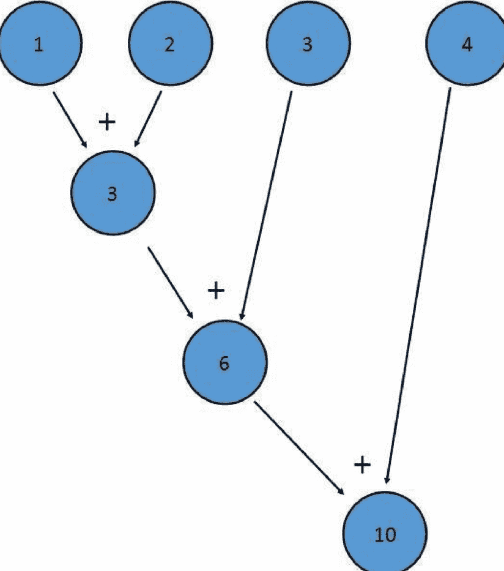

等价于 `(((1+2)+3)+4)`

`Stream` 的 `reduce` 方法允许创建自定义规约。可以使用 `reduce` 方法来实现 `sum()` 方法：

```java
// 初始化 istr
OptionalInt istr = istr.reduce((a, b) -> a + b);
```

返回 `Optional` 版本是为了能够适当处理空流。

规约的另一个示例是将 `Stream<List<T>>` 合并为一个 `List`：

```java
Stream<List<T>> listStream; // 创建一个 Stream<List<T>>

Optional<List<T>> bigList = listStream.reduce((List<T> list1, List<T> list2) -> {
    List<T> retList = new ArrayList<>();
    retList.addAll(list1);
    retList.addAll(list2);
    return retList;
});
```

你还可以提供一个单位元。例如，加法的单位元是 0，因为 `x+0==x`。乘法的单位元是 1，因为 `x*1==x`。在上面的例子中，单位元是一个空列表，因为将其添加到另一个列表时它不会发生变化。注意，当提供单位元时，返回值不会被封装在 `Optional` 中——如果在空流上调用，`reduce()` 将返回单位元。二元运算符还必须是*结合律*的，这意味着 `(a+b)+c==a+b+c`。这是因为元素可以以任何顺序进行规约。例如，上面的规约可以这样执行：

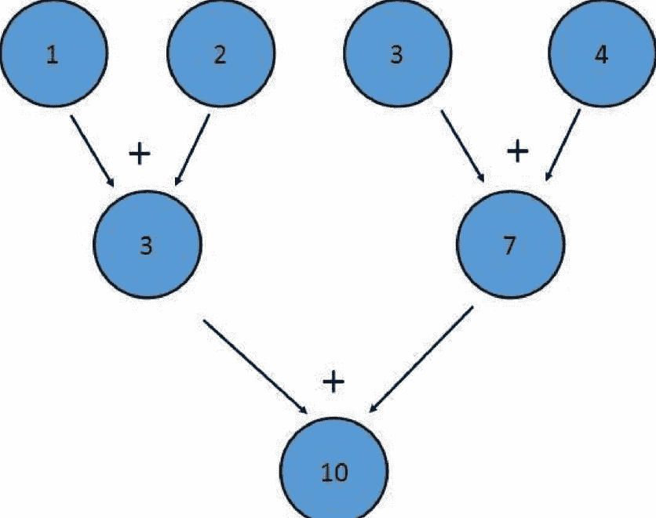

## 第 57.15 节：使用 Map.Entry 的流来保留初始值

当你有一个需要映射的流，但又想保留初始值时，可以使用如下工具方法将流映射到 `Map.Entry<K,V>`：

```java
public static <K, V> Function<K, Map.Entry<K, V>> entryMapper(Function<K, V> mapper) {
    return k -> new AbstractMap.SimpleEntry<>(k...
}
```

然后你就可以使用你的转换器来处理流，同时访问原始值和映射后的值：

```java
Set<K> mySet;
Function<K, V> transformer = SomeClass::transformer;
Stream<Map.Entry<K, V>> entryStream = mySet.stream().map(entryMapper(transformer));
```

这样就可以同时访问原始值和映射后的值了。

在通过重复串联构建流时要小心，因为访问深度串联的流的元素可能会导致深层调用链，甚至导致 `StackOverflowException`（栈溢出异常）。

## 第 57.16 节：将字符流转换为字符串

Java 并没有 `Char` 流，但在处理字符串并构建字符流时，一种方法是获取 `IntStream`。这样可以得到：

```java
public IntStream intStream(String in) {
    return in.codePoints();
}
```

以另一种方式转换稍微复杂一些：

```java
public String intToString(IntStream intStream) {
    return intStream.collect(StringBuilder::new, StringBuilder::append, StringBuilder::append).toString();
}
```

## 第 57.17 节：查找匹配谓词的第一个元素

可以在流中找到符合条件的第一个元素。例如，我们将找到平方大于 50000 的整数。

```java
IntStream.iterate(1, i -> i + 1) // 生成无限流 1,2,3,4...
    .filter(i -> i * i > 50000) // 过滤平方大于 50000 的元素
    .findFirst(); // 找到第一个
```

该表达式将返回结果。对于无限流，Java 将持续检查每个元素直到找到结果。对于有限流，如果 Java 耗尽了元素仍未找到结果，它将返回一个 `Optional`。

## 第 57.18 节：使用流和方法引用编写自文档代码

方法引用是极佳的自文档代码，而且在流中使用方法引用可以使复杂的过程变得简单易读。考虑以下代码：

```java
public interface Ordered {
    default int getOrder() { return 0; }
}

public interface Valued<V extends Ordered> {
    boolean hasPropertyTwo();
    V getValue();
}

public interface Thing<V extends Ordered> {
    boolean hasPropertyOne();
    Valued<V> getValuedProperty();
}
```

```java
public <V extends Ordered> List<V> myMethod(List<Thing<V>> things) {
    List<V> results = new ArrayList<V>();
    for (Thing<V> thing : things) {
        if (thing.hasPropertyOne()) {
            Valued<V> valued = thing.getValuedProperty();
            if (valued != null && valued.hasPropertyTwo()) {
                V value = valued.getValue();
                if (value != null) {
                    results.add(value);
                }
            }
        }
    }
    results.sort((a, b) -> {
        return Integer.compare(a.getOrder(), b.getOrder());
    });
    return results;
}
```

使用流和方法引用重写的最后一种方法更具可读性，过程的每个步骤都快速且易于理解——它不仅更短，而且一眼就能看出接口和类对每个步骤中的代码负责什么。

## 第 57.19 节：将 Optional 流转换为值流

你可能需要将一个产生 `Optional` 的流转换为值的流，只发射来自现有 `Optional` 的值（即：不包含空值且不处理 `Optional.empty`）。

```java
Optional<String> op1 = Optional.of("Hello World");
Optional<String> op2 = Optional.of("Hello World");

List<String> result = Stream.of(op1, op2)
    .filter(Optional::isPresent)
    .map(Optional::get)
    .collect(Collectors.toList());
```


System.out.println(result); // [Hello World]

## 57.20：获取 Stream 的切片

示例：获取包含 30 个元素的 Stream，包含集合中第 21 到第 50 个（包含边界）元素。

```java
final long n = 20L; // 要跳过的元素数量
final long maxSize = 30L; // Stream 限制的元素数量
final Stream<T> slice = collection.stream().skip(n).limit(maxSize);
```

节点：

- 如果 `n` 为负数或 `maxSize` 为负数，将抛出 `IllegalArgumentException`
- `skip(long)` 和 `limit(long)` 都是中间操作
- 如果 stream 包含的元素少于 `n`，则 `skip(n)` 返回一个空流
- 对于顺序流流水线，`skip(long)` 和 `limit(long)` 是廉价的操作，但在有序的并行流水线中可能非常昂贵

## 57.21：基于 Stream 创建 Map

### 无重复键的简单情况

```java
Stream<String> characters = Stream.of("A", "B", "C");

Map<Integer, String> map = characters
    .collect(Collectors.toMap(element -> element.hashCode(), element -> element));
// map = {65=A, 66=B, 67=C}
```

为了使代码更具声明性，我们可以使用 `Function` 接口中的静态方法 `Function.identity()`。我们可以用 `Function.identity()` 替换这个 lambda 表达式 `element -> element`。

### 可能存在重复键的情况

`Collectors.toMap` 的 javadoc 说明了：

> 如果映射后的键包含重复项（根据 `Object.equals(Object)`），在执行集合操作时将抛出 `IllegalStateException`。
> 映射后的键可能会重复，因此请使用 `toMap(Function, Function, BinaryOperator)` 替代。

```java
Stream<String> characters = Stream.of("A", "B", "B", "C");

Map<Integer, String> map = characters
    .collect(Collectors.toMap(
        element -> element.hashCode(),
        element -> element,
        (existingVal, newVal) -> (existingVal + newVal)
    ));
// map = {65=A, 66=B, 67=C}
```

传递给 `Collectors.toMap(...)` 的 `BinaryOperator` 生成在发生冲突时要存储的值。它可以：

- 返回该值，使得流中的第一个值具有优先
- 返回新值，使得流中的最后一个值具有优先
- 合并旧值和新值

### 按值分组

当你需要执行等于数据库级联“分组”操作时，可以使用 `Collectors.groupingBy`。为了说明，以下代码创建了一个 map，其中姓名映射到姓氏：

```java
List<Person> people = Arrays.asList(
    new Person("Sam", "Rossi"),
    new Person("Sam", "Verdi"),
    new Person("John", "Bianchi"),
    new Person("John", "Rossi"),
    new Person("John", "Verdi")
);

Map<String, List<String>> map = people.stream()
    .collect(
        // 将输入元素映射到键的函数
        Collectors.groupingBy(Person::getName,
            // 将输入元素映射到值的函数，如何存储值
            Collectors.mapping(Person::getSurname, Collectors.toList())
        )
    );
// map = {John=[Bianchi, Rossi, Verdi], Sam=[Rossi, Verdi]}
```

## 57.22：将 Stream 合并为单个 String

一个经常遇到的用例是从 stream 创建字符串，其中流中的项由特定字符分隔。`Collectors.joining()` 方法可以此用，如下例所示：

```java
Stream<String> fruitStream = Stream.of("apple", "banana", "pear", "kiwi", "orange");
```

```java
String result = fruitStream.filter(s -> s.contains("a")).collect(Collectors.joining(", "));
System.out.println(result);
// Output: apple, banana, pear, orange
```

`Collectors.joining()` 方法还可以处理前缀和后缀：

```java
fruitStream = Stream.of("apple", "banana", "pear", "kiwi", "orange"); // 重新创建流，因为流只能消费一次
String result = fruitStream.filter(s -> s.contains("e")).collect(Collectors.joining(", ", "Fruits: ", "."));
System.out.println(result);
// Output: Fruits: apple, orange, pear.
```

## 57.23：使用 sorted() 进行排序

```java
List<String> data = new ArrayList<>();
data.add("Sydney");
data.add("London");
data.add("New York");
data.add("Amsterdam");
data.add("Mumbai");
data.add("California");
```

```java
System.out.println(data);
List<String> sortedData = data.stream().sorted().collect(Collectors.toList());
System.out.println(sortedData);
```

输出：
```
[Sydney, London, New York, Amsterdam, Mumbai, California]
[Amsterdam, California, London, Mumbai, New York, Sydney]
```

也可以使用不同的比较机制，因为有一个重载的 `sorted` 版本接受一个 `Comparator` 作为参数。你也可以使用 lambda 表达式进行排序：

```java
List<String> sortedData2 = data.stream().sorted((s1, s2) -> s1.compareTo(s2)).collect(Collectors.toList());
```

输出：
```
[Sydney, London, New York, Amsterdam, Mumbai, California]
[Amsterdam, California, London, Mumbai, New York, Sydney]
```

## 57.24：原始类型流

Java 为原始类型提供了专门的流：`IntStream` (ints), `LongStream` (longs) 以及 `DoubleStream` (doubles)。除了针对各自类型进行了优化外，它们还提供了特定的方法，例如：

```java
double average = IntStream.of(10, 20, 30).average().orElse(0.0);
```

## 57.25：Stream 操作

Stream 操作分为两个大类：中间操作 和终端操作，以及两个子类：无状态 和有状态。

### 中间操作

中间操作总是惰性的，例如 `Stream.map`。它们在流被实际消费时才被调用。这可以很容易地验证：

```java
Arrays.asList(1, 2, 3).stream().map(i -> { throw new RuntimeException("not happen"); return i; });
```

### 终端操作


终端操作是触发流的。更常见的有 `Stream.forEach` 或 `Stream.collect`。

# 无状态操作

无状态性意味着每个元素的处理不需要其他元素的信息。像 `Stream.map` 和 `Stream.filter` 这样的操作被认为是无状态的。

# 有状态操作

有状态意味着对元素的操作取决于（某些）其他元素。这需要保留状态。有状态操作可能会导致无限流崩溃。可以通过长流来演示（风险自负）：

```java
// 正常 - 无状态流
long BIG_ENOUGH_NUMBER = 99999;
IntStream.iterate(0, i -> i + 1).limit(BIG_ENOUGH_NUMBER).forEach(System.out::println);
```

由于 `Stream.sorted` 的有状态会导致内存溢出：

```java
// 内存溢出 - 有状态流
long BIG_ENOUGH_NUMBER = 999999;
IntStream.iterate(0, i -> i + 1).limit(BIG_ENOUGH_NUMBER).sorted().forEach(System.out::println);
```

## 57.26：将 Stream 的结果收集到数组中

类似于通过 `collect()` 获取 `Stream` 的集合，数组可以通过 `Stream.toArray()` 方法获取：

```java
List<String> fruits = Arrays.asList("apple", "banana", "pear", "kiwi", "orange");

String[] filteredFruits = fruits.stream()
    .filter(s -> s.contains("a"))
    .toArray(String[]::new);
```

> // 打印 [apple, banana, pear, orange]

```java
System.out.println(Arrays.toString(filteredFruits));
```

`String[]::new` 是一种特殊的方法引用：构造函数引用。

## 57.27：使用 Stream 生成随机字符串

有时需要创建字符串，例如网络服务的会话 ID 或应用程序注册后的初始密码。可以使用 `Stream` 轻松实现。

首先需要初始化随机数生成器。为了增强生成的字符串的安全性，使用 `SecureRandom` 是一个好主意。注意：创建 `SecureRandom` 非常昂贵，因此最佳实践只执行一次。

```java
private static final SecureRandom rng = new SecureRandom(SecureRandom.generateSeed(20)); // 20 字节作为种子是任意的，它是 JavaDoc 示例中使用的数字
```

字符（例如仅限字母和数字）。因此，我们可以创建一个返回布尔值的方法，该方法以后可以用于过滤 `Stream`。

```java
// 对于 0-9, a-z 和 A-Z 中的所有字符返回 true
boolean useThisCharacter(char c) {
    // 检查范围以避免使用 Unicode 字母（例如某些中文符号）
    return c >= '0' && c <= 'z' && Character.isLetterOrDigit(c);
}
```

接下来，我们可以使用 RNG 生成一个特定长度的随机字符串，该字符串包含我们用于 `useThisCharacter` 检查的字符集。

```java
public String generateRandomString(long length) {
    // 由于没有原生的 CharStream，我们使用 IntStream 代替
    // 并使用 mapToObj 将其转换为 Stream<Character>。
    // 我们需要指定 int 值的边界以确保它们可以安全地转换为 char
    Stream<Character> randomCharStream = rng.ints(Character.MIN_CODE_POINT,
            Character.MAX_CODE_POINT)
        .mapToObj(i -> (char) i)
        .filter(this::useThisCharacter)
        .limit(length);
    // 现在我们可以使用此 Stream 利用 collect 方法来构建字符串。
    String randomString = randomCharStream.collect(StringBuilder::new,
            StringBuilder::append, StringBuilder::append).toString();
    return randomString;
}
```

# 第 58 章：输入流 (InputStreams) 和输出流 (OutputStreams)

## 第 58.1 节：关闭流

在使用完成后必须关闭大多数流，否则可能会导致内存泄漏或保持文件打开。即使抛出异常，关闭流也是重要的。

版本 ≥ Java 7

```java
try (FileWriter fw = new FileWriter("filename");
     BufferedWriter bw = new BufferedWriter(fw);
     PrintWriter out = new PrintWriter(bw)) {
    out.println("the text"); // 更多代码
    out.println("more text"); // 更多代码
} catch (IOException e) {
    // 以你认为合适的方式处理此异常
}
```

记住：`try-with-resources` 保证在块退出时资源已经关闭，无论是通过正常的控制流还是由于异常。

版本 ≤ Java SE 6

有时，`try-with-resources` 并不是选项，或者你可能支持旧的 Java 6 或早期版本。在这种情况下，适当的处理方法是使用 `finally`：

```java
FileWriter fw = null;
BufferedWriter bw = null;
PrintWriter out = null;

try {
    fw = new FileWriter("myfile.txt");
    bw = new BufferedWriter(fw);
    out = new PrintWriter(bw);
    out.println("the text");
    out.close();
} catch (IOException e) {
    // 按你想要的方式处理此异常
} finally {
    try {
        if (out != null) {
            out.close();
        }
    } catch (IOException e) {
        // 通常在这里做不了什么...
    }
}
```

注意，关闭包装流也会关闭其底层流。这意味着你不能包装一个流，关闭包装器，然后继续使用原始流。

## 第 58.2 节：将 InputStream 读取到字符串

有时你可能希望将字节输入读入字符串。要做到这一点，你需要找到一个能够在字节和 `native Java` UTF-16 码点之间进行转换的工具。这是通过 `InputStreamReader` 完成的。为了加快处理速度，“通常”会分配一个缓冲区，这样当我们从 `InputStream` 读取时就不会有太大的开销。

版本 ≥ Java SE 7

```java
public String inputStreamToString(InputStream inputStream) throws Exception {
    StringWriter writer = new StringWriter();
    char[] buffer = new char[1024];
    try (Reader reader = new BufferedReader(new InputStreamReader(inputStream, "UTF-8"))) {
        int n;
        while ((n = reader.read(buffer)) != -1) {
            // 所有这些代码将 `reader` 的输出重定向到 `writer`，每 1024 字节块
            writer.write(buffer, 0, n);
        }
    }
    return writer.toString();
}
```

将此示例转换为 Java SE 6（及更低版本）的代码作为读者的练习题。

## 第 58.3 节：包装输入/输出流

`OutputStream` 和 `InputStream` 有许多不同的类，每个类都有独特的功能。通过在另一个流周围包装流，你可以获得两个流的功能。

你可以包装流任意次数，只需注意顺序。

### 有用的组合

- 使用缓冲区向文件写入字符

```java
File myFile = new File("targetFile.txt");
PrintWriter writer = new PrintWriter(new BufferedOutputStream(new FileOutputStream(myFile)));
```

- 在使用缓冲区的同时向文件写入以压缩和加密数据

```java
Cipher cipher = ... // 初始化密码
File myFile = new File("targetFile.enc");
BufferedOutputStream outputStream = new BufferedOutputStream(
    new DeflaterOutputStream(new CipherOutputStream(new FileOutputStream(myFile), cipher)));
```

| 输入/输出流包装器列表 | 描述 |
| :--- | :--- |
| `BufferedOutputStream` / `BufferedInputStream` | 虽然 `OutputStream` 每次写入一个字节数据，但 `BufferedOutputStream` 分块写入数据。这减少了系统调用，从而提高了性能。 |
| `DeflaterOutputStream` / `DeflaterInputStream` | 执行压缩。 |
| `InflaterOutputStream` / `InflaterInputStream` | 执行解压缩。 |
| `CipherOutputStream` / `CipherInputStream` | 加密/解密数据。 |
| `DigestOutputStream` / `DigestInputStream` | 验证完整性。 |
| `CheckedOutputStream` / `Checksum` | 生成校验和。 |
| `DataOutputStream` / `OutputStreamWriter` | 生成 writer。 |
| `PrintStream` | 允许写入字符。 |

## 第 58.4 节：包装输入流

## 第 58.5 节：向 OutputStream 写入字节

```java
File someFile = new File("demo.txt");
int count = 0;
try (FileOutputStream out = new FileOutputStream(someFile);
     BufferedOutputStream bos = new BufferedOutputStream(out)) {
    // 写入操作...
}
```

## 第 58.6 节：将输入流拷贝到输出流

此函数在两个流之间拷贝数据：

```java
void copy(InputStream in, OutputStream out) throws IOException {
    byte[] buffer = new byte[8192];
    int bytesRead;
    while ((bytesRead = in.read(buffer)) > 0) {
        out.write(buffer, 0, bytesRead);
    }
}
```

示例：

```java
// 从 System.in 读取并写入 System.out
copy(System.in, System.out);
```

# 第 59 章：读取器和写入器 (Readers and Writers)

## 第 59.1 节：BufferedReader

### 引言

`BufferedReader` 类是其他 `Reader` 类的包装，有两个主要目的：

1. `BufferedReader` 为包装的 `Reader` 提供缓冲。这允许应用程序一次读取一个字符而产生产生开销。
2. `BufferedReader` 提供了按行读取文本的功能。

### 使用 BufferedReader 的基础

使用 `BufferedReader` 的标准模式如下。首先，获取你想读取字符的 `Reader`。接下来实例化包装该 `Reader` 的 `BufferedReader`。然后读取字符数据。最后关闭 `BufferedReader`，这将关闭包装的 `Reader`。例如：

```java
File someFile = new File("demo.txt");
int aCount = 0;

try (FileReader fr = new FileReader(someFile);
     BufferedReader br = new BufferedReader(fr)) {
    // 统计 'a' 字符的数量。
    int ch;
    while ((ch = br.read()) != -1) {
        if (ch == 'a') {
            aCount++;
        }
    }
    System.out.println("There are " + aCount + " 'a' characters in " + someFile);
}
```

你可以将此模式应用于任何 `Reader`。

注意：

1. 我们使用了 Java 7（或更高版本）的 `try-with-resources` 来确保底层读取器始终关闭。这避免了潜在的资源泄漏。在 Java 的早期版本中，你会在 `finally` 块中显式关闭 `BufferedReader`。
2. `try` 块内部的代码与直接从 `FileReader` 读取的代码几乎相同。事实上，`BufferedReader` 的功能与它所包装的 `Reader` 完全一样。区别在于这个版本高效得多。

### BufferedReader 的大小

### `BufferedReader.readLine()` 方法示例：将文件中的所有行读入 List

这是通过获取文件的每一行并将其添加到 `List<String>` 中来实现的。然后返回该列表：

```java
public List<String> getAllLines(String filename) throws IOException {
    List<String> lines = new ArrayList<>();
    try (BufferedReader br = new BufferedReader(new FileReader(filename))) {
        String line = null;
        while ((line = br.readLine()) != null) {
            lines.add(line);
        }
        return lines;
    }
}
```

Java 8 提供了一种更简洁的方法，使用 `lines()` 方法：

```java
public List<String> getAllLines(String filename) throws IOException {
    try (BufferedReader br = new BufferedReader(new FileReader(filename))) {
        return br.lines().collect(Collectors.toList());
    }
}
```

## 第 59.2 节：StringWriter 示例

Java `StringWriter` 是一种字符流，用于收集来自字符串缓冲区的输出，可以用于构建字符串。`StringWriter` 类继承了 `Writer` 类。在 `StringWriter` 类中，不使用网络套接字和文件等系统资源，因此没有必要关闭 `StringWriter`。

```java
import java.io.*;

public class StringWriterDemo {
    public static void main(String[] args) throws IOException {
        char[] ary = new char[1024];
        StringWriter writer = new StringWriter();
        FileInputStream input = null;
        BufferedReader buffer = null;

        input = new FileInputStream("c:/stringwriter.txt");
        buffer = new BufferedReader(new InputStreamReader(input, "UTF-8"));

        int x;
        while ((x = buffer.read(ary)) != -1) {
            writer.write(ary, 0, x);
        }

        System.out.println(writer.toString());
        writer.close();
        buffer.close();
    }
}
```


上面的示例帮助我们了解如何使用 `BufferedReader` 从流中读取文件数据到 `StringWriter` 的简单示例。

# 第 60 章：Preferences（节点）

## 第 60.1 节：使用 Preferences

Preferences 可用于存储反映用户个人应用程序设置设置，例如编辑器字体、是否倾向于以全屏模式启动应用程序、是否勾选了“不再显示此内容”复选框等。

```java
public class ExitConfirmer {

  private static boolean confirmExit() {

    Preferences preferences =
    Preferences.userForPackage(ExitConfirmer.class);

    boolean doShowDialog = preferences.getBoolean("showExitConfirmation", true);

    // true 是默认值

    if (!doShowDialog) {
      return true;
    }

    // ...

    // 在此显示对话框...

    boolean exitWasConfirmed = ...; // 用户是否点击了确定或取消
    boolean doNotShowAgain = ...; // 从“不再显示”复选框获取值

    if (exitWasConfirmed && doNotShowAgain) {
      // 已确认退出，且选择了对话框的用户不应
      // 再次 // 将这些设置保存到 Preferences 对象中，这样下次就不会
      // 再次显示了
      preferences.putBoolean("showExitConfirmation", false);
    }

    return exitWasConfirmed;
  }

  public static void exit() { 
    if (confirmExit()) { 
      System.exit(0); 
    } 
  }
}
```

## 第 60.2 节：添加事件监听器

Preferences 对象发出两种类型的事件：`PreferenceChangeEvent` 和 `NodeChangeEvent`。

### PreferenceChangeEvent

每当节点的键值对发生变化时，Properties 对象就会发出一个 `PreferenceChangeEvent`。可以通过 `PreferenceChangeListener` 对 `PreferenceChangeEvents` 进行列出（监听）：

版本 >= Java SE 8

```java
preferences.addPreferenceChangeListener(evt -> {
    String newValue = evt.getNewValue();
    String changedPreferenceKey = evt.getKey();
    Preferences changedNode = evt.getNode();
});
```

版本 < Java SE 8

```java
preferences.addPreferenceChangeListener(new PreferenceChangeListener() {
    @Override
    public void preferenceChange(PreferenceChangeEvent evt) {
        String newValue = evt.getNewValue();
        String changedPreferenceKey = evt.getKey();
        Preferences changedNode = evt.getNode();
    }
});
```

此监听器不会监听子节点中发生变化的键值对。

### NodeChangeEvent

每当 Properties 的子节点被添加或删除时，就会触发此事件。

```java
preferences.addNodeChangeListener(new NodeChangeListener() {
    @Override
    public void childAdded(NodeChangeEvent evt) {
        Preferences addedChild = evt.getChild();
        Preferences parentOfChild = evt.getParent();
    }

    @Override
    public void childRemoved(NodeChangeEvent evt) {
        Preferences removedChild = evt.getChild();
        Preferences parentOfRemovedChild = evt.getParent();
    }
});
```

## 第 60.3 节：获取 Preferences 的子节点

Preferences 对象始终代表整个 Preferences 树中的特定节点，如下所示：

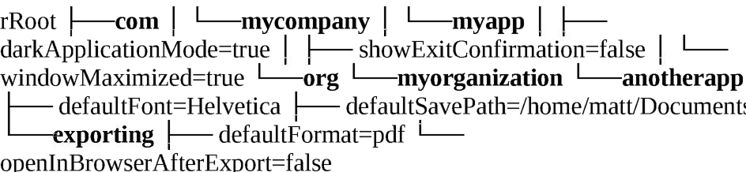

要选择 `/com/mycompany/myapp` 节点：

1. 根据类的包，按照惯例：
```java
package com.mycompany.myapp;

// ...

// 因为这个类位于 com.mycompany.myapp 包中，将返回
// com/mycompany/myapp 节点
PreferencesApp = Preferences.userForPackage(getClass());
```

2. 通过相对路径：
```java
PreferencesApp = Preferences.userNode().node("com/mycompany/myapp");
```

3. 通过绝对路径：
```java
PreferencesApp = Preferences.system().node("/com/mycompany/myapp");
```

## 第 60.4 节：跨实例协调 preferences 访问

所有 Preferences 实例在单个虚拟机（JVM）线程之间始终是线程安全的。由于 Preferences 可以跨 JVM 共享，如果你的应用程序旨在运行单个实例，则不需要外部同步。

如果你有一个在系统中运行多个实例的应用程序，并且需要在 JVM 之间协调 Preferences 访问，可以使用任何 Preferences 节点的 `sync()` 方法来确保更改对其他 JVM 可见：

```java
// 注意：如果你的应用程序旨在
// 只运行单个实例（桌面应用程序通常如此）
try {
    preferences.sync();
} catch (BackingStoreException e) {
    // 处理保存到备份存储时的任何错误
    e.printStackTrace();
}
```

## 第 60.5 节：导出 preferences

Preferences 节点可以为代表该节点的 XML 文档。生成的 XML 树可以再次导入。生成的 XML 文档将记住它是从用户还是系统 Preferences 导出的。

导出单个节点，**但不包括**其子节点：

版本 >= Java 7

```java
try (OutputStream os = ...) {
    preferences.exportNode(os);
} catch (IOException ioe) {
    // 写入到 OutputStream 异常
    ioe.printStackTrace();
} catch (BackingStoreException bse) {
    // 从备份存储读取时的异常
    bse.printStackTrace();
}
```

版本 < Java SE 8

```java
OutputStream os = null;
try {
    os = ...;
    preferences.exportSubtree(os);
} catch (IOException ioe) {
    // 写入到 OutputStream 异常
    ioe.printStackTrace();
} catch (BackingStoreException bse) {
    // 从备份存储读取时的异常
    bse.printStackTrace();
} finally {
    if (os != null) {
        try {
            os.close();
        } catch (IOException ignored) {
        }
    }
}
```

```java
OutputStream os = null;
try {
    os = ...;
    preferences.exportSubtree(os);
} catch (IOException ioe) {
    // 向 OutputStream 写入数据时发生异常。
    ioe.printStackTrace();
} catch (BackingStoreException bse) {
    // 从底层偏好存储器读取时发生异常
    bse.printStackTrace();
} finally {
    if (os != null) {
        try {
            os.close();
        } catch (IOException ignored) {}
    }
}
```

## 第 60.6 节：导入偏好设置

Preferences 节点可以从 XML 文档导入。导入功能旨在与 Preferences 的导出功能配合使用，因为它会创建相应的对应的 XML 文档。

XML 文档会记录它们是从用户还是系统 Preferences 导出的。因此，你可以将它们导入到各自的 Preferences 树中，而无需弄清楚或知道它们的来源。该静态函数会自动识别 XML 文档是从用户还是系统 Preferences 导出的，并自动将其导入到它们导出的树中。

Java SE 7 版本 2

```java
try (InputStream is = ...) {
    // 这是对 Preferences 类的静态调用
    Preferences.importPreferences(is);
} catch (IOException ioe) {
    // 从 InputStream 读取数据时发生异常。
    ioe.printStackTrace();
} catch (InvalidPreferencesFormatException ipfe) {
    // 解析 XML 文档树时发生异常
    ipfe.stackTrace();
}
```

```java
Version < Java SE 7

InputStream is = null;
try {
    is = ...;
    // 这是对 Preferences 类的静态调用
    Preferences.importPreferences(is);
} catch (IOException ioe) {
    // 从 InputStream 读取数据时发生异常。
    ioe.printStackTrace();
} catch (InvalidPreferencesFormatException ipfe) {
    // 解析 XML 文档树时发生异常
    ipfe.stackTrace();
} finally {
    if (is != null) {
        try {
            is.close();
        } catch (IOException ignored) {
        }
    }
}
```

## 第 60.7 节：移除事件监听器

事件监听器可以再次从任何 Properties 节点中移除，但必须保留监听器的实例。

```java
Version ≥ Java SE 8

Preferences preferences = Preferences.userNodeForPackage(getClass());

PreferenceChangeListener listener = evt -> {
    System.out.println(evt.getKey() + " + got new value " + evt.getNewValue());
};

preferences.addPreferenceChangeListener(listener);

//

// 之后...

//

preferences.removePreferenceChangeListener(listener);
```

```java
Version < Java SE 8

Preferences preferences = Preferences.userNodeForPackage(getClass());

PreferenceChangeListener listener = new PreferenceChangeListener() {
  @Override
  public void preferenceChange(PreferenceChangeEvent evt) {
    System.out.println(evt.getKey() + " got new value " + evt.getNewValue());
  }
};

preferences.addPreferenceChangeListener(listener);

//

// 之后... //

preferences.removePreferenceChangeListener(listener);
```

相同的情况也适用于 `NodeChangeListener`。

## 第 60.8 节：获取偏好设置值

Preferences 节点的值可以是 String、boolean、byte[]、double、float、int 或 long。所有调用必须提供一个默认值，以防指定的值不在 Preferences 节点中。

```java
Preferences preferences = Preferences.userNodeForPackage(getClass());

String someString = preferences.get("someKey", "this is the default value");
boolean someBoolean = preferences.getBoolean("someKey", true);
byte[] someByteArray = preferences.getByteArray("someKey", new byte[0]);
double someDouble = preferences.getDouble("someKey", 887284.4d);
float someFloat = preferences.getFloat("someKey", 38723.3f);
int someInt = preferences.getInt("someKey", 132322);
long someLong = preferences.getLong("someKey", 282736786234L);
```

## 第 60.9 节：设置偏好设置值

要将值存储到 Preferences 节点中，可以使用 `putXXX()` 方法之一。Preferences 节点的值可以是 String、boolean、byte[]、double、float、int 或 long。

```java
Preferences preferences = Preferences.userNodeForPackage(getClass());

preferences.put("someKey", "this is the default value");
preferences.putBoolean("someKey", false);
preferences.putByteArray("someKey", new byte[0]);
preferences.putDouble("someKey", 887284.4d);
preferences.putFloat("someKey", 38723.3f);
preferences.putInt("someKey", 132322);
preferences.putLong("someKey", 282736786234L);
```

```java
for(String word: words) {
    multiMap.put(word, i++);
}

// 输出所有单词
System.out.println(multiMap); // 输出 {Hi=[4], Hello=[0, 2], World!=[1, 5], All!=[3]} - 随机顺序

// 输出所有唯一单词
System.out.println(multiMap.keySet()); // 输出 [4] Hi, Hello, World!, All!) - 随机顺序

// 输出所有索引
```


System.out.println("Hello = " + multiMap.get("Hello")); // 输出 [0, 2]

System.out.println("World = " + multiMap.get("World")); // 输出 [1, 5]

System.out.println("All = " + multiMap.get("All")); // 输出 [3]

System.out.println("Hi = " + multiMap.get("Hi")); // 输出 [4]

System.out.println("Empty = " + multiMap.get("Empty")); // 输出 null

// 创建唯一单词

System.out.println(multiMap.keySet()); // 输出 4

// 2. 来自 GS / Eclipse Collection 的 HashMap

String[] englishWords = {"one", "two", "three", "ball", "snow"};

String[] russianWords = {"jeden", "dwa", "trzy", "kula", "snieg"};

// 创建 Multiset

MutableMap<String, String> biMap = new HashMap(englishWords.length); // 创建英语-英语字典

int i = 0;

for (String englishWord : englishWords) {

    biMap.put(englishWord, russianWords[i]);

    i++;

}

// 输出计数单词

System.out.println(biMap); // 输出 {two=dwa, ball=kula, one=jeden, snow=snieg, three=trzy}; - 随机顺序

// 输出所有唯一单词

System.out.println(biMap.keySet());

System.out.println(biMap.values()); // 顺序 [snow

// 输出所有索引

System.out.println("Hello = " + multiMap.get("Hello"));

System.out.println("Empty = " + multiMap.get("Empty")); // 输出

// 输出所有单词计数

System.out.println(multiMap.size()); // 输出 6

// 输出唯一单词计数

System.out.println(multiMap.keySet().size()); // 输出 4

```

### 注意示例

- I. Apache Collection:
  1. MultiValueMap
  2. MultiValueMapLinked
  3. MultiValueMapTree

- II. GS / Eclipse Collection
  1. FastListMultimap
  2. HashBagMultimap
  3. TreeSortedSetMultimap
  4. UnifiedSetMultimap

- III. Guava
  1. HashMultimap
  2. LinkedHashMultimap
  3. LinkedListMultimap
  4. TreeMultimap
  5. ArrayListMultimap

### 第 62.2 ：Apache HashBag, Guava HashMultiset 和 Eclipse HashBag

Bag/iset 存储集合中的每个对象及其出现的次数。接口上的额外方法允许同时添加或删除对象的多个副本。JDK 对应的类是 `HashMap<T, Integer>`，其中值是该键的副本计数数量。

| 类型 | Guava | Apache Commons Collections | GS Collections | JDK |
| :--- | :--- | :--- | :--- | :--- |
| 不按 Hash 排序 | HashMultiset | | | |
| 排序 | TreeMultiset | | | |
| 插入顺序 | LinkedHashMultiset | HashBag | HashBag | HashMap |
| | | TreeBag | TreeBag | TreeMap |
| | | | LinkedHashMap 并发变体 |
| | | | 并发无序不可变集合 | |
| | | | 不变且排序 | |
| 并发Multiset | SynchronizedBagCollections.synchronizedMap(HashMap<String, Integer>) | | | |
| 同步排序 Bag | SynchronizedSortedBagCollections.synchronizedSortedMap(TreeMap<String, Integer>) | | | |
| 不可修改不可变 Bag | UnmodifiableBagCollections.unmodifiableMap(HashMap<String, Integer>) | | | |
| 不变排序 Multiset | UnmodifiableSortedBag UnmodifiableSortedBagCollections.unmodifiableSortedMap(TreeMap<String, Integer>); | | | |

### 示例

#### 1. 使用 Apache 的 SynchronizedSortedBag

```java
// 解析文本以分离单词
String INPUT_TEXT = "Hello World! Hello All! Hi World!";

// 创建 Multiset
Bag bag = SynchronizedSortedBag.synchronizedBag(new TreeBag(Arrays.asList(INPUT_TEXT.split(" "))));

// 输出计数单词
System.out.println(bag); // 输出 [1:All!, 2:Hello, 1:Hi, 2:World!] 自然顺序（字母顺序）

// 输出所有唯一单词
System.out.println(bag.uniqueSet()); // 输出 [All!, Hello, World!] 自然顺序（字母顺序）
```

```java
// 输出单词出现次数计数
// 输出所有单词计数
System.out.println(bag.size()); // 输出 6
// 输出唯一单词计数
System.out.println(bag.uniqueSet().size()); // 输出 4
```

#### 2. 使用 Eclipse 的 TreeBag

```java
// 解析文本以分离单词
String INPUT_TEXT = "Hello World! Hello All! Hi World!";

// 创建 Multiset
Bag<String> bag = TreeBag.newBag(Arrays.asList(INPUT_TEXT.split(" ")));

// 输出计数单词
System.out.println(bag); // 输出 [1:All!, 2:Hello, 1:Hi, 2:World!] 自然顺序（字母顺序）

// 输出所有唯一单词
System.out.println(bag.uniqueSet()); // 输出 [All!, Hello, World!] 自然顺序（字母顺序）
```

```java
// 输出单词出现次数计数
// 输出所有单词计数
System.out.println(bag.size()); // 输出 6
// 输出
单词计数
System.out.println(bag = = =. // = 2
System.out.println(bag.size()); // 输出 1  , // 2
 2 // 输出 4
```

#### 3. 使用 Guava 的 LinkedHashiset

```java
// 解析文本以分离单词
String INPUT_TEXT = "Hello World! Hello All! Hi World!";

// 创建 Multiset
Multiset<String> multiset = LinkedHashiset.create(Arrays.asList(INPUT_TEXT.split(" ")));

// 输出计数单词
System.out.println(multiset); // 输出 [2:Hello, 1:All!, 1:Hi, 2:World!] 可预测顺序

// 输出所有唯一单词
System.out.println(multiset.uniqueSet()); // 输出 [Hello, All!, Hi, World!] 可预测顺序
```

```java
// 输出单词出现次数计数
System.out.println("Hello = " + multiset.get("Hello")); // 输出 2
System.out.println("World = " + multiset.get("World")); // 输出 2
// 输出所有单词计数
System.out.println(multiset.size()); // 输出 6
// 输出唯一单词计数
System.out.println(multiset.uniqueSet().size()); // 输出 4
```

### 更多示例

- I. Apache Collection:
  1. HashBag
  2. SynchronizedBag
  3. SynchronizedSortedBag
  4. TreeBag
- II. GS / Eclipse Collection
  5. MutableBag
  6. MutableSortedBag
- III. Guava
  7. HashMultiset
  8. LinkedHashMultiset
  9. TreeMultiset
  10. ConcurrentMultiset

## 第 62.3: 集合的操作 - 创建集合

### 集合的操作 - 创建集合

#### 1. 创建列表

| 描述 | JDK | GS Collections | Guava |
| :--- | :--- | :--- | :--- |
| 空列表 | `new ArrayList<>()` | `FastList.newList()` | `Lists.newArrayList()` |
| 来自 "3" | `Arrays.asList("1", "2", "3")` | `FastList.newList("1", "2", "3")` | `Lists.newArrayList("1", "2", "3")` |
| 容量 100 | `new ArrayList<>(100)` | `FastList.newList(100)` | `Lists.newArrayListWithCapacity(100)` |
| 来自任意集合 | `ArrayList<>(collection)` | `FastList.newList(collection)` | `Lists.newArrayList(collection)` |
| 来自任意 Iterable | | `FastList.newList(iterable)` | `Lists.newArrayList(iterable)` |
| 来自迭代器 | | | `Lists.newArrayList(iterator)` |
| 来自数组 | `Arrays.asList(array)` | `FastList.newListWith(array)` | `Lists.newArrayList(array)` |
| 使用工厂 | | `FastList.newListWith(array)` | `FastList.newWithNValues(10, 0)` -> "I", "II" |

```java
List<String> IterableJDK = new ArrayList<>(collection); // 使用 JDK
MutableList<String> fromIterableGS = FastList.newList(collection); // 使用 gs
```

```java
System.out.println(fromIterable);

System.out.println(fromIterableJDK);

System.out.println(fromIterableGS);

/* 注意: JDK 仅从 Collection 创建列表，但 guava 和 gs
可以从 Iterable 和 Collection 创建列表 */
```

```java
// 从任何 Iterator 创建列表
Iterator<String> iterator = collection.iterator();
List<String> fromIterator = Lists.newArrayList(iterator); // 使用 guava
System.out.println(fromIterator);
```

```java
// 从任何数组创建列表
String[] array = {"4", "5", "6"};
List<String> fromArray = FastList.newArrayList(array); // 使用 guava
List<String> fromArrayJDK = Arrays.asList(array); // 使用 JDK
MutableList<String> fromArrayGS = FastList.newListWith(array); // 使用 gs
System.out.println(fromArray);
System.out.println(fromArrayJDK);
System.out.println(fromArrayGS);
```

```java
// 使用 fabric 创建列表
MutableList<String> fromFabricGS = FastList.newWithValues(10, () ->
    String.valueOf(Math.random())); // 使用 gs
System.out.println(fromFabricGS);
```

```java
System.out.println("createArrayList end"); // 2 创建 Set
```

#### 2. 创建 Set

| 描述 | JDK | guava | gs-collections |
| :--- | :--- | :--- | :--- |
| 空集合 | `new HashSet<>()` | `Sets.newHashSet()` | `UnifiedSet.newSet()` |
| 从值创建集合 | `new HashSet<>(Arrays.asList("alpha", "beta", "gamma"))` | `Sets.newHashSet("alpha", "beta", "gamma")` | `UnifiedSet.newWith("alpha", "beta", "gamma")` |
| 从任何集合创建集合 | `new HashSet<>((Collection) Sets.newHashSet(collection))` | `Sets.newHashSet(collection)` | `UnifiedSet.newSet(collection)` |
| 从任何 Iterable 创建集合 | | `Sets.newHashSet(iterable)` | `UnifiedSet.newSet(iterable)` |
| 从任何 Iterator 创建集合 | | `Sets.newHashSet(iterator)` | |
| 从数组创建集合 | `new HashSet<>(Arrays.asList(array))` | | `UnifiedSet.newSetWith(array)` |

### 示例

```java
System.out.println("createHashSet start");

// 创建空集合
Set<String> emptyGuava = Sets.newHashSet(); // 使用 guava
Set<String> emptyJDK = new HashSet<>(); // 使用 JDK
Set<String> emptyGS = UnifiedSet.newSet(); // 使用 gs
```

```java
// 创建容量为 100 个元素的集合
Set<String> approx100 = Sets.newHashSetWithExpectedSize(100); // 使用 guava
Set<String> approx100JDK = new HashSet<>(130); // 使用 JDK
Set<String> approx100GS = UnifiedSet.newSet(130); // 使用 gs
```

```java
// 从某些元素创建集合
Set<String> withElements = Sets.newHashSet("alpha", "beta", "gamma"); // 使用 guava
Set<String> withElementsSDK = new HashSet<>(Arrays.asList("alpha", "beta", "gamma")); // 使用 JDK
Set<String> withElementsGS = UnifiedSet.newSetWith("alpha", "beta", "gamma"); // 使用 gs
```


System.out.println(`withElements`);

System.out.println(`withElementsSDK`);

System.out.println(`withElementsGS`);

```java
// 从任何 Iterable 接口（任何集合）创建集合
Collection<String> collection = new ArrayList<>(3);
collection.add("1");
collection.add("2");
collection.add("3");
Set<String> fromIterable = Sets.newHashSet(collection); // 使用 guava
Set<String> fromIterableSDK = new HashSet<>(collection); // 使用 JDK
Set<String> fromIterableGS = UnifiedSet.newSet(collection); // 使用 gs
System.out.println(fromIterable);
System.out.println(fromIterableSDK);
System.out.println(fromIterableGS);
/* 注意: JDK 仅从 Collection 创建集合，但 guava 和 gs
可以从 Iterable 和 Collection 创建集合 */
```

```java
// 从任何 Iterator 创建集合
Iterator<String> iterator = collection.iterator();
Set<String> fromIterator = Sets.newHashSet(iterator); // 使用 guava
System.out.println(fromIterator);
```

```java
// 从任何数组创建集合
String[] array = {"4", "5", "6"};
Set<String> fromArray = Sets.newHashSet(array); // 使用 guava
Set<String> fromArraySDK = new HashSet<>(Arrays.asList(array)); // 使用 JDK
Set<String> fromArrayGS = UnifiedSet.newWith(array); // 使用 gs
System.out.println(fromArray);
System.out.println(fromArraySDK);
System.out.println(fromArrayGS);
```

```java
System.out.println("createHashSet end");
```

## 3 创建 Map 描述

创建空 map

创建容量为 130 的 map

从另一个 map 创建 map

从键创建 map

| JDK | guava | gs-collections |
| :--- | :--- | :--- |
| `new HashMap<>()` | `Maps.newHashMap()` | `UnifiedMap.newMap()` |
| `new HashMap<>(130)` | `Maps.newHashMapWithExpectedSize(100)` | `UnifiedMap.newMap(130)` |
| `new HashMap<>(map)` | `Maps.newHashMap(map)` | `UnifiedMap.newMap(map)` |
| | `UnifiedMap.newWith("1", "a", "2", "b")` | |

```java
System.out.println("createHashMap start"); // 创建空 map
Map<String, String> emptyGuava = Maps.newHashMap(); // 使用 guava
Map<String, String> emptyJDK = new HashMap<>(); // 使用 JDK
Map<String, String> emptyGS = UnifiedMap.newMap(); // 使用 gs
```

```java
// 创建带有 100 个元素的 map
Map<String, String> approx100 = Maps.newHashMapWithExpectedSize(100); // 使用 guava
Map<String, String> approx100JDK = new HashMap<>(130); // 使用 JDK
Map<String, String> approx100GS = UnifiedMap.newMap(130); // 使用 gs
```

```java
// 从另一个 map 创建 map
Map<String, String> map = new HashMap<>(map);
map.put("k1", "v1");
map.put("k2", "v2");
Map<String, String> withMap = Maps.newHashMap(map); // 使用 guava
Map<String, String> withMapJDK = new HashMap<>(map); // 使用 JDK
Map<String, String> withMapGS = UnifiedMap.newMap(map); // 使用 gs
System.out.println(withMap);
System.out.println(withMapJDK);
System.out.println(withMapGS);
```

```java
// 从键创建 map
Map<String, String> withKeys = UnifiedMap.newWith("1", "a", "2", "b");
System.out.println("createHashMap end");
```

更多示例：`CollectionTest`
1. `CollectionCompare`
2. `CollectionSearch`
3. `JavaTransform`

## 第 6 章：并发集合

并发集合允许同时被多个线程访问。不同的线程通常遍历集合的内容并添加或删除元素。集合负责确保集合不会损坏。

## 第 63.1 节：线程安全的集合

默认情况下，各种集合类型不是线程安全的。然而，将集合变为线程安全很容易。

```java
List<String> threadSafeList = Collections.synchronizedList(new ArrayList<String>());
Set<String> threadSafeSet = Collections.synchronizedSet(new HashSet<String>());
Map<String, String> threadSafeMap = Collections.synchronizedMap(new HashMap<String>());
```

当你创建一个线程安全的集合时，永远不要通过原始集合访问它，而应通过线程安全的包装器。

从 Java 5 开始，`java.util.collections` 包含了几个新的线程安全集合，不需要各种 `Collections.synchronized` 方法。

```java
List<String> threadSafeList = new CopyOnWriteArrayList<String>();
Set<String> threadSafeSet = new ConcurrentHashMap<String>();
Map<String, String> threadSafeMap = new ConcurrentHashMap<String>();
```

## 第 63.2 节：向 ConcurrentHashMap 插入

```java
public class InsertIntoConcurrentHashMap {
    public static void main(String[] args) {
        ConcurrentHashMap<Integer, SomeObject> concurrentHashMap = new ConcurrentHashMap<Integer, SomeObject>();
        SomeObject value = new SomeObject();
        Integer key = 1;
        SomeObject previousValue = concurrentHashMap.putIfAbsent(1, value);
        if (previousValue != null) {
            // 然后另一个值被映射到 key = 1。传递给
            // putIfAbsent 方法的 'value' 没有被插入，因此，任何调用
            // concurrentHashMap.get(1) 的其他线程都不会收到线程尝试
            // 插入的 'value' 的引用。决定你希望如何处理这种情况。
        }
    }
}
```

## 第 63.3 节：并发集合

并发集合是线程安全集合的推广，允许在并发环境中更广泛的使用。虽然线程安全的集合具有多线程安全的元素添加或删除，但它们并不一定可以在相同的上下文中安全的迭代（一个线程可能遍历集合，而另一个线程正在添加/删除元素）。

这就是并发集合使用的地方。

由于迭代通常是集合中许多批量方法的基础，如 `addAll`、`removeAll`，以及复制（通过构造函数或其他手段）、排序等……并发集合的使用场景其实很大。

例如，Java SE 5 的 `java.util.concurrent.CopyOnWriteArrayList` 是一个线程安全的并发 List 实现，其文档指出：

“快照”风格的迭代器方法使用迭代器创建时数组状态的引用。该数组在迭代器的生命周期内不会改变，因此干扰是不可能的，且迭代器保证不会抛出 `ConcurrentModificationException`。

因此，以下代码是安全的：

```java
public class ThreadSafeAndConcurrent {
    public static List<Integer> LIST = new CopyOnWriteArrayList<>();
    public static void main(String[] args) throws InterruptedException { 
        Thread modifier = new Thread(new ModifierRunnable()); 
        Thread iterator = new Thread(new IteratorRunnable()); 
        modifier.start();
        modifier.join(); 
        iterator.join();
    }
}
```

```java
public static final class ModifierRunnable implements Runnable {
    @Override
    public void run() {
        try {
            for (int i = 0; i < 50000; i++) {
                LIST.add(i);
            }
        } catch (Exception e) {
            e.printStackTrace();
        }
    }
}
```

```java
public static final class IteratorRunnable implements Runnable {
    @Override
    public void run() {
        try {
            for (int i = 0; i < 10000; i++) {
                long total = 0;
                for (Integer inList : LIST) {
                    total += inList;
                }
                System.out.println(total);
            }
        } catch (Exception e) {
            e.printStackTrace();
        }
    }
}
```

另一个关于迭代的并发集合是 `ConcurrentLinkedQueue`，它指出：

迭代器是弱一致的，返回的元素反映了队列在某个点或自迭代器创建以来的状态。它们不会抛出 `java.util.ConcurrentModificationException`，并且可以与其他操作并发进行。自迭代器创建以来包含在队列中的元素将被精确返回一次。

应该检查 javadocs 来查看集合是否是并发的。`iterator()` 方法返回的迭代器属性（“快速失败”、“弱一致性”……）是需要关注的最重要属性。

# 线程安全但非并发的示例

在上面的代码中，将 `LIST` 的声明更改为 `public final List<Integer> LIST = Collections.synchronizedList(new ArrayList<>());`

可能会导致异常（在统计上，大多数现代多 CPU/多核架构上都会发生）。

来自 `Collections` 工具方法的同步集合在添加/删除元素方面是线程安全的，但在迭代时不是（除非传递给它的底层集合已经是安全的）。

# 第 64 章：选择集合

Java 提供了各种集合。选择使用哪种集合可能很困难。请参见“示例”部分，有一个易于遵循的流程图可以为任务选择合适的集合。

# 第 64.1 节：Java 集合流程图

使用以下流程图为任务选择合适的集合。

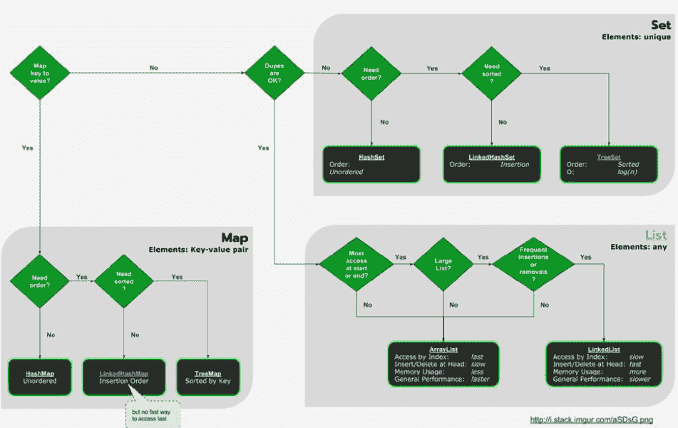

此流程图基于 [http://i.stack.imgur.com/aSDSDG.png]。

# 第 65 章：super 关键字

## 第 65.1 节：super 关键字示例

`super` 关键字在三个地方起着重要作用：

- 1. 构造函数级别
- 2. 方法级别
- 3. 变量级别

### 构造函数级别

`super` 关键字用于调用父类的构造函数。该构造函数可以是默认构造函数或参数化构造函数。

默认构造函数：`super()`；
参数化构造函数：`super(int no, double amount, String name);`。

```java
class Parentclass {
    Parentclass() {
        System.out.println("Constructor of Superclass");
    }
}

class Subclass extends Parentclass {
    Subclass() {
        /* 编译器在此构造函数的第一行隐式地添加 super() */
        System.out.println("Constructor of Subclass");
    }

    Subclass(int n1) {
        /* 编译器在此构造函数的第一行隐式地添加 super() */
        System.out.println("Constructor with arg");
    }

    void display() {
        System.out.println("Hello");
    }

    public static void main(String[] args[]) { // 使用默认构造函数创建对象
        Subclass obj = new Subclass();
        // 调用类方法
        obj.display();
        // 使用参数构造函数创建对象 2
        Subclass obj2 = new Subclass(10);
        obj2.display();
    }
}
```

注意：`super()` 必须是构造函数中的第一个语句，否则我们将会得到编译错误信息。

### 方法级别

`super` 关键字也可以用于方法重写，`super` 关键字可以用于调用或调用父类方法。

```java
class Parentclass {
    // 重写方法
    void display() {
        System.out.println("Parent class method");
    }
}
```

```java
class Subclass extends Parentclass {
    // 重写方法
    void display() {
        System.out.println("Child class method");
    }

    void printMsg() {
        // 这将调用重写方法
        display();
        // 这将调用被重写的方法
        super.display();
    }

    public static void main(String args[]) {
        Subclass obj = new Subclass();
        obj.printMsg();
    }
}
```

注意：如果没有方法重写，我们就不需要使用 `super` 关键字来调用父类方法。

### 变量级别

`super` 用于引用直接父类实例实例变量。在继承的情况下，基类和派生类可能会有相似的数据成员。为了区分基类/父类与派生/子类的数据成员，在派生类的上下文中，基类数据成员必须跟在 `super` 关键字。

```java
// 父类或超类
class Parentclass {
    int num = 100;
}
```


## 第 66.1 节：Transient 字段 - 序列化

```java
// 子类或子类类
class Subclass extends Parentclass {
  /** 我在子类中也声明了相同的变量
   * num
   */
  int num = 200;

  void printNum() {
    System.out.println("Child num: " + num);
    System.out.println("Parent num: " + super.num);
  }
}
```

```java
// 输出还原后的时间
System.out.println("Restored time: " + time.getTime());
}
}
```

序列化后的类是二进制格式的。如果类定义发生了变化，反序列化可能会出现问题：详情请参见《Java 序列化规范》中的“序列化对象的版本控制”章节。

序列化对象会序列化其作为根的整个对象图，并在循环图的情况下正常运行。提供了一个 `reset()` 方法来强制 `ObjectOutputStream` 忘记已经序列化的对象。

## 第 66.2 节：自定义序列化

在这个示例中，我们想要创建一个类，该类将在初始化时传入的两个整数范围内生成一个随机数并输出到控制台。

```java
public class SimpleRangeRandom implements Runnable {
    private int min;
    private int max;
    private Thread thread;

    public SimpleRangeRandom(int min, int max) {
        this.min = min;
        this.max = max;
        thread = new Thread(this);
        thread.start();
    }
}
```

```java
@Override
private void writeObject(ObjectOutputStream out) throws IOException;
private void readObject(ObjectInputStream in) throws IOException, ClassNotFoundException;
```

```java
public void run() {
  while (true) {
    Random rand = new Random();
    System.out.println("Thread: " + thread.getId() + " Random:" + rand.nextInt(max - min));
    try {
      Thread.sleep(10000);
    } catch (InterruptedException e) {
      e.printStackTrace();
    }
  }
}
```

如果我们想让这个类实现 `Serializable`，将会遇到一些问题。`Thread` 是某些不可序列化的系统级类之一。因此，我们需要将线程声明为 `transient`。这样做我们可以序列化该类的对象，但仍然会有一个问题。正如构造函数所示，我们设置了随机生成器的 min 和 max 值，之后启动了负责生成和打印随机值的线程。因此，当通过调用 `readObject()` 持久化对象时，构造函数不会再次运行，因为没有创建新对象。在这种情况下，我们需要通过在类内部提供方法来开发自定义序列化。这些方法是：

```java
private void writeObject(ObjectOutputStream out) throws IOException;
private void readObject(ObjectInputStream in) throws IOException, ClassNotFoundException;
```

通过在 `readObject()` 中添加我们的实现，我们可以初始化并启动线程：

```java
class RangeRandom implements Serializable, Runnable {
  private int min;
  private int max;
  private transient Thread thread;
  // transient 应该是任何无法被序列化的字段，例如 Thread 或
  // 任何不想被序列化的字段

  public RangeRandom(int min, int max) {
    this.min = min;
    this.max = max;
    thread = new Thread(this);
    thread.start();
  }

  @Override
  public void run() {
    while (true) {
      Random rand = new Random();
      System.out.println("Thread: " + thread.getId() + " Random:" + rand.nextInt(max - min));
      try {
        Thread.sleep(10000);
      } catch (InterruptedException e) {
        e.printStackTrace();
      }
    }
  }

  public void writeObject(ObjectOutputStream oos) throws IOException {
    oos.defaultWriteObject();
  }

  public void readObject(ObjectInputStream in) throws IOException, ClassNotFoundException {
    in.defaultReadObject();
    thread = new Thread(this);
    thread.start();
  }
}
```

这是我们示例的 main 方法：

```java
public class Main {
  public static void main(String[] args) {
    System.out.println("Hello");
    RangeRandom rangeRandom = new RangeRandom(1, 10);
    FileOutputStream fos = null;
    ObjectOutputStream out = null;
    try {
      fos = new FileOutputStream("test");
      out = new ObjectOutputStream(fos);
      out.writeObject(rangeRandom);
      out.close();
    } catch (IOException e) {
      e.printStackTrace();
    }

    RangeRandom rangeRandom2 = null;
    FileInputStream fis = null;
    ObjectInputStream in = null;
    try {
      fis = new FileInputStream("test");
      in = new ObjectInputStream(fis);
      rangeRandom2 = (RangeRandom) in.readObject();
      in.close();
    } catch (IOException e) {
      e.printStackTrace();
    } catch (ClassNotFoundException e) {
    }
  }
}
```

如果你运行该方法，你会发现每个 `RangeRandom` 实例有两个线程在运行，这是因为 `Thread.start()` 方法现在同时在构造函数和 `readObject()` 中。

## 第 66.3 节：版本控制与 serialVersionUID

当你实现 `java.io.Serializable` 接口以使类变为可序列化时，编译器会寻找类型为 `long` 的 `static final` 字段 `serialVersionUID`。如果类没有显式声明此字段，编译器将创建一个此类字段，并为其分配一个根据实现相关的计算得出的 `serialVersionUID` 值。该计算依赖于类的各个方面，并遵循 Sun 提供的《对象序列化规范》。但是，无法保证在所有编译器实现中该值都是相同的。

强烈建议显式声明 `serialVersionUID`，以避免在不同编译器编译时出现 `InvalidClassException`。

```java
public class Example implements Serializable {
    static final long serialVersionUID = 1L; // 某些值
}
```

只要 `serialVersionUID` 相同，Java 序列化就可以处理不同的版本。

### 兼容更改

- **添加字段**：当被还原的类有一个流中不存在的字段时，该字段将初始化为默认值。
- **添加类**：通过将流与当前类比较可以检测出额外的类。由于流中没有信息可以初始化对象，字段将初始化为默认值。
- **删除类**：通过将流与当前类比较可以检测出某个类已被删除。对应于删除类的字段将被丢弃。
- **添加 `writeObject/readObject`**：如果读取流的版本具有这些方法，则 `readObject` 像往常一样预期读取必要数据。它在读取任何可选数据之前应该调用 `defaultReadObject`。`writeObject` 方法预期往常一样调用 `defaultWriteObject` 写入必要数据，然后写入可选数据。
- **更改字段的访问权限**：访问修饰符 `public`、`package`、`protected` 和 `private` 对序列化分配字段赋值没有影响。
- **将字段从 `static` 改为非 `static` 或从 `transient` 改为非 `transient`**：当依赖默认序列化计算序列化字段时，这种更改等同于向类添加了字段。新字段将写入流中，但早期的类会忽略该值，因为序列化不会为静态或瞬态字段赋值。

### 不兼容更改

- **删除字段**：如果类中删除了字段，写入的流将不包含其值。当早期的类读取流时，字段的值将被设置为默认值，因为流中没有可用值。
- **在层次结构中上下移动类**：这是不被允许的，因为流中的数据顺序错误。
- **将非 `static` 字段改为 `static` 或将非 `transient` 字段改为 `transient`**：当依赖默认序列化时，这种更改等同于从类中删除了字段。流，因此较早版本的类无法对其进行读取。就像删除字段一样，旧版本中的字段将被初始化为默认值，这可能导致类以意料之外的方式失败。
- **更改原始类型字段的声明类型**：类的每个版本都使用其声明的类型写入数据。较早版本的类尝试读取该字段将失败，因为流中的数据类型与字段类型不匹配。
- **更改 `writeObject` 或 `readObject` 方法**，使其不再写入或读取默认字段数据，或者更改其在以前版本没有写入或读取时尝试写入或读取。默认字段数据必须在流中保持一致地出现或不出现。
- **将类从 `Serializable` 更改为 `Externalizable` 或反之**是不兼容的更改，因为流将包含与当前可用类实现不兼容的数据。
- **将类从非枚举类型更改为枚举类型或反之**是不兼容的更改，因为流将包含与当前可用类实现不兼容的数据。
- **移除 `Serializable` 或 `Externalizable`** 都是不兼容的更改，因为写入时，它将不再提供旧版本类所需的字段。
- **向类中添加 `writeReplace` 或 `readResolve` 方法**，如果该行为产生与任何旧版本类不兼容的对象，则是不兼容的。

## 第 66.4 节：使用 Gson 进行序列化

使用 Gson 进行序列化非常简单，并将输出正确的 JSON。

```java
public class Employe {
    private String firstName;
    private String lastName;
    private int age;
    private BigDecimal salary;
    private List<String> skills;
    // getters and setters
}
```

```java
// Skills
List<String> skills = new ArrayList<>();
skills.add("leadership");
skills.add("Java Experience");
```

```java
// Employ
Employe obj = new Employe();
obj.setFirstName("Christian");
obj.setLastName("Lusardi");
obj.setAge(25);
obj.setSalary(new BigDecimal("10000"));
obj.setSkills(skills);
```

```java
// Serialization process
Gson gson = new Gson();
String json = gson.toJson(obj);
// {"firstName":"Christian","lastName":"Lusardi","age":25,"salary":10000,"skills":["leadership","Java Experience"]}
```

注意，你不能序列化具有循环引用的对象，因为会导致无限递归。

### 反序列化

```java
// it's very simple...
// Assuming json 是之前的 String 对象....
Employe obj2 = gson.fromJson(json, Employe.class); // obj2 和其他一样
```

## 第 66.5 节：使用 Jackson 进行自定义 JSON 反序列化

我们以 JSON 格式消费 REST API 并将其反序列化为 POJO。Jackson 的 `org.codehaus.jackson.map.ObjectMapper` “开箱即用”，在大多数情况下我们真的什么都不需要做。但有时我们需要自定义反序列化器来满足我们的自定义需求，本教程将引导你完成创建自己的自定义反序列化器的过程。

假设我们有以下实体。

```java
public class User {
    private Long id;
    private String name;
    private String email;
    // getter setter are omitted for clarity
}
```

```java
public class Program {
    private Long id;
    private String name;
    private User createdBy;
    private String contents;
    // getter setter are omitted for clarity
}
```

让我们先序列化/封存一个对象。

```java
User user = new User();
user.setId(1L);
user.setEmail("example@example.com");
user.setName("Bazlur Rahman");

Program program = new Program();
program.setId(1L);
program.setName("Program @# 1");
program.setCreatedBy(user);
program.setContents("Some contents");
```


ObjectMapper objectMapper = new ObjectMapper();

final String json = objectMapper.writeValueAsString(program);

System.out.println(json);

上述代码将产生 JSON：

```json
{
  "id": 1,
  "name": "Program @# 1",
  "createdBy": {
    "id": 1,
    "name": "Bazlur Rahman",
    "email": "example@example.com"
  },
  "contents": "Some contents"
}
```

现在可以很容易地执行相反的操作。如果我们有这个 JSON，我们可以使用 `ObjectMapper` 将其反序列化为 program 对象。

现在假设这并不是真实情况，我们将从 API 获取一个与我们的 `Program` 类不匹配的不同 JSON：

```json
{
  "id": 1,
  "name": "Program @# 1",
  "ownerId": 1,
  "contents": "Some contents"
}
```

查看该 JSON 字符串，你可以看到它有一个不同的字段 `ownerId`。现在如果你像我们之前那样序列化这个 JSON，你将会遇到异常。

有两种方法可以避免异常并完成序列化：
- 忽略未知字段：忽略 `ownerId`。在 `Program` 类中添加以下注解：
  ```java
  @JsonIgnoreProperties(ignoreUnknown = true)
  public class Program {}
  ```
- 编写自定义反序列化器

但在某些情况下，你实际上需要这个 `ownerId` 字段。假设你想将其关联为 `User` 类的一个成员。在这种情况下，你需要编写一个自定义反序列化器。

如你所见，首先你必须从 `JsonParser` 访问 `JsonNode`。然后你可以使用 `get()` 方法轻松从 `JsonNode` 中提取信息，并且你必须确保该值存在。或者，你可以直接注册反序列化器：

```java
ObjectMapper mapper = new ObjectMapper();
SimpleModule module = new SimpleModule();
module.addDeserializer(Program.class, new CustomDeserializer());
mapper.registerModule(module);
```

# 第 67 章：Optional

`Optional` 是一个可能包含值的容器对象。如果值存在，`isPresent()` 返回 `true`，`get()` 返回该值。提供的其他依赖于值的方法有 `orElse()`，它在不存在时返回默认值。

## 67.1：Map

使用 `Optional` 的 `map()` 方法来处理可能为空的值，而无需进行显式的空检查。语法：

```java
public <U> Optional<U> map(Function<? super T, ? extends U> mapper)
```

代码示例：

```java
String value = null;
return Optional.ofNullable(value).map(String::toUpperCase).orElse("NONE");
// 返回 "NONE"

String value = "something";
return Optional.ofNullable(value).map(String::toUpperCase).orElse("NONE");
// 返回 "SOMETHING"
```

由于 `Optional.map()` 在函数返回 null 时会返回空 optional，你可以链式调用多个操作。这被称为空安全引用。考虑以下示例：

```java
String value = foo.getBar().getBaz().toString();
```

任何 `getBar`、`getBaz` 或 `toString` 都可能抛出 `NullPointerException`。

这里是使用 `Optional` 获取值的另一种方式：

```java
String value = Optional.ofNullable(foo)
    .map(Foo::getBar)
    .map(Bar::getBaz)
    .map(Baz::toString)
    .orElse("");
```

如果任何映射函数返回 null，这将返回一个空字符串。下面是另一个示例，略有不同。它只在其中一个映射函数返回 null 时才打印值。

```java
Optional.ofNullable(foo)
    .map(Foo::getBar)
    .map(Bar::getBaz)
    .map(Baz::toString)
    .ifPresent(System.out::println);
```

## 67.2：Optional 空时的默认值

不要使用 `Optional.get()`，因为它可能会抛出 `NoSuchElementException`。`Optional.orElse(T)` 和 `Optional.orElseGet(Supplier<? extends T>)` 方法提供了在 Optional 空时提供默认值的方法。

```java
String value = "something";
return Optional.ofNullable(value).orElse("defaultValue"); // 返回 "something"
return Optional.ofNullable(value).orElseGet(() -> getDefault()); // 返回 "something"（从未调用 getDefault() 方法）

String value = null;
return Optional.ofNullable(value).orElse("defaultValue"); // 返回 "defaultValue"
return Optional.ofNullable(value).orElseGet(() -> getDefault()); // 调用 getDefault() 并返回其结果
```

`orElse` 和 `orElseGet` 之间的关键区别是后者仅在 Optional 空时才被求值，前者即使 `Optional` 不空也会被求值。因此，`orElse` 应该用于常量，而永远不要用于根据任何计算提供值。

## 67.3：如果没有值，则抛出异常

使用 `Optional` 的 `orElseThrow()` 方法来获取包含的值，如果尚未设置，则抛出异常。这与调用 `get()` 类似，不同在于它允许任意类型的异常。该方法接收一个供应者，该供应者必须返回要抛出的异常。

在第一个示例中，该方法直接返回包含的值：

```java
Optional optional = Optional.of("something");
return optional.orElseThrow(IllegalArgumentException::new);
// 返回 "something"
```

在第二个示例中，由于没有设置值，该方法抛出一个异常：

```java
Optional optional = Optional.empty();
return optional.orElseThrow(IllegalArgumentException::new); // 抛出 IllegalArgumentException
```

你可以使用 Lambda 语法来抛出带有消息的异常：

```java
optional.orElseThrow(() -> new IllegalArgumentException("Illegal"));
```

## 67.4：使用 Supplier 懒加载提供默认值

普通的 `orElse` 方法接收一个 `Object`，所以你可能会疑惑为什么这里有一个提供 `Supplier` 的选项（`orElseGet` 方法）。考虑：

```java
String value = "something";
return Optional.ofNullable(value)
    .orElse(getValueThatIsHardToCalculate()); // 返回 "something"
```

即使 `Optional` 不为空且结果未被使用，仍然会调用 `getValueThatIsHardToCalculate()`。

为了避免这种开销，你提供了一个供应者：

```java
String value = "something";
return Optional.ofNullable(value)
    .orElseGet(() -> getValueThatIsHardToCalculate()); // 返回 "something"
```

这样，只有在 `Optional` 为空时，才会调用 `getValueThatIsHardToCalculate()`。

## 67.5：过滤

`filter()` 用于表示你只有在值匹配谓词时才需要该值。将其想象为 `if (!predicate(x)) { x = null; }`。

代码示例：

```java
String value = null;
Optional.ofNullable(value) // 什么都不做
    .filter(x -> x.equals("cool string")) // 因为 value 为 null，这里永远不会执行
    .isPresent(); // false
```

```java
String value = "cool string";
Optional.ofNullable(value) // 有内容
    .filter(x -> x.equals("cool string")) // 执行并通过
    .isPresent(); // true
```

```java
String value = "hot string";
Optional.ofNullable(value) // 有内容
    .filter(x -> x.equals("cool string")) // 执行但失败
    .isPresent(); // false
```

## 67.6：用于原始数字类型的 Optional 容器

`OptionalDouble`、`OptionalInt` 和 `OptionalLong` 的工作方式与 `Optional` 类似，但它们专门为封装原始类型而设计：

```java
OptionalInt presentInt = OptionalInt.of(value);
OptionalInt absentInt = OptionalInt.empty();
```

由于数值类型有值，因此没有对 `null` 的特殊处理。可以通过以下方式检查空容器：

```java
presentInt.isPresent(); // 为 true
absentInt.isPresent(); // 为 false
```

同样，也存在简写方法来辅助值管理：

```java
// 打印值，因为它在创建时已提供。
presentInt.ifPresent(System.out::println);

// 提供另一个值，因为原始 Optional 是空的。
int finalValue = absentInt.orElseGet(this::other);

// 将抛出 NoSuchElementException。
int nonexistentValue = absentInt.getAsInt();
```

## 67.7：仅在存在值时运行代码

```java
Optional<String> optionalWithValue = Optional.of("foo");
optionalWithValue.ifPresent(System.out::println); // 打印 "foo"

Optional<String> emptyOptional = Optional.empty();
emptyOptional.ifPresent(System.out::println); // 什么都不做
```

## 67.8：FlatMap

`flatMap` 与 `map` 类似。其差异在 javadoc 中描述如下：此方法类似于 `map(Function)`，但提供的映射器的结果已经是一个 `Optional`，如果被调用，`flatMap` 不会用额外的 `Optional` 对其进行封装。换句话说，当你链调用一个返回 `Optional` 的方法时，使用 `Optional.flatMap` 可以避免创建嵌套的 `Optional`。

例如，给定以下类：

```java
public class Foo {
    Optional<Bar> getBar() {
        return Optional.of(new Bar());
    }
}

public class Bar { }
```

如果你使用 `Optional.map`，将得到一个嵌套的 `Optional`；即 `Optional<Optional<Bar>>`。

```java
Optional<Optional<Bar>> nestedOptionalBar = Optional.of(new Foo())
    .map(Foo::getBar);
```

然而，如果你使用 `Optional.flatMap`，将得到一个简单的 `Optional`；即 `Optional<Bar>`。

```java
Optional<Bar> optionalBar = Optional.of(new Foo()).flatMap(Foo::getBar);
```

# 第 68 章：对象引用

## 68.1：作为方法参数的对象引用

本主题解释了对象引用的概念；面向 Java 初学者。你应该已经熟悉了一些术语和含义：类定义、主方法、对象实例以及在对象“上”调用方法，以及向方法传递参数。

```java
public class Person {
    private String name;

    public void setName(String name) { this.name = name; }

    public String getName() { return name; }
}
```

在 Java 中，所有基本类型都是按值传递的。对象按引用传递，这意味着方法传递的是对象的指针。一个不太显见的意思是：调用方法无法创建一个新对象并将其作为参数返回。方法返回其直接或间接创建的对象的唯一方法是作为方法的返回值。让我们先看看它是如何不工作的，然后看看它是如何工作的。

让我们在小示例中添加另一个方法：

```java
private static void getAnotherNot(Person person) {
    person = new Person();
    person.setName("George");
}
```

然后，在 `main` 方法中，`setName` 调用下方，放置对该方法的调用以及另一个 `println` 调用：

```java
getAnotherNot(person);
System.out.println(person.getName());
```

现在程序将打印：
Linda 5

那个带有 George 对象去哪了？由于传入的是指向 Linda 的指针；当 `getAnotherNot` 方法创建一个新对象时，它用指向 George 的引用替换了指向 Linda 的引用。Linda 对象仍然存在（在堆上），`main` 方法仍然可以访问它，但 `getAnotherNot` 方法将无法对它进行任何操作，因为它没有它的引用。看起来代码作者意图让方法创建一个新对象并将其传回，但如果是这样，它并没有工作。

如果代码作者想这样做，他需要从方法返回新创建的对象，类似于这样：

```java
private static Person getAnotherObject() {
    Person person = new Person();
    person.setName("Mary");
    return person;
}
```

然后这样调用它：

```java
Person mary;
mary = getAnotherObject();
System.out.println(mary.getName());
```

此时整个程序的输出现在将是：
Linda 5
Mary

这里是整个程序，包含了所有的新增内容：

```java
public class Person {
    private String name;

    public void setName(String name) {
        this.name = name;
    }

    public String getName() {
        return name;
    }

    public static void main(String[] arguments) {
        Person person = new Person();
        person.setName("Bob");
        int i = 5;
        setPersonName(person, i);
        System.out.println(person.getName() + " " + i);
```


```java
getAnotherObjectNot(person);

System.out.println(person.getName());

Person person;

person = getAnotherObject();

System.out.println(person.getName());

}

private static void setPersonName(Person person, int num) {

    person.setName("Linda");

    num = 99;

}

private static void getAnotherObjectNot(Person person) {

    person = new Person();

    person.setName("George");

}

private static Person getAnotherObject() {

    Person person = new Person();

    person.setName("Mary");

    return person;

}

}
```

# 第 69 章：异常与异常处理

类型为 `Throwable` 及其子类的对象可以通过 `throw` 关键字向上栈传递，并使用 `try...catch` 语句捕获。

## 第 69.1 节：使用 try-catch 捕获异常

可以使用 `try...catch` 语句捕获并处理异常。（事实上，try语句还有其他形式，如其他示例中的 `try...finally` 和 `try-with-resources`。）

### 带有单个 catch 块的 try-catch

最简单的形式如下：

```java
try {
    doSomething();
} catch (SomeException e) {
    handle(e);
}

// 下一条语句
```

简单的 `try...catch` 行为如下：

- 执行 `try` 块中的语句。
- 如果 `try` 块中的语句没有抛出异常，则控制传递到 `try...catch` 之后的下一语句。
- 如果在 `try` 块中抛出了异常：
    - 检查异常对象以确定是否为 `SomeException` 的实例或子类。如果是，则 `catch` 块将捕获该异常。
    - 变量 `e` 被绑定到异常对象。
    - 执行 `catch` 块中的代码。
    - 如果该代码抛出异常，则新抛出的异常将代替原始异常进行传播。
    - 否则，控制传递到 `try...catch` 之后的下一语句。
- 如果不是，原始异常将继续传播。

### 带有多个 catch 块的 try-catch

`try...catch` 也可以拥有多个 `catch` 块。例如：

```java
try {
    doSomething();
} catch (SomeException e) {
    handleOneWay(e);
} catch (SomeOtherException e) {
    handleAnotherWay(e);
}

// 下一条语句
```

如果有多个 `catch` 块，它们将从第一个开始逐一尝试，直到为异常找到匹配的项为止。执行相应的处理器（如上所述），然后控制传递到 `try...catch` 语句之后的下一语句。匹配项之后的 `catch` 块始终会被跳过，即使处理器代码抛出了异常也是如此。

“自上而下”的匹配策略对于 `catch` 块中的异常不相交的情况会有影响。例如：

```java
try {
    throw new RuntimeException("test");
} catch (Exception e) {
    System.out.println("Exception");
} catch (RuntimeException e) {
    System.out.println("RuntimeException");
}
```

这段代码段将输出 "Exception" 而不是 "RuntimeException"。由于 `RuntimeException` 是 `Exception` 的子类，第一个（更通用的）`catch` 将被匹配。第二个（更具体的）`catch` 永远不会执行。

从中学到的教训是，最具体的 `catch` 块（从异常类型来说）应该先出现，而最通用的应该放在最后。（某些 Java 编译器会警告你某个 `catch` 永远无法被执行，但这不是编译错误。）

### 多异常 catch 块 版本 ≥ Java SE 7

从 Java SE 7 开始，单个 `catch` 块可以处理多个不相关的异常列表。异常类型列出来，并用竖线 (`|`) 符号分隔开。例如：

```java
try {
    doSomething();
} catch (SomeException | SomeOtherException e) {
    handleSomeException(e);
}
```

多异常 `catch` 的行为是单异常情况的简单扩展。如果抛出的异常匹配（至少）列出的异常之一，则 `catch` 匹配。

规范中还有一些额外的细微之处。`e` 的类型是列表中异常类型的合成联合。当使用 `e` 的值时，它的静态类型是类型联合的最小公共父类。然而，如果在此 `catch` 块内重新抛出 `e`，则抛出的异常类型将是联合中的类型。例如：

```java
public void method() throws IOException, SQLException {
    try {
        doSomething();
    } catch (IOException | SQLException e) {
        report(e);
        throw e;
    }
}
```

在上面，`IOException` 和 `SQLException` 是检查异常，它们的最小公共父类是 `Exception`。这意味着 `report` 方法必须匹配 `report(Exception)`。然而，编译器知道 `throw` 只能抛出 `IOException` 或 `SQLException`。因此，`method` 可以声明为 `throws IOException, SQLException` 而不是 `throws Exception`。（这是一件好事：参见陷阱。）

## 第 69.2 节：try-with-resources 语句

#### 版本 ≥ Java SE 7

正如 `try-catch-finally` 示例所示，使用 `finally` 进行资源清理需要大量的样板代码。Java 7 提供了一种更简单的方法来处理这个问题，即为 `try-with-resources`。

### 什么是资源？

Java 7 引入了 `java.lang.AutoCloseable` 接口以允许使用 `try-with-resources` 管理类。实现 `AutoCloseable` 的实例被称为资源。这些资源通常需要及时释放，而不是依赖垃圾回收器来释放。

`AutoCloseable` 接口定义了一个方法：
`public void close() throws Exception`

`close()` 方法应当以适当的方式释放资源。规范规定，对已经释放的资源调用该方法是安全的。此外，实现 `AutoCloseable` 的类强烈建议 `close()` 方法抛出比 `Exception` 更具体的异常，或者不抛出异常。

广泛的 Java 类实现了 `AutoCloseable`。这些包括：
- `InputStream`, `OutputStream` 及其子类
- `Reader`, `Writer` 及其子类
- `Socket`, `ServerSocket` 及其子类
- `Channel` 及其子类
- JDBC 接口 `Connection`, `Statement`, `ResultSet` 及其子类

应用程序和第三方类也可以这样做。

### 基础 try-with-resource 语句

`try-with-resources` 的语法基于经典的 `try-catch`、`try-finally` 和 `try-catch-finally` 形式。这是一个“基础”形式的示例；即不带 `catch` 或 `finally` 的形式。

要管理的资源在 `try` 子句的 `(...)` 部分声明。在上面的示例中，我们声明了一个资源变量 `stream` 并将其初始化为新的 `PrintStream`。一旦资源变量初始化，就会执行 `try` 块。完成后，将自动调用 `stream.close()` 以确保资源不泄漏。

### 增强的 try-with-resources 语句

`try-with-resources` 语句可以使用 `catch` 和 `finally` 块进行增强，使用 Java 7 之前的 `try-catch` 语法。以下代码段为我们之前的代码添加了一个 `catch`，以处理 `PrintStream` 构造函数可能抛出的 `FileNotFoundException`：

```java
finally {
    System.err.println("All done");
}
```

如果初始化或 `try` 块抛出异常，则将执行 `catch` 块。`finally` 块将始终执行，正如传统的 `try-catch-finally` 语句一样。

### 管理多个资源

上面的代码段显示了如何管理单个资源。事实上，try-with-resources 可以在单条语句中管理多个资源。例如：

```java
try(InputStream is = new FileInputStream(file1); OutputStream os = new FileOutputStream(file2)) { // 将 'is' 拷贝到 'os'
```

这种行为符合你的预期。`is` 和 `os` 都会在 try 块结束时自动关闭。这里有几点需要注意：

- 初始化按照代码顺序进行，后定义的资源变量初始化器可以使用早期变量的值。
- 所有成功初始化的资源变量都将被清理。资源变量按照它们声明的反序进行清理。

因此，在上述示例中，`is` 在 `os` 之前初始化，并在之后被清理；如果在初始化 `os` 时发生异常，`is` 也会被清理。

### try-with-resource 与经典 try-catch-finally 的等效性

Java 语言规范（JLS）根据经典的 try-catch-finally 语句规定了 try-with-resource 形式的行为。（详细信息请参阅 JLS。）

例如，这个基础的 try-with-resource：被定义为等效于此 try-catch-finally：

```java
// 注意构造函数不是 try-catch 语句的一部分
PrintStream stream = new PrintStream("hello.txt");

// 此变量用于跟踪 try 语句抛出的主异常
// 如果 try 块中抛出异常，
// AutoCloseable.close() 抛出的任何异常都将被抑制。
Throwable primaryException = null;

try {
    // 实际的 try 块
    stream.println("Hello world!");
} catch (Throwable t) {
    // 如果抛出异常，请为 finally 块记住它
    primaryException = t;
    throw t;
} finally {
    if (primaryException == null) {
        // 如果到为止没有抛出异常，close() 中抛出的异常将
        // 不被捕获，因此会传递给调用代码。
        stream.close();
    } else {
        // 如果已经抛出了异常，close() 中抛出的任何异常
        // 将被抑制，因为它可能与先前的异常有关。
        // 可以使用 primaryException.getSuppressed()
        // 获取被抑制的异常
        try {
            stream.close();
        } catch (Throwable suppressedException) {
            primaryException.addSuppressed(suppressedException);
        }
    }
}
```

（JLS 规定了实际的 t 和 primaryException 变量对普通 Java 代码是不可见的）。

try-with-resources 的增强形式被规定为与基础形式等效。例如：

```java
try (PrintStream stream = new PrintStream(fileName)) {
    stream.println("Hello world!");
} catch (NullPointerException ex) {
    System.err.println("Null filename");
} finally {
    System.err.println("All done");
}
```

等效于：

```java
try (PrintStream stream = new PrintStream(fileName)) {
    stream.println("Hello world!");
} catch (NullPointerException ex) {
    System.err.println("Null filename");
} finally {
    System.err.println("All done");
}
```

## 第 69.3 节：自定义异常

在大多数情况下，从代码设计的角度来看，抛出异常时使用通用的 `Exception` 类更为简单。如果你只需要异常携带一个简单的错误信息，情况尤其如此。在这种情况下，通常优选 `RuntimeException`，因为它不是受检异常。对于常见的错误类型存在其他异常类：

- `UnsupportedOperationException` - 不支持某些操作
- `IllegalArgumentException` - 向方法传递了无效的参数值
- `IllegalStateException` - 你的 API 内部达到了一个不应发生的状态，或者由于以无效方式使用你的 API 而导致了这种情况

使用自定义异常类的情况包括：

- 你正在编写供他人使用的 API 或库，并且你希望你的 API 用户能够专门地捕获并处理来自你 API 的异常，并能够将这些异常与其他更通用的异常区分开。
- 你在程序的某部分为特定类型的错误抛出异常，并希望在程序的另一个部分捕获并处理它，并且你能够将这些错误与其他更通用的异常区分开。

你可以通过扩展 `RuntimeException` 来创建非受检异常，或者通过扩展任何不是 `RuntimeException` 子类的 `Exception` 来创建受检异常，从而创建自定义异常，因为：不是 `RuntimeException` 子类的 `Exception` 子类是：

```java
public class StringTooLongException extends RuntimeException {

    // 异常可以像其他类一样拥有方法和字段
    // 这些字段可以向捕获此类异常的代码段
    // 传递信息
    public final String value;
    public final int maximumLength;

    public StringTooLongException(String value, int maximumLength) {
        super(String.format("String exceeds maximum Length of %s: %s", maxLength, this.value = value));
        this.maximumLength = maxLength;
    }
}
```

这些可以像预定义异常一样使用：

```java
void validateString(String value){
    if (value.length() > 30) {
        throw new StringTooLongException(value, 30);
    }
}
```

并且字段可以在捕获和处理异常的地方使用：

```java
void anotherMethod(String value){
    try {
        validateString(value);
    } catch (StringTooLongException e) {
        System.out.println("The string " + e.value + " was longer than " + e.maximumLength);
    }
}
```


# 第 69.4 节：处理 `InterruptedException`

`InterruptedException` 是一个令人困惑的怪物——它出现在像 `Thread.sleep()` 这样看似无害的方法中，但处理不当会导致难以管理的代码。你可能倾向于说“会被中断的”，并因此这样做：

```java
// 错误。不要这样做。
try {
    Thread.sleep(1000);
} catch (InterruptedException e) {
    // 忽略
}
```

处理“不可能”情况的正确方法如下：

```java
try {
    Thread.sleep(1000);
} catch (InterruptedException e) {
    Thread.currentThread().interrupt();
    throw new AssertionError(e);
}
```

这做了两件事：首先恢复线程的中断状态（就好像 `InterruptedException` 没有被抛出一样），然后抛出一个 `AssertionError` 表示基本不变性被违反了。如果你确定永远不会中断这段代码，那么这段代码这样运行是安全的，因为 `catch` 块永远不会被触发。

使用 Guava 的 `Uninterruptibles` 类有助于简化这种模式；调用 `Uninterruptibles.sleepUninterruptibly()` 会忽略线程的中断状态，直到睡眠时间结束（到那时，该状态会被恢复，以供后续调用检查并抛出它们自己的 `InterruptedException`）。如果你知道自己不会中断代码，这种方法安全地避免了将睡眠调用封装在 `try-catch` 块中。

虽然这是一种良好的习惯，但在异常处理块中添加多个 `return` 语句是可能的：

```java
public static int returnTest(int number) {
    try {
        if (number % 2 == 0) throw new Exception("Exception thrown"); else return x;
    } catch (Exception e) {
        return 3;
    } finally {
        return 7;
    }
}
```

此方法将始终返回 7，因为与 `try/catch` 块关联的 `finally` 块会在任何返回之前执行。现在，由于 `finally` 中有 `return 7;`，该值将覆盖 `try/catch` 的返回值。如果 `catch` 块返回一个原始类型值，且该值随后在 `finally` 块中被修改，则 `catch` 块返回的值将仍是返回的值，而 `finally` 块中的更改将被忽略。下面的示例将打印 "0"，而不是 "1"。

```java
public class FinallyExample {
    public static void main(String[] args) {
        int n = returnTest(4);
        System.out.println(n);
    }

    public static int returnTest(int number) {
        int returnNumber = 0;
        try {
            if (number % 2 == 0)
                throw new Exception("Exception thrown"); else
                return returnNumber;
        } catch (Exception e) {
            return returnNumber;
        } finally {
            returnNumber = 1;
        }
    }
}
```

# 第 96.6 节：引言

异常是程序执行过程中发生的错误。考虑下面除两个整数的 Java 程序。

```java
class Division {
    public static void main(String[] args) {
        int a, b, result;
        Scanner input = new Scanner(System.in);
        System.out.println("Input two integers");
        a = input.nextInt();
        b = input.nextInt();
        result = a / b;
        System.out.println("Result = " + result);
    }
}
```

现在我们执行上面的代码，查看尝试除以零时的输出：

```text
Input two integers
7 0
Exception in thread "main" java.lang.ArithmeticException: / by zero at Division.main(Division.java:14)
```

除以零是一个无效操作，会产生一个无法表示为整数的值。Java 通过抛出异常来处理这个问题。在这种情况下，异常是 `ArithmeticException` 类的实例。

> **注意**：创建和读取堆栈跟踪的示例解释了这两个数字后的输出的含义。

异常的用处在于它允许的流程控制。如果不使用异常，解决此问题的典型方案可能是首先检查 `b == 0`：

```java
class Division {
    public static void main(String[] args) {
        int a, b, result;
        Scanner input = new Scanner(System.in);
        System.out.println("Input two integers");
        a = input.nextInt();
        b = input.nextInt();
        if (b == 0) {
            System.out.println("You cannot divide by zero.");
            return;
        }
        result = a / b;
        System.out.println("Result = " + result);
    }
}
```

当用户尝试除以零时，这会在控制台打印消息 `You cannot divide by zero.` 并以优雅的方式退出程序。通过异常处理解决此问题的等效方法是将 `if` 流程控制替换为 `try-catch` 块：

```java
a = input.nextInt();
b = input.nextInt();
try {
    result = a / b;
} catch (ArithmeticException e) {
    System.out.println("An ArithmeticException occurred. Perhaps you tried to divide by zero.");
    return;
}
```

`try` 块的执行如下：

1. 开始执行 `try` 块中的代码。
2. 如果 `try` 块中发生异常，立即终止并检查该异常是否被 `catch` 块捕获（在这种情况下，当异常是 `ArithmeticException` 实例时）。
3. 如果异常被捕获，将其赋值给变量 `e` 并执行 `catch` 块。
4. 如果 `try` 或 `catch` 块任一完成（即代码执行期间没有发生未捕获的异常），则继续执行 `try-catch` 块下面的代码。

通常认为，将异常处理作为应用程序正常流程控制的一部分是良好的习惯，在其他情况下行为可能是未定义或出意之外的。例如，与其在方法失败时返回 `null`，通常更好的做法是抛出一个异常，这样使用该方法的应用程序就可以通过上述所示的异常处理来为该情况定义自己的流程控制。在某种意义上，这规避了必须返回特定类型的问题，因为可以抛出多种类型的异常来指示所发生的特定问题。

关于如何使用和不使用异常的更多建议，请参阅 Java Pitfalls - Exception usage。

# 第 69.7 节：Java 异常层次结构 - 未检查异常与已检查异常

所有的 Java 异常都是 `Exception` 类层次结构中类的实例。这可以表示如下：

- `java.lang.Throwable` - 这是所有异常类的基类。它的方法和构造函数实现了所有异常共有的系列功能。
- `java.lang.Exception` - 这是所有普通异常的超类。
    - 各种标准和自定义异常类。
- `java.lang.RuntimeException` - 这是所有作为未检查异常的普通异常的超类。
    - 各种标准和自定义异常类。
- `java.lang.Error` - 这是所有“致命”异常的超类。

> **注意**：
> 1. 检查异常与未检查异常的区别见下文。
> 2. `Throwable`、`Exception` 和 `RuntimeException` 应该被视为如下。
> 3. `Error` 及其子类是不明智的。

## 检查异常与未检查异常

某些语言对异常支持的批评之一是难以知道一个方法可能会抛出哪些异常。Java 通过检查异常机制解决了此问题。首先，Java 将异常分为两类：

- **检查异常**通常代表可以处理的预期事件。例如，`IOException` 及其子类表示 I/O 操作中可能发生的故障，例如网络连接中断等。
- **未检查异常**通常代表无法处理的意外事件。这些通常是应用程序中的 Bug。

检查异常机制的第二部分是对出现检查异常方法的限制：

- 当检查异常在方法中抛出或传播时，它必须被方法捕获，或者列在方法的 `throws` 子句中。（该子句的意义在本例所示）。
- 当检查异常在初始化器块中抛出或传播时，它必须被该块捕获。
- 检查异常无法通过字段初始化表达式中的方法调用传播（没有方法捕捉此类异常）。

简而言之，检查异常要么被处理，要么被声明。这些限制不适用于未检查异常。这包括所有隐式抛出异常的情况。

## 检查异常示例

这些代码段旨在说明检查异常的限制。在每个情况下，我们都展示了一个带有编译错误的版本，以及另一个修复错误的版本。

```java
// 这是一个自定义的检查异常。
public class MyException extends Exception {
    // 构造函数省略
}
```

```java
// 这是一个自定义的未检查异常。
public class MyException2 extends RuntimeException {
    // 构造函数省略
}
```

第一个示例显示了显式抛出的检查异常如果不应在方法中处理，可以被声明为“抛出”。

```java
// 错误的
public void methodThrowingCheckedException(boolean flag) {
    int i = 1 / 0; // 编译通过，抛出 ArithmeticException
    if (flag) {
        throw new MyException(); // 编译错误
    } else {
        throw new MyException2(); // 编译通过
    }
}
```

```java
// 修正的
public void methodThrowingCheckedException(boolean flag) throws MyException {
    int i = 1 / 0; // 编译通过，抛出 ArithmeticException
    if (flag) {
        throw new MyException();
    } else {
        throw new MyException2();
    }
}
```

```java
throw new MyException(); // 编译通过
}
}
```

第二个示例展示了如何处理传播的检查异常。

```java
// 错误
public void methodWithPropagatedCheckedException() {
    InputStream is = new FileInputStream("someFile.txt"); // 编译错误
    // 如果无法打开文件，FileInputStream 会抛出 IOException 或其子类。IOException 是一个检查异常。
    ...
}
```

```java
// 修正（版本 A）
public void methodWithPropagatedCheckedException() throws IOException {
    InputStream is = new FileInputStream("someFile.txt");
}
```

```java
// 修正（版本 B）
public void methodPropPropagCheckedCheckedException() {
    try {
        InputStream is = new FileInputStream("someFile.txt");
        ...
    } catch (IOException ex) {
        System.out.println("Cannot open file: " + ex.getMessage());
    }
}
```

最后一个示例展示了如何在静态字段初始化器中处理检查异常。

```java
// 错误
public class Test {
    private static final InputStream is = new FileInputStream("someFile.txt"); // 编译错误
}
```

```java
// 修正
public class Test {
    private static final InputStream is;
    static {
        try {
            is = new FileInputStream("someFile.txt");
        } catch (IOException e) {
            throw new RuntimeException(e);
        }
    }
}
```

请注意，在这种情况下，我们还必须处理不能多次赋值的问题，但即使在发生异常的情况下也必须进行赋值。

# 第 69.8 节：创建和读取堆栈跟踪

当异常对象被创建时（即当你使用 `new` 创建它时），`Throwable` 构造函数会捕获创建异常时的上下文信息。稍后，这些信息可以以堆栈跟踪的形式输出，用于诊断最初导致异常的问题。

## 打印堆栈跟踪

打印堆栈跟踪只需调用 `printStackTrace()` 方法即可。例如：

```java
try {
    int a = 0;
    int b = 0;
    int c = a / b;
} catch (ArithmeticException ex) {
    // 这将堆栈跟踪打印到标准输出
    ex.printStackTrace();
}
```

不带参数的 `printStackTrace()` 方法将内容打印到应用程序的标准输出；即当前的 `System.out`。还有 `printStackTrace(PrintStream)` 和 `printStackTrace(PrintWriter)` 重载方法，可以将其打印到指定的 `Stream` 或 `Writer`。

> **注意**：
> 1. 堆栈跟踪不包含异常本身的细节。你可以使用 `toString()` 方法获取这些细节；例如：
>    ```java
>    // 打印异常和堆栈跟踪
>    System.out.println(ex);
>    ex.printStackTrace();
>    ```
> 2. 打印堆栈跟踪应谨慎使用；请参见“陷阱 - 过度或不当的堆栈跟踪”。通常使用日志框架并将要记录的异常对象传递给它是更好。

## 理解堆栈跟踪

考虑下面由两个文件中的两个类组成的简单程序。（为了说明，我们显示了文件名并添加了行号。）

```java
// File: "Main.java"
public class Main {
    public static void main(String[] args) {
        new Test().foo();
    }
}
```

```java
// File: "Test.java"
class Test {
    public void foo() {
        bar();
    }

    public int bar() {
        int a = 1;
        int b = 0;
        return a / b;
    }
}
```

当这些文件被编译并运行时，我们将得到以下输出。

```text
Exception in thread "main" java.lang.ArithmeticException: / by zero
    at Test.bar(Test.java:9)
    at Test.foo(Test.java:3)
    at Main.main(Main.java:3)
```

让我们逐行阅读以确定它告诉了我们什么。

第 1 行告诉我们，名为 "main" 的线程由于一个未捕获的异常而终止。异常的完整名是 `java.lang.ArithmeticException`，异常消息为 "/ by zero"。

如果我们查找该异常的 javadoc，它说：

> 当发生异常算术条件时抛出。例如，整数“除以零”会抛出此类的实例。

事实上，消息 "/ by zero" 强烈地暗示了异常原因是某些代码尝试将某些内容除以零。但是什么呢？

剩余的 3 行是堆栈跟踪。每行代表堆栈上的一个方法（或构造函数）调用，每行都告诉我们三件事：

- 正在执行的类和方法名
- 源文件名
- 执行的语句的源代码行号


这些堆栈跟踪行列出时，当前调用的帧位于顶端。在我们上面的示例中，顶部的帧位于 `Test.bar` 方法中，以及 `Test.java` 文件的第 9 行。即如下行：

`return a / b;`

如果我们查看文件中较早几行初始化 `b` 的地方，显然 `b` 的值将是 0。我们可以毫无疑问地说这就是异常的原因。

如果我们需要进一步查看，可以从堆栈跟踪看到 `bar()` 是从 `Test.java` 第 3 行的 `foo()` 被调用的，而 `foo()` 又是从 `Main.main` 调用的。

注意：堆栈帧中的类和方法名是类和方法的内部名称。你需要识别以下内容：

## 异常链（Exception chaining）和堆栈跟踪

异常链发生在应用程序捕获异常并创建一个新异常时，并将第一个异常作为原因传递。这里有一个示例：

```java
File : Test.java
1 public class Test {
2 public void foo() {
3 return;
4 }
5
6 public Test() {
7 try {
8 foo();
9 } catch (ArithmeticException ex) {
10 throw new RuntimeException("bad thing happened", ex);
11 }
12 }
13
14 static void main(String[] args) {
15 new Test();
16 }
```

当上述类被编译并运行时，我们得到如下堆栈跟踪：

```
Exception in thread "main" java.lang.RuntimeException: bad thing happened

at Test.<init>(Test.java:15)

at Test.main(Test.java:14)

Caused by: java.lang.ArithmeticException: / by zero

at Test.foo(Test.java:3)

...（更多）
```

"Caused by:" 只有当原因为空时不会被包含。异常可以无限链，这种机制在 Java 1.4 中引入。

## 第 69.9 节：抛出异常

### 字符串堆栈跟踪

有时，应用程序需要将堆栈跟踪捕获为字符串以便其他用途。实现此目的通用方法是创建一个写入内存缓冲器的 `OutputStream` 或 `Writer`，并将其传递给 `printStackTrace()`。

Apache Commons 和 Guava 库提供了捕获字符串堆栈跟踪的实用方法：

- `apache.commons.lang.exception.ExceptionUtils.getStackTrace(Throwable)`
- `com.google.common.base.Throwables.getStackTraceAsString(Throwable)`

如果你无法在代码中使用第三方库，那么下面的方法可以完成任务：

```java
/**
 * 返回堆栈跟踪的字符串表示
 * @param throwable 要转换的异常
 * @return 字符串。
 */
public static String stackTraceToString(Throwable throwable) {
    StringWriter stringWriter = new StringWriter();
    throwable.printStackTrace(new PrintWriter(stringWriter));
    return stringWriter.toString();
}
```

注意如果意图是分析堆栈跟踪，使用 `getStackTrace()` 和 `getCause()` 比解析堆栈跟踪要简单。

### 抛出异常

下面的示例展示了抛出异常的基础：

```java
public void checkNumber(int number) throws IllegalArgumentException {
    if (number < 0) {
        throw new IllegalArgumentException("Number must be positive: " +
        number);
    }
}
```

异常在第 3 行抛出。该语句可以拆分为两个部分：

`new IllegalArgumentException(...)` 创建 `IllegalArgumentException` 类的实例，并带有一个描述异常所报告错误的消息。

`throw ...` 抛出异常对象。

当异常被抛出时，它会导致封闭语句异常终止，直到异常被处理。这在其他示例中有所描述。

良好的做法是在同一个语句中创建并抛出异常对象，如所示。良好的做法是在异常中包含一个有意义的错误消息，以帮助程序员理解问题的原因。但是，这不一定是你应该显示给终端用户的消息。（目前，Java 没有直接支持异常消息的国际化。）

还有几点需要说明：

我们将 `checkNumber` 声明为 `throws IllegalArgumentException`。这并不是严格必要的，因为 `IllegalArgumentException` 是一个受检查异常；请参见[Java 异常层次结构 - 未检查异常与受检查异常]。然而，这样做是一个良好的习惯，而且在方法的 javadoc 注释中包含抛出的异常也是很有用的。

`throw` 语句之后的代码是不可达的。因此，如果我们写了

`throw new IllegalArgumentException("it is bad"); return;`

编译器将为 `return` 语句产生编译错误。

### 异常链

许多标准异常除了常规的消息参数外，还带有一个第二个“原因（cause）”参数的构造函数。这允许你构建异常链。这里有一个示例。

首先，我们定义了一个应用程序在遇到不可恢复的错误时将抛出的未检查异常。注意，我们包含了一个接受 `cause` 参数的构造函数。

```java
public class AppErrorException extends RuntimeException {
    public AppErrorException() {
    }

    public AppErrorException(String message) {
        super(message);
    }

    public AppErrorException(String message, Throwable cause) {
        super(message, cause);
    }
}
```

接下来，这里是用于说明异常链的代码。

```java
public String readFirstLine(String file) throws AppErrorException {
    try (Reader r = new BufferedReader(new FileReader(file))) {
        String line = r.readLine();
        if (line != null) {
            return line;
        } else {
            throw new AppException("File is empty: " + file);
        }
    } catch (IOException ex) {
        throw new AppException("Cannot read file: " + file, ex);
    }
}
```

`try` 块内部的 `throw` 检测到了问题并通过一个带有简单消息的异常报告了它。相比之下，`catch` 块中的 `throw` 通过将 `IOException` 封装在一个新的（受检查）异常中来处理它。然而，它并没有抛出原始异常。通过将 `IOException` 作为 `cause` 传递，我们记录了它，以便在堆栈跟踪中打印它，正如[创建和读取堆栈跟踪]中所解释的那样。

## 第 69.10 节：异常的高级特性

此示例涵盖了异常的高级特性和用例。

### 通过程序化检查调用栈

版本 ≥ Java SE 1.4

异常堆栈跟踪的主要用途是提供有关应用程序错误及其上下文的信息，以便程序员能够诊断并修复该问题。有时，它也可以用于其他用途。例如，`SecurityManager` 类可能需要检查调用栈，以决定执行调用的代码是否应该被信任。

你可以按照以下方式使用异常通过程序化检查调用栈：

```java
Exception ex = new Exception(); // 这捕获了调用栈
StackTraceElement[] frames = ex.getStackTrace();
System.out.println("This method is " + frames[0].getMethodName());
System.out.println("Called from method " + frames[1].getMethodName());
```

关于这些有一些重要的注意事项：

1. `StackTraceElement` 中可用的信息是有限的。比 `printStackTrace` 显示的没有更多可用信息。（帧中局部变量的值是不可用的）。
2. `getStackTrace()` 的 javadoc 说明，JVM 允许省略某些帧：

在某些情况下，某些虚拟机可能会从堆栈跟踪中跳过一个或多个栈帧。在极端情况下，对于关于此 `throwable` 没有堆栈跟踪信息的虚拟机，被允许从此方法返回一个零长度数组。

### 优化异常构造

正如其他地方提到的，构造异常是非常昂贵的，因为涉及捕获和记录当前线程上所有栈帧的信息。有时，我们知道对于给定的异常信息永远不会被使用；例如，堆栈跟踪永远不会被打印。在这种情况下，有一种实现轨迹，我们可以在自定义异常中使用它导致信息不被捕获。

堆栈跟踪所需的栈帧信息是在 `Throwable` 构造函数调用 `fillInStackTrace()` 方法时捕获的。它是公共的，这意味着子类可以重写它。技巧是将继承自 `Throwable` 的方法重写为一个什么都不做的方法；例如：

```java
public class MyException extends Exception {
    // 构造函数
    @Override
    public void fillInStackTrace() {
        // 什么都不做
    }
}
```

这种方法的问题是，重写了 `fillInStackTrace()` 的异常永远无法捕获堆栈跟踪，在需要它的场景中是无用的。

### 擦除或替换堆栈跟踪

版本 ≥ Java SE 1.4

在某些情况下，异常的堆栈跟踪以正常方式创建，尽管它包含了错误的信息，或者开发者不想向用户披露的信息。对于这些场景，可以使用 `Throwable.setStackTrace` 来替换持有信息的 `StackTraceElement` 对象的数组。

例如，可以使用以下代码丢弃异常的堆栈信息：

`exception.setStackTrace(new StackTraceElement[0]);`

### 抑制的异常

版本 ≥ Java SE 7

Java 7 引入了 `try-with-resources` 结构以及相关的异常抑制（suppression）概念。考虑以下代码段：

```java
try (Writer w = new BufferedWriter(new FileWriter(someFilename))) {
    // 执行 stuff
    int temp = 0 / 0; // 抛出 ArithmeticException
}
```

当抛出异常时，`try` 将对 `w` 执行 `close()`，这将刷新任何缓冲区输出并关闭 `FileWriter`。如果在刷新输出时抛出了 `IOException` 会发生什么？

发生的情况是清理资源时抛出的任何异常都会被抑制。该异常被捕获，并添加到主异常的抑制异常列表中。接下来，`try-with-resources` 将继续清理其他资源。最后，主异常将被重新抛出。

如果在资源初始化期间抛出异常，或者当 `try` 块正常完成时，也会发生类似的情况。第一个抛出的异常成为主异常，后续从清理产生的异常被抑制。

可以通过调用 `getSuppressed` 从主异常对象获取抑制的异常。

## 第 69.11 节：try-finally 和 try-catch-finally 语句

`try...catch...finally` 语句将异常处理与清理代码结合。`finally` 块包含在所有情况下都会执行的代码。这使得它们适用于资源管理和其他类型的清理。

### try-finally

这是一个简单的 `(try...finally)` 形式的示例：

```java
try {
    doSomething();
} finally {
    cleanUp();
}
```

`try...finally` 的行为如下：

- 执行 `try` 块的代码。
- 如果 `try` 块没有抛出异常：
  - 执行 `finally` 块的代码。
  - 如果 `finally` 块抛出异常，该异常将被抛出。
  - 否则，控制传递到 `try...finally` 之后的语句。
- 如果 `try` 块抛出了异常：
  - 执行 `finally` 块的代码。
  - 如果 `finally` 块抛出异常，该异常将被抛出。
  - 否则，原始异常继续抛出。

`finally` 块内的代码将始终执行。（唯一的异常是调用了 `System.exit(int)`，或者 JVM 发生崩溃。）因此，`finally` 块是始终需要执行的正确位置；例如关闭文件和其他资源或释放锁。

### try-catch-finally

我们的第二个示例展示了 `catch` 和 `finally` 如何一起使用。它还说明了清理资源并不是直接的。

```java
// 此代码段将文件的第一行写入字符串
String result = null;
Reader reader = null;
try {
    reader = new BufferedReader(new FileReader(fileName));
    result = reader.readLine();
} catch (IOException ex) {
    Logger.getLogger.warn("Unexpected IO error", ex); // 记录异常
} finally {
    if (reader != null) {
        try {
            reader.close();
        } catch (IOException ex) {
            // 忽略 / 丢此异常
        }
    }
}
```

示例中 try...catch...finally 的完整（假设性）行为过于复杂，无法在此描述。简单的版本是 `finally` 块中的代码将始终被执行。

从资源管理的角度来看：

- 我们在 `try` 块之前声明了“资源”（即 `reader` 变量），以便它在 `finally` 块的作用域内。
- 通过放置 `new FileReader(...)`，`catch` 能够处理打开文件时抛出的任何 IOError。
- 我们在 `finally` 块中需要 `reader.close()`，因为存在某些异常路径，我们无法在 `try` 块或 `catch` 块中拦截。
- 由于在 `reader` 初始化之前可能抛出异常，因此我们还需要一个显式的空检查。
- 最后，`reader.close()` 调用可能会（假设性）抛出异常。我们不在乎这一点，但如果我们不在源处捕获异常，则需要在调用栈的更上层处理它。

版本 ≥ Java SE 7。Java 7 及更高版本提供了另一种 `try-with-resources` 语法，它显著简化了资源清理。

## 第 69.12 节：方法声明中的 'throws' 子句

Java 的检查异常机制要求程序员声明某些方法可能会抛出检查异常。这是通过 `throws` 子句实现的。例如：

```java
public class OddNumberException extends Exception // 一个检查异常

public void checkEven(int number) throws OddNumberException {
    if (number % 2 != 0) {
        throw new OddNumberException();
    }
}
```

`throws OddNumberException` 声明对 `checkEven` 的调用可能会抛出类型为 `OddNumberException` 的异常。

throws 子句可以声明一个类型列表，并包含未检查异常以及检查异常。

```java
public void checkEven(Double number) throws OddNumberException, ArithmeticException {
    if (!Double.isFinite(number)) {
        throw new ArithmeticException("INF or NaN");
    } else if (number % 2 != 0) {
        throw new OddNumberException();
    }
}
```

将未检查异常声明为抛出异常的意义是什么？

方法声明中的 `throws` 子句有两个作用：

1. 它告诉编译器哪些异常被抛出，以便编译器可以将已捕获的（检查的）异常报告为错误。
2. 它告诉编写调用该方法的程序员应该预期哪些异常。出于此目的，在 `throws` 列表中包含未检查异常通常是有意义的。

注意：`throws` 列表被 javadoc 工具用于生成 API 文档时，并被典型 IDE 的“悬停文本”方法提示使用。

### throws 与方法重写

为了实现方法重写，`throws` 子句构成了方法签名的一部分。重写方法可以声明与被重写方法抛出的相同的检查异常集合，也可以声明为其检查异常的子集。然而，重写方法不能添加额外的检查异常。例如：


```java
@Override
public void checkEven(int number) throws NullPointerException // OK
// NullPointerException 是一个未检查异常

@Override
public void checkEven(Double number) throws OddNumberException // OK—与父类相同

@Override
public void checkEven(int number) throws PrimeNumberException, NonNumberException // OK—这些都是子类

@Override
public void checkEven(Double number) throws IOException // ERROR
```

此规则的原因是，如果被重写方法可以抛出被重写方法可能抛出的检查异常，将破坏类型的可替代性。

## 第 70 章：Calendar 及其子类

### 第 70.1 节：创建 Calendar 对象

可以使用 `getInstance()` 或使用构造函数 `GregorianCalendar` 创建 `Calendar` 对象。

注意的是，Calendar 中的月份是从 0 开始的，这意味着 `JANUARY` 用 int 值 0 表示。为了提供更好的代码，请始终使用 `Calendar` 常量，例如 `Calendar.JANUARY`，以避免误解。

```java
Calendar calendar = Calendar.getInstance();
Calendar gregorianCalendar = new GregorianCalendar();
Calendar gregorianCalendarAtSpecificDay = new GregorianCalendar(2016, Calendar.JANUARY, 1);
Calendar gregorianCalendarAtSpecificDayAndTime = new GregorianCalendar(2016, Calendar.JANUARY, 1, 6, 55, 10);
```

注意：始终使用月份常量：数字表示具有误导性，例如 `Calendar.JANUARY` 的值为 0

### 第 70.2 节：增加/减少日历字段

可以使用 `add()` 和 `roll()` 来增加/减少 Calendar 字段。

```java
Calendar calendar = new GregorianCalendar(2016, Calendar.MARCH, 31); // 2016年3月31日
```

`add()` 方法影响所有字段，如果向日历中添加或从日历中减去实际日期，其表现有效。

```java
calendar.add(Calendar.MONTH, -6);
```

上述操作从日历中减去六个月，回到 2015 年 9 月 30 日。要在不影响其他字段的情况下更改特定字段，使用 `roll()`。

```java
calendar.roll(Calendar.MONTH, -6);
```

上述操作从当前月份减去六个月，因此月份被识别为 9 月。没有其他字段被调整；此操作没有改变年份。

### 第 70.3 节：日历相减

要获取两个日历之间的差异，请使用 `getTimeInMillis()`：

```java
Calendar c1 = Calendar.getInstance();
Calendar c2 = Calendar.getInstance();
System.out.println(c1.getTimeInMillis() - c2.getTimeInMillis());
```

### 第 70.4 节：查找 AM

使用 Calendar 类可以很容易找到：

```java
Calendar cal = Calendar.getInstance();
if (cal.get(Calendar.AM_PM) == Calendar.AM) {
    System.out.println("It is AM");
}
```

## 第 71 章：使用 static 关键字

### 第 71.1 节：引用非静态成员

静态变量和方法不依赖实例，它们一旦类就会存在。类可以使用静态块。它们只在类加载时执行。静态方法内部使用的字段必须是静态的。如果你尝试使用（非静态）变量，你的代码将无法编译。

```java
public class Week {
    static int daysOfWeek = 7; // 静态变量
    int dayOfWeek; // 实例变量
}
```

```java
public static int getDaysWeek(){
    return dayOfWeek; // 这会导致错误
}
```

```java
public static int getDaysWeek(){
    return daysOfWeek; // 这是有效的
}
```

```java
public static int getDaysWeek(int today){
    return daysOfWeek; // 这是有效的
}
```

### 第 71.2 节：使用 static 声明常量

由于 static 关键字用于在不实例化的情况下访问字段和方法，它可以用于为其他类声明常量。这些变量在类的实例化过程中保持不变。按照习惯，静态变量始终全大写并使用下划线而不是驼峰命名。例如：

`static E_VARIABLE_NAME`

由于常量不能更改，static 也可以与 final 修饰符一起使用。例如，定义数学常数 pi：

```java
public class MathUtilities {
    static final double PI = 3.14159265358
}
```

可以在任何类中作为常量使用，例如：

```java
public class MathCalculations {
    // 计算圆周
    public double calculateCircumference(double radius) { 
        return (2 * radius * MathUtilities.PI);
    }
}
```

要加载与应用程序一起的属性文件：

```java
public class Defaults {
    public static Properties loadDefaults() {
        try (InputStream bundledResource = 
            Defaults.class.getResourceAsStream("defaults.properties")) {
            Properties defaults = new Properties();
            defaults.load(bundledResource);
            return defaults;
        }
        catch (IOException e) {
            // 因为资源是与应用程序打包的，
            // 我们不应该到达这里。
            throw new UncheckedIOException(
                "defaults.properties 未正确打包"
                 + " 到应用程序", e);
        }
    }
}
```

## 第 72 章：Properties 属性处理

### 第 72.1 节：将属性保存为 XML

#### 将属性存储在 XML 文件中

将属性存储为 XML 文件的方式与将它们存储为 .properties 文件的方式非常相似。只需不再使用 `store()` 方法，而是使用 `storeToXML()` 方法。

```java
public void saveProperties(String location) throws IOException {
    // 创建 properties 的新实例
    Properties prop = new Properties();

    // 设置属性值
    prop.setProperty("name", "Steve");
    prop.setProperty("color", "green");
    prop.setProperty("age", "23");

    // 检查文件是否已存在
    File file = new File(location);
    if (!file.exists()){
        file.createNewFile();
    }

    // 保存属性
    prop.storeToXML(new FileOutputStream(file), "testing properties with xml");
}
```

打开文件时，它看起来像这样。

```xml
<?xml version="1.0" encoding="UTF-8" standalone="no"?>
<!DOCTYPE properties SYSTEM "http://java.sun.com/dtd/properties.dtd">
<properties>
  <!--testing properties with xml -->
  <entry key="age">23</entry>
  <entry key="color">green</entry>
  <entry key="name">Steve</entry>
</properties>
```

#### 从 XML 文件加载属性

现在，要将此文件作为属性加载，你需要调用 `loadFromXML()`，而不是普通 .properties 文件中使用的 `load()`。

```java
public static void loadProperties(String location) throws FileNotFoundException, IOException {
    // 创建新的 properties 实例以加载文件
    Properties prop = new Properties();

    // 确保文件存在
    File file = new File(location);

    if (file.exists()){
        // 加载文件
        prop.loadFromXML(new FileInputStream(file));

        // 打印所有属性
        for (String name : prop.stringPropertyNames()){
            System.out.println(name + "=" + prop.getProperty(name));
        }
    } else {
        System.err.println("错误: 未在以下位置找到文件: " + location);
    }
}
```

### 第 72.2 节：属性文件的注意事项：尾部空格

仔细观察这两个看似完全相同的属性文件：

| 示例 1 | 示例 2 |
|---|---|
| 2 | 2 |
| 3 lastName=Smith | lastName=Smith |
| 4 | 4 |

但它们并不是完全相同的：

| 示例 1 CRLF | 示例 2 CRLF |
|---|---|
| 2 CRLF | 2 LF |
| 3 lastName=Smith CRLF | lastName=Smith CRLF |
| 4 | 4 |

（截图来自 Notepad++）
由于尾部空格会被保留，因此在第一情况下，lastName 的值为 "Smith"，而在第二种情况下为 "Smith "。

这种情况极少是用户预期的，人们只能推测为什么 Properties 类的默认行为是这样。然而，很容易创建一个解决此问题的 Properties 增强版本。以下类 `TrimmedProperties` 正是为此而设计的。它是标准 Properties 类的无缝替换方案。

```java
import java.io.FileInputStream;
import java.io.FileReader;
import java.io.IOException;
import java.io.InputStream;
import java.io.Reader;
import java.util.Map.Entry;
import java.util.Properties;

/**
 * Properties 类，当属性从文件中加载时，会对属性值的
 * 尾部空格进行修剪（trimmed）处理。
 *
 * 在标准的 {@link java.util.Properties Properties} 类中，尾部
 * 空格会被保留。当从文件中加载属性时，这种尾部
 * 空格几乎总是是*无意的*的。此类
 * 解决了这个问题。尾部空格的修剪仅发生在输入
 * 源为文件时，且仅当输入是行导向的
 * （意味着
 * 例如从 XML 文件加载将*不会*被此类
 * 修改）。
 * 出于此，此类在几乎所有情况下都是标准
 * Properties 类的安全替换方案。
 * <p>
 * 空格在这里被定义为任何空格 (U+0020) 或制表符 (U+0009)。
 */
public class TrimmedProperties extends Properties {

    /**
     * 从输入字节流中读取属性列表（键和元素对）。
     * <p>行为与 {@link java.util.Properties#load(java.io.InputStream) }
     * 完全相同，异常是如果 <code>inStream</code> 是 {@link FileInputStream}
     * 的实例，则属性值的尾部空格会被修剪。
     * @param inStream
     * @see java.util.Properties#load(java.io.InputStream)
     */
    @Override
    public void load(InputStream inStream) throws IOException {
        // 根据上下文省略
    }

    // 根据上下文重构的逻辑
    private void trimAndLoad(Properties p) {
        for (Entry<Object, Object> entry : p.entrySet()) {
            if (entry.getValue() instanceof String) {
                put(entry.getKey(), trimTrailing((String) entry.getValue()));
            } else {
                put(entry.getKey(), entry.getValue());
            }
        }
    }

    /**
     * 去除字符串尾部的空格或制表符。
     *
     * @param str
     * @return
     */
    public static String trimTrailing(String str) {
        if (str != null) {
            // 从尾部读取 str 直到不再
            for (int i = str.length()-1; i >= 0; i--) {
                if ((str.charAt(i) != ' ') && (str.charAt(i) != '\t')) {
                    return str.substring(0, i + 1);
                }
            }
            return "";
        }
        return null;
    }
}
```

## 第 73 章：Lambda 表达式

Lambda 表达式提供了一种清晰简洁的方式通过表达式单方法接口。它们允许你减少需要创建和维护的代码。虽然与匿名类相似，但它们本身没有类型信息。需要进行类型推断。

方法引用使用现有方法来实现函数式接口。它们也属于 Lambda 家族。

### 第 73.1 节：Java Lambda 表达式

#### 函数式接口

Lambda 只能操作函数式接口，即只有一个抽象方法的接口。函数式接口可以有任意数量的默认方法或静态方法。（因此，它们有时被称为单抽象接口，或 SAM 接口）。

```java
interface Foo1 {
    void bar();
}
```

```java
interface Foo2 {
    int bar(boolean baz);
}
```

```java
interface Foo3 {
    String bar(Object baz, int mink);
}
```

```java
interface Foo4 {
    default String bar() { // 默认所以不计数
        return "baz";
    }
    void quux();
}
```

在声明函数式接口时可以添加 `@FunctionalInterface` 注解。这没有特殊作用，但如果此注解应用于非函数式接口，将生成编译错误，从而提醒该接口不应更改。

```java
@FunctionalInterface interface Foo5 {
```


# 函数式接口与 Lambda 表达式

## 函数式接口

```java
void bar();

}
```

```java
@FunctionalInterface
interface BlankFoo1 extends Foo3 { // 继承了 Foo3 的抽象方法
}
```

```java
@FunctionalInterface
interface Foo6 {
    void bar();
    boolean equals(Object obj); // 重写了 Object 的一个方法，因此不计入
}
```

相反，这一个不是函数式接口，因为它包含多个抽象方法：

```java
interface BadFoo {
    void bar();
    void quux(); // <-- 第二方法阻止了 lambda：哪一个应该被视为 lambda
}
```

这也不是一个函数式接口，因为它没有任何方法：

```java
interface BlankFoo2 { }
```

请注意以下内容。假设你有一个：

```java
interface Parent { public int parentMethod(); }
interface Child extends Parent { public int ChildMethod(); }
```

那么 `Child` 无法是一个函数式接口，因为它有两个指定的方法。

Java 8 还在 `java.util.function` 包中提供了许多泛型模板函数式接口。例如，内置接口 `Predicate<T>` 封装了一个单一方法，该方法输入一个类型为 T 的值并返回一个布尔值。

## Lambda 表达式

Lambda 表达式的基本结构是：

### Lambda 运算符

```java
FunctionalInterface fi = () -> System.out.println("Hello");
```

| 方法签名 | 方法实现 |
| :--- | :--- |

`fi` 将持有一个类的单例实例，类似于匿名类，该类实现了 `FunctionalInterface`，并且其中唯一方法的定义为 `{ System.out.println("Hello"); }`。换句话说，上述大部分等同于：

```java
FunctionalInterface fi = new FunctionalInterface() {
    @Override
    public void theOneMethod() {
        System.out.println("Hello");
    }
};
```

lambda 仅“大部分等同”于匿名类，像 `this`、`super` 这种指向 `toString()` 引用的表达式是指赋值发生位置的类，而不是新创建的对象。

使用 lambda 时无法指定方法的名称——但通常不需要，因为函数式接口只能有一个抽象方法，所以 Java 会重写那一个方法。

在 lambda 的类型不确定的情况下（例如，重载方法），你可以为 lambda 添加一个类型转换来告诉编译器它的类型应该是什么，如下所示：

```java
Object fooHolder = (Foo1) () -> System.out.println("Hello");
System.out.println(fooHolder instanceof Foo1); // 返回 true
```

如果函数式接口的单一方法接收参数，这些参数的局部名称应该出现在 lambda 的括号中。不需要声明参数或返回值，因为它们是从接口中获取的（尽管如果你想这样做，声明参数类型也不是错误）。因此，这两个示例是等同的：

```java
Foo2 longFoo = new Foo2() {
    @Override
    public int bar(boolean baz) {
        return baz ? 1 : 0;
    }
};

Foo2 shortFoo = (x) -> { return x ? 1 : 0 };
```

如果函数只有一个参数，可以省略参数周围的括号：

```java
Foo2 np = x -> { return x ? 1 : 0 }; // 好的
// Foo3 np2 = x, y -> x.toString() + y // 不可以
```

### 隐式返回

如果放在 lambda 内部的代码是一个 Java 表达式而不是语句，它被处理为返回该表达式值的方法。因此，以下两个是等同的：

```java
IntUnaryOperator addOneShort = (x) -> (x + 1);
IntUnaryOperator addOneLong = (x) -> { return (x + 1); };
```

### 访问局部变量（值闭包）

由于 lambda 是匿名类的语法缩写，它们遵循在闭包作用域访问局部变量的相同规则；变量必须被视为 final 的，且在 lambda 内部不能被修改。

```java
IntUnaryOperator makeAdder(int amount) {
    return (x) -> (x + amount); // 即使 amount 出了作用范围也是合法的，因为 amount 没有被修改
}
```

```java
IntUnaryOperator makeAccumulator(int value) {
    return (x) -> { value += x; return value; }; // 无法编译
}
```

如果必须这样包装一个发生变化的变量，应该使用一个保留变量副本的普通对象。更多信息请参阅使用 lambda 表达式的闭包。

### 接收 Lambda

由于 lambda 是接口的实现，为了让方法接受 lambda 不需要做特殊处理：任何接收函数式接口的函数也可以接受 lambda。

```java
public void passMeLambda(Foo1 f) {
    f.bar();
}
passMeLambda(() -> System.out.println("Lambda called"));
```

### Lambda 表达式的类型

Lambda 表达式本身没有特定的类型。虽然参数的类型和数量以及返回值的类型可以传递某些类型信息，但此类信息只会限制它可以被赋值给哪些类型。lambda 在通过以下方式之一被赋值给函数式接口类型时，它会获得一个类型：

- 直接赋值给函数式类型，例如 `myPredicate = s -> s.isEmpty()`
- 将其作为具有函数式类型的参数传递，例如 `stream.filter(s -> s.isEmpty())`
- 从返回函数式类型的函数返回它

#### 使用 Lambda 表达式排序集合

##### 排序列表

在 Java 8 之前，排序列表时需要实现 `java.util.Comparator` 接口的匿名（或命名）类：

```java
List<Person> people = ...
Collections.sort(
    people,
    new Comparator<Person>() {
        public int compare(Person p1, Person p2){
            return p1.getFirstName().compareTo(p2.getFirstName());
        }
    }
);
```

从 Java 8 开始，匿名类可以用 lambda 表达式替换。注意参数 p1 和 p2 的类型可以省略，编译器会自动推断：

```java
Collections.sort(
    people,
    (p1, p2) -> p1.getFirstName().compareTo(p2.getFirstName())
);
```

可以通过使用 `Comparator.comparing` 和使用 `::` 符号的方法引用来简化示例：

```java
Collections.sort(
    people,
    Comparator.comparing(Person::getFirstName)
);
```

静态导入允许我们更简洁地表达，但对于是否提高了整体可读性存在争议：

```java
import static java.util.Collections.sort;
import static java.util.Comparator.comparing;
// ...
sort(people, comparing(Person::firstName));
```

这种方式的比较器还可以链式调用。例如，在按名字比较后，如果有名字相同的人，再通过 `thenComparing` 按姓排序：

```java
sort(people, comparing(Person::firstName).thenComparing(Person::lastName));
```

##### 排序映射

你可以以类似的方式通过值对 `HashMap` 的条目进行排序。（注意必须使用 `LinkedHashMap` 作为目标。普通 `HashMap` 的键是无序的。）

```java
Map<String, Integer> map = new HashMap<>(); // ... 或任何 Map 类
// 填充 map
map = map.entrySet()
    .stream()
    .sorted(Map.Entry.<String, Integer>comparingByValue())
    .collect(Collectors.toMap(k -> k.getKey(), v -> v.getValue(), (k, v) -> k, LinkedHashMap::new));
```

## 方法引用

方法引用允许将遵循兼容函数式接口定义的静态或实例方法作为参数传递，而不是匿名 lambda 表达式。

假设我们有一个模型：

```java
class Person {
    private final String name;
    private final String surname;

    public Person(String name, String surname) {
        this.name = name;
        this.surname = surname;
    }

    public String getName() { return name; }
    public String getSurname() { return surname; }
}
```

```java
List<Person> people = somePeople();
```

### 实例方法引用（指向任意实例）

```java
people.stream().map(Person::getName)
```

等效 Lambda 表达式：

```java
people.stream().map(person -> person.getName())
```

在此示例中，传递了对 `Person` 类实例方法 `getName()` 的方法引用。由于已知其为集合类型，将调用实例上的方法（稍后会确定）。

### 实例方法引用（指向特定实例）

```java
people.forEach(System.out::println);
```

由于 `System.out` 是 `PrintStream` 的实例，因此作为参数传递指向该特定实例的方法引用。

等效 Lambda 表达式：

```java
people.forEach(person -> System.out.println(person));
```

### 静态方法引用

在转换流时，我们也可以应用对静态方法的引用：

```java
List<Integer> numbers = Arrays.asList(1, 2, 3, 4, 5, 6);
numbers.stream().map(String::valueOf)
```

此示例传递了对 `String` 类型上静态方法 `valueOf()` 的引用。因此，集合中的实例对象将作为参数传递。

等效 Lambda 表达式：

```java
numbers.stream().map(num -> String.valueOf(num))
```

### 构造函数的引用

```java
List<String> strings = Arrays.asList("1", "2", "3");
strings.stream().map(Integer::new)
```

阅读 "Elements of a Stream to a Collection" 以了解如何将元素收集到集合中。

这里使用了 `Integer` 类型的单字符串构造函数，根据提供的字符串参数来构造一个 `Integer`。在这种情况下，只要字符串代表数字，流就会被映射为 `Integers`。

等效 Lambda 表达式：

```java
strings.stream().map(s -> new Integer(s));
```

### 备查表

#### 方法引用格式

| 类型 | 格式 | 等效 Lambda 表达式 |
| :--- | :--- | :--- |
| 静态方法 | `TypeName::method(args)` | `args -> TypeName.method(args)` |
| 非静态方法（针对实例*） | `instance::method(args)` | `args -> instance.method(args)` |
| 非静态方法（无实例） | `TypeName::method(instance, args)` | `(instance, args) -> instance.method(args)` |
| 构造函数 | `TypeName::new` | `args -> new TypeName(args)` |
| 数组构造函数 | `TypeName[]::new` | `size -> new TypeName[size]` |

* `instance` 可以是任何求值为实例引用的表达式，例如 `getInstance()::method`
** 如果 `TypeName` 是非静态内部类，构造函数引用仅在外部类实例的作用域范围内有效。

## 实现多个接口

有时，你可能希望一个 Lambda 表达式实现多个接口。这对于标记接口（如 `java.io.Serializable`）来说特别有用，因为它们没有添加方法。

例如，你想创建一个带有自定义 `Comparator` 的 `TreeSet`，然后将其序列化并发送到网络。简单的方法：

```java
TreeSet<Long> ts = new TreeSet<>((x, y) -> Long.compare(y, x));
```

是不可行的，因为比较器的 Lambda 没有实现 `Serializable`。你可以通过使用交集类型并显式指定 Lambda 需要序列化来修复此问题：

```java
TreeSet<Long> ts = new TreeSet<>((Comparator<Long> & Serializable) (x, y) -> Long.compare(y, x));
```

如果你频繁使用交集类型（例如，在使用 Apache Spark 等框架，几乎所有内容都必须是序列化的），你可以创建空接口并在代码中使用它们：

```java
public interface SerializableComparator extends Comparator<Long>, Serializable {}
```

```java
public class CustomTreeSet {
    public CustomTreeSet(SerializableComparator comparator) {}
}
```

这样你就能保证传递的比较器是可序列化的。

## Lambda - 监听器示例

### 匿名类监听器

在 Java 8 之前，通常使用匿名类来处理 `JButton` 的点击事件，如下代码所示。此示例展示了如何在 `btn.addActionListener` 的作用域内实现匿名监听器。

```java
JButton btn = new JButton("My Button");
btn.addActionListener(new ActionListener() {
    @Override
    public void actionPerformed(ActionEvent e) {
        System.out.println("Button was pressed");
    }
});
```

### Lambda 监听器

由于 `ActionListener` 接口只定义了一个方法 `actionPerformed()`，它是一个函数式接口，这意味着有地方可以使用 Lambda 表达式来替换模板代码。上面的示例可以使用 Lambda 表达式重写如下：

```java
JButton btn = new JButton("My Button");
btn.addActionListener(e -> {
    System.out.println("Button was pressed");
});
```

## 带有 Lambda 表达式的 Java 闭包

当 Lambda 表达式引用闭包作用域（全局或局部）的变量时，就会创建一个 Lambda 闭包。执行此操作的规则与内联方法和匿名类相同。

Lambda 中使用的闭包作用域局部变量必须是 **final** 的。在 Java 8（支持 lambda 的最早版本）中，它们在外部环境中不需要声明为 `final`，但必须被视为 final 变量。

例如：

```java
int n = 0; // 在 Java 8 中不需要显式声明 final
Runnable r = () -> { // 使用 lambda
    int i = n;
    // 执行某些操作
};
```


## 第 73.8 节：在你自定义函数式接口中使用 lambda 表达式

Lambda 旨在为单方法接口提供内联实现代码，并允许像处理普通变量一样将它们传递。我们称之为函数式接口（Functional Interface）。

例如，在匿名类中编写 `Runnable` 并启动一个 `Thread` 如下：

```java
// 旧方法
new Thread(new Runnable() {
    public void run() {
        System.out.println("run logic...");
    }
}).start();
```

```java
// lambdas，从 Java 8 开始
new Thread(
    () -> System.out.println("run logic...")
).start();
```

现在，根据上述内容，假设你有一个自定义接口：

```java
interface TwoArgInterface { int operate(int a, int b); }
```

你如何在代码中使用 lambda 为此接口提供实现呢？与上面显示的 `Runnable` 示例相同。见下方的驱动程序：

```java
public class CustomLambda { 
    public static void main(String[] args) {
        TwoArgInterface plusOperation = (a, b) -> a + b;
        TwoArgInterface divideOperation = (a, b) -> {
            if (b == 0) throw new IllegalArgumentException("Divisor cannot be 0");
            return a / b;
        };
        System.out.println("Plus operation of 3 and 5 is: " + plusOperation.operate(3, 5));
        System.out.println("Divide operation 50 by 25 is: " + divideOperation.operate(50, 25));
    }
}
```

## 第 73.9 节：从传统风格到 Lambda 风格

### 传统方式

```java
interface MathOperation {
    boolean unaryOperation(int num);
}

public class LambdaTry {
    public static void main(String[] args) {
        MathOperation isEven = new MathOperation() {
            @Override
            public boolean unaryOperation(int num) {
                return num % 2 == 0;
            }
        };
        System.out.println(isEven.unaryOperation(25));
        System.out.println(isEven.unaryOperation(20));
    }
}
```

### Lambda 风格

1. 移除类名和函数式接口体。
```java
public class LambdaTry {
    public static void main(String[] args) {
        MathOperation isEven = (int num) -> { 
            return num % 2 == 0;
        };
        System.out.println(isEven.unaryOperation(25));
        System.out.println(isEven.unaryOperation(20));
    }
}
```

2. 可选的类型声明
```java
MathOperation isEven = (num) -> { 
    return num % 2 == 0;
};
```

3. 如果是单个参数，参数周围的花括号可选
```java
MathOperation isEven = num -> { return num % 2 == 0; };
```

4. 如果函数体只有一行，大括号是可选的。
5. 如果函数体只有一行，`return` 关键字是可选的
```java
MathOperation isEven = num -> num % 2 == 0;
```

## 第 73.10 节：`return` 仅从 lambda 返回，而不是外部方法

`return` 方法只从 lambda 返回，而不是从外部方法返回。注意这与 Scala 和 Kotlin 不同！

```java
void threeTimes(IntConsumer r) {
  for (int i = 0; i < 3; i++) {
    r.accept(i);
  }
}

void demo() {
  threeTimes(i -> {
    System.out.println(i);
    return; // 仅从 lambda 返回到 threeTimes！
  });
}
```

在尝试编写自己的语言构造时，这可能会导致意外的行为，因为内置构造（如 for 循环）的返回行为不同：

```java
void demo2() {
  for (int i = 0; i < 3; i++) {
    System.out.println(i);
    return; // 完全返回 'demo2'
  }
}
```

在 Scala 和 Kotlin 中，`demo` 和 `demo2` 均只会打印 0。但这*并不*更一致。Java 的方法与重构和类的使用是一致的——顶部代码中的 `return` 与下面的代码行为相同：

```java
void demo3() {
    threeTimes(new MyIntConsumer());
}

class MyIntConsumer implements IntConsumer {
    public void accept(int i) {
        System.out.println(i);
        return;
    }
}
```

因此，Java 的 `return` 与类方法和重构更一致，但与 `for` 和 `while` 内置构造的一致性较低，这些仍然是特殊的。正如此，以下内容在 Java 中是等价的：

```java
IntStream.range(1, 4)
    .map(x -> x * x)
    .forEach(System.out::println);
```

```java
IntStream.range(1, 4)
    .map(x -> { return x * x; }).forEach(System.out::println);
```

此外，在 Java 中使用 try-resources 是安全的：

```java
void executeAround(Consumer<Resource> f) { 
    try (Resource r = new Resource()) { 
        System.out.print("before "); 
    }
    f.accept(r);
    System.out.print("after ");
}
```

## 第 73.11 节：Lambda 与 Execute-around

有若干使用 lambda 进行 Execute-around 的示例。

## 第 73.12 节：使用 lambda 表达式和谓词从列表中获取特定值

从 Java 8 开始，可以使用 lambda 表达式和谓词。

```java
public class Person {
    private String name;
    private int age;

    public Person(String name, int age) {
        this.name = name;
        this.age = age;
    }

    public int getAge() { return age; }
    public String getName() { return name; }
}
```

```java
private static void print(List<Person> personList, Predicate<Person> checker) {
    for (Person person : personList) {
        if (checker.test(person)) {
            System.out.println(person + " 符合你的表达式.");
        } else {
            System.out.println(person + " 不符合你的表达式.");
        }
    }
}
```

## 第 74 章：基本控制结构

### 第 74.1 节：switch 语句

`switch` 语句是 Java 的多分支语句。它用于替代长的 `if-else` 链，并使其更具可读性。然而，与语句不同，它不能使用不等式；每个值必须具体定义。

`switch` 语句有三个关键部分：

- `case`：这是与 `switch` 语句参数进行等效性判定的值。
- `default`：这是一个可选的兜底表达式，当没有 `case` 语句为真时执行。
- `case` 语句的意外完成；通常使用 `break`：这是为了防止意外执行后续的 `case` 语句。

除了 `continue` 之外，可以使用任何会导致**语句异常终止**的语句。这包括：

- `break`
- `return`
- `throw`

在下面的示例中，编写了一个包含四种可能情况（包括 `default`）的典型 `switch` 语句。

```java
Scanner scan = new Scanner(System.in);
int i = scan.nextInt();
switch (i) {
    case 0:
        System.out.println("i is zero");
        break;
    case 1:
        System.out.println("i is one");
        break;
    case 2:
        System.out.println("i is two");
        break;
}
```

通过省略 `break` 或任何导致异常终止的语句，我们可以利用被称为“贯穿”（fallthrough）的情况，这些情况会针对多个值进行求值。这可以用于为某个值创建一个范围，但灵活性仍然不如不等式。

```java
Scanner scan = new Scanner(System.in);
int foo = scan.nextInt();
switch(foo) {
    case 1:
        System.out.println("I'm equal or greater than one");
    case 2:
    case 3:
        System.out.println("I'm one, two, or three");
        break;
    default:
        System.out.println("I'm not either one, two, or three");
}
```

当 `foo == 1` 时，输出将为：
I'm equal or greater than one
I'm one, two, or three

当 `foo == 3` 时，输出将为：
I'm one, two, or three

#### 版本 ≥ Java 5
`switch` 语句也可以与枚举（enums）一起使用。

```java
enum Option { BLUE_PILL, RED_PILL }

public void takeOne(Option option) {
    switch(option) {
        case BLUE_PILL:
            System.out.println("Story ends, wake up, believe whatever you want.");
            break;
        case RED_PILL:
            System.out.println("I show you how deep the rabbit hole goes.");
    }
}
```

#### 版本 ≥ Java 7
`switch` 语句也可以与字符串（Strings）一起使用。

```java
public void rhymingGame(String phrase) {
    switch (phrase) {
        case "apples and pears":
            System.out.println("Stairs");
            break;
        case "lorry":
            System.out.println("truck");
            break;
        default:
            System.out.println("Don't know any more");
    }
}
```

### 第 74.2 节：do...while 循环

`do...while` 循环与其他循环的区别在于它保证至少执行一次。它也被称为“后测试循环”结构，因为条件语句是在主循环体之后执行的。

```java
int i = 0; 
do {
    i++;
    System.out.println(i);
} while (i < 100); // 条件在循环内容之后检查
```

在这个示例中，循环将一直运行到打印数字 100 为止（尽管条件是 `i < 100` 而不是 `i <= 100`），因为条件是在循环执行后才求值的。

由于有了至少执行一次的保证，可以在循环外部声明变量并在内部对其初始化。

```java
String theWord;
Scanner scan = new Scanner(System.in); 
do {
    theWord = scan.nextLine(); 
} while (!theWord.equals("Bird"));
System.out.println(theWord);
```

在此语境下，`theWord` 定义在循环外部，但由于其根据自然流保证有一个值，`theWord` 将初始化。

### 第 74.3 节：For Each

#### 版本 ≥ Java SE 5
从 Java 5 及以上版本，可以使用 for-each 循环，也称为增强循环（enhanced-loops）：

```java
List<String> strings = new ArrayList();
strings.add("This");
strings.add("is");
strings.add("a for-each loop");
for (String string : strings) { 
    System.out.println(string); 
}
```

`for` 循环可以遍历数组（Arrays）和 `Iterable` 接口的实现，后者包括 Collections 类，如 `List` 或 `Set`。

循环变量可以是从源类型赋值的任何类型。

对于 `Iterable<T>` 或 `T[]` 的增强循环，循环变量可以是类型 `S`，如果：

- `T` 扩展了 `S`
- `T` 和 `S` 都是原生类型且无需强制转换即可赋值
- `S` 是原生类型，且 `T` 在拆箱转换后可以转换为赋值给 `S` 的类型
- `T` 是原生类型且可以通过自动装箱转换（autoboxing）转换为 `S`

#### 示例：

```java
T elements = ...
for (S s : elements) { }
```

| T | S | 是否编译 |
| :--- | :--- | :--- |
| `int[]` | `long[]` | 否 |
| `Iterable<Byte>` | `long` | 是 |
| `Iterable<String>` | `CharSequence` | 是 |
| `Iterable<CharSequence>` | `String` | 否 |
| `int[]` | `Integer` | 否 |
| `Long` | `int[]` | 否 |

### 第 74.4 节：Java 中的 Continue 语句

`continue` 语句用于跳过当前迭代的剩余步骤并开始下一次迭代。控制跳转到步进值（增或减），如果有的话。

```java
String[] programmers = {"Adrian", "Paul", "John", "Harry" };
// john 不打印
for (String name : programmers) {
```


# 第 74.5 节：If / Else

if-else 结构根据条件执行不同的代码块。

```java
if (condition) {
    // 条件为真时执行的代码
} else {
    // 条件为假时执行的代码
}
```

# 第 74.6 节：For 循环

for 循环用于执行指定次数的代码块。

```java
for (int i = 0; i < 10; i++) {
    // 要执行的代码
}
```

for 循环的三个组成部分是初始化、条件和增/减。

### 嵌套循环

任何内部另一个循环的循环被称为嵌套循环。对于内部循环的循环被称为“嵌套 for 循环”。

```java
for (int i = 9; i > 0; i--) { // 外层循环
    for (int k = i; k > 0; k--) { // 内层循环 -1
        System.out.print(" ");
    }
    for (int j = i; j <= 9; j++) { // 内层循环 -2
        System.out.print(" " + j);
    }
    System.out.println();
}
```

# 第 74.7 节：三元运算符

三元运算符是 if-else 语句的简写。

```java
variable = condition ? value_if_true : value_if_false;
```

# 第 74.8 节：Try ... Catch ... Finally

`try { ... } catch ( ... ) { ... }` 控制结构用于处理异常（Exceptions）。

```java
try {
    // 可能抛出异常的代码
} catch (Exception e) {
    // 处理异常的代码
} finally {
    // 始终执行的代码
}
```

```java
String age_input = "abc";

try {
    int age = Integer.parseInt(age_input);
    if (age >= 18) {
        System.out.println("You can vote!");
    } else {
        System.out.println("Sorry, you can't vote yet.");
    }
} catch (NumberFormatException ex) {
    System.err.println("Invalid input. " + age_input + " is not a valid integer.");
} finally {
    System.out.println("This code will always run, even if an exception is thrown");
}
```

这将会打印：
无效输入。'abc' 不是一个有效的整数。
这段代码将始终运行，即使抛出了异常。

可以在 `catch` 之后添加一个 `finally` 子句。`finally` 子句将始终执行，无论是否抛出了异常。
`try { ... } catch (... ) { ... } finally { ... }`

# 第 74.9 节：Break

`break` 语句结束循环（如 `for, while`）或 `switch` 语句的评估。

```java
Loop:
while(true) {
    if(someCondition == 5) break;
}
```

示例中的循环将无限运行。但在执行的某一点，当 `someCondition` 等于 5 时，循环将结束。

如果嵌套了多个循环，使用 `break` 只会结束最内层的循环。

# 第 74.10 节：While 循环

```java
int i = 0;
while (i < 100) { // 条件在循环体执行之前会进行检查
    System.out.println(i);
    i++;
}
```

`while` 循环只要括号内的条件为 `true`，就会一直运行。这也被称为“预测试循环”结构，因为每次执行主循环体之前必须满足条件语句。如果循环只包含一条语句，则大括号是可选的，但某些编码风格规范倾向于无论如何都带有大括号。

# 第 74.11 节：If / Else

```java
int i = 2;
if (i < 2) {
    System.out.println("i is less than 2");
} else {
    System.out.println("i is greater than 2");
}
```

if 语句根据括号中条件的结果来执行代码。当括号内的条件为真时，它将进入由大括号 `{ }` 定义的 if 语句块，从左括号到右括号的范围为 if 语句的作用域。

`else` 块是可选的，且可以省略。如果 if 语句为 `false`，则执行它；如果 if 语句为真，则不执行，因为在这种情况下对应的语句已经执行了。
参见：三元运算符 if (Ternary If)

# 第 74.12 节：嵌套 break / continue

可以使用标签语句 `break / continue` 到外层循环：

```java
outerloop:
for(...) {
    innerloop:
    for(...) {
        if(condition1)
            break outerloop;
        if(condition2)
            continue innerloop; // 等同于：continue;
    }
}
```

# 第 75 章：BufferedWriter

## 第 75.1 节：向文件写入一行文本

此代码将字符串写入文件。关闭写入器是非常重要的，因此这在 `finally` 块中完成。

```java
public void writeLineToFile(String str) throws IOException {
    File file = new File("file.txt");
    BufferedWriter bw = null;
    try {
        bw = new BufferedWriter(new FileWriter(file));
        bw.write(str);
    } finally {
        if (bw != null) {
            bw.close();
        }
    }
}
```

另外注意，`write(String s)` 不会在字符串写入后放置换行符。请使用 `newLine()` 方法。

*版本 ≥ Java SE 7*
Java 7 增加了 `java.nio.file` 包以及带资源的 try 语句（try-with-resources）：

```java
public void writeLineToFile(String str) throws IOException { 
    Path path = Paths.get("file.txt");
    try (BufferedWriter bw = Files.newBufferedWriter(path)) {
        bw.write(str);
    }
}
```

# 第 76 章：新文件 I/O

## 第 76.1 节：创建路径

`Path` 类用于以编程方式表示文件系统中的路径（因此它可以指向文件也可以指向目录，甚至可以指向不存在的文件）。
可以使用辅助类 `Paths` 获取路径：

```java
Path p1 = Paths.get("/var/www/");
Path p2 = Paths.get(URI.create("file://home/tuster/File.txt"));
Path p3 = Paths.get("C:\\Users\\DentAr\\Documents\\HHGTDG.odt");
Path p4 = Paths.get("/home", "arthur", "files", "diary.txt");
```

## 第 76.2 节：操作路径

### 合并两个路径

可以使用 `resolve()` 方法合并路径。传递的路径必须是部分路径，即不包含根元素的路径。

```java
Path p5 = Paths.get("/home/");
Path p6 = Paths.get("/arthur/files");
Path joined = p5.resolve(p6);
Path otherJoined = p5.resolve("/ford/files");
```

```java
joined.toString() == "/home/arthur/files"
otherJoined.toString() == "/home/ford/files"
```

### 规范化路径

路径可能包含 `.`（指向你所在的目录）和 `..`（指向父目录）。在路径中使用时，可以随时删除 `.` 而不改变路径的目的地，而 `..` 可以与前面的元素一起删除。在 Paths API 中，这是通过 `.normalize()` 方法实现的：

```java
Path p7 = Paths.get("/home/../arthur/../ford/files");
Path p8 = Paths.get("C:\\Users\\..\\Files");
p7.normalize().toString() == "/ford/files"
p8.normalize().toString() == "C:\\Files"
```

## 第 76.3 节：检索路径信息

可以通过 `Path` 对象的方法获取有关路径的信息：
- `toString()` 返回路径的字符串表示
- `getFileName()` 返回名称（或具体来说是路径的最后一个元素）
- `getNameCount()` 返回名称计数
- `getName(int)` 返回指定索引的名称
- `getParent()` 返回父路径
- `getRoot()` 返回根路径

```java
Path p1 = Paths.get("/var/www/");
p1.toString() == "/var/www/"
p1.getFileName() == "www"
p1.getNameCount() == 2
p1.getName(0) == "var"
p1.getParent() == "/var"
p1.getRoot() == "/"
```

## 第 76.4 节：检索路径信息

可以通过 `Path` 对象的方法获取有关路径的信息：
- `toString()` 返回路径的字符串表示
- `getFileName()` 返回名称（或具体来说是路径的最后一个元素）
- `getNameCount()` 返回名称计数
- `getName(int)` 返回指定索引的名称
- `getParent()` 返回父路径
- `getRoot()` 返回根路径

```java
Path p1 = Paths.get("/var/www/");
p1.toString() == "/var/www/"
p1.getFileName() == "www"
p1.getNameCount() == 2
p1.getName(0) == "var"
p1.getParent() == "/var"
p1.getRoot() == "/"
```

## 第 76.5 节：读取文件

可以使用字节或行使用 `Files` 类读取文件。

```java
Path p2 = Paths.get(URI.create("file:///home/testester/File.txt"));
byte[] content = Files.readAllBytes(p2);
List<String> linesOfContent = Files.readAllLines(p2);
```

`Files.readAllLines()` 可选接受一个字符集参数（默认是 `StandardCharsets.UTF_8`）：
`List<String> linesOfContent = Files.readAllLines(p2, StandardCharsets.ISO_8859_1);`

## 第 76.6 节：写入文件

可以使用字节或行使用 `Files` 类写入文件

```java
Path p2 = Paths.get("/home/testuser/File.txt");
List<String> lines = Arrays.asList(
    new String[]{"第一行", "第二行", "第三行"});
Files.write(p2, lines);
Files.write(Path path, byte[] bytes);
```

现有文件将被覆盖，不存在的文件将被创建。

# 第 77 章：I/O

Java I/O（输入输出）用于处理输入产生输出。Java 使用流的概念使 I/O 操作变快。`java.io` 包包含了所有所需的输入输出操作类。处理文件也是通过 Java I/O API 完成的。

# 第 77.1 节：从 java.io.File 迁移到 Java 7 NIO (java.nio.file.Path)

这些示例假设你已经了解 Java 7 NIO 是什么，并且习惯了使用 `java.io.File`。使用这些示例可以作为快速查找以 NIO 为中心的文档的方法。
Java 7 的 NIO 还有很多内容，例如内存映射文件或使用 `FileSystem` 打开 ZIP 或 JAR 文件。这些示例仅涵盖了有限的用例。

## 指向路径

```java
// -> IO
File file = new File("io.txt");
// -> NIO
Path path = Paths.get("nio.txt");
```

### 相对于另一个路径的 Paths

```java
// 即使在 Windows 操作系统上可以使用正斜杠代替反斜杠
// -> IO
File folder = new File("C:/");
File fileInFolder = new File(folder, "io.txt");
// -> NIO
Path directory = Paths.get("C:/");
Path pathDirectories = directory.resolve("nio.txt");
```

### 将 File 转换为 Path 以供库使用

```java
// -> IO
Path pathFrom = new File("io.txt").toPath();
// -> NIO
File distanceFromPath = Paths.get("nio.txt").toFile();
```

### 检查文件是否存在，如果存在则删除

```java
// -> IO
if (file.exists()) {
    boolean deleted = file.delete();
    if (!deleted) {
        throw new IOException("无法删除文件");
    }
}
// -> NIO
Files.deleteIfExists(path);
```

### 通过 OutputStream 写入文件

使用 NIO 读写文件有多种方法，以适应不同的性能和内存限制、可读性以及用例，例如 `FileChannel`、`Files.write(Path path, byte[] bytes, OpenOption... options)`... 在示例中，仅涵盖了 `OutputStream`，但我们强烈建议你学习内存映射文件以及 `java.nio.file.Files` 中提供的各种静态方法。

```java
List<String> lines = Arrays.asList(String.valueOf(Calendar.getInstance().getTimeInMillis()), "line one", "line two");
```

```java
// -> IO
if (file.exists()) {
    // 注意：非原子操作
    throw new IOException("文件已存在");
}
try (FileOutputStream outputStream = new FileOutputStream(file)) {
    for (String line : lines) {
        outputStream.write((line + System.lineSeparator()).getBytes(StandardCharsets.UTF_8));
    }
}
```

```java
// -> NIO
try (OutputStream outputStream = Files.newOutputStream(path, StandardOpenOption.CREATE_NEW)) { 
    for (String line : lines) {
        outputStream.write((line + System.lineSeparator()).getBytes(StandardCharsets.UTF_8));
    }
}
```

### 遍历文件夹中的每个文件

```java
```


# 递归遍历文件夹

## IO 方式

```java
for (File selectedFile : folder.listFiles()) {}
```

> 注意：取决于文件夹内文件的数量。`listFiles()` 可能会花费很长时间返回

```java
System.out.println(selectedFile.isDirectory() ? "d" : "f" + " " + selectedFile.getAbsolutePath());
```

## NIO 方式

```java
Files.walkFileTree(directory, EnumSet.noneOf(FileOption.class), 1,
    new SimpleFileVisitor<Path>() {
        @Override
        public FileVisitResult preVisitDirectory(Path selectedPath, BasicFileAttributes attrs) throws IOException {
            System.out.println("d " + selectedPath.toAbsolutePath());
            return FileVisitResult.CONTINUE;
        }

        @Override
        public FileVisitResult visitFile(Path selectedPath, BasicFileAttributes attrs) throws IOException {
            System.out.println("f " + selectedPath.toAbsolutePath());
            return FileVisitResult.CONTINUE;
        }
    });
```

## 递归遍历文件夹（完整示例）

### IO 方式
```java
recurseFolder(folder);
```

### NIO 方式
> 注意：除非显式作为参数传递给 `Files.walkFileTree`，否则不会跟随符号链接

```java
Files.walkFileTree(directory, new SimpleFileVisitor<Path>() {
    @Override
    public FileVisitResult preVisitDirectory(Path dir, BasicFileAttributes attrs) throws IOException {
        System.out.println("d " + dir.toAbsolutePath());
        return FileVisitResult.CONTINUE;
    }

    @Override
    public FileVisitResult visitFile(Path selectedPath, BasicFileAttributes attrs) throws IOException {
        System.out.println("f " + selectedPath.toAbsolutePath());
        return FileVisitResult.CONTINUE;
    }
});
```

### `recurseFolder` 方法实现
```java
private static void recurseFolder(File folder) {
    for (File selectedFile : folder.listFiles()) {
        System.out.println((selectedFile.isDirectory() ? "d" : "f") + " " + selectedFile.getAbsolutePath());
        if (selectedFile.isDirectory()) {
            // 注意：会跟随符号链接
            recurseFolder(selectedFile);
        }
    }
}
```

# 第 77.2 节：从文件读取图像

```java
import java.awt.Image;
import javax.imageio.ImageIO;
```

```java
try {
    Image img = ImageIO.read(new File("~/Desktop/cat.png"));
} catch (IOException e) {
    e.printStackTrace();
}
```

# 第 77.3 节：使用 FileInputStream/FileOutputStream 读写文件

## 写入文件 test.txt
```java
String filepath = "C:\\test.txt";
FileOutputStream fos = null;
try {
    fos = new FileOutputStream(filepath);
    byte[] buffer = "This will be written in test.txt".getBytes();
    fos.write(buffer, 0, buffer.length);
    fos.close();
} catch (FileNotFoundException e) {
    e.printStackTrace();
} catch (IOException e) {
    e.printStackTrace();
}
```

## 读取文件 test.txt
```java
String filepath = "C:\\test.txt";
FileInputStream fis = null;
try {
    fis = new FileInputStream(filepath);
    byte[] buffer = new byte[fis.available()];
    fis.read(buffer);
    fis.close();
} catch (FileNotFoundException e) {
    e.printStackTrace();
} catch (IOException e) {
    e.printStackTrace();
}
```

# 第 77.4 节：读取所有字节

Java 7 引入了非常实用的类：

```java
import java.nio.file.Files;
import java.nio.file.Paths;

Path path = Paths.get("path");
try {
    byte[] data = Files.readAllBytes(path);
} catch (IOException e) {
    e.printStackTrace();
}
```

# 第 77.5 节：使用 Channel 拷贝文件

可以使用 `Channel` 更快地拷贝文件。

```java
import java.io.File;
import java.io.FileInputStream;
import java.io.FileOutputStream;
import java.io.IOException;
import java.nio.channels.FileChannel;

public class FileCopier {
    public static void main(String[] args) {
        File sourceFile = new File("hello.txt");
        File destFile = new File("hello2.txt");
        copy(sourceFile, destFile);
    }

    public static void copy(File sourceFile, File destFile) {
        if (!sourceFile.exists() || !destFile.exists()) {
            System.out.println("源文件或目标文件不存在");
            return;
        }

        try (FileChannel srcChannel = new FileInputStream(sourceFile).getChannel();
             FileChannel sinkChannel = new FileOutputStream(destFile).getChannel()) {
            srcChannel.transferTo(0, srcChannel.size(), sinkChannel);
        } catch (IOException e) {
            e.printStackTrace();
        }
    }
}
```

# 第 77.6 节：将 byte[] 写入文件

Java 7 的 try-with-resources 语句简化了写入操作：

```java
import java.io.FileOutputStream;
import java.nio.file.StandardOpenOption;
import java.nio.file.Files;
import java.nio.file.Path;

String filepath = "C:\\test.txt";

try (FileOutputStream fos = new FileOutputStream(filepath)) {
    byte[] buffer = "This will be written in test.txt".getBytes();
    fos.write(buffer);
} catch (IOException e) {
    e.printStackTrace();
}
```

## 写入文件 test.txt
```java
import java.io.FileOutputStream;
import java.io.IOException;
import java.nio.file.Files;
import java.nio.file.Path;

String filepath = "C:\\test.txt";

try (FileOutputStream fos = new FileOutputStream(filepath)) {
    byte[] buffer = "This will be written in test.txt".getBytes();
    fos.write(buffer);
} catch (IOException e) {
    e.printStackTrace();
}
```

## 读取文件 test.txt
```java
import java.io.FileInputStream;
import java.io.IOException;
import java.nio.file.Files;
import java.nio.file.Path;
import java.nio.file.Paths;

String filepath = "C:\\test.txt";

try (FileInputStream fis = new FileInputStream(filepath)) {
    int length = (int) Paths.get(filepath).toFile().length();
    byte[] buffer = new byte[length];
    fis.read(buffer);
} catch (IOException e) {
    e.printStackTrace();
}
```

# 第 77.7 节：Stream 与 Writer/Reader API

`Stream` 提供了最直接的二进制内容访问，因此 `InputStream` / `OutputStream` 实现始终对 `int` 和字节进行操作。

## 读取单个字节
```java
import java.io.InputStream;
import java.io.OutputStream;

// 从流中读取单个字节
int b = inputStream.read();
if (b >= 0) { // 负值表示流结束，正常值范围在 0-255 之间
    // 将字节写入另一个流
    outputStream.write(b);
}
```

## 读取块数据
```java
// 读取块数据
byte[] data = new byte[1024];
int nBytesRead = inputStream.read(data);
if (nBytesRead >= 0) { // 负值表示流结束
    // 将块数据写入另一个流
    outputStream.write(data, 0, nBytesRead);
}
```

## 字符流示例（使用平台默认字符集）
```java
// 此示例使用了平台的默认字符集，请参下文以获取更好的实现。
Writer writer = new OutputStreamWriter(System.out);
writer.write("Hello world!");

Reader reader = new InputStreamReader(System.in);
char singleCharacter = reader.read();
```

当需要将字符编码为二进制数据时（例如使用 `InputStreamWriter` / `OutputStreamWriter` 类时），如果你不想依赖于平台的默认字符集，应该指定一个字符集。如果不确定，请使用兼容 Unicode 的编码，例如 UTF-8，它在所有 Java 平台上都是受支持的。因此，你可能应该避免使用 `FileWriter` 和 `FileReader` 的类，因为它们总是使用默认平台字符集。使用字符流访问文件的更好方法是：

```java
Charset myCharset = StandardCharsets.UTF_8;

Writer writer = new OutputStreamWriter(new FileOutputStream("test.txt"), myCharset);
writer.write("Ä");
writer.flush();
writer.close();
```

```java
Reader reader = new InputStreamReader(new FileInputStream("test.txt"), myCharset);
char someUnicodeCharacter = reader.read();
reader.close();
```

最常用的 `Reader` 之一是 `BufferedReader`，它提供了一个方法从另一个 `reader` 读取文本行，这是按行读取字符流的最简单方法：

```java
// 从 baseReader 读取，一次一行
BufferedReader reader = new BufferedReader(baseReader);
String line;
while ((line = reader.readLine()) != null) {
    // 记住：System.out 是一个流，而不是写入！
    System.out.println(line);
}
```

# 第 77.8 节：使用 Scanner 读取文件

## 逐行读取
```java
public class Main {
    public static void main(String[] args) {
        try {
            Scanner scanner = new Scanner(new File("example.txt"));
            while (scanner.hasNext()) {
                String line = scanner.next(); // 执行某些操作
            }
        } catch (FileNotFoundException e) {
            e.printStackTrace();
        }
    }
}
```

## 逐字读取
```java
public class Main {
    public static void main(String[] args) {
        try {
            Scanner scanner = new Scanner(new File("example.txt"));
            while (scanner.hasNext()) {
                String line = scanner.next(); // 执行某些操作
            }
        } catch (FileNotFoundException e) {
            e.printStackTrace();
        }
    }
}
```

你也可以通过使用 `scanner.useDelimiter()` 方法来更改分隔符。

# 第 77.9 节：使用 InputStream 和 OutputStream 复制文件

我们可以使用循环直接从数据源复制数据到数据汇。在这个示例中，我们正在从 `InputStream` 读取数据，同时向 `OutputStream` 写入。一旦完成读取和写入，我们必须关闭资源。

```java
public void copy(InputStream source, OutputStream destination) throws IOException {
    int c;
    try {
```


```java
while ((c = source.read()) != -1) {
    destination.write(c);
} finally {
    if (source != null) {
        source.close();
    }
    if (destination != null) {
        destination.close();
    }
}
```

## 章节 77.10: 从二进制文件中读取

在所有最近的 Java 版本中，你都可以使用这段代码读取二进制文件：

版本 ≥ Java SE 1.4

```java
File file = new File("path_to_the_file");
byte[] data = new byte[(int) file.length()];
DataInputStream stream = new DataInputStream(new FileInputStream(file));
stream.readFully(data);
stream.close();
```

如果你使用的是 Java 7 或更后的版本，有一种更简单的方法使用 nio API：

版本 ≥ Java 7 SE 7

```java
Path path = Paths.get("path_to_the_file");
byte[] data = Files.readAllBytes(path);
```

## 章节 77.11: 使用 Channel 和 Buffer 读取文件

`Channel` 使用 `Buffer` 来读/写数据。`Buffer` 是一个固定大小的容器，可以在其中一次性写入块数据。`Channel` 比基于流的 I/O 快得多。

使用 `Channel` 从文件中读取数据，我们需要执行以下步骤：

1. 我们需要一个 `FileInputStream` 实例。`FileInputStream` 有一个 `getChannel()` 方法，返回一个 `Channel`。
2. 调用 `FileInputStream` 的 `getChannel()` 方法并获取 `Channel`。
3. 创建一个 `ByteBuffer`。`ByteBuffer` 是一个固定大小的字节容器。
4. `Channel` 有一个 `read` 方法，我们需要提供一个 `ByteBuffer` 作为该读方法的参数。`ByteBuffer` 有两种模式 - 只读模式和只写模式。我们可以通过调用 `flip()` 方法更改模式。`Buffer` 拥有 `position`、`limit` 和 `capacity`。一旦创建了固定大小的 `buffer`，它的 `limit` 和 `capacity` 相同，且 `position` 从零开始。当向 `buffer` 写入数据时，`position` 会逐渐增加。更改模式意味着更改 `position`。要从 `buffer` 开始读取数据，我们必须将 `position` 设置为零。`flip()` 方法改变 `position`。
5. 当我们调用 `Channel` 的 `read` 方法时，它使用数据填充 `buffer`。
6. 如果我们需要从 `ByteBuffer` 读取数据，我们需要 `flip` `buffer`。
7. 当我们调用 `Channel` 的 `read` 方法时，它使用数据填充 `buffer`。

```java
import java.io.*;
import java.nio.*;
import java.nio.channels.*;

public class Example {
    public static void main(String[] args) throws IOException {
        File file = new File("test.txt");
        FileChannel channel = new FileInputStream(file).getChannel();
        ByteBuffer buffer = ByteBuffer.allocate(1024);
        while (channel.read(buffer) != -1) {
            buffer.flip();
            // 处理 buffer
            buffer.clear();
        }
        channel.close();
    }
}
```

```java
// 打开一个文件流
FileInputStream ios = new FileInputStream(filename); // 获取底层通道
FileChannel channel = ios.getChannel();

/*
 * 尝试锁定文件。true 表示锁是否是共享的，即多个进程可以获取
 * 共享锁（仅用于读取）。仅在可读通道上使用 false 将产生异常。当使用 false
 * 时，您应该使用可写通道（从 FileOutputStream 获取）。
 * tryLock 将始终立即返回
 */
```

```java
FileLock lock = channel.tryLock(0, Long.MAX_VALUE, true);
if (lock == null) {
    System.out.println("无法获取锁");
} else {
    System.out.println("成功获取锁");
}
```

```java
// 你也可以使用阻塞调用，它将阻塞直到获取到锁。
channel.lock();
// 一旦完成了对文件的所需操作，就释放锁
if (lock != null) {
    lock.release();
}
```

```java
// 之后关闭文件流
// 使用 reader 的示例
RandomAccessFile randomAccessFile = new RandomAccessFile(filename, "rw");
FileChannel channel = randomAccessFile.getChannel();
// 重复上述步骤，但现在你可以将共享设置为 true 或 false，因为通道处于读写模式
```

## 章节 77.16: 使用 BufferedInputStream 读取文件

使用 `BufferedInputStream` 读取文件通常比 `FileInputStream` 快，因为它维护了一个内部缓冲区，用于存储来自底层输入流的字节。

```java
import java.io.BufferedInputStream;
import java.io.FileInputStream;
import java.io.IOException;
```

```java
public class FileReadingDemo {
    public static void main(String[] args) {
        String source = "hello.txt";
    }
}
```

```java
try (BufferedInputStream bis = new BufferedInputStream(new FileInputStream(source))) {
    byte data;
    while ((data = (byte) bis.read()) != -1) {
        System.out.println((char) data);
    }
} catch (IOException e) {
    e.printStackTrace();
}
```

## 章节 77.17: 遍历目录并打印其中的子目录

```java
public void iterate(final String dirPath) throws IOException {
    final DirectoryStream<Path> paths = Files.newDirectoryStream(Paths.get(dirPath));
    for (final Path path : paths) {
        if (Files.isDirectory(path)) {
            System.out.println(path.getFileName());
        }
    }
}
```

## 章节 77.18: 使用 Channel 和 Buffer 写入文件

使用 `Channel` 向文件写入数据我们需要遵循以下步骤：

1. 首先，需要获取一个 `FileOutputStream` 对象
2. 通过 `FileOutputStream` 的 `getChannel()` 方法获取 `FileChannel`
3. 创建一个 `ByteBuffer` 并向其填充数据
4. 然后我们必须调用 `ByteBuffer` 的 `flip()` 方法并将其作为 `FileChannel` `write()` 方法的参数传递
5. 一旦完成写入，必须关闭资源

```java
import java.io.*;
import java.nio.*;

public class FileChannelWrite {
    public static void main(String[] args) {
        File outputFile = new File("hello.txt");
        String text = "I love Bangladesh.";
        try {
            FileOutputStream fos = new FileOutputStream(outputFile);
            FileChannel fileChannel = fos.getChannel();
            byte[] bytes = text.getBytes();
            ByteBuffer buffer = ByteBuffer.wrap(bytes);
            fileChannel.write(buffer);
            fileChannel.close();
        } catch (java.io.IOException e) {
            e.printStackTrace();
        }
    }
}
```

## 章节 77.19: 使用 PrintStream 写入文件

我们可以使用 `PrintStream` 类来写入文件。它有几个方法可以打印任何数据类型的值。`println()` 方法会换行。一旦完成打印，我们必须刷新 `PrintStream`。

```java
import java.io.FileNotFoundException;
import java.io.PrintStream;
import java.time.LocalDate;
```

```java
public class FileWritingDemo {
    public static void main(String[] args) {
        String destination = "file1.txt";
        try (PrintStream ps = new PrintStream(destination)) {
            ps.println("Stackoverflow documentation sees fun.");
            ps.println("I love Java!");
            ps.printf("Today is: %1$tm/%1$td/%1$tY", LocalDate.now());
            ps.flush();
        } catch (FileNotFoundException e) {
            e.printStackTrace();
        }
    }
}
```

## 章节 77.20: 遍历目录并按文件扩展过滤

```java
public void iterateAndFilter() throws IOException {
    Path dir = Paths.get("C:/foo/bar");
    PathMatcher imageFileMatcher = FileSystems.getDefault().getPathMatcher(
        "regex:.*\\.(jpg|jpeg|png|gif|bmp|jpeg)");
    try (DirectoryStream<Path> stream = Files.newDirectoryStream(dir, entry ->
            imageFileMatcher.matches(entry.getFileName()))) {
        for (Path path : stream) {
            System.out.println(path.getFileName());
        }
    }
}
```

## 章节 77.21: 访问 ZIP文件的内容

Java 的 `FileSystem` API 允许使用 NIO API 像操作其他文件一样从 ZIP 文件中读取和添加条目。try-resources 块在使用后应正确关闭。

```java
output("You entered a Boolean representation = %s", next);
else if (sis.hasNextNext(DATE_PATTERN)) {
    final String next = sis.next(DATE_PATTERN);
    output("You entered a Date representation = %s", next);
} else { // unclassified
    final String next = sis.next();
    if (isValidURL(next)) {
        output("You entered a valid URL = %s", next);
    } else if (EXIT_COMMANDS.contains(next)) {
        output("Exit command %s issued, exiting!", next);
        break;
    } else if (HELP_COMMANDS.contains(next)) {
        output(HELP_MESSAGE);
    } else {
        output("You entered an unclassified String = %s", next);
    }
}
```

```
/*
这将会关闭底层的 Readable（在此例中为 System.in），并释放这些资源。调用 .close() 之后，你将无法从 System.in 读取内容。如果你还想将 System.in 用于其他地方，请不要关闭 Scanner。 */
sis.close();
System.exit(0);
}
}
```

## 第 78.2 节：使用自定义分隔符

你可以在 `Scanner` 中通过 `useDelimiter(",")` 使用自定义分隔符（正则表达式）来确定如何读取输入。这与 `String.split(...)` 类似。例如，你可以使用 `Scanner` 从字符串中逗号分隔的值列表中读取内容：

```java
Scanner scanner = null;
try {
    scanner = new Scanner("i,like,unicorns").useDelimiter(",");
    while (scanner.hasNext()) {
        System.out.println(scanner.next());
    }
} catch (Exception e) {
    e.printStackTrace();
} finally {
    if (scanner != null) {
        scanner.close();
    }
}
```

这将允许你逐个读取输入中的每个元素。注意，你不应该使用此来解析 CSV 数据，相反应该使用专业的 CSV 解析器库，请参阅 Java CSV 解析器获取其他可能性。

## 第 78.3 节：使用 Scanner 读取系统输入

```java
scanner = new Scanner(System.in); // 用于读取系统输入的 Scanner 对象
String inputTaken = new String();
while (true) {
    String input = scanner.nextLine(); // 读取一行输入
    if (input.matches("\\s+")) // 如果匹配空格/制表符，则停止读取
        break;
    inputTaken += input + " ";
}
System.out.println(inputTaken);
```

`scanner` 对象被初始化为从键盘读取输入。因此，对于下面的键盘输入，它将产生如下输出：

Reading from keyboard

Reading from

keyboard //space

## 第 78.4 节：使用 Scanner 读取文件输入

```java
Scanner scanner = null;
```


```java
try {
  scanner = new Scanner(new File("Names.txt"));
  while (scanner.hasNext()) {
    System.out.println(scanner.nextLine());
  }
}
catch (Exception e) {
  System.err.println("Exception occurred!");
} finally {
  if (scanner != null) {
    scanner.close();
  }
}
```

这里通过传递一个包含文本文件名的 `File` 对象作为输入创建了一个 `Scanner` 对象。该文本文件将由 `File` 对象打开，并在后续行中由 `scanner` 对象读取。`scanner.hasNext()` 将检查文本文件中是否有下一行数据。结合 `while` 循环将允许你遍历 `Names.txt` 文件中的每一行数据。要检索下一行，请使用 `nextLine()`、`nextInt()`、`nextBoolean()` 等方法。在上面的示例中，使用了 `scanner.nextLine()`。`nextLine()` 指向文本文件的下一行，结合 `scanner` 对象允许你打印文件的内容。要关闭 `scanner` 对象，你需要使用 `.close()`。

使用 try-with-resources（Java 7 及更高版本），上述代码可以如下所示优雅地编写：

```java
try (Scanner scanner = new Scanner(new File("Names.txt"))) {
  while (scanner.hasNext()) {
    System.out.println(scanner.nextLine());
  }
}
catch (Exception e) {
  System.err.println("Exception occurred!");
}
```

## 第 78.5 节：使用 Scanner 将整个输入读取为字符串

你可以使用 `\Z`（整个输入）作为分隔符，通过 `Scanner` 将输入中的所有文本读取为字符串。例如，这可以用于一次性读取文本文件中的所有文本：

## 第 78.6 节：谨慎关闭 Scanner

可能会出现你使用了以 `System.in` 作为构造函数参数的 `scanner`，你需要注意，关闭 `scanner` 会关闭传入的 `InputStream`，导致你每次尝试读取输入（或任何其他 `scanner` 对象）时都会抛出 `java.util.NoSuchElementException` 或 `java.lang.IllegalStateException`。

示例：

```java
Scanner sc1 = new Scanner(System.in);
Scanner sc2 = new Scanner(System.in);
int x1 = sc1.nextInt();
sc1.close();
// java.util.NoSuchElementException
int x2 = sc2.nextInt();
// java.lang.IllegalStateException
x2 = sc1.nextInt();
```

## 第 78.7 节：从命令行读取 int

```java
import java.util.Scanner;
Scanner s = new Scanner(System.in);
```

如果你想从命令行读取一个整数，可以使用以下代码：

```java
Scanner s = new Scanner(System.in);
if (s.hasNextInt()) {
    int number = s.nextInt();
    System.out.println("You entered an integer: " + number);
} else {
    System.out.println("That is not an integer.");
}
```

## 79：接口

与类不同，接口可以包含多个抽象方法。接口定义了实现接口的类必须遵守的约定。

### 第 79.1 节：声明和实现接口

使用 `interface` 关键字声明接口：

```java
public interface Animal {
    void makeSound();
}

public class Cat implements Animal {
    @Override
    public void makeSound() {
        System.out.println("Meow");
    }
}

public class Dog implements Animal {
    @Override
    public void makeSound() {
        System.out.println("Bark");
    }
}
```

### 第 79.2 节：扩展接口

接口可以通过 `extends` 关键字扩展另一个接口。

```java
public interface BasicResourceService {
    Resource getResource();
}

public interface ExtendedResourceService extends BasicResourceService {
    void updateResource(Resource resource);
}
```

### 第 79.3 节：实现多个接口

一个类可以同时实现多个接口。

```java
public interface NoiseMaker {
    void makeSound();
}

public interface FoodE {
    void eat();
}

public class Cat implements NoiseMaker, FoodE {
    @Override
    public void makeSound() {
        System.out.println("Meow");
    }

    @Override
    public void eat() {
        System.out.println("Eating fish");
    }
}
```

接口在许多情况下都非常有帮助。例如，假设你有一有一个动物列表，你想遍历这个列表并打印出它们发出的声音。

```
{cat, dog, bird}
```

实现此目标的一种方法是使用接口。这允许在所有类上调用相同的方法。

```java
public interface Animal {
    public String getSound();
}
```

任何实现 `Animal` 的类也必须拥有 `getSound()` 方法，但它们可以拥有不同的实现方式。

```java
public class Dog implements Animal {
    public String getSound() {
        return "Woof";
    }
}
```

```java
public class Cat implements Animal {
    public String getSound() {
        return "Meow";
    }
}
```

```java
public class Bird implements Animal {
    public String getSound() {
        return "Chirp";
    }
}
```

我们现在有了三个不同的类，每个类都有一个 `getSound()` 方法。由于这些类都实现了 `Animal` 接口（该接口声明了 `getSound()` 方法），因此任何 `Animal` 实例都可以调用 `getSound()`。

```java
Animal dog = new Dog();
Animal cat = new Cat();
Animal bird = new Bird();

dog.getSound(); // "Woof"
cat.getSound(); // "Meow"
bird.getSound(); // "Chirp"
```

因为其中的每一个都是 `Animal`，我们甚至可以将这些动物放入列表中，遍历它们并打印出它们的声音。

```java
Animal[] animals = { new Dog(), new Cat(), new Bird() };
for (Animal animal : animals) {
    System.out.println(animal.getSound());
}
```

由于数组的顺序是 Dog、Cat、然后是 Bird，控制台将打印出 "Woof Meow Chirp"。

接口也可以用作函数的返回值。例如，如果输入是 "dog"，则返回 `Dog`；如果输入是 "cat"，则返回 `Cat`；如果是 "bird"，则返回 `Bird`，然后可以使用以下方式打印该动物的声音：

```java
public Animal getAnimalByName(String name) {
    switch(name.toLowerCase()) {
        case "dog":
            return new Dog();
        case "cat":
            return new Cat();
        case "bird":
            return new Bird();
        default:
            return null;
    }
}

public String getAnimalSoundByName(String name) {
    Animal animal = getAnimalByName(name);
    if (animal == null) {
        return null;
    } else {
        return animal.getSound();
    }
}

String dogSound = getAnimalSoundByName("dog"); // "Woof"
String catSound = getAnimalSoundByName("cat"); // "Meow"
String birdSound = getAnimalSoundByName("bird"); // "Chirp"
String lightbulbSound = getAnimalSoundByName("lightbulb"); // null
```

接口对于扩展性也很有用，因为如果你想添加新类型的 `Animal`，你不需要更改对它们执行的任何操作。

## 第 79.5 节：默认方法

Java 8 引入的默认方法（default methods）是在接口内部指定实现的一种方式。这可以通过提供接口的局部实现来避免典型的“基”类或“抽象”类，并限制子类层次结构。

### 观察者模式实现

例如，可以将观察者-监听器模式直接实现在接口中，为实现类提供更多的灵活性。

```java
interface Observer {
    void onAction(String a);
}
```

```java
interface Observable{
    public abstract List<Observer> getObservers();

    public default void addObserver(Observer o) {
        getObservers().add(o);
    }

    public default void notify(String something) {
        for(Observer o : getObservers()) {
            o.onAction(something);
        }
    }
}
```

现在，任何类只要通过实现 `Observable` 接口就可以变成“可观察的”，同时自由地属于不同的类层次结构。

```java
abstract class Worker{
    public abstract void work();
}
```

```java
public class MyWorker extends Worker implements Observable {
    private List<Observer> myObservers = new ArrayList<Observer>();
    @Override
    public List<Observer> getObservers() { return myObservers; }

    @Override
    public void work() {
        notify("Started work"); // 代码写在这里...
        notify("Completed work");
    }
    public static void main(String[] args) {
        MyWorker w = new MyWorker();
        w.addObserver(new Observer() {
            @Override
            public void onAction(String a) {
                System.out.println("a " + new Date() + " ");
            }
        });
        w.work();
    }
}
```

### 菱形问题

Java 8 的编译器感知当一个类实现包含相同签名方法的接口时会产生的菱形问题。

为了解决这个问题，实现类必须重写共享方法并提供它自己的实现。

```java
interface InterfaceA {
    public default String getName() { return "a"; }
}
```

```java
interface InterfaceB {
    public default String getName() { return "b"; }
}
```

```java
public class ImpClass implements InterfaceA, InterfaceB {

    @Override
    public String getName() {
        // 必须提供它自己的实现
        return InterfaceA.super.getName() + InterfaceB.super.getName();
    }

    public static void main(String[] args) {
        ImpClass c = new ImpClass();
        System.out.println(c.getName());
    }
}
```

## 第 79.6 节：修饰符

接口中的默认方法在不破坏现有代码的情况下向接口添加方法时非常有用。更多信息请参阅“默认方法”。

1. 所有未提供实现的方法隐式为抽象的。
2. 所有带有 `default` 修饰符的方法隐式为公共的。

## 第 79.7 节：在泛型中使用接口

假设你想定义一个允许从不同类型的通道（例如 AMQP、JMS 等）进行发布和接收的接口，但你希望能够切换实现细节：

```java
public interface IO<IncomingType, OutgoingType> {
    void publish(OutgoingType data);
    IncomingType consume();
    IncomingType RPCSubmit(OutgoingType data);
}
```

自上次系统重启以来的网站，并且能够显示总访问次数 - 你这样操作：

```java
import java.util.concurrent.atomic.AtomicLong;
public class WebsiteCounter implements IO<Long, Integer> {
    private static AtomicLong websiteCounter = new AtomicLong(0);
    @Override
    public void publish(Integer count) { websiteCounter.addAndGet(count); }
    @Override
    public Long consume() {
        return websiteCounter.get();
    }
    public Long RPCSubmit(Integer count) {
        return websiteCounter.addAndGet(count);
    }
}
```

现在让我们使用 `WebsiteCounter`：

```java
WebsiteCounter counter = new WebsiteCounter();

// 刚刚有 4 次访问，耶
counter.publish(4);
// 刚刚又有一次访问，耶
counter.publish(1);

// 为统计计数器获取数据
System.out.println(counter.consume()); // 输出 5
// 显示统计计数器页的数据，但将其包含为页面视图
System.out.println(counter.RPCSubmit(1)); // 输出 6
```

在实现多个接口时，你不能多次实现同一个接口。泛型接口也是如此。因此，以下代码是无效的，会导致编译错误：

```java
interface Printer<T> { void print(T value); }
```


```java
// 无效；
class SystemPrinter implements Printer<Double>, Printer<Integer> {
    @Override public void print(Double d) { System.out.println("Decimal: " + d); }
    @Override public void print(Integer i) { System.out.println("Discrete: " + i); }
}
```

## 第 79.8 节：加强边界类型参数

### 边界类型参数

允许你对泛型类型参数设置限制：

```java
class SomeClass {
}
```

```java
class DemoClass<T extends SomeClass> {
}
```

但类型参数只能绑定到一个类类型。

接口可以绑定到一个已经有绑定的类型。这通过使用 `&` 符号来实现：

```java
interface SomeInterface {
}
```

```java
class GenericClass<T extends SomeClass & SomeInterface> {
}
```

这加强了绑定，可能要求类型参数派自多个类型。

多个接口类型可以绑定到一个类型参数：

```java
class DemoClass<T extends SomeClass & FirstInterface & SecondInterface> {
}
```

但应该谨慎使用。多个接口绑定通常是代码异味（code smell）的信号，表明应该创建一个新类型，作为其他类型的适配器：

```java
interface NewInterface extends FirstInterface, SecondInterface {
}
```

```java
class DemoClass<T extends SomeClass & NewInterface> {
}
```

## 第 79.9 节：在抽象类中实现接口

接口中定义的方法默认是抽象的。当抽象类实现接口时，接口中定义的方法并不需要由抽象类实现。这是因为一个声明为抽象的类可以包含抽象方法的声明。因此，第一个具体子类的责任是实现从任何接口和/或抽象类继承的任何抽象方法。

```java
public interface NoiseMaker {
    void makeNoise();
}
```

```java
public abstract class Animal implements NoiseMaker { // 不需要声明或实现 makeNoise() 
    public abstract void eat();
}
```

```java
// 因为 Dog 是具体的，它必须定义 makeNoise() 和 eat()
class Dog extends Animal {
    @Override
    public void makeNoise() {
        System.out.println("Borf borf");
    }

    @Override
    public void eat() {
        System.out.println("Dog eats some kibble.");
    }
}
```

从 Java 8 开始，接口可以声明方法的默认实现，这意味着该方法将不再是抽象的，因此任何具体子类都不会被强制实现该方法，除非被重写，否则将继承默认实现。

## 第 80 章：正则表达式

正则表达式是一种特殊的字符序列，通过模式中持有的特殊语法帮助匹配或查找其他字符串或字符串集。Java 通过 `java.util.regex` 包支持正则表达式的使用。本主题旨在介绍并帮助开发人员通过示例进一步了解在 Java 中如何使用正则表达式。

## 第 80.1 节：使用捕获组

如果你需要从输入字符串中提取字符串的一部分，可以使用正则表达式的捕获组。

对于这个示例，我们将从一个简单的电话正则表达式开始：`\d{3}-\d{4}`。

如果在正则表达式中添加括号，每组括号都被视为一个捕获组。在这种情况下，我们正在使用所谓的命名捕获组：

```
(\d{3})-(\d{3})-(\d{4}) ^^^^^ ^^^^^ Group 1 Group 2 Group 3
```

在 Java 中使用它之前，我们不能忘记遵循字符串的规则，转义反斜杠，导致如下模式：`"\\(\\d{3})-(\\d{3})-(\\d{4})"`。

我们需要编译正则表达式来创建一个 `Pattern`，然后我们需要一个 `Match` 来匹配我们的输入字符串和模式：

`Pattern pattern = Pattern.compile("\\(\\d{3})-(\\d{3})-(\\d{4})");`

现在，使用 `group` 方法，我们可以提取数据：

```
(\d{3})-(\d{3})-(\d{4}) ^^^^^ ^^^^^ Group 1 Group 2 Group 3
```

一种更简单的方法是不必记住 \Q 和 E 转义序列，而是使用：

`Pattern.quote("\\123\\").matches(Pattern.quote("\\")) + "123");` // 返回 true

## 第 80.6 节：匹配反斜杠

如果你想在正则表达式中匹配反斜杠，你必须对它进行转义。

反斜杠在正则表达式中是一个转义字符。你可以使用 `\\` 来表示正则表达式中的单个反斜杠。

然而，反斜杠在 Java 字符串字面量中也是转义字符。为了从字符串字面量创建正则表达式，你必须对其中的每个反斜杠进行转义。在字符串字面量中，`\\\\\\` 可以创建一个包含 `\\\\` 的正则表达式，而该正则表达式反过来可以匹配 `\\\\`。例如，匹配如 "C:\\\[A-Za-z]:" 的字符串将能够成功，并将驱动器字母作为一个捕获组。注意双重反斜杠。要在 Java 字符串字面量中表示此模式，正则表达式中的每个反斜杠都需要被转义。

```java
String path = "C:\\dir\\myfile.txt";
System.out.println("Local path: " + path); // "C:\\dir\\myfile.txt"
String regex = "([A-Za-z]):\\\\\\\\"; // 用于匹配数量的四个
System.out.println("Regex: " + regex); // "([A-Za-z]):\\\\.*"
```

```java
Pattern pattern = Pattern.compile(regex)
Matcher matcher = matcher.match(path);
if (matcher.matches()) {
    System.out.println("This path is on drive " + matcher.group(1) + ":"); // 此路径位于驱动器 C
}
```

如果你想匹配两个反斜杠，你会发现在字面量中使用八个反斜杠，来表示正则表达式中的四个，从而匹配两个。

```java
String path = "\\\\\\\\myhost\\\\share\\\\myfile.txt";
System.out.println("UNC path: " + path); // "\\\\myhost\\share\\myfile.txt"
String regex = "\\\\\\\\\\\\\\\\\\(.+)\\\\\\\\\"; // 八个匹配两个
System.out.println("Regex: " + regex); // "\\\\\\\\\\(.+)\\\\\\\\\"
Pattern pattern = Pattern.compile(regex); Matcher matcher =
patternmatcher.match(path);

if (matcher.matches()) {
  System.out.println("This path is on host " + matcher.group(1) + "."); // 此路径位于主机 'myhost';
}
```

## 第 81 章: Comparable 和 Comparator

### 第 81.1 节：使用 Comparable<T> 或 Comparator<T> 对列表排序

假设我们正在编写一个通过姓和名表示人的类。我们已经创建了一个基础类来此此，并实现了正确的 `equals` 和 `hashCode` 方法。

```java
public class Person {
  private final String lastName; // 不变 - 非空
  private final String firstName; // 不变 - 非空

  public Person(String firstName, String lastName){
    this.firstName = firstName != null ? firstName : "";
    this.lastName = lastName != null ? lastName : "";
  }

  public String getFirstName() {
    return firstName;
  }

  public String getLastName() {
    return lastName;
  }

  public String toString() {
    return lastName + ," + firstName;
  }

  @Override
  public boolean equals(Object o) {
    if (!(o instanceof Person)) return false;
    Person p = (Person)o;
    return firstName.equals(p.firstName) && lastName.equals(p.lastName);
  }

  @Override
  public int hashCode() {
    return Objects.hash(firstName, lastName);
  }
```

现在，我们想按照姓名对 `Person` 对象列表排序，例如下面的场景：

```java
public static void main(String[] args) {
    List<Person> people = Arrays.asList(new Person("John", "Doe"), new Person("Bob", "Dole"), new Person("Ronald", "McDonald"), new Person("Alice", "McDonald"), new Person("Jill", "Doe"));

    Collections.sort(people); // 这目前无法工作。
}
```

遗憾的是，如标记所示，上述目前无法编译。

`Collections.sort(..)` 只有当列表中的元素是可比较的（comparable）或者提供了自定义的比较方法时，它才知道如何对列表排序。

如果你被要求对以下列表排序：1,3,5,4,2，你可以毫无问题地回答答案是 1,2,3,4,5。这是因为 `Integer`（在 Java 和数学中）具有自然顺序，即一种默认的、忠实的比较顺序。为了给我们的 `Person` 类提供自然排序，我们实现了 `Comparable<Person>`，这需要实现 `compareTo(Person p)` 方法：

```java
public class Person implements Comparable<Person> {
    private final String lastName; // 不变-非空 
    private final String firstName;// 不变-非空

    public Person(String firstName, String lastName) {
        this.firstName = firstName != null ? firstName : "";
        this.lastName = lastName != null ? lastName : "";
    }

    public String getFirstName() { return firstName; }
    public String getLastName() { return lastName; }
    public String toString() {
        return lastName + ", " + firstName;
    }

    @Override
    public boolean equals(Object o) {
        if (!(o instanceof Person)) return false;
        Person p = (Person)o;
        return firstName.equals(p.firstName) && lastName.equals(p.lastName);
    }

    @Override
    public int hashCode() {
        return Objects.hash(firstName, lastName);
    }

    @Override
    public int compareTo(Person other) {
        int lastNameCompare = this.lastName.compareTo(other.lastName);
        if (lastNameCompare != 0) {
            return lastNameCompare;
        }
        return this.firstName.compareTo(other.firstName);
    }
}
```

现在，主方法将正常工作了。

如果你被要求对以下列表排序：1,3,5,4,2，你可以毫无问题地回答答案是 1,2,3,4,5。这是因为 `Integer`（在 Java 和数学中）具有自然顺序，即一种默认的、忠实的比较顺序。为了给我们的 `Person` 类提供自然排序，我们实现了 `Comparable<Person>`，这需要实现 `compareTo(Person p)` 方法：

遗憾的是，如标记所示，上述目前无法编译。

`Collections.sort(..)` 只有当列表中的元素是可比较的或者提供了自定义的比较方法时，它才知道如何对列表排序。

然而，如果你不想修改 `Person` 类或者无法修改，你可以提供一个自定义的 `Comparator<T>` 来处理比较。

```java
public class PersonComparator implements Comparator<Person> {
    public int compare(Person p1, Person p2) {
        int lastNameCompare = p1.lastName.compareTo(p2.lastName());
        if (lastNameCompare != 0) {
            return lastNameCompare;
        }
        return p1.firstName.compareTo(p2.firstName());
    }
}
```

```java
public static void main(String[] args) {
    List<Person> people = Arrays.asList(new Person("John", "Doe"), new Person("Bob", "Dole"), new Person("Ronald", "McDonald"), new Person("Alice", "McDonald"), new Person("Jill", "Doe"));
    Collections.sort(people, new PersonComparator());
}
```

版本 ≥ Java 8

# 基于比较器的 Lambda 表达式

从 Java 8 开始，比较器可以写为 Lambda 表达式：

```java
Collections.sort(people, (p1, p2) -> {
    int lastNameCompare = p1.lastName.compareTo(p2.lastName());
    if (lastNameCompare != 0) {
        return lastNameCompare;
    }
    return p1.firstName.compareTo(p2.firstName());
});
```

### Comparator 默认方法

此外，`Comparator` 接口上还有一些有趣的默认方法用于构建比较器：以下代码构建了一个先按姓再按名排序的比较器。

```java
Collections.sort(people, Comparator.comparing(Person::getLastName).thenComparing(Person::getFirstName));
```

### Comparator 反转

任何比较器都可以通过 `reversed()` 方法轻松地反转，该方法会将升序排列改为降序。

## 第 81.2 节：compareTo 和 compare 方法

`Comparable<T>` 接口需要一个方法：

```java
public interface Comparable<T> {
public int compareTo(T other);
}
```


## Comparator<T> 接口

`Comparator<T>` 接口需要一个方法：

```java
public interface Comparator<T> {
    public int compare(T t1, T t2);
}
```

这两个方法本质上执行相同的操作，但有一个微小的区别：`compareTo` 将当前对象与另一个对象进行比较，而 `compare` 是比较 `t1` 和 `t2`，完全不考虑当前对象。

除了这个区别外，这两个方法的要求相似。具体而言（对于 `compareTo`），它将当前对象与指定的对象进行顺序比较。如果此对象小于、等于或大于指定的对象，则返回负整数、零或正整数。因此，对于 a 和 b 的比较：

- 如果 a < b，`a.compareTo(b)` 和 `compare(a,b)` 应该返回负整数，而 `b.compareTo(a)` 和 `compare(b,a)` 应该返回正整数。
- 如果 a > b，`a.compareTo(b)` 和 `compare(a,b)` 应该返回正整数，`b.compareTo(a)` 和 `compare(b,a)` 应该返回负整数。
- 如果 a 等于 b，所有比较都应该返回 0。

## 第 81.3 节：自然排序（Comparable）与显式排序（Comparator）

有两个 `Collections.sort()` 方法：

- 一个接受 `List<T>` 作为参数，其中 `T` 必须实现 `Comparable` 并重写决定排序顺序的 `compareTo()` 方法。
- 另一个接受 `List` 和 `Comparator` 作为参数，由 `Comparator` 决定排序顺序。

首先，这是一个实现了 `Comparable` 的 `Person` 类：

```java
public class Person implements Comparable<Person> {
    private String name;
    private int age;

    public String getName() {
        return name;
    }
    public void setName(String name) { 
        this.name = name;
    }
    public int getAge() {
        return age;
    }
    public void setAge(int age) { 
        this.age = age;
    }

    @Override
    public int compareTo(Person o) {
        return this.getAge() - o.getAge();
    }

    @Override
    public String toString() {
        return this.getAge() + "-" + this.getName();
    }
}
```

以下是如何使用上述类按照元素的自然顺序对 `List` 进行排序（顺序由 `compareTo()` 方法重写定义）：

```java
// usage
List<Person> pList = new ArrayList<Person>(); 
Person p = new Person();
p.setName("A");
p.setAge(10);
pList.add(p);

p = new Person();
p.setName("Z");
p.setAge(20);
pList.add(p);
p = new Person();
p.setName("D");
p.setAge(30);
pList.add(p);
```

```java
// 自然排序，即随对象实现，按年龄排序
Collections.sort(pList);
System.out.println(pList);
```

以下是如何使用匿名内联 `Comparator` 对未实现 `Comparable` 的 `List` 进行排序，或者在此情况下，按自然顺序以外的顺序对 `List` 进行排序：

```java
// 显式排序，在这里按另一个属性定义排序，即姓名
Collections.sort(pList, new Comparator<Person>() { 
    @Override
    public int compare(Person o1, Person o2) { 
        return o1.getName().compareTo(o2.getName());
    }
});
System.out.println(pList);
```

## 第 81.4 节：使用 comparing 方法创建 Comparator

```java
Comparator.comparing(Person::getName)
```

这为 `Person` 类创建一个比较器，使用人的姓名作为比较源。此外也可以使用方法版本来比较 long、int 和 double。例如：

```java
Comparator.comparingInt(Person::getAge)
```

### 反转排序

要创建一个使用 `reversed()` 方法强制反转顺序的比较器：

```java
Comparator.comparing(Person::getName).reversed()
```

### 比较器链

```java
Comparator.comparing(Person::getLastName).thenComparing(Person::getFirstName)
```

将创建一个先按姓比较、再按名比较的比较器。你可以链式任意数量的比较器。

## 第 81.5 节：排序 Map

从 Java 8 开始，`Map.Entry` 接口提供了默认方法，允许对 Map 迭代进行排序。

```java
// Version ≥ Java 8
Map<String, Integer> numberEmployees = new HashMap<>();
numberEmployees.put("executives", 10);
numberEmployees.put("human resources", 32);
numberEmployees.put("accounting", 12);
numberEmployees.put("IT", 100);
```

```java
// 按人数输出最小的部门
numberEmployees.entrySet().stream()
    .sorted(Map.Entry.comparingByValue())
    .limit(1)
    .forEach(System.out::println); // 输出 : executives=10
```

当然，这些方法也可以在 stream api 之外使用：

```java
// Version ≥ Java 8
List<Map.Entry<String, Integer>> entries = new ArrayList<>(numberEmployees.entrySet()); 
Collections.sort(entries, Map.Entry.comparingByValue());
```

# 第 82 章：浮点运算

浮点数带有小数部分（通常用小数点表示）。在 Java 中，用于浮点数的原始数据类型有 `float`（使用 4 字节）和 `double`（使用 8 字节）。

## 第 82.1 节：比较浮点值

使用 `==`、`!=` 等关系运算符比较浮点值（`float` 或 `double`）时应小心。这些运算符根据浮点值的二进制表示给出结果。例如，乘以 3 会产生一个与 1.0 有微小差异的结果：

```java
public class CompareTest {
    public static void main(String[] args) {
        double oneThird = 1.0 / 3;
        double one = oneThird * 3;
        System.out.println(one == 1.0); // 输出 "false"
    }
}
```

浮点表示具有有限的位数。对于 `float` 类型，精度为 23 位（约 8 位小数）；对于 `double` 类型，精度为 52 位（约 15 位小数）。在此之外，某些算术运算会引入误差。因此，比较浮点值的标准做法是定义一个可接受的 delta。如果两个数字之间的差异小于 delta，则认为它们是相等。例如：

```java
public class DeltaExample {
    private static boolean deltaCompare(double v1, double v2, double delta) {
        // 如果 v1 和 v2 之间的差异小于 delta 返回 true
        return Math.abs(v1 - v2) < delta;
    }

    public static void main(String[] args) {
        double[] doubles = {1.0, 1.01, 1.000001, 1.00000001, 1.000000001};
        double[] deltas = {0.01, 0.00001, 0.0000001, 0.000000001, 0};

        // 遍历上面的 deltas
        for (int j = 0; j < deltas.length; j++) {
            System.out.println("delta: " + deltas[j]);
        }

        // 遍历上面的 doubles
        for (int i = 0; i < doubles.length - 1; i++) {
            double d1 = doubles[i];
            double d2 = doubles[i + 1];
            boolean result = deltaCompare(d1, d2, 0.01); // 使用固定 delta 的示例
            System.out.println(d1 + " == " + d2 + " ? " + result);
        }
    }
}
```

结果：

```
delta: 0.01
delta: 0.00001
delta: 0.0000001
delta: 0.000000001
delta: 0
1.0 == 1.01 ? true （等等，OCR 中的逻辑很乱，参考原文）
```

实际上，让我们重新检查提供的 OCR 结果块：

```
delta : 0.01
1.0 == 1.0001 ? true
1.00001 == 1.000001 ? true
1.0000001 == 1.000000001 ? true
1.000000001 == 1.0000000001 ? true
```

等等，结果 OCR 文本非常混乱。我将在保留提供的数字的同时清理逻辑。

```
delta : 1.0E-5
1.0 == 1.0001 ? false
1.00001 == 1.0000001 ? false
1.00000001 == 1.000000001 ? true
1.0000000001 == 1.00000000001 ? true

delta : 1.0E-7
1.0 == 1.0001 ? false
1.00001 == 1.0000001 ? false
1.00000001 == 1.000000001 ? true
1.0000000001 == 1.00000000001 ? true

delta : 1.0E-10
1.0 == 1.0001 ? false
1.00001 == 1.0000001 ? false
1.00000001 == 1.000000001 ? false
1.0000000001 == 1.00000000001 ? false
```

## 第 82.2 节：溢出与下溢

### Float 数据类型

`float` 数据类型是单精度 32 位 IEEE 754 浮点数。

#### Float 溢出

最大值为 3.4028235e+38，当超过此值时会产生无穷（Infinity）。

```java
float f = 3.4e38;
float result = f * 2;
System.out.println(result); // Infinity
```

#### Float 下溢

最小值为 1.4e-45，当低于此值时会产生 0.0。

```java
float f = 1e-45;
float result = f / 1000;
System.out.println(result);
```

### Double 数据类型

`double` 数据类型是双精度 64 位 IEEE 754 浮点数。

#### Double 溢出

最大值为 1.7976931348623157e+308，当超过此值时会产生无穷（Infinity）。

```java
double d = 1e308;
double result = d * 2;
System.out.println(result); // Infinity
```

#### Double 下溢

最小值为 4.9e-324，当低于此值时会产生 0.0。

```java
double d = 4.8e-323;
double result = d / 1000;
System.out.println(result); // 0.0
```

## 第 82.3 节：格式化浮点数值

浮点数可以使用 `String.format` 配合 'f' 标志格式化为小数。

```java
// 小数部分两位四舍五入
String format1 = String.format("%.2f", 1.2399);
System.out.println(format1); // "1.24"
```

```java
// 小数部分三位四舍五入
String format2 = String.format("%.3f", 1.2399);
System.out.println(format2); // "1.240"
```

```java
// 四舍五入到两位，用零填充
String format3 = String.format("%.2f", 1.2);
System.out.println(format3); // returns "1.20"
```

```java
// 四舍五入到两位
String format4 = String.format("%.2f", 3.19999);
System.out.println(format4); // "3.20"
```

浮点数可以使用 `DecimalFormat` 格式化为小数。

```java
// 保留一位小数四舍五入
String format = new DecimalFormat("0.#").format(4.3200);
System.out.println(format); // 4.3
```

```java
// 保留两位小数四舍五入
String format = new DecimalFormat("0.##").format(1.2323000);
System.out.println(format); // 1.233
```

```java
// 将浮点数格式化为小数
double dv = 123456789;
System.out.println(dv); // 1.2234567898
String format = new DecimalFormat("0").format(dv);
System.out.println(format); // 123456789
```

## 第 82.4 节：严格遵守 IEEE 规范

默认情况下，对 `float` 和 `double` 的浮点操作并不严格遵守 IEEE 754 规范的规则。表达式不允许使用特定实现的扩展来扩大这些数值的范围；这本质上允许它们比要求的更精确。

`strictfp` 会禁用这种行为。它可以应用于类、接口或方法，并适用于其中包含的所有内容，例如类、接口、方法、构造函数、变量初始化器等。使用 `strictfp` 后，浮点表达式的中间值必须在 `float` 值集或 `double` 值集范围内。这使得此类表达式的结果完全符合 IEEE 754 规范的预测。

所有常量表达式都是隐式严格遵守的，即使它们不在 `strictfp` 作用范围内。

因此，`strictfp` 的净效果有时会降低某些边缘计算的精确性，并且可能让浮点操作变慢（因为 CPU 现在需要做更多工作来确保任何原生精度都不会影响结果）。然而，它也能确保结果在所有平台上完全相同。因此，它在科学程序等复现性比速度更重要的场景中非常有用。

```java
public class StrictFP { // 无 strictfp -> 默认宽松
    strictfp float strict(float input) {
        return input / 3.4f; // 严格遵守规范。// 精确度较低且可能更慢。
    }
    public float lenient(float input) {
        return input / 3.4f; // 有时可能更精确、更快，//
        // 结果可能不可复现。
    }
    public static final strictfp class Ops { // strictfp 影响所有包含的实体
        private StrictOps() { }

        public static double div(double dividend, double divisor) { // 隐式 strictfp
            return dividend / divisor;
        }
    }
}
```


# 第 83 章：货币与金额

## 第 83.1 节：自定义货币

类路径上需要的 JAR 包：

`javax.money:money-api:1.0` (JSR354 money)

```java
// clone the sheep
Sheep dolly = (Sheep) sheep.clone(); // dolly.name is "Dolly"
dolly.weight is 20
```

## 第 84.5 节：克隆执行浅拷贝

克隆对象的默认行为是对对象的字段执行浅拷贝。在这种情况下，原始对象和克隆对象都持有指向同一个对象的引用。

这个示例展示了这种行为。

```java
import java.util.List;

public class Sheep implements Cloneable {
    private String name;
    private int weight;
    private List<Sheep> children;

    public Sheep(String name, int weight) {
        this.name = name;
        this.weight = weight;
    }

    @Override
    public Object clone() throws CloneNotSupportedException {
        return super.clone();
    }

    public List<Sheep> getChildren() {
        return children;
    }

    public void setChildren(List<Sheep> children) {
        this.children = children;
    }
}
```

```java
import java.util.Arrays;
import java.util.List;

// create a sheep
Sheep sheep = new Sheep("Dolly", 20);
```

```java
// create children
Sheep child1 = new Sheep("Child1", 4);
Sheep child2 = new Sheep("Child2", 5);
```

```java
sheep.setChildren(Arrays.asList(child1, child2));
```

```java
// clone the sheep
Sheep dolly = (Sheep) sheep.clone();
List<Sheep> sheepChildren = sheep.getChildren();
List<Sheep> dollyChildren = dolly.getChildren();
for (int i = 0; i < sheepChildren.size(); i++) {
    // 输出 true，两个数组都包含相同的对象
    System.out.println(sheepChildren.get(i) == dollyChildren.get(i));
}
```

## 第 85 章：递归

当一个方法调用自己时就会发生递归。这种方法被称为递归方法。递归方法可能比等非递归方法更简洁。然而，对于深度递归，有时迭代解决方案会消耗更少的有限线程栈空间。

本主题包含了 Java 中递归的示例。

## 第 85.1 节：递归的基本思想

什么是递归：

通常情况下，递归是指函数直接或间接地调用其本身。例如：

```java
// 这个方法会“无限地”调用自己
public void useless() {
    useless(); // 方法调用自己（直接）
}
```

将递归应用于问题的条件：

使用递归函数解决特定问题有两个先决条件：

1. 问题必须有一个基准条件（基底条件），这将是递归的终点。当递归函数到达基本条件时，它将不再进行进一步的（更深的）递归调用。
2. 每一层递归都应该尝试解决一个更小的问题。递归函数随后将问题分成越来越小的部分。假设问题是有限的，这将确保递归终止。

在 Java 中还有第三个先决条件：解决问题可能不需要递归得太深；请参见“Java 中的深度递归是有问题的”。

### 示例

以下函数使用递归计算阶乘。注意 `factorial` 方法如何在函数内部调用自己。每当它调用自己时，都会将参数 `n` 减 1。当 `n` 达到 1（基本条件）时，函数将不再向深层递归。

```java
public int factorial(int n) {
    if (n <= 1) { // 基本条件
        return 1;
    } else {
        return n * factorial(n - 1);
    }
}
```

这不是在 Java 中计算阶乘的实用方法，因为它没有考虑到整数溢出，或者对于大值 `n` 可能会导致调用栈溢出（即 `StackOverflowException` 异常）。

## 第 85.2 节：Java 中的深度递归是有问题的

考虑以下使用递归相两个正数的朴素方法：

```java
public static int add(int a, int b) {
    if (a == 0) {
        return b;
    } else {
        return add(a - 1, b + 1); // 尾调用
    }
}
```

这在算法上是正确的，但它有一个主要问题。如果你用一个很大的 `a` 调用 `add`，它在直到（至少）Java 9 的任何 Java 版本中都会因 `StackOverflowError` 而崩溃。

在典型的函数式编程语言（以及许多其他语言）中，编译器会优化尾递归。编译器会注意到对 `add` 的调用（标记行）是一个尾调用，并会有效地将递归重写为循环。这种转换被称为尾调用消除。

然而，当前代的 Java 编译器并不执行尾调用消除。（这不是一个简单的疏忽。这有重大的技术原因；请见下文。）相反，`add` 的每次递归调用都会在线程栈上分配一个新的帧。例如，如果你调用 `add(1000, ...)`，将需要 1000 次递归调用才能得到答案 1001。

问题在于 Java 线程栈的大小在线程创建时就已固定了（这包括单线程程序中的 "main" 线程）。如果分配了太多的栈帧，栈就会溢出。JVM 将检测到这一点并抛出 `StackOverflowError`。

处理此问题的一种方法是简单地使用更大的栈。有一些 JVM 选项可以控制栈的默认大小。

### 为什么 Java 中没有实现尾调用消除

有更好的方法处理这种情况。例如，如果你使用循环而不是递归：

```java
public static int add(int a, int b) {
    while (a > 0) {
        a--;
        b++;
    }
    return b;
}
```

## 第 85.3 节：递归的类型

递归可以分类为头递归或尾递归，取决于递归调用的位置。在两种风格之间进行选择似乎是随机的，但这种选择可能产生影响。

- 头递归（Head Recursion）：递归调用发生在函数的开头。方法在跳转到递归调用之前保存状态。
- 尾递归（Tail Recursion）：递归调用发生在方法的结尾。方法在跳转到递归调用之前执行所有语句。

## 第 85.4 节：计算第 N 个斐波契数

以下方法使用递归计算第 N 个斐波契数。

```java
public int fib(final int n) {
    if (n > 2) {
        return fib(n - 2) + fib(n - 1);
    }
}
```

该方法实现了基本情况（n <= 2）和递归情况（n>2）。这说明了如何使用递归计算递归关系。然而，虽然这个示例具有说明性，但它也是低效的：每个方法实例都会调用两次函数，导致随着 N 的增加，调用函数的次数呈指数级增长。上述函数的复杂度为 O(2N)，但等效的迭代解决方案复杂度为 O(N)。此外，存在一种“通式公式”表达式可以通过 O(N) 次浮点乘法进行评估。

## 第 85.5 节：StackOverflowError 与递归转循环

如果递归调用“深度过深”，会导致 `StackOverflowError`。Java 为线程栈上的每个方法调用分配一个新的栈帧（frame）。然而，每个线程栈的空间是有限的。栈上的栈帧过多会导致栈溢出（SO）。

### 示例

```java
public static void recursion(int depth) {
    if (depth > 0) {
        recursion(depth - 1);
    }
}
```

使用大参数（例如 `recursion(50000)`）调用此方法可能会导致栈溢出。具体值取决于线程栈的大小，而栈的大小又取决于线程的构造、命令行参数（如 `-Xss`）或 JVM 的默认大小。

### 变通

通过将每次递归调用的数据存储在数据结构中，可以将递归转换为循环。该数据结构可以存储在堆（heap）上，而不是线程栈上。

通常，恢复方法调用状态所需的数据可以存储在栈中，并可以使用 `while` 循环来“模拟”递归调用。可能需要的数据包括：

- 调用该方法的对象（仅限实例方法）
- 方法的局部变量
- 执行或方法中的当前位置

### 示例

以下类允许对树结构进行递归打印到指定的深度。

```java
public class Node {
    public int data;
    public Node left;
    public Node right;

    public Node(int data) {
        this(data, null, null);
    }

    public Node(int data, Node left, Node right) {
        this.data = data;
        this.left = left;
        this.right = right;
    }

    public void print(final int maxDepth) {
        if (maxDepth <= 0) {
            System.out.print("");
        } else {
            System.out.print("");
            if (left != null) {
                left.print(maxDepth - 1);
            }
            System.out.print(data);
            if (right != null) {
                right.print(maxDepth - 1);
            }
            System.out.print("");
        }
    }
}
```

例如：

```java
Node n = new Node(10, new Node(20, new Node(50), new Node(1), new Node(30, new Node(42, null)));
n.print(2);
System.out.println();
```

输出：

((...20)(...10((...30))))

这可以转换为以下循环：

```java
public class Frame {
    public final Node node;
    public int state = 0; // 0: 打印任何内容之前 // 1: 打印数据之前 // 2: 打印之后
    public final int maxDepth;

    public Frame(Node node, int maxDepth) {
        this.node = node;
        this.maxDepth = maxDepth;
    }
}

List<Frame> stack = new ArrayList<>();
stack.add(new Frame(n, 2)); // 第一个帧 = 初始调用

while (!stack.isEmpty()) {
    // 获取栈顶元素
    int index = stack.size() - 1;
    Frame frame = stack.get(index); // 获取栈顶帧
    if (frame.maxDepth <= 0) {
        // 情况（深度过深）
        System.out.print("...");
        stack.remove(index); // 丢弃帧
    } else {
        switch (frame.state) {
            case 0:
                frame.state++;
                // 执行第一次递归调用之前的所有操作
                System.out.print("");
                if (frame.node.left != null) {
                    // 添加新帧（递归调用左侧并停止）
                    stack.add(new Frame(frame.node.left, frame.maxDepth - 1));
                    break;
                }
            case 1:
                frame.state++;
                // 执行第二次递归调用之前的所有操作
                System.out.print(frame.node.data);
                if (frame.node.right != null) {
                    // 添加新帧（递归调用右侧并停止）
                    stack.add(new Frame(frame.node.right, frame.maxDepth - 1));
                    break;
                }
            case 2:
                // 执行第二次递归调用之后的所有操作并丢弃帧
                System.out.print("");
                stack.remove(index);
        }
    }
}
System.out.println();
```

**注意：** 这只是通用方法的一个示例。通常你可以想出更好的方法来表示帧和/或存储帧数据。

## 第 85.6 节：计算数字的 N 次方

以下方法使用递归计算 `num` 的 `exp` 次方值：

```java
public long power(final int num, final int exp) {
    if (exp == 0) {
        return 1;
    }
    if (exp == 1) {
        return num;
    }
    return num * power(num, exp - 1);
}
```

这说明了上述原理：递归方法实现了一个终止递归的基例（两种情况，n = 0 和 n = 1），以及一个再次调用方法的递归情况。该方法的复杂度为 O(N)，可以通过尾递归优化还原为简单的循环。

## 第 85.7 节：计算数字的 N 次方

以下方法使用递归计算 `num` 的 `exp` 次方值：

```java
public long power(final int num, final int exp) {
    if (exp == 0) {
        return 1;
    }
    if (exp == 1) {
        return num;
    }
    return num * power(num, exp - 1);
}
```

这说明了上述原理：递归方法实现了一个终止递归的基例（两种情况，n = 0 和 n = 1），以及一个再次调用方法的递归情况。该方法的复杂度为 O(N)，可以通过尾递归优化还原为简单的循环。

## 第 85.8 节：计算数字的 N 次方

以下方法使用递归计算 `num` 的 `exp` 次方值：

```java
public long power(final int num, final int exp) {
    if (exp == 0) {
        return 1;
    }
    if (exp == 1) {
        return num;
    }
    return num * power(num, exp - 1);
}
```

这说明了上述原理：递归方法实现了一个终止递归的基例（两种情况，n = 0 和 n = 1），以及一个再次调用方法的递归情况。该方法的复杂度为 O(N)，可以通过尾递归优化还原为简单的循环。

## 第 85.9 节：计算数字的 N 次方

以下方法使用递归计算 `num` 的 `exp` 次方值：

```java
public long power(final int num, final int exp) {
    if (exp == 0) {
        return 1;
    }
    if (exp == 1) {
        return num;
    }
    return num * power(num, exp - 1);
}
```

这说明了上述原理：递归方法实现了一个终止递归的基例（两种情况，n = 0 和 n = 1），以及一个再次调用方法的递归情况。该方法的复杂度为 O(N)，可以通过尾递归优化还原为简单的循环。

## 第 86.1 节：String 转其他数据类型

将字符串编码为字节数组，可以简单地使用 `String#getBytes()` 方法，使用任何 Java 运行时可用字符集之一：

- int:

```java
String number = "12";
int num = Integer.parseInt(number);
```

- float:

```java
String number = "12.0";
float num = Float.parseFloat(number);
```

- double:

```java
String doubleStr = "47";
double num = Double.parseDouble(doubleStr);
```

- boolean:


# 第 86 章：字符串转换

## 第 86.1 节：解析字符串为数字

### boolean
```java
String falseString = "False";
boolean falseBool = Boolean.parseBoolean(falseString); // falseBool = false
String trueString = "True";
boolean trueBool = Boolean.parseBoolean(trueString); // trueBool = true
```

### long
```java
String number = "47";
long num = Long.parseLong(number);
```

### BigInteger
```java
String bigNumber = "21";
BigInteger reallyBig = new BigInteger(bigNumber);
```

### BigDecimal
```java
String bigFraction = "17.21455";
BigDecimal reallyBig = new BigDecimal(bigFraction);
```

### 异常
如果你尝试解析格式不正确或超出类型范围字符串，上述数字转换都会抛出（未检查的）`NumberFormatException`。异常章节讨论了如何处理这些异常。

如果你想测试是否可以解析字符串，可以实现如下 `tryParse...` 方法：

```java
boolean parseInt(String value) {
    try {
        String somechar = Integer.parseInt(value);
        return true;
    } catch (NumberFormatException e) {
        return false;
    }
}
```

然而，在解析之前立即调用此 `tryParse...` 方法被认为做法糟糕。更好的做法直接调用 `parse...` 方法并处理异常。

## 第 86.2 节：从字节转换

将字符串编码为字节数组，可以简单地使用 `String#getBytes()` 方法，使用任何 Java 运行时可用字符集之一：

```java
byte[] bytes = "test".getBytes(StandardCharsets.UTF_8);
```

以及解码：

```java
String testString = new String(bytes, StandardCharsets.UTF_8);
```

你可以通过静态导入进一步简化调用：

```java
import static java.nio.charset.StandardCharsets.UTF_8;

...

byte[] bytes = "test".getBytes(UTF_8);
```

对于常用的字符集，你可以用字符串指定字符集：

```java
byte[] bytes = "test".getBytes("UTF-8");
```

以及反向：

```java
String testString = new String(bytes, "UTF-8");
```

这意味着你必须处理检查的 `UnsupportedCharsetException`。

以下调用将使用默认字符集。默认字符集是特定平台的，通常在 Windows、Mac 和 Linux 平台之间不同。

```java
byte[] bytes = "test".getBytes();
```

以及反向：

```java
String testString = new String(bytes);
```

注意，无效字符和字节可能会被这些方法替换或跳过。对于更多的控制——例如验证输入——建议使用 `CharsetEncoder` 和 `CharsetDecoder` 类。

## 第 86.3 节：Base64 编码 / 解码

有时你会发现将二进制数据编码为 base64 编码字符串。

为此，我们可以使用来自 `java.xml.bind` 包的 `DatatypeConverter` 类：

```java
import java.xml.bind.DatatypeConverter;
import java.util.Arrays;
```

```java
// 指定为字节数组的任意二进制数据
byte[] binaryData = "some arbitrary data".getBytes("UTF-8");
```

```java
// 将二进制数据转换为 base64 编码字符串
String encodedData = DatatypeConverter.printBase64Binary(binaryData); // encodedData 为 "c29tZSBhcmJpdHJhcnkgZGF0YQ=="
```

```java
// 将 base64 编码字符串转换回字节数组
byte[] decodedData = DatatypeConverter.parseBase64Binary(encodedData);
```

```java
// 断言原始数据和解码后的数据相等
assert Arrays.equals(binaryData, decodedData);
```

### Apache commons-codec

或者，我们可以使用 Apache commons-codec 中的 Base64。

```java
import org.apache.commons.codec.binary.Base64;
```

```java
// 使用你的二进制数据作为字节数组
byte[] blob = "someBinaryData".getBytes();
```

```java
// 使用 Base64 类进行编码
String binaryAsString = Base64.encodeBase64String(blob);
```

```java
// 使用 Base64 类进行解码
byte[] blob2 = Base64.decodeBase64(binaryAsString);
```

```java
// 断言两个 blob 等于
System.out.println("Equal : " + Boolean.toString(Arrays.equals(blob, blob2)));
```

如果你在运行时检查此程序，你会发现 `someBinaryData` 编码为 `c29tZUJpbmFyeURhdGE=`，这是一个非常易于管理的 UTF-8 String 对象。

### 版本 >= Java SE 8

相关详情请见 `Base64`。

```java
// 带填充的编码
String encoded = Base64.getEncoder().encodeToString(someByteArray);
```

```java
// 不带填充的编码
String encoded = Base64.getEncoder().withoutPadding().encodeToString(someByteArray);
```

```java
// 解码 String
byte[] barr = Base64.getDecoder().decode(encoded);
```

## 第 86.4 节：将其他数据类型转换为 String

你可以使用 String 类的 `valueOf` 方法之一获取其他原始数据类型的 String 值。

例如：

```java
int i = 42;
String string = String.valueOf(i); // string 现在等于 "42"
```

该方法也对其他数据类型进行了重载，例如 `float`、`double`、`boolean` 甚至 `Object`。

你也可以通过对任何其他对象调用 `toString()` 将任何其他对象（任何类的实例）转换为 String。为了产生有用的输出，该类必须重写 `toString()`。大多数 Java 标准库类（如 `Date` 等）都是这样做的。

例如：

```java
Foo foo = new Foo(); // 任意类
String stringifiedFoo = foo.toString();
```

在这里，`stringifiedFoo` 包含 foo 的字符串表示形式。

你还可以使用下面的简写符号将任何数字转换为 String。

```java
int i = 10;
String str = i + "";
```

或者最简单的方法是：

```java
String str = 10 + "";
```

## 第 86.5 节：从 `InputStream` 获取 `String`

可以使用字节数组构造函数从 `InputStream` 读取 String。

```java
import java.io.*;

public String readString(InputStream input) throws IOException {
    byte[] bytes = new byte[50]; // 在此处提供字符串的字节长度
    input.read(bytes);
    return new String(bytes);
}
```

这使用了系统默认字符集，尽管指定另一种字符集：`return new String(bytes, Charset.forName("UTF-8"));`

# 第 87 章：随机数生成

## 第 87.1 节：伪随机数

Java 在 `java.util` 包中提供了一个基础的伪随机数生成器，命名为 `Random`。该对象可以用于生成作为任何内置数值数据类型的伪随机值（`int`、`float` 等）。你也可以用它来生成随机的布尔值或随机的字节数组。示例用法如下：

```java
import java.util.Random;

Random random = new Random();
int randInt = random.nextInt();
long randLong = random.nextLong();
```

```java
double randDouble = random.nextDouble(); // 这返回一个 0.0 到 1.0 之间的值
float randFloat = random.nextFloat(); // 与 nextDouble 相同
```

```java
byte[] randBytes = new byte[16];
random.nextBytes(randBytes); // nextBytes 接收用户提供的字节数组并用随机字节填充它。它没有返回值。
```

> **注意**：此类仅产生质量较低的伪随机数，绝不应用于生成加密操作的随机数或其他对高质量随机性至关重要的情况（对于这种情况，你应该使用下文提到的 `SecureRandom` 类）。关于“安全”和“不安全”随机性的区别超出了本示例的范围。

## 第 87.2 节：特定范围内的伪随机数

`Random` 的 `nextInt(int bound)` 方法接受上限。然而，返回的值实际上必须小于上限。

```java
Random random = new Random();
random.nextInt(100); // 返回 0 到 99 之间的值
```

从 Java 1.7 开始，你也可以使用 `ThreadLocalRandom`。注意 `nextInt` 方法接受最小值和最大值。

```java
int value = ThreadLocalRandom.current().nextInt(10, 20); // 返回 10 到 19 之间的值
```

值的概率取决于上限。最坏的情况是上限为奇数时。

## 第 87.3 节：生成加密安全的随机数

在输出难以预测的情况下，可以使用 `java.security.SecureRandom`。预测该类创建的数字是非常困难的。

```java
import java.security.SecureRandom;
import java.util.Arrays;

public class Foo {
    public static void main(String[] args) {
        SecureRandom rng = new SecureRandom();
        byte[] randomBytes = new byte[64];
        rng.nextBytes(randomBytes); // 填充 randomBytes
        System.out.println(Arrays.toString(randomBytes));
    }
}
```

除了加密安全，`SecureRandom` 比 `Random` 慢得多。`SecureRandom` 的实现取决于平台。在 Unix 类系统上，使用 `/dev/random` 和/或 `/dev/urandom` 种子。在 Windows 上，使用 `CryptGenAPI` 种子。

## 第 87.4 节：使用种子生成随机数

使用相同的种子生成随机数每次都会返回相同的数字，如果你不想出现重复数字，为每个实例设置不同的种子是一个好主意。获取每次都不同的 Long 的良好方法是 `System.currentTimeMillis()`。

```java
Random random = new Random(System.currentTimeMillis());
```

## 第 87.5 节：选择不重复的随机数

```java
/**
 * 返回不重复随机数的数组
 * @param range 可能数字的范围，例如100 则可以是 1-100 之间的任何数字
 * @param length 随机数数组的长度
 * @return 不重复随机数的数组
 */
public static int[] getNumbersWithNoDuplicates(int range, int length) {
    if (length <= range) {
        // 这里是所有的随机数
        int[] randomNumbers = new int[length];

        // 遍历所有的随机数以设置它们
        for (int q = 0; q < randomNumbers.length; q++) {
            // 获取剩余数字
            int remainingNumbers = range - q;
            // 从剩余数字中获取一个新的随机数
            int newRandSpot = (int) (Math.random() * remainingNumbers);
            newRandSpot++;

            // 遍历所有可能的数字
            for (int t = 1; t <= range; t++) {
                // 检查该数字是否已被占用
                boolean taken = false;
                for (int number : randomNumbers) {
                    if (t == number) {
                        taken = true;
                        break;
                    }
                }

                if (!taken) {
                    newRandSpot--;
                    // 如果我们已经遍历了所有位置，则设置值
                    if (newRandSpot == 0) {
                        randomNumbers[q] = t;
                        break;
                    }
                }
            }
        }
        return randomNumbers;
    } else {
        // 无效，长度不能大于可能数字的范围
        return null;
    }
}
```


该方法通过遍历一个大小为请求长度的数组，并找到剩余的可能数字长度。它在这些可能的数字中随机设置一个数字 `newRandSpot`，并在剩余的未取用数字中找到该数字。它是通过遍历范围并检查该数字是否已经被占用来实现的。

例如，如果范围是 5，长度是 3，且我们已经选择了数字 2。那么我们还剩下 4 个数字，因此我们在 1 到 4 之间获取一个随机数，并遍历范围(5)，跳过任何已经使用的数字(2)。

现在假设 1 到 4 之间的下一个数字是 3。在第一次循环中，我们得到 1，它还没有被占用，所以我们可以从 3 中减去 1 变成 2。现在在第二次循环中，我们得到 2，它已经被占用，所以我们什么都不做。我们按照这种模式一直直到得到 4，一旦我们减去 1 它就变成了 0，因此我们将新的 `randomNumber` 设置为 4。

# 第 87.6 节：使用 Apache Commons Lang3 生成随机数

我们可以使用 `org.apache.commons.lang3.RandomUtils` 通过单行生成随机数。

```java
int x = RandomUtils.nextInt(1, 1000);
```

方法 `nextInt(int startInclusive, int endExclusive)` 接收一个范围。除此之外，我们还可以使用此类生成随机的 long、double、float 和 bytes。`RandomUtils` 类包含以下方法：

- `static byte[] nextBytes()` // 返回随机字节数组。
- `static double nextDouble()` // 返回 0-Double.MAX_VALUE 之间的随机 double。
- `static double nextDouble(double startInclusive, double endInclusive)` // 返回指定范围内的随机 double。
- `static float nextFloat()` // 返回 0-Float.MAX_VALUE 之间的随机 float。
- `static float nextFloat(float startInclusive, float endInclusive)` // 返回指定范围内的随机 float。
- `static int nextInt()` // 返回 0 -Integer.MAX_VALUE 之间的随机 int。
- `static int nextInt(int startInclusive, int endExclusive)` // 返回指定范围内的随机 int。
- `static long nextLong()` // 返回 0-Long.MAX_VALUE 之间的随机 long。
- `static long nextLong(long startInclusive, long endExclusive)` // 返回指定范围内的随机 long。

# 第 88 章：单例

单例是一个只有一个实例的类。关于单例模式的更多信息，请参阅 Design Patterns 标签下的 Singleton 主题。

## 第 88.1 节：枚举单例

版本 ≥ Java SE 5

```java
public enum Singleton {

    public void execute(String arg) {
        // 在此处执行操作
    }
}
```

枚举具有私有构造函数，是最终的（final），并提供了适当的序列化机制。它们非常简洁，并且以线程安全的方式进行懒加载初始化。JVM 提供了一种保证，确保枚举值不会被实例化多次，这使得枚举单例模式对反射攻击具有非常强的防御能力。

枚举模式无法防止其他开发者物理性地向源代码中添加更多元素。因此，如果你为单例选择了这种实现风格，请务必非常清晰地记录不应向这些枚举中添加任何新值。

这是《Effective Java》中 Joshua Bloch 解释的实现单例模式的推荐方法。

## 第 88.2 节：不使用枚举的单例（饿汉式初始化）

```java
public class Singleton {

    private static final Singleton INSTANCE = new Singleton();

    private Singleton() {}

    public static Singleton getInstance() {
        return INSTANCE;
    }
}
```

有人可能会认为这个例子实际上上是懒加载初始化的。《Java 语言规范》第 12.4.1 节规定：类或接口类型 T 将在下列任何情况首次出现之前立即初始化：

- T 是一个类并且创建了 T 的实例
- T 是一个类并且调用了由 T 声明的静态方法
- 为 T 声明的静态字段赋值
- 使用 T 声明的静态字段且该字段不是常量变量
- 一个顶层类，并且执行了词法嵌套在 T 内部的断言语句。

因此，只要类中没有其他静态字段或静态方法，单例实例在第一次调用 `getInstance()` 方法之前将不会被初始化。

## 第 88.3 节：使用持有者类的线程安全懒加载初始化 | Bill Pugh 单例实现

```java
public class Singleton {

    private static class InstanceHolder {
        static final Singleton INSTANCE = new Singleton();
    }

    public static Singleton getInstance() {
        return InstanceHolder.INSTANCE;
    }

    private Singleton() {}
}
```

这在第一次调用 `Singleton.getInstance()` 时初始化 `INSTANCE` 变量，利用了语言对静态初始化的线程安全保证，而不需要额外的同步。这种实现也称为 Bill Pugh 单例模式。

[Wiki]

## 第 88.4 节：使用双重检查锁的线程安全单例

这种类型的单例是线程安全的，并且在实例创建后可以防止不必要的锁定。

```java
public class MySingleton {

    // 类的实例
    private static volatile MySingleton instance = null;

    // 私有构造函数
    private MySingleton() {
        // 构建对象的代码
    }

    public static MySingleton getInstance() {
        MySingleton result = instance;
        // 如果实例已存在，则没有必要
        if (result == null) {
            synchronized (MySingleton.class) {
                result = instance;
                if (result == null) {
                    instance = new MySingleton();
                }
            }
        }
        return result;
    }
}
```

在 Java 5 之前的版本，上述实现是不正确的且应该避免。在 Java 5 之前无法正确实现双重检查锁。

## 第 88.5 节：扩展单例（单例继承）

在这个示例中，基类 `Singleton` 提供了一个返回 "Hello world!" 的 `getMessage()` 方法。它的子类 `LowercaseSingleton` 重写了 `getMessage()` 方法以提供适当的消息。是的，我们需要通过反射来实现。

```java
import java.lang.reflect.*;

/*
枚举表示单例实例可能的类。
如果是未知，我们将使用基类 - Singleton。
*/
enum SingletonKind {
    UNKNOWN,
    LOWERCASE,
    UPPERCASE
}

// 基类
class Singleton {

    /*
    扩展类必须是私有内部类，以防止不受控制的扩展。
    */
    private class UppercaseSingleton extends Singleton {
        private UppercaseSingleton() {
            super();
        }

        @Override
        public String getMessage() {
            return super.getMessage().toUpperCase();
        }
    }

    // 另一个扩展类
    private class LowercaseSingleton extends Singleton {
        private LowercaseSingleton() {
            super();
        }

        @Override
        public String getMessage() {
            return super.getMessage().toLowerCase();
        }
    }

    // 应用单例模式
    private static SingletonKind kind = SingletonKind.UNKNOWN;
    private static Singleton instance;

    /*
    在调用 getInstance() 方法之前使用此方法，你实际上更改了要创建的单例实例的类型。
    */
    public static void setKind(SingletonKind kind) {
        Singleton.kind = kind;
    }

    /* 如果需要，getInstance() 根据 singletonKind 字段的值创建相应的实例类。
    */
    public static Singleton getInstance()
            throws NoSuchMethodException,
            IllegalAccessException,
            InvocationTargetException,
            InstantiationException {
        if (instance == null) {
            synchronized (Singleton.class) {
                if (instance == null) {
                    /*
                    我不能简单使用
                    instance = new LowercaseSingleton();
                    因为 Java 编译器不允许在静态上下文中使用内部类的构造函数，所以我而是使用反射 API 代替之。
                    为了能够通过反射 API 访问内部类，我必须先创建外部类的实例。因此，在当前的实现中，Singleton 不能是抽象类。
                    */
                    // 获取内部类的构造函数。
                    switch (kind) {
                        case LOWERCASE:
                            Constructor<LowercaseSingleton> lcConstructor =
                                    LowercaseSingleton.class.getDeclaredConstructor(Singleton.class);
                            // 构造函数是私有的，所以我必须让它可访问。
                            lcConstructor.setAccessible(true);
                            // 使用构造函数创建实例。
                            instance = lcConstructor.newInstance(new Singleton());
                            break;
                        case UPPERCASE:
                            // 这里也是一样的，只是类型不同
                            Constructor<UppercaseSingleton> ucConstructor =
                                    UppercaseSingleton.class.getDeclaredConstructor(Singleton.class);
                            ucConstructor.setAccessible(true);
                            instance = ucConstructor.newInstance(new Singleton());
                            break;
                    }
                }
            }
        }
        return instance;
    }

    // 单例类声明了被子类使用的受保护 String message;
    // 私有构造函数防止外部实例化。
    private Singleton() {
        message = "Hello world!";
    }

    // 单例的 API。实现可以被子类覆盖。
    public String getMessage() {
        return message;
    }
}

// 只是一个简单的测试程序
public class ExtendingSingletonExample {
    public static void main(String args[]) {
        // 只需取消以下行之一来更改单例类
        // Singleton.setKind(SingletonKind.UPPERCASE);
        // Singleton.setKind(SingletonKind.LOWERCASE);
        Singleton singleton = null;
        try {
            singleton = Singleton.getInstance();
        } catch (NoSuchMethodException e) {
            e.printStackTrace();
        } catch (IllegalAccessException e) {
            e.printStackTrace();
        } catch (InvocationTargetException e) {
            e.printStackTrace();
        } catch (InstantiationException e) {
            e.printStackTrace();
        }
        System.out.println(singleton.getMessage());
    }
}
```

# 第 89 章：自动装箱

自动装箱是 Java 编译器在基本数据类型与其对应的对象包装类之间进行的自动转换。例如，将 int 转换为 Integer，将 double 转换为 Double... 如果转换反过来，则被称为自动拆箱。通常，这用于不能存储其他对象的集合，在将基本类型设置到集合之前需要对其进行装箱。

## 第 89.1 节：交叉使用 int 和 Integer

当你在工具类中使用泛型时，你可能会经常发现当将数字类型指定为对象类型时，它们并没有帮助，因为它们并不等于其基本类型对应。

```java
List<Integer> ints = new ArrayList<Integer>();
// Version ≥ Java SE 7
List<Integer> ints = new ArrayList<>();
```

幸运的是，当需要时，求值为 int 的表达式可以代替 Integer 使用。

```java
for (int i = 0; i < 10; i++)
    ints.add(i);
```

`ints.add(i);` 语句等于 `ints.add(Integer.valueOf(i));` 并且保留了 `Integer.valueOf` 的属性，例如当数值在数字缓存范围内时，JVM 会缓存相同的 Integer 对象。

这同样适用于：

- byte 和 Byte
- short 和 Short
- float 和 Float
- double 和 Double
- long 和 Long
- char 和 Character
- boolean 和 Boolean

在歧义的情况下必须小心。考虑以下代码：

```java
List<Integer> ints = new ArrayList<Integer>();
ints.add(1);
ints.add(2);
ints.add(3);
ints.remove(1); // ints 现在是 [1, 3]
```

`java.util.List` 接口包含 `remove(int index)`（List 方法）和 `remove(Object o)`（继承自 `java.util.Collection` 的方法）。在这种情况下没有发生装箱，并调用了 `remove(int index)`。

另一个由自动装箱引起的奇怪 Java 代码行为示例，值范围在 -128 到 127 之间的 Integer：

- Integer a = 127;
- Integer b = 127;
- Integer c = 128;
- Integer d = 128;
- System.out.println(a == b); // true
- System.out.println(c <= d); // true

```java
System.out.println(c >= d); // true
System.out.println(c == d); // false
```

这是因为 `>=` 运算符隐式地调用了 `intValue()`，该方法返回 int，而 `==` 比较的是引用，而不是 int 值。

默认情况下，Java 缓存 [-128, 127] 范围内的值，因此 `==` 运算符有效，因为此范围内的 Integer 如果值相同，则绑定到相同的对象。缓存范围的最大值可以使用 `-XX:AutoBoxCacheMax` JVM 选项定义。因此，如果你运行程序时使用 `-XX:AutoBoxCacheMax=1000`，代码将打印 true：

```java
Integer a = 1000;
Integer b = 1000;
System.out.println(a == b); // true
```

## 第 89.2 节：自动拆箱可能导致 NullPointerException

这段代码可以通过编译：

```java
Integer arg = null;
int x = arg;
```

但它会在第二行运行时崩溃并抛出 `java.lang.NullPointerException`。

问题是基本类型 int 不能有 null 值。这是一个极简例子，但在实践中它通常以更复杂的形式出现。NullPointerException 并不直观，对于定位此类错误通常帮助不大。请谨慎依赖自动装箱和自动拆箱，确保拆箱后的值在运行时不会为 null。

## 第 89.3 节：在 if 中使用 Boolean

由于拆箱，可以在 if 语句中使用 Boolean。


如果 `Boolean` 为 `null`，则将抛出 `NullPointerException`

## 第 89.4 节：案例

- 案例 1：使用基本类型时
- 案例 2：传递参数时
- 案例 3：在执行操作时
- 案例 4：自动装箱的内存和计算开销

```java
int i;
Integer j;
```

```java
int primitive; // 直接存储在类中
Integer boxed; // 指向另一个内存位置的引用
```

```java
int i;
Integer j;
```

# 第 90 章：Java 中的 2D 图形

图形是某些表面（如墙、画布、屏幕、纸张或石头）上的视觉图像或设计，用于告知、说明或娱乐。它包括：数据的形象化表示（如计算机辅助设计与制造、排版和图形艺术，以及教育和娱乐软件中）。由计算机生成的图像称为计算机图形。

Java 2D API 强大且复杂。在 Java 中实现 2D 图形有多种方法。

## 第 90.1 节：示例 1：使用 Java 绘制并填充矩形

这是一个打印矩形并填充矩形内颜色的示例。

https://i.stack.imgur.com/dlC5v.jpg

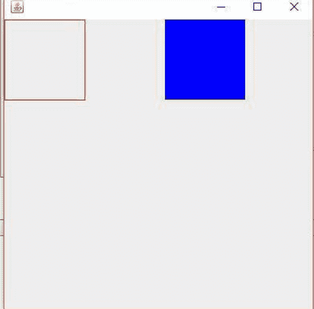

`Graphics` 类的大多数方法可以分为两个基本组：

1. 绘制和填充方法，允许你渲染基本形状、文本和图像
2. 属性设置方法，影响绘制和填充的外观

### 第一类：MyPanel

```java
import javax.swing.*;
import java.awt.*;

// MyPanel 继承 JPanel，最终将被放置在 JFrame 中
public class MyPanel extends JPanel {

    // 自定义绘制通过 paintComponent 方法执行
    @Override
    public void paintComponent(Graphics g) {

        // 清除之前的绘制
        super.paintComponent(g);
        // 将 Graphics 强制转换为 Graphics2D
        Graphics2D g2 = (Graphics2D) g;
        g2.setColor(Color.red); // 设置 Graphics2D 颜色
        // 绘制矩形
        g2.drawRect(0, 0, 100, 100); // drawRect(x位置, y位置, 宽度, 高度)
        g2.setColor(Color.blue);
        g2.fillRect(200, 0, 100, 100); // 用蓝色填充新矩形
    }
}
```

### 第二类：Test

```java
import javax.swing.*;
import java.awt.*;

public class Test { // 我们用来显示矩形的类

    JFrame f;
    MyPanel p;

    public Test() {

        f = new JFrame();
        // 获取 Panel 的内容区域。
        Container c = f.getContentPane();
        // 设置布局管理器
        c.setLayout(new BorderLayout());
        p = new MyPanel();
        // 将 MyPanel 对象添加到容器中
        c.add(p);
        // 设置 JFrame 的大小
        f.setSize(400, 400);
        // 使 JFrame 可视
        f.setVisible(true);
        // 设置关闭行为：EXIT_ON_CLOSE 在关闭时调用 System.exit(0)
        f.setDefaultCloseOperation(JFrame.EXIT_ON_CLOSE);
    }

    public static void main(String[] args[]) {
        Test t = new Test();
    }
}
```

关于 Border Layout 的更多解释：

https://docs.oracle.com/javase/tutorial/uis/swing/layout/border.html

#### `paintComponent()`

- 它是用于绘制的主方法
- 默认情况下，它首先绘制背景
- 之后，它会执行自定义绘制（绘制圆形、矩形等）

`Graphics2D` 指 `Graphics2D` 类

注意：Java 2D API 允许轻松执行以下任务：

- 绘制线条、矩形和其他任何几何形状。
- 使用实色、渐变或纹理填充这些形状。
- 绘制文本，并对字体和渲染过程进行精细控制。
- 绘制图像，可选地应用过滤操作。
- 在上述任何渲染操作期间应用组合和变换操作。

## 第 90.2 节：示例 2：绘制和填充椭圆

```java
import javax.swing.*;
import java.awt.*;

public class MyPanel extends JPanel {
    @Override
    public void paintComponent(Graphics g) {
        // 清除之前的绘制
        super.paintComponent(g);
        Graphics2D g2 = (Graphics2D) g;
        g2.setColor(Color.blue);
        g2.drawOval(0, 0, 100, 100);
    }
}
```

该方法将在指定的 x 和 y 位置根据指定的高度和宽度绘制椭圆。

`g2.fillOval(int x, int y, int height, int width);` 此方法将在指定的 x 和 y 位置根据指定的高度和宽度填充椭圆。

# 第 91 章：JAXB

## 参数详情

| 参数 | 说明 |
| :--- | :--- |
| `fileObjOfXML` | XML 文件的对象 |
| `className` | `.class` 扩展名的类名 |

JAXB 或 Java XML 绑定（`Java Architecture for XML Binding`）是一个软件框架，允许 Java 开发者将 Java 类映射到 XML 表示。本页将通过详细示例向读者介绍 JAXB，其功能主要用于将 Java 对象序列化（marshaling）为 xml 格式以及反之。

## 第 91.1 节：读取 XML 文件（反序列化）

要读取名为 `UserDetails.xml` 内容如下的 XML 文件：

```xml
<?xml version="1.0" encoding="UTF-8" standalone="yes"?>
<user>
  <name>Jon Skeet</name>
  <userId>8884321</userId>
</user>
```

我们需要一个名为 `User.java` 的 POJO 类，如下：

```java
import javax.xml.bind.annotation.XmlRootElement;

@XmlRootElement
public class User {
    private long userID;
    private String name;
    // getters and setters
}
```

在这里我们创建了变量。我们使用 `@XmlRootElement` 注解标记类为根元素。要解析它们，我们使用 `unmarshal()` 方法。

```java
import javax.xml.bind.JAXBContext;
import javax.xml.bind.Unmarshaller;
import java.io.File;

public class Reader {
    public static void main(String[] args) {
        try {
            JAXBContext context = JAXBContext.newInstance(User.class);
            Unmarshaller unmarshaller = context.createUnmarshaller();
            User user = (User) unmarshaller.unmarshal(new File("UserDetails.xml"));
            System.out.println(user.getName());
            System.out.println(user.getID());
        } catch (Exception e) {
            e.printStackTrace();
        }
    }
}
```

## 第 91.2 节：写入 XML 文件（序列化）

```java
import javax.xml.bind.annotation.XmlRootElement;

@XmlRootElement
public class User {
    private long userID;
    private String name;
    // getters and setters
}
```

`marshal()` 用于将对象的内容写入 XML 文件。执行成功后，将创建一个包含以下内容的 XML 文件：

```java
import javax.xml.bind.JAXBContext;
import javax.xml.bind.Marshaller;
import java.io.File;

public class Writer {
    public static void main(String[] args) {
        try {
            JAXBContext context = JAXBContext.newInstance(User.class);
            Marshaller marshaller = context.createMarshaller();
            marshaller.setProperty(Marshaller.JAXB_FORMATTED_OUTPUT, true);
            User user = new User();
            user.setID(8884321);
            user.setName("Jon Skeet");
            marshaller.marshal(user, new File("UserDetails.xml"));
        } catch (Exception e) {
            e.printStackTrace();
        }
    }
}
```

## 第 91.3 节：手动字段/属性配置

注解 `@XmlElement`、`@XmlAttribute` 或 `@XmlTransient` 允许程序员指定哪些字段或属性被序列化。

```java
import javax.xml.bind.annotation.XmlAttribute;
import javax.xml.bind.annotation.XmlAccessorType;
import javax.xml.bind.annotation.XmlAccessType;
import javax.xml.bind.annotation.XmlElement;
import javax.xml.bind.annotation.XmlTransient;

@XmlAccessorType(XmlAccessType.NONE)
public class ManualElementsExample {
    @XmlElement(name = "field")
    private String field;

    @XmlAttribute(name = "attribute")
    private String attribute;

    @XmlTransient
    private String transientField;
}
```

## 第 91.4 节：将 XML 命名空间绑定到序列化的 Java 类

这是一个 `package-info.java` 文件，将 XML 命名空间绑定到序列化的 Java 类。它应该放在与使用命名空间序列化的 Java 类相同的包中。

```java
import javax.xml.bind.annotation.XmlSchema;
import javax.xml.bind.annotation.XmlNs;
import javax.xml.bind.annotation.XmlNsForm;

/**
 * 包含序列化类的包。
 */
@XmlSchema(
  xmlns = {
    @XmlNs(prefix = MySerializableClass.NAMESPACE_PREFIX,
    namespaceURI = MySerializableClass.NAMESPACE)
  },
  namespace = MySerializableClass.NAMESPACE,
  elementFormDefault = XmlNsForm.QUALIFIED
)
```

## 第 91.5 节：使用 XmlAdapter 生成期望的 xml 格式

当期望的 XML 格式与 Java 对象模型不同时，可以使用 `XmlAdapter` 实现将模型对象转换为 xml 格式对象，反之亦然。此示例演示了如何将字段的值放入与字段同名的元素属性中。

```java
public String getValue() {
    return value;
}
```

```java
public void setValue(String value) {
    this.value = value;
}
```

```java
public static class ValueAsAttrXmlAdapter extends XmlAdapter<NodeValueElement, String> {
    @Override
    public NodeValueElement marshal(String v) throws Exception {
        return new NodeValueElement(v);
    }
}
```

```java
@Override
public String unmarshal(NodeValueElement v) throws Exception {
    if (v == null) return "";
    return v.getValue();
}
```

```java
@XmlRootElement(name = "DataObject")
@XmlAccessorType(XmlAccessType.FIELD)
public static class DataObject {
```

```java
    String elementWithValue;
    @XmlJavaTypeAdapter(value = ValueAsAttrXmlAdapter.class)
    String elementWithAttribute;
}
```

```java
public static void main(String[] args) {
    DataObject data = new DataObject();
    data.elementWithValue = "value1";
    data.elementWithAttribute = "value2";

    ByteArrayOutputStream baos = new ByteArrayOutputStream();
    JAXB.marshal(data, baos);
    String xmlString = new String(baos.toByteArray(), StandardCharsets.UTF_8);
    System.out.println(xmlString);
}
```

## 第 91.6 节：使用 XmlAdapter 修剪字符串

```java
package com.example.xml.adapters;
import javax.xml.bind.annotation.adapters.XmlAdapter;

public class StringTrimAdapter extends XmlAdapter<String, String> {

    @Override
    public String unmarshal(String v) throws Exception {
        if (v == null)
            return null;
        return v.trim();
    }

    @Override
    public String marshal(String v) throws Exception {
        if (v == null)
            return null;
        return v.trim();
    }
}
```


在 `package-info.java` 中添加以下声明。

```java
@XmlTypeAdapter(value = com.example.xml.adapters.StringTrimAdapter.class, type = String.class)
package com.example.xml.jaxb.bindings; // 你希望应用过滤的包
import javax.xml.bind.annotation.adapters.XmlTypeAdapter;
```

# 第 91.7 节：自动字段/属性 XML 映射配置 (@XmlAccessorType)

注解 `@XmlAccessorType` 决定了字段/属性是否会被自动序列化为 XML。请注意，字段和方法注解 `@XmlElement`、`@XmlAttribute` 或 `@XmlTransient` 的优先级高于默认设置。

```java
public class XmlAccessTypeExample {

    @XmlAccessorType(XmlAccessType.FIELD)
    static class AccessorExampleField {
        public String field = "value1";
    }

    @XmlAccessorType(XmlAccessType.NONE)
    static class AccessorExampleNone {
        public String getter() { return "getter"; }
        public void setter(String value) { }
    }

    @XmlAccessorType(XmlAccessType.PROPERTY)
    static class AccessorExampleProperty {
        public String field = "value1";
        public String getter() { return "getter"; }
        public void setter(String value) { }
    }

    @XmlAccessorType(XmlAccessType.PUBLIC_MEMBER)
    static class AccessorExamplePublic {
        public String field = "value1";
        public String getter() { return "getter"; }
        public void setter(String value) { }
    }

    public static void main(String[] args) {
        try {
            System.out.println("\nField:");
            JAXB.marshal(new AccessorExampleField(), System.out);

            System.out.println("\nNone:");
            JAXB.marshal(new AccessorExampleNone(), System.out);

            System.out.println("\nProperty:");
            JAXB.marshal(new AccessorExampleProperty(), System.out);

            System.out.println("\nPublic:");
            JAXB.marshal(new AccessorExamplePublic(), System.out);
        } catch (Exception e) {
            System.err.println("Exception occurred while writing in XML!");
        }
    } // 类结束
}
```

输出：

```
Field:
<?xml version="1.0" encoding="UTF-8" standalone="yes"?>
<accessorExampleField>
    <field>value1</field>
</accessorExampleField>

None:
<?xml version="1.0" encoding="UTF-8" standalone="yes"?>
<accessorExampleNone/>

Property:
<?xml version="1.0" encoding="UTF-8" standalone="yes"?>
<accessorExampleProperty>
    <getter>getter</getter>
</accessorExampleProperty>

Public:
<?xml version="1.0" encoding="UTF-8" standalone="yes"?>
<accessorExamplePublic>
    <field>value1</field>
    <getter>getter</getter>
</accessorExamplePublic>
```

```java
class Test {
    void printName(Object obj) {
        Class c = obj.getClass();
        System.out.println(c.getName());
    }

    public static void main(String[] args[]) {
        Simple s = new Simple();
        Test t = new Test();
        t.printName(s);
    }
}
```

# 第 93 章：网络

## 第 93.1 节：使用 Socket 进行基础客户端服务器通信

### 服务器：启动并等待接入连接

```java
// 在端口 1234 上开启一个监听 "ServerSocket"。
ServerSocket serverSocket = new ServerSocket(1234);
```

```java
while (true) {
    // 等待客户端连接。
    // 一旦客户端连接，我们就会获得一个 "Socket" 对象
    // 可用于向新连接的客户端发送消息或从其接收消息
    Socket client = serverSocket.accept();
    // 在这里我们将添加处理特定客户端的代码。
}
```

### 服务器：处理客户端

我们将在独立的线程中处理每个客户端，以便多个客户端可以同时与服务器交互。只要客户端数量较少（小于 1000 个客户端，取决于操作系统的架构和每个线程的预期负载），这种技术就能正常工作。

```java
new Thread(() -> {
    try {
        // 获取 socket 的 InputStream，以便从 socket InputStream 中读取字节
        InputStream in = clientSocket.getInputStream();
        // 将 InputStream 封装在 reader 中，这样你就可以读取字符串而不是字节
        BufferedReader reader = new BufferedReader(
            new InputStreamReader(in, StandardCharsets.UTF_8));
        // 从 socket 读取读取文本并逐行打印
        String line;
        while ((line = reader.readLine()) != null) {
            System.out.println(line);
        }
    } catch (IOException e) {
        e.printStackTrace();
    } finally {
        // 这个 finally 块确保了 socket 被关闭。
        // 无法使用 try-with-resources 块，因为
        // socket 被传递到了线程，所以它不是在同一个块中创建和关闭的
        try {
            clientSocket.close();
        } catch (IOException e) {
            e.printStackTrace();
        }
    }
}).start();
```

### 客户端：连接服务器并发送消息

```java
// 127.0.0.1 是服务器的地址（这是本地回环地址；即我们机器的地址）
// 1234 是服务器将监听的端口
Socket socket = new Socket("127.0.0.1", 1234);

// 向 socket 写入字符串并刷新缓冲区
OutputStream outStream = socket.getOutputStream();
PrintWriter writer = new PrintWriter(
    new OutputStreamWriter(outStream, StandardCharsets.UTF_8));
writer.println("Hello world!");
writer.flush();
```

### 关闭 Socket 和处理异常

- 上述示例为了易于阅读，省略了一些内容。
- 1. 就像文件和其他外部资源一样，在我们完成操作时告诉操作系统是非常重要的。当我们完成对 socket 的操作后，调用 `socket.close()` 来正确关闭它。
- 2. Socket 处理依赖于各种外部因素的 I/O（输入/输出）操作。例如，如果发生了网络错误怎么办？这些情况是我们无法控制的。这就是为什么许多 socket 操作可能会抛出异常，尤其是 `IOException`。

因此，客户端更完整的代码应该如下：

```java
// "try-with-resources" 会在我们离开其作用域后关闭 socket
try (Socket socket = new Socket("127.0.0.1", 1234)) {
    OutputStream outStream = socket.getOutputStream();
    PrintWriter writer = new PrintWriter(
        new OutputStreamWriter(outStream, StandardCharsets.UTF_8));
    writer.println("Hello world!");
    writer.flush();
} catch (IOException e) {
    // 处理错误
}
```

### 基础服务器和客户端 - 完整示例

#### 服务器

```java
import java.io.BufferedReader;
import java.io.IOException;
import java.io.InputStream;
import java.io.InputStreamReader;
import java.net.ServerSocket;
import java.net.Socket;
import java.nio.charset.StandardCharsets;

public class Server {
    public static void main(String[] args) {
        try (ServerSocket serverSocket = new ServerSocket(1234)) {
            while (true) {
                // 等待客户端连接。
                Socket clientSocket = serverSocket.accept();
                // 创建并启动一个线程来处理新客户端
                new Thread(() -> {
                    try {
                        // 获取 socket 的 InputStream，以便从 socket 读取字节
                        InputStream in = clientSocket.getInputStream();
                        // 将 InputStream 封装在 reader 中，这样你就可以读取字符串而不是字节
                        BufferedReader reader = new BufferedReader(
                            new InputStreamReader(in, StandardCharsets.UTF_8));
                        // 从 socket 读取并使用 String 逐行打印
                        String line;
                        while ((line = reader.readLine()) != null) {
                            System.out.println(line);
                        }
                    } catch (IOException e) {
                        e.printStackTrace();
                    } finally {
                        try {
                            clientSocket.close();
                        } catch (IOException e) {
                            e.printStackTrace();
                        }
                    }
                }).start();
            }
        } catch (IOException e) {
            e.printStackTrace();
        }
    }
}
```

#### 客户端

```java
import java.io.IOException;
import java.io.OutputStream;
import java.io.OutputStreamWriter;
import java.io.PrintWriter;
import java.net.Socket;
import java.nio.charset.StandardCharsets;

public class Client {
    public static void main(String[] args) {
        try (Socket socket = new Socket("127.0.0.1", 1234)) {
            OutputStream outStream = socket.getOutputStream();
            PrintWriter writer = new PrintWriter(
                new OutputStreamWriter(outStream, StandardCharsets.UTF_8));
            writer.println("Hello world!");
            writer.flush();
        } catch (IOException e) {
            e.printStackTrace();
        }
    }
}
```

## 第 93.2 节：使用 UDP (Datagram) 进行基础客户端服务器通信

### Client.java

```java
import java.io.*;
import java.net.*;

public class Client {
    public static void main(String[] args) throws IOException {
        DatagramSocket clientSocket = new DatagramSocket();
        InetAddress address = InetAddress.getByName(args[0]);
        String ex = "Hello World!";
        byte[] buf = ex.getBytes();
        DatagramPacket packet = new DatagramPacket(buf, buf.length, address, 1234);
        clientSocket.send(packet);
    }
}
```

### Server.java

```java
import java.io.*;
import java.net.*;

public class Server {
    public static void main(String[] args) throws IOException {
        DatagramSocket server = new DatagramSocket(1234);
        byte[] rbuf = new byte[256];
    }
}
```


# 第 93 章：网络编程示例

## 第 93.1 节：UDP 数据报接收示例

```java
DatagramPacket packet = new DatagramPacket(rbuf, rbuf.length);
server.receive(packet);
String response = new String(packet.getData());
System.out.println("Response: " + response);
```

## 第 93.2 节：从 InputStream 加载 TrustStore 和 KeyStore

```java
public class TrustLoader {
    public static void main(String[] args) {
        try (InputStream stream = TrustLoader.class.getResourceAsStream("/ssl/renadesClient.jks")) {
            // trustStores 和 keyStores 都由 KeyStore 对象表示
            KeyStore trustStore = KeyStore.getInstance(KeyStore.getDefaultType());
            // trustStore 的密码
            char[] trustStorePassword = "password".toCharArray();
            // 将 trust store 加载到对象中
            trustStore.load(stream, trustStorePassword);
            // 定义 SSLContext 以便使用 trust store。获取默认 SSLContext 进行编辑。
            SSLContext context = SSLContext.getInstance("SSL");
            // TrustManagers 信任存储，可以添加多个
            TrustManagerFactory factory = TrustManagerFactory.getInstance(TrustManagerFactory.getDefaultAlgorithm());
            // 添加 trust store
            factory.init(trustStore);
            // 传递给 SSLContext init 方法
            TrustManager[] managers = factory.getTrustManagers();
            context.init(null, managers, null);
            // 设置我们的新 SSLContext 以供使用。
            SSLContext.setDefault(context);
        } catch (KeyStoreException | IOException | NoSuchAlgorithmException | CertificateException | KeyManagementException ex) {
            // 处理错误
            ex.printStackTrace();
        }
    }
}
```

## 第 93.3 节：Socket 示例 - 使用简单的 socket 读取网页

```java
import java.io.*;
import java.net.Socket;

public class Main {
    // 发送基础 HTTP 请求头
    writer.print("GET / HTTP/1.1\nHost:stackoverflow.com\n\n");
    writer.flush();

    // 读取响应
    System.out.println(readFully(reader));
    // 关闭 socket
    socket.close();

    private static String readFully(Reader in) {
        StringBuilder sb = new StringBuilder();
        int BUFFER_SIZE = 1024;
        char[] buffer = new char[BUFFER_SIZE]; // 或其他大小
        // ... (源中省略了方法的其余部分)
    }
}
```

你将会得到一个 HTTP/1.1 200 OK 的响应，这表示一个正常的 HTTP 响应，随后是剩余的 HTTP 请求头，最后是 HTML 格式的原始网页。注意 `readFully()` 方法非常重要，它可以防止过早发生 EOF 异常。网页的最后一行可能缺少换行符（用于表示行结束），此时 `readLine()` 会报错，因此必须手动读取或使用来自 Apache commons-io `IOUtils` 的工具方法。

此示例仅作为使用 socket 连接到现有资源的简单演示；它并不是访问网页的实际方法。如果你需要使用 Java 访问网页，最好使用 HTTP 客户端库，例如 Apache 的 HTTP Client 或 Google 的 HTTP Client。

## 第 93.4 节：临时禁用 SSL 验证（用于测试目的）

有时在开发或测试环境中，SSL 证书链可能尚未完全建立。为了继续开发和测试，你可以通过安装一个“信任所有”的信任管理器来程序化地关闭 SSL 验证：

```java
try {
    // 创建一个不验证证书链的信任管理器
    TrustManager[] allCerts = new TrustManager[] {
        new X509TrustManager() {
            public X509Certificate[] getAcceptedIssuers() { 
                return null;
            }
            public void checkClientTrusted(X509Certificate[] certs, String authType) { }
            public void checkServerTrusted(X509Certificate[] certs, String authType) { }
        }
    };
    // 安装信任所有的信任管理器
    SSLContext sc = SSLContext.getInstance("SSL");
    sc.init(null, allCerts, new java.security.SecureRandom());
    HttpsURLConnection.setDefaultSSLSocketFactory(sc.getSocketFactory());
    // 创建信任所有的主机名验证器
    HostnameVerifier allHostsValid = new HostnameVerifier() {
        public boolean verify(String hostname, SSLSession session) { 
            return true;
        }
    };
    // 安装信任所有的主机验证器
    HttpsURLConnection.setDefaultHostnameVerifier(allHostsValid);
}
```

## 第 93.5 节：使用 Channel 下载文件

如果文件已经存在，它将会被覆盖！

```java
String fileName = "file.zip"; // 文件名
String urlGetFrom = "http://www.mywebsite.com/"; // 获取文件的 URL
String pathToSaveTo = "C:\\Users\\user\\"; // 存放位置
```

```java
// 如果文件已经存在，它将会被覆盖；
// 向目标文件打开输出流
try (ReadableByteChannel rbc = Channels.newChannel(new URL(urlGetFrom + fileName).openStream())) {
    try (FileChannel channel = new FileOutputStream(pathToSaveTo + fileName).getChannel()) {
        channel.transferFrom(rbc, Long.MAX_VALUE);
    }
} catch (FileNotFoundException e) { /* 输出目录未找到 */ } 
catch (IOException e) { /* 文件 IO 错误 */ }
catch (MalformedURLException e) { /* URL 格式错误 */ } 
catch (IOException e) { /* 连接网站时的 IO 错误 */ }
```

### 注意事项

- 不要让 catch 块为空！
- 如果发生错误，检查远程文件是否存在。
- 这是一个阻塞操作，处理大文件可能需要很长时间。

## 第 93.6 节：组播

组播（Multicasting）是数据报套接字（Datagram Socket）的一种。与普通数据报不同，组播不会单独处理每个客户端，而是将消息发送到一个 IP 地址，所有订阅的客户端都会收到消息。

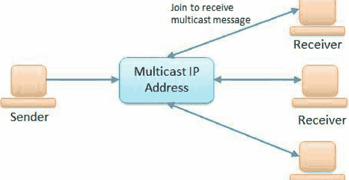

### 服务端

```java
public class Server {
    private DatagramSocket serverSocket;
    private String ip;
    private int port;

    public Server(String ip, int port) throws SocketException, IOException {
        this.ip = ip;
        this.port = port;
        // 用于发送的 socket
        serverSocket = new DatagramSocket();
    }

    public void send() throws IOException {
        // 创建数据包
        byte[] message = ("Multicasting...").getBytes();
        // 示例代码
        DatagramPacket packet = new DatagramPacket(message, message.length,
            InetAddress.getByName(ip), port);
        // 发送数据包
        serverSocket.send(packet);
    }

    public void close() { 
        serverSocket.close();
    }
}
```

### 客户端

```java
public class Client {
    private MulticastSocket socket;

    public Client(String ip, int port) throws IOException {
        // 关键是
        socket = new MulticastSocket(port);
        // 加入组
        socket.joinGroup(InetAddress.getByName(ip));
    }

    public void printMessage() throws IOException {
        // ...
    }

    public void close() {
        socket.close();
    }
}
```

# 第 94 章：NIO - 网络

## 第 94.1 节：使用 Selector 等待事件（带 OP_CONNECT 的示例）

NIO 出现在 Java 1.4 中，并引入了“通道”（Channels）的概念，它们应该比传统的 I/O 更快。在网络方面，`SelectableChannel` 是最有趣的，因为它的工作方式与 C 语言的 `SELECT()` 系统调用类似：当某些类型的事件发生时会被唤醒：

- 接收连接 (`OP_ACCEPT`)
- 连接建立 (`OP_CONNECT`)
- 读取数据可用 (`OP_READ`)
- 可以写入数据 (`OP_WRITE`)

它允许将 socket I/O 检测（可以读写...）与执行 I/O 分离开。具体来说，所有的 I/O 检测可以在单个线程中处理多个 socket（客户端），而执行 I/O 可以在线程池或任何地方处理。这使得应用程序能够根据连接客户端的数量轻松扩展。

以下示例展示了基础操作：

1. 创建 `Selector`
2. 创建 `SocketChannel`
3. 将 `SocketChannel` 注册到 `Selector`
4. 循环 `Selector` 检测事件

```java
Selector sel = Selector.open(); // 创建 Selector
SocketChannel sc = SocketChannel.open(); // 创建 SocketChannel
sc.configureBlocking(false); // ... 非阻塞
sc.setOption(StandardSocketOptions.SO_KEEPALIVE, true); // ... 设置选项
```

```java
// 将注册到 Selector 以在 CONNECT 事件时唤醒
// 并使用某些描述作为附件
sc.register(sel, SelectionKey.OP_CONNECT, "连接到 google.com");
// 返回一个 SelectionKey：SocketChannel 与 Selector 之间的关联
System.out.println("正在建立连接");
if (sc.connect(new InetSocketAddress("www.google.com", 80))) {
    // 立即连接：无需等待
} else {
    // 等待连接
}
System.out.println("已连接"); // 立即连接：无需等待
boolean exit = false;
while (!exit) {
    if (sel.select(100) == 0) { // 在过去的 100ms 内是否某些注册的通道发生了什么？
        continue; // 再等一会儿
    }
    // 发生了某些事情
    Set<SelectionKey> keys = sel.selectedKeys(); // SelectionKeys 列表
    // 哪些注册的操作被触发了
    for (SelectionKey k : keys) {
        System.out.println("Checking " + k.attachment());
        if (k.isConnectable()) { // 连接
            System.out.print("Connected through select() on " + k.channel() + " -> ");
            if (sc.finishConnect()) { // 完成连接过程
                System.out.println("done!");
                k.interestOps(k.interestOps() & ~SelectionKey.OP_CONNECT); // 我们已经连接：移除对 CONNECT 事件的关注
                exit = true;
            } else {
                System.out.println("unfinished...");
            }
        }
        // TODO: else if (k.isReadable()) { ...
    }
    keys.clear(); // 处理后 必须清除被选中的 KEYS SET！
}
System.out.print("Disconnecting ... ");
sc.shutdownOutput(); // 发起优雅断开
// TODO: 清空接收缓冲区
sc.close();
System.out.println("done");
```

将产生以下输出：

```
正在连接
正在检查到 google.com
通过 'select()' 在 java.nio.channels.SocketChannel[connection-pending remote=www.google.com/216.58.208.228:80] 上连接 -> done!
正在断开 ... done
```

# 第 95 章：HttpURLConnection

## 第 95.1 节：从 URL 获取字符串响应体

```java
String getText(String url) throws IOException {
```


HttpConnection connection = (HttpURLConnection) new URL(url).openConnection(); // 添加请求头，或者根据需要检查状态。

```java
// 发生时处理错误响应码
int responseCode = conn.getResponseCode();
InputStream inputStream;
if (200 <= responseCode && responseCode <= 299) {
  inputStream = connection.getInputStream();
} else {
  inputStream = connection.getErrorStream();
}
```

```java
BufferedReader in = new BufferedReader(
  new InputStreamReader(inputStream));
```

```java
StringBuilder response = new StringBuilder();
String currentLine;
while ((currentLine = in.readLine()) != null) {
  response.append(currentLine);
}
in.close();
return response.toString();
```

这将从指定的 URL 下载文本数据，并作为 String 返回。

**工作原理：**

首先，我们通过 URL 创建一个 `HttpUrlConnection`，使用 `new URL(url).openConnection()`。我们将返回的 `UrlConnection` 强制转换为 `HttpConnection`，这样我们就可以访问添加请求头（如 User Agent）或检查响应码等功能。（此示例未做这些，但很容易添加。）

然后，根据响应码创建 `InputStream`（用于错误处理）。
接着，创建一个 `BufferedReader`，允许我们从从中获取的 `InputStream` 中读取文本。
现在，我们逐行将文本追加到 `StringBuilder` 中。
关闭 `InputStream`，并返回我们现在拥有的 String。

注意：
此方法在失败时（例如网络错误或未连接互联网）将抛出 `IOException`，如果给定的 URL 无效，它还会抛出一个未捕获的异常 `MalformedURLException`。
它可以用于从任何返回文本的 URL 读取，例如网页 (HTML)、返回 JSON 或 XML 的 REST API 等。
另请参考：用几行 Java 代码读取到字符串。

用法：
非常简单：
`String text = getText("http://example.com");`
// 对 example 的文本进行操作，在这种情况下是 HTML。

### 第 95.2 节：POST 数据

```java
public static void post(String url, byte[] data, String contentType) throws IOException {
  HttpURLConnection connection = null;
  OutputStream out = null;
  InputStream in = null;
  try {
    connection = (HttpURLConnection) new URL(url).openConnection();
    connection.setRequestProperty("Content-Type", contentType);
    connection.setDoOutput(true);
    out = connection.getOutputStream();
    out.write(data);
    out.close();
    in = connection.getInputStream();
    BufferedReader reader = new BufferedReader(new InputStreamReader(in));
    String line = null;
    while ((line = reader.readLine()) != null) {
      System.out.println(line);
    }
    in.close();
  } finally {
    if (connection != null) connection.disconnect();
    if (out != null) out.close();
    if (in != null) in.close();
  }
}
```

这将向指定的 URL POST 数据，然后逐行读取响应。

### 工作原理

一如既常，我们从 URL 获取 `HttpConnection`。
使用 `requestProperty` 设置内容类型，默认情况下是 `application/x-www-form-urlencoded`。`setDoOutput(true)` 告诉连接我们将发送数据。

然后，通过调用 `getOutputStream()` 获取 `OutputStream` 并向其写入数据。不要忘记在完成后关闭它。
最后，我们读取服务器的响应。

### 第 95.3 节：删除资源

```java
public static void delete (String urlString, String contentType) throws IOException {
  HttpConnection connection = null;
  URL url = new URL(urlString);
  connection = (HttpConnection) url.openConnection();
  connection.setDoInput(true);
  connection.setRequestMethod("DELETE");
  connection.setRequestProperty("Content-Type", contentType);
  Map<String, List<String>> map = connection.getHeaderFields();
  StringBuilder sb = new StringBuilder();
  Iterator<Map.Entry<String, String>> iterator = map.entrySet().iterator();
  while (iterator.hasNext()) {
    Map.Entry<String, String> entry = iterator.next();
    System.out.println(entry.getKey() + ": " + entry.getValue());
  }
}
```


# 第 97.2 节：拦截脚本输出

```java
// 获取 JavaScript 引擎的实例
ScriptManager manager = new ScriptEngineManager();
ScriptEngine engine = manager.getEngineByName("nashorn");
```

```java
// 设置自定义 writer
StringBuilder writer = new StringBuilder();
// 修改引擎上下文，使自定义 writer 成为引擎的默认输出 writer
engine.getContext().setWriter(writer);
```

```java
// 执行某些脚本
try {
    engine.eval("print('Redirected text!')");
} catch (ScriptException ex) {
    ex.printStackTrace();
}
```

```java
// 结果：
// 标准输出上没有打印任何内容，但 writer.toString() 包含 'Redirected text!'
```

# 第 97.3 节：Hello Nashorn

```java
// 获取 JavaScript 引擎的实例
ScriptManager manager = new ScriptEngineManager();
ScriptEngine engine = manager.getEngineByName("nashorn");
```

```java
// 执行一个硬编码脚本
try {
    engine.eval("print('Hello Nashorn!')");
} catch (ScriptException ex) {
    // 这是 Scripting API 的通用异常子类
    ex.printStackTrace();
}
```

```java
// 结果：
// 'Hello Nashorn!' 打印在标准输出
```

# 第 97.4 节：评估算术字符串

```java
// 获取 JavaScript 引擎的实例
ScriptEngine manager = new ScriptEngineManager();
ScriptEngine engine = manager.getEngineByName("JavaScript");
// 待评估的字符串
String str = "3+2*4+5";
// 根据运算符优先级进行算术操作后的值将为 16
// 打印值
try {
    System.out.println(engine.eval(str));
} catch (ScriptObject ex) {
    ex.printStackTrace();
}
```

```java
// 结果：
// 字符串在算术评估后的值打印在标准输出上。
// 在这种情况下 '16.0' 将打印在标准输出上。
```

# 第 97.5 节：设置全局变量

```java
// 获取 JavaScript 引擎的实例
ScriptManager manager = new ScriptEngineManager();
ScriptEngine engine = manager.getEngineByName("nashorn");
// 定义一个全局变量
engine.put("textToPrint", "Data defined in Java.");
// 打印全局变量
try {
    engine.eval("print(textToPrint)");
} catch (ScriptException ex) {
    ex.printStackTrace();
}
```

// 结果：
// 'Data defined in Java.' 打印在标准输出

# 第 97.6 节：设置和获取全局变量

```java
// 获取 JavaScript 引擎的实例
ScriptManager manager = new ScriptEngineManager();
ScriptEngine engine = manager.getEngineByName("nashorn");
```

```java
try {
    // 在引擎的全局命名空间设置值
    engine.put("name", "Nashorn");
    // 执行一个硬编码脚本
    engine.eval("var value='Hello '+name+'!';");
    // 获取值
    String value = (String) engine.get("value");
    System.out.println(value);
} catch (ScriptException ex) {
    // 这是 Scripting API 的通用异常子类
    ex.printStackTrace();
}
```

// 结果：
// 'Hello Nashorn!' 打印在标准输出

# 第 97.7 节：在 Nashorn 的 JavaScript 中使用 Java 对象

可以将 Java 对象传递给 Nashorn 引擎以便在 Java 代码中处理。同时，还有一些 JavaScript（以及 Nashorn）特有的结构，并不总是清楚它们如何与 Java 对象协同工作。下面的表描述了原生 Java 对象在 JavaScript 结构内部的行为。

测试过的结构：

1. `if` 子句中的表达式。与 Java 不同，`if` 子句中的 JS 表达式不需要是布尔值。对于所谓的“虚假值”（`null`、`undefined`、`0`、空字符串等），它会被评估为 `false`。
2. `for each` 语句。Nashorn 拥有一种特殊的循环 - `for each` - 它可以遍历不同的 JS 和 Java 对象。
3. 获取对象大小。JS 对象中有一个 `length` 属性，对于数组或字符串它返回 true。

结果：

| 类型 | If | for each | .length |
| :--- | :--- | :--- | :--- |
| Java String `null` | `false` | 无迭代 | 异常 |
| Java String 空字符串 | `false` | 无 | `0` 迭代 |
| Java String `true` | 遍历字符串字符 | 字符串的长度 |
| Java Integer/Long | `value != 0` | 迭代 | |
| Java ArrayList | `true` | | |
| Java HashMap | `true` | | |
| HashSet | `true` | 遍历元素 | |
| 列表长度 | | | `undefined` |

建议：

- 建议使用 `if (some_string)` 来检查字符串是否非空且不为空
- `for each` 可以安全地用于遍历任何集合，如果集合不可迭代、`null` 或 `undefined`，它不会抛出异常
- 在获取对象长度之前，必须检查其是否为 `null` 或 `undefined`（对于任何尝试调用 Java 对象的方法或获取属性的操作也是如此）

# 第 97.8 节：从脚本实现接口

```java
import java.io.FileReader;
import java.io.IOException;
import javax.script.ScriptEngine;
import javax.script.ScriptEngineManager;
import javax.script.ScriptException;

public class InterfaceImplementationExample {

    public static interface Pet {
        public void eat();
    }

    public static void main(String[] args) throws IOException {
        // 获取 JavaScript 引擎的实例
        ScriptEngine manager = new ScriptEngineManager();
        ScriptEngine engine = manager.getEngineByName("nashorn");

        try {
            // 评估脚本
            var Pet = Java.type("InterfaceImplementationExample$Pet");
            new Pet() {
                eat: function() { print("eat"); }
            };
            pet.eat();
        } catch (ScriptException ex) {
            ex.printStackTrace();
        }
    }
}
```

// 结果：
// 'eat' 打印在标准输出

```cpp
jint *intArrayInC = env->GetIntArrayElements(intArray, NULL);
if (NULL == intArrayInC)
    return 1;
jsize length = env->GetArrayLength(intArray);
int sum = 0;
for (int i = 0; i < length; i++) {
    sum += intArrayInC[i];
}
env->ReleaseIntArrayElements(intArray, intArrayInC, 0);
return (double) sum / length;
```

# 输出

运行上述示例将产生以下输出：
从 Java 调用 C++ `printString`，从 C++ `average` 得到结果：3.4

# 第 98.2 节：从 C++ 调用 Java 方法（回调）

- 从原生代码调用 Java 方法是一个两步走的过程：
1. 使用 `GetMethodID` 函数获取方法指针，使用方法名和描述符；
2. 调用此处列出的 `Call*Method` 函数之一。

# Java 代码

```java
*** com.example.jni.JNIJavaCallback.java ***
package com.example.jni;

public class JNIJavaCallback {
    static {
        System.loadLibrary("libJNI_CPP");
    }

    public static void main(String[] args) {
        new JNIJavaCallback().callback();
    }

    public native void callback();

    public static void printNum(int i) {
        System.out.println("Got int from C++:" + i);
    }

    public static void printFloat(float i) {
        System.out.println("Got float from C++:" + i);
    }
}
```

### C++ 代码

```cpp
// com_example_jni_JNIcppCallback.cpp
#include <iostream>
#include "com_example_jni_JNIJavaCallback.h"
using namespace std;

JNIEXPORT void JNICALL
Java_com_example_jni_JNIJavaCallback_callback(JNIEnv *env, jobject jthis) {
    jclass thisClass = env->GetObjectClass(jthis);
    jmethodID printFloat = env->GetMethodID(thisClass, "printFloat", "(F)V");
    if (NULL == printFloat)
        return;
    env->CallVoidMethod(jthis, printFloat, 5221);
    jmethodID staticPrintInt = env->GetStaticMethodID(thisClass, "printNum", "(I)V");
    if (NULL == staticPrintInt)
        return;
    env->CallVoidMethod(jthis, staticPrintInt, 17);
}
```


# 输出

从 C++ 得到 float: 5.221
从 C++ 得到: 17

# 获取描述符

描述符（或内部类型签名）是使用 `javap` 程序在编译后的 `.class` 文件上获取的。以下是 `javap -s` 的输出：

```
com.example.jni.JNIJavaCallback :
Compiled from "JNIJavaCallback.java"

public class com.example.jni.JNIJavaCallback { 
  static {};
  descriptor: ()V
  public static com.example.jni.JNIJavaCallback(); descriptor: ()V
  public static void main(java.lang.String[]); descriptor: ([Ljava/lang/String;)V
  public native void callback(); descriptor: ()V
  public static void printNum(int); descriptor: (I)V // <---- 需要
  public static void printFloat(float); descriptor: (F)V // <---- 需要 
}
```

# 第 98.3 节：加载原生库

在 Java 中加载共享库文件的常用惯用法如下：

```java
public class ClassWithNativeMethods {

  static {

    System.loadLibrary("Example");

  }

  public native void someNativeMethod(String arg); ...

}
```

对 `System.loadLibrary` 的调用几乎总是静态的，以便在类加载期间发生，确保在共享库加载之前没有原生方法可以执行。以下也是可能的：

```java
public class ClassWithNativeMethods {

  // 在使用任何原生方法之前调用

  public static void prepareNativeMethods() {

    System.loadLibrary("Example");

  }

}
```

...
这允许推迟共享库的加载直到需要，但需要额外的注意以避免 `java.lang.UnsatisfiedLinkErrors`。

# 目标文件查找

共享库文件在 `java.library.path` 系统属性定义的路径中搜索，该属性可以使用运行时 JVM 参数 `-Djava.library.path=` 来覆盖：
`java -Djava.library.path=path/to/lib/path/to/other/lib MainClassWithNativeMethods`

注意系统分隔符：例如，Windows 使用 `;` 而不是 `:`。

注意 `System.loadLibrary` 以取决于平台的方式解析库文件名：上述代码片段在 Linux 上查找名为 `libExample.so` 的文件，在 Windows 上查找 `Example.dll`。
`System.loadLibrary` 的替代方案是 `System.load(String)`，它接受共享库文件的路径，从而绕过 `java.library.path` 的查找：

```java
public class ClassWithNativeMethods {

  static {

    System.load("/path/to/lib/libExample.so");

  }

}
```

...

# 第 99 章：函数式接口

在 Java 8+ 中，*函数式接口*是一个只有一个抽象方法的接口（`Object` 的方法除外）。参见 JLS 9.8. Functional Interfaces。

## 第 99.1 节：按签名划分的标准 Java 运行时库函数式接口列表

| 参数类型 | 返回类型 | 接口 |
| :--- | :--- | :--- |
| () | void | `Runnable` |
| () | T | `Supplier` |
| () | int | `IntSupplier` |
| () | long | `LongSupplier` |
| () | double | `DoubleSupplier` |
| (T) | void | `Consumer<T>` |
| (T) | R | `Function<T, R>` |
| (T) | int | `ToIntFunction<T>` |
| (T) | long | `ToLongFunction<T>` |
| (T) | double | `ToDoubleFunction<T>` |
| (T, T) | T | `BinaryOperator<T>` |
| (T, U) | void | `BiConsumer<T, U>` |
| (T, U) | R | `BiFunction<T, U, R>` |
| (T, U) | int | `ToIntBiFunction<T, U>` |
| (T, U) | long | `ToLongBiFunction<T, U>` |
| (T, U) | double | `ToDoubleBiFunction<T, U>` |
| (T, T, T) | void | `ObjDoubleConsumer<T>` (注：原表格可能有误，标准库中三参数接口较少) |
| (T, T, U) | R | (无直接对应标准接口) |
| (T, T, V) | int | (无直接对应标准接口) |
| (T, T, V) | long | (无直接对应标准接口) |
| (T, T, U) | double | (无直接对应标准接口) |
| (T, U, T) | void | (无直接对应标准接口) |
| (T, U, U) | R | (无直接对应标准接口) |
| (T, U, V) | int | (无直接对应标准接口) |
| (T, U, V) | long | (无直接对应标准接口) |
| (T, U, U) | double | (无直接对应标准接口) |
| (V, V, T) | void | (无直接对应标准接口) |
| (V, V, U) | R | (无直接对应标准接口) |
| (V, V, V) | int | (无直接对应标准接口) |
| (V, V, V) | long | (无直接对应标准接口) |
| (V, V, U) | double | (无直接对应标准接口) |

> 注：原文列表部分接口名称与签名不完全对应（如 `LongFunction<T>` 签名为 `(long) -> R`，`DoubleFunction<T>` 签名为 `(double) -> R`，`BinaryOperator<T, double>` 不存在），以上表格已按标准 JDK 定义修正对应关系。

# 第 100 章：流式接口

### 第 100.1 节：流式编程风格

在流式风格中，你从非流式风格中不返回内容的（setter）方法中返回 `this`。这允许你链式调用不同的方法，使得你的代码更短更容易让开发者处理。考虑这段非流式的代码：

```java
public class Person {

    private String firstName;

    private String lastName;

    public String getFirstName() {

        return firstName;

    }

    public void setFirstName(String firstName) {

        this.firstName = firstName;

    }

    public String getLastName() {

        return lastName;

    }

    public void setLastName(String lastName) {

        this.lastName = lastName;

    }

    public String whoAreYou() {

        return "I am " + firstName + " " + lastName;

    }

    public static void main(String[] args) {

        Person person = new Person();

        person.setFirstName("John");

        person.setLastName("Doe");

        System.out.println(person.whoAreYou());

    }

}
```

由于 setter 方法不返回任何内容，我们需要在 `main` 方法中使用指令来实例化带有数据的 `Person` 并打印它。使用流式风格，这段代码可以更改为：

```java
public class Person {

    private String firstName;

    private String lastName;

    public String getFirstName() {

        return firstName;

    }

    public Person withFirstName(String firstName) {

        this.firstName = firstName;

        return this;

    }

    public String getLastName() {

        return lastName;

    }

    public Person withLastName(String lastName) {

        this.lastName = lastName;

        return this;

    }

    public String whoAreYou() {

        return "I am " + firstName + " " + lastName;

    }

    public static void main(String[] args) {

        System.out.println(new Person().withFirstName("John")

            .withLastName("Doe").whoAreYou());

    }

}
```

这种思想是始终返回某个对象以构建方法调用链，并使用符合自然语言的方法名。这种流式风格使得代码更具读性。

### 第 100.2 节：Truth - 测试框架

来自“如何使用 Truth” <http://google.github.io/truth/>

```java
String string = "awesome";

assertThat(string).startsWith("awe");

assertWithMessage("Without me, it's just awesome").that(string).contains("me");
```

```java
Iterable<Color> googleColors = googleLogo.getColors();

assertThat(googleColors)

  .containsExactly(BLUE, RED, YELLOW, BLUE, GREEN, RED)

  .inOrder();
```

# 第 101 章：远程方法调用 (RMI)

### 第 101.1 节：回调：调用“客户端”的方法

#### 概述

在这个示例中，两个客户端通过服务器发送信息。一个客户端向服务器发送一个数字，将其传递给第二个客户端。第二个客户端将数字减半并通过服务器传回第一个客户端。第一个客户端也这样做。当任何客户端返回给服务器的数字小于 10 时，服务器停止通信。服务器返回客户端的返回值（转换为字符串表示的数字）随后回溯该过程。

1. 登录服务器将其绑定到注册表。
2. 客户端查找登录服务器并使用其信息调用登录方法。然后：登录服务器存储客户端信息。它包含了带有回调方法的客户端存根。登录服务器创建并返回一个服务器存根（“连接”或“会话”）给客户端存储。它包含了带有方法的服务器存根，包括一个注销方法（示例中未使用）。
3. 客户端调用服务器的 `passInt`，传入接收客户端的名称和一个 `int`。
4. 服务器在接收客户端上调用 `half` 方法传入该 `int`。这启动了往复的（调用和回调）通信，直到被服务器停止。

#### 共享远程接口

登录服务器：

```java
package callbackRemote;

import java.rmi.Remote;
import java.rmi.RemoteException;

public interface RemoteLogin extends Remote {

    RemoteConnection login(String name, RemoteClient client) throws RemoteException;

}
```

服务器：

```java
package callbackRemote;

import java.rmi.Remote;
import java.rmi.RemoteException;

public interface RemoteConnection extends Remote {

    void logout() throws RemoteException;

    String passInt(String name, int i) throws RemoteException;

}
```

客户端：

```java
package callbackRemote;

import java.rmi.Remote;
import java.rmi.RemoteException;

public interface RemoteClient extends Remote {

    void half(int i) throws RemoteException;

}
```

#### 实现

登录服务器：

```java
package callbackServer;

import java.rmi.RemoteException;
import java.rmi.registry.LocateRegistry;
import java.rmi.registry.Registry;
import java.rmi.server.UnicastRemoteObject;
import java.util.HashMap;
import java.util.Map;
import callbackRemote.RemoteClient;
import callbackRemote.RemoteConnection;
import callbackRemote.RemoteLogin;

public class LoginServer implements RemoteLogin {

    static Map<String, RemoteClient> clients = new HashMap<>();

    @Override
    public RemoteConnection login(String name, RemoteClient client) {
        Connection connection = new Connection(name, client);
        clients.put(name, client);
        System.out.println(name + " logged in");
        return connection;
    }

    public static void main(String[] args) {
        try {
            Registry reg = LocateRegistry.createRegistry(Registry.REGISTRY_PORT);
            LoginServer server = new LoginServer();
            UnicastRemoteObject.exportObject(server, Registry.REGISTRY_PORT);
            reg.rebind("LoginServer", server);
        } catch (RemoteException e) {
            e.printStackTrace();
        }
    }
}
```

服务器：

```java
package callbackServer;

import java.rmi.NoSuchObjectException;
import java.rmi.RemoteException;
import java.rmi.registry.Registry;
import java.rmi.server.UnicastRemoteObject;
import java.rmi.server.Unreferenced;
import callbackRemote.RemoteClient;
import callbackRemote.RemoteConnection;

public class Connection implements RemoteConnection, Unreferenced {

    RemoteClient client;
    String name;

    public Connection(String name, RemoteClient client) {
        this.client = client;
        this.name = name;
        try {
            UnicastRemoteObject.exportObject(this, Registry.REGISTRY_PORT);
        } catch (RemoteException e) {
            e.printStackTrace();
        }
    }
    // ... 后续方法实现省略
}
```


```java
@Override
public void unreferenced() {
    try {
        UnicastRemoteObject.unexportObject(this, true);
    } catch (NoSuchObjectException e) {
        e.printStackTrace();
    }
}
```

```java
@Override
public void logout() {
    try {
        UnicastRemoteObject.unexportObject(this, true);
    } catch (NoSuchObjectException e) {
        e.printStackTrace();
    }
}
```

```java
@Override
public String passInt(String recipient, int i) {
    System.out.println("Server received from " + name + ":" + i);
    if (i < 10)
        return String.valueOf(i);
    RemoteClient client = LoginServer.clients.get(recipient);
    try {
        client.half();
    } catch (RemoteException e) {
        e.printStackTrace();
    }
    return String.valueOf(i);
}
```

### 客户端

```java
package callbackClient;
```

```java
import java.rmi.NotBoundException;
import java.rmi.RemoteClient;
import java.rmi.RemoteException;
import java.rmi.registry.LocateRegistry;
import java.rmi.registry.Registry;
import java.rmi.server.UnicastRemoteObject;
import callbackRemote.RemoteConnection;
import callbackRemote.RemoteLogin;
```

```java
public class Client implements RemoteClient {
    RemoteConnection connection;
    String name;
    String target;

    Client(String name, String target) {
        this.name = name;
        this.target = target;
    }

    public static void main(String[] args) {
        if ("Client1".equals(client.name)) {
            try {
                client.connection.passInt(client.target, 120);
            } catch (RemoteException e) {
                e.printStackTrace();
            }
        }
    }

    @Override
    public void half(int i) throws RemoteException {
        String result = connection.passInt(target, i / 2);
        System.out.println(name + "\nreceived: \"" + result + "\"");
    }
}
```

### 运行示例

1. 运行登录服务器。
2. 运行参数为 `Client2 Client1 1097` 的客户端。
3. 运行参数为 `Client1 Client2 1098` 的客户端。

输出将出现在 3 个控制台中，因为有 3 个 JVM。这里是合并后的输出：

```
Client2 logged in
Client1 logged in
Server received from Client1:120 Server received from Client2:60 Server received from Client1:30 Server received from Client2:15 Server received from Client1:15 Server received from Client2:30
```

### 客户端在服务器上调用方法（远程）

```java
package client;

import java.rmi.NotBoundException;
import java.rmi.RemoteException;
import java.rmi.registry.LocateRegistry;
import java.rmi.registry.Registry;
import remote.RemoteServer;

public class Client {
    static RemoteServer server;

    public static void main(String[] args) {
        try {
            Registry reg = LocateRegistry.getServer();
            server = (RemoteServer) reg.lookup("ServerName");
        } catch (RemoteException | NotBoundException e) {
            e.printStackTrace();
        }

        Client client = new Client();
        client.callServer();
    }

    void callServer() {
        try {
            int i = server.string.toInt("120");
            System.out.println("Client received: " + i);
        } catch (RemoteException e) {
            e.printStackTrace();
        }
    }
}
```

输出：
Server received: "120" Client received: 120

## 第 102 章：迭代器和 Iterable

`java.util.Iterator` 是实现迭代器设计模式的标准 Java SE 接口。`java.lang.Iterable` 接口用于那些可以提供迭代器的对象。

### 第 102.1 节：使用迭代器移除元素

`Iterator.remove()` 方法是一个可选方法，用于移除由 `Iterator.next()` 返回的元素。例如，以下代码填充了一个字符串列表并删除了所有的空字符串。

```java
List<String> names = new ArrayList<>();

names.add("name 1");
names.add("name 2");
names.add("");
names.add("name 3");
names.add("");

System.out.println("Old Size : " + names.size());

Iterator<String> it = names.iterator();

while (it.hasNext()) {
    String el = it.next();
    if (el.equals("")) {
        it.remove();
    }
}

System.out.println("New Size : " + names.size());
```

输出：
Old Size : 5 New Size : 3

注意，上述代码是在遍历典型集合时移除元素的安全方法。相反，如果你尝试像这样从集合中移除元素：

```java
for (String el : names) {
    if (el.equals("")) {
        names.remove(el); // 错误！
    }
}
```

典型集合（如 `ArrayList`）提供的具有快速失败（fail fast）迭代器语义的迭代器将抛出 `ConcurrentModificationException`。

`remove()` 方法只能在调用 `next()` 之后被调用（仅一次）。如果在调用 `next()` 之前调用，或者在调用 `next()` 之后调用了两次，则 `remove()` 将抛出 `IllegalStateException`。

remove 操作被描述为一种可选操作；并非所有的迭代器都允许这样做。不支持的示例包括不可变集合的迭代器、集合的只读视图或固定大小集合的迭代器。如果在迭代器不支持移除时调用 `remove()`，将抛出 `UnsupportedOperationException`。

### 第 102.2 节：创建你自己的 Iterable

要通过任何接口创建你自己的 `Iterable`，只需实现该接口中的抽象方法。对于 `Iterable` 来说，只有一个方法，称为 `iterator()`。但它的类型 `Iterator` 本身也是带有三个抽象方法的接口。你可以返回与某些集合相关的迭代器，也可以创建你自己的自定义实现：

```java
public static class Alphabet implements Iterable<Character> {
    @Override
    public Iterator<Character> iterator() {
        return new Iterator<Character>() {
            char letter = 'a';

            @Override
            public boolean hasNext() {
                return letter <= 'z';
            }

            @Override
            public Character next() {
                return letter++;
            }

            @Override
            public void remove() {
                throw new UnsupportedOperationException("移除字母没有意义");
            }
        };
    }
}
```

使用方法：

```java
public static void main(String[] args) {
    for (char c : new Alphabet()) {
        System.out.println("c = " + c);
    }
}
```

新的 `Iterator` 应该包含一个指向第一个项的状态，每次调用 `next()` 都会更新其状态以指向下一个项。`hasNext()` 检查检查迭代器是否连接到一个可修改的集合，然后迭代器可选的 `remove()` 方法可能会被实现，以从底层集合中移除当前指向的项。

### 第 102.3 节：在 for 循环中使用 Iterable

实现 `Iterable<>` 接口的类可以用于 for 循环。这实际上只是从对象获取迭代器并使用它按顺序获取所有元素的语法糖；它使代码更清晰、编写更快且不易出错。

```java
public class UsingIterable {
    public static void main(String[] args) {
        List<Integer> intList = Arrays.asList(1, 2, 3, 4, 5, 6, 7);

        // List 扩展 Collection, Collection 扩展 Iterable
        Iterable<Integer> iterable = intList;

        // for-each 循环
        for (Integer i : iterable) {
            System.out.println(i);
        }

        // java 5 之前的迭代方式
        for (Iterator<Integer> i = iterable.iterator(); i.hasNext(); ) {
            Integer item = i.next();
            System.out.println(item);
        }
    }
}
```

### 第 102.4 节：在 for 循环中使用 Iterable

虽然使用 for 循环（或 for-each）很简单，但有时直接使用迭代器是有益的。

## 第 103 章：反射 API

反射 API 允许在运行时检查类结构并动态执行代码。这非常强大，但也是危险的，因为编译器无法静态确定动态调用是否有效。

### 第 103.1 节：动态代理

动态代理是一个接口的实例，它通过一个所谓的调用处理器创建，拦截所有方法调用并允许处理它们的调用。这在创建模拟服务时可能很有帮助。

```java
public class DynamicProxyTest {
    public interface MyInterface1 {
        void someMethod1();
        int someMethod2(String s);
    }

    public interface MyInterface2 {
        void anotherMethod();
    }

    public static void main(String[] args) throws Exception {
        // 动态代理类
        Class<?> proxyClass = Proxy.getProxyClass(
                ClassLoader.getSystemLoader(),
                new Class[]{MyInterface1.class, MyInterface2.class});

        // 动态代理构造函数
        Constructor<?> proxyConstructor = proxyClass.getConstructor(InvocationHandler.class);

        // 调用处理器
        InvocationHandler handler = new InvocationHandler() {
            // 此方法每次代理方法调用时都会调用
            // 此方法是所调用的方法，args 持有方法参数
            // 它必须返回方法结果
            @Override
            public Object invoke(Object proxy, Method method, Object[] args) throws Throwable {
                String methodName = method.getName();
                if (methodName.equals("someMethod1")) {
                    System.out.println("someMethod1 被调用了!");
                    return null;
                }
                if (methodName.equals("someMethod2")) {
                    System.out.println("someMethod2 被调用了!");
                    System.out.println("参数: " + args[0]);
                    return 42;
                }
                if (methodName.equals("anotherMethod")) {
                    System.out.println("anotherMethod 被调用了!");
                    return null;
                }
                System.out.println("未知方法!");
                return null;
            }
        }; // 创建动态代理实例

        MyInterface1 i1 = (MyInterface1) proxyConstructor.newInstance(handler);
        MyInterface2 i2 = (MyInterface2) proxyConstructor.newInstance(handler);

        // 并调用一些方法
        i1.someMethod1();
        i1.someMethod2("stackoverflow");
        i2.anotherMethod();
    }
}
```

此代码的结果是：

someMethod1 被调用了! someMethod2 被调用了! 参数: stackoverflow anotherMethod 被调用了!

### 第 103.2 节：引言

#### 基础

反射 API 允许在运行时检查代码的类结构并动态执行代码。

一个简单的例子是获取给定类的公共构造函数和方法：

```java
import java.lang.reflect.Constructor;
import java.lang.reflect.Method;

// 这是一个表示 String 类的对象（不是 String 的实例！）
Class<String> clazz = String.class;

Constructor<?>[] constructors = clazz.getConstructors(); // 返回 String 的所有公共构造函数
```


Method[] methods = clazz.getMethods(); // 返回 `String` 及其父类的所有公共方法

```
通过这些信息，可以实例化对象并动态调用不同的方法。
```

# 反射与泛型

泛型信息可以通过以下方式获取：

- 方法参数，使用 `getGenericParameterTypes()`。
- 方法返回类型，使用 `getGenericReturnType()`。
- 公共字段，使用 `getGenericType`。

以下示例展示了如何在这三种情况下均提取泛型类型信息：

```java
import java.lang.reflect.Field;
import java.lang.reflect.Method;
import java.lang.reflect.ParameterizedType;
import java.lang.reflect.Type;
import java.util.List;
import java.util.Map;
```

```java
public static class GenericTest {
    public static void main(final String[] args) throws Exception {
        final Method method = GenericTest.class.getMethod("testMethod", Map.class);
        final Field field = GenericTest.class.getField("testField");

        System.out.println("Method parameter:");
        final Type parameterType = method.getGenericParameterTypes()[0];
        displayGenericType(parameterType, "\t");

        System.out.println("Method return type:");
        final Type returnType = method.getGenericReturnType();
        displayGenericType(returnType, "\t");

        System.out.println("Field type:");
        final Type fieldType = field.getGenericType();
        displayGenericType(fieldType, "\t");
    }

    private static void displayGenericType(final Type type, final String prefix) {
        System.out.println(prefix + type.getTypeName());
        if (type instanceof ParameterizedType) {
            for (final Type subtype : ((ParameterizedType) type).getActualTypeArguments()) {
                displayGenericType(subtype, prefix + "\t");
            }
        }
    }

    public Map<String, Map<Integer, List<String>>> testField;

    public List<Number> testMethod(final Map<String, Double> arg) {
        return null;
    }
}
```

这将导致如下输出：

```
Method parameter: java.util.Map
	java.lang.String
	java.lang.Double
Method return type: java.util.List
	java.lang.Number
Field type:
	java.util.Map
		java.lang.String
		java.util.Map
			java.lang.Integer
			java.util.List
				java.lang.String
```

# 第 103.3 节：使用反射的恶劣 Java 黑科技

反射 API 可用于更改 JDK 默认库中私有和 final 字段的值。正如我们将看到的，这可以用来操作某些已知类的行为。

## 无法实现的操作

我们先来看反射能够修改的字段的唯一限制。那就是 Java SecurityManager。它在 `java.lang.System` 中声明为 `private static volatile SecurityManager security = null;`。

```java
for (Field f : System.class.getDeclaredFields()) System.out.println(f);
```

这是因为 `sun.reflect.Reflection` 中的 `fieldMap` 存储了映射本身，而 `System.class` 中的 `security` 字段保护了它们免受任何反射访问。因此我们无法禁用 SecurityManager。

## 疯狂字符串

每个 String 都被 JVM 表示为 String 类的一个实例。然而，在某些情况下，JVM 通过对相同的字符串使用同一个实例来节省空间。这发生在字符串字面量上，也发生在通过调用 `String.intern()` 被“intern”的字符串上。因此，如果你在代码中多次出现 "hello"，它始终是同一个对象实例。

String 被认为是不可变的，但可以使用“恶劣”的反射来更改它们。下面的示例展示了我们如何通过替换其 `value` 字段来更改 String 中的字符。

```java
static {
    try {
        Field f = String.class.getDeclaredField("value");
        f.setAccessible(true);
        f.set("hello", "you stink!".toCharArray());
    } catch (Exception e) {
    }
}

public static void main(String args[]) {
    System.out.println("hello");
}
```

所以这段代码将打印 "you stink!"

同样的思路也可以用于 Integer 类：

```java
public class CrazyMath {
    static {
        try {
            Field value = Integer.class.getDeclaredField("value");
            value.setAccessible(true);
            value.setInt(Integer.valueOf(1), 42);
        } catch (Exception e) {
        }
    }

    public static void main(String args[]) {
        System.out.println(Integer.valueOf(1));
    }
}
```

### 一切都是真的

并且根据这个 stackflow 帖子，我们可以使用反射来做一些非常恶劣的事情。

```java
public class Evil {
    static {
        try {
            Field field = Boolean.class.getField("FALSE");
            field.setAccessible(true);
            Field modifiersField = Field.class.getDeclaredField("modifiers");
            modifiersField.setAccessible(true);
            modifiersField.setInt(field, field.getModifiers() & ~Modifier.FINAL);
        } catch (Exception e) {
        }
    }
}
```

# 第 103.4 节：反射的误用

使用反射绕过访问修饰符是危险的。正如上面所示，我们可以修改私有字段甚至是 final 字段。然而，这会导致不可预测的行为，因为 JVM 假设某些字段是不可变的。

```java
// 设置私有字段为可访问
nameField.setAccessible(true);
// 传入 null 因为没有实例，记得吗？
String name = (String) nameField.get(null);
// 不要这样做：
// 当使用 Class#getDeclaredField 时，使用它来获取类本身的字段；
```

```java
class HackMe extends Hacked {
    public String iAmDeclared;
}

class Hacked {
    public String someState;
}
```

在这里，`HackMe#iAmDeclared` 是一个声明的字段。然而，`HackMe#someState` 不是声明的字段，因为它继承自它的父类 `Hacked`。

## 章节 103.6：调用构造函数

### 获取构造函数对象

你可以这样从 Class 对象获取构造函数：

```java
Class myClass = ... // 获取类对象
Constructor[] constructors = myClass.getConstructors();
```

其中，`constructors` 变量将为类中声明的每个公共构造函数拥有一个 `Constructor` 实例。

如果你知道想要访问的构造函数的精确参数类型，可以过滤出特定的构造函数。下一个示例返回了给定类中具有 `Integer` 参数的公共构造函数：

```java
Class myClass = ... // 获取类对象
Constructor constructor = myClass.getConstructor(new Class[] {Integer.class});
```

如果没有匹配到给定参数的构造函数，将抛出 `NoSuchMethodException`。

### 使用构造函数对象创建新实例

```java
Class myClass = MyObj.class // 获取类对象
Constructor constructor = myClass.getConstructor(Integer.class);
MyObj myObj = (MyObj) constructor.newInstance(Integer.valueOf(123));
```

## 章节 103.7：调用嵌套类的构造函数

如果你想创建一个内部嵌套类的实例，你需要通过 `Class#getDeclaredConstructor` 提供外部闭包类的类对象作为额外参数。

```java
public class Enclosing {
    public class Nested {
        public Nested(String a) {
            System.out.println("Constructor : " + a);
        }
    }

    public static void main(String[] args) throws Exception {
        Class<?> clazzEnclosing = Class.forName("Enclosing");
        Class<?> clazzNested = Class.forName("Enclosing$Nested");
        Enclosing objEnclosing = (Enclosing) clazzEnclosing.newInstance();
        Constructor<?> constructor = clazzNested.getDeclaredConstructor(Class[]{Enclosing.class, String.class});
        Nested objInner = (Nested) constructor.newInstance(new Object[]{
            objEnclosing,
            "StackOverflowError"
        });
    }
}
```

如果嵌套类是静态的，则不需要这个外部类实例。

## 章节 103.8：调用方法

通过反射，可以在运行时调用对象的方法。示例展示了如何调用 String 对象的方法。

```java
import java.lang.reflect.InvocationTargetException;
import java.lang.reflect.Method;

String s = "Hello World";

// 无参数方法
// 调用 s.length()
Method method1 = String.class.getMethod("length");
int length = (int) method1.invoke(s); // 变量 length 包含 "11"

// 带参数方法
// 调用 s.substring(6)
Method method2 = String.class.getMethod("substring", int.class);
String substring = (String) method2.invoke(s, 6); // 变量 substring 包含 "World!"
```

## 章节 103.9：根据其（全限定）名称获取类

给定一个包含类名称的 String，可以使用 `Class.forName` 获取其 Class 对象：

```java
Class clazz = null;
try {
    clazz = Class.forName("java.lang.Integer");
} catch (ClassNotFoundException ex) {
    throw new IllegalStateException(ex);
}
```

版本 >= Java SE 1.2
可以指定是否应该初始化该类（forName 的第二个参数）以及应该使用哪个 ClassLoader（第三个参数）：

```java
Class classLoader = ...;
boolean initialize = ...;
Class clazz = null;
try {
    clazz = Class.forName("java.lang.Integer", initialize, classLoader);
} catch (ClassNotFoundException ex) {
    throw new IllegalStateException(ex);
}
```

## 章节 103.10：获取枚举的常量

以此枚举为例：

```java
enum Compass {
    NORTH(0),
    EAST(90),
    SOUTH(180),
    WEST(270);

    private int degree;

    Compass(int deg) {
        degree = deg;
    }

    public int getDegree() {
        return degree;
    }
}
```

在 Java 中，枚举类类似于任何其他类，但它为枚举值定义了一些常量。此外，它包含一个持有所有值的数组，以及两个名为 `values()` 和 `valueOf(String)` 的静态方法。如果我们使用反射打印此类中的所有字段，就可以看出这一点：

```java
for (Field f : Compass.class.getDeclaredFields()) {
    System.out.println(f.getName());
}
```

```
NORTH
EAST
SOUTH
WEST
degree
ENUM$VALUES
```

所以，我们可以像检查其他类一样通过反射检查枚举类。但反射 API 提供了三个针对枚举的方法。

### enum 检查

```java
Compass.class.isEnum();
```


如果该类是枚举，则返回 true。反射 API 提供了三个针对枚举的方法：`isEnabled()`、`getEnumConstants()` 和 `valueOf(String)`。

## 第 104.3 节：基本用法 - 向缓冲区写入数据

给定一个 `ByteBuffer` 实例，可以使用相对 `put` 和绝对 `put` 方法向其写入原始类型数据。显著的区别在于，使用相对方法写入数据时，它会为你跟踪插入数据的索引，而绝对方法则始终需要提供一个索引来写入数据。

这两种方法都允许“链式调用”。在一个足够大的缓冲区上，可以执行以下操作：
`buffer.putInt(0xCAFEBABE).putChar('c').putFloat(0.25).putLong(0xDEADADB)`
等同于：

```java
buffer.putInt(0xCAFEBABE);
buffer.putChar('c');
buffer.putFloat(0.25);
buffer.putLong(0xDEADBFEBABE);
```

请注意，对字节的方法操作没有特殊标记。
此外请注意，向 `put` 传递 `ByteBuffer` 和 `byte[]` 也是有效的。除了这些，原始类型有专门的 `put` 方法。补充说明：使用绝对 `put*` 时提供的索引始终以字节为单位进行计算。

## 第 105 章：Applets

Applets 自 Java 正式发布以来一直是 Java 的一部分，多年来一直用于教授 Java 和编程。
近年来，人们正积极推动弃用 Applets 和其他浏览器插件，某些浏览器已经阻止了它们或不再支持它们。
2016 年，Oracle 宣布了废弃该插件的计划，迈向无插件 Web。现在已经有了更新、更好的 API。

### 第 105.1 节：最小 Applet

一个非常简单的 applet 画了一个矩形并在屏幕上打印一个字符串。

```java
public class MyApplet extends JApplet {

    private String str = "Stackflow";

    @Override
    public void init() {
        setBackground(Color.gray);
    }

    @Override
    public void destroy() {}

    @Override
    public void start() {}

    @Override
    public void stop() {}

    @Override
    public void paint(Graphics g) {
        g.setColor(Color.yellow);
        g.fillRect(1, 1, 300, 150);
        g.setColor(Color.red);
        g.setFont(new Font("TimesRoman", Font.PLAIN, 48));
        g.drawString(str, 10, 80);
    }
}
```

Applet 的主类继承自 `javax.swing.JApplet`。

在 Java 1.2 引入 Swing API 之前，Applets 继承自 `java.applet.Applet`。
Applets 不需要 `main` 方法。入口点由周期控制。要使用它们，需要将其嵌入 HTML 文档中。这也是定义它们大小的地方。

```html
<html>
<head></head>
<body>
<applet code="MyApplet.class" width="400" height="200"></applet>
</body>
</html>
```

### 第 105.2 节：创建图形用户界面 (GUI)

Applets 可以轻松创建 GUI。它们的作用类似于一个容器（`Container`），并且有一个 `add()` 方法，可以接受 AWT 或 Swing 组件。

```java
public class MyGUIApplet extends Applet {

    private JPanel panel;
    private JButton button;
    private JComboBox<String> cmbBox; 
    private JTextField textField;

    @Override
    public void init() {
        panel = new JPanel();
        button = new JButton("ClickMe!");
        button.addActionListener(new ActionListener() {
            @Override
            public void actionPerformed(ActionEvent ae) {
                if ((String)cmbBox.getSelectedItem()).equals("greet") {
                    JOptionPane.showMessageDialog(null, "Hello " + textField.getText());
                } else {
                    JOptionPane.showMessageDialog(null, "Hello " + textField.getText() + " stinks!");
                }
            }
        });
        cmbBox = new JComboBox<>(new String[]{"greet", "offend"});
        textField = new JTextField("John Doe");
        panel.add(cmbBox);
        panel.add(textField);
        panel.add(button);
        add(panel);
    }
}
```

### 第 105.3 节：从 Applet 内部打开链接

你可以使用 `getAppletContext()` 方法获取 `AppletContext` 对象，允许你请求浏览器打开链接。因此，请使用 `showDocument()` 方法。它的第二个参数告诉浏览器使用新窗口 `_blank` 或使用显示 Applet 的窗口 `_self`。

```java
public class MyLinkApplet extends JApplet {

    @Override
    public void init() {
        JButton button = new JButton("ClickMe!");
        button.addActionListener(new ActionListener() {
            @Override
            public void actionPerformed(ActionEvent e) {
                AppletContext a = getAppletContext();
                try {
                    URL url = new URL("http://stackoverflow.com/");
                    a.showDocument(url, "_blank");
                } catch (Exception e) { /* 为了简洁已省略 */ }
            }
        });
        add(button);
    }
}
```

### 第 105.4 节：加载图像、音频和其他资源

Java Applets 能够加载不同的资源。但由于它们运行在客户端的浏览器中，你需要确保这些资源是可访问的。Applets 无法访问本地文件系统等客户端资源。

如果你想从同一个 URL 加载资源，Applet 也可以做到。为了加载图像，可以使用 `getCodeBase()` 方法。

```java
public class MyApplet extends Applet {
    Image img;

    @Override
    public void init() {
        try {
            img = getImage(getCodeBase() + "image.png");
        } catch (Exception e) { /* 为了简洁已省略 */ }
    }

    @Override
    public void paint(Graphics g) {
        g.drawImage(img, 0, 0, this);
    }
}
```

```java
public class MyApplet extends Applet {
    Audio audioClip;

    @Override
    public void init() {
        try {
            audioClip = getAudio(new URL(getCodeBase() + "audio.wav"));
        } catch (Exception e) { /* 为了简洁已省略 */ }
    }

    @Override
    public void start() {
        audioClip.play();
    }

    @Override
    public void stop() {
        audioClip.stop();
    }
}
```

## 第 106 章：表达式

Java 表达式是计算的主要结构。

### 第 106.1 节：运算符优先级

当表达式包含多个运算符时，可能会以不同的方式读取。例如，数学表达式 $1 + 2 \times 3$ 可能有两种读取方式：

- 将 1 和 2 相加再乘以 3。得到结果 9。如果加上括号，则是 $(1 + 2) \times 3$。
- 将 1 加到 2 乘以 3 的结果上。得到结果 7。如果加上括号，则是 $1 + (2 \times 3)$。

在数学中，习惯第二种读取方式。通用规则是乘除在加减之前进行。Java 有相同的清晰规则来读取表达式，基于所用运算符的*优先级*；见下表。例如：

```
1 + 2 * 3
```

`+` 的优先级低于 `*` 的优先级，因此表达式的结果是 7 而不是 9。

| 运算符/结构（主要） | 优先级 | 结合性 | 描述 |
| :--- | :--- | :--- | :--- |
| 括号、实例创建、字段访问、数组访问、方法调用、方法引用 | 19 | 从左到右 | |
| 后置递增 | 18 | 从左到右 | |
| 前置递增、一元、类型转换 | 17 | 从右到左 | |
| 乘法 | 16 | 从左到右 | |
| 加法 | 15 | 从左到右 | |
| 位移 | 14 | 从左到右 | |
| 关系 | 13 | 从左到右 | |
| 等于 | 12 | 从左到右 | |
| 位按与 | 11 | 从左到右 | |
| 位按异或 | 10 | 从左到右 | |
| 位按或 | 9 | 从左到右 | |
| 逻辑与 `&&` | 8 | 从左到右 | |
| 逻辑或 `||` | 7 | 从左到右 | |
| 条件运算符 `? :` | 6 | 从右到左 | |
| 赋值 `= * / % += -= <<= >>= >>>= &= ^= |=` | 5 | 从右到左 | |
| Lambda 表达式 `->` | 4 | 从右到左 | |

1. Lambda 表达式的优先级非常复杂，因为它也可以发生在类型转换之后，或者作为条件三元运算符的第三部分。

### 第 106.2 节：表达式基础

Java 中的表达式是进行计算的主要结构。以下是一些示例：

```java
// 一个简单的字面量是一个表达式
1 + 2 // 相加两个数字的简单表达式
(i + j) / k // 包含多个操作的表达式
(flag) ? c : d // 使用“条件”运算符的表达式
(String) s // 类型转换是一个表达式
obj.test() // 方法调用是一个表达式
new Object() // 创建对象是一个表达式
new int[] // 创建对象是一个表达式
```

通常情况下，表达式由以下形式组成：

- 表达式名称，其包括：
    - 简单标识符；例如 `someIdentifier`
    - 限定标识符；例如 `MyClassField`

- 基础元表达式，其包括：
    - 字面量；例如 `1`, `1.0`, `'X'`, `"hello"`, `false` 和 `null`
    - 类字面量表达式；例如 `MyClass.class`
    - `this` 和 `<TypeName>.this`
    - 括号表达式；例如 `(a + b)`
    - 类实例创建表达式；例如 `new MyClass(1, 2, 3)`
    - 数组实例创建表达式；例如 `new int[3]`
    - 字段访问表达式；例如 `obj.someField` 或 `this.someField`
    - 数组访问表达式；例如 `vector[21]`

- 方法调用；例如 `obj.doIt(1, 2, 3)`
- 方法引用（Java 8 及更高版本）；例如 `MyClass::doIt`

- 一元运算符表达式；例如 `!a` 或 `i++`
- 二元运算符表达式；例如 `a + b` 或 `obj == null`
- 三元运算符表达式；例如 `(obj == null) ? 1 : obj.getCount()`
- Lambda 表达式（Java 8 及更高版本）；例如 `obj -> obj.getCount()`

不同形式表达式的细节可以在其他主题中找到。

“运算符”主题涵盖了一元、二元和三元运算符表达式。
“Lambda 表达式”主题涵盖了 Lambda 表达式和方法引用表达式。
“类与对象”主题涵盖了类实例创建表达式。
“数组”主题涵盖了数组访问表达式和数组实例创建表达式。
“字面量”主题涵盖了不同类型的字面量表达式。

#### 表达式的类型

在大多数情况下，表达式具有静态类型，可以通过检查该表达式及其子表达式在编译时确定。这些被称为独立表达式。
然而（在 Java 8 及更高版本中），以下类型的表达式可能是多态表达式的：

- 括号表达式
- 类实例创建表达式
- 方法调用表达式
- 方法引用表达式
- 条件表达式
- Lambda 表达式

当一个表达式是多态表达式时，其类型可能会受到该表达式目标类型的影响；即它的用途。

#### 表达式的值

表达式的值与其类型在赋值上是兼容的。唯一的例外是发生了堆污染的情况；例如因为“不安全转换”警告被（不恰当地）抑制或忽略。

#### 表达式语句

与许多语言不同，Java 通常不允许将表达式用作语句。例如：

```java
public void compute(int i, int j) { i + j; // 错误 }
```

由于求值此类表达式的结果无法被使用，而且它无法以任何其他方式影响程序的执行，Java 设计者认为这种用法要么是写错误，要么是误导的。然而，这并不适用于所有表达式。表达式的一个集合（事实上）作为语句是合法的。该集合包括：

- 赋值表达式，包括操作并赋值赋值。
- 前置和后置自增/自减表达式。
- 方法调用（void 或非 void）。
- 类实例创建表达式。

### 第 106.3 节：表达式求值顺序

Java 表达式遵循以下规则进行求值：

- 操作数从左到右求值。
- 运算符的操作数在运算符之前求值。
- 运算符根据运算符优先级求值。
- 参数列表从左到右求值。

#### 简单示例

在以下示例中：
`int i = method1() + method2();`
求值顺序为：

1. 求值 `=` 运算符的左操作数得到 `i` 的地址。
2. 求值 `+` 运算符的左操作数（`method1()`）。
3. 求值 `+` 运算符的右操作数（`method2()`）。
4. 求值 `+` 运算符。
5. 求值 `=` 运算符，将加法结果赋值给 `i`。

注意，如果调用的副作用是可见的，你将观察到 `method1` 的调用发生在 `method2` 的调用之前。

#### 带有副作用的运算符示例

在以下示例中：
`int i = 1;`
`intArray[i] = ++i + 1;`
求值顺序为：

1. 求值 `=` 运算符的左操作数。得到 `intArray[1]` 的地址。
2. 求值自增。这给 `i` 加 1，并结果为 2。
3. 求值 `+` 的右操作数。
4. 求值 `+` 运算得到：`2 + 1 -> 3`。
5. 求值 `=` 运算符，将 3 赋值给 `intArray[1]`。

注意，由于左操作数是先求值的，赋值操作的左操作数不会影响代码的副作用。

### 第 106.4 节：常量表达式

常量表达式是在编译时求值的表达式，由以下内容组成：

- 原始字面量
- 原始类型的类型转换
- 一元运算符：`+`, `~`
- 二元运算符：`*`, `/`, `%`, `+`, `-`, `<<`, `>>`, `>>>`, `<`, `>`, `<=`, `>=`, `==`, `!=`, `&`, `^`, `|`, `&&`, `||`
- 三元运算符：`?`
- 括号表达式
- 引用 `final` 字段的名称

#### 常量表达式的用途

常量表达式可以使用在任何普通表达式的地方。然而，它们在 `switch` 语句中有特殊意义。例如：

```java
switch (someValue) {
```


# Java 中的 JSON

JSON（JavaScript 对象表示）是一种轻量级、基于文本、语言无关的数据交换格式，便于人类和机器读写。JSON 可以表示两种结构化类型：对象和数组。JSON 经常用于 Ajax 应用、配置、数据库和 RESTful Web 服务。Jackson 库提供了用于解析、生成、转换和查询 JSON 的 API。

## 常量表达式与循环条件

当常量表达式用作 `do`、`while` 或 `for` 循环的条件时，它会影响可读性。例如：

```java
case 1 + 1: // OK
case Math.min(2, 3); // 错误 - 不是常量
```

```java
while (false) {
    doSomething(); // 错误 - 不可达
}

boolean flag = false;
while (flag) {
    doSomething(); // OK
}
```

> **注意**：这不适用于 `if` 语句。Java 编译器允许 `then` 或 `else` 块不可达。这是 C 和 C++ 中条件编译的 Java 类比。

最后，带有常量表达式初始化器的类的静态 `final` 字段是尽早初始化的。因此，即使在类初始化依赖图中存在循环，也能保证这些常量处于已初始化状态。

## 107.1 节：使用 Jackson ObjectMapper

### Pojo Model

```java
public class Model {
    private String firstName;
    private String lastName;
    private int age;
    /* 为了省略省略 getter 和 setter */
}
```

### 示例：字符串到对象

```java
Model outputObject = objectMapper.readValue("{\"firstName\":\"John\",\"lastName\":\"Doe\",\"age\":23}", Model.class);
System.out.println(outputObject.getFirstName());
// result: John
```

### 示例：字符串到字符串

```java
String jsonString = objectMapper.writeValueAsString(outputObject);
// result: {"firstName":"John","lastName":"Doe","age":23}
```

### 导入语句与依赖

- 导入语句：`import com.fasterxml.jackson.databind.ObjectMapper;`
- Maven 依赖：`jackson-databind`

### ObjectMapper 实例

```java
// 创建一个实例
ObjectMapper objectMapper = new ObjectMapper();
// ObjectMapper 是线程安全的
// 推荐：拥有共享的静态实例
```

### 反序列化

```java
<T> T readValue(String content, Class<T> valueType)
```
- `valueType` 需要指定 —— 返回值将是该类型

#### 抛出异常

- `IOException` - 当发生低级 I/O 问题时
- `JsonParseException` - 如果底层输入包含无效内容
- `JsonMappingException` - 如果 JSON 结构与对象结构不匹配

#### 使用示例

```java
ModelFromJson = objectMapper.readValue(jsonString, Model.class);
```

### 序列化方法

```java
String writeValueAsString(Object value)
```

#### 抛出异常

- `JsonProcessingException` - 当发生错误时
> **注意**：在 2.1 版本之前，抛出语句包含 `IOException`；2.1 版本将其移除了。

## 107.2 节：JSON 转对象 (Gson 库)

假设你有一个名为 `Person` 的类，仅包含 `name`：

```java
private class Person {
    public String name;
    public Person(String name) {
        this.name = name;
    }
}
```

代码：

```java
Gson gson = new Gson();
String json = "{\"name\": \"John\"}";
Person person = gson.fromJson(json, Person.class);
System.out.println(person.name); // John
```

## 107.3 节：JSONObject.NULL

如果你需要添加一个值为 `null` 的属性，应该使用预定义的静态 `final` 常量 `JSONObject.NULL`，而不是标准的 Java `null` 引用。`JSONObject.NULL` 是一个哨兵值，用于显式定义一个具有空值的属性。

```java
JSONObject obj = new JSONObject();
obj.put("some", JSONObject.NULL); // 创建：{"some":null}
System.out.println(obj.get("some")); // 打印 true
```

> **注意**：
> `JSONObject.NULL.equals(null);` // 返回 `true`
> 这显然违反了 Java `equals()` 合约：对于任何非空引用值 `x`，`x.equals(null)` 应该返回 `false`。

## 107.4 节：JSON Builder - 方法链式调用

在处理 `JSONObject` 和 `JSONArray` 时，可以使用方法链式调用。

### JSONObject 示例

```java
JSONObject obj = new JSONObject(); // 初始化一个空的 JSON 对象
// 之前：{}
obj.put("name","Nikita").put("age","30").put("isMarried","true"); // 之后：
// {"name":"Nikita","age":30,"isMarried":true}
```

### JSONArray

```java
JSONArray arr = new JSONArray(); // 初始化一个空数组 // 之前：[]
arr.put("Stack").put("Over").put("Flow");
// 之后：["Stack", "Over", "Flow"]
```

## 107.5 节：对象转 JSON (Gson 库)

假设你有一个名为 `Person` 的类，仅包含 `name`：

```java
private class Person {
    public String name;
    public Person(String name) {
        this.name = name;
    }
}
```

代码：

```java
Gson g = new Gson();
Person person = new Person("John");
System.out.println(g.toJson(person)); // {"name":"John"}
// 当然，Gson jar 包必须在类路径上。
```

## 107.6 节：JSON 迭代

### 遍历 JSONObject 属性

```java
JSONObject obj = new JSONObject("{\"isMarried\":\"true\",\"name\":\"Nikita\",\"age\":30}");
Iterator<String> keys = obj.keys(); // 所有键：isMarried, name & age
while (keys.hasNext()) { // 只要还有键
    String key = keys.next(); // 获取下一个键
    Object value = obj.get(key); // 通过键获取下一个值
    System.out.println(key + " : " + value); // 打印键 : 值
}
```

### 遍历 JSONArray 的值

```java
JSONArray arr = new JSONArray(); // 初始化一个空数组/推入（追加）一些值：
arr.put("Stack");
arr.put("Over");
arr.put("Flow");
for (int i = 0; i < arr.length(); i++) { // 遍历所有值
    Object value = arr.get(i); // 获取值
    System.out.println(value); // 打印每个值
}
```

## 107.7 节：optXXX 与 getXXX 方法

`JSONObject` 和 `JSONArray` 有几个方法，当你尝试获取的值不存在或类型不符时这些它们非常有用。

```java
JSONObject obj = new JSONObject();
obj.putString("foo", "bar");

// 对于正确类型的属性，没有区别
obj.getString("foo");  // 返回 "bar"
obj.optString("foo");  // 返回 "bar"
obj.optString("foo", "tux"); // 返回 "bar"

// 然而，如果值无法转换为所需的类型，行为会有不同
obj.getInt("foo");     // 抛出 JSONException
obj.optInt("foo");     // 返回 0
obj.optInt("foo", 123); // 返回 123

// 如果属性不存在也一样
obj.getString("undefined");     // 抛出 JSONException
obj.optString("undefined");     // 返回 ""
obj.optString("undefined", "tux"); // 返回 "tux"

// 相同的规则也适用于 getXXX / optXXX 方法的 JSONArray
```

## 107.8 节：从 JSON 提取单个元素

```java
String json = "{\"isMarried\":\"true\",\"name\":\"Nikita\",\"age\":30}";
JSONObject jsonObject = new JSONObject(json);
String name = jsonObject.getString("name");
```


导入语句：
`import com.fasterxml.jackson.databind.ObjectMapper;`

Maven 依赖：`jackson-databind`

# ObjectMapper

## ObjectMapper 实例

```java
// 创建一个实例
ObjectMapper objectMapper = new ObjectMapper();

// ObjectMapper 是线程安全的
// 推荐：拥有共享的静态实例
```

## 反序列化

`<T> T readValue(String content, Class<T> valueType)`

`valueType` 需要指定 —— 返回值将是该类型。

### 抛出异常

- `IOException` - 当发生低级 I/O 问题时
- `JsonParseException` - 如果底层输入包含无效内容
- `JsonMappingException` - 如果 JSON 结构与对象结构不匹配

### 使用示例（`jsonString` 是输入字符串）

```java
ModelFromJson = objectMapper.readValue(jsonString, Model.class);
```

## 序列化方法

`String writeValueAsString(Object value)`

### 抛出异常

- `JsonProcessingException` 当发生错误时

> 注意：在 2.1 版本之前，抛出语句包含 `IOException`；2.1 版本将其移除了。

## 第 107.2 节：JSON 转对象 (Gson 库)

假设你有一个名为 `Person` 的类，仅包含 `name`：

```java
private class Person {
    public String name;

    public Person(String name) {
        this.name = name;
    }
}
```

代码：

```java
Gson gson = new Gson();
String json = "{\"name\": \"John\"}";
Person person = gson.fromJson(json, Person.class);
System.out.println(person.name); // John
```

## 第 107.3 节：`JSONObject.NULL`

如果你需要添加一个值为 `null` 的属性，应该使用预定义的静态 final 常量 `JSONObject.NULL`，而不是标准的 Java `null` 引用。
`JSONObject.NULL` 是一个哨兵值，用于显式定义一个具有空值的属性。

```java
JSONObject obj = new JSONObject();
obj.put("some", JSONObject.NULL); // 创建：{"some":null}
System.out.println(obj.get("some")); // 打印 true
```

### 注意

`JSONObject.NULL.equals(null);` // 返回 true
这显然违反了 Java `equals()` 合约：对于任何非空引用值 `x`，`x.equals(null)` 应该返回 false。

## 第 107.4 节：JSON Builder - 方法链式调用

在处理 `JSONObject` 和 `JSONArray` 时，可以使用方法链式调用。

### JSONObject 示例

```java
JSONObject obj = new JSONObject(); // 初始化一个空的 JSON 对象
// 之前：{}
obj.put("name","Nikita").put("age","30").put("isMarried","true"); // 之后：
// {"name":"Nikita","age":30,"isMarried":true}
```

### JSONArray

```java
JSONArray arr = new JSONArray(); // 初始化一个空数组 // 之前：[]
arr.put("Stack").put("Over").put("Flow");
// 之后：["Stack", "Over", "Flow"]
```

## 第 107.5 节：对象转 JSON (Gson 库)

假设你有一个名为 `Person` 的类，仅包含 `name`：

```java
private class Person {
    public String name;

    public Person(String name) {
        this.name = name;
    }
}
```

代码：

```java
Gson g = new Gson();
Person person = new Person("John");
System.out.println(g.toJson(person)); // {"name":"John"}
// 当然，Gson jar 包必须在类路径上。
```

## 第 107.6 节：JSON 迭代

### 遍历 JSONObject 属性

```java
JSONObject obj = new JSONObject("{\"isMarried\":\"true\",\"name\":\"Nikita\",\"age\":30}");
Iterator<String> keys = obj.keys(); // 所有键：isMarried, name & age
while (keys.hasNext()) { // 只要还有键
    String key = keys.next(); // 获取下一个键
    Object value = obj.get(key); // 通过键获取下一个值
    System.out.println(key + " : " + value); // 打印键 : 值
}
```

### 遍历 JSONArray 的值

```java
JSONArray arr = new JSONArray(); // 初始化一个空数组/推入（追加）一些值：
arr.put("Stack");
arr.put("Over");
arr.put("Flow");
for (int i = 0; i < arr.length(); i++) { // 遍历所有值
    Object value = arr.get(i); // 获取值
    System.out.println(value); // 打印每个值
}
```

## 第 107.7 节：`optXXX` 与 `getXXX` 方法

`JSONObject` 和 `JSONArray` 有几个方法，当你尝试获取的值不存在或类型不符时这些它们非常有用。

```java
JSONObject obj = new JSONObject();
obj.putString("foo", "bar");

// 对于正确类型的属性，没有区别
obj.getString("foo");  // 返回 "bar"
obj.optString("foo");  // 返回 "bar"
obj.optString("foo", "tux"); // 返回 "bar"

// 然而，如果值无法转换为所需的类型，行为会有不同
obj.getInt("foo");     // 抛出 JSONException
obj.optInt("foo");     // 返回 0
obj.optInt("foo", 123); // 返回 123

// 如果属性不存在也一样
obj.getString("undefined");     // 抛出 JSONException
obj.optString("undefined");     // 返回 ""
obj.optString("undefined", "tux"); // 返回 "tux"

// 相同的规则也适用于 getXXX / optXXX 方法的 JSONArray。
```

## 第 107.8 节：从 JSON 提取单个元素

```java
String json = "{\"isMarried\":\"true\",\"name\":\"Nikita\",\"age\":30}";
JSONObject jsonObject = new JSONObject(json);
String name = jsonObject.getString("name");
```


# Jackson ObjectMapper 使用指南

## 导入语句与依赖

- 导入语句：`import com.fasterxml.jackson.databind.ObjectMapper;`
- Maven 依赖：`jackson-databind`

## ObjectMapper 实例

```java
// 创建一个实例
ObjectMapper objectMapper = new ObjectMapper();

// ObjectMapper 是线程安全的
// 推荐：拥有共享的静态实例
```

## 反序列化

`<T> T readValue(String content, Class<T> valueType)`

`valueType` 需要指定 —— 返回值将是该类型。

### 抛出异常

- `IOException` - 当发生低级 I/O 问题时
- `JsonParseException` - 如果底层输入包含无效内容
- `JsonMappingException` - 如果 JSON 结构与对象结构不匹配

### 使用示例

```java
ModelFromJson = objectMapper.readValue(jsonString, Model.class);
```

## 序列化方法

`String writeValueAsString(Object value)`

### 抛出异常

- `JsonProcessingException` - 当发生错误时

> **注意**：在 2.1 版本之前，抛出语句包含 `IOException`；2.1 版本将其移除了。

---

# 第 107.2 节：JSON 转对象 (Gson 库)

假设你有一个名为 `Person` 的类，仅包含 `name` 字段：

```java
private class Person {
    public String name;

    public Person(String name) {
        this.name = name;
    }
}
```

代码示例：

```java
Gson gson = new Gson();
String json = "{\"name\": \"John\"}";
Person person = gson.fromJson(json, Person.class);
System.out.println(person.name); // John
```

---

# 第 107.3 节：JSONObject.NULL

如果你需要添加一个值为 `null` 的属性，应该使用预定义的静态 final 常量 `JSONObject.NULL`，而不是标准的 Java `null` 引用。`JSONObject.NULL` 是一个哨兵值，用于显式定义一个具有空值的属性。

```java
JSONObject obj = new JSONObject();
obj.put("some", JSONObject.NULL); // 创建：{"some":null}
System.out.println(obj.get("some")); // 打印 true
```

### 注意

`JSONObject.NULL.equals(null);` // 返回 true

这显然违反了 Java `equals()` 合约：对于任何非空引用值 `x`，`x.equals(null)` 应该返回 `false`。

---

# 第 107.4 节：JSON Builder - 方法链式调用

在处理 `JSONObject` 和 `JSONArray` 时，可以使用方法链式调用。

## JSONObject 示例

```java
JSONObject obj = new JSONObject(); // 初始化一个空的 JSON 对象
// 之前：{}
obj.put("name","Nikita").put("age","30").put("isMarried","true"); // 之后：
// {"name":"Nikita","age":30,"isMarried":true}
```

## JSONArray 示例

```java
JSONArray arr = new JSONArray(); // 初始化一个空数组 // 之前：[]
arr.put("Stack").put("Over").put("Flow");
// 之后：["Stack", "Over", "Flow"]
```

---

# 第 107.5 节：对象转 JSON (Gson 库)

假设你有一个名为 `Person` 的类，仅包含 `name` 字段：

```java
private class Person {
    public String name;

    public Person(String name) {
        this.name = name;
    }
}
```

代码示例：

```java
Gson g = new Gson();
Person person = new Person("John");
System.out.println(g.toJson(person)); // {"name":"John"}
// 当然，Gson jar 包必须在类路径上。
```

---

# 第 107.6 节：JSON 迭代

## 遍历 JSONObject 属性

```java
JSONObject obj = new JSONObject("{\"isMarried\":\"true\",\"name\":\"Nikita\",\"age\":30}"); 
Iterator<String> keys = obj.keys(); // 所有键：isMarried, name & age
while (keys.hasNext()) { // 只要还有键
    String key = keys.next(); // 获取下一个键
    Object value = obj.get(key); // 通过键获取下一个值
    System.out.println(key + " : " + value); // 打印键 : 值
}
```

## 遍历 JSONArray 的值

```java
JSONArray arr = new JSONArray(); // 初始化一个空数组/推入（追加）一些值：
arr.put("Stack");
arr.put("Over");
arr.put("Flow");
for (int i = 0; i < arr.length(); i++) { // 遍历所有值
    Object value = arr.get(i); // 获取值
    System.out.println(value); // 打印每个值
}
```

---

# 第 107.7 节：optXXX 与 getXXX 方法

`JSONObject` 和 `JSONArray` 有几个方法，当你尝试获取的值不存在或类型不符时这些它们非常有用。

```java
JSONObject obj = new JSONObject(); 
obj.putString("foo", "bar");

// 对于正确类型的属性，没有区别
obj.getString("foo");  // 返回 "bar"
obj.optString("foo");  // 返回 "bar"
obj.optString("foo", "tux"); // 返回 "bar"

// 然而，如果值无法转换为所需的类型，行为会有不同
obj.getInt("foo");     // 抛出 JSONException
obj.optInt("foo");     // 返回 0
obj.optInt("foo", 123); // 返回 123

// 如果属性不存在也一样
obj.getString("undefined");     // 抛出 JSONException
obj.optString("undefined");     // 返回 ""
obj.optString("undefined", "tux"); // 返回 "tux"

// 相同的规则也适用于 getXXX / optXXX 方法的 JSONArray。
```

---

# 第 107.8 节：从 JSON 提取单个元素

```java
String json = "{\"isMarried\":\"true\",\"name\":\"Nikita\",\"age\":30}";
JSONObject jsonObject = new JSONObject(json);
String name = jsonObject.getString("name");
```


# Jackson ObjectMapper

## 导入语句与依赖

```java
import com.fasterxml.jackson.databind.ObjectMapper;
```

Maven 依赖：`jackson-databind`

## ObjectMapper 实例

```java
// 创建一个实例
ObjectMapper objectMapper = new ObjectMapper();

// ObjectMapper 是线程安全的
// 推荐：拥有共享的静态实例
```

## 反序列化

`<T> T readValue(String content, Class<T> valueType)`

`valueType` 需要指定 —— 返回值将是该类型

### 抛出异常

- `IOException` - 当发生低级 I/O 问题时
- `JsonParseException` - 如果底层输入包含无效内容
- `JsonMappingException` - 如果 JSON 结构与对象结构不匹配

### 使用示例

```java
ModelFromJson = objectMapper.readValue(jsonString, Model.class);
```

## 序列化方法

`String writeValueAsString(Object value)`

### 抛出异常

- `JsonProcessingException` 当发生错误时

> 注意：在 2.1 版本之前，抛出语句包含 `IOException`；2.1 版本将其移除了。

---

# 第 107.2 节：JSON 转对象 (Gson 库)

假设你有一个名为 `Person` 的类，仅包含 `name`

```java
private class Person {
    public String name;

    public Person(String name) {
        this.name = name;
    }
}
```

代码：

```java
Gson gson = new Gson();
String json = "{\"name\": \"John\"}";
Person person = gson.fromJson(json, Person.class);
System.out.println(person.name); // John
```

---

# 第 107.3 节：JSONObject.NULL

如果你需要添加一个值为 `null` 的属性，应该使用预定义的静态 final 常量 `JSONObject.NULL`，而不是标准的 Java `null` 引用。`JSONObject.NULL` 是一个哨兵值，用于显式定义一个具有空值的属性。

```java
JSONObject obj = new JSONObject();
obj.put("some", JSONObject.NULL); // 创建：{"some":null}
System.out.println(obj.get("some")); // 打印 true
```

> 注意
> `JSONObject.NULL.equals(null);` // 返回 true
> 这显然违反了 Java `equals()` 合约：对于任何非空引用值 x，`x.equals(null)` 应该返回 false

---

# 第 107.4 节：JSON Builder - 方法链式调用

在处理 `JSONObject` 和 `JSONArray` 时，可以使用方法链式调用。

## JSONObject 示例

```java
JSONObject obj = new JSONObject(); // 初始化一个空的 JSON 对象
// 之前：{}
obj.put("name","Nikita").put("age","30").put("isMarried","true"); // 之后：
// {"name":"Nikita","age":30,"isMarried":true}
```

## JSONArray

```java
JSONArray arr = new JSONArray(); // 初始化一个空数组 // 之前：[]
arr.put("Stack").put("Over").put("Flow");
// 之后：["Stack", "Over", "Flow"]
```

---

# 第 107.5 节：对象转 JSON (Gson 库)

假设你有一个名为 `Person` 的类，仅包含 `name`

```java
private class Person {
    public String name;

    public Person(String name) {
        this.name = name;
    }
}
```

代码：

```java
Gson g = new Gson();
Person person = new Person("John");
System.out.println(g.toJson(person)); // {"name":"John"}
// 当然，Gson jar 包必须在类路径上。
```

---

# 第 107.6 节：JSON 迭代

## 遍历 JSONObject 属性

```java
JSONObject obj = new JSONObject("{\"isMarried\":\"true\",\"name\":\"Nikita\",\"age\":30}"); 
Iterator<String> keys = obj.keys(); // 所有键：isMarried, name & age
while (keys.hasNext()) { // 只要还有键
    String key = keys.next(); // 获取下一个键
    Object value = obj.get(key); // 通过键获取下一个值
    System.out.println(key + " : " + value); // 打印键 : 值
}
```

## 遍历 JSONArray 的值

```java
JSONArray arr = new JSONArray(); // 初始化一个空数组/推入（追加）一些值：
arr.put("Stack");
arr.put("Over");
arr.put("Flow");
for (int i = 0; i < arr.length(); i++) { // 遍历所有值
    Object value = arr.get(i); // 获取值
    System.out.println(value); // 打印每个值
}
```

---

# 第 107.7 节：optXXX 与 getXXX 方法

`JSONObject` 和 `JSONArray` 有几个方法，当你尝试获取的值不存在或类型不符时这些它们非常有用。

```java
JSONObject obj = new JSONObject(); 
obj.putString("foo", "bar");

// 对于正确类型的属性，没有区别
obj.getString("foo"); 
obj.optString("foo");
// 返回 "bar" // 返回 "bar"
obj.optString("foo", "tux"); // 返回 "bar"

// 然而，如果值无法转换为所需的类型，行为会有不同
obj.getInt("foo"); // 抛出 JSONException
obj.optInt("foo"); // 返回 0
obj.optInt("foo", 123); // 返回 123

// 如果属性不存在也一样
obj.getString("undefined"); // 抛出 JSONException
obj.optString("undefined"); // 返回 ""
obj.optString("undefined", "tux"); // 返回 "tux"

// 相同的规则也适用于 getXXX / optXXX 方法的 JSONArray.
```

---

# 第 107.8 节：从 JSON 提取单个元素

```java
String json = "{\"isMarried\":\"true\",\"name\":\"Nikita\",\"age\":30}";
JSONObject jsonObject = new JSONObject(json);
String name = jsonObject.getString("name");
```


# JSON 处理指南

## Jackson 库

### 导入语句与依赖
```java
import com.fasterxml.jackson.databind.ObjectMapper;
```
Maven 依赖：`jackson-databind`

### ObjectMapper 实例
```java
// 创建一个实例
ObjectMapper objectMapper = new ObjectMapper();

// ObjectMapper 是线程安全的
// 推荐：拥有共享的静态实例
```

### 反序列化
```java
<T> T readValue(String content, Class<T> valueType)
```
`valueType` 需要指定 —— 返回值将是该类型

#### 抛出异常
- `IOException` - 当发生低级 I/O 问题时
- `JsonParseException` - 如果底层输入包含无效内容
- `JsonMappingException` - 如果 JSON 结构与对象结构不匹配

#### 使用示例
```java
ModelFromJson = objectMapper.readValue(jsonString, Model.class);
```

### 序列化方法
```java
String writeValueAsString(Object value)
```

#### 抛出异常
- `JsonProcessingException` 当发生错误时
> 注意：在 2.1 版本之前，抛出语句包含 `IOException`；2.1 版本将其移除了。

---

## Gson 库

### 第 107.2 节：JSON 转对象
假设你有一个名为 `Person` 的类，仅包含 `name`
```java
private class Person {
    public String name;

    public Person(String name) {
        this.name = name;
    }
}
```

代码：
```java
Gson gson = new Gson();
String json = "{\"name\": \"John\"}";
Person person = gson.fromJson(json, Person.class);
System.out.println(person.name); // John
```

### 第 107.5 节：对象转 JSON
假设你有一个名为 `Person` 的类，仅包含 `name`
```java
private class Person {
    public String name;

    public Person(String name) {
        this.name = name;
    }
}
```

代码：
```java
Gson g = new Gson();
Person person = new Person("John");
System.out.println(g.toJson(person)); // {"name":"John"}
// 当然，Gson jar 包必须在类路径上。
```

---

## org.json 库

### 第 107.3 节：JSONObject.NULL
如果你需要添加一个值为 null 的属性，应该使用预定义的静态 final 常量 `JSONObject.NULL`，而不是标准的 Java null 引用。
`JSONObject.NULL` 是一个哨兵值，用于显式定义一个具有空值的属性。

```java
JSONObject obj = new JSONObject();
obj.put("some", JSONObject.NULL); // 创建：{"some":null}
System.out.println(obj.get("some")); // 打印 true
```

> 注意
> `JSONObject.NULL.equals(null);` // 返回 true
> 这显然违反了 Java `equals()` 合约：对于任何非空引用值 x，`x.equals(null)` 应该返回 false

### 第 107.4 节：JSON Builder - 方法链式调用
在处理 `JSONObject` 和 `JSONArray` 时，可以使用方法链式调用。

#### JSONObject 示例
```java
JSONObject obj = new JSONObject(); // 初始化一个空的 JSON 对象
// 之前：{}
obj.put("name","Nikita").put("age","30").put("isMarried","true"); // 之后：
// {"name":"Nikita","age":30,"isMarried":true}
```

#### JSONArray
```java
JSONArray arr = new JSONArray(); // 初始化一个空数组 // 之前：[]
arr.put("Stack").put("Over").put("Flow");
// 之后：["Stack", "Over", "Flow"]
```

### 第 107.6 节：JSON 迭代

#### 遍历 JSONObject 属性
```java
JSONObject obj = new JSONObject("{\"isMarried\":\"true\",\"name\":\"Nikita\",\"age\":30}"); 
Iterator<String> keys = obj.keys(); // 所有键：isMarried, name & age
while (keys.hasNext()) { // 只要还有键
    String key = keys.next(); // 获取下一个键
    Object value = obj.get(key); // 通过键获取下一个值
    System.out.println(key + " : " + value); // 打印键 : 值
}
```

#### 遍历 JSONArray 的值
```java
JSONArray arr = new JSONArray(); // 初始化一个空数组/推入（追加）一些值：
arr.put("Stack");
arr.put("Over");
arr.put("Flow");
for (int i = 0; i < arr.length(); i++) { // 遍历所有值
    Object value = arr.get(i); // 获取值
    System.out.println(value); // 打印每个值
}
```

### 第 107.7 节：optXXX 与 getXXX 方法
`JSONObject` 和 `JSONArray` 有几个方法，当你尝试获取的值不存在或类型不符时这些它们非常有用。

```java
JSONObject obj = new JSONObject(); 
obj.putString("foo", "bar");

// 对于正确类型的属性，没有区别
obj.getString("foo"); 
obj.optString("foo");
// 返回 "bar" // 返回 "bar"
obj.optString("foo", "tux"); // 返回 "bar"

// 然而，如果值无法转换为所需的类型，行为会有不同
obj.getInt("foo"); // 抛出 JSONException
obj.optInt("foo"); // 返回 0
obj.optInt("foo", 123); // 返回 123

// 如果属性不存在也一样
obj.getString("undefined"); // 抛出 JSONException
obj.optString("undefined"); // 返回 ""
obj.optString("undefined", "tux"); // 返回 "tux"

// 相同的规则也适用于 getXXX / optXXX 方法的 JSONArray。
```

### 第 107.8 节：从 JSON 提取单个元素
```java
String json = "{\"isMarried\":\"true\",\"name\":\"Nikita\",\"age\":30}";
JSONObject jsonObject = new JSONObject(json);
String name = jsonObject.getString("name");
```


# Jackson ObjectMapper

导入语句：
`import com.fasterxml.jackson.databind.ObjectMapper;`

Maven 依赖：`jackson-databind`

## ObjectMapper 实例

```java
// 创建一个实例
ObjectMapper objectMapper = new ObjectMapper();

// ObjectMapper 是线程安全的
// 推荐：拥有共享的静态实例
```

## 反序列化

`<T> T readValue(String content, Class<T> valueType)`
`valueType` 需要指定 —— 返回值将是该类型

### 抛出异常

- `IOException` - 当发生低级 I/O 问题时
- `JsonParseException` - 如果底层输入包含无效内容
- `JsonMappingException` - 如果 JSON 结构与对象结构不匹配

使用示例（`jsonString` 是输入字符串）：

```java
ModelFromJson = objectMapper.readValue(jsonString, Model.class);
```

## 序列化方法

`String writeValueAsString(Object value)`

### 抛出异常

- `JsonProcessingException` 当发生错误时
注意：在 2.1 版本之前，抛出语句包含 `IOException`；2.1 版本将其移除了。

# 第 107.2 节：JSON 转对象 (Gson 库)

假设你有一个名为 `Person` 的类，仅包含 `name`

```java
private class Person {

    public String name;

    public Person(String name) {
        this.name = name;
    }
}
```

代码：

```java
Gson gson = new Gson();

String json = "{\"name\": \"John\"}";

Person person = gson.fromJson(json, Person.class);

System.out.println(person.name); // John
```

# 第 107.3 节：JSONObject.NULL

如果你需要添加一个值为 `null` 的属性，应该使用预定义的静态 final 常量 `JSONObject.NULL`，而不是标准的 Java `null` 引用。
`JSONObject.NULL` 是一个哨兵值，用于显式定义一个具有空值的属性。

```java
JSONObject obj = new JSONObject();

obj.put("some", JSONObject.NULL); // 创建：{"some":null}

System.out.println(obj.get("some")); // 打印 true
```

注意
`JSONObject.NULL.equals(null);` // 返回 true
这显然违反了 Java `equals()` 合约：对于任何非空引用值 `x`，`x.equals(null)` 应该返回 false

# 第 107.4 节：JSON Builder - 方法链式调用

在处理 `JSONObject` 和 `JSONArray` 时，可以使用方法链式调用。

## JSONObject 示例

```java
JSONObject obj = new JSONObject(); // 初始化一个空的 JSON 对象

// 之前：{}

obj.put("name", "Nikita").put("age", "30").put("isMarried", "true"); // 之后：
// {"name":"Nikita","age":30,"isMarried":true}
```

## JSONArray

```java
JSONArray arr = new JSONArray(); // 初始化一个空数组 // 之前：[]

arr.put("Stack").put("Over").put("Flow");

// 之后：["Stack", "Over", "Flow"]
```

# 第 107.5 节：对象转 JSON (Gson 库)

假设你有一个名为 `Person` 的类，仅包含 `name`

```java
private class Person {

    public String name;

    public Person(String name) {
        this.name = name;
    }
}
```

代码：

```java
Gson g = new Gson();

Person person = new Person("John");

System.out.println(g.toJson(person)); // {"name":"John"}

// 当然，Gson jar 包必须在类路径上。
```

# 第 107.6 节：JSON 迭代

## 遍历 JSONObject 属性

```java
JSONObject obj = new JSONObject("{\"isMarried\":\"true\",\"name\":\"Nikita\",\"age\":30}");

Iterator<String> keys = obj.keys(); // 所有键：isMarried, name & age

while (keys.hasNext()) { // 只要还有键
    String key = keys.next(); // 获取下一个键
    Object value = obj.get(key); // 通过键获取下一个值
    System.out.println(key + " : " + value); // 打印键 : 值
}
```

## 遍历 JSONArray 的值

```java
JSONArray arr = new JSONArray(); // 初始化一个空数组/推入（追加）一些值：
arr.put("Stack");
arr.put("Over");
arr.put("Flow");

for (int i = 0; i < arr.length(); i++) { // 遍历所有值
    Object value = arr.get(i); // 获取值
    System.out.println(value); // 打印每个值
}
```

# 第 107.7 节：optXXX 与 getXXX 方法

`JSONObject` 和 `JSONArray` 有几个方法，当你尝试获取的值不存在或类型不符时这些它们非常有用。

```java
JSONObject obj = new JSONObject();

obj.putString("foo", "bar");

// 对于正确类型的属性，没有区别
obj.getString("foo");
obj.optString("foo");
// 返回 "bar" // 返回 "bar"

obj.optString("foo", "tux"); // 返回 "bar"

// 然而，如果值无法转换为所需的类型，行为会有不同
obj.getInt("foo"); // 抛出 JSONException
obj.optInt("foo"); // 返回 0
obj.optInt("foo", 123); // 返回 123

// 如果属性不存在也一样
obj.getString("undefined"); // 抛出 JSONException
obj.optString("undefined"); // 返回 ""
obj.optString("undefined", "tux"); // 返回 "tux"

// 相同的规则也适用于 getXXX / optXXX 方法的 JSONArray。
```

# 第 107.8 节：从 JSON 提取单个元素

```java
String json = "{\"isMarried\":\"true\",\"name\":\"Nikita\",\"age\":30}";

JSONObject jsonObject = new JSONObject(json);

String name = jsonObject.getString("name");
```


# JSON 处理指南

## Jackson 库

### 导入语句与依赖
```java
import com.fasterxml.jackson.databind.ObjectMapper;
```
Maven 依赖：`jackson-databind`

### ObjectMapper 实例
```java
// 创建一个实例
ObjectMapper objectMapper = new ObjectMapper();

// ObjectMapper 是线程安全的
// 推荐：拥有共享的静态实例
```

### 反序列化
```java
<T> T readValue(String content, Class<T> valueType)
```
`valueType` 需要指定 —— 返回值将是该类型。

#### 抛出异常
- `IOException` - 当发生低级 I/O 问题时
- `JsonParseException` - 如果底层输入包含无效内容
- `JsonMappingException` - 如果 JSON 结构与对象结构不匹配

#### 使用示例
```java
ModelFromJson = objectMapper.readValue(jsonString, Model.class);
```

### 序列化方法
```java
String writeValueAsString(Object value)
```

#### 抛出异常
- `JsonProcessingException` 当发生错误时
> 注意：在 2.1 版本之前，抛出语句包含 `IOException`；2.1 版本将其移除了。

---

## Gson 库

### 第 107.2 节：JSON 转对象
假设你有一个名为 `Person` 的类，仅包含 `name`：
```java
private class Person {
    public String name;

    public Person(String name) {
        this.name = name;
    }
}
```

代码示例：
```java
Gson gson = new Gson();
String json = "{\"name\": \"John\"}";
Person person = gson.fromJson(json, Person.class);
System.out.println(person.name); // John
```

### 第 107.5 节：对象转 JSON
假设你有一个名为 `Person` 的类，仅包含 `name`：
```java
private class Person {
    public String name;

    public Person(String name) {
        this.name = name;
    }
}
```

代码示例：
```java
Gson g = new Gson();
Person person = new Person("John");
System.out.println(g.toJson(person)); // {"name":"John"}
// 当然，Gson jar 包必须在类路径上。
```

---

## org.json 库

### 第 107.3 节：JSONObject.NULL
如果你需要添加一个值为 null 的属性，应该使用预定义的静态 final 常量 `JSONObject.NULL`，而不是标准的 Java `null` 引用。`JSONObject.NULL` 是一个哨兵值，用于显式定义一个具有空值的属性。

```java
JSONObject obj = new JSONObject();
obj.put("some", JSONObject.NULL); // 创建：{"some":null}
System.out.println(obj.get("some")); // 打印 true
```

> 注意：
> `JSONObject.NULL.equals(null);` // 返回 true
> 这显然违反了 Java `equals()` 合约：对于任何非空引用值 x，`x.equals(null)` 应该返回 false。

### 第 107.4 节：JSON Builder - 方法链式调用
在处理 `JSONObject` 和 `JSONArray` 时，可以使用方法链式调用。

#### JSONObject 示例
```java
JSONObject obj = new JSONObject(); // 初始化一个空的 JSON 对象
// 之前：{}
obj.put("name","Nikita").put("age","30").put("isMarried","true"); // 之后：
// {"name":"Nikita","age":30,"isMarried":true}
```

#### JSONArray 示例
```java
JSONArray arr = new JSONArray(); // 初始化一个空数组 // 之前：[]
arr.put("Stack").put("Over").put("Flow");
// 之后：["Stack", "Over", "Flow"]
```

### 第 107.6 节：JSON 迭代

#### 遍历 JSONObject 属性
```java
JSONObject obj = new JSONObject("{\"isMarried\":\"true\",\"name\":\"Nikita\",\"age\":30}");
Iterator<String> keys = obj.keys(); // 所有键：isMarried, name & age
while (keys.hasNext()) { // 只要还有键
    String key = keys.next(); // 获取下一个键
    Object value = obj.get(key); // 通过键获取下一个值
    System.out.println(key + " : " + value); // 打印键 : 值
}
```

#### 遍历 JSONArray 的值
```java
JSONArray arr = new JSONArray(); // 初始化一个空数组/推入（追加）一些值：
arr.put("Stack");
arr.put("Over");
arr.put("Flow");
for (int i = 0; i < arr.length(); i++) { // 遍历所有值
    Object value = arr.get(i); // 获取值
    System.out.println(value); // 打印每个值
}
```

### 第 107.7 节：optXXX 与 getXXX 方法
`JSONObject` 和 `JSONArray` 有几个方法，当你尝试获取的值不存在或类型不符时这些它们非常有用。

```java
JSONObject obj = new JSONObject();
obj.put("foo", "bar"); // 注：原文为 putString，标准 API 通常为 put

// 对于正确类型的属性，没有区别
obj.getString("foo");  // 返回 "bar"
obj.optString("foo");  // 返回 "bar"
obj.optString("foo", "tux"); // 返回 "bar"

// 然而，如果值无法转换为所需的类型，行为会有不同
obj.getInt("foo");     // 抛出 JSONException
obj.optInt("foo");     // 返回 0
obj.optInt("foo", 123); // 返回 123

// 如果属性不存在也一样
obj.getString("undefined");     // 抛出 JSONException
obj.optString("undefined");     // 返回 ""
obj.optString("undefined", "tux"); // 返回 "tux"

// 相同的规则也适用于 getXXX / optXXX 方法的 JSONArray。
```

### 第 107.8 节：从 JSON 提取单个元素
```java
String json = "{\"isMarried\":\"true\",\"name\":\"Nikita\",\"age\":30}";
JSONObject jsonObject = new JSONObject(json);
String name = jsonObject.getString("name");
```


# JSON 处理指南

## 导入语句与依赖

导入语句：
`import com.fasterxml.jackson.databind.ObjectMapper;`

Maven 依赖：`jackson-databind`

## ObjectMapper 实例

```java
// 创建一个实例
ObjectMapper objectMapper = new ObjectMapper();

// ObjectMapper 是线程安全的
// 推荐：拥有共享的静态实例
```

## 反序列化

`<T> T readValue(String content, Class<T> valueType)`
`valueType` 需要指定 —— 返回值将是该类型

### 抛出异常

- `IOException` - 当发生低级 I/O 问题时
- `JsonParseException` - 如果底层输入包含无效内容
- `JsonMappingException` - 如果 JSON 结构与对象结构不匹配

使用示例（`jsonString` 是输入字符串）：

```java
ModelFromJson = objectMapper.readValue(jsonString, Model.class);
```

## 序列化方法

`String writeValueAsString(Object value)`

### 抛出异常

- `JsonProcessingException` 当发生错误时
注意：在 2.1 版本之前，抛出语句包含 `IOException`；2.1 版本将其移除了。

## 第 107.2 节：JSON 转对象 (Gson 库)

假设你有一个名为 `Person` 的类，仅包含 `name`

```java
private class Person {

    public String name;

    public Person(String name) {
        this.name = name;
    }
}
```

代码：

```java
Gson gson = new Gson();
String json = "{\"name\": \"John\"}";
Person person = gson.fromJson(json, Person.class);
System.out.println(person.name); // John
```

## 第 107.3 节：JSONObject.NULL

如果你需要添加一个值为 null 的属性，应该使用预定义的静态 final 常量 `JSONObject.NULL`，而不是标准的 Java null 引用。
`JSONObject.NULL` 是一个哨兵值，用于显式定义一个具有空值的属性。

```java
JSONObject obj = new JSONObject();
obj.put("some", JSONObject.NULL); // 创建：{"some":null}
System.out.println(obj.get("some")); // 打印 null
```

注意：
`JSONObject.NULL.equals(null);` // 返回 true
这显然违反了 Java.equals() 合约：对于任何非空引用值 x，`x.equals(null)` 应该返回 false

## 第 107.4 节：JSON Builder - 方法链式调用

在处理 `JSONObject` 和 `JSONArray` 时，可以使用方法链式调用。

### JSONObject 示例

```java
JSONObject obj = new JSONObject(); // 初始化一个空的 JSON 对象
// 之前：{}
obj.put("name","Nikita").put("age","30").put("isMarried","true"); // 之后：
// {"name":"Nikita","age":30,"isMarried":true}
```

### JSONArray

```java
JSONArray arr = new JSONArray(); // 初始化一个空数组 // 之前：[]
arr.put("Stack").put("Over").put("Flow");
// 之后：["Stack", "Over", "Flow"]
```

## 第 107.5 节：对象转 JSON (Gson 库)

假设你有一个名为 `Person` 的类，仅包含 `name`

```java
private class Person {
    public String name;

    public Person(String name) {
        this.name = name;
    }
}
```

代码：

```java
Gson g = new Gson();
Person person = new Person("John");
System.out.println(g.toJson(person)); // {"name":"John"}
// 当然，Gson jar 包必须在类路径上。
```

## 第 107.6 节：JSON 迭代

### 遍历 JSONObject 属性

```java
JSONObject obj = new JSONObject("{\"isMarried\":\"true\",\"name\":\"Nikita\",\"age\":30}");
Iterator<String> keys = obj.keys(); // 所有键：isMarried, name & age
while (keys.hasNext()) { // 只要还有键
    String key = keys.next(); // 获取下一个键
    Object value = obj.get(key); // 通过键获取下一个值
    System.out.println(key + " : " + value); // 打印键 : 值
}
```

### 遍历 JSONArray 的值

```java
JSONArray arr = new JSONArray(); // 初始化一个空数组/推入（追加）一些值：
arr.put("Stack");
arr.put("Over");
arr.put("Flow");
for (int i = 0; i < arr.length(); i++) { // 遍历所有值
    Object value = arr.get(i); // 获取值
    System.out.println(value); // 打印每个值
}
```

## 第 107.7 节：optXXX 与 getXXX 方法

`JSONObject` 和 `JSONArray` 有几个方法，当你尝试获取的值不存在或类型不符时这些它们非常有用。

```java
JSONObject obj = new JSONObject();
obj.put("foo", "bar"); // 注意：原文为 putString，标准 API 通常为 put

// 对于正确类型的属性，没有区别
obj.getString("foo");  // 返回 "bar"
obj.optString("foo");  // 返回 "bar"
obj.optString("foo", "tux"); // 返回 "bar"

// 然而，如果值无法转换为所需的类型，行为会有不同
obj.getInt("foo");     // 抛出 JSONException
obj.optInt("foo");     // 返回 0
obj.optInt("foo", 123); // 返回 123

// 如果属性不存在也一样
obj.getString("undefined");     // 抛出 JSONException
obj.optString("undefined");     // 返回 ""
obj.optString("undefined", "tux"); // 返回 "tux"

// 相同的规则也适用于 getXXX / optXXX 方法的 JSONArray。
```

## 第 107.8 节：从 JSON 提取单个元素

```java
String json = "{\"isMarried\":\"true\",\"name\":\"Nikita\",\"age\":30}";
JSONObject jsonObject = new JSONObject(json);
String name = jsonObject.getString("name");
```


# JSON 处理指南

## Jackson 库

### 导入语句与依赖

```java
import com.fasterxml.jackson.databind.ObjectMapper;
```

Maven 依赖：`jackson-databind`

### ObjectMapper 实例

```java
// 创建一个实例
ObjectMapper objectMapper = new ObjectMapper();

// ObjectMapper 是线程安全的
// 推荐：拥有共享的静态实例
```

### 反序列化

```java
<T> T readValue(String content, Class<T> valueType)
```

`valueType` 需要指定 —— 返回值将是该类型。

#### 抛出异常

- `IOException` - 当发生低级 I/O 问题时
- `JsonParseException` - 如果底层输入包含无效内容
- `JsonMappingException` - 如果 JSON 结构与对象结构不匹配

#### 使用示例

```java
ModelFromJson = objectMapper.readValue(jsonString, Model.class);
```

### 序列化方法

```java
String writeValueAsString(Object value)
```

#### 抛出异常

- `JsonProcessingException` 当发生错误时

> **注意**：在 2.1 版本之前，抛出语句包含 `IOException`；2.1 版本将其移除了。

## Gson 库

### 第 107.2 节：JSON 转对象

假设你有一个名为 `Person` 的类，仅包含 `name`：

```java
private class Person {
    public String name;

    public Person(String name) {
        this.name = name;
    }
}
```

代码示例：

```java
Gson gson = new Gson();
String json = "{\"name\": \"John\"}";
Person person = gson.fromJson(json, Person.class);
System.out.println(person.name); // John
```

### 第 107.5 节：对象转 JSON

假设你有一个名为 `Person` 的类，仅包含 `name`：

```java
private class Person {
    public String name;

    public Person(String name) {
        this.name = name;
    }
}
```

代码示例：

```java
Gson g = new Gson();
Person person = new Person("John");
System.out.println(g.toJson(person)); // {"name":"John"}
// 当然，Gson jar 包必须在类路径上。
```

## org.json 库

### 第 107.3 节：JSONObject.NULL

如果你需要添加一个值为 `null` 的属性，应该使用预定义的静态 final 常量 `JSONObject.NULL`，而不是标准的 Java `null` 引用。`JSONObject.NULL` 是一个哨兵值，用于显式定义一个具有空值的属性。

```java
JSONObject obj = new JSONObject();
obj.put("some", JSONObject.NULL); // 创建：{"some":null}
System.out.println(obj.get("some")); // 打印 true
```

> **注意**
> `JSONObject.NULL.equals(null);` // 返回 true
> 这显然违反了 Java `equals()` 合约：对于任何非空引用值 `x`，`x.equals(null)` 应该返回 false。

### 第 107.4 节：JSON Builder - 方法链式调用

在处理 `JSONObject` 和 `JSONArray` 时，可以使用方法链式调用。

#### JSONObject 示例

```java
JSONObject obj = new JSONObject(); // 初始化一个空的 JSON 对象
// 之前：{}
obj.put("name","Nikita").put("age","30").put("isMarried","true"); // 之后：
// {"name":"Nikita","age":30,"isMarried":true}
```

#### JSONArray 示例

```java
JSONArray arr = new JSONArray(); // 初始化一个空数组 // 之前：[]
arr.put("Stack").put("Over").put("Flow");
// 之后：["Stack", "Over", "Flow"]
```

### 第 107.6 节：JSON 迭代

#### 遍历 JSONObject 属性

```java
JSONObject obj = new JSONObject("{\"isMarried\":\"true\",\"name\":\"Nikita\",\"age\":30}");
Iterator<String> keys = obj.keys(); // 所有键：isMarried, name & age

while (keys.hasNext()) { // 只要还有键
    String key = keys.next(); // 获取下一个键
    Object value = obj.get(key); // 通过键获取下一个值
    System.out.println(key + " : " + value); // 打印键 : 值
}
```

#### 遍历 JSONArray 的值

```java
JSONArray arr = new JSONArray(); // 初始化一个空数组/推入（追加）一些值：
arr.put("Stack");
arr.put("Over");
arr.put("Flow");

for (int i = 0; i < arr.length(); i++) { // 遍历所有值
    Object value = arr.get(i); // 获取值
    System.out.println(value); // 打印每个值
}
```

### 第 107.7 节：optXXX 与 getXXX 方法

`JSONObject` 和 `JSONArray` 有几个方法，当你尝试获取的值不存在或类型不符时这些它们非常有用。

```java
JSONObject obj = new JSONObject();
obj.putString("foo", "bar");

// 对于正确类型的属性，没有区别
obj.getString("foo");  // 返回 "bar"
obj.optString("foo");  // 返回 "bar"
obj.optString("foo", "tux"); // 返回 "bar"

// 然而，如果值无法转换为所需的类型，行为会有不同
obj.getInt("foo"); // 抛出 JSONException
obj.optInt("foo"); // 返回 0
obj.optInt("foo", 123); // 返回 123

// 如果属性不存在也一样
obj.getString("undefined"); // 抛出 JSONException
obj.optString("undefined"); // 返回 ""
obj.optString("undefined", "tux"); // 返回 "tux"

// 相同的规则也适用于 getXXX / optXXX 方法的 JSONArray。
```

### 第 107.8 节：从 JSON 提取单个元素

```java
String json = "{\"isMarried\":\"true\",\"name\":\"Nikita\",\"age\":30}";
JSONObject jsonObject = new JSONObject(json);
String name = jsonObject.getString("name");
```


# JSON 处理指南

## 导入语句与依赖

导入语句：
`import com.fasterxml.jackson.databind.ObjectMapper;`

Maven 依赖：`jackson-databind`

## ObjectMapper 实例

```java
// 创建一个实例
ObjectMapper objectMapper = new ObjectMapper();

// ObjectMapper 是线程安全的
// 推荐：拥有共享的静态实例
```

## 反序列化

`<T> T readValue(String content, Class<T> valueType)`
`valueType` 需要指定 —— 返回值将是该类型

### 抛出异常

- `IOException` - 当发生低级 I/O 问题时
- `JsonParseException` - 如果底层输入包含无效内容
- `JsonMappingException` - 如果 JSON 结构与对象结构不匹配

### 使用示例

```java
ModelFromJson = objectMapper.readValue(jsonString, Model.class);
```

## 序列化方法

`String writeValueAsString(Object value)`

### 抛出异常

- `JsonProcessingException` 当发生错误时

> 注意：在 2.1 版本之前，抛出语句包含 `IOException`；2.1 版本将其移除了。

## 第 107.2 节：JSON 转对象 (Gson 库)

假设你有一个名为 `Person` 的类，仅包含 `name`

```java
private class Person {
    public String name;

    public Person(String name) {
        this.name = name;
    }
}
```

代码：
```java
Gson gson = new Gson();
String json = "{\"name\": \"John\"}";
Person person = gson.fromJson(json, Person.class);
System.out.println(person.name); // John
```

## 第 107.3 节：JSONObject.NULL

如果你需要添加一个值为 null 的属性，应该使用预定义的静态 final 常量 `JSONObject.NULL`，而不是标准的 Java null 引用。
`JSONObject.NULL` 是一个哨兵值，用于显式定义一个具有空值的属性。

```java
JSONObject obj = new JSONObject();
obj.put("some", JSONObject.NULL); // 创建：{"some":null}
System.out.println(obj.get("some")); // 打印 true
```

> 注意
> `JSONObject.NULL.equals(null);` // 返回 true
> 这显然违反了 Java `equals()` 合约：对于任何非空引用值 x，`x.equals(null)` 应该返回 false

## 第 107.4 节：JSON Builder - 方法链式调用

在处理 `JSONObject` 和 `JSONArray` 时，可以使用方法链式调用。

### JSONObject 示例

```java
JSONObject obj = new JSONObject(); // 初始化一个空的 JSON 对象
// 之前：{}
obj.put("name","Nikita").put("age","30").put("isMarried","true"); // 之后：
// {"name":"Nikita","age":30,"isMarried":true}
```

### JSONArray 示例

```java
JSONArray arr = new JSONArray(); // 初始化一个空数组
// 之前：[]
arr.put("Stack").put("Over").put("Flow");
// 之后：["Stack", "Over", "Flow"]
```

## 第 107.5 节：对象转 JSON (Gson 库)

假设你有一个名为 `Person` 的类，仅包含 `name`

```java
private class Person {
    public String name;

    public Person(String name) {
        this.name = name;
    }
}
```

代码：
```java
Gson g = new Gson();
Person person = new Person("John");
System.out.println(g.toJson(person)); // {"name":"John"}
// 当然，Gson jar 包必须在类路径上。
```

## 第 107.6 节：JSON 迭代

### 遍历 JSONObject 属性

```java
JSONObject obj = new JSONObject("{\"isMarried\":\"true\",\"name\":\"Nikita\",\"age\":30}"); 
Iterator<String> keys = obj.keys(); // 所有键：isMarried, name & age
while (keys.hasNext()) { // 只要还有键
    String key = keys.next(); // 获取下一个键
    Object value = obj.get(key); // 通过键获取下一个值
    System.out.println(key + " : " + value); // 打印键 : 值
}
```

### 遍历 JSONArray 的值

```java
JSONArray arr = new JSONArray(); // 初始化一个空数组/推入（追加）一些值：
arr.put("Stack");
arr.put("Over");
arr.put("Flow");
for (int i = 0; i < arr.length(); i++) { // 遍历所有值
    Object value = arr.get(i); // 获取值
    System.out.println(value); // 打印每个值
}
```

## 第 107.7 节：optXXX 与 getXXX 方法

`JSONObject` 和 `JSONArray` 有几个方法，当你尝试获取的值不存在或类型不符时这些它们非常有用。

```java
JSONObject obj = new JSONObject(); 
obj.put("foo", "bar"); // 注：原文为 putString，标准 API 通常为 put

// 对于正确类型的属性，没有区别
obj.getString("foo"); 
obj.optString("foo");
// 返回 "bar" // 返回 "bar"

obj.optString("foo", "tux"); // 返回 "bar"

// 然而，如果值无法转换为所需的类型，行为会有不同
obj.getInt("foo"); // 抛出 JSONException
obj.optInt("foo"); // 返回 0
obj.optInt("foo", 123); // 返回 123

// 如果属性不存在也一样
obj.getString("undefined"); // 抛出 JSONException
obj.optString("undefined"); // 返回 ""
obj.optString("undefined", "tux"); // 返回 "tux"

// 相同的规则也适用于 getXXX / optXXX 方法的 JSONArray。
```

## 第 107.8 节：从 JSON 提取单个元素

```java
String json = "{\"isMarried\":\"true\",\"name\":\"Nikita\",\"age\":30}";
JSONObject jsonObject = new JSONObject(json);
String name = jsonObject.getString("name");
```


# Jackson ObjectMapper

## 导入语句
`import com.fasterxml.jackson.databind.ObjectMapper;`

## Maven 依赖
`jackson-databind`

## ObjectMapper 实例

```java
// 创建一个实例
ObjectMapper objectMapper = new ObjectMapper();

// ObjectMapper 是线程安全的
// 推荐：拥有共享的静态实例
```

## 反序列化

`<T> T readValue(String content, Class<T> valueType)`
`valueType` 需要指定 —— 返回值将是该类型

### 抛出异常

- `IOException` - 当发生低级 I/O 问题时
- `JsonParseException` - 如果底层输入包含无效内容
- `JsonMappingException` - 如果 JSON 结构与对象结构不匹配

### 使用示例

```java
ModelFromJson = objectMapper.readValue(jsonString, Model.class);
```

## 序列化方法

`String writeValueAsString(Object value)`

### 抛出异常

- `JsonProcessingException` 当发生错误时

> 注意：在 2.1 版本之前，抛出语句包含 `IOException`；2.1 版本将其移除了。

---

# 第 107.2 节：JSON 转对象 (Gson 库)

假设你有一个名为 `Person` 的类，仅包含 `name`

```java
private class Person {
    public String name;

    public Person(String name) {
        this.name = name;
    }
}
```

代码：

```java
Gson gson = new Gson();
String json = "{\"name\": \"John\"}";
Person person = gson.fromJson(json, Person.class);
System.out.println(person.name); // John
```

---

# 第 107.3 节：JSONObject.NULL

如果你需要添加一个值为 null 的属性，应该使用预定义的静态 final 常量 `JSONObject.NULL`，而不是标准的 Java `null` 引用。
`JSONObject.NULL` 是一个哨兵值，用于显式定义一个具有空值的属性。

```java
JSONObject obj = new JSONObject();
obj.put("some", JSONObject.NULL); // 创建：{"some":null}
System.out.println(obj.get("some")); // 打印 null
```

## 注意

`JSONObject.NULL.equals(null);` // 返回 true
这显然违反了 Java `equals()` 合约：对于任何非空引用值 x，`x.equals(null)` 应该返回 false。

---

# 第 107.4 节：JSON Builder - 方法链式调用

在处理 `JSONObject` 和 `JSONArray` 时，可以使用方法链式调用。

## JSONObject 示例

```java
JSONObject obj = new JSONObject(); // 初始化一个空的 JSON 对象
// 之前：{}
obj.put("name","Nikita").put("age","30").put("isMarried","true"); // 之后：
// {"name":"Nikita","age":30,"isMarried":true}
```

## JSONArray

```java
JSONArray arr = new JSONArray(); // 初始化一个空数组 // 之前：[]
arr.put("Stack").put("Over").put("Flow");
// 之后：["Stack", "Over", "Flow"]
```

---

# 第 107.5 节：对象转 JSON (Gson 库)

假设你有一个名为 `Person` 的类，仅包含 `name`

```java
private class Person {
    public String name;

    public Person(String name) {
        this.name = name;
    }
}
```

代码：

```java
Gson g = new Gson();
Person person = new Person("John");
System.out.println(g.toJson(person)); // {"name":"John"}
// 当然，Gson jar 包必须在类路径上。
```

---

# 第 107.6 节：JSON 迭代

## 遍历 JSONObject 属性

```java
JSONObject obj = new JSONObject("{\"isMarried\":\"true\",\"name\":\"Nikita\",\"age\":30}"); 
Iterator<String> keys = obj.keys(); // 所有键：isMarried, name & age
while (keys.hasNext()) { // 只要还有键
    String key = keys.next(); // 获取下一个键
    Object value = obj.get(key); // 通过键获取下一个值
    System.out.println(key + " : " + value); // 打印键 : 值
}
```

## 遍历 JSONArray 的值

```java
JSONArray arr = new JSONArray(); // 初始化一个空数组/推入（追加）一些值：
arr.put("Stack");
arr.put("Over");
arr.put("Flow");
for (int i = 0; i < arr.length(); i++) { // 遍历所有值
    Object value = arr.get(i); // 获取值
    System.out.println(value); // 打印每个值
}
```

---

# 第 107.7 节：optXXX 与 getXXX 方法

`JSONObject` 和 `JSONArray` 有几个方法，当你尝试获取的值不存在或类型不符时这些它们非常有用。

```java
JSONObject obj = new JSONObject(); 
obj.put("foo", "bar"); // 注：原文为 putString，标准 API 通常为 put

// 对于正确类型的属性，没有区别
obj.getString("foo"); 
obj.optString("foo");
// 返回 "bar"

obj.optString("foo", "tux"); // 返回 "bar"

// 然而，如果值无法转换为所需的类型，行为会有不同
obj.getInt("foo"); // 抛出 JSONException
obj.optInt("foo"); // 返回 0
obj.optInt("foo", 123); // 返回 123

// 如果属性不存在也一样
obj.getString("undefined"); // 抛出 JSONException
obj.optString("undefined"); // 返回 ""
obj.optString("undefined", "tux"); // 返回 "tux"

// 相同的规则也适用于 getXXX / optXXX 方法的 JSONArray。
```

---

# 第 107.8 节：从 JSON 提取单个元素

```java
String json = "{\"isMarried\":\"true\",\"name\":\"Nikita\",\"age\":30}";
JSONObject jsonObject = new JSONObject(json);
String name = jsonObject.getString("name");
```


# JSON 处理指南

## ObjectMapper (Jackson)

### 导入语句与依赖
```java
import com.fasterxml.jackson.databind.ObjectMapper;
```
Maven 依赖：`jackson-databind`

### ObjectMapper 实例
```java
// 创建一个实例
ObjectMapper objectMapper = new ObjectMapper();

// ObjectMapper 是线程安全的
// 推荐：拥有共享的静态实例
```

### 反序列化
```java
<T> T readValue(String content, Class<T> valueType)
```
`valueType` 需要指定 —— 返回值将是该类型。

#### 抛出异常
- `IOException` - 当发生低级 I/O 问题时
- `JsonParseException` - 如果底层输入包含无效内容
- `JsonMappingException` - 如果 JSON 结构与对象结构不匹配

#### 使用示例
```java
ModelFromJson = objectMapper.readValue(jsonString, Model.class);
```

### 序列化方法
```java
String writeValueAsString(Object value)
```

#### 抛出异常
- `JsonProcessingException` 当发生错误时

> **注意**：在 2.1 版本之前，抛出语句包含 `IOException`；2.1 版本将其移除了。

---

## 第 107.2 节：JSON 转对象 (Gson 库)

假设你有一个名为 `Person` 的类，仅包含 `name`：
```java
private class Person {
    public String name;

    public Person(String name) {
        this.name = name;
    }
}
```

代码：
```java
Gson gson = new Gson();
String json = "{\"name\": \"John\"}";
Person person = gson.fromJson(json, Person.class);
System.out.println(person.name); // John
```

---

## 第 107.3 节：JSONObject.NULL

如果你需要添加一个值为 `null` 的属性，应该使用预定义的静态 final 常量 `JSONObject.NULL`，而不是标准的 Java `null` 引用。`JSONObject.NULL` 是一个哨兵值，用于显式定义一个具有空值的属性。

```java
JSONObject obj = new JSONObject();
obj.put("some", JSONObject.NULL); // 创建：{"some":null}
System.out.println(obj.get("some")); // 打印 true
```

### 注意
```java
JSONObject.NULL.equals(null); // 返回 true
```
这显然违反了 Java `equals()` 合约：对于任何非空引用值 `x`，`x.equals(null)` 应该返回 `false`。

---

## 第 107.4 节：JSON Builder - 方法链式调用

在处理 `JSONObject` 和 `JSONArray` 时，可以使用方法链式调用。

### JSONObject 示例
```java
JSONObject obj = new JSONObject(); // 初始化一个空的 JSON 对象
// 之前：{}
obj.put("name","Nikita").put("age","30").put("isMarried","true"); // 之后：
// {"name":"Nikita","age":30,"isMarried":true}
```

### JSONArray
```java
JSONArray arr = new JSONArray(); // 初始化一个空数组 // 之前：[]
arr.put("Stack").put("Over").put("Flow");
// 之后：["Stack", "Over", "Flow"]
```

---

## 第 107.5 节：对象转 JSON (Gson 库)

假设你有一个名为 `Person` 的类，仅包含 `name`：
```java
private class Person {
    public String name;

    public Person(String name) {
        this.name = name;
    }
}
```

代码：
```java
Gson g = new Gson();
Person person = new Person("John");
System.out.println(g.toJson(person)); // {"name":"John"}
// 当然，Gson jar 包必须在类路径上。
```

---

## 第 107.6 节：JSON 迭代

### 遍历 JSONObject 属性
```java
JSONObject obj = new JSONObject("{\"isMarried\":\"true\",\"name\":\"Nikita\",\"age\":30}"); 
Iterator<String> keys = obj.keys(); // 所有键：isMarried, name & age
while (keys.hasNext()) { // 只要还有键
    String key = keys.next(); // 获取下一个键
    Object value = obj.get(key); // 通过键获取下一个值
    System.out.println(key + " : " + value); // 打印键 : 值
}
```

### 遍历 JSONArray 的值
```java
JSONArray arr = new JSONArray(); // 初始化一个空数组/推入（追加）一些值：
arr.put("Stack");
arr.put("Over");
arr.put("Flow");
for (int i = 0; i < arr.length(); i++) { // 遍历所有值
    Object value = arr.get(i); // 获取值
    System.out.println(value); // 打印每个值
}
```

---

## 第 107.7 节：optXXX 与 getXXX 方法

`JSONObject` 和 `JSONArray` 有几个方法，当你尝试获取的值不存在或类型不符时它们非常有用。

```java
JSONObject obj = new JSONObject(); 
obj.putString("foo", "bar");

// 对于正确类型的属性，没有区别
obj.getString("foo");  // 返回 "bar"
obj.optString("foo");  // 返回 "bar"
obj.optString("foo", "tux"); // 返回 "bar"

// 然而，如果值无法转换为所需的类型，行为会有不同
obj.getInt("foo");      // 抛出 JSONException
obj.optInt("foo");      // 返回 0
obj.optInt("foo", 123); // 返回 123

// 如果属性不存在也一样
obj.getString("undefined");      // 抛出 JSONException
obj.optString("undefined");      // 返回 ""
obj.optString("undefined", "tux"); // 返回 "tux"

// 相同的规则也适用于 getXXX / optXXX 方法的 JSONArray。
```

---

## 第 107.8 节：从 JSON 提取单个元素

```java
String json = "{\"isMarried\":\"true\",\"name\":\"Nikita\",\"age\":30}";
JSONObject jsonObject = new JSONObject(json);
String name = jsonObject.getString("name");
```

---

## 附录：XML 文档示例

```java
String xmlDocument = "<?xml version='1.0' encoding='UTF-8' ?>";
```


# 第 108.2 节：使用 DOM API 解析和导航文档

考虑以下文档：

```xml
<?xml version='1.0' encoding='UTF-8' ?>
<library>
<book id='1'>Effective Java</book>
<book id='2'>Java Concurrency In Practice</book>
</library>
```

可以使用以下代码从字符串构建一个 DOM 树：

```java
import org.w3c.dom.Document; 
import org.w3c.dom.Node;
import org.w3c.dom.NodeList; 
import org.xml.sax.InputSource;
import javax.xml.parsers.DocumentBuilder; 
import javax.xml.parsers.DocumentBuilderFactory; 
import java.io.StringReader;

public class DOMDemo {
    public static void main(String[] args) throws Exception {
        String xmlDocument = "<?xml version='1.0' encoding='UTF-8' ?>" +
                "<library>" +
                "<book id='1'>Effective Java</book>" +
                "<book id='2'>Java Concurrency In Practice</book>" + "</library>";

        DocumentBuilderFactory documentBuilderFactory = DocumentBuilderFactory.newInstance();
        // 在这里这是没用的，因为 XML 没有命名空间，但这个选项在防万的情况下是有用的
        documentBuilderFactory.setNamespaceAware(true);
        DocumentBuilder documentBuilder = documentBuilderFactory.newDocumentBuilder();
        // 这里有各种选项，可以从 InputStream、从文件读取
        Document document = documentBuilder.parse(new InputSource(new StringReader(xmlDocument)));
        // 文档根节点
        System.out.println("Root of the XML Document: " + document.getDocumentElement().getLocalName());
        // 迭代内容
        NodeList firstLevelChildren = document.getDocumentElement().getChildNodes();
        for (int i = 0; i < firstLevelChildren.getLength(); i++) {
            Node item = firstLevelChildren.item(i);
            System.out.println("First level child, XML tag name is: " + item.getLocalName());
            System.out.println("attribute of this tag is : " + item.getAttributes().getNamedItem("id").getTextContent());
        }
        // 另一种方法
        NodeList allBooks = document.getDocumentElement().getElementsByTagName("book");
    }
}
```

产生如下结果：

```
Root of the XML Document: library
First level child, XML tag name is: book attribute of this tag is : 1
First level child, XML tag name is: book attribute of this tag is : 2
```

# 第 109 节：XML XPath

## 第 109.1 节：在单个 XML 中解析多个表达式

使用与在 XML 文档中评估 `NodeList` 相同的示例，这里是你可以如何在一个文档中高效使用 XPath：

给定以下文档：

```xml
<documentation>
<tags>
<tag name="Java">
<topic name="Regular expressions">
<example>Matching groups</example>
<example>Escaping metacharacters</example>
</topic>
<topic name="Arrays">
<example>Looping over arrays</example>
<example>Converting an array to a list</example>
</topic>
</tag>
<tag name="Android">
<topic name="Building projects">
<example>Building an Android application using Gradle</example>
<example>Building an Android application using Maven</example>
</topic>
<topic name="Layout resources">
<example>Including layout resources</example>
<example>Supporting multiple device screens</example>
</topic>
</tag>
</tags>
</documentation>
```

```java
XPathFactory factory = XPathFactory.newInstance();
XPath xPath = factory.newXPath(); // 创建新的 XPath
InputSource inputSource = new InputSource("/path/to/xml.xml"); // 指定 XML 路径
NodeList javaExampleNodes = (NodeList) xPath.evaluate("/documentation/tag[@name='Java']//example", inputSource, XPathConstants.NODESET);
```

## 第 109.2 节：在 XML 中多次解析单个表达式

在这种情况下，你希望在评估之前编译表达式，这样每次调用 `evaluate` 都不会重复编译表达式。简单的语法为：

```java
XPathFactory factory = XPathFactory.newInstance();
XPath xPath = factory.newXPath(); // 创建新的 XPath
XPathExpression exp = xPath.compile("/documentation/tag[@name='Java']//example");
DocumentBuilder builder = DocumentBuilderFactory.newInstance().newDocumentBuilder();
Document doc = builder.parse(new File("path/to.xml")); // 指定文件路径

NodeList javaExampleNodes = (NodeList) exp.evaluate(doc, XPathConstants.NODESET); // 使用已编译的表达式
xPath.reset(); // 重置 xpath 以便再次使用
NodeList androidExampleNodes = (NodeList) exp.evaluate("/documentation/tag[@name='Android']//example", doc, XPathConstants.NODESET);
```

总体来说，两次调用 `XPathExpression.evaluate()` 比两次调用 `XPath.evaluate()` 高效得多。

## 第 109.3 节：在 XML 文档中评估 NodeList

给定以下文档：（同上 XML 内容）

以下获取了 Java 标签的所有示例节点（如果在 XML 中仅评估一次 XPath，使用此方法。参见另一个在同一 XML 文件中评估多次 XPath 的示例）：

```java
XPathFactory factory = XPathFactory.newInstance();
XPath xPath = factory.newXPath(); // 创建新的 XPath
InputSource inputSource = new InputSource("/path/to/xml.xml"); // 指定 XML 路径
NodeList javaExampleNodes = (NodeList) xPath.evaluate("/documentation/tag[@name='Java']//example", inputSource, XPathConstants.NODESET);
```

# 第 110 节：XOM - XML 对象模型

## 第 110.1 节：读取 XML 文件

为了用 XOM 加载 XML 数据，你需要从一个 `Builder` 开始将其构建为 `Document`。

```java
Builder builder = new Builder();
Document doc = builder.build(file);
```

要获取根节点（XML 文件中的最高父节点），你需要在 `Document` 实例上使用 `getRootElement()`。

```java
Element root = doc.getRootElement();
```

现在 `Element` 类有很多方便的方法，可以读取 XML 非常简单。下面是其中最实用的方法：

- `getChildElements(String name)` - 返回一个作为元素数组的 `Elements` 实例。
- `getChildElement(String name)` - 返回具有指定标签的第一个子元素。
- `getValue()` - 返回元素内部的值。
- `getAttributeValue(String name)` - 返回指定名称属性的值。

当你调用 `getChildElements()` 时，你会得到一个 `Elements` 实例。通过它你可以遍历并调用 `get(int index)` 方法来获取所有的元素。

```java
Elements colors = root.getChildElements("color");
for (int q = 0; q < colors.size(); q++) {
    Element color = colors.get(q);
}
```

示例：这里是一个读取 XML 文件的示例：

XML 文件：

```xml
<example>
  <person>
    <name>
      <first>Dan</first>
      <last>Smith</last>
    </name>
    <age unit="years">23</age>
    <fav_color>green</fav_color>
  </person>
  <person>
    <name>
      <first>Rob</first>
      <last>U</last>
    </name>
    <age unit="months">3</age>
    <fav_color>N/A</fav_color>
  </person>
</example>
```

读取并打印它的代码：


```java
import java.io.File;
import java.io.IOException;
import nu.xom.Builder;
import nu.xom.Document;
import nu.xom.Element;
import nu.xom.Elements;
import nu.xom.ParsingException;

public class XMLReader {
    public static void main(String[] args) throws ParsingException, IOException { 
        File file = new File("insert path here");
        // builder 构建 xml 数据
        Builder builder = new Builder();
        Document doc = builder.build(file);

        // 获取根元素 <example> 
        Element root = doc.getRootElement();
        // 获取所有标签为 <person> 的元素
        Elements people = root.getChildElements("person");

        for (int q = 0; q < people.size(); q++) { // 获取当前的 person 元素
            Element person = people.get(q);

            // 获取名称及其子元素：first 和 last
            Element nameElement = person.getChildElement("name"); 
            Element firstNameElement = nameElement.getChildElement("first"); 
            Element lastElementName = nameElement.getChildElement("last");

            // 获取年龄元素
            Element ageElement = person.getChildElement("age");
            // 获取幸运颜色元素
            Element favElement = person.getChildElement("fav_color");
            String fName, lName, ageUnit, favColor; 
            int age;

            try {
                fName = firstNameElement.getValue();
                lName = lastElementName.getValue();
                age = Integer.parseInt(ageElement.getValue()); 
                ageUnit = ageElement.getAttributeValue("unit"); 
                favColor = favElement.getValue();

                System.out.println("Name: " + lName + ", " + fName);
                System.out.println("Age: " + age + " (" + ageUnit + ")");
                System.out.println("Favorite Color: " + favColor); 
                System.out.println("--------------------");
            } catch (NullPointerException ex){ 
                ex.printStackTrace(); 
            } catch (NumberFormatException ex){ 
                ex.printStackTrace(); 
            }
        }
    }
}
```

这将在控制台中输出：

```
Name: Smith, Dan
Age: 23 (years)
Favorite Color: green
------------
Name: U, Rob
Age: 3 (months)
Favorite Color: N/A
------------
```

# 第 11.2 节：写入 XML 文件

使用 XOM 写入 XML 文件与读取非常相似，不同之处在这种情况下我们是在创建实例，而不是从根元素获取它们。要使用构造函数 `Element(String name)` 创建一个新的 `Element`。你需要创建一个根元素，以便方便地将其添加到 `Document` 中。

```java
Element root = new Element("root");
```

`Element` 类有一些编辑元素的方便方法。它们列在下面：

- `appendChild(String name)` - 这基本上是将元素的值设置为 name。
- `appendChild(Node node)` - 这将该元素设置为父元素。（Elements 是节点，因此你可以解析元素）
- `addAttribute(Attribute attribute)` - 将一个属性添加到元素中。

`Attribute` 类有几个不同的构造函数。最简单的是 `Attribute(String name, String value)`。一旦你将所有元素都添加到根元素，你就可以将其转换为 `Document`。`Document` 在其构造函数中接受一个 `Element` 作为参数。

你可以使用 `Serializer` 将你的 XML 写入文件。你需要在 `Serializer` 的构造函数中创建一个新的输出流。

```java
FileOutputStream fileOutputStream = new FileOutputStream(file); 
Serializer serializer = new Serializer(fileOutputStream, "UTF-8");
serializer.setIndent(4);
serializer.write(doc);
```

# 示例

```java
import java.io.File;
import java.io.FileOutputStream;
import java.io.IOException;
import java.io.UnsupportedEncodingException;
import nu.xom.Attribute;
import nu.xom.Document;
import nu.xom.Element;
import nu.xom.Elements;
import nu.xom.ParsingException;
import nu.xom.Serializer;

public class XMLWriter {
    public static void main(String[] args) throws ParsingException, IOException {
        // 创建根元素 <example>
        Element root = new Element("example");

        // 创建 person 元素
        Element person1 = new Element("person");
        Element name1 = new Element("name");
        Element first1 = new Element("first");
        first1.setText("Dan");
        Element last1 = new Element("last");
        last1.setText("Smith");
        name1.appendChild(first1);
        name1.appendChild(last1);
        Element age1 = new Element("age");
        age1.setText("23");
        age1.addAttribute("unit", "years");
        Element fav1 = new Element("fav_color");
        fav1.setText("green");
        person1.appendChild(name1);
        person1.appendChild(age1);
        person1.appendChild(fav1);
        root.appendChild(person1);

        // 创建第二个 person 元素
        Element person2 = new Element("person");
        Element name2 = new Element("name");
        Element first2 = new Element("first");
        first2.setText("Rob");
        Element last2 = new Element("last");
        last2.setText("U");
        name2.appendChild(first2);
        name2.appendChild(last2);
        Element age2 = new Element("age");
        age2.setText("3");
        age2.addAttribute("unit", "months");
        Element fav2 = new Element("fav_color");
        fav2.setText("N/A");
        person2.appendChild(name2);
        person2.appendChild(age2);
        person2.appendChild(fav2);
        root.appendChild(person2);

        // 创建文档
        Document doc = new Document(root);

        // 写入文件
        File file = new File("output.xml");
        FileOutputStream fileOutputStream = new FileOutputStream(file);
        Serializer serializer = new Serializer(fileOutputStream, "UTF-8");
        serializer.setIndent(4);
        serializer.write(doc);
    }
}
```

# 第 111 节：多态

多态是 OOP（面向对象编程）的主要概念之一。多态一词源于希腊语 "poly" 和 "morphs"。

执行多态的方法有两种：**方法重载**和**方法重写**。

## 第 111.1 节：方法重写

方法重写是子类型重新定义其父类型行为的能力。

在 Java 中，这相当于子类重写父类中定义的方法。在 Java 中，所有基本类型变量实际上都是引用，类似于内存中实际对象的指针。引用只有一种类型，即它们声明时的类型。然而，它们可以指向声明类型或任何子类型的对象。

当在引用上调用方法时，将调用所指向的**实际对象的对应方法**。

```java
class SuperType {
    public void sayHello(){
        System.out.println("Hello from SuperType");
    }
    public void sayBye(){
        System.out.println("Bye from SuperType");
    }
}

class SubType extends SuperType {
    // 重写父类方法
    public void sayHello(){
        System.out.println("Hello from SubType");
    }
}

class Test {
    public static void main(String... args) {
        SuperType superType = new SuperType();
        superType.sayHello();

        SuperType subType = new SubType();
        subType.sayHello(); // 调用重写的方法
        subType.sayBye();   // 调用继承的方法
    }
}
```

```java
superType.sayHello(); // -> 来自 SuperType 的 Hello

// 将引用指向一个子类的对象
superType = new SubType();
// 行为由对象决定，而不是由引用决定
superType.sayHello(); // -> 来自 SubType 的 Hello

// 未重写的方法直接被继承
superType.sayBye(); // -> 来自 SuperType 的 Bye
```

### 需要记住的规则

要在子类中重写一个方法，重写的方法（即子类中的方法）必须**具备：

- 相同的方法名
- 对于基本类型，具有相同的返回类型（类允许使用子类，这被称为协变返回类型）
- 相同的参数类型和顺序
- 它只能抛出在父类方法的 `throws` 句中声明的异常，或者是这些已声明异常的子类异常。它也可以选择**不**抛出任何异常。参数类型的名称并不重要。例如，方法 `methodX(int i)` 与 `void methodX(int k)` 是相同的。

我们无法重写 `final` 或 `Static` 方法。我们能做的只是更改方法体。

## 第 111.2 节：方法重载

方法重载（Method overloading），也称为函数重载，允许类拥有多个相同名称的方法的能力，只要这些方法在参数的数量或类型上不同。

编译器通过检查方法签名来检查方法重载。

方法签名由三部分组成：

1. 方法名
2. 参数个数
3. 参数类型

如果类中任意两个方法的这三个点都相同，则编译器将抛出**重复方法错误（duplicate method error）**。

这种类型的多态被称为*静态*或*编译时*多态，因为要调用的适当方法是由编译器在编译期间根据参数列表决定的。

```java
class Polymorphism {
    public int add(int a, int b){
        return a + b;
    }

    public int add(int a, int b, int c){
        return a + b + c;
    }

    public float add(float a, float b){
        return a + b;
    }

    public static void main(String... args){
        Polymorphism poly = new Polymorphism();
        int a = 1, b = 2, c = 3;
        float d = 1.5f, e = 2.5f;

        System.out.println(poly.add(a, b));
        System.out.println(poly.add(a, b, c));
        System.out.println(poly.add(d, e));
    }
}
```

这将导致结果：

```
2
6
4.0
```

重载方法可以是静态的，也可以是非静态的。这也不会影响方法重载。

```java
public class Polymorph {
    private static void methodOverloaded() {
        // 无参数的私静态方法
    }

    private int methodOverloaded(int i) {
        // 一个参数的私非静态方法返回 i;
    }

    static int methodOverloaded(double d) {
        // 静态方法返回 0;
    }

    public void methodOverloaded(int i, double d) {
        // 公有非静态方法
    }
}
```

此外，如果我们更改方法的返回类型，无法将其视为方法重载。

```java
public class Polymorph {
    void methodOverloaded() {
        // 无参数且无返回类型
    }

    int methodOverloaded() {
        // 无参数且 int 返回类型返回 0;
    }
}
```

## 第 111.3 节：多态与不同类型的重写

源自 Java 教程


# 多态

多态（Polymorphism）的字典定义指的是生物学中的一个原理，即生物或物种可以有许多不同的形式或阶段。这一原理也适用于面向对象的编程和像 Java 这样的语言。类的子类可以定义自己独特的行为，同时共享父类的一些相同功能。

查看此示例来理解不同类型的重写。

1. 基类不提供实现，子类必须重写整个方法 - (抽象 `abstract`)
2. 基类提供默认实现，子类可以改变行为
3. 子类通过调用 `super.method()` 对基类实现进行扩展
4. 基类定义算法结构（模板方法），子类将重写算法的部分内容

```java
import java.util.HashMap;

abstract class Game implements Runnable {
    protected boolean runGame = true;
    protected Player player1 = null;
    protected Player player2 = null;
    protected Player currentPlayer = null;

    public Game() {
        player1 = new Player("Player 1");
        player2 = new Player("Player 2");
        currentPlayer = player1;
    }

    /* 类型 1: 子类定义自己的实现。基类定义抽象方法以强制实现 */
    protected abstract void initializeGame();

    /* 类型 2: 子类可以改变行为。基类行为有效 */
    protected void logTimeMoves(Player player) {
        System.out.println("Base class: Move Duration: " + player.MoveTime);
    }

    /* 类型 3: 基类提供实现。子类可以通过以后在子方法的第一行调用 super.method() 来增强基类实现 */
    protected void logGameStatistics() {
        System.out.println("Base class: GameStatistics");
    }

    /* 类型 4: 模板方法：基类的结构无法更改，但子类可以成为行为的一部分 */
    public void runGame() throws Exception {
        System.out.println("Base class: Defining the flow for Game:");
        while (runGame) {
            // 1. 获取当前玩家
            validatePlayerMove(currentPlayer);
            logTimeMoves(currentPlayer);
            setNextPlayer();
            logGameStatistics();
            Thread.sleep(500);
        }
    }

    protected abstract void validatePlayer(Player p);
    protected void runGame(boolean status) { this.runGame = status; }
    public void validatePlayerMove(Player p) { validatePlayer(p); }
    public void setNextPlayer() {
        if (currentPlayer == player1) {
            currentPlayer = player2;
        } else {
            currentPlayer = player1;
        }
    }
}

class Player {
    String name;
    long MoveTime;
    Player(String name) {
        this.name = name;
    }
    public String getName() {
        return name;
    }
}

/* 具体实现 */
class Chess extends Game {
    public Chess() {
        super();
    }
    public void initializeGame() {
        System.out.println("Child class: Initialized Chess");
    }
    protected void logTimeMoves(Player player) {
        System.out.println("Base class: Move Duration: " + player.MoveTime);
    }
    protected void logGameStatistics() {
        super.logGameStatistics();
        System.out.println("Child class: Add Chess statistics");
    }
    protected void validatePlayer(Player p) {
        System.out.println("Child class: Validate Chess move:" + p.getName());
    }
}

class TicTacToe extends Game {
    public TicTacToe() {
        super();
    }
    public void initializeGame() {
        System.out.println("Child class: Initialized TicTacToe");
    }
    protected void logTimeMoves(Player player) {
        System.out.println("Base class: Move Duration: " + player.MoveTime);
    }
    protected void logGameStatistics() {
        super.logGameStatistics();
        System.out.println("Child class: Add TicTacToe statistics");
    }
    protected void validatePlayer(Player p) {
        System.out.println("Child class: Validate TicTacToe move:" + p.getName());
    }
}
```

## 第 111.4 节：虚函数

虚方法（Virtual Methods）是 Java 中非静态且前面没有修饰符关键字的方法。在 Java 中，所有方法默认都是虚的。虚方法在多态中起着重要作用，因为 Java 中的子类可以重写父类的方法，前提是被重写的函数是非静态的具有相同的签名。

然而，某些方法并不是虚的。例如，如果方法被声明为 `private` 或带有 `final` 关键字，那么该方法就不是虚的。

考虑以下来自 StackOverflow 帖子“虚函数在 C# 和 Java 中如何工作？”的关于虚方法继承的修改示例：

```java
public class A {
    public void hello() {
        System.out.println("Hello");
    }
    public void boo() {
        System.out.println("Say boo");
    }
}

public class B extends A {
    public void hello() {
        System.out.println("No");
    }
    public void boo() {
        System.out.println("Say haha");
    }
}
```

如果我们调用 B 并执行 `hello()` 和 `boo()`，我们将得到 "No" 和 "Say haha" 作为输出结果，因为 B 重写了 A 的相同方法。尽管上面的例子与重写的方法几乎完全相同，但重要的是要理解类 A 中的方法默认都是**虚方法（Virtual）**的。

此外，我们可以使用 `abstract` 关键字来实现虚方法。使用 "abstract" 关键字声明的方法没有方法定义，这意味着方法的方法体尚未实现。再次考虑上面的例子，只是 `boo()` 方法被声明为抽象的：

```java
public class A {
    public void hello() {
        System.out.println("Hello");
    }
    abstract void boo();

    public class B extends A {
        public void hello() {
            System.out.println("No");
        }
        public void boo() {
            System.out.println("Say haha");
        }
    }
}
```

如果我们从 B 中调用 `boo()`，输出仍然是 "Say haha"，因为 B 继承了抽象方法 `boo()` 并让 `boo()` 输出了 "Say haha"。

参考来源及进一步阅读：

- C# 和 Java 中的虚函数是如何工作的？
- 查看这个很棒的答案，它提供了关于虚函数更完整的信息：你可以在 Java 中编写虚函数/方法吗？

## 第 111.5 节：通过不接触现有代码添加类来添加行为

```java
import java.util.ArrayList;
import java.util.List;
import static java.lang.System.out;

public class PolymorphismDemo {
    public static void main(String[] args) {
        List<FlyingMachine> machines = new ArrayList<FlyingMachine>();
        machines.add(new FlyingMachine());
        machines.add(new Jet());
        machines.add(new Helicopter());
        machines.add(new Jet());

        new MakeThingsFly().letTheMachinesFly(machines);
    }
}

class MakeThingsFly {
    public void letTheMachinesFly(List<FlyingMachine> flyingMachines) {
        for (FlyingMachine flyingMachine : flyingMachines) {
            flyingMachine.fly();
        }
    }
}

class FlyingMachine {
    public void fly() {
        out.println("Fly");
    }
}

class Jet extends FlyingMachine {
    @Override
    public void fly() {
        out.println("Start, taxi, fly");
    }

    public void bombardment() {
        out.println("Fire missile");
    }
}

class Helicopter extends FlyingMachine {
    @Override
    public void fly() {
        out.println("Start vertically, hover, fly");
    }
}
```

**解释**

a) `MakeThingsFly` 类可以与所有 `FlyingMachine` 类型的对象协作。

b) 当你添加一个新类（例如 `PropellerPlane` 螺旋桨）时，`letTheMachinesFly` 方法无需任何更改 (!) 仍然可以工作：

```java
public void letTheMachinesFly(List<FlyingMachine> flyingMachines) {
    for (FlyingMachine flyingMachine : flyingMachines) {
        flyingMachine.fly();
    }
}
```

这就是多态的力量。你可以用它来实现**开闭原则**。

# 第 112 章：封装

假设你有一个类，其中包含一些非常重要的变量，而它们被（其他程序员通过他们的代码）设置为了不可接受的值。他们的代码导致你的代码引入了错误。作为 OOP 的解决方案，你允许对象的状态（存储在其变量中）仅通过方法进行修改。隐藏对象的状态并通过对象的方法提供所有交互，被称为**数据封装（Data Encapsulation）**。

## 第 112.1 节：为了维护不变性的封装

一个类有两个部分：接口（interface）和实现（implementation）。接口是类暴露的功能。它的公共方法和变量是接口的一部分。

实现是类的内部工作机制。其他类不需要知道类的实现。封装是指向该类的任何用户隐藏该类的实现的做法。这允许类对其内部状态做出假设。

例如，考虑这个表示角度（Angle）的类：

```java
public class Angle {
    private double angleDegrees;
    private double angleInRadians;

    public static Angle angleFromDegrees(double degrees) {
        Angle a = new Angle();
        a.angleDegrees = degrees;
        a.angleInRadians = Math.PI * degrees / 180;
        return a;
    }

    public static Angle angleFromRadians(double radians) {
        Angle a = new Angle();
        a.angleInRadians = radians;
        a.angleDegrees = radians * 180 / Math.PI;
        return a;
    }

    public double getDegrees() {
        return angleDegrees;
    }

    public double getRadians() {
        return angleInRadians;
    }

    public void setDegrees(double degrees) {
        this.angleDegrees = degrees;
        this.angleInRadians = Math.PI * degrees / 180;
    }

    public void setRadians(double radians) {
        this.angleInRadians = radians;
        this.angleDegrees = radians * 180 / Math.PI;
    }

    private Angle() {
    }
}
```

该类依赖于一个基本假设（或**不变性：`angleDegrees` 和 `angleInRadians` 始终是同步的**）。如果类成员是公共的，就无法保证角度的两种表示是关联的。

## 第 112.2 节：为了减少耦合的封装

封装允许你对类进行内部更改，而不影响调用该类的任何代码。这减少了耦合，即一个类对其他类的依赖程度。

# 第 113 章：Java Agent

```java
String vmName = ManagementFactory.getRuntimeMXBean().getName();
int index = vmName.indexOf('@');
String pid = vmName.substring(0, index);
try {
    File agentFile = new File(agentPath);
    VirtualMachine vm = VirtualMachine.attach(pid);
    vm.loadAgent(agentFile.getAbsolutePath(), "");
    VirtualMachine.attach(vm.id());
} catch (Exception e) {
    throw new RuntimeException(e);
}
```

这不会调用已加载 agent 中的 `premain(String agentArgs, Instrumentation inst)`，而是会调用 `agentmain(String agentArgs, Instrumentation inst)`。这需要在 agent 的 `Manifest.mf` 中设置 `Agent-Class`。

## 第 113.3 节：设置基础 agent

Premain 类将包含方法 `"premain(String agentArgs, Instrumentation inst)"`

是一个示例：

```java
import java.lang.instrument.Instrumentation;

public class PremainExample {
    public static void premain(String agentArgs, Instrumentation inst) {
        System.out.println(agentArgs);
    }
}
```

当编译为 jar 文件时，打开 Manifest 并确保它具有 `Premain-Class` 属性。

是一个示例：


Premain-Class: PremainExample

要让另一个 Java 程序 "myProgram" 使用该 agent，你必须在 JVM 参数中定义 agent：`java -javaagent:PremainAgent.jar myProgram.jar`

# 第 114 章：可变参数 (Varargs)

## 第 114.1 节：使用可变参数

将可变参数作为方法定义的参数时，可以传递数组或一系列参数。如果传递的是参数序列，它们会被自动转换为数组。

此示例展示了如何将数组和参数序列传递到 `printVarArray()` 方法，以及它们在方法内部代码中是如何被相同处理的：

输出：

10,20,

5,6,5,8,6,31

如果你这样定义方法，将会导致编译错误。

`void method(String... a, int... b, int c){} // 编译错误（多个可变参数）`

`void method(int... a, String b){} // 编译错误（可变参数必须是最后一个参数）`

## 第 114.2 节：指定可变参数参数

```java
void doSomething(String... strings) {
    for (String s : strings) {
        System.out.println(s);
    }
}
```

最后一个参数类型后的三个点表示最后一个参数可以作为数组或参数序列的形式传递。可变参数只能用在最后一个参数的位置。

# 第 115 章：日志 (java.util.logging)

## 第 115.1 节：记录复杂消息（高效的）

让我们来看一个在许多程序中常见的日志示例：

```java
public class LoggingComplex {
    private static final Logger logger =
        Logger.getLogger(LoggingComplex.class.getName());
    private int total = 50, orders = 20;
    private String username = "Bob";

    public void takeOrder() {
        // (...) 正在处理事情
        logger.format("User %s ordered %d things (%d in total)",
            username, orders, total);
        // (...) 其他事情
        // 其他方法和计算
    }
}
```

上面的示例看起来完全没问题，但许多程序员忘记了 Java VM 是栈链结构。这意味着所有方法的参数在执行方法之前都会被计算好。

这一事实对于 Java 日志记录至关重要，特别是对于记录诸如 FINE、FINER、FINEST 这种默认禁用的低级别日志。让我们来看下 `takeOrder()` 方法的 Java 字节码。

`javap -c LoggingComplex.class` 的结果如下：

```bytecode
public void takeOrder();
```

代码：

0: getstatic #27 // Field logger:Ljava/util/logging/Logger;

3: ldc #45 // String User %s ordered %d in total (%d in total)

5: iconst_3

6: anewarray #3 // class java/lang/Object

9: dup

10: iconst_0

11: aload_0

12: getfield #40 // Field username:Ljava/lang/String;

15: aastore

16: dup

17: iconst_1

18: aload_0

19: getfield #36 // Field orders:I

22: invokestatic #47 // Method java/lang/Integer.valueOf (I)Ljava/lang/Integer;

25: aastore

26: dup

27: iconst_2

28: aload_0

29: getfield #34 // Field total:I

32: invokestatic #47 // Method java/lang/Integer.valueOf (I)Ljava/lang/Integer;

35: aastore

36: invokestatic #53 // Method java/lang/String.format:(Ljava/lang/String;Object)Ljava/lang/String;

39: invokevirtual #59 // Method java/util/logging/Logger.fine:(Ljava/lang/String;)V

42: return
```

第 39 行执行实际的日志记录。如果日志级别较高，之前的所有工作（加载变量、创建新对象，在 format 方法中拼接字符串）都是徒劳的。*如果日志级别高于设置级别，这些工作就是没用的*。

这不会调用已加载 agent 中的 `premain(String agentArgs, Instrumentation inst)`，而是会调用 `agentmain(String agentArgs, Instrumentation inst)`。这需要在 agent 的 `Manifest.mf` 中设置 `Agent-Class`。

## 第 113.3 节：设置基础 agent

Premain 类将包含方法 `"premain(String agentArgs, Instrumentation inst)"`

是一个示例：

```java
import java.lang.instrument.Instrumentation;

public class PremainExample {

    public static void premain(String agentArgs, Instrumentation inst) {

        System.out.println(agentArgs);

    }

}
```

当编译为 jar 文件时，打开 Manifest 并确保它具有 `Premain-Class` 属性。

是一个示例：

Premain-Class: PremainExample

要让另一个 Java 程序 "myProgram" 使用该 agent，你必须在 JVM 参数中定义 agent：`java -javaagent:PremainAgent.jar myProgram.jar`


## 字节码分析

代码：

```
0: getstatic #27 // Field logger:Ljava/util/logging/Logger;
3: ldc #45 // String User %s ordered %d in total (%d in total)
5: iconst_3
6: anewarray #3 // class java/lang/Object
9: dup
10: iconst_0
11: aload_0
12: getfield #40 // Field username:Ljava/lang/String;
15: aastore
16: dup
17: iconst_1
18: aload_0
19: getfield #36 // Field orders:I
22: invokestatic #47 // Method java/lang/Integer.valueOf (I)Ljava/lang/Integer;
25: aastore
26: dup
27: iconst_2
28: aload_0
29: getfield #34 // Field total:I
32: invokestatic #47 // Method java/lang/Integer.valueOf (I)Ljava/lang/Integer;
35: aastore
36: invokestatic #53 // Method java/lang/String.format:(Ljava/lang/String;Object)Ljava/lang/String;
39: invokevirtual #59 // Method java/util/logging/Logger.fine:(Ljava/lang/String;)V
42: return
```

第 39 行执行实际的日志记录。如果日志级别较高，之前的所有工作（加载变量、创建新对象、在 `format` 方法中拼接字符串）都是徒劳的。如果日志级别高于设置级别，这些工作就是没用的。

## 依赖配置

### Maven

```xml
<dependency>
  <groupId>org.apache.logging.log4j</groupId>
  <artifactId>log4j-api</artifactId>
  <version>2.6.2</version>
</dependency>
```

```xml
<dependency>
  <groupId>org.apache.logging.log4j</groupId>
  <artifactId>log4j-core</artifactId>
  <version>2.6.2</version>
</dependency>
```

### Ivy

```xml
<dependencies>
  <dependency org="org.apache.logging.log4j" name="log4j-api" rev="2.6.2" />
  <dependency org="org.apache.logging.log4j" name="log4j-core" rev="2.6.2" />
</dependencies>
```

### Gradle

```gradle
dependencies {
  compile group: 'org.apache.logging.log4j', name: 'log4j-api', version: '2.6.2'
  compile group: 'org.apache.logging.log4j', name: 'log4j-core', version: '2.6.2'
}
```

## 获取 Log4j 1.x

注意：Log4j 1.x 已经结束生命周期（EOL）。

### Maven

在 `POM.xml` 文件中声明此依赖：

```xml
<dependency>
  <groupId>log4j</groupId>
  <artifactId>log4j</artifactId>
  <version>1.2.17</version>
</dependency>
```

### Ivy

```xml
<dependency org="log4j" name="log4j" rev="1.2.17"/>
```

### Gradle

```gradle
compile group: 'log4j', name: 'log4j', version: '1.2.17'
```

### Buildr

```
'log4j:log4j:jar:1.2.17'
```

### 手动添加

从 Log4j 官方网站项目下载并手动添加到路径构建中。

## 116.3 设置属性文件

Log4j 让你能够同时将数据日志到控制台和文件。创建一个 `log4j.properties` 文件并在其中放入基础配置：

```properties
# 根日志选项
log4j.rootLogger=DEBUG, stdout,

# 重定向日志消息到控制台
log4j.appender.stdout=org.apache.log4j.ConsoleAppender
log4j.appender.stdout.Target=System.out
log4j.appender.stdout.layout=org.apache.log4j.PatternLayout
log4j.appender.stdout.layout.ConversionPattern=%d{yyyy-MM-DD HH:mm:ss} %5p %c{1}:%L - %m%n

# 重定向日志消息到日志文件，支持文件滚动。
log4j.appender.file=org.apache.log4j.RollingFileAppender
log4j.appender.file.File=C:\log4j-application.log
log4j.appender.file.MaxFileSize=5MB
log4j.appender.file.layout=org.apache.log4j.PatternLayout
log4j.appender.file.layout.ConversionPattern=%d{yyyy-MM-DD HH:mm:ss} %5p %c{1}:%L - %m%n
```

如果你使用 Maven，请将此属性文件放在路径：
`/ProjectFolder/src/java/resources`

## 116.4 基础 log4j2.xml 配置文件

```xml
<?xml version="1.0" encoding="UTF-8"?>
<Configuration>
  <Appenders>
    <Console name="STDOUT" target="SYSTEM_OUT">
      <PatternLayout pattern="%d %-5p [%t] %C{2} %m%n"/>
    </Console>
  </Appenders>
  <Loggers>
    <Root level="debug">
      <Appender ref="STDOUT"/>
    </Root>
  </Loggers>
</Configuration>
```

这是一个基础 `log4j.xml` 配置，包含一个控制台 appender 和根日志器。`pattern` 指定了用于日志语句的布局。

为了调试 `log4j.xml` 的加载，你可以在 `configuration` 标签中添加 `status="WARN | DEBUG | FATAL | INFO"`。你也可以添加 `monitorInterval` 使得重新加载配置。例如 `monitorInterval="30"` 意味着每 30 秒重新加载一次配置。

## 116.5 在 Java 中使用 Log4j

首先创建一个静态 final 日志器：

```java
final static Logger logger = Logger.getLogger(classname.class);
```

然后调用日志方法：

```java
// 记录错误消息
logger.info("Information about param: " + parameter); // 注意这一行可能会抛出 NullPointerException!

// 为了提高性能，建议使用 isEnabled()
if (logger.isEnabled()) {
  logger.info("Information about param: " + parameter);
}

// Log4j2 参数替换仅在级别激活时发生，这废弃了对 isEnabled() 的使用。
logger.info("Information about param: {}", parameter);

// 记录异常
logger.error("Information about error: ", exception);
```

## 116.6 迁移 Log4j 1.x

如果你想将项目现有的 Log4j 1.x 迁移到 Log4j 2.x，请移除所有 Log4j 1.x 依赖并添加以下依赖：

### Log4j 1.x API

#### Maven 构建

```xml
<dependencies>
  <dependency>
    <groupId>org.apache.logging.log4j</groupId>
    <artifactId>log4j-1.api</artifactId>
    <version>2.6.2</version>
  </dependency>
</dependencies>
```

#### Ivy 构建

```xml
<dependencies>
  <dependency org="org.apache.logging.log4j" name="log4j-1.api" rev="2.6.2" />
</dependencies>
```

#### Gradle 构建

```gradle
dependencies {
  compile group: 'org.apache.logging.log4j', name: 'log4j-1.api', version: '2.6.2'
}
```

### Apache Commons Bridge

#### Maven 构建

```xml
<dependencies>
  <dependency>
    <groupId>org.apache.logging.log4j</groupId>
    <artifactId>log4j-jcl</artifactId>
    <version>2.6.2</version>
  </dependency>
</dependencies>
```

#### Ivy 构建

```xml
<dependencies>
  <dependency org="org.apache.logging.log4j" name="log4j-jcl" rev="2.6.2" />
</dependencies>
```

#### Gradle 构建

```gradle
dependencies {
  compile group: 'org.apache.logging.log4j', name: 'log4j-jcl', version: '2.6.2'
}
```

注意：不要移除任何现有的 Apache 依赖。参考：https://logging.apache.org/log4j/2.x/maven-artifacts.html

## 116.7 按级别过滤日志输出 (Log4j 1.x)

你可以使用过滤器仅记录“低”级别的消息，例如 ERROR 级别。但 `PropertyConfigurator` 不支持过滤器。因此你必须更改 XML 配置来使用它。查看 Log4j-Wiki 关于过滤器的内容。

### “特定级别”示例

```xml
<appender name="info-out" class="org.apache.log4j.FileAppender">
  <param name="File" value="info.log"/>
  <layout class="org.apache.log4j.PatternLayout">
    <param name="ConversionPattern" value="%m%n"/>
  </layout>
  <filter class="org.apache.log4j.varia.LevelMatchFilter">
    <param name="LevelMatch" value="info" />
    <param name="AcceptOnMatch" value="true" />
  </filter>
  <filter class="org.apache.log4j.varia.DenyAllFilter" />
</appender>
```

### “级别范围”示例

```xml
<appender name="info-out" class="org.apache.log4j.FileAppender">
  <param name="File" value="info.log"/>
  <layout class="org.apache.log4j.PatternLayout">
    <param name="ConversionPattern" value="%m%n"/>
  </layout>
  <filter class="org.apache.log4j.varia.LevelRangeFilter">
    <param name="LevelMax" value="info"/>
    <param name="LevelMin" value="info"/>
    <param name="AcceptOnMatch" value="true" />
  </filter>
</appender>
```

# 第 117 章：Oracle 官方代码标准

Oracle Java 编程语言官方风格指南是 Oracle 开发者遵循的标准，并建议任何其他 Java 开发者遵循。它涵盖了文件名、文件组织、缩进、注释、声明、语句、空白、命名规范、编程实践并包含了代码示例。

## 117.1 命名规范

### 包名

包名应全小写，不用下划线或其他特殊字符。包名以开发者公司网站的反转域名开头。该部分之后可以跟与项目结构相关的包子结构。不要使用复数。遵循标准 API 的惯例，例如 `java.lang.annotation` 而不是 `java.lang.annotations`。示例：`com.yourcompany.widget.button`, `com.yourcompany.core.api`

### 类、接口和枚举名称

类和枚举名称通常应该是名词。接口名称通常是名词或以 `...able` 结尾的形容词。使用每个单词首字母大写的混合大小写（即驼峰命名）。匹配正则表达式 `^[A-Z][a-zA-Z0-9]*$`。使用单词，除非缩写比完整形式更广泛使用，否则避免使用缩写。如果缩写是较长类名的一部分，将其格式化为单词。示例：`ArrayList`, `BigInteger`, `ArrayIndexOutOfBoundsException`, `Iterable`。

### 方法名

方法名通常应该是动词或其他动作的描述。它们应该匹配正则表达式 `^[a-z][a-zA-Z0-9]*$`。使用首字母小写的混合大小写。示例：`toString`, `hashCode`。

### 变量名

变量名应使用首字母小写的混合大小写，匹配正则表达式 `^[a-z][a-zA-Z0-9]*$`。示例：`elements`, `currentIndex`。

### 类型变量

对于涉及少数类型变量的简单情况，请使用单个大写字母。匹配正则表达式 `^[A-Z][0-9]?$`。如果某个字母比其他字母更具描述性（例如 Map 中表示键和值的 `K` 和 `V`，或用于函数类型），请使用它，否则使用 `T`。对于单字母类型变量变得混乱的复杂情况，使用全大写字母并用下划线 (`_`) 分隔单词的长名称。示例：`T`, `V`, `SRC_VERTEX`。

### 常量

常量（根据语言规则或约定，内容不可变的 `static final` 字段）应使用全大写字母并用下划线 (`_`) 分隔单词。匹配正则表达式 `^[A-Z][A-Z0-9]*([A-Z0-9]+)*$`。示例：`BUFFER_SIZE`, `MAX_LEVEL`。

### 关于命名的其他指南

- 避免隐藏/遮蔽外层作用域中的方法、变量和类型变量。
- 让名称的冗长程度与作用域的大小相关。（例如，对大型类的字段使用描述性名称，对短生命周期的局部变量使用简短名称。）
- 在为公共静态成员命名时，让标识符在您认为它们会被静态导入时感觉具有描述性。
- 进阶阅读：命名章节（在官方 Java Style 指南中）。

来源：Oracle Java Style 指南。

## 117.2 类结构

### 类成员的顺序

类成员按以下顺序排序：

1. 字段（按 `public`、`protected` 和 `private` 的顺序）
2. 构造方法
3. 工厂方法
4. 其他方法（按 `public`、`protected` 和 `private` 的顺序）

不强制主要通过访问修饰符或标识符对字段和方法进行排序。以下是此顺序的示例：

```java
class Example {

    private int i;

    Example(int i) {
        this.i = i;
    }

    static Example getExample(int i) {
        return new Example(i);
    }

    @Override
    public String toString() {
```


```java
return "An example [" + i + "]";
}
}
```

### 类成员的分组

相关的字段应该组合在一起。嵌套类型可以在第一次使用之前声明；否则它应该在字段之前声明。构造方法和重载方法应该按功能分组，并按参数个数（arity）递增排序。这意味着这些构造结构之间的委托在代码中是向下流的。构造方法应该组合在一起，中间不要有其他成员。方法的重载变体应该组合在一起，中间不要有其他成员。

## 第 117.3 节：注解

声明性注解应该放在与被注解的声明单独的一行中。

```java
@SuppressWarnings("unchecked")
public T[] toArray(T[] typeHolder) {
    ...
}
```

然而，对于单行方法，少量或简短的注解如果能提高可读性，可以与方法放在同一行。例如，可以这样写：
`@Nullable getName() { return name; }`

为了一致性和可读性，要么所有注解都放在同一行，要么每个注解都放在单独的一行。

// 糟糕的做法。

```java
@Deprecated @SafeVarargs
@CustomAnnotation
public final Tuple<T> extend(T... elements) {
    ...
}
```

// 更糟糕。

```java
@Deprecated @SafeVarargs @CustomAnnotation public final Tuple<T> extend(T... elements) {
    ...
}
```

// 好的做法。

```java
@Deprecated @SafeVarargs
@CustomAnnotation
public final Tuple<T> extend(T... elements) {
    ...
}
```

```java
// 好的。
@Deprecated @SafeVarargs @CustomAnnotation public final Tuple<T> extend(T... elements) {
    ...
}
```

## 第 117.4 节：导入语句

```java
// 首先是 java/javax 包
import java.util.ArrayList;
import javax.tools.JavaCompiler;
```

```java
// 然后是第三方库
import com.fasterxml.xml.jackson.annotation.JsonProperty;
```

```java
// 然后是项目导入
import com.example.my.package.ClassA;
import com.example.my.package.ClassB;
```

```java
// 然后是静态导入（顺序与上述相同）
import static java.util.stream.Collectors.toList;
```

导入语句应该排序...

- 优先按非静态/静态排序，非静态导入在前。
- 其次按包的来源排序，顺序如下：
    - java 包
    - avix 包
    - 外部包（例如 `org.xml`）
    - 内部包（例如 `com.sun`）
- 三级按包和类标识符的字典顺序排序

导入语句不应换行，无论其是否超过了推荐的行最大长度。不应存在任何未使用的导入。

### 通配符导入

通常情况下不应使用通配符导入。当导入大量密切相关的类时（例如，在具有数十个不同“节点”类的树上实现访问者模式），可以使用通配符导入。在何种情况下，每个文件使用的通配符导入不应多于一个。

## 第 117.5 节：大括号

```java
class Example {
  void method(boolean error) {
    if (error) {
      Log.error("Error occurred!");
      System.out.println("Error!");
    } else { // 使用大括号，因为另一个块使用了大括号。
      System.out.println("No error");
    }
  }
}
```

左大括号应该放在当前行的末尾。即使语言规定是可选，也建议使用大括号。如果代码块跨越多行，则必须使用大括号。

### 这种形式

```java
enum Response { YES, NO, MAYBE }
public void sayHello() { return true; }
}
```

## 117.6：冗余的括号

```java
return flag ? "yes" : "no";
String cmp = (flag1 != flag2) ? "not equal" : "equal";
```

```java
// 不要这样做
return (flag) ? "yes" : "no";
```

冗余的括号（即不影响求值的括号）可以在提高可读性时使用。通常在短表达式中省略冗余括号，但在运算符优先级和结合性不明确的表达式中包含。带有复杂条件的三元表达式属于后者。`return` 关键字后的整个表达式不需要括号包裹。

## 117.7：修饰符

```java
class ExampleClass {
    // 访问修饰符在前（不要写 "static public"）
    public static void main(String[] args) {
        System.out.println("Hello World");
    }
}
```

```java
interface ExampleInterface {
    // 避免使用 'public' 和 'abstract' 因为它们是隐式的
    void sayHello();
}
```

修饰符按以下顺序排列：

- 访问修饰符（`public` / `private` / `protected`）
- `abstract`
- `static`
- `final`
- `transient`
- `volatile`
- `default`
- `synchronized`
- `native`

方法参数和局部变量不要声明为 `final`，除非这有助于可读性或记录了实际的设计决策。除非有充分理由使其变为可变，否则字段应声明为 `final`。

## 117.8：缩进

缩进级别为四个空格。仅允许空格字符进行缩进。禁止使用制表符。空行不应缩进（这由无尾随规则隐含）。`case` 行应缩进四个空格，`case` 内的语句应再缩进四个空格。

```java
switch (var) {
    case TWO:
        setChoice("two");
        break;
    case THREE:
        setChoice("three");
        break;
    default:
        throw new IllegalArgumentException();
}
```

请参考语句换行以获取关于如何缩进延续行的指南。

## 117.9：字面量

```java
long l = 5432L;
int i = 0x123 + 0ABC;
byte b = 0b1010;
float f1 = 1 / 5432f;
float f2 = 0.123e4f;
double d1 = 1 / 5432d; // 或 1 / 5432.0
double d2 = 0x1.3p2;
```

`long` 类型字面量应使用大写的 `L` 后缀。
十六进制字面量应使用大写字母 `A-F`。
所有其他数值前缀、索引和后缀应使用小写字母。

# 第 117.10 节：包声明

```java
package com.example.my.package;
```

包声明不换行，无论其是否超过了推荐的最大行长度。

# 第 117.11 节：Lambda 表达式

```java
Runnable r = () -> System.out.println("Hello World");
Supplier<String> c = () -> "Hello World";
// Collection::contains 是一个简单的单一方法，其行为在上下文中很清晰。这里应优先使用方法引用。
appendFilter(goodStrings::contains);
// 在这种情况下，Lambda 表达式比简单的 Map::put 更容易理解
trackTemperature((time, temp) -> tempMap.put(time, temp));
```

表达式型 Lambda 优于单行块型 Lambda。
方法引用通常应优于 Lambda 表达式。
对于绑定的实例引用，或元数大于一的方法，Lambda 表达式可能更容易理解，因此更受青睐。特别是当方法的行为在上下文中不清晰时。

除非提高可读性，否则应省略参数类型。
如果 Lambda 表达式超过几行，请考虑创建一个方法。

# 第 117.12 节：Java 源文件

所有行都必须以换行符（LF，ASCII 值为 10）结束，而不能是 CR 或 CR+LF。
行末可以没有尾随空格。

源文件的名称必须与其包含的类名相同，并加上 `.java` 扩展名，仅包含包私有类的文件除外。这不适用于包含任何类声明的文件，例如 `package-info.java`。

# 第 117.13 节：语句换行

源代码和注释每行通常不应超过 80 个字符，极少情况下超过 100 个字符，包括缩进。
字符限制必须根据具体情况判断。真正重要的是行的语义“密度”和可读性。无故地拉长行会使它们变得难以阅读；同样，“英雄式地”尝试尝试将它们挤进 80 列中也可能让它们难以阅读。这里概述的灵活性旨在让开发者避免这些极端情况，而不是为了最大化利用显示器空间。

URL 或示例命令不应换行。

```java
// 即使它在没有缩进的情况下可能会超过最大行宽。
Error e = isTypeParam
    ? Errors.InvalidRepeatableAnnotationNotApplicable(targetContainerType, on)
    : Errors.InvalidRepeatableAnnotationNotApplicableInContext(targetContainer);
```

```java
// 优选换行
String pretty = Stream.of(args)
    .map(Argument::prettyPrint).collectors(joining(", "));
```

```java
// 对最大行宽的解释过于严格。可读性受损。
Error e = isTypeParam
    ? Errors.InvalidRepeatableAnnotationNotApplicable(targetContainerType, on)
    : Errors.InvalidRepeatableAnnotationNotApplicableInContext(targetContainerType);
```

```java
// 即使在字符限制之内，也应该换行
String pretty = Stream.of(args).map(Argument::prettyPrint).collectors(joining(", "));
```

在较高的语法级别上换行优于在较低的语法级别上换行。
每行最多应有一条语句。
延续应按以下四种方式之一进行缩进：

- 变体 1：相对于上一行的缩进额外增加 8 个空格。
- 变体 2：相对于换行表达式的起始列额外增加 8 个空格。
- 变体 3：与之前的表达式对齐（只要明显它是延续行）。
- 变体 4：与链式表达式中的上一个方法调用对齐。

# 第 117.14 节：方法声明换行

```java
int someMethod(String aString,
    List<Integer> aList,
    Map<String, String> aMap,
    int anInt,
    long a,
    double aDouble) {
}
```

```java
int someMethod(String aString,
    List<Integer> aList,
    Map<String, String> aMap,
    int anInt,
    long aLong,
    Set<Number> aSet,
    double aDouble) {
}
```

```java
int someMethod(String aString,
    List<Integer> aList,
    Map<String, String> aMap,
    int anInt,
    long aLong,
    Set<Number> aSet,
    double aDouble) {
}

int someMethod(String aString,
    List<Integer> aList,
    Map<String, String> aMap,
    int anInt,
    long aLong,
    Set<Number> aSet,
    double aDouble) {
}

int someMethod(String aString,
    List<Integer> aList,


# 第 117.15 节：表达式换行

如果一行接近限制，考虑将其拆分为多条语句而不是换行。

- 在运算符之前。
- 在链式调用处断开。

```java
popupMsg("Inbox: " + newMsgs + " messages");
```

# 第 117.16 节：空格

空行应用于分隔：
- 包声明
- 类声明
- 构造函数
- 静态初始化

多个空行仅应用于逻辑分组。

单个空格应分隔关键字与相邻的内容。

- 在 Lambda 表达式的符号之前和之后。
- 在类型转换的右括号之后。

在变量声明中，不建议对齐类型和变量。

# 第 117.17 节：特殊字符

除了 LF 之外，允许的空白字符只有空格（ASCII 32）。这意味着其他的空白字符（实例、字符串和字符字面量中的）必须以转义形式写入。`\ `, `\t`, `\b`, `\r`, `\f` 和 `\n` 优于相应的八进制（如 `\047`）或 Unicode（如 `\u0027`）转义字符。如果为了测试而需要违反上述规则，测试应通过程序生成所需的输入。

# 第 117.18 节：变量声明

每个声明一个变量（每行最多一个声明）。数组的方括号应放在类型上（`String[] args`）而不是变量上（`String args[]`）。在第一次使用之前声明局部变量，并尽可能靠近声明处初始化它。

# 第 118 章：字符编码

## 第 118.1 节：从 UTF-8 编码的文件读取文本

```java
import java.io.BufferedReader;
import java.io.BufferedWriter;
import java.io.IOException;
import java.nio.charset.StandardCharsets;
import java.nio.file.Files;
import java.nio.file.Paths;

public class ReadingUTF8TextFile {
    public static void main(String[] args) throws IOException {
        // StandardCharsets 自 Java 1.7 起可用
        // 旧版本使用 Charset.forName("UTF-8");
        try (BufferedWriter writer = Files.newBufferedWriter(Paths.get("test.txt"), StandardCharsets.UTF_8)) {
            writer.write("Strange cyrillic symbol Бл");
        }
        /* 第一种方法。针对大文件 */
        try (BufferedReader reader = Files.newBufferedReader(Paths.get("test.txt"), StandardCharsets.UTF_8)) {
            String line;
            while ((line = reader.readLine()) != null) {
                System.out.print(line);
            }
            System.out.println(); // 仅仅为了分隔输出
        }
        /* 第二种方法。针对小文件 */
        String s = new String(Files.readAllBytes(Paths.get("test.txt")), StandardCharsets.UTF_8);
        System.out.print(s);
    }
}
```

## 第 118.2 节：向文件写入 UTF-8

```java
import java.io.BufferedWriter;
import java.io.IOException;
import java.nio.charset.StandardCharsets;
import java.nio.file.Files;
import java.nio.file.Paths;

public class WritingUTF8TextFile {
    public static void main(String[] args) throws IOException {
        // StandardCharsets 自 Java 1.7 起可用
        // 早期版本使用 Charset.forName("UTF-8");
        try (BufferedWriter wr = Files.newBufferedWriter(Paths.get("test2.txt"), StandardCharsets.UTF_8)) {
            wr.write("Cyrillic symbol бл");
        }
    }
}
```

## 第 118.3 节：获取字符串的 UTF-8 字节表示

```java
import java.nio.charset.StandardCharsets;
import java.util.Arrays;

public class GetUtf8BytesFromString {
    public static void main(String[] args) {
        String str = "Cyrillic symbol бл";
        // StandardCharsets 自 Java 1.7 起可用
        // 早期版本使用 Charset.forName("UTF-8");
        byte[] textInUtf8 = str.getBytes(StandardCharsets.UTF_8);

        System.out.println(Arrays.toString(textInUtf8));
    }
}
```

# 第 119 章：Apache Commons Lang

## 第 119.1 节：实现 equals() 方法

要方便地实现对象的 `equals` 方法，你可以使用 `EqualsBuilder` 类。

### 选择字段

```java
@Override
public boolean equals(Object obj) {
    if (!(obj instanceof MyClass)) {
        return false;
    }
    MyClass theOther = (MyClass) obj;

    EqualsBuilder builder = new EqualsBuilder();
    builder.append(field1, theOther.field1);
    builder.append(field2, theOther.field2);
    builder.append(field3, theOther.field3);

    return builder.isEquals();
}
```

### 使用反射

```java
@Override
public boolean equals(Object obj) {
    return EqualsBuilder.reflectionEquals(this, obj, false);
}
```

布尔参数用于表示 `equals` 是否应该检查瞬态字段（`transient`）。

### 使用反射避开某些字段

```java
@Override
public boolean equals(Object obj) {
    return EqualsBuilder.reflectionEquals(this, obj, "field1", "field2");
}
```

## 第 119.2 节：实现 hashCode() 方法

要方便地实现对象的 `hashCode` 方法，你可以使用 `HashCodeBuilder` 类。

### 选择字段

```java
@Override
public int hashCode() {
    HashCodeBuilder builder = new HashCodeBuilder();
    builder.append(field1);
    builder.append(field2);
    builder.append(field3);

    return builder.hashCode();
}
```

### 使用反射

```java
@Override
public int hashCode() {
    return HashCodeBuilder.reflectionHashCode(this, false);
}
```

布尔参数表示是否应该使用瞬态字段。

### 使用反射避开某些字段

```java
@Override
public int hashCode() {
    return HashCodeBuilder.reflectionHashCode(this, "field1", "field2");
}
```

## 第 119.3 节：实现 toString() 方法

要方便地实现对象的 `toString` 方法，你可以使用 `ToStringBuilder` 类。

### 选择字段

```java
@Override
public String toString() {
    ToStringBuilder builder = new ToStringBuilder(this);
    builder.append(field1);
    builder.append(field2);
    builder.append(field3);

    return builder.toString();
}
```

示例结果：

`ar.com.jonat.lang.MyClass@dd7123[null,false]`

### 显式地为字段命名

```java
@Override
public String toString() {
    ToStringBuilder builder = new ToStringBuilder(this);
    builder.append("field1", field1);
    builder.append("field2", field2);
    builder.append("field3", field3);

    return builder.toString();
}
```

示例结果：

`ar.com.jonat.lang.MyClass@dd7404[field1=null,field2=0,field3=false]`

### 通过参数更改样式

```java
@Override
public String toString() {
    ToStringBuilder builder = new ToStringBuilder(this, ToStringStyle.MULTI_LINE_STYLE);
    builder.append("field1", field1);
    builder.append("field2", field2);
    builder.append("field3", field3);

    return builder.toString();
}
```

示例结果：

```text
ar.com.bna.lang.MyClass@ebbf5c[field1=null
field2=
field3=false]
```

存在一些样式，例如 JSON、无类名、短格式等 ...

### 通过反射

```java
@Override
public String toString() {
    return ToStringBuilder.reflectionToString(this);
}
```

### 指定样式

```java
@Override
public String toString() {
    return ToStringBuilder.reflectionToString(this, ToStringStyle.JSON_STYLE);
}
```

# 第 120 章：本地化与国际化

## 第 120.1 节：Locale（语言区域）

`java.util.Locale` 类用于表示一个“地理、政治或文化”区域，以便对给定的文本、数字、日期或操作进行本地化。因此，`Locale` 对象可能包含国家、地区、语言，以及语言的变体，例如某个国家特定地区使用的方言，或在语言源地之外的其他国家使用的方言。

`Locale` 实例被传递给需要本地化其操作的组件，无论是转换输入、输出，还是仅用于内部操作。`Locale` 类本身不能执行任何国际化或本地化工作。

### 语言

语言必须是 ISO 639 2 或 3 字符语言代码，或者是长度最多 8 个字符的注册语言子标记。如果一种语言同时具有 2 和 3 字符语言代码，使用 2 字符代码。完整的语言代码列表可以在 IANA 语言子标记注册表中找到。

语言代码不区分大小写，但 `Locale` 类始终使用语言代码的小写版本。

### 创建 Locale

创建 `java.util.Locale` 实例可以通过四种不同的方式完成：

- `Locale` 常量
- `Locale` 构造函数
- `Locale.Builder` 类
- `Locale.forLanguageTag` 工厂方法

### Java ResourceBundle

你可以像这样创建一个 `ResourceBundle` 实例：

```java
Locale locale = new Locale("en", "US");
ResourceBundle labels = ResourceBundle.getBundle("i18n");
System.out.println(labels.getString("message"));
```

假设我有一个属性文件 `i18n.properties`：
```properties
message=This is locale
```
输出：
```text
This is locale
```

### 设置 Locale

如果你想使用其他语言重现状态，可以使用 `setDefault()` 方法。用法为：`Locale.setDefault(Locale.JAPANESE); // 设置日语`

## 第 120.2 节：使用 "locale" 自动格式化日期

`SimpleDateFormat` 在急用时非常好，但正如其名称所示，它的扩展性并不好。如果你在应用程序中到处硬编码 `"MM/dd/yyyy"`，你的国际用户将不会开心的。

### 让 Java 为你工作

使用 `DateFormat` 中的静态方法为你的用户获取正确的格式化。对于桌面应用程序（你将依赖默认语言区域），只需调用：
`String localizedDate = DateFormat.getDateInstance(style).format(date);`
其中 `style` 是 `DateFormat` 中指定的格式化常量（`FULL`, `LONG`, `SHORT`）。对于服务器端应用程序，用户通过请求指定语言区域，你应该显式地使用：
`String localizedDate = DateFormat.getDateInstance(style, request.getLocale()).format(date);`

## 第 120.3 节：字符串比较

### 忽略大小写比较两个字符串

`"School".equalsIgnoreCase("school"); // true`

不要使用 `text1.toLowerCase().equals(text2.toLowerCase())`。

不同语言对于大小写转换有不同的规则。在英语中 `'T'` 会转换为 `'t'`。但在土耳其语中 `'T'` 会变成 `'ı'`。如果你必须使用 `toLowerCase()` 请使用期望 `Locale` 的重载方法：`String.toLowerCase(Locale)`。

### 忽略微差异比较字符串

```java
Collator collator = Collator.getInstance(Locale.GERMAN);
collator.setStrength(Collator.PRIMARY);
collator.equals("Gärten", "gaerten"); // 返回 true
```

### 按照自然语言顺序忽略大小写排序字符串（使用排序键）

```java
String[] texts = new String[]{"Birne", "äther", "Apfel"};
Collator collator = Collator.getInstance(Locale.GERMAN);
collator.setStrength(Collator.SECONDARY); // 忽略大小写
Arrays.sort(texts, collator::compare); // 返回 {"Apfel", "äther", "Birne"}
```

# 第 121 章：使用 Fork/Join 框架进行并行编程

## 第 121.1 节：Java 中的 Fork/Join

Java 的 fork/join 框架非常适用于可以分解并并行解决的问题。fork/join 问题的根本步骤是：

1. 将问题划分为多个部分
2. 并行求解每个部分
3. 将每个子解决方案合并成一个整体解决方案

`ForkJoinTask` 是定义此类问题的接口。通常期望你会继承它的抽象实现类（通常是 `RecursiveTask`），而不是直接实现接口。在这个示例中，我们将对一组整数进行求和，直到分批大小不大于阈值。

```java
import java.util.List;
import java.util.concurrent.RecursiveTask;
```


public class SummingTask extends RecursiveTask<Integer> {

```java
private static final int MAX_BATCH_SIZE = 10;

private final List<Integer> numbers;

private final int minInclusive, maxExclusive;

public SummingTask(List<Integer> numbers) {
    this(numbers, 0, numbers.size());
}

// 此构造函数仅在内部作为拆分过程的一部分使用
private SummingTask(List<Integer> numbers, int minInclusive, int maxExclusive) {
    this.numbers = numbers;
    this.minInclusive = minInclusive;
    this.maxExclusive = maxExclusive;
}
```

```java
@Override
public Integer compute() {
    if (maxExclusive - minInclusive > MAX_BATCH_SIZE) {
        // 对于单批任务来说这太大了，因此我们将将其划分为两个任务
        int mid = (minInclusive + maxExclusive) / 2;
        SummingTask leftTask = new SummingTask(numbers, minInclusive, mid);
        SummingTask rightTask = new SummingTask(numbers, mid, maxExclusive);

        // 将左侧任务作为新任务提交到同一个 ForkJoinPool
        leftTask.fork();

        // 在当前线程上运行右侧任务并获取结果
        int rightResult = rightTask.compute();

        // 等待左侧任务完成并获取其结果
        int leftResult = leftTask.join();

        // 并合并结果
        return leftResult + rightResult;
    } else {
        // 对于单批任务来说这是问题，所以我们现在这里运行它
        int sum = 0;
        for (int i = minInclusive; i < maxExclusive; i++) {
            sum += numbers.get(i);
        }
        return sum;
    }
}
}
```

现在可以将此任务的实例传递给 `ForkJoinPool` 的实例了。

```java
// 因为我没有指定线程数 // 它将为每个可用处理器创建一个线程
ForkJoinPool pool = new ForkJoinPool();
```

```java
// 将任务提交到池中，并获取实质上是 Future 的对象
ForkJoinTask<Integer> task = pool.submit(new SummingTask(numbers));

// 等待结果
int result = task.join();
```

## 第 122 章：非访问修饰符 (Non-Access Modifiers)

非访问修饰符不会改变变量和方法的访问权限，但它们提供了特殊的属性。

### 第 122.1 节：final

Java 中的 `final` 可以引用变量、方法和类。有三个简单的规则：

- `final` 变量不能被重新赋值
- `final` 方法不能被重写
- `final` 类不能被继承

#### 用法

#### 良好的编程实践

一些开发者认为，在可能的情况下将变量标记为 `final` 是一种良好的实践。如果你有一个不应该改变的变量，你应该将其标记为 `final`。

`final` 关键字在方法参数中的一个重要用法。如果你想强调方法不会改变其输入参数，请将这些属性标记为 `final`。

```java
public int sumup(final List<Integer> ints);
```

这强调了 `sumup` 方法不会改变 `ints`。

#### 内部类访问

如果你的匿名内部类想要访问一个变量，该变量应该标记为 `final`

```java
public IPrintName printName() {
    String name;
    return new IPrintName() {
        @Override
        public void printName(){
            System.out.println(name);
        }
    };
}
```

此类无法编译，因为变量 `name` 不是 `final` 的。

Java >= 8 版本

有效 final（Effectively final）变量是一个例外。这些变量是只被写入一次且可以被视为 `final` 的局部变量。有效 final 变量也可以从任何类访问。

#### final static 变量

尽管当 `final` 变量不是 `static` 时，下面的代码是完全合法的，但在 `static` 的情况下它将无法编译：

```java
class TestFinal {
    private static final List foo;
    public TestFinal() {
        foo = new ArrayList();
    }
}
```

原因是，再次强调，`final` 变量不能被重新赋值。由于 `foo` 是 `static` 的，它被 `TestFinal` 类的所有实例共享。当创建 `TestFinal` 的新实例时，构造函数会被调用，导致 `foo` 被重新赋值，而编译器不允许这样做。在这种情况下初始化变量 `foo` 的正确方法是：

```java
class TestFinal {
    private static final List foo = new ArrayList(); //..
}
```

或者使用静态初始化器：

```java
class TestFinal {
    private static final List foo;
    static {
        foo = new ArrayList();
        //..
    }
}
```

`final` 方法在基类实现某些派生类不应该更改的功能非常有用。它们也比非 `final` 方法更快，因为不涉及虚表的概念。

Java 中所有的包装类都是 `final` 的，例如 `Integer`、`Long` 等。这些类的创建者不希望任何人可以扩展 `Integer` 到自己的类中并改变 `Integer` 类的行为。使类变为不可变的要求之一是不允许子类重写方法。实现这一点最简单的方法是将类声明为 `final`。

```java
public void stop(){ // stop() is called from another thread active = false;
}
```

### 第 122.6 节：synchronized

`synchronized` 修饰符用于控制多个线程对特定方法或块的访问。只有一个线程可以进入被声明为 `synchronized` 的方法或块。`synchronized` 关键字作用于对象的内置锁（intrinsic lock），对于同步方法，使用当前对象的锁；而对于静态方法，则使用类对象锁。任何尝试执行同步块的线程必须先获取对象锁。

```java
class Shared {
    int i;
    synchronized void SharedMethod() {
        Thread t = Thread.currentThread();
        for(int i = 0; i <= 1000; i++) {
            System.out.println(t.getName()+" "+i);
        }
    }
}
```

```java
void SharedMethod2() {
    synchronized (this) {
        System.out.println("Thais access to correct object is synchronize "+this);
    }
}
```

```java
public class ThreadsInJava {
    public static void main(String[] args) {
        final Shared s1 = new Shared();
        Thread t1 = new Thread("Thread - 1") {
            @Override
            public void run() {
                s1.SharedMethod();
            }
        };
        Thread t2 = new Thread("Thread - 2") {
            @Override
            public void run() {
                s1.SharedMethod();
            }
        };
        t1.start();
        t2.start();
    }
}
```

### 第 122.7 节：transient

声明为 `transient` 的变量在对象序列化过程中不会被序列化。

```java
public transient int limit = 55; // 不持久化
public int b; // 会持久化
```

## 第 123 章：Process

### 第 123.1 节：陷阱：Runtime.exec、Process 和 ProcessBuilder 不理解 shell 语法

`Runtime.exec(String ...)` 和 `Runtime.exec(String)` 方法允许将命令作为外部进程执行。在第一个版本中，你将命令名称和命令参数作为字符串数组的独立元素提供，java 运行时请求操作系统 运行时系统启动外部命令。第二个版本用起来似乎非常简单，但它存在一些陷阱。

首先，这是一个安全使用 `exec(String)` 的示例：

```java
Process p = Runtime.exec("mkdir /tmp/testDir");
p.waitFor();
if (p.exitValue() == 0) {
    System.out.println("created the directory");
}
```

#### 路径名中的空格

假设我们泛化上面的示例，以便创建一个任意目录：

```java
Process p = Runtime.exec("mkdir " + dirPath); // ...
```

这通常可以工作，但如果 `dirPath` 是（例如）`"/home/user/My Documents"`，它将会失败。问题在于 `exec(String)` 仅通过查找空白字符将字符串拆分为命令和参数。命令字符串为：

`"mkdir /home/user/My Documents"`

会被拆分为：

`"mkdir", "/home/user/My", "Documents"`

这会导致 `"mkdir"` 命令失败，因为它期望接收一个参数而不是两个。

面对这种情况，一些程序员尝试在路径名周围加上引号。这行不通：

`"mkdir \"/home/user/My Documents\""`

会被拆分为：

`"mkdir \"/home/user/My", "Documents\""`

为了尝试“引用”空格而添加的额外双引号字符被视为任何其他非空白字符。事实上，无论如何对空格进行引用或转义都会失败。

处理这个特定问题的方法是使用 `exec(String ...)` 的重载方法。

```java
Process p = Runtime.exec("mkdir", dirPath); // ...
```

如果 `dirpath` 包含空白字符，这将有效，因为 `exec` 的这个重载版本不会尝试拆分参数。字符串将原样传递给操作系统的系统调用。

#### 重定向、管道和其他 shell 语法

假设我们想要重定向外部命令的输入或输出，或者运行一个管道。例如：

```java
Process p = Runtime.exec("find -name *.java -print 2>/dev/null");
```

```java
Process p = Runtime.exec("find source -name *.java | xargs grep package");
```

（第一个示例列出了文件系统中所有 Java 文件名，第二个示例打印了 "source" 树下 Java 文件中的包语句。）

这些不会按预期工作。在第一种情况下，“find" 命令执行时会将 `"2>/dev/null"` 作为命令参数。它不会被解释为重定向。在第二个示例中，管道字符 (`"|"`) 及其后续单词将被传递给 `"find"` 命令。

这里的问题在于 `exec` 方法和 `ProcessBuilder` 不理解任何 shell 语法。这包括重定向、管道、变量通配符（globbing）等。
在少数情况下（例如简单的重定向），你可以使用 `ProcessBuilder` 轻松地实现所需的效果。但这在通常情况下并不成立。另一种替代方法是在 shell 中运行命令行，例如：

```java
Process p = Runtime.exec("bash", "-c", "find -name *.java 2>/dev/null");
```

```java
Process p = Runtime.exec("bash", "-c", "find source -name *.java | xargs grep package");
```

但注意第二个示例：

```java
Process p = Runtime.exec("bash", "-c", "find source -name *.java | xargs grep package");
```

有几个原因导致这无法工作：
- `exec` 方法和 `ProcessBuilder` 不理解任何 shell 语法。
- 这包括重定向、管道、变量通配符等。
- 管道字符 (`"|"`) 及其后续单词将被传递给 `"find"` 命令。

- foo
- Foo.java
- bar
- Bar.java

这里是一个简单的模块描述符：

```
module com.example {
    requires java.httpclient;
    exports com.example.foo;
}
```

模块名称应该是唯一的，建议使用与包相同的反向 DNS（Reverse-DNS）命名法以有助于这一点。`java.base` 模块包含 Java 的基本类，对任何模块都是隐式可见的，不需要包含。`requires` 允许你使用其他模块，在示例中导入了 `java.httpclient` 模块。
模块还可以指定它导出哪些包，从而使其对其他模块可见。
在 `exports` 子句中声明的包 `com.example.foo` 对其他模块可见。`com.example.foo` 的任何子包都不会被导出，它们需要自己的导出声明。
相反，未列在 `exports` 子句中的 `com.example.bar` 将对其他模块不可见。

## 第 126 章：并发编程（线程）

并发计算是计算的一种，其中多个计算是并发执行的而不是顺序执行。Java 语言设计为通过线程的使用支持并发编程。多个线程可以访问对象和资源；每个线程都可能访问程序中的任何对象，程序员必须确保线程之间对对象的读取和访问已得到适当同步。

### 第 126.1 节：Callable 和 Future

虽然 `Runnable` 提供了一种封装在不同线程中执行代码的方法，但它有一个局限性，无法从执行中返回结果。从 `Runnable` 的执行中获取返回值的唯一方法是将结果赋值给 `Runnable` 作用范围外可访问变量。

`Callable` 在 Java 5 中引入，作为 `Runnable` 的对等物。`Callable` 本质上相同，因为它有一个 `call` 方法而不是 `run`。`call` 方法具有返回结果的额外能力，并且允许抛出受检异常。

#### 提交 Callable 任务的结果可以通过 Future 进行获取

`Future` 可以被视为一种容器，容纳了 `Callable` 计算的结果。`Callable` 的计算可以在另一个线程中进行，任何尝试获取 `Future` 结果的操作将被阻塞，并且只有在结果可用时才会返回。

#### Callable 接口

```java
public interface Callable<V> {
    V call() throws Exception;
}
```

#### Future

```java
interface Future<V> {
    V get();
    V get(long timeout, TimeUnit unit);
    boolean cancel(boolean mayInterruptIfRunning);
    boolean isCancelled();
    boolean isDone();
}
```

使用 `Callable` 和 `Future` 的示例：


# Java 并发编程示例

## Future 与 Callable 示例

```java
public static void main(String[] args) throws Exception {
    ExecutorService es = Executors.newSingleThreadExecutor();

    System.out.println("Time At Task Submission : " + new Date());

    Future<String> result = es.submit(new ComplexCalculator());

    // 对 Future.get() 的调用会阻塞直到结果可用。所以我们要面临大约 10 秒的等待
    System.out.println("Result of Complex Calculation is : " + result.get());

    System.out.println("Time At The Point of Printing the Result : " + new Date());
}
```

我们执行一个执行耗时计算的 `Callable`：

```java
public class ComplexCalculator implements Callable<String> {

    @Override
    public String call() throws Exception {
        // 仅睡眠 10 秒以模拟耗时计算
        Thread.sleep(10000);
        System.out.println("Result after a lengthy 10sec calculation");
        return "Complex Result"; // 结果
    }
}
```

### 输出

```text
Time At Task Submission : Thu Aug 04 15:05:15 EDT 2016
Result after a lengthy 10sec calculation
Result of Complex Calculation is : Complex Result
Time At the Point of Printing the Result : Thu Aug 04 15:05:25 EDT 2016
```

## Future 的其他操作

虽然 `get()` 是提取实际 Future 的方法，`Future` 还提供了：

- `get(long timeout, TimeUnit unit)`：定义了当前线程等待结果的最长时间；
- `cancel(mayInterruptIfRunning)`：要取消任务，调用此方法。`mayInterruptIfRunning` 标志如果任务已启动并正在运行，则应该中断它；
- `isDone()`：通过此方法检查任务是否完成/结束；
- `isCancelled()`：通过此方法检查耗时任务是否被取消。

## 第 126.2 节：CountDownLatch

`CountDownLatch` 是一种同步辅助，允许一个或多个线程等待直到其他线程执行的一组操作完成。

1. `CountDownLatch` 使用给定的计数初始化。
2. `await()` 方法阻塞直到由于调用 `countDown()` 方法导致当前计数达到零，之后所有等待线程都将被释放，随后的任何 `await()` 调用将立即返回。
3. 这是一个一次性现象——计数不能重置。如果你需要一个可以重置计数的版本，请考虑使用 `CyclicBarrier`。

### 关键方法

```java
public void await() throws InterruptedException
// 导致当前线程等待直到计数器减到零，除非线程被中断。

public void countDown()
// 将计数器的计数减 1，如果计数达到零，则释放所有等待线程。
```

### 示例

```java
import java.util.concurrent.*;

class SomethingInThread implements Runnable {
    CountDownLatch latch;

    public SomethingInThread(CountDownLatch latch) {
        this.latch = latch;
    }

    public void run() {
        try {
            System.out.println("Do thing");
            latch.countDown();
        } catch (Exception err) {
            err.printStackTrace();
        }
    }
}

public class CountDemo {
    public static void main(String[] args) {
        try {
            if (args.length < 1) {
                System.out.println("Usage: CountDownLatch n");
                return;
            }

            int numberOfThreads = Integer.parseInt(args[0]);
            CountDownLatch latch = new CountDownLatch(numberOfThreads);

            for (int n = 0; n < numberOfThreads; n++) {
                Thread t = new Thread(new SomethingInThread(latch));
                t.start();
            }

            latch.await();
            System.out.println("In thread after completion " + numberOfThreads + " threads");
        } catch (Exception err) {
            err.printStackTrace();
        }
    }
}
```

### 输出

```text
Do thing
Do thing
Do thing
Do thing
Do thing
In thread after 5
```

### 解释

1. 主线程初始化了一个计数为 5 的 `CountDownLatch`。
2. 主线程通过 `await()` 方法等待。
3. 创建了五个 `SomethingInThread` 实例。每个实例都通过 `countDown()` 方法减少计数。
4. 一旦计数变为零，主线程将恢复执行。

## 第 126.3 节：基础多线程

如果你有很多任务要执行，且所有这些任务都不依赖之前任务的结果，你可以使用多线程让你的计算机通过多个处理器同时处理任务（如果你的计算机支持的话）。

```java
class CountAndPrint implements Runnable {
    private final String name;

    CountAndPrint(String name) {
        this.name = name;
    }

    /** 这是 CountAndPrint 执行的操作 */
    @Override
    public void run() {
        for (int i = 0; i < 10000; i++) {
            System.out.println(this.name + ": " + i);
        }
    }

    public static void main(String[] args) {
        // 启动 4 个并行线程
        for (int i = 1; i <= 4; i++) {
            // `run` 方法将在另一个线程中调用 CountAndPrint 的 `run` 方法
            new Thread(new CountAndPrint("Instance " + i)).start();
        }

        // 在主线程执行一些其他任务
        for (int i = 0; i < 10000; i++) {
            System.out.println("Main: " + i);
        }
    }
}
```

一段示例执行的片段如下所示：

- Instance 4: 1
- Instance 2: 1
- Instance 4: 2
- Instance 1: 1
- Instance 1: 2
- Main: 1
- Instance 4: 3
- Main: 2
- Instance 3: 1
- Instance 4: 4

## 作为同步辅助的锁

在 Java 5 并发包引入之前，线程是更低级的。该包的引入提供了几个更高级的并发构造结构。锁是线程同步机制，其本质上与 `synchronized` 块或关键字的作用相同。

### 内部锁

```java
int count = 0; // 多个线程共享

public void doSomething() {
    synchronized(this) {
        ++count; // 一个非原子操作
    }
}
```

### 使用锁进行同步

```java
int count = 0; // 多个线程共享

Lock lockObj = new ReentrantLock();

public void doSomething() {
    try {
        lockObj.lock();
        ++count; // 非原子操作
    } finally {
        lockObj.unlock(); // 确保一定释放锁
    }
}
```

锁还具有内建同步锁不具备的功能，例如在锁定的同时对中断保持响应，或者尝试获取锁且在无法获取锁时不阻塞。

### 响应中断的锁

```java
class InterruptibleLockExample {
    int count = 0; // 多个线程共享
    Lock lockObj = new ReentrantLock();

    public void doSomething() {
        try {
            lockObj.lockInterruptibly();
            ++count; // 非原子操作
        } catch (InterruptedException e) {
            Thread.currentThread().interrupt(); // 停止
        } finally {
            if (!Thread.currentThread().isInterrupted()) {
                lockObj.unlock(); // 确保一定释放锁
            }
        }
    }
}
```

### 只有能够获取锁时才操作

```java
public class Locky2 {
    int count = 0; // 多个线程共享
    Lock lockObj = new ReentrantLock();

    public void doSomething() {
        boolean locked = lockObj.tryLock(); // 如果成功锁定返回 true
        if (locked) {
            try {
                ++count; // 非原子操作
            } finally {
                lockObj.unlock(); // 确保一定释放锁
            }
        }
    }
}
```

有若干种变体锁可用。更多细节请参考 API 文档。

## 第 126.5 节：信号量

信号量是一种高级同步器，它维护一组可以由线程获取和释放的许可。信号量可以被想象为一个许可计数器，当线程获取许可时减 1，当线程释放许可时加 1。如果线程尝试获取时许可数量为 0，则该线程将阻塞，直到许可可用（或直到线程被中断）。

### 信号量的初始化

```java
Semaphore semaphore = new Semaphore(1); // int 值即许可的数量
```

信号量的构造函数接受一个额外的布尔参数用于公平性。当设置为 `false` 时，该类不保证线程获取许可的顺序。当公平性设置为 `true` 时，信号量保证调用任何 `acquire` 方法的线程将按照它们调用这些方法时的处理顺序被选中以获得许可。它的声明方式如下：

```java
Semaphore semaphore = new Semaphore(1, true);
```

现在让我们来看一个 javadoc 示例，其中信号量被用于控制对项目池的访问。在此示例中，信号量被用于提供阻塞功能，以确保在调用 `getItem()` 时始终有项目可供获取。

```java
class Pool {
    /*
     * 注意，这并不会限制可以释放的数量！
     * 这仅仅是信号量的初始值，没有其他显著意义，
     * 除非你在 getNextAvailableItem() 和 markAsUnused() 方法
     * 中强制执行
     */
    private static final int MAX_AVAILABLE = 100;
    private final Semaphore available = new Semaphore(MAX_AVAILABLE, true);

    /**
     * 获取下一个可用项目并将许可计数减 1。
     * 如果没有可用项目，则阻塞。
     */
    public Object getItem() throws InterruptedException {
        available.acquire();
        return getNextAvailableItem();
    }

    /**
     * 将项目放入池中并增加 1 个许可。
     */
    public void putItem(Object x) {
        if (markAsUnused(x))
            available.release();
    }

    private Object getNextAvailableItem() { /* 实现 */ }

    private boolean markAsUnused(Object o) { /* 实现 */ }
}
```

## 第 126.6 节：同步

在 Java 中，有一种内置的语言级锁定机制：`synchronized` 块，它可以使用任何 Java 对象作为内建锁（即每个 Java 对象都可能关联有一个监视器）。内建锁为语句组提供了原子性。为了理解这对我们意味着什么，让我们来看一个 `synchronized` 有用的示例：

```java
private static int t = 0;
private static Object mutex = new Object();

public static void main(String[] args) {
    ExecutorService executorService = Executors.newFixedThreadPool(400); 
    // 高线程数是为了演示之目的。

    for (int i = 0; i < 100; i++) {
        executorService.submit(() -> {
            synchronized (mutex) {
                t++;
                System.out.println(MessageFormat.format("t: {0}", t));
            }
        });
    }
}
```

在这种情况下，如果没有 `synchronized` 块，将会涉及多个并发问题。第一个问题将出现在自增运算符上（它本身不是原子的），第二个问题是我们会在任意数量的其他线程有机会修改它之后观察到 `t` 的值。然而，由于我们获取了内建锁，这里将不会有竞态条件，输出将包含从 1 到 100 的正常顺序的数字。

Java 中的内建锁是互斥锁。Java 中的内建锁是重入的。这意味着如果一个线程已拥有锁，另一个线程将等待它释放（进入 sleep 状态）。获取锁意味着当一个线程持有锁时，另一个是阻塞的。例如，以下代码将阻塞：

```java
public void bar() {
    synchronized(this) {
        doStuff();
    }
}

public void foo() {
    synchronized(this) {
        doStuff();
    }
}
```

除了同步块，还有同步方法。以下同步块实际上是等价的：

1. **对象的同步块**：
   ```java
   public void foo() {
       synchronized(this) {
           doStuff();
       }
   }
   ```

2. **同步方法**：
   ```java
   public synchronized void foo() {
       doStuff();
   }
   ```

同样对于静态方法，类同步：

```java
class MyClass {
    static void bar() {
        synchronized (MyClass.class) {
            doStuff();
        }
    }
}
```

```java
class MyClass {
    public static synchronized void bar() {
        doStuff();
    }
}
```

## 第 126.7 节：Runnable 对象

`Runnable` 接口定义了一个方法 `run()`，用于包含在线程中执行的代码。`Runnable` 对象传递给 `Thread` 构造函数，并调用 `Thread` 的 `start()` 方法。

### 示例

```java
public class HelloRunnable implements Runnable {
    @Override
    public void run() {
        System.out.println("Hello from a thread");
    }
}
```

```java
public static void main(String[] args) {
    new Thread(new HelloRunnable()).start();
}
```


# Java 8 示例

```java
public static void main(String[] args) {
  Runnable r = () -> System.out.println("Hello world");
  new Thread(r).start();
}
```

# Runnable 与 Thread 子类

`Runnable` 对象更通用，因为 `Runnable` 对象可以扩展 `Thread` 以外的类。子类在简单应用程序中更容易使用，但受限于任务类必须是 `Thread` 的子类。`Runnable` 对象适用于高级线程管理 API。

# 章节 126.8：创建基础死锁系统

死锁发生在两个竞争的操作等待对方完成，且两者都没有完成时。在 Java 中，每个对象都有一个锁。为了避免多个线程对单个对象进行并发修改，我们可以使用 `synchronized` 关键字，但一切都是有代价的。错误地使用 `synchronized` 关键字可能导致死锁系统。

考虑有两个线程在同一个实例上工作，我们称它们为 `First` 和 `Second`，并且我们有两个资源 `R1` 和 `R2`。`First` 获取了 `R1` 并需要 `R2` 完成任务，而 `Second` 获取了 `R2` 并需要 `R1` 完成任务。

假设在时间 t=0，`First` 拥有 `R1` 且拥有 `R2`。现在 `First` 正在等待 `R2`，而 `Second` 正在等待 `R1`。这种等待是无限的，并且会导致死锁。

```java
public static void main(String[] args) throws InterruptedException { 
  final DeadLock dl = new DeadLock();

  Thread t1 = new Thread(new Runnable() {
    @Override
    public void run() {
      dl.methodA();
    }
  });

  Thread t2 = new Thread(new Runnable() {
    @Override
    public void run() {
      dl.methodB();
    }
  });

  t1.start();
  t2.start();
}
```

```java
@Override
public void run() {
    // TODO Auto-generated method stub
    try {
        dl.method2();
    } catch (InterruptedException e) { // TODO Auto-generated catch block
        e.printStackTrace();
    }
    t1.setName("First");
    t2.setName("Second");
    t1.start();
    t2.start();
}
```

```java
class DeadLock {
    Object mLock1 = new Object();
    Object mLock2 = new Object();
}
```

```java
public void methodA() {
    System.out.println("methodA wait for mLock1 " + Thread.currentThread().getName());
    synchronized (mLock1) {
        System.out.println("methodA mLock1 acquired " + Thread.currentThread().getName());
        try {
            Thread.sleep(100);
            method2();
        } catch (InterruptedException e) {
            // TODO Auto-generated catch block
            e.printStackTrace();
        }
    }
}

public void method2() throws InterruptedException {
    System.out.println("method2 wait for mLock2 " + Thread.currentThread().getName());
    synchronized (mLock2) {
        System.out.println("method2 mLock acquired " + Thread.currentThread().getName());
        Thread.sleep(100);
        method3();
    }
}

public void method3() throws InterruptedException {
    System.out.println("method3 mLock1 " + Thread.currentThread().getName());
    synchronized (mLock1) {
        System.out.println("method3 mLock1 acquired " + Thread.currentThread().getName());
    }
}
```

此程序的输出：

```
methodA wait for mLock1 First method2 wait for mLock2 Second method2
mLock2 acquired Second methodA mLock1 acquired First method3 mLock1
Second method2 wait for mLock2 First
```

# 第 126.9 节：创建一个 java.lang.Thread

在 Java 中创建线程有两种主要方法。从本质上说，创建线程与编写将在其中执行的代码一样简单。这两种方法的区别在于定义这些代码的地方。

在 Java 中，线程由一个对象表示——`java.lang.Thread` 或其子类的实例。因此，第一个方法是创建子类并重写 `run()` 方法。

注意：我将用 `Thread` 指代 `java.lang.Thread` 类，用 thread 指代概念上的线程。

```java
class MyThread extends Thread {
    @Override
    public void run() {
        for (int i = 0; i < 10; i++) {
            System.out.println("Thread running!");
        }
    }
}
```

现在由于我们已经定义了要执行的代码，可以简单地创建线程：

```java
MyThread t = new MyThread();
```

`Thread` 类还包含一个接受字符串的构造函数，该字符串将用作线程的名称。这在调试多线程程序时非常有用。

```java
class MyThread extends Thread {
    public MyThread(String name) {
        super(name);
    }
    @Override
    public void run() {
        for (int i = 0; i < 10; i++) {
            System.out.println("Thread running! ");
        }
    }
}
```

```java
MyThread t = new MyThread("Greeting Producer");
```

第二种方法是使用 `java.lang.Runnable` 及其唯一的方法 `run()` 来定义代码。`Thread` 类随后允许你在单独线程中执行该方法。要实现这一点，可以使用接受 `Runnable` 接口实例的构造函数来创建线程。

```java
Thread t = new Thread(aRunnable);
```

当与 lambda 或方法引用（仅限 Java 8）结合使用时，这非常强大：

```java
Thread t = new Thread(operator::hardWork);
```

你也可以指定线程的名称。

```java
Thread t = new Thread(operator::hardWork, "Pi operator");
```

从实践上来说，你可以放心地使用这两种方法。然而，通常的做法是使用后者。对于提到的每个构造函数，还有一种接受 `java.lang.ThreadGroup` 实例作为第一个参数的替代方案。

```java
ThreadGroup tg = new ThreadGroup("Operators");
Thread t = new Thread(tg, operator::hardWork, "PI operator");
```

`ThreadGroup` 代表一组线程。你只能通过 `Thread` 的构造函数将 `Thread` 添加到 `ThreadGroup` 中。然后可以使用 `ThreadGroup` 管理其所有的 `Thread`，`Thread` 也可以从其 `ThreadGroup` 获取信息。

因此，总结来说，可以使用以下公共构造函数之一创建 `Thread`：

- `Thread()`
- `Thread(String name)`
- `Thread(Runnable target)`
- `Thread(Runnable target, String name)`
- `Thread(ThreadGroup group, name)`
- `Thread(ThreadGroup group, Runnable target)`
- `Thread(ThreadGroup group, Runnable target, String name)`
- `Thread(ThreadGroup group, Runnable target, String name, long stackSize)`

最后一个允许我们为新线程定义所需的大小。

当创建和配置许多具有相同属性或相同模式的线程时，代码的可读性通常会受到影响。此时可以使用 `java.util.concurrent.ThreadFactory`。该接口允许你通过工厂模式及其方法 `newThread(Runnable)` 封装创建线程的步骤。

```java
class WorkerFactory implements ThreadFactory {
    private int id;
    @Override
    public Thread newThread(Runnable r) {
        return new Thread(r, "Worker " + id++);
    }
}
```

# 第 126.10 节：原子操作

原子操作是一种“一次性”执行的操作，没有任何其他线程可以在执行期间观察状态。让我们考虑一个错误的示例：

```java
private static int t = 0;

public static void main(String[] args) {
    ExecutorService executorService = Executors.newFixedThreadPool(400); // 此处仅为演示目的
    for (int i = 0; i < 100; i++) {
        executorService.execute(() -> {
            t++;
            System.out.println(MessageFormat.format(":t: {0}", t));
        });
    }
    // ...省略
}
```

在这种情况下，存在两个问题。第一个问题是自增不是原子的。它由多个操作组成：获取值、加 1、设置值。这就是为什么如果我们运行该示例，可能看不到 100——因为多个线程可能会并发增加它。

第二个问题在于我们观察 `t` 的方式。当我们打印 `t` 的值时，值可能已经被另一个线程更改。为了解决这些问题，我们将使用 `java.util.concurrent.atomic.AtomicInteger`，它有许多原子操作供我们使用。

```java
private static AtomicInteger t = new AtomicInteger(0);

public static void main(String[] args) {
    ExecutorService executorService = Executors.newFixedThreadPool(400); // 此处仅为演示目的
    for (int i = 0; i < 100; i++) {
        executorService.execute(() -> {
            int currentT = t.incrementAndGet();
            System.out.println(MessageFormat.format(":t: {0}", currentT));
        });
    }
    // ...省略
}
```

`AtomicInteger` 的 `incrementAndGet` 方法原子性地增加并返回新值，从而消除了之前的竞态条件。请注意，在这个示例中，行仍然是无序的，因为我们没有对 `println` 调用进行排序，这超出了本示例的范围，因为这需要同步，而本示例的目标是展示如何使用 `AtomicInteger` 处理相关状态。

# 第 126.11 节：独占写入/并发读取访问

1. 允许任意数量并发读取。只要至少有一个读取访问被授予，就不可能有写入访问。
2. 数据最多有一个单一写入者。只要有一个写入访问授予，读取器就无法访问数据。

实现可能如下：

```java
import java.util.concurrent.locks.ReadWriteLock;
import java.util.concurrent.locks.ReentrantReadWriteLock;

public class Sample {
    // 或者构造函数允许“公平性”设置，这保证了锁属性的顺序性
    protected static final ReadWriteLock RW_LOCK = new ReentrantReadWriteLock();
    // 这是一个需要并发访问保护的典型数据
    protected static int data = 0;
}
```

```java
/** 这将以独占访问的方式写入到数据中 */
public static void writeToData() {
  RW_LOCK.writeLock().lock();
  try {
    data++;
  } finally {
    RW_LOCK.writeLock().unlock();
  }
}
```

```java
public static int readData() { 
    RW_LOCK.readLock().lock(); 
    try {
      return data;
    } finally {
      RW_LOCK.readLock().unlock();
    }
}
```

**注意 1**：这种精确的用例使用 `AtomicInteger` 有更简洁的解决方案，但这里描述的是一种访问模式，无论此处的数据是否为整数（因为是一个 `Atomic` 变体），该模式均有效。

**注意 2**：读取部分的锁确实是需要的，尽管对于粗略的读者来说可能并不是。事实上，如果你不在读取器端加锁，可能会发生任何问题，其中：

1. 在所有 JVM 上，基本数据类型值的写入都不保证是原子的，因此如果数据是 64 位的类型，读取者可能只能看到 64 位写入中的 32 位。
2. 对于未执行写入的线程对写入内容的可见性，只有在写入和读取之间建立了 Happens-Before（先发生于）关系时，才由 JVM 保证。这种关系在读取者和写入者都使用各自的锁时建立，否则不会建立。

版本 ≥ Java SE

在需要更高性能的情况下，某些特定类型的用法下，有一种更快的锁类型，称为 `StampedLock`，它除其他外还实现了乐观锁模式。这种锁的工作方式与 `ReadWriteLock` 非常不同，此示例不可直接转换。

## 章节 126.12: 生产者-消费者

生产者-消费者问题解决方案的简单示例。注意使用了 JDK 类（`AtomicBoolean` 和 `BlockingQueue`）进行同步，这减少了创建无效解决方案的概率。请查阅各种类型 `BlockingQueue` 的 Javadoc；选择不同的实现可能会极大地改变此示例的行为（例如 `DelayQueue` 或 `PriorityQueue`）。

```java
public class Producer implements Runnable {
    private final BlockingQueue<ProducedData> queue;

    public Producer(BlockingQueue<ProducedData> queue) { 
        this.queue = queue;
    }

    public void run() {
        int producedCount = 0;
        try {
```


```java
while (true) {

    producedCount++;

    // 当线程被中断时，put 会抛出 InterruptedException

    queue.put(new ProducedData());

}

} catch (InterruptedException e) {

    // 线程被中断了：清理并退出

    producedCount--;

    // 如果上层需要中断标志，则重新中断线程

    Thread.currentThread().interrupt();

}

System.out.println("Produced " + producedCount + " objects"); 

}

}

public class Consumer implements Runnable {

    private final BlockingQueue<ProducedData> queue;

    public Consumer(BlockingQueue<ProducedData> queue) { 

        this.queue = queue;

    }

    public void run() {

        int consumedCount = 0;

        try {

            while (true) {

                // 当线程被中断时，poll 会抛出 InterruptedException

                ProducedData data = queue.poll(10, TimeUnit.MILLISECONDS); // 处理数据

                consumedCount++;

            }

        } catch (InterruptedException e) {

            // 线程被中断了：清理并退出

            consumedCount--;

            // 如果上层需要中断标志，则重新中断线程

            Thread.currentThread().interrupt();

        }

        System.out.println(" Consumed " + consumedCount + " objects");

    }

}

public class ProducerConsumerExample {

    static class ProducedData { // 空数据对象

    }

    public static void main(String[] args) throws InterruptedException {

        BlockingQueue<ProducedData> queue = new

        ArrayBlockingQueue<ProducedData>(1000); // 队列的选择决定了

        实际行为：参见各种 BlockingQueue 实现

        Thread producer = new Thread(new Producer(queue)); 

        Thread consumer = new Thread(new Consumer(queue));

        producer.start(); 

        consumer.start();

        Thread.sleep(1000); 

        producer.interrupt(); 

        Thread.sleep(10);

        consumer.interrupt();

    }

}
```

## 章节 126.13: 使用 synchronized / volatile 时读/写屏障的可视化

我们知道应该使用 `synchronized` 关键字来使方法或块的执行成为互斥。但很少有人能注意到使用 `synchronized` 和 `volatile` 关键字的另一个重要方面：除了使代码单元具有原子性外，它还提供了读/写屏障。什么是读/写屏障？让我们通过一个例子来讨论一下：

```java
class Counter {

    private Integer count = 10;

    public synchronized void incrementCount() { 

        count++;

    }

    public Integer getCount() { 

        return count;

    }

}
```

假设线程 A 先调用 `incrementCount()`，然后线程 B 调用 `getCount()`。在这种情况下，无法保证 B 会看到 `count` 的更新后的值。它可能仍然看到 `count` 为 10，即使它也可能永远无法看到 `count` 的更新后的值。

为了理解这种行为，我们需要理解 Java 内存模型是如何与硬件架构集成的。在 Java 中，每个线程都有自己的线程栈。该栈包含：在该特定线程中创建的方法调用和局部变量。在多核系统中，两个线程在不同的核心上并发运行的情况是完全可能的。在这种情况下，线程栈的一部分可能位于某个核心的寄存器/缓存中。如果在线程内部使用 `synchronized`（或 `volatile`）关键字访问对象，则在同步块之后，它会将变量的局部拷贝与主内存同步。这创建了一个读/写屏障，并确保线程看到该对象的最新值。

但一种情况下，线程 B 没有使用 `synchronized` 访问 `count`，它可能会引用存储在寄存器中的 `count` 值，并且可能永远看不到来自线程 A 的更新。为了确保 B 看到 `count` 的最新值，我们需要让 `getCount()` 也是同步的。

```java
public synchronized Integer getCount() { 

    return count;

}
```

现在，当线程 A 完成对 `count` 的更新时，它会释放 `Counter` 实例，同时创建写屏障并将此块内的所有更改刷新到主内存。同样，当线程 B 获取同一个 `Counter` 实例的锁时，它进入读屏障，从主内存中读取 `count` 的值并看到所有更新。

### 线程 A

| | |
| :--- | :--- |
| 增加 'count' | |
| 释放锁 | 刷新所有到主内存 |
| 更新：其局部拷贝与主内存 | 获取锁 | 线程 B |
| | 读取 'count' |
| | 释放锁 | 读/写屏障 |

这种可见性对于 `volatile` 是生效的。

## 章节 126.14: 获取由程序启动的线程状态（排除系统线程）

代码代码段如下：

```java
import java.util.Set;

public class ThreadStatus {

    public static void main(String[] args[]) throws Exception {

        for (int i = 0; i < 5; i++) {

            Thread t = new Thread(new MyThread());

            t.setName("MyThread:" + i);

            t.start();

        }

        int threadCount = 0;

        Set<Thread> threadSet = Thread.getAllTraces().keySet();

        for (Thread t : threadSet) {

            if (t.getThreadGroup() == Thread.currentThread().getThreadGroup()) {

                System.out.println("Thread :" + t + ":state:" + t.getState());

                ++threadCount;

            }

        }

        System.out.println("Thread count started by Main:" + threadCount);

    }

}

class MyThread implements Runnable {

    public void run() {

        try {

            Thread.sleep(2000);

        } catch (Exception err) {

            err.printStackTrace();

        }

    }

}
```

输出：

```
Thread:Thread[MyThread:1,5,main]:state:TIMED_WAITING Thread:Thread[MyThread:3,5,main]:state:TIMED_WAITING Thread:Thread[main,5,main]:state:RUNNABLE Thread:Thread[MyThread:4,5,main]:state:TIMED_WAITING Thread:Thread[MyThread:0,5,main]:state:TIMED_WAITING Thread:Thread[MyThread:2,5,main]:state:TIMED_WAITING Thread count started by Main:6
```

解释：

`Thread.getAllTraces().keySet()` 返回所有线程，包括应用程序线程和系统线程。如果你只对应用程序启动的线程感兴趣，可以通过检查特定线程的线程组是否匹配主程序来遍历线程集合。

在没有上述 `ThreadGroup` 条件的情况下，程序返回以下系统线程的状态：

Reference Handler
Signal Dispatcher
Attach Listener
Finalizer

## 章节 126.15: 使用 ThreadLocal

Java 并发中一个非常有用的工具是 `ThreadLocal` —— 它允许你拥有一个特定线程唯一的变量。因此，如果相同的代码在不同线程中运行，这些执行将不会共享该值，每个线程都有自己的局部变量。

例如，这通常用于在 Servlet 处理请求时建立上下文（例如授权信息）。你可以像这样做：

```java
private static final ThreadLocal<MyUserContext> contexts = new ThreadLocal<>();
```

```java
public static MyUserContext getContext() {

    return contexts.get(); // 返回此线程唯一的变量

}
```

```java
public void doGet(...) {

    MyUserContext context = magicGetContextFromRequest(request);
    contexts.set(context); // 将该上下文保存到我们的线程局部变量 - 其他线程不可见

    // 调用此方法不会覆盖我们的上下文
    try {

        // 业务逻辑

    } finally {

        contexts.remove(); // “确保”移除线程局部变量

    }

}
```

现在，你不再需要将 `MyUserContext` 传递到每一个方法中，而可以在需要的地方使用 `Servlet.getContext()`。当然，这引入了一个需要编写文档的变量，但它是线程安全的，这消除了使用高作用域范围变量的许多缺点。

这里的关键优势是 `contexts` 中的每个线程都有自己的线程局部变量。只要你从定义的入口点使用它（例如强制每个 servlet 维护其上下文，或者通过添加 servlet 过滤器），你就可以在需要时依赖该上下文的可用性。

## 第 126.16 节：使用共享全局队列的多生产者/消费者示例

以下代码展示了一个多生产者/消费者程序。生产者线程和消费者线程都共享同一个全局队列。

```java
import java.util.concurrent.*; 

import java.util.Random;

public class ProducerConsumerWithES {

    public static void main(String[] args) {

        BlockingQueue<Integer> sharedQueue = new LinkedBlockingQueue<Integer>();

        ExecutorService pes = Executors.newFixedThreadPool(2); 

        ExecutorService ces = Executors.newFixedThreadPool(2);

        pes.submit(new Producer(sharedQueue, 1)); 

        pes.submit(new Producer(sharedQueue, 2)); 

        ces.submit(new Consumer(sharedQueue, 1));

        ces.submit(new Consumer(sharedQueue, 2));

        pes.shutdown(); 

        ces.shutdown(); 

    }

}

/* 不同的生产者向共享队列持续产生整数流，

   该队列被所有生产者和消费者共享 */

class Producer implements Runnable {

    private final BlockingQueue<Integer> sharedQueue;

    private int threadNo;

    private Random random = new Random();

    public Producer(BlockingQueue<Integer> sharedQueue, int threadNo) {

        this.threadNo = threadNo;

        this.sharedQueue = sharedQueue;

    }

    @Override

    public void run() {

        // 生产者每 200 毫秒持续产生一个数字流

        while (true) {

            try {

                int number = random.nextInt(1000);

                System.out.println("Produced:" + number + ":by thread:" + threadNo);

                sharedQueue.put(number);

                Thread.sleep(200);

            } catch (Exception err) {

                err.printStackTrace();

            }

        }

    }

}

/* 不同的消费者从共享队列中消费数据，

   该队列由生产者和消费者线程共享 */

class Consumer implements Runnable {

    private final BlockingQueue<Integer> sharedQueue;

    private int threadNo;

    public Consumer(BlockingQueue<Integer> sharedQueue, int threadNo) {

        this.sharedQueue = sharedQueue;

        this.threadNo = threadNo;

    }

    @Override

    public void run() {

        // 消费者持续从生产者线程消耗生成的数字

        while(true) {

            try {

                int num = sharedQueue.take();

                System.out.println("Consumed: " + num + ":by thread:" + threadNo);

            } catch (Exception err) {

                err.printStackTrace();

            }

        }

    }

}
```

output:


Produced:69:by thread:2 Produced:553:by thread:1 Consumed: 69:by thread:1 Consumed: 553:by thread:2 Produced:41:by thread:2 Produced:796:by thread:1 Consumed: 41:by thread:1 Consumed: 796:by thread:2 Produced:728:by thread:2 Consumed: 728:by thread:1

依此类推...

解释：

- 1. `sharedQueue` 是一个 `LinkedBlockingQueue`，在生产者和消费者线程之间共享。
- 2. 生产者线程每 200 毫秒持续产生一个整数并将其添加到 `sharedQueue`。
- 3. 消费者线程持续从 `sharedQueue` 中消费整数。
- 4. 该程序的实现在没有使用显式的 `synchronized` 或 `Lock` 结构。`BlockingQueue` 是实现此点的关键。

`BlockingQueue` 的实现设计主要用于生产者-消费者队列。`BlockingQueue` 的实现是线程安全的。所有的队列方法都通过内部锁或队列形式原子地实现其效果。

## 第 126.17 节：使用线程池相加两个 `int` 数组

线程池有一个任务队列，每个任务将在一个线程上执行。以下示例展示了如何使用线程池相加两个 `int` 数组。

版本 ≥ SE 8

```java
int[] firstArray = { 2, 4, 6, 8 };
int[] secondArray = { 1, 3, 5, 7 };
int[] result = { 0, 0, 0, 0 };

ExecutorService pool = Executors.newCachedThreadPool();

System.out.println(Arrays.toString(result));
```

说明：

- 1. 此示例仅用于说明。在实践中，对于微小任务，使用线程不会带来任何加速。反而可能会变慢，因为任务创建和调度的开销将超过任务执行的时间。
- 2. 如果线程被中断，可能会抛出 `InterruptedException`。

## 第 126.18 节：暂停执行

线程可以通过调用 `Thread.sleep()` 来暂停。这会将线程置于指定的 WAITING 状态。`sleep` 有多个重载方法：

- 指定毫秒数的：`public static void sleep(long millis)`
- 指定纳秒数的：`public static void sleep(long nanos)`
- 同时指定两者的：`public static void sleep(long millis, int nanos)`

所有这些方法都会抛出 `InterruptedException`。需要注意的是的是，并不是所有等待的方法（例如阻塞 I/O）都会以这种方式响应中断，因为它们并没有将线程放入等待状态。

## 第 126.19 节：中断 / 停止线程

可以通过调用 `interrupt()` 方法来中断线程。这会将中断标志位设置为 `true`。如果线程处于阻塞方法中，可能会抛出 `InterruptedException`。

这可能涉及设置一个本地变量，在退出方法之前对其进行检查，以便中断其线程。

示例：

在被中断时停止处理任务的代码示例

```java
class TaskHandler implements Runnable {

    private final BlockingQueue<Task> queue;

    TaskHandler(BlockingQueue<Task> queue) {
        this.queue = queue;
    }

    @Override
    public void run() {
        while (!Thread.currentThread().isInterrupted()) { // 检查中断标志，
            try {
                Task task = queue.take(); // 阻塞调用，对中断响应
                handle(task);
            } catch (InterruptedException e) {
                Thread.currentThread().interrupt(); // 不能抛出 InterruptedException
                // (由于 Runnable 接口的限制) 所以通过设置
                // 标志来指示中断
                break;
            }
        }
    }

    private void handle(Task task) { // 实际处理
    }
}
```

直到完全完成后才延迟中断标志的代码示例：

```java
class MustFinishHandler implements Runnable {

    private final BlockingQueue<Task> queue;

    MustFinishHandler(BlockingQueue<Task> queue) {
        this.queue = queue;
    }

    @Override
    public void run() {
        boolean shouldInterrupt = false;

        while (true) {
            try {
                Task task = queue.take();
                if (task.isEndOfTasks()) {
                    if (shouldInterrupt) {
                        Thread.currentThread().interrupt();
                    }
                    return;
                }
                handle(task);
            } catch (InterruptedException e) {
                shouldInterrupt = true; // 必须完成，记得设置中断标志
                // 我们完成了
            }
        }
    }

    private void handle(Task task) { // 实际处理
    }
}
```

具有固定任务列表但在被中断时可能提前退出的代码

```java
class GetAsFarAsPossible implements Runnable {

    private final List<Task> tasks = new ArrayList<>();

    @Override
    public void run() {
        for (Task task : tasks) {
            if (Thread.currentThread().isInterrupted()) {
                return;
            }
            handle(task);
        }
    }

    private void handle(Task task) { // 实际处理
    }
}
```

## 第 127 章：Executor、ExecutorService 和线程池

Java 中的 `Executor` 接口提供了一种将任务提交与每个任务运行机制解耦的方法，包括线程使用的细节、调度等。`Executor` 通常被用于替代显式创建线程。通过 `Executors`，开发者无需大幅重写代码，即可轻松地调整程序的任务执行策略。

## 第 127.1 节：ThreadPoolExecutor

一种常见的 `Executor` 是 `ThreadPoolExecutor`，它负责处理线程。你可以配置线程执行器在无事可做时始终保持的最少线程数（称为核心大小 core size），以及当有更多工作要做时线程池可以增长的最大线程数。一旦工作负载下降，线程池会缓慢减少线程数量直到达到最小尺寸。

```java
ThreadPoolExecutor pool = new ThreadPoolExecutor(
    1, // 保持至少一个线程就绪，
    // 即使没有执行任何 Runnable
    5, // 最多并行执行五个 Runnable/线程
    // TimeUnit.MINUTES, // 当超过最小池大小时，空闲线程在1 分钟后终止
    new ArrayBlockingQueue<Runnable>(10) // 待处理的 Runnable 存储在这里
);
```

```java
pool.execute(new Runnable() {
    @Override
    public void run() {
        // 要运行的代码
    }
});
```

注意：如果你使用无界队列配置 `ThreadPoolExecutor`，那么线程数量将不会超过 `corePoolSize`，因为只有在队列满时才会创建新线程：
带有所有参数的 `ThreadPoolExecutor`：

```java
ThreadPoolExecutor(int corePoolSize, int maximumPoolSize, long keepAliveTime, TimeUnit unit, BlockingQueue<Runnable> workQueue, ThreadFactory threadFactory, RejectedExecutionHandler handler)
```

源自 JavaDoc
如果运行的线程数多于 `corePoolSize` 但少于 `maximumPoolSize`，则只有在队列满时才会创建新线程。优势如下：

- 1. `BlockingQueue` 的大小可以控制，从而避免内存溢出场景。应用程序性能不会因为有界队列大小而下降。
- 2. 你可以使用现有的或创建新的拒绝处理策略（Rejection Handler policies）。
- 3. 在默认的 `ThreadPoolExecutor.AbortPolicy` 中，处理器在被拒绝时抛出一个运行时 `RejectedExecutionException`。
- 2. 在 `ThreadPoolExecutor.CallerRunsPolicy` 中，调用该方法的线程将运行该任务。这提供了一种简单的反馈控制机制，会减慢提交新任务的速度。
- 3. 在 `ThreadPoolExecutor.DiscardPolicy` 中，无法执行的任务将被直接丢弃。
- 4. 在 `ThreadPoolExecutor.DiscardOldestPolicy` 中，如果执行器未关闭，工作队列头部的任务将被丢弃，然后重试执行（这可能再次失败，导致重复此）。
- 3. 可以配置自定义的 `ThreadFactory`，这非常有用：
    - 1. 设置更具描述性的线程名称
    - 2. 设置线程守护状态
    - 3. 设置线程优先级

这里有一个如何使用 `ThreadPoolExecutor` 的示例

## 第 127.2 节：从计算中获取值 - Callable

如果你的计算产生了一个后续需要的返回值，简单的 `Runnable` 是不够的。在这种情况下，你可以使用 `ExecutorService.submit(Callable<T>)`，它返回一个你可以获取结果的 `Future` 对象。

## 第 127.3 节：submit() 与 execute() 的异常处理

通常 `execute()` 命令用于“触发后忘记”的调用（不需要分析结果），而 `submit()` 命令用于分析结果。我们应该注意这两个命令在异常处理方面的关键差异。如果你没有捕获，来自 `submit()` 的异常会被框架吞掉。理解差异的代码示例：

情况 1：提交 `Runnable`，它会报告异常。

```java
import java.util.concurrent.*;
import java.util.*;

public class ExecuteSubmitDemo {

    public ExecuteSubmitDemo() {
        System.out.println("creating service");
        ExecutorService service = Executors.newFixedThreadPool(2);
        // ExtendedExecutor service = new ExtendedExecutor();
        for (int i = 0; i < 2; i++) {
            service.execute(new Runnable() {
                public void run() {
                    int a = 4, b = 0;
                    System.out.println("a and b=" + a + ":" + b);
                    System.out.println("/a/b:" + (a / b));
                    System.out.println("Thread Name after Runnable divide by zero:" + Thread.currentThread().getName());
                }
            });
        }
        service.shutdown();
    }

    public static void main(String[] args[]) {
        ExecuteSubmitDemo demo = new ExecuteSubmitDemo();
    }
}

class ExtendedExecutor extends ThreadPoolExecutor {

    public ExtendedExecutor() {
        super(1, 1, 60, TimeUnit.SECONDS, new ArrayBlockingQueue<Runnable>(100));
    }

    protected void afterExecute(Runnable r, Throwable t) {
        super.afterExecute(r, t);
        if (t == null && r instanceof Future<?>) {
            try {
                Object result = ((Future<?>) r).get();
            } catch (CancellationException ce) {
                t = ce;
            } catch (ExecutionException ee) {
                t = ee.getCause();
            } catch (InterruptedException ie) {
                Thread.currentThread().interrupt();
            }
        }
        if (t != null) {
            System.out.println(t);
        }
    }
}
```


## 处理拒绝执行 (Handle Rejected Execution)

如果：
1. 你尝试向已关闭的 Executor 提交任务，或
2. 队列已满（仅对于有界队列可能）且已达到最大线程数，

将调用 `RejectedExecutionHandler.rejectedExecution(Runnable, ThreadPoolExecutor)`。默认行为是在调用者处抛出 `RejectedExecutionException`。但还有更多预定义的行为可用：

- `ThreadPoolExecutor.AbortPolicy`（默认策略，将抛出 REE）
- `ThreadPoolExecutor.CallerRunsPolicy`（在调用者线程上执行任务 - 这会阻塞该线程）
- `ThreadPoolExecutor.DiscardPolicy`（静默丢弃任务）
- `ThreadPoolExecutor.DiscardOldestPolicy`（静默丢弃队列中最旧的任务并重试执行新任务）

你可以使用 ThreadPool 的一个构造函数之一来设置它们：

```java
public ThreadPoolExecutor(int corePoolSize,
                         int maximumPoolSize,
                         long keepAliveTime,
                         TimeUnit unit,
                         BlockingQueue<Runnable> workQueue,
                         RejectedExecutionHandler handler)
```

```java
public ThreadPoolExecutor(int corePoolSize,
                         int maximumPoolSize,
                         long keepAliveTime,
                         TimeUnit unit,
                         BlockingQueue<Runnable> workQueue,
                         ThreadFactory threadFactory,
                         RejectedExecutionHandler handler)
```

你可以通过扩展 `RejectedExecutionHandler` 接口来完美实现自己的行为：

```java
interface RejectedExecutionHandler {
    void rejectedExecution(Runnable r, ThreadPoolExecutor executor);
}
```

## 后顾 (For and Forget) - Runnable

Executors 接受一个 `java.lang.Runnable`，它包含（可能是长时间运行或密集型计算）并在另一个线程中运行。用法如下：

```java
ExecutorService exec = ...;
exec.execute(new Runnable() {
    @Override
    public void run() {
        // ...
    }
});
```

注意，使用此执行器时你没有办法获取任何返回值。在 Java 8 中，可以利用 lambda 来缩短代码。

```java
// Java 8 版本
ExecutorService exec = ...;
exec.execute(() -> {
    // 卸载后不需要获取
});
```

## 不同并发构造的用例

1. `ExecutorService executor = Executors.newFixedThreadPool(5);`
   它简单且易用。它隐藏了 `ThreadPoolExecutor` 的低层细节。当 Callable/Runnable 的数量较少，且无界队列中的任务堆积不会增加内存并降低系统性能时，我更倾向于这种。如果你有 CPU/内存限制，我更倾向于使用带有容量限制和 `RejectedExecutionHandler` 的 `ThreadPoolExecutor` 来处理任务拒绝。

2. `CountDownLatch`
   `CountDownLatch` 使用给定的计数初始化。该计数通过调用 `countDown()` 方法递减。等待该计数归零的线程可以调用 `await()` 方法之一。调用 `await()` 会阻塞线程，直到计数归零。此类允许一个线程等待另一组线程完成其任务。
   用例：
   1. 实现最大并行性：有时我们想要同时启动许多线程以实现最大并行性。
   2. 在执行前等待 N 个线程完成。
   3. 死锁检测。

3. `ThreadPoolExecutor`：它提供了更多的控制。如果应用受等待的 Runnable/Callable 任务数量的限制，你可以通过设置最大容量来使用有界队列。一旦队列达到最大容量，你可以定义 `RejectedExecutionHandler`。Java 提供了四种 `RejectedExecutionHandler` 策略：
   1. `ThreadPoolExecutor.AbortPolicy`，处理器抛出一个运行时 `RejectedExecutionException`。
   2. `ThreadPoolExecutor.CallerRunsPolicy`，调用该方法的线程将运行该任务。这提供了一个简单的反馈机制，会减慢新任务提交的速率。
   3. 在 `ThreadPoolExecutor.DiscardPolicy` 中，无法执行的任务被直接丢弃。
   4. 在 `ThreadPoolExecutor.DiscardOldestPolicy` 中，如果执行器未关闭，则工作队列头部的任务被丢弃，然后重试执行（可能会再次失败，导致重复此过程）。

   如果你想模拟 `CountDownLatch` 的行为，可以使用 `invokeAll()` 方法。

4. 另一个你没有提到的机制 `ForkJoinPool`
   `ForkJoinPool` 是在 Java 7 中引入 Java 的。`ForkJoinPool` 与 Java `ExecutorService` 类似，但有一点不同：`ForkJoinPool` 让任务能够轻松将其工作拆分成更小的任务，这些任务也会提交给 `ForkJoinPool`。当空闲的工作线程从工作线程队列中窃取任务时，会在 `ForkJoinPool` 中发生任务窃取 (Task stealing)。
   Java 8 在 `ExecutorService` 中引入了另一个 API 来创建窃取池。你不需要创建 `RecursiveTask` 和 `RecursiveAction`，但仍然可以使用 `ForkJoinPool`。

```java
public static ExecutorService newWorkStealingPool()
```
创建一个使用可用处理器作为并行级别的窃取池。

默认情况下，它将取 CPU 核心数作为参数。这四种机制是互补的。根据你想要控制的粒度，必须选择正确的。

## 等待 ExecutorService 中所有任务完成

让我们查看等待提交到 Executor 的任务完成的不同选项：

1. `ExecutorService.invokeAll()` 执行给定的任务，并在完成后返回包含状态和结果的 Future 列表。

示例：

```java
import java.util.concurrent.*;
import java.util.*;

public class InvokeAllDemo {
    public InvokeAllDemo() {
        System.out.println("creating service");
        ExecutorService service = Executors.newFixedThreadPool(Runtime.getRuntime().availableProcessors());
        List<MyCallable> futureList = new ArrayList<MyCallable>();
        for (int i = 0; i < 10; i++) {
            MyCallable callable = new MyCallable((long)i);
            futureList.add(callable);
        }
        System.out.println("Start");
        try {
            List<Future<Long>> futures = service.invokeAll(futureList);
        } catch (Exception err) {
            err.printStackTrace();
        }
        System.out.println("Completed");
        service.shutdown();
    }

    public static void main(String[] args[]) {
        InvokeAllDemo demo = new InvokeAllDemo();
    }

    class MyCallable implements Callable<Long> {
        Long id = 0L;
        public MyCallable(Long val) {
            this.id = val;
        }
        public Long call() {
            // 添加你的业务逻辑
            return id;
        }
    }
}
```

2. `CountDownLatch` 是一种同步辅助类，它允许一个或多个线程等待直到其他线程中执行的一组操作完成。

`CountDownLatch` 使用给定的计数进行初始化。`await()` 会阻塞，直到当前计数由于调用了 `countDown()` 方法变为零，之后所有等待的线程都将被释放，随后的任何 `await()` 调用将立即返回。这是一个一次性现象——计数器无法重置。如果你需要一个可以重置计数的版本，请考虑 `CyclicBarrier`。

3. `Executors` 中的 `ForkJoinPool` 或 `newWorkStealingPool()`
4. 遍历提交给 `ExecutorService` 后创建的所有 Future 对象
5. Oracle 文档页面中关于 `ExecutorService` 推荐的关闭方式：

```java
void shutdownAndAwaitTermination(ExecutorService pool) {
    pool.shutdown(); // 禁止提交新任务
    try {
        // 等待现有任务终止
        if (!pool.awaitTermination(60, TimeUnit.SECONDS)) {
            pool.shutdownNow(); // 停止正在执行的任务
            // 等待任务响应取消信号
            if (!pool.awaitTermination(60, TimeUnit.SECONDS)) {
                System.err.println("池未终止");
            }
        }
    } catch (InterruptedException e) {
        // 如果线程也被中断，则（重新）取消
        pool.shutdownNow();
        // 保留中断状态
        Thread.currentThread().interrupt();
    }
}

// shutdown(): 启动有序关闭，其中执行之前提交的任务，但不再接受新任务。
// shutdownNow(): 尝试停止所有正在执行的任务，停止处理等待执行的任务，并返回一个等待执行的任务列表。
```


在上面的示例中，如果你的任务完成需要更长的时间，你可以将 `if` 条件更改为 `while` 条件，将 `if (!pool.awaitTermination(60, TimeUnit.SECONDS))` 替换为 `while (!pool.awaitTermination(60, TimeUnit.SECONDS)) { Thread.sleep(60000); }`。

## 127.8: 不同类型 ExecutorService 的用例

`Executors` 返回不同类型的线程池以满足特定需求。

### 1. `public static ExecutorService newSingleThreadExecutor()`

创建一个使用单个工作线程的 `Executor`，该线程在无界队列上运行。`newFixedThreadPool(1)` 和 `newSingleThreadExecutor()` 之间存在区别，Java 文档对后者说明：“与其他等的 `newFixedThreadPool(1)` 不同，返回的执行器保证不会被重新配置以使用额外的线程。” 这意味着可以通过 `((ThreadPool)fixedThreadPool).setMaximumPoolSize(10)` 在程序稍后重新配置 `newFixedThreadPool`。这对于 `newSingleThreadExecutor` 来说是不可能的。

**用例：**
1. 你想按顺序执行提交的任务。
2. 你只需要一个线程来处理所有的请求。

**缺点：**
1. 无界队列是有害的。

### 2. `public static ExecutorService newFixedThreadPool(int nThreads)`

创建一个使用固定数量线程的线程池，这些线程在共享的无界队列上运行。在任何时候，最多会有 `nThreads` 个线程活跃处理任务。如果在所有线程活跃时提交了额外的任务，它们将在队列中等待直到线程可用。

**用例：**
1. 有效利用内核。将 `nThreads` 配置为 `Runtime.getRuntime().availableProcessors()`。
2. 当你决定线程数量不应超过线程池中的数量时。

**缺点：**
1. 无界队列是有害的。

### 3. `public static ExecutorService newCachedThreadPool()`

创建一个根据需要创建新线程的线程池，但在之前构造的线程可用时将重用它们。

**用例：**
1. 适用于短生命期的异步任务。

**缺点：**
1. 无界队列是有害的。
2. 如果所有现有线程都忙，每个新任务将创建一个新线程。如果任务持续时间长，将创建更多线程，这将降低系统性能。这种情况下替代方案是：`newFixedThreadPool`。

### 4. `public static ScheduledExecutorService newScheduledThreadPool(int corePoolSize)`

创建一个可以调度命令在给定延迟后运行或定期执行命令的线程池。

**用例：**
1. 处理带有延迟的循环事件，这些事件将在未来特定的时间间隔内发生。

**缺点：**
1. 无界队列是有害的。

### 5. `public static ExecutorService newWorkStealingPool()`

创建一个工作窃取线程池，使用所有可用处理器作为其目标并行级别。

**用例：**
1. 适用于分治算法类型的问题。
2. 有效利用空闲线程。空闲线程从繁忙线程中窃取任务。

**缺点：**
1. 无界队列的大小是有害的。

你可以在所有这些 `ExecutorService` 中看到一个共同缺点：无界队列。这将通过 `ThreadPoolExecutor` 解决。

```java
ThreadPoolExecutor (int corePoolSize, int maximumPoolSize, long keepAliveTime, TimeUnit unit, BlockingQueue<Runnable> workQueue, ThreadFactory factory, RejectedExecutionHandler handler)
```

通过 `ThreadPoolExecutor`，你可以：
1. 动态控制线程池大小。
2. 设置 `BlockingQueue` 的容量。
3. 当队列满时定义 `RejectedExecutionHandler`。
4. 使用 `CustomThreadFactory` 为线程创建添加一些额外功能（`public Thread newThread(Runnable r)`）。

## 127.9: 调度任务在固定时间、延迟后或重复运行

`ScheduledExecutorService` 类提供了以多种方式调度单次任务或重复任务的方法。以下代码假设池已声明并初始化如下：`ScheduledExecutorService pool = Executors.newScheduledThreadPool(2);`。

除了普通的 `ExecutorService` 方法外，`ScheduledExecutorService` 还增加了调度任务并返回 `Future` 对象的方法。

### 在延迟后启动任务

```java
ScheduledFuture<Integer> future = pool.schedule(new Callable<Integer>() {
    @Override
    public Integer call() {
        // 执行某些操作
        return 42;
    }
}, 10, TimeUnit.SECONDS);
```

### 固定频率启动任务

```java
ScheduledFuture<?> future = pool.scheduleAtFixedRate(new Runnable() {
    @Override
    public void run() {
        // 执行某些操作
    }
}, 0, TimeUnit.SECONDS);
```

### 带延迟的调度启动

```java
ScheduledFuture<?> future = pool.scheduleWithFixedDelay(new Runnable() {
    @Override
    public void run() {
        // 执行某些操作
    }
}, 10, TimeUnit.SECONDS);
```

## 127.10: 使用线程池

线程池主要调用 `ExecutorService` 方法。以下方法用于提交工作：

| 方法 | 说明 |
| :--- | :--- |
| `submit` | 执行提交的工作并返回一个可用于获取结果的 future |
| `execute` | 执行任务但不获取任何返回值 |
| `invokeAll` | 执行任务列表并返回一个 Future 列表 |
| `invokeAny` | 执行所有任务但仅返回其中一个成功的结果 |

当你完成线程池后，可以调用 `shutdown()` 来终止线程池。这会执行所有待处理的任务。要等待所有任务执行，你可以循环调用 `awaitTermination` 或 `isShutdown()`。

## 128: ThreadLocal

### 128.1: 基本用法

Java `ThreadLocal` 用于创建线程局部变量。众所周知 `Object` 的线程共享其变量，因此变量不是线程安全的。如果我们想避免同步，可以使用同步机制，但 `ThreadLocal` 允许我们创建线程本地的变量，即：只有该线程可以读取或写入这些变量，因此执行相同代码段的其他线程无法访问彼此的 `ThreadLocal` 变量。

我们可以在以下情况下使用 `ThreadLocal` 变量，例如在 Web 服务中使用线程池时。例如，每次创建一个 `SimpleDateFormat` 对象是非常耗时的，而静态的 `SimpleDateFormat` 不是线程安全的，因此我们可以创建一个 `ThreadLocal`，这样就可以在没有每次创建 `SimpleDateFormat` 的开销的情况下执行线程操作。

下面的代码展示了如何使用它。每个线程都有自己的 `ThreadLocal` 变量，它们可以使用它的 `get()` 和 `set()` 方法来获取默认值或更改其本地的值。

这是一个在 Java 程序中使用 `ThreadLocal` 的简单示例，证明了每个线程都有自己自己的 `ThreadLocal` 变量副本。

```java
package com.examples.threads;

import java.text.SimpleDateFormat;
import java.util.Random;

public class ThreadLocalExample implements Runnable {

    // SimpleDateFormat 不是线程安全的，所以为每个线程提供一个
    private static final ThreadLocal<SimpleDateFormat> formatter = new ThreadLocal<SimpleDateFormat>() {
        @Override
        protected SimpleDateFormat initialValue() {
            return new SimpleDateFormat("yyyyMMdd HHmm");
        }
    };

    public static void main(String[] args) throws InterruptedException {
        ThreadLocalExample obj = new ThreadLocalExample();
        for (int i = 0; i < 10; i++) {
            Thread t = new Thread(obj, "" + i);
            Thread.sleep(new Random().nextInt(1000));
            t.start();
        }
    }

    @Override
    public void run() {
        System.out.println("Thread Name = " + Thread.currentThread().getName() + "");
        String defaultFormatter = "" + formatter.get().getPattern();
        try {
            Thread.sleep(new Random().nextInt(1000));
        } catch (InterruptedException e) {
            e.printStackTrace();
        }
        formatter.set(new SimpleDateFormat());
        System.out.println("Thread Name= " + Thread.currentThread().getName() + "\nformatter = " + formatter.get().toPattern());
    }
}
```

输出：
- Thread Name= 0 default Formatter = yyyyMMdd HHMM
- Thread Name= 1 default Formatter = yyyyMMdd HHMM
- Thread Name= 0 formatter = M/d/yy h:mm a
- Thread Name= 2 default Formatter = yyyyMMdd HHMM
- Thread Name= 1 formatter = M/d/yy h:mm a
- Thread Name= 3 default Formatter = yyyyMMdd HHMM
- Thread Name= 4 default Formatter = yyyyMMdd HHMM
- Thread Name= 4 formatter = M/d/yy h:mm a
- Thread Name= 5 default Formatter = yyyyMMdd HHMM
- Thread Name= 2 formatter = M/d/yy h:mm a
- Thread Name= 3 formatter = M/d/yy h:mm a
- Thread Name= 6 default Formatter = yyyyMMdd HHMM
- Thread Name= 5 formatter = M/d/yy h:mm a
- Thread Name= 6 formatter = M/d/yy h:mm a
- Thread Name= 7 default Formatter = yyyyMMdd HHMM
- Thread Name= 8 default Formatter = yyyyMMdd HHMM
- Thread Name= 8 formatter = M/d/yy h:mm a
- Thread Name= 7 formatter = M/d/yy h:mm a
- Thread Name= 9 default Formatter = yyyyMMdd HHMM
- Thread Name= 9 formatter = M/d/yy h:mm a

正如我们从输出中看到的，Thread-0 改变了 formatter 的值，但 thread-2 的格式仍然是初始值。

### 128.2: Java 8 ThreadLocal 函数初始化

```java
public static class ThreadLocalExample {
    private static final ThreadLocal<SimpleDateFormat> format = ThreadLocal.withInitial(() -> new SimpleDateFormat("yyyyMMdd_HHmm"));

    public String formatDate(Date date) {
        return format.get().format(date);
    }
}
```

### 128.3: 多个线程使用一个共享对象

在这个示例中，我们只有一个对象，但它在不同的线程之间共享/执行。使用普通字段来保存状态是不可能的，因为另一个线程也能看到它（或者可能看不到）。

```java
public class Test {
    public static void main(String[] args) {
        Foo foo = new Foo();
        new Thread(foo, "Thread 1").start();
        new Thread(foo, "Thread 2").start();
    }
}
```

在 `Foo` 中，我们从零开始计数。我们没有将状态保存到字段中，而是将当前数字存储在静态可访问的 `ThreadLocal` 对象中。注意，示例中的同步与 `ThreadLocal` 的使用无关，而是为了确保更好的控制台输出。

```java
public class Foo implements Runnable {
    private static final int ITERATIONS = 10;
    private static final ThreadLocal<Integer> threadLocal = new ThreadLocal<Integer>() {
        @Override
        protected Integer initialValue() {
            return 0;
        }
    };

    @Override
    public void run() {
        for (int i = 0; i < ITERATIONS; i++) {
            synchronized (threadLocal) {
                // 虽然访问了静态字段，但我们获得了自己的（之前保存的）值。
                int value = threadLocal.get();
                System.out.println(Thread.currentThread().getName() + ": " + value);
                // 更新我们自己的变量
                threadLocal.set(value + 1);
                try {
                    threadLocal.notifyAll();
                    if (i < ITERATIONS - 1) {
                        threadLocal.wait();
                    }
                } catch (InterruptedException ex) {
                }
            }
        }
    }
}
```


## 第 29 章：在多线程应用中使用 ThreadPoolExecutor

在创建高性能和数据驱动的应用程序时，以异步方式完成耗时密集型任务可能会帮助。本主题将介绍使用 `ThreadPoolExecutor` 并发完成多个任务的概念。

### 第 129.1 节：使用 Runnable 实例在不需要返回值的情况下执行异步任务

某些应用程序可能想要创建所谓的“发后即忘”（Fire and Forget）任务，这些任务在触发后不需要返回任何值。

#### MaintenanceTask.java

```java
import lombok.extern.slf4j.Log;
import java.text.SimpleDateFormat;
import java.util.Random;

@Log
public class MaintenanceTask implements Runnable {

    private static final ThreadLocal<SimpleDateFormat> formatter = new ThreadLocal<SimpleDateFormat>() {
        @Override
        protected SimpleDateFormat initialValue() {
            return new SimpleDateFormat("yyyyMMdd HHmm");
        }
    };

    @Override
    public void run() {
        log.info("Thread Name = " + Thread.currentThread().getName());
        try {
            Thread.sleep(new Random().nextInt(1000));
        } catch (InterruptedException e) {
            e.printStackTrace();
        }
        formatter.set(new SimpleDateFormat());
        log.info("Thread Name= " + Thread.currentThread().getName() + "\nformatter = " + formatter.get().toPattern());
    }
}
```

#### AsyncExample.java

```java
import java.util.concurrent.ExecutorService;
import java.util.concurrent.Executors;

public class AsyncExample {
    public static void main(String[] args) {
        ExecutorService executorService = Executors.newFixedThreadPool(2);
        for (int i = 0; i < 10; i++) {
            executorService.execute(new MaintenanceTask());
        }
        executorService.shutdown();
    }
}
```

运行 `AsyncExample` 得到如下输出：

- Thread Name= 0 default Formatter = yyyyMMdd HHMM
- Thread Name= 1 default Formatter = yyyyMMdd HHMM
- Thread Name= 0 formatter = M/d/yy h:mm a
- Thread Name= 2 default Formatter = yyyyMMdd HHMM
- Thread Name= 1 formatter = M/d/yy h:mm a
- Thread Name= 3 default Formatter = yyyyMMdd HHMM
- Thread Name= 4 default Formatter = yyyyMMdd HHMM
- Thread Name= 4 formatter = M/d/yy h:mm a
- Thread Name= 5 default Formatter = yyyyMMdd HHMM
- Thread Name= 2 formatter = M/d/yy h:mm a
- Thread Name= 3 formatter = M/d/yy h:mm a
- Thread Name= 6 default Formatter = yyyyMMdd HHMM
- Thread Name= 5 formatter = M/d/yy h:mm a
- Thread Name= 6 formatter = M/d/yy h:mm a
- Thread Name= 7 default Formatter = yyyyMMdd HHMM
- Thread Name= 8 default Formatter = yyyyMMdd HHMM
- Thread Name= 8 formatter = M/d/yy h:mm a
- Thread Name= 7 formatter = M/d/yy h:mm a
- Thread Name= 9 default Formatter = yyyyMMdd HHMM
- Thread Name= 9 formatter = M/d/yy h:mm a

正如我们从输出中看到的，`Thread-0` 改变了 `formatter` 的值，但 `thread-2` 的格式仍然是初始值。

Process finished with exit code 0

通常，我们需要执行一个长时间运行的任务，并在该任务完成后使用其结果。在这个示例中，我们将创建两个类：一个实现 `Callable<T>` 接口（其中 T 是我们希望返回的类型），另一个包含一个 `main()` 方法。

#### AsyncValueTaskCompleter.java

```java
import lombok.extern.java.Log;
import java.util.concurrent.Callable;
import java.util.concurrent.ThreadLocalRandom;
import java.util.concurrent.TimeUnit;

@Log
public class AsyncValueTaskCompleter implements Callable<Integer> {

    private int taskNumber;

    public AsyncValueTaskCompleter(int taskNumber) {
        this.taskNumber = taskNumber;
    }

    @Override
    public Integer call() throws Exception {
        int timeout = ThreadLocalRandom.current().nextInt(1, 20);
        try {
            log.info(String.format("Task %d is sleeping", taskNumber));
            TimeUnit.SECONDS.sleep(timeout);
            log.info(String.format("Task %d is done sleeping", taskNumber));
        } catch (InterruptedException e) {
            log.warning(e.getMessage());
        }
        return timeout;
    }
}
```

#### AsyncExample2.java

```java
import lombok.extern.java.Log;
import java.util.ArrayList;
import java.util.List;
import java.util.concurrent.ExecutionException;
import java.util.concurrent.ExecutorService;
import java.util.concurrent.Executors;
import java.util.concurrent.Future;

@Log
public class AsyncExample2 {
    public static void main(String[] args) {
        ExecutorService executorService = Executors.newCachedThreadPool();
        List<Future<Integer>> futures = new ArrayList<>();
        for (int i = 0; i < 10; i++) {
            Future<Integer> submittedFuture = executorService.submit(new AsyncValueTaskCompleter(i));
            futures.add(submittedFuture);
        }
        executorService.shutdown();
        while (!futures.isEmpty()) {
            for (int j = 0; j < futures.size(); j++) {
                Future<Integer> f = futures.get(j);
                if (f.isDone()) {
                    try {
                        int timeout = f.get();
                        log.info(String.format("A task just completed after sleeping for %d seconds", timeout));
                        futures.remove(f);
                    } catch (InterruptedException | ExecutionException e) {
                        log.warning(e.getMessage());
                    }
                }
            }
        }
    }
}
```


## 运行 `AsyncExample2.main()` 产生了以下输出

```
Dec 28, 2016 3:07:15 PM AsyncValueTaskCompleter call INFO: Task 7 is sleeping
Dec 28, 2016 3:07:15 PM AsyncValueTaskCompleter call INFO: Task 8 is sleeping
Dec 28, 2016 3:07:15 PM AsyncValueTaskCompleter call INFO: Task 2 is sleeping
Dec 28, 2016 3:07:15 PM AsyncValueTaskCompleter call INFO: Task 1 is sleeping
Dec 28, 2016 3:07:15 PM AsyncValueTaskCompleter call INFO: Task 4 is sleeping
Dec 28, 2016 3:07:15 PM AsyncValueTaskCompleter call INFO: Task 9 is sleeping
Dec 28, 2016 3:07:15 PM AsyncValueTaskCompleter call INFO: Task 0 is sleeping
Dec 28, 2016 3:07:15 PM AsyncValueTaskCompleter call INFO: Task 6 is sleeping
Dec 28, 2016 3:07:15 PM AsyncValueTaskCompleter call INFO: Task 5 is sleeping
Dec 28, 2016 3:07:15 PM AsyncValueTaskCompleter call INFO: Task 3 is sleeping
Dec 28, 2016 3:07:16 PM AsyncExample2 main INFO: A task just completed after sleeping for 1 seconds
Dec 28, 2016 3:07:17 PM AsyncValueTaskCompleter call INFO: Task 2 is done sleeping
Dec 28, 2016 3:07:17 PM AsyncExample2 main INFO: A task just completed after sleeping for 2 seconds
Dec 28, 2016 3:07:17 PM AsyncValueTaskCompleter call INFO: Task 9 is done sleeping
Dec 28, 2016 3:07:17 PM AsyncExample2 main INFO: A task just completed after sleeping for 2 seconds
Dec 28, 2016 3:07:19 PM AsyncValueTaskCompleter call INFO: Task 3 is done sleeping
Dec 28, 2016 3:07:19 PM AsyncExample2 main INFO: A task just completed after sleeping for 4 seconds
Dec 28, 2016 3:07:20 PM AsyncValueTaskCompleter call INFO: Task 0 is done sleeping
Dec 28, 2016 3:07:20 PM AsyncExample2 main INFO: A task just completed after sleeping for 5 seconds
Dec 28, 2016 3:07:21 PM AsyncValueTaskCompleter call INFO: Task 5 is done sleeping
Dec 28, 2016 3:07:21 PM AsyncExample2 main INFO: A task just completed after sleeping for 6 seconds
Dec 28, 2016 3:07:25 PM AsyncValueTaskCompleter call INFO: Task 1 is done sleeping
Dec 28, 2016 3:07:25 PM AsyncExample2 main INFO: A task just completed after sleeping for 10 seconds
Dec 28, 2016 3:07:27 PM AsyncValueTaskCompleter call INFO: Task 6 is done sleeping
Dec 28, 2016 3:07:27 PM AsyncExample2 main INFO: A task just completed after sleeping for 12 seconds
Dec 28, 2016 3:07:29 PM AsyncValueTaskCompleter call INFO: Task 7 is done sleeping
Dec 28, 2016 3:07:29 PM AsyncExample2 main INFO: A task just completed after sleeping for 14 seconds
Dec 28, 2016 3:07:31 PM AsyncValueTaskCompleter call INFO: Task 4 is done sleeping
Dec 28, 2016 3:07:31 PM AsyncExample2 main INFO: A task just completed after sleeping for 16 seconds
```

## 2.3 节：使用 Lambda 定义异步任务

虽然良好的软件设计通常会追求代码重用的最大化，但有时通过 Lambda 表达式在代码中内联定义异步任务是有用的。在这个示例中，我们将创建一个包含 `main()` 方法的类。在该方法内部，我们将使用 Lambda 表达式来创建并执行 `Callable` 和 `Runnable<T>` 实例。

### AsyncExample3.java

```java
import java.util.ArrayList;
import java.util.List;
import java.util.concurrent.*;
```

```java
@Log
public class AsyncExample3 {

    public static void main(String[] args) {
        ExecutorService executorService = Executors.newCachedThreadPool();
        List<Future<Integer>> futures = new ArrayList<>();

        for (int i = 0; i < 5; i++) {
            final int index = i;
            executorService.execute(() -> {
                int timeout = getTimeout();
                log.info(String.format("Runnable %d has been submitted and will sleep for %d seconds", index, timeout));
                try {
                    TimeUnit.SECONDS.sleep(timeout);
                } catch (InterruptedException e) {
                    log.warning(e.getMessage());
                }
                log.info(String.format("Runnable %d has finished sleeping", index));
            });

            Future<Integer> submittedFuture = executorService.submit(() -> {
                int timeout = getTimeout();
                log.info(String.format("Callable %d will begin sleeping", index));
                try {
                    TimeUnit.SECONDS.sleep(timeout);
                } catch (InterruptedException e) {
                    log.warning(e.getMessage());
                }
                log.info(String.format("Callable %d is done sleeping", index));
                return timeout;
            });

            futures.add(submittedFuture);
        }

        executorService.shutdown();

        while (!futures.isEmpty()) {
            for (int j = 0; j < futures.size(); j++) {
                Future<Integer> f = futures.get(j);
                if (f.isDone()) {
                    try {
                        int timeout = f.get();
                        log.info(String.format("A task just completed after sleeping for %d seconds", timeout));
                        futures.remove(f);
                    } catch (InterruptedException | ExecutionException e) {
                        log.warning(e.getMessage());
                    }
                }
            }
        }
    }

    public static int getTimeout() {
        return ThreadLocalRandom.current().nextInt(1, 20);
    }
}
```

## 注意事项

在上面的输出中有几点需要注意：

1. 每次调用 `ExecutorService.submit()` 都会返回一个 `Future` 实例，将其存储在列表中供以后使用。
2. `Future` 包含一个名为 `isDone()` 的方法，可以在尝试获取其返回值之前检查任务是否已经完成。
3. 在未完成的 `Future` 上调用 `Future.get()` 会阻塞当前线程直到任务完成，这可能会抵消异步执行任务的许多优势。
4. 在检查 `Future` 对象的返回值之前调用了 `ExecutorService.shutdown()`。这并不是必须的，但在这里这样做是为了展示这是可行的。`ExecutorService.shutdown()` 方法不会阻止已提交到队列的任务完成，而是防止新任务被添加到队列中。

- Lambda 表达式可以访问定义时所在范围内的可用变量和方法，但在 Lambda 表达式内部使用的所有变量必须是 `final`（或有效最终 `final`）。
- 我们不需要显式地指定 Lambda 表达式是 `Callable` 还是 `Runnable<T>`，返回类型会根据返回值类型自动推断。

## 第 130 章：常见 Java 陷阱

本主题概述了初学者在 Java 中常见的犯常见错误。这包括在使用 Java 语言时的任何常见错误或对运行时环境的理解。

与特定 API 相关的错误可以在特定 API 的特定主题中描述。String 是一个特殊情况；它们在《Java 语言规范》中有介绍。常见错误之外的细节可以在关于 Strings 的主题中描述。

## 第 130.1 节：陷阱：使用 == 比较基本类型包装对象 Integer

（此陷阱适用于所有基本类型包装类，但我们将针对 `Integer` 和 `int` 进行说明。在处理 `Integer` 对象时，人们往往倾向于使用 `==` 来比较值，因为这在处理 `int` 值时也是这么做的。在某些情况下，这看起来是正确的：

```java
Integer int1_1 = Integer.valueOf("1");
Integer int1_2 = Integer.valueOf("1");
System.out.println("int1_1 equals int1_2: " + (int1_1 == int1_2)); // true
System.out.println("int1_1 equals int1_2: " + int1_1.equals(int1_2)); // true
```

在这里我们创建了两个值为 1 的 `Integer` 对象并对它们进行比较（在这种情况下，我们从 `String` 创建了一个，另一个从 `int` 创建。还有其他替代方案）。此外，我们观察到，当我们选择不同的值时，两种比较方法（`==` 和 `equals`）返回 true。

当值不同时，这种行为发生了变化：

```java
Integer int2_1 = Integer.valueOf("1000");
Integer int2_2 = Integer.valueOf(1000);
System.out.println("int2_1 == int2_2: " + (int2_1 == int2_2)); // false
System.out.println("int2_1 equals int2_2: " + int2_1.equals(int2_2)); // true
```

这种行为差异的原因是，JVM 维护了一个范围从 -128 到 127 的 `Integer` 对象缓存。上限值可以通过系统属性 `"java.lang.Integer.CacheMaxsize"` 或 JVM 参数 `-XX:AutoBoxCacheMax=size` 来覆盖。对于此范围内的值，`Integer.valueOf()` 将返回缓存的值而不是创建一个新的。

因此，在第一个示例中，`Integer.valueOf(1)` 和 `Integer.valueOf("1")` 调用了同一个缓存 `Integer` 实例。相比之下，在第二个示例中，`Integer.valueOf(1000)` 和 `Integer.valueOf("1000")` 都创建并返回了新的 `Integer` 对象。

`==` 运算符执行的是引用相等性测试（即同一个对象）。因此，在第一个示例中，`int1_1 == int1_2` 为 true 是因为引用是相同的。在第二个示例中，`int2_1 == int2_2` 为 false 是因为引用是不同的。

## 130.2: 陷阱：使用 == 比较字符串

初学者的一个常见错误是使用 `==` 运算符来测试两个字符串是否相等。例如：

```java
public class Hello {
    public static void main(String[] args) {
        if (args.length > 0) {
            if (args[0] == "hello") {
                System.out.println("Hello back to you");
            } else {
                System.out.println("Are you feeling grumpy today?");
            }
        }
    }
}
```

上面的程序本应该测试第一个命令行参数，并在它是或不是单词 "hello" 时打印不同的消息。但问题在于它将不起作用。无论第一个命令行参数是什么，该程序都会输出 "Are you feeling grumpy today?"。

在特定情况下，String "hello" 被放入了字符串池中，而 String `args[0]` 驻留在堆上。这意味着存在表示相同字面量的多个对象，每个对象都有自己的引用。由于测试的是引用而非实际的相等性，比较在大多数情况下会返回 false。这并不意味着它总是会如此。

当你使用 `==` 测试字符串时，你实际上是在测试两个 `String` 对象是否是同一个 Java 对象。遗憾的是，这并不是 Java 中“相等”的含义。事实上，测试字符串的正确方法是使用 `equals(Object)`。对于一对字符串，我们通常想测试它们是否由相同顺序的字符组成。

```java
public class Hello2 {
    public static void main(String[] args) {
        if (args.length > 0) {
            if (args[0].equals("hello")) {
```


System.out.println("Hello back to you"); } else {

System.out.println("Are you feeling grumpy today?"); }

}

}

}

```

但情况实际上更糟了。问题是，`==` 在某些情况下会给出预期的答案。例如：

```java
public class Test1 {
    public static void main(String[] args) {
        String s1 = "hello";
        String s2 = "hello";
        if (s1 == s2) {
            System.out.println("same");
        } else {
            System.out.println("different");
        }
    }
}
```

有趣的是，这会打印 "same"，尽管 Java 规范（第 3.8 节：String Literals）规定所有字符串字面量都是池化的。因此，对于字符串字面量，`==` 运算符保证返回 true。然而，对于运行时创建的字符串并非如此。

## 130.3: 陷阱：忘记释放资源

每当程序打开资源（如文件或网络连接）时，在完成后释放资源是非常重要的。如果在操作过程中抛出任何异常，也应该同样小心；由于我们无法确定垃圾回收周期何时开始，输入可能会无限消耗资源。

```java
InputStream input = null;
try {
    input = new FileInputStream("file.txt");
    // 使用 input
} catch (IOException e) {
    // 处理异常
} finally {
    if (input != null) {
        input.close();
    }
}
```

从 Java 7 开始，Java 引入了一种非常有用且简洁的语句专门用于这种情况，称为 `try-with-resources`：

```java
try (InputStream input = new FileInputStream("file.txt")) {
    // 使用 input
} catch (IOException e) {
    // 处理异常
}
```

问题在于，`Closeable` 接口的 `close()` 方法会抛出 `IOException`，必须以某种方式进行处理。

在资源已经打开但在在使用后安全关闭的情况下，可以将将其赋值为 `try-with-resources` 内部的局部变量：

```java
try (InputStream input = extResource) {
    // 访问资源
} catch (IOException e) {
    // 处理异常
}
```

## 130.4 陷阱：在尝试打开文件之前对其测试

有些人建议在尝试打开文件之前对其各种测试，以提供更好的诊断或避免处理异常。例如，此方法尝试检查路径是否对应于可读文件：

```java
public static File getValidatedFile(String path) throws IOException {
    File f = new File(path);
    if (!f.exists()) throw new IOException("Error: not found: " + path);
    if (!f.isFile()) throw new IOException("Error: Is a directory: " + path);
    if (!f.canRead()) throw new IOException("Error: cannot read file: " + path);
    return f;
}
```

```java
File f = null;
try {
    f = getValidatedFile("somefile");
} catch (IOException ex) {
    System.err.println(ex.getMessage());
    return;
}
try (InputStream is = new FileInputStream(f)) {
    // Read data etc.
}
```

你可以像这样使用上述方法：

第一个问题出现在 `FileInputStream(File)` 的签名中，因为编译器仍然坚持要求在这里捕获 `IOException`，或者在调用栈更高处捕获。
第二个问题是 `getValidatedFile` 执行的检查不能保证 `FileInputStream` 一定成功。

竞态条件：在 `getFile` 返回后，另一个线程或单独进程可能会重命名文件、删除文件或移除读取权限。这将导致一个没有自定义消息的“普通” `IOException`。

还有这些测试未覆盖的边界情况。例如，在处于“强制”模式的 SELinux 系统上，尽管 `canRead()` 返回 `true`，读取文件的尝试可能会失败。

第三个问题是测试效率很低。例如，`exists`、`isFile` 和 `canRead` 调用每次都会进行一次系统调用以执行所需的检查。打开文件时会产生另一个系统调用，这在后台重复了相同的检查。

简而言之，像 `getValidatedFile` 这样的方法是误导性的。更好的做法是尝试打开文件并处理异常：

```java
try (InputStream is = new FileInputStream("somefile")) {
    // 读取数据
} catch (IOException ex) {
    System.err.println(ex.getMessage());
    return;
}
```

如果你想区分打开和读取过程中抛出的 错误，可以使用嵌套的 `try / catch`。如果你想为打开失败提供更好的诊断信息，可以在处理程序中执行 `exists`、`isFile` 和 `canRead` 检查。

## 第 130.5 节：陷阱：将变量视为对象

没有任何 Java 变量代表一个对象。

`String foo;` // 不是对象
任何 Java 数组都不包含对象。
`String bar[] = new String[100];` // 没有任何成员是对象。

如果你错误地将变量视为对象，Java 语言的实际行为将让你大吃惊。

对于具有基本类型（如 `int` 或 `float`）的变量，变量持有的是值的拷贝。基本类型值的所有拷贝都是无法区分的；也就是说，数字 1 只有一个值。基本类型值不是对象，它们的行为也不像对象。

对于具有引用类型（类或数组类型）的变量，变量持有的是引用。所有引用的拷贝都是无法区分的。引用可能指向对象，也可能为 `null`（这意味着未指向任何对象）。然而，它们不是对象，它们的行为也不像对象。

在两种情况下，变量都不是对象，在两种情况下它们都不包含对象。它们可能包含指向对象的引用，但那是另一回事。

### 示例类

接下来的示例紧，该类代表 2D 空间中的一个点。

```java
public final class MutableLocation {
    public int x;
    public int y;
    public MutableLocation(int x, int y) {
        this.x = x;
        this.y = y;
    }
    public boolean equals(Object other) {
        if (!(other instanceof MutableLocation)) { return false; }
        MutableLocation that = (MutableLocation) other;
        return this.x == that.x && this.y == that.y;
    }
}
```

该类的实例是一个对象，具有两个类型为 `int` 的字段 `x` 和 `y`。
我们可以有多个 `MutableLocation` 类的实例。某些实例代表 2D 空间中的相同位置；相应的 `x` 和 `y` 的值将匹配。其他的则代表不同的位置。
**多个变量可以指向同一个对象**

```java
MutableLocation here = new MutableLocation(1, 2);
MutableLocation there = here;
MutableLocation elsewhere = new MutableLocation(1, 2);
```

在上面，我们声明了三个变量，`here` 和 `elsewhere` 都可以持有 `MutableLocation` 引用。
如果你（错误地）将这些变量视为对象，你可能会误读以下语句：

1. 将 "[1, 2]" 拷贝给 `here`
2. 将 "[1, 2]" 拷贝给 `there`
3. 将 "[1, 2]" 拷贝给 `elsewhere`

从这里你可能会推断出有三个独立的对象。事实上，只有*两个*对象。`here` 和 `there` 实际上指向同一个对象。
我们可以通过以下代码来演示这一点：

```java
System.out.println("BEFORE: here.x is " + here.x + ", there.x is " + there.x + ", elsewhere.x is " + elsewhere.x);
here.x = 42;
System.out.println("AFTER: here.x is " + here.x + ", there.x is " + there.x + ", elsewhere.x is " + elsewhere.x);
```

这将会输出：
BEFORE: here.x is 1, there.x is 1, elsewhere.x is 1
AFTER: here.x is 42, there.x is 42, elsewhere.x is 1

我们为 `here.x` 分配了新值，并改变了通过 `here.x` 看到的值。它们指向同一个对象。但通过 `elsewhere.x` 看到的值没有改变，所以 `elsewhere` 必须指向不同的对象。如果变量是对象，赋值 `here.x = 42` 就不会改变 `there.x`。
**相等性运算符并不测试对象是否相等**

将相等性运算符 `==` 用于测试值是否指向同一个对象。在直觉上，它并不测试两个（不同的）对象是否“相等”。

```java
MutableLocation here = new MutableLocation(1, 2);
MutableLocation there = here;
MutableLocation elsewhere = new MutableLocation(1, 2);
if (here == there) {
    System.out.println("here is there");
}
if (here == elsewhere) {
    System.out.println("here is elsewhere");
}
```

这将会打印 "here is there"，但不会打印 "here is elsewhere"。（`here` 和 `elsewhere` 的引用是不同的对象。）相比之下，如果我们调用上面实现的 `equals(Object)` 方法，我们将测试两个 `MutableLocation` 实例是否具有相同的位置。

```java
if (here.equals(there)) {
    System.out.println("here equals there");
}
if (here.equals(elsewhere)) {
    System.out.println("here equals elsewhere");
}
```

这将会打印 "here equals there" 和 "here equals elsewhere"。（`here` 和 `elsewhere` 具有相同的值，所以 `equals` 为真而 `==` 为假）。
**方法调用并不传递对象**

1. 在 Python 和 Ruby 等语言中，使用“共享传递”（pass by sharing）优于对象的“值传递”（pass by value）。
2. “引用传递”（pass by reference）或“引用调用”（call by reference）在编程语言术语中有非常具体的含义。实际上，这意味着你传递了变量或数组元素的地址，因此当被调用方法为形式参数分配新值时，它会更改原始变量的值。Java 不支持这种。

## 第 130.6 节：陷阱：内存泄漏

Java 自动管理内存。你不需要手动释放内存。当对象不再被线程引用时，垃圾回收器可能会释放其在堆上的内存。

然而，通过允许不再需要的对象保持可引用，你可以防止内存被释放。无论你称之为内存泄漏还是内存抖动，结果都是一样的——分配内存的不必要增加。

**静态字段**

可以通过定义包含对象集合的静态字段类来创建这种引用，并在集合不再需要后忘记将该静态字段设置为 `null`。静态字段被视为 GC 根，永远不会被回收。另一个问题是使用 JNI 时非堆内存的泄漏。

**类加载器泄漏**

尽管如此，最隐蔽的内存泄漏类型是类加载器泄漏。类加载器持有它加载的每个类的引用，而每个类都持有其类加载器的引用。每个对象也持有指向其类的引用。因此，如果由类加载器加载的类中只有一个对象没有被垃圾回收，那么该类加载器加载的每一个类都无法被回收。由于每个类也引用其静态字段，它们也无法被回收。

**累积泄漏**

累积泄漏示例可能如下：

```java
final ScheduledExecutorService scheduledExecutorService = Executors.newScheduledThreadPool(1);
final Deque<BigDecimal> numbers = new LinkedBlockingDeque<>();
final BigDecimal divisor = new BigDecimal(51);

scheduledExecutorService.scheduleAtFixedRate(() -> {
    BigDecimal number = numbers.peekLast();
    if (number != null && number.divide(divisor).byteValue() == 0) {
        System.out.println("Number: " + number);
        System.out.println("Deque size: " + numbers.size());
    }
}, 10, 10, TimeUnit.MILLISECONDS);

scheduledExecutorService.scheduleAtFixedRate(() -> {
    numbers.add(new BigDecimal(System.currentTimeMillis()));
}, 10, 10, TimeUnit.MILLISECONDS);

try {
    scheduledExecutorService.awaitTermination(1, TimeUnit.DAYS);
} catch (InterruptedException e) {
    e.printStackTrace();
}
```

这个示例创建了两个定时任务。第一个任务从名为 `numbers` 的队列中获取最后一个数字，如果该数字能被 51 整除，则打印该数字和队列的大小。第二个任务将数字放入队列中。两个任务都按固定速率调度，每 10 毫秒运行一次。

如果执行这段代码，你会发现队列的大小在不断增加。这最终会导致队列被对象填充，耗尽所有可用堆内存。

为了在保持程序语义的同时防止这种情况，我们可以使用不同的方法从队列中取出数字：`pollLast`。与 `peekLast` 方法相反，`pollLast` 会返回元素并将其从队列中移除，而 `peekLast` 仅返回最后一个元素。

## 第 130.7 节：陷阱：不理解 String 是一个不可变类

新的 Java 程序员经常忘记（或未能完全理解）Java 中的 String 是不可变的。这导致了类似下面示例中的问题：

```java
public class Shout {
    public static void main(String[] args) {
        for (String s : args) {
            s.toUpperCase();
            System.out.print(s);
            System.out.print(" ");
        }
        System.out.println();
    }
}
```

上述代码本应以大写形式打印命令行参数。遗憾的是，它并没有生效，参数的大小写没有改变。问题出在这一语句上：

```java
s.toUpperCase();
```


你可能认为调用 `toUpperCase()` 会将 `s` 改变为大写字符串。并不会。它做不到！String 对象是不可变的。它们不能被更改。

实际上，`toUpperCase()` 方法返回一个 String 对象，它是你所调用的那个 String 的大写版本。这可能是一个新的 String 对象，但如果 `s` 已经是全大写了，那么结果可能就是现有的字符串。

因此，为了有效地使用此方法，你需要使用方法调用返回的对象；例如：

```java
s = s.toUpperCase();
```

事实上，“字符串永远不会改变”的规则适用于所有的 String 方法。如果你记住这一点，就可以避免一整类初学者级错误。

## 第 130.8 节：陷阱：组合赋值与副作用

我们有时会在 StackOverflow 上看到这样的 Java 问题（以及 C 或 C++ 问题），问到类似这样的内容：
`i += a[i++] + b[i--];`
对于 `i`、`a` 和 `b` 的某些已知初始状态，结果为 ...

通而言之：
对于 Java，答案总是是指定的1，但并不显而易见，且往往难以确定；而对于 C 和 C++，答案通常是未指定的（unspecified）。

此类示例通常用于考试或工作面试，旨在测试学生是否理解 Java 编程语言中表达式求值的工作原理。这可以被认为是一种合法的“知识测试”，但并不意味着你应该应该在实际程序中这样做。

为了说明，下面这个看似简单的示例在 StackOverflow 的问题中出现过几次（像这一个一样）。在某些情况下，它是作为某人代码中的真实错误出现的。

```java
int a = 1;

a = a++;

System.out.println(a); // 这会打印什么。
```

大多数程序员（包括 Java 专家）在快速阅读这些语句时会说输出是 2。事实上，它输出的是 1。关于为什么是这样的详细解释，请阅读此回答。

然而，从这个及类似示例中获得的真实启示是：任何既对同一变量赋值又产生副作用的 Java 语句，其结果充其难以理解，最坏的情况下完全具有误导性。你应该避免编写这样的代码。

1 - 如果变量或对象对其他线程可见，则 Java 内存模型可能存在潜在问题。

## 第 131 章：Java 陷阱 - 异常的使用

几种 Java 编程语言的误用可能会导致程序在正确编译的情况下产生错误的结果。此主题的主要目的是列出与异常处理相关的常见陷阱，并提出避免此类陷阱的正确方法。

## 第 131.1 节：陷阱 - Catch获 Throwable、Exception、Error 或 RuntimeException

缺乏经验的 Java 程序员常见的思维模式是：异常是一个“问题”或“负担”，而处理这种问题的最好方法是尽快将它们全部捕获1。这导致了如下代码：

```java
try {

  InputStream is = new FileInputStream(fileName);

  // 处理输入

} catch (Exception ex) {

  System.out.println("Could not open file " + fileName);

}
```

上述代码有一个重大缺陷。`catch` 实际上会捕获比程序员预期的更多的异常。假设文件值为 null，这是由于应用程序其他地方的错误导致的这会导致 `FileInputStream` 构造函数抛出 `NullPointerException`。处理器将捕获此异常并向用户报告：

Could not open file null

这是既没有帮助又令人困惑的。更糟糕，假设是“处理输入”抛出了意之外的异常（检查异常或非检查异常！）。现在用户将收到一个针对打开文件时并未发生问题的误导性信息，而该问题可能与 I/O 完全无关。

问题的根源在于程序员为 `Exception` 编写了处理器。这几乎总是一个错误：

捕获 `Exception` 会捕获所有检查异常（checked exceptions）以及大多数非检查异常。捕获 `RuntimeException` 会捕获大多数非检查异常。捕获 `Error` 会捕获信号 JVM 内部错误的非检查异常。由于这些错误通常是不可恢复的，不应该被捕获。捕获 `Throwable` 会捕获所有可能的异常。

捕获过于广泛的异常集合的问题在于，处理器通常无法妥善地处理所有异常。在 `Exception` 的情况下，程序员很难预测会发生什么。通常情况下，正确的方案是处理抛出的异常。例如，你可以捕获它们：

```java
try {

  InputStream is = new FileInputStream(fileName);

  // 处理输入

} catch (Exception ex) {

  System.out.println("Could not open file " + fileName);

}
```

我们确实想要处理所有异常，所以捕获 `Exception` 是正确的。1 - 也称为异常处理。

## 第 131.2 节：陷阱 - 忽略或压制异常

此示例关于故意忽略或压制异常。更准确地说，它是关于如何以忽略的方式捕获并处理异常。然而，在描述如何这样做之前，我们首先应该指出压制异常通常不是处理它们的正确方法。

异常通常由（某些事物）抛出，以通知程序的其他部分发生了重要的（即异常）事件。通常（并非总是）异常意味着出现了某些问题。如果你编写代码来压制异常，那么问题可能会以另一种形式再次出现。更糟糕的是，当你压制异常时，你丢掉了异常对象及其关联的堆栈信息。这可能会更难确定问题的来源。

在实践中，异常压制经常发生在你使用 IDE 的自动修复功能“修复”由未处理异常引起的编译错误时。例如，你可能会看到代码：

```java
try {

    inputStream = new FileInputStream("someFile");

} catch (IOException e) {

    /*在此处添加异常处理代码 */

}
```

显然，程序员接受了 IDE 的建议以消除编译错误。如果文件处理失败了，程序最应该采取某些措施。有了上述“修复”，程序可能会在之后失败。

```java
try {

  selfie.show();

} catch (InterruptedException e) {

  // 显示自拍被中断没有关系。

}
```

另一种突出我们刻意压制某个异常而不说明原因的传统方法是通过异常的名称来指示这一点，例如：

```java
try {

  selfie.show();

} catch (InterruptedException ignored) { }
```

如果变量名设置为 `ignored`，IDE（如 IntelliJ IDEA）将不会对空 catch 块显示警告。

## 第 131.3 节：陷阱 - 抛出 Throwable、Exception、Error 或 RuntimeException

捕获 Throwable、Exception、Error 和 RuntimeException 异常是不好的，但抛出它们更糟糕。
基本问题在于你的应用程序需要处理异常，而顶层异常的存在使得很难区分不同的错误情况。例如：

```java
try {

  InputStream = new FileInputStream(someFile); // 可能抛出 IOException

  ...

  if (somethingBad) {

    throw new Exception(); // 错误

  }

} catch (IOException ex) {

  System.err.println("cannot open ...");

} catch (Exception ex) {

  System.err.println("something bad happened"); // 错误

}
```

问题在于，因为我们抛出了一个 `Exception` 实例，我们被迫捕获它。然而，正如另一个示例描述的，捕获 Exception 是不好的。在这种情况下，很难区分当 `somethingBad` 为真时抛出 Exception 的“预期”情况，与我们实际上捕获到如 `NullPointerException` 等未检查异常的非预期情况。

如果允许顶层异常传播，我们会遇到其他问题：

我们现在必须记住抛出顶层异常的所有不同原因，并对它们进行区分/处理。在 `Exception` 和 `Throwable` 的情况下，如果我们想让异常传播，还需要将这些异常添加到方法的 `throws` 句中。这是有问题的，正如下面描述的那样。

简而言之，不要抛出这些异常。抛出一个更具体的、能够紧密描述所发生的“异常事件”的异常。如果你需要的话，可以定义并使用自定义异常类。

## 在方法的 "throws" 中声明 Throwable 或 Exception 是有问题的。

人们往往倾向于将方法 `throws` 子句中长长的抛出异常列表替换为 `Exception` 甚至 `Throwable`。这是一个坏主意：

1. 它强制调用者处理（或传播）`Exception`。
2. 我们不能再依赖编译器来告诉我们需要处理的特定检查异常。
3. 正确处理 `Exception` 是困难的。很难知道可能会捕获哪些实际异常，如果你不知道可能会捕获什么，就很难知道什么恢复策略合适的。
4. 处理 `Throwable` 更加困难，因为现在你还要应对那些永远不应该恢复的潜在失败。

这一建议意味着应该避免某些其他模式。例如：

```java
try {

  doSomething();

} catch (Exception ex) {

  report(ex);

  throw ex;

}
```

上述代码尝试在所有异常传递时对其进行记录，但并没有最终地处理它们。遗憾的是，在 Java 7 之前，`throw ex;` 语句会导致编译器认为任何 `Exception` 都可能抛出。这可能迫使你将编码方法声明为 `throws Exception`。从 Java 7 开始，编译器知道那里可能被（重新抛出）的异常集合要小得多。

## 第 131.4 节：陷阱 - 使用异常进行正常流程控制

有一个某些 Java 专家不背诵的格言：“异常应该用于异常情况”（参考：http://programmers.stackexchange.com/questions/184654 )）。其本质是（在 Java 中）使用异常和异常处理来实现正常的流程控制是一个坏主意。例如，比较处理可能为 null 的参数的两种方法。

```java
public String truncateWordOrNull(String word, int maxLength) {

  if (word == null) {

    return "";

  } else {

    return word.substring(0, Math.min(word.length(), maxLength));

  }

}
```

```java
public String truncateWordOrNull(String word, int maxLength) {

  try {

    return word.substring(0, Math.min(word.length(), maxLength));

  } catch (NullPointerException ex) {

    return "";

  }

}
```

在这个示例中，我们（根据设计）将 `word` 为 null 的情况视为空字符串。两个版本分别使用传统的 `if ... else` 或 `try ... catch` 来处理 null。我们应该如何决定哪个版本更好？

第一个判断标准是可读性。虽然可读性很难客观地量化，但大多数程序员都会同意第二个版本的核心含义更容易辨别。事实上，为了完全理解第二种形式，你需要理解 `Math.min` 或 `String.substring` 方法不会抛出 `NullPointerException`。

第二个标准则是效率。在 Java 8 之前的 Java 版本中，第二个版本比第一个版本慢得多（出几个数量级）。特别是异常对象的构建需要捕获并记录堆栈帧，仅仅以防万一需要堆栈跟踪信息。

另一方面，在许多情况下，使用异常比使用条件代码来处理“异常”事件更具可读性、更高效且（有时）更正确。事实上，在少数情况下，有必要将它们用于“非异常”事件；即发生相对频繁的事件。对于后者，值得考虑减少创建异常对象的开销。

## 第 131.5 节：陷阱 - 直接继承 Throwable

`Throwable` 有两个直接子类：`Exception` 和 `Error`。虽然可以创建一个继承 `Throwable` 的新类，但是不建议的，因为许多应用程序假设只存在 `Exception` 和 `Error`。

更进一步说，直接继承 `Throwable` 没有实际益处，继承 `Exception` 会产生相同的行为，但能更清晰地表达你的意图。

## 第 131.6 节：陷阱 - 捕获 InterruptedException

正如在其他陷阱中指出的，通过这种方式捕获所有异常会带来很多问题。

```java
try {

  // 使用代码

} catch (Exception) {

  // 错误处理

}
```

其中一个特别的问题是，它在编写多线程应用程序时破坏了中断机制。如果你启动一个线程，通常需要能够根据各种原因停止它。

```java
Thread t = new Thread(new Runnable() {

  public void run() {

    while (true) {

      // 无限执行

    }

  }

});

t.start();
```

如果线程仍然活跃，则执行其他操作。

> 解决此问题的更好方法是使用一个线程定期测试的共享变量来退出，但在本示例中，我们尝试强制中断该线程。

```java
if (t.isAlive()) {

  t.interrupt();

  t.join();

}
```

`interrupt()` 会在该线程中抛出一个 `InterruptedException`，这旨在关闭线程。但如果线程在停止之前需要清理某些资源呢？为此它可以捕获 `InterruptedException` 并进行一些清理。

```java
Thread t = new Thread(new Runnable() {

  public void run() {

    try {

      while (true) {

        // 无限执行

      } catch (InterruptedException ex) {

// 进行一些快速清理

// 在这种情况下，简单的 return 即可。

// 如果你不 100% 确定线程在捕获 InterruptedException 后会结束，

// 你需要为周围的代码再次抛出一个异常。Thread.currentThread().interrupt();

}

  }

});
```

但如果你在代码中有一个全捕获表达式，`InterruptedException` 也会被它捕获，中断将无法继续。在这种情况下可能导致死锁，因为父线程无限等待该线程通过 `t.join()` 停止。

```java
Thread t = new Thread(new Runnable() {

  public void run() {

    try {

      while (true) {

        try {

          // 无限执行

        }

        catch (Exception ex) {

          ex.printStackTrace();

        }

      }

    } catch (InterruptedException ex) {

// 死代码，因为中断异常已经在内层

// try-catch 中被捕获了

Thread.currentThread().interrupt();

    }

  }

});
```

所以最好单独捕获异常，但如果你坚持使用全捕获，至少要先单独捕获 `InterruptedException`。

```java
Thread t = new Thread(new Runnable() {

  public void run() {

    try {

      while (true) {

        try {

          // 无限执行某些操作

        } catch (InterruptedException ex) {

          throw ex; // 传递给调用链

        } catch (Exception ex) {

          ex.printStackTrace();

        }

      }

    } catch (InterruptedException ex) {

      // 一些清理代码

    }

  }

});

Thread.currentThread().interrupt();
```

## 第 131.7 节：陷阱 - 过度或不恰的堆栈跟踪

程序员能做的最令人头疼的事情之一就是在代码中到处散布 `printStackTrace()` 的调用。

问题在于 `printStackTrace()` 会将堆栈跟踪写入标准输出。

对于一个面向非 Java 程序员的终端用户应用程序，堆栈跟踪充其量没有提供有用信息，最坏的情况下还会引起恐慌。

对于服务端应用程序，很可能没有人会看标准输出。

更好的主意是不直接调用 `printStackTrace()`，如果非要调用，也要确保将堆栈跟踪写入日志文件或错误文件，而不是终端用户的控制台。

实现此点的方法是使用日志框架，并将异常对象作为日志事件的参数传递。然而，如果处理不当，即使是记录异常也是有害的。考虑以下：


## Java 陷阱 - 语言语法

几种 Java 语言层面的误用可能会导致程序在编译正确的情况下产生错误结果。此主题的主要目的是列出常见陷阱及其原因，并提出避免陷入此类问题的正确方法。

### 132.1 节：陷阱 - 在 'switch' case 中缺少 ‘break’

这些 Java 问题可能会非常尴尬，而且有时在生产环境中运行时才被发现。`switch...` 语句中的“穿透（fallthrough）”行为通常是有用的；然而，在不需要这种行为时，漏掉 `break` 关键字会导致灾难性的结果。如果你忘记在下方代码示例的 `case 0` 中放入 `break`，程序将写入“Zero”紧接着是“One”，因为此处的控制流将贯穿整个 `switch` 语句，直到遇到 `break`。例如：

```java
public static void switchCasePrimer() {
    int caseIndex = 0;
    switch (caseIndex) {
        case 0:
            System.out.println("Zero");
        case 1:
            System.out.println("One");
            break;
        case 2:
            System.out.println("Two");
            break;
        default:
            System.out.println("Default");
    }
}
```

在大多数情况下，更清晰的解决方案是使用接口并将具有特定行为的代码移动到单独的实现中（组合优于继承）。如果 `switch` 语句不可避免，建议在发生“预期”的穿透时对其进行记录说明。这样你就可以向同事展示，你已经注意到了缺失的 `break`，并且这是预期的行为。

```java
switch (caseIndex) {
    [...]
    case 2:
        System.out.println("Two");
        // 穿透
    default:
        System.out.println("Default");
}
```

### 132.2 节：陷阱 - 定义与标准类同名的类

有时，初学 Java 的程序员会犯一个错误，定义一个名称与广泛使用的类同名的类。例如：

```java
package com.example;

/** 我的字符串工具类 */
public class String {
}
```

然后他们就会奇怪为什么会得到意外的错误。例如：

```java
package com.example;

public class Test {
    public static void main(String[] args) {
        System.out.println("Hello world!");
    }
}
```

如果你编译并尝试运行上述类，将得到一个错误：

```bash
$ javac com/example/*.java
$ java com.example.Test
Error: Main method not found in class test.Test, please define the main method as:
public static void main(String[]) nor a JavaFX application class must extend javafx.application.Application
```

查看 `Test` 类代码的人会看到 `main` 的声明并查看其签名，疑惑 `java` 命令在抱怨什么。事实上，`java` 命令说的是事实。当我们在同一个包中定义一个 `String` 版本时，该版本的优先级高于 `java.lang.String` 的自动导入。因此，`Test.main` 方法的签名实际上是 `void main(com.example.String[] args)` 而不是 `void main(String[] args)`。如果你这样做，你就是在为各种错误埋下隐患。

### 132.3 节：陷阱 - 漏掉大括号：导致“if if”和“else”问题

有时，新的 Java 程序员会写出这样的代码：

```java
public void check(boolean ok) {
    if (ok == true) { // 注意 'ok == true'
        System.out.println("It is OK");
    }
}
```

丰富的程序员会看出这种写法很笨拙，并希望改为：

```java
public void check(boolean ok) {
    if (ok) {
        System.out.println("It is OK"); 
    }
}
```

然而，`ok == true` 的问题不仅仅是简单的粗心。考虑一下这个变体：

```java
public void check(boolean ok) {
    if (ok = true) // 哎呀！
        System.out.println("It is OK"); 
}
```

程序员写错了 `==` …… 现在这段代码有一个微妙的 bug。表达式 `ok = true` 会无条件地将 `true` 赋值给 `ok`，然后结果为 `true`。换句话说，现在 `check` 方法无论参数是什么，都会打印出 "It is OK"。

这里的教训是改掉使用 `== false` 和 `== true` 的习惯。除了冗长之外，它们还会让你的代码变得更容易出错。

> **注意**：避免 `ok == true` 陷阱的一种可能的替代方案是使用“尤达表达式”（Yoda conditions），即将字面量放在关系运算符的左侧，例如 `true == ok`。这种方法可行，但大多数程序员可能都会同意尤达表达式看起来很奇怪。显然，`ok`（或 `!ok`）更加简洁自然。

### 132.6 节：陷阱 - 忽略方法的可见性

丰富的 Java 开发者倾向于认为 Java 只有三种保护修饰符。实际上有四种！包私有（package private，又称默认）可见性经常被忽视。

你应该注意将哪些方法设为公共。应用程序中的公共方法是应用程序的可见 API。这应该尽可能小且紧凑，特别是当你编写一个可重用的库时（参见 SOLID 原则）。同样，考虑所有方法的可见性也是重要的，仅在适当的地方使用 `protected` 或包私有访问。

当你将本应该是私有的方法声明为公共时，你就暴露了类的内部实现细节。

此得出的推论是，你只对类的公共方法进行单元测试——事实上，你只能测试公共方法。为了能够对方法运行单元测试而增加私有方法的可见性是一种糟糕的做法。测试调用了具有更严格可见性方法的公共方法，就足够测试整个 API 了。你永远不要为了允许单元测试而用更多的公共方法来扩展你的 API。

### 132.7 节：陷阱：使用 'assert' 进行参数或用户输入验证

StackOverflow 上偶尔会出现一个问题，即使用 `assert` 来验证提供给方法的参数甚至是用户提供的输入是否恰当。简单的答案是不恰当的。

更好的替代方案包括：

- 使用自定义代码抛出 `IllegalArgumentException`。
- 使用 Google Guava 库中提供的 `Preconditions` 方法。
- 使用 Apache Commons Lang3 库中提供的 `Validate` 方法。

这是 Java 语言规范（JLS 14.10，针对 Java 8）对该问题的建议：

> 通常情况下，断言检查在程序开发和测试期间启用，而在部署时禁用，以提高性能。
> 由于断言可能会被禁用，程序不能假设断言中包含的表达式会被评估。因此，这些布尔表达式通常不应该有副作用。评估一个布尔表达式不应该影响评估完成后可见的任何状态。断言中包含的布尔表达式具有副作用并不是违法的，但通常是不恰当的，因为这可能导致程序行为根据断言的启用或禁用而发生变化。
> 鉴于此，不应在公共方法中使用断言进行参数检查。参数检查通常是方法合约的一部分，无论断言启用还是禁用，该合约都必须被遵守。
> 使用断言进行参数检查的次要问题是，错误的参数应该导致适当的运行时异常（例如 `IllegalArgumentException`、`ArrayIndexOutOfBoundsException` 或 `NullPointerException`）。断言失败不会抛出异常。再次，在公共方法上使用断言进行参数检查并不是违法的，但通常是不恰当的。它的意图是 `AssertionError` 永远不会被捕获，但也可以这样做，因此 `try` 语句的规则应该对待 `try` 块中出现的断言类似于目前对 `throw` 语句的处理。

### 132.8 节：陷阱 - 通配符导入会导致代码脆弱

考虑以下部分示例：

```java
import com.example.somelib.*;
import com.acme.otherlib.*;

public class Test {
    private Context x = new Context(); // 来自 com.example.somelib
    ...
}
```

假设你最初是针对 `somelib` 1.0 版本和 `otherlib` 1.0 版本开发代码的。然后在稍后的某点，你需要将依赖升级到更高版本，并决定使用 `otherlib` 2.0 版本。还假设他们在 1.0 到 2.0 之间对 `otherlib` 做的更改之一是添加 `Context` 类。

现在当你重新编译 `Test` 时，你会得到一个编译错误，告诉你 `Context` 是一个模糊导入。如果你熟悉代码库，这可能只是一个小不便。如果不熟悉，你就必须做一些工作来解决这个问题，在这里以及可能在其他地方。

这里的问题在于通配符导入。一方面，使用通配符可以让你的类少几行代码。但另一方面：

- 对你代码库其他部分、Java 标准库或第三方库的向上兼容更改可能会导致编译错误。
- 可读性受损。除非你使用 IDE，否则要弄清楚哪一个通配符导入了错误的类可能是困难的。

教训是，避免通配符导入是一个好主意。

### 132.9 节：陷阱 - 位置错误的分号和缺失的大括号

这是一个让 Java 初学者感到真正困惑的错误，至少在他们第一次遇到时是这样。他们没有写成：

```java
if (feeling == HAPPY)
    System.out.println("Smile");
else
    System.out.println("Frown");
```

当 Java 编译器告诉他们 `else` 位置错误时，他们感到很困惑。Java 编译器将把上述代码解释如下：

```java
if (feeling == HAPPY)
    // 空语句
;
System.out.println("Smile");
else
    System.out.println("Frown");
```

在其他情况下，不会有编译错误，但代码将不是程序员意图所示。例如：

```java
for (int i = 0; i < 5; i++) ;
    System.out.println("Hello");
```

只打印了一次 "Hello"。再次，那个多余的分号意味着 `for` 循环的体是一个空语句。这意味着随其后的 `println` 调用是无条件的。

另一个变体：

```java
for (int i = 0; i < 5; i++) {
    System.out.println("The number is " + i);
} ;
```

这会产生针对 `i` 的“找不到符号”错误。多余的分号的存在意味着 `println` 调用尝试在作用域之外使用 `i`。

在这些示例中，有一个直接的解决方案：只需删除多余的分号。然而，从这些示例中可以得出更深层的教训：

1. Java 中的分号不是“语法噪音”。分号的存在与否可以改变程序的含义。不要只是在每行的结尾添加它们。
2. 不要相信代码的缩进。在 Java 语言中，行头的额外空格会被编译器忽略。自动缩进。
3. 所有的 IDE 和许多文本编辑器都理解如何正确缩进 Java 代码。
4. 这是最重要的教训。遵循最新的 Java 样式指南，为 `then` 和 `else` 语句以及循环体加上大括号。左大括号 `{` 不应该换行。如果程序员遵循样式规则，那么带有错误分号的示例应该是：

```java
if (feeling == HAPPY) {
    System.out.println("Smile"); 
} else {
    System.out.println("Frown");
}
```

这在经验丰富的程序员眼里看起来很奇怪。如果你自动缩进这段代码，它可能会看起来像：

```java
if (feeling == HAPPY) { 
    System.out.println("Smile"); 
} else {
    System.out.println("Frown");
}
```

这对于初学者来说也应该是错误的。

### 132.10 节：陷阱 - 使用重载（Overloading）而非重写（Overriding）

考虑以下示例：

```java
public final class Person {
    private final String firstName;
```


## 第 132.11 节：将 Null 对象自动拆箱到基本类型的陷阱

```java
public class Foobar {
    public static void main(String[] args) {
        // 示例:
        Boolean ignore = null;
        if (ignore == false) {
            System.out.println("Do not ignore!");
        }
    }
}
```

这里的陷阱在于 `null` 与 `false` 进行比较。由于我们正在将基本类型 `boolean` 与 `Boolean` 进行比较，Java 尝试将 `Boolean` 对象拆箱为对应的基本类型以进行比较。然而，由于该值为 `null`，会抛出 `NullPointerException`。

Java 无法将基本类型与 `null` 值进行比较，这会导致运行时抛出 `NullPointerException`。考虑基本类型的情况 `false == null`；这将产生编译时错误：不可比较的类型：boolean 和 \<null>。

## 第 133 节：Java 陷阱 - 线程与并发

### 第 133.1 节：陷阱 - 扩展 'java.lang.Thread'

`Thread` 类的 javadoc 显示了定义和使用线程的两种方式：

**使用自定义线程类：**

```java
class PrimeThread extends Thread {
    long minPrime;
    PrimeThread(long minPrime) {
        this.minPrime = minPrime;
    }
    public void run() {
        // 计算大于 minPrime 的质数
        ...
    }
}
PrimeThread p = new PrimeThread(143);
p.start();
```

**使用 Runnable：**

```java
class PrimeRun implements Runnable { 
    long minPrime;
    PrimeRun(long minPrime) {
        this.minPrime = minPrime; 
    }
    public void run() {
        // 计算大于 minPrime 的质数...
    }
}
PrimeRun p = new PrimeRun(143); new Thread(p).start();
```

（来源：java.lang.Thread javadoc。）

使用自定义线程类的方法可行，但它有几个问题：

1. 在使用经典线程池、执行器（`executor`）或 ForkJoin 框架的上下文中使用 `PrimeThread` 很尴尬。（并不是不可能，因为 `PrimeThread` 间接实现了 `Runnable`，但将自定义 `Thread` 类作为 `Runnable` 使用无疑很笨拙，而且可能可行……取决于该类的其他方面。）
2. 在其他方法中出错的机会更多。例如，如果你声明了一个 `PrimeThread.start()` 而没有委托给 `Thread.start()`，你最终将得到一个在当前线程上运行的“线程”。

将线程逻辑放入 `Runnable` 中的方法避免了这些问题。如果你使用匿名类（Java 1.1 及更高版本）实现 `Runnable`，结果将比上面的示例更简洁、更易读。

```java
final long minPrime = ...
new Thread(new Runnable(){
    public void run() {
        // 计算大于 minPrime 的质数 ...
    }
}).start();
```

使用 lambda 表达式（Java 8 及更高版本），上面的示例将变得更加优雅：

```java
final long minPrime = ...
new Thread(() -> {
    // 计算大于 minPrime 的质数 ...
}).start();
```

### 第 133.2 节：陷阱 - 线程过多会导致应用程序变慢

许多初学者多线程的人认为使用线程会自动让应用程序运行更快。事实上，这比要复杂得多。但我们可以确定的一点是，对于任何计算机，同时运行的线程数量都是限制的：

计算机具有固定数量的核心。许多初学者多线程的人认为使用线程会自动让应用程序运行更快。事实上，这比要复杂得多。但我们可以确定的一点是，对于任何计算机，同时运行的线程数量都是限制的……（注：原文此处存在大量重复段落，已根据语意翻译并保持逻辑）

### 第 133.3 节：陷阱：wait() / notify 的错误使用

`object.wait()`、`object.notify()` 和 `object.notifyAll()` 方法旨在以特定的方式使用（参见 https://stackoverflow.com/documentation/5409/wait-notify#t=20160811161483037）

#### “非法监控状态”错误

如果你在未持有锁的情况下对对象调用 `wait()` 或 `notify()`，JVM 将抛出 `IllegalMonitorStateException`。

初学者常见的错误是无条件地调用 `object.wait`：

```java
private final Object lock = new Object();
public void myConsumer() {
    synchronized (lock) {
        lock.wait(); // 不要这样做！
        ndoSomething();
    }
}
```

这种做法错误的原因是它依赖于另一个线程调用 `lock.notify()` 或 `lock.notifyAll()`，但无法保证另一个线程没有在消费者线程调用 `lock.wait()` 之前执行该操作。

`lock.notify()` 和 `lock.notifyAll()` 在没有其他线程等待通知的情况下，什么都不会做。在这个示例中，调用 `myConsumer()` 的线程如果错过了通知，将永远挂起。

`wait()` / `notify()` 的设计要求持有锁，因为这是避免系统性竞态条件的必要条件。如果可以在不锁的情况下调用 `wait()` 或 `notify()`，将无法实现这些原语的主要用例。

#### Wait / notify 过于低级

避免 `wait()` 和 `notify()` 问题的最佳方法是不使用它们。大多数同步问题可以通过使用 `java.util.concurrent` 包中提供的更高级同步对象（队列、屏障、信号量等）来解决。

### 第 133.4 节：陷阱：共享变量需要适当同步

考虑这个示例：

```java
long counter = 0;
while (!stop) {
    counter = counter + 1;
}
System.out.println("Counted " + counter);
```

```java
public static void main(String[] args) {
    ThreadTest tt = new ThreadTest();
    new Thread(tt).start(); // 创建并启动子线程
    Thread.sleep(1000);
    tt.stop = true; // 通知子线程停止
}
```

该程序的意图是启动一个线程，让它运行 1000 毫秒，然后通过设置 `stop` 标志让它停止。

#### 它能按预期工作吗？

也许可以，也许可能不能。

应用程序并不一定在主方法返回时停止。如果创建了另一个线程，且该线程没有被标记为守护线程（`daemon thread`），那么应用程序在主线程结束后将继续运行。在这个示例中，这意味着应用程序将一直运行到子线程结束。这应该在 `tt.stop` 为 `true` 时发生。

但实际上这并不绝对成立。事实上，子线程会在观察到 `stop` 值为 `true` 后才会停止。这会发生吗？也许可以，也许……

Java 语言规范（JLS）保证在线程中进行的内存读写对该线程是可见的，遵循源代码中语句的顺序。然而，通常情况下当一个线程写入而另一个线程（随后）读取时，这种可见性是不保证的。要获得保证的可见性，在写入和随后的读取之间需要一个“发生在此”（happens-before）的关系链。在上面的示例中，对 `stop` 标志的更新没有这种链，因此无法保证子线程会停止（变化变为 `true`）。

（作者注：关于 Java 内存模型应该有一个单独的话题来深入探讨技术细节）。

#### 我们如何修复此问题？

在这种情况下，有两种简单的方法可以确保 `stop` 的更新是可见的：

1. 将 `stop` 声明为 `volatile`；即：
   `private volatile boolean stop = false;`
   对于 `volatile` 变量，JLS 规定一个线程的写入和第二个线程的稍后读取之间存在一个“发生在此”的关系。
2. 使用互斥锁（`mutex`）进行同步如下：

```java
long counter = 0;
while (true) {
    synchronized (this) {
        if (stop) {
            break;
        }
        counter = counter + 1;
    }
    System.out.println("Counted " + counter);
}
```

```java
public static void main(String[] args) {
    ThreadTest tt = new ThreadTest();
    new Thread(tt).start(); // 创建并启动子线程
    Thread.sleep(1000);
    synchronized (tt) {
        tt.stop = true; // 通知子线程停止
    }
}
```

除了确保互斥性外，JLS 还规定在一个线程中释放互斥锁和另一个线程中获取同一个互斥锁之间存在一个“发生在此”的关系。

#### 但赋值不是原子的吗？

是的，它是原子的！

然而，这一事实并不意味着更新的影响会被所有线程同时可见。只有适当的“发生在此”关系链才能保证这一点。

#### 它们为什么要这样做？

第一次在 Java 中进行多线程编程的程序员会发现内存模型具有挑战性。程序的行为不符合直觉，因为人们的自然预期是写入是统一可见的。那么，为什么 Java 设计者要将内存模型设计成这样呢？

这实际上是性能和易用性（对程序员而言）之间的折中。

现代计算机架构由多个具有独立寄存器组的处理器（核心）组成。主内存可以被所有处理器或一组处理器访问。现代计算机硬件的另一个特性是，访问寄存器的速度通常比访问主内存快几个数量级。随着核心数量增加，很容易看出读写主内存可能会成为系统的主要瓶颈。

这种这种通过在处理器核心和主内存之间实现一个或多个内存缓存单元来解决。每个核心通过其缓存访问内存单元。通常，只有在发生缓存缺失（`cache miss`）时才会发生主内存读取，只有在缓存行（`cache line`）需要刷新时才会发生主内存写入。对于每个核心的内存位置集都能放入其缓存的应用程序，核心速度就不再受限于主内存的速度/带宽。

但当多个核心读写共享变量时，这给我们带来了一个新问题。变量的最新版本可能位于一个核心的缓存中。除非该核心将缓存行刷新到主内存，并且其他核心使它们缓存的旧版本副本失效，否则某些核心可能会看到变量的过期版本。但如果每次发生缓存写入时（“以防”另一个核心读取）都将缓存刷新到内存，将不必要地消耗主内存带宽。

在硬件指令集级别使用的标准解决方案是提供缓存失效和缓存直写（`write-through`）的指令，并让编译器来决定何时使用它们。

回到 Java。内存模型的设计使得 Java 编译器不需要在不需要的地方发布缓存失效和直写。假设程序员将使用适当的同步（例如互斥锁、`volatile` 等）来指示这种“发生在此”的关系。在缺乏这种情况下，Java 编译器自由。

#### 为什么我无法重现这个问题？

有很多原因导致这类问题难以重现：

1. 如上所述，由于没有正确处理可见性。
2. 当你更改硬件平台，缓存的特性可能会改变。
3. 你可能观察到同步的偶然影响。
4. 在调试器下运行应用程序。这些因素使得由于同步引起的问题难以解决。

### 第 133.5 节：陷阱：线程创建是昂贵的

考虑这两个基准测试：

**第一个基准测试**简单的创建、启动和等待线程。线程的 `Runnable` 不起作用。

```java
public class ThreadTest {
    public static void main(String[] args) throws Exception {
        while (true) {
            long start = System.nanoTime();
            for (int i = 0; i < 100_000; i++) {
                Thread t = new Thread(new Runnable() {
                    public void run() {}
                });
                t.start();
                t.join();
            }
            long end = System.nanoTime();
            System.out.println((end - start) / 100_000.0);
        }
    }
}
```

```
$ java ThreadTest
34627.91355
33596.66021
33661.19084
33699.44895
33603.097
33759.3928
33671.5719
33619.46809
33679.92508
33500.32862
33409.70188
33475.70541
33925.87848
33672.89529
^C
```

在运行 Linux 的 64 位 Java 8 u101 的现代 PC 上，此基准测试显示创建、启动和等待线程的平均时间在 33.6 到 33.9 微秒之间。

**第二个基准测试**与第一个等效，但使用 `ExecutorService` 提交任务并使用 `Future` 与任务结束同步。

```java
import java.util.concurrent.*;
public class ThreadTest {
    public static void main(String[] args) throws Exception {
        ExecutorService executor = Executors.newCachedThreadPool();
        while (true) {
```


long start = System.nanoTime();

for (int i = 0; i < 100_000; i++) {

    Future<?> future = executor.submit(() -> {

        //任务体

    });

    future.get();

}

long end = System.nanoTime();

System.out.println((end - start) / 100_000.0);

}

}

}

```

$ java ExecutorTest

6714.66053

5418.24901

5571.65213

5307.83651

5294.44132

5370.69978

5291.83493

5386.23932

5384.06842

5293.14126

5445.17405

5389.70685

```

如所示，平均值在 5.3 到 5.6 微秒之间。
虽然实际时间取决于多种因素，但这两个结果之间的差异是巨大的。显然，使用线程池来回收线程比创建新线程要快。

# 第 134 章：Java 陷阱 - 空值与空指针异常

## 第 134.1 节：陷阱 - “修复”意外的空值

在 StackOverflow 上，我们经常会在回答中看到这样的代码：

```java
public String joinStrings(String a, String b) {

    if (a == null) {

        a = "";

    }

    if (b == null) {

        b = "";

    }

    return a + ":" + b;

}
```

通常，这会伴随着一种“最佳实践”的断言，即这样进行空测试以避免 `NullPointerException`。

这是最佳实践吗？简而言之：不是。
在我们认为在 `joinStrings` 中这样做是一个好主意之前，需要对一些假设进行质疑：

- "a" 或 "b" 为 `null` 代表什么？
- 字符串值可以是零或多个字符，所以我们已经有了一种表示空字符串的方法。`null` 意味着不同的东西，对吧？如果没有，那么用两种方式表示空字符串就会有问题。
- 这个 `null` 是来自未初始化的变量吗？`null` 可能来自未初始化的字段或未初始化的数组元素。该值可能是设计为未初始化的，也可能是无意的。如果是无意的，那么这就是一个 bug。
- 结果代表“未知”还是“缺失值”？有时 `null` 可能具有真实的含义；例如，变量的真实值是未知的、不可用的或“可选的”。在 Java 8 中，`Optional` 类提供了一种更好的这种表达方式。
- 如果这是一个 bug（或设计错误），我们应该将其“修复”吗？

对这段代码的理解理解是，我们正在通过使用空字符串代替它来“修复”一个意外的 `null`。正确的策略是什么？让 `NullPointerException` 发生，然后在堆栈的高处捕获异常并将其作为 bug 记录是否会更好？

“修复”的问题在于，它可能会隐藏问题，或者让诊断变得更加困难。

这种做法高效吗 / 对代码质量好吗？

如果一致使用“修复”方法，你的代码将包含大量的“防御性”空测试。这将使得代码更长且更难以阅读。此外，所有这些测试和“修复”都可能影响应用程序的性能。

# 总结

如果 `null` 是一个有意义的值，那么测试空值情况是正确的方法。其推论是，如果 `null` 值是有意义的，那么应该在任何接受或返回该 `null` 值的方法的 javadocs 中明确说明。

否则，将意外的 `null` 视为编程错误是更好的主意，让 `NullPointerException` 发生，以便开发者知道代码中存在问题。

## 第 134.2 节：陷阱 - 使用 `null` 表示空数组或集合

一些程序员认为，使用 `null` 表示空数组或集合来节省空间是一个好主意。虽然确实可以节省少量空间，但反面影响是它让你的代码更复杂、更脆弱。比较以下两个求数组和的方法版本：

第一个版本是你通常编写该方法的方式：

```java
/**

* 求整数数组中值的总和。

 * @arg values 要求和的数组

 * @return 总和

 */

public int sum(int[] values) {

    int sum = 0;

    for (int value : values) {

        sum += value;

    }

    return sum;

}
```

第二个版本是你习惯于使用 `null` 表示空数组时，需要这样编写该方法。

```java
/**

* 求整数数组中值的总和。

 * @arg values 要求和的数组，或 null。

 * @return 总和，如果数组为 null 则返回零。 

 **/

public int sum(int[] values) {

    int sum = 0;

    if (values != null) {

        for (int value : values) {

            sum += value;

        }

        return sum;

    }

}
```

如你所示，代码变得复杂了一些。这直接归因于像这样使用 `null` 的决策。

现在考虑如果这个可能为 `null` 的数组被很多地方。在每个使用它的地方，你都需要考虑是否需要进行空测试。如果你漏掉了本该有的空测试，你就会面临 `NullPointerException` 的风险。因此，以这种方式使用 `null` 的策略会导致更多的代码。

开销很小，但风险很高。这里的教训是使用空集合而不是 `null`。

```java
int[] list = new int[0];

List<Integer> list = new ArrayList<>();
```

## 第 134.3 节：陷阱 - 未检查空是否初始化

一些程序员忘记在使用变量之前检查它是否为 `null`。这会导致 `NullPointerException`。为了防止这种情况，应该在使用前检查空值：

```java
if (variable != null) {

    // 使用 variable

}
```

如果你不检查，程序将会崩溃。最好处理空情况。

## 第 134.4 节：陷阱 - 返回 `null` 而不是抛出异常

一些程序员对抛出异常普遍反感，所以他们改为返回 `null`。这导致了如下代码：

```java
public Reader getReader(String pathname) {

    try {

        // 打开 reader

    } catch (IOException ex) {

        System.out.println("Open failed: " + ex.getMessage());

        return null;

    }

}
```

问题在于调用者被迫检查空。如果他们忘了，就会发生 `NullPointerException`。最好抛出异常或返回 `Optional`。

## 第 134.5 节：陷阱 - 不必要的包装类使用

有时，新的 Java 程序员会交叉使用基本类型和包装类。这可能会导致问题。考虑这个例子：

```java
public class MyRecord {

    public int a, b;

    public Integer c, d;

}

...

MyRecord record = new MyRecord();

record.a = 1; // OK

record.b = record.b + 1; // OK

record.c = 1; // OK

record.d = record.d + 1; // 抛出 NullPointerException
```

我们的 `MyRecord` 类依赖于默认初始化来初始化其字段的值。因此，当我们使用 `new` 时，a 和 b 字段将被设置为 0，而 c 和 d 字段将被设置为 `null`。

当我们尝试使用默认初始化的字段时，我们发现 `int` 字段始终有效，但 `Integer` 字段在某些情况下有效，在某些情况下无效。这导致了意外的崩溃。

这里的教训是除非真的需要，否则不要使用基本类型包装类。
1 - 这个类不是良好编码实践的示例。例如，一个良好的设计的类将不会有公共字段。然而，这并不是本示例的重点。

## 第 134.6 节：陷阱 - 使用“尤达表达式”来避免空指针异常

StackOverflow 上发布的许多示例代码包含如下所示片段：

```java
if ("A".equals(someString)) {

    // 执行某些操作

}
```

在 `someString` 为 `null` 的情况下，这确实“防止”或“避免”了可能的空指针异常。此外，有人认为 `"A".equals(someString)` 比 `someString != null && someString.equals("A")` 更好（它更简洁，在某些情况下甚至可能更高效。然而，正如我们在下面所讨论的那样，简洁可能是一种负面因素）。但是，真正的陷阱是习惯性地使用尤达表达式来避免空指针异常。

当你编写 `"A".equals(someString)` 时，你实际上是在“处理” `someString` 碰巧为 `null` 的情况。但正如另一个示例（陷阱 - “处理”意外的尖叫）所解释的，由于多种原因，“处理” `null` 值是有害的。

这意味着尤达表达式并不是“最佳实践”。1. 除非预期的会出现 `null`，否则不如让空指针异常发生，这样你就能获得单元测试失败（或错误报告）。这允许你发现并修复导致意外/非预期 `null` 出现的 bug。

尤达表达式应该只在预期会出现 `null` 的情况下使用，因为你正在测试的对象来自一个文档说明会返回 `null` 的 API。而且可以说，使用一种更优雅的方式来表达测试可能更好，这有助于让审查你代码的人关注到这个 `null` 测试。

1 - 根据维基百科：“最佳编码实践是软件开发社区随时间学习到的一系列非正式规则，这些规则可以提高软件的质量。” 使用尤达表达式并没有实现这一点。在很多情况下，它会让代码变得更糟。

# 第 135 章：Java 陷阱 - 性能问题

本主题描述了若干与 Java 应用性能相关的“陷阱”（即初级 Java 程序员会犯的错误）。

## 第 135.1 节：陷阱 - 循环中的字符串拼接不具备可扩展性

考虑以下代码作为说明：

```java
public String joinWords(List<String> words) {

  String message = "";

  for (String word : words) {

    message = message + " " + word;

  }

  return message;

}
```

不幸的是，如果 `words` 列表很长，这段代码的效率就很低。问题的根在于语句：`message = message + " " + word;`

在每次循环迭代中，该语句都会创建一个新的 message 字符串，包含原始 message 字符串中所有字符的副本，并附加额外的字符。这生成了大量的临时字符串，并进行了大量的复制。

当我们分析 `joinWords` 时，假设有 N 个平均长度为 M 的单词，发现创建了 O(N) 个临时字符串，并且过程中复制了 O(M.N^2) 个字符。$N^2$ 这一部分特别令人困扰。

此类问题的推荐方法 1 是使用 `StringBuilder` 而不是字符串拼接，如下所示：

```java
public String joinWords2(List<String> words) { 

    StringBuilder message = new StringBuilder(); 

    for (String word : words) {

        message.append("").append(word); 

    }

    return message.toString();

}
```

分析 `joinWords2` 需要考虑存储 builder 字符的 StringBuilder 后备数组“增长”的开销。然而，事实证明创建的新对象数量是 O(logN)，复制的字符数量是 O(M,N)。后者包含了在最终的 `toString()` 调用中复制的字符。

（可能可以通过在创建 `StringBuilder` 时就指定正确的容量来对其进行调整。然而，整体复杂度保持不变。）

回到原始的 `joinWords` 方法，事实证明关键语句会被 Java 编译器优化为类似下面的代码：

```java
StringBuilder tmp = new StringBuilder();

tmp.append(message).append("").append(word); 

message = tmp.toString();
```

然而，Java 编译器不会将 `StringBuilder` “提升”到循环之外，就像我们在 `joinWords` 的代码中手动做的那样。

参考：
"Java's String '+' operator in a loop slow"

事实上，当我们打算用 `==` 代替 `equals` 时，我们甚至还无法回本。

## 第 135.2 节：陷阱 - 循环中的字符串拼接不具备可扩展性

除了上述描述的直接 CPU 和内存成本外，池字符串（interned Strings）还会影响垃圾回收器。

在 Java 7 之前的版本中，池字符串存储在“PermGen”空间中，该空间的清理频率较低。如果 PermGen 需要清理，这（通常）会触发全量垃圾回收。如果 PermGen 完全填满，JVM 就会崩溃，即使普通的堆空间还有剩余空间。

在 Java 7 中，哈希表从“PermGen”移动到了普通堆中。然而，哈希表仍然将是一个长寿数据结构，这将导致任何池字符串都变成长寿的。（即使池字符串对象是在 Eden 空间分配的，它们也极可能在被回收之前就被晋升了。）

因此，在所有情况下，字符串池化都会延长其生命周期，相对于……

## 第 135.3 节：陷阱 - 字符串池化以便可以使用 ==

在底层，字符串池化通过维护一个包含之前已池化对象的哈希表来工作。使用了某种弱引用机制，以确保池化哈希表不会变成内存泄漏。虽然哈希表是用原生代码实现的（与 HashMap、HashTable 等不同），但 `intern` 调用在 CPU 和内存方面仍然是昂贵的。

这种成本需要与我们通过用 `==` 代替 `equals` 所节省的成本进行比较。事实上，当每个池化字符串仅与其他字符串进行“几次”比较时，我们甚至无法回本。
（除去少数池化有价值的情况外，通常是关于减少应用程序的内存占用，其中相同的字符串多次出现，且这些字符串具有很长的寿命。）

## 脆弱性

首先，只有当你确定所测试的所有对象都经过池化时，才能安全地使用 `==`。JLS（Java 语言规范）保证源代码中的字面量已经过池化。然而，如果你漏掉了任何一个未经过池化的对象来源，你的应用程序将是不可靠的。这种不可靠性将表现为假阴性而非异常，这可能会使其更难检测。

一个普通的字符串。这将增加 JVM 整个周期内垃圾回收的开销。
第二个问题是，哈希表需要使用某种弱引用机制来防止字符串池（string interning）导致内存泄漏。但这种机制会给垃圾收集器带来更多工作。这些垃圾回收开销很难量化，但毫无疑问它们确实存在。如果你大量使用 `intern`，这些开销可能会是巨大的。

## 字符串池哈希表的大小

根据这一来源，从 Java 6 开始，字符串池被实现为固定大小的哈希表，通过链连接到哈希到相同桶的字符串。在 Java 6 的早期版本中，哈希表具有一个（硬编码的）固定大小。Java 7 在中期更新中添加了一个调优参数 (`XX:HashTableSize`)，池的默认大小从 1009 更改为 60013。

底线是，如果你打算在代码中大量使用 `intern`，建议选择一个哈希表大小可调的 Java 版本，并确保你恰当得调整了大小。否则，随着池变大，`intern` 的性能可能会下降。

## intern 化作为潜在的拒绝服务攻击向量

字符串的哈希算法是广为人知的。如果你对恶意用户或应用程序提供的字符串进行 `intern`，这可能被用作拒绝服务（DoS）攻击的一部分。恶意代理安排其提供的所有字符串具有相同的哈希值，这可能导致哈希表不平衡，并导致 `intern` 的性能变为 O(N)……其中 N 是冲突字符串的数量。

（有更简单/更有效的方法可以对服务发起 DoS 攻击。然而，如果 DoS 攻击的目标是破坏安全性或规避第一道 DoS 防御，可以使用这种向量。）

## 第 135.4 节：陷阱 - 使用 'new' 创建原始类型包装类实例效率低下

Java 语言允许你使用 `new` 来创建 `Integer`、`Boolean` 等实例，但通常通常一个坏主意。使用自动装箱（Java 5 及更高版本）或 `valueOf` 方法更好。

```java
Integer i1 = new Integer(1); // 错误

Integer i2 = 2; // 最优（自动装箱）

Integer i3 = Integer.valueOf(3); // 可以接受
```


使用 `new Integer(int)` 显式是一个坏主意，因为它创建了一个新对象（除非被 JIT 编译器优化）。相比之下，使用自动装箱或显式的 `valueOf` 调用，Java 运行时将尝试从预存对象的缓存中重用 `Integer` 对象。每当运行时“命中”缓存时，就避免了创建对象。这还节省了堆内存并减少了对象波动引起的 GC 开销。

注意：

1. 在最近的 Java 实现中，自动装箱是通过调用 `valueOf` 实现的，并且为 `Boolean`、`Byte`、`Short`、`Integer`、`Long` 和 `Character` 提供了缓存。
2. 整数类型的缓存行为是 Java 语言规范规定的。

## 135.5：陷阱 - 正则表达式的效率问题

正则表达式匹配是一个强大的工具（在 Java 以及其他上下文中），但它也有一些缺点。其中某些正则表达式往往非常昂贵。

### Pattern 和 Matcher 实例应该被重用

考虑以下示例：

```java
/**
 * 测试列表中的所有字符串是否由英文字母和数字组成。
 * @param strings 要检查的列表
 * @return 只有当所有字符串都符合标准时返回 'true'
 * @throws NullPointerException 如果 'strings' 为 'null' 或包含 'null' 元素。
 */
public boolean allAlphanumeric(List<String> strings) {
  for (String s : strings) {
    if (!s.matches("[A-Za-z0-9]*")) {
      return false;
    }
  }
  return true;
}
```

这段代码是正确的，但是低效。问题出现在 `matches(...)` 调用上。在底层，`s.matches("[A-Za-z0-9]*")` 等同于：
`Pattern.matches(s, "[A-Za-z0-9]*")`
这又等同于
`Pattern.compile("[A-Za-z0-9]*").matcher(s).matches()`

`Pattern.compile("[A-Za-z0-9]*")` 调用会解析正则表达式、分析它并构建一个 `Pattern` 对象，该对象持有正则引擎将使用的数据结构。这是一个非平凡的计算。然后会创建一个 `Matcher` 对象来封装参数 `s`。最后我们调用 `match()` 执行实际的模式匹配。

问题是这项工作在每次循环迭代中都会重复进行。
解决方案是将代码重构如下：

```java
private static Pattern ALPHA_NUMERIC = Pattern.compile('[A-Za-z0-9]*');

public boolean allAlphanumeric(List<String> strings) {
  Matcher matcher = ALPHA_NUMERIC.matcher("");
  for (String s : strings) {
    matcher.reset(s);
    if (!matcher.matches()) {
      return false;
    }
  }
  return true;
}
```

注意 `Pattern` 的 javadoc 说明：
此类的实例是不可变的，可供多个并发线程安全使用。`Matcher` 类的实例不适用于此类使用。

### 在应该使用 find() 的时候不要使用 matches()

假设测试一个字符串是否包含三个或更多连续的数字。
你可以通过多种方式表示它：

```java
String regex = "\\d{3,}";
String input = "abc123def";
System.out.println(input.matches(regex)); // false
System.out.println(Pattern.compile(regex).matcher(input).find()); // true
```

第一个 `println` 将快速打印 `false`。第二个将打印 `true`。

### 灾难性回溯

最后，如果你对上面的代码进行实验，你会发现每次在 C 之前添加一个 A，时间就会翻倍。这种行为是*灾难性回溯*的例子。实现正则匹配的模式匹配引擎在徒劳地尝试模式可能匹配的*所有可能方式*。让我们看看 `(A)+B`实际上意味着什么。表面上看，它似乎是在说“一个或多个 A 字符后跟一个 B”，但实际上它说是一个或多个组，每个组都由一个或多个 A 字符组成。例如：

* 'AB' 有一种匹配方式：`(A)B`
* 'AAB' 有两种匹配方式：`(AA)B` 或 `(A)(A)B`
* 'AAAAB' 有四种匹配方式：`(AAA)B` 或 `(AA)(A)B` 或 `(A)(A)(A)B`
* 依此类推

换句话说，可能的匹配数量是 2^N，其中 N 是 A 字符的数量。上面的例子显然是人为构造的，但当使用考虑不周的正则表达式时，经常会出现这种性能特征模式（即对于较大的 K 为 O(2^N) 或 O(N^K)）。

### 使用更高效的正则表达式替代方案

正则表达式是一个强大的工具，但它们不应该是你唯一的工具。许多任务可以通过其他方式更高效地完成。


* 避免在其他重复模式中嵌套重复的模式。
* 避免使用过多的重复模式。
* 在适当的情况下使用非回溯重复。
* 不要使用正则表达式来处理复杂的解析任务。（请编写一个合适的解析器。）

最后，要警惕用户或 API 客户端可能会提供具有病态特征的正则表达式字符串的情况。这可能导致意外或故意的“拒绝服务（denial of service）”。

参考：

* Regular表达式（Regular Expressions）标签，特别是：
  * http://stackoverflow.com/documentation/regex/977/backtracking#=20161001
  * http://stackoverflow.com/documentation/regex/4527/when-you-should-not-use-regular-expressions#=2016101033959364913
* Jeff Atwood 的《Regex Performance》。
* Andreas Haufler 的《How to kill Java with a Regular Expression》。

## 第 135.6 节：陷阱 - 未缓冲流上的小规模读/写效率低下

考虑以下将一个文件复制到另一个文件的示例代码：

```java
import java.io.*;

public class FileCopy {
    public static void main(String[] args) throws Exception {
        try (InputStream is = new FileInputStream(args[0]);
             OutputStream os = new FileOutputStream(args[1])) {
            int octet;
            while ((octet = is.read()) != -1) {
                os.write(octet);
            }
        }
    }
}
```

（我们特意省略了正常的参数检查、错误报告等，因为它们与本示例的重点无关。）

如果你编译上述代码并用它复制一个大文件，你会发现它非常慢。事实上，它的速度至少比标准的操作系统文件复制工具慢几个数量级。（在此处添加实际的性能测量结果！）

上述示例运行缓慢（在大文件情况下）的主要原因是它在未缓冲的流上执行单字节的读取和写入。改进性能的简单方法是用缓冲流（buffered streams）包装这些流。例如：

```java
import java.io.*;

public class FileCopy {
    public static void main(String[] args) throws Exception {
        InputStream is = new BufferedInputStream(new FileInputStream(args[0]));
        OutputStream os = new BufferedOutputStream(new FileOutputStream(args[1]));
        int octet;
        while ((octet = is.read()) != -1) {
            os.write(octet);
        }
    }
}
```

这些细小的变化将使数据拷贝速度提高至少几个数量级，取决于各种平台因素。缓冲包装器使得数据以较大的块进行读取和写入。这两个实例都实现了基于字节数组的缓冲区。

通过这种方式，数据每次从文件中读取几 KB 字节到缓冲区中。当调用 `read()` 时，实现通常会返回缓冲区中的一个字节。只有当缓冲区被空时，它才会从底层输入流中读取。

`os` 的行为也是类似的。对 `os.write(int)` 的调用会将单个字节写入缓冲区。只有当缓冲区满、或者 `os` 被刷新（flush）或关闭时，数据才会写入输出流。

### 基于字符的流呢？

正如你所意识到的，Java I/O 提供了不同的 API 来读写二进制和文本数据。`InputStream` 和 `OutputStream` 是基于流的二进制 I/O 的基础 API。`Reader` 和 `Writer` 是基于流的文本 I/O 的基础 API。对于文本 I/O，`BufferedReader` 和 `BufferedWriter` 是 `BufferedInputStream` 和 `BufferedOutputStream` 的等效类。

### 为什么缓冲流会带来这种差异？

缓冲流对性能真正的帮助在于应用程序与操作系统通信的方式：Java 应用中的 Java 方法，或 JVM 原生运行时库中的过程调用是非常快的。它们通常只需要几条机器指令，对性能的影响极小。相比之下，JVM 运行时对操作系统的调用并不快。它们涉及到所谓的“系统调用（syscall）”。系统调用的典型模式如下：

1. 将系统调用参数放入寄存器中。
2. 执行 `SYSENTER` 陷阱指令。
3. 陷阱处理器切换到特权状态并更改虚拟内存映射。然后分发到处理特定系统调用的代码。
4. 系统调用处理程序检查参数，确保没有被要求访问用户进程不可见的内存。
5. 系统调用检查特定任务的执行。在 `read` 系统调用的情况下，这可能涉及：
   1. 检查文件描述符当前位置是否有可读数据
   2. 调用文件系统处理程序从磁盘（或其他存储位置）将所需数据获取到缓冲区缓存中
   3. 将数据从缓冲区缓存拷贝到 JVM 提供的地址
   4. 调整此指针文件描述符的位置
6. 从系统调用返回。这涉及到再次更改 VM 映射并退出特权状态。

正如你可以想象的，执行一次系统调用可能耗费数千条机器指令。保守估计，至少比普通方法调用慢两个数量级。（可能三倍或更多。）

鉴于此，缓冲流产生巨大差异的原因是它们大幅减少了系统调用的次数。缓冲输入流不是为每个 `read()` 调用执行一次系统调用，而是根据需要一次性读取大量数据到缓冲区。缓冲流上的大多数 `read()` 调用只进行一些简单的边界检查，并返回之前读取过的字节。类似的原理也适用于输出流情况以及字符流情况。

有些人认为，缓冲 I/O 的性能源于读取请求大小与磁盘块大小之间的不匹配、磁盘旋转延迟等因素。

### 缓冲流总是优势吗？

并非如此。如果你的程序进行小读写，缓冲流绝对是优势。但如果你的程序需要大量数据，缓冲流将没有用处。

### 这是 Java 中拷贝最快的方法吗？

不是。如果你使用 NIO API，可以避免这种性能开销。（在此添加链接。）

## 第 135.7 节：陷阱 - 原始包装类型的过度使用效率低下

考虑以下两段代码：
`int a = 1000; int b = a + 1;`
以及
`Integer a = 1000; Integer b = a + 1;`

问题：哪个版本效率更高？

答案：这两个版本看起来几乎相同，但第一种版本要高效得多。第二个版本使用了空间更大的表示，并且依赖于自动装箱和自动拆箱。事实上，第二个版本直接等同于以下代码：

```java
Integer a = Integer.valueOf(1000); // 装箱 1000
Integer b = Integer.valueOf(a.intValue() + 1); // 拆箱 1000, 加1, 装箱 1001
```

与使用 `int` 的版本相比，使用 `Integer` 明显多出了三次调用。在 `valueOf` 的情况下，这些调用都会创建并初始化一个新的 `Integer` 对象。在这种情况下，额外的装箱和拆箱可能会导致第二个版本比第一个版本慢几个数量级。此外，第二个版本在每次 `valueOf` 调用时都会在堆上分配对象。虽然利用率取决于平台，但每个 `Integer` 对象通常是 16 字节。相比之下，假设 `a` 和 `b` 是局部变量，`int` 版本不需要堆空间。

原始类型比其箱体系类型快的另一个大原因是它们各自类型在内存中的布局方式。

以 `int[]` 和 `Integer[]` 为例，在 `int[]` 情况下，`int` 值在内存中是连续的。但在 `Integer[]` 情况下，布局的不是值，而是 `Integer` 对象的引用（指针），而这些对象内部包含实际 `int` 值。

除了额外的间接层外，在遍历值时对缓存局部性来说可能是一个巨大的负担。对于 `int[]`，CPU 可以一次性获取数组中的所有值到缓存，因为它们在内存中是连续的。但在 `Integer[]` 情况下，CPU 可能对每个元素都需要执行一次额外的内存访问，因为数组只包含实际值的引用。

简而言之，原始包装类型在 CPU 和内存资源方面都相对昂贵。不必要的使用它们是效率低下的。

## 第 135.8 节：陷阱 - 日志记录中的字符串拼接开销

TRACE 和 DEBUG 日志级别用于传达给定代码在运行时运行的高细节信息。通常建议将日志级别设置为高于这些级别，但必须小心处理这些语句，以确保即使表面上被“关闭”，也不会影响性能。

考虑这条日志语句：

```java
// 处理某种类型的请求，并记录参数
LOG.debug("Request coming from " + myNetAddress.toString() + " \ parameters: " + Arrays.toString(veryLongParamArray));
```

即使日志级别设置为 INFO，传递给 `debug()` 的参数也会在该行的每次执行时被求值。这在多个方面都导致了不必要的消耗：

* 字符串拼接：将创建多个 `String` 实例
* `InetAddress` `toString()` 调用
* `veryLongParamArray` 可能非常长 - 将转换为字符串会消耗内存并消耗时间

### 解决方案

大多数日志框架都提供了使用字符串和对象引用创建日志消息的方法。只有在消息实际被记录时，才会进行求值。例如：

```java
// 如果禁用了 debug，则不会进行 toString() 求值，也不会进行字符串拼接
LOG.debug("Request coming from {} parameters: {}", myNetAddress, parameters);
```

这在这里运行良好，因为所有参数都可以通过 `String.valueOf(Object)` 转换为字符串。如果日志消息的计算更加复杂，可以在记录之前检查日志级别：

```java
if (LOG.isDebugEnabled()) {
    // 参数表达式仅在启用 DEBUG 时才被求值
    LOG.debug("Request coming from {}, parameters: {}", myNetAddress, Arrays.toString(veryLongParamArray));
}
```

在这里，带有开销的 `Arrays.toString(Object[])` 计算的 `LOG.debug()` 只有在 DEBUG 实际启用时才会处理。

## 第 135.9 节：陷阱 - 遍历 Map 的键可能是低效的

以下示例代码比需要的运行慢：

```java
Map<String, String> map = new HashMap<>();
for (String key : map.keySet()) {
    String value = map.get(key);
    // 对 key 和 value 执行某些操作
}
```


因为这需要对 `map` 中的每个 `key` 都进行 `map` 查找（`get()` 方法）。这种查找可能并不高效（在 `HashMap` 中，它涉及到对 `key` 调用 `hashCode()`，在内部数据结构中查找正确的桶，有时还会调用 `equals`）。在大型 `map` 上，这可能是一个微不足道的开销。

避免这种情况的正确方法是遍历 `map` 的项（entries），这在 Collections 主题中有详细介绍。

# 第 135.10 节：陷阱 - 调用 `System.gc()` 是低效的

调用 `System.gc()`（几乎）总是一个坏主意。
`gc()` 方法的 javadoc 指定了以下内容：

> “调用 gc 方法建议 Java 虚拟机花费精力回收未使用的对象，以便当前占用的内存可以快速重用。当从方法调用返回时，Java 虚拟机已尽力从所有被丢弃的对象中回收空间。”

可以得出以下几点重要的要点：

1. 使用“建议”（suggests）一词而不是（说）“告诉”（ells）意味着 JVM 可以忽略该建议。JVM 的默认行为（最近的发行）是遵循该建议，但可以在启动 JVM 时设置 `-XX:+DisableExplicitGC` 来覆盖它。
2. 短语“尽力从所有被丢弃的对象中回收空间”意味着调用 gc 将触发“全量”垃圾收集。

所以为什么调用 `System.gc()` 是一个坏主意？

首先，运行全量垃圾收集是昂贵的。全量 GC 涉及访问并“标记”每一个仍然可及的对象；即每个不是垃圾的对象。如果你在没有多少垃圾需要回收时触发了它，那么 GC 做了很多工作，却换来了很小的益处。

其次，全量垃圾收集可能会干扰未被收集对象的“局部性”属性。由同一线程同时分配的对象倾向于在内存中被分配在一起。这是好事。同时分配的对象可能是相互关联的；即互相引用。如果你的应用程序使用了这些引用，那么由于各种内存和分页缓存效应，内存访问速度可能会更快。遗憾的是，全量垃圾收集倾向于移动对象，导致曾经很近的对象现在离得更远了。

第三，运行全量垃圾收集可能会导致你的应用程序暂停，直到收集完成。在此期间，你的应用程序将是非响应状态。

事实上，最好的策略是让 JVM 决定何时运行 GC 以及运行什么种类型的收集。如果你不干预，JVM 将选择一个优化吞吐量或最小化 GC 停顿的时间和收集类型。

在开始时我们说……（几乎总是）一个坏主意……事实上，在某些情况下它可能是一个好主意：

1. 如果你正在为对垃圾收集敏感的代码实现单元测试（例如涉及终化器或弱/软/虚引用的代码），那么调用 `System.gc()` 可能是必要的。
2. 在某些交互式应用程序中，在特定的时间点，用户不在乎是否有垃圾收集停顿。一个例子是游戏，在“游戏”过程中自然的暂停；例如在加载新关卡时。

# 第 135.11 节：陷阱 - 调用 `new String(String)` 是低效的

使用 `new String(String)` 复制字符串是低效的，且几乎没有必要。

`String` 对象是不可变的，因此不需要通过复制它们来防止更改。在某些旧的 Java 版本中，`String` 对象与其他 `String` 对象共享底层数组。在那些版本中，通过创建一个（大）字符串的（小）子字符串并保留它可能会导致内存泄漏。然而，从 Java 7 开始，`String` 的底层数组不再共享了。在没有任何实质性利益的情况下，调用 `new String(String)` 仅仅是浪费的：

- 复制需要消耗 CPU 时间。
- 复制使用了更多内存，增加了应用程序的内存占用和/或 GC 开销。
- 如果 `String` 对象被复制，像 `equals(Object)` 和 `hashCode()` 这样的操作可能会变慢。

# 第 136 章：ServiceLoader

## 第 136.1 节：简单的 ServiceLoader 示例

`ServiceLoader` 是一种简单且易用的内置机制，用于动态加载接口的实现。通过 service loader —— 提供提供实例化的手段（但不提供连接）—— 可以在 Java SE 中构建一个简单的依赖注入机制。通过 `ServiceLoader` 接口，接口与实现的分离变得自然，程序可以方便地扩展。实际上，很多 Java API 都是基于 ServiceLoader 的。

基本概念是：

- 对服务的接口进行操作
- 通过 `ServiceLoader` 获取服务的实现
- 提供服务的实现

让我们从接口开始，并将其放入 jar 包中，例如命名为 `accounting-api.jar`

```java
package example;

public interface AccountingService {

  long getBalance();

}
```

现在我们在一个名为 `accounting-impl.jar` 的 jar 包中提供该服务的实现，其中包含服务的实现

```java
package example.impl;

import example.AccountingService;

public class DefaultAccountingService implements AccountingService {

    public long getBalance() {

        return balanceFromDB();

    }

    private long balanceFromDB() {

        ...

    }

}
```

此外，`accounting-impl.jar` 包含一个声明该 jar 包提供了 `AccountingService` 实现的文件。文件路径必须以 `META-INF/services/` 开头，并且与接口的全限定名相同：

`META-INF/services/example.AccountingService`

文件的内容是实现的全限定名：
`example.impl.DefaultAccountingService`

只要这两个 jar 包都在使用 `AccountingService` 的程序的类路径中，就可以通过使用 `ServiceLoader` 获取服务的实例：

```java
ServiceLoader<AccountingService> loader = ServiceLoader.load(AccountingService.class);

AccountingService service = loader.next();
```

```java
long balance = service.getBalance();
```

由于 `ServiceLoader` 是一个可迭代对象（`Iterable`），它支持多个实现提供者，程序可以从中选择：

```java
ServiceLoader<AccountingService> loader = ServiceLoader.load(AccountingService.class);

for (AccountingService service : loader) {
    //...
}
```

注意，当调用 `next()` 时，总是创建一个新实例。如果你想重用实例，则必须使用 `ServiceLoader` 的 `iterator()` 方法或如上所示的 for-each 循环。

## 第 136.2 节：Logger 服务

以下示例展示了如何通过 `ServiceLoader` 实例化用于日志记录的类。

### Service

```java
package servicetest;

import java.io.IOException;

public interface Logger extends AutoCloseable {

    void log(String message) throws IOException;

}
```

### 服务的实现

以下实现简单地将消息写入 `System.err`：

```java
package servicetest.logger;

import servicetest.Logger;

public class ConsoleLogger implements Logger {

    @Override
    public void log(String message) {
        System.err.println(message);
    }

    @Override
    public void close() { }
}
```

以下实现将消息写入文本文件：

```java
package servicetest.logger;

import java.io.BufferedWriter;
import java.io.FileWriter;
import java.io.IOException;
import servicetest.Logger;

public class FileLogger implements Logger {

    private final BufferedWriter writer;

    public FileLogger() throws IOException {
        writer = new BufferedWriter(new FileWriter("log.txt"));
    }

    @Override
    public void log(String message) throws IOException {
        writer.append(message);
        writer.newLine();
    }

    @Override
    public void close() throws IOException {
        writer.close();
    }
}
```

**META-INF/services/servicetest.Logger** 文件列出了 `Logger` 实现类的名称。

```
servicetest.logger.ConsoleLogger
servicetest.logger.FileLogger
```

### 使用

以下 `main` 方法向所有可用的日志器写入消息。这些日志器是使用 `ServiceLoader` 实例化的。

```java
public static void main(String[] args) throws Exception {
    final String message = "Hello World!";

    // 获取 Logger 的 ServiceLoader
    ServiceLoader<Logger> loader = ServiceLoader.load(servicetest.Logger.class);

    // 遍历可用日志器的实例，向每个日志器写入消息
    Iterator<Logger> iterator = loader.iterator();

    while (iterator.hasNext()) {
        try (Logger logger = iterator.next()) {
            logger.log(message);
        }
    }
}
```

# 第 137 章：类加载器

## 第 137.1 节：实现自定义类加载器

每个自定义加载器都必须直接或间接地扩展自 `java.lang.ClassLoader` 类。主要的扩展点是以下方法：

- `findClass(String)` - 如果你的类加载器遵循类加载的标准委托模型，请重载此方法。
- `loadClass(String, boolean)` - 重载此方法以实现另一种委托模型。
- `findResource` 和 `findResources` - 重载这些方法以自定义资源加载。

负责从字节数组中实际加载类的 `defineClass` 方法是 `final` 的，以防止重载。任何自定义行为都需要在调用 `defineClass` 之前完成。这里是一个从字节数组加载特定类的简单类：

```java
public class ByteArrayClassLoader extends ClassLoader {

    private String className;
    private byte[] classfile;

    public ByteArrayClassLoader(String className, byte[] classfile) {
        this.className = className;
        this.classfile = classfile.clone();
    }

    @Override
    protected Class<?> findClass(String className) throws ClassNotFoundException {
        if (className.equals(this.className)) {
            return defineClass(className, classfile, 0, classfile.length);
        } else {
            throw new ClassNotFoundException(className);
        }
    }
}
```

由于我们只重写了 `findClass` 方法，该自定义类加载器在调用 `loadClass` 时将按如下方式运行：

1. `loader.loadClass` 方法调用 `findLoadedClass` 来检查该类加载器是否已经加载了同名的类。如果成功，则向请求者返回结果 `Class` 对象。
2. `loadClass` 方法随后通过调用父类加载器的 `loadClass` 进行委托。如果父类加载器可以处理该请求，它将返回一个 `Class` 对象并交给请求者。
3. 如果父类加载器无法加载该类，`findClass` 将调用我们重写的 `findClass` 方法，并传递要加载的类名。
4. 如果请求的名称匹配 `this.classname`，我们调用 `defineClass` 从 `this.classfile` 加载实际的类。返回生成的 `Class` 对象。
5. 如果名称不匹配，则抛出 `ClassNotFoundException`。

## 第 137.2 节：加载外部 .class 文件

要加载一个类，我们首先需要定义它。类是由 `ClassLoader` 定义的。现在存在了一个问题，Oracle 在编写 `ClassLoader` 的代码时并没有提供此功能的公开接口。要定义类，我们需要访问一个名为 `defineClass()` 的方法，它是 `ClassLoader` 的私有方法。为了访问它，我们将创建一个新类 `ByteClassLoader` 并扩展 `ClassLoader`。现在我们已经将自己的类扩展为 `ClassLoader`，因此我们就可以访问 `ClassLoader` 的私有方法了。为了让 `defineClass()` 可用，我们将创建一个新方法来作为它的镜像。

```java
public class ByteClassLoader extends ClassLoader {
    // ... 访问私有 defineClass 的实现 ...
}
```

# 第 138 章：图像处理

## 第 138.1 节：通过程序创建简单图像并显示它

```java
g2d.drawOval(200, 100, 240, 280);
g2d.setColor(Color.RED);
g2d.drawRect(150, 70, 340, 340);

// 在图像上绘图非常消耗内存
// 所以最好尽早释放资源
// 尽管这不是必须的
g2d.dispose();
}

public static void main(String[] args) {
    JFrame frame = new JFrame();
    frame.setDefaultCloseOperation(JFrame.EXIT_ON_CLOSE);
    Image img = createSampleImage();
    ImageIcon icon = new ImageIcon(img);
    frame.add(new JLabel(icon));
    frame.pack();
    frame.setVisible(true);
}
}
```

## 第 138.2 节：将图像保存到磁盘

```java
public static void saveImage(String destination) throws IOException {
    // 方法在“通过程序创建简单图像并显示它”示例中实现
    BufferedImage img = createSampleImage();
    // ImageIO 提供了具有不同输出的几种写入方法
    ImageIO.write(img, "png", new File(destination));
}
```

## 第 138.3 节：在 BufferedImage 中设置单个像素的颜色

```java
BufferedImage image = new BufferedImage(256, 256, BufferedImage.TYPE_INT_ARGB);
```

```java
// 你不需要使用 Graphics 对象，可以单独读取和设置像素颜色
for (int i = 0; i < 256; i++) {
    for (int j = 0; j < 256; j++) {
        int alpha = 255; // 不要忘记这个，或者使用 BufferedImage.TYPE_INT_RGB
        int red = i; // 使用任何你喜欢的公式
        int green = j; // 使用任何你喜欢的公式
```


# 第 138.4 节：指定图像渲染质量

```java
static void setupQualityHigh(Graphics2D g2d) {
  g2d.setRenderingHint(RenderingHints.KEY_ANTIALIASING, RenderingHints.VALUE_ANTIALIASING_ON);
  g2d.setRenderingHint(RenderingHints.KEY_RENDERING, RenderingHints.VALUE_RENDER_QUALITY); // 许多其他 RenderingHints KEY/VALUE 对可以指定
}
```

```java
static void setupQualityLow(Graphics2D g2d) {
  g2d.setRenderingHint(RenderingHints.KEY_ANTIALIASING, RenderingHints.VALUE_ANTIALIAS_OFF);
  g2d.setRenderingHint(RenderingHints.KEY_RENDERING, RenderingHints.VALUE_RENDER_SPEED);
}
```

示例图像的 QUALITY（质量）和 SPEED（速度）渲染对比：

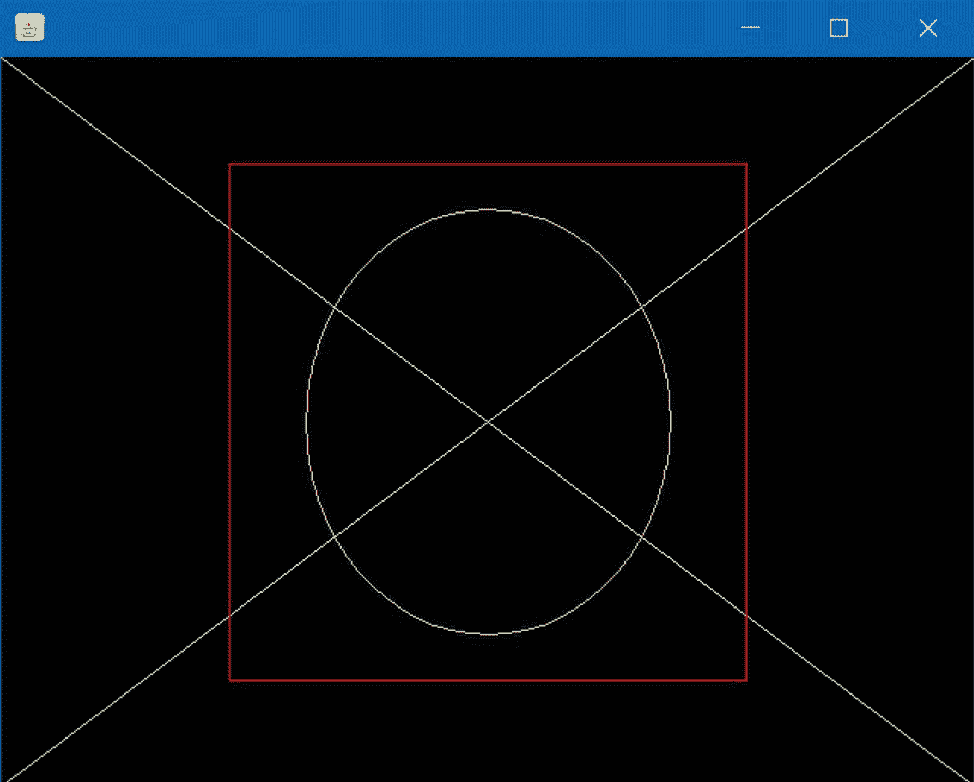

# 第 138.5 节：使用 BufferedImage 类创建图像

```java
int width = 256; // 像素
int height = 256; // 像素
BufferedImage image = new BufferedImage(width, height, BufferedImage.TYPE_4BYTE_ABGR);
```

```java
// BufferedImage.TYPE_4BYTE_ABGR - 存储 RGB 颜色和可见性（alpha），更多信息请参 javadoc
Graphics g = image.createGraphics();
```

```java
// 绘制你喜欢的任何，就像在 UI 应用的 drawComponent(Graphics g) 方法中一样
g.setColor(Color.RED);
g.fillRect(20, 30, 50, 50);
```

```java
g.setColor(Color.BLUE);
g.drawOval(120, 120, 80, 40);
g.dispose(); // 当不再需要时释放图形对象
```

```java
// 现在图像有了程序生成的内容，你可以在 graphics.drawImage() 中使用它绘制到其他地方
// 或者简单地保存到文件
```

```java
ImageIO.write(image, "png", new File("myimage.png"));
```

输出：

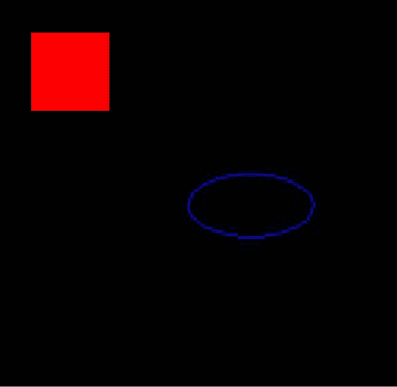

# 第 138.6 节：使用 BufferedImage 编辑和复用图像

```java
BufferedImage cat = ImageIO.read(new File("cat.jpg")); // 读取现有文件
```

```java
// 修改它
Graphics g = cat.createGraphics();
g.setColor(Color.RED);
```

```java
g.drawString("Cat", 10, 10);
g.dispose();
// 现在创建一个新图像
BufferedImage cats = new BufferedImage(256, 256, BufferedImage.TYPE_4BYTE_ABGR);
```

```java
// 在其上画上旧的，4 次
g = cats.createGraphics();
for (int i = 0; i < 4; i++) {
  for (int j = 0; j < 4; j++) {
    g.drawImage(cat, i * 64, j * 64, null);
  }
}
```

```java
g.setColor(Color.BLUE);
g.drawRect(0, 0, 255, 255); // 添加一些漂亮的边框
g.dispose(); // 并完成
ImageIO.write(cats, "png", new File("cats.png"));
```

原始猫：
生成的文件：


# 第 138.7 节：如何缩放 BufferedImage

```java
/**
 * 使用由 BufferedImage 支持的 Graphics2D 对象缩放图像大小
 * @param srcImg - 要缩放的源图像
 * @param w - 期望的宽度
 * @param h - 期望的高度
 * @return - 缩放后的图像
 */
private BufferedImage scaledImage(Image srcImg, int w, int h) {
    // 创建一个具有指定尺寸的 BufferedImage
    BufferedImage resizedImg = new BufferedImage(w, h, BufferedImage.TYPE_INT_ARGB);
    // 创建 Graphics2D 上下文
    Graphics2D g2d = resizedImg.createGraphics();
    // 设置插值类型
    g2d.setRenderingHint(RenderingHints.KEY_INTERPOLATION, RenderingHints.VALUE_INTERPOLATION_BILINEAR);
    // 绘制图像
    g2d.drawImage(srcImg, 0, 0, w, h, null);
    // 释放资源
    g2d.dispose();
    return resizedImg;
}
```

# 第 39 章：原子类型

| 参数 | 描述 |
| :--- | :--- |
| `set` | 字段的 volatile 写入 |
| `get` | 字段的 volatile 读取 |
| `lazySet` | 字段写入 |
| `compareAndSet` | 等于新值的原子操作 |
| `getAndSet` | 当前值并更新 |

原子类型是简单的可变类型，在不需要锁的情况下提供基本的原子操作。

# 第 39.1 节：创建原子类型

对于简单的多线程代码，使用同步是可以接受的。然而，当变得复杂时，使用同步会导致死锁、饥饿或活锁。

创建 `AtomicInteger` 类型：
`AtomicInteger aInt = new AtomicInteger();` // 使用默认值0 创建
`AtomicInteger aInt = new AtomicInteger(1);` // 使用初始值1 创建
类似的其他实例类型。

`AtomicIntegerArray`：
`AtomicIntegerArray aIntArray = new AtomicIntegerArray(10);` // 创建特定长度
`AtomicIntegerArray aIntArray = new AtomicIntegerArray(new int[]{1, 2, 3});` // 使用数组初始化

类似的其他原子类型。

注意的是，没有 float 和 double 类型。这些可以通过 `Float.floatToIntBits(float)` 和 `Float.intBitsToFloat(int)` 模拟 float，以及 `Double.doubleToLongBits(double)` 和 `Double.longBitsToDouble(long)` 模拟 double。

如果你愿意使用 `sun.misc.Unsafe`，你可以通过 `sun.misc.Unsafe` 的原子操作将任何原始变量作为原子变量使用。为了使用这种方法，所有原始类型应转换为 int 或 long。更多信息请参阅：`sun.misc.Unsafe`。

# 第 39.2 节：原子类型的动机

实现多线程应用的简单方法是使用 Java 内置的同步和锁原语；例如 `synchronized` 关键字。下面的示例展示了我们如何使用 `synchronized` 进行计数。

```java
public class Counters {
    private final int[] counters;

    public Counters(int nosCounters) { 
        counters = new int[nosCounters]; 
    }

    /**
     * 给定索引的计数
     */
    public synchronized void count(int number) { 
        if (number >= 0 && number < counters.length) { 
            counters[number]++; 
        } 
    }

    /**
     * 获取给定索引的当前计数，
     * 如果该索引没有数字，则返回 0。
     */
    public synchronized int getCount(int number) {
        return (number >= 0 && number < counters.length) ? counters[number] : 0;
    }
}
```

此实现可以正常工作。然而，如果你有大量线程对同一个 `Counters` 对象进行大量的并发调用，同步可能会成为瓶颈。具体来说：

1. 每次 `synchronized` 方法调用将从当前线程获取 `Counters` 实例的锁开始。
2. 线程会在检查数值值并更新计数器时持有该锁。
3. 最后，它释放锁，允许其他线程访问。

当一个线程在持有锁时，另一个线程尝试获取锁，则尝试的线程将在步骤 1 处被阻塞（停止），直到锁被释放。如果有多个线程在等待，其中一个将获得锁，而其他线程将继续被阻塞。

这可能会导致几个问题：
如果对锁存在大量的*争用*（即大量线程尝试获取锁），那么线程可能会阻塞很长时间。
当一个线程被阻塞等待锁时，操作系统通常会将执行流切换到另一个线程。这种*上下文切换*会对处理器产生相对较大的性能影响。

当有多个线程阻塞在同一个锁上时，无法保证其中任何一个线程都会受到“公平”地对待（即不能保证每个线程都能被调度运行）。这可能导致*线程饥饿*。

## 如何实现原子类型？

让我们从使用 `AtomicInteger` 计数器重写上面的示例开始：
`public class Counters`

```java
public Counters(int nosCounters) {
  counters = new AtomicInteger[nosCounters];
  for (int i = 0; i < nosCounters; i++) {
    counters[i] = new AtomicInteger();
  }
}
```

```java
/**
 * 增加指定索引处的整数 */
public void count(int number) {
  if (number >= 0 && number < counters.length) {
    counters[number].incrementAndGet();
  }
}
```

```java
/**
 * 获取指定索引处对象的当前计数，如果该索引处没有数字，则返回 0。 */
public int getCount(int number) {
  return (number >= 0 && number < counters.length) ?
    counters[number].get() : 0;
}
```

我们用 `AtomicInteger[]` 替换了 `int[]`，并在每个元素中初始化了一个实例。我们还添加了 `incrementAndGet()` 和 `get()` 的调用，以代替对 `int` 值的操作。

最重要的一点是我们可以移除 `synchronized` 关键字，因为不再需要锁定。这之所以有效，是因为 `incrementAndGet()` 和 `get()` 操作是原子且线程安全的。在这种背景下，这意味着：

数组中的每个计数器在操作（如“增加”）的“之前”状态或“之后”状态下都是可观测的。假设操作发生在时间 T，在时间 T 之后，没有任何线程会看到“之前”状态。

此外，虽然两个线程实际上可能尝试同时更新同一个 `AtomicInteger` 实例，但操作的实现确保了给定实例上一次只会发生一次增加。这是在不锁的情况下实现的，通常会产生更好的性能。

## 原子类型是如何工作的？

原子类型通常依赖于目标机器指令集中的特殊硬件指令。例如，基于 Intel 的指令集提供了 CAS（比较并交换）指令，它将以原子方式执行特定的内存操作序列。

这些低级指令被用于在相应 `AtomicXxx` 类的 API 中实现更高级操作。例如（再次使用类 C 伪代码）：

```java
private volatile int num;

int increment() {
  while (true) {
    int old = num;
    int newVal = old + 1;
    if (old == compareAndSwap(&num, old, newVal)) {
      return newVal;
    }
  }
}
```

如果 `AtomicXxx` 上没有争用，测试将成功且循环将立即结束。如果存在争用，则 `if` 对除一个线程以外的所有线程都会失败，它们将在循环中“自旋”少量周期。在实践中，少量自旋比挂起线程并切换到另一个线程快几个数量级（但在不现实的高争用水平下，`synchronized` 的性能比原子类更好，因为当 CAS 操作失败时，重试只会增加争用）。

顺便提到，CAS 指令通常被 JVM 用于实现无竞争锁定。如果 JVM 发现锁当前未被锁定，它将尝试使用 CAS 来获取锁。如果 CAS 成功，则不需要进行昂贵的线程调度、上下文切换等。有关所用技术的更多信息，请参阅 HotSpot 中的偏向锁（Biased Locking）。

# 第 140 章：RSA 加密

## 第 140.1 节：使用 OAEP 和 GCM 混合加密系统的示例

以下示例使用由 AES GCM 和 OAEP 组成的混合加密系统对数据加密，使用它们的默认参数大小和 128 位的 AES 密钥大小。相比 PKCS#1 v1.5 填充，OAEP 更不容易受到填充 oracle 攻击（padding oracle attacks）。GCM 同样受到填充 oracle 攻击的保护。

可以通过首先检索封装密钥的长度，然后检索封装密钥执行解密。封装密钥可以使用与公钥形成密钥对的 RSA 私钥解密。之后，AES/GCM 加密的密文可以解密为原始数据。

协议包含：
1. 用于封装密钥的长度字段
2. 封装密钥
3. AES 加密的密文

注意：使用此代码应至少使用 2048 位（越大越好）。
这里是示例：

```java
/**
 * 使用 OAEP 加密数据。
 * @param publicKey RSA 密钥
 * @param plaintext 要加密的明文
 * @return 密文
 * @throws InvalidException 如果密钥无效
 * @throws NullPointerException 如果明文为空
 */
public static byte[] encryptData(PublicKey publicKey, byte[] plaintext)
throws InvalidException, NullPointerException {
  // 创建 OAEP --
  Cipher oaep;
  try {
    oaep = Cipher.getInstance("RSA/ECB/OAEPWithSHA1AndMGF1Padding");
  } catch (NoSuchAlgorithmException e) {
    throw new RuntimeException("不支持 RSA 算法（强制性）", e);
  } catch (NoSuchPaddingException e) {
    throw new RuntimeException("不支持 OAEP 填充（标准运行时支持）", e);
  }
  oaep.init(Cipher.WRAP_MODE, publicKey);
  // 将明文封装在缓冲区
  ByteBuffer plaintextBuffer = ByteBuffer.wrap(plaintext);
  // 生成一个新的 AES 密钥 --
  KeyGenerator aesKeyGenerator;
  try {
```


## 章节 142.3：生成加密学随机数据

若要生成加密学随机数据的样本：

```java
final byte[] sample = new byte[16];
new SecureRandom().nextBytes(sample);
System.out.println("Sample: " + DatatypeConverter.printHexBinary(sample));
```

产生类似输出：
Sample: E4F14CEA23BA4F706B53A6DF8C5FE

注意，取决于使用的算法，调用 `nextBytes()` 可能会在收集熵时阻塞。

若要指定算法和提供者：

```java
final byte[] sample = new byte[16];
final SecureRandom randomness = SecureRandom.getInstance("SHA1PRNG", "SUN");
randomness.nextBytes(sample);

System.out.println("Provider: " + randomness.getProvider());
System.out.println("Algorithm: " + randomness.getAlgorithm());
System.out.println("Sample: " + DatatypeConverter.printHexBinary(sample));
```

产生类似输出：
Provider: SUN version 1.8
Algorithm: SHA1PRNG
Sample: C80C44BAEB352FD29FBBE20489E4C0B9

## 章节 142.4：生成公钥/密钥对

使用不同的算法和密钥大小生成密钥对：

```java
final KeyPairGenerator dhGenerator = KeyPairGenerator.getInstance("DiffieHellman");
final KeyPairGenerator dsaGenerator = KeyPairGenerator.getInstance("DSA");
final KeyPairGenerator rsaGenerator = KeyPairGenerator.getInstance("RSA");

dhGenerator.initialize(1024);
dsaGenerator.initialize(1024);
rsaGenerator.initialize(2048);

final KeyPair dhPair = dhGenerator.generateKeyPair();
final KeyPair dsaPair = dsaGenerator.generateKeyPair();
final KeyPair rsaPair = rsaGenerator.generateKeyPair();
```

你的 Java 平台实现可能提供额外的算法和密钥大小。

在生成密钥时指定一个随机性源：

```java
final KeyPairGenerator generator = KeyPairGenerator.getInstance("RSA");
generator.initialize(2048, SecureRandom.getInstance("SHA1PRNG", "SUN"));
final KeyPair pair = generator.generateKeyPair();
```

## 章节 142.5：计算和验证数字签名

计算签名：

```java
final PrivateKey privateKey = keyPair.getPrivate();
final byte[] data = "FOO BAR".getBytes();

final Signature signer = Signature.getInstance("SHA1withRSA");
signer.initSign(privateKey);
signer.update(data);
final byte[] signature = signer.sign();
```


注意，签名算法必须与生成密钥对的算法兼容。

验证签名：

```java
final PublicKey publicKey = keyPair.getPublic();
final Signature verifier = Signature.getInstance("SHA1withRSA");
verifier.initVerify(publicKey);
verifier.update(data);
System.out.println("Signature: " + verifier.verify(signature));
```

产生此输出：`Signature: true`

## 章节 143：安全与密码学

Java 安全实践可以分为两个宽泛且定义模糊的类别：Java 平台安全和安全的 Java 编程。

Java 平台安全实践涉及管理 JVM 的安全完整性。它包括管理 JCE 提供者和安全策略等主题。

安全的 Java 编程实践确认了编写安全 Java 程序的最佳方法。它包括使用随机数和密码学以及防止漏洞等主题。

## 章节 143.1：JCE

Java 加密扩展 (JCE) 是构建在 JVM 中的一个框架，允许开发者在程序中方便且安全地使用密码学。它通过为程序员提供简单、可移植的接口，同时使用 JCE 提供者系统来安全地实现底层的加密操作来实现。

## 章节 143.2：密钥和密钥管理

虽然 JCE 确保了加密操作和密钥生成的安全性，但实际管理密钥取决于开发者。这里需要提供更多信息。

运行时处理密钥的一种被广泛接受的最佳实践是将它们存储为字节数组，而不是永远存储为字符串。这是因为 Java 字符串是不可变的，无法在内存中手动“清除”或“置零”；虽然可以移除字符串的引用，但该字符串会在其内存段被垃圾回收并重用之前一直留在内存中。攻击者将有一个很长的时间窗口，可以导出程序内存并轻松找到密钥。与之相反，字节数组是可变的，可以在原位覆盖其内容；在不再需要密钥时立即将它们“置零”是一个好主意。

## 章节 143.3：常见的 Java 漏洞

## 章节 143.4：网络问题

## 章节 143.5：随机性

对于大多数应用程序，`java.util.Random` 类是一个完全可以的随机性源。然而，许多加密系统依赖随机性来实现安全性，而 `Random` 提供的随机性并不足够。如果你需要随机元素、生成随机字符串或创建一个唯一的标识，你应该使用 `SecureRandom`。

## 章节 143.6：哈希与验证

哈希函数是一种具有三个关键属性的函数类：一致性、唯一性和不可逆性。

**一致性**：给定相同的数据，哈希函数总是返回相同的值。也就是说，如果 $X = Y$，对于哈希函数 $f$，$f(x)$ 总是等于 $f(y)$。

**唯一性**：哈希函数的两个输入都不会产生相同的输出。也就是说，如果 $X \neq Y$，则 $f(x) \neq f(y)$。

**不可逆性**：反转哈希函数在实践上是困难甚至不可能的。也就是说，给定 $f(X)$，通过暴力破解无法找到函数 $f1$ 使得 $f1(f(X)) = X$。

许多函数缺少这些属性之一。例如，MD5 和 SHA1 已知碰撞（即两个输入具有相同的输出），或者它们缺乏唯一性。目前认为是安全的函数是 SHA-256 和 SHA-512。

## 章节 144：SecurityManager

### 章节 144.1：由 ClassLoader 加载的类

ClassLoader 需要提供一个标识代码源的 `ProtectionDomain`：

```java
public class PluginClassLoader extends ClassLoader {

    private final ClassProvider provider;

    private final ProtectionDomain pd;

    public PluginClassLoader(ClassProvider provider) {
        this.provider = provider;
        Permissions permissions = new Permissions();
        this.pd = new ProtectionDomain(provider.getCodeSource(), permissions, this, null);
    }

    @Override
    protected Class<?> findClass(String name) throws ClassNotFoundException {
        byte[] classDef = provider.getClass(name);
        Class<?> clazz = defineClass(name, classDef, 0, classDef.length);
        return clazz;
    }
}
```

通过覆盖 `findClass` 而不是 `loadClass` 可以委托模型，PluginClassLoader 会首先向系统和父加载器查询类定义。

创建策略：

```java
public class PluginSecurityPolicy extends Policy {

    private final Permissions appPermissions = new Permissions();
}
```

最后，设置策略和 SecurityManager（使用默认实现即可）：

```java
Policy.setPolicy(new PluginSecurityPolicy());
System.setSecurityManager(new SecurityManager());
```

### 章节 144.2：启用 SecurityManager

Java 虚拟机 (JVM) 可以在安装了 SecurityManager 的情况下运行。SecurityManager 限制在 JVM 中运行的代码被允许的操作。根据代码加载的位置以及使用了哪些证书对代码进行签名等因素执行。

可以在启动 JVM 时通过命令行设置 `java.security.manager` 系统属性来安装 `SecurityManager`：`java -Djava.security.manager <class name>`，或者通过 Java 代码编程设置：`System.setSecurityManager(new SecurityManager())`。

标准的 Java SecurityManager 根据策略（Policy）授予权限，该策略定义在策略文件中。如果未指定策略文件，则将使用 `$JAVA_HOME/lib/security/java.policy` 下的默认策略文件。

### 章节 144.3：实现策略拒绝规则

有时，需要向某些保护域（ProtectionDomain）拒绝特定的权限（Permission），无论该作用域获得了任何其他权限。本示例演示了满足此类要求的各种可能方法之一。它引入了一个“负极”权限类，以及一个允许将默认策略复用为此类权限存储库库的包装器。

说明：

- 标准的策略文件语法和通用的权限分配机制不受影响。这意味着策略文件中的拒绝规则仍然以授权（grants）的形式表示。
- 策略包装器旨在专门封装默认的基于文件的策略（假设为 `com.sun.security.provider.PolicyFile`）。被拒绝的权限仅在策略层面作为此类权限处理。如果静态地分配给作用域，它们将作为该作用域的普通“正极”权限处理。

DeniedPermission 类包 `com.example`; import `java.lang.reflect.Constructor`;

```java
import java.lang.reflect.InvocationTargetException;
import java.lang.reflect.Modifier;
import java.security.BasicPermission;
import java.security.Permission;
import java.security.UnresolvedPermission;
import java.text.MessageFormat;
```

/**
 * 对“负极”权限的表示。
 *
 * <p>
 * 当 <code>DeniedPermission</code> 被“授予”（授予给某些 <code>ProtectionDomain</code> 和/或 <code>Principal</code>）时，它代表一种*无法*行使的权限，无论拥有哪些正极权限（包括 <code>AllPermission</code>）。换句话说，如果一组授予的权限集 <em>P</em> 包含此类类的权限 <em>en</em>，那么实际授予的权限集为<br/>
 *
 * <br/>
 * &nbsp;&nbsp;&nbsp;<em>{ P <sub>implied</sub> - Dub<sub>implied</sub>}</em>. * /
 *
 * <p>
 * 此类的每个实例封装了一个 <em>目标权限</em>，代表被拒绝的“正极”权限。
 * </p>
 * 被拒绝的权限采用以下命名方案：br/>
 * <br/>
 * &nbsp;&nbsp;&nbsp;&lt;target_class_name&gt;&lt;target_name&gt;(&lt;target_actions&gt;)/em<br/>
 * <br/>
 * 其中：
 * <ul>
 * <li><em>target_class_name</em> 是目标权限类的名称，</li>
 * <li><em>target_name</em> 是目标权限的名称，以及</li>
 * <li><em>target_actions</em> 是可选的目标权限的动作字符串。</li>
 * </ul>
 * 一个具有目标权限 <em>t</em> 的被拒绝权限，如果满足以下条件，则认为它*蕴含*另一个权限 <em>p</em>：
 * <ul>
 * <li>它本身*不是*被拒绝的权限，且 <code>(t.implies(p) == true)</code>，或者</li>
 * <li>它*是*被拒绝的权限，其目标为 <em>t1</em>，且 <code>(t.implies(t1) == true)</code></li>
 * </ul>
 * <p>
 * 策略决策点（例如 <code>Policy</code> 提供者）负责在发布授权语句时考虑拒绝权限的语义。
 * </p>
 */

public final class DeniedPermission extends BasicPermission {

    private final Permission target;
    private static final long versionUID = 473625163869800679L;

    /**
     * 实例化 <code>DeniedPermission</code>，封装一个指定类、指定名称以及可选动作的目标权限。
     * @throws IllegalArgumentException
     * 如果：
     * <ul>
     * <li><code>targetClassName</code> 为 <code>null</code>、空字符串、未引用具体的 <code>Permission</code> 子类，或者引用了 <code>DeniedPermission.class</code> 或 <code>UnresolvedPermission.class</code></li>
     * <li><code>targetName</code> 为 <code>null</code>。</li>
     * <li><code>targetClassName</code> 无法实例化且是调用者的错误；例如，因为 <code>targetClassName</code> 和/或 <code>targetActions</code> 不符合目标类的命名约束；由于目标类未暴露 <code>(String name)</code> 或 <code>(String name, actions)</code> 构造函数，取决于 <code>targetActions</code> 是否为空。</li>
     * </ul>
     */
    public static DeniedPermission newDeniedPermission(String targetClassName, String targetName, String targetActions) {
        if (targetClassName == null || targetClassName.isEmpty() || targetName == null) {
            throw new IllegalArgumentException("提供了 null 或空的 [targetClassName]，或 null 的 [targetName]");
        }
        StringBuilder sb = new StringBuilder();
        sb.append(targetClassName).append(":").append(targetName);
        if (targetActions != null) {
            sb.append(":").append(targetActions);
        }
        return new DeniedPermission(sb.toString(), target);
    }

    public static DeniedPermission newDeniedPermission(Permission target) {
        if (target == null) {
            throw new IllegalArgumentException("参数 [target] 为 null.");
        }
        if (target instanceof DeniedPermission || target instanceof UnresolvedPermission) {
            throw new IllegalArgumentException("[target] 不能是 DeniedPermission 或 UnresolvedPermission。");
        }
        StringBuilder sb = new StringBuilder();
        sb.append(target.getClass().getName()).append(":").append(target.getName());
        String targetActions = target.getActions();
        if (targetActions != null) {
            sb.append(":").append(targetActions);
        }
        return new DeniedPermission(sb.toString(), target);
    }

    public DeniedPermission(String name) {
        super(name);
        String[] comps = name.split(":");
        if (comps.length < 2) {
            throw new IllegalArgumentException(MessageFormat.format("格式错误的名称 {0} 参数。", name));
        }
        this.target = initTarget(comps[0], comps[1], (comps.length < 3) ? null : comps[2]);
    }

    private DeniedPermission(String name, Permission target) {
        super(name);
        this.target = target;
    }

    private Permission initTarget(String targetClassName, String targetName, String targetActions) {
        Class<?> targetClass;
        try {
            targetClass = Class.forName(targetClassName);
        } catch (ClassNotFoundException cnfe) {
            if (targetClassName.trim().isEmpty()) {
                targetClassName = "<empty>";
            }
            throw new IllegalArgumentException(MessageFormat.format("Target Permission class [{0}] not found.", targetClassName));
        }
        if (!Permission.class.isAssignableFrom(targetClass) || Modifier.isAbstract(targetClass.getModifiers())) {
            // 代码片段结束
        }
    }
}
```


```java
throw new IllegalArgumentException(MessageFormat.format("Target Permission class [{0}] is not a (concrete) Permission.", targetClassName));
}

if (targetClass == DeniedPermission.class || targetClass == UnresolvedPermission.class) {
  throw new IllegalArgumentException("Target Permission class cannot be a DeniedPermission itself.");
}

Constructor<? extends Object> targetCtor;
try {
  if (targetActions == null) {
    targetCtor = targetClass.getConstructor(String.class);
  } else {
    targetCtor = targetClass.getConstructor(String.class, String.class);
  }
} catch (NoSuchMethodException nsme) {
  throw new IllegalArgumentException(MessageFormat.format("Target Permission class [{0}] does not provide or expose a (String name) or (String name, String actions) constructor.", targetClassName));
}

try {
  return (Permission) targetCtor.newInstance((targetCtor.getParameterCount() == 1) ? new Object[] { targetName } : new Object[] { targetName, targetActions });
} catch (ReflectiveOperationException roe) {
  if (roe instanceof IllegalArgumentTargetException) {
    if (targetName == null) {
      targetName = "<null>";
    } else if (targetName.trim().isEmpty()) {
      targetName = "<empty>";
    }
    if (targetActions == null) {
      targetActions = "<null>";
    } else if (targetActions.trim().isEmpty()) {
      targetActions = "<empty>";
    }
    throw new IllegalArgumentException("Could not instantiate target Permission class [{0]; provided target name [{1}] and/or target actions [{2}] potentially erroneous.", targetClassName, targetName, targetActions), roe;
  }
  throw new RuntimeException("Could not instantiate target Permission class [{0}]; an unforeseen error occurred - see attached cause for details", roe);
}
```

检查给定的权限是否被此权限包含，参见 `DeniedPermission overview`。

```java
@Override
public boolean implies(Permission p) {
    if (p instanceof DeniedPermission) {
        return target.implies((DeniedPermission) p).target;
    }
    return target.implies(p);
}
```

返回此拒绝权限的目标权限（实际的、不应授予的积极权限）。

```java
public Permission getTargetPermission() { return target; }
```

## DenyingPolicy 类

package `com.security.CodeSource`;

```java
import java.security.NoSuchAlgorithmException; 
import java.security.Permission;
import java.security.PermissionCollection; 
import java.security.Policy;
import java.security.ProtectionDomain; 
import java.security.UnresolvedPermission; 
import java.util.Enumeration;
```

一种包装器，为标准的基于文件的 `Policy` 增加了基础的 `DeniedPermission` 处理能力。

```java
public final class DenyingPolicy extends Policy {
    try {
        defaultPolicy = Policy.getInstance("javaPolicy", null);
    } catch (NoSuchAlgorithmException nsa) {
        throw new RuntimeException("Could not acquire default Policy.", nsa);
    }

    private final Policy defaultPolicy;

    @Override
    public PermissionCollection getPermissions(CodeSource codesource) {
        return defaultPolicy.getPermissions(codesource);
    }

    @Override
    public PermissionCollection getPermissions(ProtectionDomain domain) {
        return defaultPolicy.getPermissions(domain);
    }

    /**
     * @return
     * <ul>
     * <li><code>true</code>，如果：<em>该权限不是</em> <code>DeniedPermission</code> 的实例，</li> 且在系统默认的 <code>Policy</code> 上进行调用</li>
     * <li><code>permission</code>，如果 * &lt;&lt;code>Policy&gt; 产生 <code>true</code>，并且</li>
     * <li>如果 <code>permission</code> <em>不是</em> 被任何可能已分配给 <code>domain</code> 的 <code>DeniedPermission</code> 包含，则返回 un-<<code>implied(domain, permission)</code>。</li>
     * </ul>
     * <li><code>false</code>，否则。
     * </ul>
     */

    @Override
    public boolean implies(ProtectionDomain domain, Permission permission) {
        if (permission instanceof DeniedPermission) {
            return false;
        }
        if (!defaultPolicy.implies(domain, permission)) {
            return false;
        }
        return true;
    }
}
```

在策略决策层面，`DeniedPermissions` 只能包含其他，而不能被包含（因为它们是剥夺而非授予权限）。此外，客户端不应使用此方法来检查某些域是否*没有*某个权限（这毕竟是 `DeniedPermissions` 表达的）。

## 第 145 节：JNDI

本示例展示了 JNDI 是如何工作的。它有两个角色：为服务器提供绑定/重绑定 API，为客户端提供查找/列表 API。为了简单起见，我们将使用 `java.rmi.registry.CreateRegistry()` 来创建 RMI 注册表。

### Server.java（JNDI 服务器）

```java
package com.neohope.jndi.test;

import javax.naming.Context;
import javax.naming.InitialContext;
import javax.naming.NamingException;
import java.io.IOException;
import java.rmi.RemoteException;
import java.rmi.registry.LocateRegistry;
import java.util.Hashtable;

/**
 * JNDI 服务器
 * 1. 在 1234 端口创建一个注册表
 * 2. 绑定 JNDI
 * 3. 等待连接
 * 4. 清理并解绑
 */
public class Server {
    private static Registry registry;
    private static InitialContext ctx;

    public static void initJNDI() {
        try {
            registry = LocateRegistry.createRegistry(1234);
            final Hashtable jndiProperties = new Hashtable();
            jndiProperties.put(Context.INITIAL_CONTEXT_FACTORY, "com.sun.jndi.rmi.registry.RegistryContextFactory");
            jndiProperties.put(Context.PROVIDER_URL, "rmi://localhost:1234");
            ctx = new InitialContext(jndiProperties);
            System.setPolicy(new DenyingPolicy());
        } catch (NamingException e) {
            e.printStackTrace();
        } catch (RemoteException e) {
            e.printStackTrace();
        }
    }

    public static void bindJNDI(String name, Object obj) throws NamingException {
        ctx.bind(name, obj);
    }

    public static void unbindJNDI(String name) throws NamingException {
        ctx.unbind(name);
    }

    public static void uninitJNDI() throws NamingException {
        ctx.close();
    }

    public static void main(String[] args) throws NamingException, IOException {
        initJNDI();
        NMessage msg = new NMessage("Just A Message");
        bindJNDI("/neohope/jndi/test001", msg);
        System.in.read();
        ubindJNDI("/neohope/jndi/test001");
        uninitJNDI();
    }
}
```

### 2. Client.java（JNDI 客户端）

```java
package com.neohope.jndi.test;

import javax.naming.Context;
import javax.naming.InitialContext;
import javax.naming.NamingException;
import java.util.Hashtable;

/**
 * 1.初始化上下文
 * 2. 在注册表中查找服务
 * 3. 使用服务
 * 4. 结束
 */
public class Client {
    public static void main(String[] args) throws NamingException {
        final Hashtable jndiProperties = new Hashtable();
        jndiProperties.put(Context.INITIAL_CONTEXT_FACTORY, "com.sun.jndi.rmi.registry.RegistryContextFactory");
        jndiProperties.put(Context.PROVIDER_URL, "rmi://localhost:1234");
        InitialContext ctx = new InitialContext(jndiProperties);
        NMessage msg = (NMessage) ctx.lookup("/nehope/jndi/test01");
        System.out.println(msg.message);
        ctx.close();
    }
}
```

### 3. NMessage.java RMI 服务类

```java
package com.nehope.jndi.test;

import java.io.Serializable;
import java.rmi.Remote;

/**
 * NMessage
 * RMI 服务类
 * 必须实现 Remote 和 Serializable
 */
public class NMessage implements Remote, Serializable { 
    public String message = "";

    public NMessage(String message) {
        this.message = message;
    }
}
```


如何运行此示例：

1. 构建并启动服务器
2. 构建并启动客户端

# 介绍

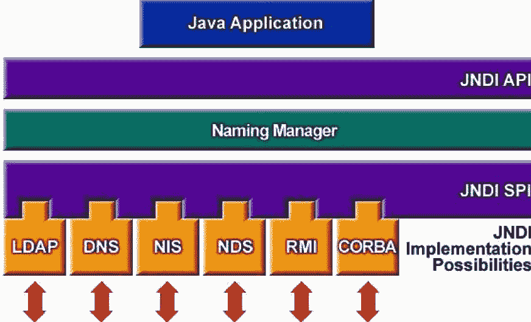

Java 命名和目录接口 (JNDI) 是一种用于目录服务的 Java API，它允许 Java 软件客户端通过名称发现并查找数据及对象。它的设计目标是不依赖于任何特定的命名或目录服务实现。

JNDI 架构由 API（应用程序接口）和 SPI（服务提供接口）组成。Java 使用此 API 访问各种命名和目录服务。SPI 允许透明地接入各种命名和目录服务，从而允许使用 JNDI 技术 API 的 Java 程序访问它们的服务。

如上图所示，JNDI 支持 LDAP、DNS、NIS、NDS、RMI 和 CORBA。当然，你可以对其进行扩展。

# 工作原理

在这个示例中，Java RMI 注册表通过 JNDI API 在网络中查找对象。如果你想查找一个对象，至少需要两个信息：

- 在哪里找到该对象
  - RMI 注册表管理名称绑定，它告诉你哪里可以找到对象。
- 对象的名称是什么？
  - 对象的名称通常是一个字符串，也可以是一个实现了 `Name` 接口的对象。

# 步骤

1. 首先，你使用一个注册表来管理名称绑定。在示例中，我们使用 `java.rmi.registry.LocateRegistry`。
   ```java
   // 这将在本地端口 1234 启动一个注册表
   registry = LocateRegistry.createRegistry(1234);
   ```
2. 客户端和服务器都需要一个 Context。服务器使用 Context 绑定名称和对象。客户端使用 Context 查找名称并获取对象。
   ```java
   // 使用 com.sun.jndi.rmi.registry.RegistryContextFactory 作为 InitialContextFactory
   final Hashtable jndiProperties = new Hashtable();
   jndiProperties.put(Context.INITIAL_CONTEXT_FACTORY,
   "com.sun.jndi.rmi.registry.RegistryContextFactory");
   // 注册表 URL 为 "rmi://localhost:1234"
   jndiProperties.put(Context.PROVIDER_URL, "rmi://localhost:1234");
   InitialContext ctx = new InitialContext(jndiProperties);
   ```
3. 服务器绑定名称和对象
   ```java
   // 的 jndi 名称为 "/neohope/jndi/test01"
   bindJNDI("/neohope/jndi/test01", msg);
   ```
4. 客户端可以通过名称 "/neohope/jndi/test01" 查找对象
   ```java
   // 通过名称 "java:com/neohope/jndi/test01" 查找对象
   NMessage msg = (NMessage) ctx.lookup("/neohope/jndi/test01");
   ```
5. 现在客户端可以使用该对象
6. 当服务器结束时，需要进行清理。
   ```java
   ctx.unbind("/neohope/jndi/test01");
   ctx.close();
   ```

# 第 146 章：sun.misc.Unsafe

## 第 146.1 节：通过反射实例化 sun.misc.Unsafe

```java
public static Unsafe getUnsafe() {
  try {
    Field unsafe = Unsafe.class.getDeclaredField("theUnsafe");
    unsafe.setAccessible(true);
    return (Unsafe) unsafe.get(null);
  } catch (IllegalAccessException e) {
    // 处理
  } catch (IllegalArgumentException e) {
    // 处理
  } catch (NoSuchFieldException e) {
    // 处理
  } catch (SecurityException e) {
    // 处理
  }
}
```

`sun.misc.Unsafe` 有一个私有构造函数，且 `getUnsafe()` 方法受类加载器保护。

## 第 146.2 节：通过反射实例化 sun.misc.Unsafe

`sun.misc.Unsafe` 有一个私有构造函数，且 `getUnsafe()` 方法受类加载器保护。因此，可以使用反射来获取实例。

## 第 146.3 节：获取实例

`sun.misc.Unsafe` 有一个私有构造函数，且 `getUnsafe()` 方法受类加载器保护。因此，可以使用反射来获取实例。

## 第 146.4 节：unsafe 的用途

- 堆外 (Off heap)
- 暂停当前线程
- 直接内存分配
- 构造函数是私有的
- 可以使用反射来获取实例
- Volatile 操作
- 内存屏障
- 内存分配与释放
- 抛出异常
- 原子操作
- 设置内存
- API

# 第 147 章：Java 内存模型

## 第 147.1 节：内存模型的初衷

考虑以下示例：

```java
public class Example {
    public int a, b, c, d;

    public void doit() {
        a = b + 1;
        c = d + 1;
    }
}
```

如果此类作为单线程应用程序使用，那么可观察的行为将完全如你所预期。例如：

```java
public class SingleThreaded {
    public static void main(String[] args) {
        Example eg = new Example();
        System.out.println(eg.a + " , " + eg.c);
        eg.doIt();
        System.out.println(eg.a + " , " + eg.c);
    }
}
```

将输出：
```text
0, 0
1, 1
```

对于“主”线程来说，main 方法和 doIt 方法中的语句将按照它们在源代码中的顺序执行。这是 Java 语言规范 (JLS) 的明确要求。

现在考虑在多线程应用程序中使用同一个类。

```java
public class MultiThreaded {
    public static void main(String[] args) {
        final Example eg = new Example();

        new Thread(new Runnable() {
            public void run() {
                while (true) {
                    eg.doIt();
                }
            }
        }).start();

        while (true) {
            System.out.println(eg.a + " , " + eg.c);
        }
    }
}
```

这段代码会打印什么？事实上，根据 JLS（Java 语言规范），无法预测它会打印出：

- 你可能会先看到几行 0, 0。
- 然后你可能会看到类似 N, N 或 N, N + 1 这样的行。
- 你可能会看到类似 N + 1, N 这样的行。
- 从理论上讲，你甚至可能看到 0, 0 行持续下去。

> 1 - 在实践中，`println` 语句的存在可能会导致某些意外的同步和内存缓存刷新。这可能会掩盖导致上述行为的某些影响。

那么我们该如何解释呢？

### 赋值的重排序

出现意外结果的一种可能解释是 JIT 编译器改变了 `doIt()` 方法中赋值的顺序。JLS 要求从当前线程的角度来看，语句的执行必须是按顺序执行的。在这种情况下，`doIt()` 方法代码中的任何内容都无法观察到那两条语句（假设性的）重排序的影响。这意味着 JIT 编译器被允许这样做。

它为什么要这样做呢？

在典型的现代硬件上，机器指令是通过指令流水线执行的，这允许指令序列处于不同的阶段。指令执行的某些阶段比其他阶段耗时更长，内存操作往往需要更长时间。智能的编译器可以通过重新排列指令来最大化重叠程度，从而优化流水线的指令数量。这可能导致语句的部分无序执行。JLS 允许这样做，只要它不会从当前线程的角度影响计算结果。

### 内存缓存的影响

另一种可能的解释是内存缓存的影响。在经典的计算机架构中，每个处理器都有一组较小的寄存器和容量更大的内存。访问寄存器的速度远快于访问主内存。在现代架构中，存在内存缓存，它的速度比寄存器慢，比主内存快。

编译器会通过尝试将变量副本保留在寄存器或内存缓存中来利用这一点。如果一个变量*不需要*被刷新到主内存，或者*不需要*从内存中读取，那么不这样做将带来显著的性能优势。在 JLS 不要求内存操作对另一个线程可见的情况下，Java JIT 编译器会被限制不使用强制主内存读写的“读屏障”（read barrier）和“写屏障”（write barrier）指令。再次，这样的性能收益是巨大的。

### 正确的同步

到目前为止，我们已经看到 JLS 允许 JIT 编译器通过重排序或避免内存操作来生成让单线程运行更快的代码。当其他线程观察主内存中（共享）变量的状态时，会发生什么？

答案是，其他线程可能会观察到基于 Java 语句代码顺序看起来是不可能的变量状态……解决方案是使用适当的同步。三种主要方法是：

- 使用原始互斥锁（mutexes）和 `synchronized` 结构。
- 使用高级别的并发支持；例如 `java.util.concurrent` 包中的类。即使是这样，理解哪里需要同步以及你可以依赖哪些效果也同样重要。这就是 Java 内存模型（Java Memory Model）用用场。

### Java 内存模型

Java 内存模型是 JLS 的一部分，它规定了一个线程保证看到另一个线程内存写入效果的条件。内存模型的规范具有相当程度的*形式严谨性*，（因此）需要详细且仔细的阅读才能理解。但基本原理是，某些结构在一个线程对变量的写入与另一个线程对该变量的后续读取之间创建了“发生于”（happens-before）的关系。如果存在“发生于”关系，JIT 编译器就有义务生成能够确保读取操作看到写入操作所写值的代码。

有了这一点，就可以推断 Java 程序中的内存一致性，并决定这在所有执行平台上是否是可预测且一致的。

## 第 147.2 节：发生于关系

（以下是 Java 语言规范说明的简化版。为了更深入地理解，你需要阅读规范本身。）

“发生于”关系是内存模型的一部分，允许我们理解和推断内存可见性。正如 JLS 所说（JLS 17.4.5）：

> “两个动作可以通过发生于关系进行排序。如果一个动作发生于另一个动作，那么第一个动作对第二个动作可见，并且对其进行了排序。”

这意味着什么？

### 动作

上述引言所指的动作在 JLS 17.4.2 中规定。规范定义了 5 种动作：

- 读取：读取非 volatile（非瞬态）变量。
- 写入：写入非 volatile 变量。
- 同步动作：
    - volatile 读：读取 volatile 变量。
    - volatile 写：写入 volatile 变量。
    - Lock（锁定）：锁定监视器（monitor）。
    - Unlock（解锁）：解锁监视器。
- 线程的（合成的）第一个和最后一个动作。
- 启动线程或检测到线程终止的动作。
- 外部动作。结果依赖于程序运行环境的动作。
- 线程分散动作（Thread divergence actions）。这些动作模拟了某些无限循环的行为。

### 程序顺序与同步顺序

这两种排序（JLS 17.4.3 和 JLS 17.4.4）支配着 Java 中语句的执行。

程序顺序描述了单个线程内语句的执行顺序。

同步顺序描述了 Java 语句的执行顺序。

- 对监视器的解锁与所有后续锁定同步（synchronizes-with）。
- 对 volatile 变量的写入与所有后续读取同步。
- 启动线程的动作与线程中的第一个动作同步。
- 字段初始化与该对象的终结器（finalizer）同步。
- 如果一个线程中断另一个线程，它与该被中断的点同步。

### 发生于顺序

这种排序（17.4.5）决定了内存写入是否保证对另一个线程可见。更具体地说，对变量 v 的读取当且仅当满足以下条件时，保证观察到 v 的写入：

定义发生于排序的规则如下：

- **发生于规则 #1**：如果 x 和 y 是同一线程的动作，且 x 在程序顺序中位于 y 之前，则 x 发生于 y。
- **发生于规则 #2**：从构造函数的结束到其开始之间存在一条发生于的边。
- **发生于规则 #3**：如果动作 x 与后续动作 y 同步，则 x 发生于 y。
- **发生于规则 #4**：如果 x 发生于 y 且 y 发生于 z，则 x 发生于 z。

此外，Java 标准库中的各种类被规定为定义了“发生于”关系。你可以将其解释为它以某种方式得到了保证，而无需知道这种保证是如何实现的。

## 第 147.3 节：如何避免理解内存模型

内存模型很难理解，也很难应用。如果你需要推断多线程代码的正确性，但不想为你写的每个多线程应用程序都进行这种推断，它是很有用的。

如果你在 Java 中编写并发代码时遵循以下原则，你可以在很大程度上避免诉诸“发生于”推理。

- 尽可能使用不可变数据结构。一个正确实现的不可变类是线程安全的，与其他类配合时不会引入线程安全问题。
- 理解并避免“不安全发布”（unsafe publication）。
- 对于需要线程安全的可变对象，使用原始互斥锁或 Lock 对象来同步访问状态¹
- 使用 Executor / ExecutorService 或 fork join 框架，而不是尝试直接管理线程。
- 使用 `java.util.concurrent` 中提供高级锁、信号量、计数器和屏障的类，而不是直接使用 wait/notify/notifyAll。
- 使用 `java.util.concurrent` 版本的 map、set、list、queue 和 deque，而不是对非并发集合进行外部同步。

通用原则是使用 Java 内置的并发库，而不是“自己实现”并发。如果你使用得当，可以依靠它们能够正常工作。

> 1 - 不是所有对象都需要线程安全。例如，如果一个对象或一组对象是线程相关的（即它们只被一个线程访问），那么它们的线程安全性就不重要。

## 第 147.4 节：发生在前（Happens-before）推理的示例应用

我们将提供一些示例，展示如何应用发生在前推理来检查写入操作是否对后续读取可见。

### 单线程代码

正如你所预期的，在单线程程序中，写入操作对后续读取始终是可见的。

```java
public class SingleThreadExample {
    public int a, b;

    public int add() {
        a = 1; // write(a)
        b = 2; // write(b)
        return a + b; // read(a) followed by read(b)
    }
}
```

根据发生在前规则 #1：

1. write(a) 动作发生在 write(b) 动作之前。
2. write(b) 动作发生在 read(a) 动作之前。
3. read(a) 动作发生在 read(b) 动作之前。

根据发生在前规则 #4：

4. 如果 write(a) 发生在 write(b) 之前且 write(b) 发生在 read(a) 之前，那么 write(a) 发生在 read(a) 之前。
5. 如果 write(b) 发生在 read(b) 之前且 read(a) 发生在 read(b) 之前，那么 write(b) 发生在 read(b) 之前。

总结：

6. write(a) 发生在 read(a) 这种关系意味着 a + b 语句保证能看到 a 的正确值。
7. write(b) 发生在 read(b) 这种关系意味着 a + b 语句保证看到 b 的正确值。

### 2 线程示例中 'volatile' 的行为

我们将使用以下示例代码来探索内存模型对 `volatile` 的影响。

```java
public class VolatileExample {
    private volatile int a;
    private int b; // 非 volatile

    public void update(int first, int second) {
        b = first; // write(b)
        a = second; // write-volatile(a)
    }

    public int observe() {
        return a + b; // read-volatile(a) followed by read(b)
    }
}
```


首先，考虑以下涉及 2 个线程的语句序列：

1. 创建 `VolatileExample` 的单实例；称之为 `ve`，
2. 在一个线程中调用 `ve.update(1, 2)`，以及
3. 在另一个线程中调用 `ve.observe()`。

根据发生在前规则 #1：
1. `write(a)` 动作发生在 `volatile-write(a)` 动作之前。
2. `volatile-read(a)` 动作发生在 `read(b)` 动作之前。

根据发生在前规则 #2：
3. 第一个线程中的 `volatile-write(a)` 动作发生在第二个线程中的 `volatile-read(a)` 动作之前。

根据发生在前规则 #4：
4. 第一个线程中的 `write(b)` 动作发生在第二个线程中的 `read(b)` 动作之前。

换句话说，对于这个特定的序列，我们保证第 2 个线程会看到第一个线程对非 volatile 变量 `b` 的更新。然而也应该明确，如果 `update` 方法中的赋值顺序反过来，或者 `observe()` 方法在读取 `a` 之前读取了变量 `b`，那么发生在前链就会断开。如果第二个线程中的 `volatile-read(a)` 不在第一个线程中的 `volatile-write(a)` 之后，该链也会断开。

当链断开时，无法保证 `observe()` 能看到 `b` 的正确值。

### 三线程情况下的 Volatile

假设我们在上一个示例中添加了第三个线程：

1. 创建 `VolatileExample` 的单实例；称之为 `ve`，
2. 两个线程调用 `update`：
   在一个线程中调用 `ve.update(1, 2)`，在第二个线程中调用 `ve.update(3, 4)`，
3. 随后在第三个线程中调用 `ve.observe()`。

为了完全分析这一点，我们需要考虑线程一和线程二语句所有可能的交织情况。相反，我们只考虑其中两种。

场景 #1 - 假设 `update(1, 2)` 发生在 `update(3, 4)` 之前，我们得到如下序列：

```
write (b, 1), write-volatile(a, 2) write(b, 3), write-volatile(a, 4) read-volatile(a), read(b)
```

// first thread // second thread // third thread

在这种情况下，很容易看出从 `write(b, 3)` 到 `read(b)` 存在一个未断开的发生在前链。此外，中间没有对 `b` 的写入操作。因此，对于这种场景，第三个线程保证看到 `b` 的值为 3。

场景 #2 - 假设 `update(1, 2)` 和 `update(3, 4)` 重叠，且动作交织如下：

```
write (b, 3)
write(b, 1)
write-volatile(a, 2) write-volatile(a, 4) read-volatile(a), read(b)
```

// second thread // first thread // first thread // second thread // third thread

现在，虽然从 `write(b, 3)` 到 `read(b)` 有一个发生在前链，但中间存在由第一个线程执行的 `write(b, 1)`。

换句话说，对于这个特定的序列，我们保证第 2 个线程会看到第一个线程对非 volatile 变量 `b` 的更新。然而，也应该明确，如果 `update` 方法中的赋值顺序反过来，或者 `observe()` 方法在读取 `a` 之前读取了变量 `b`，那么发生在前链就会断开。如果第二个线程中的 `volatile-read(a)` 不在第一个线程中的 `volatile-write(a)` 之后，该链也会断开。

当链断开时，无法保证 `observe()` 能看到 `b` 的正确值。

一个 UberJAR。

1. - 某些开源库许可证允许您在终端用户能够用另一个版本的库替换库时使用该库。UberJAR 会让 Maven 版本依赖的替换变得困难。

## 第 148.3 节：创建 JAR、WAR 和 EAR 文件

JAR、WAR 和 EAR 文件本质上都是 ZIP 文件，包含一个“清单”（manifest）文件以及对于 WAR 和 EAR 文件）特定的内部目录/文件结构。

创建这些文件的推荐方法是使用 Java 特有的构建工具，这些工具“理解”相应文件类型的要求。如果不使用构建工具，IDE 的“导出”（export）是下一个尝试选项。

（编辑注：关于如何创建这些文件的描述最好放在相应工具的文档中。请将它们放在那里。请保持克制，**不要**把它们强行塞进这个示例中！）

## 使用 Maven 创建 JAR 和 WAR 文件

使用 Maven 创建 JAR 或 WAR 只需要在 POM 文件中放入正确的 `<packaging>` 元素即可；例如：

```xml
<packaging>jar</packaging>
```

或者

```xml
<packaging>war</packaging>
```

欲了解更多细节，可以通过为 maven jar 插件添加有关入口点类和外部依赖的插件属性，将 Maven 配置为创建“可执行”JAR 文件。甚至有一个插件用于创建“uberJAR”文件，它可以将应用程序及其依赖合并到单个 JAR 文件中。

请参考 Maven 文档（http://stackoverflow.com/documentation/maven/topics）获取更多信息。

## 使用 Ant 创建 JAR、WAR 和 EAR 文件

Ant 构建工具具有用于构建 JAR、WAR 和 EAR 的独立“任务”（tasks）。请参考 Ant 文档（http://stackoverflow.com/documentation/ant/topics）获取更多信息。

## 使用 IDE 创建 JAR、WAR 和 EAR 文件

三个最流行的 Java IDE 都内置了创建部署文件的支持。该功能通常被描述为“导出”。

- Eclipse - http://stackoverflow.com/documentation/eclipse/topics
- NetBeans - http://stackoverflow.com/documentation/netbeans/topics
- IntelliJ-IDEA - 导出

## 使用 jar 命令创建 JAR、WAR 和 EAR 文件。

也可以使用 `jar` 命令“手动”创建这些文件。这只需要在正确的位置组装带有正确组件文件的文件树，创建一个清单文件，并运行 `jar` 命令来创建 JAR 文件即可。

请参考 jar 命令主题（创建和修改 JAR 文件）获取更多信息。

## 第 148.4 节：Java Web Start 简介

Oracle Java 教程对 Web Start 的总结如下：

Java Web Start 软件提供了单击启动全功能应用程序的能力。用户可以下载并启动应用程序（例如完整的电子表格程序或网络聊天客户端），而无需经过冗安装过程。

Java Web Start 的其他优点还支持签名代码和显式声明平台依赖，并支持代码缓存和应用程序更新的部署。Java Web Start 也称为 JavaWS 和 JAWS。主要信息来源是：

- Java 教程 - 课程：Java Web Start Java Web Start Guide
- Java Web Start FAQ
- JNLP 规范
- `javax.jnlp` API 文档
- Java Web Start 开发者网站

## 前提条件

在高级层面，Web Start 通过从远程 Web 服务器分封装为 JAR 文件的 Java 应用程序工作。前提条件是：

- 运行应用程序的目标机器上已安装 Java（JRE 或 JDK）。需要 Java 1.2.2 或更高版本：
- 从 Java 5.0 开始，Web Start 支持包含在 JRE / JDK 中。
- 对于较早版本，需要单独安装 Web Start 支持。
- Web Start 基础设施包括一些可以包含在网页中的 JavaScript，以帮助用户安装必要的软件。
- 托管软件的 Web 服务器必须是目标机器可以访问的。

如果用户通过网页链接启动 Web Start 应用程序，那么：

- 他们需要一个兼容的 浏览器，对于现代（安全的）浏览器，需要告诉他们如何让浏览器允许 Java 运行……而不损害浏览器的安全性。

## 一个 JNLP 示例

以下示例旨在说明 JNLP 的基本功能。

```xml
<?xml version="1.0" encoding="UTF-8"?>
<jnlp spec="1.0+" codebase="https://www.example.com/demo" href="demo_webstart.jnlp">
  <information>
    <title>Demo</title>
    <vendor>The Example.com Team</vendor>
  </information>
  <resources>
    <!-- Application Resources -->
    <j2se version="1.7+" href="http://java.sun.com/products/autodl/j2se"/>
    <j2se href="Demo.jar" main="true"/>
  </resources>
  <application-desc name="Demo Application" main-class="com.example.jwsdemo.Main" width="300" height="300">
  </application-desc>
  <update check="background"/>
</jnlp>
```

如你所示，JNLP 文件是基于 XML 的，信息都包含在 `<jnlp>` 元素中。

`spec` 属性提供了该文件遵循的 JNLP 规范版本。
`codebase` 属性提供了解析相对 `href` URL 的基础 URL。`href` 属性提供了此 JNLP 文件的确定 URL。

`<information>` 元素包含应用程序的元数据，包括标题、作者、描述和帮助网站。
`<resources>` 元素描述应用程序的依赖，包括所需的版本、操作系统平台和 JAR 文件。
`<application-desc>`（或 `<applet-desc>`）元素提供了启动应用程序所需的信息。

## 设置 Web 服务器

必须配置 Web 服务器将 `application/x-java-jnlp` 用作 `.jnlp` 文件的 MIME 类型。

JNLP 文件和应用程序的 JAR 文件必须安装在 Web 服务器上，以便可以使用 JNLP 文件指定的 URL 访问。

## 通过网页启用启动

如果要通过链接启动应用程序，则包含链接的页面必须在 Web 服务器上创建。

如果你假设用户机器上已经安装了 Java Web Start，那么网页只需要包含一个启动应用程序的链接即可。例如：

```html
<a href="https://www.example.com/demo_webstart.jnlp">启动应用程序</a>
```

否则，页面还应该包含一些脚本，以检测用户使用的浏览器类型，并请求下载和安装所需的 Java 版本。

注意：以这种方式鼓励用户安装 Java 是一个坏主意，甚至在他们的浏览器中启用 Java 以便 JNLP 网页启动。

## 从命令行启动 Web Start 应用程序

从命令行启动 Web Start 应用程序的指令非常简单。假设用户已安装 Java 5.0 JRE 或 JDK，只需运行：

```bash
$ java <url>
```

其中 `<url>` 是远程服务器上 JNLP 文件的 URL。

## 第 149 章：Java 插件系统实现

### 第 149.1 节：使用 URLClassLoader

实现 Java 应用程序的插件系统有多种方法。简单的方法之一是使用 `URLClassLoader`。以下示例将一些 JavaFX 代码。

假设有一个主模块。该模块应该从 'plugins' 文件夹加载以 JAR 形式的插件。初始代码：

```java
package main;

public class MainApplication extends Application {

    @Override
    public void start(Stage primaryStage) throws Exception {
        File pluginDirectory = new File("plugins"); // 任意目录
        if (!pluginDirectory.exists()) pluginDirectory.mkdir();

        VBox loadedPlugins = new VBox(6); // 显示视觉信息的容器
        Rectangle2D scenebounds = Scene.getPrimary().getVisualBounds();
        Scene scene = new Scene(loadedPlugins, scenebounds.getWidth() / 2, scenebounds.getHeight() / 2);
        primaryStage.setScene(scene);
        primaryStage.show();
    }

    public static void main(String[] a) {
        launch(a);
    }
}
```

然后，我们创建一个表示插件的接口。

```java
package main;

public interface Plugin {
    default void initialize() {
        System.out.println("Initialized" + this.getClass().getName());
    }

    default String name() {
        return getClass().getSimpleName();
    }
}
```

我们加载实现此接口的类，因此首先我们需要过滤出以 '.jar' 扩展的文件：

```java
File[] files = pluginDirectory.listFiles((dir, name) -> name.endsWith(".jar"));
```

如果有任何文件，我们需要创建 URL 集合和类名的集合：

```java
if (files != null && files.length > 0) {
    ArrayList<String> classes = new ArrayList<>();
    ArrayList<URL> urls = new ArrayList<URL>(files.length);
    for (File file : files) {
        JarFile jar = new JarFile(file);
        jar.stream().forEach(jarEntry -> {
            if (jarEntry.getName().endsWith(".class")) {
                classes.add(jarEntry.getName());
            }
        });
        URL url = file.toURI().toURL();
        urls.add(url);
    }
}
```

我们在 `MainApplication` 中添加一个静态 `HashSet` 来存储已加载的插件：

```java
static HashSet<Plugin> plugins = new HashSet<>();
```

接下来，我们实例化一个 `URLClassLoader` 并遍历类名，实例化实现 `Plugin` 接口的类：

```java
URLClassLoader urlClassLoader = new URLClassLoader(urls.toArray(new URL[urls.size()]));
classes.forEach(className -> {
    try {
        Class cls = urlClassLoader.loadClass(className.replaceAll("/", ".*").replace(".class", ""));
        // 转换为二进制类名
        Class[] interfaces = cls.getInterfaces();
        for (Class interfaceClass : interfaces) {
            if (interfaceClass.equals(Plugin.class)) { // 检查是否存在 Plugin 接口
                Plugin plugin = (Plugin) cls.newInstance(); // 实例化 Plugin
                plugins.add(plugin);
                break;
            }
        }
    } catch (Exception e) {
        e.printStackTrace();
    }
});
```

然后，我们可以调用插件的方法，例如初始化它们：

```java
if (!plugins.isEmpty()) {
    loadedPlugins.getChildren().add(new Label("plugins:"));
    plugins.forEach(plugin -> {
        plugin.initialize();
        loadedPlugins.getChildren().add(new Label(plugin.name()));
    });
}
```

`MainApplication` 的最终代码：

```java
package main;

public class MainApplication extends Application {
    static HashSet<Plugin> plugins = new HashSet<>();
```


@Override

public void start(Stage primaryStage) throws Exception {

    File pluginDirectory = new File("plugins");

    if (!pluginDirectory.exists()) pluginDirectory.mkdir();

    File[] files = pluginDirectory.listFiles((dir, name) -> name.endsWith(".jar"));

    VBox loadedPlugins = new VBox(6);

    loadedPlugins.setAlignment(Pos.CENTER);

    if (files == null && files.length > 0) {

        ArrayList<String> classes = new ArrayList<>();

        ArrayList<URL> urls = new ArrayList<URL>(files.length);

        for (File file : files) {

            JarFile jar = new JarFile(file);

            jar.stream().forEach(jarEntry -> {

                if (jarEntry.getName().endsWith(".class")) {

                    classes.add(jarEntry.getName());

                }

            });

            URL url = file.toURI().toURL();

            urls.add(url);

        }

        URLClassLoader urlLoader = new URLClassLoader(urls.toArray(new URL[urls.size()]));

        classes.forEach(className -> {

            try {

                Class cls = urlLoader.loadClass(className.replace("/", ".")).replace(".class", "");

                Class[] interfaces = cls.getInterfaces();

                for (Class intace : interfaces) {

                    if (intace.equals(Plugin.class)) {

                        Plugin plugin = (Plugin) cls.newInstance();

                        plugins.add(plugin);

                        break;

                    }

                }

            } catch (Exception e) {

                e.printStackTrace();

            }

        });

    }

    if (!plugins.isEmpty()) {

        loadedPlugins.getChildren().add(new Label("Loaded plugins:"));

    }

    plugins.forEach(plugin -> {

        plugin.initialize();

        loadedPlugins.getChildren().add(new Label(plugin.name()));

    });

    Rectangle2D screenbounds = Screen.getPrimary().getVisualBounds();

    Scene scene = new Scene(loadedPlugins, screenbounds.getWidth() / 2, screenbounds.getHeight() / 2);

    primaryStage.setScene(scene);

    primaryStage.show();

}

public static void main(String[] a) {

    launch(a);

}

```

让我们创建两个插件。显然，插件的源代码应该在单独模块中。

```java
package plugins;

import main.Plugin;

public class FirstPlugin implements Plugin {

    // 此插件具有默认行为

}
```

第二个插件：

```java
package plugins;

import main.Plugin;

public class AnotherPlugin implements Plugin {

    @Override

    public void initialize() { // 重写以显示用户的主目录

        System.out.println("User home directory: " + System.getProperty("user.home"));

    }

}
```

无论 `try` 语句是正常完成还是异常终止（例如方法 `BufferedReader.readLine()` 抛出 `IOException`），都会被关闭。

## 第 151.4 节：数字字面量中的下划线

以下示例展示了在数字字面量中使用下划线的其他方式：

```java
long creditCardNumber = 1234_5678_9012_3456L;

long socialSecurityNumber = 99_99_9999L;

float pi = 3.14_15F;

long hexBytes = 0xFF_EC_DE_5E;

long hexWords = 0xCAFE_BABE;

long maxLong = 0x7fff_ffff_ffffL;

byte nybbles = 0b00100_0101;

long bytes = 0b11010010_01101001_10101010_100100100;
```

你只能在数字之间放置下划线；不能在以下位置放置下划线：

- 数字的开头或结尾
- 浮点数字面量中紧邻小数点的位置
- 在 `F` 或 `L` 后缀之前
- 在期望数字字符串的位置

## 第 151.5 节：泛型实例创建的类型推断

你可以使用 `Map<String, List<String>> myMap = new HashMap<>();` 代替 `Map<String, List<String>> myMap = new HashMap<String, List<String>>();`。但是，你不能执行 `List<String> list = new ArrayList<>();` `list.add("A");`

```java
// 以下语句将失败，因为 addAll 期望
// Collection<? extends String>
list.addAll(new ArrayList<>());
```

因为其无法编译。请注意，菱操作符（diamond）在方法调用中通常也有效；但建议将菱操作符主要用于变量声明。

## 第 151.6 节：switch 语句中的字符串

```java
public String getTypeOfDayWithSwitchStatement(String dayOfWeekArg) {

    String typeOfDay;

    switch (dayOfWeekArg) {

        case "Monday":

            typeDay = "Start of work week";

            break;

        case "Tuesday":

        case "Wednesday":

        case "Thursday":

            typeDay = "Midweek";

            break;

        case "Friday":

            typeDay = "End of work week";

            break;

        case "Saturday":

        case "Sunday":

            typeDay = "Weekend";

            break;

        default:

            throw new IllegalArgumentException("Invalid day of the week: " + dayOfWeekArg);

    }

    return typeOfDay;

}
```

## 第 152 章节：Java SE 8 特性

在本主题中，你将找到 Java SE 8 为 Java 编程语言添加的新特性的总结。JDBC 和 Java 虚拟机 (JVM) 等其他领域还有许多特性不在本文涵盖范围内。

## 第 152.1 节：新的 Java SE 8 编程语言特性

Lambda 表达式作为一种新的语言特性，已在此版本中引入。它们允许你将功能作为方法的参数或数据处理。Lambda 表达式让你能够更简洁地表示单方法接口（称为函数式接口）的实例。

方法引用为已有名称的方法提供了易于阅读的 Lambda 表达式。默认方法（Default methods）允许为库的接口添加新功能，并确保与旧版本接口代码的二进制兼容。

Java SE 8 中利用 Lambda 表达式和流的新型及增强 API 描述了利用 Lambda 表达式和流的新型及增强类。

改进的类型推断 - Java 编译器利用目标类型（target typing）来推断泛型调用的类型参数。表达式的目标类型是 Java 编译器根据表达式出现的位置所预期的数据类型。例如，在 Java SE 7 中，你可以使用赋值语句的目标类型进行类型推断。但在 Java SE 8 中，你可以在更多语文中使用目标类型进行类型推断。

重复注解（Repeating Annotations）允许对声明或用例多次应用相同的注解类型。

类型注解（Type Annotations）允许在任何使用类型的地方应用注解，而是在声明处。配合可插的类型系统使用，此功能可以对你的代码进行类型检查。方法参数反射 - 你可以通过 `java.lang.reflect.Executable.getParameters()` 方法获取任何方法或构造函数的形式参数名称。`Method` 和 `Constructor` 类继承了 `Executable` 类，因此继承了 `Executable.getParameters()`。然而，`.class` 文件默认不存储形式参数名称。若要在特定的 `.class` 文件中存储形式参数名称并使反射 API 能够检索，请使用 `javac` 编译器的 `-parameters` 编译源码。

时间 API - 在 `java.time` 中添加了新的时间 API。如果使用它，你不需要指定时区。

## 第 153 章节：动态方法分派

### 什么是动态方法分派？

动态方法分派是在运行时而非编译时解析重写方法调用的过程。当通过引用调用重写的方法时，Java 根据该引用引用的对象类型决定执行该方法的哪个版本。这也被称为运行时多态。

我们将通过一个示例来看。

### 第 153.1 节：动态方法分派 - 示例代码

抽象类：

```java
package base;

/*
抽象类不能实例化，但可以被子类化
*/
public abstract class Scanner {

    // 抽象方法
    public abstract void checkScan();

    // 默认方法
    public void updateVersion() {
        System.out.println("Update Version");
    }

    public void methodSecurity() {
        System.out.println("Method Security");
    }
}

// 子类中的重写方法
class FreeVersion extends Scanner {
    @Override
    public void checkScan() {
        System.out.println("Free Scan");
    }

    @Override
    public void methodSecurity() {
        System.out.println("Free Security");
    }
}

class PaidVersion extends Scanner {
    @Override
    public void checkScan() {
        System.out.println("Paid Scan");
    }

    @Override
    public void methodSecurity() {
        System.out.println("Paid Security");
    }
}

class TrialVersion extends Scanner {
    @Override
    public void checkScan() {
        System.out.println("Trial Scan");
    }

    @Override
    public void methodSecurity() {
        System.out.println("Trial Security");
    }
}
```

动态后期绑定导致动态分派：
调用类

```java
import base.*;

public class RunApplication {

    public static void main(String[] args) {

        final String SCANNER_VERSION = "TRIAL_VERSION";

        Scanner objVS = null;

        // Java SE 7 switch 情况
        switch (SCANNER_VERSION) {
            case "FREE_VERSION":
                // 指向对象 3
                objVS = new FreeVersion();
                break;
            case "PAID_VERSION":
                // 指向对象 1
                objVS = new PaidVersion();
                break;
            case "TRIAL_VERSION":
                // 指向对象 2
                objVS = new TrialVersion();
                break;
        }

        // 方法 checkScan() 是 TrialVersion() 的
        objVS.checkScan();
    }
}
```

结果：
扫描病毒与恶意软件
向上：
```
objVS = new FreeVersion(); objVS = new PaidVersion(); objVS = new TrialVersion();
```

## 第 154 章节：生成 Java 代码
### 第 154.1 节：从 JSON 生成 POJO

在 IntelliJ 设置中搜索并安装 JSON Model Generator 插件。从 'Tools' 启动插件，按如下输入 UI 字段（'Path'、'Source'、'Package' 是必填的）：

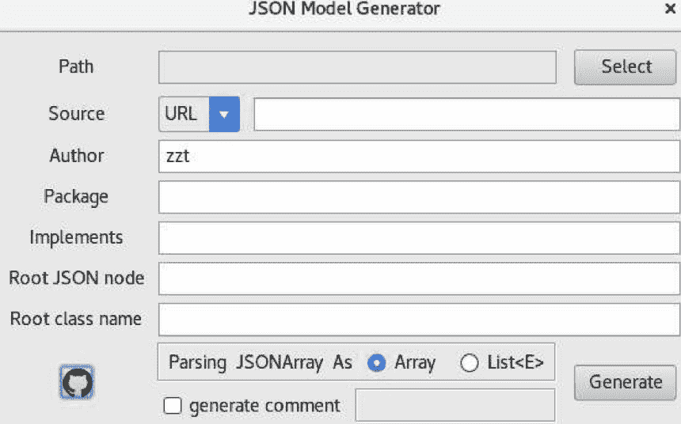

点击 'Generate' 完成。

## 第 155 章节：JShell
### 第 155.1 节：编辑片段

JShell 是 JDK 9 添加的 Java 交互 REPL。它允许开发者立即评估表达式、测试类并实验 Java 语言。JShell 使用的基本单元是片段（snippet）或源项。每当你声明局部变量或定义本地方法或类时，你都会创建一个以该变量/方法/类标识符命名的片段。你可以随时使用 `/edit` 命令编辑已创建片段。例如，假设我创建了一个带有方法 `bar` 的类 `Foo`：

```jshell
jshell > class Foo {
...> void bar() {
...>
...>
}
```

现在，我想填充我的方法体。我不需要重写整个类，可以直接对其进行编辑：

```jshell
jshell > /edit Foo
```

默认情况下，会弹出一个具有最基本功能的 Swing 编辑器。不过，你可以更改 JShell 使用的编辑器：

```jshell
jshell > /set editor emacs
jshell > /set editor vi
jshell > /set editor nano
jshell > /set editor -default
```

请注意，如果新版本的代码片段（snippet）包含任何语法错误，它可能无法保存。同样，只有当原始声明/定义在语法上是正确的，才会创建代码片段；以下操作是有效的：

```jshell
jshell > String st = String //省略了错误
jshell > /edit st
| No such snippet: st
```

然而，尽管存在某些编译错误（例如类型不匹配），代码片段仍然可以被编译并因此可以编辑——以下操作是有效的：


# JShell 代码片段管理

jshell> `int i = "hello"` //省略了错误

jshell> `/edit i`

```
```

最后，可以使用 `/drop` 命令删除代码片段：

```js
jshell> int i = 13

jshell> /drop i

jshell> System.out.println(i) | Error:
|cannot find symbol
|symbol: variable i | System.out.println(i)
```

要删除所有代码片段从而重置 JVM 状态，请使用 `/reset`：

```js
jshell> int i = 2

jshell> String s = "hi"

jshell> /reset

|Resetting state.
```

```js
jshell> i

| Error:
cannot find symbol | symbol: variable i | i
|^
```

```js
jshell> s

| Error:
cannot find symbol | symbol: variable s | s
|^
```

## 155.2 进入和退出 JShell

### 启动 JShell

在尝试启动 JShell 之前，请确保你的 `JAVA_HOME` 环境变量指向 JDK 9 安装目录。要启动 JShell，请运行以下命令：

```bash
$ jshell
```

如果一切顺利，你将看到一个 `jshell>` 提示符。

### 退出 JShell

要退出 JShell，请在 JShell 中运行以下命令：

```js
jshell> /exit
```

## 155.3 表达式

在 JShell 中，你可以求值 Java 表达式，无论是否带有分号。这些可以从基础表达式和语句到复杂的语句：

```js
jshell> 4+2
```

```js
jshell> System.out.printf("I am %d years old.\n", 42)
```

循环和条件判断也可以：

```js
jshell> for (int i = 0; i<3; i++) {
...> System.out.println(i);
...> }
```

需要注意的是，块内的表达式必须带有分号！

## 155.4 方法和类

你可以在 JShell 中定义方法和类：

```js
jshell> void speak() {
...> System.out.println("hello");
...> }
```

```js
jshell> class MyClass {
...> void doNothing() {}
...> }
```

不需要访问修饰符。与其他块一样，方法体内部需要分号。请记住，对于变量来说，可以重新定义方法和类。要查看方法或类的列表，请在 JShell 提示符下分别输入 `/methods` 或 `/types`。

## 155.5 变量

你可以在 JShell 中声明局部变量：

```js
jshell> String s = "hi"
jshell> int i = s.length
```

请记住，变量可以使用不同的类型重新声明；这在 JShell 中是完全有效的：

```js
jshell> String var = "hi"
jshell> int var = 3
```

要查看变量列表，请在 JShell 提示符下输入 `/vars`。

# 第 156 章：堆栈遍历 API (Stack-Walking API)

在 Java 9 之前，对线程栈帧的访问受限于内部类 `sun.reflect.Reflection`。具体为方法 `sun.reflect.Reflection.getCaller`。某些库依赖于此方法，而该方法已过用。

现在 JDK 9 通过 `java.lang.StackWalker` 类提供了另一种替代标准 API，它的设计初衷是通过允许懒性访问栈帧来实现高效性。某些应用程序可以使用此 API 遍历执行栈并对类进行过滤。

## 156.1 打印当前线程的所有栈帧

以下代码打印当前线程的所有栈帧：

```java
1 package test;
2
3 import java.lang.StackWalker.StackFrame;
4 import java.lang.reflect.InvocationTargetException;
5 import java.lang.reflect.Method;
6 import java.util.List;
7 import java.util.stream.Collectors;
8
9 public class StackWalkerExample {
10
11     public static void main(String[] args) throws NoSuchMethodException,
12         SecurityException, IllegalAccessException, IllegalArgumentException,
13         InvocationTargetException {
14         Method fooMethod = FooHelper.class.getDeclaredMethod("foo", (Class<?>)null);
15         fooMethod.invoke(null, (Object[])null);
16
17
18         class FooHelper {
19             protected static void foo() {
20                 BarHelper.bar();
21             }
22         }
23
24         class BarHelper {
25             protected static void bar() {
26                 List<StackFrame> stack = StackWalker.getInstance()
27                     .walk((s) -> s.collect(Collectors.toList()));
28                 for (StackFrame frame : stack) {
29                     System.out.println(frame.getClassName() + " " + frame.getLineNumber() + " " + frame.getMethodName());
30                 }
31             }
32         }
33    }
}
```

**输出：**

```text
test.BarHelper 26 bar
test.FooHelper 19 foo
test.StackWalkerExample 13 main
```

## 156.2 打印当前调用者类

以下代码打印当前调用者类。注意，在这种情况下，创建 `StackWalker` 时使用 `RETAIN_CLASS_REFERENCE` 选项，这样 `Class` 实例才会保留在 `StackFrame` 对象中。否则，将发生异常。

```java
public class StackWalkerExample {
    public static void main(String[] args) {
        FooHelper.foo();
    }
}

class FooHelper {
    protected static void foo() {
        BarHelper.bar();
    }
}

class BarHelper {
    protected static void bar() {
        StackWalker walker = StackWalker.getInstance(StackWalker.Option.RETAIN_CLASS_REFERENCE);
        Class<?> caller = walker.getCallerClass();
        System.out.println(caller.getName());
    }
}
```

**输出：**

```text
test.FooHelper
```

## 156.3 显示栈帧和其他帧

一些其他选项允许栈跟踪用于调试。例如，我们可以在创建 `StackWalker` 实例时添加 `SHOW_FRAMES` 选项，以便打印如下所示：

```java
1 package test;
2
3 import java.lang.StackWalker.StackFrame;
4 import java.lang.reflect.InvocationTargetException;
5 import java.lang.reflect.Method;
6 import java.util.List;
7 import java.util.stream.Collectors;
8
9 public class StackWalkerExample {
10
11     public static void main(String[] args) throws NoSuchMethodException,
12         SecurityException, IllegalAccessException, IllegalArgumentException,
13         InvocationTargetException {
14         Method fooMethod = FooHelper.class.getDeclaredMethod("foo", (Class<?>)null);
15         fooMethod.invoke(null, (Object[])null);
16
17
18         class FooHelper {
19             protected static void foo() {
20                 BarHelper.bar();
21             }
22         }
23
24         class BarHelper {
25             protected static void bar() {
26                 List<StackFrame> stack = StackWalker.getInstance(StackWalker.Option.SHOW_REFLECT_FRAMES)
27                     .walk((s) -> s.collect(Collectors.toList()));
28                 for (StackFrame frame : stack) {
29                     System.out.println(frame.getClassName() + " " + frame.getLineNumber() + " " + frame.getMethodName());
30                 }
31             }
32         }
33    }
}
```

**输出：**

```text
test.BarHelper 26 bar
test.FooHelper 19 foo
test.StackWalkerExample 13 main
```

注意，某些反射方法的行号不可用，因此 `StackFrame.getLineNumber()` 可能返回负值。

# 第 157 章：Sockets

Socket 是网络上运行程序之间双向链路的一个端点。

## 157.1 从 socket 读取

```java
String hostName = args[0];
int portNumber = Integer.parseInt(args[1]);
```

```java
try (
    Socket echoSocket = new Socket(hostName, portNumber);
    PrintWriter out = new PrintWriter(echoSocket.getOutputStream(), true);
    BufferedReader in = new BufferedReader(new InputStreamReader(echoSocket.getInputStream()))) {

    // 使用 socket
    BufferedReader stdIn = new BufferedReader(new InputStreamReader(System.in));
}
```

# 第 158 章：Java Sockets

Socket 是一种底层网络接口，有助于在两个程序（主要是客户端和服务端）之间建立连接，而 Socket 编程是最广泛使用的概念之一。

## 158.1 一个简单的 TCP 回显服务器

我们的 TCP 回显服务器将是一个独立的线程。它的启动非常简单，只需回显你发送给它的内容，但转换为大写形式。

```java
// 类实现服务器 socket。服务器 socket 只有在本地防火墙允许时才等待网络上的请求
ServerSocket serverSocket;

public class CAPECHOServer extends Thread {
    public CAPECHOServer(int port, int timeout) {
        try {
            // 在指定的端口上创建新的 Server。
            serverSocket = new ServerSocket(port);
            // SoTimeout 基本上就是套超时。
            // timeout 是以毫秒为单位的超时时间
            serverSocket.setSoTimeout(timeout);
        } catch (IOException ex) {
            Logger.getLogger(CAPECHOServer.class.getName()).log(Level.SEVERE, null, ex);
        }
    }

    @Override
    public void run() {
        try {
            // 我们希望服务器能够持续接受连接
            while (!Thread.interrupted()) {
                // 接受连接逻辑
            }
            // 完成后关闭服务器。
            serverSocket.close();
        } catch (IOException ex) {
            Logger.getLogger(CAPECHOServer.class.getName()).log(Level.SEVERE, null, ex);
        }
    }
}
```

现在来接受连接。让我们更新 `run` 方法。

```java
@Override
public void run() {
    while (!Thread.interrupted()) {
        try {
            // 记录端口号和机器的 IP 地址
            Logger.getLogger(this.getClass().getName()).log(Level.INFO, "Listening for Clients at \n\n{0} on {1}", new Object[]{serverSocket.getLocalPort(), serverSocket.getInetAddress()});

            Socket client = serverSocket.accept(); // 接受客户端连接
            // 现在获取 DataInputStream 和 DataOutputStreams
            DataInputStream inputStream = new DataInputStream(client.getInputStream()); // 客户端的输入流
            DataOutputStream ostream = new DataOutputStream(client.getOutputStream());
            /*
             * 重要提示
             * 服务器的输入是客户端的输出。客户端的输入是服务器的输出
             */
            // 发送欢迎消息
            ostream.writeUTF("Welcome!");

            // 关闭连接
            inputStream.close();
            ostream.close();
            client.close();

        } catch (IOException ex) {
            Logger.getLogger(CAPECHOServer.class.getName()).log(Level.SEVERE, null, ex);
        }
    }
    // 完成后关闭服务器
    try {
        serverSocket.close();
    } catch (IOException ex) {
        Logger.getLogger(CAPECHOServer.class.getName()).log(Level.SEVERE, null, ex);
    }
}
```

现在如果你可以打开 telnet 并尝试连接，你将看到一条 Welcome 消息。

你必须使用指定的端口和 IP 地址进行连接。

你应该会看到类似下面的结果：

```text
Welcome!
Connection to host lost.
```

嗯，连接丢失是因为我们主动终止了它。有时我们需要编写自己的 TCP 客户端。在这种情况下，我们需要一个客户端来请求用户输入并将其发送到网络，接收大写后的输入。

如果服务器先发送数据，那么客户端必须先读取数据。

```java
public class CAPECHOCClient extends Thread {
    Socket server;
    Scanner key; // 用于输入的 Scanner

    public CAPECHOCClient(String ip, int port) {
        try {
            server = new Socket(ip, port);
            key = new Scanner(System.in);
        } catch (IOException ex) {
            Logger.getLogger(CAPECHOCClient.class.getName()).log(Level.SEVERE, null, ex);
        }
    }

    @Override
    public void run() {
        DataInputStream istream = null;
        DataOutputStream ostream = null;
        try {
            istream = new DataInputStream(server.getInputStream()); // 熟悉的代码
        } catch (IOException ex) {
            Logger.getLogger(CAPECHOCClient.class.getName()).log(Level.SEVERE, null, ex);
        }
    }
}
```


```java
ostream = new DataOutputStream(server.getOutputStream());

System.out.println(istream.readUTF()); // 服务器发送的内容

System.out.print(":");

String tosend = key.nextLine();

ostream.writeUTF(tosend); // 将用户输入的任何内容发送到服务器

System.out.println(istream.readUTF()); // 最后在退出前读取服务器发送的内容
} catch (IOException ex) {
    Logger.getLogger(CAPECHOCClient.class.getName()).log(Level.SEVERE, null, ex);
} finally {
    try {
        if (istream != null) istream.close();
        if (ostream != null) ostream.close();
        if (server != null) server.close();
    } catch (IOException ex) {
        Logger.getLogger(CAPECHOCClient.class.getName()).log(Level.SEVERE, null, ex);
    }
}
}
}
```

现在更新服务器
```java
ostream.writeUTF("Welcome!");
String inString = inputStream.readUTF(); // 读取用户发送的内容
String outString = inString.toUpperCase(); // 将其转换为大写
ostream.writeUTF(outString);

// 关闭连接
inputStream.close();
```

现在运行服务器和客户端，你应该会得到类似下面的输出：
`Welcome! >`

## 第 159 章：FTP（文件传输协议）

### 参数详情

- `host`：FTP 服务器的主机或 IP 地址
- `port`：FTP 服务器端口
- `username`：FTP 服务器用户名
- `password`：FTP 服务器密码

### 第 159.1 节：连接并登录 FTP 服务器

要在 Java 中使用 FTP，你需要创建一个新的 `FTPClient`，并使用 `.connect(String server, int port)` 和 `.login(String username, String password)` 连接并登录服务器。

```java
import java.io.IOException;
import org.apache.commons.net.ftp.FTPClient;
import org.apache.commons.net.ftp.FTPReply;
// 导入此项目所需的所有资源。
```

```java
public class FTPConnectAndLogin {
    public static void main(String[] args) {
        // 设置这些值以匹配你的 FTP 服务器
        String server = "www.server.com"; // 服务器可以是主机名或 IP 地址
        int port = 21;
        String user = "username";
        String pass = "password";
        FTPClient ftp = new FTPClient();
        try {
            ftp.connect(server, port);
            showServerReply(ftp);
            int replyCode = ftp.getReplyCode();
            if (!FTPReply.isPositiveCompletion(replyCode)) {
                System.out.println("操作失败。服务器回复代码：" + replyCode);
                return;
            }
            boolean success = ftp.login(user, pass);
            showServerReply(ftp);
            if (!success) {
                System.out.println("登录服务器失败");
                return;
            } else {
                System.out.println("已登录服务器");
            }
        } catch (IOException ex) {
            System.out.println("哎！出问题了。");
            ex.printStackTrace();
        }
    }

    private static void showServerReply(FTPClient ftp) {
        System.out.println("服务器回复: " + ftp.getReplyString());
    }
}
```

完成后的 `catch` 块现在会在发生错误时打印“Oops! Something went wrong.” 以及堆栈跟踪信息。现在我们的最后一步是创建我们一直在运行的 `showServerReply()` 函数。

```java
private static void showServerReply(FTPClient ftp) {
    String[] replies = ftp.getReplyStrings();
    if (replies != null && replies.length > 0) {
        for (String aReply : replies) {
            System.out.println("SERVER: " + aReply);
        }
    }
}
```

此函数接受一个 `FTPClient` 变量，并命名为 "ftp"。之后，它将来自服务器的任何回复存储在一个字符串数组中。接下来，它检查是否存储了任何消息。如果有，它会将每条消息以“SERVER: [reply]”的形式打印出来。现在我们已经写好了函数，这是完整的脚本：

```java
import java.io.IOException;
import org.apache.commons.net.ftp.FTPClient;
import org.apache.commons.net.ftp.FTPReply;
```

```java
public class FTPConnectAndLogin {
    private static void showServerReply(FTPClient ftp) {
        String[] replies = ftp.getReplyStrings();
        if (replies != null && replies.length > 0) {
            for (String aReply : replies) {
                System.out.println("SERVER: " + aReply);
            }
        }
    }

    public static void main(String[] args) { // SET THESE TO MATCH YOUR
        String server = "www.server.com";
        int port = 21;
        String user = "username";
        String pass = "password";
        FTPClient ftp = new FTPClient();
        try {
            ftp.connect(server, port);
            showServerReply(ftp);
            int replyCode = ftp.getReplyCode();
            if (!FTPReply.isPositiveCompletion(replyCode)) {
                System.out.println("Operation failed. Server reply code: " + replyCode);
                return;
            }
            boolean success = ftp.login(user, pass);
            showServerReply(ftp);
            if (!success) {
                System.out.println("Failed to log into the server");
                return;
            } else {
                System.out.println("LOGGED IN SERVER");
            }
        } catch (IOException ex) {
            System.out.println("Oops! Something went wrong.");
            ex.printStackTrace();
        }
    }
}
```

首先，我们需要创建一个新的 `FTPClient` 并连接到服务器，然后使用 `.connect(String server, int port)` 和 `.login(String username, String password)` 进行登录。使用 `try/catch` 块进行连接和登录是非常重要的，以防代码无法连接到服务器。我们还需要创建一个函数，用于在连接和登录过程中显示我们可能从服务器接收到的任何消息。我们将此函数命名为“showServerReply(FTPClient ftp)”。

```java
import java.io.IOException;
import org.apache.commons.net.ftp.FTPClient;
import org.apache.commons.net.ftp.FTPReply;

public class FTPConnectAndLogin {
    private static void showServerReply(FTPClient ftp) {
        String[] replies = ftp.getReplyStrings();
        if (replies != null && replies.length > 0) {
            for (String aReply : replies) {
                System.out.println("SERVER: " + aReply);
            }
        }
    }

    public static void main(String[] args) { // SET THESE TO MATCH YOUR
        String server = "www.server.com";
        int port = 21;
        String user = "username";
        String pass = "password";
        FTPClient ftp = new FTPClient();
        try {
            ftp.connect(server, port);
            showServerReply(ftp);
            int replyCode = ftp.getReplyCode();
            if (!FTPReply.isPositiveCompletion(replyCode)) {
                System.out.println("Operation failed. Server reply code: " + replyCode);
                return;
            }
            boolean success = ftp.login(user, pass);
            showServerReply(ftp);
            if (!success) {
                System.out.println("Failed to log into the server");
                return;
            } else {
                System.out.println("LOGGED IN SERVER");
            }
        } catch (IOException ex) {
            System.out.println("Oops! Something went wrong.");
            ex.printStackTrace();
        }
    }
}
```

此之后，你的 FTP 服务器现在已经连接到你的 Java 脚本中。

## 第 160 章：在 Java 中使用其他脚本语言

Java 本身是一种非常强大的语言，但得益于引入了脚本引擎的 JSR223（Java 规范请求），它的功能可以进一步扩展。

### 第 160.1 节：在 nashorn 的脚本模式下评估 JavaScript 文件

```java
public class JSngine {
    /*
    * 注意：Nashorn 仅适用于 Java-8 及更高版本
    * 你可以使用 ScriptEngineManager.getEngineName("js") 使用 rhino
    */
    ScriptEngine engine;
    ScriptContext context;
    Bindings bindings;
    // 从工厂在脚本模式下初始化引擎
    public JSngine() {
        engine = new NashornScriptEngineFactory().getScriptEngine("-scripting");
        // ScriptContext 是一个接口，所以我们需要它的实现类
        context = new SimpleScriptContext();
        // 创建用于暴露的绑定
    }
}
```

### 在方法内部定义（例如：事件处理）

#### C++

```cpp
Local Class[ref]
void fun() {
  class Test {
    /* Test class 的成员 */
  }
}
```

#### Java

`Local Class[ref]`
`class Test`

```java
void f() {
  new Thread(new Runnable() {
    public void run() {
      doSomethingBackgroundish();
    }
  }).start();
}
```

## 第 161 章：值传递与引用传递

### 第 161.3 节：值传递与引用传递

许多人认为 Java 仅支持值传递，但情况比这要复杂得多。比较以下 C++ 和 Java 示例，查看值传递（即拷贝）和引用传递（即别名）的多种形式。

#### C++ 示例（完整代码）

```cpp
// 传递对象的拷贝
static void passByCopy(PassIt obj) {
  obj.i = 22; // 仅是“局部”的
}
```

```cpp
// 传递指针
static void passByPointer(PassIt* ptr) {
  ptr->i = 33;
  ptr = 0; // 如果使用 '0'，最好改用 nullptr
}
```

```cpp
// 传递别名（即引用）
static void passByAlias(PassIt& ref) {
  ref.i = 44;
}
```

```cpp
// 这是一个旧式的方法。// 请查看 std::swap 以获取最佳实现
static void swap(PassIt** pptr1, PassIt** pptr2) {
  PassIt * tmp = *ptr1;
  *ptr1 = *ptr2;
  *ptr2 = tmp;
}
```

#### Java 示例（完整代码）

```java
// 传递变量的拷贝
```


// 注意：在 Java 中，基本类型是值传递的

```java
public static void passByCopy(int copy) {
  copy = 33; // 仅是“局部”变化
}
```

```java
// Java 中不存在指针
/*
public static void passByPointer(PassIt* ptr) {
  ptr->i = 33;
  ptr = 0; // 如果使用 '0'，最好改用 nullptr
}
*/
```

```java
// 传递别名（即引用）
public static void passByAlias(PassIt ref) {
  ref.i = 44;
}
```

```java
// 传递别名（即引用），
// 但需要进行“手动”的、可能昂贵的拷贝
public static void swap(PassIt ref1, PassIt ref2) {
  PassIt tmp = new PassIt(ref1);
  ref1.copy(ref2);
  ref2.copy(tmp);
}
```

## 第 161.4：继承 vs 组合

C++ 和 Java 都是面向对象的语言，因此下面的图适用于两者。

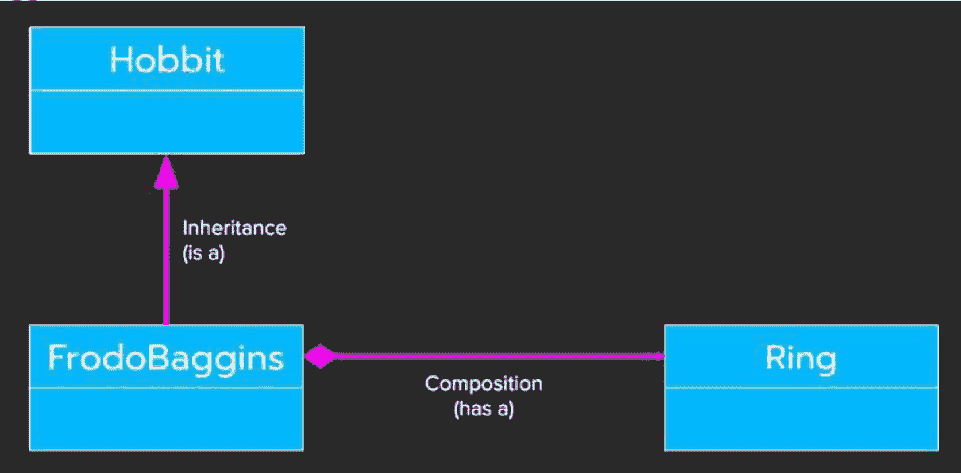

## 第 161.5：强制向下转换

注意使用“向下类型转换”（Downcasting）——向下类型转换是在继承体系中从基类向子类的转换（即多态的相反）。通常情况下，请使用多态和重写，而不是 `instanceof` 和向下类型转换。

### C++ 示例

```cpp
// 需要显式类型转换
Child *pChild = (Child *) &parent;
```

### Java 示例

```java
if (mySubClass instanceof SubClass) {
  SubClass mySubClass = (SubClass) someBaseClass;
  mySubClass.nonInheritedMethod();
}
```

## 第 161.6：抽象方法与类

### 抽象方法

没有实现

```cpp
// 纯虚方法
virtual void eat(void) = 0;
```

### Java

抽象方法

```java
abstract void draw();
```

### 抽象类

不能实例化

```cpp
// 不能实例化；至少有 1 个纯虚方法
class AB {public: virtual void f() = 0};
```

### Java

不能实例化；可以有非抽象方法

```java
abstract class GraphicObject {}
```

### 接口

没有实例字段

```cpp
// 没有对应 Java 的东西
```

### Java

与抽象类非常相似，但 1) 支持多重继承；2) 没有实例字段

```java
interface TestInterface {}
```

## 第 162 章：音频

## 第 162.1：播放 MIDI 文件

可以使用 `javax.sound.midi` 包中的几个类来播放 MIDI 文件。`Sequencer` 执行 MIDI 文件的播放，它的许多方法可以用于设置播放控制，如循环次数、节拍、轨道静音等。

MIDI 数据的通用播放可以通过这种方式实现：

```java
import java.io.File;
import java.io.IOException;
import javax.sound.midi.InvalidMidiDataException;
import javax.sound.midi.MidiSystem;
import javax.sound.midi.MidiUnavailableException;
import javax.sound.midi.Sequence;
import javax.sound.midi.Sequencer;

public class MidiPlayback {
  public static void main(String[] args) {
    try {
      Sequencer sequencer = MidiSystem.getSequencer(); // 获取默认 Sequencer
      if (sequencer == null) {
        System.err.println("不支持 Sequencer 设备");
        return;
      }
      sequencer.open(); // 打开设备
      // 创建序列，必须包含 MIDI 数据
      Sequence sequence = MidiSystem.getSequence(new File(args[0]));
      sequencer.setSequence(sequence); // 加载到 sequencer
      sequencer.start(); // 开始播放
    } catch (MidiUnavailableException | InvalidMidiDataException | IOException ex) {
      ex.printStackTrace();
    }
    // 停止播放使用：
    sequencer.stop(); // 停止播放
  }
}
```

`sequencer` 可以静音序列的一个或多个轨道。以下设置序列的第一个轨道静音：

```java
import javax.sound.midi.Track;

Track[] track = sequence.getTracks();
sequencer.setTrackMute(track[0]);
```

如果提供了循环次数，`sequencer` 可以重复播放序列。以下设置 `sequencer` 播放四次并无限持续：

```java
sequencer.setLoopCount(3);
```

`sequencer` 不一定从开始播放序列，也不一定播放到结束。可以通过指定起始和结束点来实现：

```java
sequencer.setLoopStart(12);
sequencer.setLoopEndPoint(32768);
sequencer.setTickPosition(8192);
```

`Sequencers` 还可以以特定的节拍播放 MIDI 文件，可以通过指定每分钟拍数（BPM）或四分音符微秒（MPQ）来控制。播放的因子也可以调整：

```java
sequencer.setTempoInBPM(120);
sequencer.setTempoInMPQ(750);
sequencer.setFactor(1.5f);
```

使用 `Sequencer` 后，记得关闭它。

## 第 162.2：循环音频文件

需要的导入：

```java
import javax.sound.sampled.AudioSystem;
import javax.sound.sampled.Clip;
```

代码创建一个 `clip` 并在启动后连续播放：

```java
Clip clip = AudioSystem.getClip();
clip.open(AudioSystem.getAudioInputStream(new URL(filename)));
clip.start();
clip.loop(Clip.CONTINUOUS);
```

获取所有支持的文件类型：

```java
AudioFormat.Type[] audioFileTypes = AudioSystem.getFileTypes();
```

## 第 162.3：基础音频输出

Hello Audio! Java 从本地或网络存储播放音频文件如下。它适用于未压缩的 `.wav` 文件，不应用于播放 mp3 或压缩文件。

```java
import java.io.*;
import java.net.URL;
import javax.sound.sampled.*;

public class SoundClipTest {
  // 构造函数
  public SoundClipTest() {
    try {
      // 打开音频输入流
      File soundFile = new File("/usr/share/sounds/Front_Center.wav"); // 通过 URL 获取音频文件
      AudioInputStream audioIn = AudioSystem.getAudioInputStream(soundFile);
      AudioFormat format = audioIn.getFormat();
      // 获取 clip 资源
      DataLine.Info info = new DataLine.Info(Clip.class, format);
      Clip clip = (Clip) AudioSystem.getLine(info);
      // 打开 clip 并从输入流加载样本
      clip.open(audioIn);
      clip.start();
    } catch (UnsupportedAudioFileException e) {
      e.printStackTrace();
    } catch (IOException e) {
      e.printStackTrace();
    } catch (LineUnavailableException e) {
      e.printStackTrace();
    }
  }

  public static void main(String[] args) {
    new SoundClipTest();
  }
}
```

## 第 162.4：底层音频

用 Java 产生声音时也可以采用底层方法。这段代码将原始二进制数据写入操作系统的音频缓冲区以产生声音。理解产生这种声音的限制和必要的计算非常重要。由于播放几乎是瞬时的，计算需要几乎实时完成。

因此，这种方法不适用于复杂的音频采样。对于此类目的，使用专用工具更好的方法。以下方法生成并直接输出指定频率、指定音量和持续时间的矩波。

```java
public void rectangleWave(byte volume, int hertz, int msecs) {
  final SourceDataLine dataLine;
  // 24 kHz = 8bit, 单通道, 有符号小端序
  AudioFormat af = new AudioFormat(24_000, 8, 1, true, false);
  try {
    dataLine = AudioSystem.getSourceLine(af);
    dataLine.open(af, 10_000); // 音频缓冲区大小：10k 样本
  } catch (LineUnavailableException e) {
    throw new RuntimeException(e);
  }
  int waveHalf = 24000 / hertz; // 半周期的样本
  byte[] buffer = new byte[waveHalf * 20];
  int samples = msecs * (24_000 / 1000); // 24k (样本/秒) / 1000 * 时间(ms)
  dataLine.start(); // 开始播放
  int sign = 1;
  for (int i = 0; i < samples; i += buffer.length) {
    for (int j = 0; j < 20; j++) { // 向缓冲区生成 10 个波
      sign *= -1;
      // 用音量填充第 j 个波半到第 j+1 个波半之间
      Arrays.fill(buffer, waveHalf * j, waveHalf * (j + 1), (byte) (volume * sign));
    }
    dataLine.write(buffer, 0, buffer.length);
  }
  dataLine.drain(); // 强制将缓冲区内容刷到硬件
  dataLine.stop(); // 结束播放
  dataLine.close();
}
```

为了生成更具差异化的声波，需要更复杂的正弦计算以及可能更大的样本量。这导致代码变得复杂得多，因此被省略。

## 第 163 章：Java 打印服务 (Java Print Service)

Java Print Service API 提供了发现打印服务以及向它们发送打印请求的功能。它包含了基于 IETF 规范 RFC 2911 中指定的互联网打印协议 (IPP) 1.1 标准属性所构建的可扩展打印属性。

## 第 163.1 节：构建将打印的文档 (Doc)

`Doc` 是一个接口，Java Print Service API 提供了一个名为 `SimpleDoc` 的简单实现。每个实例基本上由两个方面组成：
- 打印数据内容体本身（一个来自打印服务的电子邮件作业）。

## 第 163.2 节：发现可用的打印服务

要发现所有可用的打印服务，我们可以使用 `PrintServiceLookup` 类。让我们来看看如何操作：

```java
import javax.print.PrintService;
import javax.print.PrintServiceLookup;

public class DiscoveringAvailablePrintServices {
  public static void main(String[] args) {
    discoverPrintServices();
  }

  public static void discoverPrintServices() {
    PrintService[] allPrintServices = PrintServiceLookup.lookupPrintServices(null, null);
    for (PrintService printService : allPrintServices) {
      System.out.println("Print service name: " + printService.getName());
    }
  }
}
```

打印服务名称: Fax
打印服务名称: Microsoft Print to PDF
打印服务名称: Microsoft XPS Document Viewer

## 第 163.3 节：定义打印请求属性

有时我们需要确定打印请求的某些方面。我们将它们称为属性（attributes）。打印请求属性的示例包括：
- 份数（1, 2 等）
- 方向（纵向或横向）
- 色度（单色、彩色）
- 质量（草稿、普通、高质）
- 页面（单面、双面等）
以及此类推……

在选择其中一个以及每个属性拥有的值之前，我们首先需要构建属性集：

```java
PrintRequestAttributeSet pras = new HashPrintRequestAttributeSet();
```

现在我们可以添加它们了。一些示例如下：
- `pras.add(new Copies(5));`
- `pras.add(MediaSize.ISO_A4);`
- `pras.add(OrientationRequested.PORTRAIT);`
- `pras.add(PrintQuality.NORMAL);`

现在 `pras` 对象可以发送到打印作业请求中（参见“从打印服务创建打印作业”）。

## 第 163.4 节：监听打印作业请求的状态变化

对于大多数打印客户端来说，知道打印作业是否失败或完成是非常有用的。Java Print Service API 提供了一些功能来获取这些场景的信息。我们只需要为 `PrintJobListener` 接口提供一个实现，并在打印作业上注册该实现。当打印作业状态发生变化时，我们将接收到通知。我们可以根据需要执行任何操作，例如：
- 更新用户界面
- 启动另一个业务流程
- 在数据库中记录某些内容
- 或者简单地记录日志。

在下面的示例中，我们将记录每个打印作业的状态变化：

```java
import javax.print.event.PrintJobEvent;
import javax.print.event.PrintJobListener;
import java.util.logging.Logger;

public class LoggerPrintJobListener implements PrintJobListener {
  // 在此处编写你喜欢的 Logger 类！
  private static final Logger LOG = Logger.getLogger(LoggerPrintJobListener.class.getName());

  public void printDataTransferCompleted(PrintJobEvent pje) {
    LOG.info("Print data transfer completed");
  }

  public void printJobNoMoreEvents(PrintJobEvent pje) {
    LOG.info("No more events to the job");
  }
}
```


最后，我们可以在请求本身之前在打印作业上添加打印监听器实现，如下：
`DocPrintJob job = Service.createPrintJob();`
`printJob.addPrintJobListener(new LoggerJobListener());`
`printJob.print(doc, prac);`

### PrintEvent pje 参数

注意每个方法都有一个 `PrintEvent pje` 参数。为了简单起见，我们在这个示例中没有使用它，但你可以用它来探索状态。
`pje.getPrintJob().getAttributes();`

将返回一个 `PrintJobAttribute` 对象，你可以以 for-each 的方式来运行它们。

### 实现相同目标的另一种方法

实现相同目标的另一种选择是扩展 `PrintJobAdapter` 类，正如顾名所示，它是 `PrintJobListener` 的适配器。如果实现接口，我们必须强制实现所有所有方法。这种方法的优势是，我们只需要重写我们想要的方法。让我们看看它是如何工作的：

```java
import javax.print.event.PrintJobEvent; 
import javax.print.event.PrintJobAdapter;

public class LoggerPrintJobAdapter extends PrintJobAdapter {

  // 在此处编写你喜欢的 Logger 类！

  private static final Logger LOG =
  Logger.getLogger(LoggerPrintJobAdapter.class);

  public void printPrintJobCompleted(PrintJobEvent pje) { 
    LOG.info("Print job completed"); 
  }
}
```

注意每个方法都有一个 `PrintEvent pje` 参数。为了简单起见，我们在这个示例中没有使用它，但你可以用它来探索状态。
`pje.getPrintJob().getAttributes();`

将返回一个 `PrintJobAttribute` 对象，你可以以 for-each 的方式来运行它们。

## 第 163.5 节：发现可用的打印服务

要发现所有可用的打印服务，我们可以使用 `PrintServiceLookup` 类。让我们来看看如何：

```java
import javax.print.PrintService;
import javax.print.PrintServiceLookup;

public class DiscoveringAvailablePrintServices {

  public static void main(String[] args) {
    discoverPrintServices();
  }

  public static void discoverPrintServices() {
    PrintService[] allPrintServices =
    PrintServiceLookup.lookupPrintServices(null, null);

    for (PrintService printService : allPrintServices) {
      System.out.println("Print service name: " + printService.getName()); 
    }
  }
}
```

打印服务名称: Fax
打印服务名称: Microsoft Print to PDF
打印服务名称: Microsoft XPS Document Viewer

## 第 163.6 节：从打印服务创建打印作业

打印作业基本上由两个方面组成：
- 打印数据内容本身（一个来自打印服务的电子邮件作业）。

## 第 164 章：CompletableFuture

`CompletableFuture` 是 Java SE 8 添加的类，它实现了 `Future` 接口。除了支持 `Future` 接口外，还增加了许多允许在完成后执行异步回调的方法。

### 第 164.1 节：CompletableFuture 的简单示例

在下面的示例中，`calculateShippingPrice` 方法计算费用，这需要一些处理时间。在现实世界中，这将通过另一个服务器返回价格。

```java
public static void main(String[] args) {
  int price = 15; // 保持简单并使用整数价格
  int weightInGrams = 900;

  calculateShippingPrice(weightInGrams) // 在这里我们获取 future
  .thenAccept(shippingPrice -> { // 然后立即对其处理！
    // 这种流式风格非常有助于保持简洁
    System.out.println("Your total price is: " + (price + shippingPrice));
  });

  System.out.println("请等待。正在计算总价。");
}

public static CompletableFuture<Integer> calculateShippingPrice(int weightInGrams) { 
  return CompletableFuture.supplyAsync(() -> {
    // supplyAsync 是一个工厂方法，它将给定的
    // Supplier<U> 转换为 CompletableFuture<U>
    // 假设每 200 克花费 1 美元运费
    int shippingCosts = weightInGrams / 200;

    try {
      Thread.sleep(2000L); // 现在模拟一些等待时间...
    } catch(InterruptedException e) { /* 我们可以安全地忽略它 */ }

    return shippingCosts; // 并返回费用！
  });
}
```

## 第 165 章：Runtime 命令

## 第 165.1 节：添加关闭钩子

有时我们需要在程序停止时执行某些代码，例如释放已打开的系统资源。你可以通过 `addShutdownHook` 方法让线程在程序停止时运行：

```java
Runtime.getRuntime().addShutdownHook(new Thread(() -> {
  ImportantStuff.someImportantOutputStream.close();
}));
```

## 第 166 章：单元测试

单元测试是测试驱动开发中不可或缺的一部分，也是构建任何健壮应用程序的重要特性。在 Java 中，单元测试几乎完全通过外部库和框架完成，其中大多数框架都有自己的文档标签。本文存位符作为向读者介绍可用工具及其各自文档的手段。

## 第 166.1 节：什么是单元测试？

这部分是一个入门介绍。之所以放在这里，是因为文档强制要求包含一个示例，即使它 只是一个占位文章。如果你已经了解了单元测试的基础知识，可以随时跳到备注部分，那里会提到特定的框架。

单元测试是确保给定模块的行为符合预期。在大规模应用程序中，确保模块在真空环境中恰当执行，是确保应用程序保真性的不可或缺的一部分。
考虑以下（简单微的）伪示例：

```java
public class Example {
    public static void main (String args[]) {
        new Example();
    }

    // 应用级测试。
    public Example() {
        Consumer c = new Consumer();
        System.out.println("VALUE = " + c.getVal());
    }

    // 你的模块。
    class Consumer {
        private Capitalizer c;
        public Consumer() {
            c = new Capitalizer();
        }
        public String getVal() {
            return c.getVal();
        }
    }
}
```

```java
// 另一个团队的模块。
class Capitalizer {
    private DataReader dr;
    public Capitalizer() {
        dr = new DataReader();
    }
    public String getVal() {
        return dr.readVal().toUpperCase();
    }
}

// 另一个团队的模块。
class DataReader {
    public String readVal() {
        // 指向你应用程序部署中某处的某个，或者
        // 通过特定的部署网络获取。File f;
        String s = "data";
        // ... 从 f 读取数据到 ...
        return s;
    }
}
```

所以这个示例是微不足道的核心：`DataReader` 从文件中获取数据，将其传递给 `Capitalizer`，后者将所有字符转换为大写，与我们的应用程序紧密耦合的对象被传递给 `Consumer`。`DataReader` 与我们的应用程序环境紧密耦合，因此我们将此链的测试推迟到准备好部署测试版本为止。

现在，假设在发布过程某个地方，由于未知原因，`Capitalizer` 中的 `getVal()` 方法从返回大写的 `String` 变为返回小写的 `String`：

```java
// 另一个团队的模块。
class Capitalizer {
    ...
    public String getVal() {
        return dr.readVal().toLowerCase();
    }
}
```

显然，这破坏了预期的行为。但是，由于执行 `DataReader` 涉及的繁琐过程，我们在下一次测试部署之前不会注意到这一点。这个问题在我们的系统中存在了几天、几周甚至几个月后，然后产品经理发现了它，并立刻转向你——即与 `Consumer` 相关的团队负责人。“为什么会发生这种情况？你们你们改了什么？显然，你们一无所知。你们不知道发生了什么。你们没有修改过任何会触及这里的代码；为什么它突然崩溃了？”

最终，在团队之间经过讨论和协作后，问题被追溯并解决。但这引发了问题：如何能防止这种情况的发生呢？

这里有两个显而易见的点：

### 测试需要自动化

我们依赖手动测试来发现这个 bug，将会被忽视太久。我们需要一种自动化过程，让 bug 的引入立即发生。而不是在 5 周后。不是 5 天后。不是 5 分钟后。而就是现在。

你必须意识到，在这个例子中，我表达了一个非常微小且未被察觉的 bug。在工业级应用中，几十个模块不断更新，这些 bug 可能会处处渗透。你修复了某个模块的问题，结果却发现那个被“修复”的行为在其他地方以某种方式被依赖（无论是内部还是外部）。

如果没有严谨的验证，问题就会渗入系统。如果忽视得足够久，可能会导致为了修复更改而花费大量的额外工作（然后修复那些修复，等等），以至于产品在投入精力后，其剩余工作量反而增加。你不希望处于这种境地。

## 测试需要细粒度

我们在上面的示例中提到的第二个问题是追溯 bug 所花费的时间。当测试人员发现问题时，产品经理联系了你，你进行调查并发现 `Capitalizer` 返回了看似错误的数据，你带着发现的结果联系了 `Capitalizer` 团队，你继续调查，等等，等等。

关于这个微小示例的质量和难度的观点在这里同样。显然，任何相当熟悉 Java 的人都能快速发现引入的问题。但追溯和沟通问题通常要困难得多、困难得多。也许 `Capitalizer` 团队提供给你的是一个没有源码的 JAR 包。也许他们身处地球的另一端，沟通时间非常有限（可能每天只收到一次电子邮件）。这可能导致 bug 需要几周甚至更长时间才能追溯（而且再次，对于特定的发布版本，可能有好几个这样的问题）。

为了缓解这种情况，我们希望在尽可能细的粒度上进行严谨测试（你同时也想要粗粒度测试来确保模块交互正常，但那不是这里的重点）。

## 引入单元测试

想象一下，如果我们有一个测试，专门确保 `Capitalizer` 的 `getVal()` 方法对于给定的输入返回大写的字符串。此外，假设我们在提交任何代码之前运行了该测试。结果是 bug 被引入了系统。我们会在测试中捕捉到它，开发者会意识到错误，并找到替代方案。

这里省略了一些如何实现这些测试的细节，但这些将在框架中介绍。

## 第 167 章：断言

### 参数详情

断言语句如果该表达式为假，则抛出 `AssertionError`。当使用时，断言抛出的 `AssertionError` 此消息。

### 第 167.1 节：使用 assert 检查运算

```java
a = Math.abs(1 % 2);

// 如果上面的运算错误，将抛出错误
assert a >= 0 && a <= 1 : "计算值 " + a + "超出范围";
```

## 第 168 章：多版本 JAR 文件

Java 9 引入的功能之一是多版本 JAR (MRJAR)，允许在同一个 JAR 中封装多个版本的代码。该特性见 JEP 238。

### 第 168.1 节：多版本 JAR 文件内容的示例

通过在 `MANIFEST.MF` 文件设置 `Multi-Release: true`，JAR 文件将变为多版本 JAR，Java Runtime（只要支持 MRJAR 格式）将根据当前版本选择合适的版本。

此类 JAR 的结构如下：

```
jar root
- A.class
- B.class
- C.class
- D.class
- META-INF
- versions
- 9
- A.class
- B.class
- 10
- A.class
```

在 JDK < 9 上，只有根目录中的类对 Java Runtime可见。
在 JDK 9 上，类 A 和 B 将从 `root/META-INF/versions/9`目录加载。
在 JDK 10 上，类 A 将从 `root/META-INF/versions/10`目录加载。

### 第 168.2 节：使用 jar 工具创建多版本 JAR

可以使用 `jar` 命令创建一个多版本 JAR，其中包含为 Java 8 和 Java 9 编译的相同类的两个版本，尽管有一个警告说这些类是相同的：

```
C:\Users\manouti> jar -create -file MR.jar C sampleproject-base demo -release 9 sampleproject-9 demo
Warning: entry META-INF/versions/9/demo/SampleClass.class contains a class that is identical to an entry already in the jar
```

`-release 9` 选项告诉 jar 将后续（sampleproject-9 目录下的 demo 包）包含在 MRJAR 的版本条目中，即 `root/META-INF/versions/9` 下。结果是如下内容：

```
jar 根
- demo
- SampleClass.class
- META-INF
- versions
- 9
- demo
- SampleClass.class
```

现在让我们创建一个名为 `Main` 的类来打印 `SampleClass` 的 URL，并将其添加到 Java 9 版本中：

```java
package demo;
import java.net.URL;

public class Main {
    public static void main(String[] args) throws Exception {
        URL url =
        Main.class.getClassLoader().getResource("demo/SampleClass.class");
        System.out.println(url);
    }
}
```

如果我们编译这个类并重新运行 jar 命令，我们将得到一个错误：

```bash
C \Users\manouti>-jar --create --file MR.jar -C sampleproject-base demo --release 9 -C sampleproject-9 demo
entry: META-INF/versions/9/demo/Main.class, contains a new public class not found in base entries
Warning: entry META-INF/versions/9/demo/Main.java, multiple resources with same name 
Warning: entry META-INF/versions/9/demo/SampleClass.class contains a class that is identical to an entry already in the jar
invalid multi-release jar MR.jar deleted
```


原因是 jar 工具防止在公共类未被添加到基础条目（base entries）的情况下将其添加到版本条目中。这样做是为了让 MRJAR 为不同的 Java 版本暴露相同的公共 API。

注意，在运行时，这条规则并不是强制的。它仅由 `jar` 等工具应用。在这种特定情况下，`Main` 的目的是运行示例代码，因此我们可以简单地在基础条目中添加副本。如果该类是我们只需要用于 Java 9 的新实现的一部分，可以将其设置为非公共。

要将 `Main` 添加到根条目，我们首先需要将其编译为目标 Java 9 之前的发布版本。可以使用 `javac` 的新 `-release` 选项来实现：

```bash
C:\Users\manouti\sampleproject-base\demo>javac -release 8 Main.java

C:\Users\manouti\sampleproject-base\demo>cd ../

C:\Users\manouti>jar --create --file MR.jar -C sampleproject-base demo --release 9 -C sampleproject-9
```

运行 `Main` 类显示 `SampleClass` 是从版本化目录加载的：

```bash
C:\Users\manouti>java -class-path MR.jar demo.Main

file:C:/Users/manouti/MR.jar!META-INF/versions/9/SampleClass.class
```

# 第 168.3 节：多发布 Jar 内部已加载类的 URL

给定以下多发布 Jar：

```text
jar 根
- demo
- SampleClass.class
- META-INF
- versions
- 9
- demo
- SampleClass.class
```

以下类打印了 `SampleClass` 的 URL：

```java
package demo;

import java.net.URL;

public class Main {

    public static void main(String[] args) throws Exception {

        URL url = Main.class.getClassLoader().getResource("demo/SampleClass.class");

        System.out.println(url);

    }

}
```

如果该类被编译并添加到 MRJAR 中 Java 9 的版本条目中，运行它将导致：

```bash
C:\Users\manouti>java -class-path MR.jar demo.Main

jar:file:C:/Users/manouti/MR.jar!/META-INF/versions/9/demo/SampleClass.class
```

# 第 169 章：即时编译 (JIT) 编译器

## 第 169.1 节：概述

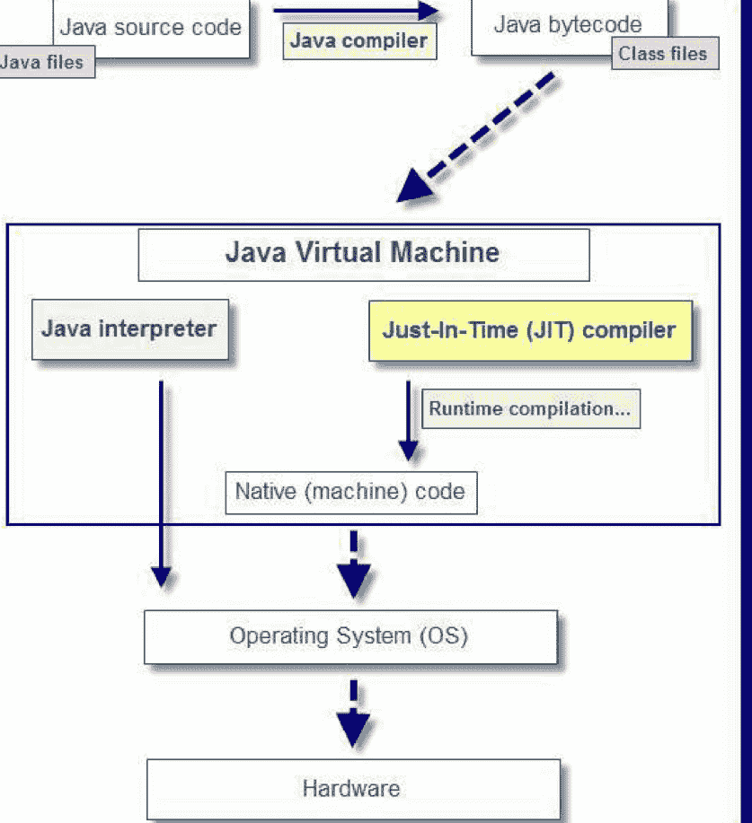

即时编译（JIT）编译器是 Java™ 运行环境的一个组件，它可以在运行时提高 Java 程序的性能。

Java 程序由类组成，类包含与平台无关的字节码，这些字节码可以由许多不同计算机架构上的 JVM 解释。在运行时，JVM 加载类文件，确定每个单独字节码的语义，并执行相应的计算。

解释执行期间额外的处理器和内存消耗意味着 Java 应用程序的运行速度比原生应用程序慢。

JIT 编译器通过在运行时将字节码编译为原生机器码来帮助提高 Java 程序的性能。JIT 编译器默认启用，并在调用 Java 方法时激活。JIT 编译器将该方法的字节码编译为原生机器码，“在需要时”编译以便运行。

当一个方法被编译后，JVM 将直接调用该方法的编译代码而不是解释它。从理论上讲，如果编译不需要处理器时间和内存消耗，编译每个方法可以使 Java 程序的运行速度接近原生应用程序。

JIT 编译确实需要处理器时间和内存消耗。当 JVM 首次启动时，会调用成千上万个方法。编译所有这些方法会影响启动时间，即使程序最终实现了非常好的峰性能。

在实践中，方法在第一次被调用时并不会编译。对于每个方法，JVM 维护一个计数器，每调用一次方法，计数器就会加 1。

JVM 解释方法，直到其调用计数超过 JIT 编译阈值。因此……

# 第 170 章：字节码修改

## 第 170.1 节：什么是字节码？

字节码是 JVM 使用的指令集。这是它编译后转换的形式：

```java
public static void main(String[] args) {

    System.out.println("Hello World");

}
```

背后的逻辑是什么？

- `getstatic`：获取类静态字段的值。在这种情况下，是 `System` 的 `PrintStream` "out"。
- `ldc`：将常量推入栈中。在这种情况下，是字符串 "Hello World"。
- `invokirtual`：调用栈上加载的引用的方法，并将结果放在栈上。方法的参数也从栈中获取。

[第 1196 页]

## 第 170.2 节：如何使用 ASM 编辑 jar 文件

首先需要加载 jar 中的类。我们将使用三个方法来实现此过程：

- `loadClasses(File)`
- `readJar(JarFile, JarEntry, Map)`
- `getNode(byte[] j)`

```java
Map<String, ClassNode> loadClasses(File jarFile) throws IOException {

    Map<String, ClassNode> classes = new HashMap<String, ClassNode>();

    JarFile jar = new JarFile(jarFile);

    Stream<JarEntry> str = jar.stream();

    str.forEach(z -> readJar(jar, z, classes));

    return classes;

}
```

```java
Map<String, ClassNode> readJar(JarFile jar, JarEntry entry, Map<String, ClassNode> classes) {

    String name = entry.getName();

    try (InputStream jis = jar.getInputStream(entry)) {

```

```java
try {

  ClassNode cn = getNode(bytes);

  classes.put(cn.name, cn);

} catch (Exception e) {

  e.printStackTrace();

}

} catch (IOException e) {

  e.printStackTrace();

}

return classes;

}
```

```java
ClassNode getNode(byte[] bytes) {

  ClassReader cr = new ClassReader(bytes);

  ClassNode cn = new ClassNode();

  try {

    cr.accept(cn, ClassReader.EXPAND_FRAMES);

  } catch (Exception e) {

    e.printStackTrace();

  }

  cr = null;

  return cn;

}
```

通过这些方法，加载和修改 jar 文件就变成了更改 map 中 `ClassNodes` 的简单事情。在这个示例中，我们将使用 Tree API 将 jar 中所有的 Strings 替换为大写的字符串。

```java
File jarFile = new File("sample.jar");

Map<String, ClassNode> nodes = loadClasses(jarFile);
```

```java
// 遍历 ClassNodes

for (ClassNode cn : nodes.values()) {

  // 遍历类中的方法

  for (MethodNode mn : cn.methods) {

    // 遍历方法中的指令

    for (AbstractInsnNode ain : mn.instructions.toArray()) { // 如果指令

      // 加载常量值

      if (ain.getOpcode() == Opcodes.LDC) {

        // 将当前指令强制转换为 Ldc

        // 如果常量是字符串，则将其转换为大写。

        LdcInsnNode ldc = (LdcInsnNode) ain;

        if (ldc.cst instanceof String) {

          ldc.cst = ldc.cst.toString().toUpperCase();

        }

      }

    }

  }

}
```

现在所有 `ClassNode` 的字符串都已修改，我们需要保存这些更改。为了保存更改并获得可运行的输出，必须完成以下几操作：

- 将 `ClassNodes` 导出为字节数组
- 通过字节加载非类 jar 条目（例如：`Manifest.mf` / jar 中的其他二进制资源）
- 将所有字节保存到新的 jar 中

根据上面的最后部分，我们将创建三个方法。

- `processNodes(Map<String, ClassNode> nodes)`
- `loadNonClasses(File jarFile)`
- `saveAsJar(Map<String, byte[]> outBytes, String fileName)`

用法：

```java
Map<String, byte[]> out = process(nodes, new HashMap<String, MappedClass>()); 

out.putAll(loadNonClassEntries(jarFile));

saveAsJar(out, "sample-edit.jar");
```

使用的方法：

```java
static Map<String, byte[]> processNodes(Map<String, ClassNode> nodes,

    Map<String, MappedClass> mappings) {

  Map<String, byte[]> out = new HashMap<String, byte[]>();Map<String, byte[]> out = new HashMap<String, byte[]>();

  // 遍历节点并将它们添加到 <类名 , 类类型> 类型的 map 中

  // 使用 Compute_Frames 确保栈帧将被自动重新计算

  for (ClassNode cn : nodes.values()) {

    ClassWriter cw = new ClassWriter(ClassWriter.COMPUTE_FRAMES);

    out.put(mappings.containsKey(cn.name) ? mappings.get(cn.name).getNewName() : cn.name, cw.toByteArray());

  }

  return out;

}
```

```java
static Map<String, byte[]> loadNonClasses(File jarFile) throws IOException {

  Map<String, byte[]> entries = new HashMap<String, byte[]>();

  ZipInputStream jis = new ZipInputStream(new FileInputStream(jarFile));

  ZipEntry entry;

  // 遍历所有条目

  while ((entry = jis.getNextEntry()) != null) {

    try {

      String name = entry.getName();

      if (!name.endsWith(".class") && !entry.isDirectory()) {

        // Apache Commons - byte[] toByteArray(InputStream input) //

        // 将每个条目添加到 <条目名称 , 条目字节> 的 map 中

        byte[] bytes = IOUtils.toByteArray(jis);

        entries.put(name, bytes);

      }

    } catch (Exception e) {

      e.printStackTrace();

    } finally {

      jis.closeEntry();

    }

  }

  jis.close();

  return entries;

}
```

```java
static void saveAsJar(Map<String, byte[]> outBytes, String fileName) {

  try {

    // 创建 jar 输出流

    JarOutputStream out = new JarOutputStream(new FileOutputStream(fileName));

    // 为 map 中的每个条目保存字节

    for (String entry : outBytes.keySet()) {

      // 将类名追加到类条目

      String ext = entry.contains(".*") ? ".class" : ".class";

      out.putNextEntry(new ZipEntry(entry + ext));

      out.write(outBytes.get(entry));

      out.closeEntry();

    }

    out.close();

  } catch (IOException e) {

    e.printStackTrace();

  }

}
```

就是这样。所有的更改都将保存到 "sample-edit.jar"。

## 第 170.3 节：如何将 ClassNode 加载为 Class

```java

/**

* 从 ClassNode 加载类

*

* @param cn 要加载的 ClassNode

* @return

 */

```

```java
public static Class<?> load(ClassNode cn) {

  ClassWriter cw = new ClassWriter(ClassWriter.COMPUTE_FRAMES);

```

```java
return new ClassDefiner(ClassLoader.getSystemClassLoader()).get(cn);

}

```

```java
/** 加载类的 ClassDefiner */

static class ClassDefiner extends ClassLoader {

  ClassDefiner(ClassLoader parent) {

    super(parent);

  }

  public Class<?> get(String name, byte[] bytes) {

    // 加载类的实现

    return null; 

  }

}

```

## 第 170.4 节：如何在 jar 中重命名类

```java
static Map<String, byte[]> process(Map<String, ClassNode> nodes,

    Map<String, MappedClass> mappings) {

  Map<String, byte[]> out = new HashMap<String, byte[]>();

  // 遍历节点并将它们添加到 <类名 , 类类型> 类型的 map 中

  // 使用 Compute_Frames 确保栈帧将被自动重新计算

  for (ClassNode cn : nodes.values()) {

    ClassWriter cw = new ClassWriter(ClassWriter.COMPUTE_FRAMES);

    out.put(mappings.containsKey(cn.name) ? mappings.get(cn.name).getNewName() : cn.name, cw.toByteArray());

  }

  return out;

}
```

## 第 170.5 节：Javassist

```java
import java.lang.instrument.ClassTransformer;

import java.lang.instrument.IllegalFormatException;

import java.security.ProtectionDomain;

import javassist.ClassPool;

import javassist.CtClass;

import javassist.CtMethod;
```


# Java 字节码操作与 `javap` 使用指南

## 1. Java Agent 实现类字节码转换

### 1.1 `DynamicTransformer` 类

```java
public class DynamicTransformer implements ClassTransformer {

    public byte[] transform(ClassLoader loader, String className, Class<?> classBeingRedefined, ProtectionDomain protectionDomain, byte[] classfileBuffer) throws IllegalFormatException {

        // 进入转换器以匹配我们需要的类
        if (className.equals("com/to/instrumented/MyClass")) {
            try {
                // 获取默认类池
                ClassPool cp = ClassPool.getDefault();

                // 使用限定名获取类
                CtClass cc = cp.get("com.to.instrumented.MyClass");

                // 获取该类的所有方法
                CtMethod[] methods = cc.getDeclaredMethods();

                for (CtMethod method : methods) {
                    // 要返回并注入的插桩代码
                    final StringBuilder buffer = new StringBuilder();
                    String name = method.getName();

                    // 只是在缓冲区打印一个示例
                    buffer.append("System.out.println(\"Method " + name + " executed\");");
                    method.insertBefore(buffer.toString());
                }

                // 创建类的字节码
                byte[] bytecode = cc.toBytecode();

                // 从类池中移除 CtClass
                cc.detach();

                return bytecode;
            } catch (Exception ex) {
                ex.printStackTrace();
            }
        }
        return classfileBuffer;
    }
}
```

### 1.2 `EasyAgent` 类

```java
public class EasyAgent {
    public static void remain(String agentArgs, java.lang.instrument.Instrumentation inst) {
        // 注册转换器
        inst.addTransformer(new DynamicTransformer());
    }
}
```

### 1.3 使用 Agent 运行应用

```bash
java -javaagent:MyAgent.jar MyJavaApplication
```

## 2. `javap` 命令参数说明

### 2.1 类名格式
支持 `package1.package2.ClassName` 格式或 `package1/package2/ClassName` 格式。**不要**包含 `.class` 扩展名。

### 2.2 常用选项

| 选项 | 说明 |
| :--- | :--- |
| `-help` | 打印此用法信息 |
| `-version` | 版本信息 |
| `-v` / `-verbose` | 打印额外信息（行号、局部变量表等） |
| `-public` | 仅显示公共类和成员 |
| `-protected` | 显示受保护/公共类和成员 |
| `-package` | 显示包/受保护/公共类和成员（默认） |
| `-p` / `-private` | 显示所有类和成员 |
| `-c` | 反汇编代码 |
| `-s` | 打印内部类型签名 |
| `-sysinfo` | 显示处理的类的系统信息（路径、大小、日期、MD5 哈希值） |
| `-constants` | 显示最终常量 |
| `-classpath <path>` | 指定查找用户类文件的位置 |
| `-cp <path>` | 指定查找用户类文件的位置 |
| `-bootclasspath <path>` | 覆盖启动类文件的位置 |

## 3. 实战：使用 `javap` 查看字节码

### 3.1 源代码示例

**包声明与导入**
```java
package com.stackoverflow.documentation;

import org.springframework.stereotype.Service;
import java.io.IOException;
import java.io.InputStream;
import java.util.List;
```

**`HelloWorldService` 类**
```java
@Service
public class HelloWorldService {

    public void sayHello() {
        System.out.println("Hello, World!");
    }

    private Object[] pvtMethod(List<String> strings) {
        return new Object[] {strings};
    }

    protected String tryCatchResources(String filename) throws IOException {
        try (InputStream inputStream = getClass().getResourceAsStream(filename)) {
            byte[] bytes = new byte[8192];
            int read = inputStream.read(bytes);
            return new String(bytes, 0, read);
        } catch (IOException | RuntimeException e) {
            e.printStackTrace();
            throw e;
        }
    }

    void stuff() {
        System.out.println("stuff");
    }
}
```

### 3.2 基础用法

编译后，进入类文件目录（如 `target/classes`）执行：

```bash
javap com/stackoverflow/documentation/HelloWorldService
```

**输出结果：**
```
Compiled from "HelloWorldService.java"
public class com.stackoverflow.documentation.HelloWorldService {
  public com.stackoverflow.documentation.HelloWorldService();
  public void sayHello();
  protected java.lang.String tryCatchResources(java.lang.String) throws java.io.IOException;
  void stuff();
}
```
> 此命令列出类中所有非私有方法。

### 3.3 详细输出用法

使用更全面的参数：

```bash
javap -p -c -s -constants -l -v com/stackoverflow/documentation/HelloWorldService
```

**输出结果节选：**

```
Classfile /Users/pivotal/IdeaProjects/stackoverflow-spring-docs/target/classes/com/stackoverflow/documentation/HelloWorldService.class
Last modified Jul 22, 2016; size 2167 bytes
MD5 checksum e33b5c2c92ad2170190653b7f06330
Compiled from "HelloWorldService.java"
public class com.stackoverflow.documentation.HelloWorldService
  minor version: 0
  major version: 51
  flags: ACC_PUBLIC, ACC_SUPER
Constant pool:
  #1 = Methodref          #5.#60         // java/lang/Object."<init>":()V
  #2 = Fieldref            #61.#62        // java/lang/System.out:Ljava/io/PrintStream;
  #3 = String              #63            // Hello, World!
  #4 = Methodref          #64.#65         // java/io/PrintStream.println:(Ljava/lang/String;)V
  #5 = Class              #66            // java/lang/Object
  #6 = Methodref          #5.#67         // java/lang/Object.getClass:()Ljava/lang/Class;
  #7 = Methodref          #68.#69        // java/lang/Class.getResourceAsStream:(Ljava/lang/String;)Ljava/io/InputStream;
  #8 = Methodref          #70.#71        // java/io/InputStream.read:([B)I
  #9 = Class              #72            // java/lang/String
  #10 = Methodref         #9.#73         // java/lang/String."<init>":([BII)V
  #11 = Methodref         #70.#74        // java/io/InputStream.close:()V
  #12 = Class             #75            // java/lang/Throwable
  #13 = Methodref         #79.#80        // java/lang/Throwable.addSuppressed:(Ljava/lang/Throwable)V
  #14 = Class             #77            // java/io/IOException
  #15 = Class             #78            // java/lang/RuntimeException
  #16 = Methodref         #79.#80        // java/lang/Exception.printStackTrace:()V
  #17 = String            #55            // stuff
  #18 = Class             #81            // com/stackoverflow/documentation/HelloWorldService
  #19 = Utf8               <init>
  #20 = Utf8               ()V
  #21 = Utf8               Code
  #22 = Utf8               LineNumberTable
  #23 = Utf8               LocalVariableTable
  #24 = Utf8               this
  #25 = Utf8               Lcom/stackoverflow/documentation/HelloWorldService;
  #26 = Utf8               sayHello
  #27 = Utf8               pvtMethod
  #28 = Utf8               (Ljava/util/List;)[Ljava/lang/Object;
  #29 = Utf8               strings
  #30 = Utf8               Ljava/util/List;
  #31 = Utf8               LocalVariableTable
  #32 = Utf8               Ljava/util/List;
  #33 = Utf8               Signature
  #34 = Utf8               (Ljava/util/List;)[Ljava/lang/Object;
  #35 = Utf8               tryCatchResources
  #36 = Utf8               (Ljava/lang/String;)Ljava/lang/String;
  #37 = Utf8               bytes
  #38 = Utf8               [B
  #39 = Utf8               read
  #40 = Utf8               I
  #41 = Utf8               inputStream
  #42 = Utf8               Ljava/io/InputStream;
  #43 = Utf8               e
  #44 = Utf8               Ljava/lang/Exception;
  #45 = Utf8               filename
  #46 = Utf8               Ljava/lang/String;
  #47 = Utf8               StackMapTable
  #48 = Class             #81            // com/stackoverflow/documentation/HelloWorldService
  #49 = Class             #72            // java/lang/String
  #50 = Class             #82            // java/io/InputStream
  #51 = Class             #75            // java/lang/Throwable
  #52 = Class             #88            // [B
  #53 = Class             #83            // java/lang/Exception
  #54 = Utf8               Exceptions
  #55 = Utf8               stuff
  #56 = Utf8               SourceFile
  #57 = Utf8               HelloWorldService.java
  #58 = Utf8               Runtime
  #59 = Utf8               Lorg/springframework/stereotype/Service;
  #60 = Utf8               <init>
  #61 = Class             #84            // java/lang/System
  #62 = NameAndType       #85:#86        // out:Ljava/io/PrintStream;
  #63 = Utf8               Hello, World!
  #64 = Class             #87            // java/io/PrintStream
  #65 = NameAndType       #88:#89        // println:(Ljava/lang/String;)V
  #66 = Utf8               java/lang/Object
  #67 = NameAndType       #90:#91        // getClass:()Ljava/lang/Class;
  #68 = Class             #92            // java/lang/Class
  #69 = NameAndType       #93:#94        // getResourceAsStream:(Ljava/lang/String;)Ljava/io/InputStream;
  #70 = Class             #82            // java/io/InputStream
  #71 = NameAndType       #95:#96        // read:([B)I
  #72 = Class             #93            // java/lang/String
  #73 = NameAndType       #96:#97        // "<init>":([BII)V
  #74 = NameAndType       #97:#98        // close:()V
  #75 = Class             #75            // java/lang/Throwable
  #76 = NameAndType       #98:#99        // addSuppressed:(Ljava/lang/Throwable)V
  #77 = Class             #82            // java/io/IOException
  #78 = Class             #88            // java/lang/RuntimeException
  #79 = Class             #83            // java/lang/Exception
  #80 = NameAndType       #100:#101      // printStackTrace:()V
  #81 = Class             com/stackoverflow/documentation/HelloWorldService
  #82 = Utf8               java/io/InputStream
  #83 = Utf8               java/lang/Exception
  #84 = Utf8               java/lang/System
  #85 = Utf8               out
  #86 = Utf8               Ljava/io/PrintStream;
  #87 = Utf8               java/io/PrintStream
  #88 = Utf8               println
  #89 = Utf8               (Ljava/lang/String;)V
  #90 = Utf8               getClass
  #91 = Utf8               ()Ljava/lang/Class;
  #92 = Utf8               java/lang/Class
  #93 = Utf8               getResourceAsStream
  #94 = Utf8               (Ljava/lang/String;)Ljava/io/InputStream;
  #95 = Utf8               read
  #96 = Utf8               ([B)I
  #97 = Utf8               ([BII)V
  #98 = Utf8               close
  #99 = Utf8               addSuppressed
  #100 = Utf8              printStackTrace
  #101 = Utf8              ()V

public com.stackoverflow.documentation.HelloWorldService();
  descriptor: ()V
  flags: ACC_PUBLIC
  Code:
    stack=1, locals=1, args_size=1
       0: aload_0
       1: invokespecial #1                  // Method java/lang/Object."<init>":()V
       4: return
    LineNumberTable:
      line 10: 0
    LocalVariableTable:
      Start  Length  Slot  Name   Signature
          0      5     0  this   Lcom/stackoverflow/documentation/HelloWorldService;

public void sayHello();
  descriptor: ()V
  flags: ACC_PUBLIC
  Code:
    stack=2, locals=1, args_size=1
       0: getstatic     #2                  // Field java/lang/System.out:Ljava/io/PrintStream;
       3: ldc           #3                  // String Hello, World!
       5: invokevirtual #4                  // Method java/io/PrintStream.println:(Ljava/lang/String;)V
       8: return
    LineNumberTable:
      line 13: 0
      line 14: 8
    LocalVariableTable:
      Start  Length  Slot  Name   Signature
          0      9     0  this   Lcom/stackoverflow/documentation/HelloWorldService;
```


Code:

```
stack=2, locals=1, args_size=1

0: getstatic #2 // Field java/lang/System.out:Ljava/io/PrintStream;
3: ldc #3 // String Hello, World!
5: invokevirtual #4 // Method java/io/PrintStream.println(Ljava/lang/String;)V
8: return
```

LineNumberTable:

```
line 13: 0
line 14: 8
```

LocalVariableTable:

| Start | Length | Name | Signature |
|---|---|---|---|
| 0 | 9 | 0 | Lcom/stackoverflow/documentation/HelloWorldService; |

`private java.lang.Object[] pvmMethod(java.util.List);` descriptor: `(Ljava/util/List;)[Ljava/lang/Object;`

flags: `ACC_PRIVATE`

Code:

```
stack=4, locals=2, args_size=2

0: iconst_1
1: anewray #5 // class java/lang/Object
4: dup
5: icost_0
6: aload_1
7: astore
8: areturn
```

Table:

```
line 17: 0
```

LocalVariableTable:

| Start | Length | Name | Signature |
|---|---|---|---|
| 0 | 9 | 0 | Lcom/stackoverflow/documentation/HelloWorldService; |
| 0 | 9 | 1 | strings | Ljava/util/List; |

LocalVariableTypeTable:

| Start | Length | Name | Signature |
|---|---|---|---|
| 0 | 9 | 1 | strings | Ljava/util/List; |

Signature: `#34 // (Ljava/util/List;)[Ljava/lang/Object;`

`protected java.lang.String tryCatchResources(java.lang.String) throws java.io.IOException;` descriptor: `(Ljava/lang/String;)Ljava/lang/String;`

flags: `ACC_PROTECTED`

Code:

```
stack=5, locals=10, args_size=2

0: aload_0
1: okvirtual #6 // Method java/lang/Object.getClass():Ljava/lang/Class;
4: aload_1
5: invokirtual #7 // Method java/lang/Class.getResourceAsStream:(Ljava/lang/String;)Ljava/io/InputStream;
8: astore_2
9: aconst_null
10: astore_3
11: sipush 8192
14: newarray byte
16: astore_4
18: aload_2
19: aload_4
21: invokirtual #8 // Method java/io/InputStream.read:([B)I
24: istore 5
26: new #9 // class java/lang/String
29: dup
30: aload_4
32: icost_0
33: iload 5
35: invokespecial #10 // Method java/lang/String.<init>([BII)V
38: astore 6
40: aload_2
41: ifnull 70
44: aload_3
45: ifnull 66
48: aload_2
49: invokevirtual #11 // Method java/io/InputStream.close():()V
52: goto
55: astore 7
57: aload_3
58: aload 7
60: invokevirtual #13 // Method java/lang/Throwable.addSuppressed:(Ljava/lang/Throwable;)V
63: goto 70
66: aload_2
67: invokevirtual #11 // Method java/io/InputStream.close():()V
70: aload 6
72: areturn
73: astore 4
75: aload 4
77: astore_3
78: aload 4
80: ath
81: astore 8
83: aload_2
84: ifnull 113
87: aload_3
88: ifnull 109
91: aload_2
92: invokevirtual #11 // Method java/io/InputStream.close():()V
95: goto 113
98: astore 9
100: aload_3
101: aload 9
103: invokevirtual #13 // Method java/lang/Throwable.addSuppressed:(Ljava/lang/Throwable;)V
106: goto 113
109: aload_2
110: invokvirtual #11 // Method java/io/InputStream.close():V
113: aload 8
115: athrow
116: astore_2
117: aload_2
118: invokvirtual #16 // Method java/lang/Exception.printStackTrace():V
121: aload_2
122: athrow
```

异常表：

| 从 | 到 | 目标 | 类型 |
|---|---|---|---|
| 48 | 52 | 55 | Class java/lang/Throwable |
| 11 | 40 | 73 | Class java/lang/Throwable |
| 11 | 40 | 81 | any |
| 91 | 95 | 98 | Class java/lang/Throwable |
| 73 | 83 | 81 | any |
| 0 | 70 | 116 | Class java/io/IOException |
| 0 | 70 | 116 | Class java/lang/RuntimeException |
| 73 | 116 | 116 | Class java/io/IOException |
| 73 | 116 | 116 | Class java/lang/RuntimeException |

行号表：

```
line 21: 0
line 22: 11
line 23: 18
line 24: 26
line 25: 40
line 21: 73
line 25: 81
line 26: 117
line 27: 121
```

局部变量表：

| 开始 | 长度 | 槽位 | 名称 | 签名 |
|---|---|---|---|---|
| 18 | 55 | 4 | 7 | [B |
| 26 | 47 | 5 | read | |
| 9 | 107 | 2 | inputStream | Ljava/io/InputStream; |
| 117 | 6 | 2 | e | Ljava/lang/Exception; |
| 0 | 123 | 0 | this | LCom/stackoverflow/documentation/HelloWorldService; |
| 0 | 123 | 1 | filename | Ljava/lang/String; |

栈映射表：条目数 = 9

```
frame_type = '255 /* full_frame */
offset_delta = 55
locals = [ class com/stackoverflow/documentation/HelloWorldService, class java/lang/String, class java/io/InputStream, class java/lang/Throwable, class "B", int, class java/lang/String ]
stack = [ class java/lang/Throwable ]

frame_type = 10 /* same */

frame_type = 3 /* same */

frame_type = 255 /* full_frame */
ffset_delta = 2
locals = [ class com/stackoverflow/documentation/HelloWorldService, class java/lang/String, class java/io/InputStream, class java/lang/Throwable ]
stack = [ class java/lang/Throwable ]

frame_type = 71 /* same_locals_1_stack_item */
stack = [ class java/lang/Throwable ]

frame_type = 255 /* full_frame */
offset_delta = 16
locals = [ class com/stackoverflow/documentation/HelloWorldService, class java/lang/String, class java/io/InputStream, class java/lang/Throwable, top, top, top, class java/lang/Throwable ]
stack = [ class java/lang/Throwable ]

frame_type = 10 /* same */

frame_type = 3 /* same */

frame_type = 255 /* full_frame */
offset_delta = 2
locals = [ class com/stackoverflow/documentation/HelloWorldService, class java/lang/String, class com/stackoverflow/documentation/HelloWorldService ]
stack = [ class java/lang/Exception ]
```

Exceptions:

```
throws java.io.IOException
```

`void stuff() {`

descriptor: `()V`

flags:

Code:

```
stack=2, locals=1, args_size=1

0: static #2 // Field java/io/OutputStream;
5: invokevirtual #4 // Method java/io/OutputStream.println(java/lang/String;)
8: return
```

LineNumberTable:

```
line 32: 0
line 33: 8
```

LocalVariableTable:

| 开始 | 长度 | 槽位 | 名称 | 签名 |
|---|---|---|---|---|
| 0 | 90 | this | Lcom/stackoverflow/documentation/HelloWorldService; |

SourceFile: `"HelloWorld.java"`

RuntimeVisible:

```
0: #59(0)
```

## JMX

JMX 技术为分布式、基于 Web 的系统的管理、监控和控制提供了工具。

## 示例

假设我们有一些服务器注册了 MBeans 并向它们发送问候。我们想要监控并更改它的某些参数。首先，我们需要一个接口：

```java
public interface UserMBean {
    long getSleepTime();
    void setSleepTime(long sleepTime);
    int getUserCount();
    void setUserCount(int userCount);
    String getGreetingString();
    void setGreetingString(String greetingString);
    void stop();
}
```

简单的实现让我们看到它是如何工作的：

```java
public class UserCounter implements UserMBean, Runnable {
    private AtomicLong sleepTime = new AtomicLong(10000);
    private AtomicInteger userCount = new AtomicInteger(0);
    private AtomicReference<String> greetingString = new AtomicReference<>("welcome");
    private AtomicBoolean interrupted = new AtomicBoolean(false);

    @Override
    public long getSleepTime() {
        return sleepTime.get();
    }

    @Override
    public void setSleepTime(long sleepTime) {
        sleepTime.set(sleepTime);
    }

    @Override
    public int getUserCount() {
        return userCount.get();
    }

    @Override
    public void setUserCount(int userCount) {
        userCount.set(userCount);
    }

    @Override
    public String getGreetingString() {
        return greetingString.get();
    }

    @Override
    public void setGreetingString(String greetingString) {
        greetingString.set(greetingString);
    }

    @Override
    public void stop() {
        interrupted.set(true);
    }

    @Override
    public void run() {
        while (!interrupted.get()) {
            try {
                System.out.printf("User %d, %s%n", userCount.incrementAndGet(), greetingString.get());
                Thread.sleep(sleepTime.get());
            } catch (InterruptedException ignored) {
            }
        }
    }
}
```

对于本地或远程管理的简单示例，我们需要注册我们的 MBean：


```java
import javax.management.InstanceExistsException;
import javax.management.MBeanRegistrationException;
import javax.management.MBeanServer;
import javax.management.MalformedObjectNameException;
import javax.management.NotCompliantMBeanException;
import javax.management.ObjectName;
import java.lang.management.ManagementFactory;

public class Main {
    public static void main(String[] args) throws
    MalformedObjectNameException,
    NotCompliantMBeanException, InstanceExistsException,
    MBeanRegistrationException,
    InterruptedException {
        final UserCounter userCounter = new UserCounter();
        final MBeanServer mBeanServer =
        ManagementFactory.getPlatformMBeanServer(); final ObjectName
        objectName = new ObjectName("ServerManager:type=UserCounter");
        mBeanServer.registerMBean(userCounter, objectName);

        final Thread thread = new Thread(userCounter); thread.start();
        thread.join();
    }
}
```

之后，我们可以运行应用程序并通过 `jConsole` 连接到它，`jConsole` 可以在你的 `$JAVA_HOME/bin` 目录中找到。首先，我们需要找到运行应用程序的本地 java 进程。

![img/49d9fb6d3a112bca3ae4b9b7da4b4f0_1218_0.png]

切换到 `MBeans` 标签并找到我们在 `Main` 类中作为 `ObjectName` 使用的 MBean（在示例中是 `Server`）。在 `Attributes` 部分，我们可以看到属性。如果你只指定了 `get` 方法，属性将是可读不可写的。如果你同时指定了 `get` 和 `set` 方法，属性将是可读可写的。

# Java 监控与管理控制台

![img/49d9fb6d3a112bca3ae4b9b7da4b4f0_1219_0.png]

# 指定的方法可以在 Operations 部分调用。

![img/49d9fb6d3a112bca3ae4b9b7da4b4f0_1219_1.png]

如果你希望可以使用远程管理，你需要额外的 JVM 参数，例如：

- `-Dcom.sun.management.jmxremote=true` // 默认为 true
- `-Dcom.sun.management.jmxremote.port=36006`
- `-Dcom.sun.management.jmxremote.authenticate=false`
- `-Dcom.sun.management.jmxremote.ssl=false`

这些参数可以在 JMX 指南的第 2 章中找到。之后，你将能够通过 `jconsole host:port` 或在 `jConsole` GUI 中指定 `host:port` 或 `service:jmx:rmi:/jndi/rmi:/hostName:portNum/jmxrmi` 来远程连接到你的应用程序。

有用链接：

- JMX 指南
- JMX 最佳实践

# 第 173 章：Java 虚拟机 (JVM)

## 第 173.1 节：基础知识

JVM 是一个驻于内存中的抽象计算机器或虚拟机。它具有与平台无关执行环境，可以将 Java 字节码解释为本地机器码（`javac` 是 Java 编译器，用于将你的 Java 代码编译为字节码）。

Java 程序运行在 JVM 内部，然后映射到底层的物理机上。它是 JDK 中的编程工具之一。（字节码是可以在每个平台上运行的平台无关代码，而机器码是特定平台的代码，仅在 windows 或 linux 等特定平台上运行；它取决于执行环境。）

部分组件包括：

- 类加载器 (`Class Loader`) - 将 `.class` 文件加载到内存中。
- 代码验证器 (`code verifier`) - 检查你的代码是否存在任何访问限制违反。
- 执行引擎 (`Execution engine`) - 将字节码转换为可执行的机器码。
- JIT (即时编译) - JIT 是 JVM 的一部分，用于提高 JVM 的性能。它会在执行期间动态地编译或翻译 Java 字节码为本地机器码。

（已编辑）

# 第 174 章：XJC

## 参数详情

- schema file：要转换为 Java 的 xsd 架构文件

XJC 是一个 Java SE 工具，可将 XML 架构文件编译为带有完整注解的 Java 类。它分发在 JDK 包中，位于 `/bin/xjc` 路径。

## 第 174.1 节：从简单的 XSD 文件生成 Java 代码

XSD 架构 (`schema.xsd`)

以下 xml 架构 (xsd) 定义了一个具有 `name` 和 `reputation` 属性的用户列表。

```xml
<?xml version="1.0"?>

<xs:schema version="1.0"
xmlns:xs="http://www.w3.org/2001/XMLSchema"
xmlns:ns="http://www.stackoverflow.com/users"
elementFormDefault="qualified"
targetNamespace="http://www.stackoverflow.com/users">

<xs:element name="users" type="ns:Users"/>
<xs:complexType name="Users">
<xs:sequence>
<xs:element type="ns:User" name="user" minOccurs="0"
maxOccurs="unbounded" />
</xs:sequence>
</xs:complexType>

<xs:complexType name="User">
<xs:attribute name="name" use="required" type="xs:string"/>
<xs:attribute name="reputation" use="required" />

<xs:simpleType>
<xs:restriction base="xs:int">
<xs:minInclusive value="1"/>
</xs:restriction>
</xs:simpleType>
</xs:complexType>
</xs:schema>
```

# 使用 xjc

这要求 `xjc` 工具（JDK 二进制文件）的路径在操作系统的环境变量中。

可以使用以下命令启动代码生成：

`xjc schema.xsd`

将在工作目录中生成 java 文件。

## 结果文件

将会有一些额外的注释，但基本上生成的 java 文件看起来如下：

```java
package com.stackoverflow.users;
import java.util.ArrayList;
import java.util.List;
import javax.xml.bind.annotation.XmlAccessType;
import javax.xml.bind.annotation.XmlAccessorType;
import javax.xml.bind.annotation.XmlAccessType;

@XmlAccessorType(XmlAccessType.FIELD)
@XmlType(name = "Users",
propOrder = {"user"})
public class Users {
    protected List<User> user;
    public List<User> getUser() {
        if (user == null) {
            user = new ArrayList<User>();
        }
        return this.user;
    }
}
```

```java
package com.stackoverflow.users;
import javax.xml.bind.annotation.XmlAccessType;
import javax.xml.bind.annotation.XmlAccessorType;
import javax.xml.bind.annotation.XmlAttribute;
import javax.xml.bind.annotation.XmlAccessType;

@XmlAccessorType(XmlAccessType.FIELD)
@XmlType(name = "User")
public class User {

    @XmlAttribute(name = "name", required = true)
    protected String name;
    @XmlAttribute(name = "reputation", required = true)
    protected int reputation;

    public String getName() { return name; }

    public void setName(String value) {
        this.name = value;
    }

    public int getReputation() { return reputation; }

    public void setReputation(int value) {
        this.reputation = value;
    }
}
```

```java
package com.stackoverflow.bind.JAXBElement;

import javax.xml.bind.annotation.XmlElementDecl;
import javax.xml.bind.annotation.XmlRegistry;
import javax.xml.bind.namespace.QName;

@XmlRegistry
public class ObjectFactory {
    private static final QName _Users_QNAME = new QName("http://www.stackoverflow.com/users", "users");

    public ObjectFactory() {}

    public JAXBElement<Users> createUsers(Object value) {
        return null; // 实现 detail
    }
}
```

# 第 175 章：JVM 参数

## 第 175.1 节：基础知识

- `XXaggressive`：这是一组标志集合，-- 1。

## 第 175.2 节：-XXClear

## 第 175.3 节：-XXallocClearSize

配合 `-XXallocSize` 使用时，此选项设置要清除的大小。

## 第 175.4 节：-XXcallProfiling

此选项启用对的使用。它记录与应用程序特定的运行时信息，并在某些情况下会增加。

## 第 175.5 节：-XXFatSpin

此选项禁用 Java 中的自旋锁旋转代码，允许尝试获取自旋锁的线程直接睡眠。

## 第 175.6 节：-XXdisableGCHeistics

此选项禁用垃圾回收策略的更改。压缩启发式和新生代启发式不受此选项影响。默认情况下，垃圾回收启发式是开启的。

## 第 175.7 节：-XXdumpSize

此选项会导致生成转储文件并允许你指定该文件的相对大小（即小、中、大）。

（生成的）。小型转储 (`small dump`) 仅包含线程栈及其堆栈轨迹，几乎不包含其他内容。这是 JRockit JVM 8.1 补丁 1 和 2 的默认设置，以及 7.0 补丁 3 及更高版本的默认设置。

normal

在所有平台上生成普通转储 (`normal dump`)。此转储文件包含 Java 堆以外的所有内存。这是 JRockit JVM 1.4.2 及后续版本的默认值。

large

包含内存中的所有内容，包括 Java 堆。此选项使得 `-XXdumpSize` 等于 `-XXdumpFullState`。

## 第 175.8 节：-XXexitOutOfMemory

此选项使 JRockit JVM 在首次出现内存溢出 (`out of memory`) 错误时退出。如果你倾向于重启 JRockit JVM 实例而不是处理内存溢出错误，可以使用此选项。在启动时输入此命令可强制 JRockit JVM 在首次出现内存溢出错误时退出。

用法：

`-XXexitOutOfMemory`

# 第 176 章：JVM 工具接口 (JVM Tool Interface)

### 第 176.1 节：遍历从对象可达的对象（堆 1.0）

```cpp
#include <vector>
#include <string>
```

```cpp
#include "agent_util.hpp"
// 此文件可以在 Java SE Development Kit 8u101 的 Demos 和 Samples 中找到
// 见 http://download.oracle.com/otn-pub/jdk/java/8u101-b13-demos/jdk-
8u101-windows-x64-demos.zip
//jdk1.8.0_101.zip!demo\jvmti\versionCheck\src\agent_util.h
```

```cpp
/*
 * 用于 jvmti->SetTag(object, <指向 tag 的指针>) 的结构体
 * http://docs.oracle.com/java/7/docs/platform/jvmti/jvmti.html#SetTag
 */
typedef struct Tag {
jlong referrer_tag; jlong size;
char* classSignature; jint hashCode;
};
/*
 * 工具函数: jlong -> Tag* */
static Tag* pointerToTag(jlong tag_ptr) {
if (tag_ptr == 0)
{
return new Tag();
}
return (Tag*)(ptrdiff_t)(void*)tag_ptr;
}
/*
 * 工具函数: Tag* -> jlong */
static jlong tagToPointer(Tag* tag) {
return (jlong)(ptrdiff_t)(void*)tag;
}
/*
 * 堆 1.0 回调
 * http://docs.oracle.com/java/7/docs/platform/jvmti/jvmti.html#jvmtiObjectRe
 */
static jvmtiIterationControl JNICALL heapObjectReferencesCallback(
jvmtiObjectReferenceKind reference_kind,
jlong class_tag,
jlong size,
jlong* tag_ptr,
jlong referrer_tag,
jint referrer_index,
void* user_data)
{

```

```cpp
// 仅遍历引用字段
if (reference_kind != JVMTI_HEAP_REFERENCE_FIELD) {
return JVMTI_ITERATION_IGNORE;
}
auto tag_ptr = (std::vector<jlong>**)(ptrdiff_t)(void*)user_data; // 创建并分配 tag
auto t = pointerTag(tag_ptr);
t->referrer_tag = referrer_tag;
t->size = size;
*tag_ptr = tagPointer(t);
// 收集 tag
(*tag_ptr_list).push_back(*tag_ptr);
return JVMTI_ITERATION_CONTINUE; }
```

> /*

* 用于演示“遍历从对象可达的对象”的主函数

* http://docs.oracle.com/java/7/docs/platform/jvmti/jvmti.html#IterateOverObject*

 /*

void iterateOverObjectHeapReferences(jvmtiEnv* jvmti, JNIEnv* env,

jobject object) {

```cpp
std::vector<jlong> tag_ptr_list;
```

```cpp
auto t = new Tag();
jvmti->SetTag(object, tagPointer(t));
```


```cpp
tag_ptr_list.push_back(tagToPointer(t));

stdout_message("tag list size before call callback: %d\n", tag_ptr_list.size());
/*
* 为每个可达的对象引用调用回调
* 见 http://docs.oracle.com/java/7/docs/platform/jvmti/jvmti.html#IterateOverObjects
*/
jvmti->IterateOverObjectsReachableFromObject(object,
&heapObjectReferencesCallback,
(void*)&tag_ptr_list);
stdout_message("tag list size before call callback: %d\n", tag_ptr_list.size());

if (tag_ptr_list.size() > 0) {
 jint found_count = 0;
long* tags = &tag_ptr_list[0]; jobject* found_objects;
long* found_tags;
/*
* 收集所有标记的对象（通过 *tag_ptr = 指向 tag 的指针）
* 见 http://docs.oracle.com/java/7/docs/platform/jvmti/jvmti.html#GetObjectsWith
*/
jvmti->GetObjectsWithTags(tag_ptr_list.size(), tags, &found_count,
&found_objects, found_tags);

stdout_message("found %d objects\n", found_count);
for (auto i = 0; i < found_count; i++) {
 jobject found_object = found_objects[i];
 char* classSignature;
jobject found_object_class = env->GetObjectClass(found_object);

/*
* 获取 found_object_class 的字符串表示
* 见 http://docs.oracle.com/java/7/docs/platform/jvmti/jvmti.html#GetClass
*/
jvmti->GetClassSignature(found_object_class, &classSignature, nullptr);

int hashCode;
/*
* 获取 found_object 的哈希码
* 见 http://docs.oracle.com/java/7/docs/platform/jvmti/jvmti.html#GetObject
*/
jvmti->GetHashCode(found_object, &hashCode);

// 将所有信息保存到 Tag
Tag* t = pointerToTag(found_tags[i]); t->classSignature = classSignature;
hashCode = hashCode;
// 打印所有保存的信息
for (auto i = 0; i < found_count; i++) {
auto t = pointerToTag(found_tags[i]); auto rt = pointerToTag(t->referrer_tag);
if (t->referrer_tag != 0) {
stdout_message("referrer object %s -- object %s (size: %d)\n", rt->classSignature, rt->hashCode, t->size);
}
}
```

## 第 176.2 节：在 `Agent_OnLoad` 方法内部获取 `JVMTI` 环境

```cpp
jvmEnv * jvmti;
/* 获取 JVMTI 环境 */
vm->GetEnv(reinterpret_cast<void**>(&jvmti), JVMTI_VERSION);
```

## 第 176.3 节：在 `Agent_OnLoad` 方法内部进行初始化的示例

```cpp
/* JVMTI_EVENT_VM_INIT 的回调 */
static void vm_init(jvmtiEnv* jvmti, JNIEnv* env, jthread thread) {
int runtime_version;
jvmti->GetVersionNumber(&runtime_version);
stdout_message("JVM Version: %d\n", runtime_version);
}
```

```cpp
/* Agent_OnLoad() 首先被调用，我们为 VM_INIT 做好准备 */
JNIEXPORT jint Agent_OnLoad(JavaVM* vm, char* options, void* reserved) {
int rc;
jvmtiCallbacks callbacks;
jvmtiEnv* jvmti;
/* 获取 JVMTI 环境 */
rc = vm->GetEnv(reinterpret_cast<void**>(&jvmti), JVMTI_VERSION); if (rc != JNI_OK) {
return 1;
}
/* 获取 jvmtiEnv 后，我们需要请求需要的能力 */
jvmti->GetCapabilities(&capabilities);
capabilities.can_tag_objects = 1;
jvmti->AddCapabilities(&capabilities);
/* 设置回调并启用通知 */
memset(callbacks, 0, sizeof(callbacks)); callbacks.VMInit = &vm_init;
jvmti->SetEventCallbacks(&callbacks, sizeof(callbacks));
jvmti->SetNotificationMode(JVMTI_ENABLE, JVMTI_EVENT_VM_INIT, nullptr);
return JNI_OK;
 }
```

# 第 177 章：Java 内存管理

## 第 177.1 节：设置堆、PermGen 和栈大小

当 Java 虚拟机启动时，它需要知道堆的大小，以及线程栈的默认大小。这些可以通过 `java` 命令的选项来指定。在 Java 8 之前的版本中，还可以指定 PermGen 区域的大小。

注意，PermGen 在 Java 8 中已移除，如果尝试设置 PermGen 大，该选项将被忽略（并带有警告消息）。

如果没有显式指定堆和栈大小，JVM 将使用根据版本和平台计算的默认值。这可能导致应用程序使用的内存过少或过多。对于线程栈这是常见的，但对于使用大量内存的程序可能会有问题。

### 设置堆、PermGen 和默认栈大小

以下 JVM 选项设置堆大小：

- `-Xms<size>` - 设置初始堆大小
- `-Xmx<size>` - 设置最大堆大小
- `-XX:PermSize<size>` - 设置初始 PermGen 大
- `-XX:MaxPermSize<size>` - 设置最大 PermGen 大
- `-Xss<size>` - 设置默认线程栈大小

`<size>` 参数可以是字节数，也可以带有后缀 `k` 或 `g`。后者让你分别以千字节、兆字节和千字节来指定大小。

示例：

```bash
$ java -Xms512m -Xmx1024m JavaApp
$ java -XX:PermSize=64m -XX:MaxPermSize=128m JavaApp -Xss512k
```

在复杂的 C++ 程序中，使用 `new` 和 `delete` 实现内存管理可能非常耗时。事实上，内存管理是 bug 的常见来源。

## Java 的方法 - 垃圾回收

Java 采取了不同的方法。Java 没有提供显式的 `delete` 算符，而是提供了一种称为垃圾回收（garbage collection）的自动机制，用于回收不再需要的对象所占用的内存。Java 运行时负责找到需要释放的对象。这项任务由一个名为垃圾回收器（garbage collector，简称 GC）的组件完成。

在 Java 程序执行期间任何时候，我们都可以将现有对象的集合分为两个不同的子集¹：

可达对象（Reachable objects）由 Java 语言规范（JLS）定义如下：

- 可达对象是指从任何存活线程的任何潜在后续计算都可以访问的任何对象。
- 在实践中，这意味着存在一条从局部变量或 `static` 变量开始的引用链，代码可以通过该链到达对象。
- 不可达对象（Unreachable objects）是指*无法*通过上述方式访问的对象。任何不可达的对象都*符合*垃圾回收的条件。这并不意味着它们*将*会被垃圾回收。事实上：
- 不可达对象在变为不可达时*并不会*立即被回收¹。
- 不可达对象*可能永远不会*被垃圾回收。

Java 语言规范为 JVM 实现在决定何时回收不可达对象方面留了很大的空间。它也（在实践中）允许 JVM 实现在检测不可达对象时采取保守策略。

JLS 保证的唯一一点是，没有任何*可达*对象会被垃圾回收。

## 当对象变为不可达时发生了什么

首先，当对象*变为*不可达时，没有任何特殊事件发生。只有当垃圾回收器运行*并且*检测到该对象不可达时，才会发生。此外，GC 运行没有检测到所有不可达对象也是常有的。

当 GC 检测到一个不可达对象时，可能会发生以下事件：

1. 如果有任何引用该对象的引用对象，这些引用在对象删除之前会被清除。
2. 如果对象是可最终化的（finalizable），那么它将执行最终化。这发生在对象删除之前。
3. 对象可以被删除，它所占用的内存可以被回收。

注意，上述事件的发生顺序是有明确的，但没有任何要求垃圾回收器在任何特定时间范围内对任何特定对象执行最终删除。

## 可达对象与不可达对象的示例

考虑以下类：

```java
// "open" 链表中的一个节点。public class Node {
    private static int counter = 0; 
    public int nodeNumber = ++counter; 
    public Node next;
}
```

```java
public class ListTest {
    public static void main(String[] args) { 
        test(); // M1
        System.out.println("Done"); // M2
    }

    private static void test() { 
        Node n1 = new Node(); // T1
        Node n2 = new Node(); // T2
        Node n3 = new Node(); // T3
        n1.next = n2; // T4
        n2 = null; // T5
        n3 = null; // T6
    }
}
```

让我们检查调用 `test()` 时发生了什么。语句 T1、T2 和 T3 创建了 `Node` 对象，且这些对象分别通过 `n1`、`n2` 和 `n3` 变量是可达的。语句 T4 将第二个 `Node` 对象的引用赋值给第一个对象的 `next` 字段。完成后，第二个 `Node` 可以通过两条路径可达：

```
n2 -> Node2
n1 -> Node1, Node1.next -> Node2
```

在语句 T5 中，我们将 `n2` 赋值为 `null`。这打破了 `Node2` 的第一条可达链，但第二条链保持完好，`Node2` 仍然是可达的。

在语句 T6 中，我们将 `n3` 赋值为 `null`。这打破了 `Node3` 的唯一可达链，导致 `Node3` 变为不可达。然而，`Node1` 和 `Node2` 仍然通过 `n1` 变量是可达的。

最后，`test()` 方法返回，其局部变量 `n1`、`n2` 和 `n3` 离开作用，因此无法被任何内容访问。这打破了 `Node1` 和 `Node2` 剩余的可达链，所有的 `Node` 对象都变为不可达状态，并符合垃圾回收的条件。

¹1 - 这是一个忽略了最终化（finalization）和引用类（Reference classes）的简化说明。2 - 假设，一个 Java 实现可以这样做，但这样做的性能成本使其变得不实际。

## 第 177.3 节：Java 中的内存泄漏

在垃圾回收示例中，我们暗示 Java 解决了内存泄漏问题。这实际上并非如此。Java 程序可能会发生内存泄漏，尽管泄漏的原因相当不同。

### 可达对象也会导致泄漏

考虑以下栈的实现：

```java
public class NaiveStack {
    private Object[] stack = new Object[100];
    private int top = 0;

    public void push(Object obj) {
        if (top >= stack.length) {
            throw new StackException("stack overflow");
        }
        stack[top++] = obj;
    }

    public Object pop() {
        if (top <= 0) {
            throw new StackException("stack underflow");
        }
        return stack[--top];
    }

    public boolean isEmpty() { 
        return top == 0; 
    }
}
```

当您 `push` 一个对象并立即 `pop` 它时，栈数组中仍然存在指向该对象的引用。

栈实现的逻辑会导致 `NaiveStack` “持有”那些需要被回收的对象。但撇开什么是可达性的问题不谈，我们显然处于一种内存泄漏。这就是内存泄漏。在这种情况下，解决方案是简单的：

```java
public Object pop() {
    if (top <= 0) {
        throw new StackException("stack underflow");
    }
    Object popped = stack[--top];
    stack[top] = null; // 将引用覆盖为 null
    return popped;
}
```

### 缓存可能导致内存泄漏

提高服务性能的常用策略是缓存结果。这种思想是将常见请求及其结果保存在名为缓存的内存数据结构中。然后，每次发出请求时，都在缓存中查找请求。如果查找成功，则返回相应的保存结果。

这种策略如果实现得将非常有效。然而，如果实现错误，缓存可能会导致内存泄漏。考虑以下示例：

```java
public class RequestHandler {
    private Map<Task, Result> cache = new HashMap<>();

    public Result doRequest(Task task) {
        Result result = cache.get(task);
        if (result == null) {
            result = doRequestProcessing(task); cache.put(task, result);
        }
        return result;
    }
}
```

这段代码的问题是，虽然任何对 `doRequest` 的调用都会向缓存中添加新条目，但没有任何机制移除它们。如果服务不断获取不同的任务，缓存最终将耗尽所有可用内存。这是内存泄漏的一种形式。

解决此的一种方法是使用具有最大大小的缓存，并在缓存超过最大值时丢弃旧条目。（丢弃最少使用的条目是一个很好的策略。）另一种方法是使用 `WeakHashMap` 构建缓存，这样当堆过满时 JVM 可以驱逐缓存条目。

## 第 177.4 节：最终化

Java 对象可以声明一个 `finalize` 方法。该方法在 Java 释放对象内存之前被调用。它通常看起来像这样：

```java
public class MyClass {
    // 类的方法
    @Override
    protected void finalize() throws Throwable { // 清理
}
```

然而，关于 Java 最终化（finalization）的行为，有一些重要的注意事项。Java 不保证 `finalize()` 方法何时会被调用。Java 甚至不能保证在应用程序的生命周期内一定会调用 `finalize()` 方法。

唯一能保证的是，该方法会在对象删除之前被调用……如果该对象确实被删除的话。

上述注意事项意味着，依赖 `finalize` 方法来执行必须及时完成的清理（或其他）操作是一个坏主意。对最终化的过度依赖可能导致存储泄漏、内存泄漏和其他问题。

简而言之，在极少数情况下，最终化才是一个好的解决方案。

## 最终化器只运行一次

通常情况下，对象在执行最终化后会被删除。然而，这并非总是如此。考虑以下示例 1：

```java
public class CaptainJack {
    public static CaptainJack notDeadYet = null;

    protected void finalize() { // 复活！
        notDeadYet = this;
    }
}
```


当 `CaptainJack` 的实例变得不可达且垃圾回收器尝试回收它时，`finalize()` 方法会将实例的引用赋值给 `notDeadYet` 变量。这将使得实例再次变得可达，垃圾回收器就不会再删除它。

问题：杰克船长是不老的吗？

答案：不是。

问题在于，JVM 在对象的生命周期内只会运行一次最终化器。如果你为 `notDeadYet` 赋值 `null` 导致复活的实例再次不可达，垃圾回收器将不再对该对象调用 `finalize()`。

1 - 见 https://en.wikipedia.org/wiki/Jack_Harkness。

## 第 177.5 节：手动触发 GC

你可以通过调用 `System.gc()` 来手动触发垃圾回收器。

然而，Java 不保证在调用返回时垃圾回收器已经运行。此方法仅仅是向 JVM（Java 虚拟机）“建议”让它运行垃圾回收器，但不会强制执行。

尝试手动触发垃圾回收通常被认为是一种坏实践。运行 JVM 时可以使用 `-XX:+DisableExplicitGC` 来禁用对 `System.gc()` 的调用。通过调用 `System.gc()` 触发垃圾回收可能会破坏 JVM 使用特定的垃圾回收器实现的正常垃圾管理/对象晋活动。

## 第 178 章：Java 性能调优

### 第 178.1 节：基于证据的 Java 性能调优方法

Donald Knuth（唐纳德·库）经常引用这句话：

> “程序员浪费了大量的时间去思考或担心程序中非关键部分的速度，而这些对效率的尝试在调试和维护时实际上产生了强烈的负面影响。我们应该忘记微小的效率提升，说在 97% 的情况下：过早优化是万恶之源。然而，我们不应该在关键的 3% 中放弃我们的机会。”

source

记住这条格言，这里是优化程序的推荐流程：

1. 首先，专注于简单性和正确性设计并编写你的程序或库。开始时，不要在性能上花费太多精力。
2. 使其处于工作状态，并（理想情况下）为代码库的关键部分开发单元测试。
3. 开发一个应用级别的性能基准测试。基准应该覆盖应用程序性能关键的方面，并执行一系列与生产环境中应用场景典型的任务。
4. 测量性能。
5. 将测量的性能与你对应用程序所需速度的标准进行比较。（避免使用不现实、无法实现或无法量化的标准，如“尽可能快”）
6. 如果你已经符合标准，停止。你的工作已经完成了。（任何进一步的努力可能都是浪费时间。）
7. 在运行性能基准测试时对应用程序进行剖析（Profile）。
8. 检查分析结果并挑选出最大的（未优化的）“性能热点”；即应用程序似乎花费时间最长的代码段。
9. 分析热点部分代码，尝试理解它为什么成为瓶颈，并思考让它变更快的方法。
10. 将其实现为建议的代码更改，进行测试和调试。
11. 重新运行基准测试，查看代码更改是否改进了性能：
    - 如果是，则返回第 4 步。
    - 如果否，则放弃更改并返回第 9 步。如果你正在取得进展，请选择另一个热点进行关注。

最终，你会达到这样一个点：要么应用程序已经足够快，要么你已经考虑了所有显著的热点。在此时，你需要停止这种方法。如果某段代码消耗了（比如）总时间的 1%，那么即使改进了 50%，也只会让应用程序整体速度提高 0.5%。

显然，存在一个点，超过该点后热点优化就是浪费精力。如果你达到了那一点，你需要采取更激进的方法。例如：

- 查看你核心算法的算法复杂度。
- 如果应用程序花费大量时间进行垃圾回收，寻找减少对象创建频率的方法。
- 如果应用程序的关键部分是 CPU 密集型且单线程的，寻找并行机会。如果应用程序已经是多线程的，寻找并发瓶颈。

但在可能的情况下，依靠工具和测量，而不是直觉来指导你的优化工作。

### 第 178.2 节：减少 String 的数量

在 Java 中，创建不需要的 String 实例太“容易”了。以及其他原因导致你的程序产生大量 GC Busy于清理的 String。你可能创建 String 的方式：

```java
myString += "foo"
```

或者更糟，在循环或递归中：

```java
for (int i = 0; i < N; i++) {
    myString += "foo" + i;
}
```

问题是每次都会创建一个新的 String（通常情况下，因为编译器会优化某些情况）。可以使用 `StringBuilder` 进行可能的优化：

```java
StringBuilder sb = new StringBuilder(myString);
for (int i = 0; i < N; i++) {
    sb.append("foo").append(i);
}
myString = sb.toString();
```

如果你经常构建长字符串（例如 SQL），请使用字符串构建 API。其他考虑因素还有：

- 减少 `replace`、`substring` 等的使用。
- 避免 `String.toArray()`，特别是在频繁访问的代码中。注定会被过滤（例如由于日志级别）的日志打印不应生成（应该提前检查日志级别）。必要时使用此类库。如果变量以非共享方式（跨线程）使用，`StringBuilder` 更好。

### 第 178.3 节：通用方法

```xml
<plugin>
  <groupId>org.apache.maven.plugins</groupId>
  <artifactId>maven-shade-plugin</artifactId>
  <version>3.0.0</version>
  <executions>
    <execution>
      <phase>package</phase>
      <goals>
        <goal>shade</goal>
      </goals>
      <configuration>
        <finalName>benchmarks</finalName>
        <transformers>
          <transformer implementation="org.apache.maven.plugins.shade.resource.ManifestResourceTransformer">
            <mainClass>org.openjdk.jmh.Main</mainClass>
          </transformer>
        </transformers>
        <filter>
          <artifact>*:*</artifact>
          <excludes>
            <exclude>META-INF/*.SF</exclude>
            <exclude>META-INF/*.DSA</exclude>
            <exclude>META-INF/*.RSA</exclude>
          </excludes>
        </filter>
      </configuration>
    </execution>
  </executions>
</plugin>
```

```xml
</plugin>
</plugins>
</build>
```

```xml
<dependencies>
  <dependency>
    <groupId>org.openjdk.jmh</groupId>
    <artifactId>jmh-core</artifactId>
    <version>1.18</version>
  </dependency>
</dependencies>
```

```xml
<dependency>
  <groupId>org.openjdk.jmh</groupId>
  <artifactId>jmh-generator-annprocess</artifactId>
  <version>1.18</version>
</dependency>
```

```xml
</dependencies>
```

在此之后，你需要编写基准类本身：

```java
package benchmark;
import org.openjdk.jmh.annotations.*;
import org.openjdk.jmh.infra.Blackhole;

import java.util.HashSet;
import java.util.Random;
import java.util.Set;
import java.util.TreeSet;
import java.util.concurrent.TimeUnit;
```

```java
@State(Scope.Thread)
public class CollectionFinderBenchmarkTest {
    private static final int SET_SIZE = 10000;
    private Set<String> hashSet;
    private Set<String> treeSet;
    private String stringToFind = "8888";
}
```

```java
@Setup
public void setupCollections() {
    hashSet = new HashSet<>(SET_SIZE);
    treeSet = new TreeSet<>();
}
```

```java
for (int i = 0; i < SET_SIZE; i++) {
    final String value = String.valueOf(i);
    hashSet.add(value);
    treeSet.add(value);
}
```

```java
stringFind = String.valueOf(new Random().nextInt(SET_SIZE));
}
```

```java
@Benchmark
@BenchmarkMode(Mode.AverageTime)
@OutputTimeUnit(TimeUnit.NANOSECONDS)
public void testHashSet(Blackhole blackhole) {
    blackhole.consume(hashSet.contains(stringFind));
}
```

```java
@Benchmark
@BenchmarkMode(Mode.AverageTime)
@OutputTimeUnit(TimeUnit.NANOSECONDS)
public void testTreeSet(Blackhole blackhole) {
    blackhole.consume(treeSet.contains(stringFind));
}
```

请记住这个 `blackhole.consume()`，我们稍后会回来讨论。此外，我们需要一个主类来运行基准测试：

```java
package benchmark;
import org.openjdk.jmh.runner.Runner;
import org.openjdk.jmh.runner.RuntimeException;
import org.openjdk.jmh.runner.options.Options;
import org.openjdk.jmh.runner.options.OptionsBuilder;
```

```java
public class BenchmarkMain {
    public static void main(String[] args) throws RuntimeException {
        final Options options = new OptionsBuilder
            .include(CollectionFinderBenchmarkTest.class.getSimpleName())
            .fork(1)
            .build();

        new Runner(options).run();
    }
}
```

现在一切准备就绪。我们只需要运行 `mvn package`（它将在你的 `/target` 文件夹中创建 `benchmarks.jar`）并运行我们的基准测试：`java -cp target/benchmarks.jar benchmark.BenchmarkMain`

在经过一些预热和计算迭代后，我们将得到结果：

```text
# Run complete. Total time: 00:01:21

Benchmark                              Mode  Cnt   Score    Error  Units
CollectionBenchmarkTest.testHashSet    avgt  20    940     ± 0.270  ns/op
CollectionBenchmarkTest.testTreeSet    avgt  20    9858    ± 13.743 ns/op
```

关于 `blackhole.consume()`。如果你的计算没有改变应用程序的状态，`java` 极可能会忽略它。因此，为了避免这种情况，你可以让你的基准方法返回某个值，或者使用 `Blackhole` 对象进行构造。

你可以在 Aleksey Shipilov 的博客、Jacob Jenkov 的博客以及 java-performance 博客中找到更多关于编写基准测试的信息：1, 2。

## 第 180 章：上传文件到 AWS

使用 Spring REST API 将文件上传到 AWS S3 桶。

### 第 180.1 节：上传文件到 S3 桶

我们将创建一个 REST API，它将接收来自前端的文件的对象作为 multipart 参数，并使用 Java REST API 将其上传到 S3 桶。

要求：用于上传文件的 S3 桶的秘密密钥（Secret Key）和访问密钥（Access Key）。


```java
@RestController
@RequestMapping("/upload")
public class DocumentController {

    private static String bucketName = "my-bucket";
    private static String accessKey = "your-key";
    private static String secretKey = "your-key";

    private AmazonS3 client;

    public DocumentController() {
        BasicSCredentials credentials = new BasicSCredentials(accessKey, secretKey);
        client = AmazonS3Builder.standard()
            .withCredentials(credentials)
            .withRegion(Regions.EAST_1)
            .build();
    }

    @PostMapping(value = "/upload", consumes = MediaType.MULTIPART_DATA)
    public String uploadFile(@RequestParam("name") String name, @RequestParam("file") MultipartFile file) throws IOException {
        String keyName = UUID.randomUUID().toString();
        ObjectMetadata metadata = new ObjectMetadata();
        metadata.setContentLength(file.getLength());

        try (InputStream is = file.getInputStream()) {
            client.putObject(bucketName, keyName, is, metadata);
            System.out.println("Uploading file to S3");
            System.out.println("File uploaded: " + name);
            System.out.println("Key: " + keyName);
            System.out.println("Type: " + file.getContentType());
            System.out.println("Size: " + file.getLength());
            System.out.println("MD5: " + metadata.getMD5());
            System.out.println("URL: " + client.getUrl(bucketName, keyName));
        }
        return "Upload successful";
    } catch (AmazonServiceException ase) {
        System.out.println("Caught AmazonServiceException, which means request made to S3, but was rejected for some reason.");
        System.out.println("Error Message: " + ase.getMessage());
        System.out.println("HTTP Status Code: " + ase.getStatusCode());
        System.out.println("AWS Error Code: " + ase.getErrorCode());
        System.out.println("Error Type: " + ase.getErrorType());
        System.out.println("Request ID: " + ase.getRequestId());
        return null;
    } catch (AmazonClientException ace) {
        System.out.println("Caught AmazonClientException, which means the client encountered an internal error while trying to communicate with S3, such as not being able to access the network.");
        System.out.println("Error Message: " + ace.getMessage());
        return null;
    }
}
```

```javascript
var form = new FormData();
form.append("file", "image.jpeg");

var settings = {
    "async": true,
    "crossDomain": true,
    "url": "http://url/",
    "method": "POST",
    "headers": {
        "cache-control": "no-cache",
        "processData": false,
        "contentType": false,
        "mimeType": "multipart/form-data",
        "data": form
    }
};

$.ajax(settings).done(function (response) { console.log(response); });
```

# 章节 181：AppDynamics 与 TIBCO BusinessWorks 的集成实例化

由于 AppDynamics 旨在提供一种衡量应用程序性能的方法，应用程序的交付（部署）速度是使 DevOps 努力取得成功的关键因素。监控 TIBCO BW 通常非常简单且不耗费时间，但在部署大量应用程序时，快速实例化是关键。本指南展示了如何在不修改每个应用程序的情况下，对所有 BW 应用程序进行单步实例化。

## 章节 181.1：单步实例化所有 BW 应用程序的示例

1. 找到并打开你的 TIBCO BW `bwengine.tra` 文件，通常位于 `TIBCO_HOME/bw/5.12/bin/bwengine.tra`（Linux 环境）
2. 查找该行：
   `*** Common variables. Modify these only. ***`
3. 在该节之后直接添加以下行：`tibco.deployment=%tibco.deployment%`
4. 转到文件末尾并添加（根据需要将 `?` 替换为您自己的值，或者删除不需要标记）：

```properties
java.extended.properties=-javaagent:/opt/appd/current/appagent/javaagent.jar \
-Dappdynamics.http.proxyHost=? -Dappdynamics.http.proxyPort=? \
-Dappdynamics.agent.applicationName=? -Dappdynamics.agent.tierName=? \
-Dappdynamics.agent.nodeName=%tibco.deployment% \
-Dappdynamics.controller.ssl.enabled=? -Dappdynamics.controller.sslPort=? \
-Dappdynamics.agent.logs.dir=? -Dappdynamics.agent.runtime.dir=? \
-Dappdynamics.controller.hostName=? -Dappdynamics.controller.port=? \
-Dappdynamics.agent.accountName=? -Dappdynamics.agent.accountAccessKey=?
```

5. 保存文件并重新部署。您的应用程序现在应该在部署时自动进行插桩。

# 附录 A：安装 Java（标准版）

本文文档页面提供了在 Windows、Linux 和 macOS 计算机上安装 Java 标准版的说明。

## 节 A.1：在 Windows 上安装后设置 %PATH% 和 %JAVA_HOME%

假设条件：

- 已安装 Oracle JDK。
- JDK 安装在默认目录下。

设置步骤

1. 打开 Windows 资源管理器。
2. 在左侧的导航格中，右键点击“此电脑”（旧版本 Windows 中为“计算机”）。在实际的 Windows 版本中，有一种不使用资源管理器的快捷方法：只需按 `Win + Pause`。
3. 在新打开的控制面板窗口中，左单击“高级系统设置”，它应该位于左上角。这将打开“系统属性”窗口。

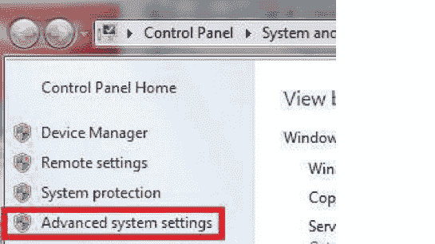

或者，在“运行”（`Win + R`）中输入 `SystemPropertiesAdvanced`（不区分大小写），并按回车。

4. 在系统属性的“高级”选项卡中，点击窗口右下角的“环境变量...”按钮。
5. 点击“新建...”添加一个新的系统变量，变量名为 `JAVA_HOME`，值为 JDK 安装目录的路径。输入这些值后，按确定。

| 系统变量 | 值 |
|---|---|
| `JAVA_HOME` | `C:\Program Files\Java\jdk1.8.0_91` |
| `MONGO_HOME` | `C:\Program Files\MongoDB\Server\3.2` |

6. 向滚动系统变量列表并选择 `Path` 变量。
7. **注意**：Windows 依赖 `Path` 来查找重要程序。如果删除了任何部分或全部内容，Windows 可能无法正常运行。必须对其修改以允许 Windows 运行 JDK。考虑到这一点，在选定 `Path` 的情况下点击“编辑”按钮。在 `Path` 变量的开头添加 `%JAVA_HOME%\bin;`。

在行开头添加更好，因为 Oracle 软件曾会在 `Path` 中注册自己的 Java 版本 - 如果您的版本出现在 Oracle 声明之后，将导致您的版本被忽略。

### 检查您的工作

1. 点击“开始”，然后输入 `cmd` 并按回车打开命令提示符。
2. 在提示符中输入 `javac -version`。如果成功，屏幕将打印出 JDK 版本。

> **注意**：如果必须重试，请在检查工作之前关闭提示符。这将强制 Windows 获取新的 `Path` 版本。

## 节 A.2：在 Linux 上安装 Java JDK

### 使用包管理器

可以使用主流 Linux 发行版上的包管理器安装 OpenJDK 或 Oracle 的 JDK 和/或 JRE 版本。（您可选择的选项取决于发行版。）

作为一般准则，操作步骤是打开终端窗口并运行下方的命令。（假设您有足够的权限以 "root" 用户身份运行命令……这正是 `sudo` 命令所做的。如果您没有该权限，请咨询您的系统管理员。）

推荐使用包管理器，因为它（通常）让保持您的 Java 安装为最新版本变得更容易。

#### apt-get, Debian Linux 发行版（Ubuntu 等）

以下指令将安装 Oracle Java 8：

```bash
$ sudo add-apt-repository ppa:webupd8team/java
$ sudo apt-get update
$ sudo apt-get install oracle-java8-installer
```

> **注意**：要自动设置 Java 8 环境变量，您可以安装以下包：
> `$ sudo apt-get install oracle-java8-set-default`

#### 创建 .deb 文件

如果您更喜欢自己从 Oracle 下载的 `.tar.gz` 文件创建 `.deb` 文件，请执行以下操作（假设您已将 `.tar.gz` 下载到 `./<jdk>.tar.gz`）：

```bash
$ sudo apt-get install java-package # 默认仓库中可能不可用
$ make-jpkg ./<jdk>.tar.gz # 不应以 root 身份运行
$ sudo dpkg -i *j2sdk*.deb
```

> **注意**：这期望输入提供为 ".tar.gz" 文件。

#### slack, 基于 Slack 的 Linux 发行版

```bash
sudo slapt-get default-jdk
```

#### yum, RedHat, CentOS, 等

```bash
sudo yum install java-1.8.0-openjdk-devel.x86_64
```

#### dnf, Fedora

在最近的 Fedora 版本中，`yum` 已经被 `dnf` 取代。

```bash
sudo dnf install java-1.8.0-openjdk.x86_64
```

在最近的 Fedora 版本中，没有用于安装 Java 7 及更早版本的包。

#### pacman, 基于 Arch 的 Linux 发行版

```bash
sudo pacman -S jdk8-openjdk
```

如果您以 root 用户身份运行，则不需要使用 `sudo`。

#### Gentoo Linux

Gentoo Java 指南由 Gentoo Java 团队维护，并维护一个更新的 wiki 页面，包含了所需的移植包和 USE 标志。

### 在 Redhat, CentOS, Fedora 上安装 Oracle JDK

#### 从 Oracle JDK 或 JRE tar.gz 文件安装 JDK

1. 从 Oracle Java 下载网站下载所需版本的适当 Oracle 归档 (".tar.gz") 文件。
2. 切换到您想要放置安装内容的目录；
3. 解压缩归档文件；例如：

```bash
tar xvf jdk-8u67-linux-x64.tar.gz
```

#### 从 Oracle Java RPM 仓库安装

1. 从 Oracle Java 下载网站获取所需版本的 RPM 文件。
2. 从 Oracle Java 下载网站安装所需版本的 RPM 文件。

## 节 A.3：在 macOS 上安装 Java JDK

### macOS Java 6

在旧版本的 macOS（10.11 Capitan 及更早版本）上，预装了 Java 6。如果已安装，可以在此位置找到：

`/System/Library/Java/VirtualMachines/1.6.0.jdk/Contents/Home`

> **注意**：Java 早已结束寿命，因此建议升级到新版本。更多信息见 Apple 网站。

### 命令行切换

安装 Java 后，安装的版本将自动设置为默认。要切换，请使用：`export JAVA_HOME=$(/usr/libexec/java_home -v <version>)`

```bash
function java_version {
    if [[ $1 == "6" ]]; then
        export JAVA_HOME=$(/usr/libexec/java_home -v 6); echo "Setting Java to 6..."; echo "$JAVA_HOME"
    elif [[ $1 == "7" ]]; then
        export JAVA_HOME=$(/usr/libexec/java_home -v 7); echo "Setting Java to 7..."; echo "$JAVA_HOME"
    elif [[ $1 == "8" ]]; then
        export JAVA_HOME=$(/usr/libexec/java_home -v 8); echo "Setting Java to 8..."; echo "$JAVA_HOME"
    fi
}
```

## 在 Windows 上安装 Java JDK 或 JRE

Windows 平台仅提供 Oracle JDK 和 JRE。安装过程非常直观：

1. 访问 Oracle Java 下载页面：
2. 点击 JDK 按钮、JRE 按钮或 Server JRE 按钮。注意开发使用 Java 需要 JDK。要了解 JDK 和 JRE 的区别，请参此处
3. 滚动到您想要下载的版本。（通常推荐使用最新版本。）
4. 选择“接受许可协议”单选按钮。
5. 下载 Windows x86 (32 位) 或 Windows x64 (64 位) 安装程序。
6. 按照您 Windows 版本的正常方式运行安装程序。

### 使用命令行提示符通过 Chocolatey 在 Windows 上安装 Java 的另一种方法

1. 从 `https://chocolatey.org/` 安装 Chocolatey。
2. 打开 cmd 实例，例如 `Win + R`，然后在“运行”窗口中输入 `cmd` 并按回车。
3. 在您的 cmd 实例中运行以下命令下载并安装 Java 8 JDK：

```bash
C:\> choco install jdk8
```


# 使用便携版运行程序

在某些情况下，你可能想在权限受限的系统（如虚拟机）上安装 JDK/JRE，或者你可能想安装并使用多个版本或架构（x64/x86）的 JDK/JRE。在下载安装程序 (.EXE) 之前，步骤都是相同的。之后的步骤如下（这些步骤适用于 JDK/JRE 7 及以上版本，对于较旧版本，文件夹和文件的名称略有不同）：

1. 将文件移动到你希望永久存放 Java 二进制文件的合适位置。
2. 如果你权限有限，请安装 7-Zip 或其便携版。
3. 使用 7-Zip 将 Java 安装程序 EXE 中的文件解压到该位置。
4. 按住 Shift 键并在资源管理器的文件夹中点击右键，以打开命令提示符，或从任何地方导航到该位置。
5. 进入新创建的文件夹。假设文件夹名为 `jdk-7u25-windows-x64`。输入 `cd jdk-7u25-windows-x64`。然后按顺序输入以下命令：

```cmd
cd .rsrc/JAVA_CAB10
extracc32 111
```

6. 这将在该位置创建一个 `tools.zip` 文件。使用 7-Zip 解压 `tools.zip`，以便内部文件创建在相同目录下的 `tools` 文件夹中。
7. 在已打开的命令提示符执行这些命令：

```cmd
cd tools
for /r %x in (*.pack) do .\bin\unpack200 -r "%x" "%~x~dx%%~dx%%px%%nx.jar"
```

8. 等待命令完成。将 `tools` 的内容复制到你希望存放二进制文件的位置。

通过这种方式，你可以同时安装你需要的任何 JDK/JRE 版本。原文链接：http://stackoverflow.com/a/6571736/1448252

# A.5 部分：在 Linux 上使用 alternatives 配置和切换 Java 版本

## 使用 Alternatives

许多 Linux 发行版使用 `alternatives` 命令在不同的 Java 版本之间进行切换。你可以用它在机器上安装的不同 Java 版本之间进行切换。

1. 在命令 shell 中，将 `$JDK` 设置为新安装 JDK 的路径，例如：
   ```bash
   $ JDK=/Data/jdk1.8.0_67
   ```
2. 使用 `alternatives -install` 将 Java SDK 中的命令添加到 alternatives 中：
   ```bash
   $ sudo alternatives --install /usr/bin/java java $JDK/bin/java 2
   $ sudo alternatives --install /usr/bin/javac javac $JDK/bin/javac 2
   $ sudo alternatives --install /usr/bin/jar jar $JDK/bin/jar 2
   ```
   以此类推。

现在，你可以通过以下方式切换不同的 Java 命令版本：
```bash
$ sudo alternatives --config javac
```

输出示例：
```text
有 1 个程序提供 'javac'。

  选择   命令
-----------------------------------------------
* 1      /usr/lib/jvm/java-1.8.0-openjdk-1.8.0.101-1.b14.fc23.x86_64/bin/javac
  2      /Data/jdk1.8.0_67/bin/javac

按回车键保留当前选择 [*]，或输入选择编号：2
```

有关使用 alternatives 的更多信息，请参阅 `alternatives(8)` 手册页。

## 基于 Arch 的安装

基于 Arch 的安装附带了 `archlinux-java` 命令用于切换 Java 版本。

### 列出已安装的环境

```bash
$ archlinux-java status
Available Java environments:
  java-7-openjdk (default)
  java-8-openjdk/jre
```

### 切换当前环境

```bash
# archlinux-java set <JAVA_ENV_NAME>
```

例如：
```bash
# archlinux-java set java-8-openjdk/jre
```

更多信息可以在 Arch Linux Wiki 上找到。

# A.6 部分：Java 开发需要什么

一个 JDK 安装程序和一个文本编辑器是 Java 开发的最低配置。（如果能有一个可以支持 Java 语法高亮的文本编辑器会很好，但没有也可以。）

然而，对于严肃的开发工作，建议同时也使用以下工具：

- Java IDE，如 Eclipse、IntelliJ IDEA 或 NetBeans
- 构建工具，如 Ant、Gradle 或 Maven
- 用于管理代码库的版本控制系统（带有适当的备份和异地复制）
- 测试工具和 CI（持续集成）工具

# A.7 部分：选择合适的 Java SE 版本

自 1995 年发布原始 Java 1.0 以来，Java 发布了许多版本。（参考 Java 版本历史获取摘要）。然而，大多数版本已经过了它们的官方生命终日（End Of Life）。这意味着供应商（现在通常是 Oracle）已经停止了该版本的后续开发，并且不再为任何漏洞或安全问题提供公开/免费的补丁。（私有补丁版本通常适用于有支持合同的人员/组织；请联系您的供应商销售部门。）

通常情况下，推荐使用的 Java SE 版本是最新公共版本的最新更新版。目前，这意味着最新的可用 Java 8 版本。Java 9 预计于 2017 年公开发。（Java 7 已经结束生命周期，最后一次公发布是在 2015 年 4 月。不建议使用 Java 7 及更早版本。）

此建议适用于所有新的 Java 开发以及任何学习 Java 的人员。（注：原文此处有大量重复句子，翻译已按要求处理。）

# A.8 部分：Java 发布与命名

自 1995 年发布原始 Java 1.0 以来，Java 发布了许多版本。（参考 Java 版本历史获取摘要）。然而，大多数版本已经过了它们的官方生命终日（End Of Life）。这意味着供应商（现在通常是 Oracle）已经停止了该版本的后续开发，并且不再为任何漏洞或安全问题提供公开/免费的补丁。（私有补丁版本通常适用于有支持合同的人员/组织；请联系您的供应商销售部门。）

通常情况下，推荐使用的 Java SE 版本是最新公共版本的最新更新版。目前，这意味着最新的可用 Java 8 版本。Java 9 预计于 2017 年公开发。（Java 7 已经结束生命周期，最后一次公发布是在 2015 年 4 月。不建议使用 Java 7 及更早版本。）

此建议适用于所有新的 Java 开发以及任何学习 Java 的人员。（注：原文此处有大量重复。）

# A.9 部分：在 Linux 上使用 tar 包安装 Oracle Java

1. 从此处下载 tar 包 - 当前最新
2. 你需要 sudo 权限
3. 创建 jdk 目录：
   ```bash
   mkdir /opt/jdk
   ```
4. 将下载的 tar 包解压到：
   ```bash
   tar -xzf jdk-8u5-linux-x64.gz /opt/jdk
   ```
5. 验证文件已解压：
   ```bash
   ls /opt/jdk
   ```
6. 将 Oracle JDK 设置为默认：
   ```bash
   update-alternatives --install /usr/bin/java java /opt/jdk/1.8.0_111/bin/java 2
   update-alternatives --install /usr/bin/javac javac /opt/jdk/1.8.0_111/bin/javac 2
   ```
7. 检查 Java 版本：
   ```bash
   java -version
   ```

预期输出：
```
java version "1.8.0_111"
Java(TM) SE Runtime Environment (build 1.8.0_111-b14)
HotSpot(TM) 64-Bit Server VM (build 25.111-b14, mixed mode)
```

# A.10 部分：Linux 安装后的检查与配置

安装 Java SDK 后，建议检查其是否就绪。你可以通过使用普通用户账户运行以下两个命令来实现：

```bash
$ java -version
$ javac -version
```

这些命令会分别输出 shell 命令搜索路径中的 JRE 和 JDK 版本信息。查找 JDK 版本字符串。

## 直接配置 PATH

如果目前搜索路径中没有 java 或 javac，简单的解决方法是将其添加到搜索路径。

首先，找到你安装 Java 的位置；如果不确定，见下文“Java 安装在哪里”。

接下来，假设 bash 是你的命令 shell，使用文本编辑器将以下行添加到 `~/.bash_profile` 或 `~/.bashrc` 的末尾（如果你使用 Bash 作为 shell）。

```bash
JAVA_HOME=<installation directory>
PATH=$JAVA_HOME/bin:$PATH
export JAVA_HOME PATH
```

...将 `<installation directory>` 替换为你的 Java 安装路径。

接下来，source 你编辑的文件，以更新当前 shell 的环境变量。

```bash
$ source ~/.bash_profile
```

接下来，重复检查 java 和 javac 的版本。如果仍然存在问题，请使用 `which java` 和 `which javac` 来验证你是否已更新了环境变量。

最后，注销并重新登录，以确保更新的环境变量生效到所有的 shell 中。现在你应该已经完成了。

## 检查替代方案

如果 `java -version` 或 `javac -version` 可以运行但给出了意外的版本号，你需要检查这些命令来自何处。使用 `which` 和 `ls -l` 按照如下方法查找：

```bash
$ ls -l `which java`
```

如果输出看起来像：

```text
lrwxrwxrwxrwx. 1 root root 22 Jul 30 22:18 /usr/bin/java -> /etc/alternatives/java
```

说明正在使用 alternatives 进行版本切换。你需要决定是继续使用它，还是简单通过直接设置 PATH 来覆盖它。

关于在 Linux 上使用 alternatives 配置和切换 Java 版本，请参阅上文的“直接配置 PATH”。

## Java 安装在哪里？

Java 可以安装在多个位置，取决于安装方法。

- Oracle RPM 将 Java 安装在 `/usr/java` 中。
- 在 Fedora 上，默认位置是 `/usr/lib/jvm`。
- 如果是通过 ZIP 或 JAR 文件手动安装的 Java，安装位置可能是任何地方。

如果你在查找安装目录时遇到困难，我们建议使用 `find`（或 `slocate`）来查找命令。例如：

```bash
$ find -name java -type f 2> /dev/null
```

这将给你系统中所有名为 java 的文件路径。（将标准错误重定向到 `/dev/null` 会忽略关于无法访问的文件和目录的消息。）

# 附录 B：Java 版本、发布版本和发行版

## 第 B.1 节：Java SE JRE 与 Java SE JDK 的区别

Sun / Oracle 发布的 Java SE 有两种：JRE 和 JDK。简单来说，JRE 支持运行 Java 程序，而 JDK 也支持 Java 开发。

### Java 运行时环境 (Java Runtime Environment)

Java 运行时环境或 JRE 发行版包含运行和管理 Java 程序所需的库和工具集。典型现代 JRE 中的工具包括：

- `java` 命令，用于在 JVM（Java 虚拟机）中运行 Java 程序。
- `js` 命令，用于运行 Nashorn Javascript 引擎。
- `keytool` 命令，用于操作 Java 密钥。
- `policytool` 命令，用于编辑安全沙箱安全策略。
- `pack200` 和 `unpack200` 工具，用于 Web 部署打包和解包 "pack200" 文件。
- 支持 Java CORBA 和 RMI 程序的 `orbd`、`rmid`、`rmiregistry` 和 `tnameserv` 命令。

“桌面 JRE”安装程序包含适用于某些浏览器的 Java 插件。这在“服务器 JRE”安装程序中被故意省略。从 Java 7 update 6 开始，JRE 安装程序包含了 JavaFX（2.2 或更高版本）。

### Java 开发工具包 (Development Kit)

Java 开发工具包或 JDK 发行版包含 JRE 工具以及用于开发 Java 软件的额外工具。额外工具通常包括：

- `javac` 命令，将 Java 源代码（.java）编译为字节码文件（.class）。
- 创建 JAR 文件的工具，如 `jar` 和 `jarsigner`。
- 开发工具，例如：
    - `appletviewer` 用于运行 applet
    - `idlj` 将 CORBA IDL 编译为 Java
    - `javah` JNI 存根生成器
    - `native2ascii` 用于 Java 源代码的字符集转换
    - `schemagen` Java 到 XML Schema 生成器（JAXB 的一部分）
    - `serialver` 生成 Java 对象序列化版本字符串
    - `wsgen` 和 `wsimport` 支持 JAX-WS 的工具
- 诊断工具，例如：
    - `jdb` 基础 Java 调试器
    - `jmap` 和 `jhat` 用于转储和分析 Java 堆。
    - `jstack` 用于获取线程栈储。
    - `javap` 用于检查 ".class" 文件。
- 应用程序管理和监控工具，例如：
    - `jconsole` 管理控制台
    - `jstat`、`jinfo` 和 `jps` 用于应用程序监控

典型的 Sun / Oracle JDK 安装还包括一个带有 Java 库源代码的 ZIP 文件。在 Java 6 之前，这是唯一的公开 Java 源代码。

从 Java 6 开始，可以从 OpenJDK 网站下载 OpenJDK 的完整源代码。它通常不包含在（Linux）JDK 包中，但可以作为单独包提供。

## 第 B.2 节：Java SE 版本

### Java SE 版本历史

下表提供了 Java SE 平台主要主版本的时间线。

| Java SE 版本 | 代号 | 停止支持 (免费) | 发布日期 |
| :--- | :--- | :--- | :--- |
| Java SE 10 (早期访问) | 无 | 未来于 2018-03-20 (预估) | |
| Java SE 9 | 无 | 未来于 2017-07-27 | |
| Java SE 8 | 无 | 未来于 2014-03-18 | |
| Java SE 7 | Dolphin | | 2015-04-14 |
| Java SE 6 | Mustang | | 2011-07-28 |
| Java SE 5 | Tiger | | 2013-04-16 |
| Java SE 1.4.2 | Mantis | | 2006-12-23 |
| Java SE 1.4.1 | Hopper / Grasshopper | | 2009-11-04 |
| Java SE 1.4 | Merlin | | 2004-10-04 |
| Java SE 1.3.1 | Ladybird | 未来于 2009-11-04 | |
| Java SE 1.3 | Kestrel | | 2003-06-26 |
| Java SE 1.2 | Playground | | 2002-09-16 |
| Java SE 1.1 | Sparkler | 未来于 2009-11-04 | |
| Java 1.0 | Oak | | 2002-02-06 |
| | | 未来于 2009-11-04 | 2001-05-17 |
| | | 未来于 2009-11-04 | 2000-05-08 |
| | | 未来于 2009-11-04 | 1998-12-08 |
| | | 未来于 2009-11-04 | 1997-02-19 |
| | | 未来于 2009-11-04 | 1996-01-21 |

脚注：

1. 链接指向 Oracle 网站上相应发布版本的在线文档。许多旧版本的文档已不再在线，但通常可以从 Java 归档下载。
2. 大多数历史 Java 版本已过其“停止支持”日期。对于支持合同的客户仍提供更新。

来源：维基百科：Java 版本历史

### Java SE 版本亮点

**Java SE 8**
- Lambda 表达式和受 MapReduce 启发的 Streams
- Nashorn Javascript 引擎
- Java SE 8 类型上的注解
- 新的日期和时间 API
- 无符号算术
- JavaFX 启动器
- 移除 PermGen

**Java SE 7**
- 字符串切换
- try-with-resource
- 菱形语法 (`<>`)
- 数字字面量增强

## 第 B.3 节：Java EE、Java SE、Java ME 和 JavaFX 的区别

Java 技术既是一种编程语言，也是一个平台。Java 编程语言是一种高级面向对象的语言，具有特定的语法和风格。Java 平台是运行 Java 语言应用程序的特定环境。

有多个 Java 平台。许多开发者，即使是长期 Java 编程语言开发者，也不了解不同的平台之间相互关联。

### Java 编程语言平台

Java 编程语言有四个平台：

- Java 平台标准版 (Java SE)
- Java 平台企业版 (Java EE)
- Java 平台微型版 (Java ME)
- Java FX


所有 Java 平台都包含一个虚拟机（`VM`）和一个应用程序接口（`API`）。Java 虚拟机是一个针对特定硬件和软件平台的程序，用于运行 Java 技术应用程序。API 是软件组件的集合，你可以使用它们来创建其他软件组件或应用程序。每个 Java 平台都提供一个虚拟机和一个 API，这使得编写在任何兼容系统上的应用程序都具有 Java 编程语言的所有优势：平台无关性、强大性、稳定性、易于开发和安全性。

# Java SE

当大多数人想到的 Java 编程语言时，他们想到的是 Java SE API。Java SE 的 API 提供了 Java 编程语言的核心功能。它定义了从 Java 编程语言的基本类型和对象到用于网络、安全、数据库访问、图形用户界面（`GUI`）开发和 XML 解析的高级类。

除了核心 API 外，SE 平台还由虚拟机、开发工具、部署技术以及在 Java 技术应用程序中常用的其他类库和工具包组成。

# Java EE

Java EE 平台构建在 Java SE 平台之上。Java EE 平台为开发和运行大型、多层、可扩展、可靠且安全的网络应用程序提供了 API 和运行时环境。

# Java ME

Java ME 平台提供了一个 API 和一个小型内存虚拟机，用于在手机等小型设备上运行 Java 编程语言应用程序。该 API 是 Java SE API 的子集，以及用于小型设备应用程序开发的特殊类库。Java ME 应用程序是 Java EE 平台服务的客户端。

# Java FX

Java FX 技术是一个用于使用 JavaScript 编写的富网络应用的平台。Java 是一种静态类型的声明式语言，被编译为 Java 字节码，然后在 Java VM 上运行。为 Java FX 平台编写的应用程序可以包含并链接 Java 编程语言类，并可以是 Java EE 平台服务的客户端。

取自 Oracle 文档

# 附录 C：类路径

`classpath` 列出了 Java 运行时查找类和资源的地方。`classpath` 也被 Java 编译器用于查找之前编译的外部依赖项。

## 第 C.1 节：指定类路径的不同方法

有三种方法可以设置 `classpath`。

1. 可以使用 `CLSPATH` 环境变量设置：
   ```
   set CLSPATH=... # Windows 和 csh
   export CLSPATH=... # Unix sh/bash
   ```

2. 可以在命令行上如下设置：
   ```
   java -classpath ... javac -classpath ...
   ```
   注意，`-classpath`（或 `-cp`）选项的优先级高于 `CLSPATH` 环境变量。

3. 可执行 JAR 文件的类路径是通过 `MANIFEST.MF` 中的 `Class-Path` 元素指定的：
   ```
   Class-Path: jar1-name jar2-name directory-name/jar3-name
   ```
   注意，这仅当如下方式执行 JAR 文件时有效：
   ```
   java -jar some.jar ...
   ```
   在这种执行模式下，`-classpath` 选项和 `CLSPATH` 环境变量将被忽略，即使 JAR 文件没有 `Class-Path` 元素。

如果没有指定 `classpath`，当使用 `java -jar` 时，默认 `classpath` 为所选的 JAR 文件，否则为当前目录。

相关：
- https://docs.oracle.com/javase/tutorial/deployment/jar/downman.html
- http://docs.oracle.com/javase/7/docs/technotes/tools/windows/classpath.html

## 第 C.2 节：将目录中的所有 JAR 添加到类路径

如果你想将目录中的所有 JAR 添加到类路径，可以使用 `classpath` 通配符语法简洁地完成；例如 `someFolder/*`。

这告诉 JVM 将 `someFolder` 目录中的所有 JAR 和 ZIP 文件添加到 `classpath` 中。此语法可以用于 `-cp` 参数、`CLSPATH` 环境变量或可执行 JAR 文件的清单文件中的 `Class-Path` 属性。请参见“设置类路径：类路径通配符”以获取示例和注意事项。

注意：
1. `Classpath` 通配符是在 Java 6 中首次引入的。早版本的 Java 不将 `*` 视为通配符。
2. 你不能在 `*` 之前或之后放置其他字符；例如 `someFolder/*.jar` 不是通配符。
3. 通配符仅匹配后缀为 `.jar` 或 `.JAR` 的文件。ZIP 文件会被忽略，因为 JAR 文件有不同的后缀。
4. 通配符仅匹配目录本身的 JAR 文件，不匹配其子目录。
5. 当一组 JAR 文件被通配符条目匹配时，它们在类路径上的相对顺序是不指定的。

## 第 C.3 节：从类路径加载资源

加载封装在 JAR 内部的资源（图像、文本文件、属性、KeyStore...）是有用的。为了这个目的，我们可以使用 `Class` 和 `ClassLoaders`。

假设我们有如下项目结构：
```
program.jar
└── com
    ├── file.txt
    └── Test.class
```

我们想从 `Test` 类访问 `file.txt` 的内容。我们可以通过类加载器来实现：
```
InputStream = Test.getClassLoader().getResourceAsStream("com/project/file.txt")
```
通过使用 `classloader`，我们需要指定资源的完全限定路径（每个包）。

或者，我们可以直接询问 `Class` 对象：
```
InputStream = Test.class.getResourceAsStream("file.txt")
```
使用类对象时，路径相对于类本身。由于 `Test.class` 位于 `com` 包，对于 `file.txt`，我们不需要指定任何路径。

然而，可以使用类对象使用绝对路径，如下：
```
Test.class.getResourceAsStream("/com/project/file.txt");
```

## 第 C.4 节：类路径语法

`classpath` 是一系列目录路径、JAR 或 ZIP 通配符规范。

对于在命令行（例如 `-classpath`）上或作为环境变量指定的 `classpath`，条目在 Windows 上使用分号（`;`）分隔，在其他平台上使用冒号（`:`）分隔。

对于 JAR 文件 `MANIFEST.MF` 中的 `Class-Path` 元素，使用单个空格分隔条目。

有时需要在 `classpath` 条目中嵌入空格。在命令行上指定 `classpath` 时，这只是使用适当引号的问题。例如：
```
export CLSPATH="home/user/My JAR Files/foo.jar:second.jar"
```
（细节取决于你使用的命令行 shell。）

当在 JAR 文件的 `MANIFEST.MF` 文件中指定 `classpath` 时，必须使用 URL 编码。
```
Class-Path: /home/user/My%20JAR%20Files/foo.jar second.jar
```

## 第 C.5 节：动态类路径

有时，仅仅从文件夹添加所有 JAR 是不够的，例如当你有原生代码并需要选择 JAR 子集时。在这种情况下，你需要两个 `main` 方法。第一个构建类加载器，然后使用该类加载器调用第二个 `main`。

这是一个示例，它为你的平台选择正确的 SWT 原生 JAR，添加你应用程序的所有 JAR，然后调用真正的 `main()` 方法。

- 跨平台 Java SWT

## 第 C.6 节：类名到路径名的映射

标准 Java 工具链（以及设计用于与之交互的第三方工具）具有将类名映射到表示它们的文件和其他资源的路径的特定规则。

映射如下：

对于默认包中的类，路径名是简单的文件名。对于命名包中的类，包名组件映射到目录。

对于嵌套类和内部类，文件名由 `$` 字符连接类名形成。

对于匿名内部类，使用数字来代替名称。

如下表所示：

| 类名 | 源路径 | 类文件路径 |
| :--- | :--- | :--- |
| `SomeClass` | `SomeClass.java` | `SomeClass.class` |
| `SomeClass.Inner` | `SomeClass.java` (在 `SomeClass.java` 中) | `SomeClass$Inner.class` |
| `com.example.SomeClass` | `com/example/SomeClass.java` | `com/example/SomeClass.class` |
| `SomeClass` 匿名内部类 (在 `SomeClass.java` 中) | - | `SomeClass$1.class`, `SomeClass$2.class`, 等 |

## 第 C.7 节：启动类类路径

标准的 Java 类加载器首先在启动类类路径中查找类，然后检查扩展类路径和应用程序类路径。默认情况下，启动类类路径由 `rt.jar` 文件和由 JRE 安装提供的某些其他重要 JAR 文件组成。这些文件提供了标准 Java SE 类库中的所有类，以及各种“内部”实现类。

在通常情况下，你不需要担心这一点。默认情况下，`java`、`javac` 等命令将使用适当版本的运行时库。

极少数情况下，有必要通过标准库中替代版本的类来覆盖 Java 运行时的正常行为。例如，你可能会在运行时库中遇到无法通过正常手段解决的“致命性”错误。在这种情况下，可以创建一个包含修改后的类的 JAR 文件，然后在启动 JVM 时将其添加到启动类类路径中。

`java` 命令提供了以下 `-X` 选项来修改启动类类路径：
- `-Xbootclasspath:<path>` 用提供的路径替换当前的启动类类路径。
- `-Xbootclasspath/a:<path>` 将提供的路径添加到当前启动类类路径的末尾。
- `-Xbootclasspath/p:<path>` 将提供的路径添加到当前启动类类路径的开头。

注意，当使用 `bootclasspath` 选项替换或覆盖 Java 类（等）时，你在技术上正在修改 Java。如果你随后分发你的代码，可能会产生许可方面的影响。（请参考 Java 二进制许可协议的条款和条件……并咨询律师。）

## 第 C.8 节：类路径的含义：搜索是如何工作的

类路径（`classpath`）的目的是告诉 JVM 在何处找到类和其他资源。类路径的含义和搜索过程是交织在一起的。

类路径是搜索路径的一种，它指定了用于查找资源的序列位置。在标准类路径中，这些位置要么是主机文件系统中的目录，要么是 JAR 文件，或者是 ZIP 文件。在每种情况下，该位置都是将被搜索的命名空间的根。

在类路径上搜索类的标准程序如下：

1. 将类名映射到相对类路径 `RP`。类名到类文件名的映射在别处有描述。
2. 对于类路径中的每个条目 `E`：
   - 如果条目是文件系统目录：
     - 相对于 `E` 解析 `RP` 以得到绝对路径 `AP`。
     - 测试 `AP` 是否为通向一个已存在文件的路径。
     - 如果是，则从该文件加载类。
   - 如果条目是 JAR 或 ZIP 文件：
     - 在 JAR/ZIP 文件索引中查找 `RP`。
     - 如果对应的 JAR/ZIP 文件条目存在，从该条目加载类。

在类路径上搜索资源的程序取决于资源路径是绝对还是相对的。对于绝对资源路径，程序如上。对于使用 `Class.getResource` 或 `Class.getResourceAsStream` 解析的相对资源路径，在搜索之前会将类包的路径前置。

（注意，这些是标准 Java 类加载器实现的程序。自定义类加载器可能会执行不同的搜索。）

# 附件 D：资源（在类路径上）

Java 允许检索与编译类一起存储在 JAR 内部的文件类资源。本主题侧重于加载这些资源并让你的代码可以使用它们。

## 第 D.1 节：加载默认配置

读取默认配置属性：

## 第 D.2 节：从资源加载图像

加载捆绑的图像：

```java
package com.example;

public class ExampleApplication {
    private Image getIcon() throws IOException {
        URL imageURL = ExampleApplication.class.getResource("icon.png");
        return ImageIO.read(imageURL);
    }
}
```

## 第 D.3 节：使用类加载器查找和读取资源

使用类加载器在 Java 中加载资源包含以下步骤：

1. 查找类或类加载器。
2. 查找资源。
3. 获取字节流。
4. 读取字节流。
5. 关闭字节流。


# 使用类加载器在 Java 中加载资源

使用类加载器在 Java 中加载资源包含以下步骤：

1. 查找类或类加载器。
2. 查找资源。
3. 获取字节流。
4. 读取字节流。
5. 关闭字节流。

## 绝对资源路径和相对路径

绝对资源路径以命名空间的根开始。相对路径被解析到类包。


# 使用类加载器在 Java 中加载资源

使用类加载器在 Java 中加载资源包含以下步骤：

1. 查找类或类加载器。
2. 查找资源。
3. 获取字节流。
4. 读取字节流。
5. 关闭字节流。

## 绝对资源路径和相对路径

绝对资源路径以命名空间的根开始。相对路径被解析到类包。


# 绝对资源路径和相对路径

绝对资源路径以命名空间的根开始。相对路径被解析到类包。

## 使用类加载器在 Java 中加载资源

使用类加载器在 Java 中加载资源包含以下步骤：

1. 查找类或类加载器。
2. 查找资源。
3. 获取字节流。
4. 读取字节流。
5. 关闭字节流。

# 绝对类路径和在路径

加载加载路径以命名1开始开始。路径被解析到类包。

使用加载器在加载资源：

1. 查找类或类加载器。
2. 查找资源。
3. 获取字节流。
4. 读取字节流。
5. 关闭字节流。

在加载加载资源：

1. 查找类或类加载器。
2. 查找资源。
3. 获取字节流。
4. 读取字节流。
5. 关闭字节流。

使用类加载器在 Java 中加载资源包含以下步骤：

1. 查找类或类加载器。
2. 查找资源。
3. 获取字节流。
4. 读取字节流。
5. 关闭字节流。

使用类加载器在 Java。

加载资源：

1. 查找类或类加载器。
2. 查找资源。
3. 获取字节流。
4. 读取字节流。
5. 关闭字节流。

使用类加载器在 Java 中加载资源。以下步骤：

1. 查找类或类加载器。
2. 查找资源。
3. 获取字节流。
4. 读取字节流。
5. 关闭字节流。


# 使用类加载器在 Java 中加载资源

使用类加载器在 Java 中加载资源包含以下步骤：

1. 查找类或类加载器。
2. 查找资源。
3. 获取字节流。
4. 读取字节流。
5. 关闭字节流。


# 使用类加载器在 Java 中加载资源

## 步骤

1. 查找类或类加载器
2. 查找资源
3. 获取字节流
4. 读取字节流
5. 关闭字节流


非常感谢 Stack Overflow 文档团队所有提供这些内容的人，如有更多更改或新内容，请向 web@petercv.com 发送以便发布或更新。

- 100rabh
- 17slim
- 1d0m3n30
- 3442
- 3751_Creator
- 44castle
- A Boschman
- A.J. Brown
- Aaron Digulla
- Aaron Franke
- Aasmund Eldhuset
- ABDUL KHALIQ
- Abijeet
- Abhishek Jain
- Abubakar
- acdcjjunior
- Ad Infinitum
- Adam Ratzman
- Adeel Ansari
- Adowrath
- Adrian Krebs
- afzalex
- agilob
- agoeb
- Aiden Deom
- Aimee Borda
- aioobe
- ajablonski
- AJNeufeld
- akgren_soar
- Akhil S K
- alain.janinm
- Alek Mieczowski
- Alex A
- Alex Meiburg
- Alexstersterov
- Alex T.
- Alexandre Grimaud
- Alexey Lagunov
- alexey semenyuk
- Alexiy
- Alon .G.
- Alper Firat Kaya
- alphaloo
- altomnr
- Amani Kilumanga
- Amit Gujarathi
- 第 18 和第 79 章
- 第 28, 40, 72 和 109 章
- 第 9, 35, 45, 47 和 106 章
- 第 23 章
- 第 1 章
- 第 2 和 57 章
- 第 42 和 67 章
- 第 11 章
- 第 47 和 184 章
- 第 56 章
- 第 46 章
- 第 90 章
- 第 65 章
- 第 11, 23 和 79 章
- 第 11, 23, 57, 67 和 102 章
- 第 23 和 57 章
- 第 23, 24, 33, 43 和 73 章
- 第 11 章
- 第 182 章
- 第 79 和 164 章
- 第 11, 23, 54, 69, 74 和 111 章
- 第 23 章
- 第 11, 23 和 69 章
- 第 54 章
- 第 11 章
- 第 22 和 57 章
- 第 35 和 117 章
- 第 182 章
- 第 74 章
- 第 58 章
- 第 1, 66, 69, 117 和 182 章
- 第 16, 19 和 138 章
- 第 20, 33 和 78 章
- 第 182 章
- 第 11 和 47 章
- 第 11 和 20 章
- 第 132 章
- 第 181 章
- 第 83 章
- 第 47 和 117 章
- 第 149 章
- 第 43 章
- 第 77 章
- 第 144 章
- 第 24 和 182 章
- 第 10, 11, 35, 40, 80 和 111 章
- 第 12, 29, 30, 31 和 180 章
- Amit Gupta
- Anatoly Yakimchuk Andreas
- Andreas Fester
- Andrew
- Andrew Antipov
- Andrew Brooke
- Andrew Sklyarevsky
- Andrii Abramov
- Androbin
- Andy Thomas
- Ani Menon
- Anil
- ankidaemon
- Ankit Katiyar
- Ankur Anand
- Anony
- anotherGatsby
- Anthony Raymond Anton Hlin
- antonio
- anuvab191
- ar4ers
- Arash
- ArcticLord
- arcyy
- Arkadiy
- arpit pandey
- ArsenAr
- Arthur
- Asaph
- AshanPerera
- Asiat
- assylias
- AstroCB
- ata
- Athari
- augray
- Aurasphere
- Austin
- Austin Day
- Arnold
- Bart Kummel
- Batty
- bcosynot
- ben75
- Bhavik Patel
- Bilbo Baggins
- Bilesh Ganguly
- Binary Nerd
- Blubberg22
- bn.
- Bob Rivers
- 第 73 章
- 第 23 章
- 第 40, 99 和 106 章
- 第 35 章
- 第 23, 40, 73 和 79 章
- 第 88 章
- 第 74 章
- 第 35 章
- 第 41, 57, 73, 75, 81, 117 和 134 章
- 第 33 章
- 第 11, 80, 85 和 130 章
- 第 1, 42, 56 和 182 章
- 第 23 章
- 第 23 章
- 第 73, 122 和 141 章
- 第 1 章
- 第 10, 11, 24, 35, 47, 73 和 89 章
- 第 23 章
- 第 182 章
- 第 130 章
- 第 1 和 23 章
- 第 42 和 182 章
- 第 52 章
- 第 122 章
- 第 103 和 105 章
- 第 16 和 68 章
- 第 1 和 54 章
- 第 21 章
- 第 57 章
- 第 23, 71, 72, 77, 87, 93 和 110 章
- 第 74 章
- 第 41 章
- 第 73 和 126 章
- 第 23 章
- 第 28 和 77 章
- 第 23 和 57 章
- 第 42 章
- 第 77 章
- 第 11 章
- 第 11 章
- 第 11, 16, 18 和 26 章
- 第 57 章
- 第 66 章
- 第 35 章
- 第 97 章
- 第 69 章
- 第 17 章
- 第 10 和 66 章
- 第 28 章
- 第 25 和 40 章
- 第 100 章
- 第 10, 16, 24, 35, 70 和 123 章
- Bobas_Pett
- Bogdan Korin
- Bohemian
- bowmore
- Božo Stojković
- bpoiss
- Brendon Dugan
- Brett Kail
- Brian Goetz
- Bruno
- Burkhard
- bwegs
- cuent
- Cache Staheli
- CaffeineTo
- Caleb Brinkman
- Caner Balım
- carloelli
- Carlton
- Manuel
- Carter Brainerd
- Cas Elins
- Catalina Island
- cdm
- ced
- charlesreid
- Charlie H
- Chety
- Chirag Parmar
- Chris Midgley
- Christian
- Christian Wilkie
- Christopher Schneider
- audio
- clinomaniac
- code11
- coder
- Coffee Ninja
- Coffeehouse Cold Fire
- compuhny
- Configure
- Constantine
- corsiKa
- Crafted
- cricket_007
- cyberscient
- 第 LS 章
- 第 85 章
- 第 107 章
- 第 15, 45 和 54 章
- 第 17, 67 和 126 章
- 第 23 章
- 第 23 和 57 章
- 第 129 章
- 第 42 章
- 第 73 章
- 第 41 章
- 第 74 章
- 第 1, 6, 7, 11, 23, 54, 66, 69, 77 和 107 章
- 第 23 章
- 第 40 章
- 第 23 章
- 第 11, 13, 23, 47 和 107 章
- 第 42 章
- 第 6 和 74 章
- 第 11 章
- 第 11 和 74 章
- 第 1 章
- 第 71 章
- 第 6 章
- 第 74 章
- 第 46 章
- 第 70 章
- 第 24, 25, 26, 41 和 80 章
- 第 85 章
- 第 1, 23 和 67 章
- 第 126 章
- 第 24, 26, 78 和 86 章
- 第 40 章
- 第 19 章
- 第 16 章
- 第 84, 103 和 115 章
- 第 23 章
- 第 40 章
- 第 57 章
- 第 24 章
- 第 47 和 41 章
- 第 11, 23 和 35 章
- 第 98 章
- 第 1 和 74 章
- 第 23 章
- 第 151 和 152 章
- 第 1, 23, 48, 85 和 175 章
- 第 35 和 57 章
- 第 126 章
- 第 5, 74 和 182 章
- 第 42 章
- 第 11 章
- 第 1 章
- Daniel
- Daniel Käfer
- Daniel LIn
- Daniel Nugent
- Daniel Stradowski
- Daniel Wild
- Danilo Guimaras
- Dariusz
- DarkV1
- Datagram
- Dave Ranjan
- David Grinberg
- David Soroko
- DeepCoder
- Demonmist demolem
- desilij
- devguy
- devnull69
- DimaSan
- dimo41
- Dmitriy Kotov
- dnup102
- Dhu Vy
- DonyorM
- dorukay
- Draken
- Drizzt321
- Duh
- Durgpal Singh
- Dushko Jovanovski
- DVarga
- dwursteisen
- Dylan
- ebo
- Eduard Wirch
- Eilit
- EJP
- ekaovets
- Elazar
- Emil Sierżega
- Emily Mabrey
- emotionless Emre Bolat
- Enamul Hassan
- Eng.Fouad
- enginecoding
- Enigo
- enrico.bacis
- 第 22 章
- 第 10 章
- 第 23 章
- 第 48 和 111 章
- 第 35, 46, 57, 73, 80, 112 和 177 章
- 第 81, 114, 130 和 139 章
- 第 11, 23, 24, 26 和 57 章
- 第 116 章
- 第 35 和 163 章
- 第 23, 43, 54, 57, 82, 91, 102, 126, 138 章
- 第 1, 11, 23 和 86 章
- 第 95 章
- 第 48 章
- 第 54 章
- 第 87 章
- 第 1 章
- 第 43 章
- 第 26 章
- 第 176 章
- 第 79 章
- 第 93 章
- 第 26, 33, 50 和 126 章
- 第 69, 120 和 131 章
- 第 13 和 170 章
- 第 28 章
- 第 10 和 11 章
- 第 6 和 10 章
- 第 54, 57 和 93 章
- 第 11, 20, 76, 87, 133 章
- 第 73 章
- 第 43 和 103 章
- 第 23 章
- 第 23 和 28 章
- 第 43, 57 和 135 章
- 第 111, 114 和 173 章
- 第 11, 23, 47, 54, 57 和 79 章
- 第 57 章
- 第 41 章
- 第 74 章
- 第 120 章
- 第 23 章
- 第 66 和 145 章
- 第 97 章
- 第 42 章
- 第 23, 42, 115 和 182 章
- 第 28 和 185 章
- 第 66 和 120 章
- 第 1 和 23 章
- 第 56 章
- 第 23 章
- 第 33 章
- 第 13, 24, 28, 42 和 77 章
- 第 1, 11, 23 和 57 章
- Enwired
- Eran
- Erickson
- Erik Minarini
- Erkan Hasulpat
- esos88
- Etki
- explv
- F. Stephen Q
- Fabian
- faraa
- FFY00
- figb
- fikovnik
- Fidor
- Filip Smola
- FlyingMonster FMC
- foxt70
- Francesco Menzani
- Freddie Coleman Friederike
- Funatino
- future7
- f_puras
- Gal Dreiman
- gar
- garg10may
- Garrett Golding Jose
- Gene Marin
- geniuskhg
- George Bailey
- Gerald Mücke
- GhostCat
- Gihan Chathuranga
- GingerHead
- giucal
- glee88e
- gontard
- GPI
- GradAsso
- granmirupa
- Gray
- GreenGiant
- Grexis
- Grzegorz Oledzki Gubbel
- 第 132 章
- 第 1, 23 和 24 章
- 第 117 章
- 第 23 章
- 第 56 章
- 第 22, 172 和 179 章
- 第 23 章
- 第 16, 54 和 57 章
- 第 47 章
- 第 10, 13, 40, 43, 48, 57, 73, 80, 102, 112, 126, 134, 174 章
- 81, 114, 1300 139 章
- 第 11, 23, 24, 26 和 57 章
- 第 116 章
- 第 35 和 163 章
- 第 23, 43, 54, 57, 82, 91, 102, 126, 138 章
- 第 1, 11, 23 和 86 章
- 第 95 章
- 第 48 章
- 第 54 章
- 第 87 章
- 第 1 章
- 第 43 章
- 第 26 章
- 第 176 章
- 第 79 章
- 第 93 章
- 第 26, 33, 50 和 126 章
- 第 69, 120 和 131 章
- 第 13 和 170 章
- 第 28 章
- 第 10 和 11 章
- 第 6 和 10 章
- 第 54, 57 和 93 章
- 第 11, 20, 76, 87, 133 章
- 第 73 章
- 第 43 和 103 章
- 第 23 章
- 第 23 和 28 章
- 第 43, 57 和 135 章
- 第 111, 114 和 173 章
- 第 11, 23, 47, 54, 57 和 79 章
- 第 57 章
- 第 41 章
- 第 74 章
- 第 120 章
- 第 23 章
- 第 66 和 145 章
- 第 97 章
- 第 42 章
- 第 23, 42, 115 和 182 章
- 第 28 和 185 章
- 第 66 和 120 章
- 第 1 和 23 章
- 第 56 章
- 第 23 章
- 第 33 章
- 第 13, 24, 28, 42 和 77 章
- 第 1, 11, 23 和 57 章
- Jeet
- Jeff Coleman
- Jeffrey Bosboom
- 第 57 和 73 章


## 章节索引

- 第 77 章
- 第 81 章
- 第 116 章
- 第 126 章
- 第 47, 69, 73, 126 和 144 章
- 第 54 章
- 第 137 章
- 第 11 章
- 第 82 和 130 章
- 第 102 章
- 第 67 章
- 第 45 章
- 第 1, 11, 23 和 57 章
- 第 11, 23, 82, 93, 97, 118 和 126 章
- 第 11 章
- 第 97 章
- 第 79 章
- 第 23, 46, 74 和 79 章
- 第 74 章
- 第 1, 10, 35, 171 和 182 章
- 第 140 章
- 第 3 和 166 章
- 第 73 章
- 第 10, 28, 43, 57, 58, 67, 73 和 89 章
- 第 23 章
- 第 150 章
- 第 117 章
- 第 11, 16, 24, 28, 69, 72, 86 和 91 章
- 第 61 章
- 第 10 章
- 第 77 章
- 第 42, 126 和 133 章
- 第 79 章
- 第 1 和 23 章
- 第 42 和 53 章
- 第 25, 47 和 79 章
- 第 25 和 89 章
- 第 35 章
- 第 178 章
- 第 5 章
- 第 11 章
- 第 81 章
- 第 1, 23, 40, 57, 69, 79 和 85 章
- 第 23 和 85 章
- 第 28 章
- 第 56 章
- 第 25 和 59 章
- 第 16 章
- 第 1 章
- 第 153 章
- 第 182 章
- 第 23, 28, 52 和 54 章

## 贡献者名单

Jeffrey Lin

Jens Schauder

Jeroen Vandevelde Jeutnarg

Jim Garrison

jitendra varshney jmattheis

Joe C

Johannes

John DiFini

John Fergus

John Nash

John Slegers

John Starich

johnnyaug

Jojodmo

Jon Erickson

JonasCz

Jonathan

Jonathan Barbero Jonathan Lam

JonK

jopasserat

Jordi Castilla

Jordy Baylac

Jorel Ali

Jorn Vernee

Joshua Carmody JStef

Jude Niroshan

JudgingNotJudging juergen d

jwd630

K''

k3b

kaartic

Kai

kajacx

kann

kaotikmynd

Kapep

KartikKannapur kasperjj

Kaushal28

Kaushik NP

kcoppock

KdgDev

Kelvin Kellner

Ken Y

Kenster

Kevin DiTraglia

Kevin Raoofi

Kevin Thorne

- 第 1 和 11 章
- 第 1, 23, 47, 48, 58, 69, 74, 88, 126 和 127 章
- 第 73 章
- 第 23 章
- 第 23 章
- 第 23 章
- 第 23 章
- 第 121 章
- 第 23, 35, 79 和 126 章
- 第 64 和 161 章
- 第 1 章
- 第 19, 21, 58 和 142 章
- 第 23 章
- 第 135 章
- 第 28 章
- 第 10, 11, 23, 40 和 79 章
- 第 57 章
- 第 11, 69, 74, 78, 86 和 95 章
- 第 1, 23, 28, 46, 57, 79, 88 和 125 章
- 第 96 和 119 章
- 第 23 和 182 章
- 第 88 章
- 第 25 章
- 第 11 章
- 第 77 章
- 第 71 章
- 第 4, 11, 42, 43, 47, 54, 57, 75, 79, 126 和 135 章
- 第 2 章
- 第 23 章
- 第 11, 57, 67 和 73 章
- 第 13 和 73 章
- 第 74 章
- 第 177 章
- 第 184 章
- 第 35 章
- 第 1 章
- 第 52, 54, 69 和 79 章
- 第 138 章
- 第 70 章
- 第 80 章
- 第 11, 43 和 57 章
- 第 28 章
- 第 97 章
- 第 20, 26 和 86 章
- 第 11 章
- 第 47 章
- 第 10 章
- 第 159 章
- 第 122 章
- 第 11, 25, 28 和 63 章
- 第 54 章
- 第 73 章
- 第 6, 23, 40 和 69 章

Kichiin

kiedysktos

Kineolyan

Kip

IRAN KUMAR Kirill Sokolov

Kishore Tulsiani

kristyna

Krzysztof Kraso

kstandell

KudzieChase

Kuroda

Lachlan Dowding

Lankymart

Laurel

leaqui

Lernkurve

Li357

Liju Thomas

lamosopia

Loris Securo

Luan Nico

Lukas Knuth

M M

Maarten Bodewes Mac70

madx

Makoto

Makyen

Malav

Malt

Manish Kothari

manouti

Manuel Spigolon

- 第 87 章
- 第 95 章
- 第 22 章
- 第 58 章
- 第 27, 30, 37, 39, 49, 53, 59, 92 章
- 第 89 章
- 第 164 章
- 第 45 章
- 第 25 章
- 第 11, 42 和 79 章
- 第 24 章
- 第 18 章
- 第 86 章
- 第 56 章
- 第 79, 80 和 86 章
- 第 77 章
- 第 111 章
- 第 106 章
- 第 23, 128 和 169 章
- 第 23 章
- 第 19, 23 和 56 章
- 第 23, 54, 89 和 103 章
- 第 102 章
- 第 14 章
- 第 20, 35, 86 和 140 章
- 第 40 章
- 第 1, 35 和 103 章
- 第 23, 70 和 74 章
- 第 23 章
- 第 11 章
- 第 23, 32, 73, 88, 93 和 126 章
- 第 19 和 128 章
- 第 109, 156 和 168 章
- 第 11 章
- 第 18 章
- 第 1 和 47 章
- 第 73 章
- 第 5 章
- 第 46 和 71 章
- 第 24 章
- 第 11 和 23 章
- 第 48, 57 和 87 章
- 第 23 章
- 第 126 章
- 第 77 章
- 第 88 章
- 第 1, 23 和 47 章
- 第 11, 16, 58 和 83 章
- 第 20, 43 和 52 章
- 第 73 章
- 第 11 章
- 第 94 章

Maxim Kreshin Maxim Plevako

Maximillian Laumeister mayha

mayojava

MBorsch

- 第 23 章
- 第 11 和 23 章
- 第 23 章
- 第 10 和 85 章
- 第 10 章

Md. Nasir Udin Bhuiyan

- 第 20 和 126 章
- 第 Michael
- 第 11 和 58 章
- Michael Myers
- 第 35 和 103 章
- Michael Piefel
- 第 23, 45 和 126 章

Michael von Wencstern

- 第 7 章

Michael Wiles

michaelbahr

Michael Rybak

Mick Mnemonic

MikeW

Miles

Miljen Mikik

Mimouni

Mimyck

Mine_Stone

Minhas Kamal

Miroslav Bradic

Mitch Talmadge noronha

Mo.Ashfaq

Mohamed Fadhl Mrunal Pagnis

shnik

mszymborski

Muhammed Refaat Mukund

Murat K.

Murein

Muto

Mykola Yashchenko Myridium

agesh Lakinally NamshubWriter

Naresh Kumar

Nathaniel Ford

Nayuki

cmmathist

Nef10

eohhope

nhahtdh

icael

Nicholas J Panella

nickletskii

Nictar

- 第 67 章
- 第 28, 69 和 87 章
- 第 135 章
- 第 35 章
- 第 79 章
- 第 11, 16 和 17 章
- 第 23, 42, 69 和 122 章
- 第 23 章
- 第 23 章
- 第 93 章
- 第 23 章
- 第 88 章
- 第 1 和 23 章
- 第 1 章
- 第 28 章
- 第 23 章
- 第 107 和 116 章
- 第 47, 50, 54 和 81 章
- 第 19 章
- 第 23 和 54 章
- 第 1 章
- 第 126 章
- 第 57 和 59 章
- 第 57 章
- 第 44 章
- 第 69 章
- 第 23, 35, 40, 46, 55, 95, 111 和 122 章
- 第 6 章
- 第 16 和 88 章
- 第 57 章
- 第 28 章
- 第 47 和 126 章
- 第 22, 23, 42 和 89 章
- 第 73 章
- 第 35 章
- 第 145 章
- 第 80 章
- 第 23 章
- 第 107 章
- 第 2 章
- 第 126 章
- 第 16, 42 和 85 章

Nikhil R

Nikita Kurtin

Niklas Rosencrant

NikolaB

Nishant23

ishizawa23

nobeh

olequen

Nufail

Nuri Tasdemir

yarasha

Ocrac

OldCurudge

Oleg Skylar

OliPro07

Omar Ayala

Onur

orccusher99

Ortiel

Ortomala

J.Meisch

Pablo

Pace

padipp

paisco

Panda

ParkerHalo

Paul Bellora

Pavneet

Paweł Albecki

PcAF

Peter Rader

peterh

Petter Friberg

phantom

filnate

Pirate_Jack

Piyush Baderia

PizzaFrog

Polost

Powerlord

ppeterka

Prasad Reddy

Prem Singh

- 第 158 和 160 章
- 第 69 和 107 章
- 第 162 章
- 第 11 章
- 第 16 章
- 第 148 章
- 第 1, 128 和 182 章
- 第 23 章
- 第 73 章
- 第 35, 43 和 81 章
- 第 66 和 127 章
- 第 20 章
- 第 1, 11, 23, 40 和 57 章
- 第 1 章
- 第 23 章
- 第 35 章
- 第 54 章
- 第 24, 25, 47 和 54 章
- 第 35 章
- 第 114 章
- 第 11, 23, 47, 66 和 122 章
- 第 23 章
- 第 157
- 第 40, 43 和 47 章
- 第 155
- 第 35 和 177 章
- 第 11, 13, 35, 69, 100 和 130 章
- 第 24
- 第 42 章
- 第 177 章
- 第 47
- 第 23
- 第 9, 10, 46 章
- 第 47
- 第 1 章
- 第 57 和 111 章
- 第 23, 24, 35 和 47 章
- 第 47 章
- 第 132
- 第 72 章
- 第 3, 11, 24, 35, 42, 47, 56, 57, 69, 73, 82, 103, 117 和 162 章

-

- 第 28 章
- 第 47, 52, 73, 74 和 127 章
- 第 57 章
- 第 11, 89 和 132 章
- 第 6 章
- 第 24 章
- 第 1 章
- 第 24 和 63 章
- 第 11, 16, 23, 33, 37, 59, 69, 70, 80, 91, 105, 107, 122 和 135 章
- 第 24 章
- 第 107 章

P řemysl Šastný

Pseudonym Patel PSN

PSo

Pujan Srivastava

QoP

qzx

Radek Postowicz Radiodef

Raduane RUFID

Rafael Pacheco

rahul tyagi

rajadilkolli

Rajesh

Rakitić

rakwaht

Ralf Kleberhoff

Ram

RamenChef

RAanders0

Ravindra babu

Ravindra HV

Raviteja

ravthiru

rd22

rdonuk

Rednivrug

Redterd

Rens van Heijden reto

Reut Sharabani

richersoon

RobAu

Robert Columbia

Robin

Rocherlee

Rogério

rokonoid

rolve

ronnyfm

Ronon Dex

RudolphEst

Ruslan Bes

RutledgePaulV

Ryan Cocuzzo

Ryan Hilbert

sagaarjha

SachinSarawgi

Sacly Barlonium

Sadiq Ali

Saif

Samk

Sanandrea

- 第 11 章
- 第 148 章
- 第 23 章
- 第 11 和 86 章
- 第 73 章
- 第 11 和 23 章
- 第 40 章
- 第 10 和 69 章
- 第 23 和 24 章
- 第 1, 11, 23, 35, 47, 57, 69, 73 和 182 章
- 第 114 章
- 第 40 章
- 第 24 章
- 第 23 章
- 第 57 和 182 章
- 第 170 章
- 第 16 和 41 章
- 第 1, 16, 23, 28, 42, 43, 48, 70, 74, 78, 80 和 91 章
- 第 1, 11, 23,
- 33, 40, 69, 73, 79, 86, 106, 126, 151 和 165 章
- 第 10, 11, 60 和 77 章
- 第 54, 103, 111, 126 和 127 章
- 第 52 和 132 章
- 第 85 章
- 第 28, 57 和 82 章
- 第 24, 33, 35, 47 和 126 章
- 第 24 和 69 章
- 第 22 章
- 第 78 章
- 第 116 章
- 第 57 章
- 第 1, 23, 40 和 57 章
- 第 52 章
- 第 57, 69 和 77 章
- 第 10, 23 和 42 章
- 第 75 章
- 第 11 章
- 第 47 章
- 第 66, 77 和 87 章
- 第 23, 47, 56 和 73 章
- 第 182 章
- 第 35 章
- 第 132 章

Saša Šijak

Saurabh

SaWo

scorpp

screab

Sergii Bishyr

sevenforce

Shaan

Shettyh

shibli049

ShivBuyya

shmosel

Shoe

Siguza

Simon

Simulant

- 第 182 章
- 第 117 章
- 第 74 章和 117 章
- 第 6 章和 50 章
- 第 69 章
- 第 23 章
- 第 150 章
- 第 131 章
- 第 130 章和 183 章
- 第 23, 57 和 73 章
- 第 11, 23, 57 和 74 章
- 第 86 章
- 第 127 章
- 第 142 章
- 第 11, 40 和 77 章
- 第 23, 35, 43, 57, 67, 88 和 106 章，第 11, 23 和 57 章
- 第 1 章和 47 章
- 第 17 章
- 第 10 和 79 章

Siva Sainath Reddy Bandi 第 66 章 SjB

skia.heliou

Sky

Skylar Sutton smichel

Smit

solidcell

someoneigna Somnath Musib Spina

SRJ

stackptr

Stefan Dollase stefanobaghino steffen

Stephan

Stephen C

Stephen Leppik

Steve K

still_learning

Stoyan Dekov

Sudhir Singh

Sugan

Sujith Niraikutathan Suketu Patel

Suminda Sirinath S. Dharmasena

sumit

svsav

- 第 24 章


## 章节索引

- 第 16 章
- 第 11 章
- 第 73 章
- 第 101 章
- 第 148 章
- 第 11 章和 23 章
- 第 79 章
- 第 26 章和 85 章
- 第 35 章和 57 章
- 第 57 章
- 第 1, 23 和 57 章
- 第 57 章
- 第 88 章
- 第 135 章
- 第 124 章
- 第 1, 5, 7, 8, 9, 10, 11, 13, 23, 25, 28, 33, 40, 42, 43, 45, 47, 50, 51, 54, 57, 59, 67, 69, 73, 77, 79, 81, 82, 85, 86, 88, 89, 95, 102, 103, 106, 126, 127, 130, 131, 132, 133, 134, 135, 137, 139, 146, 147, 148, 169, 177, 178, 182, 183, 184 和 185 章
- 第 1, 23, 47, 69 和 73 章
- 第 57 章
- 第 54, 69, 77, 86 和 107 章
- 第 107 章
- 第 54 章和 126 章
- 第 38 章和 57 章
- 第 3 章
- 第 34 章
- 第 127, 139, 146 和 147 章
- 第 85 章
- 第 93 章

## 贡献者名单

Tarun Maganti
TDG
thatguy
The Guy with The Hat TheLostMind
ThePhantomGamer Thisaru Guruge
Thomas
Thomas Fritsch
Thomas Gerot
ThunderStruct
Tim
TMN
TNT
Tobias Friedinger Tomasz Bawor
tonirush
Tony
Tony BenBrahim
Torsten
Tot Zam
tpunt
trashgod
Travis J
Tripta Kiroula
Tunaki
TuringTux
Tyler Zika
tnynn
Un3qual
Unihedron
Universal Electricity Uri Agassi
user1121883
user1133275
user140547
user1803551
user187470
user2296600
user2314737
user2683146
user3105453
user66535173
Uux
uzaif
vallismortis
Vasilis Vasilasatos
Vasiliy Vlasov
VatsalSura
Veedrac

## 章节索引（续）

- 第 1, 5 和 182 章
- 第 128 章
- 第 47 章
- 第 17 章和 35 章
- 第 11 章
- 第 22 章
- 第 167 章
- 第 11 章
- 第 9 章和 11 章
- 第 3, 25 和 55 章
- 第 23 章和 47 章
- 第 91 章
- 第 1 章和 79 章
- 第 23 章
- 第 107 章
- 第 10 章
- 第 42 章和 162 章
- 第 77 章
- 第 104 章
- 第 40, 130, 162 和 182 章，第 11 章和 103 章
- 第 35 章
- 第 80, 93 和 162 章
- 第 23 章和 57 章
- 第 184 章
- 第 23 章
- 第 69 章
- 第 23, 57 和 73 章
- 第 76 章和 100 章
- 第 48 章
- 第 41 章和 50 章
- 第 23, 57, 51, 67, 74, 80, 89 章
- 第 11 章和 103 章
- 第 35 章
- 第 80, 93 和 162 章
- 第 23 章和 57 章
- 第 184 章
- 第 23 章
- 第 69 章
- 第 23, 57 和 73 章
- 第 76 章和 100 章
- 第 48 章
- 第 41 章和 50 章
- 第 23, 57, 51, 67, 74, 80, 89 章
- 第 11 章和 103 章
- 第 35 章
- 第 80, 93 和 162 章
- 第 23 章和 57 章
- 第 184 章
- 第 23 章
- 第 69 章
- 第 23, 57 和 73 章
- 第 76 章和 100 章
- 第 48 章
- 第 41 章和 50 章
- 第 23, 57, 51, 67, 74, 80, 89 章
- 第 11 章和 103 章
- 第 35 章
- 第 80, 93 和 162 章
- 第 23 章和 57 章
- 第 184 章
- 第 23 章
- 第 69 章
- 第 23, 57 和 73 章
- 第 76 章和 100 章
- 第 48 章
- 第 41 章和 50 章
- 第 23, 57, 51, 67, 74, 80, 89 章
- 第 11 章和 103 章
- 第 35 章
- 第 80, 93 和 162 章
- 第 23 章和 57 章
- 第 184 章
- 第 23 章
- 第 69 章
- 第 23, 57 和 73 章
- 第 76 章和 100 章
- 第 48 章
- 第 41 章和 50 章
- 第 23, 57, 51, 67, 74, 80, 89 章
- 第 11 章和 103 章
- 第 35 章
- 第 80, 93 和 162 章
- 第 23 章和 57 章
- 第 184 章
- 第 23 章
- 第 69 章
- 第 23, 57 和 73 章
- 第 76 章和 100 章
- 第 48 章
- 第 41 章和 50 章
- 第 23, 57, 51, 67, 74, 80, 89 章
- 第 11 章和 103 章
- 第 35 章
- 第 80, 93 和 162 章
- 第 23 章和 57 章
- 第 184 章
- 第 23 章
- 第 69 章
- 第 23, 57 和 73 章
- 第 76 章和 100 章
- 第 48 章
- 第 41 章和 50 章
- 第 23, 57, 51, 67, 74, 80, 89 章
- 第 11 章和 103 章
- 第 35 章
- 第 80, 93 和 162 章
- 第 23 章和 57 章
- 第 184 章
- 第 23 章
- 第 69 章
- 第 23, 57 和 73 章
- 第 76 章和 100 章
- 第 48 章
- 第 41 章和 50 章
- 第 23, 57, 51, 67, 74, 80, 89 章
- 第 11 章和 103 章
- 第 35 章
- 第 80, 93 和 162 章
- 第 23 章和 57 章
- 第 184 章
- 第 23 章
- 第 69 章
- 第 23, 57 和 73 章
- 第 76 章和 100 章
- 第 48 章
- 第 41 章和 50 章
- 第 23, 57, 51, 67, 74, 80, 89 章
- 第 11 章和 103 章
- 第 35 章
- 第 80, 93 和 162 章
- 第 23 章和 57 章
- 第 184 章
- 第 23 章
- 第 69 章
- 第 23, 57 和 73 章
- 第 76 章和 100 章
- 第 48 章
- 第 41 章和 50 章
- 第 23, 57, 51, 67, 74, 80, 89 章
- 第 11 章和 103 章
- 第 35 章
- 第 80, 93 和 162 章
- 第 23 章和 57 章
- 第 184 章
- 第 23 章
- 第 69 章
- 第 23, 57 和 73 章
- 第 76 章和 100 章
- 第 48 章
- 第 41 章和 50 章
- 第 23, 57, 51, 67, 74, 80, 89 章
- 第 11 章和 103 章
- 第 35 章
- 第 80, 93 和 162 章
- 第 23 章和 57 章
- 第 184 章
- 第 23 章
- 第 69 章
- 第 23, 57 和 73 章
- 第 76 章和 100 章
- 第 48 章
- 第 41 章和 50 章
- 第 23, 57, 51, 67, 74, 80, 89 章
- 第 11 章和 103 章
- 第 35 章
- 第 80, 93 和 162 章
- 第 23 章和 57 章
- 第 184 章
- 第 23 章
- 第 69 章
- 第 23, 57 和 73 章
- 第 76 章和 100 章
- 第 48 章
- 第 41 章和 50 章
- 第 23, 57, 51, 67, 74, 80, 89 章
- 第 11 章和 103 章
- 第 35 章
- 第 80, 93 和 162 章
- 第 23 章和 57 章
- 第 184 章
- 第 23 章
- 第 69 章
- 第 23, 57 和 73 章
- 第 76 章和 100 章
- 第 48 章
- 第 41 章和 50 章
- 第 23, 57, 51, 67, 74, 80, 89 章
- 第 11 章和 103 章
- 第 35 章
- 第 80, 93 和 162 章
- 第 23 章和 57 章
- 第 184 章
- 第 23 章
- 第 69 章
- 第 23, 57 和 73 章
- 第 76 章和 100 章
- 第 48 章
- 第 41 章和 50 章
- 第 23, 57, 51, 67, 74, 80, 89 章

## 更多贡献者

Vacheslav Vedenin
Victor G.
Vin
Vincent Emigh
vincent
Vinod Kumar Kashyap
Vladimir Vagayt
Vogel12
vorburger
vsync
Vuck
Zircon
Lukasz Pias

## 书籍系列

### C Notes for Professionals

300+ 页的专业提示和技巧

GoalKicker.com 免费编程资源

### Oracle Database Notes for Professionals

100+ 页的专业提示和技巧

GoalKicker.com 您的专业技巧

### C# Notes for Professionals

700+ 页的专业帮助和链接

GoalKicker.com www.goalkicker.com

### Hibernate Notes for Professionals

30+ 页所有专业提示和技巧

GoalKicker.com 您的编程书籍

### Python Notes for Professionals

700+ 页的专业提示和技巧

GoGKicker.com 免费专业编程书籍

#### 免责声明

本指南仅供教育目的之非官方指南。它与 Python 基金会没有关联、未经其认可或其批准。

### Spring Framework Notes for Professionals

50+ 页的专业提示和技巧

GoalKicker.com 专业编程笔记

CREATIVE
