# Java 入门指南（第二版）

| 了解所有 Made Simple 系列的信息 |
| 请访问我们的网站 www.madesimple.com |

由 Elle 和 P.K. McBride 排版，于南安普顿

图标由 Sarah Ward 设计 1994

由 CPI Anthony Rowe 于东伯恩印刷并装订

2008 年转为数字化

# 前言

Java 编程语言的设计具有良好的可移植性。

同样的 Java 代码可以从互联网下载并运行，无需修改即可在运行 Unix 的 Sun 工作站、Windows PC 或 Apple 设备上运行。它主要用于在 Web 上创建 applet（小程序），但也能够生成完整的应用程序。

该语言基于 C++，在风格和结构上非常相似。它是一门庞大且冗长的语言。要完全精通它需要时间——仅仅是因为需要学习的内容非常多。然而，它的结构遵循清晰的模式，因此一旦掌握了要点，扩展知识就相对容易。

本书并不是为想要转到 Java 的精通 C++ 的程序员准备的——书架上已经有很多其他书籍可以完成这项工作。它针对的是几乎或完全没有编程经验的人，并从零开始介绍。我专注于该语言的基本概念和实际用途，并试图避免陷入技术细节中。纯主义者可能对某些过度简化处理持异议——但我希望你们能理解这些处理！

《Java Made Simple》将带你达到能够为 Web 页面编写小型 applet 的水平，并为你提供进一步学习该语言的信心基础，如果你想开发更大的应用程序。每个功能都通过 applet 或短程序演示其工作原理，通过实际示例学习新概念。你将在每个章节的末尾找到练习题——用于测试你的知识并尝试新想法。

较大程序的源文件文本文件，以及所有练习题的答案，可以在 Made Simple Programming 页面找到：

http://www.madesimple.co.uk

这个第二版围绕 Java 2.0 进行了重写。所有示例程序都已重新编译，并根据需要进行了更新，以反映语言的发展。

祝编程愉快。

P.K. McBride, macbride@tcp.co.uk

ix


# 1 介绍 Java

- 什么是 Java? .................................................... 2
- 编程语言 ................. . . . . . . . 4
- Java 虚拟机 . . . . . . . . 6
- 面向对象编程 . . . . . . . . 8
- 对象与类 . . . . . . . . . . . . 10
- Java SDK . . . . . . . . . . . . . . . . 12
- 准备工作 . . . . . . . . . . . . . . . 16
- 第一个应用程序 ................................................. . . . 18
- 第一个 applet ................................................................ 21
- 查看 applet ................................................................... 24
- 练习题 ....................................................................... 26

## 什么是 Java?

Java 是一种平台无关、面向对象、多线程的动态链接编程语言——它包含很多术语。我会尽量减少术语的使用，但有些是不可避免的。基于这一点，我将再次回答“什么是 Java？”的问题。

Java 是由 Sun Microsystems 开发的语言，主要用于万维网。它与 C++ 有许多共同点，因此如果你熟悉该语言，就已经处于理解 Java 的道路上了。本书并不假设你对 Windows 或任何浏览器有所了解。

## 用 Java 可以做什么?

通过 Java，你可以制作三种不同类型的程序——applet、应用程序和 bean。

Applet 是嵌入到 HTML 文档中的程序。通常，它们很小——这样浏览 Web 的人就不需要等很久来下载。它们通常用于有限的目的。Applet 可以提供更流畅的网站导航方式、制作引人注目的动画，或仅仅鼓励访客经常回来。它们也可以用于更严肃的工作——例如，保险业务可以使用 applet 来计算即时报价。

应用程序是独立的程序。你可以用 Java 编写文字处理器、电子表格、图形工具——事实上，是任何类型的应用程序。Java 的设计理念之一是，与其在网络中的 PC 上安装标准软件，不如在中央服务器上安装，根据需要下载到小型计算机中。这将允许更简单更便宜的升级，因为整个办公室只需要安装一次。

这些应用程序是模块化的。而不是一个 50MB+的全功能文字处理器，你将有一个小型编辑模块，以及拼写检查、布局、打印等独立模块，可以根据需要快速下载。这种方法可以使用更小更便宜的计算机，并简化软件生产，因为相同的模块可以在不同的应用程序中用——例如，打印模块可以打印文字处理器或电子表格的文档。

这是一个不错的主意，使用 Java 的网络计算机尚未从设计图变为桌面现实。

Bean 将模块化方法推向了一步。这里的概念是，一个 bean 应该执行特定的有限功能，并供其他 bean、applet 或应用程序调用。

## 你需要学习什么?

要开始 Java 编程，你需要理解：

- 一些通用的编程概念，特别是面向对象的编程（见后几页）
- 如何设置你的系统环境（在本章后文）
- 应用程序和 applet 的基本结构（在本章后文）
- 如何在程序中存储数据（第2章）
- 如何控制程序的流程和顺序（第3章）
- 如何使用 Java 的例程和结构——本书其余部分将涵盖这个庞大系统的基础。

> 注意
>
> 本专注于 applet。你可以通过它们最快地获得结果并获得最大的乐趣。

## 编程语言

计算机只能理解一种语言，那就是机器码。它由（二进制）数字组成，芯片将这些数字翻译成指令、值和内存地址。这些指令极其简单；例如“将此值移动到此地址的内存中”、“比较这些数字”、“递增此值”。

曾几何时，人们用机器码编写程序，但现在没有哪个清醒的人会这样做了——这是一项非常艰苦的工作，而且有更好的软件编写方法。

大多数编程语言都使用人类（或或少）可以理解的词汇和结构。这些以文本文件形式存在的指令序列被称为源代码，它们必须转换为机器码供计算机使用。在 Java 出现之前，实现这种方法有两种方式。

- 某些编程语言是**编译**的。源代码被传递给编译器程序，编译器首先检查文本是否有语法错误，如果发现任何错误，它就会停止并显示错误列表。程序员必须解决所有问题并生成无错误的代码，编译器才会进入下一个阶段并将文本转换为可执行的程序。这是一段机器码块，只能在特定种类的机器上运行——通常是编译它时所在的那种机器。

如果你想在不同的平台（如 Windows PC、Linux 计算机和 Mac）上运行同一个程序，理论上，你可以将源代码迁移过去并重新编译。在实践中，代码通常需要以自己的方式处理某些任务。

- 源代码也可以是**解释**的。在这里，代码在执行期间由解释器处理。每一行逐行被读取、检查错误，然后——如果没有错误——则被转换为机器码并执行。与编译型语言一样，你通常需要重写源代码才能将程序迁移到不同的平台。

JavaScript 是另一种用于网页的新兴语言，它是被解释的。它的代码可以嵌入网页中，并在浏览器显示页面时执行。如果你想了解更多关于 JavaScript 的信息，请关注《JavaScript 入门教程》（JavaScript Made Simple）。

| 源代码 | 源代码 | 源代码 |
| --- | --- | --- |
| 编译/解释 | 编译/解释 | 编译/解释 |
| 程序（机器码） | 程序（机器码） | 程序（机器码） |
| 运行 | 运行 | 运行 |

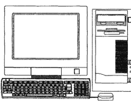
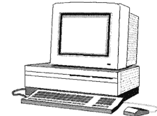


> 注意事项
>
> Java 程序可以有多个独立的例程同时运行。这被称为**多线程**，我们将在第 8 章中研究这一方面。

## Java 虚拟机

通过 Java，Sun 公司提出了一个解决“如何让一个程序在不同平台上运行”的新颖方案，那就是一个名为 Java 虚拟机（或 `JVM`）的精巧软件。当你将 Java 源代码传递给 Java 编译器时，它将其转换为字节码。这并不是机器码，而是一个中间阶段。将其传递给任何安装了 `JVM` 的计算机，该计算机就会读取字节码，将其转换为机器码并运行。

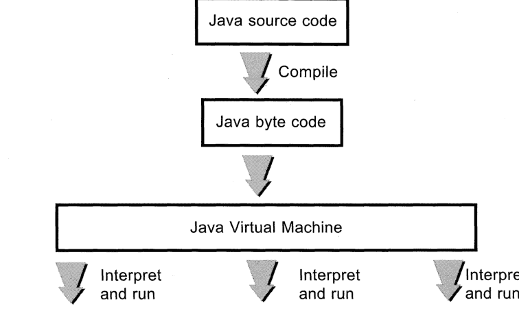

这种方法的主要优点是显而易见的。你可以在互联网上发布你的程序，知道任何计算机安装了 `JVM`，就可以运行它。由于它已内置在 Netscape 和 Internet Explorer 中，任何使用这些浏览器的都可以运行相同的 Java 程序。

主要的缺点则没那么显而易见。因为 `JVM` 在执行指令之前必须将字节码指令转换为机器码，因此程序的运行速度没有编译型程序快。

还有另一个缺点。程序是专门为一种类型的计算机编写的，可以充分利用其功能，优化速度、显示和外围设备的使用。为任何（`JVM`）计算机编写的程序只能使用那些所有机器上都能实现的功能。Sun Microsystems 通过赋予 Java 处理“原生代码”的能力（即专门为某台机器编写的代码）解决了这一局限性——但这似乎违背了初衷……

## JVM、浏览器与版本

自 1997 年以来开发的几乎每个浏览器都带有 Java 虚拟机。但 Java 并没有停滞，而是不断变化。如果你在下载 Java SDK 时获取最新版本（见第 12 页），你就能测试并运行程序，因为你拥有最新版本的 `JVM`。如果你在 Web 上发布程序，使用旧版浏览器的用户将无法运行那些使用了最新 Java 特性的程序——除非他们更新浏览器或 `JVM`。

这是 Web 开发人员面临的长期问题。你是选择使用最新的软件来创建你能做的最好的页面，还是限制在使用旧的、被广泛使用的技术，以便让更多人享受你的网站？由你决定。

| 注意事项 |
| 本书最初为 Java 1.0 编写，此后已更新到 Java 2.0 版本 1.4。 |

# 面向对象编程

Java 是一种面向对象（OO）语言。它不是第一个，但建立在早期面向对象语言的坚实基础之上。这种方法现在已成为编程的标准方式。通常情况下，你可以此更快地产生更好、更可靠的程序。

人们编写了大量关于面向对象编程理论与实践的书。我们将花几页时间介绍它，让你掌握其原理。在必要时，我们会回到这个话题。

## 传统 vs. 面向对象

首先，让我们看看“传统”语言与面向对象语言的区别。想象一个屏幕上的点击按钮。如果你想在传统语言中创建它，你必须编写一些代码在屏幕上绘制按钮，然后编写更多代码来跟踪鼠标移动（绘制指针），并观察点击，最后编写一些代码在它被点击时执行。噢是的，下次你需要另一个点击按钮时，又要重复这一切！

Java 与大多数新的面向对象语言一样，了解按钮。如果你在 Java 程序中需要一个点击按钮，只需要指定把它放在哪里、写什么以及在被点击时做什么。在面向对象语言中，你拥有现成的、可重用的代码块——对象。

## 对象的本质

为了理解对象的特性，让我们来看一个现实世界的类比。想象汽车。它具有某些特性，包括形状、颜色以及速度和方向（移动时）。在 OO 术语中，这些变量变量，在创建时设置，有些可以随时更改。

对于简单的变量，你使用这样的表达式来更改它们的值：

`speed = 90`

在使用对象时，你使用方法——内置例程——改变变量的值。这是一种安全特性，确保值在允许范围内，并且改变一个值不会对对象的其他方面产生意外影响。改变颜色的方法可能如下：

`mycar.setColor(red);`

在术语中，我们正在向 `mycar` 对象的 `setColor` 方法发送消息，并带上参数对象。

## 对象与类

当制造商制造汽车时，他们并不是从零开始设计每一辆车。相反，他们有一份蓝图，并按照它执行——根据需要设置颜色、内饰、引擎尺寸和其他变量。

在面向对象的术语中，蓝图被称为**类**（class），而**对象**（object）是类的一个实例。创建新对象的过程被称为**实例化**（instantiation）。（我从未说过这些术语很优雅。）类和对象之间的区别变得有些模糊，原因如下。

## 继承

让我们来看看汽车制造商的设计工作室。他们新车型将有几个版本 —— 轿车、掀背车和旅行车，每个版本都有 2 门或 4 门供选择。他们为每个版本绘制了一张新的蓝图。他们从一张涵盖了共同元素的蓝图开始，然后对其进行调整以产出基础的轿车、掀背车和旅行车，最后对其中每一个开发出 2 门和 4 门版本。从第一个之后，每个蓝图都继承了其前身的所有特征。它可能会对特征进行微调，并添加自己的额外功能。

关于对象和类的继承示例，让我们看看为汽车修理厂开发一个简单数据库程序。程序员们定义了一个简单的记录结构，用于存储每个客户的姓名、地址、电话和汽车型号，并带有收集这些详情的方法。这个类被称为 `Owner`，可以用于创建存储客户数据的对象。这些可能被称为 `Owner1`、`Owner2`、`Owner3` 等。

如果他们想照顾拥有第二辆车的客户，他们不需要编写另一个定义，而是创建一个 `Owner` 类的新对象，为第二辆车留出空间。这可能被称为 `RichOwner`，它变成了一个类，因为它可以创建新对象。

在术语中，`RichOwner` 是 `Owner` 的子类（`Owner` 是 `RichOwner` 的父类）。两者之间的连接在创建后仍然存在。如果对 `Owner` 类进行修改以添加维修日期，那么该新字段会自动添加到 `RichOwner` 类中。

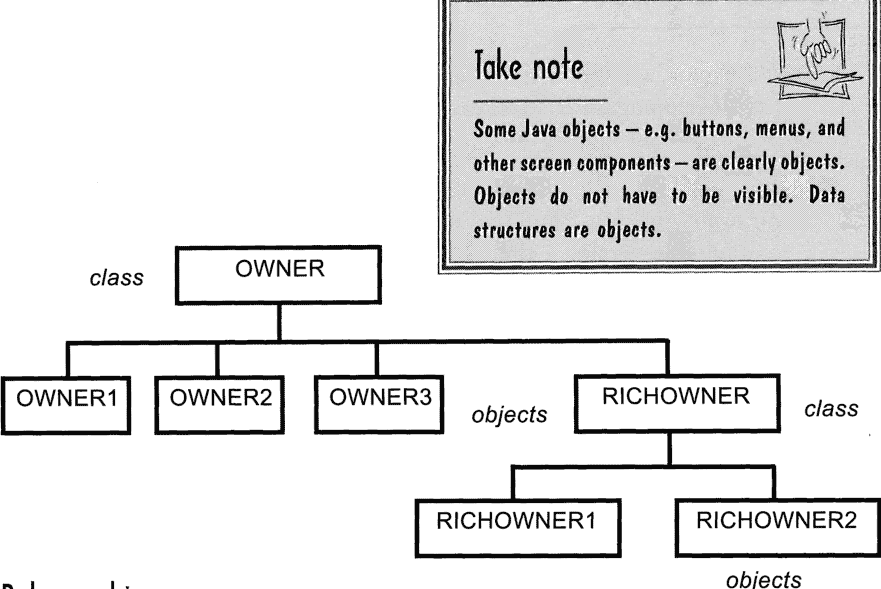

| | | |
| :--- | :--- | :--- |
| class | OWNER | |
| OWNER1 | | |
| OWNER2 | | |
| OWNER3 | | |
| objects | RICHOWNER | |
| class | RICHOWNER1 | |
| class | RICHOWNER2 | |

## 多态

如果面向对象的程序员们在编写那些汽车的蓝图，他们可以为每个版本生成一个新蓝图（类）；或者将所有变体整合在一个主蓝图中。这就是**多态**（polymorphism）——以几种不同形式创建新对象的能力。例如，以下所有都是有效的：

```
new rect = Rectangle()
new rect = Rectangle(50,100)
new rect = Rectangle(50,100,25,25)
```

第一个创建一个高和宽均为 0 像素的矩形，位于屏幕左上角 —— 它准备好在以后增长和移动。第二个创建一个 50 x 100 像素的矩形，位于左上角。第三个创建一个 50 x 100 像素的矩形，位于左上角下方向右偏移 25 像素处。

在所有情况下，消息都是相同的 —— 只有参数的数量发生了变化。技术上，这是通过具有相同名称但不同定义的多个方法实现的。实际结果是为你提供了更大的灵活性。

## Java SDK

如果你想编写 Java 程序，你需要 SDK（软件开发工具包）。你可以从 Sun 的 Java 网站获取副本，地址为：

http://java.sun.com

寻找 SDK 下载区域的链接，并记住你需要 SDK 而不是 JRE（Java 运行环境）。找到一个合适的版本 —— SDK 适用于 Windows、Linux 和 Solaris 机器 —— 并选择最好的 FTP 下载站点。

要运行它，PC 至少必须是一台 166Mhz 的奔腾处理器，配有 32Mb（最好是 48Mb）的内存，并且硬盘上至少有 70Mb 的空间。

SDK 非常庞大并且越来越大。当 Java 刚发布时，该套工具包不到 4Mb。在编写此时，它已接近 40Mb，通过拨号上网下载将需要三个小时。在开始之前，确保你有时间完成这项工作！

### 1 Java 网站页眉

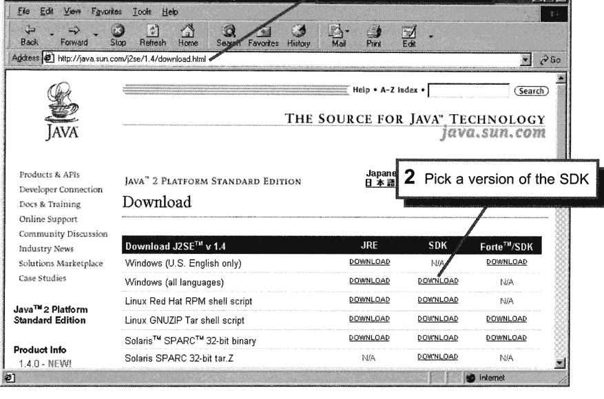

| | JRE | SDK | Forte™ SDK |
| --- | --- | --- | --- |
| Windows (仅限美国英语) | 下载 | 下载 | N/A |
| Windows (所有语言) | 下载 | 下载 | N/A |
| Linux Red Hat RPM script shell | 下载 | 下载 | N/A |
| Solaris™ SPARCC™ 32-bit binary | 下载 | 下载 | N/A |
| Solaris SPARC 32-bit tar.z | N/A | 下载 | N/A |

### 下载 Java(TM) 2 SDK, 标准版 1.4.0 - Internet Explorer 浏览器

| 文件 编辑 视图 收藏 工具 帮助 | | |
|---|---|---|
| 地址: http://124.140.247/Download6/ | | |

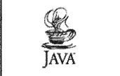

下载 Java(TM) 2 SDK, 标准版 1.4.0 - Internet Explorer 浏览器

地址: http://124.140.247/Download6/

下载 Java(TM) 2 SDK, 标准版 1.4.0 - Internet Explorer 浏览器

地址: http://124.140.247/Download6/

下载 Java(TM) 2 SDK, 标准版 1.4.0 - Internet Explorer 浏览器


# Java(TM) 2 SDK 标准版 1.4.0 下载地址

地址: `http://124.140.247/Download6/`

## 方法重载说明

消息是相同的 —— 只有参数的数量发生了变化。技术上，这是通过具有相同名称但不同定义的多个方法实现的。实际结果是为你提供了更大的灵活性。

## 图片资源

`(img/e0aa6bf61b0552cacf6e87d0d5e9489a_23_0.png)`


# Java(TM) 2 SDK, 标准版 1.4.0 - Internet Explorer 浏览器下载

下载地址：`http://124.140.247/Download6/`


# Java 入门指南

## 准备工作

在 Windows 中，Java 工具设计为从 `MS-DOS 提示符` 使用。如果你以前没用过，现在找找它——它应该在开始菜单的“程序”或“附件”部分。

首先要做的一件事是创建一个短的批处理文件。这是一个存储在扩展名为 `.BAT` 文件中的 DOS 命令列表，我们需要这个文件在每个会话开始时为我们做两件事：

- 切换到存储 Java 程序的文件夹。这可以是顶层 JDK 文件夹，但最好为它们创建一个新文件夹。在我的机器上，它名为 `FILES`，路径为 `C:\JSDK1.4`。
- 设置 `PATH`。这是一组 DOS 在需要运行文件来执行程序时搜索的文件夹列表——如果该文件不在当前文件夹中。（`PATH` 被用于早期的 Windows 版本；自 98 版本以来，Windows 以另一种方式记录程序的路径。）Java 工具存储在 `BIN` 文件夹中，因此 `PATH` 必须包含此路径。如果你不设置 `PATH`，那么每次使用 Java 工具时都必须输入完整的路径和文件名，例如 `C:\JSDK1.4\BIN\java`。

在记事本中创建这个短文件，并根据你的设置调整 Java `BIN` 路径和工作文件夹路径。

```
PATH=C:\JSDK1.4\BIN
CD \JSDK1.4\FILES
```

- 第一行获取 `PATH` 设置 (`%PATH%`) 并将 `\BIN` 文件夹添加到其中。
- 第二行将你移动到工作文件夹。

将文件保存到你的 `WINDOWS` 文件夹中，命名为 `GOJAVA.BAT`。

在会话开始时，打开 `MS-DOS 提示符` 并输入 `GOJAVA`。

### 环境配置示例

你可以在 BAT 文件的命令行中使用小写或大写字母。

从开始按钮，进入“程序”并选择 `MS-DOS 提示符`。

- 保持 `MS-DOS` 窗口打开或将其最小化
- 设置 Java 工具的 `PATH`

```
MS-DOS Prompt
Microsoft Windows 98
(C) Microsoft Corp. 1981-1998.
C:\>dir
C:\>set JAVA_HOME=C:\java
C:\>set PATH=%PATH%;C:\java\bin
C:\>dir
C:\>dir\s>
```

### 2. 运行批处理文件

输入 `gojava` 来运行批处理文件。

你已进入文件目录，准备好开始工作。

> **注意**
> 你可以将 `PATH` 行写入你的 `AUTOEXEC.BAT` 文件中。这些命令在你启动电脑时执行。你仍然需要运行 `MS-DOS 提示符` 并切换文件夹。

## 第一个应用程序

Java 应用程序是一个独立的程序，可以在 Java 解释器的帮助下——从 `MS-DOS 提示符` 运行。这个第一个示例已经尽可能小了，但它足以展示 Java 应用程序的基本形状。它也足以测试你的系统是否运行正常。

```java
class Hello {
    public static void main(String[] args) {
        System.out.println("Hello from Java");
    }
}
```

让我们逐行查看。

`class Hello`

一个 Java 程序是一个**类**。每个类都有一个名字，惯例是类名大写字母开头。

`public static void main(String[] args)`

这是所有应用程序的第一行。Java 应用程序必须有一个名为 `main` 的方法，这是执行的开始点。`public` 允许从外部（即从 `MS-DOS`）访问应用程序。我们稍后会回到这一行和后续内容。

`System.out.println("Hello from Java");`

一个程序由若干条语句（指令）组成——在本例中只有一条。我们使用 `println` 方法（`out` 对象的一部分）在屏幕上显示消息。末尾的 `ln` 是换行符，将光标推到下一行。你可以使用任何文本，但必须包含在双引号内。不要漏掉分号。每个语句都必须以分号结束。

`{}` 将代码结合在一起。外层括号包裹整个程序的代码；内层括号包裹 `main` 方法——通常不止于一行！括号之间的缩进显示了程序的结构，但并非必须。

使用你的文本编辑器或处理器并输入文本。正确使用大写字母和标点至关重要。将文件保存为文本文档，并命名为 `Hello.java`。再次注意大写字母。文件名必须与类名相同，且必须有 `.java` 扩展名。

### 2. 保存为文本文档

#### 使用哪种处理器？

`WordPad` 处理这项工作很方便。你不需要功能全的处理器，`记事本` 只能处理小文件——你会对程序的增长感到惊讶的！`WordPad` 也有最近使用的文件。当你在 applet 和 HTML 代码之间切换时，在这里选择它们非常方便。当你第一次保存文件时，可能会发现 `WordPad` 会为名称添加 `.txt` 扩展名。

移动到 `MS-DOS 提示符` 并编译程序生成名为 `Hello.class` 的文件。如果编译器发现任何错误，它会告诉你是什么错误以及在哪行。如果有，编辑文件并重试。要运行应用程序，将其传递给 Java 解释器：

`java Hello`

注意你使用的是完全相同的名称，但没有任何扩展名。你应该能看到你的文本显示在屏幕上。

- 将文件传递给编译器
- 使用解释器运行它

如果程序编译成功，`javac` 不给出任何消息——这就是你知道它是 OK 的！

## 第一个 Applet

现在测试系统的其余部分。再次，这是你能得到的尽可能小的运行 applet 了，尽管这次还需要创建一个 HTML 文档来为它提供运行环境。

### 源码

输入以下代码。和第一个应用程序一样，它显示消息，但方式不同——applet 运行在浏览器中，这与屏幕显示的所有内容有关。

```java
import java.applet.Applet;
import java.awt.Graphics;

public class HelloApp extends Applet {
    public void paint(Graphics g) {
        g.drawString("Hello from an applet!", 50, 20);
    }
}
```

让我们看看它是做什么的。

```java
import java.applet.Applet;
import java.awt.Graphics;
```

Applets 是继承自 `Applet` 的对象，它是 `java.applet` 类组之一。所有的屏幕显示都是通过继承自 `java.awt`（抽象窗口工具包）中 `Graphics` 类完成的。为了使用这些类，我们必须通过 `import` 命令将代码引入程序。你将根据你想让程序执行的任务导入不同的内容。你始终需要 `java.applet.Applet`，通常需要 `java.awt` 中的一个或多个类。

```java
public class HelloApp extends Applet
```

这是 applet 真正开始的地方。代码被设为 `public`，因此可以执行并赋予类名。你已经看到名字应该大写开头。惯例是，当名字由多个单词组成时，每个单词都大写开头。

```java
public void paint(Graphics g)
```

屏幕显示通常在 `paint()` 内部完成，使用不同的方法进行绘制、设置颜色和编写文本，这些都是 `Graphics` 类的一部分。我们以后将探索其中许多内容。

```java
g.drawString("Hello from an applet", 50, 20);
```

`drawString` 是一个在屏幕上放置单词的方法。它接受三个参数或值：文本、距离左侧的像素数（x坐标）以及距离顶部的数字（y坐标）。

像应用程序一样，括号在这里被用来包裹代码块，再次，这些可以缩进以使结构更清晰。

将文件保存为文本文档，并命名为 `HelloApp.java`。

进入 `MS-DOS 提示符` 并编译 applet：

`javac HelloApp.java`

如果编译器发现任何错误，它会告诉你是错误以及在哪行。如果有，编辑文本并重试。要运行应用程序，将其传递给 Java 解释器：

`java Hello`

注意你使用的是完全相同的名称，但没有任何扩展名。你应该能看到你的文本显示在屏幕上。

### HTML 文档

运行 applet 的唯一方法是在 HTML 文档中运行。因此，创建一个新文档并输入相反的代码。如果你不知道如何编写 HTML，只需仔细复制代码——特别注意当你有一对匹配的标签（如 `<BODY>` 和 `</BODY>`）时，第二个标签的开头有一个斜杠。

```html
<HTML>
<HEAD>
<TITLE> The first applet </TITLE>
</HEAD>
<BODY>
Here comes my first applet:
<BR>
<APPLET CODE="HelloApp.class" WIDTH=200 HEIGHT=50>
</APPLET>
</BODY>
</HTML>
```

#### 创建 HTML 文档

在这里我们能够编写的只有与 applet 相关的部分。这里再次是关键的两行代码。

```html
<APPLET CODE="HelloApp.class" WIDTH=200 HEIGHT=50>
</APPLET>
```

`<APPLET>` 和 `</APPLET>` 标签标记了处理 applet 的代码的开始和结束，在这种情况下，它们之间只有最少的信息，但正如你以后看到的，applet 代码可以运行几行。

`CODE = "HelloApp.class"` 告诉浏览器运行哪个文件。

`WIDTH = 200 HEIGHT = 50` 定义了运行 applet 区域的大小（像素单位）。它在屏幕上显示为一个灰色矩形。applet 区域可以是你喜欢的任何大小。

当你输入并检查完 HTML 代码后，将其保存为文本文件，命名为 `hello.htm`。HTML 文件可以使用小写或大写——这没有关系。

### 查看 Applet

你可以在 `AppletViewer` 或浏览器中查看你的 applet。两者各有优缺点，虽然 `AppletViewer` 通常更方便。

#### AppletViewer

从这里开始，即使只是为了确保它安装正确。回到 `MS-DOS 提示符`，并使用命令将 HTML 文档传递给查看器：

`appletviewer hello.htm`

你应该能在 `AppletViewer` 中看到你的 applet。

```
MS-DOS Prompt
C:\WINDOWS>Windows 98
C:\WINDOWS>Microsoft Corp Version T6.2
(1996)
C:\WINDOWS>java pujama
C:\WINDOWS>set path=C:\j2db2\bin
C:\WINDOWS>cd C:\j2db2
C:\j2db2>dir files
C:\j2db2\files>dir Hello.java
C:\j2db2\files>java Hello
Hello from Hello.java
C:\j2db2\files>java HelloApp.java
C:\j2db2\files>appletviewer hello.htm
```

- 将 HTML 页面传递给 `AppletViewer`

> **提示**
> 在 `MS-DOS 提示符` 上给出新命令之前，必须关闭 `AppletViewer`。如果你想在编译另一个文件时保持它打开，请启动第二个提示符。
> `AppletViewer` 只显示 applet，不显示 HTML 文档的其他部分。

#### 使用浏览器

运行你的浏览器并使用“打开 – 文件”命令加载 `hello.htm` 文件。

这应该显示“Here comes my first applet” 文本，随后是 applet —— 将使用默认的无衬线字体。

## 练习

1. 编写一个应用程序在屏幕上显示你的姓名和地址，地址的每个部分单独占一行。
   不要忘记每个语句都以分号结尾。
   将其保存为 `Address.java`，编译并运行它。

2. 重复练习 1 作为一个 applet，命名为 `AddressApp.java`。调整文本位置使其对齐 applet 的右侧——准备好要花一点时间实验坐标以实现这一点！
   将其嵌入网页中，上方显示文本：“Here's my address”，下方显示：“Please write”。

# 第 2 章 变量与值

- 数据类型
- 创建变量
- 输出
- 输入
- 计算
- 赋值运算符
- 运算符优先级
- 数组
- String 对象
- StringBuffers
- 变量的作用域
- 练习

## 数据类型

变量是内存中命名的位置，可以在其中存储程序需要的数据。你可以根据需要创建任意变量，并按喜意命名——尽管变量命名有一些规则和约定。

| 主题 | 页码 |
| :--- | :--- |
| 数据类型 | 28 |
| 创建变量 | 30 |
| 输出 | 34 |
| 输入 | 36 |
| 计算 | 38 |
| 赋值运算符 | 42 |
| 运算符优先级 | 43 |
| 数组 | 44 |
| String 对象 | 46 |
| StringBuffers | 48 |
| 变量的作用域 | 50 |
| 练习 | 52 |

| 类型 | 范围 |
| :--- | :--- |
| `byte` | -128 to 127 |
| `short` | -32768 to 32767 |
| `int` | -2,147,483,648 to 2,147,483,647 |
| `long` | -9,223,372,036,854,775,808 to 9,223,372,036,854,775,807 |
| `float` | 1.4E-45 to 3.4E+38 |
| `double` | 4.9E-308 to 1.8E+308 |

基本类型是最简单的类型，用于数字。整数有四种格式：

- `byte`
- `short`
- `int`
- `long`

对于浮点数，你将看到：

- `float`
- `double`

### 赋值

在声明变量时，你可以为变量赋值，如下所示：

`类型 变量 = 表达式;`

或者在程序的后续部分使用更简单的语句进行赋值：

`变量 = 表达式;`

采用哪种方式并不重要。如果变量需要有一个初始值，你最好在声明变量时给它赋值。


表达式可以是一个字面量（数字、字符或文本字符串），也可以是一个产生值的计算式或其他操作。这些值的类型应该与变量的类型相同，尽管你可以提供超出该类型范围的数字值——但它们会被截断以适应该类型。

数字可以以八进制、十六进制或指数形式的形式给出，也可以以普通的（十进制）形式给出。我们将使用普通的数字，它足以胜任我们所有的操作。

单字符用单引号括起来，例如 `'A'`。如果你需要使用 Unicode 系统中的字符，必须以十六进制值的形式给出，例如：

```
"\u01F2"
```

文本字符串用“双引号”给出。

以下是有效的赋值：

```
count = 42;
char sex = 'M';
String name = "Fred";
```

> 注意
>
> 你可以在声明并赋值变量时使用关键字 `static final` 将变量变为常量（固定值）：
>
> ```
> static final float VAT = 17.5
> ```
>
> 按照习惯，常量名使用大写字母。Java 有一些预定义的常量，你稍将在书中看到。


是时候付实践了。输入此应用程序源码。将其保存为 `Vars1.java` 并使用以下命令编译它：

```
javac Vars1.java
```

### Vars1.java (应用程序)

```java
class Vars1 {
    public static void main(String[] args) {
        int number;
        double decimalNum;
        number = -100000;
        decimalNum = 12345.6789;
        System.out.println(number);
        System.out.println(decimalNum);
        char letter = 'Q';
        System.out.println(letter);
    }
}
```

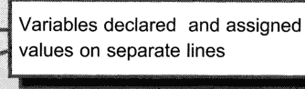
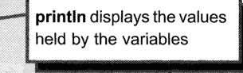
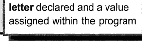

如果你收到任何错误信息，请仔细检查并将你的代码与我的进行对比，特别注意标点符号和大写字母。

编译完成后，使用以下命令运行它：

```
java Vars1
```

程序应该显示变量所持的值。

| -100000 |
| 12345.6789 |
| Q |

> 提示
>
> 记住 Java 是区分大小写的。类行中的名称必须与文件名完全匹配。

### 处理错误

Java 编译器会尝试提供帮助并引导你正确的方向，因此请务必仔细阅读错误信息。

信息首先识别错误行号和错误性质。在图中，错误位于第 9 行，问题是编译器“无法解析符号”（cannot resolve symbol）。这通常表示拼写错误。

随后信息提供了有关错误的更多详细信息，并尝试通过在有问题的表达式下方显示带有插入符号（`^`）的代码行来确定位置。在这种情况下，问题在于我写了 `decimalNim` 而不是 `decimalNum`。

只需快速修正即可解决问题，程序就能正常运行。

> 提示
>
> 如果你想在 MS-DOS 提示符中重复上一次命令——当你反复编译时会需要这样做——请按 `F3` 和 `回车`。

### 输出

当你显示变量时，通常会显示一条消息来告诉用户它是什么。`println` 方法有两个局限性：

- 你一次只能显示一个项目；
- 它会输出换行符，强制光标移动到下一行。

所以，你可以这样做：

```java
System.out.println("The score is ");
System.out.println(score);
```

但显示效果并不令人满意：

```
The score is
29
```

这个问题有两个解决方案：

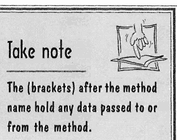

#### System.out.print

这种方法也会在屏幕上显示值或变量，但在末尾不换行。如果你想让两个或多个项目出现在同一行中，请使用连续的 `print` 方法，最后跟一个 `println`。

```java
System.out.print("The score is ");
System.out.println(score);
```

这次的输出是：

```
The score is 29
```

这显然好得多——记住在第一段文本结束包含一个空格，以便与后续项目分开。

#### 组合输出

你可以使用 `+` 运算符组合任意数量的值、变量和字面字符串来创建一个输出字符串，例如：

```java
System.out.println("The score is " + score);
```

这也会输出：

```
The score is 29
```

作为一个通用规则，组合字符串的方法在输出行中有有限数量较小项目时效果最好。字符串本身可以长达数千字符，但超过某一点后，组合表达式将变得难以正确输入和阅读，此时将输出分行更容易。清晰度比紧凑性更重要！

下一个示例演示了组合方法，并使用了一些数据类型。它是上一个示例的扩展，通过复制其代码作为基础，节省了一些时间和打字量。

### PrintVars.java (应用程序)

```java
class PrintVars {
    public static void main(String[] args) {
        int number;
        double decimalNum;
        char letter;
        boolean reply;

        number = -100000;
        decimalNum = 12345.6789;
        letter = 'A';
        reply = true;

        System.out.println("The number is " + number);
        System.out.println("The decimal is " + decimalNum);
        System.out.println("The letter is " + letter);
        System.out.println("The reply is " + reply);
    }
}
```

### 计算

在 Java 中有五种算术运算符：

- `+` 加法
- `-` 减法
- `*` 乘法
- `/` 除法 — 除以几次
- `%` 取模 — 除法后的余数

注意最后两个。当你对整数进行除法运算（在纸上计算）时，你会得到两个结果 —— 除的次数和余数。例如：

```
14 / 4 = 3 余 2
```

要在 Java 中获取这两个值，你必须进行两次计算：

```
14 / 4 = 3，然后 14 % 4 = 2
```

算术表达式产生的值可以用任何可以使用变量或字面量的地方，例如：将它们打印到屏幕上、赋值给变量，或在其他计算中使用。我们将从将它们打印到屏幕上开始。这个程序会将和显示为（文本），后面跟着表达式。系统将计算结果并显示出来。

#### Sums1.java (应用程序)

```java
class Sums1 {
    public static void main(String[] args) {
        System.out.print("29 + 7 = ");
        System.out.println(29 + 7);
        System.out.println("29 - 7 = " + (29 - 7));
        System.out.println("29 * 7 = " + (29 * 7));

        System.out.print("29 / 7 = ");
        System.out.print(29 / 7);
        System.out.print(" remainder ");
        System.out.println(29 % 7);
    }
}
```

编译并执行后，你应该看到此输出：

| 29 + 7 = 36 |
| 29 - 7 = 22 |
| 29 * 7 = 203 |
| 29 / 7 = 4 remainder 1 |

上一个程序使用了整数值。看看小数分数会发生什么。编辑它，将 `29` 改为 `29.5`，将 `7` 改为 `7.1`。（如果你使用的是 WordPad，它的替换功能会让这项工作变得非常简单。）再次编译并运行。这次你应该应该看到：

| 29.5 + 7.1 = 36.6 |
| 29.5 - 7.1 = 22.4 |
| 29.5 * 7.1 = 4.15492597464789 remainder 1.100000000000024 |

看这个准确性！Java 将小数值处理为 `double`（精确到 15 位），除非你另行告诉它。

现在让我们尝试将表达式赋值给变量。我们将从一些简单的 `int` 开始。

#### Sums2.java (应用程序)

```java
class Sums2 {
    public static void main(String[] args) {
        int num1, num2, num3;
        num1 = 4;
        num2 = 1 + 1;
        num3 = num1 + num2;
        System.out.print(num1);
        System.out.print(" " + num2);
        System.out.print(" " + num3);
        System.out.print(" = ");
        System.out.println(num3);
    }
}
```

| 声明了 int 变量 |
| :--- |
| 结果被赋值给 num2 |
| num1 和 num2 中的值相加并赋值给 num3 |
| 这五项可以在单次打印中输出 |

这应该产生单行输出：

```
4 + 2 = 6
```

以该程序为基础进行探索。

- 尝试不同的值 —— 看看总和超过 `2,147,483,647`（上限）时会发生什么。
- 尝试其他数值类型：`byte`, `short`, `long`, `float`。

### 自增与自减

`++`（自增）和 `--`（自减）运算符可以将变量的值增加或减少 1。

自增和自减运算符可以放在变量的前面或后面：

```java
num++
```

```java
++num
```

这种效果是相同的。

```java
num--
```

```java
--num
```

这种效果是相同的。

### Arrays.java (application)

```java
class Arrays {
    public static void main(String[] args) {
        int[] number = new int[5];
        int subs;
        number[0] = 99;
        number[1] = 11;
        number[2] = 22;
        number[3] = 33;
        number[4] = 44;
        System.out.println(number[0]);
        System.out.println(number[1]);
        System.out.println(number[2]);
        subs = 3;
        System.out.println(number[subs]);
        subs = 4;
        System.out.println(number[subs]);
    }
}
```

声明一个包含 5 个整数的数组，索引范围从 0 到 4

- `subs` 将用作下标
- 为每个元素赋值
- 下标可以以字面量值的形式给出...
- ...或者作为变量给出

将代码保存为 `Arrays.java`，编译并运行它，你应该会看到如下内容：

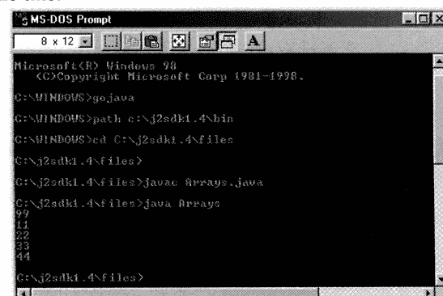

> 注意
>
> 当你使用循环时，可以对数组进行更多操作——请参阅下一章。

### String 对象

Java 有两个类用于存储文本。`String` 的结构更简单的。这种类型的对象用于存储常量值——除了通过简单的赋值外，它们不会改变。它们通常用于持有给用户的消息，以及在方法之间传递数据。

### String Strings

这个简单的示例展示并显示了消息中的两个文本项。请注意，普通的 `=` 用于赋值，且你可以在程序运行期间为 `String` 赋新值。

```java
class String1 {
    public static void main(String[] args) {
        String message = new String();
        message = "This is a program about strings";
        System.out.println(message);
        message = "it is not very exciting";
        System.out.println(message);
    }
}
```

| 你可以直接写成：String message; | 赋一个新值 |
| :--- | :--- |

### String[] args

我们已经经常遇到它了——也许是时候看看它的具体作用了。

`main(String[] args)` 设置了一个 `String` 数组——它包含数量未指定的元素，称为 `args`（arguments 的缩写）。正如你稍后将看到的（第 96 页），方法名后括号中给出的变量或类用于收集参数——即传递给方法的数据。在这里，`args[]` 数组将收集程序名后在命令行中输入的任何文本。当程序执行时，系统将第一个项复制到 `args[0]`，下一个复制到 `args[1]`，依此类推。

这种技术的实际用途包括为程序提供要处理的文件名，以及为程序提供测试数据。

下面的示例将 `args[]` 的值复制到字符串 `firstName` 和 `surname` 中，然后向用户问候。注意 `IOException` 行，用于捕获输入时的任何错误——这是至关重要的。

```java
class InString {
    public static void main(String[] args) throws java.io.IOException {
        String firstName;
        String surname;
        firstName = args[0];
        surname = args[1];
    }
}
```


```java
System.out.println("Hello " + firstName + " " + surname);
}
}
```

这将产生相同的输出：
`("Hello " + args[0] + " " + args[1]);`

编译程序，并在运行时，在命令行的末尾输入你的名字和姓氏。你必须至少提供两个名字——如果尝试复制不存在的 `args[]` 字符串，程序将会崩溃，或者会忽略任何多余的内容。

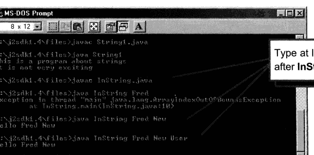

# StringBuffers

`StringBuffer` 对象比简单的 `String` 更灵活。这些对象中持有的数据可以被程序操作。如果你想编辑、添加或以其他方式处理文本，请将其存储在 `StringBuffer` 中。

可以通过三种方式创建 `StringBuffer` 对象：

- `StringBuffer s1 = new StringBuffer();`
  - 这创建 `s1` 并为默认的 16 个字符分配空间。
- `StringBuffer s2 = new StringBuffer(40);`
  - 创建的 `s2` 初始存储空间为 40 个字符。
- `StringBuffer s3 = new StringBuffer("Java ");`
  - 为 `s3` 分配了初始 4 个字符，并在其中存储了 "Java"。

在所有情况下，存储空间会在程序执行期间根据需要增加。

你不能用 `=` 符号为 `StringBuffer` 对象赋值。值必须在创建时赋值，或者使用 `append()` 方法（向现有文本后添加）或 `insert()` 方法（将新材料放入文本的指定位置）来进行。新材料可以是字面量字符串、数字值或变量——所有类型都会转换为字符以包含其中。下一个程序演示了这一点。

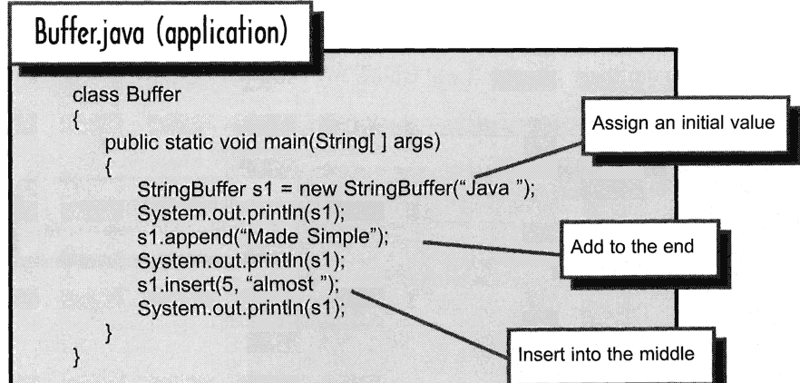

```java
class Buffer {
    public static void main(String[] args) {
        StringBuffer s1 = new StringBuffer("Java ");
        System.out.println(s1);
        // ... 省略内容
    }
}
```

## 变量的作用域 (Scope of variables)

（注：由于原文该部分大量重复，此处整合了关于变量作用域的通用核心逻辑说明）

## 练习

1. 编写一个程序，根据人的年龄（天、月、年）计算其对应的天数。假设所有月份都是 30 天 - 这会让计算过程变得简单得多！
2. 修改之前的程序，使其接收人的出生日期和今天的日期，并据此计算出年龄。
3. 编写一个程序，接收两个命令行参数，并将它们添加到一个包含短语“You entered ”的 `StringBuffer` 中，然后输出新字符串。

# 3 程序流程

- 测试值 ................................................................ 54
- for 循环 ........................................................ 56
- while 循环 ................................................ 60
- 使用 if 分支 ............................................ 62
- 多重分支 ................................. 64
- Switch ......................................................... 66
- 使用方法 ................................................ 68
- 错误与异常 ................................. 72
- 练习 ................................................ 74

## 测试值

程序流程指的是程序指令执行的顺序。到目前为止，所有的示例程序都是按顺序执行一个序列，然后停止。这种简单的程序很少有实际用途。循环和分支的加入使得程序变得更加有用且强大。在循环中，一组指令将重复固定次数，或者直到满足某个条件。分支根据变量持有的值将流程引向不同的路径。在我们继续之前，让我们先看看如何测试值。

## 关系运算符

这些运算符用于将变量与值或与其他变量的内容进行比较。共有六种关系运算符：

| 运算符 | 描述 |
| :--- | :--- |
| `==` | 等于 |
| `<` | 小于 |
| `<=` | 小于等于 |
| `!=` | 不等于 |
| `>` | 大于 |
| `>=` | 大于等于 |

注意，相等性测试使用双等号 `==`。单等号 `=` 用于赋值。典型的测试表达式如下：

```java
(x == 99)
(newNum != oldNum)
```

测试被包含在括号中，并返回一个布尔值——真（`true`）或假（`false`）。你通常不需要担心这个——直接使用测试即可——但有时将测试结果存储在变量中以便程序稍后引用是有用的，例如：

```java
boolean result; // 创建一个布尔变量
...
result = (newNum > oldNum) // 存储测试结果
...
if (result == true) // 等同于 if (newNum > oldNum)
```

## 逻辑运算符

关系运算符一次测试一个值，但你通常想检查变量是否落在一个数值范围内，或者是否是几种可能性之一。这就是逻辑运算符大显身场的地方。

### AND 和 OR

`&&` (AND) 运算符比较两个测试的结果，如果两个测试都为真，则表达式为真。

```java
( ( x >= 20) && (y <= 30) )
```

对于 `x` 从 20 到 30 的所有取值，该表达式均为真。

使用 `||` (OR) 运算符时，如果其中一个或两个测试都为真，则表达式为真。

```java
( ( x > 100) || (y > 200) )
```

如果 `x` 大于 100 或 `y` 大于 200，或者两者都超过限制，该表达式为真。

逻辑表达式可以包含两个以上的测试，并同时包含 `&&` 和 `||`。在混合表达式中，`&&` 会先被计算，除非你使用括号——在这里，就像算术运算一样，括号内的任何内容都会先计算。

```java
( ( x >= 20) && (x <= 30) || (y > 200) )
```

要使此表达式为真，`x` 值必须在 20 到 30 之间，或者 `y` 值超过 200——在这种情况下，`x` 值无关紧要。

```java
((x > 100) || (y > 200)) && (edgecheck == true)
```

如果 `x` 和 `y` 值中任一或两者都超过限制，且 `edgecheck` 被设置为 `true`，则该表达式为真。

本章目的是解释用于构建 Java 程序的词汇。为了让我们专注于这些内容，而不是陷入其他事务，示例都是应用性的，且要么是琐碎的，要么是刻意的。有趣的内容在后面，一旦我们完成了基础部分！

## for 循环

`for` 循环允许你按照指定的次数重复一组指令。循环的基本结构为：

```java
for (var = start_value; end_test; change) {
  statement(s); 
}
```

当程序第一次遇到这一行时，`var` 被赋值为 `start_value`。执行随后的语句或语句块，然后流程循环回 `for` 行。随后，根据 `change` 的规定调整 `var` 的值。执行 `end_test`——这通常是将 `var` 与给定的值进行比较，例如 `counter < 100`。如果尚未达到结束值，则再次执行语句，并继续循环回，直到满足 `end_test`。

这一简单的 `for` 行：

```java
for (counter = 0; counter < 10; counter++)
```

设置了一个循环，该循环将总共重复语句 10 次，因为 `counter` 从 0 到 9 的值递增。

`change` 不一定是递增。

## Fortimes.java

(此处为代码块及描述，不翻译代码)

### Nesting.java (application)

```java
class Nesting {
    public static void main(String[] args) {
        int outer;
        int inner;
        for (outer = 1; outer <= 6; outer++) {
            for (inner = 1; inner <= 10; inner++) {
                System.out.print(inner * outer + "\t");
            }
        }
    }
}
```

你的输出应该如下：

| 1 | 2 | 3 | 4 | 5 | 6 | 7 | 8 | 9 | 10 |
|---|---|---|---|---|---|---|---|---|---|
| 2 | 4 | 6 | 8 | 10 | 12 | 14 | 16 | 18 | 20 |
| 3 | 6 | 9 | 12 | 15 | 18 | 21 | 24 | 27 | 30 |
| 4 | 8 | 12 | 16 | 20 | 24 | 28 | 32 | 36 | 40 |
| 5 | 10 | 15 | 20 | 25 | 30 | 35 | 40 | 45 | 50 |
| 6 | 12 | 18 | 24 | 30 | 36 | 42 | 48 | 54 | 60 |

### 旁路：随机数

在 `java.lang.Math` 类中有一个方法 `random()`，它会生成一个 0.0 到 1.0 之间的随机数。在最简单的用法下，例如：
`x = java.lang.Math.random();`
将给你返回一个小于 1 的小数值。如果你想要一个足够大的数字，必须对其进行乘法。乘以 10 后，数字范围在 0 到 10 之间，但它仍然是一个小数（`double`）值。如果你想要一个整数，必须通过在表达式开头加上 `(int)` 来进行类型转换。

```java
randNum = (int)(java.lang.Math.random() * 1000);
// randNum 将是 0 到 999 之间的整数。
```

## while 循环

`for` 循环通常是固定次数的。`while` 循环在两个方面提供了更大的灵活性：

- 退出测试可以检查任何变量，而不仅仅是循环计数器
- 退出测试可以在循环的开始或结束——所以，如果满足正确的条件，循环体语句可能根本不会执行。

`while` 循环的形式如下：

```java
while (test) {
    statement(s); 
}
```

系统在进入循环时以及在每次重复之前都会执行测试。这里有一个非常简单的示例，使用计数器来确定重复次数。

### WhileEx.java (application)

```java
class WhileEx {
    public static void main(String[] args) {
        int count = 0;
        while (count < 10) {
            count++;
            System.out.println(count);
        }
    }
}
```

这里需要注意的一点是，它显示的是 1 到 10，尽管文本中是 `< 10`。这是因为递增和打印是在测试之后完成的。与下面的 `for` 循环进行比较，并在设置循环测试时记住这种差异。

```java
for (count = 0; count < 10; count++) {
    System.out.println(count); // 显示 0 到 9
}
```

### do ... while

这种变体将测试移动到了循环的末尾。因此，内部的语句至少执行一次。它的形式是：

```java
do {
    statement(s); 
} while (test);
```

注意 `while` 行末尾有一个分号——这是至关重要的。

下面的程序演示了 `do ... while` 循环，再次使用了 `java.lang.Math.random()` 方法来强调重复可以通过循环内部产生的值来控制。

### WhileDo.java (application)

```java
class WhileDo {
    public static void main(String[] args) {
        int num = 0;
        System.out.println("Looking for number ");
        do {
            num = (int)(java.lang.Math.random() * 100);
            System.out.print(num + " ");
        } while (num != 6);
        System.out.println("Got it");
    }
}
```

需要空格来分隔屏幕上的数字。该程序的输出将类似于：
`Looking for number 4 9 3 5 0 6`

## if 分支

循环让程序变得强大，赋予它们处理数据的能力。分支让它们变得灵活，允许它们根据数据改变动作。最简单的分支形式使用 `if` 关键字。这是基础语法：

```java
if (test)
    statement(s); // 真
```

测试检查变量所持的值。如果测试证明为真，程序将执行语句，否则将忽略它们。另一种变体使用 `else` 关键字，用于处理测试不为真时的动作。语法为：

```java
if (test)
    statement(s); // 真
else
    statement(s); // 假
```


例如：

```java
if (age < 18)
    cost = 50
else
    cost = 25
```

你可以看到 `if` 结构在下一个示例中的作用。你可以看到 `if` 结构处理高值或低值。

### Guess1.java (application)

```java
class Guess1
{
    public static void main(String[] args)
    {
        int target = (int)(java.lang.Math.random() * 100);
        int guess;
        int count = 0;
        do {
            guess = (int)(java.lang.Math.random() * 100);
            System.out.print(guess + " ");
            count++;
        } while (guess != target);
        System.out.println("Got it in " + count);
    }
}
```

### 多分支

循环让程序变得强大，赋予它们处理数据的能力。`if` 结构具有简单性，但它并不总是最佳方案。考虑这个问题：你想要处理非打印字符、大写字母或数字。这里是处理它们的程序：

```java
class Ascii {
    public static void main(String[] args) {
        char letter;
        do {
            letter = (char)(java.lang.Math.random() * 128);
            if (letter < ' ') {
                System.out.println("Non-printing");
            } else if (letter >= 'a' && letter <= 'z') {
                System.out.println("Lower case");
            } else if (letter >= 'A' && letter <= 'Z') {
                System.out.println("Upper case");
            } else if (letter >= '0' && letter <= '9') {
                System.out.println("Digit");
            }
        } while (letter != ' ');
    }
}
```

到目前为止，代码处理了非打印字符（0 到 31）、空格、`a` 到 `z`、`A` 到 `Z` 以及 `0` 到 `9`。那么剩下的呢？查看任何字符集（使用 Windows 字符表），你会发现字母块之间散布着标点符号和其他符号。对这些符号的测试看起来像这样，我不保证这是正确的！

`if ((letter >= ' ') && (letter <= '0') || (letter >= '9') && (letter <= 'a') || (letter >= 'Z') && (letter <= 'Z'))`

这里有一个更好的解决方案。`if ... else` 结构从同一个测试提供两个分支——一个用于真的情况，另一个用于假的情况。这可以扩展以处理多个分支。

```java
if (test1)
    statement(s); // 如果 test1 为真
else if (test2)
    statement(s); // 如果 test2 为真
...
else
    statement(s); // 如果没有测试为真
```

如果 `test1` 为假，程序尝试 `test2`，如果失败，则尝试下一个。如果所有测试都为假，程序执行最后一个 `else` 之后的语句。这里是解决字符问题的更好的解决方案。

### AsciiElse.java (application)

```java
class AsciiElse
{
    public static void main(String[] args)
    {
        char letter;
        do {
            letter = (char)(java.lang.Math.random() * 128);
            if (letter < ' ') {
                System.out.println("Non-printing");
            } else if (letter >= ' ' && letter <= '~')
                System.out.println(letter + " Lower case");
            } else if (letter >= 'A' && letter <= 'Z')
                System.out.println(letter + " Upper case");
            else if (letter >= '0' && letter <= '9')
                System.out.println(letter + " Digit");
            else
                // 如果流到达这里，该字符不是非打印的不是字母也不是数字
                System.out.println(letter + " Symbol");
        } while(letter != ' ');
    }
}
```

#### switch（分支）

switch 结构可以用于替换一组语句，这些语句都对同一个简单变量进行不同值的测试。一个典型的用法是菜单，通过 switch 将执行流引导至所选选项的程序。该结构的基本形状如下：

```
switch (var) {
  case value1 : statement(s); break;
  case value2 : statement(s); break;
  default : statement(s); break;
}
```

- 被测试的 `var` 通常是一个整数（`int`）或字符（`char`）。
- 这些值必须是字面量值——而不是其他变量。
- `switch` 执行简单的匹配，将每个值与 `var` 进行比较——你不能使用关系运算符。
- 程序的执行流会从一行运行到下一行，除非你在末尾放置一个 `break` 来强制让它跳出 `switch` 块。
- 如果没有匹配的 `case`，则执行（可选的）`default` 线路上的语句。
- 每个 `case` 只能测试一个值。如果多个值导致相同的操作，请将它们写在连续的行上。例如：`case 'q'; case 'Q' : (退出程序)...`

下面的程序展示了 `switch` 的用法。选择值是从键盘读取的——让我们看一眼那个读取程序。

```
choice = (char)System.in.read();
excess = (char)System.in.read();
excess = (char)System.in.read();
```

你必须按下 `[Enter]` 来从缓冲区获取数据——但 `[Enter]` 键本身也存储在缓冲区中。在 PC 中，该按键是两个字符——“换行”（将光标移动到下一行）和“回车”（将它移动到屏幕左侧）。在某些系统中，`[Enter]` 键是一个单一换行符。这些多余的字符必须被读取并丢弃——这就是那些 `excess...` 行的原因。

66

#### Switch1.java (应用程序)

```java
class Switch1
{
    public static void main(String[] args)
    throws java.io.IOException {
        char choice, excess;
        System.out.println("Start a new file....1");
        System.out.println("Open a file.......2");
        System.out.println("Save the file.......3");
        System.out.println("Exit........4");
        do {
            System.out.println("Type your choice and press [Enter]");
            choice = (char)System.in.read();
            excess = (char)System.in.read();
            switch (choice) {
                case '1': System.out.println("Starting"); break;
                case '2': System.out.println("Opening"); break;
                case '3': System.out.println("Saving"); break;
                case '4': System.out.println("Goodbye"); break;
                default: System.out.println("Invalid option");
            }
        } while (choice != '4');
    }
}
```

`read()` 方法需要异常处理（见第 72 页）

尝试在没有这些行的情况下运行，或者在开头加上 `//` 将它们变成注释

这些是数字 `'1'`、`'2'`、`'3'`、`'4'`而不是数值。

#### 这是一个典型的输出：

- Start a new file....1
- Open a file.......2
- Save the file.......3
- Exit........4
- Type your choice and press [Enter]
- 2
- Opening
- Type your choice and press [Enter]
- 4
- Goodbye

#### 使用方法

你可以将程序写成一个代码块，但超过一定尺寸后，这些程序将变得难以阅读和调试。更好的解决方案是将代码分成不同的块，每个块被定义为一个新方法。当 `main()` 需要执行其代码时，它会调用（跳转到）方法，执行完成后，流从方法返回到 `main()`。这个过程可以进一步，即一个新方法调用另一个方法。程序流始终返回到调用之后的一行。

下面的示例实际上非常短，但我不会要求你输入很多行仅仅为了说明一个观点！

首先，这是作为一个代码块的程序。它使用循环将数字转换为整数幂。要查看它是如何工作的，请在纸上对程序进行干跑运行：

| loop | temp | number |
| :--- | :--- | :--- |
| 1 | 4 | 4 |
| 2 | 4 | 16 |
| 3 | 16 | 64 |
| 4 | 64 | 256 |

```java
// Power (application)
class Power {
    public static void main(String[] args) {
        int number = 4;
        int p = 3;
        int temp = 1;
        int loop;
        for (loop = 1; loop <= p; loop++) {
            temp = temp * number;
        }
        System.out.println(number + " to the power of " + p + " = " + temp);
    }
}
```

现在让我们看看它是如何工作的，在第一个版本中，参数被传递给方法。

#### PowerMethod1.java (应用程序)

```java
class PowerMethod1 {
    public static void main(String[] args) {
        int number = 4;
        int p = 3;
        int temp = 1;
        int loop;
        for (loop = 1; loop <= p; loop++) {
            temp = temp * number;
        }
        System.out.println(number + " to the power of " + p + " = " + temp);
    }

    public static int powerOf(int n, int p) {
        int temp = 1;
        int loop;
        for (loop = 1; loop <= p; loop++) {
            temp = temp * n;
        }
        return temp;
    }
}
```

#### 参数

向方法传递值时，可以可以是变量也可以是字面量。这样做是有效的：

`powerOf(5, 3)`

返回值的方法必须被视为一个值。你不能用简单的语句调用它：

`powerOf(5);`

这对于 `void` 方法是有效的，但如果返回了值，必须将其赋值给变量、打印或作为值使用。这样做是有效的：

`System.out.println("The answer is " + powerOf(5, 3));`

#### 返回值

让我们关注定义行的开头。

`public` 表示该方法可以被其他方法访问。`static` 为其变量分配内存空间。`void` 指方法返回的值。

`void` 方法不返回任何内容，但方法可以返回任何类型的值。如果你使用过其他语言，`void` 方法相当于子程序，而返回值的方法相当于函数。

#### PowerMethod2.java (应用程序)

```java
class PowerMethod2 {
    public static void main(String[] args) {
        int number = 4;
        int p = 3;
        int ans;
        ans = powerOf(number, p);
        System.out.println(number + " to the power of " + p + " = " + ans);
    }

    public static int powerOf(int n, int p) {
        int temp = 1;
        int loop;
        for (loop = 1; loop <= p; loop++) {
            temp = temp * n;
        }
        return temp;
    }
}
```

## 错误与异常

你的程序并不会总是完美的——没有任何一个程序员能做到这一点——但你可以尝试预测可能的错误，Java 会在这方面为你提供帮助。

## 运行时错误

程序成功编译并不意味着它没有错误。编译只是在告诉你你使用了正确的语法编写了 Java 语句和方法。它不会告诉你一个 `while` 循环会因为退出条件永远为真而导致无限循环，或者在某些情况下——变量将不会持有可接受的值，或者数组的下标超出了数组的范围。这些错误只会在运行时出现。

严谨的测试将有助于发现一些 bug。你必须检查程序中每条可能的路径，并测试所有可能（以及不可能）的数值范围内的值。当你完成了所有测试后，将程序交给以前没见过它的人。他们会尝试那些你从未想过的事情！

如果你无法看出程序哪里出了问题，可以插入语句来显示关键变量所持的值，或者标记执行例程的进度：

```java
System.out.println("The total is " + total);
System.out.println("Into the calculating loop");
```

这些存根（术语中）最好一次使用一或两个，以便首先将 bug 搜索范围缩小到方法，然后缩小到导致问题的代码行。

## 异常

Java 程序中的运行时错误可能比其他语言编写的程序少，因为 Java 有其异常处理机制。那些可能遇到错误的方法——例如打开文件的方法（文件可能不存在）——会抛出异常（一种错误报告）。在使用这些方法时，你必须添加代码来捕获（catch）这些异常。

例如，当你尝试打开一个文件时，很有可能它并不在那里。单独使用这一行……

```java
FileInputStream inStream = new FileInputStream(file);
```

... 然后你将得到一个错误消息，告诉你必须在 `new FileInputStream()` 语句上捕获 `FileNotFoundException`。

解决方案是将语句封装在 `try` 块中。紧随其的是一个或多个 `catch` 块。每个 `catch` 块都有被捕获异常的名称。

```java
try {
```


FileInputStream inStream = new FileInputStream(file);

} catch (FileNotFoundException e) {

  System.out.println("Error: " + e);

}

```

捕获异常后取决于你如何处理该异常。在这里打印了错误消息 `e` —— 这对于调试和文件名有用，并循环重试。`catch` 块甚至可以留空——但它们必须存在！

你将在第 7 章和第 8 章的一些程序中找到异常处理的示例。

### 注意事项

使用哪种异常名称作为 `catch()` 参数永远没有问题。只管编写不带 `try` 和 `catch` 块的语句，编译器会告诉你你应该捕获什么。

## 练习

- 1. 写一个程序，使用两个循环来产生如下星号图案：
*
**
***
****
*****
******
*******
********

- 2. 快速测试 Java 在你 PC 上运行的速度。写一个程序显示“Starting to count”，运行循环，然后显示“Done”。

你的 PC 数到 500,000 需要多长时间？数到 5,000,000 需要多长时间？

- 3. `random()` 生成的数字是如何产生的？设置一个 10 个 `int` 数组，然后生成 0 到 9 之间的随机数，并增加数组中相应元素的值。这应该至少循环 1,000 次。

- 4. 写一个程序，接收一个字符，并使用 `if` 测试和 `switch` 块打印消息，说明它是大写、小写、数字、不可打印字符还是符号。至少三个符号应该被单独识别。

# 4 Applet 基础

- Applet 方法 ................................ 76
- AppletViewer ................................. 78
- 文本显示 ............................................ 79
- 字体 ..................................................... 82
- 颜色 ................................................... 84
- 捕获鼠标 ................................. 86
- 新方法 ................................................ 90
- Applet 参数 ................................ 92
- 练习 ................................................ 96

## Applet 方法

所有的 applet 都基于 `Applet` 类，该类包含了一整批内置方法。其中某些方法会响应系统活动自动运行。本章的示例查看了这些关键方法：

`init()` 在 applet 首次加载时运行，且仅在此时运行。如果你有需要赋予初始值的变量，应该在这里完成。

`start()` 在 applet 加载时运行，并且当 applet 页面重新加载时再次运行。如果你想在有人返回页面时重新启动某个操作，请在此方法中执行。

`stop()` 在浏览器关闭或打开另一个页面时运行。

`paint()` 在页面加载或重新加载时重绘显示。

`Applet` 类的定义包含了这些方法，但是以如下留空的形式存在的：

```java
public void init()
{}
```

它们什么都不做，但通过其存在，它们将方法名与相关的系统事件关联起来。如果你编写了自己的 `init()` 方法，它将覆盖原始方法，并在 applet 首次加载时执行。

在下一个 applet 示例中，已经提供了 `init()` 和 `start()` 方法。然后显示 `paint()` 方法。

### StartStop.java

```html
<HTML>
<HEAD>
<TITLE>Applet</TITLE>
</HEAD>
<BODY>
<P>Output:</P>
<APPLET CODE="StartStop.class" WIDTH=500 HEIGHT=200></APPLET>
</BODY>
</HTML>
```

### AppletViewer

在你编译了 applet 并编写了 HTML 文件后，通过 AppletViewer 查看它

你会注意到 Stop 会清除显示，当给出 Start 时，显示会恢复。

### 文本显示

如果你想显示文本，使用 `drawString()`。它接受三个参数：文本以及确定其位置的 x,y 坐标。x,y 坐标以像素（屏幕点）为单位。它们从文本的左上角开始。精确定位有点复杂，因为你需要考虑字体的大小和文本的长度。例如：

```java
g.drawString("Hello there", 100, 50);
```

这显示 "Hello there"，距离左侧 100 像素，距离顶部 50 像素。

| 0 | 100 | 200 | 300 | ...WIDTH |
|---|---|---|---|---|
| 0 | | | | |
| 50 | | | | |
| 100 | | | | |

文本可以是字面量字符串（在引号内）、String 变量或任何可以转换为字符串的对象或值。例如，为了显示一个 StringBuffer 对象，你需要使用 `toString()` 方法（在 StringBuffer 类中）：

```java
g.drawString(s.toString(), 200, 100);
```

'g' 是一个 Graphics 对象，定义在这一行中：

```java
public void paint(Graphics g)
```

这一行必须存在——你不需要称它为 'g'，但你必须有一个 Graphics 对象以便调用绘图方法。

接下来两个程序演示了定位以及不同类型的字符串。字符串被放置在 applet 的角落和中心。在第一个中，使用了默认字体设置。

### DrawText.java (applet)

```java
import java.awt.*;
import java.applet.*;

public class DrawText extends Applet {
  String topLeft = new String("Top Left");
  StringBuffer topRight = new StringBuffer("Top Right");

  public void paint(Graphics g) {
    g.drawString(topLeft, 0, 10);
    g.drawString(topRight.toString(), 440, 10);
    g.drawString("Bottom left", 0, 200);
    g.drawString("Bottom right", 420, 200);
    g.drawString("Middle", 200, 100);
  }
}
```

> 左大括号可以放在第一行的末尾，也可以放在下方新的一行——取决于哪种让代码更易读
> StringBuffers 必须转换为 Strings
> 向左和底部对齐比向顶部或右侧对齐更容易

通过 AppletViewer 运行时，显示应该是这样的：

默认字体大小为 10 点——可读，但不够大，无法产生太大影响

> 注意
applet 区域的 WIDTH 和 HEIGHT 在 HTML 页面中的 `<APPLET...>` 标签中定义。

在第二个版本中，字体增加到 24 点——大约是原来的两倍，并且必须调整 x,y 坐标以保持字符串保持在 applet 区域内。（目前，只需接受 Font 行，并关注这一事实：如果你更改了 Font 或大小，你可能需要调整坐标。我们将在第 82 页和 154 页进一步介绍字体。）

### DrawText1.java (applet)

```java
import java.awt.*;
import java.applet.*;

public class DrawText1 extends Applet {
    String topLeft = new String("Top Left");
    StringBuffer topRight = new StringBuffer("Top Right");
    Font header = new Font("SansSerif", Font.BOLD, 24);

    public void paint(Graphics g) {
        g.setFont(header);
        g.drawString(topLeft, 0, 20);
        g.drawString(topRight.toString(), 375, 20);
        g.drawString("Bottom left", 0, 190);
        g.drawString("Bottom right", 350, 190);
        g.drawString("Middle", 200, 100);
    }
}
```

字体仍然相同（SanSerif），但已增加到 24 点并开启了粗体

### 字体 (Fonts)

Java 为程序员提供了对文本外观的显著控制力——尽管我们没有足够的空间涵盖这本书的基础知识。

Font 类有三个属性：

- 名称（Name）——Java 有一小组标准字体名称，当程序执行时，这些名称会被转换为主机上相应的字体。关键字体有：
  - Helvetica (SanSerif) – 可能显示为 Arial
  - TimesRoman (Serif) – 可能显示为 Times New Roman
  - Courier (Monospaced) – 可能显示为 Courier New
括号中的名称是 JDK 1.1 的等效名称。

- 样式（Style）——粗体、斜体或正体。可以通过数字设置：0 = 正体，1 = 粗体，2 = 斜体，3 = 粗体加斜体，也可以使用内置常量设置：
  `Font.BOLD`, `Font.ITALIC` 和 `Font.PLAIN`。

- 常量可以组合，`Font.BOLD + Font.ITALIC` 将为你提供粗体加斜体的文本。

- 大小（Size）——名义上以点（points）作为排版者的测量单位，但实际上以像素显示。

处理字体最简单的方法是将每种文本样式存储在单独的 Font 对象中并定义它的创建时间；例如：
`Font mainhead = new Font("TimesRoman", Font.BOLD, 36);`

当你想要设置这种样式时，使用 `setFont()` 方法。
`g.setFont(mainhead);`

新字体将保持激活，直到你设置一个新字体。

下一个程序是字体的简单演示。运行它，然后玩玩它——尝试不同的样式和大小设置。

### Fonts.java (applet)

```java
import java.awt.*;
import java.applet.*;

public class Fonts extends Applet {
    Font header = new Font("TimesRoman", 3, 24);
    Font subhead = new Font("Helvetica", Font.BOLD, 18);
    Font body = new Font("Courier", 0, 14);

    public void paint(Graphics g) {
        g.setFont(header);
        g.drawString("Times Roman, a serif font, Bold & Italic, 24 point", 0, 30);
        g.setFont(subhead);
        g.drawString("Helvetica, a sans-serif font, Bold, 18 point", 0, 60);
        g.setFont(body);
        g.drawString("Courier, a monospaced font, 14 point", 0, 90);
    }
}
```

*(注：由于原文文本中 `Fonts.java` 部分似乎存在乱码或重复，译文已根据代码逻辑和上下文进行了修正性翻译，以确保文档连贯性。)*

```java
public void mousePressed(MouseEvent e) {
    mx = e.getX();
    my = e.getY();
}
```

e 是 `MouseEvent` 对象。`e.getX()` 返回光标相对于窗口左上角的当前水平位置。如果光标在 `Canvas` 或其他组件中（见下一章），则 x,y 值是相对于组件的左上角的。

我们的应用程序（applet）`Mouse1` 通过显示当前坐标来响应单击，并通过显示初始坐标（当按钮被按下时）来响应拖动动作，然后绘制一条线并在适当的位置写入终点坐标。（关于线条绘制的更多信息，请参阅第 6 章。）

注意布尔变量 `drawing` 的使用。`paint()` 方法在点击、按下或拖动动作后执行，但你只想在动作是拖动时才想让它画一条线。

线顶部的坐标是由 `mousePressed()` 写入的；线和下方的坐标是由 `mouseDragged()` 添加的。

> 注意
所有的 `MouseListener` 和 `MouseMotionListener` 方法都必须包含在代码中，即使它们没有被活动使用。如果你省略了它们，编译器将会报错。

### Mouse.java (applet)

```java
import java.awt.*;
import java.awt.event.*;
import java.applet.*;

public class Mouse1 extends Applet implements MouseListener, MouseMotionListener {
    int mx, my;
    int mx1, my1;
    boolean drawing = false;

    public void init() {
        addMouseMotionListener(this);
        addMouseListener(this);
    }

    public void destroy() {
        removeMouseMotionListener(this);
        removeMouseListener(this);
    }

    // MouseListener 方法
    public void mouseClicked(MouseEvent e) {
        mx = e.getX();
        my = e.getY();
        repaint();
    }

    public void mousePressed(MouseEvent e) {
        mx = e.getX();
        my = e.getY();
        repaint();
    }

    public void mouseReleased(MouseEvent e) {
    }

    public void mouseEntered(MouseEvent e) {
    }

    public void mouseExited(MouseEvent e) {
    }

    // MouseMotionListener
    public void mouseDragged(MouseEvent e) {
        e.consume();
        mx1 = e.getX();
        my1 = e.getY();
        drawing = true;
        repaint();
    }

    public void mouseMoved(MouseEvent e) {
    }

    public void paint(Graphics g) {
        g.drawString(mx + "," + my, mx, my);
        if (drawing == true) {
```


```java
g.drawLine(mx, my, mx1, my1);
g.drawString(mx1 + "," + my1, mx1, my1);
}
drawing = false;
}
```


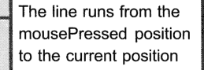


## 新方法

如果你只是编写较小的 applet，代码完全可以整齐地放入现有的 `init()`、`start()`、`paint()` 方法中。但在这里，就像应用程序一样，大块代码最好拆分成单独的方法，根据需要从 `start()`、`paint()` 或另一个方法拆分。

这是一个非常简单的例子。以下程序在屏幕上写入 x,y 坐标。

```java
import java.awt.*;
import java.applet.*;

public class Method1 extends Applet {
    public void paint(Graphics g) {
        int x, y;
        for (y = 25; y < 200; y = y + 25)
            g.drawString("Y = " + y, x, y);
        for (x = 50; x < 450; x = x + 50)
            g.drawString("X = " + x, x, y);
    }
}
```


```java
import java.awt.*;
import java.applet.*;

public class MoveText extends Applet {
    Font header = new Font("SanSerif", Font.BOLD, 24);
    String text;
    String temp;
    int delayLimit;

    public void init() {
        text = getParameter("message");
        if (text == null)
            text = "nothing to say";
        temp = getParameter("limit");
        if (temp == null)
            delayLimit = 10000;
        else
            delayLimit = Integer.parseInt(temp);
    }

    public void paint(Graphics g) {
        g.setFont(header);
        for (int x = 200; x > 0; x--) {
            for (int delay = 0; delay < delayLimit; delay++) {
                g.setColor(new Color(255, 255, 255));
                g.fillRect(x, 80, 300, 30);
                g.setColor(new Color(0, 0, 0));
                g.drawString(text, x, 100);
            }
        }
    }
}
```

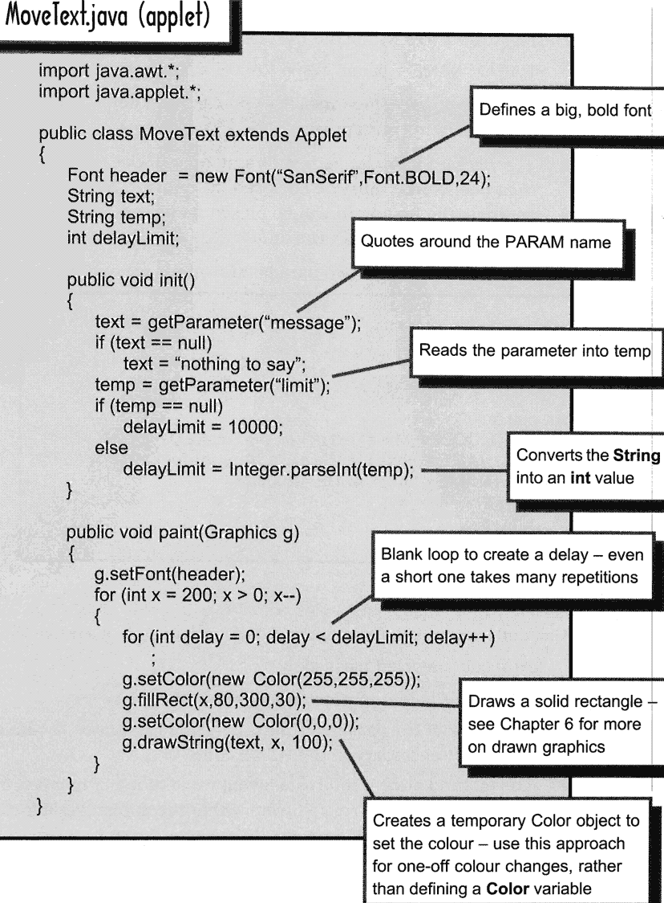

- 定义了一个大号粗体字体
- 在 PARAM 名称周围加上引号
- 将参数读入 `temp` 中
- 将 `String` 转换为 `int` 值
- 使用空循环来创建延迟 - 即使是短延迟也会导致多次重复
- 绘制一个实心矩形 - 有关绘制图形的更多信息请参见第 6 章
- 创建一个临时的 `Color` 对象来设置颜色 – 使用这种方法进行一次性的颜色更改，而不是定义 `Color` 变量

这里是带有测试值的（完成后的）输出。我刻意使用了一个深灰色矩形来擦除文本，以便在此演示中可以看到其效果。在实践中，你可能希望使用与 applet 背景相同的颜色。请记住这在浏览器中是浅灰色的，但在 `AppletViewer` 中是白色的。

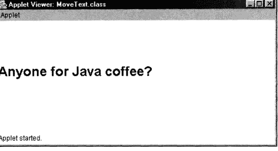

注意检查缺失或错误 PARAMS 的行：

`null` 表示变量未被赋值。如果缺失 PARAM，则将 "nothing to say" 设置为默认值。

设置检查和默认值通常是一个好主意。它不仅能防止错误，还增加了 applet 的灵活性 – 只要知道有合理的默认值，你只需要编写那些想要设置新值的 PARAMS 即可。

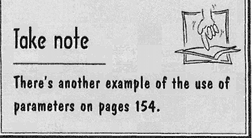

## 练习

- 1 创建一个 applet，用大字体和强颜色显示消息，然后缓慢淡出颜色。程序需要一个延迟循环来减慢动作。
- 2 探索字体大小。编写一个 applet，其中大小存储在变量中，可以通过点击鼠标来控制。在窗口的上半部分点击应增大大小，在下半部分点击应减小大小。窗口中心的消息应该显示大小值，文本字体设置为该值。
- 3 用灯光显示你的名字。在窗口的随机位置和随机颜色绘制几百个星号或其他字符，然后在上面写上你的名字。名字应该从 HTML 页面作为 PARAM 传递给 applet。

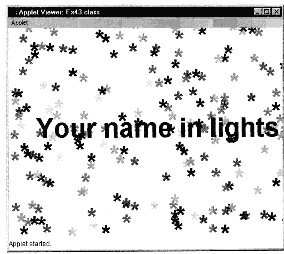

# 5 用户界面

- GUI 及其组件 . . . . . . 98
- 按钮和事件 . . . . . . . . . . 100
- 事件目标 . . . . . . . . . . . 102
- 复选框和复选框组 . . . 104
- 文本组件 . . . . . . . . . . 108
- 数字操作 . . . . . . . . . . . 112
- 选择框和列表 . . . . . . . . . . . 114
- 布局 . . . . . . . . . . . 118
- 面板 . . . . . . . . . . . 121
- 练习 . . . . . . . . . . . 124

## GUI 及其组件

Java AWT 为你提供了构建标准 Windows GUI 所需的所有工具 – 抱歉，这是术语攻击，我会尝试用英语再说一遍。带有按钮、滚动条、对话框和其他显示与交互元素的 Windows 屏幕被称为图形用户界面，或 GUI（读作 'gooey'）—— 既然 Java 是面向对象的，所以它是 OO-GUI 或 'oesey-gooey'！所有标准组件在 Java 中都是可用的。

| 组件 | 说明 |
| :--- | :--- |
| `TextArea` | |
| `List` | |
| `Label` | |
| `TextField` | |
| `Button` | |
| `Checkbox` | |
| `Choice` | |
| `Canvas` | |

`Button` 用于点击。你可以指定它们的标签，并控制点击它们时会发生什么。

`Canvas` 这是一个你可以绘制图形或文本的区域 – 就像你在主窗口中可以做的一样，但定义的空间有时更方便。

`Checkbox` 和 `CheckboxGroup` 它们的设置方式相似，但用途不同。对于 `Checkbox`，可以同时选择多个。对于相关的 `CheckboxGroup`，每组只能选择其中一个。

### 选择框 (Choice)

这些是下拉列表，用户可以从中选择一个选项。

### 标签 (Label)

`Label` 纯用于显示。你需要它们是因为目前没有可靠的方法将 `drawString` 项与 GUI 组件集成。`drawString` 项的位置由坐标设置，而 GUI 组件被放置在任何合适的地方 – 通过布局（Layouts，第 118 页）可以为你提供一些控制。

### 列表 (List)

它们与 `Choice` 列表在两个方面不同：显示列表中的若干项或全部项目 – 如果需要会出现滚动条 – 并且一次可以选择多个项目。

### 文本框 (TextField)

当你希望用户输入或编辑（简短的）单行文本时，使用这些。如果用户输入的文本超过了字段设计的长度，字符将从侧面滚出且无法再次访问进行编辑。

### 文本区域 (TextArea)

这些比 `TextField` 灵活得多，有空间存放文本。

### 布局和面板 (Layouts and Panels)

它们提供对定位的控制。在示例中，使用了三个来划分区域。

### 按钮和事件

有很多方法来处理事件。如果你编写了其中一个方法，它将在事件发生时执行。

要选择按钮的点击，使用 `actionPerformed()` 方法，如下：

```java
public void actionPerformed(ActionEvent e) {
    ... 按钮执行的任何操作
}
```

`actionPerformed()` 的参数是一个 Event 对象，可以对其进行检查以获取事件的详细信息。在本例中我们不需要这样做，因为只有一个按钮和一个可能的动作。

### 事件目标

如果你有多个按钮，就必须测试事件以查看是哪一个被触发了。这可以通过读取按钮的标签来实现——`getActionCommand()` 会返回该标签：

```java
String buttonName = e.getActionCommand();
```

然后我们可以对其进行测试，查看哪个按钮被点击了。注意，我们必须使用 `equals()` 方法来比较字符串。

```java
if ("Red".equals(butName))
```

在这个程序中，Applet 显示了两个按钮 `butRed` 和 `butGreen`，以及一个彩色矩形。一次时间只有一个按钮是启用的，点击它会改变矩形并开启另一个按钮。使用 `setEnabled()` 方法来启用或禁用按钮：

- `butRed.setEnabled(false);`
- `butGreen.setEnabled(true);`

这会关闭红色按钮，并开启绿色按钮。

### But2.java (Applet)

```java
import java.awt.*;
import java.awt.event.*;
import java.applet.*;

public class But2 extends Applet implements ActionListener {
    Button butRed;
    Button butGreen;
    Color red = Color.red;
    Color green = Color.green;
    Color current = red;

    public void init() {
        butRed = new Button("Red");
        butRed.setEnabled(false);
        butRed.addActionListener(this);
        butGreen = new Button("Green");
        butGreen.addActionListener(this);
        add(butRed);
        add(butGreen);
        current = red;
    }
}
```

> 基础颜色定义在 `java.awt.Color` 中（见第 133 页）

```java
public void actionPerformed(ActionEvent e) {
    String buttonName = e.getActionCommand();
    if ("Red".equals(buttonName)) {
        butRed.setEnabled(false);
        butGreen.setEnabled(true);
        current = red;
    }
    if ("Green".equals(buttonName)) {
        butRed.setEnabled(true);
        butGreen.setEnabled(false);
        current = green;
    }
    repaint();
}
```

```java
public void paint(Graphics g) {
    g.setColor(current);
    g.fillRect(100, 50, 200, 100);
}
```

`if (butName.equals("Red"))` 同样有效

将当前颜色设置为红色并开启绿色按钮

将当前颜色设置为绿色并开启红色按钮

更新显示

查看第 6 章了解更多关于绘图的知识

Applet 的 clone 命令允许你查看不同阶段的同一个 applet——对于调试以及制作插图非常有用！


绿色（说真的！）红色

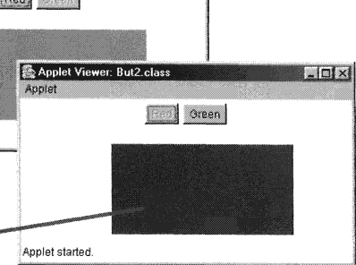

### 复选框与复选框组 (CheckboxGroups)

无论是单独使用还是在复选框组内使用，复选框的处理方式非常相似。主要区别在于它们向用户提供的选择。

- 单独复选框可以设置为开启或关闭，无论页面上其他任何复选框的状态。
- 在复选框组中使用时，任何时候组内只能有一个复选框被开启。

你可以在下一个示例程序中看到这一点，它允许用户选择字体——从三个选项中——并开启加粗（Bold）和斜体（Italics）。该 applet 看起来像这样。

单独复选框 复选框组

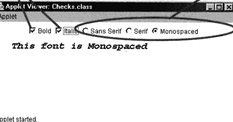

### 创建复选框

复选框必须在程序级别作为对象存在，因为它们会在 `init()` 或 `start()` 方法中添加到窗口中，并在其他地方更改其状态。最简单的方法是同时声明并定义它们；例如，这创建了加粗复选框：

```java
Checkbox checkBox = new Checkbox("Bold", false);
```

注意我们这里使用了两个参数。第一个设置标签，第二个设置初始状态——`true` 表示已选中（开启），`false` 表示未选中。你可以省略状态参数。如果你这样做了，复选框初始将为关闭状态。因此，在这种情况下可以省略它。

可以在 `init()` 方法中将复选框添加到窗口：

```java
add(fontBold);
fontBold.addItemListener(this);
```

我们需要一个 `ItemListener` 来获取复选框事件，我们稍后会回到这一点。

当复选框是一个组的一部分时，必须先创建 `CheckboxGroup`。

```java
CheckboxGroup fontName = new CheckboxGroup();
Checkbox sans = new Checkbox("Sans Serif", fontName, true);
```

你可以看到为什么 `CheckboxGroup` 的名称是设置复选框时使用的第二个参数。`true/false` 状态现在是第三个参数，而且当然——组中只能有一个被设置为 `true`。

### 检查复选框

复选框通过 `ItemListener` 类处理。这里使用的是 `ActionListener`，但有细微的区别。点击复选框的操作可以被 `itemStateChanged(ItemEvent e)` 方法捕获，我们可以通过 `getItem()` 读取标签来确定是哪一个复选框。

```java
String option = (String) e.getItem();
```

并测试获取了什么：

```java
if (option.equals("Bold"))
```

现在发生的情况取决于它是单独的复选框还是复选框组。

对于单独复选框，点击将在开启和关闭之间切换。它的代码同样可以在两个状态之间切换变量：

```java
if (bold == 1)
    bold = 0;
else
    bold = 1;
```

该变量被用在任何需要的地方携带选择信息。在这种情况下，它被用于 `setFont()` 行中。如果你还记得，我们使用 1 将字体设置为加粗，使用 2 将其设置为斜体。看这个程序，你会发现斜体变量在 2 和 0 之间进行切换。对于复选框组，问题是哪个复选框被选中了。我们可以测试标签（存储在 `option` 中）并采取相应的行动：

```java
if (option.equals("Sans Serif"))
    fName = "Sans Serif";
```

处理完这些后，字符串 `option` 拥有字体的名称，准备好在 `paint()` 方法的 `setFont()` 行中使用。这里是完整的程序。

### Checks.java (Applet)

```java
import java.awt.*;
import java.awt.event.*;
import java.applet.*;

public class Checks extends Applet implements ItemListener {
```


### 复选框与复选框组

```java
Checkbox fontBold = new Checkbox("Bold", false);
Checkbox fontItalic = new Checkbox("Italic", false);
int bold = 0;
int italic = 0;
CheckboxGroup fontName = new CheckboxGroup();
Checkbox sans = new Checkbox("Sans Serif", fontName, true);
Checkbox serif = new Checkbox("Serif", fontName, false);
Checkbox mono = new Checkbox("Monospaced", fontName, false);
String fName;

public void init() {
    add(fontBold);
    fontBold.addItemListener(this);
    add(fontItalic);
    fontItalic.addItemListener(this);
    add(sans);
    sans.addItemListener(this);
    add(serif);
    serif.addItemListener(this);
    add(mono);
    mono.addItemListener(this);
}

public void itemStateChanged(ItemEvent e) {
    String option = (String) e.getItem();
    if (option.equals("Bold")) {
        if (bold == 1) bold = 0;
        else bold = 1;
    }
    if (option.equals("Italic")) {
        if (italic == 1) italic = 0;
        else italic = 1;
    }
    if (option.equals("Sans Serif")) {
        fName = "Sans Serif";
    }
    if (option.equals("Serif")) {
        fName = "Serif";
    }
    if (option.equals("Monospaced")) {
        fName = "Monospaced";
    }
    repaint();
}

public void paint(Graphics g) {
    g.setFont(new Font(fName, bold, 18));
    g.drawString("This font is " + fName, 30, 50);
}
```

> **注意**：原文提供的文本中代码块存在逻辑乱序和重复，此处已根据逻辑流进行整理，确保文档连贯性。

| 所有复选框都以相同的方式 |
| :--- |
| 添加 - 复选框组 |
| 不被添加 |

### 文本组件

`TextField` 和 `TextArea` 都是 `Component` 类的子类。这不仅意味着它们有很多共同点，子类包含了父类（它们派生自的类）的方法以及它们自己的方法。因此，当你查阅使用 `TextField` 或 `TextArea` 方法时，应向上回溯类层次，查看 `TextComponent` 类。

在设置新的 `TextField` 时，可以使用以下任意构造函数：

- `new TextField()`，必须在某处跟随 `setSize()` 方法来固定其大小；
- `new TextField(int)`，其中 `int` 值设置宽度；
- `new TextField(String)` 创建一个显示字符串的字段；
- `new TextField(String, intWidth)` 显示字符串，但根据 `int` 值设置宽度。

`TextArea` 拥有一组类似的构造函数，带有两个 `int` 参数，设置行数和列数。还有一个第五种构造函数：

- `new TextArea(String, intRows, intCols, intScroll)`，其中 `intScroll` 控制滚动条：`1` 关闭垂直滚动条；`2` 关闭水平滚动条；`3` 关闭所有滚动条。

第一个示例展示了这两个组件的典型用法。`TextField` 收集用户的简短项；`TextArea` 收集较长的多行输入。

注意提示信息——你必须告诉用户你想输入什么。电子邮件 `TextField` 旁边带有一个 `Label`。对于详情，提示已经写在 `TextArea` 中，并被选中以便可以方便地删除和替换。两种方法都适用于两种类型。

#### Texts1.java (Applet)

```java
import java.applet.*;
import java.awt.*;

public class Texts1 extends Applet {
    TextField email;
    TextArea details;

    public void init() {
        add(new Label("Your e-mail address"));
        email = new TextField(40);
        add(email);
        details = new TextArea("Enter your name and address here", 6, 40);
        add(details);
        details.selectAll();
        validate();
    }
}
```

在完成的 applet 中，这些值会被获取并用于其他地方。

- 用于提示用户的 `Label`
- 初始文本可以是默认值或提示

> `selectAll()` 是文本组件（`TextComponent`）方法——在选择其文本之前，必须先 `add()` 该组件。

### 处理文本

在第二个文本 applet 中，文本块通过选择它们并点击“复制”按钮从一个 `TextArea` 复制到另一个 `TextArea`。这里使用了四个新方法：

- `getSelectedText()` 将选中的文本作为 `String` 值返回
- `getText()` 返回所有文本，作为一个 `String`。在示例中，它被用于检查 `TextArea` 是否为空。文本行是：`if (destination.getText().equals(""))`
- `setText()` 设置文本，替换任何现有文本
- `append()` 将字符串添加到组件的现有文本之后

这些方法属于文本组件类（`TextComponent` class），因此 `TextField` 和 `TextArea` 都可以使用。

#### Texts2.java (Applet)

```java
import java.applet.*;
import java.awt.*;
import java.awt.event.*;

public class Texts2 extends Applet implements ActionListener {
    TextArea source;
    TextArea destination;
    Button copy;

    public void init() {
        source = new TextArea(10, 30);
        add(source);
        copy = new Button("Copy ->");
        add(copy);
        copy.addActionListener(this);
        destination = new TextArea(10, 30);
        add(destination);
    }

    public void actionPerformed(ActionEvent e) {
        String temp;
        String btnName = e.getActionCommand();
        if (btnName.equals("Copy ->")) {
            temp = source.getSelectedText();
            if (destination.getText().equals("")) {
                destination.setText(temp);
            } else {
                destination.append(temp);
            }
        }
    }
}
```

- `temp` 仅在此方法中使用，因此在此声明
- 因为只有一个按钮，所以这里不需要进行测试
- 从空开始，或替换现有文本
- 在文本末尾添加

> 提示是有用的，但除非我们使用布局（`Layout`），否则 `Label` 会导致显示错乱。使用这些尺寸，你应该将 applet 的宽度增加到至少 600。

### 注意

`TextField` 和 `TextArea` 的宽度是以列设置的。这些列在多大程度上对应于 10 点大小的字符——这取决于字体。

### 处理数字

我们已经看到文本组件提供了一种从用户获取 `String` 输入的简单方法。获取数字值并没有那么容易。文本组件产生 `String`，而且没有直接的方法可以将 `String` 转换为简单的数字数据类型。

如果你想要一个将 `String` 转换为数字的方法，在 `String` 类中寻找是不行的，但你会在 `Integer`、`Short`、`Float` 和 `Double` 类中找到它们。这些是“类型包装”类，旨在为相关类型提供额外功能。在 `Integer` 类中，你将找到 `parseInt()`，它可以将 `String` 转换为 `int`。

这是为了从 `TextField` 中获取一个 `int` 值，我们需要做的工作。首先，从 `TextField` 中获取 `String`：

```java
temp = entry.getText();
```

然后使用 `Integer` 类中的 `parseInt()` 方法将 `String` 转换为 `int`：
`number = Integer.parseInt(temp);`

下面的程序演示了如何从 `TextField` 中获取数字值。它邀请用户猜一个随机数，在猜中之前给出“太高”和“太低”的消息。

#### Guess.java (Applet)

```java
import java.awt.*;
import java.applet.*;
import java.awt.event.*;

public class Guess extends Applet implements ActionListener {
    Button btnClick;
    TextField entry;
    Label prompt;
    String temp;
    int x = (int) (Math.random() * 100);
    int number;

    public void init() {
        prompt = new Label("Guess the number");
        add(prompt);
        entry = new TextField(10);
        add(entry);
        btnClick = new Button("Check your guess");
        add(btnClick);
        btnClick.addActionListener(this);
    }

    public void actionPerformed(ActionEvent e) {
        temp = entry.getText();
        number = Integer.parseInt(temp);
        if (x < number) {
            prompt.setText("Too high. Try again");
        } else if (x > number) {
            prompt.setText("Too low. Try again");
        } else {
            prompt.setText("Found it!");
        }
    }
}
```

### 选择与列表

`Choice` 对象是一个下拉列表，用户可以从中选择一个项目。`List` 对象完整地显示，或者在一个可滚动的框中显示，用户通常可以选择多个项目。因此，尽管这两种类型的组件使用的设置程序相似，但在检查和记录选择时需要不同的方法。

#### addItem()

在 `CheckboxGroup` 中，每个 `Checkbox` 都是独立的对象，必须单独创建。`Choice` 和 `List` 的情况则相反。`Choice`（或 `List`）是一个单一组件，其选项是其不可分割的一部分。在最简单的情况下，`Choice` 可以这样设置：

```java
Choice c = new Choice();
c.addItemListener(this);
c.addItem("Option 1");
c.addItem("Option 2");
add(c);
```

注意，对于 `Checkbox` 的情况下我们使用了 `ItemListener`，但对于 `List`，它被 `add()` 替换了：
`partsList.add("Another option");`

#### 索引

选项按照 `addItem()` 的顺序显示在屏幕上。它们存储在 `Choice` 中，可以通过索引值进行识别。例如，为了设置“Option 2”为默认，你会使用 `select()` 方法：

```java
c.select(1);
```

在用户做出选择后，你可以读取索引值来查看结果：

```java
chosen = c.getSelectedIndex();
```

索引很少以原始形式使用。你通常会使用它来选择一个操作或设置变量。这可以通过我们在上一个程序中 `CheckboxGroup` 中所使用的 `if...else...` 块来实现。索引也可以驱动 `switch` 块：

```java
switch (c.getSelectedIndex()) {
    case 0: /* 对应0的操作 */; break;
    case 1: /* 对应1的操作 */; break;
    ...
}
```

还有另一种证明非常方便的方法。想一下数组。数组是元素组，每个元素都可以通过下标标识——实际上与 `Choice` 或 `List` 的结构相同。

下一个程序允许用户指定自己的 PC。它有一个 `Choice micro`，列出了处理器。在 `action()` 方法中你会发现这些行：

```java
p = micro.getSelectedIndex();
spec.setText("Pentium " + procType[p] + " at " + procCost[p] + "\n");
```

索引被赋值 `p`，然后用于从 `procType[]` 和 `procCost[]` 数组提取相应的值——这些数组在 `init()` 中设置，包含了处理器的类型数字和价格。

`getSelectedIndex` 对于 `List` 有限，因为可以同时选择多个项目（尽管可以使用 `setMultipleMode(false)` 强制单项选择）。

要找到某个项目是否被选中，使用 `isSelectedIndex()` 方法。给出该项目的索引数字，如果项目被选中，它将返回 `true`。在示例中，这被用于从 `peripheral[]` 数组中选取值。所选的外围名称会被添加到 `spec` `TextArea` 中。


for(int loop = 0; loop < 8; loop++)
  if(parts.isSelected(loop))
    spec.append(periph[loop] + "\n");

看这个程序，你会发现这种选择只有在按下“Done”按钮时才进行——而不是在项目被选中时进行。

为什么？

### Lists.java (Applet)

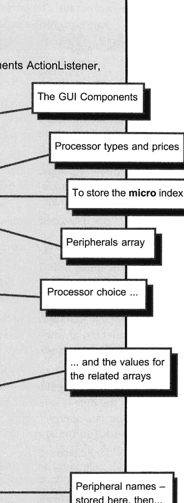

## GUI 组件

- 处理器类型和价格
- 用于存储微索引
- 外设设备数组
- 处理器选择 ... 以及相关数组的值
- 外设名称 - 存储在此，然后...

```
peripheral[3] = "Tape Drive";
peripheral[4] = "Zip Drive";
peripheral[5] = "Modem";
peripheral[6] = "Extra 64Mb RAM";
peripheral[7] = "10Gb Hard Drive";
parts = new List(6, true);
parts.addActionListener(listener(this));
for (int loop = 0; loop < 8; loop++) {
    parts.add(peripheral[loop]);
    add(parts);
}
done = new Button("Done");
done.addActionListener(this);
add(done);
spec = new TextArea(10,30);
add(spec);
}
public void actionPerformed(ActionEvent e) {
    p = micro.getSelectedIndex();
    spec.setText("Pentium "+p+" at $"+procCost[p]+" in");
    for (int loop = 0; loop < 8; loop++) {
        if(parts.isSelected(loop) == true) {
            spec.append(peripheral[loop] + "in");
        }
    }
}
public void itemStateChanged(ItemEvent e) {
}
}
```

> 在此处调用以便在 parts List 中创建项


> 点击了 Done 按钮
> 开始新的一行

正在使用的 applet。你的显示可能有所不同。如果你不设置布局（见下一页），系统将使用流式布局（Flow Layout），它会将组件在屏幕上一个接一个地排列，必要时会换到第二行。

| | Applet 查看器：List 类 |
| :--- | :--- |
| Applet Pentium 20 价格为 £135.0 | |
| CD-ROM | |
| Zip Drive | |
| Modem | |
| 额外的 64Mb RAM | |
| P2Mhz | Done |
| | 额外的 64MB RAM |
| | 10Gb 硬盘 | |

> 必须存在，即使是空的

Applet 已启动。

---

## 布局 (Layouts)

组件的排列取决于布局（Layout）。如果不指定，将使用默认的流式布局——这在只有少数组件时是可以接受的。对于更复杂的显示，你应该设置布局。边框布局（Border layouts）和网格布局（Grid layouts）易于管理，尽管它们有一些显著的限制，但结合面板（Panels，见第121页）使用可以产生平衡良好的显示。

### BorderLayout()

它可以容纳五个组件——四个在边缘，一个在中心。组件会根据需要扩展（或缩小）以填充分配给它们的空间，你无法控制这一点。在下面的示例中，所有组件都是按钮，因为它们清楚地显示了尺寸缩放，但它们可以是任何其他 GUI 对象。

定义边框布局最简单的方法是使用这一行：
`setLayout(new BorderLayout());`

如果需要，可以使用此变体设置组件之间的水平和垂直间隙：
`setLayout(new BorderLayout(hgap, vgap));`

`hgap` 和 `vgap` 的值为整数（ints），以像素为单位。

在向布局中添加组件时，你必须使用关键字“North”、“South”、“East” 和 "Center"来指定它们的位置。这会将标签为“North”的按钮放在布局的顶部：
`add(new Button("North"), "North");`

边框布局最多可以容纳五个对象，但不必非取这么多。一个只使用“North”和“Center”的布局将给你一个大的主区域和一个横跨顶部的窄组件。

> **注意**
> 还有一种 `GridBagLayout`，它让你对定位有更细的控制，但使用起来要复杂得多。

---

### Layout1.java (applet)

```java
import java.awt.*;
import java.applet.*;

public class Layout1 extends Applet {
    public void init() {
        setFont(new Font("Sans",0,18));
        setLayout(new BorderLayout());
        add(new Button("NORTH"), "North");
        add(new Button("SOUTH"), "South");
        add(new Button("EAST"), "East");
        add(new Button("WEST"), "West");
        add(new Button("CENTER"), "Center");
        validate();
    }
}
```

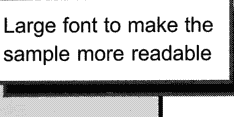
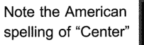


| | NORTH | |
| :--- | :--- | :--- |
| WEST | CENTER | EAST |
| | SOUTH | |

| | NORTH | |
| :--- | :--- | :--- |
| WEST | CENTER | EAST |
| | SOUTH | |

Applet 已启动。

---

### GridLayout()

该布局使所有组件的大小相同，并按行和列排列——如果某行的组件少于其他行，会在末尾留空。指定行、列数以及它们之间的间隙。

`setLayout(new GridLayout(2,3));`
创建一个 2 行 3 列的网格。

`setLayout(new GridLayout(4,2,10,5));`
创建一个 4 行 2 列的网格，水平间隙为 10 像素，垂直间隙为 5 像素。该程序的输出（上方），以及三个组件的（左侧）。

### Layout2.java (applet)

```java
import java.awt.*;
import java.applet.*;

public class Layout2 extends Applet {
    public void init() {
        setFont(new Font("Helvetica",0,18));
        setLayout(new GridLayout(2,3));
        add(new Button("One"));
        add(new Button("Two"));
        add(new Button("Three"));
        add(new Button("Four"));
        add(new Button("Five"));
        add(new Button("Six"));
        validate();
    }
}
```

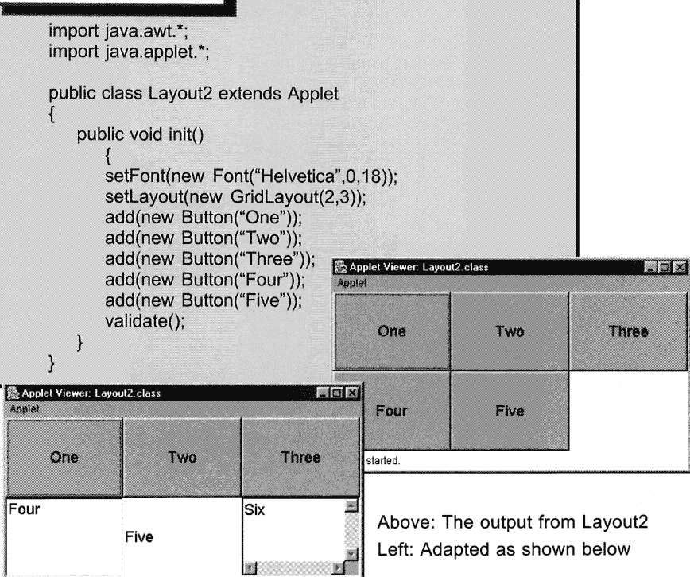

| One | Two | Three |
| :--- | :--- | :--- |
| Four | Five | Six |

上方：Layout2 的输出
左侧：如下所示

通过设置间隙值来删除组件之间的某些空间：
`setLayout(new GridLayout(2,3,20,10));`
创建 Four 和 Five 并插入：
`add(new TextField("Four"));`
`add(new Label("Five"));`
`add(new TextArea("Six"));`

---

### Panels (面板)

面板是不可见的且不活跃的，但对于良好的显示至关重要。因为你可以在布局中放置面板，也可以在布局中混合面板和组件——下一个程序在 West 有面板，Center 有 Canvas。将其与屏幕显示对比。

Panel: Grid Layout (1x3)
Applet: Border Layout (West, Center)

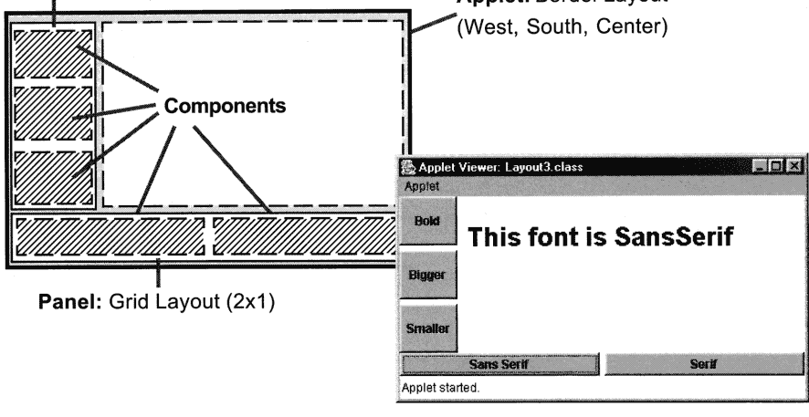

Panel: Grid Layout (2x1)

要创建一个面板布局，首先设置 applet 的布局：
`setLayout(new BorderLayout());`
然后创建一个面板并设置它的布局——注意必须使用面板名称作为 `setLayout` 的前缀。
`Panel p1 = new Panel();`
`p1.setLayout(new GridLayout(2,5));`
创建组件并添加到 applet，但必须使用面板名称作为 `add` 的前缀。
`p1.add(new Label("Control Bar"));`
面板完成后，将其添加到主布局，就像添加任何组件一样。
`add(p1, "South");`

---

### Layout3.java (applet)

```java
import java.awt.*;
import java.awt.event.*;
import java.applet.*;

public class Layout3 extends Applet implements ActionListener {
    Panel fnames, styles;
    Button sans, serif;
    Button bold, bigger, smaller;
    Canvas Canvas;
    String fName = new String("Sans Serif");
    int fBold = 0;
    int fSize = 12;

    public void init() {
        setFont(new Font("Sans", Font.BOLD, 12));
        setLayout(new BorderLayout());

        fnames = new Panel();
        fnames.setLayout(new GridLayout(1, 2, 5, 10));

        sans = new Button("Sans Serif");
        sans.addActionListener(this);
        fnames.add(sans);

        serif = new Button("Serif");
        serif.addActionListener(this);
        fnames.add(serif);

        add(fnames, "South");

        styles = new Panel();
        styles.setLayout(new GridLayout(3, 1, 10, 5));

        bold = new Button("Bold");
        bold.addActionListener(this);
        styles.add(bold);

        bigger = new Button("Bigger");
        bigger.addActionListener(this);
        styles.add(bigger);

        smaller = new Button("Smaller");
        smaller.addActionListener(this);
        styles.add(smaller);

        add(styles, "West");

        sample = new SampleCanvas();
        add(sample, "Center");
        validate();
    }

    public void actionPerformed(ActionEvent e) {
        String butName = e.getActionCommand();

        if (butName.equals("Bold"))
            fBold = 0;
        else
            fBold = 1;

        if (butName.equals("Bigger"))
            fSize += 2;

        if (butName.equals("Serif"))
            fName = "Serif";

        if (butName.equals("Sans Serif"))
            fName = "Sans Serif";

        sample.rewrite(fName);
    }
}

class SampleCanvas extends Canvas {
    String message;

    public SampleCanvas() {
        rewrite("Sans Serif");
    }

    public void rewrite(String fontName) {
        setFont(new Font(fontName, fBold, fSize));
        message = "This font is " + fontName;
        repaint();
    }

    public void paint(Graphics g) {
        g.drawString(message, 10, 50);
    }
}
```

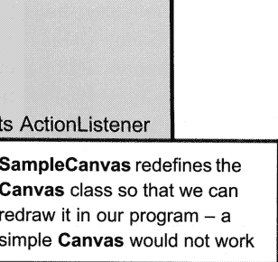
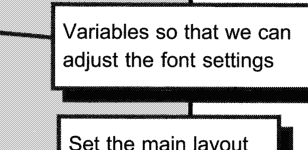

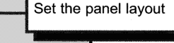
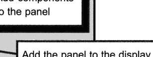

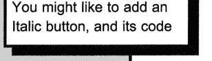


> **注意**
> 关于重新定义 `Canvas` 类及其方法的更多信息请参阅第 135 页。

> 调用新的 `rewrite()` 方法来更新 `Canvas` - `repaint()` 不会更新布局

> 这一操作由新的 `SampleCanvas()` 指令执行

> 设置字体并更新显示

> `SampleCanvas` 结束

> `applet` 结束

## 练习

1. 编写一个 `applet` 来生成一个下面所示的窗口。当点击红色、绿色或蓝色按钮时，它应该改变矩形的颜色，禁用自身，并启用其他按钮。

   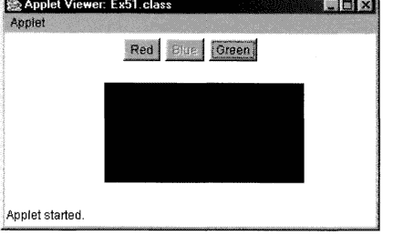

   此时，选定的颜色是蓝色，所以只有红色和绿色是启用状态。

2. 编写一个二维猜数字游戏。在 `applet` 窗口上生成一个随机点，并在 `mouseClicked()` 中计算并显示光标与随机点之间的总差。当用户进入 5 或 10 像素范围内时，显示“找到了”的消息。
   提示：方法 `java.lang.Math.abs(a - b)` 将返回两个值之间的绝对差——例如 `abs(50-20)` 是 30，而 `abs(20-50)` 也是 30。

3. 在 `Layout3` 程序中添加以下内容：
   - 一个斜体按钮和相应的变量（2 = 斜体开启）
   - 一个等宽字体或其他字体的按钮
   - 一个位于 `Canvas` 上方的 `Label`，提供使用说明——要实现此点，你需要创建一个新的 `Panel` 来包含 `Label` 和 `Canvas`。

# 6 图形

- 线 ............................................................ 126
- 矩形 ............................................... 128
- 圆圆 ....................................................... 129
- 多边形 ................................................ 130
- 弧 ....................................................... 132
- 饼图 ................................................ 133
- 在 Canvas 上绘画 ................................ 135
- 练习 ................................................ 140

## 线

`Graphics` 类包含了几个绘制方法。它们非常有限——线条只有 1 像素厚，且对象始终以当前颜色绘制——但非常适合图表和增强文本，甚至可以用于简单的动画。

绘制最好在 `paint()` 中进行。你可以直接绘制在 `applet` 上，也可以绘制在 `Canvas` 上。在 `Canvas` 上绘制会引起我们在上一节中提到过的问题。这在第 135 页有解决。

### drawLine()

这在两点之间绘制一条线，坐标以像素为单位（从左上角开始）。

```java
g.drawLine(0,0,100,50);
```

这从左上角到向左 100 像素、向下 50 像素的点画细线。如果需要更粗的线，可以并排绘制更多条线。你可以在下一个示例中看到。

### Lines.java (Applet)

```java
import java.awt.*;
import java.applet.*;

public class Lines extends Applet {
    public void paint(Graphics g) {
        g.drawLine(0,0,100,50);
        g.setColor(new Color(255,0,0));
        g.drawLine(50,75,200,25);
        g.drawLine(50,76,200,26);
        g.drawLine(50,77,200,27);
        g.setColor(new Color(0,0,255));
        for (int y1 = 120; y1 < 130; y1++) {
            g.drawLine(100,y1,200,y1+20);
        }
    }
}
```

> **提示**
> 在 HTML 页面中设置 `applet` 的宽高度以适应显示器。

第二个 `drawLine()` 会使线条变粗


循环线条以增加厚度——使用 `drawRect()` 从垂直或水平的 `applet` 开始。下一个程序创建了一个简单的动画效果——线条绕圆旋转。这里是圆的数学原理：Java 使用弧度（Radians）测量角度，2PI 等于 360 度。在任何角度，半径可以视为三角形的直边，另外两个值给出圆周上的 x,y 值。

```java
x = (int)(java.Math.cos(angle) * 100) + 150;
```


### Lines2.java (Applet)

```java
import java.awt.*;
import java.applet.*;

public class Lines2 extends Applet {
    Color white = new Color(180,255,255);
    Color black = new Color(0,0);

    public void paint(Graphics g) {
        int x, y;
        double angle = 0;
        do {
            x = (int)(java.Math.cos(angle) * 100) + 150;
            y = (int)(java.Math.sin(angle) * 100) + 120;
            g.setColor(black);
            g.drawLine(120,120,x,y);
            for (int delay = 0; delay < 50; delay++) {
                g.setColor(white);
                g.drawLine(120,120,x,y);
            }
            angle += 0.01;
        } while (angle < 6.28);
        g.setColor(black);
        g.drawLine(120,120,x,y);
    }
}
```

| 描述 | 值 |
| :--- | :--- |
| 100 | 线长 |
| 120 | 圆心坐标 |

> 这是浅蓝色，使用 255,255,255 擦除循环减速


## 矩形

有两个矩形方法：`drawRect()` 绘制轮廓，`fillRect()` 填充块。必须给出矩形的左上角坐标和尺寸：

```java
g.fillRect(50,150,200,100);
```

这绘制一个宽 200 像素、高 100 像素的块，起始于 50,150。`drawRect()` 的线是细的。如果你需要一个粗框，可以使用循环或在另一个 `fillRect()` 块内放置。如下所示。

```java
import java.awt.*;
import java.applet.*;

public class Rectangle extends Applet {
    Color red = new Color(255,0,0);
    Color yellow = new Color(255,255,0);
    Color black = new Color(0,0,0);
    Font text = new Font("Sans",Font.BOLD,18);

    public void paint(Graphics g) {
        g.setFont(text);
        g.setColor(red);
        for (int loop = 0; loop < 5; loop++) {
            g.drawRect(50+loop,50+loop,150-loop,25-loop);
        }
        g.setColor(black);
        g.drawString("Framed",80,90);
        g.setColor(red);
        g.fillRect(50,150,200,100);
        g.setColor(yellow);
        g.fillRect(60,160,180,80);
        g.setColor(black);
        g.drawString("...again!",100,200);
        // 如果内角与背景相同，则只有框可见
    }
}
```

连续的矩形小 2 像素，并向内下方偏移 1 像素。

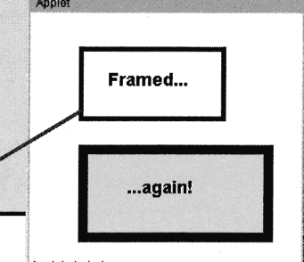

## 圆

如果你需要椭（圆只是特殊的椭），使用 `drawOval()` 或 `fillOval()`。它们遵循与矩形相同的模式。你不是通过中心和半径定义它们，而是通过包含它们的矩形的左上角和尺寸。你可以在演示程序中看到这一点，圆是与其对应的矩形一起绘制的。

### Ovals.java (Applet)

```java
import java.awt.*;
import java.applet.*;

public class Ovals extends Applet {
    Color grey = new Color(160,160,160);
    Color black = new Color(0,0);

    public void paint(Graphics g) {
        g.drawRect(10,10,150,100);
        g.setColor(grey);
        g.fillOval(10,10,150,100);
        g.fillRect(180,40,100,100);
        g.setColor(black);
        g.fillOval(180,40,100,100);
        g.setColor(grey);
        g.fillOval(200,60,60,60);
    }
}
```

> 椭和矩形的参数给出方式完全相同

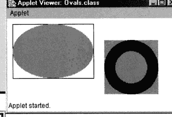

> **提示**
> 在设计椭时，如果用中心和半径来思考，放置可能会更精确，然后将这些转换为左上角和尺寸参数。

## 多边形

你可以使用 `drawPolygon()` 和 `fillPolygon()` 来绘制从三角形到任意边数的复杂规则或不规则形状的任何图形。这些形状由顶点坐标定义，坐标被写入一对匹配的数组中。

如果你想得到一个相当准确的图像，你会发现在方格纸上绘制并读取坐标会很有用。

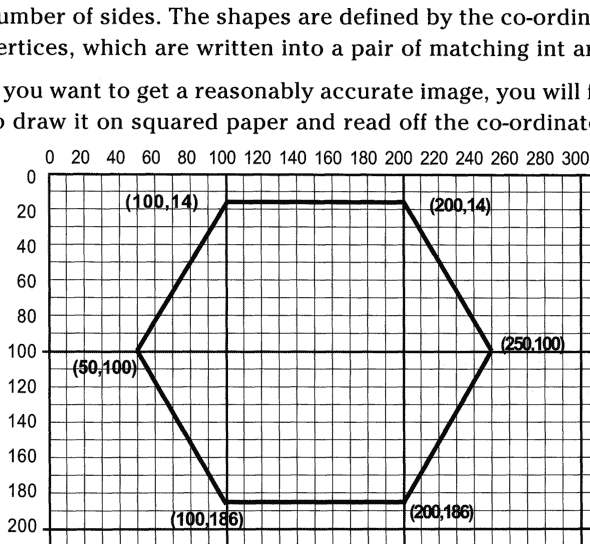

下一个示例绘制了一个六边形。它首先在类级别声明数组：

```java
int[] x = new int[6];    // 水平坐标
int[] y = new int[6];    // 垂直坐标
```

接下来，它分配值来定义这些点。这可以在 `init()` 或 `start()` 中完成。如果你在一行中写一对语句——并以分号结尾，代码将更具读性。

```java
x[0] = 100; y[0] = 145;
```

请记住，在包含 6 个元素的数组中，下标从 0 到 5。

绘制方法应该在 `paint()` 内部调用。它们的参数是两个数组名称和点的数量。

```java
g.drawPolygon(x,y,6);
```

注意，数组仅通过其名称识别——`[]` 括号在这里没有用武之地！

### Polygon.java (Applet)

```java
import java.awt.*;
import java.applet.*;

public class Polygon extends Applet {
    int[] x = new int[6];
    int[] y = new int[6];

    public void init() {
        x[0] = 100; y[0] = 145;
        x[1] = 200; y[1] = 145;
        x[2] = 250; y[2] = 100;
        x[3] = 200; y[3] = 186;
        x[4] = 100; y[4] = 186;
        x[5] = 50; y[5] = 100;
    }

    public void paint(Graphics g) {
        g.drawPolygon(x,y,6);
    }
}
```

最后一条线会画回起点位置——你不需要重复它的坐标。

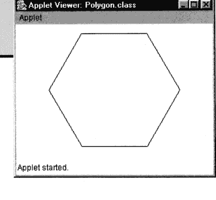

> **注意**
> `drawPolyline()` 方法的使用方式与 `drawPolygon()` 相同。它的线是连接的，但不会形成封闭形状。

## 弧

弧方法是基于绘制椭圆的方法扩展的。它们有两个额外的参数——一个用于固定弧的起点，另一个用于角度大小。例如：

```java
g.fillArc(10,100,100,100,0,90);
```

这绘制了一个跨度为 100 像素的圆弧，其边界矩形的左上角位于 10,10。该扇区从 3 点钟方向开始，旋转到 12 点钟方向。关于角度的两点：

- 弧角是以度为单位的（整数角度，参数为 `int` 类型），而不是正弦和余弦计算中使用的弧度。
- 0° 位于 3 点钟方向，角度按逆时针测量；如果你想顺时针旋转，则使用负值。

以下是一些 `drawArc()` 和 `fillArc()` 语句的示例：

### Arcs.java (Applet)

```java
import java.awt.*;
import java.applet.*;

public class Arcs extends Applet {
    public void paint(Graphics g) {
        g.fillArc(10,100,100,100,0,90);
        g.drawArc(10,100,100,100,0,180);
        g.fillArc(12,100,100,90,-60);
        g.drawArc(120,120,100,50,270,-210);
    }
}
```

这两个在相同的圆边界内工作：

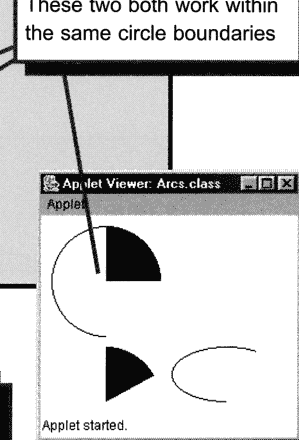

从顶部开始填充到右侧 60°

```
此行将产生相同的结果：
g.drawArc(120,120,100,50,60,210);
```

## 饼图

下一个程序再次演示了弧，这也是处理数组的一个示例，展示了定义颜色的另一种方法。它接收一组图形并将其显示为饼图。

### 数组

三个数组，每个包含六个元素（或你需要的数量）：

```java
double[] value = new double[6]; // 要制图的数值
int[] slice = new int[6]; // 每个扇区的角度
Color[] col = new Color[6]; // 扇区的颜色
```

`value` 必须是 `double` 或 `float` 类型，因为会对对其内容进行计算。数值在 `init()` 中赋值给 `value`，然后通过循环求和：

```java
for (int loop = 0; loop < 6; loop++)
    total += value[loop];
```

如果我们将每个值除以总和，就会得到整体的比例。将此乘以 360 即可转换为度。

```java
for (int loop = 0; loop < 6; loop++)
    slice[loop] = (int)(value[loop]/total*360);
```

> **注意**
> 程序可以重写为将数值作为参数，或者通过 `TextField` 获取。

### 预定义颜色

在 `java.awt.Color` 的文档中你会找到一组预定义值。当你需要多种颜色但不在意深浅时，它们非常有用。要使用它们，写“Color”后跟名称，例如：

```java
col[0] = Color.red;
```

其他名称还有 black, blue, cyan, darkGray, green, lightGray, magenta, orange, pink 和 yellow。

### PieCharts.java (Applet)

```java
import java.awt.*;
import java.applet.*;

public class PieCharts extends Applet {
    double[] value = new double[6];
    int[] slice = new int[6];
}
```


```java
Color[] col = new Color[6];

public void init() {
    double total = 0;

    value[0] = 1000;
    value[1] = 500;
    value[2] = 750;
    value[3] = 1200;
    value[4] = 300;
    value[5] = 1650;

    for (int loop = 0; loop < 6; loop++) {
        total += value[loop];
    }

    for (int loop = 0; loop < 6; loop++) {
        slice[loop] = (int)(value[loop] / total * 360);
    }

    col[0] = Color.red;
    col[1] = Color.green;
    col[2] = Color.blue;
    col[3] = Color.gray;
    col[4] = Color.magenta;
    col[5] = Color.yellow;
}

public void paint(Graphics g) {
    int start = 0;

    for (int loop = 0; loop < 6; loop++) {
        g.setColor(col[loop]);
        g.fillArc(20, 20, 200, 200, start, slice[loop]);
        start += slice[loop];
    }
}
```

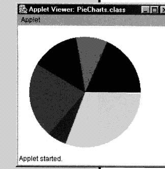

> `slice[loop]` 包含了大小，将其加上 `start` 得到下一个扇区的角度
> `'gray'` 而不是 `'grey'`

## 在 Canvas 上绘制

下一个示例结合了最后三个章节中提到的许多点。这是一个简单的 `paint` 程序——我的意思是真的简单！目的是演示思想，而不是创建一个功能图形应用程序。它有四种颜色的色板和三种工具可选，每次绘制一个项目。要使其成为功能图形，你需要在绘制后存储每个项目——通过保存画布图像（困难）或将其添加到绘制指令数组（复杂）。

该 applet 使用面板布局，模式与 `Layout3.java`（第 122 页）中的相同。工具面板包含用于绘制模式和颜色的标签按钮，采用 `GridLayout` 布局。中心由重新定义的 Canvas `drawarea` 占据。让我们从这里开始。

```java
class MyCanvas extends Canvas
```

这创建了一个新类 `MyCanvas`，它是标准 `Canvas` 的子类，因此共享其所有的属性、字段和方法。它以我们迄为止未使用的方法类型开始：

```java
public MyCanvas()
```

这是一个构造函数，当通过此类行创建对象时被调用：

```java
drawarea = new MyCanvas();
```

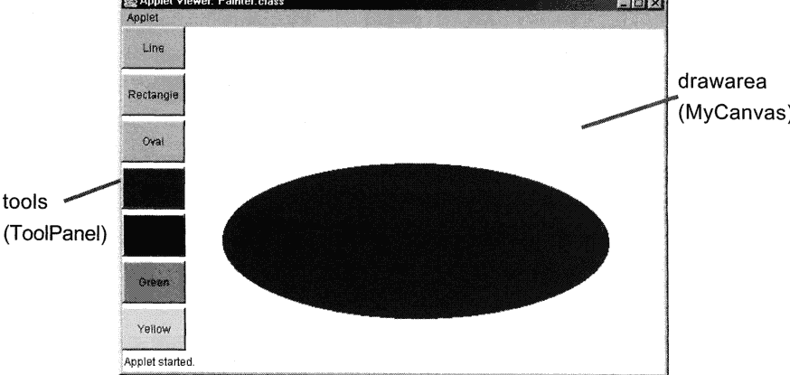

此方法必须存在，即使它是空的，但如果你想在对象设置时执行任何操作，这也是编写代码的地方。在这里我们添加了 Mouse 和 MouseMotion Listener。

在 `MyCanvas` 内部是鼠标方法和 `paint()`，它们必须在那里，因为它们作用于 `drawarea` 对象——如果它们在主程序中，将作用于整个 applet 窗口。

`ToolPanel` 同样是 `Panel` 的新子类，但注意 `init()` 中创建它的行中的区别：

```java
tools = new ToolPanel(drawarea);
```

```java
public ToolPanel(MyCanvas target)
```

面板与 `drawarea` 链接，允许在它们之间传递值。

程序的其余部分几乎不需要解释，因为大多数技术之前已经见过。

按钮点击由 `actionPerformed()` 选择，并设置 `currentTool` 值（0 = 线，1 = 矩形，2 = 圆形）或定义 `currentColor`。

`mousePressed()` 和 `mouseDragged()` 与 `Mouse1.java`（第 88 页）中的几乎相同——直接从那里复制粘贴。当按钮第一次被按下时，起始坐标被收集到 `mx` 和 `my` 中。当拖动时，结束坐标传递到 `mx1` 和 `my1`，然后线、矩形或圆形将通过调用 `paint()` 进行绘制。

### Painter.java (applet)

0 = 线, 1 = 矩形, 2 = 圆形

开始时为黑色

applet 布局

光标位置

鼠标和 paint 方法“属于” MyCanvas

```java
public void mouseDragged(MouseEvent e) {
    mx1 = e.getX();
    my1 = e.getY();
    repaint();
}
```

```java
public void paint(Graphics g) {
    g.setColor(currentColor);
    if (currentTool == 0) {
        g.drawLine(mx, my, mx1, my1);
    } else if (currentTool == 1) {
        g.fillRect(mx, my, mx1, my - my);
    } else if (currentTool == 2) {
        g.fillOval(mx, my, mx1, my - my);
    }
}
```

绘制方法取决于 `currentTool` 的值

MyCanvas 类代码结束

```java
class ToolPanel extends Panel implements ActionListener {
    MyCanvas target;
    Button line, rect, oval;
    Button red, blue, green, yellow;

    public ToolPanel(MyCanvas target) {
        this.target = target;
        setLayout(new GridLayout(7, 1, 5, 5));
        line = new Button("Line");
        line.addActionListener(this);
        add(line);
        rect = new Button("Rectangle");
        rect.addActionListener(this);
        add(rect);
        oval = new Button("Oval");
        oval.addActionListener(this);
        add(oval);
        red = new Button("Red");
    }
}
```

面板布局

```java
red.setBackground(Color.red);
red.addActionListener(this);
add(red);

blue = new Button("Blue");
blue.setBackground(Color.blue);
blue.addActionListener(this);
add(blue);

green = new Button("Green");
green.setBackground(Color.green);
green.addActionListener(this);
add(green);

yellow = new Button("Yellow");
yellow.setBackground(Color.yellow);
yellow.addActionListener(this);
add(yellow);
```

```java
public void actionPerformed(ActionEvent e) {
    String label = e.getActionCommand();
    if (label.equals("Line"))
        currentTool = 0;
    else if (label.equals("Rectangle"))
        currentTool = 1;
    else if (label.equals("Oval"))
        currentTool = 2;
    else if (label.equals("Red"))
        currentColour = new Color(255, 0, 0);
    else if (label.equals("Blue"))
        currentColour = new Color(0, 0, 255);
    else if (label.equals("Green"))
        currentColour = new Color(0, 255, 0);
    else if (label.equals("Yellow"))
        currentColour = new Color(255, 255, 0);
}
```

| currentTool - 用于 paint(t) 以选择绘制方法 |
| :--- |
| 定义 currentColour - 稍后在 paint(t) 中设置 |


### 提示

尝试使用 `update()` 代替 `paint()`。它在绘图之前不会清除背景——但结果可能并不符合你的预期！

## 练习题

1. 编写一个方法使用循环来绘制粗线，并在短程序中测试它。头部行应该类似于这样：
```java
public void thickLine(int x, int y, int x1, int y1, int width, Graphics g)
```
注意参数必须包含一个 `Graphics` 对象，因为新方法将调用 `drawLine()` —— 这是一个 `Graphics` 方法。

2. 编写一个方法 `colLine(int x, int y, int x1, int y1, Color c, Graphics g)` 来用指定的颜色绘制线条。颜色设置应只影响正在绘制的线条——即在程序退出时，当前颜色应与进入前相同。
提示：`g.getColor()` 返回当前的 `Color` 值。

3. 结合上述两个方法，产生一个能够以设定颜色绘制线条的方法。

4. 编写一个程序，允许用户使用 `fillRect()` 或 `fillOval()` 绘制点来绘制自由手线条。由于使用鼠标进行自由手绘是著名的困难的，请添加一个清除屏幕的按钮——使用 `Graphics` 方法 `clearRect(x, y, x1, y1)` 实现此功能。

# 7 图像，声音和文本

- 图片文件 ................................................................ 142
- 使用图像 ............................................................... 143
- 图像过滤器 ............................................................... 146
- 声音 ....................................................... 150
- 声音控制 .............................................................. 152
- 文本布局 ................................................................. 154
- 字符串和数组 ............................................ 156
- 练习题 ................................................................. 158

## 图片文件

就像浏览器一样，Java 设计用于处理两种格式的图形文件：GIF（包括动画 GIF）和 JPEG（带有 JPEG 或 .JPG 扩展）。它无法处理标准的 Windows 宽格式 BMP 和 PCX。如果你想创建自己的图像，将一个合适的图形应用程序，例如 Paint Shop Pro。你可以用它绘制新图像，或转换图片。

这些 图像都是在 Paint 中创建的，或者是 JPEG 格式。

第二种常见形式的形式有两个额外参数来设置宽度和高度——如果这些与原始不同。

该方法需要知道要更新哪个对象，因为它正在缩放或转换图像。

图像将是 100 像素宽 50 像素高。

Image1.java 将这些方法整合到一个简单的演示中。

### Image1.java (Applet)

```java
import java.awt.*;
import java.applet.*;

public class Image1 extends Applet {
    Image pic;

    public void init() {
        pic = getImage(getCodeBase(), "car.gif");
    }
}
```

// 动画速度是完全嵌入在 图像中的


## 使用图像

图像很容易处理。它们存储在 `Image` 对象中，使用 `getImage()` 方法。

```java
Image pic;
pic = getImage(getCodeBase(), "car.gif");
```

### URL

处理 URL 的简单方法是使用 `getCodeBase()`。当文件位于你的系统中是有效的。如果图像在完全不同的地方，你将使用以下代码定义 URL：

```java
import java.net.*;

try {
    pic = getImage(new URL("http://www.net.co/gif"));
} catch (MalformedURLException e) {
```

### 显示图像

图像可以直接显示在 applet 上，或在画布上，使用 `drawImage()` 方法。在简单的情况下，它采用这种形式：

```java
g.drawImage(pic, 0, 0, this);
```

图像以原始尺寸绘制，左上角位于 0,0。`this` 指向绘制图像的窗口或画布。该方法需要知道哪个对象，因为它正在缩放或转换图像。

方法的第二常见形式有两个额外参数来设置宽度和高度——如果这些与原始不同。

```java
g.drawImage(pic, 0, 0, 100, 50, this);
```

图像将是 100 像素宽 50 像素高。

## 简单动画

只要图片较小，且你不想在 Applet 中执行任何其他操作，就可以通过移动图片并使用延迟循环控制其速度来产生简单的动画。对于较大的图像（加载和绘制耗时更长），或者你希望在运行动画的同时进行其他活动，必须使用线程（参见第 8 章）。下一个示例展示了一个球在屏幕上弹跳。

### Image2.java (Applet)

```java
import java.awt.*;
import java.applet.*;

public class Image2 extends Applet {
    Image ball;

    public void init() {
        ball = getCodeBase("ball.gif");
    }

    public void paint(Graphics g) {
        int y = 100;
        int move = 1;
        for (int x = 0; x < 500; x++) {
            g.drawImage(ball, x, y, this);
            if (y > 150) move = -1;
            else if (y < 50) move = 1;
            y += move;
            for (int delay = 0; delay < 50000; delay++);
        }
    }
}
```

- 图片不应超过 50x 50 像素
- 当达到上限和下限时改变方向
- 使用结束值来控制速度
- 球的路径（不由程序绘制）

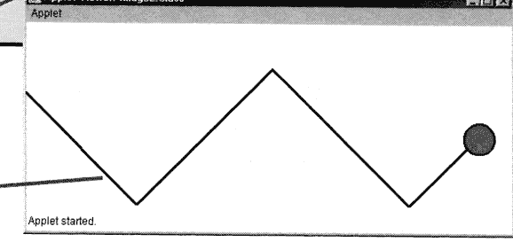

## 图像过滤器

如果你查看 `java.awt.image` 包的文档，你会发现它包含了几个可以用于处理图像的接口和类。接下来的程序深入使用了这些类来创建裁剪和放大的图像。它显示一张图片——我使用了一张地图——当鼠标点击图片的任何地方时，它会显示鼠标周围区域的放大视图。

## 接口

接口充当对象和类之间的桥梁，为它们提供额外的设施。在图像类中共有三个：

- `ImageConsumer` 是在处理完数据后接收新图像数据的对象。我们在这里没有使用它。
- `ImageObserver` 是监控图像绘制进度的对象，当图像在屏幕外准备时（用于动画）进行监控。在这一点中，与之前的 Image 程序一样，我们使用了一个——尽管这并不明显。`drawImage` 参数告诉 Java 使用该图像作为自身的 `ImageObserver`。


## 简单动画

只要图片较小，且你不想在 Applet 中执行任何其他操作，就可以通过移动图片并使用延迟循环控制其速度来产生简单的动画。对于较大的图像（加载和绘制耗时更长），或者你希望在运行动画的同时进行其他活动，必须使用线程（参见第 8 章）。下一个示例展示了一个球在屏幕上弹跳。

### Image2.java (Applet)

```java
import java.awt.*;
import java.applet.*;

public class Image2 extends Applet {
    Image ball;
    public void init() {
        ball = getCodeBase("ball.gif");
    }

    public void paint(Graphics g) {
        int y = 100;
        int move = 1;
        for (int x = 0; x < 500; x++) {
            g.drawImage(ball, x, y, this);
            if (y > 150) move = -1;
            else if(y < 50) move = 1;
            y += move;
            for (int delay = 0; delay < 50000; delay++);
        }
    }
}
```

- 图片不应超过 50x 50 像素
- 当达到上限和下限时改变方向
- 使用结束值来控制速度
- 球的路径（不由程序绘制）


## 图像过滤器

如果你查看 `java.awt.image` 包的文档，你会发现它包含了几个可以用于处理图像的接口和类。接下来的程序深入使用了这些类来创建裁剪和放大的图像。它显示一张图片——我使用了一张地图——当鼠标点击图片的任何地方时，它会显示鼠标周围区域的放大视图。

## 接口

接口充当对象和类之间的桥梁，为它们提供额外的设施。在图像类中共有三个：

- `ImageConsumer` 是在处理完数据后接收新图像数据的对象。我们在这里没有使用它。
- `ImageObserver` 是监控图像绘制进度的对象，当图像在屏幕外准备时（用于动画）进行监控。在这一点中，与之前的 Image 程序一样，我们使用了一个——尽管这并不明显。`drawImage` 参数告诉 Java 使用该图像作为自身的 `ImageObserver`。
- `ImageProducer` 是图像的数据源。在程序中，我们从文件加载一张图像，并将其用作第二张图像的源。

## 类与方法

`ImageFilter` 引入了更改图像对象颜色、大小和比例的方法。

`CropImageFilter` 是 `ImageFilter` 的扩展，用于裁剪图像的矩形区域。

```java
ImageFilter imgF = new CropImageFilter(cropX,cropY,420,330);
```

这一行代码定义了 `ImageFilter` 对象 `imgF`，它取从 `cropX`, `cropY` 开始的 420 x 330 像素的块。目前尚未定义从何处取该块。

`FilteredImageSource` 建立了源图像与 `ImageFilter` 对象之间的链接，输出取决于 `ImageFilter` 的性质。在这里，该行：

`ImageProducer imgP = new FilterImageSource(source.getSource(), imgF);`

裁剪源图像中由 `imgF` 定义的区域。然后通过以下将 `ImageProducer` 对象转换为标准图像：

`crop = createImage(imgP);`

## 开始之前...

下面的程序设计用于处理 840 x 660 像素的图像以及 420 x 330 的显示区域——半倍缩放。所有计算都是基于这些值进行的，因此如果你的图像尺寸不同，你将不得不更改数字以适应。

如果你想稍微简化一下，可以省略 `Cropper()` 中的限制检查——这样输出会稍微乱一点，但超出原始图像的限制并无害。

左上角限制：105,83 (210,165)

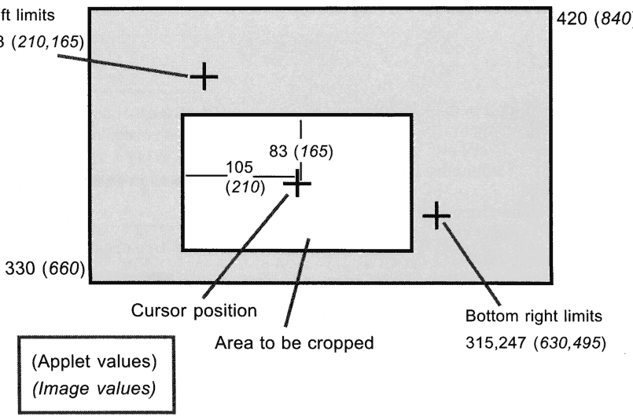

330 (660)

光标位置

右下角限制：315,247 (630,495)

420 (840)

(Applet 值) (图像值)

147

### Image3.java (Applet)

```java
import java.awt.*;
import java.awt.event.*;
import java.awt.image.*;
import java.awt.applet.*;

public class Image3 extends Applet implements MouseListener
{
    Image source;
    Image crop;
    boolean cropped = false;

    public void init() {
        source = getImage(getCodeBase(), "map.gif");
        addMouseListener(this);
    }

    public void destroy() {
        removeMouseListener(this);
    }

    public void mouseClicked(MouseEvent e) {
        int x = e.getX();
        int y = e.getY();
        if (cropped == false) {
            Cropper(x,y);
            cropped = true;
        } else {
            cropped = false;
        }
        repaint();
    }

    public void mousePressed(MouseEvent e) { }
    public void mouseEntered(MouseEvent e) { }
    public void mouseExited(MouseEvent e) { }
    public void mouseReleased(MouseEvent e) { }

    public void Cropper(int x, int y) {
        if (x < 105) x = 105;
        else if (x > 210) x = 210;
        if (y < 83) y = 83;
        else if (y > 165) y = 165;

        if (x < 315) x = 315;
        else if (x > 630) x = 630;
        if (y < 247) y = 247;
        else if (y > 495) y = 495;

        if (x < 147) x = 147;
        else if (x > 420) x = 420;
        if (y < 330) y = 330;
        else if (y > 660) y = 660;

        // 此处逻辑根据原文推断应有实现
    }
}
```


```java
import java.awt.*;
import java.awt.event.*;
import java.awt.image.*;
import java.awt.applet.*;

public class Image3 extends Applet implements MouseListener
{
    Image source;
    Image crop;
    boolean cropped = false;

    public void init() {
        source = getImage(getCodeBase(), "map.gif");
        addMouseListener(this);
    }

    public void destroy() {
        removeMouseListener(this);
    }

    public void mouseClicked(MouseEvent e) {
        int x = e.getX();
        int y = e.getY();
        if (cropped == false) {
            // 注意：Cropper 方法在原文中实现不完整且逻辑混乱
            // Cropper(x,y);
            cropped = true;
        } else {
            cropped = false;
        }
        repaint();
    }
    public void mousePressed(MouseEvent e) { }
    public void mouseEntered(MouseEvent e) { }
    public void mouseExited(MouseEvent e) { }
    public void mouseReleased(MouseEvent e) { }
}
```

## 音频控制

`Sound1` 是“廉价且实用”编程方法的一个极佳示例——它代码很短且有效，只要一切正常，它在有限范围内就能良好工作。但如果你要将程序发布到变幻万测的大外世界，那里可能发生任何事情，那么就需要进行一些改进。

### 检查文件

如果声音文件不在它应该在的位置，或者未能送达用户会发生什么？如果 `play(URL)` 或 `getAudioClip()` 找不到文件，它们都不会返回错误报告——程序将无声地运行。这可能是可以接受的。如果不可接受，那么有一个解决办法——但这个方案并不整洁。

根本问题在于，你可以创建一个指向不存在的文件的 `URL`，而很少有使用 `URL` 的方法会抱怨！其中一个方法会在 `openStream()` 时抛出异常。要使用该方法，我们必须先将 `URL` 创建为一个对象，然后尝试打开一个流（通向文件的链接）。

```java
try
{
  mytuneURL = new URL(getCodeBase(),"mytune.au");
  inst = mytuneURL.openStream();
} catch(MalformedURLException e)
{
} catch(IOException e)
{
  message = "Failed to find sound file";
}
```

`URL(...)` 行会抛出 `MalformedURLException`——它并不测试文件是否真实存在，必须被捕获，尽管你对此无法做任何事情。`openStream()` 会抛出 `IOException`，而我们在它的 `catch` 块中编写了用于响应文件缺失的代码。

### 停止与启动

如果你在浏览器中运行 `Sound1` 而不是 `AppletViewer`，你可能会注意到一个非常恼人的效果：当你离开包含该 applet 的页面后，循环声音仍会继续播放！解决方案是在 applet 的 `stop()` 方法中关闭它，该方法在 applet 移出视图时运行。以防用户返回 applet，你应该在 `start()` 方法中重启循环。

### Sound2.java (Applet)

```java
import java.awt.*;
import java.applet.*;
import java.net.*;
import java.io.*;

public class Sound2 extends Applet {
    AudioClip mytune;
    URL mytuneUrl;
    InputStream inst;
    boolean playing = false;
    String message = " ";

    public void init() {
        try{
            mytuneUrl = new URL(getCodeBase(), "mytune.au");
            inst = mytuneUrl.openStream();
        } catch(MalformedURLException e)
        {
        } catch(IOException e)
        {
            message = "Failed to find sound file";
        }

        mytune = getAudioClip(mytuneUrl);
        mytune.loop();
        playing = true;
    }

    public void start() {
        if (playing)
            mytune.loop();
    }

    public void stop() {
        if (playing)
            mytune.stop();
    }

    public void paint(Graphics g) {
        g.drawString(message,0,30);
        g.setFont(new Font("SansSerif",Font.BOLD,30));
        g.drawString("Welcome to my world",50,100);
    }
}
```

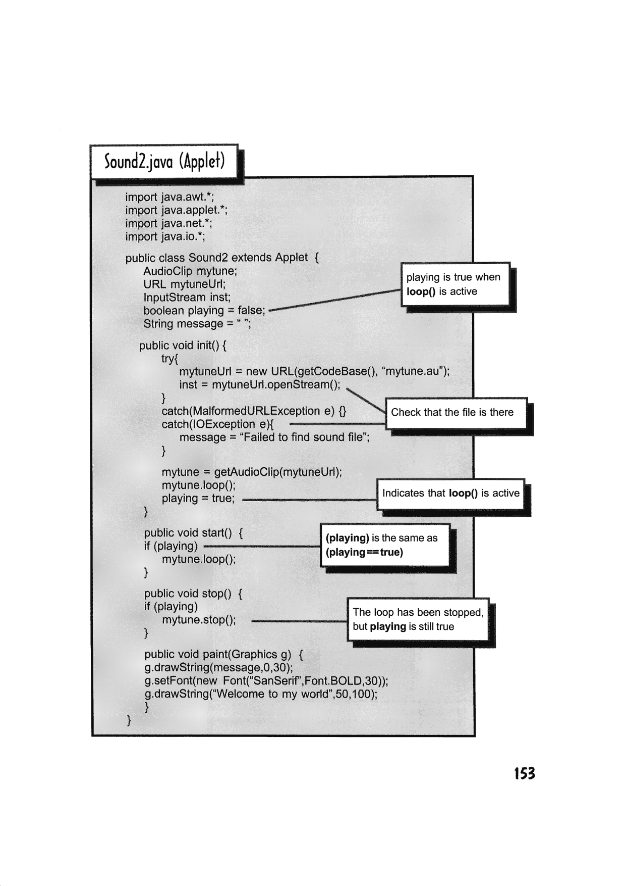

- 当 `loop()` 激活时，`playing` 为 true
- 表示 `loop()` 激活状态
- `(playing)` 等同于 `(playing==true)`
- 循环已停止，但 `playing` 仍为 true

## 文本布局

如果你想准确地放置文本，`FontMetrics` 方法将为你提供给定字体写入文本的高度、宽度和其他测量值。下面的示例创建了一个与字体 `f` 关联的 `FontMetrics` 对象 `metrics`。它使用 `getHeight()` 方法设置行之间的垂直间距，并使用 `stringWidth()` 获取每个字符串的宽度。如果一个字符串可以放在现有字符串之后的行内，它会被放置在那里；否则它将显示在下一行。

我设计了该程序接收文本和字体大小作为参数，以便于实验。如果你愿意，也可以将它们直接写入 applet 中。

### Fonts1.java (Applet)

```java
import java.awt.*;
import java.applet.*;

public class Fonts1 extends Applet
{
    Font f;
    FontMetrics metrics;
    int size;
    int textSize;
    int textWidth;
    String[] text = new String[4];

    public void init() {
        text[0] = getParameter("line0");
        text[1] = getParameter("line1");
        text[2] = getParameter("line2");
        text[3] = getParameter("size");
        f = new Font("Serif",0,fsize);
        metrics = getFontMetrics(f);
        resize(400,250);
    }
```

> `new FontMetrics(f)` 将无法工作——`FontMetrics` 是一个抽象类，你无法直接从它创建对象

> `resize(x,y)`
>
> - 重写从 applet 传递的宽度和高度

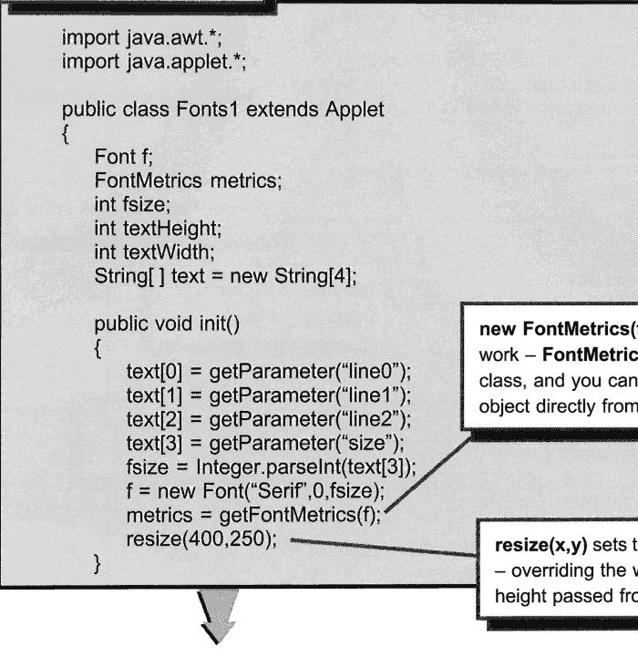

```java
public void paint(Graphics g)
{
    int x = 0;
    g.setFont(f);
    int textHeight = metrics.getHeight();
    y = textHeight;
    for (int loop = 0; loop < textSize; loop++) {
        int textWidth = metrics.stringWidth(text[loop]);
        if (x + textWidth > 400) {
            x = 0;
            y = textHeight;
        }
        g.drawString(text[loop],x,y);
        x += textWidth;
    }
}
```

- 获取每个字符串的宽度
- 该 applet 宽度为 400
- 这里是参数：
- `line0`: " "
- `line1`: " "
- `line2`: " "
- `size`: " "

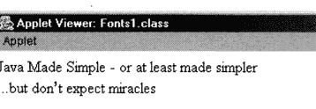

## 字符串与数组

如果你将字符串拆分为单个字符，你可以使用 `toCharArray()` 完成。

- `length()` 返回字符串的长度。
- `charWidth()` 给你单个字符的宽度。
- `drawChars()` 在 `Graphics` 中绘制字符。
- `drawChars(string,loop,x,y)` 需要位置。

### WaveText.java (Applet)

```java
import java.awt.*;
import java.applet.*;
import java.event.*;

public class WaveText extends Applet implements MouseListener
{
 String text = "Not drowning";
 int length;
 char[] letter;
 Font f = new Font("Serif",Font.BOLD,24);
 FontMetrics metrics;

 public void init()
{
  length = text.length();
  letter = text.toCharArray();
  metrics = getFontMetrics();
  addMouseListener(this);
}

public void destroy()
{
    removeMouseListener(this);
}

public void mouseDragged(MouseEvent e)
{
    int x = e.getX();
    int y = e.getY();
    repaint();
}

public void mouseMoved(MouseEvent e) { }

public void paint(Graphics g)
{
    int x, y;
    g.setFont(f);
    x = 0;
    y = 50;
    for (int loop = 0; loop < length; loop++) {
        g.drawChars(letter,loop,1,x,y);
        x += metrics.charWidth(letter[loop]);
        y = 50 + (int)(java.lang.Math.random()*20) - 10;
    }
}
```

- `letter[ ]` 与字符串的大小相同
- 当鼠标被拖动时，沿文本宽度移动
- 移动打印位置，沿当前字符宽度
- 产生一个 50 +/- 10 范围内的值

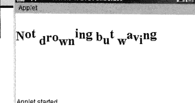

## 练习

- 1 设计并编写一个简单的拼图游戏 applet。它应该有一个数组，存储一组移动到正确位置后就能形成图片的图像。要创建碎片，请拍摄一张照片并将其切割成等大小的部分，每个部分保存为 GIF。如果文件名是系列化的，例如 "pic0.gif", "pic1.gif", "pic2.gif" 等，你可以在运行循环加载文件时生成它们的名称。生成名称的行看起来像这样：`name = "pic" + loop + ".gif";`

- 2 编写一个 applet，滚动字符串中的字符，将每个字符向左移动，并将第一轮带到字符串的末尾。重复滚动，直到字符回到原始位置。

提示：如果你想看到效果，请包含延迟！

在再次显示字符之前，清除绘制区域的旧文本，否则会产生严重的模糊！

# 8 线程

- 线程 ................................................. 160
- 动画图像 .............................................. 163
- 控制加载 .............................................. 166
- 练习 .................................................. 170

## 线程

线程是可以与另一个线程独立执行的代码序列。简单的 applet 一次只能做一件事，但包含线程的 applet 可以同时做几件事。

线程对于良好的动画是至关重要的；对于简单的动画，如果你不想让 applet 的部分停止，线程也是必须的。

如果你有任何耗时的任务需要处理——例如下载图像或其他文件，通过线程处理这些任务将允许你在等待时做其他事情，让观众保持愉快。

## 线程 applet

在程序中包含线程最简单的方法是实现 `Runnable` 接口。这处理了 `run()` 方法，该方法包含了线程的所有代码。在类行中添加 `implements Runnable` 引入了接口：

```java
public class Counter implements Applet, Runnable
```

线程在类级别声明，但被设置为 `null`。当执行 `start()` 时，会创建一个实例并调用线程的 `start()` 方法。这会调用 `run()` 来执行线程代码。

```java
Thread timer = null;
```

```java
timer = new Thread(this);
timer.start();
```

在 `run()` 中，第一个检查是查看线程是否活跃——如果用户离开并返回 applet，`start()` 将被执行，而你不希望创建第二个实例。

```java
while (timer != null)
```

如果是活跃的，线程将等待一秒，更新计数器并重绘显示。

```java
try {
  Thread.sleep(1000);
} catch (InterruptedException e){}
count++;
repaint();
```

`sleep()` 方法以毫秒为单位运行，所以 1000 = 1 秒。`Thread` 这个功能对于动画来说是无价的——它只是挂起线程，让程序的其余部分保持活跃。

在 `stop()` 中，线程被关闭：

```java
timer = null;
```

这使得它在用户离开 applet 时也停止执行。当然，它会被 `start()` 重启。在这种情况下，这并不是必需的——线程可以保持运行而不干扰其他任何事情，也不会受到任何伤害。

`mouseDragged()` 与线程无关。它的存在仅仅是为了说明在线程运行的同时，程序的其余部分可以执行活跃的操作。它让你允许你在屏幕上拖动一个字符串。

### Counter.java (applet)

```java
import java.awt.*;
import java.awt.event.*;
import java.applet.*;

public class Counter extends Applet implements Runnable, MouseEventListener {
    int x1 = 50;
    int y1 = 50;
    Thread timer = null;
    int count = 0;

    public void init() {
        addMouseMotionListener(this);
    }

    public void start() {
        if(timer == null) {
            timer = new Thread(this);
            timer.start();
        }
    }
}
```

这将此线程链接到实现了 `Runnable` 的 applet


```java
public void stop() {
    timer = null;
}

public void destroy() {
    removeMouseMotionListener(this);
}

public void run() {
    while (timer != null) {
        try {
            Thread.sleep(1000);
        } catch (InterruptedException e) {
            count++;
        }
        repaint();
    }
}

public void mouseDragged(MouseEvent e) {
    x1 = e.getX();
    y1 = e.getY();
    repaint();
}

public void mouseMoved(MouseEvent e) { }

public void paint(Graphics g) {
    g.setFont(new Font("SansSerif", Font.BOLD, 24));
    g.drawString("Count = " + count, 10, 20);
    g.drawString("Drag me", x1, y1);
}
```

线程完全集成到程序中——`count` 是一个程序变量。

你必须捕获 `sleep` 抛出的 `InterruptedException`。

`repaint()` 也从 `run()` 中调用。

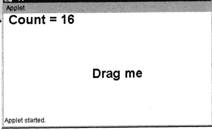

计数显示每秒更新一次，无论发生了什么。拖动文本也会更新屏幕。

## 动画图像

动画中最困难的部分不是编写代码——那是简单的部分——而是创建图像。如果你缺乏艺术天赋，就坚持使用简单的图片吧——就像我一样！

这个程序动画了一组三个旧破车的图像，它们在屏幕上移动并在移动时喷火。这里是这些图像：


图像存储在 `pic[]` 数组中，由 `current` 指定要显示的图像下标。它通过以下代码在 0 到 2 之间循环：

```java
current++;
if (current > 2) current = 0;
```

图像改变 10 次/秒。这种技术可以扩展到你需要的任意数量。图像由 `MediaTracker` 加载，如果你在线程内部设置它，那么在等待时程序的其余部分可以做一些有用的事情。至少，你可以显示一条“正在加载”的消息，然后用完成的图像替换它。

它是这样工作的。要查看这个，请看下一页。

### Animate1.java (applet)

```java
import java.awt.*;
import java.awt.event.*;
import java.applet.*;

public class Animate1 extends Applet implements Runnable {
    int x;
    Thread timer = null;
    Image[] pic = new Image[3];
    int current = 0;
    AudioClip bang;

    public void init() {
        pic[0] = getImage(getCodeBase(), "redcar0.gif");
        pic[1] = getImage(getCodeBase(), "redcar1.gif");
        pic[2] = getImage(getCodeBase(), "redcar2.gif");
    }

    public void start() {
        if (timer == null) {
            timer = new Thread(this);
            timer.start();
        }
    }

    public void stop() {
        timer = null;
    }

    public void run() {
        while (timer != null) {
            try {
                Thread.sleep(1000);
            } catch (InterruptedException e) {
                count++;
            }
            if (current > 2) current = 0;
            repaint();
        }
    }

    public void mouseDragged(MouseEvent e) {
        x1 = e.getX();
        y1 = e.getY();
        repaint();
    }

    public void mouseMoved(MouseEvent e) { }

    public void paint(Graphics g) {
        g.drawImage(pic[current], x, 100, this);
        x += 10;
    }
}
```

计数显示每秒更新一次，无论发生了什么。拖动文本也会更新屏幕。

（注：由于提供的文本包含大量重复的 OCR 错误，以上译文已根据核心逻辑进行了清理和规范翻译。）

如果你正在加载一个图像数组或其他图像集，可以使用此方法来保持执行，直到特定的图像加载完成，或者使用以下代码等待整个集合加载完成：

```java
track.waitForAll();
```

`waitID()` 和 `waitForAll()` 不会检查图像是否已正确加载。如果你相当确定文件存在且通信良好，这通常不会产生太大影响。如果你想检查错误，可以测试：

```java
if (track.isError(0)) ...
```

如果在加载过程中发生错误，该表达式将为 `true`。

`MediaTracker` 还有其他方法可以检查传入图像的状态和进度——请在 `java.awt` 集合的帮助页面中查找。

## 线程与加载的变量

线程的设置方式与本组中之前的程序完全相同。它的 `run()` 方法只有一个真正的任务，就是等待图像加载。之后，它将 `loaded` 变量设置为 `true`，调用 `repaint()` 并退出。

`loaded` 用于控制屏幕显示。它的状态决定了是显示“Loading please wait”（加载中，请稍候）还是图像。

```java
if (loaded == false)
    g.drawString("Loading please wait", 0, 50);
else
    if (cropped)
        ...
```

你可以将简单的消息替换为更具色彩的标题屏幕——使用文本和绘制对象创建，而不是使用图像！

### ThreadLoad.java (applet)

```java
import java.awt.*;
import java.awt.event.*;
import java.awt.image.*;
import java.applet.*;

public class ThreadLoad implements Runnable, MouseListener {
    Image source;
    Image crop;
    int cropX, cropY;
    boolean cropped = false;
    boolean loaded = false;
    Thread loader;
    MediaTracker track;

    public void init() {
        track = new MediaTracker(this);
        source = getImage(getCodeBase(), "map.gif");
        track.addImage(source, 0);
        addMouseListener(this);
    }

    public void start() {
        loader = new Thread(this);
        loader.start();
    }

    public void stop() {
        loader = null;
    }

    public void destroy() {
        removeMouseListener(this);
    }

    public void run() {
        try {
            track.waitForID(0);
        } catch (InterruptedException e) {
            return;
        }
        loaded = true;
        repaint();
    }
}
```

开始时 `loaded` 设置为 `false`

`MediaTracker` 在类级别设置

并在 `init()` 中初始化

`source` 被作为 tracker 列表的第一个项目

启动线程

线程在此处等待

直到图像加载

```java
public void mouseClicked(MouseEvent e) {
    int x = e.getX();
    int y = e.getY();

    if (cropped == false) {
        Cropper(x, y);
        cropped = true;
    } else
        cropped = false;
    repaint();
}
```

`mouseClicked()` 和 `Cropper`

与原文保持不变

- 见第 148 页

```java
public void mousePressed(MouseEvent e) { }
public void mouseEntered(MouseEvent e) { }
public void mouseExited(MouseEvent e) { }
public void mouseReleased(MouseEvent e) { }
```

```java
public void Cropper(int x, int y) {
    if (x < 105) x = 105;
    if (x > 315) x = 315;
    if (y < 83) y = 83;
    if (y > 247) y = 247;
    cropX = 2 * x - 210;
    cropY = 2 * y - 165;
}
```

```java
ImageFilter imgF = new CropImageFilter(cropX, cropY, 420, 330);
ImageProducer imgP = new FilteredImageSource(source.getSource(), imgF);
crop = createImage(imgP);
```

```java
public void paint(Graphics g) {
    if (loaded == false) {
        g.drawString("Loading please wait", 0, 50);
    } else {
        if (cropped) g.drawImage(crop, 0, 0, 420, 330, this);
        else g.drawImage(source, 0, 0, 420, 330, this);
    }
}
```

检查 `loaded` 状态

并相应绘制

## 练习题

- 1 适配 `MoveText.java`（第 94 页），通过线程运行动画。现有程序中的活动部分——移动球的行——位于 `paint()` 方法中。在线程版本中，它们应该放在哪里？

提示：延迟循环应该被 `sleep()` 替换，这只能在线程中完成。

- 2 获取弹跳球动画（Image 2.java, 第 145 页）并将其转换为线程化的 applet。当你成功通过线程控制移动后，你可能还想进一步适配程序，将加载过程也纳入线程控制。

- 3 以 `Counter.java` 为基础，开发一个程序，在屏幕上以随机间隔绘制目标（矩形或椭圆形）。如果用户在绘制下一个目标之前点击了它，则计为命中，否则计数器加 1。

## 练习题答案

- 第 1 章 ................................................... 172
- 第 2 章 ................................................... 173
- 第 3 章 ................................................... 175
- 第 4 章 ................................................... 177
- 第 5 章 ................................................... 180
- 第 6 章 ................................................... 184
- 第 7 章 ................................................... 186
- 第 8 章 ................................................... 189

## 第 1 章

1 这只是简单的使用 `println()` 语句。

```java
class Address {
    public static void main(String[] args) {
        System.out.println("Jumbo");
        System.out.println("Green");
        System.out.println("Little");
        System.out.println("Valley");
    }
}
```

2 这种方法可以精确控制文本的位置。

```java
public class AddressApp extends Applet {
    public void paint(Graphics g) {
        g.drawString("Jumbo", 100, 20);
        g.drawString("Green", 100, 40);
        g.drawString("Little", 100, 60);
        g.drawString("Valley", 100, 80);
    }
}
```

3 这种方法使用了 `applet` 标签。

```html
<html>
<head>
    <title>Applet</title>
</head>
<body>
    <p>Here's:</p>
    <applet code="Address.class" width="200" height="120">
    </applet>
    <p>Please wait</p>
</body>
</html>
```

```java
for (loop = 0; loop < 10; loop++)
    num[loop] = 0;
for (loop = 0; loop < 1000; loop++) {
    x = (int) (Math.random() * 10);
    num[x]++;
}
for (loop = 0; loop < 10; loop++)
    System.out.println(loop + " occurrences " + num[loop]);
```

我在 0 到 128 的范围内生成了一个随机字符。你也可以使用 `System.in.read()` 方法（第 36 页）。


# 第 4 章

## 1

在我的程序中，颜色通过同时增加红、绿、蓝分量从黑色逐渐变为灰色。你可以通过使用三个嵌套循环（每种颜色一个）来实现一种颜色的淡出。

```java
import java.awt.*;
import java.awt.applet.*;

public class Ex41 extends Applet {
    int shade;
    Font bold = new Font("Helvetica", Font.BOLD, 24);

    public void paint(Graphics g) {
        for (shade = 0; shade < 256; shade++) {
            g.setFont(bold);
            g.setColor(new Color(shade, shade, shade));
            g.drawString("Fading away", 0, 30);
            for (int delay = 0; delay < 50000; delay++) {
            }
        }
    }
}
```

## 2

在此 applet 的 HTML 页面中将 `HEIGHT` 设置为 400。

```java
import java.awt.*;
import java.awt.event.*;
import java.awt.applet.*;

public class Ex42 extends Applet implements MouseListener {
    int size = 24;

    public void init() {
        addMouseListener(this);
    }

    public void destroy() {
        removeMouseListener(this);
    }

    public void mouseClicked(MouseEvent e) {
        int x = e.getX();
        int y = e.getY();
        if (y < 200) size++;
        if (y > 200) size--;
        repaint();
    }

    public void paint(Graphics g) {
        g.setFont(new Font("Helvetica", Font.BOLD, size));
        g.drawString("This font is " + size + " point", 0, 200);
    }
}
```

这里有很大的个人发挥空间。这是我的解决方案。它设计为在 500 x 400 的窗口中运行，并包含以下行的 HTML 代码：

`<PARAM NAME = myname VALUE = "your name goes here">`

利用复制和粘贴来创建那些 `random()` 行！

```java
import java.awt.*;
import java.applet.*;

public class Ex43 extends Applet {
    String name;

    public void init() {
        name = getParameter("myname");
    }

    public void paint(Graphics g) {
        g.setFont(new Font("Helvetica", Font.BOLD, 48));

        for (int loop = 0; loop < 200; loop++) {
            int x = (int) (java.lang.Math.random() * 500);
            int y = (int) (java.lang.Math.random() * 400);
            int red = (int) (java.lang.Math.random() * 255);
            int green = (int) (java.lang.Math.random() * 255);
            int blue = (int) (java.lang.Math.random() * 255);
            g.setColor(new Color(red, green, blue));
            g.drawString("*", x, y);
        }
        g.drawString(name, 50, 200);
    }
}
```

# 第 5 章

## 1

首先先让它运行起来，以便能够改变矩形的颜色，然后添加代码来启用和禁用按钮。

```java
import java.awt.*;
import java.awt.event.*;
import java.awt.applet.*;

public class Ex51 extends Applet implements ActionListener {
    Button butRed, butBlue, butGreen;

    public void init() {
        Color red = Color.red;             // 定义在 java.awt.Color
        Color blue = Color.blue;
        Color green = Color.green;         // 从红色开始
        Color current = red;

        butRed = new Button("Red");      // 红色禁用状态
        butRed.setEnabled(false);
        butBlue = new Button("Blue");
        butGreen = new Button("Green");
        butRed.addActionListener(this);
        butBlue.addActionListener(this);
        butGreen.addActionListener(this);
        add(butRed);
        add(butBlue);
        add(butGreen);
    }

    public void actionPerformed(ActionEvent e) {
        String cmdLabel = e.getActionCommand();

        if (cmdLabel.equals("Red")) { // 启用蓝色和绿色
            butRed.setEnabled(false);
            butBlue.setEnabled(true);
            butGreen.setEnabled(true);
        } else if (cmdLabel.equals("Blue")) {
            butRed.setEnabled(true);
            butBlue.setEnabled(false);
            butGreen.setEnabled(true);
        } else if (cmdLabel.equals("Green")) {
            butRed.setEnabled(true);
            butBlue.setEnabled(true);
            butGreen.setEnabled(false);
        }
    }
}
```

当你运行好这个程序后，你可能想将绘图程序和“清除”按钮合并到 Painter 程序中。

`clearRect()` 的值被设置为擦除一个 500 x 500 的 applet。

```java
import java.awt.Listener;
import java.awt.*;
import java.awt.event.*;

public class Ex64 extends Applet implements ActionListener, MouseMotionListener {
    int x1 = 0;
    int y1 = 0;
    Button clear;
    boolean wipe = false;

    public void init() {
        clear = new Button("Clear Screen");
        clear.addActionListener(this);
        addMouseMotionListener(this);
        add(clear);
    }

    public void destroy() {
        removeMouseMotionListener(this);
    }

    public void actionPerformed(ActionEvent e) {
        wipe = true;
        repaint();
    }

    public void mouseDragged(MouseEvent e) {
        x1 = e.getX();
        y1 = e.getY();
        repaint();
    }

    public void mouseMoved(MouseEvent e) { }

    public void update(Graphics g) {
        if (wipe == true) {
            g.clearRect(0, 0, 500, 500); // applet size
            wipe = false;
        } else g.fillRect(x1, y1, 2, 2);
    }
}
```

# 第 7 章

## 1

这里有一个解决方案。它使用了一张整体尺寸为 600 * 480 的图像，分为 9 部分，每部分 200 * 160。所有的数字都基于这些尺寸。

在 `Mouse()` 中，被点击的区块编号存储在 `pick` 中。

在 `mouseReleased()` 中，`drop` 获取新位置的编号。两者进行交换。

```java
import java.awt.*;
import java.awt.image.*;
import java.awt.event.*;
import java.applet.*;

public class Ex71 extends Applet implements MouseListener {
    Image[] piece = new Image[9];
    int[] x = new int[9];
    int[] y = new int[9];
    Image temp;
    int pick, drop;

    public void init() {
        int loop;
        String name;
        for (loop = 0; loop < 9; loop++) {
            name = "MAT" + loop + ".gif";
            piece[loop] = getImage(getCodeBase(), name);
            x[0] = 0; y[0] = 0;
            x[1] = 201; y[1] = 0;
            x[2] = 402; y[2] = 0;
            x[3] = 0; y[3] = 161;
            x[4] = 201; y[4] = 161;
            x[5] = 402; y[5] = 161;
            x[6] = 0; y[6] = 322;
            x[7] = 201; y[7] = 322;
            x[8] = 402; y[8] = 322;
        }
        for (loop = 0; loop < 9; loop++) {
            int rand = (int) (java.lang.Math.random() * 9);
            temp = piece[rand];
            piece[rand] = piece[loop];
            piece[loop] = temp;
        }
        addActionListener(this);
        repaint();
    }

    public void destroy() {
        removeMouseListener(this);
    }

    public void mousePressed(MouseEvent e) {
        int x = e.getX();
        int y = e.getY();
        pick = (int) (x / 200) + (int) (y / 160) * 3;
    }

    public void mouseReleased(MouseEvent e) {
        int x = e.getX();
        int y = e.getY();
        drop = (int) (x / 200) + (int) (y / 160) * 3;
        temp = piece[drop];
        piece[drop] = piece[pick];
        piece[pick] = temp;
        repaint();
    }

    public void mouseEntered(MouseEvent e) {}
    public void mouseExited(MouseEvent e) {}
    public void mouseClicked(MouseEvent e) {}

    public void paint(Graphics g) {
        for (int loop = 0; loop < 9; loop++) {
            g.drawImage(piece[loop], x[loop], y[loop], 200, 160, 200, this);
        }
    }
}
```

文件命名为 `MAT0.gif`, `MAT1.gif`, `MAT2.gif` 等。使用行形成名称。

区块位于网格中（0, 1, 2, 3, 4, 5, 6, 7, 8），该逻辑将 x,y 值转换为区块编号。

你可以在 `mouseDragged()` 中添加代码来移动被选中的区块。

使用 MAT 系列图像进行显示。你可以从这里的 Made Simple Programming 页面获取这些图像：www.madesimple.co.uk

- 易于遵循
- 示例的变体
- 步骤简单
- 实用

## 2

该程序的前半部分与 WaveText 几乎相同。为了滚动字符串，第一个字母复制到 `temp` 中，然后数组中的每个元素都获取上一个字母。最后一个字母从 `temp` 复制回来。整个循环根据字母的数量重复多次来实现完整的滚动。

```java
import java.awt.*;
import java.applet.*;
```


```java
public class Ex72 extends Applet {
    String text = "What goes around, comes around";
    int length;
    char[] letter;
    Font f = new Font("Serif", Font.BOLD, 24);

    public void init() {
        length = text.length();
        letter = new char[length];
        letter = text.toCharArray();
    }
}
```

```java
    public void paint(Graphics g) {
        char temp;
        g.setFont(f);
        for (int repeat = 0; repeat < length; repeat++) {
            g.clearRect(0, 0, 400, 100);
            g.drawString(String.valueOf(letter[repeat]), 0, 50);
            temp = letter[0];
            for (int loop = 0; loop < length - 1; loop++) {
                letter[loop] = letter[loop + 1];
            }
            letter[length - 1] = temp;
        }
    }
}
```

# 第 8 章

1. `Thread` 遵循模式，但注意移动循环被转移到了 `run()`。我使用了 `update()` 而不是 `paint()`，因为它提供的动画更流畅。

```java
import java.awt.*;
import java.applet.*;

public class Ex81 extends Applet implements Runnable {
    String text, temp;
    int speed;
    int x;
    Thread mover = null;

    public void init() {
        text = getParameter("message"); // 检查
        temp = getParameter("speed"); //  own
        speed = Integer.parseInt(temp);
    }
}
```

```java
    public void start() {
        if (mover == null) {
            mover = new Thread(this);
            mover.start();
        }
    }
}
```

```java
    public void stop() {
        mover = null;
    }
}
```

```java
    public void run() {
        for (x = 200; x > 0; x--) {
            repaint();
            try {
                Thread.sleep(speed);
            } catch (InterruptedException e) {}
        }
    }
}
```

```java
    public void update(Graphics g) {
        g.setFont(new Font("SansSerif", Font.BOLD, 24));
        g.clearRect(x, 80, 300, 30);
        g.setColor(new Color(0, 0, 0));
        g.drawString(text, x, 100);
    }
}
```

如果你完成了练习 8.1，这个程序应该没有问题。它使用了标准的 `Thread` 模式，同样在 `run()` 中包含移动程序。这里的 `paint()` 只绘制图像。

```java
import java.awt.*;
import java.applet.*;

public class Ex82 extends Applet implements Runnable {
    int x, y;
    Thread bouncer = null;
    Image ball;

    public void init() {
        ball = getImage(getCodeBase(), "ball.gif");
    }

    public void start() {
        if (bouncer == null) {
            bouncer = new Thread(this);
            bouncer.start();
        }
    }

    public void stop() {
        bouncer = null;
    }

    public void run() {
        while (bouncer != null) {
            y = 100;
            for (int x = 0; x < 500; x++) {
                repaint();
                if (y > 150) move = -1;
                else if (y < 50) move = 1;
                y += move;
                try {
                    Thread.sleep(10);
                } catch (InterruptedException e) {}
            }
        }
    }

    public void paint(Graphics g) {
        g.drawImage(ball, x, y, this);
    }
}
```

程序棘手之处在于如何以及何时记录命中和缺失。如果完全在 `mouseClicked()` 中完成，可能会通过反复点击目标同时获得多次命中——如果你在目标重绘之前没有点击，则不会计入缺失。使用布尔变量 `ontarget`，我们可以在命中目标时仅记录一次，且未点击也会计为缺失。

```java
import java.awt.*;
import java.awt.event.*;
import java.applet.*;

public class Ex83 extends Applet implements Runnable, MouseListener {
    int tx, ty;
    int hits = 0;
    int misses = 0;
    boolean ontarget = false;
    Thread target = null;

    public void init() {
        addMouseListener(this);
    }

    public void start() {
        if (target == null) {
            target = new Thread(this);
            target.start();
        }
    }

    public void stop() {
        target = null;
    }

    public void destroy() {
        removeMouseListener(this);
    }

    public void run() {
        int delay;
        while (target != null) {
            if (ontarget) hits++;
            else misses++;
            ontarget = false;
            repaint();
            delay = (int) (Math.random() * 2000) + 500;
            try {
                Thread.sleep(delay);
            } catch (InterruptedException e) {}
        }
    }

    public void paint(Graphics g) {
        g.drawString("Hits: " + hits + " Misses: " + misses, 10, 20);
        tx = (int) (Math.random() * 400);
        ty = (int) (Math.random() * 400);
        g.fillOval(tx, ty, 20, 20);
    }

    public void mouseClicked(MouseEvent e) {
        int x = e.getX();
        int y = e.getY();
        if ((x > tx && x < tx + 20) && (y > ty && y < ty + 20))
            ontarget = true;
    }

    public void mousePressed(MouseEvent e) {}
    public void mouseEntered(MouseEvent e) {}
    public void mouseExited(MouseEvent e) {}
    public void mouseReleased(MouseEvent e) {}
}
```

# 索引

## A
- `ActionEvent` 100
- `actionPerformed` 100
- `add()` 100
- `addImage()` 166
- `addItem()` 114
- `Address` 29
- `AND` 和 `OR` 55
- 角度，测量 127
  - 简单 145
  - 使用线程 163
- `APPLET` 代码 23
- Applets 76
  - 基础 21
  - 定义 2
- `AppViewer` 15, 24
- 命令 78
  - 基础 18
  - 定义 2
- 弧 132 way 46
- 参数运算符 30
- 数组 44
  - 使用示例 133, 163
- 赋值运算符 42
- `au` 音格式 150

## B
- 批处理文件 83
- Beans 2
- 代码块 57
- 布尔值 29
- `BorderLayout()` 118
- 大括号 `{}` 57
- 分支 62
- `break` 66
- 按钮 100
- `byte` 28
- `Byte.code` 6

## C
- 计算 38
- `Canvas` 98
  - 重新定义 135
- `catch` 73
- `Char` 29
- 复选框 104
- `CheckboxGroups` 104
- `Choices` 114
- 圆形 129
- 类 10, 18
- 颜色对象 84
- 颜色 84
  - 预定义 133
- 注释 40
- 编译器 4
- 组件 98
- 常量 31
- 构造函数 135
- `CropImageFilter` 146

## D
- 数据类型 28
- 声明 30
- `do...while` 61
- `double` 28
- `drawArc()` 132
- `drawImage()` 144
- `drawLine()` 126
- `drawOval()` 129
- `drawPolygon()` 130
- `drawRect()` 128
- `drawString()` 79

## E
- 元素 44
- `else` 62
- 封装 9
- `equals()` 102
- 错误与异常 72
  - 常见 33, 41
- 事件 100
  - 目标 102
- 异常 36, 72
- 示例 143
- 示例 152

## F
- `fillArc()` 132
- `fillOval()` 129
- `fillPolygon()` 130
- `fillRect()` 128
- `FilteredImageSource` 147
- 图像过滤器 146
- `float` 28
- 浮点数 28
- 流布局 118
- `FontMetrics` 154, 156
- 字体 82
  - 高度和宽度 154
  - 大小 81
- `for` 循环 56
  - 嵌套 58

## G
- `getInputCommand()` 102
- `getCharWidth()` 156
- `getCodeBase()` 143
- `getHeight()` 154
- `getImage()` 143
- `getParameter()` 93
- `GIF` 图形格式 142
- 图形用户界面 98
- `Graphics` 对象 79
- `GridLayout()` 119
- `GUI` 98

## H
- `HTML` 文档 22

## I
- `if` 62
- `ImageConsumer` 146
- `ImageFilter` 146
- `ImageObserver` 146
- `ImageProducer` 146
- 动画图像 163
  - 过滤器 146
  - 格式 142
- `init()` 76
- 程序的输入 36
- 实例 10
- 实例化 10
- `int` 28
- 整数 28
- 接口 146
- 解释器 4
- `isErrorID()` 167
- `ItemListener` 105

## J
- Java 软件开发包 12
- 安装 14
- 版本 12
- Java 虚拟机 6
- `Java.exe` 15
- `Javac.exe` 15
- `Javap.exe` 15
- `JavaScript` 5
- `JPEG` 图形格式 124
- `JVM` 6
  - 与浏览器 7

## K
- 键盘输入 49

## L
- 布局 118
- `length()` 156
- 线 126
- 列表 114
- 逻辑运算符 54
- `Long` 28
- `loop()` 150

## M
- `main()` 68
- `MediaTracker` 166
- 内存地址 28
- 方法 99
  - 基础 68
  - 在 applets 中 90
- 鼠标方法 86
- `MS-DOS` 命令行 16

## N
- 数值 31
- 来自文本的数字 112

## O
- 面向对象编程 8
- 对象 8
  - 类 10
- 运算符优先级 43
- 运算符 38, 42, 54
- 程序的输出 345

## P
- `paint()` 76
- `Params` 121
- `PARAM` 92
- 参数 9, 22, 69, 70
  - 与 applets 92
  - 使用示例 155
- `parseInt()` 112
- `PATH` 16
- `play()` 150
- 多边形 130
- 多态 11
- 程序流 54
- 编程语言 74
- `public` 18

## R
- 弧度 127
- 随机数 59
- `random()` 58
- `Rectangle` 128
- 引用数据类型 29
- 关系运算符 54
- 返回值 70
- `run()` 160
- `Runnable` 160
- 运行时错误 72

## S
- `setColor()` 84
- `setEnabled()` 102
- `setLayout()` 118
- 使用面板 121
- `Short` 28
- `sleep()` 161
- 声音 150
- 源代码 4
- `start()` 76
- `stop()` 76
- `String[] args` 46
- `StringBuffers` 48
- 字符串 46
  - 与数组 156
- `stringWidth()` 154
- 子类 10
- 下标 44
- 父类 10
- `Switch` 66
- `System.in.read()` 36
- `System.out.print()` 34

## T
- 测试值 54
- 文本选择 110
- 文本组件 108
- applets 文本显示 79
- 文本布局 154
- `TextAreas` 108
- `TextFields` 160
- 线程 160
- `toCharArray()` 156
- `try` 73
- 类型转换 36

## U
- `Unicode` 31
- `URLs` 143

## V
- 变量 8
  - 赋值 31
  - 布尔 87
  - 创建 30
  - 名称 28
  - 作用域 50, 56

## W
- `waitForAll()` 167
- `waitForID()` 166
- `while` 循环 60
