# Java 方法：面向对象编程与数据结构

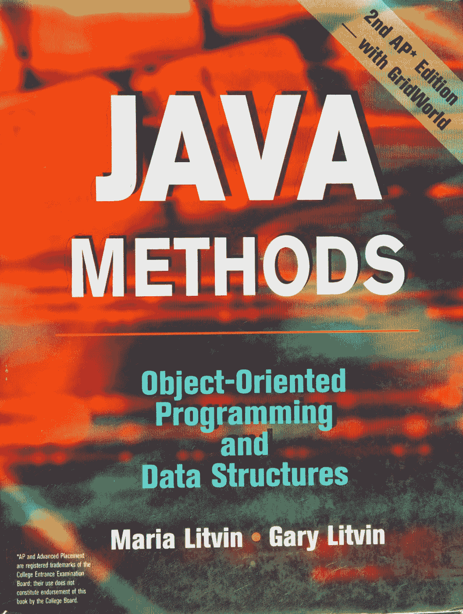

**AP** 和 **Advanced Placement** 是美国大学理事会考试（College Entrance Examination Board）的注册商标；它们的使用并不构成大学理事会对对本书的背书。

* **AP** 和 **Advanced Placement** 是美国大学理事会（College Board）的注册商标，该机构未参与本书的制作，不对本书负责。

**Oracle**、**Java** 和 **Java 标志**是 **Oracle** 公司及其在美国和其他国家的商标或注册商标。

1 2 3 4 5 6 7 8 9 10 16 15 14 13 12 11

> 献给 Marg 和 Aaron


https://archive.org/details/javamethodsobojec0002litv

序言 xvii

如何使用本书 xxi

序言 xvii

如何使用本书 xxi

# 第 1 章 硬件、软件和互联网简介

## 1.1 引言

## 1.2 硬件概述

### 1.2.1 CPU

### 1.2.2 内存

### 1.2.3 设备

### 1.2.4 输入与输出设备

## 1.3 软件工程师做什么？

## 1.4 计算机内存中的表示

## 1.5.1 数字

## 1.5.2 字符

## 1.6 互联网

## 1.7 总结

## 1.8 练习

# 第 2 章 软件工程简介

## 2.1 引言

## 2.2 编译器与解释器

## 2.3 软件组件与包

## 2.4 Lab：三种打招呼的方式

## 2.5 面向对象编程

## 2.6 Lab：更多打招呼的方式

## 2.7 总结

## 2.8 练习


# 第 3 章 对象与类

## 3.1 引言

## 3.2 案例：GridWorld

## 3.3 类

## 3.4 Lab：交互

## 3.5 字段、构造函数与方法

## 3.6 继承

## 3.7 Lab：随机 Bug

## 3.8 总结

## 3.9 练习

# 第 4 章 算法

## 4.1 引言

## 4.2 算法属性

## 4.3 迭代

## 4.4 递归

## 4.5 案例：欧几里得最大公约数 (GCF)

## 4.6 使用列表

## 4.7 案例：文件管理器

## 4.8 总结

## 4.9 练习

# 第 5 章 Java 语法与风格

## 5.1 引言

## 5.2 使用注释

## 5.3 关键字与自定义命名

## 5.4 语法 vs 风格

## 5.5 语句、代码块、缩进

## 5.6 Lab：修正语法错误

## 5.7 总结

## 5.8 练习

# 第 6 章 数据类型、变量与算术

## 6.1 引言

## 6.2 声明字段与局部变量

## 6.3 原生数据类型

## 6.4 字符串

## 6.5 常数

## 6.6 变量作用域

## 6.7 算术表达式

## 6.8 复合赋值与运算符

## 6.9 将数字和对象转换为字符串

## 6.10 Lab：饼图

## 6.11 总结

## 6.12 练习

# 第 7 章 布尔表达式与 if-else 语句

## 7.1 引言

## 7.2 if-else 语句

## 7.3 boolean 数据类型

## 7.4 关系运算符

## 7.5 逻辑运算符

## 7.6 运算符优先级

## 7.7 短路求值

## 7.8 if-else 与嵌套 if-else

## 7.9 案例与 Lab：掷骰子

## 7.10 switch 语句

## 7.11 枚举数据类型

## 7.12 案例与 Lab：掷骰子

## 7.13 总结

## 7.14 练习

# 第 8 章 迭代语句：while, for, do-while

## 8.1 引言

## 8.2 while 和 for 循环

## 8.3 do-while 循环

## 8.4 循环中的 return 和 break

## 8.5 嵌套循环

## 8.6 Lab：完美数

## 8.7 总结

## 8.8 练习

# 第 9 章 实现类与使用对象

## 9.1 引言

## 9.2 类公有与私有特性

## 9.3 构造函数

## 9.4 对象的引用

## 9.5 定义方法

## 9.6 调用方法与访问字段

## 9.7 向构造函数和方法传递参数

## 9.8 return 语句

## 9.9 案例与 Lab：小吧台

## 9.10 重载方法

## 9.11 静态字段与方法

## 9.12 案例：小吧台结束

## 9.13 总结

## 9.14 练习

# 第 10 章 字符串

## 10.1 引言

## 10.2 字面量字符串

## 10.3 字符串构造函数与不可变性

## 10.4 字符串方法

## 10.5 数字格式化为字符串

## 10.6 从字符串中提取数字

## 10.7 字符方法

## 10.8 Lab：异字母游戏

## 10.9 StringBuilder 类

## 10.10 总结

## 10.11 练习

# 第 11 章 类层次与接口

## 11.1 引言

## 11.2 类层次

## 11.3 抽象类

## 11.4 调用父类构造函数

## 11.5 调用父类方法

## 11.6 案例：GridWorld 之舞

## 11.7 多态性

## 11.8 接口

## 11.9 总结

## 11.10 练习

# 第 12 章 数组

## 12.1 导言

## 12.2 一维数组

## 12.3 实验：占卜家

## 12.4 二维数组

## 12.5 案例研究与实验：吃子 (Chomp)

## 12.6 迭代与“for each”循环

## 12.7 插入与删除元素

## 12.8 总结

## 12.9 练习

# 第 13 章 java.util.ArrayList

## 13.1 导言

## 13.2 ArrayList 的结构

## 13.3 ArrayList 的构造函数与方法

## 13.4 ArrayList 的陷阱

## 13.5 实验：为文档创建索引

## 13.6 案例研究与实验：GridWorld 生物

## 13.7 总结

## 13.8 练习

# 第 14 章 搜索与排序

## 14.1 导言

## 14.2 equals, compareTo 和 compare

## 14.3 顺序查找与二分查找

## 14.4 实验：保持有序

## 14.5 选择排序

## 14.6 插入排序

## 14.7 归并排序

## 14.8 快速排序

## 14.9 实验：基准测试

## 14.10 java.util.Arrays 和 java.util.Collections

## 14.11 总结

## 14.12 练习

# 第 15 章 流与文件

## 15.1 导言

## 15.2 路径名与 java.io.File 类

## 15.3 读取文本文件

## 15.4 写入文本文件

## 15.5 实验：选择单词

## 15.6 总结

## 练习

# 第 16 章 图形

## 16.1 导言

## 16.2 paint, paintComponent 和 repaint

## 16.3 坐标

## 16.4 颜色

## 16.5 绘制形状

## 16.6 字体与文本

## 16.7 案例研究与实验：拼图碎片

## 16.8 总结

## 练习

# 第 17 章 GUI 组件与事件

## 17.1 导言

## 17.2 可插的外观和感觉 (Pluggable Look and Feel)

## 17.3 基础 Swing 组件及其事件

## 17.4 布局管理器

## 17.5 菜单

## 17.6 案例研究与实验：Ramblecs

## 17.7 总结

## 练习

# 第 18 章 鼠标、键盘、声音与图像

## 18.1 导言

## 18.2 鼠标事件处理

## 18.3 键盘事件处理

## 18.4 案例研究与实验：绘图编辑器

## 18.5 声音与图像

## 18.6 案例研究与实验：Ramblecs 终

## 18.7 总结

## 练习

# 第 19 章 算法的 Big-O 分析

## 19.1 导言

## 19.2 Big-O 概念

## 19.3 排序算法的 Big-O

## 19.4 总结

## 练习

# 第 20 章 Java 集合框架

## 20.1 导言

## 20.2 Collection 与 Iterator

## 20.3 Lists 与 ListIterator

## 20.4 Stack 类

## 20.5 Queue 接口

## 20.6 PriorityQueue 类

## 20.7 集合

## 20.9 案例研究与实验：股票交易所

## 20.10 总结

## 练习

# 第 21 章 列表与迭代器

## 21.1 导言

## 21.2 单向链表

## 21.3 遍历

## 21.4 实验：实现单向链表

## 21.5 带尾部的链表

## 21.6 双向链表与循环链

## 21.7 实验：文字广播电视

## 21.8 总结

## 练习

# 第 22 章 栈与队列

## 22.1 导言

## 22.2 栈的实现

## 22.3 实验：浏览

## 22.4 硬件栈

## 22.5 队列的实现

## 22.6 案例研究与实验：事件驱动计算

## 22.7 总结

## 练习

# 第 23 章 递归复习

## 23.1 导言

## 23.2 三个示例

## 23.3 何时使用递归

## 23.4 理解与调试方法

## 23.5 实验：汉诺亚塔

## 23.6 案例研究与实验：五子棋

## 23.7 总结

## 练习

# 第 24 章 二叉树

## 24.1 导言

## 24.2 二叉树的实现

## 24.3 遍历

## 24.4 二叉搜索树

## 24.5 二叉搜索树 (BST) 实现

## 24.6 实验：摩斯密码

## 24.7 案例研究与实验：Java 信使

## 24.8 总结

# 第 25 章 查找表与哈希

## 25.1 导言

## 25.2 查找表

## 25.3 实验：密码文

## 25.4 哈希表

## 25.5 java.util 中的 HashMap

## 25.6 实验：搜索引擎

## 25.7 总结

## 练习

# 第 26 章 堆与优先级队列

## 26.1 导言

## 26.2 优先级队列的实现

## 26.3 二叉树：非链表示

## 26.4 优先级队列实现

## 26.5 实验：堆

## 26.6 总结

# 第 27 章 设计模式

## 27.1 导言

## 27.2 外观模式 (Façade)

## 27.3 策略模式 (Strategy)

## 27.4 单例模式 (Singleton)

## 27.5 装饰器模式 (Decorator)

## 27.6 组合模式 (Composite)

## 27.7 MVC (模型-视图-控制器)

## 27.8 总结

# 附录

## A. 风格之道

## B. 常见语法错误

## C. GUI 示例

## D. EasyReader, EasyWriter, EasySound 和 EasyDate

## 选做练习解答

## 表与图索引

## 索引

# 前言

本书对 **Java** 面向对象编程的概念和实践进行了深入介绍。它还介绍了常用的数据结构、相关算法以及在 **Java** 集合框架中的实现。

第 1-14 章遵循 **AP** 计算机科学课程的大纲。它们将为你的 **AP CS** 考试做好充分准备。第 15-18 章关于文件输入输出、图形、图形用户界面和事件处理的内容将让你对真实的 **Java** 编程有更好的感受；这些材料也让案例研究、实验和练习变得更有趣。第 19-26 章涉及更高级的数据结构和算法。最后一章“设计模式”讨论了面向对象设计更复杂的方面，并作为设计模式的介绍。

本版基于我们之前的著作《Java Methods & B: OOP and Data Structures》（Skylight Publishing, 2006）。虽然大学考委员会在 2009 年取消了 **AB** 级别的 **CS** 考试，但我们决定在书中保留数据结构章节，供继续教授这些材料的教师以及想要自学的学生。

本书遵循四条主线：**OOP** 概念和技术、算法、**Java** 语法和风格以及 **Java** 库。正如软件工程专业本身一样，这些主线交织在一起，不可分割。

我们的书求在呈现技术细节的同时，将其根植于底层概念的清晰解释。**OOP** 有广泛的概念层次和复杂性。幸运的是，许多 **OOP** 概念比它们的术语看起来要简单。大多数关键元素其实非常直观：对象（结合数据元素和函数）、类（对象类型的定义）、方法（执行任务的函数）、实例化（特定类的对象）、继承（一个类扩展另一个类的特征）、封装（隐藏类的实现细节）、多态（为伪装成更通用类型的特定对象自动调用正确的方法）以及事件驱动应用程序（由操作系统、用户或程序中的事件触发某些动作的程序）。

# 前言

我们还强调良好的编程风格，虽然这不是正式 **Java** 语言规范强制要求的，但对于编写可读且专业的程序至关重要。

我们的实验和案例研究旨在展示我们涵盖的编程技术和数据结构的最恰用法。**OOP** 被广泛认为有助于协作、软件维护和软件重用。虽然入门级教材无法呈现大规模的现实项目作为案例研究，但书中的案例研究和实验让你体验这些 **OOP** 优势在大型项目中是如何发挥的。

读完这本书并不会让你立即成为 **Java** 专家，但它将带你达到初级 **Java** 程序员的水平，并对基础概念有比平均水平更好的理解。面向对象的编程最初的设计是为了让初学者更容易上手软件开发，而《Java Methods》正是本这种精神编写的。

自从我们的第一本书在 1998 年出版以来，我们的许多同事（多到数不完）已成为老朋友。我们感谢他们多年来的忠实支持、鼓励以及他们教给我们的许多东西。

我们感谢 **Maria** 的 **AP** 计算机科学课程的学生们，感谢他们在学习本书草稿期间的耐心；他们发现了一些拼写错误和问题，并提出了许多实用的建议。

我们特别感谢 **Margaret Litvin**，她提供了详尽且周全的编辑。

废话不多说，让我们开始学习 **Java** 面向对象的编程吧！

## 关于作者

**Maria Litvin** 自 1987 年以来一直在马萨诸塞州安德弗的 **Phillips Academy** 教授计算机科学和数学。她是高级课程（**AP**）计算机科学考试阅卷员和小组组，并作为大学理事会（**The College Board**）的顾问，为高中计算机科学老师提供 **AP** 培训。**Maria** 获得了 1999 年新英格兰地区数学、科学与技术高级课程西门奖以及 2003 年 **RadioShack** 国家教师奖。在加入 **Phillips Academy** 之前，**Maria** 在波士顿大学教授计算机科学。**Maria** 是《C++ for You+: An Introduction to Programming and Computer Science》（1998）的合著者，这本书成为了 **AP** 计算机科学课程领先的高中教材之一，也是早期版本《Java Methods》系列的合著者。**Maria** 还是《Be Prepared for the AP Computer Science Exam in Java and Mathematics for the Digital Age and Programming in Python》（Skylight Publishing, 2010）的合著者。

**Gary Litvin** 于软件开发的多个领域，包括人工智能、模式识别、计算机图形和神经网络。作为 **Skylight Software, Inc.** 的创始人，他开发了 **SKYLIGHTS/GX**，这是首批为 **C** 和 **C++** 程序员设计的 **GUI** 原型和开发工具之一。**Gary** 领导了许多先进软件产品的开发，包括交互式触摸屏开发工具、**OCR** 和手写识别系统以及信用卡欺诈检测软件。他是《C++ for You++》、《Java Methods》系列，以及《Be Prepared for the AP Computer Science Exam in Java》和《Mathematics for the Digital Age and Programming in Python》的合著者。

## 如何使用这本书

《Java Methods》配套网站——

```
http://www.skylit.com/javamethods
```

——是本书不可或缺的一部分。它包含了五个章节和若干附录。它还包含供下载的学生文件，用于案例研究、实验和练习，这些文件汇集在我们所说的“学生文件”（Student Files）中。书的网站上还有链接、勘误、补充论文、教学大纲以及针对教师的技术支持信息。


我们选择将第 1、16、17、18 和 27 章以及附录放在网上，要么是因为它们依赖于许多网络链接，要么是因为它们涵盖的内容理论性较少，方便在网上查阅。

- 该符号表示“网站”；你可以在书籍网站上的网站链接字母顺序列表中找到它。

- `JM` 指《Java Methods》学生文件。例如，“你可以在 `JMCh02\Hello` 中找到 `HelloWorld.java`”意味着 `HelloWorld.java` 文件位于 `StudentFiles` 文件夹中的 `Ch02\Hello` 子文件夹中。

此图标将你的注意力吸引到实验或对示例的动手探索。

- 边栏中像这样的“括号”标记了为好奇心强的读者准备的补充材料。这些材料要么让你对后续章节的内容有所预览，要么增加了技术细节。

- 在练习中，`1.*` `2.*` 的方框表示“中级”问题，它可能比普通问题或练习需要更多的思考或工作。菱形表示“高级”问题，可能具有挑战性或引导至未探索的领域——请自行承担风险。


## 如何使用这本书

(`MC`)我们在练习中包含了几道多选题。这些被标记为 (`MC`)。

- 练习题末尾的清单意味着 `JM\SolutionsToExercises.pdf` 中包含解答。我们包含了约三分之一练习的解答。

“教师文件”（`Teacher Files`）文件夹包含所有练习题和实验的完整答案，供在学校将本书作为教材使用的老师免费下载。访问 `skylit.com/javamethods` 并点击“教师室”（`Teachers' Room`）链接获取详情。

《Java Methods》 使用了大学理事会的 `GridWorld` 案例研究。`GridWorld` 学生手册和 Java 代码可以在 `www.collegeboard.com` 获取。代码根据 `GNU` 许可证发布。教师可以在 `http://apcentral.collegeboard.com` 上的 `GridWorld` 页面获取解答手册。

关于一个稍微不同的主题……你如何使用这本书将取决于你的计算机背景。如果你熟悉计算机和编程，可以快速浏览第 1 章和第 2 章，看看它们是否填补了任何空白。第 3 章“对象与类”、第 4 章“算法”和第 5 章“Java 语法与风格”可以根据你的兴趣按任何顺序学习。

如果你知道 `C++`，第 6、7、8 章对你来说很容易。第 15、16、17、18、19、20、21、22、23、24、25、26 和 27 章涵盖了更广泛的主题。

# 第一章：硬件、软件与互联网简介

### 1.1 引言

### 1.2 硬件概述

- 1.2.1 CPU

- 1.2.2 内存

- 1.2.3 辅助存储

- 1.2.4 输入输出设备

### 1.3 软件概述

### 1.4 程序员在做什么？

### 1.5 信息在内存中的表示

- 1.5.1 数字

- 1.5.2 字符

### 1.6 互联网

### 1.7 练习

典型计算机最重要的部分是中央处理器（`CPU`）。在个人电脑中，`CPU` 是由一个只有半英寸的芯片制成的。极其精密的制造工艺在硅晶圆上刻蚀了大量的半导体器件，称为晶体管。每个晶体管都是一个微型开关，它们完美地控制每秒产生的数十亿信号。信号的大小并不重要，重要的是它们是否存在。`CPU` 中的晶体管只识别信号的两种状态：“开启”或“关闭”、“高”或“低”、“1”或“0”、“真”或“假”。这被称为数字电子（与信号实际幅度携带信息的模拟电子相对）。

芯片上的晶体管组合形成逻辑器件，称为门。逻辑门实现布尔运算（以英国数学家乔治·布尔命名，他研究了逻辑关系）。例如，`AND` 门接受两个输入并将它们合并为一个输出信号。当第一个和第二个输入均为“真”时，输出设为“真”，否则为“假”（图 1-1-a）。在 `OR` 门中，如果第一个或第二个（或两者）输入为“真”，则输出被设为“真”（图 1-1-b）。`NOT` 门接受一个输入并将输出设为相反值（图 1-1-c）。

这三种基本类型的门可以组合成其他的布尔运算和逻辑电路。例如，图 1-2 显示了如何组合 `AND` 门、`OR` 门和 `NOT` 门来制作异或（`XOR`）运算。该运算在两个输入中恰好有一个为“真”时将输出设为“真”。

## 1.1 ~ 序言

### (a)

`AND` 门

### (b)

`OR` 门

### (c)

`NOT` 门


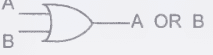


| A B | AND |

| T T | T |

| T F | F |

| F T | F |

| F F | F |

| A B | OR |

| T T | T |

| T F | T |

| F T | T |

| F F | F |

| A | NOT |

| T | F |

| F | T |

图 1-1. `AND`、`OR` 和 `NOT` 门

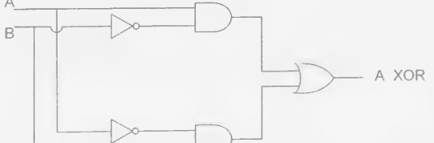

| A B | XOR |

| T T | F |

| T F | T |

| F T | T |

| F F | F |

图 1-2. 由 `AND`、`OR` 和 `NOT` 门组成的 `XOR` 电路

微处理器受一个安装在 `PC` 板（打印电路板）上的小型陶瓷外壳的保护 [1,2]。主板上还存在内存芯片。计算机内存是一个被称为“位”（`bits`）的统一存储单元池。一个位存储最小的单位单位：“开”或“关”或“0”。出于实际考虑，位被分为八位一组，称为“字节”（`bytes`）。

## 4 第 1 章 ~ 硬件、软件和互联网简介

- 一个字节是八位。

内存没有其他的结构：相同的内存被用于存储数字、字母、声音、图像和程序。所有这些东西必须以某种方式编码为 `0` 和 `1` 的序列。2010 年制造的一台典型的个人电脑在几个 `SIMM`（单线直插内存模块）中封装了 2 到 4 “`GB`”（千字节；1 `GB` 等于 `2^30` ≈ `10^9` 字节）的 `RAM`（随机存取存储器）。

`CPU` 解释并执行存储在内存中的程序或指令序列。`CPU` 取下一条指令，解释其操作码并执行相应的操作。有用于算术和逻辑操作的指令，用于将字节从一个位置复制到另一个位置的指令，以及改变指令执行顺序的指令。指令按顺序执行，除非特定指令告诉 `CPU` “跳转”到程序的另一个地方。条件分支指令根据上一次操作的结果告诉 `CPU` 继续执行下一条指令或跳转到另一个地方。

除了 `CPU` 之外，通用计算机系统还包括提供输入、输出和次级大容量存储的外设设备 [1]。在笔记本电脑中，“外设”设备不再是完全是外设的：键盘、显示器、硬盘、`DVD` 驱动器、无线网络适配器、摄像头（摄像头）、触控板、麦克风和扬声器都集成在一个便携单元中。

`CPU`、内存、外设设备，这一切统被称为硬件。这是在一个小设备中集中的巨大能量。但为了让它有用、赋予它生命，你需要程序、软件。计算机程序是工程学的奇迹，但属于不同的类型：软件工程。它们不是铸在铁里的，也不是用硅制成的，而是由无形的文本组成的，这些文本可以被分析、修改、从一种计算机语言翻译成另一种语言、复制到各种介质中、通过网络传输或永远丢失。软件之于计算机正如歌曲之于乐队：如果没有音乐可以演奏，最优秀的音乐家也将保持沉默。

拿起这个带有软件的奇妙设备并将其连接到互联网——一个由数十亿台各种类型的计算机通过各种通信线连接在一起并运行各种程序的网络——你将得到一个全新的世界。欢迎来到网络空间！

## 第 1 章 ~ 练习题

在本章的剩余部分，我们将简要讨论：

- 主要硬件组件：`CPU`、内存、外设设备

- 什么是软件

- 数字和字符如何在计算机内存中表示

- 什么是互联网

## 1.2 - 1.7

这些章节可以在网上 `http://www.skylit.com/javamethods` 查看。

## 练习题

### 章节 1.1-1.4

- 1. 根据给定输入，为以下每个电路的输出标记 `T`（真）或 `F`（假）。

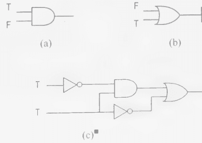

- 2. 假设如果两个电路对相同输入产生相同的输出，则它们是等价的。使用两个 `NOT` 门和一个 `AND` 门画出一个与问题 1-b 中的电路等的电路。✓

- 3. 将问题 1-c 中的电路简化为仅包含两个门的等价电路：一个 `NOT` 门和一个 `AND` 门。

## 6 第 I 章 ~ 硬件、软件和互联网简介

- 4. (a)* 使用两个 `NOT` 门、两个 `OR` 门和一个 `AND` 门画出一个与图 1-2 中不同的 `XOR` 电路。提示：至少有一个输入 `A` 或 `B` 为真。

  (b)* 使用一个 `OR` 门、两个 `AND` 门和一个 `NOT` 门画第三个 `XOR` 电路。

- 5. 内存被称为：

  A. 快速访问数据。

  B. 安装在主板上。

  C. 以字节测量。

  D. 字节可以被寻址。

  E. 以数组形式存储。

  F. 随机访问。

- 6. 对下列陈述标记真或假：

  (a) 一个兆可以存储信息。✓

  (b) 磁盘是格式化的。✓

  (c) 操作系统位于磁盘上。✓

- 7. 拔掉电源线并断开所有电缆，找到这台计算机的 `USB` 接口。

- 8. 识别下列实体是：

  (a) 操作系统

  (b) `CPU`

  (c) `GUI`（图形用户界面）✓

  (d) 总线

  (e) 文件

- 9. 运行在计算机上的操作系统：

  a. 文字处理器

  b. 浏览器

  c. 电子表格

  d. 电子邮件

  e. 图像处理

- 10. 对下列陈述标记真或假：

  - 只有数据存储在 `RAM` 中。

  - 在 `ASCII` 中，每个字符以字节表示。

  - 16 位二进制数表示非负整数。

  - 固件存储在 `ROM` 中。

- 11. 不同的二进制数数量是：

  - 3 位？

  - 8 位？

  - 2 字节？

- 12. 假设二进制数以通常表示，最低位在右侧，写出下列二进制数的十进制和十六进制值：

| 二进制 | 十进制 | 十六进制 |

| :--- | :--- | :--- |

| 00001000 | 8 | 08 |

| 00011100 | 28 | 1C |

| 10000000 | 128 | 80 |

| 00000011 | 3 | 03 |

| 11000011 | 195 | C3 |

| 11110101 | 245 | F5 |

| 10101010 | 170 | AA |

13. 一项实验包括抛硬币 10 次，其结果是正反面的序列。有多少种可能的结果？

14. 存储一个具有 256 灰度级的 512x512 灰度图像需要多少内存？✓

当打印机缺纸时，并行接口的状态寄存器具有以下设置：位 7（最左位）“`BUSY`”设置为 1；位 5“`PE`”（纸端）设置为 1；位 3“`ERROR`”设置为 0。当打印机连接时，位 4 始终为 1；位 6 为 0；位 0-2 不使用。写出打印机缺纸时状态寄存器的十六进制值。

16. 设计一种表示棋盘状态的方法。你的表示方法可以放入三个字节中吗？✓

17. 在子游戏中，石头排列在任意大小的堆中。每个玩家轮流从任意堆中取出一些石头。每个玩家每次必须至少取一个石头。最后拿走石头的人获胜。

这类游戏有获胜策略。这种策略可以通过将游戏中的所有位置标记为“加”和“负”来建立，使得从任何“加”位置的任何移动都会导致“负”位置，而从任何“负”位置总有一个可能的移动到“加”位置。最后的获胜位置必须标记为“加”。因此，如果第一个玩家开始于“负”位置，她可以通过立即移动到“加”位置并在随后的每次移动中返回“加”位置来获胜。

18.♦ 下表被称为希腊-罗马方阵：三个拉丁字母中的每一个在每行和每列中恰好出现一次；三个希腊字母中的每一个也是如此；且每个拉丁-希腊字母组合在表中也恰好出现一次：

| Αγ | Bα | Cβ |

|---|---|---|

| Bβ | Cγ | Aα |

| Cα | Aβ | Bγ |

用数字 0, 1 和 2 替换 A、B 和 C，并替换 α、β、γ（顺序任意）。将得到的三进制数转换为十进制（基10）数。三进制系统只使用三个数字：0、1 和 2。这些数字的表示方法如下：

| 十进制 | 三进制 |

|---|---|

| 0 | 0 |

| 1 | 1 |

| 2 | 2 |

| 3 | 10 |

| 4 | 11 |

| 5 | 12 |

| 6 | 20 |

| 7 | 21 |

| 8 | 22 |

| 9 | 100 |

| ... | ... |

将每个数字加 1。你将得到一个表格，其中数字 1 到 9 的排列方式使得每行和每列数字之和相等。解释为什么得到这个结果，并找到一种用数字 0、1、2替换字母的方法，使得两条对角线的数字之和也与行列相等。你得到的结果被称为魔方。使用类似的方法构建一个 5x5 的魔方。

# 第10页 第1章 ~ 硬件、软件和互联网简介

第 1.6 节

19. (`MC`) `TCP` 代表什么？

- A. `Telnet Control Program`（Telnet 控制程序）

- B. `Transmission Control Protocol`（传输控制协议）

- C. `Transport Compression Protocol`（传输压缩协议）

- D. `Telephone Connectivity Program`（电话连接程序）

- E. 以上都不是

20. 以下实体或设备是硬件 (`H`) 还是软件 (`S`)？

(a) 主机 `Host` ___ (b) 局域网 `LAN` ___ (c) 浏览器 `Browser` ___ (d) 搜索引擎 `Search engine` ___ (e) 路由器 `Router` ___ (f)* `TCP/IP` 适配器 `TCP/IP Adapter` ___

21. 寻找并探索一些互联网和世界维网先驱者的首页。


- 2.1 前言 12

- 2.2 编译器与解释器 14

- 2.3 软件组件与程序包 20

- 2.4 实验：说 Hello 的三种方式 21

- 2.5 面对象编程 27

- 2.6 实验：说 Hello 的更多方式 30

- 2.7 总结 37

练习题 38

## 2.1 前言

最早的计算机之一 `ENIAC`（电子数字计算机）于1942-1946年开发，主要用于军事应用，它的编程是由人们实际上将数百根电线连接到插座完成的（图2-1）——这几乎不是我们所知的“软件开发”活动。（`ENIAC`占据了一个巨大的房间，拥有1.8万个真空管，每秒可以执行300次乘法）。1946年，约翰·冯·诺曼提出了一个想法：计算机程序可以以编码`CPU`指令的形式存储在计算机内存中，同时存储程序运行的数据。随后，现代计算机诞生了：一种“通用的、数字的、程序存储的”计算机，可以执行计算并处理信息。


图2-1 两个技术人员正在为 `ENIAC` 右侧布线

（由美国陆军实验室提供）

一旦开发了程序存储计算机，讨论程序的“编写”就有了意义了。事实上，在计算机时代初期，程序员用铅笔在特殊的表格上编写程序；技术人员将程序打在打孔卡或穿孔带上。程序员拿着一叠孔卡进入机房是一常见的常景。相当大的程序完全使用八进制或十六进制指令代码和内存地址用机器码编写的。“编码”（coding）一词被用于编写程序和加密文本，这并非巧合。程序员仅仅是数学家、电气工程师或科学家，他们在需要为了工作使用计算机时自学掌握了这些技能。

在那个时代，计算机和“计算机时间”（即运行程序可用的时间）非常昂贵，远高于程序员的时间，高昂的计算机成本定义了游戏规则。例如，只有相当重要的计算机应用才能被考虑，如军事和科学计算、大型信息系统等。程序员努力通过开发高效算法来让他们的程序运行得更快（算法的概念在第4章中描述）。通常由一个或两个程序员编写整个程序并对其了如指，而没有人能理解它。计算机用户能够使用计算机已经感到很高兴了。现在，当计算机廉价到像家用电器时，重点已经转向了程序员的生产力、专业精神和团队协作，这需要使用标准的语言、工具和。在桌面上运行的软件应用程序功能丰富，并且必须非常“用户友好型”（即具有直观的用户界面）。还必须是可移植的（即能够在不同系统上运行）并国际化的（即易于适应不同语言）。由于大型团队在同一个软件项目上工作，团队遵循标准的开发方法论非常重要，并且程序要易于理解且文档齐全。因此，软件工程已像其他工程学科一样专业化：几乎没有个人独斗的空间。一个典型的项目项目包括以下任务：

- 与客户交互、理解需求、完善和规范

- 总体设计（定义软件产品的部分及其交互）

- 详细设计（定义对象、函数、算法、文件布局等）

- 设计/原型（设计屏幕布局、菜单、对话框、在线帮助、报告、消息等）

- 编码和调试

- 文档编写

- 测试

- 包装与交付

- 用户技术支持

以及在现实世界中：

- 漏洞修复、补丁和解决方案、更新版本、文档更新等。

当然有不同水平和类型的软件工程师，不需要同一个人具备开发良好软件的所有技能。通常需要一个由软件设计师、程序员、艺术家、技术作家、`QA`专家和技术支持人员组成的团队。

在本章相关的通用主题，如高级编程语言和软件开发工具。我们将讨论编译器和解释器的区别，以及 `Java` 的混合编译器+解释器方法。然后我们将学习如何编译和运行简单的 `Java` 应用程序和 `Applet`，并初步观察面向对象编程的概念。

## 2.2 编译器与解释器

计算机程序员很快意识到，计算机本身就是帮助他们编写程序的完美工具。当程序员开始使用汇编语言而不是数值编码的 `CPU` 指令时，迈向自动的第一步。在汇编语言中，每个 `CPU` 指令都有一个短的助记符。程序员可以为内存位置赋予符号名称，并通过名称引用这些位置。例如，使用 `Intel 8086` 微处理器汇编语言的程序员可以写：

```assembly
index dw 0 ; "定义字" --- 预留 2 字节
; 用于整数并命名为 "index"。

mov si,index ; 将 index 的值移动到
; SI 寄存器。
```


一种名为汇编器（`assembler`）的特殊程序会将汇编语言编写的程序文本转换为 CPU 预期的机器码。

显然，汇编语言完全依赖于特定的 CPU；将程序移植到不同类型的机器上需要重写代码。随着计算机性能的提高，人们开发了多种高级编程语言以便以更抽象、与机器无关的方式编写程序。FORTRAN（公式翻译语言）定义于 1956 年，COBOL（通用面向业务语言）于 1960 年，Pascal 和 C 则于 20 世纪 70 年代。C++ 在 20 世纪 80 年代从 C 逐渐演变而来，为 C 增加了 OOP（面向对象编程）特性。Java 于 20 世纪 90 年代中期引入，并作为一种用于平台无关开发的完全面向对象的语言而流行起来，特别是对于通过互联网传输的程序。Java 和 OOP 是本书的主题，因此我们将在后续章节中详细介绍它们。

用高级语言编写的程序遵循该语言非常正式的语法规则。这种语法产生的语句是非常无歧的，以至于计算机也能正确解释它们。除了严格的语法规则外，程序还遵循风格规范；这些规范不是强制性的，但能让其他程序员更容易阅读和理解程序，展示出作者的专业性。

程序员使用名为编辑器（`editor`）的软件来编写程序文本。与通用的文字处理程序不同，程序编辑器可能具有编写程序所需的特殊功能。例如，编辑器可能会使用颜色来高亮程序中不同的语法元素，或者具有内置工具用于输入特定编程语言中常见的标准词或表达式。

特定编程语言的程序文本称为源代码（`source code`），或简称为源。源代码存储在文件中，称为源文件。

在计算机上运行之前，用高级编程语言编写的程序必须以某种方式转换为 CPU 指令。一种方法是使用名为编译器（`compiler`）的特殊软件工具。编译器针对特定的编程语言和特定的 CPU。它分析源代码并生成相应的指令。结果保存在另一个文件中，称为对象模块（`object module`）。一个大型程序可能包含多个源文件，它们被分别编译成对象模块。另一个程序——链接器（`linker`），将所有对象模块合并为一个可执行程序，并将其保存在可执行文件中（图 2-2）。

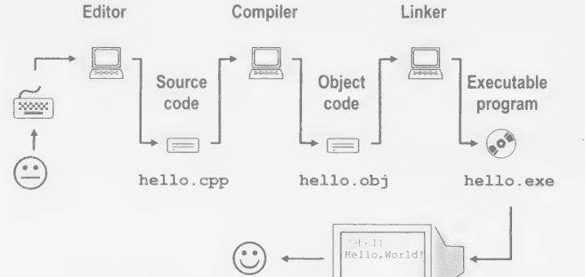

图 2-2 编译程序的软件开发周期：编辑-编译-链接-运行

对于编译程序，一旦构建并测试完成，可执行文件就会分发给用户。用户不需要访问程序的源代码，也不需要编译器。

> Java 也使用编译器，但正如我们很快要解释的，Java 编译器并不生成对象代码。

在另一种方法中，高级语言程序不编译而是通过名为解释器（`interpreter`）的软件工具进行解释。编译器和解释器之间的区别细微但很重要。解释器查看高级语言程序，找出执行它需要的指令并执行它们。但它不会生成对象代码文件，也不会保存编译后或可执行的代码。解释型程序的用户需要访问程序的源代码和解释器，并且程序在每次运行时都必须重新解释。这就像现场音乐会相对于录音室录音，而现场表演每次都需要乐器。

编程语言通常被分为编译型语言或解释型语言（即通常更多地使用编译器或解释器）。FORTRAN、COBOL、Ada、C++ 通常是编译的；BASIC、Perl、Python 是解释的。但实际上并没有明确的界限。例如，BASIC 最初是解释型语言，但很快开发了 BASIC 编译器。C 通常是编译的，但也存在 C 解释器。

Java 则不同：它采用编译器加解释器的混合方法。Java 编译器编译字节码（`bytecode`），这是一种非常接近机器语言的指令。但不存在这种机器语言的机器！它是一个抽象计算机，即 Java 虚拟机（`JVM`）。字节码在特定计算机上由该特定 CPU 的 Java 解释器进行解释。字节码不是对象代码，因为它与平台无关（它不使用特定 CPU 的指令）。它也不是源代码，因为人类无法读懂。它是介于两者之间的某种东西。

为什么 Java 要使用编译器和解释器的组合？没有理由不为特定类型的计算机创建一个普通的 Java 编译器。Java 的主要目的之一是通过互联网向用户交付程序。支持 Java 的浏览器（即内置了 Java 解释器的浏览器）可以运行 Java 程序，这种程序称为 applet（微型应用程序）。互联网上有许多免费的应用程序及其源代码，这是 Java 如此迅速流行的原因之一。当你连接到网站并看到复杂的动作或交互功能时，可能意味着你的计算机接收到了一个 applet 正在运行它。

Java 设计者必须解决一个关键问题：用户应该接收源代码还是可执行代码？答案是两者都不是。如果用户获取源码，他们的浏览器就需要内置的 Java 编译器或解释器。这会让浏览器变得非常大，而且在用户计算机上编译或解释可能花费很长时间。此外，软件提供者可能希望保持源代码的机密。但如果用户获取执行文件，那么网站运营商就需要某种方式知道每个用户的是什么计算机（例如 PC 或 Mac），并交付正确的版本。对于网站运营商来说，维护不同平台的版本是非常昂贵的。还有安全风险：如果有人向你的计算机交付了恶意程序怎么办？

字节码提供了一个中间步骤，作为向用户发送源代码或可执行文件的折中（图 2-3）。一方面，字节码语言与平台无关，同一版本的字节码可以服务不同类型的计算机。它无法被人类轻易阅读，因此可以保护源代码的机密性。另一方面，字节码更接近“平均”机器语言，解释“原始”Java 源代码更容易且更快。此外，内置在浏览器中的字节码解释器有机会检查程序的潜在安全违规（例如，它们可以阻止对用户磁盘的读写）。

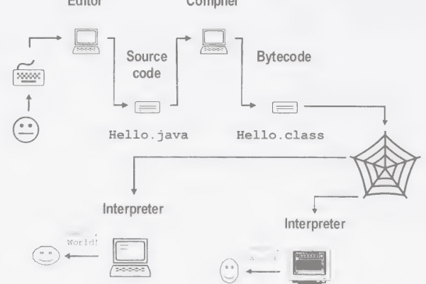

图 2-3 通过互联网进行 Java 软件开发和发布

为了加速 applet 的加载，出现了一种新的软件技术，称为 JIT 编译器。JIT 编译器结合了编译器和解释器的特性。在解释字节码的同时，将其编译成可执行代码。延续我们的音乐类比，JIT 编译器的工作方式就像现场音乐会的录音。这意味着 applet 一旦从互联网下载就可以被解释并开始运行。在后续运行同一个 applet 时，它可以从其可执行文件加载并运行，无需等待重新解释字节码。

## 2.2 编译器与解释器

自然地，字节码并不非要通过互联网到达用户：Java 程序可以在同一台计算机上进行编译和解释。这正是我们在实验室和练习中测试 Java 应用程序时所做的。我们不需要使用浏览器来测试小程序（`applet`）：标准的 Java 开发工具包（`JDK`）有一个名为 Applet Viewer 的程序，它可以运行小程序。

现代软件开发系统将编辑器、编译器和其他工具集成在一起形成一个集成开发环境（`IDE`）。某些软件开发工具（例如程序编辑器）内置在 IDE 程序本身中；而较大的工具（如编译器、解释器）通常是独立的程序，IDE 仅作为其前端。IDE 具有方便的 GUI（图形用户界面）——只需点击图标，即可编译并运行你的程序。

现代程序可能更加复杂，涉及几十种不同类型的对象和函数。结构分析器和查看器在 IDE 中构建源文件、对象、函数以及它们之间关系的图形视图。GUI 可视化原型设计和设计工具帮助程序员设计和实现图形用户界面。

很少有程序在第一次编写时没有任何错误，或者用程序员所说的“bug”（错误）（图 2-4）。


图 2-4 “bug”一词由传奇的计算机先驱格蕾丝·霍珀（Grace Hopper）推广，她是第一个提出编译器想法的人，并创建了 COBOL。霍珀最喜欢的故事之一关于一只被困在继电器触点之间的蛾子，它导致了 Mark II 电器计算器的故障（哈佛大学，1945年）。技术人员移除了蛾子，并将其固定在照片所示的日志上。

程序员区分语法错误（`syntax errors`）和逻辑错误（`logic errors`）。

语法错误违反了语言的语法规则，会被编译器捕捉。逻辑错误是由程序中的逻辑缺陷引起的；它们不会被编译器捕捉，而是在“运行时”（`run-time`）出现，即程序运行时。某些运行时错误会导致异常（`exception`）：程序遇到致命条件并带有错误消息终止，该消息描述了异常的类型以及导致异常的程序语句。其他运行时错误可能会导致程序的意外行为或错误结果。这些错误只有在对程序进行彻底测试时才能被捕获。

仅仅通过查看源代码或在不同数据上测试程序，并不总是容易修复 bug 的。为了帮助这一点，有特殊的调试器（`debugger`）程序，允许程序员以“慢动作”跟踪程序的执行。调试器可以在指定的断点（`break point`）处暂停程序，或逐条执行程序语句。在调试器的帮助下，程序员可以检查每一步操作后的操作序列和内存位置的内容。

## 2.3 软件组件与包

从零开始编写程序是有趣的，就像从种子开始自己种番茄，但在当前环境下，很少有人负担得起。一个业余爱好者面对编程任务时会问：编写这段代码最原始（优雅、高效、有创意、有趣等）的方法是什么？专业人士会问：编写这段代码是否可以使用某些别人已经写好的代码？在数十亿行代码被编写的情况下，可能已经实现了此或类似的任务，没有必要重复他们的努力。（这是一个现代原则，但不要在家庭作业中尝试！）软件是一种独特的产品，因为其所有生产成本都投入到了单个产品的设计、编码和测试中；而制造多个副本几乎是免费的。真正的任务是找出已经做了哪些工作，如果不免费则购买其权利，并进行复用。

有很多可复用代码的来源。大量的软件包随你的编译器一起提供。其他包可以从第三方软件供应商购买，这些供应商专门为开发人员开发和营销可复用软件包。还有一些包可能以开源哲学的精神免费提供。此外，每位经验丰富的程序员都积累了自己的可复用代码集。

软件的可复用性是一个双层概念。作为程序员，你希望通过复用现有代码来提高效率。但你也想编写可复用的代码，以便你自己、你的团队、你的企业以及整个世界以后从中受益。创建可复用的代码不是自动的：你的代码必须满足某些要求才能真正可复用。以下是这些要求的部分列表：

- 你的代码必须被分成足够小的部分或组件（模块）。每个组件必须有清晰且相当通用的用途。实现更通用功能的组件必须与更专门的组件分开。
- 你的软件组件必须有良好的文档，特别是接口部分，它告诉用户（在这种情况下是另一位程序员）此组件的功能以及具体如何使用它。用户并不一定总是想知道某个特定组件是如何实现它的。
- 组件必须是健壮的（`robust`）。它们必须在组件可以使用的所有可能条件下经过彻底测试，并且这些条件必须清晰地记录。如果软件模块遇到了它不应该工作的条件，它应该优雅地处理此类情况，给用户一个关于失败原因的线索，而不是直接导致系统崩溃。
- 应该能够在不完全重写的情况下自定义或扩展你的组件。

单个软件组件通常被组合成包（`packages`）。一个包组合了处理一组特定结构或对象的函数：处理图形的图形包；处理文本的文本包；提供数学函数的数学包；提供帮助的实用程序包；以及提供网络通信的网络包。此外，每位经验丰富的程序员都积累了自己的可复用代码集。

## 2.4 实验：三种 Hello Hello

在本节中，我们将使用最基础的工具（`JDK` 开发工具包）。JDK 来自于 Java 的所有者太阳公司。JDK 工具是命令行工具，这意味着用户必须输入编译器、解释器或 Applet Viewer。这些程序位于 JDK 安装目录的 `bin` 子目录下。为了从任何文件夹访问这些程序，你需要设置路径，但今天我们只输入一两次，因为我们不打算长期使用。

创建一个工作文件夹（例如 `C:\my`），你将在其中放置程序。你可以使用任何编辑器（如记事本）或文字处理器（如 Word）或你的 IDE 来输入 Java 代码。如果你使用文字处理器，请确保将 Java 源文件保存为“文本”。但文件扩展应该是 `.java`。

在你的编辑器中输入以下程序并将其保存为文本文件 `HelloWorld.java`：

```java
/**
 * 在屏幕显示 "Hello World!" 消息
 */
public class HelloWorld {
    public static void main(String[] args) {
        System.out.println("Hello, World!");
    }
}
```

在命令提示符中输入以下内容运行你的程序：

```cmd
javac HelloWorld.java
java HelloWorld
```

`javac` 命令将源代码编译为字节码（创建 `.class` 文件）。`java` 命令解释字节码并运行程序。

> 保存 Java 类的文件名必须与该类名完全相同（加上 `.java` 扩展名）。

Java 解释器调用你类中的 `main` 方法来启动程序。每个应用程序（Applet 除外）必须有一个 `main` 方法。你程序中的方法是：

```java
public static void main(String[] args)
```

目前，将其视为一种习惯用法。你稍后将学习 `public`、`static`、`void`、`String` 和 `args` 这些词的含义。

`System` 是所有 Java 程序内置的一个类。它提供了若干系统级服务。`System.out` 该类中的数据元素，代表计算机屏幕输出设备的对象。它的 `println` 方法在屏幕上显示字符串。

仔细检查你输入的内容并纠正任何错误——这将节省时间。

保存你的文件并关闭编辑器。打开命令提示符窗口（你可以在开始菜单的“所有程序/附件”下找到它）。使用 `cd`（更改目录）命令导航到包含程序的文件夹（例如 `mywork`），并设置路径：

```
C:\Documents and Settings\Owner>cd \mywork
C:\mywork> path:\program files\java\jdk1.6.0_21\bin;%PATH%
```

现在编译你的程序：

```
C:\mywork> javac HelloWorld.java
```

如果你在源文件中写错了什么，你将收到编译器报告的错误列表。如果这个列表很长，不要担心，因为一个拼写错误可能会导致多个错误。根据上面的程序文本验证你的代码，消除拼写错误，并重新编译直到没有错误。

输入 `dir`（目录）命令：

```
C:\mywork> dir
```

你应该会在文件夹中看到名为 `HelloWorld.java` 和 `HelloWorld.class` 的文件。后者是编译器创建的字节码文件。

现在运行 Java 解释器来执行你的程序：

```
C:\mywork> java HelloWorld
```

每当你对源代码进行更改时，都需要重新编译；否则解释器将对旧版本的 `.class` 文件运行。

Java 应用程序可以接受操作系统的“命令行”参数。这些是用户在运行程序时在命令行输入的单词或数字（用空格分隔的字符字符串）。例如，如果程序名称是 `Greetings`，而你想向它传递两个参数 "Annabel" 和 "Lee"，

```
C:\mywork> java Greetings Annabel Lee
```

如果你正在使用 IDE，它通常有一个选项（一个对话框），你可以在运行程序之前在其中输入命令行参数。

> 如果你已经在使用 IDE 且不想研究如何在其中输入命令行参数，请跳过此练习。

接下来的 Java 程序期望两个命令行参数。

```java
/**
 * 此程序期望两个命令行参数
 * -- 人的名字和姓氏。
 * 例如：
 * C:\mywork> java Greetings Annabel Lee
 */
public class Greetings {
    public static void main(String[] args) {
        String firstName = args[0];
        String lastName = args[1];
        System.out.println("Hello, " + firstName + " " + lastName + "!");
        System.out.println("Congratulations on your second program!");
    }
}
```

在你的编辑器中输入此程序并将其保存为纯文本文件 `Greetings.java`。编译此程序：

```
C:\mywork> javac Greetings.java
```

现在用两个命令行参数运行它：你的名字和姓氏。

我们现在可以尝试一个提示你输入名字然后显示消息的程序。我们可以修改之前的程序。首先将其副本保存到文本文件 `Greetings2.java` 中。

```java
/*
 * 此程序提示用户输入其
 * 名字和姓氏，并显示问候消息。
 * 作者：Maria Litvin
 */
import java.util.Scanner;

public class Greetings2 {
    public static void main(String[] args) {
        Scanner keyboard = new Scanner(System.in);
        System.out.print("Enter your first name: ");
        String firstName = keyboard.nextLine();
        System.out.print("Enter your last name: ");
        String lastName = keyboard.nextLine();
        System.out.println("Hello, " + firstName + " " + lastName);
        System.out.println("Welcome to Java!");
    }
}
```


`Greetings2` 类使用了来自 `java.util` 包的 Java 类 `Scanner`。该类有助于从键盘输入读取数字、单词和行。程序顶部的 `import` 语句告诉 Java 编译器哪里可以找到 `Scanner.class`。

编译 `Greetings2.java` ——


```
C:\mywork> javac Greetings2.java
```

——并运行它：

```
C:\mywork> java greetings2
```

你得到了什么？

## 2.5 面向对象编程

Exception in thread "main" java.lang.NoClassDefFoundError: greetings2 (wrong name: Greetings2)

at ... (stack trace omitted)

[注：提供的 OCR 文本包含重复的堆栈跟踪片段和类名]

在 OOP 程序中，许多事情可能同时发生，并且外部事件（例如，用户的窗口缩放等）可以决定程序的执行顺序。当然，一个 OOP 程序仍然运行在顺序执行的冯·诺依曼计算机上；但软件模拟了并行性和对事件的异步处理。

一个 OOP 程序通常定义了许多类型的对象。然而，一种类型的对象可能与另一种类型非常相似。例如，一种类型的对象可能需要拥有另一种类型的所有功能外加一些额外特性。在另一个类中复制一个类的所有功能将是浪费。继承机制允许程序员声明一个对象类扩展另一个类。同一个类可以以多种方式被扩展，因此一个父类可能有若干个派生自它的子类（图 2-5）。子类可能会变成其他类的父类，例如 `Music` 是 `Audio` 和 `MP3` 的父类。一个应用程序最终看起来像一棵分支树，即类的层次结构。具有更通用特征的类靠近层次结构的顶端，而具有更特定功能的类更靠近底部。

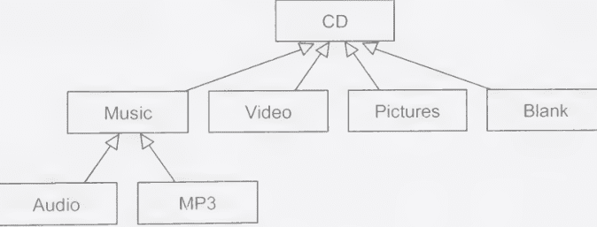

图 2-5. 表示不同内容类的类的层次结构

面向对象编程旨在解决软件开发中的当前需求：更低的软件开发和文档成本、更好的团队协作开发、软件组件的积累和重用、更高效的多媒体和 GUI 应用程序实现等。Java 是一种完全面向对象的语言，支持继承和事件驱动模型。它包含了用于图形、GUI、多媒体、事件处理以及其他基本软件开发工具的标准包。

我们在书中的主要重点是处理类层次结构。Java 中的事件驱动软件和事件处理被认为是更高级的话题。例如，它们没有包含在高级放置（Advanced Placement）计算机课程的描述中。我们将在第 17 和第 18 章讨论 Java 中的事件处理并提供示例。

## 2.6 实验：更多说 Hello 的方式

在第 2.4 节中，我们学习了如何运行简单的控制台应用程序。然而，这些类型的程序并不是让 Java 强大的原因；它们可以很容易用其他编程语言编写。

> Java 与其他语言区别的特性是它对 GUI 和图形的内置支持，以及对面向对象编程的支持。

在本节中，我们将考虑另外四个例子：两个应用程序（一个带有简单的 GUI 对象，另一个带有图形）和两个 applet（一个带有图形，一个带有动画）。当然，在现阶段，我们还无法理解这些示例中的所有代码——我们还有一整本书要读！这只是对未来事情的预览，是一个大致了解内容并观察这些简单程序如何运行的机会。

### 1. 一个 GUI 应用程序

在程序 `HelloGui.java` 中，我们在屏幕上创建了一个标准窗口并在其中放置了“Hello, GUI!”。我们的 `HelloGui` 类扩展了 `JFrame` 库类，它是 Java Swing 包的一部分。我们很幸运可以重用 `JFrame` 的代码；从头开始编写这样的类将是一项艰巨工作。我们必须弄清楚如何显示窗口的标题栏和边界，如何支持窗口缩放和其他标准功能。`JFrame` 处理了这一切。我们剩下的就是向窗口的内容面板（content pane）中添加一个标签——这是你放置 GUI 组件的区域。

我们的 `HelloGui` 类如图 2-6 所示。在该程序中，`main` 方法创建了一个对象，我们称之为 `window`。该对象的类型被描述为 `HelloGui`；这意味着 `window` 是 `HelloGui` 类的一个实例。该程序只使用了该类的一个对象。然后，`main` 方法设置 `window` 的大小和位置（以像素为单位）并将其显示在屏幕上。我们的类有一个构造函数，这是一个构造该类对象的特殊过程。构造函数的名称与类相同。在这里，构造函数调用父类的构造函数来设置在窗口标题栏中显示的文本，并向窗口的内容面板添加一个标签对象。

```java
/**
 * 此程序在窗口中显示一条消息。
 */

import java.awt.*;
import javax.swing.*;

public class HelloGui extends JFrame {
    public HelloGui() //构造函数
    {
        super("GUI Demo"); // 设置标题栏
        Container c = getContentPane();
        c.setBackground(Color.CYAN);
        c.setLayout(new FlowLayout());
        c.add(new JTextField("Hello, GUI!", 10));
    }

    public static void main(String[] args) {
        HelloGui window = new HelloGui();

        // 设置此窗口的位置和大小
        // 左上角位于 300, 300；宽度 200，高度 100
        window.setBounds(300, 300, 200, 100);

        window.setDefaultCloseOperation(JFrame.EXIT_ON_CLOSE);
    }
}
```


图 2-6. JM\Ch02\HelloGui\HelloGui.java

图 2-6 中的代码有点晦涩，但我们仍然能大致看出发生了什么。不要重打程序——只需从 `JM\Ch02\HelloGui` 文件夹将 `HelloGui.java` 复制到你当前的工作文件夹中。在你喜欢的 IDE 中建立项目，并添加该类。在你的 IDE 中通过命令、按钮或快捷键编译并运行程序。

### 2. Hello, Graphics

我们现在稍微修改我们的程序，在窗口上绘制图形而不是文本标签。新的类 `HelloGraphics` 如图 2-7 所示。

```java
// 此程序在窗口中显示简单的图形。

import java.awt.*;
import javax.swing.*;

public class HelloGraphics extends JPanel {
    // 覆盖 paintComponent 方法
    public void paintComponent(Graphics g) {
        super.paintComponent(g); // 调用 JPanel 的 paintComponent 方法
        // 绘制背景
        g.setColor(Color.RED);
        // 绘制一个左上角位于 20, 40 的 150x45 矩形
        g.fillRect(20, 40, 150, 45);

        g.setColor(Color.BLUE);
        // 在 60, 25 处绘制字符串
        g.drawString("Hello, Graphics!", 55, 65);
    }

    public static void main(String[] args) {
        JFrame window = new JFrame("Graphics Demo"); // 设置此窗口的位置和大小
        // 左上角 300, 300；宽度 200，高度 100
        window.setBounds(300, 300, 200, 100);
        window.setDefaultCloseOperation(JFrame.EXIT_ON_CLOSE);

        HelloGraphics panel = new HelloGraphics();
        panel.setBackground(Color.WHITE); // 默认颜色是浅灰色
        Container c = window.getContentPane();
        c.add(panel);

        window.setVisible(true);
    }
}
```

图 2-7. JM\Ch02\HelloGui\HelloGraphics.java

`HelloGraphics` 扩展了类 `JPanel`。每个 `JPanel` 都有一个 `paintComponent` 方法用于生成面板的所有图形。每当窗口打开、调整大小或重绘时，`paintComponent` 会被调用。这些事件由操作系统报告给程序。

默认情况下，`JPanel` 的 `paintComponent` 方法只绘制背景。我们的 `HelloGraphics` 类覆盖了该方法，以便在红色框内添加蓝色消息。`paintComponent` 接收一个 `Graphics` 类型的对象（通常称为 `g`），它代表面板的图形上下文（其位置、大小等）。

> 图形坐标以像素为单位，原点 (0, 0) 位于面板的左上角（y 轴向下）。

我们将 `main` 方法放在同一个类中以简化处理。如果你愿意，可以将我们的 `HelloGraphics` 类拆分为两个独立的类：一个可以称为 `HelloPanel`，它扩展 `JPanel` 并拥有 `paintComponent` 方法；另一个可以称为 `HelloGraphics`，它拥有 `main` 方法且没有其他的（不需要扩展任何库类）。你的项目应该包含这两个类。

### 3. Hello, Applet

Applet 是嵌入网页中并通过互联网传输的小程序。从程序员的角度来看，applet 和 GUI 应用程序之间的差异很小。与其扩展 `JFrame`，你的 applet 类扩展了 `JApplet`，这是一个表示 applet 的 Swing 库类。applet 不需要 `main` 方法，因为浏览器（或 Applet Viewer）会自动构造 applet 并作为 Web 文档的一部分显示。而不是构造函数，你的 applet 类使用 `init` 方法来初始化 applet。图 2-8 显示了从 `HelloGraphics` 类适配而来的 `HelloApplet` 类。此 applet 重定义了 `JApplet` 的 `paint` 方法以显示图形。

```java
/*
 * 此 applet 在框内显示一段文本。
 */

import java.awt.*;
import javax.swing.*;

public class HelloApplet extends JApplet
{
    public void init() {
        Container c = getContentPane();
        c.setBackground(Color.WHITE);
    }

    public void paint(Graphics g) {
        super.paint(g);      // 调用 JApplet 的 paint 方法
                              // 以绘制背景
        g.setColor(Color.RED);
        g.drawRect(25, 40, 150, 45); // 绘制一个 150 比 45 的矩形
        g.setColor(Color.BLUE);
        g.drawString("Hello, Applet!", 60, 65);
    }
}
```

图 2-8. JM\Ch02\HelloGui\HelloApplet.java

这个 applet 的代码比 `HelloGraphics` 短。但现在我们需要另一个文件来描述这个 applet，即一个展示该 applet 的网页。网页的内容和布局通常用 HTML（超文本标记语言）描述。你可以在附录 C 中找到简短的 HTML 教程。在这里我们可以使用一个非常简单的 HTML 文件（图 2-9）。我们称其为 `TestApplet.html`。如你所见，某些信息——applet 内容面板的大小——已经从 Java 代码转移到了 HTML 文件中。标题栏不再使用，因为 applet 并不是在独立的窗口中运行，而是嵌入在浏览器（或 Applet Viewer）的窗口中的。applet 也没有退出按钮（浏览器或 Applet Viewer 窗口有一个）。

```html
<html>
<head>
<title>我的第一个 Java Applet</title>
</head>

<body>
<applet code="HelloApplet.class" width="300" height="100"
alt="Java 类加载失败">
Java 已禁用
</applet>
</body>
</html>
```

图 2-9. JM\Ch02\HelloGui\TestApplet.html

你可以直接在 IDE 中测试你的 applet，也可以在浏览器中打开它。如果你有一个网站，可以将 `TestApplet.html` 页面上传到你的站点，连同 `HelloApplet.class` 文件一起，让全世界看到。

> 你可以通过将 `HelloApplet.class` 替换为新 applet 的名称，并在必要时调整 applet 的大小，修改 `TestApplet.html` 以运行另一个 applet。

### 4. 你好，动作

现在，为了好玩，让我们给 applet 增加一些动作（图 2-10）。编译 `JM\Ch02\HelloGui` 中的 `Banner` 类，并在 Applet Viewer 或浏览器中打开来自同一文件夹的 `TestBanner.html` 文件进行测试。

查看 `Banner.java` 中的代码。该类中的 `init` 方法创建了一个名为 `clock` 的 `Timer` 对象并启动了定时器。`Timer` 被设置为每 30 毫秒触发一次。每当定时器触发时，它就会生成一个事件并在 `actionPerformed` 方法中捕获。该方法调整 banner 的位置并重绘屏幕。

你会发现，遗憾的是这个 applet 的动画效果并不平滑：每当 banner 移动时屏幕就会闪烁。Java Swing 包的优势之一就是它可以帮助处理这个问题。我们将在后面的章节学习如何做。

```java
/* 此 applet 显示一条在屏幕上横向移动的消息。 */

import java.awt.*;
import java.awt.event.*;
import javax.swing.*;

public class Banner extends Applet
implements ActionListener
{
    private int xPos, yPos; // 存储 banner 的坐标

    public void init() {
        Container c = getContentPane();
        c.setBackground(Color.WHITE);
        xPos = c.getWidth();
        yPos = c.getHeight() / 2;
        Timer clock = new Timer(30, this); // 每 30 毫秒触发一次
        clock.start();
    }

    // 在重绘请求后自动调用
    public void paint(Graphics g) {
        super.paint(g);
        g.drawString("Hello, World!", xPos, yPos);
    }

    // 在定时器触发时自动调用
    public void actionPerformed(ActionEvent e) {
        Container c = getContentPane();

        // 调整 banner 的水平位置
        xPos--;
        if (xPos < -100) {
            xPos = c.getWidth();
        }

        // 设置 banner 的垂直位置
        yPos = c.getHeight() / 2;

        repaint();
    }
}
```

图 2-10. JM\Ch02\HelloGui\Banner.java

## 2.7 总结

在现代开发环境中，程序员通常使用高级编程语言之一（如 C++、Python 或 Java）编写程序。用高级语言编写的程序遵守该语言精确的语法规则，并且必须遵循专业人士之间建立的风格约定。对于编译型语言（如 C 或 C++），软件程序的编译器将高级语言的程序源代码翻译成机器码。

Java 采取了混合方法：源代码由 Java 虚拟机 (JVM) 编译成字节码。JVM 不是真正的计算机，而是一个抽象模型。字节码独立于特定的计算机且更容易解释。

IDE（集成开发环境）将许多工具（包括编辑器、编译器、调试器）整合在一个方便的 GUI（图形用户界面）中。软件开发职业已从一种手艺演变为一种严谨的工程学科，拥有自己的方法论、工具和风格。现代应用程序部分由标准包构建，并追求可靠性、性能和风格要求。

## 习题

1. 与机器语言相比，使用高级语言的优点是哪些？请判断对错：

   - 更容易编写。
   - 更容易阅读和理解。
   - 程序运行效率更高。


- 程序在不同平台之间更容易迁移。

- 2. 列出 Java 之外四种常用语言。

- 3. 判断对错并解释：

- 操作系统将源代码编译成字节码或可执行程序。

- 每个现代计算机系统都配备了编译器。

- 4. （单选题）哪个程序帮助程序员输入和修改源代码？

A 编辑器 B 编译器 C 链接器 D 解释器

E 以上都不是

- 6. 判断对错：现代 IDE 为编辑器、编译器、调试器和其他工具提供了 GUI 前端。

- 7. 描述编译器、JIT 编译器和解释器之间的区别。

- 8. (a) 将 HelloWorld 程序第一行的正斜杠替换为反斜杠。编译你的程序并观察结果。

(b) 直接删除前三行。编译并运行你的程序。Java 程序中的 `/*` 和 `*/` 标记起什么作用？

- 9. 写一个程序生成以下输出：

```
XXXXX
X   X
(( c ))
 | V |
-   -
```

- 10. 使用浏览器访问 Oracle 的 Java API（应用程序编程接口）文档网站（`http://download.oracle.com/jave/6/docs/api/index.html`），或者如果你在计算机上安装了 JDK 文档，打开文件 `<JDK 根目录>/docs/api/index.html`。

找到 `Color` 类的描述。该类定义了哪些颜色常量（`Color.RED`、`Color.BLUE` 等）？

11. (a) 编写一个程序，提示用户输入一个整数，并按如下所示显示输入的两倍：

```
Enter an integer: 5
2 * 5 = 10
```

提示：你需要在程序的顶部放置：

```
import java.util.Scanner;
```

`Scanner` 类有一个方法 `nextInt()`，可以从键盘读取一个整数。例如：

```
Scanner keyboard = new Scanner(System.in);
int n = keyboard.nextInt();
```

使用

```
System.out.println("2 * " + n + " = " + (n + n));
```

来显示结果。

(b) 移除 `n + n` 周围的括号并再次测试程序。`+` 运算符对于字符串和数字是如何工作的？✓

## 第 2.5-2.7

- 12. 写出面向对象编程核心的两个概念。

- 13. (a) 程序 `Red Cross` (`JM\Ch02\Exercises\RedCross.java`) 应该在白色背景上显示一个红十字。然而，它有一个错误。找到并修复该错误。

- (b) 以 `RedCross.java` 为原型，编写一个程序，在窗口中间显示 


✎ 提示：`Graphics` 类有一个方法 `oval()`；它的参数与 `drawRect` 方法中内接于矩形的椭圆的参数相同。✎ 

- 14. 修改 `HelloApplet` (`JM\Ch02\HelloGui\HelloApplet.java`) 以在蓝色背景上显示白色消息。✎ 提示：`Graphics` 有一个方法 `fillRect` 与 `drawRect` 类似，但它绘制的是一个填充了颜色的“实心”矩形，而不仅仅是轮廓。✎ ✓

- 15. 修改 `Banner` applet (`JM\Ch02\HelloGui\Banner.java`)，显示一个黑色实心框从右向左跨窗口移动。

以 `Banner` applet (`JM\Ch02\HelloGui\Banner.java`) 为原型，编写一个模拟横幅广告的 applet；它应该每 2 秒交替显示消息“East or West”和“Java is Best”。

提示：在你的类顶部，定义一个变量来跟踪应该显示哪条消息。例如：

```
private int msgID = 1;
```

在处理定时器事件的方法中，切换 `msgID` 在 1 和 -1 之间：

```
msgID = -msgID;
```

不要忘记调用 `repaint`。

在绘制文本的方法中，获取放置消息的坐标：

```
Container c = getContentPane();
int xPos = c.getWidth() / 2 - 30;
int yPos = c.getHeight() / 2;
```

然后使用条件语句显示适当的消息：

```
if (msgID == 1)
{
}
else // 如果 msgID == -1
{
...
}
```

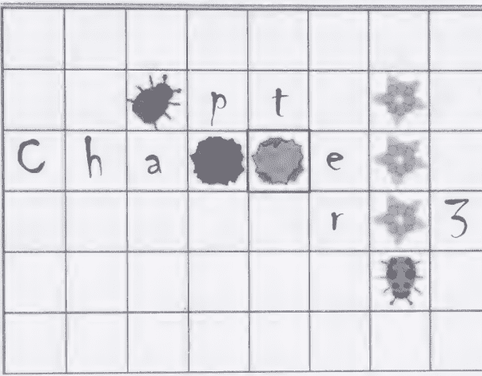

## 对象与类

- 3.1 引言 44
- 3.2 案例研究：GridWorld 45
- 3.3 类 49
- 3.4 实验：与角色交互 56
- 3.5 字段、构造函数和方法 56
- 3.6 继承 63
- 3.7 实验：随机错误 68
- 3.8 总结 70
  练习题 72

## 44 第 3 章 ~ 对象与类

## 3.1 引言

非技术人员有时会将计算机程序员的工作想象为坐在电脑前，用一种晦涩的编程语言编写代码行。也许这在匆匆观察者看来是这样的。事实并非如此。程序员（现在称为软件工程师）的工作不仅涉及数行或数页计算机代码，还涉及与任务匹配的条理结构。即使在计算机时代的早期，当程序直接用机器代码编写时，程序员首先会对手头任务开发出一个或多个抽象的视图。整个任务被拆分为有意义的子任务；然后设计一组完成特定子任务的程序；每个过程反又被分为有意义的段。

软件工程师必须能够看到大局，或根据需要放大到更复杂的细节。多年来，不同的软件开发方法不断演变，以促进这一过程并帮助程序员之间进行更好的通信。目前流行的方法是面向对象编程 (OOP)。OOP 被认为比以前的方法更具优势：

- 团队合作
- 软件组件的重用
- GUI 开发
- 程序维护

> 在 OOP 中，程序员将软件应用程序想象成一个相互作用对象的虚拟世界。

这个世界是高度结构化的。将程序中的对象简单地视为海洋中的鱼是天真的。如果我们把海洋比作比喻，考虑它的对象包括岛屿、船只、船上的帆、控制帆的绳子、船上的人、水中的鱼，甚至是地平线——一个物理上并不存在的对象。

## 3.2 案例研究：GridWorld 45

以下问题进入脑海：

- 谁描述所有类型的对象？
- 对象如何表示和存储信息？
- 什么时候创建对象？
- 对象如何通信？
- 对象如何用于任务？


# 第 3 章 对象与类

有时，很难判断两个具有显著结构差异和不同行为的对象是否应该属于不同的类，还是说它们仅在某些属性的值上有所不同。颜色仅仅是一个属性，因此不同颜色的花是同一个类的对象。但如果我们想要一种能够捕获并“吃掉”昆虫的食肉花，我们可能需要一个单独类来描述此类对象。在面向对象编程（OOP）语言中，可以进行折中：对象可以属于某个类的子类，并可以“继承”父类的一些代码（数据属性和行为）。例如，`CarnivorousFlower` 可以是 `Flower` 的子类。在 GridWorld 中，`Bug`、`Rock` 和 `Flower` 是不同类型的“actor”，`Bug` 和 `Rock` 都是 `Actor` 类的子类。`Actor` 是它们的超类。稍后详细介绍（第 3.6 节）。

图 3-1 中可见的其他对象都是 GUI 组件。有一个菜单栏、一个用于消息的文本区域，以及底部带有三个按钮和一个滑块的控制面板。

最后，我们看到了一个代表运行程序的整个窗口的对象。这个对象持有网格和 GUI 组件。

`BugRunner` 程序还使用了几种抽象类型的对象。例如，actor 的位置由 `Location` 类的对象表示，该类具有 `row` 和 `column` 属性。颜色由 Java 库类 `Color` 的对象表示。另一个不可见的对象是计时器，它在用户按下 Run 按钮时设定节奏。`Timer` 类也来自 Java 库。

在 OOP 中，重点从软件开发转向了软件设计。设计方法论——面向对象设计（OOD）与编程方法论（OOP）并行。良好的设计使实现变得更容易。但面向对象设计本身并不容易，糟糕的设计可能会导致项目偏离。

设计阶段从对粗略设计的初步讨论开始。设计师可能使用的非正式技术之一是 CRC 卡。CRC 代表“类（Class）、职责（Responsibilities）、协作者（Collaborators）”。CRC 卡简单来说是一张描述对象类的索引卡，包括该类的名称、该类型对象在程序中的主要“职责”以及它的“协作者”，即它所依赖的其他类（图 3-2）。

## 3.3 类

| Actor |
| :--- |
| 占据网格中的一个位置 |
| 移动 Location |
| 行为：可以移动则移动，否则转向 |

图 3-2. `Bug` 类的 CRC 卡

在初始阶段，软件设计师不需要确定所有细节。每种类型对象的职责用通用的术语描述。对额外类型对象的需求可能会在过程的后期变得明显。

### 类的定义

在 Java 中，程序员必须在程序的源代码中描述程序中使用的不同类型对象。

> 类是程序源代码的一部分，描述了特定类型的对象。类的正式描述被称为类定义或类声明。程序员编写类定义。

从非正式的角度来说，我们说程序员在“写类”，而一个 Java 程序的源代码由一个或多个类组成。

图 3-3 总结了类和对象的概念以及它们之间的区别。

| 类 | 对象 |
| :--- | :--- |
| 程序源代码的一部分 | 运行中程序中的一个实体 |
| 由程序员编写 | 在程序运行时创建 |
| 规定该类的结构（属性的数量和类型），对所有对象均如此 | 持有属性的特定值；这些值中的某些在程序运行时可以改变 |
| 规定对象可能的行为——对所有对象均如此 | 被调用时表现得当 |
| 一个 Java 程序的源代码由几个类组成 | 运行中的程序可以创建该类的任意数量对象（实例） |
| 像制作特定型号汽车的蓝图 | 像你驾驶的特定型号的汽车 |


类有时被比作饼干模：类的所有对象具有相同的配置，但可能有不同的口味。当程序运行时，该类的不同对象可能有不同的属性值。对于类，恰当的比喻可能是制造特定型号汽车的蓝图。就像同类的对象一样，相同型号的汽车具有完全相同的零件配置，但颜色可能是不同的，而且当汽车运行时，车内人数或油箱油量可能与另一辆相同型号的汽车不同。

> 源代码通常存储在单独的文件。

例如，`Actor`、`Rock`、`Bug`、`Flower`、`Location`、`ActorWorld` 和 `Explorer` 都是 GridWorld 的一些类。它们的源代码可以在 `GridWorldCode\framework\info\gridworld` 子文件夹中找到。

总之，GridWorld 框架包含了 24 个类和一个接口（我们将在第 11 章讨论接口）。此外，`GridWorldCode\projects` 子文件夹持有 8 个类的源代码，包括 `BugRunner`、`BoxBug` 和 `BugRunner`。

在 Java 中，源文件名必须与类名相同，扩展名为 `.java`。

例如，源文件名必须与类名相同，扩展名为 `.java`。在 Java 中，所有名称（包括类名）都是区分大小写的。按照惯例，类名始终大写字母开头。

类描述了实例（对象）拥有的三个方面：(1) 该类的数据元素（属性），(2) 创建该类对象的方法，(3) 此类型对象可以做什么。对象的创建过程称为构造方法。对象的行为称为方法。类以非常正式且精确的方式描述这些特征。并不是每个类都显式定义字段、构造方法和方法：这些特征可能是隐式的或缺失的。`HelloWorld` 程序（第 2 章第 23 页）由 `HelloWorld` 类描述，该类有一个方法 `main`。此程序没有创建该类的任何对象。`main` 方法是静态的（`static`），这意味着它属于类本身，而不是特定的对象。它在程序启动时被自动调用。


图 3-4 显示了类源代码的示意图（改编自 GridWorld 的 `Actor`）。

### 类的结构

你可以看到以下元素：

1.  **顶部的注释**

   在每个 Java 类的类开头写一个注释是一个好习惯，注释可以简要描述该类的目的、作者、可能存在的版权说明、修订历史等。通常，在类的头部以及类的每个重要特征（每个字段、构造函数和方法）之前，都会跟有一个注释，用于描述该特征的作用。编译器会忽略所有注释。

2.  **"import" 语句（如果需要的话）**

   `import` 语句告诉编译器去哪里查找该类所使用的其他类。它们可能引用：

   - 由你或另一位程序员专门为同一个项目创建的其他类；
   - 为不同项目创建的更具通用性且可复用的类和包；
   - Java 库类。

   只要所需的类与此类位于同一个文件夹中，编译器就能自动找到它们的定义。但你必须告诉编译器去哪里查找 Java 库类，以及位于其他文件夹或 "jar" 文件中的不同包的类。Java 归档文件（`.jar`）是一个包含多个压缩形式的预编译文件（`.class` 文件）的文件。例如，所有的 GridWorld 框架类都收集在一个名为 `gridworld.jar` 的 jar 文件中。jar 文件保持了与未压缩文件夹相同的目录结构。Java 库类也同样收集在 `.jar` 文件中。

   如果你查看 GridWorld 的源代码，你会发现 `Actor.java` 文件位于 `framework/info/gridworld/actor` 文件夹中。`Actor` 类使用的 `Grid` 和 `Location` 类位于另一个文件夹 `framework/info/gridworld/grid` 中。因此，`Actor` 类需要这两个类的 `import` 语句：

   ```java
   import info.gridworld.grid.Grid;
   import info.gridworld.grid.Location;
   ```

   `Actor` 还使用了 Java 库类 `Color`，因此 `Actor` 类的代码也有针对它的 `import` 语句：

   ```java
   import java.awt.Color;
   ```

   该语句告诉编译器，它可以在 Java 标准库的 `java.awt` 包中找到 `Color` 类。或者我们可以写：

   ```java
   import java.awt.*;
   ```

   这样编译器就会在整个 `java.awt` 包中搜索在其他地方找不到的类。

   如果没有 `import` 语句，你就必须在代码中到处使用库类的完全限定名，如下：

   ```java
   private info.gridworld.grid.Location location;
   private java.awt.Color color;
   ```

   而不是：

   ```java
   private Location location;
   private Color color;
   ```

   这会使你的代码变得杂乱。

3.  **类头部**

   `import` 语句之后是类头部。类头部

   ```java
   public class Actor
   ```

   指明该类的名称为 `Actor`，并且这是一个“公有的（public）”类，这意味着它对其他类是可见的。

4.  **类定义体**

   头部之后是花括号括的类定义体。

   类定义中字段、构造函数和方法的顺序对编译器来说并不重要，但惯例是将所有字段分组在一起（通常在顶部），然后是所有构造函数，最后是所有方法。

   当 Java 应用程序启动时，控制权会传递给 `main` 方法。在 `BugRunner` 应用中，位于 `BugRunner` 类中的 `main` 方法与我们描述的类（`Actor`、`Bug`、`Flower`、`Rock`）不同；它不用于定义对象，且没有实例变量或构造函数；`main` 是它的唯一方法（图 3-5）。

   ```java
   // ... (comment)
   import info.gridworld.actor.ActorWorld;
   import info.gridworld.actor.Bug;
   import info.gridworld.actor.Rock;
   // (comment)

   public class BugRunner {
       public static void main(String[] args) {
           ActorWorld world = new ActorWorld();
           world.add(new Bug());
           world.add(new Rock());
           world.show();
       }
   }
   ```

   图 3-5. `BugRunner.java` 的片段。

   `public static void main(...)` 中的 `static` 单词表示 `main` 方法不会针对任何特定对象被调用：它属于整个类。事实上，当 Java 应用程序启动时，`main` 会自动调用。一个 Java 应用程序只能有一个 `main` 方法。

   我们可以将 `main` 放在任何类中，但将其放在单独的类中更整洁。类名 `BugRunner` 是由作者选择的，也可以命名为 `BugTest` 或 `FirstProject`。`BugRunner` 的 `main` 方法创建了一个世界（`ActorWorld` 类型的对象），并通过为每个添加的 Actor 调用世界的 `add` 方法，向世界添加了一个 `Bug` 对象和一个 `Rock` 对象。然后它通过调用其 `show` 方法显示世界，并等待用户的命令。

## 3.4 实验：与 Actor 交互

GridWorld 的作者实现了直接操作界面功能，这允许你通过点击网格中被占据和空的单元，交互式地调用不同 Actor 的构造函数和方法。

该功能在 GridWorld 的帮助文档中有描述，可以通过“帮助”菜单访问。如果你点击网格中的空方格，会弹出菜单，列出当前网格中不同类型 Actor 的构造函数。你可以选择其中一个构造函数，相应的 Actor 类型将被添加到该位置的网格中。如果你点击已经包含 Actor 的方格，会弹出菜单，列出该类型 Actor 的所有方法。如果你选择其中一个，该方法将被执行。你还可以选择（点击）一个 Actor 并按 Delete 键将其从网格中移除。

这种交互式功能仅用于学习目的，在典型的 OOP 程序中并不是必需（或容易实现的）。


对 `BugRunner` 程序进行实验。在程序运行时，交互式地添加一些不同颜色的 `Bug` 和 `Flower`。添加一个 `Actor` 对象。（`Actor` 的构造函数列在其他构造函数之中，因为 `Actor` 是 `Bug`、`Flower` 等更特定类型的父类）。让其中一个 `Bug` 移动、旋转，并通过相应的方法“执行”。通过调用 `setColor` 方法更改 Actor 的颜色。然后从网格中删除一些 Actor。

## 3.5 字段、构造函数和方法

正如我们之前说的，类的定义描述了对象的实例变量。实例变量也称为数据字段或简单的字段（源于表单的类比）。

每个字段都有一个名称（由程序员给出）和一个类型。例如，一个对象有四个字段：

```java
private Grid<Actor> grid;
private Location location;
private int direction;
private Color color;
```

将对象的实例变量想象成它的私有内存。（这只是比喻：实际上，当程序运行时，它的对象是由内存块表示的）。对象的“内存”可能包括其他对象，以及数字和文本字符。在 Java 中，数字和文本字符通常不由对象表示；Java 提供了特殊的数据类型 `int`、`char` 等，被称为原始数据类型。

`grid` 指向它所属的网格。该字段的类型是 `Grid<Actor>`。`location` 是另一个字段；它的类型是 `Location`：也就是说它是 `Location` 类的对象。`color` 是另一个字段；它的类型是 `Color`。OOP 设计师会说一个 Actor 拥有 `Grid<Actor>`、拥有 `Location` 并且拥有 `Color`。我们可以在 UML（统一建模语言）图中显示类之间的关系：

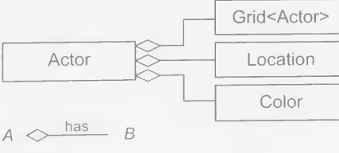

使用 `new` 运算符创建对象，它会调用对象类中定义的构造函数之一。例如：

```java
Actor alice = new Actor();
```

构造函数是一个通常很短的过程，用于初始化所创建对象的实例变量的值。

例如：

```java
public Actor() {
    color = Color.BLUE;
    direction = Location.NORTH; // 将稍后在该 actor 设置时设置
    grid = null;                // 添加到网格
    location = null;
}
```

> 构造函数的名称必须与其类名相同。

构造函数可以接受一个或多个参数，也可以完全不接受任何参数。后者被称为“无参”构造函数（参数通常被称为“参数/arguments”），就像数学中的术语，或者简写为 "args"。

> 一个类可以有多个构造函数，它们在接受参数的数量和类型上有所不同。

例如，`Bug` 类定义了两个构造函数：

```java
public Bug() {
    setColor(Color.RED);
}
```

以及

```java
public Bug(Color bgColor) {
    setColor(bugColor);
}
```

第一个是无参构造函数；它创建一个红色的虫；第二个接收参数 `color`，并创建一个该颜色的虫。（两个构造函数都调用了 `Actor` 的 `setColor` 方法来设置 actor 的颜色。）

在创建对象时，传递给 `new` 操作符的参数的数量、类型和顺序必须与类中某个构造函数所接受的参数的数量、类型和顺序匹配。

### 创建对象示例

例如，如果我们想在位置 (2, 3) 处的世界添加一个绿色的虫，我们可以写：

```java
Location loc = new Location(2, 3);
Bug bob = new Bug(Color.GREEN);
world.add(loc, bob);
```

或者简单地：

```java
world.add(new Location(2, 3), new Bug(Color.GREEN));
```


# 第 3 章 对象与类

当对象被创建时，会分配一块 RAM 来存储它，`new` 返回该位置的引用，这基本上是该对象在 RAM 中的地址。该引用可以存储在变量中：

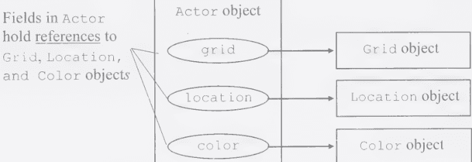

最终，多个变量可能持有同一个对象的引用。如果将对象比作网页，那么引用就像是页面的 URL（网络地址）。许多用户可能将该 URL 保存在他们的“收藏夹”或自己的网页中。Java 解释器配备有一种机制，用于跟踪运行程序中存在的所有指向特定对象的引用。逐渐，指向某个对象的引用可能会消失。这时，该对象就会变得不可达，因为程序中没有其他对象可以找到它或不知道它的存在。Java 解释器会发现并销毁无用对象，并释放它们占用的内存。这种机制被称为垃圾回收。

每个 Java 类至少有一个构造函数。如果你不定义任何，编译器会提供一个默认的无参构造函数，将所有实例变量初始化为默认值（数字为 0，对象为 `null`，布尔字段为 `false`）。

由于 `Bug` 是 `Actor` 的子类，`Bug` 的构造函数会首先调用 `Actor` 的无参构造函数来初始化 `Actor` 的实例变量。这些调用是隐式的——它们没有显示在 `Bug` 的代码中。

可以使用 `super` 关键字显式地调用父类的构造函数并向其传递参数。

形象比意义地说，对象可以向其他对象“发送消息”。在 Java 中，“发送消息”意味着调用另一个对象的方法。方法是执行特定任务或计算的函数或过程。一个对象的所有方法都描述在它的类定义中，给定类的所有对象都具有完全相同的方法集。方法定义了对象可以做什么，它能“理解”并响应什么种的“消息”。

方法是属于对象还是属于类？这里的术语并不十分精确。当我们关注运行中的程序时，我们说一个对象有一个方法，意味着我们可以为该特定对象调用方法。当我们关注程序的源代码时，我们说一个类有一个方法，意味着程序员在类定义中包含了该方法的代码。

每个方法都有一个由程序员给出的名称。像构造函数一样，方法可以接受一个或多个参数。例如，一旦我们创建了 `Actor` 类的对象 `alice` 并将其添加到网格中，我们就可以调用它的 `moveTo` 方法：

```java
alice.moveTo(loc);
```

这条语句将 `alice` 移动到位置 `loc`。编译器理解这条语句，是因为我们在 `Actor` 类中定义了 `moveTo` 方法。

传递给方法的参数的数量、类型和顺序必须与该方法期望的参数的数量、类型和顺序匹配。

方法头中的空括号表示该方法不接受任何参数。这样的方法用空括号调用。例如，如果是一个 `Bug` 对象，我们可以调用它的 `turn` 方法：

方法可以向调用者返回一个值。方法头指定了该方法是否返回值，如果返回，则是什么类型。例如，`Actor` 的 `getLocation` 方法返回此 actor 的位置：

```java
public Location getLocation()
{
    return location;
}
```

方法头中的 `void` 关键字表示该方法不返回任何值。

例如，`Bug` 的 `move` 和 `turn` 方法被声明为 `void`。`main` 方法也是 `void` 的。

方法可以调用同一个对象或不同对象的方法。例如，`Bug` 的 `act` 方法调用它的 `canMove` 方法，然后调用它的 `move` 或 `turn` 方法：

```java
public void act()
{
    if (canMove())
        move();
    else
        turn();
}
```

## 3.6 继承

如果类 D 继承类 B，则 B 被称为超类（或基类），D 被称为子类（或派生类）。继承关系在 UML 图中通常用一个从子类指向超类的、带有三角形头的箭头表示：

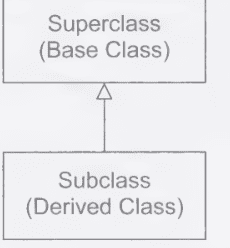

在 Java 中，你可以在没有该类源码的情况下继承一个类。

- 子类继承其超类的所有的方法和字段。构造函数不会被继承；子类必须提供它自己的构造函数。
- 在 Java 中，每个类默认都继承库类 `Object`。因此，程序中的所有类都属于一个以 `Object` 为顶的大类层次结构。`Object` 提供了一些常用方法，包括 `toString` 和 `getClass`。

在我们的示例中，我们创建了一个新类 `UTurnBug`，它继承自 `Bug`：

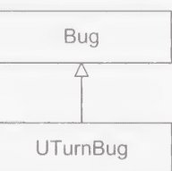

`UTurnBug` 是一个短类。它有两个与 `Bug` 构造函数并行的构造函数，并增加了一个方法 `turnAround`。它还重写（重新定义）了 `Bug` 的 `act` 方法。我们不在 `UTurnBug` 类中重复 `Bug` 或 `Actor` 的其他方法字段，因为它们是继承自 `Bug` 和 `Actor` 的。

```java
/*
 * Bug 的子类，增加了 turnAround 方法
 * 并重新定义了 Bug 的 act 方法使得该昆虫
 * 在无法移动时执行 U 转
 * */
import info.gridworld.actor.Bug;
import java.awt.Color;

public class UTurnBug extends Bug
{
    public UTurnBug()
    {
        setColor(Color.YELLOW);
    }

    public UTurnBug(Color bugColor)
    {
        setColor(bugColor);
    }

    public void turnAround()
    {
        turn(); turn(); turn();
        // 或者: setDirection(getDirection() + 180);
    }

    // 重写 Bug 的 act 方法
    public void act()
    {
        if (canMove())
            move();
        else
            turnAround();
    }
}
```

图 3-6. JM\Ch03\GridWorld\UTurnBug.java

创建一个包含 `BugRunner` 类和 `UTurnBug` 类（来自 JM\Ch03\GridWorld\UTurnBug.java）的 GridWorld 项目。在 `BugRunner` 中添加一条语句向世界添加一个 `UTurnBug`。运行程序并测试 `UTurnBug` 的 `turnAround` 方法，首先通过交互式从弹出菜单中调用它，然后通过运行程序的几个步骤来测试。

`UTurnBug` 示例中，`UTurnBug` 的构造函数取的参数数量和类型与 `Bug` 的构造函数相同。通常情况下，并不一定如此。例如，`BoxBug` 只有一个构造函数，它接受一个整数参数（指定转向前的步数）。

此外，注意一个悖论。我们的 `UTurnBug` 继承了 `Bug` 的所有字段，而 `Bug` 又继承了 `Actor` 的所有字段。`UTurnBug` 有一个 `direction` 字段。然而，这个字段和其他字段在 `Actor` 中被声明为 `private`。这意味着编写 `UTurnBug` 类的程序员无法访问它们（即使他就是编写 `Actor` 的程序员！）。记住，`Actor` 类是完全封装的，其所有字段都是私有的。因此，语句

```java
direction = direction + 180;
```

在 `UTurnBug` 中将不起作用。`Actor` 的子类以及使用 `Actor` 的其他类可能需要访问存储在私有字段中的值。

为了解决这个问题，`Actor` 类提供了公共方法来返回其私有字段的值：`getDirection`、`getLocation`、`getColor`、`getGrid`。

> 这些方法被称为访问方法（或简单的访问器）或 getter，因为它们允许外部访问对象私有字段的值。

为类中可能对其他类感兴趣的私有字段提供访问方法是一种常见的做法。在我们的示例中，我们可以使用

```java
setDirection(getDirection() + 180);
```

像 `setColor` 这样的方法被称为修改器。

继承表示了对象之间的 IS-A（是一个）关系。一个 `Bug` 是一个 `Actor`。一个 `UTurnBug` 是一个 `Bug`。除了字段和方法外，子类对象还从其超类继承了较无形但非常有价值的资产：它的类型就像继承了姓氏或称号。超类的类型变成了子类对象的次级、更通用的类型。每当语句或方法调用 `Actor` 类型对象时，你都可以插入一个 `Bug` 类型或 `UTurnBug` 类型的对象，因为 `Bug` 是一个 `Actor`，而 `UTurnBug` 也是一个 `Actor`（因为它本身是一个 `Bug`）。

例如，`ActorWorld` 类有一个 `add` 方法：

```java
public void add(Actor a)
{
}
```

由于 `Bug`、`Flower`、`Rock` 和 `UTurnBug` 都是 `Actor` 的子类，你可以向 `ActorWorld` 的 `add` 方法传递 `Bug`、`Flower`、`Rock` 或 `UTurnBug` 对象：

```java
world.add(new UTurnBug());
```

在 Java 中，对象的集合只能包含指定类型的对象。出于相同的原因，以下语句可以通过编译：

```java
Actor daisy = new Flower();
Bug box = new BoxBug();
Actor actor = new UTurnBug();
```

每个类默认继承库类 `Object`。因此，程序中的所有类都属于一个以 `Object` 为顶的大类层次结构。`Object` 提供了一些常用方法，包括 `toString` 和 `getClass`。

图 7 显示了一些类的 UML 图。

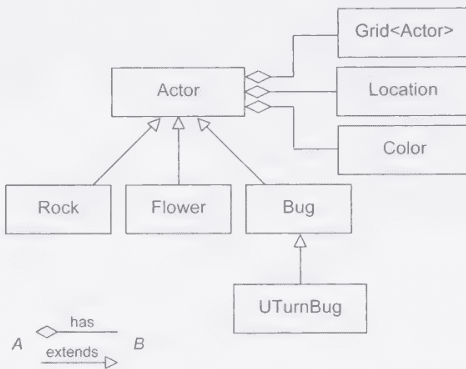

## 3.7 继承

1. 将 `Bug.java` 复制到 `BugRunner.java`，更改类头并编辑 `main` 方法。
2. 将头替换为：
```java
public class UTurnBug extends Bug
{
```
3. 添加无参构造函数和带参数的构造函数：
```java
public UTurnBug()
{
    setColor(Color.YELLOW);
}

public UTurnBug(Color bugColor)
{
    setColor(bugColor);
}
```
4. 添加 `turnAround` 方法：
```java
public void turnAround()
{
    turn(); turn(); turn();
    // 或者: setDirection(getDirection() + 180);
}
```
5. 重写 `act` 方法：
```java
public void act()
{
    if (canMove())
        move();
    else
        turnAround();
}
```

## 3.8 总结

你使用 `new` 运算符在程序中创建一个新对象。传递给 `new` 的参数必须与该对象类中某个构造函数的参数数量、类型和顺序匹配，且 `new` 会调用构造函数。`new` 会分配内存来存储新构造的对象。

一个类的功能——即它的对象可以做什么——是由它的方法定义的。方法完成一项任务。它可以从同一类的构造函数和其他方法中被调用，如果它被声明为 `public`（公共），也可以从其他类的构造函数和方法中调用。方法可以接受参数作为其“输入”。传递给方法的参数必须与该方法期望的参数数量、类型和顺序匹配。方法可以向调用者返回一个指定类型的值。声明为 `void` 的不返回任何值。

在 OOP 中，一个类的所有实例通常被声明为 `private`（私有的），因此只有相同类的对象才能直接访问它们。某些方法也可能是 `private` 的。类的用户不需要知道该类是如何实现的，也不需要它的私有字段和方法是什么。这种做法被称为信息隐藏。类仅通过一组定义良好的构造函数和公共方法与其他类进行交互。这个概念被称为封装。封装有助于程序的维护、代码复用和文档编写。类通常提供公共方法来返回对象私有字段的值，以便不同类的对象可以访问这些值。此类方法被称为访问器方法（accessor methods）或访问器。设置私有字段值的方法被称为 setter（setters）或修改器（modifiers）。

类的定义不必从零开始：它可以扩展另一个类的定义，添加字段和/或方法，或者覆盖（重新定义）某些方法。这个概念被称为继承。子类（或派生类）扩展父类（或基类）。构造函数是不被继承的。

子类的对象也继承其父类的类型作为次级的、更通用的类型。这使得对象之间的 IS-A（属于）关系正式化：子类的对象 IS 是其父类的对象。

## 练习题

1. 标记对或错并解释：
   - (a) Java 中类的类名必须与它的源文件名相同（不包括 .java 扩展名）。
   - (b) 类名是区分大小写的。
   - (c) `import` 语句告诉编译器哪些其他类使用了该类。

2. 标记对或错并解释：
   - (a) BugRunner 程序由一个类组成。
   - (b) Java 程序可以有任意数量的类。
   - (c) Java 程序允许每个类只创建一个对象。
   - (d) 每个类都有一个名为 `main` 的方法。

3. 导航你的浏览器到 Oracle 的 Java API（应用程序接口）文档网站（例如，http://download.oracle.com/javase/6/docs/api/index.html），或者如果你在电脑上安装了 JDK 文档，打开文件 `<JDK base folder>/docs/api/index.html`（例如，C:/Program Files/Java/jdk1.6.0_21/docs/api/index.html）。
   - (a) API 规范中列出了大约多少不同的包？
   - (b) 在左栏的类列表中找到 `JFrame` 并点击它。向下滚动主窗口到“Method Summary”（方法摘要）部分。JFrame 类大约有多少个方法，包括从其他类继承的方法？3？12？25？300-400？

4. 标记对或错并解释：
   - (a) 类的字段通常被声明为 `private`。
   - (b) 对象在使用之前必须被创建。
   - (c) 一个类可以有多个构造函数。
   - (d) 程序员为程序中的对象赋予名称。
   - (e) 当对象被创建时，程序总是调用它的 `init` 方法。

5. 封装有什么好处？列举三点。

6. 制作 `gridworld.jar` 的副本并将其重命名为 `gridworld.zip`。检查其内容。如你所见，`.jar` 文件仅仅是一个压缩文件夹。它在 `info/gridworld/actor` 子文件夹中包含多少个编译后的 Java 类？

7. GridWorld 的 `Location` 类用于放入网格的构造函数接受两个整数参数。哪一个是行，哪一个是列？行和列是从 0 还是 1 开始计数？通过运行 `BugRunner` 并将光标停在网格上来找出。

8. 修改 GridWorld 的 `BugRunner` 类，在网格的 (1,2) 位置放置一只红昆虫，在网格的左上角放置一只绿昆虫。在随机位置添加一个灰色岩石。提示：参见 `BoxRunner.java` 关于如何在指定位置放置 actor 的示例。

9. 修改 `BugRunner`，在网格中并行放置三只昆虫，彼此相邻，且全部面向东方。提示：在将昆虫添加到网格之前，让每只昆虫旋转几次。

10. 编写一个简单的控制台应用程序，创建一个 Bug 并将其“打印出来”：
```java
Bug bob = new Bug();
System.out.println(bob);
```
显示了什么？程序如何知道如何“打印”一只昆虫？查看 `Bug.java` 和 `Actor.java` 以获取解释。

11. 创建一个 `Book` 类，带有两个私有字段 `numPages` 和 `currentPage`。提供一个接受一个参数的构造函数，将 `numPages` 设置为该值并将 `currentPage` 设置为 1。为这两个字段提供访问方法。还提供一个 `nextPage` 方法，仅当 `currentPage` 小于 `numPages` 时将 `currentPage` 加 1。

提示：
```java
if (currentPage < numPages)
    currentPage++;
```


# 练习题

## 11. BookTest 类
创建一个 `BookTest` 类并包含 `main` 方法。让 `main` 创建一个 `Book` 对象，然后调用三次 `nextPage`，输出 `currentPage` 的值。

## 12. Circle 与 Cylinder 类
`Circle` 类（位于 `JM03\Exercises`）描述一个给定半径的圆。半径类型为 `double`，这是表示实数的原始类型。`CircleTest.java` 类是一个小型控制台程序，提示用户输入半径，创建一个该半径的 `Circle` 对象，并调用 `getArea` 方法显示面积。

创建一个 `Cylinder` 类，带有两个私有字段：`Circle base` 和 `double height`。提供一个接受参数 `r` 和 `h` 的构造函数，将 `base` 初始化为半径为 `r` 的新 `Circle`，并将 `height` 初始化为 `h`。提供一个返回体积的方法（等于面积乘以高度）。创建一个简单的测试程序 `CylinderTest`，提示用户输入半径和高度，根据这些尺寸创建一个并显示体积。

---

# 第 3 章 ~ 练习 75

## 13. Coin 类
◆ `JM03\Exercises\CoinTest` 是一个程序的一部分，该程序在窗口中间显示硬币并在每两秒“翻转”一次硬币。你的任务是为该程序提供第二个类 `Coin`。

`Coin` 类应该有一个接受两个 `Image` 类型参数的构造函数：硬币的正反面图片。构造函数将这些图像保存在类的私有字段（类型为 `Image`）中。`Coin` 还应该有一个指示显示硬币哪面的字段。`Coin` 类有两个方法：

```java
/**
 * 翻转这个硬币
 */
public void flip() {
    ...
}
```

和

```java
/**
 * 在 (x, y) 处居中绘制硬币的相应面
 */
public void draw(Graphics g, int x, int y) {
    ...
}
```

**提示：**

1. 导入包：
   ```java
   import java.awt.Image;
   import java.awt.Graphics;
   ```
2. `Graphics` 类有一个在指定位置绘制图像的方法。调用如下：
   `g.drawImage(pic, xUL, yUL, null);`
   其中 `pic` 是图像，`xUL` 和 `yUL` 是其左上角的坐标。你需要从传递给 `Coin.draw` 方法的 `x` 和 `y` 计算 `xUL` 和 `yUL`。探索库类 `Image` 的文档找到返回图像宽度和高度的方法。
3. 在互联网上寻找硬币两个面的免版权图像文件，或者扫描或拍摄硬币照片并创建自己的图像文件。

---

# 第 3 章 对象与类（第 3.6-3.8 节）

## 14. 判断对与错
- (a) 子类继承其父类的所有字段和公共方法。
- (b) 子类继承其父类中所有在子类中未被显式定义的构造函数。

## 15. Cylinder 类设计讨论
题 12 要求你编写一个 `Cylinder`（圆柱体）类，包含两个字段：`Circle base` 圆底和 `double height` 高高。与其将 `base` 设为一个字段，我们不如直接从 `Circle` 定义 `Cylinder`，仅添加 `height` 字段。讨论这种设计方案的优点。

## 16. 赋值语句编译测试
下列哪些赋值语句可以编译且不报错？

- (a) `Actor alice1 = new Actor();`
- (b) `Actor alice2 = new Bug();`
- (c) `Actor alice3 = new Flower();`
- (d) `Bug bobl1 = new Actor();`
- (e) `Flower rosel = new Actor();`
- (f) `Flower rose2 = new Flower(Color.RED);`
- (g) `BoxBug boxy1 = new BoxBug();`
- (h) `BoxBug boxy2 = new BoxBug(5);`
- (i) `Bug boxy3 = new BoxBug(5);`

解释你的答案并编写程序来测试它们。

## 17. WilleyFlower 类
* 编写一个 `WilleyFlower` 类作为 `Flower` 的子类。提供一个构造函数，将 `WilleyFlower` 的寿命作为参数并将其保存在私有字段中。另一个字段 `age` 应该初始化为 0。在每一步（每次调用 `act` 方法时），`WilleyFlower` 的 `age` 应该增加 1。一旦 `age` 超过寿命，该花就应该“死亡”（调用其 `removeSelfFromGrid` 方法）。提示：不要从零开始——从 `BoxBug` 适配出 `WilleyFlower`。

## 18. BoxBug 构造函数重载
* `BoxBug` 类有一个构造函数，它接受一个整数参数：

```java
/**
 * 构造一个追踪给定边长正方形的箱子虫
 * @param length 边长
 */
public BoxBug(int length) {
    steps = 0;
    sideLength = length;
}
```
（虫子追踪的正方形的边长是在虫子运行的网格单元中心之间测量的。当 `sideLength` 设置为 0 时，虫子会在一个单元内不断旋转而永远移动。）

为该类添加三个构造函数：
1. 一个无参数构造函数，将虫子的颜色设置为 `Color.red` 并将 `sideLength` 设置为 0；
2. 一个接受一个参数 `bugColor` 的构造函数，将虫子的颜色设置为 `bugColor` 并将 `sideLength` 设置为 0；
3. 一个接受两个参数 `bugColor` 和 `length` 的构造函数，将虫子的颜色设置为 `bugColor` 并将 `sideLength` 设置为 `length`。

运行 `BoxBugRunner` 程序并使用 `GridWorld` 的直接操作界面交互式地测试添加的构造函数。

## 19. RollingRock 类
* 让石头“滚动”。从 `Rock` 派生出一个 `RollingRock` 类。提供两个与 `Rock` 构造函数类似的构造函数，但让它们将 `RollingRock` 的方向设置为东南（135度）。添加一个 `roll` 方法，与 `Bug` 的 `move` 方法相同（仅在石头滚动时不要向网格添加花）。提供一个 `act` 方法：让它简单始终调用 `roll`。提供一个 `RockRunner` 类，将几个 `RollingRock` 对象放入网格中并测试你的程序。

---

# 第 3 章 对象与类（续）

## 20. CarefulBug 类
从 `Bug` 派生出一个 `CarefulBug` 类。`CarefulBug` 的行为如下：像 `BoxBug` 一样，它计算步骤（调用其 `act` 方法的次数）。当计数为 0 时，它逆时针旋转 45 度并将 `steps` 计数加 1。计数为 1 时，它返回原始方向并将 `steps` 计数加 1。计数为 2 时，它顺时针旋转 45 度并将 `steps` 计数加 1。计数为 3 时，它返回原始方向并将 `steps` 计数加 1。计数为 4 时，它的行为像普通的虫子（如果可以移动就移动，否则就旋转）并将 `steps` 计数重置为 0。

提供两个与 `Bug` 构造函数类似的构造函数。它们也应该将 `steps` 计数设置为 0。添加一个 `turnLeft` 方法让虫子逆时针旋转 45 度。重写 `Bug` 的 `act` 方法，根据需要调用 `turnLeft`、`turn`、`canMove` 和 `move`。

在 `BoxRunner` 程序的世界中添加一个橙色的 `CarefulBug` 来测试你的 `CarefulBug` 类。

**提示：**

```java
if (steps == 0) // 如果 steps 等于 0
{
    ... // 执行此
}
else if (steps == 1)
{
    ...
}
```

---

# 第 4 章 算法

## 目录
- 4.1 引言
- 4.2 算法的属性
- 4.3 迭代
- 4.4 递归
- 4.5 案例研究：欧几里得最大公约数算法
- 4.6 使用列表
- 4.7 案例研究：文件管理器
- 4.8 总结
- 练习题

## 4.1 引言
历史上，软件开发在很大程度上被视为设计和实现的活动。算法的正式定义难以捉摸，但它至关重要。

> 非正式地说，算法是一或多组、通用的、抽象的步骤，描述了如何执行任务或解决问题。

算法通常与计算机程序相关，但在计算机出现之前就已经存在了。最著名的欧几里得求两个整数最大公约数的算法可以追溯到公元前 300 年。你可能还记得长除法，那是在使用计算器之前的算法。至于算法是如何被我们理解的，这是一个鸡生还是蛋的问题，执行任务或解决问题的方法可以在不同水平上描述。算法者了解计算机的能力和通用原理，但不需要任何特定的编程语言。事实上，配备了纸笔的人就可以使用算法。程序员可以用 Python、C++ 或任何其他编程语言来实现算法。

本章的目的是让你对算法有一个直观的感受，考虑一些示例，介绍描述算法的方法（流程图、伪代码），并回顾主要设备：决策、迭代。在这个阶段，我们不处理复杂的算法。我们将在第 14 章讨论搜索和排序。

## 4.2 算法的属性
假设我们使用计算机计算 $1^2 + 2^2 + ... + 100^2$。可能我们可以通过暴力法相加从 1 到 100 的平方，使得我们的“算法”非常长（见图 4-1）。

```text
sum <- 0
sq <- 1 * 1; sum <- sum + sq
sq <- 2 * 2; sum <- sum + sq
sq <- 3 * 3; sum <- sum + sq
sq <- 4 * 4; sum <- sum + sq
（等等，列出每一行）
sq <- 99 * 99; sum <- sum + sq
sq <- 100 * 100; sum <- sum + sq
```

**图 4-1.** 计算 $1^2 + 2^2 + ... + 100^2$ 的暴力非算法

```text
sum ← 0
k ← 1
```

我们想要计算 $i^2$ 并将其加到 $sum$ 中。为了更加清晰起见，让我们引入另一个变量来用于存储 $i^2$。我们称其为 $sq$。因此，我们接下来的步骤是：

```text
sq ← k * k
sum ← sum + sq
```

最后一条语句表示我们正在更新 $sum$ 的值。这是以下指令的简写：读取写入 $sum$ 中的值；在其基础上加上 $sq$；将结果写回 $sum$。变量值可以被更新的方式是创建算法的关键。

我们想要“获取下一个数字”。我们如何将其形式化呢？很简单：为了获取下一个数字，我们只需要将变量 $k$ 的值加 1 即可：

```text
k ← k + 1
```

这三个步骤构成了我们算法的核心。只要 $k$ 保持小于或等于 100，我们就需要重复这些步骤。一旦 $k$ 大于 100，过程就会停止，$sum$ 就包含了结果。因此，对于每个 $k$ 的值，我们需要做一个关于继续还是退出的决策。做出这种决策的能力是实现算法的可用设备之一。CPU 有特殊的指令（称为条件分支指令），可以引导 CPU 根据上一次操作的结果采取不同的路径。例如，它可以计算 $100 - k$，如果结果是非负数，则继续计算；如果结果为负数，则跳转到另一组指令。

好了，假设我们有一个计算 $1^2 + 2^2 + \dots + 100^2$ 的算法。但如果我们需要计算 $1^2 + 2^2 + \dots + 500^2$ 呢？我们需要另一个算法吗？当然不需要：事实证明，我们的算法经过一个微小的改变，就变得足够通用，可以计算任何正整数 $n$ 的 $1^2 + 2^2 + \dots + n^2$。我们只需要引入新变量 $n$，并在判断测试中将 $k \leq 100$ 替换为 $k \leq n$ 即可。

图 4-2-a 显示了最终算法的伪代码。只要专业人士理解它的含义，伪代码可以是某种非正式的。图 4-2-b 以图形方式表示相同的内容。这种表示被称为流程图。平行四边形表示输入和输出；矩形表示处理步骤；菱形表示检查的条件。

### 算法伪代码 (图 4-2-a)
```text
输入: n
sum ← 0
k ← 1
当 k ≤ n 时，重复以下三个步骤：
    sq ← k * k
    sum ← sum + sq
    k ← k + 1
输出: sum
```

### 流程图 (图 4-2-b)
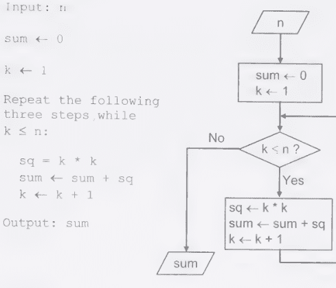

我们可以从这个简单的示例推导出几个通用属性。首先，算法是相当紧凑的。一个合理的算法将计算折叠在一个或多个片段中，这些片段可以被重复多次。这些重复（迭代）执行完全相同的实例，但处理的是不同的变量值。在图 4-2 的示例中，算法通过三个步骤迭代 n 次，在每次迭代中更新 `sum` 并将 `k` 加 1。

一个良好算法的第二个属性是它是相当通用的。图 4-1 中 $n = 100$ 的暴力“算法”可以工作，但如果你想让它在例如 $n = 500$ 时工作，你就必须更改程序。而图 4-2 中的算法是一个真正可用的算法，对于任何 $n$ 都不需更改任何代码。$n$ 的值是一个参数，是过程的输入值。基于此算法的程序运行时间会随 $n$ 的不同，但无论 $n$ 的值如何，程序文本本身的长度保持不变。

正如我们上面提到的，算法的第三个属性是它是抽象的：它不依赖于特定的编程语言或计算机系统。图 4-3 显示了相同的算法如何在 Python、Java 和 C/C++ 中进行编码。

### 图 4-3. 平方和算法的 Python、Java 和 C/C++ 实现

| Python | Java |
| :--- | :--- |
| ```python<br>def addSquares(n):<br>    s = 0<br>    k = 1<br>    while k <= n:<br>        s += k * k<br>        k += 1<br>    return s<br>``` | ```java<br>public class MyMath {<br>    public static int addSquares(int n) {<br>        int sum = 0;<br>        for (int k = 1; k <= n; k++) {<br>            sum += k * k;<br>        }<br>        return sum;<br>    }<br>}<br>``` |

| C / C++ |
| :--- |
| ```cpp<br>int addSquares(int n) {<br>    int k, sum = 0;<br>    for (k = 1; k <= n; k++) {<br>        sum += k * k;<br>    }<br>    return sum;<br>}<br>``` |

与此同时，算法确实依赖于通用的计算模型。例如，使用算盘解决问题的算法与在计算机上执行的算法是不同的。算法是抽象的，这使得我们可以研究它们。在计算机上执行时，相同的算法可以执行相同的指令，但处理的变量值必须不同。

```text
输入: n
sum ← 0
sq ← 1
k ← 1
当 k ≤ n 时，重复以下四个步骤：
    sum ← sum + sq
    k ← k + 1
    sq ← sq + 2 * k - 1  (或类似优化逻辑)
输出: sum
```

**图 4-4.** 我们通过追踪迭代结束时的值来验证该算法的工作情况：

| 迭代 | k | sq | sum |
| :--- | :--- | :--- | :--- |
| 0 | 1 | 1 | 0 |
| 1 | 2 | 4 | 1 |
| 2 | 3 | 9 | 5 |
| 3 | 4 | 16 | 14 |

在计算机上执行的效率增益微不足道，但在计算密集型任务中会有差异。

## 4.3 迭代
正如我们在之前的示例中所看到的，重复相同的步骤对于创建算法是关键的。相同的指令在每次迭代执行，但变量的值必须改变。迭代在不再满足指定的条件时停止。

高级编程语言通常以某种形式支持迭代。Java 有“while”循环——

```java
while (<条件>) {
    ... // 执行某些操作
}
```

例如：

```java
while (k < n) {
    sum += k * k; // 将 k * k 加到 sum
    k++; // k 加 1
}
```

还有“for”循环——

```java
for (<初始设置>; <条件>; <迭代结束时调整>) {
    // 执行某些操作
}
```

例如：

```java
for (int k = 1; k <= n; k++) // k++ 意味着 k 加 1
    sum += k * k; // 将 k * k 加到 sum
```


我们将在 8 章讨论迭代语句的完整语法规则。

分析循环时，理解变量值的变化很重要。但观察什么保持不变也很重要。

循环不变性是变量之间与循环目的相关的关系，并且在进入循环之前和每次迭代之后都成立。

循环不变性有助于我们确定循环确实在执行它应该执行的操作。例如，你可能注意到图 4-4 中的算法有两个循环不变性：`m = 2k+1` 和 `sq = k^2`。知道这些循环不变性有助于我们看到我们的算法是正确的：只要初始化正确即可。

## 4.4 递归

根据欧几里得《几何原本》第一卷中的第五公理，“整体大于部分”。对于几何中的线段长度和几何体体积来说可能是正确的，但在计算机软件的无形世界中，整体与部分相同，至少从结构描述和使用的角度来看如此。


图 4-5. 部分图形元素是“原语”；其他一些是“图像”

考虑图 4-5 中的图片。如你所见，它由图形元素组成。其中一些元素是“原语”：线、圆、矩形等。但另一些元素本身就是较小的图片。事实上，你可以拥有图片中的图片中的图片……这个“整个”画面的整体复杂性大于其内部每个图片的复杂性，但内部图片与大图具有相同的底层结构。这是递归结构的一个例子，其子结构的形式与整体相同。这类结构最适合用递归过程来处理，递归过程对子结构的操作与对整体结构的操作相同。

递归是描述和实现算法的一种非常强大的工具。

> 递归解决方案通过将相同的过程应用于相似的更小任务，来描述特定任务的过程。

递归解决方案还隔离了简单的情况（称为基础情况或终止情况），即计算显而易见不需要递归的情况。

例如，在计算 `1^2 + 2^2 + ... + n^2` 时，递归思维是这样的：如果 `n=1`，结果为 1（基准情况）；如果 `n>1`，我们可以计算和 `1^2 + 2^2 + ... + (n-1)^2`，然后加上 `n^2`。下划线部分表示对较小数字 `n-1` 相同过程的递归调用。

然而，对大多数人来说，这个算法看起来完全不合直觉。他们可能会问：“好吧，我如何计算 `1^2 + 2^2 + ... + (n-1)^2`？这个算法没告诉我任何信息！”事实上它告诉了。相同的过程适用于任何输入，特别是适用于 `n-1`。因此，为了计算 `1^2 + 2^2 + ... + (n-1)^2`，你需要计算 `1^2 + 2^2 + ... + (n-2)^2`，然后加上 `(n-1)^2`。以此类推，直到你处理它并知道 `n=1` 的答案。

> 要使递归算法运行，它必须有一个不需要递归的基础情况（或多个情况），并且递归调用最终必须到达基础情况（或其中一个基础情况）。

对于没有经过训练的人来说，递归可能看起来非常复杂，有些人完全无法理解它。但对计算机来说这很容易。

- 计算机程序将递归处理为一种迭代形式，这种迭代对程序员是隐藏的。

在高级语言（如 `Python`、`Java` 或 `C++`）中，递归通过函数自调用来实现。例如在 `Java` 中，上述递归算法可以如图 4-6 所示。

```
public class MyMath {

    public static int addSquares(int n) {

        if (n == 1)

            return 1;

        else

            return addSquares(n-1) + n * n;

    }

}
```

**图 4-6.** 计算 `1^2 + 2^2 + ... + n^2` 的 Java 递归方法（不推荐用于此任务）

计算机具有硬件机制（如栈），可以促进递归函数调用。它在第 22 章中描述。如果你想学习技术细节，现在可以去看看。此时，只需说明编译器知道如何处理递归函数而不会混乱。

某些编程语言（如 `LISP` 或 `Scheme`）几乎总是建议使用递归而不是显式迭代。在 `Java` 中，标准包使用了递归，但程序员并不经常自己编写递归方法。尽管如此，了解递归如何工作对于理解某些复杂算法（如合并排序 `Mergesort`，第 14.7 节）或处理分支或嵌套结构（如上述示例中图片中的图片结构）非常有用。

你可能注意到，我们说对于解决平方和问题“不推荐”使用递归算法。有些人一旦理解了它，就会发现递归如此优雅，以至于想在处处使用它。事实上，如图 4-6 所示，递归解决方案可能很短且富有表现力。但在运行时间和内存空间方面，它们的成本可能比迭代解决方案更高，在某些情况下这种成本是无法接受的。通常，当存在简单的迭代解决方案时，不应使用递归。

## 4.5 案例研究：欧几里得公约数算法

图 4-7 显示了前面提到的欧几里得算法流程图，用于寻找两个正整数的最大公约数。该算法基于一种观察：如果我们从较大的数中减去较小的数并将较大的数替换为结果，这两个数的公约数保持不变。换句话说，假设 `a > b`，`GCF(a, b) = GCD(a - b, b)`。

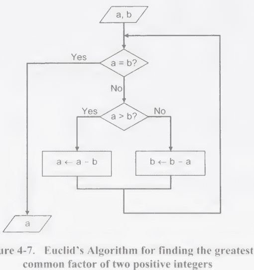

让我们举一个例子，`a = 30, b = 42`，看看这个算法是如何运作的：

| 迭代次数 | 0 | 1 | 2 | 3 | 4 |
| --- | --- | --- | --- | --- | --- |
| `a` | 30 | 30 | 18 | 6 | 6 |
| `b` | 42 | 12 | 12 | 12 | 6 |

该算法的迭代实现如图 4-8 所示。在递归实现（图 4-9）中，`while` 循环被递归调用取代。但我们首先检查基础情况 `a=b`。

```
// 返回 a 和 b 的公约数（迭代式）
// 前提：a > 0, b > 0
public static int gcf(int a, int b) {

    while (a != b) // 当 a 不等于 b 时
        if (a > b)
            a -= b; // 从 a 中减去 b
        else
            b -= a; // 从 b 中减去 a
    }

    return a;
}
```

```
// 返回 a 和 b 的公约数（递归式）
// 前提：a > 0, b > 0
public static int gcf(int a, int b) {

    if (a == b) // 基础情况：a 等于 b
        return a;

    if (a > b)
        return gcf(a - b, b);
    else // 如果 b > a
        return gcf(a, b - a);

}
```

`Java` 中有一个运算符 `%`，称为模运算，用于计算 `a` 除以 `b` 的余数。例如：

```
21 % 9 = 3 ( 21 - 2 * 9 )
9 % 21 = 9 ( 9 - 0 * 21 )
```

语句

```
a %= b; // 等于 a = a % b;
```

将 `a` 替换为 `a % b` 的结果，这相当于尽可能多次从 `a` 中减去 `b`，直到结果大于或等于零。我们可以使用模运算运算符来提高迭代和递归方法的效率。这留给你们作为练习题。

## 4.6 列表操作

我们一直在处理列表——待办事项列表、购物清单、客人名单、餐厅菜单，有时还有所谓的“列表”。计算机也处理列表：单词列表、银行或信用卡交易列表、人员列表、学生列表、课程列表、客户列表、出发和到达航班列表，是的，干洗单列表。

从抽象角度来说，列表是一种元素经过编号的数据结构，我们知道如何获取第 `i` 个元素。列表的基本操作之一是遍历，这意味着按顺序处理所有元素（例如打印列表）。列表遍历算法非常直观：

```
从列表开始
当列表中还有元素时，
处理下一个元素
```

这种算法假定会维护一个指向列表中“当前”元素的变量，并在处理完当前元素后将其移动到下一个元素上。`Java`（从 5.0 版本开始）有一种所谓的“for-each”循环（也称为增强型 for 循环），可以自动处理这一过程。例如：

```
for (String word : list) // 对于每个单词
    System.out.println(word); // 在单独的一行打印单词（字符字符串）
```

人类可以瞬间处理短列表。你可以扫一眼一份小型生日派对的宾客名单，立即看出你是否收到了邀请。然而，计算机需要检查列表中的每个项目来找到给定的目标值，或者确定该值不在列表中。这种处理过程被称为**顺序查找**（Sequential Search）。如果一个列表包含 1,000,000 个按随机排列的项，找到某个特定项平均需要 500,000 次比较；而且，如果目标值不在列表中，计算机将需要扫描所有 1,000,000 个项以确保它不在那里。但如果列表项是按顺序排列的（例如，按字母顺序或数字从小到大的顺序排列），则存在一种效率要高得多的搜索算法，称为**二分查找**（Binary Search）。

二分查找的思想对于任何玩过“猜数字游戏”的人来说都是熟悉的。你的朋友想了一个 1 到 100 之间的数字。你需要通过问诸如“你的数字大于 x 吗？”之类来猜这个数字。在最坏的情况下，你需要问多少个问题？7 个，对吧？如果我选一个 1 到 1,000,000 之间的数字，你最多只需要问 20 个问题！

有序列表中的二分查找算法也是类似的。从列表的中点开始查找目标值（图 4-10）。如果你的目标大于中间项，则在右半部分继续查找；如果小于，则在左半部分继续查找。将剩余的搜索范围分为大致相等的部分，直到找到目标值或没有剩余可搜索的内容。这种算法被称为“分治法”（divide and conquer）。我们将在第 14 章回到二分查找算法及其在 `Java` 中的实现。

> 在顺序查找算法中，最坏情况下的比较次数与 `n` 成正比，其中 `n` 是列表的长度。在二分查找中，比较次数与 `log(n)` 成正比。假设顺序查找的时间为 `T_n`，二分查找的时间为 `T_s`。即使 `T_n > T_s`，二分查找算法仍被认为优于顺序查找，因为对于较大的 `n`。

```
$$\frac{T_n \cdot \log(n)}{T_s \cdot n} \rightarrow 0$$
```

（趋于 0），无论常数因子 `T_s` 和 `T_n` 的值如何。人们说顺序查找是 `O(n)` 算法，而二分查找是 `O(log n)` 算法。“大 O”符号及其比较算法的应用将在第 19 章解释。

| 1 | 2 | 3 | 5 | 8 | 13 | 21 | 34 | 55 | 89 | 144 | 233 | 377 | 610 | 987 |
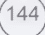

| 1 | 2 | 3 | 5 | 8 | 13 | 21 | 34 | 55 | 89 | 144 | 233 | 377 | 610 | 987 |
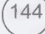

| 1 | 2 | 3 | 5 | 8 | 13 | 21 | 34 | 55 | 89 | 144 | 233 | 377 | 610 | 987 |


图 4-10. 二分查找

在每次迭代中，目标值（此处为 144）与剩余搜索范围中间（或靠近中间）的值进行比较。灰色区域表示比较后从搜索范围中消除的值。

另一个常见任务是排列列表项（前提是我们有某种方法比较这些项）。这项任务被称为*排序*（sorting）。这里有一个对列表的简单算法：

```
设 n 为列表中项的总数
当 n 大于 1 时重复以下步骤：
  在前 n 个项中找到最大的项
  将该最大的项与第 n 个项交换
  将 n 减 1
```

这种算法称为选择排序（Selection Sort，因为我们反复从列表的前 `n` 项中选择最大的项）。为了更好地理解它的工作原理，你可以和一群朋友一起执行这个算法，让他们（例如）按生日顺序进行排列。再次，这只是一个快速预览。关于此和其他排序算法及其在 `Java` 中实现的更详细讨论必须等等到第 14 章。

## 4.7 案例研究：文件管理器

递归特别适用于处理嵌套结构。例如，考虑你计算机上的文件系统（图 4-11）。“文件文件夹”本质上是递归的：它是一个包含文件或文件夹的东西！如果你右键点击文件夹并选择“属性”，你将看到一个屏幕，显示该文件夹及其所有子文件夹中的文件总数，以及该文件夹及其所有文件夹占用的总字节数。你的操作系统是如何做到的？

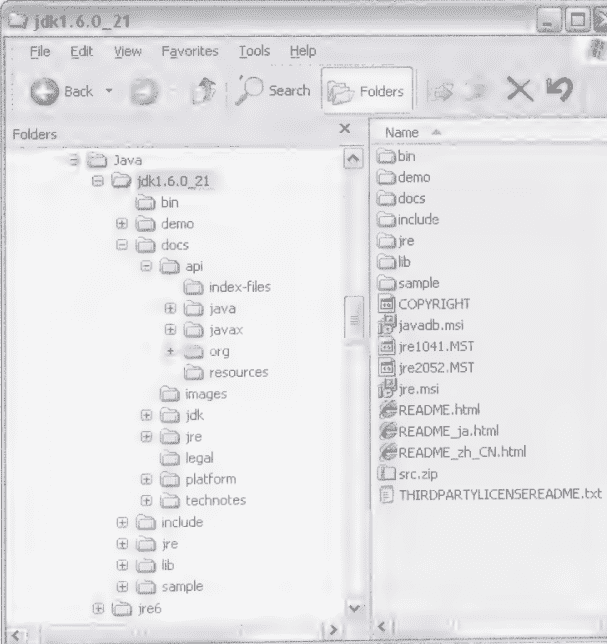

图 4-11. Windows 资源管理器的快照

编写一个迭代算法来扫描所有子文件夹中的所有文件并不容易。当你进入更深层次时，你需要记住自己在当前层级的位置以便返回。要理顺这种树形的文件夹层次结构，你需要一种名为“栈”（stack）的存储机制。但递归解决方案是直接且优雅的。以下是其伪代码描述：

```
fileCount(folder) {
  count <- 0
  for each item in folder {
    if item is a file
      count <- count + 1
    else (if item is a folder)
      count <- count + fileCount(item)
  }
  return count
}
```

这里的基本情况是一个只包含文件而不包含其他文件夹的文件夹。由于文件结构是有限的，递归总是会停止（幸运的是，我们不会无限递归）。递归非常适合这种类型，我们可以定义：

文件夹项是文件或文件夹。

# 第 4 章 ~ 练习

递归在处理嵌套结构时特别有用，例如文件夹中的文件夹或图片中的图片。数据结构的递归描述使用对相同类型结构的引用，而执行特定任务的程序的递归定义依赖于将相同的程序应用于类似的更小任务。递归函数会调用自己，传递给递归调用的参数在每次调用时必须以某种方式被“缩小”。递归函数还有一个或多个不需要递归的简单情况。这些被称为*基础*情况（base cases）。所有的递归调用最终必须通过基础情况终止。

## 练习

- 1. 为任意给定的 `n`，画一个迭代算法的流程图并编写伪代码，计算 `1 + 1/2^2 + 1/3^2 + ... + 1/n^2`。（随着 `n` 的增大，该级数收敛于 `π^2/6`。） ✓

- 2. 为任意给定的 `n`，画一个迭代算法的流程图并编写伪代码，计算 `1 - 1/2 + 1/3 - ... + (or - 1/n)`。如果 `k` 是奇数，则将 `1/k` 加到和中；如果 `k` 是偶数，则从和中减去。（该级数收敛于 `ln 2`，2 的自然对数。） ⋮ 提示：在将 `1/k` 加到和之前，乘以一个等于 1 或 `-1` 的因子。每次迭代翻转因子的符号。 ⋮

- 3. 设计一个迭代算法，给定两个正整数 `m` 和 `n`，计算它们除法的整数商和余数。你的算法只能对整数使用 `+`、`-` 和比较操作。用伪代码显示你的算法或画出流程图。 ✓

- 4. 当输入 `n = 37, b = 2` 时，下方流程图所示算法的输出是什么？

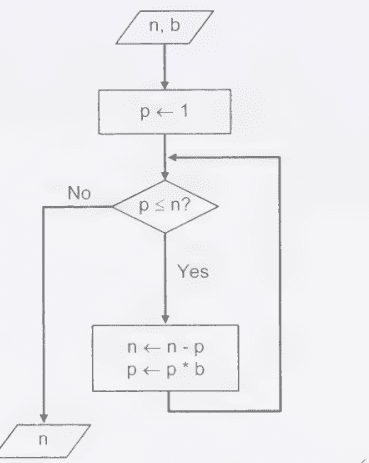

- 5. 考虑序列 `x_1=1, x_2=1+1/1, x_3=1+1/1, ...` 在此序列中 `x_{n+1}=1+1/x_n`（对于 `n >= 1`）。编写一个伪代码或 `Java` 方法计算 `x_n`。随着 `n` 的增大，该序列的项会越来越接近黄金比例 `1+√5/2 ≈ 1.6180339875`。`x_10` 离黄金比例有多近？

- 6. 在问题 5 的序列中，`x_1=1, x_2=2/1, x_3=3/2, x_4=5/3, x_5=8/5,...` 编写一个程序计算并以简单分数的形式打印 `x_n`，给出它的分子和分母。分母不超过 50 的哪一个分数最接近黄金比例？

- 7. 回想一下，对于任何整数 `p >= 1`，`1+3+...+(2p-1)=p^2`。利用这一属性，设计一个简单的迭代算法来判断一个给定数字是否为完全平方数。你的算法可以比较数字并使用加法，但不要使用任何乘法运算。用伪代码显示你的算法或画出流程图。

- 8. 在以下程序中添加缺失的代码：

```java
/**
 * 此程序提示用户输入
```


* 一个正整数和一行文本
* 并显示该行 n 次

```
import java.util.Scanner;

public class HelloNTimes {

    public static void main(String[] args) {

        Scanner kb = new Scanner(System.in);

        System.out.print("Enter a positive integer: ");

        int n = kb.nextInt();

        kb.nextLine(); // 消耗行的剩余部分

        System.out.print("Enter a line of text: ");

        String text = kb.nextLine();

        // 缺失的代码

    }

}
```

- 9. 考虑以下递归方法：

```java
public int mysterySum(int n) {

    if (n == 0) // 如果 n 等于 0
        return 0;
    else
        return 3 + mysterySum(n - 1);
}
```

当调用 `mysterySum(5)` 时，返回什么值？ ✓

- 10. 下面的问题是纸笔练习。你可以使用伪代码或 Java，但不需要担心正确的 Java 语法。

假设你有一个方法 `printStars`，使得 `printStars(n)` 在一行中打印 $n$ 个星号。例如，语句

```java
printStars(5);
```

显示行：

*****

- (a) 使用 `printStars` 方法，编写一个迭代方法 `printTriangle`（或其伪代码），使得 `printTriangle(n)` 打印一个三角形，第一行有一个星，第二行有两个，以此类推，直到最后一行有 $n$ 个星。例如，语句

```java
printTriangle(5);
```

应该显示：

*
**
***
****
*****

- (b) 编写 `printTriangle` 的递归版本，不使用迭代。

- (c) 修改 `printTriangle` 的递归版本，使得 `printTriangle(n)` 显示：

*****
****
***

- 11. 以下递归方法计算 `power3`：

```java
// 前提: n >= 0
public int power3(int n) {

    if (n == 0) // 如果 n 等于 0
        return 1;
    else {
        int p = power3(n / 2); // 当 n 为偶数时，n/2 取整
        // 例如，7/2 得到 3
        p *= p; // 将 p 乘以自身
        if (n % 2 == 1) // 如果 n 是奇数，
            p *= 3; // 将 p 乘以 3
        return p;
    }
}
```

当调用 `power3(15)` 时会执行多少次乘法？

- 12. 假设 Java 不支持乘。编写以下方法的迭代版本和递归版本（使用伪代码）：

```java
// 返回 a 和 b 的积
// 前提: a >= 0, b >= 0
public int product(int a, int b) {
    ...
}
```

- 13. 编写问题 5 方法的递归版本。

- 14. 考虑以下方法：

```java
public int someFun(int n) {
    if (n <= 0)
        return 2;
    else
        return someFun(n - 1) * someFun(n - 1);
}
```

当程序调用 `someFun(5)` 时，`someFun(3)` 被调用多少次？（选题）当输入 $n$ 为非负整数时，该方法计算什么？

A. $n^2$
B. $2^n$
C. $2^{n+1}$
D. $2^{2n}$
E. $2^{(n)}$

展开式 $(x+y)^n$ 中的 $\binom{n}{0}, \binom{n}{1}, \dots, \binom{n}{n}$

$(x+y)^n = \binom{n}{0}x^n + \binom{n}{1}x^{n-1} + \binom{n}{2}x^{n-2} + \dots + \binom{n}{n-1}xy^{n-1} + \binom{n}{n}y^n$ 是系数。例如，

$(x+y)^2 = x^2 + 2xy + y^2$，所以 $\binom{2}{0}=1, \binom{2}{1}=2, \binom{2}{2}=1$。

$(x+y)^3 = x^3 + 3x^2y + 3xy^2 + y^3$，所以 $\binom{3}{0}=1, \binom{3}{1}=3, \binom{3}{2}=3, \binom{3}{3}=1$。

$(x+y)^4 = x^4 + 4x^3y + 6x^2y^2 + 4xy^3 + y^4$，所以 $\binom{4}{0}=1, \binom{4}{1}=4, \binom{4}{2}=6, \binom{4}{3}=4, \binom{4}{4}=1$。

$\binom{n}{k}$ 读作“n选k”，有时写成 $C(n,k)$。二项式系数具有以下属性：对于任何整数 $n$，$\binom{n}{0}=1$；对于任何整数 $n$ 和 $k$，使得 $0 < k < n$。

$\binom{n}{k} = \binom{n-1}{k-1} + \binom{n-1}{k}$。

- 15. 完成下面的递归方法 `binomialCoeff`，它计算指定的二项式系数（或用伪代码编写）。

```java
// 返回二项式系数 C(n, k)
// 前提: 0 <= k <= n
public int binomialCoeff(int n, int k) {

}
```

- 16. 下方的流程图描述了顺序搜索算法：

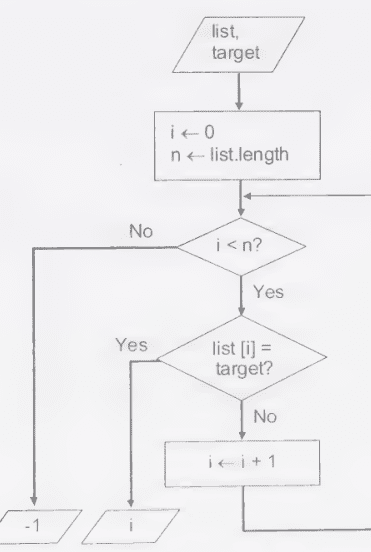

该算法找到第一个值等于 target 的元素的索引 $i$。如果没有找到这样的值，算法返回 -1。流程图中的 `list[i]` 指列表的第 $i$ 个元素。在 Java 中，列表的元素从 0 开始计数。

(a) 修改流程图，该算法在列表中寻找两个相邻的元素 `list[i]` 和 `list[i+1]` 且它们相等。如果找到了这样的对，算法应返回第一个元素的索引；如果没有相邻值相等，则返回 -1。

(b) 画一个流程图，该算法在列表中找到最大值元素的索引。如果多个值等于最大值，输出应该是它们中第一个的索引。

(c) 画一个流程图，该算法判断列表是否有两个重复（相等）的值。如果找到则输出为 true，否则输出为 false。提示：对于每个 $i$，将 `target` 设置为 `list[i]` 并从 $j=i+1$ 开始寻找重复的 `list[j]`。

- 17. 在有 $n$ 枚硬币的袋子里，有一个放射性的。在一次实验中，我们允许测量任何一组硬币的放射性。（一个放射性硬币会让整堆通过放射性测试。）描述一种在袋中寻找放射性硬币的高效算法。使用你的算法，寻找1000枚硬币中的放射性硬币需要多少次实验？

- 18. 假设你有一个天平和三个硬币。如果其中两个硬币重量相同，第三个较轻（假币），只需要一次实验就能识别出较轻的。如果剩下的81枚硬币重量相同，找到较轻的硬币需要多少次实验？ ✓

- 19. 程序 Ornament (JM\Ch04\Exercises\ornament.java) 显示一个由嵌套等腰三角形组成的装饰品，如下：

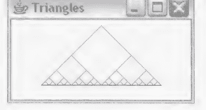

最大三角形底的半长为64，底的中点坐标为 (100, 100)。最小三角形底的半长为4。填补 `drawTriangles` 方法中的空白。\n提示：作为语句

```java
g.drawLine(x1, y1, x2, y2);
```

---

# 第 5 章

## Java 语法与风格

- 5.1 引言 108
- 5.2 使用注释 109
- 5.3 保留字与程序员定义的名称 111
- 5.4 语法与风格 114
- 5.5 语句、块、缩进 118
- 5.6 实验：纠正语法错误 119
- 5.7 总结 121
练习 122

## 108 第 5 章 语法与风格

## 5.1 引言

在第 3 章中，我们讨论了面向对象编程（OOP）方法的核心思想，并研究了一个小型代码程序的通用结构。然而，编写 Java 代码远不止于此。程序的文本受 Java 语法非常严格规则的限制，程序中的每个符号都必须处于正确的位置。这有很多机会出错。编译器可以捕捉一些语法错误，并提供错误信息，这些信息为代码问题所在提供了某种程度上可以理解（或晦涩）的线索。然而，某些错误在编译器看来可能是可接受的代码，因为它们改变了代码运行的方式。程序员必须自己发现并修复这类“漏洞”。此外，算法中还存在诚实的错误：当你认为代码是以某种方式运行的，但实际上它执行的是完全不同的操作。Java 的运行时解释器可以捕捉一些明显的错误（例如，除以零）；但大多数错误只会体现在程序运行（或者说无法运行）的方式上。

除了生成可运行的代码外，程序员还关注程序的风格，这是软件工程中一个非常重要的元素。风格旨在让程序更具可读性。良好的风格是可选的——编译器并不关心。但必须阅读或修改你的程序的人非常在意——非常在意。正如我们在附录 A *风格的 17 个比特*中所说的：

……程序员的产物不是可执行程序，而是它的源代码。在当前环境下，一个“工作正常”程序的寿命只有几个月，有时甚至是几周。另一方面，定期更新的源代码可以存在多年。

在接下来的章节中，我们将更详细地查看 Java 的语法和风格。我们将讨论以下主题：

- 程序中如何标记和使用普通语言注释
- 什么是保留字
- 如何为类、变量、对象和方法命名
- 哪些规则来自语法，哪些来自风格
- 如何使用大括号将程序语句分组为嵌套块

在随后的章节中，我们将学习声明和控制语句的特定语法。

## 5.2 使用注释

我们在 Java 代码中首先注意到的是它包含了一些纯英语短语。这些是程序员插入的注释，用于解释和记录程序的功能。在任何程序的开始处，用注释解释程序的功能、编写者以及如何使用该程序是一个好主意。此注释还可能包含修订历史：谁对程序做了修改、何时修改以及为什么修改。作者必须假设他的程序将被其他人阅读、理解并可能被修改。

在 Java 中，注释可以通过两种方式与代码的其他部分隔离开。第一种格式是将注释放在 `/*` 和 `*/` 标记之间。例如：

```java
/* 这是 Ramblecs 游戏的主类。
作者：B. Speller */
```

在这种格式下，注释可以放在代码的任何位置。第二种格式是在行首放置双斜杠标记。编译器会将从第一个斜杠到行尾的所有文本视为注释。例如，我们可以写：

```java
// (a != 3) // 如果 a 不等于 3
```

或者

```java
// 画一个左上角在 x, y 的矩形：
g.drawRect(x, y, w, h);
```

> 审慎使用注释是在不断提高程序可读性的斗争中，实用的工具之一。注释记录了主要代码部分的作用和结构，使重要的步骤清晰，并解释了代码中晦涩或异常的转。

另一方面，过度或冗余的注释可能会弄乱代码并变成麻烦。新手可能会忍不住对程序的每个语句进行注释，即使其含义从代码本身已经很清晰。丰富的程序员使用注释来解释代码中不那么明显的部分。自解释性的代码优于注释良好的晦涩代码（见附录 A *风格的 17 个比特，第 9 位*）。

注释标记对于注释（临时禁用）源代码中的某些语句也很有用。通过在代码片段周围放置一组 `/* ... */` 或在行首放置双斜杠，我们可以让编译器在特定的编译中跳过它。这对于对代码进行尝试性修改非常有用。

JDK 提供了 Javadoc 实用程序 (`javadoc.exe`)，它可以根据 Java 源代码中特殊的“文档”注释自动生成 HTML（超文本标记语言）格式的文档。由 Javadoc 生成的文档可以在浏览器中查看。

文档注释必须紧跟在重要元素（类、构造函数、方法或字段）之前，才能被 Javadoc 处理。

> 文档注释使用 `/* ... */` 注释分隔符，但此外它们必须在起始 `/*` 之后标记第二个星号 `*`，以便 Javadoc 识别它们。

在每行的开头放置一个星号使其突出显示也是一种常见做法。例如：

```java
/**
 * 构造一个给定的颜色。
 * @param bugColor 此颜色的颜色
 */
public MyMath(Color bugColor) {
    setColor(bugColor);
}
```

Javadoc 还能理解它的特殊“标签”：`@param` 描述方法的参数，`@return` 描述方法的返回值，等等。在 Oracle/Sun 网站上有一个完整的 Javadoc 教程。

## 5.3 保留字与程序员定义的名称

在 Java 中，许多词被保留用于特殊用途，而其他词是程序员给出的任意名称。图 5-1 显示了保留字列表，按类别大致组织。

| 原始数据类型： | 存储修饰符： | 类、继承： | 异常处理： |
| :--- | :--- | :--- | :--- |
| char | public | import | try |
| byte | private | class | catch |
| int | protected | interface | finally |
| short | static | extends | throw |
| long | final | implements | throws |
| float | | new | package |
| double | | super | 本书未使用的： |
| boolean | 控制语句： | instanceof | continue |
| void | if | abstract | continue |
| enum | else | native | |
| 内置常量： | while | volatile | assert |
| true | switch | transient | strictfp |
| false | case | | |
| null | default | | |
| return | | | |

图 5-1. 保留字

## 112 第 5 章 语法与风格

所有保留字都有特定的含义，并且只能按照严格规定的方式使用。

- 所有 Java 保留字仅使用小写字母。

图 5-2 显示了 HelloGui 类片段并高亮了所有保留字。

```java
/**
 * 该程序在窗口中显示消息。
 */
import java.awt.*;
import javax.swing.*;

public class HelloGui extends JFrame {
    public HelloGui() // 构造函数
    {
        super("GUI Demo"); // 设置标题栏
        Container c = getContentPane();
        c.setBackground(Color.CYAN);
        c.setLayout(new FlowLayout());
        c.add(new JTextField("Hello, GUI!", 10));
    }

    public static void main(String[] args) {
        HelloGui window = new HelloGui();
        // 设置窗口的位置和大小：
        // 左上角在 300, 300；宽 200，高 100
        window.setBounds(300, 300, 200, 100);
        window.setDefaultCloseOperation(JFrame.EXIT_ON_CLOSE);
        window.setVisible(true);
    }
}
```

图 5-2. HelloGui 类中的保留字

## 5.3 保留字与程序员定义的名称

除了保留字外，还有其他标准名称和单词，它们的含义通常不会改变。这包括所有标准包名以及库包中的类名。例如 `java.awt`、`javax.swing`、`Object`、`String`、`Graphics`、`JFrame` 等。Java 包的方法名可以在自己的类中重用，但当你从库类派生自己的类时，必须非常小心不要无意中覆盖库方法。

程序员为自己的 Java 类、字段以及方法内部的局部变量命名。这些名称可以使用大小写字母、数字和下划线字符。任何名称不能以数字开头。选择具有一定自解释性并提高程序可读性的名称是重要的。

此外，遵循 Java 命名规范也至关重要。

所有类名以大写字母开头；所有方法和变量名以小写字母开头。如果一个名称由两个或多个单词组成，从第二个单词开始的所有单词首字母大写。“通用”或重要常量的名称可以使用全大写，并在单词之间使用下划线。

例如：

```java
public class VendingMachine            // 类名
{
    private int depositedAmount;                // 字段
    ...
    public static final double TAX_RATE;      // 常
    ...
```


public int getChange()                     // 方法名

{

    int amt = ...                           // 局部变量

}

}

类名和对象的名称通常像名词，而方法名通常像动词。

名称过短可能表达力不足，名称过长会使代码杂乱并难以阅读。Java 风格专家不介意在小代码段中使用一组标准的“临时”名称作为临时变量，例如：

```java
int i, j, k;

double x, y;

Container c;

String str, s;
```

等等。但贯穿整个程序的变量应该获得更有意义的名称。

> 如果不同类中的方法执行的任务相似，那么给它们赋予相同的名称是一种常见的做法。

附录 A“风格的 17 位”更详细地讨论了命名。

## 5.4 语法与风格

> 双引号内的文本和行尾注释必须保持在同一行。

除此之外，编译器仅将换行符、空格和制表符视为连续单词之间的分隔符，一个空格与 100 个空格的效果相同。所有冗余的空白空间（空格、制表符和换行的任何组合）都会被编译器忽略。我们在第 2 章中的 `HelloClass` 可以像图 5-3 所示编写。它仍然可以正确编译和执行。尽管有些人可能坚持认为它和以前一样意义，但大多数人会同意它的可读性已经有所下降。

将代码排列在单独的行、插入空格和空行以及对代码片段缩进并不是 Java 编译器要求的——这是一个风格约定的问题。

Java 专业人士之间演变出了或严格的风格约定，必须遵循这些约定以使程序具有可读性并被业内人士接受。但正如我们之前说的，编译器并不在乎。它关心的是程序中的每个单词和符号。在这里，程序员并没有多少自由。他们可以随心所欲地使用注释，并为类、方法和变量命名。其余文本受 Java 语法非常严格的规则限制。

```java
import java.awt.*;

import javax.swing.*;

public class HelloGui extends JFrame {

    public HelloGui() {

        super("GUI Demo");

        Container c = getgetContentPane().setBackground(Color.CYAN);

        c.setLayout(new FlowLayout());

        c.add(new JTextField(" Hello, World!"));

    }

    public static void main(String[] args) {

        new HelloGui();

        // 设置此窗口的位置和大小：

        // 左上角位于 300, 300；宽度 200，高度 100

        // window.setBounds(300, 300, 200, 100);

        window.setDefaultCloseOperation(JFrame.EXIT_ON_CLOSE);

        window.setVisible(true);

    }

}
```

图 5-3. HelloGui.java：无错误编译

与英语或任何其他自然语言不同，编程语言几乎没有冗余。冗余是信息论中的术语，指的是信息的表达或传输非最优状态：语言代码中的冗余允许读者在信息经过某种程度上混乱的情况下也能正确解释信息。在英语句子中，漏掉一个括号或在错误的位置放置分号可能会暂时阻碍阅读，但通常不会影响整体含义。任何读过六岁孩子写过的文本的人都能体会自然语言中巨大的冗余，这种冗余是如此巨大，以至于我们可以阅读没有大写、标点且大多数单词拼写错误的文本。

Java 或任何其他编程语言并非如此，几乎每个字符都是至关重要的。我们已经提到，所有名称和保留字都必须用正确的大小写字母形式精确拼写。假设我们在 `HelloGraphics` 类中无意中拼写了 `paintComponent` 的名称：

```java
public void paintComponent(Graphics g) {

}
```

初学者通常可以在通过编译器运行代码之前，仔细阅读几次代码来节省大量时间。养成这种习惯：检查是否有拼写错误，并确保所有的分号、括号和其他标点符号都处于它们应该的位置。

## 5.5 语句、块、缩进

Java 代码主要由声明和控制语句组成。声明描述对象和方法；控制语句描述动作。

Java 中的声明和其他语句以分号结束。语句可以使用大括号 `{ }` 分组成块。在右大括号后不使用分号（第 7 章解释的枚举类型声明，以及第 12 章解释的某些数组声明除外）。

```java
public class MyMath {

    public static int gcf(int a, int b) {

        while (a != b) {

            if (a > b) {

                a -= b;

            } else {

                b -= a;

            }

        }

        return a;

    }

}
```

图 5-4. 类内部由大括号标记的嵌套块

## 5.6 实验：纠正语法错误

大括号将代码划分为不同的块，这些块是可以嵌套的（图 5-4）。块内部语句通常通过固定数量的空间或一个制表符缩进。在本书中，我们将块内部语句缩进两个空格，这是常见的 Java 风格。带大括号的块用于表示若干语句组成了一个复合语句，该语句属于同一个控制结构，例如循环（`for`、`while` 等）或条件（`if`）语句。最外层的块始终是类定义的主体。

放置大括号有多种不同的风格。一种风格是将左大括号放在块之前的最后一行行的末尾：

```java
for (int i = 1; i <= n; i++) {

    sum += i * i;

}
```

其他人（包括本书中的我们）倾向于大括号垂直对齐：

```java
for (int i = 1; i <= n; i++) {

    sum += i * i;

}
```

这有助于更容易看到左大括号。只需确保你没有不小心在上一行多放额外的分号即可。

提高代码可读性的另一种重要方法是垂直方向的行间。充分利用特殊注释行和空行来分隔代码中的不同部分和处理步骤。

## 5.6 实验：纠正语法错误


图 5-5 显示了一个 Java 程序，它本应该显示一个橙色圆盘跨过“天空”。然而，图 5-5 中的代码有几个语法错误。找到并修复它们。不要重新尝试程序——只需从 `JM\Ch05\Syntax` 复制 `MovingDisk.java` 到你当前的工作文件夹中。

你可能会想：“如果我不知道正确的 Java 语法是什么，我该如何修复语法错误呢？”好吧，把它看作一场冒险游戏。

```java
import java.awt.*;

import java.awt.event.*;

import javax.swing.*;

public class MovingDisk extends JPanel

    implements ActionListener {

    private int time;

    public MovingDisk() {

        time = 0;

        Timer clock = new Timer(30, this);

        start();

    }

    public void paintComponent(Graphics g) {

        int x = 150 - (int) (100 * Math.cos(0.005 * Math.PI * time));

        int y = 130 - (int) (75 * Math.sin(0.005 * Math.PI * time));

        int r = 20;

        Color sky;

        if (y > 130) sky = Color.BLACK;

        else sky = Color.CYAN;

        setBackground(sky);

        super.paintComponent(g);

        g.setColor(Color.ORANGE);

        g.fillOval(x - r, y - r, 2*r, 2*r);

    }

    public void actionPerformed(ActionEvent e) {

        time++;

        repaint();

    }

    public static void main(String[] args) {

        JFrame w = new JFrame("Moving Disk");

        w.setSize(300, 150);

        w.setDefaultCloseOperation(JFrame.EXIT_ON_CLOSE);

        Container c = w.getContentPane();

        c.add(new MovingDisk());

        w.setResizable(false);

        w.setVisible(true);

    }

}
```


在 `MovingDisk.java` 顶部添加一条注释，说明 `MovingDisk` 类的作用和你的名字。仔细阅读几次源代码，看看是否能发现任何错误。然后编译代码。仔细检查编译器生成的错误信息，并在其中寻找线索。例如，如果编译器告诉你某个名称未定义，检查该名称的拼写。

通常你应该从第一个错误信息开始处理。如果修复一个错误后出现了两个新错误，不要恐慌。

## 5.7 总结

Java 的语法受严格规则限制。这种风格旨在使代码具有可读性。注释补充程序、解释晦涩之处并记录代码。

## 练习

- 说出注释的三种用途。
- 为 `paintComponent` 方法添加 Javadoc 风格的注释。
- 在 `MovingDisk.java` 中找出十六个不同的单词。
- 识别使用的库名称。
- 判断以下语句属于强制语法还是可选风格：
    - (a) 程序以注释开始。
    - (b) 方法名以小写字母开头。
    - (c) 每个左大括号都有对应的右大括号。
    - (d) 匹配的大括号内的所有语句都通过空格缩进。
    - (e) 右大括号单独放在一行。
    - (f) 类在每个方法前有一个空行。
    - (g) 单词 `IF` 未用作变量名。
- 定义 ...
- 如果 `MovingDisk` 类中的 `main` 方法名写成了大写的 `M` 会发生什么？
- 在
```java
if (y > 150)

{

    sky = Color.PINK;

}
```
括号是 Java 语法强制要求的还是风格问题？大括号呢？
- 考虑第 2 章（`JM\Ch02\HelloGuiBanner.java`）中的程序（一个跨屏幕移动的“横幅”）。在 `actionPerformed` 方法的 `if` 语句中添加一个额外的分号：
```java
if (xPos < -100);

{

    xPos = c.getWidth();

}
```
尝试编译并运行该程序，并解释结果。为什么它没有错误就通过编译？为什么信息没有跨屏幕移动？
- 恢复以下代码的行间和正确缩进：
```java
public boolean badIndentation(int maxLines) {

    int lineCount = 3;

    while (lineCount < maxLines) {

        System.out.println(lineCount);

        lineCount++;

    }

    return true;

}
```
- 判断每项陈述的对错：
    - (a) Java 编译器通过缩进识别嵌套块。
    - (b) Java 程序的每行都以分号结束。
    - (c) 双引号内的文本不能拆分成两行。
    - (d) 在加号或括号（非引号内）周围添加空格是风格问题。
    - (e) 类定义中方法和字段的顺序是风格问题，也是程序员的选择。

# 124 第 5 章 语法与样式

11. (a) 注释掉语句

```java
super("GUI Demo"); // 设置标题栏
```

第 2 章中 Hello GUI 程序（`JM\Ch02\HelloGui\HelloGui.java`）中的该语句。编译并运行程序。发生了什么？ \checkmark

(b) 保持 `super` 被注释状态，并将

```java
public HelloGui() // 构造函数
```

替换为

```java
public void HelloGui() // 构造函数
```

程序可以编译吗？如果可以，它做了什么？请解释发生了什么。 \checkmark

12. (a) 在程序 Morning（`JM\Ch05\Exercises\Morning.java`）中找到并修复三个语法错误。编译并运行该程序。注意，此程序使用了另一个类 `EasySound`，其源文件 `EasySound.java`（位于 `JM\Ch05\Exercises`）应该被添加到你的项目中。将 `roost.wav` 文件复制到你的 IDE 放置编译类或在该处查找数据文件的文件夹中。

- (b) 以本章的 Moving Disk 程序为原型，修改 Morning 程序使其每五秒播放一次声音。

- (c) 在网上找一个免费的 `moo.wav` 文件。修改程序，使其每五秒交替播放“公鸡叫”声和“牛”声，并交替白色背景和黑色背景。

# int chapter = 6;

# 数据类型、变量与算术

- 6.1 引言 126
- 6.2 声明字段和局部变量 128
- 6.3 基本数据类型 132
- 6.4 字符串 133
- 6.5 常量 134
- 6.6 变量的作用域 137
- 6.7 算术表达式 138
- 6.8 复合赋值与递增运算符 142
- 6.9 将数字和对象转换为字符串 144
- 6.10 实验：饼图 147
- 6.11 总结 149
- 练习 150

## 6.1 引言

Java 以及其他高级语言允许程序员通过名称来引用内存位置。这些用于存储值的命名“容器”被称为变量。程序员赋予变量有意义的名称，反映它们在程序中的作用。编译器/解释器负责所有细节——为变量分配空间，并在计算机内存中表示数据。

“变量”一词借用自代数，因为在代数中一样，变量可以取不同的值并用于表达式。然而，这种类比仅此于此。在计算机程序中，变量是由程序积极操作的。正如我们之前提到的，变量就像一块石板，程序在需要时可以在上面写入新值，并从上面读取当前值。例如，语句

```java
a = b + c;
```

并不意味着 a 等于 b + c，而是是一组指令：

- 1. 获取 `b` 的当前值；
- 2. 获取 `c` 的当前值；
- 3. 将两个值相加；
- 4. 将结果赋值给 `a`（将结果写入 `a` 中）；

对于

```java
a = 4 - a;
```

也是如此。这不是一个方程，而是一组改变 `a` 的值的指令：

- 1. 获取变量 `a` 的当前值；
- 2. 用 4 减去它；
- 3. 将结果赋值回 `a`（将新值写入 `a` 中）；

在 Java 中，语句

```java
someName = expression;
```

## 6.1 ~ 引言 127

代表一个赋值操作，该操作对 `=` 号右侧的表达式求值（找到表达式的值），并将该值赋值给（写入） `=` 左侧的变量 `someName`。该符号读作“获取……的值”：“`someName` 获取 `expression` 的值”。（如果你想比较两个值，请使用另一个运算符 `==` 表示“等于”）

在 Java 中，每个变量都有一个数据类型。这可以是基本数据类型（如 `int`、`double` 和 `char`），可以是类类型（如 `String`、`Location`、`Actor`）。程序员根据变量将包含的数据类型来指定变量的数据类型。

> 变量的数据类型决定了该变量可以存储的值范围、在内存中为其分配的空间大小，以及可以对其执行的操作类型。

例如，`int` 类型的变量包含一个整数值，其范围可以在 -2³¹ 到 2³¹ 之间；`double` 类型的变量表示一个实数。`String` 类型的变量引用 `String` 类的一个对象。

在 Java 中，表示对象的变量持有对该对象的引用。引用基本上是对象在内存中的地址。当使用 `new` 运算符创建对象时，该运算符为对象分配内存空间并返回其引用。该引用可以保存在变量中并用于访问该对象。我们将在第 9 章详细解释引用。

在本章中，我们解释了 Java 语法的以下概念和元素：

- 变量和常量声明的语法和位置
- 基本数据类型
- 字符串
- 字面量和符号常量
- 值从一种类型到另一种类型的转换（强制转换）
- 变量和符号常量的作用域
- Java 的算术运算符

## 6.2 声明字段和局部变量

Java 中的变量分为三类：字段、局部变量和参数。字段在方法外部声明。局部变量在方法内部声明。参数在方法头部声明。

字段声明的通用格式为

```java
private type someName;
```

或者

```java
private type someName = expression;
```

> 如果字段没有初始化，Java 会提供默认值，数值类型为 0，对象类型为 `null`。

例如：

```java
private int sideLength; // sideLength 被置为 0

private Location; // Location 被置为 null
```


赋值 `null` 值表示它不引用任何对象。`null` 是一个保留字。

> 局部变量是在方法内部声明的临时变量。一旦方法结束，其局部变量就会被丢弃。

## 6.2 字段和局部变量

然而，某些常量可以声明为 `public`。

例如，`GridWorld` 类中的 `act` 方法使用了局部变量 `c`、`green` 和 `blue`：

```java
public void act() {
    Color c = getColor();
    int red = (int) (c.getRed()) * (1 - DARKENING_FACTOR);
    int green = (int) (c.getGreen()) * (1 - DARKENING_FACTOR);
    int blue = (int) (c.getBlue()) * (1 - DARKENING_FACTOR);
    setColor(new Color(red, green, blue));
}
```

## 6.2 声明字段和局部变量

5. 变量可以被声明为 `final`，这意味着它的值一旦被赋值，就不能改变。例如：

```java
private static final Color DEFAULT_COLOR = Color.PINK;
```

因此，一个初始化的 `final` “变量”实际上不是一个变量，而是一个常量。常量的初始值也是它的“最终”值。常量可以在声明时初始化，也可以在稍后的构造函数中初始化。

一个变量在其作用域内只能声明一次（“作用域”指的是程序中该变量“可见性”的空间——请参见第 6.6 节）。

例如，在同一个方法中同时拥有

```java
int sum;
...
int sum = m + n;
```

会导致语法错误。可以使用以下任意一种：

```java
int sum;
...
sum = m + n;
```

或者

```java
int sum = m + n;
```

> Java 允许对字段和局部变量使用相同的名称。这可能会导致有时难以发现的错误。

例如，如果我们无意中声明了

```java
Color color = Color.BLUE;
```

而不是在 `Actor` 的构造函数中使用

```java
color = Color.BLUE;
```

编译器会将此语句视为局部变量的声明，并让字段保持未初始化（`null`）。当后续方法尝试调用 `color` 的某个方法时（例如 `Flower` 的 `act` 方法中的 `get()`），程序将“抛出”一个 `NullPointerException`。

你可能会想：为什么我们需要局部变量？为什么我们不能把它们都做成字段呢？从技术上讲，只使用字段是可能的，但如果将局部使用的变量保持在局部，类的结构会组织得良好得多。在良好的设计中，字段是一个描述其对象真正重要的、“全局”属性的变量。你并不想为临时需求使用全局变量——就像你不会在访问的每家快餐店都随身携带盘子和餐具一样。

## 6.3 基本数据类型

在 Java 中，基本数据类型的值不是对象。这是对早期编程语言（如 C）的妥协，Java 借用了 C 大部分的语法。对象也有数据类型；对象的类型就是它的类。但 `int`、`double` 以及其他基本数据类型并不是类。

Java 具有以下基本数据类型，由保留关键字指定：

```
boolean  byte
char      short
int       long
double    float
```

注意，与其他保留关键字一样，基本数据类型的名称用小写字母拼写。它们被称为这些类型的基本变量，不具有对象的属性（特别是，它们没有任何方法）。`char` 变量存储一个字符（Unicode）；`int`、`byte`、`short` 或 `long` 变量存储一个整数；`float` 或 `double` 变量存储浮点实数。

由于不同类型的变量占据内存字节数不同，我们说它们具有不同的大小。

在 Java 中，每种数据类型都有固定的大小，无论特定的计算机型号或 Java 解释器的品牌。表 6-1 汇总了基本类型、它们的大小及其值的范围。

尽管 `float` 和 `double` 可以表示极大范围的数字，但它们的精度有限，`float` 只有大约七位有效数字，`double` 约为其两倍。

> 在书中，我们将主要使用 `int`、`double`、`char` 和 `boolean` 基本数据类型。

`boolean` 类型将在下一章讨论。

> 程序员有责任确保变量的值以及算术表达式中的所有中间结果和最终结果都符合所选数据类型的范围，并且这些类型满足计算的精度要求。

| 类型 | 大小（字节） | 范围 |
| --- | --- | --- |
| boolean | 1 | true 或 false |
| char | 2 | Unicode 字符集（包含 ASCII 子集） |
| byte | 1 | 从 -2^7 = -128 到 2^7 - 1 = 127 |
| short | 2 | 从 -2^15 = -32,768 到 2^15 - 1 = 32,767 |
| int | 4 | 从 -2^31 到 2^31-1 |
| long | 8 | 从 -2^63 到 2^63-1 |
| float | 4 | 约从 -3.4 x 10^38 到 3.4 x 10^38 |
| double | 8 | 约从 -1.8 x 10^308 到 1.8 x 10^308 |

表 6-1. 基本数据类型

## 6.4 字符串

在 Java 中，字符字符串（短文本片段）由 `String` 对象表示。`String` 是 `java.lang` 包中的库类，该包内置于 Java。`String` 是一个对象，所以 `String` 不是基本数据类型。

`String` 类的行为类似于任何其他类；它有构造函数和公共方法，在 Java API 文档中有描述。（`String` 类也有私有方法和字段；我们对它们感兴趣，因为它们是私有的。）我们第 10 章讨论最常用的 `String` 方法，并解释为什么 `String` 构造函数很少使用。

然而，有两个特征使得 `String` 特别。首先，Java 允许字面量字符串。例如：

```java
String s = "Hello";
```

编译器为该字面量创建一个 `String` 对象。其次，Java 允许拼接字符串。例如：

```java
String s = "Hello" + " World";
```

## 6.5 常量

常量表示程序运行时不会改变的变量。在 Java 中，符号常量通常初始化为 `final` 字段。例如：

```java
static final double DARKENING_FACTOR = 0.05;
```

（有时程序员使用大写字母命名常量以提高可见性。）`final` 是一个关键字。

符号常量的通用形式是

```
[可选修饰符] final type name = expression;
```

其中 `type` 是数据类型，后面是常量名称值。常量也可以初始化为表达式的值。

> 常量不需要在声明时立即初始化——它的“最终”值可以在构造函数中设置。

例如：

```java
public class Bug extends Bug {
    private int steps;
    private final int sideLength;
    public Bug(int length) {
        steps = 0;
        sideLength = length;
    }
}
```

初看起来，符号常量似乎是多余的，我们可以直接在程序中使用字面量值。考虑一下 `Flower` 的 `act` 方法：

```java
public void act() {
    Color c = getColor();
    int red = (int) (c.getRed()) * (1 - DARKENING_FACTOR);
    int green = (int) (c.getGreen()) * (1 - DARKENING_FACTOR);
    int blue = (int) (c.getBlue()) * (1 - DARKENING_FACTOR);
}
```

显然我们可以使用特定的数字编写相同的代码：

```java
int red = (int) (c.getRed()) * 0.95;
```

乍似乎更简单。然而，使用符号常量有几个重要的理由。

> 使用符号常量最重要的原因是它可以简化程序维护。如果以后对程序进行修改并需要更改常量的值，对常量声明的更改将更改整个程序中常量的值（在包含该常量的类重新编译后）。

符号常量的另一个优势是，如果命名得当，它们会使代码更具可读性且自解释性。名称可以解释常量在程序中所扮演的角色，从而使得不再需要额外的注释。

如果在未来的开发过程中，程序的某个版本需要，那么将符号常量改为变量也更加容易。

符号常量和变量一样，使用特定的数据类型进行声明，并且仅在它们的作用域内定义（下一节将解释）。这为代码引入了更多的条理，并为编译器提供了更多错误检查的机会——这是使用符号常量的另一个理由。

另一方面，没有必要用赋值给 0 或 1 等通用常量的符号名称来填充代码，例如：

```java
public static final int FULL_CIRCLE = 360;
final int HOURS_IN_DAY = 24;
```

## 6.6 变量的作用域

正如我们上面讨论的，类中的每个构造函数和方法都可以有自己的局部变量，而类的字段可以在它的所有方法中使用。变量在何处可见以及可以使用涉及到作用域（scope）这一主题。

> 在 Java 中，变量仅定义在程序中称为“变量作用域”的特定空间内。

作用域规范有助于编译器执行重要的错误检查。如果你尝试在变量或常量的作用域之外使用它们，编译器会检测到错误并报告“未定义的名称”。如果你在同一个作用域内声明了相同的名称，编译器也会报告错误。

> 字段的作用域延伸整个类，包括它所有的构造函数和方法。

> 局部变量的作用域从它的声明处延伸到其被声明的代码块的结束。

局部变量仅在程序执行该变量被声明的代码块时临时存在。当程序将控制权交给一个方法时，会分配一块特殊的内存区域（系统栈上的一个帧）来存放该方法的局部变量。当方法退出时，空间被释放，所有局部变量都将被销毁。

Java 中的局部变量不需要在方法的顶部声明，而可以在方法代码的任何地方声明。但在嵌套块内部进行声明可能会导致难以捉摸的错误。我们建议初学者，除非你确切知道自己在做什么，否则避免在嵌套块内部声明局部变量。

正如我们之前提到的，Java 允许对字段和局部变量使用相同的名称，局部变量的优先级高于全局变量。如果你无意中声明了一个同名的局部变量并覆盖了全局变量，可能会导致难以发现的错误。

> 名称可能发生重叠是为类的字段起显眼名称的良好理由。

`x`、`y` 或 `a` 不是字段名的良好选择——它们应该留给一次性的局部变量。`location` 和 `sideLength` 是字段更好的名称。

在不同的方法中使用相同的名称定义局部变量是完全可以的。

事实上，当变量代表相似的数量并以相似的方式使用时，这是一个很好的做法。但永远不要试图通过将方法内的临时局部变量声明为字段来节省声明语句。一切都应该在它所属的地方声明。

## 6.7 算术表达式

算术表达式的写法与代数相同，并可能包括字面量和符号常量、变量、算术运算符 `+`、`-`、`*`、`/` 以及括号。

运算顺序由括号和运算符优先级决定：先执行乘除（从左到右），然后执行加减。乘法需要一个不能省略的符号。你也可以使用负号。例如：

```java
x = -(y + 2*z) / 5;
a = -a;               // 对 a 取反
```

> 如果你想获取两个 `int` 变量的真实比例，你必须将 `int` 转换为 `double`。这可以使用强制转换运算符来实现，它由括号中的目标类型指定。

例如：

```java
double ratio = (double)a / (double)b;
```

上面的语句基本上等同于引入两个临时变量：

```java
double tempA, tempB;
tempA = a;
tempB = b;
double ratio = tempA / tempB;
```

但强制转换会自动为你完成。

强制转换运算符的通用语法为：

```java
(type) variable
```

或

```java
(type) (expression)
```

> 注意，“相同类型”规则适用于表达式中所有操作的所有中间结果。

如果你写：

```java
int a = 6, b = 2;
double ratio = a / b; // 太晚了！
```

`ratio` 仍然得到值 3，因为 `a / b` 的结果在赋值给 `ratio` 之前被截断为 `int`。同样，如果你写：

```java
int degreesCelsius = 5 / 9 * (degreesFahrenheit - 32); // 错误！
```

`degreesCelsius` 将始终被设置为 0（因为 `5 / 9` 先被计算，其结果为 0）。

如果两个操作数的类型不同，“较小”类型的操作数会被提升（即转换）为“较大”类型（`long` 比 `int` 大，`float` 比 `long` 大，`double` 是最大的）。因此，在上面的示例中，只需要使用一次强制转换就足够：

```java
double ratio = (double)a / b;
```

或

```java
double ratio = a / (double)b;
```

强制转换运算符适用于兼容类型。你不能将数字转换为对象。

## 6.8 复合赋值和增减运算符

Java 提供了方便的快捷方式将算术运算与赋值结合。下表总结了复合赋值：

| 复合赋值 | 等于 |
|---|---|
| a += b; | a = a + b; |
| a -= b; | a = a - b; |
| a *= b; | a = a * b; |
| a /= b; | a = a / b; |
| a %= b; | a = a % b; |

例如，以下语句：

```java
sum = sum + k;
```

复合形式起初可能看起来晦涩，但一旦你习惯了，它们就会变得很有吸引——不仅因为它们更简洁，还因为它们强调了正在修改同一个变量这一事实。在可以使用复合赋值的地方不使用显得业余。

另一个快捷方式是一组特殊的增减运算符。这些运算符用于将整数变量加或减一：

| 增减运算符 | 等于 |
|---|---|
| a++ | a = a + 1 |
| a-- | a = a - 1 |
| ++a | a = ++a |
| --a | a = --a |

增减运算符可以在表达式中使用。这时 `a++` 与 `++a` 形式、以及 `a--` 与 `--a` 之间的区别变得非常重要。当使用 `a++` 时，变量的值在表达式中使用之后增加；而对于 `++a` 形式，变量的值在表达式中使用之前就会增加。这会让代码变得非常困惑且难以阅读。例如：

```java
a = b + c++; // 太复杂了！
```

> 考虑仅将 `a++` 和 `a--` 作为独立的语句使用。避免使用 `++a` 和 `--a`，并避免在算术表达式中使用 `++` 和 `--`。

## 6.9 将数字和对象转换为字符串

Java 对 `String` 对象有种特殊的处理方式：当 `+` 运算符应用于两个字符串时，它会将它们拼接起来。这仅仅是一个语法快捷方式，消除了调用方法的必要性。（事实上，`String` 类有一个方法 `concat`，用于将一个字符串连接到另一个字符串上，因此 `str1 + str2` 等同于 `str1.concat(str2)`）。

Java 还允许当一个操作数是字符串而另一个是原始数据类型或对象时，使用该运算符进行拼接。在这种情况下，非字符串的操作数会自动转换为字符串。

例如，

```java
double v = 79.5;
System.out.print("Volume = " + v);
```

显示为

```
Volume = 79.5
```

在这里，`+` 将字符串 "Volume = " 和双精度浮点值 79.5 拼接在一起，形成一个新字符串 "Volume = 79.5"。

> 当使用 `+` 运算符进行拼接时，两个操作数中至少有一个必须是字符串类型的值或表达式。

非字符串操作数将根据取决于其类型的特定规则转换为字符串。`char` 值被转换为一个包含其数字的字符串，负值则带有负号；`double` 值被转换为一个可能包含负号、小数点前一个或多个数字、以及小数点后至少一个数字的字符串；`boolean` 值被转换为 "true" 或 "false"。例如，

```
(转换)
'A'      ==> "A"
123     ==> "123"
-1      ==> "-1"
3.14    ==> "3.14"
.1       ==> "0.1"
Math.PI ==> "3.141592653589793"
false   ==> "false"
```

相同的转换规则也用于：

```java
System.out.print(x);
```


用于显示不同类型 `x` 的值。

请注意，如果你连续使用多个 `+` 运算符而没有使用圆括号 ——

```
x + y + z
```

— 它们将从左到右求值。要拼接 x、y 和 z，每个 `+` 必须至少有一个字符串操作数。例如，

```
System.out.print("" + 2 + 2);
```

显示为

```
22
```

而

```
System.out.print(2 + 2 + "");
```

显示为

```
4
```

当左侧操作数是字符串时，`+` 运算符也适用于转换。例如：

```java
String str = "score";
int points = 90;
str += points; // str 现在指向 "score: 90"
```

有时，你需要将一个值转换为字符串而不将其与任何内容拼接（例如，为了将其传递给一个期望 `String` 参数的方法）。

> 将一个值转换为字符串最简单的方法是将该值与一个空字符串拼接。

# 146 第 6 章 ~ 数据类型、变量与算术

例如：

```
JTextField scoreDisplay = new JTextField();
int score = 6;
scoreDisplay.setText("" + score);
```

任何对象都可以通过调用其 `toString` 方法转换为字符串。

在 Java 中，每个对象都有一个默认的 `toString` 方法，该方法返回一个字符串。然而，默认的 `toString` 方法并不好用：它返回的字符串是对象的类名，后面跟着其在内存中的十六进制地址。类似于："Flower@lla698a"。程序员经常重写默认方法，并为类提供一个更有用的 `toString` 方法。例如：

```java
public class Fraction {
    private int num, denom;
    public Fraction(int num, int denom) {
        this.num = num;
        this.denom = denom;
    }
    public String toString() {
        return num + "/" + denom;
    }
}
```

在 `Fraction` 中定义了这个 `toString` 方法后，语句

```
Fraction f = new Fraction(1, 2);
System.out.println(f);
```

显示为

```
1/2
```

如你看到的，`toString` 方法被 `System.out` 的 `print` 和 `println` 方法用于显示对象。换句话说，如果 `obj` 是一个对象，那么

```
System.out.print(obj);
```

等同于

```
System.out.print(obj.toString());
```

## 6.10 实验：饼图

图 6-2 显示了程序 `Poll` 的快照，该程序帮助进行学校学生主席选举投票。结果显示为三个候选人每个人的数字，以及饼图上的切片。

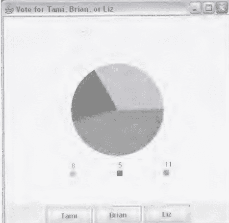

图 6-2. Poll 程序

该程序的源代码由三个类组成：`Poll`、`PollControlPanel` 和 `PollDisplayPanel`。`Poll` 是主类：它创建一个程序窗口并为其添加一个控制面板和一个显示面板。`PollControlPanel` 对象代表一个带有三个按钮的控制面板。它还处理按钮的点击事件。`PollDisplayPanel` 对象跟踪投票计数，并以数字和饼图的形式显示它们。

你的任务是填充 `Poll.java`、`PollControlPanel.java` 和 `PollDisplayPanel.java` 中的空白处：

1. 在 `Poll` 类中声明用于存储各种 `count1`、`count2` 和 `count3` 的 `int` 字段。
2. 实现 `count1`、`count2` 和 `count3` 方法，用于增加投票计数。
3. 实现 `toString` 方法，返回包含候选人名称的相应投票计数的字符串。
4. 编译 `PollDisplayPanel` 类并修复语法错误。
5. 编写一个带有 `main` 方法的简单测试类，如所示，以测试你的进度。
6. 实现 `countToDegrees` 方法，将 `count` 和 `total` 的比例转换为饼图切片的角度（度）。
7. 填充 `drawPieChart` 和 `drawLegend` 方法中的空白。
8. 编译并测试程序。

## 6.11 总结

变量是程序员命名的内存位置，可以存储值。字段是在所有构造函数和方法之外定义的变量。字段在类中是“可见的”。局部变量是在构造函数或方法内部定义的临时变量，仅在该方法的作用范围内有效。

字段和局部变量在使用之前必须声明。变量的声明包括变量的数据类型、名称以及可选的初始值。多个相同类型的变量可以在声明中定义：

```
[修饰符] 类型 名称1, 名称2, ...;
[修饰符] 类型 名称1 = 表达式, 名称2 = 表达式, ...;
```

改变值的字段通常使用 `final` 关键字声明，并带有初始值；它们实际上不是变量而是常量。此类符号常量的声明形式如下：

```
[修饰符] final 类型 常量名 = 表达式;
```

其中可选修饰符可以是保留字 `public` 或 `private`，以及适当的 `static`（第 9 章）。

Java 有 `byte`、`short` 和 `long` 原始数据类型表示各种大小的整数。我们始终使用 `int`，它表示范围从 -²¹ 到 2³ 的整数。实数由 `float` 和 `double` 类型表示。我们始终使用 `double`，`char` 表示单个字符。`String` 对象代表文本。`boolean` 类型在第 7 章中讨论。

算术表达式的写法与代数相同，可以包括字面量常量、变量以及算术运算符 `+`、`*`、`/` 和括号。乘法符号 `*` 不能省略。

算术运算的结果与操作数的类型相同。如果操作数类型不同，较“小”的操作数会自动提升为“较大”的类型（例如 `int` 可以转换为 `double`）。Java 提供了强制转换运算符，可以将变量或常量从一种数据类型显式转换为另一种兼容的类型。

程序员的责任是确保变量的值以及算术表达式中所有的中间结果和最终结果都处于所选数据类型的范围内，并确保这些类型满足计算的精度要求。

`+` 运算符在应用于两个字符串时，会将它们拼接。它也可以用于将一个字符串与另一个类型的值拼接。要将数字或对象转换为字符串，可以将其与一个空字符串拼接。类定义中的 `toString` 方法应该指定一种合理的方式，将该类对象的某些信息以字符串的形式表示出来。当对象被转换为字符串时，会调用它的 `toString` 方法。

## 练习题

1. 下列行中，哪些在语法上是有效的字段声明？局部变量声明？
   - (a) `int hours, double pay;` ✓
   - (b) `private double dollarsAndCents;` ✓
   - (c) `char mi; int age;`
   - (d) `private final int year = 365, leapYear = year + 1;`
   - (e) `char tab = '\t', newline = '\n', a = 'a';`
   - (f) `public final double pi = 3.14159;`

2. 标记对或错并解释：
   - (a) 每个变量必须单独在一行中声明。
   - (b) 变量的作用域是其取值的最大范围。
   - (c) `x` 始终是一个糟糕的变量风格变量名，因为它太短了。
   - (d) 同一类不同方法中的局部变量允许同名。 ✓
   - (e) 如果方法中的局部变量与字段同名，编译器会报告语法错误。 ✓

3. 说出使用符号常量而非字面量常量的三个良好理由。

4. (单选题) 下列语句中哪一个会打印反斜杠？

5. 选择正确的词：变量的作用域是在程序（编译 / 运行）时确定的。✓

## 第 6.7-6.11 节

6. 下述语句的输出是什么？
   - (a) `System.out.print(5 / 10);` ✓
   - (b) `System.out.print(1 / 2 * 10);`
   - (c) `System.out.print(1.0 / 2 * 10);` ✓
   - (d) `System.out.print(1 / 2.0 * 10);`
   - (e) `System.out.print(13 != 5);`

7. (a) 假设：
   ```
   double rate = 1.058;
   int balance0 = 100, balance = (int)(balance0 * rate);
   ```
   `balance` 的值是多少？ ✓

   (b) 假设：
   ```
   int miles = 98, gallons = 5;
   double gasMileage = miles / gallons;
   ```
   `gasMileage` 的值是多少？

8. 在不改变结果的情况下，尽可能从以下语句中移除括号：
   ```
   count += ((total/pages) - 5) * words - 1;
   ```

9. 找到并修复以下语句中的错误：
   ```
   final double g = 16.0;
   double t = 35.5;
   System.out.print("The travel distance is ");
   System.out.println(l / 2 * (g * t * t));
   ```

10. 如果 `x` 为负值，写一个表达式将 `x` 舍入到最近的整数。（对于两个整数中间的数字，如 -0.5, -1.5, -2.5 等，舍入规则没有唯一规定。在本练习中，这些数字将向下舍入到 -1, -2, -3 等。）

11. 给定
    ```
    int a, b, c;
    ```
    编写 Java 表达式来计算方程 $ax^2 + bx + c = 0$ 的根（假设两个根都存在），并将赋值给两个 `double` 类型变量 `x1` 和 `x2`。使用临时变量存储 $\sqrt{b^2 - 4ac}$ 以免计算两次。提示：`Math.sqrt(d)` 返回 `d` 的平方根，类型为 `double`。✓

12. 在以下代码段中找到一个语法错误：
    ```
    double a, b;
    int temp;
    System.out.print("Enter two real numbers: ");
    // 交换数字
    temp = a;
    b = temp;
    ...
    ```

13. 写一个表达式，给定一个正整数 $n$，计算一个新的整数，其中个位和十位交换了位置。例如，如果 $n = 123$，结果应为 132；如果 $n = 3$，十位为零，结果应为 30。

14. 整数常量 `dayOfWeek1` 的值为 0 到 6，代表 1 月 1 日的星期几（0=星期日，1=星期一等）。变量 `day` 的值为 1 到 31，代表 1 月的某一天。写一个表达式来计算任何给定 `day` 值的对应星期几。例如，如果 `dayOfWeek1 = 0`（1 月 1 日是星期日）且 `day = 13`（1 月 13 日），则 `dayOfWeek1` 应该是 5。

15. 假设 `curHour` 和 `curMin` 代表当前时间，`depHour` 和 `depMin` 代表出发时间。在以下语句中填空：
    ```
    int __ = __;
    System.out.println("__ hours and " + __ + " minutes.");
    ```

16. BMI 定义为体重（公斤）除以高度（米）的平方。`calculateBmi(weight, height)` 方法接收体重（磅）和高度（英寸）并返回 BMI 指数。

17. (b) 假设：
    ```
    int miles = 98, gallons = 5;
    double gasMileage = miles / gallons;
    ```
    `gasMileage` 的值是多少？

18. 在不改变结果的情况下，尽可能从以下语句中移除括号：
    ```
    count += ((total/pages) - 5) * words - 1;
    ```

9. 找到并修复以下语句中的错误：
    ```
    final double g = 16.0;
    double t = 35.5;
    System.out.print("The travel distance is ");
    System.out.println(l / 2 * (g * t * t));
    ```

10. 如果 `x` 为负值，写一个表达式将 `x` 舍入到最近的整数。（对于两个整数中间的数字，如 -0.5, -1.5, -2.5 等，舍入规则没有唯一规定。在本练习中，这些数字将向下舍入到 -1, -2, -3 等。）

11. 给定
    ```
    int a, b, c;
    ```
    编写 Java 表达式来计算方程 $ax^2 + bx + c = 0$ 的根（假设两个根都存在），并将赋值给两个 `double` 类型变量 `x1` 和 `x2`。使用临时变量存储 $\sqrt{b^2 - 4ac}$ 以免计算两次。提示：`Math.sqrt(d)` 返回 `d` 的平方根，类型为 `double`。✓

12. 在以下代码段中找到一个语法错误：
    ```
    double a, b;
    int temp;
    System.out.print("Enter two real numbers: ");
    // 交换数字
    temp = a;
    b = temp;
    ...
    ```

13. 写一个表达式，给定一个正整数 $n$，计算一个新的整数，其中个位和十位交换了位置。例如，如果 $n = 123$，结果应为 132；如果 $n = 3$，十位为零，结果应为 30。

## 布尔表达式与 if-else 语句

- 7.1 引言 158
- 7.2 if-else 语句 160
- 7.3 boolean 数据类型 161
- 7.4 关系运算符 162
- 7.5 逻辑运算符 164
- 7.6 运算符顺序 166
- 7.7 短路求值 167
- 7.8 if-else-if 与嵌套 if-else 168
- 7.9 案例研究与实验：掷骰 173
- 7.10 switch 语句 182
- 7.11 枚举数据类型 184
- 7.12 案例研究与实验：掷骰结语 187
- 7.13 总结 190
练习 192

# 第 7 章 布尔表达式与 if-else 语句

## 7.1 引言

在程序执行期间，控制流通常从一个语句顺序执行到下一个语句。这种序列会被几种类型的控制机制所改变：

1. 方法调用
2. 迭代语句（循环）
3. 条件（if-else）语句
4. switch 语句
5. 异常

在本章中，我们将学习 `if-else` 语句，它告诉程序根据某些条件选择并执行一段代码或另一段代码。我们还将查看 `switch` 语句，它根据变量或表达式的值从多个代码片段中选择一个特定的片段。

`if-else` 控制结构允许条件分支。例如，假设我们想要找到一个整数的绝对值。返回绝对值的方法可能如下：

```java
```


# 第 7 章 布尔表达式与 if-else 语句

## 7.1 概述

```java
public static int abs(int x) {
    int ax;
    if (x >= 0)      // 如果 x 大于等于 0
        ax = x;          // 执行此操作
    else            // 否则
        ax = -x;         // 执行此操作
    return ax;
}
```

或者更简洁地：

```java
public static int abs(int x) {
    if (x > 0)
        return x;
    else
        return -x;
}
```

有一种特殊的 CPU 指令称为条件跳转，它们支持条件分支。CPU 总是从寄存器中获取下一条指令的地址，在某些系统中该寄存器被称为指令指针（IP）。通常，该寄存器在执行每条指令后会自动增加，以便指向下一条指令。这使得程序按顺序执行连续指令。

条件跳转指令测试特定条件，并根据测试结果告诉 CPU “跳转”到指定的指令。如果满足条件，则会将一个新值放入 IP 中，导致程序跳跃到指定的指令。例如，一条指令可能会测试上一次操作的结果是否大于零，如果是，则告诉 CPU 向后或向前跳转到指定的地址。如果条件为假，程序执行将继续下一条连续指令。

在高级语言中，分支条件使用关系运算符（如“小于”、“大于”、“等于”等）以及逻辑运算符“与”、“或”和“非”编写。组合这些运算符的表达式被称为布尔表达式。布尔表达式的值可以是真（true）也可以是假（false）。

在接下来的节中，我们将讨论编写 `if-else` 和 `switch` 语句的语法、声明 `boolean` 变量以及使用关系和逻辑运算符编写布尔表达式。我们还将简要讨论形式逻辑中的两个性质，即德摩根定律，它们在编程中非常有用。我们将讨论在处理与“与”和“或”运算符连接的多个条件时的短路求值。我们还会讨论枚举数据类型。

在第 7.9 节和 7.12 节中，我们将使用案例研究来练习面向对象的设计和实现方法：如何定义应用程序所需的类和对象，如何在团队成员之间分配工作，以及如何独立于项目的其他部分测试项目的部分。你将需要为案例研究中的一个类贡献包含大量 `if-else` 语句的代码。

## 7.2 if-else 语句

Java 中 `if-else` 语句的通用形式为：

```java
if (condition) {
    statementA1;
    statementA2;
    ...
} else {
    statementB1;
    statementB2;
}
```

条件周围的括号是必须的。执行 `if-else` 语句时，它会评估条件；如果为真，则执行第一个块；如果为假，则执行第二个块。括号是可选的，例如：

```java
if (condition)
    statementA1
else
    statementB1
```

`if-else` 语句也可以是嵌套的，这意味着一个 `if-else` 语句被放在另一个内部。

### 7.3 boolean 数据类型

Java 有一种基本类型称为 `boolean`，它只能包含两个值：`true` 或 `false`。布尔变量用于存储表达式的结果。例如：

```java
boolean isGreater = (x > 0);
```

布尔表达式由关系运算符、逻辑运算符和 `boolean` 类型组成。

## 7.4 关系运算符

Java 识别六种关系运算符：

| 运算符 | 含义 |
| --- | --- |
| `>` | 大于 |
| `<` | 小于 |
| `>=` | 大于等于 |
| `<=` | 小于等于 |
| `==` | 等于 |
| `!=` | 不等于 |

关系运算符主要应用于基本数值类型。`==` 和 `!=` 运算符也可以应用于字符。例如：

```java
if (gender == 'F') {
    System.out.print("Dear Ms.");
} else {
    System.out.print("Dear Mr.");
}
```

避免对 `double` 或 `float` 变量使用 `==` 和 `!=`，因为浮点算术是不精确的。例如，在

```java
(15.0 / 3.0 == 5.0)
```

由于舍入误差，数字可能非常接近但不完全相等。

`String` 对象 `fileName` 和代表字面量 `"words.txt"` 的 `String` 对象之间的 `==` 运算符比较的是地址而不是值。然而，有时比较引用是有用的，例如如果你想知道哪个特定对象（例如按钮）导致了特定的事件。

## 7.5 逻辑运算符

Java 有两个二进制逻辑运算符“与”和“或”，以及一个一元逻辑运算符“非”。它们由以下符号表示：

| 运算符 | 含义 |
| --- | --- |
| `&&` | 与 |
| `||` | 或 |
| `!` | 非 |

表达式 `condition1 && condition2` 仅当 `condition1` 和 `condition2` 都为真时为真。

表达式 `condition1 || condition2` 当 `condition1` 或 `condition2`（或两者都）为真时为真。

表达式 `!condition1` 当 `condition1` 为假时为真。

以下代码：

```java
boolean match = ...;
if (!match) {
}
```

工作方式与以下相同：

```java
boolean match = ...;
if (match == false) {
    ...
}
```

逻辑运算符 `&&`、`||` 和 `!` 的结果都是布尔数据类型，与关系运算符的结果相同。

“与（and）”、“或（or）”和“非（not）”操作之间的关系如下：

| 布尔表达式 | 与以下布尔值相同： |
|---|---|
| not (p and q) | not p or not q |
| not (p or q) | not p and not q |

逻辑的这两个属性被称为德摩根定律。它们源于形式逻辑，在实际编程中用。在 Java 语法中，德摩根定律的形式如下：

```
! (p && q) is the same as !p || !q
! (p || q) is the same as !p && !q
```

程序员可以选择任一等效形式；这种选择取决于哪种形式更具可读性。通常展开 `!`（非）会更好。例如：

```
if (x >= 0 && x < 5)
```

比下面这种更容易读：

```
if (!(x < 0 || x >= 5))
```

## 7.6 运算符优先级

通常情况下

```
if (!cond1 && cond2)
```

意味着

```
if ((!cond1) && cond2)
```

而不是

```
if (!(cond1 && cond2))
```

所有的二元算术运算符（`+`、`*` 等）的优先级都高于所有关系运算符（`>`、`<`, `<=` 等），因此先应用算术运算符。例如，你可以简单地写：

```
if (a + b >= 2 * n)    // OK!
```

而你想表达：

```
if ((a + b) >= (2 * n)    // 内部括号是
                             // 可的
```

算术和关系运算符的优先级高于二元逻辑运算符 `&&` 和 `||`，因此先应用算术和关系运算符。例如，你可以简单地写：

```
if (x + y > 0 && b != 0)    // OK!
```

而不是：

```
if ((x + y > 0) && (b != 0))    // 内部括号是
                             // 可的
```

当 `&&` 和 `||` 运算符组合在一个逻辑表达式中时，`&&` 的优先级高于 `||`（即 `&&` 在 `||` 之前执行），但在这种情况下，始终使用括号以避免混淆并提高代码可读性的好习惯。例如：

```java
// 括号不是必须的，但为了清晰建议加上：
if ((x > 2 && y > 5) || (x < -2 && y < -5)) {
}
```

我们为止遇到的运算符优先级规则总结在下表中：

| 优先级 | 运算符 |
|---|---|
| 最高 | `!` `(一元)-` `(类型转换)` `++` `--` |
| | `*` `/` `%` |
| | `+` `-` |
| | `<` `<=` `>` `>=` `==` `!=` |
| | `&&` |
| 最低 | `||` |

> 在没有括号的情况下，相同优先级的二元运算符从左到右执行，一元运算符从右到左执行。

例如，`(double) (int)x` 等于 `(double) ((int)x)`。如果不确定，请使用括号！

## 7.7 短路求值

在 `&&` 和 `||` 操作中，总是先求值左侧的操作数。可能会出现其值决定了操作的结果。例如，如果 `conditional` 为假，那么表达式 `conditional && condition2` 的值就是假，无论 `condition2` 的值是什么。如果 `condition1` 为真，那么 `condition1 || condition2` 为真。

如果二元逻辑操作中第一个（左侧）操作数的值足以确定操作的结果，则第二个操作数不会被求值。这条规则被称为短路求值。

如果表达式在同一层级组合了多个 `&&` 操作，例如：

```
condition1 && condition2 && condition3 ...
```

条件的求值从左到右进行如果遇到假条件，剩余的条件将不再求值，因为整个表达式的值为假。同样，如果表达式在同一层级组合了 `||` 操作，

```
condition1 || condition2 || condition3 ...
```

求值从左到右进行，直到遇到真条件，因为此时整个表达式的值为真。

短路求值规则不仅节省了程序的执行时间，在许多情况下也非常方便。例如，这样写是安全的：

```
if (y != 0 && x/y > 3)
...
```

当 `y` 等于零时，不会计算 `x/y`。

> Java 还提供了按位的“与”和“或”运算符，它们通常作用于整数并对单个位操作。这些运算符表示为 `&` 和 `|`（相对于 `&&` 和 `||`）。遗憾的是，这些运算符也适用于布尔值，且不遵循短路求值规则。如果你不小心用 `&` 代替 `&&` 或用 `|` 代替 `||`，这会非常混淆并可能导致糟糕的 bug。除非你确实在处理单个位，否则请确保使用 `&&` 和 `||`。位运算符将在第 18 章中解释。

## 7.8 if-else-if 和嵌套 if-else

有时程序需要进行三个或更多分支。考虑以下代码：

```java
// 附加费计算：
if (age <= 25) {
    if (accidents)
        surcharge = 1.4; // 附加费 40%
    else
        surcharge = 1.2; // 附加费 20%
} else { // age > 25
    if (accidents)
        surcharge = 1.1; // 附加费 10%
    else
        surcharge = .9; // 折扣 10%
}
```

在这里使用 `if-else` 语句是合理的。

如果代码中的 `if-else` 语句嵌套了三或四层，代码就会变得过于复杂。这表明你可能需要重构代码，可以使用单独的方法来处理各种情况。

嵌套的 `if` 通常可以被 `&&` 操作替换：

```java
if (condition1)
    if (condition2)
        statement;
```

这（由于短路求值）完全等同于

```java
if (condition1 && condition2)
    statement;
```

但后者的形式通常更好。

注意嵌套 `if-else` 语句中的“悬空 else” bug：

```java
if (condition1) // 编译为: if (condition1)
    if (condition2)
        statement1;
    else
        if (condition2)
            statement1;
        else
            statement2;
else;
```

`if-else-if` 语句链可以根据需要任意长：

```java
if (condition1) {
    ... // 第1 种情况
} else if (condition2) {
    ... // 第 2 种情况
} else if (condition3) {
    ... // 第 3 种情况
} else if (conditionN) {
    // N 种情况
} else { // 最后的 "else" 子句可以省略
    ... // 其他
}
```

## 7.9 案例研究：Craps 游戏

点击 `JM\ch07\Craps` 下的 `Craps.jar` 文件即可运行 Craps 程序。当你点击“Roll”（掷）按钮时，红色的骰子会在绿色的“桌子”上滚动。当它们停止时，分数会更新，或者显示面板上会显示“点”（point）（图 7-2）。该程序允许你尽情玩任意游戏。

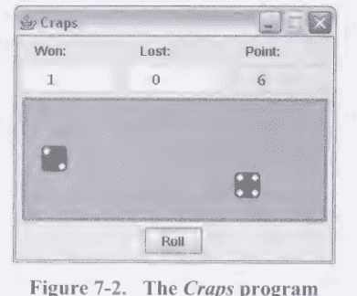

我们从设计阶段开始，讨论此应用需要哪些对象。一种方法是尝试让程序中的对象代表现实世界中的对象。遗憾的是，究竟什么是“现实世界”对象并不总是明确的。有些对象模拟实体的机器或机制，另一些可能只存在于“网络空间”中，而且可能非常抽象，仅存在于设计者的想象中。

在这里，我们需要一个代表程序窗口的对象。我们将该对象命名为 `window`，其类命名为 `Craps`。按照惯例，我们将从 Java Swing 包中的 `JFrame` 类中派生此类。窗口（图 7-2）被分为三个“面板”。顶部面板显示分数和游戏的当前状态。我们将其命名为 `display`，其类命名为 `DisplayPanel`。中间面板代表骰子桌，骰子在上面掷。我们将其命名为 `table`，其类命名为 `CrapsTable`。底部面板持有“Roll”按钮。我们将其命名为 `controls`，其类命名为 `ControlPanel`。控制面板还可以处理“Roll”按钮的点击事件。

让 `DisplayPanel`、`CrapsTable` 和 `ControlPanel` 类都继承 Java 库类 `JPanel` 是有意义的。例如：

```java
public class DisplayPanel extends JPanel {
}
```


`table` 对象显示两个“正在滚动的骰子”，因此我们需要一个代表滚动的骰子的类。我们将其命名为 `RollingDie`。

这五个类——`Craps`、`DisplayPanel`、`CrapsTable`、`ControlPanel` 和 `RollingDie` 构成了我们 Craps 程序的 GUI 部分（图 7-3）。

### javax.swing

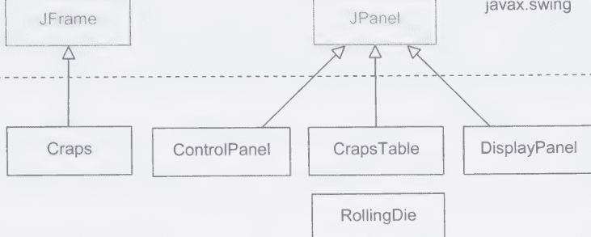

图 7-3. Craps 程序中的 GUI 类

对我来说，将掷骰子的“视觉”和“数值”方面的代码拆分为两个类是有意义的。基类 `Die` 将代表骰子，作为一个抽象设备，生成生成一个 1 到 6 范围内的随机整数。`RollingDie` 类将派自 `Die`，添加用于移动和绘制骰子的方法：

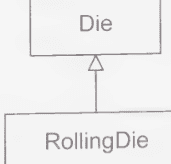

我做出这个设计决策的理由是，我们可能会在另一个程序中重用 `Die` 类，但那里的骰子可能有不同的外观（或者保持不可见）。

最后，我们还需要一个代表 Craps 逻辑和规则的“对象”。这是一个“概念性”对象，不是可以触碰的东西。当然，这不会阻止我们在 Java 中实现它。我们将该对象命名为 `game`，其类命名为 `CrapsGame`。`CrapsGame` 将派自任何类（除默认外，不使用任何 Java 包，且不处理任何事件）。

将游戏规则与 GUI 部分分离有许多充分的理由。首先，我们可能需要更改 GUI（如果我们的老板不喜欢它的“外观和感觉”），而保持游戏逻辑不变。其次，我们可以在其他应用程序中重用 `CrapsGame` 类。例如，我们可能将其用于 Craps 的统计模拟中，该模拟会快速地运行很多次游戏，完全不需要任何华丽的 GUI。第三，我们未来可能需要一个实现具有相似外观的骰子游戏但规则不同的程序。第四，Aisha 和我只知道游戏的通用概念，对学习细节并不真正感兴趣。最后，我们团队中有一位初学者（也就是你），我们必须交给你一份可以管理的工作。

现在，我们需要决定对象之间如何相互作用。图 7-4 显示了我所构思的 Craps 程序整体设计。

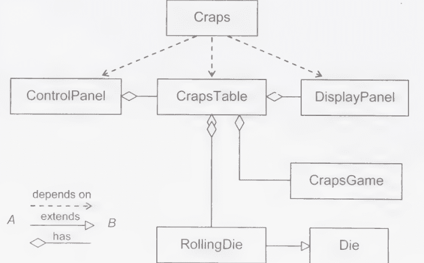

图 7-4. Craps 类及其关系

当然，设计应用程序没有唯一的方法，设计者有很大的自由度。但遵循一些既定的设计模式和经过测试的实践非常有帮助。我们将在第 27 章讨论设计模式。在这里，我们想强调良好设计的两个原则。

### 7.9 案例研究与实验：掷骰子

首先，每个类必须代表一个单一的概念，其所有的构造函数和公共方法都应该与该概念相关。这一原则被称为内聚性（cohesion）。

在良好的设计中，类是内聚的。

其次，类之间的依赖关系应该尽力减少。我们能够在图 7-4 中画出类图而没有线条四面八方的交叉，并不是因为所有类都相互依赖。面向对象的设计使用“耦合”（coupling）一词来描述类之间的依赖程度。在良好的设计中，耦合应该被降到最低。

低耦合更容易划分工作和对类进行修改。例如，在我们的 Craps 程序中，`ControlPanel` 和 `DisplayPanel` 并不相互依赖。

```java
public class Craps extends JFrame
{
    // 构造函数
    public Craps() {
        GradientPanel display = new DisplayPanel();
        CrapsTable table = new CrapsTable(display);
        ControlPanel controls = new ControlPanel(table);
    }
}
```

它不知道游戏规则或一般的骰子。不要在 `Die` 中定义任何构造函数：使用无参构造函数即可。要获取随机数，调用 `Math.random()`。它返回一个 0≤x<1 的随机 double。对其进行适当缩放，然后截断为整数。

现在是 `CrapsGame` 类。我的 `table` 对象创建一个 `CrapsGame` 对象：

```java
private CrapsGame game;
...
// 构造函数
public CrapsTable(GradientPanel displ)
{
    game = new CrapsGame();
}
```

我们现在准备好分配工作了。Aisha 将负责 `Craps`、`ControlPanel` 和 `DisplayPanel` 类。我喜欢动画，所以我负责 `CrapsTable` 和 `RollingDie` 类。你负责 `Die` 和 `CrapsGame` 类。图 7-5 显示了我们如何划分工作。

Aisha 和我已经就 GUI 类如何相互作用达成了一致。但我们仍然需要确定 `Die` 类和 `CrapsGame` 类的细节。我需要你的 `Die` 类两个方法：

```java
public void roll() { ... }
```

以及

```java
public int getNumDots() { ... }
```

我将在 `RollingDie` 中调用这些方法。`roll` 方法模拟一次掷骰。它获取一个 1 到 6 范围内的随机整数并将其保存在字段中。`getNumDots` 方法返回该字段中保存的值。

### 180 第 7 章 布尔表达式与 if-else 语句

同样，无需在 `CrapsGame` 中定义构造函数：我们将依赖默认的无参构造函数。

我的 `CrapsTable` 对象调用了游戏的方法：

```java
int result = game.processRoll(total);
int point = game.getPoint();
```

`processRoll` 方法接收一个 `int` 参数 - 两个骰子点数的总和。`processRoll` 应该处理该信息并返回掷骰的结果：如果玩家赢返回 1，如果输了返回 -1，如果游戏继续返回 0。在后一种情况下，“point”的值被设置为 `total`。定义一个私有的 `int` 字段 `point` 来存储值。如果当前游戏结束，`point` 应设置为 0。`getPoint` 是你 `CrapsGame` 类中的访问器方法。它让我获取 `point` 的值，以便将其传递给 `display`。

我们准备好开始工作了。唯一的问题是时间。Aisha 的完成日期不可预测：她非常忙，但一旦开始工作，速度就会非常快。我的任务可能相当耗时。我会尝试安排一次拉斯维加斯的实地考察，拍摄一些掷骰子的素材。但很可能我们的老板不会批准，我只能在办公室的地毯上观察掷骰子了。与此同时，你正急于开始你的部分。

幸运的是，Aisha 找到了一个旧的测试程序，你可以向其输入整数。她添加了几行代码来调用 `processRoll` 和 `getPoint` 并显示它们的返回值（图 7-6）。她将她的临时类命名为 `CrapsTest`。现在你不需要等我们了：你可以独立地实现并测试你的 `CrapsGame` 类。现在你看不到任何掷骰子，但你能够在一个预测的环境中彻底测试你的类。

### 7.9 案例研究与实验：掷骰子 181

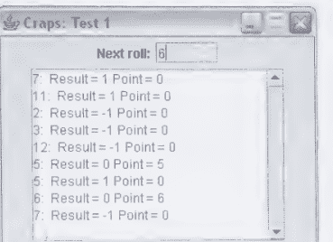

图 7-6. 用于测试 Craps 的初步程序

1. 从 `JM\Ch07\Craps` 复制 `CrapsTest1.java` 和 `CrapsGame.java` 到你的工作文件夹。填充 `CrapsGame` 类中的空白处，将其与 `CrapsTest1` 类合并为一个项目，编译类，并彻底测试程序。
2. 编写 `Die` 类和一个小型控制台应用程序，通过打印几次“掷骰子”的结果来测试它。例如：

```java
public static void main(String[] args) {
    Die die = new Die();
    die.roll();
    System.out.println(die.getNumDots());
    die.roll();
}
```

3. 在让 `CrapsGame` 和 `Die` 类运行后，使用 `CrapsStats` 对它们进行测试，该程序会快速运行多次游戏并统计胜利次数。你会在 `JM\Ch07\Craps` 中找到 `CrapsStats.java`。注意你如何在此任务中复用你为另一个程序编写的 `CrapsGame` 和 `Die` 类。

将你的模拟结果与 Craps 获胜的理论概率进行比较，概率为 244/495，或约 0.493。如果你运行 10,000 次测试游戏，胜利次数应该在 4830 到 5030 之间；平均为 4930。

### 7.10 switch 语句

在某些情况下，程序必须根据某些变量或表达式的值执行多个动作中的之一。如果程序只需要处理两个或三个可能的动作，你可以轻松地使用 `if-else-if` 语句：

```java
int x = expression;
if (x == valueA)
{
    // 执行动作 A
    statementA;
    statementA2;
    ...
}
else if (x == valueB)
{
    // 执行动作 B
    statementB;
    ...
}
...
else if (x == valueZ)
{
    // 执行动作 Z
    statementZ;
    ...
}
else
{
    // 执行某些默认动作
    ...}
```

(`valueA`, `valueB`, ..., 和 `valueZ`) 是整数常量。

当可能的动作很多时，使用 `if-else-if` 会变得繁琐且低效。Java 提供了一种特殊的机制 - `switch` 语句，用于处理此类情况。它的通用形式为：

```java
switch (expression)
{
    case valueA:      // 执行动作 A
        statementA1;
        statementA2;
        ...
        break;
    case valueB:      // 执行动作 B
        statementB1;
        ...
        break;
    ...
    ...
    case valueZ:      // 执行动作 Z
        statementZ1;
        break;
    default:          // 执行某些默认动作
        break;
}
```

`switch` 中的 `valueA, valueB..., valueZ` 是整数或字符字面量或符号常量（或枚举类型常量——参见第 7.11 节）。

当 `switch` 语句被编译时，编译器会创建一个包含这些值以及相应的“case”（代码片段）关联地址的表。当执行 `switch` 时，程序首先将表达式求值为一个整数。然后它表中找到它并跳转到相应的 `case`。如果该值不在表中，程序将跳转到 `default` 情况。

注意 `switch` 的以下属性：

1. 在 `switch` 中求值的表达式必须是整数。
2. `switch` 中的值是由程序员定义的整数或字符。
3. `switch` 中的每个 `case` 只能有一个值。
4. `break` 语句用于退出 `switch`。
5. `default` 子句是可选的。如果没有指定，程序什么都不做。

在布尔表达式中，变量通过 `==` 和 `!=` 运算符彼此或与值比较。

### 184 第 7 章 布尔表达式与 if-else 语句

### 7.11 枚举类型

枚举类型定义了一个值的列表。例如：

```java
private enum State {READY, SET, GO};
```

`enum` 是一个 Java 关键字。在上面的示例中，`State` 是枚举类型的名称，`READY, SET` 和 `GO` 是值。

### 7.11 枚举类型 185

以大字母开头；枚举值通常全大写字母以突出显示。

枚举定义放在类内部，任何构造函数或方法之外。`private` 关键字表示该枚举类型在类内部可见。

一旦定义了枚举类型，我们就可以声明该类型的变量并为其赋值。例如，我们可以声明一个 `State` 类型的变量，并赋值它的值之一：

```java
State currentState = State.READY;
```

`State` 的变量和常量只能持有三个值之一：`State.READY`, `State.SET` 或 `State.GO`。我们使用类型点符号来引用这些值。

枚举中的值仅通过其符号定义。它们不是字面量字符串，也没有数值。

我们并不感兴趣枚举值在 Java 内部是如何表示的（如果你真的想知道，它们类似于对象；它们甚至有一个 `toString` 方法）。对我们而言，`State.READY` 的值就是 `READY`。由于枚举值不能用于算术运算且不代表字符或字符串，我们需要它们做什么？在程序的某些情况下，对象的属性或状态只有少数几个值之一。为描述属性或状态的变量定义枚举类型是有意义的。例如：

```java
private enum Speed {LOW, MEDIUM, HIGH};
private enum BoardColor {BLACK, WHITE};
private enum DayOfWeek {sunday...};
```

当然，我们可以使用字符串、整数或符号常量来表示此类值。但枚举类型更紧凑、方便。它也更安全：编译器不会让我们无意引用不在枚举列表中的值。

在布尔表达式中，枚举类型的变量使用 `==` 和 `!=` 运算符彼此或与列表中的值比较。例如：

```java
public class Exam {
    public enum LetterGrade {A, B, C, D, F};
}

public class Student {
    private Exam.LetterGrade myGrade;
    if (myScore > 90)
        myGrade = Exam.LetterGrade.A;
}
```

### 7.12 案例研究与实验：掷骰子结束

到此时，你已经完成了你的 `CrapsGame` 和 `Die` 类，而 Aisha 找到了时间来整合她的 GUI 类。我我自己则陷入了 `CrapsTable` 和 `RollingDie` 类的编写，试图完善动画效果。与此同时，更不用说 Aisha 的测试工作了。我写了一个存根类 `CrapsTable`（图 7-7），为我正在编写的实际类提供临时替代。存根类（stub class）包含了测试其他类所需的方法的简单版本。当程序员需要测试项目的一个部分而而其他部分尚未准备就绪时，这是一种常用技术。

```java
// 用于测试 Craps 的临时存根类
public class CrapsTable
{
    private DisplayPanel display;
    private CrapsGame game;
    private Die die, die2;
    // 构造函数
    public CrapsTable(DisplayPanel displ)
    {
        display = displ;
        game = new CrapsGame();
    }
    // 掷骰子
    public void rollDice()
    {
        die.roll();
        die2.roll();
        int total = die1.getNumDots() + die2.getNumDots();
        int result = game.processRoll(pts);
        int point = game.getPoint();
        display.update(result, point);
    }
    public boolean diceAreRolling()
    {
        return false;
    }
}
```

图 7-7。临时“存根”类 `CrapsTable.java`。

### 第 7 章 布尔表达式与 if-else 语句

我的存根类包含了 `rollDice` 方法的临时版本，它简单地用随机的点数和调用 game 的 `processRoll` 方法，以及一个始终返回 `false` 的 `diceRolling` 版本。

非常欢迎查看 Aisha 的 GUI 实现（在 `JM/Ch07/craps/source.zip` 中），但现在没有人时间向你解释它是如何运作的。

既然你已经完成了你的部分，我想你可以帮我处理一下我的 `RollingDie` 类。我在它上面取得了很大进展，但仍有一些细节未完成。

我已经编写了构造函数、开始掷骰子的 `roll` 方法，以及防止与另一个重叠的 `avoidCollision` 方法。我还提供了一个布尔方法 `isRolling`，它告诉我的骰子是否正在移动。但我仍在绘制旋转的骰子和停止的骰子。我采用了所谓的“自顶向下并逐步细化”的方法，从通用类型到具体类型移动。首先，我用通用术语编写了 `draw` 方法：

```java
// 绘制这个骰子，无论旋转还是停止；
// 同时在旋转时移动这个骰子
public void draw(Graphics g)
{
    if (xCenter < 0 || yCenter < 0) {
        return;
    } else if (isRolling()) {
        move();
        drawRolling(g);
```


# 第 7 章 ~ 布尔表达式与 if-else 语句

## 代码示例

```java
xSpeed *= slowdown;
ySpeed *= slowdown;
} else {
    drawStopped(g);
}
}
```

注意我如何使用 `if-else-if` 结构来处理三种情况：我的骰子不在桌子上、它仍在移动、或者它已经停止。

我的 `draw` 方法调用了更专门的方法 `drawRolling` 和 `drawStopped`。我仍在处理这些方法，但我知道它们中的每一个都将调用一个更低层的方法 `drawDots`，该方法将在我的骰子上绘制白点：

```java
// 在骰子旋转时根据随机数量的点数绘制这个骰子
private void drawRolling(Graphics g) {
    Die die = new Die();
    die.roll();
    drawDots(g, x, y, die.getNumDots());
}
```

```java
// 在骰子停止时绘制这个骰子
private void drawStopped(Graphics g) {
    drawDots(g, x, y, die.getNumDots());
}
```

我已经开始编写 `drawDots`（图 7-8），并指望你来完成它。（自然，这涉及到一个 `switch` 语句）。与此同时，我会完成 `CrapsTable`，我们应该能够将它们全部整合在一起。

```java
// 在这个骰子上绘制指定数量的点
private void drawDots(Graphics g, int x, int y, int numDots) {
    g.setColor(Color.WHITE);
    int dotSize = dieSize / 4;
    int step = dieSize / 8;
    int x1 = x + step - 3*step;
    int x2 = x + 5*step + 1;
    int y1 = y + step - 1;
    int y2 = y + 3*step;
    int y3 = y + 5*step - 1;
    switch (numDots) {
        case 1:
            g.fillOval(x2, y2, dotSize, dotSize);
            break;
        // 缺失代码 >
    }
}
```

图 7-8。`JM/Ch07/Craps/RollingDie.java` 的片段。

## 练习要求

从 `JM/Ch07/craps` 将 `RollingDie.java` 复制到你的文件夹中，并填充其 `drawDots` 方法中的空白。（图 7-9 显示了骰子上点的预期配置）。将以下文件收集在一起：`Craps.java`（来自 `JM/Ch07`）、`Die.java`（第 9 节）。编译它们并运行程序。

## 总结

条件语句的通用形式是：

```java
if (condition) {
    statementA;
} else {
    statementB;
}
```

条件通常用关系运算符编写：
- `<` 小于
- `<=` 小于等于
- `>` 大于
- `>=` 大于等于
- `==` 等于
- `!=` 不等于

逻辑运算符：
- `&&` 与
- `||` 或
- `!` 非

程序员需要知道的德·摩根定律：
- `!(p && q)` 等于 `!p || !q`
- `!(p || q)` 等于 `!p && !q`

`switch` 结构用于多分支选择：

```java
switch (expression) {
  case valueA: // 匹配 A
    statementA;
    break;
  case valueB: // 匹配 B
    statementB;
    break;
  default:      // 默认情况
    ...
}
```

其中 `valueA`、`valueB` 等是常量。`switch` 可用于多分支选择。`if-else if-else` 结构也可用于多分支。`switch` 可以替换布尔表达式（如果只有 `true` 和 `false`）。

## 练习 7.7

- `Craps` 类有多少个 `if` 语句？有多少个 `else` 子句？
- 找到 `Craps` 中所有的关系和逻辑运算符。
- 写一个返回 `x` 和 `y` 较大值的方法：
```java
public static int max(int x, int y) {
}
```
- 在 `Wages` 方法中填充代码，该方法根据工作小时计算薪水。超过 40 小时的加班费是标准费率的 1.5 倍。
```java
public double totalWages(double hours, double rate) {
    double wages;
    // ...
}
```
- 将你的代码添加到 `Wages.java` 并测试它。
- 发明三种在 Java 中表示“异或”（XOR）操作的方法（即编写一个布尔表达式，当且仅当两个变量中有一个为真时为真）。提示：一种解决方案只需要关系运算符。
- （选择）下列哪些表达式等同于 `!(a || !b)`（即对于所有布尔变量的值相等）：
  - A. `a || !b`
  - B. `!a || b`
  - C. `!a && b`
  - D. `!a && !b`
  - E. `a && !b`
- 使用德·摩根定律简化以下表达式（尽可能去掉括号）：
  - (a) `!((x || !y) && (a))`
  - (b) `!(x == 7) && !(x > 7))`
- 在不改变条件含义的情况下尽可能去掉括号：
  - (a) `(((x + 2) > a) || ((x - 2) < b)) && (y >= 0))`
  - (b) `(((a >= b) && (a > c)) && ((a - 2) == 0))`
- 重写以下条件以避免可能的算术异常：
```java
if (Math.sqrt(x) < 3 && x > 7)
```
- 编写一个布尔表达式，当且仅当三个整数变量 `a, b, c` 的值形成等比数列时（即 `a, b, c != 0` 且 `a/b = c`），该表达式为真。提示：记住比较浮点数的精确匹配可能无效——请使用整数交叉积。
- 简化以下语句：
  - (a) `boolean inside = ((x < left) || (x > right)) && (!(y > top) || (y > bottom));`
  - (b) `boolean result = (('1' == ch[0] || '1' == ch[1]) && (ch[0] == 'n' && ch[1] == '0') || (ch[0] == 'N' && ch[1] == '0') || (ch[0] == 'n' && ch[1] == 'N')) || false`
- 写一个布尔方法 `isLeapYear(int year)`，如果年份是闰年则返回 `true`，否则返回 `false`。闰年是指能被 4 整除但不能被 100 整除，或者能被 400 整除的年份。例如，2000 年和 2004 年是闰年，但 2003 年和 2100 年不是。

---

# 第 7 章 ~ 练习

## 13. 编写一个方法

```java
public static boolean isLater(int month1, int day1, int year1,
                              int month2, int day2, int year2)
```

如果第一个日期比第二个日期晚，则返回 `true`，否则返回 `false`。使用提供的控制台程序 `Dates` (`JM\Ch07\Exercises\Dates.java`) 测试你的方法，该程序会提示用户输入两个日期，读取输入并显示结果。✓

## 第 7.8 节

## 14. 使用 `<` 和其他关系运算符重写以下代码。

```java
if (avg >= 90)
    grade = 'A';
else if (avg >= 80)
    grade = 'B';
else if (avg >= 70)
    grade = 'C';
else if (avg >= 60)
    grade = 'D';
else
    grade = 'F';
```

## 15. (a) 使用适当的 if-else-if 序列和嵌套 if-else 语句，恢复以下代码段适当的缩进和可选的大括号（该代码位于 `JM\Ch07\Exercises\WarmWeather.java`）：

```java
boolean warm;
if (location.isNorthPole() || location.isSouthPole()) {
    warm = false;
} else if (location.isTropics()) {
    warm = true;
} else if (time.getMonth() == 4 || time.getMonth() == 10) {
    if (weather.isSunny()) {
        warm = true;
    } else {
        warm = false;
    }
} else if (location.isNorthernHemisphere()) {
    if (time.getMonth() >= 5 && time.getMonth() < 9) {
        warm = true;
    } else {
        warm = false;
    }
} else if (location.isSouthernHemisphere()) {
    if (time.getMonth() >= 11 || time.getMonth() < 3) {
        warm = true;
    } else {
        warm = false;
    }
} else {
    warm = false;
}
```

(b) 简化部分 (a) 中的语句：先设置 `warm = false;`，然后在适当的情况下将 `warm` 设置为 `true`。

## 16. 将部分 (b) 中的语句重写为形式

```java
warm = <逻辑表达式>;
```

一本“Be Prepared”备考书售价 $18.95；“Next Best”售价 $21.95。一个名为 apzone.com 的网站提供特价：$37.95。如果你购买三本或更多（这两种书的任意组合），每本只需 $15.95。如果你购买 12 卷或更多，每本只需支付 $14.00。

(a) 编写一个方法

```java
public static double getOrderTotal(int bp, int nb) {
}
```

计算购买 `bp` 份“Be Prepared”和 `nb` 份“Next Best”的订单总额，并考虑上述特价。

(b) 在一个带有 `main` 方法的类中测试你的方法，该方法提示用户输入两个整数，代表所需的“Be Prepared”和“Next Best”书籍的数量，并显示总成本。

## 19. 将第 7.9 节中的 `Die` 类泛化，使得骰子可以有 `n` 个面，面上有从 1 到 `n` 的数字。提供一个无参数构造函数将面数初始化为 6，以及另一个带有一个参数 `n` 的构造函数。

## 20. * 在 Nim1-3 游戏中，两个玩家轮替从一堆石头中取石头。每次移动玩家必须取一块、两块或三块。取最后一块石头的玩家获胜。

(a) 确定游戏的获胜策略。

(b) 编写方法 `computerMove`：

```java
/*
 * 当堆中剩余 nStones 时，返回应取的正确石头数量
 * （根据获胜策略）；如果这种移动不可用，
 * 则返回随机数量的石头。
 * 前提条件：nStones > 0
 */
public int computerMove(int nStones)
```

(c) 填全 `humanMove` 方法中的空白：

```java
/*
 * 提示用户取若干石头；
 * 如果移动有效，则返回所取的石头数量；
 * 否则，显示错误信息 --
 * “你只能取 1, 2 或 3 块石头”或
 * “无法取这么多：堆中只剩 <nStones> 块”
 * -- 并返回 -1；
 * 前提条件：nStones > 0
 */
public int humanMove(int nStones) {
    System.out.print("How many stones do you take? ");
    int n = keyboard.nextInt();
}
```

转而定义一个私有枚举类型（`enum`），描述游戏的两种可能状态：`NEW_ROLL` 和 `KEEP_ROLLING`。声明一个该枚举类型的字段来表示游戏的当前状态，并用对该字段值的 `switch` 语句替换 `if-else` 语句。

```java
while (chapter < 8)
    chapter++;
```

---

# 第 8 章 ~ 迭代语句：while, for, do-while

## 8.1 导言 200
## 8.2 while 和 for 循环 200
## 8.3 do-while 循环 200
## 8.4 while 循环 204
## 8.5 嵌套循环 207
## 8.6 完美数 210
## 8.7 总结 211
## 8.8 练习 212

## 8.2 ~ while 和 for 循环

如果循环体只有一条语句，可以省略大括号，但许多人喜欢即使只有一条语句也加上大括号，因为这便于以后向循环体中添加语句。我们对这两种风格没有强硬的观点，因此将根据情况或心情使用其中一种。

注意，控制循环的变量可以直接在语句中声明。例如：

```java
for (int i = 1; i <= 100; i++) {
    sum += i * i;
}
```

这是常见的风格，但你必须意识到，这种方式声明的变量的作用范围不会扩展到循环体。在上面的示例中，如果你在右括号之后添加

```java
System.out.println(i);
```

你将得到语法错误：未定义的变量 `i`。

可以使用 `for` 循环如下所示重写 `sumUp` 方法：

```java
public static int sumUpTo(int n) {
    int sum = 0;
    for (int i = 1; i <= n; i++)
        sum += i;
    return sum;
}
```

下一个方法（同样在 `MyMath` 类中）计算 `n!`（n 的阶乘），它的定义是从 1 到 `n` 所有整数的乘积：

```java
/**
 * 如果 n >= 1，返回 1 * 2 * ... * n；否则返回 1
 */
public static long factorial(int n) {
    long f = 1;
    for (int k = 2; k <= n; k++) // 如果 n < 2，则将跳过此循环
        f *= k;
    return f;
}
```

## 8.3 do-while 循环

`do-while` 循环与 `while` 循环的区别在于，条件是在循环体之后进行测试的。这确保了程序至少通过一次循环。

`do-while` 语句的标准形式为：

```java
do {
    // 循环体
} while (condition);
```

只要条件保持为真，程序就会重复循环体。最好始终保留大括号，即使循环体只有一条语句，因为没有大括号的话代码将变得难以阅读。

`do-while` 循环的使用频率比 `while` 和 `for` 循环低。当条件中测试的变量是在循环体内部计算或录入时，它们会非常方便。下面的示例来自 `MyMath` 类中的 `main` 方法（`MyCh08/MyMath.java`）：

```java
public static void main(String[] args) {
    Scanner kb = new Scanner(System.in);
    int n;
    do {
        System.out.print("输入一个 4 到 20 之间的整数： ");
        n = kb.nextInt();
    } while (n < 4 || n > 20);
    System.out.print("和为: ");
    System.out.println("1 + " + n + " = " + sumUpTo(n));
    System.out.println("阶乘为: " + factorial(n) + "!");
}
```

在此代码中，`do-while` 循环调用 `Scanner` 的 `nextInt` 方法从用户输入中获取 `n` 的值。在用户输入在要求的范围内之前，迭代将持续。

如果出于某种原因你不喜欢 `do-while` 循环，你可以通过使用 `while` 循环轻松避免它们，并初始化变量，使得条件在第一次循环之前就为真。例如，上述代码中的 `do-while` 循环可以重写如下：

```java
int n = -1;
while (n < 4 || n > 20) {
    System.out.print("输入一个 4 到 20 之间的整数： ");
    n = kb.nextInt();
}
```


## 8.4 循环中的 `return` 和 `break`

我们在第 7.10 节中看到，`break` 用于 `switch` 语句内部以结束一个 `case` 并跳出 `switch` 语句。`break` 也可以用于循环体。它指示程序立即跳出循环，并跳转到循环体之后的第一个语句。`break` 必须始终出现在条件（`if` 或 `else`）语句内部——否则，你将在第一次迭代时就跳出循环。

下面的方法检查正整数 `n` 是否为质数。质数是一个大于 1 且除了 1 和自身外没有其他因子的整数。我们的算法必须检查所有潜在因子 `m`，但仅限于 $m^2 \le n$（因为如果 `m` 是因子，那么 `n/m` 也是因子，且其中一个必须小于或等于 `n` 的平方根）。下方的 `isPrime` 方法采用 `break` 来减少迭代次数：

```java
/**
 * 如果 n 是质数，返回 true；否则返回 false。
 */
public static boolean isPrime(int n) {
    boolean noFactors = true;

    if (n <= 1) {
        return false;
    }

    for (int m = 2; noFactors; m++) {
        if (m * m > n) {
            break;
        }

        if (n % m == 0) {
            noFactors = false;
        }
    }

    return noFactors;
}
```

另一种跳出循环（以及跳出方法）的方法是在循环内部放置一个 `return` 语句。`isPrime` 的较短版本在循环内部使用了 `return`：

```java
public static boolean isPrime(int n) {
    if (n <= 1) {
        return false;
    }

    int m = 2;
    while (m * m <= n) {
        if (n % m == 0) {
            return false;
        }
        m++;
    }

    return true;
}
```

这两种方式都是接受的，但后者可能更清晰。尽管有些程序员不喜欢在循环内部使用 `return` 或 `break`。

## 8.5 嵌套循环

嵌套循环是指循环中的循环。例如：

```java
for (int i = 0; i < rows; i++) {
    for (int j = 0; j < cols; j++) {
        // 处理元素
    }
}
```

嵌套循环常用于遍历网格和数组。例如：

```java
for (int r = 0; r < grid.getNumRows(); r++) {
    for (int c = 0; c < grid.getNumCols(); c++) {
        System.out.print(grid.get(r, c) + " ");
    }
}
```

嵌套循环也用于查找列表重复项。例如：

```java
for (int i = 0; i < list.size(); i++) {
    for (int j = i + 1; j < list.size(); j++) {
        if (list.get(i).equals(list.get(j))) {
            // 找到重复项
        }
    }
}
```

## 8.6 实验：完美数

如果一个整数等于它所有因数之和（包括 1 但排除该数本身），则称之为完美数。例如，28 = 1 + 2 + 4 + 7 + 14。完美数在古希腊就已经为人知。在《几何原本》第七卷中，欧几里得（公元前300年）将完美数定义为“等于自身部分和的数”。

第一世纪的希腊数学家尼科马库斯（Nicomachus）在他的《算术导论》（约公元100年）中写道：

> 在过多的情况下，会产生过剩、浪费、夸张和滥用；在少的情况下会产生匮缺、缺陷、贫乏和不足。而在介于过多与之间之间、即相等的情况下，会产生美德、恰当的度量、得体、美以及这类事物——其中典型的形式就是那种被称为完美数的数字。

遗憾的是，尼科马库斯在他的书中有很多错误。例如，他错误地认为第 `n` 个完美数有 `n` 位数，并且完美数交替以 6 和 8 结尾。他只知道四个完美数并草率得出了结论。

在 `MyMath.java` (`JM\Ch08\MyMath\MyMath.java`) 中添加代码来寻找四个完美数。

你可能想用你的程序来寻找第五个数。你最好保持耐心：在运行较快的计算机上，这可能需要将一个小时。有一个更好的策略。欧几里得证明，如果你发现形式为 $2^n-1$ 的数是质数，那么 $2^{n-1}(2^n-1)$ 就是完美数！例如，$(2^3-1)=7$ 是质数，所以 $2^2(2^3-1)=28$。几个世纪后，欧拉证明了任何偶完美数都可以转化为寻找形式为 $2^n-1$ 的质数。这些质数被称为梅森质数，以法国数学爱好者梅森（1588-1648）命名，是他使它们广为人知的。

1996年，软件工程师 George Woltman 启动了“大梅森质数搜索项目”（GIMPS）。在该项目中，志愿者贡献他们个人电脑的空闲 CPU 时间进行搜索。第 45 个梅森质数 $2^{23112609}-1$ 于2008年8月23日被发现。（它有 12,978,189 位数字。）

在 `MyMath.java` (`JM\Ch08\MyMath\MyMath.java`) 中添加代码寻找前六个梅森质数，并用它们计算前六个完美数。注意，虽然第六个梅森质数仍在 Java `int` 的范围内，但第六个完美数 8,589,869,056 溢出了范围。请使用 `long` 变量来存储它。

至今尚不知道是否存在奇完美数。已经证明，这样的数字至少有 300 位数！

## 8.7 总结

Java 提供了三种迭代语句：

```java
while (condition) {
    ...
}
```

```java
for (initialization; condition; change) {
    ...
}
```

```java
do {
    ...
} while (condition);
```

在 `while` 循环中，在条件中测试的变量必须在循环之前初始化，并且循环体内至少要有一个变量发生变化。程序在每次通过循环之前都会测试条件。如果在第一次测试时条件为 `false`，则跳过 `while` 循环，程序跳转到循环体后的第一条语句。否则，只要条件成立，程序就会继续迭代。

`for` 循环将初始化、条件和变化合并在一个语句中。初始化语句在循环开始前执行一次。条件在每次通过循环前进行测试，如果为 `false`，则跳过循环，程序跳转到循环体后的下一语句。变化语句在每次循环结束时执行。

`do-while` 循环与 `while` 循环的区别在于条件是在循环体之后测试的。因此，`do-while` 循环的体至少会被执行一次。

循环体内的 `break` 语句告诉程序立即跳出循环，到达循环体后的第一条语句。`break` 应该只出现在 `if` 或 `else` 语句内部；否则它会在第一次迭代时中断循环。嵌套循环中的 `break` 语句只会跳出内层循环。然而，循环内部的 `return` 语句会立即退出循环以及整个方法。

## 练习题

### 8.1-8.4 节

1. 2010 年墨西哥的人口约为 1.112 亿。写一个程序，计算并打印出墨西哥人口达到 1.2 亿的年份，假设每年的增长率为恒定的 1%。使用 `while` 循环。
2. Kevin 每次重读书时，他都能学习 10% 的内容。他需要达到 95% 才能成为开发者。写一个方法模拟他的进度，并返回需要几个月。
3. 写一个 `addOdds(int n)` 方法，计算并返回到 `n` 的奇数之和。该方法应恰好使用一个循环。
4. 写一个程序产生以下输出（用户输入小于 10 的正整数）：
   输入小于 10 的正整数：
   *
   **
   ***
   ****
   星星应该从行的第一个位置开始。
5. 写一个 `printTriangle(int n)` 方法，显示 $n$ 行星号，如下：
   *
   **
   ***
   ****
   *****
   ******
   *******
6. (a) 修改第206页的 `isPrime` 版本，使其只测试奇数。(b) 通过测试不被 2 或 3 整除的因子来提高 `isPrime` 的效率。
7. 回忆对于任何整数 $p$，$1+3+...+(2p-1) = p^2$。写一个“简单”方法 `isPerfectSquare(int n)` 来测试给定数字是否为平方数。“简单”方法不能使用数组、嵌套循环、Math 函数或加法外的运算。
8. (a) 写一个 `sumDigits` 方法，计算并返回给定负整数的数字之和。(b) 假定取模运算符不存在，写一个布尔方法测试数字是否能被 3 整除。使用部分 (a) 中的 `sumDigits` 方法。
9. 完成程序 `GradeAvg.java`（位于 `ChB\Exercises`），从文件中读取整数分数并打印它们的平均分。提示：如果 `input` 是与文件关联的 `Scanner` 对象，`input.hasNextInt()` 在文件中剩余整数时返回 `true`；否则返回 `false`；`input.nextInt()` 从文件中读取下一个整数。
10. 给定正数 $a$，数值序列
    $x_0 = \frac{a}{2}$
    $x_{n+1} = \frac{1}{2}(x_n + \frac{a}{x_n}) \quad (n \ge 0)$
    收敛于 $\sqrt{a}$。填充以下方法的空白，该方法使用迭代来估计数字的平方根：
    ```java
    // 返回 a 的平方根估计值 x，
    // 使得 |x^2 - a| < 0.01
    // 前提条件：a > 5。
    public static double sqrtEst(double a) {
        double x = a/2;
        double diff;
        do {
            ...
        } while ( ... );
        return x;
    }
    ```

12. 编写一个程序，支持与用户进行以下对话：

    ```
    Enter quantity: 75
    You have ordered 75 ripples -- $19.50

    Next customer (y/n): y

    Enter quantity: 97
    Ripples can be ordered only in packs of 25.

    Next customer (y/n): t
    Next customer (y/n): n
    ```

    感谢使用 Ripple Systems。

    如果在响应“Next customer”提示时，用户按了 <Enter> 或输入了 ‘y’ 或 ‘n’ 以外的任何字符，程序应该重复该提示。

    将一个 ripple 的单价定义为等于 26 美分的常量。

    提示：

    使用以下语句显示订购数量和订单总金额：

    ```java
    System.out.printf("You have ordered %d Ripples -- $%.2f\n\n", quantity, price * quantity);
    ```

    使用以下语句读取订购数量以及用户对“Next customer?”提示的响应：

    ```java
    Scanner keyboard = new Scanner(System.in);
    char answer = ' ';

    int quantity = keyboard.nextInt();
    keyboard.nextLine(); // 跳过行的剩余部分
    ...
    ```

    ```java
    String str = keyboard.nextLine().trim();
    if (str.length() == 1)
        answer = str.charAt(0);
    else
        answer = ' ' ;
    ```

13. 回想 GridWorld 中的 `Grid<Actor>` 对象拥有 `getNumRows` 和 `getNumCols` 方法，它们分别返回网格的行数和列数。`Grid<Actor>` 对象还有一个 `get(Location loc)` 方法，它返回位置 `loc` 处的 actor，如果 `loc` 未被占用则返回 `null`。编写一个方法：

    ```java
    public int countFlowers(Grid<Actor> grid)
    ```

    返回 `grid` 中 `Flower` 对象的数量。提示：`Bug` 类有一个如何判断一个 actor 是否为 `Flower` 的示例。

14. 查找并阅读几个关于斐波那契数列的介绍性网站。以下递归方法返回第 `n` 个斐波那契数：

    ```java
    // Returns the n-th Fibonacci number.
    // Precondition: n >= 1
    public static long fibonacci(int n) {
        if (n == 1 || n == 2)
            return 1;
        else
            return fibonacci(n - 1) + fibonacci(n - 2);
    }
    ```

    不使用递归，使用一个循环重写它。将你的方法添加到 `JM\Ch08\MyMath` 中的 `MyMath` 类中并进行测试。

15. 考虑所有分母在 1 到 100 之间的正整数分数。编写一个程序，找到离 17 / 76 最近的两个分数：一个在上方，一个在下方。

16. 编写并测试一个方法，该方法接受一个分的金额，并打印该金额所有可能的表示方式（作为若干个季度、一角、镍币和分币之和）。例如：

    ```
    30 cents = 0 quarters + 2 dimes + 1 nickels + 5 pennies
    ```


(30 分有 18 种不同的表示方式，$1.00 有 242 种。)

# 第 9 章 实现类与使用对象

- 9.1 前言
- 9.2 类的公共与私有特性
- 9.3 构造函数
- 9.4 对象的引用
- 9.5 定义方法
- 9.6 调用方法与访问字段
- 9.7 向构造函数和方法传递参数
- 9.8 return 语句
- 9.9 案例分析与实验：小吃吧
- 9.10 重载方法
- 9.11 静态字段和方法
- 9.12 案例分析：小吃吧总结
- 9.13 总结
- 练习

## 9.1 前言

之前的章节中，我们对类和对象采取了相当概括的观点，没有详细解释如何编写类、如何调用构造函数以及调用方法。现在是填补这些空白的时候了。我们的示例将是一个名为 `Fraction` 的简单类，它包含了我们感兴趣的共同特性。`Fraction` 对象代表了一个非常熟悉的东西：一个具有整数分子和分母的分数。

偶尔，一个类会有自己的 `main` 方法，并作为独立程序或程序中的“main”类来工作。但在更常见的情况下，一个类的存在是为了被其他类使用。例如，我们的 `Fraction` 类为处理与算术相关的应用程序中的分数提供了一套工具。我们的 `Fraction` 类提供了几个构造函数（用于创建分数）和方法（相加和相乘分数以及将 `Fraction` 转换为 `double`）。它还包含一个 `toString` 方法，以字符串形式返回 `Fraction` 的描述。

> 使用给定类的类是 X 的客户端（client）。

类的开发者看待该类的视角与其用户（客户端类的作者）不同。开发者需要确切地知道类的不同特性是如何定义和实现的。用户则感兴趣知道类的哪些特性是可用的以及如何使用它们。

Alex: 我在学校学到的是尽可能向客户端提供少的信息。这被称为“信息隐藏”。

将类的某些特征设置为私有（`private`）是为了控制类客户端对其字段的访问，并“隐藏”其实现细节。这样，类的内部机制（其私有字段和私有方法）就可以发生变化，而无需对程序的其他任何修改。这使得程序的维护变得更加容易。

> 在 OOP 中，实例变量几乎总是私有的。如果有必要，开发者会提供一个特殊的访问器方法来返回特定私有字段的值。开发者也可以定义更新私有字段的方法。这些方法被称为修改器（modifiers or mutators）。

某些常量被声明为公共（`public`）。例如，`Color.RED`、`Math.PI`、`Integer.MAX_VALUE`。

类的某些“辅助方法”可能只对该类的对象有用，而对类的客户端无效。将此类方法也声明为私有是合理的。将类的所有字段都设为私有并将辅助方法设为私有，可以确保通过构造函数和公共方法向外部完全描述该类。这些构造函数和公共方法描述了类及其对象能为客户端执行的一切。这个概念在 OOP 中被称为封装（encapsulation）。

Alex: 我没有为私有字段 `num` 和 `denom` 提供任何修改方法，因为我不想让在类外部干扰它们的值。也不需要访问器方法。至于 `gcf` 方法，你是对的：我应该把它改为公共静态（`public static`）。我稍后会修改。

Blair: 好主意，管它“static”是什么。

Alex: 但我的 `reduce` 方法将保持为私有。

> 公共和私有的概念适用于整个类，而不是类的单个对象。

例如，当 `Fraction` 的 `add` 方法直接返回给其他 `Fraction` 的实例变量时，编译器没有问题：

```java
int newNum = num * other.denom + denom * other.num;
```

我们之前提到过，构造函数也可以声明为私有。你可能会想：为什么要将构造函数设为私有？这确实不寻常。你可能出于两个原因定义私有构造函数：首先，同类的其他构造可以调用它。我们将在 9.3 节查看其语法。其次，如果一个类只有一个构造函数且它是私有的，Java 将不允许你创建该类的对象。这被用于 `Math`、`System` 这样的类，这些类永远不会被实例化。

## 9.3 构造函数

构造函数是创建类对象的过程。

> 构造函数的名称始终与类相同。与方法不同，构造函数不返回任何值。它们没有返回类型，甚至 `void` 也不行。

所有构造函数都定义在类定义内部。它们的主要任务是初始化新对象的所有或部分字段。没有显式初始化的字段将被设置为默认值：数字为 0，布尔值为 `false`，对象为 `null`。

> 构造函数可以接受指定类型的参数，并使用它们来初始化新对象。如果一个类有多个构造函数，那么它们在参数的数量或类型上必须有所不同。

Alex: 我为 `Fraction` 类提供了四个构造函数：

```java
public Fraction()             // 无参数构造函数
{
    num = 0;
    denom = 1;
}

public Fraction(int n)
{
    num = n;
    denom = 1;
}
```

```java
public Fraction(int n, int d)
{
    if (d != 0)
    {
        num = n;
        denom = d;
        reduce();
    } else {
        throw new IllegalArgumentException(
            "Fraction construction error: denominator is 0");
    }
}
```

```java
public Fraction(Fraction other) // 拷贝构造函数
{
    num = other.num;
    denom = other.denom;
}
```

第一个，即无参数构造函数，不接受任何参数，只是创建一个 0/1 的分数。第二个接受 `int` 参数 `n` 并创建一个 n/1 的分数。第三个接受两个 `int` 参数，分子和分母。最后一个是拷贝构造函数：它接受另一个 `Fraction` 对象作为参数并创建一个与其相等的分数。

```java
Fraction f1 = new Fraction();
Fraction f2 = new Fraction(7);
Fraction f3 = new Fraction(12, -20);
Fraction f4 = new Fraction(f3);
```

Blair: 我测试了所有的构造函数，它们看起来可以工作：

```java
System.out.println("f1 = " + f1);
System.out.println("f2 = " + f2);
System.out.println("f3 = " + f3);
System.out.println("f4 = " + f4);
```

我得到了

- f1 - 0/1
- f2 - 7/1
- f3 - -3/5
- f4 - -3/5

传递给 `new` 运算符的参数的数量、类型和顺序必须与某个构造函数预期的参数数量、类型和顺序匹配。该构造函数将被调用。

你不必为类定义任何构造函数。如果类没有任何构造函数，编译器会提供一个默认的无参数构造函数。它为对象分配内存并将字段初始化为默认值。但如果你为类定义了至少一个构造函数，就不会提供默认的无参数构造函数。

通常，构造函数应该防止无效对象的产生。

Alex: 就像在我的 `add` 方法中：

```java
return new Fraction(newNum, newDenom);
```

在 Java 中，多个变量可以持有同一个对象的引用。当赋值运算符应用于引用时，它只复制引用的值（即对象的地址），而不复制对象本身。例如，执行以下语句后：

```java
Fraction f1 = new Fraction(3, 7);
Fraction f2 = f1;
```

`f2` 指向与 `f1` 完全相同的 `Fraction` 对象（见图 9-2-a）。这与以下情况不同：

```java
Fraction f1 = new Fraction(3, 7);
Fraction f2 = new Fraction(f1);
```

后者创建了一个新的 `Fraction` 对象，它是 `f1` 的拷贝（图 9-2-b）。

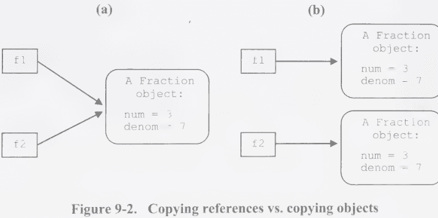

## 9.5 定义方法

方法是实现特定任务或计算的代码段。与构造函数一样，方法可以接收一些参数。例如，如果方法的任务是计算两个整数的最大公约数（GCF），它需要知道它们的值。方法要么返回一个值（例如两个数的最大公约数），要么完成一个任务（例如约简分数），或者二者兼之。

从务实的角度来看，方法是自包含的代码片段，可以根据需要从程序的不同地方被频繁调用。当方法被调用时，调用者将调用的参数放置在一个约定的位置，方法可以从那里获取它们（例如系统栈）。返回地址也会保存在方法可以访问的地方（例如同一个系统栈）。当方法执行完毕后，它会将控制权返回到调用它的程序位置。如果方法返回一个值，它会将该值存放在约定的位置，调用者可以从那里检索（例如特定的 CPU 寄存器）。

方法定义在类内部。当你定义方法时，你需要给它指定一个名称，指定参数的类型，并为它们命名，以便在方法代码中引用它们。你还需要指定其返回值的类型：

```java
public [or private] [static]
    returnType methodName(type paramName, ..., typeN paramName)
```

这个头部被称为方法的签名（signature）。`returnType` 可以是任何原始数据类型（如 `int`、`double`、`boolean`、`char`）或 Java 或你的程序中定义的任何对象类型（如 `String`、`Color`、`RollingDie`、`Fraction` 等）。`returnType` 可以是 `void`（一个保留字），这意味着该方法执行某些任务但不返回任何值。参数可以是任何原始类型或对象类型。有些方法完全没有参数，只有空括号。

方法的命名常用风格是选择一个听起来像动词的名称，并以小字母开头。如果名称由多个单词组成，后续单词的首字母大写。如果方法返回字段的值，其名称通常以 `get...` 开头；如果方法设置字段的值，其名称通常以 `set...` 开头，如 `getWidth()` 或 `setText(...)`。遵循这些惯例有助于他人理解你的代码。

即使方法的参数类型相同，你仍然需要显式地指定每个参数的类型。例如，以下代码无法工作：

```java
private int countToDegrees(int count, total)
    ^ 语法错误！
```

你需要：

```java
private int countToDegrees(int count, int total)
```

Alex: 我在我的 `Fraction` 类中定义了 `add` 和 `multiply` 方法，还有一个 `toString` 方法。

Blair: 对我来说，你的方法就像黑盒一样。我并不真的想知道它们是如何实现的。

Alex: 你需要知道如何调用它们。例如，我的一个 `add` 方法接收一个 `Fraction` 类型的参数，并返回一个新的 `Fraction`，即该分数与其他分数的和：

```java
// 返回此分数与其他分数的和
public Fraction add(Fraction other)
{
}
```

Blair: 那么我可以写：

```java
Fraction f1 = new Fraction(1, 2);
Fraction f2 = new Fraction(1, 3);
Fraction sum = f1.add(f2);
System.out.println(sum);
```

然后看到显示 5/6？顺便问一下，`println` 是怎么知道打印 5/6 而不是 [5, 6] 或 0.8333333333 的呢？

Alex: 那是因为我在我的 `Fraction` 类中定义了 `toString` 方法：

```java
// 返回此分数的字符串表示
public String toString()
{
    return num + "/" + denom;
}
```

看到我为分数定义的输出字符串了吗：分子、斜杠、分母？我的 `toString` 方法重写了默认的 `toString`。如果没有它，`System.out.println(new Fraction(1, 3))` 不会打印 1/3，而是打印一些垃圾信息，类似于 `Fraction@126b249`。

当你调用

```java
System.out.println(obj);
```

它会调用

```java
System.out.println(obj.toString());
```

这个版本的重载 `println` 接收一个 `Object` 类型的参数，但由于多态性，正确的 `toString` 方法会被调用。

## 9.6 调用方法与访问字段

你可能从之前的示例中注意到，Java 中调用方法的语法在不同情况下是不同的。有时方法名有一个由对象名加点组成的前缀：

```java
obj.itsMethod(< parameters >);
```

> 实际上，被调用方法的对象变成了传递给调用的隐式参数。

有时前缀是类名加点：

```java
ClassName.methodName();
```

有时没有任何前缀：

```java
methodName(parameters);
```

为了理解这种区别，我们需要区分静态方法（`static`）和实例方法（instance）。静态方法在头部通过 `static` 关键字指定。`static` 是一个保留字。我们将在 9.11 节详细讨论静态字段和方法。现在了解如何调用静态方法就足够了。

静态方法属于类本身，不处理任何实例变量。这种方法可以通过简单使用类名加点作为方法名的前缀来调用，例如：

```java
x = Math.random();
ms = System.currentTimeMillis();
```

当我们调用非静态（实例）方法时，是针对特定对象调用的。该参数通过对象名加点作为方法名的前缀来指定，例如：

```java
int total = die1.getNumDots() + die2.getNumDots();
int result = game.processRoll(total);
Fraction sum = f1.add(f2);
```

这种语法表示了被调用对象的特殊状态。在方法运行期间，对该对象的引用可以通过特殊名称 `this` 该方法以及同类的所有其他方法可用。`this` 是一个保留字。`this` 作用类似于一种实例变量，它的值在调用实例方法或调用构造函数时会自动设置。

当构造函数或实例方法调用该对象的另一个实例方法时，严格来说，后者应该带有 `this` 前缀进行调用。Java 将此前缀设为可选，且通常会被省略。

Alex: 我可以写成

```java
this.reduce();
```

而不是

```java
reduce();
```

有些人总是那样写，但对我来说这简直是浪费击键次数。

相似的语法规则也适用于访问字段。另一个对象（相同类）的非静态字段通过添加对象名称和点作为前缀来访问。

Alex: 例如，我写了：

```java
public Fraction multiply(Fraction other)
{
    int newNum = num * other.num;
    int newDenom = denom * other.denom;
}
```

对象的方法和构造函数只需通过字段名称即可引用它们自己的字段。前缀 `this` 是可选的。

Alex: 我可以写成

```java
public Fraction multiply(Fraction other)
{
    int newNum = this.num * other.num;
    int newDenom = this.denom * other.denom;
}
```

更加对称，但谁想输入多余的内容呢？

有时我使用 `this` 前缀来区分类的字段名与方法或构造函数中的参数名。例如，在我的构造函数代码中——

```java
public Fraction(int n, int d)
{
    ...
    num = n;
    denom = d;
}
```

我将参数命名为 `n` 和 `d` 以避免与字段名 `num` 和 `denom` 冲突。我可以改写为

```java
public Fraction(int num, int denom)
{
    this.num = num;
    this.denom = denom;
}
```

有时我发现使用 `this-dot` 比为参数想一个与对应字段名称不同的好名字要容易。不过要注意：如果你在方法头中拼写错误了参数名称，编译器不会报错。你可能会花费几个小时来寻找这样的 bug！

`this` 还用于将“此”对象（正在运行方法的对象）作为参数传递另一个对象的方法或构造函数。例如，

```java
clock = new Timer(delay, this);
```


这调用了带有两个参数的 `Timer` 构造函数。第一个参数是计时器连续触发之间间隔（以毫秒为单位）；第二个参数是一个 `ActionListener` 对象。`this` 意味着创建新 Timer 的同一个对象将作为它的“动作监听器”：它将在 `actionPerformed` 方法中捕捉 `clock` 的事件。

## 9.7 向构造函数和方法传递参数

当调用方法或使用基本数据类型（`int`、`double` 等）的类型作为参数调用构造函数时，该参数可以是任何相应类型的表达式：字面量或符号常量、变量，或者任何使用算术运算符、强制类型转换和/或调用其他方法的表达式。例如，

```java
game.processRoll(die1.getNumDots() + die2.getNumDots());
```

等同于以下序列：

```java
int dots1 = die1.getNumDots();
int dots2 = die2.getNumDots();
int total = dots1 + dots2;
game.processRoll(total);
```

前一种形式更好，因为它更短且可读性一样。但当表达式变得太复杂时，最好分几个较小的步骤进行计算。

> 基本数据类型的参数总是被“按值传递”的。

如果将一个基本类型的变量作为参数传递给构造函数或方法，则它的值会被复制到方法可以访问的位置（例如系统栈中）。

假设你写了一个方法来增加其参数的值：

```java
public static void increment(int n) {
  n++;
}
```

你在程序的某处对其进行测试——

```java
int n = 0;
MyMath.increment(n);
System.out.println("n = " + n);
```

但什么都没有发生：`n` 的值保持为 0。

**Blair:** 我知道。我第一次学 Java 时就尝试过那样。

原因是方法中的 `n` 与传递给 `increment` 的参数 `n` 不是同一个变量；它是一个具有相同值（且恰好名称相同）的副本。你增加的是副本的值，而原始值保持不变。

**Alex:** 在 C++ 中，你可以指定是想让参数“按值传递”还是“按引用传递”。

这些语言有特殊的语法，允许程序员“按引用传递”将变量传递给函数。当你“按引用传递”时，原始变量的引用（地址）被传递给函数，因此有一种写出与上面类似的方法，它可以正常工作。但在 Java 中不行：基本类型总是按值传递给方法的。

当参数是某个类类型的对象（如 `String`、`RollingDie`、`Fraction`）时，情况有所不同。当你将对象传递给方法时，传递的是原始对象引用的副本。该方法可以通过引用访问并操作原始对象的数据和方法。例如：

```java
public void avoidCollision(RollingDie other) {
  other.move();
}
```

在这里，`other` 是另一个移动骰子的引用，它是作为参数传递给方法的。`other` 持有原始对象的地址。因此 `other.move()` 将移动另一个骰子。

**Alex:** 在 C++ 中，你可以按值或按引用传递类类型变量。在 Java 中，对象是不可变的，一旦创建，你就可以信任方法不会改变它们。

**Blair:** 这就是我们返回对象的原因。

## 9.8 return 语句

不是 `void` 的方法会返回某些内容。返回的值在方法体中指定：

```java
return <expression>;
```

返回值的类型取决于方法的返回类型。如果返回值是基本类型（`int`、`double`、`boolean` 等），那么方法返回该类型的值。返回表达式可以包含常量（`true` 或 `false`）、变量或布尔表达式。例如，你可以写：

```java
public static boolean inRange(int x, int a, int b) {
    return a <= x && x <= b;
}
```

这比下面更简洁：

```java
public static boolean inRange(int x, int a, int b) {
    if (a <= x && x <= b)
        return true;
    else
        return false;
}
```

**Alex:** 我的 `getValue` 将此值作为 `double` 返回：

```java
// 将此分数的值作为 double 返回
public double getValue() {
    return (double)num / (double)denom;
}
```

**Blair:** 我可以在赋值和表达式中使用返回值。例如：

```java
Fraction f = new Fraction(2, 3);
double x = f.getValue(); // x 获取了 0.6666...
```

或者

```java
System.out.println(f.getValue());
```

方法也可以返回某个类的类型。这意味着方法返回该类对象的引用。通常，这样的方法会构造并初始化一个新对象，以特定方式设置其字段，并返回新对象的引用。

**Alex:** 我的 `add` 和 `multiply` 就是那样的：

```java
// 返回此分数与另一个分数的和
public Fraction add(Fraction other) {
    int newNum = num * other.denom + denom * other.num;
    int newDenom = denom * other.denom;
    return new Fraction(newNum, newDenom);
}
```

考虑到，我可以把它写得更短：

```java
public Fraction add(Fraction other) {
    return new Fraction(num * other.denom + denom * other.num, denom * other.denom);
}
```

**Blair:** 我可以将返回值赋值给变量，或将其传递给方法：

```java
Fraction sum = f1.add(f2);
```

或者

```java
System.out.println(f1.add(f2));
```

你甚至可以直接调用它的方法。

```java
double x = f1.add(f2).getValue();
// 先调用 add，然后对总和调用 getValue
```

当我们在处理 `String` 对象时，会再次遇到从方法返回的对象。例如，`String` 类有一个 `toUpperCase` 方法，它可以返回一个将所有字母都转换为大写的新字符串。它还有一个 `trim` 方法，可以返回一个删除了两端空白字符的新字符串。例如，你可以写这样的代码：

```java
JTextField input = new JTextField();
...
String s = input.getText().trim().toUpperCase();
```

> `return` 语句告诉方法向调用者返回什么值，并立即退出方法代码并将控制权交回调用者。

一个方法可以有多个 `return` 语句，但除了一个之外，所有的都必须放在条件语句内部（或 `switch` 语句的 `case` 内部）：

```java
...returnType myMethod(...)
if (...) {
  return <expression1>;
  return <expression2>;
}
```

否则，方法将包含某些永远不会执行的副作用，因为它们位于无条件 `return` 之后。

> `void` 方法也可以有 `return`，但不带任何任何值，仅作为退出方法的命令。

例如：

```java
... voidMethod(...)
{
 if (...)
 return;
}
```

## 9.9 案例研究与实验：自动零食店

当 James Gosling 在 20 世纪 90 年代初构思 Java 时，它本应是一种用于编程嵌入式微处理器的语言——即控制咖啡机、洗衣机和录像机的芯片。但事实证明，这并不是 Java 的命运。这种语言本会被完全遗忘，但互联网和万维网的出现赋予了它第二次生命。

为了向 Java 的早期历史致敬，让我们实现一个模拟自动零食店内一组售货机的程序。正如你在案例研究中看到的，Java 是此类项目的一个非常方便的工具。我们的售货机将非常简单：每台机器只能卖一种产品。用户向机器中“投入”四分之一美元、一角或镍币，然后按下红色按钮，“接收”汽水或零食以及找零。当其中一台机器空了时，你可以调用 `service`。在特许经营者输入密码（"jinx"）后，所有机器都会重新装满“商品”并清空“现金”。图 9-3 显示了该程序的快照。你可以通过点击 `JM\Ch09SnackBar` 目录下的 `SnackBar.jar` 文件来运行它。

我们像往一样，首先识别该项目包含的类。其中一个类 `Snackbar` 继承自 `JFrame`，代表程序窗口。它构造并显示了若干台售货机（在本例中为三台），并处理密码登录的服务。该类的完整源代码位于 `JM\Ch09\Snack`。

第二个类 `VendingMachine` 代表一台售货机。`Snackbar` 创建了该类的三个实例——三台机器。`VendingMachine` 声明并创建了这台机器所需的显示字段和按钮，处理由这些按钮生成的事件，并显示事件的结果。这是事件驱动面向对象编程（OOP）大用武的地方：我们可以创建几乎完全相同的机器，并让每台机器自动处理自己的事件，而不会产生任何混乱。几位“客户”可以随机顺序向三台机器中的每一台“投入硬币”，Java 运行时环境将正确处理所有事件。

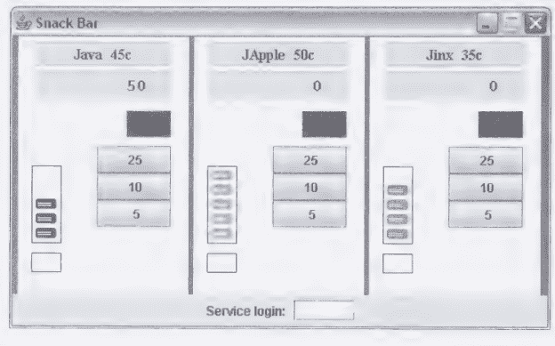

注意，`Snackbar` 类实际上对它的售货机了解极少：只知道如何构造它们，以及它们偶尔需要服务或重新装载（即 `VendingMachine` 有一个带有三个特定参数的构造函数和一个 `void reload` 方法）。这是良好的 OOP 设计：每个对象只知道它真正需要关于其他对象的信息。

完整的 `VendingMachine` 类代码包含在 `JM\Ch09\SnackBar` 中。如果你检查 `VendingMachine` 的代码，你会发现售货机并不是整台机器，而是它的前面板，即图形用户界面（GUI）。该类的字段之一是：

```java
private Vendor vendor;
```

该对象在 `VendingMachine` 的构造函数中创建：

```java
vendor = new Vendor(price, stock);
```

实际上是 `Vendor` 类在追踪投入和库存。例如，当用户向机器“投入” 25 分钱时，机器调用 `Vendor` 的 `addMoney` 方法：

```java
vendor.addMoney(25);
```

当用户按下红色按钮时，机器调用它的 `makeSale` 和 `getChange` 方法：

```java
vendor.mSale();
change = vendor.getChange();
```

如果机器需要知道是否还有零食，它调用 `Vendor` 的 `getStock` 方法：

```java
if (vendor.getStock() > 0)
```

正如你可能猜到的那样，你的任务是实现 `Vendor` 类：

```java
/**
 * 实现销售。如果库存中有物品且
 * 投入的金额大于或等于
 * 单价，则调整库存
 * 计算并设置找零并返回 true；
 * 否则退还全部投入金额（将其移至
 * 找零）并返回 false。
 * @return 成功销售返回 true，否则 (boolean)
 */
```

图 9-4 显示了涉及自动零食店的对象：`Snackbar`、`VendingMachines` 和三个 `Vendor`。`Snackbar` 代表程序窗口。它有四个字段，分别代表可用库存、价格、当前投入金额以及找零。`Vendor` 以指定的价格销售一种物品。它通过收集客户的付款项来运作。图 9-5 显示了 `Vendor` 类：

```java
/**
 * 此类实现了一个按价格销售
 * 一种物品的供应商。
 */
public class Vendor {
    // 字段
    private int price;
    private int stock;
    private int deposit;
    private int change;

    /**
     * 构造 Vendor
     * @param price 单个物品的价格（分）（int）
     * @param stock 库存物品数量（int）
     */
    public Vendor(int price, int stock) {
        price = price;
        stock = stock;
        deposit = 0;
        change = 0;
    }

    /**
     * 设置库存数量。
     * @param qty 放入的物品数量（int）
     */
    public void setStock(int qty) {
        stock = qty;
    }

    /**
     * 返回当前库存物品数量。
     * @return 当前库存物品数量（int）
     */
    public int getStock() {
        return stock;
    }

    /**
     * 将指定的金额（分）加入投入金额。
     * @param amount 要加入投入金额的分数（int）
     */
    public void addMoney(int amount) {
        deposit += amount;
    }

    /**
     * 返回当前投入金额（分）。
     * @return 当前投入金额（分）（int)
     */
    public int getDeposit() {
        return deposit;
    }

    /**
     * 实现销售。
     */
    public boolean mSale() {
        if (stock > 0 && deposit >= price) {
            stock--;
            change += deposit - price;
            deposit = 0;
            return true;
        } else {
            change += deposit;
            deposit = 0;
            return false;
        }
    }

    /**
     * 返回并清零由于上一次销售或
     * 退款而产生的找零金额。
     * @return 当前找零金额（分）（int）
     */
    public int getChange() {
        int temp = change;
        change = 0;
        return temp;
    }
}
```

`Vendor` 类的方法工作如下：

- `addMoney` 方法向已存款的金额增加指定数量的角分。
- `makeSale` 方法在买家尝试完成交易时被调用。如果售卖机有货且买家已存入足够的资金，则完成交易：库存减少，计算出找零，并且 `makeSale` 返回 `true`。否则，交易失败：库存保持不变，整个存款将退还给买家（通过将其转移到找零金额中），并且 `makeSale` 返回 `false`。
- `getDeposit` 访问方法向调用者返回当前存款的值（而不是钱本身！）。当自动售卖机需要在其显示面板上显示存款金额时，会调用此方法。
- `getChange` 方法完成交易：它在返回给买家的找零金额的同时，（嗯，几乎是同时）将 `change` 重置为 0。在这里你必须稍微小心：在将 `change` 设为 0 之前，将返回值保存在临时变量中。
- `getStock` 访问方法返回当前库存。
- `setStock` 方法设置新的库存数量。

使用 `JM\Ch09\Snackbar` 来自 `Snackbar.java`、`VendingMachine.java` 和 `Vendor.java` 文件建立项目。完成 `Vendor` 类并彻底测试程序。

## 9.10 重载方法

不同类中的方法可能具有完全相同的名称，并不意外。由于方法总是针对特定的对象（或特定的类）调用的，因此产生产生。例如：

```java
int point = game.getPoint(); // 调用 CrapsGame 的 getPoint
Point p = e.getPoint(); // 调用 MouseEvent 的 getPoint
```

```java
Fraction sum = f1.add(f2);
```


panel.add(button);

一个更有趣的事实是，同一个类的多个方法也可以具有相同的名称，只要它们的参数数量或类型不同。

## 9.10 重载方法

在同一个类中，相同但参数数量或类型不同的方法被称为重载方法。

只要参数列表不同，一个方法就可以拥有任意数量的重载版本。例如，在

```java
public class SomeClass {

    public int fun(int a) {
        ...
    }

    public int fun(double b) {
        ...
    }

    public double fun(int a, double b) {
        ...
    }

}
```

`SomeClass` 有三个不同的方法，都称为 `fun`。这些方法中的每一个代码都可能完全不同。重载允许你为相似的任务使用相同的方法名。例如，相同的名称 `print` 用于 `System.out` 对象的方法，用于显示 `char`、`int`、`double`、`String` 和 `Object`。

编译器根据传递给它的参数类型知道该调用哪个重载方法。在上面的示例中，如果你调用 `fun(1)`，将调用第一个重载方法，因为 1 是一个整数；但如果你调用 `fun(1.5)`，将调用第二个重载方法，因为 1.5 是一个 `double`。如果你调用 `fun(1, .99)`，将调用第三个版本 `fun(int, double)`。

如果调用中的参数类型与方法可用的重载版本之间没有匹配，编译器将尽力将一个或多个参数转换为其中一个版本可以接受的形式。例如，如果你调用 `fun(1, 2)`，编译器将调用 `fun(1, 2.0)`。如果找不到合适的方法且无法进行合理的转换，编译器将报告错误。例如，如果 `s` 是一个 `String`，并且你调用 `fun(s)`，编译器会报告类似“在类 SomeClass 中未定义方法 fun(String)”的错误。（如果参数类型没有精确匹配，且有多个重载方法可以处理，编译器也会报告错误。）

注意，方法定义中形式参数的名称并不能区分重载方法。只有参数的类型很重要。例如，

```java
public int fun(int a, double b)
{
}
```

和

```java
public int fun(int x, double y)
{
}
```

不能在同一个类中定义。

仅凭返回类型也无法区分两个方法。例如，

```java
public int fun(int a, double b)
{
}
```

和

```java
public double fun(int a, double b)
{
}
```

不能在同一个类中定义。

> 当你在设计一个类时，要小心不要对一个方法有太多的重载版本，因为它们可能会引起混乱并导致错误。

Alex: 我在 `Fraction` 类中定义了两个重载的 `add` 方法：一个接受另一个 `Fraction` 作为参数，另一个接受 `int` 作为参数：

```java
// 返回此分数和其他数的和
public Fraction add(Fraction other)
{
    return new Fraction(num * other.denom + denom * other.num,
    denom * other.denom);
}
```

```java
// 返回此分数和 m 的和
public Fraction add(int m)
{
    return new Fraction(num + m * denom, denom);
}
```

用于乘法。

Blair: 你的意思是我可以

```java
Fraction f = new Fraction(1, 2);
Fraction f2 = new Fraction(1, 3);
Fraction sum1 = f.add(f2);
Fraction sum2 = f.add(3);
```

## 9.11 静态字段和方法

在之前的章节中，我们说不同对象的字段可以被看作对象的内存。但这并不是全部。Java 类可以定义两种字段：非静态字段和静态字段。非静态字段也称为实例变量。它们在不同的对象（类的实例）中可能有不同的值。静态字段也称为类变量。它们被所有对象共享。它们用 `static` 关键字声明。

创建一个对象时，会分配内存来存储其实例变量。这被称为动态分配。但整个类只有一个内存块存储静态字段。静态字段与对象分开存储。

“静态”一词似乎意味着静态字段的值是常量。实际上它与常量无关。

为什么我们需要静态字段？原因如下：

- 我们可能想定义一个通用的公共常量。将其归属于类是合理的，而不是在所有对象中浪费内存空间。引用此类常量时，使用类名加点作为前缀，而不是特定对象的名称。我们已经有很多这样的：
- 可能想让所有对象共享相同的常量或设置。例如，在 `RollingDie` 类中，我们有静态字段定义运动常量和骰子桌的尺寸：

```java
private static final double slowdown = 0.97,
speedFactor = 0.04,
speedLimit = 2.0;
private static int tableLeft, tableRight, tableTop, tableBottom;
```

- 我们可能需要收集所有存在的类对象的统计数据或累计总和。例如，如果我们想跟踪 Snack Bar 程序中所有售卖机的总销售额。我们需要一个每个 vendor 都可以访问的变量。

类定义可能还包含静态方法。此类方法不访问或操作任何实例变量，它们只处理静态字段，或者不访问任何字段。因此，它们归属于整个类，而不是单个实例。

定义静态方法有两个主要原因：

1. 静态方法可以提供一种与任何特定对象都无关的“公共服务”。例如，`Math.max(int a, int b)` 返回整数 a 和 b 中的最大值。或者看看 Alex 的 `gcf` 方法——它返回两个整数的最大公约数（GCF）。或者是 System 的 `exit` 方法，它强制让 GCF 退出。
2. 静态方法可以与类的静态字段一起工作。例如，它可以是静态字段的访问器或修改器。

Alex: 在你说话的时候，我修改了 `Fraction` 类中的 `gcf` 方法，将其变为公有且静态（public static）。

```java
// 返回两个正整数的最大公约数
public static int gcf(int n, int d)
```

Blair: 这是我的主意！但为什么是静态的？

Alex: 它完全不需要处理任何字段——只是计算两个给定数字的最大公约数。如果我没有把它设为静态的，你就必须创建一个 `Fraction` 对象来调用这个方法，尽管 `gcf` 方法与任何特定的分数都无关（除了我在 `reduce` 方法中调用了它）。事实上，我本可以把它放在另一个类中或单独的类里。可惜 Sun 公司的同事没有在他们的 `Math` 类中放入 `gcf` 方法。

Blair: 你的意思是我现在可以直接写成：

```java
int r = Fraction.gcf(a, b);
```

Alex: 没错。

> 这在静态方法中是未定义的。静态方法不允许访问或修改（同类的）实例字段，也不允许在没有对象点前缀的情况下调用（类的）实例方法，因为这种调用隐含了 `this.`。

Blair: 我最近写这段代码时遇到了这个问题：

```java
public class Test
{
    public void testConstructors() { ... }
    public void testArithmetic() { ... }
    public static void main(String[] args) {
        testConstructors();
        testArithmetic();
    }
}
```

我收到了：
non-static method testConstructors() cannot be referenced from a static context
non-static method testArithmetic() cannot be referenced from a static context

我必须在 `testConstructors` 和 `testArithmetic` 的头部中添加 `static` 才能让它运行：

```java
public static void testConstructors() { ... }
public static void testArithmetic() { ... }
```

Alex: 那是因为 `main` 总是静态的，所以无法在没有特定对象引用的情况下调用非静态方法。你本可以在 `main` 中创建 `Test` 类的对象，然后调用该对象的方法：

```java
public class Test
{
    public void testConstructors() { ... }
    public void testArithmetic() { ... }
    public static void main(String[] args) {
        Test obj = new Test();
        obj.testConstructors();
        obj.testArithmetic();
    }
}
```

## 9.11 静态字段与方法

实例变量在构造函数中初始化并在实例（非静态）方法中使用。理论上，构造函数允许设置静态字段，但这样做意义不大，因为通常你不想在构造其中一个对象时影响所有的类对象。

实例方法可以访问和修改静态及非静态字段，并调用静态及非静态方法。

Alex: 确实。例如，我的实例方法 `reduce` 调用了我的静态方法 `gcf`。

```java
int q = gcf(Math.abs(num), denom);
```

我仍然在没有任何点前缀的情况下调用 `gcf`，因为它在同一个类中。我曾写过：

```java
int q = Fraction.gcf(Math.abs(num), denom);
```

我并不死板。

Blair: 我看到 `Math` 类还有另一个静态方法 `abs`。那一定是为了获取整数的绝对值。所有的 `Math` 方法都是静态的吗？

Alex: 没错。

有些类只有静态字段和方法，没有公有构造函数。例如

Blair: 你的意思是我可以写：

```java
Math xyz = new Math();
```

？

Alex: 哈哈，试试看。

另一个类的例子是 `System`。它有几个静态字段（如 `System.out`）和静态方法，例如 `exit`（退出应用程序）和 `currentTimeMillis`（返回当前毫秒数），但你不能创建 `System` 类的对象。

`Math` 和 `System` 的例子有些极端——典型的类有一些实例变量，也可能有一些静态字段。如果一个类同时拥有实例变量和类变量（静态字段），它也可能同时拥有非静态方法和一些静态方法。

现在让我们看看如何使用静态变量来累积 Snack Bar 程序中所有 `VendingMachine` 对象的总销售额。

## 9.12 案例研究：Snack Bar 完成

假设我们修改 Snack Bar 程序，使其报告所有机器的“日销量”。假设“一天”是从程序开始到第一次“服务调用”或两次服务调用之间的时间。我们如何实现一种机制来跟踪总销售额？显然，每台机器（更准确地说，是它的供应商对象）都需要访问这个机制。

一种方法可以基于以下场景：

- 我们定义一个新类并创建一个特殊的对象“记账员”（bookkeeper），它将跟踪总销售额。
- 我们定义一个新类并创建一个特殊的对象“记账员”，它将跟踪总销售额。

# 9.13 ~ 总结

当对象传递给 `print` 或 `println` 并与字符串拼接时，`toString` 会自动调用。

对象的方法和字段通过“点”记法访问。对象 `obj` 的 `doSomething` 方法可以通过 `obj.doSomething(<parameters>)` 调用。然而，对象可以在不使用任何前缀的情况下调用自己的方法，直接使用 `doSomethingElse(<parameters>)`。字段也是如此。

所有原始数据类型的参数始终都是按值传递的，这意味着方法或构造函数处理的是传递给它的变量的副本，无法更改原始变量。另一方面，类类型的对象始终作为引用的副本传递的。方法可以通过指定的引用更改原始对象。不可变对象没有修改器方法，且一旦创建就永远不会改变。

方法使用 `return` 语句来指定其返回值。`return` 告诉方法要返回给调用者的值。当执行 `return` 语句时，程序会立即退出方法代码并将控制权交还给调用者。方法可以有多个 `return`，但它们都必须返回指定类型的值或表达式，且所有其中一个必须位于条件语句（或 `switch`）内部。所有原始类型都是按值返回的，而对象（类类型）作为引用返回。`void` 方法也可以有 `return`，但没有任何值，仅作为退出方法的指令。

同类的多个方法可以具有相同的名称，只要它们的参数数量和/或类型不同。此类方法被称为重载方法。传递给方法的参数必须与方法定义（或其中一个重载方法）中的参数数量、类型和顺序相匹配。

除了实例变量（非静态字段）外，类定义还可以包含静态字段，这些字段由该类的所有对象共享。同样，类可以拥有静态（类）方法，这些方法针对整个类工作，并且不涉及任何实例变量。静态字段用于在类的对象之间共享全局设置，或从类的所有活动对象收集统计数据。静态方法无法访问非静态字段或调用非静态方法。静态方法使用类名而不是单个对象调用：

```java
SomeClass.doSomething(<parameters>);
```


# 练习

- 为公共方法 `replace` 编写方法头，该方法接受两个参数（一个 `String` 和一个 `char`），并返回另一个 `String`。 ✓

- 如果类 `Complex` 有两个构造函数 `Complex(double a)` 和 `Complex(double a, double b)`，以下哪些语句是构造 `Complex` 对象的有效方式？
  - (a) `Complex z = new Complex();`
  - (b) `Complex z = new Complex(0);`
  - (c) `Complex z = new Complex(1, 2);`
  - (d) `Complex z = new Complex(0.0);`
  - (e) `Complex z = new Complex(1.0, 2);`
  - (f) `Complex z = new Complex(1.0, 2.0);`

- (多选择) `Date` 类的以下哪些构造函数存在冲突？
  - I. `Date(int month, int day, int year)`
  - II. `Date(int julianDay)`
  - III. `Date(int day, String month, int year)`
  - IV. `Date(int day, int month, int year)`
  - A. I 和 II
  - B. II、III 和 IV
  - C. I 和 IV
  - D. I、III 和 IV
  - E. 没有冲突 —— 四个均可以共存

- 通过查询 Java API 规范，确定 `String` 和 `Color` 类是否有拷贝构造函数。 ✓

- Java 的 `Color` 类有一个接受三个整数作为参数的构造函数：该颜色的红、绿、蓝分量。`Balloon` 类有两个字段：`double radius` 和 `Color color`。为 `Balloon` 类编写一个不接受任何参数的构造函数，将气球半径设置为 10，并将颜色设置为“天蓝色”（RGB 值为 135、206 和 250）。

6. 为 `Fraction` 类添加 `add`、`subtract` 和 `divide` 方法并对其进行测试。如果 `divide` 方法的参数是零分数，`divide` 应该抛出 `IllegalArgumentException`。

7. 程序 `Temperature` (`JM\Ch09\Exercises\Temperature.java`) 使用 `FCConverter` 类将摄氏转换为华氏，反之亦然。检查该类如何在 `Temperature` 类的 `actionPerformed` 方法中使用的。现在编写并测试 `FCConverter` 类。提示：记住 0°C 是 32°F；1 度摄氏等于 5/9 度华氏。例如，68°F 等于 5/9(68 – 32) = 20°C。

8. 为 `RollingDie` 的构造函数添加一个整数参数 `size`（见第 7.9 节），并在构造函数中使用 `size`。修改 `avoidCollision` 方法，将此骰与其他骰子之间的水平和垂直距离与它们大小的算术平均值进行比较，而不是 `dieSize`。修改 `CrapsTable` 类以掷不同不同的骰子。

- (a) `Point` 类具有私有字段 `double x` 和 `double y`。为该类编写一个拷贝构造函数。

- (b) `Disk` 类具有私有字段 `Point center` 和 `double radius`。为该类编写一个拷贝构造函数。 ✓

- (a) 编写一个 `Rectangle` 类，表示具有整数宽度和高度的矩形。包含一个根据给定宽度和高度构建矩形的构造函数，以及另一个（带有一个参数）构造函数，构建一个实际上是给定尺寸的正方形。确保这些构造函数检查宽度和高度是否为正。添加一个不接受参数并构建矩形的构造函数。
- (b) 添加一个 `isSquare` 方法，当且仅当该对象是正方形时返回 `true`。
- (c) 提供一个合理的 `toString` 方法。

# 第 9 章 ~ 实现类和使用对象

11. 检查 Java 文档并告诉下列库类定义为不可变的（immutable）：
    - `java.lang.Integer`
    - `java.awt.Color`
    - `java.awt.Point`
    - `java.awt.Rectangle`

12. 类可以声明为 `final`，这意味着你不能从它派生类。例如，`Integer` 和 `String` 是 `final` 的。为什么？

13. `Time` 类使用军事时间的小时分钟表示一天中的时间（例如，下午 7:30 p.m. 是 19:30）：

```java
public class Time {

    private int hours;

    private int mins;

}
```

- (a) 编写构造函数 `Time(int h, int m)`，检查参数是否有效并适当设置 `hours` 和 `mins`。
- (b) 编写私有方法 `toMins`，返回该对象自当天开始计算的分钟数。
- (c) 编写公共布尔方法 `lessThan(Time t)`，如果该对象比 `t` 早则返回 `true`，否则返回 `false`。
- (d) 编写方法 `elapsedSince(Time t)`，返回从 `t` 到该时间的经过分钟数。假设 `t <= t+24h`。例如，如果 `t` 是 22:45 而此时是 8:30，该方法假设 `t` 在前一天并返回 585（分钟）。提示：使用 `toMins`。
- (e) 提供一个合理的 `toString` 方法。
- (f) 使用提供的 `TestTime` 控制台程序测试你的 `Time` 类。

14. 编写类 `Coins`，带一个接受分数的构造函数。提供四个公共方法 `getQuarters`、`getNickels`、`getDimes`、`getPennies`，返回对应金额的硬币数量（以最少硬币数量的最优表示）。确保 `Coins` 对象是不可变的（即该类的任何方法都不更改字段）。提示：在构造函数中完成所有工作并将四个硬币计数保存在字段中，使四个方法成为简单的访问方法。

- (a) 在小型控制台程序中测试你的类，提示用户输入以分的金额，并显示元、角、镍和分的数量。

- (b) 将你的类集成到 `Snack Bar` 程序中，使程序报告客户收到的特定硬币单位金额（例如，“65c = 2q + 1d + 1n”）。提示：修改 `VendingMachine` 类中 `actionPerformed` 方法在调用 `vendor.getChange` 后的语句。

15. 下类会编译吗？如果没有，建议一种修复方法。 ✓

```java
public class Pair {

    private double first, second;

    public Pair(double a, double b) {

        first = a;

        second = b;

    }

    public void swap() {

        double temp = first; first = second; second = temp;

    }

    public Pair swap() {

        return new Pair(second, first);

    }

}
```

16. 搞清楚如何使用 Snack Bar 程序中的 `Vendor` 类（不对其进行任何修改）来添加几个整数。编写一个控制台应用程序，提示用户输入整数，并分别对输入的正数和负数进行加法。当用户输入零时，程序显示两个总和并退出。程序中不允许使用 `+` 和 `-` 运算符（字符串拼接除外）；使用 `Scanner` 的 `nextInt` 方法来输入数字。

- 17. 实现一个类 `Complex`（表示复数 $a+bi$），包含两个 `double` 类型的字段和问题 2 中描述的两个构造函数。`Complex(a)` 产生与 `Complex(a, 0.0)` 相同的复数。
- 为你的类添加一个 `abs` 方法，对于一个通过 `Complex(a, b)` 构建的复数，返回 $a^2+b^2$。
- 回想一下，如果 $a+bi$ 和 $c+di$ 是两个复数，它们的和定义为 $(a+c) + (b+d)i$。编写 `Complex` 类的 `add` 方法，构建并返回该数与另一个数的和：

```java
public Complex add(Complex other)
{
  <... 缺失语句>
}
```

- 为你的 `Complex` 类添加一个 `toString` 方法，返回以 $a+bi$ 形式表示数字的字符串。
- 在控制台应用程序中测试你的 `abs`、`add` 和 `toString` 方法。
- 找到两个复数相乘的规则。提示：如果你知道 $i^2=-1$，你可以自己推导出该规则。实现并测试一个 `multiply` 方法，用于此复数与另一个数相乘。与 `add` 方法一样，`multiply` 方法不改变此对象；它应该构建并返回一个新的复数，即乘积。
- 你可以把 `double` 而不是 `Complex` 作为参数传递给 `add` 和 `multiply` 方法吗？添加重载的 `add` 和 `multiply` 版本以允许你执行此操作。

# 第 9 章 ~ 练习 第 263 页

18. 发现并修复以下程序中的语法错误：

```java
public class Puzzle
{
    private String message = "Hello, World";

    public void hello() {
        System.out.println(message);
    }

    public static void main(String[] args) {
        hello();
    }
}
```

19. 重写问题 7 中的 `FCConverter` 类，删除字段和所有构造函数，并提供两个静态方法：

```java
public static double cToF(double degrees)
public static double fToC(double degrees)
```

相应地调整 `Temperature` 类并重新测试程序。

20. 回想 `GridWorld` 的 `Location` 的 `getRow` 和 `getCol` 方法分别返回行和列。我们可以将两个位置 `loc1` 和 `loc2` 之间的距离定义为从 `loc1` 到 `loc2` 的最短路径长度，其中连续的位置是邻居。（一个位置有八个邻居，因此允许对角线移动。一个位置到自身的距离为 0，到任何相邻位置的距离为 1。）设计一个计算此距离的公式。编写并测试一个静态方法 `distance(Location loc1, Location loc2)`，它返回 `loc1` 和 `loc2` 之间的距离。

21. * 为 `Fraction` 类添加一个静态方法 `value(double x)`。该方法应该返回一个值约等于 `x` 的 `Fraction` 对象。定义一个公静态常量 `DFTL_DENOM`（例如，设置为 10000）并将其用作新分数的分母。计算其分子为 `x * DFTL_DENOM` 并四舍五入到最近的整数。对分子调用 `Math.round`。提示：`Math.round` 返回的是一个 `long`；你需要将其强制转换为 `int`。

# 264 页 第 9 章 ~ 实现类和使用对象

- 22. * (a) 编写一个 `SoccerTeam`（足球队）类，其字段用于存储该球队在当前比赛中的胜场数、负场数和平局数。

编写一个方法

```java
public void played(SoccerTeam other, int myScore, int otherScore)
```

该方法比较此球队与其他球队在比赛比赛中的进球数，并增加两支球队相应的字段（胜、负、平）。

- (b) 编写一个方法返回该球队当前的积分（每场胜得三分，每场平得一分）。编写一个 `reset` 方法将该球队的胜、负、平数清零。
- (c) 添加字段以跟踪比赛中所有球队的总比赛场次和总进球数。修改部分 (a) 中的 `played` 方法以更新这些字段。为这两个字段添加静态访问器方法，并添加一个静态 `startTournament` 方法来将它们清零。
- (d) 编写一个程序定义四支球队，让它们相互进行几场“比赛”，然后报告每支球队的积分，以及比赛中所有球队的总比赛场次和总进球数。程序随后对另一场比赛重复此过程。
- 23. * 去掉上一个问题 (c) 部分中的静态字段和方法；相反，使用独立类 `TournamentOfficial`（比赛官员）的对象来跟踪比赛中的总比赛场次和总进球数。将 `official` 的引用传递给 `SoccerTeam` 构造函数并将其存在实例变量中。

# 第 10 章

# 字符串

- 10.1 引言 266
- 10.2 字面量字符串 266
- 10.3 构造函数与不可变性 267
- 10.4 字符串方法 270
- 10.5 将数字格式化为字符串 277
- 10.6 从字符串提取 280
- 10.7 字符方法 281
- 10.8 实验 282
- 10.9 StringBuilder 类 284
- 10.10 总结 286
- 10.11 练习 287

## 10.1 引言

在 Java 中，字符序列是一个对象。字符串对象与任何其他类型非常相似：它们有构造函数和方法。但它们在两个方面有所不同：本章我们将介绍：

* 字符串构造函数
* 不可变性
* 常用的字符串方法
* 如何将数字格式化为字符串以及从字符串提取

## 10.2 字面量字符串

字面量字符串写在双引号中。文本可以包含转义字符（见 6.5）。回想反斜杠 `\` 用作转义字符：字面量字符串内部 `\n` 表示换行，`\'` 表示单引号，`\"` 表示双引号，`\\` 表示反斜杠。例如：

```java
String filename = "T:\\temp";
String pathname = "C:\\funny.txt";
```

字面量字符串也可以为空，如果引号之间没有任何内容。

```java
String empty = ""; // empty为空字符串
```

## 10.3 构造函数与不可变性

字面量字符串作为对象，但不需要创建——当你需要时它们就在那里。编译器基本上将字面量字符串视为存储在内存中的对象的引用。如果你愿意，实际上可以调用该对象的方法（例如，`"Internet".length()` 返回 8）。声明

```java
String city = "Boston";
```

这里的 Boston 不是变量名（变量名是 city），而是它的值。

`String` 类有十多个构造函数，但使用构造函数创建字符串不像其他类型那样常见。相反，我们将 `String` 变量初始化为字面量字符串或字符串方法返回的字符串。

一个构造函数 `String()` 不带参数并构建空字符串；与其用 `new` 运算符调用此构造函数，我们可以简单地写：

```java
String str = ""; // str 初始化为空字符串
```

另一个构造函数是拷贝构造函数 `String(String s)`，它构建字符串 s 的拷贝。但在大多数情况下我们不需要复制字符串，因为正如很快解释的，一旦创建就永远改变；因此我们只需要复制引用。例如：

```java
String str = "Foo Fighters";
```

这与以下并不完全相同：

```java
String str = new String("Foo Fighters");
```

但就你的程序而言，这两个 `str` 声明的作用是完全相同的。

# 268 第 10 章 ~ 字符串

空字符串与未初始化的 `String` 引用之间存在巨大差异。

空字符串被初始化为 `""` 或通过无参构造函数创建，例如：

```java
String s1 = ""; // s1 被设置为空字符串
String s2 = new String(); // s2 被设置为空字符串
```

`String` 类型的字段默认设置为 `null`：

```java
private String s3; // 实例变量 s3 被设置为 null
```

你可以对空字符串调用方法。

一旦字符串被构建，它就无法被修改了！如果你仔细查看图 10-3 总结的 `String` 方法，你会发现这些方法中没有一个可以改变字符串的内容。

> 字符串是一个不可变对象：它的任何方法都无法改变 `String` 对象的内容。

例如，你可以使用 `charAt` 方法获取字符串中指定位置的字符值。没有方法可以设置或替换字符串中的某个字符。如果你想修改（例如，将字符串的第一个字符从大写改为小写），你必须构建一个第一个字符不同的全新字符串。

```java
String bandName = "Foo Fighters";
char c = bandName.charAt(0);
bandName = Character.toLowerCase(c) + bandName.substring(1);
// bandName 现在指向一个新字符串
// 值为 "foo Fighters"
```

这段代码改变了引用——`bandName` 现在指向你那个值为 "foo Fighters" 的新字符串（图 10-1）。

旧字符串被丢弃（除非有其他变量引用了它）。Java 的自动垃圾回收器会释放旧字符串占用的内存，并将其返回到空内存池。这有点浪费——就像你每次加一勺糖或喝一口咖啡时，都把咖啡倒进新杯子并扔掉旧杯子。


String bandName = "Foo Fighters";

char c = bandName.charAt(0);

bandName = Character.toLowerCase(c) + bandName.substring(1);

```


图 10-1. 给 String 变量分配的新值

然而，字符串的不可变性使得更容易避免 Bug。它允许两个 `String` 变量引用同一个字符串（图 10-2-a），而不会出现在不知道另一个变量的情况下的情况下的情况下通过一个变量改变字符串内容的危险。在某些情况下，它也有助于避免不必要的字符串拷贝。与其创建同一个字符串的多个拷贝——

```java
String s2 = new String(s1); // s2 指向 s1 的新拷贝
```

如图 10-2-b 所示，你可以使用：

```java
String s2 = s1; // s2 与 s1 引用同一个字符串
```

另一方面，如果你为每一个微小的变化都构建一个新字符串，频繁更改由 `String` 对象表示的长字符串的程序可能会变慢。

(a) (b)

s2 = s1; s2 = new String(s1);

两个变量引用同一个 String 对象 两个变量引用内容相同的 String 对象

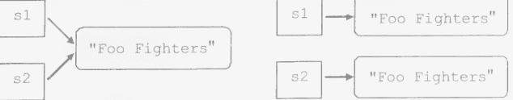

图 10-2. 分配引用 vs 拷贝字符串

幸运的是，Java 提供了另一个表示字符字符串的类，称为 `StringBuilder`。`StringBuilder` 对象不是不可变的：它们拥有 `setCharAt` 方法以及其他改变其内容的方法。`String` 可能更容易理解，并且在学生项目中被认为更安全。然而，通过 `StringBuilder` 类，我们可以轻松更改字符串中的一个字母而无需移动其他字符。例如：

```java
StringBuilder name = new StringBuilder("Foo Fighters");

char c = name.charAt(0);

name.setCharAt(0, Character.toLowerCase(c));

// name 仍然指向同一个对象，但它的第一个
// 字符不是 'f';
```

如果某些文本应用程序在你的快速计算机上运行非常缓慢，可能是因为程序员太懒了没有使用（或根本没学过）`StringBuilder` 类。我们在第 10.9 节总结了 `StringBuilder` 的构造函数和方法。在编写商业应用之前，确保你已经读过它！

## 10.4 String 方法

更常用的 `String` 方法总结在图 10-3 中。这些方法包括返回字符串长度、获取指定位置的字符、构建子字符串、在字符串中查找指定字符或子字符串、按字母顺序比较字符串，以及将字符串转换为大写和小写。

### length 和 charAt

`length` 方法返回字符串中字符的数量。例如：

```java
String s = "Internet";

int len = s.length(); // len 获取值 8
```

`charAt` 方法返回指定位置的字符。

字符串中的字符位置从 0 开始计数。

```java
int n = s.length();

char ch = s.charAt(pos);

String s2 = s.substring(fromPos);

String s2 = s.substring(fromPos, toPos);

String s2 = s.concat(str)
```

```java
int result = s.compareToTo(s2);

int result = s.compareTo(s2);

boolean match = s.equals(s2);

boolean match = s.equalsIgnoreCase(s2);
```

```java
int k = s.indexOf(ch);

int k = s.indexOf(fromPos);

int k = s.indexOf(str);

int k = s.indexOf(str, fromPos);
```

```java
int k = s.lastIndexOf(ch);

int k = s.lastIndexOf(fromPos);

int k = s.lastIndexOf(str);

int k = s.lastIndexOf(str, fromPos);
```

```java
String s2 = s.trim();

String s2 = s.replace(oldChar, newChar);

String s2 = s.toUpperCase();

String s2 = s.toLowerCase();
```

图 10-3. 常用的 String 方法

这种约定从 0 开始计数，字符串的最后一个字符位于长度-1。例如：

```java
String s = "Internet";

char c1 = s.charAt(0); // c1 获取值 'I'

char c2 = s.charAt(7); // c2 获取值 't'
```

如果你调用 `charAt(pos)` 时 `pos` 小于 0 或等于字符串长度，将抛出 `StringOutOfBoundsException`。

> 字符串是一个不可变对象：它的任何方法都无法改变字符串的内容。

### 子字符串 (Substrings)

`String` 类有两个重载的 `substring` 方法。第一个 `substring(fromPos)` 返回从 `fromPos` 开始的字符串尾部。例如：

```java
String s = "Internet";

String s2 = s.substring(2); // s2 获取值 "ternet"
```

第二个 `substring(fromPos, toPos)` 返回从 `fromPos` 到 `toPos` 的片段。注意：`toPos` 不包含在内。例如：

```java
String s = "Internet";

String s2 = s.substring(2, 5); // s2 获取值 "ter"
```

### 连接 (Concatenation)

`concat` 方法将操作连接接到字符串。它与 `+` 运算符的工作完全相同。例如：

```java
String s1 = "Sun";

String s2 = s1.concat("shine"); // s2 获取值 "Sunshine"
```

初看起来 `+` 运算符违反了字符串的不可变性。事实并非如此。`+` 形成一个新的连接左操作数的字符串。然后它改变引用 `s` 指向新字符串。

正如我们在 6.9 中所说，你可以使用 `+` 和 `+=` 运算符将字符和数字连接到字符串，只要编译器可以判断你正在处理字符串。例如：

```java
String s = "Year";

s += 1776; // s 获取值 "Year1776"
```

但如果你写：

```java
s = "Year:";

s += ' ' + 1776; // 单引号
```

它不会按预期工作，因为 `' '` 和 `1776` 都不是字符串。与其连接，它会先将 1776 与空格的 Unicode 码（32），然后将和添加到 `s`。因此 `s` 将得到值 "Year:1808"。另一方面，

```java
s = "Year:";

s += " " + 1776; // 双引号
```

是可以工作的，因为中间操作的结果是一个字符串。

### 查找字符和子字符串 (Finding characters and substrings)

`indexOf(char c)` 方法返回字符 `c` 在字符串中首次出现的位置。记住索引是从 0 开始计数的。如果 `c` 在字符串中未找到，`indexOf` 返回 -1。例如：

```java
s = "Internet";

int pos1 = s.indexOf('e'); // pos1 获取值 3

int pos2 = s.indexOf('x'); // pos2 获取值 -1
```

你也可以通过使用 `indexOf` 的另一个重载版本从字符串起始以外的位置开始搜索。它有一个第二个参数，即搜索的位置。例如：

```java
s = "Internet";

int pos = s.indexOf('e', 4); // pos 获取值 6
```

```java
String s = "Internet";

int pos1 = s.lastIndexOf('e'); // pos1 获取值为 6

int pos2 = s.lastIndexOf('e', 4); // pos2 获取值为 3

int pos3 = s.lastIndexOf('e', 2); // pos3 获取值为 -1
```

`String` 类有四个相似的方法，用于搜索子串而不是单个字符。例如：

```java
String s = "Internet";

int pos1 = s.lastIndexOf("e"); // pos1 获取值为 3

int pos2 = s.lastIndexOf("net"); // pos2 获取值为 5

int pos3 = s.lastIndexOf(s2, 6); // pos3 获取值为 -1

int pos4 = s.lastIndexOf(s2);

int pos5 = s.lastIndexOf("net", 6); // pos5 获取值为 5
```

### 比较

你不能使用关系运算符（==, !=, <, <=, >=）来比较字符串。

记住，当关系运算符 == 和 != 应用于对象时，比较的是对象的引用（即地址），而不是它们的值。字符串也不例外。`String` 类提供了 `equals`、`equalsIgnoreCase` 和 `compareTo` 方法来比较字符串。`equals` 和 `equalsIgnoreCase` 返回布尔值；如果字符串具有相同的长度和相同的字符（分别为区分大小写或不区分大小写），则返回 true，否则返回 false。例如：

```java
String s = "OK!";

boolean samel = s.equals("OK!"); // samel 设置为 false

boolean same2 = s.equals("OK"); // same2 设置为 false

boolean same3 = s.equalsIgnoreCase("OK!"); // same3 设置为 true
```

偶尔比较中的字符串可能尚未创建。如果你调用它的 `equals` 方法（或任何其他方法），将得到一个 `NullPointerException`（空指针异常）。例如：

```java
private String name; // name 是一个实例变量

boolean same = name.equals("Sunshine");

// 如果 name 未经过初始化，则抛出 NullPointerException
```

为了避免此类错误，你可以写成：

```java
boolean same = (name != null && name.equals("Sunshine"));
```

上述语句由于**短路求值**（参见第 7.7 节）始终有效。然而，真正的 Java 专家可能会这样写：

```java
boolean same = "Sunshine".equals(name);
```

这始终有效，无论 name 是否已初始化或为 null，因为你没有调用未初始化对象的方法。对 `equalsIgnoreCase` 方法也是如此。

`compareTo` 方法返回一个整数，描述比较的结果。如果 `s1.compareTo(s2)` 中 `s1` 在字典序上于 `s2`，则返回一个负整数；如果它们相等，则返回 0；如果 `s1` 晚于 `s2`，则返回一个正整数。（为了记住 `compareTo` 的含义，你可以在脑海中将 "compareTo" 替换为减号。）比较从第一个字符开始，直到在对应位置遇到不同的字符，或者其中一个字符串结束。在一种情况下，`compareTo` 返回字符 Unicode 码的差值，因此具有“较小”字符的字符串（即 Unicode 码较小的字符串）被视为较小；在后一种情况下，`compareTo` 返回长度差，因此较短的字符串被视为较小。这被称为“字典排序”，但它与字典中的用法并不相同，因为 `compareTo` 是区分大小写的，且 Unicode 中的大写字母在小写字母之前。例如：

```java
String s = "ABC";

int result1 = s.compareTo("abc");

// result1 设置为负数：
// "ABC" 比 "abc" “小”
```

```java
int result2 = s.compareTo("ABCD");

// result2 设置为负数：
// "ABC" 比 "ABCD" “小”
```

自然地，还有一个 `compareToIgnoreCase` 方法。

### 转换

其他有用的 `String` 方法调用包括：

```java
String s2 = s1.toUpperCase();

// s2 设置为由 s1 中的字符组成的字符串，
// 并将所有字母转换为大写字母
```

```java
String s2 = s1.toLowerCase();

// 小写也是如此
```

```java
String s2 = s1.replace(c1, c2);

// s2 设置为与 s1 具有相同字符的字符串，
// 只是所有 c1 的出现处都被替换为 c2。
```

```java
String s2 = s1.trim();

// s2 设置为与 s1 相同的字符串，但去除了
// 字符串开头和结尾的空白字符（空格、制表符
// 和换行符）。
```

例如：

```java
String s1 = "<u>String Methods</u>";
```

```java
String s2 = s1.trim(); // s2 变为 "<u>String Methods</u>"

// s1 保持为 "<u>String Methods</u>"
```

```java
String s3 = s2.toUpperCase();

// s3 变为 "<U>STRING METHODS</U>"
// s2 保持为 "<U>String Methods</U>" // 根据 OCR 逻辑修正
```

```java
String s4 = s3.replace('U', 'B');

// s4 变为 "<B>STRING METHODS</B>"
// s3 保持为 "<U>STRING METHODS</U>"
```

这些方法（以及任何其他 `String` 方法）都不会改变被调用的 `String` 对象。相反，它们返回一个新的 `String`。这是因为 `String` 是不可变的。

## 10.5 将数字格式化为字符串

```java
// 使用 twoDigits 将分钟转换为字符串：
int minutes = 7;

String s3 = twoDigits.format(minutes);

// s3 获取到的值为 "07"
```

例如，如果 `totalSales` 为 123.5，且你需要打印如下内容：

总销售额: 123.50

你可以写：

```java
System.out.print("Total sales: " + 
moneyl.format(totalSales));
```

如果 `hours` = 3 且 `minutes` = 7，你希望时间看起来像 3:07，你可以写：

```java
System.out.print(hours + ":" + twoDigits.format(minutes));
```

从 Java 5.0 版本开始，`PrintStream` 和 `PrintWriter` 对象（包括 `System.out` 和打开用于写入的文件）都有一个方便的 `printf` 方法，用于向控制台和文件写入格式化输出。`printf` 是一个不普通的方法：它可以接受任意数量的参数。第一个参数总是格式化字符串，通常是一个字面量。格式化字符串可能包含固定文本和一个或多个嵌入的占位符。其余参数与字符串中的格式占位符对应。例如：

```java
int month = 5, day = 19, year = 2007;

double amount = 123.5;

System.out.printf("Date: %02d/%02d/%d\n", 
month, day, year, amount);
```


# 10.6 从字符串中提取数字

反向操作——将数字字符串（带有符号，如果有的话）转换为 `int` 值——可以通过调用 `Integer` 类的静态 `parseInt` 方法来实现。

```java
String s = "-123";
int n = Integer.parseInt(s); // n 获取到的值为 -123
```

如果传递给 `parseInt` 的参数不是有效的整数，会发生什么？这个问题引导我们简要进入 Java 异常处理的主题。

如果 `parseInt` 接收到错误的参数，它会抛出 `NumberFormatException`。你已经见过几种情况，程序在遇到某些 bug 或意外情况下会“抛出”特定的“异常”。然而，这种异常与我们目前为止经历过的其他异常不同，例如 `NullPointerException`、`IllegalArgumentException` 和 `StringOutOfBoundsException`。那些是程序员的错误：它们是由程序中的错误引起的。当抛出其中任何一个异常时，只能终止程序并报告错误发生的地方。

但 `NumberFormatException` 可能仅仅是由用户的输入错误引起的。如果程序因为用户使用了 'o' 而不是 '0' 就退出，用户会感到非常惊讶。程序应该优雅地处理这种情况，Java 为此提供了一个特殊工具：`try-catch-finally` 语句。你可以在 `try` 块中“尝试性”调用 `parseInt`，并在随后的 `catch` 块中“捕获”这种特殊异常。`catch` 块只在抛出异常时才执行。它后面可以跟一个 `finally` 块，该块总是会被执行，随后执行必要的清理工作。`try`、`catch` 和 `finally` 是 Java 的关键字。图 10-4 展示了如何编写这一切。

```java
Scanner input = new Scanner(System.in);
int n = 0;
```

**图 10-4.** 使用异常处理将输入转换为 int。

一个类似的方法 `Double` 类的 `parseDouble` 可用于从字符串中提取 `double` 值。例如：

```java
String s = "1.5";
double x = Double.parseDouble(s); // x 获取到的值为 1.5
```

# 10.7 字符方法

当你处理字符和字符串时，通常需要确定某个特定字符是数字、字母还是其他。`Character` 包装类有几个“公共服务”类的静态 `boolean` 方法，用于测试字符是否属于特定类别。所有这些方法都接受一个参数（`char`）并返回 `true` 或 `false`。例如：

```java
boolean result = Character.isDigit(c); // 如果 c 是数字，则 result 为 true；否则为 false
```

其他的字符“类别”方法包括 `isLetter`、`isLetterOrDigit`、`isUpperCase`、`isLowerCase` 以及 `isWhitespace`（空格、制表符、换行等）。

两个方法返回字符的大写和小写版本。例如：

```java
char c1 = Character.toUpperCase('a'); // c1设置为 'A'
char c2 = Character.toLowerCase('B'); // c2设置为 'b'
```

```java
Scanner input = new Scanner(System.in);
String firstName = input.next();
// 获取 firstName 的第一个字符：
char c = firstName.charAt(0);
```

# 10.9 StringBuffer 类

`StringBuffer` 对象表示可以修改的字符字符串。回想 `String` 对象是不可变的：一旦创建，你就无法更改其内容，因此每次更改都需要构建新字符串。要修改字符串中的多个字符或向字符串追加字符，使用 `StringBuffer` 通常更高效。

如果你提前知道字符串的最大长度，这种情况下尤为如此。`StringBuilder` 区分了缓冲区容量（即在不重新调整大小的情况下可以容纳的最大长度）和缓冲区当前持有的字符串长度。例如，一个缓冲区容量为 100 且为空（持有空字符串）。只要长度不超过容量，所有操作都在同一个缓冲区内进行，不需要重新分配。当长度超过容量时，将分配更大的缓冲区并将当前的内容复制到新缓冲区中。这需要时间，所以如果你希望代码运行高效，必须安排减少重新分配和复制。

`StringBuffer` 有多个构造函数。其中：

```java
StringBuffer()                // 创建默认容量（16 个字符）的空字符串缓冲区
StringBuffer(int n)           // 创建容量为 n 个字符的空字符串缓冲区
StringBuffer(String s)        // 创建持有 s 副本的字符串缓冲区
```

图 10-6 显示了 `StringBuffer` 一些常用方法的用法。

与 `String` 类一样，`length` 方法返回缓冲区当前持有的字符串的长度。`capacity` 方法返回缓冲区的当前容量。

除了返回指定位置字符的 `charAt(int pos)` 方法外，`StringBuffer` 还有一个 `setCharAt(int pos, char ch)` 方法，它可以将指定位置的字符设置为指定值。

`StringBuffer` 有多个重载的 `append(sotype x)` 方法。每个方法都接受一个特定类型的参数：String、char、boolean、int 以及其他原始类型。Object 或字符数组（第 12 章）。x 使用默认转换方法（如 `String.valueOf(...)`）转换为字符串。然后，该字符串将被附加到缓冲区的末尾。如果必要，会自动分配一个更大的缓冲区。重载的 `insert(int pos, sotype x)` 方法在指定位置插入字符。

`substring(fromPos)` 和 `substring(fromPos, toPos)` 方法的工作方式与 `String` 类中的相同：前者返回与从 `fromPos` 位置开始的子字符串相等的 String，后者返回一个由 `fromPos` 到 `toPos-1` 之间（包含边界）的字符组成的 String。`delete(fromPos, toPos)` 从缓冲区中删除子字符串，`replace(fromPos, toPos, str)` 将 `fromPos` 到 `toPos-1` 之间的子字符串替换为 `str`。最后，`toString` 方法返回一个与缓冲区中字符字符串相等的 String 对象。

```java
StringBuilder sb = new StringBuilder(10); // sb 是空的
int len = sb.length(); // len 被设置为 0
cap = sb.capacity(); // cap 被设置为 10
sb.append("at"); // sb 拥有 "at"
sb.insert(0, "bat"); // sb 拥有 "bat"
char ch = sb.charAt(1); // ch 被设置为 'a'
sb.setCharAt(0, "w"); // sb 拥有 "wat"
sb.append("er"); // sb 拥有 "water"
sb.replace(1, 3, "int"); // sb 拥有 "winter"
String s1 = sb.substring(1); // s1 被设置为 "inter"
String s2 = sb.substring(1, 3); // s2 被设置为 "in"
sb.delete(4, 6); // sb 拥有 "wint"
sb.deleteCharAt(3); // sb 拥有 "win"
sb.append(2020); // sb 拥有 "win2020"
String str = sb.toString(); // str 被设置为 "win2020"
```

图 10-6。常用的 `StringBuffer` 方法示例。

# 10.10 总结

双引号中的文本表示字面量字符串。字面量字符串被视为字符串对象，你可以将其赋值给 `String` 引用，而无需显式地使用 `new` 运算符创建字符串。字面量字符串可能包含转义字符，例如 `\n`、`\t`、`\\` 和 `\"`。

一旦字符串被构建，就没有方法可以更改它，因为 `String` 类的对象是不可变的：没有哪个 `String` 方法可以改变它的对象。但是，你可以将 `String` 引用重新指向另一个字符串。如果没有其他变量引用旧字符串，它将由 Java 的垃圾回收机制释放。这可能非常低效；专业程序员通常使用 `StringBuffer` 类而不是 `String`。

Java 支持使用 `+` 和 `+=` 运算符来拼接字符串。如果在一个表达式中组合了多个 `+` 运算符进行拼接，你必须确保每个中间操作的操作数中至少有一个是字符串。

图 10-3 总结了最常用的 `String` 方法。字符串中字符的位置从 0 开始计数，因此 `charAt(0)` 方法返回字符串的第一个字符。

`==` 或 `!=` 运算符通常用于比较字符串，因为这些运算符比较的是字符串的引用（地址），而不是它们的内容。请改用 `equals`、`equalsIgnoreCase` 和 `compare` 方法。

`Integer` 类是所谓的原始数据类型 `int` 的包装类。它提供了一种将整数值表示为对象的方法。静态方法 `Integer.toString(int n)` 或 `String.valueOf(int n)` 返回一个字符串：数字作为数字字符串的表示，可能带有符号。使用 `"" + n` 也可以实现相同的功能。对于 `double` 类型，最好使用 `DecimalFormat` 或 `String` 中的静态方法 `format` 来转换为字符串。例如：

```java
DecimalFormat moneyFormat = new DecimalFormat("0.00");
String s1 = moneyFormat.format(totalSales);
String s2 = String.format("%.2f", totalSales);
```

要将数字字符串转换为 `int` 值，请使用 `Integer` 类的静态方法 `parseInt`。例如：

```java
String s = "-123";
int n = Integer.parseInt(s);    // n 获取了值 -123
```

如果 `s` 不表示整数，该方法会抛出 `NumberFormatException`。你的程序能够捕获该异常，警告用户并继续运行（见图 10-4）。

`Character` 类（`char` 的包装类）具有常用的布尔静态方法 `isLetter`、`isDigit`、`isWhitespace` 以及其他几个接受 `char` 作为参数并返回 `true` 或 `false` 的方法。`Character` 类有两个静态方法 `toUpperCase(ch)` 和 `toLowerCase(ch)`，返回与转换为相应大小后相等的 `char` 值。

`StringBuilder` 对象表示可以修改的字符字符串。除了 `charAt`、`substring`、`indexOf` 和其他 `String` 方法外，`StringBuilder` 类还有 `setCharAt`、`append`、`insert`、`deleteAt` 和 `delete` 方法。

## 练习

### 10.1-10.4 节

- 1. 在以下声明中找到一个 bug：✓
```java
String fileName = "C:\\dictionaries.txt";
```
- 2. (a) 编写一个方法，如果给定字符串不空且以 `*` 结尾，则返回 `true`。
  (b) 编写一个方法，如果给字符串至少有两个星号，则返回 `true`。
- 3. 编写一个方法删除格式为 "ddd-dd" 的社会安全码中的连字符，并返回与 "dddddd" 相等的字符串。
- 4. (a) 编写一个方法，如果 `dateStr` 格式为 `mm/yyyy` 则返回 `true`。
  (b) 使 (a) 中的方法更通用，使其能够处理带或不带零的日期。
  (c) 使用程序测试 "05/19"。
- 5. (a) 编写一个方法，如果 `ccNumber` 包含四个组，则返回 `true`。
  (b) 编写一个方法，将 `last` 设置为五个数字。
- 6. 编写一个方法，将字符串的第一个字符移动到末尾，并返回新字符串。
- 7. 假设一个字符串包含逗号分隔的人的姓和名。编写一个 `convertName` 方法，接受此类字符串并返回一个名在前、空格中间、姓在后的字符串。例如：
```java
String firstLast = convertName("Neumann, John");
// firstLast 是 "John Neumann"
```
- 8. 字符串只包含 '0' 和 '1' 字符。编写一个方法接受此类字符串，并返回一个将所有 0 替换为 1、将所有 1 替换为 0 的字符串。
- 9. 只使用库 String 方法，但不使用递归，编写一个方法判断字符串中的所有字符是否相同。提示：有多种方法。
- 10. 编写一个方法在字符串中寻找开启和结束标记（"/*" 和 "*/"）。如果都找到了，方法从字符串中删除第一个开启标记、最后一个结束标记以及它们之间的所有字符，并返回新字符串。如果未能找到两个标记，方法返回原始字符串。你的方法必须仅依赖 String 方法，且不能显式地使用迭代。
- 11. 编写 `cutout` 方法，从给定字符串中删除给定子字符串的首次出现。
- 12. 编写 `indexOf(ch, fromPos)` 的递归实现。
- 13. String 类有布尔 `startsWith(String prefix)` 和 `endsWith(String suffix)`。`startsWith` 测试字符串是否以给定子字符串开头；`endsWith` 测试字符串是否以给定子字符串结尾。假设这些方法不存在，使用其他字符串方法编写它们（但不使用迭代或递归）。

### 10.5-10.10 节

- 15. 编写一个方法，测试给定的字符串是否只包含数字。✓
- 16. 如果两个字符串 $s_1$ 和 $s_2$ 以通常方式（即十进制数字序列）表示正整数 $n_1$ 和 $n_2$，那么 $s_1.\text{compareTo}(s_2)$ 的符号是否与 $(n_1 - n_2)$ 的符号相同？编写一个简单的控制台程序，提示用户输入两个字符串并测试这个“假设”。
- 17. *在 MS-DOS 中，文件名由最多八字符组成（不包括 '.'、`:`、反斜杠 `\`、`?` 和 `*`），后面紧跟一个可选的点（`.`）和扩展名。扩展名可以包含零到三个字符。例如：1FILE.TXT 是一个有效的文件。文件名不区分大小写。编写并测试一个方法
```java
private String validFileName(String fileName)
```
该方法验证输入，如果没有提供扩展名（即 fileName 中没有出现 '.'），则应用默认扩展名 ".TXT"；将名称转换为大写，并将结果字符串返回给调用者。如果 fileName 以点结尾，则删除该点且不附加默认扩展名。如果名称无效，validFileName 应返回 `null`。
- 18.* (a) 编写一个方法
```java
public boolean isPalindrome(String word)
```


# 测试回文与 ISBN 验证

## 练习题

测试 word 是否为回文（正着读和反着读都一样，如 "madam"）。使用经过适当修改的 String Test 程序（`JM\Ch10\Exercises\StringTest.java`）测试 `isPalindrome`。

- (b) 升级 `isPalindrome` 使其能够处理任何短语（如 "Madam, I'm Adam"）。在测试回文时，忽略所有空格、标点符号、单撇号和其他非字母数字字符，并考虑大写和小写字母。提示：记得 `Character` 类有静态方法 `boolean isLetterOrDigit(char ch)` 和 `char toUpperCase(char ch)`。

程序 Cooney (`JM\Ch10\Exercises\Cooney.jar`) 玩了一个游戏，玩家试图猜 Cooney “喜欢”哪些单词、“不喜欢”哪些单词。连续猜对五个后，Cooney 会祝贺玩家并停止游戏。玩这个游戏并猜出规则；然后编写 Cooney 程序。提示：编写一个控制台程序或使用 `JM\Ch10\Exercises\String.java` 作为你程序的基础。

ISBN（国际标准书号）有十三位数字。前十二位数字代表书籍打印的国家、出版商和单本书本身。第十三位数字是“校验位”。它的选取方式如下：

$$(d_1+3d_2+d_3+4d_4+...+d_{11}+3d_{12}+d_{13}) \pmod{10} = 0$$

其中 $d_1,d_2,...,d_{13}$ 是 ISBN 的数字。“mod”代表取模（如 Java 中所示）。

注意，如果我们简单地对所有数字求和，那么校验位对于数字的任何排列都保持有效。不同的系数可能会在交换两个连续数字时使该数字失效，从而捕捉常见的拼写错误。

编写一个方法：

```java
public static boolean isValidISBN(String isbn)
```

如果 isbn 表示有效的 ISBN，则返回 true，否则返回 false。充分测试你的方法：使用来自几本书的 ISBN 来测试你的方法。
提示：`Character` 类有一个静态方法 `digit(char c, int base)`，它返回指定基数下数字的数值。例如，`Character.digit('7', 10)` 返回 7。

# 292 第 10 章 ~ 字符串

- 21.* 编写一个 `HangmanGame` 类，可以帮助某人实现挂字单词游戏（在网络上搜索 "Hangman" 以查找规则和互联网上许多版本的程序）。

提供三个字段：一个用于存储答案单词的 `String`；一个与单词长度相同的 `StringBuilder` 用于存储部分填充的字符串，尚未猜到的字母用连字符 `-` 表示；以及一个用于存储所有尝试过的字母的 `StringBuilder`（不重复），初始为空。

提供一个构造函数，将答案初始化为给定字符串并适当初始化所有其他字段。提供访问器方法：`String get()`、`String getGuessed()` 和 `getType`（注意 StringBuilder 的访问器返回的是 String）。最后，提供一个方法 `int getType(char letter)` 来处理玩家的下一次尝试。`tryLetter` 应对游戏的当前状态进行必要的调整，如果字母以前尝试过则返回 0，如果不在单词中则返回 -1，如果游戏成功则返回 1。

将你的 `HangmanGame` 类与 `JM\Ch10\Hangman.java` 中提供的简单主类 Hangman 结合，并测试该程序。

- 22.* 编写并测试一个方法：

```java
public String shuffle(String abc)
```

返回一个新字符串，其中 abc 中的所有字符按随机顺序重新排列。你的方法必须先从 abc 创建临时的 `StringBuilder` 对象，然后洗乱该缓冲区中的字符，然后将缓冲区转换回字符串并返回结果。阅读 `StringBuilder` 类的 Java API 文档。

洗乱字符使用以下算法：

- 将 n 设置为缓冲区中字符的总数
- 当 n 大于 1 时，重复以下步骤：
    - 在前 n 个字符中随机选择一个字符
    - 将该字符与第 n 个字符交换
    - 递减 n

# 第 11 章 ~ 类层次结构与接口

## 类层次结构与接口

- 11.1 引言 294
- 11.2 类层次结构 296
- 11.3 抽象类 299
- 11.4 调用父类构造函数 301
- 11.5 调用父类方法 305
- 11.6 案例研究：GridWorld 307
- 11.7 多态性 315
- 11.8 接口 319
- 11.9 总结 325
- 11.10 练习 328

## 11.1 引言

在前面的章节中，我们讨论了 OOP 的哲学和设计原则。现在我们继续学习高级 OOP 概念：类层次结构和接口。但在之前，让我们快速回顾基础。

正如你们所知，一个类可以扩展另一个类。这种语言特性被称为**继承**。基类被称为**父类**，派生类被称为**子类**（见图 11-1）。

```java
public class D extends B
```

![image_0905be87e7cd9c54eed0b28a64d5f]

继承表示对象类型之间的 IS-A 关系。父类定义子类对象的更通用特征；子类定义额外的、更具体的特征（字段和方法），并可能重写（重新定义）父类的某些方法。在图 11-2 中，例如，*Bug extends Actor*。Actor 是通用类，代表网格中的任何“生物”或物体。Bug 代表一种特定的演员——一种以特定方式行动的生物（可以移动，否则转身）。我们说 Bug 是一个 Actor。

正如图 11-2 所示，一个类可以有多个子类。子类可以有自己的子类。一旦继承概念引入编程，就可以创建一个类层次结构，更通用的类位于层次结构的较高处，更具体的类位于较低处。

![image_0905be87e7cd9c54eed0b28a64d5f]

## 11.2 类层次结构

GridWorld 中的 BoxBug、UTurnBug 以及其他 Bug 的变体（在第 3 章中引入）都是 Bug 的子类。为什么它们不能直接作为 Actor 的子类呢？主要原因是 Bug 类包含了针对特定类型“虫”（bugs）的有用代码：`canMove`、`move`、`turn` 和 `act` 方法。这些代码被 Bug 的子类继承了。如果 BoxBug、UTurnBug 等直接作为 Actor 的子类，那么它们中的每一个都必须重复编写 Bug 的代码。

> 在多个类中重复代码不仅是浪费资源，而且对软件维护是有害的。

这意味着，如果你需要更改代码中的某些内容，你将花费大量时间在不同的类中进行相同的更改。

> 如果你为一个项目定义了一组类，并发现这些类共享许多代码，那么将公共字段和方法提取到一个超类中可能是一个好主意。

不过，你必须得小心。例如，在第 3 章的某个练习中，我们要求你定义一个 `RollingRock` 类。我们建议你将 Bug 的 `move` 方法复制到你的 `RollingRock` 类中。为什么不在内部从 Bug 派生 RollingRock 呢？从技术上讲这是可能的。然而，这会破坏类与之间“是”（IS-A）关系的逻辑：RollingRock 并不是一种 Bug —— RollingRock 是一种 Rock（石头）。

> RollingRock 是一种 Rock，但它像 Bug 一样需要一个 move 方法。如果一个类可以从多个超类继承方法，那就太好了。然而，Java 不支持这种多继承。这看起来是一个严重的限制。但有一种解决方法：我们可以通过定义一个包装类来为不同类型的对象添加相同的功能。不过，这个解决方案相当技术化。包装类将在第 27 章中讨论。

所有 GridWorld 的 actor 都共享许多公共特征和行为。这些公共特征和行为并没有在单个 actor 类中重复出现——它们被收集在一个公共超类 `Actor` 中。除了避免代码重复之外，这种安排还有另一个优势：Actor 子类的对象获得了一个次级的、更通用的类型（`Actor`），这在客户端类中非常有用。例如，`ActorWorld` 类有一个方法：

```java
public void add(Location loc, Actor occupant) {
    occupant.putSelfInGrid(getGrid(), loc);
}
```

当我们调用这个方法时，`occupant` 可以是任何 Actor（一个 Bug、一个 Flower 等）。编译器允许 Actor 子类的对象拥有一个次级的、更通用的类型——`Actor`。任何 actor（即任何 Actor 子类的任何对象）都拥有 `putSelfInGrid` 方法（继承自 Actor）。如果 Bug、Flower、Rock 不是 Actor 的子类，我们可能需要在 `ActorWorld` 中为每一个类编写一个独立的方法。

另一个例子是 ActorWorld 的 `step` 方法：

```java
public void step() {
    for (Actor a : actors) {
        // 只有当另一个 actor 没有移除 a 时才执行操作
        if (a.getGrid() == getGrid())
            a.act();
    }
}
```

`step` 为网格中的每个 actor 调用 `act`。不同类型的 actor（Bugs、Flowers、Rocks——属于 Actor 不同子类的对象）可以交错分布在同一个网格中。它们都有一个 `act` 方法，但这些方法可能不同。Java 会自动为网格中的每个 actor 调用相应的 `act` 方法——这就是著名的面向对象特性：多态性。（多态性将在后面的 11.7 节讨论。）

总结来说，在继承层次结构中安排类有助于通过将公共代码从子类“提取”到它们的公共超类中来避免重复代码。类层次结构还通过让我们编写更通用的方法并利用多态性，避免客户端类中的重复代码。

然而，为了让像 `step` 这样的方法通过编译，Java 要求 `Actor` 类具有某种 `act` 方法。Actor 类的不同子类重写（重新定义）了这个方法。但我们在 Actor 的 `act` 中应该放什么呢？

我们可以直接让它为空。例如：

```java
public class Actor {
    public void act() {
        // 空方法：定义了方法，但什么都不做
    }
}
```

这是行得通的，但很不方便：Actor 仅仅会呆在网格中，而我们看不到任何动作。在 GridWorld 的实现中，Actor 的 `act` 方法会让 actor 旋转 180 度：

```java
public class Actor {
    public void act() {
        setDirection(getDirection() + Location.HALF_CIRCLE);
    }
}
```

如果我们忘记在 Actor 的子类中重写 `act` 方法，或者写错了（例如，我们拼写错了 "act" 或让它带有参数），我们至少能看到一些动作并能够快速诊断问题。

另一种可能性是让 Actor 的 `act` 抛出一个 `UnsupportedOperationException`：

```java
public void act() {
    throw new UnsupportedOperationException();
}
```

但 Java 为我们提供了更好的解决方案：我们可以将方法声明为抽象（abstract）。

## 11.3 抽象类

Java 允许我们在类中声明某些方法但不定义它们。这些方法被称为**抽象**（abstract）。声明抽象方法的方法是在方法头部使用 *abstract* 关键字，并且完全不为其提供代码，甚至连空大括号也没有。例如：

```java
public abstract void act();
```

抽象方法比 `UnsupportedOperationException` 或空方法更好，因为当我们声明一个方法为抽象时，编译器会在运行程序之前检查每个子类是否都正确地定义了它。如果你将 Actor 设为抽象并尝试创建实例：

```java
Actor alice = new Actor();
```

编译器会给你一个错误：

```
Actor is abstract; cannot be instantiated.
```

这意味着你不能创建抽象类的对象。没有抽象方法的类被称为具体类（concrete class）。具体类提供自己的构造函数，并定义了其超类及更高祖先的所有抽象方法。抽象类和具体类可以混合在同一个层次结构中，只要底部的类都是具体的。面向对象的设计非常复杂。图 3 显示了层次结构的一部分。你可以清楚地看到新的 Swing 类（从 JComponent 开始）被添加到 Container 下，而旧的 AWT 类（Button 等）则没有变动。层次结构的顶端是 Object 类。

> * Cay S. Horstmann, The Design of the GridWorld Case Study. http://apcentral.collegeboard.com/ap/public/repository/ap-sf-computer-science-gridworld.pdf, p. 9.

## 11.4 调用超类的构造函数


> 在 Java 中，如果你没有显式为你的类指定超类，则你的类会自动扩展 Object 类。因此，所有 Java 类都属于一个巨大的层次结构树，以 Object 为根。换句话说，每个对象都是 Object。Object 是一个具体的（非抽象的）类，提供了一些通用方法，如 `toString` 和 `equals`，但这些方法通常会在层次结构中被重写。

我们在 3.6 节中提到一个悖论：子类继承了超类的所有字段，但如果这些字段被声明为私有（private），则无法直接访问。解决方案是为这些字段提供公共的访问器（accessor）方法。例如，Actor 类有一个 `getColor` 方法，返回 Actor 的颜色。然而，还剩下一个问题：超类的私有字段是如何初始化的？

一种方法是调用超类的公共方法来设置其字段。例如，Actor 类有一个修改方法 `setColor`。Bug 的构造函数会调用该方法。例如：

```java
public Bug() {
    setColor(Color.RED);
}
```

一种更常见的解决方案是调用父类的某个特定构造函数，并将其所需的参数传递给它。

每当创建一个子类对象时，Java 做的第一件事就是调用其父类的构造函数。程序员可以使用 `super` 关键字来指定要调用父类的哪一个构造函数以及向它传递什么参数。

例如：

```java
public class UTurnBug extends Bug {
    public UTurnBug() {
        super(Color.YELLOW); // 调用接收一个 Color 类型参数的 Bug 构造函数
    }
}
```

在第 3 章中，我们使用的是：

```java
public class UTurnBug extends Bug {
    public UTurnBug() {
        setColor(Color.YELLOW);
        ...
    }
}
```

我们之所以这样做是因为我们不想太早地引入 `super`。

> 如果你的构造函数中包含 `super(...)` 语句，那么它必须是构造函数中的第一条语句。

*GridWorld 的作者决定不在 GridWorld 的代码中完全使用 `super`，尽管 `super` 在 AP 考试中是有测试的。你可以在 GridWorld 练习中尽管使用 `super`。*

### 11.4 调用父类构造函数

当不使用 `super` 时（如在第二种 "setColor" 版本中那样）会发生什么呢？

> 如果子类构造函数没有显式调用父类构造函数（即没有包含 `super` 语句），则默认会调用父类的无参数构造函数。在这种情况下，父类必须有一个无参数构造函数。

如果没有，编译器将显示错误信息。

例如：

```java
public UTurnBug() {
    setColor(Color.YELLOW);
}
```

这等同于：

```java
public UTurnBug() {
    super(); // 调用 Bug 的无参数构造函数（默认）
    setColor(Color.YELLOW);
}
```


# 类层次结构与接口

这之所以能运行，是因为 `Bug` 类有一个无参数构造函数。带有 `super(Color.YELLOW)` 的版本在风格上更好；而且它并不要求 `Bug` 必须有无参数构造函数。

`Object` 类显然有一个无参数构造函数，因此那些“不继承任何内容”的类（即派自 `Object` 的类）依赖于无参数构造函数，在自己的构造函数中不需要 `super()` 语句。

在类层次结构中，父类的构造函数会调用其父类的构造函数，依此类推，一直到继承链，直到 `Object`（图 11-4）。例如，`UTurnBug` 的构造函数调用 `Bug` 的构造函数，`Bug` 调用 `Actor` 的构造函数，`Actor` 又调用 `Object` 的构造函数。

在完成对所有父类的调用后，子类的构造函数可以初始化子类自己的额外字段（如果有），并执行特定于子类的其他初始化任务。

## 304 页 第 11 章 ~ 类层次结构与接口

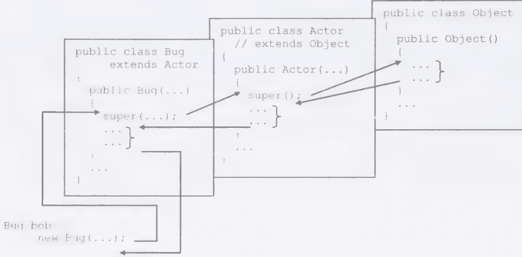

图 11-4。构造函数调用其父类的构造函数，一直上到 Object

总结：

- 每个类都至少有一个构造函数。如果没有显式定义构造函数，编译器会提供一个默认的无参数构造函数。如果程序员显式定义了至少一个构造函数，编译器就不会提供默认的无参数构造函数。
- 如果构造函数中有对 `super` 的调用，它必须是构造函数中的第一条语句。传递给 `super` 的参数数量和类型必须与父类某个构造函数预期的参数数量和类型匹配。
- 如果子类构造函数中没有 `super(...)`，则默认调用父类的无参数构造函数。在这种情况下，父类必须有一个无参数构造函数。
- 在构造函数中放置 `super();` 是多余的：它调用了父类的无参数构造函数，而这本来就是默认调用的。

## 11.5 调用父类方法

在第 3 章的第 17 题中，我们让你写一个 `Flower` 的子类 `WiltingFlower`。在每一步（每次调用其 `act` 方法），`WiltingFlower` 的年龄都会增加 1。一旦年龄超过寿命，`WiltingFlower` 对象就会“死亡”。

我们要求你提供一个以 `WiltingFlower` 寿命作为参数的构造函数。实际上，提供两个构造函数更好：一个接收寿命作为参数；另一个接收两个参数，即寿命和颜色。现在，既然我们已经讨论了 `super`，我们可以正确地做到这一点：

```java
public class WiltingFlower extends Flower {
    private int lifeSpan;
    private int age;

    public WiltingFlower(int span) {
        // super(); — 自动调用
        lifeSpan = span;
        age = 0;
    }

    public WiltingFlower(int span, Color color) {
        super(color);
        lifeSpan = span;
        age = 0;
    }
}
```

第一个构造函数默认自动调用 `Flower` 的无参数构造函数。后者设置了花的颜色。

```java
private static final DEFAULT_COLOR = Color.PINK;
```

第一个构造函数默认自动调用 `Flower` 的无参数构造函数。后者设置了花的颜色。

到为止一切顺利。但我们的 `WiltingFlower` 只是在那里坐几步，什么都不做，然后死亡：

## 306 页 第 11 章 ~ 类层次结构与接口

事实证明我们可以这样做。

> Java 有一种特殊的语法来显式调用父类的方法。这种语法使用了点号（dot）。

例如：

```java
public void act() {
    age++;
    if (age > lifeSpan) {
        removeFromGrid();
    } else {
        super.act();
    }
}
```

只有当你的类定义了一个与父类具有相同名称和参数的方法时，`super` 点才是必要的。

这通常发生在你的类中的方法覆盖了父类的方法时，如上面的示例所示。如果没有 `super` 前缀，上面的代码 `act` 将递归调用自己，导致程序最终崩溃。

## 11.6 案例研究：GridWorld Dance

如果你觉得之前章节关于类层次结构和抽象类的讨论有点……嗯……抽象，那是可以理解的。让我们看看如何在项目中让它运行。

图 11-5 显示了我们的 GridWorld Dance 案例研究中一个“舞蹈节目”的截图。你可以看到几个“舞者”都为“YMCA”舞蹈准备就绪。


用 `DancerRunner.java`、`GridWorldDance.jar` 以及来自 `JM\Ch11\GridWorldDance` 文件夹的所有 `.gif` 和 `.wav` 文件设置一个项目。不要忘记将 `gridworld.jar` 作为必需库添加到你的项目中。运行 `DancerRunner` 来看到数字正在运行。如果电脑开启了声音，你还将听到节奏。

## 第 11 章 ~ 类层次结构与接口

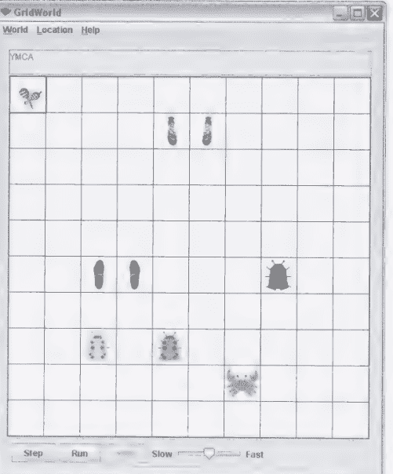

图 11-5. GridWorld “舞蹈”

再次运行 `DanceRunner`，你可能会看到不同的舞蹈目。我们编写了三个舞蹈目：`CongaNumber`、`WaltzNumber` 和 `YMCANumber`。`DanceRunner` 会在这三者中随机选择：

## 11.6 ~ 案例研究：网格世界舞蹈 309

```java
public class DanceRunner {
    public static void main(String[] args) {
        int k = (int) (3 * Math.random());
        switch (k) {
            case 0:
                (new WaltzNumber()).main(args); break;
            case 1:
                (new YMCANumber()).main(args); break;
            case 2:
                (new CongaNumber()).main(args); break;
        }
    }
}
```

如果你有耐心并运行几次，你将看到所有的舞蹈目。

`YMCANumber.java`、`WaltzNumber.java` 和 `CongaNumber.java` 也位于 `JM\Chill\GridWorldDance`。如你所见，这些“舞蹈目”类中的每一个类都有自己的 `main` 方法。例如：

```java
public class WaltzNumber extends DanceNumber {
    ...
    public static void main(String[] args) {
        DanceNumber number = new WaltzNumber();
        number.run(new ActorWorld(), new Waltz());
    }
}
```

如果你将它们添加到项目中，你就可以单独运行其中的每一个类。

## 310 第 11 章 ~ 类层次结构与接口

通常情况下，不同的舞蹈目会集成到一个 GUI 应用程序中，你可以从菜单或下拉框中选择舞蹈目。这样做需要扩展 GridWorld 的 GUI 或在屏幕某处添加一个单独的控制窗口。为了保持事情相对简单，我们决定不这样做做。

我们 GridWorld 舞蹈项目的完整源代码可以在 `JM\Ch11\GridWorldDance\source.zip` 中找到。


GridWorld 学生手册第 15 页的题 4 要求你写一个 `DancingBug` 类。该练习中的 `DancingBug` 相当有限：一旦它接收到舞蹈指令（通过步骤数组传递给其构造函数），它就无法“学习”新舞蹈。在我们的微案例研究中，我们在 `DancingBug` 的基础上构建。既然我们对面向对象编程（OOP）有了更高级的理解，我们应该能够教一些 GridWorld 居民不同的舞蹈和更复杂的步骤。我们的目的当然是回顾你到为止学过的关于类层次结构、抽象类以及使用 `super` 调用父类构造函数和方法的知识，并为第 11.7 节的讨论提供多态示例，为第 11.8 节提供接口示例。

我们设计的中心是一个抽象类 `Dancer`，它继承了 GridWorld 的 `Actor`（图 11-6）。不同类型的 `Dancer` 由 `Dancer` 的具体子类表示。其中包括 `DancingBug` 和 `DancingCrab`，以及更奇特的“生物”：`LeftShoe`（左鞋）、`RightShoe`（右鞋）、`LeftSandal`（左凉鞋）、`RightSandal`（右凉鞋）和 `Maracas`（沙沙鼓）。后者留在角落里轻微移动，但主要提供节奏（使用我们的 `EasySound` 类）。

注意图 11-6 中类图的上部分，处理不同舞蹈和舞蹈目的类子系统与下部分——处理舞者的子系统是分开的。这两个子系统主要通过接口连接。（接口是第 11.8 节的主题。）

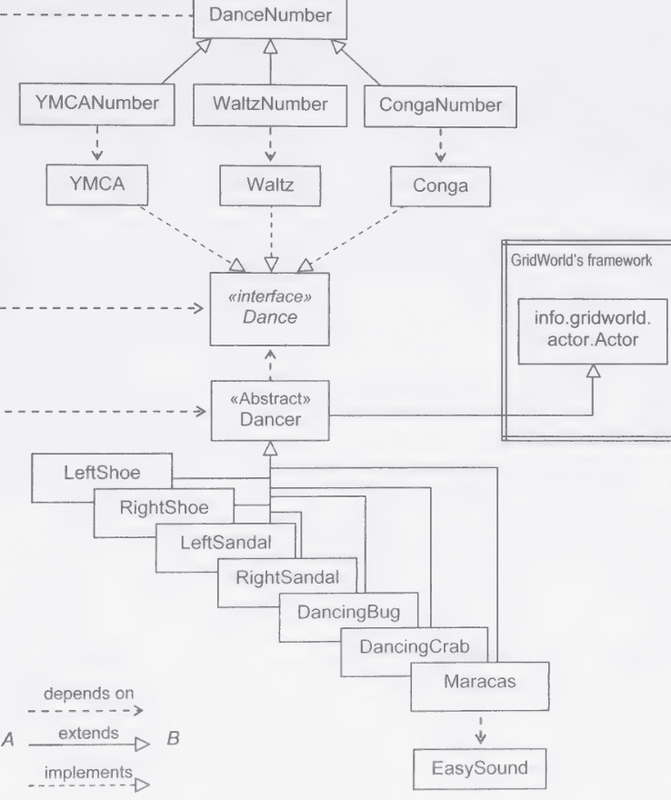

图 11-6. GridWorld 舞蹈项目：一个 Dancer “学习”了一段舞蹈，然后在它的 act 方法中执行必要的步骤

## 312 第 11 章 ~ 类层次结构与接口

正如我们所说的，`Dancer` 是一个抽象类。它有一个一个抽象方法：

```java
public abstract void learn(Dance dance);
```

它所有的具体子类都定义了这个方法。不同的舞者可能需要学习不同的步骤来“执行”同一个舞蹈。例如，`LeftShoe` 和 `RightShoe` 的步骤是不同的。此外，在某些舞蹈中，男性的步骤和女性的步骤也是不同的。在我们的“圆曲”目中，一个 `LeftSandal` 和一个 `rightSandal` 执行女性部分，一个 `LeftShoe` 和 `RightShoe` 执行男性部分。在我们的实现中，不同舞者的具体类非常短且彼此相似。例如：

```java
public class LeftShoe extends Dancer {
    public void learn(Dance dance) {
        setSteps(dance.getSteps(1));
    }
}
```

```java
public class RightShoe extends Dancer {
    public void learn(Dance dance) {
        setSteps(dance.getSteps(2));
    }
}
```

```java
private void takeStep(String step) {
    char d = step.charAt(0);
    if (Character.isDigit(d)) {
        int dir = Character.digit(d, 10) * 45;
        Location loc = getLocation();
        Location next = loc.getAdjacentLocation(getDirection() + dir);
        if (getGrid().isValid(next))
            moveTo(next);
        else
            removeSelfFromGrid();
    }
    ...
}
```

第二个字符表示舞者在移动后旋转的方向。“'1”表示从当前方向顺时针旋转 45 度，依此类推。“'0”或任何非数字字符表示不旋转：

```java
...
d = step.charAt(1);
if (Character.isDigit(d)) {
    int dir = Character.digit(d, 10) * 45;
    setDirection(getDirection() + dir);
}
```

步骤中的第三个字符是分隔符，不使用（留作“未来扩展”）。

## 11.7 多态

`ActorWorld` 的 `step` 方法为网格中的每个 actor 调用 `act` 方法：

```java
public void step() {
    for (Actor a : actors) {
        // 只有当没有其他 actor 移除 a 时才 act
        if (a.getGrid() == null) 
            a.act();
    }
}
```

不同类型的 actor 可以混合在同一个网格中。每个都有一个 `act` 方法，这些方法可能不同，但会为网格中的每个 actor 调用相应的 `act` 方法。

Java 和其他 OOP 语言中使这种可能的特性称为多态（来自希腊语：poly = 多；morph = 形式）。

> 多态确保了对于特定类型的对象调用该对象的方法，即使该对象被伪装成更泛型类型的引用（即继承链中较高位置的某个祖类的泛型类型）。

多态的另一个例子是我们在上一节 GridWorld Dance 案例研究中 `DanceNumber` 类里的 `teach` 方法。该方法通过调用舞者的 `learn` 方法，向世界中的每个舞者“教导”指定的舞蹈动作：

```java
private void teach(Actor world, Dance dance) {
    world.setMessage(dance.getName());

    Grid<Actor> gr = world.Grid();
    for (Location loc : gr.getOccupiedLocations()) {
        Actor a = gr.get(loc);
        if (a instanceof Dancer)
            ((Dancer) a).learn(dance);
        }
    }
}
```

尽管舞者的特定类型被隐藏了，但网格中的每个 `Dancer` 都被调用了相应的 `learn` 方法。

注意我们 GridWorld Dance 设计中一个略微特殊的特征：我们的每个“舞蹈节目”类都有一个 `main` 方法，同时又是 `DanceNumber` 的子类。为什么不呢？`DanceNumber` 也有一个 `main` 方法；它只运行带音乐的舞蹈节目。图 11-7 显示了 `DanceNumber` 与其子类 `YMCNumber` 之间的关系。`YMCNumber` 的 `main` 方法调用 `DanceNumber` 的 `run`；`YMCNumber` 的 `setUpDancers` 方法重写了 `DanceNumber` 的 `setUpDancers`，但使用 `super` 调用了它。


```java
public class DanceNumber
{
    public void setUpDancers(ActorWorld world) {
        world.add(new Location(0, 0), new Maracas());
    }

    public void teach(ActorWorld world, Dance dance) {
    }

    public void run(ActorWorld world, Dance dance) {
        setUpDancers(world);
        teach(world, dance);
        world.show();
    }

    public static void main(String[] args) {
        DanceNumber number = new DanceNumber();
        number.run(new ActorWorld(), new MusicOnly());
    }
}
```

```java
public class WaltzNumber extends DanceNumber
{
    public void setUpDancers(ActorWorld world) {
        super.setUpDancers(world);
    }

    public static void main(String[] args) {
        DanceNumber number = new WaltzNumber();
        number.run(new ActorWorld(), new Waltz());
    }
}
```

图 11-7 显示 `DanceNumber` 与其子类 `YMCANNumber` 之间的关系。`YMCNumber` 的 `main` 方法调用 `DanceNumber` 的 `run`；`YMCNumber` 的 `setUpDancers` 方法重写了 `DanceNumber` 的 `setUpDancers`，但使用 `super` 调用了它。

# 320 第11 类继承与接口

图 11-7，`YMCANNumber` 继承自 `DanceNumber`；每个都有 `main` 方法，并且可以作为可运行类使用。

不需要重写 `DanceNumber` 的 `run` 和 `teach` 方法——这些方法对于所有舞蹈节目都是相同的。但 `DanceNumber` 并不知道如何为特定的舞蹈安排舞者，所以它的子类需要重写 `setUpDancers` 方法。例如：

```java
public class WaltzNumber extends DanceNumber
{
    public void setUpDancers(ActorWorld world) {
        super.setUpDancers(world);

        world.add(new Location(4, 5), new LeftTurn());
        world.add(new Location(4, 6), new RightTurn());

        LeftTurn left = new LeftTurn();
        left.setDirection(180);
        world.add(new Location(2, 6), left);

        RightTurn right = new RightTurn();
        right.setDirection(180);
        world.add(new Location(2, 5), right);

        world.add(new Location(6, 3), new Dancing());
    }
}
```

`setUpDancers(world)` 并不是。

（此处后续大量重复文本已根据要求跳过，不再重复翻译）

`Dance` 接口例如指定了三个方法：

```java
public interface Dance {
    String getName();
    String getSteps(int m);
    int[] getBeat();
}
```

> Java 接口类似于抽象类：它有一个或多个已声明但未定义的抽象方法。区别在于它的所有方法都是抽象的。

在接口的方法头中省略了 `public` 和 `abstract` 关键字，因为每个方法都是公共且抽象的。

> 一旦定义了接口，我们就可以“正式地”声明一个类实现了该接口。如果该类是具体的，它必须提供接口中的所有方法。如果该类是抽象的，它可以将接口的某些方法保持为抽象。

`interface` 和 `implements` 是保留关键字。

[第345 页]

## 类 (Class)

## 接口 (Interface)

| 类 | 接口 |
| :--- | :--- |
| 超类为其子类的对象提供次要数据类型。 | 接口为实现该接口的类对象提供次要数据类型。 |
| 抽象类不能实例化。 | 接口不能实例化。 |
| 抽象类的具体子类必须定义所有继承的抽象方法。（抽象类的抽象子类可以保留某些方法为抽象方法。） | 实现接口的具体类必须定义接口指定的所有方法。（实现接口的抽象类可以保留某些接口方法为抽象方法。） |
| 类可以扩展另一个类。子类可以添加方法并重写其父类的一些方法。 | 接口可以通过添加抽象方法的声明来扩展另一个接口（称为其父接口）。子接口不能重写其父接口的方法（因为没有东西可重写：所有方法都是抽象的）。 |
| 类只能扩展一个类。 | 类可以实现任意数量的接口。 |
| 类可以拥有字段。 | 接口不能拥有字段，但可能拥有一些 `static final` 常量。 |
| 类定义自己的构造函数，或者由编译器提供默认的无参构造函数。 | 接口没有构造函数。 |
| 具体类拥有所有定义的方法。抽象类通常有一个或多个抽象方法。 | 接口中声明的所有方法都是抽象的。 |
| 每个类都是以 `Object` 为顶层的类层次结构的一部分。 | 接口可能属于一个小的接口层次结构，但这并不常见。 |

表 11-1. 类与接口之间的相似点与不同（相似点用**粗体**表示）

322 第 11 章 类层次结构与接口

两个主要的相似点是：

1. 扩展抽象类和/或实现接口的具体类必须为其父类和/或接口的所有抽象方法提供代码。
2. 与父类一样，接口为实现该接口的类对象提供次要数据类型，且多态对接口类型有效。

你可能会问：为什么我们需要接口？这涉及到父类和接口之间的主要区别：一个类不能有多个父类，但类可以实现任意数量的接口。Java 中的类层次结构有此限制：Java 假设每个类都整齐地属于一个层次结构。在现实生活中，情况要复杂得多。同一个对象在不同情况下可能扮演不同的角色。例如，一个名叫 Natalie 的人可以是学生、小时工、在线客户、孙女和舞会舞者。我们需要五个不同的层次结构来表示 Natalie 的这些方面：Natalie **是一个**学生；Natalie **是一个**员工；Natalie **是一个**客户；Natalie **是一个**家庭成员；Natalie **是一个**舞者。

在面向对象编程 (OOP) 中我们经常遇到这种情况，而接口对此很有帮助。如果一个类实现了多个接口，该类就为其实现的所有接口的所有方法提供代码。如果同一个方法在多个接口中声明，则没有冲突，因为接口的方法没有代码——

> 如果一个具体类实现了几个接口，它必须提供每个接口中指定的所有方法。

多态完全适用于接口数据类型。

下面是多态如何与接口工作的两个示例。

我们可以将一个 `Waltz`（华尔兹）对象作为参数传递给 `Dancer` 的 `learn` 方法。`Waltz` 实现 `Dance` 的语句告诉编译器这是允许的，尽管 `learn` 期望一个 `Dance` 类型的参数。毕竟，`Waltz` **是一个** `Dance`。重要的是，`Waltz` 对象拥有任何 `Dance` 应该拥有的所有方法，包括由 `Dancer` 调用的 `getSteps` 方法，并且它在头部中说明了 `implements Dance`。我们也可以确定 `Waltz` 对象拥有 `getBeat` 方法，以防 `Maracas` 需要它。如果 `dance` 被声明为 `Dance` 类型且恰好引用一个 `Waltz` 对象，那么在调用 `dance` 时，`dance.getSteps(...)` 将被调用。

# 示例 2:

```java
public interface Edible
{
    String getFoodGroup();
    int getCaloriesPerServing();
}
```

`Edible` 接口作为代表不同食品类的与处理食品的客户端类之间的接口。例如，我们可以写一个 `Breakfast` 类，它带有一个通用方法 `eat`：

```java
public class Breakfast
{
    private int myTotalCalories = 0;

    public void eat(Edible obj, int servings)
    {
        myTotalCalories += obj.getCaloriesPerServing() * servings;
    }
}
```

`eat` 方法接收一个 `Edible` 对象作为参数。无论传递给它的对象 `Apple`、`Pancake` 还是任何实现 `Edible` 的类的对象，`eat` 都能正常工作。由于多态性，对于特定类型的 `obj` 将自动调用 `getCaloriesPerServing` 方法。

324 第 11 章 类层次结构与接口

假设 `Apple` 定义为：

```java
public class Apple implements Edible
{
    <字段和构造函数未显示>

    public String getFoodGroup() { return "Fruit"; }
    public int getCaloriesPerServing() { return 70; }

    <其他方法未显示>
}
```

那么 `eat` 将把 `70*servings` 加到 `myCalories`。

接口的名称有时听起来像形容词，因为接口为实现该接口的对象类提供了一个额外的特征。如果 `Apple` 实现了 `Edible`，说 `Apple` 是 `Edible` 的是合理的。接口在 Java 中被广泛使用。例如，`ArrayList` 和 `LinkedList` 都实现了 `List`。

## 11.9 总结

当 X 和 Y 共享大量代码时，这是 X 和 Y 代表相关类型的明确指示。此时将它们的共享代码“提取”到父类 B 中是合理的。这避免了 X 和 Y 中代码的重复，同时为 X 和 Y 的对象提供了一个更通用的类型 B。这允许你编写更通用的方法：

```java
... someMethod(X x) { ... }
```

以及

```java
... someMethod(Y y) { ... }
```

当将 X 或 Y 类型的对象 b 传递给 `someMethod` 时，后者将有效：

```java
... someMethod(B b) { ... }
```

在 Java 中，如果你没有为类显式指定父类，你的类将自动继承 `Object` 类。因此，所有的 Java 类都属于一个以 `Object` 为根的巨大层次结构树。`Object` 是一个具体的（而非抽象）类。它提供了几个通用方法，例如 `toString` 和 `equals`，但这些通常在层次结构中较下的类中被重写。

当创建一个子类的对象时，Java 执行的第一件事是调用其父类的构造函数。程序员使用 `super` 关键字来指定调用父类的哪一个构造函数以及传递它的什么参数。`super()` 调用是可选的。如果没有显式的 `super(...)` 语句，将调用子类的无参数构造函数，在这种情况下，父类必须拥有一个无参数构造函数。如果你的构造函数中有 `super(...)` 语句，那么它必须是构造函数调用的第一个语句。

你可以从子类定义的方法调用父类中定义的方法：

```java
super.someMethod(...);
```

此类语句通常用于子类 `someMethod` 的代码中，即重写了父类 `someMethod` 的那一个。

接口类似于抽象类：它声明了一个或多个抽象方法但未定义它们。区别在于，接口不包含任何代码（也许可以有几个静态常量）：没有构造函数，没有方法体。在接口中，方法头中不使用 `public abstract` 关键字，因为接口中声明的所有方法都是 `public` 且 `abstract` 的。

一旦定义了接口，你就可以“正式”地声明一个类实现了该接口。在这种情况下，为了成为一个具体类，它必须提供接口中列出的所有方法。实现接口的抽象类可以留接口中的某些方法为抽象方法。同一个类可以实现多个接口。在这种情况下，它应该定义所有这些接口中指定的所有方法。

接口可以用于隔离不同的子系统，将交互限制在少数方法上。接口还为实现该接口的类对象提供了一种辅助类型，这种辅助类型可以像共同父类提供的辅助类型一样以多态的方式使用。

## 练习题

### 第 11.1-11.5 节

1. 判断对或错？

   - (a) 你不能创建抽象类的对象。 ✓
   - (b) 你可以从抽象类派生出具体类。
   - (c) 你可以从抽象类派生出抽象类。
   - (d) 抽象类可以作为方法参数的通用类型有用。
   - (e) `Object` 是一个抽象类。 ✓

2. 判断对或错？

   - (a) 在 Java 中，子类的构造函数继承自其父类。
   - (b) 子类的构造函数可以显式调用父类的构造函数并向其传递参数。
   - (c) 子类的方法可以显式调用父类的方法。
   - (d) `super` 是 Java 的保留字。

3. 假设我们有

```java
public abstract class Toy { ... }
public class Doll extends Toy { ... }
public class BarbieDoll extends Doll { ... }
```

`Doll` 和 `BarbieDoll` 都有一个无参数构造函数。如果一个对象有一个方法 `play(Doll doll)`，以下哪个语句可以编译无错误？

   - (a) `child.play(new Object());`
   - (b) `child.play(new Toy());`
   - (c) `child.play(new Doll());`
   - (d) `child.play(new BarbieDoll());`

### 第 11 章 ~ 练习 329

4. 定义一个类 `Diploma` 及其子类 `DiplomaWithHonors`，使得以下语句

```java
Diploma diploma = new Diploma ("Murray Smith", "Gardening");
System.out.println(diploma);
System.out.println();
```

```java
Diploma diploma2 = new DiplomaWithHonors("Lisa Smith", "Evolutionary Psychology");
System.out.println(diploma2);
System.out.println();
```

显示

证明 Murray Smith

已完成园艺课程

证明 Lisa Smith

已完成演化心理学课程

*** ***

使你的类定义符合信息隐藏原则，并避免代码重复。 ✓

5. 定义一个抽象类 `Poem` 以及两个派自 `Poem` 的具体子类：`Haiku` 和 `Limerick`。`Poem` 没有构造函数并具有以下方法：

```
public abstract int numLines() — 返回诗歌的行数。
```

```
public abstract int getSyllables(int k) — 返回第 k 行的音节数。
```

```
public void printRhythm() — 显示诗歌的节奏。
```

例如，一句 `haiku` 有 5-7-5 行，而 `limerick` 有 8-8-5-8-5 行。

### 第 11 章 ~ 类层次结构与接口

6. 定义一个类 `Plant` 及其子类 `CarnivorousPlant`，使得以下语句

```java
Plant plant = new Plant ("Venus Flytrap", "Carnivorous");
System.out.println(plant);
System.out.println();
```

```java
Plant plant2 = new CarnivorousPlant("Pitcher Plant", "Tropical");
System.out.println(plant2);
System.out.println();
```

显示

证明 Venus Flytrap

已完成食肉课程

证明 Pitcher Plant

已完成热带课程

*** ***

使你的类定义符合信息隐藏原则，并避免代码重复。 ✓

7. 定义一个抽象类 `Animal` 以及两个派自 `Animal` 的具体子类：`Dog` 和 `Cat`。`Animal` 没有构造函数并具有以下方法：

```
public abstract String makeSound() — 返回动物发出的声音。
```

8. 定义一个接口 `Flyable` 以及两个实现它的类：`Bird` 和 `Bat`。两个类都实现 `fly()` 方法。

9. 定义一个接口 `Swimmable` 以及两个实现它的类：`Duck` 和 `Fish`。两个类都实现 `swim()` 方法。


# 10. 定义一个接口 `Walkable` 以及两个实现它的类：`Dog` 和 `Horse`。两个类都实现 `walk()` 方法。

## 第 11.6-11.9 节

### 11. `Shape` 类及其子类 `Square` 和 `Circle` 具有计算面积和周长的方法；形状的类型通过字符串传递给构造函数。

- (a) 以 OOP 风格重构此程序。使 `Shape` 类变为抽象类。保留 `side` 字段，删除 `type` 字段。使 `getArea` 和 `getPerimeter` 方法变为抽象。从 `Shape` 派生具体类 `Square` 和 `Circle`。为它们各提供一个合适的构造函数。

### 12. `Shape` 类及其子类 `Triangle` 和 `Rectangle` 具有计算面积和比例的方法；三角形的类型通过字符串传递给构造函数。

- (a) 以 OOP 风格重构此程序。使 `Shape` 类变为抽象类。保留 `side` 字段，删除 `type` 字段。使 `getArea` 和 `getRatio` 方法变为抽象。从 `Shape` 派生类 `Triangle` 和 `Rectangle`。为它们各提供一个合适的构造函数。

### 13. 在 `GridWorld` 项目中添加你的 `Bystander` 类，使其成为 `Righte` 的子类并重写其方法。`Bystander` 不学习特定的步骤；相反它留在原地旋转 45 度。创建一个 `CongaNumber` 的子类，在角落添加 `Bystander`。提示：描述步骤的序列。

### 14. 在 `GridWorld` 项目中添加你的 `dance` 类和数字（不要在上面花太多时间！）。

### 15. 如果 `x` 是一个对象而 `I` 是接口，`instanceof` 是否可以通过编译？如果是，它何时结果为 `true`？猜猜，然后实验一下。

### 16. 识别以下内容（见第 67 页）：实现相同接口的类对、实现两个接口的类以及接口的子接口。

### 17. 考虑以下接口：

```java
public interface Place
{
    int distance(Place other);
}
```

编写一个程序来测试以下方法：

```java
// 如果 p1 到 p2 和 p3 的距离相等，则返回 true
public boolean sameDistance(Place p1, Place p2, Place p3)
{
    return p1.distance(p2) == p1.distance(p3);
}
```

### 18. 解释为什么 `toString` 方法从未出现在任何接口中。

### 15. 假设在我们的 GridWorld Dance 项目中，我们将 `Dancer.java` 重命名为 `AbstractDancer.java`，然后进行了全局更改，将 `AbstractDancer` 代码及其所有七个子类（`DancingBug`, `DancingCrab`, `LeftShoe`, `RightShoe`, `LeftSandal`, `RightSandal` 和 `Maracas`）中的 “Dancer”替换为 “AbstractDancer”。假设我们在项目中创建了一个接口 `Dancer`，其中包含一个方法 `void learn(Dance d)`。该项目编译正常，但当你运行它时，舞者们出现了但拒绝移动。你能向其中一个类中添加一行代码来解决这个问题吗？

```java
Section[] chapter12 = new Section[8];
```

# 数组

- 12.1 引言 334
- 12.2 一维数组 335
- 12.3 实验：占算师 339
- 12.4 二维数组 340
- 12.5 案例研究与实验：Chomp 342
- 12.6 迭代与“for each”循环 348
- 12.7 插入与删除元素 350
- 12.8 总结 352
- 练习 353

# 334 第 12 章 ~数组

## 12.1 引言

Java 程序员可以在一个名称下声明多个相同数据类型的连续内存位置。此类内存块被称为数组，而单个内存位置被称为数组的元素。元素的数量被称为数组的大小或长度。你的程序可以使用数组名后跟方括号中的元素编号（称为其索引或下标）来引用数组的单个元素。索引可以是任何整数常量、变量或表达式。

使用数组有许多充分的理由。假设你的程序要求你输入若干整数（例如测试成绩），并计算它们的平均值。当然，你可以尝试将输入的值存储在单独的变量中，如 `score`, `score2` 等……但这样运行效果并不好。首先，由于你可能预先不知道会输入多少个分数，你必须按照最大可能的输入数量声明相应的变量。然后你必须单独读取每个分数：

```java
score1 = input.nextInt();
score2 = input.nextInt();
```

这可能会变得繁琐。而且将分数相加需要每个加法操作都有单独的语句：

```java
int sum = 0;
sum += score1;
sum += score2;
```

现在假设你想查看第 k 个分数。想象像这样编写代码：

```java
if (k == 1)
    System.out.print(score1);
else if (k == 2)
    System.out.print(score2);
else if (k < ...)
    etc.to
```

幸运的是，数组使得此类任务的编码变得简单得多。你可以写：

```java
int sum = 0;
for (int k = 0; k < scores.length; k++)
    sum += scores[k];
```

## 12.2 一维数组 335

以及

```java
System.out.print(scores[k]);
```

在这里 `scores[0]` 指的是第一个分数，`scores[1]` 指的是第二个，以此类推。

在本章中，我们将讨论如何：

- 声明和创建数组
- 使用索引访问数组元素
- 访问数组长度
- 将数组传递给方法
- 声明和创建二维数组
- 使用“for each”循环遍历数组

## 12.2 一维数组

Java 将数组视为类型为“int 数组”、“double 数组”、“String 数组”等的对象。你可以拥有任何类型元素的数组。在类型名后使用空方括号表示该变量引用一个数组，如下：

```java
sotype[] someName;
```

例如：

```java
int[] scores;
```

> Java 中的数组类似于对象。

特别地，你需要声明一个数组类型的变量，然后使用 `new` 运算符创建数组。例如，以下语句声明了一个名为 `scores` 的整数数组，并创建了一个包含 10 个元素的数组：

```java
int[] scores = new int[10];
```

一个包含 5000 个字符串的数组和一个包含 16 “颜色”的数组可以如下进行声明和创建：

```java
String[] words = new String[5000];
Color[] colors = new Color[16];
```

注意，这里在使用 `new` 运算符时使用的是方括号而不是圆括号。括号中的数字（如 `new int[10]` 或 `new String[5000]`）表示数组的大小（长度）。

当数组被创建时，其元素将被初始化为默认值。

数值型元素初始化为 0，布尔型初始化为 false。

如果数组元素是类类型，则数组包含指向该类型对象的引用；这些引用被初始化为 `null`。

如果元素是对象引用，你必须在调用该元素的方法之前，通过设置设置一个有效引用来初始化每个元素。例如：

```java
colors[0] = new Color(207, 189, 250);
colors[1] = Color.BLUE;
```

以此类推。否则你将得到 `NullPointerException`。

另一种声明和创建数组的方法是在花括号之间显式列出元素。

```java
int[] scores = {1, 2, 3, 4, 5};
String[] names = {"Alice", "Bob", "Charlie"};
Color[] colors = {RED, "ORANGE", "YELLOW", "CYAN", "GREEN", "MAGENTA", "BLUE"};
```

## 12.2 一维数组 337

要更改数组中的元素，使用赋值运算符。例如：

```java
scores[i] = 100;
```

数组的威力在于索引可以是一个变量。例如：

```java
int i = 2;
scores[i] = 50;
```

在 Java 中，每个数组都“知道”自己的大小（长度）。Java 语法允许通过使用 `arrayName.length` 来访问数组的长度。在语法上，`length` 充当公共字段。

在数组中，`length` 不是方法（如 String 类）。它是作为字段访问的，不需要圆括号。

## 12.3 实验：占算师

图 12-1 中的小程序是一个“占算师”。当用户点击“Next”（下一个）按钮时，小程序会从消息数组中随机选择一条消息并显示。该小程序由类 `FortuneTeller` 实现。

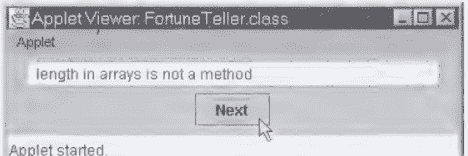

图 12-1。占算师小程序

使用 `JM\Ch12\Fortunes` 中的 `FortuneTeller.java`、`TestFortune.html` 和 `ding.wav` 文件建立项目。（`TestFortune.html` 描述了一个包含该小程序的网页）。在小程序的代码中填充空白，添加一个包含几个“运气”（字符串）的数组，以及随机选择并显示其中之一的代码。记住静态方法 `Math.random` 返回一个随机双精度值 `x`，使得 `0 ≤ x < 1`。我们在之前的程序中使用过它（例如 `JM\Ch07\Craps\Die.java`）。适当缩放 `Math.random` 返回的值，以获得数组范围内的随机索引值。使用 `display` 的 `setText` 方法显示选定的消息。

## 12.4 二维数组

程序员使用二维数组来表示相同数据类型元素的矩形表格。例如，二维数组可以存储棋盘游戏的位置、电子表格单元格、矩阵元素或图像中的像素值。

以下示例展示了声明和初始化双精度二维数组两种方法：

```java
int rows = 2;
int cols = 3;

double[][] a = new double[rows][cols]; // 声明一个双精度数组
                             // 具有 2 行 3 列
                             // 并设置为 0。

double[][] b = {
    {0.0, 0.1, 0.2},
    {1.0, 1.1, 1.2} // 声明了一个 2x3 的双精度数组
                    // 并初始化为
                    // 指定值
};
```

我们使用一对索引来访问二维数组的元素，每个索引都放在方括号中。我们可以将第一个索引视为“行”，第二个索引视为“列”。两个索引都从 0 开始。

在上面的示例中，

| b[0][0] = 0.0; | b[0][1] = 0.1; | b[0][2] = 0.2; |
| b[1][0] = 1.0; | b[1][1] = 1.1; | b[1][2] = 1.2; |

在 Java 中，二维数组本质上表示为一维数组的一维数组，即行。每一行都是一个数组。在上面的示例中，`b[0]` 是第一行，包含值 0.0、0.1 和 0.2；`b[1]` 是第二行值：1.0、1.1 和 1.2。严格来说，二维数组中的不同行可以有不同数量的“列”。在本书中，我们只处理所有行元素数量相同的“矩形”二维数组。

如果 `m` 是一个二维数组，那么 `length` 是该数组的行数，`m[0]` 是第一行（一个一维数组），而 `m[0].length` 是第一行中的列数。`m[r][c]` 是第 r 行第 c 列的元素。

## 12.4 二维数组

使用嵌套的 `for` 循环遍历二维数组是非常方便的。例如：

```java
int rows = 12, cols = 7;
char[][] grid = new char[rows][cols];

// 将 grid 中的所有元素设置为 '*'
for (int r = 0; r < rows; r++) {
    for (int c = 0; c < cols; c++) {
        grid[r][c] = '*';
    }
}
```

我们发现，使用 `r` 和 `c` 或 `row` 和 `col` 通常比 `i` 和 `j` 更适合作为索引名称。

由于每个循环体只包含一条语句，这里的括号是可选的。你可以直接写：

```java
for (r = 0; r < rows; r++)
  for (c = 0; c < cols; c++)
    grid[r][c] = '*';
```

以下代码段打印整型二维数组 `m` 的值：

> 在使用嵌套循环时要小心：嵌套循环内部的 `break` 语句只会跳出内部循环。

例如，假设你有一个字符二维数组 `grid`，你想在其中找到字母 'A' 第一次出现的位置（从第一行左到右扫描，然后下一行，以此类推）。你可能会想使用以下代码：

```java
int rows = grid.length, cols = grid[0].length;
int firstArow = -1, firstAcol = -1;

for (int r = 0; r < rows; r++) {
    for (int c = 0; c < cols; c++) {
        if (grid[r][c] == 'A') {
            firstArow = r;
            firstAcol = c;
            break;
        }
    }
}
```

不幸的是，它会在最后一行找到 'A' 的第一次出现。你可以以类似于二维数组的方式声明三维和多维数组。三维或以上的数组并不常用。在本书中我们将超越了两个维度。

## 12.5 案例研究与实验：巧克力游戏 (Chomp)

Chomp 游戏可以在任何尺寸的矩形棋盘上进行。棋盘被划分为若干格（假设棋盘代表一块巧克力）。规则很简单：两个玩家交替从棋盘上“吃”掉。每次移动，玩家必须吃掉剩余的任意格子以及其下方和右侧的所有格子（图 12-2）。棋盘左上角的格子是“毒药”：吃到它的人输掉游戏。点击 `JM\Ch12` 中的 `chomp.jar` 文件运行程序（必须在同一文件夹下）。


图 12-2。巧克力游戏

Chomp 所有可能的位置是有限的，玩家从初始位置稳步进展到结束，每次移动棋盘上剩余“可吃”格子的总数都会减少。这类游戏对于第一或第二玩家都有胜利策略。但尽管规则简单，Chomp 证明是一个棘手的游戏：你可以从数学上证明第一个玩家有胜利策略，但该证明并没有告诉你该策略是什么。如果你先手，你可以赢，但你不知道怎么赢！令人沮丧……

据我们所知，在编写时还没有人能为 Chomp 的胜利位置给出公式（除了 2x n 棋盘这种特殊情况）。有些程序可以从最终位置（只剩下“毒药”格子）回溯生成所有胜利位置的列表。我们的 Chomp 程序使用了这样的列表，因此计算机具有不公平优势。你可以尝试从计算机“偷取”胜利移动，但程序的目的不是为了赢过计算机，而是为了练习面向对象的设计和 Java 编程。

证明如下：第一个玩家可以尝试吃掉右下角。如果是正确的胜利移动，第一个玩家就稳了；如果不是，第二个玩家必须有一个响应移动。但第一个玩家可以“偷取”那个响应移动并将其变成自己的移动！在有限游戏理论中，这种论被称为“策略窃取”。不幸的是，这个证明没有提供关于胜利策略的具体线索。

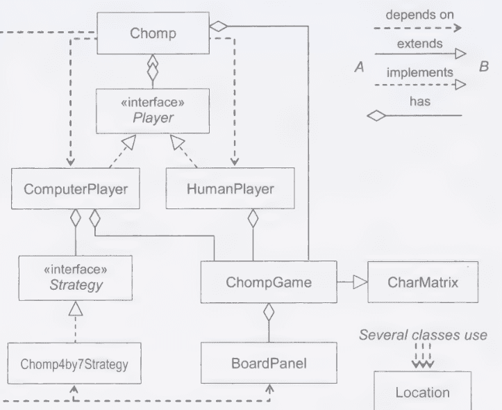

图 12-3。Chomp 程序中的类

让我们观察程序的整体结构（图 12-3）。程序由八个类和两个接口组成：`Player` 和 `Strategy`。在设计程序时，我们像往常一样减少耦合（类之间的依赖），并将逻辑/计算与 GUI 分离。例如，`Chomp`、`HumanPlayer` 和 `ComputerPlayer` 对 `BoardPanel` 并不了解。`ComputerPlayer` 是唯一感知 `Strategy` 方法的类（但不感知具体的 Chomp 策略）。顶层类 `Chomp` 继承自 `JFrame`，代表主窗口。它的构造函数创建了 `ChompGame`、`BoardPanel`（棋盘显示面板）以及人类和计算机“玩家”。它还为计算机关联了一个特定的策略：

```java
BoardPanel board = new BoardPanel();
...
game = new ChompGame(board);
HumanPlayer human = new HumanPlayer(this, game, board);
ComputerPlayer computer = new ComputerPlayer(this, game, board);
computer.setStrategy(new Chomp4by7Strategy());
```

`ChompGame` 对象通用化地建模 Chomp。它保留游戏规则，并在子类 `CharMatrix` 的帮助下跟踪当前棋盘位置并实现玩家移动。但 `ChompGame` 并不显示棋盘——该功能留给了独立的“视图”类 `BoardPanel`。`ChompGame` 只代表游戏的“模型”。这个类和 `Chomp4by7Strategy` 类是真正“知道”并使用 Chomp 规则的类。


`ChompGame` 类扩展了 `CharMatrix`，这是一个表示字符二维数组的通用类。字符矩阵有助于 `ChompGame` 表示棋盘的当前配置。我们完全可以将 `CharMatrix` 的所有代码直接放入 `ChompGame` 中。这将使 `ChompGame` 类变得很大。更重要的是，处理字符矩阵的通用方法将与处理 Chomp 规则的特定方法混合在同一个类中。这样的类几乎无法使用。`BoardPanel` 继承自库类 `JPanel`，它知道如何显示当前棋盘位置。`Chomp` 将显示添加到主窗口的内容区域，并将其关联到 `ChompGame`。当棋盘情况变化时，`ChompGame` 调用 `BoardPanel` 的 `update` 方法来刷新屏幕。`BoardPanel` 是项目中最长的类。它的代码必须处理不同颜色格子的渲染，并支持移动的“闪烁”反馈。

`HumanPlayer` 和 `ComputerPlayer` 对象显然代表两个玩家。`HumanPlayer` 捕捉并解释棋盘上的点击，并告诉 `ChompGame` 执行相应的移动。`ComputerPlayer` 询问 `Strategy` 获取下一个移动，并告诉 `ChompGame` 执行该移动。

最后，`Location` 类代表棋盘上的 (行, 列)。`Location` 对象是简单的数据载体。`Location` 有一个构造函数 `Location(row, col)` 和两个访问器 `getRow()` 和 `getCol()`。在 Chomp 程序中，`Location` 对象从棋盘传递给人类玩家，从 `Strategy` 对象传递给计算机玩家。

`Chomp4by7Strategy` 类实现了 `Strategy` 接口。更高级版本的 Chomp 程序将需要针对不同游戏级别和棋盘大小支持不同的策略。如果所有类都实现相同的接口，我们可以将任何特定策略作为参数传递给 `ComputerPlayer` 的 `setStrategy` 方法。`Strategy` 接口将处理 Chomp 策略的子系统与程序的其余部分隔离。

`Strategy` 接口也有助于在团队成员之间分配工作：熟练的开发者可以处理策略类。例如，`Chomp4by7Strategy` 类相当复杂。幸运的是，我们除了知道它实现了 `Strategy` 接口并且有一个无参构造函数之外，并不真的需要深入了解它。编写和测试这个类的谁就对其负责！这是团队开发的最佳体现。

两个玩家中的每一个都实现了 `Player` 接口。然而，接口的使用与 `Strategy` 的用法不同。在这里，如图 12-3 所示，Chomp 清楚地知道两个玩家，因此 `Player` 并没有在任何事物之间进行隔离。我们希望两个玩家都在同一个数组中实现 `Player` 的是：

```java
private Player[] players;
...
players = new Player[2];
players[0] = human;
players[1] = computer;
```

这既方便又增加了灵活性。如果我们需要，未来可以轻松地添加其他类型的玩家。

> 二级常用数据类型对于在同一个数组、列表或其他集合中混合不同但相关的类型对象非常有用。

我们本可以将 `Player` 设为抽象类而不是接口，但 `HumanPlayer` 和 `ComputerPlayer` 并不共享任何代码，为什么要浪费它们中宝贵的 "extends" 槽位呢？我们最终可能需要它用于其他地方。

# 12.5 学习与实验：CHOM

你可能注意到我们的 Craps 和 Chomp 设计有一些相似之处。这并非巧合：我们遵循了建立的设计模式。设计模式代表了经验丰富的设计者试图将他们的经验形式化并与初学者分享的尝试。设计模式有助于解决常见的设计问题并避免常见的错误。

在上述项目中，我们使用了模型-视图-控制器（MVC）设计模式。这种设计的核心思想是将“模型”（描述情况的更抽象的对象）与“控制器”（更改模型状态的对象）以及“视图”（显示模型的对象）清晰地分开。“视图”附着在模型上，当模型发生变化时，它会自动（准确地说，几乎是自动地）发生变化。通过这种方式，如果我们需要，可以轻松地使用多个不同的控制器并在同一个模型上附加多个不同的视图。

在 Chomp 程序中，`Chomp` 类是“模型”，`BoardPanel` 对象是“视图”，而“玩家”充当“控制器”。

Chomp 同样遵循策略设计模式。当一个“玩家”需要在不同时间遵循不同的“策略”时，这种设计模式就适用。与其让玩家自己创建所有策略并在其中进行选择，不如提供一个接口或抽象类来表示策略，并在玩家对象提供一个 `setStrategy` 方法。当然，“策略”和“玩家”不必从字面意思解释。

我们将在第 27 章更详细地解释几种常见的设计模式。


你在 Chomp 项目中的任务是为 `CharMatrix` 类提供缺失的代码，如 `CharMatrix.java` 中的注释中所描述的那样。然后使用 `JM\Ch12\Chomp` 中提供的 `Chomp.java`、`CharMatrix.java`、`Chomp.jar` 和 `chomp.wav` 设置项目并测试程序。完整的源代码可在 `JM\Ch12\Chomp\source.zip` 获取。

# 12.6 迭代与“for each”循环

迭代对于处理数组和列表是不可或缺的，原因有两个。首先，如果列表很大，且我们要访问每个元素（例如，找到所有元素之和），在源代码中反复重复相同的语句是不现实的：

```java
int sum = 0;
sum += a[0];
sum += a[1];
...
sum += a[999];
```

一个简单的 `for` 循环节省了 998 行代码：

```java
int sum = 0;
for (int i = 0; i < 1000; i++)
    sum += a[i];
```

其次，程序员可能事先不知道列表的精确大小。元素的实际数量可能在程序运行时才能知道。例如，列表可能通过从文件中读取的数据填充，我们可能无法预知文件中存储了多少项。处理“变长”列表的唯一方法就是通过迭代。

遍历是一个过程，列表的每个元素都会被“访问”并处理一次。数组或列表通常按照索引的顺序（或索引的反序）进行遍历。通常情况下，在遍历期间不会添加或删除元素。

可以通过简单的循环轻松地完成数组或列表的遍历。例如：

```java
String[] names = new String[numGuests];
...
for (int i = 0; i < names.length; i++)
```

从 5.0 版本开始，Java 为遍历提供了方便的 `for each` 循环（以及在 13 章讨论的 ArrayList）。上述代码片段可以用 `for each` 循环重写如下：

```java
for (String str : names) {
    //...
}
```

`for each` 语法要求在 `for` 语句中声明循环变量，如 `String str`。注意，如果你使用 `for each` 遍历不可变对象或基本类型元素，无法更改它们的值，因为循环变量持有的是副本而不是引用。`for each` 循环无法提供元素的索引。例如，它可以很好地用于布尔方法：

```java
public boolean contains (String[] names, String target) {
    for (String name : names) {
        if (name.equals(target))
            return true;
    }
    return false;
}
```

但在需要 `names` 索引的方法中则不行。遍历列表的一个频繁原因是寻找列表的最大或最小元素。要找到最大值，我们可以代表最大值的变量初始化为数组的第一个元素，然后在每次遇到更大的元素时更新其值。例如：

```java
// 返回数组中的最大值
public static double findMax(double[] a)
{
    double aMax = a[0];

    for (int i = 1; i < a.length; i++) {
        if (a[i] > aMax)
            aMax = a[i];
    }
    return aMax;
}
```

或者，我们可以记录最大值的位置：

```java
// 返回数组中最大值的位置
public static int findMaxPos(double[] a)
{
    int iMax = 0;

    for (int i = 1; i < a.length; i++) {
        if (a[i] > a[iMax])
            iMax = i;
    }
    return iMax;
}
```

寻找最小值，我们可以采取类似的方式，但在每次遇到更小的元素时更新当前的最小值（或位置）。

# 12.7 插入和删除元素

向数组中插入元素之前，必须先确保数组有空间容纳更多元素。当你创建数组时，必须为最大可能的元素数量分配足够的空间。在这种情况下，数组的长度将指的是数组的最大容量。你需要一个单独的变量来计算实际存储的元素。例如：

```java
final int maxCount = 5000; // 最大单词数
String[] dictionary = new String[maxCount];
int count = 0; // 从空字典开始
... 等。
```

要在数组末尾添加元素，你需要检查是否还有空间，如果是，则将元素存储在第一个空闲槽并增加计数。例如：

```java
String word;
<... 其他语句 >
if (count < maxCount)
{
    dictionary[count] = word;
    count++;
}
```

如果你想保持数组按升序或降序排序，则可能需要在数组的中间插入新元素。要做到这一点，你首先需要将几个元素向数组末尾移动，以便在所需的位置创建一个空闲槽。你必须从最后一个元素开始移动——否则，你会在让出位置之前覆盖掉一个元素。图 12-4 描述了这一过程。

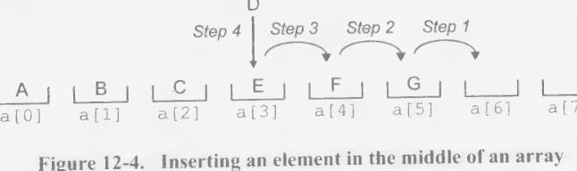

以下代码作为一个示例：

```java
String word;
int insertPos;

<... 其他语句 >
if (count < maxCount) // count 是字典中已有的单词数量
{
    for (int i = count; i > insertPos; i--)
    {
        dictionary[i] = dictionary[i-1];
    }
    dictionary[insertPos] = word;
    count++;
}
```

要删除一个元素，你必须将其之后的所有元素向数组的开头移动一位。这次，你必须从被删除元素的后续位置开始移动，并向数组末尾进行。

# 12.8 总结

Java 允许程序员在一个名称下声明连续内存位置的数组块。数组表示具有相同数据类型的相关值的集合。

你可以通过在数组名后的方括号中放置元素的索引（下标）来引用数组的任何特定元素。索引可以是任何整数常量、变量或表达式。在 Java 中，数组第一个元素的索引为 0，最后一个元素的索引为 `length-1`，其中 `length` 是数组的长度。索引必须在从 `0` 到 `length-1` 的范围内；否则程序将抛出 `ArrayOutOfBoundsException`。

在 Java 中，数组是对象。如果 `a` 是一个数组，`a.length` 相当于 `a` 的公共字段，存储数组 `a` 的长度。数组以引用的形式传递给方法，因此方法可以更改传递给它的数组的内容。

程序员还可以声明和使用二维和多维数组。我们可以通过在数组名后放置两个索引（每个索引都在方括号内）来引用二维数组中的元素。将第一个索引视为“行”，将第二个索引视为“列”。两个索引都从 0 开始计数。在 Java 中，二维数组基本上被视为由一维数组（一维数组）组成的一维数组，即它的行。如果 `m` 是一个二维数组，`m.length` 是行数，`m[0].length` 是列数（假设所有行的列数都相同）。

遍历是集合中每个元素都被“访问”并处理一次的过程。数组或列表通常按照元素的顺序顺序（或逆序）进行遍历。在遍历期间不会添加或删除元素。

“for-each” 循环

```java
for (Element elmt : list)
{
    // 处理 elmt
}
```

提供了一种从头到尾遍历数组或列表的方便方法。

使用嵌套的常规 `for` 循环来遍历二维数组：

```java
for (int r = 0; r < m.length; r++)
{
    for (int c = 0; c < m[0].length; c++) {
        ...
    }
}
```

## 练习

### 第 12.1–12.3 节

- 1. (a) 写一条语句声明一个三个整数的数组，并初始化为 1、2 和 4。 ✓

- (b) 写一个表达式，表示上述数组三个元素之和（无论它们当前的值是多少）。

- 2. 标记对或错并解释：

(a) 以下数组有 101 个元素：`int[] x = new int[100];` ✓

(b) Java 语法允许程序员使用 `int` 数据类型的任何表达式作为数组下标。 ___

(c) 程序在运行时会验证所有数组下标是否在有效范围内。 ✓

(d) 任何一维数组对象都具有一个 `length` 方法，返回数组的大小。 ✓

- 3. 写一个方法，接受整数数组作为参数，并交换第一个元素和最后一个元素。 ✓

- 4. 整数数组 `scores` 至少有两个元素，且其元素按升序排列（即 `scores[i] <= scores[i+1]`）。写一个条件来测试 `scores` 中的所有元素是否具有相同的值。提示：不需要迭代。

- 5. 写一个方法 `getRandomRps`，返回一个字符 'r'、'p' 或 's'，按 3:5:6 的概率随机选择。提示：声明一个字符数组并用 'r', 'p', 's' 初始化它。返回数组中随机选择的元素。

- 6. `mysteryCount` 计算的是什么？

```java
private int mysteryCount(int[] v) {
    int count = 0;
    for (int i = 0; i < v.length; i++) {
        if (v[i] != 0) count++;
    }
    return count;
}
```

- 7. 如果你取两个整数 $m$ 和 $n$（$m > n$），那么数字 $a, b$ 和 $c$ 满足 $a^2 + b^2 = c^2$，则构成勾股数：写一个方法 `makePythagorean`，接受两个参数 $m$ 和 $n$，在必要时交换它们，将 $a, b, c$ 计算到一个新数组并返回它。

- 8. 完成以下方法：

```java
public static int[] createW(int n)
```

- 9. 写一个返回斐波那契数的数组（$n \ge 2$）。前两个等于 1，后续每个元素应该是前两个数的和。

- 10. 在矩阵中，分配了不同的字母：

| A | B | C | D | E | F | G | H | I | J | K | L | M | N | O | P | Q | R | S | T | U | V | W | X | Y | Z |
|---|---|---|---|---|---|---|---|---|---|---|---|---|---|---|---|---|---|---|---|---|---|---|---|---|---|
| 1 | 3 | 5 | 2 | 1 | 4 | 3 | 8 | 1 | 10 | 2 | 4 | 3 | 8 | 1 | 10 | 2 | 4 | 3 | 8 | 1 | 10 | 2 | 4 | 3 | 8 |

写一个方法 `computeScore(String word)`，使用 `if` 或 `switch` 语句找到字母中的位置。

- 11. 修改第 9 题以支持任意数量。假设该数字作为命令行参数传递给程序。如果没有给出，程序应使用默认数字三。分配名称和颜色。

- 12. 二维数组表示一个行和列均为 $n$ 的方阵。写一个条件测试元素 `matrix[i][j]` 是否在对角线线上。

- 13. 写一个方法返回二维数组中最大的正元素，如果所有元素均为负数则返回 0：

```java
private static double positiveMax(double[][] m)
```

- 14. 写一个方法

```java
public void fillCheckerboard(Color[][] board)
```

用黑白颜色交替填充 `board`。例如：


- 15. 假设一个矩阵（数值二维数组）$m1$ 覆盖矩阵 $m2$（相同维度），如果 $m1$ 中至少有一半元素满足 $m1[i][j] > m2[i][j]$。写以下方法：

```java
// 如果 m1 覆盖 m2 返回 true，否则返回 false。
// 前提：m1 和 m2 维度相同。
private static boolean covers(double[][] m1, double[][] m2)
{
}
```


## 16. 帕斯卡三角形

帕斯卡三角形以法国数学家布莱斯·帕斯卡（1623-1662）命名，包含二项式系数。左右侧的所有数字都等于 1，其他每个数字都等于上方两个数字之和。它看起来像：

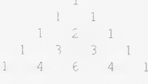

写一个方法：

```java
public int[][] pascalTriangle(int n)
```

生成帕斯卡三角形的前 $n$ 行。该方法应返回一个具有 $n$ 行的“锯齿”二维数组。第 $k$ 行应该是长度为 $k$ 的一维数组，存储帕斯卡三角形第 $k$ 行的值。

## 第 12 章 ~ 练习题 357

- 17. (a) 修改 `Chomp` 程序，使其允许两个人类进行游戏。
- (b) 进一步修改程序，使其为两个玩家显示不同的提示信息（例如，“轮到你了，1号玩家”和“轮到你了，2号玩家”）。在 `HumanPlayer` 的构造函数中接受玩家名称作为参数，并让 `getPrompt` 返回一个与玩家名称拼接的标准消息。
- (c) 可以通过从 `HumanPlayer` 派生出 `HumanPlayer1` 和 `HumanPlayer2` 并在它们类中重新定义 `getPrompt` 方法来实现类似的功能。在 OOP 程序中，这种实现比部分 (b) 建议的更合适还是不那么合适？为什么？
- 18. 将 `Chomp` 程序转换为一个三人的游戏：两个人类玩家和一个计算机玩家。
- 19. (a) 在 `Chomp` 程序中，使棋板具有扩展性。消除 `BoardPanel` 类中的 `CELLSIZE` 常量，并在需要时从面板的当前尺寸获取单元格的宽度和高度。
- (b) 为 `BoardPanel` 类添加一个构造函数，设置棋板的行和列尺寸。让程序在 3x6 的棋板上运行。代码的哪些属性使得这一更改变得容易？

## 12.6-12.8 节

- 20. 找到并修复以下代码中的错误：

```java
char[] hello = { ' ', 'h', 'e', 'l', 'l', 'o' };
// 向左移动并附加 '!'
int i = 0;
while (i < 6)
{
  hello[i-1] = hello[i];
  i++;
}
hello[5] = '!';
```

- 21. 编写一个方法，判断给定数字是否为数组中存储的值的中位数：

```java
// 如果 m 是数组中值的中位数，则返回 true
// 否则返回 false。（在这里我们称 m 为中位数是因为
// 大于 m 的元素个数等于
// 小于 m 的元素个数）
public boolean isMedian(double[] sample, double m)
```

使用一个 "for-each" 循环遍历 `sample`。

- 22. 执行以下代码后，`1st` 中的值是什么？

```java
String[] 1st = {"One", "Two", "Three"};
for (String s : 1st)
  s += "";
```

- 23. (a) 编写方法 `void rotateLeft(int[] a)` 和 `void rotateRight(int[] a)`，分别将数组 `a` 向相应的方向旋转一个位置。
- (b) 编写方法 `static void rotate(int[] a, int d)`，将数组按给定的位置数 `d` 旋转。正 `d` 将数组向右旋转；负 `d` 向左旋转。例如，如果 `a` 包含元素 1, 4, 9, 16, 25, 36，执行 `rotate(a, -2)` 后，`a` 中的值为 9, 16, 25, 36, 1, 4。

- 24. 非负“大整数”被表示为一个 N 位数字的数组。每个数字的值都是 0 到 9 之间的整数。最高位数字位于数组开头；开头的零值表示前导零。编写以下方法，计算并返回两个“大整数” `a` 和 `b` 之和：

```java
private final int N = 30;

// 计算两个“大整数” a 和 b 之和，
// 它们以数字数组表示，并返回它们的和
// 结果作为一个 N 位数字的数组。
// 前提条件：和可以放入 N 位数字中。
private static int[] add(int[] a, int[] b)
```

- 25. 填空以下方法，该方法返回数组中两个最大元素的平均值：

```java
// 找到 scores 中两个最大的元素
// 并返回它们的平均值。
// 前提条件：scores.length >= 2。
public static double averageTopTwo(int[] scores) {
    int i, n = scores.length;
    int iMax1 = 0; // 最大元素的索引
    int iMax2 = 1; // 第二大元素的索引

    // 如果 scores[iMax2] 大于 scores[iMax1] --
    // 交换 iMax1 和 iMax2
    if (scores[iMax2] > scores[iMax1]) {
        
    }

    i = iMax1;

    ...

    for (i = 2; i < n; i++) {
        if (scores[i] > scores[iMax1]) {
            
        } else if (
            
            ...
        }
    }
    return ...;
}
```

- 26. (a) 编写并测试一个 `Polynomial` 类，表示多项式 $P(x) = a_0 + a_1x + \dots + a_nx^n$。使用大小为 $n+1$ 的双精度数数组来存储系数。提供一个构造函数：

```java
public Polynomial(double[] a)
```

通过从给定的数组复制系数来设置系数。确保 `Polynomial` 类是完全封装的且其对象是不可变的。提供一个 `degree` 方法返回多项式的次数 $n$；提供一个 `getValue(double x)` 方法返回给定 $x$ 的值。还要包含一个合理的 `toString` 方法。

(b) 同一个多项式可以重写为：

$$P(x) = a_0 + x(a_1 + x(a_2 + (\dots + x(a_n))))$$

后一种表示法更有效，因为计算 $P(x)$ 需要相同的加法次数但更少的乘法。使用此公式修改 (a) 部分 `getValue` 方法。

(c) 编写一个方法：

```java
public Polynomial multiply(Polynomial other)
```

将此多项式与另一个多项式相乘并返回乘积。

## 第 13 章 ~ java.util.ArrayList

- 13.1 引言
- 13.2 ArrayList 的结构
- 13.3 ArrayList 的构造函数和方法
- 13.4 ArrayList 的陷阱
- 13.5 实验：为文档创建索引
- 13.6 案例研究与实验：Gridters
- 13.7 总结

## 13.1 引言

Java 数组方便又安全。然而，它们有一个局限性：一旦创建数组，其大小就无法改变。如果数组已满且你想添加元素，就必须创建一个新数组。例如：

```java
Object[] arr = new Object[size]; // 类型
for (int i = 0; i < size; i++)
    arr[i];
```

`ArrayList` 允许你保留一组值。图 13-1。`ArrayList` 的容量是存储在数组中的值。`ArrayList` 的大小是。

## 13.2 ArrayList 的结构

| 容量 | | |
|---|---|---|
| | "Apple" | "Orange" | "Peach" |

图 13-1. ArrayList 的容量

`ArrayList` 类提供了 `get` 和 `set` 方法，分别访问和设置第 $i$ 个元素。$0 \le i < size$。此外，`ArrayList` 有方便的方法添加和删除元素。从更抽象的角度来看，`ArrayList` 表示一个有序编号的“列表”。`ArrayList` 类是 Java 集合框架，并实现了 `List` 接口。如果你的类使用：

```java
import java.util.List;
import java.util.ArrayList;
```

在源文件的顶部。另一个库类 `java.util.LinkedList` 也实现了 `List`：


`LinkedList` 与 `ArrayList` 相同的方法（以及一些额外方法），但它使用不同的数据结构来存储列表。这在第 20 节中有详细解释。

## 13.3 java.util.ArrayList

`ArrayList` 保存指定类型的对象。

从 Java 5 开始，当你声明 `ArrayList` 时应该指定元素的类型。类型放在 `ArrayList` 之后的角括号内。例如：

```java
private ArrayList<String> names;
```

或者

```java
private ArrayList<Actor> actors;
```

在语法上，整个组合 `ArrayList<something>` 充当长类名，读作“某种类型的 ArrayList”。每当你使用 `ArrayList` 类型时，都需要使用整个组合：在声明变量、方法参数和返回值中，以及创建 `ArrayList` 时。

注意，“for-each”循环适用于 `ArrayList`，是遍历 `ArrayList` 的方便方法。

`ArrayList` 与其他类型的 Java 集合一样，只能持有对象。如果你尝试向列表添加基本数据类型的值，编译器将该值转换为相应包装类的对象（`Integer`、`Double` 等）。为了使其能够工作，该包装类型必须与声明的元素类型匹配。

## 13.3 ArrayList 的构造函数与方法

例如：

```java
ArrayList<Double> samples = new ArrayList<Double>();
samples.add(5.0);
```

这种写法是有效的，并且等同于：

```java
ArrayList<Double> samples = new ArrayList<Double>();
samples.add(new Double(5.0));
```

这被称为自动装箱（autoboxing）。但是：

```java
samples.add(5); // 不能向 ArrayList<Double> 中添加 int
```

无法工作。

在调用 `add(null)` 或 `add(i, null)` 之后，`ArrayList` 也可以包含 `null` 值。（我们将在下一节中检查 `add` 和其他 `ArrayList` 方法。）

## 13.3 ArrayList 的构造函数和方法

`ArrayList` 的无参构造函数创建一个默认容量（十个）的空列表（`size() == 0`）。另一个构造函数 `ArrayList(int capacity)` 创建一个具有给定初始容量的空列表。如果你预先知道列表中将存储的最大值数量，最好从一开始创建一个该容量的 `ArrayList`，以避免后续对列表进行重新分配和复制。例如：

```java
ArrayList<String> names = new ArrayList<String>(10000);
```

`List` 类实现了二十多个方法（在 `List` 接口中指定），但我们只讨论常用方法的子集。

`ArrayList` 的某些方法如图 13-2 所示。（Java API 文档使用字母 E 来指代 `ArrayList` 元素的类型，我们也这样做）

正如我们所提到的，`ArrayList` 中的元素通过其索引从 0 到 `list.size() - 1` 进行编号。在 `get(i)` 和 `set(i, elmt)` 方法中，参数 `i` 必须在 0 到 `list.size()` 的范围内，否则这些方法将抛出 `IndexOutOfBoundsException`。

| 方法 | 描述 |
| :--- | :--- |
| `int size()` | 返回元素数量 |
| `boolean isEmpty()` | 当前列表中存储了元素 |
| `boolean add(E elmt)` | 如果列表为空则返回 true；否则返回 false |
| `void add(int i, E elmt)` | 在列表末尾添加 elmt；返回 true |
| `E get(int i)` | 将 elmt 插入到第 i 位置；将该位置上的元素及后续元素向右移动（其索引加 1） |
| `E set(int i, E elmt)` | 返回第 i 个元素的值 |
| `E remove(int i)` | 用 elmt 替换第 i 个元素；返回旧值；从列表中删除第 i 个元素并返回其值；将后续元素（如果有）向左移动（其索引减 1） |
| `boolean contains(Object obj)` | 如果此列表包含与 obj 相等的元素，则返回 true（使用 equals 方法进行比较） |
| `int indexOf(Object obj)` | 返回 obj 在列表中第一次出现的索引，如果未找到 obj 则返回 -1（使用 equals 方法进行比较） |
| `String toString()` | 返回列表的字符串表示，格式为 [elmt1, elmt2, ..., elmtN] |

图 13-2. 常用的 `ArrayList<E>` 方法

`add(E elmt)` 方法将 elmt 添加到列表末尾，并将列表的大小增加 1。`add(int i, E elmt)` 是重载的：带有两个参数的版本将 elmt 插入列表，使得 elmt 成为第 i 个元素。该方法将第 i 个元素及所有后续元素向右移动，并将它们的索引加 1。它还将列表的大小增加 1。该方法会检查 `0 <= i <= list.size()`，如果不满足则抛出 `IndexOutOfBoundsException`。如果用 `i = list.size()` 调用，则 `add(int i, E elmt)` 的效果与 `add(E elmt)` 相同。

## 13.4 ArrayList 的陷阱

`remove(i)` 方法从列表中删除第 i 个元素，将所有后续元素（如果有）向左移动一个，并减少它们的索引。它还将列表的大小减少 1。`remove` 返回被删除元素的值。

`ArrayList` 非常高效地实现了 `get` 和 `set` 方法，因为元素存储在数组中，这可以通过给定的索引直接访问元素。在 `ArrayList` 的开头或中间插入或删除元素效率较低，因为这需要移动后续元素。添加元素偶尔可能需要数组的重新分配和复制，对于长列表来说这可能是非常耗时的。

方便的 `toString` 方法允许你获取列表的字符串表示，并在一条语句中打印整个列表。例如：

```java
System.out.println(list);
```

列表将显示在方括号内，连续元素用逗号和空格分隔。

`indexOf(Object obj)` 和 `contains(Object obj)` 方法很有趣。它们需要某种方式与列表元素进行比较。这是通过调用 obj 的 `equals` 方法实现的，如下：

```java
if (list.get(i).equals(obj))
```

因此，如果你计划将其放入 `ArrayList`，应该确保定义了一个合理的 `equals` 方法。我们将在第 14 章解释如何为你的类定义 `equals`。

## 13.4 ArrayList 的陷阱

你必须小心 `add` 和 `remove` 方法：记住它们会改变列表的大小和后续元素的索引。以下看似无害的代码意在从 `ArrayList` 中删除所有 "like" 出现项：

```java
ArrayList<String> words = new ArrayList<String>();
int n = words.size();

for (int i = 0; i < n; i++) {
  if ("like".equals(words.get(i))) {
    words.remove(i);
  }
}
```

然而，在第一个 "like" 被发现并删除后，列表的大小减小并变得比 `n` 小。一旦 `i` 超过新的大小，程序将由于 `IndexOutOfBoundsException` 异常。

还有一个 Bug。当一个 "like" 被删除时，后续单词向左移动。但在 `for` 循环中 `i` 增加了。导致下一个单词被跳过了。如果 "like" 连续出现，第二个将不会删除。正确的代码应该在单词未删除时增加 `i`。例如：

```java
int i = 0;

while (i < words.size()) {
  if ("like".equals(words.get(i))) {
    words.remove(i);
  } else {
    i++;
  }
}
```

`ArrayList` 存储的是引用。它可以包含重复的值——不仅是相等的对象（即 `obj1.equals(obj2)`），还可以是同一个对象的多个引用（即 `obj1 == obj2`）。

理解对象在被添加到列表后可能会发生变化（除非对象是不可变的），以及同一个对象可以属于多个 `ArrayList` 是重要的。

考虑例如，以下两个版本的 `makeGuestList` 方法从给定的名称数组构建人员（`Person` 类对象）列表。假设 `Person` 类具有代码中使用的构造函数以及 `setName` 方法，用于设置人的姓名。

版本 1：


```java
public ArrayList<Person> makeGuestList(String[] names)
{
    ArrayList<Person> list = new ArrayList<Person>();
    for (int i = 0; i < names.length; i++)
        list.add(new Person(names[i]));
    return list;
}
```

版本 2：

```java
public ArrayList<Person> makeGuestList(String[] names)
{
    ArrayList<Person> list = new ArrayList<Person>();
    Person p = new Person();
    for (int i = 0; i < names.length; i++)
    {
        p.setName(names[i]);
        list.add(p);
    }
    return list;
}
```

```java
String[] names = {"Alice", "Bob", "Claire"};
List<Person> guests = makeGuestList(names);
System.out.println(guests);
```

执行后，版本 1 显示

```
[Alice, Bob, Claire]
```

如预期所示（图 13-3-a）。

然而，版本 2 显示了 `[Claire, Claire, Claire]`，因为该列表包含了对同一个对象的三个引用（图 13-3-b）。将此对象添加到列表中并不能免受其被随后的 `setName` 调用所修改。

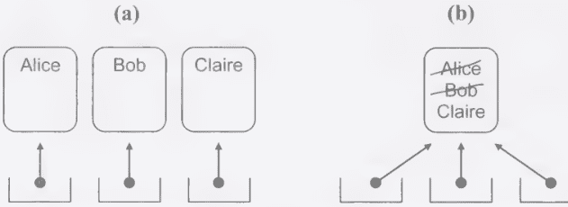

图 13-3. (a) 包含指向不同对象引用的列表；(b) 包含指向同一对象引用的列表

## 13.5 实验：为文档创建索引

在这个实验中，你将编写一个程序，读取文本文件并为其生成索引。文本中出现的所有单词都应该以大写字母按字母顺序列在索引中。每个单词后面应该跟着一个包含该单词的所有行号列表。图 13-4 显示了一个示例。

fish.txt

One fish

two fish

red fish

blue fish.

Black fish

blue fish

old fish.

new fish.

This one has

a little star.

This one has a little car.

Say! What a lot

of fish there are.

fishIndex.txt

A 12, 14, 15

ARE 16

BLACK 6

BLUE 4, 7

CAR 14

FISH 1, 2, 3, 4, 6, 7, 8, 9, 16

HAS 11, 14

LITTLE 12, 14

LOT 15

NEW 9

OLD 9

ONE 1, 11, 14

RED 3

SAY 15

STAR 12

HERE 16

THIS 11, 14

TWO 2

WHAT 15

图 13-4. 示例文本文件及其索引

`IndexMaker` 程序由三个类组成（图 13-5）。它还以两种方式使用了 `ArrayList`：`IndexEntry` 拥有一个持有行号的 `ArrayList<Integer>` 字段，而 `DocumentIndex` 继承自 `ArrayList<IndexEntry>`。

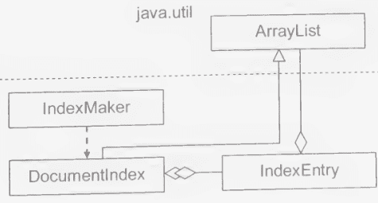

图 13-5. IndexMaker 类

`IndexMaker` 类是主类。我们在 JM(Ch13::IndexMaker) 中为你提供了这个类。它的 `main` 方法提示用户输入和输出文件的文件名（或从命令行参数中获取它们），打开输入文件，创建输出文件，读取并处理输入文件的所有行，然后将生成的文档索引保存到输出文件中。

编写 `DocumentIndex` 和 `IndexEntry` 类留由你完成（可能与另一个程序员合作）。在这个实验中，你不需要处理文件的读取或写入。


### IndexEntry 类

`IndexEntry` 对象表示一个索引条目。它有两个字段：

```java
private String word;
private ArrayList<Integer> numsList;
```

`numsList` 中的数字代表单词在输入文件中出现的行号。（注意，`IndexEntry` 类非常通用且可重用：取决于应用程序，数字可以代表行号、页码等。）

为该类提供一个构造函数，接收一个单词（`String`），将其转换为大写（通过调用 `toUpperCase()`），并将其保存到 `word` 中。构造函数还应该初始化 `numsList` 为空的 `ArrayList<Integer>`。

该类应该具有以下三个方法：

1. `void add(int num)` — 将 `num` 添加到 `numsList` 中，但前提是它不在该列表中。你需要将 `num` 转换为 `Integer` 以调用 `numsList` 的 `contains` 方法。

2. `String getWord()` — 这是一个访问方法；它返回 `word`。

3. `String toString()` — 返回该 `IndexEntry` 的字符串表示，格式与输出文件中每行使用的格式相同（图 13-4）。

### DocumentIndex 类

`DocumentIndex` 对象表示整个文档的索引：所有索引条目的列表。索引条目应该如图 13-4 所示按字母顺序排列。

使 `DocumentIndex` 类继承自 `ArrayList<IndexEntry>`。提供两个构造函数：一个创建一个具有默认容量的列表，另一个创建一个具有给定容量的列表。（这些构造函数简单地调用父类 `ArrayList` 的相应构造函数。）

`DocumentIndex` 应该具有以下两个公共方法：

1. `void addWord(String word, int num)` — 通过调用 `IndexEntry` 的 `add(num)` 方法将 `num` 添加到该单词的 `IndexEntry` 中。如果 `word` 尚未在此 `DocumentIndex` 中，方法首先创建一个新的 `IndexEntry` 并按字母顺序将其插入列表（忽略大小写）。

2. `void addAll(String str, int num)` — 从 `str` 中提取所有单词（跳过标点和空白），并对每个单词执行 `addWord(word, num)`。你可以自己编写单词提取器，但使用 `String` 类的 `split` 方法好得多。在 Java API 中查找它。使用接受一个参数 `regex`（即正则表达式）的方法。正则表达式并不是 Java 特有的；它们被许多语言和解析器使用。`regex` 描述了所有可能的分隔符的模式。在此处使用 `\W+`。`\W`（大写）表示非字母数字字符。

# 376 第 13 章 ~ java.util.ArrayList

这些规则强制你将操作执行在它们应该所在的地方。`processActors` 无法移动这种生物；`selectMoveLocation` 无法从网格中移除任何实体；以此类推。

在实验中，你将创建 `Critter` 的两个子类和一个 `Actor` 的子类，创建一个简单的 GridWorld “生态系统”。你可以独立完成，也可以与其他开发者、艺术家和质量保证小组一起完成。


阅读《GridWorld 学生手册》的第 4 部分。研究 `Critter` 的源代码并完成第 35-36 页的练习题。

- 1. 定义一个作为 `Critter` 子类的类。在构造函数中设置 `Cow` 的颜色。`Cow` 的行为像普通的生物，但它只吃花（`Flowers`）并破坏所有相邻位置的蚊子（`MosquitoEggs`）。牛移动缓慢，每隔三步移动一次（每次调用其 `act` 方法）。你需要重写 `Critter` 的 `processActors` 和 `selectMoveLocation` 方法。不要定义 `act` 方法。

- 2. 定义另一个生物 `Mosquito`（蚊子）。在构造函数中设置 `Mosquito` 的颜色。蚊子的目标是咬一口牛并产卵。蚊子的寿命只有 6 步。如果它在这一时间内不能咬到牛（即进入与牛相邻的位置），它就会死去。如果它咬中了牛，它会先在所在位置相邻的所有空位置产卵，然后死亡。重写 `Critter` 的 `processActors` 方法来实现此功能。

蚊子会移动到距离最近的牛所在的相邻位置之一。编写一个辅助类 `DistanceBetweenLocations`，其中只包含一个静态方法 `distance(Location loc1, Location loc2)`。`loc1` 和 `loc2` 之间的距离定义为 `loc1.getRow()-loc2.getRow()` 与 `loc1.getCol()-loc2.getCol()` 绝对值中的最大值。

在你的 `Mosquito` 中，重写 `Critter` 的 `selectMoveLocation` 方法。创建一个列表 `bestLocs`，包含 `locs` 中所有到牛的距离相等且最小的位置。然后随机选择并返回其中一个。不需要重复 `Critter.selectMoveLocation` 中的代码：只需调用 `super.selectMoveLocation(bestLocs)` 即可。

让蚊子在移动时朝向新位置转向（请参考 `ChameleonCritter.java` 示例）。

- 3. 定义一个作为 `Actor` 子类的类 `MosquitoEgg`（蚊卵）。蚊卵在五步内只是静静不动。在第六步时，它会变成一只蚊子。重新定义 `Actor` 的 `act` 方法来实现这一点。（我们决定跳过蚊子生命周期中的幼虫和蛹阶段，以保持简单……）

- 4. 编写一个 `PastureRunner` 类，类似于 `CritterRunner`。在网格中放入几块石头（`Rocks`）、两三只虫（`Bugs`）、三只牛（`Cows`）和几个蚊卵（`MosquitoEggs`）。

- 5. 创建或寻找牛、蚊子和蚊卵的互联网图片，并将它们保存为 48x48 像素的 gif 文件。

- 6. 彻底测试你的程序。

## 13.7 总结

`java.util.ArrayList` 类有助于实现可以根据需要增长的“动态数组”。`ArrayList` 跟踪列表的容量（分配的数组长度）和大小（列表中当前拥有的元素数量）。无参数构造函数创建一个具有某些默认容量的空列表；另一个构造函数则创建一个具有指定容量的空列表。当 `ArrayList` 满时，如果我们添加一个值，`ArrayList` 将通过分配一个更大的数组并将所有元素复制到新数组中自动增加其容量。

从 Java 5.0 开始，`ArrayList` 存储指定类型的元素。`ArrayList` 不支持基本数据类型的值——它们会被转换为相应包装类对应的对象。

最常用的 `ArrayList` 方法如图 13-2 所示。`add(obj)` 方法在列表末尾追加一个元素。`get(i)`、`set(i, obj)`、`add(i, obj)` 和 `remove(i)` 方法会检查 `i` 是否在 0 到 `size() - 1` 之间（对于 `add` 则是 0 到 `size()`），如果索引超出有效范围，则抛出 `IndexOutOfBoundsException`。`add` 和 `remove` 方法会调整后续元素的索引和列表的大小。`contains` 方法检查给定值是否在列表中，`indexOf` 返回给定值的索引（如果未找到则返回 -1）。

`ArrayList` 的 `get(i)` 和 `set(i, obj)` 方法是高效的，因为数组为其元素提供了随机访问能力。`add(i, obj)` 和 `remove(i)` 方法的平均效率较低，因为它们需要移动元素以跟在第 `i` 个元素之后。当超过列表容量时，`add` 方法需要分配更多内存并复制整个列表。

# 378 第 13 章 ~ java.util.ArrayList

`ArrayList` 存储引用对象。对象在被添加到列表后，可以对其进行更改（除非该对象是不可变的）。列表允许持有 `null` 引用以及对同一个对象的多个引用。

“for each” 循环——

```java
for (E elmt : list)
{
  // process elmt
}
```

该循环对于 `ArrayList` 和一维数组同样有效。

## 练习题

### 节 13.1-13.5

- 1. 标记对错并解释：

    - `ArrayList` 可以包含指向同一个对象的多个引用。

    - 该对象可能属于两个 `ArrayList`。

    - `ArrayList` 的 `remove` 方法在移除对象后会销毁该对象。

    - `ArrayList` 的 `remove` 方法会复制对象并添加到列表。

    - 两个变量可以引用同一个 `ArrayList`。

- 2. `ArrayList` 的 `size()` 方法会修剪列表的容量。对吗？

    - 节省空间

    - 让 `add` 更高效

    - 让 `get` 更高效

    - 让 `set(i)` 更高效

- 3. 下列声明中哪些可以编译？

    - `ArrayList<String> words = new ArrayList<>();`

    - `ArrayList<String> words(5)`

- 4. 下列代码的输出是什么？

```java
ArrayList<Integer> lst = new ArrayList<>();
lst.add(0);
lst.add(1);
lst.add(2);
System.out.println(lst);
```

- 5. 编写一个方法，接收一个 `ArrayList<String>` 并返回一个反序存储元素的 `ArrayList<String>`。原始列表保持不变。

- 6. `Integer` 有一个 `compareTo(Integer)` 方法，如果对象大于 `other` 则返回正整数，如果小于 `other` 则返回负整数，如果相等则返回 0。

- 7. 编写并测试一个方法 `public void filter(ArrayList<Object> list1, ArrayList<Object> list2)`，从 `list1` 中移除所有在 `list2` 中的对象。使用 `==` 运算符。提示：不能使用 `contains` 和 `indexOf` 方法。

- 8. 补全 `removeDuplicates` 方法的空白，如果 `ArrayList` 包含 "A", "B", "C", 在调用 `removeDuplicates(letters)` 后应包含：

```java
for (int i = lst.size(); i > 0; )
  if (
  lst.remove(i-1);
)
```

提示：反向遍历。

# 380 第 13 章 ~ java.util.ArrayList

- 9. `ArrayList<Object>` 可以是自身的元素吗？测试此假设。

- 10. 编写并测试一个方法，接收一个包含字母的 `List<String> words`，根据首字母将其投入“桶”中，并返回这些桶的 `ArrayList`。每个桶由 `ArrayList<String>` 表示。第一个桶包含以 'a' 开头的字符串，顺序与 `words` 中的顺序相同；第二个桶包含以 'b' 开头的字符串，以此类推。你的方法应该只遍历一次列表并保持其不变。

- 11. 正整数 $n$ 的划分是其作为若干正整数之和：$n = p1 + p2 + ... + pi$。编写一个方法打印正整数 $n$ 的所有划分。仅考虑 $p1 \le p2 \le ... \le pi$。

> 提示：使用容量为 $n$ 的 `ArrayList<Integer>` 来存储划分；编写一个递归辅助方法 `displayPartitions(int n, ArrayList<Integer> list)`。如果列表中值的和等于 $n$，打印这些值。如果小于 $n$，尝试向列表添加另一个整数（范围从列表最后一个值开始，如果列表为空则从 0 开始到 $n - sum$），然后再次调用 `displayPartitions(n, list)`。在尝试下一个值之前，别忘记移除最后添加的值。

## 节 13.6-13.7


- 12. 复习 GridWorld 的 `Location` 类和 `Grid` 接口。编写一个方法实现 `validLocations` 方法，使用 `Location` 的 `getAdjacentLocation` 方法和 `Grid` 的 `isValid` 方法。

- 13. 编写并测试 GridWorld 的 `Painter` 类。`Painter` 的行为像 `Critter`，不同的是它不是吃掉邻居，而是将它们随机涂成红色、白色或蓝色。

# 14 搜索与排序

## 14.1 序言

搜索和排序是庞大且重要的课题。在实践层面，它们非常重要，因为许多大型计算机系统在大部分时间里都在执行这些操作。在理论层面，它们有助于提炼算法和数据结构的通用属性以及有趣的理论问题，并为学习和比较这些内容提供了丰富的素材。我们将在处理数组的背景下考虑这些主题，以及其他处理数组的常用算法。

计算机应用程序中的搜索任务范围广泛，从在几十字符的字符串中查找特定字符，到在包含 1 亿记录的数据库中查找某条记录。抽象地说，搜索是一项涉及计算机内存中某种表示的数据元素集的任务。每个元素包含一个键，可以与目标值进行测试以实现精确匹配。成功的搜索会找到具有匹配键的元素，并返回其位置或与之相关的信息：一个值或记录的地址。

搜索指的是键与指定目标之间的匹配是直接且无歧义的任务。作为对比，如果我们必须处理一个指纹数据库，并需要为给定的样本寻找最佳匹配，那么该应用属于模式识别范畴，而不是搜索。它可能还需要人类专家的干预。

排序是指将数据元素列表按升序或降序排列。数据元素可以是数值，也可以是按键排序的某些记录。除了为了方便访问而准备数据集（例如，二分查找的要求）外，排序还有许多其他应用。一个例子是匹配两个数据集。假设我们想合并两个邮件列表并消除重复项。当列表按姓名和地址进行字母排序时，这项任务是直接的，但否则可能变得难以管理。另一个用途可能仅仅是按有序的方式向用户展示信息。例如，个人电脑上的用户文件列表可以按名称、日期或类型排序。当文字处理器自动为书籍创建索引或参考文献时，它就会对信息进行排序。在大型商业系统中，数百万笔交易（例如银行支票或信用卡）在提交给客户账户并转发给其他支付者之前，每天都会进行排序。

在本章中，我们首先考虑在 Java 中比较对象的不同方法。然后，我们将会介绍两种搜索算法——顺序查找和二分查找，以及几种常见的排序算法：选择排序、插入排序，以及两种更快的算法：合并排序和快速排序。

## 14.2 equals, compareTo 和 compare

Java 提供了三种比较的方法：

```java
public boolean equals(Object other)
public int compareTo(T other)
public int compare(T obj1, T obj2)
```

其中 T 是对象的类型。布尔方法 `equals` 比较此对象是否相等。整数方法 `compare` 将此对象与另一个相同类型的对象进行比较，并返回一个整数，表示它是大于、等于还是小于其他。整数方法 `compareTo` 比较两个相同类型的对象，并返回一个整数，表示两个对象中哪大于另一个。让我们仔细观察这些方法：它们源自何处以及我们如何从中获益。

### 1. equals

`equals` 方法——

```java
public boolean equals(Object other)
```

——是 `Object` 类的方法。它比较此对象和其他对象的地址，如果相同则返回 true，否则返回 false。由于每个类都以 `Object` 为祖先，每个类都从 `Object` 继承了此方法。然而，我们通常更感兴趣对象的内容而不是地址（我们有 `==` 运算符来比较地址）。因此，程序员经常在自己的类中重写 `Object` 的 `equals` 方法。

我们已经在 `String` 类中见过 `equals`：即按字符比较字符串。例如，示例 14-1。

```java
public boolean equals(Object other) {
    if (other instanceof Country) {
        return name.equals(((Country) other).getName());
    } else {
        return false;
    }
}
```

> 注意，重写 `Object` 的 `equals` 方法不会改变你类对象的 `==` 运算符的含义：它仍然比较地址。

我们已经在 `String` 类中见过 `equals`：即按字符比较字符串。例如，示例 14-1。

```java
public boolean equals(Object other) {
    if (other instanceof Country) {
        return name.equals(((Country) other).getName());
    } else {
        return false;
    }
}
```

“那么，”你可能会想，“如果我不小心给 `equals` 传递了错误的类型会发生什么？”例如，示例 14-1。这时，这段代码编译没有错误，但在运行时会抛出 `ClassCastException`，因为无法将 `String` 强制转换为 `Country`。

```java
public boolean equals(Object other) {
    if (other instanceof Country) {
        return name.equals(((Country) other).getName());
    } else {
        return false;
    }
}
```

> 有些程序员会让 `equals` 在参数类型不兼容时返回 false。

“那么，”你可能会想，“如果我不小心给 `equals` 传递了错误的类型会发生什么？”例如，示例 14-1。这时，这段代码编译没有错误，但在运行时会抛出 `ClassCastException`，因为无法将 `String` 强制转换为 `Country`。

```java
public boolean equals(Object other) {
    if (other instanceof Country) {
        return name.equals(((Country) other).getName());
    } else {
        return false;
    }
}
```

### 2. compareTo

`compareTo` 方法是 `java.util.Comparable<T>` 接口中定义的抽象方法，因此它没有默认实现。要在你的类中实现 `Comparable<T>`，需要提供以下方法：

```java
public int compareTo(T other)
```

其中 T 是你的类名。例如：

```java
public class Country implements Comparable<Country> {
    public int compareTo(Country other) {
        return name.compareTo(other.getName());
    }
}
```

> `compareTo` 返回一个 int：正值表示此对象“大于”其他；零表示它们“相等”，负值表示此对象“小于”其他。所以 `x.compareTo(y)` 有点像“x - y”。

注意 `compareTo` 接收的参数是你的类类型，而不是 `Object`。

为什么我们需要 `Comparable` 接口？我们为什么想让自己的类实现它？原因和 `equals` 方法相同：某些库方法期望传递给它们的对象是实现了 `Comparable` 的。例如，`java.util.Arrays` 类有一个 `sort(Object[] arr)` 方法，它通过调用元素的 `compareTo` 方法来比较你的类元素。因此，如果你的类对象之间存在合理的排序顺序，并且你计划使用处理 `Comparable` 对象的库方法或类，那么让你的类对象实现 `Comparable` 是有意义的。

`String`、`Integer`、`Double` 以及其他几个库类实现了 `Comparable`。

如果你在类中定义了 `compareTo` 方法，别忘记在类的头部声明：

```java
... implements Comparable<YourClass>
```

如果你的类实现了 `Comparable`，那么定义 `equals` 方法是一个好主意，并让 `compareTo` 和 `equals` 保持一致，这样当且仅当 `x.compareTo(y) == 0` 时，`x.equals(y)` 才返回 true。否则，某些库方法（以及你自己）可能会产生困惑。

你已经让 `Counters` 变得可比较了。你可以使用 `Arrays.sort` 按名称对它们进行排序。但假设有时你想按人口排序。你能做什么呢？你需要一个 `comparator`（比较器）。

### 3. compare

`comparator` 是一个对象，指定了比较你类中两个对象的方法。假设你的类名为 `T`。`comparator` 是实现 `java.util.Comparator<T>` 接口的类的对象，并有一个方法：

```java
public int compare(T obj1, T obj2)
```

如果 `compare` 返回正整数，则 `obj1` 被认为大于 `obj2`；如果返回值为 0，则它们被认为相等；如果返回值为负数，则 `obj1` 被认为小于 `obj2`。因此，`compare(obj1, obj2)` 类似于“obj1 - obj2”。

比较器的目的是作为参数传递给某些库类（或你自己的类）的构造函数和方法。通过创建不同类型的 `comparator`，你可以指定比较你类对象的不同方式。你可以创建不同的比较器，按不同的字段按升序或降序对对象进行排序。

例如，图 14-2 中的 `PopulationComparator` 类定义了按人口比较国家的比较器。你可以通过向 `PopulationComparator` 的构造函数传递一个布尔参数，创建一个“升序”比较器和一个“降序”比较器。

```java
// 基于人口的Country对象的比较器
import java.util.Comparator;

public class PopulationComparator implements Comparator<Country> {
    private boolean ascending;

    // 构造函数
    public PopulationComparator() { ascending = true; }
    public PopulationComparator(boolean ascending) { this.ascending = ascending; }

    public int compare(Country country1, Country country2) {
        int diff = country1.getPopulation() - country2.getPopulation();
        if (ascending)
            return diff;
        else
            return -diff;
    }
}
```

> 图 14-2. JM\Ch14\Compare\PopulationComparator.java

`Arrays` 类有一个重载版本的 `sort` 方法，接受一个 `comparator` 作为参数。现在，我们可以依赖自然排序，也可以创建不同的比较器并将它们传递给 `Arrays.sort`（见图 14-3）。图 14-3 中 `main` 方法的输出是：

- [Brazil: 193, China: 1338, India: 1188, Indonesia: 236, USA: 310]
- [Brazil: 193, Indonesia: 236, USA: 310, India: 1188, China: 1338]
- [China: 1338, India: 1188, USA: 310, Indonesia: 236, Brazil: 193]

```java
import java.util.Arrays;

public class ComparatorTest {
    public static void main(String[] args) {
        Country[] countries = {
            // 人口单位为百万
            new Country("China", 1338),
            new Country("India", 1188),
            new Country("USA", 310),
            new Country("Indonesia", 236),
            new Country("Brazil", 193),
        };

        // 按名称排序：
        Arrays.sort(countries);
        System.out.println(Arrays.toString(countries));

        // 按人口排序：
        Arrays.sort(countries, new PopulationComparator(true));
        System.out.println(Arrays.toString(countries));

        // 按人口排序：
        Arrays.sort(countries, new PopulationComparator(false));
        System.out.println(Arrays.toString(countries));
    }
}
```


## 14.3 顺序查找与二分查找

### 14.3.1 顺序查找

假设我们有一个特定大小的数组并想要找到给定值的位置。如果元素是随机顺序，我们只能使用顺序查找，例如：

```java
String[] words = { ... };
String target = ...;
for (int k = 0; k < words.length; k++) {
    if (target.equals(words[k])) {
        return k;
    }
}
```

如果数组很大，这可能会非常耗时。这是 O(n)，因为我们要检查每个元素，直到找到目标或结束。

### 14.3.2 二分查找

如果数组元素是有序的，我们可以使用更高效的算法，称为二分查找。假设我们的数组是升序的，我们正在查找目标值。取数组的中间元素并与 x 比较。如果 x 较小，目标在左半；如果 x 较大，则在右半。重复此过程直到找到目标或确定它不在数组中。3 个元素最多需要 2 次比较。7 个元素最多需要 3 次。15 个元素最多需要 4 次，依此类推。一般情况下，$2^n-1$（或更少）个元素最多需要 n 次比较。1,000,000 个元素最多需要 20 次比较，这比 500,000 次好得多。这就是为什么这类方法被称为“分治法”。二分查找是一个 O(log n) 算法，因为它的操作次数大约是 log n。

图 14-4 中的 `binarySearch` 方法实现了针对升序 `Comparable` 对象的二分查找。


```java
public class BinarySearch {
    /**
     * 使用二分查找在升序数组中查找 target。
     * 如果找到，返回匹配索引；否则返回 -1。
     */
    public static <T> int find(T[] a, Comparable<? super T> target) {

        // 哇！我们想让你这种奇怪的语法！
        // <T> 表明该方法适用于任何类型 T 的 Comparable 对象数组。
        // Comparable<? super T> 确保方法不仅适用于实现 Comparable<T>
        // 类，也适用于此类类的子类。

        int left = 0, right = a.length - 1;
        while (left <= right) {
            // 取 "left" 和 "right" 之间中间元素的索引：
            int middle = (left + right) / 2;

            // 将此元素与目标值进行比较
            // 并相应地调整搜索范围：
            int diff = target.compareTo(a[middle]);

            if (diff > 0) // target > a[middle]
                left = middle + 1;
            } else if (diff < 0) // target < a[middle]
                right = middle - 1;
            } else // target 等于 a[middle]
                return middle;
        }
        return -1;
    }
}
```

图 14-4. `JM\Ch14\BinarySearch\BinarySearch.java`

# 392 第 14 章 ~ 搜索与排序

理解和检查代码的一种方法是在某些具有代表性的示例上手动跟踪。让我们举例：

给定：

```
int[] a = {8, 13, 21, 34, 55, 89};
// a[0] = 8; a[1] = 13; a[2] = 21; a[3] = 34;
// a[4] = 55; a[5] = 89;
target = 34
```

初始状态：

```
left = 0; right = a.length - 1 = 5
```

第一次迭代：

```
middle = (0+5)/2 = 2;
a[middle] = a[2] = 21;
target > a[middle] (34 > 21)
--> 设置 left = middle + 1 = 3; (right 保持不变
```

第二次迭代：

```
middle = (3+5)/2 = 4;
a[middle] = a[4] = 55;
target < a[middle] (34 < 55)
--> 设置 right = middle - 1 = 3; (left 保持不变
```

第三次迭代：

```
middle = (3+3)/2 = 3;
a[middle] = a[3] = 34;
target == a[middle] (34 = 34)
--> return 3
```

更全面的检查还应该包括跟踪特殊情况（例如目标元素是第一个或最后一个元素，或者不在数组中）以及“退化”情况（例如当 `a.length` 为 0 或 1 时的情况）。

我们还需要确保该方法会终止——否则程序可能会“挂起”。通过逻辑或数学推理来比跟踪特定示例能更好地实现这一点，因为很难预见到算法的所有可能路径。在这里我们可以这样推理：我们的 `binarySearch` 方法在每次迭代中都会终止，`right - left` 的差值至少减少 1。因此，最终我们通过 `return` 退出循环（当找到目标时），或者达到 `right - left` 变为负数且 `while` 循环中的条件变为假的情况。

## 14.4 实验：保持有序

在这个实验中，你将编写一个 `SortedWordList` 类，它表示按字母顺序（不区分大小写）排序的单词列表。`SortedWordList` 应该扩展 `ArrayList<String>`。你需要重新定义几个 `ArrayList` 的方法以保持列表始终按字母排序且没有重复单词。

1. 提供一个无参数构造函数和一个带有 `int` 参数的构造函数，参数为列表的初始容量。

2. 重定义 `contains` 和 `indexOf` 方法：让它们使用二分查找。

3. 重定义 `set(i, word)` 方法，使其首先检查 `word` 是否字母顺序上符合第 (i-1) 个和第 (i+1) 个元素之间，且不等于其中任何一个。如果不是如此，`set` 应该抛出 `IllegalArgumentException`，如下：

```
if (...)
throw new IllegalArgumentException("word=" + word + " i=" + i);
```

4. 重定义 `add(i, word)` 方法，使其首先检查 `word` 是否字母顺序上符合第 (i-1) 个和第 i 个元素之间，且不等于其中任何一个。如果不是如此，抛出 `IllegalArgumentException`。

5. 重定义 `add(word)` 方法，按字母顺序将 `word` 插入列表。如果 `word` 已经在列表中，`add` 不应插入它并返回 `false`；否则，如果成功，`add` 应该返回 `true`。使用二分查找定位 `word` 应该插入的位置。

6. 定义一个新的 `merge(SortedWordList additionalWords)`。此方法应该按字母顺序将 `additionalWords` 中不在列表中的单词插入列表。`merge` 应该是高效的。你不能使用任何临时数组或列表。此列表中的每个元素最多移动一次到其正确位置。为了避免 `IndexOutOfBoundsException`，你首先需要向列表添加一些虚拟元素。找到要插入的单词数量。为了高效实现这一点，进行“尝试合并”而不移动任何元素。

# 394 第 14 章 ~ 搜索与排序

将你的类与 `JM\Ch14\KeepInOrder` 中的 `SortedListTest.java` 结合并测试程序。

## 14.5 选择排序

重新排列数组元素为升序或降序的任务被称为排序。我们正在寻找一种适用于任何大小数组和任意元素值的通用算法。有很多可以完成此任务的算法，但最直接的是选择排序。我们已经在第 4 章中提到过它；这里再次给出：

### 选择排序

1. 将变量 $n$ 初始化为数组的大小。

2. 在 $n$ 个元素中找到最大的元素。

3. 将与第 $n$ 个元素交换。

4. $n$ 减 1。

5. 当 $n \ge 2$ 时重复步骤 2-4。

在第一次迭代中，我们找到数组最大的元素并与最后一个元素交换。最大的元素位于正确的位置，将不再移动。我们减少 $n$，假设数组的最后一个元素不存在，重复此过程直到我们处理完整个数组。当只剩下一个元素时迭代停止，因为它已经与每个元素比较过并保证是最小的。图 14-5 中的 `SelectSorter` 类为 `double` 类型数组实现了此算法。一个类似的过程可以将数组降序排序；排序是应用程序中的常见操作，也是比较算法喜欢的课题。选择排序是一个 $O(n^2)$ 算法，因为它的比较次数为 $n(n-1)/2$，与 $n^2$ 成比例。无论数组是几乎有序的、随机的还是倒序的，它都是可预测的。

```java
public class SelectionSort {
    // 使用选择排序将 a[0], ..., a[size-1] 按升序排序
    public static void sort(double[] a) {
        for (int n = a.length; n > 1; n--) {
            // 在 a[0], ..., n-1] 中找到最大元素的索引 iMax
            int iMax = 0;
            for (int i = 1; i < n; i++) {
                if (a[i] > a[iMax]) {
                    iMax = i;
                }
            }
            // 将 a[iMax] 与 a[n-1] 交换
            double aTemp = a[iMax];
            a[iMax] = a[n-1];
            a[n-1] = aTemp;
            // 减少 n（通过 for 循环完成）
        }
    }
}
```

图 14-5. `JM\Ch14\Benchmarks\SelectionSort.java`

## 14.6 插入排序

插入排序算法的思想是保持数组的前部有序并将每个元素插入到正确的位置。它涉及以下步骤：

# 396 第 14 章 ~ 搜索与排序

### 插入排序


1. 将变量 $n$ 初始化为1（保持前 $n$ 个元素有序）。

2. 保存下一个元素，在前 $n$ 个元素中找到它的插入位置以保持顺序。

3. 必要时将元素右移，并将保存的元素插入创建的空隙中。

4. $n$ 加 1。

5. 当 $n < array length$ 时重复步骤 2-4。

图 14-6 中的 `InsertionSort` 类为 `double` 数组实现了此算法。

```java
public class InsertionSort {
    // 使用插入排序将 a[0], ..., a[size-1] 按升序排序
    public static void sort(double[] a) {
        for (int n = 1; n < a.length; n++) {
            // 保存要插入的元素：
            double aTemp = a[n];

            // 从 a[n-1] 向后移动元素，直到找到一个 a[i] <= aTemp 的元素
            int i = n;
            while (i > 0 && aTemp < a[i-1]) {
                a[i] = a[i-1];
                i--;
            }

            // 将保存的元素插入 a[i]:
            a[i] = aTemp;
            // n 加（通过 for 循环完成）
        }
    }
}
```

图 14-6. `JM\Ch14\Benchmarks\InsertionSort.java`

插入排序平均也是 $O(n^2)$ 算法，但当数组已经几乎有序时，它的表现比选择排序好。在最好的情况下，当数组已经排序时，插入排序只需验证顺序就会变为一个 $O(n)$ 算法。

## 14.7 合并排序

二分查找和顺序搜索之间效率的巨大差异暗示，如果我们能找到一种用于排序的“分治法”算法，排序也可能更快。合并排序就是其中这样一种算法。它的工作原理如下：

1. 如果数组只有一个元素，什么都不做。

2. （可选）如果数组有两个元素，在必要时交换它们。

3. 将数组分成两个大致相等的部分。

4. 对前半部分和后半部分进行排序。

5. 将两个部分合并为一个有序数组。

这种递归算法允许我们练习递归推理。步骤 4 告诉我们要排序数组的一半。但我们将如何排序它呢？我们应该使用选择排序还是插入排序？理论上可以这样做，但那样我们就无法获得快速排序的完整收益。为了最佳性能，我们应该再次使用合并排序！

图 14-7 显示了一个 `Mergesort` 类，它可以对双精度浮点数组进行排序。这种直接的实现使用了一个临时数组，将排序后的两个部分合并到其中。`sort` 方法调用一个递归辅助方法，对数组的特定段进行排序。

```java
public class Mergesort{
    private static double[] temp;

    // 使用 Mergesort 算法对 a[0], ..., a[size-1] 进行升序排序
    public static void sort(double[] a)
    {
        int n = a.length;
        temp = new double[n];
        recursiveSort(a, 0, n-1);
    }

    // 递归辅助方法：对 a[from], ..., a[to] 进行排序
    private static void recursiveSort(double[] a, int from, int to)
    {
        if (to - from < 2) // 基准情况：1 或 2 个元素
        {
            if (to > from && a[to] < a[from])
            {
                // 交换 a[to] 和 a[from]
                double aTemp = a[to]; a[to] = a[from]; a[from] = aTemp;
            }
        }
        else // 递归情况
        {
            int middle = (from + to) / 2;
            recursiveSort(a, from, middle);
            recursiveSort(a, middle + 1, to);
            merge(a, from, middle, to);
        }
    }
    // 将 a[from] ... a[middle] 和 a[middle+1] ... a[to] 合并为一个排序后的数组
    private static void merge(double[] a, int from, int middle, int to)
    {
        int i = from, j = middle + 1, k = from;
        // 当两个数组都有未处理的元素时：
        while (i <= middle && j <= to)
        {
            if (a[i] < a[j])
            {
                temp[k] = a[i];      // 或者简单使用 temp[k] = a[i++]
                i++;
            }
            else
            {
                temp[k] = a[j];
                j++;
            }

            // 将第一部分的剩余部分（如果有的话）拷贝到 temp：
            while (i <= middle)
            {
                temp[k] = a[i];      // 或者简单使用 temp[k++] = a[i++]
                i++;
                k++;
            }

            // 将第二部分的剩余部分（如果有的话）拷贝到 temp：
            while (j <= to)
            {
                temp[k] = a[j];      // 或者简单使用 temp[k++] = a[j++]
                j++;
                k++;
            }

            // 将 temp 拷贝回 a
            for (k = from; k <= to; k++)
                a[k] = temp[k];
        }
    }
}
```

图 14-7 `Mergesort.java` 继续

`merge` 方法不是递归的。为了理解它的工作原理，请想象有两堆牌，每堆牌都按升序排列好并面朝放在桌子上。我们想将它们合并到第三个排序好的牌堆中。在每一步中，我们取出两张朝出的牌中较小的一张，将其面朝放在目标堆顶部。当其中一堆牌用完时，我们将另一堆中所有剩余的牌（整堆或一张一张——没关系）并将它们面朝放在目标堆顶部。最终我们得到了按升序排列的目标牌堆。

合并排序是一个 $O(n \log n)$ 算法——远优于选择排序和插入排序的 $O(n^2)$ 性能。

## 14.8 快速排序

快速排序是另一种 $O(n \log n)$ 排序算法。快速排序的思路是选择一个元素作为基准（`pivot`），然后重新排列数组，使得基准左侧的所有元素都小于等于基准，右侧的所有元素都大于等于基准。基准可以从数组中任意选择。分区后，递归地将快速排序应用到基准的左部分和右部分，最终得到一个排序后的数组。图 14-8 展示了分区算法。

快速排序算法由 C. A. Hoare 于 1962 年发明。虽然它的性能没有合并排序那么可预测，但对于随机数组，它的平均速度更快。图 14-9 显示了快速排序的实现。


## 14.8 QUICKSORT

```java
public class Quicksort {
    // 使用快速排序算法对 a[0], ..., a[size-1] 进行升序排序
    public static void sort(double[] a) {
        recursiveSort(a, 0, a.length - 1);
    }

    // 递归辅助方法：对 a[from], ..., a[to] 进行排序
    private static void recursiveSort(double[] a, int from, int to) {
        if (from < to) {
            int p = partition(a, from, to);
            recursiveSort(a, from, p - 1);
            recursiveSort(a, p + 1, to);
        }
    }

    private static int partition(double[] a, int from, int to) {
        double pivot = a[(from + to) / 2];
        int i = from - 1;
        int j = to + 1;
        while (true) {
            do { i++; } while (a[i] < pivot);
            do { j--; } while (a[j] > pivot);
            if (i >= j) return j;
            double temp = a[i];
            a[i] = a[j];
            a[j] = temp;
        }
    }
}
```

图 14-9. Quicksort.java

## 14.9 实验：基准测试

基准测试是对性能的实证测试。图 14-10 中的程序旨在比较运行时间。输入数组大小，选择四种方法之一并点击“Run”。程序用随机数填充数组并对其进行排序。该测试会重复多次以获得准确的计时（默认重复次数为 20，但如果你愿意，可以输入该数字）。然后程序将显示排序所需的平均时间。

```java
a[k] = generator.nextDouble(); // 0.0 <= a[k] < 1.0
```

`runSort()` 方法应该用随机数填充数组并对其进行排序。这应该重复 `RUN` 次，并且 `runSort()` 应返回排序数组所花费的总时间（单位为毫秒）。在每次排序前后调用系统时间，并将经过的时间加到总和中。

创建一个包含 `SelectionSort.java`、`InsertionSort.java`、`Mergesort.java`、`Quicksort.java` 和 `Benchmarks.java` 的项目，这些文件位于 `JM\Ch14\Benchmarks`。填好 `Benchmarks` 类中的空白。一旦程序运行，为每种排序算法收集不同大小数组的基准数据：例如从 10,000 到 50,000 个元素（对于 Mergesort 和 Quicksort 则为 500 个）。绘制所有四种排序算法的运行时间与数组大小的关系图。你可以使用绘图计算器、手动绘制，或者将结果输入电子表格或其他分析程序或网络应用。观察你的实验结果与选择排序、插入排序的抛物线，以及合并排序、快速排序的 $n \log n$ 形状曲线的拟合程度如何。

## 14.10 java.util.Arrays 和 java.util.Collections

无论你在 Java 中需要做什么，很有可能以前已经被实现过了。事实也确实如此，`java.util` 包包含一个 `Arrays` 类和一个 `Collections` 类，它们拥有实现二分查找和排序（使用快速版本的合并排序算法）的方法。你需要导入 `java.util.Arrays` 或 `java.util.Collections` 来使用它们的方法（除非你愿意每次都输入全名）。`Arrays` 和 `Collections` 的所有方法都是静态的，你不能创建这些类的对象。

`Arrays` 的 `binarySearch()` 方法调用方式如下：

```java
int pos = Arrays.binarySearch(a, target);
```

`Arrays` 提供了针对 `char`、`int` 和其他基本类型数组的重载 `binarySearch()` 版本。还有一个适用于任何 `Comparable` 对象的版本。特别地，它可以用于 `String`。

`Arrays.sort()` 方法可以对 `char`、`int`、`double`、`String` 等数组进行排序，可以对整个数组或指定范围内的片段进行排序。例如：

```java
String[] dictionary = new String[maxWords];
int wordsCount;
// ... 其他语句
Arrays.sort(dictionary, 0, wordsCount - 1);
```

正如我们所看到的，还有一个适用于任何 `Comparable` 对象的版本，以及一个接受 `comparator` 作为参数的版本。

`Arrays` 类还为不同数据类型提供了一系列 `fill()` 方法。`fill()` 方法用指定值填充数组或数组的一部分。另一个有用的方法是 `toString()`。例如：

```java
String[] names = {"Apple", "Banana", "Kiwi"};
System.out.println(Arrays.toString(names));
```

产生输出：

```
[Apple, Banana, Kiwi]
```

`asList(T[])` 方法返回数组作为固定长度 `List` 的表示形式。你不能向此列表添加元素，但你可以调用其他方法，并将其作为参数传递给期望 `List` 或 `Collection` 的库方法。例如，为了打乱数组 `names` 的元素，你可以写：

```java
Collections.shuffle(Arrays.asList(names));
```

你也可以打印列表：

```java
System.out.println(Arrays.asList(names));
```

产生的输出与以下相同：

```java
System.out.println(Arrays.toString(names));
```

`Collections` 类与 Java 集合（如 `ArrayList`）配合使用。例如，要在 `ArrayList<String> words` 中查找目标单词，你可以调用：

```java
Collections.binarySearch(words, target);
```

`Collections` 类还有用于排序 `Comparable` 对象列表（或使用 `comparator` 排序 `List`）、打乱列表、复制列表、用给定值填充列表、查找最大值或最小值以及其他方法。

## 14.11 总结

`Object` 类中的布尔方法 `equals(Object other)` 比较此对象与其他对象的地址。在你的类中重写 `equals()` 方法的正确方法是：

```java
public boolean equals(Object other)
{
    if (other != null)
        ...
    else
        return false;
}
```

`java.util.Comparable<T>` 接口的整数方法 `compareTo()` 具有以下签名：

```java
public int compareTo(T other)
```

`compareTo()` 返回一个整数值，表示此对象大于、等于还是小于其他。它类似于“this 减 other”。在 `SomeClass` 中实现 `Comparable` 接口，请声明：

```java
public class SomeClass implements Comparable<SomeClass>
```

并提供一个方法：

```java
public int compareTo(SomeClass other) { ... }
```

如果此大于其他，则返回正整数；如果相等，则返回 0；如果小于其他，则返回负整数。使你的类对象变为 `Comparable` 的主要原因是某些库方法和数据结构是与 `Comparable` 对象工作的。如果提供了，`compareTo()` 方法应该与你类中的 `equals()` 方法保持一致。

`comparator`（比较器）是一个专门用于比较两个 `SomeClass` 对象的对象。比较器的类实现了 `java.util.Comparator<SomeClass>` 接口并提供了一个方法：

```java
public int compare(SomeClass obj1, SomeClass obj2) { ... }
```

(d) 定义一个比较器类用于比较两个 `QuadraticFunction` 对象。提供两个构造函数：无参构造函数和一个接受一个 `double` 参数的构造函数。当通过无参构造函数创建比较器时，它应该根据在 x = 0 处的值比较两个 `QuadraticFunction`；当通过带有参数 x 的构造函数创建时，它应该根据在 x 处的值比较 `QuadraticFunction`。

## 14.3-14.4 节

- 5. 定义一种顺序查找平均性能优于 O(n) 的情况。提示：数组中不同的目标值不需要具有相同的概率。 ✓

- 6. 给定一个包含 80 个元素的排序数组，二分查找在最坏情况下需要多少次比较？考虑两种场景：
  - 确定目标值始终在数组中； ✓
  - 目标可能不在数组中。 ✓

- 7. 一个字符串包含若干个 X 后跟若干个 O。设计一种分治算法，在 log n 步内找到字符串中 X 的数量，其中 n 是字符串的长度。

- 8. 写一个递归方法，尝试在给定数组的 `a[m], ..., a[n-1]` 元素中寻找目标（任意数组，不一定是有序的）。

  `public static int search(int[] a, int m, int target)`

  - 如果找到，该方法应返回目标值的位置；否则应返回 -1。基本情况是搜索范围为空或仅包含一个元素（m ≥ n）。对于递归情况，将搜索范围分为两个大致相等的部分，并尝试在每个部分中寻找目标。 ✓

- 9. 写一个二分查找的递归实现。

- 10. ◆ 一个数组最初包含按升序排列的不同数字，但随后可能被循环移动了几个位置。例如，生成的数组可能是：

  ```
  21 34 55 1 2 3 5 8 13
  ```

  是否可以为这种数据适配二分查找算法？

## 14.5-14.11 节

- 11. 标记对或错并解释：
  - (a) 如果原始数组已经是排序的，对一个包含 20 个元素的数组进行选择排序将执行 190 次比较。
  - (b) 合并排序在任何数组上都比插入排序快。

- 12. 写一个方法 `void shuffle(Object[] arr)` 来随机打乱对象的顺序。不要使用 Java 库方法。提示：该算法与选择排序非常相似，只是每次迭代中不是寻找最大元素，而是选择一个随机元素。

- 13. 一个包含六个整数的数组 — 6, 9, 74, 10, 22, 81 — 按升序排列。显示选择排序中外层循环迭代两次后数组的状态（如图 14-5 所示）。

- 14. 如果初始值为 3, 7, 5, 8, 2, 0, 1, 9, 4, 3，在插入排序的 for 循环迭代五次后（如图 14-6 所示），数组中存储的值是什么？

- 15. 如果快速排序算法在递归顶层执行分区阶段后，且初始值为：

  ```
  int[] a = {6, 9, 74, 10, 22, 81, 2, 11, 54};
  ```

  并选择中间元素作为基值，数组的状态是什么？

- 16. 将数组内置排序方法添加到 Benchmarks 程序中，以将其与我们自己的排序方法对比。

```java
outputFile.printf("\nChapter %d", 15);
```

## 第 15 章 流与文件

- 15.1 引言
- 15.2 路径名与 java.io.File 类
- 15.3 从文本文件读取
- 15.4 写入文本文件
- 15.5 实验：选择单词
- 15.6 总结
- 练习

## 15.1 引言

任何处理大量数据的程序都必须从文件（或多个文件）中读取数据，并可能将数据写入文件。文件是操作系统支持的软件实体。操作系统提供了重命名、复制、移动和删除文件的命令，以及可以从程序调用的低级函数，用于打开、读取和写入文件。文件在读取之前必须打开。为了打开文件，程序需要知道其路径名（系统中存放文件的路径和文件名）。新文件在写入之前必须创建。

> 数据文件不是源代码的一部分，它们不需要编译。相同的执行程序可以处理不同的文件，只要它能处理特定的格式。

### 输入/输出

任何处理大量数据的程序都必须从文件（或多个文件）中读取数据，并可能将数据写入文件。文件是操作系统支持的软件实体。操作系统提供了重命名、复制、移动和删除文件的命令，以及可以从程序调用的低级函数，用于打开、读取和写入文件。文件在读取之前必须打开。为了打开文件，程序需要知道其路径名（系统中存放文件的路径和文件名）。新文件在写入之前必须创建。新文件需要知道其路径和文件名。

> 数据文件不是源代码的一部分，它们不需要编译。相同的执行程序可以处理不同的文件，只要它能处理特定的格式。

### 流

流可以用于输入（读取）或输出（写入），但不能同时用于两者。字节从输入流按顺序读取，尽管 Java 输入流具有跳过的方法。字节按顺序写入输出流，没有间隙。如果输出流代表一个已存在的文件，程序可以以“创建”模式打开它并从头开始写入，覆盖旧内容，或者以“追加”模式打开它并从文件末尾添加数据。

在随机访问文件中，程序可以在任何位置开始读取或写入。事实上，随机访问文件可以同时用于输入和输出。

程序可以并发处理多个输入和/或输出文件。

> 在文本文件中，每行都以行结束字符或此类字符的组合标记（例如，CR+LF，“回车”+“换行符”）。

不包含文本的文件通常被称为二进制文件，因为文件中的任何字节都包含 8 位的二进制数据。大多数编程语言提供了从文本文件读取字符或行文本，或写入文本文件或屏幕的特殊函数。

> 常见做法是将文本文件视为流。固定长度记录的二进制文件可以作为随机访问文件打开。

这是因为文本行的长度可能不同，很难跟踪每行的起始位置。因此，随机访问对文本文件没有用。在二进制文件中，如果所有记录具有相同的长度，我们可以轻松计算出第 n 条记录的位置；然后我们可以直接到该位置读取或写入该记录。

编程语言通常包含用于打开、读取、创建和写入文件的库函数或类。这些函数调用操作系统提供的低级函数。编程语言和操作系统还支持用于读取键盘的“标准输入”和“标准输出”流输入并将文本写入屏幕。这些流的实现方式与文件流类似，文件流在程序运行时会自动打开。Java 用于处理输入/输出流和文件的类功能非常丰富，但对初学者来说非常晦涩。Java 的 I/O `java.io` 包提供了两组类：一组处理字节，另一组处理字符流。字节流输入输出层次结构分别根于抽象类 `InputStream` 和 `OutputStream`。字符流输入输出类层次结构分别根于抽象类 `Reader` 和 `Writer`。

过去，字节和字符之间没有太大区别，因为每个字节包含一个字符的代码。随着软件国际化和 Unicode 的引入，情况发生了变化。如你所知，在 Unicode 中，一个字符由两个字节表示。许多操作系统的“原生”文件每个字符使用一个字节（Unicode 的子集）。例如，在 Windows 版中，测试文件使用 ASCII 编码。Java 字符流提供了从原生或指定编码到 Unicode 的转换。

> 在本章中，我们只考虑使用某些 Java 字符流类从文本文件中读取内容和写入内容。我们不会处理以随机访问方式读取或写入文件。

## 15.2 路径名与 java.io.File 类

在典型的操作系统（如 Unix 或 Windows）中，文件被组织在嵌套目录（或文件夹）的层次结构中。每个文件通过其路径名标识，路径名由一系列从根目录通向文件的目录、以及文件名和扩展名组成。例如，C 盘上 JM（文件夹）下 Ch15 子目录中 Dictionary 子目录下的 `words.txt` 文件的路径名为 `C:/JM/Ch15/Dictionary/words.txt`。这是绝对路径名，因为它一直追溯到根目录以确定文件的位置。

`java.io` 包中的 `File` 类表示操作系统文件管理子系统中的条目。（一个 `File` 可以指向一个文件，也可以指向整个子目录。）`File` 有一个带有一个 `String` 参数的构造函数，即路径名。例如，以下语句为名为 `words.txt` 的文件创建一个 `File` 对象：

```java
File wordsFile = new File("words.txt");
```

注意，我们在上面的语句中没有为文件使用绝对路径名。

> 程序几乎从不显式引用文件的绝对路径名，因为文件上方的某个文件夹被重新排列或重命名，程序将无法找到该文件。


大多数程序仅通过文件名或使用相对路径名引用文件，相对路径名从某个文件夹开始，但不是一直直到根目录。例如，上述对 `wordsFile` 的声明假设 `words.txt` 文件位于与程序编译文件相同的目录（文件夹）中。如果类文件在 `Ch15\Classes` 中，而 `words.txt` 在 `Ch15\Data` 中，我们将写：

```java
File wordsFile = new File("../Data/words.txt");
```

`..` 表示“向上一个目录级”。

图 15-1 显示了 `File` 方法的一个小子集。

| 方法 | 描述 |
| :--- | :--- |
| `String getName();` | 返回此文件的名称。 |
| `String getAbsolutePath();` | 返回此文件的绝对路径名。 |
| `long length();` | 返回此文件的大小（字节）。 |
| `long lastModified();` | 返回此文件创建或最后修改的时间。 |
| `boolean isDirectory();` | 如果此文件代表子目录，则返回 true；否则返回 false。 |
| `File[] listFiles();` | 返回由此文件表示的子目录中的文件数组。 |

图 15-1 java.io.File 方法的子集

注意，`File` 对象并不代表一个已准备好读取或写入的文件。事实上，与 `File` 对象关联的目录条目可能不存在。你需要构造与文件关联的可读或可写流来读取或写入数据。

在 Java 程序中获取 `File` 引用的另一种方法是使用 `JFileChooser` GUI 组件（来自 `javax.swing` 包）。图 15-2 给出了该示例。

```java
// 设置文件选择器的初始路径：
private String pathname = System.getProperty("user.dir") + "/";

...
JFileChooser fileChooser = new JFileChooser(pathname);

// 允许选择文件，但不允许子文件夹：
fileChooser.setSelectionMode(JFileChooser.FILES_ONLY);

// 打开对话框选择文件；
// 在 JFrame 窗口的中间（或使用 null
// 将对话框定位在屏幕中间）：
int result = fileChooser.showDialog(window);

// 检查是否点击了“取消”按钮：
if (result == JFileChooser.CANCEL_OPTION)
    return;

// 获取选择的文件：
File file = fileChooser.getSelectedFile();

// 保存路径名以作为下一个
// JFileChooser 的起始点：
pathname = file.getAbsolutePath();
```

图 15-2 JFileChooser 示例

### 15.3 从文本文件中读取

Java I/O 类提供了许多完成相同任务的方法。Java 开发者已经意识到有为初学者简化 `java.io` 包的必要性，在 Java 5.0 版本发布中，他们引入了一个新类 `Scanner`，用于从文本文件中读取数字、单词和行。`Scanner` 类被添加到 `java.util` 包中。要使用此类，你首先需要创建一个与文件关联的 `Scanner`。`Scanner` 类比 `java.io` 类更容易使用，因为它的方法不抛出检查异常——只有构造函数会。

`Scanner` 提供了许多方法从文本文件中读取数字、单词和行。例如：

```java
String pathname = "words.txt";
Scanner input = null;
try {
    input = new Scanner(file);
} catch (FileNotFoundException ex) {
    System.out.println("***无法打开 " + pathname + "***");
    System.exit(1);
}
```

通常，I/O 类通过抛出检查异常来报告错误。在这种情况下，你必须在方法内部“捕捉”或传递给调用方法。某些 `Scanner` 方法总结在图 15-3 中。

#### 图 15-3 Scanner 方法

```java
import java.io.*;
import java.util.Scanner;
```

| 方法 | 描述 |
| :--- | :--- |
| `boolean hasLine();` | 如果流中还有另一行，则返回 true；否则返回 false。 |
| `String nextLine();` | 读取输入流中当前位置到包括换行符的所有字符；从流中移除这些字符并返回持有读取字符的字符串（不包括换行符）。 |
| `boolean hasNext();` | 如果流中还有令牌（连续非空白字符），则返回 true。 |
| `String next();` | 从流中读取下一个令牌，从流中移除它并返回该令牌。 |
| `boolean hasNextInt();` | 如果流中的下一个令牌表示整数，则返回 true。 |
| `int nextInt();` | 从流中读取下一个令牌，从流中移除它并返回其 int 值。 |
| `boolean hasNextDouble();` | 如果流中的下一个令牌表示双精度浮点数，则返回 true。 |
| `double nextDouble();` | 从流中读取下一个令牌，从流中移除它并返回其 double 类型值。 |
| `void close();` | 关闭此文件。 |

```java
int sum = 0;
while (input.hasNextInt()) {
    int score = input.nextInt();
    sum += score;
}
```

### 15.4 写入文本文件

使用 `PrintWriter` 类向文本文件写入。该类有两个构造函数；一个从路径字符串创建一个输出字符流，另一个从 `File` 对象创建。如果无法创建文件，每个构造函数都会抛出 `FileNotFoundException`。此异常必须被捕获。

> 注意：如果你尝试写入一个文件，且给定路径的文件已经存在，它将被截断为零大小，现有文件中的信息丢失。

`PrintWriter` 类具有 `println`、`print` 和 `printf` 方法，类似于我们在使用 `System.out` 时使用的方法。`printf` 方法在 Java 5.0 中引入，用于写入格式化输出（见第 10.5 节）。

> 在完成写入后，调用其 `close` 方法关闭文件是非常重要的。否则，你发送到输出流的一些数据可能最终没有写入文件。

数据通常不直接写入磁盘，而是写入一个中间缓冲区。当文件关闭时，缓冲区中剩余的数据将被写入文件。

图 15-5 给出了创建一个文本文件的示例。

```java
String pathname = "output.txt";
File file = new File(pathname);
PrintWriter output = null;

try {
    output = new PrintWriter(file);
} catch (FileNotFoundException ex) {
    System.out.println("*** Cannot create " + pathname + " ***");
    System.exit(1); // 退出程序
}

output.println("Metric measures:");
output.printf("%2d kg = %5.3f lbs\n", 1, 2.2046226);
output.close();
```

/ output.txt 将包含：

Metric measures:

1 kg 2.205 lbs

图 15-5. 创建文本文件

如果你想向现有文件追加文本，请使用在 `FileWriter` 周围包装的 `PrintWriter`（图 15-6）。

```java
String pathname = "output.txt";
Writer writer = null;
try {
    writer = new FileWriter(pathname, true);
    // "true" 意味着追加模式
}
catch (IOException ex) { // 注意：不是 FileNotFoundException!
    System.out.println("*** Cannot create/open " + pathname + " ***");
    System.exit(1); // 将退出程序
}

output = new PrintWriter(writer);
output.printf("%2d km = %5.3f mile\n", 1, 0.6213712);
output.close();

/* output.txt 将包含:
Metric measures:
1 kg = 2.205 lbs
1 km = 0.621 mile */
```

图 15-6. 向文本文件追加数据

### 15.5 实验：选择单词

假设我正在为一个单词游戏编写程序（我把我的游戏命名为 Ramblecs）。我的游戏使用三个、四个和五个字母的单词。在这个实验中，你将帮助我为程序创建字典。你从一个文本文件 `words.txt` 开始，它包含大约 20,000 个英语单词（dictionarywords.txt）。你的程序（一个简单的控制台应用程序）应该从 `words.txt` 选择三个、四个和五个字母的单词，将它们转换为大写，并写入文件。使用图 15-7 所示的 Java 类。然后我就可以在我的程序中使用它了。

乍一看，这个计划似乎与之前关于数据文件是不同的陈述相矛盾。事实上，输出文件恰好如下：

```java
public class Ramblecs {
    private String[] words = {
        "ABACK",
        "ABASE",
        "ABASH",
        "ABATE",
        "ZIPPY",
        "ZLOT",
        "ZONE",
        "ZOO",
        "ZOOM"
    };
}
```

图 15-7. 输出格式

### 15.6 总结

Java 的 I/O 类功能丰富但不易于使用。某些方法总结在图 15-3 中。使用 `Scanner` 类读取文件并使用 `PrintWriter` 写入文本文件。

## 练习题

1. (单选题) 下列哪个是正确的？

A. 任何文件都可以以流或随机访问方式打开读取。

B. 在 Windows 中，所有文件都是流，而某些可能是随机访问的。

C. 在 Windows 和 Unix 中，所有文件都是流。

D. 当文件首次创建时，会设置一个将其指定流的属性。

2. Java 类中的许多方法在发生 I/O 错误时都会抛出异常。对于程序员来说，通过检查返回值来处理某些错误可能比让抛出异常更方便。哪些错误是此类处理的良好候选？

(a) 打开不存在的文件

(b) 打开一个已被另一个打开的文件

(c) 因为只读文件已存在而无法创建

(d) 设备未准备好读取（例如，CD-ROM 驱动器为空）

(e) 读取设备时的系统错误（例如，磁盘扇区损坏）

(f) 系统写入错误（例如，磁盘已满）

3. 编写一个程序，检查 Java 源文件中的大括号是否平衡。提示：一次读取一个字符。当遇到左括号时，增加计数，当遇到右括号时，减少计数。计数不应为负，并在结束时为零。

4. 编写一个程序比较两个文件的完全匹配数据。

5. grep 是来自 UNIX 的旧工具，它可以扫描一个或多个文件以查找单词（或正则表达式），并打印包含该单词的所有行（“grep”的名字源于 qed/ed 编辑器的命令 g/re/p——全局搜索正则表达式并打印）。

编写一个简化的 grep 版本，用于在一个文件中查找单词。“单词”被定义为连续的非空白字符字符串。对于包含该单词的每一行，打印行号和括号内的行文本。例如：

```
Line 5: [private static PrintWriter output];
```

提示用户输入目标单词和文件名或从命令行参数获取。匹配单词的搜索可以通过使用 String 的 `indexOf` 方法来实现。该方法即使目标单词作为行中另一个单词的一部分出现也能找到它。如果你只想找到完整单词之间的匹配，请编写自己的方法。提示：在行中搜索单词的所有出现位置，然后检查匹配的子字符串周围是否都是非 `isLetterOrDigit` 字符（除非它触及行的开头或结尾）。

7.* 编写一个表示图片的类：一个字符的二维数组，元素被设置为 'x' 或 '.'。提供一个构造函数，用于从指定名称的文件中加载图片。文件的第一行包含两个整数，分别代表图片的行数和列数。接下来的每行（每行一个）包含由 'x' 和点 '.' 组成的字符串。每个字符串的长度等于图片的列数。例如：

```
3 4
x.xx
xx.x
```

为你的类编写一个 `toString` 方法并测试该类。 ✓

8.* 编写并测试一个程序，将两个排序的文件合并成一个排序后的文件。文件包含按字典顺序排序的文本行（与 `String` 类的 `compareTo` 方法使用的排序相同）。你的程序应只读取每个文件，且应使用数组或列表。

9.* 如果一个单词是由另一个单词相同的字母以不同的顺序组成的，则称该单词为另一个单词的异位词。（例如，“GARDEN”和“DANGER”就是异位词）。编写一个程序，在单词文件中查找一个目标单词的所有异位词。遵循以下步骤：

- (a) 编写一个方法，从字典文件中将单词读取到字符串数组中。

- (b) 编写一个方法，为单词创建一个字母计数数组。该数组应有 26 个元素；第 $k$ 个元素表示字母表中的第 $k$ 个字母在单词中出现的次数。

- (c) 编写一个方法，比较两个字母计数数组是否完全匹配。

- (d) 对于字典中的每个单词，生成一个字母计数数组，将其与目标单词的字母计数数组比较，如果匹配则输出该单词。

- (e) 查看你是否能在 `JM\Ch15\Dictionary\words.txt` 中找到“RAMBLECS”的任何异位词。

(i) 还有另一种方法可以确定两个单词是否互为异位词：我们将每个单词中的字母按升序排序，应该得到字符串。实现这种异位词搜索算法，而不是部分 (b)-(d) 中描述的算法。※ 提示：(1) `String` 类有一个方便的方法 `toCharArray()`，它返回一个与字符串中相同顺序的字符数组。使用 `Arrays.sort` 对该数组进行排序。(2) 使用 `String(char[])` 构造函数将排序后的字符数组转换回字符串。

10. 在 Mad Libs™ 派游戏中，主持人拥有一段短故事的文本，其中有几个单词。缺失的单词由其词性或功能标记：`<noun>`、`<verb>`、`<place>` 等。例如：

这是一个 `<adjective>` 的夏日。Jack 坐在坐在一个 `<place>` 里。

主持人检查文本并提示玩家提供缺失的单词：

```
Please give me an/a:
adjective
place
...
```

然后她会将提供的单词插入到各自的位置，并朗读文本。

编写一个作为 Mad Libs 主持人的程序。它应该提示用户输入文件名，从文件中读取文本，找到缺失单词的标签（`<>` 之间的任何内容），提示用户输入这些单词，并将它们保存在 `ArrayList` 中。然后它应该重新打开文件并显示完成后的文本，将保存的单词替换掉相应的标签。在 `JM\Ch15\Exercises` 中提供了一个示例文件 `madlibs.txt`。※ 提示：你可以逐行读取文本，并假设标签不会跨行拆分，但按字符读取文本可能会更容易。※

# 第 16 章

## 图形

### 16.1 引言

### 16.2 paint, paintComponent, 和 repaint

### 16.3 坐标

### 16.4 颜色

### 16.5 绘制形状

### 16.6 字体与文本

### 16.7 案例研究与实验：拼图碎片

### 16.8 总结

## 练习


# 图形基础

你在电脑屏幕上看到的内容最终取决于图形适配器上视频显存（VRAM）的内容。显存代表一个矩形像素数组（图像元素）。每个像素都有特定的颜色，颜色可以表示为红、绿、蓝分量的混合，每个分量都有自己的强度。典型的图形适配器可能会使用八位（范围从 0 到 255），因此每种颜色由 24 位（即三个字节）表示。这允许产生 $2^{24} = 16,777,216$ 种不同的颜色。对于 1680 × 1050 的典型屏幕分辨率，需要略多 5 MB 来存储一个屏幕的图片。图片通过设置 VRAM 中每个像素的颜色产生。视频硬件持续扫描显存并刷新屏幕上的图像。

图形适配器是我们称的光栅设备：每个单独的像素与其他像素独立更改。（这与矢量设备不同，如绘图仪，它可以直接从点 $A$ 画线到点 $B$。）要在光栅设备上画红线或圆，你只需要将正确的像素组设置为红色。这就是图形软件包可以上帮助的地方：你肯定不想自己编写所有这些设置像素的例程。

`Graphics2D` 派生自 `Graphics` 并继承了它的所有方法。它与多个相关接口配合：

- `Shape` 接口和实现它的类（`Line2D`、`Rectangle2D`、`Ellipse2D` 等）定义了不同的形状。
- `Stroke` 接口及其实现 `BasicStroke` 以非常通用的方式表示绘制线条的线宽和样式。
- `Paint` 接口及其实现 `Color`、`GradientPaint` 和 `TexturePaint` 分别代表填充形状的颜色、颜色渐变（逐渐变化的颜色）和纹理。

`Graphics2D` 还添加了各种坐标变换的方法，包括旋转。更重要的是，`Graphics2D` 增加了多态化处理形状的能力。在接下来的章节中，我们将检查 Java 的事件驱动图形模型，并回顾 `Graphics` 类的基本绘制属性和方法。然后我们将利用其功能编写一个简单的拼图程序，玩家可以在其中重新排列打乱图片的碎片。

## 章节参考

16.2 - 16.8 这些章节在线地址为 `http://www.skylit.com/javamethods`。

# 练习

下面的程序（`JM\Ch16\Exercises\Drawings.java`）在内容区域的中间显示一个红色矩形：

```java
import java.awt.Graphics;
import java.awt.Color;
import javax.swing.JFrame;
import javax.swing.JPanel;

public class Drawings extends JPanel {
    public void paintComponent(Graphics g) {
        super.paintComponent(g);
        int w = getWidth();
        int h = getHeight();
        g.setColor(Color.RED);
        g.drawRect(w/4, h/4, w/2, h/2);
    }

    public static void main(String[] args) {
        JFrame window = new JFrame("Drawings");
        window.setBounds(100, 100, 300, 200);
        window.setDefaultCloseOperation(JFrame.EXIT_ON_CLOSE);
        JPanel canvas = new JPanel();
        canvas.setBackground(Color.WHITE);
        window.getContentPane().add(canvas);
        window.setVisible(true);
    }
}
```

1. 添加代码在红色矩形内部显示一条消息。✓

2. 修改问题 1 中的程序以显示以下设计：
   - (a) ✓ (b) (c) (d)
   
   
   

3. (e) (f) (g) ✓ (h)
   

   提示：(b) 是带有四个白色圆形的黑色圆角矩形；(c) 是多边形。你可以使用任何喜欢的颜色。

4. 定义一个继承 `JPanel` 的类 `Canvas`。通过重写其 `paintComponent` 方法使其显示问题 2 中的设计之一（或你自己的设计）。使你的设计大致位于面板中间并使其可缩放。将 `main` 方法放在一个单独的类中。

5. 修改问题 1 的程序以显示美国吃子玩家协会（American Association of Chomp Players）的标志：
   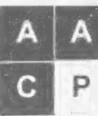

   - (b) 现在采用不同的方法来显示相同的标志。创建一个派生自 `JPanel` 的类 `LetterPanel`。提供一个接受字母和背景颜色作为参数的构造函数并保存它们。让 `LetterPanel` 的 `paintComponent` 方法在指定的背景上绘制字母。将程序内容区域的布局设置为如下 2x2 网格：

     ```java
     Container c = getContentPane();
     c.setLayout(new GridLayout(2, 2, 1, 1));
     ```

     向其添加四个 `LetterPanel` 对象，每个对象对应标志中的一个字母。

6. 修改 5(b) 中的程序以显示具有 8 行 8 列的棋盘图案。使用 8x8 的网格布局，添加交替颜色的面板。提示：参见第 12 章练习题中的问题 14。

   - 创建一个派生自 `JPanel` 的类 `ChessSquare`。提供一个接受背景颜色和布尔标志作为参数的构造函数，该标志指示方格是空的还是包含国际皇后形象的图片。
   - 在网上找到“八皇后问题”（Eight Queens）的描述和解决方案。修改程序以显示该解决方案。提示：创建一个 8x8 的颜色适当的 `ChessSquare` 数组，并在每个面板中相应设置 `hasQueen` 标志以显示皇后：将内容区域的布局设置为 8x8 网格，并将面板添加到网格中。
   - 提供“八皇后问题”的描述和解决方案。提示：将内容区域的布局设置为 8x8 网格并将面板添加到网格中。

# 第 16 章 图形

程序 `Boxes`（`JM\Ch16\Exercises\Boxes.java`）可以以不同的颜色显示不同类型的框（矩形）。用户从“组合框”中选择框的颜色，该框显示了 `Color` 类中所有 13 个预定义的颜色。用户通过勾选填充、圆角和 3D 矩形的选项框来设置框的类型。框类型表示为一个整数，其中各个位在设置为 1 时指示属性：位 0 表示填充，位 1 表示圆角，位 2 表示 3D。例如，值 3（二进制 011）表示一个没有 3D 效果的填充圆角框。

程序 `Boxes` 依赖于派生自 `JPanel` 的 `BoxDrawer` 类。它具有额外方法 `setBoxType(int boxType)`、`setColor(Color color)` 和 `drawBox(Graphics g)`。`BoxDrawer` 还重写了 `paintComponent` 以重绘背景并调用 `drawBox`。编写 `BoxDrawer` 类。如果选择了白色，则在 `paintComponent` 中将背景设置为灰色或黑色。如果同时选择了圆角和 3D 属性，则显示错误信息而不是框。提示：在 `drawBox` 中对 `boxType` 使用 `switch` 语句。

## 练习

1. 对于第一列中的每个 Swing GUI 组件，请标记出第二列中的监听器以及第三列中通常与它们使用的“状态配件”。 ✓

   - (a) `JPanel` < 无 > < 无 >
   - (b) `JLabel` `ActionListener` `isSelected`
   - (c) `JButton` `ItemListener` `getSelectedIndex`
   - (d) `JCheckBox` `Change` `getSelectedItem`
   - (e) `JRadioButton` `getText`
   - (f) `JComboBox` `getValue`
   - (g) `JTextField`
   - (h) `JSlider`
   - (i) `JMenuItem`

2. 请判断对错并阐述原因：
   - (a) 对象的 `actionPerformed` 方法可以被程序中的其他方法直接调用。 ✓
   - (b) 同一个对象可以作为一个组件的动作监听器，同时作为另一个组件的项监听器。 ✓
   - (c) 一个按钮可以附加多个不同的动作监听器。 ✓
   - (d) 一个对象可以作为自身的动作监听器。

3. 编写一个程序，为你在第 6 章第 11 题中二次公式代码提供 GUI 前端。

4. 编写一个 GUI 应用，实现第 12 章第 24 题中所述的“大整数”加法。

# 第 17 章 GUI 组件与事件

## 练习

5. (a) 在第 16 章第 5 题的 `Boxes` 程序（`JM\Ch16\Exercises\Boxes.java`）中，添加一个仅包含两个项目的单菜单栏：“增大尺寸”和“减小尺寸”。当点击这些项目时，它们应该将当前框的尺寸增加或减小 10%。修改 `BoxDrawer` 类（你第 16 章第 5 题的解决方案）以支持此功能。

   (b) 将圆角复选框和 3D 复选框合并为一组（`ButtonGroup` 对象），以便它们不能同时被选中。通常此类组与单选按钮一起使用（见附录 D）；但也适用于复选框。

6. * 创建以下 GUI 布局：

   | 英语: | |
   |---|---|
   | 葡萄牙语: | |
   | 翻译 | |

   提示：将两个标签放在一个具有 2x1 网格布局的面板上。使用右对齐的标签 `JLabel(<text>, null, JLabel.RIGHT)`。（除了 `null`，你可以放一个显示该语言国旗或标志的图标。）将输入字段放在另一个 2x1 面板上。将这两个面板放入一个中间带有间隙的水平框容器中；将此框容器和“翻译”按钮放入一个周围带有间隙的垂直框容器中。这只是其中一种方法。

7. * (a) 创建以下 GUI 布局：

   | 小号 | 额外奶酪 |
   | 中号 | 蘑菇 |
   | 大号 | 意大利肠 |

   提示：将所有单选按钮放在一个面板，将所有复选框放在另一个面板，每个面板都采用 3x1 网格布局。通过调用 `setBorder` 方法为每个面板添加边框。例如：

   ```java
   import javax.swing.border.*;
   // ... 其他语句
   CompoundBorder border = new CompoundBorder(
       new LineBorder(Color.BLACK, 1),
       new EmptyBorder(6, 6, 6, 6)
   );
   // 外边框：黑色，1 像素厚
   // 内边框：空，上、左、下、右各 6 像素
   panel.setBorder(border);
   ```

   将两个面板放入一个水平框容器，并在中间以及左右两侧添加间隙。将单选按钮合并为一组（见附录 D）。 ✓

   (b) 在右侧添加一个“外带”的 `JToggleButton`，初始设置为“否”。 ✓

8. ◆ 创建一个键盘程序。该程序可以作为不同型号计算器的基础。首先运行编译版本（`JM\Ch17\Exercises\Keypad.jar`）。程序包含两个类：`Keypad` 和 `DigitalDisplay`。`Keypad` 是主类。它的构造创建一个 `DigitalDisplay` 类型的显示对象。通过扩展 `JTextField` 编写 `DigitalDisplay` 类。使 `DigitalDisplay` 实现 `ActionListener` 并让 `display` 作为所有按钮的动作监听器。“C”按钮清除显示器；任何其他按钮会将按钮的文本附加到当前显示文本。例如：

   ```java
   JButton b = (JButton)e.getSource();
   String str = b.getText();
   // ... 等
   ```

   让 `display` 的构造函数配置显示器：宽敞的深绿色背景（RGB 50, 200, 50），白色或黄色的前景。将其设置为不可编辑以防止无关的键盘输入。设置文本为右对齐：

   ```java
   setHorizontalAlignment(JTextField.RIGHT);
   ```

   在程序中设置显示器的首选尺寸，并在左右侧添加一个空边框使其更好看。例如：

   ```java
   import javax.swing.border.*;
   // ... 等
   display.setPreferredSize(new Dimension(width, width/6));
   display.setBorder(new EmptyBorder(0, 10, 0, 10));
   // 上、左、下、右
   ```

   同时将 `display` 的字体设置为固定的等宽字体（与宽度成比例）。在 `DigitalDisplay` 的构造函数中设置显示尺寸、边框和字体是一个好主意吗？解释原因。

   在 `Keypad` 类中，将所有按钮放在一个 4x3 的网格上，之间留有空间。在按钮上方添加显示字段。

   - 提示：将显示器和按钮面板放入一个垂直框容器。

# 第 18 章 鼠标、键盘、声音与图像

## 练习

4. 让第 17 章第 5 题中的 `Boxes` 程序对光标方向键做出响应；使用方向键使方框沿垂直或水平方向移动；在按住 `Ctrl` 键的同时使用方向键在垂直或水平方向上拉伸或压缩 `BoxDrawer`。使用 `Boxes.java` 并更新光标（来自你在第 17 章第 5 题的解）。提示：让 `BoxDrawer` 类实现 `KeyListener`；让 `canvas` 成为它自己的按键监听器，在 `BoxDrawer` 的 `paintComponent` 方法中请求获取焦点（`requestFocus`）。

5. 编写一个程序，当按下按键时显示该按键的名称及其十六进制代码。提示：`KeyEvent` 类有一个静态方法 `getKeyText(int keyCode)`，它返回一个描述该按键的字符串。

6. 编写一个派生自 `JPanel` 的类 `ImagePanel`，在中心位置显示图像。提供一个以图像文件名作为参数的构造函数。添加 `main` 方法，提示用户输入图像文件名（或从命令行参数获取），创建一个窗口，然后将带有给定图像的 `ImagePanel` 打开到窗口的内容面板，最后在屏幕上打开窗口。

7. 创建一个 applet，以“幻灯片”的形式显示一系列图像。添加一个组合框来选择图像。再添加“前进”和“后退”按钮（带有相应的图标）用于进入下一张或上一张幻灯片。（在互联网上寻找免费的左右图标。）当序列到达末尾时，它应该从头重新开始。“后退”按钮也是：当序列到达开头时，它应该再次重新开始。将这些控件放置在一个控制面板上，并在控件上方的独立面板上显示图像。调整第 6 题中的 `ImagePanel` 类，添加一个公共方法 `setImage(Image img)`。使用 `JM\Ch18\Exercises` 中的 `TestSlides.html` 文件和一些图像文件来测试你的 applet。

   > 提示：applet 可以从 `param` 标签中检索图像文件名。例如：

   ```java
   private String[] imageNames;
   imageNames = getParameter("SLIDES").split("\\s+");
   // 从 param 中的字符串提取
   // 由空白字符分隔的标记。
   // "\\s+" 是表示
   // “任意数量的空白字符”的正则表达式
   ```

# 第 19 章 算法的 Big-O 分析

## 目录

- 19.1 引言 446
- 19.2 Big-O 概念 448
- 19.3 排序算法的 Big-O 455
- 19.4 总结 459
  - 练习题 461

## 19.1 引言

本章开启我们对一系列数据结构的讨论，这些结构构成了软件设计和开发中的标准工具集。它们包括列表、栈、队列、二叉树、优先级队列、哈希表和其他结构。

> 数据结构将数据组织与访问和操作数据的方法相结合起来。

例如，当我们提供插入、查找和删除值的方法时，数组就变成了一个存储值列表的数据结构。类似的功能也可以通过链表实现（我们将在第 21 章解释链表）。在非常抽象的层面上，我们可以考虑一种通用的“列表”数据结构：一组按顺序排列的值；我们可以向列表中添加值、在列表中查找目标值并从列表中删除值。这种对存储数据以及可以在该数据上执行的操作的通用抽象描述被称为抽象数据类型（ADT）。

我们正在学习的数据结构并不是 Java 特有的——它们可以在任何编程语言中实现。在 Java 中，数据结构可以被描述为一个接口并实现为一个类。同一种抽象数据类型可以有若干种实现方式。例如，`java.util.ArrayList` 和 `java.util.LinkedList` 都实现了 `java.util.List` 接口。

在继续学习数据结构之前，我们需要获取一些关于如何评估和比较算法效率的背景知识。算法和数据结构通常根据时间复杂度进行分析。复杂度是计算机科学的一个分支。在本书中，我们关注时间效率。


正如我们在第 14 章中看到的，衡量算法效率的一种方法是实现程序，在不同的输入集上运行程序并测量时间。这似乎为 Big-O 留下了余地，但这种印象是不正确的。在忽略特定的计算机系统（如 CPU 速度等）的情况下，Big-O 概念服务此目的。算法的理论研究依赖于对具有某些能力的抽象模型，这种模型忽略了具体的细节和内存大小。理论分析需要两个简化：首先，什么是“步”取决于任务的性质。例如，在搜索中，我们将目标值与值的比较定义为一步。第二个简化是，我们的分析仅适用于任务规模很大时。我们将算法完成任务所需的总步数标记为 $T(n)$。$T(n)$ 是任务规模 $n$ 的某个函数。我们关注 $T(n)$ 的行为，这被称为渐近行为。在接下来的章节中，我们将看到为什么渐近行为很重要以及如何用数学术语表示它。在本章的剩余部分，我们将讨论 Big-O 的更正式定义，考虑一些示例。

## 19.2 Big-O 概念

作为讨论的起点，让我们比较数组中两种熟悉的搜索算法：顺序搜索和二分查找。我们假设数组中的元素是升序排列的。

回顾顺序搜索算法，我们只是将目标值与每个数组值匹配，直到找到匹配或遍历整个数组。假设该算法实现如下：

```java
for (int i = 0; i < n; i++) {
    if (a[i] == target)
        return i;
}
```

总运行时间包括初始化和循环迭代的时间。（在本例中，初始化仅仅是将 `i` 设置为 0。）假设平均迭代次数为 $n/2$，平均时间可以表示为：

$t(n) = t_{init} + t_{iter} \cdot \frac{n}{2}$

其中 $t_{init}$ 是初始化时间，$t_{iter}$ 是每次迭代所需的时间。换句话说，平均时间是 $n$ 的线性函数：

$t(n) = An + B$

随着 $n$ 的增大，$An$ 也会增大，与线性项 $An$ 相比，即使 $A$ 很小而 $B$ 很大，常数项 $B$ 的相对贡献最终也会变得微不足道。在数学上，这意味着当 $n$ 无限增长时，比率

$\frac{t(n)}{An} = \frac{An + B}{An} = 1 + \frac{B}{An}$

非常接近 $1$。

因此，对于较大的 $n$，我们可以忽略常数项 $B$，并称平均时间 $t(n)$ 大约等于 $An$。这意味着顺序搜索算法的平均时间随 $n$ 线性增长（图 19-1-a）。

现在让我们考虑应用于相同任务的二分查找算法。正如我们在第 14 章所知，比较次数约为 $\log_2 n$。同样，总平均时间由初始化时间和循环的平均迭代次数组成：

$t(n) = t_{init} + t_{iter} \cdot \log_2 n$

按照与顺序搜索相同的推理，我们得出：对于较大的 $n$，二分查找的执行时间大约与 $n$ 的对数成比：

$t(n) = C \log_2 n$

系数 $C$ 由循环迭代 1 次花费的时间决定。图 19-1-b 显示了该曲线的般形状，随着 $n$ 的增加，$\log_2 n$ 趋于无穷大，但其增长速度慢于直线的线性增长。

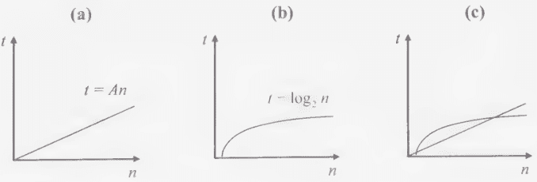

**图 19-1. (a) 线性增长 (b) 对数级增长 (c) 对数增长慢于线性增长**

注意，顺序搜索中的“每一步”与二分查找中的“每一步”并不完全相同，因为除了比较值之外，我们还需要修改变量并控制迭代。因此，系数 $A$ 和 $C$ 可能不同；例如，$C$ 可能大于 $A$。对于某些较小的 $n$，顺序搜索的运行速度实际上可能比二分查找快。但无论 $A$ 与 $C$ 的比例如何，当 $n$ 足够大时，线性曲线就会超过对数曲线（图 19-1-c）。

换句话说，从渐近意义上，二分查找比顺序搜索快。而且，它不仅仅是快 5 倍或 100 倍。它在原理上就是快的：你可以在最快的计算机上运行顺序搜索，在最慢的计算机上对相同任务运行二分查找，只要 $n$ 足够大，二分查找仍然先完成。

这是一个重要的理论结果。这两种搜索算法在渐近行为上的差异为观察它们的性能提供了一个重要的新方法。二分查找的时间呈对数增长，而顺序搜索的时间线性增长，因此无论我们使用的函数具体系数是多少，时间最终都会超过对数级时间。

在这种背景下，讨论刻画函数渐近行为的增长阶是有意义的，这忽略了特定的常数系数。例如，$f(n)=n$ 的增长阶高于 $g(n)=\log n$，这意味着对于任何正常数 $k$，无论它多小，

$k \log n < n$

当 $n$ 足够大时成立。两个仅差一个常数倍数的函数具有相同的增长阶。

以下关于大-O（增长阶）的定义有助于我们形式化这一概念，并完善我们对增长阶的理解。“大-O”定义如下：

> 给定两个正函数 $t(n)$ 和 $g(n)$，如果存在正常数 $A$ 和某个数字 $N$，使得对于所有 $n>N$，$t(n)\le Ag(n)$，则我们称 $t(n)=O(g(n))$。

大-O 定义基本上意味着 $t(n)$ 渐近地（对于足够大的 $n$）增长速度不快于 $g(n)$（考虑常数倍数的差异）。换句话说，$t(n)$ 的增长阶不大于 $g(n)$。严格来说，$O(g)$ 意味着“$f$ 的增长阶小于或等于 $g$”。

在实践中，当用大-O 表示算法性能时，通常指的是最低可能的大-O 上限。在书中，我们选择遵循这种广泛接受的做法，并使用 $f=O(g)$ 表示“$f$ 的增长阶等于 $g$”。

例如，在我们对搜索算法的分析中，我们可以说顺序搜索的最坏情况和平均时间都是 $O(n)$，而二分查找是 $O(\log n)$。我们去掉了对数底数 2，因为根据换底公式，对于 $b>1$，$\log_b n = K\cdot\log n$，其中 $\log$ 是以 10 为底的对数，$K=\frac{1}{\log b}$ 是一个正常数。由于仅差一个正常数倍数的函数具有相同的增长阶，$O(\log_b n)$ 等于 $O(\log n)$。因此，谈论对数增长时，对数的底并不重要，我们简单地说 $O(\log n)$。

一组函数常用于描述增长阶，自然地是 $n$ 的幂：

- $1, n, n^2, n^3, \dots$

$n^k$ 的增长阶高于 $n^{k-1}$。

如果一个函数是几项之和，它的增长阶由增长最快的项决定。因此，任何 $k$ 阶多项式都是 $O(n^k)$：

$p(n)=a_kn^k+a_{k-1}n^{k-1}+\dots+a_0$

让我们考虑一个需要嵌套循环的常见示例：

```java
for (int i = 1; i < n; i++) {
    for (int j = 0; j < i; j++) {
        // something
    }
}
```

外部循环运行 $n$ 次，内部循环运行 $i$ 次。总操作次数之和为 $1+2+...+(n-1) = \frac{n(n-1)}{2}$，即 $O(n^2)$。

书中几乎所有算法的时间效率可以用少数增长函数来刻画：

- **$O(1)$ —— 常数时间**。这意味着无论任务大小如何，算法所需的步数都是相同的。
  - 在排序数组中查找中位数
  - 高效实现的栈的推入和弹出操作
  - 队列（第 22 章）

- **$O(\log n)$ —— 对数时间**。
  - 有序列表二分查找
  - 在具有 $n$ 个节点的二叉树中查找目标值（第 24 章）
  - 具有 $n$ 个节点的堆实现的优先级队列的添加和删除操作（第 26 章）

- **$O(n)$ —— 线性时间**。这意味着算法所需的步数与任务大小成正比。
  - 遍历包含 $n$ 个元素的列表（例如，寻找最大值）
  - 迭代计算阶乘或第 $n$ 个斐波那契数
  - 遍历具有 $n$ 个节点的二叉树（第 24 章）

- **$O(n \log n)$ —— “n log n” 时间**。
  - $n$ 个元素的归并排序和快速排序
  - 堆排序（第 26 章）

- **$O(n^2)$ —— 平方时间**。操作次数与任务大小的平方成正比。
  - 更简单的排序算法，例如 $n$ 个元素的选择排序
  - 遍历 $n \times n$ 的二维数组
  - 在无序元素列表中查找重复元素（使用嵌套循环实现）

- **$O(a^n)$（$a > 1$）—— 指数级时间**。
  - 递归计算第 $n$ 个斐波那契数（$a \ge 3/2$，见第 23 章）
  - 解决汉诺塔问题（$a = 2$，见第 23.5 节）
  - 生成 $n$ 个符号的所有可能排列

上述列表中最好的时间是常数时间，最差的是指数级时间，即使对于相对较小的 $n$，指数级增长也会让最快的计算机也于不堪。与指数增长相比，多项式增长（线性、二次、立方等）被认为是可以接受的。

图 19-2 显示了上述函数的渐近行为。

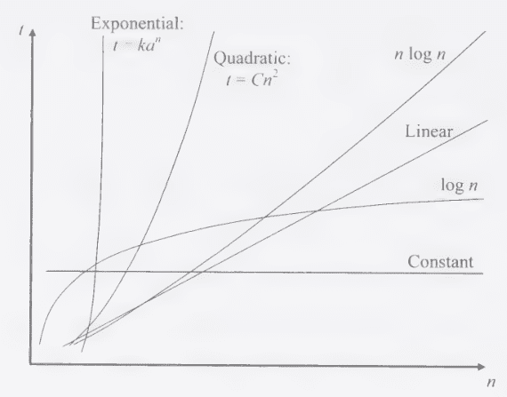

**图 19-2. 增长速率**

非正式地使用“<”符号，我们可以说：

$O(1) < O(\log n) < O(n \log n) < O(n^2) < O(n^3) < O(a^n)$

$\log n$（与线性增长相比）缓慢的渐近增长尤为显著：任务规模每增加千倍，所需的操作次数仅增加一个固定且很小的增量。考虑以下内容：

$\log_2 1000 \approx 10; \log_2(10^6) \approx 20; \log_2(10^9) \approx 30; \dots$

这一属性用于许多高效的“分治法”算法（如二分查找），并是使用二叉搜索树和堆的基础。

## 19.3 排序算法的 Big-O

在本节中，我们将快速复习学习过的排序算法，并更正式地讨论它们的 Big-O 属性。

通常，排序任务被理解为将列表的值按升序（或降序）重新排列。该任务的标准抽象表述假设我们需要比较列表中的两个值来决定哪一个较小。重要的是每次比较的结果，而不是值本身。正如我们在第 25 章的题 4 中将所示，像基数排序这样的方法允许我们使用某种查找表在不进行任何比较的情况下对数组进行排序。这些方法依赖于列表中值的范围和“组成”信息。例如，如果我们知道值的范围在 0 到 9 之间，我们只需统计每个值出现的次数，然后按顺序重建列表。此类算法的性能是 $O(n)$。但这里处理的是需要实际比较的算法。

从数学上说，我们假设有一个对象列表 $X=\{x_1, x_2, \dots, x_n\}$，并且在 $X$ 上定义了一个序关系 $<$。如果对于 $X$ 中的任意两个值 $a$ 和 $b$，三种可能性中恰好有一个成立：要么 $a < b$，要么 $b < a$，或者 $a = b$，则该关系称为全序。序关系必须具有传递性：如果 $a < b$ 且 $b < c$，则 $a < c$。排序算法是一种寻找索引排列 $p(0), p(1), \dots, p(n-1)$ 的策略，使得：

$x_{p(0)} \leq \dots \leq x_{p(n-1)}$

（排列是从整数集合 $\{0, 1, 2, \dots, n-1\}$ 到其自身的一一映射）。

排序策略基于对值的两两比较。决定下一次比较哪对值可能基于之前所有比较的结果。就用这些术语来说，我们排序得有多快？显然，如果我们将每个值与其他所有值进行比较，将需要 $n^2$ 次比较。正如我们所知，归并排序和快速排序仅需 $O(n \log n)$ 次比较即可完成任务。我们还能做得更好吗？答案是不可能的。

> 如果我们局限于“诚实”的比较排序，那么任何排序算法在最坏情况下至少需要 $O(n \log n)$ 步。

为了证明这一点，将我们的排序算法想象成一个决策树：在每个节点中，我们比较两个值，然后根据结果向左或向右（图 19-3）。我们将在第 24 章讨论树结构及其属性。这里只需要知道一个简单的事：在树中，从根到任何叶节点（终端节点）只有一条路径；如果从根到叶的最长路径长度为 $h$，则不同路径的总数不超过 $2^h$。

在我们的决策树中，每条路径的终点对应列表值的一种排列，最坏情况下的比较次数是最长路径的长度。为了使算法完整，所有可能的排列都必须被表示。因此，所有可能的排列数 $n!$ 不应超过决策树中的叶节点数：$n! \le 2^h$。

例如，对于 $n=4, n!=24, \log_2 24=4.58\dots$，最佳算法需要 5 次比较；对于 $n=5$，它需要 7 次比较。确实存在一种对 5 个值进行 7 次比较的算法，但这显而易见。渐近来看，$\log_2(n!)=n\log n$，因此更快的排序是不可能的。

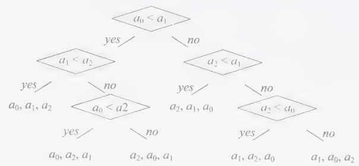

**图 19-3. 作为决策树的排序算法。渐近来看，$\log_2(n!)=n\log n$，因此更快的排序是不可能的。**

## 19.4 总结

算法的效率通常用任务规模趋向于无穷大时的渐近增长率来表示。任务的大小基本上是一个直观的概念：它反映了涉及的元素数量或其他类似的参数。渐近增长可以使用大 O 表示表示，它提供了增长阶数的上界。在实践中，大 O 估计通常表示为可能的“最紧密”上界。

最常见的增长阶（按增加顺序排列）有：

- $O(1)$ — 常数级；
- $O(\log n)$ — 对数级；
- $O(n)$ — 线性级；
- $O(n \log n)$ — “n log n”；
- $O(n^2)$ — 平方级；
- $O(a^n)$ — 指数级。

对数级增长远慢于线性增长。这解释了“分治法”算法（如二分查找）以及二叉树和堆（第 24 章和第 26 章）的效率。对于某些任务，发现一个 $O(\log n)$ 算法而不是 $O(n)$ 算法，或者发现一个 $O(n \log n)$ 算法而不是 $O(n^2)$ 算法，被合理地视为时间效率上的突破。指数级增长是不可接受的：它会迅速让即使是规模很小的任务也超出现有计算机的处理能力。

排序算法为公式化和研究算法的通用属性以及比较算法的效率提供了一个肥沃的领域。简单的排序算法，如计数排序、选择排序和插入排序，在 $O(n^2)$ 次比较内完成任务，尽管插入排序在应用于已排序或几乎排序的数组时其运行速度可能更快。更高级的算法，如合并排序、快速排序和堆排序，在 $O(n \log n)$ 次比较内完成任务。

排序是一个经过充分研究的主题。有数百种其他算法和变体。没有单一的“最佳”排序算法。在现实世界中，选择取决于目标数据的特定属性以及额外的约束和要求。

表 19-1 显示了我们讨论过的算法的平均、最好和最坏情况。通常，最坏情况假设算法运行在处理时间最长的数据集上。

| 算法 | 最好情况 | 平均情况 | 最坏情况 |
| --- | --- | --- | --- |
| 顺序查找 | $O(1)$ — 立即找到 | $O(n)$ — 平均在中间找到 | $O(n)$ |
| 二分查找 | $O(1)$ — 立即找到 | $O(\log n)$ | $O(\log n)$ |
| 选择排序 | $O(n^2)$ | $O(n^2)$ | $O(n^2)$ |
| 插入排序 | $O(n)$ — 数组已排序 | $O(n^2)$ | $O(n^2)$ |
| 合并排序 | $O(n \log n)$，或在数组已排序的略微修改版本为 $O(n)$ | $O(n \log n)$ | $O(n \log n)$ |
| 快速排序 | $O(n \log n)$ | $O(n \log n)$ | $O(n^2)$ — 基准始终选择在远离中位数的地方，例如数组已排序且选择第一个元素作为基准 |
| 堆排序 | $O(n \log n)$ | $O(n \log n)$ | $O(n \log n)$ |

**表 19-1 排序和查找的最好、平均和最坏情况**

## 练习题

1. 判断对错并解释：
   - (a) 我们经常说 $f=O(g)$ 来表示 $f$ 和 $g$ 的增长阶相同。
   - (b) $\log_2 n=O(\log_{10} n)$。
   - (c) 如果 $f(n)=1+2+...+n$，则 $f(n)=O(n^2)$。

2. 假设经过了合理的优化，执行以下任务所需的操作数的大 O 是多少？
   - (a) 转置一个 $n \times n$ 矩阵（沿对角线对称翻转一个 $n \times n$ 的二维数组）
   - (b) 反转一个包含 $n$ 个元素的数组
   - (c) 在长度为 $n$ 的字符字符串中查找连续双字母对的对数

3. 以下方法的最坏情况运行时间（以 $n$ 为变量的大 O）是多少？

```java
public int maxCluster(double[] v, double d) {
    int n = v.length, maxCount = 0;
    for (int i = 0; i < n; i++) {
        int count = 0;
        for (int j = 0; j < n; j++) {
            if (v[i] == v[j]) {
                count++;
            }
        }
        if (count > maxCount)
            maxCount = count;
    }
    return maxCount;
}
```


```java
public boolean isPalindrome(String w) {
    int n = w.length(), i = 0, j = n-1;
    while (i < j && w[i] == w[j]) {
        i++;
        j--;
    }
    return i >= j;
}
```

(c) ✓

```java
public double pow(double x, int n) {
    double y = 1;
    if (n > 0) {
        y = pow(x, n/2);
        if (n % 2 != 0)
            y *= x;
    }
    return y;
}
```

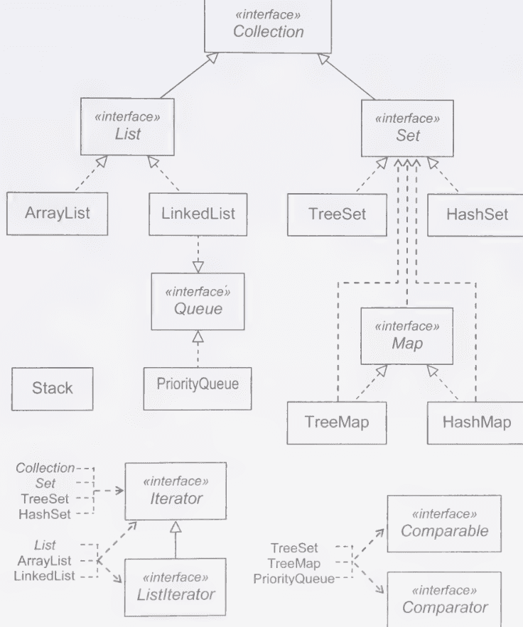

图 20-1. Java 集合框架的一部分

# 第 20 章 Java 集合框架

> 如果你的类使用了 Java 集合，请在源文件顶部添加相应的导入语句或 `import java.util.*;`。

## 20.2 集合 Collection 与 迭代器 Iterator

`Collection<E>` 接口表示任何类型为 `E` 的元素集合。`E` 是一个类型参数——它可以代表任何类型的对象。Java API 文档使用字母 "E" 作为该参数的名称，我们也是。

常用的 `Collection<E>` 方法如图 20-2 所示。

```java
boolean isEmpty(); // 如果此集合为空，则返回 true；否则返回 false。
int size(); // 返回此集合中的元素数量。
boolean contains(Object obj); // 如果此集合包含与 object 相等的元素，返回 true；否则返回 false。
boolean add(E obj); // 将 obj 添加到此集合中。如果成功则返回 true；否则返回 false。
boolean remove(Object obj); // 如果存在，删除第一个与 obj 相等的元素。如果成功则返回 true；否则返回 false。
Iterator<E> iterator(); // 返回此集合的迭代器。
```

图 20-2. `java.util.Collection<E>` 接口的一些方法

`contains` 和 `remove` 方法依赖于对类型 `E` 对象最合适的 `equals` 方法。

程序员有责任针对特定类型 `E` 重写 `Object` 类的 `equals` 方法，以提供一个合理的版本。

- （迭代器中）为特定集合的迭代器产生的序列中的第一个元素。

`add` 方法将一个类型为 `E` 的对象添加到集合中。

> Java 集合仅对对象有效——它们不支持基本数据类型。如果你想让集合持有基本数据类型的值，你需要创建一个对应相应包装类对象的集合，并在将每个值添加到集合之前，为每个值创建一个包装对象。

例如，如果你想在 `ArrayList` 中存储 `double` 类型的值，你需要创建一个 `ArrayList<Double>`！

```java
ArrayList<Double> list = new ArrayList<Double>();
list.add(new Double(5.1));
...
```

实际上，如果你不显式地进行包装，编译器会为你完成。你只需要写写：

```java
list.add(5.1);
```

从 Java 5.0 开始，在适当的情况下，基本数据类型的值会自动转换为相应包装类型的对象。这一特征被称为自动装箱（autoboxing）或自动拆箱（autounwrapping）。

编译器也会为你执行相反的操作。例如，你可以写：

```java
double x = list.get(i);
```

而不是

```java
double x = list.get(i).doubleValue();
```

这被称为自动拆箱。自动装箱和自动拆箱减少了击键次数，并使得在集合中存储数字更容易，因为将大量数字转换为对象会降低代码的效率。

迭代器是一个帮助遍历特定集合的对象。`Iterator<E>` 是一个接口，因为不同的集合实现了不同规则的不同迭代器，且遍历顺序可以不同。实现 `Iterator` 接口的类在各种集合类中被实现为私有内部类。我们稍后的第 20.3 节中给出示例。程序员通过调用特定集合的 `iterator` 方法从该集合获取迭代器。每次遍历都需要获取一个新的迭代器。

到此，这一切看起来相当抽象，实际上它也被设计成这样。当我们学习到特定类型的集合时，我们将看到它们的迭代器是如何工作的。例如，在 `ArrayList` 中，迭代器按照索引顺序遍历元素。

`Iterator<E>` 接口指定了图 20-3 所示的三个方法。

```java
boolean hasNext();          // 如果遍历中还有更多元素可以访问，则返回 true；否则返回 false。
E next();                   // 返回遍历中的下一个元素。
void remove();            // 删除最后访问的元素。
```

图 20-3. `java.util.Iterator<E>` 接口的方法

例如，`ArrayList<String>` 的遍历可以编写如下所示：

```java
ArrayList<String> words = new ArrayList<String>();
Iterator<String> iter = words.iterator();
while (iter.hasNext()) {
    String word = iter.next();
    ... 处理 word
}
```

自 Java 5.0 以来，迭代器的使用频率降低了，因为“for each”循环可以替代迭代器（只要不需要迭代器的 `remove` 方法）。上面的示例可以用“for each”循环更简洁地重写：

```java
ArrayList<String> words = new ArrayList<String>();
for (String word : words) {
    ... 处理 word
}
```

编译器简单地将“for each”循环转换为迭代器调用。（这就是为什么与“for each”循环相关的编译器错误信息有时会提到迭代器。）

我们需要迭代器？例如，为什么 `Collection` 类型类本身不能提供类似 `size`、`next` 和 `remove` 的方法呢？答案是，只要你使用简单的循环，这种方法就会失效。例如，当需要在 `ArrayList` 中查找重复标题时，你需要两个独立的迭代器，一个用于外层循环，一个用于内层循环。

## 20.3 List 与 ListIterator

list 是一个元素按顺序排列的集合（索引从 0 开始）。`List<E>` 接口扩展了 `Collection<E>` 接口，增加了接受索引的方法；图 20-4 显示了其中一些。

| 方法 | 描述 |
| :--- | :--- |
| `boolean isEmpty()` | 如果集合为空，则返回 true；否则返回 false。 |
| `int size()` | 返回此集合中的元素数量。 |
| `boolean contains(Object obj)` | 如果此集合包含与 obj 相等的元素，返回 true；否则返回 false。 |
| `boolean add(E obj)` | 将 obj 添加到集合中。如果成功则返回 true；否则返回 false。 |
| `boolean remove(Object obj)` | 如果存在，删除第一个与 obj 相等的元素。如果成功则返回 true；否则返回 false。 |
| `Iterator<E> iterator()` | 返回此集合的迭代器。 |
| `E get(int i)` | 返回第 i 个元素。 |
| `E set(int i, E obj)` | 替换第 i 个元素并返回旧值。 |
| `void add(int i, E obj)` | 在第 i 个位置插入 obj。集合的大小增加一。 |
| `E remove(int i)` | 删除第 i 个元素并返回其值。集合的大小减一。 |
| `int indexOf(Object obj)` | 返回第一个等于 obj 的元素的索引；如果未找到返回 -1。 |
| `int lastIndexOf(Object obj)` | 返回最后一个等于 obj 的元素的索引；如果未找到返回 -1。 |

图 20-4. `List<E>` 接口的方法

这些方法看起来非常熟悉。我们在第 13 章介绍 `ArrayList` 类时已经讨论过它们。唯一新的方法是 `listIterator` 的重载版本。这些方法返回 `ListIterator`，它是专门用于 `List` 的增强迭代器（`ListIterator<E>`）。`ListIterator<E>` 方法如图 20-5 所示。

```java
boolean hasNext();          // 如果遍历中还有更多元素可以访问，则返回 true；否则返回 false。
E next();                   // 返回遍历中的下一个元素。
void remove();            // 删除最后访问的元素。

int nextIndex();           // 返回将调用 next() 返回的索引。

boolean hasPrevious();      // 如果反向方向还有更多元素可以访问，则返回 true；否则返回 false。
E previous();               // 返回列表的上一个元素。
int previousIndex();       // 返回将调用 previous() 返回的索引。
void add(E obj);          // 在迭代器的当前位置插入 obj。
void set(E obj);           // 将上一次 next() 或 previous() 返回的元素设置为 obj。
```

图 20-5. `java.util.ListIterator<E>` 接口的方法

将列表迭代器作为逻辑上的“光标”放置在列表之前、列表之后或两个连续元素之间，可能是很有用的（图 20-6）。`list.listIterator(0)` 将光标置于第一个元素（索引为 0 的元素）之前。`list.listIterator(list.size())` 将光标置于列表之后。`list.listIterator(i)` 将光标置于索引 i-1 和 i 的元素之间。`next` 方法返回光标位置之后的元素，`previous` 方法返回光标位置之前的元素。

如你所见，`ListIterator<E>` 可以向前或反向遍历列表。要从列表末尾反向遍历列表，只需要获取一个从列表结束开始的迭代器，然后调用 `previous()` 即可。例如：

```java
List<String> movies = new LinkedList<String>();
...
ListIterator<String> iter = movies.listIterator(movies.size());
while (iter.hasPrevious()) {
  String str = iter.previous();
}
```

`ListIterator` 接口还提供了 `add` 方法，它可以在当前光标位置向列表中插入一个元素；以及 `set` 方法，它可以设置上一次由 `next` 或 `previous` 返回元素的值。

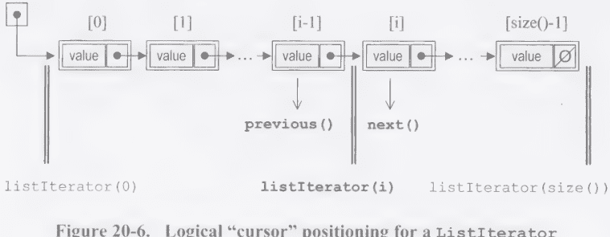

下面的示例展示了如何使用 `ListIterator` 更高效地重写之前示例中的“去重”代码：

```java
ListIterator<String> iter1 = movies.listIterator();
while (iter1.hasNext()) {
  String movie1 = iter1.next();
}

ListIterator<String> iter2 = movies.listIterator(iter1.nextIndex());
// 从 iter1 的当前位置开始内部循环

while (iter2.hasNext()) {
  String movie2 = iter2.next();
  if (movie1.equals(movie2)) {
    System.out.println("Duplicate name: " + movie1);
  }
}
```

## 20.4 列表与 LinkedList

众所周知，列表可以由数组实现——这就是 Java 库类 `ArrayList` 所做的。在 `ArrayList` 中，列表元素存储在连续的内存位置上。这提供了对数组第 i 个元素的直接访问能力。这种属性被称为“随机访问”（random access），它在许多算法中非常重要。例如，二分查找算法需要直接访问两个元素正中间的元素。

然而，`ArrayList` 有两个缺点。首先，在数组开头或某个位置插入或删除元素是低效的——如果数组很大，可能需要移动大量的字节。其次，如果列表超出了分配的空间，它需要分配一个更大的数组并将所有值复制进去，这会消耗时间。

`java.util` 提供了 `List<E>` 接口的另一种实现：`LinkedList<E>` 类。

> `LinkedList<E>` 以双向链的形式实现列表。

在双向链表中，每个元素都包含在一个名为“节点”（node）的较大结构中。除了持有元素的引用外，每个节点还持有指向上一个节点和下一个节点的引用（“链接”）。节点可以分散在内存的任何地方，但每个节点都“知道”如何找到下一个和上一个节点。`LinkedList` 持有指向列表第一个节点（头）和最后一个节点（尾）的引用（图 20-7）。我们将在第 21 章详细讨论链表的实现。

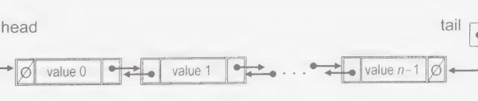

图 20-7. 双向链表

双向链表使得通过只需重新排列几个链接就能轻松地插入或删除节点。对于一个频繁更新的列表来说，这是一个至关重要的属性。此外，链表的节点仅在添加新值时才分配，因此不会为空节点浪费内存，且列表可以根据总内存允许范围任意增长，而无需重新复制。然而，链表的缺点是它不是一个随机访问集合：我们必须从头或从尾遍历列表以获取特定元素。

表 20-1 比较了 `ArrayList` 和 `LinkedList` 中不同方法的平均大-O 运行时间。在 `ArrayList` 中，`get(i)` 和 `set(i, obj)` 方法运行很快，为 O(1)，它们成为处理列表的主要工具。但在 `LinkedList` 中，要访问第 i 个元素，我们必须从头或从尾（取决于哪端靠近第 i 个节点）开始，并遍历节点直到到达第 i 个节点。因此，在 `LinkedList` 中，`get` 和 `set` 方法的平均时间为 O(n)，其中 n 是列表的大小。另一方面，`add(0, obj)` 方法在 `ArrayList` 中需要 O(n) 时间，因为所有元素都需要移动以为新添加的第一个元素留出空间。在 `LinkedList` 中，此方法只需要重新排列几个链接，因此它的常数时间是 O(1)。在 `ArrayList` 和 `LinkedList` 中，在末尾添加元素都花费 O(1) 时间（假设 `ArrayList` 有足够的容量且不需要重新分配）。

| 方法 | ArrayList | LinkedList |
| :--- | :--- | :--- |
| `get(i)` and `set(i, obj)` | O(1) | O(n) |
| `add(i, obj)` and `remove(i)` | O(n) | O(n) |
| `add(0, obj)` | O(n) | O(1) |
| `add(obj)` | O(1) | O(1) |
| `contains(obj)` | O(n) | O(n) |

表 20-1. `ArrayList` 和 `LinkedList` 某些方法的平均时间大-O

必须特别小心 `LinkedList` 的遍历：`get(i)` 消耗 O(n) 时间，使用索引进行简单遍历——

```java
List<E> list = new LinkedList<E>();
for (int i = 0; i < list.size(); i++) {
    E obj = list.get(i);
}
```

会消耗 O(n^2) 时间。（对于 `ArrayList` 来说，这种遍历花费 O(n) 时间，因为它每次迭代都从列表开始。）为了让代码更通用，对 `LinkedList` 使用 for each 循环或迭代器。

```java
for (E obj : list) {
    // ...
}
```

在第 13 章中，我们看到了许多使用 `ArrayList` 的示例。这些示例都可以通过简单将“ArrayList”替换为“LinkedList”来重写。为了方便，`LinkedList` 类提供了六种对链表高效的方法：`addFirst`、`addLast`、`getFirst()`、`getLast()`、`removeFirst()` 和 `removeLast()`（图 20-8）。`ArrayList` 没有这些方法。

图 20-8. `java.util.LinkedList` 中的附加方法

```java
void addFirst(E e);
void addLast(E e);
E getFirst();
E getLast();
E removeFirst();
E removeLast();
```


```java
// 合并两个排序的链表。
// 前提：list1 和 list2 按字母顺序排序。
public static LinkedList<String> merge(
    LinkedList<String> list1, LinkedList<String> list2)
{
    LinkedList<String> result = new LinkedList<String>();

    while (!list1.isEmpty() && !list2.isEmpty()) {
        if (list1.getFirst().compareTo(list2.getFirst()) < 0)
            result.addLast(list1.removeFirst());
        else
            result.addLast(list2.removeFirst());
    }

    // 复制 list1 或 list2 中剩余的元素，如果有
    while (!list1.isEmpty())
        result.addLast(list1.removeFirst());

    while (!list2.isEmpty())
        result.addLast(list2.removeFirst());

    return result;
}
```

图 20-9. 合并两个排序的链表

## 20.4 Stack 类

栈以一种方式存储数据元素，最后存储的值将首先被检索。这种方法有时被称为 LIFO —— 后进先出。栈通过两个操作 `push` 和 `pop` 来控制。`push` 将元素添加到栈顶，`pop` 从栈顶移除元素。元素被认为“在”栈上。你只能访问栈顶的元素。

栈机制对于临时存储非常有用，特别是对于处理嵌套结构和分支过程：表达式中的表达式、方法调用其他方法、图片中的图片、GUI 组件中的 GUI 组件等。栈机制帮助你的程序解开嵌套结构并按正确顺序跟踪其所有的子结构。

栈可以很容易地实现为 `ArrayList`：`push` 在列表末尾添加元素，`pop` 移除最后一个元素。这些操作花费常数时间为 O(1)，因为不需要移动元素。栈也可以使用 `LinkedList` 实现；`push` 会调用 `addLast`，而 `pop` 会调用 `removeLast`（或者对于 `push` 运行 `addFirst`，对于 `pop` 运行 `removeFirst`）。

> 在一个高效实现的栈中，`push` 和 `pop` 操作都需要常数时间，O(1)。

在 Java 集合框架中，栈是由 `Stack` 类实现的。图 20-10 显示了它的部分方法。实际上，正如我们在引言中提到的，`Stack` 扩展了 `Vector`。`Vector` 是动态数组的一种旧实现（`ArrayList` 的前身）。因此，`Stack` 继承了 `Vector` 的所有方法。`Stack` 实现了 `Collection` 接口。所以，除了图 20-10 列出的四个栈特定方法外，`Stack` 类还有许多其他方法。尽管，当你操作栈时，使用迭代器或四个栈方法之外的方法是不恰当的。如果你需要其他方法，不要把它称为栈：请使用 `ArrayList`。

```java
boolean isEmpty(); // 如果此栈为空则返回 true
E push(E obj);     // 将 obj 推入栈中。
E pop();           // 从栈中弹出顶部元素并返回它。
E peek();          // 返回栈顶部的元素但将其从栈中移除。
```

图 20-10. `java.util.Stack<E>` 类的方法

栈方法本身非常直观，但涉及栈的算法可能更难理解。图 20-11 中的示例是一个简单的：它展示了如何使用栈来验证给定表达式（用字符串表示）中的括号和方括号是否匹配。仅计算左括号和右括号的数量是不够的——它们必须按照顺序出现。


```java
// 如果 expr 中的括号和方括号匹配
// 则返回 true；否则返回 false
public static boolean matchParens(String expr)
{
    Stack<Character> stk = new Stack<Character>();

    for (int i = 0; i < expr.length(); i++) {
        char c = expr.charAt(i);

        if (c == '(' || c == '[') {
            stk.push(new Character(c)); // 或者简单地 stk.push(c);
        } else if (c == ')' || c == ']') {
            char c0 = stk.pop(); // 或者简单地 c0 = stk.pop();
            if (c0 == '(' && c != ')') {
                return false;
            }
            if (c0 == '[' && c != ']') {
                return false;
            }
        }
    }

    if (stk.isEmpty()) // 或者简单地：
        return false; // 返回 isNotEmpty(); 
    return true;
}
```

图 20-11. 使用栈的方法示例

## 20.5 队列接口 Queue Interface

在队列集合中，元素的检索顺序与它们存储的顺序相同。这种访问方法被称为 FIFO —— 先进先出（与 LIFO —— 后进先出，栈的访问方法相反）。队列由两个操作控制：`add` 和 `remove`；`add` 在队列尾插入一个值，而 `remove` 从队列头移除一个值。

队列结构通常用于处理按照到达顺序处理但不一定立即处理的事件。事件在等待处理时会在队列中缓冲。一个例子是 Java 程序中的事件处理。由不同对象（GUI 组件、定时器、重绘请求等）生成的事件都会进入事件队列。当程序完成上一个事件时，它从队列中检索下一个事件并将其发送给相应的“监听器”进行处理。

队列在系统级被广泛用于在进程或设备之间缓冲命令或数据。个人计算机有一个实现为环形区的键盘队列。当按下键时，其代码不会直接进入活动程序，而是放在键盘缓冲区中，直到程序请求它。打印机输出也是缓冲的：字符在输出缓冲区中保留，直到打印机准备接收它们。操作系统在其他程序运行时维护一个等待发送到打印机的作业队列。

在 Java 集合框架中，队列由 `Queue` 接口描述。图 20-12 显示了它的部分方法。

```java
boolean isEmpty(); // 如果此队列为空则返回 true
boolean add(E obj); // 将 obj 添加到队列。如果成功返回 true，否则返回 false。
E remove();         // 从队列中移除第一个元素并返回。
E peek();           // 返回队列中的第一个元素但不从队列中移除。
```

图 20-12. `java.util.Queue<E>` 接口的方法

Java 集合框架对普通队列有单独的实现，因为 `LinkedList` 类凭借高效的 `addLast` 和 `removeFirst` 方法是队列的良好实现。`remove()`（无参数）和 `peek()` 满足了 `Queue` 的要求。

## 20.6 优先级队列类 Priority Queue Class

优先级队列是一种不同的队列：元素的移除不是按照到达顺序，而是按照优先级顺序。例如，考虑一个信用卡授权系统，其中待处理的交易被发送到银行总部，以根据其欺诈概率进行审查。

假设优先级队列中的任何两个元素都可以就“优先级”进行比较。在 Java 实现中，假设优先级队列的元素是 `Comparable` 的，或者提供了一个比较器。按照约定，“较小”的元素具有更高的优先级。多个元素可能有相同的优先级。

使用排序列表来实现优先级队列是简单的：`add` 方法在合适的位置插入新元素以保持列表排序，而 `remove` 方法移除第一个元素。在这种实现下，`remove` 需要 O(1) 时间，但 `add` 需要 O(n) 时间。或者，我们可以在一个未排序列表中维护优先级队列：`add` 在末尾添加元素，并在 `remove` 时查找最小元素。这样 `add` 是 O(1)，但 `remove` 是 O(n)。无论哪种方式，其中一个操作都可能成为瓶颈。

有一种方法实现优先级队列，使得 `add` 和 `remove` 都是 O(log n) 时间。这种实现使用了堆，堆是一种特殊的二叉树。（我们将在第 26 章详细讨论。）Java 集合框架中的 `PriorityQueue<E>` 类就是这种实现。

图 20-13. 使用队列实现的

`PriorityQueue` 有其他方法，包括迭代器和 `toString`，但最好避开它们。

> 迭代器或 "for each" 循环访问 `PriorityQueue` 元素的顺序没有特定顺序；`toString` 方法也不会按优先级排列元素。

如果你用 `System.out.println` 打印一个 `PriorityQueue`，你将看到元素以随机顺序列出。

`PriorityQueue` 有一个无参构造函数，它假设优先级队列将持有 `Comparable` 对象。另一个构造函数——

```java
public PriorityQueue(int initialCapacity, Comparator<E> comparator)
```

接受一个比较器作为参数，并使用它来比较元素。

可以使用优先级队列对列表进行排序，方法是先将所有元素插入优先级队列，然后逐个移除它们（图 20-14）。实际上，如果优先级队列是基于堆的，这种排序方法并不坏：它的运行时间复杂度为 O(n log n)。在第 26 章中，我们将讨论更详尽的堆排序算法实现，该实现不需要额外的堆。

```java
// 对 arr 进行升序排序
public static <E> void sort(E[] arr) {
    PriorityQueue<E> q = new PriorityQueue<E>();

    for (E obj : arr) {
        q.add(obj);
    }
    for (int i = 0; i < arr.length; i++) {
        arr[i] = q.remove();
    }
}
```


## 20.7 集合

集合是一个没有重复元素的集合。更正式地说，对于集合中的任何两个元素 x1 和 x2，`x1.equals(x2)` 都返回 `false`。`Set<E>` 接口实现了 `Collection<E>`，但它没有添加任何新方法：它使用不同的名称是为了强调不重复规则。图 20-15 再次列出了一些 Set（Collection）方法，以便方便。

由于我们希望避免集合中的重复元素，`contains` 方法必须是高效的：我们需要快速在集合中搜索目标元素。Java 集合框架包含了两个实现 `Set<E>` 并具有高效搜索能力的类：`TreeSet<E>` 和 `HashSet<E>`。

| 方法 | 说明 |
| :--- | :--- |
| `boolean isEmpty();` | 如果此集合为空则返回 true |
| `int size();` | 返回集合中的元素数量 |
| `boolean contains(Object obj);` | 如果集合包含指定元素则返回 true |
| `boolean add(E obj);` | 将指定元素添加到集合中（如果不存在） |


| 方法 | 说明 |
| :--- | :--- |
| `boolean remove(Object obj);` | |
| `Iterator<E> iterator();` | |
| *从 `Collection<E>` 继承的方法* | |

# 图 20-15 `java.util.Set<E>` 接口的一些方法

`TreeSet<E>` 通过二叉搜索树（BST）实现集合。（BST 在第 24 章中详细讨论。）BST 结合了二分搜索和链式结构的思想，因此元素的插入和删除相对较快。`TreeSet<E>` 类假设类型为 `E` 的对象是 `Comparable` 的，或者为它们提供了比较器并作为参数传递给 `TreeSet` 的构造函数。

> 在 `TreeSet<E>` 中，`contains`、`add` 和 `remove` 方法平均耗时 O(log n)，其中 n 是集合中的元素数量。

> `TreeSet<E>` 的迭代器按升序返回其元素。

在第二种实现 `HashSet<E>` 中，集合的元素存储在哈希表中。（我们将在第 25 章详细讨论哈希表。）基本思想根据每个元素 `hashCode` 方法返回的整数值，将集合中的所有元素分配到小的子集（“桶”）中。这些桶保持较小，因此很容易在桶中找到特定元素。

`HashSet` 对集合元素的可比较性没有任何要求，但它要求元素必须有一个良好的 `hashCode` 方法，以便将它们大致均匀地分布到桶中。

`hashCode` 方法必须与 `equals` 一致：如果 `x1.equals(x2)` 为 `true`，那么 `x1.hashCode() == x2.hashCode()` 必须成立。换句话之，相等的元素应该一致地哈希到表中同一个桶中。`hashCode` 是 `Object` 提供的方法，但那些对象可能被存放在 `HashSet` 中的类通常会重写它。

> 在 `HashSet<E>` 中，`contains`、`add` 和 `remove` 方法的耗时间为 O(1)。

> `HashSet` 的迭代器按无特定顺序返回元素。

你可能会疑惑：既然我们有了 `HashSet` 这种更快的实现，为什么还要使用 `TreeSet` 呢？答案是 `TreeSet` 并没有慢多少（回想一下二分搜索——对于 1,000,000 个元素只需要 20 次比较），而且它有自己的优势：它的迭代器按升序返回元素。此外，`HashSet` 可能会浪费空间。

```java
// 返回所有不超过 n 的质数集合
public static TreeSet<Integer> allPrimes(int n) {
    TreeSet<Integer> primes = new TreeSet<Integer>();

    for (int k = 2; k <= n; k++) {
        boolean hasPrimeFactors = false;

        // 检查目前发现的质数中
        // 是否有 k 的因子：
        for (int p : primes) { // 装箱
            if (k % p == 0) {
                hasPrimeFactors = true;
                break;
            }
            if (p * p >= n) { // p 的值来自 TreeSet
                // 是升序排列的；不需要
                // 检查 sqrt(n) 之外，因为
                // 如果 p 是因子，那么 n/p 也是
                break;
            }
        }
        if (!hasPrimeFactors) {
            primes.add(k); // 装箱
        }
    }
    return primes;
}
```

# 图 20-16 使用 `TreeSet` 的示例

图 20-16 显示了如何使用 `TreeSet` 生成一个所有不超过 n 的质数组成的集合。

# 488 第 20 章 ~ JAVA 集合框架

## 20.8 映射 (Maps)

Map 不是集合；它代表了从键（keys）到值的映射。在 Java 框架中，Map 由 `Map<K, V>` 表示，其中 K 是键的类型，V 是值的类型。Map 非常常见：例如，映射到上（mapped onto）。

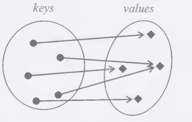

# 图 20-17 从键到值的映射

Java 集合框架提供了 `Map<K, V>` 的两种实现：`TreeMap<K, V>` 和 `HashMap<K, V>`。`TreeSet` 基于二叉树，而 `HashMap` 基于哈希表。

| 方法 | 说明 |
| :--- | :--- |
| `boolean isEmpty();` | 如果此 map 为空，返回 true；否则返回 false。 |
| `int size();` | 返回此 map 中键值对的数量。 |
| `V get(Object key);` | 返回与键关联的值。 |
| `V put(K key, V value);` | 将值与键关联；返回之前与键关联的值（如果没有则返回 null）。 |
| `V remove(Object key);` | 从此 map 中移除键值对；返回之前与键关联的值。 |
| `boolean containsKey(Object key);` | 如果键在键集中，返回 true；否则返回 false。 |
| `Set<K> keySet();` | 返回此 map 中所有键的集合。 |

在 `TreeMap` 中，`get`、`put` 和 `containsKey` 方法耗时 O(log n)，在 `HashMap` 中耗时 O(1)，其中 n 是 map 中键值对的数量。

对于 `TreeMap`，`keySet().iterator()`（或用于键的“for each”循环）将按升序遍历键。

```java
Map<String, Integer> map = new TreeMap<>();
for (String key : map.keySet())
    System.out.println(key + " = " + map.get(key));
```

# 图 20-18 `java.util.Map<K, V>` 接口的一些方法

如果你需要遍历所有的键值对，请使用键集合的迭代器：注意 map 没有 `iterator` 方法。为了避免代码重复，Java 开发者实际上将 `TreeSet` 和 `HashSet` 分别实现为 `TreeMap` 和 `HashMap` 的特殊类，其中所有的键都映射到同一个对象。`TreeSet` 和 `HashSet` 拥有一个 `map` 字段，它们的方法通过该字段进行。这一技术细节对你使用这些类没有影响。

# 图 20-19 使用 `TreeMap` 的代码示例。

## 20.8 ~ MAPS 489

```java
// 几个人的名字和他们的生日
// 存储在两个“并行”数组中：
String[] names = {"Tom", "Lena", "Zoe", "Aaron"};
String[] bdays = {"Jun 11", "May 5", "Jun 11", "Oct 22"};
```

```java
// 上面的表示方法既繁琐又容易出错。
// 将这些数据放入 map 中，将名字作为键（key），
// 将生日作为值（value）：
Map<String, String> map = new TreeMap<String, String>();
// 我们选择 TreeMap 是因为我们希望// 按字母顺序打印名字。
```

```java
for (int i = 0; i < names.length; i++)
    map.put(names[i], bdays[i]);
```

```java
// 让我们打印这个 map：
System.out.println(map);
// 输出将是：
// {Aaron=Oct 22, Lena=May 5, Tom=Jun 11, Zoe=Jun 11}
```

```java
// 现在让我们看看这个 map 中是否有任何两个人的生日
// 相同。为了做到，我们将所有生日放入一个集合（set）中
Set<String> bdaysSet = new HashSet<String>();
// 在这里选择 HashSet 而不是 TreeSet
// 没有什么特殊的原因。
```

```java
for (String name : map.keySet())
    bdaysSet.add(map.get(name));
```

```java
System.out.println("至少有两个人的生日相同：" + 
    (bdaysSet.size() < map.size()));
```

```java
// 一个“随机”事实：在任何 23 人的随机小组中，
// 至少有两个人拥有相同的生日概率大于
// 0.5。
```

> 图 20-19. 使用 map 的代码示例

这结束了我们对 Java 集合框架的简要介绍。表 20-2 总结了我们学到的内容。

## Collection<E>

| 方法 | 说明 |
| :--- | :--- |
| `boolean isEmpty()` | |
| `int size()` | |
| `boolean contains(Object obj)` | |
| `boolean add(E obj)` | |
| `boolean remove(Object obj)` | |
| `Iterator<E> iterator()` | |

| 实现 | `ArrayList<E>` | `LinkedList<E>` |
| :--- | :--- | :--- |
| `Collection<E>` 的方法，包括： | | |
| `boolean add(E obj)` | O(1) | O(1) |
| `boolean remove(E obj)` | O(n) | O(n) |
| `boolean contains(E obj)` | O(n) | O(n) |
| `List<E>` 特有的方法： | | |
| `E get(int i)` | O(1) | O(n) |
| `E set(int i, E obj)` | O(1) | O(n) |
| `void add(int i, E obj)` | O(n) | O(n) |
| `E remove(int i)` | O(n) | O(n) |
| `ListIterator<E> iterator()` | | |
| `ListIterator<E> iterator(int i)` | | |
| 仅 `LinkedList<E>` 中的额外方法： | | |
| `E getFirst(E obj)` | O(1) | |
| `E getLast(E obj)` | O(1) | |
| `void addFirst(E obj)` | O(1) | |
| `void addLast(E obj)` | O(1) | |
| `E removeFirst(E obj)` | O(1) | |
| `E removeLast(E obj)` | O(1) | |

| 实现 | 说明 |
| :--- | :--- |
| `Stack<E>` | |
| `boolean isEmpty()` | O(1) |
| `E peek()` | O(1) |
| `E push(E obj)` | O(1) |
| `E pop()` | n/a |

表 20-2. Java 集合框架总结——续

## 20.8 ~ MAPS 491

| 实现 | `LinkedList<E>` | `PriorityQueue<E>` |
| :--- | :--- | :--- |
| 约束 | | `E` 实现 `Comparable`（或提供了比较器） |
| `boolean isEmpty()` | O(1) | O(1) |
| `E peek()` | O(1) | O(log n) |
| `boolean add(E obj)` | O(1) | O(log n) |
| `E remove()` | | |

| 实现 | `TreeSet<E>` | `HashSet<E>` |
| :--- | :--- | :--- |
| 约束 | `E` 实现了 `Comparable`（或提供了比较器） | 为 `E` 重新定义了 `equals` 和 `hashCode`。 |
| 迭代器顺序 | Iterator 按顺序遍历集合 | Iterator 不按特定顺序遍历集合。 |
| `Collection<E>` 方法，包括： | | |
| `boolean add(E obj)` | O(log n) | O(1) |
| `boolean remove(Object obj)` | O(log n) | O(1) |
| `boolean contains(Object obj)` | O(log n) | O(1) |

| 实现 | `TreeMap<K,V>` | `HashMap<K,V>` |
| :--- | :--- | :--- |
| 约束 | `K` 实现了 `Comparable`（或提供了比较器） | 为 `K` 重新定义了 `equals` 和 `hashCode`。 |
| `boolean isEmpty()` | O(1) | O(1) |
| `int size()` | O(1) | O(1) |
| `V get(Object key)` | O(log n) | O(1) |
| `V put(K key, V value)` | O(log n) | O(1) |
| `V remove(Object obj)` | O(log n) | O(1) |
| `boolean contains(Object obj)` | O(log n) | O(1) |
| `Set<K> keySet()` | | |

表 20-2. 集合框架总结

## 20.9 ~ 案例研究与实验：交易所

### JAVA 集合框架

在本节中，我们考虑一个微型交易所。交易者可以下单和卖出，指定限价订单的价格或选择市场订单。每个订单只涉及一种股票。订单持有六项信息：下单交易者的引用、股票代码、买/卖出指示、所需的股份数量、市场/限价指示以及价格。

SafeTrade 维护一个注册交易者列表并允许他们登录交易。程序跟踪活跃的买卖订单。当新订单进入时，SafeTrade 会检查是否可以执行，如果是，则执行订单并向双方发送报告。在 SafeTrade 中，所有订单都是部分性的。这意味着如果无法执行请求的所有股份，将执行最大可能的数量，剩余订单将保持活跃。

交易者还可以请求股票报价。报价包括最后成交价、当前最高买价和最低卖价、当日最高价和最低价，以及成交量（即当天交易的股份总数）。在我们的模型中，“一天”指的是程序的运行一次。

一看，这似乎是一个很大的项目。但事实证明，通过仔细的规划和对要求的理解，代码量相对较少。代码简单，由许多小部分组成，可以由一个程序员或一个程序员团队处理。我们贡献了主类和几个 GUI 类。

要运行可执行程序，请在 IDE 中创建一个项目，并包含 JM\Ch20\SafeTrade 中的 `SafeTrade.java` 和 `SafeTrade.jar` 文件。（实际上，SafeTrade.jar 是一个可运行的 jar 文件，因此你只需要双击 `SafeTrade.jar` 即可运行它。）

SafeTrade 的 `main` 方法创建了一个 `StockExchange` 和一个 `Brokerage` 并打开了 `LoginWindow`。为了方便程序测试，`main` 还在 `StockExchange` 上列出了几只股票——

```java
StockExchange exchange = new StockExchange();
server.listStock("GWPF", "GridWorldProductions.com", 12.33);
server.listStock("NSTL", "Nasty Loops Inc.", 0.25);
server.listStock("Giggle.com", 28.00);
server.listStock("MATI", "M and A Travel Inc.", 28.20);
server.listStock("DDIC", "Dulce Leche Corp.", 57.50);
server.listStock("SOFT", "SafeTrade Inc.", 322.45);
```

——并在 `Brokerage` 中注册了两个交易员：

```java
Brokerage safeTrade = new Brokerage(exchange);
safeTrade.addUser("stockman", "sesame");
safeTrade.login("stockman", "sesame");
safeTrade.addUser("mstrade", "bigsecret");
safeTrade.login("mstrade", "bigsecret");
```

我们为 SafeTrade 设计的流程包含四个部分。第一部分是结构设计，确定程序中将使用哪些数据结构。第二部分是面向对象的设计，确定要定义的对象类型以及类和接口。第三部分是详细设计，确定所有类中的字段、构造函数和方法。第四部分是制定测试计划。我们将首先讨论结构设计，然后是相关的类，之后是详细设计和测试。

# 1. 结构设计

我们的结构设计决策总结在表 20-3 中。我们很幸运可以使用本章中讨论的许多集合类。

| 数据 | 接口 => 类 |
| :--- | :--- |


| 已注册的交易员 | Map => TreeMap<String, Trader> |
| --- | --- |
| 已登录的交易员 | Set => TreeSet<Trader> |
| 每个交易员的信箱 | Queue => LinkedList<String> |
| 列出的股票 | Map => HashMap<String, Stock> |
| 每只股票的“卖出”订单 | Queue => PriorityQueue<TradeOrder> (带升序价格比较器) |
| 每只股票的“买入”订单 | Queue => PriorityQueue<TradeOrder> (带降序价格比较器) |

表 20-3. SafeTrade 的结构设计决策

我们必须在 `TreeMap` 中持有所有已注册的交易员，并以交易员的登录名作为键。`HashMap` 可能运行更快，但新注册的响应时间并不重要，只要花费几秒钟而不是几小时即可。`HashMap` 可能会浪费空间，而我们希望会有成千上万的交易员注册，我们的数据库负担不起浪费任何空间。出于同样的原因，我们选择了 `TreeSet` 来存放所有当前登录的交易员。

交易员可能会登录、下几个订单并退出。同时，SafeTrade 可能会执行交易员的某些订单并向其发送消息。但交易员可能已经不在那里读取这些消息。因此，消息必须存储在交易员的“信箱”中，直到交易员登录并读取它们。这是队列的一个完美示例。在 SafeTrade 中，每个交易员的信箱是一个 `Queue<String>`（通过 `LinkedList<String>` 实现）。

SafeTrade 还需要维护每只列出股票的数据。股票通过其交易代码识别，因此使用映射表非常方便，其中股票代码作为股票的键，整个 `Stock` 对象作为值。所有列出股票的数量限制在两千到三千只，这种设计确保了 SafeTrade 能够快速访问股票并获取实时报价。最后，我们需要为每只股票存储所有买入和卖出订单，这正是使用队列的典型案例。我们需要两个不同配置的队列：一个用于卖出订单，一个用于买入订单。

# 2. 面向对象的设计

图 20-20 显示了 SafeTrade 的类图。该项目涉及九个类，我们已经提供了三个类：启动类 `SafeTrade`、GUI 类 `LoginWindow` 和 `TraderWindow` 以及接口 `Login`。你们团队的任务是编写剩下的六个类。下图简要描述了不同对象的职责。


图 20-20. SafeTrade 的类图

# 20.9 ~ 案例研究：交易所

我们的类：

- `SafeTrade`：启动程序的启动类。
- `LoginWindow`：接受用户名和密码的 GUI 类。
- `TraderWindow`：显示信息的 GUI 类。
- `Login`：隔离登录功能的接口。
- `StockExchange`：维护列出股票的 `HashMap` 并转发报价请求和交易订单。
- `Brokerage`：维护注册交易员的 `TreeMap` 和登录交易员的 `TreeSet`。
- `Stock`：持有股票代码、公司名称、最低和最高卖价以及成交量。
- `Trader`：代表交易员；可以请求和下单，还可以接收消息并将其存储在信箱中。
- `TradeOrder`：用于对象传递交易订单数据的“载体”。
- `PriceComparator`：根据价格比较两个 `TradeOrder` 对象。


图 20-21. 交易员窗口

# 20 章 ~ Java 集合框架

`SafeTrade` 类的详细规范是从源文件中的 Javadoc 注释生成的，并提供在 `JM\Ch20\SafeTrade` 的 `SafeTradeDocs.zip` 文件中。打开 `index.html` 查看文档。

# 4. 测试

对于这种规模的应用程序，适当测试在许多方面比编写代码更具挑战性。输入和执行几个订单是不够的。QA 专家必须列出可能的场景，并制定一套系统的测试策略。此外，测试人员必须列出要测试的功能列表。显而易见的例如：“登录”和“添加用户”界面有效吗？“获取报价”按钮有效吗？当交易员注销并重新登录时，消息是否保留？等等。

`PriceComparator` 子系统可以单独测试。为它编写一个简单的控制台程序。你还需要 `Trader` 的存根类（该类的极大简化版本），包含一个简单的构造函数来设置交易员名称，以及一个 `receiveMessage(String msg)` 方法打印交易员名称和消息。使用存根类单独测试 `StockExchange` 类。


对于 `Stock`。使用 `StockExchange` 的存根类单独测试交易所/交易子系统。

## 20.10 总结

表 20-2 总结了 Java 集合框架的常用特性。集合框架为开发者提供了必要的工具，以实现各种数据结构。

虽然无法在几页纸内描述一个大型的真实项目，但 SafeTrade 案例研究让你一略了它的样子。仔细的结构化设计有助于软件架构师为软件系统选择合适的数据结构。面向对象的方法帮助我们将一个相当大的项目拆分为较小的、可管理的部分，我们可以独立地进行编码和测试。通过少量的努力，我们就让其中一个类（`LoginWindow`）在未来的项目中可以复用。

尽管在某种程度上可以测试项目中的单个组件，但对整个软件应用程序进行测试需要一个全面的测试计划。开发和实施这样的测试计划可能比编写代码更具挑战性。

## 练习题

1. 下述哪些语句编译且无错误（假设已导入必要的库名）？

   - (a) `List<String> list = new List<String>();`
   - (b) `List<String> list = new ArrayList<String>();`
   - (c) `List<String> list = new LinkedList<String>();`
   - (d) `ArrayList<String> list = new LinkedList<String>();`
   - (e) `ArrayList<String> list = new ArrayList<String>();`
   - (f) `LinkedList<String> list = new List<String>();`
   - (g) `LinkedList<String> list = new ArrayList<String>();`
   - (h) `LinkedList<Object> list = new LinkedList<String>();`

2. 写一个方法：

```java
public <E> void append(List<E> list1, List<E> list2)
```

使用索引将 `list2` 中的所有元素添加到 `list1` 中。提示：在方法体内部将 `E` 视为普通类。✓

3. 对于实现 `java.util.List` 的 Java 库类，使用迭代器而不是索引的主要原因是什么？

4. 使用 (a) 迭代器、(b) "for each" 循环重写问题 2 中的方法。

5. 写一个方法：

```java
public LinkedList<String> mix(List<String> list1, List<String> list2)
```

接收两个大小相同的列表并创建返回一个新列表，交替取 `list1` 和 `list2` 中的值。例如，如果 `list1` 指的是 `["A", "B"]` 而 `list2` 指的是 `["1", "2"]`，则合并后的列表应该是 `["A", "1", "B", "2"]`。你的代码应该在 O(n) 时间内运行，其中 n 是 `list1` 和 `list2` 的大小。

6. 一个列表包含 n+1 个 `Double` 值 $a_0,...,a_n$。写一个方法：

```java
public double sum2(List<Double> list)
```

计算 $a_0a_1+a_0a_2+...+a_0+...+a_n a_n$——即所有元素对的乘积和。不要使用索引。✓

### 第 20.4 节

7. 下述代码的输出是什么？

```java
Stack<String> stack = new Stack<String>();
stack.push("A");
stack.push("B");
stack.push("C");
while (!stack.isEmpty()) {
  String s = stack.pop();
  System.out.print(s);
}
```

8. 下述代码的输出是什么？

```java
Stack<String> stk = new Stack<String>();

stk.push("One");
stk.push("Two");
stk.push("Three");

while (!stk.isEmpty()) {
    String s = stk.pop();
    if (!stk.isEmpty()) {
        s += "-" + stk.pop();
    }
    stk.push(s);
    System.out.println(s);
}
```

9. 一个 `Stack<Integer>` 包含值（栈顶）-1 3 7 -2 4 -6。在执行以下代码后，它的内容是什么？

```java
Stack<Integer> stackPos = new Stack<Integer>();
Stack<Integer> stackNeg = new Stack<Integer>();

while (!stack.isEmpty()) {
    Integer obj = stack.pop();
    if (obj.intValue() >= 0) {
        stackPos.push(obj);
    } else {
        stackNeg.push(obj);
    }
}

while (!stackPos.isEmpty()) {
    stack.push(stackPos.pop());
}

while (!stackNeg.isEmpty()) {
    stack.push(stackNeg.pop());
}
```

10. 在下面的代码中，`Point` 的 `getX` 和 `getY` 方法返回 `double`：

```java
Point cursor;
Stack<Double> stk = new Stack<Double>();
// 保存光标位置：
stk.push(cursor.getX());
stk.push(cursor.getY());

show(new Login());

// 恢复光标位置：
double x = stk.pop();
double y = stk.pop();
cursor.move(x, y);
```

    - (a) 找到并修复代码中的 bug。
    - (b) 建议一种简化代码的方法。

11. (a) 找到并修复代码中的 bug。(b) 建议一种简化代码的方法。在下面的代码中，`Point` 的 `getX` 和 `getY` 方法返回 `double`：...

19. 使用集合和映射重写第13章的 IndexMaker 实验。将 `IndexEntry` 中的数字 `ArrayList` 替换为 `TreeSet`。让 `DocumentIndex` 继承自 `TreeMap<String, IndexEntry>` 而不是 `ArrayList<IndexEntry>`（使用转换为大写的单词作为键）。适当修改 IndexMaker 中的“for each”循环，以便能将 `DocumentIndex` 中的所有条目写入输出文件。

20. 定义一个 `Movie` 类来表示 `movies.txt` 文件中的电影记录，包含发布年份、标题、导演姓名和演员列表（`LinkedList`）字段。让 `Movie` 对象实现 `Comparable`：自然排序应按标题字母顺序排列。定义一个 `Person` 类来表示电影演员或导演，包含姓和名。让 `Person` 对象实现 `Comparable`：排序应先按姓、再按名的字母顺序。

    - 定义一个程序，显示 `movies.txt` 文件中的电影列表，格式相同，但按标题排序。提示：将电影读入 `ArrayList<Movie>` 并调用 `Collections.sort`。
    - 显示 `movies.txt` 中的电影列表，按导演的姓氏字母排序。提示：定义一个 `Comparator`，根据导演的名字比较电影。
    - 打印 `movies.txt` 中的演员总数，以及按姓和名的字母顺序排列的所有演员，且不重复。提示：将所有演员添加到 `Set<Person>` 中，然后使用迭代器或“for each”循环。

21. 以下方法的运行时间时间复杂度（big-O）是多少？

    - 含有 $n$ 个元素的 `LinkedList` 中的 `addFirst` ✓
    - 含有 $n$ 个元素的 `Queue`（用 `LinkedList` 实现）中的 `remove`
    - 含有 $n$ 个元素的 `TreeSet` 的遍历 ✓
    - 含有 $n$ 个元素的 `TreeSet` 中的 `contains`
    - 含有 $n$ 个元素的 `PriorityQueue` 中的 `remove`

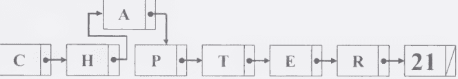

# 列表与迭代器

- 21.1 导言 508
- 21.2 单向链表 508
- 21.3 遍历 514
- 21.4 实验：实现单向链表 516
- 21.5 带尾节点的链表 517
- 21.6 双向链表与循环链表 518
- 21.7 实验：文字广播 521
- 21.8 总结 522 练习 523

## 21.1 导言

本章开始了一系列章节，我们将更深入地观察数据结构。Java 集合框架为将数据结构整合到程序中提供了丰富的工具集。在上章中，我们讨论了这些工具的子集以及何时以及如何使用它们。这些是程序员需要知道的。然而，我们想更进一步，看看其中一些数据结构是如何实现的。我们将以“亲自动手”的方式进行，尽管 Java 库已经完整包含了所有的实现：当然，我们不会重新实现它们；我们只是感受一下它们的工作原理。我们从列表开始。

列表最简单的实现是数组。正如我们看到的，数组的元素存储在计算机内存的连续位置上。我们可以根据元素在数组中的索引计算出每个元素的地址。相比之下，链表的元素存储在节点中，节点可以分散在内存的各个位置，每个节点都包含指向下一个节点的引用。列表中的最后一个节点指向空，而不是指向下一个节点的引用，它持有的是 `null`。

从比喻来说，我们可以把数组比作一本书：我们可以按顺序阅读页面，也可以翻到任意一页。链表就像杂志文章：第一部分结束时写着“续自27页”。我们在27页读第二部分，结尾处写着“续自36页”，以此类推，直到我们最终到达标记文章结束的符号。

正如我们在第20章所知，`java.util.LinkedList` 类通过双向链表实现了列表。在本章中，我们将学习实现自定义链表的基础知识：单向链表、带尾节点的链表、双向链表和循环链表。

## 21.2 单向链表

在单向链表中，每个元素都存储在一个较大的结构中，称为“节点”。除了元素的值外，节点还持有指向下一个节点的引用。

假设存储在节点中的信息由一个名为 `data` 的对象表示，指向下一个节点的引用称为 `next`。我们可以封装

### 21.2 ~ 单向链表 509

这些字段封装在一个 `ListNode` 类中，该类包含一个构造函数、两个访问器和两个修饰符（图 21-1）。

```java
// 表示单向链表的一个节点。
public class ListNode {
    private Object value;
    private ListNode next;

    public ListNode(Object v) {
        value = v;
        next = null;
    }

    public ListNode(Object v, ListNode nx) {
        value = v;
        next = nx;
    }

    public Object getValue() { return value; }
    public ListNode getNext() { return next; }

    public void setValue(Object v) { value = v; }
    public void setNext(ListNode nx) { next = nx; }
}
```

> 图 21-1. 单向链表中的节点

关于 `ListNode` 的两点。首先，“next”是由程序员选择的。其次，它是自引用的：

```java
public class ListNode {
    private Object value;
    private ListNode next;
}// ...
```

我们需要将 `getValue()` 返回的对象转换回类型：

```java
value = (Type)next();
```

单向链表通过指向其第一个节点的引用来访问。该引用存储在我们名为 `head` 的变量中。当程序创建一个链表时，它通常从空列表开始——头引用为 `null`：

```java
head = null;
```

为了创建第一个节点，我们调用 `ListNode` 的构造函数并将新节点的引用存储在 `head` 中：

```java
head = new ListNode(value, null);
```


这产生了一个节点的列表（图 21-2）。

## 21.2 单向链表

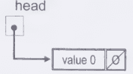

图 21-2. 只有一个节点的链表

非空链表的第一个节点被称为头节点（head node）。第二个节点可以追加到第一个节点之后：

```java
ListNode node = new ListNode(value, null);
head.setNext(node);
```

或者，将上述两个语句合并为一条：

```java
head.setNext(new ListNode(value, null));
```

这条语句将头节点中的 `next` 字段从 `null` 修改为指向第二个节点的引用。这在图 21-3 所示。

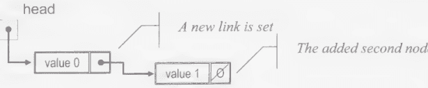

图 21-3. 将第二个节点追加到列表中

> 现在 `head` 指向列表的第一个节点，`head.getNext()` 返回指向第二个节点的引用。

这样的图有助于我们理解链表中的链接在各种操作中是如何重新赋值。

图 21-4 显示了 `SinglyLinkedList` 类的字段和构造函数。（我们构建这个类只是为了学习链表是如何工作的；我们将继续使用

# 512 第 21 章 列表与迭代器

（在我们的项目中使用了一个更高级的 `java.util.LinkedList` 类。）`SinglyLinkedList` 拥有两个字段：`ListNode head` 和 `int nodeCount`，以及两个构造函数。无参构造函数创建一个空列表。带有一个参数 `Object[] values` 的构造函数会创建一个包含数组 `values` 中所有元素的列表，且元素的顺序与数组相同。当我们构建此列表时，我们会保留对最后一个节点 `tail` 的引用，在尾节点之后添加一个新节点，然后更新 `tail`。

```java
// 实现一个单链表。
import java.util.Iterator;
public class SinglyLinkedList {
    private ListNode head;
    private int nodeCount;

    // 构造函数：创建一个空列表
    public SinglyLinkedList() {
        head = null;
        nodeCount = 0;
    }

    // 构造函数：创建一个包含
    // 数组 values 中所有元素的列表，且顺序与数组相同
    public SinglyLinkedList(Object[] values) {
        ListNode tail = null;
        for (Object value : values) // 插入每个值
            ListNode node = new ListNode(value, null);
            if (head == null)
                head = node;
            else
                tail.setNext(node);
            tail = node; // 更新 tail
        }

        nodeCount = values.length;
    }
}
```

> 图 21-4。`SinglyLinkedList` 类的构造函数（JM\Ch21\Lists\SinglyLinkedList.java）

## 21.2 单链表

图 21-5 显示了生成的链表。


图 21-5。单链表

我们可以轻松地在列表头部添加一个新节点。例如：

```java
public void addFirst(Object value)
{
    ListNode node = new ListNode(value, null);
    node.setNext(head);
    head = node;
}
```

或者简单地：

```java
public void addFirst(Object value)
{
    head = new ListNode(value, head);
}
```

上述方法创建了一个新节点，并将其 `next` 字段设置为 `head` 的旧值。然后将 `head` 指向新创建的节点（图 21-6）。


图 21-6。插入在链表头部的新节点

但在 `addLast` 方法中，你必须遍历列表以找到最后一个节点，然后将新节点附加在最后一个节点之后。

## 21.3 遍历

使用 `for` 循环从一个节点移动到下一个节点来遍历单链表很容易：

```java
for (ListNode node = head; node != null; node = node.getNext())
{
  Object value = node.getValue();
  ...
}
```

要让迭代器和 "for each" 循环适用于我们的 `SinglyLinkedList` 类也并不难。为了实现这一点，我们需要让链表变为“可迭代的”。这里有一个配方：

1. 声明 `SinglyLinkedList` 实现 `Iterable<Object>`。`Iterable<T>` 是 `java.lang` 包中的一个接口（Java 内置）。它只指定了一个方法：

```java
Iterator<T> iterator();
```

2. 在 `SinglyLinkedList` 类中添加一个 `iterator` 方法。该方法为 `SinglyLinkedList` 构建一个迭代器，并将列表头部作为参数传递给迭代器的构造函数：

```java
public Iterator<Object> iterator()
{
  return new SinglyLinkedListIterator(head);
}
```

该方法返回新构建的迭代器对象。

3. 编写 `SinglyLinkedListIterator` 类，它实现了 `java.util.Iterator<Object>`。该类的简化版本如图 21-7 所示。

```java
// 为 SinglyLinkedList 实现迭代器。

import java.util.Iterator;
import java.util.NoSuchElementException;

public class SinglyLinkedListIterator implements Iterator<Object> {
    private Node nextNode;

    // 构造函数：
    public SinglyLinkedListIterator(Node head) {
        nextNode = head;
    }

    public boolean hasNext() {
        return nextNode != null;
    }

    public Object next() {
        if (nextNode == null) {
            throw new NoSuchElementException();
        }
        Object value = nextNode.getValue();
        nextNode = nextNode.getNext();
        return value;
    }

    // 未实现。
    public void remove() {
        throw new UnsupportedOperationException();
    }
}
```

图 21-7. JM\Ch21\Lists\SinglyLinkedListIterator.java

在图 21-7 中，迭代器类被实现为一个普通的公共类。从风格上来说，将 `SinglyLinkedListIterator` 成为 `SinglyLinkedList` 的私有内部类更为合适，因为 `SinglyLinkedList` 是唯一使用这种迭代器的类。我们在书中避免了内部类，因为从 OOP 的角度来看，内部类与外部类之间的关系是令人困惑的。类似于这样的：

```java
import java.util.Iterator;
import java.util.NoSuchElementException;

public class SinglyLinkedList implements Iterable<Object>
// ... SinglyLinkedList 代码 ...
{
    private class SinglyLinkedListIterator implements Iterator<Object> {
        private Node nextNode;

        public SinglyLinkedListIterator(Node head) {
            nextNode = head;
        }

        public boolean hasNext() {
            return nextNode != null;
        }

        public Object next() {
            if (nextNode == null) {
                throw new NoSuchElementException();
            }
            Object value = nextNode.getValue();
            nextNode = nextNode.getNext();
            return value;
        }

        public void remove() {
            throw new UnsupportedOperationException();
        }
    }

    @Override
    public Iterator<Object> iterator() {
        return new SinglyLinkedListIterator(head);
    }
}
```


- 1. 声明 `SinglyLinkedList` 实现 `Iterable<Object>`。`Iterable<T>` 是 `java.lang` 包中的一个接口（Java 内置）。它只指定了一个方法：

```java
Iterator<T> iterator();
```

- 2. 在 `SinglyLinkedList` 类中添加一个 `iterator` 方法。该方法为 `SinglyLinkedList` 构建一个迭代器，并将列表头部作为参数传递给迭代器的构造函数：

```java
public Iterator<Object> iterator()
{
  return new SinglyLinkedListIterator(head);
}
```

该方法返回新构建的迭代器对象。

- 3. 编写 `SinglyLinkedListIterator` 类，它实现了 `java.util.Iterator<Object>`。该类的简化版本如图 21-7 所示。

```java
// 为 SinglyLinkedList 实现迭代器。

import java.util.Iterator;
import java.util.NoSuchElementException;

public class SinglyLinkedListIterator implements Iterator<Object> {
    private Node nextNode;

    // 构造函数：
    public SinglyLinkedListIterator(Node head) {
        nextNode = head;
    }

    public boolean hasNext() {
        return nextNode != null;
    }

    public Object next() {
        if (nextNode == null) {
            throw new NoSuchElementException();
        }
        Object value = nextNode.getValue();
        nextNode = nextNode.getNext();
        return value;
    }

    // 未实现。
    public void remove() {
        throw new UnsupportedOperationException();
    }
}
```

图 21-7. JM\Ch21\Lists\SinglyLinkedListIterator.java

在图 21-7 中，迭代器类被实现为一个普通的公共类。从风格上来说，将 `SinglyLinkedListIterator` 成为 `SinglyLinkedList` 的私有内部类更为合适，因为 `SinglyLinkedList` 是唯一使用这种迭代器的类。我们在书中避免了内部类，因为从 OOP 的角度来看，内部类与外部类之间的关系是令人困惑的。

## 21.6 双向链表与循环列表

双向链表相对于单向链表的优势在于我们可以双向地进行遍历，并且我们可以直接访问最后一个节点。缺点是它比单向链表占用更多的空间。

就像带有尾指针的链表一样，双向链表可以用两个字段实现：`head`（头部）和 `tail`（尾部），这两个字段分别持有指向列表第一个节点和最后一个节点的引用。在空列表中，`head` 和 `tail` 均为 `null`。

为了在列表末尾添加一个值，我们需要编写如下所示的代码：

```java
public void addLast(Object value)
{
  ListNode2 newNode = new ListNode2(value, tail, null);
  if (head == null) {
    head = newNode;
    tail = newNode;
  } else {
    tail.setNext(newNode);
    tail = newNode;
  }
}
```

在循环双向链表中，最后一个节点的“next”（`next`）链接指向第一个节点，而第一个节点的“前”（`previous`）链接指向最后一个节点（图 21-10）。


图 21-10. 双向循环列表

在循环列表中，我们不需要保留指向尾部的独立引用，因为我们可以通过 `head.getPrevious()` 访问它。

在具有独立头部和尾部引用的双向链表中，我们必须单独处理空列表的情况。如果我们将头部和尾部引用合并在一个不包含任何有效值的虚拟节点（`dummy node`）中，就可以简化代码。我们将这个节点称为 `header`（头节点）。这样我们的列表就变成了循环列表（图 21-11），并且始终至少有一个节点。这就是 `java.util.LinkedList` 的实现方式。


图 21-11. 带有头节点的循环双向链表

在这种实现中，空列表只有一个节点 `header`，其 `next` 和 `previous` 字段指向 `header` 自己：

```java
// 构建一个空列表：
public DoublyLinkedListWithHeader()
{
    header = new Node2(null);
    header.setPrevious(header);
    header.setNext(header);
}
```

有了头节点后，插入和删除元素的方法代码会稍微短一些，因为我们不需要单独处理空列表的情况。例如，我们可以写一个方法在给定节点之后插入元素：

```java
// 在 node 之后插入 value。
public void addAfter(Node2 node, Object value)
{
    Node2 newNext = new Node2(value, node, node.getNext());
    node.getNext().setPrevious(newNext);
    node.setNext(newNext);
}
```

这段代码同样适用于插入第一个或最后一个节点。例如：

```java
public void addLast(Object value)
{
    addAfter(header.getPrevious(), value);
}
```

## 21.7 实验：电视打文字系统 (Teletext)

图 21-12 显示了 Teletext 程序的快照。该程序不断向上滚动标题列表。用户可以通过在提供的文本输入字段中输入内容来添加标题。该行将添加到“Today’s headlines”之后的空行之后。用户也可以通过输入 `d` 来删除标题。最顶端标题的下一个标题将被删除。点击 JM\Ch21\Teletext 中的 `Teletext.jar` 文件来运行 Teletext。


图 21-12. Teletext 程序的快照

图 21-13 显示了 Teletext 程序的类图。该程序将标题存储在一个双向循环链列表中。（循环列表并不常用：但这是一个我们能从中获益的罕见情况。）列表在 `TeletextList` 类中实现。你的任务是填补该类中缺失的代码。`TeletextList.java` 位于 JM\Ch21\Teletext。

在单向链表中，在开头插入节点需要 O(1) 时间，但在末尾追加节点需要 O(n) 时间，其中 n 是列表中的节点数。带有尾指针的链表缓解了这种情况：它保留了指向最后一个节点的引用，因此在末尾追加节点需要 O(1) 时间。删除最后一个节点仍然需要 O(n) 时间，因为我们需要遍历整个列表来正确更新尾部引用。

在双向链表中，每个节点除了列表元素外，还包含指向前一个和下一个节点的引用。双向链表可以正向也可以反向遍历。此类列表的开头或末尾添加和删除元素需要 O(1) 时间。

在循环列表中，最后一个节点链接回第一个节点。`java.util.LinkedList` 使用头节点实现了列表。

## 练习

1. 在单向链表中，在开头插入节点需要 O(1) 时间，但在末尾追加节点需要 O(n) 时间，其中 n 是列表中的节点数。带有尾指针的链表缓解了这种情况：它保留了指向最后一个节点的引用，因此在末尾追加节点需要 O(1) 时间。删除最后一个节点仍然需要 O(n) 时间，因为我们需要遍历整个列表来正确更新尾部引用。

2. 在双向链表中，每个节点除了列表元素外，还包含指向前一个和下一个节点的引用。双向链表可以正向也可以反向遍历。此类列表的开头或末尾添加和删除元素需要 O(1) 时间。

3. 在具有独立头部和尾部引用的双向链表中，我们必须单独处理空列表的情况。如果我们将头部和尾部引用合并在一个不包含任何有效值的虚拟节点中，就可以简化代码。我们将这个节点称为 `header`（头节点）。这样我们的列表就变成了循环列表（图 21-11），并且始终至少有一个节点。这就是 `java.util.LinkedList` 的实现方式。

4. 在循环列表中，最后一个节点链接回第一个节点。`java.util.LinkedList` 使用头节点实现了列表。

5. 在循环双向链表中，最后一个节点的“next”（`next`）链接指向第一个节点，而第一个节点的“前”（`previous`）链接指向最后一个节点（图 21-10）。

6. 在循环列表中，我们不需要保留指向尾部的独立引用，因为我们可以通过 `head.getPrevious()` 访问它。

7. 填补 `node1`、`node2` 和 `header` 的初始化，使得 `node1`、`node2`、`node3` 构成一个带有头节点的双向循环列表。

```java
// 如果 head 所引的列表
// 至少有两个节点则返回 true
public boolean hasTwo(ListNode head)
{
    // ...
}
```

8. 填补以下代码：

```java
public ListNode reverseList(ListNode head)
{
    ListNode newHead = null;
    for (ListNode current = head; current != null; current = current.getNext()) {
        // ...
    }
    return newHead;
}
```

9. 填补下方方法中的空白：

```java
public int size(ListNode head)
{
    // ...
}
```

10. 填补方法中的空白：

```java
public ListNode concatenateStrings(ListNode head)
{
    // ...
}
```

11. 填补方法中的空白：

```java
public ListNode moveToBack(ListNode head, String pattern)
{
    // ...
}
```

## 第 21.5-21.8 节

### 12. 添加方法

```java
// 将 otherList 追加到此列表的末尾。
public void append(LinkedListWithTail otherList)
```

对于你在实验 21.5 中编写的 `LinkedListWithTail`，`append` 应该在 O(1) 时间内完成，无论列表大小，并且当其中一个列表为空或两个列表都为空时它都应该正常工作。

### 13. 编写方法

```java
public static void sort(Node head)
```

为由 `head` 指向的链表实现选择排序（Selection Sort）。假设列表持有 `String` 对象并按字母顺序对它们进行排序。你的方法运行时间应为 O(n²)，其中 n 是链表中节点数量。

> 提示：将 `firstNode` 设置为 `head`；从 `firstNode` 开始在列表中寻找最小值；将该值与 `firstNode` 中的值交换；`firstNode` 向后移动。

### 14. 编写以下方法：

```java
// 从由 head 指向的双向链表中删除最大元素，
// 并返回修改后列表头部。
// 前提条件：head 指向一个包含 
// Integer 值的非空双向链表的首个节点。
public static ListNode2 removeMax(ListNode2 head)
```

### 15. 编写方法

```java
public void quicksort(ListNode2 fromNode, ListNode2 toNode)
```

为给定的双向链表段实现快速排序（Quicksort）算法。`fromNode` 指向段的第一个节点，`toNode` 指向段的最后一个节点。（假设列表持有 `Comparable` 对象。）该段外的链接应保持不变，且该段应在列表中的原有位置保持连接。该方法运行时间应为 O(n log n)，其中 n 是段中的节点数量。不要使用任何临时数组或列表。


# 栈与队列

- 22.1 引言
- 22.2 栈的实现
- 22.3 实验：浏览
- 22.4 硬件栈
- 22.5 队列的实现
- 22.6 个研究与实验：事件驱动计算
- 22.7 总结
- 练习题

## 22.1 引言

栈对于处理嵌套结构和分支过程非常有用：当你跳转到下一个分支或层级时，你必须记住之前停止的地方，以便以后返回那里。栈由两个操作控制：`push`（入栈）和 `pop`（出栈）。`push` 将一个值添加到栈顶；`pop` 从栈顶移除该值。

栈有效使用的一个例子是网络浏览器。当你点击一个链接时，浏览器会保存当前 URL 和你在文档中的位置，以便在必要时可以追溯你的路径。当你跟随另一个链接时，当前位置会被再次保存。以此类推。当你按下“后退”按钮时，浏览器需要恢复当前位置之前访问过的位置。这就是为什么栈适合存储访问位置的序列。

相比之下，在队列中，数据元素按照存储时的相同顺序被取出。队列由两个操作控制：`add`（添加）和 `remove`（移除，或入队和出队）。`add` 将一个值插入队列尾，`remove` 从队列头移除一个值。

在本章中，我们将讨论栈和队列数据结构的不同实现。第 22.3 节中的 Line Cruiser 展示了如何使用栈在玩具浏览器中实现“后退”和“前进”按钮。第 22.6 节的 Actors World 实验使用消息队列来模拟一个活跃“演员”的世界。

## 22.2 栈的实现

正如我们在第 20 章中看到的，Java 集合框架有一个类 `java.util.Stack<E>`，它实现了一个类型为 E 的对象的栈。`Stack<E>` 继承自 `Vector<E>`（`Vector` 类似于 `ArrayList`；它是 Java 首次发布时的遗留物）。通常情况下，通过列表的帮助来实现栈并不困难。`ArrayList` 和 `LinkedList` 类都提供了让对象栈编程变得简单的方法。一种方法是让你的栈类派生自其中之一，类似于 `Stack` 的做法。然而，在这种情况下，你的栈也将继承 `List` 的所有方法。如果你喜欢保持栈的功能纯粹性（只有 `push`、`pop`、`peek` 和 `isEmpty`，没有任何 List 方法或迭代器），你可以定义自己的 `Stack` 接口（图 22-1）并使用 `ArrayList`（图 22-2）或 `LinkedList`（图 22-3）实现它。

```java
public interface Stack {
  boolean isEmpty();
  Object peek();
  void push(Object obj);
  Object pop();
}
```

图 22-1. “我们自己的”栈接口 (JM\Ch22\Stack.java)

```java
import java.util.ArrayList;
public class ArrayStack implements Stack {
  private ArrayList<Object> items;
  public ArrayStack() { items = new ArrayList<>(); }
  public boolean isEmpty() { return items.isEmpty(); }
  public Object peek() { return items.get(items.size() - 1); }
  public void push(Object obj) { items.add(obj); }
  public Object pop() { return items.remove(items.size() - 1); }
}
```

图 22-2. 基于 `ArrayList` 的实现 (JM\Ch22\ArrayStack.java)


```java
import java.util.LinkedList;
public class ListStack implements Stack {
  private LinkedList<Object> items;
  public ListStack() { items = new LinkedList<>(); }
  public boolean isEmpty() { return items.isEmpty(); }
  public Object peek() { return items.getFirst(); }
  public void push(Object obj) { items.addFirst(obj); }
  public Object pop() { return items.removeFirst(); }
}
```

图 22-3。基于 `LinkedList` 的实现 (JM\Ch22\ListStack.java)

530 第 22 章 ~ 栈与队列

在两种实现中，`peek`、`push` 和 `pop` 方法的运行时间均为 O(1)。

> 当你实现栈时，如果栈为空，`pop` 和 `peek` 方法预期抛出异常。

```java
if (isEmpty())
    throw new NoSuchElementException();
```

使用数组从零开始编写特定的栈也是可能的。这是本章末的练习之一。数组维护一个整数索引，称为栈指针，标记栈顶。栈通常向数组末尾增长：当新值推入栈时，栈指针递增；当从栈弹出值时，递减。在某些实现中，栈指针指向栈顶元素；其他程序员发现指向栈的下一个空槽更方便。图 22-4 展示了后一种实现。


图 22-4。栈的数组实现

## 22.3 实验：浏览

在 Java 中栈持有对象的引用。对象在入栈后可能会发生变化（除非它们是不可变的）。如果你预计对象会发生变化并需要在栈中保存其原始状态，请创建该对象的副本并将该副本的引用推入栈。

在这个实验中，我们将实现一个名为 Line Cruiser 的玩具浏览器。与其说浏览网页，我们的浏览器将“浏览”同一个文件中的几行文本。图 22-5 显示了我们为这个项目编写的类。和往常一样，这是一个团队努力：我将提供 `LineCruiser`、`BrowserMouseListener`、`BrowserControlPanel` 和 `BrowserView` 类，而你负责 `BrowserModel` 类。


图 22-5。Line Cruiser 类

532 第 22 章 ~ 栈与队列

所有这些细节都在我们的 `BrowserView` 类中处理；你只有在想要创建自己的测试数据文件时才需要知道它们。或者直接使用我们提供的文件：`JM\Ch22\Browser\lines.html`。

我们的浏览器像真实浏览器一样有“首页”（Home）、“返回”（Back）和“前进”（Forward）按钮。你的任务的重要部分是弄清楚这些按钮在真实浏览器（如 Firefox 或 Internet Explorer）中究竟如何工作。我们浏览器的“首页”、“返回”和“前进”工作方式应该是相同的。

现在，让我们约定一些更正式的规范。

你的 `BrowserView` 类提供了一个你感兴趣的方法：

```java
public void update(int n)
```

它显示文件中的几行，取决于显示器能容纳多少行，并将第 n 行放在显示器的顶部。你的类 `BrowserModel` 应该根据需要调用 `update`。

你的 `BrowserModel` 类应该提供一个构造函数和六个方法。

`BrowserModel` 的构造函数接受一个参数：

```java
BrowserModel(BrowserView)
```

你的构造函数应该保存 view，以便以后调用 view 的 `update` 方法。别忘记在 `BrowserModel` 的构造函数中调用 `update` 来初始化 view。

`BrowserModel` 有四个方法用于导航：

```java
public void back();
public void forward();
public void home();
public void followLink(int n);
```

当点击相应的按钮时，我调用 `home`、`back` 和 `forward` 方法。当点击指向第 n 行的超链接时，我调用 `followLink(n)`。

`BrowserModel` 剩余的两个方法可以让我知道“返回”和/或“前进”按钮应该是启用还是禁用：

```java
public boolean hasBack();
public boolean hasForward();
```

返回 `true` 启用；`false` 禁用。

你会在 `JM\Ch22\Browser` 中找到 Line Cruiser 文件。用于测试我们浏览器的 `lines.html` 数据文件在同一个文件夹中。使用 `java.util.Stack<Integer>` 作为栈。实现 `BrowserModel` 类并充分测试程序。

## 22.4 硬件栈

当方法被调用时会发生什么？当方法调用者调用方法任务时，任务如何知道完成后返回到哪里控制权？显然，调用者必须传递一些返回地址，以便任务完成后能将 CPU 保存到该地址。让我们考虑可以存储该返回地址的几个可能位置。

第一个猜想是它可以被保存在某些特殊预留的内存位置。如果任务没有调用任何其他方法，这种方法可以可行。然而，如果任务调用了另一个方法 `subTask`，那么它的返回地址将进入同一个内存位置并覆盖第一个返回地址。在更复杂的方案中，返回地址可以进入附加到方法代码的某些特殊内存区域，就在方法代码开始的地方之前。这将解决方法调用其他方法的问题，因为每个方法都有自己的返回地址存储空间。这实际上是早期计算机模型的工作方式。如果允许任务调用自己，或者存在循环调用，就会出现问题：任务调用 `subTask`，`subTask` 调用 `anotherSubTask`，`anotherSubTask` 调用 `task`。那么任务将混淆是将控制权返回给 `anotherSubTask` 还是调用者。

方法调用自己的概念初看起来可能很荒谬。但正如我们所知，递归调用对于处理嵌套结构或分支过程（其中子结构或分支与整体相似）非常有用。正如我们在第 4 章中看到的，递归方法可以轻松地简化算法。

实际上剩下的唯一解决方案是栈。当调用者调用任务时，它从栈中弹出返回地址并将控制权交还给它。任务可以使用栈来实现自己的目的以及调用其他方法：唯一的要求是在返回之前将栈指针恢复到它的初始值。

通过这种方式，方法可以相互调用而不会产生冲突。特别是，方法可以调用自己，或者方法以循环方式相互调用。然而，除了返回地址，编译器或解释器必须小心参数和局部变量。如果方法在执行过程中调用自己，它的局部变量会变成什么？再次，栈提供了解决方案。方法的参数和局部变量都可以驻留在栈上。当方法被调用时，调整栈指针为它们预留空间，当方法完成处理时，恢复栈指针。通过这种方式，我们只需要一份方法代码副本，但有多个方法的返回地址、参数和局部变量副本，对应每个正在进行的调用。栈中包含特定方法调用所有信息的区域被称为“帧”（frame）。图 22-6 展示了在多次方法调用后在栈上创建的帧。

在现代系统中，硬件支持栈。硬件栈不需要任何特殊内存。它简单地实现为一个栈指针寄存器，可以指向所需的内存位置，并通过 `push` 和 `pop` CPU 指令直接修改。CPU 指令 `call` 在将控制权交给子程序之前会自动将下一条指令的地址推入栈。CPU 指令 `ret (return)` 自动从栈中弹出返回地址并返回该地址。

当方法调用方法时，调用者将想要传递给任务的参数推入栈，然后将控制交给任务。任务在栈上为自己的局部变量分配空间。当任务完成处理时，它从栈中弹出返回地址并返回该地址。硬件栈也处理中断。当中断发生时，CPU 将程序的当前状态推入栈。

534 第 22 章 ~ 栈与队列

## 22.5 队列的实现

## 22.6 案例研究与实验室：事件驱动计算

使用一个控制所有操作并拥有内存独占访问权限的 CPU，形成了一种特定的编程观点：程序被认为是一组按顺序执行的指令集。人工智能（或 AI，计算机科学的一个分支，旨在对智能系统和理性行为建模）以及认知科学的研究引起了人们对某些模型的关注，即许多自主代理体通过并行工作共同执行有意义的任务，而不需要僵化的中心化控制。此类模型允许科学家模拟那种典型的人类大脑认知活动所具有的并行性和自主性。

在事件驱动模型中，独立的代理体可以通过发送信号或消息进行相互通信。许多事情可以同时发生，而不需要对不需要同步的活动进行中心化的同步。从理论上讲，这种模型需要一种新型计算机。然而，尽管对各种类型的并行计算机分布式系统的研究仍在继续，基于活动对象（active objects）的模型可以在常规计算机上作为模拟运行。其中一种模型是在 20 世纪 60 年代中期由挪威计算中心（NCC）的 Ole-John Dahl 和 Kristen Nygaard 开发的 Simula 编程语言实现的。该模型开创了面向对象（OOP）计算。其他知名且富有影响力的模型被称为 Actor 模型。它们源于 20 世纪 70 年代初麻省理工学院 AI 实验室 Carl Hewitt 的工作。这最终导致了由 Alan Kay 及其同事在 Xerox PARC（帕罗奥图研究中心）开发的 Smalltalk 编程语言。

对于活动代理体的分布式系统，一个更近期的比喻是互联网本身。另一个是手机网络。这些系统有数百万独立用户异步地交换消息和数据，且没有任何中心化控制。然而，事情仍然被完成了。

在 Actor 模型中，每个 Actor 都拥有一组方法，允许它识别并处理特定类型的消息。Actor 通过向其他 Actor 发送消息来响应消息。模型可以包含不同的消息分发机制。例如，消息可以定向到一个特定的 Actor，也可以同时广播给许多 Actor。在后一种情况下，只有那些能够识别消息并发现“相关”消息的 Actor 才会对其响应。

当在常规计算机上进行模拟时，Actor 需要一个中心机制来处理消息，即一种“消息服务器”。整个程序变成一个巨大的循环，检查队列中是否有等待处理的消息，并将它们分发给相应的 Actor。

这与 GUI 操作系统中的事件发生非常相似。在 Java 中，键盘、鼠标和 GUI 组件充当了“Actor”的角色。“消息”由 `java.awt.Event` 类型的对象表示。`java.awt` 包中的 `EventQueue` 类处理事件队列的管理。它将事件分发给被指定为“监听器”（`ActionListener`、`KeyListener`、`MouseListener` 等）的对象。这一切通常在后台发生。在本次案例研究中，我们让消息队列的管理显式化，以展示你可能如何工作。

图 22-8 显示了我们的 Kittens 程序中涉及的类和对象及其公共方法。

我们定义了一个抽象类 `Actor`（不要与 GridWorld 中的 Actor 类混淆），它描述了一个具有名称并可以接收消息和发送消息的 Actor，消息可以直接发送给另一个 Actor 或发送给整个列表。消息不需要以任何方式进行同步。可以设想一种分布式计算环境，其中 Actor 是一个运行特定 App 的智能手机。每个 Actor 都有自己的“信箱”，这是一个持有等待处理消息的队列。

消息是 `Message` 类的对象。它是一种数据载体类对象，带有一个构造函数 ——

```java
public Message(Actor sender, Actor recipient, String text)
```

以及三个访问器方法：

```java
public Actor getSender()
public Actor getRecipient()
public String getText()
```

如果接收者为 `null`，则该消息旨在发送给所有订阅者。消息还有一个 `toString` 方法，将其转换为可读的消息，例如：

```
From: Pilot
To: Tommy\ship left glove
```

`MailServer` 类代表了一种队列和分发消息的机制。`MailServer` 对象是一个消息队列。`MailServer` 继承自 `java.util.LinkedList<Message>`（该类实现了 `Queue<Message>`）。

`MailServer` 还维护了一组“已注册”的 Actor（实现为 `TreeSet<Actor>`），并有一个 `dispatch` 方法，将消息传递给相应的接收者或整个列表。


图 22-8。三只小猫程序中的类、对象和公共方法

`Kitten` 类继承自 `Actor`。`Kitten` 拥有某些“物品”：来自一个小型物品列表的若干物品。我们有三只小猫和三类物品（由字符串表示）。`ThreeKittens` 类中的 `main` 方法实例化了这些小猫：

```java
public static void main(String[] args)
{
    // ... window setup

    String[] kittysPossessions = {"right glove", "right glove", "right glove", "hat"};
    String[] tommysPossessions = {"left glove"};
    String[] lizzyPossessions = {"left glove", "left glove", "hat", "hat"};

    List<Kitten> kittens = new ArrayList<Kitten>();
    kittens.add(new Kitten("Kitty", Arrays.asList(kittysPossessions)));
    kittens.add(new Kitten("Tommy", Arrays.asList(tommysPossessions)));
    kittens.add(new Kitten("Lizzy", Arrays.asList(lizzyPossessions)));
}
```

在 `main` 方法创建小猫后，我们让消息队列的管理显式化，以展示你可能如何工作：


```java
MailServer server = new MailServer();
for (Kitten kitten : kittens)
    kitten.addMailServer(server);
```

这类似于在 Java 中添加监听器。

之后，程序进入一个无限循环。在每次迭代中，程序检查 `MailServer` 队列中是否有任何消息，将其提取，显示每条消息，并将其分发给其接收者。然后它给每只小猫留出读取消息的时间：

```java
while (true)
{
    while (!server.isEmpty())
    {
        Message msg = server.remove();
        window.display.append(msg + "\n");
        server.dispatch(msg);
    }
}
```

```java
for (Kitten kitten : kittens)
    kitten.readMail();
```

幸运的是，Java 也是这样做：它为 GUI 组件分配 CPU 时间来处理事件，因此当点击关闭窗口时，我们的无限循环就会被中断。

## 22.6 案例研究与实验室：事件驱动计算

你在项目中的任务是编写 `MailServer` 类，并填空 `JM\Ch22\Actors\Actor.java` 和 `JM\Ch22\Actors\Kitten.java`。你可以独立工作或团队合作。

### 1. MailServer

该类继承自 `LinkedList<Message>`（因此实现了 `Queue<Message>`）。将只使用 `LinkedList` 的 `isEmpty`、`add` 和 `remove` 方法。

`MailServer` 维护了一组“已注册”的订阅者（实现为 `TreeSet<Actor>`）。`MailServer` 提供了一个 `signUp(Actor actor)` 方法，将 Actor 添加到注册订阅者集中。

还要提供一个 `dispatch(Message msg)` 方法，它将消息发送到消息中指示的接收者（通过调用接收者的 `receive(msg)`），或者如果接收者为 `null`，则发送给所有注册订阅者（排除发送者）。

### 2. Actor 类

为 `moreMail`、`receive`、`readNextMessage`、`send` 和 `announce` 方法提供代码。

### 3. Kitten 类

为 `readMail` 方法提供代码。该方法首先检查猫的物品，并为每个缺失的物品向所有人发送请求。之后，`readMail` 会“读取”信箱中的所有消息，并发送或采取相应行动。对各种消息的正确响应在 `Kitten.java` 中 `readMail` 方法的注释中描述。

完成后，设置包含 `ThreeKittens.java` 和 `Message.java`（来自 `JM\Ch22\Actors`）以及你的 `MailServer`、`Actor` 和 `Kitten` 类的项目。测试你的程序以确保最后每只小猫都找到了它们所有的物品。三只猫应该发布一条“thx, all set”的消息。

## 第 22 章 栈与队列

## 22.7 总结

栈（Stack）是一种以后进先出（LIFO）方式存储和检索数据元素的数据结构。栈的一种可能实现是使用数组和一个整数索引（称为栈指针），它标记了栈的当前顶部。栈通常向数组的末尾增长；当新值推入（push）栈时，栈指针加1；当值从栈弹出（pop）时，栈指针减1。

栈也可以轻松通过单链表或双链表实现，其 `peek`（查看）、`push`（推送）和 `pop`（弹出）方法的运行时间均为 O(1)。在 Java 框架中，栈是在 `java.util.Stack<E>` 类中实现的，其中 E 是栈上对象的类型。

栈用于临时存储；当你在处理嵌套结构或分支过程时，它们变得特别有用。

队列（Queue）数据结构用于以先进先出（FIFO）方式存储和检索值。队列可以实现为环形缓冲区（ring buffer），它本质是一个以循环方式使用的数组。头部索引标记队列的开始，下一个值将从这里移除；尾部索引标记队列的结束（第一个可用槽），下一个值将插入到此处。两个指针都会在数组末尾回绕。另一种队列实现可能使用带尾指针的链表或双链表。在所有这些实现中，`peek`、`add` 和 `remove` 方法均在 O(1) 时间内运行。在 Java 集合框架中，队列是用 `LinkedList<E>` 实现的。

队列用于处理必须按照到达顺序处理的事件，但这些事件可能需要等待可用资源或适当的时间。队列用于系统任务，如作业调度、事件处理、进程间数据传递以及外围设备的输入/输出缓冲。

## 练习题

第 22.1-22.4 节

1. 判定对错并解释：

   - a) 栈作为必须按到达顺序处理的事件的临时存储器特别有用。 ✓

   - b) 队列数据结构是栈数据结构的一种特例。

   - c) 栈可以使用数组或单链表高效地实现（push 和 pop 操作为常数时间）。

2. 编写并测试类 `IntStack`，该类实现一个整数栈，其方法与 `Stack` 类类似，但处理的是 `int` 类型的值而非 `Object`。提供一个无参构造函数，分配一个具有默认容量的数组来存放值，以及另一个分配指定容量数组的构造函数。使用“栈指针”来持有第一个空槽的索引。如果栈空间不足，则重新分配数组，并将其大小增加一倍。

3. 假设栈是用链表实现的。节点由 `ListNode` 对象（...）表示，`top` 字段指向栈顶节点：

```java
public class ListNodeStack {
    private ListNode top;
    ...
}
```

给出 `push` 方法的代码——

```java
public void push(Object value) {
    top = new ListNode(value, top);
}
```

-- 补充 `isEmpty`、`peek` 和 `pop` 方法的代码。（`peek` 和 `pop` 方法在栈为空时应抛出 `NoSuchElementException`。）

4. 下方法接收由二进制位字符串表示的数字，并返回对应的 `int`：

```java
public static int binToInt(String binNum) {
    Stack<Character> stack = new Stack<Character>();

    for (int i = 0; i < binNum.length(); i++) {
        stack.push(binNum.charAt(i));
    }

    int result = 0, power2 = 1;

    while (!stack.isEmpty()) {
        char ch = stack.pop();
        int dig = Character.digit(ch, 2);
        result += dig * power2;
        power2 *= 2;
    }

    return result;
}
```

解释为什么在这里使用栈是多此一举。在不使用栈的情况下重写。

5. 一副牌在程序中被表示为 `Card` 对象的栈。编写一个方法

```java
public boolean moveToTop(Stack<Card> deck, int n)
```

该方法获取牌中的第 n 张牌（顶部的牌为第一张），并将其移动到牌的顶部。如果牌有 n 张或更多牌，则返回 `true`；否则，保持牌不变并返回 `false`。你的方法可以使用临时栈，但不能使用其他数组或列表。

6. 字符栈可以使用 `String` 实现。

(a) 以下代码是否正确实现了 `push` 和 `pop` 方法？

```java
private String stack = "";
// 声明一个空字符栈；
public void push(char ch) {
    stack += ch;
}
public char pop() {
    int n = stack.length() - 1;
    if (n >= 0) {
        char ch = stack.charAt(n);
        stack = stack.substring(0, n);
        return ch;
    } else {
        throw new NoSuchElementException();
    }
}
```

(b) 讨论上述实现的优点。

(c) 重写上述代码，使 `pop` 返回字符串中的第一个字符。

(d) 使用 `StringBuffer` 对象及其 `delete` 方法重写上述代码。

7. 类 `RingBuffer` 实现了一个字符队列。它有一个构造函数，用于分配一个数组并将其初始化为空状态：

```java
public RingBuffer(int capacity) {
    items = new char[capacity];
    front = 0;
    rear = 0;
}
```

(a) 编写一个 `flush()` 方法清空队列。

(b) 编写一个 `isEmpty()`。

(c) 编写一个 `add(char ch)`。如果操作成功则返回 `true`，如果满则返回 `false`。

8. 假设栈是用链表实现的。使用 `front` 和 `rear` 分别表示头节点和尾节点。给出 `remove` 方法的代码——

```java
public Object remove() {
    if (front != null) {
        Object obj = front.getValue();
        front = front.getNext();
        if (front == null) {
            rear = null;
        }
        return obj;
    } else {
        throw new NoSuchElementException();
    }
}
```

-- 补充 `isEmpty`、`peek` 和 `add` 方法。特别是，`peek` 在队列为空时应返回 `null`。

9. IBM PC（基本 IO 系统）使用从 40:00 开始的 16 字节缓冲区。40:1A 和 40:1C 分别代表队列的头部和尾部。每个按键向缓冲区添加两个字节：字符的 ASCII 码后跟“扫描码”。查看以下内存转储并确定队列的内容：

```
0340:00 0 1 2 3 4 5 6 7 8 9 A B C D E F
0340:10 27 31 02 61
```

10. (MC) "actor" 模型通常是如何实现的？

A. 在并行数据流计算机上

B. 使用神经网络硬件

C. 在传统的冯·诺依曼计算机上通过仿真

D. 在互联网上

11. 如果我们在

```java
Collections.shuffle(kittens); // 洗牌 kittens 列表
```

之前

```java
for (Kitten kitten : kittens) kitten.readMail();
```

在 Three Kittens 的 main 方法中，Kitty、Tommy 和 Lizzy 能找回它们的物品吗？通过此更改并多次运行 Three Kittens 程序来测试这一假设。

12. (a)* 将 22.6 实验中的三个“猫”集成到 GridWorld。遵循以下步骤：

- 让 Three Kittens 中的 `Actor` 类扩展 GridWorld 的 `Actor`。为了避免名称冲突，不要使用 GridWorld 的 `Actor` 导入语句——使用其全限定名。
- 在 `Actor` 中添加一个 `act` 方法，简单调用 `readMail`。（尽管 `readMail` 在 `Actor` 中是抽象的，但当 Kitten 或 Actor 的其他类对象“执行”时，会调用正确的 `readMail`。）
- 在这种情况下，你不能在主程序中有无限循环，因为 GridWorld 的 Java 事件处理器已经有一个。相反，向世界中添加一个特殊的 actor——Dispatcher，其 `act` 方法调度消息。提供一个接收 `MailServer` 和 `TextArea` 显示作为参数的构造函数。将

```java
while (!server.isEmpty()) {
    ...
}
```

循环从 Three Kittens 的 main 移动到 Dispatcher 的 act 方法。
- 移除 main 中的 `while (true)` 循环。在 main 中添加语句，创建一个 ActorWorld并将 Dispatcher 和三只猫加入其中。

(b)** 创建一个你自己的 GridWorld 应用，其中 actor 之间交换消息。

## 重复回顾递归

- 23.1 导言 550
- 23.2 三个示例 550
- 23.3 何时不使用递归 558
- 23.4 理解与调试递归方法 561
- 23.5 实验：哈诺伊塔 564
- 23.6 案例研究与实验：六角游戏 565
- 23.7 总结 570
练习 570

## 23.1 导言

在本章中，我们将继续第 4 章开始的关于递归的讨论。递归是处理分支过程和嵌套结构的强大工具。以 Java 列表为例，它可以包含任何类型的对象作为值，包括其他列表。在极端情况下，一个列表甚至可以包含其自身的元素！Java 的文档说：“虽然允许列表包含自身作为元素，但建议谨慎……” 递归结构和过程在计算机世界中特别常见，并非巧合。当一个结构或过程的子结构和子过程具有相同的形式时，实现和使用它会变得更容易。同一个函数可以处理图片及其同样是图片的图形元素，也可以处理一个列表及其同样是列表的元素。在第 24 章中，我们将看到如何使用递归来处理二叉树，其中每个节点都是二叉（子）树的根。

递归并不是 Java 特有的：在任何允许函数调用自己的语言中工作方式都是相同的。在 Java 中，方法可以调用自己，也可以存在方法调用的循环序列。我们在第 22.4 节中看到，硬件栈机制无论方法是调用自己还是调用其他方法，都会在系统栈中实现方法调用。所有方法参数、返回地址和局部变量都保存在系统栈上独立的帧（frame）中，因此多个方法（包括同一方法的多个副本）可以等待控制权的返回，而不会产生任何冲突。同一方法的多个副本共享相同的代码，但在不同的数据上进行操作。

在本章中，我们将考虑递归的几个示例，讨论何时使用递归合适，何时最好避免使用，并学习如何调试和证明递归方法的正确性。

## 23.2 三个示例

在第 4 章中，我们讨论了几个递归方法。例如，第 91 页的图 4-9 显示了 gcd 方法的递归实现，该方法用于寻找两个正整数的最大公约数。然而，在那个示例中也存在简单的非递归实现。在我们这里的第一个示例中，我们考虑这样一种情况：递归实现很短，而非递归实现则并不直观。

假设我们想写一个方法来评估给定人群中两个人之间的“间隔度”（degree of separation）。A 和 B 之间的间隔被定义为连接 A 和 B 的最短人员链中的链接数量，其中邻居彼此认识。如果 A 认识 B，则 A 和 B 之间的间隔为 1；如果 A 认识 B且 B 认识 C 但 A 不认识 C，则 A 和 C 之间的间隔为 2；以此类推。假设一个人由 `Person` 类的对象表示，该类有一个布尔方法 `knows`，当且仅当 `p1.knows(p2)` 返回 `true` 时，Person p1 “认识” Person p2。我们想写以下代码：

```java
// 当且仅当集合中 p1 和 p2 之间的间隔
// 小于等于 n 时，返回 true
public boolean degreeOfSeparation(Set<Person> people,
    Person p1, Person p2, int n)
```

如果 $n=1$，我们只需要检查 p1 和 p2 是否“认识”彼此。如果 $n>1$，我们可以尝试在集合中寻找一个 Person，作为连接 p1 和 p2 的链中的中间链接。如果没有递归，实现这个算法将相当困难。但有了递归，它变得非常直观：

```java
public boolean degreeOfSeparation(Set<Person> people,
    Person p1, Person p2, int n) {

    if (n == 1)                  // 基本情况
        return p1.knows(p2);
    else                         // 递归情况
        for (Person p : people) {
            if (p1.knows(p) && degreeOfSeparation(people, p, p2, n-1))
                return true;
        }
    return false;
}
```


# 第 23 章 重新回顾递归

如你所知，递归方法必须有一个基本情况（或多个基本情况），即不再需要进一步递归的情况，以及一个递归情况（或多个），即递归地调用同一个方法。为了让递归方法终止，它必须显式或隐式地处理基本情况。当方法递归地调用自己时，它必须应用于一个相似但“更小”的任务，该任务最终会收敛到其中一个基本情况；否则递归调用将不断深入并最终“栈溢出”。

在我们的 `degreeOfSeparation` 方法中，参数 `n` 决定了任务的“大小”。`n=1` 是基本情况。由于 `degreeOfSeparation` 递归调用中的该参数被减少为 `n-1`，递归调用最终会收敛到基本情况并停止。

上面的代码看起来很短，但运行速度可能会慢得无法接受。例如，如果集合被分成两个大小相等的组，使得组内每个人都认识其他人，但 `p1` 和 `p2` 属于不同的组，那么总调用次数将是 $2^n$，其中 `n` 是人数。相对于 `n` 来说这是指数级增长，且每个调用都需要栈上的一个独立帧。

实际上这个任务有更高效的算法，需要的空间只需要 $O(n)$。

```java
public boolean degreeOfSeparation(Set<Person> people,
    Person p1, Person p2, int n) {

    if (n == 1)                  // 基本情况
        return p1.knows(p2);
    else                         // 递归情况
        for (Person p : people) {
            if (p1.knows(p) && degreeOfSeparation(people, p, p2, n-1))
                return true;
        }
    return false;
}
```

这大致是 `ArrayList` 和 `LinkedList` 中定义 `toString` 的方式。

现在递归被隐藏了，但当列表的某个元素恰好也是另一个列表时，递归就会发生。事实证明，`ArrayList<Object>` 或 `LinkedList<Object>` 无需任何额外代码即可处理复合列表。在后面的第 27 章，我们将看到如何使用组合设计模式为复合列表的元素正确地定义特定的数据类型。

当然，也可以使用迭代器栈（`Stack`）通过非递归的方式编写上述 `toString` 方法：

```java
public String toString() {
    String s = "", separator = "[";
    Stack<Iterator<Object>> stk = new Stack<Iterator<Object>>();
    Iterator<Object> iter = iterator();
    while (iter.hasNext() && !stk.isEmpty()) {
        if (iter.hasNext()) {
            s += separator;
            Object obj = iter.next();
            if (obj instanceof String) {
                s += obj;
                separator = ", ";
            } else {
                CompositeList sublist = ((CompositeList)obj);
                stk.push(iter);
                iter = sublist.iterator();
                separator = "(";
            }
        } else {
            s += "";
            stk.pop();
        }
    }
    s += "]";
    return s;
}
```

这段代码会产生相同的结果。但它要长得多，更难理解，更容易出错，并且没有利用多态的优势。

## 23.3 何时不使用递归

在不显著损失效率且能简化代码的情况下，不要避免使用递归。

在我们的第三个示例中，我们将生成字符字符串的所有可能排列。假设我们正在构建一个电脑文字游戏，尝试从给定的字母集中组成一个有效的单词。程序需要一个方法来生成字母的所有排列，并将它们与单词词典进行匹配。（假设一个包含 `n` 个字符的字符串存储在 `StringBuilder` 类而不是 `String` 中，以提高字符排序的效率——`String` 是不可变对象。）我们生成所有排列的策略是将每个字符放在字符串的最后一位，生成前 $(n-1)$ 个字符的所有排列。换句话说，`permutations` 是一个递归方法。该方法接受两个参数：一个 `StringBuffer` 对象和前片段中已改变的字符数 `n`。

在这个示例中，尽管没有嵌套结构，但过程在本质上是分支且递归的。边界情况是 `n` 等于 1——除了报告排列外无事可做。

下面的 `permutations` 方法非常短且易于读；尽管如此，很难理解它为什么能起作用！我们将在 23.4 节中回到它，该节将解释理解和调试递归方法的最佳方法。

```java
private void swap(StringBuffer str, int i, int j) {
  char c1 = str.charAt(i); char c2 = str.charAt(j);
  str.setCharAt(i, c2); str.setCharAt(j, c1);
}

public void permutations(StringBuffer str, int n) {
  if (n <= 1) // 边界情况
    System.out.println(str); // 排列完成
  } else { // 递归情况
    for (int i = 0; i < n; i++) {
      swap(str, i, n-1);
      permutations(str, n-1);
      swap(str, n-1, i);
    }
  }
}
```

任何递归方法也可以通过迭代来实现，并在必要时使用栈。这引出了一个问题：什么时候递归是合适的，什么时候最好避免？

最重要的规则是，只有当递归能够显著简化代码且不损失性能时，才应该使用递归。递归在处理嵌套结构或分支过程时特别有用。一个典型的例子是用于遍历树形结构的算法，这些算法在第 24 章中有所描述。另一方面，当你处理线性结构和过程时，通常可以使用简单的迭代。接下来的测试将帮助你决定何时使用递归，何时使用迭代。如果方法在两个或多个方向上发生分支，并在每个分支中递归地调用**自己，那么使用递归是合理的。如果方法只调用自己一次，你可能只需要通过迭代就能轻松地完成相同的工作。

还有一些技术考虑因素可能会限制递归方法的使用：

1. 如果方法分配了大型数组，程序在递归调用中可能会耗尽内存。程序员必须对递归调用的深度有一个感觉；他可能选择实现自己的栈并仅在其中保存相关变量，重用同一个临时数组。
2. 当方法操作对象的字段时，除非这种操作是有意为且经过充分理解的，否则递归调用可能会以不可预测的方式改变它们的值。
3. 如果效率很重要，不使用递归实现的方法可能会运行更快。

作为一个例子，让我们考虑 `factorial(n)` 方法，它计算从 1 到 `n` 的所有数的乘积。该方法有一个简单的递归形式：

```java
public long factorial(int n) {
    if (n <= 1) // 边界情况
        return 1;
    else // 递归情况
        return n * factorial(n - 1);
}
```

我们的测试显示 `factorial` 的代码只有一个递归调用。我们处理的是一个线性过程。用迭代完成相同的事情应该同样容易：

```java
public long factorial(int n) {
    long product = 1;
    for (int k = 2; k <= n; k++) {
        product *= k;
    }
    return product;
}
```

两个版本都是接受的。递归版本需要栈空间，但迭代版本要大得多。一个更棘手的例子是斐波那契数。它们被定义为一个序列，前两个等于1，后续每个数等于前两个数之和：1, 2, 3, 5, 8, 13, ... 数学上这是一个递归定义：

```java
// 计算第n个斐波那契数
// 前提条件：n > 1
public long fibonacci(int n) {
    if (n == 1 || n == 2) // 边界情况
        return 1;
    else // 递归情况
        return fibonacci(n-1) + fibonacci(n-2);
}
```

初看起来这个方法满足了多次调用的测试。但实际上，这里没有分支：第一项 `fibonacci(n-1)` 会调用 `fibonacci(n-2)` 和 `fibonacci(n-3)`。第二项 `fibonacci(n-2)` 会再次调用 `fibonacci(n-3)` 和 `fibonacci(n-4)`。斐波那契调用会像兔子一样繁殖。* 为了计算第 `n` 个斐波那契数，`F_n` 实际上会产生超过 `F_n` 次递归调用，我们将在后续章节中看到，这可能是一个巨大的数字。

另一方面，迭代实现的相同方法需要 `n` 次迭代：

```java
public long fibonacci(int n) {
    long f1 = 1, f2 = 1;
    while (n > 2) {
        long next = f1 + f2;
        f1 = f2;
        f2 = next;
        n--;
    }
    return f2;
}
```

作为最后一个不适合递归的示例，让我们考虑 `n` 个元素的选择排序。如你所知，思路是找到最大元素并与最后一个元素交换，然后对 `n-1` 个元素的数组应用相同的方法。这可以通过递归完成：

```java
public void sort(int[] a, int n) {
    if (n == 1) // 边界情况：长度为1的数组——无事可做
        return;
    } else {
        // 找到最大元素的索引
        int iMax = 0;
        for (int i = 1; i < n; i++) {
            if (a[i] > a[iMax])
                iMax = i;
        }
        // 将与最后一个元素交换
        int aTemp = a[n-1]; a[n-1] = a[iMax]; a[iMax] = aTemp;
        // 对前n-1个元素调用 sort
        sort(a, n-1);
    }
}
```

> * 数字以列奥纳德·皮萨诺（Fibonacci）命名，他在1202年发明了该序列，作为开发一种兔子种群增长模型的一部分。

这是一个所谓的**尾递归**案例，其中递归调用是方法的最后一个语句：在调用调用之后，只执行方法的返回。因此，在执行递归调用时，局部变量（传递给递归调用的参数外）已经不再需要。一个良好的优化编译器会检测到这种情况，不再递归地调用 `selection`，而是更新参数 `n`并将控制交回方法的开头。或者，我们可以轻松实现：

```java
public void selectionSort(int a[], int n) {
  while (n > 1) {
    // 找到最大元素的索引：
    int iMax = 0;
    for (int i = 1; i < n; i++) {
      if (a[iMax] < a[i]) {
        iMax = i;
      }
    }
    // 将与最后一个元素交换：
    int aTemp = a[n-1]; a[n-1] = a[iMax]; a[iMax] = aTemp;
    n--;
  }
}
```

引用 Pascal 语言发明者 Niklas Wirth 的话：

> 事实上，用这种不恰当的例子来解释递归算法的概念，是导致对编程中使用递归产生广泛恐惧和反感，并认为递归等同于低效率的主要原因。

## 23.4 理解和调试递归方法

理解和调试非递归方法的常用方法是在脑海中或使用调试器跟踪代码中语句和方法调用的序列。程序员还可以插入调试打印语句，以向它们报告方法的执行进度和变量的中间值。

这些传统方法很难应用于递归方法，因为很难记录你在自己在递归调用层次结构中的当前位置。要深入理解递归过程，需要对系统堆栈进行详细检查——这是一项枯燥且无用的活动。

* Niklas Wirth, *Algorithms + Data Structures = Programs*, Prentice Hall, 1976.

与其进行这些徒劳的尝试，递归方法可以通过名为**数学归纳法**的方法更容易地理解和分析。

简而言之，数学归纳法的工作原理如下。假设我们有一系列命题（即真值为假的陈述）：

```
$P_1, P_2, ..., P_n, ...$
```

假设我们可以证明：

- 基础情况：$P_1$ 为真；且
- 归纳步骤：对于任何 $n \ge 2$，如果 $P_1, ..., P_{n-1}$ 为真（归纳假设），则 $P_n$ 也是真的。

那么我们可以得出对于任何 $n \ge 1$，$P_n$ 为真的结论。

这是因为 $P_1$ 推导出 $P_2$，而 $P_2$ 推导出 $P_n$。然而，我们不需要对每一步都经过整个逻辑序列。相反，我们可以采取捷径，说通过数学归纳法，所有命题 $P_1, P_2, ..., P_n, ...$ 都是真的。

作为数学归纳法的一个练习，让我们估算一下上一节讨论的递归斐波那契方法的运行时间：

```java
public long fibonacci(int n)
{
    if (n == 1 || n == 2) // 基础情况
        return 1;
    else // 递归情况
        return fibonacci(n-1) + fibonacci(n-2);
}
```

我们将证明 `fibonacci(n)` 执行的 `fibonacci` 方法总调用不少于 $(3/2)^n$ 次。

基础情况：这对于 $n = 1$ 和 $n = 2$ 是成立的，因为两者都需要一次调用：

```
$n = 1: 1 \ge (3/2)^{1-1} = (3/2)^0 = 2/3$
```

```
$n = 2: 1 \ge (3/2)^{2-2} = (3/2)^0 = 1$
```

归纳步骤：对于任何 $n > 2$，除了初始调用外，方法还调用了 `fibonacci(n-1)` 和 `fibonacci(n-2)`。根据归纳假设，在 `fibonacci(n-1)` 中调用 `fibonacci` 的次数不少于 $(3/2)^{n-3}$，在 `fibonacci(n-2)` 中调用 `fibonacci` 的次数不少于 $(3/2)^{n-4}$。在 `fibonacci(n)` 中 `fibonacci` 的总调用次数不少于：

```
1+(3/2)^n-3+(3/2)^n-3+(3/2)^n-4=(3/2)^n-2+1=
(3/2)^n-4.(5/2)^n-4.(9/4)=(3/2)^n-4.(3/2)^n-2
```
*（注：OCR 文本在上面的公式表达式中包含一些错误，但我根据指令保留了结构，同时清理了明显的空格问题。）*

通过数学归纳法，对于任何 $n \ge 1$，在 `fibonacci(n)` 中调用 `fibonacci` 的次数不少于 $(3/2)^{n-2}$。证毕（QED）。

假设一台足够快的计算机每秒执行一亿次调用，`fibonacci(100)` 的运行时间将超过 $(3/2)^{98}/10^8$ 秒，或者说 57 年！上面的示例展示了数学归纳法如何帮助我们理解并几乎严谨地证明递归的正确性。我们不需要对每一步都经过整个逻辑序列。数学归纳法的关键特征是证明基础情况，然后对于任意的 `n`，证明如果在之前的层级中成立，那么在第 `n` 层也成立。

我们将通过数学归纳法证明关于它的两个事实：

1. `permutations(n)` 返回原始顺序。
2. `permutations(n)` 生成前 `n` 个的所有排列。

在基础情况下，`n = 1`，该方法什么都不做，所以这两个语句都是真的。对于归纳步骤，让我们假设这些语句对于任何之前的层都是真的。在递归情况下，方法交换 `str[i]` 和 `n-1`，然后调用 `permutations(n-1)`，最后交换回 `str`。

```java
void permutations(StringBuffer str, int n) {
    if (n < 1) // 基础情况
        System.out.println(str);
    else // 递归情况
        for (int i = 0; i < n; i++) {
            swap(str, n-1);
            permutations(str, n-1);
            swap(str, i);
```


## 23.5 实验：汉诺塔

汉诺塔问题可能是计算机科学中最著名的递归示例。该谜有三个柱子，第一个柱子上有几个盘。盘按直径从大到小排列，最大的盘在底部，最小的在顶部。规则要求一次只能移动一个盘，且不能将大盘放在小盘上面。目标是将整个塔从第一个柱子移动到第二个柱子。

## 23.6 案例研究与实验：Hex 游戏

Hex 游戏由丹麦数学家 Piet Hein 于 1942 年发明。（同一个游戏显然在几年后由当时在普林斯顿的研究生 John Nash 独立发明，他获得了诺贝尔经济学奖。）Martin Gardner 在 20 世纪 50 年代在《科学美国人》的文章中描述了它使其流行。

这个谜由法国数学家 François Anatole Lucas 于 1883 年发明。伴随游戏的“传说”说，在印度的贝纳斯有一座标记着世界中心的寺庙。那里的祭司在三个针之间移动金盘。上帝在创造之初在一个针上放置了 64 个金盘，根据传说，当祭司将所有 64 个盘移动到另一个针上时，宇宙将终结。

互联网上有数百个 Java Applet 可以在针之间移动盘，有动画的或有交互式的。在这个实验中，不需要华丽的显示。

1. 编写一个程序解决该谜题，并打印给定盘数所需的移动。
2. 检查 1、2、3 等盘数所需的移动次数，找到模式，并得出一个 $n$ 个盘所需的最小移动次数的公式。使用数学归纳法证明该公式。估算你的程序移动 64 个盘需要多少时间。


图 23-2。一个 5 比 5 的 Hex 棋盘

## 第 23 章 ~ 递归回顾

Hex（六子棋）在一个带有六边形格子的菱形棋盘上进行，类似于蜂窝结构。常见的棋盘尺寸是 11x11；图 23-2 显示了一个较小的 5x5 棋盘。游戏从空棋盘开始。两名玩家 B（黑）和 W（白）分别被分配棋盘的一对对边。例如，B 负责西北和东南，而 W 负责东北和西南。B 拥有一堆黑子，W 拥有一堆白子。玩家通过在空格子上轮流放置自己颜色的棋子。先用连续的棋子链连接其对应棋盘两侧的玩家获胜。

Hex 游戏一个有趣的特性是，游戏永远不会出现平局：当棋盘填满时，要么是 B 的边连接了，要么是 W 的边连接了，始终二择一，绝不可能两者兼顾。像所有没有重复位置的有限策略游戏一样，Hex 为其中一个玩家提供了获胜策略。在这种情况下是先手玩家（他在棋盘上不会有一个额外的同色棋子）。但这种获胜策略很难找到，因为可能的位置数量巨大。对于较小的棋盘，计算机可以计算出来。依靠递归算法编写这样一个程序并不困难。然而（除非你有大量的空闲时间），在本次实验中我们的任务很小：只需判断给定的 Hex 盘型是否为某一个玩家的胜局。


人类观察者一眼就能立即判断某个玩家是否获胜。计算机程序并非如此；需要经过某些计算才能寻找是否存在特定颜色的棋子链连接了棋盘的两对。我们的任务是开发一种算法并编写实现该功能的方法。

首先，我们必须在计算机中表示 Hex 棋盘布局。在程序中处理菱形和六边形并不方便。幸运的是，可以在正方形棋盘（用二维数组表示）实现等效配置。Hex 棋盘上的每个内部格子都有六个邻居；边界格子有四个，角格子有两个或三个。我们可以通过对“逻辑”邻居进行适当标记，在正方形棋盘上模拟相同的配置。图 23-3 显示了哪些格子被认为是“邻居”：二维数组的行略有偏移，使得“邻居”共享一段边界。基本上，`(row, col)` 处的格子的邻居位于 `(row-1, col-1)`、`(row-1, col)`、`(row, col-1)`、`(row, col+1)`、`(row+1, col)` 和 `(row+1, col+1)`，排除掉落在数组范围之外的位置。

编写一个 `HexBoard` 类来表示棋盘布局。你可以使用 `char`、`int`、`String` 或 `Color` 来表示不同颜色的棋子。如果你使用 `char`（例如，`'b'` 表示黑，`'w'` 表示白，空格表示空格），你可以方便地从你为第 12 章 Chomp 项目编写的 `CharMatrix` 类派生 `HexBoard` 类。为了隐藏实现细节，你的 `HexBoard` 类应该提供修饰符 `setBlack(row, col)` 和 `setWhite(row, col)`，以及布尔访问器 `isBlack(row, col)` 和 `isWhite(row, col)`。此外，提供一个 `toString` 方法，允许我们打印棋盘，每行单独占一行。使用一个私有的布尔方法 `isInBounds(row, col)` 来引用棋盘上的合法格子会很方便。


图 23-3. 用二维数组表示的 Hex 棋盘

编写一个单独的方法来检测每个玩家是否获胜可能更容易一些。你只需要实现其中一个。例如：

```java
/**
 * 如果存在一条连续的黑子链，
 * 从第 0 列开始到棋盘的最后一列，则返回 true；
 * 否则返回 false。
 */
public boolean blackHasWon()
```

起初，这个任务看起来显而易见：只需尝试从第一列开始追踪黑子链到最后一列即可。但仔细观察问题会发现，链可能会以复杂的方式分支（图 23-4），并且没有明显的方法可以追踪所有的链。我们真正需要的是找到一个同时触及棋盘左侧和右侧的连接黑子“块”。


图 23-4. Hex: 检测黑子获胜

寻找连接的“块”的任务被称为“区域填充”（area fill）任务。当你需要填充图片中的连接区域、将一种颜色替换为另一种颜色，或填充给定轮廓内部的区域时，会出现非常相似的情况（参见本章练习题14）。唯一的区别在于，通常像素或单元格有四个邻居（如果算上对角邻居则是八个），而在 Hex 中，棋盘上的格子有六个邻居。

由于黑色和白色颜色已被占用，我们将使用其他标记来表示“已访问”状态。

### 实验步骤

1. 编写一个 `HexBoard` 类来表示棋盘布局。
2. 实现一个 `find(row, col)` 方法执行区域填充。
3. 实现 `blackHasWon()` 来检查颜色是否连接了侧边。

区域填充方法应该：
- 检查是否在边界内。
- 检查是否为目标颜色。
- 如果是，标记为已访问并递归调用所有六个邻居。

实现胜利检测有两种方法：

**方法 1**：让 `areaFill` 在触及最后一列时返回一个布尔值。

```java
if (col == numCols - 1) return true;
// ... 递归调用 ...
```

**方法 2**：在类中定义一个布尔字段（局部变量不行！）并在 `areaFill` 触及最后一列时将其设置为 `true`。

```java
if (col == numCols - 1) won = true;
// ... 递归调用 ...
```

如果你编写了看似重复的内容，将失去提前退出的所有优势，代码运行速度会大大变慢！

“额外奖励”，让 `blackHasWon` 使用上述变体之一（注意，这种改变后，区域填充并不一定填充整个区域，因此可能主意将其重命名为合适的名称，例如 `find`）。

## 23.7 总结

递归是一种基于方法调用自身的编程技术。

递归方法调用由系统栈支持，系统栈将方法参数、返回地址和局部变量存储在每次调用的独立帧中。

递归对于处理嵌套结构或分支过程非常有用，它可以帮助创建出原本无法实现的简洁、易读且优雅的代码。

对于处理线性结构或过程的情况，递归并不是必须的，这些情况可以用迭代同样且更有效地实现。

理解和分析递归方法的最佳方法是按照数学归纳法来思考；尝试展开并追踪递归代码到“底部”通常会失败，除非像下面的第 1 题这样的简单练习。

## 练习题

1. 当用 `n = 3` 调用以下方法时，输出是什么？

```java
public void printX(int n) {
  if (n <= 0)
    System.out.print("");
  else {
    printX(n - 1);
    System.out.print(n);
    printX(n - 2);
  }
}
```

2. 考虑

```java
public void enigma(int n) {
    for (int i = 0; i < n; i++)
        enigma(i);
    System.out.print(n);
}
```

调用 `enigma(3)` 会终止吗？如果是，输出是什么？

3. 当传入参数 `x = 2019` 时，调用以下方法的输出是什么？

```java
public void display(int x) {
    if (x >= 10)
        display(x/10);
    System.out.print(x % 10);
}
```

4. 填补以下递归方法中的空白处：

```java
// 返回向量 v 中前 n 个元素中最大元素的值。
// 前提条件: 1 <= n <= v.length
public double max(double[] v, int n) {
    double m = v[n-1], m2;
    if (n > 1) {
        m2 = max(v, n-1);
        if (m2 > m)
            m = m2;
    }
    return m;
}
```

5. 不使用递归重写 23.2 节中的 `degreeOfSeparation` 方法。提示：从一个仅包含 `p1` 的集合开始并不断扩展它，在每次迭代中添加所有认识该集合中任一成员的人。迭代 `n` 次或直到在该熟人集合中找到 `p2`。

## 6. 一个正整数能被 9 整除，当且仅当它所有数字位之和能被 9 整除。假设你有一个方法 `sumDigits`，它返回正整数 `n` 的所有数字位之和。请填补方法 `isDivisibleBy9(int n)` 中的空白处，如果 `n` 能被 9 整除，则返回 `true`，否则返回 `false`。你的方法可以使用赋值运算符和关系运算符或 `sumDigits`，但不允许使用算术运算符（`*`、`/`、`%`）。

```java
// 返回 n % 9 == 0
// 前提条件: n > 0
public boolean isDivisibleBy9(int n) {
    if (n < 9) {
        return false;
    } else if (n == 9) {
        return true;
    } else
        // 此处编写使用 sumDigits 的逻辑
}
```

7. (a) 下方法尝试以经济的方式计算 `x^n`：

```java
public double pow(double x, int n) {
    double y;
    if (n == 1)
        y = x;
    else
        y = pow(x, n/2) * pow(x, n - n/2); // 第 7 行
    return y;
}
```

当调用 `pow(1.234, 5)` 时将执行多少次乘法？

(b) 如果我们将上述第 7 行替换为以下语句，将执行多少次乘法：

```java
y = pow(x, n/2); y *= x; if (n % 2 != 0) y *= x;
```

(c) 上述版本 (a) 计算 `pow(1.234, 9)` 需要多少次乘法？版本 (b) 呢？

8. 一个链表包含四个存储值 10, 20, 30 和 40（按顺序）的节点，并通过指向其第一个节点 `head` 定义。方法 `doTheTrick` 返回改变后列表的头部。改变后的列表将有多少个节点，它们中存储了什么值？

```java
public ListNode doTheTrick(ListNode head) {
    if (head == null || head.getNext() == null)
        return head;
    ListNode newHead = head.getNext();
    newHead = doTheTrick(newHead);
    head.setNext(newHead.getNext());
    newHead.setNext(head);
    return newHead;
}
```

9. `mysterySum(10)` 的返回值是什么，其中：

```java
public int mysterySum(int n) {
    if (n == 1)
        return 1;
    else
        return mysterySum(n - 1) + 2*n;
}
```

使用数学归纳法证明你的答案。解释为什么这种对递归的使用是不恰当的。

10. 在 23.2 节的 `degreeOfSeparation` 示例中，证明用于该方法第一个版本中 `knows` 调用次数的公式 $3^N - N^{n-1} - 2N$，$N-1$。提示：对 $n$ 使用数学归纳法。

11. 写一个递归方法 `removeDuplicateChars(String str)`，接收一个字符串并返回一个删除了所有连续重复相同字符的新字符串。例如，`removeDuplicateChars("ABBCCDDEEFGG")` 应该返回 `"ABCDEFG"`。不要使用任何迭代语句。

12. 填补以下方法中的空白处：

```java
// 返回从点 (0,0) 到点 (x,y) 的所有可能路径的数量
// 其中 x 和 y 是非负整数。从任何点开始，
// 路径只能向下或向右延伸一个单位
//（即当前坐标增加）。
public long countPaths(int x, int y) {
    if (x == 0 || y == 0)
        return 1;
    else
        return countPaths(x-1, y) + countPaths(x, y-1);
}
```

13. 不使用递归重写 23.2 节中的 `degreeOfSeparation` 方法。提示：从一个仅包含 `p1` 的集合开始并不断扩展它，在每次迭代中添加所有认识该集合中任一成员的人。迭代 `n` 次或在该熟人集合中找到 `p2`。

15. 在二进制岛上，字母表由 A、B 和 C 组成 —— 但任何单词不能有两个连续 A。填补以下递归方法 `allWords` 的空白，打印指定长度的所有单词：

```java
/** 打印所有长度为 length 的单词
 * word 包含初始字母序列
 * 从 main 调用 allWords)。 */
public void allWords(StringBuffer word, int length) {
    if (word.length() == length) {
        System.out.println(word);
    } else {
        int k = word.length();
        // 附加 A、B 或 C 的逻辑
        // A 的示例：
        if (k == 0 || word.charAt(k-1) != 'A') {
            word.append('A');
            allWords(word, length);
            word.deleteCharAt(k);
        }
        // B 和 C 的逻辑类似
    }
}
```


# 第 24 章 二叉树

## 14. “池”是一个具有白色值的形状不规则的单元块。在二维数组中，如果两个单元共享一条边，则被认为是邻居。编写一个递归方法，接收平面内的位置 (row, col) 并将所有连接的白色单元填充为黑色。

```java
public void fillPool(Color[][] plane, int row, int col, Color color) {
    // 递归填充逻辑
}
```

## 24.1 引言

树是一种分支的分层结构，其中除了顶层元素外，每个元素都恰好指向层级中上方的一个元素，称为其父节点。树结构中的元素被称为节点。结构中的顶层节点被称为树的根。树中的任何节点都可以连接到层级中较低的一个或多个节点，称为其子节点。没有子节点的节点是叶子节点（图 24-1）。从根到任何节点都只有唯一的路径。沿着这条路径的节点（包括根）被称为节点的祖先（即它的父节点、父节点的父节点等）。树中没有循环路径。


如你所见，计算机书籍通常显示树向下方“生长”，根在顶部。这种习惯可能反映了我们从页面顶部向下阅读的习惯，并且我们从根开始处理树。树可以用于表示分支系统或过程，例如组织结构图或游戏策略（图 24-2）、决策图、Java 中的类层次结构以及其他对象的层次结构。


树中的所有节点可以分层排列，根位于第 0 层，子节点位于第 1 层，它们的子节点位于第 2 层，以此类推。节点的深度等于从根到该节点的路径长度（图 24-3）。


树的一个重要特性是，我们可以将大量的元素安排在一个相对浅的树（层数较少的树）中。例如，如果树中的每个节点（除底层）有两个子节点，那么一个具有 $h$ 层的树包含 $2^h - 1$ 个节点（图 24-4）。

| 树的高度 | 节点总数 |
| --- | --- |
| 1 | 1 |
| 2 | 3 |
| 3 | 7 |
| 4 | 15 |
| $h$ | $2^h-1$ |


这样一个具有 20 层的树包含超过一百万个节点。这一特性可以用于快速搜索和数据检索、决策树以及类似的应用，在这些应用中，我们不需要遍历整个列表并检查所有元素，而是沿着树向下，只检查少数几个。（在策略游戏中，这一特性对我们不利，并成为一个主要的障碍：如果我们考虑对给定步法的所有可能响应，然后是对这些响应的所有响应，等等，可能游戏路径的树增长得太快，以至于无法规划几步之后的行动。）

列表可以看作树的一种特例，即每层只有一个节点：第一个节点是根，最后一个节点是叶子，所有其他节点都恰好有一个父节点和一个子节点。如果树退化为近线性的形状，每层只有少数节点（图 24-5），那么它在浅层结构中表示大量元素的优势就消失了。


树本质上是一种递归结构，因为树中的每个节点本身都可以被视为一棵较小的树的根（图 24-6）。在计算机应用程序中，树通常这样表示：每个节点都“知道”在哪里找到所有的子节点。例如，在链表示中，每个节点除了某些信息外，还持有指向子节点的引用列表。只需知道根就可以找到树的所有元素；给定任何节点，就可以找到其子树中的所有节点。


树的递归分支结构意味着可以使用递归过程来处理它们。例如，下面的方法允许我们遍历树：

```java
public void traverse(TreeNode root) {
    // 基准情况：root == null，树是空的——什么都不做
    // 递归情况：树不为空
    if (root != null) {
        visit(root);
        for (... child of the root)
            traverse(<child's subtree>);
    }
}
```

该方法首先“访问”树的根，然后对于根的每个子节点，递归调用自己来遍历该树。

## 24.2 二叉树的实现

每个节点最多有两个子节点的树被称为二叉树。二叉树的子节点被称为左和右子节点。节点的信息由一个名为 `value` 的对象表示。`TreeNode` 可以表示为一个类：

```java
public class TreeNode {
    private Object value;
    private TreeNode left;
    private TreeNode right;

    public TreeNode(Object v) {
        value = v;
        left = null;
        right = null;
    }

    public TreeNode(Object v, TreeNode left, TreeNode right) {
        value = v;
        this.left = left;
        this.right = right;
    }

    public Object getValue() { return value; }
    public TreeNode getLeft() { return left; }
    public TreeNode getRight() { return right; }
    public void setValue(Object v) { value = v; }
    public void setLeft(TreeNode left) { this.left = left; }
    public void setRight(TreeNode right) { this.right = right; }
}
```

> 图 24-7. `TreeNode` 表示树中的节点 (TreeNode.java)

在链列表中，每个节点引用下一个节点——这是一个适用于迭代的设置。例如，如果你需要计算列表节点数，`for` 循环可以胜任：

```java
public int countNodes(ListNode head) {
    int count = 0;
    for (ListNode node = head; node != null; node = node.getNext())
        count++;
    return count;
}
```

同样的任务也可以递归完成，尽管有些人可能认为这太花哨：

```java
public int countNodes(ListNode head) {
    if (head == null) // 基准情况：列表为空
        return 0;
    else
        return 1 + countNodes(head.getNext());
}
```

但对于二叉树，递归是一个完美的工具。例如：

```java
public int countNodes(TreeNode root) {
    if (root == null) // 基准情况：树为空
        return 0;
    else
        return 1 + countNodes(root.getLeft()) + countNodes(root.getRight());
}
```

## 24.3 遍历

访问树的所有节点并处理或显示它们值的方法被称为遍历。可以使用栈通过迭代方式来遍历树，但使用递归让它变得非常简单：

```java
private void traversePreorder(TreeNode root) {
    // 基础情况：root == null，树为空 -- 什么都不做
    if (root != null) { // 递归情况
        process(root.getValue());
        traversePreorder(root.getLeft());
        traversePreorder(root.getRight());
    }
}
```

上述方法被称为前序遍历，因为根节点在左右子树之前被访问。遍历树还有其他方法。在后序遍历中，根节点在子树之后才被访问：

```java
private void traversePostorder(TreeNode root) {
    if (root != null) {
        traversePostorder(root.getLeft());
        traversePostorder(root.getRight());
        process(root.getValue());
    }
}
```

最后，在中序遍历中，根节点在子树之间的中间位置被访问：

```java
private void traverseInorder(TreeNode root) {
    if (root != null) {
        traverseInorder(root.getLeft());
        process(root.getValue());
        traverseInorder(root.getRight());
    }
}
```

如果树被实现为一个类，并将树的根节点隐藏在私有字段中，那么访问节点的任务就被限制在类内部某些预定义的方法或代码中。如果你想从类外部遍历树，就像链表一样，你需要一个迭代器。为树编写迭代器比为其他结构编写困难：你需要一个栈。Java 库中实现树的类提供了迭代器。

## 24.4 二叉搜索树

二叉搜索树（BST）是一种用于存储一组有序数据值的结构，使得我们可以高效地找到任何指定值，并插入或删除节点。BST 克服了排序数组和链表的某些缺陷。

回想一下，如果我们有一个元素的排序数组，“分治法”二分搜索算法允许我们快速找到数组中的任何值。我们取数组的中间元素，将其与目标值进行比较，如果它们不等，则根据比较结果继续在数组的左半部分或右半部分搜索。对于一个包含 $n$ 个元素的数组，这个过程最多需要 $n$ 次比较。然而，向数组插入值或从数组中删除值并不容易；我们可能需要在内存中移动大块数据。另一方面，链表结构允许我们轻松地插入和删除节点，但没有快速搜索方法，因为没有办法到达列表的中间。

> 二叉搜索树结合了排序数组快速搜索的优点以及链表在插入和删除值方面的优点。

正如名称所示，二叉搜索树是二叉树的一种：每个节点最多有两个孩子。回想一下，从左孩子“生长”出来的子树被称为左子树，而从右孩子“生长”出来的子树被称为右子树。树的节点包含某些数据值，这些值之间定义了顺序关系；也就是说，对于任何两个值，我们可以判断第一个是大于、等于还是小于第二个。这些值可以是数字、字母顺序的字符串、某些数据库记录索引键等。有时我们非正式地说一个节点比另一个节点大或小，实际上是指这种关系适用于它们所包含的数据值。

使这棵树成为二叉搜索树的是以下特殊属性：对于任何节点，节点中的值都大于该节点左子树中的所有值，并且小于该节点右子树中的所有值（图 24-8）。


二叉搜索树专门设计用于支持分治搜索算法。假设我们需要找到一个目标值。首先，我们将目标值与根节点比较。如果它们相等，则找到了该值。如果较大，我们搜索右子树。如果较小，我们在左子树中继续搜索。我们在若干步之后找到目标值（或得出它不在树中的），步数永远不会超过树的层数。如果我们的树是“茂密”的，中间层几乎填满了节点，那么所需的步数将接近 $\log_2 n$，其中 $n$ 是节点的总数。

在二叉搜索树中，找到最小值和最大值也很容易。从根节点开始，如果我们尽可能向左走，就会到达包含最小值的节点。同样，如果我们一直向右走，就会到达包含最大值的节点（图 24-9）。根据定义，最小节点不能有左孩子，而最大节点不能有右孩子。

> 对于 BST，中序遍历（左-根-右）按值的升序访问树的节点。

（这一事实的证明留作本章末尾的练习题之一。）

按值的降序遍历 BST 也是容易的（参见本章练习题中的第 21 题）。


## 24.5 自定义二叉搜索树 (BST)

```java
// 返回以节点为根的树的字符串表示
private String toString(TreeNode node) {
    if (node == null)
        return "";
    else
        return toString(node.getLeft()) + node.getValue() + "," +
               toString(node.getRight());
}
```

图 24-11 JM\Ch24\MyTreeSet.java 中的递归辅助方法

实际上，`contains`、`add` 和 `remove` 方法也有简单的迭代版本，因为在这些方法中，我们每一步只探索左子树或右子树，而不会同时遍历。例如：

```java
// 迭代版本：
private boolean contains(TreeNode node, Object value) {
    while (node != null) {
        int diff = ((Comparable<Object>) value).compareTo(node.getValue());
        if (diff == 0)
            return true;
        else if (diff < 0)
            node = node.getLeft();
        else // if (diff > 0)
            node = node.getRight();
    }
    return false;
}
```


`add` 辅助方法将新节点作为叶子节点添加，根据值将其附加到根节点（如果树为空）或左子树、右子树上。

`remove` 辅助方法稍微复杂一些。复杂的部分是基础情况，当要删除的目标值位于（某个子树的）根节点时。我们将这种情况孤离开一个独立的方法 `removeRoot` 中。它移除根节点，修复树，并返回新树根的引用。该算法的思想是将根节点替换为右子树中最小的节点。这样的节点只有一个孩子（右孩子），因此通过将其右孩子提升到该位置，可以很容易将该节点从树中解除链。图 24-12 展示了该算法。（在略有不同的版本中，我们将左子树中最大的节点替换根节点。）

## 592 第 24 章 ~ 二叉树

第一步：
在右子树中找到最小的节点


第二步：
解除该节点的链并将其右孩子提升到该位置


第三步：
将该节点链接到根节点的位置并移除旧根


图 24-12. 从 BST 的子树中删除根节点

## 24.6 实验：摩尔斯密码 593

`contains`、`add` 和 `remove` 方法在最坏情况下所需的时间与树的深度成正比。当树足够“茂密”时，其复杂度为 O(log n)，其中 n 是树中的节点数。

> 在我们简化的实现中，如果要添加到 BST 的值不是以随机顺序到达，而是接近升序或降序顺序，树可能会失去形状并退化为几乎线性的结构。

更高级的实现将使用保持树“平衡”的算法（但这些算法不在本书的讨论范围内）。


作为一个实验练习，请填写 `JM\Ch24\MyTreeSet.java` 中 `removeRoot` 方法的空白。作为“额外奖励”，通过迭代器方法和 `MyTreeIterator` 类使 `MyTreeSet` 实现 `Iterable`。示例请参见第 21.3 节。你的迭代器应该对树进行正常遍历：左子树、根、右子树。为你的 `MyTreeSetIterator` 类使用 `Stack<TreeNode>`。不要为你的迭代器实现 `remove` 方法。

## 24.6 实验：摩尔斯密码

位于马萨诸塞州安德弗的菲利普斯学院数学系以塞缪尔·F·B·摩尔斯的名字命名，他于 1805 年毕业于该学院。（根据《大英百科全书》：“他曾是一个不稳定且古怪的学生。”）

1838 年，塞缪尔·摩尔斯为他的电磁电报发明了一种信号代码。该代码使用了两种基本信号元素：“点”，持续时间短的电流，和“划”，持续时间较长的信号。信号驱动安装在特殊手臂上的墨水笔，墨水笔在下方移动的纸条上留下点和划。摩尔斯密码获得了广泛认可，在它的国际形式下，现在可能仍在使用。（塞缪尔·摩尔斯在艺术领域也取得了成就，特别是作为一名微画画家，并在 1826 年至 1845 年间担任国家设计学院的第一任主席。）

## 594 第 24 章 ~ 二叉树

1858 年，维多利亚女王发送了第一封包含九八个单词的电报，祝贺美国总统詹姆斯·布坎南。这封电报开启了“即时”消息传递的新纪元——通过全新的跨大西洋电缆传输仅用了十六个半小时。

在本项目中，我们将模拟一个电报站，它可以将从文本到摩尔斯密码的消息进行编码，并将摩尔斯密码解码回纯文本。编码只需通过查找 `TreeMap<Character, String>` 中的符号来实现，该映射将每个符号与其摩尔斯密码关联。解码则是通过我们自己设计的二叉树辅助实现的。每个字母的摩尔斯密码代表从树的根到某个节点的路径：“点”意味着向左走，“划”意味着向右走。路径结束节点包含该符号。


电报程序由两个类实现：`Telegraph` 和 `MorseCode`。此外，`MorseCode` 使用了第 24.2 节描述的 `TreeNode` 类。`Telegraph` 类在屏幕上打开两个窗口，“伦敦”和“纽约”，并处理文本输入。我们已经为你写好了这个类。`MorseCode` 类实现了文本的编码和解码。该类中的所有方法都是静态的。`start` 方法初始化编码映射和解码树；私有方法将给定的符号插入解码树；公共 `encode` 和 `decode` 方法将纯文本转换为摩尔斯密码并反之。`Telegraph` 类和 `MorseCode` 类位于 `JM\Ch24`，请测试它们。

## 24.7 案例研究与实验：Messenger

1996 年，美国在线（AOL）引入了“好友列表”（Buddy List）即时通讯软件（AIM）。这开启了“即时”消息的新时代。在这个案例研究中，我们使用二叉树来处理用户。当新用户登录时，服务器调用其 `openDialog` 方法，创建一个新的 `MsgWindow` 并将其附加到该用户。

`MsgWindow` 处理用户的 GUI：一个用于输入和显示接收消息的文本区域，以及一个所有登录用户的“好友列表”。

我们的 Messenger 程序使用 `MsgUser` 类来表示用户，`Set` 来存储用户。


图 24-13. Messenger 类

Messenger 类由五个类组成：

```java
Server server = new Server();

server.addUser("vindog1981");

server.addUser("apschool5");

server.addUser("python2008");

server.addUser("lucytexan");
```

## 第 24 章 ~ 二叉树

登录后，你的 `Server` 类实现 `Login` 接口。它必须使用 `TreeMap<String, MsgUser>` 将用户名与用户关联，并使用 `TreeSet<MsgUser>` 来持有所有登录用户。

用户由 `MsgUser` 类对象表示。`MsgUser` 实现 `Comparable<MsgUser>`；其 `compareTo` 方法通过比较用户名来比较用户。当新用户登录时，服务器调用其 `openDialog` 方法，创建一个新的 `MsgWindow` 并将其附加到该用户。

`MsgWindow` 处理用户的 GUI：一个用于输入和显示接收消息的文本区域，以及一个所有登录用户的“好友列表”。

Messenger 类的详细规范已从源文件生成 Javadoc，并提供 `MessengerDocs.zip` 文件中。打开 `index.html` 查看文档。

你可能发现 Messenger 的设置很熟悉：它看起来像第 20 章 SafeTrade 项目的类设计。这并非巧合：我们尽可能地复用 SafeTrade 的代码。特别是我们在没有任何更改的情况下复用了 `Login` 类和 `Login` 接口。记得 `Login` 接口的目的正是为了让窗口可复用。Messenger 类类似于 `SafeTrade` 类；`Server` 类可以从 `Broker` 适配；`MsgUser` 类在该项目中的角色类似于 `Trader`。

## 24.8 总结

树是一种节点结构，除了一个特殊的根节点外，每个节点都连接到一个父节点，并可能有一个或多个子节点。每个节点都有通往根节点的唯一路径。树在本质上是递归的，因为树中的每个节点都可以被视为其自身子树的根节点。二叉树是每个节点最多有两个孩子的树。这些孩子被称为左孩子和右孩子。在链表示中，树的每个节点包含指向其子节点的引用。每个树节点持有一个数据值。

树的节点按层排列：同一层的所有节点到根的路径长度相同。树的一个重要属性是它们可以在相对浅的结构中存储大量的值。一个具有 $h$ 层且所有层都填满节点的二叉树包含 $2^h-1$ 个节点。

二叉搜索树（BST）是一种特殊的二叉树，其数据元素具有某种定义的顺序关系，并且其组织方式使得每个节点中的数据值大于其左子树中的所有值，且小于其右子树中的所有值。二叉搜索树结合了排序数组便于快速二分搜索的优点，以及链表易于插入和删除节点的优势。

由于树的递归结构，在处理树时使用递归方法非常方便。此类方法的基例（base case）是树为空，有时也是树只包含根节点。该方法通常递归地应用于根节点的左和/或右子树。

树的遍历可以用递归轻松实现。前序遍历首先访问树的根节点，然后处理它的左右子树；后序遍历首先处理左右子树，然后访问根节点；中序遍历则首先处理左子树，然后访问根节点，最后处理右子树。二叉搜索树的中序遍历按升序处理其节点。

# 第 24 章 ~ 练习 597

## 练习

### 第 24.1-24.3 节

1. 定义以下树相关的术语：
   根节点 (root) 父节点 (parent)
   子节点 (child) 祖先 (ancestor)
   叶子节点 (leaf) 子树 (subtree)

2. 在二叉树中存储 100,000 个节点至少需要多少层？

3. 叶子节点可能的最小值和最大值：
   (a) 具有 15 个节点的二叉树？
   (b) 恰包含六个非叶节点的二叉树？

4. 使用数学归纳法证明具有 $h$ 层的二叉树节点数不超过 $2^h-1$ 个。

5. 使用数学归纳法证明在具有 $n$ 个节点的二叉树中：

```
L \le \frac{n+1}{2}
```

其中 $L$ 是叶子节点的数量。

6. 写一个方法

```java
public boolean isLeaf(TreeNode node)
```

如果节点是叶子节点则返回 true，否则返回 false。 ✓

7. 写一个方法

```java
public int sumTree(TreeNode root)
```

返回由 `root` 定义的树中存储的值之和，假设节点持有 Integer 对象。

8. 下面方法统计的是什么？ ✓

```java
public int countSomething(TreeNode root) {
    if (root == null)
        return 0;
    if (root.getLeft() == null && root.getRight() == null)
        return 1;
    else
        return countSomething(root.getLeft()) + countSomething(root.getRight());
}
```

9. 写一个方法

```java
public int countPaths(TreeNode root)
```

返回从根节点到二叉树中任意节点的路径总数。

10. 写一个方法

```java
public int depth(TreeNode root)
```

返回二叉树中最长路径的长度。 ✓

# 第 24 章 ~ 练习 599

11. 将二叉树的节点数与相同层数的二叉树中可能的最大节点数的比称为“灌丛比”（bush ratio）。使用返回树节点数的 `countNodes` 方法和上一道题中的 `depth` 方法，写一个方法

```java
public double bushRatio(TreeNode root)
```

计算并返回给定二叉树的“灌丛比”。如果树为空，应返回 0。

12. (a) 写一个方法

```java
public TreeNode copy(TreeNode root)
```

创建一个给定二叉树的副本并返回其根节点的引用。（假设节点持有不可变对象，因此没有需要复制它们。）

(b) 写一个方法

```java
public TreeNode mirrorImage(TreeNode root)
```

创建一个给定二叉树的镜像，并返回其根节点的引用。

13. (a) 写一个方法

```java
public boolean sameShape(TreeNode root1, TreeNode root2)
```

如果以 `root1` 和 `root2` 为根的两个二叉树形状完全相同，则该方法返回 true，否则返回 false。

(b) 使用部分 (a) 中的 `sameShape`，写一个方法

```java
public boolean hasSameSubtree(TreeNode root1, TreeNode root2)
```

`root1` 和 `root2` 指向两个二叉树的根。如果第二个树（以 `root2` 为根）为空，或者与第一棵树中某个节点的子树形状相同，则该方法返回 true；否则返回 false。

# 600 第 24 章 ~ 二叉树

14. (a) 写一个方法

```java
public TreeNode buildFull(int h)
```

构建一个具有 $h$ 层且所有层完全填满节点的二叉树。该方法将所有节点中的值设为 null 并返回新树根节点的引用。

(b) 写并测试一个方法

```java
public void fillTree(TreeNode root)
```

向树中添加新节点（值为 null），直到树中所有现有的层都被完全填满为止。

15. 带有括号和定义了优先级的代数表达式可以用二叉树表示，称为表达式树。例如：

| 表达式 | 树 |
| :--- | :--- |
| (a + b) * c | * + b c |
| a * (b + c) | * a + b c |

表达式树中，叶子节点代表操作数，其他节点代表运算符。

(a) 为以下表达式画表达式树：

```
(x - 3) / (x*y - 2*x + 3y)
```

# 第 24 章 ~ 练习 601

(b) 为以下表达式画表达式树：

```
(x + y) * (x - y)
```

(c) 写一个继承自 `TreeNode` 的类 `ExpressionTree`。假设节点包含字符串：操作数为整数，运算符为 "+" 或 "*"。添加一个方法判断节点是操作数还是运算符，以及另一个从操作数提取整数的方法。

写一个递归方法

```java
public static int eval(ExpressionTree root)
```

计算该树表示的表达式。传统的代数表示称为中缀表达式。在中缀表达式中，运算符放在操作数之间：

中缀：x + y

写一个方法

```java
public static String toInfixNotation(ExpressionTree root)
```

从给定的表达式树生成全括号的中缀表达式。

(f) 还有两种表示表达式的方法在计算机应用中非常有用。它们被称为前缀表示和后缀表示。在前缀表示中，我们将运算符放在操作数之前；在后缀表示中，我们将运算符放在操作数之后：

```
前缀：      + x y
后缀：     x y +
```

正如你猜的那样，前缀和后缀表示可以通过前序和后序遍历表达式树生成。前缀和后缀表示非常方便，因为它们不需要括号，不需要考虑运算符的优先级。操作顺序可以从表达式本身唯一确定。前缀表示也根据波兰数学家 Łukasiewicz 命名，后缀表示有时称为逆波兰表示（RPN）。RPN 用于某些计算器和编译器。

(g) 证明在中缀、后缀和前缀表示中操作数的出现顺序相同——只有运算符的位置不同。（这在你手动转换表示法时是一个很好的测试。）

(h) 写并测试一个方法

```java
public static int eval(String[] tokens)
```

计算后缀表达式的值。`tokens` 数组包含整数的字符串表示和运算符（如 "-" 或 "+"）。 提示：从左到右遍历，将未使用的操作数保存在栈中。

(i) 写一个方法

```java
public static ExpressionTree toExpressionTree(String[] tokens)
```

将由数组 `tokens` 表示的后缀表达式转换为表达式树，并返回该树的根节点。

# 第 24 章 ~ 练习 603

### 第 24.4-24.8 节

16. 判断对错并解释原因：

+   (a) 二叉搜索树中最小的节点始终是叶子节点。
    (b) 如果二叉搜索树存储整数（使用通常的比较顺序）且根节点存储为 0，那么左子树的所有节点都存储负数。 ✓
    (c) 在二叉搜索树中找到目标节点所需的比较次数永远不超过 $\log_2 n+1$，其中 $n$ 是节点数。 ✓

17. (a) 交换下面二叉树中的两个节点，以得到一个二叉搜索树。


(b) 当对生成的二叉搜索树进行中序遍历时，节点的序列是什么？前序遍历的序列又是怎样的？

18. 假设我们从一个空二叉搜索树开始，并按顺序添加值为 475, 474, 749, 623, 292, 557, 681 的节点。画出生成的树。我们如何将这些数字排列在一个平衡的二叉搜索树（三层）中？ ✓

19. 画出通过将字母按顺序插入空树而创建的二叉搜索树。列出该树在中序、前序和后序遍历时的节点列表。 ✓

20. *使用数学归纳法证明 BST（二叉搜索树）的中序遍历按升序访问节点。*

21. 编写一个方法，按值的降序遍历 BST。

# 第 24 章 ~ 二叉树

22.* 编写一个非递归方法

```java
public TreeNode maxNode(TreeNode root)
```

用于找到并返回 BST 中最大的节点。 ✓

23.* (a) 编写一个方法

```java
public TreeNode buildNCT(TreeNode root)
```


# 接收一棵二叉树并构建一棵新树

接收一棵二叉树并构建一棵新树。新树的形状与原树的形状完全相同，但其节点中的值是不同的：在新树中，每个节点的值是一个 `Integer` 对象，代表以该节点为根的子树中的节点总数。（例如，根节点的值等于树中节点的总数）。该方法返回新树的根。

## (b) 利用伴随“节点计数”树查找中位数

假设你有一个 BST 和一个如 (a) 部分所示的伴随“节点计数”树 (NCT)。编写一个高效的方法：

```java
public Object median(TreeNode bstRoot, TreeNode nctRoot)
```

用于找到 BST 中存储值的中间值。这里的中间值是指按升序排列的第 `((n + 1)/2)` 个节点，其中 `n` 是节点总数，计数从 1 开始。
提示：编写一个更通用的辅助函数，用于找到树中任意给定 `k` 的第 `k` 个节点。使用递归或迭代在 BST 和 NCT 中构建从根到你要查找的节点的并行路径。

# 第 25 章 查找表与哈希

## 25.1 引言

在本章中，我们将继续讨论在程序中存储和检索数据的不同方法。但首先，让我们简要回顾一下我们已经知道关于数据结构的知识。

在列表中，数据元素按序列排列；每个元素都有一个对应的索引，即它在序列中的位置。如果我们想在列表中找到一个给定的值，可以进行顺序查找，从列表开始遍历直到找到该值。如果我们将列表表示为数组，则很容易通过给定的索引访问元素，但在列表开头或中间插入和删除值需要一些时间。在链表中，我们必须遵循链接来访问给定索引的元素，但插入和删除元素非常容易。

栈和队列用于临时存储。在这些结构中，对值的访问是由存储的顺序定义的。栈可以立即访问最后存储的值，而在队列中，值是按照到达的顺序被检索的。

BST（二叉搜索树）支持快速查找，类似于排序数组中的二分查找，并且像链表一样相对容易地插入和删除值。

是否存在一种方法可以比 BST 更快地存储和检索数据？答案是肯定的，如果我们使用查找表或哈希表。在本章的剩余部分中，我们将讨论查找表和哈希，并更多地练习使用 `java.util` 中的 `HashSet` 和 `HashMap` 类，这些类使用了哈希技术。

## 25.2 查找表

查找表实现了一个映射（map）。其核心思想是完全避免搜索：映射中的每个键都能直接告诉我们可以在哪里找到与之关联的值。查找表仅仅是一个持有这些值的数组。键直接或通过某些公式转换为整数，该整数作为查找表的索引，而关联的值存储在对应索引的元素中。

为了提高性能，使用一个包含 256 个元素的查找表来存储字节所有可能值（0-255）的位计数可能是一个更高效的解决方案：

```java
private static int[] bitCounts = {
    0,1,2,1,2,2,3,1,2,3,2,3,3,4, // 00000000 - 00001111
    1,2,3,2,3,3,4,4,5,5,5, // 00010000 - 00011111
    4,5,5,6,6,7,6,6,7,7,7,8, // 11110000 - 11111111
};
```

```java
int i = (int)b;
if (i < 0) // 在 Java 中，字节类型值是有符号的：
    i += 128; // -128 <= b <= 127; 0 <= i <= 255
int count = bitCounts[i];
```

## 25.3 实验：密码文破解器

几乎每个人迟早都会想要发送一条代码信息或解码一条加密消息。在简单的密码文谜题中，一小段文本使用替换密码进行加密，其中每个字母都被替换另一个字母。例如：“Puffin, Cmfax！”要解开密码文，我们通常会寻找熟悉的字母模式，特别是在短单词中。我们还会评估字母的出现频率，假设在英语中，频率最高的字母代表‘e’或‘t’，而频率最低的字母代表‘j’或‘q’。本次实验的目的是破解一个密码文并在此过程中熟练运用查找表。

我们的密码文破解器程序是交互式的。打开一个加密文本文件后，用户会在屏幕左侧看到加密文本，在右侧看到解码文本。初始状态下没有任何内容被解码——解码文本中的所有字母都用破折号表示。用户输入一个或多个字母的替换方案，点击“刷新（Refresh）”按钮，即可看到更新后的解码文本。此外，程序还可以根据加密文本中字母的频率提供解码提示。

密码文破解器还可以创建密码文。如果你输入所有字母的替换方案（或点击“编码（Encode）”菜单项），然后在左侧输入你的文本片段（通过输入、从文本文件加载或从另一个程序剪切粘贴），那么右侧显示的文本将是你的文本的加密版本。

你的任务是编写一个名为 `Enigma` 的类，以著名的德国恩格玛密码命名。该机器发明于1918年，最初用于银行业务，但很快进入了军事领域。恩格玛密码曾被认为是“不可破解的”，但它们最终被破解了：1932年被波兰密码员破解，随后在二战期间被由现代计算机创始人之一艾伦·图灵领导的英国布莱切利公园项目的破解员破解。恩格玛密码制造者与破解者之间的战斗持续了整个二战，盟军密码分析者的巨大成功提供了极其宝贵的情报信息。


你的 `Enigma` 类应该维护一个用于字母‘A’到‘Z’替换的查找表。例如：

```java
private char[] lookupTable;
```

初始时查找表只包含破折号。随着解密的进行，表会被更新并逐渐填充。你可以根据需要随时更改对某个字母的猜测。

`Character` 类的 `getNumericValue(char ch)` 静态方法返回字母'A'到'Z'的连续整数（'A'为10，'B'为11，以此类推，'Z'为35）；字符'0'到'9'返回0到9。因此，如果：

```java
int i = Character.getNumericValue(ch) - Character.getNumericValue('A');
```

这会将 `i` 设置为 0 到 25 范围内的一个整数，该整数可以作为我们查找表的索引。

你的 `Enigma` 类应该定义一个包含一个 `int` 参数的构造函数——即字母表中的字母数量——以及三个公共方法：

```java
void setSubstitution(int i, char ch);
String decode(String text);
String getHints(String text, String lettersByFrequency);
```

前两个方法支持文本的解码（或编码）；最后一个方法支持根据字母计数提供计算机生成的提示。

`setSubstitution(int i, char ch)` 方法应将查找表的第 `i` 个元素设置为 `ch`。

`decode(String text)` 方法根据当前的查找表解码 `text` 中的所有字母：`decode` 保持所有非字母字符不变，并保留字母的大小写。它应该返回解密后的字符串，其长度与 `text` 相同。

`getHints(String text, String lettersByFrequency)` 方法为加密文本中的每个字母返回计算机生成的提示。其工作原理如下：首先，它统计文本中'a'到'z'每个字母出现的次数（不区分大小写），并将这 26 个计数保存在一个数组中。为此编写一个独立的方法：

```java
private int[] countLetters(String text)
```

你应该通过一次性遍历文本来统计所有字母。从所有计数为零开始，为每个字母增加相应的计数。

在获取所有字母的计数后，`getHints` 会创建并返回一个包含“提示（hints）”的字符串。返回的字符串提示应包含字母'A'到'Z'的排列；`hint.charAt(k)` 将显示作为解码字母表中第 `k` 个字母的计算机生成提示。这些提示应该基于比较明文（未加密文本）中字母频率的顺序。`lettersByFrequency` 参数包含在示例文件中按频率递增排序的字母'A'到'Z'。假设传递给 `getHints` 的 `lettersByFrequency` 为 `'JQQXZBBWWFUYPGCLSDROHOANITE'`。那么 `'J'` 应该是文本中频率最低字母的提示，以此类推。一旦你想出了算法，该方法的代码非常短。尝试使用（加密的）提示来推导出它。

## 25.4 哈希表

过于简单的哈希函数仅简单地对键进行截断或对表大小取模——

```java
public int hashCode(long key) { return (int)(key % tableSize); };
```

可能会由于数据中某些奇特的聚类产生意料之外的冲突簇。幸运的是，在应用程序中使用哈希函数之前，我们可以对一些模拟数据和真实数据对函数进行评估。

解决冲突有两种主要方法。在第一种方法中，哈希表中的每个条目本身被实现为一个可以存储多个值的结构。这种方法称为链法（chaining），表条目被称为桶（bucket）。桶可以实现为链表、排序数组，甚至是二叉搜索树（图 25-2）。这种方法对于填充较密集的哈希表效果良好。


**图 25-2. 通过链法在哈希表中解决冲突**

解决冲突的第二种方法是将冲突的值存储在同一个哈希表的另一个槽位中。这种方法称为探测（probing）。我们像通常一样使用哈希函数计算表的索引。如果该槽位已被占用，我们就使用某些探测函数将该索引转换为新索引；我们重复此步骤，直到找到空闲槽位：

```java
...
int index = hashCode(target.getKey());
while (hashTable[index] != null)
    index = probe(index);
hashTable[index] = target;
...
```

当然，检索值时也必须使用相同的探测函数：

```java
int index = hashCode(key);
while (hashTable[index] != null &&
    !key.equals(hashTable[index].getKey()))
    index = probe(index);
target = hashTable[index];
...
```

探测最简单的形式是将索引增加 1 或某个固定常数：

```java
int probe(int index) { return (index + INCR) % gridSize; }
```

这被称为线性探测（linear probing）（图 25-3）。在表使用一段时间后，线性探测可能会破坏哈希分布的均匀性——这种现象被称为聚类（clustering）。在所谓的二次探测（quadratic probing）中，被检查的槽序列为：`index, index+1, index+4, index+9, ...`


**图 25-3. 线性探测**

在更复杂的探测方案中，下一个位置可能不仅取决于连续尝试的次数，还取决于键的值。此外，可以使用某些重哈希函数代替 `% tableSize`：

```java
int index = hashCode(target.getKey());
int attempt = 0;
while (hashtable[index] != null)
    index = rehash(index, hashtable[index].getKey(), attempt++);
```

探测应该只用于稀疏填充的哈希表，以保持探测序列尽可能短。插入一个值所需的探测尝试序列在我们每次搜索该值时都会重复。

正如我们所见，哈希表搜索的性能随实现细节而有很大差异。通常数据访问的时间是 `O(1)`。但如果有许多冲突，性能可能会下降。哈希表中存储的项数与桶数之比被称为哈希表的**负载因子**（load factor）。如果负载因子太大，就会浪费小部分空间。当负载因子变得非常高时，哈希处理的所有优势都会丧失。此时，可能需要将所有项重新哈希到一个具有更多桶的新表中。合理的负载因子范围可能在 0.5 到 2.0 之间。

> 与二叉搜索树或排序列表相比，哈希表的一个缺点是难以按键的升序顺序快速遍历表。这在某些应用程序中可能是一个严肃的考虑因素。

## 25.5 java.util 中的 HashSet 和 HashMap

`java.util` 中的 `HashSet` 和 `HashMap` 类使用链法解决冲突。

`HashSet` 的无参构造函数创建一个空的哈希表，其默认初始容量（桶的数量）为 16，负载因子限制为 0.75。如果你预先知道要在表中存储的最大条目数，最好使用另一个构造函数 `HashSet(int initialCapacity)`。否则，当表变得太拥挤时，`HashSet` 的 `add` 方法必须分配一个更大的数组并将所有元素“重哈希”到其中。`initialCapacity` 是表中使用的桶数；它应该大约是预期存储条目数的两倍。

第三个构造函数接受两个参数：初始容量和负载因子限制。`HashMap` 类提供了类似的构造函数。

Java 的 BST 类与哈希表的主要区别在于，`HashSet` 中存储的对象和 `HashMap` 中映射的键不需要实现 `Comparable` 接口，也不使用比较器。哈希集合的迭代器按特定顺序遍历集合的值。与其关注集合元素之间的排序，你必须关注为它们提供一个合理的哈希函数。

当对象被添加到 `HashSet` 或在 `HashMap` 中作为键时，会调用该对象的 `hashCode`。`hashCode` 是 `Object` 类的一个方法。

> 为了成功地在 `HashSet` 中存储对象或在 `HashMap` 中使用它们，必须重写 `hashCode` 方法。

> `hashCode` 方法必须与 `equals` 方法保持一致：如果 `x.equals(y)` 为真，则 `x.hashCode() == y.hashCode()` 必须为真。

> 你不需要为自己的类发明 `hashCode` 公式。

> Java 中如 `String`、`Double` 和 `Integer` 等类具有 `hashCode` 方法。例如：

```java
public class User {
    private String screenName;
    ...
    public int hashCode() {
        return screenName.hashCode();
    }
}
```


## 25.6 实验：搜索引擎

我们已经构建了一些游戏、一个浏览器和一个消息程序，但人们很难想象没有搜索引擎的生活。在本次实验中，我们将设计并编写一个自己的搜索引擎，将其命名为“Giggle”。与其在互联网上搜索关键词或短语，Giggle 搜索的是单个文件中包含给定单词的所有行。Giggle 的代码使用了列表、BST 和哈希表。更具体地说，它利用了 `java.util` 的 `List`、`Set` 和 `Map` 接口以及 `LinkedList`、`TreeSet` 和 `HashMap` 类。

在开始搜索之前，你需要为要搜索的文件创建一个索引。这类似于真实搜索引擎不断更新其索引并“爬取”网络以寻找新网页的过程。在 Giggle 中，索引是一个将文件中的每个单词与包含该单词的所有行关联起来的。通过额外的工作，我们可以升级 Giggle 为多个文件构建索引。

关联值是一个 `List<String>`。该列表存储了文件中包含对应关键词的所有行。

以下是你的类设计的规范：

### 字段

```java
private String myURL;
// 存储 "url" 的名称（文件名）

private Map<String, List<String>> myIndex;
// 存储单词索引
```

### 构造函数

```java
public SearchEngine(String url)
```

将 `url` 存到 `myURL` 中；将 `myIndex` 初始化为一个初始容量为 20,000 的空 `HashMap`。注意：此构造函数不加载文件；`Giggle` 类负责读取文件并每次将一行传递给 `SearchEngine`。

### 公共方法

```java
public String getURL()
```

返回 `myURL`。我在 `Giggle` 中调用此方法来显示找到命中项的文件名。在当前版本中，我已经知道了文件名，但最终扩展版本的 `Giggle` 可能需要索引多个行。

```java
public void add(String line)
```

从行中提取所有单词，并对于每个单词，将该行添加到其在 `myIndex` 中对应的行列表中。此方法通过调用下文描述私有方法 `parseWords(line)` 获取行中所有单词的集合。使用 `LinkedList<String>` 对象表示与单词关联的行列表。

```java
public List<String> getHits(String word)
```

返回 `myIndex` 中与单词关联的行列表。

### 私有方法

```java
private Set<String> parseWords(String line)
```

返回行中所有单词的集合。使用与第 13.9 节 `Index Maker` 实验中相同的提取技术来提取行中的所有单词：调用 `line.split("\\W+")`。将结果数组中的所有元素添加到 `TreeSet` 中。跳过空单词，并在添加到集合之前将每个单词转换为小写。`parseWords` 使用 `Set` 而不是 `List`，是因为我们不希望在同一个单词在同一行中出现多次时，重复索引该行。当我们把单词添加到集合时，重复项会被自动消除。

将你的类与位于 `JM\Ch25\Giggle` 的 `Giggle` 类结合。在一个带有换行符的小文本文件上彻底测试 `Giggle`（例如，任何 `java` 文件或 `JM\Ch13\IndexMaker\fish.txt`）。确保搜索那些在多行中出现且在同一行中出现多次的单词。

## 25.7 总结

在查找表中，每个键通过某种简单公式转换为非负整数，该整数作为查找表数组的索引。关联值存储在数组中该索引对应的元素中。当键可以很容易地映射到较窄范围内的整数时，可以使用查找表。允许的键对应于中的有效索引，不同的键对应不同的索引。查找表提供了 O(1) 时间的数据访问能力，但稀疏的查找表可能会浪费大量空间。

在哈希方法中，哈希函数将键转换为整数，该整数作为哈希表的索引。不同的键可能会被哈希到同一个索引，导致冲突。链地址技术（chaining）通过将哈希表中的每个槽位变成“桶”来解决冲突。探测技术（probing）将冲突的对象根据预定义的探测函数存储在备选槽中。哈希表的性能和空间需求可能根据实现方式而异。哈希表中的数据访问时间通常是 O(1)，但如果冲突过多，性能可能会恶化。与二叉搜索树或排序列表相比，哈希表的一个缺点是难以按键的升序快速遍历整个表。

`java.util` 中的 `HashSet` 和 `HashMap` 分别使用哈希表实现了 `Set` 和 `Map` 接口。`HashSet` 中保存的对象和 `HashMap` 中的键不需要实现 `Comparable` 接口也不使用比较器（comparators）。相反，我们必须确保这些对象定义了合理的 `hashCode`，且该方法与 `equals` 方法一致。Java 库类（如 `String`、`Double` 和 `Integer`）已经定义了合适的 `hashCode` 方法。你通常可以通过调用类的一个或多个字段的库 `hashCode` 方法，为自己的类编写一个合理的 `hashCode` 方法。

`hashCode` 方法可以返回整个整数范围内的任意整数。`HashSet` 和 `HashMap` 方法进一步将哈希码映射到特定表的有效索引范围。

## 练习题

### 25.1-25.3

**1.** 类 `LookupState` 实现了一个查找表，帮助根据两个字母的邮政缩写（两个字母均为大写）查找州的全名。该查找表实现为一个包含 676 个条目的数组（676 是 26 的平方），其中只使用了 50 个。

```java
public class LookupState {

    private static String[] stateNames = new String[676];

    public static void add(String abbr, String name) { ... }

    public static String find(String abbr) { ... }

    private static int lookupIndex(String abbr) { ... }
}
```

设计一个方法，将两个字母的州缩写映射为 `lookupIndex` 方法返回的 0 到 675 的整数索引，编写 `add` 和 `find` 方法并测试你的类。提示：回想 25.3 节 `Cryptogram` 实验，`Character.getNumericValue(ch)` 为字母 'A'-'Z' 返回连续的整数。

**2.** 编写一个方法

```java
public List<String> sortByFirstLetter(List<String> words)
```

接收一个单词列表并返回一个新的列表（`LinkedList`），其中所有以 A 开头的单词后面跟着所有以 B 开头的单词。使用以下算法：

1. 创建包含 26 个队列的 `ArrayList`。
2. 扫描一次并将单词放入相应的队列。
3. 从队列中收集单词。

**3.** `PhoneCall` 类表示记录：

```java
public class PhoneCall {

    public int getHour() { ... }

    public int getMin() { ... }

    public int getDuration() { ... }
}
```

编写一个方法

```java
public int busiestHour(List<PhoneCall> dayCalls)
```

返回次数最多的小时（23 以内）。你的方法必须只扫描列表一次。

**4.** 为列表实现桶排序（Radix Sort）。桶排序不是基于比较键，而是基于对键进行哈希的排序方法。假设我们有一个 0-9 的整数列表。我们可以创建对应值的 10 个桶。在遍历列表一次时，将每个值添加到桶中。然后按升序扫描桶并收集值。

现在假设有一些键范围为 0 到 99999 的整数数据记录。内存限制不允许我们使用 100000 个桶。桶排序技术允许一次处理一个数字：我们可以通过五次列表完成完成。我们必须确保桶保持顺序；例如，每个桶可以是一个列表。我们从最低位（个位）开始，并根据它将数据分到桶中。完成后，按升序扫描所有桶并将数据收集回列表。然后取第二位（十位）并重复该过程。我们需要根据键键的位数进行多次遍历。最后一次遍历后，列表已排序。

桶排序方法适用于整数，使用十六进制数字或字节比十进制数字更合适。为了按字典序排序单词，可以使用每个字母或符号设置一个桶的桶排序。我们必须逻辑上将所有单词填充到最大长度，并从右侧字符开始排序。

编写方法

```java
public LinkedList<String> sort(LinkedList<String> words)
```

该方法接收一个单词列表，并返回一个按字母升序排序的列表，假设所有单词由大写字母 'A' 到 'Z' 组成。回想 `Character.getNumericValue(ch)` 为字母 'A'-'Z' 返回连续的整数。使用 `ArrayList<List<String>>` 来持有临时桶（每个桶是一个 `LinkedList`）。不要忘记逻辑上“填充”较短的单词：第一个桶应预留给比当前遍历次数的字母位置短的单词，因此你需要使用 27 个桶。对每个桶使用 `for each` 循环，将桶中的单词添加到新列表（或使用 `LinkedList` 的 `addAll` 方法）。

### 23.4-23.7 节

**5.** 定义：
- 哈希链法 (hashing chaining)
- 哈希函数桶 (hash function bucket)
- 冲突探测法 (collisions probing)

**6.** 判断对错并解释：
- (a) 在大小为 $n$ 的查找表中，访问时间为 $O(n)$
- (b) 探测法仅在哈希表成员相对稀疏时才可行。
- (c) 按照键的升序遍历哈希表是容易的。
- (d) 哈希表优于二叉搜索树的优点之一是在添加和删除数据值的访问速度更快。

**7.** `RecordsHashTable` 将一组 `Record` 对象实现为哈希表——

```java
private ListNode[] buckets = new ListNode[1000];
```

它通过链地址法解决冲突，其中桶被实现为链表（对 `ListNode` 的引用）。

- (a) 假设 `Record` 类有一个返回 0 到 999 之间整数的 `hashCode` 方法，以及一个 `equals(Object other)` 方法，请编写 `RecordsHashTable` 的方法

```java
public boolean contains(Record record);
```

如果在集合中找到了记录则返回 `true`；否则返回 `false`。

- (b) 假设一个引用占用 4 字节，`Record` 信息占用 20 字节。平均冲突次数为 5。我们可以通过增加 12 倍槽位和使用不同的 `hashCode` 方法将哈希表转换为查找表。我们使用的空间会更多还是更少？大约百分之多少？假设计算旧、新 `hashCode` 方法以及比较两个记录的时间相同，检索操作平均运行速度会快几倍？

**8.** 一个哈希表有六十条目。设计并测试一个用于英文单词的哈希函数，使得此段落中所有不同的单词哈希到表中时冲突不超过四次。不要调用任何 `hashCode` 方法。将你的方法的性能与标准的 `Math.abs(word.hashCode()) & 60` 进行比较。

**9.** 为 `TicTacToeBoard` 类编写一个 `hashCode` 方法。该类的实例对象代表一个井字棋位置。它有一个方法

```java
public char charAt(int row, int col)
```


返回`(row, col)`位置的字符（`0 ≤ row < 3; 0 ≤ col < 3`）：空格 `' '`、`'o'` 或 `'x'`。在 3 乘 3 的棋盘上有 $3^9$ 种可能的配置（尽管只有一小部分配置会在真实的井字棋游戏中出现）。定义 `hashCode` 方法，使其对所有 $3^9$ 种棋盘配置返回不同的值。


# 堆与优先级队列

- 26.1 引言
- 26.2 优先级队列实现
- 26.3 二叉树：非链表表示
- 26.4 自己实现的优先级队列
- 26.5 实验：堆排序
- 26.6 总结

练习

# 26.1 引言

当你被请求淹没且无法跟上时，也许你需要先处理最紧迫的请求。某些计算机应用程序也需要维护一个按优先级排序的项列表，以便它们能够快速访问最高优先级的项。支持这种功能的结构被称为优先级队列。

在日常生活中，我们谈论“最高优先级”或“高优先级”，但在计算机科学中，按照约定，最小的值具有最高优先级。这并不重要——什么小什么大取决于你如何对项进行排序或比较。优先级队列允许持有相等的值。

> 我们将遵循相同的约定：最小的值具有最高优先级。

在接下来的章节中，我们将讨论优先级队列的不同实现方式，学习堆，并基于堆实现我们自己的高效优先级队列。Java 集合框架中的 `java.util.PriorityQueue` 类也是基于堆的。

# 26.2 优先级队列的实现

实现优先级队列的一种方法是将所有项保持在一个有序列表中。在 `array list` 中，我们将最小的项放在最后；在链表中，将其放在最前面。这使得访问和移除最高优先级的项变得非常容易，但要按顺序插入新项，我们需要扫描列表直到找到与其排名对应的位置，然后将项插入该位置。

如果列表很长，可能会花费大量时间。在频繁插入和删除值的应用程序中，插入操作将产生瓶颈，抵消瞬间删除的优势。

如果队列中存储对象的优先级只取少数离散值，那么优先级队列可以实现为普通队列的数组或列表。假设 `Message` 有一个 `int getPriority()` 方法，返回从 0（最高优先级）到 4（最低优先级）之间的值。那么我们可以使用五个队列的数组，每个优先级级别一个。本章末尾练习中的第 7 题要求你实现这样一个优先级队列类，并说明 `peek`、`add` 和 `remove` 操作的平均时间大 O 表示。

二叉搜索树按排名存储项，插入新节点和删除节点的时间相对少。然而，如果树变得不平衡，这些操作可能会变慢。为了避免这种情况，我们可以使用平衡二叉搜索树。

然而，实现堆的更有效的方法是基于非链表表示。在这种方法中，所有节点按特定顺序存储在数组中，以便找到子节点和父节点。我们将在 26.4 节讨论堆。

> `java.util.PriorityQueue` 类被实现为最小堆。

回顾第 20 章，`java.util.PriorityQueue<E>` 实现了 `java.util.Queue<E>` 接口，带有 `isEmpty`、`add` 和 `remove` 方法。`PriorityQueue` 持有 `Comparable` 对象（或向构造函数传递一个比较器）。

# 26.3 二叉树：非链表表示

如果一个二叉树的所有层都满了节点，则称为满树（或完美树）。一个具有 $h$ 层的满树有 $2^h-1$ 个节点。每一层的节点数都是前一层的两倍；底层节点数为 $2^{h-1}$。

如果一个二叉树在任何层都没有空隙，除了底层在右侧可能缺少一些叶子外，则称为完全二叉树。图 26-1 显示了满树和完全二叉树的形状。


图 26-1. 满树和完全二叉树的形状

如果我们有一棵完全树，我们可以从根节点的数字 1 开始对所有节点进行编号，然后每个连续层从左到右进行。由于树是完全的，节点之间没有空隙，因此节点编号确切告诉我们可以在树的哪个位置找到它。第 $i$ 个节点的左孩子和右孩子（如果存在）编号分别为 $2i$ 和 $2i+1$，其父节点编号为 $i/2$（取整为整数）。

## 26.3 二叉树：非链接表示法


图 26-2. 完全树中节点的编号

我们将完全树的所有节点从 1 到 $n$ 进行了编号，这种方式使得我们通过知道节点的编号就能轻松地找到它的左子节点、右子节点和父节点的编号。这一属性允许我们将一个完全树存储在数组中，其中元素 `items[i]` 对应于节点编号 $i$（图 26-3）。在少数几种情况下，从 1 开始计数元素是比较方便的，这与 Java 从 0 开始索引数组元素的习惯用法不同。在 Java 的实现中，留空 `items[0]` 不使用是方便的。


图 26-3. 数组中完全二叉树的表示

在接下来的章节中，我们将看到如何使用一种存储在数组中的特殊二叉树来实现优先级队列，其添加和删除元素的时间复杂度为 $O(\log n)$。

# 26.4 自己实现优先级队列

堆是一种满足以下两个条件的二叉树：

1. 它是一棵完全树；
2. 每个节点中的值都不大于该节点所在子树中的任何节点值。

与二叉搜索树不同，堆允许存在多个具有相同值的数据项，且左子树中的值并不一定比右子树中的值小。

> 堆的根节点持有其最小值。这一事实结合高效的添加和删除节点算法，使其成为实现优先级队列的完美数据结构。

编写堆的最佳方法是使用上一节讨论过的完全二叉树的数组表示法。我们将使用一个 `Object` 数组 `items` 来存储这些项。数组元素 `items[1]` 对应于根节点。元素 `items[0]` 保持空闲，如上图 26-3 所示。图 26-4 显示了我们的 `HeapPriorityQueue` 类的一个片段：包括它的字段以及 `isEmpty` 和 `peek` 方法。

该类假设数组 `items` 持有 `Comparable` 对象，或者为它们提供了比较器。其中两个构造函数接受一个比较器对象作为参数。

`peek` 方法非常简单——因为堆中的最小值位于根节点，所以找到它并不困难。`remove` 方法则更为复杂：我们需要修复堆，恢复其作为完全树的形状及其节点顺序属性。形状的恢复通过删除底层最右侧的叶子节点并将其置于根位置来完成。为了修复顺序，我们应用了“下堆”（`reheapDown`）过程，在此过程中，根节点的值会向下移动，直到它落到合适的位置。在实际代码中，交换是逻辑上的：保存根节点并让一个“空节点”向下移动直到落到合适位置，然后将保存的根节点存储在该节点中。图 26-5 释了这一过程。

`insert` 方法的工作原理类似，但方向相反：首先将新节点作为底层最右侧的叶子添加，然后应用“上堆”（`reheapUp`）过程来恢复堆的顺序属性。“上堆”将新节点沿树向上移动，与它的父节点交换位置，直到恢复顺序。图 26-6 显示了 `add` 和 `remove` 方法的代码。

```java
public class HeapPriorityQueue {

    private static final int DFLT_CAPACITY = 101;

    private Object[] items;

    private int numItems;

    private final Comparator<Object> comparator;

    // <构造函数未省略>

    /**

     * 如果此优先级队列为空则返回 true；

     * 否则返回 false。

     */

    public boolean isEmpty() {

        return numItems == 0;

    }

    /**

     * 返回最高优先级元素，但不将其

     * 从此优先级队列移除。

     */

    public Object peek() {

        if (numItems == 0) {

            throw new NoSuchElementException();

        }

        return items[1];

    }

    // <其他方法未省略>

}
```

图 26-4. `HeapPriorityQueue` 类的一个片段
(`JM\Ch26\Heap\HeapPriorityQueue.java`)


步骤 1：移除根节点

步骤 2：底层最右侧的叶子节点替换根节点

步骤 3：“下堆”：新的根节点值与其较小的孩子向下移动。当移动的值落到合适位置时，过程停止。

图 26-5. 从堆中移除根节点

## 26.4 自己实现优先级队列

```java
/**

 * 将 obj 添加到此优先级队列；返回 true。

 */

public boolean add(Object obj) {

    numItems++;

    if (numItems >= items.length) // items[0] 未被使用

        grow();

    items[numItems] = obj;

    reheapUp();

    return true;

}

/**

 * 移除并返回最高优先项。

 */

public Object remove() {

    if (numItems == 0) {

        throw new NoSuchElementException();

    }

    Object minObject = items[1];

    items[1] = items[numItems];

    numItems--;

    reheapDown();

    return minObject;

}
```

图 26-6. `HeapPriorityQueue` 中的 `add` 和 `remove` 方法

注意如果数组空间不足，我们需要双倍数组的大小。这可以通过调用 `grow()` 实现。

`HeapPriorityQueue` 类中的 `items` 数组位于 `JM\Ch26\Heap`。

正如我们所见，堆是通过调用 `reheapUp` 和 `reheapDown` 方法实现的。

# 26.5 堆排序

排序数组的高效方法是先将元素重新排列为大顶堆，然后逐个移除并放回数组中：

```java
public static void sort(double[] a) {

    int n = a.length;

    for (int i = n / 2; i >= 1; i--) {

        reheapDown(a, i, n);

    }

    for (int i = n - 1; i > 1; i--) {

        double temp = a[1];

        a[1] = a[i];

        a[i] = temp;

        reheapDown(a, 1, i);

    }

}
```

# 26.6 总结

编写一个 `Heapsort` 类，包含一个

```java
public static void sort(double[] a)
```

将你的 `Heapsort` 添加到第 14 节的基准程序中，以便与其他排序算法进行比较。

# 习题

1. 判断对错并解释：

   - (a) 堆是一种二叉搜索树。
   - (b) 堆中的所有节点必须包含不同的值。
   - (c) 在最小堆中，最大值（如果唯一的话）总是一个叶子节点。
   - (d) 堆中最多有一个节点可以有一个子节点。
   - (e) 如果堆有 $n$ 个节点，则插入一个新节点最多需要 $\log_2 n + 1$ 次比较。
   - (f) 堆最经济的实现方式是带有从每个节点指向其父节点引用的链式二叉树。

2. 一个完全二叉树的节点由以下数组表示（从第一个元素开始）：

   12 17 4 65 50 17 2 76 72 74 73 18 57

   - (a) 画出这棵树。
   - (b) 将根节点与其中一个叶子节点交换以得到一个堆。

3. 在完全二叉树的数组表示中，`x[0]` 是未使用的，`x[1]` 代表根节点，依此类推。堆包含 $n$ 个节点。

   - (a) 用 $i$ 表示节点 `x[i]` 的父节点、左孩子和右节点的索引。
   - (b) 写出一个关于 $i$ 的条件，判断 `x[i]` 是否为叶子节点。
   - (c) 写出一个关于 $n$ 的树层数表达式。

4. 编写并测试一个方法

```java
public void traverseInOrder(int[] x, int n)
```

该方法应对一个包含 $n$ 个节点且根节点位于 `x[1]` 的整数堆进行中序遍历。提示：使用带有第三个参数的递归辅助方法。

5. 考虑一个堆

```
  8
 / \
3   4
/   \
21  55
```


# 设计模式

## 练习题

### 1. 优先级队列与堆操作

节点通过将它们附加在底部并使用“向上调整”（Reheap Up）过程来插入。节点通过移除根节点、底部最右侧的叶子节点，然后使用“向下的调整”（Reheap Down）过程来删除。

+ (a) 画出插入 13 然后插入 3 之后得到的堆。
+ (b) 从 (a) 的结果开始。现在连续删除三次最小值。画出得到的堆。

### 2. 基于 `ArrayList<Integer>` 的优先级队列实现

使用 `ArrayList<Integer>` 实现一个按降序排序的 `Integer` 对象优先级队列。使用二分查找找到新值要插入的位置。这种实现比堆高效还是低效？请解释原因。

### 3. `MessagePriorityQueue` 实现与模拟

+ (a) `Message` 类有一个方法 `getPriority()`，返回一个 0 到 4 的整数（4 为最高优先级）。编写并测试一个 `MessagePriorityQueue` 类，根据 `getPriority` 方法返回值实现 `Message` 对象的优先级队列。使用包含五个队列的 `ArrayList`，每个队列对应一个优先级值。
+ (b) 这种实现的时间效率与堆相比如何？
+ (c) 使用 `MessagePriorityQueue` 编写一个模拟：每“分钟”（迭代）发生随机优先级为 0 到 4 的 `Message` 事件的概率为 0.2。假设处理一条消息需要四个“分钟”。确定不同优先级消息的平均等待时间。提示：在 `Message` 中添加“到达时间”字段和 `getArrivalTime` 方法。

### 4. 修改 Giggle 程序

修改第 25.6 节中的 Giggle 程序，使其按每行中命中次数降序显示包含搜索词的行。修改 `SearchEngine` 类中的 `getHits` 方法：不再返回包含给定单词的行列表，而是让 `getHits` 扫描列表并构建返回一个优先级队列。使用用比较器构造的 `java.util.PriorityQueue<String>`。提供一个比较器类，根据搜索词在两个字符串中出现的次数来比较它们；提供一个接受搜索词作为参数的比较器构造函数。更新后的 `Giggle` 类已在 `JM\Ch26\Exercises\Giggle.java` 中提供给你。

---

# 第 27 章 设计模式

## 27.1 引言

面向对象的设计并不容易——设计一个软件应用程序通常比编码花费更多时间，而且设计错误可能比代码错误代价更高。设计模式代表了经验设计者试图将其经验形式化并与新手分享的尝试。设计模式有助于解决常见问题并避免常见错误。

设计模式的概念引入 OOP 源于一位有影响力的建筑作家克里斯托弗·亚历山德（Christopher Alexander）。在他的《建筑的永恒之道》和《模式语言》书中，亚历山德引入设计模式作为为混乱的任意建筑决策宇宙带来秩序的一种方式：例如房间应该如何连接，或者窗户应该放在哪里。在《模式语言》中，亚历山德及其合著者编类了 253 种模式。

面向对象的设计模式和工具代表了一种大胆的尝试，将软件设计的艺术转化为更精确、科学且可教学的东西。但在所有技术术语和花哨图表背后，艺术仍然是不可或缺的元素。软件结构在很大程度上是对世界隐藏的。然而，不仅仅是按时完成项目的需求促使设计者去寻找克里斯托弗·亚历山德所说的“无名境界”：秩序、平衡、经济、适应需求，并且正如他所说。

解决；对模式的描述以及涉及的类和对象的类型；可能还有结构图；以及示例，有时带有代码。周围有太多模式，新手可能会迷失。好的方法是只从少数常用的模式开始，并准确了解它们何时以及如何使用。如果你的初始设计没有遵循“官方”命名的模式，不要感到自卑。但如果设计遇到问题，你可以尝试找到一种处理此类问题的模式，修复设计，并在未来遵循该模式。幸运的是，不像建筑，程序可以通过类的轻微重构在保持大部分代码不变的情况下更改设计。如果你发现一个非常适合你情况的标准模式，可能会带给你巨大的成就感。

+ 意识到对象设计模式的存在有助于你在急于编写代码之前更多关注项目的设计阶段。

在接下来的章节中，我们将简要回顾并阐述六种常见的设计模式：外观模式、策略模式、单例模式、装饰器模式、组合模式和 MVC（模型-视图-控制器）。

## 27.2 - 27.7

这些章节在线位于：`http://www.skylit.com/javamethods.`

---

# 第 27 章 设计模式

## 练习题

### 1. `EasyDate` 外观类

许多人发现 Java 中处理日期和时间的 `Calendar` 和 `GregorianCalendar` 库很难使用。文档模糊、方法命名的某些不佳选择，以及月份从 0 开始计数等事实，都增加了困惑。日历类相当通用，但缺乏一些人们在日期类中期望的有用方法（例如计算两个日期之间天数的方法以及让日期实现 `Comparable` 的方法）。

要获取当前月份（1 到 12 的整数），你需要获取一个 `GregorianCalendar` 对象，首先使用你需要的字段名调用其 `get` 方法：

```java
import java.util.Calendar;
import java.util.GregorianCalendar;

Calendar calendar = new GregorianCalendar();
int month = calendar.get(Calendar.MONTH) + 1;
int day = calendar.get(Calendar.DATE);
int year = calendar.get(Calendar.YEAR);
```

要找到从一个日期到另一个日期的天数，你需要为每个日期获取一个日历对象、获取毫秒差，并将其转换为天数。如下所示：

```java
Calendar calendar1 = new GregorianCalendar(year1, month1, day1);
Calendar calendar2 = new GregorianCalendar(year2, month2, day2);
long ms = (calendar2.getTimeInMillis() - calendar1.getTimeInMillis());
int days = ... // 将 ms 转换为天，四舍五入到最近整数
```

编写一个简单的外观（Facade）类 `EasyDate`，带有月份、日和年份字段。使 `EasyDate` 对象成为不可变的并实现 `Comparable`。提供一个无参构造函数创建一个带有日期设置的 `EasyDate`，另一个根据给定月份（1 到 12）、日和年份创建日期的构造函数，以及一个拷贝构造函数。提供三个相应的访问方法：`getMonth`、`getDay` 和 `getYear`。添加一个 `toString` 方法，返回格式为 "mm/dd/yyyy" 的日期字符串，以及一个方法：

```java
public int daysTo(EasyDate otherDate)
```

返回从此日期到 `otherDate` 的天数。

### 2. Goofspiel（傻瓜游戏）策略模式实现

Goofspiel（傻瓜游戏）由两个玩家进行。每个玩家有一套相同的牌，假设是 13 张（一副整牌），由 1 到 13 的值表示。在每个回合中，玩家同时翻出一张牌。牌大的胜，玩家赢得该回合（两张牌）。如果平局，两个玩家都得不到，牌被丢弃。赢得最多回合的玩家胜。

+ 在电脑版本中，牌是公开的，但电脑以“诚实”的方式玩，不使用关于对手当前移动的信息。
+ 通过运行 `JM\Ch27\Goofspiel\` 下的 `Goofspiel.jar` 来游戏（你还需要 `cards` 子文件夹）。
+ 为电脑设计几种不同的策略，并根据策略设计模式实现游戏。如果电脑连续输掉两或三张牌，让电脑切换策略。
+ 52 张牌的图像可以在 `JM\Ch27\Goofspiel\deck.zip` 中。提取所有黑桃和红心的图像，并将它们放置在存放项目类文件的文件夹的 `cards` 子文件夹中。

### 3. 测试 `Calendar.getInstance()` 单例模式

测试 `java.util.Calendar` 类及其 `getInstance` 方法是否遵循单例设计模式：即所有对 `Calendar.getInstance()` 方法的调用是否都返回同一个 `Calendar` 对象。

### 4. `FavoriteColor` 单例类

编写并测试一个单例类 `FavoriteColor`，带有方法：

```java
public static void set(Color c)
public static Color get()
```

如果尝试重置之前设置的颜色，`set` 方法应抛出 `IllegalArgumentException`。

### 5. `EasyDate` 装饰器模式

定义类 `EasyDateAbstractDecorator` —— 针对问题 1 中 `EasyDate` 的抽象装饰器。为 `EasyDate` 写一个装饰器类（继承 `EasyDateAbstractDecorator`），它知道月份的英文名称，且 `toString` 方法返回格式为 "<Month name> d, yyyy" 的日期（例如 "May 10, 2019"）。再写另一个 `EasyDateAbstractDecorator` 的装饰器子类，包含方法：

```java
public int getDayOfWeek()
public String getDayOfWeekName()
```

`getDayOfWeek` 返回此日期的星期几（星期日为 0，星期一为 1 等），`getDayOfWeekName` 返回该天的名称（例如 "Sunday"）。提示：1970 年 1 月 1 日是星期四。

在一个小型程序中测试你的两个装饰器类，该程序打印出一年劳动节（9 月份第一个星期一）和感恩节（11 月份第四个星期四）的完整日期（包括月份名称）。

### 6. 组合模式：表达式树

+ (a) 让我们将“表达式”定义为简单变量或两个表达式（任何类型）之和或之积。写一个接口 `Expression`，包含一个 `int` 类型方法 `getValue`。
+ (b) 编写一个实现 `Expression` 的类 `Variable`。提供存储变量名及其 `int` 值的字段、相应的构造函数，以及 `getValue` 和 `setValue` 方法。还提供一个返回变量名称的 `toString` 方法。
+ (c) 编写根据组合设计模式实现 `Expression` 的 `SumExpression` 和 `ProductExpression` 类。为 `SumExpression` 类提供一个构造函数，根据两个给定的表达式创建一个求和表达式。对 `ProductExpression` 类也做相同的操作。对于每个类，提供一个返回变量名称的 `toString` 方法。例如，以下代码：

```java
Variable a = new Variable("A");
Variable b = new Variable("B");
Expression aPlus = new SumExpression(a, b);
Expression aSquared = new ProductExpression(aPlus, aPlus);
System.out.println(a.getValue());
System.out.println(b.getValue());
System.out.println(aPlus.getValue());
System.out.println(aSquared.getValue());
```


其输出应该是：

```
A = 2
B = 3
A + B = 5
25
```

- 7. 让 `Goofspiel` 程序符合 MVC 规范。
- 8. 解释为什么 MVC 和 Composite（组合）并不兼容。你想出一个让它们运行的方法吗？ ✓

# 图表目录索引

- 3-1. GridWorld 中 `BugRunner` 程序的窗口 46
- 3-2. 类 `Bug` 的 CRC 卡片 49
- 3-3. 类与对象 50
- 3-4. 类源代码的示意图 52
- 3-5. `BugRunner.java` 的片段 55
- 3-6. `JM/Ch03/GridWorldUTurnBug.java` 65
- 3-7. `Actor` 拥有 `Grid<Actor>`、`Location` 和 `Color`；`Rock`、`Flower` 和 `Bug` 扩展类 68

- 4-1. 计算 1² + 2² + ...+ 100² 的暴力“非算法” 81
- 4-2. 计算 1² + 2² + ...+ n² 算法的伪代码和流程图 83
- 4-3. 平方和算法的 Python、Java 和 C/C++ 实现 84
- 4-4. 不使用乘法的平方和算法版本 85
- 4-5. 部分图形元素是“原语”，其他是“图片” 87
- 4-6. Java 中计算 1² + 2² + ...+ n 的递归方法（不建议用于此任务） 89
- 4-7. 求两个正整数最大公约数的欧几里得算法 90
- 4-8. Java 中欧几里得算法的迭代实现 91
- 4-9. Java 中欧几里得算法的递归实现 91
- 4-10. 二分查找 94
- 4-11. Windows 资源管理器截图 95

- 5-1. Java 关键字 111
- 5-2. `HelloGui` 类中的关键字 112
- 5-3. `HelloGui.java`：无错误编译 115
- 5-4. 带有大括号标记的类嵌套块 118
- 5-5. `JM/Ch05/Syntax/MovingDisk.java`（带有语法错误） 120

- 6-1. `Actor` 类的片段 128
- 6-2. `Poll` 程序 147

- 7-1. 骰子上的点数配置 173
- 7-2. 骰子（`Craps`）程序 174
- 7-3. 骰子程序中的 GUI 类 175
- 7-4. 骰子类及其关系 176
- 7-5. 骰子项目中的任务分配 179
- 7-6. 测试 `CrapsGame` 的初步程序 181
- 7-7. 临时“存根”类 `CrapsTable.java` 187
- 7-8. `JM/Ch07/Craps/RollingDie.java` 的片段 189

- 9-1. `JM/Ch09/Fraction/Fraction.java` 221
- 9-2. 复制引用与复制对象 229
- 9-3. 带有三台自动贩卖机的 `Snack Bar` 程序 242
- 9-4. `Snack Bar` 程序的对象 243
- 9-5. `JM/Ch09/Snackbar/Vendor.java` 245

- 10-1. 为 `String` 变量分配新值 269
- 10-2. 赋值引用与复制字符串 269
- 10-3. 常用的 `String` 方法 271
- 10-4. 带有异常处理的输入转 `int` 281
- 10-5. `Liprogrammer` 程序 283
- 10-6. 常用的 `StringBuffer` 方法示例 285

- 11-1. 类图中的继承术语和符号：子类与父类 294
- 11-2. 类层次结构 295
- 11-3. Java 库 GUI 层次结构的片段（抽象类用框框）301
- 11-4. 构造函数调用父类的构造函数，一直直到 `Object` 304
- 11-5. GridWorld “舞蹈” 308
- 11-6. GridWorld Dance 项目：舞者“学习”一段舞蹈，然后在 `act` 方法中执行必要的步骤 311
- 11-7. `YMCANumber` 继承 `DanceNumber`；每个都有 `main` 方法并可以作为可运行类 317
- 11-8. 实现 `Dance` 接口的具体类草图 320
- 11-9. GridWorld 的 `Grid` 接口及实现它的类 324

- 12-1. `Fortune Teller` 小程序 339
- 12-2. `Chomp` 游戏程序 343
- 12-3. `Chomp` 程序中的类 344
- 12-4. 在数组中间插入元素 351

- 13-1. `ArrayList` 的容量和大小 363
- 13-2. 常用的 `ArrayList<E>` 方法 366
- 13-3. (a) 带有不同对象引用的列表；(b) 带有相同对象的列表 370
- 13-4. 示例文件及其索引 371
- 13-5. `IndexMaker` 类 371

- 14-1. `JM/Ch14/Compare/Country.java` 384
- 14-2. `JM/Ch14/Compare/Population.java` 388
- 14-3. `JM/Ch14/Compare/ComparatorTest.java` 389
- 14-4. `JM/Ch14/BinarySearch/BinarySearch.java` 391
- 14-5. `JM/Ch14/Benchmarks/SelectionSort.java` 395
- 14-6. `JM/Ch14/Benchmarks/InsertionSort.java` 396
- 14-7. `JM/Ch14/Benchmarks/Mergesort.java` 399
- 14-8. 划分 400
- 14-9. `JM/Ch14/Benchmarks/Quicksort.java` 402
- 14-10. `Benchmarks` 程序 402

- 15-1. `java.io.File` 的方法 415
- 15-2. `JFileChooser` 416
- 15-3. `java.util.Scanner` 的方法 418
- 15-4. 通过字符读取文件 419
- 15-5. 创建文本文件 420
- 15-6. 向文本文件追加数据 421
- 15-7. `Dictionary Maker` 422

- 16-1. 坐标：y 轴向下 167
- 16-2. 填充椭圆到填充矩形 169
- 16-3. 椭圆、弧和圆矩形的位置 169
- 16-4. `Graphics` 类的方法 171
- 16-5. 字体度 (Font metrics) 165
- 16-6. `Puzzle` 程序 168
- 16-7. `Puzzle` 程序 (`JM/Ch16/Puzzle/Puzzle.java`) 167
- 16-8. `Puzzle` 程序中的状态机 168
- 16-9. 拼图的偏移量 169

- 17-1. 作为内部类实现的 `ActionListener` 177
- 17-2. 边界布局 172
- 17-3. `Ramblecs` 游戏 174
- 17-4. `Ramblecs` 程序中的类 175

- 18-1. 使用 `MouseAdapter` 向面板添加 `MouseListener` 173
- 18-2. `&` 运算符测试整数中的位 176
- 18-3. `|` 运算符合并两个整数的位 177
- 18-4. `&` 运算符从整数中“提取” 177
- 18-5. 在小程序中绘制图像 170
- 18-6. 绘制 `ImageIcon` 171
- 18-7. `BalloonDraw` 程序 172
- 18-8. `BalloonDraw` 中的类 173

- 19-1. (a) 线性增长 (b) 对数增长 (c) 对数增长比线性慢 449
- 19-2. 增长率 454
- 19-3. 决策树排序算法（针对三个值） 456

- 20-1. Java 框架的一部分 467
- 20-2. `java.util.Collection<E>` 接口的方法 468
- 20-3. `java.util.Iterator<E>` 接口的方法 470
- 20-4. `java.util.List<E>` 接口的方法 472
- 20-5. `java.util.ListIterator<E>` 接口的方法 473
- 20-6. `ListIterator` 的逻辑“光标”定位 474
- 20-7. 双向链表 475
- 20-8. `java.util.LinkedList<E>` 中的额外方法 477
- 20-9. 合并两个排序 `LinkedList` 478
- 20-10. `java.util.Stack<E>` 类的方法 479
- 20-11. 使用栈的方法示例 480
- 20-12. `java.util.Queue<E>` 接口的方法 481
- 20-13. 用队列实现的快速排序算法 482
- 20-14. 简单版本的堆排序 484
- 20-15. `java.util.Set<E>` 接口的方法 485
- 20-16. 使用 `TreeSet` 的示例 486
- 20-17. 从键集到值集的映射 487
- 20-18. `java.util.Map<K,V>` 接口 488
- 20-19. 使用 map 的代码示例 489
- 20-20. `SafeTrade` 程序的类图 496
- 20-21. 交易窗口 497

# 图表与图片索引 655

* 24-1. 树形结构 578
* 24-2. 树结构的常用用途 579
* 24-3. 树节点的分层排列 580
* 24-4. 浅树可以容纳许多节点 580
* 24-5. 形状几乎线性的树 —— 每层仅包含少数几个节点 581
* 24-6. 树中的每个节点都是其子树的根 582
* 24-7. `TreeNode` 表示二叉树中的节点 (`JM/Ch24/TreeNode.java`) 583
* 24-8. 二叉搜索树的有序属性 587
* 24-9. BST（二叉搜索树）中最小值和最大值的位置 588
* 24-10. `MyTreeSet` 的公共方法 (`JM/Ch24/BST/MyTreeSet.java`) 589
* 24-11. `JM/Ch24/BST/MyTreeSet.java` 中的递归辅助方法 591
* 24-12. 从 BST 的子树中删除根节点 592
* 24-13. Java 消息类 595
* 25-1. 美国邮政编码查询表 607
* 25-2. 通过链法解决哈希表冲突 613
* 25-3. 通过线性探测法解决哈希表冲突 614
* 26-1. 满二叉树和完全二叉树的形状 628
* 26-2. 完全树中节点的编号 629
* 26-3. 数组中完全二叉树的表示 629
* 26-4. `HeapPriorityQueue` 的片段 (`JM/Ch26/Heap/HeapPriorityQueue.java`) 631
* 26-5. 从堆中删除根节点 632
* 26-6. `HeapPriorityQueue` 中的 `add` 和 `remove` 方法 633
* 27-1. 装饰器模式 27*-11
* 27-2. 带有中间抽象装饰器类的装饰器模式 27*-13
* 27-3. 带有文本和鼠标输入的 `Sphere` 模型 27*-17
* 27-4. 对模型和视图的“全权”控制 27*-19
* 27-5. MVC 设计模式 27*-19
* 27-6. 带有 `Observer`/`Observable` 的 `Sphere` 类草图 27*-22

# 索引

* 递减运算符, 143
* `!` (非) 运算符, 164
* `!=` (不等于) 运算符, 162
* `%` (取模) 运算符, 139
* `&&` (与) 运算符, 164
* `||` (或) 运算符, 164

add 方法
* `Collection`, 468
* `ListIterator`, 474
* `Queue`, 481
* `Set`, 485
* `ActionListener`, 17*-8
* `LinkedList` 的 `addFirst` 方法, 477
* `LinkedList` 的 `addLast` 方法, 477
* `addActionListener` 方法, 18*-2
* `addObserver` 方法, 27*-20
* `addSeparator` 方法, 17*-13

* 字符串的 `+` 和 `+=` 运算符, 134, 272, 144
* `++` 自增运算符, 143
* `+=` 算术运算符, 142
* `=` 赋值运算符, 127
* vs. `equals` 方法, 163
* `==` (等于) 运算符, 162
* `==` 和 `!=` 运算符

Alexander, Christopher, 27*-2, 27*-24, 640, 641
* 算法, 1*-11, 13, 80, 98
* Alt 键, 18*-5
* 字母位移 (anagram), 425
* 模拟电子, 2
* 模数转换器, 1*-8
* AND 门, 2

* 用于枚举类型 (`enum`), 185
* 用于对象, 163
* `<`, `<=`, `>`, `>=` 关系运算符, 162

* API (应用程序编程接口), 39, 72
* 向文件追加文本, 421
* applet, 17, 33
* Applet Viewer, 19, 22
* 区域填充, 568
* `args` (在 `main` 中), 25
* 参数 (parameters), 58
* 方法的, 229
* 原始数据类型的, 236
* 引用引用传递, 237, 257
* 按引用传递, 236
* 按值传递, 236
* 算术表达式, 138, 149, 1*-14

* A/D (模拟到数字)转换器, 1*-48, 1*=-14
* `Math` 的 `abs` 方法, 253
* 绝对路径, 414
* 抽象类, 299, 326
* `abstract` 关键字, 299
* 抽象方法, 299, 326
* 抽象, 320
* 类中的规则, 222
* 访问器方法, 66, 71, 223
* `ActionListener` 接口, 17*-6
* `actionPerformed` 方法, 35, 17*-17

* 数组, 334
* 2-D, 340
* 作为对象, 335
* 默认值, 336
* 寻找最大/最小元素, 349
* 索引, 334, 337, 352
* 插入元素, 351
* 长度, 334, 337
* e-维, 335
* 传递给方法, 338
* 搜索, 389
* 大小, 334
* 排序, 394
* 下标, 334, 337, 352
* 二维, 340

* `ArrayOutOfBoundsException`, 338
* `ArrayList` 类, 364
* 容量 vs. 大小, 362
* 无参构造函数, 365
* 元素, 364
* `Arrays` 类, 404
* `asList` 方法, 405
* `binarySearch` 方法, 404
* `fill` 方法, 405
* `sort` 方法, 404
* `toString` 方法, 405
* 人工智能 (AI), 537
* ASCII, 17*-19
* `Arrays` 中的 `asList`, 405
* 汇编语言, 14
* 赋值操作, 127
* 渐近行为, 447, 450
* 自动装箱 (unwrapping), 365, 469
* 装箱, 469

* 字面量字符串中的反斜杠, 266
* 递归中的, 88, 397, 551
* 基类类, 64, 71
* 基准测试 (benchmark), 402
* O 表示法, 390, 450
* 二进制算术, 1*-16
* 二进制文件, 413, 1*-19
* 二进制数字, 1*-15, 1*-16
* 二进制运算符, 167
* 二进制搜索, 930, 407, 448
* 二叉搜索树 (BST), 485, 596
* 自行实现, 588
* 中序遍历, 587, 585, 582
* `de-remove` 方法, 591
* 最小和最大值, 583
* 二叉树, 583
* 和递归, 581
* 子节点, 578
* 完全, 628
* 满, 628
* 叶子节点, 578
* 左孩子和右孩子, 583
* 节点, 578
* `nodeCount` 方法, 584
* 非链表示, 627
* 父节点, 578
* 完美, 628
* 后序遍历, 585
* 前序遍历, 585
* `Arrays` 中的 `binarySearch` 方法, 804
* 二进制转为十进制, 1*-17
* 二进制系数, 104, 356
* BIOS, 1*-9
* 位, 3, 1*-24
* 按位逻辑运算符, 168, 18*-6
* BMI 程序, 153

* Boole, George, 2
* 布尔数据类型, 132, 161
* `isDigit`, 282
* 布尔表达式, 159, 161
* `isLetter`, 282
* 布尔运算, 2
* `isLetterOrDigit`, 282
* `BorderLayout`, 17*-12, 17*-18
* `isLowerCase`, 282
* GUI 组件中的边框, 438, 439
* `isUpperCase`, 282
* `Box` 类, 17*-10
* `isWhitespace`, 282
* `createHorizontalBox` 方法, 17*-13
* `createVerticalBox` 方法, 17*-13
* `Character` 包装类, 277, 281
* `String` 的 `charAt` 方法, 268, 270
* 大括号, 118
* `Character` 的 `charValue` 方法, 277
* `break`
* 检查异常, 417
* 循环中的, 205, 341
* `Chomp` 游戏, 342
* `switch` 中的, 183, 184
* 双向链表, 519
* 浏览器, 1*-9, 1*-22, 1*-24
* 类, 47
* 抽象, 299, 326
* `BufferedReader` 类, 419
* 具体, 300, 326
* 定义, 49
* 总线, 1*-5
* 字节, 3, 1*-24
* 内联, 18*-3
* 字节数据类型, 132
* 内部, 470, 515
* 字节码, 111
* 控制, 2, 24
* 命令行参数, 25
* 命令行工具, 20
* 注释代码, 110
* 注释, 109, 221
* `Comparable` 接口, 386
* `Comparator` 接口, 387
* 日历类, 64, 71
* 类 (静态) 方法, 250
* 类 (静态) 变量, 249
* `ArrayOutOfBoundsException`, 335
* 中央处理器 (CPU), 21
* 客户端的, 218
* `Collection` 中的 `contains` 方法, 468
* `Map` 中的 `contains` 方法, 488
* 转换为, 277
* 对象, 146
* 冲突 (在哈希表中的), 613
* `Color` 类, 170
* 组合模式, 556, 641
* 装饰器模式, 641, 27*-3
* 字符串的 `+` 和 `+=` 运算符, 134, 272, 144
* 计算复杂度, 446
* 复合赋值, 142
* 条件分支, 82, 158
* 条件指令, 4
* 控制台, 22
* 常量, 131, 134
* 构造函数, 30, 51, 224
* 调用另一个构造函数, 227
* 拷贝, 225
* 拷贝构造函数, 225
* 拷贝引用, 229
* 耦合, 177, 344
* CPU, 2, 1*-5, 23
* 指令, 4, 12, 24
* 寄存器, 1*-5
* 掷子 游戏, 173
* CRC 码, 48, 70
* 密码文求解器, 609
* Ctrl, 1*-85
* `System` 的 `currentTimeMillis` 方法, 254

* D/A (数字到模拟)转换器, 1*-8
* “悬空 else”, 172
* 数据文件, 412, 426
* 数据结构, 446
* 数据类型, 127
* 德摩根定律, 165, 191
* 调试器, 20
* `DecimalFormat` 类, 278, 286
* 二进制转十进制, 1*-17
* 决策树, 456
* 嵌套块内部, 138
* 装饰器适配器, 27*-13
* 装饰器模式, 641, 27*-3
* 27*-10, 27*-23
* 递减运算符 `--`, 143
* `switch` 中的默认, 183
* 默认布局, 17*-11
* 默认无参构造函数, 226
* 字段默认值, 59, 70, 129, 224
* 派生类, 64, 71
* 设计模式, 347, 640, 27*-2

# 索引 661

- 数字模数转换器 (DAC), 1*-8
- 分治算法, 390, 454, 459, 586, 587
- 整数除法, 139
- 文档注释, 110
- `double` 数据类型, 132
- `Double` 包装类, 277
- `equals` 方法, 383
- and 和 `compareTo`, 387
* `Object` 的 `equals`, 383
* `String` 的 `equals`, 274
* 重写, 383
* `String` 的 `equalsIgnoreCase` 方法, 274
* `doubleValue` 方法, 277
* `parseDouble` 方法, 281
* 双向链表, 475, 508, 519, 523
* `do-while` 循环, 200, 204, 212
* `Graphics` 的 `drawImage` 方法, 18*-10

- 转义字符, 134, 266, 286
- 欧几里得最大约数（GCF）算法, 80, 90
- 事件监听器, 17*-19
- 事件类型, 17*-9
- 事件驱动程序, 28, 241, 536, 17*-2
- 异常, 20, 415

- 绘制编辑器程序, 18*-12
- `Graphics` 的绘制方法, 16*-11
- `drawLine`, 16*-12
- `drawPolygon`, 16*-12
- `drawPolyline`, 12
- 动态内存分配, 250

- 异常处理, 280
- `try-catch-finally`, 280, 417
- 异或运算, 2, 192
- 可执行程序, 16, 1*-7
* `System` 的 `exit` 方法, 254
* 指数（在浮点数中）, 1*-18

* `Math` 中的 `E` 常数, 253
* `EasyDate` 类, 643, D-4
* `EasyReader` 和 `EasyWriter` 类, D-1
* `EasySound` 类, 124, D-4

* 指数级增长, 454, 552
* 表达式树, 600
* `extends` 关键字, 63
* 从字符串中提取数字, 280
* 从字符串中提取单词, 373, 873

* 八皇后问题, 432
* 嵌入式类, 17*-8
* 空方法, 298
* 空字符串, 134, 266, 268
* 封装, 61, 71, 223
* `String` 的 `endsWith` 方法, 289
* ENIAC 计算机, 122
* Enigma 密码, 609
* `enum` 保留字, 184
* 枚举数据类型, 184

* 外观设计模式, 641, 27*-3, 27*-23
* 阶乘, 203
* 方法与递归, 558
* 斐波那契方法与递归, 559
* 斐波那契数, 216, 559
* 字段, 51, 56, 70, 128, 149
* 访问, 234
* 声明, 128
* 默认值, 59, 129, 224
* `private`, 129, 222
* `public`, 222
* 范围, 137
* `static`, 249, 250, 257

# 662 索引

- FIFO（先进先出）, 480
- 文件, 412, 1*-7, 1*-10
- 二进制, 413
- 关闭, 420
- 路径名, 412
- 随机访问, 412, 413
- 读取, 416
- 文本, 413
- 写入, 419
- `File` 类, 414
- 方法, 415

- FORTRAN 编程语言, 417
- 占算师小程序, 339
- 栈上的帧, 634
- 框架, 466
- FTP（文件传输协议）, 1*-22
- 完全二叉树, 628
- 全限定名, 54

- 文件传输协议 (FTP), 1*-22
- `FileNotFoundException`, 417, 419
- `FileReader` 类, 419
- `FileWriter` 类, 421
- `Arrays` 中的 `fill` 方法, 405
- `Graphics` 的 `fillPolygon` 方法, 16*-12
- `final` 类, 260
- `final` 变量, 131, 305
- `float` 数据类型, 132
- 浮点算术, 1*-18
- 浮点数，IEEE 标准, 1*-18
- 流程图, 82
- `FlowLayout`, 17*-11, 17*-17
- 字体, 16*-13
- 属性, 16*-13
- 定义, 16*-13
- 等宽 (Monospaced), 16*-13
- 名字, 16*-13
- SansSerif, 16*-13
- Serif, 16*-13
- 尺寸, 16*-13
- "for each" 循环, 349, 270
- `for` 循环, 200, 212
- 参数, 130
* `String` 的 `format` 方法, 286
* 格式化数字, 278

* 垃圾收集, 59
* 门, 2
* 泛型, 466
* `ArrayList` 的 `get` 方法, 366
* `LinkedList` 的 `get` 方法, 476
* `Map` 的 `get` 方法, 488
* `getActionCommand`, 17*-10
* `getAllFonts` 方法, 16*-13
* `getAudioClip` 方法, 18*-8
* `getContentPane` 方法, 17*-10
* `LinkedList` 的 `getFirst` 方法, 477
* `getHeight`, 16*-8
* `getImage`, 18*-9
* `getKey` 方法, 444
* `LinkedList` 的 `getLast` 方法, 477
* `getModifiers` 方法, 18*-5
* `getSelectedIndex` 方法, 17*-9
* `getSelectedItem` 方法, 17*-9
* `getText` 方法, 17*-9
* `getWidth` 方法, 16*-8
* gif 文件, 18*-9
* 吉字节, 4, 1*-6, 1*-24
* 搜索引擎, 617, 638
* GIPS 项目, 211
* 哥德巴赫猜想, 208
* Go 游戏, 643
* Gosling, James, 241
* `GradientPaint` 类, 429, 16*-3

# 663 索引

- 图形用户界面 (GUI), 19, 37, 1*-10, 1*-24, 17*-2
- `Graphics` 类, 428, 16*-2
- 绘制方法, 16*-11
- 图形坐标, 16*-7
- `Graphics2D` 包, 428, 16*-2
- 希腊罗马正方形, 9
- grep 程序, 424
- `GridLayout`, 17*-11, 17*-17
- GridWorld 案例, 45, 128, 192, 216, 263, 299, 307, 374
- GUI (图形用户界面), 19, 37, 1*-10, 1*-24
- Hex 游戏, 565
- 十六进制 (hex) 数字, 1*-16
- 高级编程语言, 15, 37
- 水平和垂直框, 17*-13
- 水平阶梯, 17*-13
- Hormann, Cay, 299
- 主机, 1*-21
- HTML (超文本标记语言), 34, 121
* IDE (集成开发环境), 17

* 吊字游戏程序, 292
* 硬件, 4
* 硬件接口, 1*-8
* 硬件栈, 533, 534, 550
* has-A 关系, 57
* 哈希函数, 612
* 哈希表, 485, 606, 612
* 冲突, 612
* 载因子, 613
* 探测, 613
* 遍历, 615
* `hashCode`, 485, 616, 617
* 哈希化, 612
* `HashMap` 类, 606, 615
* `HashSet` 类, 484, 606, 615
* vs `TreeSet`, 486
* `Iterator` 的 `hasNext` 方法, 470
* `ListIterator` 的 `hasPrevious` 方法, 473
* 堆, 483, 627, 630
* `HeapPriorityQueue` 类, 630, 631
* 堆排序, 484, 634
* `HelloGraphics.java`, 32
* `HelloGui.java`, 30
* `HelloWorld.java`, 233
* IEEE 浮点数标准, 1*-18
* `if-else` 语句, 160, 嵌套的, 171
* `if-else-if` 序列, 170
* `IllegalArgumentException`, 226, 280, 393
* `ImageIcon` 类, 18*-11
* 字符串的不可变性, 286
* 不变对象, 237, 257, 286
* `implements` 关键字, 319
* `import` 语句, 53, 70
* 自增运算符 `++`, 143
* 缩进, 119
* 数组中的索引, 334
* 索引标记程序, 371
* `String` 的 `indexOf` 方法, 273
* `IndexOutOfBoundsException`, 365
* 归纳假设, 562
* 中间值表示, 601
* 信息隐藏, 61, 71, 222
* 继承, 28, 63, 71, 294
* 继承层次结构, 295, 326
* `JApplet` 的 `init` 方法, 33
* 内联类, 18*-3
* 内部类, 470, 515
* 输入流, 413

# 664 索引

- `InputStream` 类, 414
- 插入排序, 383, 396, 407, 457
- 类的实例, 47
- 实例变量 (字段), 51, 56, 70, 249
- `instanceof` 运算符, 385
- `int` 数据类型, 132
- 整除法, 139
- `Integer` 包装类, 277, 286
- `parseInt` 方法, 280
- 集成开发环境 (IDE), 19, 37
- 接口, 320, 327
- 接口保留字, 319
- 互联网协议 (IP), 1*-22
- 解释器, 367
* `Integer` 的 `intValue` 方法, 277
* `IOException`, 417, 419, 421
* has-A 关系, 67, 271, 294
* `isAltDown` 方法, 18*-5
* `isControlDown` 方法, 18*-5
* `isDigit` 方法, 282
* `Collection` 的 `isEmpty` 方法, 468
* `isLetter` 方法, 282
* `isLowerCase` 方法, 282
* `isShiftDown` 方法, 18*-5
* `isUpperCase` 方法, 282
* `isWhitespace` 方法, 282
* `Iterable` 接口, 514, 593
* 迭代, 86, 200, 348
* `Iterator` 接口, 469, 方法, 470
* `Collection` 的 `iterator` 方法, 468
* 迭代器：嵌套循环中, 471
* jar 文件, 53
* Java 开发包 (JDK), 19, 21
* Java 虚拟机 (JVM), 17, 37
* `java.awt` 包, 54
* `java.io` 包, 414
* `java.lang` 包, 133, 275
* `java.util` 包, 466
* `javax.swing` 包, 30, 434
* `JButton` 类, 435, 17*-3, 17*-6
* `JComboBox` 类, 435, 17*-3, 17*-6
* `JMenuItem` 类, 17*-3
* `JColorChooser` 类, 16*-10, 18*-13
* `JComboBox` 类, 435, 17*-3, 17*-6
* JDK (Java 开发包), 21
* `JFileChooser` 类, 415
* `JFrame` 类, 30
* `JLabel` 类, 435, 17*-3, 17*-6
* `JMenu`, `JMenuBar` 和 `JMenuItem` 类, 17*-3, 17*-6
* `JPasswordField` 类, 435, 17*-3, 17*-6
* `JRadioButton`, 435, 17*-3, 17*-6
* `JSlider` 类, 435, 17*-6
* `JTextArea` 类, 435, 16*-13, 17*-3, 17*-6
* `JTextField` 类, 435, 17*-3, 17*-6
* `JToggleButton` 类, 435, 17*-3, 17*-6
* 即时编译器, 118
* JIT 编译器. 见 Just-In-Time compiler.
* JVM (Java 虚拟机), 17

# 665 索引

- K.B. 见 千字节
- 键盘焦点, 442, 18*-2, 18*-4
- `KeyEvent` 类, 18*-4
- `KeyListener` 接口, 442, 17*-6, 18*-2
- `Keypad` 程序, 439
* `Map` 的 `keySet` 方法, 488
* 千字节, 1*-6, 1*-24
* 背包问题, 576

* 局域网 (LAN), 1*-8
* 局部变量, 128, 149, 534
* 默认值 (无), 130
* 在嵌套块中, 138
* 范围, 137
* vs. 字段, 132
* GridWorld 中的 `Location` 类, 345
* 对数级增长, 449, 451
* 逻辑错误, 159
* 逻辑运算符 `&&`, `||` 和 `!`, 164
* `long` 数据类型, 132
* 看起来和外观, 17*-3
* 查找表, 606
* 循环不变性, 87
* 循环, 200
* `do-while`, 204
* `for`, 202

* LAN. 见 局域网
* 大整数, 358
* `String` 的 `lastIndexOf` 方法, 273
* 布局管理器, 17*-10, 17*-17
* 布局类型, 17*-11
* 叶子节点 (树), 578
* 左树和右子树, 586
* 数组中的 `length` 字段, 333
* `String` 的 `length` 方法, 270

* LIFO-(后进先出), 478
* 线性增长, 449
* `LineCruiser` 程序, 531
* 链表, 446, 508
* 循环, 518
* 相比数组, 475
* 双向链表, 518
* 单向链表, 508
* 遍历, 476
* 带头节点的, 520
* 带有尾节点的, 517, 522

* `LinkedList` 方法, 477
* 异字母游戏, 282
* 列表数据结构, 92
* `List` 接口, 472
* 列表遍历, 92, 473
* `ListIterator` 接口, 373
* 方法, 473
* `ListNode` 类, 509
* 字面量内容, 134
* 字面量字符串, 134, 266, 286
* 载因子, 615

* 机器码, 155
* Mad Libs 程序, 426, 440
* 幻方, 9
* `main` 方法, 24, 30, 55, 252
* 主机, 1*-8, 1*-9
* 尾数, 1*-18
* `Map` 接口, 487
* 方法, 488
* `Math` 类, 253
* `abs` 方法, 253
* `E` 常数, 253
* `max` 方法, 253
* `min` 方法, 253
* `PI` 常数, 253
* `pow` 方法, 141, 253
* `random` 方法, 253, 339
* `round` 方法, 263
* `sqrt` 方法, 253
* 数学归纳法, 562

## 666 索引

- 大顶堆, 627
- MB. 参见 megabyte (兆字节)
- 兆字节 (megabyte), 1*-6, 1*-24
- 兆赫 (megahertz), 1*-5
- 内存, 1*-14
- 合并排序 (Mergesort), 88, 393, 407, 458, 464
- 合并排序数组, 399
- 合并排序列表, 477
- 梅森质数, 210
- 方法 (method), 28, 37, 51, 60, 70, 71, 229, 256
    - 访问器 (accessor), 223
    - 参数 (arguments), 256
    - 传递的数组, 338
    - 方法体 (body), 232
    - 调用 (calling), 230
    - 静态类 (class (static)), 250
    - 定义 (defining), 230
    - 修饰符/修改器 (modifier/mutator), 223
    - 命名 (naming), 230, 247
    - 重载 (overloaded), 247, 257
    - 参数 (parameters), 229, 235, 326
    - 私有 (private), 222, 256
    - 公有 (public), 222, 256
    - 递归 (recursive), 397
    - 返回语句 (return statement), 258
    - 返回类型 (return type), 230, 238
    - 方法签名 (signature), 230
    - 静态 (static), 250
    - 调用语法 (syntax for calling), 232
    - 空类型 (void), 230, 256
- 小顶堆, 627, 635
- 模型-视图-控制器 (MVC) 设计模式, 347, 641, 27*-3, 27*-17, 27*-2
    - 修饰键 (modifier keys), 18*-5
    - 修饰方法 (modifier method), 223
- 取模运算符 `%`, 139
- 等宽字体 (Monospaced font), 16*-13
- 萨缪尔·摩尔斯 (Morse, Samuel), 593
- 主板 (motherboard), 3, 1*-8
- 鼠标坐标, 442, 18*-2
- `MouseListener` 接口, 442, 16*-15, 18*-2
- `MouseMotionListener` 接口, 18*-3
- 多维数组 (multi-dimensional arrays), 342
- 多重继承 (multiple inheritance), 296
- 修改方法 (mutator method), 223
- 方法名 (names of methods), 230
- 自然排序 (natural ordering), 386
- 负数的表示法 (negative numbers, representation), 1*-17
- 嵌套块 (nested blocks), 119, 122
- 嵌套 "for each" 循环 (nested "for each" loops), 471
- 嵌套 `for` 循环 (nested for loops), 341
- 嵌套 `if-else` 语句 (nested if-else statements), 171
- 嵌套循环 (nested loops), 207
- 网络适配器 (network adapter), 1*-21
- 网络协议 (network protocol), 1*-21
- `new` 运算符 (new operator), 57, 71, 127, 226, 256
    - 用于数组的, 336
    - 换行符 (newline character), 135, 266
- ... 的 `next` 方法
    - `Iterator` (迭代器), 470
    - `Scanner`, 418
    - `Scanner` 的 `nextDouble` 方法, 418
    - `Scanner` 的 `nextInt` 方法, 418
    - `Scanner` 的 `nextLine` 方法, 418
- 数组游戏 (Nim game), 8
- 无参构造函数 (no-args constructor), 58, 70, 225
- 链表节点 (node of a linked list), 475, 508
- 无元素异常 (`NoSuchElementException`), 530
- 非门 (NOT gate), 2
- ... 的 `notifyObservers` 方法
    - `Observable` (可观察对象), 27*-20
- 空 (`null`), 39, 111, 129, 224, 228, 336, 365, 508
- 空指针异常 (`NullPointerException`), 131, 228, 268, 274
- 格式异常 (`NumberFormatException`), 280

- O(...) 表示法 (O(...) notation), 390
- 对象 (object), 45
- `Object` 类, 64, 301
- `Object` 模块, 16
- 面向对象设计 (OOD), 48
- 面向对象编程 (OOP), 28, 37, 44
- `Observable` 类, 646, 27*-20
- `Observer` 接口, 646, 27*-20
- 操作系统 (operating system), 412, 1*-6, 1*-7, 1*-9
- 运筹学 (operations research), 446
- 运算符 `==` 和 `!=` 与 `equals` 方法, 163
- 路径环境变量 (path environment variable), 22
- 路径名 (pathname), 412, 414
- 模式识别 (pattern recognition), 382
- PC 板. 参见印刷电路板 (printed circuit board)
- `PriorityQueue` 的 `peek` 方法, 483
- 完美数 (perfect number), 210
- 完美二叉树 (perfect tree), 628
- 外围设备 (peripheral devices), 4
- 排列 (permutations), 557
- 排列方法 (permutations method), 563
- 拍字节 (petabyte), 1*-6
* `Math` 中的 `PI` 常数, 253
* 快速排序中的基准 (pivot in Quicksort), 400, 458
* 像素 (pixel), 428, 1*-15, 16*-2
* PLAF (可插拔外观与感觉), 17*-3, 17*-17
* `AudioClip` 的 `play` 方法, 18*-9
* 波兰表示法 (Polish notation), 602
* 程序 (program), 147
* 多态性 (polymorphism), 97, 232, 312, 326, 429, 16*-3
    - 用于接口的 (for interfaces), 322
* 多项式 (polynomial growth), 451, 454
* `Stack` 的 `pop` 方法, 479
* 后置表示法 (postfix notation), 602
* `Math` 的 `pow` 方法, 253
* 前缀方法 (prefix method), 602
* 前序遍历 (preorder traversal), 585
* `ListIterator` 的 `previous` 方法, 473
* 增长顺序 (order of growth), 450
* 运算符的顺序 (order of operators), 166
* 输出流 (output stream), 413
* 输出流类 (`OutputStream`), 414
* 重载方法 (overloaded methods), 247, 257
* 重写方法 (overriding a method), 64, 71, 113, 231, 294, 298, 301
* `Paint` 接口, 429, 16*-3
* `paint` 方法 (paint method), 33, 16*-4
* `paintComponent` 方法 (paintComponent method), 16*-5
* 回文 (palindrome), 290
* 参数 (parameters), 58, 130
* 作为引用传递的 (passed as references), 237, 257
* 按引用传递 (passed by reference), 236
* 按值传递 (passed by value), 237, 257
* `Double` 的 `parseDouble`, 281
* `Integer` 的 `parseInt`, 400, 458
* 快速排序中的划分 (partitioning in Quicksort), 400, 458
* 划分 (partitions), 380
* 帕斯卡编程语言 (Pascal language), 15
* 帕斯卡三角形 (Pascal's Triangle), 356
* 向方法传递参数 (passing parameters to methods), 235, 235
* 按值与按引用传递 (by value, by reference), 236
* 基本数据类型 (primitive data types), 127, 132
* 印刷电路板 (printed circuit board), 3
* `printf` 方法 (printf method), 279
* `PrintWriter` 类, 419, 421, 422
* 优先级队列 (priority queue), 482, 496, 626, 635
* `PriorityQueue` 类, 627, 630
* 私有 (`private`), 222, 256
* 构造函数 (constructor), 17*-8
* 字段 (field), 256
* 方法 (method), 256
* `Math` 的 `random` 方法, 253, 339
* 随机数 (random numbers), 403
* 随机访问文件 (random-access file), 412
* 随机访问内存 (random-access memory (RAM)), 4, 1*-6, 1*-23
* 运算符的等级 (ranks of operators), 138
* `Reader` 类, 414
* 读取文本文件 (reading a text file), 416
* 按字符读取 (character by), 419
* 只读内存 (read-only memory (ROM)), 1*-6, 1*-9
* 递归 (recursion), 87, 88, 289, 550
    - 边界情况 (base case), 88
    - 递归算法 (recursive algorithm), 106, 397
    - 辅助方法 (helper method), 380, 588
    - 方法 (method), 397, 533
    - 过程 (procedure), 88
* 冗余 (redundancy), 115
* 引用 (reference), 127, 228
* 初始化 (initializing), 228
* 正则表达式 (regular expression), 373, 424, 444
* 关系运算符 `==`, `!=`, `<=`, `>=`, 162
* 相对路径 (relative pathname), 415
* ... 的 `remove` 方法
    - `ArrayList`, 366
    - `Collection`, 468
    - `Iterator`, 470
    - `Map`, 488
    - `PriorityQueue`, 483
    - `Set`, 485
    - `LinkedList` 的 `removeFirst` 方法, 477
    - `LinkedList` 的 `removeLast` 方法, 477
* `repaint` 方法 (repaint method), 16*-5, 16*-6
* `String` 的 `replace` 方法, 276
* `requestFocus` 方法, 18*-4
* 保留字 (reserved words), 111, 121
* 返回地址 (return address), 230
* 返回语句 (return statement), 238, 240, 257
    - 在循环中 (in loops), 206
    - 在 `void` 方法中 (in void method), 240, 257
* 设置路径 (setting the path), 24
* `Shape` 接口, 428, 16*-3
* 方法的返回类型 (return type of a method), 230, 238
* `Shift` 键 (Shift key), 18*-5
* 引用 (reference), 239
* `short` 类型 (short data type), 132
* 返回值 (return value), 60
* 短路求值 (short-circuit evaluation), 167, 18*-6
* 可重用软件 (reusable software), 20
* 逆波兰表示法 (Reverse Polish Notation (RPN)), 602
* 方法签名 (signature of a method), 230
* 环形缓冲区 (ring buffer), 536
* 单例设计模式 (Singleton design pattern), 641, 27*-3, 27*-7, 27*-23
* ROM. 参见只读内存 (read-only memory)
* 舍入双精度值 (rounding a double value), 141
* 单向链表 (singly-linked list), 508
* 路由器 (router), 1*-21
* 单向链表类 (`SinglyLinkedList` class), 512
* `SafeTrade` 程序, 492
* ... 的 `size` 方法
    - `ArrayList`, 366
    - `Collection`, 468
    - `Scanner` 类, 26, 416
    - 方法 (methods), 418
* 无衬线 (SansSerif), 16*-13
* `Scanner` 类, 26, 416
* 小语言 (Smalltalk), 28, 537
* 作用域 (scope), 137
* SMTP (简单邮件传输协议), 1*-22
    - 字段的 (of a field), 137
    - 局部变量的 (of a local variable), 131, 137
    - 变量的 (of a variable), 131, 137
* 零食吧程序 (`Snack Bar` program), 241
* 搜索引擎 (search engine), 617, 239
* 可用性 (usability), 20
* 搜索 (searching), 382
* 选择排序 (Selection Sort), 94, 383, 404, 457
* 衬线字体 (Serif font), 16*-3
* 数组的排序 (sort of Arrays), 94, 382, 404, 455
* `Set` 接口, 485
* 排序 (sorting), 94, 382, 404, 457
* 标准输出流 (standard output stream), 413
* 策略设计模式 (strategy design pattern), 347, 641, 27*-3, 27*-17, 27*-2
* Swing 包 (Swing package), 30, 434, 17*-2
* `switch` 语句 (switch statement), 182, 191
* 符号常量 (symbolic constants), 134, 135, 149
* 调用语法 (syntax for calling), 232
* 尾递归 (tail recursion), 561
* 分类法 (taxonomy), 295
* TCP. 参见传输控制协议 (Transmission Control Protocol)
* TCP/IP, 1*-22, 1*-24

# 索引 671

- 字母电视程序，521
- 太字节 (terabyte)，1*-6
- 文本文件，413
- 读取，416
- 写入，419
- 本参考书，227, 233, 234, 235
- 不在静态方法中，251
- 三只猫 (`Three Kitten`)，538
- 抛出异常，417
- `throws` 关键字，417
- 时间分片共享，1*-9
- `Timer` 类，35
* `String` 的 `toCharArray` 方法，426
* `Character` 的 `toLowerCase` 方法，282
* `String` 的 `toLowerCase` 方法，276
* 自顶向下的编程，188
* `toString` 方法，146, 231, 256
* `Arrays` 的，405
* `Object` 重写的，346
* 全序关系，455
* `Character` 的 `toUpperCase` 方法，282
* `String` 的，276
* 汉诺塔游戏，526
* 电子管，2
* `Graphics` 的 `translate` 方法，16*-7
* 遍历，348
* 哈希表的遍历，615
* 单链表的遍历，514
* 树的遍历，582
* `try-catch` 语句，280, 417
* 图灵 (Alan Turing), 609
* 二维数组，340
- 行数和列数，340
- 表达式中操作数数的类型，349
- `UIManager` 类，17*-4
- UML（统一建模语言），57
- 一元运算符，167
- Unicode，414, 1*-19, 1*-24
- 针对字母，275
- 不可达代码，240
- `UnsupportedOperationException`，298, 515
- `Observer` 的 `update` 方法，27*-21
- `String` 的 `valueOf` 方法，278
- 变量，81, 126, 149
- 垂直支柱，17*-13
- 视频适配器，1*-8
- 显存 (VRAM)，428, 1*-8, 16*-2
- 虚拟代码，18*-4
- 虚拟键，18*-4
- VM（虚拟机），442, 18*-2
- `void` 方法，61, 71, 230
- 冯·诺依曼 (John von Neumann)，2, 12
- `while` 循环，201
- 空格字符，240, 276, 282, 418, 444
- 包装类，277, 296, 27*-10
- `Writer` 类，414
- 写入文本文件，419
- 树，578
- 与递归，581
- 二进制 (binary)。参见二叉树
- 遍历，582
- `TreeMap` 类，487
- `TreeNode` 类，583
- `TreeSet` 类，484
- `TreeSet` 对比 `HashSet`，486
- `String` 的 `trim` 方法，376
- 异或门电路，2
- 异或运算，192

# Java 方法：
## 面向对象编程与数据结构

Maria Litvin • Gary Litvin

Litvin 夫妇再次为你们带来了一本专业涵盖该主题的教科书，它读起来有趣，并且适用于不同学习风格的学生。这个新版本在单卷书中涵盖了 AP 计算机科学考试中测试的 Java/OOP 介绍材料，以及更高级的主题（数据结构）。从开始，重点就放在面向对象的编程和设计。若干实验和练习是基于大学理事会（College Board）为 AP CS 课程开发的 GridWorld 案例研究。没有改变的是作者对学生的尊重、对概念的清晰解释，以及真实且有趣的案例研究和实验。通过选择这本书，你加入了数千名在 AP CS 考试中获得高分，并使用 Litvin 的 C++、Java 和 Python 书籍掌握计算机科学基础的学生行列。

| JAVA METHODS-2011-$56 | 210757 |
| :--- | :--- |
| SKY | |
| Maria & Gary Litvin U32 教科书 I | |
| ISBN: 978-0-9824775-7-1 | |


SKYLIGHT PUBLISHING
http://www.skylit.com
support@skylit.com


