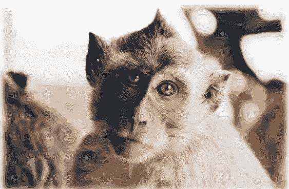
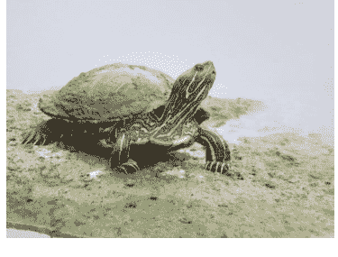
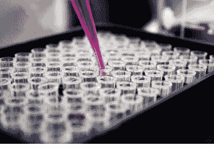
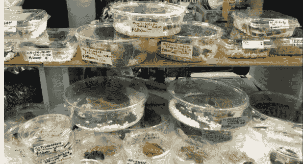
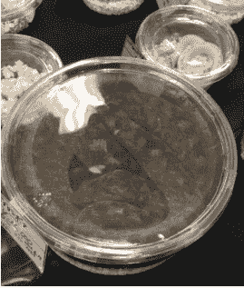
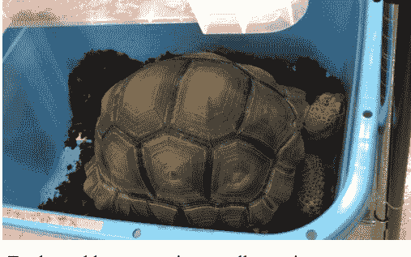
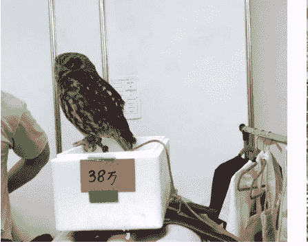
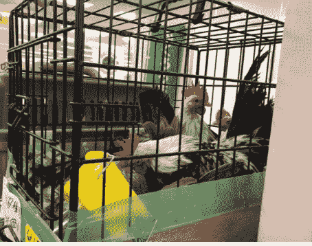
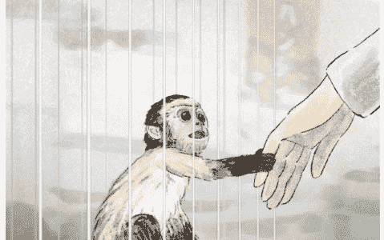
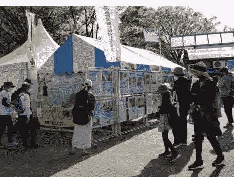

# JAVA 新闻 第108 期 英文版

本期“JAVA NEWS No.108 英文版”是 2022年6月10日以日文发布的 JAVA NEWS No.108 的摘要。

# 入侵外来物种保护法修订

## 日本将禁止进口和销售红耳龟

生活在野外的红耳龟作为入侵龟类物种在日本被消灭，因此必须采取紧急措施消除野外个体。然而，目前尚未对它们的进口和销售进行禁止。在不采取任何措施的情况下，它们将继续被杀害。

另一个担忧是，环境省建议通过冷冻使其冻死。根据世界动物卫生组织（OIE）及其他指南，冷冻是一种痛苦且不恰当的杀害方式。

JAVA 认为这些存在问题，并与动物权利团体 PEACE 一起向环境省持续施压。2021年9月，我们向环境大臣提交了书面请求。我们还向国会议员进行了游说。

我们的诉求是：

- 修订《入侵外来物种保护法》，禁止进口、繁殖和销售红耳龟。然而，应允许红耳龟的现有者在无需许可的情况下继续饲养，且不禁止无法继续饲养的者将红耳龟转给新主人。
- 废除由其他兽医捕捕并杀害红耳龟的行为。

### 请求背景 1

野外的红耳龟最初作为“宠物”进口并销售的。它们在圈养下可以活到40年，背壳长度可达20厘米。显而易见，将它们作为宠物饲养并不容易。尽管如此，政府允许此类动物的销售。他们的疏忽导致了严重问题：许多红耳龟被释放到了野外。

现行的《入侵种法》规定了入侵外来物种的饲养和进口，但已有数百万红耳龟处于圈养状态（根据环境省的数据，约有100万家庭饲养）。因此，对饲养的限制可能会导致遗弃和杀害。

我们反对禁止将无法饲养的红耳龟转给新主人，因为有些人想成为新主人。为了防止遗弃，应该允许所有权的转移。

最好的解决方案是不再增加它们的数量。因此，必须停止进口和分发。所以，我们要求环境省从法律上禁止进口和销售红耳龟。目前有一些红耳龟狂热者在繁殖。如果不被法律禁止，野外红耳龟的数量将继续增加。JAVA NEWS No.108 英文版。因此，也应该禁止繁殖，以停止作为宠物饲养的红耳龟数量增加。

### 请求背景

环境省在2019年绘制的红耳龟消灭手册建议行政人员将红耳龟放入冷冻室（-20°C）进行捕杀。冷冻消灭，这种杀灭方法是不人道的。世界动物卫生组织指出，为了获取皮或其他产品而捕杀爬行动物，冷冻方法被列为不可接受的方法。

尽管日本是 OIE 的成员，但他们完全忽视了动物健康标准。

《动物福利法》规定在动物必须被处死时，应尽可能减少痛苦。

上述方法需要专业知识和技术才能执行。

我们的最终目标是确保红耳龟的消灭，但应尽可能将残酷的冷冻方法替换为减少痛苦的方法。

### 环境省采取了立场

针对红耳龟的消灭方法，环境省对我们的请求采取了引入药物处灭方案的立场。

另一方面，作为处死动物的方法，环境省承认药物处灭是无痛的方式。

### 包括“禁止进口和销售”红耳龟的修订法通过了！

《入侵种法》修订案于2022年1月提交国会会会，并于5月11日通过。修订法包含了我们请求的禁止红耳龟进口和销售，但未包含禁止繁殖和对杀灭方法的改进。然而，至少包含了禁止进口和销售。因此我们认为这是向前的一大步。

## 救救印度尼西亚的猴子！

### 停止为了实验而残忍捕捕和出口猴子的行为

2022年2月，JAVA 受“灵长类行动”（Action for Primates）的请求，帮助停止在印度尼西亚为了科研捕捕和出口长尾猴，这是一个代表全球非人类灵长类发起的项目。请帮助我们拯救它们。

详情请参阅“灵长类行动”网站。

灵长类行动请愿书页

https://www.thepetitions.com/517/718/020/indonesia-end-capture-amp-export-of-wild-monkeys-to-laboratories//

“灵长类行动”发布的视频清楚地展示了捕捕过程是多么残忍和悲惨。

https://actionforprimates.org/public/references/AfP_logo_public_Indonesia_monkey_film.mp4

3月28日，JAVA 向印度尼西亚环境与林业部长兼驻大使 Siti Nurbaya Bakar 博士发送了信函和邮件，敦促他们立即禁止为了科研捕捕、出口和繁殖长尾猴。我们还制作了“灵长类行动”发布视频的日语版并进行了传播。随后，我们号召支持者签署“灵长类行动”的愿书，并向印度尼西亚大使发送信函和邮件。

## 31家动物保护组织就WC11发表联合声明

第11届生命科学替代方法与动物使用世界大会（WC11）于2021年8月23日至9月2日以虚拟大会的形式举行。8月18日，来自多个致力于废除动物实验的国家的动物保护小组聚在一起，参加了“WC11动物保护卫星会议”（虚拟）。JAVA也参加了此次会议。

在会议期间，九个小组就其活动进行了陈述报告，并对替代致癌性的测试方案进行了讨论。31个小组和组织联合发布了一份联合声明，要求承认替代方法的重要性，并促进结束使用动物的策略。

### 致第11届生命科学替代方法与动物使用世界大会全体与会者的声明（虚拟大会，2021年8月）

认识到：

- 科技进步正在增加在教育、研究和测试中替代动物的机会；
- 伦理考虑要求在教育、研究和测试中替代动物；
- 在已经实现替代的情况下，对科学、教育以及人类和其他动物的益处是显而易见的；
- 在避免和替代使用动物方面还可以做得更多；
- 尽管科学家和监管机构在自1993年首届世界大会以来的30年中努力，研究和测试中使用的动物并未显著减少；
- 许多组织和机构现在正专注于开发逐步淘汰使用动物的策略；
- 以及，保护人类、其他动物和环境的可持续且公平的未来取决于基于非动物科学的新标准。

我们，下述签署组织：

- 呼吁决策者实施政策和法规变更，加速在教育、研究和测试中采用非动物方法来替代动物；
- 呼吁会议与会者促进机构层面的策略，以淘汰动物的使用；
- 呼吁世界大会组织者在未来的世界大会上关注加速推进非动物方法的实施。

## 日本最大的异宠动物展“东京爬爬物世界2021冬季”

2021年12月4日和5日，“东京爬爬物世界2021冬季”在东京池袋举行。该活动展出了约10,000只从世界各地进口的异宠，包括爬行动物和猛禽。该活动以其极不恰当的展示方式而闻名，以下对动物的残忍虐待依然故如。

在塑料杯中出售的蜥蜴

在小塑料杯中扭身体的蛇

在小容器中无法移动的乌龟

系着绳索并展示在泡沫板上的猫头鹰

小笼子里的公鸡

笼子里的小毛卷猴（Cebus apella）从笼子缝隙伸出手，紧紧抓住访问者的手并吱叫。它一直抓着手指。访问者感到很困扰，最终移开了猴的手。随后猴子在嘴里吸自己的脚趾，之后它被放在泡沫板上。

动物被置于不自然的环境中承受长期压力。为了此，必须修订《动物福利和管理法》。

## 日本实验替代学会第34届年会

2021年11月11日至13日，受新冠肺炎影响，去年是以虚拟形式举行，但今年在冲绳科学技术大学（OIST）举行。参会人数为47人。

会议的主题是“基于科学的3R”。我们想报告MRI对减少动物使用的贡献。来自科学技术综合院的Hikishima解释说MRI（磁共振成像）由于是非侵入性的是一项非常有吸引力的工具。

然而，MRI成本超过2亿日元（约150万美元），安装和维护费用昂贵。此外，该领域的专家较少。

### 器械和食品领域实验替代的期待

#### 兔子测试

使用兔子进行的测试，在日版指南中被描述为参考信息，尽管日本尚未完全转型为替代方法。

此外，同一份指南中还包含了使用重构人皮肤模型的体外刺激测试方法，并推荐用于医疗器械的皮肤刺激测试。它也可以作为细胞内反应测试的替代方案。

此外，海岛博士概述了医疗器械领域动物实验替代方法的最新信息。目前正在开发针对豚鼠和小鼠的过敏测试的替代方案，以及针对隐形眼镜的兔子眼刺激测试，但在实际应用方面存在许多问题。

#### 食品

国际生命科学日本分会（ILSI Japan）高桥裕树博士介绍了 ILSI Japan 在促进食品领域动物实验替代方案方面所做的努力。

根据他的说法：

不用说对动物福利的考虑，特别是在食品安全评估领域已经是一个问题，因此人们对传统动物测试替代方案的期待日益增加。对于食用经验不足的食品需要安全评估，但在该领域动物测试替代方案的发展已经完成。

ILSI Japan 正在开发可在食品领域使用的动物测试替代方案，并启动了替代动物测试（AAT）项目，目标是提高食品安全评估的完善和效率。几家公司参与了该项目，并与学术界合作实施以下三个主题：(1)“收集信息”，(2)“促进研究”，(3)“传播信息”。例如，在(2)中，以建立食品安全评估新策略为目标，ILSI Japan 正在推进“包含用于预测食品成分安全性的毒性信息的食品成分毒性数据库”以及“预测肠道吸收和血浓度的计算机预测”。

### MPS 作为替代方法备受关注

MPS（微生理系统），如器官芯片，是正在研究的重点替代方法。在今年的会议上，举办了名为“MPS 现状：开发、工业化和标准化”的座谈会，五位演讲者发表了演讲。

其中三位介绍了 MPS 的国内外趋势和现状，以及日本的项目。

- MPS 预计将用于从药物发现到制药研发的临床开发的广泛领域，包括对动物实验替代方法的贡献，从而提高研发生产力。近年来，它作为动物化学产品、化妆品和食品的替代品也引起了广泛关注。
- 它在美、欧已达到实际应用阶段。相比之下，日本通过经济产业省和日本医疗研究开发机构（AMED）于 2017 年启动的 AMED-MPS 项目，MPS 的存在终于为人知。通过与制药公司、学术界、设备制造商和医药医疗器械综合机构（PMDA）的合作，建立了一个使用 MPS 的药物发现评估生态系统。相关方现在正渴望追赶美欧美。
- 此外，作为促进国内终端用户理解和创建 MPS 评估方法的活动，2021 年在“人类 iPSC 细胞安全评估联合会”内新建立了安全评估中的 MPS 应用，约 20 家制药公司和 CRO 公司参与并在日本启动。
- 领先的商用 MPS 和 AMED-MPS 项目开发的 MPS 的目标之一，是为药物安全评估的审查文件、药代动力学预测以及化学物质对人体健康影响的评估提供数据。

在具体的 MPS 研究方面，东京大学的木村广博士介绍了他正在参与商业化的肾脏和肠-肝体外模型微生理系统。

此外，北本大学药学院的前田和博士发表了题为“利用源自人体标本的肠干细胞预测肠道吸收的实验模型建立”的报告。

## 毛皮新闻

无毛皮联盟（FFA）是一个由 50 多个动物保护组织组成的国际联盟，致力于协作消除毛皮。JAVA 是其成员。

### 好消息

无毛皮联盟（FFA）是一个由 50 多个动物保护组织组成的国际联盟，致力于协作消除毛皮。目前，两个品牌已转向无毛皮。

# 无毛皮联盟（FFA）

无毛皮联盟（FFA）是一个由 50 多个动物保护组织组成的国际联盟，致力于协作消除毛皮。目前，两个品牌已转向无毛皮。

## ■ 兔子测试

使用兔子进行的测试，在日版指南中被描述为参考信息，尽管日本尚未完全转型为替代方法。

此外，同一份指南中包含了使用重构人皮肤模型的体外刺激测试方法，并推荐用于医疗器械的皮肤刺激测试。它也可以作为细胞内反应测试的替代方案。

此外，海岛博士概述了医疗器械领域动物实验替代方法的最新信息。目前正在开发针对豚鼠和小鼠的过敏测试的替代方案，以及针对隐形眼镜的兔子眼刺激测试，但在实际应用方面存在许多问题。

## ■ 食品

国际生命科学日本分会（ILSI Japan）高桥裕树博士介绍了 ILSI Japan 在促进食品领域动物实验替代方案方面所做的努力。

根据他的说法：

> 不用说对动物福利的考虑，特别是在食品安全评估领域已经是一个问题，因此人们对传统动物测试替代方案的期待日益增加。对于食用经验不足的食品需要安全评估，但在该领域动物测试替代方案的发展已经完成。

ILSI Japan 正在开发可在食品领域使用的动物测试替代方案，并启动了替代动物测试（AAT）项目，目标是提高食品安全评估的完善和效率。几家公司参与了该项目，并与学术界合作实施以下三个主题：(1)“收集信息”，(2)“促进研究”，(3)“传播信息”。例如，在(2)中，以建立食品安全评估新策略为目标，ILSI Japan 正在推进“包含用于预测食品成分安全性的毒性信息的食品成分毒性数据库”以及“预测肠道吸收和血浓度的计算机预测”。

## MPS 作为替代方法备受关注

MPS（微生理系统），如器官芯片，是正在研究的重点替代方法。在今年的会议上，举办了名为“MPS 现状：开发、工业化和标准化”的座谈会，五位演讲者发表了演讲。

其中三位介绍了 MPS 的国内外趋势和现状，以及日本的项目。

- MPS 预计将用于从药物发现到制药研发的临床开发的广泛领域，包括对动物实验替代方法的贡献，从而提高研发生产力。近年来，它作为动物化学产品、化妆品和食品的替代品也引起了广泛关注。

- 它在美、欧已达到实际应用阶段。相比之下，日本通过经济产业省和日本医疗研究开发机构（AMED）于 2017 年启动的 AMED-MPS 项目，MPS 的存在终于为人知。通过与制药公司、学术界、设备制造商和医药医疗器械综合机构（PMDA）的合作，建立了一个使用 MPS 的药物发现评估生态系统。相关方现在正渴望追赶美欧。

- 此外，作为促进国内终端用户理解和创建 MPS 评估方法的活动，2021 年在“人类 iPSC 细胞安全评估联合会”内新建立了安全评估中的 MPS 应用，约 20 家制药公司和 CRO 公司参与并在日本启动。

- 领先的商用 MPS 和 AMED-MPS 项目开发的 MPS 的目标之一，是为药物安全评估的审查文件、药代动力学预测以及化学物质对人体健康影响的评估提供数据。

在具体的 MPS 研究方面，东京大学的木村广博士介绍了他正在参与商业化的肾脏和肠-肝体外模型微生理系统。

此外，北本大学药学院的前田和博士发表了题为“利用源自人体标本的肠干细胞预测肠道吸收的实验模型建立”的报告。

## 毛皮新闻

无毛皮联盟（FFA）是一个由 50 多个动物保护组织组成的国际联盟，致力于协作消除毛皮。JAVA 是其成员。

## 好消息

无毛皮联盟（FFA）是一个由 50 多个动物保护组织组成的国际联盟，致力于协作消除毛皮。目前，两个品牌已转向无毛皮。

# JAVA 参加了“2022年东京地球日”

4月16日和17日，JAVA 在东京代代木公园举办的“2022年东京地球日”活动中设立展位。与去年一样，我们采取了严谨的新冠肺炎防护措施。

在 JAVA 展位，我们展示了展板、派发了传单、销售了 JAVA 原创教育周边，并设置了留言板。人们可以在留言板上写下对动物的想法，并支持拯救印度尼西亚猴群的请愿活动（详见第 4 页）。

尽管人数不如新冠疫情发生前那么许多，但仍有许多人了解了动物实验和皮草的现状，我们得以为动物开展了有意义的活动。

# 其他国家新闻

在这些页面中，我们介绍了从海外机构发送的通讯报和邮件新闻中选出的若干文章。《JAVA NEWS》第108 号包含了以下六篇文章。为了与读者分享，这六篇文章已被翻译成日语。

您可以通过下 URL 阅读《JAVA NEWS》第108 号中的原文：

- *历史性成就：动物与环境最终获得意大利宪法承认！(LAV)*

- 环保保护署（EPA）将逐步淘汰使用哺乳动物的测试 (AAVs)

- 胜利！狗狗从致命性手术训练中获救 (PCRM)

- 列颠哥哥比亚大学的胜利 (PCRM)

- 广告牌呼吁非动物疫苗安全测试方法 (PCRM)

- 美国实验室使用了 1.1 亿只大鼠和小白鼠 (AAVs)

> 《JAVA NEWS》第108 号英文版于 2022年8月23日出版
