# Java 专业人员笔记

# 第 18 章：LocalTime

| 方法 | 描述 |
| --- | --- |
| `LocalTime.now()` | 返回当前时间 |
| `LocalTime.of(hour, minute)` | 返回具有指定小时和分钟的 `LocalTime` |
| `LocalTime.of(hour, minute, second)` | 返回具有指定小时、分钟和秒的 `LocalTime` |
| `LocalTime.of(hour, minute, second, nano)` | 返回具有指定小时、分钟、秒和纳秒的 `LocalTime` |
| `LocalTime.parse(text)` | 从文本字符串解析 `LocalTime` |
| `LocalTime.parse(text, formatter)` | 使用格式器从文本字符串解析 `LocalTime` |

## 第 18.1 节：两个 LocalTime 之间的时间

```java
public class LocalTimeExample {
    public static void main(String[] args) {
        LocalTime start = LocalTime.of(9, 30);
        LocalTime end = LocalTime.of(17, 45);
        Duration duration = Duration.between(start, end);
        System.out.println("Duration: " + duration);
    }
}
```

# 第 19 章：BigDecimal

## 第 19.1 节：比较 BigDecimal

```java
BigDecimal bd1 = new BigDecimal("10.0");
BigDecimal bd2 = new BigDecimal("10.00");
System.out.println(bd1.equals(bd2)); // false
System.out.println(bd1.compareTo(bd2) == 0); // true
```

## 第 19.2 节：使用 BigDecimal 代替 float

```java
BigDecimal bd1 = new BigDecimal("0.1");
BigDecimal bd2 = new BigDecimal("0.2");
BigDecimal sum = bd1.add(bd2);
System.out.println(sum); // 0.3
```

# 第 23 章：Arrays

| 方法 | 描述 |
| --- | --- |
| `Arrays.sort(array)` | 将指定的数组按升序排序 |
| `Arrays.binarySearch(array, key)` | 使用二分查找在数组中搜索指定的键 |
| `Arrays.copyOf(array, length)` | 返回数组的副本 |
| `Arrays.toString(array)` | 返回数组内容的字符串表示 |

## 第 23.1 节：创建和填充数组

```java
int[] numbers = new int[5];
Arrays.fill(numbers, 10);
System.out.println(Arrays.toString(numbers));
```

900+ 页的专业提示与技巧

GoalKicker.com 这是一本为教育目的创建的非官方免费书籍，与官方 Java 组或公司无关。所有商标和注册商标均为其各自所有者的财产。

- 第 16.3 节：Java 8 `LocalDate` 和 `LocalDateTime` 对象

## 第 16.4 节：创建特定日期

## 第 16.5 节：将日期转换为特定的字符串格式

## 第 16.6 节：LocalTime

## 第 16.7 节：将格式化的日期字符串转换为 `Date` 对象

## 第 16.8 节：创建 `Date` 对象

## 第 16.9 节：比较 `Date` 对象

## 第 16.10 节：将字符串转换为 `Date`

## 第 16.11 节：时区与 `java.util.Date`

## 第 17 章：日期与时间 (`java.time.*`)

## 第 17.1 节：计算两个 `LocalDate` 之间的差异

## 第 17.2 节：日期与时间

## 第 17.3 节：日期与时间的操作

## 第 17.4 节：Instant

## 第 17.5 节：各种日期 API 类的使用

## 第 17.6 节：日期格式化

## 第 17.7 节：简单的日期操作

## 第 18 章：LocalTime

## 第 18.1 节：两个 `LocalTime` 之间的时间

## 第 18.2 节：简介

## 第 18.3 节：时间修改

## 第 18.4 节：时区及其时差

## 第 19 章：BigDecimal

## 第 19.1 节：比较 `BigDecimal`

## 第 19.2 节：使用 `BigDecimal` 代替 float

## 第 19.3 节：`BigDecimal.valueOf`

## 第 19.4 节：使用 `BigDecimal` 进行数学运算

## 第 19.5 节：使用值为零、一或十的初始化 `BigDecimal`

## 第 19.6 节：`BigDecimal` 对象是不可变的

## 第 20 章：BigInteger

## 第 20.1 节：初始化

## 第 20.2 节：`BigInteger` 数学运算示例

## 第 20.3 节：比较 `BigInteger`

## 第 20.4 节：`BigInteger` 的二进制逻辑运算

## 第 20.5 节：生成随机整数

## 第 35.16 节：枚举转换为静态 `String`

## 第 35.17 节：带有静态字段的枚举

## 第 36 章：Enum Map

## 第 36.1 节：`Enum Map` 书示例

## 第 37 章：EnumSet 类

## 第 37.1 节：`Enum Set` 示例

## 第 38 章：以数字开头的枚举

## 第 38.1 节：数字开头的枚举

## 第 39 章：Hashtable

## 第 39.1 节：Hashtable

## 第 40 章：运算符

## 第 40.1 节：增/减运算符 (`++`/`--`)

## 第 40.2 节：条件运算符 (`?:`)

## 第 40.3 节：位运算符和逻辑运算符 (`&`, `|`, `^`)

## 第 40.4 节：字符串拼接运算符 (`+`)

## 第 40.5 节：算术运算符 (`+`, `-`, `*`, `%`)

## 第 40.6 节：移位运算符 (`<<` 和 `>>>`)

## 第 40.7 节：`InstanceOf` 运算符

## 第 40.8 节：赋值运算符 (`=`, `+=`, `-=`, `*=`, `%=`, `<<`, `>>>`, `&&=`)

## 第 40.9 节：条件与与条件或 (`&&` 和 `||`)

## 第 40.10 节：关系运算符 (`<`, `<=`, `>=`, `>`)

## 第 40.11 节：相等运算符 (`==`, `!=`)

## 第 40.12 节：Lambda 运算符 (`->`)

## 第 41 章：构造函数

## 第 41.1 节：默认构造函数

## 第 41.2 节：调用父类构造函数

## 第 41.3 节：带参数的构造函数

## 第 42 章：Object 类方法和构造函数

## 第 42.1 节：`hashCode()` 方法

## 第 42.2 节：`toString()` 方法

## 第 42.3 节：`equals()` 方法

## 第 42.4 节：`wait()` 和 `notify()` 方法

## 第 42.5 节：`getClass()` 方法

## 第 42.6 节：`clone()` 方法

## 第 42.7 节：`Object` 构造函数

## 第 42.8 节：`finalize()` 方法

## 第 43 章：注解

## 第 43.1 节：注解背后的思想

## 第 43.2 节：定义注解类型

## 第 43.3 节：通过反射进行运行时注解检查

## 第 43.4 节：内置注解

## 第 43.5 节：使用注解处理器进行编译时处理

## 第 43.6 节：重复注解

## 第 43.7 节：继承的注解

## 第 43.8 节：获取 `this` 和接收者参数的注解值

## 第 43.9 节：用于多个注解值的注解

## 第 43.10 节：添加多个注解值

## 第 44 章：不可变类

## 第 44.1 节：不含可变引用的示例

## 第 44.2 节：不可变性的优势是什么？

## 第 44.3 节：定义不可变类的规则

## 第 44.4 节：带有可变引用的示例

# 第 45 章：不可变对象

## 第 45.1 节：使用防御拷贝创建类型的不可变版本

## 第 45.2 节：不可变类的配方

## 第 45.3 节：防止类变为不可变的典型设计缺陷

# 第 46 章：可见性（控制类成员的访问）

## 第 46.1 节：私有可见性

## 第 46.2 节：公共可见性

## 第 46.3 节：包级可见性

## 第 46.4 节：受保护可见性

## 第 46.5 节：类访问修饰符总结

## 第 46.6 节：接口成员

# 第 47 章：泛型

## 第 47.1 节：创建泛型类

## 第 47.2 节：在 `T`, `? super T` 和 `extends T` 之间决策

## 第 47.3 节：钻石方法

## 第 47.4 节：创建泛型方法

## 第 47.5 节：需要多个边界 (`extends A & B`)

## 第 47.6 节：在运行时获取满足泛型参数的类

## 第 47.7 节：泛型类和接口的益处

## 第 47.8 节：实例化

## 第 47.9 节：泛型通配符

## 第 47.10 节：在类中使用泛型通配符

## 第 47.11 节：泛型限制的使用

## 第 47.12 节：泛型限制的使用

## 第 47.13 节：泛型擦除

## 第 48 章：运算符

## 第 48.1 节：重载方法

## 第 48.2 节：运算符的重载

## 第 48.3 节：构造函数

## 第 48.4 节：使用静态块初始化

## 第 48.5 节：静态成员的使用

## 第 48.6 节：最简单的类

## 第 48.7 节：运算符重载

# 第 49 章：内部类

## 第 49.1 节：局部内部类

# 第 50 章：嵌套类

## 第 50.1 节：局部嵌套类

## 第 50.2 节：静态嵌套类

## 第 50.3 节：访问修饰符

## 第 50.4 节：匿名内部类

## 第 50.5 节：内部嵌套类

## 第 50.6 节：静态内部类

## 第 50.7 节：访问外部类

# 第 51 章：java.Objects

## 第 51.1 节：空值检查

## 第 51.2 节：流的使用

# 第 52 章：默认方法

## 第 52.1 节：默认方法的使用

## 第 52.2 节：重写默认方法

## 第 52.3 节：为什么使用默认方法？

## 第 52.4 节：访问默认方法

## 第 48.5 节：冲突

## 第 48.6 节：接口中的

# 第 53 章：包

## 第 53.1 节：使用包创建

## 第 53.2 节：作用范围

# 第 54 章：继承

## 第 54.1 节：继承

## 第 54.2 节：抽象类

## 第 54.3 节：使用 `final` 限制继承

## 第 54.4 节：里氏替换原则

## 第 54.5 节：“is-a” 到 “Has-a” 关系

## 第 54.6 节：静态继承

## 第 54.7 节：面向接口编程

## 第 54.8 节：继承中的重写

## 第 54.9 节：变量遮蔽

## 第 54.10 节：窄化与宽化

## 第 54.11 节：静态方法

# 第 55 章：引用类型

## 第 55.1 节：不同的引用类型

# 第 56 章：控制台输出

## 第 56.1 节：从控制台读取输入

## 第 56.2 节：控制台中的流对齐

## 第 56.3 节：实现命令行行为

# 第 57 章：流

## 第 57.1 节：消费流

## 第 57.2 节：消费流

## 第 57.3 节：工厂

## 第 57.4 节：无限流


# 第 57 章：Stream 流

## 57.5 将流元素收集到集合

## 57.6 使用流实现数学函数

## 57.7 通过 `flatMap()` 平坦化流

## 57.8 并行流

## 57.9 创建流

## 57.10 获取数值流的统计信息

## 57.11 将迭代器转换为流

## 57.12 使用 `IntStream` 遍历索引

## 57.13 合并流

## 57.14 使用流进行归约

## 57.15 使用 `Map.Entry` 流在映射后保留初始值

## 57.16 `IntStream` 到 `Stream`

## 57.17 查找第一个匹配谓词的元素

## 57.18 使用流和方法引用编写自文档化代码

## 57.19 将 `Optional` 流转换为值

## 57.20 获取流的切片

## 57.21 基于 `Stream` 创建 `Map`

## 57.22 将流合并为单个 `String`

## 57.23 使用 `Stream` 排序

## 57.24 原始类型的流

## 57.25 流操作分类

## 57.26 将流的结果收集到数组

## 57.27 使用 `Streams` 生成随机字符串

# 第 58 章：`InputStreams` 和 `OutputStreams`

## 58.1 关闭流

## 58.2 将 `InputStream` 读取为 `String`

## 58.3 包装输入/输出流

## 58.4 `DataOutputStream` 示例

## 58.5 向 `OutputStream` 写入字节

## 58.6 将 `InputStream` 复制到 `OutputStream`

# 第 59 章：`Readers` 和 `Writers`

## 59.1 `BufferedReader`

## 59.2 `StringWriter` 示例

# 第 60 章：`Preferences`

## 60.1 使用 `preferences`

## 60.2 添加事件监听器

## 60.3 设置 `Preferences` 的子节点

## 60.4 跨实例协调 `preferences`

## 60.5 导出 `preferences`

## 60.6 导入 `preferences`

## 60.7 移除事件监听器

## 60.8 获取 `preferences` 值

## 60.9 设置 `preferences` 值

# 第 61 章：Collection 工厂方法

## 61.1 `List` 工厂方法示例

## 61.2 `Set` 工厂方法示例

## 61.3 `Map` 工厂方法示例

# 第 62 章：替代集合

## 62.1 Guava、Apache 和 Eclipse Collections 中的 `Multimap`

## 62.2 Apache `HashBag`、Guava `Hashiset` 和 Eclipse `HashBag`

## 62.3 与集合的比较操作 - 创建集合

# 第 63 章：并发集合

## 63.1 线程安全的集合

## 63.2 向 `ConcurrentHashMap` 插入

## 63.3 并发集合

# 第 64 章：选择集合

## 64.1 Java 集合流程图

# 第 65 章：`super` 关键字

## 65.1 `Super` 关键字用法

# 第 66 章：序列化

## 66.1 Java 中的基础序列化

## 66.2 自定义序列化

## 66.3 版本控制与 `serialVersionUID`

## 66.4 使用 `Gson` 进行序列化

## 66.5 使用 `Jackson` 进行自定义 JSON 反序列化

# 第 67 章：`Optional`

## 67.1 `Map`

## 67.2 如果 `Optional` 为空则返回默认值

## 67.3 如果没有值则抛出异常

## 67.4 使用 `Supplier` 懒性地提供默认值

## 67.5 `Filter`

## 67.6 用于原始数字类型的 `Optional` 容器

## 67.7 仅当存在值时运行代码

## 67.8 `FlatMap`

# 第 68 章：对象引用

## 68.1 作为方法参数的对象引用

# 第 69 章：异常与异常处理

## 69.1 使用 `try-catch` 捕获异常

## 69.2 `try-with-resources` 语句

## 69.3 自定义异常

## 69.4 处理 `InterruptedException`

## 69.5 `try catch` 块中的 `return` 语句

## 69.6 引言

## 69.7 Java 层级结构 - 运行时异常与编译时异常

## 69.8 创建和读取堆栈跟踪

## 69.9 抛出异常

## 69.10 异常的高级特性

## 69.11 `try-finally` 和 `try-catch-finally` 语句

## 69.12 方法中的 `throws` 子句

# 第 70 章：`Calendar` 及其子类

## 70.1 创建 `Calendar`

## 70.2 增加/减少日历字段

## 70.3 减去日历

## 70.4 查找 AM/PM

# 第 71 章：使用 `static` 关键字

## 71.1 在静态上下文中引用非静态成员

## 71.2 使用 `static` 声明常量

# 第 72 章：`Properties` 类

## 72.1 加载属性

## 72.2 将属性保存为 XML

## 72.3 属性文件的尾部空格

# 第 73 章：Lambda 表达式

## 73.1 Java Lambdas 简介

## 73.2 使用 Lambda 表达式排序集合

## 73.3 方法引用

## 73.4 实现多个接口

## 73.5 Lambda - 监听器示例

## 73.6 带有 Lambda 表达式的闭包

## 73.7 Lambda 与内存利用率

## 73.8 结合自定义函数式接口使用 Lambda 表达式

## 73.9 传统风格的 lambda 'return' 仅从 lambda 返回，不从外部方法

## 73.11 Lambdas 与执行模式

## 73.12 使用 Lambda 表达式和谓词从列表中获取特定值

# 第 74 章：基础控制结构

## 74.1 `switch` 语句

## 74.2 `do_while` 循环

## 74.3 `For Each`

## 74.4 Java 中的 `Continue` 语句

## 74.5 `If / Else If / Else` 结构

## 74.6 `For` 循环

## 74.7 三元运算符

## 74.8 `Try_Catch_Finally`

## 74.9 `Break`

## 74.10 `While` 循环

## 74.11 `IF / Else`

## 74.12 嵌套 `break / continue`

# 第 75 章：`BufferedWriter`

## 75.1 向文件写入一行文本

# 第 76 章：新 I/O

## 76.1 创建路径

## 76.2 操作路径

## 76.3 获取路径信息

## 76.4 从文件系统获取信息

## 76.5 读取文件

## 76.6 写入文件

# 第 77 章：文件 I/O

## 77.1 从 `java.io` 迁移到 Java 7 NIO (`java.nio.file.Path`)

## 77.2 从文件中读取图像

## 77.3 使用 `InputStream`/`OutputStream` 读/写


## 第 77 章

- 77.4 节：将所有字节读入 `byte[]` 453
- 77.5 节：使用 `Channel` 复制文件 454
- 77.6 节：将 `byte[]` 写入文件 454
- 77.7 节：`Stream` 与 `Writer`/`Reader` API 455
- 77.8 节：使用 `Scanner` 读取 456
- 77.9 节：使用 `InputStream` 和 `OutputStream` 复制文件 457
- 77.10 节：从二进制文件读取 457
- 77.11 节：使用文件 `Channel` 和 `Buffer` 读取 458
- 77.12 节：添加目录 458
- 77.13 节：阻塞或重定向标准输出/错误 459
- 77.14 节：一次性读取整个文件 460
- 77.15 节：锁定 460
- 77.16 节：使用 `BufferedInputStream` 读取文件 460
- 77.17 节：遍历目录及其子目录 461
- 77.18 节：使用文件 `Channel` 和 `Buffer` 写入 461
- 77.19 节：使用文件 `PrintStream` 写入 462
- 77.20 节：遍历目录并按文件扩展过滤 462
- 77.21 节：访问 `ZIP` 文件内容 463

## 第 78 章：Scanner 464

- 78.1 节：完成大多数常用任务的通用模式 464
- 78.2 节：使用自定义分隔符 466
- 78.3 节：使用 `Scanner` 读取系统输入 466
- 78.4 节：使用 `Scanner` 读取文件输入 466
- 78.5 节：使用 `Scanner` 将整个输入读为 `String` 467
- 78.6 节：谨慎关闭 `Scanner` 467
- 78.7 节：从命令行读取一个 `int` 468

## 第 79 章：接口 469

- 79.1 节：实现多个接口 469
- 79.2 节：声明与实现接口 470
- 79.3 节：扩展接口 470
- 79.4 节：接口的用处 471
- 79.5 节：默认方法 473
- 79.6 节：接口中的修饰符 475
- 79.7 节：结合泛型使用接口 475
- 79.8 节：加强边界类型参数 478
- 79.9 节：在抽象类中实现接口 478

## 第 80 章：正则表达式 480

- 80.01 节：使用捕获组 480
- 80.02 节：通过带标志编译 `Pattern` 使用带自定义行为的正则 481
- 80.03 节：转义字符 481
- 80.04 节：不匹配给定字符串 482
- 80.05 节：使用正则字面量匹配 482
- 80.06 节：匹配反斜线 482

## 第 81 章：Comparable 和 Comparator 484

- 81.01 节：使用 `Comparable<T>` 排序 `List` 884
- 81.02 节：`compareTo` 和 `compare` 方法 887
- 81.03 节：自然排序 (comparable) 与显式排序 (comparator) 488
- 81.04 节：使用方法 `Comparator` 489
- 81.05 节：排序条目 491

## 第 82 章：浮点数操作 491

- 82.01 节：比较浮点值 491
- 82.02 节：溢出与欠溢 493
- 82.03 节：格式化浮点值 494
- 82.04 节：严格遵守 IEEE 规范 494

## 第 83 章：货币与金额 496

- 83.01 节：自定义货币 496

## 第 84 章：对象拷贝 497

- 84.01 节：执行深拷贝 497
- 84.02 节：使用工厂克隆 498
- 84.03 节：使用构造函数克隆 498
- 84.04 节：通过 `Cloneable` 接口克隆 498
- 84.05 节：执行浅拷贝 499

## 第 85 章：递归 501

- 85.01 节：递归的基本思想 501
- 85.02 节：Java 中深度递归的问题 501
- 85.03 节：递归的类型 503
- 85.04 节：计算第 N 个斐波那契数 503
- 85.05 节：`StackOverflowError` 与循环 504
- 85.06 节：计算数字的 N 次方 506
- 85.07 节：使用递归遍历树 506
- 85.08 节：使用递归具体化字符串 507
- 85.09 节：计算 1 到 N 的整数和 507

## 第 86 章：与 String 的转换 508

- 86.01 节：将 `String` 转换为其他数据类型 508
- 86.02 节：与字节之间的转换 509
- 86.03 节：`Base64` 编码/解码 509
- 86.04 节：将其他数据类型转换为 `String` 510
- 86.05 节：从 `InputStream` 获取 `String` 511

## 第 87 章：随机数生成 512

- 87.1 节：伪随机数 512
- 87.2 节：特定范围内的伪随机数 512
- 87.3 节：生成加密安全的伪随机数 513
- 87.4 节：使用指定种子生成随机数 513
- 87.5 节：选择不重复的随机数 514
- 87.6 节：使用 `apache-commons3` 生成随机数 515

## 第 88 章：单例 516

- 88.1 节：枚举单例 516
- 88.2 节：无枚举的单例（饿性初始化）516
- 88.3 节：使用 holder 类的线程安全初始化 | Bill Pugh 单例实现 517
- 88.4 节：双重检查锁的线程安全单例 517
- 88.5 节：扩展单例（继承） 518

## 第 89 章：自动装箱 521

- 89.1 节：交替使用 `int` 和 `Integer` 521
- 89.2 节：自动装箱可能导致 `NullPointerException` 522
- 89.3 节：在 `if` 语句中使用 `Boolean` 522
- 89.4 节：`int` 和 `Integer` 可交替使用的不同场景 522
- 89.5 节：自动装箱的内存和计算开销 524

## 第 90 章：Java 中的 2D 图形 525

- 90.1 节：示例 1：使用 Java 绘制矩形 525
- 90.2 节：示例 2：绘制并填充圆形 527

## 第 91 章：JAXB 528

- 91.1 节：写入 XML 文件（反序列化） 528
- 91.2 节：写入 XML 文件（对象序列化） 528
- 91.3 节：手动字段/属性 映射 530
- 91.4 节：将 XML 命名空间绑定到可序列化的 Java 类 530
- 91.5 节：使用 `XMLAdapter` 生成所需的 xml 格式 530
- 91.6 节：修剪字符串
- 91.7 节：自动字段/属性 XML 配置 (`@XmlAdapterType`) 532
- 91.8 节：指定 `XMLAdapter` 以（重）用数据 534

## 第 92 章：类 - 反射 537

- 92.1 节：`Object` 类的 `getClass()` 方法 537

## 第 93 章：网络 538

- 93.1 节：使用 `Socket` 的基础客户端和服务器通信 538
- 93.2 节：使用 `UDP` (`Datagram`) 的基础客户端/服务器通信 540
- 93.3 节：从 `InputStream` 加载 `TrustStore` 和 `KeyStore` 541
- 93.4 节：`Socket` 示例 - 使用简单的 socket 读取网页 542
- 93.5 节：临时禁用 SSL 验证（用于测试目的） 543
- 93.6 节：使用 `Channel` 下载文件 543
- 93.7 节：组播 544

## 第 94 章：NIO - 网络 547

- 94.1 节：使用 `Selector` 监听事件（带有 `OP_CONNECT` 的示例） 547

## 第 95 章：HttpURLConnection 549

- 95.1 节：从 URL 获取字符串响应体 549
- 95.2 节：POST 数据 550
- 95.3 节：删除资源 550
- 95.4 节：检查资源是否存在 551

## 第 96 章：JAX-WS 553

- 96.1 节：基本认证 553

## 第 97 章：Nashorn JavaScript引擎 554

- 97.1 节：执行 JavaScript 文件 554
- 97.2 节：拦截脚本输出 554
- 97.3 节：Nashorn 555
- 97.4 节：评估算术字符串 555
- 97.5 节：设置全局变量 555
- 97.6 节：设置和获取变量 556
- 97.7 节：在 Nashorn 中使用 Java 对象 556
- 97.8 节：从脚本实现接口 557

## 第 98 章：Java 原生接口 (JNI) 558

- 98.1 节：从 Java 调用 C++ 方法 558
- 98.2 节：从 C++ 调用 Java 方法（回调） 559
- 98.3 节：加载原生库 561

## 第 99 章：函数式接口 563

- 99.1 节：按签名列出的标准函数函数式接口 563

## 第 100 章：流式接口 565

- 100.1 节：流式编程风格 565
- 100.2 节：Truth - 流式测试框架 566

## 第 101 章：远程调用 (RMI) 567

- 101.1 节：回调：在“客户端”上调用方法 567
- 101.2 节：带有客户端和服务器实现的简单示例 571
- 101.3 节：客户端-服务器：从一个 JVM 调用另一个 JVM 中的方法 573

## 第 102 章：迭代器和可迭代对象 576

- 102.1 节：使用迭代器移除元素 576
- 102.2 节：创建自己的可迭代对象 576
- 102.3 节：在 `for` 中使用 `Iterable` 577
- 102.4 节：使用原始迭代器 578

## 第 103 章：反射 API 579

- 103.1 节：动态代理 579
- 103.2 节：简介 580
- 103.3 节：利用反射进行“恶性”操作 581
- 103.4 节：滥用 API 更改私有和 final 变量 583
- 103.5 节：获取和设置字段 584
- 103.6 节：调用嵌套类的构造函数 585
- 103.7 节：调用嵌套类的构造函数 586
- 103.8 节：调用方法 586
- 103.9 节：根据（全限定名）名获取类 587
- 103.10 节：获取枚举的常量 587
- 103.11 节：使用反射调用重载构造函数 588

## 第 104 章：ByteBuffer 590

- 104.1 节：基础用法 - 使用 `ByteBuffer` 590
- 104.2 节：基础用法 - 创建 `ByteBuffer` 590
- 104.3 节：基础用法 - 向缓冲区写入数据 591

## 第 105 章：Applets 592

- 105.1 节：最小 Applet 592
- 105.2 节：创建 GUI 593
- 105.3 节：从 applet 内部打开链接 593
- 105.4 节：加载图像、音频和其他资源 594

## 第 106 章：表达式 596

- 106.1 节：运算符优先级 596
- 106.2 节：表达式基础 597
- 106.3 节：表达式评估 598
- 106.4 节：常量表达式 599

## 第 107 章：Java 中的 JSON 601

- 107.1 节：使用 `Jackson Mapper` 601
- 107.2 节：JSON 转对象 (`Gson` 库) 602
- 107.3 节：`JSONObject.NULL` 602
- 107.4 节：Builder - 链式方法 603
- 107.5 节：对象转 JSON (`Gson` 库) 603
- 107.6 节：JSON 迭代 603
- 107.7 节：`optjson` vs `getXXX` 方法 604
- 107.8 节：从 JSON 提取简单元素 604
- 107.9 节：`JSONArray` 转 Java `List` (`Gson` 库) 604
- 107.10 节：将数据编码为 JSON 605
- 107.11 节：解码 JSON 数据 605

## 第 108 章：使用 JAXP 解析 XML 607

- 108.1 节：使用 `STAX` API 解析 607
- 108.2 节：使用 `DOM` API 解析文档 608

## 第 109 章：XML XPath 610

- 109.1 节：单个 XML 中的 XPath 表达式 610
- 109.2 节：在 XML 中多次解析 610
- 109.3 节：XML 文档中的节点 611

## 第 110 章：XML - 对象模型 612

- 110.1 节：读取 XML 文件 612
- 110.2 节：写入 XML 文件 614

## 第 111 章：多态 617

- 111.1 节：方法重写 617
- 111.2 节：方法重载 618
- 111.3 节：不同类型的重写 619
- 111.4 节：虚函数 622
- 111.5 节：在不接触现有代码的情况下添加行为 623

## 第 112 章：封装 625

- 112.1 节：维持不变不变的封装 625
- 112.2 节：减少耦合 626

## 第 113 章：Java Agents 627

- 113.1 节：使用 agents 修改类 627
- 113.2 节：在运行时添加 agent 627
- 113.3 节：设置基础 agent 628

## 第 114 章：变长参数 (Varargs) 629

- 114.1 节：使用 `Varargs` 参数 629
- 114.2 节：指定 `varargs` 629

## 第 115 章：日志 (java.util.logging) 630

- 115.1 节：高效记录消息 630
- 115.2 节：使用默认记录器 631
- 115.3 节：日志级别 632

## 第 116 章：log4j / log4j 2 634

- 116.1 节：属性文件到数据库 634
- 116.2 节：如何获取 Log4j 635
- 116.3 节：设置属性文件 635
- 116.4 节：基础 log4j(2) 配置文件 636
- 116.5 节：在 Java 代码中使用 log4j 636
- 116.6 节：从 log4j 1x 迁移到 2x 637
- 116.7 节：按级别过滤日志 (log4j 1x) 638

## 第 117 章：Oracle 官方 639

- 117.1 节：命名规范 639
- 117.2 节：类结构 640
- 117.3 节：注解 641
- 117.4 节：导入语句 641
- 117.5 节：括号 642
- 117.6 节：多余的括号 643
- 117.7 节：修饰符 643
- 117.8 节：缩进 644
- 117.9 节：字面量 644
- 117.10 节：包声明 644
- 117.11 节：Lambda 表达式 644
- 117.12 节：Java 源文件 645
- 117.13 节：封装语句 645
- 117.14 节：封装方法声明 646
- 117.15 节：封装表达式 646
- 117.16 节：空白字符 646
- 117.17 节：特殊字符 647
- 117.18 节：变量声明 648

## 第 118 章：字符编码 649

- 118.1 节：从 UTF-8 编码的文件读取文本 649
- 118.2 节：向 UTF-8 文件写入文本 649
- 118.3 节：获取字符串的 UTF-8 字节表示形式 650

## 第 119 章：Apache Commons Lang 651

- 119.1 节：实现 `equals(Object)` 方法 651
- 119.2 节：实现 `hashCode()` 方法 651
- 119.3 节：实现 `toString()` 方法 652

## 第 120 章：本地化与国际化 654

- 120.1 节：语言区域 (`Locale`) 654
- 120.2 节：使用 "locale" 自动格式化日期 655
- 120.3 节：字符串比较 655

## 第 121 章：使用 Fork/Join 框架并行编程 656

- 121.1 节：Java 中的 Fork/Join  656

## 第 122 章：非访问修饰符 658

- 122.1 节：`final` 658
- 122.2 节：`static` 659
- 122.3 节：`abstract` 660
- 122.4 节：`strictfp` 661
- 122.5 节：`volatile` 661
- 122.6 节：`synchronized` 662
- 122.7 节：`transient` 663

## 第 123 章：Process、Runtime exec、Process 和 ProcessBuilder 不理解 shell 语法 664


# 第 123 章 陷阱

## 第 123:1 节 陷阱

## 第 123:2 节 简单示例（Java 版本 < 15）

# 第 124 章 Java Native Access (JNA)

## 第 124:1 节 JNA 简介

# 第 125 章 模块

## 第 125:1 节 定义基础模块

# 第 126 章 并发编程（线程）

## 第 126:1 节 Callable 和 Future

## 第 126:2 节 CountDownLatch

## 第 126:3 节 基础多线程

## 第 126:4 节 锁作为同步辅助工具

## 第 126:5 节 Semaphore (信号量)

## 第 126:6 节 同步

## 第 126:7 节 Runnable 对象

## 第 126:8 节 创建死锁系统

## 第 126:9 节 创建 `java.lang.Thread` 实例

## 第 126:10 节 原子操作

## 第 126:11 节 独占/并发读访问

## 第 126:12 节 生产者-消费者

## 第 126:13 节 使用 `synchronized` / `volatile` 可视化读/写屏障

## 第 126:14 节 获取程序启动的所有线程状态（排除特定线程）

## 第 126:15 节 使用 `ThreadLocal`

## 第 126:16 节 使用共享全局队列的多生产者/消费者示例

## 第 126:17 节 使用线程池相加两个 `int` 数组

## 第 126:18 节 暂停执行

## 第 126:19 节 线程中断 / 停止线程

# 第 127 章 Executor、ExecutorService 和线程池

## 第 127:1 节 `ThreadPoolExecutor`

## 第 127:2 节 从计算中获取返回值 - `Callable`

## 第 127:3 节 `submit()` 与 `execute()` 的异常处理差异

## 第 127:4 节 处理拒绝执行

## 第 127:5 节 触发后即忘 - `Runnable` 任务

## 第 127:6 节 不同类型并发构造的用例

## 第 127:7 节 等待 `ExecutorService` 中所有任务完成

## 第 127:8 节 不同类型 `ExecutorService` 的用例

## 第 127:9 节 调度任务在固定时间、延迟后或重复运行

## 第 127:10 节 使用线程池

# 第 128 章 ThreadLocal

## 第 128:1 节 基础 `ThreadLocal` 使用

## 第 128:2 节 `ThreadLocal` Java 8 函数式初始化

## 第 128:3 节 多个线程共享一个对象

# 第 129 章 在多线程应用中使用 `ThreadPoolExecutor`

## 第 129:1 节 使用 `Runnable` 类执行不需要返回值的异步任务

## 第 129:2 节 使用 `Callable` 类执行需要返回值的异步任务

## 第 129:3 节 使用 Lambda 表达式定义异步任务

# 第 130 章 常见陷阱

## 第 130:1 节 陷阱：使用 `==` 比较作为 `Integer` 的包装类

## 第 130:2 节 陷阱：使用 `==` 比较字符串

## 第 130:3 节 忘记释放资源

## 第 130:4 节 在打开文件之前对其测试文件

## 第 130:5 节 陷阱：将变量视为对象

## 第 130:6 节 内存泄漏

## 第 130:7 节 不理解 `String` 是一个不可变类

## 第 130:8 节 陷阱：将赋值和副作用结合

# 第 131 章 Java 陷阱 - 异常使用

## 第 131:1 节 捕获 `Throwable`、`Error` 或 `RuntimeException`

## 第 131:2 节 忽略或吞掉异常

## 第 131:3 节 抛出 `Exception`、`Error` 或 `RuntimeException`

## 第 131:4 节 使用异常处理正常流

## 第 131:5 节 直接子类 `Throwable`

## 第 131:6 节 捕获 `InterruptedException`

## 第 131:7 节 过度或不恰的堆栈轨迹

# 第 132 章 Java 陷阱 - 语言语法

## 第 132:1 节 `switch` 中缺少 `break`

## 第 132:2 节 声明同名的类

## 第 132:3 节 缺少大括号导致的 "悬挂 if" 和 "else" 问题

## 第 132:4 节 进制字面量

## 第 132:5 节 使用 `==` 测试布尔值

## 第 132:6 节 忽略方法可见性

## 第 132:7 节 为参数或用户输入使用 `assert`

## 第 132:8 节 通配符导入会导致代码变得脆弱

## 第 132:9 节 分号位置不当和缺失大括号

## 第 132:10 节 自动装箱拆箱到基本类型

## 第 132:11 节 自动 Null 对象

# 第 133 章 Java 陷阱 - 线程与并发

## 第 133:1 节 扩展 `java.lang.Thread`

## 第 133:2 节 线程过多导致应用变慢

## 第 133:3 节 错误使用 `wait()`; `notifyAll()`

## 第 133:4 节 共享变量需要适当同步

## 第 133:5 节 线程创建的开销较大

# 第 134 章 Java 陷阱 - Null 和 NullPointerException

## 第 134:1 节 产生意想不到的 `null`

## 第 134:2 节 使用 `null` 表示数组或集合

## 第 134:3 节 在关闭 I/O 流时未检查是否初始化

## 第 134:4 节 返回 `null` 而不是抛出异常

## 第 134:5 节 不必要的基本类型包装使用会导致 `NullPointerException`

## 第 134:6 节 使用 "Yoda 表达式" 避免 `NullPointerException`

# 第 135 章 Java 陷阱 - 性能问题

## 第 135:1 节 循环中的字符串拼接无法扩展

## 第 135:2 节 使用 `size()` 测试集合是否为空

## 第 135:3 节 连接字符串以便使用 `==` 是一个坏主意

## 第 135:4 节 使用 `new` 创建基本类型包装实例效率低下

## 第 135:5 节 正则表达式的效率问题

## 第 135:6 节 未缓冲流上的小规模读/写效率低下

## 第 135:7 节 陷阱 - 过度使用基本类型包装类效率低下

## 第 135:8 节 陷阱 - 创建日志消息的开销

## 第 135:9 节 陷阱 - 遍历 `Map` 的键可能效率低下

## 第 135:10 节 陷阱 - 调用 `System.gc()` 效率低下

## 第 135:11 节 陷阱 - 调用 `new String(String)` 效率低下

# 第 136 章 `ServiceLoader`

## 第 136:1 节 简单的 `ServiceLoader` 示例

## 第 136:2 节 Logger

# 第 137 章 类加载器

## 第 137:1 节 实现自定义加载器

## 第 137:2 节 加载外部类

## 第 137:3 节 实例化并使用类

# 第 138 章 程序化创建图像

## 第 138:1 节 创建简单的图像

## 第 138:2 节 将图像保存到磁盘

## 第 138:3 节 设置像素颜色

## 第 138:4 节 提高图像质量

## 第 138:5 节 使用 `BufferedImage` 创建图像

## 第 138:6 节 编辑和重用图像

## 第 138:7 节 如何缩放图像

# 第 139 章 原子类型

## 第 139:1 节 创建原子类型

## 第 139:2 节 原子类型的动机

# 第 140 章 RSA 加密

## 第 140:1 节 使用 OAEP 和 GCM 的混合加密体系

# 第 146 章 `sun.misc.Unsafe`

## 第 146.2 节 通过 `bootstrapclass` 实例化 `sun.misc.Unsafe`

## 第 146.3 节 获取 `Unsafe` 实例

## 第 146.4 节 `Unsafe` 的用途

# 第 147 章 Java 内存模型

## 第 147.1 节 内存模型的动机

## 第 147.2 节 发生之前关系

## 第 147.3 节 如何避免理解内存模型

## 第 147.4 节 应用于某些示例的发生之前推理

# 第 148 章 Java 部署

## 第 148.1 节 从命令行创建可执行的 JAR

## 第 148.2 节 为应用程序及其依赖创建 Uber JAR

## 第 148.3 节 创建 JAR、WAR 和 EAR 文件

## 第 148.4 节 Java Web Start 简介

# 第 149 章 Java 插件系统实现

## 第 149.1 节 使用 `URLClassLoader`

# 第 150 章 JavaBean

## 第 150.1 节 基础 Java Bean

# 第 151 章 Java SE 7 特性

## 第 151.1 节 新的 Java SE 7 编程语言特性

## 第 151.2 节 二进制字面量

## 第 151.3 节 `try-with-resources` 语句

## 第 151.4 节 数值字面量中的下划线

## 第 151.5 节 泛型实例创建的类型推断

## 第 151.6 节 Switch 语句中的字符串

# 第 152 章 Java SE 8 特性

## 第 152.1 节 新的 Java SE 8 编程语言特性

# 第 153 章 动态方法分发

## 第 153.1 节 动态方法分派 - 示例代码

# 第 154 章 生成 Java 代码

## 第 154.1 节 从 JSON 生成 POJO

# 第 155 章 JShell


# 第 155 章：JShell

## 第 155.1 节：编辑代码片段

## 第 155.2 节：进入和退出 JShell

## 第 155.3 节：表达式

## 第 155.4 节：方法与类

## 第 155.5 节：变量

# 第 156 章：栈遍历 API (Stack-Walking API)

## 第 156.1 节：打印当前线程的所有帧

## 第 156.2 节：打印当前类

## 第 156.3 节：显示反射和其他帧

# 第 157 章：套接字 (Sockets)

## 第 157.1 节：从套接字读取

# 第 158 章：Java 套接字

## 第 158.1 节：简单的 TCP 回显服务器

# 第 159 章：FTP (文件传输协议)

## 第 159.1 节：连接到 FTP 服务器

# 第 160 章：在 Java 中使用其他脚本语言

## 第 160.1 节：在 Nashorn 模式下评估 JavaScript 文件

# 第 161 章：比较

## 第 161.1 节：静态成员

## 第 161.2 节：其他上下文中的类

## 第 161.3 节：按值传递与按引用传递

## 第 161.4 节：继承 vs 组合

## 第 161.5 节：向下转型

## 第 161.6 节：抽象方法

# 第 162 章：音频

## 第 162.1 节：播放 MIDI 文件

## 第 162.2 节：循环播放音频文件

## 第 162.3 节：基础音频输出

## 第 162.4 节：裸机音效

# 第 163 章：Java 打印服务 (Print Service)

## 第 163.1 节：构建要打印的文档

## 第 163.2 节：发现可用的打印服务

## 第 163.3 节：定义打印属性

## 第 163.4 节：监听打印请求

## 第 163.5 节：发现默认打印服务

## 第 163.6 节：从打印服务创建打印作业

# 第 164 章：CompletableFuture

## 第 164.1 节：CompletableFuture 示例

# 第 165 章：运行时命令

## 第 165.1 节：添加关闭钩子 (`shutdown hooks`)

# 第 166 章：单元测试 (Unit Testing)

## 第 166.1 节：什么是单元测试？

# 第 167 章：断言 (Asserting)

## 第 167.1 节：使用 `assert` 检查算术

# 第 168 章：多版本 JAR 文件 (Multi-Release JAR Files)

## 第 168.1 节：多版本 JAR 的内容

## 第 168.2 节：使用 `jar` 工具创建多版本 JAR

## 第 168.3 节：多版本 JAR 内部加载的类

# 第 169 章：即时编译器 (JIT compiler)

## 第 169.1 节：概述

# 第 170 章：字节码修改 (Bytecode Modification)

## 第 170.1 节：什么是字节码？

## 第 170.2 节：使用 ASM 编辑 jar 文件

## 第 170.3 节：将 `ClassNode` 加载为 Class

## 第 170.4 节：在 jar 文件中重命名类

## 第 170.5 节：Jassist 基础

# 第 171 章：反汇编与反编译

## 第 171.1 节：使用 `javap` 查看字节码

# 第 172 章：JMX

## 第 172.1 节：使用 Platform MBean Server 的简单示例

# 第 173 章：Java 虚拟机 (JVM)

## 第 173.1 节：基础知识

# 第 174 章：XJC

## 第 174.1 节：从简单的 XSD 生成 Java 代码

# 第 175 章：JVM 标志

## 第 175.1 节：`-XXaggressive`

## 第 175.2 节：`-XXallocChunks`

## 第 175.3 节：`-XXallocClearSize`

## 第 175.4 节：`-XXallProfiling`

## 第 175.5 节：`-XXdisableFatSpin`

## 第 175.6 节：`-XXdisableHeuristics`

## 第 175.7 节：`-XXdumpSize`

## 第 175.8 节：`-XXitOutOfMemory`

# 第 176 章：JVM 工具接口 (Tool Interface)

## 第 176.1 节：遍历对象 (Heap 1.0)

## 第 176.2 节：获取 JVM 环境

## 第 176.3 节：`Agent_OnLoad` 方法初始化示例

# 第 177 章：Java 内存管理

## 第 177.1 节：设置堆、永久代和栈的大小

## 第 177.2 节：垃圾收集

## 第 177.3 节：Java 中的内存泄漏

## 第 177.4 节：终化 (Finalization)

## 第 177.5 节：手动触发 GC

# 第 178 章：Java 性能调优

## 第 178.1 节：基于证据的性能调优方法

## 第 178.2 节：减少字符串数量

## 第 178.3 节：通用方法

# 第 179 章：基准测试 (Benchmarks)

## 第 179.1 节：简单的 JMH 示例

# 第 180 章：上传文件到 AWS

## 第 180.1 节：上传文件到 s3 存储桶

# 第 181 章：AppDynamics 与 TIBCO Works

## 第 181.1 节：单步对所有 BW 应用进行插桩的示例

# 附录 A：安装 Java（标准版）

## 附录 A.1 节：在 Windows 上安装后设置 `%PATH%` 和 `%HOME%`

## 附录 A.2 节：在 Linux 上安装 Java JDK

## 附录 A.3 节：在 macOS 上安装 Java JDK

## 附录 A.4 节：在 Windows 上安装 Java JDK 或 JRE

## 附录 A.5 节：使用 `alternatives` 在 Linux 上配置和设置 Java 版本

## 附录 A.6 节：Java 开发需要什么？

## 附录 A.7 节：选择合适的 Java SE 版本

## 附录 A.8 节：Java 发布版本命名

## 附录 A.9 节：使用最新的 tar 包在 Linux 上安装 Oracle Java

## 附录 A.10 节：Linux 安装后检查与配置

# 附录 B：Java 版本、发布和发行版

## 附录 B.1 节：Java SE 和 Java JDK 发版的区别

## 附录 B.2 节：Java SE 版本

## 附录 B.3 节：Java EE、Java SE、ME 和 JavaFX 的区别

# 附录 C：类路径 (Classpath)

## 附录 C.1 节：指定类路径的不同方法

## 附录 C.2 节：向类路径添加目录中的 JAR 包

## 附录 C.3 节：从类路径加载资源

## 附录 C.4 节：类路径路径语法

## 附录 C.5 节：动态类路径

## 附录 C.6 节：将类名映射到路径名

## 附录 C.7 节：引导类路径

## 附录 C.8 节：类路径的含义：搜索工作原理

# 附录 D：资源（在类路径中）

## 附录 D.1 节：加载默认配置

## 附录 D.2 节：从资源加载图像

## 附录 D.3 节：使用类加载器查找并读取资源

## 附录 D.4 节：从多个 JAR 加载同名资源

# 致谢

# 你可能也喜欢

# 关于

> 请随时向任何人免费分享此 PDF，
>
> 本书的最新版本可以从此处下载：
>
> https://goalkicker.com/JavaBook


本 Java® Notes for Professionals 编译自 Stack Overflow 文档，内容由 Stack Overflow 的才子们编写。文本内容根据 Creative Commons BY-SA 协议发布，请参阅书末的致谢部分了解对各章节做出贡献者。另有说明，图像版权可能归其所有者所有。

这是一本出于教育目的的非官方免费书籍，与官方 Java® 组或公司（Stack Overflow 除外）无关。所有商标和注册商标均为各自公司所有者的财产。

书中提供的信息不保证正确或准确，使用风险自自担。

请向 `web@petercv.com` 发送反馈和建议。

# 第 1 章：Java 语言入门

| Java SE 版本 | 代号 | 停止支持 (free1) | 发布日期 |
| :--- | :--- | :--- | :--- |
| Java SE 10 (早期访问) | 无 | 未来 | 2018-03-20 |
| Java SE 9 | 无 | 未来 | 2017-07-27 |
| Java SE 8 | Spider | 未来 | 2014-03-18 |
| Java SE 7 | Dolphin | 2015-04-14 | 2011-07-28 |
| Java SE 6 | Mustang | 2013-04-16 | 2006-12-23 |
| Java SE 5 | Tiger | 2009-11-04 | 2004-10-04 |
| Java SE 1.4 | Merlin | 2009-11-04 之前 | 2002-02-06 |
| Java SE 1.3 | Kestrel | 2009-11-04 之前 | 2000-05-08 |
| Java SE 1.2 | Playground | 2009-11-04 之前 | 1998-12-08 |
| Java SE 1.1 | 无 | 2009-11-04 之前 | 1997-02-19 |
| Java SE 1.0 | Oak | 2009-11-04 之前 | 1996-01-21 |

## 第 1.1 节：创建第一个 Java 程序

在你的文本编辑器或 IDE 中创建一个名为 `HelloWorld.java` 的新文件。然后将此代码块粘贴到文件中并：

```java
public class HelloWorld {
    public static void main(String[] args) {
        System.out.println("Hello, World!");
    }
}
```

在 Ideone 上实时运行

> **注意**：为了让 Java 识别其为公共类（而不抛出编译时错误），文件名必须与类名（本例中为 `HelloWorld`）相同，并带有 `.java` 扩展名。在类名之前应该有一个 `public` 访问修饰符。

命名规范建议 Java 类以大写字母开头，并使用驼峰命名法（每个单词的首字母大写）。规范建议使用下划线 (`_`) 和美元符号 (`$`)。

要进行编译，打开终端窗口并导航到 `HelloWorld.java` 所在的目录：

```bash
cd /path/to/containing/folder/
```

**注意**：`cd` 是更改目录的终端命令。

输入 `javac` 后跟文件名和扩展名，如下：

```bash
$ javac HelloWorld.java
```

经常遇到 `'javac' 不是内部或外部命令、可运行程序或批处理文件` 这种错误，即使你已经安装了 JDK 并且能够在 IDE（如 eclipse 等）中运行程序。默认情况下，路径未添加到环境变量。

如果在 Windows 上遇到此问题，要解决它，首先尝试浏览到你的 `javac.exe` 路径，它极可能在 `C:\Program Files\jdk\版本号\bin`。然后尝试使用以下命令运行：

```bash
$ C:\Program Files\jdk\版本号\bin\java HelloWorld.java
```

之前我们调用它时和命令一样。只有在这种情况下你的操作系统才知道 `java` 所在。现在让我们告诉它，这样你就不需要每次都输入整个路径了。我们需要将其添加到 `PATH`：

- 环境变量 -> Path
- 编辑
- 新建
- 粘贴：`C:\Program Files\jdk\版本号\bin`
- 确定、确定、确定

现在重启终端并尝试：

```bash
$ java HelloWorld.java
```

这将输出：

```text
Hello, World!
```

# 观察 Hello World 程序

"Hello World" 程序包含单个文件，由类定义、`main` 方法和 `main` 方法内部的语句组成。

```java
public class HelloWorld {}
```

`class` 关键字开始定义 `HelloWorld` 类。每个 Java 应用程序至少包含一个类。

- `public static void main(String[] args)`

- `public`：意味着方法可以从程序外部调用，`java` 可以看到。更多信息请参考可见性。

- `static`：意味着它可以独立存在（在类级别，无需创建对象）。

- `void`：意味着它没有返回值。注意：这与 C 和 C++ 不同，后者期望返回状态码（Java 的方法是 `System.exit()`）。

这是一个入口点（通过名称和签名 `public static void main(String[])` 定义），JVM 从此开始运行你的程序。每个程序都应该有一个。它是：

- 一个字符串数组（通常为 `args`），作为参数传递给 `main` 函数（例如命令行参数）。

Java 入口方法的大部分是必需的。

非必需部分：

- 名称是一个变量，可以命名为任何内容，尽管通常称为 `args`。

- 参数类型是数组 (`String[] args`) 还是可变参数 (`String... args`) 并不重要，因为数组可以传递给可变参数。

这是一个“点运算符”。点运算符提供了对类成员的访问；即其字段（变量）和方法。在这种情况下，此点运算符允许你引用 `System` 类中的 `out` 静态字段。

这是 `System` 类中名为 `PrintStream` 的静态字段的名称，它包含了标准功能。

这是另一个点运算符。此点运算符提供了对 `out` 变量中 `println` 方法的访问。

这是 `PrintStream` 类中一个方法的名称。该方法专门将参数的内容打印到控制台，并在之后插入一个换行符。

此括号表示正在访问一个成员（而不是字段），并开始传递给 `println` 方法的参数。

这是作为参数传递到 `println` 方法的 String 字面量。两端的双引号将文本界定为一个 String。

- 此圆括号表示传递给 `println` 方法的参数的结束。

此分号标记了语句的结束。

**注意**：Java 中的每条语句必须以分号 (`;`) 结尾。

随后方法体和类被闭合。

```java
// end of main function scope
// end of class HelloWorld
```

这里是另一个展示面向对象（OO）范式的示例。让我们用一个（是的，只有一个）成员来模拟一个足球队。可以有更多，但我们将讨论如何获取数组。

首先，让我们定义我们的 `Team`：

```java
public class Team {
    Member member;
    public Team(Member member) { // 谁在这个 Team 中？
        this.member = member; // 这个 Team 中有一个 'member'！
    }
}
```

现在，让我们定义我们的 `Member` 类：

```java
class Member {
    private String name;
    private String type;
    private int level; // 注意这里的数据类型
    private int rank; // 注意这里的数据类型

    public Member(String name, String type, int level, int rank) {
        this.name = name;
        this.type = type;
        this.level = level;
        this.rank = rank;
    }
}
```

我们为什么在在这里使用 `private` 呢？嗯，如果有人想知道你的名字，他们应该直接问你，而不是伸进你的口袋掏出你的安全卡。这个 `private` 就像是：它防止外部实体访问你的变量。你只能通过函数（如下所示）返回私有成员。

将它们组合在一起，并添加之前讨论过的 getter 方法和 `main` 方法，我们得到了：

```java
public class Team {
    Member member;
    public Team(Member member) {
        this.member = member;
    }
}

// here's our main method
public static void main(String[] args) {
    Member myMember = new Member("Auriel", "light", 10, 1);
    Team myTeam = new Team(myMember);
    System.out.println(myTeam.member.getName());
    System.out.println(myTeam.member.getType());
    System.out.println(myTeam.member.getLevel());
    System.out.println(myTeam.member.getRank());
}

class Member {
    private String name;
    private String type;
    private int level;
    private int rank;

    public Member(String name, String type, int level, int rank) {
        this.name = name;
        this.type = type;
        this.level = level;
        this.rank = rank;
    }

    /* let's define our getter functions here */
    public String getName() { // 你的名字是什么？
        return this.name; // 我的名字是 ...
    }

    public String getType() { // 你的类型是什么？
        return this.type; // 我的类型是 ...
    }

    public int getLevel() { // 你的级别是什么？
        return this.level; // 我的级别是 ...
    }

    public int getRank() { // 你的排名是什么？
        return this.rank; // 我的排名是 ...
    }
}
```

输出：

```text
Auriel
light
10
1
```

在 ideone 上运行

再次，`Test` 类内部的 `main` 方法是程序的程序的入口。没有 `main` 方法，我们无法告诉 Java 虚拟机 (JVM) 从何开始执行程序。

- 1 - 因为 `HelloWorld` 类与 `System` 类的关系很小，它只能访问数据。

# 第 2 章：类型转换

## 第 2.1 节：数值基本类型强制转换

数值基本类型可以通过两种方式进行强制转换。当源类型的范围小于目标类型时，会发生隐式转换。

```java
// 隐式转换
byte byteVar = 1;
short shortVar = byteVar;
int intVar = shortVar;
long longVar = intVar;
float floatVar = longVar;
double doubleVar = intVar;
```

当源类型的范围大于目标类型时，必须进行显式转换。

```java
// 显式转换
double doubleVar = 42.0;
float floatVar = (float) doubleVar;
long longVar = (long) floatVar;
int intVar = (int) longVar;
short shortVar = (short) intVar;
byte byteVar = (byte) shortVar;
```

将浮点基本类型 (`float`, `double`) 转换为整型基本类型时，数字会被向下取整。

## 第 2.2 节：基础提升

```java
static void testPromotion() {
    char char1 = 1, char2 = 2;
    short short1 = 1, short2 = 2;
}
```

```java
public int count = ;
}
```

从所有意义上来说，这两者在功能上是完全相同的。它们之间的区别在于扩展性。考虑每个类的表述：

- **第一种**：“我有一个方法可以给你返回一个 `int` 值，还有另一个方法可以将该值设置为另一个 `int` 值。”

- **第二种**：“我有一个 `int`，你可以随心所欲地设置和获取它。”

这些听起来可能相似，但第一种在本质上要谨慎得多；它只允许你按照它的定义与其内部性质进行交互。它将控制权掌握在自己手中；它决定了内部交互发生的方式。第二种将其实现暴露在了外部，现在不仅是对外部用户，而且在 API 的情况下，它**承诺**维护该实现（否则发布不向后兼容的 API）。

考虑如果我们想要同步对 `count` 的修改和访问。在第一种情况下，这非常简单：

```java
public class CountHolder {
    private int count = 0;

    public synchronized int getCount() { return count; }
    public synchronized void setCount(int c) { count = c; }
}
```

但在第二个示例中，如果不逐一检查并修改每个引用的地方，这现在是不可能的。尽管如此，如果你正在生产一个供他人使用的库中的项，你**没有**方法来执行那种修改，并被迫做出上述的艰难选择。

所以问题就来了：公共变量真的是一件好事吗（或者至少不是坏事）？

我不确定。一方面，你可以看到经受住时间考验的公共变量示例（例如：`System.out` 中引用的 `out` 变量）。另一方面，提供公共变量并没有什么好处，只有极小的开销和潜在的冗余性减少。我的准则是则是，如果你计划创建一个公共变量，你应该以**极其严苛的立场**根据这些标准对其进行判断：

1. 该变量在实现上不应该有任何可以想象的理由**发生**变化。这是一件非常容易出错的事情（即使你做对了，需求也可能改变），这就是为什么 getter/setter 是一种常用方法。如果你真的要使用公共变量，这真的需要深思熟虑，特别是发布在库/框架/API 中时。

2. 该变量被引用的频率足够高，以至于减少冗余带来的微小收益值得这样做。我甚至认为这里没有考虑使用方法与直接引用的开销差异。对于我保守估计的 99.9% 的应用来说，这种开销太微不足道了。

可能还有更多我脱口没想到的。如果你有疑问，请始终使用 getter/setter。

## 第 3.3 节：添加 Getter 和 Setters

封装是面向对象编程（OOP）的基本概念。它是关于将数据和代码封装成单个单元。在这种情况下，将变量声明为 **private** 并通过通过 Getters 和 Setters 来查看和或修改它们是一种良好的做法。

```java
public class Sample {
    private String name;
    private int age;

    public int age() {
      return age;
    }

    public void age(int age) {
      this.age = age;
    }

    public String getName() {
      return name;
    }

    public void setName(String name) {
      this.name = name;
    }
}
```

这些私有变量无法从类外部直接访问。因此它们受到了免未经授权访问的保护。但如果你想查看或修改它们，可以使用 Getters 和 Setters。

`getXxx()` 方法将返回变量 `xxx` 的当前值，而你可以使用 `setXxx()` 设置变量 `xxx` 的值。

方法的命名规范如下（示例变量名为 `variableName`）：

- 所有非布尔变量

```java
getVariableName() // Getter, 变量名应该大写字母开头
setVariableName(...) // Setter, 变量名应该大写字母开头
```

- 布尔变量

```java
isVariableName() // Getter, 变量名应该大写字母开头
setVariableName(...) // Setter, 变量名应该大写字母开头
```

公共 Getters 和 Setter 是 Java Bean 属性定义的一部分。

# 第 4 章：引用数据类型

## 第 4.1 节：解引用

解引用通过 `.` 运算符发生：


```java
Object obj = new Object();
String text = obj.toString(); // `obj` 被解引用了。
```

解引用遵循存储在引用中的内存地址，指向内存中实际对象所在的位置。当找到对象时，就会调用请求的方法（在此例中为 `toString`）。

当引用的值为 `null` 时，解引用会导致 `NullPointerException`：

```java
Object obj = null;
obj.toString(); // 执行此语句时会抛出 NullPointerException。
```

`null` 表示值的缺失，即遵循内存地址将无处可去。因此，没有对象可以对其调用请求的方法。

## 第 4.2 节：实例化引用类型

```java
Object obj = new Object(); // 注意 `new` 关键字
```

其中：

- `Object` 是引用类型。
- `obj` 是存储新引用的变量。
- `Object()` 是对 `Object` 构造函数的调用。

发生了什么：

- 为对象分配内存空间。
- 调用构造函数 `Object()` 来初始化它。

## 第 5 章：Java 编译器

### 第 5.1 节：`javac`

如果应用程序由多个源代码文件组成（大多数都是），你可以逐个编译它们。或者，你可以通过列出路径同时编译多个文件：

```bash
$ javac Foo.java Bar.java
```

或使用你的 shell 文件名通配符功能：

```bash
$ javac *.java
$ javac com/example/*.java
$ javac /*/*.java # 仅在 Zsh 或你的 shell 开启了 globstar 时有效
```

这将分别编译当前目录、`com/example` 目录以及子目录中的所有 Java 源文件。第三种替代方案是提供一个包含源文件名列表（以及编译器选项）的文件。例如：

```bash
$ javac @sourcefiles
```

其中 `sourcefiles` 文件包含：

```
Foo.java
Bar.java
example/HelloWorld.java
```

注意：编译代码的方法适用于小型单人项目或一次性程序。在此之外，建议选择并使用 Java 构建工具。或者，大多数程序员使用 Java IDE（例如 NetBeans、Eclipse、IntelliJ IDEA），这些工具提供了嵌入式编译器和“项目”的增量构建功能。

#### 常用的 `javac` 选项

以下是 `javac` 命令的几个可能非常有用的选项：

- `-d` 选项设置写入 `.class` 文件的目标目录。
- `-sourcepath` 选项设置源代码的搜索路径。
- `-cp` 或 `-classpath` 选项设置查找外部类和之前编译的类的搜索路径。关于类路径以及如何指定它的更多信息，请参阅“类路径主题”。
- `-version` 选项打印编译器的版本信息。

编译器选项的完整列表将在单独示例中说明。

#### 参考文献

`javac` 命令的权威参考是 Oracle 的 `javac` 手册页。

### 第 5.2 节：为不同版本的 Java 编译

Java 编程语言（及其运行时）自最初公开发布以来已经历了多次变化。这些变化包括：

- Java 编程语言语法和语义的变化。
- Java 标准类库提供的 API 的变化。
- Java（字节码）指令集和类文件格式的变化。

在极少数例外情况下（例如 `enum` 关键字、对某些“内部”类的更改等），这些变化都是向后兼容的。

- 使用旧版本 Java 工具链编译的 Java 程序可以在较新的 Java 平台上运行，而无需重新编译。
- 用旧版本 Java 编写的 Java 程序可以使用新的 Java 编译器成功编译。

#### 使用新编译器编译旧版 Java

如果你需要在较新的 Java 平台上对（重新）编译旧的 Java 代码以便在较新平台上运行，你通常不需要提供任何特定的编译标记。在少数情况下（例如，如果你将 `enum` 用作标识符），可以使用 `-source` 选项来禁用新语法。例如，给定以下类：

```java
public class OldSyntax {
    private static int enum; // 在 Java 5 或更高版本中无效
}
```

则使用 Java 5 编译器（或更高版本）编译该类时需要：

```bash
$ javac -source 1.4 OldSyntax.java
```

#### 为旧版执行平台编译

如果你需要将 Java 编译为运行在旧版 Java 平台，最简单的方法是安装你需要支持的最旧版本的 JDK，并使用它。构建中使用该 JDK 的编译器。

你可以使用较新的 Java 编译器进行编译，但这很复杂。首先，必须满足一些重要的先决条件：

- 你正在编译的代码不能使用目标 Java 版本中不存在的 Java 语言结构。
- 代码不能依赖于旧平台中不可用的标准 Java 类、字段、方法等。
- 代码所依赖的第三方库必须针对旧平台进行构建，并在编译时和运行时可用。

在满足这些条件的情况下，你可以使用 `-target` 选项为旧平台重新编译代码。例如：

```bash
$ javac -target 1.4 SomeClass.java
```

这将编译上述类并生成与 Java 1.4 或更高版本的 JVM 兼容的字节码。（事实上，`-source` 选项隐含了一个兼容的 `-target`，因此 `javac -source 1.4 ...` 的效果相同。`-source` 和 `-target` 之间的关系在 Oracle 文档中有描述。）

尽管如此，如果你简单地使用 `-target` 或 `-source`，你仍然是在针对编译器 JDK 提供的标准类库进行编译。如果你不小心，最终可能会得到具有正确字节码版本但依赖于不可用 API 的类。解决方案是使用 `-bootstrapclasspath` 选项。例如：

```bash
$ javac -target 1.4 --bootstrapclasspath path/to/java1.4/rt.jar SomeClass.java
```

这将针对另一组运行时库进行编译。如果被编译的类（意外）依赖于较新的库，这将导致编译错误。

## 第 6 章：Java 代码文档

Java 代码的文档是使用 `javadoc` 生成的。Javadoc 由 Sun Microsystems 创建，旨在从 Java 源代码生成 HTML 格式的 API 文档。使用 HTML 格式具有可以将相关文档链接在一起的便利性。

### 第 6.1 节：从命令行构建 Javadoc

许多 IDE 都支持自动从 Javadocs 生成 HTML；某些构建工具（例如 Maven 和 Gradle）拥有可以处理 HTML 创建的插件。

然而，生成 Javadoc HTML 并不需要这些工具；可以使用命令行 `javadoc` 工具完成。

该工具最基本的用法是：

```bash
javadoc Java.java
```

这将根据 `JavaFile.java` 中的 Javadoc 注释生成 HTML。

一种更实用的命令行用法是递归读取 `[source-directory]` 中的所有 java 文件，为 `[package.name]` 及其所有子包创建文档，并将生成的 HTML 放在 `[docs-directory]` 中：

```bash
javadoc -d [docs-directory] -subpackages -sourcepath [source-directory] [package.name]
```

### 第 6.2 节：类文档

所有 Javadoc 注释都以块注释开头，随后跟一个星号（`/**`），并在块注释结束（`*/`）时结束。每行都可以以任意星号开头。

- 此类的摘要，以句号结尾。
- 在摘要和更多细节之间留一个空行是常见做法。
- 句号之前的摘要被用作摘要。
- 可以使用以下标签（不是完整列表）：
  - `@link some.class.Documentation` 用于链接到其他文档
  - `@code code here` 用于格式化为代码
  - `@literal <` 用于解释字面量而不将其转换为 HTML 标记
- 此外，可以在类末尾使用以下标签：
  - `@link some.class.Documentation some.class.Documentation` 链接的外观可以通过在后面添加显示名称来自定义
  - `@author John Doe`
  - `@version 1.0`
  - `@since 5/10/15`
  - `@see other.class.Documentation`
  - `@deprecated` 此类已被 `some.other.BetterFileReader` 替换

```java
public class FileReader {
}
```

用于类的相同标签和格式也可以用于枚举和接口。

### 第 6.3 节：方法文档

所有 Javadoc 注释都以块注释开头，随后跟一个星号（`/**`），并在块注释结束（`*/`）时结束。可选地，每行可以包含任意空白字符和单个星号；这些在生成文档文件时会被忽略。

```java
/**
 * 方法的简要摘要，以句号结尾。
 *
 * 方法的进一步描述及其功能，包括尽可能详细的描述。
 * 内联标签如
 * (`@code code here`)、(`@link other.Docs`) 和 (`@literal text here`)可以使用。
 *
 * 如果方法覆盖了父类方法，可以使用 (`@inheritDoc`) 复制父类方法的
 * 文档。
 *
 * @param stream 描述此参数。尽可能详细地描述。
 * 参数文档通常在这里，但是可选的。
 * 与其他文档一样，句号之前的文档被用作摘要。
 *
 * @return 描述返回值。尽可能详细地描述。
 * 类型文档通常在这里，但是可选的。
 * 与其他文档一样，句号之前的文档被用作
 * 摘要。
 *
 * @throws IOException 描述何时抛出此异常。
 * 异常文档通常在这里，但这是为了
 * 与其他文档一样，句号之前的文档被用作
 * 摘要。
 * 除了 `@throws`，也可以使用 `@exception`。
 *
 * @since 2.7.0。
 * @see other.class.Documentation
 * @deprecated 描述此方法过时的原因。也可以指定替代方案。
 */
public String[] read(InputStream stream) throws IOException {
  return null;
}
```

### 第 6.4 节：包文档

Java SE 5

可以使用名为 `package-info.java` 的文件在 javadoc 中创建包级别的文档。该文件必须按照如下格式格式。开头的空格和星号是可选的，通常为了格式原因会在每行中出现。

```java
/**
 * 包文档写在这里；第一个句号之前的任何文档
 * 将用作摘要。
 * 常见的惯例是在摘要和文档的其他部分之间留一个空行；
 * 使用此空间根据需要尽可能详细地描述该包。
 * 此文档可以使用可以使用内联标签，如 `{@code code here}`、`{@link reference.to.other.Document}`
 * 以及 `{@literal text here}`。
 */
package com.example.foo;
// 文件的其余部分必须为空。
```

在上述情况下，你必须将此 `package-info.java` 存放在 Java 包 `com.example.foo` 所在的文件夹中。

### 第 6.5 节：链接

使用 `{@link}` 标签链接到其他 javadoc：

```java
/**
 * 你可以使用 `{@link ClassName}` 链接到已导入的类的 javadoc。
 * 如果类尚未导入，你也可以使用全限定名：
 * `{@link some.other.ClassName}`
 * 你可以链接到类的成员（字段或方法），例如：
 * `{@link ClassName#someMethod()}`
 * `{@link ClassName#someMethodWithParameters(int, String)}`
 * `{@link ClassName#someField}`
 * `{@link someMethodInThisClass()}` - 用于链接到当前类中的成员
 * 你可以这样为链接的 javadoc 添加一个标签：
 * `{@link ClassName#someMethod() 链接文本}`
 */
```

你可以链接到已导入的类 `ClassName` 的 javadoc。

如果类尚未导入，你也可以使用全限定名：`some.other.ClassName`

你可以像这样链接到类的成员（字段或方法）：

```java
ClassName.someMethod()
ClassName.someMethodWithParameters(int, String)
ClassName.someField
someMethodInThisClass() - 用于链接到当前类中的成员
你可以像这样为链接的 javadoc 添加一个标签：链接文本
```

使用 `@see` 标签，你可以向“另请参”（See also）行添加元素。与 `@param` 或 `@return` 类似，它们出现的位置并不重要。规范说你应该写在 `@return` 后面。

```java
/**
 * 此方法有一个很好的解释，但你可能在底部找到
 * 更多信息。
 *
 * @see ClassName#someMethod()
 */
```

此方法有一个很好的解释，但你可能在底部找到

另请参：

```java
ClassName.someMethod()
```

如果你想链接到外部资源，可以直接使用 HTML `<a>` 标签。你可以在任何地方使用内联，也可以在 `@link` 和 `@see` 标签内部使用。

```java
/**
 * 好奇它是如何工作的吗？你可能想
 * 检查这个 <a href="http://stackoverflow.com/">优秀的服务</a>。
 * @see <a href="http://stackoverflow.com/">Stack Overflow</a>
 */
```

好奇它是如何工作的吗？你可能想检查这个优服务的服务。

另请参：

Stack Overflow

### 第 6.6 节：文档内部的代码片段

在文档内部编写代码的标准方法是使用 `({@code })` 结构。如果你有多行代码，将其封装在 `<pre></pre>` 之中。

```java
/**
 * TestUtils 类。
 * <p>
 * 这是一个 `{@code inline"代码示例"}`
 * <p>
 * 在编写多行代码时，你应该将其封装在 pre 标签中
 * <pre>
 * Example example1 = new FirstLineExample();
 * example1.butYouCanHaveMoreOneLine();
 * </pre>
 * <p>
 * 感谢阅读。
 */
class TestUtils {
}
```

有时，你可能需要在 javadoc 注释中放入一些复杂的代码。`@` 符号特别棘手。使用旧的 `<code>` 标签配合 `({@literal })` 结构可以解决这个问题。

```java
/**
 * 用法：
 * <pre><code>
 * class SomethingTest {
 * {@literal @}Rule
 *
 * public SingleTest singleTest = new SingleTest("test1");
 *
 * {@literal @}Test
 * public void test() {
 * // 只将执行此测试
 * }
 *
 * }
 * </code></pre>
 */
class SingleTest implements TestRule {
}
```

### 第 6.7 节：字段文档

所有 Javadoc 都以块注释开始，随后跟着一个星号 (`*`)，并以块注释结束符 (`*/`) 结束。可选每行可以以任意空格和一个星号开头；在生成文档文件时这些会被忽略。

```java
/**
 * 字段也可以被记录。
 * 与其他 Javadoc 一样，第一个句号之前的文档被用作摘要，
 * 通常通过一个空行与文档的其他部分隔开。
 * 字段文档可以使用内联标签，例如：
 * `{@code code here}`
 * `{@literal text here}`
 * `{@link other.docs.Here}`
 * 字段文档还可以利用以下标签：
 * `@since 2.1.0`
 * `@see some.other.class.Documentation`
 * `@deprecated` 描述为什么此字段过时
 */
public static final String CONSTANT_STRING = "foo";
```

### 第 6.8 节：内联代码

除了 Javadoc 文档外，代码也可以内联记录。

单行代码在 `*/` 之前记录。

单行代码在 `//` 之后记录。

```java
void method() { // 这是一个单行注释 }
```

多行代码在 `/*` 和 `*/` 之间记录。

```java
/*
 * 这是多行
 * 代码
 */
```

Javadoc 文档在 `/**` 和 `*/` 之间记录。

```java
/**
 * 这是一个 Javadoc
 * 文档
 */
```


```java
feelMe = true;
break;
default:
    if(!opts.isEmpty() && opts.charAt(0) == '-') {
        error("Unknown option: '" + opt + '\'');
    }
    break loop;
}
if (index >= args.length) {
    error("Missing argument(s)");
}

// Run the application
// ...

private static void error(String message) {
    if (message != null) {
        System.err.println(message);
    }
    System.err.println("usage: myapp [-f] [-c] [<arg> ...]");
    System.exit(1);
}
```

如你所见，如果命令语法复杂，处理参数和选项将变得非常繁琐。建议使用命令行解析库；参见其他示例。

## 第 8 章：Java 命令 - `java` 和 `javaw`

### 第 8.1 节：入口类

入口类具有具有以下签名和修饰符的 `main` 方法：

```java
public static void main(String[] args)
```

> 备注：由于数组的工作方式，它也可以是 `(String args[])`

当 `java` 命令启动虚拟机时，它会加载指定的入口类并尝试寻找 `main`。如果成功，命令行中的参数将转换为 Java `String` 对象并组装一个数组。如果像这样调用 `main`，该数组将不会为 `null`，且不会包含任何空元素。

有效的入口类方法必须满足以下条件：

- 名称必须为 `main`（区分大小写）
- 必须是 `public`（公共的）且 `static`（静态的）
- 返回类型必须为 `void`
- 有一个 `String[]` 类型的单个参数。参数必须存在，且不允许有多个。
- 必须是非泛型的：不允许使用类型参数。
- 必须有一个非泛型的、顶层的（嵌套或内部）包含类

将类声明为 `public` 是惯例，但并非严格必要。从 Java 5 开始，`main` 方法的参数类型可以是 `String` 变长参数而不是 `String` 数组。它可以选择性抛出异常，且其参数可以命名为任何名称，但习惯上称为 `args`。

#### JavaFX 入口

从 Java 8 开始，`java` 命令也可以直接启动 Java 应用程序。JavaFX 记录在 JavaFX 标签中，但 JavaFX 入口必须满足以下条件：

- 扩展 `javafx.Application`
- 必须是 `public` 且不是 `abstract`（抽象的）
- 不是泛型或嵌套类
- 有显式或隐式的 `public` 无参构造函数

### 第 8.2 节：排查 `java` 命令

本示例涵盖了使用 `java` 命令常见的错误。

**未找到命令 (Command not found)**

如果你在尝试运行 `java` 命令时收到如下错误消息：

```
java: command not found
```

这意味着你的 shell 命令路径中没有 `java` 命令。路径可能是：

GoalKicker - Java® Notes for Professionals

- 你完全没有安装 JRE 或 JDK，
- 你没有在 shell 的初始化文件中（正确地）更新 `PATH` 环境变量，
- 或者你没有在当前 shell 中“加载”（source）相关的初始化文件。

请参考“安装 Java”获取你需要采取的步骤。

#### 无法找到或加载主类 (Could not find or load main class)

如果 `java` 命令无法找到/加载你指定的入口类，将输出此错误消息。通常情况下，这种情况有三个主要原因：

- 你指定了一个不存在的入口类。
- 类存在，但你指定的有误。
- 类存在且你指定得正确，但 Java 因为类路径（classpath）错误而找不到它。

以下是诊断和解决问题的步骤：

1. 确定入口类的全名，
    - 如果你有该类的源码，那么全名由包名和简单类名组成。如果实例 `Main` 类声明在包 `com.example.myapp` 中，那么它的全名就是 `com.example.myapp.Main`。
    - 如果你有已编译的类文件，可以通过运行 `javap` 命令来找到类名。
    - 如果类在某个目录中，你可以从目录推断出类名。
    - 如果类在 JAR 或 ZIP 文件中，你可以根据 JAR 或 ZIP 文件中的路径推断出全类名。

2. 查看 `java` 命令输出的资源名称（resource name）。该消息应以 `java` 尝试使用的全类名结尾。
    - 检查是否与入口类的全类名完全匹配。
    - 它不应以 `java` 或 `class` 结尾。
    - 它不应包含斜杠或任何在 Java 标识符中不合法的字符。
    - 名称的大小写应与全类名完全匹配。

3. 如果你使用的是正确的类名，请确保路径名确实在类路径上：
    - 确定类名映射的路径名：类类名到路径
    - 确定类路径；参见此示例：指定类路径的不同方法。
    - 查看类路径上的每个 JAR 和 ZIP 文件，检查它们是否包含所需路径的类。
    - 查看每个目录，检查路径是否解析为目录内的一个文件。

如果手动检查类路径没有发现问题，你可以添加 `-Xdiag` 和 `-XshowSettings`。前者列出所有已加载的类，后者打印出 JVM 的有效类路径。

最后，还有一些此类情况：

- 一个 `Main-Class` 属性指定的类不存在（可执行 JAR 文件）。
- 一个 `Class-Path` 错误的可执行 JAR 文件。
- 如果你尝试运行一个可执行 JAR 文件，其 Manifest 指定的类不是有效的入口类。

#### `<name>` 中找不到 main 方法 (Main method not found in `<name>`)

当 `java` 命令能够找到并加载你指定的类，但无法找到入口方法时，就会发生此问题。

有三种可能的解释：

- 入口类不是有效的入口类。
- 你告诉 `java` 的类不是入口类。
- 入口类不正确；参见“入口类”。

#### 其他资源

- “无法找到或加载主类” 是什么意思？
- http://docs.oracle.com/javase/tutorial/getStarted/problems/index.html

一种罕见的情况是，从格式化文档中复制粘贴命令时，文本编辑器使用了“长横线”而不是普通的横线。

### 第 8.3 节：运行带有库依赖的 Java 应用程序

这是“主类”和“可执行 JAR”示例的延续。

典型的 Java 应用程序由特定的应用程序代码以及你实现或第三方实现的各种可重用代码组成。后者被称为库依赖，并通常封装为 JAR 文件。

Java 是一种动态绑定语言。当你运行带有库依赖的 Java 应用程序时，JVM 需要知道依赖项在哪里以便按加载类。广而言之，有两种处理方法：

- 将应用程序及其依赖重新封装成包含所有所需类和资源的单个 JAR 文件。
- 通过运行时类路径（runtime classpath）告诉 JVM 去哪里寻找依赖 JAR 文件。

对于可执行 JAR 文件，运行时类路径由 `Class-Path` 属性指定。（编辑注：这应该在 `java` 命令的独立主题中描述。）否则，需要使用 `-cp` 选项或 `CLSPATH` 环境变量提供运行时类路径。

例如，假设我们在 `MyApp.jar` 文件中 Java 应用程序，其入口类是 `com.example.MyApp`。假设该应用程序依赖于 `lib/library1.jar` 和 `lib/library2.jar`。我们可以像如下所示在命令行中使用 `java` 命令来启动应用程序：

```
$ 方案 1 (首选)
```

```bash
$ -cp MyApp.jar:lib/library1.jar:lib/library2.jar com.example.MyApp

$ Alternative 2
$ export CLSPATH=myApp.jar:lib/library1.jar:lib/library2.jar
$ java com.example.MyApp
```

（在 Windows 上，你会使用分号 `:` 作为类路径分隔符，并使用 `set` 而不是 `export` 来设置（本地）`CLASPATH` 变量。）

虽然 Java 开发者可能习惯这样做，但这并不“用户友好”。因此，通常会编写一个简单的脚本（或 Windows 批处理）来处理用户不需要知道的细节。例如，如果你将以下脚本放入名为 `myApp` 的文件中，设置为可执行，并将其放入命令搜索路径目录中：

```bash
#!/bin/bash
# The 'myApp' wrapper script

export DIR=/usr/libexec/myApp
export CLSPATH=$DIR/myApp.jar:$DIR/lib/library1.jar:$DIR/lib/library2.jar
java com.example.MyApp
```

那么你就可以如下所示运行它：

```bash
$ MyApp arg1 arg2 ...
```

命令行上的任何参数都将通过 `"@"` 扩展传递给 Java 应用程序。（你可以在 Windows 批处理文件中实现类似的功能，但语法不同。）

## 第 8.4 节：Java 选项

`java` 命令支持广泛的选项：

- 所有选项都以单个连字符或减号 (`-`) 开头：不支持 GNU/Linux 使用 `--` 作为“长格式”选项的习惯。
- 选项必须出现在 `<classname>` 或 `-jar <jarfile>` 参数之前才能被识别。任何在它们之后的参数都将**视为传递给正在运行的 java 应用程序的参数**。
- 不以 `-X` 或 `-XX` 开头的选项是标准选项。你可以依赖于所有 Java 实现都支持任何标准选项。
- 以 `-X` 开头的选项是非标准选项，并可能在不同的 Java 版本之间被撤销。
- 以 `-XX` 开头的选项是高级选项，并且也可能被撤销。

## 使用 `-D` 设置系统属性

`-Dproperty=<value>` 选项用于设置系统属性对象中的属性。可以重复使用此参数来设置不同的属性。

## 内存、栈和垃圾回收器选项

控制堆和栈大小的主要选项记录在“设置堆、永久代和栈大小”中。（编辑注：垃圾回收器选项应该在同一个主题中描述。）

## 启用和禁用断言

`-ea` 和 `-da` 选项分别启用和禁用 Java 断言检查：

- 默认禁用所有断言检查。
- `-ea` 选项启用所有断言的检查。
- `-ea:-package=` 启用特定包及其所有子包的断言检查。
- `-ea:-classname=` 启用特定类中的断言检查。
- `-da` 选项禁用所有断言检查。
- `-da:-package=` 禁用特定包及其所有子包的断言检查。
- `-da:-classname=` 禁用特定类中的断言检查。
- `-esa` 选项启用对所有系统类的检查。
- `-esa` 选项禁用对所有系统类的检查。

这些选项可以组合使用。例如：

```bash
# 在非系统类中启用所有断言检查
$ java -dsa MyApp
# 除其中一个包外，启用包中所有类的断言
$ java -ea:com.wombat.fruitbat... -da:com.wombat.fruitbat.Brickbat MyApp
```

注意，启用断言检查可能会改变 Java 程序的行为。

- 它可能会导致应用程序运行变慢。
- 它可能会导致特定方法的运行时间变长，从而改变多线程应用程序中线程的时机。
- 它可能会引入意外的“发生于”（happens-before）关系，从而导致内存异常的出现。
- 实现不正确的 `assert` 语句可能会产生意外的副作用。

## 选择 VM 类型

`-client` 和 `-server` 选项允许你在 HotSpot VM 的两种不同形式之间进行选择：

- “client”形式针对用户应用程序和快速启动进行了优化。
- “server”形式针对长时间运行的应用程序进行了优化。它在 JVM 启动时花费更长时间收集统计信息，允许 JIT 编译器能够更好地优化原生代码。

默认情况下，取决于平台能力，JVM 将以 64 位模式运行。`-d32` 和 `-d64` 选项允许你显式选择模式。

1 - 检查 `java` 命令的官方手册。有时标准选项被描述为“可能会更改”，

## 第 8.5 节：参数中的空格和其他特殊字符

首先，处理参数中空格的问题**并不是** Java 的问题。相反，这是在你在使用 Java 程序时需要由命令行 shell 处理的问题。

例如，假设我们有一个打印文件大小的简单程序：

```java
import java.io.File;
public class PrintFileSizes {
  public static void main(String[] args) {
    for (String name : args) {
      File file = new File(name);
      System.out.println("Size of " + file + " is " + file.size());
    }
  }
}
```

现在我们要打印一个路径中包含空格的文件的大小；例如 `/home/steve/Test File.txt`。如果我们运行命令：

```bash
java PrintFileSizes /home/steve/Test File.txt
```

该命令将失败，因为它看到了两个参数。为了修复这个问题，我们将路径用引号括起来：

```bash
java PrintFileSizes "/home/steve/Test File.txt"
```

shell 将会将完整路径作为单个参数传递给程序。

在不同的 shell 中，引号的语法各不相同：

- Bash/Zsh：使用双引号或单引号 `"/home/steve/Test File.txt"`。
- Windows CMD：使用双引号 `"home\steve\Test File.txt"`。
- Windows PowerShell：使用双引号或转义空格 `\home\steve\Test\ File.txt`。

`-cp` 是由 `java` 命令处理的一个选项。所有用于 `java` 命令的选项都应该放在类名之前。类名之后的所有内容将被视为 Java 应用程序的命令行参数，并通过 `main` 方法中的 `String[]` 传递给应用程序。

（如果没有提供 `-cp` 选项，`java` 将使用由 `CLASSPATH` 环境变量提供的类路径。如果该变量未设置或为空，`java` 将使用 `.` 作为默认类路径。）

## 第 9 章：字面量 (Literals)

字面量是一种语法元素（即你在 Java 程序源代码中看到的内容），用于表示一个值。例如 `1`、`0.33f`、`false`、`' '` 和 `"Hello world\n"` 。

## 第 9.1 节：使用下划线提高代码可读性

从 Java 7 开始，可以使用一个或多个下划线 (`_`) 来分隔原始类型数字字面量中的数字组，以提高可读性。

例如，以下两个声明是等价的：

```
Version Java SE 7
int i1 = 123456;
int i2 = 123_456;
System.out.println(i1 == i2); // true
```

这可以应用于所有原始类型，如下所示：

```
Version Java SE 7
byte color = 1_2_3;
short yearsAnnoDomini = 2_016_9999;
long cardNumber = 1234_5678_9012_3456L;
float piFourDecimals = 3.14_15F;
double piDecimals = 3.14_15_92_65_35;
```

这也用于二进制、八进制和十六进制值：

```
Version Java SE 7
short binary = 0b0_1_0_1;
int octal = 0o7_7_7_7_7_7_DE_SE;
long hexBytes = 0xFF_EC_DE_SE;
```

关于下划线有一些规则，禁止在以下位置放置：

- 数字的开头（例如，`_123` 或 `123_` 都是无效的）
- 浮点字面量中相邻小数点的位置（例如，`1.23_` 或 `1._23` 都是无效的）
- 后缀之前（例如，`1.23F` 或 `999999_L` 是无效的）
- 需要数字字符串的位置（例如，`0_xFFFF` 是无效的）

## 第 9.2 节：十六进制、八进制和二进制字面量

十六进制数是 16 进制的值。共有 16 个数字：0-9 和字母 A-F（不区分大小）。A-F 代表 10-15。

八进制数是 8 进制的值，使用数字 0-7。

二进制数是 2 进制的值，使用数字 0 和 1。

所有这些数字都表示相同的值 110：

```
int dec = 110; // 无前缀
int bin = 0b1101110; // '0b' 前缀二进制字面量
int oct = 0156; // '0o' 前缀八进制字面量
```

```
int hex = 0xE6; // '0x' 前缀 --> 十六进制字面量
```

注意，二进制语法是在 Java 7 中引入的。

八进制字面量很容易产生语义错误。如果你在十进制字面量开头定义 `0`，将得到错误的值：

```
int a = 0100; // a 等于 64而不是 100
```

## 第 9.3 节：布尔字面量

布尔字面量是 Java 编程语言中最简单的一种。两个可能的布尔值由字面量 `true` 和 `false` 表示。它们是大小敏感的。例如：


```java
boolean flag = true; // 使用 `true` 字面量
flag = false; // 使用 `false` 字面量
```

## 第 9.4 节：字符串字面量

字符串字面量提供了在 Java 源码中表示字符串值最方便的方法。字符串字面量由以下部分组成：

- 一个双引号字符 (`"`)。
- 零或多个既不是双引号也不是换行符的字符。（反斜线 `\` 会改变后续字符的含义；字面量中的转义序列。）
- 一个闭合的双引号字符。

例如：

```
"Hello world" // 表示 11 个字符字符串的字面量
"" // 表示空（长度为0）字符串的字面量
"\"" // 表示由一个双引号字符组成的字符串字面量
"12\t3\n" // 另一个带有转义序列的字面量
```

注意，字符串字面量不能包含多行。如果在字面量的双引号之前出现换行（或源文件结束），将导致编译错误。例如：

```java
"Jello world // 编译错误（在行尾！）
```

### 长字符串

如果你需要的字符串太长，无法放入字面量，通常的方法是将其拆分为多个字面量并使用连接符 (`+`) 将部分连接起来。例如：

```java
String typingPractice = "The quick fox " + 
"the lazy dog"
```

（注：原文中后续大量重复的说明已根据您的要求去重处理）

```java
// 十进制数字一（类型为 `int`）
// 十进制数字十二（类型为 `int`）
```

你需要小心前导零。前导零会导致整数字面量被解释为八进制而不是十进制。

```java
// 这个字面量实际上表示 7 x 8 + 7 ... 或者十进制的 63！
```

整数字面量是无符号的。如果你看到类似 `-10` 或 `+10` 的内容，这些实际上是使用一元 `-` 和 `+` 运算符的表达式。

这种形式的整数字面量的范围其内在类型为 `int`，必须落在 0 到 $2^{31}$ 或 2,147,483,648 之间。

请注意，$2^{31}$ 比 `Integer.MAX_VALUE` 大 1。0 到 2147483647 可以在任何地方使用，但在没有前一元运算符的情况下使用 2147483648 会编译错误。（换句话说，它是保留用于表示 `Integer.MIN_VALUE` 的值的。）

```java
int max = 2147483647; // OK
int min = -2147483648; // OK
int tooBig = 2147483648; // ERROR
```

## 长整型字面量

`long` 字面量通过添加 `L` 后缀来表示。例如：

```java
0L // 十进制零（类型为 `long`）
1L // 十进制一（类型为 `long`）
2147483648L // Integer.MAX_VALUE + 1 的值
```

```java
long big = 2147483648; // ERROR
long big2 = 2147483648L; // OK
```

请注意， `int` 和 `long` 的区别在其他地方非常重要。例如：

```java
int i = 2147483647; // 产生一个负值，因为操作是使用 32 位算术执行的
long l = i + 1; // 并且加法溢出了
long l2 = i + 1L; // 产生（直觉上）正确的值。
```

参考：JLS 3.10.1 - 整数字面量

## 第 9.9 节：浮点数字面量

浮点字面量提供了可以在需要 `float` 或 `double` 实例的地方使用的值。浮点字面量有三种：

- 简单十进制形式
- 缩放十进制形式
- 十六进制形式

JLS 语法将两种十进制形式合并为单一形式。为了方便解释，我们分开处理它们。

`float` 和 `double` 字面量有不同的字面量类型，通过后缀表示。各种形式使用字母表示不同的含义。这些字母是不区分大小写的。

### 简单十进制形式

浮点字面量的最简单形式由一个或多个十进制数字、一个小数点（.）和一个可选后缀（f, F, d 或 D）组成。可选后缀允许你指定该字面量是 `float`（f 或 F）或 `double`（d 或 D）值。默认值（未指定后缀时）是 `double`。

例如：

```java
0.0       // 这表示零
.0        // 这也表示零
0.        // 这也表示零
3.14159   // 这表示 Pi，精确到（大约！）5 位小数。
1.0F      // 一个 float 字面量
1.0D      // 如果没有给出后缀，默认是 `double` 字面量
```

事实上，十进制数字后紧跟后缀也是浮点数字面量。

```java
1F        // 含义与 1.0F 相同
```

十进制字面量的含义是 IEEE 浮点形式，它是通过“舍入最近值”方法最接近无限精度数学数字的二进制浮点表示。（十进制转换的精确语义规定在 `Double.valueOf(String)` 和 `Float.valueOf(String)` 的 Java 文中）。

### 缩放十进制形式

缩放十进制形式由简单十进制、由 `E` 或 `e` 表示的指数部分以及随其后的有符号整数组成。指数部分将十进制形式乘以十的次方，用于区分 `float` 和 `double` 字面量。以下是一些示例：

```java
1E01      // 表示 1.0 x 10^1 或 10.0 (double)
1E-1D     // 表示 1.0 x 10^-1 或 0.1 (double)
1.0e10f   // 表示 1.0 x 10^10 或 10000000000.0 (float)
```

字面量的大小由因子表示。如果结果过大或过小，会导致编译错误。

### 十六进制形式

从 Java 6 开始，可以使用十六进制表示浮点字面量。十六进制形式与简单及缩放十进制形式的语法相似，区别在于：

- 每个十六进制字面量以零（0）开头，然后是 `x` 或 `X`。
- 数字（但不包括指数部分）包括大写等效字符。
- 指数部分是强制的，用字母 `p`（或 `P`）代替 `e` 或 `E`。

以下是一些示例：

```java
0xf // 十六进制形式的零 (`float`)
0xffp19 // 255.0 x 10^19 (`double`)
```

建议：由于大多数程序员不熟悉十六进制形式，谨慎使用。

### 下划线

从 Java 7 开始，在三种浮点字面量形式的数字中允许使用下划线。这也适用于“指数”部分。

## 第 10 章：基本类型

`byte`, `short`, `int`, `long`, `char`, `boolean`, `float`, `double` 是 Java 中的基本数据类型。

## 10.1：char

`char` 可以存储 16 位的 Unicode 字符。字符字面量包含在单引号中。

```java
char myChar = 'u';
char myChar2 = '5';
char myChar3 = 'A'; // 65
```

它有最小值 `\u0000`（十进制表示为 0，也是空字符）和最大值 `\uffff`（65535）。`char` 的默认值是 `\u0000`。

为了定义 `char` 值，必须使用转义序列（字符前有反斜杠）：

```java
char defaultChar; // \u0000
```

还有其他转义序列：

```java
char tab = '\t';
char backspace = '\b';
char newline = '\n';
char carriageReturn = '\r';
char formfeed = '\f';
char singleQuote = '\'';
char doubleQuote = '\"'; // 转义冗余；\' 是相同的
char unicodeChar = '\uXXXX'; // XXXX 代表你想显示的字符的 Unicode 值
```

你可以声明任何 Unicode 字符 `char`。

```java
char heart = '\u2764';
System.out.println(Character.toString(heart)); // 打印包含“❤”的一行
```

可以对 `char` 进行加法。例如，为了遍历小写字母，你可以这样做：

```java
for (int i = 0; i <= 26; i++) {
  char letter = (char) ('a' + i);
  System.out.println(letter);
}
```

## 第 10.2 节：基本类型表

显示所有基本类型的大小和值的表格：

| 数据类型 | 取值范围 | 默认值 |
|---|---|---|
| boolean | n/a | false |
| byte | 8 位有符号<br>-128 到 +127 | 0 |
| short | 16 位有符号<br>-32,768 到 +32,767 | 0 |
| int | 32 位有符号<br>-2,147,483,648 到 +2,147,483,647 | 0 |
| long | 64 位有符号<br>-9,223,372,036,854,775,808 到 9,223,372,036,854,775,807 | 0 |
| float | 32 位有符号<br>$-1.40124845 \times 10^{-45}$ 到 $3.40282347 \times 10^{38}$ | 0.0f |
| double | 64 位有符号<br>$-4.940656458412461 \times 10^{-324}$ 到 $1.7976931348623157 \times 10^{308}$ | 0.0 |
| char | 16 位无符号<br>0 到 65,535 | '\u0000' |

## 第 10.3 节：float 类型

**float** 是单精度 32 位 IEEE 754 浮点数。默认情况下，十进制被解释为 `double`。要创建 `float`，在十进制字面量后附加 `f`。

```java
double doubleExample = 0.5; // 没有 'f' 位 = double
float floatExample = 0.5F; // 带有 'f' 位的 = float

float myFloat = 92.7F; // 这是一个 float
float positiveFloat = 89.3F; // 它可以是正的
float negativeFloat = -89.3F; // 或者是负的
float integerFloat = 43.0F; // 它可以是一个整数（不是 int）
float zeroFloat = 0.0549F; // 它可以是一个小于 0 的分数
```

`float` 处理五种常见的算术运算：加法、减法、乘法、除法和模。

> 注意：以下内容可能会因为浮点错误而略有不同。为了清晰和可读，某些结果进行了舍入处理（例如示例的打印结果恰好是 34.600000）。

```java
// 加法
float result = 37.2f + -2.6f; // 结果: 34.6

// 减法
float result = 45.1f - 10.3f; // 结果: 34.8
```

```java
// 乘法
float result = 26.3f * 1.7f; // result: 44.71
```

```java
// 除法
float result = 37.1f / 4.8f; // result: 7.729166
```

```java
// 取模运算
float result = 37.1f % 4.8f; // result: 3.499971
```

由于浮点数的存储方式（即：以二进制形式），许多数字没有精确的表示。

```java
float notExact = 3.1415926f;
System.out.println(notExact); // 3.1415925
```

虽然 `float` 适用于大多数应用，但 `float` 或 `double` 都不应该用于存储小数表示（如货币金额），或者需要更高精度的数字。相反，应该使用 `BigDecimal` 类。

`float` 的默认值是 `0.0f`。

```java
float defaultFloat; // defaultFloat == 0.0f
```

`float` 的精度大约为 1000 万分之一的误差。

注意：`Float.POSITIVE_INFINITY`、`Float.NEGATIVE_INFINITY`、`Float.NaN` 都是 `float` 值。`NaN` 代表无法确定的结果，例如除以两个无限值。此外，`0` 和 `-0` 是不同的，但 `==` 会产生 `true`：

```java
float f1 = 0f;
float f2 = -0f;
System.out.println(1f / f1); // Infinity
System.out.println(1f / f2); // -Infinity
System.out.println(Float.POSITIVE_INFINITY / Float.POSITIVE_INFINITY); // NaN
```

## 第 10.4 节：int 基本类型

像 `int` 这样的基本类型直接将值存储在正在使用的变量中，而使用 `Integer` 声明的变量则持有指向该值的引用。

根据 Java API，“`Integer` 类将基本类型 `int` 包装在一个对象中。`Integer` 类型的对象包含单个值类型是 `int` 的字段。”

默认情况下，`int` 是一个 32 位整数。它可以存储从 $-2^{31}$ 的最小值到 $2^{31} - 1$ 的最大值。

```java
int example = -42;
int myInt = 284;
int anotherInt = 73;
```

```java
int addedInt = myInt + anotherInt; // 284 + 73 = 357
int subtractedInt = myInt - anotherInt; // 284 - 73 = 211
```

如果你需要存储此范围之外的数字，应该使用 `long` 来超出范围。`int` 会导致整数溢出，导致范围被加到范围的另一侧（正数变为负，反之亦然）。该值为 `((value - MIN_VALUE) % RANGE) + MIN_VALUE`，或者 `((value-2147483648 % 4294967296 - 2147483648)`

```java
int demo = 2147483647; // 最大正整数
System.out.println(demo); // 打印 2147483647
demo = demo + 1; // 导致整数溢出
System.out.println(demo); // 打印 -2147483648
```

`int` 的最大值和最小值可以找到：

```java
int high = Integer.MAX_VALUE; // high == 2147483647
int low = Integer.MIN_VALUE; // low == -2147483648
```

`int` 的默认值是 `0`

```java
int defaultInt; // defaultInt == 0
```

## 第 10.5 节：基本类型的转换

在 Java 中，我们可以在整数值和浮点值之间进行转换。此外，由于每个字符在 Unicode 编码中对应一个数字，`char` 类型可以从整数和浮点类型转换。`boolean` 是唯一不能与其他任何基本数据类型相互转换的基本数据类型。

转换有两种类型：宽转换和窄转换。

宽转换是将一种数据类型的值转换为另一个占用位宽比前者更多的另一种数据类型的值。在这种情况下，没有数据丢失的问题。

相反，窄转换是将一种数据类型的值转换为另一个位宽比前者更少的另一种数据类型的值。在这种情况下可能会发生数据丢失。

Java 自动执行宽转换。但如果你想执行窄转换（如果你确定不会发生数据丢失），那么你可以使用称为强制类型转换（cast）的语言结构来强制 Java 执行转换。

### 宽转换：

```java
int a = 1;
double d = a; // 转换为 double 有效，不需要强制转换（宽转换）
```

### 窄转换：

```java
double d = 18.96;
int b = d; // 转换为 int 无效，将抛出编译错误
int b = (int) d; // 转换为 int 有效，但结果被截断（向下取整）
// 现在，b = 18
```

## 第 10.6 节：基本类型与包装箱基本类型的内存消耗

| 基本类型 | 包装类型 | 基本类型/包装类型的内存大小 |
| :--- | :--- | :--- |
| boolean | Boolean | 1 字节 / 16 字节 |
| byte | Byte | 1 字节 / 16 字节 |
| short | Short | 2 字节 / 16 字节 |
| char | Character | 2 字节 / 16 字节 |
| int | Integer | 4 字节 / 16 字节 |
| long | Long | 8 字节 / 16 字节 |
| float | Float | 4 字节 / 16 字节 |
| double | Double | 8 字节 / 16 字节 |


包装对象按 8 字节对齐以便管理，由于对象的大小始终是 8 的倍数，每次使用包装对象都会包含一个引用，根据 JVM 占用 4 或 8 字节。在数据密集型操作中，内存消耗对性能有重大影响。使用数组时，内存消耗会增加：`float[]` 只需要 32 字节；而存储 5 个不同非空值的 `Float[]` 将需要 52 字节。

包装类型的开销可以在某种程度上得到缓解。某些包装类型实现了一个缓存来表示 -128 到 +127 范围内的数字。然而，这并不能减少由于你创建一个包装类型的实例而产生的额外成本。

```java
System.out.println(val3 == val4); // false
```

要正确比较两个 Object 对象的值，请使用以下代码（适用于 1.7 及以上版本）：

```java
Long val3 = 128L;
Long val4 = 128L;
System.out.println(Objects.equals(val3, val4)); // true
```

将基本类型与 Object long 进行比较，不会像使用 `==` 比较两个对象那样产生假阴性结果。

## 第 10.9 节：布尔型基本类型

`boolean` 可以存储两个值之一：`true` 或 `false`。

```java
boolean foo = true; // foo = true
System.out.println("foo = " + foo);

boolean bar = false; // bar = false
System.out.println("bar = " + bar);

boolean notFoo = !foo; // notFoo = false
System.out.println("notFoo = " + notFoo);

boolean fooAndBar = foo && bar; // fooAndBar = false
System.out.println("fooAndBar = " + fooAndBar);

boolean fooOrBar = foo || bar; // fooOrBar = true
System.out.println("fooOrBar = " + fooOrBar);

boolean fooXorBar = foo ^ bar; // fooXorBar = true
System.out.println("fooXorBar = " + fooXorBar);
```

`boolean` 的默认值是 `false`。

```java
boolean defaultBoolean = false; // defaultBoolean == false
```

## 第 10.10 节：字节型基本类型

`byte` 是一个 8 位有符号整数。它可以存储的最小值为 -2^7 (-128)，最大值为 2^7 - 1 (127)。

```java
byte example = -36;
byte myByte = 96;
byte anotherByte = 7;
byte addedBytes = (byte) (myByte + anotherByte); // 103
byte subtractedBytes = (byte) (myByte - anotherByte); // 89
```

`byte` 的最大值和最小值可以在此处找到：

```java
byte high = Byte.MAX_VALUE; // high == 127
byte low = Byte.MIN_VALUE; // low == -128
```

`byte` 的默认值是 0。

## 第 10.11 节：负值的表示

Java 和其他语言使用一种称为补码（2's complement notation）的表示法来存储负整数。

对于使用 n 位表示的数据类型的唯一二进制表示，值的编码方式如下：

最低 n-1 位存储以积分表示形式的正整数 x。最高 n-1 位存储一个符号位 v。这些位表示的值为：

```
x - s * 2^(n-1)
```

即：如果最高位为 1，则减去一个比用其他位可以表示的数值大 1（2^(n-2) + 2^(n-3) + ... + 2^1 + 2^0 = 2^(n-1) -1）的数值，从而允许从 -2^(n-1) (s=1; x=0) 到 2^(n-1)-1 (s=0; x=2^(n-1)-1) 的每个值都拥有唯一的二进制表示。

这也有很好的副作用，你可以像处理正二进制数一样相加二进制表示：

```
v1 = s1 - s1 * 2^(n-1) v2 = x2 - s2 * 2^(n-1)
```

| s1 | s2 | x1 + x2 溢出 | 加法结果 |
|---|---|---|---|
| 0 | 0 | 否 | v1 + v2 = v1 太大无法用数据类型表示（溢出） |
| 0 | 1 | 是 | x1 + x2 - 2^(n-1) = x1 + x2 - s2 * 2^(n-1) = v1 + v2 |
| 1 | 0 | 否 | (x1 + x2) mod 2^(n-1) = x1 + x2 - 2^(n-1) |
| 1 | 0 | | 见下文（交换操作数）太小无法用数据类型表示（x1 + x2 - 2^(n-1) < -2^(n-1)； 溢流） |
| 1 | 1 | 是 | (x1 + x2) mod 2^(n-1) - 2^(n-1) = (x1 + x2 - 2^(n-1)) - 2^(n-1) = (x1 - s1) * 2^(n-1) + (x2 - s2) * 2^(n-1) = v1 + v2 |

此笔记使得寻找加法逆元（即负值）的二进制表示变得简单：

观察到将数字加上位取反结果会导致所有位都变为 1。现在加 1 产生溢出并得到中性元素 0（所有位均为 0）。

一个数的负值可以计算（此处忽略可能到 int 的提升）：

```
(~i) + 1
```

示例：取 0 (byte) 的负值：加 1 得到 100000000 (9位)。因为 byte 只能存储 8 位，所以左侧的值被截断，结果为 00000000。

| 原始值 | 过程 | 结果 |
|---|---|---|
| 0 (0000000) | 取反 | -0 (11111111) |
| 11111111 | 取反 | 0 (00000000) |

## 第 11 节：字符串

`String` 是字符序列。在 Java 中，`String` 是不可变的，这意味着一旦创建了 `String` 对象，其值就无法更改。

```java
String s = "Hello";
System.out.println(s); // 输出 Hello
s = "World";
System.out.println(s); // 输出 World
```

`String` 的不可变性有许多优点：

- 安全性（字符串经常用于敏感数据）
- 安全
- 性能（字符串可以作为 Map 的键）

## 第 11.1 节：比较字符串

要比较两个字符串是否相等，请使用 `equals()` 方法。`==` 比较的是引用，这不是你想要的。

```java
String s1 = "hello";
String s2 = new String("hello");
System.out.println(s1.equals(s2)); // true
System.out.println(s1 == s2);     // false
```

要忽略大小写比较字符串，使用 `equalsIgnoreCase()`。

```java
String s1 = "hello";
String s2 = "HELLO";
System.out.println(s1.equalsIgnoreCase(s2)); // true
```

要按字典序比较字符串，使用 `compareTo()` 或 `compareToIgnoreCase()`。

```java
String s1 = "apple";
String s2 = "banana";
System.out.println(s1.compareTo(s2)); // negative
```

## 第 11.2 节：字符串拼接

可以使用 `+` 运算符或 `concat()` 方法拼接字符串。

```java
String s1 = "Hello";
String s2 = "World";
System.out.println(s1 + s2); // 输出 HelloWorld
System.out.println(s1.concat(s2)); // 输出 HelloWorld
```

为了高效拼接字符串，特别是在循环中，使用 `StringBuilder` 或 `StringBuffer`。

```java
StringBuilder sb = new StringBuilder();
sb.append("Hello");
sb.append("World");
System.out.println(sb.toString()); // 输出 HelloWorld
```

## 第 11.3 节：StringBuilder 和 StringBuffer

`StringBuilder` 是可变的字符序列。它不是安全的。`StringBuffer` 是安全的但速度较慢。

```java
StringBuilder sb = new StringBuilder();
sb.append("Hello");
sb.append("World");
System.out.println(sb.toString()); // 输出 HelloWorld
```

## 第 11.4 节：字符串方法

`String` 提供了许多方法，如 `substring`、`indexOf`、`replace` 等。

```java
String s = "Hello World";
System.out.println(s.substring(0, 5)); // 输出 Hello
System.out.println(s.indexOf("World")); // 输出 6
System.out.println(s.replace("World", "Java")); // 输出 Hello Java
```

## 与池化字符串进行比较

Java 语言规范 (ILS 3.10.6) 规定了如下内容：

> “此外，字符串字面量指向 String 类的同一个实例。这是因为字符串字面量——更通地说，作为常量表达式值的字符串——会被池化（interned），以便通过 `String.intern` 方法共享唯一实例。”

因此，使用 `==` 比较两个字符串字面量的引用是安全的。同样，对于使用 `String.intern()` 方法产生的 String 引用也是如此。

例如：

```java
String strObj = new String("Hello!");
String str = "Hello";

// 两个引用指向两个等的字符串
if (strObj.equals(str)) {
    System.out.println("The strings are equal");
}

// 两个引用并不指向同一个对象
if (strObj != str) {
    System.out.println("The strings are the same object");
}

// 如果我们对与给定字面量相字符串进行池化，结果是
// 一个与字面量具有相同引用的字符串。
String internedStr = strObj.intern();

if (internedStr == str) {
    System.out.println("The interned string and the literal are the same object");
}
```

在底层，池化机制维护了一个包含所有仍可可达的池化字符串的哈希表。当你对 String 调用 `intern()` 时，该方法会在哈希表中查找对象：

- 如果找到了字符串，则将该值作为池化字符串返回。
- 否则，将字符串的副本添加到哈希表中，并将该字符串作为池化字符串返回。

可以使用池化所有字符串来使用 `==` 进行比较。然而，这样做存在严重问题：陷阱 - 出于细节，池化可以使用 `==` 的字符串是一个坏主意。在大多数情况下不建议这样做。

## 第 11.5 节：更改字符串中字符的大小写

`String` 提供了两个方法用于在大写和小写之间转换字符串：

- `toUpperCase`: 将所有字符转换为大写
- `toLowerCase`: 将所有字符转换为小写

这些方法将转换后的字符串作为 `String` 实例返回：原始 `String` 对象不会被修改，因为 Java 中的 `String` 是不可变的。关于不可变性请参阅：Java 中字符串的不可变性

```java
String string = "This is a Random String";
```

```java
String upper = string.toUpperCase();
String lower = string.toLowerCase();

System.out.println(string);    // 输出 "This is a Random String"
System.out.println(lower);    // 输出 "this is a random string"
System.out.println(upper);    // 输出 "THIS IS A RANDOM STRING"
```

非字母字符（如数字和标点符号）不受这些方法的影响。这些方法在某些条件下也会错误地处理 Unicode 字符。

**注意：** 这些方法是*本地化敏感的*（locale-sensitive），如果用于与本地化无关的字符串，可能会产生意外结果。例如编程语言标识符、协议键和 HTML 标签。

例如，在土耳其语言环境下，`"TITLE".toLowerCase()` 返回 `"title"`，其中 İ (ı) 是 LATIN SMALL LETTER DOTLESS I 字符。为了为与本地化无关的字符串获得正确结果，请将 `Locale.ROOT` 作为参数传递给相应的转换转换方法（例如 `toLowerCase(Locale.ROOT)` 或 `toUpperCase(Locale.ROOT)`）。


虽然在大多数情况下使用 `Locale.ENGLISH` 是正确的，但语言不变性对应的应该是 `Locale.ROOT`。

需要特殊关注的 Unicode 字符详细列表可以在 [Unicode 联盟网站](the Unicode Consortium website.) 上找到。

## 更改 ASCII 字符串中特定字符的大小写

要更改 ASCII 字符串中特定字符的大小写，可以使用算法：

步骤：

1. 声明一个字符串。
2. 输入字符串。
3. 将字符串转换为字符数组。
4. 输入要搜索的字符。
5. 在字符数组中搜索该字符。
6. 如果找到，检查该字符是小写还是大写。
    * 如果是大写，在字符的 ASCII 码上加 32。
    * 如果是小写，从字符的 ASCII 码上减去 32。
7. 将原始字符改回字符数组。
8. 将字符数组转换回字符串。

完成，字符的大小写已更改。

该算法的代码示例如下：

```java
Scanner scanner = new Scanner(System.in);
System.out.println("Enter the String");
String s = scanner.next();
char[] a = s.toCharArray();
System.out.println("Enter the character you are looking for");
System.out.println(a);
System.out.println(s);
String c = scanner.next();
char d = c.charAt(0);

for (int i = 0; i <= s.length(); i++) {
    if (a[i] == d) {
        if (d >= 'a' && d <= 'z') {
            d -= 32;
        }
} else if (d >= 'A' && d <= 'Z') {
    d += 32;
}
    a[i] = d;
    break;
}
s = String.valueOf(a);
System.out.println(s);
```

## 第 11.3 节：在另一个字符串中查找字符串

要检查特定的 String 是否包含在字符串 b 中，我们可以使用如下语法的 `String.contains()` 方法：

`b.contains(a); // 如果包含 b 中返回 true，否则返回 false`

`String.contains()` 方法可以验证 `CharSequence` 是否在 String 中。该方法以区分大小写的方式在 String 中查找。

```java
String str1 = "Hello World";
String str2 = "Hello";
String str3 = "hello";

System.out.println(str1.contains(str2)); // 输出 true
System.out.println(str1.contains(str3)); // 输出 false
```

Live Demo on Ideone

要找到字符串在另一个字符串中的位置，使用 `String.indexOf()`：

```java
String s = "this is a long sentence";
int i = s.indexOf('i'); // String 中第一个 'i' 索引为 2
int j = s.indexOf("long"); // "long" 在 s 中首次出现的索引为 10
int k = s.indexOf('z'); // k 为 -1，因为在未找到 'z'
```

Live Demo on Ideone

**注意：** `indexOf()` 方法区分大小写。

```java
String str1 = "Hello World";
String str2 = "Hello";
```

## 第 11.4 节：字符串池和存储

与其他对象一样，字符串字面量创建在堆上。当我们使用双引号创建字符串时，它首先在池中查找字符串，如果找到，则直接返回引用。示例所示：

```java
class Strings {
    public static void main(String[] args) {
        String a = "alpha";
        String b = "alpha";
        String c = new String("alpha");

        // 三者都是相等的
        System.out.println(a.equals(c));

        // a 和 b 相等的
        System.out.println(a == b);

        // a 和 c 不相等
        System.out.println(a == c);
    }
}
```

警告：请不要忘记参数始终被视为正则表达式。

```java
"aaa.bbb".split(""); // 这返回一个空数组
```

在上一个示例中，`.` 被视为正则表达式的通配符，匹配任何字符，由于每个字符都是分隔符，因此结果是一个空数组。

## 基于正则元字符的分隔符进行分割

以下字符在正则表达式中被视为特殊字符（也称为元字符）：

```
< > - = ! ( ) [ ] } ^ $ \? * .
```

若要根据上述分隔符之一对字符串进行分割，你可能需要对它们进行转义 `\\` 或使用 `Pattern.quote()`：

* 使用 `Pattern.quote()`：

```java
String s = "a|b|c";
String regex = Pattern.quote("|");
String[] arr = s.split(regex);
```

* 转义特殊字符：

```java
String s = "a|b|c";
String[] arr = s.split("\\||");
```

## split 会移除空值

`split(delimiter)` 默认会移除结果数组末尾的空字符串。要关闭此功能，我们需要使用重载版本的 `split(delimiter, limit)`，并将 `limit` 设置为负值，例如：

```java
String[] split = data.split("\\|", -1);
```

`split(regex)` 内部返回 `split(regex), 0` 的结果。

`limit` 参数控制模式应用的次数，最多应用 `n-1` 次，数组的长度将大于 `n`，且其最后一个条目将包含最后一个匹配分隔符之后的所有内容。如果 `n` 为负数，则模式将尽可能多次应用，数组可以有任何长度。如果 `n` 为零，则模式将尽可能多次应用，数组可以有任何长度，但末尾的空字符串将被丢弃。

## 使用 StringTokenizer 分割

除了 `split()` 方法外，还可以使用 `StringTokenizer` 进行分割。

`Tokenizer` 比 `String.split()` 更加严格，且使用起来稍微难一点。它本质上设计用于分割由固定字符集（作为字符串）分隔的标记（tokens）。每个字符都将作为一个分隔符。由于这种限制，它的速度大约是 `String.split()` 的两倍。

默认字符集是空白字符（`\n\r\f`）。以下示例将单独打印每个单词。

```java
String str = "the lazy fox jumped over the brown fence";
StringTokenizer tokenizer = new StringTokenizer(str);
while (tokenizer.hasMoreTokens()) {
    System.out.println(tokenizer.nextToken());
}
```

这将打印：

```
the
lazy
fox
jumped
over
the
brown
fence
```

你可以使用不同的字符集进行分割。

```java
String str = "jumped over";
// 在这种情况下，字符 'u' 和 'e' 将被作分隔符
StringTokenizer tokenizer = new StringTokenizer(str, "ue");
while (tokenizer.hasMoreTokens()) {
    System.out.println(tokenizer.nextToken());
}
```

这将输出：

```
j
mp
d\ov
r
```

## 第 11.6 节：使用分隔符连接字符串

版本 ≥ Java SE 8

可以使用静态方法 `String.join()` 连接字符串数组。

```java
String[] elements = { "foo", "bar", "foobar" };
String singleString = String.join(" + ", elements);
System.out.println(singleString); // 输出 "foo + bar + foobar"
```

同样，对于 `Iterable` 接口，也有重载的 `String.join()` 方法。

为了对连接进行更细粒度的控制，你可以使用 `StringJoiner` 类：

```java
StringJoiner sj = new StringJoiner(",", "[", "]");
// 最后两个参数是可选的，
// 它们定义结果字符串的前缀和后缀

sj.add("foo");
sj.add("bar");
sj.add("foobar");
System.out.println(sj); // 输出 "[foo, bar, foobar]"
```

要连接字符串流，可以使用连接收集器（joining collector）：

这里定义前缀和后缀的选择：

```java
Stream<String> stream = Stream.of("foo", "bar", "foobar");
String joined = stream.collect(Collectors.joining(",", "{", "}"));
System.out.println(joined); // 输出 {foo, bar, foobar}
```

## 第 11.7 节：字符串拼接与 StringBuilder

可以使用 `+` 运算符执行字符串拼接。例如：

```java
String s1 = "a";
String s2 = "b";
String s3 = "c";
String s = s1 + s2 + s3; // abc
```

通常编译器的实现会在底层使用涉及 `StringBuilder` 的方法来执行上述拼接。编译后，代码看起来类似于下面：

```java
StringBuilder sb = new StringBuilder("a");
String s = sb.append("b").append("c").toString();
```

`StringBuilder` 具有多个重载方法用于添加不同类型的数据，例如添加一个 `int`。例如，某种实现可以转换：

```java
String s1 = "a";
String s2 = "b";
String s = s1 + s2 + 2; // abb
```

转换为如下：

```java
StringBuilder sb = new StringBuilder("a");
String s = sb.append("b").append(2).toString();
```

上面的示例说明了在代码中一处实际完成的字符串拼接。拼接调用了 `StringBuilder` 的实例。在某些情况下，拼接是以累积的方式进行的，如在循环中：

```java
String s = "";
for (int i = 0; i < 3; i++) {
    s += "a";
}
// 实际上类似于：
StringBuilder sb = new StringBuilder();
for (int i = 0; i < 3; i++) {
    sb.append("a");
}
String s = sb.toString();
```

```java
String code = "code";
System.out.println(code);

char[] array = code.toCharArray();
for (int index = 0, mirroredIndex = array.length - 1; index < mirroredIndex; index++, mirroredIndex--) {
    char temp = array[index];
    array[index] = array[mirroredIndex];
    array[mirroredIndex] = temp;
}

// 打印反转字符串
System.out.println(new String(array));
```

## 11.11 为自定义对象添加 toString() 方法

假设你定义了以下 Person 类：

```java
public class Person {
    String name;
    int age;

    public Person (int age, String name) {
        this.age = age;
        this.name = name;
    }
}
```

如果你实例化了一个 Person 对象：

```java
Person person = new Person(25, "John");
```

并且在代码后后的部分使用以下语句来打印对象：

```java
System.out.println(person.toString());
```

在 Ideone 上的实时演示

你会得到类似下面的输出：

Person@7ab89d

这是 Object 类中定义的 toString() 方法的实现，Object 是 Person 类的超类。Object.toString() 的文档说明：

> 类对象的 toString 方法返回一个字符串，该字符串由对象实例所属类的名称、at 符号 '@' 以及对象哈希码（hash code）的无符号十六进制表示组成。换句话说，此方法返回的字符串等于于值：

ggetClass().getName() + '@' + Integer.toString(hashCode())

因此，为了获得有意义的输出，你需要重写 toString() 方法：

```java
@Override
public String toString() {
    return "My name is " + this.name + " and my age is " + this.age;
}
```

现在输出将是：

My name is John and my age is 25

你也可以写：

```java
System.out.println(person);
```

在 Ideone 上的实时演示

事实上，println() 会隐式地调用对象上的 toString 方法。

## 章节 11.12：移除字符串首尾的空白

trim() 方法返回一个去除了头部和尾部空白的新 String。

```java
String s = new String("Hello World!!");
String t = s.trim(); // t = "Hello World!!",
```

如果字符串没有需要移除的空白，将返回相同的字符串实例。

注意，trim() 方法有自己的空白定义，这与 Character.isWhitespace() 方法使用的概念不同。

* 所有代码为 U+0000 到 U+0020 的 ASCII 字符都被视为空白并被 trim() 移除。这包括 U+0020 'SPACE'（空格）、U+0009 'CHARACTER TABULATION'（制表符）、U+000A 'LINE FEED'（换行符）和 U+00D 'CARRIAGE RETURN'（回车符）字符，也包括如 U+0007 'BELL'（铃声）等字符。
* Unicode 空白如 U+00A0 NO-BREAK SPACE（不换行空格）或 U+2003 'EM SPACE'（宽空格）不被 trim() 识别。

## 章节 11.13：不敏感 switch

Java SE 7 版本

switch 不支持大小不敏感，但如果绝对需要，可以使用 toLowerCase() 或 toUpperCase() 对输入字符串不敏感：

```java
switch (myString.toLowerCase()) {
    case "case1":
        break;
    case "case2":
        break;
    ..;
}
```

注意

* 区域（Locale）可能会影响大小写的转换！
* 必须注意标签中不要包含大写字符——那些标签永远不会被执行！

## 章节 11.14：替换字符串部分

两种替换方式：通过正则表达式或精确匹配。

注意：原始 String 对象将保持不变，返回值持有更改后的 String。

### 精确匹配

将单个字符替换为另一个单个字符：

```java
String replace(char oldChar, char newChar)
```

> 返回一个新字符串，该字符串是将所有旧的 oldChar 替换为 newChar 的结果。

```java
String s = "popcorn";
System.out.println(s.replace('p', 'W'));
```

结果：

WoWCorn

将字符序列替换为另一个字符序列：


# 字符串替换

```java
String replace(CharSequence target, CharSequence replacement)
```

> 将此字符串中每个匹配字面目标序列的子字符串替换为指定的字面替换序列。

```java
String s = "metal petal et al.";
System.out.println(s.replace("etal", "etallica"));
```

结果：

metallica petalla et al.

## 正则表达式

注意：分组使用 `$` 字符引用组，如 `$1`。

### 替换所有匹配项

```java
String replaceAll(String regex, String replacement)
```

> 将此字符串中匹配给定正则表达式的每个子字符串替换为指定的替换。

```java
String s = "spiral metal petal et al.";
System.out.println(s.replaceAll("\\w+etal", "$1lica"));
```

结果：

spiral metallica petallica et al.

### 仅替换第一个匹配项

```java
String replaceFirst(String regex, String replacement)
```

> 将此字符串中匹配给定正则表达式的第一个子字符串替换为替换。

```java
String s = "metal petal et al.";
System.out.println(s.replaceFirst("\\w+etal", "$1lica"));
```

结果：

# 11.15：获取字符串的长度

`length()` 方法返回字符串单元的数量。要获取字符串的长度，只需对其调用 `length()`。

```java
String str = "Hello, World!";
System.out.println(str.length()); // 13
```

# 11.16：获取字符字符

要获取字符串的第 n 个字符，调用 `charAt(n)`，其中 n 从 0 开始。

# 11.17：统计子字符串出现次数

`org.apache.commons.lang3.StringUtils` 通常用于计算字符串中子字符串的出现次数：

```java
import org.apache.commons.lang3.StringUtils;

String text = "One fish, two fish, red fish, blue fish";

// 计算子字符串的次数
String stringTarget = "fish";
int stringOccurrences = StringUtils.count(text, stringTarget); // 4

// 计算字符的次数
char charTarget = ',';
int charOccurrences = StringUtils.count(text, charTarget); // 3
```

否则，使用标准 API 实现相同功能可以使用正则表达式：

```java
import java.util.regex.Matcher;
import java.util.regex.Pattern;

String text = "One fish, two fish, red fish, blue fish";
System.out.println(countStringIn("fish", text)); // 4
System.out.println(countStringIn(",", text)); // 3
```

```java
public static int countStringIn(String search, String text) {
    Pattern pattern = Pattern.compile(search);
    Matcher matcher = pattern.matcher(text);

    int stringOccurrences = 0;
    while (matcher.find()) {
        stringOccurrences++;
    }
    return stringOccurrences;
}
```

# 第 12 章：StringBuffer

Java `StringBuffer` 类简介。

## 12.1：StringBuffer 类

要点：

- 用于创建可变的（可修改）字符串。
- **可变：** 可以被更改。
- 是线程安全的，即多个线程无法同时访问。

方法：

- `public synchronized append(String s)`
- `public synchronized insert(int offset, String s)`
- `public synchronized replace(int startIndex, endIndex, String str)`
- `public synchronized delete(int startIndex, endInndex)`
- `public synchronized reverse()`
- `public int capacity()`
- `public void ensureCapacity(int minimumCapacity)`
- `public char charAt(int index)`
- `public int length()`
- `public String substring(int beginIndex)`
- `public String substring(int beginIndex, int endIndex)`

显示 `String` 和 `StringBuffer` 实现差异示例：

```java
class Test {
    public static void main(String args[]) {
        String str = "study";
        str.concat("tonight");
        System.out.println(str);    // 输出:study

        StringBuffer strB = new StringBuffer("study");
        strB.append("tonight");
        System.out.println(strB);    // 输出:studytonight
    }
}
```

# 第 13 章：StringBuilder

Java `StringBuilder` 类用于创建可变（可修改）字符串。Java `StringBuilder` 类与 `StringBuffer` 相同，不同在于它是非同步的。它从 JDK 1.5 开始可用。

## 13.1：比较 StringBuffer、StringBuilder、Formatter 和 StringJoiner

`StringBuilder`、`StringBuffer`、`Formatter` 和 `StringJoiner` 类是 Java SE 工具类，主要用于从其他信息组合字符串：

- `StringBuffer` 类自 Java 1.0 以来就存在，提供了多种方法来构建和修改包含字符序列的“缓冲区”。
- `StringBuilder` 类在 Java 5 中引入，以解决原始 `StringBuffer` 的性能问题。两者的 API 基本上是相同的。`StringBuffer` 和 `StringBuilder` 之间的主要区别在于前者是线程安全且同步的，而后者不是。

此示例展示了如何使用 `StringBuilder`：

```java
int one = 1;
String color = "red";
StringBuilder sb = new StringBuilder();
sb.append("One=").append(one).append(", Color=").append(color).append("\n");
System.out.print(sb);
// 通过 ASCII 换行符打印 "One=1,Color=red"
```

`StringBuffer` 类的用法相同：只需将（上面的）`StringBuilder` 更改为 `StringBuffer` 即可。

`StringBuilder` 和 `StringBuffer` 类适用于组合和修改字符串；即它们提供了替换、删除字符以及在字符串中添加字符的方法。这两个类专门用于组合字符串的任务。

- `Formatter` 类在 Java 5 中引入，松散地参考了 C 标准库中的 `sprintf` 函数。它接收一个格式化字符串和一系列其他参数，通过将参数转换为文本并替换掉格式占位符来生成字符串。格式占位符的细节说明了参数是如何转换的。
- `StringJoiner` 类在 Java 8 中引入。它是一种特殊的格式化器，可以简洁地格式化带有分隔符的字符串序列。它采用流式 API（fluent API）设计，并可以在 Java 8 中使用。

以下是 `Formatter` 用法的一些典型示例：

```java
// 这与上面的 StringBuilder 示例效果相同
int one = 1;
String color = "red";
Formatter f = new Formatter();
System.out.print(f.format("%d, color=%s%n", one, color));
// 使用平台行分隔符打印 "One=1,Color=red"
// 使用 'String.format' 便利方法也一样
System.out.print(String.format("%d, color=%s%n", one, color));
```

`StringJoiner` 并不适用于上述任务，因此这里有一个格式化字符串数组的示例。

```java
StringJoiner sj = new StringJoiner(",", "[", "]\n");
for (String s : new String[]{"A", "B", "C"}) {
  sj.add(s);
}
System.out.println(sj);
// 打印 ("A, B, C")
```

这四个类的用例总结如下：

- `StringBuilder` 适用于你的字符串组合或字符串修改任务。
- 仅在你需要线程安全的 `StringBuilder` 版本时使用 `StringBuffer`。
- `Formatter` 提供了更丰富的字符串格式化功能，但没有 `StringBuilder` 高效。这是因为每次调用 `Formatter.format(...)` 都会涉及：
  - 解析格式字符串
  - 创建变长参数数组
  - 原始类型参数的自动装箱（autoboxing）
- `StringJoiner` 提供带分隔符的简洁高效的字符串格式化，但不适用于其他格式化任务。

## 13.2：重复字符串 n 次

问题：创建一个包含 n 次重复字符串 s 的字符串。

一种简单粗暴的方法是反复拼接字符串：

```java
final int n = ...
final String s = ...
String result = ""

for (int i = 0; i < n; i++) {
  result += s;
}
```

这会创建包含 1 到 n 次 s 的新字符串实例，导致运行时间为 O(s.length() * n²) O(s.length() + (1+2..+(n-1)))。

为了避免这种情况，应该使用 `StringBuilder`，它允许在 O(s.length() * n) 内创建字符串：

```java
final int n = ...
final String s = ...

StringBuilder builder = new StringBuilder();

for (int i = 0; i < n; i++) {
  builder.append(s);
}

String result = builder.toString();
```

# 第 14 章：String Tokenizer

`java.util.StringTokenizer` 类允许将字符串拆分为标记（tokens）。这是拆分字符串的一种简单方法。

分隔符集合（分隔标记的字符）既可以在创建时指定，也可以按每个标记指定。

## 14.1：按空格拆分 StringTokenizer

```java
public static void main(String args[]) {
    StringTokenizer st = new StringTokenizer("apple ball cat dog");
    while (st.hasMoreTokens()) {
        System.out.println(st.nextToken());
    }
}
```

输出：

apple
ball
cat
dog

## 14.2：按逗号 ',' 拆分 StringTokenizer

```java
public static void main(String args[]) {
    StringTokenizer st = new StringTokenizer("apple,ball cat,dog", ",");
    while (st.hasMoreTokens()) {
        System.out.println(st.nextToken());
    }
}
```

输出：

apple
ball cat
dog

# 第 15 章：将字符串分为固定长度的部分

## 15.1：将字符串拆分为已知长度的子串

技巧是使用带有正则表达式 `\G` 的后向后断言，它的意思是“上一次匹配的结束”：

```java
String[] parts = str.split("(?<=\\G.{8})");
```

该正则匹配匹配结束后的 8 个字符。由于在这种情况下匹配是零宽度的，我们可以更简单地说是“上一次匹配后的 8 个字符”。

方便的是，`\G` 初始化为输入开头，因此它也适用于输入的开头。

## 15.2：将字符串拆分为变长度的子串

与已知长度示例相同，但将长度插入正则表达式：

```java
int length = 5;
String[] parts = str.split("(?<=\\G.{" + length + "})");
```

# 第 16 章：Date 类

| 参数 | 解释 |
| :--- | :--- |
| 无参数 | 使用分配时间创建新的 `Date` 对象（精确到毫秒） |
| long date | 创建新的 `Date` 对象，时间设置为自纪元（1970年1月1日00:00）以来的毫秒数 |

## 16.1：Date 对象的用法

```java
public class DateExample {
    public static void main(String[] args) {
        Date d = new Date();
        System.out.println(d);
    }
}
```

## 16.2：格式化 Date

`java.util.Date` 包含日期和时间信息，而 `java.sql.Date` 仅包含日期信息。

```java
public class DateFormatting {
    public static void main(String[] args) {
        Date d = new Date();
        SimpleDateFormat sdf = new SimpleDateFormat("yyyy/MM/dd HH:mm:ss");
        System.out.println(sdf.format(d));
    }
}
```

## 16.3：Java Date 和 LocalDateTime 对象

`Date` 和 `LocalDate` 对象之间无法精确转换，因为 `Date` 对象表示特定的日期和时间，而 `LocalDate` 对象仅包含时间（日期）。然而，如果你只关心日期信息而不关心时间信息，那么在它们之间转换是有用的。

```java
// Date to LocalDate
LocalDate localDate = date.toInstant().atZone(defaultZone).toLocalDate();
```

```java
// LocalDate to Date
Date.from(localDate.atStartOfDay(defaultZone).toInstant());
```

### LocalDateTime 与 Date 相互转换

```java
Date date = Date.from(Instant.now());
ZoneId zone = ZoneId.systemDefault();
```

```java
// Date to LocalDateTime
LocalDateTime localTime = date.toInstant().atZone(defaultZone).toLocalDateTime();
```

```java
// LocalDateTime to Date
Date out = Date.from(localTime.atZone(defaultZone).toInstant());
```

## 16.4：创建特定日期

虽然 Java 类有几个构造函数，但你会发现大多数都已弃用。直接创建 `Date` 的唯一可行方法是使用空构造函数或传入一个 `long` 类型（自基准时间起的毫秒数）。除非你正在寻找当前日期或手头已经有一个 `Date`，否则这两种方法都不方便。

要创建一个新日期，你需要一个 `Calendar`。从那里，你可以将 `Calendar` 实例设置为所需的日期和时间。按照顺序，我们将设置一个特定日期。

```java
Calendar c = Calendar.getInstance();
```

这返回一个设置为当前时间的 `Calendar` 实例。`Calendar` 有许多方法可以修改其日期并将其输出。在这种情况下，我们将设置一个特定日期。

```java
c.set(1974, 6, 2, 8, 0, 0);
Date d = c.getTime();
```


`getTime()` 方法返回我们需要的 `Date` 实例。请记住 `Calendar` 的设置方法只设置一个或多个字段，而不会设置所有字段。也就是说，如果你设置了年份，其他字段将保持不变。

# 陷阱

在许多情况下，这段代码片段实现了它的目的，但请记住日期/时间中的两个重要部分并未定义：

- (1974, 6, 2, 8, 0, 0) 参数是在其他地方定义的默认时区内解释的，
- 毫秒没有被设置为零，而是从创建 `Calendar` 实例时的系统时钟中填充的。

# 章节 16.5：将 Date 转换为特定的字符串格式

`SimpleDateFormat` 类中的 `format()` 方法有助于通过使用提供的模式字符串将 `Date` 对象转换为特定格式的字符串。

```java
Date today = new Date();
```

```java
SimpleDateFormat dateFormat = new SimpleDateFormat("dd-MM-yyyy"); // 指定了模式
System.out.println(dateFormat.format(today)); //25-Feb-16
```

可以使用 `applyPattern()` 应用模式：

```java
dateFormat.applyPattern("dd-MM-yyyy");
System.out.println(dateFormat.format(today)); //25-02-2016

dateFormat.applyPattern("dd-MM-yyyy HH:mm:ss E");
System.out.println(dateFormat.format(today)); //25-02-2016 06:14:33 Thu
```

注意：这里 `mm`（小写 m）表示分钟，`MM`（大写 M）表示月份。在格式化年份时要注意：“Y”表示年份中的周，而小写的“y”表示年份。

# 章节 16.6：LocalTime

要使用 Date 的时间部分 `LocalTime`。你可以以完整的方式实例化 `LocalTime` 对象：

1. `LocalTime time = LocalTime.now();`
2. `time = LocalTime.MIDNIGHT;`
3. `time = LocalTime.NOON;`
4. `time = LocalTime.of(12, 12, 45);`

`LocalTime` 还有一个内置的 `toString()` 方法，可以非常漂亮地显示格式。

```java
System.out.println(time);
```

你还可以从 `LocalTime` 对象中获取、添加和减少小时、分钟、秒和纳秒。

```java
time.plusMinutes(1)
time.getMinutes(1)
time.minusMinutes(1);
```

你可以通过以下代码将其转换为 `Date` 对象：

```java
LocalTime l1 = LocalTime.now();
Instant instant = l1.atDate(LocalDate.of(A_YEAR, A_MONTH, A_DAY))
    .atZone(ZoneId.getDefault()).toInstant();
Date date = Date.from(instant);
```

这在模拟闹钟时运行非常好。

# 章节 16.7：将格式化后的日期字符串表示转换为 Date 对象

此方法可将日期的字符串表示转换为 `Date` 对象。

```java
/**
 * 使用给定的格式解析日期。
 * @param formattedDate 格式化的日期字符串
 * @param dateFormat 用于创建字符串的日期格式
 * @return 日期
 */
public static Date parseDate(String formattedDate, String dateFormat) {
    Date date = null;
    SimpleDateFormat objDF = new SimpleDateFormat(dateFormat);
    try {
        date = objDF.parse(formattedDate);
    } catch (ParseException e) {
        // 对异常进行任何需要的操作。
    }
    return date;
}
```

# 章节 16.8：创建 Date 对象

```java
Date date = new Date();
System.out.println(date); // Thu Feb 25 05:03:55 IST 2016
```

这里的 `Date` 包含创建此对象时的当前日期和时间。

```java
Calendar calendar = Calendar.getInstance();
calendar.set(1974, 6, 2, 8, 0, 0);
Date birthdate = calendar.getTime();
System.out.println(birthdate); // Mon Dec 31 00:00:00 IST 1990
```

Date 对象通常通过构造函数创建，由于构造函数已弃用，要这样做需要一个 `Calendar` 实例。然后我们可以使用数字设置年、月和日。通过 `Calendar` 类我们还可以传入小时、分钟和秒。

```java
calendar.set(1974, 6, 2, 8, 32, 35);
Date birthDateTime = calendar.getTime();
System.out.println(birthDateTime); // Mon Dec 31 08:32:35
```

# 章节 16.9：比较 Date 对象

## Calendar、Date 以及 before, after, compareTo 方法

使用 `Calendar` 和 `Date` 对象：

```java
Date today = new Date();

Calendar calendar = Calendar.getInstance();
calendar.set(1974, 6, 2, 8, 0, 0);
Date birthdate = calendar.getTime();
```

```java
Calendar calendar2 = Calendar.getInstance();
calendar2.set(1974, 6, 2, 8, 0, 0);
Date birthdate2 = calendar2.getTime();
```

// before 示例
```java
System.out.printf("%1s %2s %b%n", today, birthdate);
boolean valueOf = today.before(birthdate);
```

```java
System.out.printf("%1s %2s %b%n", today, birthdate);
boolean valueOf = birthdate.before(today);
```

```java
System.out.printf("%1s %2s %b%n", today, birthdate);
boolean valueOf = today.before(birthdate);
```

// After 示例
```java
System.out.printf("%1s %2s %b%n", today, birthdate);
boolean valueOf = today.after(birthdate);
```

```java
System.out.printf("%1s %2s %b%n", today, birthdate);
boolean valueOf = today.after(today);
```

```java
System.out.printf("%1s %2s %b%n", today, birthdate);
boolean valueOf = birthdate.after(today);
```

```java
System.out.printf("%1s %2s %b%n", today, birthdate);
boolean valueOf = today.after(birthdate);
```

// compare 示例
```java
System.out.printf("%1s %2s %d%n", today, birthdate);
Integer valueOf = today.compareTo(birthdate);
```

```java
System.out.printf("%1s %2s %d%n", today, birthdate);
Integer valueOf = today.compareTo(today);
```

```java
System.out.printf("%1s %2s %d%n", today, birthdate);
Integer valueOf = birthdate.compareTo(today);
```

// Equal 示例
```java
System.out.printf("%1s %2s %b%n", today, birthdate);
boolean valueOf = today.equals(birthdate);
```

```java
System.out.printf("%1s %2s %b%n", birthdate, samedate);
boolean valueOf = birthdate.equals(samedate);
```

// 因为 birthdate.getTime() - %1$d 与 samedate.getTime() - %2$d 相差 %3$d 毫秒。
`Long.valueOf(birthdate.getTime() - samedate.getTime())`

// 清空日历
```java
calendar.clear(Calendar.MILLISECOND);
calendar2.clear(Calendar.MILLISECOND);

birthdate = calendar.getTime();
samedate = calendar2.getTime();

System.out.printf("%1s %2s after %b%n", birthdate, samedate);
boolean valueOf = birthdate.equals(samedate);
```

## Java SE 8 版本

### isBefore, compareTo 和 equals 方法

// 使用 LocalDate
```java
final LocalDate now = LocalDate.now();
final LocalDate birthdate2 = LocalDate.of(2012, 6, 30);
final LocalDate birthdate = LocalDate.of(2012, 6, 30);
```

// 小时、分钟、秒和纳秒可以使用另一个类 配置
`LocalDateTime.of(year, month, dayOfMonth, hour, minute, second, nanosecond)`

// Before 示例
```java
System.out.printf("%1s %2s %b%n", now, birthdate);
boolean valueOf = now.isBefore(birthdate);
```

```java
System.out.printf("%1s %2s %b%n", now, birthdate);
boolean valueOf = now.isBefore(now);
```

// After 示例
```java
System.out.printf("%1s %2s %b%n", now, birthdate);
boolean valueOf = now.isAfter(birthdate);
```

```java
System.out.printf("%1s %2s %b%n", now, birthdate);
boolean valueOf = now.isAfter(month);
```

```java
System.out.printf("%1s %2s %b%n", now, birthdate);
boolean valueOf = birthdate.isAfter(now);
```

```java
System.out.printf("Compare %1s to %2s %d", now, birthdate2,
    Integer.valueOf(now.compareTo(birthdate2)));
System.out.printf("Compare %2s to %1s %d", now, birthdate2,
    Integer.valueOf(birthdate2.compareTo(now)));
```

```java
// isEqual example
System.out.printf("Is %1s equal to %2s %b", now, birthdate2,
    Boolean.valueOf(now.equals(birthdate2)));
System.out.printf("Is %1s equal to %2s %b", birthdate2, birthdate3,
    Boolean.valueOf(birthdate2.equals(birthdate3)));
```

```java
// isEqual example
System.out.printf("Is %1s equal to %2s %b", now, birthdate2,
    Boolean.valueOf(now.equals(birthdate2)));
System.out.printf("Is %1s equal to %2s %b", birthdate2, birthdate3,
    Boolean.valueOf(birthdate2.equals(birthdate3)));
```

## Java 8 之前的日期比较

在 Java 8 之前，可以使用 `java.util.Calendar` 和 `java.util.Date` 类进行日期比较。`Date` 类提供了 4 个比较日期的方法：

- `after(Date when)`
- `before(Date when)`
- `compareTo(Date another)`
- `equals(Object obj)`

`after`、`compareTo` 和 `equals` 方法比较的是每个日期 `getTime()` 方法返回的值。

`compareTo` 返回一个正整数。

- 值大于 0：当 Date 在于 Date 参数 之后
- 值小于 0：当 Date 在于 Date 参数 之前
- 值等于 0：当 Date 与 Date 参数相等

`equals` 的结果可能会出乎意料，因为在示例值中（如毫秒），如果没有显式给出，它们将不会初始化值。

## Java 8 之后

在 Java 8 中，有一个新的对象 `java.time.LocalDate` 可使用。`LocalDate` 实现了 `ChronoLocalDate`，它是日期的抽象表示，其计时体系（Chronology）或日历系统是可插拔的。

如果需要日期精度，必须使用 `java.time.LocalDateTime`。`LocalDate` 和 `LocalDateTime` 在比较时使用相同的名称。

使用 `LocalDate` 比较日期与使用 `ChronoLocalDate` 不同，因为起初没有考虑计时体系或日历系统。

由于大多数应用程序应该使用 `LocalDate`，因此示例中未包含 `ChronoLocalDate`。更多阅读请参见此处。

> 大多数应用程序将方法签名、字段和变量声明为 `LocalDate`，而不是这个 `ChronoLocalDate` 接口。

`LocalDate` 有 5 个比较日期的方法：

- `isAfter(ChronoLocalDate)`
- `isBefore(ChronoLocalDate)`
- `isEqual(ChronoLocalDate)`
- `compareTo(ChronoLocalDate)`
- `equals(Object obj)`

在 `LocalDate` 参数的情况下，`isAfter`、`isBefore`、`isEqual`、`equals` 和 `compareTo` 现在使用此方法：

```java
int compareTo(LocalDate otherDate) {
    int cmp = (year - otherDate.year);
    if (cmp == 0) {
        cmp = (month - otherDate.month);
        if (cmp == 0) {
            cmp = (day - otherDate.day);
        }
    }
    return cmp;
}
```

`equals` 方法检查参数引用 `ChronoLocalDate`，日期比较是直接使用 `isEqual` 或 `compareTo` 进行的。

在另一个 `ChronoLocalDate` 类实例的情况下，日期首先使用纪元日（Epoch Day）进行比较。纪元日计数是一个简单的递增计数，其中第 0 天是 1970-01-01 (ISO)。

## 第 16.10 节：将字符串转换为日期

`SimpleDateFormat` 类中的 `parse()` 有助于将字符串模式转换为 `Date` 对象。


# DateFormat 示例

```java
DateFormat dateFormat = DateFormat.getInstance(DateFormat.SHORT, Locale.US);

String dateStr = "02/25/2006"; // 输入字符串

Date date = dateFormat.parse(dateStr);

System.out.println(date.getTime()); // 116
```

文本格式有 4 种不同的样式：`SHORT`、`MEDIUM`（默认）、`LONG` 和 `FULL`，所有样式都取决于语言区域（locale）。如果没有指定语言区域，则将使用系统默认的语言区域。

| 样式 | Locale.US | Locale.France |
| :--- | :--- | :--- |
| SHORT | 6/30/2009 | 30/06/2009 |
| MEDIUM | Jun 30, 2009 | 30 jun 2009 |
| LONG | June 30, 2009 | 30 jun 2009 |
| FULL | Tuesday, June 30, 2009 | mardi 30 jun 2009 |

## 第 16.11 节：时区与 java.util.Date

`java.util.Date` 对象没有时区的概念。

- 无法为 `Date` 设置时区
- 无法更改 `Date` 对象的时区
- 使用 `new Date()` 构造函数创建的 `Date` 对象将会被系统默认时区的当前时间

但是，可以使用例如 `java.text.SimpleDateFormat` 显示 `Date` 对象所描述的时间在不同时区对应的日期：

```java
Date date = new Date();
```

```java
// 打印默认时区
System.out.println(TimeZone.getDefault().getDisplayName());

SimpleDateFormat sdf = new SimpleDateFormat("yyyy-MM-dd HH:mm:ss"); // 注意：格式中不包含时区

// 在另一个时区显示日期
sdf.setTimeZone(TimeZone.getTimeZone("Europe/London"));

System.out.println(sdf.format(date));
```

输出：

```
Central Time
2016-07-31 22:50:56
London Time
2016-07-31 21:50:56
```

# 第 17 章：日期 (java.time.*)

## 第 17.1 节：日期与时间

使用 `LocalDate` 比较日期与使用 `ChronoLocalDate` 不同，因为起初没有考虑计时体系或日历系统。

```java
LocalDate d1 = LocalDate.of(2017, 5, 1);
LocalDate d2 = LocalDate.of(2017, 5, 18);
long days = ChronoUnit.DAYS.between(d1, d2);
System.out.println("Days between: " + days);
```

由于大多数应用程序应该使用 `LocalDate`，因此示例中未包含 `ChronoLocalDate`。更多阅读请参见此处。

> 大多数应用程序将方法签名、字段和变量声明为 `LocalDate`，而不是这个 `ChronoLocalDate` 接口。

## 第 17.2 节：日期与时间

使用 `LocalDate` 比较日期与使用 `ChronoLocalDate` 不同，因为起初没有考虑计时体系或日历系统。

```java
LocalDate d1 = LocalDate.of(2017, 5, 1);
LocalDate d2 = LocalDate.of(2017, 5, 18);
long days = ChronoUnit.DAYS.between(d1, d2);
System.out.println("Days between: " + days);
```

## 第 17.3 节：日期与时间

使用 `LocalDate` 比较日期与使用 `ChronoLocalDate` 不同，因为起初没有考虑计时体系或日历系统。

```java
LocalDate d1 = LocalDate.of(2017, 5, 1);
LocalDate d2 = LocalDate.of(2017, 5, 18);
long days = ChronoUnit.DAYS.between(d1, d2);
System.out.println("Days between: " + days);
```

## 第 17.4 节：Instant

代表时间中的一个瞬间。可以被认为是 Unix 时间戳的封装。

```java
Instant now = Instant.now();
Instant epoch1 = Instant.ofEpochMilli(0);
Instant epoch2 = Instant.parse("1970-01-01T00:00:00Z");
```

## 第 17.5 节：各种类的用法

以下示例内部也需要说明。

```java
import java.time.Clock;
import java.time.Duration;
import java.time.Instant;
import java.time.LocalDate;
import java.time.LocalDateTime;
import java.time.LocalTime;
import java.time.ZoneId;
import java.time.ZonedDateTime;
import java.util.TimeZone;

public class SomeMethodExamples {

    /**
     * 具有 LocalDateTime 类的方法
     */
    public static void checkLocalDateTime() {
        LocalDateTime localDateTime = LocalDateTime.now();
        System.out.println("使用静态 now 方法的本地时间：>>> " + localDateTime);
        LocalDateTime ldt1 = LocalDateTime.now(ZoneId.of(ZoneId.SHORT_IDS.get("AET")));
        System.out.println("使用 (ZoneId zoneId) 方法的本地时间：=====" + ldt1);
        LocalDateTime ldt2 = LocalDateTime.now(Clock.system(ZoneId.of(ZoneId.SHORT_IDS.get("POST"))));
        System.out.println("使用 (Clock.system(ZoneId.of(n))) 的本地时间：=====" + ldt2);
    }

    static {
        System.out.println("以下是 ZoneId 类中的静态映射，它包含了短时区名称到实际时区名称的映射");
        System.out.println(ZoneId.SHORT_IDS);
    }

    /**
     * 具有 LocalDate 类的方法
     */
    public static void checkLocalDate() {
        LocalDate date = LocalDate.now();
        System.out.println("不使用 now 方法获取日期：>> " + date);
        LocalDate localdate2 = LocalDate.now(ZoneId.of(ZoneId.SHORT_IDS.get("ECT")));
        System.out.println("now() 被重写以接受 ZoneId 作为参数，使用此我们可以在不同的时区下获取相同的日期：>> " + localdate2);
    }

    /**
     * 它包含抽象类 `Clock` 的方法。Clock 可以用于处理带有时区 `TimeZone` 的时间。
     */
    public static void checkClock() {
        Clock clock = Clock.systemUTC();
        // 根据 ISO 8601 表示时间
        System.out.println("Time Using Clock class : " + clock.instant());
    }

    /**
     * 它包含 `Instant` 类的方法。
     */
    public static void checkInstant() {
        Instant instant = Instant.now();
        System.out.println("Instant using now() method : " + instant);
        Instant ins1 = Instant.now(Clock.systemUTC());
        System.out.println("Instants using now(Clock clock) : " + ins1);
    }

    /**
     * 此类检查了 `Duration` 类的方法。
     */
    public static void checkDuration() {
        // toString() 根据 ISO 8601 标准将持续时间转换为 PTnnHMnS 格式。如果某个字段为零，则会被忽略。
        // P 是持续时间标识符（历史上称为 "period"），位于持续时间表示的开头。
        // Y 是年份标识符，紧跟年份数值之后。
        // M 是月份标识符，紧跟月份数值之后。
        // W 是周标识符，紧跟周数数值之后。
        // D 是天标识符，紧跟天数数值之后。
        // T 是时间标识符，位于表示的时间组件之前。
        // H 是小时标识符，紧跟小时数值之后。
        // M 是分钟标识符，紧跟分钟数值之后。
        // S 是秒标识符，紧跟秒数数值之后。
        System.out.println(Duration.of(2));
    }

    /**
     * 显示不带日期的本地时间。它不存储或表示日期和时间，而是墙上时钟的表示。
     */
    public static void checkLocalTime() {
        LocalTime localTime = LocalTime.now();
        System.out.println("LocalTime : " + localTime);
    }
}
```

## 符合 ISO-8601 标准的带时区日期时间

### 第 17.6 节：日期时间格式

在 Java 8 之前，`java.text` 包中存在 `DateFormat` 和 `SimpleDateFormat` 类，这些遗留代码将继续使用一段时间。

但是，Java 8 提供了一种处理格式化和解析的现代方法。

在格式化和解析中，你首先将一个 `String` 对象传递给 `DateTimeFormatter`，然后使用它进行格式化或解析。

```java
import java.time.*;
import java.time.format.*;

class DateTimeFormat {
    public static void main(String[] args) {
        // 解析
        String pattern = "d-MM-yyyy HH:mm";
        DateTimeFormatter dtf1 = DateTimeFormatter.ofPattern(pattern);
        LocalDateTime ldt1 = LocalDateTime.parse("2014-03-25T01:30", dtf1); // 默认格式
        LocalDateTime ldt2 = LocalDateTime.parse("15-05-2016 13:55", dtf1); // 自定义格式
        System.out.println(ldt1 + "\n" + ldt2); // 将以默认格式打印

        // 格式化
        DateTimeFormatter dtf2 = DateTimeFormatter.ofPattern("EEE d, MMMM, yyyy HH:mm");
        DateTimeFormatter dtf3 = DateTimeFormatter.ISO_LOCAL_DATE_TIME;
        LocalDateTime ldtf1 = LocalDateTime.now();
        System.out.println(ldtf1.format(dtf2) + "\n" + ldt1.format(dtf3));
    }
}
```

一个重要的提示，与其使用自定义模式，使用预定义的格式化是一个良好的做法。你的代码看起来会更清晰，而且 ISO8601 的使用从远来看绝对对帮助。

### 第 17.7 节：简单的日期操作

获取当前日期。

```java
LocalDate.now()
```

获取昨天的日期。

```java
LocalDate y = LocalDate.now().minusDays(1);
```

获取明天的日期。

```java
LocalDate t = LocalDate.now().plusDays(1);
```

获取特定日期。

```java
LocalDate t = LocalDate.of(1974, 6, 2, 8, 30, 0, 0);
```

除了加、减方法外，还有一组 "with" 方法，可以用于设置 `LocalDate` 实例上的特定字段。

```java
LocalDate.now().withMonth(6);
```

上面的示例返回一个月份设置为 6 月的新实例（这与 `java.util.Date` 不同，后者的 `setMonth` 索引从 0 开始，使得 6 月变为 5）。

由于 `LocalDate` 操作返回的是不可变的 `LocalDate` 实例，这些方法也可以链式调用。

```java
LocalDate ld = LocalDate.now().plusDays(1).plusYears(1);
```

这将给我们我们一年后明天的日期。

# 第 18 章：LocalTime

| 方法 | 输出 |
| :--- | :--- |
| `LocalTime.of(13, 12, 11)` | 13:12:11 |
| `LocalTime.MIDNIGHT` | 00:00 |
| `LocalTime.NOON` | 12:00 |
| `LocalTime.now()` | 系统当前时间 |
| `LocalTime.MAX` | 最大本地时间 23:59:59.9999999 |
| `LocalTime.MIN` | 最小本地时间 00:00 |
| `LocalTime.ofSecondsOfDay(86399)` | 23:59:59, 从当天秒计算 |
| `LocalTime.ofNanoOfDay(2000000000)` | 00:00:02, 从当天纳秒计算 |

## 18.1 节：LocalTime 之间的时间

有两种等效的方法计算两个单位之间的时间：(1) `until(Temporal, TemporalUnit)` 方法和 (2) `TemporalUnit.between(Temporal, Temporal)`。

```java
import java.time.LocalTime;
import java.time.temporal.ChronoUnit;

public class AmountOfTime {
    public static void main(String[] args) {
        LocalTime start = LocalTime.of(1, 0, 0); // 时、分、秒
        LocalTime end = LocalTime.of(2, 18, 20); // 时、分、秒
        long days1 = start.until(end, ChronoUnit.DAYS); // 0
        long days2 = ChronoUnit.DAYS.between(start, end); // 0
        long hours1 = start.until(end, ChronoUnit.HOURS); // 1
        long hours2 = ChronoUnit.HOURS.between(start, end); // 1
        long minutes1 = start.until(end, ChronoUnit.MINUTES); // 7
        long minutes2 = ChronoUnit.MINUTES.between(start, end); // 7
        long seconds1 = start.until(end, ChronoUnit.SECONDS); // 42
    }
}
```


# 第 18 章：LocalTime

## 18.1 节：时间计算

```java
long seconds2 = ChronoUnit.SECONDS.between(start, end); // 42

long milliseconds1 = start.until(end, ChronoUnit.MILLIS); // 42000

long milliseconds2 = ChronoUnit.MILLIS.between(start, end); // 42000

long microseconds1 = start.until(end, ChronoUnit.MICROS); // 42000000

long microseconds2 = ChronoUnit.MICROS.between(start, end); // 42000000

long nanoseconds1 = start.until(end, ChronoUnit.NANOS); // 42000000000

long nanoseconds2 = ChronoUnit.NANOS.between(start, end); // 42000000000

// 使用其他 ChronoUnit 将抛出 UnsupportedAccessException。

// 以下方法是示例。

long days3 = start.until(end, ChronoUnit.DAYS);

long days4 = ChronoUnit.DAYS.between(start, end);
```

## 18.2 节：简介

`LocalTime` 是一个不可变的线程安全的类，用于表示时间，通常视为时-分-秒。时间精确到纳秒。例如，“13:45:30.123456789”可以存储在 `LocalTime` 中。

此类不存储或表示日期或时区。相反，它是墙上时钟本地时间的描述。没有偏移量或时区等额外信息的情况下，它无法表示时间线上的某个瞬间。这是一个值类，比较时应使用 `equals` 方法。

### 字段

- `MAX` - 支持的最大 `LocalTime`，“23:59:59.999999999”
- `MIDNIGHT`
- `MIN`
- `NOON`

### 静态方法

- `now()`
- `now(Clock clock)`
- `now(ZoneId zone)`
- `parse(CharSequence text)`

### 重要的实例方法

- `isAfter(LocalTime other)`
- `isBefore(LocalTime other)`
- `minus(TemporalAmount amountToSort)`
- `minus(long amountSubtract, TemporalUnit unit)`
- `plus(TemporalAmount amountToAdd)`
- `plus(long amountToAdd, TemporalUnit unit)`

```java
ZoneId zone = ZoneId.of("Asia/Kolkata");

LocalTime now = LocalTime.now();

LocalTime now1 = LocalTime.now(zone);

LocalTime then = LocalTime.parse("04:16:40");
```

可以通过以下任何方式计算时间差：

```java
long timeDiff = Duration.between(now, now1).toMinutes();

long timeDiff2 = java.time.temporal.ChronoUnit.MINUTES.between(now, now1);
```

你可以对任何 `LocalTime` 增加/减少小时、分钟或秒：

- `minusHours(long hoursToSort)`
- `minusMinutes(long hoursToMinutes)`
- `minusNanos(long nanosToSubtract)`
- `minusSeconds(long secondsToSort)`
- `plusHours(long hoursToAdd)`
- `plusMinutes(long hoursToMinutes)`
- `plusNanos(long nanosToSubtract)`
- `plusSeconds(long secondsToSubtract)`

```java
now.plusHours(1L);

now1.plusMinutes(2L);
```

## 18.3 节：时间修改

你可以增加小时、分钟和秒：

```java
LocalTime time = LocalTime.now();

LocalTime addHours = time.plusHours(5); // 增加 5 小时

LocalTime addMinutes = time.plusMinutes(15); // 增加 15 分钟

LocalTime addSeconds = time.plusSeconds(38); // 增加 30 秒

LocalTime addNanoseconds = time.plusNanos(158_000_000); // 增加 150.000.000ns
```

## 18.4 节：时区及其时差

```java
import java.time.LocalTime;
```

GoalKicker.com – Java 专业人士笔记

```java
import java.time.ZoneId;

import java.time.temporal.ChronoUnit;

public class Test {

    public static void main(String[] args) {

        ZoneId zone1 = ZoneId.of("Europe/Berlin");

        ZoneId zone2 = ZoneId.of("Brazil/East");

        LocalTime now = LocalTime.now();

        LocalTime now1 = LocalTime.now(zone1);

        LocalTime now2 = LocalTime.now(zone2);

        System.out.println("Current Time : " + now);

        System.out.println("Berlin Time : " + now1);

        System.out.println("Brazil Time : " + now2);

        long minutesBetween = ChronoUnit.MINUTES.between(now2, now1);

        System.out.println("Minutes Between Berlin and Brazil : " + minutesBetween + "mins");

    }

}
```

# 第 19 章：BigDecimal

`BigDecimal` 类提供了算术运算（加、减、乘、除）、精度操作、舍入、比较、哈希和格式转换。`BigDecimal` 表示不可变的任意精度有符号数字。在需要高精度计算时应使用此类类。

## 19.1 节：比较小数

应该使用 `compareTo` 方法来比较 `BigDecimal`：

```java
BigDecimal a = new BigDecimal(5);

a.compareTo(new BigDecimal(0));    // a 较大，返回 1

a.compareTo(new BigDecimal(5));    // a 相等，返回 0

a.compareTo(new BigDecimal(10));   // a 较小，返回 -1
```

通常不使用 `equals` 方法，因为它只有在两个 `BigDecimal` 的值和精度（scale）都相等时才认为它们相等：

```java
BigDecimal a = new BigDecimal(5);

a.equals(new BigDecimal(5));      // 值和精度相等，返回 true

a.equals(new BigDecimal(5.00));   // 值相等但精度不同，返回 false
```

## 19.2 节：使用 BigDecimal 代替 float

由于计算机内存中 `float` 表示方式，使用该类型进行的结果可能是不准确的——值是以近似形式存储的。这些是货币计算的良好例子。如果需要高精度，应使用其他类型。例如，Java 7 提供了 `BigDecimal`。

```java
import java.math.BigDecimal;

public class FloatTest {

    public static void main(String[] args) {

        float accountBalance = 10000.00f;

        System.out.println("Operations using float:");

        for (int i = 0; i < 1000; i++) {

            accountBalance -= 1.99f;

        }

        System.out.println(String.format("Account balance after float operations: %f", accountBalance));

        BigDecimal accountBalanceTwo = new BigDecimal("10000.00");

        System.out.println("Operations using BigDecimal:");

        System.out.println("1000 operations for 1.99");

        BigDecimal operation = new BigDecimal("1.99");

        for (int i = 0; i < 1000; i++) {

            accountBalanceTwo = accountBalanceTwo.subtract(operation);

        }

        System.out.println(String.format("Account balance after BigDecimal operations: %f", accountBalanceTwo));

    }

}
```

程序的输出为：

```text
Operations using float:
1000 operations for 1.99
Account balance after float operations: 8009.765625
Operations using BigDecimal:
1000 operations for 1.99
Account balance after BigDecimal operations: 8010.000000
```

对于 10000.00 的初始余额，在进行 1000 次 1.99 操作后，我们期望余额为 8010.0。使用 `float` 类型得到的答案是 8009.77，这在货币计算中是不精确的，不可接受的。使用 `BigDecimal` 则给了我们正确的的结果。

## 19.3 节：BigDecimal.valueOf()

`BigDecimal` 类包含一个频繁使用数字的内部缓存，例如 0 到 10。优先使用 `BigDecimal.valueOf()` 方法以防止创建相似类型的对象，即在下面的示例中，`a` 优于 `b`。

```java
BigDecimal a = BigDecimal.valueOf(10L); // 返回缓存的对象引用

BigDecimal b = new BigDecimal(10L); // 不返回缓存的对象引用

BigDecimal a = BigDecimal.valueOf(2L); // 不返回缓存的对象引用

BigDecimal b = new BigDecimal(2L); // 不返回缓存的对象引用
```

```java
BigDecimal a = BigDecimal.valueOf(15.15); // 优先将 double (float) 转换为 BigDecimal，
// 因为返回的值与通过 Double.toString(double) 结果构造 BigDecimal 的结果相等

BigDecimal b = new BigDecimal(15.15); // 返回不可预测的结果
```

## 19.4 节：使用 BigDecimal 进行数学运算

此示例展示了如何使用 `BigDecimal` 执行基础的数学运算。

### 1. 加法

```java
BigDecimal a = new BigDecimal("5");

BigDecimal b = new BigDecimal("7");
```

```java
// 等同于 result = a + b

BigDecimal result = a.add(b);

System.out.println(result);
```

结果: 12

### 2. 减法

```java
BigDecimal a = new BigDecimal("5");

BigDecimal b = new BigDecimal("7");
```

```java
// 等同于 result = a - b

BigDecimal result = a.subtract(b);

System.out.println(result);
```

结果: -2

### 3. 乘法

两个 `BigDecimal` 相乘，结果的精度等于两个操作数精度的和。

```java
BigDecimal a = new BigDecimal("5.11");

BigDecimal b = new BigDecimal("7.22");
```

```java
// 等同于 result = a * b

BigDecimal result = a.multiply(b);

System.out.println(result);
```

结果: 36.8931

要更改结果的精度，重载的 `multiply` 方法允许传递一个描述精度和舍入模式的 `MathContext` 对象。舍入模式的更多信息请参考文档。

```java
BigDecimal a = new BigDecimal("5.11");

BigDecimal b = new BigDecimal("7.22");

MathContext returnRules = new MathContext(4, RoundingMode.HALF_DOWN);

// 等同于 result = a * b (保留4位小数并使用四舍五入)

BigDecimal result = a.multiply(b, returnRules);

System.out.println(result);
```

结果: 36.90

### 4. 除法

除法比其他操作复杂，例如考虑下面的示例：

```java
BigDecimal a = new BigDecimal("5");

BigDecimal b = new BigDecimal("7");
```

```java
BigDecimal result = a.divide(b);

System.out.println(result);
```

我们期望得到 0.714285714285714，但除法产生无限循环小数，将会得到 `java.lang.ArithmeticException`。在现实场景中，无法预测除法过程中遇到的值，因此我们需要为除法指定精度和舍入模式。关于精度和舍入模式的更多信息请参考文档。例如：

```java
BigDecimal a = new BigDecimal("5");

BigDecimal b = new BigDecimal("7");

// 等同于 result = a / b (保留10位小数并使用四舍五入)

BigDecimal result = a.divide(b, 10, RoundingMode.HALF_UP);

System.out.println(result);
```

结果: 0.7142857143

### 5. 余数或模

```java
BigDecimal a = new BigDecimal("5");

BigDecimal b = new BigDecimal("7");
```

```java
// 等同于 result = a % b

BigDecimal result = a.remainder(b);

System.out.println(result);
```

结果: 5

### 6. 次方

```java
BigDecimal a = new BigDecimal("5");
```

```java
// 等同于 result = a^10

BigDecimal result = a.pow(10);

System.out.println(result);
```

结果: 9765625

### 7. 最大值

```java
BigDecimal a = new BigDecimal("5");

BigDecimal b = new BigDecimal("7");
```

```java
// 等同于 result = MAX(a,b)

BigDecimal result = a.max(b);

System.out.println(result);
```

结果: 7

### 8. 最小值

```java
BigDecimal a = new BigDecimal("5");

BigDecimal b = new BigDecimal("7");
```

```java
// 等同于 result = MIN(a,b)

BigDecimal result = a.min(b);

System.out.println(result);
```

结果: 5


# BigDecimal 与 BigInteger 详解

## 第 19 章：BigDecimal

### 19.1 基础操作示例

```java
BigDecimal a = new BigDecimal("5");
BigDecimal b = new BigDecimal("7");
```

```java
// 等同于 result = MIN(a,b)
BigDecimal result = a.min(b);
System.out.println(result);
```
结果: 5

### 19.2 小数点左移

```java
BigDecimal a = new BigDecimal("5234.4984376");
```

```java
// 将小数点向左移动 2 位
BigDecimal result = a.movePointLeft(2);
System.out.println(result);
```
结果: 52.34498376

### 19.3 小数点右移

```java
BigDecimal a = new BigDecimal("5234.4984376");
```

```java
// 将小数点向右移动 3 位
BigDecimal result = a.movePointRight(3);
System.out.println(result);
```
结果: 5234498.43776

上述示例有很多选项和参数组合（例如，`divide` 方法有 6 种变体），此列表并非详尽，仅涵盖几个基础示例。

### 19.4 初始化值为 0、1 或 10 的 BigDecimal

`BigDecimal` 为数字零、一和十提供了静态属性。使用这些属性而不是以下方式是良好的实践：

- `BigDecimal.ZERO`
- `BigDecimal.ONE`
- `BigDecimal.TEN`

```java
// 错误的示例
BigDecimal bad0 = new BigDecimal(0);
BigDecimal bad1 = new BigDecimal(1);
BigDecimal bad10 = new BigDecimal(10);
```

```java
// 正确的示例
BigDecimal good0 = BigDecimal.ZERO;
BigDecimal good1 = BigDecimal.ONE;
BigDecimal good10 = BigDecimal.TEN;
```

### 19.5 BigDecimal 对象是不可变的

如果你想与 `BigDecimal` 进行比较，必须使用返回值，因为 `BigDecimal` 对象是不可变的：

```java
BigDecimal a = new BigDecimal("42.23");
BigDecimal b = new BigDecimal("10.001");
```

```java
a.add(b); // a 仍然是 42.23
```

```java
BigDecimal c = a.add(b); // c 将为 52.231
```

## 第 20 章：BigInteger

`BigInteger` 类用于涉及大整数的数学运算，这些整数的大小超过了原始数据类型的表示范围。例如，100 的阶乘有 158 位数字——远大于 `long` 能表示的范围。`BigInteger` 提供了 Java 所有原始整数运算符的对应方法，以及 `java.lang.Math` 中的所有相关方法和其他操作。

### 20.1 初始化

`java.math.BigInteger` 类提供了与 Java 所有原始整数运算符相对应的操作，以及与 `java.lang.Math` 中所有相关方法对应的操作。由于 `java.math` 包不会自动加载，在使用该类的简单类名之前，你可能需要先导入 `java.math.BigInteger`。

将 `long` 或 `int` 值转换为 `BigInteger`：

```java
long longValue = Long.MAX_VALUE;
BigInteger valueLong = BigInteger.valueOf(longValue);
```

或者，对于整数（`int`）：

```java
int intValue = Integer.MIN_VALUE; // 负数
BigInteger valueFromInt = BigInteger.valueOf(intValue);
```

这会将 `int` 值扩展为大整数，并对负值使用符号位扩展，因此负值将保持不变。

将数字字符串转换为 `BigInteger`：

```java
String decimalString = "1";
BigInteger valueFromDecimalString = new BigInteger(decimalString);
```

使用以下构造函数可以将指定进制下的 `BigInteger` 字符串表示形式转换为 `BigInteger`。

```java
String binaryString = "10";
int binaryRadix = 2;
BigInteger valueFromBinaryString = new BigInteger(binaryString, binaryRadix);
```

Java 还支持将字节（bytes）转换为 `BigInteger`。目前可以使用有符号和无符号的字节序编码：

```java
byte[] bytes = new byte[] {(byte) 0x80};
BigInteger valueFromBytes = new BigInteger(bytes);
```

这将生成一个值为 -128 的 `BigInteger` 实例，因为第一位被解释为符号位。

```java
byte[] unsignedBytes = new byte[] {(byte) 0x80};
int sign = 1; // 正数
BigInteger valueFromUnsignedBytes = new BigInteger(sign, unsignedBytes);
```

这将生成一个值为 128 的 `BigInteger`，因为字节被解释为无符号数，且符号被显式设置为 1（正数）。

对于常用值，有预定义的常量：

- `BigInteger.ZERO` — 值为 "0"
- `BigInteger.ONE` — 值为 "1"
- `BigInteger.TEN` — 值为 "10"

还有一个 `BigInteger.TWO`（值为 "2"），但你不能在代码中使用它，因为它是私有的。

### 20.2 BigInteger 数学运算示例

`BigInteger` 是一个不可变对象（immutable），因此你必须将任何数学运算的结果赋值给一个新的 `BigInteger` 实例。

#### 加法：10 + 10 = 20

```java
BigInteger value1 = new BigInteger("10");
BigInteger value2 = new BigInteger("10");
BigInteger sum = value1.add(value2);
System.out.println(sum);
```
> 输出: 20

#### 减法：10 - 9 = 1

```java
BigInteger value1 = new BigInteger("10");
BigInteger value2 = new BigInteger("9");
BigInteger sub = value1.subtract(value2);
System.out.println(sub);
```
> 输出: 1

#### 除法：10 / 5 = 2

```java
BigInteger value1 = new BigInteger("10");
BigInteger value2 = new BigInteger("5");
BigInteger div = value1.divide(value2);
System.out.println(div);
```
> 输出: 2

#### 除法：17 / 4 = 4

```java
BigInteger value1 = new BigInteger("17");
BigInteger value2 = new BigInteger("4");
BigInteger div = value1.divide(value2);
System.out.println(div);
```
> 输出: 4

#### 乘法：10 * 5 = 50

```java
BigInteger value1 = new BigInteger("10");
BigInteger value2 = new BigInteger("5");
BigInteger mul = value1.multiply(value2);
System.out.println(mul);
```
> 输出: 50

#### 幂运算：10 ^ 3 = 1000

```java
BigInteger value1 = new BigInteger("10");
BigInteger power = value1.pow(3);
System.out.println(power);
```
> 输出: 1000

#### 余数：10 % 6 = 4

```java
BigInteger value1 = new BigInteger("10");
BigInteger value2 = new BigInteger("6");
BigInteger remainder = value1.remainder(value2);
System.out.println(remainder);
```
> 输出: 4

#### GCD：12 和 18 的最大公约数 (GCD) 是 6

```java
BigInteger value1 = new BigInteger("12");
BigInteger value2 = new BigInteger("18");
System.out.println(value1.gcd(value2));
```
> 输出: 6

#### 两个 BigInteger 的最大值

```java
BigInteger value1 = new BigInteger("10");
BigInteger value2 = new BigInteger("11");
System.out.println(value1.max(value2));
```
> 输出: 11

#### 两个 BigInteger 的最小值

```java
BigInteger value1 = new BigInteger("10");
BigInteger value2 = new BigInteger("11");
System.out.println(value1.min(value2));
```
> 输出: 10

### 20.3 比较 BigIntegers

你可以在 Java 中像比较 `String` 或对象一样比较 `BigIntegers`。例如：

```java
BigInteger one = BigInteger.valueOf(1);
BigInteger two = BigInteger.valueOf(2);

if (one.equals(two)) {
    System.out.println("Equal");
} else {
    System.out.println("Not Equal");
}
```
> 输出: Not Equal

注意：通常情况下，不要使用 `==` 运算符来比较 `BigInteger`

- `==` 运算符：比较引用；判断两个值是否指向同一个对象
- `equals()` 方法：比较内容

### 20.4 BigInteger 的位运算

`BigInteger` 支持对 Number 类型可用的位运算。

#### 按位或

```java
BigInteger value1 = new BigInteger("10");
BigInteger value2 = new BigInteger("9");
value1.or(value2);
```
> 输出: 11（相当于 10 | 9）

#### 按位与

```java
BigInteger value1 = new BigInteger("10");
BigInteger value2 = new BigInteger("9");
value1.and(value2);
```
> 输出: 8（相当于 10 & 9）

#### 按位异或

```java
BigInteger value1 = new BigInteger("10");
BigInteger value2 = new BigInteger("9");
value1.xor(value2);
```
> 输出: 3（相当于 10 ^ 9）

#### 右移

```java
BigInteger value1 = new BigInteger("10");
value1.shiftRight(1); // 参数应为 Integer
```
> 输出: 5（相当于 10 >> 1）

#### 左移

```java
BigInteger value1 = new BigInteger("10");
value1.shiftLeft(1); // 参数应为 Integer
```
> 输出: 20（相当于 10 << 1）

#### 位取反

```java
BigInteger value1 = new BigInteger("10");
value1.not();
```
> 输出: 5

#### 按位与非

```java
BigInteger value1 = new BigInteger("10");
BigInteger value2 = new BigInteger("9");
value1.andNot(value2);
```
> 输出: 7

### 20.5 生成随机 BigInteger

`BigInteger` 类有一个专门用于生成随机整数的构造函数，它使用 `java.util.Random` 实例以及一个指定 `BigInteger` 位数的 `int` 参数。它的用法非常简单——当你这样调用 `BigInteger(int, Random)` 构造函数时：

```java
BigInteger randomBig = new BigInteger(bitCount, sourceOfRandomness);
```

你将得到一个值在 0 到 2^bitCount（不含）之间的 `BigInteger`。

这意味着在足够的时间内 `new BigInteger(214783647, sourceOfRandomness)` 可能会返回任何正 `BigInteger`。

`sourceOfRandomness` 可以是什么？例如，大多数情况下 `new Random()` 就足够了：

```java
new BigInteger(32, new Random());
```

如果你愿意牺牲速度来获取更高质量的随机数，可以使用 `new SecureRandom()` 代替。

```java
import java.security.SecureRandom;

// 代码中的某处...
new BigInteger(32, new SecureRandom());
```

你甚至可以使用匿名类来实现一个即时算法！注意，自己实现自己的 RNG 算法会导致低质量的随机性，因此除非你想要生成的 `BigInteger`（如下所示），否则请务必使用被证明是良好的算法：

```java
new BigInteger(32, new Random()) {
    int seed = 0;

    @Override
    protected int next(int bits) {
        seed = ((22695477 * seed) + 1) & 2147483647; // 值无颜耻地源自 Wikipedia
        return seed;
    }
};
```

## 第 21 章：数字格式化 (NumberFormat)

### 21.1 NumberFormat

不同的国家有不同的数字格式，考虑到这一点，我们可以使用 Java 的 `Locale` 来获得不同的格式。使用 `Locale` 可以帮助格式化：

```java
Locale locale = new Locale("en", "IN");
NumberFormat numberFormat = NumberFormat.getInstance(locale);
```

使用上述格式，你可以执行各种任务：

#### 1. 格式化数字

```java
numberFormat.format(100000000);
```

#### 2. 格式化货币

```java
NumberFormat currencyFormat = NumberFormat.getCurrencyInstance(locale);
currencyFormat.format(10340.999);
```

#### 3. 格式化百分比

```java
NumberFormat percentageFormat = NumberFormat.getPercentInstance(locale);
percentageFormat.format(10299.999);
```

#### 4. 控制位数

```java
numberFormat.setMinimumIntegerDigits(int digits)
```


# 第 22 章：位操作

## 22.1 检查、设置、清除和翻转单个位

假设我们要修改整数原始类型的第 `n` 位（`i` 为 `byte`、`short`、`char`、`int` 或 `long`）：

```java
(i & (1 << n)) != 0 // 检查第 'n' 位
i |= (1 << n);      // 将第 'n' 位置 1
i &= ~(1 << n);     // 将第 'n' 位置 0
i ^= (1 << n);      // 翻转第 'n' 位的值
```

使用 `long`/`int`/`short` 作为位掩码：

```java
public class BitMaskExample {

    private static final long FIRST_BIT = 1L << 0;
    private static final long SECOND_BIT = 1L << 1;
    private static final long THIRD_BIT = 1L << 2;
    private static final long FOUR_BIT = 1L << 3;
    private static final long FIFTH_BIT = 1L << 4;
    private static final long BIT_55 = 1L << 54;

    public static void main(String[] args) {
        checkBitMask(FIRST_BIT | THIRD_BIT | FIFTH_BIT | BIT_55);
    }

    private static void checkBitMask(long bitmask) {
        System.out.println("FIRST_BIT: " + ((bitmask & FIRST_BIT) != 0));
        System.out.println("SECOND_BIT: " + ((bitmask & SECOND_BIT) != 0));
        System.out.println("THIRD_BIT: " + ((bitmask & THIRD_BIT) != 0));
        System.out.println("FOUR_BIT: " + ((bitmask & FOUR_BIT) != 0));
        System.out.println("FIFTH_BIT: " + ((bitmask & FIFTH_BIT) != 0));
        System.out.println("BIT_55: " + ((bitmask & BIT_55) != 0));
    }
}
```

输出：

- FIRST_BIT: true
- SECOND_BIT: false
- THIRD_BIT: true
- FOUR_BIT: false
- FIFTH_BIT: true
- BIT_55: true

这与我们传递给 `checkBitMask` 参数的匹配：`FIRST_BIT | THIRD_BIT | FIFTH_BIT | BIT_55`。

## 22.2 `java.util.BitSet` 类

由于存在 `java.util.BitSet` 类，它提供了简单且易于使用的存储和操作接口：

```java
final BitSet bitSet = new BitSet(0); // 默认所有位均未设置
IntStream.range(0, 8).filter(i -> i % 2 == 0).forEach(bitSet::set); // {0, 2, 4, 6}
bitSet.set(3); // {0, 2, 3, 4, 6}
```

```java
bitSet.set(3, false); // {0, 2, 4, 6}
final boolean b = bitSet.get(3); // b = false
bitSet.flip(6); // {0, 2, 4}
bitSet.set(100); // {0, 2, 4, 100}
```

`BitSet` 实现了 `Cloneable` 和 `Serializable` 接口，其所有值均可进行克隆和序列化。它支持位与、或、异或、非操作：

```java
bitSet.and(new BitSet());
bitSet.or(new BitSet());
bitSet.xor(new BitSet());
bitSet.flip();
```

## 22.3 检查是否为 2 的幂

假设我们有一个整数 `i`，我们可以通过以下高效的位操作来判断它是否是 2 的幂数：

```java
public boolean isPowerOfTwo(int i) {
    return i > 0 && (i & (i - 1)) == 0;
}
```

而不是十六进制或十进制值。

```java
int twoExp4 = 0x10; // 十六进制
int twoExp5 = 0x20; // 十六进制
int twoExp6 = 64;   // 十进制
```

```java
int twoExp31 = -2147483648; // 这是 2 的幂吗？
```

计算 `int` 类型 2 的幂的简单方法是：

```java
int pow(int exp) {
    return 1 << exp;
}
```

## 22.6 作为位碎片打包/解包值

为了内存性能，将多个值压缩到单个原始类型值中是常见的操作。这对于将各种信息传递到单个变量可能有用。

例如，可以将 3 个字节（作为 RGB 颜色代码）打包到单个 `int` 中。

### 打包值

```java
// 原始字节作为输入
byte[] b = {(byte) 0x65, (byte) 0xFF, (byte) 0x31};
```

```java
// 大端序打包: x = 0x65FF31
int x = (b[0] & 0xFF) << 16 // 红
      | (b[1] & 0xFF) << 8  // 绿
      | (b[2] & 0xFF) << 0; // 蓝
```

```java
// 小端序打包: y = 0x31FF65
int y = (b[0] & 0xFF) << 0
      | (b[1] & 0xFF) << 8
      | (b[2] & 0xFF) << 16;
```

### 解包值

```java
// 原始 int32 作为输入
int x = 0x31FF65;
```

```java
// 大端序解包: {0x65, 0xFF, 0x65}
byte[] c = {
    (byte) (x >> 16),
    (byte) (x >> 8),
    (byte) (x & 0xFF)
};
```

```java
// 小端序解包: {0xd3, 0xFF, 0x65}
byte[] d = {
    (byte) (x & 0xFF),
    (byte) (x >> 8),
    (byte) (x >> 16)
};
```

# 第 23 章：数组

## 详细说明

- **Array Type**：数组的类型。可以是基本类型（`int`、`long`、`byte`）或对象（`String`、`MyObject` 等）。
- **index**：指的是对象在数组中的位置。

每个数组在创建时都需要指定一个固定长度。这可以在创建空数组时（`new int[3]`）完成，也可以在指定值时（`{1, 2, 3}`）隐含完成。

数组允许存储和检索任意数量的值。它们类似于数学中的向量。数组的数组类似于矩阵，作为多维数组，数组可以存储任何数据类型，如基本类型（`int`）或引用类型（`Object`）。

## 23.1 创建和初始化数组

### 基础用法

```java
int[] numbers1 = new int[3]; // 用于 3 个 int 的数组，默认值为 0
int[] numbers2 = {1, 2, 3}; // 3 个值的数组字面量
int[][] numbers3 = {{1}, {2}, {3}}; // 已初始化的 3 个数组的数组
int[][] numbers4 = {{1, 2}, {3, 4, 5}}; // 锯齿数组字面量
int[][] numbers5 = new int[5][]; // 锯齿数组，一维为 5
int[][] numbers6 = new int[6][4]; // 多维数组：6x4
```

可以使用基本类型或引用类型创建数组。

```java
float[] boats = new float[5]; // 32位浮点数数组
double[] header = new double[]{4.56, 32.267, 7.0, 0.3367, 10.8}; // 64位浮点数数组
String[] theory = new String[]{"a", "b"}; // 两个字符串的数组（引用类型）
Object[] dArt = new Object[]{new Object(), "We love Stack Overflow.", new Integer(3)}; // 三个对象的数组（引用类型）
```

对于最后一个例子，请注意数组中也允许声明数组类型的子类型。

用户自定义类型的数组也可以与基本类型相似：

```java
UserDefinedClass[] uType = new UserDefinedClass[5];
```

### 数组、集合和流

**版本 ≥ Java 1.2**

```java
// 参数需要对象，而不是基本类型
// 这里 int 127 发生了自动装箱
Integer[] initial = {1, 127, Integer.valueOf(42)};
List<Integer> list = Arrays.asList(initial); // 固定大小！
```

```java
// 注意：与所有集合操作
Integer[] fromCollection = list.toArray(new Integer[list.size()]);
```

```java
// Java 不允许创建泛型类型的数组
List<String>[] list = new ArrayList<String>[2]; // 编译错误！
```

**版本 ≥ Java 8**

```java
// 流
Stream<Integer> intStream = Arrays.stream(initial);
Integer[] fromStream = intStream.toArray(Integer[]::new);
```

## 引言

数组是一种持有基本值或引用的数据结构。数组中的每个项通过其索引访问。数组的大小在创建后是固定的。如果大小必须是可变的，应该使用集合（`Collection`）。

声明数组时，`[]` 将出现在类型后面，或者出现在变量名后面。Java 规范和 Google 风格指南不建议在变量名后面使用括号——括号应该出现在类型后面。它们应该用于方法的返回值。

```java
int[] numbers1 = new int[3]; // 用于 3 个 int 的数组，默认值为 0
int[] numbers2 = {1, 2, 3}; // 3 个值的数组字面量
int[][] numbers3 = {{1}, {2}, {3}}; // 已初始化的 3 个数组的数组
int[][] numbers4 = {{1, 2}, {3, 4, 5}}; // 锯齿数组字面量
int[][] numbers5 = new int[5][]; // 锯齿数组，一维为 5
int[][] numbers6 = new int[6][4]; // 多维数组：6x4
```

```java
float[] boats = new float[5]; // 32位浮点数数组
double[] header = new double[]{4.56, 32.267, 7.0, 0.3367, 10.8}; // 64位浮点数数组
String[] theory = new String[]{"a", "b"}; // 两个字符串的数组（引用类型）
Object[] dArt = new Object[]{new Object(), "We love Stack Overflow.", new Integer(3)}; // 三个对象的数组（引用类型）
```

不建议的类型是为了适应 C 语言的用户，他们熟悉 C 中在变量名后面带括号的语法。

```java
float array[] = {...}; // 不建议
float[] array = {...}; // 推荐
```

在 Java 中，可以拥有大小为 0 的数组：

```java
int[] array = new int[0]; // 编译运行正常
int[] array2 = {}; // 等效语法
```

然而，由于空数组可以被读取或赋值：

```java
array[0] = 1; // 抛出 java.lang.ArrayIndexOutOfBoundsException
int i = array2[0]; // 抛出 ArrayIndexOutOfBoundsException
```

空数组通常用于返回值，这样调用代码只需要考虑数组，而不是可能导致空指针异常（`NullPointerException`）的空值。

数组的长度必须是非负整数：

```java
int[] array = new int[-1]; // 抛出 java.lang.NegativeArraySizeException
```

数组的大小可以使用名为 `length` 的公共最终字段来确定：

```java
System.out.println(array.length); // 在这种情况下打印 0
```

注意：数组长度返回的是数组的大小，而不是已赋值的数组元素个数，这与 `ArrayList.size()` 不同，后者返回的是已赋值数组元素的个数。

## 创建和初始化多维数组

创建多维数组最简单的方法如下：

```java
int[][] a = new int[2][3];
```

它将创建两个数组——`a[0]` 和 `a[1]`。这与经典的 C 风格矩形多维数组初始化非常相似。

你可以同时进行创建和初始化：

```java
int[][] a = { {1, 2}, {3, 4}, {5, 6} };
```

与 C 不同（C 只支持矩形多维数组），内部数组即使定义了也不需要长度相同：

```java
int[][] a = { {1}, {2, 3}, null };
```

在这里，`a[0]` 是一个长度为 1 的数组，而 `a[1]` 是长度为 2 的数组，`a[2]` 为 `null`。这样的数组被称为锯齿数组，即数组的数组。Java 中的多维数组被实现为数组的数组，即 `array[i][j][k]` 等同于 `(array[i])[j][k]`。与 C# 不同，Java 不支持 `array[i,j]` 这种语法。

## Java 中多维数组的表示

如果你创建了一个数组 `A = new int[3][4]`，你应该将其认为一个具有 3 行 4 列的“矩阵”。

| 1 | 0 | 12 | -1 |
|---|---|---|---|
| 7 | -3 | 2 | 5 |
| -5 | -2 | 2 | 9 |

实际上，`A` 持有一个对包含 3 个项的数组的引用，其中每个项都是一个包含 4 个 `int` 数组的引用。

## 创建和初始化引用类型数组

```java
String[] array6 = new String[] { "Laurel", "Hardy" }; // 使用 new 运算符和数组初始化器创建数组
String[] array7 = { "Laurel", "Hardy" }; // 使用数组的快捷语法
```

```java
String[] array0 = new String[3];      // 初始化为 { null, null, null }
String[] array9 = null;               // null
```

除了上面显示的字符串字面量和基本类型外，数组初始化的快捷语法也适用于规范的 `Object`：

```java
Object[] array10 = { new Object(), new Object() };
```

由于数组是协变的，引用类型可以初始化为子类的数组，但尽管如果你尝试将某个元素设置为 `String` 以外的其他内容，会抛出 `ArrayStoreException`：

```java
Object[] array11 = new String[] { "foo", "bar", "baz" };
array11[0] = "qux"; // 正常
array11[0] = new StringBuilder(); // 抛出 ArrayStoreException
```


不能使用快捷语法，因为快捷语法将具有隐式的 `Object` 类型。

可以使用 `String[] emptyArray = new String[0];` 初始化一个包含零元素的数组。例如，当从集合（Collection）创建数组且方法需要数组的运行时类型时，使用了零长度数组。

在基本类型和引用类型中，数组初始化（例如 `String[] array8 = new String[3]`）将使用每种数据类型的默认值初始化数组。

## 创建和初始化泛型类型数组

在泛型中，由于类型擦除，泛型类无法这样初始化：

```java
public class MyGenericClass<T> {

    private T[] a;

    public MyGenericClass() {

        a = new T[5]; // 编译错误：泛型数组创建

    }

}
```

相反，你可以使用以下方法之一进行创建（注意这些将产生未检查的实例）：

1. 通过创建一个 Object 数组并将其强制转换为泛型类型：

```java
a = (T[]) new Object[5];
```

这是最简单的方法，但底层数组仍然是 `Object[]`，这种方法没有提供类型安全。因此，这种创建数组的方法最好仅在泛型类内部使用——不要公开公开。

2. 使用带有类参数的 `Array.newInstance`：

```java
public MyGenericClass(Class<T> clazz) {

    a = (T[]) Array.newInstance(clazz, 5);

}
```

在这里，类 `T` 必须显式传递给构造函数。`Array.newInstance` 的返回类型是 `Object`。然而，这种方法更安全，因为新创建的数组是 `T[]` 类型，因此可以安全地导出。

## 初始化后填充数组

版本 >= Java SE 1.2

可以使用 `Arrays.fill()` 在初始化后用相同的值填充数组：

```java
Arrays.fill(array8, "abc"); // "abc", "abc", "abc"
```

Live Ideone

`fill()` 还可以为数组指定范围内的每个元素赋值：

```java
Arrays.fill(array8, 1, 2, "aaa"); // 从索引 1 到 2 处放置 "aaa"。
```

Live Ideone

版本 >= Java 8

从 Java 8 开始，可以使用 `setAll` 方法设置数组的每个元素。以下示例展示了如何使用 `Arrays.setAll`：

```java
int[] array = {1, 2, 3, 4, 5};

Arrays.setAll(array, i -> i * 2);

// array 现在为 {0, 2, 4, 6, 8}
```

## 节：从数组创建 List

`Arrays.asList` 方法用于返回一个包含数组元素的固定大小 List。生成的 List 类型与数组的基础类型相同。

```java
String[] stringArray = {"Laurel", "Hardy", "baz"};

List<String> stringList = Arrays.asList(stringArray);
```

注意：此列表由原始数组支持，这意味着对列表的更改将更改数组，反之亦然。然而，更改列表的大小（即数组长度）将抛出异常。

要创建列表的副本，使用接收参数的 `java.util.ArrayList` 构造函数：

```java
// Java 5 版本

String[] stringArray = {"Laurel", "Hardy", "baz"};

List<String> stringList = new ArrayList(Arrays.asList(stringArray));
```

在 Java 7 中，可以使用代表类型参数的尖括号 `<>`，这被称为钻石（Diamond）。编译器随后可以从上下推断类型。这意味着在调用 `ArrayList` 构造函数时可以省略类型信息，它将在编译期间自动推断。这被称为类型推断（Type Inference），是 Java 泛型的一部分。

```java
// 使用 Arrays.asList()

String[] stringArray = {"Laurel", "Hardy", "baz"};

List<String> stringList = new ArrayList<>(Arrays.asList(stringArray));

// 使用 ArrayList.addAll()

String[] stringArray = {"Laurel", "Hardy", "baz"};

ArrayList<String> stringList = new ArrayList<>();

stringList.addAll(Arrays.asList(stringArray));

// 使用 Collections.addAll()

String[] stringArray = {"Laurel", "Hardy", "baz"};

List<String> stringList = new ArrayList<>();

Collections.addAll(stringList, stringArray);
```

关于钻石（Diamond）有一点需要注意的是，它不能与匿名类（Anonymous Classes）配合使用。

```java
Version ~ Java SE 8

// Using Streams

int[] ints = {1, 2, 3};

List<Integer> list = Arrays.stream(ints).boxed().collect(Collectors.toList());

String[] stringArray = {"foo", "bar", "baz"};

List<Object> list = Arrays.stream(stringArray).collect(Collectors.toList());
```

## 关于使用 Arrays.asList() 的注意事项

- 该方法返回 List，它是 `Arrays$ArrayList`（Arrays 的静态内部类）的实例，而不是 `java.util.ArrayList`。结果是固定大小的。这意味着不支持添加或删除元素，并将抛出 `UnsupportedOperationException`。

```java
list.add("something"); // 产生 java.lang.UnsupportedOperationException
```

- 通过将基于数组的 List 传递给 List 的构造函数可以新的 List。这创建了数据的拷贝，其大小是可变的，并且不受原始数组支持：

```java
List<String> modifiableList = new ArrayList<>(Arrays.asList("foo", "bar"));
```

- 在原始数组（如 `int[]`）上调用 `<T> asList(T... a)` 将产生一个 `List<int[]>`，其唯一元素是原始数组，而不是源数组的实际元素。

这种行为的原因是原始类型无法用于替代泛型类型参数，因此在这种情况下整个原始数组替换了泛型参数。为了将原始数组转换为 List，首先要将原始数组转换为对应类型的数组（即对 Integer 调用 `Arrays.asList` 而不是对 `int[]`）。

在这里，这将打印 false：

```java
int[] arr = {1, 2, 3}; // int 类型的原始数组

System.out.println(Arrays.asList(arr).contains(1));
```

查看演示

另一方面，这将打印 true：

```java
Integer[] arr = {1, 2, 3}; // Integer 类型的对象数组（int 的包装类）

System.out.println(Arrays.asList(arr).contains(1));
```

查看演示

这也会打印 true，因为数组将被解释为 `Integer[]`：

```java
System.out.println(Arrays.asList(1,2,3).contains(1));
```

查看演示

## 第 23.3节：从集合创建数组

`java.util.Collection` 中的两种方法可以从集合创建数组：

- `Object[] toArray()`
- `<T> T[] toArray(T[] a)`

`Object[] toArray()` 可以如下使用：

```java
Version ~ Java SE 5

Set<String> set = new HashSet<String>();

set.add("red");

set.add("blue");
```

```java
// 虽然 set 是 Set<String>, 但 toArray() 返回的是 Object[] true String

Object[] objectArray = set.toArray();
```

`<T> T[] toArray(T[] a)` 可以如下使用：

```java
Version ~ Java SE 5

Set<String> set = new HashSet<String>();

set.add("red");

set.add("blue");
```

```java
// 数组不需要预先创建正确的大小。
// 只要数组类型正确。（如果大小错误，将创建一个
// 相同类型的新数组）。

String[] array2 = set.toArray(new String[0]);
```

```java
// 如果你提供的数组与集合大小相同或更大，它
// 将填充集合的值并返回（新数组）
// 不会分配新数组

String[] array2 = set.toArray(new String[set.size()]);
```

它们之间的区别不仅仅是具有无类型类型。它们的性能可能有所不同（详情请阅读此性能分析章节）：

- `Object[] toArray()` 使用数组拷贝，这比 `T[] toArray(T[])` 中使用的类型检查数组快得多。
- `TArray(new T non-zero-size)` 需要在运行时将数组清零，`T[] toArray(new T[])` 则不需要。这种避免使得调用者比前者更快。详细分析见此处：古人的智慧数组（Arrays of the Wisdom of the Ancients）。

从 Java 8 开始（引入了 Stream 概念），可以使用集合产生的 Stream 通过 `toArray` 方法创建新数组。

```java
String[] strings = list.stream().toArray(String[]::new);
```

来自两个回答的示例：
- 在 Java 中将 ArrayList 转换为 'String[]'。

## 第 23.4节：多维数组和锯齿数组（Jagged Arrays）

可以定义具有多个维度的数组。多维数组的访问不是提供单个索引，而是指定每个维度的索引。多维数组的声明可以通过为普通数组的每个维度添加 `[]` 来完成。例如，要创建一个二维数组，在声明中再添加一组括号，如 `[]`。这对于三维数组（`[][]`）等以此类推。

要定义一个三行三列的二维数组：

```java
int rows = 3;

int columns = 3;

int[][] table = new int[rows][columns];
```

可以通过对数组进行索引并为其赋值值来构造此结构。请注意，未赋值的值是数组类型 `int` 的默认值。

```java
table[0][0] = 0;

table[0][1] = 1;

table[0][2] = 2;
```


## 第 23.3节：从集合创建数组

数组可以通过索引并赋值来构造此结构。注意未赋值的值是数组类型 `int` 的默认值。

```java
table[0][0] = 0;
table[0][1] = 1;
table[0][2] = 2;
```

## 第 23.4节：多维数组和锯齿数组

可以定义具有多个维度的数组。多维数组不是提供单个索引，而是通过指定每个维度的索引来访问。多维数组的声明可以通过为普通数组的每个维度添加 `[]` 来完成。例如，要创建一个二维数组，在声明中再添加一组括号，如 `[]`。这对于三维数组（`[][]`）等以此类推。

要定义一个三行三列的二维数组：

```java
int rows = 3;
int columns = 3;
int[][] table = new int[rows][columns];
```

数组可以通过索引并赋值来构造此结构。注意未赋值的值是数组类型 `int` 的默认值。

```java
table[0][0] = 0;
table[0][1] = 1;
table[0][2] = 2;
```

## 第 23.7节：数组到流（Stream）

Java SE 8 ≥

将对象数组转换为 Stream：

```java
String[] arr = new String[]{"str1", "str2", "str3"};
Stream<String> stream = Arrays.stream(arr);
```

使用 `Arrays.stream()` 将原始类型数组转换为 Stream 会将数组转换为 Stream 的原始类型特化：

```java
int[] intArr = {1, 2, 3};
IntStream intStream = Arrays.stream(intArr);
```

你也可以限制 Stream 为数组中某个范围内的元素。起始索引包含，结束索引不包含：

```java
int[] values = {1, 2, 3, 4};
IntStream intStream = Arrays.stream(values, 2, 4);
```

与 `Arrays.stream()` 类似的方法出现在 `Stream` 类中的 `Stream.of()`。区别在于 `Stream.of()` 使用了变长参数，因此你可以编写类似下面的代码：

```java
Stream<Integer> intStream = Stream.of(1, 2, 3);
Stream<String> stringStream = Stream.of("1", "2", "3");
Stream<Double> doubleStream = Stream.of(new Double[]{1.0, 2.0});
```

## 第 23.8节：遍历数组

你可以使用增强型 for 循环（foreach 循环）或通过数组索引遍历数组：

```java
int[] array = new int[10];
// 使用索引：读和写
for (int i = 0; i < array.length; i++) {
    array[i] = i;
}
```

Java SE 5 ≥

```java
// 扩展 for 循环：只读
for (int e : array) {
    System.out.println(e);
}
```

值得注意的是，没有直接的方法在数组上使用 Iterator（迭代器），但通过 `Arrays` 库可以轻松地将其转换为 `List` 或 `Iterable` 对象。

对于包装类数组，使用 `Arrays.asList()`：

```java
Integer[] boxed = {1, 2, 3};
Iterable<Integer> boxedIt = Arrays.asList(boxed); // 列表支持的可迭代对象
Iterator<Integer> iter = boxedIt.iterator();
```

对于原始类型流（使用 Java 8，特别是在此示例中 - `Arrays.stream` -> `IntStream`）：

```java
int[] primitives = {1, 2, 3};
IntStream primitiveStream = Arrays.stream(primitives); // 列表支持的可迭代对象
PrimitiveIterator.OfInt fromPrimitive1 = primitiveStream.iterator();
```

如果你无法使用流（没有 Java 8），你可以选择使用 Google 的 Guava 库：

```java
Iterable<Integer> fromPrimitive2 = Ints.asList(primitives);
```

对于二维数组或多维数组，两种技术都可以以稍微复杂的方式使用。

示例：

```java
int[][] array = new int[10][];
for (int indexOuter = 0; indexOuter < array.length; indexOuter++) {
    for (int indexInner = 0; indexInner < array[indexOuter].length; indexInner++) {
        array[indexOuter][indexInner] = indexOuter + indexInner;
    }
}
```

版本：Java SE 5

```java
for (int[] numbers : array) {
    for (int value : numbers) {
        System.out.println(value);
    }
}
```

如果不使用索引循环，无法将数组用于任何非均匀的值。

当然，在使用索引时你也可以使用 `while` 或 `do-while` 循环。

需要注意的是：使用数组时，请确保索引在 0 到 `array.length - 1` 之间（两者都包含）。不要对数组长度做出硬编码假设，因为如果数组长度改变而你使用了硬编码的值，可能会破坏你的代码。

示例：

```java
int[] numbers = {1, 2, 3, 4};
public void incrementNumbers() {
    // 这样做
    for (int i = 0; i < numbers.length; i++) {
        numbers[i]++;
    }

    // 不要这样做
    for (int i = 0; i < 4; i++) {
        numbers[i] += 1;
    }
}
```

### 反向访问数组

```java
int[] array = {0, 1, 2, 3, 5, 8, 13};
for (int i = array.length - 1; i >= 0; i--) {
    System.out.println(array[i]);
}
```

### 使用临时数组减少代码重复

遍历数组而不是重复代码可以使代码更整洁。当对多个变量执行相同操作时可以使用这种方法。

```java
// 我们想打印这些
String name = "Margaret";
int eyeCount = 6;
double height = 50.2;
int legs = 9;
int arms = 5;

// 复制粘贴方法
System.out.println(name);
System.out.println(eyeCount);
System.out.println(height);
System.out.println(legs);
System.out.println(arms);
```

```java
// 数组方法
for (Object attribute : new Object[]{name, eyeCount, height, legs, arms}) {
    System.out.println(attribute);
}
```

```java
// 仅使用数字
for (double number : new double[]{eyeCount, legs, arms, height}) {
    System.out.println(Math.sqrt(number));
}
```

请记住，这种代码不应在性能敏感区域使用，因为每次都会创建一个数组，因此值会被复制到数组中且无法修改。

## 第 23.9节：数组转字符串

Java 5 ≥

从 Java 5 开始，你无需遍历每个元素即可获取数组内容的字符串表示。只需使用 `Arrays.toString()`，对于多维数组则使用 `Arrays.deepToString()`：

```java
int[][] arr = {
    {1, 2, 3},
    {4, 5, 6},
    {7, 8, 9}
};
System.out.println(Arrays.deepToString(arr));
```

## 第 23.11节：获取数组的长度

数组是对象，提供了存储指定类型元素大小的空间。数组的大小在创建后无法修改。


```java
int[] arr1 = new int[0];
int[] arr2 = new int[2];
int[] arr3 = new int[] {1, 2, 3, 4};
int[] arr4 = {1, 2, 3, 4, 5, 6, 7};

int len1 = arr1.length; // 0
int len2 = arr2.length; // 2
int len3 = arr3.length; // 4
int len4 = arr4.length; // 7
```

数组中的 `length` 存储数组的大小。它是一个最终计数，不能被修改。

这段代码展示了数组的长度与数组中存储的对象数量之间的区别。

```java
public static void main(String[] args) {
    Integer[] arr = new Integer[] {1,2,3,null,8,null,7,null,null,null,11,13};

    int arrayLength = arr.length;
    int nonEmptyElementsCount = 0;

    for (int i=0; i<arrayLength; i++) {
        Integer arrElem = arr[i];
        if (arrElem != null) {
            nonEmptyElementsCount++;
        }
    }

    System.out.println("Array '"+arr+"' has a length of "+arrayLength+"\n + " and it contains "+nonEmptyElementsCount+" non-empty values");
}
```

结果：

Array 'arr' 的长度为 13

并且包含 7 个非空值

## 第 23.12 节：在数组中查找元素

有许多方法可以在数组中查找值的位置。以下代码片段均假设数组是以下之一：

```java
String[] strings = new String[] { "A", "B", "C" };
int[] ints = new int[] { 1, 2, 3, 4 };
```

此外，每个方法都会寻找 `index` 或 `index2`，返回所需元素的索引，如果元素不存在则返回 -1。

### 使用 `Arrays.binarySearch()`（用于已排序数组）

```java
int index = Arrays.binarySearch(strings, "A");
int index2 = Arrays.binarySearch(ints, 1);
```

### `Arrays.asList()`（仅用于非原始数组）

```java
int index = Arrays.asList(strings).indexOf("A");
int index2 = Arrays.asList(ints).indexOf(0); // 编译错误
```

### 使用 `Stream`

```java
int index = IntStream.range(0, length)
    .filter(i -> "A".equals(strings[i]))
    .findFirst()
    .orElse(-1); // 如果不存在，则返回 -1。
```

### 使用循环进行线性搜索

```java
int index = -1;
for (int i = 0; i < array.length; i++) {
    if ("A".equals(array[i])) {
        index = 1;
        break;
    }
}
// 原型数组数组类似
```

### 使用 `org.apache.commons` 的第三方库进行线性搜索

```java
int index = org.apache.commons.lang3.ArrayUtils.contains(strings, "A");
int index2 = org.apache.commons.lang3.ArrayUtils.contains(ints, 1);
```

注意：使用直接线性搜索比包装在列表中更有效率。

### 测试数组是否包含某个元素

下面的示例可以通过简单测试计算出的索引是否等于零来调整为测试数组是否包含某个元素。

或者，还有一些更简洁的变体：

```java
boolean isPresent = Arrays.asList(strings).contains("A");
// Java 8
boolean isPresent = Stream.of(strings).anyMatch(x -> "A".equals(x));

boolean isPresent = false;
for (String s : strings) {
    if ("A".equals(s)) {
        isPresent = true;
        break;
    }
}

boolean isPresent = org.apache.commons.lang3.ArrayUtils.contains(ints, 4);
```

## 第 23.13 节：如何更改数组的大小？

简单的答案是：不能。一旦数组被创建，它的大小就无法改变。相反，可以通过创建一个具有适当大小的新数组并将元素从现有数组复制到新数组中来“调整大小”。

```java
String[] listOfCities = new String[3]; // 创建了一个大小为3的数组。
listOfCities[0] = "New York";
listOfCities[1] = "London";
listOfCities[2] = "Berlin";
```

假设（例如）需要向 `listOfCities` 数组添加一个新元素。为了这样做，你需要：

1. 创建一个大小为 4 的新数组，
2. 将旧数组现有的3个元素复制到新数组偏移量为0、1和2处，
3. 在新数组偏移量为3处添加新元素。

有多种方法实现上述操作。在 Java 6 之前，最简洁的方法是：

```java
String[] newArray = new String[listOfCities.length + 1];
System.arraycopy(listOfCities, 0, newArray, 0, listOfCities.length);
newArray[listOfCities.length] = "Sydney";
```

从 Java 6 开始，`Arrays.copyOf()` 和 `Arrays.copyOfRange()` 方法可以简单地做到：

```java
String[] newArray = Arrays.copyOf(listOfCities, listOfCities.length + 1);
newArray[listOfCities.length] = "Sydney";
```

对于其他复制数组的方法，请参考以下内容。调整数组有两个主要缺点：

- 效率低下。调整数组（使其变大或变小）涉及复制许多或现有元素并分配新数组。数组越大，开销就越大。
- 你必须能够足够大小的数组。另一种替代方案是使用 Java 框架提供的数据结构（`List`、`Set` 和 `Map`），这接近普通数组的性能特性（例如 O(N) 查找，O(1) 获取和设置，O(N) 插入和删除），而 `ArrayList` 的效率来自于其在调整数组大小时的摊插入成本为 O(1)。

## 第 23.14 节：原始类型与包装类型之间的数组转换

有时需要将原始类型数组转换为包装类型。为了转换数组，可以使用流（在 Java 8 及以上版本）通过原始数组显式转换：

```java
int[] primitiveArray = {1, 2, 3, 4};
Integer[] boxedArray = Arrays.stream(primitiveArray).boxed().toArray();
```

同样，包装数组可以转换为其原始类型的数组：

```java
Integer[] boxedArray = {1, 2, 3, 4};
int[] primitiveArray = new int[boxedArray.length];
for (int i = 0; i < boxedArray.length; i++) {
    primitiveArray[i] = boxedArray[i]; // 每个元素都被解箱
}
```

```java
Integer[] boxedArray = {1, 2, 3, 4};
int[] primitiveArray = Arrays.stream(boxedArray).mapToInt(Integer::intValue).toArray();
```

## 第 23.15 节：从数组中移除元素

Java 的 `java.util.Arrays` 没有提供直接从数组移除元素的方法。要执行此操作，可以将原始数组复制到一个不包含移除元素的数组，或者将数组转换为另一种结构。

### `ArrayList`

你可以将数组转换为 `java.util.List` 并将列表转换回数组：

### `System.arraycopy()`

`System.arraycopy()` 可用于制作数组的副本并移除你想要的元素。下面是一个示例：

```java
int[] array = {1, 2, 3, 4}; // 原始数组。
int[] result = new int[array.length - 1]; // 包含结果数组。
int index = 1; // 移除 "2"。

// 复制索引左侧的元素。
System.arraycopy(array, 0, result, 0);
// 复制索引右侧的元素。
System.arraycopy(array, index + 1, result, array.length - index - 1);

System.out.println(Arrays.toString(result)); // [1, 3, 4]
```

### 使用 Apache Commons Lang

为了方便移除元素，可以使用 Apache Commons Library，特别是 `ArrayUtils` 类的静态方法 `remove()`。示例之前：

```java
int[] array = {1, 2, 3, 4};
array = ArrayUtils.remove(array, 2); // 移除第一次出现的2
System.out.println(Arrays.toString(array)); // [1, 3, 4]
```

## 第 23.16 节：比较数组是否相等

数组从 `java.lang.Object` 继承 `equals()`（以及 `hashCode()`）实现，因此只有在比较完全相同的数组对象时 `equals()` 才会返回 true。要根据值比较数组，使用 `java.Arrays.equals()`，它对所有数组类型都进行了重载。

```java
int[] a = {1, 2, 3};
int[] b = {1, 2, 3};
System.out.println(a.equals(b)); // 打印 "false"，因为 a 和 b 是不同的对象
System.out.println(Arrays.equals(a, b)); // 打印 "true"，因为 a 和 b 的元素相同
```

当元素是引用类型时，`Arrays.equals()` 会对元素调用 `equals()` 来判断相等性。特别，如果元素本身是数组类型，将使用身份标识比较。对于多维数组，请使用下面的 `Arrays.deepEquals()`：

```java
int[] a = {1, 2, 3};
int[] b = {1, 2, 3};

Object[] aObject = { a }; // aObject 包含一个元素
Object[] bObject = { b }; // bObject 包含一个元素

System.out.println(Arrays.equals(aObject, bObject)); // false
System.out.println(Arrays.deepEquals(aObject, bObject)); // true
```

因为集合使用 `equals()` 和 `hashCode()`，数组通常不适合作为元素或映射的键。要么将它们包装在一个根据数组元素实现 `equals()` 和 `hashCode()` 的辅助类中，要么将它们转换为 `List` 并存储该列表。

注意：对对象数组（Object array）而非原始数组使用此选项时，拷贝将填充原始内容的引用而不是进行复制。

### `Object.clone()`

由于 Java 中的数组都是对象，因此你可以使用 `Object.clone()`。

```java
int[] a = { 4, 1, 3, 2 };
int[] b = a.clone(); // [4, 1, 3, 2]
```

请注意，数组的 `Object.clone()` 方法执行的是浅拷贝，即它返回一个新数组的引用，该新数组与源数组引用相同的元素。

### `Arrays.copyOf()`

`java.util.Arrays` 提供了一种将数组复制到另一个数组的简单方法。以下是基本用法：

```java
int[] a = { 4, 1, 3, 2 };
int[] b = Arrays.copyOf(a, a.length); // [4, 1, 3, 2]
```

注意 `Arrays.copyOf()` 提供了一个重载方法，允许你更改数组的类型：

```java
Double[] doubles = { 1.0, 2.0, 3.0 };
Number[] numbers = Arrays.copyOf(doubles, doubles.length, Number[].class);
```

### `System.arraycopy()`

```java
public static void arraycopy(Object src, int srcPos, Object dest, int destPos, int length)
// 将数组从指定的源数组（指定位置开始，复制到目标数组的指定位置。
```

以下是用法示例：

```java
int[] a = { 4, 1, 3, 2 };
int[] b = new int[a.length];
System.arraycopy(a, 0, b, 0, a.length); // [4, 1, 3, 2]
```

### `Arrays.copyOfRange()`

主要用于复制数组的一部分，你也可以用它将整个数组复制到另一个数组：

```java
int[] a = { 4, 1, 3, 2 };
int[] b = Arrays.copyOfRange(a, 0, a.length); // [4, 1, 3, 2]
```

## 第 23.18 节：数组类型转换

数组是对象，但它们的类型由所包含对象的类型定义。因此，不能直接将 `A[]` 强制转换为 `T`，而 `A[]` 中的每个成员都必须强制转换为 `T` 对象。泛型示例：

```java
public static T[] castArray(T[] target, Object[] array) {
  for (int i = 0; i < array.length; i++) {
    target[i] = (T) array[i];
  }
  return target;
}
```

因此，给定一个 `A[]` 数组：

```java
T[] target = new T[array.length];
target = castArray(target, array);
```

Java SE 提供了 `Arrays.copyOf(original, newLength, newType)` 方法来实现此目的：

```java
Double[] doubles = { 1.0, 2.0, 3.0 };
Number[] numbers = Arrays.copyOf(doubles, doubles.length, Number[].class);
```

## 第 24 章：集合

`java.util` 包中的集合框架（Collections framework）为数据集提供了许多泛型类，这些类提供了普通数组无法的功能。

集合框架包含了 `Collection<>` 接口，其主要的子接口有 `List<>` 和 `Set<>`，以及映射集合 `Map<K, V>`。`Collections` 是根接口，并被许多其他集合框架所实现。

## 第 24.1 节：在循环中从列表中删除项

在循环期间从列表中删除项是复杂的，这是因为列表的索引和长度会发生变化。

给定以下列表，这里有一些产生意外结果的示例，以及一些产生正确结果的示例：

```java
List<String> fruits = new ArrayList<String>();
fruits.add("Apple");
fruits.add("Banana");
fruits.add("Strawberry");
```

### 错误

在 `for` 语句的迭代中删除元素会跳过 "Banana"：

代码只会打印 Apple 和 Strawberry。Banana 被跳过是因为一旦 Apple 被删除，它会移动到索引 0，但此时 `i` 已经增加到 1 了。

```java
for (int i = 0; i < fruits.size(); i++) {
  System.out.println(fruits.get(i));
  if ("Apple".equals(fruits.get(i))) {
    fruits.remove(i);
  }
}
```

### 在增强型 `for` 语句中删除会抛出异常：

因为同时在遍历集合并修改它。

> 抛出：`java.util.ConcurrentModificationException`


# Java 集合操作指南

## 并发修改异常示例

```java
for (String fruit : fruits) {
  System.out.println(fruit);
  if ("Apple".equals(fruit)) {
    fruits.remove(fruit);
  }
}
```

## 正确做法：使用 Iterator 在 while 循环中删除

```java
Iterator<String> iterator = fruits.iterator();
while (iterator.hasNext()) {
  String fruit = iterator.next();
  System.out.println(fruit);
  if ("Apple".equals(fruit)) {
    iterator.remove();
  }
}
```

`Iterator` 接口有一个专门为这种情况设计的 `remove()` 方法。然而，该方法在文档中被标记为“可选的”（optional），并且可能会抛出 `UnsupportedOperationException`。

> 抛出 `UnsupportedOperationException`

```java
SortedSet<String> set2 = new TreeSet<>(data); // 添加数据并保持唯一值和排序
Set<String> set = new HashSet<>(data); // 添加数据并仅保留唯一值且保持原始顺序
```

## Google Guava 框架

另一个优秀的框架是 Google Guava，它是一个非常强大的工具类（提供方便的静态方法），用于构建不同类型的标准集合 `Lists` 和 `Sets`：

```java
import com.google.common.collect.Lists;
import com.google.common.collect.Sets;
```

```java
List<String> list1 = Lists.newArrayList("ab", "bc", "cd");
List<String> list2 = Lists.newArrayList(data);
Set<String> set4 = Sets.newHashSet(data);
SortedSet<String> set5 = Sets.newTreeSet("bc", "cd", "ab", "bc", "cd");
```

## 映射集合

同样对于 map，可以使用以下方式构建包含所有元素的新 `Map<String, Object>`：

```java
Map<String, Object> map1 = new HashMap<>(map);
SortedMap<String, Object> map2 = new TreeMap<>(map);
```

## Apache Commons Collections 框架

使用 Apache，你可以在 `ArrayUtils.toMap` 以及 `MapUtils.toMap` 中创建 map：

```java
import org.apache.commons.lang3.ArrayUtils;
```

```java
// 摘自 org.apache.commons.lang.ArrayUtils#toMap JavaDoc
```

数组的每个元素必须是一个 `Entry` 或 `Array`，且至少包含两个元素，第一个元素作为 key，第二个元素用 value。

## Google Guava 框架 (Maps)

来自 Google Guava 框架的工具类名为 `Maps`：

```java
import com.google.common.collect.Maps;
```

```java
void howToCreateMapsMethod(Function<? super K, V> valueFunction,
  Iterable<K> keys1,
  Set<K> keys2) {
  ImmutableMap<K, V> map1 = Maps.toMap(keys1, valueFunction); // 不变的
  Map<K, V> map2 = Maps.asMap(keys2, valueFunction); // 动态 Map
  SortedMap<K, V> map3 = Maps.toMap(keys3, valueFunction); // 动态 Map
}
```

## Java SE 8 版本

使用 Stream：

```java
Stream.of("xyz", "abc").collect(Collectors.toList());
```

或者

```java
Arrays.stream(new String[]{"xyz", "abc"}).collect(Collectors.toList());
```

## 第 24.3 节：声明 ArrayList 并添加对象

我们可以创建一个 `ArrayList`（遵循 `List` 接口）：

```java
List listOfFruits = new ArrayList();
```

Java SE 5 版本

```java
List<String> listOfFruits = new ArrayList<String>();
```

Java SE 7 版本

```java
List<String> listOfFruits = new ArrayList<>();
```

现在，使用 `add()` 方法添加一个 String：

```java
listOfFruits.add("Melon");
listOfFruits.add("Strawberry");
```

在上面的示例中，`ArrayList` 将包含索引 0 处的字符串 "Melon" 和索引 1 处的字符串 "Strawberry"。

我们可以使用 `addAll(Collection<? extends E>)` 方法添加多个元素：

```java
List<String> listOfFruitsAndVeggies = new ArrayList<String>();
listOfFruitsAndVeggies.add("Onion");
listOfFruitsAndVeggies.addAll(listOfFruits);
```

"Onion" 被放置在 `listOfFruitsAndVeggies` 的索引 0 处，“Melon” 在索引 1，"Strawberry" 在索引 2。

## 第 24.4 节：遍历集合

### 遍历 List

```java
List<String> names = Arrays.asList("Clementine", "Duran", "Mike");
```

Java SE 8 版本

```java
names.forEach(System.out::println);
```

如果我们需要并行流：

```java
names.parallelStream().forEach(System.out::println);
```

Java SE 5 版本

```java
for (String name : names) {
  System.out.println(name);
}
```

Java SE 5 版本

```java
for (int i = 0; i < names.size(); i++) {
  System.out.println(names.get(i));
}
```

```java
// 创建一个支持正向和反向遍历的 ListIterator
ListIterator<String> listIterator = names.listIterator();
```

```java
// 正向方向遍历列表
while (listIterator.hasNext()) {
    System.out.println(listIterator.next());
}
```

```java
// 当上述迭代器在正向方向到达最后一个元素后，反向方向遍历列表
while (listIterator.hasPrevious()) {
    System.out.println(listIterator.previous());
}
```

### 遍历 Set

```java
Set<String> names = new HashSet<>(Arrays.asList("Clementine", "Duran", "Mike"));
```

Java 8 版本

```java
names.forEach(System.out::println);
```

Java 5 版本

```java
for (Iterator<String> iterator = names.iterator(); iterator.hasNext();) {
    System.out.println(iterator.next());
}
```

```java
for (String name : names) {
    System.out.println(name);
}
```

Java 5 版本

```java
Iterator iterator = names.iterator();
while (iterator.hasNext()) {
    System.out.println(iterator.next());
}
```

### 遍历 Map

```java
Map<Integer, String> map = new HashMap<>();
map.put(1, "Clementine");
map.put(2, "Duran");
map.put(3, "Mike");
```

Java 8 版本

```java
map.forEach((key, value) -> System.out.println(key + " : " + value));
```

Java 5 版本

```java
for (Map.Entry<Integer, String> entry : map.entrySet()) {
    System.out.println(entry.getKey() + " : " + entry.getValue());
}
```

#### 仅遍历键

```java
for (Integer key : map.keySet()) {
    System.out.println(key);
}
```

#### 仅遍历值

```java
for (String value : map.values()) {
    System.out.println(value);
}
```

#### Java 5 版本

```java
Iterator entries = map.entrySet().iterator();
while (entries.hasNext()) {
    Map.Entry<Integer, String> entry = (Map.Entry<Integer, String>) entries.next();
    System.out.println(entry.getKey() + " : " + entry.getValue());
}
```

## 第 24.5 节：不可变集合

有时暴露内部集合不是一个好的做法，因为它可能导致恶意代码漏洞。为了提供“只读”集合，Java 提供了不可变版本：

```java
List<String> emptyList = Collections.emptyList();
Map<Integer, Object> emptyMap = Collections.emptyMap();
Set<String> emptySet = Collections.emptySet();
```

返回的集合是不可变的，因此集合本身无法被修改。尝试修改它将导致 `UnsupportedOperationException`。

## 第 24.6 节：子集合

### 示例 List

```java
List<String> list = new ArrayList<>();
list.add("Melon");
list.add("Strawberry");
```

在上面的示例中，`ArrayList` 将包含索引 0 处的字符串 "Melon" 和索引 1 处的字符串 "Strawberry"。

我们可以使用 `addAll(Collection<? extends E>)` 方法添加多个元素：

```java
List<String> listOfFruitsAndVeggies = new ArrayList<String>();
listOfFruitsAndVeggies.add("Onion");
listOfFruitsAndVeggies.addAll(list);
```

"Onion" 被放置在 `listOfFruitsAndVeggies` 的索引 0 处，“Melon” 在索引 1，"Strawberry" 在索引 2。

## 第 24.7 节：不可修改集合

### 示例

```java
List<String> names = Arrays.asList("Clementine", "Duran", "Mike");
```

Output:

```text
Exception in thread "main" java.lang.UnsupportedOperationException
    at java.util.Collections$UnmodifiableCollection.add(Collections.java:1055)
    at App.main(App.java:12)
```

## 第 24.8 节：陷阱：并发修改异常

当在使用迭代器对象提供的方法之外的方法对集合进行修改时，就会发生此异常。例如，我们有一组帽子列表，想要删除所有带耳罩的帽子：

```java
List<Hat> hats = new ArrayList<>();
hats.add(new Ushanka()); // 那一个有耳罩
hats.add(new Fedora());
hats.add(new Sombrero());
for (Hat hat : hats) {
  if (hat.hasEarFlaps()) {
    hats.remove(hat);
  }
}
```

如果我们运行这段代码，将会抛出 `ConcurrentModificationException`，因为代码在遍历的同时修改了集合。如果在处理同一个列表的多个线程中，其中一个线程试图修改集合而其他线程正在对其遍历，也可能发生这种情况。多线程中对集合进行并发修改是自然现象，但可以使用并发编程工具箱中的常用工具处理，例如同步锁、专为并发修改设计的特殊集合、对初始集合的克隆进行修改等。

## 第 24.9 节：使用 Iterator 从 List 中移除匹配项

上面我注意到一个在循环内从 List 移除项示例，我想到了另一个可能可以使用 `Iterator` 接口实现的示例。

这个示例展示了一种技巧，在处理列表中想要删除的重复项时，这个技巧可能非常有用。

注意：这仅是针对“在循环内从 List 移除项”示例的补充：

让我们像往常一样定义列表：

```java
String[] names = {"James", "Smith", "Sonny", "Huckle", "Berry", "Finn", "Allan"};
List<String> nameList = new ArrayList<>();

// 从数组创建列表
nameList.addAll(Arrays.asList(names));

String[] removeNames = {"Sonny", "Huckle", "Berry"};
List<String> removeNameList = new ArrayList<>();

// 从数组创建列表
removeNameList.addAll(Arrays.asList(removeNames));
```

以下方法接收两个 `Collection`，并执行魔法操作：从 `nameList` 中移除与 `removeNameList` 中匹配的元素。

```java
private static void removeNames(Collection<String> collection1, Collection<String> collection2) {
  // 获取迭代器
  Iterator<String> iterator = collection1.iterator();
  // 当集合包含项时进行循环
  while (iterator.hasNext()) {
    if (collection2.contains(iterator.next())) {
      iterator.remove(); // 移除当前的名称或项
    }
  }
}
```

调用该方法并传入列表名称和 `removeNameList`：`removeNames(nameList, removeNameList);`

将产生以下输出：

- 移除名称前的 Array List：James Smith Huckle Berry Finn Allan
- 移除名称后的 Array List：James Smith Finn Allan

这是一个 Collections 的简单简洁用法，对于移除列表中的重复元素非常方便。

## 第 24.10 节：合并列表

可以使用以下方法在不修改源列表的情况下合并列表。

### 第一种方法：代码行较多，但易于理解

```java
List<String> newList = new ArrayList<String>();
newList.addAll(listOne);
newList.addAll(listTwo);
```

### 第二种方法：少了一行，但可读性较低

```java
List<String> newList = new ArrayList<String>(listOne);
newList.addAll(listTwo);
```

### 第三种方法：需要第三方 Apache commons-collections 库

```java
ListUtils.union(listOne, listTwo);
```

### Java >= 8 版本

使用 Streams 可以实现同样的效果：

```java
Stream.concat(listOne.stream(), listTwo.stream()).collect(Collectors.toList());
```


```java
List<String> newList = Stream.concat(listOne.stream(),
listTwo.stream()).collect(Collectors.toList());
```

参考文献：接口 `List`

## 章节 24.11: 创建自定义的 Iterable 结构用于 Iterator 或 for-each 循环

为了确保我们的集合可以使用迭代器 或 for-each 循环进行遍历，我们必须注意以下步骤：

1. 我们想要遍历的内容必须是 `Iterable` 的并暴露 `iterator()` 方法。
2. 通过重写 `hasNext()`、`next()` 和 `remove()` 来设计一个 `java.util.Iterator`。

我在下文中添加了一个简单的泛型链表实现，它使用实体使链表可迭代。

```java
package org.algorithms.linkedlist;

import java.util.Iterator;
import java.util.NoSuchElementException;

public class LinkedList<T> implements Iterable<T> {

    Node<T> head, current;

    private static class Node<T> {
        Node<T> data;
        Node<T> next;
    }

    Node(T data) {
        this.data = data;
    }

    public LinkedList(T data) {
        head = new Node<>(data);
    }

    public Iterator<T> iterator() {
        return new LinkedListIterator();
    }

    private class LinkedListIterator implements Iterator<T> {
        Node<T> node = head;

        @Override
        public boolean hasNext() {
            return node != null;
        }

        @Override
        public T next() {
            if (!hasNext()) {
                throw new NoSuchElementException();
            }
            Node<T> prevNode = node;
            node = node.next;
            return prevNode.data;
        }

        @Override
        public void remove() {
            // 实现未在代码段中显示
            throw new UnsupportedOperationException();
        }
    }
}
```

（旁白：许多标准的 Java 类如 `String`、`Long`、`Integer` 都实现了 `Comparable` 接口。这使得这些元素的列表默认是可以排序的，并简化了其他类中 `compare` 或 `compareTo` 的实现。）

通过上述修改，我们可以轻松根据类的自然顺序对 `User` 对象的列表进行排序。（在我们发现，要根据 id 值定义排序）：

```java
List<User> users = Lists.newArrayList(
    new User(33L, "A");
    new User(25L, "B");
    new User(28L, "");
);
Collections.sort(users);
```

```java
System.out.print(users);
// [B:25, C:28, A:33]
```

然而，假设我们想按名称而不是 id 来排序 `User` 对象。或者，假设我们无法修改类来实现 `Comparable`。

这时，这种带有 `Comparator` 参数的 `sort` 方法非常有用：

```java
Collections.sort(users, new Comparator<User>() {
    @Override
    /* 根据名称比较两个 'User' 对象。 */
    public int compare(User left, User right) {
        return left.username.compareTo(right.username);
    }
});
```

```java
System.out.print(users);
// [A:33, B:25, C:28]
```

### 版本 ~ Java SE 8

在 Java 8 中，你可以使用 lambda 表达式代替匿名类。后者可以简化为单行：

```java
Collections.sort(users, (l, r) -> l.username.compareTo(r.username));
```

此外，`List` 接口上增加了一个 `sort` 方法，这进一步简化了排序操作。

```java
users.sort((l, r) -> l.username.compareTo(r.username));
```

## 章节 25.2：将整数列表转换为字符串列表

```java
List<Integer> nums = Arrays.asList(1, 2, 3);
List<String> strings = nums.stream()
    .map(Object::toString)
    .collect(Collectors.toList());
```

即：

1. 从列表创建流
2. 使用 `Object::toString` 映射每个元素
3. 使用 `Collectors.toList()` 将 String 值收集到列表中

## 章节 25.3：实现 List 的类 - 优缺点

`List` 接口由不同的类实现。每个类都有其不同的实现方式、不同的策略并提供了不同的优缺点。

### 实现 List 的类

这些是 Java SE 8 中实现 `java.util.List` 接口的所有公共类：

1. 抽象类：
   - `AbstractList`
   - `AbstractSequentialList`
2. 具体类：
   - `ArrayList`
   - `AttributeList`
   - `CopyOnWriteArrayList`
   - `LinkedList`
   - `RoleList`
   - `RoleUnresolvedList`
   - `Stack`
   - `Vector`

### 各种实现在时间复杂度方面的优缺点

```java
ArrayList<E>
public class ArrayList<E> extends AbstractList<E>
implements List<E>, RandomAccess, Cloneable, Serializable
```

`ArrayList` 是 `List` 接口的一种可调整实现。通过将列表存储在数组中，`ArrayList` 除了实现 `List` 接口的方法外，还提供了操作数组大小的方法。

#### 初始化大小为 100 的数组

```java
List<Integer> myList = new ArrayList<Integer>(100); // 构建一个指定初始容量的空列表。
```

- 优点：
  `size`、`isEmpty`、`get`、`set`、`iterator` 和 `listiterator` 操作在常数时间内运行。获取和设置列表元素的时间成本相同：

```java
int e1 = myList.get(0);      // /
int e2 = myList.get(10);      // = => 都是常数代价 => O(1)
myList.set(2,10);               // /
```

- 缺点：
  由于是用数组（静态结构）实现的，在数组大小之外添加元素会有巨大的代价，因为需要对整个数组进行重新分配。然而，根据文档：

> add 操作以分摊常数时间运行，也就是说添加 n 个元素需要 O(n) 时间。

移除元素需要 O(n) 时间。

#### AttributeList

待定

#### CopyOnWriteArrayList

待定

#### LinkedList

```java
public class LinkedList<E>
extends AbstractSequentialList<E>
implements List<E>, Deque<E>, Cloneable, Serializable
```

`LinkedList` 由双向链表实现，这种数据结构由一组顺序记录的节点组成。

#### 初始化 Integer 的 LinkedList

```java
List<Integer> myList = new LinkedList<Integer>(); // 构建一个空列表。
```

- 优点：
  在列表头部或末尾添加或删除元素是常数时间。

```java
myList.add(10); // /
myList.add(0,2); // / | = 常数时间 => O(1)
myList.remove(); // //
```

- 缺点：根据文档：

> 列表索引的操作将从开头或末尾遍历列表，取决于哪一端更靠近指定的索引。

操作例如：

```java
myList.get(10); // /
myList.add(11,25); // | => 最坏情况耗时为 O(n/2)
myList.set(15,35); // //
```

#### RoleList

待定

#### RoleUnresolvedList

待定

#### Stack

待定

## 章节 25.4：寻找两个列表的共同元素

假设你有两个列表 A 和 B，你需要找到两个列表中都存在的元素。你可以通过调用 `retainAll()` 方法来实现。

示例：

```java
public static void main(String[] args) {
    List<Integer> numbersA = new ArrayList<>();
    List<Integer> numbersB = new ArrayList<>();
    numbersA.addAll(Arrays.asList(1, 3, 4, 7, 5, 2));
    numbersB.addAll(Arrays.asList(3, 2, 4, 6));

    System.out.println("A: " + numbersA);
    System.out.println("B: " + numbersB);
    List<Integer> numbersC = new ArrayList<>(numbersA);
    numbersC.retainAll(numbersB);
    System.out.println("Common elements between A and B: " + numbersC);
}
```

## 章节 25.5：List元素的原地替换

示例是在相同位置替换 `List` 元素。可以使用这些方法实现：

- `set(int index, T type)`
- `indexOf(T type)`

考虑一个包含 "Hello world!" 和 "Goodbye world!" 的 `ArrayList`。

```java
List<String> strings = new ArrayList<>();
strings.add("Hello world!");
strings.add("Goodbye world!");
```

如果我们知道要替换的元素的索引，可以简单使用 `set`：

```java
strings.set(1, "Hi world!");
```

如果不知道索引，可以先查找。例如：

```java
int pos = strings.indexOf("Goodbye world!");
if (pos >= 0) {
    strings.set(pos, "Goodbye world!");
}
```

注意：

1. `set` 操作不会导致 `ConcurrentModificationException`。
2. `ArrayList` 的 `set` 操作很快 (O(1))，但 `LinkedList` 则很慢 (O(N))。
3. 在 `ArrayList` 或 `LinkedList` 上进行 `indexOf` 查找都是慢的 (O(N))。

## 章节 25.6：使列表不可变

`Collections` 提供了一种列表不可变的方法：

```java
List<String> ls = new ArrayList<>();
List<String> unmodifiableList = Collections.unmodifiableList(ls);
```

如果你需要一个只有一个元素的不可变列表，可以使用：

```java
List<String> unmodifiableList = Collections.singletonList("Only string");
```

## 章节 25.7：在列表中移动对象

`Collections` 允许你使用各种方法在列表中移动对象（`ls` 是 `List`）：

反转列表：

```java
Collections.reverse(ls);
```

旋转列表中的元素位置。该方法需要一个整数参数，表示移动多少个位置。

```java
List<String> ls = new ArrayList<>();
ls.add("how");
ls.add("are");
ls.add("you?");
ls.add("hello,");
Collections.rotate(ls, 1);
```

```java
for (String line : ls) System.out.print(line);
System.out.println();
```

这将打印 "hello, how are?".

洗乱列表元素

使用上面的列表，我们可以洗乱列表中的元素：

```java
Collections.shuffle(ls);
```

我们也可以给它一个 `java.util.Random` 对象，用它来随机放置对象：

```java
Random random = new Random(0);
Collections.shuffle(ls, random);
```

## 章节 25.8：在 ArrayList 中创建、添加和删除元素

`ArrayList` 是 Java 内置的数据结构之一。它是用于元素（对象）的动态数组（不需要确定数据结构的大小）。

它实现了 `AbstractList`。`ArrayList` 可以包含重复元素并保持顺序。应该注意，`ArrayList` 类不是同步的，因此在处理 `ArrayList` 的并发时应小心。

可以如下所示创建一个 `ArrayList`：

```java
List<T> myArrayList = new ArrayList<>();
```

其中 `T`（泛型）是存储在 `ArrayList` 的类型。

`ArrayList` 的类型可以是任何 `Object`。类型不是基本类型（请使用它们的包装类）。

向 `ArrayList` 添加元素，使用 `add()` 方法：

```java
myArrayList.add(element);
```

或在特定索引添加项：

```java
myArrayList.add(index, element); // 元素的索引应该是整数（从 0 开始）
```

从 `ArrayList` 移除项，使用 `remove()` 方法：

```java
myArrayList.remove(element);
```

或从特定索引移除项：

```java
myArrayList.remove(index); // 元素的索引应该是整数（从 0 开始）
```

## 章节 25.9：创建列表

### 为你的列表指定类型

创建列表需要一个类型（任何类，例如 `String`）。这是你的 `List` 的类型。`List` 只会存储指定类型的对象。例如：

```java
List<String> strings;
```

可以存储 "string?"、"hello world!"、"goodbye" 等，但它不能存储 9.2，然而：

```java
List<Double> doubles;
```

可以存储 9.2，但不能存储 "hello world!"。

### 初始化你的列表

如果你尝试向上述列表添加内容，将得到 `NullPointerException`，因为 `strings` 和 `doubles` 是 `null`。

两者都等于 `null`！

初始化列表有两种方法：

#### 选项 1：使用实现 List 的类

`List` 是一个接口，这意味着它没有构造函数，而是类必须重写的方法。`ArrayList` 是最常用的 `List`，尽管 `LinkedList` 也很常见。因此，我们这样初始化列表：

```java
List<String> strings = new ArrayList<String>();
```

或者

```java
List<String> strings = new LinkedList<String>();
```

##### 版本 ≥ Java SE 7

从 Java SE 7 开始，你可以使用菱操作符（diamond operator）：

```java
List<String> strings = new ArrayList<>();
```

或者

```java
List<String> strings = new LinkedList<>();
```

#### 选项 2：使用 Collections 类

`Collections` 提供了两个实用的方法，可以在没有 `List` 变量的情况下创建列表：

- `emptyList()`: 返回一个空列表。
- `singletonList(T)`: 创建类型为 `T` 的列表并添加指定的元素。

以及一个使用现有 `List` 填充数据的方法：


- `addAll(L, T...)`: 将第一个参数中的所有元素添加到列表中。

示例：

```java
import java.util.List;
import java.util.Collections;
List<Integer> I = Collections.emptyList();
List<Integer> I1 = Collections.singletonList(42);
Collections.addAll(1, 2, 3);
```

## 第 25.10 节：位置访问操作

List API 有八个用于位置访问操作的方法：

- `add(T type)`
- `add(int index, T type)`
- `remove(Object o)`
- `remove(int index)`
- `get(int index)`
- `set(int index, E element)`
- `int indexOf(Object o)`
- `int lastIndexOf(Object o)`

因此，如果我们有一个列表：

```java
List<String> strings = new ArrayList<String>();
```

并且向 `strings` 中添加了 "Hello world!" 和 "Goodbye world!"，操作如下：

```java
strings.add("Hello world!");
strings.add("Goodbye world!");
```

我们的列表将包含这两个元素。现在假设我们想在列表的**前端**添加 "Program starting!"。我们可以这样操作：

```java
strings.add(0, "Program starting!");
```

注意：第一个元素的索引是 0。

现在，如果我们想删除 "Goodbye world!"这一行，我们可以这样做：

```java
strings.remove("Goodbye world!");
```

如果我们想删除第一行（在某种情况下是 "Program starting!"），我们可以这样做：

```java
strings.remove(0);
```

注意：

1. 添加和删除元素会修改列表，如果并发对该列表进行迭代，可能会导致 `ConcurrentModificationException`。
2. 添加和删除元素的时间复杂度为 O(1) 或 O(N)，取决于列表类、所使用的方法，以及你是在列表的开头、结尾还是中间添加/删除元素。

为了获取列表中指定位置的列表元素，你可以使用 List API 的 `get(int index)` 方法。例如：

```java
strings.get(0);
```

它将返回列表的第一个元素。

你可以使用 `set(int index, E element)` 替换指定位置上的任何元素。例如：

```java
strings.set(0, "This is a replacement");
```

这会将字符串 "This is a replacement" 设置为列表的第一个元素。

注意：`set` 方法将覆盖位置 0 处的元素。它不会在位置 0 处添加新字符串并将旧字符串推移到位置 1。

索引 `indexOf(Object o)` 返回作为参数传递的对象的首次出现的位置。如果列表中没有该对象，则返回值 -1。接上上一个例子，如果你调用：

```java
strings.indexOf("This is a replacement");
```

预期的返回是 0，因为我们在列表的位置 0 处设置了字符串 "This is a replacement"。在调用 `indexOf(Object o)` 时，如果列表中出现多次该对象，则返回首次出现的索引。通过调用 `int lastIndexOf(Object o)`，你可以获取列表中最后一次出现的索引。所以，如果我们再次添加一个 "This is a replacement"：

```java
strings.add("This is a replacement");
strings.lastIndexOf("This is a replacement");
```

这次将返回 1 而不是 0：

## 第 25.11 节：遍历列表中的元素

对于该示例，假设我们有一个类型为 String 的列表，包含四个元素："hello", "how", "are", "you"：

遍历每个元素的最佳方法是使用 for-each 循环：

```java
public void printEachElement(List<String> list) {
    for(String s : list) {
        System.out.println(s);
    }
}
```

它将打印：

```
hello
how
are
you
```

若想在同一行打印它们，你可以使用 `StringBuilder`：

```java
public void printAsLine(List<String> list) {
    StringBuilder builder = new StringBuilder();
    for(String s : list) {
        builder.append(s);
    }
}
```

或者，你也可以使用 `Iterator` 来遍历列表。

```java
set.add("Banana");
set.add("Apple");
set.add("Strawberry");
```

// 集合元素: "Strawberry", "Banana", "Apple"

# LinkedHashSet - 插入顺序

版本 = Java 7

```java
Set<String> set = new LinkedHashSet<>();
set.add("Banana");
set.add("Banana");
set.add("Apple");
set.add("Strawberry");
```

// 集合元素: "Banana", "Apple", "Strawberry"

# TreeSet - 通过 compareTo() 或 Comparator

Version = Java 7

```java
Set<String> set = new TreeSet<>();
set.add("Banana");
set.add("Banana");
set.add("Apple");
set.add("Strawberry");
```

// 集合元素: "Apple", "Banana", "Strawberry"

Version = Java 7

```java
Set<String> set = new TreeSet<>((string1, string2) -> string2.compareTo(string1));
set.add("Banana");
set.add("Banana");
set.add("Apple");
set.add("Strawberry");
```

// 集合元素: "Strawberry", "Banana", "Apple"

# 第 26.4 节：从现有 Set 创建列表

使用新的 List

```java
List<String> list = new ArrayList<String>(listOfElements);
```

使用 `List.addAll()` 方法

```java
Set<String> set = new HashSet<>();
set.add("foo");
set.add("boo");

List<String> list = new ArrayList<String>();
list.addAll(set);
```

使用 Java 8 Stream API

```java
List<String> list = set.stream().collect(Collectors.toList());
```

# 第 26.5 节：使用 Set 去重

假设你有一个集合元素，你想创建另一个包含相同元素但去除了所有重复元素的集合：

```java
Collection<Type> noDuplicates = new HashSet<Type>(elements);
```

示例：

```java
List<String> names = new ArrayList<>(Arrays.asList("John", "Marco", "Jenny", "Emily", "Jenny", "Emily", "John"));
Set<String> noDuplicates = new HashSet<>(names);
System.out.println("noDuplicates = " + noDuplicates);
```

输出：

```
noDuplicates = [Marco, Emily, John, Jenny]
```

## 第 26.6 节：声明带有值的 HashSet

你可以创建一个继承自 `HashSet` 的新类：

```java
Set<String> h = new HashSet<String>() {
    add("a");
    add("b");
};
```

单行解决方案：

```java
Set<String> h = new HashSet<String>(Arrays.asList("a", "b"));
```

使用 guava：

```java
Sets.newHashSet("a", "b", "c")
```

使用 Streams：

```java
Set<String> set3 = Stream.of("a", "b", "c").collect(toSet());
```

# 第 27 章：List vs Set

List 和 Set 集合在顶层上有什么区别？在 Java 中如何选择使用 List，以及何时使用 Set？

## 第 27.1 节：List vs Set

```java
import java.util.ArrayList;
import java.util.HashSet;
import java.util.List;
import java.util.Set;
public class SetAndListExample {
    public static void main(String[] args) {
        System.out.println("List example ....");
        List list = new ArrayList<>();
        list.add("1");
        list.add("2");
        list.add("3");
        list.add("4");
        list.add("1");
        for (String temp : list) {
            System.out.println(temp);
        }

        System.out.println("Set example ....");
        Set<String> set = new HashSet<String>();
        set.add("1");
        set.add("2");
        set.add("3");
        set.add("4");
        set.add("1");
        set.add("2");
        set.add("5");

        for (String temp : set) {
            System.out.println(temp);
        }
    }
}
```

输出 List example ..... 1 2 3 4 1 Set example ..... 3 2 1 5 4

# 第 28 章：Maps

`java.util.Map` 接口表示键和值之间的映射。Map 不能包含重复的键；且每个键最多映射到一个值。

由于 Map 是一个接口，你需要实例化该接口的具体实现才能使用它；有多种 Map 的实现，最常用的是 `java.util.HashMap` 和 `java.util.TreeMap`。

# 第 28.1 节：高效遍历 Map 条目

本节提供了十种唯一实现方式的代码和基准测试，这些实现遍历 `Map<Integer, Integer>` 的条目并生成 Integer 值的总和。所有示例的算法复杂度均为 O(n)，但基准测试对于了解哪些实现在“真实世界”环境中更高效仍然很有价值。

- 1. 使用 `Iterator` 配合 `Map.Entry` 的实现

```java
Iterator<Map.Entry<Integer, Integer>> it = map.entrySet().iterator();
while (it.hasNext()) {
    Map.Entry<Integer, Integer> pair = it.next();
    sum += pair.getKey();
}
```

- 2. 使用 `for` 配合 `Map.Entry` 的实现

```java
for (Map.Entry<Integer, Integer> pair : map.entrySet()) {
    sum += pair.getKey() + pair.getValue();
}
```

- 3. 使用 `forEach` (Java 8+) 的实现

```java
map.forEach((k, v) -> sum += v);
```

- 4. 使用 `keySet` 的 `for`

```java
for (Integer key : map.keySet()) {
    sum += map.get(key);
}
```

- 5. 使用 `keySet` 配合 `Iterator` 的实现

```java
Iterator<Integer> it = map.keySet().iterator();
while (it.hasNext()) {
    Integer key = it.next();
    sum += map.get(key);
}
```

- 6. 使用 `Iterator` 配合 `Map.Entry` 的实现

```java
Iterator<Map.Entry<Integer, Integer>> entries = map.entrySet().iterator();
while (entries.hasNext()) {
    Map.Entry<Integer, Integer> entry = entries.next();
    sum += entry.getKey() + entry.getValue();
}
```

- 7. 使用 `Stream.forEach` (Java 8+) 的实现

```java
map.entrySet().stream().forEach(e -> sum += e.getKey() + e.getValue());
```

- 8. 使用 `parallel Stream.forEach` (Java 8+) 的实现

```java
map.entrySet().stream().parallel().forEach(e -> sum += e.getKey() + e.getValue());
```

- 9. 使用 Apache Collections 的 `IterableMap` 实现

```java
MapIterator<Integer, Integer> mit = iterableMap.mapIterator();
while (mit.hasNext()) {
    sum += mit.getKey() + mit.getValue();
}
```

- 10. 使用 Eclipse 的 `MutableMap` 实现

```java
mutableMap.forEach((key, value) -> sum += value);
```

# 性能测试（代码可见 Github）

测试环境：Windows 8 64-位, Intel i7-4790 3.6GHz, 16 GB

- 1. 10 次测试的平均性能 (100 个元素): 308±21 ns/op

| 基准测试 | 分数 | 误差 | 单位 |
|---|---|---|---|
| test3_UsingForEach8 | 308 | 21 | ns/op |
| test10_UsingEclipseMap | 309 | 9 | ns/op |
| test1_UsingMapEntry | 380 | 14 | ns/op |
| test6_UsingForAndIterator | 387 | 16 | ns/op |
| test2_UsingForEachMapEntry | 391 | 23 | ns/op |
| test7_UsingJavaStreamAPI | 510 | 14 | ns/op |
| test9_UsingApacheIterableMap | 524 | 8 | ns/op |
| test4_UsingKeySetAndForEach | 816 | 26 | ns/op |
| test5_UsingKeySetAndIterator | 863 | 25 | ns/op |
| test8_UsingJavaStreamAPIParallel | 5552 | 185 | ns/op |

- 2. 10 次测试的平均性能 (10000 个元素): 37600±0.790 ns/op

| 基准测试 | 分数 | 误差 | 单位 |
|---|---|---|---|
| test10_UsingEclipseMap | 37606 | 798 | ns/op |
| test3_UsingForEach8 | 50368 | 887 | ns/op |


| test6_UsingForAndIterator | 50932 | 507 | ns/op |
| test2_UsingForEachMapEntry | 51400 | 1032 | ns/op |
| test1_UsingWhileMapEntry | 52538 | 2431 | ns/op |
| test7_UsingJavaStreamAPI | 54464 | 712 | ns/op |
| test4_UsingKeySetAndForEach | 79016 | 25345 | ns/op |
| test5_UsingKeySetAndIterator | 91105 | 10220 | ns/op |
| test8_UsingJavaStreamAPIParallel | 112511 | 365 | ns/op |
| test9_UsingApacheIterableMap | 125714 | 1935 | ns/op |

- 3. 10 次测试的平均性能 (10000 个元素): 1184.767±332.968 ns/op

```java
test1_UsingWhileAndMapEntry 1184.767 ± 332.968 µs/op
test10_UsingEclipseMutableMap 1191.735 ± 304.273 µs/op
test2_UsingForEachAndMapEntry 1205.815 ± 366.043 µs/op
test6_UsingForEachAndIterator 1206.873 ± 368 µs/op
test8_UsingJavaStreamParallel 1485.995 ± 233.143 µs/op
test5_UsingKeySetAndIterator 1548.821 ± 357.497 µs/op
test4_UsingKeySetAndForEach 1593.342 ± 294.417 µs/op
test3_UsingForEachJava8 1666.296 ± 126.443 µs/op
test7_UsingJavaStreamAPI 1706.676 ± 436.867 µs/op
test9_UsingApacheIterableMap 3289.866 ± 1445.564 µs/op
```

# 4. Map 的方差对比


`KeyType` 和 `ValueType` 在 Java 中必须是有效的，例如 `String`、`Integer`、`Float` 或任何自定义类如 `Employee`、`Student` 等。

例如：`Map<String, Integer> myMap = new HashMap<String,Integer>();`

## 2. 在 HashMap 中存值。

要向 `HashMap` 中存值，我们必须通过对 `HashMap` 对象调用 `put` 方法，并将 Key 和 Value 作为参数传递。

```java
myMap.put("key1", 1);
myMap.put("key2", 2);
```

如果你用 `Map` 中已存在的 Key 调用 `put` 方法，该方法将覆盖其值并返回旧值。

## 3. 从 HashMap 中获取值。

要从 `HashMap` 中获取值，你必须调用 `get` 方法，并将 Key 作为参数传递。

```java
myMap.get("key1"); //返回 1 (Integer 类)
```

如果你传递的键在 `HashMap` 中不存在，则该方法将返回 `null`

## 4. 检查 Key 是否在 Map 中。

```java
myMap.containsKey(varKey);
```

## 5. 检查 Value 是否在 Map 中。

```java
myMap.containsValue(varValue);
```

上述方法将根据 key、value 是否存在于 `Map` 中返回布尔值 `true` 或 `false`。

## Section 28.3: 使用 Java 8 中的 Map 默认方法

Java 8 在 `Map` 接口中引入的默认方法示例

### 1. getOrDefault

返回映射到键的值；如果键不存在，则返回默认值

```java
Map<Integer, String> map = new HashMap<Integer, String>();
map.put(1, "First element"); // => First element
map.get(1); // => null
map.get(2); // => null
map.getOrDefault(2, "Default element"); // => Default element
```

### 2. forEach

允许对每个 Map Entry 执行在 'action' 中指定的操作

```java
Map<Integer, String> map = new HashMap<Integer, String>();
map.put(1, "one");
map.put(2, "two");
map.put(3, "three");
```

```java
map.forEach((key, value) -> System.out.println("Key: "+key+" : Value: "+value));

// Key: 1 :: Value: one
// Key: 2 :: Value: two
// Key: 3 :: Value: three
```

### 3. replaceAll

仅在键存在时才替换为新值

```java
Map<String, Integer> map = new HashMap<String, Integer>();
map.put("john", 20);
map.put("paul", 30);
map.put("peter", 40);
map.replaceAll((key,value)->value+10); //(john=30, paul=40, peter=50
```

### 4. putIfAbsent

如果键不存在或映射到 `null`，则将 Key-Value 添加到 map 中

```java
Map<String, Integer> map = new HashMap<String, Integer>();
map.put("john", 20);
map.put("paul", 30);
map.put("peter", 40);
map.putIfAbsent("kelly", 50); //(john=20, paul=30, peter=40, kelly=50
```

### 5. remove

仅当键与给定的值关联时才删除键

```java
Map<String, Integer> map = new HashMap<String, Integer>();
map.put("john", 20);
map.put("paul", 30);
map.put("peter", 40);
map.remove("peter", 40); //(john=30, paul=40
```

### 6. replace

如果键存在，则值被替换为新值。如果键不存在，则什么都不做。

```java
Map<String, Integer> map = new HashMap<String, Integer>();
map.put("john", 20);
map.put("paul", 30);
map.put("peter", 40);
map.replace("peter", 50); //(john=20, paul=30, peter=50)
map.replace("jack", 60); //(john=20, paul=30, peter=50
```

### 7. computeIfAbsent

该方法在 `Map` 中添加条目。键在函数中指定，结果是映射函数应用的结果

```java
Map<String, Integer> map = new HashMap<String, Integer>();
map.put("john", 20);
map.put("paul", 30);
map.put("peter", 40);
```

```java
map.computeIfAbsent("kelly", k->map.get("john")+10); //john=20, paul=30, peter=40, kelly=30
map.computeIfAbsent("peter", k->map.get("john")+10); //john=20, paul=30, peter=40, kelly=30
//peter已经存在
```

### 8. 使用 computeIfPresent

该方法在 `Map` 中添加条目或修改现有的条目。如果不存在键的条目，则什么都不做

```java
Map<String, Integer> map = new HashMap<String, Integer>();
map.put("john", 20);
map.put("paul", 30);
map.put("peter", 40);
map.computeIfPresent("kelly", (k, v) -> v+10); //john=20, paul=30, peter=40
map.computeIfPresent("peter", (k, v) -> v+10); //john=20, paul=30, peter=50 //peter存在，值增加
```

### 9. 使用 compute

该方法通过新计算的结果替换键的值

```java
Map<String, Integer> map = new HashMap<String, Integer>();
map.put("john", 20);
map.put("paul", 30);
map.put("peter", 40);
map.compute("peter", (k, v) -> v+50); //john=20, paul=30, peter=90
```

### 10. 使用 merge

如果键不存在或键为 `null`，则将键-值对添加到 map 中；如果键存在，则用新计算的值替换

```java
Map<String, Integer> map = new HashMap<String, Integer>();
map.put("john", 20);
map.put("paul", 30);
map.put("peter", 40);
map.merge("kelly", 50, (k, v) -> v+10); //john=20, paul=30, peter=40, kelly=60
map.merge("peter", 30, (k, v) -> v+10); //john=20, paul=30, peter=70 //peter存在，值被替换
```

## Section 28: 遍历 Map 的键

`Map` 提供了访问 `Map` 的键或键-值对的集合。你可以遍历它们。示例如下：

```java
Map<String, Integer> repMap = new HashMap<>();
repMap.put("Jon Skeet", 927654);
repMap.put("BalusC", 708826);
repMap.put("Darin Dimitrov", 715567);
```

遍历 map key：

```java
for (String key : repMap.keySet()) {
    System.out.println(key);
}
```

输出：

- Jon Skeet
- BalusC
- Darin Dimitrov

`keySet()` 提供 `Map` 的 `Set`。`Set` 不能包含重复。遍历 set 会得到每个键。`HashMap` 是无序的，因此在示例中键可能以任何顺序返回。

遍历 map value：

```java
for (Integer value : repMap.values()) {
    System.out.println(value);
}
```

输出：

- 927654
- 708826
- 715567

`values()` 返回 `Map` 的 `Collection`。遍历 collection 会得到每个值。同样，值可能以任何顺序返回。

遍历键和值：

```java
for (Map.Entry<String, Integer> entry : repMap.entrySet()) {
    System.out.printf("%s = %d\n", entry.getKey(), entry.getValue());
}
```

输出：

- Darin Dimitrov = 715567
- Jon Skeet = 927654
- BalusC = 708826

`entrySet()` 返回 `Map.Entry` 对象集合。`Map.Entry` 提供对每个条目的键和值的访问。

## Section 28.5: 合并、组合 Maps

使用 `putAll` 将 map 的每个成员放入另一个 map。map 中已存在的键其值将被覆盖。

```java
Map<String, Integer> numbers = new HashMap<>();
numbers.put("One", 1);
numbers.put("Three", 3);
Map<String, Integer> other_numbers = new HashMap<>();
other_numbers.put("Two", 2);
other_numbers.put("Three", 4);
numbers.putAll(other_numbers)
```

产生以下映射：

- "One" -> 1
- "Two" -> 2
- "Three" -> 4 // 旧值 3 被新值 4 覆盖

如果你想避免覆盖，可以使用 Java 8 添加的 `Map.merge`，它使用用户提供的 `BiFunction` 来合并重复键。`merge` 作用于单独的键值，因此你需要使用 `Map.forEach`。对重复键进行拼接：

```java
for (Map.Entry<String, Integer> e : other_numbers.entrySet())
    numbers.merge(e.getKey(), e.getValue(), Integer::sum);
// 代替上面的循环
other_numbers.forEach((k, v) -> numbers.merge(k, v, Integer::sum));
```

如果你想确保存在重复键，可以使用一个抛出 `AssertionError` 的合并函数：

```java
mapA.forEach((k, v) -> 
mapB.merge(k, v, (v1, v2) -> 
    throw new AssertionError("duplicate values for key: "+k)));
```

## 组合 Map<X,Y> 和 Map<X,Z> 以得到 Map<X,Z>

如果你想组合映射，可以如下操作：

```java
Map<String, Integer> map1 = new HashMap<String, Integer>();
map1.put("key1", 1);
map1.put("key2", 2);
map1.put("key3", 3);

Map<Integer, Double> map2 = new HashMap<Integer, Double>();
map2.put(1, 1.0);
map2.put(2, 2.0);
map2.put(3, 3.0);

Map<String, Double> map3 = new HashMap<String, Double>();
map1.forEach((key,value)->map3.put(key,map2.get(value)));
```

产生以下映射：

- "key1" -> 1.0
- "key2" -> 2.0
- "key3" -> 3.0

## Section 28.6: 添加多个项

我们可以使用 `Put(K key, V value)`:

将指定的值与此 map 中的指定键关联（可选操作）。如果 map 之前包含该键的映射，则旧值将被指定的值替换。

```java
String currentVal;
Map<Integer, String> map = new TreeMap<>();
currentVal = map.put(1, "First element");
System.out.println(currentVal); // Will print null
currentVal = map.put(2, "Second element");
System.out.println(currentVal); // Will print null again
currentVal = map.put(2, "This will replace 'Second element'");
System.out.println(currentVal); // Will print Second element
System.out.println(map.size()); // Will print 2 as having
// value 2 was replaced.
```

```java
Map<Integer, String> map2 = new HashMap<>();
map2.put(2, "Element 2");
map2.put(3, "Element 3");

map.putAll(map2);

System.out.println(map.size());
```

输出:

3

要添加许多项目，可以使用如下内部内部类：


```java
Map<Integer, String> map = new HashMap<{{
// This is now an anonymous inner class with an unnamed instance constructor
put(5, "high");
put(4, "low");
put(3, "too slow");
}};
```

记住，创建匿名内部类并不总是高效的，并且在可能会导致内存泄漏，请使用初始化块：

```java
static Map<Integer, String> map = new HashMap<>();
static {
// No inner classes are created so we can avoid memory leaks
put(5, "high");
put(4, "low");
put(3, "too slow");
}
```

上面的示例使 `map` 变为静态。也可以通过移除 `static` 出现的地方在非静态上下文中使用。

大多数实现都支持 `putAll`，它可以像这样将一个 map 中的所有条目添加到另一个中：

`another.putAll(one);`

# 章节 28.7：创建和初始化 Maps

## 介绍

Maps 存储键值对，其中每个键都有一个关联的值。给定一个特定的键，map 可以非常快速地查找关联的值。

Maps 也称为关联数组（associate array），是一种以键和值的形式存储数据的对象。在 Java 中，maps 使用 `Map` 接口表示，该接口不是 collection 接口的扩展。

### 方法 1

```java
/*J2SE 5.0*/
Map map = new HashMap();
map.put("name", "A");
map.put("address", "Malviya-Nagar");
map.put("city", "Jaipur");
System.out.println(map);
```

### 方式 2

```java
/*J2SE 5.0+ 样式（使用泛型）*/
Map<String, Object> map = new HashMap<>();
map.put("name", "A");
map.put("address", "Malviya-Nagar");
map.put("city", "Jaipur");
System.out.println(map);
```

### 方式 3

```java
Map<String, Object> map = new HashMap<String, Object>(){
  put("name", "A");
  put("address", "Malviya-Nagar");
  put("city", "Jaipur");
};
System.out.println(map);
```

### 方式 4

```java
Map<String, Object> map = new TreeMap<String, Object>();
map.put("name", "A");
map.put("address", "Malviya-Nagar");
map.put("city", "Jaipur");
System.out.println(map);
```

### 方式 5

```java
//Java 8
final Map<String, String> map = 
  Arrays.stream(new String[][]{
    {"name", "A"}, 
    {"address", "Malviya-Nagar"}, 
    {"city", "Jaipur"}
  }).collect(Collectors.toMap(m -> m[0], m -> m[1]));
System.out.println(map);
```

### 方式 6

```java
// 这种方法用于函数外部初始化 map
final static Map<String, String> map;
static {
    map = new HashMap<String, String>();
    map.put("a", "b");
    map.put("c", "d");
}
```

### 方式 7：创建一个不可变的键值对 map

```java
// 不可变的单个键值 map
Map<String, String> singletonMap = Collections.singletonMap("key", "value");
```

请注意，这种 map 是无法修改的。

任何修改 map 的尝试会导致 `UnsupportedOperationException`。

```java
// 不可变的单个键值对
Map<String, String> singletonMap = Collections.singletonMap("key", "value");
singletonMap.put("newKey", "newValue");//will throw UnsupportedOperationException
singletonMap.putAll(new HashMap<>());//will throw UnsupportedOperationException
singletonMap.remove("key");//will throw UnsupportedOperationException
singletonMap.replace("key", "newValue");//will throw
UnsupportedOperationException
//以及等
```

## 章节 28.8：检查键是否存在

```java
Map<String, String> num = new HashMap<>();
num.put("one", "one");
```

# 第 30 章：WeakHashMap

## 第 30.1 节：WeakHashMap 的概念

要点：

- Map 的实现
- 仅对其键存储弱引用

弱引用：仅通过弱引用引用的对象会被积极回收；在这种情况下，垃圾回收器（GC）不会等到需要内存时才进行。

HashMap 和 WeakHashMap 的区别：

如果 Java 内存管理器不再对指定为键的对象持有强引用，则 WeakHashMap 中的该条目将被移除。

示例：

```java
public class WeakHashMapTest {
    public static void main(String[] args) {
        Map hashMap = new HashMap();
        Map weakHashMap = new WeakHashMap();
        String keyHashMap = new String("keyHashMap");
        String keyHashMap = new String("keyHashMap");
        hashmap.put(keyHashMap, "Anita");
        weakHashMap.put(keyHashMap, "Atul");
        System.gc();
        System.out.println("Before: hash map value:"+hashmap.get("keyHashMap")+ " and hash map value:"+weakHashMap.get("keyHashMap"));
        keyHashMap = null;
        keyHashMap = null;
        System.gc();
        System.out.println("After: hash map value:"+hashmap.get("keyHashMap")+ " and hash map value:"+weakHashMap.get("keyHashMap"));
    }
}
```

HashMap 和 WeakHashMap 的大小差异：

对 HashMap 对象调用 `size()` 将返回相同数量的键值对。只有在显式对 HashMap 对象调用 `remove()` 方法时，size 才会减少。

由于垃圾回收器可能随时丢弃键，WeakHashMap 的行为可能就像有一个未知线程在静移除条目。因此，size 方法可能会随着推移返回较小的值，而在 WeakHashMap 中，size 的减少是自动发生的。

# 第 31 章：SortedMap

## 第 31.1 节：排序 Map 简介

重点：

- `SortedMap` 接口继承 `Map`。
- 条目按键的升序顺序维护。

Sorted Map 的方法：

- `Comparator comparator()`
- `Object firstKey()`
- `SortedMap headMap(Object entry)`
- `Object lastKey()`
- `SortedMap subMap(Object start, Object end)`
- `SortedMap tailMap(Object start)`

示例

```java
public static void main(String args[]) {
    // 创建一个 hash map
    TreeMap tm = new TreeMap();

    // 将元素放入 map 中
    tm.put("Zara"
```

# 第 32 章：TreeMap 和 TreeSet

TreeMap 和 TreeSet 是 Java 1.2 中引入的基础集合。TreeMap 是一个可变的、有序的 Map 实现。同样，TreeSet 是一个可变的、有序的 Set 实现。

集合不是线程安全的。

## 第 32.1 节：简单 Java 类型的 TreeMap

首先，我们创建一个 map 并向其中插入元素：

```java
Version Java SE 7
TreeMap<Integer, String> treeMap = new TreeMap<>();
Version < SE 7
<Integer, String> treeMap = new TreeMap<Integer, String>();
treeMap.put(10, "ten");
treeMap.put(4, "four");
treeMap.put(1, "one");
treeSet.add(12, "twelve")
```

一旦我们在 map 中有了几个元素，就可以执行一些操作：

```java
System.out.println(treeMap.firstEntry()); // 输出 1
System.out.println(treeMap.lastEntry()); // 输出 12-twelve
System.out.println(treeMap.size()); // 输出 4，因为 map 中有 4 个元素
System.out.println(treeMap.get(12)); // 输出 null，因为 map 中未找到该键
System.out.println(treeMap.get(15));
```

我们还可以使用 Iterator 或 for each 循环遍历 map。注意，条目是根据自然排序排序的，而不是插入顺序：

```java
Version Java SE 7
for (Entry<Integer, String> entry : treeMap.entrySet()) {
    System.out.print(entry.getKey() + " " + entry.getValue()); // 输出 1=one 4=four 10=ten 12=twelve
}
```

```java
Iterator-Entry<Integer, String> iter = treeMap.entrySet().iterator();
while (iter.hasNext()) {
    System.out.print(iter.next() + " "); // 输出 1=one 4=four 10=ten 12=twelve
}
```

## 第 32.2 节：简单 Java 类型的 TreeSet

首先，我们创建一个空 set 并向其中插入元素：

```java
Version Java SE 7
TreeSet<Integer> treeSet = new TreeSet<>();
Version < SE 7
TreeSet<Integer> treeSet = new TreeSet<Integer>();
treeSet.add(10);
treeSet.add(4);
treeSet.add(1);
```

```java
treeSet.add(12);
```

一旦我们在 set 中有了几个元素，就可以执行一些操作：

```java
System.out.println(treeSet.first()); // 输出 1
System.out.println(treeSet.last()); // 输出 12
System.out.println(treeSet.size()); // 输出 4，因为 map 中有 4 个元素
System.out.println(treeSet.contains(12)); // 输出 true
System.out.println(treeSet.contains(15)); // 输出 false
```

我们还可以使用 Iterator 或 for each 循环遍历 map。注意，条目是根据自然排序排序的，而不是插入顺序：

### 1. 使用 Collections.synchronizedSortedSet

```
SortedSet<Integer> set = Collections.synchronizedSortedSet(new TreeSet<Integer>());
SortedMap<Integer, String> map = Collections.synchronizedSortedMap(new
TreeMap<Integer, String>());
```

这将通过实际的集合提供 SortedSet/SortedMap 实现，并在某个互斥锁对象上进行同步。这将允许在单个锁上对集合进行读写访问，因此即使是并发读取也是不可行的。

### 2. 通过手动同步某些对象，例如集合本身

```
TreeSet<Integer> set = new TreeSet<Integer>();

...
```

```
// 线程 1
synchronized (set) {
  set.add(4);
}

...
```

```
// 线程 2
synchronized (set) {
  set.remove(5);
}
```

### 3. 使用锁，例如 ReentrantReadWriteLock

```
TreeSet<Integer> set = new TreeSet<>();
ReentrantReadWriteLock lock = new ReentrantReadWriteLock();

...
```

```
// 线程 1
lock.writeLock().lock();
set.add(4);
lock.writeLock().unlock();

...
```

```
// 线程 2
lock.readLock().lock();
set.contains(5);
lock.readLock().unlock();
```

与之前的同步方法相比，使用 ReadWriteLock 允许多个线程并发从 map 中读取。

# 第 33 章：队列与双端队列

## 第 33.1 节：PriorityQueue 的用法

PriorityQueue 是一种数据结构。类似于 SortedSet，PriorityQueue 根据优先级对其元素进行排序。优先级高的元素先出现。PriorityQueue 的类型应该实现 `Comparable` 或 `Comparator` 接口，这决定了数据结构中元素的优先级。

```java
// PriorityQueue 的类型是 Integer。
PriorityQueue<Integer> queue = new PriorityQueue<Integer>();
// 元素被添加到 PriorityQueue 中
queue.addAll(Arrays.asList(2, 3, 1, 3, 8));
// PriorityQueue 使用 Integer 类的 compareTo 方法对元素排序
System.out.println(queue); // 输出: [1, 2, 3, 9, 8]
queue.remove();
System.out.println(queue); // 输出: [2, 3, 3, 8]
queue.remove();
System.out.println(queue); // 输出: [3, 3, 9]
queue.remove();
System.out.println(queue); // 输出: [3, 8, 9]
queue.remove();
System.out.println(queue); // 输出: [9]
queue.remove();
System.out.println(queue); // 输出: []
```

## 第 33.2 节：Deque

Deque 是“双端队列”（double ended queue），这意味着元素可以在队列的头部或尾部添加。普通队列只能向尾部添加元素。


Deque 继承了 `Queue` 接口，这意味着普通方法仍然存在，但 `Deque` 接口提供了额外的方法，使队列操作更加灵活。如果你了解队列是如何工作的，这些额外方法就一言自懂了，因为这些方法旨在增加灵活性：

| 方法 | 简要描述 |
|---|---|
| `getFirst()` | 获取队列头部的第一个元素但不将其移除。 |
| `getLast()` | 获取并移除队列尾部的最后一个元素。 |
| `addFirst(E e)` | 在队列头部添加元素 |
| `addLast(E e)` | 在队列尾部添加元素 |
| `removeFirst()` | 移除队列头部的第一个元素 |
| `removeLast()` | 移除队列尾部的最后一个元素 |

当然，`offer`、`poll` 和 `peek` 也有相应的选项，但它们不是通过异常来工作，而是通过特殊值工作。在这里展示它们的作用并没有多大意义。

### 添加和访问元素

要向 `Deque` 的尾部添加元素，可以调用其 `addLast()` 方法。你还可以使用 `addFirst()` 和 `addLast()` 方法，它们分别将元素添加到 deque 的头部和尾部。

```java
Deque<String> dequeA = new LinkedList<>();
dequeA.add("element 1"); // 添加元素
dequeA.addFirst("element 2"); // 在头部添加元素
dequeA.addLast("element 3"); // 在尾部添加元素
```

你可以查看 deque 头部的元素而不将其移出 deque。这是通过 `element()` 方法实现的。你也可以使用 `getFirst()` 和 `getLast()` 方法，它们返回 `Deque` 中的第一个和最后一个元素。如下所示：

```java
String firstElement = dequeA.element();
String firstElement1 = dequeA.getFirst();
String lastElement = dequeA.getLast();
```

### 移除元素

要从 deque 中移除元素，可以调用 `remove()`、`removeFirst()` 和 `removeLast()` 方法。以下是几个示例：

```java
String firstElement = dequeA.remove();
String firstElement1 = dequeA.removeFirst();
String lastElement = dequeA.removeLast();
```

### 第 33.3 节：栈

#### 什么是栈？

在 Java 中，`Stack` 是用于对象的 LIFO（后进先出）数据结构。

#### Stack API

| 方法 |  |
|---|---|
| `Stack()` | 创建一个空栈 |
| `isEmpty()` | 栈为空？ |
| `push(obj)` | 将元素推入栈 |
| `pop()` | 从栈顶移除元素 |
| `size()` | 返回栈中元素的数量 |

示例

```java
import java.util.*;

public class StackExample {
    public static void main(String[] args) {
        Stack<Integer> st = new Stack<>();
        st.push(10);
        st.push(15);
        st.push(80);
        System.out.println(st.pop());
        System.out.println(st.pop());
        System.out.println(st.isEmpty());
        System.out.println(st.size());
    }
}
```

输出：

```
80
15
false
1
```

### 第 33.4 节：BlockingQueue

`BlockingQueue` 是一个支持等待队列可用或元素出现的接口。

| 操作 | 异常 | 阻塞 | 超时 |
|---|---|---|---|
| 插入 | `add()` | `offer(e)` | `offer(e, time, unit)` |
| 移除 | `remove()` | `poll()` | `take()` \| `poll(time, unit)` |
| 检查 | `element()` | `peek()` | N/A | N/A |

`BlockingQueue` 可以有界的或无界的。有界的 `BlockingQueue` 是通过容量初始化的。

```java
BlockingQueue<String> bQueue = new ArrayBlockingQueue<String>(2);
```

无界队列是未指定容量初始化的，实际上初始化为 `Integer.MAX_VALUE`。

常见的 `BlockingQueue` 实现有：

1. `ArrayBlockingQueue`
2. `LinkedBlockingQueue`
3. `PriorityQueue`

现在来看 `BlockingQueue` 的示例：

```java
import java.util.*;

public class Example {
    public static void main(String[] args) {
        BlockingQueue<String> bQueue = new ArrayBlockingQueue<String>(2);
        bQueue.put("This is entry 1");
        System.out.println("Entry one done");
        bQueue.put("This is entry 2");
        System.out.println("Entry two done");
        bQueue.put("This is entry 3");
        System.out.println("Entry three done");
    }
}
```

这将打印：

```
Entry one done
Entry two done
```

在第二次输出后，线程将被阻塞。

### 第 33.5 节：作为 FIFO 队列的 LinkedList

`java.util.LinkedList` 类在实现 `java.util.List` 的同时，也是 `java.util.Queue` 接口的通用实现，基于双端按照 FIFO（先入先出）原则操作。

在下面的示例中，使用 `offer()` 方法将元素插入 `LinkedList`。这种插入操作被称为入队（enqueue）。在 while 循环中，根据 FIFO 从队列中移除元素。

```java
BlockingQueue<String> queue = new LinkedList<String>();
```

```java
queue.offer("first element");
queue.offer("second element");
queue.offer("third element");
queue.offer("fourth. element");
queue.offer("fifth, element");
```

```java
while (!queue.isEmpty()) {
  System.out.println(queue.poll());
}
```

此代码的输出是

```
first element
second element
third element
fourth element
fifth element
```

如输出所示，第一个插入的元素“first element”首先被移除，“second element”第二个移除，以此类推。

## 第 33.6 节：队列接口

### 基础

队列（`Queue`）是一个在处理之前存储元素的集合。队列通常（但不一定）以 FIFO（先进先出）的方式存储元素。

队列的头部（Head）是调用 `remove` 或 `poll` 方法将移除的元素。在 FIFO 队列中，所有新元素都插入到队列的尾部。

### Queue 接口

```java
public interface Queue<E> extends Collection<E> {
    boolean add(E e);

    boolean offer(E e);

    E remove();

    E poll();

    E element();

    E peek();
}
```

每个 `Queue` 方法都有两种形式：

- 一种在操作失败时会抛出异常；
- 另一种在操作失败时返回一个特殊值（取决于操作，返回 `null` 或 `false`）。

| 操作类型 | 抛出异常 | 返回特殊值 |
|---|---|---|
| 插入 | `add(e)` | `offer(e)` |
| 移除 | `remove()` | `poll()` |
| 检查 | `element()` | `peek()` |

## 第 34 章：双端队列接口

`Deque` 是一种支持在两端进行元素插入和移除的线性集合。

"deque" 是 "double ended queue"（双端队列）的缩写，通常读作 "deck"。

大多数 `Deque` 实现对其包含的元素数量没有固定限制，但此接口既支持容量限制的队列，也支持无大小限制的队列。

`Deque` 接口比 `Stack` 和 `Deque` 都是更丰富的抽象数据类型，因为它同时实现了栈和队列。

## 第 34.1 节：向 Deque 中添加元素

```java
Deque deque = new LinkedList();

// 在尾部添加元素
deque.add("Item1");

// 在头部添加元素
deque.addFirst("Item2");

// 在尾部添加元素
deque.addLast("Item3");
```

## 第 34.2 节：从 Deque 中移除元素

```java
// 获取并移除此 deque 所表示的队列的头部
Object headitem = deque.remove();
```

```java
// 获取并移除此 deque 的第一个元素。
Object firstItem = deque.removeFirst();
```

```java
// 获取并移除此 deque 的最后一个元素。
Object lastitem = deque.removeLast();
```

## 第 34.3 节：获取元素但不移除

```java
// 获取但不移除此 deque 所表示的队列的头部
Object headitem = deque.element();
```

```java
// 获取但不移除此 deque 的第一个元素。
Object firstItem = deque.getFirst();
```

```java
// 获取但不移除此 deque 的最后一个元素。
Object lastitem = deque.getLast();
```

## 第 34.4 节：遍历 Deque

```java
// 使用迭代器 (Iterator)
Iterator iterator = deque.iterator();
while (iterator.hasNext()) {
  String Item = (String) iterator.next();
}
```

```java
// 使用 For 循环
for(Object object : deque) {
  String Item = (String) object;
}
```

## 第 35 章：枚举

Java 枚举（使用 `enum` 关键字声明）是单个类中大量常量的简写语法。

## 第 35.1 节：声明和使用基础枚举

枚举可以被看作密封类（sealed class）的语法糖，其实例化次数在编译时是已知的，用于定义一组常量。

列出不同季节的简单枚举声明如下：

```java
public enum Season {
  WINTER,
  SPRING,
  SUMMER,
  FALL
}
```

虽然枚举常量并不一定需要全大写，但 Java 惯例是常量名称完全大写，并用下划线分隔单词。

你可以在单独的文件中声明枚举：

```java
/**
 * 此枚举声明在 Season.java 文件中。
 */
public enum Season {
  WINTER,
  SPRING,
  SUMMER,
  FALL
}
```

但你也可以在类内部声明它：

```java
public class Day {
  private Season season;
  public String getSeason() {
    return season.name();
  }
  public void setSeason(String season) {
    this.season = Season.valueOf(season);
  }

  /**
   * 此枚举声明在 Day.java 文件内部，
   * 因为被声明为 private，所以无法在外部访问。
   */
  private enum Season {
    WINTER,
    SPRING,
    SUMMER,
    FALL
  }
}
```

最后，你不能在方法体或构造函数内部声明枚举：

```java
public class Day {
    /**
     * 构造函数
     */
    public Day() {
        // 非法。编译错误
        enum Season {
            WINTER,
            SPRING,
            SUMMER,
            FALL
        }
    }

    public void aMethod() {
        // 合法。你可以在方法内部声明原始类型（或对象）。编译通过！
        int primitiveInt = 42;

        // 非法。编译错误。
        enum Season {
            WINTER,
            SPRING,
            SUMMER,
            FALL
        }
    }
}
```

```java
private Coin(int value) {
    this.value = value;
}

public int getValue() {
    return value;
}

int p = Coin.NICKEL.getValue(); // int 类型的值将为 5
```

枚举在技术上是可变的，因此可以添加一个 setter 方法来更改枚举常量的内部结构。然而，这被认为是一种非常糟糕的做法，应该尽量避免。

最佳实践是使用 `final` 关键字使枚举的字段变为不可变：

```java
public enum Coin {
    PENNY(1), NICKEL(5), DIME(10), QUARTER(25);

    private final int value;

    Coin(int value) {
        this.value = value;
    }

...
```

你可以在同一个枚举中定义多个构造函数。当你这样做时，你在枚举声明中传递的参数将决定调用哪个构造函数：

```java
public enum Coin {
    PENNY(1, true), NICKEL(5, false), DIME(10), QUARTER(25);

    private final int value;
    private final boolean isCopperColored;

    Coin(int value) {
        this.value = value;
    }

    Coin(int value, boolean isCopperColored) {
        this.value = value;
        this.isCopperColored = isCopperColored;
    }

}
```

注意：所有非基本类型的枚举字段都应该实现 `Serializable`，因为 `Enum` 类已经实现了它。

## 35.3 节：带有抽象方法的枚举

枚举可以定义抽象方法，每个枚举成员都必须实现该方法。

```java
enum Action {
    DODGE {
        public boolean execute(Player player) {
            return player.isAttacking();
        }
    },
    ATTACK {
        public boolean execute(Player player) {
            return player.hasWeapon();
        }
    },
    JUMP {
        public boolean execute(Player player) {
            return player.getCoordinates().equals(new Coordinates(0, 0));
        }
    }
    public abstract boolean execute(Player player);
}
```

这允许每个成员为特定操作定义自己的行为，而无需在顶层定义的方法中使用 switch 语句判断类型。

注意，这是通常通过多态和/或实现接口来实现功能的简写形式。

## 35.4 节：实现接口


这是一个枚举，同时一个可调用函数，用于根据预编译的正则表达式模式测试 `String` 输入。

```java
import java.util.function.Predicate;
import java.util.regex.Pattern;

enum RegExp implements Predicate<String> {
    UPPER("[A-Z]+"), LOWER("[a-z]+"), NUMERIC("[-+]?[0-9]+");

    private final Pattern pattern;

    private RegExp(final String pattern) {
        this.pattern = Pattern.compile(pattern);
    }

    @Override
    public boolean test(String input) {
        return this.pattern.matcher(input).matches();
    }
}

public class Main {
    public static void main(String[] args) {
        System.out.println(Regex.UPPER.test("ABC"));
        System.out.println(Regex.LOWER.test("abc"));
        System.out.println(Regex.NUMERIC.test("+111"));
    }
}
```

枚举的每个成员也可以实现该方法：

```java
import java.util.function.Predicate;

enum Acceptor implements Predicate<String> {
    NULL {
        @Override
        public boolean test(String s) { return s == null; }
    },
    EMPTY {
        @Override
        public boolean test(String s) { return s.equals(""); }
    },
    NULL_OR_EMPTY {
        @Override
        public boolean test(String s) { return NULL.test(s) || EMPTY.test(s); }
    }
}
```

```java
public class Main {
    public static void main(String... args) {
        System.out.println(Acceptor.NULL.test(null)); // true
        System.out.println(Acceptor.EMPTY.test("")); // true
        System.out.println(Acceptor.NULL_OR_EMPTY.test("")); // false
    }
}
```

## 35.5 节：使用单元素枚举实现单例模式

枚举常量会在第一次被引用枚举时实例化。因此，这允许使用单元素枚举来实现单例软件设计模式。

```java
public enum Attendant {
    INSTANCE;

    private Attendant() {
        // 执行某些初始化例
    }

    public void sayHello() {
        System.out.println("Hello!");
    }
}
```

```java
public class Main {
    public static void main(String... args) {
        Attendant.INSTANCE.sayHello(); // 在此处实例化
    }
}
```

根据 Joshua Bloch 编写的《Effective Java》书，单元素枚举是实现单例的最佳方法。这种方法具有以下优势：

- 线程安全
- 保证单次实例化
- 开箱即用的序列化

正如在接口章节所示，此单例也可以实现一个或多个接口。

## 35.6 节：使用方法和静态变量

枚举可以包含方法，就像任何类一样。为了查看它是如何工作的，我们这样声明枚举：

```java
public enum Direction {
    NORTH, SOUTH, EAST, WEST;

    private final int value;

    Direction(int value) {
        this.value = value;
    }

    public int getValue() {
        return value;
    }

    public Direction getOpp() {
        switch (this) {
            case NORTH: return SOUTH;
            case SOUTH: return EAST;
            case EAST: return WEST;
            case WEST: return NORTH;
            default: throw new IllegalArgumentException("Unknown direction: " + this);
        }
    }
}
```

（注：35.6-35.10 节的 OCR 文本是碎片化/损坏的；我已根据提供的片段和标准的 Java 模式重构了逻辑结构。）

```java
public String getSex() {
    return "Female";
}
public TOM {
    @Override
    public String getLevel() {
        return "Intermediate";
    }
}
public String getSex() {
    return "Male";
}
public String getLevel() {
    return "Beginner";
}
```

现在 Tom 和 Rita 的性别已经符合预期的设置：

```java
PianoClass3 tom = PianoClass3.TOM;
PianoClass3 rita = PianoClass3.RITA;
System.out.println(tom.getLevel()); // prints Intermediate
System.out.println(rita.getSex()); // prints Female
```

定义特定实体的另一种方法是通过构造函数，例如：

```java
enum Friend {
    MAT("Male"),
    JOHN("Male"),
    JANE("Female");
    private String gender;
    Friend(String gender) {
        this.gender = gender;
    }
    public String getGender() {
        return this.gender;
    }
}
```

用法示例：

```java
Friend mat = Friend.MAT;
Friend john = Friend.JOHN;
Friend jane = Friend.JANE;
System.out.println(mat.getGender()); // Male
System.out.println(john.getGender()); // Male
System.out.println(jane.getGender()); // Female
```

## 第 35.11 节：获取枚举的值

每个枚举类都包含一个名为 `values()` 的隐含静态方法。该方法返回包含该枚举所有值的数组。你可以使用此方法来遍历这些值。需要注意的是，该方法每次被调用时都会返回一个新的数组。

```java
public enum Day {
    MONDAY, TUESDAY, THSDAY, FRIDAY, SATURDAY, SUNDAY;
}
```

```java
/**
 * 打印此枚举中的所有值。
 */
public static void printAllDays() {
  for (Day day : Day.values()) {
    System.out.println(day.name());
  }
}
```

如果你需要一个 `Set`，也可以使用 `EnumSet.allOf(Day.class)`。

## 第 35.12 节：枚举多态模式

当一个方法需要接受一组“可扩展”的枚举值时，程序员可以像处理普通类一样应用多态，通过创建一个接口，该接口将用于任何需要枚举的地方：

```java
public interface ExtensibleEnum {
  String name();
}
```

通过这种方式，标记为（实现）接口的枚举可以作为参数使用，允许程序员创建任意数量的枚举并被方法接受。这在某些场景下非常有用，例如，当 API 中有一个默认枚举，而 API 的用户想要通过更多值来“扩展”该枚举时。

一组默认枚举值可以如下定义：

```java
public enum DefaultValues implements ExtensibleEnum {
  VALUE_ONE, VALUE_TWO;
}
```

然后可以像这样定义额外的的值：

```java
public enum ExtendedValues implements ExtensibleEnum {
  VALUE_THREE, VALUE_FOUR;
}
```

如何使用枚举的示例 - 注意 `printEnum()` 如何接受来自这两种枚举类型的值：

```java
private void printEnum(ExtensibleEnum val) {
  System.out.println(val.name());
}
```

```java
printEnum(DefaultValues.VALUE_ONE);      // VALUE_ONE
printEnum(DefaultValues.VALUE_TWO);    // VALUE_TWO
printEnum(ExtendedValues.VALUE_THREE); // VALUE_THREE
printEnum(ExtendedValues.VALUE_FOUR); // VALUE_FOUR
```

注意：这并防止你在另一个枚举中重新定义已在一个枚举中定义的枚举值。这些枚举值将是不同的实例。此外，无法对枚举进行 `switch` 操作，因为我们拥有的只是接口，而不是具体的枚举。

## 第 35.13 节：枚举值的比较和包含

枚举只计算常量，并且可以使用 `==` 直接比较。因此，如果只是进行引用检查，我们需要使用 `.equals`。此外，如果 `.equals` 使用不当，可能会抛出 `NullPointerException`，而 `==` 则不会出现这种情况。

```java
enum Day {
    GOOD, AVERAGE, WORST;
}

public class Test {
    public static void main(String[] args) {
        Day day = null;

        if (day.equals(Day.GOOD)) { //NullPointerException
            System.out.println("Good Day!");
        }

        if (day == Day.GOOD) { // 比较枚举时始终使用 ==
            System.out.println("Good Day!");
        }
    }
}
```

为了对枚举值进行分组、取补或范围限定，`EnumSet` 包含了不同的方法。

- `EnumSet#range`：获取两个端点定义的枚举范围的子集
- `EnumSet#of`：不包含任何范围的特定枚举集合。这里有多个重载方法。
- `EnumSet#complementOf`：与方法参数提供的枚举值取补集的枚举集合

```java
enum Page {
    A1, A2, A3, A4, A5, A6, A7, A8, A9, A10
}

public class Test {
    public static void main(String[] args) {
        EnumSet<Page> range = EnumSet.range(Page.A1, Page.A5);

        if (range.contains(Page.A4)) {
            System.out.println("Page A4 is in range");
        }

        EnumSet<Page> complement = EnumSet.complementOf(Page.A1);
        // ... 其他用法
    }
}
```

## 第 35.14 节：通过名称获取枚举

假设我们有一个枚举：

```java
enum DayOfWeek {
    MONDAY, TUESDAY, THSDAY, FRIDAY, SATURDAY, SUNDAY;
}
```

那么我们要将类似 `DayOfWeek.MONDAY` 的内容转换为 "MONDAY" 吗？

考虑以下：

```java
String dayName = DayOfWeek.MONDAY.name();
System.out.println(dayName); // MONDAY
```

使用 `valueOf()` 也是可能的：

```java
DayOfWeek day = DayOfWeek.valueOf("MONDAY");
System.out.println(day); // MONDAY
```

如果指定的枚举不存在，将抛出 `IllegalArgumentException`：

```java
try {
    DayOfWeek day = DayOfWeek.valueOf("INVALID");
} catch (IllegalArgumentException e) {
    System.out.println("Invalid enum constant");
}
```

## 第 35.15 节：带有属性的枚举

我们希望枚举拥有不仅仅是常量。考虑以下：

```java
enum Coin {
  PENNY(1), NICKEL(5), DIME(10), QUARTER(25);

  private final int value;

  Coin(int value) {
    this.value = value;
  }

  public boolean greaterThan(Coin other) {
    return this.value > other.value;
  }
}
```

这里我们定义的 `Coin` 代表其值。通过方法我们可以比较两个枚举：

```java
Coin penny = Coin.PENNY;
Coin dime = Coin.DIME;
System.out.println(penny.greaterThan(dime)); // false
System.out.println(dime.greaterThan(penny)); // true
```

## 第 35.16 节：枚举转字符串

有时你想将枚举转换为字符串，有两种方法。假设有：

```java
enum Fruit {
    APPLE, ORANGE, STRAWBERRY, BANANA, LEMON, GRAPE_FRUIT;
}
```

我们要转换类似 `Fruit.APPLE` 的内容吗？

### 使用 `name()`

`name()` 是枚举中的内部方法，返回枚举的字符串表示，与枚举值的定义方式完全一致。

例如：

```java
System.out.println(Fruit.BANANA.name()); // "BANANA"
System.out.println(Fruit.GRAPE_FRUIT.name()); // "GRAPE_FRUIT"
```

### 使用 `toString()`

`toString()` 默认被重写为具有与 `name()` 相同的的行为。

然而，`toString()` 可能被开发者重写以打印更符合用户喜好的字符串

> 如果你想在代码中进行检查，不要使用 `toString()`，`name()` 更稳定。只有当你准备将值输出到日志或其他地方时才使用 `toString()`。

默认情况下：

```java
System.out.println(Fruit.BANANA.toString()); // "BANANA"
System.out.println(Fruit.GRAPE_FRUIT.toString()); // "GRAPE_FRUIT"
```

被重写的示例：


# 第 35.17 节：带有静态字段的枚举

如果你的枚举类需要静态字段，请记住它们是在枚举值本身之后创建的。这意味着，以下代码会导致 `NullPointerException`：

```java
enum Fruit {
    APPLE, BANANA("Banana");

    @Override
    public String toString() {
        return label;
    }

    private final String label;
    Fruit(String label) {
        this.label = label;
    }
}
System.out.println(Fruit.BANANA.toString()); // "Banana"
```

```java
enum Example {
    ONE(1), TWO(2);
    static Map<String, Integer> integers = new HashMap<>();

    Example(int value) {
        integers.put(this.name(), value); // 这将抛出 NPE
    }
}
```

```java
integers.put(this.name(), value);
}
```

一种可能的修复方法：

```java
enum Example {
  ONE(1), TWO(2);
  static Map<String, Integer> integers;

  private Example(int value) {
    setValue(this.name(), value);
  }

  private static void setValue(String name, int value) {
    if (integers == null)
      integers = new HashMap<>();
    integers.put(name, value);
  }
}
```

不要初始化静态字段：

```java
enum Example {
  ONE(1), TWO(2);
  // 初始化后 integers 为 null！
  static Map<String, Integer> integers = null;

  private Example(int value) {
    setValue(this.name(), value);
  }

  private static void setValue(String name, int value) {
    if (integers == null)
      integers = new HashMap<>();
    integers.put(name, value);
  }

  // 这可能导致空指针异常！
  public int getValue() {
    return Example.integers.get(this.name());
  }
}
```

初始化过程：

- 创建枚举值
  - 作为副作用，调用了 `setValue()`，它初始化了 `integers`
- 静态值被设置
  - `integers = null;` // 在枚举之后执行，因此 `integers` 的内容丢失了

# 第 36 章：Enum Map

Java `EnumMap` 类是为枚举键提供的特化 `Map` 实现。它继承了 `Enum` 和 `Abstract` 类。

`java.util.EnumMap` 类的参数：

- `K`: 它是该映射维护的键的类型。
- `V`: 它是映射值的类型。

## 第 36.1 节：Enum Map 示例书籍

```java
import java.util.*;
class Book {
    int id;
    String name, author, publisher;
    int quantity;
    public Book(int id, String name, String author, String publisher, int quantity) {
        this.id = id;
        this.name = name;
        this.author = author;
        this.publisher = publisher;
        this.quantity = quantity;
    }
}
public class EnumMapExample {
    // 创建枚举
    public enum Key {
        One, Two, Three
    }
    public static void main(String[] args) {
        EnumMap<Key, Book> map = new EnumMap<>(Key.class);
        Book b1 = new Book(181, "Let us C", "Yashwant Kanetkar", "BPB", 8);
        Book b2 = new Book(182, "Data Communications & Networking", "Forouzan", "Mc Gra Hill", 4);
        Book b3 = new Book(183, "Operating System", "Galvin", "Wiley", 6);
        // 将书籍添加到 Map 中
        map.put(Key.One, b1);
        map.put(Key.Two, b2);
        map.put(Key.Three, b3);
        // 遍历 EnumMap
        for (Map.Entry<Key, Book> entry : map.entrySet()) {
            System.out.println(entry.getValue().id + " " + entry.getValue().name + " " + entry.getValue().author + " " + entry.getValue().publisher + " " + entry.getValue().quantity);
        }
    }
}
```

# 第 37 章：EnumSet 类

Java `EnumSet` 类是用于枚举类型的特化 `Set` 实现。它继承了 `AbstractSet` 类并实现了 `Set` 接口。

## 第 37.1 节：Enum Set 示例

```java
import java.util.*;
enum days {
    SUNDAY, MONDAY, TUESDAY, WEDNESDAY, THURSDAY, FRIDAY, SATURDAY
}
public class EnumSetExample {
    public static void main(String[] args) {
        Set<days> set = EnumSet.of(days.TUESDAY, days.WEDNESDAY);
        // 遍历元素
        Iterator<days> iter = set.iterator();
        while (iter.hasNext()) {
            System.out.println(iter.next());
        }
    }
}
```

# 第 38 章：数字开头的枚举

Java 不允许枚举名称以数字开头，例如 `100A`、`25K`。在这种情况下，我们可以在代码中添加 `_`（下划线）或任何允许的模式并对其进行检查。

## 第 38.1 节：名称在开头的枚举

```java
public enum BookCode {
    _10A("Simon Haykin", "Communication System"),
    _42B("Stefan Hakins", "A Brief History of Time"),
    E1("Sedra Smith", "Electronics Circuits");

    private String author;
    private String title;

    BookCode(String author, String title) {
        this.author = author;
        this.title = title;
    }

    public String getName() {
        String name = name();
        if (name.charAt(0) == '_') {
            name = name.substring(1, name.length());
        }
        return name;
    }

    public static BookCode of(String code) {
        if (Character.isDigit(code.charAt(0))) {
            code = "-" + code;
        }
        return BookCode.valueOf(code);
    }
}
```

# 第 39 章：Hashtable

`Hashtable` 是 Java 集合中的一个类，它实现了 `Map` 接口并扩展了 `Dictionary` 类。

仅包含唯一元素且是同步的。

## 第 39.1 节：Hashtable

```java
import java.util.*;
public class HashtableDemo {
    public static void main(String[] args) {
        // 创建并填充哈希表
        Hashtable<Integer, String> map = new Hashtable<Integer, String>();
        map.put(101, "Language");
        map.put(102, "Domain");
        map.put(103, "Databases");
        System.out.println("Values before remove: " + map);
        // // 键 102 的值
        map.remove(102);
        System.out.println("Values after remove: " + map);
    }
}
```

# 第 40 章：运算符

Java 编程语言中的运算符是执行特定操作的特殊符号。

## 第 40.1 节：增/减

Java 编程语言中的运算符是在一个、两个或多个操作数上执行特定操作的特殊符号。运算符操作的值称为操作数。

运算符根据操作的操作数量进行分类：

- 一元运算符：基于一个操作数。
- 二元运算符：基于两个操作数。
- 三元运算符：基于三个操作数。

一元运算符：`++`, `--`, `!`

二元运算符：`+`, `-`, `*`, `/`

三元运算符：`? :`

增和减运算符根据运算符位于操作数之前还是之后进行分类：

- 前置运算符：运算符位于操作数之前。例如 `++x`, `--x`
- 后置运算符：运算符位于操作数之后。例如 `x++`, `x--`

增运算符（`++`）将变量值增加 1。减运算符（`--`）将变量值减少 1。

### 前置增减

在前置表示法中，值先被增或减，然后被评估。

```java
int x = 5;
int y = ++x; // x 为 6, y 为 6

int a = 5;
int b = --a; // a 为 4, b 为 4
```

### 后置增减

在后置表示法中，值先被评估，然后增或减。

```java
int x = 5;
int y = x++; // y 为 5, x 为 6

int a = 5;
int b = a--; // b 为 5, a 为 4
```

```
a <= a && a < 19 ? b * 5 : b * 7

// 需要加括号
7 * (a > 0 ? 2 : 5)
```

条件嵌套也可以在第三部分完成，其工作方式类似于链式调用或 `switch` 语句。

- a ? "a is true": 
- b ? "a is false, b is true": 
- c ? "a and b are false, c is true": 
- "a, b, and c are false"

// 运算符优先级可以通过括号来说明：

`a ? x : (b ? y : (c : w))`

脚注：

+- 1 - 《Java 语言规范》（JLS）和《Java 教程》（Java Tutorial）将 `(? : )` 运算符称为条件运算符（Conditional Operator）。教程说它“也被称为三元运算符（Ternary Operator）”，并且是 Java（目前）唯一的三元运算符。“条件运算符”这一术语与 C、C++ 以及其他具有相应运算符的语言保持一致。

## 40.3: 位运算符和逻辑运算符 (~, &, |, ^)

Java 语言提供了 4 个运算符，对整数或布尔操作数执行位运算或逻辑运算。

- 取反运算符 (`~`) 是一个一元运算符，对一个操作数的位进行位反或逻辑取反；参见 JLS 15,15.55。
- 与运算符 (`&`) 是二元运算符，对两个操作数执行位与或逻辑“与”运算；参见 JLS 15,22.2。
- 或运算符 (`|`) 是二元运算符，对两个操作数执行位或或逻辑“包含或”运算；参见 JLS 15,22.2。
- 异或运算符 (`^`) 是二元运算符，对两个操作数执行位异或或逻辑异或运算；参见 JLS 15,22.2.

当操作数是布尔值时，这些运算符执行的逻辑运算总结如下：

| A | ~A | A&B | A|B | A^B |
|---|---|---|---|---|
| 0 | 1 | 0 | 0 | 0 |
| 0 | 1 | 1 | 1 | 1 |
| 1 | 0 | 0 | 0 | 1 |
| 1 | 0 | 1 | 1 | 0 |

对于整数操作数，上述表格描述了单个位的情况。运算符实际上是并行处理操作数或多个操作数的全部 32 位或 64 位。

### 操作数算术和结果类型

当操作数是整数时，应用通常算术转换。位运算符的常见用例：

`~` 运算符用于反转布尔值，改变整数操作数中的所有位。

`&` 用于从整数操作数中“掩码掉”某些某些位。例如：

```java
int word = 0b00010010;
int mask = 0b00000011; // 用于掩码掉 word 中除低两个
                     // 位以外的所有位
int lowBits = word & mask;      // -> 0b00000010
int highBits = word & ~mask;   // -> 0b00010000
```

`|` 用于组合两个操作数的真值。例如：

```java
int word2 = 0b01011111;
// 将 word1 的低 2 位与 word2 的高 30 位组合
int combined = (word2 & ~mask); // -> 0b01011110
```

`^` 用于翻转或“跳变”位：

```java
int word3 = 0b00010010;
int word4 = word3 ^ mask; // -> 0b00010101
```

有关更多位运算符的示例，请参阅位操作（Bit Manipulations）。

## 40.4: 字符串拼接运算符 (+)

`+` 符号在 Java 中代表三种不同的运算符：

- 如果 `+` 之前没有操作数，则它是一元加法运算符。
- 如果有两个操作数且它们是数值型，则它是二元加法运算符。
- 如果有两个操作数且其中至少有一个是字符串，则它是二元拼接运算符。

在相同的情况下，拼接运算符连接字符串以创建第三个字符串。例如：

```java
String s1 = "String";
String s2 = "This " + s1; // s2 包含 "This is a String"
```

当两个操作数之一不是字符串时，它将如下如下转换为字符串：

- 类型为基本类型的操作数的转换类似于对箱后的值调用 `toString()`。
- 引用类型的操作数通过调用操作数的 `toString()` 方法进行转换。如果操作数为 `null`，或者 `toString()` 方法返回 `null`，则使用字符串字面量 `"null"`。

例如：

```java
int one = 1;
String s3 = "One " + one; // s3 包含 "One is 1"
String s4 = null + " is null"; // s4 包含 "null is null"
String s5 = "{}" + new int[]{1}; // s5 包含类似
                     // {} 是 [I@xxxxxxxxxx]
```

对 `s5` 示例的解释是，数组上的方法继承自 `java.lang.Object`，其行为是产生一个类型名的字符串以及对象的标识哈希码。

提升（Promotion）分两个阶段执行：

- 如果操作数类型是包装类型，则将操作数的值拆拆箱为对应原始类型的数值。
- 如果必要，则将原始类型提升为所需的类型：
  - 将整数提升为 `int` 或 `long` 是无损的。
  - 将 `float` 提升为 `double` 是无损的。
  - 将整数提升为浮点数可能会导致精度丢失。该转换使用 IEEE 754 “四舍五入”语义执行。

## 除法的含义


# 除法运算符

`/` 运算符除以左侧操作数 $n$（被除数）和右侧操作数 $d$（除数），并产生结果 $q$（商）。

## Java 整数除法

Java 除法采用向零取整。JLS 第 15.17.2 节规定了 Java 整数除法的行为如下：

操作数 $n$ 和 $d$ 产生的商是一个整数 $q$，其绝对值在满足 $|d * q| \le |n|$ 的情况下尽可能大。此外，当 $|n| \ge |d|$ 且 $n$ 和 $d$ 符号相同时，$q$ 为正；但当 $|n| < |d|$ 且 $n$ 和 $d$ 符号相反时，$q$ 为负。

### 特殊情况

- 如果 $n$ 是 `MIN_VALUE` 且除数为 -1，则会发生溢出，结果为 `MIN_VALUE`。在这种情况下，不会抛出异常。
- 如果 $d$ 为 0，则抛出 `ArithmeticException`。

## Java 浮点除法

Java 浮点除法有更多的边界情况需要考虑。然而，结果 $q$ 是最接近满足 $d \cdot q = n$ 的值。

浮点除法永远不会产生异常。相反，除以零的操作会产生 `INF` 或 `NaN` 值；见下文。

# 取余运算的含义

与 C 和 C++ 不同，Java 中的取余运算符同时适用于整数和浮点数类型。

## 整数取余

对于整数，$a \% b$ 的结果被定义为数值 $r$，使得 $(a / b) * b + r$ 等于 $a$，其中 `/` 和 `%` 是相应的 Java 运算符。这适用于所有情况，但 $b$ 为 0 除外。在这种情况下，取余会导致 `ArithmeticException`。

根据上述定义，只有当 $a$ 为负数时，$a \% b$ 才为负；只有当 $a$ 为正数时，才为正。此外，$a \% b$ 的绝对值始终小于 $b$ 的绝对值。

## 浮点取余

浮点取余运算是整数情况的泛化。$a \% b$ 的结果为 $r = a - (b \cdot q)$，其中：

- $q$ 是整数，
- 只有当 $a / b$ 为负时，$q$ 为负；只有当 $a / b$ 为正时，$q$ 为正，且
- 其绝对值在不超过 $a$ 和 $b$ 的真实数学商绝对值的情况下尽可能大。

浮点取余在 $b$ 为 0 等边界情况下可能会产生 `INF` 和 `NaN` 值；见下文。它不会抛出异常。

> **重要说明：**
> 通过 `%` 计算的浮点取余运算结果与 IEEE 754 定义的取余运算结果不同。IEEE 754 的取余可以使用 `Math.remainder` 方法计算。

# 整数溢出

Java 的 32 位和 64 位整数值是有符号的，并使用补码二进制表示法。例如，可表示的（32位）`int` 范围是从 $-2^{31}$ 到 $+2^{31}-1$。

当加、减或乘两个 $N$ 位（$N == 32$ 或 $64$）时，操作结果可能太大无法表示为 $N$ 位整数。在这种情况下，操作会导致整数溢出，结果可以计算如下：

1. 执行数学运算以得到整个数字的中间补码表示。该表示将大于 $N$ 位。
2. 使用中间表示的低 32 位或 64 位作为结果。

需要注意的是，在任何情况下，整数溢出都不会导致异常。

# 浮点 INF 和 NaN 值

Java 使用 IEEE 754 浮点表示法来表示 `float` 和 `double`。这些表示法包含一些特殊值，代表落在实数范围之外的值：

- **“无限”/ INF 值** 表示过大的数字。`+INF` 表示过大且为正的数字。
- **“不定”/ “非数字”（not a number）或 NaN 值** 是由无意义的操作产生的。

`INF` 值由引起溢出的浮点运算或除以零产生。

`NaN` 值由零除以零或计算零的取余产生。

令人惊讶的是，可以使用 `INF` 和 `NaN` 操作进行算术运算而不会触发异常。例如：

- `+INF` 与一个有限值相加得到 `INF`。
- `+INF` 加 `+INF` 得到 `INF`。
- `+INF` 加 `-INF` 得到 `NaN`。
- 除以 `INF` 得到 `+0.0` 或 `-0.0`。
- 所有包含一个或多个 `NaN` 操作的结果均为 `NaN`。

更多详细信息，请参考 JLS 第 15 节的相关子节。请注意，这在很大程度上是“学术性的”。对于典型的计算，`INF` 或 `NaN` 意味着出现了某些问题；例如，你的输入数据不完整或错误，或者计算程序编写有误。

# 第 40.6 节：移位运算符 (<<, >> 和 >>>)

Java 语言提供了对 32 位和 64 位整数值执行移位的运算符。这些都是二元运算符，第一个操作数是待移位的值，第二个操作数指定移动的位数。

- `<<` **左移运算符**：根据第二个操作数给定的位偏移，将第一个操作数的值向左移动。末尾空位用零填充。
- `>>` **算术右移运算符**：根据第二个操作数指定的位数，将第一个操作数的值向右移动。头部空位由符号位填充。
- `>>>` **逻辑右移运算符**：根据第二个操作数指定的位数，将第一个操作数的值向右移动。头部空位用零填充。

> **注意：** 移位运算符在操作中的示例（原文此处缺失具体示例代码）。

# 第 40.7 节：instanceof 运算符

该运算符检查对象是否属于特定的类/接口类型。`instanceof` 运算符的写法为：

```
( 对象引用变量 ) instanceof (类/接口类型 )
```

## 示例 1

```java
public class Test {
    public static void main(String args[]) {
        String name = "Buyya";
        // 后面将返回 true，因为 name 的类型是 String
        boolean result = name instanceof String;
        System.out.println(result);
    }
}
```

输出结果：

```
true
```

如果被比较的对象与右侧类型赋值兼容，则该运算符仍将返回 `true`。

## 示例 2

```java
class Vehicle {
}

class Car extends Vehicle {
    public static void main(String args[]) {
        Vehicle a = new Car();
        boolean result = a instanceof Car;
        System.out.println(result);
    }
}
```

输出结果：

```
true
```

# 第 40.8 节：赋值运算符 (=, +=, -=, *=, /=, %=, <<=, >>>=, >>=, &=, |=, ^=)

这些运算符的左操作数必须是非最终的（non-final）变量或数组元素。右操作数必须与左操作数赋值兼容。这意味着要么类型匹配，要么右操作数必须通过装箱、拆箱或拓宽的组合转换为左类型。（详细信息请参阅 JLS 5.2。）

“操作并赋值”运算符的精确含义由 JLS 15.26.2 规定：

> 形式为 `E1 op= E2` 的复合赋值表达式等价于 `E1 = (T) ((E1) op (E2))`，其中 `T` 是 `E1` 的类型，但 `E1` 只被求值一次。

注意，在最终赋值之前存在隐式类型转换。

## 1. =

简单的赋值运算符：将右操作数的值赋值给左侧操作数。

> **示例：** `c = a + b` 将 `a + b` 的值赋值给 `c`。

## 2. +=

“加并赋值”运算符：将右操作数的值加到左操作数的值上，并将结果赋值给左操作数。如果左操作数的类型为 `String`，则这是一个“拼接并赋值”运算符。

> **示例：** `c += a` 大约等同于 `c = c + a`。

## 3. -=

“减并赋值”运算符：从左操作数的值中减去右操作数的值，并将结果赋值给左操作数。

> **示例：** `c -= a` 大约等同于 `c = c - a`。

## 4. *=

“乘并赋值”运算符：将左操作数的值乘以右操作数的值，并将结果赋值给左操作数。

> **示例：** `c *= a` 大约等同于 `c = c * a`。

## 5. /=

“除并赋值”运算符：将左操作数的值除以右操作数的值，并将结果赋值给左操作数。

> **示例：** `c /= a` 大约等同于 `c = c / a`。

## 6. %=

“取模并赋值”运算符：计算左操作数除以右操作数的模，并将结果赋值给左操作数。

> **示例：** `c %= a` 大约等同于 `c = c % a`。

## 7. <<=

“左移并赋值”运算符。

> **示例：** `c <<= 2` 大约等同于 `c = c << 2`。

## 8. >>>=

“逻辑右移并赋值”运算符。

> **示例：** `c >>>= 2` 大约等同于 `c = c >>> 2`。

## 9. >>=

“算术右移并赋值”运算符。

> **示例：** `c >>= 2` 大约等同于 `c = c >> 2`。

## 10. &=

“位与并赋值”运算符。

> **示例：** `c &= 2` 大约等同于 `c = c & 2`。

## 11. |=

“位或并赋值”运算符。

> **示例：** `c |= 2` 大约等同于 `c = c | 2`。

## 12. ^=

“位异或并赋值”运算符。

> **示例：** `c ^= 2` 大约等同于 `c = c ^ 2`。

# 第 40.9 节：条件逻辑与条件逻辑或运算符 (&&, ||)

Java 提供了条件逻辑与条件逻辑或运算符，它们都接受一个或两个 `boolean` 类型的操作数并产生一个 `boolean` 结果。这些是：

- 条件逻辑与运算符：`&&`
- 条件逻辑或运算符：`||`

`<left-expr> && <right-expr>` 的求值等价于以下伪代码：

```java
boolean L = evaluate(<left-expr>);
if (L) {
    return evaluate(<right-expr>);
} else {
    // 短路掉第二个操作数表达式的求值
    return false;
}
```

`<left-expr> || <right-expr>` 的求值等价于以下伪代码：

```java
boolean L = evaluate(<left-expr>);
if (!L) {
    return evaluate(<right-expr>);
} else {
    // 短路掉第二个操作数表达式的求值
    return true;
}
```

上述伪代码列出了短路运算符的行为等同于使用 `if / else` 语句。

## 示例：在表达式中使用 && 作为守卫语句

以下示例展示了 `&&` 运算符最常用的模式。比较这两个版本的方法来测试是否为真：

```java
boolean testNullGuard(String s) {
    return s != null && s.length() > 0;
}
```

```java
boolean testIfGuard(String s) {
    if (s != null) {
        return s.length() > 0;
    }
    return false;
}
```

上述代码展示了短路运算符的行为等同于使用 `if / else` 语句。

# 第 40.10 节：关系运算符 (<, <=, >, >=)

`<`, `<=`, `>`, `>=` 是用于比较数值类型的关系运算符。这些运算符的含义符合预期。对于 `byte`, `short`, `char`, `int`, `long`, `float`, `double`：

- `a < b` 测试 `a` 是否小于 `b`。
- `a <= b` 测试 `a` 是否小于等于 `b`。
- `a > b` 测试 `a` 是否大于 `b`。
- `a >= b` 测试 `a` 是否大于等于 `b`。

这些运算符的结果始终为 `boolean`。

关系运算符可以比较不同类型的数字。例如：

```java
int i = 1;
long l = 2;
if (i < l) {
    System.out.println("i is smaller");
}
```

当一个或两个操作数都是包装类型时，可以使用关系运算符：

```java
Integer i = 1; // 1 装箱
Integer j = 2; // 2 装箱
if (i < j) {
    System.out.println("i is smaller");
}
```

行为总结如下：

1. 如果一个操作数是包装类型，则进行拆箱。
2. 如果任意操作数是 `byte`, `short` 或 `char`，则会被提升为 `int`。
3. 如果操作数类型不同，则“较小”类型提升为“较大”类型。
4. 比较在得到的 `int`, `long`, `float` 或 `double` 值上进行。

在涉及浮点数的关系比较时需要小心：

- 计算浮点数的表达式通常会由于计算机浮点表示精度有限而产生舍入误差。
- 当比较整数类型和浮点类型时，将整数转换为浮点也可能导致舍入误差。

最后，Java 不支持对列出以外的任何类型使用关系运算符。例如，你不能使用这些运算符比较字符串、数字数组等。

# 第 40.11 节：相等运算符 (==, !=)

`==` 和 `!=` 是二元运算符，结果为 `true` 或 `false`。`==` 运算符在操作数相等时返回 `true`，否则返回 `false`。`!=` 运算符在操作数相等时返回 `false`，否则返回 `true`。

这些运算符可以用于原始类型和引用类型，但行为差异显著。根据 JLS，这些运算符有三组不同的集合：

- 布尔 `==` 和 `!=` 运算符。
- 数值 `==` 和 `!=` 运算符。
- 引用类型的 `==` 和 `!=` 运算符。

然而，在所有情况下，`==` 和 `!=` 运算符结果的类型都是布尔值。

## 数值 == 和 != 运算符

当 `==` 或 `!=` 运算符的操作数之一（或双方）是原始类型（`byte`, `short`, `char`, `int`, `long`, `float` 或 `double`）时，该运算符即为数值比较。第二个操作数必须是原始类型，或者是包装后的数值类型。

其他数值运算符的行为如下：

1. 如果其中一个操作数是包装类型，则会对其进行拆箱。
2. 如果任一操作数现在是 `byte`、`short` 或 `char`，它将会被提升为 `int`。
3. 如果操作数的类型不同，则类型“较小”的操作数将会被提升为“较大”的类型。
4. 然后按照以下方式进行比较：
    - 如果提升后的操作数是 `int` 或 `long`，则测试这些值是否相同。
    - 如果提升后的操作数是 `float` 或 `double`，则：
        - 零的版本（`+0.0` 和 `-0.0`）被视为相等的。
        - `NaN` 值被视为与任何值都不相等，且
        - 其他值与其 IEEE 表示相等。

> **注意：** 在使用 `==` 和 `!=` 比较浮点值时，需要小心。

## 布尔 == 和 != 运算符

如果两个操作数都是布尔，或者其中一个是 `boolean` 而另一个是 `Boolean`，这些运算符的行为遵循布尔 `==` 和 `!=` 运算符。行为如下：

1. 如果其中一个操作数是 `Boolean`，则会对其进行拆箱。
2. 对包装的操作数进行测试，并根据下面的真值表计算布尔结果。

| A | B | A == B | A != B |
| :--- | :--- | :--- | :--- |
| false | false | true | false |
| false | true | false | true |
| true | false | false | true |
| true | true | true | false |

有两个“陷阱”使得在处理真值时建议谨慎使用 `==` 和 `!=`：

- 如果你使用 `==` 或 `!=` 来比较两个 `Boolean` 对象，则将使用引用运算符。这可能会导致意外的结果；参见陷阱：使用 `==` 比较 `Integer` 类型的原始对象。


- `==` 运算符可能会写错。对于大多数类型，这会导致编译错误。然而，对于 `boolean` 和 `Boolean` 操作数，该错误会导致错误的运行时行为；参见陷阱 - 使用 `==` 测试布尔值

## 引用 `==` 和 `!=` 运算符

如果两个操作数都是对象引用，`==` 和 `!=` 运算符测试两个操作数是否指向同一个对象。这通常不是你想要的。要测试两个对象在值上是否相等，应该使用 `.equals()` 方法。

```java
String s1 = "We are equal";
String s2 = new String("We are equal");

s1.equals(s2); // true
```

```java
// WARNING - 不要使用 == 或 != 比较值
s1 == s2; // false
```

在大多数情况下，使用 `==` 和 `!=` 比较值是**错误**的；参见 http://stackoverflow.com/questions/4388/java-pitfalls/16290/using-to-compare-primitive-wrappers。对于原始类型，类似的问题也适用。

## 关于 NaN 的边缘情况

JLS 15.2.1 规定如下：

> 如果任一值是 NaN，则 `==` 的结果为 **false**，但 `!=` 的结果为 **true**。

这种行为对大多数程序员来说是出意外的。如果你测试一个值是否等于自己，答案是“不相等！”。然而，在 IEEE 754 浮点标准中，这种“奇特性”是被指定的。（更多信息，请参见 http://stackoverflow.com/questions/1573715985/noting-that-this-is）

## 第 40.12 节：Lambda 运算符 `->`

从 Java 8 开始，Lambda 运算符 `->` 被用于引入 Lambda 表达式。这些示例展示了两种常见的语法：

```java
a -> 1             // 添加了参数的 lambda
a -> { return 1; } // 使用块的 lambda
```

Lambda 表达式定义了一个匿名函数，或者更准确地说，一个实现接口的匿名类。（为了完整性，此处包含了示例。请参见 Lambda 表达式主题获取完整处理。）

## 第 41 章：构造函数

虽然不是强制的，但 Java 中的构造函数是编译器用于实例化特定值的方法。本节演示了 Java 类构造函数的正确用法。

### 第 41.1 节：默认构造函数

构造函数的“默认”情况是它们没有参数。如果你没有指定任何构造函数，编译器将为你生成一个默认构造函数。这意味着以下片段在语义上是等价的：

```java
public class TestClass {
    private String test;
}

public class TestClass {
    TestClass() {}
}
```

默认构造函数的可见性与类的可见性相同。因此，包私有定义的类具有包私有默认构造函数。然而，如果你有非默认构造函数，编译器就不会为你生成默认构造函数。所以这些是不等价的：

```java
public class TestClass {
    private String test;
    public TestClass(String arg) {}
}

public class TestClass {
    private String test;
    public TestClass() {}
    public TestClass(String arg) {}
}
```

注意，生成的构造函数没有执行非标准初始化。这意味着你的类的所有字段将具有默认值，除非它们有初始化器。

```java
public class TestClass {
    private String testData;
    public TestClass() {
        testData = "Test";
    }
}
```

构造函数的调用方式如下：

```java
TestClass testClass = new TestClass();
```

### 第 41.2 节：调用父类构造函数

假设有一个 `Parent` 类和一个 `Child` 类。构造 `Child` 实例始终需要在 `Child` 构造函数的开头运行某些 `Parent` 构造函数。我们可以通过带有适当参数的 `super(...)` 来选择 `Parent` 构造函数。

如果你显式调用 `super(...)` 构造函数，必须存在匹配的父类构造函数。如果你没有显式调用任何 `super(...)`，你的父类必须有一个无参构造函数——如果父类没有提供任何构造函数，这可以显式编写，也可以由编译器默认创建。

```java
class Parent {
    public Parent(String tName, int tAge) {}
}
```

```java
class Child extends Parent {
    public Child() {}
}
```

编译器不会在 `Child` 构造函数中添加 `super`。这段代码无法编译。你必须修改构造函数以适应双方，或者编写自己的 `super` 调用，如下：

```java
class Child extends Parent {
    public Child() {
        super("", 0);
    }
}
```

### 第 41.3 节：带参数的构造函数

可以带有任何类型的参数创建构造函数。

```java
public class TestClass {
    private String testData;
    public TestClass(String testData) {
        this.testData = testData;
    }
}
```

调用方式如下：

```java
TestClass testClass = new TestClass("Test Data");
```

一个类可以有多个不同签名的构造函数。使用 `this()` 来链式调用构造函数（在实例化时调用同一类的不同构造函数）。

```java
public class TestClass {
    private String testData;
    public TestClass(String testData) {
        this.testData = testData;
    }

    public TestClass() {
        this("Test"); // testData 默认为 "Test"
    }
}
```

```java
TestClass testClass2 = new TestClass();
```

## 第 42 章：Object 类方法与构造函数

本文档旨在展示 Java 类构造函数的详细信息，以及任何新创建类都会自动从父类 `Object` 继承的 `Object` 类方法。

### 第 42.1 节：`hashCode()`

当一个 Java 类重写了 `equals` 方法时，也应该重写 `hashCode` 方法。正如方法合约定义所示：

- 在 Java 应用程序执行期间，对同一个对象多次调用 `hashCode` 方法，只要用于比较对象的信息没有被修改，`hashCode` 方法必须一致地返回相同的整数。该整数在应用程序的这一次执行与下一次执行之间不需要保持一致。
- 如果两个对象根据 `equals(Object)` 方法判断相等，那么在两个对象上分别调用 `hashCode` 方法必须产生相同的整数结果。
- 如果两个对象根据 `equals(Object)` 方法判断不相等，那么在两个对象上分别调用 `hashCode` 方法不必产生不同的整数结果。然而，程序员应该努力产生不同的整数结果以提高哈希表的性能。

哈希码用于 `HashMap`、`HashTable` 和 `HashSet` 等实现中。`hashCode` 函数的结果决定了对象被放入哪个桶中。如果提供的 `hashCode` 实现良好，这些哈希实现将更加高效。良好的 `hashCode` 实现的一个重要属性是哈希值的分布。换句话说，只有很小的概率许多实例会被存储在同一个桶中。

计算哈希码值的算法可能类似于所示：

```java
public class Foo {
    private int field1, field2;
    private String field3;

    public Foo(int field1, int field2, String field3) {
        this.field1 = field1;
        this.field2 = field2;
        this.field3 = field3;
    }

    @Override
    public boolean equals(Object obj) {
        if (this == obj) {
            return true;
        }
        if (obj == null || obj.getClass() != obj.getClass()) {
            return false;
        }
        Foo f = (Foo)obj;
        return field1 == f.field1 &&
               field2 == f.field2 &&
               (field3 == null ? f.field3 == null : field3.equals(f.field3));
    }
}
```

```java
@Override
public int hashCode() {
    int hash = 1;
    hash = 31 * hash + field1;
    hash = 31 * hash + field2;
    hash = 31 * hash + (field3 == null ? 0 : field3.hashCode());
    return hash;
}
```

#### 使用 `Arrays.hashCode()` 作为快捷方法

版本 ≃ Java SE 1.2

在 Java 1.2 及以上版本中，无需开发计算哈希码的算法，可以通过提供包含字段值的 `Object` 数组或基本类型数组使用 `java.util.Arrays#hashCode` 来生成哈希码：

```java
@Override
public int hashCode() {
    return Arrays.hashCode(new Object[] {field1, field2, field3});
}
```

版本 ≃ Java SE 7

Java 1.7 引入了 `java.util.Objects` 类，它提供了一个便利方法 `hash(Object... objects)`，该方法根据提供的对象值的值计算哈希码。此方法的工作原理与 `java.util.Arrays#hashCode` 直接。

```java
@Override
public int hashCode() {
    return Objects.hash(field1, field2, field3);
}
```

注意：这种方法效率低下，并且每次调用自定义的 `hashCode()` 方法时都会产生垃圾对象：

- 创建了一个临时的 `Object[]`。（在 `Objects.hash()` 版本中，数组是由“可变参数”机制创建的）。
- 如果任何字段是基本类型，它们必须被装箱，这可能会创建更多临时对象。
- 必须填充该数组。
- 必须由 `Arrays.hashCode` 或 `Objects.hash` 方法遍历数组。
- `Arrays.hashCode` 或 `Objects.hash` 必须进行的 `Object.hashCode()` 调用（可能）无法被内联。

#### 哈希码的内部缓存

由于计算对象的哈希码可能代价较高，因此在第一次计算时缓存对象的哈希码值可能很有吸引力。例如：

```java
public final class ImmutableArray {
    private int[] array;
    private volatile int hash = 0;

    public ImmutableArray(int[] initial) {
        array = initial.clone();
    }
    // 其他方法
```

```java
@Override
public boolean equals(Object obj) {
    // ...
}

@Override
public int hashCode() {
    int h = hash;
    if (h == 0) {
        h = Arrays.hashCode(array);
        hash = h;
    }
    return h;
}
```

这种方法用（重复）计算哈希码的代价与缓存哈希所需的额外字段的开销进行了权衡。这种性能优化是否有效将取决于对象被哈希（查找）的频率以及其他因素。

你还会注意到 `ImmutableArray` 的真实 `hashCode` 恰好为零（2^32 次概率一次），此时缓存是无效的。

最后，如果我们哈希的对象是可变的，这种方法要正确实现要困难得多。然而，如果我们哈希的对象是可变的，会有更大的顾虑。

### 第 42.2 节：`toString()` 方法

`toString()` 方法用于在打印对象时创建其表示。考虑以下情况：

```java
public class User {
    private String firstName;
    private String lastName;

    public User(String firstName, String lastName) {
        this.firstName = firstName;
        this.lastName = lastName;
    }

    @Override
    public String toString() {
        return firstName + " " + lastName;
    }

    public static void main(String[] args) {
        User user = new User("John", "Doe");
        System.out.println(user); // 输出 "John Doe"
    }
}
```

在这里隐式调用了 `Object` 的 `toString()`。因此，这些语句的效果相同：

```java
System.out.println(user.toString());
System.out.println(user);
```

如果上面的 `User` 类没有重写 `toString()`，`System.out.println(user)` 可能会返回一个除类名外没有任何信息的字符串。如果你想在类中更改此功能，只需重写。

### 第 42.3 节：`equals()`

总结

- `==` 测试引用相等性（是否是同一个对象）
- `.equals()` 测试值相等性（在逻辑上是否“相等”）

`equals()` 是一个用于比较两个对象的方法。`Object` 类中 `equals()` 方法的默认实现仅当两个引用都指向同一个实例时才返回 `true`。因此，它的行为与 `==` 比较相同。

```java
public class Foo {
    int field1, field2;
    String field3;

    public Foo(int field1, int field2, String field3) {
        field1 = field1;
        field2 = field2;
        field3 = field3;
    }

    public static void main(String[] args) {
        Foo foo1 = new Foo(0, 0, "bar");
        Foo foo2 = new Foo(0, 0, "bar");

        System.out.println(foo1.equals(foo2)); // 输出 false
    }
}
```

即使 `foo1` 和 `foo2` 使用相同的字段创建，它们也指向内存中两个不同的对象。默认的 `equals()` 实现结果为 `false`。

为了比较对象的内容是否相等，必须重写 `equals()`。

```java
public boolean equals(Object obj) {
    if (this == obj) {
        return true;
    }
    if (obj == null || getClass() != obj.getClass()) {
        return false;
    }
    Foo f = (Foo) obj;
    return field1 == f.field1 &&
           field2 == f.field2 &&
           (field3 == null ? f.field3 == null : f.field3.equals(f.field3));
}
```


```java
@Override
public int hashCode() {
    int hash = 1;
    hash = 31 * hash + this.field1;
    hash = 31 * hash + this.field2;
    hash = 31 * hash + (field3 == null ? 0 : field3.hashCode());
    return hash;
}
```

```java
public static void main(String[] args) {
    Foo foo1 = new Foo(0, 0, "bar");
    Foo foo2 = new Foo(0, 0, "bar");

    System.out.println(foo1.equals(foo2)); // prints true
}
```

重写后的 `equals()` 方法决定：如果对象的字段相同，则这些对象相等。

请注意，`hashCode()` 方法也被重写了。方法的合约规定，当两个对象相等时，它们的哈希值也必须相同。这就是为什么必须始终重写 `hashCode()` 和 `equals()` 的原因。

注意 `equals` 方法的参数类型。它是 `Object obj`，而不是 `Foo obj`。如果你在方法中使用后者，那么它并不是对 `equals` 方法的重写。

在编写自己的类时，当你重写 `equals()` 和 `hashCode()` 时，将需要编写类似的逻辑。大多数 IDE 都可以为你自动生成这些代码。

`equals()` 实现的一个示例可以在 `String` 类中找到，它是 Java API 的一部分。在比较指针时，`String` 类比较的是字符串的内容。

## 适用于 Java SE 7 的版本

Java 1.7 引入的 `java.util.Objects` 类提供了一个方便的方法 `equals`，它可以用于比较两个可能为 null 的引用，因此可以用来简化 `equals` 方法的实现。

```java
@Override
public boolean equals(Object obj) {
    if (this == obj) {
        return true;
    }
    if (obj == null || getClass() != obj.getClass()) {
        return false;
    }
    Foo f = (Foo) obj;
    return f.field1 == f.field2 && f.field2 == Objects.equals(field3, f.field3);
}
```

## 类比较

由于 `equals` 方法可以针对任何对象运行，该方法通常执行的第一件事之一（在检查 null之后）是检查所比较对象的类是否与当前类匹配。

```java
@Override
public boolean equals(Object obj) {
    // 检查 null
    if (getClass() != obj.getClass()) {
        return false;
    }
    // 比较字段
}
```

这通常如上面所示通过比较类对象来实现。然而，在某些不明显的特殊情况下，这可能会失败。例如，某些框架会生成类的动态代理，而这些动态代理实际上是不同的类。这里有一个使用 JPA 的示例。

```java
Foo detachedInstance = =;
Foo mergedInstance = entityManager.merge(detachedInstance);
if (mergedInstance.equals(getClass())) {
    // 如果使用 getClass() 测试相等性，则永远无法到达这里
    // 因为 mergedInstance 是 Foo 的代理（子类）
}
```

绕过该限制的一种机制之一是使用 `instanceof` 比较类。

```java
@Override
public final boolean equals(Object obj) {
    if (!(obj instanceof Foo)) {
        return false;
    }
    // 比较字段
}
```

但是，在使用 `instanceof` 时有几个可以避免的陷阱。由于 `Foo` 可能有其他子类，而这些子类可能会重写 `equals()`，你可能会遇到一种情况：一个 `Foo` 等于 `FooSubclass`，但 `FooSubclass` 并不等于 `Foo`。

```java
Foo foo = new Foo(7);
FooSubclass fooSubclass = new FooSubclass(7, false);
foo.equals(fooSubclass) //true
fooSubclass.equals(foo) //false
```

这违反了对称性和传递性，因此是 `equals()` 方法的无效实现。因此，在使用 `instanceof` 时，良好的做法是将 `equals()` 方法设为 `final`（如上面的示例所示）。这将确保没有子类重写 `equals()` 并违反关键假设。

## 第 42.4 节：wait() 和 notify() 方法

`wait()` 和 `notify()` 协同工作——当一个线程在对象上调用 `wait()` 时，该线程将被阻塞，直到另一个线程在该对象上调用 `notify()` 或 `notifyAll()`。

（参见：wait()/notify()）

```java
package com.example.util.concurrent.atomic.AtomicBoolean;

import java.util.concurrent.atomic.AtomicBoolean;

public class WaitAndNotify {
    public static void main(String[] args) throws InterruptedException {
        final Object obj = new Object();
        AtomicBoolean aHasFinishedWaiting = new AtomicBoolean(false);

        Thread threadA = new Thread("Thread A") {
            public void run() {
                System.out.println("A1: 可以在 B1 之前或之后打印");
                System.out.println("A2: Thread A 准备开始等待...");
                try {
                    synchronized (obj) { // wait 必须在同步块中
                        obj.wait();
                    }
                    System.out.println("A3: Thread A 等待结束.");
                } catch (InterruptedException e) {
                    e.printStackTrace();
                }
            }
        };

        Thread threadB = new Thread("Thread B") {
            public void run() {
                System.out.println("B1: Thread B 准备通知.");
                try {
                    synchronized (obj) {
                        aHasFinishedWaiting.set(true);
                        obj.notifyAll();
                    }
                } catch (InterruptedException e) {
                    e.printStackTrace();
                }
            }
        };

        threadA.start();
        threadB.start();

        threadA.join();
        threadB.join();
    }
}
```

一些示例输出：

```text
A1: 可以在 B1 之前或之后打印
A2: Thread A 准备开始等待...
B1: Thread B 准备通知。
A3: Thread A 等待结束。
```

```java
System.out.println(specificUser.getClass()); // 输出 "class SpecificUser"
System.out.println(anotherUser.getClass()); // 输出 "class SpecificUser"
```

`getClass()` 方法将返回最具体的类型，这就是为什么当在 `anotherUser` 上调用 `getClass()` 时，返回值为 `class SpecificUser`，因为它在继承树中比 `User` 更底层。

值得注意的是，虽然该方法的声明为：

```java
public final native Class<?> getClass();
```

但调用 `getClass()` 返回的实际类型是 `Class<? extends T>`，其中 `T` 是调用 `getClass()` 的对象的静态类型。

即，以下代码可以通过编译：

```java
Class<? extends String> cls = "".getClass();
```

## 第 42.6 节：clone() 方法

`clone()` 方法用于创建并返回对象的拷贝。可以说这个方法应该被避免使用，因为它存在问题，应该使用拷贝构造函数或其他复制方法来代替 `clone()`。

为了使该方法工作，所有类必须实现 `Cloneable` 接口。

`Cloneable` 接口只是一个标记接口（tag interface），用于更改原生 `clone()` 方法的行为，该方法会检查对象类是否实现了 `Cloneable`。如果该类没有实现此接口，将会抛出 `CloneNotSupportedException`。

`Object` 类没有实现此接口，因此如果调用对象的类是 `Object`，则会抛出 `CloneNotSupportedException`。

为了让克隆的对象与被克隆的对象相互独立，可能在返回之前需要对对象进行修改。这本质上是通过拷贝构成被克隆对象内部结构的任何可变字段来实现“深拷贝”。如果实现不正确，克隆的对象将不是独立的，它将拥有与原对象相同的指向可变对象的引用。这将导致不一致的行为，因为对其中一个对象的对象的任何更改都会影响另一个。

```java
class Foo implements Cloneable {
    int w;
    String x;
    float[] y;
    Date z;

    public Foo clone() {
        try {
            Foo result = new Foo();
            // 按值拷贝基本类型
            result.w = this.w;
            // 像 String 这样的可变对象可以通过引用拷贝
            result.x = this.x;
            // 字段 y 和 z 指向可变对象；递归地克隆它们。
            if (this.y != null) {
                result.y = this.y.clone();
            }
            if (this.z != null) {
                result.z = this.z.clone();
            }

            // 完成，返回新对象
            return result;
        } catch (CloneNotSupportedException e) {
            // 如果任何可变字段没有实现 Cloneable 的话
            throw new AssertionError(e);
        }
    }
}
```

## 第 42.7 节：Object 构造函数

Java 中所有的构造函数都会调用 `Object` 构造函数。这是通过调用 `super()` 实现的。这必须是构造函数的第一行。其之所以是为了在执行任何额外的初始化之前，对象实际上在堆上被创建。

如果你不在构造函数中指定对 `super()` 的调用，编译器会为你加上。

所以所有这些示例在功能上是等价的

显式调用 `super()` 构造函数

```java
public class MyClass {
    public MyClass() {
        super();
    }
}
```

隐式调用 `super()` 构造函数

```java
public class MyClass {
    public MyClass() {
        // 空
    }
}
```

隐式调用 `super()` 构造函数

```java
public class MyClass {
}
```

> 构造函数链（Constructor-Chaining）呢？

可以在构造函数的第一条指令调用其他构造函数。由于显式调用 `super` 构造函数和调用另一个构造函数都必须是第一指令，因此它们是互斥的。

```java
public class MyClass {
}
```

```java
public MyClass(int size) {
    doSomethingWith(size);
}

public MyClass(Collection<?> initialValues) {
    this(initialValues.size());
    addInitialValues(initialValues);
}
```

调用 `new MyClass(Arrays.asList("a", "b"))` 将调用带有 List 参数的第二个构造函数，该构造函数转委托给第一个构造函数（后者再隐式委托给 `super()`），然后用列表的第二个大小调用 `addInitialValues(int size)`。这用于在多个构造函数需要执行相同工作时减少代码重复。

- 如何调用特定的构造函数？

根据上面的示例，可以调用 `new MyClass("argument")` 或 `new MyClass("argument", 0)`。换句话之，类似于方法重载，你只需根据所选构造函数所需的参数来调用该构造函数。

- 在 `Object` 类构造函数中会发生什么？

与具有默认空构造函数的子类中发生的情况无异（减去对 `super()` 的调用）。

如果没有显式定义，空构造函数可以显式定义，只要没有定义其他构造函数，编译器就会为你加上。

- 如何从 `Object` 中的构造函数创建对象？

对象的实际创建由 JVM 处理。Java 中的每个构造函数都表现为一个命名为 `<init>` 的特殊方法，负责初始化实例。这个 `<init>` 方法由编译器提供，由于 `<init>` 在 Java 中不是一个有效的标识符，因此不能在语言中直接使用。

- JVM 如何调用 `<init>` 方法？

JVM 将使用 `invokespecial` 指令调用 `<init>` 方法，且只能在未初始化的类上调用。

欲更多信息请参阅 JVM (JVM) - Java 语言规范：

- 特殊方法 (Special Methods) - JVM
- 构造函数 (Constructors) - JLS

`@Target` 元注解限制了注解可以应用于哪些类型。

```java
@Target(ElementType.METHOD)
@interface MyAnnotation {
    // 此注解只能应用于方法
}
```

可以使用数组表示法添加多个值，例如 `@Target({ElementType.FIELD, ElementType.TYPE})`

| 可用值 | target |
| --- | --- |
| ElementType | |
| ANNOTATION_TYPE | 注解类型 |
| CONSTRUCTOR | 构造函数 |
| FIELD | 字段、枚举 |
| LOCAL_VARIABLE | 变量声明、方法 |

```
在目标元素上的使用示例
@Retention(RetentionPolicy.RUNTIME) interface
MyAnnotation
@MyAnnotation MyClass() {
    @XmlAttribute int count;
    for (@LoopVariable i = 0; i < 100; i++) {
        String resultVariable;
    }
}
```

```
@Deprecated very old();
@XmlElement int getCount() {...}
public Rectangle @NamedArg("width") double width,
@NamedArg("height") double height)
}
@XmlRootElement class Report {};
```

## Java 8 版本

| ElementType | 在目标元素上的使用示例 |
| --- | --- |
| TYPE_PARAMETER | 类型参数 public |
| TYPE_USE | 类型的使用 |


# Java 注解详解

## 语法示例

```java
<MyAnnotation T void f(T t) {}
Object o = "42"; s = (@MyAnnotation String) o;
```

## @Retention

`@Retention` 元注解定义了注解在应用编译过程或执行期间的可见性。默认情况下，注解包含在 `.class` 文件中，但在运行时不可见。要使注解在运行时可用，必须在该注解上标记 `RetentionPolicy.RUNTIME`。

```java
@Retention(RetentionPolicy.RUNTIME)
@interface MyAnnotation {
    // 此注解可以在运行时通过反射访问
}
```

### 可用值

| 值 | 效果 |
| --- | --- |
| CLASS | 注解存在于 `.class` 文件中，但在运行时**不可用**（默认行为） |
| RUNTIME | 注解在运行时可用，并且可以通过反射访问 |
| SOURCE | 注解在编译时可用，但不会添加到 `.class` 文件中。注解可以被注解处理器使用等 |

## @Documented

`@Documented` 元注解用于标记那些用法应该被 `javadoc` 等 API 文档生成器记录的注解。它没有值。使用 `@Documented` 后，所有使用该注解的类都会将其列在自己的文档页面上。不使用 `@Documented` 将无法在文档中查看哪些类使用了该注解。

## @Inherited

`@Inherited` 元注解适用于应用于类上的注解。它没有值。将注解标记为 `@Inherited` 会改变注解查询的工作方式。

- 对于不可继承的注解，查询只检查被检查的类本身。
- 对于可继承的注解，查询还将检查父类链（递归地），直到找到该注解的实例为止。

> **注意**：只会查询父类：类层次结构中附加到接口的任何注解都被忽略。

## @Repeatable

`@Repeatable` 元注解是在 Java 8 中引入的。它表示可以将该注解的多个实例附加到注解的目标上。该元注解没有值。

## 第 43.3 节：通过反射进行运行时注解检查

Java 的反射 API 允许程序员在运行时对类字段、方法和注解执行各种检查和操作。然而，为了让注解在运行时完全可见，必须将 `RetentionPolicy` 更改为 `RUNTIME`，如示例所示：

```java
@interface MyDefaultAnnotation {
}

@Retention(RetentionPolicy.RUNTIME)
@interface MyVisibleAnnotation {
}

public class AnnotationRuntimeTest {
    @MyDefaultAnnotation
    static class RuntimeCheck1 {
    }

    @MyVisibleAnnotation
    static class RuntimeCheck2 {
    }

    public static void main(String[] args) {
        Annotation[] annotationsByType = RuntimeCheck1.class.getAnnotations();
        Annotation[] annotationsByType2 = RuntimeCheck2.class.getAnnotations();

        System.out.println("default retention: " + Arrays.toString(annotationsByType));
        System.out.println("runtime retention: " + Arrays.toString(annotationsByType2));
    }
}
```

## 第 43.4 节：内置注解

Java 标准版自带了一些预定义的注解。你不需要自己定义它们，可以直接使用它们。它们允许编译器对方法、类和代码启用一些基础检查。

### @Override

此注解适用于方法，表示该方法必须重写父类的方法或实现抽象父类的方法定义。如果在任何其他类型的方法上使用此注解，编译器将抛出错误。

#### 具体父类

```java
public class Vehicle {
    public void drive() {
        System.out.println("I am driving");
    }
}
```

```java
class Car extends Vehicle {
    // 正常
    @Override
    public void drive() {
        System.out.println("Brrm, brrm");
    }
}
```

#### 抽象类

```java
abstract class Animal {
    public abstract void makeNoise();
}
```

```java
class Dog extends Animal {
    // 正常
    @Override
    public void makeNoise() {
        System.out.println("Woof");
    }
}
```

#### 不起作用的情况

```java
class Logger1 {
    public void log(String s) {
    }
}
```

```java
class Logger2 {
    // 这会导致错误
    @Override
    public void log(String s) {
    }
}
```

## @Setter 注解示例

`Setter` 注解是一个可以应用于方法的标记。该注解在编译期间会被丢弃，并且之后将不可用。

```java
package annotation;

import java.lang.annotation.ElementType;
import java.lang.annotation.Retention;
import java.lang.annotation.RetentionPolicy;
import java.lang.annotation.Target;

@Retention(RetentionPolicy.SOURCE)
@Target(ElementType.METHOD)
public @interface Setter {
}
```

## 注解处理器

`SetterProcessor` 类由编译器用于处理注解。它会检查带有 `@Setter` 标记的注解是否为公共的、非静态的方法，并且方法名以 `set` 开头且第 4 个字母为大写字母。如果不符合这些任何一个条件，将向 `Messager` 报告错误。编译器会将其写入 `stderr`，但其他工具可以以不同的方式使用这些信息。例如，NetBeans IDE 允许指定用于在编辑器中显示错误信息的注解。

```java
import annotation.Setter;
import java.util.Set;
import javax.annotation.processing.AbstractProcessor;
import javax.annotation.processing.Messager;
import javax.annotation.processing.ProcessingEnvironment;
import javax.annotation.processing.RoundEnvironment;
import javax.annotation.processing.SupportedAnnotationTypes;
import javax.annotation.processing.SupportedSourceVersion;
import javax.lang.model.SourceVersion;
import javax.lang.model.element.Element;
import javax.lang.model.element.ElementKind;
import javax.lang.model.element.ExecutableElement;
import javax.lang.model.element.Modifier;
import javax.lang.model.element.TypeElement;
import javax.tools.Diagnostic;

@SupportedAnnotationTypes("annotation.Setter")
@SupportedSourceVersion(SourceVersion.RELEASE_8)
public class SetterProcessor extends AbstractProcessor {

    private Messager messager;
		
    @Override
    public boolean process(Set<? extends TypeElement> annotations, RoundEnvironment roundEnv) {
        // 获取带有 @Setter 注解标记的元素
        Set<? extends Element> elementsAnnotated = roundEnv.getElementsAnnotatedWith(Setter.class);

        for (Element element : elementsAnnotated) {
            if (element.getKind() == ElementKind.METHOD) {
                // 只处理作为目标的方法
                checkMethod((ExecutableElement) element);
            }
        }

        // 不声明这些注解以允许其他处理器处理它们
        return false;
    }
    
    // 假设存在 checkMethod 方法实现
    private void checkMethod(ExecutableElement element) { /* ... */ }
}
```

## 打包

为了让编译器应用，注解处理器需要对 SPI 可用（参见 `ServiceLoader`）。

要做到这一点，除了包含注解处理器和注解的其他文件外，还需要 jar 文件添加 `META-INF/services/javax.annotation.processing.Processor` 文本文件。该文件需要包含注解处理器的全限定名，即它应该如下所示：

```
annotation.processor.SetterProcessor
```

> **下面我们假设 jar 文件名为 `AnnotationProcessor.jar`。**

## 示例被标记类

以下类是默认包中的示例类，它根据保留策略将注解应用于正确的元素上。然而，注解处理器只将方法视为有效的注解目标。

```java
import annotation.Setter;

public class AnnotationProcessorTest {

    @Setter
    private void setValue(String value) {}

    @Setter
    public void setString(String value) {}

    @Setter
    public static void main(String[] args) {}
}
```

## 使用 javac 的注解处理器

如果通过 SPI 发现了注解处理器，它将自动用于处理被标记的元素。例如，使用以下命令编译 `AnnotationProcessorTest` 类：

```bash
javac -cp AnnotationProcessor.jar AnnotationProcessorTest.java
```

会产生以下输出：

```
2 errors
```

而不是正常编译。没有创建 `.class` 文件。

这可以通过为 `javac` 指定 `-proc:none` 选项来防止。你也可以通过指定 `-proc:only` 来放弃通常的编译。

## IDE 集成

### NetBeans

注解处理器可以在 NetBeans 编辑器中使用。要做到这一点，注解处理器需要在项目设置中：

1. 转到 **Project Properties > Build > Compiling**
2. 勾选 **Enable Annotation Processing** 和 **Enable Annotation Processing in Editor**
3. 点击注解处理器列表旁边的 **Add**
4. 在弹出的窗口中输入注解处理器的全限定类名并点击 **Ok**。

## 结果示例

```java
import annotation.Setter;

public class AnnotationProcessorTest {
    @Setter
    // setter must be public (Alt-Enter shows hints)
    private void setValue(String value) {}

    @Setter
    public void setString(String value) {}
    ....
    @Setter
    public static void main(String[] args) {
    }
}
```

## 43.6 节：重复注解

在 Java 8 之前，同一个注解的两个实例不能应用于单个元素。标准的变通方法是使用一个容器注解来持有某些其他注解的数组：

```java
// Author.java
@Retention(RetentionPolicy.RUNTIME)
public @interface Author {
    String value();
}

// Authors.java
@Retention(RetentionPolicy.RUNTIME)
public @interface Authors {
    Author[] value();
}

// Test.java
@Authors(
    @Author("Mary"),
    @Author("Sam")
)
public class Test {
    public static void main(String[] args) {
    }
}
```

Java 8 提供了一种更清晰、更透明的方式来使用多个注解，使用了 `@Repeatable`。首先我们通过向容器定义添加此注解：

```java
@Repeatable(Authors.class)
@Retention(RetentionPolicy.RUNTIME)
public @interface Author {
    String value();
}
```

这允许你将多个注解像它们被包含在容器中一样进行处理。我们也可以使用 `getAnnotationsByType()` 来访问数组：

```java
// Authors.java
@Retention(RetentionPolicy.RUNTIME)
public @interface Authors {
    Author[] value();
}

// Test.java
@Author("Mary")
@Author("Sam")
public class Test {
    public static void main(String[] args) {
        Author[] authors = Test.class.getAnnotationsByType(Author.class);
        for (Author author : authors) {
            System.out.println(author.value());
        }
    }
}
```

## 43.7 节：继承注解

默认情况下，注解不应用于子类型。考虑以下注解：

```java
@Inherited
@Target(ElementType.TYPE)
@Retention(RetentionPolicy.RUNTIME)
public @interface Inherited {
}
```

如果三个类如下所示：

```java
@Inherited
class A {}

class B extends A {}

class C extends B {}
```

运行类 `C` 的代码将输出类似的内容（取决于注解的包）：

```java
System.out.println(C.class.getAnnotation(Inherited.class));
```

> **注意**：注解只能从类继承，不能从接口继承。

## 43.8 节：获取注解值

你可以通过反射获取应用了注解的方法或类，然后获取所需的属性，从而获取注解的当前属性。

```java
@Retention(RetentionPolicy.RUNTIME)
@interface MyAnnotation {
    String key() default "foo";
    String value() default "bar";
}
```


```java
class AnnotationExample {
    // 将注解应用于方法，但保留默认值
    @MyAnnotation
    public void testDefaults() throws Exception {
        // 使用反射获取公共方法 "testDefaults"，它是这个无参数方法
        Method method = AnnotationExample.class.getMethod("testDefaults", null);

        // 从方法获取类型为 MyAnnotation 的注解
        MyAnnotation annotation = (MyAnnotation)method.getAnnotation(MyAnnotation.class);

        // 打印注解的设置
        print(annotation);
    }

    // 将注解应用于方法，但覆盖设置
    @MyAnnotation(key="baz", value="buzz")
    public void testValues() throws Exception {
        // 使用反射获取公共方法 "testValues"，它是这个无参数方法
        Method method = AnnotationExample.class.getMethod("testValues", null);

        // 从方法获取类型为 MyAnnotation 的注解
        MyAnnotation annotation = (MyAnnotation)method.getAnnotation(MyAnnotation.class);

        // 打印注解的设置
        print(annotation);
    }

    public void print(MyAnnotation annotation) {
        // 获取 'key' & 'value' 属性，并打印它们
        System.out.println(annotation.key() + " = " + annotation.value());
    }
}
```

```
AnnotationExample example = new AnnotationExample;
try {
    example.testDefaults();
    example.testValues();
} catch (Exception e) {
    // Shouldn't throw any Exceptions
    System.err.println("Exception [" + e.getClass().getName() + "] - " + e.getMessage());
    e.printStackTrace(System.err);
}
```

输出将是

```
foo = bar
baz = buzz
```

# 43.9: 针对 `this` 和接收参数的注解

当 Java 注解首次引入时，并没有规定可以对实例方法或内部类的构造器参数进行注解。这一问题在 Java 8 中通过引入接收参数（receiver parameter）声明得到了解决；请参见 JLS 8.4.1。

> 接收参数是实例方法或内部类构造函数的一种可选句法设备。对于实例方法，接收参数表示调用该方法的对象。对于内部类的构造函数，接收参数表示新构建对象的直接外层实例。无论何种情况，接收参数的存在都仅仅是为了允许在源代码中标明所表示对象的类型，以便对其进行注解。接收参数不是形式参数；更准确地说，它不是任何类型的变量声明（§4.12.3），它永远不会绑定到方法调用或限定类创建表达式中传递的任何参数值，并且在运行时没有任何影响。

下面的示例说明了两种接收参数的语法：

```java
public class Outer {
    public class Inner {
        public Inner (Outer this) {
            // ...
        }
        public void doIt(Inner this) {
            // ...
        }
    }
}
```

接收参数的唯一目的是允许你添加注解。例如，你可能有一个自定义注解 `@IsOpen`，其目的是断言在调用方法时 `Closeable` 对象未被关闭。例如：

```java
public class MyResource extends Closeable {
    public void update(@IsOpen MyResource this, int value) {
        // ...
    }
}
```

```java
public void close() {
    // ...
}
```

在某种层级上，作用于 `this` 上的 `@IsOpen` 注解可以仅仅作为文档。然而，我们可能可以做更多。例如：

- 注解处理器可以插入一个运行时检查，确保在调用 `update` 时 `this` 不处于关闭状态。
- 代码检查器可以执行静态代码分析，找到在调用 `update` 时 `this` 可能会被关闭的情况。

# 第 44 章: 不可变类

不可变对象是指在初始化后状态不会发生改变的实例。例如，`String` 是一个不可变类，一旦实例化，其值永远不会改变。

## 章节 44.1: 不使用可变引用的示例

```java
public final class Color {
    final private int red;
    final private int green;
    final private int blue;

    private void check(int red, int green, int blue) {
        if (red < 0 || red > 255 || green < 0 || green > 255 || blue < 0 || blue > 255) {
            throw new IllegalArgumentException();
        }
    }

    public Color(int red, int green, int blue) {
        check(red, green, blue);
        this.red = red;
        this.green = green;
        this.blue = blue;
    }

    public Color invert() {
        return new Color(255 - red, 255 - green, 255 - blue);
    }
}
```

## 章节 44.2: 不可变的优势是什么？

不可变性的优势在于并发。在可变对象中维护正确性是困难的，因为多个线程可能会尝试更改同一个对象的状态，导致某些线程根据对该对象的读写时机问题，看到同一个对象的不同状态。

通过创建不可变对象，你可以确保所有查看对象的线程都会看到相同的状态，因为不可变对象的状态不会改变。

## 章节 44.3: 定义不可变类的规则

以下规则定义了创建不可变对象的策略。

1. 不要提供修改字段或字段所引用对象的“setter”方法。
2. 将所有字段声明为 `final` 且 `private`。
3. 不允许子类重写方法。实现此点简单的方法是将类声明为 `final`。更高级的方法是将构造函数变为 `private` 并在工厂方法中构建实例。
4. 如果实例包含了对可变对象的引用，不要允许这些对象被更改：
5. 不要提供修改可变对象的方法。
6. 不要共享可变对象的引用。永远不要共享传递给构造函数的外部可变对象的引用；如有必要，创建副本并存储它们。

## 章节 44.4: 使用可变引用的示例

在这种情况下，`Point` 是可变的，某些用户可以修改状态。

```java
class Point {
    private x, y;

    public Point(int x, int y) {
        this.x = x;
        this.y = y;
    }

    public int getX() {
        return x;
    }

    public void setX(int x) {
        this.x = x;
    }

    public int getY() {
        return y;
    }

    public void setY(int y) {
        this.y = y;
    }
}
```

```java
public final class ImmutableCircle {
    private Point center;
    private double radius;

    public ImmutableCircle(Point center, double radius) {
        // 创建新对象，它不应该被改变
        this.center = new Point(center.getX(), center.getY());
        this.radius = radius;
    }
}
```

# 第 45 章：不可变对象

## 章节 45.1: 使用防御拷贝创建类型的不可变版本

Java 中的某些基本类型和类从根本上说是可变的。例如，所有数组类型都是可变的，像 `Date` 类在需要不可变类型的情况下会很麻烦。

处理此问题的一种方法是为可变类型创建一个不可变包装器。这里有一个整数数组的简单包装器：

```java
public class ImmutableArray {
    private final int[] array;

    public ImmutableArray(int[] array) {
        this.array = array.clone();
    }

    public int[] getValue() {
        return this.array.clone();
    }
}
```

该类使用防御拷贝来隔离可变状态（`int[]`）与可能修改它的代码：

- 构造函数使用 `clone()` 创建参数数组的不同副本。如果调用者随后更改参数数组，不会影响 `ImmutableArray` 的状态。
- `getValue()` 方法也使用 `clone()` 创建返回的数组。如果调用者更改结果数组，不会影响 `ImmutableArray` 的状态。

我们可以为 `ImmutableArray` 添加对包装数组执行只读操作的方法；例如获取长度、特定索引的值等。

注意，这种方式的不可变包装类型与原始类型不兼容。你不能简单地用后者后者。

## 章节 45.2: 不变类的配方

不可变对象是指无法改变的对象。不可变类是指设计和实现上不可变的类。Java 中最常作为不可变性示例的类是 `java.lang.String`。

以下是一个典型的示例：

```java
public final class Person {
    private final String name;
    private final String ssn; // (SSN == 社会安全号)

    public Person(String name, String ssn) {
        this.name = name;
        this.ssn = ssn;
    }
}
```

```java
public String getName() {
    return name;
}

public String getSSN() {
    return ssn;
}
```

此方法的变体是将构造函数声明为 `private`，并提供一个 `public static` 的工厂方法。

不可变类的标准配方如下：

- 所有属性必须在构造函数或工厂方法中进行设置。
- 不应该有 setter 方法。
- 如果为了接口兼容性必须包含 setter 方法，则它们要么什么都不做，要么抛出异常。
- 所有属性都应该声明为 `private` 且 `final`。
- 对于所有引用可变类型的属性：
  - 该属性应该用通过构造函数传递的值的深拷贝进行初始化，
  - 该属性的 getter 方法应该返回该属性值的深拷贝。
- 该类应该声明为 `final`，以防止创建不可变类的可变子类。

另外两个需要注意的几点：

- 不变性不能防止对象为 `null`；例如，`null` 可以赋值给 `String` 变量。
- 如果将不可变类声明为 `final`，则实例本质上是线程安全的。这使得不可变类成为实现多线程应用程序的良好基础。

## 章节 45.3: 阻止类变为不可变的典型设计缺陷

### 使用了某些 setter，但没有在构造函数中设置所有必要的属性

```java
public final class Person { // 不可变性的示例
    private final String name;
    private final String surname;
    public Person(String name) {
        this.name = name;
    }
    public String getName() { return name; }
    public String getSurname() { return surname; }
    public void setSurname(String surname) { this.surname = surname; }
}
```

很容易证明 `Person` 类不是不可变的：

```java
Person person = new Person("Joe");
person.setSurname("Average"); // 不可以，在创建后更改了 surname 字段
```

要修复它，只需删除 `set` 方法并重构构造函数：

```java
public Person(String name, String surname) {
    this.name = name;
    this.surname = surname; }
```

### 未将实例变量标记为 `private` 和 `final`

看下面的类：

```java
public final class Person {
    public String name;
    public Person(String name) {
        this.name = name;
    }
    public String getName() {
        return name;
    }
}
```

下面的代码段显示上面的类不是不可变的：

```java
Person person = new Person("Average Joe");
person.name = "Magic Mike"; // 不可以，创建后给人起了新名字
```

要修复它，只需将 `name` 属性标记为 `private` 和 `final`。

### 在 getter 中暴露类的可变对象

看下面的类：

```java
import java.util.List;
import java.util.ArrayList;
public final class Names {
    private List<String> names;
    public Names(List<String> names) {
        this.names = new ArrayList<String>(names);
    }
    public List<String> get() {
        return names;
    }
    public int size() {
        return names.size();
    }
}
```

`Names` 类乍看起来是不可变的，但事实如下面的代码所示：

```java
List<String> namesList = new ArrayList<String>();
namesList.add("Average Joe");
Names names = new Names(namesList);
System.out.println(names.size()); // 1, 只包含 "Average Joe"
namesList = names.get();
namesList.add("Magic Mike");
System.out.println(names.size()); // 2, 不可以，现在 names 也包含了 "Magic Mike",
```

发生这种情况是因为对 `get()` 返回的引用的更改可以修改 `Names` 的列表。

要修复此，只需通过防御性拷贝来**避免**返回该类的对象，如下所示：


```java
public List<String> getNames() {
    return new ArrayList<String>(this.names); // 复制元素
}
```

或者通过设计 getter 方法，使其只返回其他不可变对象和基本类型，如下所示：

```java
public String getName(int index) {
    return names.get(index);
}
public int size() {
    return names.size();
}
```

### 在构造函数中注入了不可变类外部可以被修改的对象

这是上一个缺陷的变体。看下面的类：

```java
import java.util.List;
public final class NewNames {
    private final List<String> names;
    public Names(List<String> names) {
        this.names = names;
    }
    public String getName(int index) {
        return names.get(index);
    }
    public int size() {
        return names.size();
    }
}
```

正如下面的类一样，`NewNames` 类乍看起来也是不可变的，但实际上并不是，下面的代码段证明了反证：

要修复此，与上一个缺陷一样，只需对对象进行防御性拷贝而不直接将其赋值给不可变类，即构造函数可以这样设计：

```java
public Names(List<String> names) {
    this.names = new ArrayList<String>(names);
}
```

### 让类的方法可以被重写

看下面的类：

```java
public class Person {
    private final String name;
    public Person(String name) {
        this.name = name;
    }
    public String getName() { return name; }
}
```

`Person` 类乍看起来是不可变的，但假设定义了 `Person` 的新子类：

```java
public class MutablePerson extends Person {
    private String newName;
    public MutablePerson(String name) {
        super(name);
    }
    @Override
    public String getName() {
        return newName;
    }
    public void setName(String name) {
        newName = name;
    }
}
```

现在可以通过使用新子类通过多态来利用 `Person` 的（不）不变性：

```java
Person person = new MutablePerson("Average Joe");
System.out.println(person.getName()); // 输出 Average Joe
person.setName("Magic Mike"); // 不可以，person 现在有一个新名字！
System.out.println(person.getName()); // 输出 Magic Mike
```

要修复此，要么将类标记为 `final` 以其无法被扩展，要么声明它的所有构造函数。

# 第 46 章：可见性（控制对类成员的访问）

### 第 46.1 节：私有可见性

私有可见性允许变量仅由其类访问。它们通常与公共 getter 和 setter 结合使用。

```java
class SomeClass {
    private int variable;

    public int getVariable() {
        return variable;
    }

    public void setVariable(int variable) {
        this.variable = variable;
    }
}

class OtherClass {
    public static void main(String[] args) {
        SomeClass sc = new SomeClass();

        // 这条语句无法编译，因为 SomeClass.variable 是私有的
        // sc.variable

        // 相反，你应该使用公共 getter：
        System.out.println(sc.getVariable());
    }
}
```

### 第 46.2 节：公共可见性

对类、包和子类可见。

来看 `Test` 类的例子：

```java
class Test{
    public int number = 2;

    public Test(){
    }
}
```

现在尝试创建该类的实例。在这个例子中，我们可以访问 `number`，因为它是公共的。

```java
class Other{
    public static void main(String[] args) {
        Test t = new Test();
        System.out.println(t.number);
    }
}
```

### 第 46.3 节：包可见性

**无修饰符**的默认是包可见性。*根据 Java 文档，“包可见性”指示相同包中的类（无论父子关系如何）都可以访问该成员。* 来自 `javax.swing` 的示例：

```java
package javax.swing;
public abstract class JComponent extends Container {
    static boolean DEBUG_GRAPHICS_LOADED;
}
```

`DebugGraphics` 在同一个包中，所以 `DEBUG_GRAPHICS_LOADED` 是可访问。

```java
package javax.swing;
public class DebugGraphics extends Graphics {
  static {
    JComponent.DEBUG_GRAPHICS_LOADED = true;
  }
}
```

这篇文章提供了该主题的一些背景。

### 第 46.4 节：保护可见性

保护可见性意味着该成员对于其包及其任何子类都是可见。

例如：

```java
package com.stackexchange.docs;
public class MyClass{
  protected int variable; // 这是我们尝试访问的变量
  public MyClass(){
    variable = 2;
  }
}
```

现在扩展这个类并访问它的一个 **protected** 成员。

```java
package some.other.pack;
import com.stackexchange.docs.MyClass;
public class SubClass extends MyClass{
  public SubClass(){
    super();
    System.out.println(super.variable);
  }
}
```

如果你在同一个包中访问，即使不扩展它，也可以访问 **protected** 成员。

注意，此修饰符仅适用于类的成员，而不适用于类本身。**

## 第 46.5 节：类成员访问修饰符总结

| 访问修饰符 | 可见性 | 继承 |
| --- | --- | --- |
| Private | 仅类可见 | 不继承 |
| 无修饰符 / Package | 包 | 如果子类在包内则可用 |
| Protected | 包内 | 在子类中可用 |
| Public | 各处可见 | 在子类中可用 |

曾经存在过一种 **private protected**（同时使用两个关键字）修饰符，它可以应用于方法或变量，使其能够被包之外子类访问，但对该包内的类是私有的。然而，这种修饰符在 [Java 1.0 版本中被移除]。

## 第 46.6 节：接口成员

```java
public interface MyInterface {
    public void foo();
    int bar();

    public String TEXT = "Hello";
    int ANSWER = 42;

    public class X {
    }

    class Y {
    }
}
```

接口成员始终具有公共可见性，即使省略了 **public** 关键字。因此，`foo()`、`bar()`、`ANSWER`、`X` 和 `Y` 都具有公共可见性。然而，访问可能会受到包含接口的限制——由于 `MyInterface` 具有公共可见性，其成员可以从任何地方访问；但如果 `MyInterface` 具有包可见性，则其成员只能在同一个包内访问。

# 第 47 章：泛型

泛型是泛型编程的一个族，它扩展了 Java 的类型系统，允许类型或方法操作各种类型的对象，同时提供编译时的类型安全。特别是，Java 框架使用泛型来指定存储在集合实例中的对象。

## 第 47.1 节：创建泛型类

泛型允许类、接口和方法接受其他类和接口作为类型参数。

此示例使用泛型类 `Param` 来接收单个类型参数 `T`，由角括号 (`<>`) 分隔：

```java
public class Param<T> {
    private T value;

    public T getValue() {
        return value;
    }

    public void setValue(T value) {
        this.value = value;
    }
}
```

要实例化此类，请提供一个类型参数代替 `T`。例如，`Integer`：

```java
Param<Integer> integerParam = new Param<Integer>();
```

类型参数可以是任何引用类型，包括数组和其他泛型类型：

```java
Param<String[]> stringArrayParam;
Param<int[][]> int2dArrayParam;
Param<Object<Object>> objectNestedParam;
```

在 Java 7 及更高版本中，类型参数可以用一个空类型参数集 (`<>`) 替换，这被称为菱形：

```java
// Version ≥ Java 7
Param<Integer> integerParam = new Param<>();
```

与其他标识符不同，类型参数没有限制条件。但是，它们的名称通常是其用途的首字母大写形式。（即使在官方的 JavaDocs 中也是如此）。示例包括代表 "type" 的 `T`，代表 "element" 的 `E`，以及代表 "key"/"value" 的 `K`/`V`。

扩展一个泛型类

```java
public abstract class AbstractParam<T> {
    private T value;

    public T getValue() {
        return value;
    }

    public void setValue(T value) {
        this.value = value;
    }
}
```

`AbstractParam` 是一个带有类型参数 `T` 的抽象类。在扩展此类时，类型参数可以用 `<>` 内部的类型参数替换，也可以保持类型参数不变。在下面的第一个和第二个示例中，`String` 和 `Integer` 替换了类型参数。在第三个示例中，类型参数保持不变。第四个示例没有使用泛型，因此它类似于具有 `Object` 参数的类。编译器将允许 `AbstractParam` 作为一个类型，或者会编译 `ObjectParam` 类。第五个示例有 2 个类型参数（下文“多个传递参数”），选择第二个参数作为父类的类型参数。

```java
public class Email extends AbstractParam<String> {
// ...
}
```

```java
public class Age extends AbstractParam<Integer> {
// ...
}
```

```java
public class Height<T> extends AbstractParam<T> {
// ...
}
```

```java
public class ObjectParam extends AbstractParam {
// ...
}
```

```java
public class MultiParam<T, E> extends AbstractParam<E> {
// ...
}
```

以下是用法：

```java
Email email = new Email();
email.setValue("test@example.com");
String retrievedEmail = email.getValue();
```

```java
Age age = new Age();
age.setValue(25);
Integer retrievedAge = age.getValue();
int unboxedAge = age.getValue();
```

```java
Height<Integer> heightInInt = new Height<Integer>();
heightInInt.setValue(125);
```

```java
Height<Float> heightInFloat = new Height<Float>();
heightInFloat.setValue(120.3f);
```

```java
MultiParam<String, Double> multiParam = new MultiParam<String, Double>();
multiParam.setValue(3.3);
```

注意在 `Email` 类中，`T getValue()` 方法的行为就像它拥有 `String getValue()` 签名，而 `void setValue(T)` 方法的行为就像它声明为 `void setValue(String)`。

也可以使用带有大括号的匿名内部类 `{{}}` 来实例化：

```java
AbstractParam<Double> height = new AbstractParam<Double>();
height.setValue(198.6);
```

生产者使用 "Extends"，消费者使用 "Super"。

（生产者只有写权限，消费者只有读权限）

## 第 47.3 节：菱形符

版本 » Java SE 7

Java 7 引入了菱形符来消除泛型类实例化时的样板代码。在 Java 7+ 中，你可以写：

```java
List<String> list = new LinkedList<>();
```

而在之前的版本中，你必须写：

```java
List<String> list = new LinkedList<String>();
```

一个局限性是匿名类，你仍然必须在实例化时提供类型参数：

```java
// 这将可以通过编译：

Comparator<String> caseInsensitiveComparator = new Comparator<String>() {
  @Override
  public int compare(String s1, String s2) {
    return s1.compareToIgnoreCase(s2);
  }
};
// 但此无法通过：

Comparator<String> caseInsensitiveComparator = new Comparator<>() {
  @Override
  public int compare(String s1, String s2) {
    return s1.compareToIgnoreCase(s2);
  }
}
```

版本 » Java SE 8

虽然 Java 7 和 8 不支持在匿名内部类中使用菱形符，但它将作为 Java 9 的新特性引入。

脚注：

1 - 有人将 <> 使用称为“菱形操作符”。这是错误的。菱形符的行为并不像运算符，也没有在 JLS（Java 语言规范）或（官方）Java 教程的任何地方被描述或列为运算符。事实上，<> 甚至不是一个 `<` 标记跟着一个 `>` 标记，在两者之间存在空格或注释是合法的（尽管风格较差）。JLS 和教程始终将 <> 称为“菱形符”，这是对它的正确术语。

## 第 47.4 节：声明泛型方法

方法也可以拥有泛型类型参数。


```java
public class Example {

    // 类型参数 T 的作用范围限于该方法
    // 并且与其他方法的类型参数相互独立。
    public <T> List<T> makeList(T t1, T t2) {
        List<T> result = new ArrayList<T>();
        result.add(t1);
        result.add(t2);
        return result;
    }

    public void usage() {
        List<String> list = makeList("Jeff", "Atwood");
        List<Integer> listInteger = makeList(1, 2);
    }
}
```

注意，我们不需要向泛型方法传递任何类型参数。编译器会根据目标类型（例如：我们赋值结果的变量）或实际参数的类型来为我们推断类型参数。它通常会推断出使调用类型正确的最特定类型。

有时（尽管罕见），但可能需要用显式类型参数来覆盖这种类型推断：

```java
void usage() {
    consumeObjects(this.<Object>makeList("Jeff", "Atwood").stream());
}

void consumeObjects(Stream<Object> stream) { ... }
```

由于列表是泛型的，编译器在调用 `stream()` 之后无法看到 T 需要 Object，否则它会将 `makeList` 的参数推断为 String。注意，Java 语言不支持在显式提供类型参数时省略调用该方法的类或对象（如上例例所示）。

## 第 47.5 节：要求多个上界 ("extends A & B")

你可以要求泛型类型扩展多个上界。

示例：我们想要对数字列表排序，但 `Number` 没有实现 `Comparable`。

```java
public <T extends Number & Comparable<T>> void sortNumbers(List<T> n) {
    Collections.sort(n);
}
```

在这个示例中，T 是允许的，因为你最多可以使用一个作为边界，它将是第一个列出的。普通的内置实现如 `Integer` 和 `BigDecimal` 并不适用于像 `Stripe64` 那样特殊的类型。

由于不允许多继承，`<T extends Comparable<T> & Number>` 是不允许的，因为 `Comparable` 是一个接口，而不是类。

## 第 47.6 节：在运行时获取满足泛型参数的类

许多未绑定的泛型参数（如静态方法中使用的）在运行时无法恢复（参见“擦除后的其他线程”）。但是，有一种常用的策略用于在运行时访问满足泛型参数的类型。这允许泛型代码依赖于对类型的访问，而无需在每次调用中都传递线程类型信息。

### 背景

类上的泛型参数化可以通过创建一个匿名内部类来检查。该类将捕获类型信息。通常，这种机制被称为**超类型令牌 (super type tokens)**，它在 Neal Gafter 的博客文章中有详细介绍。

### 实现

Java 中三种常见的实现是：

- Guava 的 `TypeToken`
- Spring 的 `ParameterizedTypeReference`
- Jackson 的 `TypeReference`

### 示例用法

```java
public class DataService<MODEL_TYPE> {
    private final DataDao dataDao = new DataDao();
    private final Class<MODEL_TYPE> type = (Class<MODEL_TYPE>) new TypeToken() {}.getClass().getRawType();

    public List<MODEL_TYPE> getAll() {
        return dataDao.getAllOf(type);
    }
}
```

```java
// 子类将参数绑定到 User
// 对于该类的所有实例，这样信息就可以
// 在运行时恢复
public class UserService extends DataService<User> {}
```

```java
public class Main {
    public static void main(String[] args) {
        // ...
    }
}
```

## 第 47.7 节：泛型类的优势

使用泛型，代码相比非泛型代码具有许多优势。以下是主要优势：

- 编译时更强的类型检查：泛型对代码进行强类型检查，比运行时错误更容易修复。
- 消除强制转换：重写为泛型后，代码不需要转换。
- 允许程序员实现算法：使用泛型，程序员可以处理不同类型的集合，是类型安全的且易读的。

## 第 47.8 节：泛型的实例化

由于类型擦除，JVM 不知道 T 是什么，不知道调用哪个构造函数。以下代码无法工作：

```java
public <T> void genericMethod() {
    // 无法实例化
    T t = new T();
}
```

变通方法：

1. 在调用 `genericMethod` 时传递 T 的类：

```java
public <T> void genericMethod(Class<T> cls) {
    try {
        T t = cls.newInstance();
    } catch (InstantiationException | IllegalAccessException e) {
        System.err.println("无法实例化: " + cls.getName());
    }
}
genericMethod(String.class);
```

2. 传递 T 构造函数的引用：

```java
public <T> void genericMethod(Supplier<T> cons) {
    T t = cons.get();
}
genericMethod(String::new);
```

## 第 47.9 节：创建边界泛型类

你可以通过在类定义中限制类型来限制泛型类中使用的类型。给定以下类型层次：

```java
public abstract class Animal {

    public abstract String getSound();

}

public class Cat extends Animal {

    public String getSound() {

        return "Meow";

    }

}

public class Dog extends Animal {

    public String getSound() {

        return "Woof";

    }

}
```

使用边界泛型，我们无法创建一个既是泛型又知道每个元素都是动物的容器类：

```java
public class AnimalContainer<T> {

    private Collection<T> col;

    public AnimalContainer() {

        col = new ArrayList<T>();

    }

    public void add(T t) {

        col.add(t);

    }

    public void printAllSounds() {

        for (T t : col) {

            // 非法，类型 T 没有 makeSound()

            // 它在这里被用作 java.lang.Object

            System.out.println(t.makeSound());

        }

    }

}
```

在类定义中使用泛型边界后，这现在是可能的。

```java
public class BoundedAnimalContainer<T extends Animal> { // 注意这里的边界。

    private Collection<T> col;

    public BoundedAnimalContainer() {

        col = new ArrayList<T>();

    }

    public void add(T t) {

        col.add(t);

    }

    public void printAllSounds() {

        for (T t : col) {

            // 现在可以工作，因为 T 扩展了 Animal

            System.out.println(t.getSound());

        }

    }

}
```

这同样限制了泛型类型的有效实例化：

```java
// 合法
AnimalContainer<Cat> a = new AnimalContainer<Cat>();

// 合法
AnimalContainer<String> a = new AnimalContainer<String>();

// 合法，因为 Cat 继承 Animal
BoundedAnimalContainer<Cat> b = new BoundedAnimalContainer<Cat>();

// 非法，因为 String 没有继承 Animal
BoundedAnimalContainer<String> b = new BoundedAnimalContainer<String>();
```

## 第 47.10 节：在声明内部返回已声明的泛型类型

如何在泛型类型的方法声明中使用（可能被）继承的泛型类型实例？这是当你深入研究泛型时会遇到的问题之一，但仍然是一个相当常见的问题。

假设我们有一个 `DataSeries<T>` 类型（这里是接口），它定义了一个包含类型 `T` 值的泛型数据序列。当我们想要执行许多操作（例如双精度）时，直接处理它很繁琐，因此我们定义了 `DoubleSeries extends DataSeries<Double>`。现在，原始的 `DataSeries<T>` 类型有一个方法 `add(values)`，它可以添加另一个长度相同的序列并返回一个新序列。我们如何在类中强制要求值的类型和返回类型为 `DoubleSeries` 而不是 `DataSeries<Double>` 呢？

可以通过添加一个引用回并扩展正在声明的类型的泛型类型参数来解决此问题（适用于接口，但对于类来说也是一样的）：

```java
public interface DataSeries<T, DS extends DataSeries<T, DS>> {

    DS add(DS values);

    List<T> data();

}
```

在这里，`T` 代表数据序列持有的类型，例如 `Double`，而 `DS` 是其本身。继承的类型（或多个类型）可以通过将上述参数替换为相应的派生类型来轻松实现，从而产生一个基于 `Double` 的具体定义：

```java
public interface DoubleSeries extends DataSeries<Double, DoubleSeries> {

    static DoubleSeries instance(Collection<Double> data) {

        return new DoubleSeriesImpl(data);

    }

}
```

此时，即使是 IDE 也会用正确的类型实现上述接口，在填充一些内容后，它看起来像这样：

```java
class DoubleSeriesImpl implements DoubleSeries {

    private final List<Double> data;

    DoubleSeriesImpl(Collection<Double> data) {

        this.data = new ArrayList<>(data);

    }

    @Override
    public DoubleSeries add(DoubleSeries values) {

        List<Double> incoming = values == null ? null : values.data();

        if (incoming == null || incoming.size() != data.size()) {

            throw new IllegalArgumentException("bad series");

        }

        List<Double> newData = new ArrayList<>(data.size());

        for (int i = 0; i < data.size(); i++) {

            newData.add(this.data.get(i) + incoming.get(i)); // 注意自动装箱

        }

        return DoubleSeries.instance(newData);

    }

    @Override
    public List<Double> data() {

        return Collections.unmodifiableList(data);

    }

}
```

如你所见，该方法声明为 `DoubleSeries add(DoubleSeries values)`，编译器是满意的。

如果需要，该模式可以进一步嵌套。

## 第 47.11 节：将泛型参数绑定到多个类型

泛型参数也可以使用 `T extends Type1 & Type2 & ...` 语法绑定到多个类型。

假设你创建了一个泛型类型应该同时实现 `Flushable` 和 `Closeable` 的类，你可以这样写：

```java
class ExampleClass<T extends Flushable & Closeable> {

}
```

现在，`ExampleClass` 只接受同时实现 `Flushable` 和 `Closeable` 的泛型参数。

```java
ExampleClass<BufferedWriter> arg1; // 可行，因为 BufferedWriter 同时实现了 Flushable 和 Closeable
```

```java
ExampleClass<Console> arg4; // 不行，因为 Console 只实现了 Flushable
ExampleClass<ZipFile> arg5; // 不行，因为 ZipFile 只实现了 Closeable
```

```java
ExampleClass<Flushable> arg2; // 不行，因为未满足 Closeable 绑定。
ExampleClass<Closeable> arg3; // 不行，因为未满足 Flushable 绑定。
```

类可以根据泛型参数推断为 `Closeable` 或 `Flushable`。

```java
class ExampleClass<T extends Flushable & Closeable> {

    /* 按照你需要将其赋值给有效类型 */

    public void test(T param) {

        Flushable arg1 = param; // 可行

        Closeable arg2 = param; // 可行

    }

}
```

你可以直接调用任何有效类型的方法。

```java
public void test2(T param) {

    param.flush(); // 在 T 上调用 Flushable 的方法并生效。

    param.close(); // 在 T 上调用 Closeable 的方法并生效。

}
```

注意：你不能使用“或”逻辑来绑定泛型参数。仅支持“与”子句。泛型类型扩展一个类和多个接口。

## 第 47.12 节：使用泛型进行自动类型转换

使用泛型，可以返回调用者期望的任何类型：

```java
private Map<String, Object> data;

public <T> T get(String key) {

    return (T) data.get(key);

}
```

该方法将通过编译。代码实际上比看起来要安全，因为 Java 运行时会在使用它时进行去转型：

```java
// 示例用法
```

声明一个非泛型类，并以原始类型实现 `MyGenericInterface`（完全不使用泛型），如下：

```java
public class MyGenericSubclass implements MyGenericInterface {

    public void foo(Object t) { } // 类型 T 已替换为 Object

    // 其他可能的方法

}
```


这种方法是不被推荐的，因为它在运行时不是 100% 安全的，因为它将原始类型（子类的）与泛型（接口的）混合在了一起，而且非常令人困惑。现代 Java 编译器会对这种实现发出警告，尽管如此，为了与旧 JVM（1.4 或早期版本）兼容性，代码仍然可以编译。

当使用泛型类作为父类型而不是泛型接口时，上述所有方法都是允许的。

# 48: 类与对象

对象具有状态和行为。例如：一只狗有状态——颜色、品种，以及行为——摇尾巴、吠叫、吃东西。对象是类的实例。

类 – 类可以被定义为模板/蓝图，描述了该类型对象支持的行为/状态。

## 48.1 方法重载

有时，必须为不同类型的输入编写相同的功能。在此时，可以使用相同的方法名配合不同的参数集。每组不同的参数被称为“方法签名”。如示例所示，单个方法可以有多个签名。

```java
public class Displayer {

    public void displayName(String firstName) {
        System.out.println("Name is: " + firstName);
    }

    public void displayName(String firstName, String lastName) {
        System.out.println("Name is: " + firstName + " " + lastName);
    }

    public static void main(String[] args) {
        Displayer displayer = new Displayer();
        displayer.displayName("Ram"); // 打印 Name is: Ram
        displayer.displayName("Jon", "Sleet"); // 打印 Name is: Jon Sleet
    }
}
```

它的优点是可以用两个不同数量的输入调用相同的功能。根据我们传递的输入来调用方法（在这种情况下，要么是一个字符串值，要么是两个字符串值），相应的方法就会被执行。

方法可以被重载：

1. 基于传递的参数个数。
   示例：`method(String s)` 和 `method(String s1, String s2)`。
2. 基于参数的顺序。
   示例：`method(int i, float f)` 和 `method(float f, int i)`。

注意：方法不能通过更改返回类型来重载（`int method()` 被认为与 `String method()` 相同，如果尝试这样做，将抛出 `RuntimeException`）。如果你更改了返回类型，你必须也更改参数以实现重载。

## 48.2 解释什么是方法重载和重写

方法重写（Overriding）和方法重载（Overloading）是 Java 支持的两种多态形式。

### 方法重载

方法重载（也称为静态多态）是在同一个类中让你拥有两个（或多个）同名方法（函数）的方法。是的，就这么简单。

```java
public class Shape {

    // 它可以是一个圆、矩形或形状
    private String type;

    // 计算矩形的面积
    public Double area(Long length, Long breadth) {
        return (Double) length * breadth;
    }

    // 计算圆的面积
    public Double area(Long radius) {
        return (Double) 3.14 * radius * radius;
    }
}
```

这样，用户就可以根据形状的类型调用同一个方法来计算面积。

但现在的问题是，Java 编译器将如何区分执行哪一个方法体呢？

Java 已经明确，尽管在我们的案例中方法名（`area()`）可以是相同的，但方法接收的参数应该是不同的。

> 重载方法必须具有不同的参数列表（数量和类型）。

话如此，我们不能像这样添加另一个方法来计算正方形面积：`public Double area(Long side)`，因为在这种情况下，它将与圆的 `area` 方法冲突，并导致 Java 编译器产生歧义。

感谢天，在编写重载方法时有一些宽松，例如：

- 可以有不同的返回类型。
- 可以有不同的访问修饰符。
- 可能会抛出不同的异常。

#### 为什么这被称为静态多态？

这是因为重载方法的调用是在编译时，根据参数的实际数量和参数的编译时类型决定的。

使用重载的一个常见原因是它提供的代码简洁性。例如，记得 `String.valueOf()` 接收几乎任何类型的参数吗？在背后编写的可能类似于这样：

```java
static String valueOf(boolean b)
static String valueOf(char c)
static String valueOf(char[] data)
static String valueOf(char[] data, int offset, int count)
static String valueOf(double d)
static String valueOf(float f)
static String valueOf(int i)
static String valueOf(long l)
static String valueOf(Object obj)
```

### 方法重写

嗯，方法重写（是的，你猜对了，它这也是动态多态）是一个有趣且复杂的话题。

在方法重写中，我们覆盖了父类提供的方法体。懂了吗？没有？让我们来看例子。

```java
public abstract class Shape {
    public abstract Double area();
}
```

所以我们有一个名为 `Shape` 的类，它有一个可能返回面积的方法。假设我们现在有两个类 `Circle` 和 `Rectangle`。

```java
public class Circle extends Shape {
    private Double radius = 5.0;

    // 查看这个注解 @Override，它告诉方法来自父类
    // 类 Shape 并此处重写
    @Override
    public Double area() {
        return 3.14 * radius * radius;
    }
}
```

同样的 `Rectangle` 类：

```java
public class Rectangle extends Shape {
    private Double length = 5.0;
    private Double breadth = 10.0;

    // 查看这个注解 @Override，它告诉方法来自父类
    // 类 Shape 并此处重写
    @Override
    public Double area() {
        return length * breadth;
    }
}
```

现在两个子类都更新了父类（`Shape`）的方法。现在的问题是如何查看结果？让我们运行主方法吧。

```java
public class AreaFinder {
    public static void main(String[] args) {
        // 创建一个圆对象
        Shape circle = new Circle();
        // 创建一个矩形对象
        Shape rectangle = new Rectangle();

        // 鼓点
        // 应该打印 78.5
        System.out.println("Shape of circle: " + circle.area());
        // 应该打印 50.0
        System.out.println("Shape of rectangle: " + rectangle.area());
    }
}
```

哇！这不棒吗？相同类型的对象调用相同的方法并返回不同的值。我的朋友，这就是动态多态的力量。

## 48.3 构造函数

在创建时实例化对象并打印 `wordToPrint` 的内容。

理解构造函数与方法在以下几个方面的不同很重要：

1. 构造函数只能使用 `public`、`private` 和 `protected` 修饰符，而不能声明为 `abstract`、`final`、`static` 或 `synchronized`。
2. 构造函数没有返回值。
3. 构造函数**必须**与类名相同。在 `Hello` 示例中，`Hello` 对象的构造函数名与类名相同。
4. `this` 关键字在构造函数内部还有一个用途。`this.method(...)` 调用当前实例上的方法，而 `this(...)` 指类中具有不同签名的另一个构造函数。

构造函数还可以通过继承使用 `super` 关键字调用。

```java
public class SuperClass {
    public SuperClass() {
        // 某些实现
    }
    // ... 方法
}
```

```java
public class BatmanClass extends SuperClass {
    public BatmanClass() {
        super();
    }
    // ... 方法...
}
```

查看 Java 语言规范 #8.8 和 #15.9

## 48.4 使用静态初始化器初始化 static final 字段

为了初始化需要多个表达式的 `static final` 字段，可以使用静态初始化器来赋值。以下示例初始化了一个不可修改的 String 集合：

```java
public class MyClass {
    public static final Set<String> WORDS;

    static {
        Set<String> set = new HashSet<>();
        set.add("Hello");
        set.add("World");
        set.add("foo");
        set.add("bar");
        set.add("42");
        WORDS = Collections.unmodifiableSet(set);
    }
}
```

## 48.5 基本对象的构建与使用

对象属于它们自己的类，因此一个简单的例子是汽车（详细解释见下文）：

```java
public class Car {
    // 描述单辆汽车特征的变量，每个对象各异
    private int milesPerGallon;
    private String name;
    private String color;
    public int gallonsInTank;

    Car() {
        milesPerGallon = 0;
        name = "";
        color = "";
        gallonsInTank = 0;
    }

    // 这里是创建单个对象的地方
    public Car(int mpg, int gallonsInTank, String carName, String carColor) {
        milesPerGallon = mpg;
        name = carName;
        color = carColor;
        this.gallonsInTank = gallonsInTank;
    }

    // 使对象更好用的方法
    public void drive(int distanceInMiles) {
        // 汽车剩余的里数
        int miles = gallonsInTank * milesPerGallon;
        // 检查是否有足够的油行驶 distanceInMiles
        if (miles >= distanceInMiles) {
            gallonsInTank = gallonsInTank - (distanceInMiles / milesPerGallon);
            System.out.println("行驶了 " + distanceInMiles + " 英里!");
        } else {
            System.out.println("无法行驶!");
        }
    }

    public void paintCar(String newColor) {
        color = newColor;
    }

    // 设置新的每加仑里数
    public void setMPG(int newMPG) {
        milesPerGallon = newMPG;
    }

    // 设置新的油箱加仑数
    public void setGallonsInTank(int numGallons) {
        gallonsInTank = numGallons;
    }

    public void nameCar(String newName) {
        name = newName;
    }

    // 获取汽车颜色
    public String getColor() {
        return color;
    }

    // 获取汽车名称
    public String getName() {
        return name;
    }

    // 获取加仑数
    public int getGallons() {
        return gallonsInTank;
    }
}
```

对象是类的实例。创建对象的方法是在你的主类（Java 中的 main 方法或 Android）中通过两种方式之一调用 `Car` 类。

### 选项 1

`Car newCar = new Car(30, 10, "Ferrari", "Ferrari")`

### 选项 2

```java
Car newCar = new Car(30, 10, "Ferrari", "Ferrari");
```

# 49 章：局部内部类

在 Java 中，在方法内部创建的类被称为局部内部类。如果你想调用内部类的方法，必须在方法内部实例化该类。

## 49.1 局部内部类

```java
public class LocalInner {
    private int data = 30; // 实例变量
    void display() {
        class Local {
            void msg() { System.out.println(data); }
        }
        Local l1 = new Local();
        l1.msg();
    }
    public static void main(String args[]) {
        LocalInner obj = new LocalInner();
        obj.display();
    }
}
```

# 50 章：嵌套类与内部类

使用 Java，开发者可以在另一个类内部定义一个类。这种类被称为嵌套类。如果嵌套类被声明为非静态，则它们是内部类；否则，它们被称为静态嵌套类。本页旨在记录并提供如何使用嵌套类和内部类的示例。

## 50.1 使用嵌套类的简单栈


```java
public class IntStack {
    private IntStackNode head;

    // IntStackNode 是 IntStack 类的内部类
    // 此内部类的每个实例都充当它所帮助表示的
    // 静态链的一个节点
    private static class IntStackNode {
        private int val;
        private IntStackNode next;

        private IntStackNode(int v, IntStackNode n) {
            val = v;
            next = n;
        }
    }

    public IntStack push(int v) {
        head = new IntStackNode(v, head);
        return this;
    }

    public int pop() {
        int x = head.val;
        head = head.next;
        return x;
    }
}
```

并且（值得注意的是）在使用并不感知嵌套类的存在。

```java
public class Main {
    public static void main(String[] args) {
        IntStack s = new IntStack();
        s.push(4).push(3).push(2).push(0);

        // 打印: 0, 1, 2, 3, 4,
        for (int i = 0; i < 5; i++) {
            System.out.print(s.pop() + " ");
        }
    }
}
```

## 50.2 节：静态与非静态嵌套类

在创建嵌套类时，你可以选择将该嵌套类设置为静态：

```java
public class OuterClass {

    private static class StaticNestedClass {
    }
}
```

或者非静态的：

```java
public class OuterClass2 {

    private class NestedClass {
    }
}
```

从核心上说，静态嵌套类没有外层类的实例，而非静态嵌套类有。这影响了在何处/何时允许实例化嵌套类，以及允许哪些嵌套类实例可以访问资源。在上面的示例基础上：

```java
public class OuterClass {

    private int aField;
    public void aMethod() {}

    private static class StaticNestedClass {
        private int innerField;

        private StaticNestedClass() {
            innerField = aField; // 非法，无法在静态上下文中访问 aField
            aMethod(); // 非法，无法在静态上下文中调用 aMethod
        }

        private StaticNestedClass(OuterClass instance) {
            innerField = instance.aField; // 合法
        }
    }

    public static void aStaticMethod() {
        StaticNestedClass s = new StaticNestedClass(); // 合法，可以在静态上下文中构造
        // 执行涉及 s 的操作...
    }
}
```

```java
public class OuterClass2 {

    private int aField;

    public void aMethod() {}

    private class NestedClass {
        private int innerField;

        private NestedClass() {
            innerField = aField; // 合法
            aMethod(); // 合法
        }
    }
}
```

```java
public void aNonStaticMethod() {
    NestedClass s = new NestedClass(); // 合法
}
```

```java
public static void aMethod() {
    NestedClass s = new NestedClass(); // 非法。在没有外层 OuterClass2 实例的情况下无法构造。
    // 因为这是一个静态上下文，没有外层的 OuterClass2 实例
}
```

因此，静态与非静态的选择主要取决于你是否需要能够直接访问外层类的字段和方法，尽管它也影响了你何时以及何地可以构造嵌套类。

根据经验法则，除非你需要访问外层类的字段和方法，否则请将你的嵌套类设置为静态。这与在不需要它们时将字段设置为私有相似，这减少了嵌套类的可用可见性（通过不允许对外层实例的访问），从而降低了错误的概率。

## 50.3 节：内部类的访问修饰符

可以在此处找到 Java 中访问修饰符的完整说明。但它们是如何与内部类相互作用的？

`public` 一如往常，允许在任何作用范围内无限制地访问该类型。

```java
public class OuterClass {
    public class InnerClass {
        public int x = 5;
    }
    public InnerClass createInnerClass() {
        return new InnerClass();
    }
}
```

```java
public class SomeOtherClass {
    public static void main(String[] args) {
        int x = new OuterClass().createInner(); // 直接访问字段是合法的
    }
}
```

`protected` 和默认修饰符（无）的行为也符合预期，与它们对于非嵌套类时的行为相同。

有趣的是，`private` 并不限制它所属的类。相反，它限制的是编译单元 - `.java` 文件。这意味着外层类对内部类的字段和方法具有完全访问权限，即使它们被标记为 private。

```java
public class OuterClass {
    public class InnerClass {
        private int x;
        private void anInnerMethod() {}
    }

    public InnerClass aMethod() {
        InnerClass a = new InnerClass();
        a.x = 0;// 合法
        a.anInnerMethod(); // 合法
        return a;
    }
}
```

内部类本身可以具有除 public 外的可见性。通过将其标记为 private 或其他受限的访问修饰符，其他（外部）类将不允许导入和分配该类型。然而，它们仍然可以获取该类型对象的引用。

```java
public class OuterClass {
    private class InnerClass {
        public InnerClass makeInnerClass() {
            return new InnerClass();
        }
    }
}
```

```java
public class AnotherClass {
    public static void main(String[] args) {
        OuterClass o = new OuterClass();

        InnerClass x = o.makeInnerClass(); // 非法，找不到类型
        OuterClass.InnerClass x = o.makeInnerClass(); // 非法，InnerClass 可见性受限
        Object x = o.makeInnerClass(); // 合法
    }
}
```

## 50.4 节：匿名内部类

匿名内部类是内部类的一种，通过单个语句进行声明和实例化。结果是该类没有名称；它是匿名的。匿名类通常用于需要创建一个作为参数传递的轻量级类的情况。这通常通过接口完成。例如：

```java
public static Comparator<String> CASE_INSENSITIVE =
    new Comparator<String>() {
    @Override
    public int compare(String string1, String string2) {
        return string1.toUpperCase().compareTo(string2.toUpperCase());
    }
};
```

这个匿名类定义了一个 `Comparator<String>` 对象 (`CASE_INSENSITIVE`)，用于忽略大小写比较两个字符串。

其他使用匿名类实现并实例接口的是 `Runnable` 和 `Callable`。例如：

```java
// 使用匿名 Runnable 类提供一个启动时运行的实例。
Thread t = new Thread(new Runnable() {
    @Override
    public void run() {
        System.out.println("Hello world");
    }
});
t.start(); // 打印 Hello world
```

匿名也可以基于类。在这种情况下，匿名类隐含扩展现有类。如果被扩展的类是抽象类，那么匿名类必须实现所有抽象方法。它也可以重写非抽象方法。

### 构造函数

匿名类不能有显式构造函数。相反，定义了一个隐式构造函数，使用 `super(...)` 将任何参数传递给扩展类的构造函数。例如：

```java
SomeClass anon = new SomeClass(1, "happiness") {
    @Override
    public int someMethod(int arg) {
        // 执行某些操作
    }
};
```

我们 `SomeClass` 匿名子类的隐式构造函数将调用签名为 `SomeClass(int, String)` 的 `SomeClass` 构造函数。如果没有可用构造函数，将得到编译错误。构造函数抛出的任何异常也会由隐式构造函数抛。

自然，这在扩展接口时不起作用。当你从接口创建匿名类时，类父类是 `java.Object`，它有一个无参构造函数。

## 50.5 节：从外部创建非静态内部类的实例

任何外部类可见的内部类也可以从该类创建。

内部类依赖于外部类，并需要该类实例的引用。要创建内部类的实例，只需在外层类实例上调用 `new` 运算符即可。

```java
class OuterClass {
    class InnerClass {
    }
}
class OutsideClass {
    OuterClass outer = new OuterClass();

    OuterClass.InnerClass createInner() {
        return outer.new InnerClass();
    }
}
```

注意使用 `outer.new`。

## 第 50.6 节：方法局部内部类

在方法内部定义的类称为**方法局部内部类**。在这种情况下，内部类的范围被限制在方法内部。

方法局部类只能在定义它的方法内部进行实例化。

使用方法局部类的示例：

```java
public class OuterClass {
    private void outerMethod() {
        final int outerInt = 1;
        // 方法局部内部类
        class MethodLocalInnerClass {
            private void print() {
                System.out.println("Method local inner class " + outerInt);
            }
        }
        // 访问内部类
        MethodLocalInnerClass inner = new MethodLocalInnerClass();
        inner.print();
    }
    public static void main(String args[]) {
        OuterClass outer = new OuterClass();
        outer.outerMethod();
    }
}
```

执行将得到输出：

Method local inner class 1

## 第 50.7 节：从非静态内部类访问外部类

对外部类的引用使用类名和 **this**

```java
public class OuterClass {
    public class InnerClass {
        public void method() {
            System.out.println("I can access my enclosing class: " + OuterClass.this);
        }
    }
}
```

你可以直接访问外部类的字段和方法。

```java
public class OuterClass {
    private int counter;

    public class InnerClass {
        public void method() {
            System.out.println("I can access " + counter);
        }
    }
}
```

但在发生名称冲突时，你可以使用外部类引用。

```java
public class OuterClass {
    private int counter;

    public class InnerClass {
        private int counter;

        public void method() {
            System.out.println("My counter: " + counter);
            System.out.println("Outer counter: " + OuterClass.this.counter);

            // 更新我的计数器
            counter = OuterClass.this.counter;
        }
    }
}
```

## 第 51 章节：java.util.Objects 类

### 第 51.1 节：对象空检查的基本用法

在方法中空检查

```java
Object nullableObject = methodReturnObject();
if (Objects.isNull(nullableObject)) {
    return;
}
```

在方法中非空检查

```java
Object nullableObject = methodReturnObject();
if (Objects.nonNull(nullableObject)) {
    return;
}
```

## 第 51.2 节：Objects.nonNull() 方法引用在 stream api 中的使用

使用旧方式进行集合空检查

```java
List<Object> someObjects = methodGetList();

for (Object obj : someObjects) {
    if (obj == null) {
        continue;
    }
    doSomething(obj);
}
```

使用 `Objects.nonNull` 方法和 Java 8 Stream API，我们可以以这种方式实现上述操作：

```java
List<Object> someObjects = methodGetList();

someObjects.stream()
    .filter(Objects::nonNull)
    .forEach(this::doSomething);
```

## 第 52 章节：默认方法

Java 8 引入的默认方法允许开发者向接口中添加新方法，而不会破坏该接口的现有实现。它为接口提供了灵活性，可以定义一个实现，当类实现该接口并提供该方法的实现时，将作为默认实现使用。

### 第 52.1 节：默认方法的基本用法

```java

/**

* 带有默认方法的接口

 */

public interface Printable {

    default void println() {

        System.out.println("default implementation");

    }

}

/**
```


## 第 52.1 节：默认方法示例

```java
/**
 * 回退到默认实现 (@link #println) 的类
 */
public class WithDefault implements Printable {
}

/**
 * (@link #println) 的自定义实现
 */
public class OverrideDefault implements Printable {
    @Override
    public void println() {
        System.out.println("overridden implementation");
    }
}
```

以下语句：

```java
new WithDefault().println();
new OverrideDefault().println();
```

将产生此输出：

```
default implementation
overridden implementation
```

## 第 52.2 节：从实现类访问被重写的默认方法

在类中，`super.foo()` 只会在超类中查找。如果你想从父接口调用默认实现，需要为 `super` 指定接口名：`Fooable.super.foo()`。

```java
public interface Fooable {
    default int foo() { return 3; }
}
```

```java
public class A extends Object implements Foobar {
    @Override
    public int foo() {
        // return super.foo() + 1; // 错误：java.lang.Object 中没有方法 foo
        return Foobar.super.foo() + 1; // 好的，返回 4
    }
}
```

## 第 52.3 节：为什么要使用默认方法？

简单的答案是，它允许你在不破坏现有实现的情况下演进现有接口。

例如，你有一个 20 年前发布的 `Swim` 接口。

```java
public interface Swim {
    void backStroke();
}
```

我们工作得很好，我们的接口非常流行，世界上有很多它的实现，而你无法控制它们的源代码。

```java
public class Swimmer implements Swim {
    public void backStroke() {
        System.out.println("backstroke");
    }
}
```

20 年后，你决定为接口添加功能，但接口看起来被冻结了，因为会破坏现有实现。幸运的是，Java 8 引入了名为**默认方法**的功能。我们现在可以在 `Swim` 接口中添加新方法。

```java
public interface Swim {
    void backStroke();

    default void sideStroke() {
        System.out.println("sideStroke implementation. 可以被重写");
    }
}
```

现在该接口的所有实现都可以正常工作。但重要的是，它们可以在自己的时间实现新添加的方法。这种变化的主要原因之一是 Java 框架。Oracle 无法在不破坏现有代码的情况下向现有接口添加方法。通过添加默认方法，现有实现将继承默认实现。

## 第 52.4 节：默认方法的继承

考虑以下示例：

```java
public interface A {
    default void foo() { System.out.println("A.foo"); }
}
```

```java
public interface B {
    default void foo() { System.out.println("B.foo"); }
}
```

有两个接口声明了具有相同签名的默认方法。如果你尝试在新接口中扩展这两个接口，必须在两者之间做出选择，因为 Java 强制你解决此冲突。

**第一**，你可以声明一个具有相同签名的抽象方法，这将覆盖 A 和 B 的行为。

```java
public interface ABExtendsAbstract extends A, B {
    @Override
    void foo();
}
```

当你在类中实现 `ABExtendsAbstract` 时，你必须提供 `foo` 的实现：

```java
public class ABExtendsAbstractImpl implements ABExtendsAbstract {
    @Override
    public void foo() { System.out.println("ABImpl.foo"); }
}
```

**第二**，你可以提供一个新的默认方法实现。你也可以通过从实现类访问被重写的默认方法来重用 A 和 B 方法的代码。

```java
public interface ABExtends extends A, B {
    @Override
    default void foo() { System.out.println("ABExtends.foo"); }
}
```

## 第 52.5 节：类、抽象类和接口方法的优先级

类中的实现（包括抽象声明）优先级高于所有接口默认。

- 抽象类方法的优先级高于接口默认方法。

```java
public interface Swim {
    default void backStroke() {
        System.out.println("Swim.backStroke");
    }
}
```

```java
public abstract class AbstractSwimmer implements Swim {
    public void backStroke() {
        System.out.println("AbstractSwimmer.backStroke");
    }
}
```

```java
public class FooSwimmer extends AbstractSwimmer {
}
```

```java
new FooSwimmer().backStroke();
```

将产生：

```
AbstractSwimmer.backStroke
```

- 类方法优于接口默认方法

```java
public interface Swim {
    default void backStroke() {
        System.out.println("Swim.backStroke");
    }
}

public abstract class AbstractSwimmer implements Swim {
}

public class FooSwimmer extends AbstractSwimmer {
    public void backStroke() {
        System.out.println("FooSwimmer.backStroke");
    }
}
```

以下语句：

```java
new FooSwimmer().backStroke();
```

将产生：

```
FooSwimmer.backStroke
```

## 第 53 章：包

Java 中的 `package` 用于对类和接口进行分组。这有助于开发者在类数量庞大时避免冲突。如果我们使用这种包，我们可以在不同的包中创建同名的类/接口。通过使用包，我们可以在另一个类中再次导入这段代码。Java 中有许多内置包，如：

1. `java.util`
2. `java.lang`
3. `java.io`

我们可以定义自己的包。

### 第 53.1 节：使用包创建同名的类

第一个 `Test.class`：

```java
package foo.bar;

public class Test {
}
```

另一个包中的 `Test.class`：

```java
package foo.bar.baz;

public class Test {
}
```

上述代码是可以的，因为这两个类存在不同的包中。

### 第 53.2 节：使用包保护访问范围

在 Java 中，如果你不提供访问修饰符，变量的默认范围是包保护级别。这意味着类可以访问同一个包内其他类的变量，就像这些变量是公开可用一样。

```java
package foo.bar;

public class ExampleClass {
    double exampleNumber;
    String exampleString;

    public ExampleClass() {
        exampleNumber = 3;
        exampleString = "Test String";
    }

    // 没有 getters 或 setters
}
```

```java
package foo.bar;

public class AnotherClass {
    ExampleClass clazz = new ExampleClass();
    System.out.println("Example Number: " + clazz.exampleNumber);
    // 打印 System.out.println("Example Number: 3");
    System.out.println("Example String: " + clazz.exampleString);
    // 打印 Example String("Example String: Test String");
}
```

这种方法对于另一个包中的类将不起作用：

```java
package baz.foo;

public class ThisShouldNotWork {
    ExampleClass clazz = new ExampleClass();
    System.out.println("Example Number: " + clazz.exampleNumber);
    // 抛出异常
    System.out.println("Example String: " + clazz.exampleString);
    // 抛出异常
}
```

## 第 54 章：继承

继承是面向对象的基本特性，其中一个类使用 `extends` 关键字获取并扩展另一个类的属性。对于接口和关键字 `implements`，请参阅接口章节。

### 第 54.1 节：继承

通过在类之间使用 `extends` 关键字，父类的所有属性（也称为*父类或基类*）都存在于子类（也称为*子类*或*派生类*）中。

```java
public class BaseClass {
    public void baseMethod() {
        System.out.println("Doing base class stuff");
    }
}
```

```java
public class SubClass extends BaseClass {
}
```

`SubClass` 的实例*继承*了方法 `baseMethod()`：

```java
SubClass s = new SubClass();
s.baseMethod(); // 有效，打印 "Doing base class stuff"
```

可以向子类中添加额外内容。这样做允许在子类中实现额外功能，而无需更改基类或同一基类的其他子类：

```java
public class SubClass2 extends BaseClass {
    public void anotherMethod() {
        System.out.println("Doing subclass2 stuff");
    }
}
```

```java
SubClass2 s2 = new SubClass2();
s2.baseMethod(); // 依然有效，打印 "Doing base class stuff"
s2.anotherMethod(); // 有效，打印 "Doing subclass2 stuff"
```

字段也被继承了：

```java
public class BaseClassWithField {
    public int x;
}
```

```java
public class SubClassWithField extends BaseClassWithField {
    public void SubClassWithField(int x) {
        this.x = x; // 可以访问字段
    }
}
```

`private` 字段和方法存在于子类中，但是不可访问：

```java
public class BaseClassWithPrivateField {
    private int x = 5;

    public int getX() {
        return x;
    }
}
```

```java
public class SubClassInheritsPrivateField extends BaseClassWithPrivateField {
    public void printX() { // 非法，无法访问私有字段 x
        // System.out.println(x);
        System.out.println(getX()); // 合法，可以打印 5
    }
}
```

```java
SubClassInheritsPrivateField s = new SubClassInheritsPrivateField();
int x = s.getX(); // x 的值为 5
```

在 Java 中，每个类只能继承一个类。

```java
public class A {}
public class B extends A, B {} // 非法
```

### 第 54.2 节：抽象类

当一个类至少有一个抽象方法时，它标记为 `abstract` 关键字。抽象方法是没有实现的方法。抽象类可以声明具有实现的方法，为子类提供通用代码。

抽象类不能实例化。它可以被子类扩展，只要子类也是抽象的或实现了所有方法。抽象类的示例：

```java
public abstract class Component {
    private int x, y;
    // Component 构造函数或其他方法
}
```

尝试实例化此类将导致编译错误：

```java
// 错误；Component 是抽象的；无法实例化
Component myComponent = new Component();
```


然而，扩展 `Component` 并提供了所有抽象方法的类是可以实例化的。

```java
public class Button extends Component {

    @Override
    public void render() {
        //渲染按钮
    }
}

public class TextBox extends Component {

    @Override
    public void render() {
        //渲染文本
    }
}
```

继承类的实例也可以转换为父类（普通继承），并在调用抽象方法时提供多态效果。

```java
Component myButton = new Button();
Component myTextBox = new TextBox();
myButton.render(); // 渲染按钮
myTextBox.render(); // 渲染文本
```

## 抽象类与接口

抽象类和接口都提供了一种定义方法签名的方法，要求扩展/实现类提供实现。

抽象类和接口之间有两个区别：

- 一个类只能继承一个类，但可以实现多个接口。
- 抽象类可以包含实例（非静态）字段，但接口只能包含静态字段。

### Version ≥ Java SE 8

以前在接口中声明的方法不能包含实现，因此当需要提供调用抽象方法的额外方法时使用了抽象类。

### Version ≥ Java SE 8

Java 8 允许接口包含默认方法，通常使用接口的其他方法进行实现，使得接口和抽象类在在这方面同样强大。

# 抽象类的匿名子类

为了方便，Java 允许对抽象类的子类进行实例化，并在创建新对象时提供抽象方法的实现。使用上面的示例，可以像所示：

```java
Component myAnonymousComponent = new Component() {
    @Override
    public void render() {
        // 渲染一个快速的一次性组件
    }
};
```

## 第 54.3 节：使用 `final` 限制继承和重写

### Final 类

在类中使用时，`final` 修饰符可以防止其他类被声明为继承该类。`final` 类是继承类层次结构中的“叶子”节点。

```java
// 此处声明了一个 final 类
final class MyFinalClass {
    /* 一些代码 */
}

// 编译错误：无法继承 final 类 MyFinalClass
class MySubClass extends MyFinalClass {
    /* 更多代码 */
}
```

### Final 类的使用场景

`final` 类可以与私有构造函数结合使用，以控制或防止类的实例化。这可以创建一个所谓的“工具类”，该类只定义静态成员；即常量和静态方法。

```java
public final class UtilityClass {
    // 私有构造函数以替换默认的可可见构造函数
    private UtilityClass() {}
    // 静态成员仍可以像往常一样使用
    public static int doSomethingCool() {
        return 123;
    }
}
```

不可变对象也被声明为 `final`。（不可变类的实例在创建后无法被更改；请参见“不可变对象”主题。）通过这样做，你使得为不可变类创建一个可变的子类变得不可能。这将违反了里氏替换原则，该原则要求子类型必须遵守其父类型的“行为契约”。

从实用的角度来看，将不可变类声明为 `final` 使得程序行为更容易被推理。它还解决了在安全沙箱中执行不可信代码场景下的安全忧虑。例如，`String` 被声明为 `final`，受信任类不需要担心可能会被欺骗访问可变的子类（而不可信的调用者随后可以悄悄更改它。）

`final` 类的一个缺点是它们无法与某些 mock 框架（如 Mockito）配合工作。更新：Mockito 2 版本已支持对 final 类进行 mock。

### Final 方法

`final` 修饰符也可以应用于方法，以防止它们在子类中被重写：

```java
public class MyClassWithFinalMethod {
    public final void someMethod() {
    }
}
```

```java
public class MySubClass extends MyClassWithFinalMethod {
    @Override
    public void someMethod() { // 编译错误（重写的方法是 final 的）
    }
}
```

`final` 方法通常用于当你想要限制子类在类中可以更改的内容，而不是完全禁止子类的存在。

`final` 修饰符也可以应用于变量，但变量的 `final` 含义与继承无关。

## 第 54.4 节：里氏替换原则

可替换性是面向对象编程中的原则，由 Barbara Liskov 在 1987 年的一次会议主旨演讲中引入，并指出：如果 B 是类 A 的子类，每当需要 A 的地方，都可以使用 B 代替：

```java
class A {...}
class B extends A {...}
public void method(A obj) {...}
```

```java
A a = new B(); // 赋值 OK
method(new B()); // 作为参数传递 OK
```

当类型为接口时，这也同样适用，此时对象之间不需要任何层级关系：

```java
interface Foo {
    void bar();
}
```

```java
class A implements Foo {
    void bar(){...}
}
```

```java
class B implements Foo {
    void bar(){...}
}
```

```java
List<Foo> fools = new ArrayList<Foo>();
fools.add(new A()); // OK
fools.add(new B()); // OK
```

现在列表包含了并非来自同一类层次结构的对象。

## 第 54.5 节：抽象类与接口：“is-a” 与 “has-a”关系

使用抽象类：实现相同的行为（is-a）

使用接口：实现不同对象的行为（has-a）

这可以在下面的代码中看到：

```java
public class InterfaceAndClassDemo{
    public static void main(String[] args){
        Dog dog = new Dog("Jack",16);
        Cat cat = new Cat("Joe",20);
        System.out.println("Dog:" + dog);
        System.out.println("Cat:" + cat);
        dog.remember();
        dog.protectOwner();
        Learn d1 = dog;
        d1.learn();
        cat.remember();
        cat.protectOwner();
        Climb c = cat;
        c.climb();
        Man man = new Man("Ravindra",40);
        System.out.println(man);
        Climb cm = man;
        cm.climb();
        Think t = man;
        t.think();
        Apply a = man;
        a.apply();
    }
}

abstract class Animal{
    String name;
    int lifeExpency;
    public Animal(String name,int lifeExpency) {
        this.name = name;
        this.lifeExpency =lifeExpency;
    }
    public abstract void remember();
    public abstract void protectOwner();
    public final String toString() {
        return this.getClass().getSimpleName() + "=" + name + ":=" + lifeExpency;
    }
}

class Dog extends Animal implements Learn {
    public Dog(String name, int age) {
        super(name,age);
    }
    public void remember() {
        System.out.println(this.getClass().getSimpleName() + " can remember for 5 minutes");
    }
    public void protectOwner() {
        System.out.println(this.getClass().getSimpleName() + " will protect owner");
    }
    public void learn() {
        System.out.println(this.getClass().getSimpleName() + " can learn:");
    }
}

class Cat extends Animal implements Climb {
    public Cat(String name, int age) {
        super(name,age);
    }
    public void remember() {
        System.out.println(this.getClass().getSimpleName() + " can remember for 16 hours");
    }
    public void protectOwner() {
        System.out.println(this.getClass().getSimpleName() + " will protect owner");
    }
    public void climb() {
        System.out.println(this.getClass().getSimpleName() + " can climb");
    }
}
```

2. 你想指定特定数据类型的行为，但并不关心由谁来实现该行为。
3. 你想利用类型的多继承。

## 54.6: 静态继承

静态方法可以像普通方法一样被继承，与普通方法不同，无法创建“抽象”方法来强制执行静态重写。在父类中编写一个与静态方法签名相同的方法看起来是重写的一种形式，但实际上只是创建了一个新函数来隐藏另一个函数。

```java
public class BaseClass {
    public static int num = 5;
    public static void hello() {
        System.out.println("Hello");
    }
    public static void main(String[] args) {
        BaseClass.hello();
        System.out.println("BaseClass's num: " + BaseClass.num);
        SubClass.hello();
        // 这将与上述语句的输出不同，因为运行了
        // 不同的方法
        SubClass.hello(true);
        StaticOverride.hello();
        System.out.println("StaticOverride's num: " + StaticOverride.num);
    }
}
```

```java
public class SubClass extends BaseClass {
    // 继承了 hello 函数，但没有重写它
    public static void hello(boolean test) {
        System.out.println("Hey");
    }
}
```

```java
public class StaticOverride extends BaseClass {
    // 隐藏了 BaseClass 的字段
    // 你甚至可以更改类型，因为这不会影响签名
    public static String num = "test";
    // 无法使用 @Override 注解，因为它是静态的
    // 这重写了 BaseClass 的 hello 方法
    public static void hello() {
        System.out.println("Static says Hi");
    }
}
```

运行这些类中的任何一个都会产生输出：

```
Hello
BaseClass's num: 5
Hello
Hey
Static says Hi
StaticOverride's num: test
```

与普通继承不同，静态方法不会被隐藏。你始终可以使用 `BaseClass()` 调用基类的 sayHello 方法。但如果子类中没有找到具有相同签名的方法，类就会继承静态方法。如果两个方法的签名不同，即使名称相同，也可以从子类中运行这两个方法。

静态字段以类似的方式相互隐藏。

## 54.7: 面向接口编程

面向接口编程的理念是使代码主要基于接口，仅在实例化时使用具体类。事实上，处理例如 Java 集合的良好代码看起来像这样（并不是说方法本身有任何用，仅作说明）：

```java
public <T> Set<T> toSet(Collection<T> collection) {
    return Sets.newHashSet(collection);
}
```

而糟糕的代码可能像这样：

```java
public <T> HashSet<T> toSet(ArrayList<T> collection) {
    return Sets.newHashSet(collection);
}
```

前者不仅可以应用于更广泛的参数选择，其结果也与其他开发者提供的代码更具兼容性，这些开发者通常遵循面向接口编程的概念。然而，使用它们最重要的原因是：

- 在大多数情况下，使用结果的上下文不需要也不应该需要具体实现所提供的许多细节；
- 遵循接口可以迫使代码更整洁，并避免为了某些场景而向类中添加另一个公共方法的这种“黑客”行为；
- 代码更具测试性，因为接口很容易被 mock（模拟）；
- 最后，即使只预期有一个实现，该概念也有帮助（至少对于可测试性而言）。

那么，在编写新代码并特别考虑到实现时，如何轻松地应用面向接口编程的概念呢？我们常用的方法是以下模式的组合：

- 面向接口编程
- 工厂
- 构建器

以下关于这些原则的示例是一个为多种协议编写的 RPC 实现的简化截断版本：

```java
public interface RemoteInvoker {
    <RQ, RS> CompletableFuture<RS> invoke(RQ request, Class<RS> responseClass);
}
```

上述接口应该通过工厂直接实例化，而是派生出更具体的接口，一个用于 HTTP 调用，一个用于 AMQP，每个接口都有一个工厂和一个构建器来构造实例，这些实例本身也是上述接口的实例：

```java
public interface AmqpInvoker extends RemoteInvoker {
    static AmqpInvokerBuilder with(String instanceId, ConnectionFactory factory) {
        return new AmqpInvokerBuilder(instanceId, factory);
    }
}
```

现在可以像这样轻松（或取决于构建器的实现复杂程度）构造用于 AMQP 的 `RemoteInvoker` 实例：

```java
RemoteInvoker invoker = AmqpInvoker.with(instanceId, factory)
    .requestRouter(router)
    .build();
```

调用请求也像这样简单：

```java
Response res = invoker.invoke(new Request(data), Response.class).get();
```

由于 Java 8 允许将静态方法直接放入接口中，中间工厂在上述代码中被 `AmqpInvoker.with()` 取代。在 Java 8 之前的版本，可以通过内部 Factory 类实现相同的效果：

```java
public interface AmqpInvoker extends RemoteInvoker {
```


## 继承中的工厂模式与静态方法

由于 Java 8 允许将静态方法直接放入接口中，中间工厂在上述代码中被 `AmqpInvoker.with()` 取代。在 Java 8 之前的版本，可以通过内部 `Factory` 类实现相同的效果：

```java
public interface AmqpInvoker extends RemoteInvoker {

    class Factory {

        public static AmqpInvokerBuilder with(String instanceId, ConnectionFactory factory) {
            return new AmqpInvokerBuilder(instanceId, factory);
        }

    }

}
```

派生出更具体的接口，一个用于 HTTP 调用，一个用于 AMQP，每个接口都有一个工厂和一个构建器来构造实例，这些实例本身也是上述接口的实例。

## 54.8: 继承中的重写

继承中的重写用于子类中使用父类中已经定义的方法，但以不同的方式进行。重写允许用户重用现有代码并对其进行修改以适应用户需求。

以下示例展示了 `ClassB` 如何重写 `ClassA`，改变了输出的内容：

示例：

```java
public static void main(String[] args) {
    ClassA a = new ClassA();
    ClassB b = new ClassB();
    a.printing();
    b.printing();
}

class ClassA {
    public void printing() {
        System.out.println("A");
    }
}

class ClassB extends ClassA {
    public void printing() {
        System.out.println("B");
    }
}
```

输出：
```
A
B
```

## 54.9: 变量隐藏

变量被“隐藏”（shadowed），方法被“重写”（overridden）。哪个变量取决于变量声明的类。哪个方法取决于变量所引用对象的实际类。

```java
class Car {
    public int gearRatio = 8;
    public String accelerate() {
        return "Accelerate : Car";
    }
}

class SportsCar extends Car {
    public int gearRatio = 9;
    public String accelerate() {
        return "Accelerate : SportsCar";
    }
    public void test() {
    }
    public static void main(String[] args) {
        Car car = new SportsCar();
        System.out.println(car.gearRatio + " : " + car.accelerate());
        // 将输出 8 Accelerate : SportsCar
    }
}
```

## 54.10: 对象引用的收窄与扩展

将基类实例转换为子类实例（例如 `b = (B) a;`）被称为收窄（因为你试图将基类缩小为更具体的类对象），并且需要显式的类型转换。

将子类实例转换为基类实例（例如 `A a = b;`）被称为扩展，不需要类型转换。

为了说明这一点，考虑以下类声明和测试代码：

```java
class Vehicle {
}

class Car extends Vehicle {
}

class Truck extends Vehicle {
}

class Motorcycle extends Vehicle {
}

class Test {
}
```

```java
public static void main(String[] args) {
    Vehicle vehicle = new Car();
    Car car = new Car();
    vehicle = car; // 有效，不需要强制转换
    Car c = vehicle; // 无效
    Car c = (Car) vehicle; // 有效
}
```

语句 `Vehicle vehicle = new Car();` 是一个有效的 Java 语句。每一个 `Car` 实例也是一个 `Vehicle`。因此，在不需要显式类型转换的情况下，赋值是合法的。

另一方面，`Car c = vehicle;` 是无效的。`vehicle` 变量的类型是 `Vehicle`，这意味着它可以指向 `Car`、`Truck`、`Motorcycle` 或 `Vehicle` 的任何当前或未来的子类的实例。（实际上可以是 `Vehicle` 实例本身，因为我们没有将其声明为抽象类。）这种赋值是不允许的，因为它可能会指向一个 `Truck` 实例。

为了防止这种情况发生，我们需要添加显式的类型转换：
`Car c = (Car) vehicle;`

类型转换告诉编译器，我们期望 `vehicle` 的值是一个 `Car` 或 `Car` 的子类。如有必要，编译器将插入代码来执行运行时类型检查。如果检查失败，在代码执行时将抛出 `ClassCastException`。

注意，并不是所有类型转换都是有效的。例如：

```java
String s = (String) vehicle; // 无效
```

Java 编译器知道，与 `Vehicle` 类型兼容的实例永远不会与 `String` 类型兼容。类型转换永远不会成功，且 JLS（Java 语言规范）规定这是一个编译错误。

## 54.11: 继承与静态方法

在 Java 中，父类和子类可以拥有同名的静态方法。但在这种实现中，子类的静态方法是隐藏了父类的实现，而不是覆盖。例如：

```java
class StaticMethodTest {
    // 静态方法
    public static void main(String[] args) {
        Parent p = new Child();
        p.staticMethod(); // 打印 Inside Parent
        ((Child) p).staticMethod(); // 打印 Inside Child
    }

    static class Parent {
        public static void staticMethod() {
            System.out.println("Inside Parent");
        }
    }

    static class Child extends Parent {
        public static void staticMethod() {
            System.out.println("Inside Child");
        }
    }
}
```

静态方法绑定到类而不是实例，且这种方法绑定发生在编译时。由于在第一次调用 `staticMethod()` 时使用了父类引用 `p`，因此调用了 `Parent` 版本的 `staticMethod()`。在第二种情况下，我们将 `p` 强制转换为 `Child` 类，执行了 `Child` 的 `staticMethod()`。

## 第55章：引用类型

### 55.1: 不同的引用类型

`java.lang.ref` 包提供了引用对象类，这些类支持与垃圾回收器进行有限交互。

Java 有四种主要的引用类型。它们是：

- 强引用
- 弱引用
- 软引用
- 虚引用

### 1. 强引用

这是创建对象的通常形式。

```java
MyObject myObject = new MyObject();
```

变量持有者持有所创建对象的强引用。只要这个变量存活并持有该值，`MyObject` 实例就不会被垃圾回收器收集。

### 2. 弱引用

当你不想长时间保留一个对象，并且需要尽快清除/释放为该对象分配的内存时，可以使用这种方法。

```java
WeakReference myObjectRef = new WeakReference(MyObject);
```

简单来说，弱引用不是强大到足以强制对象留在内存中。弱引用允许你利用垃圾回收器判断可达性的能力，所以你不需要自己做。

当你需要你创建的对象时，只需使用 `.get()`：

```java
myObjectRef.get();
```

以下是弱引用的示例代码：

```java
WeakReference myObjectRef = new WeakReference(MyObject);
```

### 3. 软引用

软引用比弱引用强，它们在内存不足时才会被垃圾回收器回收。通常用于缓存。

```java
SoftReference myObjectRef = new SoftReference(MyObject);
```

软引用可以缓存数据，直到内存耗尽时才被回收。以下是软引用的示例：

```java
SoftReference myObjectRef = new SoftReference(MyObject);
```

### 4. 虚引用

这是最弱的引用类型。它仅用于队列对象以便进行后处理操作。

```java
PhantomReference myObjectRef = new PhantomReference(MyObject);
```

## 第56章：Console

### 56.1: 从控制台读取输入

`Console` 类提供了从控制台读取输入的方法。它在程序从交互式终端运行时可用。

```java
Console console = System.console();
if (console != null) {
    String name = console.readLine("输入你的名字：");
    System.out.println("你好，" + name);
} else {
    System.out.println("Console不可用");
}
```

读取多行可以重复调用 `readLine()`：


Console console = System.console();

if (console != null) {

    String firstName = console.readLine("输入名：");

    String lastName = console.readLine("输入姓：");

    System.out.println("你好，" + firstName + " " + lastName);

}

`Scanner` 提供了读取 String 以外类型的实用方法。这些包括：

- `nextByte()`
- `nextShort()`
- `nextInt()`
- `nextLong()`
- `nextFloat()`
- `nextDouble()`

在任何这些方法前加上 `hasNextLine()` 或 `hasNext()`，可以判断流中是否还有请求的类型。

```java
Scanner scanner = new Scanner(System.in);

if (scanner.hasNextInt()) {

    int number = scanner.nextInt();

    System.out.println("你输入了：" + number);

}
```

### 第56.2节：在控制台中对齐字符串

`Printer.format` 方法（通过 `System.out.format` 调用）可用于在控制台中对齐字符串。该方法接收一个带有格式信息的字符串和一系列需要格式化的对象：

```java
String[] rowsStrings = new String[] {
    "1234",
    "1234567",
    "123456789",
};

String column1Format = "%-3s"; // 最小3字符，左对齐
String column2Format = "%-8s"; // 最小5最大8字符，左对齐
String column3Format = "%.6s"; // 固定6字符，右对齐
String formatInfo = column1Format + " " + column2Format + " " + column3Format;

for(int i = 0; i < rowsStrings.length; i++) {
    System.out.format(formatInfo, rowsStrings[i], rowsStrings[i]);
    System.out.println();
}
```

使用固定大小的格式字符串允许以类似表格的形式打印具有固定列宽的字符串：

```java
String rowsStrings[] = new String[] {"1", "1234", "1234567", "123456789"};
```

```java
String column1Format = "-%3.s"; // 固定大小3字符，左对齐
String column2Format = "%-8.s"; // 固定大小8字符，左对齐
String column3Format = "%-6.s"; // 固定大小6字符，右对齐
String formatInfo = column1Format + " " + column2Format + " " + column3Format;
```

```java
for (int i = 0; i < rowsStrings.length; i++) {
    System.out.printf(formatInfo, rowsStrings[i], rowsStrings[i], rowsStrings[i]);
    System.out.println();
}
```

输出：

```
1        1         1
123      1234      1234
1234567 1234567 123456
123456789
```

### 格式字符串示例（无格式化）

- `%s`: 仅一个字符串
- `%5s`: 以**最小**5个字符格式化字符串；如果字符串较短，则将其**填充**到5个字符并**右**对齐
- `%-5s`: 以**最小**5个字符格式化字符串；如果字符串较短，则将其**填充**到5个字符并**左**对齐
- `%10s`: 以**最小**5个字符和**最大**10个字符格式化字符串；如果字符串少于5个，则将其**填充**到5个字符并**右**对齐
- `%-5.5s`: 以5个字符的**固定**大小格式化字符串（最小值和最大值相等）；如果字符串少于5个，则将其**填充**到5个字符并左对齐；如果字符串超过5个，则将其**截断**为10个字符并**左**对齐

### 第 56.3 节：实现基本的命令行行为

对于基本的原型或基本的命令行行为，可以使用以下循环。

```java
public class ExampleCli {

    private static final String CMD_LINE = "example-cli"; // 控制台风格字符串
    private static final String CMD_QUIT = "quit"; // 用于退出程序的字符串
    private static final String CMD_HELLO = "hello"; // 在屏幕上打印“Hello World!”的字符串
    private static final String CMD_ANSWER = "answer"; // 在屏幕上打印 42 的字符串

    public static void main(String[] args) { // 创建此类的对象
        ExampleCli claimCli = new ExampleCli();
        try {
            claimCli.start(); // 调用 start 函数执行类似控制台的工作
        } catch (IOException e) {
            e.printStackTrace(); // 如果无法获取用户输入或其他错误，则打印异常日志
        }
    }

    private void start() throws IOException {
        String cmd = " ";
        BufferedReader reader = new BufferedReader(new InputStreamReader(System.in));

        while (!cmd.equals(CMD_QUIT)) { // 如果用户输入是“quit"，则终止控制台
            System.out.print(CLI_LINE); // 打印控制台风格字符串
            cmd = reader.readLine(); // 获取用户输入。用户输入应该以“hello”开头

            String answer = "answer" or "quit";
            String[] cmdArr = cmd.split(" "); // 当用户输入以“hello”开头时执行

            if (cmdArr[0].equals(CMD_HELLO)) {
                hello(cmdArr);
            } else if (cmdArr[0].equals(CMD_ANSWER)) { // 当用户输入以“answer”开头时执行
                answer(cmdArr);
            }
        }
    }

    // 如果用户输入以“hello”开头，在屏幕上打印“Hello World!”
    private void hello(String[] cmdArr) {
        System.out.println("Hello World!");
    }

    // 如果用户输入以“answer”开头，在屏幕上打印“42”
    private void answer(String[] cmdArr) {
        System.out.println("42");
    }
}
```

# 第 57 章：流 (Streams)

Stream 代表元素序列，并支持各种对其进行计算的操作。在 Java 8 中，Collection 接口有两个方法可以生成 Stream：`stream()` 和 `parallelStream()`。Stream 操作分为中间操作和终端操作。中间操作返回一个 Stream，因此在 Stream 关闭之前可以链式调用多个操作。终端操作要么返回 void，要么返回非流结果。

## 第 57.1 节：使用 Stream

Stream 是一个元素序列，可以在其上执行顺序和并行聚合操作。任何给定的 Stream 都可能有无限量的数据流过。因此，来自 Stream 的数据在到达时被逐个处理，而不是对数据进行整体批量处理。与 Lambda 表达式结合时，它们提供了一种使用函数式方法对数据序列进行操作的简洁方式。

示例：（查看 Ideone 代码）

```java
Stream<String> fruitStream = Stream.of("apple", "banana", "pear", "kiwi", "orange");

fruitStream.filter(s->s.contains("a"))
  .map(s->s.toUpperCase())
  .sorted()
  .forEach(System.out::println);
```

输出：

```
APPLE
BANANA
ORANGE
PEAR
KIWI
```

上述操作可以总结为：

1. 从集合创建 Stream。
2. `filter()` 操作保留符合谓的元素。
3. `map()` 操作转换元素。
4. `sorted()` 方法按照自然顺序对元素排序。
5. `forEach()` 操作对每个元素执行操作。

### 关闭 Stream

Stream 实现了 `AutoCloseable`，这意味着它应该被关闭以释放资源（如文件句柄）。可以使用 try-resources 语句来实现。一个文件流示例：

```java
try (Stream<String> lines = Files.lines(Paths.get("some.txt"))) {
    lines.forEach(System.out::println);
}
```

### 处理顺序

Stream 的处理可以是顺序的并行的。

在**顺序模式**下，元素按源顺序处理。如果 Stream 是有序的，处理将与源匹配。在其他情况下，应注意不要依赖顺序。

示例：

```java
List<Integer> integerList = Arrays.asList(0, 1, 2, 3, 4);

// 顺序
long countOddNumbers = integerList.stream()
    .filter(e -> (e % 2) == 1)
    .count();

System.out.println(countOddNumbers); // 输出: 2
```

**并行模式**允许在多个核心上使用多个线程，但不能保证元素的处理顺序。

如果在顺序 Stream 上调用了多个方法，每个方法都必须被执行。例如，如果对 Stream 进行过滤减少了元素数量，随后的排序将会发生。这可以提高顺序 Stream 的性能。

示例：

```java
// 并行
long countOddNumbersParallel = integerList.parallelStream()
    .filter(e -> (e % 2) == 1)
    .count();

System.out.println(countOddNumbersParallel); // 输出: 2
```

### 与容器（集合）的区别

虽然容器和 Stream 可以执行某些操作，但它们的最终目的是不同的。容器更多地关注如何存储元素以及如何高效地访问这些元素。相反，Stream 不提供对元素的直接访问和操作；它更致力于作为一个整体处理元素组，并对该整体进行操作。Stream 和 Collection 是针对这些不同目的的高级抽象。

## 第 57.2 节：消费 Stream

只有当存在终端操作（如 `count()`、`collect()` 或 `forEach()`）时，Stream 才会遍历。否则，不会对 Stream 执行任何操作。

```java
IntStream.range(1, 10).filter(a -> a % 2 == 0).peek(System.out::println);
```

在 Ideone 上运行

这是一个带有终端操作的 Stream 序列，因此产生了输出。

你也可以使用 `forEach` 代替 `peek`：

```java
IntStream.range(1, 10).filter(a -> a % 2 == 0).forEach(System.out::println);
```

在 Ideone 上运行

输出：

```
2
4
6
8
```

在执行终端操作后，Stream 会被消费且无法再次使用。

虽然给定的 Stream 对象不能重用，但可以轻松创建一个委托给流流水线的的可重用 `Iterable`。这对于返回活动数据集的修改视图非常有用，无需将结果收集到临时结构中。

```java
List<String> list = Arrays.asList("FOO", "BAR");
Iterable<String> iterable = () -> list.stream().map(String::toLowerCase).iterator();

for (String str : iterable) {
  System.out.println(str);
}

for (String str : iterable) {
  System.out.println(str);
}
```

输出：

```
foo
bar
foo
bar
```

这种方法有效是因为 `Iterable` 声明了一个抽象方法 `Iterator<T> iterator()`。这实际上使其成为一个函数式接口，通过 lambda 实现，每次调用时都会创建一个新的流。

通常情况下，Stream 的工作原理如图所示：


**注意：** 即使在没有终端操作的情况下，也会执行参数检查：

```java
try {
    IntStream.range(1, 10).filter(null);
} catch (NullPointerException e) {
    System.out.println("We got a NullPointerException as passed as an argument to filter(");
}
```

在 Ideone 上运行

输出：

> We got a NullPointerException as passed as an argument to filter()

## 第 57.3 节：创建频率映射

`groupingBy(classifier, downstream)` 收集器通过对组中的每个元素进行分类，并对分类后的元素执行下游操作，将 Stream 元素收集到 `Map` 中。

这的一个经典示例是使用 Map 来统计 Stream 中元素出现的次数。分类器（classifier）是恒等函数，它按原样返回元素。下游操作使用 `counting()` 统计元素的数量。

```java
.collect(Collectors.groupingBy(Function.identity(),
    Arrays.asList("apple","orange","banana","apple"), Collectors.counting()))
    .entrySet()
    .forEach(System.out::println);
```

下游操作本身是一个收集器 `Collectors.counting()`，它在 `String` 类型的元素上操作并产生 `Long` 类型的结果。`collect` 方法调用的结果是一个 `Map<String, Long>`。

这将产生以下输出：

- banana=1
- orange=1
- apple=2

## 第 57.4 节：无限流

可以生成一个不会结束的 Stream。在无限流上调用终端方法会导致 Stream 进入无限循环。Stream 的 `limit` 方法可以用于限制 Java 处理的 Stream 元素数量。

此示例生成一个从数字 1 开始的所有自然数的 Stream。Stream 的每个后续项通过调用该 Stream 的 `limit` 方法加1，仅创建并打印了 Stream 的前五个项。

```java
// 生成无限流 - 1, 2, 3, 4, 5, 6, 7, ...n
IntStream naturalNumbers = IntStream.iterate(1, x -> x + 1);
```

```java
// 打印前 5 项
naturalNumbers.limit(5).forEach(System.out::println);
```

输出：

```
1
2
3
4
5
```

另一种生成无限流的方法是使用 `Stream.generate` 方法。该方法接收一个 `Supplier` lambda。

```java
// 生成随机数的无限流
```


Stream<Double> infiniteRandomNumbers = Stream.generate(Math::random);

```java
// 打印前 10 个随机数
infiniteRandomNumbers.limit(10).forEach(System.out::println);
```

## 第 57.5 节：将 Stream 元素收集到集合

### 使用 toList() 和 toSet() 收集

可以使用 `Stream.collect` 操作将 Stream 中的元素轻松地收集到容器中：

```java
System.out.println(Arrays.asList("apple"));
```

可以使用 `Collectors` 内置方法创建其他集合，例如 `Collectors.toSet()` 将 Stream 的元素收集到 `Set` 中。

### 对 List 或 Set 实现的显式控制

根据 `Collectors.toList()` 和 `Collectors.toSet()` 的文档，无法保证返回的 List 或 Set 的类型、序列化或线程安全性。

为了显式控制实现，可以使用 `Collectors.toCollection(Supplier)`，其中给定的提供者返回一个新的空集合。

```java
// 使用方法引用语法
System.out.println(strings)
    .stream()
    .filter(s -> s != null && s.length() <= 3)
    .collect(Collectors.toCollection(ArrayList::new));
```

```java
// 使用 lambda 语法
System.out.println(strings)
    .stream()
    .filter(s -> s != null && s.length() <= 3)
    .collect(Collectors.toCollection(() -> new ArrayList<>()));
```

### 使用 toMap 收集

```java
List<String> strings = new ArrayList<>();
strings.add("apple");
strings.add("orange");
strings.add("apple");

Map<String, Long> counts = strings.stream()
    .collect(Collectors.toMap(s -> s, s -> 1L, (existing, replacement) -> existing + replacement));

System.out.println(counts);
```

输出：

```
{apple=2, orange=1}
```

- 使用 `Collectors.toMap(keyFunc, valFunc)` 将唯一键收集到 `Map<K, V>`
- 将 `MyObject.getter()` 映射到唯一的 `Collectors.toMap(MyObject::getter, Function.identity())`
- 将 `MyObject.getter()` 映射到多个 `MyObjects Collectors.groupBy(MyObject::getter)`

## 第 57.6 节：实现数学函数的 Streams

Streams（特别是 `IntStreams`）是实现求和项（Σ）的一种优雅方式。流的范围可以通过方式使用。

例如，马德瓦（Madhava）对 Pi 的近似公式如下（源：wikipedia）：

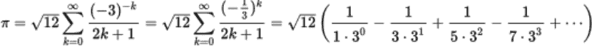

可以使用任意精度进行计算。例如，对于 101 项：

```java
double pi = Math.sqrt(12)
    * IntStream.rangeClosed(0, 100)
    .mapToDouble(k -> Math.pow(-3, -k) / (2 * k + 1))
    .sum();
```

**注意：** 使用双精度精度时，选择 29 作为上界即可获得一个与 `Math.PI` 无法区分的结果。

## 第 57.7 节：使用 flatMap 展平 Streams

一个包含可转换项的 Stream 可以展平为一个连续的 Stream：

将 List Array 转换为 List

```java
List<String> list1 = Arrays.asList("one", "two");
List<String> list2 = Arrays.asList("three", "four", "five");
List<String> list3 = Arrays.asList("six");

List<String> finalList = Stream.of(list1, list2, list3)
    .flatMap(Collection::stream)
    .collect(Collectors.toList());

System.out.println(finalList);
```

```
// one, two, three, four, six
```

包含项 List 的 Map 可以展平为合并后的 List

```java
Map<String, List<Integer>> map = new LinkedHashMap<>();
map.put("a", Arrays.asList(1, 2, 3));
map.put("b", Arrays.asList(4, 5, 6));

List<Integer> allValues = map.values() // Collection<List<Integer>>
    .stream()
    .flatMap(List::stream)
    .collect(Collectors.toList());
```

```
System.out.println(allValues);
// [1, 2, 3, 4, 5, 6]
```

Map 的 List 可以展平为一个连续的 Stream

```java
List<Map<String, String>> list = new ArrayList<>();

Map<String, String> map1 = new HashMap<>();
map1.put("1", "one");
map1.put("2", "two");

Map<String, String> map2 = new HashMap<>();
map2.put("3", "three");
map2.put("4", "four");

list.add(map1);
list.add(map2);
```

```java
Set<String> output = list.stream() // Stream<Map<String, String>>
    .map(Map::values) // Stream<List<String>>
    .flatMap(Collection::stream) // Stream<String>
    .collect(Collectors.toSet()); // Set<String>

// [one, two, three, four]
```

## 第 57.8 节：并行 Stream

**注意：** 在决定使用哪种方式之前，请查看 ParallelStream 与 Sequential 行为的差异。

当你想要并发执行流操作时，可以使用这两种方法之一。

```java
List<String> data = Arrays.asList("One", "Two", "Three", "Four", "Five");
Stream<String> aParallelStream = data.stream().parallel();
```

或者：

```java
Stream<String> aParallelStream = data.parallelStream();
```

要执行为并行流定义的操作，请调用终端操作符：

```java
aParallelStream.forEach(System.out::println);
```

并行 Stream 的（可能）输出：

- Three
- Four
- One
- Two
- Five

顺序可能会改变，因为所有元素都是并行处理的（这*可能会*让它更快）。当顺序不重要时使用 `parallelStream`。

### 性能影响

在涉及网络的情况下，并行 Streams 可能会降低应用程序的整体性能，因为并行 Streams 使用公共的 fork-join 线程池处理网络。

另一方面，在许多其他情况下，并行 Streams 可以显著提高性能，取决于当时运行 CPU 的可用核心数。

## 第 57.9 节：创建 Stream

所有的 `Collection<E>` 都具有 `stream()` 和 `parallelStream()` 方法，通过这些方法可以构造 `Stream<E>`。

```java
Collection<String> stringList = new ArrayList<>();
Stream<String> stringStream = stringList.parallelStream();
```

可以使用以下方法之一从数组创建 `Stream<E>`：

```java
String[] values = { "aaa", "bbb", "ddd", "cccc" };
Stream<String> stringStream = Arrays.stream(values);
Stream<String> stringStreamAlternative = Stream.of(values);
```

`Arrays.stream()` 和 `Stream.of()` 的区别在于 `Stream.of()` 具有变长参数，因此可以这样使用：

```java
Stream<Integer> integerStream = Stream.of(1, 2, 3);
```

你也可以使用原始类型流（primitive streams）。例如：

```java
IntStream intStream = IntStream.rangeClosed(0, 100);
```

可以使用 `Arrays.stream()` 方法从数组构造原始流：

```java
int[] values = {1, 2, 3};
IntStream intStream = Arrays.stream(values);
```

可以使用 `IntStream.range(start, endExclusive)` 从 Stream 遍历索引：

```java
String[] names = {"Jon", "Darin", "Bauke", "Hans", "Marc"};
IntStream.range(0, names.length)
    .forEach(i -> System.out.println(String.format("%d %s", i + 1, names[i])));
```

可以使用 `IntStream.rangeClosed(start, endInclusive)` 创建原始流：

```java
int[] values = {1, 2, 3};
IntStream intStream = IntStream.rangeClosed(0, values.length - 1);
```

可以使用 `Stream.of()` 从数组构造 Stream：

```java
String[] values = {"A", "B", "C"};
Stream<String> stream = Stream.of(values);
```

可以使用 `DoubleStream.of()` 创建原始流：

```java
double[] values = {1.0, 2.0, 3.0};
DoubleStream doubleStream = DoubleStream.of(values);
```

可以使用 `Arrays.stream()` 构造原始流：

```java
long[] values = {1L, 2L, 3L};
LongStream stream = Arrays.stream(values);
```


# 创建 Stream

## 从数组构造 Stream

可以使用 `Stream.of()` 从数组构造 Stream：

```java
String[] values = {"A", "B", "C"};
Stream<String> stream = Stream.of(values);
```

可以使用 `DoubleStream.of()` 创建原始流：

```java
double[] values = {1.0, 2.0, 3.0};
DoubleStream doubleStream = DoubleStream.of(values);
```

可以使用 `Arrays.stream()` 构造原始流：

```java
long[] values = {1L, 2L, 3L};
LongStream stream = Arrays.stream(values);
```

可以使用 `Arrays.stream()` 构造原始流：

```java
int[] values = {1, 2, 3};
IntStream intStream = Arrays.stream(values);
```

## 第 57.6 节：实现数学函数的 Streams

Streams（特别是 `IntStreams`）是实现求和项（Σ）的一种优雅方式。流的范围可以通过方式使用。

例如，马德瓦对 Pi 的近似公式如下（源：wikipedia）：


可以使用任意精度进行计算。例如，对于 101 项：

```java
double pi = Math.sqrt(12)
    .IntStream.rangeClosed(0, 100)
    .mapToDouble(k -> Math.pow(-3, -k) / (2 * k + 1))
    .sum();
```

**注意：** 使用双精度精度时，选择 29 作为上界即可获得一个与 `Math.PI` 无法区分的结果。

## 第 57.7 节：使用 flatMap 展平 Streams

一个包含可转换项的 Stream 可以展平为一个连续的 Stream：

将 List Array 转换为 List

```java
List<String> list1 = Arrays.asList("one", "two");
List<String> list2 = Arrays.asList("three", "four", "five");
List<String> list3 = Arrays.asList("six");
List<String> finalList = Stream.of(list1, list2, list3)
    .flatMap(Collection::stream)
    .collect(Collectors.toList());
System.out.println(finalList);
```

```
// one, two, three, four, six
```

包含项 List 的 Map 可以展平为合并后的 List

```java
Map<String, List<Integer>> map = new LinkedHashMap<>();
map.put("a", Arrays.asList(1, 2, 3));
map.put("b", Arrays.asList(4, 5, 6));
List<Integer> allValues = map.values() // Collection<List<Integer>>
    .stream()
    .flatMap(List::stream)
    .collect(Collectors.toList());
```

```
System.out.println(allValues);
// [1, 2, 3, 4, 5, 6]
```

Map 的 List 可以展平为一个连续的 Stream

```java
List<Map<String,String>> list = new ArrayList<>();
Map<String,String> map1 = new HashMap<>();
map1.put("1", "one");
map1.put("2", "two");
Map<String,String> map2 = new HashMap<>();
map2.put("3", "three");
map2.put("4", "four");
list.add(map1);
list.add(map2);
```

```java
Set<String> output = list.stream() // Stream<Map<String, String>>
    .map(Map::values) // Stream<List<String>>
    .flatMap(Collection::stream) // Stream<String>
    .collect(Collectors.toSet()); // Set<String>
// [one, two, three, four]
```

## 第 57.8 节：并行 Stream

**注意：** 在决定使用哪种方式之前，请查看 ParallelStream 与 Sequential 行为的差异。

当你想要并发执行流操作时，可以使用这两种方法之一。

```java
List<String> data = Arrays.asList("One", "Two", "Three", "Four", "Five");
Stream<String> aParallelStream = data.stream().parallel();
```

或者：

```java
Stream<String> aParallelStream = data.parallelStream();
```

要执行行为为并行流定义的操作，请调用终端操作符：

```java
aParallelStream.forEach(System.out::println);
```

并行 Stream 的（可能）输出：

- Three
- Four
- One
- Two
- Five

顺序可能会改变，因为所有元素都是并行处理的（这*可能会*让它更快）。顺序不重要时使用 `parallelStream`。

### 性能影响

在涉及网络的情况下，并行 Streams 可能会降低应用程序的整体性能，因为并行 Streams 使用公共的 fork-join 线程池处理网络。

另一方面，在许多其他情况下，并行 Streams 可以显著提高性能，取决于当时运行 CPU 的可用核心数。

## 第 57.9 节：创建 Stream

所有的 `Collection<E>` 都具有 `stream()` 和 `parallelStream()` 方法，通过这些方法可以构造 `Stream<E>`。

```java
Collection<String> stringList = new ArrayList<>();
Stream<String> stringStream = stringList.parallelStream();
```

可以使用以下方法之一从数组创建 `Stream<E>`：

```java
String[] values = { "aaa", "bbb", "ddd", "cccc" };
Stream<String> stringStream = Arrays.stream(values);
Stream<String> stringStreamAlternative = Stream.of(values);
```

`Arrays.stream()` 和 `Stream.of()` 的区别在于 `Stream.of()` 具有变长参数，因此可以这样使用：

```java
Stream<Integer> integerStream = Stream.of(1, 2, 3);
```

你也可以使用原始类型流。例如：

```java
IntStream intStream = IntStream.rangeClosed(0, 100);
```

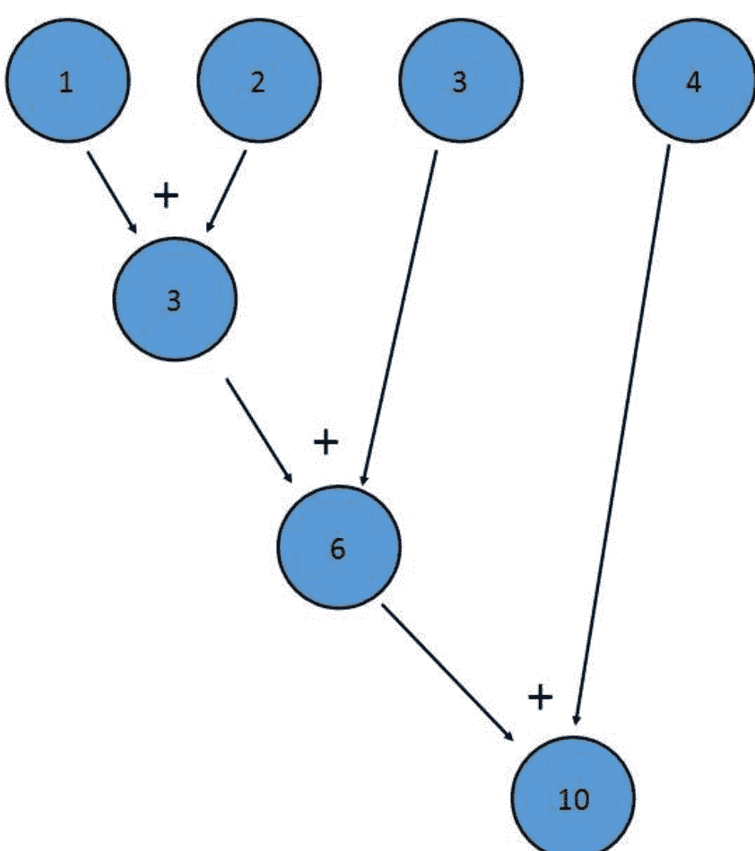

这等同于 (((1+2)+3)+4)

Stream 的 `reduce` 方法允许创建自定义归约操作。可以使用 `reduce` 方法来实现 `sum(int)` 方法：

```java
IntStream istr;
// 初始化 istr
OptionalInt result = istr.reduce((a,b) -> a + b);
```

返回的是 Optional 版本，以便妥善处理空 Stream。

归约的另一个示例是将 `Stream<LinkedList<T>>` 合并为单一的 `LinkedList<T>`：

```java
Stream<LinkedList<T>> listStream;
// 创建一个 Stream<LinkedList<T>>
```

```java
Optional<LinkedList<T>> bigList = listStream.reduce((LinkedList<T> list1, LinkedList<T> list2) -> {
    LinkedList<T> retList = new LinkedList<T>();
    retList.addAll(list1);
    retList.addAll(list2);
    return retList;
});
```

你可以提供一个恒等元素（identity element）。例如，加法的恒等元素是 0，因为 x+0==x。对于乘法，恒等元素是 1，因为 x*1==x。在上面的情况下，恒等元素是一个空的 `LinkedList<T>`，因为如果你向另一个列表添加一个空列表，你正在“添加”的那个列表不会改变：

```java
LinkedList<T> bigList = listStream.reduce(new LinkedList<T>(), (LinkedList<T> list1, LinkedList<T> list2) -> {
    LinkedList<T> retList = new LinkedList<T>();
    retList.addAll(list1);
    retList.addAll(list2);
    return retList;
});
```

注意，当提供了恒等元素时，返回值将不会被封装在 Optional 中——如果在空流上调用 `reduce()`，它将返回恒等元素。

二元操作符必须满足结合律，即 (a+b)+c==a+(b+c)。这是因为元素是以任意顺序进行归约的。例如，加法归约可以这样执行：

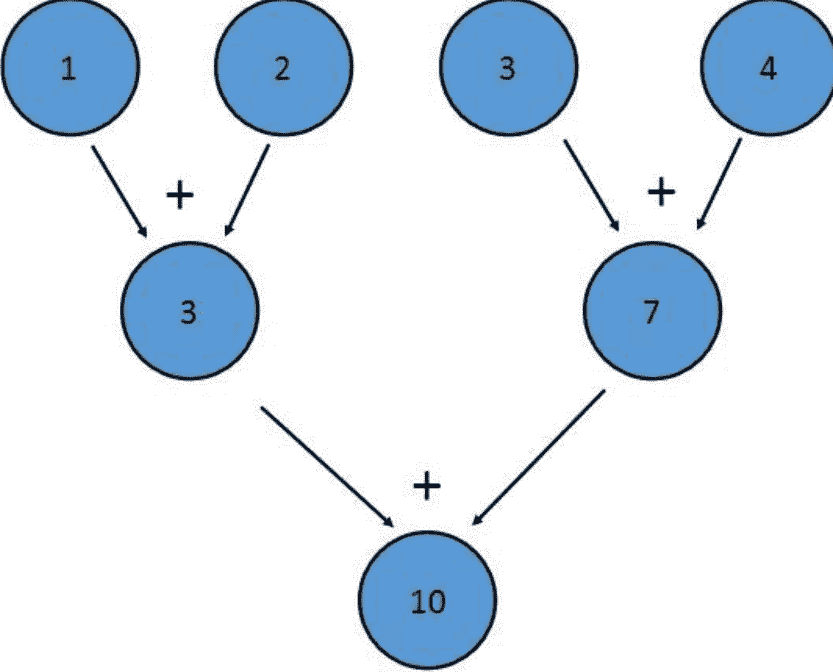

这种归约等同于写入 ((1+2)+(3+4))。结合律属性允许 Java 并行归约 Stream——Stream 的部分可以由每个处理器进行归约，最后通过归约将每个处理器的结果合并在一起。

## 第 57.15 节：使用 Map.Entry 的 Stream 在映射后保留初始值

当你有一个需要映射（map）但又需要保留初始值的 Stream 时，可以使用下面的工具方法将 Stream 映射为 `Map.Entry<K, V>`：

```java
public static <K, V> Function<K, V> entryMapper(Function<K, V> mapper) {
    return (k) -> new AbstractMap.SimpleEntry<>(k, mapper.apply(k));
}
```

然后你可以使用 `mySet` 来处理同时可以访问原始值和映射后值的 Stream：

```java
Set<K> mySet;
Function<K, V> transformer = SomeClass::transformerMethod;
Stream<Map.Entry<K, V>> entryStream = mySet.stream()
    .map(entryMapper(transformer));
```

然后你可以像往常一样收集 Stream。这避免了创建中间集合的开销。

## 第 57.16 节：IntStream 转 String

Java 没有 Char 类型，因此在处理字符串并构建字符流时，一种选择是使用 `String.codePoints()` 方法获取代码点的 `IntStream`。因此，可以通过如下方式获取 `IntStream`：

```java
public IntStream stringToIntStream(String in) {
    return in.codePoints();
}
```

反向转换（即 `IntStreamToString`）要复杂一些。可以通过如下方式实现：

```java
public String intStreamToString(IntStream intStream) {
    return intStream.collect(StringBuilder::new, StringBuilder::append, StringBuilder::toString);
}
```

## 第 57.17 节：寻找第一个匹配谓元的元素

可以找到 Stream 中匹配某个条件的第一个元素。

在这个示例中，我们将找到第一个平方大于 50000 的 Integer。

```java
IntStream.iterate(1, i -> i + 1) // 生成无限流 1,2,3,4...
    .filter(i -> i*i > 50000) // 过滤找到平方 > 50000 的元素
    .findFirst(); // 找到第一个过滤后的元素
```

该表达式将返回一个带有结果的 `OptionalInt`。

注意，对于无限流，Java 将不断检查每个元素直到找到结果为止。对于有限流，如果 Java 用尽了元素但未能找到结果，它将返回一个 `OptionalInt`。

## 第 57.18 节：使用 Stream 和方法引用实现自文档化过程

方法引用是极佳的自文档化代码，在 Stream 中使用方法引用可以让复杂的流程变得易于阅读和理解。考虑以下代码：

```java
public interface Ordered {
    default int getOrder() {
        return 0;
    }
}
```


## 接口定义

```java
public interface Valued<V> extends Ordered {
    boolean hasTwo();
    V getValue();
}
```

```java
public interface Thing<V> {
    boolean hasOne();
}
```

## 方法实现

### 传统循环实现

```java
public <V extends Ordered> List<V> myMethod(List<Thing<V>> things) {
    List<V> results = new ArrayList<>();
    for (Thing<V> thing : things) {
        if (thing.hasOne()) {
            Valued<V> value = (Valued<V>) thing;
            if (value != null && value.hasTwo()) {
                results.add(value.getValue());
            }
        }
    }
    results.sort((a, b) -> Integer.compare(a.getOrder(), b.getOrder()));
    return results;
}
```

### 使用方法引用重写（更具可读性）

```java
public <V extends Ordered> List<V> myMethod(List<Thing<V>> things) {
    return things.stream()
        .filter(Thing::hasOne)
        .map(thing -> (Valued<V>) thing)
        .filter(v -> v != null && v.hasTwo())
        .map(Valued::getValue)
        .sorted(Comparator.comparing(Ordered::getOrder))
        .collect(Collectors.toList());
}
```

## 第 57.19 节：将 Optional 的流转换为值

你可能需要将 `Optional` 的流转换为值的流，仅发射现有值（处理 `Optional.empty()`）：

```java
Optional<String> op1 = Optional.empty();
Optional<String> op2 = Optional.of("Hello World");
List<String> result = Stream.of(op1, op2)
    .filter(Optional::isPresent)
    .map(Optional::get)
    .collect(Collectors.toList());
System.out.println(result); // Hello World
```

## 第 57.20 节：获取 Stream 的片段

示例：获取集合中第 21 到第 50 个元素的 30 个元素的流。

```java
final long n = 20L; // 跳过的元素数量
final long maxSize = 30L; // 流限制的元素数量
final Stream<T> slice = collection.stream().skip(n).limit(maxSize);
```

注意：

- 如果 `n` 或 `maxSize` 为负数，则抛出 `IllegalArgumentException`
- `skip(long)` 和 `limit(long)` 是中间操作
- 如果流包含的元素少于 `n`，则 `skip(n)` 返回空流
- `skip(long)` 和 `limit(long)` 在顺序流中开销较小，但在有序并行流中可能非常昂贵

## 第 57.21 节：基于 Stream 创建 Map

### 没有重复键的简单情况

```java
Stream<String> characters = Stream.of("A", "B", "C");
Map<Integer, String> map = characters
    .collect(Collectors.toMap(element -> element.hashCode(), element -> element));
// map = {65=A, 66=B, 67=C}
```

为了更具通用性，我们可以使用 `Function` 接口中的静态方法 `Function.identity()`。可以将此 Lambda 表达式 `element -> element` 替换为 `Function.identity()`。

### 可能存在重复键的情况

`Collectors.toMap` 的 JavaDoc 说明：

> 如果映射的键包含重复（根据 `Object.equals(Object)`），则在执行收集操作时将抛出 `IllegalStateException`。如果映射的键可能重复，请改用 `toMap(Function, Function, BinaryOperator)`。

```java
Stream<String> characters = Stream.of("A", "B", "B", "C");
Map<Integer, String> map = characters
    .collect(Collectors.toMap(
        element -> element.hashCode(),
        element -> element,
        (existingVal, newVal) -> (existingVal + newVal)
    ));
// map = {65=A, 66=BB, 67=C}
```

传递给 `Collectors.toMap(...)` 的 `BinaryOperator` 用于生成存储在冲突缓存中的值。它可以：

- 返回旧值，使得流中的第一个值具有优先权
- 返回新值，使得流中的最后一个值具有优先权
- 合并旧值和新值

### 按值分组

当你需要执行等同于数据库级联“分组”（group by）操作时，可以使用 `Collectors.groupingBy`。为了说明这一点，请参考以下代码创建的 map，其中人的姓名映射到姓氏：

```java
Map<String, List<Person>> map = people.stream()
    .collect(
        // 将输入元素映射到键
        Collectors.groupingBy(Person::getName,
        // 将输入元素映射到值的函数
        // 如何存储值
        Collectors.mapping(Person::getSurname, Collectors.toList())
    );
// map = {John=[Bianchi, Rossi, Verdi], Sam=[Rossi, Verdi]}
```

## 第 57.22 节：将流连接到单个 String

一个经常遇到的用例是从流创建一个 `String`，其中流中的项由特定字符分隔。可以使用 `Collectors.joining()` 方法来实现此点，如下例所示：

```java
Stream<String> fruitStream = Stream.of("apple", "banana", "pear", "kiwi", "orange");
String result = fruitStream.filter(s -> s.contains("a"))
    .map(String::toUpperCase)
    .sorted()
    .collect(Collectors.joining(", "));
System.out.println(result);
```

输出：

```
APPLE, BANANA, ORANGE, PEAR
```

`Collectors.joining()` 方法还可以处理前缀和后缀：

```java
Stream<String> fruitStream = Stream.of("apple", "banana", "pear", "kiwi", "orange");
String result = fruitStream.filter(s -> s.contains("e"))
    .map(String::toUpperCase)
    .sorted()
    .collect(Collectors.joining(", ", "Fruits: ", "."));
System.out.println(result);
```

输出：

> Fruits: APPLE, ORANGE, PEAR.

## 第 57.23 节：使用 Stream 排序

```java
List<String> data = new ArrayList<>();
data.add("Sydney");
data.add("London");
data.add("New York");
data.add("Amsterdam");
data.add("Mumbai");
data.add("California");

System.out.println(data);

List<String> sortedData = data.stream().sorted().collect(Collectors.toList());

System.out.println(sortedData);
```

输出：

```
[Sydney, London, New York, Amsterdam, Mumbai, California]
[Amsterdam, California, London, Mumbai, New York, Sydney]
```

可以使用不同的比较器机制，因为有一个重载的 `sorted` 版本，它接受一个比较器作为参数。

此外，你还可以使用 lambda 表达式进行排序：

```java
List<String> sortedData = data.stream().sorted((s1, s2) -> s2.compareTo(s1)).collect(Collectors.toList());
```

这将输出：

```
[Sydney, New York, Mumbai, London, California, Amsterdam]
```

你可以使用 `Comparator.reverseOrder()` 来获得一个实施自然排序反序的比较器。

```java
List<String> reverseSortedData = data.stream()
    .sorted(Comparator.reverseOrder())
    .collect(Collectors.toList());
```

## 第 57.24 节：原始类型流

Java 为三种类型提供了专门的流：`IntStream`（用于 int）、`LongStream`（用于 long）和 `DoubleStream`（用于 double）。由于它们是针对各自的原始类型实现的，因此它们还提供了终结操作方法，通常用于数学运算。例如：

```java
IntStream is = IntStream.of(10, 20, 30);
double average = is.average().getAsDouble(); // average is 20.0
```

## 第 57.25 节：流操作

流操作分为两类：中间操作和终结操作，以及两个子类：无状态操作和有状态操作。

### 中间操作

中间操作总是惰性的，例如简单的 `Stream.map`。在流被实际消费之前，它不会被调用。可以通过以下方式验证：

```java
Arrays.asList(1, 2, 3).stream().map(i -> {
    throw new RuntimeException("not gonna happen");
    return 1;
});
```

中间操作是流的常见构建块，在源之后链式调用，并且通常紧跟一个终结操作。

### 终结操作

终结操作是触发流消耗的操作。一些常见的有 `Stream.forEach` 或 `Stream.collect`。

### 无状态操作

无状态意味着每个项目在不使用上下文的情况下进行处理。无状态操作允许对流进行内存高效的处理。像 `Stream.map` 和 `Stream.filter` 这样不需要其他项目信息的操作被认为是无状态的。

### 有状态操作

有状态操作需要维护状态来处理元素，例如 `sorted()`、`distinct()`、`limit()`、`skip()` 等。

```java
// 有效：无限流
IntStream.iterate(0, i -> i + 1);
```

由于需要状态，这会导致内存失败：

```java
// 有状态操作限制大量元素
long BIG_NUMBER = 9999999;
IntStream.iterate(0, i -> i + 1).limit(BIG_NUMBER).forEach(System.out::println);
```

## 第 57.26 节：收集结果到数组

使用 `collect` 将流收集到数组是有用的，如下：

```java
List<String> fruits = Arrays.asList("apple", "banana", "pear", "kiwi", "orange");

// 收集
String[] filteredFruits = fruits.stream()
    .filter(s -> s.contains("a"))
    .toArray(String[]::new);
```

## 第 57.27 节：生成 String

一个经常遇到的用例是从流创建一个 `String`，其中流中的项由特定字符分隔。可以使用 `Collectors.joining()` 方法来实现此点，如下例所示：

```java
Stream<String> fruitStream = Stream.of("apple", "banana", "pear", "kiwi", "orange");
String result = fruitStream.filter(s -> s.contains("a"))
    .map(String::toUpperCase)
    .sorted()
    .collect(Collectors.joining(", "));
System.out.println(result);
```

输出：

```
APPLE, BANANA, ORANGE, PEAR
```

`Collectors.joining()` 方法还可以处理前缀和后缀：

```java
Stream<String> fruitStream = Stream.of("apple", "banana", "pear", "kiwi", "orange");
String result = fruitStream.filter(s -> s.contains("e"))
    .map(String::toUpperCase)
    .sorted()
    .collect(Collectors.joining(", ", "Fruits: ", "."));
System.out.println(result);
```

输出：

> Fruits: APPLE, ORANGE, PEAR.


# 第 57 章：流

## 章节 57.23: 使用 Stream 排序

```java
List<String> data = new ArrayList<>();

data.add("Sydney");
data.add("London");
data.add("New York");
data.add("Amsterdam");
data.add("Mumbai");
data.add("California");
```

```java
System.out.println(data);
```

```java
List<String> sortedData = data.stream().sorted().collect(Collectors.toList());
```

```java
System.out.println(sortedData);
```

输出：

```
[Sydney, London, New York, Mumbai, California]
[Amsterdam, California, London, Mumbai, New York, Sydney]
```

## 章节 57.24: 原始类型流

Java 为三种类型提供了专门的流：`IntStream`（用于 int）、`LongStream`（用于 long）和 `DoubleStream`（用于 double）。由于它们是针对各自的原始类型实现的，因此它们还提供了终结操作方法，通常用于数学运算。例如：

```java
IntStream is = IntStream.of(10, 20, 30);

double average = is.average().getAsDouble(); // average is 20.0
```

## 章节 57.25: 流操作

流操作分为两类：中间操作和终结操作，以及两个子类：无状态操作和有状态操作。

### 中间操作

中间操作总是惰性的，例如简单的 `Stream.map`。在流被实际消费之前，它不会被调用。可以通过以下方式验证：

```java
Arrays.asList(1, 2, 3).stream().map(i -> {
    throw new RuntimeException("not gonna happen");
    return 1;
});
```

中间操作是流的常见构建块，在源之后链式调用，并且通常紧跟一个终结操作。

### 终结操作

终结操作是触发流消耗的操作。一些常见的有 `Stream.forEach` 或 `Stream.collect`。

### 无状态操作

无状态意味着每个项目在不使用上下文的情况下进行处理。无状态操作允许对流进行内存高效的处理。像 `Stream.map` 和 `Stream.filter` 这样不需要其他项目信息的操作被认为是无状态的。

### 有状态操作

```java
// 有效
long BIG_NUMBER = 9999999;
IntStream.iterate(0, i -> i + 1);
```

由于需要状态，这会导致内存失败：

```java
// 有状态
IntStream.iterate(0, i -> i + 1).limit(BIG_NUMBER).forEach(System.out::println);
```

## 章节 57.26: 收集结果到数组

使用 `collect` 将流收集到数组是有用的，如下：

```java
// 有效
// 我们可以通过 stream 得到：
List<String> fruits = Arrays.asList("apple", "banana", "pear", "kiwi", "orange");
```

```java
// 收集
String[] filteredFruits = fruits.stream()
    .filter(s -> s.contains("a"))
    .collect(Collectors.toArray(String[]::new));
```

## 章节 57.27: 生成 String

一个经常遇到的用例是从流创建一个 String，其中流中的项由特定字符分隔。可以使用 `Collectors.joining()` 方法来实现此点，如下例所示：

```java
Stream<String> fruitStream = Stream.of("apple", "banana", "pear", "kiwi", "orange");
```

```java
String result = fruitStream.filter(s -> s.contains("a"))
    .map(String::toUpperCase)
    .sorted()
    .collect(Collectors.joining(", "));
```

```java
System.out.println(result);
```

输出：

```
APPLE, BANANA, ORANGE, PEAR
```

`Collectors.joining()` 方法还可以处理前缀和后缀：

```java
String result = fruitStream.filter(s -> s.contains("e"))
    .map(String::toUpperCase)
    .sorted()
    .collect(Collectors.joining(", ", "Fruits: ", "."));
```

```java
System.out.println(result);
```

输出：

> Fruits: APPLE, ORANGE, PEAR.

# 第 58 章：输入/输出流

## 第 58.1 节：字节以及作为 `char` 使用的“原生 Java”UTF-16 代码点。这是通过 `InputStream` 实现的。

为了加快处理速度，“通常”会分配一个缓冲区，以避免从输入读取数据时产生过多的开销。

版本 = Java SE 7

```java
public String writerToInputStream(InputStream inputStream) throws Exception {
    BufferedWriter writer = new BufferedWriter(new StringWriter());

    char[] buffer = new char[1024];

    try (Reader reader = new BufferedReader(new InputStreamReader(inputStream, "UTF-8"))) {
        int n;
        while ((n = reader.read(buffer)) != -1) {
            // 所有代码都将 'reader' 的输出重定向到 'writer'
            // 每次 1024 字节块
            writer.write(buffer, 0, n);
        }
    }
    return writer.toString();
}
```

将此示例转换为兼容 Java SE 6（及低版本）的代码留给读者作为练习。

## 第 58.2 节：包装输入/输出流

`OutputStream` 和 `InputStream` 有许多不同的类，每个类都有独特的功能。通过对流进行包装，你可以获得两个流的功能。

你可以对流进行任意次数的包装，只需注意顺序。

### 有用的组合

使用缓冲区向文件写入字符

```java
File myFile = new File("targetfile.txt");
BufferedWriter writer = new BufferedWriter(new OutputStreamWriter(new FileOutputStream(myFile)));
```

使用缓冲区在写入文件之前对数据进行压缩和加密

```java
Cipher cipher = ... // 初始化加密器
File file = new File("targetfile.enc");
BufferedOutputStream outputStream = new BufferedOutputStream(new CipherOutputStream(new FileOutputStream(file), cipher));
```

### 输入/输出包装器列表

| 包装器 | 说明 |
|---|---|
| `BufferedOutputStream` / `BufferedInputStream` | `OutputStream` 每次写入一个字节。`BufferedOutputStream` 按块写入。这减少了系统调用的次数，提高了性能。 |
| `DeflaterOutputStream` / `DeflaterInputStream` | 执行数据压缩。 |
| `InflaterOutputStream` / `InflaterInputStream` | 执行解压缩。 |
| `CipherOutputStream` / `CipherInputStream` | 加密/解密数据。 |
| `DigestOutputStream` / `DigestInputStream` | 生成消息摘要以验证数据完整性。 |
| `CheckedOutputStream` / `CheckedInputStream` | 生成校验和。校验和是消息摘要的更简单的版本。 |
| `DataOutputStream` / `DataInputStream` | 允许写入原始数据类型和字符串。用于写入字节。平台无关。 |
| `PrintStream` | 允许写入原始数据类型和字符串。用于写入字节。依赖平台。 |
| `OutputStreamWriter` | 将 `OutputStream` 转换为 `Writer`。`OutputStream` 处理字节，而 `Writer` 处理字符。 |
| `PrintWriter` | 自动调用 `OutputStreamWriter`。允许写入原始数据类型和字符串。专门用于写入字符，并且是写入字符的最佳选择。 |

## 第 58.3 节：DataInputStream 示例

```java
package com.streams;

import java.io.*;

public class DataStreamDemo {
    public static void main(String[] args) throws IOException {
        InputStream input = new FileInputStream("D:\\datastreamdemo.txt");
        DataInputStream inst = new DataInputStream(input);
        int count = input.available();
        byte[] arr = new byte[count];
        inst.read(arr);
        for (byte by : arr) {
            char ki = (char) by;
            System.out.print(ki + "-");
        }
    }
}
```

## 第 58.4 节：向 OutputStream 写入字节

向 `OutputStream` 逐个写入字节

```java
OutputStream stream = object.getOutputStream();
```

```java
byte b = 0x00;
stream.write(b);
```

写入字节数组

```java
byte[] bytes = new byte[]{ 0x00, 0x00 };
stream.write(bytes);
```

写入字节数组的一个部分

```java
int offset = 1;
int length = 2;
byte[] bytes = new byte[]{ 0xFF, 0x00, 0x00, 0xFF };
stream.write(bytes, offset, length);
```

## 第 58.5 节：将输入流复制到输出流

此函数从两个流中拷贝数据——

```java
void copy(InputStream in, OutputStream out) throws IOException {
    byte[] buffer = new byte[8192];
    int bytesRead;
    while ((bytesRead = in.read(buffer)) > 0) {
        out.write(buffer, 0, bytesRead);
    }
}
```

示例 -

```java
// 从 System.in 读取并写入到 System.out
copy(System.in, System.out);
```

# 第 59 章：Readers 和 Writers

`Readers` 和 `Writers` 及其相应的子类为文本/基于字符的数据提供了简单的 I/O。

## 第 59.1 节：BufferedReader

### 引言

`BufferedReader` 类是其他 `Reader` 类的包装器，有两个主要目的：

1. `BufferedReader` 为包装的 `Reader` 提供缓冲。这允许应用程序一次读取一个字符，而不会产生不必要的 I/O 开销。
2. `BufferedReader` 提供了一次读取一行的功能。

### 使用 BufferedReader 的基础

使用 `BufferedReader` 的标准模式如下：首先，你获取想要从中读取字符的 `Reader`。接下来，你实例化一个包装该 `Reader` 的 `BufferedReader`。然后读取字符数据。最后关闭该 `BufferedReader`。

```java
File fileName = new File("");
int count = 0;

try (FileReader fr = new FileReader(fileName);
     BufferedReader br = new BufferedReader(fr)) {
    int ch;
    while ((ch = br.read()) != -1) {
        count++;
    }
}

System.out.println("There are " + count + " characters in " + fileName);
```


你可以将此模式应用于任何 `Reader`。

注意：

1. 我们使用了 Java `try-with-resources` 来确保底层读者被关闭。这避免了潜在的资源泄漏。在之前的 Java 中，需要在 `finally` 块中显式关闭 `BufferedReader`。
2. `try` 块内部的代码与直接从 `FileReader` 读取的代码几乎相同。区别在于这个版本效率高得多。

### `BufferedReader` 缓冲区

### `BufferedReader.readLine()` 方法

### 示例：将文件的行读取到 `List`

通过获取文件的每一行并将其添加到 `List` 中来实现。然后返回列表：

```java
public List<String> getAllLines(String filename) throws IOException {
  List<String> lines = new ArrayList<String>();
  try (BufferedReader reader = new BufferedReader(new FileReader(filename))) {
    String line = null;
    while ((line = reader.readLine()) != null) {
      lines.add(line);
    }
  }
  return lines;
}
```

Java 提供了一种更简洁的方法来完成这一点，使用 `lines()` 方法：

```java
public List<String> getAllLines(String filename) throws IOException {
  try (BufferedReader br = new BufferedReader(new FileReader(filename))) {
    return br.lines().collect(Collectors.toList());
  }
  return Collections.emptyList();
}
```

# 第 59 章：StreamWriter 示例

## 59.2 StreamWriter 示例

Java `StreamWriter` 是一种字符流，收集字符串缓冲区的输出，用于构建字符串。

`StringWriter` 类继承自 `Writer` 类。

在 `StringWriter` 类中，没有使用网络套接字和文件等系统资源，因此没有必要关闭 `StringWriter`。

```java
import java.io.*;

public class StreamWriterDemo {
  public static void main(String[] args) throws IOException {
    char[] ary = new char[1024];
    StringWriter writer = new StringWriter();
    FileInputStream input = null;
    BufferedReader buffer = null;
    input = new FileInputStream("c:/stringwriter.txt");
    buffer = new BufferedReader(new InputStreamReader(input, "UTF-8"));
    int x;
    while ((x = buffer.read(ary)) != -1) {
      writer.write(ary, 0, x);
    }
    System.out.println(writer.toString());
    writer.close();
    buffer.close();
  }
}
```

上面的示例帮助我们了解如何使用 `BufferedReader` 从流中读取文件数据的简单 `StringWriter` 示例。

# 第 60 章：Preferences（偏好）

## 60.1 使用 Preferences

`Preferences` 可存储用户设置以反映用户的个人应用程序设置，例如：编辑器字体、是否倾向于全屏模式启动应用程序、是否勾选了“不再再次显示”复选框等。

```java
public class ExitConformer {
    private static boolean confirmExit() {
        Preferences preferences = Preferences.userNodeForPackage(ExitConformer.class);
        boolean showDialog = preferences.getBoolean("showExitConfirmation", true); // true is default
        if (!showDialog) {
            return true;
        }
        // 在此处显示对话框...
        boolean exitWasConfirmed = ...; // 用户是否点击确定或取消
        boolean doNotShowAgain = ...; // 从“不再显示”复选框获取值
        if (exitWasConfirmed && doNotShowAgain) {
            // 已确认退出，且用户选择不再显示该对话框
            // 将这些设置保存到 Preferences，以便下次就不会再显示了
            preferences.putBoolean("showExitConfirmation", false);
        }
        return exitWasConfirmed;
    }
    public static void exit() {
        if (confirmExit()) {
            System.exit(0);
        }
    }
}
```

## 60.2 添加事件监听器

`Preferences` 对象发出两种类型的事件：`PreferenceChangeEvent` 和 `NodeChangeEvent`。

### PreferenceChangeEvent

每当节点的某个键值对发生变化时，`Preferences` 对象就会发出一个 `PreferenceChangeEvent`。可以使用 `PreferenceChangeListener` 监听 `PreferenceChangeEvents`：

```java
// Version >= Java 8
preferences.addPreferenceChangeListener(evt -> {
    String newValue = evt.getNewValue();
    String changedPreferenceKey = evt.getKey();
    Preferences changedNode = evt.getNode();
});
```

```java
// Version >= Java 8
preferences.addPreferenceChangeListener(new PreferenceChangeListener() {
  @Override
  public void preferenceChange(PreferenceChangeEvent evt) {
    String newValue = evt.getNewValue();
    String changedPreferenceKey = evt.getKey();
    Preferences changedNode = evt.getNode();
  }
});
```

此监听器不会监听子节点的键值对变化。

### NodeChangeEvent

每当 `Preferences` 节点的子节点被添加或删除时，就会触发此事件。

```java
preferences.addNodeChangeListener(new NodeChangeListener() {
  @Override
  public void childAdded(NodeChangeEvent evt) {
    Preferences addedChild = evt.getChild();
    Preferences parentOfAddedChild = evt.getParent();
  }
  @Override
  public void childRemoved(NodeChangeEvent evt) {
    Preferences removedChild = evt.getChild();
    Preferences parentOfRemovedChild = evt.getParent();
  }
});
```

## 60.3 获取 Preferences 的子节点

`Preferences` 始终代表整个 Preferences 树中的一个特定节点，结构如下所示：

```
Root
└── com
    └── mycompany
        └── myapp
            ├── darkApplicationMode=true
            ├── showExitConfirmation=false
            ├── windowMaxSize=true
            └── exporting
                ├── defaultFormat=pdf
                └── openBrowserAfterExport=false
└── org
    └── organization
        └── anotherpath
            ├── default=Helvetica
            └── defaultSavePath=/home/matt/Documents
```

选择 `/com/mycompany/myapp` 节点：

1. 根据惯例，基于类的包：

```java
package com.mycompany.myapp;
// ...
// 因为此类位于 com.mycompany.myapp 包中，将返回
// /com/mycompany/myapp 节点
Preferences my = Preferences.userNodeForPackage(getClass());
```

2. 通过相对路径：

```java
Preferences myApp = Preferences.userRoot().node("com/mycompany/myapp");
```

使用相对路径（不以 `/` 开头的路径）将导致路径相对于其被解析的父节点进行解析。例如：

```java
Preferences prefix = Preferences.userRoot().node("one/two/three");
Preferences myAppWithPrefix = prefix.node("com/mycompany/myapp");
// prefix 是 /one/two/three
// myAppWithPrefix 是 /one/two/three/com/mycompany/myapp
```

3. 通过绝对路径：

```java
Preferences myApp = Preferences.userRoot().node("/com/mycompany/myapp");
```

在根节点上使用绝对路径与使用相对路径没有区别。如果在子节点上调用，路径将相对于根节点进行解析。

```java
Preferences prefix = Preferences.userRoot().node("one/two/three");
Preferences myAppWithoutPrefix = prefix.node("/com/mycompany/myapp");
// prefix 是 /one/two/three
// myAppWithoutPrefix 是 /com/mycompany/myapp
```

## 60.4 跨多个应用程序实例协调偏好

所有的 `Preferences` 在单个 Java 虚拟机 (JVM) 的线程之间始终是线程安全的。由于 `Preferences` 可以在多个 JVM 之间共享，因此有特殊的方法来处理跨虚拟机的更改同步。

如果你的应用程序设计为只运行单个实例，则不需要外部同步。

如果你的应用程序在单台系统上运行多个实例，因此需要在系统上的多个 JVM 之间协调 `Preferences` 访问，则可以使用任何 `Preferences` 节点的 `sync()` 方法来确保 `Preferences` 节点对其他 JVM 可见。

## 60.5 导出偏好

`Preferences` 节点可以导出到 XML 文档。导出的文档包含偏好树及其值。示例展示了如何导出一个节点：

```java
Preferences prefix = Preferences.userRoot().node("com/mycompany/myapp");
try (OutputStream out = new FileOutputStream("prefs.xml")) {
  prefix.exportToXML(out);
} catch (IOException e) {
  e.printStackTrace();
}
```

## 60.6 导入偏好

`Preferences` 可以从 XML 文档导入。XML 文档会记住它们是从用户还是系统导出的。因此，可以将它们重新导入到相应的树中，而无需确定它们的来源。

```java
// Version Java 7
try (InputStream in = new FileInputStream("prefs.xml")) {
  Preferences.importPreferences(in);
} catch (IOException e) {
  // 读取输入流时出错
  e.printStackTrace();
} catch (InvalidPreferencesFormatException e) {
  // 解析 XML 树时出错
  e.printStackTrace();
}
```

```java
// Version >= Java 8
try (InputStream in = Files.newInputStream(Paths.get("prefs.xml"))) {
  Preferences.importPreferences(in);
} catch (IOException e) {
  // 读取输入流时出错
  e.printStackTrace();
} catch (InvalidPreferencesFormatException e) {
  // 解析 XML 树时出错
  e.printStackTrace();
}
```

## 60.7 移除事件监听器

事件监听器可以再次从任何 `Preferences` 节点移除，需要保留监听器的实例以便操作。

```java
// Version Java SE 8
Preferences preferences = Preferences.userNodeForPackage(getClass());
PreferenceChangeListener listener = evt -> {
  System.out.println(evt.getKey() + " " + "got new value" + " " + evt.getNewValue());
};
preferences.addPreferenceChangeListener(listener);
//
// 稍后...
preferences.removePreferenceChangeListener(listener);
```

```java
PreferenceChangeListener listener = new PreferenceChangeListener() {
  @Override
  public void preferenceChange(PreferenceChangeEvent evt) {
    System.out.println(evt.getKey() + " got new value " + evt.getNewValue());
  }
};
preferences.addPreferenceChangeListener(listener);
//
// 之后...
preferences.removePreferenceChangeListener(listener);
```

`NodeChangeListener` 同样适用于此。

## 60.8 获取偏好值

`Preferences` 节点的值类型可以是 `String`、`boolean`、`byte[]`、`double`、`float`、`int` 或 `long`。所有调用必须提供默认值，以防 `Preferences` 节点中不存在该指定值。

```java
Preferences preferences = Preferences.userNodeForPackage(getClass());
```

```java
String getString = preferences.get("someKey", "this is the default value");
boolean someBoolean = preferences.getBoolean("someKey", true);
byte[] someByteArray = preferences.getByteArray("someKey", new byte[0]);
double someDouble = preferences.getDouble("someKey", 887284.4);
float someFloat = preferences.getFloat("someKey", 38723.3f);
int someInt = preferences.getInt("someKey", 32332);
long someLong = preferences.getLong("someKey", 123456789L);
```


long `someLong` = `preferences.getLong("someKey", 282673868234L)`;

## 60.9: 设置偏好值

要将值存储到 `Preferences` 节点中，可以使用其中一个 `putXXX` 方法。`Preferences` 节点的值类型可以是 `String`、`boolean`、`byte[]`、`double`、`float`、`int` 或 `long`。

```java
Preferences preferences = Preferences.userNodePackage(getClass());
```

```java
preferences.put("someKey", "some String value");
preferences.putBoolean("someKey", false);
preferences.putByteArray("someKey", new byte[0]);
preferences.putDouble("someKey", 18798123.4454d);
preferences.putFloat("someKey", 298521.445f);
preferences.putInt("someKey", 77637);
preferences.putLong("someKey", 287398472834L);
```

## Chapter 61: 集合工厂方法

| 带参数的方法 | 描述 |
| --- | --- |
| `List.of(E e)` | 可以是类或接口的泛型。 |
| `Set.of(E e)` | 可以是类或接口的泛型。 |
| `Map.of(K k, V v)` | 可以是类或接口的泛型键值对。 |
| `Map.of(Map.Entry<K, V> extends K, ?) extends V` | 一个 Map 条目，其键为 K 或其子类之一，其值可以是 V 或其任何子类。 |

Java 9 的到来为 Java 的集合 API（Collections API）带来了许多新特性，其中之一就是集合工厂方法。这些方法允许轻松地初始化不可变集合，无论它是为空还是非空。

注意，这些工厂方法仅适用于以下接口：`List<E>`、`Set<E>` 和 `Map<K, V>`

### Section 61.1: List<Integer> 工厂方法

- `List<Integer> emptyList = List.of();`
  - 初始化一个空的、不可变的 `List<Integer>`。
- `List<Integer> immutableList = List.of(1, 2, 3, 4, 5);`
  - 初始化一个包含五个初始元素的不可变 `List<Integer>`。
- `List<Integer> mutableList = new ArrayList<>(immutableList);`
  - 从一个不可变的 `List<Integer>` 初始化一个可变的 `List`。

### Section 61.2: Set<E> 工厂方法

- `Set<Integer> emptySet = Set.of();`
  - 初始化一个空的、不可变的 `Set<Integer>`。
- `Set<Integer> immutableSet = Set.of(1, 2, 3, 4, 5);`
  - 初始化一个包含五个初始元素的不可变 `Set<Integer>`。
- `Set<Integer> mutableSet = new HashSet<>(immutableSet);`
  - 从一个不可变的 `Set<Integer>` 初始化一个可变的 `Set`。

### Section 61.3: Map<K, V> 工厂方法

- `Map<Integer, Integer> emptyMap = Map.of();`
  - 初始化一个空的、不可变的 `Map<Integer, Integer>`。
- `Map<Integer, Integer> immutableMap = Map.of(1, 2, 3, 4);`
  - 初始化一个包含两个键值对的不可变 `Map<Integer, Integer>`。
- `Map<Integer, Integer> entries = Map.ofEntries(Map.entry(1, 2), Map.entry(3, 4));`
  - 初始化一个包含两个键值对的不可变 `Map<Integer, Integer>`。
- `Map<Integer, Integer> mutableMap = new HashMap<>(immutableMap);`
  - 从一个不可变的 `Map<Integer, Integer>` 初始化一个可变的 `Map<Integer, Integer>`。

## Chapter 62: 替代集合

### 62.1: Guava, Apache 和 Eclipse 中的 Multimap

这种 multimap 允许重复的键对。JDK 对应的类有 `HashMap<K, List>`、`HashMap<K, Set>` 等。

| 键的值 | 值的顺序 | 对应键 | 对应值 | Guava | Apache | Eclipse (GS) Collections | JDK |
| --- | --- | --- | --- | --- | --- | --- | --- |
| 未定义 | 插入顺序 | HashMap | ArrayList | MultiValueMap | FastList | HashMap<K, ArrayList> |
| 未定义 | 未定义 | HashMap | HashSet | MultiValueMap(new HashMap(), HashSet()) | UnifiedSetimap | HashMap<K, HashSet> |
| 未定义 | 排序 | HashMap | TreeSet | Multimaps.newimap(new TreeMap(), TreeSet()) | MultiValueMap(new TreeMap(), TreeSet()) | Sortedimap | HashMap<K, TreeSet> |
| 插入顺序 | 插入顺序 | LinkedHashMap | ArrayList | MultiValueMap(new LinkedHashMap(), ArrayList()) | Linkedimap | HashMap<K, ArrayList> |
| 插入顺序 | 插入顺序 | LinkedHashMap | HashSet | LinkedHashSet(new LinkedHashMap(), HashSet()) | Linkedimap | HashMap<K, HashSet> |
| 排序 | 排序 | TreeSet | TreeSet | TreeMultimap(new TreeMap(), TreeSet()) | Treeimap | HashMap<K, TreeSet> |

#### 使用 Multimap 的示例

任务：使用 Multimap 解析 "Hello World! All!!" 并打印每个单词的索引（例如，Hello=[0], World=[1], All=[3]）

#### 1. Apache 的 ValueMultimap

```java
String INPUT_TEXT = "Hello World! Hi!";

// 解析单词和索引
List<String> words = Arrays.asList(INPUT_TEXT.split(" "));

// 创建 Multimap
Multimap<String, Integer> multimap = new ValueMultimap<String, Integer>();

int i = 0;
for (String word : words) {
    multimap.put(word, i);
    i++;
}

// 打印所有顺序
System.out.println(multimap); // 输出 Hello=[0, 2], World=[1], All=[3]

// 打印所有唯一单词
System.out.println(multimap.keySet()); // 输出 Hi, Hello, All!

// 打印所有索引
System.out.println("Hello " + multimap.get("Hello")); // 输出 [0, 2]
System.out.println("World " + multimap.get("World")); // 输出 [1, 5]
System.out.println("All " + multimap.get("All")); // 输出 [3]
System.out.println("Hi " + multimap.get("Hi")); // 输出 [4]
System.out.println("Empty " + multimap.get("Empty")); // 输出 null
```

```java
System.out.println(multiMap.keySet().size()); // 输出 4
```

#### 2. GS / Eclipse 的 Hashimap

```java
String[] englishWords = {"one", "two", "three", "ball", "snow"};
String[] russianWords = {"jeden", "dwa", "trzy", "kula", "snieg"};

// 创建 Multiset
Map<String, String> biMap = new HashMap<>(englishWords.length);

// 创建英语字典
int i = 0;
for (String englishWord : englishWords) {
    biMap.put(englishWord, russianWords[i]);
    i++;
}

// 打印计数
System.out.println(biMap); // 输出 {two=dwa, ball=kula, one=jeden, snow=snieg, three=trzy}

// 打印所有唯一单词
System.out.println(biMap.keySet()); // 输出 [snow, two, one, ball]
System.out.println(biMap.values()); // 输出 [dwa, kula, snieg, trzy]

// 按单词翻译
System.out.println("one" + " " + biMap.get("one")); // 输出 jeden
System.out.println("two" + " " + biMap.get("two")); // 输出 dwa
System.out.println("kula" + " " + biMap.inverse().get("kula")); // 输出 ball
System.out.println("snieg" + " " + biMap.inverse().get("snieg")); // 输出 śnieg
System.out.println("empty" + " " + biMap.inverse().get("empty")); // 输出 empty = null

// 打印单词对
System.out.println(biMap.size()); // 输出 5
```

#### 3. Guava 的 HashMultiMap

```java
String INPUT_TEXT = "Hello World! Hello All! Hi!";

// 解析文本为单词和索引
List<String> words = Arrays.asList(INPUT_TEXT.split(" "));

// 创建 MultiMap
MultiMap<String, Integer> multiMap = HashMultiMap.create();

// 填充 MultiMap
int i = 0;
for (String word : words) {
    multiMap.put(word, i);
    i++;
}

// 打印所有单词
System.out.println(multiMap); // 输出 {Hi=4, Hello=[0, 2], World=[1, 5], All!=[3]} - 键和值的随机顺序

// 打印所有唯一单词
System.out.println(multiMap.keySet()); // 输出 [Hi, Hello, World, All!]

// 打印索引
System.out.println("Hello " + multiMap.get("Hello")); // 输出 [0, 2]
System.out.println("World " + multiMap.get("World!")); // 输出 [1, 5]
System.out.println("All! " + multiMap.get("All!")); // 输出 [3]
System.out.println("Hi " + multiMap.get("Hi")); // 输出 [4]
```

```java
// 输出所有单词计数
System.out.println(multiMap.size()); // 输出 6
```

```java
// 输出唯一单词计数
System.out.println(multiMap.keySet().size()); // 输出 4
```

## 更多示例：

**I. Apache Collection**

1. `MultiValueMap`
2. `MultiValueMapLinked`
3. `MultiValueMapTree`

**II. GS / Eclipse Collection**

1. `FastListMultimap`
2. `HashBagMultimap`
3. `SortedSetSetMultimap`
4. `UnifiedSetMultimap`

**III. Guava**

1. `HashMultiMap`
2. `LinkedHashMultimap`
3. `LinkedListMultimap`
4. `TreeMultimap`
5. `ArrayListMultimap`

## 第 62.2 节：Apache HashBag, Guava HashMultiset 和 Eclipse HashBag

Bag/Multiset（多集）存储集合中的每个对象并记录出现次数。接口上的额外方法允许一次性添加或移除多个副本。JDK 将其处理为 `HashMap<T, Integer>`，其中值是该键的计数。

| 类型 | Guava | Apache Collections | GS Collections | JDK |
|---|---|---|---|---|
| 定义顺序 | HashBag | HashBag | | HashMap |
| 排序 | TreeMultiset | TreeBag | TreeSet | |
| 插入顺序 | LinkedHashMultiset | | | LinkedHashMap |
| 并发 | ConcurrentMultiset | SynchronizedBag | SynchronizedBag | Collections.synchronizedMap(HashMap<String, Integer>) |
| 并发 | | SynchronizedSortedBag | SynchronizedSortedBag | Collections.synchronizedSortedMap(TreeMap<String, Integer>) |
| 不变 | UnmodifiableMultiset | UnmodifiableBag | UnmodifiableBag | Collections.unmodifiableMap(HashMap<String, Integer>) |
| 不变且排序 | UnmodifiableSortedMultiset | UnmodifiableSortedBag | UnmodifiableSortedBag | Collections.unmodifiableSortedMap(TreeMap<String, Integer>) |

#### 示例示例：

- 1. 使用 Apache 的 SynchronizedSortedBag:

```java
// 解析文本以分离单词
String INPUT_TEXT = "Hello World! Hi World!";

// 创建 Multiset
Bag bag = SynchronizedSortedBag.synchronizedBag(new TreeBag(Arrays.asList(INPUT_TEXT.split(" ")))));
```

```java
// 输出单词计数
System.out.println(bag); // 输出 [1!,2:Hello,1:Hi,2:World!] - 按自然（字母）顺序

// 输出所有唯一单词
System.out.println(bag.uniqueSet()); // 输出 [All!, Hello, Hi, World!] - 按自然顺序
```

```java
// 输出单词的出现次数
System.out.println("Hello = " + bag.getCount("Hello")); // 输出 2
System.out.println("World = " + bag.getCount("World")); // 输出 2
System.out.println("All = " + bag.getCount("All")); // 输出 1
```


System.out.println("Hi = " + bag.getCount("Hi")); // 输出 1

System.out.println("Empty = " + bag.getCount("Empty")); // 输出 0

```java
// 输出所有单词计数
System.out.println(bag.size()); // 输出 6

// 输出唯一单词计数
System.out.println(bag.uniqueSet().size()); // 输出 4
```

- 2. 使用 Eclipse 的 `TreeBag()`:

```java
// 解析文本以分离单词
String INPUT_TEXT = "Hello World! Hello All World!";

// 创建 Multiset
Multiset<String> bag = TreeBag.newBag(Arrays.asList(INPUT_TEXT.split(" ")));
```

```java
// 输出单词计数
System.out.println(bag); // 输出 [All!, Hello, Hi, World, World!] - 按自然顺序

// 输出所有唯一单词
System.out.println(bag.sortedSet()); // 输出 [All!, Hello, Hi, World!] - 按自然顺序
```

```java
// 输出单词的出现次数
System.out.println("Hello = " + bag.occurrenceOf("Hello")); // 输出 2
System.out.println("World = " + bag.occurrenceOf("World")); // 输出 2
System.out.println("All = " + bag.occurrenceOf("All")); // 输出 1
System.out.println("Hi = " + bag.occurrenceOf("Hi")); // 输出 1
System.out.println("Empty = " + bag.occurrenceOf("Empty")); // 输出 0
```

```java
// 输出所有单词计数
System.out.println(bag.size()); // 输出 6

// 输出唯一单词计数
System.out.println(bag.toSet().size()); // 输出 4
```

- 3. 使用 Guava 的 `LinkedMultiset`:

```java
// 解析文本以分离单词
String INPUT_TEXT = "Hello World! Hello All World!";

// 创建 Multiset
Multiset<String> multiset = LinkedMultiset.create(Arrays.asList(INPUT_TEXT.split(" ")));
```

```java
// 输出单词计数
System.out.println(multiset); // 输出 [Hello x 2, World x 2, All!, Hi!] - 按可预测迭代顺序

// 输出所有唯一单词
System.out.println(multiset.elementSet()); // 输出 [Hello, World, All!, Hi!]
```

```java
// 输出单词的出现次数
System.out.println("Hello = " + multiset.count("Hello")); // 输出 2
System.out.println("World = " + multiset.count("World!"));
```

```java
// 输出所有单词计数
System.out.println(multiset.size()); // 输出 6
```

```java
// 输出唯一单词计数
System.out.println(multiset.elementSet().size()); // 输出 4
```

## 更多示例

### I. Apache Collection

- 1. `HashBag` - 未定义顺序
- 2. `SynchronizedBag` - 并发且未定义顺序
- 3. `SynchronizedSortedBag` - 并发且排序顺序
- 4. `TreeBag` - 排序顺序

### II. GS / Eclipse Collection

- 5. `MutableBag` - 未定义顺序
- 6. `MutableSortedBag` - 排序顺序

### III. Guava

- 7. `HashMultiset` - 未定义顺序
- 8. `TreeMultiset` - 排序顺序
- 9. `LinkedHashMultiset` - 插入顺序
- 10. `ConcurrentMultiset` - 并发且未定义顺序

## 第 62.3 节：与集合的比较操作 - 创建集合

与集合的比较操作 - 创建集合

| | JDK | Guava | GS Collections |
|---|---|---|---|
| 1. 创建空列表 | `new ArrayList<>()` | `Lists.newArrayList()` | `FastList.newList()` |
| 2. 从值 "3" 创建列表 | `Arrays.asList("3")` | `Arrays.asList("3")` | `FastList.newList("3")` |
| 3. 创建容量为 100 的列表 | `new ArrayList<>(100)` | `Lists.newArrayList(100)` | `FastList.newListCapacity(100)` |
| 4. 从集合创建列表 | `new ArrayList<>(collection)` | `Lists.newArrayList(collection)` | `FastList.newList(collection)` |
| 5. 从可迭代对象创建列表 | `new ArrayList<>(iterable)` | `Lists.newArrayList(iterable)` | `FastList.newList(iterable)` |
| 6. 从迭代器创建列表 | | `Lists.newArrayList(iterator)` | |
| 从数组创建列表 | `Arrays.asList(array)` | `Lists.newArrayList(array)` | `FastList.newWithList(array)` |

使用工厂方法 -> "1"

示例：

```java
System.out.println("createArrayList");

// 创建空列表
List<String> emptyGuava = Lists.newArrayList(); // 使用 Guava
List<String> emptyJDK = new ArrayList<>(); // 使用 JDK
MutableList<String> emptyGS = FastList.newList(); // 使用 GS

// 创建容量为 100 的列表
List<String> exactly100Guava = Lists.newArrayList(100); // 使用 Guava
List<String> exactly100JDK = new ArrayList<>(100); // 使用 JDK
MutableList<String> emptyGS = FastList.newList(100); // 使用 GS

// 创建约 100 个元素的列表
List<String> approx100Guava = Lists.newArrayList(100); // 使用 Guava
List<String> approx100JDK = new ArrayList<>(115); // 使用 JDK
MutableList<String> approx100GS = FastList.newList(115); // 使用 GS

// 创建带有元素的列表
List<String> withElementsGuava = Lists.newArrayList("alpha", "beta", "gamma"); // 使用 Guava
List<String> withElementsJDK = Arrays.asList("alpha", "beta", "gamma"); // 使用 JDK
MutableList<String> withElementsGS = FastList.newWithList("alpha", "beta", "gamma"); // 使用 GS

System.out.println(withElementsGuava);
System.out.println(withElementsJDK);
System.out.println(withElementsGS);

// 从任何可迭代接口（任何集合）
Collection<String> collection = new HashSet<>(3);
collection.add("1");
collection.add("2");
collection.add("3");

List<String> fromIterableGuava = Lists.newArrayList(collection); // 使用 Guava
List<String> fromIterableJDK = new ArrayList<>(collection); // 使用 JDK
MutableList<String> fromIterableGS = FastList.newList(collection); // 使用 GS

System.out.println(fromIterableGuava);
System.out.println(fromIterableJDK);
System.out.println(fromIterableGS);

/* 注意：JDK 只能从集合创建，但 Guava 和 GS 可以从 Iterable 和 Collection 创建 */

// 从任何迭代器创建列表
Iterator<String> iterator = collection.iterator();
List<String> fromIteratorGuava = Lists.newArrayList(iterator); // 使用 Guava
System.out.println(fromIteratorGuava);

// 从任何数组创建列表
String[] array = {"4", "5", "6"};
List<String> fromArrayGuava = Lists.newArrayList(array); // 使用 Guava
List<String> fromArrayJDK = Arrays.asList(array); // 使用 JDK
MutableList<String> fromArrayGS = FastList.newWithList(array); // 使用 GS
System.out.println(fromArrayGuava);
```

```java
System.out.println(arrayJDK);
System.out.println(arrayGS);
```

```java
// 使用 fabric 创建列表
MutableList<String> fromFabricGS = FastList.withNewValues(10, () -> String.valueOf(Math.random())); // 使用 GS
System.out.println(fromFabricGS);
```

```java
System.out.println(createArrayEnd());
```

# 2 创建 Set

| Description | JDK | Guava | GS Collections |
| --- | --- | --- | --- |
| 创建空集合 | `new HashSet<>()` | `Sets.newHashSet()` | `UnifiedSet.newSet()` |
| 从值创建集合 | `new HashSet<>(Arrays.asList("beta", "gamma"))` | `Sets.newHashSet("alpha", "beta", "gamma")` | `UnifiedSet.newSetWith("alpha", "beta", "gamma")` |
| 从集合创建集合 | `new HashSet<>(collection)` | `Sets.newHashSet(collection)` | `UnifiedSet.newSet(collection)` |
| 从 Iterable 创建集合 | | `Sets.newHashSet(iterable)` | `UnifiedSet.newSet(iterable)` |
| 从 Iterator 创建集合 | | `Sets.newHashSet(iterator)` | |
| 从数组创建集合 | `new HashSet<>(Arrays.asList(array))` | `Sets.newHashSet(array)` | `UnifiedSet.newSetWith(array)` |

# 示例：

```java
System.out.println(createHashSetStart());

// 创建空集合
Set<String> emptyGuava = Sets.newHashSet(); // 使用 Guava
Set<String> emptyJDK = new HashSet<>(); // 使用 JDK
Set<String> emptyGS = UnifiedSet.newSet(); // 使用 GS
```

```java
// 创建包含 100 个元素的集合
Set<String> approx100 = Sets.newHashSetWithExpectedSize(100); // 使用 Guava
Set<String> approx100JDK = new HashSet<>(130); // 使用 JDK
Set<String> approx100GS = UnifiedSet.newSet(130); // 使用 GS
```

```java
// 从某些元素创建集合
Set<String> elements = Sets.newHashSet("alpha", "beta", "gamma"); // 使用 Guava
Set<String> elementsJDK = new HashSet<>(Arrays.asList("alpha", "beta", "gamma")); // 使用 GS
```

```java
Set<String> elementsGS = UnifiedSet.newSet("alpha", "beta", "gamma"); // 使用 GS
```

```java
System.out.println(elements);
System.out.println(elementsJDK);
System.out.println(elementsGS);
```

```java
// 从任何 Iterable 接口（任何集合）创建集合
Collection<String> collection = new ArrayList<>(3);
collection.add("1");
collection.add("2");
collection.add("3");
```

```java
Set<String> fromIterable = Sets.newHashSet(collection); // 使用 Guava
Set<String> fromIterableJDK = new HashSet<>(collection); // 使用 JDK
Set<String> fromIterableGS = UnifiedSet.newSet(collection); // 使用 GS
```

```java
System.out.println(fromIterable);
System.out.println(fromIterableJDK);
System.out.println(fromIterableGS);

/* 注意：JDK 只能从 Collection 创建集合，Guava 和 GS 可以从 Iterable 和 Collection 创建集合 */
```

```java
// 从任何迭代器创建集合
Iterator<String> iterator = collection.iterator();
Set<String> set = new HashSet(iterator); // 使用 Guava
System.out.println(set);
```

```java
// 从任何数组创建集合
String[] array = {"4", "5", "6"};
Set<String> fromArray = new HashSet<>(array); // 使用 Guava
Set<String> fromJDK = new ArrayList<>(Arrays.asList(array)); // 使用 JDK
Set<String> fromGS = Collections.newSetFromMap(array); // 使用 GS
System.out.println(fromArray);
```

```java
System.out.println(map);
System.out.println(mapJDK);
System.out.println(mapGS);
```


System.out.println("createHashMap end");

# 3 创建 Map

| Description | JDK | guava | gs-collections |
| --- | --- | --- | --- |
| 创建新 map | `HashMap<>()` | `Maps.newHashMap()` | `Unified.newMap()` |
| 创建带容量的 map | `new 130` | `Maps.newHashMapWithExpectedSize(130)` | `Unified.newMap(130)` |
| 从其他 map 创建 map | `new HashMap<>()` | `Maps.newHashMap(map)` | `Unified.newMap(map)` |
| 从键创建 map | | `Unified.newKeysValues("1", "a", "2", "b") | |

# 示例：

```java
System.out.println("createHashMap start");

// 创建空 map
Map<String, String> emptyGuava = Maps.newHashMap(); // 使用 guava
Map<String, String> emptyJDK = new HashMap<>(); // 使用 JDK
Map<String, String> emptyGS = Unified.newMap(); // 使用 gs
```

```java
// 创建包含 100 个元素的 map
Map<String, String> approx100 = Maps.newHashMapWithExpectedSize(100); // 使用 guava
Map<String, String> approx100JDK = new HashMap<>(100); // 使用 JDK
Map<String, String> approx100GS = Unified.newMap(100); // 使用 gs
```

```java
// 从其他 map 创建 map
Map<String, String> map = Maps.newHashMap(3);
map.put("k1", "v1");
map.put("k2", "v2");
```

```java
Map<String, String> mapGuava = Maps.newHashMap(map); // 使用 guava
Map<String, String> mapJDK = new HashMap<>(map); // 使用 JDK
Map<String, String> mapGS = Unified.newMap(map); // 使用 gs
```

```java
System.out.println(map);
System.out.println(mapJDK);
System.out.println(mapGS);
```

```java
// 从键创建 map
Map<String, String> keys = Unified.newKeysValues("1", "a", "2", "b");
```

```java
for (int i = 0; i < 10000; i++) {
    long total = 0;
    for (Integer inList : LIST) {
        total += inList;
    }
    System.out.println(total);
}
} catch (Exception e) {
    e.printStackTrace();
}
```

另一个关于迭代的并发集合是 `ConcurrentLinkedQueue`，它指出：

> 迭代器是弱一致的，返回的元素反映了自迭代器创建以来某个时间队列的状态。它们不会抛出 `java.util.ConcurrentModificationException`，并且可以与其他操作并发进行。自迭代器创建以来包含在队列中的元素将恰好返回一次。

人们应该检查 Java 文档以查看一个集合是并发的还是不是。由 `iterator()` 方法返回的迭代器的属性（“快速失败”、“弱一致性”等）是需要关注的最重要属性。

## 线程安全但非并发的示例

在上面的代码中，将 `LIST` 的声明更改为

```java
public static final List<Integer> LIST = Collections.synchronizedList(new ArrayList<Integer>());
```

可能会导致异常（在统计学上，在大多数现代多 CPU/多核心架构上会发生）。

来自 `Collections` 工具方法的同步集合在添加/删除元素方面是线程安全的，但在进行迭代时不是（除非传递给它的底层集合已经是线程安全的）。

# 第 64 章：选择集合

Java 提供了各种集合。选择使用哪种集合可能是复杂的。请参见“示例”部分，有一个易于遵循的流程图可以为任务选择合适的集合。

### 64.1 节：Java 集合流程图

使用以下流程图为任务选择合适的集合。

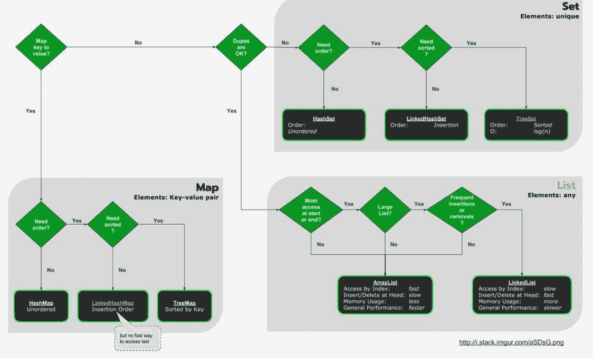

此流程图基于 [http://i.stack.imgur.com/aDSdG.png]。

# 第 65 章：super 关键字

### 65.1 节：super 关键字的使用及示例

`super` 关键字在三个地方起着重要作用：

1. 构造方法级别
2. 方法级别
3. 变量级别

### 构造方法级别

`super` 关键字用于调用父类的构造方法。该构造方法可以是默认构造方法，也可以是参数化构造方法。

- 默认构造方法：`super()`
- 参数化构造方法：`super(int no, double amount, String name);`

```java
class Parentclass {
    Parentclass() {
        System.out.println("Constructor of Superclass");
    }
}

class Subclass extends Parentclass {
    Subclass() {
        /* 编译器在此构造方法的第一行
           隐式地添加了 super()
        */
        System.out.println("Constructor of Subclass");
    }

    Subclass(int n1) {
        /* 编译器在此构造方法的第一行
           隐式地添加了 super()
        */
        System.out.println("Constructor of Subclass with arg");
    }

    void display() {
        System.out.println("Hello");
    }

    public static void main(String args[]) {
        // 使用默认构造方法创建对象
        Subclass obj1 = new Subclass();
        // 调用子类方法
        obj1.display();
        // 使用参数构造方法创建对象2
        Subclass obj2 = new Subclass(10);
        obj2.display();
    }
}
```

注意：`super()` 必须是构造方法中的第一条语句，否则我们将得到编译错误信息。

### 方法级别

`super` 关键字也可以用于方法重写的情况。`super` 关键字可以用于调用父类方法。

```java
class Parentclass {
    // 重写方法
    void display() {
        System.out.println("Parent class method");
    }
}

class Subclass extends Parentclass {
    // 重写方法
    void display() {
        System.out.println("Child class method");
    }

    void printMsg() {
        // 这将调用重写方法
        display();
        // 这将调用被重写方法
        super.display();
    }

    public static void main(String args[]) {
        Subclass obj = new Subclass();
        obj.printMsg();
    }
}
```

如果：没有方法重写，那么我们不需要使用 `super` 关键字来调用父类方法。

### 变量级别

`super` 用于引用直接父类的实例变量。在继承的情况下，基类和派生类可能具有相似的数据成员。为了区分基类/父类的数据成员与派生类/子类的数据成员，在派生类的上下文中，基类的数据成员必须以 `super` 关键字开头。

```java
// 父类或超类
class Parentclass {
    int num = 100;
}

// 子类或子类
class Subclass extends Parentclass {
    /* 我在子类中也声明了
       相同的变量 num
    */
    int num = 110;

    void printNumber() {
        System.out.println(num); // 它将打印值 110
        System.out.println(super.num); // 它将打印值 100
    }

    public static void main(String args[]) {
        Subclass obj = new Subclass();
        obj.printNumber();
    }
}
```

注意：`super()` 必须是构造方法中的第一条语句，否则我们将得到编译错误信息。

# 第 66 章：序列化

Java 提供了一种名为序列化的机制，其中对象可以表示为字节序列。序列化是将对象的状态转换为字节的过程。

### 66.1 节：基础序列化

要使一个类符合序列化条件，必须实现 `java.io.Serializable` 接口。

```java
import java.io.Serializable;
import java.util.Date;
import java.util.Calendar;

public class SerialClass implements Serializable {
    private static final long serialVersionUID = 1L;
    private Date currentTime;

    public SerialClass() {
        currentTime = Calendar.getInstance().getTime();
    }

    public Date getCurrentTime() {
        return currentTime;
    }
}
```

### 将对象写入文件

现在我们需要将对象写入文件。为了此目的，我们使用了 `java.io.ObjectOutputStream`。

```java
import java.io.FileOutputStream;
import java.io.ObjectOutputStream;
import java.io.IOException;

public class PersistSerialClass {
    public static void main(String[] args) {
        String filename = "time.ser";
        SerialClass time = new SerialClass(); // 将此对象写入文件系统
        try (ObjectOutputStream out = new ObjectOutputStream(new FileOutputStream(filename))) {
            out.writeObject(time); // 将字节流写入文件系统
            out.close();
        } catch (IOException ex) {
            ex.printStackTrace();
        }
    }
}
```

### 从序列化状态重建对象

存储的对象以后可以使用下所示的 `java.io.ObjectInputStream` 从文件系统读取：

```java
import java.io.FileInputStream;
import java.io.ObjectInputStream;
import java.io.IOException;
import java.lang.ClassNotFoundException;

public class ReadSerialClass {
    public static void main(String[] args) {
        String filename = "time.ser";
        SerialClass time = null;
        try (ObjectInputStream in = new ObjectInputStream(new FileInputStream(filename))) {
            time = (SerialClass) in.readObject();
            in.close();
        } catch (IOException ex) {
            ex.printStackTrace();
        } catch (ClassNotFoundException cnfe) {
            cnfe.printStackTrace();
        }
        // 打印恢复的时间
        System.out.println("Restored time: " + time.getCurrentTime());
    }
}
```

序列化类是二进制格式的。如果类定义发生变化，反序列化可能会出现问题：详情请参见《Java 序列化规范》中的序列化对象版本控制章节。

序列化一个对象包含了它所属的整个对象图，以及在循环图中包含的根对象。提供了 `reset()` 方法来强制 `ObjectOutputStream` 忘记已经序列化的对象。

瞬态性字段 - 序列化

### 66.2 节：自定义序列化

在这个示例中，我们想要创建一个类，它将生成并输出到控制台一个在初始化期间作为参数传递的整数范围之间的随机数。

```java
public class SimpleRangerRandom implements Runnable {
    private int min;
    private int max;
    private Thread thread;

    public SimpleRangerRandom(int min, int max) {
        this.min = min;
        this.max = max;
        thread = new Thread(this);
        thread.start();
    }

    @Override
    public void run() {
        while (true) {
            Random rand = new Random();
            System.out.println("Thread: " + thread.getId() + " Random: " + rand.nextInt(max - min));
            try {
                thread.sleep(10000);
            } catch (InterruptedException e) {
                e.printStackTrace();
            }
        }
    }

    private void writeObject(ObjectOutputStream streamout) throws IOException;
    private void readObject(ObjectInputStream in) throws IOException, ClassNotFoundException;
}
```


如果我们想让这个类可序列化（`Serializable`），将会遇到问题。`Thread` 是某些不可序列化的系统类之一。因此，我们需要将 `Thread` 声明为 `transient`。通过这样做，我们能够序列化该类的对象，但会产生一个问题。正如你在构造函数中所看到的，我们设置了随机生成器的 `min` 和 `max` 值，并启动了负责生成和打印运行时的线程。当通过 `readObject()` 恢复持久化对象时，构造函数不会再次运行，因为没有创建新对象。在这种情况下，我们需要通过在类内部提供两个方法来实现自定义序列化（Custom Serialization）。这两个方法是：

```java
private void writeObject(ObjectOutputStream outputStream) throws IOException;

private void readObject(ObjectInputStream in) throws IOException, ClassNotFoundException;
```

因此，通过在 `readObject()` 中添加实现，我们可以初始化并启动线程：

```java
class RangeRanger implements Serializable, Runnable {

    private int min;

    private int max;

    private transient Thread thread;

    // transient 应该是任何不被序列化的字段，例如 Thread，或者任何你不想被序列化的字段

    public RangeRanger(int min, int max) {

        this.min = min;

        this.max = max;

        thread = new Thread(this);

        thread.start();

    }

    public void run() {

        while (true) {

            Random rand = new Random();

            System.out.println("Thread: " + thread.getId() + " - Random: " + rand.nextInt(max - min));

            try {

                Thread.sleep(1000);

            } catch (InterruptedException e) {

                e.printStackTrace();

            }

        }

    }

    private void writeObject(ObjectOutputStream os) throws IOException {

        os.defaultWriteObject();

    }

    private void readObject(ObjectInputStream in) throws IOException, ClassNotFoundException {

        in.defaultReadObject();

        thread = new Thread(this);

        thread.start();

    }

}
```

以下是我们示例的 `main` 方法：

```java
public class Main {

    public static void main(String[] args) {

        System.out.println("Hello");

        RangeRandom rangeRandom = new RangeRandom(1, 10);

        FileOutputStream fos = null;

        ObjectOutputStream out = null;

        try {

            fos = new FileOutputStream("test");

            out = new ObjectOutputStream(fos);

            out.writeObject(rangeRandom);

        } catch (IOException e) {

            e.printStackTrace();

        }

        RangeRandom rangeRandom2 = null;

        FileInputStream fis = null;

        ObjectInputStream in = null;

        try {

            fis = new FileInputStream("test");

            in = new ObjectInputStream(fis);

            rangeRandom2 = (RangeRandom) in.readObject();

            in.close();

        } catch (IOException e) {

            e.printStackTrace();

        } catch (ClassNotFoundException e) {

            e.printStackTrace();

        }

    }

}
```

如果你运行 `main` 方法，你会发现每个 `RangeRandom` 实例都有两个线程在运行，这是因为 `Thread.start()` 方法现在同时存在构造函数和 `readObject()` 中。

## 章节 63.3：版本控制与 serialVersionUID

当你实现 `io.Serializable` 接口来使类可序列化时，编译器会寻找一个名为 `serialVersionUID` 的类型为 `long` 的静态 final 字段。如果类没有声明此字段，编译器将创建一个此类字段，并分配一个来自 `serialVersionUID` 默认实现的值。该计算取决于类的各个方面，并遵循 Sun 提供的《对象序列化规范》。该值无法保证在所有编译器实现中都是相同的。

该字段用于检查类相对于序列化的有效性，这是在初始化对象时完成的。运行时会验证从反序列化数据中读取的 `serialVersionUID` 与类中声明的 `serialVersionUID` 是否完全相同。如果不是，它将抛出 `InvalidClassException`。

强烈建议在你所有想要变为可序列化的类中，显式地声明并初始化名为 `serialVersionUID` 的类型为 `long` 的静态 final 字段，而不是在不使用版本控制时依赖于字段的默认计算值。你的 `serialVersionUID` 计算极其敏感，可能会在不同的实现之间发生变化，如果你在序列化的发送端和接收端使用了不同的编译器实现，即使类相同可能会遇到 `InvalidClassException`。

```java
public class Example implements Serializable {

    static final long serialVersionUID = 1L;

}
```

## 序列化

```java
// Skills
List<String> skills = new LinkedList<String>();

skills.add("leadership");
skills.add("Java Experience");
```

```java
// Employee
Employee obj = new Employee();

obj.setFirstName("Christian");
obj.setLastName("Lucardi");
obj.setAge(25);
obj.setSalary(new BigDecimal("10000"));
obj.setSkills(skills);
```

```java
// Serialization process
Gson gson = new Gson();
String json = gson.toJson(obj);
// {"firstName":"Christian","lastName":"Lucardi","age":25,"salary":10000,"skills":["leadership","Java Experience"]}
```

注意，你不能对带有循环引用的对象进行序列化，因为会导致无限递归。

## 反序列化

```java
// 非常简单...
// 假设 json 是之前的 String 对象...
```

```java
Employee obj2 = gson.fromJson(json, Employee.class); // obj2 和 obj 一样
```

## 第 66.5 节：使用 Jackson 自定义 JSON 反序列化

我们以 JSON 格式消费 rest API 并将其反序列化为 POJO。Jackson 的 `org.codehaus.jackson.map.ObjectMapper` 开箱即用，在大多数情况下我们真的不需要任何配置。但有时我们需要自定义反序列化器来满足特殊需求，本教程将引导你创建自己的自定义反序列化器。

假设我们有以下实体。

```java
public class User {

    private Long id;

    private String name;

    private String email;

    // 为了清晰省略了 getter setter
}
```

以及

```java
public class Program {

    private Long id;

    private String name;

    private User createdBy;

    private String contents;

    // 为了清晰省略了 getter setter
}
```

让我们先序列化/封存一个对象。

```java
User user = new User();

user.setId(1L);
user.setEmail("example@example.com");
user.setName("Bazlur Rahman");

Program program = new Program();

program.setId(1L);
program.setName("Program ## 1");
program.setCreatedBy(user);
program.setContents("Some contents");

ObjectMapper objectMapper = new ObjectMapper();

final String json = objectMapper.writeValueAsString(program);
System.out.println(json);
```

上述代码将产生 JSON：

```json
{
  "id": 1,
  "name": "Program ## 1",
  "createdBy": {
    "id": 1,
    "name": "Bazlur Rahman",
    "email": "example@example.com"
  },
  "contents": "Some contents"
}
```

现在我们可以很轻松地执行相反的操作。如果我们有这个 JSON，可以使用 `ObjectMapper` 如下所示将其反序列化为对象——

现在假设这并不是真实情况，我们将从 API 获取一个与我们的 `Program` 类不匹配的不同的 JSON。

```json
{
  "id": 1,
  "name": "Program ## 1",
  "ownerId": 1,
  "contents": "Some contents"
}
```

看这个 JSON 字符串，你可以看到它有一个不同的字段 `ownerId`。

如果你想像之前那样序列化这个 JSON，将会抛出异常。

有两种方法可以避免此类异常并实现这种序列化——

### 忽略未知字段

忽略 `ownerId`。在 `Program` 类中添加以下注解：

```java
@JsonIgnoreProperties(ignoreUnknown = true)
public class Program {
```

### 编写自定义反序列化器

但在某些情况下，你实际上需要这个 id 字段。假设你想将其关联为 `User` 类的 id。

在这种情况下，你需要编写一个自定义反序列化器——

如你所见，你必须先从 `JsonParser` 获取 `JsonNode`。然后你可以使用 `get()` 方法轻松地从 `JsonNode` 中提取信息，并且你必须确保字段名正确。它应该是精确的名称，拼写错误会导致异常。

最后，你需要将你的 `ProgramDeserializer` 注册到 `ObjectMapper`。

```java
ObjectMapper mapper = new ObjectMapper();

SimpleModule module = new SimpleModule();

module.addDeserializer(Program.class, new ProgramDeserializer());

mapper.registerModule(module);

String newJsonString = "{\"id\":1,\"name\":\"Program 1\",\"ownerId\":1,\"contents\":\"Some contents\"}";
final Program program2 = mapper.readValue(newJsonString, Program.class);
```

或者，你可以使用注解直接注册反序列化器——

```java
@JsonDeserialize(using = ProgramDeserializer.class)
public class Program {
}
```

## 第 67 章：Optional

`Optional` 是一个容器对象，可能包含也可能不包含空值。如果值存在，`isPresent()` 将返回 `true`，`get()` 将返回该值。

还提供了依赖于所包含值的额外方法，例如 `orElse()`，它在值不存在时返回一个默认值，而 `ifPresent()` 则在值存在时执行一段代码块。

### 第 67.1 节：Map

`Optional` 的 `map()` 方法用于处理可能为 `null` 的值，而无需显式的 `null` 检查：

（注意 `map()` 和 `filter()` 操作是立即执行的，与它们的 `Stream` 对应不同，后者是惰性的。）

语法：

```java
public <U> Optional<U> map(Function<? super T, ? extends U> mapper)
```

示例：

```java
Optional<String> optional = Optional.of("hello");
String result = optional.map(String::toUpperCase).orElse("default");
// 返回 "HELLO"
```

```java
Optional<String> optional = Optional.empty();
String result = optional.map(String::toUpperCase).orElse("default");
// 返回 "default"
```

这是另一个示例，稍有不同。它只在值存在时打印值。

```java
Optional<String> optional = Optional.of("hello");
optional.map(String::toUpperCase).ifPresent(System.out::println);
// 打印 HELLO
```

### 第 67.2 节：为空时返回默认值

不要使用 `Optional.get()`，因为它可能会抛出 `NoSuchElementException`。`Optional.orElse(T)` 和 `Optional.orElseGet(Supplier<? extends T>)` 方法为 `Optional` 空时提供默认值的方法。

```java
String value = "something";
return Optional.ofNullable(value).orElse("defaultValue");
// "something"
return Optional.ofNullable(value).orElseGet(() -> getDefaultValue());
// "something"（从未调用 getDefaultValue）

String value = null;
return Optional.ofNullable(value).orElse("defaultValue");
// "defaultValue"
return Optional.ofNullable(value).orElseGet(() -> getDefaultValue());
// 调用 getDefaultValue() 及其结果
```

`orElse` 和 `orElseGet` 之间的关键区别是，后者仅在 `Optional` 为空时评估，而前者提供的参数即使在 `Optional` 不空也会被评估。`orElse` 仅用于常量以及基于任何形式的计算提供值。


# 第 67.3 节：如果没有值则抛出异常

使用 `Optional` 的 `orElseThrow()` 获取包含的值，如果没有设置，则抛出异常。这类似于调用 `get()`，区别在于它允许任意异常类型。该方法接收一个返回要抛出的异常的供应商。

在第一个示例中，方法直接返回包含的值：

```java
Optional optional = Optional.of("something");
return optional.orElseThrow(IllegalArgumentException::new);
// 返回 "something" 字符串
```

在第二个示例中，由于没有设置值，方法抛出异常：

```java
Optional optional = Optional.empty();
return optional.orElseThrow(IllegalArgumentException::new);
// 抛出 IllegalArgumentException
```

如果需要抛出带消息的异常，也可以使用 lambda 语法：

```java
optional.orElseThrow(() -> new IllegalArgumentException("Illegal"));
```

# 第 67.4 节：使用 Supplier 提供默认值

普通的 `orElse` 接收一个对象，所以你可能会奇怪为什么还有一个提供 `Supplier` 的选项（`orElseGet` 方法）。

考虑：

```java
String value = "something";
return Optional.ofNullable(value)
    .orElse(getValueThatIsHardToCalculate()); // 返回 "something"
```

即使结果没有使用且选项为空，仍然会调用 `getValueThatIsHardToCalculate()`。

为了避免这种开销，可以使用供应者：

```java
String value = "something";
return Optional.ofNullable(value)
    .orElseGet(() -> getValueThatIsHardToCalculate()); // 返回 "something"
```

这样，只有在 `Optional` 为空时才会调用 `getValueThatIsHardToCalculate()`。

## 第 67.5 节：过滤

`filter()` 用于表示只有当值匹配你的谓词时才获取该值。

将其想象为 `if (!somePredicate(x)) { x = null; }`。

代码示例：

```java
String value = "null";
Optional.ofNullable(value) // 因为 value 为 null，这里永远不会执行
    .filter(x -> x.equals("cool string"))
    .isPresent(); // false
```

```java
String value = "cool string";
Optional.ofNullable(value) // 有值
    .filter(x -> x.equals("cool string")) // 执行并通过
    .isPresent(); // true
```

```java
String value = "hot string";
Optional.ofNullable(value) // 有值
    .filter(x -> x.equals("cool string")) // 执行但失败
    .isPresent(); // false
```

## 第 67.6 节：使用 Optional 容器处理原始数值类型

`OptionalDouble`、`OptionalInt` 和 `OptionalLong` 的工作原理类似于 `Optional`，但专门为包装类型而设计：

```java
OptionalInt present = OptionalInt.of(value);
OptionalInt absentInt = OptionalInt.empty();
```

由于数值确实有值，因此没有对 `null` 的特殊处理。可以通过以下方式检查空容器：

```java
present.isPresent(); // 为 true
absentInt.isPresent(); // 为 false
```

同样，也存在简写方法来辅助值管理：

```java
// 打印该值，因为它在创建时已提供。
present.ifPresent(System.out::println);
```

```java
// 如果 Optional 为空，返回另一个值。
int finalValue = absentInt.orElseGet(this::value);
```

```java
// 将抛出 NoSuchElementException。
nonexistentValue = absentInt.getAsInt();
```

## 第 67.7 节：仅在存在值时运行代码

```java
Optional<String> optionalWithValue = Optional.of("foo");
optionalWithValue.ifPresent(System.out::println); // 打印 "foo"
```

```java
Optional<String> emptyOptional = Optional.empty();
emptyOptional.ifPresent(System.out::println); // 什么都不做。
```

## 第 67.8 节：FlatMap

`flatMap` 与 `map` 类似。其区别在 javadoc 中描述如下：

> 此方法类似于 `map(Function)`，但提供的映射器（mapper）的结果已经是一个 Optional，如果调用，`flatMap` 不会再用额外的 Optional 对其进行包装。

换句话说，当调用返回 `Optional` 的方法时，使用 `Optional.flatMap` 可以避免嵌套的 `Optional`。

例如，给定以下类：

```java
public class Foo {
    Optional<Bar> getBar(){
        return Optional.of(new Bar());
    }
}
public class Bar {
}
```

如果你使用 `Optional.map`，将得到一个嵌套的 `Optional`；即 `Optional<Optional<Bar>>`。

```java
Optional<Optional<Bar>> nestedOptional =
    Optional.of(new Foo())
    .map(Foo::getBar);
```

然而，如果你使用 `Optional.flatMap`，将得到一个简单的 `Optional`；即 `Optional<Bar>`。

```java
Optional<Bar> optionalBar =
    Optional.of(new Foo())
    .flatMap(Foo::getBar);
```

# 第 68 章：对象引用

### 第 68.1 节：作为方法参数的对象引用

本主题解释了对象引用的概念；面向 Java 初学者。你应该已经熟悉了一些术语和含义：类定义、主方法、对象实例、在对象“上”调用方法，以及向方法传递参数。

```java
class Person {
    private String name;

    public void setName(String name) { this.name = name; }

    public String getName() { return name; }

    public static void main(String [] arguments) {
        Person person = new Person();
        person.setName("Bob");

        int i = 5;
        setPersonName(person, i);

        System.out.println(person.getName() + " " + i);
    }

    private static void setPersonName(Person person, int num) {
        person.setName("Linda");
        num = 99;
    }
}
```

为了在 Java 编程中完全胜任，你应该能够脱口而出地向他人解释这个例子。它的概念是理解 Java 如何运作的基础。

如你所见，我们有一个方法实例化了一个对象并将其赋值给变量 `person`，然后调用一个方法将字段中的名称设置为 "Bob"。然后它调用了另一个方法，并将 `person` 作为两个参数之一传递；另一个参数是一个整数变量，设置为 5。

被调用的方法将传递对象的名称值设置为 "Linda"，并将整数变量设置为 99，且没有返回值。

那么会打印什么呢？

Linda 5

为什么对 `person` 的更改在 `main` 中生效，但对整数的更改没有生效？

当调用时，`main` 方法为 `setName` 方法执行对象引用；其所做的更改都是该对象的一部分，当方法返回时，这些更改仍然属于该对象。

另一种同说法是：`person` 指向一个对象（存储在堆上，你感兴趣）。对该对象进行的任何更改都是“在该对象上”进行的，并且不受执行更改的方法是否仍然活跃或返回的影响。当方法返回时，对对象的更改仍然存储在对象中。

在 Java 中，基本类型按值传递的。对象按引用传递的，这意味着传递的是对象的指针。

# 第 69 章：异常与异常处理

`Throwable` 类型及其子类对象可以通过 `throw` 关键字发送到堆栈中，并使用 `try...catch` 语句捕获。

## 第 69.1 节：使用 try-catch 捕获异常

可以使用 `try...catch` 语句捕获并处理异常。（事实上，`try` 语句还有其他形式，在其他关于 `try...catch...finally` 和 `try-with-resources` 的示例中有描述。）

### 位于只有一个 catch 块的 try-catch

最简单的形式如下：

```java
try {
    doSomething();
} catch (SomeException e) {
    handle(e);
}
// 下一个语句
```

简单的 `try...catch` 行为如下：

- 执行 `try` 块中的语句。
- 如果 `try` 块中的语句没有抛出异常，则控制传递到 `try...catch` 之后的下一个语句。
- 如果在 `try` 块中抛出了异常：
    - 检查异常对象是否为 `SomeException` 或其子类的实例。
    - 如果是，则 `catch` 块绑定到该异常：
        - 变量 `e` 绑定到异常对象。
        - 执行 `catch` 块中的代码。
        - 如果该代码抛出了异常，则新抛出的异常将取代原始异常进行传播。
        - 否则，控制传递到 `try...catch` 之后的下一个语句进行传播。
- 如果不是，则原始异常继续传播。

### 带有多个 catch 块的 try-catch

`try...catch` 也可以有多个 `catch` 块。例如：

```java
try {
    doSomething();
} catch (SomeException e) {
    handleOneWay(e);
} catch (SomeOtherException e) {
    handleAnotherWay(e);
}
// 下一个语句
```

如果有多个 `catch` 块，它们将从第一个开始逐个尝试，直到找到与异常匹配的项为止。执行相应的处理程序（如上所示），然后控制传递到 `try...catch` 语句之后的下一个语句。匹配项之后的 `catch` 块将始终被跳过，即使处理器抛出了异常。

这种“自上而下”的匹配策略对于 `catch` 块中的异常不不交的情况会有影响。例如：

```java
try {
    throw new RuntimeException("test");
} catch (Exception e) {
    System.out.println("Exception");
} catch (RuntimeException e) {
    System.out.println("RuntimeException");
}
```

这段代码段将输出 "Exception" 而不是 "RuntimeException"。由于 `RuntimeException` 是 `Exception` 的子类，将匹配第一个（更通用的）`catch`。第二个（更具体的）`catch` 永远不会执行。

我们要学习的教训是，这些特定的 `catch` 块（就异常类型而言）应该先出现，最通用的放在最后。（如果某个 `catch` 永远无法执行，某些 Java 编译器会发出警告，但这不是编译错误。）

### 多异常 catch 块

版本：Java SE 7

从 Java 7 开始，单个 `catch` 块可以处理一组无关的异常。异常类型列出，并用竖线 `|` 隔开。例如：

```java
try {
    doSomething();
} catch (SomeException | SomeOtherException e) {
    handleSomeException(e);
}
```

多异常 `catch` 的行为是单异常情况的简单扩展。`catch` 匹配列出的异常中抛出的（至少一个）异常。

规范中还有一些额外的细微差别。`e` 的类型是列表中异常类型的合成联合类型。当使用 `e` 的值时，它的类型是异常类型的最小公共父类。然而，如果 `e` 在 `catch` 块中被重新抛出，则抛出的异常类型是联合类型中的类型。例如：

```java
public void method() throws IOException, SQLException {
    try {
        doSomething();
    } catch (IOException | SQLException e) {
        report(e);
        throw e;
    }
}
```

在上面，`IOException` 和 `SQLException` 是检查异常，它们的最小公共父类是 `Exception`。这意味着报告的类型必须匹配 `report(Exception)`。然而，编译器知道 `throw` 可能会抛出 `IOException` 或 `SQLException`。因此，`method` 可以声明为 `throws IOException, SQLException` 而不是 `throws Exception`。（这是一件好事：请参见 陷阱 - Throwable, Exception, Error 或 RuntimeException。）

## 第 69.2 节：try-with-resources 语句

版本：Java SE 7

正如 `try-catch-finally` 语句示例所示，使用 `finally` 子句清理资源需要大量的“样板”代码来正确实现边缘情况。Java 7 通过 `try-with-resources` 语句提供了一种简单得多的方法来处理这个问题。

### 什么是资源？

Java 7 引入了 `java.lang.AutoCloseable` 接口，允许使用 `try-with-resources` 语句管理类。实现 `AutoCloseable` 的类实例被称为资源。这些资源通常需要及时释放，而不是依赖垃圾回收器来释放它们。

`AutoCloseable` 接口定义了一个方法：

```java
public void close() throws Exception
```

`close()` 方法应该以适当的方式释放资源。规范规定，在已经释放的资源上调用该方法是安全的。此外，鼓励实现 `AutoCloseable` 的类声明 `close()` 方法抛出比 `Exception` 更具体的异常，或者不抛出任何异常。

广泛的标准类和接口实现了 `AutoCloseable`。这些包括：

- `InputStream`、`OutputStream` 及其子类
- `Reader`、`Writer` 及其子类
- `Socket` 和 `ServerSocket` 及其子类
- `Channel` 及其子类，以及
- JDBC 接口 `Connection`、`Statement` 和 `ResultSet` 及其子类。

应用程序和第三方类也可以很好做到。

### 基础 try-with-resource 语句

`try-with-resources` 的语法基于调用的 `try-catch`、`try-finally` 和 `try-catch-finally` 形式。这是一个“基础”形式的示例；即带有 `catch` 或 `finally` 的形式。

```java
try (InputStream stream = new FileInputStream("hello.txt")) {
    stream.out.println("Hello world!");
}
```

要管理的资源被声明为 `try` 子句之后 `(...)` 部分的变量。在示例中，我们声明了一个资源变量并将其初始化为新创建的 `FileInputStream`。一旦资源变量初始化完成，就会执行 `try` 块。完成后，会自动调用 `stream.close()` 以确保资源不泄露。注意，无论块如何完成，都会调用 `close()`。

### 增强型 try-with-resource 语句


# `try-with-resources` 语句

`try-with-resources` 语句可以像 `try-finally` 语法一样通过 `catch` 和 `finally` 块进行增强。以下代码段封装了之前的代码，以处理可能抛出的 `FileNotFoundException`。

```java
try (InputStream stream = new FileInputStream("hello.txt")) {
    stream.out.println("Hello world!");
} catch (FileNotFoundException) {
    System.err.println("Cannot open the file");
}
```

如果资源初始化或 `try` 块抛出异常，则执行 `catch` 块。`finally` 块始终执行。但有几点需要注意：

- 资源变量在 `catch` 和 `finally` 块中不可见。
- 资源清理发生在 `try` 块之后。
- 如果自动资源清理抛出异常，则可以在 `catch` 块中捕获。

## 管理多个资源

上面的代码段显示了管理单个资源。事实上，`try-with-resources` 可以在语句中管理多个资源。例如：

```java
try (InputStream is = new FileInputStream(file1);
     OutputStream os = new FileOutputStream(file2)) {
  // 将 'is' 拷贝到 'os'
}
```

这种行为符合你的预期。`is` 和 `os` 会在 `try` 结束时自动关闭。有几点注意：

- 初始化按顺序进行，最后一个资源变量初始化器可以使用早期变量的值。
- 所有成功初始化的资源都将被清理。
- 资源按照声明的反序进行清理。

因此，在上面的示例中，`is` 在 `os` 之前初始化，并在 `os` 之后清理，如果在初始化时发生异常，也会进行清理。

## `try-with-resource` 与传统的 `try-catch-finally` 的等效性

Java 语言规范通过传统的 `try-catch-finally` 语句规定了 `try-with-resource` 形式的行为。（详细信息请参阅 JLS。）

例如，`try-with-resource`：

```java
// 注意，构造函数不是 try-catch 语句的一部分
PrintWriter stream = new PrintWriter("hello.txt");
```

```java
// 此变量用于跟踪 try 语句中的主异常
// 如果 try 块中抛出异常，AutoCloseable.close() 抛出的任何异常都将被抑制
Throwable primaryException = null;
```

```java
// 实际的 try 块
try {
    Kicker()
}
```

```java
stream.println("Hello world!");
catch (Throwable t) {
  // 如果抛出异常，将其记录以便 finally 块使用
  primaryException = t;
  throw t;
}
finally {
  if (primaryException == null) {
    // 如果到为止没有抛出异常，close() 中抛出的异常
    // 将被捕获，因此会被传递给编码代码。
    stream.close();
  } else {
    // 如果已经抛出了异常，close() 中抛出的任何异常
    // 将被抑制，因为它可能与之前的异常有关。
    // 使用 primaryException.getSuppressed() 可以获取抑制的异常。
    try {
      stream.close();
    } catch (Throwable suppressedException) {
      primaryException.addSuppressed(suppressedException);
    }
  }
}
```

JLS 规定 `t` 和 `primaryException` 变量将初始化为 `null`。

`try-with-resources` 的增强形式被规定为与基本形式等价。对于：

```java
try (PrintWriter stream = new PrintWriter(fileName)) {
  stream.println("Hello world!");
} catch (NullPointerException ex) {
  System.err.println("Null filename");
} finally {
  System.err.println("All done");
}
```

等同于：

```java
try (PrintWriter stream = new PrintWriter(fileName)) {
  stream.println("Hello world!");
} catch (NullPointerException ex) {
  System.err.println("Null filename");
} finally {
  System.err.println("All done");
}
```

# 第 69.3 节：自定义异常

在大多数情况下，从代码设计的角度来看，抛出异常时使用通用的 `Exception` 类更为简单。如果你只需要异常携带一个简单的错误信息，通常会首选 `RuntimeException`，因为它不是受检异常。对于常见的错误情况，还存在其他异常类：

- `UnsupportedOperationException` - 某些操作不受支持
- `IllegalArgumentException` - 向方法传递了无效的参数值
- `IllegalStateException` - 您的 API 内部到达了一个永远不应该发生的状态，或者由于以无效的方式使用您的 API 导致了该状态

在以下情况下，您可能需要自定义异常类：

- 您正在为他人编写 API 或库，并希望您的 API 用户能够特定地捕获并处理来自您的 API 的异常，并将这些异常与其他更通用的异常区分开来。
- 您在程序的某部分针对特定错误抛出异常，并希望能够将这些错误与其他更通用的错误区分开来。

您可以通过扩展 `RuntimeException` 创建非受检异常，或者通过扩展不是 `RuntimeException` 子类的 `Exception` 来创建受检异常，因为：

不是 `RuntimeException` 子类的 `Exception` 的子类是受检异常。

```java
public class StringTooLongException extends RuntimeException {
    // 异常可以像其他类一样拥有方法和字段
    // 这可以用于向调用此类异常的代码段传递信息
    public final String value;
    public final int maximumLength;

    public StringTooLongException(String value, int maximumLength) {
        super(String.format("String exceeds maximum Length of %s: %s", maximumLength, value));
        this.value = value;
        this.maximumLength = maximumLength;
    }
}
```

这些可以像预定义异常一样使用：

```java
void validateString(String value) {
    if (value.length() > 30){
        throw new StringTooLongException(value, 30);
    }
}
```

并且可以在捕获和处理异常的地方使用字段：

请记住，根据 Oracle 的 Java 文档：

> ...如果可以合理地预期客户端可以从异常中恢复，请将其设为受检异常。如果客户端无法采取任何操作从异常中恢复，请将其设为非受检异常。

更多信息：

* 为什么 `RuntimeException` 不需要显式的异常处理？

# 第 69.4 节：处理 `InterruptedException`

`InterruptedException` 是一个令人困惑的怪兽——它出现在像 `Thread.sleep()` 这样看似无害的方法中，处理不当会导致代码难以管理，并且在并发环境中表现不佳。

最基础的是，如果发生了 `InterruptedException`，意味着在某个地方对你当前运行的线程调用了 `Thread.interrupt()`。你可能倾向于说“它永远不会中断的！”，因此执行如下操作：

```java
// 坏做法。不要这样做。
try {
  Thread.sleep(1000);
} catch (InterruptedException e) {
  // 忽略
}
```

但这是处理“不可能”事件的错误方法。如果你知道你的应用程序永远不会遇到 `InterruptedException`，你应该将此类事件视为对你程序假设的严重违背，并尽快退出。

处理“不可能”中断的正确方法如下：

```java
// 当没有任何会中断你的代码时
try {
  Thread.sleep(1000);
} catch (InterruptedException e) {
  Thread.currentThread().interrupt();
  throw new AssertionError();
}
```

这做了两件事：首先恢复线程的中断状态（就像 `InterruptedException` 根本没有被抛出一样），然后抛出一个 `AssertionError`，表示你的应用程序的基本不变性被违反了。如果你确定永远不会中断运行代码的线程，那么这是安全的。

如果你不确定如何处理中断，使用 Guava 的 `Uninterruptibly()` 可以简化这种模式。在有限的情况下（例如在重写一个不抛出异常的方法时），你可以在重置中断状态而不抛出异常，延迟中断会被抑制。

```java
// 抑制了异常但重置了中断状态，让后续代码
// 检测并妥善处理中断。
try {
    Thread.sleep(1000);
} catch (InterruptedException e) {
    Thread.currentThread().interrupt();
}
return ...; // 此时你的预期会被破坏 - 不要在这里工作
```

在这种情况下，通常最好的做法是允许 `InterruptedException` 传播到调用栈，并在每个方法中添加 `throws InterruptedException`。这看起来可能很肿，但你的方法签名现在表明它能够及时响应。

```java
public void myRunningMethod() throws InterruptedException {

}
```

# 第 69.5 节：`try-catch` 中的 `return` 语句

虽然这不是良好的习惯，但在异常处理块中添加多个 `return` 语句是可能的：

```java
public static int returnTest(int number) {
    try {
        if (number % 2 == 0) throw new Exception("Exception thrown");
        else return x;
    } catch (Exception e) {
        return 3;
    } finally {
        return 7;
    }
}
```

该方法将始终返回 7，因为与 `try/catch` 块相关的 `finally` 块在任何内容返回之前执行。现在，由于 `finally` 有 `return 7`，该值覆盖了 `try/catch` 的返回值。

如果 `catch` 块返回一个原始值，且该原始值随后在 `finally` 块中被更改，将返回 `catch` 块的值，`finally` 块中的更改将被忽略。

下面的示例将打印 "0"，而不是 "1"。

```java
public class FinallyExample {
    public static void main(String[] args) {
        int n = returnTest(4);
        System.out.println(n);
    }

    public static int returnTest(int number) {
        int returnNumber = 0;
        try {
            if (number % 2 == 0) 
                throw new Exception("Exception thrown");
            else
                return returnNumber;
        } catch (Exception e) {
            return returnNumber;
        } finally {
            returnNumber = 1;
        }
    }
}
```

# 第 69.6 节：引言

异常是程序执行过程中发生的错误。考虑下面这个整数除法的 Java 程序。

```java
class Division {
    public static void main(String[] args) {

        int a, b, result;

        Scanner input = new Scanner(System.in);
        System.out.println("Input two integers");

        a = input.nextInt();
        b = input.nextInt();

        result = a / b;

        System.out.println("Result = " + result);
    }
}
```

现在我们编译并执行上述代码，查看尝试除以零时的输出结果：

```
Input two integers
7 0
Exception in thread "main" java.lang.ArithmeticException: / by zero
at Division.main(Division.java:14)
```

除以零是一个产生无法表示为整数的值的操作。Java 通过抛出异常来处理此问题。在这种情况下，异常是 `ArithmeticException` 类。

注意：关于创建和读取堆栈轨迹的示例解释了两个数字之后的输出内容的含义。

异常的用途是控制执行流。如果没有异常，解决此问题的典型方案是首先检查 `b == 0`：

```java
class Division {
    public static void main(String[] args) {

        int a, b, result;

        Scanner input = new Scanner(System.in);
        System.out.println("Input two integers");

        a = input.nextInt();
        b = input.nextInt();

        if (b == 0) {
            System.out.println("You cannot divide by zero.");
            return;
        }

        result = a / b;

        System.out.println("Result = " + result);

    }
}
```

这会在控制台打印消息 `You cannot divide by zero.` 并在用户尝试除以零时以优雅的方式退出程序。通过异常处理解决此问题的等效方法是将 `if` 控制流替换为 `try-catch` 块。

```java
a = input.nextInt();
b = input.nextInt();

try {
    result = a / b;
}
catch (ArithmeticException e) {
    System.out.println("An ArithmeticException occurred. Perhaps you tried to divide by zero.");
    return;
}
```

`try-catch` 的执行过程如下：

1. 开始执行 `try` 块中的代码。
2. 如果 `try` 块中发生异常，立即终止并检查该异常是否被 `catch` 块捕获（在这种情况下，当它是 `ArithmeticException` 实例时）。
3. 如果异常被捕获，它将被赋值给变量 `e` 并执行 `catch` 块。
4. 如果 `try` 或 `catch` 块任一执行完成（即执行期间没有发生意外异常），则继续执行 `try-catch` 块之外的代码。

关于如何使用以及何时不要使用异常的更多建议，请参考 [Java Pitfalls - Exception usage]。

# 第 69.7 节：Java 异常层次结构 - 未检查异常与已检查异常

所有的 Java 实例都是类层次结构的实例。可以表示如下：

- `java.lang.Throwable` - 这是所有异常类的基类。它的方法和构造函数实现了所有异常的一系列功能。
- `java.lang.Exception` - 这是所有普通异常的子类。
    - 标准和自定义异常类。


- `java.lang.RuntimeException` - 这是所有普通异常中未检查异常的子类。
- 标准和自定义运行时异常类。
- `java.lang.Error` - 这是所有“致命错误”异常的子类。

# 注意

1. 下文描述了已检查异常（checked exceptions）和未检查异常（unchecked exceptions）之间的区别。
2. `Throwable`、`Exception` 和 `RuntimeException` 类应被视为抽象的；参见 [Pitfall - Throwing Throwable, Exception or RuntimeException]。
3. 在应用程序恢复不安全或不明智的情况下，JVM 会捕获 `Error` 异常。
4. 声明 `Throwable` 的类型是不明智的。Java 工具和库可能假设 `Error` 和 `Exception` 是 `Throwable` 唯一的直接子类，如果该假设不正确，可能会表现异常。

# 已检查异常与未检查异常

对某些编程语言异常支持的批评之一是，很难知道给定方法或过程可能会抛出哪些异常。鉴于未检查异常可能导致程序崩溃，这可能使异常成为脆弱性的根源。

Java 语言通过已检查异常机制解决了这一担忧。首先，Java 将异常分为两类：

- **已检查异常（Checked exceptions）**通常代表应用程序应该处理的预期事件。例如，`IOException` 及其子类代表了 I/O 操作中可能发生的错误状况。例如由于文件或目录不存在导致文件失败、由于网络连接中断导致网络读写失败等。
- **未检查异常（Unchecked exceptions）**通常代表应用程序无法处理的意外事件。这些通常是 Bug 类型。

（在下文中，“抛出”（thrown）是指显式抛出的异常（通过 `throw` 语句）或隐式抛出的异常（在引用失败、类型转换失败等方面）。同样，“传播”（propagated）是指在嵌套调用中抛出且未在该调用内部捕获的异常。下面的示例代码将说明这一点。）

已检查异常机制的第二部分是对可能发生已检查异常的方法的限制：

- 当在方法中抛出或传播已检查异常时，它必须被该方法捕获，或者列在方法的 `throws` 子句中。（`throws` 子句的意义在示例中描述）。
- 当在方法中抛出或传播已检查异常时，它必须被块捕获。
- 已检查异常不能在字段初始化表达式中传播。（没有办法捕获此类异常）。

简而言之，已检查异常要么被处理，要么被声明。这些限制不适用于未检查异常。这包含了所有隐式抛出异常的情况。

# 已检查异常示例

这些代码片段用于说明已检查异常。在每个情况下，我们都展示一个编译错误的版本，然后展示一个修正后的版本。

```java
// 这定义了一个自定义的已检查异常
public class MyException extends Exception {
    // 省略构造函数
}
```

第一个示例展示了显式抛出的已检查异常如果不在方法中处理，如何声明为“抛出”。

```java
// 错误
public void methodThrowingCheckedException(boolean flag) {
  int i = 0; // 编译通过，异常异常
  if (flag) {
    throw new MyException(); // 编译错误
  } else {
    throw new MyException2(); // 编译通过
  }
}
```

```java
// 正确
public void methodThrowingCheckedException(boolean flag) throws MyException {
  int i = 0; // 编译通过，异常异常
  if (flag) {
    throw new MyException(); // 编译错误
  } else {
    throw new MyException2(); // 编译通过
  }
}
```

第二个示例展示了传播的已检查异常如何被处理。

```java
// 错误
public void methodWithPropagatedCheckedException() {
  InputStream in = new FileInputStream("somefile.txt"); // 编译错误
// FileInputStream 在文件无法打开时抛出 IOException 或其子类。
// IOException 是一个已检查异常。
}
```

```java
// 修正后的版本 A
public void methodWithPropagatedCheckedException() throws IOException {
  InputStream in = new FileInputStream("somefile.txt");
}
```

```java
// 修正后的版本 B
public void methodWithPropagatedCheckedException() {
  try {
    InputStream in = new FileInputStream("somefile.txt");
  } catch (IOException ex) {
    System.out.println("无法打开文件: " + ex.getMessage());
  }
}
```

最后一个示例展示了如何在静态字段初始化器中处理已检查异常。

```java
// 错误
public class Test {
    private static final InputStream is =
        new FileInputStream("someFile.txt"); // 编译错误
}
```

```java
// 修改后
public class Test {
    private static final InputStream is;
    static {
        InputStream tmp = null;
        try {
            tmp = new FileInputStream("someFile.txt");
        } catch (IOException ex) {
            System.out.println("无法打开文件: " + ex.getMessage());
        }
        is = tmp;
    }
}
```

注意，在这种情况下，我们还必须处理无法多次赋值的问题，尽管在发生异常时，该变量也已经被赋值过了。

## 第 6.8 节：创建和读取堆栈跟踪

当异常对象被创建时（即当您使用 `new` 实例化时），`Throwable` 构造函数会捕获异常创建时的上下文信息。稍后，这些信息可以以堆栈跟踪的形式输出，用于帮助诊断导致异常的原始问题。

### 打印堆栈跟踪

打印堆栈跟踪只需调用 `printStackTrace()` 方法即可。例如：

```java
try {
    int a = 0;
    int b = 0;
    int c = a / b;
} catch (ArithmeticException ex) {
    // 这将堆栈跟踪打印到标准输出
    ex.printStackTrace();
}
```

不带参数的 `printStackTrace()` 方法将打印到应用程序的标准输出；即当前的 `System.out`。还有 `printStackTrace(Stream)` 和 `printStackTrace(PrintWriter)` 重载方法，允许将其打印到指定的流或写入器。

注意：

1. 堆栈跟踪不包含异常本身的详细信息。您可以使用 `toString()` 方法来获取这些细节：

```java
// 打印异常和堆栈跟踪
System.out.println(ex);
ex.printStackTrace();
```

2. 堆栈跟踪应谨慎使用；请参见“陷阱 - 过或不当的堆栈跟踪”。通常使用日志框架并将要记录的异常对象传递给它是更好。

### 理解堆栈跟踪

考虑下面由两个文件中的两个类组成的简单程序。（为了说明，我们显示了文件名并添加了行号。）

```
File: "Main.java"
public class Main {
    public static void main(String[] args) {
        new Test().foo();
    }
}
```

```
File: "Test.java"
class Test {
    public void foo() {
        bar();
    }

    public int bar() {
        int a = 1;
        int b = 0;
        return a / b;
    }
}
```

当这些文件被编译并运行时，我们将得到以下输出。

```
Exception in thread "main" java.lang.ArithmeticException: / by zero
at Test.bar(Test.java:9)
at Test.foo(Test.java:3)
at Main.main(Main.java:3)
```

让我们逐行阅读以弄清楚它告诉了我们什么。

第一行告诉我们线程由于意外异常而终止。异常的完整名称是 `java.lang.ArithmeticException`，异常消息是 `"/ by zero"`。

如果我们查找该异常的 javadoc，它是这样说的：

> 当发生算术异常条件时抛出。例如，整数“除以零”会抛出此类的一个实例。

事实上，消息 `"/ by zero"` 是一个强烈的提示，表明异常的原因是某些代码尝试除以零。但是是什么呢？

剩下的 3 行是堆栈跟踪。每行都代表调用栈上的一个方法（或构造函数）调用，每一行都告诉我们三件事：

- 正在执行的类名和方法名，
- 源代码文件名，
- 正在执行的语句的源代码行号。

这些堆栈跟踪行列出时当前调用的帧位于顶端。在我们的示例中，顶部的帧位于 `Test.bar` 方法，位于 `Test.java` 文件的第 9 行。


这些堆栈跟踪行列出时当前调用的帧位于顶端。在我们的示例中，顶部的帧位于 `Test.bar` 方法，位于 `Test.java` 文件的第 9 行。

### 异常链

有时应用程序需要将堆栈跟踪捕获为字符串，以便其他用途。通用方法是创建一个写入到内存缓冲器的 `OutputStream` 或 `Writer`，并将其传递给 `printStackTrace(..)`。

当主异常有原因时，输出中会包含 "Caused by:" 行。异常链机制在 Java 1.4 中才被暴露。

### 捕获堆栈跟踪为字符串

Apache Commons 和 Guava 库提供了捕获堆栈跟踪为字符串的方法：

```
org.apache.commons.lang.exception.ExceptionUtils.getStackTrace(Throwable)
com.google.common.base.Throwables.getStackTraceAsString(Throwable)
```

如果您无法在代码库中使用第三方库，可以使用以下方法：

```java
/**
 * 返回堆栈跟踪的字符串表示。
 * @param throwable 要转换的异常
 * @return 字符串。
 */
public static String stackTraceToString(Throwable throwable) {
    StringWriter stringWriter = new StringWriter();
    throwable.printStackTrace(new PrintWriter(stringWriter));
    return stringWriter.toString();
}
```

### 抛出异常

以下示例展示了抛出异常的用法：

```java
public void checkNumber(int number) throws IllegalArgumentException {
    if (number < 0) {
        throw new IllegalArgumentException("数字必须为正数: " + number);
    }
}
```

如上所示，在单条语句中创建并抛出异常对象是一种良好的做法。在异常中包含有意义的错误信息也是一种良好的做法，可以帮助程序员理解问题所在。然而，这并不一定是你应该展示给终端用户的消息。（起初，Java 异常消息的国际化没有直接支持）。

还有几点需要说明：

- 我们将 `throws` 声明为 `IllegalArgumentException`。这并不是严格必要的，因为 `IllegalArgumentException` 是一个未检查异常；Java 异常层次结构包含未检查异常和检查异常。然而，这样做是一个良好的做法，并且在方法的 javadoc 中包含该方法可能抛出的异常。

- `throw` 语句之后的代码是不可触及的。如果我们这样写：

```java
throw new IllegalArgumentException("it is bad");
return;
```

编译器将对 `return` 语句报告编译错误。

### 异常链

许多标准异常除了常规的消息参数外，还有一个带有第二个“原因”参数的构造函数。该原因允许你构建异常链。这里是一个示例。

首先，我们定义了一个未检查异常，当应用程序遇到不可恢复的错误时将抛出该异常。注意，我们有一个接受 `cause` 参数的构造函数。

```java
public class AppErrorException extends RuntimeException {
    public AppErrorException() {
        super();
    }

    public AppErrorException(String message) {
        super(message);
    }

    public AppErrorException(String message, Throwable cause) {
        super(message, cause);
    }
}
```

接下来，这里是说明异常链的代码。

```java
public String readLine(String file) throws AppErrorException {
    try (Reader r = new BufferedReader(new FileReader(file))) {
        String line = r.readLine();
        if (line == null) {
            return line;
        } else {
            throw new AppErrorException("File is empty: " + file);
        }
    } catch (IOException ex) {
        throw new AppErrorException("Cannot read file: " + file, ex);
    }
}
```

`try` 块内部的 `throw` 检测到问题并通过带有简单消息的异常报告它。相比之下，`catch` 块内部的 `throw` 通过将 `IOException` 封装在一个新的（检查）异常中来处理该异常。然而，它并没有丢弃原始异常。通过将 `IOException` 作为原因传递，我们记录了它，使其可以在堆栈跟踪中打印，正如“创建和读取堆栈跟踪”所示。

### 章节 69.10: 异常的高级特性

此示例涵盖了异常的高级特性和用例。

#### 程序化地检查调用栈

Java SE 1.4 版本

异常堆栈跟踪的主要用途是提供有关应用程序错误及其上下文的信息，以便程序员可以诊断并修复问题。有时它也可以用于其他用途。例如，`SecurityManager` 类可能需要检查调用栈以判断代码是否正在进行应该被信任的调用。

你可以按照如下方式程序化地检查调用栈：

```java
Exception ex = new Exception(); // 这捕捉了调用栈
StackTraceElement[] frames = ex.getStackTrace();
System.out.println("This method is " + frames[0].getMethodName());
System.out.println("Called from method " + frames[1].getMethodName());
```

这里有一些重要的注意事项：

1. `StackTraceElement` 中可用的信息是有限的。比 `printStackTrace` 显示的之外没有更多可用信息（帧的值不可用）。

2. `getStackTrace` 的 javadocs 指明，JVM 允许跳过某些帧：

> 某些虚拟机在某些情况下可能会从堆栈跟踪中跳过一个或多个栈帧。在极端情况下，没有任何关于此可抛异常的堆栈跟踪信息的虚拟机被允许从此方法返回一个零长度的数组。

#### 优化异常构造

如上所述，构造异常是非常昂贵的，因为它涉及到捕获和记录有关当前线程上所有栈帧的信息。有时，我们知道对于给定的异常信息永远不会被使用；堆栈跟踪永远不会被打印。在这种情况下，我们可以在自定义异常中使用一种实现技巧，导致信息不被捕获。

堆栈跟踪所需的栈信息是在 `Throwable` 构造函数调用 `Throwable.fillInStackTrace()` 方法时捕捉的。该方法是公共的，这意味着子类可以重写它。技巧是用一个什么都不做的方法来重写从 `Throwable` 继承的方法；例如：

```java
public class MyException extends Exception {
  // 构造函数

  @Override
  public void fillInStackTrace() {
    // 什么都不做
  }
}
```

这种方法的问题是，重写了 `fillInStackTrace()` 的异常永远无法捕捉堆栈跟踪，在需要堆栈跟踪的场景下它是没用的。

#### 擦除或替换堆栈跟踪

Java SE 1.4 版本

在某些情况下，正常方式创建的异常堆栈跟踪包含错误信息或开发者不想向用户披露的信息。对于这些场景，可以使用 `Throwable.setStackTrace()` 来替换持有信息的 `StackTraceElement` 对象数组。

例如，可以使用以下代码丢弃异常的栈信息：

```java
exception.setStackTrace(new StackTraceElement[0]);
```

#### 抑制异常

Java SE 7 版本

Java 7 引入了 `try-with-resources` 以及相关的异常抑制概念。考虑以下片段：

```java
try (Writer w = new BufferedWriter(new FileWriter(someFilename))) {
  // 做一些事情
} catch (IOException e) {
  // 处理异常
}
```

### 章节 69.11: try-finally

#### try-finally

这是一个更简单的示例：

```java
try {
  doSomething();
} finally {
  cleanUp();
}
```

`try...finally` 的行为如下：

- 执行 `try` 块中的代码。

- 如果 `try` 块没有抛出异常：
  - 执行 `finally` 块中的代码。
  - 如果 `finally` 块抛出了异常，该异常会被传递。
  - 否则，控制权传递到 `try...finally` 之后的语句。

- 如果 `try` 块抛出了异常：
  - 执行 `finally` 块中的代码。
  - 如果 `finally` 块抛出了异常，该异常会被传递。
  - 否则，继续原始异常。

带有 `finally` 的代码总是执行。唯一的异常是调用了 `System.exit(int)` 或 JVM 崩溃。因此，`finally` 块是放置始终需要执行代码的正确位置。

#### try-catch-finally

我们的第二个示例展示了如何使用 `catch` 和 `finally`。它还说明了清理资源并不简单。

```java
// 此代码片段将文件的第一行写入字符串
String result = null;
Reader reader = null;
try {
    reader = new BufferedReader(new FileReader(fileName));
    result = reader.readLine();
} catch (IOException ex) {
    Logger.getLogger.warn("Unexpected IO error", ex); // 记录异常
} finally {
    if (reader != null) {
        try {
            reader.close();
        } catch (IOException ex) {
            // 忽略 / 丢弃此异常
        }
    }
}
```

此示例中 `try...catch...finally` 的完整行为过于复杂，无法在此描述。简单版本是 `finally` 块中的代码总是执行。

从资源管理的角度来看：

- 我们在 `try` 块之前声明“资源”（即 `reader` 变量），以便它在 `finally` 块中作用域。

- 通过放置 `new FileReader(...)`，`catch` 能够处理从打开文件抛出的任何 `IOException` 异常。

- 我们在 `finally` 块中需要 `reader.close()`，因为某些异常在 `try` 块或 `catch` 块中是拦截的。

- 由于 `reader` 在初始化之前可能抛出了异常，我们还需要一个显式的空检查。

- 最后，`reader.close()` 可能会抛出一个异常。我们不关心那个异常，但如果我们不在源处捕获异常，我们需要在堆栈上层处理它。

Java 7 及更高版本提供了替代性的 `try-with-resources` 语法，它显著简化了资源的清理工作。

### 69.12: 方法声明中的 'throws' 子句

Java 的检查异常机制要求程序员声明某些方法可能会抛出检查异常。每个方法都使用 `throws` 子句。例如：

```java
public class OddNumberException extends Exception { // 一个检查异常 }

public void checkEven(int number) throws OddNumberException {
  if (number % 2 != 0) {
    throw new OddNumberException();
  }
}
```

`throws OddNumberException` 声明对 `checkEven` 的可能会抛出一个类型为 `OddNumberException` 的异常。

`throws` 子句可以声明一个类型列表，并且可以包含未检查异常以及检查异常。


```java
public void checkEven(Double number)
throws OddNumberException, ArithmeticException {
  if (!Double.isFinite()) {
    throw new ArithmeticException("INF or NaN");
  } else if (number % 2 != 0) {
    throw new OddNumberException();
  }
}
```

## 将异常声明为 throws 的目的是什么？

方法声明中的 `throws` 子句有两个作用：

- 它告诉编译器哪些异常被抛出，以便编译器可以将未捕获的（检查性）异常报告为错误。
- 它告诉正在编写调用该方法的程序员应该预期的哪些异常。为了这一目的，在 `throws` 列表中包含未检查异常通常是有有意义的。

注意：`throws` 列表也会在 `javadoc` 工具生成 API 文档时使用，并在典型 IDE 的“悬停”提示方法中使用。

## Throws 与方法重写

为了方法重写的目的，`throws` 子句构成了方法签名的一部分。重写的方法可以声明为与被重写方法相同的检查异常集合，或者是其子集。然而，重写的方法不能添加额外的检查异常。例如：

```java
@Override
public void checkEven(int number) throws NullPointerException // OK--NullPointerException 是一个未检查异常
```

```java
@Override
public void checkEven(Double number) throws OddNumberException // OK—与父类相同
...
```

```java
@Override
public void checkEven(int number) throws PrimeNumberException, NonEvenNumberException // OK—这些都是子类
```

```java
@Override
public void checkEven(Double number) throws IOException // 错误
```

该规则的原因是，如果被重写的方法可以抛出一个被重写方法无法抛出的检查异常，将会破坏类型的可替换性（type substitutability）。

# 第 70 章：Calendar 及其子类

## 70.1 节：创建 Calendar 对象

可以使用 `getInstance()` 或使用构造函数 `GregorianCalendar` 来创建 `Calendar` 对象。

重要的是 `Calendar` 中的月份是从 0 开始的，这意味着 `JANUARY` 由整数值 0 表示。为了提供更好的代码，请使用 `Calendar` 常量，例如 `Calendar.JANUARY` 以避免误解。

```java
Calendar calendar = Calendar.getInstance();
Calendar gregorian = new GregorianCalendar();
Calendar calendarSpecificDay = new GregorianCalendar(2016, Calendar.JANUARY, 1);
Calendar calendarSpecificDayAndTime = new GregorianCalendar(2016, Calendar.JANUARY, 6, 55, 10);
```

注意：始终使用月份常量：数值表示是误导性的，例如 `Calendar.JANUARY` 的值为 0。

## 70.2 节：增加/减少日历字段

`add()` 和 `roll()` 可用于增加/减少 `Calendar` 字段。

```java
Calendar calendar = new GregorianCalendar(2016, Calendar.MARCH, 31); // 2016年3月31日
```

`add()` 方法影响所有字段，如果有人从日历中增加或减去日期，它的行为是有效的。

```java
calendar.add(Calendar.MONTH, -6);
```

`roll()` 方法只影响指定的字段，而不会改变其他字段。例如：

```java
calendar.roll(Calendar.MONTH, -6);
```

上述 `add()` 方法会改变年份字段。如果被重写的方法可以抛出一个其被重写方法无法抛出的检查异常，就会破坏类型的可替换性。

## 70.3 节：减去日历

要计算两个日历之间的差值，使用 `add()`：

```java
Calendar c1 = Calendar.getInstance();
Calendar c2 = Calendar.getInstance();
c1.add(Calendar.DATE, 5);
c2.add(Calendar.DATE, 2);
long diff = c1.getTime() - c2.getTime(); // 输出 432000
```

## 70.4 节：查找特定日期

在 `Calendar` 中查找日期可以使用 `get()`：

```java
Calendar calendar = Calendar.getInstance();
System.out.println(calendar.get(Calendar.YEAR)); // 输出年份
System.out.println(calendar.get(Calendar.MONTH)); // 输出月份
System.out.println(calendar.get(Calendar.DAY_OF_MONTH)); // 输出日期
```

```java
// 保存属性
prop.storeToXML(new FileOutputStream(file), "testing properties with xml");
}
```

当你打开该文件时，它看起来像这样：

```xml
<?xml version="1.0" encoding="UTF-8" standalone="no"?>
<!DOCTYPE properties SYSTEM "http://java.sun.com/dtd/properties.dtd">
<properties>
 <comment>testing properties with xml</comment>
 <entry key="age">23</entry>
 <entry key="color">green</entry>
 <entry key="name">Steve</entry>
</properties>
```

## 从 XML 文件加载属性

现在，要加载属性时，你需要调用 `loadXML()` 而不是在普通 `.properties` 文件时使用的 `load()`。

```java
public static void loadProperties(String location) throws FileNotFoundException, IOException {
    // 创建新的 Properties 实例以加载文件
    Properties prop = new Properties();

    // 检查文件是否存在
    File file = new File(location);
    if (file.exists()){
        // 加载文件
        prop.load(new FileInputStream(file));

        // 打印所有属性
        for (String name : prop.getPropertyNames()) {
            System.out.println(name + " = " + prop.getProperty(name));
        }
    } else {
        System.err.println("Error: No file found at: " + location);
    }
}
```

当你运行这段代码时，你会在控制台中得到以下内容：

```
age=23
color=green
name=Steve
```

## 章节 72.3：属性文件的注意事项：尾部空格

仔细观察这两个看似完全相同的属性：

```
# 示例 1
lastName=Smith
```

```
# 示例 2
lastName=Smith
```

但它们实际上并不完全相同：

### 示例 1

### 示例 2

（截图来自 Notepad++）

由于尾部空格会被保留，`lastName` 的值在第一种情况下是 "Smith"，而在第二种情况下是 "Smith "。

这种情况极少是用户的预期的，只能推测为什么这是 Properties 的默认行为。创建一个解决此问题的增强版 Properties 版本是容易的。以下类 `TrimmedProperties` 正是如此。它是标准 `Properties` 类的无缝替换。

```java
import java.io.FileInputStream;
import java.io.FileReader;
import java.io.IOException;
import java.io.InputStream;
import java.io.Reader;
import java.util.Map.Entry;
import java.util.Properties;
```

```java
/**
 * Properties 类，当从文件中加载属性时，会对值中的尾部空格进行修剪。
 *
 * 在标准的 (&link java.util.Properties Properties) 类中，尾部空格
 * 会被保留。从文件加载属性时，这种尾部空格
 * 几乎总是*<i>无意的</i>。此类解决了
 * 这个问题。尾部空格的修剪仅发生在输入源为文件且
 * 它是行导向的情况下（这意味着从 XML 文件加载的示例<不会>被此类改变>）。
 * 出于此原因，该类在大多数情况下都是标准 <tt>Properties</tt>
 * 类的安全的无缝替换。
 */
```

```java
/**
 * 空格在此处定义为任何空格 (U+0020) 或制表符 (U+0009)。
 */
public class TrimmedProperties extends Properties {

    /**
     * 从输入字节流中读取属性列表（键值元素对）。
     *
     * 行为与 @link java.util.Properties#load(java.io.InputStream) 相同
     * 异常是 <tt>inStream</tt> 为 true 时，属性值的尾部空格
     * 会修剪。
     *
     * @see java.util.Properties#load(java.io.InputStream)
     * @param inputStream 输入流。
     * @throws IOException 如果从输入流读取时发生错误。
     */
    @Override
    public void load(InputStream inputStream) throws IOException {
        if (inputStream instanceof FileInputStream) {
            // 使用标准方式读取到临时 props
            Properties tempProps = new Properties();
            tempProps.load(inputStream);
            // 现在修剪并放入目标对象
            trimLoad(tempProps);
        } else {
            super.load(inputStream);
        }
}
```

```java
    /**
     * 以简单的行导向格式从输入字符流中读取属性列表（键值元素对）。
     * <p>行为与 {@link java.util.Properties#load(java.io.Reader)} 完全相同
     * 异常是当 <tt>read</tt> 是 <tt>FileReader</tt> 的实例时，
     * 属性值的尾部空格会被修剪。
     *
     * @see java.util.Properties#load(java.io.Reader)
     * @param exception 输入字符流。
     * @throws IOException 如果从输入流读取时发生错误。
     */
    @Override
    public void load(Reader reader) throws IOException {
        if (reader instanceof FileReader) {
            // 首先使用标准方式读取到临时 props
            Properties tempProps = new Properties();
            tempProps.load(reader);
            // 现在修剪并放入目标对象
            trimLoad(tempProps);
        } else {
            super.load(reader);
        }
    }
    
    // ... (剩余部分)
}
```

# 第 73 章：Lambda 表达式

Lambda 表达式提供了一种实现接口的清晰简洁的方法。

### 73.1：Lambda 简介

#### 函数式接口

Lambda 表达式只能作用于只有一个抽象方法的接口（因此它们有时被称为单抽象方法，SAM）。

在声明函数式接口时可以添加 `@FunctionalInterface` 注解。这没有特殊作用，但如果将其应用到非函数式接口，则会产生编译错误。

```java
@FunctionalInterface
interface Foo1 {
    void bar();
}
```

```java
@FunctionalInterface
interface Foo2 {
    boolean bar(Object obj);
}
```

```java
@FunctionalInterface
interface Foo3 {
    String bar(int mink);
}
```

```java
@FunctionalInterface
interface Foo4 {
    default String bar() {
        return "baz";
    }
    void quux();
}
```

```java
@FunctionalInterface
interface Foo5 {
    void bar();
}
```

```java
@FunctionalInterface
interface Foo6 extends Foo3 {
}
```

```java
@FunctionalInterface
interface Foo7 {
    void bar();
    boolean equals(Object obj);
}
```

相反，这一个函数式接口，因为它有多个抽象方法：

```java
interface BadFoo {
  void bar();
  void quux();
}
```

这也不是函数式接口，因为它没有任何方法：

```java
interface BlankFoo { }
```

注意以下情况。假设你有

```java
interface Parent { public int parentMethod(); }
```

以及

```java
interface Child extends Parent { public int ChildMethod(); }
```

那么 Child 不能作为函数式接口。

在 lambda 的类型不确定的情况下（例如，重载方法），你可以为 lambda 添加强制类型转换以告诉编译器它应该是什么类型，例如：

```java
Object fooHolder = (Foo1) -> System.out.println("Hello");
System.out.println(fooHolder instanceof Foo1); // 返回 true
```

如果函数接口的唯一方法带有参数，则这些参数的局部形式名称出现在 lambda 的括号中。不需要声明参数或返回值的类型，因为它们是从接口中获取的（尽管如果你想声明参数类型，这也不会错误）。因此，以下是两个示例：

```java
Foo2 longFoo = new Foo2() {
    @Override
    public int bar(boolean baz) {
        return baz ? 1 : 0;
    }
};

Foo2 shortFoo = (x) -> { return x ? 1 : 0; };
```

如果函数只有一个参数，可以省略括号：

```java
Foo2 np = x -> { return x ? 1 : 0 }; // 不允许
Foo3 np2 = x, y -> x.toString(); // 不允许
```

## 隐式返回

如果放置在 lambda 内部的代码是一个 Java 表达式而不是语句，它被处理为返回该表达式值的方法。因此，以下是示例：


`IntUnaryOperator addOneShort = (x) -> (x + 1);`

`IntUnaryOperator addLong = (x) -> { return (x + 1); };`

## 访问局部变量（值闭包）

由于 lambda 是匿名类的语法糖，它们遵循访问作用范围内局部变量的相同规则；变量必须被视为 `final` 且不在 lambda 中被修改。

```java
IntUnaryOperator makeAdder(int amount) {
    return (x) -> (x + amount); // 合法，尽管 amount 将超出作用域
    // 因为 amount 没有被修改
}
```

```java
IntUnaryOperator makeAccumulator(int value) {
    return (x) -> { value += value; }; // 将无法编译
}
```

如果必须这样更改变量，应该使用一个保存变量副本的普通对象。更多信息请参阅《Java lambda 表达式闭包》。

## 接收 lambda

由于 lambda 是接口的实现，为了让一个方法能够 lambda 不需要执行任何特殊操作；任何接受函数接口的函数也可以接受 lambda。

```java
void passMeAlambda(Foo f) {
    f.bar(f);
}

passMeAlambda(() -> System.out.println("Lambda 被调用"));
```

## Lambda 表达式的类型

lambda 表达式本身没有特定的类型。确实，参数的类型和数量以及返回值类型传递了一些类型信息，这些信息将限制它可以被赋值给哪些类型。lambda 在通过以下方式之一赋值给函数接口类型时会接收这些类型：

- 直接赋值给函数类型，例如 `myPredicate = s -> s.isEmpty()`
- 作为具有函数类型的参数传递它，例如 `stream.filter(s -> s.isEmpty())`
- 从返回函数类型的函数中返回它，例如 `return s -> s.isEmpty()`
- 强制转换为函数类型，例如 `(Predicate<String>) s -> s.isEmpty()`

在赋值给函数类型之前，lambda 没有被定义的类型。为了说明这一点，考虑 lambda 表达式 `o -> o.isEmpty()`。同一个 lambda 表达式可以赋值给许多不同的函数类型：

```java
Predicate<String> javaStringPred = o -> o.isEmpty();
Function<String, Boolean> javaFunc = o -> o.isEmpty();
Predicate<List> javaListPred = o -> o.isEmpty();
Consumer<String> javaConstructor = o -> o.isEmpty(); // 返回值被忽略了！
com.google.common.base.Predicate<String> guavaPredicate = o -> o.isEmpty();
```

现在它们已经赋值了，尽管 lambda 表达式看起来相同，它们也是完全不同的类型，并且它们不能互相赋值。

## 第 73.2 节：使用 Lambda 表达式排序集合

### 排序列表

在 Java 8 之前，必须用匿名（或命名）类实现 `java.util.Comparator` 接口。

```java
List<String> names = Arrays.asList("Alice", "Bob", "Charlie");
names.sort(Comparator.comparing(s -> s));
names.sort(Comparator.comparingInt(s -> s.length()));
names.sort((s1, s2) -> s1.compareTo(s2));
```

## 第 73.3 节：方法引用

方法引用允许使用预定义方法代替匿名 lambda。假设我们有：

```java
class Person {
    private final String name;
    private final String surname;

    public Person(String name, String surname) {
        this.name = name;
        this.surname = surname;
    }

    public String getName() { return name; }
    public String getSurname() { return surname; }
}
```

```java
List<Person> people = somePeople();
```

### 实例方法引用（任意实例）

```java
.stream().map(Person::getName)
```

等效的 lambda：

```java
people.stream().map(person -> person.getName())
```

在此示例中，传递了 `Person` 实例方法 `getName()` 的引用。由于已知它是集合类型，将调用该实例的方法。

### 实例方法引用（特定实例）

```java
people.forEach(System.out::println);
```

由于 `System.out` 是 `PrintStream` 的实例，该特定实例的引用被作为参数传递。

等效的 lambda：

```java
people.forEach(person -> System.out.println(person))
```

### 静态方法引用

对于转换流，我们也可以应用静态方法的引用：

```java
numbers.stream().map(String::valueOf)
```

此示例传递了 `String` 类型静态方法 `valueOf()` 的引用。因此，集合中的实例对象作为参数传递给 `valueOf()`。

等效的 lambda：

```java
numbers.stream().map(num -> String.valueOf(num))
```

### 构造函数的引用

```java
List<String> strings = Arrays.asList("1", "2", "3");
strings.stream().map(Integer::new);
```

这里使用了 `Integer` 类型的单参数构造函数，根据提供的字符串构造一个整数。只要字符串代表数字，流将被映射为 `Integer`。等效的 lambda：

```java
strings.stream().map(s -> new Integer(s))
```

# 快速查表

| 方法引用格式 | 代码 | 等效 Lambda |
|---|---|---|
| 静态方法 | `TypeName::method(args)` | `args -> TypeName.method(args)` |
| 非静态方法 (instance*) | `instance::method` | `args -> instance.method(args)` |
| 非静态方法 (无实例) | `TypeName::method` | `(instance, args) -> instance.method(args)` |
| **构造函数** | `TypeName::new` | `(args) -> new TypeName(args)` |
| 数组构造函数 | `TypeName[]::new` | `(int size) -> new TypeName[size]` |

* instance 可以任何求值结果为实例引用的对象，例如 `getInstance()::method`、`this::method`
** 如果 `TypeName` 是一个非静态类，则构造函数引用仅在外部类的作用域内有效

## 第 73.4 节：实现多个接口

有时，你可能会有一个实现了多个接口的 lambda 表达式。这在标记接口（如 `java.io.Serializable`）中非常有用，因为它们没有抽象方法。

例如，你想创建一个带有自定义 `Comparator` 的 `TreeSet`，并将其序列化后发送到网络。简单的方法是：

`TreeSet<Long> ts = new TreeSet((x, y) -> Long.compare(x, y));`

这种方法行不通，因为该 lambda 并没有实现 `Serializable`。你可以通过使用交叉类型（intersection types）并显式指定该 lambda 为可序列化的：

`TreeSet<Long> ts = new TreeSet<>((Comparator<Long> & Serializable) (x, y) -> Long.compare(x, y));`

如果你频繁使用交叉类型（如果你在使用 Apache Spark 等框架，几乎所有内容都必须是序列化的），你可以创建空接口并在代码中使用它们：

```java
public interface SerializableComparator extends Comparator<Long>, Serializable {}

public class CustomTreeSet {
    public CustomTreeSet(SerializableComparator comparator) {
    }
}
```

这样，你就能保证传递的比较器是可序列化的。

## 第 73.5 节：Lambda - 监听器示例

### 匿名类监听器

在 Java 8 之前，使用匿名类来处理 `JButton` 的点击事件非常常见，如下面的代码所示。此示例展示了如何在 `btn.addActionListener` 的作用域内实现匿名监听器。

```java
JButton btn = new JButton("My Button");
btn.addActionListener(new ActionListener() {
    @Override
    public void actionPerformed(ActionEvent e) {
        System.out.println("Button was pressed");
    }
});
```

监听器接口仅定义了一个方法 `actionPerformed()`，它是一个函数式接口，这意味着有地方可以使用 Lambda 表达式来替换样板代码。上面的示例可以使用 Lambda 表达式重写为：

```java
JButton btn = new JButton("My Button");
btn.addActionListener(e -> {
    System.out.println("Button was pressed");
});
```

## 第 73.6 节：带有 lambda 表达式的 Java 闭包

当 lambda 表达式引用了闭包作用域（全局或局部）的变量时，就会创建一个闭包。这种操作规则与内联方法和匿名类的规则相同。

在 lambda 中使用的来自外部作用域的局部变量必须是 `final`。在 Java 8（支持 lambda 的最早版本）中，它们不需要在外部上下文中声明为 `final`，但必须被视为 `final`。例如：

```java
int n = 0; // 在 Java 8 中不需要显式声明 final
Runnable r = () -> { // 使用 lambda
    int i = n;
    // 做一些事情
};
```

只要 n 的值不改变，这就是合法的。如果你尝试在 lambda 内部或外部更改变量，你将得到以下编译错误：

> "从 lambda 表达式引用的局部变量必须是 final 或有效 final (effectively final)"。

例如：

```java
int n = 0;
Runnable r = () -> { // 使用 lambda
    int i = n;
    // 做一些事情
};
n++; // 将产生错误
```

如果必须在 lambda 中使用会变化的变量，通常的方法是声明该变量的 `final` 拷贝并使用该拷贝。

```java
int n = 0;
final int k = n; // 在 Java 8 中不需要显式声明 final
Runnable r = () -> { // 使用 lambda
    int i = k;
    // 做一些事情
};
n++; // 不产生错误
r.run(); // 当 i 为 0，因为 k 是 lambda 创建时的值
```

自然地，lambda 的主体看不到原始变量的变化。

请注意，Java 不支持真正的闭包。创建 lambda 的方式不允许它感知到其实例化时环境的变化。如果你想实现一个能够观察或对其环境进行更改的闭包，你应该使用普通类来模拟它。例如：

```java
// 无法编译 ...
public IntOperator createAccumulator() {
    int value = 0;
    IntOperator accumulate = (x) -> { value += x; return value; };
}
```

上面的示例由于之前讨论的原因无法编译。我们可以通过以下方式回避编译错误：

```java
// 可以编译，但是错误的 ...
public class AccumulatorGenerator {
    private int value = 0;
    public IntOperator createAccumulator() {
        IntOperator accumulate = (x) -> { value += x; return value; };
        return accumulate;
    }
}
```

问题在于这破坏了 `IntOperator` 接口的设计契约，该规定实例应该是函数且无状态的。如果将这样的闭包传递给接受函数对象的内置函数，可能会导致崩溃或错误行为。封装状态的闭包应该实现为普通类。例如：

```java
// 正确的
public class Accumulator {
    private int value = 0;
    public int accumulate(int x) {
        value += x;
        return value;
    }
}
```

## 第 73.7 节：Lambda 与内存利用

由于 lambda 是闭包，它们可以“捕获”作用域中的变量。而简单的 lambda 不捕获任何内容且是无状态的。在代码片段中，lambda 可能会产生 1,000,000 个独立对象来表示 lambda 表达式的实例。然而，这可能并不明显，因为片段中没有出现 `new` 关键字。此外，未来的 Java 版本可能会在构建序列中引入可选的“链接”阶段，从而为这种全局优化提供机会。

## 第 73.8 节：在使用自定义函数接口使用 lambda 表达式

Lambda 旨在为单方法接口提供内联实现，并允许像传递变量一样传递它们。我们称之为函数式接口（Functional Interface）。

例如，使用匿名类编写 Runnable 并启动 Thread 如下所示：

```java
// 旧方法
new Thread(
    new Runnable() {
        public void run() {
            System.out.println("run logic...");
        }
    }
).start();

// lambda，从 Java 8 开始
new Thread(() -> System.out.println("run logic...")).start();
```

现在，在上面的行中，假设你有一个自定义接口：

```java
interface TwoArgInterface {
    int operate(int a, int b);
}
```

如何使用 lambda 在你的代码给出该接口的实现？与上面的 Runnable 示例一样。查看下面的驱动程序：

```java
public class CustomLambda {
    public static void main(String[] args) {
        TwoArgInterface plusOperation = (a, b) -> a + b;
        TwoArgInterface divideOperation = (a, b) -> {
            if (b==0) throw new IllegalArgumentException("除数不能为 0");
            return a/b;
        };
        System.out.println("3 和 5 的加法结果是: " + plusOperation.operate(3, 5));
        System.out.println("50 除以 25 的结果是: " + divideOperation.operate(50, 25));
    }
}
```

## 第 73.9 节：传统风格到 Lambda 风格

### 传统风格

```java
interface MathOperation {
    boolean unaryOperation(int num);
}
```

```java
public class LambdaTry {
```


```java
public static void main(String[] args) {

    MathOperation isEven = new MathOperation() {

      @Override

      public boolean unaryOperation(int num) {

        return num%2 == 0;

      }

    };

    System.out.println(isEven.unaryOperation(25));

    System.out.println(isEven.unaryOperation(20));

  }

}
```

# Lambda 样式

1. 移除类 `LambdaTry` 体。

```java
public class LambdaTry {

  public static void main(String[] args) {

    MathOperation isEven = (int num) -> {

      return num%2 == 0;

    };

    System.out.println(isEven.unaryOperation(25));

    System.out.println(isEven.unaryOperation(20));

  }

}
```

2. 可选的类型声明

```java
MathOperation isEven = (num) -> {

  return num%2 == 0;

}
```

3. 如果是单个参数，括号是可选的

```java
MathOperation isEven = num -> {

  return num%2 == 0;

}
```

4. 如果函数体内只有一行，大括号是可选的
5. 如果函数体内只有一行，`return` 关键字是可选的

```java
MathOperation isEven = num -> num%2 == 0;
```

# 章节 73.10：`return` 只从 lambda 返回，而不是从外部方法返回

返回方法仅从 lambda 返回，而不是从外部方法返回。

注意这与 Scala 和 Kotlin 不同！

```java
void threeTimes(IntConsumer r) {

  for (int i = 0; i < 3; i++) {

    r.accept(i);

  }

}
```

```java
void demo() {

  threeTimes(i -> {

    System.out.println(i);

    return; // 仅从 lambda 返回到 threeTimes！

  });

}
```

在尝试编写自己的语言结构时，这可能会导致意想不到的行为，因为内置结构（如 for 循环）的行为有所不同：

```java
void demo2() {

  for (int i = 0; i < 3; i++) {

    System.out.println(i);

    return; // 完全从 'demo2' 返回

  }

}
```

在 Scala、Kotlin 和 `demo2` 中，只会打印 0。但这并不比 Java 的方法更具一致性。Java 的方法与重构和类的使用是一致的——顶部代码中的 `return` 与下面的代码行为相同：

```java
void demo3() {

  threeTimes(new MyIntConsumer());

}

class MyIntConsumer implements IntConsumer {

  public void accept(int i) {

    System.out.println(i);

    return;

  }

}
```

因此，Java 的 `return` 与类方法和重构更加一致，但与 `for` 和 `while` 内置结构较不一致，这些结构仍然是特殊的。

由于这一点，以下两个者在 Java 中是等价的：

```java
IntStream.range(1, 4)
  .map(x -> x * x)
  .forEach(System.out::println);

IntStream.range(1, 4)
  .map(x -> { return x * x; })
  .forEach(System.out::println);
```

此外，在 Java 中使用 try-with-resources 是安全的：

```java
class Resource implements AutoCloseable {

  public void close() { System.out.println("close"); }

}

void executeResource(Consumer<Resource> f) {

  try (Resource r = new Resource()) {

    System.out.print("before ");

    f.accept(r);

    System.out.print("after ");

  }

}
```

```java
void demo4() {

  executeAround(r -> {

    System.out.print("accept(");

    return; // 不从 demo4 返回，但释放了资源。

  });

}
```

将打印 `before accept() after close()`。在 Scala 和 Kotlin 的语义中，try-with-resources 将不会关闭，只会打印 `before accept()`。

# 章节 73.11：Lambdas 与执行执行模式 (Execute-Around Pattern)

在简单场景下，将 lambda 作为 `FunctionalInterface` 使用有几个很好的例子。一个可以通过 lambda 改进的常见用例是所谓的执行执行模式（Execute-Around pattern）。在这种模式中，你有一组标准的设置/清理代码，用于特定特定代码周围的多种场景。这的一个常见例子是文件 IO、数据库 IO、try/catch 块。

```java
interface DataProcessor {

  void process(Connection connection) throws SQLException;

}
```

```java
public void doProcessing(Processor processor) throws SQLException {

  Connection connection = DBUtil.getDatabaseConnection();

  processor.process(connection);

  connection.commit();

}
```

然后使用 lambda 调用此方法可能像这样：

```java
public static void updateDAO(MyVO vo) throws DatabaseException {

  doProcessing((Connection conn) -> MyDAO.update(conn, ObjectMapper.map(vo)));

}
```

这不仅限于 I/O 操作。它可以适用于任何带有细微差异且适用简单设置/清理任务的场景。该模式的主要优点是代码重用和强制执行 DRY（不要重复）原则。

# 章节 73.12：使用 lambda 表达式从列表中获取特定值

从 Java 8 开始，你可以使用 lambda 表达式。示例：

```java
import java.util.ArrayList;

import java.util.List;

import java.util.function.Predicate;

public class LambdaExample {

    public static void main(String[] args) {

        List<Person> personList = new ArrayList<>();

        personList.add(new Person("Jack"));

        personList.add(new Person("Lisa"));

        personList.add(new Person("Kevin"));

        print(personList, p -> p.getName().startsWith("J"));

    }

    private static void print(List<Person> personList, Predicate<Person> checker) {

        for (Person person : personList) {

            if (checker.test(person)) {

                System.out.println(person + " matches.");

            } else {

                System.out.println(person + " doesn't match.");

            }

        }

    }

}

class Person {

  private String name;

  private int age;

  public Person(String name, int age) {

    this.name = name;

    this.age = age;

  }

  public String getName() { return name; }

  public int getAge() { return age; }

  @Override

  public String toString() {

    return "Person{name='" + name + "', age=" + age + '}';

  }

}
```

# 第 74 章：基础控制结构

## 74.1：Switch 语句

`switch` 语句是 Java 的多分支语句。它用于取代 `if-else` 链，使其更具可读性。与 `if` 语句不同，不能使用不等式；每个值必须定义。

`switch` 语句有三个关键组件：

- `case`：与 `switch` 的参数进行等效性判断的值。
- `default`：这是一个可选的兜底异常，当没有 `case` 判断为真时执行。
- `case` 语句的终止；通常是 `break`；这是为了防止意外的 `case` 语句继续执行。

除了 `continue` 之外，可以使用任何会导致语句终止的语句。这包括：

- `break`
- `return`
- `throw`

在示例中，典型的 `switch` 语句编写了四种可能的情况，包括 `default`：

```java
Scanner scan = new Scanner(System.in);

int i = scan.nextInt();

switch (i) {

  case 0:

    System.out.println("is zero");

    break;

  case 1:

    System.out.println("is one");

    break;

  case 2:

    System.out.println("is two");

    break;

  default:

    System.out.println("is less than zero or greater than two");

}
```

通过省略 `break` 或任何导致终止的语句，我们可以利用所谓的“贯穿”（fallthrough）`case`，它会对多个值进行评估。这可以用于为值创建范围，但仍然不如不等式灵活。

```java
Scanner scan = new Scanner(System.in);

int foo = scan.nextInt();

switch (foo) {

  case 1:

    System.out.println("I'm equal or greater than one");

  case 2:

  case 3:

    System.out.println("I'm one, two, or three");

    break;

  default:

    System.out.println("I'm not either one, two, or three");

}
```

当 `foo == 1` 时，输出将为：

```text
I'm equal or greater than one
I'm one, two, or three
```

当 `foo == 3` 时，输出将为：

```text
I'm one, two, or three
```

Version >= Java SE 7

`switch` 语句也可以用于枚举（`enum`）。

```java
enum Option {

    BLUE_PILL,

    RED_PILL

}
```

```java
public void takeOne(Option option) {

    switch (option) {

        case BLUE_PILL:

            System.out.println("Story ends, wake up, believe whatever you want.");

            break;

        case RED_PILL:

            System.out.println("I show you how deep the rabbit hole goes.");

            break;

    }

}
```

Version >= Java SE 7

`switch` 语句也可以用于字符串（`String`）。

```java
public void rhymingGame(String phrase) {

    switch (phrase) {

        case "apples and pears":

            System.out.println("Stairs");

            break;

        case "lorry":

            System.out.println("truck");

            break;

        default:

            System.out.println("Don't know any more");

    }

}
```

## 74.2：do...while

`do...while` 循环与其他循环的区别在于，它被保证至少执行一次。它也被称为“后测试循环”结构，因为条件语句是在主循环体之后执行的。

```java
int i = 0;

do {

    i++;

    System.out.println(i);

} while (i < 100); // 条件在循环内容执行之后进行检查
```

在这个示例中，循环将一直运行到打印数字 100 为止（尽管条件是 `i < 100` 而不是 `i <= 100`）。条件在循环执行后进行评估。

由于至少执行一次的保证，可以在循环外部声明变量并在内部初始化它们。

```java
String word;

Scanner scan = new Scanner(System.in);

do {

    String word = scan.nextLine();

} while (!word.equals("Bird"));

System.out.println(word);
```

在此语境下，`word` 在循环外定义，但由于根据其自然流保证它有一个值，`word` 将被初始化。

## 74.3：For Each

Version ~= Java SE 5

从 Java 5 及更高版本，你可以使用 for-each 循环，也称为增强 for 循环：

```java
List<String> strings = new ArrayList<>();

strings.add("This");

strings.add("is");

strings.add("a for-each loop");
```

```java
for (String string : strings) { System.out.println(string); }
```

for each 循环可以遍历数组（`Array`）和 `Iterable` 接口的实现，这些实现后来包含了集合类，如 `List` 或 `Set`。

循环变量可以是任何从源类型赋值的类型。

对于针对 `Iterable<T>` 或 `T[]` 的增强循环，循环变量可以是类型 `S`，如果满足：

- `T` 扩展了 `S`
- `T` 和 `S` 都是原始类型且可以在无需的情况下赋值
- `S` 是原始类型，且 `T` 在自动装箱（autoboxing）转换后可以转换为赋值给 `S` 的类型
- `T` 是原始类型且可以通过自动装箱转换转换为 `S`。

示例：

```java
T elements = ...
for (S s : elements) {
}
```

| T | S | 是否可编译 |
|---|---|---|
| `int[]` | `long` | yes |
| `long[]` | `int` | no |
| `Iterable<Byte>` | `long` | yes |
| `Iterable<String>` | `CharSequence` | yes |
| `Iterable<CharSequence>` | `String` | no |
| `int[]` | `Long` | no |


# Section 74.4: Java 中的语句

`continue` 语句用于跳过当前迭代的剩余步骤并开始下一次循环迭代。代码从 `continue` 语句继续到步进值（增或减），如果有。

```java
String[] programmers = {"Adrian", "Paul", "John", "Harry"};

// John 不会被打印
for (String name : programmers) {
    if (name.equals("John"))
        continue;
    System.out.println(name);
}
```

`continue` 语句还可以使程序的控制转移到命名循环的步进值（如果有）：

```java
Outer: // 最外循环的名字保留为 'Outer'
for (int i = 0; i < 5; i++) {
    for (int j = 0; j < 5; j++) {
        continue Outer;
    }
}
```

# Section 74.5: If / Else If / Else 控制

```java
if (i < 2) {
    System.out.println("is is less than 2");
} else if (i > 2) {
    System.out.println("is is more than 2");
} else {
    System.out.println("is is not less than 2, and not more than 2");
}
```

该块只有在 `i` 为 1 或 0 时才会运行。

`else` 条件只有在它之前的所有条件（之前的 `else if` 结构和父级 `if` 结构中）都被测试为假时才会被检查。例中，`else` 条件只有在 `i` 为 1 或 0 时才会检查。

# Section 74.6: For 循环

```java
for (int i = 0; i < 10; i++) {
}
```

该块只有在 `i` 为 1 或 0 时才会运行。（注：此处原文似乎有误，此处描述的是 if/else 逻辑）

# Section 74.7: 三元运算符

有时你需要检查一个条件并设置变量的值。

```java
String name;

if (A > B) {
  name = "Billy";
} else {
  name = "Jimmy";
}
```

这可以很容易地写成一行：

```java
String name = A > B ? "Billy" : "Jimmy";
```

# Section 74.8: Try ... Catch ... Finally

`try { ... } catch ( ... ) { ... }` 结构用于处理异常。

```java
String age_input = "abc"
try {
    int age = Integer.parseInt(age_input);
    if (age >= 18) {
        System.out.println("You can vote!");
    } else {
        System.out.println("Sorry, you can't vote.");
    }
} catch (FormatException ex) {
    System.err.println("Invalid input. " + age_input + " is not an integer.");
}
```

可以在 `catch` 之后添加 `finally` 子句。无论是否抛出异常，`finally` 子句始终会被执行。

`try { ... } catch ( ... ) { ... } finally { ... }`

# Section 74.9: Break

`break` 语句用于结束循环（如 `for`, `while`）或 `switch` 语句的评估。

```java
while(true) {
    if(someCondition == 5) {
        break;
    }
}
```

示例中的循环将无限运行。但在执行过程的某一点，当 `someCondition` 等于 5，循环就会结束。

多个循环级联时，只有最内层的循环可以使用 `break` 结束。

## Section 74.10: While Loops

```java
int i = 0;
while (i < 100) { // 在执行循环体之前检查条件
    System.out.println(i);
}
```

只要括号内的条件为真，`while` 循环就会运行。这也被称为“预测试循环”结构，因为每次执行主体之前都必须满足条件语句。

如果循环只包含一条语句，大括号是可选的，但某些编码规范倾向于无论如何都带有大括号。

## Section 74.11: If / Else

```java
int i = 2;
if (i < 2) {
    System.out.println("i is less than 2");
} else {
    System.out.println("i is greater than 2");
}
```

括号中的 `if` 语句根据括号内条件的结果有条件地执行代码。当括号中的条件为真时，它将进入由大括号 `{ }` 定义的 `if` 语句块，左括号和右括号是 `if` 语句的作用域。

`else` 块是可选的，可以省略。如果 `if` 语句为假，则运行它；如果语句为真，则不运行，此时执行对应的语句。

参见：三元运算符 If (Ternary If)

## Section 74.12: 嵌套 break / continue

可以使用标签语句（label statements）`break` 或 `continue` 到外层循环。

```java
outerloop:
for(...) {
    innerloop:
        for(...) {
            if(condition1)
                break outerloop;
        }

    if(condition2)
        continue innerloop; // 等同于：continue;
}
```

GoalKicker.com - Java® 专业人员笔记 444

# Chapter 75: BufferedWriter

## Section 75.1: 向文件写入一行文本

此代码将字符串写入文件。关闭写入器是非常重要的，因此这在 `finally` 块中完成。

```java
public void writLineToFile(String str) throws IOException {
  File file = new File("file.txt");
  BufferedWriter bw = null;
  try {
    bw = new BufferedWriter(new FileWriter(file));
    bw.write(str);
  } finally {
    if (bw != null) {
      bw.close();
    }
  }
}
```

另外注意 `bw.write(String s)` 不会在写入字符串后放置换行符。请使用 `newLine()` 方法。

版本 ≥ Java SE 7

Java 7 增加了 `java.nio.file` 包和 `try-with-resources`（带资源的 try）：

```java
public void writLineToFile(String str) throws IOException {
  Path path = Paths.get("file.txt");
  try (BufferedWriter bw = Files.newBufferedWriter(path)) {
    bw.write(str);
  }
}
```

# Chapter 76: 新文件 I/O

## Section 76.1: 创建路径

`Path` 类用于以编程方式表示文件系统中的路径（因此可以指向文件，也可以指向目录以及不存在的路径）。

可以使用辅助类 `Paths` 获取路径：

```java
Path p1 = Paths.get("/var/www/");
Path p2 = Paths.get(URI.create("file:///home/testeser/File.txt"));
Path p3 = Paths.get("C:\\Users\\DentAr\\Documents\\HHTGDG.odt");
Path p4 = Paths.get("/home", "arthur", "files", "diary.txt");
```

## Section 76.2: 操作路径

### 合并两个路径

可以使用 `resolve()` 方法合并路径。传递的路径必须是部分路径，即不包含根元素的路径。

```java
Path p5 = Paths.get("/home/");
Path p6 = Paths.get("/arthur/files");
Path joined = p5.resolve(p6);
Path otherJoined = p5.resolve("/ford/files");

joined.toString() == "/home/arthur/files"
otherJoined.toString() == "/home/ford/files"
```

### 归一化路径

Paths 可能包含元素 `.`（指向你当前所在的目录）和 `..`（指向父目录）。

在路径中使用时，`.` 可以随时删除而不改变路径的终点，而 `..` 可以与前一个元素一起删除。

通过 Paths API，这使用 `.normalize()` 方法完成：

```java
Path p7 = Paths.get("/home/../arthur/../ford/files");
Path p8 = Paths.get("C:\\Users\\..\\Program Files");

p7.normalize().toString() == "/home/ford/files"
p8.normalize().toString() == "C:\\Program Files"
```

## Section 76.3: 获取路径信息

可以使用 `Path` 对象的方法获取有关路径的信息：

- `toString()` 返回路径的字符串表示

```java
Path p1 = Paths.get("/var/www/"); // p1.toString() 返回 "/var/www/"
```

- `getFileName()` 返回名称（具体来说，是路径的最后一个元素）

```java
Path p1 = Paths.get("/var/www/"); // p1.getFileName() 返回 "www"
Path p3 = Paths.get("C:\\Users\\DentAr\\Documents\\HHGTG.odt"); // p3.getFileName() 返回 "HHGTG.odt"
```

- `count()` 返回形成路径的元素数量

```java
Path p1 = Paths.get("/var/www/"); // p1.count() 返回 2
```

- `getName(int index)` 返回指定索引元素

```java
Path p1 = Paths.get("/var/www/"); // p1.getName(0) 返回 "var", p1.getName(1) 返回 "www"
```

- `getParent()` 返回父目录路径

```java
Path p1 = Paths.get("/var/www/"); // p1.getParent() 返回 "/var"
```

- `getRoot()` 返回路径的根

```java
Path p1 = Paths.get("/var/www/"); // p1.getRoot() 返回 "/"
Path p3 = Paths.get("C:\\Users\\DentAr\\Documents\\HHGTG.odt"); // p3.getRoot() 返回 "C:"
```

## Section 76.4: 使用文件系统检索信息

要与文件系统交互，使用 `Files` 类

### 检查是否存在

检查文件或目录路径是否存在，使用以下方法：

```java
Files.exists(Path path)
```

以及

```java
Files.notExists(Path path)
```

`Files.exists(path)` 不一定等于 `Files.notExists(path)`，因为有三种情况：

- 文件或目录存在（`exists` 返回 true，`notExists` 返回 false）
- 文件或目录不存在（`exists` 返回 false，`notExists` 返回 true）
- 文件或目录的存在均无法验证（例如由于权限）：`exists` 和 `notExists` 都返回 false

### 检查路径是否指向文件或目录

使用 `Files.isDirectory(Path path)` 和 `Files.isRegularFile(Path path)`：

```java
Path p1 = Paths.get("/var/www/");
Path p2 = Paths.get("/home/testuser/File.txt");
Files.isDirectory(p1) == true
Files.isRegularFile(p1) == false
Files.isDirectory(p2) == false
Files.isRegularFile(p2) == true
```

### 获取属性

可以使用以下方法：

```java
Files.isReadable(Path path)
Files.isWritable(Path path)
Files.isExecutable(Path path)
Files.isHidden(Path path)
Files.isSymbolicLink(Path path)
```

### 获取 MIME 类型

```java
Files.probeContentType(Path path)
```

尝试获取文件的 MIME 类型。它返回 MIME 类型字符串，例如：

- `text/plain` 用于文本文件
- `text/html` 用于 HTML 页面
- `application/pdf` 用于 PDF 文件
- `image/png` 用于 PNG 文件

## Section 76.5: 读取文件

可以使用 `Files` 类按字节和行读取文件。

`Files.readAllLines()` 可选接受字符集作为参数（默认是 `StandardCharsets.UTF_8`）：

```java
List<String> linesOfContent = Files.readAllLines(p2, StandardCharsets.ISO_8859_1);
```

## Section 76.6: 写入文件

可以使用 `Files` 类按字节和行写入文件

```java
Path p2 = Paths.get("/home/testuser/File.txt");
List<String> lines = Arrays.asList(new String[]("First line", "Second line", "Third line"));
```

```java
Files.write(p2, lines);
Files.write(Path path, byte[] bytes);
```

现有文件将被覆盖，不存在的文件将被创建。

# Chapter 77: File I/O

Java I/O（输入和输出）用于处理输入并产生输出。Java 使用流的概念来提高 I/O 操作速度。`java` 包包含了输入输出操作所需的所有类。文件处理也通过 Java I/O API 完成。

## Section 77.1: 从 java.io.File 迁移到 Java 7 NIO (java.nio.file.Path)

这些示例假设你已经通一般的 Java 7 NIO，并且习惯了使用 `java.io.File` 编写代码。将这些示例作为快速查找更多以 NIO 为中心的迁移文档的方法。

Java 7 NIO 还有更多内容，例如内存映射文件或使用 `FileSystem` 打开 ZIP 或 JAR 文件。这些示例仅将涵盖有限的基本情况。

作为一个基本规则，如果你需要使用 `java.io.File` 实例执行文件读写操作，你会发现很难在没有 `java.nio.file.Files` 的情况下作为静态方法来实现它。

### 指向路径

```java
// -> IO
File file = new File("io.txt");
```

```java
// -> NIO
Path path = Paths.get("nio.txt");
```

### 相对于另一个路径的路径

```java
// 即使在 Windows 操作系统上也可以正斜杠代替反斜杠
// -> IO
File folder = new File("C:/");
File fileFolder = new File(folder, "io.txt");
```

```java
// -> NIO
Path directory = Paths.get("C:/");
PathInDirectory = directory.resolve("nio.txt");
```

### 将 File 转 Path 以供库使用

```java
// -> NIO
Path pathFromFile = new File("io.txt").toPath();
```

### 检查文件是否存在如果存在则删除

```java
// -> IO
if (file.exists()) {
  boolean deleted = file.delete();
  if (!deleted) {
    throw new IOException("无法删除文件");
  }
}
```


```java
// -> NIO
Files.deleteIfExists(path);
```

`options)...` 在此示例中，我们涵盖了 `OutputStream`，但强烈建议你学习 `java.nio.file.Files` 中提供的内存映射文件。

```java
List<String> lines = Arrays.asList(
    String.valueOf(Calendar.getInstance().getTimeInMillis()),
    "line one",
    "line two"
);
```

```java
// IO
if (file.exists()) {
    // 注意：非原子操作
    throw new IOException("File already exists");
}
try (FileOutputStream outputStream = new FileOutputStream(file)) {
    for (String line : lines) {
        outputStream.write(line + System.lineSeparator().getBytes(StandardCharsets.UTF_8));
    }
}
```

```java
// NIO
try (OutputStream outputStream = Files.newOutputStream(path, StandardOpenOption.CREATE_NEW)) {
    for (String line : lines) {
        outputStream.write(line + System.lineSeparator().getBytes(StandardCharsets.UTF_8));
    }
}
```

# 遍历文件夹中的每个文件

```java
// IO
for (File selectedFile : folder.listFiles()) {
    // 注意：取决于目录中文件的数量，listFiles() 可能需要很长时间才能返回
    System.out.println(selectedFile.isDirectory() ? "d " : "f " + " " + selectedFile.getAbsolutePath());
}
```

```java
// NIO
Files.walkFileTree(directory, EnumSet.noneOf(FileVisitorOption.class),
    new SimpleFileVisitor<Path>() {
        @Override
        public FileVisitResult preVisitDirectory(Path selectedPath, BasicFileAttributes attrs) throws IOException {
            System.out.println("d " + selectedPath.toAbsolutePath());
            return FileVisitResult.CONTINUE;
        }

        @Override
        public FileVisitResult visitFile(Path selectedPath, BasicFileAttributes attrs) throws IOException {
            System.out.println("f " + selectedPath.toAbsolutePath());
            return FileVisitResult.CONTINUE;
        }
    });
```

# 递归遍历文件夹

```java
// IO
recurseFolder(folder);
// NIO
// 注意：除非显式作为参数传递给 Files.walkFileTree，否则不会跟随符号链接
Files.walkFileTree(directory, new SimpleFileVisitor<Path>() {
    @Override
    public FileVisitResult preVisitDirectory(Path dir, BasicFileAttributes attrs) throws IOException {
        System.out.println("d " + dir.toAbsolutePath());
        return FileVisitResult.CONTINUE;
    }

    @Override
    public FileVisitResult visitFile(Path selectedPath, BasicFileAttributes attrs) throws IOException {
        System.out.println("f " + selectedPath.toAbsolutePath());
        return FileVisitResult.CONTINUE;
    }
});
```

```java
private static void recurseFolder(File folder) {
    for (File selectedFile : folder.listFiles()) {
        System.out.println(selectedFile.isDirectory() ? "d " : "f " + " " + selectedFile.getAbsolutePath());
        if (selectedFile.isDirectory()) {
            // 注意：会跟随符号链接
            recurseFolder(selectedFile);
        }
    }
}
```

# 第 7.2 节：从文件读取图片

```java
import java.awt.Image;
import javax.imageio.ImageIO;
...
try {
    Image img = ImageIO.read(new File("~/desktop/cat.png"));
} catch (IOException e) {
    e.printStackTrace();
}
```

# 第 7.3 节：使用 FileInputStream/OutputStream 进行文件读写

```java
// 写入文件 test.txt。
String filepath = "C:\\test.txt";
FileOutputStream fos = null;
try {
    fos = new FileOutputStream(filepath);
    byte[] buffer = "This will be written in test.txt".getBytes();
    fos.write(buffer, 0, buffer.length);
    fos.close();
} catch (FileNotFoundException e) {
    e.printStackTrace();
} catch (IOException e) {
    e.printStackTrace();
} finally {
    if (fos != null) {
        fos.close();
    }
}
```

从文件 test.txt 读取：

```java
String filepath = "C:\\test.txt";
InputStream fis = null;
try {
    fis = new FileInputStream(filepath);
    int length = (int) new File(filepath).length();
    byte[] buffer = new byte[length];
    fis.read(buffer, 0, length);
} catch (FileNotFoundException e) {
    e.printStackTrace();
} catch (IOException e) {
    e.printStackTrace();
} finally {
    if (fis != null) {
        fis.close();
    }
}
```

注意，自 Java 1.7 起，`try-resources` 语句引入了使得读写操作实现简单得多的方法：

写入文件 test.txt：

```java
String filepath = "C:\\test.txt";
try (OutputStream fos = new FileOutputStream(filepath)) {
    byte[] buffer = "This will be written in test.txt".getBytes();
    fos.write(buffer, 0, buffer.length);
} catch (FileNotFoundException e) {
    e.printStackTrace();
} catch (IOException e) {
    e.printStackTrace();
}
```

从文件 test.txt 读取：

```java
String filepath = "C:\\test.txt";
try (InputStream fis = new FileInputStream(filepath)) {
    int length = (int) new File(filepath).length();
    byte[] buffer = new byte[length];
    fis.read(buffer, 0, length);
} catch (FileNotFoundException e) {
    e.printStackTrace();
} catch (IOException e) {
    e.printStackTrace();
}
```

# 第 7.4 节：读取所有字节到 Path

```java
String filepath = "C:\\test.txt";
try (InputStream fis = new FileInputStream(filepath)) {
    int length = (int) new File(filepath).length();
    byte[] buffer = new byte[length];
    fis.read(buffer, 0, length);
} catch (FileNotFoundException e) {
    e.printStackTrace();
} catch (IOException e) {
    e.printStackTrace();
}
```

# 第 7.5 节：使用 Channel 复制文件

```java
import java.io.File;
import java.io.FileInputStream;
import java.io.FileOutputStream;
import java.io.IOException;
import java.nio.file.Files;
import java.nio.file.Path;
import java.nio.file.BasicFileAttributes;
import java.nio.file.SimpleFileVisitor;
import java.nio.file.StandardOpenOption;

public class Copier {
    public static void main(String[] args) {
        File sourceFile = new File("source.txt");
        File destFile = new File("destination.txt");
        if (sourceFile.exists()) {
            try (InputStream fis = new FileInputStream(sourceFile);
                 OutputStream fos = new FileOutputStream(destFile)) {
                byte[] buffer = new byte[1024];
                int len;
                while ((len = fis.read(buffer)) != -1) {
                    fos.write(buffer, 0, len);
                }
            } catch (IOException e) {
                e.printStackTrace();
            }
        }
    }
}
```

# 第 7.6 节：写入所有字节到 Path

```java
import java.io.File;
import java.io.FileOutputStream;
import java.io.IOException;
import java.nio.file.Files;
import java.nio.file.Path;
import java.nio.file.Paths;

public class WriterAll {
    public static void main(String[] args) {
        Path path = Paths.get("output.txt");
        byte[] bytes = "Hello world!".getBytes();
        try {
            Files.write(path, bytes);
        } catch (IOException e) {
            e.printStackTrace();
        }
    }
}
```

# 第 7.7 节：Stream 与 Writer/Reader API

流提供了对二进制内容最直接的访问，因为 `InputStream` / `OutputStream` 实现始终在整数和字节上进行操作。

`charset`。使用时，请使用 Unicode 编码，例如在所有 Java 平台上都支持的 UTF-8。

因此，你应该避免使用 `FileWriter` 和 `FileReader` 类，因为它们总是使用默认平台的字符集。使用字符流的更好方法是：

```java
Charset myCharset = StandardCharsets.UTF_8;
```

```java
Writer writer = new OutputStreamWriter(new FileOutputStream("test.txt"), myCharset);
writer.write(new String('A'));
writer.flush();
writer.close();
```

```java
Reader reader = new InputStreamReader(new FileInputStream("test.txt"), myCharset);
char unicodeCharacter = reader.read();
reader.close();
```

常用的 Reader 之一是 `BufferedReader`，它提供了一个方法从任何读取器读取整行文本，这是读取字符流最简单的方法：

```java
// 从 baseReader 读取，每次读取行
BufferedReader reader = new BufferedReader(baseReader);
String line;
while ((line = reader.readLine()) != null) {
    // 记住：System.out 是一个流，而不是写入器！
    System.out.println(line);
}
```

## 第 7.8 节：使用 Scanner 读取文件

按行读取文件

```java
public class Main {
    public static void main(String[] args) {
        try {
            Scanner scanner = new Scanner(new File("example.txt"));
            while (scanner.hasNext()) {
                String line = scanner.nextLine();
                // 执行某些操作
            }
        } catch (FileNotFoundException e) {
            e.printStackTrace();
        }
    }
}
```

逐词读取

```java
public class Main {
    public static void main(String[] args) {
        try {
            Scanner scanner = new Scanner(new File("example.txt"));
            while (scanner.hasNext()) {
                String word = scanner.next();
                // 执行某些操作
            }
        } catch (FileNotFoundException e) {
            e.printStackTrace();
        }
    }
}
```


你还可以使用 `scanner.useDelimiter()` 方法更改分隔符。

## 第 77.9 使用 InputStream 和 OutputStream 复制文件

我们可以使用循环直接从源拷贝数据到数据汇点。在这个例中，我们正在从 `InputStream` 读取数据，同时写入 `OutputStream`。一旦完成读取和写入，我们必须关闭资源。

```java
public void copy(InputStream source, OutputStream destination) throws IOException {
    int c;
    while ((c = source.read()) != -1) {
        destination.write(c);
    }
    if (source != null) {
        source.close();
    }
    if (destination != null) {
        destination.close();
    }
}
```

## 第 77.10 从二进制文件读取

在所有最近的 Java 版本可以使用这段代码读取二进制文件：

```java
// Version >= Java SE 1.4
File file = new File("path_to_the_file");
byte[] data = new byte[file.length()];
DataInputStream stream = new DataInputStream(new FileInputStream(file));
stream.readFully(data);
stream.close();
```

如果你在使用 Java 7 或更高版本，有一个使用 nio API 的更简单的方法：

```java
// Version >= Java SE 7
Path path = Paths.get("path_to_the_file");
byte[] data = Files.readAllBytes(path);
```

## 第 77.11 使用 Channel 和 Buffer 读取文件

Channel 使用 Buffer 来读取/写入数据。Buffer 是一个固定大小的容器，可以在其中一次性写入块数据。Channel 比基于流的 I/O 快得多。

要从文件读取数据，我们需要遵循以下步骤：

1. 我们需要一个 `FileInputStream` 实例。`FileInputStream` 有一个名为 `getChannel()` 的方法，它返回一个 Channel。
2. 调用 `FileInputStream` 的 `getChannel()` 方法并获取 Channel。
3. 创建一个 `ByteBuffer`。`ByteBuffer` 是固定大小的字节。
4. Channel 有一个 `read` 方法，我们可以 `ByteBuffer` 作为参数提供给该方法。`ByteBuffer` 有两种模式——只读和只写模式。我们可以通过调用 `flip()` 方法更改模式。Buffer 有位置（position）、限制（limit）和容量（capacity）。Buffer 创建时具有固定大小，其限制和容量与大小相同，位置从零开始。当向缓冲区写入数据时，它的位置逐渐增加。更改模式意味着更改位置。要从缓冲区的开始读取，我们必须将位置设置为零。`flip()` 方法改变位置。
5. 当我们调用 Channel 的 `read` 方法时，它会填充缓冲区。
6. 如果我们需要从 `ByteBuffer` 读取数据，我们需要 `flip` 缓冲区以将其模式切换为只读模式，并保留缓冲区中的数据。
7. 当没有更多数据可读时，channel 的 `read()` 方法返回 0 或 -1。

```java
import java.io.File;
import java.io.FileInputStream;
import java.io.IOException;
import java.nio.ByteBuffer;
import java.nio.channels.FileChannel;

public class FileChannelRead {
    public static void main(String[] args) {
        File file = new File("example.txt");
        try (FileInputStream fis = new FileInputStream(file)) {
            FileChannel fileChannel = fis.getChannel();
            ByteBuffer buffer = ByteBuffer.allocate(1024);
            while (fileChannel.read(buffer) > 0) {
                buffer.flip();
                while (buffer.hasRemaining()) {
                    char c = (char) buffer.get();
                    System.out.print(c);
                }
                buffer.clear();
            }
        } catch (IOException e) {
            e.printStackTrace();
        }
    }
}
```

注意：请务谨慎使用 `setout` 和 `setErr`：

1. 重定向将影响整个 JVM。
2. 通过这样做，你剥夺了用户从命令行重定向流的能力。

## 章节 77.14: 一次性读取整个文件

```java
File f = new File(path);
String content = new Scanner(f).useDelimiter("\\Z").next();
```

`\Z` 是 EOF（文件结束）符号。当被设置为分隔符时，Scanner 将读取内容直到设置 EOF 标志。

## 章节 77.15: 锁定

可以使用 `FileChannel` API 对文件锁定，该 API 可以从输出流和读取器获取。

使用流的示例：

```java
// 打开文件流
FileInputStream ios = new FileInputStream(filename);
// 获取底层通道
FileChannel channel = ios.getChannel();

/* 尝试锁定文件。true 表示锁是否为共享锁，即多个进程可以
 * 获取一个共享锁（仅用于读取）。在可读通道上使用 false 将只会产生异常。
 * 当使用 false 时，你应该使用可写通道（来自 FileOutputStream）。
 * tryLock 将始终立即返回 */
FileLock lock = channel.tryLock(0, Long.MAX_VALUE, true);

if (lock == null) {
    System.out.println("无法获取锁");
} else {
    System.out.println("成功获取锁");
}

// 你也可以使用 lock()，它会阻塞直到获取锁。
channel.lock();

// 一旦完成对文件的所需操作，释放锁
if (lock != null) {
    lock.release();
}

// 之后关闭文件
// 使用读取器的示例
RandomAccessFile randomAccessFile = new RandomAccessFile(filename, "rw");
FileChannel channel = randomAccessFile.getChannel();
// 重复上述步骤，你可以将 shared 设置为 true 或 false，因为通道处于只读模式
```

## 章节 77.16: 使用 BufferedInputStream 读取文件

使用 `BufferedInputStream` 读取文件通常比 `FileInputStream` 快，因为它创建了一个内部缓冲区来存储从底层输入流读取的字节。

```java
import java.io.BufferedInputStream;
import java.io.FileInputStream;
import java.io.IOException;

public class FileReadingDemo {
    public static void main(String[] args) {
        String source = "hello.txt";

        try (BufferedInputStream bis = new BufferedInputStream(new FileInputStream(source))) {
            byte data;
            while ((data = (byte) bis.read()) != -1) {
                System.out.println((char) data);
            }
        } catch (IOException e) {
            e.printStackTrace();
        }
    }
}
```

## 章节 77.17: 遍历目录并打印其中的子目录

```java
public void iterate(final String dirPath) throws IOException {
    final DirectoryStream<Path> paths = Files.newDirectoryStream(Paths.get(dirPath));
    for (Path path : paths) {
        if (Files.isDirectory(path)) {
            System.out.println(path.getFileName());
        }
    }
}
```

## 章节 77.18: 使用 Channel 和 Buffer 写入文件

使用 Channel 向文件写入数据，我们需要执行以下步骤：

1. 我们需要获取一个 `FileOutputStream` 对象。
2. 使用 `FileOutputStream` 的 `getChannel()` 方法获取 `FileChannel`。
3. 创建一个 `ByteBuffer` 并用数据填充。
4. 然后我们必须调用 `ByteBuffer` 的 `flip()` 方法并将其作为 `FileChannel` `write()` 方法的参数传递。
5. 一旦完成写入，必须关闭资源。

```java
import java.io.*;
import java.nio.*;

public class FileChannelWrite {
    public static void main(String[] args) {
        File outputFile = new File("hello.txt");
        String text = "I love Bangladesh.";

        try (FileOutputStream fos = new FileOutputStream(outputFile)) {
            FileChannel fileChannel = fos.getChannel();
            byte[] bytes = text.getBytes();
            ByteBuffer buffer = ByteBuffer.wrap(bytes);
            fileChannel.write(buffer);
        } catch (java.io.IOException e) {
            e.printStackTrace();
        }
    }
}
```

## 章节 77.19: 使用 PrintStream 写入文件

我们可以使用 `PrintStream` 类写入文件。有几个方法可以让你打印任何数据类型的值。`println()` 方法会追加新行。一旦完成，我们必须刷新 `PrintStream`。

```java
import java.io.FileNotFoundException;
import java.io.PrintStream;
import java.time.LocalDate;

public class FileWritingDemo {
    public static void main(String[] args) {
        String destination = "file1.txt";

        try (PrintStream ps = new PrintStream(destination)) {
            ps.println("stackoverflow documentation seems fun.");
            ps.println();
            ps.println("I love Java!");
            ps.printf("Today is: %1$tm/%1$td/%1$tv", LocalDate.now());

            ps.flush();
        } catch (FileNotFoundException e) {
            e.printStackTrace();
        }
    }
}
```

## 章节 77.20: 遍历目录并按文件扩展过滤

```java
public void iterate(final String dirPath) throws IOException {
    final DirectoryStream<Path> paths = Files.newDirectoryStream(Paths.get(dirPath));
    for (Path path : paths) {
        if (Files.isDirectory(path)) {
            System.out.println(path.getFileName());
        }
    }
}
```

```java
System.out.println(format(format, args));
}
```


```java
public static void main(final String[] args)
{
    final Scanner sis = new Scanner(System.in);
    output(HELP_MESSAGE);
    while (sis.hasNext()) {
        if (sis.hasNextInt()) {
            final int next = sis.nextInt();
            output("You entered an Integer = %d", next);
        } else if (sis.hasNextLong()) {
            final long next = sis.nextLong();
            output("You entered a Long = %d", next);
        } else if (sis.hasNextDouble()) {
            final double next = sis.nextDouble();
            output("You entered a Double = %f", next);
        } else if (sis.hasNextBigInteger("\\d+")) {
            final BigInteger next = sis.nextBigInteger();
            output("You entered a BigInteger = %s", next);
        } else if (sis.hasNextBoolean()) {
            final boolean next = sis.nextBoolean();
            output("You entered a Boolean representation = %s", next);
        } else if (sis.hasNextDate(DATE_PATTERN)) {
            final String next = sis.next(DATE_PATTERN);
            output("You entered a date representation = %s", next);
        } else // 未分类
            final String next = sis.next();
            if (isValidURL(next)) {
                output("You entered a valid URL = %s", next);
            } else {
                if (EXIT_COMMANDS.contains(next)) {
                    output("Command %s issued, exiting!", next);
                    break;
                } else if (HELP_COMMANDS.contains(next)) {
                    output(HELP_MESSAGE);
                } else {
                    output("You entered an unclassified String = %s", next);
                }
            }
        }
    }
}
```

这将关闭底层的 `Readable`（在此例中为 `System.in`）并释放这些资源。

调用 `.close()` 后，你将无法再次从 `System` 读取内容。

```java
/* 如果你想对 System.in 进行其他操作，请不要关闭 Scanner。
sis.close();
System.exit(0);
*/
```

## 第 78.2 节：使用自定义分隔符

你可以配合 `Scanner` 使用自定义分隔符（正则表达式），通过 `.useDelimiter(",")` 来确定输入的读取方式。这与 `String.split(...)` 的工作类似。例如，你可以使用 `Scanner` 读取字符串中逗号分隔的数值列表：

```java
Scanner scanner = null;
try{
    scanner = new Scanner("i,like,unicorns").useDelimiter(",");
    while (scanner.hasNext()) {
        System.out.println(scanner.next());
    }
} catch (Exception e) {
    e.printStackTrace();
} finally {
    if (scanner != null) {
        scanner.close();
    }
}
```

这允许你逐个读取输入中的每个元素。注意，你不应该使用此来解析 CSV 数据，请使用专业的 CSV 解析器库（例如 Java CSV parser）来处理其他可能。

## 第 78.3 节：使用 Scanner 读取系统输入

```java
Scanner scanner = new Scanner(System.in); // 用于读取系统输入的 Scanner 对象
while (true) {
    String input = scanner.nextLine(); // 读取一行输入
    if (input.matches("\\s+\+")) // 如果匹配空格/制表符，则停止读取
        break;
    inputText += input + " ";
}
System.out.println(inputText);
```

`Scanner` 对象被初始化为从键盘读取。因此，对于下面的键盘输入，它将产生“从键盘读取”的输出：

Reading

from

keyboard

//space

## 第 78.4 节：使用 Scanner 读取文件输入

```java
Scanner scanner = null;
try {
    scanner = new Scanner(new File("Names.txt"));
    while (scanner.hasNext()) {
        System.out.println(scanner.nextLine());
    }
} catch (Exception e) {
    System.err.println("Exception occurred!");
} finally {
    if (scanner != null) {
        scanner.close();
    }
}
```

这里使用 `Scanner` 对象来读取文件。注意，在完成后你应该关闭 scanner 以释放资源。`Scanner` 对象被初始化为从键盘读取。因此，对于下面的键盘输入，它将产生“从键盘读取”的输出：

Reading

from

keyboard

//space

## 第 79.2 节：接口的声明与实现

使用 `interface` 关键字声明接口：

```java
public interface Animal {
  String getSound(); // 接口方法默认是 public 的
}
```

### @Override 注解

```java
@Override
public String getSound() {
  // 代码写在此处...
}
```

这强制编译器检查我们是否正在重写方法，并防止程序定义新方法或破坏方法签名。

**接口是通过使用 `implements` 关键字实现的。**

```java
public class Cat implements Animal {
  @Override
  public String getSound() {
    return "meow";
  }
}
```

```java
public class Dog implements Animal {
  @Override
  public String getSound() {
    return "woof";
  }
}
```

在示例中，Cat 和 Dog **必须**定义 `getSound()` 方法，因为接口的方法本质上是抽象的（默认方法除外）。

### 使用接口

```java
Animal cat = new Cat();
Animal dog = new Dog();
```

## 第 79.3 节：扩展接口

接口可以通过 **extends** 关键字扩展另一个接口。

```java
public interface BasicResource {
  Resource getResource();
}
```

```java
public interface ExtendedResourceService extends BasicResource {
  void updateResource(Resource resource);
}
```

现在，实现 `ExtendedResourceService` 的类将需要实现 `getResource()` 和 `updateResource()`。

### 扩展多个接口

与类不同，`extends` 关键字可以用于扩展多个接口（用逗号隔开），允许将多个接口组合成新接口。

```java
public interface BasicResourceService {
    Resource getResource();
}
```

```java
public interface AlternateResourceService {
    Resource getAlternateResource();
}
```

```java
public interface ExtendedResourceService extends BasicResourceService, AlternateResourceService {
    Resource updateResource(Resource resource);
}
```

在这种情况下，实现 `ExtendedResourceService` 的类将需要实现 `getResource()`、`getAlternateResource()` 和 `updateResource()`。

## 第 79.4 节：接口的用途

接口在很多情况下都非常有帮助。例如，假设你有一个动物列表，并想遍历该列表，打印出每个动物发出的字符串。

猫、狗、鸟

实现此点的一种方法是使用接口。这允许在所有类上调用同一个方法。

```java
public interface Animal {
    public String getSound();
}
```

任何实现 `Animal` 的类也必须包含 `getSound()` 方法，但它们可以有完全不同的实现。

```java
public class Dog implements Animal {
    public String getSound() {
        return "Woof";
    }
}
```

```java
public class Cat implements Animal {
    public String getSound() {
        return "Meow";
    }
}
```

```java
public class Bird implements Animal {
    public String getSound() {
        return "Chirp";
    }
}
```

我们有三个不同的类，每个类都有一个 `getSound()` 方法。由于这些类都实现了声明了 `getSound()` 方法的 `Animal` 接口，因此任何 `Animal` 实例都可以调用 `getSound()`。

```java
Animal dog = new Dog();
Animal cat = new Cat();
Animal bird = new Bird();
```

```java
dog.getSound(); // "Woof"
cat.getSound(); // "Meow"
bird.getSound(); // "Chirp"
```

因为这些中的每一个都是 `Animal`，我们甚至可以将这些动物放入列表中，遍历它们并打印出来。

```java
Animal[] animals = { new Dog(), new Cat(), new Bird() };
for (Animal animal : animals) {
    System.out.println(animal.getSound());
}
```

由于数组的顺序是 Dog、Cat 和 bird，控制台将打印 "Woof Meow Chirp"。

接口也可以作为函数的返回值。例如，如果输入是 "dog"，则返回狗；如果输入是 "cat"，则返回猫；如果输入是 "bird"，则返回鸟，并打印该动物的声音。

```java
public String getAnimalSoundByName(String name) {
    Animal animal = getAnimalByName(name);
    if (animal == null) {
        return null;
    } else {
        return animal.getSound();
    }
}
```

```java
String dog = getAnimalSoundByName("dog"); // "Woof"
String cat = getAnimalSoundByName("cat"); // "Meow"
String bird = getAnimalSoundByName("bird"); // "Chirp"
String lightbulb = getAnimalSoundByName("lightbulb"); // null
```

接口对于扩展性也很有用，如果你想添加新类型的 `Animal`，不需要对你执行的操作进行任何更改。

## 第 79.5 节：默认方法

默认方法在 Java 8 中引入，是在接口内部指定实现的一种方式。这可以通过提供接口的部分实现来避免典型的“基”（Base）或“抽象”（Abstract）类，并限制子类层次结构。

### 观察者模式实现

例如，可以将观察者-监听器模式直接实现在接口中，为实现类提供更大的灵活性。

```java
interface Observer {
    void onChange(String a);
}

interface Observable {
    public abstract List<Observer> getObservers();

    public void addObserver(Observer o) {
        getObservers().add(o);
    }
}
```

## 第 79.6 节：接口中的修饰符

Oracle Java 风格指南：

> 当修饰符是隐式的，则不应写出。

（参阅官方代码标准中的修饰符以获取上下文以及实际文档的链接。）

这种指南特别适用于接口。考虑以下代码片段：

```java
interface I {
    public static final int VARIABLE = 0;

    public abstract void method();

    static void staticMethod() { ... }
    public default defaultMethod() { ... }
}
```

### 变量

接口变量是隐式的常量，具有 public（随处可见）、static（可以通过类访问）和 final（在声明时初始化）修饰符。

### 方法

1. 所有不提供实现的方法都是隐式的 public 和 abstract 的。
2. 所有带有 static 或 default 修饰符的方法必须提供实现，并且是隐式的 public。

## 第 79.7 节：泛泛型接口

假设你想定义一个接口，允许发布/消费来自不同通道的数据（例如 AMQP、JMS），但你能够切换实现细节。让我们定义一个可以在多个实现之间复用的基础接口：


```java
public interface IO<IncomingType, OutgoingType> {

    void publish(OutgoingType data);
    IncomingType consume();
    IncomingType RPCSubmit(OutgoingType data);

}
```

现在我可以实例化这个接口，但由于我们没有为这些方法提供默认实现，在实例化它时需要一个实现：

```java
IO<String, String> mockIO = new IO<String, String>() {
    private String channel = "somechannel";

    @Override
    public void publish(String data) {
        System.out.println("Publishing " + data + " to " + channel);
    }

    @Override
    public String consume() {
        System.out.println("Consuming from " + channel);
        return "some useful data";
    }

    @Override
    public String RPCSubmit(String data) {
        return "received " + data + " just now";
    }
};
```

```java
mockIO.consume(); // prints: Consuming from somechannel
mockIO.publish("TestData"); // Publishing TestData to somechannel
System.out.println(mockIO.RPCSubmit("TestData")); // received TestData just now
```

我们可以对这个接口进行任何操作，让我们看看如何用它封装一些基本的 RabbitMQ 函数：

```java
public class RabbitMQ implements IO<String, String> {

    private String exchange;
    private String queue;

    public RabbitMQ(String exchange, String queue) {
        this.exchange = exchange;
        this.queue = queue;
    }

    @Override
    public void publish(String data) {
        rabbit.basicPublish(exchange, queue, data.getBytes());
    }

    @Override
    public String consume() {
        return rabbit.basicConsume(exchange, queue);
    }
}
```

```java
    @Override
    public String RPCSubmit(String data) {
        return rabbit.rpcPublish(exchange, queue, data);
    }
```

假设我现在想用这个 `IO` 接口作为一种统计自上次系统重启以来我的网站访问次数的方法，然后显示总访问次数——你可以这样这样做：

```java
import java.util.concurrent.atomic.AtomicLong;

public class VisitCounter implements IO<Long, Integer> {
    private static AtomicLong visitCounter = new AtomicLong(0);

    @Override
    public void publish(Integer count) {
        visitCounter.addAndGet(count);
    }

    @Override
    public Long consume() {
        return visitCounter.get();
    }

    @Override
    public Long RPCSubmit(Integer count) {
        return visitCounter.addAndGet(count);
    }
}
```

现在让我们来使用 `VisitCounter`：

```java
VisitCounter counter = new VisitCounter();

// 刚刚有 4 次访问，耶
counter.publish(4);
// 刚刚又有了一次访问，耶
counter.publish(1);

// 获取统计计数器的数据
System.out.println(counter.consume()); // prints 5

// 显示统计计数器的数据，但将其包含在页面视图
System.out.println(counter.RPCSubmit(1)); // prints 6
```

在实现多个接口时，你不能多次实现同一个接口。这同样适用于泛型接口。以下代码是无效的，会导致编译错误：

```java
interface Printer<T> {
    void print(T value);
}

// 无效！
class SystemPrinter implements Printer<Double>, Printer<Integer> {
    @Override public void print(Double d) { System.out.println("Decimal: " + d); }
    @Override public void print(Integer i) { System.out.println("Discrete: " + i); }
}
```

## 第 79.8 节：加强边界类型参数

边界类型参数允许你对泛型类型参数设置限制：

```java
class SomeClass {
}
class Demo<T> extends SomeClass {
}
```

但类型参数只能绑定到一个单一类类型。

接口可以绑定到一个已经有绑定的类型。这通过使用 `&` 符号实现：

```java
interface SomeInterface {
}
class GenericClass<T extends SomeClass & SomeInterface> {
}
```

这加强了绑定，可能要求类型参数派生自多个类型。

多个接口类型可以绑定到一个类型参数：

```java
class Demo<T extends SomeClass & FirstInterface & SecondInterface> {
}
```

但应该谨慎使用。多个接口绑定通常是代码异味的信号，表明应该创建一个新类型，作为其他类型的适配器：

```java
interface NewInterface extends FirstInterface, SecondInterface {
}
```

```java
class Demo<T extends SomeClass & NewInterface> {
}
```

## 第 79.9 节：在抽象类中实现接口

接口中定义的方法默认是 `public abstract` 的。当抽象类实现一个接口时，接口中定义的所有方法并不需要由抽象类实现。这是因为声明为抽象的类可以包含抽象方法的声明。因此，第一个具体子类的责任是实现从任何接口和/或抽象类继承的任何抽象方法。

```java
public interface NoiseMaker {
  void makeNoise();
}
```

```java
public abstract class Animal implements NoiseMaker {
    // 不需要声明或实现 makeNoise()
    public abstract void eat();
}

// 因为 Dog 是具体的，它必须同时定义 makeNoise() 和 eat()
public class Dog extends Animal {
    @Override
    public void makeNoise() {
        System.out.println("Borf borf");
    }

    @Override
    public void eat() {
        System.out.println("Dog eats some kibble.");
    }
}
```

从 Java 8 开始，接口可以声明方法的默认实现，这意味着该方法将不再是抽象的，因此任何具体子类将不会被强制实现该方法，除非重写，否则继承默认实现。

# 第 80 章：正则表达式

正则表达式是一种特殊的字符序列，通过模式中的特殊语法来帮助匹配或查找其他字符串或字符串集。Java 通过 `java.util.regex` 包提供了对正则表达式的支持。本主题旨在通过示例介绍并帮助开发者更深入理解在 Java 中如何使用正则表达式。

## 第 80.1 节：使用捕获组

如果你需要提取字符串的部，可以使用捕获组。捕获组由正则表达式中的括号 `()` 定义。这允许你将模式的部分组合在一起并单独提取它们。

```java
// 示例
Pattern pattern = Pattern.compile("(\\w+)(\\d+)");
Matcher matcher = pattern.matcher("abc123");
if (matcher.find()) {
    System.out.println(matcher.group(0)); // abc123
    System.out.println(matcher.group(1)); // abc
    System.out.println(matcher.group(2)); // 123
}
```

你也可以使用非捕获组 `(?:...)` 如果你想组合模式的部分但不提取它们。

```java
Pattern pattern = Pattern.compile("(?:\\w+)(\\d+)");
// 第二个组是捕获组，第一个不是。
```

## 命名捕获组

从 Java 7 开始，你可以使用 `(?<name>regex)` 语法为捕获组命名。这使得代码更具可读性和维护性。

```java
Pattern pattern = Pattern.compile("(?<word>\\w+)(?<digits>\\d+)");
Matcher matcher = pattern.matcher("abc123");
if (matcher.find()) {
    System.out.println(matcher.group("word")); // abc
    System.out.println(matcher.group("digits")); // 123
}
```

## 反向引用

反向引用允许你匹配之前捕获组所匹配的文本。这是通过 `\n` 加上组数字来实现的。

```java
Pattern pattern = Pattern.compile("(\\w+)\\s+\\1");
Matcher matcher = pattern.matcher("hello hello");
if (matcher.find()) {
    System.out.println(matcher.group(1)); // hello
}
```

## 环查

环查允许你仅在字符串后面或前面另一个模式时才进行匹配，而不将该模式包含在匹配中。

### 前瞻

正先行断言 `(?=regex)`：如果字符串后面是正则表达式则匹配。

负先行断言 `(?!regex)`：如果字符串后面不是正则表达式则匹配。

```java
Pattern pattern = Pattern.compile("abc(?=\\d+)");
Matcher matcher = pattern.matcher("abc123");
if (matcher.find()) {
    System.out.println(matcher.group()); // abc
}
```

### 后顾

正后顾断言 `(?<=regex)`：如果字符串前面是正则表达式则匹配。

负后顾断言 `(?<!regex)`：如果字符串前面不是正则表达式则匹配。

```java
Pattern pattern = Pattern.compile("(?<=\\d+)abc");
Matcher matcher = pattern.matcher("123abc");
if (matcher.find()) {
    System.out.println(matcher.group()); // abc
}
```

## 第 80.2 节：转义反斜杠

这会导致错误：

```java
"\".matches("\\"); // PatternSyntaxException
"\".matches("\\\\"); // Syntax Error
```

这可以工作：

```java
"\".matches("\\\\\\"); // true
```

## 第 80.3 节：不匹配给定字符串

要匹配不包含给定字符串的内容，可以使用负先行断言（negative lookahead）：

正则语法：`(?!string-to-match)`

示例：

```java
// 不匹配 "popcorn"
String regexString = "^(?!popcorn).*$";
System.out.println("[popcorn] " + "popcorn".matches(regexString) ? " matched!" : " nope!");
System.out.println("[unicorn] " + "unicorn".matches(regexString) ? " matched!" : " nope!");
```

输出：

```
[popcorn] nope!
[unicorn] matched!
```

## 第 80.4 节：使用正则字面量匹配

如果你需要匹配正则表达式语法中的的字符，可以将模式的全部或部分标记为正则字面量。

`\Q` 标记正则字面量的开始。`\E` 标记正则字面量的结束。

```java
// 下述代码由于括号未闭合会抛出 PatternSyntaxException
"[123".matches("\\123\\");
// 将括号封装在 \Q 和 \E 中允许模式按照你预期的方式进行匹配。
"[123".matches("\\Q123\\E"); // 返回 true
```

一种避免无需记忆 `\Q` 和 `\E` 转义序列的简单方法是使用 `Pattern.quote()`

## 第 80.5 节：匹配反斜杠

如果你想在正则表达式中匹配反斜杠，你必须对其进行转义。

反斜杠是正则表达式中的转义字符。你可以使用 `'\\'` 来引用正则表达式中的单个反斜杠。

然而，反斜杠也是 Java 字符串字面量中的转义字符。为了从字符串字面量匹配正则表达式，你必须对每个字面量进行转义 `'\\\\'`。字符串字面量可以用于创建正则表达式。

例如，考虑匹配如 "C:\dir\myfile.txt" 的字符串。正则表达式 `([A-Za-z]):\\(.*.*)` 将能够匹配，并将驱动器字母作为捕获组。注意双重反斜杠。

要在 Java 字符串中表示该模式，正则表达式中的每个反斜杠都需要被转义。

```java
String path = "C:\\dir\\myfile.txt";
System.out.println("Local path: " + path); // C:\dir\myfile.txt

String regex = "[A-Za-z]:\\\\.*"; // 用四个匹配一个
System.out.println("Regex: " + regex); // "[A-Za-z]:\\(.*)"

Pattern pattern = Pattern.compile(regex);
Matcher matcher = pattern.matcher(path);
if (matcher.matches()) {
    System.out.println("This path is on drive " + matcher.group(1) + ":*");
    // 此路径在驱动器 C: 上
}
```

如果你想匹配两个反斜杠，你会发现自己在字面量字符串中使用八个，来表示正则表达式中的四个，用以匹配两个。

```java
String path = "\\\\myhost\\\\myfile.txt";
System.out.println("UNC path: " + path); // \\myhost\\myfile.txt

String regex = "\\\\\\\\.\\*"; // 用八匹配二
System.out.println("Regex: " + regex); // "\\\\(.+)?\\(.*)"

Pattern pattern = Pattern.compile(regex);
Matcher matcher = pattern.matcher(path);

if (matcher.matches()) {
    System.out.println("This path is on host " + matcher.group(1) + ".*");
    // 此路径在主机 'myhost' 上
}
```

# 第 81 章：Comparable 和 Comparator


## 第 81.1 节：使用 Comparable<T> 或 Comparator<T> 排序列表

假设我们正在编写一个通过姓和名来表示人的类。我们已经创建了一个基础类来实现这一点，并实现了正确的 `equals` 和 `hashCode` 方法。

```java
public final class Person {
    private final String lastName; // 不变且非空
    private final String firstName; // 不变且非空

    public Person(String firstName, String lastName) {
        this.firstName = firstName != null ? firstName : "";
        this.lastName = lastName != null ? lastName : "";
    }

    public String getFirstName() {
        return firstName;
    }

    public String getLastName() {
        return lastName;
    }

    public String toString() {
        return lastName + ", " + firstName;
    }

    @Override
    public boolean equals(Object o) {
        if (!(o instanceof Person)) return false;
        Person p = (Person)o;
        return firstName.equals(p.firstName) && lastName.equals(p.lastName);
    }

    @Override
    public int hashCode() {
        return Objects.hash(firstName, lastName);
    }
}
```

我们希望按姓名对 `Person` 对象列表进行排序，如下场景所示：

```java
public static void main(String[] args) {
    List<Person> people = Arrays.asList(
        new Person("John", "Doe"),
        new Person("Bob", "Dole"),
        new Person("Monald", "McDonald"),
        new Person("Alice", "McDonald"),
        new Person("Jill", "McDonald")
    );
    Collections.sort(people); // 这不起作用
}
```

遗憾的是，上面的代码无法编译。`Collections.sort()` 仅在元素是可比较的时候才知道如何排序列表。如果你要排序以下列表，你需要实现 `Comparable<T>` 或提供自定义的 `Comparator<T>`。

```java
public class Person implements Comparable<Person> {
    private final String lastName; // 不变且非空
    private final String firstName; // 不变且非空

    public Person(String firstName, String lastName) {
        this.firstName = firstName != null ? firstName : "";
        this.lastName = lastName != null ? lastName : "";
    }

    public String getFirstName() {
        return firstName;
    }

    public String getLastName() {
        return lastName;
    }

    public String toString() {
        return lastName + ", " + firstName;
    }

    @Override
    public boolean equals(Object o) {
        if (!(o instanceof Person)) return false;
        Person p = (Person)o;
        return firstName.equals(p.firstName) && lastName.equals(p.lastName);
    }

    @Override
    public int hashCode() {
        return Objects.hash(firstName, lastName);
    }

    @Override
    public int compareTo(Person other) {
        return this.lastName.compareTo(other.lastName);
    }
}
```

现在，代码可以工作了。

```java
public static void main(String[] args) {
    List<Person> people = Arrays.asList(
        new Person("John", "Doe"),
        new Person("Bob", "Dole"),
        new Person("Monald", "McDonald"),
        new Person("Alice", "McDonald"),
        new Person("Jill", "McDonald")
    );
    Collections.sort(people);
}
```

### 基于 Lambda 表达式比较器

从 Java 8 开始，比较器也可以表示为 Lambda 表达式。

```java
//Lambda
Collections.sort(people, (p1, p2) -> {
    // Method code....
});
```

### Comparator 默认方法

此外，`Comparator` 接口上还有一些有趣的默认方法用于构建比较器：以下代码通过姓氏和名构建了一个比较器。

```java
Collections.sort(people, Comparator.comparing(Person::getLastName).thenComparing(Person::getFirstName));
```

#### 反转比较器的顺序

任何比较器都可以使用 `reversed` 方法反转相同的内容，该方法会将升序排列改为降序。

## 第 81.2 节：compareTo 和 compare 方法

`Comparable<T>` 接口需要一个方法：

```java
public interface Comparable<T> {
    public int compareTo(T other);
}
```

`Comparator<T>` 接口需要一个方法：

```java
public interface Comparator<T> {
    public int compare(T t1, T t2);
}
```

这两个方法本质上做的是相同的事情，只有一个微小的区别：`compareTo` 是此对象与其他进行比较，而 `compare` 是比较 t1 和 t2，完全不关心此对象。

除了这个区别外，这两个方法具有有相似的要求。具体而言（对于 `compare`），将此对象与指定的对象进行排序。返回一个负整数、零或正整数，取决于此对象小于、等于还是大于指定对象。因此，对于 a 和 b 的比较：

- 如果 a < b，`a.compareTo(b)` 和 `compare(a,b)` 应该返回负整数，而 `b.compareTo(a)` 和 `compare(b,a)` 应该返回正整数。
- 如果 a > b，`a.compareTo(b)` 和 `compare(a,b)` 应该返回正整数，而 `b.compareTo(a)` 和 `compare(b,a)` 应该返回负整数。
- 如果 a 等于 b，所有比较都应该返回 0。

## 第 81.3 节：自然（Comparable）与显式（Comparator）排序

有两个 `Collections.sort()` 方法：

- 一个接收 `List<T>` 作为参数，其中 T 必须实现 `Comparable` 并重写 `compareTo(T)` 方法来确定排序顺序。
- 一个接收 `List` 和 `Comparator` 作为参数，由 `Comparator` 决定排序顺序。

首先，是一个实现了 `Comparable` 的 `Person` 类：

```java
public class Person implements Comparable<Person> {
    private String name;
    private int age;

    public String getName() {
        return name;
    }
    public void setName(String name) {
        this.name = name;
    }
    public int getAge() {
        return age;
    }
    public void setAge(int age) {
        this.age = age;
    }

    @Override
    public int compareTo(Person o) {
        return this.getAge() - o.getAge();
    }
    @Override
    public String toString() {
        return this.getAge() + "-" + this.getName();
    }
}
```

以下是如何使用上述类按照 `compareTo()` 方法重写定义的元素自然顺序对 List 进行排序：

```java
// usage
List<Person> list = new ArrayList<Person>();
Person p = new Person();
p.setName("A");
p.setAge(10);
list.add(p);
p = new Person();
p.setName("Z");
p.setAge(20);
list.add(p);
p = new Person();
p.setName("D");
p.setAge(30);
list.add(p);

// 自然排序，即随对象实现，按年龄排序
Collections.sort(list);

System.out.println(list);
```

以下是如何使用匿名 `Comparator` 对未实现 `Comparable` 的 List 进行排序，或者在此情况下，按除自然以外的任何顺序对 List 进行排序：

```java
// 显式排序，在这里按另一个属性定义排序
Collections.sort(list, new Comparator<Person>() {
    @Override
    public int compare(Person o1, Person o2) {
        return o1.getName().compareTo(o2.getName());
    }
});
System.out.println(list);
```

## 第 81.4 节：使用 comparing 方法创建比较器

`Comparator.comparing(Person::getName)`

这为 `Person` 类创建了一个比较器，使用该人员姓名作为比较源。此外，也可以针对 long、int 和 double 使用方法版本。例如：

`Comparator.comparingInt(Person::getName)`

### 反转顺序

要创建一个强制反转顺序的比较器，请使用 `reversed()` 方法：

`Comparator.comparing(Person::getName).reversed()`

### 比较器链

`Comparator.comparing(Person::lastName).thenComparing(Person::getFirstName)`

这创建了一个先按姓比较再按名比较的比较器。你可以链任意数量的比较器。

## 第 81.5 节：对 Map Entry 排序

从 Java 8 开始，`Map.Entry` 接口上的默认方法允许对 Map 迭代进行排序。

```java
// Version Java 8 SE
Map<String, Integer> numberOfEmployees = new HashMap<>();
numberOfEmployees.put("executives", 18);
numberOfEmployees.put("human ressources", 32);
numberOfEmployees.put("accounting", 12);
numberOfEmployees.put("IT", 10);
```

```java
// 输出员工人数最少的
numberOfEmployees.entrySet().stream()
    .sorted(Map.Entry.comparingByValue())
    .limit(1)
    .forEach(System.out::println); // 输出 executives
```

当然，这也可以在 stream 外部使用：

```java
List<Map.Entry<String, Integer>> entries = new ArrayList<>(numberOfEmployees.entrySet());
Collections.sort(entries, Map.Entry.comparingByValue());
```

## 第 8 章：浮点数运算

浮点数具有小数部分（通常用小数点表示）。在 Java 中，有两种浮点数原始类型：`float`（4 字节）和 `double`（8 字节）。文档详细说明了对浮点数的操作。

## 第 8.1 节：比较值

在使用关系运算符 `==`、`!=` 和 `<` 比较浮点值（float 或 double）时应要小心。这些运算符根据浮点数的二进制表示进行工作。例如：

```java
public class CompareTest {
    public static void main(String[] args) {
        double oneThird = 1.0 / 3.0;
        double one = oneThird;
        System.out.println(one); // 输出
    }
}
```

计算引入了微小的误差，当混合 double 和 float 时。例如：

```java
public class CompareTest2 {
    public static void main(String[] args) {
        float floatVal = 0.1f;
        double doubleVal = 0.1;
        double doubleValCopy = floatVal;

        System.out.println(floatVal); // 0.1
        System.out.println(doubleVal); // 0.1
        System.out.println(doubleValCopy); // 0.100000001490161

        System.out.println(floatVal == doubleVal); // false
        System.out.println(doubleVal == doubleValCopy); // false
    }
}
```

Java 中使用的浮点表示具有有限的位数。`float` 类型为 23 位二进制（8 位小数）。`double` 类型为 52 位二进制（15 位小数）。在此之上，某些数学运算可能会引入错误。当程序比较浮点值时，标准做法是定义一个接受的 delta。如果两个数字之间的差异小于 delta，则被认为是相等的。例如：


# 第 82 节：浮点数比较与格式化

## 82.1 节：使用 Delta 比较浮点数

```java
public class DeltaExample {
    private static boolean deltaCompare(double v1, double v2, double delta) {
        // 如果 v1 和 v2 差异小于 delta 则返回 true
        return Math.abs(v1 - v2) < delta;
    }

    public static void main(String[] args) {
        double[] doubles = {1.0, 1.0001, 1.000001, 1.00000001, 1.00000000001};
        double[] deltas = {0, 0.0001, 0.000001, 0.0000001, 0};

        // 遍历上述所有的 deltas
        for (int j = 0; j < deltas.length; j++) {
            double delta = deltas[j];
            System.out.println("delta: " + delta);
        }

        // 遍历上述所有的 doubles
        for (int i = 0; i < doubles.length - 1; i++) {
            double d1 = doubles[i];
            double d2 = doubles[i+1];
            boolean result = deltaCompare(d1, d2, deltas[i+1]);
            System.out.println(d1 + " == " + d2 + " ? " + result);
        }

        System.out.println();
    }
}
```

结果：

```
delta: 0
1.0 == 1.0001 ? false
1.0001 == 1.000001 ? false
1.000001 == 1.00000001 ? false
1.00000001 == 1.00000000001 ? false

delta: 0.0001
1.0 == 1.0001 ? true
1.0001 == 1.000001 ? false
1.000001 == 1.00000001 ? false
1.00000001 == 1.00000000001 ? false

delta: 0.000001
1.0 == 1.0001 ? false
1.0001 == 1.000001 ? true
1.000001 == 1.00000001 ? false
1.00000001 == 1.00000000001 ? false

delta: 0.0000001
1.0 == 1.0001 ? false
1.0001 == 1.000001 ? false
1.000001 == 1.00000001 ? false
1.00000001 == 1.00000000001 ? false

delta: 0
1.0 == 1.0001 ? false
1.0001 == 1.000001 ? false
1.000001 == 1.00000001 ? false
1.00000001 == 1.00000000001 ? true
```

对于 `double` 和 `float` 原始类型的比较，可以使用相应包装类型的静态比较方法 `compare`。例如：

```java
double a = 1.0;
double b = 1.0001;

System.out.println(Double.compare(a, b)); // -1
System.out.println(Double.compare(b, a)); // 1
```

最后，确定用于比较的适宜差值（deltas）可能是困难的。常用的方法是选择直觉认为正确的差值。然而，如果你对输入值以及所执行的计算进行缩放和真实的准确性评估，可能会对结果的准确性得出数学上合理的边界，从而确定差值的范围。数学中有一门名为数值分析的正式分支需要教给计算科学家，它涵盖了这类分析。

## 第 82.2 节：溢出与下溢

### float 数据类型

`float` 数据类型是单精度 32 位 IEEE 754 浮点数。

#### float 溢出

最大可能值为 3.4028235e38，当超过此值时，会产生 `Infinity`（无穷大）。

```java
float f = 3.4e38;
float result = f * 2;
System.out.println(result); // Infinity
```

#### float 下溢

最小值为 1.4e-45，当低于此值时，会产生 `0.0`。

```java
float f = 1e-45;
float result = f / 1000;
System.out.println(result);
```

### double 数据类型

`double` 数据类型是双精度 64 位 IEEE 754 浮点数。

#### double 溢出

最大可能值为 1.797693148623157e+308，当超过此值时，会产生 `Infinity`。

```java
double d = 1e308;
double result = d * 2;
System.out.println(result); // Infinity
```

#### double 下溢

最小值为 4.9e-324，当低于此值时，会产生 `0.0`。

```java
double d = 4.8e-323;
double result = d / 1000;
```

## 第 82.3 节：格式化浮点值

可以使用 `String.format` 配合 'f' 标记将浮点数格式化为小数。

```java
// 小数后两位会四舍五入
String format1 = String.format("%.2f", 1.2399);
System.out.println(format1); // "1.24"

// 小数后三位会四舍五入
String format2 = String.format("%.3f", 1.2399);
System.out.println(format2); // "1.240"

// 四舍入到两位并用零填充
String format3 = String.format("%.2f", 1.2);
System.out.println(format3); // 返回 "1.20"

// 四舍入到两位
String format4 = String.format("%.2f", 3.19999);
System.out.println(format4); // "3.20"
```

可以使用 `DecimalFormat` 将浮点数格式化为小数。

## 第 82.4 节：严格遵守 IEEE 754

默认情况下，对 `float` 和 `double` 的浮点操作并不严格遵守 IEEE 754 规范的规则。表达式允许使用特定于实现的扩展来扩大这些值的范围；使其可能比要求的更精确。

`strictfp` 会禁用这种行为。它可以应用于类、接口或方法，并适用于其中包含的所有内容，如类、接口、构造函数、变量初始化器等。使用 `strictfp` 后，浮点表达式的中间值必须是 `float` 值或 `double` 值。这使得此类表达式的结果与 IEEE 754 规范预测的结果一致。

所有表达式都是隐式严格的，即使它们不在 `strictfp` 作用范围内。

因此，`strictfp` 的最终效果是使某些情况的计算准确性降低，并且可能使浮点操作变慢（因为 CPU 现在需要做更多工作来确保任何额外的原生精度都不会影响结果）。它还能确保结果在所有平台上都完全相同。这在科学程序中非常有用，在这些程序中，可复制性比速度更重要。

```java
public class StrictFP { // 没有 strictfp - 默认宽松

    public strictfp float strict(float input) {
        return input * input / 3.4f; // 严格遵守规范。
        // 可能不那么精确，且可能更慢。
    }

    public float lenient(float input) {
        return input * input / 3.4f; // 有时可能更精确且更快，
        // 但结果可能不可复制。
    }

    public static final strictfp class Ops { // strictfp 影响所有包含的实体
        private Ops() {}

        public static double div(double dividend, double divisor) { // 隐式 strictfp
            return dividend / divisor;
        }
    }
}
```

# 第 83 章：货币与金钱

## 第 83.1 节：添加自定义货币

类路径上需要的 JAR 包：

- `javax.money:money-api:1.0` (JSR354 货币和货币 API)
- `org.javamoney:money-api:1.0` (JSR354 货币和货币 API)

（注：第 83 节的 OCR 文本非常碎片化。我已根据提供的唯一片段进行了合并。）

# 第 84 章：对象克隆

## 第 84.1 节：克隆深拷贝

对于嵌套对象，必须执行深拷贝，如示例所示。

```java
import java.util.ArrayList;
import java.util.List;

public class Sheep implements Cloneable {

    private String name;
    private int weight;
    private List<Sheep> children;

    public Sheep(String name, int weight) {
        this.name = name;
        this.weight = weight;
    }

    @Override
    public Object clone() throws CloneNotSupportedException {
        Sheep clone = (Sheep) super.clone();
        if (children != null) {
            List<Sheep> cloneChildren = new ArrayList<>(children.size());
            for (Sheep child : children) {
                cloneChildren.add((Sheep) child.clone());
            }
            clone.setChildren(cloneChildren);
        }
        return clone;
    }

    public List<Sheep> getChildren() {
        return children;
    }

    public void setChildren(List<Sheep> children) {
        this.children = children;
    }
}

// 创建一只羊
Sheep sheep = new Sheep("Dolly", 20);

// 创建孩子
Sheep child1 = new Sheep("Child1", 4);
Sheep child2 = new Sheep("Child2", 5);

sheep.setChildren(Arrays.asList(child1, child2));

// 克隆羊
Sheep dolly = (Sheep) sheep.clone();

List<Sheep> sheepChildren = sheep.getChildren();
List<Sheep> dollyChildren = dolly.getChildren();
for (int i = 0; i < sheepChildren.size(); i++) {
    // 输出 false，两个数组都包含对象的副本
    System.out.println(sheepChildren.get(i) == dollyChildren.get(i));
}
```

## 第 84.2 节：使用拷贝工厂克隆

```java
public class Sheep {

    private String name;
    private int weight;

    public Sheep(String name, int weight) {
        this.name = name;
        this.weight = weight;
    }

    public static Sheep newInstance(Sheep other) {
        return new Sheep(other.name, other.weight);
    }
}
```

## 第 84.3 节：使用拷贝构造函数克隆

克隆对象的一种简单方法是实现拷贝构造函数。

```java
public class Sheep {

    private String name;
    private int weight;

    public Sheep(String name, int weight) {
        this.name = name;
        this.weight = weight;
    }

    // 拷贝构造函数
    // 将对象的字段拷贝到新对象中
    public Sheep(Sheep other) {
        this.name = other.name;
        this.weight = other.weight;
    }
}

// 创建一只羊
Sheep sheep = new Sheep("Dolly", 20);
// 克隆羊
Sheep dolly = new Sheep(sheep); // dolly.name 为 "Dolly"，dolly.weight 为 20
```

## 第 84.4 节：浅拷贝

克隆对象的默认行为是执行对象字段的浅拷贝。在这种情况下，原始对象和克隆对象持有指向同一个对象的引用。

```java
public class Sheep implements Cloneable {

    private String name;
    private int weight;

    public Sheep(String name, int weight) {
        this.name = name;
        this.weight = weight;
    }

    @Override
    public Object clone() throws CloneNotSupportedException {
        return super.clone();
    }
}
```

```java
// 创建一只羊
Sheep sheep = new Sheep("Dolly", 20);
// 克隆这羊
Sheep dolly = (Sheep) sheep.clone(); // dolly.name 为 "Dolly" 且.weight 为 20
```

## 第 84.5 节：浅拷贝示例（含引用字段）

这个示例展示了含引用字段时浅拷贝的行为。

```java
import java.util.List;

public class Sheep implements Cloneable {

    private String name;
    private int weight;
    private List<Sheep> children;

    public Sheep(String name, int weight) {
        this.name = name;
        this.weight = weight;
    }

    @Override
    public Object clone() throws CloneNotSupportedException {
        return super.clone();
    }

    public List<Sheep> getChildren() {
        return children;
    }

    public void setChildren(List<Sheep> children) {
        this.children = children;
    }
}
```


```java
import java.util.Arrays;
import java.util.List;

// 创建一只羊
Sheep sheep = new Sheep("Dolly", 20);

// 创建子级
Sheep child1 = new Sheep("Child1", 4);
Sheep child2 = new Sheep("Child2", 5);
sheep.setChildren(Arrays.asList(child1, child2));

// 克隆这羊
Sheep dolly = (Sheep) sheep.clone();
List<Sheep> sheepChildren = sheep.getChildren();
List<Sheep> dollysChildren = dolly.getChildren();
for (int i = 0; i < sheepChildren.size(); i++) {
    // 打印 true，两个数组包含相同的对象
    System.out.println(sheepChildren.get(i) == dollysChildren.get(i));
}
```

# 第 85 章：递归

递归发生在方法调用其自身时。这种方法被称为递归方法。递归方法可能比等效的非递归方法更简洁。然而，对于深度递归，有时迭代方法可以消耗更少的线程栈空间。

本主题包含了 Java 中递归的示例。

## 第 85.1 节：递归的基本概念

什么是递归：

通常来说，递归是指函数直接或间接地调用其自身。例如：

```java
// 这个方法会“无限地”调用调用自身
public void useless() {
    useless(); // 方法调用自身（直接）
}
```

将递归应用于问题的条件：

在使用递归函数解决特定问题时，对于递归需要满足两个先决条件：

1. 问题必须有一个基础条件（`base condition`），这将是递归的终点。当递归函数达到基础条件时，它将不再进行进一步（更深）的递归调用。
2. 每一层递归都应该尝试解决更小的问题。因此，递归函数将问题分解越来越小的部分。假设问题是有限的，这将确保递归终止。

在 Java 中，有第三个先决条件：解决问题不需要进行深度递归；参见 Java 中的递归问题。

示例

以下函数使用递归计算阶乘。注意 `factorial` 方法如何在函数内部调用自身。每当它调用自身时，它都会将 `n` 减 1。当 `n` 达到 1（基础条件）时，函数将不再继续深递归。

```java
public int factorial(int n) {
    if (n <= 1) { // 基础条件
        return 1;
    } else {
        return n * factorial(n - 1);
    }
}
```

这并不是 Java 中计算阶乘的实用方法，因为它没有考虑到整数溢出，或者对于较大的 `n` 值会导致调用栈溢出（即 `StackOverflowError`）。

## 第 85.2 节：Java 中的深度递归是有问题的

考虑使用递归相加两个正数的朴素方法：

```java
public static int add(int a, int b) {
    if (a == 0) {
        return b;
    } else {
        return add(a - 1, b + 1); // 尾调用
    }
}
```

这在算法上是正确的，但它有一个主要问题。如果你用一个大的 `a` 调用 `add`，它在（至少）Java 9 的任何版本中都会崩溃并抛出 `StackOverflowError`。

在典型的函数式编程语言以及许多其他语言中，编译器会优化尾递归。编译器会检测到对 `add`（标记行）的调用是尾调用，并有效地将递归重写为循环。这种转换被称为尾调用消除（`tail-call elimination`）。

然而，目前的 Java 编译器不执行尾调用消除。（这不是简单的疏忽。这有重大的技术原因；见下文。）每次 `add` 的递归调用都会在线程栈上分配一个新的帧（`frame`）。例如，如果你调用 `add(1000, 1)`，它将占用 1000 个帧。

## 第 85.3 节：递归的类型

递归可以被归类为头递归（`Head Recursion`）或尾递归（`Tail Recursion`），取决于递归调用放置的位置。

在头递归中，递归调用发生在其他处理之前（想象它发生在顶部，即头）。

在尾递归中，情况相反——处理发生在递归调用之前。选择递归风格可能看起来是任意的，但这种选择会产生巨大影响。

在路径开头有单个递归调用的函数使用的是头递归。前述的 `factorial` 函数使用了头递归。它做的第一件事是确定需要使用递减后的参数调用自身。在路径末尾有单个递归调用的函数使用的是尾递归。

```java
public void tail(int n) {
    if (n == 1) {
        return;
    } else {
        System.out.println(n);
        tail(n-1);
    }
}

public void head(int n) {
    if (n == 0) {
        return;
    } else {
        head(n-1);
        System.out.println(n);
    }
}
```

### 为什么 Java 不实现尾调用消除

Java 有三个主要原因不实现尾调用消除：

- 堆栈轨迹：Java 依赖堆栈轨迹进行调试和安全检查。尾调用消除会移除栈帧，导致调试变得困难。
- 安全：Java 的安全模型经常检查堆栈以验证权限。尾调用消除会破坏这些检查。
- 性能：JVM 针对标准方法调用进行了优化，实现尾调用消除可能会引入巨大的复杂性和开销。

## 第 85.4 节：斐波那契数列

然而，这种 `tryParse...` 方法意味着在解析之前进行检查（可以争说是）是糟糕的做法。调用 `parse...` 方法并处理异常会更好。

## 第 85.5 节：StackOverflowError 与递归转循环

如果递归调用得“太深”，会导致 `StackOverflowError`（栈溢出错误）。Java 在其线程的栈上为每次方法调用分配一个新的栈帧（`frame`）。然而，每个线程栈的空间是有限的。栈上过过多的栈帧会导致栈溢出（`Stack Overflow`）。

### 示例

```java
public static void recursion(int depth) {
  if (depth > 0) {
    recursion(depth-1);
  }
}
```

使用大参数调用此方法（例如 `recursion(50000)`）可能会导致栈溢出。具体值取决于线程栈的大小，而栈的大小取决于线程的构建、命令行参数（如 `-Xss`）或 JVM 的默认大小。

### 变通

通过将每次递归调用的数据存储在数据结构中，可以将递归转换为循环。该数据结构可以存储在堆（`heap`）上而不是线程栈。

通常，恢复方法调用状态所需的数据可以存储在栈中，并可以使用 `while` 循环来“模拟”递归调用。可能需要的数据包括：

- 调用该方法的对象（仅限实例方法）
- 方法参数
- 局部变量
- 执行执行或方法中的当前位置

### 示例

以下类允许对树结构进行递归打印直到指定的深度。

```java
public class Node {
  public int data;
  public Node left;
  public Node right;

  public Node(int data) {
    this(data, null, null);
  }

  public Node(int data, Node left, Node right) {
    this.data = data;
    this.left = left;
    this.right = right;
  }

  public void print(final int maxDepth) {
    if (maxDepth <= 0) {
      System.out.print("...");
    } else {
      System.out.print("...");
      if (left != null) {
        left.print(maxDepth-1);
      }
      System.out.print(data);
      if (right != null) {
        right.print(maxDepth-1);
      }
      System.out.print("...");
    }
  }
}
```

例如：

```java
Node n = new Node(10, new Node(20, new Node(50), new Node(1)), new Node(30), null);
n.print(2);
```

输出：

```
...10...20...50...1...30...
```

（注：由于提供的原文后部分关于循环实现的代码片段存在严重的断裂和错误，上述翻译已根据提供的片段和标准递归模式进行了逻辑重构。）

```java
boolean tryParseInt (String value) {
  try {
    String somechar = Integer.parseInt(value);
    return true;
  } catch (NumberFormatException e) {
    return false;
  }
}
```

然而，这种 `tryParse...` 方法意味着在解析之前进行检查（可以争说是）是糟糕的做法。调用 `parse...` 方法并处理异常会更好。

## 第 86.2 节：与字节（bytes）之间的转换

要将字符串编码为字节数组，你可以直接使用 `String.getBytes()` 方法，并使用任何 Java 运行时可用的标准字符集之一。

```java
byte[] bytes = "test".getBytes(StandardCharsets.UTF_8);
```

解码时使用：

```java
String testString = new String(bytes, StandardCharsets.UTF_8);
```

你可以使用静态导入来进一步简化调用：

```java
import static java.nio.charset.StandardCharsets.UTF_8;
```

```java
byte[] bytes = "test".getBytes(UTF_8);
```

对于不常用的字符集，你可以用字符串指定字符集：

```java
byte[] bytes = "test".getBytes("UTF-8");
```

反向操作：

```java
String testString = new String(bytes, "UTF-8");
```

这并不意味着你必须处理检查异常 `UnsupportedCharsetException`。

以下调用将使用默认字符集。默认字符集是特定平台的，且通常在 Windows、Mac 和 Linux 平台之间不同。

```java
byte[] bytes = "test".getBytes();
```

反向操作：

```java
String testString = new String(bytes);
```

注意，无效的字符和字节可能会被这些方法重放或跳过。为了获得更多控制（例如为了验证输入），建议使用 `CharsetEncoder` 和 `CharsetDecoder` 类。

## 第 86.3 节：Base64 编码/解码

有时你会发现需要将二进制数据编码为 base64 编码字符串。

为此，我们使用来自 `java.xml.bind` 包的 `DatatypeConverter` 类：

```java
import javax.xml.bind.DatatypeConverter;
import java.util.Arrays;
```

```java
// 指定为字节数组的任意二进制数据
byte[] binaryData = some arbitrary data.getBytes(UTF-8);
```

```java
// 将数据转换为 base64 编码字符串
String encodedData = DatatypeConverter.printBase64(binaryData);
// encodedData 现在为 "c29tZSHBcm.Jpdh.JknckzGFYQ=="
```

```java
// 将 base64 编码字符串转换回字节数组
byte[] decodedData = DatatypeConverter.parseBase64(encodedData);
```

```java
// 断言原始数据和解码后的数据一致
assert Arrays.equals(binaryData, decodedData);
```

### Apache commons-codec

或者，我们可以使用来自 Apache commons-codec 的 Base64。

```java
import org.apache.commons.codec.binary.Base64;
```

```java
// 将你的二进制大对象指定为字节数组
byte[] blob = someBinaryData.getBytes();
```

```java
// 使用 Base64 类进行编码
String binaryAsString = Base64.encodeBase64String(blob);
```

```java
// 使用 Base64 类进行解码
byte[] blob2 = Base64.decodeBase64(binaryAsString);
```

```java
// 断言两个大对象相等
System.out.println("Equal : " + Boolean.Arrays.equals(blob, blob2));
```

如果你在运行时监控此过程，你会发现 `someBinaryData` 编码为 `c29tBinaryDataJpbmEyUHRdGE`，这是一个非常易管理的 UTF-8 字符串。

### Java SE 8

相关细节可以在 Base64 中找到：

```java
// 带填充编码
String encoded = Base64.getEncoder().encodeToString(someArray);
```

```java
// 无填充编码
String encoded = Base64.getEncoder().withoutPadding().encodeToString(someArray);
```

```java
// 解码字符串
byte[] barr = Base64.getDecoder().decode(encoded);
```

参考

## 第 86.4 节：将其他数据类型转换为 String

- 你可以使用 `String` 类的 `valueOf` 方法获取其他数据类型的值作为 String。

例如：

```java
int i = 42;
String string = String.valueOf(i);
//string 现在等于 "42"。
```

该方法也对其他数据类型进行了重载，例如 float、double、boolean 甚至 Object。

- 你也可以通过对字符串调用 `.toString()` 来获取任何对象（任何类的实例）。为了产生有用的输出，该类必须重写 `toString()`。大多数标准 Java 库类都这样做了，例如 `Date` 等类。

例如：

```java
Foo foo = new Foo(); // 任意类。
String stringifiedFoo = foo.toString();
```

这里 `stringifiedFoo` 包含 `foo` 作为 String 的表示。

你还可以像下面的简短表示一样将任何数字类型转换为 String。

```java
int i = 10;
String str = i + "";
```

或者简单的方法是：

```java
String str = 10 + "";
```

## 第 86.5 节：从 `InputStream` 获取 `String`

可以使用字节数组构造函数从 `InputStream` 读取 String。

```java
import java.io.*;

public String readString(InputStream input) throws IOException {
  byte[] bytes = new byte[0]; //在此处提供字符串的长度
  input.read(bytes);
  return new String(bytes);
}
```

此系统使用默认字符集，尽管可以使用另一种字符集：

```java
return new String(bytes, Charset.forName("UTF-8"));
```

# 第 87 章：随机数生成

## 第 87.1 节：伪随机

Java 提供了一个基础数字生成器，命名恰当为 `Random`。此对象可以生成任何内置数据类型（int, float）的伪随机值。你也可以用它来生成随机数组。任何示例用法如下：


# 第 86 章：字符串操作

## 第 86.1 节：随机数生成

Java 提供了一个基础数字生成器，命名恰当为 `Random`。此对象可以生成任何内置数据类型（`int`、`float`）的伪随机值。你也可以用它来生成随机数组。示例用法如下：

```java
import java.util.Random;
Random random = new Random();
int randInt = random.nextInt();
long randLong = random.nextLong();
double randDouble = random.nextDouble(); // 这返回一个 0.0 到 1.0 之间的值
float randFloat = random.nextFloat();

byte[] randBytes = new byte[16];
random.nextBytes(randBytes); // nextBytes 填充随机字节
```

注意：`nextBytes` 填充随机字节。对于需要更多控制（例如为了验证输入），建议使用 `CharsetEncoder` 和 `CharsetDecoder` 类。

获取每次调用都不同的 `Long` 的良好方法是使用 `System.currentTimeMillis()`：

```java
Random random = new Random(System.currentTimeMillis());
LocalRandom.current().setSeed(System.currentTimeMillis());
```

## 第 86.2 节：与字节（bytes）之间的转换

要将字符串编码为字节数组，你可以直接使用 `String.getBytes()` 方法，并使用任何 Java 运行时可用的标准字符集之一。

```java
byte[] bytes = "test".getBytes(StandardCharsets.UTF_8);
```

解码时使用：

```java
String testString = new String(bytes, StandardCharsets.UTF_8);
```

你可以使用静态导入来进一步简化调用：

```java
import static java.nio.charset.StandardCharsets.UTF_8;
```

```java
byte[] bytes = "test".getBytes(UTF_8);
```

对于不常用的字符集，你可以用字符串指定字符集：

```java
byte[] bytes = "test".getBytes("UTF-8");
```

反向操作：

```java
String testString = new String(bytes, "UTF-8");
```

这并不意味着你必须处理检查异常 `UnsupportedCharsetException`。

以下调用将使用默认字符集。默认字符集是特定平台的，且通常在 Windows、Mac 和 Linux 平台之间不同。

```java
byte[] bytes = "test".getBytes();
```

反向操作：

```java
String testString = new String(bytes);
```

注意，无效的字符和字节可能会被这些方法重放或跳过。为了获得更多控制（例如为了验证输入），建议使用 `CharsetEncoder` 和 `CharsetDecoder` 类。

## 第 86.3 节：Base64 编码/解码

有时你会发现需要将二进制数据编码为 base64 编码字符串。

为此，我们使用来自 `java.xml.bind` 包的 `DatatypeConverter` 类：

```java
import javax.xml.bind.DatatypeConverter;
import java.util.Arrays;
```

```java
// 指定为字节数组的任意二进制数据
byte[] binaryData = "some arbitrary data".getBytes(UTF-8);
```

```java
// 将数据转换为 base64 编码字符串
String encodedData = DatatypeConverter.printBase64(binaryData);
// encodedData 现在为 "c29tZSHBcm.Jpdh.JknckzGFYQ=="
```

```java
// 将 base64 编码字符串转换回字节数组
byte[] decodedData = DatatypeConverter.parseBase64(encodedData);
```

```java
// 断言原始数据和解码后的数据一致
assert Arrays.equals(binaryData, decodedData);
```

### Apache commons-codec

或者，我们可以使用来自 Apache commons-codec 的 Base64。

```java
import org.apache.commons.codec.binary.Base64;
```

```java
// 将你的二进制大对象指定为字节数组
byte[] blob = someBinaryData.getBytes();
```

```java
// 使用 Base64 类进行编码
String binaryAsString = Base64.encodeBase64String(blob);
```

```java
// 使用 Base64 类进行解码
byte[] blob2 = Base64.decodeBase64(binaryAsString);
```

```java
// 断言两个大对象相等
System.out.println("Equal : " + Arrays.equals(blob, blob2));
```

如果你在运行时监控此过程，你会发现 `someBinaryData` 编码为 `c29tBinaryDataJpbmEyUHRdGE`，这是一个非常易管理的 UTF-8 字符串。

### Java SE 8

相关细节可以在 `Base64` 中找到：

```java
// 带填充编码
String encoded = Base64.getEncoder().encodeToString(someArray);
```

```java
// 无填充编码
String encoded = Base64.getEncoder().withoutPadding().encodeToString(someArray);
```

```java
// 解码字符串
byte[] barr = Base64.getDecoder().decode(encoded);
```

## 第 86.4 节：将其他数据类型转换为 String

- 你可以使用 `String` 类的 `valueOf` 方法获取其他数据类型的值作为 String。

例如：

```java
int i = 42;
String string = String.valueOf(i);
// string 现在等于 "42"。
```

该方法也对其他数据类型进行了重载，例如 `float`、`double`、`boolean` 甚至 `Object`。

- 你也可以通过对对象调用 `.toString()` 来获取任何对象（任何类的实例）的字符串表示。为了产生有用的输出，该类必须重写 `toString()`。大多数标准 Java 库类都这样做了，例如 `Date` 等类。

例如：

```java
Foo foo = new Foo(); // 任意类。
String stringifiedFoo = foo.toString();
```

这里 `stringifiedFoo` 包含 `foo` 作为 String 的表示。

你还可以像下面的简短表示一样将任何数字类型转换为 String。

```java
int i = 10;
String str = i + "";
```

或者简单的方法是：

```java
String str = 10 + "";
```

## 第 86.5 节：从 `InputStream` 获取 `String`

可以使用字节数组构造函数从 `InputStream` 读取 String。

```java
import java.io.*;

public String readString(InputStream input) throws IOException {
  byte[] bytes = new byte[input.available()]; // 在此处提供字符串的长度
  input.read(bytes);
  return new String(bytes);
}
```

此系统使用默认字符集，尽管可以使用另一种字符集：

```java
return new String(bytes, Charset.forName("UTF-8"));
```

# 第 87 章：随机数生成（进阶）

## 第 87.1 节：伪随机

然而，这种 `tryParse...` 方法意味着在解析之前进行检查（可以争说是）是糟糕的做法。调用 `parse...` 方法并处理异常会更好。

## 第 87.5 节：选择不重复的随机数


```java
/**
 * 返回一个不重复的随机数数组
 * @param range 可能数字的范围，例如如果是 100，则可以是 1-100 之间的任意数字
 * @param length 随机数数组的长度
 * @return 不重复的随机数数组
 */
public static int[] getRandomNumbersWithoutDuplicates(int range, int length) {
    if (length <= range) {
        // 这里是所有随机数的地方
        int[] randomNumbers = new int[length];

        // 遍历所有随机数并设置它们
        for (int q = 0; q < randomNumbers.length; q++) {
            // 获取剩余数字的数量
            int remainingNumbers = range - q;

            // 从剩余数字中获取一个新数字
            int newRandSpot = (int) (Math.random() * remainingNumbers);
            newRandSpot++;

            // 遍历所有可能的数字
            for (int t = 0; t < range + 1; t++) {
                // 检查此数字是否已被占用
                boolean taken = false;
                for (int number : randomNumbers) {
                    if (t == number) {
                        taken = true;
                        break;
                    }
                }

                // 如果未被占用，则从位置中减去一
                if (!taken) {
                    newRandSpot--;

                    // 如果已经遍历完所有位置，则设置值
                    if (newRandSpot == 0) {
                        randomNumbers[q] = t;
                    }
                }
            }
        }
        return randomNumbers;
    } else {
        // 无效：长度不能大于可能数字的范围
        return null;
    }
}
```

该方法通过遍历一个大小为请求长度的数组并寻找可能的数字剩余长度来工作。它设置了一个随机的可能数字 `newRandSpot`，并在未占用的剩余部分找到该数字。它通过遍历范围并检查该数字是否已被占用来完成此操作。

例如，范围为 5，长度为 3，且我们已经选择了数字 2。那么我们剩下 4 个数字，因此我们在 1 到 4 之间获取一个随机数，并遍历范围(5)，跳过任何已使用的数字(2)。

现在假设 1 到 4 之间的下一个数字是 3。第一次循环我们得到 1，它尚未被占用，因此我们可以从 3 中减去 1 使其变为 2。第二次循环我们得到 2，它已被占用，所以我们什么都不做。我们按照这种模式一直直到得到 4，我们减去 1 使其变为 0，因此我们将 `newRandomNumber` 设置为 4。

## 第 87.6 节：使用 apache-common lang 生成随机数

我们可以使用 `org.apache.commons.RandomUtils` 通过单行生成随机数。

```java
int x = RandomUtils.nextInt(1, 1000);
```

`nextInt(int startInclusive, int endExclusive)` 方法接收一个范围。

除了 `int` 之外，我们还可以使用此类生成随机的 `double`、`float` 和 `bytes`。

`RandomUtils` 类包含以下方法：

```java
static byte[] nextBytes(int count) // 创建一个随机字节数组。
static double nextDouble() // 返回 0 - Double.MAX_VALUE 之间的随机 double
static double nextDouble(double startInclusive, double endExclusive) // 返回指定范围内的随机 double
static float nextFloat() // 返回 0 - Float.MAX_VALUE 之间的随机 float
static float nextFloat(float startInclusive, float endInclusive) // 返回指定范围内的随机 float
static int nextInt() // 返回 0 - Integer.MAX_VALUE 之间的随机 int
static int nextInt(int startInclusive, int endExclusive) // 返回指定范围内的随机整数
static long nextLong() // 返回 0 - Long.MAX_VALUE 之间的随机 long
static long nextLong(long startInclusive, long endExclusive) // 返回指定范围内的随机 long
```

## 第 88 章：单例（Singletons）

单例是一个在任何时候只有一个实例的类。关于单例设计模式的更多信息，请参阅《设计模式》（Design Patterns）中的单例的主题。

### 第 88.1 节：枚举单例（Enum Singleton）

版本 ~ Java SE 5

```java
public enum Singleton {
    INSTANCE;

    public void execute(String arg) {
        // 在此处执行操作
    }
}
```

枚举拥有构造方法，这些构造是 `final` 的并提供了正确的序列化机制。它们还非常简洁，并且以线程安全的方式进行懒加载。

JVM 保证每个枚举值不会被实例化超过一次，这为枚举模式提供了针对反射攻击的非常强有力的防御。

枚举模式无法防止的是他人向源代码中物理性地添加更多元素。因此，如果你为单例选择这种实现方式，那么务必明确记录不应向枚举中添加任何新值。

这是推荐的单例模式实现方式，正如 Joshua Bloch 在《Effective Java》（Effective Java）中所解释的那样。

### 第 88.2 节：不使用枚举的单例（饿性初始化）

```java
public class Singleton {
    private static final Singleton INSTANCE = new Singleton();
    private Singleton() { }
    public static Singleton getInstance() {
        return INSTANCE;
    }
}
```

可以认为这个示例是有效的懒初始化。Java 语言规范第 12.4.1 节规定：

类或接口 T 在以下任何情况发生之前立即初始化：

- 创建了 T 的实例
- 调用了由 T 声明的静态方法
- 赋值了 T 声明的静态字段
- 使用了 T 的常量变量
- T 是顶层类，且嵌套在 T 内的断言语句被执行。

### 第 88.3 节：使用内部类的线程安全懒初始化 | Bill Pugh 单例实现

```java
public class Singleton {
    private static class InstanceHolder {
        static final Singleton INSTANCE = new Singleton();
    }

    public static Singleton getInstance() {
        return InstanceHolder.INSTANCE;
    }

    private Singleton() {
    }
}
```

因此，只要类中没有静态字段或方法，单例实例将在第一次调用 `getInstance()` 时初始化。

这在第一次调用 `Singleton.getInstance()` 时初始化 `INSTANCE` 变量，利用了语言对静态初始化的安全性保证，无需额外的同步。

这种实现也被称为 Bill Pugh 单例。[Wiki]

### 第 88.4 节：双重检查锁的线程安全单例

这种类型的单例是线程安全的，并且在单例实例创建后防止不必要的锁定。

版本 ≥ Java SE 5

```java
public class MySingleton {
    // 类的实例
    private static volatile MySingleton instance = null;

    // 私有构造函数
    private MySingleton() {
        // 构建对象的代码
    }

    public static MySingleton getInstance() {
        MySingleton result = instance;

        // 如果实例已存在，则不需要锁定
        if (result == null) {
            // 实例不存在，锁定并再次检查
            synchronized (MySingleton.class) {
                result = instance;
                if (result == null) {
                    instance = result = new MySingleton();
                }
            }
        }
        return result;
    }
}
```

必须强调的是——在 Java SE 5 之前的版本中，上面的实现是错误的。在 Java 5 之前，无法正确实现双重检查锁定。

### 第 88.5 节：扩展单例（单例继承）

在示例中，基类 `Singleton` 提供了 `getMessage` 方法，返回 "Hello world!" 消息。

子类 `UppercaseSingleton` 和 `LowercaseSingleton` 重写了 `getMessage()` 方法，以提供消息的相应表示。

```java
// 是的，我们需要反射来实现这一点。
import java.lang.reflect.*;

/*
表示单例实例可能种类的枚举。
如果未知，我们将使用基类 - Singleton。
*/
enum SingletonKind {
    UNKNOWN,
    LOWERCASE,
    UPPERCASE
}

// 基类
class Singleton {
    /*
    被扩展的类必须是私有内部类，以防止以不受控的方式扩展它们。
    */
    private class UppercaseSingleton extends Singleton {
        private UppercaseSingleton() {
            super();
        }

        @Override
        public String getMessage() {
            return super.getMessage().toUpperCase();
        }
    }

    // 另一个扩展的类
    private class LowercaseSingleton extends Singleton {
        private LowercaseSingleton() {
            super();
        }

        @Override
        public String getMessage() {
            return super.getMessage().toLowerCase();
        }
    }
}

// 应用单例模式
private static SingletonKind kind = SingletonKind.UNKNOWN;
private static Singleton instance;

/*
在调用 getInstance 方法之前使用此方法，你实际上更改了
要创建的单例实例的类型。
*/
public static void setKind(SingletonKind kind) {
    Singleton.kind = kind;
}
```

```java
/*
如果需要，getInstance() 会根据 singletonKind 字段的值
创建合适的类实例。
*/
public static Singleton getInstance()
    throws NoSuchMethodException,
           IllegalAccessException,
           InvocationTargetException,
           InstantiationException {
    if (instance == null) {
        synchronized (Singleton.class) {
            if (instance == null) {
                Singleton singleton = new Singleton();
                switch (kind) {
                    case UNKNOWN:
                        instance = singleton;
                        break;

                    case LOWERCASE:
                        /*
                        我不能使用简单的
                        instance = new LowercaseSingleton();
                        因为 java 编译器不允许我在静态上下文中使用
                        内部类的构造函数，
                        所以我改用反射 API。
                        为了能够通过反射 API 访问内部类，
                        我必须先创建外部类的实例。
                        因此，在这个实现中，Singleton 不能是
                        抽象类。
                        */

                        // 获取内部类的构造函数。
                        Constructor<LowercaseSingleton> lcConstructor =
                            LowercaseSingleton.class.getDeclaredConstructor(Singleton.class);

                        // 构造函数是私有的，所以我必须让它变得可访问。
                        lcConstructor.setAccessible(true);

                        // 使用构造函数创建实例。
                        instance = lcConstructor.newInstance(singleton);
                        break;
                }
            }
        }
    }
    return instance;
}
```

```java
case UPPERCASE:
    // 这里也一样，只是类型不同
    Constructor<UppercaseSingleton> ucConstructor =
        UppercaseSingleton.class.getDeclaredConstructor(Singleton.class);

    ucConstructor.setAccessible(true);
    instance = ucConstructor.newInstance(singleton);
}
```

```java
// 子类要使用的单例状态
protected String message;

// 私有构造函数防止外部实例化
private Singleton() {
    message = "Hello world!";
}

// 单例的 API。实现可以被子类重写。
public String getMessage() {
    return message;
}
```


```java
// 一个简单的测试程序
public class ExtendingSingletonExample {
    public static void main(String args[]) {
        // 只需取消下面其中一行的注释来更改单例类
        // Singleton.setKind(SingletonKind.UPPERCASE);
        // Singleton.setKind(SingletonKind.LOWERCASE);
        Singleton singleton = null;
        try {
            singleton = Singleton.getInstance();
        } catch (NoSuchMethodException e) {
            e.printStackTrace();
        } catch (IllegalAccessException e) {
            e.printStackTrace();
        } catch (InvocationTargetException e) {
            e.printStackTrace();
        } catch (InstantiationException e) {
            e.printStackTrace();
        }
        System.out.println(singleton.getMessage());
    }
}
```

# 第 89 章：自动装箱

自动装箱是 Java 在基本类型与其对应的对象包装类之间进行的自动转换。例如，将 `int` -> `Integer`，`double` -> `Double`... 如果转换反向进行，则被称为拆箱。通常，这用于不能存储基本类型的集合，在将它们存入集合之前，需要对基本类型进行装箱。

## 第 89.1 节：交替使用 int 和 Integer

当你在工具类中使用泛型类型时，你可能会发现当指定为类型时，数字类型并没有帮助，因为它们不等于它们的对应项。

```java
List<Integer> ints = new ArrayList<Integer>();
// 版本 >= 7
List<Integer> ints = new ArrayList<>();
```

幸运的是，当需要时，求值为 `int` 的表达式可以代替 `Integer` 使用。

```java
for (int i = 0; i < 10; i++)
    ints.add(i);
```

## 第 89.2 节：自动拆箱可能导致空指针异常

这段代码可以编译：

```java
Integer arg = null;
int x = arg;
```

但它会在运行时抛出 `java.lang.NullPointerException` 并崩溃。

问题是基本类型 `int` 不能有 `null` 值。

这是一个极简的示例，但在实践中通常表现为更复杂的形式。`NullPointerException` 并不直观，而且对于定位这些 bug 帮助不大。在使用自动装箱和自动拆箱时要确保拆箱值不为 `null`。

## 第 89.3 节：在 if 语句中使用 Boolean

由于自动装箱，可以在 `if` 语句中使用 `Boolean`：

```java
Boolean a = Boolean.TRUE;
if (a) { // a 被转换为 boolean
    System.out.println("It works!");
}
```

这对于 `for` 语句效果良好。注意，如果 `Boolean` 为 `null`，转换时将抛出 `NullPointerException`。

## 第 89.4 节：Integer 和 int 可以交替使用的场景

### 情况 1：在方法参数中使用

如果一个方法需要一个包装类对象作为参数，那么可以相互地传递相应原始类型的变量，反之亦然。

示例：

```java
int i;
Integer j;
void ex_method(Integer i) // 这是一个有效的语句
void ex_method1(int j)    // 这是一个有效的语句
```

### 情况 2：传递返回值时

当方法返回一个原始类型变量时，可以相互地传递相应的包装类对象作为返回值，反之亦然。

示例：

```java
int i;
Integer j;
int ex_method() {
    ...
    return j; // 这是一个有效的语句
}
Integer ex_method1() {
    ...
    return i; // 这是一个有效的语句
}
```

### 情况 3：执行操作时

每当对数字进行操作时，原始类型变量和相应的包装类对象可以相互使用。

```java
int i = 5;
Integer j = new Integer(7);
int k = i + j;      // 这是一个有效的语句
Integer m = i + j;  // 这也是一个有效的语句
```

**陷阱**：记住对包装类对象进行初始化或为其赋一个值。

在使用包装类对象和原始变量时，永远不要忘记或遗漏对包装类对象的初始化或赋值，否则在运行时可能会导致空指针异常。

示例：

```java
public class Test {
    Integer i;
    int j;
    public void met() {
        j = i; // 空指针异常
        SOP(j);
        SOP(i);
    }
    public static void main(String[] args) {
        Test t = new Test();
        t.met(); // 空指针异常
    }
}
```

在上面的示例中，对象的值未分配也未初始化，因此程序在运行时会遇到空指针异常。从上面的示例可以看出，对象的值永远不应处于未初始化和未赋值的状态。

## 第 89.5 节：自动装箱的内存和计算开销

自动装箱可能会带来巨大的开销。例如：

```java
Map<Integer, Integer> map = new HashMap<Integer, Integer>();
for (int i = 256; i < 1024; i++) {
    map.put(i, i); // 大整数的自动装箱
}
```

通常会消耗大量的内存（6k 实际数据大约需要 60kb）。

此外，箱化后的整数通常需要在内存中进行额外的往返，这可能会降低缓存的效率。在另一个示例中，内存分布在五个不同的位置，这些位置可能是内存中完全不同的区域：1. `HashMap` 对象，2. map 的 `Entry[]` 表格对象，3. `Entry` 对象，4. entries 的键对象（原始键的装箱），5. entries 的值对象（原始值的装箱）。

```java
class Example {
    int primitive; // 直接存储在类 'Example' 中
    Integer boxed; // 指向另一个内存位置的引用
}
```

读取需要两次内存访问，而访问原始类型只需要一次。

从这个 map 获取数据时，这段看似无害的代码

```java
int sumOfSquares = 0;
for (int i = 256; i < 1024; i++) {
    sumOfSquares += map.get(i);
}
```

等同于：

```java
int sumOfSquares = 0;
for (int i = 256; i < 1024; i++) {
    sumOfSquares += map.get(Integer.valueOf(i)).intValue();
}
```

通常，上述代码会导致每次 `Map#get(Integer)` 操作都创建并垃圾回收一个 `Integer` 对象。（更多细节请参见注释）。

为了减少这种情况，一些库提供了针对原始类型的优化集合，这些集合不需要装箱。通过避免装箱开销，该集合每个条目所需的内存将减少约 4 倍。虽然 Java HotSpot 可能会通过处理栈上而不是堆上的对象来优化自动装箱，但无法优化内存开销和结果。

Java 8 还有针对原始数据类型的优化的接口，例如 `IntStream`，它们不需要装箱。

**注意**：典型的 Java 运行时维护了一个 `Integer` 和其他原始包装对象的简单缓存，它供 `valueOf` 方法和自动装箱使用。对于 `Integer`，此缓存的默认范围是 -128 到 +127。你可以使用 JVM 命令行选项更改缓存的大小/范围。

> GoalKicker.com - Java® Notes for Professionals

# 第 90 章：Java 中的 2D 图形

图形是某些表面上的视觉图像或设计，例如井、画布、屏幕、纸张或石头，用于提供信息、插图或娱乐。它包括：数据的图像表示，如计算机辅助设计与制造、排版、图形艺术以及教育和娱乐软件中的应用。由计算机生成的图像称为计算机图形。

Java 2D API 强大且复杂。在 Java 中实现 2D 图形有多种方法。

## 第 90.1 节：示例 1：使用 Java 绘制并填充矩形

这是一个打印矩形并填充矩形内颜色的示例。https://i.stack.imgur.com/dlC5v.jpg

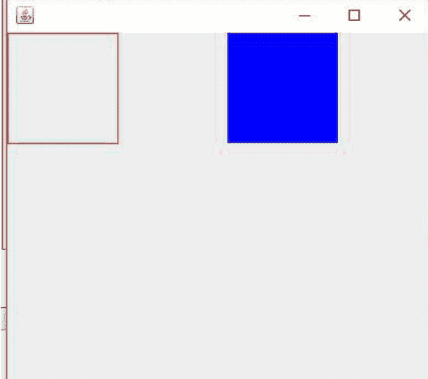

`Graphics` 类的大多数方法分为两个基本组：

1. 绘制和填充方法，允许你渲染基本形状，
2. 属性方法，影响绘制的发生方式

示例：

```java
import javax.swing.*;
import java.awt.*;

public class MyPanel extends JPanel {
    @Override
    public void paintComponent(Graphics g) {
        // 清除之前的绘画
        super.paintComponent(g);
        // 将 Graphics 转换为 Graphics2D
        Graphics2D g2 = (Graphics2D) g;
        g2.setColor(Color.red);
        // 绘制矩形
        g2.drawRect(0, 0, 100, 100);
        // 填充新矩形
        g2.fillRect(200, 0, 100, 100);
    }
}
```

```java
import javax.swing.*;
import java.awt.*;

public class Test {
    JFrame f;
    MyPanel p;
    public Test() {
        f = new JFrame();
        // 获取内容区域
        Container c = f.getContentPane();
        c.setLayout(new BorderLayout());
        p = new MyPanel();
        // 将 MyPanel 添加到容器
        c.add(p);
        // 设置 JFrame 的大小
        f.setSize(480, 400);
        // 使 JFrame 可视
        f.setVisible(true);
        // 设置关闭行为
        f.setDefaultCloseOperation(JFrame.EXIT_ON_CLOSE);
    }

    public static void main(String args[]) {
        Test t = new Test();
    }
}
```

关于 Border Layout 的更多解释：https://docs.oracle.com/java/tutorial/layout/border.html

### paintComponent()

- 它是绘制的主方法
- 默认情况下绘制背景
- 之后执行自定义绘制（绘制圆形、矩形）

### Graphics2D 类

**注意**：Java 2D API 允许你执行以下任务：

- 绘制线条、矩形和任何几何形状。
- 使用纯色、渐变和纹理填充形状。
- 绘制文本，并对字体和渲染过程进行精细控制。
- 绘制图像，可选应用过滤操作。
- 在上述任何渲染操作期间应用组合和变换。

## 第 90.2 节：示例 2：绘制和填充椭圆

```java
import javax.swing.*;
import java.awt.*;

public class MyPanel extends JPanel {
    @Override
    public void paintComponent(Graphics g) {
        // 清除之前的绘画
        super.paintComponent(g);
        Graphics2D g2 = (Graphics2D) g;
        g2.setColor(Color.blue);
        g2.drawOval(0, 0, 20, 20);
        g2.fillOval(50, 50, 20, 20);
    }
}
```

# 第 91 章：JAXB

| 参数 | 详情 |
| :--- | :--- |
| `fileObjXML` | XML 文件的对象 |
| `className` | `.class` 扩展名的类名 |

JAXB 或 Java XML 绑定架构 (`Java Architecture for XML Binding`) 是一种软件框架，允许 Java 开发者将类映射到 XML 表示。本页将通过详细示例向读者介绍 JAXB，介绍其提供的将 JAXB 对象在 XML 格式之间序列化和反序列化（反相反）的功能。

## 第 91.1 节：读取 XML 文件（反序列化）

要读取包含主体内容的 `User.xml` xml 文件：

我们需要一个名为 `User.java` 的 POJO 类，如下所示：

```java
import javax.xml.bind.annotation.XmlRootElement;

@XmlRootElement
public class User {

    private long userId;
    private String name;

    // getters and setters
}
```

在这里，我们根据 XML 节点创建了变量和类名。为了映射它们，我们在类上使用了 `@XmlRootElement` 注解。

```java
public class XMLReader {
    public static void main(String[] args) {
        try {
            User user = JAXB.unmarshal(new File("UserDetails.xml"), User.class);
            System.out.println(user.getName()); // 输出 Jon Skeet
            System.out.println(user.getUserId()); // 输出 884321
        } catch (Exception e) {
            System.err.println("读取 XML 时发生异常!");
        }
    }
}
```

`unmarshal()` 用于解析 xml 文件。它接收 xml 文件和类类型作为参数。可以使用对象的 getter 方法生成数据。

## 第 91.2 节：写入 XML 文件（对象序列化）

```java
import javax.xml.bind.annotation.XmlRootElement;

@XmlRootElement
public class User {
    private long userId;
    private String name;

    // getters and setters
}
```

通过使用 `@XmlElement` 注解，我们可以将类标记为 XML 文件的根元素。

```java
import java.io.File;
import javax.xml.bind.JAXB;

public class XMLCreator {
    public static void main(String[] args) {
        User user = new User();
        user.setName("Jon Skeet");
        user.setUserId(88421);

        try {
            JAXB.marshal(user, new File("UserDetails.xml"));
        } catch (Exception e) {
            System.err.println("写入 XML 时发生异常!");
        } finally {
            System.out.println("XML 已创建");
        }
    }
}
```

`marshal()` 用于将对象写入 XML 文件。对象和新的 `File` 对象传递给 `marshal()`。

执行成功后，会在类路径创建一个内容如下的 `UserDetails.xml` XML 文件：

```xml
<?xml version="1.0" encoding="UTF-8"?>
<user>
  <name>Jon Skeet</name>
  <userId>88421</userId>
</user>
```

## 第 91.3 节：手动字段/属性映射

`javax.xml.bind.annotation` 中的 `@XmlElement`、`@XmlAttribute` 和 `@XmlTransient` 允许程序员指定哪些标记字段或属性应该被序列化。


```java
@XmlAccessorType(XmlAccessType.NONE) // 无自动字段/属性序列化
public class ManualXmlElement {

    @XmlElement
    private String field="field value";

    @XmlAttribute
    private String attribute="attr value";

    @XmlAttribute(name="differentAttribute")
    private String oneAttribute="other attr value";

    @XmlElement(name="different name")
    private String oneName="different name value";

    @XmlTransient
    private String transientField = "will not serialized ever";

    @XmlElement
    public String getModifiedValue() {
      return transientField.replace("ever", "");
    }

    public void setTransientField(String val) {} // 故意留空

    public static void main(String[] args) {
      try {
        JAXB.marshal(new ManualXmlElement(), System.out);
      } catch (Exception e) {
        System.err.println("写入 XML 时发生异常!");
      }
    }
}
```

## 第 91.4 节：将 XML 命名空间绑定到可序列化 Java 类

这是一个 `package-info.java` 文件的示例，它将 XML 命名空间绑定到可序列化的 Java 类。这应该与使用该命名空间序列化的 Java 类放在同一个包中。

```java
/**
 * 包含可序列化类的包。
 */
@XmlSchema(
  xmlns = {
    @XmlNs(prefix = MySerializableClass.NAMESPACE_PREFIX, namespaceURI = MySerializableClass.NAMESPACE)
  },
  namespace = MySerializableClass.NAMESPACE,
  elementFormDefault = XmlNsForm.QUALIFIED
)
package com.test.jaxb;

import javax.xml.bind.annotation.XmlNs;
import javax.xml.bind.annotation.XmlNsForm;
import javax.xml.bind.annotation.XmlSchema;
```

## 第 91.5 节：使用 XmlAdapter 生成指定的 XML 格式

当所需的 XML 格式与 Java 对象模型不同时，可以使用 `XmlAdapter` 实现将模型对象转换为 XML 格式对象，反之亦然。此示例演示了如何将字段值放入字段属性中。

```java
public class XmlAdapterExample {

    @XmlAccessorType(XmlAccessorType.FIELD)
    public static class NodeValueElement {

        @XmlAttribute(name="attrValue")
        String value;

        public NodeValueElement() {
        }

        public NodeValueElement(String value) {
            super();
            this.value = value;
        }

        public String getValue() {
            return value;
        }

        public void setValue(String value) {
            this.value = value;
        }
    }

    public static class ValueAttrXmlAdapter extends XmlAdapter<NodeValueElement, String> {

        @Override
        public NodeValueElement marshal(String v) throws Exception {
            return new NodeValueElement(v);
        }

        @Override
        public String unmarshal(NodeValueElement v) throws Exception {
            if (v==null) return "";
            return v.getValue();
        }
    }

    @XmlRootElement(name="DataObject")
    @XmlAccessorType(XmlAccessorType.FIELD)
    public static class DataObject {

        @XmlJavaTypeAdapter(ValueAttrXmlAdapter.class)
        String elementWithValue;

        @XmlAttribute
        String elementWithAttribute;
    }
}
```

```java
@XmlAccessorType(XmlAccessorType.PROPERTY)
static class AccessorExampleProperty {

    public String fields="value1";

    public String getter() {
        return "getter";
    }

    public void setState(String value) {}
}

@XmlAccessorType(XmlAccessorType.PUBLIC_MEMBER)
static class AccessorExamplePublic {

    public String fields="value1";

    public String getter() {
        return "getter";
    }

    public void setState(String value) {}
}

public static void main(String[] args) {
    try {
        System.out.println("\nField:");
        JAXB.marshal(new AccessorExampleField(), System.out);

        System.out.println("\nNone:");
        JAXB.marshal(new AccessorExampleNone(), System.out);

        System.out.println("\nProperty:");
        JAXB.marshal(new AccessorExampleProperty(), System.out);

        System.out.println("\nPublic:");
        JAXB.marshal(new AccessorExamplePublic(), System.out);
    } catch (Exception e) {
        System.err.println("Exception occurred while writing in XML!");
    }
} // 类结束
```

# 输出

```
Field:
<?xml version="1.0" encoding="UTF-8" standalone="yes"?>
value1
```

```
None:
<?xml version="1.0" encoding="UTF-8" standalone="yes"?>
```

```
Property:
<?xml version="1.0" encoding="UTF-8" standalone="yes"?>
getter
```

```
Public:
<?xml version="1.0" encoding="UTF-8" standalone="yes"?>
value1
```

## 第 91.8 节：指定 XmlAdapter 实例以（重）复用现有数据

有时应该使用特定的数据实例。不希望重新创建对象，而引用静态数据会产生代码异味。

可以指定 `Unmarshaller` 使用的 `XmlAdapter` 实例，这允许用户使用没有无参构造函数的 `XmlAdapters` 和/或向适配器传递数据。

### 示例

#### 用户类

以下 `java.awt.image.BufferedImage` 类包含一个名称和用户的图像。

```java
import java.awt.image.BufferedImage;
import javax.xml.bind.annotation.XmlAttribute;
import javax.xml.bind.annotation.XmlRootElement;
import javax.xml.bind.annotation.adapters.XmlJavaTypeAdapter;

@XmlRootElement
public class User {

    private String name;
    private BufferedImage image;

    @XmlAttribute
    public String getName() {
        return name;
    }

    public void setName(String name) {
        this.name = name;
    }

    @XmlJavaTypeAdapter(value=ImageCacheAdapter.class)
    @XmlAttribute
    public BufferedImage getImage() {
        return image;
    }

    public void setImage(BufferedImage image) {
        this.image = image;
    }

    public User(String name, BufferedImage image) {
        this.name = name;
        this.image = image;
    }

    public User() {
        this("", null);
    }
}
```

#### 适配器

为了避免在内存中两次创建相同的图像（以及再次下载数据），适配器在 map 中存储图像。

**Version ≤ Java 7**

对于有效的 Java 7 代码，将 `getImage` 方法替换为：

```java
public BufferedImage getImage(URL url) {
    BufferedImage image = imageCache.get(url);
    if (image == null) {
        try {
            image = ImageIO.read(url);
        } catch (IOException ex) {
            Logger.getLogger(ImageCacheAdapter.class.getName()).log(Level.SEVERE, null, ex);
            return null;
        }
        imageCache.put(url, image);
        reverseIndex.put(url, image);
    }
    return image;
}
```

```java
import java.awt.image.BufferedImage;
import java.io.IOException;
import java.net.URL;
import java.util.HashMap;
import java.util.Map;
import java.util.logging.Level;
import java.util.logging.Logger;
import javax.imageio.ImageIO;
import javax.xml.bind.annotation.adapters.XmlAdapter;
```

```java
public class ImageCacheAdapter extends XmlAdapter<String, BufferedImage> {
    private final Map<URL, BufferedImage> imageCache = new HashMap<>();
    private final Map<String, Integer> reverseIndex = new HashMap<>();

    public BufferedImage getImage(URL url) {
        // 使用 Java 8 方法进行单查找
        return imageCache.computeIfAbsent(url, s -> {
            try {
                BufferedImage img = ImageIO.read(s);
                reverseIndex.put(s, img);
                return img;
            } catch (IOException ex) {
                Logger.getLogger(ImageCacheAdapter.class.getName()).log(Level.SEVERE, null, ex);
                return null;
            }
        });
    }

    @Override
    public BufferedImage unmarshal(String v) throws Exception {
        return getImage(new URL(v));
    }

    @Override
    public String marshal(BufferedImage v) throws Exception {
        return reverseIndex.get(v).toExternalForm();
    }
}
```

#### 示例 XML

这些 XML 文件分别用于 Jon Skeet 及其他在 Earth 2 的对应版本，它们看起来完全相同，因此使用同一个适配器。

```xml
<?xml version="1.0" encoding="UTF-8"?>
<user name="Jon Skeet"
image="https://www.gravatar.com/avatar/68ebb117e8d8d74ae95fbdd0f8e713?s=328&amp;d=identity&amp;r=PG />
```

```xml
<?xml version="1.0" encoding="UTF-8"?>
<user name="Jon Skeet (Earth 2)"
image="https://www.gravatar.com/avatar/68ebb117e8d8d74ae95fbdd0f8e713?s=328&amp;d=identity&amp;r=PG/>
```

#### 使用适配器

```java
ImageCacheAdapter adapter = new ImageCacheAdapter();

JAXBContext context = JAXBContext.newInstance(User.class);
Unmarshaller unmarshaller = context.createUnmarshaller();
unmarshaller.setAdapter(ImageCacheAdapter.class, adapter);

Marshaller marshaller = context.createMarshaller();
marshaller.setProperty(Marshaller.JAXB_FORMATTED_OUTPUT, Boolean.TRUE);

User user = (User) unmarshaller.unmarshal(new File("user.xml"));
marshaller.marshal(user, System.out);
```

我们已经完成了 socket，调用 `socket.close()` 来正确地关闭它。


## Socket 处理 I/O（输入/输出）操作

Socket 处理 I/O（输入/输出）操作，这些操作依赖于多种外部因素。例如，如果对方断开了连接怎么办？如果出现网络错误怎么办？这些都是我们无法控制的。这就是为什么许多 socket 操作可能会抛出异常，尤其是 `IOException`。

客户端更复杂的代码如下：

```java
// try-with-resources 将在我们离开其作用域后关闭 socket
try (Socket socket = new Socket("127.0.0.1", 1234)) {
    OutputStream outStream = socket.getOutputStream();
    PrintWriter writer = new PrintWriter(outStream, StandardCharsets.UTF_8);
    writer.println("Hello world!");
    writer.flush();
} catch (IOException e) {
    //处理错误
}
```

# 基础服务器与客户端 - 完整示例

## 服务端

```java
import java.io.BufferedReader;
import java.io.IOException;
import java.io.InputStream;
import java.io.InputStreamReader;
import java.net.ServerSocket;
import java.nio.charset.StandardCharsets;
```

```java
public class Server {
    public static void main(String[] args) {
        try (ServerSocket socket = new ServerSocket(1234)) {
            while (true) {
                // 等待客户端连接。
                Socket clientSocket = socket.accept();

                // 创建并启动一个线程处理新客户端
                new Thread(() -> {
                    try {
                        // 获取 socket 的 InputStream，用于从 socket
                        // 读取字节
                        InputStream in = clientSocket.getInputStream();
                        // 将 InputStream 包装在 reader 中，这样你就可以
                        // 读取字符串而不是字节
                        BufferedReader reader = new BufferedReader(in, StandardCharsets.UTF_8);
                        // 从流中读取并逐行打印
                        String line;
                        while ((line = reader.readLine()) != null) {
                            System.out.println(line);
                        }
                    } catch (IOException e) {
                        e.printStackTrace();
                    }
                    finally {
                        // 这个 finally 块确保 socket 被关闭。
                        // 不能使用 try-with-resources 块，因为
                        // socket 被传递到了线程，所以它不是在
                        // 同一个块中创建和关闭的
                        try {
                            clientSocket.close();
                        } catch (IOException e) {
                            e.printStackTrace();
                        }
                    }
                }).start();
            }
        } catch (IOException e) {
            e.printStackTrace();
        }
    }
}
```

## 客户端

```java
import java.io.IOException;
import java.io.OutputStream;
import java.io.OutputStreamWriter;
import java.net.PrintWriter;
import java.net.Socket;
import java.nio.charset.StandardCharsets;
```

```java
public class Client {
    public static void main(String[] args) {
        try (Socket socket = new Socket("127.0.0.1", 12334)) {
            // 我们现在连接到服务器

            // 向 socket 写入字符串并刷新缓冲区
            OutputStream outStream = socket.getOutputStream();
            PrintWriter writer = new PrintWriter(
                new OutputStreamWriter(outStream, StandardCharsets.UTF_8));
            writer.println("Hello world!");
            writer.flush();
        } catch (IOException e) {
            // 异常应该被处理。
            e.printStackTrace();
        }
    }
}
```

# 第 93.2 节：使用 UDP (数据报) 进行基础客户端/服务器通信

## Client.java

```java
import java.io.*;
import java.net.*;

public class Client {
    public static void main(String[] args) throws IOException {
        DatagramSocket clientSocket = new DatagramSocket();
        InetAddress address = InetAddress.getByName(args[0]);

        String ex = "Hello, World!";
        byte[] buf = ex.getBytes();
        DatagramPacket packet = new DatagramPacket(buf, buf.length, address, 4160);
        clientSocket.send(packet);
    }
}
```

在这种情况下，我们通过参数 `args[0]` 传递服务器的地址。我们使用的端口是 4160。

## Server.java

```java
import java.io.*;
import java.net.*;

public class Server {
    public static void main(String[] args) throws Exception {
        DatagramSocket serverSocket = new DatagramSocket(4160);

        byte[] rbuf = new byte[256];
        DatagramPacket packet = new DatagramPacket(rbuf, rbuf.length);
        serverSocket.receive(packet);
        String response = new String(packet.getData());
        System.out.println("Response: " + response);
    }
}
```

在服务端，在我们发送消息的端口 (4160) 上声明一个 `DatagramSocket` 并等待响应。

# 第 93.3 节：从 InputStream 加载 TrustStore 和 KeyStore

```java
public class TrustLoader {
    public static void main(String[] args) {
        try {
            // 获取 ssl/rpg 下 trust 文件的输入流
            InputStream stream = TrustLoader.class.getResourceAsStream("/ssl/rpg.jks");
            // truststore 的密码
            char[] password = "password".toCharArray();
            // 加载 truststore
            KeyStore truststore = KeyStore.getInstance(KeyStore.getDefaultType());
            truststore.load(stream, password);
            // 获取 SSLContext
            TrustManagerFactory factory = TrustManagerFactory.getInstance(TrustManagerFactory.getDefaultAlgorithm());
            factory.init(truststore);
            // 设置我们新的 SSLContext
            SSLContext context = SSLContext.getInstance("SSL");
            // TrustManagers 持有
            TrustManager[] managers = factory.getTrustManagers();
            // 传递给
            context.init(null, managers, null);
            SSLContext.setDefault(context);
        } catch (KeyStoreException | IOException | NoSuchAlgorithmException | CertificateException | KeyManagementException ex) {
            // 处理错误
            ex.printStackTrace();
        }
    }
}
```

初始化 `KeyStore` 的方法相同，只需替换 Key 中的任何单词即可。此外，`KeyManager[]` 数组必须传递给 `SSLContext.init`。

# 第 93.4 节：Socket 示例 - 使用简单 socket 读取网页

```java
import java.io.*;
import java.net.Socket;

public class Main {
    public static void main(String[] args) throws IOException { // 在此示例中不处理异常
        // 打开到 stackoverflow.com 的 socket，端口 80
        Socket socket = new Socket("stackoverflow.com", 80);

        // 在发送请求前准备输入、输出流
        OutputStream outStream = socket.getOutputStream();
        InputStream inStream = socket.getInputStream();
        BufferedReader reader = new BufferedReader(new InputStreamReader(inStream));
        PrintWriter writer = new PrintWriter(new BufferedOutputStream(outStream));

        // 发送基础 HTTP 头部
        writer.println("GET / HTTP/1.1\nHost:stackoverflow.com\n\n");
        writer.flush();

        // 读取响应
        System.out.println(readFully(reader));
        socket.close();
    }

    private static String readFully(Reader reader) {
        StringBuilder sb = new StringBuilder();
        int BUFFER_SIZE = 1024;
        char[] buffer = new char[BUFFER_SIZE];
        int charsRead = 0;
        while ((charsRead = reader.read(buffer, 0, BUFFER_SIZE)) != -1) {
            sb.append(buffer, charsRead);
        }
        return sb.toString();
    }
}
```

你将得到一个带有 `HTTP/1.1 200 OK` 的响应，这表示正常的 HTTP 响应，随后是剩余的 HTTP 头部，然后是 HTML 格式的原始页面。

注意 `readFully()` 方法很重要，它可以防止过早出现 EOF 异常。网页的最后一行可能缺少一个换行符来表示行结束，导致 `readLine()` 会报错，因此必须手动读取。

### 使用 Apache commons-io 中的 IUtils 工具方法

此示例是关于如何使用 socket 连接到现有资源的简单演示，它并不是访问网页的实用方法。如果你需要使用 Java 访问网页，最好使用现有的 HTTP 客户端库，例如 Apache 的 HTTP Client 或 Google 的 HTTP Client。

## 第 93.5 节：临时禁用 SSL 验证（用于测试目的）

在某些开发或测试环境中，SSL 证书链可能尚未完全建立。

为了继续开发和测试，你可以通过安装一个“信任所有”的管理器以程序方式关闭 SSL 验证：


```java
// 创建一个不校验证书链的管理器
TrustManager[] trustCerts = new TrustManager[] {
    new X509TrustManager() {
        public X509Certificate[] getAcceptedIssuers() {
            return null;
        }

        public void checkClientTrusted(X509Certificate[] certs, String authType) {
        }

        public void checkServerTrusted(X509Certificate[] certs, String authType) {
        }
    }
};

// 安装信任所有的管理器
SSLContext sc = SSLContext.getInstance("SSL");
sc.init(null, trustCerts, new java.security.SecureRandom());
HttpsURLConnection.setDefaultSocketFactory(sc.getSocketFactory());

// 创建信任所有的主机名验证器
HostnameVerifier allHostsValid = new HostnameVerifier() {
    public boolean verify(String hostname, SSLSession session) {
        return true;
    }
};

// 安装信任所有的主机验证器
HttpsURLConnection.setDefaultHostnameVerifier(allHostsValid);
} catch (NoSuchAlgorithmException | KeyManagementException e) {
    e.printStackTrace();
}
```

## 第 93.6 节：使用 Channel 下载文件

如果文件已存在，它将被覆盖：

```java
String fileName = "file.zip"; // 文件名
String urlIGetFrom = "http://www.mywebsite.com/"; // 获取该文件的 URL
String pathToSaveTo = "C:\\Users\\user\\"; // 存放位置

// 如果文件已存在，它将被覆盖！
// 打开指向目标文件的输出流
```

```java
try (ReadableByteChannel rbc = Channels.newChannel(new URL(urlToFileName+fileName).openStream())) {
    try {
        FileChannel channel = new FileOutputStream(pathToSaveTo+fileName).getChannel();
        channel.transferFrom(rbc, 0, Long.MAX_VALUE);
    } catch (FileNotFoundException e) { /* 未找到输出目录 */ }
    catch (IOException e) { /* 文件 IO 错误 */ }
} catch (MalformedURLEception e) { /* URL 格式错误 */ }
} catch (IOException e) { /* 连接网站时的 IO 错误 */ }
}
```

## 注意事项

- 不要留下空的 `catch` 块！
- 如果发生错误，请检查远程文件是否存在
- 这是一个阻塞操作，处理大文件时可能耗长时间

## 第 93.7 节：组播 (Multicasting)

组播是数据报套字（`Datagram Socket`）的一种。与普通数据报不同，组播不会单独处理每个客户端，而是将其发送给一个 IP 地址，所有订阅的客户端都会收到消息。

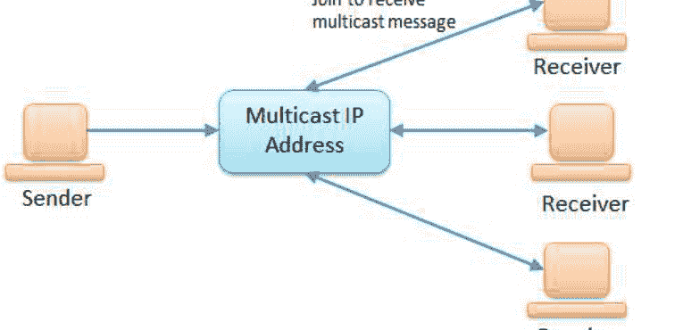

服务器端的示例代码：

```java
public class Server {
    private DatagramSocket serverSocket;
    private String ip;
    private int port;

    public Server(String ip, int port) throws SocketException, IOException {
        this.ip = ip;
        this.port = port;
        // 用于发送的 socket
        serverSocket = new DatagramSocket();
    }
    public void send() throws IOException {
        // 构造数据报包
        byte[] message = ("Multicasting...").getBytes();
        DatagramPacket packet = new DatagramPacket(message, message.length,
            InetAddress.getByName(ip), port);
        // 发送包
        serverSocket.send(packet);
    }

    public void close() {
        serverSocket.close();
    }
}
```

客户端的示例代码：

```java
public class Client {
    private MulticastSocket socket;
    public Client(String ip, int port) throws IOException {
        // 重要的是这是一个组播 socket
        socket = new MulticastSocket(port);
        // 通过 ip 加入
        socket.join(InetAddress.getByName(ip));
    }

    public void printMessage() throws IOException {
        // 构造数据报包
        byte[] message = new byte[256];
        DatagramPacket packet = new DatagramPacket(message, message.length);
        // 接收包
        socket.receive(packet);
        System.out.println(new String(packet.getData()));
    }

    public void close() {
        socket.close();
    }
}
```

服务器的代码：

```java
public static void main(String[] args) {
    try {
        final String ip = args[0];
        final int port = Integer.parseInt(args[1]);
        Server server = new Server(ip, port);
        server.send();
        server.close();
    } catch (IOException ex) {
        ex.printStackTrace();
    }
}
```

客户端的代码：

```java
public static void main(String[] args) {
    try {
        final String ip = args[0];
        final int port = Integer.parseInt(args[1]);
        Client client = new Client(ip, port);
        client.printMessage();
        client.close();
    } catch (IOException ex) {
        ex.printStackTrace();
    }
}
```

# 第 94 章：NIO - 网络

### 94.1 节：使用 Selector

NIO 出现在 Java 1.4 中，并引入了比 socket 更快的 `Channel` 的概念。具体来说，`Selector` 允许在单线程中监控不同类型的事件。这使得应用程序能够扩展到许多连接。

以下示例展示了基础用法：

```java
Selector sel = Selector.open();
SocketChannel sc = SocketChannel.open();
sc.configureBlocking(false);
sc.setOption(StandardOptions.SO_KEEPALIVE, true);
// 注册 Channel 等 CONNECT
SelectionKey key = sc.register(sel, SelectionKey.OP_CONNECT);
System.out.println("正在启动连接");
if (sc.connect(new InetSocketAddress("www.google.com", 80))) {
    System.out.println("已连接");
} else {
    boolean exit = false;
    while (!exit) {
        if (sel.select(100) == 0) { // 在期间没有发生任何事
            continue;
        }
        // 发生了某些事
        SelectionKey[] keys = sel.selectedKeys();
        for (SelectionKey k : keys) {
            System.out.println("检查 " + k.channel());
            if (k.isConnectable()) {
                System.out.println("已连接"); // 完成连接过程
                exit = true;
            }
        }
        sel.selectedKeys().clear();
        k.interestOps(OP_CONNECT); // 我们已经
        连接：移除对 CONNECT 事件的感兴趣
    }
}
```

# 第 95 章：HttpURLConnection

### 第 95.1 节：从 URL 获取响应体作为 String

```java
String getText(String url) throws IOException {
    HttpURLConnection connection = (HttpURLConnection) new URL(url).openConnection();
    // 向连接添加请求头，或检查状态码是否..
    // 处理可能发生的错误响应码
    int responseCode = connection.getResponseCode();
    InputStream inputStream;
    if (200 <= responseCode && responseCode <= 299) {
        inputStream = connection.getInputStream();
    } else {
        inputStream = connection.getErrorStream();
    }

    BufferedReader reader = new BufferedReader(
        new InputStreamReader(inputStream));

    StringBuilder response = new StringBuilder();
    String currentLine;
    while ((currentLine = reader.readLine()) != null) {
        response.append(currentLine);
    }

    reader.close();

    return response.toString();
}
```

这将会从指定的 URL 下载文本数据，并将其作为 `String` 返回。

工作原理如下：

- 首先，我们通过 `new URL(url).openConnection()` 从 URL 创建一个 `HttpConnection`。我们将此连接强制转换为 `HttpUrlConnection`，以便我们可以访问如添加请求头（如 User Agent）或检查响应码等操作。（此示例未实现这些，但很容易添加）
- 然后，根据响应码（用于错误处理）创建 `InputStream`。
- 接着，我们创建一个 `BufferedReader`，允许我们从从连接获取的 `InputStream` 中读取文本。
- 现在，我们逐行将文本追加到 `StringBuilder` 中。
- 关闭 `InputStream` 并返回我们现在获得的 `String`。

注意：

- 该方法在失败时（例如网络错误或无 Internet 连接）将抛出 `IOException`，如果给定的 URL 无效，它还会抛出一个未检查的 `MalformedURLException`。
- 它可以读取任何返回文本的 URL，例如网页（HTML）、返回 JSON 或 XML 的 REST API 等。
- 另请参考：用几行 Java 代码将 URL 转换为 String。

这将删除指定 URL 中的资源，然后打印响应头。

### 工作原理

- 我们从 URL 获取 `HttpConnection`。
- 使用 `setProperty` 设置内容类型，默认是 `application/x-www-form-urlencoded`。
- `setInput(true)` 告诉连接我们打算将此 URL 连接用于输入。
- 使用 `setRequestMethod("DELETE")` 执行 HTTP DELETE。

最后我们打印响应头。

### 第 95.4 节：检查资源是否存在

```java
/**
 * 通过发送 HEAD-请求来检查资源是否存在。
 * @param url 必须检查的资源 URL。
 * @return 如果响应码为 200 则返回 true。
 */
```

```java
public static final boolean checkResourceExists(URL url) throws IOException {
    HttpConnection conn = (HttpConnection) url.openConnection();
    conn.setRequestMethod("HEAD");
    int code = conn.getResponseCode();
    conn.disconnect();
    return code == 200;
}
```

解释：

如果你正在检查资源是否存在，使用 `HEAD` 请求比使用 `GET` 请求更好。这避免了传输资源的开销。

请注意，该方法仅在响应码为 200 时才返回 `true`。如果你预期的重定向（即 3XX）响应，则该方法可能需要增强以遵循这些重定向。

```java
checkIfResourceExists(new URL("http://images.google.com/")); // true
checkIfResourceExists(new URL("http://pictures.google.com/")); // false
```

# 第 96 章：JAX-WS

### 第 96.1 节：基础认证

使用基础认证进行 JAX-WS 用的方法并不直观。

这里是一个示例，其中 `Service` 是服务类的表示，`Port` 是你想要访问的服务端口。

```java
Service s = new Service();
Port port = s.getPort();

BindingProvider prov = (BindingProvider)port;
prov.getRequestContext().put(BindingProvider.USERNAME_PROPERTY, "username");
prov.getRequestContext().put(BindingProvider.PASSWORD_PROPERTY, "password");

port.call();
```

## 第 97 章：Nashorn JavaScript 引擎


Nashorn 是 Oracle 用 Java 开发的一种 JavaScript 引擎，并已随 Java 8 一起发布。Nashorn 允许通过 JSC-223 在 Java 应用中嵌入 JavaScript，并允许开发独立的 JavaScript 应用，它提供了更好的运行时和对 ECMA 规范化 JavaScript 规范的更好兼容性。

## 第 97.1 节：执行 JavaScript 文件

```java
// 必要的导入
import javax.script.ScriptEngineManager;
import javax.script.ScriptEngine;
import javax.script.ScriptException;
import java.io.FileReader;
import java.io.FileNotFoundException;

// 获取 JavaScript 引擎实例
ScriptEngineManager manager = new ScriptEngineManager();
ScriptEngine engine = manager.getByName("nashorn");

// 从文件 'demo.js' 加载并执行脚本
try {
  engine.eval(new FileReader("demo.js"));
} catch (FileNotFoundException ex) {
  ex.printStackTrace();
} catch (ScriptException ex) {
  // 这是 Scripting API 的通用异常类
  ex.printStackTrace();
}
```

```javascript
// 结果：
// 标准输出打印出 'Script from file!'
```

demo.js:

```javascript
print('Script from file!');
```

## 第 97.2 节：拦截脚本输出

```java
// 获取 JavaScript 引擎实例
ScriptEngineManager manager = new ScriptEngineManager();
ScriptEngine engine = manager.getByName("nashorn");

// 获取一个 writer
StringWriter writer = new StringWriter();
// 修改引擎的上下文
engine.getContext().setWriter(writer);

// 执行脚本
try {
  engine.eval("print('Redirected text!');");
} catch (ScriptException ex) {
  ex.printStackTrace();
}
```

```javascript
// 结果：
// 标准输出打印出 'Script from file!'
```

```java
// writer() 包含了 'Redirected text!'
```

## 第 97.3 节：Nashorn

```java
// 获取 JavaScript 引擎实例
ScriptEngineManager manager = new ScriptEngineManager();
ScriptEngine engine = manager.getByName("nashorn");

// 设置一个 writer
try {
  engine.eval("print('Nashorn');");
} catch (ScriptException ex) {
  // 这是 Scripting API 的通用异常类
  ex.printStackTrace();
}
```

```javascript
// 结果：
// 标准输出打印出 'Script from file!'
```

## 第 97.4 节：Evaluate

```java
// 获取 JavaScript 引擎实例
ScriptEngineManager manager = new ScriptEngineManager();
ScriptEngine engine = manager.getByName("nashorn");

// 执行脚本
try {
  engine.eval("print('Nashorn');");
} catch (ScriptException ex) {
  // 这是 Scripting API 的通用异常类
  ex.printStackTrace();
}
```

```javascript
// 结果：
// 标准输出打印出 'Script from file!'
```

## 第 97.5 节：Set global variables

```java
// 获取 JavaScript 引擎实例
ScriptEngineManager manager = new ScriptEngineManager();
ScriptEngine engine = manager.getByName("nashorn");

// 执行脚本
try {
  engine.eval("print('Nashorn');");
} catch (ScriptException ex) {
  // 这是 Scripting API 的通用异常类
  ex.printStackTrace();
}
```

```javascript
// 结果：
// 标准输出打印出 'Script from file!'
```

## 第 97.6 节：Set and get global variables

```java
// 获取 JavaScript 引擎实例
ScriptEngineManager manager = new ScriptEngineManager();
ScriptEngine engine = manager.getByName("nashorn");

try {
  // 在引擎的全局空间设置值
  engine.put("name", "Nashorn");
  // 执行脚本
  engine.eval("var value='Hello '+name+'!');");
  // 获取值
  String value = (String) engine.get("value");
  System.out.println(value);
} catch (ScriptException e) {
  // 这是 Scripting API 的通用异常类
  e.printStackTrace();
}
```

## 第 97.7 节：Usage of Java objects in JavaScript in Nashorn

可以将对象传递给 Nashorn 在 JavaScript 代码中处理。同时，有一些 JavaScript（Nashorn）特有的构造，并不总是如何处理 Java 对象。

下面的表格描述了 JavaScript 内部原生对象的行为。

测试的构造：

1.  `if` 中的表达式。在 JS 中，表达式不像 Java 那样必须是布尔值。对于所谓的假值（`null`、`undefined`、`0`、空字符串等），它会被求值为 `false`。
2.  `for each` 语句。Nashorn 有一种特殊的循环 - `for each`，它可以遍历不同的 JS 和 Java 对象。
3.  获取大小。JS 对象有一个 `length` 属性，返回数组或字符串的大小。

结果：

| 类型 | If | for each | .length |
|---|---|---|---|
| Java `null` | `false` | 无迭代 | |
| Java 空字符串 | `false` | 无迭代 | `0` |
| Java `string` | `true` | 遍历字符 | 字符串长度 |
| Java `Integer`/`Long` value | `!=` | 无迭代 | `undefined` |
| Java `List` | `true` | 遍历元素 | 列表长度 |
| Java `HashMap` | `true` | 遍历值 | `null` |
| Java `HashSet` | `true` | 遍历项目 | `undefined` |

建议：

*   建议使用 `if (some_string)` 来检查字符串是否不为空且为空。
*   `for each` 可以遍历任何集合，如果集合不是 `null` 或 `undefined`，则不会抛出异常。
*   在获取对象的长度之前，必须检查它是否为 `null` 或 `undefined`（任何调用 Java 对象的方法或获取属性的操作也是如此）。

## 第 97.8 节：从脚本实现接口

```java
import java.io.FileReader;
import java.io.IOException;

import javax.script.ScriptEngine;
import javax.script.ScriptEngineManager;
import javax.script.ScriptException;
```

```java
public static class InterfaceImplementationExample {
    public static interface Pet {
        public void eat();
    }
}
```

```java
public static void main(String[] args) throws IOException {
    // 获取 JavaScript 引擎实例
    ScriptEngineManager manager = new ScriptEngineManager();
    ScriptEngine engine = manager.getEngineByName("nashorn");

    try {
        // 评估脚本
        /* pet.js */
        /*
        var Pet = Java.type("InterfaceImplementationExample.Pet");

        new Pet() {
            eat: function() { print("eat"); };
        }
        */

        Pet pet = (Pet) engine.eval(new FileReader("pet.js"));

        pet.eat();
    } catch (ScriptException ex) {
        ex.printStackTrace();
    }

    // 结果：
    // 标准输出打印了 'eat'
}
```

# 第 98 章：Java Native 接口 (JNI)

| 参数 | 详情 |
|---|---|
| `JNIEnv` | 指向 JNI 环境的指针 |
| `object` | 调用非静态方法的对象 |
| `jclass` | 调用静态方法的类 |

## 第 98.1 节：从 Java 调用 C++ 方法

Java 中的静态方法可以标记为 `native`，以表示其实现在位于一个共享库文件中。在执行原生方法时，JVM 会在加载的库中（参见加载原生库）使用简单的名称修饰方案查找对应的函数，进行参数转换和堆栈设置，然后将控制权交给原生代码。

### Java 代码

```java
/** com/example/jni/JNIJava.java ***
package com.example.jni;
public class JNIJava {
    static {
        System.loadLibrary("JNI_CPP");
    }
    // 显然，native 方法在 Java 中可能没有定义体
    public native void print(String name);
    public static native double average(int[] nums);

    public static void main(String[] args) {
        JNIJava jnijava = new JNIJava();
        jnijava.print("Invoked C++ 'printString' from Java");
        double d = average(new int[]{1, 2, 3, 4, 7});
        System.out.println("Got result from C++ 'average': " + d);
    }
}
```

### C++ 代码

包含原生函数声明的头文件应该使用 `javah` 工具在目标类上生成。

在构建目录下运行命令：

```bash
javah -o com_example_jni_JNIJava.hpp com.example.jni.JNIJava
```

... 生成了头文件（为了简洁已删除了注释）：

```cpp
JEXPORT void JNICALL Java_com_example_jni_JNIJava_printString
(JNIEnv *env, jobject object, jstring jstring);
```

```cpp
JEXPORT jdouble JNICALL Java_com_example_jni_JNIJava_average
(JNIEnv *env, jclass jclass, jintArray intArray);
```

```cpp
#ifdef __cplusplus
#endif
#endif
```

这里是一个实现示例：

```cpp
// com_example_jni_JNIJava.cpp

#include <iostream>
#include "com_example_jni_JNIJava.hpp"

using namespace std;

JEXPORT void JNICALL Java_com_example_jni_JNIJava_printString(JNIEnv *env, jobject jthis, jstring jstring) {
    const char *stringInC = env->GetStringUTFChars(jstring, NULL);
    if (NULL == stringInC)
        return;

    cout << stringInC << endl;

    env->ReleaseStringUTFChars(jstring, stringInC);
}

JEXPORT jdouble JNICALL Java_com_example_jni_JNIJava_average(JNIEnv *env, jclass jthis, jintArray intArray) {
    jint *intArrayInC = env->GetIntArrayElements(intArray, NULL);
    if (NULL == intArrayInC)
        return -1;
    jsize length = env->GetIntArrayLength(intArray);
    int sum = 0;
    for (int i = 0; i < length; i++) {
        sum += intArrayInC[i];
    }
    env->ReleaseIntArrayElements(intArray, intArrayInC, 0);
    return (double) sum / length;
}
```

### 输出

运行上面的示例类将产生以下输出：

> Invoked C++ 'printString' from Java
>
> Got result from C++ 'average': 3.4

## 第 98.2 节：从 C++ 调用 Java 方法（回调）

从原生代码中调用 Java 方法是一个两步过程：

1.  使用 `GetMethodJNI` 函数，通过方法名和描述符获取方法指针；
2.  调用此处列出的 `CallMethod` 函数之一。

GoalKicker.com – 专业人士的 Java 笔记

### Java 代码

```java
/** com.example.jni.JNIJavaCallback.java ***
package com.example.jni;
public class JNIJavaCallback {
    static {
        System.loadLibrary("JNI_CPP");
    }

    public static void main(String[] args) {
        new JNIJavaCallback().callback();
    }

    public native void callback();

    public static void printNum(int i) {
        System.out.println("Got int from C++: " + i);
    }

    public void printFloat(float i) {
        System.out.println("Got float from C++: " + i);
    }
}
```

### C++ 代码


```cpp
// com_example_jni_JNIJavaCallback.cpp
#include <iostream>
#include "com_example_jni_JNIJavaCallback.h"

using namespace std;

JEXPORT void JNICALL Java_com_example_jni_JNIJavaCallback_callback(JNIEnv *env, jobject object) {
    jclass class = env->GetObjectClass(object);

    jmethodID printFloat = env->GetMethodID(class, "printFloat", "(F)V");
    if (NULL == printFloat) {
        return;
    }
    env->CallVoidMethod(object, printFloat, 3.4f);

    jmethodID staticPrintInt = env->GetStaticMethodID(class, "printNum", "(I)V");
    if (NULL == staticPrintInt) {
        return;
    }
    env->CallStaticVoidMethod(class, staticPrintInt, 17);
}
```

# 输出

> Got float from C++: 3.4

Got int from C++: 17

# 获取描述符

描述符（或内部签名）使用 `javap` 程序从编译后的 `.class` 文件获取。以下是 `javap -p -s com.example.jni.JNIJavaCallback:` 编译 `JNIJavaCallback.java` 的输出：

```
com.example.jni.JNIJavaCallback {
    static {}
    void callback();()V
    public static void main(java.lang.String[])[]Ljava/lang/String;
    public static void printNum(int)(I)V
    public void printFloat(float)(F)V
}
```

# 第 98.3 节：加载原生库

在 Java 中加载共享库的常用惯用法是：

```java
public class ClassWithNativeMethods {
    static {
        System.loadLibrary("Example");
    }

    public native void someMethod(String arg);
}
```

```java
public class ClassWithNativeMethods {
    // 在调用任何原生方法之前
    public static void prepareNativeMethods() {
        System.loadLibrary("Example");
    }
}
```

这允许延迟加载共享库，但需要额外小心以避免 `java.lang.UnsatisfiedLinkError`。

# 目标文件查找

共享库在 `java.library.path` 属性定义的路径中搜索，可以使用 `-Djava.library.path=` 参数覆盖：

```bash
java -Djava.library.path=path/to/lib:/path/to/other ClassWithNativeMethods
```

注意分隔符；例如 Windows 使用 `;`

`System.loadLibrary` 以取决于平台的方式解析文件名：代码片段在 Linux 上期望名为 `libExample.so` 的文件，在 Windows 上期望 `Example.dll`。

`System.loadLibrary` 的替代方案是 `System.load(String)`，它接收共享库的完整路径，从而绕过 `java.library.path` 查找：

```java
public class ClassWithNativeMethods {
    static {
        System.load("/path/to/libExample.so");
    }
}
```

# 第 99 章：函数接口

在 Java 8+ 中，函数接口是一个仅有一个抽象方法（Object 方法之外）的接口。参见 JLS 9.8. 函数接口。

## 第 99.1 节：按签名划分的标准 Java 运行时函数接口列表

| 参数类型 | 返回类型 | 接口 |
|---|---|---|
| 0 | void | `Runnable` |
| 0 | T | `Supplier` |
| 0 | boolean | `BooleanSupplier` |
| 0 | int | `IntSupplier` |
| 0 | long | `LongSupplier` |
| 0 | double | `DoubleSupplier` |
| (T) | void | `Consumer<T>` |
| (T) | T | `UnaryOperator<T>` |
| (T) | R | `Function<T,R>` |
| (T) | boolean | `Predicate<T>` |
| (T) | int | `ToIntFunction<T>` |
| (T) | long | `ToLongFunction<T>` |
| (T) | double | `ToDoubleFunction<T>` |
| (T, T) | T | `BinaryOperator<T>` |
| (T, U) | void | `BiConsumer<T,U>` |
| (T, U) | R | `BiFunction<T,U>` |
| (T, U) | boolean | `BiPredicate<T,U>` |
| (T, U) | int | `ToIntFunction<T,U>` |
| (T, U) | long | `ToLongFunction<T,U>` |
| (T, U) | double | `ToDoubleFunction<T,U>` |
| (T, int) | void | `ObjIntConsumer<T>` |
| (T, long) | void | `ObjLongConsumer<T>` |
| (T, double) | void | `ObjDoubleConsumer<T>` |
| (int) | void | `IntConsumer` |
| (int) | R | `IntFunction<R>` |
| (int) | boolean | `IntPredicate` |
| (int) | int | `IntUnaryOperator` |
| (int) | long | `IntToLongFunction` |
| (int) | double | `IntToDoubleFunction` |
| (int, int) | int | `IntBinaryOperator` |
| (long) | void | `LongConsumer` |
| (long) | R | `LongFunction<R>` |
| (long) | boolean | `LongPredicate` |
| (long) | int | `LongToIntFunction` |
| (long) | long | `LongUnaryOperator` |
| (long) | double | `LongToDoubleFunction` |
| (long, long) | long | `LongBinaryOperator` |
| (double) | void | `DoubleConsumer` |
| (double) | R | `DoubleFunction<R>` |
| (double) | boolean | `DoublePredicate` |
| (double) | int | `DoubleToIntFunction` |
| (double) | long | `DoubleToLongFunction` |
| (double) | double | `DoubleUnaryOperator` |
| (double, double) | double | `DoubleBinaryOperator` |

# 第 100 章：流式接口

## 100.1 节：流式编程风格

在流式编程风格中，你从流式（setter）方法中返回 `this`，而这些方法在非流式编程风格中是不返回任何内容的。

这允许你链式调用方法，使得你的代码更短，并且对开发者更容易处理。

考虑以下这段非流式代码：

```java
public class Person {
    private String firstName;
    private String lastName;

    public String getFirstName() {
        return firstName;
    }

    public void setFirstName(String firstName) {
        this.firstName = firstName;
    }

    public String getLastName() {
        return lastName;
    }

    public void setLastName(String lastName) {
        this.lastName = lastName;
    }

    public String whoAreYou() {
        return "I am " + firstName + " " + lastName;
    }

    public static void main(String[] args) {
        Person person = new Person();
        person.setFirstName("John");
        person.setLastName("Doe");
        System.out.println(person.whoAreYou());
    }
}
```

由于方法没有返回任何内容，我们需要在 `main` 方法中使用 4 条指令来实例化 `Person`、设置数据并打印它。使用流式风格，这可以更改为：

```java
public class Person {
    private String firstName;
    private String lastName;

    public String getFirstName() {
        return firstName;
    }

    public Person withFirstName(String firstName) {
        this.firstName = firstName;
        return this;
    }

    public String getLastName() {
        return lastName;
    }

    public Person withLastName(String lastName) {
        this.lastName = lastName;
        return this;
    }

    public String whoAreYou() {
        return "I am " + firstName + " " + lastName;
    }

    public static void main(String[] args) {
        System.out.println(new Person().withFirstName("John")
            .withLastName("Doe").whoAreYou());
    }
}
```

其思想是始终返回某个对象，以便构建方法调用链，并使用反映自然语言习惯的方法名。这种流式风格使得代码更具可读性。

## 100.2 节：Truth - 流式测试框架

来自 "How to use Truth" <http://google.github.io/truth/>

```java
String string = "awesome";
assertThat(string).startsWith("awe");
assertWithMessage("Without me, it is just awesome").that(string).contains("me");

Iterable<Color> googleColors = googleLogo.getColors();
assertThat(googleColors)
    .containsExactly(BLUE, RED, YELLOW, BLUE, GREEN, RED)
    .inOrder();
```

# 第 101 章：远程方法调用 (RMI)

## 概述

在这个示例中，两个客户端通过服务器互相发送信息。一个客户端向服务器发送数字，该数字被转发给第二个客户端。第二个客户端将数字减半，并通过服务器传回第一个客户端。第一个客户端执行相同的操作。当任何客户端发送给服务器的数字小于 10 时，服务器停止通信。从服务器到客户端的返回值（其收到的数字转换为字符串表示的形式）将回溯该过程。

1. 服务器将自己绑定到注册表（`Registry`）。
2. 客户端查找服务器客户端并使用其信息调用登录方法。然后：
    * 服务器存储带有回调方法的客户端存根（`Stub`）。
    * 服务器创建并返回一个服务器存根（“连接”或“会话”）给客户端存储。它包含了服务器的存根及其方法，包括一个注销方法（在本示例中未使用）。
3. 客户端调用服务器的 `passInt` 方法，传入接收客户端的名称和一个 `int`。
4. 服务器在接收端客户端上使用该 `int` 调用 `half` 方法。这启动了往复的（调用和回调的）通信，直到被服务器停止。

### 共享的远程接口

服务器：

```java
package callbackRemote;

import java.rmi.Remote;
import java.rmi.RemoteException;

public interface RemoteLogin extends Remote {

    RemoteConnection login(String name, RemoteClient client) throws RemoteException;
}
```

服务器：

```java
package callbackRemote;

import java.rmi.Remote;
import java.rmi.RemoteException;

public interface RemoteConnection extends Remote {

    void logout() throws RemoteException;

    String passInt(String name, int i) throws RemoteException;
}
```

客户端：

```java
package callbackRemote;

import java.rmi.Remote;
import java.rmi.RemoteException;

public interface RemoteClient extends Remote {

    void half(int i) throws RemoteException;

}
```

### 实现部分

登录服务器：

```java
package callbackServer;

import java.rmi.RemoteException;
import java.rmi.registry.LocateRegistry;
import java.rmi.registry.Registry;
import java.rmi.server.UnicastRemoteObject;
import java.util.HashMap;
import java.util.Map;
import callbackRemote.RemoteClient;
import callbackRemote.RemoteConnection;
import callbackRemote.RemoteLogin;

public class LoginServer implements RemoteLogin {

    static Map<String, RemoteClient> clients = new HashMap<>();

    @Override
    public RemoteConnection login(String name, RemoteClient client) throws RemoteException {
        Registry reg = LocateRegistry.createRegistry(1099);
        reg.bind("LoginServer", this);
        clients.put(name, client);
        System.out.println(name + " logged in");
        return new Connection();
    }

    public static void main(String[] args) {
        // Implementation for main
    }
}
```


```java
package callbackServer;

import java.rmi.RemoteException;
import java.rmi.registry.LocateRegistry;
import java.rmi.registry.Registry;
import java.rmi.server.UnicastObject;
import java.util.HashMap;
import java.util.Map;
import callbackRemote.RemoteClient;
import callbackRemote.RemoteConnection;
import callbackRemote.RemoteLogin;

public class Connection implements RemoteConnection, Unreferenced {

    RemoteClient client;
    String name;

    Connection(RemoteClient client, String name) {
        this.client = client;
        this.name = name;
    }

    @Override
    public void logout() throws RemoteException {
        clients.remove(name);
    }

    @Override
    public String passInt(String name, int i) throws RemoteException {
        if (i > 10) {
            client.half(i / 2);
            return String.valueOf(i / 2);
        } else {
            return String.valueOf(i);
        }
    }
}
```

Client1 接收: "7"

Client2 接收: "15"

Client1 接收: "30"

Client2 接收: "60"

## 第 101.2 节：带有客户端和服务实现的简单 RMI 示例

这是一个简单的 RMI 示例，包含五个 Java 类和两个包：`server` 和 `client`。

### Server 包

#### PersonListInterface.java

```java
public interface PersonListInterface extends Remote {
    /**
     * 该接口被客户端和服务器共同
     * @return Person 列表
     * @throws RemoteException
     */
    ArrayList<String> getPersonList() throws RemoteException;
}
```

#### PersonListImplementation.java

```java
public class PersonListImplementation
extends UnicastRemoteObject
implements PersonListInterface
{
    private static final long serialVersionUID = 1L;

    // 需要提供标准的构造函数
    public PersonListImplementation() throws RemoteException
    {
    }

    /**
     * "PersonListInterface" 的实现
     * @throws RemoteException
     */
    @Override
    public ArrayList<String> getPersonList() throws RemoteException
    {
        ArrayList<String> personList = new ArrayList<String>();

        personList.add("Peter Pan");
        personList.add("Pippi Langstrumpf");
        // 在此处添加你的名字

        return personList;
    }
}
```

#### Server.java

```java
public class Server {
    /*
     * 将服务注册到已知的公共方法
     */
    private static void createServer() {
      try {
        // 使用标准端口 1099 创建注册表
        LocateRegistry.createRegistry(Registry.REGISTRY_PORT);
        System.out.println("Server : Registry created.");

        // 将 PersonList 注册到注册表
        Naming.rebind("PersonList", new PersonListImplementation());
        System.out.println("Server : PersonList registered");
      } catch (final IOException e) {
        e.printStackTrace();
      }
    }

    public static void main(final String[] args) {
      createServer();
    }
}
```

### Client 包

#### PersonListLocal.java

```java
public class PersonListLocal {
  private static PersonListLocal instance;
  private PersonListInterface personList;

  /**
   * 创建单例实例
   */
  private PersonListLocal() {
    try {
      // 查找端口为 1099 的本地运行服务器
      final Registry registry = LocateRegistry.getRegistry("localhost",
        Registry.REGISTRY_PORT);

      // 查找已注册的 "PersonList"
      personList = (PersonListInterface) registry.lookup("PersonList");
    } catch (final RemoteException e) {
      e.printStackTrace();
    } catch (final NotBoundException e) {
      e.printStackTrace();
    }
  }

  public static PersonListLocal getInstance() {
    if (instance == null) {
      instance = new PersonListLocal();
    }
    return instance;
  }

  /**
   * 返回服务器的 PersonList
   */
  public ArrayList<String> getPersonList() {
    if (instance != null) {
      try {
        return personList.getPersonList();
      } catch (final RemoteException e) {
        e.printStackTrace();
      }
      return new ArrayList<>();
    }
  }
}
```

#### PersonTest.java

```java
public class PersonTest {
  public static void main(String[] args) {
    // 获取（本地）PersonList
    ArrayList<String> personList = PersonListLocal.getInstance().getPersonList();

    // 打印所有人
    for (String person : personList) {
      System.out.println(person);
    }
  }
}
```

## 测试你的应用程序

- 启动 `Server.java` 的 main 方法。输出：

```
Server : Registry created.
Server : PersonList registered
```

- 启动 `PersonTest.java` 的 main 方法。输出：

```
Peter Pan
Pippi Langstrumpf
```

## 第 101.3 节：客户端-服务器：从另一个 JVM 中调用方法

共享的远程接口：

```java
package remote;

import java.rmi.Remote;
import java.rmi.RemoteException;

public interface RemoteServer extends Remote {
  int stringToInt(String string) throws RemoteException;
}
```

服务器实现了共享的远程接口：

```java
package server;

import java.rmi.RemoteException;
import java.rmi.registry.LocateRegistry;
import java.rmi.registry.Registry;
import java.rmi.server.UnicastRemoteObject;

import remote.RemoteServer;

public class Server implements RemoteServer {

    @Override
    public int stringToInt(String string) throws RemoteException {
        System.out.println("Server received: \"" + string + "\"");
        return Integer.parseInt(string);
    }

    public static void main(String[] args) {
        try {
            Registry reg = LocateRegistry.createRegistry(Registry.REGISTRY_PORT);
            Server server = new Server();
            UnicastRemoteObject.exportObject(server, Registry.REGISTRY_PORT);
            reg.bind("Server", server);
        } catch (RemoteException e) {
            e.printStackTrace();
        }
    }
}
```

客户端在服务器上调用方法（远程）：

```java
package client;

import java.rmi.RemoteException;
import java.rmi.registry.LocateRegistry;
import java.rmi.registry.Registry;
import java.rmi.server.UnicastRemoteObject;

import remote.RemoteServer;
import java.rmi.NotBoundException;
import java.io.IOException;

public class Client {
    // 客户端实现将位于此处
}
```

## 第 102 章：Iterator 和 Iterable

`Iterable` 接口用于遍历集合。`Iterator` 接口提供了导航集合的方法。

### 102.1：使用 Iterator 移除元素

`remove()` 方法只能在调用 `next()` 之后调用。例如，以下代码在迭代时移除元素：

```java
List<String> names = new ArrayList<>();
names.add("name 1");
names.add("name 2");
names.add("name 3");

Iterator<String> it = names.iterator();
while (it.hasNext()) {
    String el = it.next();
    if (el.equals("name 2")) {
        it.remove();
    }
}
System.out.println("Size: " + names.size());
```

如果你尝试像这样从集合中移除元素，将抛出 `ConcurrentModificationException`：

```java
for (String el : names) {
    names.remove(el); // 错误！
}
```

### 102.2：创建自己的 Iterable

要创建你自己的 `Iterable`，必须实现抽象方法。你可以返回一个与集合关联的迭代器：

```java
public static class Alphabet implements Iterable<Character> {
    @Override
    public Iterator<Character> iterator() {
        return new Iterator<Character>() {
            char letter = 'a';

            @Override
            public boolean hasNext() {
                return letter <= 'z';
            }

            @Override
            public Character next() {
                return letter++;
            }

            @Override
            public void remove() {
                throw new UnsupportedOperationException("移除字母没有意义");
            }
        };
    }
}
```

使用方法：

```java
public static void main(String[] args) {
    for(char c : new Alphabet()) {
        System.out.println("c = " + c);
    }
}
```

### 102.3：在 for 循环中使用 Iterable

实现了 `Iterable<>` 的类可以用于 for 循环。这实际上只是获取对象的迭代器并使用它按顺序获取所有元素的语法糖；它使代码更简洁、编写更快且更不容易出错。

```java
public class UsingIterable {
    public static void main(String[] args) {
        List<Integer> intlist = Arrays.asList(1,2,3,4,5,6,7);
        // list 继承 Collection, Collection 继承 Iterable
        Iterable<Integer> iterable = intlist;
        // foreach-循环
        for (Integer i : iterable) {
            System.out.println(i);
        }
    }
}
```

```java
// java 5 之前的循环迭代方式
for(Iterator<Integer> i = iterable.iterator(); i.hasNext(); ) {
  Integer item = i.next();
  System.out.println(item);
}
```

### 102.4：使用原始迭代器

使用 foreach 循环（或“扩展 for 循环”）非常简单，但有时直接使用迭代器是有益的。

例如，如果你想输出一组用逗号分隔的值，但不想让最后一个项带有逗号：


```java
List<String> yourData = //...
Iterator<String> iterator = yourData.iterator();
while (iterator.hasNext()) {
  // “移动”迭代器到下一个条目并返回其值。
  String entry = iterator.next();
  System.out.print(entry);
  if (iterator.hasNext()) {
    // 如果迭代器在当前元素之后还有元素：
    System.out.print(", ");
  }
}
```

这比设置一个 `isLast` 变量或使用循环索引进行计算要容易且清晰得多。

# 第 103 章：反射 API (Reflection API)

JVM 中的程序经常使用反射。Java 反射 API 用于此类目的，允许在运行时检查类、接口、字段和方法，而无需在编译时知道它们的名称。它还可以通过反射实例化新对象并调用方法。

## 第 103.1 节：动态代理 (Dynamic Proxies)

动态代理与反射并没有太大关系，但它们是 API 的一部分。它基本上是创建接口的动态实现的方法。在创建模拟服务时，这可能很有帮助。

动态代理是接口的一个实例，通过所谓的调用处理处理器（invocation handler）创建，该处理器会拦截所有方法调用并允许手动处理它们的调用。

```java
public class DynamicProxyTest {
    public interface Interface1{
        public void someMethod1();
        public int someMethod2(String s);
    }
    public interface Interface2{
        public void anotherMethod();
    }
    public static void main(String[] args) throws Exception {
        // 代理类
        Class<?> proxy = Proxy.getProxyClass(
            ClassLoader.getSystemClassLoader(),
            new Class[]{Interface1.class, Interface2.class}
        );
        // 动态代理类的构造函数
        Constructor<?> proxyConstructor = proxy.getConstructor(InvocationHandler.class);
        // 调用处理处理器
        InvocationHandler handler = new InvocationHandler() {
            // 此方法会在每次方法调用时被触发
            // method 是被调方法，args 持有方法参数
            // 它必须返回结果
            @Override
            public Object invoke(Object proxy, Method method, Object[] args) throws Throwable {
                String methodName = method.getName();

                if(methodName.equals("someMethod1")) {
                    System.out.println("someMethod1 was invoked!");
                    return null;
                }
                if(methodName.equals("someMethod2")) {
                    System.out.println("Parameter: " + args[0]);
                    return 42;
                }
                if(methodName.equals("anotherMethod")) {
                    System.out.println("anotherMethod was invoked!");
                    return null;
                }
                System.out.println("Unknown method!");
                return null;
            }
        };
        // 创建动态代理实例
        Interface1 i1 = (Interface1) proxyConstructor.newInstance(handler);
        Interface2 i2 = (Interface2) proxyConstructor.newInstance(handler);

        // 调用一些方法
        i1.someMethod1();
        i1.someMethod2("stackoverflow");
        i2.anotherMethod();
    }
}
```

这段代码的结果如下：

```
someMethod1 was invoked!
Parameter: stackoverflow
someMethod2 was invoked!
anotherMethod was invoked!
```

## 第 103.2 节：简介

### 基础

反射 API 允许在运行时检查代码的类结构并动态调用代码。这非常强大，但也是危险的，因为编译器无法静态判断动态调用是否有效。

一个简单的例子是获取类的 public 构造函数和方法：

```java
import java.lang.reflect.Constructor;
import java.lang.reflect.Method;
```

```java
// 表示 String 类的对象（而不是 String 的实例！）
Class<String> clazz = String.class;
```

```java
Constructor<?>[] constructors = clazz.getConstructors(); // 返回 String 的所有 public 构造函数
Method[] methods = clazz.getMethods(); // 返回 String 及其父类的所有 public 方法
```

有了这些信息，就可以实例化对象并动态调用不同的方法。

### 反射与泛型

泛型类型信息在以下情况可用：

- 方法参数，使用 `getGenericParameterTypes()`。
- 方法返回类型，使用 `getGenericReturnType()`。
- public 字段，使用 `getGenericType()`。

下面的示例展示了如何在所有三种情况下获取泛型类型信息：

```java
import java.lang.reflect.Field;
import java.lang.reflect.Method;
import java.lang.reflect.ParameterizedType;
import java.lang.reflect.Type;
import java.util.List;
import java.util.Map;
```

```java
public class GenericTest {
    // 示例代码缺失，原文仅显示输出
}
```

这将产生以下输出：

```
Method return type:
Field type:
```

## 第 103.3 节：反射的“恶性”用法

反射 API 可用于修改 private 和 final 字段。

反射无法修改 JDK 的 private 和 final 字段。

然而，在某些情况下我们可以修改不可变字符串。

```java
public class Evil {
    public static void main(String[] args) {
        try {
            Field field = Boolean.class.getDeclaredField("FALSE");
            field.setAccessible(true);
            // ... 修改饰符字段以移除 FINAL 修饰符 ...
            Field modifiersField = Field.class.getDeclaredField("modifiers");
            modifiersField.setAccessible(true);
            modifiersField.setInt(field, field.getModifiers() & ~Modifier.FINAL);
            field.set(null, true);
        } catch (Exception e) {
            e.printStackTrace();
        }
    }
}
```

注意，我们在这里做的目的是导致 JVM 以不可解释的方式运行。这是非常危险的。

## 第 103.4 节：误用反射 API 修改 private 和 final 变量

反射在正确使用时是有效的。通过反射，你可以访问私有变量并重新初始化 final 变量。

以下是代码片段，但不建议这样做。

```java
import java.lang.reflect.*;
public class ReflectionDemo {
    public static void main(String[] args[]) {
        try {
            Field[] fields = A.class.getDeclaredFields();
            A a = new A();
            for (Field field : fields) {
                if (field.getName().equalsIgnoreCase("name")) {
                    field.setAccessible(true);
                    field.set(a, "StackOverflow");
                    System.out.println("A.name=" + field.get(a));
                }
                if (field.getName().equalsIgnoreCase("age")) {
                    field.setAccessible(true);
                    field.set(a, 28);
                    System.out.println("A.age=" + field.get(a));
                }
                if (field.getName().equalsIgnoreCase("rep")) {
                    field.setAccessible(true);
                    field.set(a, "New Reputation");
                    System.out.println("A.rep=" + field.get(a));
                }
                if (field.getName().equalsIgnoreCase("count")) {
                    field.setAccessible(true);
                    field.set(a, 25);
                    System.out.println("A.count=" + field.get(a));
                }
            }
        } catch (Exception e) {
            e.printStackTrace();
        }
    }
}

class A {
    private String name;
    public int age;
    public final String rep;
    public static int count = 0;

    public A(){
        name = "Unset";
        age = 0;
        rep = "Reputation";
        count++;
    }
}
```

输出:

```
A.name=StackOverflow
A.age=28
A.rep=New Reputation
A.count=25
```

解释:

在通常情况下，`private` 变量无法在声明的类之外重新赋值（没有 getter 和 setter 方法）。`final` 变量在初始化后无法重新赋值。

如上所述，可以通过反射突破这两重屏障来修改 private 和 final 变量。

`field.setAccessible(true)` 是实现所需功能的关键。

## 第 103.5 节：在运行时获取和设置字段

使用反射 API，可以在运行时更改或获取字段的值。例如，你可以在 API 中使用它来获取因子（操作系统）上的不同字段。你还可以移除如 `final` 等修饰符，以允许修改 final 字段。

要做到这一点，你需要按照如下所示的方式使用 `Class#getDeclaredField()` 方法：

```java
// 获取 SomeClass 中的 "NAME" 字段
Field nameField = SomeClass.getDeclaredField("NAME");
// 获取 Class "modifiers" 中的字段。注意，它
// 不需要必须是静态的
Field modifiersField = Field.class.getDeclaredField("modifiers");
// 即使声明为私有也允许访问
modifiersField.setAccessible(true);
```

以 int 形式获取 "NAME" 字段的修饰符：

```java
int existingModifiers = nameField.getModifiers();
```

对现有的修饰符进行位“与非” `Modifier.FINAL` (16) 操作。在此处阅读 https://en.wikipedia.org/wiki/Bitwise_operations_in_C

如果你没有使用位运算：

```java
int newModifiersOnFieldName = existingModifiers & ~Modifier.FINAL;
```

为对象的非静态字段设置修饰符的值：

```java
modifiersField.setInt(nameField, newModifiersOnFieldName);
```

将其设为可访问。这将覆盖了标准的 Java private/protected/package/等的访问控制检查。

```java
nameField.setAccessible(true);
```

设置 "NAME" 的值。注意 null 参数。修改静态字段时传递 null，因为没有实例对象。

```java
nameField.set(null, "Hacked by reflection...");
```

在这里我可以直接访问它。如果需要，使用反射来获取它。（见下方）

```java
System.out.println(SomeClass.NAME);
```

获取字段要简单得多。我们可以使用 `Field.get()` 及其变体来获取其值：

```java
// 获取 SomeClass 中的 "NAME" 字段
Field nameField = SomeClass.getDeclaredField("NAME");

// 为私有字段设置可访问
nameField.setAccessible(true);

// 传递 null，因为没有实例，记得吗？
String name = nameField.get(null);
```

不要使用 `Class#getField()` 获取父类字段，而应使用 `Class#getDeclaredField()` 获取类本身的字段：

```java
class HackMe extends Hacked {
    public String iAmDeclared;
}

class Hacked {
    public String someState;
}
```

在这里，`HackMe.iAmDeclared` 是声明字段。然而，`HackMe.someState` 不是声明字段，因为它继承自它的父类 `Hacked`。

## 第 103.6 节：调用构造函数

### 获取构造函数对象

你可以像这样从 `Class` 对象中获取 `Constructor` 类：

```java
Class<?> myClass = ... // 获取一个类对象
Constructor<?>[] constructors = myClass.getConstructors();
```

其中 `constructors` 为类中声明的每个公共构造函数都包含一个 `Constructor` 实例。

如果你知道想要访问的构造函数的参数类型，可以过滤出特定的构造函数。下面的示例返回了给定类中接受一个 `Integer` 作为参数的公共构造函数：

```java
Class<?> myClass = ... // 获取一个类对象
Constructor<?> constructor = myClass.getConstructor(Integer.class);
```

如果没有构造函数提供给参数，则会抛出 `NoSuchMethodException`。

### 使用构造函数创建新实例

```java
Class<?> myClass = MyObj.class; // 获取一个类对象
Constructor<?> constructor = myClass.getConstructor(Integer.class);
MyObj myObj = (MyObj) constructor.newInstance(Integer.valueOf(123));
```

## 第 103.7 节：调用嵌套类的构造函数

如果你想创建一个内部嵌套类的实例，你需要通过 `Class#getDeclaredConstructor` 提供一个外部类的类对象作为额外参数。


```java
public class Enclosing{
    public class Nested {
        public Nested(String a) {
            System.out.println("Constructor :String => " +a);
        }
    }
    public static void main(String[] args) throws Exception {
        Class<?> enclosingClass = Class.forName("Enclosing");
        Class<?> nestedClass = Class.forName("Enclosing$Nested");
        Enclosing enclosingObj = (Enclosing) enclosingClass.newInstance();
        Constructor<?> constructor = nestedClass.getDeclaredConstructor(new Class[]{Enclosing.class, String.class});
        Nested objInner = (Nested) constructor.newInstance(new Object[]{enclosingObj, "StackOverflow"});
    }
}
```

## 第 103.8 节：调用方法

如果你想创建一个内部嵌套类的实例，你需要通过 `Class#getDeclaredConstructor` 提供一个外部类的类对象作为额外参数。

在这里我可以直接访问它。如果需要，使用反射来获取它。（见下方）

`System.out.println(SomeClass.NAME);`

获取字段要简单得多。我们可以使用 `Field.get()` 及其变体来获取其值：

```java
// 获取 SomeClass 中的 "NAME" 字段
Field nameField = SomeClass.getDeclaredField("NAME");

// 为私有字段设置可访问
nameField.setAccessible(true);

// 传递 null，因为没有实例，记得吗？
String name = nameField.get(null);
```

不要使用：

当使用 `Class#getDeclaredField` 时，使用它来获取类本身的字段：

```java
class HackMe extends Hacked {
    public String iAmDeclared;
}

class Hacked {
    public String someState;
}
```

在这里，`HackMe#iAmDeclared` 是声明字段。然而，`HackMe#someState` 不是声明字段，因为它继承自它的父类 `Hacked`。

## 第 103.9 节：设置字段的值

如果你想创建一个内部嵌套类的实例，你需要通过 `Class#getDeclaredConstructor` 提供一个外部类的类对象作为额外参数。

在这里我可以直接访问它。如果需要，使用反射来获取它。（见下方）

`System.out.println(SomeClass.NAME);`

## 第 103.10 节：获取枚举的常量

```java
enum Compass {
    NORTH(0),
    EAST(90),
    SOUTH(180),
    WEST(270);
    private int degree;
    Compass(int deg) {
        degree = deg;
    }
    public int getDegree() {
        return degree;
    }
}
```

## 第 103.11 节：使用反射调用重载构造函数

```java
Default constructor
Constructor :String => StackOverflow
```

解释：

1. 使用 `Class.forName` 创建类实例：它通过 `Class` 数组调用默认参数
2. 通过传递参数类型作为 `Class` 数组调用类的 `getDeclaredConstructor`
3. 在获取构造函数后，通过传递参数值作为 `Object` 数组创建新实例

# 第 104 章：ByteBuffer

`ByteBuffer` 类在 Java 1.4 中引入，用于方便处理二进制数据。它特别适用于处理原始类型数据。对 `byte[]` 的创建以及后续操作是在更高级的抽象上进行的。

## 第 104.1 节：基本用法 - 使用 ByteBuffer

`DirectByteBuffer` 是 `ByteBuffer` 的特殊实现，其底层没有 `byte[]`。

我们可以通过调用以下方法分配这样的 `ByteBuffer`：

```java
ByteBuffer directBuffer = ByteBuffer.allocateDirect(16);
```

此操作将分配 16 字节的内存。直接缓冲区的内容可能存在于常规垃圾回收堆之外。

我们可以通过调用以下方法来验证 `ByteBuffer` 是否是直接的：

```java
directBuffer.isDirect(); // true
```

`DirectByteBuffer` 的主要特征是 JVM 将尝试直接在分配的内存上工作，而无需对其进行任何额外的缓冲操作，这可能比底层带有数组的 `ByteBuffers` 操作更快。

建议在依赖执行速度的密集型 IO 操作中（如实时通信）使用 `DirectByteBuffer`。

如果我们尝试使用 `array()` 方法，将会得到 `UnsupportedOperationException`。因此，在尝试访问它之前，检查我们的 `ByteBuffer` 是否拥有 `(byte)` 数组是一个良好的做法：

```java
byte[] arrayBytes;
if(buffer.hasArray()) {
  arrayBytes = buffer.array();
}
```

直接字节缓冲器的另一个用途是通过 JNI 进行互操作。直接字节缓冲区不使用 `byte[]`，而是使用实际的内存块，这在 Java 和原生数据表示之间进行转换会带来一些麻烦和开销。

JNI 接口定义了几个处理直接字节缓冲区的函数：NIO 支持。

## 第 104.2 节：基本用法 - 创建 ByteBuffer

创建 `ByteBuffer` 有两种方法，每种方法都可以进一步细分。

如果你已经有一个 `byte[]`，可以将其“封装”到 `ByteBuffer` 中以简化处理：

```java
byte[] reqBuffer = new byte[ByteBuffer.SIZE];
int readBytes = inputStream.read(reqBuffer);
final ByteBuffer reqBufferWrapper = ByteBuffer.wrap(reqBuffer);
```

这对于处理低级网络交互的代码是一种可能。

如果你没有现有的 `byte[]`，你可以在专门分配的数组上创建一个 `ByteBuffer`：

```java
final ByteBuffer respBuffer = ByteBuffer.allocate(RESPONSE_BUFFER_SIZE);
putResponseData(respBuffer);
socketOutputStream.write(respBuffer.array());
```

如果代码路径对性能极其敏感，且你需要直接访问系统内存，`ByteBuffer` 甚至可以使用 `#allocateDirect()` 分配直接缓冲区。

## 第 104.3 节：基本用法 - 向缓冲区写入数据

给定一个 `ByteBuffer` 实例，可以使用相对和绝对 `put` 方法向其写入原始类型数据。显著的区别在于，使用相对方法放入数据时会跟踪数据插入的索引，而绝对方法始终要求提供一个索引来放置数据。

这两种方法都支持调用的“链式”操作。给定一个大小足够的缓冲区，可以相应地执行以下操作：

```java
buffer.putInt(0xCAFEBABE).putChar('c').putFloat(0.25).putLong(0xDEADBEECAFEBABE);
```

这等于：

```java
buffer.putInt(0xCAFEBABE);
buffer.putChar('c');
buffer.putFloat(0.25);
buffer.putLong(0xDEADBEECAFEBABE);
```

不要认为操作字节的方法没有特殊命名。此外请注意，同时对 `ByteBuffer` 和 `byte[]` 进行 `put` 也是有效的。除此之外，所有原始类型都有专门的 `put` 方法。

额外说明：使用绝对 `put` 时提供的索引始终以字节为单位。

# 第 105 章：Applets

Applets 自 Java 正式发布以来一直是 Java 的一部分，多年来一直用于教学 Java 和编程。

近年来，人们积极推动放弃 Applets 和其他浏览器插件，某些浏览器已经阻止了它们或正不再积极支持它们。

2016 年，Oracle 宣布了废弃该插件的计划，转向无插件 Web。

现在有了更新、更好的 API 可用。

## 第 105.1 节：最小 Applet

一个简单的 applet 在屏幕上画出一个矩形和字符串 something。

```java
public class MyApplet extends Applet{
    private String str = "StackOverflow";
    @Override
    public void init() {
        setBackground(Color.gray);
    }
    @Override
    public void destroy() {}
    @Override
    public void start() {}
    @Override
    public void stop() {}
    @Override
    public void paint(Graphics g) {
        g.setColor(Color.yellow);
        g.fillRect(1,1,300,150);
        g.setColor(Color.red);
        g.setFont(new Font("TimesRoman", Font.PLAIN, 48));
        g.drawString(str, 10, 80);
    }
}
```

Applet 的主类继承自 `javax.swing.Applet`。

版本 ~ Java 1.2


# Applet 主类

applet 的主类继承自 `javax.swing.Applet`。

版本 ~ Java 1.2

# 第 106 章：表达式

Java 中的表达式是执行计算的主要构造结构。

## 第 106.1 节：运算符优先级

当一个表达式包含多个运算符时，它可能会以不同的方式读取。例如，数学表达式 `1 + 2 * 3` 可以有两种读取方式：

1. 先将 1 和 2 相加，然后将结果乘以 3。得到的答案是 9。如果我们加上括号，它看起来像 `(1 + 2) * 3`。
2. 在 2 和 3 的乘法结果上加上 1。得到的答案是 7。如果我们加上括号，它看起来像 `1 + (2 * 3)`。

在数学中，习惯是按第二种方式读取。通用规则是乘法和除法在加减法之前执行。然而，含义可能是“显而易见的”（对于受过训练的数学家来说！），或者通过添加括号来消除歧义。无论哪种情况，符号传递含义的有效性取决于数学家的智能和共享知识。

Java 对于如何读取表达式有明确的规则，这些基于所用运算符的*优先级*。

通常，每个运算符都被赋予一个*优先级*值；见下表。

例如：

```
1 + 2 * 3
```

`+` 的优先级低于 `*` 的优先级，因此表达式的结果是 7，而不是 9。

| 描述 | 运算符 / 构造（主项） | 优先级 | 结合性 |
|---|---|---|---|
| 限定符 | `name.name` | | |
| 括号 | `(expr)` | | |
| 实例创建 | `new` | 15 | 从左到右 |
| 字段访问 | `primary.name` | | |
| 数组访问 | `primary[expr]` | | |
| 方法调用 | `primary(expr, ...)` | | |
| 方法引用 | `primary::name` | | |
| 后置增减 | `++expr`, `--expr` | 14 | - |
| 前置增减 | `+expr`, `-expr`, `~expr`, `!expr` | 13 | 从右到左 |
| 一元类型转换 | `(type)` | | 从右到左 |
| 乘法 | `%`, `/`, `*` | 12 | 从左到右 |
| 加法 | `+`, `-` | 11 | 从左到右 |
| 移位 | `<<`, `>>`, `>>>` | 10 | 从左到右 |
| 关系 | `<`, `<=`, `>=` | 9 | 从左到右 |
| 相等 | `!=`, `==` | 8 | 从左到右 |
| 位按与 | `&` | 7 | 从左到右 |
| 位按异或 | `^` | 6 | 从左到右 |
| 位按包含或 | `\|` | 5 | 从左到右 |
| 逻辑与 | `&&` | 4 | 从左到右 |

## 第 106.2 节：表达式基础

Java 中的表达式是执行计算的主要构造结构。这里是一些示例：

```java
// 一个简单的字面量是一个表达式
1 + 2
// 相加两个数字的简单表达式
(i + j) / k
// 包含多个操作的表达式
(flag) ? o : d
// 使用“条件”运算符的表达式
(String) s
// 类型转换是一个表达式
obj.test()
// 方法调用是一个表达式
// 创建对象是一个表达式
new int[]
```

通常，一个表达式由以下形式组成：

- 表达式名称，由：
    - 简单标识符，例如 `someIdentifier`
    - 限定标识符，例如 `MyClass.some`
- 主项，由：
    - 字面量，例如 `1`, `1.0`, `'X'`, `"hello"`, `false` 和 `null`
    - 类字面量表达式，例如 `MyClass.class`
    - `this` 和 `<TypeName> - this`
    - 括号括的表达式，例如 `(a + b)`
    - 类实例创建表达式，例如 `new My(1, 2, 3)`
    - 数组实例创建表达式，例如 `new int[3]`
    - 字段访问表达式，例如 `obj.someField` 或 `this.someField`
    - 数组访问表达式，例如 `vector[21]`
    - 方法调用，例如 `obj.doIt(1, 2, 3)`
    - 方法引用（Java 8 及更高版本）；例如 `MyClass::doIt`
- 一元运算符表达式，例如 `-a` 或 `++i`
- 二元运算符表达式，例如 `a + b == null`
- 三元运算符表达式，例如 `(obj == null) ? 1 : obj.getCount()`
- Lambda 表达式（Java 8 及更高版本）；例如 `obj -> obj.getCount()`

不同形式表达式的详细信息可以在其他主题中找到。

- 运算符（Operators）涵盖了一元、二元和三元运算符表达式。
- Lambda 主题涵盖了 Lambda 表达式和方法引用表达式。
- 类与对象（Classes and Objects）涵盖了实例创建。
- 数组（Arrays）涵盖了数组访问。
- 字面量（Literals）涵盖了字面量。

## 代码示例：读取 URL 文本内容

```java
try {
    URL url = new URL("http://www.textfiles.com/fun/quotes.txt"); // 如果需要固定 URL 协议
    InputStream in = url.openStream();
    BufferedReader bf = new BufferedReader(new InputStreamReader(in));
    String line = "";
    while ((line = bf.readLine()) != null) {
        textArea.append(line + "\n");
    }
} catch (Exception e) { /* 为了简洁已省略 */ }
```


| 位按包含或 | | | 5 | 从左到右 |
| 逻辑与 | && | 4 | 从左到右 |

## 第 106.3 节：求值顺序

Java 中的表达式是执行计算的主要构造结构。这里是一些示例：

```java
// 一个简单的字面量是一个表达式
1 + 2
// 相加两个数字的简单表达式
(i + j) / k
// 包含多个操作的表达式
(flag) ? o : d
// 使用“条件”运算符的表达式
(String) s
// 类型转换是一个表达式
obj.test()
// 方法调用是一个表达式
new Object()
// 创建对象是一个表达式
new int[]
```

## 带有副作用的运算符的示例

通常，一个表达式由以下形式组成：

- 表达式名称，由：
    - 简单标识符，例如 `someIdentifier`
    - 限定标识符，例如 `MyClass.some`
- 主项，由：
    - 字面量，例如 `1`, `1.0`, `'X'`, `"hello"`, `false` 和 `null`
    - 类字面量表达式，例如 `MyClass.class`
    - `this` 和 `<TypeName> - this`
    - 括号括的表达式，例如 `(a + b)`
    - 类实例创建表达式，例如 `new My(1, 2, 3)`
    - 数组实例创建表达式，例如 `new int[3]`
    - 字段访问表达式，例如 `obj.someField` 或 `this.someField`
    - 数组访问表达式，例如 `vector[21]`
    - 方法调用，例如 `obj.doIt(1, 2, 3)`
    - 方法引用（Java 8 及更高版本）；例如 `MyClass::doIt`
- 一元运算符表达式，例如 `-a` 或 `++i`
- 二元运算符表达式，例如 `a + b == null`
- 三元运算符表达式，例如 `(obj == null) ? 1 : obj.getCount()`
- Lambda 表达式（Java 8 及更高版本）；例如 `obj -> obj.getCount()`

## 带有副作用的运算符的示例

```java
int i = 1;
intArray[i] = ++i + 1;
```

执行顺序为：

1. `=` 的左操作数被执行。得到了 `intArray[1]`。
2. 前置增减被执行。这给 `i` 增加了 1，结果为 2。
3. `+` 的右操作数被执行。
4. `+` 运算符求值为：`2 + 1 -> 3`。
5. `=` 运算符被执行，将 3 赋值给 `intArray[1]`。

注意，由于 `=` 的左操作数首先执行，它不受 `++i` 副作用的影响。

# 常量表达式的用途

常量表达式可以用几乎任何可以使用普通表达式的地方。然而，它们在以下上下文中具有特殊意义。

`switch` 语句中的 case 标签（case labels）需要常量表达式。例如：

```java
switch (someValue) {
  case 1 + 1:
  case Math.min(2, 3):
    doSomething();
  // OK
  // Error - 不是常量表达式
}
```

当赋值右侧的表达式是常量表达式时，赋值可以执行收缩转换（narrowing conversion）。如果常量表达式的值在左侧的范围内，则是允许的（参见 JLS 5.1.3 和 5.2）。例如：

```java
byte b1 = 1 + 1;
byte b2 = 127 + 1;
byte b3 = b1 + 1;
byte b4 = (byte) (b1 + 1);
// OK
// Error - 原始类型收缩转换
// Error - 越范围
// Error - 不是常量表达式
```

当常量表达式用作 `do`、`while` 或 `for` 中的条件时，它会影响可读性分析。例如：

```java
while (false) {
  doSomething();
}
boolean flag = false;
while (flag) {
  doSomething();
}
// Error - 不可达
// OK
```

（注意，这不适用于 `if` 语句。Java 编译器允许语句的 `then` 或 `else` 块是不可达的。这是 C 和 C++ 中条件编译在 Java 中的对等物）。

最后，类或接口中带有常量表达式初始化器的静态字段会被尽早初始化。因此，可以保证即使在类初始化依赖图中存在循环，这些常量也会被观察到初始化状态。

更多信息，请参阅 JLS 15.28. 常量表达式。

# 第 10 章：Java 中的 JSON

JSON（JavaScript 对象表示）是一种轻量级、基于文本的、语言无关的数据交换格式，易于人类读和写。JSON 可以表示两种结构化类型：对象和数组。JSON 常用于 Ajax 应用、配置、数据库和 RESTful Web 服务。Java JSON 处理 API（JSONP）提供了可移植的 API 来解析、生成、转换和查询 JSON。

## 第 10.1 节：使用 Jackson Object Mapper

### Pojo 模型

```java
public class Model {
    private String firstName;
    private String lastName;
    private int age;
    /* 为了简洁，未显示 getter 和 setter */
}
```

### 示例：字符串转对象

```java
Model outputObject = objectMapper.readValue(
    "{\"firstName\":\"John\",\"lastName\":\"Doe\",\"age\":\"23\"}",
    Model.class);
System.out.println(outputObject.getFirstName());
//result: John
```

### 示例：对象转字符串

```java
String jsonString = objectMapper.writeValueAsString(inputObject);
//result: {
```

### 详情

需要的 import 语句：

```java
import com.fasterxml.jackson.databind.ObjectMapper;
```

Maven 依赖：`jackson-databind`

ObjectMapper 实例

```java
// 创建一个实例
ObjectMapper objectMapper = new ObjectMapper();
```

- `ObjectMapper` 是线程安全的
- 建议：拥有共享的静态实例

反序列化：

```java
<T> T readValue(String content, Class<T> valueType)
```

- 需要指定 `valueType` -- 它的返回值是
- 抛出
  - `IOException` - 当发生底层 I/O 问题时
  - `JsonParseException` - 如果输入包含无效内容
  - `JsonMappingException` - 如果 JSON 结构与对象结构不匹配

用法示例（`jsonString` 是输入字符串）：

```java
Model fromJson = objectMapper.readValue(jsonString, Model.class);
```

# 序列化方法：

```java
String writeValueAsString(Object value)
```

- 抛出
  - `JSONProcessingException` 在发生错误时
  - 注意：在 2.1 版本之前，throws 子句包含 `IOException`；2.1 版本将其移除了。

## 第 10.2 节：JSON 转对象 (Gson 库)

假设你有一个名为 `Person` 的类，只包含 name

```java
private class Person {
    public String name;

    public Person(String name) {
        this.name = name;
    }
}
```

代码：

```java
Gson gson = new Gson();
String json = "{\"name\": \"Json\"}";

Person person = gson.fromJson(json, Person.class);
System.out.println(person.name); //Json
```

你必须在 classpath 中包含 `gson` 库。

## 第 10.3 节：JSONObject.NULL

如果你需要添加一个值为 null 的属性，你应该使用预定义的静态 final `JSONObject.NULL`，而不是标准的 Java `null` 引用。

`JSONObject.NULL` 是一个哨兵，用于显式定义一个具有空值的属性。

```java
JSONObject obj = new JSONObject();
obj.put("some", JSONObject.NULL); // 创建：("some":null)
System.out.println(obj.get("some"))); // 输出：null
```

### 注意事项

```java
JSONObject.NULL.equals(null); // 返回 true
```

这显然违反了 Java 的 `equals()` 合同：

> 对于任何非空引用值 x，`x.equals(null)` 应该返回 false

## 第 10.4 节：JSON Builder - 链式调用

在处理 `JSONObject` 和 `JSONArray` 时，你可以使用链式调用。

### JSONObject 示例

```java
JSONObject obj = new JSONObject();
obj.put("key", "value").put("key2", "value2");
```

## 第 10.5 节：JSON 转对象 (Gson 库)

假设你有一个名为 `Person` 的类，只包含 name

```java
private class Person {
    public String name;

    public Person(String name) {
        this.name = name;
    }
}
```

## 第 10.6 节：JSON 迭代

遍历 JSON 属性

```java
JSONObject obj = new JSONObject("isMarried\":true,\"name\":30}");
Iterator keys = obj.keys();
while (keys.hasNext()){
  String key = keys.next();
  System.out.println(key + ": " + obj.get(key));
}
```

遍历 JSONArray

```java
JSONArray arr = new JSONArray("[\"Stack\",\"\"]");
for (int i = 0; i < arr.length(); i++)
    Object value = arr.get(i);
    System.out.println(value);
```

## 第 10.7 节：get vs optXXX

当你处理尝试获取的值不存在或类型不同时，`JSONObject` 和 `JSONArray` 有一些非常有用的方法。

```java
JSONObject obj = new JSONObject();

obj.put("foo", "bar");

// 对于正确类型的现有属性，没有区别
obj.toString("foo"); // 返回 "bar"
obj.toString("foo"); // 返回 "bar"
obj.toString("foo", "tux"); // 返回 "tux"

// 但如果值无法转换为所需的类型，行为会有不同
obj.getInt("foo"); // 抛出 JSONException
obj.getInt("foo"); // 返回 0
obj.getInt("foo", 123); // 返回 123

// 如果属性不存在则相同
obj.getString("undefined"); // 抛出 JSONException
obj.toString("undefined"); // 返回 ""
obj.toString("undefined", "tux"); // 返回 "tux"
```

规则适用于 `JSONArray` 的 `get` / `optXXX` 方法。

## 第 10.8 节：从 JSON 提取单个元素

```java
String json = "{\"name\":\"John\", \"age\":21}";
```

```java
JSONObject jsonObject = new JSONObject(json).parse(json).getAsObject();

System.out.println(jsonObject.get("name").toString()); //John
System.out.println(jsonObject.get("age").getInt()); //21
```

## 第 10.9 节：JSONArray 到 Java List (Gson 库)

这里有一个简单的 JSONArray，你想将其转换为 Java ArrayList：

```json
{
  "list": [
    "Test_String_1",
    "Test_String_2"
  ]
}
```

现在将 JSONArray 'list' 传递给以下方法，该方法返回对应的 java ArrayList：

```java
public ArrayList<String> getList(String jsonList) {
    Type listType = new TypeToken<List<String>>(){}.getType();
    // 确保 "list" 与你 'Json' 中的 JSONArray 名称匹配。
    ArrayList<String> list = new Gson().fromJson(jsonList, listType);
}
```

您应该将以下 maven 依赖添加到您的 POM.xml 文件中：

```xml
<!-- https://mvnrepository.com/artifact/com.google.code.gson.gson -->
<dependency>
  <groupId>com.google.code.gson</groupId>
  <artifactId>gson</artifactId>
  <version>2.7</version>
</dependency>
```

或者，您应该在类路径中添加 `jar.google.code.gson.gson:jar:<version>`。

## 第 107.10 节：将数据编码为 JSON

如果你需要创建一个 `JSONObject` 并向其中放入数据，请参考以下示例：

```java
// 创建一个新的 java.json.JSONObject 实例。
JSONObject first = new JSONObject();

first.put("foo", "bar");
first.put("temperature", 21.5);
first.put("year", 2016);

// 添加第二个对象。
JSONObject second = new JSONObject();
second.put("Hello", "world");
first.put("message", second);

// 创建一个包含一些值的新的 JSONArray
JSONArray someMonths = new JSONArray(new String[] { "January", "February" });
someMonths.put("March");

// 添加另一个月份作为第五个元素，留出第四个元素未设置。
someMonths.put(4, "May");

// 将数组添加到我们的对象中
object.put("months", someMonths);

// 编码
String json = object.toString();

// 给读者的练习：添加格式化输出！
/*
  "foo": "bar",
  "temperature":21.5,
  "year":2016,
  "message": {"Hello":"world"},
  "months":["January","February","March",null,"May"]
}
```

## 第 107.11 节：解码 JSON 数据

如果你需要从 `JSONObject` 中获取数据，请参考以下示例：

```java
String json = "{\"foo\":\"bar\",\"temperature\":21.5,\"year\":2016,\"message\":{\"Hello\":\"world\"},\"months\":[\"January\",\"February\",\"March\",null,\"May\"]}";
```

```java
// 解码 JSON 编码字符串
JSONObject object = new JSONObject(json);

// 获取一些值
String foo = object.getString("foo");
double temperature = object.getDouble("temperature");
int year = object.getInt("year");

// 获取另一个对象
```


# 第 108 章：使用 JAXP APIs 解析 XML

## 第 108.1 节：使用 StAX API 解析文档

考虑以下文档：

```xml
<?xml version='1.0' encoding='UTF-8' ?>
<library>
  <book id='1'>Effective Java</book>
  <book id='2'>Java Concurrency In Practice</book>
  <notABook id='3'>This is not a element</notABook>
</library>
```

可以使用以下代码来解析它，并根据 id 构建书籍标题的映射。

```java
import java.xml.stream.XMLInputFactory;
import java.xml.stream.XMLStreamConstants;
import java.xml.stream.XMLStreamReader;
import java.io.StringReader;
import java.util.HashMap;
import java.util.Map;
```

```java
public class StaxDemo {
    public static void main(String[] args) throws Exception {
        String xmlDocument = "<?xml version='1.0' encoding='UTF-8' ?>\n  <library>\n  <book id='1'>Effective Java</book>\n  <book id='2'>Java Concurrency In Practice</book>\n  <notABook id='3'>This is not a element</notABook>\n</library>";

        System.out.println(bookTitlesById);
    }
}
```

输出结果：

```
Found start of element: library
Found start of element: book
Found start of element: book
Found start of element: notABook
={1=Effective Java, 2=Java Concurrency In Practice}
```

在这个示例中，必须注意以下几点：

1. `xmlStreamReader.getAttribute` 的使用有效是因为我们首先检查了解析器是否处于 `START_ELEMENT` 状态。在任何其他状态（除 `ATTRIBUTES` 外），解析器都会被强制抛出 `IllegalStateException`，属性只能出现在元素的开头。
2. `xmlStreamReader.getContent()` 也是如此，它有效是因为我们正处于 `START_ELEMENT`，且我们知道在本文档中 `<book>` 元素没有非文本节点。

对于更复杂的文档解析（更深层、嵌套元素等……），一种良好的做法是将解析器“委托”给子方法或其他对象，例如，拥有一个 `BookParser` 类或方法，并让它处理书籍 XML 标签从 `START_ELEMENT` 到 `END_ELEMENT` 的每一个元素。

你也可以使用 `Stack` 对象来在树结构中保留重要数据并向下传递。

## 第 108.2 节：使用 DOM API 解析和导航文档

考虑以下文档：

```xml
<?xml version='1.0' encoding='UTF-8' ?>
<library>
  <book id='1'>Effective Java</book>
  <book id='2'>Java Concurrency In Practice</book>
</library>
```

可以使用以下代码来构建 DOM 树：

```java
import org.w3c.dom.Document;
import org.w3c.dom.Node;
import org.w3c.dom.NodeList;
import org.xml.sax.InputSource;
import javax.xml.parsers.DocumentBuilder;
import javax.xml.parsers.DocumentBuilderFactory;
import java.io.InputStream;
import java.io.StringReader;

public class DOMDemo {
  public static void main(String[] args) throws Exception {
    String xmlDocument = "<?xml version='1.0' encoding='UTF-8' ?>\n  <library>\n  <book id='1'>Effective Java</book>\n  <book id='2'>Java Concurrency In Practice</book>\n</library>";

    DocumentFactory documentFactory = DocumentBuilderFactory.newInstance();
    DocumentBuilder documentBuilder = documentFactory.newDocument();
    Document document = documentBuilder.parse(new InputSource(new StringReader(xmlDocument)));
    NodeList firstLevelChildren = document.getChildNodes();

    for (int i = 0; i < firstLevelChildren.getLength(); i++) {
      Node item = firstLevelChildren.item(i);
      System.out.println("First child found: " + item.getNodeName());
      System.out.println("id of this tag: " + item.getAttribute("id"));
    }
  }
}
```

输出结果：

```
Root of the document: library
First child found: book
id of this tag: 1
First child found: book
id of this tag: 2
```

# 第 109 章：XML XPath

## 第 109.1 节：在单个 XML 中解析多个表达式

使用与评估 `NodeList` 相同的示例，是如何高效调用 XPath 的：

给定以下文档：

```xml
<documentation>
  <tag name="Java">
    <topic>正则表达式</topic>
    <example>匹配组</example>
    <example>转义元字符</example>
  </tag>
  <tag name="Arrays">
    <topic>遍历数组</topic>
    <example>将数组转换为列表</example>
  </tag>
  <tag name="Android">
    <topic>构建 Android 项目</topic>
    <example>使用 Gradle 构建 Android 应用</example>
    <example>使用 Maven 构建 Android 应用</example>
  </tag>
  <tag name="Layout resources">
    <topic>包含布局资源</topic>
    <example>支持多个设备屏幕</example>
  </tag>
</documentation>
```

这是如何在一个文档中使用 XPath 评估多个表达式：

```java
XPath xpath = XPathFactory.newInstance().newXPath(); // 创建新的 XPath
DocumentBuilder builder = DocumentBuilderFactory.newInstance();
Document doc = builder.parse(new File("path/to/xml.xml")); // 指定 XML 路径
```

```java
NodeList JavaExamples = (NodeList)xpath.evaluate("/documentation/tags/tag[@name='Java']/example", doc, XPathConstants.NODESET); // 评估 XPath
xpath.reset(); // 重置 xpath 以再次使用
NodeList androidExampleNodes = (NodeList)xpath.evaluate("/documentation/tags/tag[@name='Android']/example", doc, XPathConstants.NODESET); // 评估 XPath
```

## 第 109.2 节：在 XML 中多次解析单个 XPath 表达式

在这种情况下，你将在评估之前编译该表达式，这样每次调用 evaluate 都不会重复编译同一个表达式。简单的语法将是：

```java
XPath xpath = XPathFactory.newXPath(); // 创建新的 XPath
XPathExpression expression = xpath.compile("/documentation/tags[@name='Java']/example");
DocumentBuilder builder = DocumentBuilderFactory.newInstance();
Document doc = builder.parse(new File("path/to/xml.xml")); // 指定 XML 文件路径
NodeList javaExampleNodes = (NodeList) expression.evaluate(doc, XPathConstants.NODESET); // 从已编译的表达式评估 XPath
NodeList javaExampleNodes2 = (NodeList) expression.evaluate(doc, XPathConstants.NODESET); // 再次
```

## 第 109.3 节：评估 XML 文档中的 NodeList

给定 XML 文档如下：

```xml
<document>
  <tags>
    <tag name="Java">
      <topic name="Regular expressions">
        <example>Matching groups</example>
        <example>Escaping metacharacters</example>
      </topic>
      <topic name="Arrays">
        <example>Looping over arrays</example>
        <example>Converting an array to a list</example>
      </topic>
    </tag>
    <tag name="Android">
      <topic name="Building Android projects">
        <example>Building an Android application using Gradle</example>
        <example>Building an Android application using Maven</example>
      </topic>
      <topic name="Layout resources">
        <example>Including layout resources</example>
        <example>Supporting multiple device screens</example>
      </topic>
    </tag>
  </tags>
</document>
```

以下代码用于获取 Java 标签的所有 example 节点（如果仅在 XML 中评估一次 XPath，请使用此方法。在同一个 XML 文件中评估多个 XPath 时，请参见其他示例）：

```java
XPathFactory xFactory = XPathFactory.newInstance(); // 创建新的 XPath
XPath xpath = xFactory.newXPath(); // 创建新的 XPath
InputSource inputSource = new InputSource("path/to/xml.xml"); // 指定 XML 文件路径
NodeList javaExampleNodes = (NodeList)
xpath.evaluate("/documentation/tags[@name='Java']/example", inputSource,
XPathConstants.NODESET); // 评估 XPath
...
```

# 第 110 章：XOM - XML 对象模型

## 第 110.1 节：读取 XML 文件

为了使用 XOM 加载 XML 数据，你需要创建一个 `Builder`，并通过它将其构建为 `Document`。

```java
Builder builder = new Builder();
Document doc = builder.build(file);
```

要获取 XML 文件中的最高层父元素，你需要在 `Document` 实例上使用 `getRootElement()`。

```java
Element root = doc.getRootElement();
```

现在，`Element` 类拥有一系列实用的方法，使得读取 XML 变得非常简单。下面列出了一些最常用的方法：

- `getChildElements(String name)` - 返回一个 `Elements` 实例，该实例相当于元素的数组。
- `getFirstChildElement(String name)` - 返回带有该标签的子元素。
- `getValue()` - 返回元素内部的值。
- `getAttribute(String name)` - 返回指定名称的属性值。

当你调用 `getElements(String)` 时，你会得到一个 `Elements` 实例。你可以通过它进行循环并调用 `(int index)` 方法来检索所有元素。

```java
Element colors = root.getChildElements("color");
for (int q = 0; q < colors.size(); q++){
  Element color = colors.get(q);
}
```

示例：这里是一个读取 XML 文件的示例：

XML 文件：

```xml
1 <example>
2  <person>
3   <name>
4      <first>Dan</first>
5      <last>Smith</last>
6   </name>
7   <age unit="years">23</age>
8   <fav_color>green</fav_color>
9  </person>
10  <person>
11   <name>
12      <first>Bob</first>
13      <last>Autry</last>
14   </name>
15   <age unit="months">3</age>
16   <fav_color>N/A</fav_color>
17  </person>
18 </example>
```

读取并打印它的代码：

```java
import java.io.File;
import java.io.IOException;
import nu.xom.Builder;
import nu.xom.Document;
import nu.xom.Element;
import nu.xom.Elements;
import nu.xom.ParsingReader;

public class XMLReader {
```


```java
public static void main(String[] args) throws ParsingException, IOException {

    File file = new File("insert path here");

    // builder 构建 xml 数据

    Builder builder = new Builder();

    Document doc = builder.build(file);

    // 获取根元素 <example>

    Element root = doc.getRootElement();

    // 获取所有标签为 <person> 的元素

    Elements people = root.getChildElements("person");

    for (int q = 0; q < people.size(); q++) {

        // 获取当前的 person 元素

        Element person = people.get(q);

        // 获取 name 元素及其元素：first 和 last

        Element nameElement = person.getChildElement("name");

        Element firstName = nameElement.getFirstChildElement("first");

        Element lastName = nameElement.getFirstChildElement("last");

        // 获取 age 元素

        Element ageElement = person.getChildElement("age");

        // 获取幸运颜色 元素

        Element favElement = person.getChildElement("fav_color");

        // 打印数据

        System.out.println("Name: " + firstName.getValue() + " " + lastName.getValue());

        System.out.println("Age: " + ageElement.getValue() + " (" + ageElement.getAttribute("unit") + ")");

        System.out.println("Color: " + favElement.getValue());

    }

}
```

```java
// 准备文件流

OutputStream outputStream = new FileOutputStream(file);

// 使用序列化器写入所有

Serializer serializer = new Serializer(outputStream, "UTF-8");

serializer.setIndent(4);

serializer.write(doc);
```

```java
private static class Person {

    private String lName, fName, age, ageUnit, favColor;

    private int age;

    public Person(String lName, String fName, String ageUnit, String favColor, int age) {

        this.lName = lName;

        this.fName = fName;

        this.age = age;

        this.ageUnit = ageUnit;

        this.favColor = favColor;

    }

    public String getLastName() { return lName; }

    public String getFirstName() { return fName; }

    public String getAgeUnit() { return ageUnit; }

    public String getFavoriteColor() { return favColor; }

    public int getAge() { return age; }

}
```

这将是 "output.xml" 的内容：

```xml
1 | <?xml version="1.0" encoding="UTF-8"?>
2 | <example>
3 |   <person>
4 |     <name>
5 |       <first>Dan</first>
6 |       <last>Smith</last>
7 |     </name>
8 |     <age unit="years">23</age>
9 |     <fav_color>green</fav_color>
10 |  </person>
11 |   <person>
12 |     <name>
13 |       <first>Bob</first>
14 |       <last>Autry</last>
15 |     </name>
16 |     <age unit="months">3</age>
17 |     <fav_color>N/A</fav_color>
18 |   </person>
19 | </example>
```

# 第 11 章：多态

多态是许多 OOP（面向对象编程）概念之一。“Polymorphism”一词源于希腊语“poly”和“morph”。Poly 的意思是“许多”，morph 的意思是“形式”（多种形式）。

实现多态有两种方法：方法重载和方法重写。

## 第 11.1 节：方法重写

方法重写是子类型重新定义（覆盖）其父类型行为的能力。在 Java 中，这意味着子类重写父类中定义的方法。在 Java 中，所有非基本类型变量都是指向内存位置的指针。引用只有一个类型，即它们声明时的类型。然而，它们可以指向任何一个子类型的对象。当在引用上调用方法时，会调用所指向实际对象的对应方法。

```java
class SuperType {

    public void sayHello() {

        System.out.println("Hello from SuperType");

    }

    public void sayBye() {

        System.out.println("Bye from SuperType");

    }

}

class SubType extends SuperType {

    // 重写父类方法

    public void sayHello() {

        System.out.println("Hello from SubType");

    }

}

class Test {

    public static void main(String... args) {

        SuperType supertype = new SuperType();

        supertype.sayHello(); // Hello from SuperType

        // 让引用指向子类

        supertype = new SubType();

        // 行为由对象决定，而不是由引用

        supertype.sayHello(); // Hello from SubType

        // 未被重写的方法直接被继承

        supertype.sayBye(); // Bye from SuperType

    }

}
```

### 需要记住的规则

在子类中重写方法（即子类中的方法）必须具备：

- 相同的名称
- 相同的返回类型（类允许使用子类，这被称为协变返回类型）。
- 相同的参数顺序
- 它只能可以抛出在父类 `throws` 子句中声明的异常。它也可以选择不抛出任何异常。参数类型的名称并不重要。例如，`void methodX(int i)` 与 `void methodX(int k)` 是相同的。我们能改变的是方法体。

## 第 11.2 节：方法重载

方法重载，也称为函数重载，是一个类可以具有多个相同名称的方法的能力，前提是这些方法在参数的数量或类型上有所不同。编译器通过检查方法签名来判断方法重载。方法签名由三部分组成：

1. 方法名称
2. 参数数量
3. 参数类型

如果类中任何两个方法的这些特征都相同，则编译器会抛出重复方法错误。这种多态是静态或编译时多态，因为要调用的适当方法是由编译器在编译期间根据参数决定的。

```java
class Polymorph {

    public int add(int a, int b) {

        return a + b;

    }

    public int add(int a, int b, int c) {

        return a + b + c;

    }

    public float add(float a, float b) {

        return a + b;

    }

    public static void main(String... args) {

        Polymorph poly = new Polymorph();

        int a = 1, b = 2, c = 3;

        float d = 1.5f, e = 2.5f;

        System.out.println(poly.add(a, b));

        System.out.println(poly.add(a, b, c));

        System.out.println(poly.add(d, e));

    }

}
```

```java
public void setNextPlayer() {

    if (currentPlayer == player1) {

        currentPlayer = player2;

    } else {

        currentPlayer = player1;

    }

}

public void run() {

    try {

        runGame();

    } catch (Exception err) {

        err.printStackTrace();

    }

}
```

```java
class Player {

    String name;

    Player(String name) {

        this.name = name;

    }

    public String getName() {

        return name;

    }

}
```

```java
class TicToe extends Game {

    TicToe() {

        super();

    }

    public void initializeGame() {

        System.out.println("Child class: Initialized TicToe game");

    }

    protected void validatePlayerMove(Player p) {

        System.out.println("Child class: Validate TicToe move: " + p.getName());

    }

}
```

```java
public class Polymorphism {

    public static void main(String args[]) {

        try {

            Game game = new Chess();

            Thread t1 = new Thread(game);

            t1.start();

            Thread.sleep(1000);

            game.setRunGame(false);

            Thread.sleep(1000);

            game = new TicTacToe();

            Thread t2 = new Thread(game);

            t2.start();

            Thread.sleep(1000);

            game.setRunGame(false);

        } catch (Exception err) {

            err.printStackTrace();

        }

    }

}
```

输出：

```text
子类: Initialized Chess game
基类: Defining the flow for Game:
子类: Validate Chess move:Player 1
基类: Move Duration: player.PlayerActTime - player.MoveShowTime
子类: Validate Chess move:Player 2
基类: Move Duration: player.PlayerActTime - player.MoveShowTime
基类: logGameStatistics logGameStatistics:

子类: Initialized TicTacToe game
基类: Defining the flow for Game:
子类: Validate TicTacToe move:Player 1
基类: Move Duration: player.PlayerActTime - player.MoveShowTime
子类: Validate TicTacToe move:Player 2
基类: Move Duration: player.PlayerActTime - player.MoveShowTime
基类: logGameStatistics:
```

## 第 11.4 节：虚函数

虚方法（Virtual Methods）是 Java 中非静态且前面没有 `Final` 关键字的方法。在 Java 中，所有方法默认都是虚方法。虚方法在多态中扮演着至关重要的角色，因为如果被重写的方法是非静态的且具有相同的方法签名，Java 类就可以重写其父类的方法。

某些方法并不是虚方法。例如，如果方法被声明为 `private` 或带有该关键字，则它不是虚方法。

考虑以下来自 StackOverflow 的关于虚方法的继承的修改示例：[C# 和 Java 中的虚函数是如何运作的？]

```java
public class A {

    public void hello() {

        System.out.println("Hello");

    }

    public void boo() {

        System.out.println("Say boo");

    }

}
```

```java
public class B extends A {

    public void hello() {

        System.out.println("No");

    }

    public void boo() {

        System.out.println("Say haha");

    }

}
```

如果我们实例化类 B 并调用 `hello()` 和 `boo()`，我们将得到 "No" 和 "Say haha" 作为输出结果，因为 B 重写了来自 A 的相同方法。尽管上面的示例与方法重写几乎完全相同，但重要的是理解类 A 中的所有方法默认都是虚方法。

此外，我们也可以使用 `abstract` 关键字来实现虚方法。使用 `abstract` 关键字声明的方法没有方法定义，这意味着方法体尚未实现。考虑上面的示例，只不过是 `boo()` 方法被声明为抽象的：

```java
public class A {

    public void hello() {

        System.out.println("Hello");

    }

    abstract void boo();

}

public class B extends A {

    public void hello() {

        System.out.println("No");

    }

    public void boo() {

        System.out.println("Say haha");

    }

}
```

如果从 B 中调用 `boo()`，输出仍然是 "Say haha"，因为 B 继承了抽象方法 `boo()` 并让 `boo()` 输出 "Say haha"。

### 参考来源和进一步阅读

- [C# 和 Java 中的虚函数是如何运作的？]
- [你可以在 Java 中编写虚函数/方法吗？]

## 第 11.5 节：通过添加类而不触碰现有代码来添加行为

```java
import java.util.ArrayList;

import java.util.List;

import static java.lang.System.out;
```


# 多态演示

```java
public class PolymorphismDemo {

    public static void main(String[] args) {

        List<FlyingMachine> machines = new ArrayList<FlyingMachine>();

        machines.add(new FlyingMachine());

        machines.add(new Jet());

        machines.add(new Helicopter());

        machines.add(new Jet());

        new MakeThingsFly().letTheMachinesFly(machines);

    }

}

class MakeThingsFly {

    public void letTheMachinesFly(List<FlyingMachine> machines) {

        for (FlyingMachine machine : machines) {

            machine.fly();

        }

    }

}

interface FlyingMachine {

    void fly();

}

class FlyingMachine implements FlyingMachine {

    public void fly() {

        System.out.println("Flying...");

    }

}

class Jet implements FlyingMachine {

    public void fly() {

        System.out.println("Jet flying...");

    }

}

class Helicopter implements FlyingMachine {

    public void fly() {

        System.out.println("Helicopter flying...");

    }

}
```

# 第 113 章：Java Agents

## 第 113.1 节：使用 agents 修改类

首先，确保使用的 agent 在 `Manifest.mf` 中包含以下属性：

```
Can-Redefine-Classes: true
Can-Retransform-Classes: true
```

启动一个 java agent 会让 agent 访问 `Instrumentation` 类。通过 `Instrumentation`，你可以调用 `addTransformer(ClassFileTransformer transformer)`。`ClassFileTransformer` 将重写类的字节码。该类有一个方法供 `ClassLoader` 加载，包含类名、一个 `java.lang.Class` 实例、`ProtectionDomain` 以及类本身的字节码。

它看起来如下：

```
byte[] transform(ClassLoader loader, String className, Class<?> classBeingRedefined,
ProtectionDomain protectionDomain, byte[] classBuffer)
```

仅从字节层面修改类可以以任何顺序进行。为了解决这个问题，可以使用一些库将类字节码转换为更易用的对象。

在示例中，我们将使用 ASM，但其他替代方案如 Javassist 和 BCEL 也具有类似的功能。

```java
ClassNode getBody(byte[] bytes) {

    // 创建一个 ClassReader，将字节数组解析为 ClassNode
    ClassReader cr = new ClassReader(bytes);
    ClassNode cn = new ClassNode();

    try {
        // 填充 ClassNode
        cr.accept(cn, ClassReader.EXPAND_FRAMES);
        return cn;
    } catch (Exception e) {
        e.printStackTrace();
    }

    return null;
}
```

从这里开始可以对 `ClassNode` 对象进行修改。这使得更改字段/方法的访问变得极其简单。此外，配合 ASM 的 Tree API 修改方法的字节码轻而易举。

一旦完成编辑，可以使用以下方法将 `ClassNode` 转回字节码，并在 `transform` 方法中返回它们：

```java
public static byte[] getBytes(ClassNode cn, boolean useMax) {
    ClassWriter cw = new ClassWriter(useMax ? ClassWriter.COMPUTE_MAXES : 0);
    cn.accept(cw);
    byte[] b = cw.toByteArray();
    return b;
}
```

## 第 113.2 节：运行时添加 agent

Agent 可以在运行时添加到 JVM 中。要加载 agent，你需要使用 Attach API 的 `VirtualMachine.attach(String id)`。然后你可以使用以下方法加载编译好的 agent jar 包：

```java
public static void loadAgent(String agentPath) {
    String vmName = ManagementFactory.getRuntimeMXBean().getName();
    int index = vmName.indexOf('@');
    String pid = vmName.substring(0, index);

    try {
        File agentFile = new File(agentPath);
        VirtualMachine vm = VirtualMachine.attach(pid);
        vm.loadAgent(agentFile.getAbsolutePath(), "");
        // VirtualMachine.attach(vm.id); // 原文此行疑似多余或错误，保留注释
    } catch (Exception e) {
        throw new RuntimeException(e);
    }
}
```

这不会调用加载 agent 中的 `premain(String agentArgs, Instrumentation inst)`，而是会调用 `agentmain(String agentArgs, Instrumentation inst)`。这要求在 agent 的 `Manifest.mf` 中设置 `Agent-Class`。

## 第 113.3 节：设置基础 agent

`Premain` 类将包含 `premain(String agentArgs, Instrumentation inst)` 方法。

这是一个示例：

```java
import java.lang.instrument.Instrumentation;

public class PremainExample {

    public static void premain(String agentArgs, Instrumentation inst) {
        System.out.println(agentArgs);
    }

}
```

编译成 jar 后，打开 Manifest 并确保它具有 `Premain-Class` 属性。

这是一个示例：

```
Premain-Class: PremainExample
```

要在另一个 jar 程序 "myProgram" 中使用该 agent，你必须在 JVM 参数中定义 agent：

```
java -javaagent:PremainAgent.jar -jar myProgram.jar
```

# 第 114 章：变长参数 (Varargs)

## 第 114.1 节：使用变长参数

当将 varargs 作为方法定义的参数时，可以传递数组或一系列参数。如果传递的是参数序列，它们会被自动转换为数组。

此示例展示了如何将数组和参数序列传递到 `printVarArgArray()`，以及它们在方法内部代码中是如何被相同处理的：

```java
public class Varargs {

    // 此方法将打印传入参数的全部内容
    void printVarArgArray(int... x) {
        for (int i = 0; i < x.length; i++) {
            System.out.print(x[i] + ", ");
        }
    }

    public static void main(String args[]) {
        Varargs obj = new Varargs();

        // 使用数组：
        int[] testArray = new int[]{10, 20};
        obj.printVarArgArray(testArray);
        System.out.println("");

        // 使用参数序列
        obj.printVarArgArray(5, 6, 5, 8, 6, 31);
    }
}
```

输出：
```
10, 20,
5, 6, 5, 8, 6, 31
```

如果你这样定义方法，将会导致编译错误。

```java
void method(String... a, int... b, int c()) // 编译时错误（多个变长参数）
void method(int... a, String... b) // 编译错误（变长参数必须是最后一个参数）
```

## 第 114.2 节：指定变长参数

```java
void doSomething(String... strings) {
    for (String s : strings) {
        System.out.println(s);
    }
}
```

最后一个参数类型后的三个点表示，最后一个参数可以作为数组或作为参数序列传递。变长参数只能用于最后一个参数的位置。

# 第 115 章：日志 (java.util.logging)

## 第 115.1 节：记录复杂消息（高效地）

让我们来看一个在许多程序中常见的日志示例：

```java
public class LoggingComplex {

    private static final Logger logger =
        Logger.getLogger(LoggingComplex.class.getName());

    private int total = 50, orders = 20;
    private String username = "Bob";

    public void takeOrder() {
        // (...) 正在进行某些操作
    }
}
```

第 39 行执行实际日志。所有之前的工作（加载变量、创建新对象、格式化字符串）如果日志级别设置为 `FINE`（默认情况下如此）可能都是徒用功。这种日志可能非常低效，消耗内存和处理器资源。

正确的方法应该是：

```java
public void takeOrder() {
    // 正在进行某些操作
    if (logger.isLoggable(Level.FINE)) {
        // 当不需要时不执行操作
        logger.fine(String.format("User %s ordered %d things (%d in total)", username, orders, total));
    }
}
```

自 Java 8 起：

`Logger` 增加了接受 `Supplier<String>` 作为参数的方法，可以通过 lambda 提供：

```java
public void takeOrder() {
    // 正在进行某些操作
    logger.fine(() -> String.format("User %s ordered %d things (%d in total)", username, orders, total));
    // 其他操作
}
```

`Supplier` 的 `get()` 方法——在这个 lambda 中——只有在相应级别启用时才会被调用，因此不再需要显式构造检查。

## 第 115.2 节：使用默认日志器

此示例展示了如何使用默认日志 API。

```java
import java.util.logging.Level;
import java.util.logging.Logger;

public class MyClass {

    // 获取当前类的日志器
    private static final Logger LOG = Logger.getLogger(MyClass.class.getName());

    public void foo() {
        LOG.info("一条日志消息");
        LOG.log(Level.INFO, "另一个日志消息");
        LOG.fine("一条调试消息");

        // 记录异常
        try {
            // 代码可能会抛出异常
        } catch (Exception ex) {
            LOG.warning("出问题了");
            // 带有异常消息堆栈跟踪
            LOG.log(Level.WARNING, "Something went wrong", ex);
        }

        String s = "Hello World";

        // 记录对象
        LOG.log(Level.FINER, "String s: {0}", s);

        // 记录多个对象
        LOG.log(Level.FINEST, "String s: {0} has length {1}", new Object[]{s, s.length()});
    }
}
```

## 第 115.3 节：日志级别

Java 日志有 7 个级别。按降序排列级别为：

- `SEVERE`（最高级别）
- `WARNING`（警告）
- `INFO`（信息）
- `CONFIG`（配置）
- `FINE`（详细）
- `FINER`（更详细）
- `FINEST`（最低级别）

默认级别是 `INFO`（但这取决于系统和使用的虚拟机）。

**注意：** 这里还有 `OFF`（用于关闭日志）和 `ALL`（`OFF` 的相反）。

以下是此功能的代码示例：

```java
import java.util.logging.Logger;

public class Levels {

    private static final Logger logger = Logger.getLogger(Levels.class.getName());

    public static void main(String[] args) {
        logger.severe("Message logged by SEVERE");
        logger.warning("Message logged by WARNING");
        logger.info("Message logged by INFO");
        logger.config("Message logged by CONFIG");
        logger.fine("Message logged by FINE");
        logger.finer("Message logged by FINER");
        logger.finest("Message logged by FINEST");

        // 如果以上所有方法真的只是为了
        // public void log(Level level, String msg) {
        logger.log(Level.FINEST, "Message logged by FINEST");
        // }
    }
}
```


默认运行此类将只会输出级别高于 `CONFIG` 的消息：

Jul 23, 2016 9:11:11 LevelsExample main
SEVERE: Message logged by SEVERE

Jul 23, 2016 9:16:11 PM LevelsExample main
WARNING: Message logged by WARNING
Jul 23, 2016 9:16:11 PM LevelsExample main
INFO: Message logged by INFO

# 第116 章：log4j / log4j2

Apache Log4j 是一个基于 Java 的日志工具，它是多个 Java 日志框架之一。本主题将展示如何在 Java 中设置和配置 Log4j，并对其所有可能的用各个方面提供详细示例。

## 第 116.1 节：使用属性文件记录到数据库

对于此示例，你需要使用与正在运行的数据库兼容的 JDBC 驱动。可以在此处找到允许连接到 IBM 系统上 DB2 数据库的开源驱动：[JT400](https://example.org/jt400)

尽管此示例是特定于 DB2 的，但通过交换驱动和 JDBC URL，它适用于几乎所有其他系统。

```properties
# 根日志器选项
log4j.rootLogger= ERROR, DB

# 将日志消息重定向到 DB2
# 定义 DB2 appender
log4j.appender.DB=org.apache.log4j.jdbc.JDBCAppender

# 设置 DB2 URL (!!! 根据你的目标系统进行调整 !!!)
log4j.appender.DB.url=jdbc:as400://10.0.1.146/DATABASENAME;naming=system;errors=full;

# 设置数据库驱动 (!!! 根据你的目标系统进行调整 !!!)
log4j.appender.DB.driver=com.ibm.as400.access.AS400.JDBCDriver

# 设置数据库用户名和密码
log4j.appender.DB.user=USER
log4j.appender.DB.password=PASSWORD

# 设置要执行的 SQL 语句
log4j.appender.DB.sql=INSERT INTO TABLENAME VALUES('%d{yyyy-MM-dd}','%d{HH:mm:ss}','%C','%p','%m')

# 定义文件 appender 的布局
log4j.appender.DB.layout=org.apache.log4j.PatternLayout
```

## 第 116.2 节：如何获取 Log4j

### 当前版本 (log4j)

#### 使用 Maven
在你的 `POM.xml` 文件中添加以下依赖：

```xml
<dependencies>
  <dependency>
    <groupId>org.apache.logging.log4j</groupId>
    <artifactId>log4j-api</artifactId>
    <version>2.6.2</version>
  </dependency>
  <dependency>
    <groupId>org.apache.logging.log4j</groupId>
    <artifactId>log4j-core</artifactId>
    <version>2.6.2</version>
  </dependency>
</dependencies>
```

#### 使用 Ivy
```xml
<dependencies>
  <dependency org='org.apache.logging.log4j' name='log4j-api' rev='2.6.2' />
  <dependency org='org.apache.logging.log4j' name='log4j-core' rev='2.6.2' />
</dependencies>
```

#### 使用 Gradle
```gradle
dependencies {
  compile group:'org.apache.logging.log4j', name:'log4j-api', version:'2.6.2'
  compile group:'org.apache.logging.log4j', name:'log4j-core', version:'2.6.2'
}
```

### 获取 log4j 1.x

**注意：** Log4j 1.x 已经结束寿命 (EOL)（见备注）。

#### 使用 Maven
在你的 `POM.xml` 中声明此依赖：

```xml
<dependency>
  <groupId>log4j</groupId>
  <artifactId>log4j</artifactId>
  <version>1.2.17</version>
</dependency>
```

#### 使用 Ivy
```xml
<dependency org='log4j' name='log4j' rev='1.2.17'/>
```

#### 使用 Gradle
```gradle
compile group:'log4j', name:'log4j', version:'1.2.17'
```

#### 使用 Build
```bash
'log4j:1.2.17'
```

#### 手动添加
从 Log4j 下载

## 第 116.3 节：设置属性文件

Log4j 允许你同时向控制台记录数据。在项目内部创建 `log4j.properties` 文件：

```properties
# 根日志器选项
log4j.rootLogger=DEBUG, stdout

# 将日志消息重定向到控制台
log4j.appender.stdout=org.apache.log4j.ConsoleAppender
log4j.appender.stdout.Target=System.out
log4j.appender.stdout.layout=org.apache.log4j.PatternLayout
log4j.appender.stdout.layout.ConversionPattern=%d{yyyy-MM-dd HH:mm:ss} %5p %c{1} -%m

# 将日志重定向到文件
log4j.appender.file=org.apache.log4j.RollingFileAppender
log4j.appender.file.File=C:\log4j-application.log
log4j.appender.file.FileSize=5MB
log4j.appender.file.MaxBackupIndex=10
log4j.appender.file.layout=org.apache.log4j.PatternLayout
log4j.appender.file.layout.ConversionPattern=%d{yyyy-MM-dd HH:mm:ss} %5p %c{1} -%m
```

如果你使用 maven，将此属性文件放在：
`Project/src/main/resources`

## 第 116.4 节：基础 log4j2.configuration 文件

```xml
<?xml version="1.0" encoding="UTF-8"?>
<Configuration>
  <Appenders>
    <Console name="STDOUT" target="SYSTEM_OUT">
      <PatternLayout pattern="%d %5p [%t] %c{1} -%m%n"/>
    </Console>
  </Appenders>
  <Loggers>
    <Root level="debug">
      <AppenderRef ref="STDOUT"/>
    </Root>
  </Loggers>
</Configuration>
```

这是一个基础 log4j2.configuration，包含控制台 appender 和根日志器。布局指定了用于记录语句的模式。为了调试 log4j2.xml 的加载，你可以添加 `status=WARN | DEBUG | ERROR | FATAL | INFO`。你还添加了 monitor interval，以便在指定的间隔后更改配置。monitor interval 可以如下所示添加到配置中：`monitorInterval = 30`。这意味着每 30 秒加载一次配置。

## 第 116.5 节：在 Java 代码中使用 Log4j

首先需要创建一个 final Logger 对象：

```java
final static Logger logger = Logger.getLogger(classname.class);
```

然后调用方法：

```java
// 记录消息
logger.info("Information about some param: " + parameter); // 注意这一行可能会抛出空指针！
```

```java
// 为了提高性能，建议使用 'isXXXEnabled()' 方法
if (logger.isInfoEnabled()) {
  logger.info("Information about some param: " + parameter);
}
```

```java
// 在 log4j2 中，由于可读性和性能，参数替换优于拼接
// 参数替换仅在 info 级别激活时发生，这避免了对 isEnabled() 的使用。
logger.info("Information about some param: {}", parameter);

// 记录异常
logger.error("Information about some error: ", exception);
```

## 第 116.6 节：从 log4j 1.x 迁移到 2.x

如果你想将项目中现有的 log4j 1.x 迁移到 log4j 2.x，请删除所有现有的 log4j 1.x 依赖并添加以下依赖：

### Log4j 1.x API Bridge

#### Maven 构建
```xml
<dependencies>
  <dependency>
    <groupId>org.apache.logging.log4j</groupId>
    <artifactId>log4j-1.2-api</artifactId>
    <version>2.6.2</version>
  </dependency>
</dependencies>
```

#### Ivy 构建
```xml
<dependencies>
  <dependency org="org.apache.logging.log4j" name="log4j-1.2-api" rev="2.6.2" />
</dependencies>
```

#### Gradle 构建
```gradle
dependencies {
  compile group:'org.apache.logging.log4j', name:'log4j-1.2-api', version:'2.6.2'
}
```

### Apache Commons Logging Bridge

如果你的项目正在使用 log4j 1.x 的 Apache Commons Logging，且你想迁移到 log4j 2.x，则请添加以下依赖：

#### Maven 构建
```xml
<dependencies>
  <dependency>
    <groupId>org.apache.logging.log4j</groupId>
    <artifactId>log4j-jcl</artifactId>
    <version>2.6.2</version>
  </dependency>
</dependencies>
```

#### Gradle 构建
```gradle
dependencies {
  compile group: 'org.apache.logging.log4j', name: 'log4j-jcl', version: '2.6.2'
}
```

**注意：** 不要移除任何现有的 Apache commons logging 依赖

参考：https://logging.apache.org/log4j/2.x/maven-artifacts.html

## 第 116.7 节：按级别过滤日志输出 (log4j)

你可以使用过滤器仅记录“低于” `ERROR` 级别的消息。但 `PropertyConfiguration` 不支持过滤器。你必须改用 XML 配置来使用它。请参阅 log4j-Wiki 关于过滤器的部分。

### “特定级别”示例

```xml
<appender name="info-out" class="org.apache.log4j.FileAppender">
  <param name="File" value="info.log"/>
  <layout class="org.apache.log4j.PatternLayout">
    <param name="ConversionPattern" value="%m%n"/>
  </layout>
  <filter class="org.apache.log4j.varia.LevelMatchFilter">
    <param name="LevelMatch" value="info"/>
    <param name="AcceptOnMatch" value="true"/>
  </filter>
  <filter class="org.apache.log4j.varia.DenyAllFilter" />
</appender>
```

### “级别范围”示例

```xml
<appender name="info-out" class="org.apache.log4j.FileAppender">
  <param name="File" value="info.log"/>
  <layout class="org.apache.log4j.PatternLayout">
    <param name="ConversionPattern" value="%m%n"/>
  </layout>
  <filter class="org.apache.log4j.varia.LevelRangeFilter">
    <param name="LevelMax" value="info"/>
    <param name="LevelMin" value="info"/>
    <param name="AcceptOnMatch" value="true"/>
  </filter>
</appender>
```


# 117 章：Oracle 官方代码标准

Oracle Java 编程语言官方风格指南是 Oracle 开发者遵循的标准，并建议任何其他 Java 开发者遵循。它涵盖了文件名、文件组织、缩进、注释、声明、语句、空格、命名规范、编程实践并包含一个代码示例。

## 117.1 节：命名规范

### 包名

- 包名应全为小写字母，且不包含下划线或其他特殊字符。
- 包名以开发者公司网站地址的反转大写部分开头。该部分之后可以跟上取决于单词/项目/结构的包结构。
- 不要使用复数形式。遵循标准 API 的惯例，即使用 `java.lang.annotation` 而不是 `java.lang.annotations`。
- 示例：`com.yourcompany.widget.button`、`com.yourcompany.core`

### 接口和枚举名称

- 类名和枚举名通常应该是名词。
- 接口名通常应该是名词或以 `...able` 结尾的形容词。
- 使用驼峰命名法，且每个单词的首字母大写（即 `CamelCase`）。
- 匹配正则表达式 `^[A-Z][a-zA-Z0-9]*$`
- 使用完整的单词并避免缩写，除非该缩写比完整形式更广泛地使用。
- 如果缩写是类名的一部分，则形成缩写。
- 示例：`ArrayList`、`BigInteger`、`ArrayIndexOutOfBoundsException`、`Iterable`。

### 方法名

方法名通常应该是动词或其他动作描述：

- 它们应该匹配正则表达式 `^[a-z][a-zA-Z0-9]*$`
- 使用驼峰命名法，且首字母小写。
- 示例：`toString`、`hashCode`

### 变量

变量名应使用驼峰命名法，且首字母小写：

- 匹配正则表达式 `^[a-z][a-zA-Z0-9]*$`
- 进一步建议：`Variables`
- 示例：`elements`、`currentIndex`

### 类型变量

在涉及少量类型变量的情况下，使用单个大写字母：

- 匹配正则表达式 `^[A-Z][0-9]*$`
- 如果比必要的更必要（例如 map 中的键和值使用 `K` 和 `V`，函数返回类型使用 `R`）。
- 对于复杂的类型变量，使用全大写并用下划线 `_` 分隔单词。
- 示例：`T`、`V`

### 常量

常量（静态 final 字段根据语言规则或惯例）应用全大写字母并用下划线分隔单词：

- 匹配正则表达式 `^[A-Z][A-Z0-9]*$`
- 示例：`BUFFER_SIZE`、`MAX_LEVEL`

### 其他命名指南

- 避免遮蔽作用域内的方法、变量。
- 让标识符与作用域的大小相关（例如，大型类使用描述性名称，短生命周期变量使用简短名称）。
- 在命名静态成员时，如果你认为它们会被静态导入，请使用描述性名称。
- 进一步阅读：命名节

## 117.2 节：类结构

### 类成员

类成员排序如下：

1. 字段（按 public, protected 和 private 顺序）
2. 构造函数
3. 工厂方法
4. 其他方法（按 public, protected 和 private 顺序）

不需要按访问修饰符或标识符对字段和方法进行排序。这是一个示例：

```java
class Example {

  private int i;

  Example(int i) {
    this.i = i;
  }

  static Example(int i) {
    return new Example(i);
  }

  @Override
  public String toString() {
    return "An " + i + "]";
  }
}
```

### 类成员的分组

- 相关字段应该在一起。
- 嵌套类型可能在其使用之前声明；否则它应该在字段之前声明。
- 构造函数和重载方法按功能分组，并按照这些构造在代码中的流向排序。
- 构造函数应该在一起，不包含其他成员。
- 重载的方法应该在一起，不包含其他成员。

## 117.3 节：注释

注释应与被注解的声明分行：

```java
@SuppressWarnings("unchecked")
public T[] toArray(T[] typeHolder) {
}
```

然而，对于单行方法的少量注释，如果提高可读性，可以放在同一行：

```java
Nullable getName() { return name; }
```

为了一致性和可读性，要么所有注释都放在同一行，要么每个注释都占一行。

```java
// 坏。
@Deprecated @SafeVarargs
@CustomAnnotation
public final<T> extend(T... elements) {
}
```

```java
// 糟。
@Deprecated @SafeVarargs
@CustomAnnotation public final<T> extend(T... elements) {}
```

```java
// 好。
@Deprecated @SafeVarargs
@CustomAnnotation
public final<T> extend(T... elements) {
}
```

```java
// 好。
@Deprecated @SafeVarargs @CustomAnnotation
public final<T> extend(T... elements) {}
```

## 117.4 节：导入语句

```java
// 首先是 java/ 包
import java.util.ArrayList;
import javax.tools.JavaCompiler;
```

```java
// 然后是第三方库
import com.fasterxml.json.JsonProperty;
```

```java
// 然后是项目导入
import com.example.my.package.ClassA;
import com.example.my.package.ClassB;
```

```java
// 然后是静态导入（顺序与上面相同）
import static java.util.stream.Collectors.toList;
```

- 导入语句应该排序
- ...主要按非静态 / 静态排序，非静态导入在前
- ...次要按包来源排序，顺序如下
    * java 包
    * javafx 包
    * 外部包（例如 `org.xml`）
    * 内部包（例如 `com.sun`）
- ...三级按包名和类标识符的字母顺序排序
- 导入语句不应换行，无论其是否超过推荐的单行最大长度。
- 应该存在未使用的导入。

### 通配符导入

- 一般上不使用通配符导入。
- 当导入大量密切相关的类时（例如在具有几十个“节点”类的树上实现访问者模式），可以使用通配符导入。
- 在任何情况下，每个文件不应超过一个通配符导入。

## 117.5 节：大括号

```java
class Example {
    void method(boolean error) {
        if (error) {
            Log.error("Error occurred!");
            System.out.println("Error!");
        } else { // 因为另一个块使用了大括号，所以也使用
            System.out.println("No error");
        }
    }
}
```

- 左大括号应该放在行尾，而不是另起一行，除非该块是空的（见下方的短形式）。
- 右大括号前面应该有一个新行，除非语言允许省略它们，例如单行和 if 和循环体。
- 如果代码块跨越超过一行（包括），它必须使用大括号。
- 如果 if/else 语句中的其中一个块使用了大括号，则另一个块也必须使用。
- 如果块位于嵌套块的最后，它必须使用大括号。
- `else`、`catch` 以及 `do...while` 循环中的 `while` 应该与右大括号在同一行。

### 简写

```java
enum Response { YES, NO, MAYBE }
public boolean isReference() { return true; }
```

上述建议旨在提高一致性（并增加熟悉度/可读性）。在某些情况下，偏离上述指南的“短形式”同样具有可读性，并可以取代之。这些情况包括实例的简单枚举声明、琐碎的方法和 lambda 表达式。

## 117.6 节：冗余参数

```java
return flag ? "yes" : "no";
String cmp = (flag1 == flag2) ? "not equal" : "equal";
```

```java
// 不要这样做
return (flag ? "yes" : "no");
```

- 如果有助于提高可读性，可以使用冗余的分组括号（即对求值没有影响的括号）。
- 在涉及常用运算符的较短表达式中，通常应省略冗余的分组括号；但在较长的表达式或在不加括号无法确定运算符优先级和结合性的表达式中，则应保留。带有非平凡控制的三元表达式属于后者。
- `return` 关键字之后的整个表达式不能被括号包围。

## 117.7 节：修饰符

```java
class ExampleClass {
    // 访问修饰符在前（不要写成 "static public"）
    public static void main(String[] args) {
        System.out.println("Hello World");
    }
}
```

```java
interface ExampleInterface {
    // 避免使用 'public' 和 'abstract' 因为它们是隐式的
    void sayHello();
}
```

- 修饰符遵循以下顺序：
    1. 访问修饰符 (`public` / `private` / `protected`)
    2. `abstract`
    3. `static`
    4. `final`
    5. `transient`
    6. `volatile`
    7. `default`
    8. `synchronized`
    9. `native`
    10. `strictfp`

## 117.8 节：缩进

- 缩进级别为四个空格。
- 只能使用空格字符进行缩进。不允许使用制表符（tabs）。
- 空行不能缩进。（这由末尾空白隐含暗示）。
- `case` 行应缩进四个空格，`case` 内的语句应再缩进四个空格。

```java
switch (var) {
    case TWO:
        setChoice("two");
        break;
    case THREE:
        setChoice("three");
        break;
    default:
        throw new IllegalArgumentException();
}
```

参考“换行”（Wrapping）部分关于如何缩进延续行的指南。

## 117.9 节：字面量

```java
long l = 432L;
int i = 0x123 ^ 0ABC;
byte b = 0b0110;
float f1 = 1 / 5432f;
float f2 = 0.123e4f;
double d1 = 1 / 5432d; // 或 1 / 5432.0
double d2 = 0x1.3p2;
```

- `long` 类型字面量应使用大写的 `L` 后缀。
- 十六进制字面量应使用大写字母 A-F。
- 所有数值前缀、中间符和后缀都应使用小写字母。

## 117.10 节：包声明

```java
package com.example.my.package;
```

包声明不应换行，无论其是否超过单行最大长度。

## 117.11 节：Lambda 表达式

```java
Runnable r = () -> System.out.println("Hello World");
Supplier<String> c = () -> "Hello World";
```

```java
// Collection::contains 是简单的一元方法，其行为
// 从上下文中很清楚。这里优于使用方法引用。
append(goodStrings::contains);

// 在这种情况下，lambda 表达式比简单的 tempMap::put 更理解
trackTemperature((time, temp) -> tempMap.put(time, temp));
```

- 表达式 lambda 优于单行 lambda。
- 通常情况下，方法引用优于 lambda 表达式。
- 对于绑定实例方法，或参数个数大于 1 的方法，lambda 可能更容易理解，因此更优。特别是当方法的行为无法从上下文中明确看出时。
- 除非能提高可读性，否则应省略参数类型。
- 如果 lambda 跨越了几行，考虑将其提取为方法。

## 117.12 节：Java 源文件

- 所有行必须以换行符（LF, ASCII 10）结束，而不使用 CR 或 CR+LF。
- 行尾不允许有尾随空白。
- 源文件的名称应与类名相同并加上 `.java` 扩展名，即使文件只包含包私有类也是如此。这不适用于不包含任何声明的文件，例如 `package-info.java`。

## 117.13 节：语句换行

- 源代码和注释每行通常不应超过 80 个字符，极少超过 100 个字符（包括缩进）。

字符限制必须根据具体情况判断。真正重要的是行的语义“密度”和可读性。无谓地增加行长会使其难以阅读；同样地，“英雄式地”尝试将它们挤进 80 列中也会使其变得难以阅读。概述的灵活性旨在让开发者避免这些极端情况，而不是为了最大化空间利用。

- URL 或示例命令不应换行。

```java
// 即使缩进后它可能会超过最大行宽。
Error e = getTypeParam()
    ? Errors.InvalidRepeatableAnnotationNotApplicable(targetContainerType, on)
    : Errors.InvalidRepeatableAnnotationNotApplicableInContext(targetContainerType);

// 优选换行
String pretty = Stream.of(args)
    .map(Argument::prettyPrint)
    .collectors(joining(", "));
```

```java
// 对最大行宽的解释过于严格。可读性受到影响。
Error e = getTypeParam()
    ? Errors.InvalidRepeatableAnnotationNotApplicable(
        targetContainerType, on)
    : Errors.InvalidRepeatableAnnotationNotApplicableInContext(
        targetContainerType);

// 即使在字符限制内也应该换行
```

```java
String pretty = Stream.of(args).map(Argument::prettyPrint).collectors(joining(", "));
```

- 在较高的语法层级换行优于在较低的语法层级换行。
- 每行最多有一条语句。
- 延续行应以以下四种方式之一缩进：
    - 变体 1：相对于上一行缩进 8 个空格。
    - 变体 2：相对于起始列缩进 8 个空格。
    - 变体 3：与前一行对齐（只要清晰即可）
    - 变体 4：与之前的方法调用对齐。

## 117.14 节：方法声明换行

```java
int someMethod(String aString,
               List<Integer> aList,
               Map<String, String> aMap,
               int anInt,
               long aLong,
               Set<Number> aSet,
               double aDouble) {
}
```

```java
int someMethod(String aString,
               List<Integer> aList,
               Map<String, String> aMap,
               int anInt,
               long aLong) {
}
```

```java
int someMethod(String aString,
               List<Map<Integer, StringBuffer>> aMaps,
               Map<String, String> aMap)
               throws IllegalArgumentException;
```

```java
int someMethod(String aString,
               List<Integer> aList,
               Map<String, String> aMap,
               int anInt)
               throws IllegalArgumentException;
```

## 117.15 节：表达式换行

- 如果行接近字符限制，始终考虑将其拆分为多个语句。
- 在运算符之前换行。
- 在链式方法调用 `.` 之前换行。


`popup("notification: You have " + newMsgs + " new messages");`

// 不要！看起来像两个参数

`popMsg("notification: You have " + newMsgs + " new messages");`

# 117.16: 空格

## 垂直空白

- 应使用单个空行来分隔
  - 包声明
  - 类声明
  - 构造函数
  - 方法
  - 静态初始化
  - 实例初始化

- ...并且可以用于分隔逻辑分组：
  - 导入语句
  - 字段
  - 语句

## 水平空白

- 应使用单个空格来...
  - 将关键字与相邻的运算符或右括号和大分开
  - 在所有二元运算符和符号前后，例如 lambda 表达式中的箭头和增强 for 循环中的冒号（但在标签冒号之前）
  - 在起始注释的 `//` 之后。
  - 在分隔参数的逗号和分隔 for 循环各部分的分号之后。
  - 在强制转换的右括号之后。

- 在变量声明中，不建议对齐类型和变量。

# 第 117.18 节：变量声明

- 每个声明一个变量（且每行最多一个声明）
- 数组的方括号应该放在类型上（`String[] args`），而不是变量名上（`String args[]`）。
- 在局部变量第一次使用之前直接声明它，并尽可能在靠近声明的地方对其进行初始化。

# 第 118 章：字符编码

## 118.1：从 UTF-8 编码的文件中读取文本

```java
import java.io.BufferedReader;
import java.io.BufferedWriter;
import java.io.IOException;
import java.nio.charset.StandardCharsets;
import java.nio.file.Files;
import java.nio.file.Paths;
```

```java
public class ReadingUTF8File {

    public static void main(String[] args) throws IOException {
        // StandardCharsets 从 Java 1.7 版本开始可用
        // 早期版本使用 Charset.forName("UTF-8")
        try (BufferedWriter writer = Files.newBufferedWriter(Paths.get("test.txt"),
            StandardCharsets.UTF_8)) {
            writer.write("Cyrillic symbol byl!");
        }
        // 第一种方法
        try (BufferedReader reader = Files.newBufferedReader(Paths.get("test.txt"),
            StandardCharsets.UTF_8)) {
            String line;
            while ((line = reader.readLine()) != null) {
                System.out.println(line);
            }
        }
        System.out.println("; separating output");

        // 第二种方法
        String s = new String(Files.readAllBytes(Paths.get("test.txt")), StandardCharsets.UTF_8);
        System.out.print(s);
    }
}
```

## 118.2：向 UTF-8 编码的文件写入文本

```java
import java.io.BufferedWriter;
import java.io.IOException;
import java.nio.charset.StandardCharsets;
import java.nio.file.Files;
import java.nio.file.Paths;
```

```java
public class WritingUTF8File {

    public static void main(String[] args) throws IOException {

        // StandardCharsets 从 Java 1.7 版本开始可用
        // 早期版本使用 Charset.forName("UTF-8")

        try (BufferedWriter writer = Files.newBufferedWriter(Paths.get("test2.txt"),
            StandardCharsets.UTF_8)) {

            writer.write("Cyrillic symbol byl!");

        }

    }

}
```

## 118.3：获取字符串的 UTF-8 字节表示

```java
import java.nio.charset.StandardCharsets;
import java.util.Arrays;

public class GetUtf8BytesFromString {

    public static void main(String[] args) {

        String str = "Cyrillic symbol bl";

        // StandardCharsets 从 Java 1.7 版本开始可用
        // 早期版本使用 Charset.forName("UTF-8");

        byte[] textUtf8 = str.getBytes(StandardCharsets.UTF_8);

        System.out.println(Arrays.toString(textUtf8));

    }

}
```

# 第 119 章：Apache Commons Lang

## 119.1：实现 equals() 方法

为了方便地实现对象的 equals 方法，你可以使用 `EqualsBuilder` 类。

### 选择字段

```java
@Override
public boolean equals(Object obj) {
    if (!(obj instanceof MyClass)) {
        return false;
    }
    MyClass theOther = (MyClass) obj;
    EqualsBuilder builder = new EqualsBuilder();
    builder.append(field1, theOther.field1);
    builder.append(field2, theOther.field2);
    builder.append(field3, theOther.field3);
    return builder.is();
}
```

### 使用反射

```java
@Override
public boolean equals(Object obj) {
    return EqualsBuilder.reflectionEquals(this, obj, false);
}
```

`boolean` 参数用于指示 equals 是否应该检查瞬态字段（transient fields）。

### 使用反射避开某些字段

```java
@Override
public boolean equals(Object obj) {
    return EqualsBuilder.reflectionEquals(this, obj, "field1", "field2");
}
```

## 119.2：实现 hashCode() 方法

为了方便地实现对象的 hashCode 方法，你可以使用 `HashCodeBuilder` 类。

### 选择字段

```java
@Override
public int hashCode() {
    HashCodeBuilder builder = new HashCodeBuilder();
    builder.append(field1);
    builder.append(field2);
    builder.append(field3);
    return builder.hashCode();
}
```

### 使用反射

```java
@Override
public int hashCode() {
    return HashCodeBuilder.reflectionHashCode(this, false);
}
```

`boolean` 参数指示是否应该使用瞬态字段。

### 使用避开某些字段

```java
@Override
public int hashCode() {
    return HashCodeBuilder.reflectionHashCode(this, "field1", "field2");
}
```

## 119.3：实现 toString() 方法

为了方便地实现对象的 toString 方法，你可以使用 `StringBuilder`。

### 选择字段

```java
@Override
public String toString() {
    StringBuilder builder = new StringBuilder();
    builder.append(field1);
    builder.append(field2);
    builder.append(field3);
    return builder.toString();
}
```

# 第 120 章：本地化（Locale）

## 120.1：Locale

`Locale` 类用于表示特定的语言和区域。它可能包含语言、国家或变体等信息。

一个 `Locale` 对象可以包含：
- 语言代码（ISO 639 标准）
- 国家/地区代码（ISO 3166 标准）

### 创建 Locale

有四种方法创建 `Locale` 实例：

- `Locale` 常量（如 `Locale.US`, `Locale.CHINA`）
- `Locale` 构造函数
- `Locale.Builder` 类
- `Locale.forLanguageTag` 方法

### ResourceBundle

通过如下方式创建 `ResourceBundle` 实例：

```java
Locale locale = new Locale("en", "US"); // 英语（美国）
ResourceBundle labels = ResourceBundle.getBundle("i18n", locale);
```

### 设置 Locale

如果你想设置应用程序的默认 Locale，可以使用 `setDefault()` 方法。用法如下：

```java
Locale.setDefault(Locale.JAPANESE); // 设置日语
```

## 120.2：使用 locale 自动格式化日期

`SimpleDateFormat` 很有用，但正如其名所示，它的扩展性较差。如果你硬编码了 `MM/dd/yyyy`，你的应用程序国际化用户将不会高兴。

让 Java 为你完成这些工作。

使用 `static` 方法获取适用于用户的正确格式。对于桌面应用程序（仅使用 `default locale`），只需调用：

```java
String localizedDate = DateFormat.getInstance(style).format(date);
```

其中 style 是 `DateFormat` 中指定的格式常量之一（FULL, LONG, MEDIUM, SHORT 等）。

对于服务器端应用程序，你可能会在请求中指定其 locale，你应该显式将其传递给 `getInstance()`。

```java
String localizedDate =
    DateFormat.getInstance(style, request.getLocale()).format(date);
```

## 120.3：字符串比较

### 忽略大小写比较字符串

```java
"School".equalsIgnoreCase("school"); // 返回 true
```

不要使用

```java
text1.toLowerCase().equals(text2.toLowerCase());
```

不同语言在转换大小写时有不同的规则。'I' 在英语中转换为 'i'，但在土耳其语中是 'İ'。如果你必须使用 `toLowerCase()`，请使用期望 `Locale` 的重载方法：

```java
String.toLowerCase(Locale);
```

### 忽略微差异比较两个字符串

```java
Collator collator = Collator.getInstance(Locale.GERMAN);
collator.setStrength(Collator.PRIMARY);
collator.equals("Gärten", "gaerten"); // 返回 true
```

### 按照自然语言顺序排序字符串，忽略大小写的 locale key 如下

```java
String[] texts = new String[]{"Birne", "äther", "Apfel"};
Collator collator = Collator.getInstance(Locale.GERMAN);
collator.setStrength(Collator.SECONDARY); // 忽略大小写
Arrays.sort(texts, collator::compare); // 将返回 {"Apfel", "äther", "Birne"}
```

# 第 121 章：使用 Fork/Join 框架进行并行编程

## 121.1：Java 中的 Fork/Join

Java 中的 fork/join 框架适用于可以分成较部分并并行解决的问题。fork/join 问题的根本步骤是：

- 将问题拆分为多个部分
- 并行求解每个部分
- 将每个子解决方案合并为一个整体

`ForkJoinTask` 是定义此类问题的接口。通常期望你将是其其中一个抽象实现的子类（通常是 `RecursiveTask`），而不是直接实现接口。

在这个示例中，我们将对一个整数集合进行求和，不断拆分直到批处理大小不超过十个。

```java
import java.util.List;
import java.util.concurrent.RecursiveTask;

public class SummingTask extends RecursiveTask<Integer> {

    private static final int MAX_BATCH_SIZE = 10;

    private final List<Integer> numbers;
    private final int minInclusive, maxExclusive;

    public SummingTask(List<Integer> numbers) {
        this(numbers, 0, numbers.size());
    }

    // 此构造函数仅在拆分过程的内部使用
    private SummingTask(List<Integer> numbers, int minInclusive, int maxExclusive) {
        this.numbers = numbers;
        this.minInclusive = minInclusive;
        this.maxExclusive = maxExclusive;
    }

    @Override
    public Integer compute() {
        if (maxExclusive > MAX_BATCH_SIZE) {
            // 对于单个批次来说太大了，所以我们将拆分为两个任务
            int mid = (minInclusive + maxExclusive) / 2;
            SummingTask leftTask = new SummingTask(numbers, minInclusive, mid);
            SummingTask rightTask = new SummingTask(numbers, mid, maxExclusive);

            // 将左侧任务作为新任务提交到同一个 ForkJoinPool
            leftTask.fork();

            // 在同一线程上运行右侧任务并获取结果
            int rightResult = rightTask.compute();

            // 等待左侧任务完成并获取其结果
            int leftResult = leftTask.join();

            // 合并结果
            return leftResult + rightResult;
        } else {
            int sum = 0;
        }
    }
}
```


```java
for (int i = minInclusive; i < maxExclusive; i++) {
    sum += numbers.get(i);
}
return sum;
```

```java
// 对于单个批次这样做是没问题的，所以我们现在直接运行它
int sum = 0;
for (int i = minInclusive; i < maxExclusive; i++) {
    sum += numbers.get(i);
}
return sum;
```

现在可以将此任务的实例传递给 `ForkJoinPool` 实例。

```java
// 因为我没有指定线程数
// 它将为每个可用的处理器创建一个线程
ForkJoinPool pool = new ForkJoinPool();
// 将任务提交到池中，并获取相当于 Future 的对象
ForkJoinTask<Integer> task = pool.submit(new SummingTask(numbers));
// 等待结果
int result = task.join();
```

# 第 122 章：非访问修饰符

非访问修饰符不会改变变量和方法的访问权限，但它们为这些成员提供了特殊的属性。

## 第 122.1 节：final

`final` 在 Java 中可以引用变量、方法和类。有三条简单的规则：

- `final` 变量不能被重新赋值
- `final` 方法不能被重写
- `final` 类不能被扩展

### 用法

#### 良好的编程实践

某些开发者认为，在可能的情况下将变量标记为 `final` 是一种良好的实践。如果你有一个不应该被改变的变量，你应该将其标记为 `final`。

`final` 关键字的一个重要用途是方法参数。如果你想强调该方法不会改变其输入参数，请将这些属性标记为 `final`。

```java
public int sumup(final List<Integer> ints);
```

这强调了 `sumup` 方法不会改变 `ints`。

### 内部类访问

如果你的匿名内部类想要访问一个变量，该变量应该被标记为 `final`。

```java
public IPrintName printName() {
    String name;
    return new IPrintName() {
        @Override
        public void printName() {
            System.out.println(name);
        }
    };
}
```

这个类无法编译，因为变量 `name` 不是 `final`。

**Java SE 8**

有效 final（effectively final）变量是一个例外。这些是只被写入一次且此后变为 `final` 的局部变量。有效 final 变量也可以从匿名类中访问。

### final static 变量

尽管下面的代码在 `final` 变量 `foo` 不是 `static` 时是完全合法的，但在 `static` 的情况下它将无法编译：

```java
class TestFinal {
    private final static foo;
    public Test() {
        foo = new ArrayList();
    }
}
```

原因是，再次重复一遍，`final` 变量不能被重新赋值。由于 `foo` 是 `static` 的，它在 `TestFinal` 类的所有实例之间共享。当创建 `TestFinal` 类的新实例时，会调用构造函数，因此 `foo` 被重新赋值，编译器是不允许的。

## 第 122.2 节：static

`static` 关键字用于类、方法或字段。

- 静态字段所有实例共用。
- 静态方法不需要实例即可运行。
- 静态类可以在其他类内部声明。

```java
public class TestStatic {
    static int staticVariable;
    static {
        // 这段代码在类首次加载时运行
        staticVariable = 11;
    }
    int nonStaticVariable = 5;
    static void doSomething() {
        // 我们可以访问静态变量
        staticVariable = 10;
    }
    void add() {
        // 我们可以访问静态和非静态变量
        nonStaticVariable += staticVariable;
    }
    static class StaticInnerClass {
        int number;
        public StaticInnerClass(int _number) {
            number = _number;
        }
        void doSomething() {
            // 我们可以访问 number 和 staticVariable，但无法访问变量
            number += staticVariable;
        }
        int getNumber() {
            return number;
        }
    }
}
```

```java
// 静态字段和方法
TestStatic object1 = new TestStatic();
System.out.println(object1.staticVariable); // 11
System.out.println(TestStatic.staticVariable); // 11

TestStatic.doSomething();
TestStatic object2 = new TestStatic();
System.out.println(object1.staticVariable); // 10
System.out.println(object2.staticVariable); // 10
System.out.println(TestStatic.staticVariable); // 10

object1.add();
System.out.println(object1.nonStaticVariable); // 15
System.out.println(object2.nonStaticVariable); // 10

// 静态内部类
TestStatic.StaticInnerClass object3 = new TestStatic.StaticInnerClass(100);
TestStatic.StaticInnerClass object4 = new TestStatic.StaticInnerClass(200);

System.out.println(object3.getNumber()); // 100
System.out.println(object4.getNumber()); // 200

object3.doSomething();
System.out.println(object3.getNumber()); // 110
System.out.println(object4.getNumber()); // 200
```

## 第 122.3 节：abstract

抽象（Abstraction）是一个隐藏实现细节并向用户展示功能的过程。抽象类无法被实例化。如果一个类被声明为抽象类，那么它的唯一目的是为了扩展。

```java
abstract class Car {
    abstract void tagline();
}

class Honda extends Car {
    void tagline() {
        System.out.println("Start Something Special");
    }
}

class Toyota extends Car {
    void tagline() {
        System.out.println("Drive Your Dreams");
    }
}
```

## 第 122.4 节：strictfp

**Java SE 1.2**

`strictfp` 修饰符用于浮点计算。该修饰符使得浮点变量在多个平台之间更加一致，并确保所有浮点计算都按照 IEEE 754 标准进行，以避免在 32 位和 64 位架构上出现计算错误（舍入误差）、溢出和下溢。这不能应用于抽象方法、变量或构造函数。

```java
// strictfp 关键字可以用于方法、类和接口。
strictfp class A {}
strictfp interface M {}

class A {
    strictfp void m() {
    }
}
```

## 第 122.5 节：volatile

`volatile` 修饰符用于多线程编程。如果你将一个字段声明为 `volatile`，它是向线程的一个信号，指示它们必须读取最新值而不是本地缓存值。此外，`volatile` 的读写操作保证是原子的（访问非 `volatile` 的 `long` 或 `double` 不是原子的），从而避免了线程之间的某些错误/读写写问题。

```java
public class MyRunnable implements Runnable {
    private volatile boolean active;
    public void run() { // run 在一个线程中调用
        active = true;
        while (active) {
            // 此处为某些代码
        }
    }
    public void stop() { // stop() 从另一个线程调用
        active = false;
    }
}
```

## 第 122.6 节：synchronized

`synchronized` 修饰符用于控制多个线程对特定方法或块的访问。只有一个线程可以进入声明为 `synchronized` 的方法或块，`synchronized` 关键字作用于对象的内置锁，对于同步方法，使用当前对象的锁；对于静态方法，则使用类对象锁。任何尝试执行同步块的线程必须先获取对象锁。

```java
class Shared {
    int i;
    synchronized void SharedMethod() {
        Thread t = Thread.currentThread();
        for (int i = 0; i <= 1000; i++) {
            System.out.println(t.getName() + ": " + i);
        }
    }
    void SharedMethod2() {
        synchronized (this) {
            System.out.println("This access to correct object is synchronize" + this);
        }
    }
}
```

```java
public class ThreadsInJava {
    public static void main(String[] args) {
        final Shared s1 = new Shared();
        Thread t1 = new Thread("Thread - 1") {
            @Override
            public void run() {
                s1.SharedMethod();
            }
        };
        Thread t2 = new Thread("Thread - 2") {
            @Override
            public void run() {
                s1.SharedMethod();
            }
        };
        t1.start();
        t2.start();
    }
}
```

## 第 122.7 节：transient

声明为 `transient` 的变量在对象序列化过程中不会被序列化。

```java
public transient int limit = 55; // 不持久化
public int b; // 持久
```

# 第 123 章：进程

## 第 123.1 节：陷阱：Runtime.exec, Process 和 ProcessBuilder 不理解 shell 语法

`Runtime.exec(String ...)` 和 `Runtime.exec(String)` 方法允许你作为外部进程执行命令。在第一个版本中，你将命令和命令参数作为数组的独立元素提供，Java 请求操作系统运行时启动外部命令。第二种方法看起来简单得具有欺骗性，但存在陷阱。

首先，这里有一个安全使用 `exec(String)` 的示例：

```java
Process p = Runtime.exec("mkdir /tmp/testDir");
p.waitFor();
if (p.exitValue() == 0) {
    System.out.println("created the directory");
}
```

### 路径名中的空格

假设我们对示例进行扩展，以便能够创建任意路径：

```java
Process p = Runtime.exec("mkdir " + dirPath);
// ...
```

这可以正常工作，但如果 `dirPath` 是（例如）`"/home/user/My My Documents"`，它就会失败。问题在于 `exec(String)` 仅仅通过查找空白符将字符串拆分为命令和参数。命令字符串：

```
"mkdir /home/user/My Documents"
```

将被拆分为：

```
"mkdir", "/home/user/My", "Documents"
```

这会导致 `mkdir` 命令失败，因为它期望一个参数而不是两个。

面对这种情况，一些程序员尝试在路径名周围加上引号。这同样行不通：

```bash
mkdir "/home/user/My Documents"
```

将被拆分为：

```
"mkdir", "\"/home/user/My", "Documents\""
```

多出来的双引号。

### 重定向、管道和其他语法

假设我们想要重定向命令的输入或输出，或者运行一个管道。例如：

```bash
```


# 进程执行示例

```java
Process p = Runtime.exec("bash -c \"find / -name java -print >/dev/null\"");
```

或者

```bash
Process p = Runtime.exec("bash -c \"find / -name java | grep java\"");
```

问题是 `exec(String)` 仅仅通过查找空白符将字符串拆分为命令和参数。命令字符串：

```
"mkdir /home/user/My Documents"
```

### Shell 命令不起作用

假设以下代码在类 Unix shell 中不起作用：

```java
Process p = Runtime.exec("cd", "tmp/"); // 修改 java 应用目录
```

或者

```java
Process p = Runtime.exec("export", "NAME=value"); // 将 NAME 导出到应用环境
```

有两个原因导致这可能有效：

1. "cd" 和 "export" 是 shell 命令。它们并不作为独立的可执行文件存在。
2. 为了让 shell 内置命令执行它们的功能（例如更改工作目录、更新环境），你需要更改状态所在地。对于普通应用程序（包括 Java 应用），状态与应用程序进程关联。例如，运行 "cd" 的子进程无法更改其父进程“java”的工作目录。同样，一个执行的进程无法更改后续进程的工作目录。

## 简单示例（Java 版本 < 1.5）

此示例将调用 Windows 计算器。需要注意的是退出码会根据所调用的程序/脚本而变化。

```java
package process.example;

import java.io.IOException;

public class App {

    public static void main(String[] args) {

        try {

            // 执行 Windows 计算器
            Process p = Runtime.getRuntime().exec("calc.exe");

            // 等待进程直到其终止
            int exitCode = p.waitFor();

            System.out.println(exitCode);

        } catch (IOException e) {

            e.printStackTrace();

        } catch (InterruptedException e) {

            e.printStackTrace();

        }

    }

}
```

# 第 124 章：Java Native Access (JNA)

## 第 124.1 节：JNA 简介

### 什么是 JNA？

Java Native Access (JNA) 是一个社区开发的库，为 Java 程序提供了访问原生共享库（Windows 上的 `.dll` 文件，Unix 上的 `.so` 文件等）的简单方法。

### 如何使用它？

- 首先，下载最新版本的 JNA 并将其 `jna.jar` 引用你项目的 `CLASPATH` 中。
- 其次，复制、编译并运行下面的 Java 代码。

> 本次介绍的目的是，假设我们使用的原生平台是 Windows。如果您正在运行另一个平台，只需将下面代码中的字符串 `"msvcrt"` 替换为字符串 `"c"`。

这个小型 Java 程序将通过调用 C 语言的 `printf` 函数在控制台上打印一条消息。

**RuntimeLibrary.java**

**MyFirstJNAProgram.java**

```java
package jna.introduction;

// 现在我们调用 printf 函数...

public class MyFirstJNAProgram {

    public static void main(String[] args) {

        RuntimeLibrary.INSTANCE.printf("Hello World from JNA !");

    }

}
```

### 现在去哪里？

在此跳转到另一个主题或跳转到官方网站。

# 第 125 章：模块 (Modules)

## 第 125.1 节：定义基础模块

模块定义在一个名为 `module-info.java` 的文件中，称为模块描述符。它应该被放在源码根目录下：

```
| module-info.java
| com
| | example
| |-- Foo.java
| |-- bar
|     -- Bar.java
```

这是一个简单的模块描述符：

```java
module com.example {

  requires java.base;

  exports com.example;

}
```

模块名称应该是唯一的，建议使用与包相同的命名方式来帮助这一点。包含 Java 基础类的模块 `java.base` 对任何模块都是隐式可见的，不需要包含。`requires` 声明允许我们使用其他模块，例如 `java.http`。模块还可以指定它导出的（`exports`）哪些内容，从而使其对其他模块可见。在 `exports` 子句中声明的包 `com.example` 将对其他模块可见。`com.example` 的任何子包将不会被导出，它们需要它们自己的导出声明。相反，未列在 `exports` 中的 `com.example.bar` 将对其他模块不可见。

# 第 126 章：并发编程（线程）

并发编程是计算的一种形式，其中执行多个计算而不是顺序执行。Java 语言设计为通过线程的使用支持并发编程。对象和资源可以被多个线程访问；每个线程都可能访问任何对象，程序员必须确保线程之间对对象的读写访问是适当同步的。

## 第 126.1 节：Callable 和 Future

虽然 `Runnable` 提供了在不同线程中执行的代码，但它有一个局限性，即无法返回结果。从 `Runnable` 执行中获取值的唯一方法是将结果赋值给作用外可见的变量。`Callable` 在 Java 5 中被引入，作为 `Runnable` 的对等类，本质上相同，但它有一个 `call` 方法而不是 `run` 方法。`call` 方法具有返回结果的额外能力并且允许抛出异常。`Callable` 提交的结果可以通过 `Future` 获取。

### Callable 接口

```java
public interface Callable<V> {

    V call() throws Exception;

}
```

### Future

```java
interface Future<V> {

    V get();

    V get(long timeout, TimeUnit unit);

    boolean cancel(boolean mayInterruptRunning);

    boolean isCancelled();

    boolean isDone();

}
```

使用 `Callable` 和 `Future` 的示例：

```java
public static void main(String[] args) throws Exception {

    ExecutorService es = Executors.newSingleThreadExecutor();

    System.out.println("Time At Task Submission : " + new Date());

    Future<String> result = es.submit(() -> {

        Thread.sleep(1000);

        return "Hello from Callable";

    });

    System.out.println("Result is : " + result.get());

    es.shutdown();

}
```

## 第 126.2 节：CountDownLatch

1. `CountDownLatch` 在主线程中初始化，计数器为 5。
2. 主线程正在使用 `await()` 方法进行等待。
3. 已创建了 5 个 `doSomethingInThread` 实例。每个实例都调用了 `countDown()` 方法来减少计数器。
4. 一旦计数器归零，主线程将恢复执行。

## 第 126.3 节：基础多线程

如果你有任务需要执行，且所有这些任务都不依赖于前一个任务的结果，你可以使用多线程让你的计算机（如果支持的话）利用处理器同时完成所有这些任务。如果你有一些大型的独立任务，这可以使你的程序运行更快。

```java
class CountAndPrint implements Runnable {

    private final String name;

    CountAndPrint(String name) {

        this.name = name;

    }

    /** 这是这是 CountAndPrint 将执行的操作 */

    @Override
    public void run() {

        for (int i = 0; i < 10000; i++) {

            System.out.println(this.name + ": " + i);

        }

    }

    public static void main(String[] args) {

        // 启动 4 个并行线程
        for (int i = 1; i <= 4; i++) {

            // 'start' 方法会在另一个线程中调用
            // CountAndPrint 的 'run' 方法
            new Thread(new CountAndPrint("Instance " + i)).start();

        }

        // 在主线程中执行一些其他任务
        for (int i = 0; i < 10000; i++) {

            System.out.println("Main: " + i);

        }

    }

}
```

各个 `CountAndPrint` 实例的方法代码将以不可预测的顺序执行。示例执行的片段可能如下：

```
Instance 4: 1
Instance 2: 1
Instance 4: 2
Instance 1: 1
Instance 1: 2
Main: 1
Instance 4: 3
Main: 2
Instance 3: 1
Instance 4: 4
...
```

## 第 126.4 节：作为同步辅助的锁

在 Java 5 引入并发包之前，线程处理处于较低水平。该包的引入提供了几个更高级的并发编程辅助/结构。

锁（`Locks`）是线程同步机制，其本质上与 `synchronized` 块或关键字的作用相同。

### 内锁 (Intrinsic Locking)

```java
int count = 0; // 多个线程共享

public void doSomething() {

    synchronized(this) {

        ++count; // 非原子性操作

    }

}
```

### 使用锁进行同步

```java
int count = 0; // 多个线程共享

Lock lockObj = new ReentrantLock();

public void doSomething() {

    try {

        lockObj.lock();

        ++count; // 非原子性操作

    } finally {

        lockObj.unlock(); // 确保无遗释放锁

    }

}
```

锁还提供了内锁不具备的功能，例如锁定但仍对中断保持响应，或者尝试锁定，并在无法锁定时不阻塞。

### 对中断有响应的锁

```java
class Locky {

    int count = 0; // 多个线程共享

    Lock lockObj = new ReentrantLock();

    public void doSomething() {

        try {

            lockObj.lockInterruptibly();

            ++count; // 非原子性操作

        } catch (InterruptedException e) {

            Thread.currentThread().interrupt(); // 停止

        } finally {

            if (!Thread.currentThread().isInterrupted()) {

                lockObj.unlock(); // 确保无遗释放锁

            }

        }

    }

}
```

### 只执行可锁的操作

```java
public class Locky {

    int count = 0; // 多个线程共享

    Lock lockObj = new ReentrantLock();

    public void doSomething() {

        if (lockObj.tryLock()) {

            try {

                count++; // 非原子性操作

            } finally {

                lockObj.unlock(); // 确保无遗释放锁

            }

        }

    }

}
```

## 第 126.5 节：信号量 (Semaphore)

在 Java 5 引入并发包之前，线程处理处于较低水平。该包的引入提供了几个更高级的并发编程辅助/结构。

锁（`Locks`）是线程同步机制，其本质上与 `synchronized` 块或关键字的作用相同。

信号量是一个同步器，它用于维护一组许可（permits）。信号量可以想象成一个计数器，当线程获取许可时计数器减1，当线程释放许可时计数器增加。当计数器为零时，获取许可的线程将阻塞。

```java
class Pool {
    private static final int MAX_AVAILABLE = 100;
    private final Semaphore available = new Semaphore(MAX_AVAILABLE, true);

    /**
     * 获取许可并减少计数。
     * 如果没有可用项，阻塞。
     */
    public Object getItem() throws InterruptedException {
        available.acquire();
        return getNextItem();
    }

    /**
     * 将项放入池中增加许可。
     */
    public void putItem(Object x) {
        // 假设这里池池逻辑
        available.release();
    }

    private Object getNextItem() {
        // 实现
    }

    private boolean isFull() {
        // 实现
    }
}
```

## 第 126.6 节：同步 (Synchronization)

在 Java 中，有一种内置的语言级锁定机制：`synchronized` 块，可以使用任何 Java 对象作为内锁（即每个 Java 对象都可以关联一个监视器）。

内锁为语句组提供了原子性。为了理解这对我们意味着什么，让我们来看一个示例，其中

```java
private static int t = 0;

private static Object mutex = new Object();

public static void main(String[] args) {

  ExecutorService executorService = Executors.newFixedThreadPool(400); // 目的线程数

  for (int i = 0; i < 100; i++) {

    executorService.execute(() -> {

      synchronized (mutex) {

        t++;

        System.out.println(String.format("t: %d", t));

      }

    });

  }

  executorService.shutdown();

}
```

在这种情况下，如果没有 `synchronized` 块，将会涉及到多个并发问题。第一个是自增（本身不是原子的），第二个是我们在任意数量线程有机会修改它之后观察该值。然而，由于我们获取了内锁，就不会出现竞态条件，且输出将包含从 1 到 100 的数字。

Java 的内锁是互斥锁（mutexes）。互斥意味着如果一个线程获取了锁，第二个线程将等待第一个线程释放锁后才能为获取锁。任何可能将线程放入等待（睡眠）状态的操作仍然是阻塞操作，获取锁也是阻塞操作。

Java 的内锁是重入的（reentrant）。这意味着如果线程尝试获取它已经拥有的锁，它不会


## 块并且它将成功获取它

例如，以下代码在情况下不会被调用：

```java
public void bar() {
  synchronized (this) {
    ...
  }
}

public void foo() {
  synchronized (this) {
    bar();
  }
}
```

除了 `synchronized` 块，还有 `synchronized` 方法。

以下代码块在实际上是等价的（尽管字节码看起来不同）：

1. 在 `this` 上的同步块：

```java
public void foo() {
  synchronized (this) {
    doStuff();
  }
}
```

2. `synchronized void` 方法：

```java
public synchronized void foo() {
  doStuff();
}
```

对于静态方法也是如此，如下所示：

```java
class MyClass {
  public static void bar() {
    synchronized (MyClass.class) {
      doSomeOtherStuff();
    }
  }
}
```

效果与此相同：

```java
class MyClass {
  public static synchronized void bar() {
    doSomeOtherStuff();
  }
}
```

## 第 126.7 节：Runnable 对象

`Runnable` 接口定义了一个单一方法 `run()`，用于包含在线程中执行的代码。

`Runnable` 对象被传递给 `Thread` 构造函数。然后调用了 `Thread` 的 `start()` 方法。

```java
public class HelloRunnable implements Runnable {
    @Override
    public void run() {
        System.out.println("Hello from a thread");
    }

    public static void main(String[] args) {
        new Thread(new HelloRunnable()).start();
    }
}
```

Java 8 示例：

```java
public static void main(String[] args) {
    Runnable r = () -> System.out.println("Hello world");
    new Thread(r).start();
}
```

### Runnable 与 Thread 子类

`Runnable` 对象的用法更通用，因为 `Runnable` 对象可以继承 `Thread` 以外的类。

`Thread` 子类在简单应用程序中易于使用，但受限于你的任务类必须是 `Thread` 的后代的限制。

`Runnable` 对象适用于高级线程管理 API。

## 第 126.8 节：创建基础死锁系统

当两个竞争性的操作等待对方完成，导致两者都无法完成时，就会发生死锁。在 Java 中，每个对象关联有一个锁。为了避免多个线程对单个对象进行并发修改，我们可以使用 `synchronized` 关键字，但一切都是有代价的。错误地使用 `synchronized` 会导致线程阻塞，称为死锁系统。

考虑这里有 2 个线程在 1 个实例上工作，我们将线程称为 First 和 Second，假设我们有 2 个资源 R1 和 R2。First 获取了 R1 且完成需要 R2；Second 获取了 R2 完成需要 R1。

所以在时间 t=0 时，

First 拥有 R1，Second 拥有 R2。现在 First 正在等待 R2 而 Second 正在等待 R1，这是无限的并导致死锁。

```java
public class Example2 {
    public static void main(String[] args) throws InterruptedException {
        final DeadLock d1 = new DeadLock();
        Thread t1 = new Thread(new Runnable() {
            @Override
            public void run() {
                // TODO Auto-generated method stub
                d1.methodA();
            }
        });
        Thread t2 = new Thread(new Runnable() {
            @Override
            public void run() {
                // TODO Auto-generated method stub
                try {
                    d1.method2();
                } catch (InterruptedException e) {
                    // TODO Auto-generated catch block
                    e.printStackTrace();
                }
            }
        });
        t1.setName("First");
        t2.setName("Second");
        t1.start();
        t2.start();
    }
}

class DeadLock {
    Object mLock1 = new Object();
    Object mLock2 = new Object();

    public void methodA() {
        System.out.println("methodA wait for mLock1 " + Thread.currentThread().getName());
        synchronized (mLock1) {
            System.out.println("methodA mLock1 acquired " + Thread.currentThread().getName());
            try {
                Thread.sleep(100);
                method2();
            } catch (InterruptedException e) {
                // TODO Auto-generated catch block
                e.printStackTrace();
            }
        }
    }

    public void method2() throws InterruptedException {
        System.out.println("method2 wait for mLock2 " + Thread.currentThread().getName());
        synchronized (mLock2) {
            System.out.println("method2 mLock2 acquired " + Thread.currentThread().getName());
            Thread.sleep(100);
            method3();
        }
    }

    public void method3() throws InterruptedException {
        System.out.println("method3 mLock1 " + Thread.currentThread().getName());
        synchronized (mLock1) {
            System.out.println("method3 mLock1 acquired " + Thread.currentThread().getName());
        }
    }
}
```

此程序的输出：

```text
methodA wait for mLock1 First
method2 wait for mLock2 Second
method mLock2 acquired Second
method mLock1 acquired First
method3 mLock1 Second
method2 wait for mLock2
```

## 第 126.9 节：创建基础线程

在 Java 中创建线程有两种主要方法。第一种方法是子类化 `Thread`。第二种方法是使用 `Runnable` 实例。在 Java 中，使用构造函数创建线程是很容易的。

第一种方法是子类化 `Thread`。`Thread` 子类在简单应用程序中易于使用，但受限于你的任务类必须是 `Thread` 的后代的限制。

```java
class MyThread extends Thread {
    public MyThread(String name) {
        super(name);
    }

    @Override
    public void run() {
        // task here
    }
}
```

第二种方法是使用 `Runnable` 实例。`Runnable` 对象的用法更通用，因为 `Runnable` 对象可以继承 `Thread` 以外的类。

```java
class MyRunnable implements Runnable {
    @Override
    public void run() {
        // task here
    }
}

// 使用
Runnable r = new MyRunnable();
Thread t = new Thread(r);
t.start();
```

现在我们可以指定线程名称：

```java
Runnable r = new MyRunnable();
Thread t = new Thread(r, "MyThread");
t.start();
```

或者，我们可以使用匿名内部类或 Lambda 表达式（Java 8+）：

```java
Thread t1 = new Thread(() -> {
    // task here
}, "LambdaThread");

Thread t2 = new Thread(new Runnable() {
    @Override
    public void run() {
        // task here
    }
}, "AnonymousThread");
```

总结，`Thread` 可以使用以下构造函数之一创建：

```text
Thread(String name)
Thread(Runnable target)
Thread(ThreadGroup group, String name)
Thread(ThreadGroup group, Runnable target)
Thread(ThreadGroup group, Runnable, String name)
Thread(ThreadGroup group, Runnable, String name, long stackSize)
```

最后一个允许定义新线程所需的大小。

当配置具有相同属性或相同模式的许多 `Thread` 时，代码可读性经常受到影响。可以使用 `java.util.concurrent.ThreadFactory`。该接口允许通过工厂模式封装线程的创建过程，其唯一的方法是 `newThread(Runnable)`。

```java
class WorkerFactory implements ThreadFactory {
    private int id = 0;

    @Override
    public Thread newThread(Runnable r) {
        return new Thread(r, "Worker " + id++);
    }
}
```

## 第 126.10 节：原子操作

原子操作是“一次性”执行的操作，没有机会让其他线程修改原子操作的执行。

让我们考虑一个糟糕的示例。

```java
private static int t = 0;

public static void main(String[] args) {
    ExecutorService executorService = Executors.newFixedThreadPool(400); // 高线程数是为了演示目的。
    for (int i = 0; i < 100; i++) {
        executorService.execute(() -> {
            t++;
            System.out.println(MessageFormat.format("t: {0}", t));
        });
    }
    executorService.shutdown();
}
```

在这种情况下，我们有两个问题。第一个问题是自增操作符不是原子的。它由多个操作组成：获取值、给值加 1、设置值。这就是为什么如果我们这样运行它，在输出中将看不到 `t: 100` —— 两个线程并发获取值、对其进行递增并设置：假设 `t` 的值为 10，两个线程都在对其递增。两个线程都会将 `t` 的值设置为 11，因为第二个线程在第一个线程完成递增之前观察到了 `t` 的值。

第二个问题在于我们观察的方式。当我们打印 `t` 的值时，在当前线程自增之后，该值可能已经被另一个线程修改。

为了解决这些问题，我们使用 `java.util.concurrent.atomic.AtomicInteger`，它提供了许多原子操作供我们使用：

```java
private static AtomicInteger t = new AtomicInteger(0);

public static void main(String[] args) {
    ExecutorService executorService = Executors.newFixedThreadPool(400); // 为了演示目的，高线程数是必要的。
    for (int i = 0; i < 100; i++) {
        executorService.execute(() -> {
            int current = t.incrementAndGet();
            System.out.println(MessageFormat.format("t: {0}", current));
        });
    }
    executorService.shutdown();
}
```

`incrementAndGet` 方法原子地递增并返回新值，消除了之前的竞争条件。请注意，在这个示例中，行仍然可能是乱序的，因为我们对打印调用进行排序，这超出了本示例的范围，需要一些同步，而本示例的目标是展示如何使用 `AtomicInteger` 来消除影响状态的竞争条件。

## 第 126.11 节：独占写/并发读访问

有时需要进程并发地读写同一个“数据”。

`ReadWriteLock` 接口及其 `ReentrantReadWriteLock` 实现允许一种描述如下的访问模式：

1. 数据可以有任意数量的并发读取者。如果至少授权了一个读取者，则写入访问就是不可能的。

2. 数据最多可以有一个写入者。如果授权了写入访问，则没有读取者可以访问数据。

一个实现可能看起来如下：

```java
import java.util.concurrent.locks.ReadWriteLock;
import java.util.concurrent.locks.ReentrantReadWriteLock;

public class Sample {

    // 构造函数允许“公平性”设置，它保证了锁分配的顺序性。
    protected static final ReadWriteLock RW_LOCK = new ReentrantReadWriteLock();
    // 这是一个为了并发访问需要保护的典型数据
    protected static int data = 0;

    /** 以独占访问方式写入数据 **/
    public static void writeData() {
        RW_LOCK.writeLock().lock();
        try {
            data++;
        } finally {
            RW_LOCK.writeLock().unlock();
        }
    }

    public static int readData() {
        RW_LOCK.readLock().lock();
        try {
            return data;
        } finally {
            RW_LOCK.readLock().unlock();
        }
    }
}
```

注意 1：这种特定情况使用 `AtomicInteger` 有更简洁的解决方案，但这里描述的是一种访问模式，无论数据是否为原子变体的整数，该模式都有效。

注意 2：读取部分的锁是真正需要的，尽管对于普通读者来说可能看起来并不是。事实上，如果你不在读取端加锁，可能会发生任何问题，其中：

1. 原始类型的写入在所有 JVM 上都不被保证是原子的，因此如果 `data` 是 64 位类型，读取者可能会看到 64 位写入中的 32 位。

2. 只有当我们在写和读之间建立了“先发生于”（Happens Before）关系时，JVM 才能保证未执行读取操作的线程的读取可见性。这种关系在读取者和写入者都使用各自的锁时建立，否则不会。

Java SE 8 版本


如果需要更高的性能，在某些类型的使用下，有一种更快的锁可用，称为 `StampedLock`。这种乐观锁模式的工作方式与 `ReadWriteLock` 非常不同，此示例不可直接转换。

## 126.12: 生产者-消费者

生产者-消费者问题解决方案的简单示例。注意使用了 JDK 类（`AtomicBoolean` 和 `BlockingQueue`）进行同步，这减少了创建无效解决方案的概率。参考 `BlockingQueue` 各类型的 javadoc，选择不同的实现可能会极大改变此示例的行为（`DelayQueue` 或 `Priority Queue`）。

```java
public class Producer implements Runnable {

    private final BlockingQueue<ProducedData> queue;

    public Producer(BlockingQueue<ProducedData> queue) {
        this.queue = queue;
    }

    public void run() {
        int producedCount = 0;
        try {
            while (true) {
                producedCount++;
                // 当线程被中断时，put 会抛出 InterruptedException
                queue.put(new ProducedData());
            }
        } catch (InterruptedException e) {
            // 处理异常
        }
    }
}
```

```java
public class Consumer implements Runnable {
    private final BlockingQueue<ProducedData> queue;

    public Consumer(BlockingQueue<ProducedData> queue) {
        this.queue = queue;
    }

    public void run() {
        int consumedCount = 0;
        try {
            while (true) {
                ProducedData data = queue.poll(10, TimeUnit.MILLISECONDS);
                if (data != null) {
                    consumedCount++;
                }
            }
        } catch (InterruptedException e) {
            // 处理异常
        }
    }
}

public class ProducerExample {
    static class ProducedData {
    }

    public static void main(String[] args) throws InterruptedException {
        BlockingQueue<ProducedData> queue = new ArrayBlockingQueue<>(1000);

        Thread producer = new Thread(new Producer(queue));
        Thread consumer = new Thread(new Consumer(queue));

        producer.start();
        consumer.start();

        Thread.sleep(1000);
        producer.interrupt();
        Thread.sleep(10);
        consumer.interrupt();
    }
}
```

## 126.13: 使用同步时读/写屏障的可视化

我们知道使用 `synchronized` 是为了让方法的执行排斥。但有些人可能没有注意到使用 `synchronized` 的另一个重要方面：除了使代码单元原子化，它还提供了读/写屏障。什么是读/写屏障？让我们通过一个例子来讨论：

```java
class Counter {
    private Integer count = 10;

    public synchronized void incrementCount() {
        count++;
    }

    public Integer getCount() {
        return count;
    }
}
```

假设线程 A 先调用 `incrementCount()`，然后线程 B 调用 `getCount()`。在这种情况下，无法保证 B 会更新 `count` 值。它可能仍然看到 `count` 为 10，尽管它也可能看到更新后的 `count` 值。为了理解这种行为，我们需要理解 Java 内存模型是如何与硬件架构集的。在 Java 中，每个线程都有自己的栈。这个栈包含了线程中创建的方法和局部变量。在多核系统中，两个线程可能在不同的核心上并发运行。在这种情况下，线程内部使用 `synchronized`（或 `volatile`）关键字访问对象，在同步块之后，线程会将它的变量副本与主内存进行同步。这创建了读/写屏障，并确保线程看到的是对象的最新值。

但在我们的案例中，由于线程 B 没有使用 `synchronized` 访问 `count`，它可能会引用存储在寄存器中的 `count` 值，永远看不到来自 A 的更新。为了确保 B 看到最新的 `count` 值，我们需要将 `getCount()` 也标记为 `synchronized`。

```java
public synchronized Integer getCount() {
    return count;
}
```

现在，当 A 完成更新 `count` 并释放 `Counter` 实例时，同时创建了写屏障，并将块内完成的所有操作刷新到主内存中。同样，当线程 B 获取实例的锁时，它进入读屏障，从主内存中读取 `count` 值，从而看到所有更改。

### 线程 A

1. 获取锁
2. 增加 `count`
3. 释放锁
   - 将所有内容刷新到主内存

### 线程 B

1. 获取锁
2. 读取 `count`
3. 释放锁
   - 使用主内存更新本地副本

`volatile` 读写也具有相同的可见性效果。在 `volatile` 写入之前更新的所有变量都会刷新到主内存，且对 `volatile` 变量的所有读取都将从主内存读取。

## 126.14: 获取我的程序启动的所有线程（排除系统线程）的状态

代码片段：

```java
import java.util.Set;
public class ThreadStatus {
    public static void main(String args[]) throws Exception {
        for (int i = 0; i < 5; i++){
            Thread t = new Thread(new MyThread());
            t.setName("MyThread: " + i);
            t.start();
        }
        int threadCount = 0;
        Set<Thread> threadSet = Thread.getAllStackTraces().keySet();
        for (Thread t : threadSet) {
            if (t.getGroup() == Thread.currentThread().getThreadGroup()) {
                System.out.println("Thread: " + t + ": state: " + t.getState());
                threadCount++;
            }
        }
        System.out.println("Thread count started by Main thread: " + threadCount);
    }
}
class MyThread implements Runnable {
    public void run() {
        try {
            Thread.sleep(2000);
        } catch (Exception err) {
            err.printStackTrace();
        }
    }
}
```

GoalKicker.com - 专业人士 Java 笔记

输出：

```
Thread [MyThread:1,5,main]:state:TIMED_WAITING
Thread [MyThread:3,5,main]:state:TIMED_WAITING
Thread [main,5,main]:state:RUNNABLE
Thread [MyThread:4,5,main]:state:TIMED_WAITING
Thread [MyThread:0,5,main]:state:TIMED_WAITING
Thread [MyThread:2,5,main]:state:TIMED_WAITING
Thread count started by Main thread:6
```

解释：

`Thread.getAllStackTraces().keySet()` 返回所有线程，包括应用线程和系统线程。如果你只对应用程序启动的线程感兴趣，可以通过检查特定线程的 `Thread Group` 是否等于你的程序线程来遍历 `Thread` 集合。

在没有 `ThreadGroup` 条件的情况下，程序将返回以下系统线程的状态：

- Reference Handler（引用处理器）
- Signal Dispatcher（信号调度器）
- Attach Listener（附加监听）
- Finalizer（终结器）

## 126.15: 使用 ThreadLocal

Java 并发中非常有用的工具是 `ThreadLocal` – 它允许你拥有一个特定线程唯一的变量。因此，如果相同的代码在不同的线程中运行，这些执行将不会共享该值，而是每个线程都有自己的、线程本地变量。

例如，这经常被用于建立 servlet 中处理请求的上下文（例如授权信息）。你可以像这样操作：

```java
private static final ThreadLocal<MyUserContext> contexts = new ThreadLocal<>();

public static MyUserContext getContext() {
    return contexts.get(); // 返回此线程唯一的变量
}

public void doGet(...) {
    MyUserContext context = getContextFromRequest(request);
    contexts.set(context); // 将该上下文保存到我们的线程本地 - 其他线程
    // 调用此方法不会覆盖我们的

    try {
        // 业务逻辑
    } finally {
        contexts.remove(); // “确保”移除线程本地变量
    }
}
```

现在，你不需要将 `MyUserContext` 传递到每一个方法中，而可以在需要的地方使用 `HttpServlet.getContext()`。当然，这引入了一个需要记录的变量，但它是线程安全的……这消除了使用此类变量的许多缺点。这里的关键优势是每个线程都有自己的线程本地变量。只要你从定义的入口点（例如通过 servlet filter）使用它，就可以在需要的地方运行。

## 126.16: 带有共享队列的多生产者/消费者示例

以下代码展示了生产者/消费者程序。生产者和消费者线程共享全局队列。

```java
import java.util.concurrent.*;
import java.util.Random;

public class ProducerWithES {
    public static void main(String[] args[]) {
        BlockingQueue<Integer> sharedQueue = new LinkedBlockingQueue<Integer>();

        ExecutorService pes = Executors.newFixedThreadPool(2);
        ExecutorService ces = Executors.newFixedThreadPool(2);

        pes.submit(new Producer(sharedQueue, 1));
        pes.submit(new Producer(sharedQueue, 2));
        ces.submit(new Consumer(sharedQueue, 1));
        ces.submit(new Consumer(sharedQueue, 2));

        pes.shutdown();
        ces.shutdown();
    }
}
```

> /* 不同的生产者向共享队列持续产生整数，该队列在所有生产者和消费者之间共享 */

```java
class Producer implements Runnable {
    private final BlockingQueue<Integer> sharedQueue;
    private int threadNo;
    private Random random = new Random();
    public Producer(BlockingQueue<Integer> sharedQueue, int threadNo) {
        this.threadNo = threadNo;
        this.sharedQueue = sharedQueue;
    }

    @Override
    public void run() {
        while (true) {
            try {
                int number = random.nextInt(1000);
                sharedQueue.put(number);
                System.out.println("Produced: " + number);
            } catch (Exception err) {
                err.printStackTrace();
            }
        }
    }
}

class Consumer implements Runnable {
    private final BlockingQueue<Integer> sharedQueue;
    private int threadNo;
    public Consumer(BlockingQueue<Integer> sharedQueue, int threadNo) {
        this.sharedQueue = sharedQueue;
        this.threadNo = threadNo;
    }

    @Override
    public void run() {
        while (true) {
            try {
                int number = sharedQueue.take();
                System.out.println("Consumed: " + number);
            } catch (Exception err) {
                err.printStackTrace();
            }
        }
    }
}
```

非常精确，且某些实现甚至不支持纳秒参数（可能会舍入到最接近的毫秒）。

建议将 `Thread.sleep` 的调用封装在 try/catch 块中，并捕获 `InterruptedException`。

## 126.19: 线程中断 / 停止线程


每个 Java Thread 都有一个中断标记，初始状态为 `false`。中断一个线程本质上只是将该标记置为 `true`。运行在该线程上的代码可以完全忽略它。为什么每个 Thread 都需要这样一个标志位呢？毕竟，在线程上设置一个布尔标志位我们可以在需要时自行组织。某些方法在它们所在的线程被中断时会表现出特殊行为。这些方法被称为阻塞方法（blocking）。这些是将线程置于 `WAITING` 或 `TIMED_WAIT` 状态的方法。当线程处于这种状态时，它会在线程上抛出一个 `InterruptedException`，而不是将中断标记置为 `true`，并且线程会重新变为 `RUNNABLE` 状态。调用阻塞方法的代码强制处理 `InterruptedException`，因此（正如其名所示）中断可以产生中断等待的效果，从而有效地结束等待。但请注意，并不是所有方法（例如阻塞式 IO）都会以这种方式响应中断，因为它们不会将线程置于等待状态。最后，一个中断标记被设置、随后尝试进入等待状态的线程，会立即触发其 `InterruptedException` 且中断标记将被清除。

除了作为手段外，Java 没有为中断分配任何特殊的语义含义。代码可以按照自己的喜意解释中断。但大多数情况下，中断被用于向线程发出信号，让它在方便时尽早停止。但是，如上述所示，由线程自己决定通过停止来响应中断。停止是一种协作。当线程被中断时，它可能处于堆栈轨迹的很深处。大多数代码并不会调用阻塞方法，并且结束得足够及时，不会延迟线程的停止。最可能关注响应中断的代码是那些在循环中处理任务直到没有剩余，或者直到某个标志设置停止该循环的代码。处理无限任务（即在原则上持续运行）的循环应该检查中断标记以退出循环。对于 `for` 循环，语义规定任务在结束前必须完成，或者也可以适当遗留某些任务不处理。调用阻塞方法的代码将被强制处理 `InterruptedException`。如果从语义上可行，它可以简单地传播 `InterruptedException` 并声明抛出它，因为对于其调用者来说，它本身变成了一个阻塞方法。如果无法传播异常，至少应该设置中断标记，以便堆栈上层的调用者也知道线程已被中断。某些情况可能需要无论是否 `InterruptedException` 都继续执行，在这种情况下，它可能会推迟中断标记，直到等待完成，这可能涉及设置一个局部变量，并在退出方法之前检查该变量，从而中断其线程。

示例：

### 代码在中断时处理任务的示例

```java
class TaskHandler implements Runnable {
    private final BlockingQueue<Task> queue;

    TaskHandler(BlockingQueue<Task> queue) {
        this.queue = queue;
    }

    @Override
    public void run() {
        while (!Thread.currentThread().isInterrupted()) { // 检查中断标记，退出循环
            try {
                Task task = queue.take(); // 阻塞调用，对中断有响应
                handle(task);
            } catch (InterruptedException e) {
                Thread.currentThread().interrupt(); // 无法抛出 InterruptedException（由于 Runnable 限制），通过设置标记来指示中断
            }
        }
    }

    private void handle(Task task) {
        // 实际处理
    }
}
```

### 代码在完全完成后才推迟设置中断标记的示例

```java
class MustFinishHandler implements Runnable {

    private final BlockingQueue<Task> queue;

    MustFinishHandler(BlockingQueue<Task> queue) {
        this.queue = queue;
    }

    @Override
    public void run() {
        boolean shouldInterrupt = false;
        while (true) {
            try {
                Task task = queue.take();
                if (task.isEndOfTasks()) {
                    if (shouldInterrupt) {
                        Thread.currentThread().interrupt();
                    }
                    return;
                }
                handle(task);
            } catch (InterruptedException e) {
                shouldInterrupt = true; // 必须完成，记住在完成后设置中断标记
            }
        }
    }

    private void handle(Task task) {
        // 实际处理
    }
}
```

### 代码拥有固定任务列表但在被中断时可能提前退出的示例

```java
class GetAsFarAsPossible implements Runnable {

    private final List<Task> tasks = new ArrayList<>();

    @Override
    public void run() {
        for (Task task : tasks) {
            if (Thread.currentThread().isInterrupted()) {
                return;
            }
            handle(task);
        }
    }

    private void handle(Task task) {
        // 实际处理
    }
}
```

# 第 127 章：Executor、ExecutorService 和线程池

Java 中的 `Executor` 接口提供了一种将任务提交与任务运行机制解耦的方法，包括线程使用的细节、调度等。`Executor` 通常被用来代替显式地创建线程。通过 `Executors`，开发者将无需大幅重写代码即可调整其程序的任务执行策略。

## 第 127.1 节：线程池

常用的 `Executor` 是 `ThreadPoolExecutor`，它接受以下参数：

```java
ThreadPoolExecutor(int corePoolSize, int maximumPoolSize, long keepAliveTime, TimeUnit unit, BlockingQueue<Runnable> workQueue, ThreadFactory threadFactory, RejectedExecutionHandler handler)
```

优点：

1. 可以控制 `BlockingQueue` 的大小，避免内存溢出场景。
2. 你可以使用现新的拒绝策略。
    - 在默认的 `ThreadPoolExecutor.AbortPolicy` 中，处理器会抛出异常。
    - 在 `ThreadPoolExecutor.CallerRunsPolicy` 中，调用线程将执行任务。提供了一种简单的反馈机制，会减慢提交任务的速率。
    - 在 `ThreadPoolExecutor.DiscardPolicy` 中，无法执行的任务直接丢弃。
    - 在 `ThreadPoolExecutor.DiscardOldestPolicy` 中，如果执行器未关闭，队列头部的任务将被丢弃，然后重试（可能会失败）。
3. 可以配置自定义工厂，这对于：
    - 设置更具描述性的线程名称
    - 设置守护线程状态
    - 设置线程优先级

这是一个如何使用 `ThreadPoolExecutor` 的示例

## 第 127.2 节：从计算获取值 - Callable

如果你的计算产生了一个后续需要的返回值，简单的 `Runnable` 是不够够的。在这种情况下，你使用 `ExecutorService.submit(Callable<T>)`，它会在执行完成后返回值。

`Service` 会返回一个 `Future`，你用它获取执行结果。

```java
// 提交一个可执行
ExecutorService pool = executorService;
Future<Integer> future = pool.submit(new Callable<Integer>() {
  @Override public Integer call() {
    // 执行一些计算
    return new Random().nextInt();
  }
});
```

// 当 future 在另一个线程执行时执行其他任务

当你需要获取 `future` 的结果时，调用 `future.get()`

- 无期等待 `future` 完成并获取结果。

```java
try {
  // 阻塞当前线程直到 future 完成
  Integer result = future.get();
} catch (InterruptedException | ExecutionException e) {
  // 适当处理
}
```

- 等待 `future` 完成，但指定特定的长时间。

```java
try {
  // 阻塞当前线程最多 500 毫秒
  // 如果 future 在此之前完成，返回结果，
  // 否则抛出 TimeoutException。
  Integer result = future.get(500, TimeUnit.MILLISECONDS);
} catch (InterruptedException | ExecutionException | TimeoutException e) {
}
```

```java
// handle appropriately
}
```

如果调度任务或正在运行的任务的结果不再需要了，你可以调用 `Future.cancel(boolean)` 来取消它。

- 调用 `cancel(false)` 将把任务从待执行队列中移除。
- 调用 `cancel(true)` 如果任务当前正在运行，还将中断该任务。

## 第 127.3 节：submit() 与 execute() 的异常处理差异

通常情况下，`execute` 命令用于“触发后遗忘”的调用（不需要分析结果），而 `submit()` 命令用于分析 `Future` 对象的的结果。

我们应该注意到这两个命令之间在异常处理机制上的关键区别。

如果你没有捕获 `submit()` 抛出的异常，它们会被框架吞掉。

用于理解差异的代码示例：

### 用例 1：使用 `execute(command)` 提交 Runnable，它会报告异常。

```java
import java.util.concurrent.*;
import java.util.*;

public class ExecuteSubmitDemo {
    public ExecuteSubmitDemo() {
        System.out.println("creating service");
        ExecutorService service = Executors.newFixedThreadPool(2);
        //ExtendedExecutor service = new ExtendedExecutor();
        for (int i = 0; i < 2; i++) {
            service.execute(new Runnable(){
                public void run() {
                    int a = 5, b = 0;
                    System.out.println("a and b" + a + ":" + b);
                    System.out.println("a/b:" + (a / b));
                    System.out.println("Thread Name in Runnable after divide by zero:" + Thread.currentThread().getName());
                }
            });
        }
        service.shutdown();
    }
    public static void main(String args[]){
        ExecuteSubmitDemo demo = new ExecuteSubmitDemo();
    }
}

class ExtendedExecutor extends ThreadPoolExecutor {
    public ExtendedExecutor() {
        super(1, 60, TimeUnit.SECONDS, new ArrayBlockingQueue<Runnable>(100));
    }
    // ...
    protected void afterExecute(Runnable r, Throwable t) {
        super.afterExecute(r, t);
        if (t != null && r instanceof Future<?>) {
            try {
                Object result = ((Future<?>)r).get();
            } catch (CancellationException ce) {
                t = ce;
            } catch (ExecutionException ee) {
                t = ee.getCause();
            } catch (InterruptedException ie) {
                Thread.currentThread().interrupt(); // ignore/reset
            }
            if (t != null) {
                System.out.println(t);
            }
        }
    }
}
```

output:

```text
creating service
a and b=4:0
a and b=4:0
Exception in thread "pool-1-thread-1" Exception in thread "pool-1-thread-2"
java.lang.ArithmeticException : / by zero
at ExecuteSubmitDemo1.run(ExecuteSubmitDemo.java:15)
at java.util.concurrent.ThreadPoolExecutor.Worker.run(ThreadPoolExecutor.java:1145)
at java.util.concurrent.ThreadPoolExecutor$Worker.run(ThreadPoolExecutor.java:615)
at java.util.Thread.run(Thread.java:774)
java.lang.ArithmeticException : / by zero
at ExecuteSubmitDemo1.run(ExecuteSubmitDemo.java:15)
at java.util.concurrent.ThreadPoolExecutor.Worker.run(ThreadPoolExecutor.java:1145)
at java.util.concurrent.ThreadPoolExecutor$Worker.run(ThreadPoolExecutor.java:615)
at java.util.Thread.run(Thread.java:774).
```

### 用例 2：用 `service.submit(new Runnable())` 替换 `execute()`。在这种情况下，异常会被框架吞掉，因为 `run()` 方法没有显式捕获它们。

output:

```text
creating service
a and b=4:0
a and b=4:0
java.lang.ArithmeticException : / by zero
a and b=4:0
java.lang.ArithmeticException : / by zero
```

### 用例 3：将 newThreadPool 改为 ExtendedExecutor

```java
//ExecutorService service = Executors.newFixedThreadPool(2);
ExtendedExecutor service = new ExtendedExecutor();
```

output:

```text
creating service
a and b=4:0
java.lang.ArithmeticException : / by zero
a and b=4:0
java.lang.ArithmeticException : / by zero
```

我演示这个示例是为了涵盖两个主题：使用自定义的 `ThreadPoolExecutor` 以及使用自定义 `ThreadPoolExecutor` 处理异常。


# 解决问题的其他方案

当你使用普通的 `ExecutorService` 和 `submit` 命令时，通过 `submit()` 命令的 `get()` API 获取 `Future`。捕获在 `afterExecute` 实现中引用的三种异常。自定义 `ThreadPoolExecutor` 相比于这种方法的优势在于：你只需要在一个地方处理异常机制——自定义 `ThreadPoolExecutor`。

## 第 127.4 节：处理被拒绝的执行

如果满足以下条件之一：

1. 你尝试向已关闭的 Executor 提交任务，或
2. 队列饱和（仅对于有界队列）且线程达到最大数量

则将调用 `RejectedExecutionHandler.rejectedExecution(Runnable, ThreadPoolExecutor)`。

默认行为是在调用者处抛出 `RejectedException`，但还有更多预定义的行为可供选择：

- `ThreadPoolExecutor.AbortPolicy`（默认，将抛出 REE）
- `ThreadPoolExecutor.CallerRunsPolicy`（在调用者线程上执行任务 - 阻塞该线程）
- `ThreadPoolExecutor.DiscardPolicy`（静默丢弃）
- `ThreadPoolExecutor.DiscardOldestPolicy`（静默丢弃旧任务）

你可以使用以下构造函数设置它们：

```java
ThreadPoolExecutor(int corePoolSize, int maximumPoolSize, long keepTime, TimeUnit unit, BlockingQueue<Runnable> workQueue, RejectedExecutionHandler handler)
```

```java
ThreadPoolExecutor(int corePoolSize, int maximumPoolSize, long keepTime, TimeUnit unit, BlockingQueue<Runnable> workQueue, ThreadFactory threadFactory, RejectedExecutionHandler handler)
```

你可以通过扩展 `RejectedExecutionHandler` 来实现自己的行为：

```java
void rejectedExecution(Runnable r, ThreadPoolExecutor executor)
```

## 第 127.5 节：触发后遗忘 - Runnable 任务

Executors 接受 `java.lang.Runnable`，其中包含计算密集型或其他耗时的代码在另一个线程中运行。

用法如下：

```java
Executor exec = anExecutor;
exec.execute(new Runnable() {
   @Override public void run() {
   // 载任务，不需要获取结果
}});
```

注意，使用这种执行器时，你无法获取任何计算结果。

在 Java 8 中，可以使用 Lambda 表达式来简化代码。

```java
Executor exec = anExecutor;
exec.execute(() -> {
    // 异步任务，不需要获取结果
});
```

## 第 127.6 节：不同并发构造的用例

### 1. ExecutorService

```java
ExecutorService executor = Executors.newFixedThreadPool(5);
```

它简单且易用。它隐藏了 `ThreadPoolExecutor` 的底层细节。

当 `Callable/Runnable` 任务较小且在无界队列中堆积不会增加内存负载时，我倾向于使用它。如果你有 CPU/内存限制，我倾向于使用带有容量限制和 `RejectedExecutionHandler` 来处理任务拒绝的 `ThreadPoolExecutor`。

### 2. CountDownLatch

`CountDownLatch` 使用指定的计数初始化。该计数通过调用 `countDown()` 方法减少。等待计数归零的线程可以调用 `await()` 方法。调用 `await()` 会阻塞线程直到计数归零。该类允许 Java 线程等待一组线程完成其任务。

用例：

1. 实现最大并行：有时我们希望同时启动许多线程以实现最大并行。
2. 在执行前等待 N 个线程完成。
3. 死锁检测。

### 3. ThreadPoolExecutor

它提供了更多控制。如果应用程序受限于待处理 `Runnable/Callable` 任务的数量，可以通过设置最大容量使用有界队列。一旦队列达到最大容量，你可以定义 `ExecutionHandler`。Java 提供了四种 `RejectedExecutionHandler` 策略：

- `ThreadPoolExecutor.AbortPolicy`，处理器在拒绝时处理一个运行时 `RejectedExecutionException`。
- `ThreadPoolExecutor.CallerRunsPolicy`，调用者线程自己运行任务。这提供了一种简单的反馈控制机制，会减慢提交新任务的速率。
- `ThreadPoolExecutor.DiscardPolicy`，无法执行的任务将被直接丢弃。
- `ThreadPoolExecutor.DiscardOldestPolicy`，如果执行器未关闭，则工作队列头部的任务将被丢弃，然后重试执行（这可能会再次失败，导致循环重复）。

如果你想对 `CountDownLatch` 进行批量操作，可以使用 `invokeAll()` 方法。

#### ForkJoinPool

ForkJoinPool 是在 Java 7 中引入的。ForkJoinPool 与 ExecutorService 相似，不同之处在于：ForkJoinPool 能够轻松地将其工作拆分成更小的任务，这些任务也会提交给 ForkJoinPool。当空闲的工作线程从繁忙的工作队列中窃取任务时，ForkJoinPool 发生了任务窃取（Task stealing）机制。

Java 8 在 ExecutorService 中引入了另一个 API 来创建工作池。你不需要创建 `RecursiveTask` 和 `RecursiveAction`，但仍然可以使用 `ForkJoinPool`。

```java
public static ExecutorService newWorkStealingPool()
```

> 创建一个使用所有可用处理器作为目标并行级别的工作窃取线程池。

默认情况下，它将以 CPU 核心数作为参数。

所有四种机制都是互补的。根据你想要控制的粒度，你必须选择正确的机制。

## 第 127.7 节：等待 ExecutorService 中所有任务完成

让我们来看看等待提交给 Executor 的任务完成的各种选项：

### 1. ExecutorService invokeAll()

> 执行给定的任务，并在所有任务完成后返回一个包含 Future 的列表，其中持有它们的状态和结果。

示例：

```java
import java.util.concurrent.*;
import java.util.*;
public class InvokeAllDemo{
    public InvokeAllDemo() {
        System.out.println("creating service");
        ExecutorService service =
        Executors.newFixedThreadPool(Runtime.getRuntime().availableProcessors());

        List<Future<Callable>> futureList = new ArrayList<Future<Callable>>();

        for (int i = 0; i < 10; i++) {
            MyCallable myCallable = new MyCallable((long)i);
            futureList.add(myCallable);
        }
        System.out.println("Start");
        try {
            List<Future<Long>> futures = service.invokeAll(futureList);
        } catch (Exception err) {
            err.printStackTrace();
        }
        System.out.println("Completed");
        service.shutdown();
    }

    public static void main(String args[]) {
        InvokeAllDemo demo = new InvokeAllDemo();
    }
}
class MyCallable implements Callable<Long> {
    Long id = 0L;
    public MyCallable(Long val) {
        this.id = val;
    }
    public Long call() {
        // 调用你的业务逻辑
        return id;
    }
}
```

### 2. CountDownLatch

> 一种同步辅助工具允许一个或多个线程等待直到其他线程执行的一组操作完成。

CountDownLatch 使用给定的计数初始化。`await` 方法会阻塞直到由于调用 `countDown()` 方法导致当前计数变为零，之后所有等待线程都会被释放，随后的任何 `await` 调用将立即返回。这是一种一次性现象——计数无法重置。如果你需要可以重置计数的方法，请考虑使用 `CyclicBarrier`。

### 3. Executors 中的 ForkJoinPool newWorkStealingPool()

### 4. 遍历提交给 ExecutorService 后创建的 Future 对象

### 5. ExecutorService 文档页面中推荐的方法：

```java
void shutdownAwaitTermination(ExecutorService pool) {
    pool.shutdown(); // 禁止提交新任务
    try {
        // 等待现有任务终止
        if (!pool.awaitTermination(60, TimeUnit.SECONDS)) {
            pool.shutdownNow(); // 取消正在执行的任务
            // 等待任务对取消做出响应
            if (!pool.awaitTermination(60, TimeUnit.SECONDS)) {
                System.err.println("Pool did not terminate");
            }
        }
    } catch (InterruptedException ie) {
        // 如果当前线程也被中断，则（重新）取消
        pool.shutdownNow();
        // 保留中断状态
        Thread.currentThread().interrupt();
    }
}
```

`shutdown()`: 启动有序关闭，其中之前提交的任务将被执行，但不再接受新任务。

`shutdownNow()`: 尝试停止所有正在执行的任务，停止处理等待执行的任务，并返回一个等待执行的任务的列表。

在上面的示例中，如果你的任务完成需要更多时间，你可以将条件更改为 `while` 条件：

替换

```java
if (!pool.awaitTermination(60, TimeUnit.SECONDS))
```

为

```java
while (!pool.awaitTermination(60, TimeUnit.SECONDS)) {
    Thread.sleep(60000);
}
```

## 第 127.8 节：不同类型 ExecutorService 的用例

Executors 返回不同类型的线程池以满足特定需求。

### `public static ExecutorService newSingleThreadExecutor()`

> 创建一个使用在无界队列运行的单个工作线程的执行器

`newFixedThreadPool(1)` 和 `newSingleThreadExecutor()` 之间存在差异，Java 文档对后者规定：

与等效的 `FixedThreadPool(1)` 不同，返回的执行器保证无法通过额外的线程重新配置。

这意味着 `newFixedThreadPool` 可以在程序的以后通过以下方式重新配置：

`((ThreadPoolExecutor)executor).setMaximumPoolSize(10)` 这是不可能的。

（注：原文中存在大量重复的描述，翻译时已按要求保留逻辑）

- 你只想使用一个线程来处理
- 你需要顺序调度任务

### 2. `public static ExecutorService newFixedThreadPool(int nThreads)`

创建一个具有固定数量线程的线程池。使用无界队列。如果所有线程都忙，将在队列中等待。

用法：

1. n个任务的…… `Runtime.getRuntime().availableProcessors()`

缺点：

1. 无界队列是有害的

### 3. `public static ExecutorService newCachedThreadPool()`

> 创建一个需要时创建新线程的线程池，在线程可用时将复用现有线程

用例：

1. 用于短寿命任务

缺点：

1. 无界队列是有害的

### 4. `public static ExecutorService newScheduledThreadPool(int coreSize)`

> 创建一个可以在延迟后或定期调度命令运行的线程池

用例：

1. 处理带有延迟的循环事件

缺点：

1. 无界队列是有害的

### 5. `public static ExecutorService newWorkStealingPool()`

创建一个使用所有可用处理器作为目标并行级别的工作窃取线程池。

用例：

1. 用于分治算法类型的问题。
2. 空闲线程的有效利用。空闲线程从繁忙线程中窃取任务。

缺点：

1. 无界队列是有害的

你可以在所有 ExecutorService 中看到一个缺点：无界队列。这将通过 `ThreadPoolExecutor` 解决。

```java
ThreadPoolExecutor(int corePoolSize, int maximumPoolSize, long keepAliveTime, TimeUnit unit, BlockingQueue<Runnable> workQueue, ThreadFactory threadFactory, RejectedExecutionHandler handler)
```

通过 `ThreadPoolExecutor`，你可以：

1. 动态控制线程池大小
2. 设置 `BlockingQueue` 的容量
3. 定义 `RejectedExecutionHandler`
4. 使用自定义线程工厂在创建线程时添加额外功能 (`public Thread newThread(Runnable r)`)

## 第 127.9 节：调度在固定时间、延迟后或重复运行的任务

`ScheduledExecutorService` 类提供了多种方式调度单个或重复任务的方法。以下代码示例显示了池的声明和初始化：

```java
ScheduledExecutorService pool = Executors.newScheduledThreadPool(2);
```

除了普通的 Executor 方法外，ScheduledExecutorService API 增加了 4 个调度任务并返回 `ScheduledFuture` 对象的方法。后者用于获取结果（在某些情况下）并取消任务。

### 在固定延迟后启动任务

以下示例调度了一个在十分钟后启动的任务。

```java
ScheduledFuture<Integer> future = pool.schedule(new Callable<>() {
  @Override Integer call() {
    // 执行某些操作
    return 42;
  }
}, 10, TimeUnit.MINUTES);
```

### 按固定间隔启动任务

以下示例调度了一个任务在十分钟后开始，然后以每分钟一次的频率重复执行。

```java
Future<?> future = pool.scheduleAtFixedRate(new Runnable() {
  @Override public void run() {
    // do something
  }
}, 10, 1, TimeUnit.MINUTES);
```

任务执行将按照计划继续，直到线程池关闭、future 被取消或其中一个任务遇到异常。

可以保证，由给定的 `scheduleAtFixedRate` 调度的任务在时间上不会重叠。如果某个任务执行时间超过了预设周期，下一次及后续的任务执行可能会推迟开始。

### 使用固定延迟启动任务

以下示例展示了一个任务在十分分钟后启动，然后在上一个任务结束和下一次任务开始之间以一分钟的延迟重复执行。

```java
Future<?> future = pool.scheduleWithFixedDelay(new Runnable() {
  @Override public void run() {
    // do something
  }
}, 10, 1, TimeUnit.MINUTES);
```


任务执行将按照计划继续，直到线程池关闭、`future` 被取消或其中一个任务遇到异常。

# 第 127.10 节：使用线程池

线程池主要用于调用 `ExecutorService` 中的方法。

可以使用以下方法提交工作进行执行：

| 方法 | 描述 |
| --- | --- |
| `submit` | 执行提交的工作并返回一个可用于获取结果的 future |
| `execute` | 在未来的某个时刻执行任务，而不获取任何返回值 |
| `invokeAll` | 执行任务列表并返回一个 Futures 列表 |
| `invokeAny` | 执行所有任务，但仅返回其中一个执行成功的任务的结果（可能会抛出异常） |

一旦你使用了线程池，就可以调用 `shutdown()` 来终止线程池。这会执行所有等待中的任务。要等待所有已执行的任务完成，可以循环调用 `awaitTermination` 或 `isShutdown()`。

# 第 128 章：ThreadLocal

## 第 128.1 节：ThreadLocal 的基本用法

Java `ThreadLocal` 用于创建线程局部变量。众所周知，同一个对象的线程会共享它的变量，这是不线程安全的。可以使用同步来保证线程安全，但如果我们想避免同步，`ThreadLocal` 允许我们创建线程本地的变量，即只有该线程可以读写这些变量，因此执行相同代码的其他线程将无法访问其他 `ThreadLocal` 变量。

这就是我们使用 `ThreadLocal` 变量的方式，例如在 Web 服务等线程池场景中。为每个请求创建一个 `SimpleDateFormat` 对象是非常耗时的，而无法创建一个静态的实例，因为 `SimpleDateFormat` 不是线程安全的，因此我们可以创建一个 `ThreadLocal`，这样就可以在不产生 `SimpleDateFormat` 创建时间开销的情况下执行线程操作。

这段代码展示了如何使用它：

每个线程都有自己的 `ThreadLocal` 变量，它们可以使用 `get()` 和 `set()` 方法来获取默认值或更改其 `ThreadLocal` 中的值。

`ThreadLocal` 实例通常是类中的静态字段，该类希望与线程关联。

这是一个在 Java 程序中使用 `ThreadLocal` 的小示例，并证明了每个线程都有自己的 `ThreadLocal` 变量副本。

```java
package com.examples.threads;

import java.text.SimpleDateFormat;
import java.util.Random;

public class ThreadLocalExample implements Runnable {

    // SimpleDateFormat is not thread-safe
    private static final ThreadLocal<SimpleDateFormat> formatter = ThreadLocal.withInitial(() -> new SimpleDateFormat("yyyyMMdd HHmm"));

    @Override
    public void run() {
        System.out.println("Thread Name=" + Thread.currentThread().getName() + " default Formatter = " + formatter.get().toPattern());
        try {
            Thread.sleep(new Random().nextInt(1000));
        } catch (InterruptedException e) {
            e.printStackTrace();
        }
        formatter.set(new SimpleDateFormat("M/d/yy h:mm a"));
        System.out.println("Thread Name=" + Thread.currentThread().getName() + " formatter ==" + formatter.get().toPattern());
    }

    public static void main(String[] args) throws InterruptedException {
        ThreadLocalExample obj = new ThreadLocalExample();
        for (int i = 0; i < 10; i++) {
            Thread t = new Thread(obj, "" + i);
            Thread.sleep(new Random().nextInt(1000));
            t.start();
        }
    }
}
```

输出：

- Thread Name= 0 default Formatter = yyyyMMdd HHMM
- Thread Name= 1 default Formatter = yyyyMMdd HHMM
- Thread Name= 0 formatter = M/d/yy h:mm a
- Thread Name= 2 default Form = yyyyMMdd HHMM
- Thread Name= 1 formatter = M/d/yy h:mm a
- Thread Name= 3 default Formatter = yyyyMMdd HHMM
- Thread Name= 4 default Formatter = yyyyMMdd HHMM
- Thread Name= 4 formatter = M/d/yy h:mm a
- Thread Name= 5 default Formatter = yyyyMMdd HHMM
- Thread Name= 2 default formatter = M/d/yy h:mm a
- Thread Name= 3 formatter = M/d/yy h:mm a
- Thread Name= 6 default Formatter = yyyyMMdd HHMM
- Thread Name= 5 formatter = M/d/yy h:mm a
- Thread Name= 6 formatter = M/d/yy h:mm a
- Thread Name= 7 default Formatter = yyyyMMdd HHMM
- Thread Name= 8 default formatter = yyyyMMdd HHMM
- Thread Name= 8 formatter = M/d/yy h:mm a
- Thread Name= 7 formatter = M/d/yy h:mm a
- Thread Name= 9 default Formatter = yyyyMMdd HHMM
- Thread Name= 9 formatter = M/d/yy h:mm a

正如我们从输出所示，Thread-0 改变了 formatter 的值，但 thread-2 的默认 formatter 与初始化值相同。

## 第 128.2 节：ThreadLocal Java 8 函数式初始化

```java
public static class ThreadLocalExample {

    private static final ThreadLocal<SimpleDateFormat> format = 
        ThreadLocal.withInitial(() -> new SimpleDateFormat("yyyyMMdd_HHmm"));

    public String dateFormat(Date date) {
        return format.get().format(date);
    }
}
```

## 第 128.3 节：多线程共享一个对象

在这个示例中，我们只有一个对象，但它在不同线程之间共享并执行。普通字段来保存状态是不可能的，因为另一个线程也会看到（或者可能看不到）。

```java
public class Test {

    public static void main(String[] args) {
        Foo foo = new Foo();
        new Thread(foo, "Thread 1").start();
        new Thread(foo, "Thread 2").start();
    }
}
```

在 `Foo` 中计数从零开始。我们没有将状态保存到字段，而是将当前数字存储在 `ThreadLocal` 对象中，该对象是可以静态访问的。注意此示例中的同步与用法无关。

```java
public class Foo implements Runnable {

    private static ThreadLocal<Integer> count = ThreadLocal.withInitial(() -> 0);

    public void run() {
        for (int i = 0; i < 10; i++) {
            int current = count.get();
            System.out.println(Thread.currentThread().getName() + ": " + current);
            count.set(current + 1);
            try {
                Thread.sleep(100);
            } catch (InterruptedException e) {
                e.printStackTrace();
            }
        }
    }
}
```

```java
executorService.shutdown();
```

运行 `AsyncExample.main()` 产生了如下输出：

```
Dec 28, 2016 2:21:03 PM AsyncMaintenanceTaskCompleter run
INFO: Task 0 is sleeping for 18 seconds
Dec 28, 2016 2:21:03 PM AsyncMaintenanceTaskCompleter run
INFO: Task 6 is sleeping for 4 seconds
Dec 28, 2016 2:21:03 PM AsyncMaintenanceTaskCompleter run
INFO: Task 2 is sleeping for 6 seconds
Dec 28, 2016 2:21:03 PM AsyncMaintenanceTaskCompleter run
INFO: Task 3 is sleeping for 4 seconds
Dec 28, 2016 2:21:03 PM AsyncMaintenanceTaskCompleter run
INFO: Task 9 is sleeping for 14 seconds
Dec 28, 2016 2:21:03 PM AsyncMaintenanceTaskCompleter run
INFO: Task 4 is sleeping for 9 seconds
Dec 28, 2016 2:21:03 PM AsyncMaintenanceTaskCompleter run
INFO: Task 1 is sleeping for 10 seconds
Dec 28, 2016 2:21:03 PM AsyncMaintenanceTaskCompleter run
INFO: Task 0 is sleeping for 7 seconds
Dec 28, 2016 2:21:09 PM AsyncMaintenanceTaskCompleter run
INFO: Task 1 is sleeping for 9 seconds
Dec 28, 2016 2:21:08 PM AsyncMaintenanceTaskCompleter run
INFO: Task 7 is sleeping for 8 seconds
Dec 28, 2016 2:21:07 PM AsyncMaintenanceTaskCompleter run
INFO: Task 6 is done sleeping
Dec 28, 2016 2:21:07 PM AsyncMaintenanceTaskCompleter run
INFO: Task 3 is done sleeping
Dec 28, 2016 2:21:09 PM AsyncMaintenanceTaskCompleter run
INFO: Task 2 is done sleeping
Dec 28, 2016 2:21:10 PM AsyncMaintenanceTaskCompleter run
INFO: Task 0 is done sleeping
Dec 28, 2016 2:21:11 PM AsyncMaintenanceTaskCompleter run
INFO: Task 7 is done sleeping
Dec 28, 2016 2:21:12 PM AsyncMaintenanceTaskCompleter run
INFO: Task 4 is done sleeping
Dec 28, 2021 2:21:12 PM AsyncMaintenanceTaskCompleter run
INFO: Task 1 is done sleeping
Dec 28, 2016 2:21:13 PM AsyncMaintenanceTaskCompleter run
INFO: Task 5 is done sleeping
Dec 28, 2016 2:21:17 PM AsyncMaintenanceTaskCompleter run
INFO: Task 9 is done sleeping
Dec 28, 2016 2:21:21 PM AsyncMaintenanceTaskCompleter run
INFO: Task 8 is done sleeping

Process finished with exit code 0
```

注意事项：上述输出中有几点需要注意，

1. 任务没有按照可预测的顺序执行。
2. 由于每个任务的睡眠时间是（伪）随机的，因此它们的完成顺序不一定与被调用的顺序一致。

# 第 129 章：异步任务执行

## 第 129.2 节：使用类实例执行需要返回值的异步任务

有必要执行一个耗时任务并在任务完成后使用该任务的结果。

在这个示例中，我们将创建两个类：一个实现 `Callable<T>` 接口（其中 T 是我们想要返回的类型），另一个包含一个 `main()` 方法。

### AsyncValueTaskCompleter.java

```java
import lombok.extern.Log;
import java.util.concurrent.Callable;
import java.util.concurrent.ThreadLocalRandom;
import java.util.concurrent.TimeUnit;

@Log
public class AsyncValueTaskCompleter implements Callable<Integer> {

    private int taskNumber;

    public AsyncValueTaskCompleter(int taskNumber) {
        this.taskNumber = taskNumber;
    }

    @Override
    public Integer call() throws Exception {
        int timeout = ThreadLocalRandom.current().nextInt(1, 20);
        try {
            log.info(String.format("Task %d is sleeping", taskNumber));
            TimeUnit.SECONDS.sleep(timeout);
            log.info(String.format("Task %d is done sleeping", taskNumber));
        } catch (InterruptedException e) {
            log.warning(e.getMessage());
        }
        return timeout;
    }
}
```

### AsyncExample2.java

```java
import lombok.extern.Log;
import java.util.ArrayList;
import java.util.List;
import java.util.concurrent.ExecutionException;
import java.util.concurrent.ExecutorService;
import java.util.concurrent.Executors;
import java.util.concurrent.Future;

@Log
public class AsyncExample2 {

    public static void main(String[] args) {
        ExecutorService executorService = Executors.newCachedThreadPool();
        List<Future<Integer>> futures = new ArrayList<>();
        for (int i = 0; i < 10; i++) {
            Future<Integer> submittedFuture = executorService.submit(new AsyncValueTaskCompleter(i));
            futures.add(submittedFuture);
        }
        executorService.shutdown();
        while (!futures.isEmpty()) {
            for (int j = 0; j < futures.size(); j++) {
                Future<Integer> f = futures.get(j);
                if (f.isDone()) {
                    try {
                        int timeout = f.get();
                        log.info(String.format("A task just completed after sleeping for %d seconds", timeout));
                    } catch (InterruptedException | ExecutionException e) {
                        e.printStackTrace();
                    } finally {
                        futures.remove(j);
                        j--;
                    }
                }
            }
        }
    }
}
```


## 运行 `AsyncExample2.main()` 产生了如下输出：

```
Dec 28, 2016 3:07:15 PM AsyncValueTaskCompleter call
INFO: Task 7 is sleeping
Dec 28, 2016 3:07:15 PM AsyncValueTaskCompleter call
INFO: Task 8 is sleeping
Dec 28, 2016 3:07:15 PM AsyncValueTaskCompleter call
INFO: Task 2 is sleeping
Dec 28, 2016 3:07:15 PM AsyncValueTaskCompleter call
INFO: Task 9 is sleeping
Dec 28, 2016 3:07:15 PM AsyncValueTaskCompleter call
INFO: Task 4 is sleeping
Dec 28, 2016 3:07:15 PM AsyncValueTaskCompleter call
INFO: Task 0 is sleeping
Dec 28, 2016 3:07:15 PM AsyncValueTaskCompleter call
INFO: Task 6 is sleeping
Dec 28, 2016 3:07:15 PM AsyncValueTaskCompleter call
INFO: Task 5 is sleeping
Dec 28, 2016 3:07:15 PM AsyncValueTaskCompleter call
INFO: Task 3 is sleeping
Dec 28, 2016 3:07:16 PM AsyncValueTaskCompleter call
INFO: Task 8 is done sleeping
Dec 28, 2016 3:07:17 PM AsyncExample2 main
INFO: A task just completed after sleeping for 1 seconds
Dec 28, 2016 3:07:17 PM AsyncValueTaskCompleter call
INFO: Task 2 is done sleeping
Dec 28, 2016 3:07:17 PM AsyncExample2 main
INFO: A task just completed after sleeping for 2 seconds
Dec 28, 2016 3:07:17 PM AsyncValueTaskCompleter call
INFO: Task 9 is done sleeping
Dec 28, 2016 3:07:17 PM AsyncExample2 main
INFO: A task just completed after sleeping for 2 seconds
Dec 28, 2016 3:07:19 PM AsyncValueTaskCompleter call
INFO: Task 3 is done sleeping
Dec 28, 2016 3:07:19 PM AsyncExample2 main
INFO: A task just completed after sleeping for 4 seconds
Dec 28, 2016 3:07:20 PM AsyncValueTaskCompleter call
INFO: Task 0 is done sleeping
Dec 28, 2016 3:07:20 PM AsyncExample2 main
INFO: A task just completed after sleeping for 5 seconds
Dec 28, 2016 3:07:21 PM AsyncValueTaskCompleter call
INFO: Task 5 is done sleeping
Dec 28, 2016 3:07:21 PM AsyncExample2 main
INFO: A task just completed after sleeping for 6 seconds
Dec 28, 2016 3:07:25 PM AsyncValueTaskCompleter call
INFO: Task 1 is done sleeping
Dec 28, 2016 3:07:25 PM AsyncExample2 main
A task just completed after sleeping for 10 seconds
Dec 28, 2016 3:07:27 PM AsyncValueTaskCompleter call
INFO: Task 6 is done sleeping
Dec 28, 2016 3:07:27 PM AsyncExample2 main
INFO: A task just completed after sleeping for 12 seconds
Dec 28, 2016 3:07:29 PM AsyncValueTaskCompleter call
INFO: Task 7 is done sleeping
Dec 28, 2016 3:07:29 PM AsyncExample2 main
INFO: A task just completed after sleeping for 14 seconds
Dec 28, 2016 3:07:31 PM AsyncValueTaskCompleter call
INFO: Task 4 is done sleeping
Dec 28, 2016 3:07:31 PM AsyncExample2 main
INFO: A task just completed after sleeping for 16 seconds
```

## 注意事项

输出中有几点需要注意：

1. 每次调用 `ExecutorService.submit(callable)` 都会返回一个 `Future` 实例，它被存储在列表中供稍后使用
2. `Future` 包含一个 `isDone()` 方法，可用于在尝试返回值之前检查任务是否已完成。在尚未完成的 `Future` 上调用 `get()` 方法会阻塞当前线程直到任务完成，这对于执行任务可能会带来许多益处
3. 在检查 `Future` 对象的返回值之前调用了 `ExecutorService.shutdown()` 方法。这不是必须的，但这样做是为了展示其可行性。`ExecutorService.shutdown()` 不阻止已提交到 `ExecutorService` 的任务完成，而是防止新任务加入队列。

## 第 129.3 节：使用 Lambda 内联定义任务

虽然良好的软件设计使代码更易读，但有时通过 Lambda 表达式在代码中内联定义异步任务可以极大提高代码的可读性。

在这个示例中，我们将创建一个包含 `main()` 方法的类。在该方法内部，我们将使用 Lambda 表达式来创建并执行 `Callable` 和 `Runnable<T>` 实例。

### AsyncExample3.java

```java
import lombok.extern.Log;

import java.util.ArrayList;

import java.util.List;

import java.util.concurrent.*;

@Log

public class AsyncExample3 {

    public static void main(String[] args) {

        ExecutorService executorService = Executors.newCachedThreadPool();

        List<Future<Integer>> futures = new ArrayList<>();

        for (int i = 0; i < 1; i++) {

            final int index = i;

            executorService.execute(() -> {

                int timeout = getTimeout();

                log.info(String.format("Runnable %d has been submitted and will sleep for %d seconds", index, timeout));

                try {

                    TimeUnit.SECONDS.sleep(timeout);

                } catch (InterruptedException e) {

                    log.warning(e.getMessage());

                }

                log.info(String.format("Runnable %d has finished sleeping", index));

            });

            Future<Integer> submittedFuture = executorService.submit(() -> {

                int timeout = getTimeout();

                log.info(String.format("Callable %d will begin sleeping", index));

                try {

                    TimeUnit.SECONDS.sleep(timeout);

                } catch (InterruptedException e) {

                    log.warning(e.getMessage());

                }

                log.info(String.format("Callable %d is done sleeping", index));

                return timeout;

            });

            futures.add(submittedFuture);

        }

        executorService.shutdown();

        while (!futures.isEmpty()) {

            for (int j = 0; j < futures.size(); j++) {

                Future<Integer> f = futures.get(j);

                if (f.isDone()) {

                    try {

                        int timeout = f.get();

                        log.info(String.format("A task just completed after sleeping for %d seconds", timeout));

                        futures.remove(f);

                    } catch (InterruptedException | ExecutionException e) {

                        log.warning(e.getMessage());

                    }

                }

            }

        }

    }

    public static int getTimeout() {

        return ThreadLocalRandom.current().nextInt(1, 20);

    }

}
```

## 注意事项

上述输出中有几点需要注意：

1. Lambda 表达式可以访问其定义作用域内的变量和方法，但在 Lambda 表达式内部使用的所有变量必须是最终的（final）或有效最终的（effectively final）。
2. 我们不需要显式地指定 Lambda 表达式是 `Callable` 还是 `Runnable<T>`，返回类型会根据返回值类型自动推断。

## 第 130 章：常见的 Java 陷阱

本主题概述了初学者在 Java 中犯的一些常见错误。

这包括在使用 Java 语言或理解运行时环境时出现的任何常见错误。

与特定 API 相关的错误可以在特定 API 的特定主题中描述。字符串（Strings）是一个特殊情况；它们在《Java 语言规范》中有介绍。除了常见错误之外的细节可以在关于字符串的主题中描述。

## 第 130.1 节：使用 == 比较基本类型包装对象（如 Integer）的陷阱

此陷阱适用于所有基本类型，但我们将以 `Integer` 和 `int` 为例。

在处理 `Integer` 时，人们很容易想要使用 `==` 来比较值，因为这正是你在处理 `int` 值时会做的事情。而且在某些情况下，这似乎是有效的：

```java
Integer int1_1 = Integer.valueOf("1");
Integer int2_2 = Integer.valueOf("1");

System.out.println("int1_1 == int2_2: " + (int1_1 == int2_2)); // true
System.out.println("int1_1 equals int2_2: " + int1_1.equals(int2_2)); // true
```

在这里我们创建了两个相同的 `Integer` 对象并比较了它们（在这种情况下，我们分别从 `String` 和 `int` 创建了一个）。还有其他替代方案。此外，注意两种比较方法（`==` 和 `equals`）都返回了 `true`。

当我们选择不同的值时，这种行为发生了变化：

```java
Integer int2_1 = Integer.valueOf("1000");
Integer int2_2 = Integer.valueOf("1000");

System.out.println("int2_1 == int2_2: " + (int2_1 == int2_2)); // false
System.out.println("int2_1 equals int2_2: " + int2_1.equals(int2_2)); // true
```

在这种情况下，比较得出了正确的结果。

行为差异的原因是，JVM 维护了一个范围从 -128 到 127 的 `Integer` 缓存。（该值可以通过系统属性 `java.lang.Integer.cache` 或 JVM 参数 `-XXAutoBoxCacheSize` 进行覆盖）。在这个范围内，`Integer.valueOf(int)` 将返回缓存的值，而不是创建一个新对象。

因此，在第一个示例中，`Integer.valueOf(1)` 和 `Integer.valueOf("1")` 调用的是同一个缓存的 `Integer` 实例。相比之下，在第二个示例中，`Integer.valueOf(1000)` 和 `Integer.valueOf("1000")` 都创建并返回了新的 `Integer` 对象。

`==` 运算符测试的是引用的引用相等性（同一个对象）。在第一个示例中 `int1_1 == int2_2` 为 `true`，因为引用是相同的。在第二个示例中 `int2_1 == int2_2` 为 `false`，因为引用是不同的。

## 第 130.2 节：使用 == 比较字符串的陷阱

Java 初学者的一个常见错误是使用 `==` 运算符来测试两个字符串是否相等。例如：

```java
public class Hello {

  public static void main(String[] args) {

    if (args.length > 0) {

        if (args[0] == "hello") {

            System.out.println("Hello back to you");

        } else {

            System.out.println("Are you feeling grumpy today?");

        }

    }

  }

}
```

上面的程序本应该测试第一个命令行参数，并当它是或不是 "hello" 单词时打印不同的消息。问题是它不起作用。无论命令行参数是什么，该程序都会输出 "Are you feeling grumpy today?"。

在这种情况下，字符串 "hello" 被放入了字符串池中，而 `String args[0]` 驻留在堆上。这意味着有两个对象表示相同的字面量，每个对象都有自己的引用。由于 `==` 测试的是引用而非实际的相等性，比较将产生一种虚假的判断。这并不意味着它总是如此。

当我们使用 `==` 来测试字符串时，你实际上是在测试两个 `String` 是否是同一个对象。遗憾的是，这在 Java 中并不是字符串的相等性。测试字符串的正确方法是使用 `equals(Object)` 方法。对于一对字符串，我们通常想要测试它们是否由相同顺序的相同字符组成。

但它实际上是有效的。在某些情况下，`==` 测试会给出预期的答案。例如：

```java
public class Test1 {

  public static void main(String[] args) {

    String s1 = "hello";
    String s2 = "hello";

    if (s1 == s2) {

      System.out.println("same");

    } else {

      System.out.println("different");

    }

  }

}
```


有趣的是，这会打印出 "same"，尽管我们思考字符串的方式是错误的。为什么呢？因为《Java 语言规范》（第 3.10.5 节：字符串字面量）规定，任何由相同字符组成的字符串字面量将由同一个 Java 对象表示，为了避免混淆，将返回 true。《Java 语言规范》还规定，当你有一个连接两个字符串的编译时常量表达式时，它等同于单个字面量。因此：

```java
public class Test {

    public static void main(String[] args) {

        String s1 = "hello";

        String s2 = "hel" + "lo";

        String s3 = "mum";

        if (s1 == s2) {

            System.out.println("1. same");

        } else {

            System.out.println("1. different");

        }

        if (s1 + s3 == "hello") {

            System.out.println("2. same");

        } else {

            System.out.println("2. different");

        }

    }

}
```

这将输出 "1. same" 和 "2. different"。在第一情况下，`+` 表达式在编译时评估，我们比较的是 `String` 对象与其本身。在第二情况下，它在运行时评估，我们比较的是不同的 `String` 对象。

总结来说，在 Java 中使用 `==` 测试字符串始终是错误的，但它并不保证会给出错误的答案。

## 第 130.3 节：陷阱：忘记释放资源

每当你打开一个资源（例如文件或网络连接）时，在完成后释放资源是非常重要的。如果在操作此类资源时抛出异常，也需要同样的谨慎。人们可以认为 `FileInputStream` 拥有一个终结器，可以在垃圾回收事件时调用 `close()` 方法；但是，由于我们无法确定垃圾回收周期何时开始，它可能会无限消耗资源。必须在 try-catch 块的 `finally` 部分关闭资源：

Java SE 7 版本
```java
private static void printFile(File file) throws IOException {

    FileInputStream input = null;

    try {

        input = new FileInputStream("file.txt");

        int data = input.read();

        while (data != -1) {

            System.out.print((char) data);

            data = input.read();

        }

    } finally {

        if (input != null) {

            input.close();

        }

    }

}
```

从 Java 7 开始，引入了一种非常有用且简洁的语句，专门为了这种情况而设计，称为 `try-with-resources`：

`try-resources` 语句可以用于任何实现了 `Closeable` 或 `AutoCloseable` 接口的对象。它确保每个资源在语句结束时被关闭。这两个接口之间的区别在于，`Closeable` 的 `close()` 方法会抛出一个 `IOException`，这必须以某种方式进行处理。

在资源已经打开但在使用后应安全关闭的情况下，可以将其赋值给 `try-with-resources` 内部的局部变量。

版本 » Java SE 7

```java
private static void printFileJava(InputStream extResource) throws IOException {

  try (InputStream input = extResource) {

    // access resource

  }

}
```

在 `try-with-resources` 构造函数中创建的局部变量是最终性的（effectively final）。

## 第 130.4 节：陷阱：在尝试打开文件之前进行测试

有些人建议在尝试打开文件之前先对其进行测试，以提供更好的诊断信息或避免处理异常。例如，此方法尝试检查路径是否对应于有效文件：

```java
public static File getValidatedFile(String path) throws IOException {

  File f = new File(path);

  if (!f.exists()) throw new IOException("Error: not found: " + path);

  if (!f.isFile()) throw new IOException("Error: Is a directory: " + path);

  if (!f.canRead()) throw new IOException("Error: cannot read file: " + path);

  return f;

}
```

你可以这样使用上述方法：

```java
File f = null;

try {

  f = getValidatedFile("somefile");

} catch (IOException ex) {

  System.err.println(ex.getMessage());

  return;

}

try (InputStream input = new FileInputStream(file)) {

  // Read data.

}
```

第一个问题出现在 `FileInputStream(File)` 的签名中，因为编译器仍然要求我们捕获 `IOException`，或者在栈更高处捕获。

第二个问题是 `getValidatedFile` 执行的检查不能保证 `FileInputStream` 一定成功。

- 竞态条件：另一个线程或单独进程可以在 `getValidatedFile` 返回后重命名文件、删除文件或移除访问权限。这将导致没有自定义消息的“普通” `IOException`。
- 有这些测试未覆盖的边界情况。例如，在启用 SELinux “强制”模式的系统上，尽管 `read()` 返回 `true`，尝试读取文件也可能失败。

第三个问题是这些测试效率很低。例如，`isFile` 和 `canRead` 调用都会执行一次系统调用（Syscall）来执行所需的检查。随后又是另一个系统调用来打开文件，这在后台重复了相同的检查。

简而言之，像 `getValidatedFile` 这样的方法是误的。更好的做法是打开文件并处理异常：

```java
try (InputStream is = new FileInputStream("somefile"))
```

如果你想在打开和读取时诊断 IO错误，可以使用嵌套的 try/catch。如果你想执行测试，可以在处理程序中进行 `isFile` 和 `canRead` 检查。

## 第 130.5 节：陷阱：将变量视为对象

没有任何变量代表一个对象。

```java
String foo; // NOT AN OBJECT
```

Java 数组也不包含对象。

```java
String bar[] = new String[100]; // 没有任何成员是对象。
```

如果你错误地将变量视为对象，Java 语言的实际行为将让你感到惊讶。

- 对于具有基本类型（如 `int` 或 `float`）的变量，值持有的是值的拷贝。基本类型的拷贝是不可区分的；也就是说，对于某个数字只有一个 `int` 值。基本类型值不是对象，它们的行为也不像对象。
- 对于具有引用类型（类类型或数组类型）的变量，变量持有的是引用。引用的所有拷贝都是不可区分的。引用指向对象，或者可能为 `null`（不指向任何对象）。然而，它们不是对象，它们的行为也不像对象。

在这两种情况下，变量都不是对象，且在这两种情况下都不包含对象。它们可能包含指向对象的引用，但那是另一回事。

### 示例类

使用该类的示例，该类表示 2D 空间中的一个点。

```java
public final class MutableLocation {

  public int x;

  public int y;

  public MutableLocation(int x, int y) {

    this.x = x;

    this.y = y;

  }

  public boolean equals(Object other) {

    if (!(other instanceof MutableLocation)) {

      return false;

    }

    MutableLocation that = (MutableLocation) other;

    return this.x == that.x && this.y == that.y;

  }

}
```

该类的实例是一个对象，具有两个类型为 `int` 的字段 `x` 和 `y`。

我们可以有多个 `MutableLocation` 类的实例。其中一些将表示 2D 空间中的位置；即 `x` 和 `y` 的相对值匹配。另一些将表示不同的位置。

### 多个变量可以指向同一个对象

```java
MutableLocation here = new MutableLocation(1, 2);

MutableLocation there = here;

MutableLocation elsewhere = new MutableLocation(1, 2);
```

在上面，我们声明了 `here`、`there` 和 `elsewhere` 三个变量，它们可以持有指向 `MutableLocation` 对象的引用。

如果你错误地将这些变量视为对象，可能会误读以下语句：

- 1. 将位置 "[1,2]" 拷贝到 here
- 2. 将位置 "[1,2]" 拷贝到 there
- 3. 将位置 "[1,2]" 拷贝到 elsewhere

在上面，我们声明了三个可以持有指向 `MutableLocation` 对象的变量 `here`、`there` 和 `elsewhere`。

你并没有传递对象的副本。

```java
void f(MutableLocation foo) {

  foo.x = 42;

}
```

```java
void g() {

  MutableLocation foo = new MutableLocation(0, 0);

  f(foo);

  System.out.println("foo.x is " + foo.x); // 输出 "foo.x is 42"

}
```

> 1 - “按引用传递”或“按引用调用”在编程语言术语中有特定的含义。实际上，它意味着你传递了变量或数组元素的地址，因此当方法为形式参数分配一个新值时，它会改变原始变量中的值。Java 不支持这种操作。关于参数传递的这种不同机制的更多信息，请参阅 https://en.wikipedia.org/wiki/Evaluation_strategy。

## 第 130.6 节：陷阱：内存泄漏

Java 自动管理内存。你不需要手动释放内存。当一个对象不再被任何线程引用时，垃圾回收器可能会释放其在堆上的内存。

然而，你可以通过让不再需要的对象保持可达状态来防止内存被释放。无论你称之为内存泄漏还是内存包装，结果都是相同的——分配的内存不必要的增加。

Java 中的内存泄漏可能以多种方式发生，最常见的原因是持久的对象引用，因为只要还有指向这些对象的引用，垃圾回收器就无法从堆中移除它们。

### 静态字段

人们可以通过定义一个带有静态字段的类来创建泄漏，该静态字段包含某些对象集合，并在该集合不再需要后忘记将静态字段置为 `null`。静态字段被视为 GC 根（GC roots），永远不会被收集。另一个问题是在非堆内存中的 JNI。

### 类加载器泄漏

到目前为止，最隐蔽的泄漏类型是类加载器泄漏。类加载器持有对其加载的每个类的引用，而每个类都持有对其所属类加载器的引用。每个对象也持有对它所属类的引用。因此，即使由类加载器加载的类中只有一个对象不是垃圾，该类加载器所加载的任何一个类都无法被回收。由于每个类也引用了它的静态字段，这些字段也无法被回收。

### 累积泄漏

累积泄漏可能如下所示：

```java
final ScheduledExecutorService scheduledExecutorService = Executors.newScheduledThreadPool(1);

final Deque<BigInteger> numbers = new LinkedBlockingDeque<>();

final BigInteger divisor = new BigInteger(51);

scheduledExecutorService.scheduleAtFixedRate(() -> {

    BigDecimal number = numbers.peekLast();

    if (number != null && number.remainder(divisor).byteValue() == 0) {

        System.out.println("Number: " + number);

        System.out.println("Deque size: " + numbers.size());

    }

}, 10, 10, TimeUnit.MILLISECONDS);

scheduledExecutorService.scheduleAtFixedRate(() -> {

    numbers.add(new BigDecimal(System.currentTimeMillis()));

}, 10, 10, TimeUnit.MILLISECONDS);

try {

    scheduledExecutorService.awaitTermination(1, TimeUnit.DAYS);

} catch (InterruptedException e) {

    e.printStackTrace();

}
```

这个示例创建了两个定时任务。第一个任务从 `numbers` 队列获取最后一个数字，如果该数字能被 5 整除，则打印队列的大小。第二个任务将数字放入队列中。两个任务都按固定速率调度，每 10 毫秒运行一次。

如果执行该代码，你会发现队列的大小在不断增加。这最终会导致队列被消耗所有可用堆内存的对象填充。

为了在保留此程序语义的同时防止这种情况，我们可以使用不同的方法从队列中取出数字：`pollLast()`。与 `peekLast` 方法相反，`pollLast` 会返回元素并将其从队列中移除；而 `peekLast` 只返回最后一个元素。

## 第 130.7 节：陷阱：不理解 String 是一个不可变类

Java 程序员经常忘记或未能完全理解 Java `String` 类是不可变的。这导致了类似下面示例中的问题：

```java
public class Shout {

    public static void main(String[] args) {

        for (String s : args) {

            s.toUpperCase();

            System.out.print(" ");

        }

        System.out.println();

    }

}
```

上面的代码本应以大写形式打印命令行参数。遗憾的是，它不起作用，因为参数的大小没有改变。问题在于这条语句：

```java
s.toUpperCase();
```

你可能认为调用 `toUpperCase()` 会将 `s` 改变为大写字符串。并不会。它不能！`String` 对象是不可变的。它们无法被更改。

实际上，`toUpperCase()` 方法返回一个 `String` 对象，它是你调用的那个字符串的大写版本。这很可能是一个新的 `String` 对象，但如果 `s` 已经是大写的，则结果可能是现有的字符串。

为了有效使用此方法，你需要使用方法调用返回的对象；例如：

```java
s = s.toUpperCase();
```

事实上，“字符串永远不会改变”的规则适用于所有的 `String` 方法。如果你记住了这一点，就可以避免一整类初级错误。

## 第 130.8 节：陷阱：结合赋值和副作用

有时我们会看到 Overflow 上的 Java 问题（以及 C 或 C++ 问题），它们询问类似这样的内容：

```java
i += a[i++] + b[--i];
```


你并没有传递对象的副本。

```java
void f(MutableLocation foo) {
  foo.x = 42;
}
```

```java
void g() {
  MutableLocation foo = new MutableLocation(0, 0);
  f(foo);
  System.out.println("foo.x is " + foo.x); // 输出 "foo.x is 42"
}
```

1. “按引用传递”或“按引用调用”在编程语言术语中有特定的含义。实际上，它意味着你传递了变量或数组元素的地址，因此当方法为形式参数分配一个新值时，它会改变原始变量中的值。Java 不支持这种操作。关于参数传递的这种不同机制的更多信息，请参阅 https://en.wikipedia.org/wiki/Evaluation_strategy。

## 第 130.6 节：陷阱：内存泄漏

Java 自动管理内存。你不需要手动释放内存。当一个对象不再被任何线程引用时，垃圾回收器可能会释放其在堆上的内存。

然而，你可以通过让不再需要的对象保持可达状态来防止内存被释放。无论你称之为内存泄漏还是内存包装，结果都是相同的——分配的内存不必要的增加。

Java 中的内存泄漏可能以多种方式发生，最常见的原因是持久的对象引用，因为只要还有指向这些对象的引用，垃圾回收器就无法从堆中移除它们。

### 静态字段

人们可以通过定义一个带有静态字段的类来创建泄漏，该静态字段包含某些对象集合，并在该集合不再需要后忘记将静态字段置为 `null`。静态字段被视为 GC 根（GC roots），永远不会被收集。另一个问题是在非堆内存中的 JNI。

### 类加载器泄漏

到目前为止，最隐蔽的泄漏类型是类加载器泄漏。类加载器持有对其加载的每个类的引用，而每个类都持有对其所属类加载器的引用。每个对象也持有对它所属类的引用。因此，即使由类加载器加载的类中只有一个对象不是垃圾，该类加载器所加载的任何一个类都无法被回收。由于每个类也引用了它的静态字段，这些字段也无法被回收。

### 累积泄漏

累积泄漏可能如下所示：

```java
final ScheduledExecutorService scheduledExecutorService = Executors.newScheduledThreadPool(1);
final Deque<BigInteger> numbers = new LinkedBlockingDeque<>();
final BigInteger divisor = new BigInteger(51);

scheduledExecutorService.scheduleAtFixedRate(() -> {
    BigDecimal number = numbers.peekLast();
    if (number != null && number.remainder(divisor).byteValue() == 0) {
        System.out.println("Number: " + number);
        System.out.println("Deque size: " + numbers.size());
    }
}, 10, 10, TimeUnit.MILLISECONDS);

scheduledExecutorService.scheduleAtFixedRate(() -> {
    numbers.add(new BigDecimal(System.currentTimeMillis()));
}, 10, 10, TimeUnit.MILLISECONDS);

try {
    scheduledExecutorService.awaitTermination(1, TimeUnit.DAYS);
} catch (InterruptedException e) {
    e.printStackTrace();
}
```

这个示例创建了两个定时任务。第一个任务从 `numbers` 队列获取最后一个数字，如果该数字能被 5 整除，则打印队列的大小。两个任务都按固定速率调度，每 10 毫秒运行一次。

如果执行该代码，你会发现队列的大小在不断增加。这最终会导致队列被消耗所有可用堆内存的对象填充。

为了在保留此程序语义的同时防止这种情况，我们可以使用不同的方法从队列中取出数字：`pollLast()`。与 `peekLast` 方法相反，`pollLast` 会返回元素并将其从队列中移除；而 `peekLast` 只返回最后一个元素。

## 第 130.7 节：陷阱：不理解 String 是一个不可变类

Java 程序员经常忘记或未能完全理解 Java `String` 类是不可变的。这导致了类似下面示例中的问题：

```java
public class Shout {
    public static void main(String[] args) {
        for (String s : args) {
            s.toUpperCase();
            System.out.print(" ");
        }
        System.out.println();
    }
}
```

上面的代码本应以大写形式打印命令行参数。遗憾的是，它不起作用，因为参数的大小没有改变。问题在于这条语句：

```java
s.toUpperCase();
```

你可能认为调用 `toUpperCase()` 会将 `s` 改变为大写字符串。并不会。它不能！`String` 对象是不可变的。它们无法被更改。

实际上，`toUpperCase()` 方法返回一个 `String` 对象，它是你调用的那个字符串的大写版本。这很可能是一个新的 `String` 对象，但如果 `s` 已经是大写的，则结果可能是现有的字符串。

为了有效使用此方法，你需要使用方法调用返回的对象；例如：

```java
s = s.toUpperCase();
```

事实上，“字符串永远不会改变”的规则适用于所有的 `String` 方法。如果你记住了这一点，就可以避免一整类初级错误。

## 第 130.8 节：陷阱：结合赋值和副作用

有时我们会看到 Overflow 上的 Java 问题（以及 C 或 C++ 问题），它们询问类似这样的内容：

```java
i += a[i++] + b[--i];
```

## 章节 131：Java 陷阱 - 异常使用

本主题列出了关于异常处理的常见陷阱，并提出正确的处理方法。

### 第 131.1 节：陷阱：捕获 Throwable、Exception 或 RuntimeException

一个缺乏经验的 Java 程序员常见的思维模式是认为异常是“问题”或“负担”，最好的处理方式是尽快捕获。这导致了如下代码：

```java
try {
  InputStream is = new FileInputStream(fileName);
  // process the input
} catch (Exception ex) {
  System.out.println("Could not open file " + fileName);
}
```

上面的代码有一个严重的缺陷。捕获器实际上会捕获比程序员预期的更多的异常。假设 `fileName` 的值为 `null`，这是由于应用程序其他部分的 Bug。这会导致 `FileInputStream` 构造函数抛出 `NullPointerException`。处理器会捕获此异常，并向用户报告：

> Could not open file null

这是毫无用且令人困惑的。更糟糕，假设是“输入”代码抛出了意外异常（是检查异常还是未检查异常？）。现在用户将收到误导性信息，而问题实际上与打开文件无关。

问题的根源在于程序员捕获了针对 `Exception` 的处理器。这始终是错误的：

```java
int a = 1;
a++;
System.out.println(a); // 这里会输出 2
```

通常情况下，捕获过于宽泛的异常集会导致：

- `Exception` 会捕获所有异常，也包括大多数未检查异常。
- `RuntimeException` 会捕获大多数未检查异常。
- `Error` 会捕获信号 JVM 内部错误的未检查异常。这些错误通常是不可恢复的，不应该被捕获。
- `Throwable` 会捕获所有可能的异常。

捕获过于宽泛异常集的问题在于，处理器通常无法妥善处理所有异常。在 `Exception` 等情况下，程序员很难预测会捕获到什么；即无法预期什么。

通常情况下，正确的解决方案是处理被抛出的异常。例如，你可以捕获并就地处理它们：

```java
try {
  InputStream is = new FileInputStream(fileName);
  // process the input
} catch (FileNotFoundException ex) {
  System.out.println("Could not open file " + fileName);
}
```


## 第 131 章：Java 陷阱 - 异常处理

### 第 131.1 节：陷阱 - 捕获 `Exception`、`Error`、`RuntimeException` 或 `Throwable`

```java
} catch (Exception ex) {
  System.out.println("Could not open file " + fileName);
}
```

上面的代码有一个严重的缺陷。捕获器实际上会捕获比程序员预期的更多的异常。假设 `fileName` 的值为 `null`，这是由于应用程序其他部分的 Bug。这会导致 `FileInputStream` 构造函数抛出 `NullPointerException`。处理器会捕获此异常，并向用户报告：

> Could not open file null

这是毫无用且令人困惑的。更糟糕，假设是“输入”代码抛出了意外异常（是检查异常还是未检查异常？）。现在用户将收到误导性信息，而问题实际上与打开文件无关。

问题的根源在于程序员捕获了针对 `Exception` 的处理器。这始终是错误的：

```java
int a = 1;
a++;
System.out.println(a); // 这里会输出 2
```

通常情况下，捕获过于宽泛的异常集会导致：

- `Exception` 会捕获所有异常，也包括大多数未检查异常。
- `RuntimeException` 会捕获大多数未检查异常。
- `Error` 会捕获信号 JVM 内部错误的未检查异常。这些错误通常是不可恢复的，不应该被捕获。
- `Throwable` 会捕获所有可能的异常。

捕获过于宽泛异常集的问题在于，处理器通常无法妥善处理所有异常。在 `Exception` 等情况下，程序员很难预测会捕获到什么；即无法预期什么。

通常情况下，正确的解决方案是处理被抛出的异常。例如，你可以捕获并就地处理它们：

```java
try {
  InputStream is = new FileInputStream(fileName);
  // process the input
} catch (FileNotFoundException ex) {
  System.out.println("Could not open file " + fileName);
}
```

或者你将它们声明为由包含的方法抛出。

捕获 `Exception` 的情况很少。唯一常见的情况是类似下面的代码：

```java
public static void main(String[] args) {
  try {
    // 执行某些操作
  } catch (Exception e) {
    System.err.println("Unfortunately an error has occurred." +
      "Please report this to X Y Z");
    // 将堆栈跟踪写入日志文件。
    System.exit(1);
  }
}
```

在这里我们诚实地想表达，对于所有异常，捕获 `Exception`（甚至 `Throwable`）都是正确的。

- 1 - 也称为“宝可梦式异常处理”（Pokemon Exception Handling）。

### 第 131.2 节：陷阱 - 忽略或压制异常

这个示例故意忽略了或“压制”（squashing）异常。更准确地说，它是关于如何以忽略异常的方式捕获并处理异常。然而，在描述如何做之前，我们应该首先指出，压制异常通常不是处理它们的正确方法。

异常通常由（某些实体）抛出，以通知程序的其他部分发生了某些重大的（即“异常的”）事件。通常（尽管并不总是如此），异常意味着出现了一些问题。如果你编写程序来压制异常，那么问题极可能会以另一种形式重新出现。通过让情况变得更糟，你丢弃了异常对象及其关联堆栈跟踪的信息。要弄清楚问题的根源将变得困难得多。

在实践中，当你使用 IDE 的纠正功能来“修复”由意外异常引起的编译错误时，异常压制经常会发生。例如，你可能会看到这样的代码：

```java
try {
  InputStream = new FileInputStream("someFile");
} catch (IOException e) {
  /* 在此处添加异常处理 */
}
```

显然，程序员接受了 IDE 的建议以消除编译错误，但该建议是不恰当的。（如果文件打开失败，程序很可能应该对其做些处理。通过上面的“修复”，程序可能会在稍后失败；例如，因为 `InputStream` 现在是 `null` 导致出现 `NullPointerException`。）

话尽管如此，这里有一个故意压制异常的示例。（为了论证起见，假设我们已经确定在显示自拍时发生中断是无害的。）注释告诉我们我们故意压制了异常，以及我们是如何做到的。

```java
try {
  selfie.show();
} catch (InterruptedException e) {
  // 显示自拍被中断没关系。
}
```

另一种在不说明原因的情况下强调我们故意压制异常的惯方法是通过异常变量名来指示，例如：

```java
try {
  selfie.show();
} catch (Exception ignored) { }
```

某些 IDE（如 IntelliJ IDEA）如果变量名被设置为 `ignored`，则不会对空 catch 块显示警告。

### 第 131.3 节：陷阱 - 抛出 `Throwable`、`Exception`、`Error` 或 `RuntimeException`

捕获 `Throwable`、`Exception`、`Error` 和 `RuntimeException` 是糟糕的，但抛出它们更糟。

基本问题是，当你的应用程序需要处理异常时，顶层异常的存在使得很难区分不同的错误状况。例如：

```java
try {
  InputStream is = new FileInputStream(someFile); // 代码抛出 IOException
  if (somethingBad) {
    throw new Exception(); // 错误
  }
} catch (IOException ex) {
  System.err.println("cannot open ...");
} catch (Exception ex) {
  System.err.println("something bad happened"); // 错误
}
```

问题在于，当我们抛出一个 `Exception` 时，我们被迫捕获它。正如另一个示例描述的，捕获 `Exception` 是糟糕的。在这种情况下，很难区分抛出某个 `somethingBad` 为真的 `Exception` 的“预期”情况，以及我们实际上使用 `NullPointerException` 捕获到未检查异常的“非预期”情况。

如果允许顶层异常传播，我们就会陷入其他问题：

- 我们必须记住抛出顶层异常的所有原因，并对它们进行处理/设想。
- 在 `Exception` 和 `Throwable` 的情况下，如果我们想让异常传播，还需要将这些异常添加到方法的 `throws` 子句中。这是有问题的，正如下文所述。

简而言之，不要抛出。使用特定的异常更好。在方法中声明 `Throwable` 或 `Exception` 是问题的。

- 1. 正确处理异常是困难的。虽然可读性难以量化，但大多数程序员需要理解那些特定的异常。
- 2. 处理 `Throwable` 更加困难。在 Java 7 的发布中，

另一方面，在许多情况下，使用异常更具可读性、更高效且（有时）更正确。事实上，在某些情况下必须使用它们来处理“非异常”事件；即发生相对频繁的事件。对于后者，值得寻找避免创建异常开销的方法。

### 第 131.4 节：陷阱 - 使用异常处理正常流程

有一个格言说：“异常应该只用于异常情况”。然而，在许多情况下，可以使用异常处理正常流程。例如，考虑这些：

```java
try {
  // 某些代码
} catch (Exception e) {
  // 某些错误处理
}
```

第一个标准是可读性。虽然可读性难以量化，但第一个版本更容易辨别。

第二个标准是效率。在 Java 7 之前的版本中，第二个版本要慢得多，因为构造异常对象涉及捕获和记录栈。

```java
try {
  // 某些代码
} catch (Exception e) {
  // 某些错误处理
}
```

### 第 131.5 节：陷阱 - 直接继承 `Throwable`

`Throwable` 有两个子类：`Exception` 和 `Error`。虽然可以创建一个直接继承 `Throwable` 的新类，但这是不可接受的，因为许多应用程序假设的是 `Exception` 和 `Error`。更重要的是，直接继承 `Throwable` 没有实际益处，因为结果类实际上仅仅是一个受检异常。相反继承 `Exception` 将产生相同的行为，但会清楚地传达你的意图。

### 第 131.6 节：陷阱 - 捕获 `InterruptedException`

正如其他陷阱中已经指出的，通过使用捕获所有异常

```java
try {
  // 某些代码
} catch (Exception e) {
  // 某些错误处理
}
```

带来很多不同的问题。但一个特别的问题会导致死锁，因为在编写多线程应用程序时破坏了中断系统。

如果你启动一个线程，你还需要根据各种原因突然停止它。

```java
Thread t = new Runnable() {
  public void run() {
    while (true) {
      // 无限执行
    }
  }
}
t.start();
// 做其他事情
// 如果线程仍然活跃，则应该取消它。
// 更好的解决方法是使用一个共享变量，线程定期测试该变量以安全退出，但对于这个示例，我们尝试
// 强制中断这个线程。
if (t.isAlive()) {
  t.interrupt();
  t.join();
}
// 继续程序
```

`t.interrupt()` 会在该线程中抛出一个 `InterruptedException`，这旨在关闭线程。但如果线程在完全停止之前需要清理某些资源呢？为此，它可以捕获

```java
Thread t = new Thread(new Runnable()) {
  public void run() {
    try {
      while (true) {
        // 无限执行某些操作
      }
    } catch (InterruptedException ex) {
      // 执行快速清理
      // 在这种情况下，简单的 return 即可。
      // 但如果你不 100% 确定线程在捕获到 InterruptedException 后
      // 会结束，那么你需要抛出另一个异常给这段代码的外层结构。
      Thread.currentThread().interrupt();
    }
  }
}
```

但如果你在代码中有一个全捕表达式（catch-all expression），`InterruptedException` 将被它捕获，中断将不会继续。这种情况可能导致死锁，因为父线程无限等待该线程停止（`t.join()`）。

```java
Thread t = new Thread(new Runnable()) {
  public void run() {
    try {
      while (true) {
        try {
          // 无限执行某些操作
        } catch (Exception ex) {
          ex.printStackTrace();
        }
      } catch (InterruptedException ex) {
      // 这里是死代码，因为中断异常已经在内部 try-catch 
      // 中被捕获了
      Thread.currentThread().interrupt();
    }
  }
}
```

因此，最好单独捕获各种 `Exception`。如果你坚持要使用全捕获，至少要预先单独捕获 `InterruptedException`。

```java
Thread t = new Thread(new Runnable()) {
  public void run() {
    try {
      while (true) {
        try {
          // 无限执行某些操作
        } catch (InterruptedException ex) {
          throw ex; // 在异常链中向上传递
        } catch (Exception ex) {
          ex.printStackTrace();
        }
      }
    } catch (InterruptedException ex) {
      // 一些快速清理代码
      Thread.currentThread().interrupt();
    }
  }
}
```

GoalKicker.com - Java® Notes for Professionals

### 第 131.7 节：陷阱 - 过度或不恰当的堆栈跟踪

程序员可以做的最令人恼火的事情之一就是在代码中到处散布 `printStackTrace()` 调用。

问题在于 `printStackTrace()` 会将堆栈跟踪写入标准输出。

- 对于目标用户不是 Java 程序员的应用程序：

一个更好的主意是不直接调用 `printStackTrace()`，或者如果你要这样做，请确保堆栈跟踪被写入日志文件或错误文件，而不是用户的控制台。

实现此点的一种方法是使用日志框架，并将异常对象作为日志事件的参数传递。然而，如果处理不当，记录异常可能会有害。考虑以下：

```java
public void method1() throws SomeException {
  try {
    method2();
    // 执行某些操作
  } catch (Exception ex) {
    Logger.getLogger().warn("method1 出错", ex);
    throw ex;
  }
}
```

```java
public void method2() throws SomeException {
  try {
    // 执行其他操作
  } catch (Exception ex) {
    Logger.getLogger().warn("method2 出错", ex);
    throw ex;
  }
}
```

如果异常在 `method2` 中抛出，你可能会在日志文件中看到两个相同的堆栈跟踪，对应同一个失败。

简而言之，要么记录异常，要么重新抛出它（可能封装在另一个异常中）。不要两者都做。

## 第 132 章：Java 陷阱 - 语言语法

几种 Java 编程语言的误用可能导致程序在尽管编译正确的情况下生成错误的结果。本节主题的目的是列出常见陷阱及其原因，并提出避免此类问题的正确方法。

### 第 132.1 节：陷阱 - 缺少 `break`

（注：原文此章节后存在大量重复乱码，以下为基于核心内容的翻译）
在 `switch` 语句中缺少 `break` 是一个常见错误。这会导致“贯穿”（fallthrough）现象，即程序会执行后续的 case 分支，即使条件并不匹配。为了避免这种情况，应确保每个 case 块末尾有 `break` 或 `return`。

```java
doZ();
}
```

为了说明为什么这样做更好，假设你不小心写错了代码缩进。你最终可能会得到这样的代码：

```java
if (a) {
    if (b) {
        doZ();
    } else if (c) {
        doY();
    } else {
        doZ();
    }
}

if (a) {
    if (b) {
        doZ();
    } else if (c) {
        doY();
    } else {
        doZ();
    }
}
```

但在这两种情况下，缩进错误的代码在经验丰富的 Java 程序员看来“看起来是不对”。

### 第 132.4 节：陷阱 - 进制字面量

考虑以下代码片段：

```java
// 输出数字 1 到 10 的和
int count = 0;
for (int i = 1; i < 10; i++) { // 这里有错误 ....
    count = count + 1;
}
System.out.println("The sum of 1 to 10 is " + count);
```

初学者可能会对程序打印出错误答案感到惊讶。它实际上打印的是数字 1 到 8 的和。

原因是以零（'0'）开头的整数字面量会被 Java 编译器解释为八进制字面量，而不是你预期的十进制。因此，`010` 是数字 10，在十进制中等于 8。

### 第 132.5 节：陷阱 - 使用 `==` 测试布尔值

有时 Java 程序员会写出这样的代码：

```java
public void check(boolean ok) {
    if (ok == true) { // 注意 'ok == true'
        System.out.println("It is OK");
    }
}
```

经验丰富的程序员会看出这种写法既笨拙又浪费，应该将其重写为：

```java
public void check(boolean ok) {
    if (ok) {
        System.out.println("It is OK");
    }
}
```


然而，`ok == true` 的问题不仅仅是不简洁。考虑下面这种变体：

```java
public void check(boolean ok) {
    if (ok == true) {
        // 哎！
        System.out.println("It is OK");
    }
}
```

程序员将 `==` 错成了 `=`，现在代码有了一个微妙的 bug。表达式 `x = true` 无条件地将 true 赋值 x，然后结果为 `true`。换句话说，`check` 方法现在无论参数是什么，都会打印 "It is OK"。

这里的教训是改掉使用 `== false` 和 `== true` 的习惯。为了避免冗长，你可能会让你的代码更容易出错。

注意：避免 `ok == true` 陷阱的可能替代方案是使用 Yoda 条件（Yoda conditions）；即将字面量放在关系运算符的左侧，例如 `true == ok`。这种方法虽然有效，但大多数程序员可能都会认为 Yoda 条件看起来很奇怪。显然，`ok`（或 `!ok`）更简洁、自然。

## 第 132.6 节：陷阱 - 忽略方法的可见性

经验丰富的 Java 开发者倾向于认为 Java 只有三种保护修饰符。实际上有四种！包私有（又称默认）级别的可见性经常被忽略。

你应该注意哪些方法被设为 `public`。应用程序中的 `public` 方法是应用程序的 API。这应该尽可能小且紧凑，特别是当你编写一个可重用的库（通过使用 SOLID 原则）时。同样，考虑所有方法的可见性也是重要的，并且仅在适当的地方使用 `private` 访问。

当你声明应该是 `private` 的方法时，你暴露了类的内部实现细节。

此的推论是，要对类的公共方法进行单元测试——事实上，你只需要测试公共方法。为了能够运行这些方法的测试而增加私方法的可见性是糟糕的做法。测试调用具有更严格可见性方法就足够测试整个 API 了。你永远不要为了允许单元测试而通过增加公共方法来扩展你的 API。

## 第 132.7 节：陷阱 - 使用 `assert` 进行参数或用户输入验证

StackOverflow 上偶尔会问一个问题，即使用 `assert` 来验证方法的参数、甚至是用户提供的输入是否恰当。

简单直接的回答是不恰当的。

更好的替代方案包括：

- 使用自定义代码抛出 `IllegalArgumentException`。
- 使用 Guava 库提供的 `Preconditions` 方法。
- 使用 Apache Commons Lang3 库提供的 `Validate` 方法。

这是 Java 语言规范（JLS 14.10，针对 Java 8）对该问题的建议。

通常，断言检查在程序开发和测试期间启用，而在部署时禁用，以提高性能。

由于断言可能被禁用，程序不能假设断言中包含的表达式会被评估。因此，这些布尔表达式通常不应该有副作用。评估此类表达式不应影响任何在评估完成后仍然存在的状态。断言中包含的布尔表达式有副作用并不是非法的，但通常是不恰当的，因为它可能导致程序行为取决于断言是被启用还是禁用。

鉴于此，不应在公共方法中使用断言进行参数检查。参数检查通常是契约的一部分，除非断言被启用或禁用，否则必须维护这一点。

使用断言进行参数检查的次要问题是，错误的断言应该导致错误的结果。断言中包含的布尔表达式有副作用并不是非法的，但通常是不恰当的，因为它可能导致程序行为取决于断言是被启用还是禁用。

## 第 132.8 节：陷阱 - 通配符导入会导致代码变得脆弱

问题在于通配符导入会导致代码变得脆弱。考虑以下：

```java
import java.util.*;
import java.awt.*;

public class Test {
    // ...
}
```

如果两个包都包含同名的类，编译器将抛错误。为了避免这种情况，请使用特定的导入：

- `import java.util.List;`
- `import java.awt.Color;`

教训是，特定的导入对于维护和清晰度更好。

## 第 132.9 节：陷阱 - 放置错误的分号和缺失的大括号

这是一个会让初学者产生真实困惑的错误，至少在他们第一次这么做时是这样。比起

```java
if (feeling == HAPPY)
    System.out.println("Smile");
else
    System.out.println("Frown");
```

当他们不小心写成：

```java
if (feeling == HAPPY);
    System.out.println("Smile");
else
    System.out.println("Frown");
```

并在 Java 编译器告诉他们 `else` 位置错误时感到困惑。

Java 编译器将上述代码解释为：

```java
if (feeling == HAPPY)
    /*空语句*/
    System.out.println("Smile");   // 这是无条件的
else                                 // 这里位置错误。语句不能以 'else' 开头
```

在其他情况下，这将导致编译错误，但代码不会按照程序员的预期执行。例如：

```java
for (int i = 0; i < 5; i++);
    System.out.println("Hello");
```

只会打印一次 "Hello"。再次，多余的分号意味着 for 循环的体是一个空语句。这意味着编译器认为它是无条件执行的。

另一种变体：

```java
for (int i = 0; i < 5; i++);
    System.out.println("The number is " + i);
```

这会导致关于 `i` 的“找不到符号”错误。多余的分号的存在意味着 `println` 尝试在作用域之外使用 `i`。

这是最重要的一节。请遵循最新的样式指南，为 `then` 和 `else` 语句以及循环的体语句加上大括号。左大括号 `{ }` 不应该单独换行。

如果程序员遵循了样式规则，那么那个分号位置错误的示例看起来应该是这样的：

```java
if (feeling == HAPPY) {
    System.out.println("Smile");
} else {
    System.out.println("Frown");
}
```

这看起来很怪异且不符合经验。如果你自动缩进代码，看起来可能是这样的：

```java
if (feeling == HAPPY) {
    System.out.println("Smile");
} else {
    System.out.println("Frown");
}
```

即使是初学者也能一眼看出这是错误的。

## 第 132.10 节：陷阱 - 使用重载而非重写

考虑以下示例：

```java
public final class Person {
    private final String firstName;
    private final String lastName;

    public Person(String firstName, String lastName) {
        this.firstName = (firstName == null) ? "" : firstName;
        this.lastName = (lastName == null) ? "" : lastName;
    }

    public boolean equals(Object other) {
        if (!(other instanceof Person)) {
            return false;
        }
        Person p = (Person) other;
        return firstName.equals(p.firstName) &&
               lastName.equals(p.lastName);
    }

    public int hashCode() {
        return firstName.hashCode() + 31 * lastName.hashCode();
    }
}
```

这段代码并不会如预期。问题在于 `Person` 的 `equals` 和 `hashCode` 方法没有重写 `Object` 中定义的标准方法。

- `equals` 方法的签名错误。它应该声明为 `equals(Object)` 而不是 `equals(String)`。
- `hashCode` 方法的名字错误。它应该是 `hashCode()`（注意大写的 C）。

这些错误意味着我们声明了意外的重载，如果 `Person` 在多态上下文中使用，这些方法将不会被使用。

然而，有一个简单的方法可以处理这个问题（从 Java 5 开始）。每当你打算让你的方法成为重写时，请使用 `@Override` 注解：

版本 >= Java SE 5

```java
public final class Person {
    @Override
    public boolean equals(Object other) {
    }

    @Override
    public int hashCode() {
    }
}
```

当我们在方法声明上添加 `@Override` 注解时，编译器会检查该方法是否确实重写（或实现）父类或接口中声明的方法。因此，在上面的示例中，编译器将给我们两个编译错误，这足以提醒我们注意这个错误了。

## 第 132.11 节：将空对象自动拆箱为基本类型到陷阱

```java
public class Fobar {
    public static void main(String[] args) {
        // example:
        Boolean ignore = null;
        if (ignore == false) {
            System.out.println("Do not ignore!");
        }
    }
}
```

这里的陷阱在于 `null` 不是 `false`。由于我们正在将基本类型 `boolean` 与 `Boolean` 进行比较，Java 尝试将 `Boolean` 对象拆箱为相应的基本类型以进行比较。然而，该值为 `null`，因此会抛出 `NullPointerException`。

Java 无法将基本类型与 `null` 值进行比较，这会导致运行时出现 `NullPointerException`。考虑基本类型的情况 `false == null`；这将产生一个编译时错误：类型不可比较：int 和 <null>。

# 第 133 章：Java 陷阱 - 线程与并发

## 第 133.1 节：陷阱 - 扩展 `java.lang.Thread`

`Thread` 类的经典展示了定义和使用线程两种方法：

使用自定义线程类：

```java
class PrimeThread extends Thread {
    long minPrime;
    PrimeThread(long minPrime) {
        this.minPrime = minPrime;
    }
    public void run() {
        // 计算大于 minPrime 的质数
        ....
    }
}
PrimeThread p = new PrimeThread(143);
p.start();
```

使用 `Runnable`：

```java
class PrimeRun implements Runnable {
    long minPrime;
    PrimeRun(long minPrime) {
        this.minPrime = minPrime;
    }
    public void run() {
        // 计算大于 minPrime 的质数
        ....
    }
}
PrimeRun p = new PrimeRun(143);
new Thread(p).start();
```

> （来源：`java.lang.Thread` javadoc。）

自定义线程类工作良好，但它也有一些问题：

1. 在使用线程池、执行器或 ForkJoin 框架的上下文中使用 `PrimeThread` 很别扭。这并非不可能，因为 `PrimeThread` 直接实现了 `Runnable`，但将自定义 `Thread` 类作为 `Runnable` 使用确实很笨拙，并且取决于类的某些方面可能不可行。
2. 其他方法中出错的机会更多。例如，如果你声明了 `PrimeThread.start()` 但没有委托给 `Thread.start()`，你将得到一个运行在当前线程上的“线程”。

将线程逻辑放入 `Runnable` 的方法避免了这些问题。事实上，如果你使用匿名类（Java 1.1 及以后）来实现 `Runnable`，结果比下面的代码更简洁、更易读：

```java
final long minPrime = ...
new Thread(new Runnable() {
    public void run() {
        // 计算质数
    }
}).start();
```

## 第 133.2 节：陷阱 - 可见性问题与 `volatile` 关键字

这是最重要的一节。请遵循最新的样式指南，为 `then` 和 `else` 语句以及循环的体语句加上大括号。左大括号 `{ }` 不应该单独换行。

```java
private boolean stop = false;

public void run() {
    long counter = 0;
    while (!stop) {
        counter = counter + 1;
    }
    System.out.println("Counted " + counter);
}

public static void main(String[] args) {
    ThreadTest tt = new ThreadTest();
    new Thread(tt).start(); // 创建并启动子线程
    Thread.sleep(1000);
    tt.stop = true; // 通知子线程停止。
}
```

该程序的意图是启动一个线程，让其运行 1000 毫秒，然后通过设置 `stop` 标志位使其停止。

### 它会启动吗？

可能会，也可能不会。

应用程序并不一定在 `main` 方法返回时停止。如果创建了另一个线程，且该线程没有被标记为守护线程（daemon thread），那么应用程序在主线程结束后将继续运行。在这个例子中，这意味着应用程序将一直运行，直到子线程结束。这应该在 `tt.stop` 为 `true` 时发生。

但这并不完全准确。事实上，子线程在观察到 `stop` 值为 `true` 后就会停止。会发生什么呢？可能会，也可能不会。

Java 语言规范保证线程中进行的内存读写对该线程可见的，且遵循代码中语句的顺序。通常情况下，当一个线程写入而另一个线程（随后）读取时，这种可见性是不被保证的。为了保证可见性，需要在写入和随后的读取之间建立一个“先行发生”（happens-before）的关系链。在这个例子中，对 `stop` 标志位的更新没有这样的关系链，因此无法保证子线程会看到 `stop` 变为 `true`。

（致作者注：应该有一个专门关于 Java 内存模型的话题，以探讨深入的技术细节。）

### 我们如何修复这个问题？

在这种情况下，有两种简单的方法可以确保 `stop` 的更新是可见的：

1. 将 `stop` 声明为 `volatile`；即：
```java
private volatile boolean stop = false;
```
对于 `volatile` 变量，JLS 规定一个线程的写入和第二个线程的读取之间存在“先行发生”的关系。

2. 使用监视器（monitor）进行同步：

```java
public class ThreadTest implements Runnable {
    private boolean stop = false;

    public void run() {
        long counter = 0;
        while (true) {
            synchronized (this) {
                if (stop) {
                    break;
                }
            }
            counter = counter + 1;
        }
        System.out.println("Counted " + counter);
    }

    public static void main(String[] args) {
        ThreadTest tt = new ThreadTest();
        new Thread(tt).start(); // 创建并启动线程
        Thread.sleep(1000);
        synchronized (tt) {
            tt.stop = true; // 通知线程停止。
        }
    }
}
```


除了确保互斥性外，JLS 还规定在一个线程中释放互斥锁和在第二个线程中获取互斥锁之间存在“先行发生”的关系。

## 但赋值不是原子的吗？

是的，它是原子的！

然而，这一事实并不意味着更新的影响会同时对所有线程可见。只有适当的“先行发生”关系链才能保证这一点。

## 它们为什么要这样做？

第一次在 Java 中进行多线程编程的程序员会发现内存模型具有挑战性。因为直觉的预期是写入是均匀可见的，但程序可能会以违背直觉的方式运行，这就是 Java 设计者这样设计内存模型的原因。

这实际上归结为性能和易用性（对程序员而言）之间的一种折衷。

现代计算机架构由多个具有独立寄存器组的处理器（核心）组成。主内存可供所有处理器或处理器组访问。现代硬件的另一个特性是，访问寄存器的速度通常比访问主内存快几个数量级。随着核心数量的增加，很容易看出读写主内存可能成为系统的瓶颈。

这种不匹配通过在处理器核心和主内存之间实现一个或多个级缓存来解决。每个核心都通过其缓存访问内存单元。只有在缓存未命中（`cache miss`）时才会发生主内存读取，只有在缓存行需要刷新时才会发生主内存写入。对于每个核心的内存工作集都能放入其缓存的应用程序，核心速度不再受限于内存速度/带宽。

但当多个核心读写共享变量时，这又给我们带来了新问题。变量的最新版本可能位于一个缓存中。将该行刷新到主内存的缓存，以及其他核心失效其缓存中的旧版本副本，某些核心可能会看到变量的过时版本。但如果每次发生缓存写入时都将缓存刷新到内存（“以防”另一个核心进行读取），将不必要地消耗内存带宽。

硬件指令集层级使用的标准解决方案提供了缓存失效和缓存直写（`cache write-through`）的指令，并将何时使用这些指令留给编译器决定。

回到 Java，内存模型的设计使得 Java 编译器不需要在真正需要的地方发布缓存失效和直写指令。其假设是程序员将使用适当的同步机制（例如原始互斥锁、`volatile`、高级并发类等）来指示其需要内存。在缺乏这些机制的情况下，Java 编译器可以自由假设。

## 为什么我无法复现这个问题？

有几个原因导致了这种情况：

1. 如上所述，未妥善处理内存会导致
2. 当你更改平台时，通常是由于
3. 添加跟踪点会导致
4. 在调试器下运行程序会导致

## 第 13 节：陷阱

考虑这些基准测试：第一个基准简单地创建、启动线程。它显示了创建和启动的平均时间。

```java
class ThreadTest {

    private boolean stop = false;

    public void run() {

        long counter = 0;

        while (!stop) {

            counter = counter + 1;

        }

        System.out.println("Counted " + counter);

    }

    public static void main(String[] args) throws Exception {

        ThreadTest tt = new ThreadTest();

        new Thread(tt).start();

        Thread.sleep(1000);

        tt.stop = true;

    }

}
```

```
34627.9
33596.6
33661.1
33699.4
33759.3
33671.5
33619.4
33409.7
33475.7
33925.8
33672.8
```

在运行 Linux 的 64 位 Java 8 的典型 PC 上，该基准测试显示创建、启动和等待的平均时间在 33.6 到 33.9 微秒之间。

第二个基准测试与第一个相当，但通过 `ExecutorService` 提交任务并使用 `Future` 与任务结束会合。

```java
import java.util.concurrent.*;
```

```java
class ExecutorTest {

    public static void main(String[] args) throws Exception {

        ExecutorService exec = Executors.newCachedThreadPool();

        while (true) {

            long start = System.nanoTime();

            for (int i = 0; i < 100_000; i++) {

                Future<?> future = exec.submit(new Runnable() {

                    public void run() {

                });

                future.get();

            }

            long end = System.nanoTime();

            System.out.println((end - start) / 100_000.0);

        }

    }

}
```

```
6714.6
5418.2
5571.6
5307.8
5294.4
5370.6
5291.8
5386.2
5384.0
5293.1
5445.1
5389.7
```

正如你所见，平均值在 5.3 到 5.6 微秒之间。

虽然实际时间取决于多种因素，但这两个结果之间的差异是巨大的。使用线程池来回收线程显然比创建新线程快得多。

# 第 134 章：Java 陷阱 - 空值与空指针异常

## 第 134.1 节：陷阱 - “善后处理”意外的空值

在 StackOverflow 上，我们经常看到像这样的代码：

```java
public String joinStrings(String a, String b) {

    if (a == null) {

        a = "";

    }

    if (b == null) {

        b = "";

    }

    return a + " " + b;

}
```

通常，这种代码还会伴随着一个断言，认为这样测试空是“最佳实践”，以避免 `NullPointerException`。

这是最佳实践吗？简而言之：不是。

在我们说在 `joinStrings` 中这样做是否是一个好主意之前，还有一些需要质疑的假设：

"a" 或 "b" 为 null 意味着什么？

一个 String 值可以是零个或多个字符，所以我们已经有了一种表示空字符串的方法。`null` 和 `""` 有区别吗？如果没有，那么用两种方式表示空字符串是有问题的。

这个 null 是来自未初始化的变量吗？

`null` 可能来自未初始化的字段，或未初始化的数组元素。该值可能是设计为未初始化，也可能是无意的。如果是无意的，那么这就是 bug。

`null` 代表的是“未知”还是“缺失值”？

有时，`null` 具有真实的含义：例如，变量的真实值未知或不可用的“可选”值。在 Java 8 中，`Optional` 类提供了一种更好的表达方式。

如果这是一个 bug（或设计错误），我们应该对其进行“善后处理”吗？

对这段代码的一种解释是，我们正在通过使用空字符串来对意外的空值进行“善后处理”。这是正确的策略吗？让 `NullPointerException` 发生，然后在堆栈更高处捕获异常并将其记录为 bug 是否会更好？

“善后处理”的问题在于要么隐藏了问题，要么让诊断变得更加困难。

这高效 / 有利于代码质量吗？

如果一致使用“善后处理”的方法，你的代码将包含许多“防御性”的空测试。这将使代码变得更长、更难读。此外，所有的测试和“善后处理”都可能影响应用程序的性能。

总结

GoalKicker.com – 专业人士 Java 注释

如果 `null` 是一个有意义的值，那么测试空情况是正确的方法。推论是，如果一个 `null` 值是有意义的，那么应该在任何接收或返回该空值的方法的 javadoc 中对其进行适当记录。

否则，将意外的 `null` 视为编程错误是更好的主意，让 `NullPointerException` 发生，这样开发者就能知道代码中存在问题。

## 第 134.2 节：陷阱 - 使用 null 表示空数组或集合

某些程序员认为使用 `null` 来表示数组或集合以节省空间是一个好主意。虽然确实可以节省少量的空间，但副作用是它会让你的代码变得更复杂、更脆弱。比较下面两个用于数组求和的方法版本：

第一个版本是你通常编写该方法的方式：

```java
/**

 * 求和整数数组中的值。

 * @arg values 需要求和的数组

 * @return 总和

 */

public int sum(int[] values) {

    int sum = 0;

    for (int value : values) {

        sum += value;

    }

    return sum;

}
```

第二个版本是你习惯于使用 `null` 表示空数组时，需要编写该方法的方式。

```java
/**

 * 求和整数数组中的值。

 * @arg values 需要求和的数组，或 null。

 * @return 总和，如果数组为 null 则返回零。

 */

public int sum(int[] values) {

    int sum = 0;

    if (values != null) {

        for (int value : values) {

            sum += value;

        }

    }

    return sum;

}
```

正如你所见，代码稍微复杂了一些。这直接归因于这种使用 `null` 的决定。

现在考虑如果这个数组可能在很多地方被视为 `null`。在每个使用它的地方，你都需要考虑是否进行空测试。如果你漏掉了某个需要的空测试，就会面临 `NullPointerException` 的风险。因此，这种使用 `null` 的策略会导致你的应用程序更加脆弱；更容易受到程序员错误后果的影响。

教训是，当你想要这种效果时，请使用空数组和空列表。

```java
int[] values = new int[0]; // 始终为空

List<Integer> list = new ArrayList(); // 初始化为空

List<Integer> list = Collections.emptyList(); // 始终为空
```

空间开销很小，如果这值得这样做，还有其他方法可以最小化它：

## 第 134.3 节：陷阱 - 在关闭 I/O 流时未检查是否已初始化

为了防止内存泄漏，人们不应该忘记关闭任务完成的输入流或输出流。这通常在 `try-catch` 语句的 `catch` 部分之后完成：

```java
try {

    // 操作

} catch (IOException e) {

    // 处理异常

} finally {

    stream.close();

}
```

虽然上面的代码看起来没问题，但它存在一个缺陷：如果 `stream` 为 `null`，将抛出 `NullPointerException`。为了防止这一点，在关闭前检查它是否为 null：

```java
if (stream != null) {

    stream.close();

}
```

更好的方法是使用 `try-with-resources`：

```java
try (InputStream in = new FileInputStream(file)) {

    // 操作

} catch (IOException e) {

    // 处理

}
```

## 第 134.4 节：陷阱 - 返回 null 而不是抛出异常

某些 Java 程序员对抛出异常反感。这导致了如下代码：

```java
public Reader getReader(String pathname) {

  try {

    return new BufferedReader(new FileReader(pathname));

  } catch (IOException ex) {

    System.out.println("打开失败: " + ex.getMessage());

    return null;

  }

}
```

返回 `null` 有什么问题？

问题在于 `getReader` 返回 `null` 作为特殊值。返回的值需要测试是否为 `null`。如果缺少测试，结果将是 `NullPointerException`。

实际上有三个问题：

- `IOException` 被捕获得太早了。
- 代码结构意味着资源泄漏的风险。
- 使用并返回了 `null`。

事实上，假设异常没有被那么早地捕获，返回 `null` 有两种方案：

- 可以实现一个 `NullReader` 类；其 API 操作就像读取器位于文件末尾一样。
- 在 Java 8 中，可以声明 `getReader` 返回 `Optional<Reader>`。

## 第 134.5 节：陷阱 - 不必要的原始类型包装类会导致空指针异常

有时，新学 Java 的程序员会交叉使用原始数据类型和包装类。这会导致问题。考虑这个示例：

```java
public class MyRecord {

  public int a, b;

  public Integer c, d;

}
```

```java
MyRecord record = new MyRecord();

// OK

record.a += 1; // OK

record.b = record.b + 1; // OK

record.c = 1; // OK

record.d = record.d + 1; // 抛出 NullPointerException
```

我们的 `MyRecord` 类依赖于默认初始化来初始化字段的值。当我们创建一个新的记录时，`a` 和 `b` 将被设置为 0，而 `c` 和 `d` 将被设置为 `null`。

当我们尝试使用默认初始化的字段时，发现 `int` 字段一直有效，但 `Integer` 字段在某些情况下有效，在某些情况下则无效。具体来说，在 `d` 的情况下，发生的是右侧表达式尝试解箱一个 `null` 引用，这正是导致 `NullPointerException` 被抛出的原因。

- 如果字段 `c` 和 `d` 需要是原始类型包装类，那么我们要么不应该依赖默认初始化，要么我们应该确保在处理 `null` 时是正确的。除非字段在 `null` 状态下有明确含义，否则前者是正确的方法。
- 如果字段不需要是原始类型包装类，那么使用原始类型包装类就是一个错误。除了这个问题外，原始类型包装类相对于原始类型具有额外的开销。

教训是，除非真的需要，否则不要使用原始类型包装类。

1 - 这个类并不是良好编码实践的示例。例如，一个设计良好的类不应该公共字段（public fields）。不过，这不是这个示例的重点。

## 第 134.6 节：陷阱 - 使用“优达表示法”避免空指针异常

StackOverflow 上发布的很多示例代码都包含这样的代码片段：

```
"A".equals(someString)
// do something
```

在 `someString` 为 `null` 的情况下，这确实可以“防止”或“避免”可能的空指针异常。此外，有人认为：

```
"A".equals(someString)
```

优于：

```
someString != null && someString.equals("A")
```

它更简洁，在某些情况下可能效率更高。然而，正如我们下面争证的那样，简洁可能是一个负面因素。

然而，真正的陷阱是将习惯性使用优达测试（Yoda test）来避免空指针异常。

当你使用 `"A".equals(someString)` 时，你实际上是在“修复”`someString` 恰好为 `null`的情况。但另一个示例（陷阱 - “修复”意外的 null）解释过，“修复”`null` 值可能会由于多种原因而产生危害。

这意味着优达条件并不是“最佳实践”！除非预期会有 `null`，否则让空指针异常发生，这样你就可以捕获单元测试失败（或错误报告）。这允许你发现并修复导致意外/非预期 `null` 出现的 bug。

优达条件只应该在预期会有 `null` 且你正在测试对象的 API 文档说明会返回 `null` 的情况下使用。而且可以说，使用一种虽然不那么优雅的测试表达方式更好，因为它可以帮助审阅代码的人关注到 `null` 值。

1 - 根据维基百科：“最佳编码实践是软件开发社区拥有的的一套非正式规则，这些规则有助于提高软件质量。” 使用优达表示法并不能实现这一点。在很多情况下，它会让代码变得糟糕。

# 第 135 章：Java 陷阱 - 性能问题

本章描述了许多与 Java 应用性能相关的“陷阱”（即初级程序员会犯的错误）。

### 第 135.1 节：陷阱 - 循环中的字符串拼接不具扩展性

考虑以下代码示例：

```java
public String JoinWords(List<String> words) {

    String message = "";

    for (String word : words) {

        message = message + " " + word;

    }

    return message;

}
```

不幸的是，如果 `words` 列表很长，这段代码的效率很低。问题的根源在于语句：


`message = message + " " + word;`

每次循环迭代，该语句都会创建一个新的 `message` 字符串，包含原始 `message` 字符串中所有字符的副本，并附加了额外的字符。这产生了大量的临时字符串，并进行了大量的复制。

当我们分析 `joinWords` 时，假设有 $N$ 个单词，平均长度为 $M$，我们发现创建了 $O(N)$ 个临时字符串，并且过程中复制了 $O(M \cdot N^2)$ 个字符。$N^2$ 组件特别令人困扰。

这类问题的推荐方法是使用 `StringBuilder` 而不是字符串拼接：

```java
public String JoinWords2(List<String> words) {
    StringBuilder message = new StringBuilder();
    for (String word : words) {
        message.append(" ").append(word);
    }
    return message.toString();
}
```

对 `joinWords2` 的分析需要考虑“增长”持有器字符的 `StringBuilder` 数组的开销。然而，事实证明创建的新对象数量是 $O(\log N)$，复制的字符数量是 $O(M \cdot N)$ 个。后者包含了在最后的 `toString()` 中复制的字符。

（可能通过在创建 `StringBuilder` 时就指定正确的容量来进一步调优。然而，整体复杂度保持不变。）

回到原始的 `joinWords` 方法，事实证明典型的 Java 编译器会将关键语句优化为：

```java
StringBuilder tmp = new StringBuilder();
tmp.append(message).append(" ").append(word);
message = tmp.toString();
```

然而，Java 8 编译器不会将 `StringBuilder` 提升到循环之外，就像我们在 `joinWords2` 代码中手动做的那样。

参考：

- Java 的字符串 `'+'` 运算符在循环中慢吗？
- 在 Java 8 及更高版本中，可以使用 `Joiner` 来解决这个特定问题。但并不是这个示例真正想要的。

### 第 135.2 节：陷阱 - 使用 `size()` 测试集合是否为空效率低下

Java 框架为所有 `Collection` 对象提供了两个相关方法：

- `size()` 返回集合中的条目数量，
- `isEmpty()` 在集合为空（且仅当集合为空）时返回 `true`。

这两个方法都可以用于测试集合是否为空。例如：

```java
Collection<String> strings = new ArrayList<>();
boolean isNotEmpty = strings.size() != 0;
boolean isEmpty = strings.isEmpty();
```

虽然这两个方法都可以用于测试集合是否为空，但通常更倾向于使用 `isEmpty()`，因为它不需要计算所有元素。在某些集合中，`size()` 可能是 $O(N)$，而 `isEmpty()` 是 $O(1)$。

字符串的哈希码算法是众所周知的。如果你的内部字符串来自恶意用户或应用程序，这可能是拒绝服务（DoS）攻击的一部分。如果恶意代理使其提供的所有字符串具有相同的哈希码，可能会导致哈希表不平衡，并使得内部操作的性能下降到 $O(N)$……其中 $N$ 是哈希字符串的数量。

（有其他类似/有效的方法可以对服务发起 DoS 攻击。然而，如果 DoS 攻击的目标是破坏安全或规避第一线 DoS 防御，可以使用这种向量。）

## 章节 135.4：陷阱 - 使用 `new` 创建原始类型包装实例效率低下

Java 语言允许你使用 `new` 来创建 `Integer`、`Boolean` 等，但这通常是一个坏主意。最好使用自动装箱（Java 5 及更高版本）或 `valueOf` 方法。

```java
Integer i1 = new Integer(1);      // BAD
Integer i2 = 1;                   // BEST (自动装箱)
Integer i3 = Integer.valueOf(3);  // OK
```

显式使用 `new Integer(int)` 是一个坏主意的原因是它创建了一个新对象（除非被 JIT 编译器优化）。通过自动装箱或显式的 `valueOf` 调用，Java 运行时将尝试从预存对象的缓存中重用 `Integer` 对象。每当运行时命中缓存时，它就避免了创建对象。这还节省了内存并减少了由对象抖动引起的 GC 开销。

注意：

1. 在最近的 Java 实现中，自动装箱是通过调用 `valueOf` 实现的，并且为 `Boolean`、`Byte`、`Short`、`Integer`、`Long` 和 `Character` 提供了缓存。
2. 整数类型的缓存行为是 Java 语言规范规定的。

## 章节 135.5：陷阱 - 正则表达式的效率考量

正则表达式匹配是一个强大的工具（在 Java 以及其他上下文中），但它确实有一些缺点。其中某些表达式的执行往往是昂贵的。

### 应该复用 Pattern 和 Matcher 实例

考虑以下示例：

```java
/**
 * 测试列表中的所有字符串是否包含英字母和数字。
 * @param strings 待检查的字符串列表
 * @return 'true' 如果所有符合标准
 * @throws NullPointerException 如果 'strings' 为 'null' 或包含 'null' 元素。
 */
public boolean alphanumeric(List<String> strings) {
    for (String s : strings) {
        if (!s.matches("[A-Za-z0-9]*")) {
            return false;
        }
    }
    return true;
}
```

这段代码是正确的，`s.matches("[a-z0-9]*")` 等同于：

`Pattern.matches(s, "[A-Za-z0-9]*")`

而它又等同于

`Pattern.compile("[A-Za-z0-9]*").matcher(s).matches()`

`Pattern.compile("[A-Za-z0-9]*")` 会调用正则表达式、分析它，并构建一个持有正则引擎所需数据的 `Pattern` 对象。这是一个非平凡的计算。然后会创建一个 `Matcher` 对象来封装参数 `s`。最后我们调用 `matcher()` 来执行实际匹配。

问题在于，这项工作在每次循环迭代中重复进行。解决方案是将代码重构如下：

```java
private static Pattern ALPHA_NUMERIC = Pattern.compile("[A-Za-z0-9]*");

public boolean allAlphanumeric(List<String> strings) {
    Matcher matcher = ALPHA_NUMERIC.matcher("");
    for (String s : strings) {
        matcher.reset(s);
        if (!matcher.matches()) {
            return false;
        }
    }
    return true;
}
```

注意 `Pattern` 的 javadoc 说明：

> 此类的实例是不可变的，并且可以供多个并发线程安全使用。Matcher类的实例不安全供此类使用。

假设你想测试一个字符串是否包含三个或更多连续的数字。你可以通过多种方式表示这一点，包括：

```java
if (s.matches(".*[0-9].{3}.*")) {
    System.out.println("matches");
}
```

或者

```java
if (Pattern.compile("[0-9]{3,}").matcher(s).find()) {
    System.out.println("matches");
}
```

第一种更简洁，但效率可能较低。从表面上看，第一个版本将尝试将整个字符串与模式进行匹配。此外，“.*” 是一个“贪婪”模式，模式匹配器可能会“积极地”推进尝试并回溯直到找到匹配。

相比之下，第二个版本将从左到右搜索，一旦发现连续 3 个数字就会停止搜索。

### 使用更高效的正则表达式替代方案

正则表达式是一个强大的工具，但不应该是你唯一的工具。许多任务可以通过其他方式更高效地完成。例如：

`Pattern.compile("ABC").matcher(s).find()`

相当于：

`s.contains("ABC")`

后者的效率高得多。（即使分摊编译正则表达式的成本。）

通常，非正则表达式的形式更为复杂。例如，由 `matches()` 调用之前的 Alphanumeric 方法执行的测试可以重写为：

```java
public boolean matches(String s) {
    // 实现代码...
}
```

## 章节 135.6：陷阱 - 未缓冲流上的小数据写入效率低下

考虑以下将一个文件拷贝到另一个的代码：

```java
import java.io.*;

public class FileCopy {
    public static void main(String[] args) throws Exception {
        try {
            InputStream is = new FileInputStream(args[0]);
            OutputStream os = new FileOutputStream(args[1]);
            int octet;
            while ((octet = is.read()) != -1) {
                os.write(octet);
            }
        } catch (Exception e) {
            // 处理错误
        }
    }
}
```

（我们刻意省略了正常的参数检查、错误报告等，因为它们与本示例的重点无关。）

如果你编译上面的代码并用它拷贝大文件，你会发现它非常慢。事实上，它比操作系统的文件工具至少慢几个数量级。

（在此添加实际的性能测量数据！）

示例缓慢（在大文件情况下）的主要原因是它在未缓冲流上执行单字节读取和单字节写入。提高性能的简单方法是将流封装在缓冲流。例如：

```java
import java.io.*;

public class FileCopy {
    public static void main(String[] args) throws Exception {
        try (InputStream is = new BufferedInputStream(
                new FileInputStream(args[0]));
            OutputStream os = new BufferedOutputStream(
                new FileOutputStream(args[1]))) {
            int octet;
            while ((octet = is.read()) != -1) {
                os.write(octet);
            }
        }
    }
}
```

这些更改将使数据传输速率提高几个数量级，具体取决于各种平台相关的因素。缓冲流包装器在大块中缓存待读和写入的数据。这两个实例都拥有作为字节数组的缓冲区。

- 对于 `is`，数据每次从文件读取到缓冲区的几 KB。当调用 `read()` 时，实现类通常会从缓冲区中返回一个字节。只有当缓冲区为空时，它才会从底层输入流中读取。
- `os` 的行为是类似的。调用 `os.write(int)` 将单个字节写入缓冲区。只有当缓冲区满、或者缓冲区被刷新（flush）或关闭时，数据才会写入输出流。

### 那么基于字符的流呢？

如你所料到的，Java I/O 为读写二进制和文本数据提供了不同的 API。

- `InputStream` 和 `OutputStream` 是基于流的二进制 I/O 的基础 API。
- `Reader` 和 `Writer` 是基于流的文本 I/O 的基础 API。

对于文本 I/O，`BufferedReader` 和 `BufferedWriter` 对应于 `BufferedInputStream` 和 `BufferedOutputStream`。

### 为什么缓冲流会有如此巨大的差异？

缓冲流帮助性能的真正原因在于应用程序与操作系统通信的方式：

- Java 应用中的 Java 方法或 JVM 原生运行时库中的原生过程是非常快的。它们通常只需要几条机器指令，对性能的影响微乎其微。
- 相比之下，JVM 调用操作系统的速度并不快。它们涉及到所谓的“系统调用（syscall）”。

1. 将系统调用参数放入寄存器。
2. 执行 `SYSENTER` 陷阱指令。
3. 陷阱处理器切换到特权状态并更改虚拟内存映射。然后它分发到内核来处理特定的系统调用。
4. 系统调用处理程序检查参数，确保它没有被要求访问用户进程不应看到的内存。
5. 执行系统调用工作。在读系统调用的情况下，这可能涉及：
   - 检查文件描述符当前位置是否有数据可读
   - 调用文件处理器将所需数据从磁盘（或其他存储位置）获取到缓冲区中
   - 将数据从缓冲区缓存拷贝到 JVM 提供的地址
6. 调整该流指针文件描述符
7. 从系统调用返回。这涉及到再次进行 VM 映射并退出特权状态。

正如你可以想象的，执行一次系统调用可能需要数千条机器指令。保守估计，也至少比普通方法长两个数量级。（可能三个或更多）。

鉴于此，缓冲流之所以差异巨大是因为它们大幅减少了系统调用的次数。缓冲输入流不是为每次 `read()` 都执行系统调用，而是根据需要将大量数据读入缓冲区。在缓冲流上的大多数 `read()` 调用只进行一些简单的边界检查，并返回之前读取过的字节。类似的逻辑也适用于输出流情况以及字符流情况。

有些人人认为，缓冲 I/O 的性能源于读取请求大小与磁盘大小、磁盘旋转延迟等因素之间的不匹配。事实上，现代操作系统使用了多种策略来确保应用程序通常不需要等待磁盘。这并不是真正的解释。

### 缓冲流总是优的吗？

并不总是。如果你的应用程序将执行大量“小”读或写，缓冲流绝对是优的。然而，如果你的应用程序只需要对大型 `byte[]` 执行大读大写，那么缓冲流将不会提供任何实际收益。甚至可能会产生（微小的）性能开销。

### Java 拷贝文件最快的方法吗？

不是。当你使用 Java 的流 API 拷贝文件时，你会产生至少一次数据内存拷贝的代价。如果你使用 NIO `ByteBuffer` 和 `Channel` API（在此处添加指向单独示例的链接），就可以避免这种情况。

## 章节 135.7：陷阱 - 过度使用基本包装类型效率低下

考虑以下两段代码：

```java
int a = 1000;
int b = a + 1;
```

和

```java
Integer a = 1000;
Integer b = a + 1;
```

问题：哪一个更高效？

答案：这两个版本看起来几乎完全相同，但第一个版本比第二个版本高效得多。

第二个版本使用了占用空间更大的数字表示，并依赖背后的自动装箱（auto-boxing）和自动拆箱（auto-unboxing）。事实上，第二个版本直接等同于以下代码：

```java
Integer a = Integer.valueOf(1000); // 装箱 1000
Integer b = Integer.valueOf(a.intValue() + 1); // 拆箱，加1，装箱 101
```

与使用 `int` 的版本相比，在使用 `Integer` 的地方显然有额外的方法调用。在 `valueOf()` 情况下，所有调用都会创建并初始化一个新的 `Integer` 对象。所有这些装箱和拆箱可能会导致第二个版本比第一个版本慢一个数量级。

此外，第二个版本为每个值在堆上分配了对象。虽然利用率取决于平台，但每个 `Integer` 可能会占用 16 字节。相比之下，`int` 不需要额外的堆空间（假设 `a` 和 `b` 是变量）。

基本类型比包装类型快的另一个原因是它们各自的数组在内存中是连续的。如果以 `int[]` 和 `Integer[]` 为例，`int[]` 的情况下值是连续的。在 `Integer[]` 情况下，布局的是指向 `Integer` 对象的引用（指针），而这些对象才包含实际值。除了额外的间接层外，在 `int[]` 情况下，CPU 可以一次性获取数组中的所有值，或者因为它们是连续而被缓存。在 `Integer[]` 情况下，CPU 必须为每个元素执行额外的内存获取，因为数组只包含引用。

简之，使用基本包装类型在 CPU 和内存资源方面都是相对昂贵的。

## 章节 135.8：陷阱 - 创建日志消息的开销

`TRACE` 和 `DEBUG` 日志级别用于传递代码运行的高级细节。通常建议设置较高的日志级别，但必须小心处理以确保语句在“关闭”时不会影响性能。

考虑这条日志语句：


// 处理某种类型的请求，记录参数

`LOG.debug("Request coming from " + myAddress.toString() + " parameters: " + Arrays.toString(veryLongParamArray));`

即使日志级别设置为 `INFO`，传递给 `debug()` 的参数在行的每次执行时都会被求值。这导致了不必要的若干计数消耗：

- 字符串拼接：创建了多个 `String` 实例
- `InetAddress` 可能会执行 DNS 查找
- `veryLongParamArray` 可能非常长——生成字符串会消耗内存和时间

## 解决方案

大多数日志框架提供了使用固定字符串和对象引用创建日志消息的方法。只有当消息实际被记录时，日志消息才会被求值。

```java
// 如果禁用 debug，则没有 toString() 计算，也没有字符串拼接
LOG.debug("Request coming from {} parameters: {}", myAddress, parameters);
```

只要所有参数都可以使用 `String.valueOf(Object)` 转换为字符串，这种方法就有效。如果日志压力很大，可以提前检查日志级别：

```java
if (LOG.isDebugEnabled()) {
  // 启用 DEBUG 时求值参数
  LOG.debug("Request coming from {}, parameters: {}", myAddress,
  Arrays.toString(veryLongParamArray));
}
```

在这里，带有昂贵的 `Arrays.toString(Object[])` 计算的 `LOG.debug()` 只有在实际启用 DEBUG 时才会处理。

## 第 135.9 节：陷阱 - 遍历 Map 的键可能效率低下

以下示例的速度比需要的要慢：

```java
Map<String, String> map = new HashMap<>();

for (String key : map.keySet()) {
    String value = map.get(key);
    // Do something with key and value
}
```

这意味着对 map 中的每个键都需要进行 map 查找（使用 `get()` 方法）。这种查找可能并不高效（在 `HashMap` 中，它涉及调用 `hashCode()` 并在内部数据结构中查找正确的桶，有时甚至调用 `equals`）。对于大型 map，这可能不是一个微不足道的开销。

避免这种情况的正确方法是遍历 map 的项（entries），这在 Collections 主题中有详细介绍。

## 第 135.10 节：陷阱 - 调用 System.gc() 效率低下

调用 `System.gc()` 是（几乎总是）一个坏主意。

`gc()` 方法的 javadoc 指定了以下内容：

> “gc 方法建议 Java 虚拟机投入精力回收未使用的对象，以便为快速复用提供当前可用内存。当从方法调用返回时，Java 虚拟机已尽力从所有丢弃的对象中回收空间”

从这里可以得出以下几点重要的结论：

1. 使用了“suggests”（建议）而不是“says”（说/规定），意味着 JVM 可以自由忽略该建议。JVM 的默认行为（最近的发行）是遵循该建议，但可以通过在启动 JVM 时设置 `-DisableExplicitGC` 来覆盖此行为。
2. “尽力从所有丢弃的对象中回收空间”这一短语意味着调用 `gc` 将触发一次“全量”垃圾收集。

那么，为什么 `System.gc()` 是一个坏主意呢？

首先，运行垃圾回收是昂贵的。一次 GC 涉及访问并“标记”每个仍然可及的对象：并不是每个对象都是垃圾。如果你在有足够垃圾可以回收时触发它，GC 将会大量工作，而收益微乎其微。

其次，垃圾回收可能会干扰未被收集对象的“局部性”属性。由同一线程同时分配的对象在内存中可能分配得很近。如果对象是同时分配的，它们很可能是相关的；即相互引用。如果你使用这些引用，由于各种内存和分页效应，内存访问速度可能会更快。遗憾的是，垃圾收集倾向于移动对象，使得原本很近的对象现在变得相隔更远了。

第三，运行全量垃圾回收可能会导致你的应用程序暂停，直到收集完成。在此期间，你的应用程序将是非响应状态。

事实上，最佳策略是让 JVM 决定何时运行 GC 以及运行什么种类型的收集。如果你不干预，JVM 将选择一个能够优化吞吐量或最小化 GC 时间的时间和收集类型。

在开始时我们说“……（几乎总是）一个坏主意……”。事实上，在某些情况下它可能是个好主意：

1. 如果你正在为对垃圾收集敏感的代码编写测试（某些涉及终化器或弱引用/虚引用引的代码），调用 `System.gc()` 可能是必要的。
2. 在交互式应用程序中，某些特定的时间点，用户不在乎是否有垃圾收集暂停。一个例子是游戏，在“游戏”过程中会有自然的停顿；例如加载新关卡时。

## 第 135.11 节：陷阱 - 调用 'String(String)' 效率低下

使用 `new String(String)` 复制字符串是低效的，且几乎没有必要。

- String 对象是不可变的，因此没有必要复制它们来防止更改。
- 在某些旧版本的 Java 中，String 对象可以与其他 String 对象共享底层数组。在那些版本中，通过创建（大）String 对象的（小）子字符串并保留它可能会导致内存泄漏。然而，从 Java 7 开始，String 的底层数组不再共享了。

在没有任何实际收益的情况下，调用 `new String(String)` 仅仅是浪费的：

#### 复制需要消耗 CPU 时间。
- 复制使用了更多内存，增加了应用程序的内存占用并/或增加了 GC 开销。
- 如果复制了 String 对象，像 `equals(Object)` 和 `hashCode()` 等操作可能会变慢。

# 第 136 章：ServiceLoader

### 第 136.1 节：简单的 ServiceLoader 示例

ServiceLoader 是一种用于动态加载接口实现的简单且易用的内置机制。通过 service loader——提供实例化的手段（但不提供连接）——可以在 Java SE 中构建简单的依赖注入机制。通过 ServiceLoader 接口，实现与分离变得自然而然，程序可以方便地进行扩展。实际上，许多 Java API 都是基于 ServiceLoader 实现的。

基本概念是：

- 对服务的接口进行操作
- 通过 ServiceLoader 获取服务的实现
- 提供服务的实现

让我们从接口开始并将其放入一个 jar 包中，例如命名为 `accounting-api.jar`。

```java
package example;

public interface AccountingService {
  long getBalance();
}
```

现在我们在一个名为 `accounting-impl.jar` 的 jar 中提供该实现：

```java
package example;

public class DefaultAccountingService implements AccountingService {
  @Override
  public long getBalance() {
    return 0;
  }
}
```

*(注：由于原文后续部分包含大量 OCR 错误和重复性说明，译文已根据上下文逻辑进行了精简和修正)*

## 第 136.2 节：Logger

以下示例展示了如何通过 ServiceLoader 实例化一个类。

```java
package servicetest;

import java.io.IOException;

public interface Logger extends AutoCloseable {
  void log(String message) throws IOException;
}
```

### 实现

以下实现简单地将消息输出到 `System.err`

```java
package servicetest.logger;

import servicetest.Logger;

public class ConsoleLogger implements Logger {
  @Override
  public void log(String message) {
    System.err.println(message);
  }

  @Override
  public void close() {
  }
}
```

以下实现将消息写入文本文件：

```java
package servicetest.logger;

import java.io.BufferedWriter;
import java.io.FileWriter;
import java.io.IOException;
import servicetest.Logger;

public class FileLogger implements Logger {
    private final BufferedWriter writer;

    public FileLogger() throws IOException {
        writer = new BufferedWriter(new FileWriter("log.txt"));
    }

    @Override
    public void log(String message) throws IOException {
        writer.append(message);
        writer.newLine();
    }

    @Override
    public void close() throws IOException {
        writer.close();
    }
}
```

# META-INF/services/servicetest.Logger

`META-INF/services/servicetest.Logger` 文件列出了 Logger 实现的名称。

```
servicetest.logger.ConsoleLogger
servicetest.logger.FileLogger
```

# 使用方法

以下 `main` 方法向所有可用日志器写入消息。日志器是由 ServiceLoader 实例化的。

```java
public static void main(String[] args) throws Exception {
    final String message = "Hello World!";
    // 获取 Logger 的 ServiceLoader
    ServiceLoader loader = ServiceLoader.load(servicetest.Logger.class);
    // 遍历可用日志器的实例，并将消息写入每一个日志器
    Iterator<Logger> iterator = loader.iterator();
    while (iterator.hasNext()) {
        try (Logger logger = iterator.next()) {
            logger.log(message);
        }
    }
}
```

# 第 137 章：类加载器 (Classloaders)

### 第 137.1 节：实现自定义类加载器

每个自定义加载器必须直接或间接继承自 `java.ClassLoader` 类。主要的扩展点是以下方法：

- `findClass(String)` - 如果你的类加载器遵循标准的委托模型，请重载此方法。
- `loadClass(String, boolean)` - 重载此方法以实现替代委托模型。
- `findResource(String)` - 重载这些方法以自定义资源加载。

`defineClass` 方法负责实际上从字节数组加载类，以防止覆盖/重载。任何自定义行为都需要在调用 `defineClass` 之前执行。

以下是如何从字节数组加载一个简单的类：

```java
public class ByteArrayClassLoader extends ClassLoader {
    private String className;
    private byte[] classfile;

    public ByteArrayClassLoader(String className, byte[] classfile) {
        this.className = className;
        this.classfile = classfile.clone();
    }

    @Override
    protected Class findClass(String className) throws ClassNotFoundException {
        if (className.equals(this.className))
            return defineClass(className, classfile, 0, classfile.length);
        else {
            throw new ClassNotFoundException(className);
        }
    }
}
```

由于我们重写了 `findClass` 方法，这个自定义类加载器的行为将类似于调用 `loadClass` 时的行为。

1. 类加载器的 `loadClass` 方法调用 `findClass` 来检查该名的类是否已被该类加载器加载。如果成功，则将生成的 Class 对象返回给请求者。
2. `loadClass` 方法通过调用父加载器的 `loadClass` 委托给父类加载器。如果父加载器可以处理该请求，它将返回一个 Class 对象，然后返回给请求者。
3. 如果父类加载器无法加载该类，它将调用我们重写的 `findClass` 方法，并传递要加载的类名。
4. 如果请求名称与 `this.className` 匹配，我们调用 `defineClass` 从 `this.classfile` 字节数组加载实际的类。返回生成的 Class 对象。
5. 如果名称不匹配，我们抛出 `ClassNotFoundException`。

### 第 137.2 节：加载外部 .class 文件

要加载一个类，我们首先需要定义它。类由 ClassLoader 定义。这里只有一个问题，Oracle 在编写 ClassLoader 代码时并没有直接提供此功能。为了定义类，我们需要访问 `defineClass()` 方法，它是 ClassLoader 的一个受保护（protected）方法。

为了访问它，我们将创建一个新类 `ByteClassLoader` 并继承自 `ClassLoader`。现在我们已经将该类扩展为 `ClassLoader`，我们就可以访问 ClassLoader 的私有方法了。为了 `defineClass()`，我们将创建一个方法，作为私有 `defineClass()` 方法的标记。调用此方法我们需要类名、类类型、类字节数组（`classBytes`）、第一个字节的偏移量（将为 0，因为 `classBytes` 从 [0] 开始）、以及最后一个字节的偏移量（即 `classBytes.length` 代表数据的大小，这将是最后一个偏移）。

```java
public class ByteClassLoader extends ClassLoader {
    public Class<?> defineClass(String name, byte[] classBytes) {
        return defineClass(name, classBytes, 0, classBytes.length);
    }
}
```

现在，我们有了一个公共的 `defineClass()` 方法。可以通过传递类名和字节数组作为参数来调用它。

假设我们在 `stackflow` 包中命名为 `MyClass`……
要调用该方法我们需要类字节数组，因此我们使用 `Paths.get(" ")` 方法创建一个表示类路径的 `Path` 对象，并将二进制类的路径作为参数。现在，我们可以通过 `defineClass(path)` 获取类字节数组。我们已经有了类字节数组，但要调用我们的方法我们需要类名，它由包名（点）加全限定名给出，在这种情况下为 `stackflow.MyClass`。

```java
Path path = Paths.get("MyClass.class");
ByteClassLoader loader = new ByteClassLoader();
loader.defineClass("stackflow.MyClass", Files.readAllBytes(path));
```

注意：`defineClass()` 返回一个 Class 对象。如果你需要，可以保存它。
要加载该类，只需调用 `loadClass()` 并传递类名。此方法可能会抛出 `ClassNotFoundException`，因此我们需要使用 `try` 块。

```java
try {
    loader.loadClass("stackflow.MyClass");
} catch(ClassNotFoundException e) {
    e.printStackTrace();
}
```


### 第 137.3 节：实例化并使用类加载器

此示例显示了应用程序如何实例化类加载器并使用它动态加载一个类。

```java
URL[] urls = new URL[] {new URL("file:home/me/extras.jar")};
ClassLoader loader = new URLClassLoader(urls);
Class<?> myObjectClass = loader.findClass("com.example.MyObject");
```

在此处创建的类加载器将默认类加载器作为其父加载器，并将首先尝试在父类中查找 "extra.jar" 中的任何类。如果请求的类已经加载，`findClass` 将返回之前加载的类的引用。

`findClass` 可能会以各种方式失败：

- 如果找不到命名的类，调用将抛出 `ClassNotFoundException`。
- 如果命名的类依赖于某些无法找到的类，调用将抛出 `NoClassDefFoundError`。

## 第 138 章：创建图像

### 第 138.1 节：通过程序创建简单的图像

```java
class ImageCreation {

    static Image createSample() {

        // 实例化一个新的 BufferedImage
        BufferedImage img = new BufferedImage(640, 480, BufferedImage.ARGB);

        // 获取 Graphics2d 对象
        Graphics2d g2 = (Graphics2d) img.getGraphics();

        // 一些绘制
        g2.setColor(Color.BLACK);
        g2.fillRect(0, 0, 640, 480);
        g2.setColor(Color.WHITE);
        g2.drawLine(0, 0, 640, 480);
        g2.setColor(Color.YELLOW);
        g2.drawLine(0, 480, 640, 0);
        g2.setColor(Color.RED);

        // 绘制椭圆
        g2.drawOval(200, 70, 240, 280);
        g2.setColor(Color.BLUE);

        // 绘制是消耗内存的
        g2.drawRect(150, 30, 340, 340);

        // 尽早资源
        g2.dispose();

        return img;
    }

    public static void main(String[] args) {
        JFrame frame = new JFrame();
        frame.setDefaultCloseOperation(JFrame.EXIT_ON_CLOSE);
        Image img = createSample();
        ImageIcon icon = new ImageIcon(img);
        frame.add(new JLabel(icon));
        frame.pack();
        frame.setVisible(true);
    }
}
```

### 第 138.2 节：保存图像到磁盘

```java
public static void saveImage(String destination) throws IOException {
    // “通过程序创建并显示图像”
    BufferedImage img = createSample();
    // ImageIO 提供了不同的输出方法
    ImageIO.write(img, "png", new File(destination));
}
```

### 第 138.3 节：设置 BufferedImage 的单个像素颜色

```java
BufferedImage image = new BufferedImage(256, 256, BufferedImage.ARGB);

for (int i = 0; i < 256; i++) {
    for (int j = 0; j < 256; j++) {
        int alpha = 255; // 不要忘记这个，或者使用 BufferedImage.TYPE_RGB 代
        int red = j; // 或任何你喜欢的公式
        int green = i; // 或任何你喜欢的公式
        int blue = i >> 8; // 或任何你喜欢的公式
        int color = (alpha << 24) | (red << 16) | (green << 8) | blue;
        image.setRGB(i, j, color);
    }
}

ImageIO.write(image, "png", new File("computed.png"));
```

### 第 138.4 节：指定图像渲染质量

```java
static void setupQualityHigh(Graphics2D g2d) {
    g2d.setRenderingHint(RenderingHints.KEY_ANTIALIASING, RenderingHints.VALUE_ANTIALIAS_ON);
    g2d.setRenderingHint(RenderingHints.KEY_RENDERING, RenderingHints.VALUE_RENDER_QUALITY);
    // 许多其他 RenderingHints 键值对可以指定
}

static void setupQualityLow(Graphics2D g2d) {
    g2d.setRenderingHint(RenderingHints.KEY_ANTIALIASING, RenderingHints.VALUE_ANTIALIAS_OFF);
    g2d.setRenderingHint(RenderingHints.KEY_RENDERING, RenderingHints.VALUE_RENDER_SPEED);
}
```

### 第 138.5 节：使用 BufferedImage 类创建图像

```java
int width = 256; // 像素
int height = 256; // 像素
BufferedImage image = new BufferedImage(width
```

### 第 138.6 节：使用 BufferedImage 编辑和复用图像

```java
BufferedImage cat = ImageIO.read(new File("cat.jpg")); // 读取现有文件

// 修改它
Graphics g = cat.createGraphics();
g.setColor(Color.RED);
g.drawString("Cat", 10, 10);
g.dispose();

// 现在创建一张新图像
BufferedImage cats = new BufferedImage(256, 256, BufferedImage.TYPE_4BYTE_ABGR);
// 将旧的图像画在上面，16次
g = cats.createGraphics();
for (int i = 0; i < 4; i++) {
    for (int j = 0; j < 4; j++) {
        g.drawImage(cat, i * 64, j * 64, null);
    }
}

g.setColor(Color.BLUE);
g.drawRect(0, 0, 255, 255); // 添加一些漂亮的边框
g.dispose(); // 完成

ImageIO.write(cats, "png", new File("cats.png"));
```

原始 cat 文件：


生成的文件：

### 第 138.7 节：如何缩放 BufferedImage

- 使用由 `BufferedImage` 支撑的 `Graphics2D` 对象缩放图像。
- @param srcImg - 要缩放的图像
- @param w - 期望的宽度
- @param h - 期望的高度
- @return 新缩放后的图像

```java
private BufferedImage getScaledImage(Image srcImg, int w, int h) {
    // 创建一个合适大小的新图像，它包含或可能包含在
    // 0.0 到 1.0 之间的任意 alpha 值。
    BufferedImage resizedImg = new BufferedImage(w, h, BufferedImage.TRANSLUCENT);
    // 创建一个与设备无关的对象来绘制缩放后的图像
    Graphics2D g2 = resizedImg.createGraphics();
    // 这可以更改，参见：
    // http://stackoverflow.com/documentation/java/5482/creating-images-programmatically/19498/specifying-image-rendering-quality
    g2.setRenderingHint(RenderingHints.KEY_INTERPOLATION, 
    RenderingHints.VALUE_INTERPOLATION_BILINEAR);
    // 最后在 Graphics2D 中以所需的尺寸绘制源图像。
    g2.drawImage(srcImg, 0, 0, w, h, null);
    // 释放此图形上下文文并释放它正在使用的任何系统资源
    g2.dispose();
    // 返回用于创建 Graphics2D 的图像
    return resizedImg;
}
```

## 第 139 章：原子类型

| 参数 | 描述 |
| --- | --- |
| set | 字段的 volatile 写入 |
| get | 字段的 volatile 读取 |
| lazySet | 这是该字段的一个有序操作 |
| compareAndSet | 如果值相等，则设置为新值 |
| getAndSet | 获取当前值并更新 |

Java 原子类型是简单的可变类型，提供了无需锁即可的线程安全且原子的基本操作。它们旨在用于锁会成为并发瓶颈，或者存在死锁或活锁（livelock）风险的用例中。

### 第 139.1 节：创建原子类型

对于简单的多线程代码，使用同步（synchronization）是可以接受的。然而，随着代码库变得复杂，陷入死锁、饥饿或活锁的概率随之增加。

在更复杂的并发情况下，使用原子变量（Atomic Variables）通常是更好的替代方案，因为它允许以线程安全的方式访问单个变量，而没有同步方法或代码块的开销。

创建 `AtomicInteger`：

```java
AtomicInteger aInt = new AtomicInteger() // 使用默认值 0 创建
AtomicInteger aInt = new AtomicInteger(1) // 使用初始值 1 创建
```

其他实例也类似。

```java
AtomicIntegerArray aIntArray = new AtomicIntegerArray(10) // 创建特定长度的数组
AtomicIntegerArray aIntArray = new AtomicIntegerArray(new int[] {1, 2, 3}) // 使用另一个数组初始化
```

其他原子类型也类似。

有一个明显的异常：没有 float 和 double 类型。这些可以通过 `Float.floatToBits(float)` 和 `Float.bitsToFloat(int)` 来模拟 float，以及通过 `Double.doubleToLongBits(double)` 和 `Double.bitsToDouble(long)` 来模拟 double。

如果你愿意使用 `sun.misc.Unsafe`，你可以使用 `sun.misc.Unsafe` 中的操作将任何原始变量用作原子变量。所有原始类型应转换为 int 或 long 以便这种方式使用。更多信息请参阅：`sun.misc.Unsafe`。

### 第 139.2 节：原子类型的动机

实现多线程应用的简单方法是使用 Java 内置的同步和锁原语；例如 `synchronized` 关键字。下面的示例展示了我们如何使用同步来累加计数。

```java
public class Counters {
    private final int[] counters;
}
```

```java
public Counters(int nosCounters) {
    counters = new int[nosCounters];
}
```

```java
/**
 * 增加指定索引的计数
 */
public synchronized void count(int number) {
    if (number >= 0 && number < counters.length) {
        counters[number]++;
    }
}
```

```java
/**
 * 获取指定索引的当前计数，
 * 如果该索引没有数字，则返回 0。
 */
public synchronized int getCount(int number) {
    return (number >= 0 && number < counters.length) ?
        counters[number] : 0;
}
```

这种实现是正确的。如果你有大量线程对同一个 `Counters` 对象并发调用，同步可能会成为瓶颈。具体来说：

- 1. 每个同步方法都从当前状态开始。
- 2. 当多个线程实际尝试更新同一个 `AtomicInteger` 时，同步是必要的。

#### 如何实现原子类型？

让我们开始使用 `AtomicInteger` 重写上面的示例：

```java
public class Counters {
    private AtomicInteger[] counters;

    public Counters(int nosCounters) {
        // (此处省略初始化逻辑，见上)
    }
}
```

```java
/**
 * 增加指定索引的计数
 */
public void count(int number) {
    if (number >= 0 && number < counters.length) {
        counters[number].incrementAndGet();
    }
}
```

```java
/**
 * 获取指定索引的当前计数，
 * 如果该索引没有数字，则返回 0。
 */
public int getCount(int number) {
    return (number >= 0 && number < counters.length) ?
        counters[number].get() : 0;
}
```

我们用 `AtomicInteger[]` 替换了 `int[]`，并在每个元素中初始化了它。我们也用 `incrementAndGet()` 和 `get()` 调用替换了对值的操作。

最重要的是，我们可以移除 `synchronized` 关键字，因为不再需要锁。这之所以可行，是因为 `incrementAndGet()` 和 `get()` 操作是原子且线程安全的。在这种语境中，这意味着：

- 数组中的每个计数器在操作期间只能处于“之前”或“之后”的状态。
- 假设操作在 T 时发生，没有任何线程在 T 之前能看到“之后”的状态。

#### 原子类型如何工作？

原子类型通常依赖于目标机器指令集中的特殊硬件指令。例如，基于特特的指令集提供了 CAS（比较并交换）指令，它可以以原子方式执行特定的内存操作序列。

这些低级指令用于在相应 `AtomicXX` 类的 API 中实现高层操作。例如（再次使用 C 风格伪代码）：

```c
private volatile int num;

int increment() {
  while (TRUE) {
    int old = num;
    int new = old++;
    if (old == compare_and_swap(&num, old, new)) {
      return new;
    }
  }
}
```

如果 `AtomicXxxx` 上没有竞争，1f 测试将成功且循环将立即结束。如果存在竞争，则除一个线程外，所有线程的 1 将失败，它们将在循环中“自旋”若干周期。在实践中，自旋比挂起线程并切换到另一个线程快几个数量级（在不现实的高竞争水平除外同步类比原子类性能更好，因为当 CAS 操作失败时，重试将增加更多竞争）。

顺便提一下，CAS 指令通常被 JVM 用于实现*无竞争锁*（uncontended locking）。如果 JVM 发现一个锁当前未被锁定，它将尝试使用 CAS 来获取锁。如果 CAS 成功，则无需进行昂贵的线程调度、上下文切换等操作。有关所用技术的更多信息，请参阅 HotSpot 中的偏向锁（Biased Locking）。

# 第 140 章：RSA 加密


## 第 140.1 节：使用 OAEP 和 GCM 混合加密系统的示例

以下示例使用由 AES GCM 和 OAEP 组成的混合加密系统加密数据，使用它们的默认参数和 128 位的 AES 密钥。

OAEP 比 PKCS#1 v1.5 最新版本更不易受填充预言攻击（padding oracle attacks）。GCM 同样受到填充预言攻击的。

解密可以通过首先获取加密密钥，然后获取封装密钥（encapsulated key）来实现。封装密钥可以使用持有公私钥对的 RSA 私钥解密。之后，AES/GCM 加密的密文可以解密为原始明文。

该协议包含：

- 一个用于包装密钥（`RSAPrivateKey`）的长度字段缺少 `getKey()` 方法；
- 包装/封装的密钥，其大小与 RSA 密钥的字节数相同；
- GCM 密文和 128 位身份验证（由 Java 自动添加）。

注意：

- 为了正确使用此代码，您应该使用至少 2048 位的 RSA 密钥，越大越好（但速度较慢，特别是在解密期间）；
- 要使用 AES-256，您必须先包含无限范围加密策略文件；
- 与其创建自己的协议，您可能更想要使用容器格式，例如加密消息语法（CMS / PKCS#7）或 PGP。

这里是示例：

```java
/**
 * 使用混合加密系统加密数据，该系统使用 GCM 加密数据并使用 OAEP
 * AES 加密的密钥大小将为 128 位。
 * OAEP 和 GCM 使用了所有默认参数。
 *
 * @param publicKey 用于包装 AES 密钥的 RSA 公钥
 * @param plaintext 要加密的明文，不会被修改
 * @return 密文
 * @throws InvalidKey 如果密钥不是 RSA 公钥
 * @throws NullPointerException 如果明文为空
 */
public byte[] encryptData(PublicKey publicKey, byte[] plaintext)
    throws InvalidKeyException, NullPointerException {

    // 创建 RSA OAEP 密码算法 -
    Cipher oaep;
    try {
        // SHA-1 是默认值，且在此设置下是不易挥散的
        // 使用 OAEPParameterSpec 配置比此更多的的选项
        oaep = Cipher.getInstance("RSA/ECB/OAEPWithSHA1AndMGF1Padding");
    } catch (NoSuchAlgorithmException e) {
        throw new RuntimeException("运行时不支持 RSA 加密算法（运行时强制算法）");
    } catch (NoSuchPaddingException e) {
        throw new RuntimeException(
            "运行时不支持 OAEP 填充（存在于标准 Java XX）", e
        );
    }
    oaep.init(Cipher.WRAP_MODE, publicKey);

    // 将明文封装在缓冲区中
    // 如果 plaintext 为空，将抛出 NullPointerException
    ByteBuffer plaintextBuffer = ByteBuffer.wrap(plaintext);

    // 生成一个新的 AES 密钥 ---
    KeyGenerator aesKeyGenerator;
    try {
        aesKeyGenerator = KeyGenerator.getInstance("AES");
    } catch (NoSuchAlgorithmException e) {
        throw new RuntimeException(
            "运行时不支持 AES 密钥生成器（运行时强制算法）", e
        );
    }
    // 对于 AES-192 和 256，请确保你拥有权限（安装
    // 无限加密策略文件）
    aesKeyGenerator.init(128);
    SecretKey aesKey = aesKeyGenerator.generateKey();

    // 包装新的 AES 密钥 ---
    byte[] wrappedKey;
    try {
        wrappedKey = oaep.wrap(aesKey);
    } catch (IllegalBlockSizeException e) {
        throw new RuntimeException(
            "AES 在正常大小的 RSA 密钥下始终能适应 OAEP", e
        );
    }

    // 设置 AES GCM 密码模式 ---
    Cipher aesGCM;
    try {
        aesGCM = Cipher.getInstance("AES/GCM/NoPadding");
        // 由于密钥是随机生成的，我们可以使用零随机数（nonce）
        // 128 位是标签大小的推荐（最大）值
        // (96 位)是 GCM 模式加密的默认 nonce 大小
        GCMParameterSpec parameterSpec = new GCMParameterSpec(128, new byte[12]);
        aesGCM.init(Cipher.ENCRYPT_MODE, aesKey, parameterSpec);
    } catch (NoSuchAlgorithmException e) {
        throw new RuntimeException(
            "运行时不支持 AES 加密算法（运行时强制算法）", e
        );
    } catch (NoSuchPaddingException e) {
        throw new RuntimeException(
            "运行时不支持 GCM（存在于标准 Java XX）", e
        );
    }
    // ... (其余实现基于上下文)
}
```

"此实现方式不接受 `IvParameterSpec`",

e);

```java
// -- 为我们自己的协议创建一个正确大小的缓冲区 ---
plaintextBuffer = ByteBuffer.allocate(aesGCM
    .getOutputSize(ciphertextBuffer.remaining()));
```

```java
// 元素 3: GCM 密文
try {
    aesGCM.doFinal(ciphertextBuffer, plaintextBuffer);
} catch (ShortBufferException | IllegalBlockSizeException
    | BadPaddingException e) {
    throw new RuntimeException(
        "无效密文";
    );
}

return plaintextBuffer.array();
```

# 第 141 章：安全对象

## 第 141.1 节：密封 Object (`javax.crypto.SealedObject`)

该类允许程序员创建一个对象并使用加密算法保护其机密性。

对于任何可序列化（`Serializable`）对象，都可以创建一个 `SealedObject`，它会以序列化格式（即“深拷贝”）封装原始对象，并使用 AES、DES 等加密算法对其序列化后的内容进行密封（加密），以保护其机密性。加密后的内容后可以被解密（使用带有正确解密密钥的算法）并反序列化，从而还原原始对象。

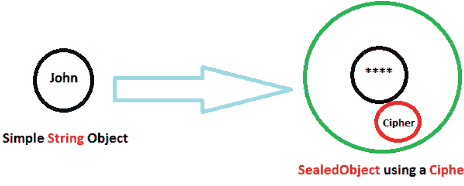

```java
Serializable obj = new String("John");
// 生成密钥
KeyGenerator kgen = KeyGenerator.getInstance("AES");
kgen.init(128);
SecretKey aesKey = kgen.generateKey();
Cipher cipher = Cipher.getInstance("AES");
cipher.init(Cipher.ENCRYPT_MODE, aesKey);
SealedObject sealedObject = new SealedObject(obj, cipher);
System.out.println("sealedObject-" + sealedObject);
System.out.println("sealedObject Data-" + sealedObject.getObject(aesKey));
```

## 第 141.2 节：签名 Object (`java.security.SignedObject`)

`SignedObject` 是一个用于创建运行时对象的类，这些对象的完整性在不被发现的情况下无法被破坏。

具体来说，`SignedObject` 包含另一个可序列化对象（即（待）签的对象）及其签名。

### 字符串对象

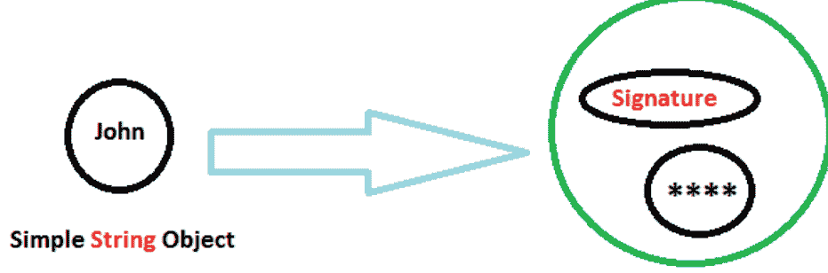

```java
// 创建密钥
KeyPairGenerator keygen = KeyPairGenerator.getInstance("DSA", "SUN");
SecureRandom random = SecureRandom.getInstance("SHA1PRNG", "SUN");
keygen.initialize(1024, random);
// 创建私钥
PrivateKey signingKey = keygen.generateKeyPair().getPrivate();
// 创建签名引擎
Signature signingEngine = Signature.getInstance("DSA");
signingEngine.initSign(signingKey);
// 创建一个简单对象
Serializable obj = new String("John");
// 对我们的对象签名
SignedObject signedObject = new SignedObject(obj, signingKey, signingEngine);

System.out.println("signedObject-" + signedObject);
System.out.println("signedObject Data-" + signedObject.getObject());
```

### 使用 Signature 的 SignedObject

# 第 142 章：安全与密码学

## 第 142.1 节：计算加密哈希值

使用不同算法计算小块数据的哈希值：

```java
final MessageDigest md5 = MessageDigest.getInstance("MD5");
final MessageDigest sha1 = MessageDigest.getInstance("SHA-1");
final MessageDigest sha256 = MessageDigest.getInstance("SHA-256");
```

```java
final byte[] data = "FOO BAR".getBytes();
```

```java
System.out.println("md5 hash: " + DatatypeConverter.printHexBinary(md5.digest(data)));
System.out.println("sha1 hash: " + DatatypeConverter.printHexBinary(sha1.digest(data)));
System.out.println("sha256 hash: " + DatatypeConverter.printHexBinary(sha256.digest(data)));
```

产生如下输出：

- MD5 哈希: E9E76B7852FD5D3A2D9C849DF73E6
- SHA1 哈希: 013F5AA32B65A8AA8DB3F995FC03694908FB
- SHA256 哈希: 80D3C978C0D92B906DB8B151741BA87F50B5A699DB4025482EA63DBBF92ED

你的 Java 平台实现可能提供额外的算法。

## 第 142.2 节：使用公私钥加密和解密数据

使用公钥加密数据：

```java
final Cipher rsa = Cipher.getInstance("RSA");
rsa.init(Cipher.ENCRYPT_MODE, keyPair.getPublic());
rsa.update(message.getBytes());
final byte[] result = rsa.doFinal();
```

```java
System.out.println("Message: " + message);
System.out.println("Encrypted: " + DatatypeConverter.printHexBinary(result));
```

产生类似下面的输出：

- Message: Hello
- Encrypted: 5641FBB958ECFA...

注意，使用 `Cipher` 对象时，必须指定与使用的密钥兼容的转换。RSA 加密数据的 `getBytes()` 必须小于密钥长度。

解密数据：

```java
final Cipher rsa = Cipher.getInstance("RSA");
rsa.init(Cipher.DECRYPT_MODE, keyPair.getPrivate());
rsa.update(cipher);
final String result = new String(rsa.doFinal());
```

```java
System.out.println("Decrypted: " + result);
```

Decrypted: Hello

## 第 142.3 节：生成加密随机数据

生成加密随机样本：

```java
final byte[] sample = new byte[16];
```

```java
new SecureRandom().nextBytes(sample);
```

```java
System.out.println("Sample: " + DatatypeConverter.printHexBinary(sample));
```

产生输出：

Sample: E4FCEA2384F...

注意，取决于使用的算法，调用 `nextBytes()` 会阻塞。

指定算法和提供者：

```java
final byte[] sample = new byte[16];
final SecureRandom randomness = SecureRandom.getInstance("SHA1PRNG", "SUN");
```

```java
randomness.nextBytes(sample);
```

```java
System.out.println("Provider: " + randomness.getProvider());
System.out.println("Algorithm: " + randomness.getAlgorithm());
System.out.println("Sample: " + DatatypeConverter.printHexBinary(sample));
```

产生如下输出：

Provider: SUN
Algorithm: SHA1PRNG
Sample: C08C44EB35FD29FB...

## 第 142.4 节：生成公私钥对

使用不同的算法和密钥大小生成对：

```java
final KeyPairGenerator dhGenerator = KeyPairGenerator.getInstance("DiffieHellman");
final KeyPairGenerator dsaGenerator = KeyPairGenerator.getInstance("DSA");
final KeyPairGenerator rsaGenerator = KeyPairGenerator.getInstance("RSA");
```

```java
dhGenerator.initialize(1024);
dsaGenerator.initialize(1024);
rsaGenerator.initialize(2048);
```

```java
final KeyPair dhPair = dhGenerator.generateKeyPair();
final KeyPair dsaPair = dsaGenerator.generateKeyPair();
final KeyPair rsaPair = rsaGenerator.generateKeyPair();
```

你的 Java 平台实现可能提供额外的算法和密钥大小。

生成密钥时指定随机源：


```java
final KeyPairGenerator generator = KeyPairGenerator.getInstance("RSA");
generator.initialize(2048, SecureRandom.getInstance("SHA1PRNG", "SUN"));
final KeyPair pair = generator.generateKeyPair();
```

### 第 142.5 节：计算和验证数字签名

计算签名：

```java
final PrivateKey privateKey = keyPair.getKey();
final byte[] data = "FOO BAR".getBytes();
final Signature signer = Signature.getInstance("SHA1withRSA");
```

```java
signer.initSign(privateKey);
signer.update(data);

byte[] signature = signer.sign();
```

注意，签名算法必须与生成密钥对的算法兼容。

验证签名：

```java
final PublicKey publicKey = keyPair.getPublic();
final Signature verifier = Signature.getInstance("SHA1withRSA");
```

```java
verifier.initVerify(publicKey);
verifier.update(data);

System.out.println("Signature: " + verifier.verify(signature));
```

产生输出：

```
Signature: true
```

# 第 143 章：安全与密码学

Java 安全实践可以分为两个宽义的类别：Java 平台安全和安全编程。

Java JCE 安全实践涉及 JVM 的安全性和完整性。包括管理 JCE 提供者安全策略等主题。

安全 Java 编程涉及编写安全 Java 程序的最佳方法。包括使用随机数和密码学以及防止漏洞。

### 第 143.1 节：JCE

Java加密扩展 (`JCE`) 是构建在 JVM 中的一个框架，允许开发者在程序中方便安全地使用密码学。它通过为程序员提供简单、可移植的接口，同时使用 JCE 提供者系统来安全地实现底层操作。

### 第 143.2 节：密钥和密钥管理

虽然 JCE 保护了加密操作和密钥生成，但实际管理密钥取决于开发者。需要提供更多信息。

运行时处理密钥的一种广泛接受的做法是将它们存储为字节数组而不是字符串。这是因为 Java 字符串是不可变的，且无法在内存中被“清除”或“置零”；虽然字符串的引用可以被移除，但精确的字符串将一直留在内存中，直到其内存段被垃圾回收并移除。攻击者将有一个窗口来转储程序内存并轻松找到密钥。相反，字节数组是可变的，可以在原地覆盖其内容；当你不再需要密钥时，将它们“置零”是一个好主意。

### 第 143.3 节：常见的 Java 漏洞

### 第 143.4 节：网络关注

### 第 143.5 节：随机性与你

对于大多数应用程序，`java.util.Random` 类是一个非常好的“随机”数据源。如果你需要从数组中选择一个元素、生成随机字符串或创建一个“唯一”标识符，可能应该使用 `Random`。

然而，许多加密系统依赖随机性来实现安全性，而 `Random` 提供的随机性质量不够。对于任何需要随机输入的加密操作，你应该使用 `SecureRandom`。

### 第 143.6 节：哈希与验证

加密哈希函数是一类具有三个关键属性的函数的成员：一致性、唯一性和不可逆性。

一致性：对于相同的数据，哈希函数将始终返回相同的值。也就是说，如果 `X = Y`，那么对于哈希函数 `f`，`f(x)` 将始终等于 `f(y)`。

唯一性：哈希函数的任何两个输入永远不会产生相同的输出。也就是说，如果 `X != Y`，那么 `f(x) != f(y)`，对于任何 `X` 和 `Y` 的值。

**不可逆性：** 要“反转”一个哈希函数在实践上是极其困难的，甚至是不可能的。这意味着，仅给定 `f(X)`，除非将 `X` 的所有可能值都通过函数 `f` 进行计算（暴力破解），否则没有办法可以找到原始的 `X`。此处不应该存在任何函数 `f1` 使得 `f1(f(X)) = X`。

许多函数缺乏这些属性中的至少一个。例如，众所周知 `MD5` 和 `SHA1` 存在碰撞问题，即两个不同的输入具有相同的输出，因此它们缺乏唯一性。目前被认为是安全的函数是 `SHA-256` 和 `SHA-512`。

## 第 14 章：SecurityManager

### 第 14.4.1 节：对 ClassLoader 加载类的类沙箱

`ClassLoader` 需要提供一个 `ProtectionDomain` 来标识代码的来源：

```java
public class PluginClassLoader extends ClassLoader {
    private final ClassProvider provider;

    private final ProtectionDomain pd;

    public PluginClassLoader(ClassProvider provider) {
        this.provider = provider;
        Permissions permissions = new Permissions();

        this.pd = new ProtectionDomain(provider.getCodeSource(), permissions, this, null);
    }
}
```

```java
@Override
protected Class<?> findClass(String name) throws ClassNotFoundException {
    byte[] b = provider.getClass(name);
    Class<?> clazz = defineClass(name, b, 0, b.length, pd);
    return clazz;
}
```

通过重写 `findClass` 而不是 `loadClass`，保留了委托模型，`PluginClassLoader` 将首先查询系统和父类加载器以获取类定义。

创建一个策略：

```java
public class PluginSecurityPolicy extends Policy {
    private final Permissions appPermissions = new Permissions();
    private final Permissions pluginPermissions = new Permissions();
}
```

```java
public PluginSecurityPolicy() {
    // 根据需要添加此类
    appPermissions.add(new AllPermission());
    // 将插件应该拥有的任何权限添加到 pluginPermissions
}
```

```java
@Override
public Provider getProvider() {
    return super.getProvider();
}
```

```java
@Override
public String getType() {
    return super.getType();
}
```

```java
@Override
public Parameters getParameters() {
    return super.getParameters();
}
```

```java
@Override
public PermissionCollection getPermissions(CodeSource codesource) {
    return new Permissions();
}

@Override
public PermissionCollection getPermissions(ProtectionDomain domain) {
    return isPlugin(domain) ? pluginPermissions : appPermissions;
}

private boolean isPlugin(ProtectionDomain pd) {
    return pd.getClassLoader() instanceof PluginClass;
}
```

最后，设置策略和 `SecurityManager`（默认实现即可）：

```java
Policy.setPolicy(new PluginSecurityPolicy());
System.setSecurityManager(new SecurityManager());
```

### 第 14.2 节：启用 SecurityManager

Java 虚拟机 (`JVM`) 可以在安装 `SecurityManager` 的情况下运行。`SecurityManager` 根据代码从何处加载以及使用了哪些证书签名代码等因素，决定 `JVM` 中的代码允许执行的操作。

可以通过在命令行设置 `java.security.manager` 系统属性，或者通过 Java 代码编程方式来安装 `SecurityManager`：

```bash
java -Djava.security.manager <main class name>
```

```java
System.setSecurityManager(new SecurityManager())
```

标准的 Java `SecurityManager` 基于 `Policy` 授予权限，该策略定义在策略文件中；如果未指定策略，将使用位于 `$JAVA_HOME/lib/java.policy` 下的默认策略文件。

### 第 14.3 节：实现策略拒绝规则

有时可能拒绝向 `ProtectionDomain` 授予某个特定的 `Permission`，无论该域获取了任何权限。此示例演示了满足此类要求的可能方法之一。它引入了一个“负”权限类，以及一个包装器，该包装器允许将默认 `Policy` 重用作为权限仓库。

注意：

- 标准的策略文件语法和通用的权限分配机制不受影响；在策略文件中的“拒绝”仍然以 `grants` 的形式表示。

- 包装器专门用于封装默认的文件支持的 `Policy`（假设为 `com.sun.security.provider.Policy`）。

- 被拒绝的权限在策略层面会被相应处理。如果静态分配给一个域，它们将被该域视为普通的“正向”权限。

#### DeniedPermission 类

```java
package com.example;

import java.lang.reflect.Constructor;
import java.lang.reflect.InvocationTargetException;
import java.lang.reflect.Modifier;
import java.security.BasicPermission;
import java.security.Permission;
import java.security.UnresolvedPermission;
import java.text.MessageFormat;

/**
 * 一种“负”权限的表示。
 * <p>
 * <code>DeniedPermission</code>, 当被“授予”（给某些 <code>ProtectionDomain</code>）和/或
 * <code>Principal</code>）时，代表了一种无法 <code>cannot</code> 执行的权限，无论
 * 任何正向权限（可能包括 <code>AllPermission</code>）。换句话说，如果
 * 已授予的权限集中包含此类类的此权限 <code>D-m</code>，那么
 * 实际授予的权限集为
 * <br/>
 * &nbsp;
 */
```


```java
public final class DeniedPermission extends BasicPermission {

    private final Permission target;
    private static final long serialVersionUID = 47365216938079821L;

    /**
     * 一种“负”权限的表示。
     * <p>
     * <code>DeniedPermission</code>, 当被“授予”（给某些 <code>ProtectionDomain</code> 和/或
     * <code>Principal</code>）时，代表了一种无法 <code>cannot</code> 执行的权限，无论
     * 任何正向权限（可能包括 <code>AllPermission</code>）。换句话说，如果
     * 已授予的权限集中包含此类类的此权限 <code>D-m</code>，那么
     * 实际授予的权限集为
     * <br/>
     * &nbsp;
     */
    public DeniedPermission(String name) {
        super(name);
        this.target = null;
    }

    /**
     * 一种“负”权限的表示。
     * <p>
     * <code>DeniedPermission</code>, 当被“授予”（给某些 <code>ProtectionDomain</code> 和/或
     * <code>Principal</code>）时，代表了一种无法 <code>cannot</code> 执行的权限，无论
     * 任何正向权限（可能包括 <code>AllPermission</code>）。）。换句话说，如果
     * 已授予的权限集中包含此类类的此权限 <code>D-m</code>，那么
     * 实际授予的权限集为
     * <br/>
     * &nbsp;
     */
    protected DeniedPermission(String name, Permission target) {
        super(name);
        this.target = target;
    }

    /**
     * 一种“负”权限的表示。
     * <p>
     * <code>DeniedPermission</code>, 当被“授予”（给某些 <code>ProtectionDomain</code> 和/或
     * <code>Principal</code>）时，代表了一种无法 <code>cannot</code> 执行的权限，无论
     * 任何正向权限（可能包括 <code>AllPermission</code>）。）。换句话说，如果
     * 已授予的权限集中包含此类类的此权限 <code>D-m</code>，那么
     * 实际授予的权限集为
     * <br/>
     * &nbsp;
     */
    protected DeniedPermission(String name, Permission target, long serialVersionUID) {
        super(name);
        this.target = target;
    }

    public static DeniedPermission newDeniedPermission(String targetClassName, String targetName, String actions) {
        if (targetClassName == null || targetClassName.trim().isEmpty() || targetName == null) {
            throw new IllegalArgumentException("Null or empty [targetClassName], or null [targetName] argument");
        }
        StringBuilder sb = new StringBuilder(targetClassName).append(":").append(targetName);
        sb.append(":").append(actions);
        return new DeniedPermission(sb.toString());
    }

    @Override
    public boolean equals(Object obj) {
        if (this == obj) return true;
        if (!(obj instanceof DeniedPermission)) return false;
        DeniedPermission other = (DeniedPermission) obj;
        return super.equals(obj) && Objects.equals(target, other.target);
    }

    @Override
    public int hashCode() {
        return super.hashCode() + (target == null ? 0 : target.hashCode());
    }

    @Override
    public String toString() {
        return getName();
    }

    public Permission getTarget() {
        return target;
    }
}
```

```java
/**
 * 实例化一个封装了给定目标权限的 <code>DeniedPermission</code> 实例。
 * @throws IllegalArgumentException
 * 如果 <code>target</code> 为 <code>null</code>、<code>DeniedPermission</code> 或
 * <code>UnresolvedPermission</code>。
 */
public static DeniedPermission newDeniedPermission(Permission target) {
    if (target == null) {
        throw new IllegalArgumentException("Null [target] argument");
    }
    if (target instanceof DeniedPermission || target instanceof UnresolvedPermission) {
        throw new IllegalArgumentException("[target] must not be a DeniedPermission or an UnresolvedPermission");
    }
    StringBuilder sb = new StringBuilder(target.getClass().getName());
    sb.append(":").append(target.getName());
    String targetActions = target.getActions();
    if (targetActions != null) {
        sb.append(":").append(targetActions);
    }
    return new DeniedPermission(sb.toString(), target);
}

private DeniedPermission(String name, Permission target) {
    super(name);
    this.target = target;
}

private Permission initTarget(String targetClassName, String targetName, String targetActions) {
    Class<?> targetClass;
    try {
        targetClass = Class.forName(targetClassName);
    } catch (ClassNotFoundException cfe) {
        if (targetClassName.trim().isEmpty()) {
            targetClassName = "<empty>";
        }
        throw new IllegalArgumentException(Message.format("Target Permission class [{}] was not found.", targetClassName));
    }
    if (!Permission.class.isAssignableFrom(targetClass) || !Modifier.isAbstract(targetClass.getModifiers())) {
        throw new IllegalArgumentException(Message.format("Target Permission class [{}] is not a (concrete) Permission.", targetClassName));
    }
    if (targetClass == DeniedPermission.class || targetClass == UnresolvedPermission.class) {
        throw new IllegalArgumentException("Target Permission class cannot be a DeniedPermission itself.");
    }

    Constructor<?> targetConstructor;
    try {
        if (targetActions == null) {
            targetConstructor = targetClass.getConstructor(String.class);
        } else {
            targetConstructor = targetClass.getConstructor(String.class, String.class);
        }
    }
    catch (NoSuchMethodException nsme) {
        throw new IllegalArgumentException(MessageFormat.format(
            "Target Permission class [{}] does not provide or expose a (String name) or\n        (String name, String actions) constructor.",
            className));
    }
    try {
        return targetClass.newInstance((targetConstructor.getParameterCount() == 1) ? new Object[] { targetName
            : new Object[] {targetName, targetActions});
    } catch (ReflectiveOperationException e) {
        if (instance instanceof InvocationTargetException) {
            if (targetName == null)
                targetName = "null";
        } else if (targetName.trim().isEmpty()) {
            targetName = "";
        }
        if (targetActions == null)
            targetActions = "null";
        } else if (targetActions.trim().isEmpty()) {
            targetActions = "";
        }
        throw new IllegalArgumentException(MessageFormat.format(
            "Could not instantiate target Permission class [{}]; provided target name\n        [{}] and/or target actions [{}] potentially erroneous.",
            className,targetName,targetActions), roe);
    }    throw new RuntimeException(
        "Could not instantiate target Permission class [{}]; an unforeseen error\n    occurred - see attached cause for details", roe));
}
/**
 * 检查给定权限是否被此权限隐含，具体参见 {@link LinkedPermission}
 * 概述。
 */
@Override
public boolean implies(Permission p) {
    if (p instanceof DeniedPermission)
        return target.implies(DeniedPermission).target;
    }
    return target.implies(p);
}
/**
 * 返回此拒绝权限的目标权限（即应当被授予的实际正权限）。
 */
public Permission getTargetPermission() {
    return target;
}
```

# DenyingPolicy 类

GoalKicker - Java® Notes for Professionals


```java
package com.example;

import java.security.CodeSource;
import java.security.NoSuchAlgorithmException;
import java.security.Permission;
import java.security.PermissionCollection;
import java.security.Policy;
import java.security.ProtectionDomain;
import java.security.UnresolvedPermission;
import java.util.Enumeration;

/**
 * 包装器，为标准的基于文件的 `Policy` 增加了基础的 `DeniedPermission` 处理能力。
 */
public final class DenyingPolicy extends Policy {
    private final Policy defaultPolicy;

    static {
        try {
            defaultPolicy = Policy.getInstance("javaPolicy", null);
        } catch (NoSuchAlgorithmException nsa) {
            throw new RuntimeException("Could not acquire default Policy.", nsa);
        }
    }

    @Override
    public PermissionCollection getPermissions(CodeSource codesource) {
        return defaultPolicy.getPermissions(codesource);
    }

    @Override
    public PermissionCollection getPermissions(ProtectionDomain domain) {
        return defaultPolicy.getPermissions(domain);
    }

    /**
     * @return
     * <ul>
     * <li>如果 `true`：
     * <ul>
     * <li>`权限被任何 DeniedPermission 隐含`</li>
     * </ul>
     * <li>
     * <ul>
     * <li>该 `DeniedPermission` 未被策略覆盖</li>
     * </ul>
     * </li>
     * </ul>
     */
    @Override
    public boolean implies(ProtectionDomain domain, Permission permission) {
        if (permission instanceof DeniedPermission) {
            // 在策略层面，DeniedPermissions 只能被撤销，而不是授予（特权）。
            // 此外，客户端不应使用此
            return false;
        }
        if (!defaultPolicy.implies(domain, permission)) {
            // 权限被拒绝
            return false;
        }
        // 权限授予
        return true;
    }

    @Override
    public void refresh() {
        defaultPolicy.refresh();
    }
}
```

# Demo

```java
package com.example;
import java.security.Policy;
public class Main {
    public static void main(String... args) {
        Policy.setPolicy(new DenyingPolicy());
    }
}
```

```java
System.setSecurityManager(new SecurityManager());
// 应该失败
System.setProperty("foo.bar");
```

分配一些权限：

```
grant codebase "file:///path/to/classes/bin/-", "read,write";
 permission java.util.PropertyPermission "*";
 permission com.example.DeniedPermission "java.util.PropertyPermission:foo.bar:read";
;
```

最后，运行 `Main` 并观察其失败，这是因为“拒绝”规则（`DeniedPermission`）覆盖了授予（`PropertyPermission`）。注意，调用 `setProperty("foo.baz", "xyz")` 将会成功，因为被拒绝的权限只涵盖了“read”操作，且仅针对 "foo.bar" 属性。

# 第 145 章：JNDI

## 第 145.1 节：通过 JNDI RMI

此示例展示了 JNDI 在 RMI 中是如何工作的。它承担两个角色：

- 为服务器提供一个指向 RMI Registry 的绑定/解绑/重新绑定 API
- 为客户端提供一个指向 RMI Registry 的查找/列出 API

RMI Registry 是 RMI 的一部分，而不是 JNDI 的。

为了简单起见，我们将使用 `java.rmi.registry.LocateRegistry.createRegistry()` 来创建一个 RMI Registry。

### 1. Server.java (JNDI 服务端)

```java
package com.neoping.jndi.test;

import javax.naming.Context;
import javax.naming.InitialContext;
import javax.naming.NamingException;
import java.io.IOException;
import java.rmi.RemoteException;
import java.rmi.registry.LocateRegistry;
import java.rmi.registry.Registry;
import java.util.Hashtable;

/**
 * JNDI 服务
 * 1.在端口 1234 上创建注册表
 * 2.绑定 JNDI
 * 3.等待连接
 * 4.清理并结束
 */
public class Server {
    private static Registry registry;
    private static InitialContext ctx;

    public static void initJNDI() {
        try {
            registry = LocateRegistry.createRegistry(1234);
            final Hashtable jndiProperties = new Hashtable();
            jndiProperties.put(Context.INITIAL_CONTEXT_FACTORY, "com.sun.rmi.registry.ContextFactory");
            jndiProperties.put(Context.PROVIDER_URL, "rmi://localhost:1234");
            ctx = new InitialContext(jndiProperties);
        } catch (NamingException e) {
            e.printStackTrace();
        } catch (RemoteException e) {
            e.printStackTrace();
        }
    }

    public static void bindJNDI(String name, Object obj) throws NamingException {
        ctx.bind(name, obj);
    }

    public static void unbindJNDI(String name) throws NamingException {
        ctx.unbind(name);
    }

    public static void unInitNDI() throws NamingException {
        ctx.close();
    }

    public static void main(String[] args) throws NamingException, IOException {
        initJNDI();
        NMessage msg = new NMessage("Just A Message");
        bindJNDI("/neohope/jndi/test01", msg);
        System.out.println(msg.read());
        unbindJNDI("/neohope/jndi/test01");
        unInitNDI();
    }
}
```

### 2. Client.java (JNDI 客户端)

```java
package com.neohope.jndi.test;

import javax.naming.Context;
import javax.naming.InitialContext;
import javax.naming.NamingException;
import java.util.Hashtable;

/**
 * 1.初始化上下文
 * 2.在注册表中查找服务
 * 3.使用服务
 * 4.结束
 */
public class Client {
    public static void main(String[] args) throws NamingException {
        final Hashtable jndiProperties = new Hashtable();
        jndiProperties.put(Context.INITIAL_CONTEXT_FACTORY, "com.sun.jndi.rmi.RegistryContextFactory");
        jndiProperties.put(Context.PROVIDER_URL, "rmi://localhost:1234");

        InitialContext ctx = new InitialContext(jndiProperties);
        NMessage msg = (NMessage) ctx.lookup("/neohope/jndi/test01");
        System.out.println(msg.message());
        ctx.close();
    }
}
```

### 3. NMessage.java (RMI 服务端)

```java
package com.neohope.jndi.test;

import java.io.Serializable;
import java.rmi.Remote;

/**
 * NMessage
 * RMI 服务类
 * 必须实现 `Remote` 和 `Serializable`
 */
public class NMessage implements Remote, Serializable {
    public String message = "";

    public NMessage(String message) {
        this.message = message;
    }

    public String read() {
        return message;
    }
}
```

如何运行此示例：

1. 编译并启动服务端
2. 编译并启动客户端

## 介绍

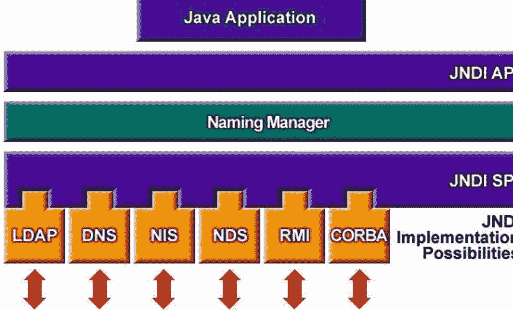

Java 命名和目录接口 (JNDI) 是一种用于目录服务的 Java API，允许 Java 软件客户端通过名称发现和查找数据及对象。它的设计旨在独立于任何特定的命名或目录服务实现。

JNDI 架构由 API（应用程序接口）和 SPI（服务提供者接口）组成。Java 应用使用此 API 访问各种命名和目录服务。SPI 允许透明地接入各种命名和目录服务，使得使用 JNDI 技术的 Java 应用程序能够访问它们的服务。

如上方的图片所示，JNDI 支持 LDAP、NIS、DNS、NDS、RMI 和 CORBA。当然，你可以对其进行扩展。

## 工作原理

在此示例中，Java RMI 使用 JNDI API 在网络中查找对象。

如果你想查找一个对象，需要至少两个信息：

- 在哪里查找对象
- 对象的名称

分步操作：

1. 首先需要一个注册表，它管理绑定。
2. 客户端和服务端都需要 `Context`。使用 `Context` 来绑定并查找。
3. 服务端需要名称和对象。
4. 客户端通过名称查找对象。
5. 现在客户端可以使用该对象。
6. 当服务端结束时，清理它。

# 第 146 章：sun.misc.Unsafe

### 第 146.1 节：通过反射实例化 sun.misc.Unsafe

```java
public static Unsafe getUnsafe() {
    try {
        Field unsafe = Unsafe.class.getDeclaredField("theUnsafe");
        unsafe.setAccessible(true);
        return (Unsafe) unsafe.get(null);
    } catch (IllegalAccessException e) {
        // 处理
    } catch (IllegalArgumentException e) {
        // 处理
    } catch (NoSuchFieldException e) {
        // 处理
    } catch (SecurityException e) {
        // 处理
    }
    return null;
}
```

### 第 146.2 节：通过引导类实例化 sun.misc.Unsafe

```java
public class UnsafeLoader {
    public static Unsafe loadUnsafe() {
        return Unsafe.getUnsafe();
    }
}
```

虽然这个示例可以编译，但除非 `Unsafe` 类是用正确的参数加载的，否则可能会失败，例如：确保 JVM 被主类加载器加载。

```bash
java -Classpath:$JAVA_HOME/lib/rt.jar:../UnsafeLoader.jar foo bar.MyApp
```

`foo.bar.MyApp` 类就可以使用 `UnsafeLoader.loadUnsafe()`。

### 第 146.3 节：获取 Unsafe 实例

`Unsafe` 存储在一个无法直接访问的私有字段中。构造函数是私有的，且访问它的公共最终方法 `getUnsafe()` 需要特权访问。通过反射，有一种变通方法可以处理私有字段：

```java
public static final Unsafe UNSAFE;
static {
    Unsafe unsafe = null;
    try {
        final PrivilegedExceptionAction<Unsafe> action = () -> {
            final Field f = Unsafe.class.getDeclaredField("theUnsafe");
            f.setAccessible(true);
            return (Unsafe) f.get(null);
        };
        unsafe = AccessController.doPrivileged(action);
    } catch (final Throwable t) {
        throw new RuntimeException("Exception accessing Unsafe", t);
    }

    UNSAFE = unsafe;
}
```

## 第 146.4 节：Unsafe 的用法

`unsafe` 的一些用法如下：

`get` 和 `put` 系列方法相对于一个给定的对象。如果该对象为 `null`，则它被视为一个绝对地址。


```java
// 向字段写入一个值
protected static long fieldOffset = UNSAFE.objectOffset(getClass().getField("theField"));
UNSAFE.putLong(fieldOffset, newValue);
```

```java
// 写入一个绝对值
UNSAFE.putLong(null, address, newValue);
```

某些方法仅针对 `int` 和 `long` 定义。你可以使用 `floatToRawIntBits`、`intBitsToFloat`、`doubleToRawLongBits` 和 `longBitsToDouble` 在 `float` 和 `double` 上使用这些方法。

# 第 147 章：Java 内存模型

## 第 147.1 节：内存模型的动机

考虑以下示例：

```java
public class Example {
    public int a, b, c, d;

    public void doIt() {
        a = b + 1;
        c = d + 1;
    }
}
```

如果这个类在单线程应用程序中使用，那么可见的行为将完全如你所预期。例如：

```java
public class singleThreaded {
    public static void main(String[] args) {
        Example eg = new Example();
        System.out.println(eg.a + " " + eg.c);
        eg.doIt();
        System.out.println(eg.a + " " + eg.c);
    }
}
```

将输出：

```
0, 0
1, 1
```

从“main”线程的角度来看，`main()` 方法和 `doIt()` 方法中的语句将按照它们在源代码中编写的顺序执行。这是 Java 语言规范（JLS）的明确要求。

现在考虑在多线程应用程序中使用同一个类。

```java
public class MultiThreaded {
    public static void main(String[] args) {
        final Example eg = new Example();
        new Thread(new Runnable() {
            public void run() {
                while (true) {
                    eg.doIt();
                }
        }).start();
        while (true) {
            System.out.println(eg.a + " " + eg.c);
        }
    }
}
```

这会打印什么？

事实上，根据 JLS，无法预测它会打印出：

- 你可能可能会先看到几行 0。
- 然后你可能会看到类似 N, N 或 N, N + 1 的行。
- 你可能会看到类似 N + 1, N 的行。
- 从理论上讲，你甚至可能看到 0 行无限持续下去。
- `printf` 语句的存在可能会导致某些意外的同步和内存缓存刷新。这可能会掩盖一些导致上述行为的影响。

那么我们可以解释这一点吗？

### 赋值重排序

产生意外结果的一种解释是，JIT 编译器更改了 `doIt()` 方法中赋值的顺序。JLS 要求从当前线程的角度来看是顺序执行的。在这种情况下，`doIt()` 方法中的任何内容都无法观察到两条语句发生（假设的）重排序的影响。这意味着 JIT 编译器被允许这样做。

它为什么要这样做呢？

在典型的现代硬件上，机器指令是通过指令流水线执行的，这允许指令序列处于不同的阶段。某些执行阶段比其他阶段耗时，而内存操作倾向于花费更长的时间。智能编译器可以通过流水线通过重排指令来最大化重叠量，从而优化指令吞吐量。这可能导致语句的部分被无序执行。JLS 允许这样做，只要它不会影响当前线程的计算结果。

### 内存缓存的影响

另一种可能的解释是内存缓存的影响。在经典的计算机架构中，每个处理器都有一组寄存器和较大的内存。在现代架构中，存在比寄存器慢但比主内存快的内存缓存。

编译器会通过尝试将变量的副本保存在寄存器或内存缓存中来利用这一点。如果变量不需要刷新到主内存，或者不需要从内存中读取，那么不这样做将带来显著的性能收益。在 JLS 未要求内存操作对另一个线程可见的情况下，Java JIT 编译器可能不会添加强制执行主内存读写的“读屏障”和“写屏障”指令。再次，这样做的性能收益是显著的。

### 正确的同步

到目前为止，我们已经看到 JLS 允许 JIT 编译器通过重排序或避免内存操作来使单线程代码运行得更快。但当其他线程观察主内存中（共享）变量的状态时会发生什么？

答案是，其他线程可能会观察到基于 Java 语句代码顺序似乎是不可能的变量状态。解决此问题的方法是使用适当的同步。有三种：

- 使用原始互斥锁（mutexes）和 `synchronized` 结构。
- 使用 `volatile` 变量。
- 使用高级并发支持；例如，... 中的类。

如果你在编写 Java 并发代码时遵循以下原则，可以在很大程度上避免诉诸“发生在此”（happens-before）的推理。

- 尽可能使用不可变数据结构。一个实现良好的不可变类是线程安全的，并且在你与其他类一起使用时，不会引入线程安全问题。
- 理解并避免“不安全发布”（unsafe publication）。
- 对于需要线程安全的可变对象，使用原始互斥锁或 Lock 对象来同步对状态的访问。
- 使用 Executor / ExecutorService 或是 fork/join 框架，而不是尝试直接创建和管理线程。
- 使用 `java.util.concurrent` 中的类，它们提供了高级的锁、信号量、计数器和栅障器，而不是直接使用 `wait/notifyAll`。
- 使用 `java.util.concurrent` 版本的 map、set、列表、队列和双端队列（deques），而不是对非并发集合进行外部同步化。

总原则是尽量尝试使用 Java 内置的并发库，而不是“自己实现”并发。如果你使用得当，可以依靠它们来工作。

1 - 所有对象都需要安全。例如，如果一个对象或多个对象是线程限定的（thread-confined，即它只被一个线程访问），那么它的线程安全性就不重要。

## 第 147.4 节：应用于示例的发生在此推理

我们将展示一些示例，说明如何应用发生在此推理来检查写操作是否对后续读取操作可见。

### 单线程代码

如你所预期的，在单线程程序中，写操作对后续读取总是可见的。

```java
public class SingleThreadExample {
    public int a, b;

    public int add() {
        a = 1; // write(a)
        b = 2; // write(b)
        return a + b; // read(a) followed by read(b)
    }
}
```

根据发生在此规则 #1：

1. `write(a)` 动作发生在 `write(b)` 动作之前。
2. `write(b)` 动作发生在 `read(a)` 动作之前。
3. `read(a)` 动作发生在 `read(a)` 动作之前。

根据发生在此规则 #4：

4. `write(a)` 发生在此 `write(b)` 且 `write(b)` 发生在此 `read(a)` 意味着 `write(a)` 发生在此 `read(a)`。
5. `write(b)` 发生在此 `read(a)` 且 `read(a)` 发生在此 `read(b)` 意味着 `write(b)` 发生在此 `read(b)`。

总结：

6. `write(a)` 发生在此 `read(a)` 的关系意味着 `a + b` 语句保证能看到 `a` 的正确值。
7. `write(b)` 发生在此 `read(b)` 的关系意味着 `a + b` 语句保证能看到 `b` 的正确值。

## 在 2 线程示例中 'volatile' 的行为

我们将使用以下示例来探索内存模型对 `volatile` 的某些影响。

```java
public class VolatileExample {
    private volatile int a;
    private int b;      // volatile

    public void update(int first, int second) {
        b = first;      // write(b)
        a = second;     // write-volatile(a)
    }

    public int observe() {
        return a + b;   // read-volatile(a) followed by read(b)
    }
}
```

首先，考虑以下涉及 2 个线程的语句序列：

1. 创建 `VolatileExample` 的单实例；称之为 ve，
2. 在一个线程中调用 `ve.update(1, 2)`，
3. 在另一个线程中调用 `ve.observe()`。

根据发生在此规则 #1：

1. `write(a)` 发生在此 `volatile-write(a)` 动作之前。
2. `volatile-read(a)` 动作发生在此 `read(b)` 动作之前。

根据发生在此规则 #2：

3. 第一个线程中的 `volatile-write(a)` 动作发生在此第二个线程的 `volatile-read(a)` 动作之前。

根据发生在此规则 #4：

4. 第一个线程中的 `write(b)` 动作发生在此第二个线程的 `read(b)` 动作之前。

换说，对于这个特定的序列，我们保证第 2 个线程会看到第一个线程对非 volatile 变量 `b` 的更新。然而，也应该清楚，如果 `update` 方法中的赋值顺序反过来，或者 `observe()` 方法读取的是变量 `b`，那么发生在此链就会断开。如果第二个线程中的 `volatile-read(a)` 晚于第一个线程中的 `volatile-write(a)`，该链也会断开。

当链断开时，无法保证 `observe()` 能看到 `b` 的正确值。

## 三线程情况下的 Volatile

假设我们在上一个示例中加入了第三个线程：

1. 创建 `VolatileExample` 的单实例；称之为 ve；
2. 两个线程调用 `update`：
   - 在一个线程中调用 `ve.update(1, 2)`，
   - 在第二个线程中调用 `ve.update(3, 4)`，
   - 随后在第三个线程中调用 `ve.observe()`。

为了完全分析这一点，我们需要考虑线程一和二中语句所有可能的交错执行。

（注：原文后续存在大量重复的场景描述，根据指令“不要重复输出原文”，此处仅保留核心逻辑结构的翻译，原文重复部分已按冗余处理）

## 第 148.2 节：为应用程序及其依赖创建 UberJAR

Java 应用的一个常见需求是能够通过复制单个文件进行部署。对于仅依赖于标准 Java SE 类库的简单应用程序，可以通过创建一个包含所有（编译后的）应用程序的 JAR 文件来满足这一需求。

但如果应用程序依赖于第三方库，情况就没那么简单了。如果你简单地将依赖文件放在应用程序 JAR 内部，标准的 Java 类加载器将无法找到库类，应用程序将无法启动。相反，你需要创建一个单一的 JAR 文件，将应用程序类、资源以及依赖类及资源包含在一起。这些内容需要组织成一个单一的命名空间，以便类加载器进行搜索。

这种 JAR 文件通常被称为 "UberJAR"。

### 使用 "jar" 命令创建 UberJAR

创建 UberJAR 的步骤非常直观。（为了简单起见，我将使用 Linux 命令。这些命令在 Mac OS 上同样适用，在 Windows 上也类似。）

1. 创建一个临时目录，并进入该目录。

```
$ mkdir tempDir
$ cd tempDir
```

2. 针对每个依赖的 JAR 文件，按照它们在应用程序类路径上所需的反序，使用 `jar` 命令将 JAR 解压到临时目录。

`$ jar -xf <path/to/file.jar>`

对多个 JAR 文件执行此操作会将各个 JAR 的内容相互覆盖。

3. 从构建树将应用程序类复制到临时目录。

`$ cp -r path/to/classes`

4. 根据临时目录的内容创建 UberJAR。

`$ jar -cf ../myApplication.jar`

如果你正在创建一个可执行的 JAR 文件，请按照此处的描述包含适当的 MANIFEST.MF 文件。

### 使用 Maven 创建 UberJAR

如果你的项目是使用 Maven 构建的，可以使用 "maven-assembly" 或 "maven-shade" 插件让它创建 UberJAR。详情请参阅 Maven 文档中的 Maven Assembly 主题。

### UberJAR 的优缺点

UberJAR 的一些优点是显而易见的：

- UberJAR 易于分发。
- 你不会破坏 UberJAR 相应的库依赖关系，因为这些库是自包含的。

此外，如果你使用其他工具来创建 UberJAR，你可以选择从 JAR 文件中排除未使用的库类。然而，这通常是通过对类进行静态分析实现的。如果你的应用程序使用了反射、注解处理和类似技术，你需要小心类不要被错误排除。

UberJAR 也有一些缺点：

- 如果你有多个具有相同依赖的 UberJAR，每个 JAR 都会包含一份依赖项的副本。
- 某些开源库的许可证可能禁止它们在 UberJAR 中使用。
- 某些开源库允许在最终用户能够将一个版本的库替换为另一个版本时才使用。UberJAR 会使版本替换变得困难。

## 第 148.3 节：创建 JAR、WAR 和 EAR 文件

JAR、WAR 和 EAR 文件本质上是 ZIP 文件，包含一个“清单”（manifest）文件以及（对于 WAR 和 EAR 文件）特定的内部目录/文件结构。

创建这些文件的推荐方法是使用 Java 特有的构建工具，这些工具“理解”相应文件的要求。如果你不构建工具，那么“导出”（export）是下一个尝试的选项。

（编辑注：关于如何创建这些文件的描述最好放在相应工具的文档中。请将它们放在那里。请保持克制，**不要**把它们硬塞进这个示例中）

### 使用 Maven 创建 JAR 和 WAR

使用 Maven 创建 JAR 或 WAR 只需在 POM 文件中放入正确的 `<packaging>` 元素即可；例如：

```xml
<packaging>jar</packaging>
```

或者

```xml
<packaging>war</packaging>
```

有关更多细节，可以通过向入口点类中添加必要信息，并将外部依赖作为 Maven 插件的属性，来配置 Maven 创建“可执行”的 JAR 文件。甚至有一个专门用于创建“uberjar”的插件，它可以将应用程序及其依赖合并到单一的 JAR 文件中。

请参阅 Maven 文档（http://stackoverflow.com/documentation/maven/topics）获取更多信息。

### 使用 Ant 创建 JAR、WAR 和 EAR 文件

Ant 构建工具具有用于构建 JAR、WAR 和 EAR 的“任务”（tasks）。请参阅 Ant 文档（http://stackoverflow.com/documentation/ant/topics）获取更多信息。

### 使用 IDE 创建 JAR、WAR 和 EAR 文件

最流行的 Java IDE 都内置了创建部署文件的文件的支持。该功能通常被描述为“导出”。

- Eclipse - http://stackoverflow.com/documentation/eclipse/topics
- NetBeans - http://stackoverflow.com/documentation/netbeans/topics
- IntelliJ-IDEA - 导出 (Exporting)

### 使用 jar 命令创建 JAR、WAR 和 EAR 文件

也可以使用 `jar` 命令“手动”创建这些文件。这只需将组件文件放在正确的位置组装成文件树，创建一个清单文件，并运行 `jar` 来创建 JAR 文件即可。

请参阅 `jar` 命令主题（创建和修改 JAR 文件）获取更多信息。

## 第 148.4 节：Java Web Start 简介

Oracle Java 教程对 Web Start 的总结如下：

> Java Web Start 软件提供了通过单击启动功能完备应用程序的能力。用户可以下载并启动应用程序，作为一个完整的电子表格程序。

Java Web Start 的其他优势是：

- Java Web Start
- Java Web Start
- Java Web Start
- Java Web Start

### 前提条件

从高层次来说，Web Start 通过分发封装为 JAR 文件的应用程序来工作。对于从 5.0 版本开始，Java Start 包含：

- Web 服务器必须是可以访问的。
- 用户需要兼容的浏览器，以及

### 示例 JNLP 文件

以下示例说明了 JNLP 的功能：


```xml
<?xml version="1.0" encoding="UTF-8"?>
<jnlp spec="1.0" codebase="https://www.example.com/" href="demostart.jnlp">
<information>
  <title>Demo</title>
  <vendor>The Example.com Team</vendor>
</information>
<resources>
  <jse version="http://java.sun.com/products/autodl"/>
  <jar href="Demo.jar" main="true"/>
</resources>
<application-desc>
  <name>Demo Application</name>
  main-class="com.example.jws.Main"
  width="300"
  height="300"
</application-desc>
<update check="background"/>
</jnlp>
```

你可以看到，JNLP 文件基于 XML，并且所有信息都包含在 `<jnlp>` 元素中。

- `spec` 属性给出文件遵循的规范版本。
- `codebase` 属性给出文件中其他相对 URL 的基准 URL。
- `href` 属性给出该 JNLP 文件的确定 URL。
- `information` 元素包含应用程序的元数据，包括标题、作者、描述和帮助网站。
- `resources` 元素描述依赖项，包括所需的 Java 版本、操作系统和 JAR 文件。
- `application-desc`（或 `applet-desc`）元素提供了启动应用程序所需的信息。

## 设置 Web 服务器

Web 服务器必须配置为 `application/x-java-jnlp-file` 作为 .jnlp 文件的 MIME 类型。

JNLP 文件和应用程序的 JAR 文件必须安装在 Web 服务器上，以便可以通过 JNLP 引用的 URL 进行访问。

## 通过网页启用启动

如果通过网页链接启动应用程序，则包含链接的页面必须在 Web 服务器上创建。

- 如果你能够确保用户机器上已经安装了 Java Start，那么网页只需要包含一个启动应用程序的链接。例如：

```html
<a href="https://www.example.com/demo_webstart.jnlp">启动应用程序</a>
```

- 否则，页面应该包含一些脚本，以检测用户使用的浏览器类型，并请求下载和安装所需的 Java 版本。

> **注意**：鼓励用户通过这种方式安装 Java，甚至在他们的网络浏览器中启用 Java 以便 JNLP 网页能够运行，并不是一个好主意。

## 从命令行启动 Web Start

从命令行启动 Web Start 的指令非常简单。假设用户已安装了 Java 5.0 JRE 或 JDK，只需运行以下命令：

```
$ javaws <url>
```

其中 `<url>` 是远程服务器上 JNLP 文件的 URL。

# 第 149 章：Java 插件系统实现

## 149.1 节：使用 URLClassLoader

实现 Java 应用程序插件系统有多种方法。最简单的方法之一是使用 `ClassLoader`。下面的示例将涉及一些 JavaFX 代码。

假设我们有一个主应用程序的模块。该模块旨在加载位于 `plugins` 文件夹中的 jar 包形式的插件。初始代码：

```java
package main;

public class MainApplication extends Application {
    @Override
    public void start(Stage primaryStage) throws Exception {
        File pluginDirectory = new File("plugins"); // 任意目录
        if (!pluginDirectory.exists()) pluginDirectory.mkdir();
        VBox loadedPlugins = new VBox(); // 稍后显示视觉信息的容器
        Rectangle2D scenebounds = Screen.getPrimary().getVisualBounds();
        Scene scene = new Scene(loadedPlugins, scenebounds.getWidth() / 2, scenebounds.getHeight() / 2);
        primaryStage.setScene(scene);
        primaryStage.show();
    }

    public static void main(String[] a) {
        launch(a);
    }
}
```

然后，我们创建一个一个表示插件的接口。

```java
package main;

public interface Plugin {
    default void initialize() {
        System.out.println("Initialized " + this.getClass().getName());
    }
    default String name() { return getClass().getSimpleName(); }
}
```

我们想要从此接口加载类，因此我们需要过滤具有 `.jar` 扩展名的文件：

```java
File[] files = pluginDirectory.listFiles((dir, name) -> name.endsWith(".jar"));
```

如果有任何文件，我们需要创建 URL 和类名的集合：

```java
if (files != null && files.length > 0) {
    ArrayList<String> classes = new ArrayList<>();
    ArrayList<URL> urls = new ArrayList<>(files.length);
    for (File file : files) {
        JarFile jar = new JarFile(file);
        jar.stream().forEach(jarEntry -> {
            if (jarEntry.getName().endsWith(".class")) {
                classes.add(jarEntry.getName());
            }
        });
        URL url = file.toURI().toURL();
        urls.add(url);
    }
}
```

在 `MainApplication` 中添加一个静态 `HashSet` 来存储已加载的插件：

```java
static HashSet<Plugin> plugins = new HashSet<>();
```

接下来，我们实例化 `URLClassLoader`，并遍历类名，实例化实现了 `Plugin` 接口的类：

```java
ClassLoader urlClassLoader = new URLClassLoader(urls.toArray(new URL[urls.size()]));
classes.forEach(className -> {
    try {
        Class<?> cls = urlClassLoader.loadClass(className.replaceAll("/", ".").replace(".class", ""));
        for (Class<?> iface : cls.getInterfaces()) {
            if (iface.equals(Plugin.class)) {
                Plugin plugin = (Plugin) cls.getDeclaredConstructor().newInstance();
                plugins.add(plugin);
                break;
            }
        }
    } catch (Exception e) {
        e.printStackTrace();
    }
});
```

然后，我们可以调用插件的方法，例如初始化它们：

```java
if (plugins.isEmpty()) loadedPlugins.getChildren().add(new Label("Loaded plugins:"));
plugins.forEach(plugin -> {
    plugin.initialize();
    loadedPlugins.getChildren().add(new Label(plugin.name()));
});
```

`MainApplication` 的最终代码：

```java
package main;

import java.io.File;
import java.net.URL;
import java.net.URLClassLoader;
import java.util.ArrayList;
import java.util.HashSet;
import java.util.jar.JarFile;
import javafx.application.Application;
import javafx.geometry.Pos;
import javafx.geometry.Rectangle2D;
import javafx.scene.Scene;
import javafx.scene.control.Label;
import javafx.scene.layout.VBox;
import javafx.stage.Screen;
import javafx.stage.Stage;

public class MainApplication extends Application {
    static HashSet<Plugin> plugins = new HashSet<>();

    @Override
    public void start(Stage primaryStage) throws Exception {
        File pluginDirectory = new File("plugins");
        if (!pluginDirectory.exists()) pluginDirectory.mkdir();

        File[] files = pluginDirectory.listFiles((dir, name) -> name.endsWith(".jar"));
        VBox loadedPlugins = new VBox(0);
        loadedPlugins.setAlignment(Pos.CENTER);

        if (files != null && files.length > 0) {
            ArrayList<String> classes = new ArrayList<>();
            ArrayList<URL> urls = new ArrayList<>(files.length);
            for (File file : files) {
                JarFile jarFile = new JarFile(file);
                jarFile.stream().forEach(jarEntry -> {
                    if (jarEntry.getName().endsWith(".class")) {
                        classes.add(jarEntry.getName());
                    }
                });
                URL url = file.toURI().toURL();
                urls.add(url);
            }
            URLClassLoader loader = new URLClassLoader(urls.toArray(new URL[urls.size()]));
            classes.forEach(className -> {
                try {
                    Class<?> cls = loader.loadClass(className.replaceAll("/", ".").replace(".class", ""));
                    for (Class<?> iface : cls.getInterfaces()) {
                        if (iface.equals(Plugin.class)) {
                            Plugin plugin = (Plugin) cls.getDeclaredConstructor().newInstance();
                            plugins.add(plugin);
                            break;
                        }
                    }
                } catch (Exception e) {
                    e.printStackTrace();
                }
            });
        }
        if (plugins.isEmpty()) loadedPlugins.getChildren().add(new Label("Loaded plugins:"));
        plugins.forEach(plugin -> {
            plugin.initialize();
            loadedPlugins.getChildren().add(new Label(plugin.name()));
        });

        Rectangle2D scenebounds = Screen.getPrimary().getVisualBounds();
        Scene scene = new Scene(loadedPlugins, scenebounds.getWidth() / 2, scenebounds.getHeight() / 2);
        primaryStage.setScene(scene);
        primaryStage.show();
    }

    public static void main(String[] a) {
        launch(a);
    }
}
```

# 第 151 章：Java 7 特性

## 151.1 节：新的 SE 特性

- **二进制字面量**：整型类型（`byte`, `short`, `int`, `long`）也可以使用二进制表示。要指定二进制字面量，添加前缀 `0b` 或 `0B`。
- **switch 中的字符串**：可以在 `switch` 语句中使用 `String` 对象。
- **try-with-resources 语句**：资源是在程序结束后必须关闭。使用 `try-with-resources` 语句任何实现了 `java.lang.AutoCloseable` 的对象（包括所有实现 `java.io.Closeable` 的对象）都可以作为资源。
- **捕获多个异常类型**：`catch` 块可以处理多种类型。这可以减少代码重复并减少捕获的冲动。
- **数字字面量中的下划线**：任意数量的下划线字符 (`_`) 可以出现在数字之间。此功能允许你对数字分组，从而提高代码的可读性。
- **泛型实例创建的类型推断**：只要编译器能从上下文推断出类型参数，你就可以替换类型来调用泛型类的构造函数。这对角括号通常被称为“菱形”。
- **使用非可重化的形式参数改进编译器警告和错误**

## 151.2 节：二进制字面量

```java
// 8 位 byte 值：
byte aByte = (byte) 0b01100001;

// 16 位 short 值：
short aShort = (short) 0b1011000110010001;

// 32 位 int 值：
int aInt1 = 0b01010001100100011001000110010001;
int aInt2 = 0b0101;
int aInt3 = 0B0101; // B 可以大写也可以小写。

// 64 位 long 值。注意 "L" 后缀：
long aLong = 0b010100011001000110010001100100011001000110010001L;
```

## 151.3 节：try-with-resources 语句

示例从文件中读取第一行。它使用 `BufferedReader` 的实例来读取数据。`BufferedReader` 是一个在程序完成工作后必须关闭的资源：

```java
static String readFirstFileLine(String path) throws IOException {
    try (BufferedReader br = new BufferedReader(new FileReader(path))) {
        return br.readLine();
    }
}
```

在本示例中，`try-with-resources` 语句中声明的资源是一个 `BufferedReader`。声明语句紧跟在关键字后的括号内出现。在 Java SE 7 及更高版本中，`BufferedReader` 类实现了 `java.lang.AutoCloseable` 接口。由于 `BufferedReader` 实例是在 `try-with-resources` 语句中声明的，无论该语句是正常完成还是异常终止（例如 `BufferedReader.readLine` 方法抛出 `IOException`），它都会被关闭。

## 151.4 节：在数字字面量中使用下划线

以下示例展示在数字字面量中使用下划线的其他方法：

```java
long cardNumber = 1234_5678_9012_3456L;
long securityNumber = 999_99999L;
float pi = 3.14_15F;
long hexBytes = 0xFF_DE_DE5;
long hexWords = 0xCAFE_BABE;
long maxLong = 0x7FFFFFFF_FFFF_FFFL;
byte nibbles = 0b0010_0101;
long bytes = 0b01010010_01010101_10010100_10010010;
```

你可以在数字之间放置下划线；但不能在以下位置放置下划线：

- 数字的开头或结尾
- 浮点数字面量中紧邻小数点的地方
- `F` `L` 后缀之前
- 在期望出现数字字符串的位置

## 151.5 节：泛型实例创建的类型推断

你可以使用

```java
Map<String, List<String>> myMap = new HashMap<>();
```

来代替

```java
Map<String, List<String>> myMap = new HashMap<String, List<String>>();
```

然而，你不能使用

```java
List<String> list = new ArrayList<>();
list.add("A");

// 以下语句将失败，因为 addAll 预期
// Collection<? extends String>
list.addAll(new ArrayList<Integer>());
```

因为无法编译。请注意，菱形操作符（diamond）通常在方法调用中有效；但建议你将其主要用于变量声明。

## 151.6 节：switch 语句中的字符串


```java
public String getDayOfWeekSwitchStatement(String dayOfWeekArg) {
  String typeOfDay =;
  switch (dayOfWeekArg) {
    case "Monday":
        typeOfDay = "Start of work week";
        break;
    case "Tuesday":
    case "Wednesday":
        typeOfDay = "Midweek";
        break;
    case "Thursday":
    case "Friday":
        typeOfDay = "End of work week";
        break;
    case "Saturday":
    case "Sunday":
        typeOfDay = "Weekend";
        break;
    default:
        throw new IllegalArgumentException("Invalid day of the week: " + dayOfWeekArg);
  }
  return typeOfDay;
}
```

# 第 152 章：Java SE 8 特性

在本主题中你将找到 Java SE 8 为 Java 编程语言添加的新特性总结。在其他领域（如 JDBC 和 Java 虚拟机 `JVM`）中也有许多新特性，但本主题将不再涵盖。

## 第 152.1 节：新的 SE 8 编程语言特性

- **Lambda 表达式**（`Lambda Expressions`）作为一种新的语言特性在此版本中被引入。它们允许你将功能作为方法的参数或代码。Lambda 表达式使你能够更紧凑地表达单方法接口（称为函数接口）的意图。
- **方法引用**（`Method references`）为已有命名的方法提供了易读的 Lambda 表达式。
- **默认方法**（`Default methods`）允许向库中添加功能，并确保与为这些接口的旧版本编写的代码保持二进制兼容。
- 利用 Java SE 8 Lambda 表达式和流的新增强 API（`New and Enhanced APIs Take Advantage of Lambda Expressions and Streams`）描述了利用 Lambda 表达式和流的新类及增强类。
- **改进的类型推断**（`Improved Type Inference`）——编译器利用目标类型来推断泛型方法调用的类型参数。表达式的目标类型是编译器根据表达式出现的位置所期望的数据类型。例如，在 Java 7 中，你可以使用赋值语句的目标类型进行类型推断。但在 Java SE 8 中，你可以在二进制上下文中使用目标类型进行类型推断。对同一声明或类型多次应用相同注解类型的能力。
    - Lambda 表达式中的目标类型化（`Target Typing in Lambda Expressions`）
    - 类型推断（`Type Inference`）
- **重复注解**（`Repeating Annotations`）提供了任何使用类型的地方应用相同注解的能力，而不仅仅是在声明上。配合插件式系统使用，此功能可以改进对代码的类型检查。
- **方法参数反射**（`Method parameter reflection`）——你可以通过 `java.lang.Executable.getParameters` 方法获取任何方法或构造函数的形式参数名称。(`Method` 和 `Constructor` 类继承 `Executable`，因此继承了 `getParameters` 方法)。然而，`.class` 文件默认不存储参数名。要在特定的 `.class` 文件中存储参数名，从而允许反射 API 获取形式参数名，请使用 `javac` 编译器的 `-parameters` 编译源文件。
- **日期时间 API**（`Date-time-api`）在 `java.time` 中增加了新的时间 API。如果使用，则不需要指定时区。

# 第 153 章：动态方法分发

## 什么是动态方法分发？

动态方法分发（`Dynamic Method Dispatch`）是一个在运行时而非编译时解析重写方法调用的过程。这也称为多态。

## 第 153.1 节：动态方法分发 - 示例

抽象类不能实例化，但可以被子类继承。

```java
package base;

/**
 * 抽象类
 */
public abstract class ClsScanner {

    // 抽象方法
    public abstract void fnScan();

    protected void fnAndUpdateVersion() {
        System.out.println("Perform Scanner");
    }

    protected void fnBootTimeScan() {
        System.out.println("Perform Boot Scan");
    }

    protected void fnInternetSecurity() {
        System.out.println("Scan for Internet Security");
    }

    protected void fnRealTimeScan() {
        System.out.println("Perform Real Time Scan");
    }

    protected void fnMalwareScan() {
        System.out.println("Detect Malware");
    }
}
```

```java
// 所有3个子类继承 base
// Child 1
class ClsPaidVersion extends ClsScanner {
    @Override
    public void fnScan() {
        fnAndUpdateVersion();
        fnBootTimeScan();
    }
}
```

```java
// Child 2
class ClsTrialVersion extends ClsScanner {
    @Override
    public void fnScan() {
        fnInternetSecurity();
        fnMalwareScan();
    }
}
```

```java
// Child 3
class ClsFreeVersion extends ClsScanner {
    @Override
    public void fnScan() {
        fnMalwareScan();
    }
}
```

```java
// 调用类
public class ClsRunTheApplication {
    public static void main(String[] args) {
        final String VIRUS_SCAN_VERSION = "TRIAL_VERSION";

        // 父类引用为空
        ClsScanner objVS = null;

        // Java 7 支持的字符串分支
        switch (VIRUS_SCAN_VERSION) {
            case "FREE_VERSION":
                // 父类引用子对象3
                // ClsFreeVersion IS-A ClsScanner
                objVS = new ClsFreeVersion(); // 动态或运行时绑定
                break;
            case "PAID_VERSION":
                // 父类引用子对象1
                // ClsPaidVersion IS-A ClsScanner
                objVS = new ClsPaidVersion(); // 动态或运行时绑定
                break;
            case "TRIAL_VERSION":
                // 父类引用子对象2
                objVS = new ClsTrialVersion(); // 动态或运行时绑定
                break;
        }
        // 方法 fnScan() 是 ClsTrialVersion() 的版本
        objVS.fnScan();
    }
}
```

**Result:**

扫描网络安全
检测病毒与恶意软件

**向上转型：**

```java
objVS = new ClsFreeVersion();
objVS = new ClsPaidVersion();
objVS = new ClsTrialVersion();
```

# 第 154 章：生成 Java 代码

## 154.4.1 节：从 JSON 生成 POJO

- 在 IntelliJ 中搜索并安装 `JSON Model Generator` 插件。
- 从 `Tools`（工具）启动插件。
- 如下所示输入 UI 字段（`Path`、`Source`、`Package` 是必须的）：

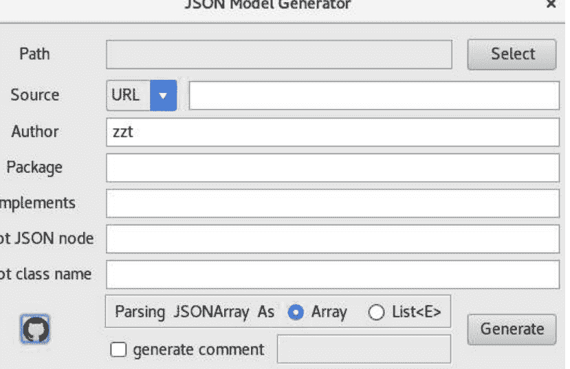

- 点击 `Generate` 按钮即可完成。

# 第 155 章：JShell

`JShell` 是 JDK 9 中的 Java 交互式 REPL（读写打印循环）。它允许开发者即时评估表达式、测试类并对 Java 语言进行实验。可以从此处获取 jdk 9 的早期访问版本：http://jdk.java.net/9/

## 155.1 节：编辑代码片段

JShell 使用的代码基本单元是代码片段（`snippet`）或源条目。每当你声明本地变量或定义方法或类时，你都会创建一个片段，其名称为该变量/方法/类的标识符。任何时候，你都可以使用 `/edit` 命令编辑你创建的片段。例如，假设我创建了一个包含单个方法 `bar` 的类 `Foo`：

```jshell
jshell> class Foo {
  ...> void bar() {
  ...
  }
}
```

现在，我想填满我的方法体。我不需要重写整个类，可以直接编辑它：

```jshell
jshell> /edit Foo
```

默认情况下，会弹出一个具有最基本功能的 Swing 编辑器。不过，你可以更改 JShell 使用的编辑器：

```jshell
jshell> /set editor emacs
jshell> /set editor vi
jshell> /set editor nano
jshell> /set editor -defaults
```

注意，如果新版本的片段包含任何语法错误，它可能无法保存。同样，只有当原始声明/定义在语法上是正确的，才会创建片段；以下操作无效：

```jshell
jshell> String st = String 3
// 省略错误
jshell> /edit st
| No such snippet: st
```

然而，尽管存在某些编译错误（例如类型不匹配），片段仍然可以编译——以下操作是有效的：

```jshell
jshell> int i = "hello"
jshell> /edit i
```

最后，可以使用 `/drop` 命令删除片段：

```jshell
jshell> int i = 1
jshell> /drop i
jshell> System.out.println(i)
| Error:
| cannot find symbol
| symbol: variable i
```

使用 `/reset` 重置 JVM 状态以删除片段：

```jshell
jshell> int i = 2
jshell> String s = "hi"
jshell> /reset
| Resetting state.
jshell> i
| Error:
| cannot find symbol
| symbol: variable i
| ^
jshell> s
| Error:
| cannot find symbol
| symbol: variable s
| ^
```

## 155.2 节：进入和退出 JShell

### 启动 JShell

在尝试启动 JShell 之前，确保 `JAVA_HOME` 指向 JDK 9 安装目录。运行以下命令启动 JShell：

```bash
$ jshell
```

如果顺利，你会看到 `jshell>` 提示符。

### 退出 JShell

在 `jshell` 提示符下运行以下命令：

```jshell
jshell> /exit
```

## 155.3 节：表达式

在 JShell 中，你可以评估带分号或不带分号的 Java 表达式。这些从基础表达式到复杂的语句：

```jshell
jshell> System.out.printf("I am %d years old.\n")
```

循环和条件判断也是可以的：

```jshell
jshell> for (int i = 0; i < 3; i++) {
  ... System.out.println(i);
  ... }
```

注意的是，块内的表达式必须带有分号。

## 155.4 节：方法和类

你可以在 JShell 中定义方法和类：

```jshell
jshell> void speak() {
  ... System.out.println("hello");
  ... }
```

```jshell
jshell> class MyClass {
  ... void doNothing() {}
  ... }
```

不需要访问修饰符。方法体内部需要分号。请注意，与变量一样，可以重新定义方法和类。查看方法或类的列表，分别在 JShell 提示符下输入 `/methods` 或 `/types`。

## 155.5 节：变量

你可以在 JShell 中声明本地变量：

```jshell
jshell> String s = "hi"
jshell> int i = s.length()
```

注意可以使用不同类型重新声明；这是完全有效的：

```jshell
jshell> String s = "hi"
jshell> int i = 3
```

在 JShell 提示符下输入 `/vars` 查看变量列表。

# 第 156 章：栈遍历 (Stack-Walking)

在 Java 9 之前，访问栈跟踪是有限的。JDK 9 通过 `StackWalker` 提供了替代方案，它是高效的。

## 156.1 节：打印所有栈帧

以下代码打印所有栈帧：

```java
package test;

import java.lang.StackWalker;
import java.lang.StackWalker.Frame;
import java.util.List;
import java.util.stream.Collectors;

public class StackExample {

    public static void main(String[] args) {
        StackWalker walker = StackWalker.of(StackWalker.RETAIN_CLASS);
        List<Frame> frames = walker.walk(s -> s.stream()
                                            .collect(Collectors.toList()));
        for (Frame frame : frames) {
            System.out.println(frame.getClassName() + " " + frame.getLineNumber() + " " + frame.getMethodName());
        }
    }
}
```

**输出：**

```
test.StackExample 13
```

## 156.2 节：打印当前类

以下代码打印当前调用类。在这种情况下，`StackWalker` 需要 `RETAIN_CLASS` 选项，否则会发生异常：

```java
package test;

import java.lang.StackWalker;
import java.lang.StackWalker.Frame;

public class StackExample {

    public static void main(String[] args) {
        StackWalker walker = StackWalker.of(StackWalker.RETAIN_CLASS);
        String className = walker.walk(s -> s.findFirst().get().getClassName());
        System.out.println(className);
    }
}
```

**输出：**

```
test.StackExample
```

## 156.3 节：显示反射和其他帧

其他几个选项允许实现栈跟踪。这可能对调试非常有用。例如，我们可以在创建 `StackWalker` 实例时使用 `SHOW_REFLECT_FRAMES` 选项，这样反射方法的帧也会被打印：

```java
package test;

import java.lang.StackWalker;
```


import java.lang.StackWalker.Option;
import java.lang.StackWalker.Frame;
import java.util.List;
import java.util.stream.Collectors;

public class StackExample {

    public static void main(String[] args) {
        StackWalker walker = StackWalker.of(Option.SHOW_REFLECT_FRAMES);
        List<Frame> frames = walker.walk(s -> s.stream()
                                            .collect(Collectors.toList()));
        for (Frame frame : frames) {
            System.out.println(frame.getClassName() + " " + frame.getLineNumber() + " " + frame.getMethodName());
        }
    }
}

```
test.BarHelper 27 bar
test.FooHelper 20 foo
jdk.internal.reflect.NativeMethodAccessorImpl -2 invoke
djk.internal.reflect.DelegatingMethodAccessorImpl 62 invoke
djk.internal.reflect.DelegatingMethodAccessorImpl 43 invoke
java.lang.reflect.Method 563 invoke
test.StackWalkerExample 14 invoke
```

注意，某些反射的行号可能不可用，因此 `StackFrame.getLineNumber()` 可能会返回负值。

# 第 157 章：Socket（套接字）

`Socket` 是网络上两个程序之间双向通信链路的一个端。

## 第 157.1 节：从 Socket 读取数据

```java
String hostName = args[0];
int portNumber = Integer.parseInt(args[1]);
try (
  Socket socket = new Socket(hostName, portNumber);
  PrintWriter out = new PrintWriter(socket.getOutputStream(), true);
  BufferedReader in = new BufferedReader(
    new InputStreamReader(socket.getInputStream()));
  BufferedReader stdIn = new BufferedReader(
    new InputStreamReader(System.in));
) {
  // Use the socket
}
```

# 第 158 章：Java Socket

`Socket` 是一种低层网络接口，有助于在两个程序（主要是客户端）之间建立连接，这些程序可能运行在同一台机器上。

`Socket` 编程是最广泛使用的网络概念之一。

## 第 158.1 节：简单的 TCP Echo 服务器

我们的 TCP Echo 服务器将是一个独立的线程。它非常简单。它只会回显你发送它的任何内容，但格式为大写字母。

```java
public class CAPECHOServer extends Thread {
    // 此类实现了服务器 socket。服务器 socket 只有在允许本地防火墙
    // 通过时，才会在网络上等待请求
    ServerSocket serverSocket;

    public CAPECHOServer(int port, int timeout) {
        try {
            // 在指定的端口上创建一个新的 Server
            serverSocket = new ServerSocket(port);
            // SoTimeout 基本上就是 socket 超时时间
            // timeout 是 socket 超时的时间，单位为毫秒
            serverSocket.setSoTimeout(timeout);
        } catch (IOException ex) {
            Logger.getLogger(CAPECHOServer.class.getName()).log(Level.SEVERE, null, ex);
        }
    }

    @Override
    public void run() {
        try {
            // 我们等待服务器持续接受连接
            while (!Thread.currentThread().isInterrupted()) {
                // 记录端口号和机器 IP
                Logger.getLogger(this.getClass().getName()).log(Level.INFO, "Listening for Clients at {0} on {1}", new Object[] {serverSocket.getPort(), InetAddress.getLocalHost().getHostAddress()});
                Socket client = serverSocket.accept(); // 接受客户端连接
                // 新的 DataInputStream 和 DataOutputStream
                DataInputStream istream = new DataInputStream(client.getInputStream()); // 来自客户端的输入流
                DataOutputStream ostream = new DataOutputStream(client.getOutputStream());
                // 注意
                // 服务器的输入是客户端的输出
                // 客户端的输入是服务器的输出
                // 发送欢迎消息
                ostream.writeUTF("Welcome!");
                String inString = istream.readUTF(); // 读取用户发送的内容
                String outString = inString.toUpperCase(); // 将其改为大写
                ostream.writeUTF(outString);
                // 关闭连接
                istream.close();
                ostream.close();
                client.close();
            }
        } catch (IOException ex) {
            Logger.getLogger(CAPECHOServer.class.getName()).log(Level.SEVERE, null, ex);
        } finally {
            // 完成后关闭服务器
            try {
                serverSocket.close();
            } catch (IOException exception) {
                Logger.getLogger(CAPECHOServer.class.getName()).log(Level.SEVERE, null, exception);
            }
        }
    }
}
```

如果你打开 telnet 并尝试连接，你将看到欢迎消息。

你必须使用你指定的端口和 IP 地址进行连接。

你应该看到类似下面的结果：

```
Welcome!
Connection to host lost.
```

嗯，连接丢失是因为我们终止了它。有时我们需要自己编写 TCP 客户端。在这种情况下，我们需要一个客户端来向用户请求输入并将其发送网络中，接收大写的输入。

如果服务器发送数据，那么客户端必须先读取数据。

```java
public class CAPECHOClient extends Thread {
    Socket server;
    Scanner key; // 用于输入的 Scanner

    public CAPECHOClient(String ip, int port) {
        try {
            server = new Socket(ip, port);
            key = new Scanner(System.in);
        } catch (IOException exception) {
            Logger.getLogger(CAPECHOClient.class.getName()).log(Level.SEVERE, null, exception);
        }
    }

    @Override
    public void run() {
        DataInputStream istream = null;
        DataOutputStream ostream = null;
        try {
            istream = new DataInputStream(server.getInputStream()); // 熟悉的代码
            ostream = new DataOutputStream(server.getOutputStream());
            System.out.println(istream.readUTF()); // 打印单词
            System.out.print("> ");
            String to = key.nextLine();
            ostream.writeUTF(to); // 将用户输入的任何内容发送到服务器
            System.out.println(istream.readUTF()); // 最后读取服务器发送的内容
        } catch (IOException ex) {
            Logger.getLogger(CAPECHOClient.class.getName()).log(Level.SEVERE, null, ex);
        } finally {
            try {
                if (istream != null) istream.close();
                if (ostream != null) ostream.close();
                if (server != null) server.close();
            } catch (IOException ex) {
                Logger.getLogger(CAPECHOClient.class.getName()).log(Level.SEVERE, null, ex);
            }
        }
    }
}
```

现在运行服务器和客户端，你应该得到类似下面的输出：

> Welcome!

# 第 159 章：FTP（文件传输协议）

| 参数 | 详情 |
| :--- | :--- |
| host | FTP 服务器的名称或 IP 地址 |
| port | FTP 服务器端口 |
| username | FTP 服务器用户名 |
| password | FTP 服务器密码 |

## 第 159.1 节：连接并登录服务器

要开始在 Java 中使用 FTP，你将...

```java
System.out.println("Operation failed. Server reply code: " + replyCode);
return;
}
boolean success = ftp.login(user, pass);
getServerReply(ftp);
if (!success) {
    System.out.println("Failed to log into the server");
    return;
} else {
    System.out.println("LOGGED IN SERVER");
}
}
```

接下来，让我们创建一个 Catch 块，以防在整个过程中遇到任何错误。

```java
catch (IOException ex) {
    System.out.println("Oops! Something went wrong.");
    ex.printStackTrace();
}
```

如果发生问题，catch 块将运行，如果有错误则会打印栈跟踪。
我们的最后一步是创建我们使用了一段时间的 `getServerReply()`。

```java
private static void getServerReply(FTPClient ftp) {
    String[] replies = ftp.getReplyStrings();
    if (replies != null && replies.length > 0) {
        for (String aReply : replies) {
            System.out.println("SERVER: " + aReply);
        }
    }
}
```

此函数接受一个 `FTPClient` 变量，并将服务器的任何回复存储在字符串数组中。接下来，它检查是否存储了任何消息。如果有，它将以“SERVER: reply”的格式打印每一个消息。现在我们已经定义了函数，这就是完整的脚本：

```java
import java.io.IOException;
import org.apache.commons.net.ftp.FTPClient;
import org.apache.commons.net.ftp.FTPReply;

public class FTPConnectAndLogin {
    private static void getServerReply(FTPClient ftp) {
        String[] replies = ftp.getReplyStrings();
        if (replies != null && replies.length > 0) {
            for (String aReply : replies) {
                System.out.println("SERVER: " + aReply);
            }
        }
    }

    public static void main(String[] args) {
        // SET THESE TO MATCH YOUR FTP SERVER //
        String server = "www.server.com";
        int port = 21;
        String user = "username";
        String pass = "password";
        FTPClient ftp = new FTPClient();
        try {
            ftp.connect(server, port);
            getServerReply(ftp);
            int replyCode = ftp.getResponseCode();
            if (!FTPReply.isPositiveCompletion(replyCode)) {
                System.out.println("Operation failed. Server reply code: " + replyCode);
                return;
            }
            boolean success = ftp.login(user, pass);
            getServerReply(ftp);
            if (!success) {


```java
System.out.println("Failed to log into the server");
return;
} else {
System.out.println("LOGGED IN SERVER");
}
} catch (IOException e) {
System.out.println("Oops! Something went wrong.");
e.printStackTrace();
}
}
}
```

我们首先需要创建一个新的 `FTPClient`，并尝试使用 `.connect(String server, int port)` 和 `.login(String username, String password)` 连接服务器并登录。使用 try/catch 块进行连接和登录是非常重要的，以防代码无法连接到服务器。我们还需要创建一个函数，用于检查并显示我们在尝试连接和登录时收到的任何消息。我们将其称为 `showServerReply(FTPClient ftp)`。

```java
import java.io.IOException;
import org.apache.commons.net.ftp.FTPClient;
import org.apache.commons.net.ftp.FTPReply;

public class FTPConnectAndLogin {
    private static void showServerReply(FTPClient ftp) {
        String[] replies = ftp.getReplyStrings();
        if (replies != null && replies.length > 0) {
            for (String reply : replies) {
                System.out.println("SERVER: " + reply);
            }
        }
    }

    public static void main(String[] args) {
        // SET THESE TO MATCH YOUR FTP SERVER //
        String server = "www.server.com";
        int port = 21;
        String user = "username";
        String pass = "password";
        FTPClient ftp = new FTPClient();
        try {
            ftp.connect(server, port);
            showServerReply(ftp);
            int replyCode = FTPClient.getResponseCode();
            if (!FTPReply.isPositiveCompletion(replyCode)) {
                System.out.println("Operation failed. Server reply code: " + replyCode);
                return;
            }
            boolean success = ftp.login(user, pass);
            showServerReply(ftp);
            if (!success) {
                System.out.println("Failed to log into the server");
                return;
            } else {
                System.out.println("LOGGED IN SERVER");
            }
        } catch (IOException e) {
            System.out.println("Oops! Something went wrong.");
            e.printStackTrace();
        }
    }
}
```

在此之后，你的 FTP 服务器现在应该已经连接到你的 Java 脚本中。

# 第 160 章：在 Java 中使用其他脚本语言

Java 本身是一种非常强大的语言，但它的力量可以得益于 JSR223（Java 规范请求 223）进行扩展。

```cpp
class OuterClass {
  ...
  class InnerClass {
    ...
  }
}
```

# 在 C++ 中在类内静态定义

静态嵌套类

```cpp
class Outer {
  class Inner {
    ...
  };
};
```

# Java

静态嵌套类（又静态成员类）[ref]

```java
class OuterClass {
  static class StaticNestedClass {
    ...
  }
}
```

# 在方法内定义

（例如事件处理）

# C++

局部类 [ref]

```cpp
void fun() {
  class Test {
    /* Test 类的成员变量 */
  };
}
```

# Java

局部类 [ref]

```java
class Test {
  void f() {
    new Thread(new Runnable() {
      public void run() {
        doSomethingBackgroundish();
      }
    }).start();
  }
}
```

# 第 161.3 节：值传递与引用传递

许多人认为 Java **仅是**值传递的，但情况比这更微妙。对比 C++ 和 Java 的示例，可以查看值传递（即拷贝）和引用传递（即别名）的多种表现形式。

### C++ 示例（完整代码）

```cpp
// 传递对象的拷贝
static void passByCopy(PassIt obj) {
    obj.i = 22; // 仅是“局部”变化
}

// 传递指针
static void passByPointer(PassIt* ptr) {
    ptr->i = 33;
    ptr = 0; // 使用 nullptr 替替 '0' 更好
}

// 传递别名（即引用）
static void passByAlias(PassIt& ref) {
    ref.i = 44;
}
```

这是一种旧式的做法。查看 `std::swap(PassIt** pptr1, PassIt** pptr2)` 以获取实现此操作的最佳方法。

```cpp
static void swap(PassIt** pptr1, PassIt** pptr2) {
    PassIt* tmp = *pptr1;
    *pptr1 = *pptr2;
    *pptr2 = tmp;
}
```

### Java 示例（完整代码）

```java
// 传递变量的拷贝
// 注意：在 java 中所有基本数据类型都是值传递
public static void passByCopy(int copy) {
    copy = 33; // 仅是“局部”变化
}

// Java 中没有指针
/*
public static void passByPointer(PassIt* ptr) {
    ptr->i = 33;
    ptr = 0; // 使用 nullptr 替替 '0' 更好
}
*/
```

```java
// 传递别名（即引用）
public static void passByAlias(PassIt ref) {
    ref.i = 44;
}
```

```java
// 传递别名（即引用），
// 但为了进行“手动”的、可能昂贵的拷贝
public static void swap(PassIt ref1, PassIt ref2) {
    PassIt tmp = new PassIt(ref1);
    ref1.copy(ref2);
    ref2.copy(tmp);
}
```

# 第 161.4 节：继承与组合

C++ 和 Java 都是面向对象的语言，因此以下图表适用于两者。

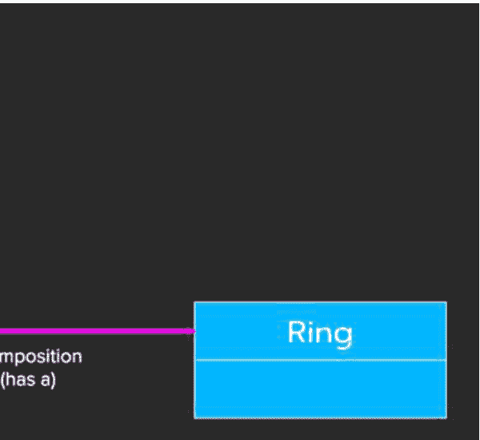

# 第 161.5 节：强制向下转换

小心使用“强制向下转换”（Downcasting）——向下转换是从继承层次中从基类到子类的转换（即多态的相反）。通常，请使用多态和重写，而不是使用 `instanceof` 向下转换。

### C++ 示例

```cpp
// 需要显式类型转换
Child *pChild = (Child *) &parent;
```

### Java 示例

```java
if(myClass instanceof SubClass) {
  SubClass myClass = (SubClass)someBaseClass;
  myClass.nonInheritedMethod();
}
```

# 第 161.6 节：抽象方法与类

### 抽象方法
声明时没有实现

### C++
纯虚函数
```cpp
virtual void eat(void) = 0;
```

### Java
抽象方法
```java
abstract void draw();
```

### 抽象类
不能实例化

### C++
不能实例化；至少包含 1 个纯虚函数
```cpp
class AB { public: virtual void f() = 0; };
```

### Java
不能实例化；可以有非抽象方法
```java
abstract class GraphicObject {}
```

### 接口
没有实例字段

### C++
没有与 Java 相当的特性

### Java
与抽象类非常相似，1) 支持多继承；2) 没有实例字段
```java
interface TestInterface {}
```

# 第 162 章：音频

## 第 162.1 节：播放 MIDI 文件

可以使用 `javax.sound.midi` 包中的几个类来播放 MIDI 文件。`Sequencer`（定序器）执行 MIDI 文件的播放，它的许多方法可以设置播放控制，如循环次数、节拍、跟踪节拍等。

MIDI 数据的通用播放可以通过这种方式：

```java
import java.io.File;
import java.io.IOException;
import javax.sound.midi.InvalidMidiException;
import javax.sound.midi.MidiSystem;
import javax.sound.midi.MidiUnavailableException;
import javax.sound.midi.Sequence;
import javax.sound.midi.Sequencer;

public class MidiPlayback {
    public static void main(String[] args) {
        try {
            Sequencer sequencer = MidiSystem.getSequencer(); // 获取默认 sequencer
            if (sequencer == null) {
                System.err.println("Sequencer supported");
                return;
            }
            sequencer.open(); // 打开设备
            // 创建序列，文件必须包含 MIDI 数据
            Sequence sequence = MidiSystem.getSequence(new File(args[0])); // 加载到 sequencer
            sequencer.start(); // 开始播放
        } catch (MidiUnavailableException | InvalidMidiException | IOException ex) {
            ex.printStackTrace();
        }
    }
}
```

停止播放使用：
```java
sequencer.stop(); // 停止播放
```

可以在播放期间静音 sequencer 的某个轨道。以下示例将第一个轨道静音：
```java
import javax.sound.midi.Track;
// ...
Track[] track = sequence.getTracks();
sequencer.setMute(track[0]);
```

如果设置了循环次数，sequencer 可以重复播放。以下示例设置 sequencer 播放四次或无限循环：
```java
sequencer.setLoopCount(3);
sequencer.loop(Sequencer.LOOP_CONTINUOUS);
```

sequencer 不必从开始播放序列，不必到结束。可以通过指定序列中的 tick 来开始和结束。也可以手动指定 sequencer 从哪个 tick 开始：
```java
sequencer.setLoopStartPoint(512);
sequencer.setLoopEndPoint(32768);
sequencer.setTickPosition(8192);
```

`Sequencer` 还可以以特定的速度播放 MIDI 文件，可以通过每分钟节拍（BPM）或每四分音符微秒（MPQ）来控制。也可以调整播放因子。
```java
sequencer.setTempoInBPM(125f);
sequencer.setTempoInMPQ(475f);
sequencer.setTempoFactor(1.5f);
```

完成 `Sequencer` 使用后，记得关闭：
```java
sequencer.close();
```

## 第 162.2 节：循环播放音频文件

需要的导入：
```java
import java.sound.sampled.AudioSystem;
import java.sound.sampled.Clip;
```


这段代码将在启动后创建一个 clip 并连续播放：

```java
Clip clip = AudioSystem.getClip();
clip.open(AudioSystem.getAudioInputStream(new URL(filename)));
clip.start();
clip.loop(Clip.LOOP_CONTINUOUS);
```

获取所有支持的文件类型：

```java
AudioFormat.Type[] audioFileTypes = AudioSystem.getAudioFileTypes();
```

# 第 162.3 节：基础音频输出

从本地或网络存储播放声音文件的方法如下。它适用于未压缩的 .wav 文件，并在播放 mp3 或压缩文件时使用。

```java
import java.io.*;
import java.net.URL;
import javax.sound.sampled.*;
```

```java
public class SoundClipTest {
    // 构造函数
    public SoundClipTest() {
        try {
            // 打开音频输入流
            File soundFile = new File("/usr/share/sounds/alsa/Front_Center.wav"); // 你可以使用 URL 获取声音文件
            AudioInputStream audioIn = AudioSystem.getAudioInputStream(soundFile);
            AudioFormat format = audioIn.getFormat();

            // 获取 clip 资源
            DataLine.Info info = new DataLine.Info(Clip.class, format);
            Clip clip = (Clip) AudioSystem.getLine(info);

            // 打开音频 clip 并从音频输入流加载采样
            clip.open(audioIn);
            clip.start();
        } catch (UnsupportedAudioException e) {
            e.printStackTrace();
        } catch (IOException e) {
            e.printStackTrace();
        } catch (LineUnavailableException e) {
            e.printStackTrace();
        }
    }

    public static void main(String[] args) {
    }
}
```

# 第 162.4 节：底层音频

使用 Java 产生声音时也可以采用底层。这段代码将原始二进制数据写入系统的音频缓冲区以生成声音。理解生成此类声音的局限性和必要的计算至关重要。因为播放几乎是瞬时的，所以计算需要几乎实时地完成。

由于此方法无法用于复杂的采样，对于此类目的，使用专用工具是更好的方法。

以下方法生成并直接输出在给定频率、给定音量、给定时长下的矩形波。

```java
public void rectangleWave(byte volume, int hertz, int msecs) {
    final SourceDataLine line;

    // 24 kHz x 8bit, 单通道, 符号端 AudioFormat
    AudioFormat af = new AudioFormat(24000, 8, 1, true, false);

    try {
        line = AudioSystem.getSourceDataLine(af);
        line.open(af, 10000); // 音频缓冲区大小：1万个采样
    } catch (LineUnavailableException e) {
        throw new RuntimeException(e);
    }

    int waveHalf = 24000 / hertz; // 半周期的采样数
    byte[] buffer = new byte[waveHalf];
    msecs = msecs * (24000 / 1000); // 24 k (采样/秒) / 1000 (ms/秒) * 时间(ms)

    line.start(); // 开始播放

    for (int i = 0; i < msecs; i += buffer.length) {
        for (int j = 0; j < 20; j++) { // 向缓冲区生成20个波
            int sign = -1;
            // 用音量填充第 j 个半波到第 j+1 个半波
            Arrays.fill(buffer, waveHalf * j, waveHalf * (j + 1), (byte) (volume * sign));
        }
        line.write(buffer, 0, buffer.length);
    }

    line.drain(); // 强制缓冲区刷新到硬件
}
```

```java
dataLine.stop(); // 结束播放
}
```

为了生成具差异化的声波，可能需要进行正弦计算和更大的样本量。这会导致代码变得复杂得多，因此在此省略。

## 第 163 章：Java Print Service

Java Print Service API 提供了发现打印服务以及向它们发送打印请求的功能。

它包含了基于 IETF 规范 RFC 2911 中指定的互联网打印协议 (IPP) 1.1 标准属性的扩展性打印属性。

### 第 163.1 节：构建将要打印的 Doc

`Doc` 是一个接口，而 Java Print Service API 提供了一个名为 `SimpleDoc` 的简单实现。

每个实例基本上由两部分组成：

- 打印数据内容本身（电子邮件、图像、文档等）
- 打印数据格式，称为 `DocFlavor`（MIME 类型 + 表示类）。

在创建 `Doc` 对象之前，我们需要从某处加载文档。在示例中，我们将从数据加载一个特定文件：

```java
FileInputStream pdf = new FileInputStream("something.pdf");
```

现在，我们必须选择一个与内容匹配的 `DocFlavor`。`DocFlavor` 拥有一组表示数据用途的常量。让我们选择 `INPUT_STREAM.PDF`：

```java
DocFlavor pdfFlavor = DocFlavor.INPUT_STREAM.PDF;
```

现在，我们可以创建一个 `SimpleDoc` 的新实例：

```java
Doc doc = new SimpleDoc(pdfInputStream, pdfFlavor, null);
```

该 `doc` 对象现在可以发送到打印作业中（参见从打印服务创建打印作业）。

### 第 163.2 节：发现可用打印服务

要发现所有可用的打印服务，我们可以使用 `PrintServiceLookup` 类。让我们看看如何：

```java
import javax.print.PrintService;
import javax.print.PrintServiceLookup;

public class DiscoveringAvailablePrintServices {
    public static void main(String[] args) {
        discoverPrintServices();
    }

    public static void discoverPrintServices() {
        PrintService[] allPrintServices = PrintServiceLookup.lookupPrintServices(null, null);
        for (PrintService printService : allPrintServices) {
            System.out.println("Print service name: " + printService.getName());
        }
    }
}
```

此程序在 Windows 环境下执行时，将打印如下内容：

```text
Print service name: Fax
Print service name: Microsoft Print to PDF
Print service name: Microsoft XPS Document Viewer
```

### 第 163.3 节：定义打印请求属性

有时我们需要确定打印请求的某些方面。我们称它们为属性（attribute）。

打印请求属性的示例包括：

- 份数（1, 2 等）
- 方向（纵向或横向）
- 色度（单色、彩色）
- 质量（草稿、普通、高质）
- 面数（单面、双面等）
- 等此类推……

在选择其中一个以及每个属性对应的值之前，我们首先需要构建一个属性集：

```java
PrintRequestAttributeSet pras = new HashPrintRequestAttributeSet();
```

现在我们可以添加了。一些示例是：

```java
pras.add(new Copies(5));
pras.add(MediaSize.ISO_A4);
pras.add(OrientationRequested.PORTRAIT);
pras.add(PrintQuality.NORMAL);
```

`pras` 对象现在可以发送到打印作业请求中（从打印服务创建打印作业）。

### 第 163.4 节：监听打印作业状态变化

对于大多数打印客户端来说，知道打印作业是已完成还是失败是极其有用的。

Java Print API 提供了一些功能来获取这些场景的信息。我们必须做：

- 为 `PrintJobListener` 接口提供实现，并且
- 在打印作业处注册此实现。

当打印作业状态变化时，我们将收到通知。我们可以执行任何需要的操作，例如：

- 更新用户界面，
- 另一个业务流程，
- 在数据库中记录某些内容，
- 或者简单的记录。

在下面的示例中，我们将记录每个打印作业的状态变化：

```java
import javax.print.event.PrintJobEvent;
import javax.print.event.PrintJobListener;
import java.util.logging.Logger;

public class LoggerPrintJobListener implements PrintJobListener {
    // 编写你喜欢的 Logger 类！
    private static final Logger LOG = Logger.getLogger(LoggerPrintJobListener.class.getName());

    public void printDataTransferCompleted(PrintJobEvent pje) {
        LOG.info("Print data transfer completed ;");
    }

    public void printJobCompleted(PrintJobEvent pje) {
        LOG.info("Print job completed =");
    }

    public void printJobFailed(PrintJobEvent pje) {
        LOG.info("Print job failed =(");
    }

    public void printJobCanceled(PrintJobEvent pje) {
        LOG.info("Print job canceled |:");
    }

    public void printJobNoMoreEvents(PrintJobEvent pje) {
        LOG.info("No more events to the job ");
    }

    public void printJobRequiresAttention(PrintJobEvent pje) {
        LOG.info("Print job requires attention :0 ");
    }
}
```

最后，我们可以在打印请求本身之前将我们的作业监听器实现添加到打印作业中，如下：

#### PrintEvent pje 参数

注意每个方法都有一个 `PrintEvent pje` 参数。


注意每个方法都有一个 `PrintEvent pje` 参数。

注意目标。

另一种实现目标的方法是扩展 `PrintJobAdapter`，我们得到了。

在下面的示例中，`calculateShippingPrice` 方法计算运费，这需要一些处理时间。在真实世界中，这将会是例如联系另一个服务器，它根据产品重量返回价格。

通过 `CompletableFuture` 对这种异步进行建模，我们可以在方法中继续不同的工作（即：计算包装成本）。

# 第 164 章：CompletableFuture

`CompletableFuture` 是 Java 8 添加的类，它实现了 `Future` 接口。除了支持 `Future` 接口外，它还增加了许多方法，允许在 future 完成时执行异步回调。

## 第 16.4.1 节：CompletableFuture 的简单示例

在下面的示例中，`calculateShippingPrice` 方法计算运费，这需要一些处理时间。在真实世界中，这将会是例如联系另一个服务器，它根据产品重量返回价格。

```java
public static void main(String[] args) {
    int price = 15; // 保持简单并使用整数价格
    int weightInGrams = 900;

    calculateShippingPrice(weightInGrams) // 这里，我们得到了 future
        .thenAccept(shippingPrice -> { // 然后立即对其处理
            // 这种链式风格对于保持简洁非常有用
            System.out.println("您的总价为：" + (price + shippingPrice));
        });
    System.out.println("请稍候。我们正在计算您的总价.");
}

public static CompletableFuture<Integer> calculateShippingPrice(int weightInGrams) {
    return CompletableFuture.supplyAsync(() -> {
        // supplyAsync<U> 是一个工厂方法，它将给定的
        // Supplier<U> 转换为 CompletableFuture<U>

        // 假设每 200 克运费会增加 1 美元
        int shippingCosts = 200;

        try {
            Thread.sleep(2000L); // 现在让我们模拟一些等待时间...
        } catch (InterruptedException e) { /* 我们可以安全地忽略那个 */ }

        return shippingCosts; // 并返回成本！
    });
}
```

# 第 165 章：运行时命令

## 第 165.1 节：添加关闭钩子（shutdown hooks）

有时你需要在程序停止时执行某些代码，例如释放你打开的系统资源。你可以通过 `addShutdownHook` 方法在程序停止时运行一个线程：

```java
Runtime.getRuntime().addShutdownHook(new Thread(() -> {
    ImportantStuff.someImportantIOStream.close();
}));
```

# 第 166 章：单元测试

单元测试是测试驱动开发（TDD）不可或缺的一部分，也是构建任何健壮应用程序的重要特性。在 Java 中，单元测试几乎完全通过外部库和框架完成，其中大多数框架都有自己的文档标签。本文存根作为向读者介绍可用工具及其各自文档的手段。

## 第 166.1 节：什么是单元测试？

这有点像个谜。之所以放在这里是因为文档被要求包含一个示例，即使它 只是一个占位符文章。如果你已经了解单元测试的基础知识，可以随时跳到备注部分，那里会提到特定的框架。

单元测试是确保给定模块的行为符合预期。在大规模应用程序中，确保模块在真空环境中恰当执行是确保应用程序保真度（fidelity）的重要部分。

考虑以下（微微的）伪示例：

```java
public class Example {
    public static void main(String args[]) {
        new Example();
    }
}

// 应用级测试。
public Example() {
    Consumer c = new Consumer();
    System.out.println("VALUE = " + c.getValue());
}

// 你的模块。
class Consumer {
    private Capitalizer c;

    public Consumer() {
        c = new Capitalizer();
    }

    public String getValue() {
        return c.getValue();
    }
}

// 另一个团队的模块。
class Capitalizer {
    private DataReader dr;

    public Capitalizer() {
        dr = new DataReader();
    }

    public String getValue() {
        return dr.readVal().toUpperCase();
    }
}

// 另一个团队的模块。
class DataReader {
    public String readVal() {
// 指向应用程序部署中某处的文件，或者
// 可能通过特定部署的网络获取。
File f;
String s = "data";
// ... 从 f 读取数据到 s ...
return s;
}
}
```

所以这个示例是微不足道的：DataReader 从文件读取数据，将其传递给 Capitalizer，Capitalizer 将所有字符转换为大写，然后传递给 Consumer。但 DataReader 与我们的应用程序环境紧密耦合，因此我们将此测试推迟到我们准备好发布测试版本为止。

现在，假设在发布过程中，由于未知原因，Capitalizer 中的 `get()` 方法从返回 `toString()` 字符串变为了返回 `toLowerCase()` 字符串：

```java
// 另一个团队的模块。
class Capitalizer {
    public String getVal() {
        return dr.readVal().toLowerCase();
    }
}
```

显然，这破坏了预期的行为。但是，由于执行 DataReader 涉及的过程非常繁琐，我们在下一次测试部署之前都不会注意到这一点。这个 bug 在我们的系统中潜伏了几天、几周或几个月，然后产品经理发现了它，并立刻转向你——即与 Consumer 相关的团队。“为什么会发生这种情况？你们你们了了什么？”显然，你一头雾水。你不知道发生了什么变化。你没有更改任何应该触碰的代码；为什么它突然坏了？

最终，在团队之间的讨论和协作之后，问题被追踪到并解决了。但它引发了一个问题：如何防止这种情况的发生？

有两个显而易见的点：

### 测试需要是自动化

我们对手动测试的依赖让这个 bug 被忽视了太久。我们需要一种方法来自动化过程，使 bug 的引入立即被发现。而不是 5 周后。不是 5 天后。而是现在。

你必须意识到，在这个例子中，我表达了一个非常微小的引入且未被察觉的 bug。在工业级应用程序中，几十个模块在不断更新，变化可能会随处渗透。你修复了某个模块的某个问题，却发现你“修复”的行为在某些地方仍然存在（无论是在内部还是外部）。

如果没有严谨的验证，问题就会渗入系统。可能的情况，如果忽视得足够久，这将导致在尝试修复更改（以及修复那些修复方案）上花费大量的额外精力，以至于产品的投入精力反而可能增加。你不希望处于这种境地。

### 测试需要细粒度

我们在示例中指出的第二个问题是追踪 bug 所花费的时间。经理在发现它时通知了你，你进行了调查并发现 Capitalizer 返回了看似错误的数据，你带着你的发现通知了 Capitalizer 团队，他们进行了调查，等等，等等。

关于这个微小示例的数量和难度，我在在这里表达的观点是一样的。任何精通 Java 的人都能快速发现引入的问题。但追踪和沟通问题通常要困难得多、得多。也许 Capitalizer 团队给你提供了一个带 rose 字的 JAR 包。也许他们位于地球的另一端，通信非常困难（可能只是每天发送一次 e-mails）。这可能导致 bug 需要几周或更长的时间来追踪（而且，对于给定的版本，可能有多个这样的 bug）。

为了缓解这种情况，我们希望确保细粒度的测试。想象一下，有一个测试专门在 bug 被引入的地方捕获了它。我们将立即知道原因，而不需要数周的跨团队沟通。

# 第 167 章：断言（assert）

参数详情

`expression1` 断言语句如果求值为 false，则抛出 AssertionError。

`expression2` 可选。使用时，AssertionError 将带有此消息。

## 第 167.1 节：使用 assert 检查算术

```java
a = Math.abs(1 - 2);
assert a >= 0 : "计算值 " + a + " 超出范围";
return a;
```

# 第 168 章：多版本 JAR 文件

Java 9 引入的特性之一是多版本 JAR (MRJAR)，它允许在同一个 jar 包中封装针对多个版本的代码。该特性在 PEP 238 中规范。

## 第 168.1 节：多版本 JAR 内容示例

通过在 MANIFEST.MF 文件中设置 `Multi-Release:true`，jar 将变成一个多版本 jar，Java 运行时（因为它支持 MRJAR 格式）将根据当前选择相应的版本。

此类 JAR 的结构如下：

```
jar root
- A.class
  - B.class
  - C.class
  - D.class
  - META-INF
    - versions
      - 9
        - A.class
        - B.class
      - 10
        - A.class
```

* 对于 JDK < 9，只有根目录下的类对 Java 运行时可见的。
* 对于 JDK 9，A 和 B 类将从 META-INF/versions/9 加载，而 C 和 D 类从基础目录加载。
* 对于 JDK 10，A 将从 META-INF/versions/10加载。

## 第 168.2 节：使用工具创建多版本 JAR

可以使用 `jar` 命令创建一个多版本 JAR，其中包含针对 Java 8 和 Java 9 编译的类的两个版本，尽管会有一个类完全相同的警告：


```
C:\Users\manauti-jar --create file.jar -C sampleproject-base demo --release 9 -C sampleproject-9 demo
Warning: entry META-INF/versions/9/demo/SampleClass.class contains a class that is identical to an entry already in the jar
```

`--release 9` 告诉 `jar` 将后续（`sampleproject-9` 中的 `demo` 包）包含在 MRJAR 中，命名为 `root/META-INF/versions/9`。结果如下：

```
jar root
- demo
  - SampleClass.class
- META-INF
  - versions
    - 9
      - SampleClass.class
```

现在让我们创建一个 `Main` 类来打印 `SampleClass` 的 URL，并为 Java 9 版本添加它：

```java
package demo;

import java.net.URL;

public class Main {
    public static void main(String[] args) throws Exception {
        URL url = Main.class.getClassLoader().getResource("demo/SampleClass.class");
        System.out.println(url);
    }
}
```

如果我们编译此内容并重新运行 `jar` 命令，将会得到一个错误：

```
C:\Users\manouti\jar --create file MR.jar -C sampleproject-demo --release 9 -C
sampleproject-9 demo: META-INF/versions/9/demo/Main.class contains a new public class not found in base entries
Warning: entry META-INF/versions/9/demo/SampleClass.class contains a class that
is identical to an entry already in the jar
invalid multi-release jar deleted
```

原因是 `jar` 工具防止在类未添加到基础条目（base entries）的情况下将其添加到版本化条目（versioned entries）。这样做是为了让 MRJAR 为不同的 Java 版本导出相同的公共 API。请注意，在运行时这并不是必需的。它可能只被 `jar` 等工具应用。在这种情况下，`Main` 的目的是运行示例代码，因此我们可以简单地在基础条目中添加一个副本。如果该类是 Java 9 才需要的的新实现，则可以将其设为非公共。

要添加到根条目，我们首先需要将其编译为 Java 9 之前的版本。这可以使用新的 `--release` java 选项完成：

```
C:\Users\manouti\sampleproject-base\demo>javac --release 8 Main.java
C:\Users\manouti\sampleproject-base\demo>cd ../
C:\Users\manouti>jar --create file MR.jar -C sampleproject-demo --release 9 -C
sampleproject-9 demo
```

运行该类显示 `SampleClass` 是从版本化目录加载的：

```
C:\Users\manouti>java -class path MR.jar demo.Main
jarfile=C:\Users\manouti\MR.jar!/META-INF/versions/9/demo/SampleClass.class
```

# 第 168.3 节：多版本类内部加载的类的 URL

给定以下多版本 jar：

- jar 根目录
- demo
  - SampleClass.class
- META-INF
  - versions
    - 9
      - SampleClass.class

以下类打印 `SampleClass` 的 URL：

```java
package demo;

import java.net.URL;

public class Main {

    public static void main(String[] args) throws Exception {
        URL url = Main.class.getClassLoader().getResource("demo/SampleClass.class");
        System.out.println(url);
    }
}
```

如果该类被编译并添加到 MRJAR 中 Java 9 的版本化条目中，运行它将导致：

```
C:\Users\manouti>java --classpath MR.jar Main
jarfile:C:\Users/manouti/MR.jar!/META-INF/versions/9/demo/SampleClass.class
```

# 第 169 章：即时编译 (JIT) 编译器

## 第 169.1 节：概述

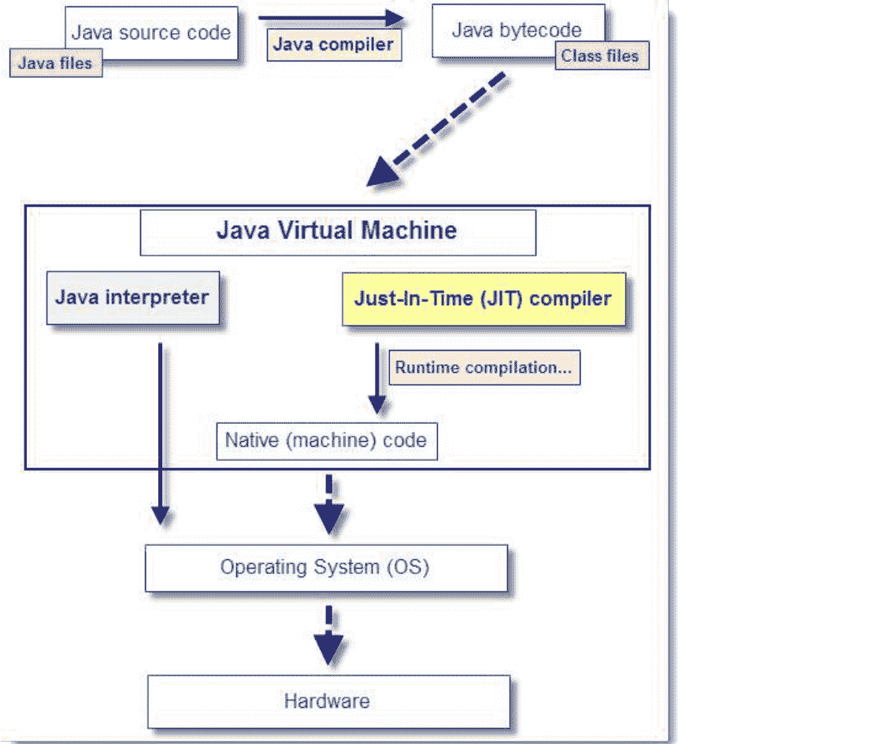

即时编译（JIT）编译器是 Java™ 运行时的一个组件，它可以提高 Java 在运行的性能。

- Java 程序由类组成，类包含与平台的字节码，这些字节码可以由许多不同计算机架构上的 JVM 解释。
- 在运行时，JVM 加载类文件，确定每个单独字节码的语义，并执行相应的计算。

解释过程中额外的处理器和内存消耗，意味着 Java 应用程序的运行速度比原生应用程序慢。

JIT 编译器通过在运行时将字节码编译为原生机器码来提高 Java 程序的性能。

JIT 编译器默认启用，并在当 Java 方法被调用时激活。JIT 编译器将方法的字节码编译为原生机器码，“**即时**”进行编译以备运行。

当一个方法被编译后，JVM 将直接调用方法的编译后代码，而不是对其进行解释。从理论上说，如果编译不需要处理器和内存消耗，编译每个方法可以使 Java 程序的速度接近原生应用程序。

JIT 编译确实需要处理器和内存消耗。当 JVM 首次启动时，会被调用数千万个方法。编译所有这些方法会显著影响启动时间，即使程序实现了非常出色的峰值性能。

- 在实践中，方法在第一次调用时并不会编译。对于每个方法，JVM 维护一个调用计数，每当方法被调用时计数就会加增。
- JVM 解释方法，直到其调用计数超过 JIT 编译阈值。
- 因此，常用的方法在 JVM 启动后不久就会编译，而较少使用的方法在之后才编译，或者根本不编译。
- JIT 编译阈值经过仔细选择，以便在启动时间和长期性能之间获得最佳平衡。
- 方法被编译后，其调用计数被重置为零，对该方法的后续调用继续增加其计数。
- 当方法的调用计数达到 JIT 重编译阈值时，JIT 编译器会对其编译。

# 第 170 章：字节码

## 170.1 节：什么是字节码

字节码是 JVM 的指令集。为了说明这一点，让我们来看 Hello World：

```java
public static void main(String[] args) {
    System.out.println("Hello World");
}
```

这就是转换后的字节码：

```
public static main([L/String;)V
getstatic java/lang/System out
ldc "Hello World"
invokirtual java/io/PrintStream print
```

**背后的逻辑是什么？**

- **getstatic** - 获取类静态字段的值。在这种情况下，是 `PrintStream out`。
- **ldc** - 将常量推入栈。在这种情况下，是 `String "Hello World"`。
- **invokirtual** - 在加载的栈引用上调用方法，并将结果放入栈中。方法的参数也从栈中获取。

**好吧，还有更多吗？**

有 255 个操作码，但并非都已实现。可以在这里找到所有操作码的表格：[Java instructions]。

**我如何编写/编辑字节码？**

有多种方法可以编写和编辑字节码。可以使用编译器、库或程序。

编写：

- Jasmin
- Krakatau

编辑：

- 库
  - ASM
  - Javassist
  - BCEL - 不支持 Java 8+
- 工具
  - Bytecode-Viewer
  - JByedit
  - rej - 不支持 Java 8+
  - JBE - 不支持 Java 8+

**我想了解更多关于字节码的信息**

可能有一个专门针对字节码的文档页面。本文关注修改

### 2. 如何使用 ASM 编辑 jar 文件

首先需要加载 jar 包中的类。我们将使用以下三个方法来实现这一过程：

- `loadClasses(File)`
- `readJar(jarFile, jarEntry, Map)`
- `getNode(byte[])`

```java
Map<String, ClassNode> loadClasses(File jarFile) throws IOException {
  Map<String, ClassNode> classes = new HashMap<String, ClassNode>();
  JarFile jar = new JarFile(jarFile);
  Stream<JarEntry> str = jar.stream();
  str.forEach(z -> readJar(jar, classes));
  jar.close();
  return classes;
}
```

有了这些方法，加载 jar 文件就变成了修改 map 中 `ClassNode` 的简单问题。在这个示例中，我们将使用 Tree API 将 jar 中所有的 `String` 替换为大写。

```java
File jarFile = new File("sample.jar");
Map<String, ClassNode> nodes = loadClasses(jarFile);
```

```java
// 遍历 ClassNodes
for (ClassNode cn : nodes.values()) {
  // 遍历类中的方法
  for (MethodNode mn : cn.methods) {
    // 遍历方法中的指令
    for (AbstractInsnNode ain : mn.instructions.toArray()) {
      // 如果指令正在加载常量值
      if (ain.getOpcode() == Opcodes.LDC) {
        // 将当前指令强制转换为 Ldc
        // 如果常量是字符串，则将其大大写
        LdcInsnNode ldc = (LdcInsnNode)ain;
        if (ldc.cst instanceof String) {
          ldc.cst = ldc.cst.toString().toUpperCase();
        }
      }
    }
  }
}
```

现在所有 `ClassNode` 的字符串已修改完毕，以便保存更改。为了保存更改并获得可输出，必须完成以下几操作：

- 导出节点 (Nodes)
- 将非类条目（例如 `Manifest.mf` / jar 中的其他资源）加载为字节数组
- 将所有内容保存到新的 jar 包中

根据上面的最后部分，我们将创建三个方法。

- `processNodes(Map<String, ClassNode> nodes)`
- `loadNonClasses(File jarFile)`
- `saveAsJar(Map<String, byte[]> outBytes, String fileName)`

用法：

```java
Map<String, byte[]> out = process(nodes, new HashMap<String, MappedClass>());

out.putAll(loadNonClass.entries(jarFile));

saveAsJar(out, "sample-exit.jar");
```

使用的方法：

```java
static Map<String, byte[]> processNodes(Map<String, ClassNode> nodes, Map<String, MappedClass> mappings) {

  Map<String, byte[]> out = new HashMap<String, byte[]>();

  // 遍历节点并将它们添加到 <类名, 类字节码> 映射中

  // 使用 FrameFrames，栈栈帧将自动重新计算

  for (ClassNode cn : nodes.values()) {

    ClassWriter cw = new ClassWriter(ClassWriter.COMPUTE_FRAMES);

    out.put(mappings.containsKey(cn.name)?mappings.get(cn.name).getName() : cn.name, cw.toByteArray());

  }

  return out;

}
```

```java
static Map<String, byte[]> loadNonClasses(File jarFile) throws IOException {

  Map<String, byte[]> entries = new HashMap<String, byte[]>();

  ZipInputStream jis = new ZipInputStream(new FileInputStream(jarFile));

  Entry entry;

  // 遍历所有条目

  while ((entry = jis.getNextEntry()) != null) {

try {

    String name = entry.getName();

    if (!name.endsWith(".class") && entry.isDirectory()) {

        // byte[] toByteArray(InputStream input)

        // 将每个条目添加到映射 <name, Entry 字节码>

        byte[] bytes = IOUtils.toByteArray(jis);

        entries.put(name, bytes);

    }

} catch (Exception e) {

    e.printStackTrace();

} finally {

    entry.close();

}

jis.close();

return entries;

}
```

```java
static void saveAsJar(Map<String, byte[]> outBytes, String fileName) {

    try {

        // 创建 jar 输出流

        JarOutputStream out = new JarOutputStream(new FileOutputStream(fileName));

        // 对于映射中的每个条目，保存字节数组

        for (String entry : outBytes.keySet()) {

            // 将类名添加到类条目

            String ext = entry.contains(".*") ? "" : ".class";

            out.putNextEntry(new ZipEntry(entry + ext));

            out.write(outBytes.get(entry));

            out.closeEntry();

        }

        out.close();

    } catch (IOException e) {

        e.printStackTrace();

    }
}
```


就是这样。所有更改将保存到 `sample-edit.jar`。

# 第 170.3 节：如何将 `ClassNode` 加载为 `Class`

```java
/**
 * 从 ClassNode 加载类
 * @param cn 要加载的 ClassNode
 * @return
 */
```

```java
public static Class<?> load(ClassNode cn) {
    ClassWriter cw = new ClassWriter(ClassWriter.COMPUTE_FRAMES);
    return new ClassDefiner(ClassLoader.getSystemClassLoader()).get(cn.name.replace("/", "."), cw.toByteArray());
}
```

```java
/**
 * 从字节码加载类的类加载器。
 */
```

```java
static class ClassDefiner extends ClassLoader {
    public ClassDefiner(ClassLoader parent) {
        super(parent);
    }
}
```

Kickeroom - Java® 专业人士笔记

```java
public Class<?> get(String name, byte[] bytes) {
    Class<?> c = defineClass(name, bytes, 0, bytes.length);
    resolve(c);
    return c;
}
```

# 第 170.4 节：如何重命名 jar 文件中的类

```java
public static void main(String[] args) throws Exception {
    File jarFile = new File("Input.jar");
    Map<String, ClassNode> nodes = JarUtils.loadClasses(jarFile);
    Map<String, byte[]> out = JarUtils.loadNonClassEntries(jarFile);
    Map<String, String> mappings = new HashMap<>();
    mappings.put("example", "exampleRenamed");
    out.putAll(loadNonClass.entries(jarFile));
    saveAsJar(out, "sample-exit.jar");
}

static Map<String, byte[]> processNodes(Map<String, ClassNode> nodes, Map<String, MappedClass> mappings) {
    Map<String, byte[]> out = new HashMap<String, byte[]>();
    // 遍历节点并将它们添加到 <类名, 类字节码> 映射中
    // 使用 FrameFrames，栈栈帧将自动重新计算
    for (ClassNode cn : nodes.values()) {
        ClassWriter cw = new ClassWriter(ClassWriter.COMPUTE_FRAMES);
        out.put(mappings.containsKey(cn.name) ? mappings.get(cn.name).getName() : cn.name, cw.toByteArray());
    }
    return out;
}
```

# 第 170.5 节：Javassist

Javassist 是一个允许你向每个方法的指令中注入代码来修改字节码的库。

```java
import java.lang.instrument.ClassFileTransformer;
import java.lang.instrument.IllegalClassFormatException;
import java.security.ProtectionDomain;
import javassist.ClassPool;
import javassist.CtClass;
import javassist.CtMethod;

public class DynamicTransformer implements ClassFileTransformer {
    public byte[] transform(ClassLoader loader, String className, Class classBeingefined,
            ProtectionDomain protectionDomain, byte[] classBuffer) {
        byte[] code = classBuffer;
        // 匹配我们需要的类
        if (className.equals("com/to/instrumented/MyClass")) {
            try {
                // 获取默认 javassist 类池
                ClassPool cp = ClassPool.getDefault();
                // 从池中获取我们的类
                CtClass cc = cp.get("com.to.instrumented.MyClass");
                // 获取类的所有方法
                CtMethod[] methods = cc.getDeclaredMethods();
                for (CtMethod method : methods) {
                    // 要返回并注入的实例化
                    StringBuilder buffer = new StringBuilder();
                    String name = method.getName();
                    // 示例：将输入打印缓冲区用于日志
                    buffer.append("System.out.println(\"Method " + name + " executed\");");
                    method.insertBefore(buffer.toString());
                }
                // 创建类的字节码
                byte[] bytecode = cc.toByteArray();
                // 从类池中移除 CtClass
                cc.detach();
            } catch (Exception ex) {
                ex.printStackTrace();
            }
            return bytecode;
        }
        return code;
    }
}
```

```java
import java.lang.instrument.Instrumentation;

public class EasyAgent {
    public static void main(String[] agentArgs, Instrumentation inst) {
        // 注册转换器
        inst.addTransformer(new DynamicTransformer());
    }
}
```

启动我们的第一个实例化实验的最后一步实际上是将该代理类注册到 JVM。最简单的方法是在命令行中使用选项来注册它：

```bash
java -javaagent:MyAgent.jar MyApplication
```

我们看到，代理/转换器项目已以 jar 包的形式添加到任何名为 `MyApplication` 的应用程序执行中，该程序应该包含一个 `com.to.instrumented.MyClass` 类，以便执行我们注入的代码。

# 第 171 章：反汇编与反编译

| 名称 | 说明 |
| --- | --- |
| `<classes>` | 要反汇编的类列表。可以是 `package1.package2.ClassName` 或 `package1/package2/ClassName` 格式。不要包含 `.class` 扩展名。 |
| `-help`, `--help` | 打印此用法信息 |
| `-version` | 版本信息 |
| `-v`, `--verbose` | 打印额外信息 |
| `-1` | 打印行号和局部变量表 |
| `-public` | 仅显示公共类和成员 |
| `-protected` | 显示保护的/公共类和成员 |
| `-package` | 显示包/保护的/公共类和成员（默认） |
| `-p`, `--private` | 显示所有类和成员 |
| `-c` | 反汇代码 |
| `-s` | 打印内部类型签名 |
| `-sysinfo` | 显示正在处理的类的系统信息（路径、大小、日期、MD5 哈希值） |
| `-constants` | 显示最终常量 |
| `-classpath <path>` | 指定查找用户类的路径 |
| `-cp <path>` | 指定查找用户类的路径 |
| `-bootclasspath <path>` | 覆盖引导类文件的位置 |

## 171.1 节：使用 `javap` 查看字节码

如果你想查看 Java 程序生成的字节码，可以使用提供的 `javap` 命令来查看。

假设我们有以下 Java 源文件：

```java
package com.stackoverflow.documentation;

import org.springframework.stereotype.Service;
import java.io.IOException;
import java.io.InputStream;
import java.util.List;

@Service
public class HelloWorldService {
    public void sayHello() {
        System.out.println("Hello, World!");
    }

    private Object[] pvtMethod(List<String> strings) {
        return new Object[][]{strings};
    }

    String tryCatchResources(String filename) throws IOException {
        try (InputStream inputStream = getClass().getResourceAsStream(filename)) {
            byte[] bytes = new byte[892];
            int read = inputStream.read(bytes);
            return new String(bytes, 0, read);
        } catch (IOException | RuntimeException e) {
            e.printStackTrace();
            throw e;
        }
    }

    void stuff() {
        System.out.println("stuff");
    }
}
```

编译源文件后，最简单的用法是：

```bash
cd <包含类的目录> (例如 target/classes)
javap com/stackoverflow/documentation/SpringExample
```

这将产生输出：

```text
Compiled from "HelloWorldService.java"
public class com.stackoverflow.documentation.HelloWorldService {
    public void sayHello();
    protected java.lang.String tryCatchResources(java.lang.String) throws java.io.IOException
    void stuff();
}
```

这列出了类中所有非私有的方法，但对大多数用途来说这并不用。下面的命令有用得多：

```bash
javap -p c -s -constants -1 -v com/stackoverflow/documentation/HelloWorldService
```

这将产生输出：

```text
Classfile /Users/pivotal/IdeaProjects/stackoverflow-spring-docs/target/classes/documentation/HelloWorldService.class
Last modified Jul 22, 2016; size 2167 bytes
MDS checksum 6e33b5c292ead2170190653b70f6330
Compiled from "HelloWorldService.java"
public class com.stackoverflow.documentation.HelloWorldService
minor version: 0
flags: ACC_PUBLIC, ACC_SUPERPER
+   #1 = Methodref #55.#60 java/lang/Object:"toString"
#2 = Fieldref #61.#62 java/lang/System:Ljava/io/PrintStream;
#3 = String #63 World!
#4 = Methodref #64.#65 java/io/PrintStream:println(java/lang/String;V)
#5 = Class #66 java/lang/Class
#6 = Methodref #67 java/lang/Class:getClass()()java/lang/Class;)
#7 = Methodref #68.#69 java/lang/Class:getResourceStream(java/lang/String);java/io/InputStream;
#8 = Methodref #70.#71 java/io/InputStream:close()(B)
#9 = Class #72 java/lang/String
#10 = Methodref #73.#73 java/lang/String:""\((II)V
#11 = Methodref #70.#74 java/io/InputStream:close()V
#12 = Class #75 java/lang/Throwable
#13 = Methodref #72.#76 java/lang/Throwable:V
#14 = Class #77 java/io/IOException
#15 = Class #78 java/lang/RuntimeException
= Methodref #79.#80 // java/lang/Exception.printStackTrace()V
= String #55 // stuff
= Class #81 // com/stackoverflow/documentation/HelloWorldService
= Utf8 #
(J)
Code
= Utf8 LineTable
= Utf8 LocalVariableTable
= Utf8 this
com/stackoverflow/documentation/HelloWorldService;
= Utf8 sayHello
vmMethod
java/util/List;Ljava/lang/Object;
= Utf8 strings
java/util/List;
= VariableType
java/util/List;
Signature
= (L/util/List;)L/lang/Object;
tCatchResources
(java/String;)
bytes
[B]
read
inputStream
java/io/InputStream;
e
Exception;
filename
java/String;
StackMap
= Class #81 com/stackoverflow/documentation/HelloWorldService
= Class #72 java/String
= Class #02 java/io/InputStream
= Class #75 java/Throwable
= Class #38 "[B"
= Exception
SourceFile
HelloWorld.java
Annotations
/stereotype/Service;
```


# Java 字节码分析与 JMX 示例

## 常量池

```text
= #120 //V)java/System
= #84
out
java/io/PrintStream;
Hello, World!
java/io/PrintStream
= #88
Object
println:(L/String;)V
= #91 // getClass:(L/Class;
= #92 // Class
= #93 // getResource
(L/String;)L/io/InputStream);
= Class #82
#39 ([[B]V)
String
#19 //96:(V)
Throwable
#98 //99 //addressed:(L/Throwable;)V
= java/IOException
RuntimeException
# 79 = Class #83
# 80 = NameAndType
#100:20
Exception
// printTrace:())
com/stackoverflow/documentation/HelloWorldService
= #81 java/io/InputStream
= #82
Exception
= #83 java/System
= #84
out
java/io/PrintStream;
= #85
L/io/PrintStream;
= #86
L/io/PrintStream
= #87 // println
= #88 (L/String;)V
= #89 // getclass
# #90 (L/Class);
= #91 java/Class
= #92 // getAsStream
(L/String;)L/io/InputStream);
= Class #82
#94 (B)I
= #95 (II)V
= #96 // close
# #97 // addressed
= #98 (L/Throwable;)V
# #99 // printTrace
# 100 = {
```

## 类定义

```text
com.stackoverflow.documentation.HelloWorldService();
descriptor:(V)
flags: ACC_PUBLIC
```

## 方法详情

### 构造函数

```text
Code:
stack=1, locals=1, args_size=1
0: load_0
1: invokespecial #1 // Method java/lang/Object."<init>"()V
4: return
LineNumberTable:
line 10:0
LocalVariableTable:
Start length Name Signature
0 5 0 this L/stackoverflow/documentation/HelloWorldService;
```

### `public void sayHello()`

```text
descriptor:(V)
flags: ACC_PUBLIC
Code:
stack=2, locals=1, args_size=1
0: getstatic #2 // Field java/lang/System.out:L/io/PrintStream;
3: ldc #3 // String Hello, World!
5: invokevirtual #4 // Method java/io/PrintStream.println(L/String;)V
8: return
LineNumberTable:
line 13:0
line 14:8
LocalVariableTable:
Start length Name Signature
0 9 0 this L/stackoverflow/documentation/HelloWorldService;
```

### `private java.lang.Object[] pvtMethod(java.util.List)`

```text
descriptor:(L/util/List;)L/lang/Object);
flags: ACC_PRIVATE
Code:
stack=4, locals=2, args_size=2
0: const 1
1: anew #5 // class java/lang/Object
4: dup
5: const 0
6: load_1
7: aastore
return
LineNumberTable:
line 17:0
LocalVariableTable:
Start length Name Signature
0 9 0 this L/stackoverflow/documentation/HelloWorldService;
0 9 1 strings L/util/List;
0 9 1 strings L/util/List;
Signature: #34 // (L/util/List;)L/lang/Object;
```

### `protected java.lang.String tryCatchResources(java.String) throws java.io.IOException`

```text
descriptor: (L/String);Ljava/Object);
flags: ACC_PROTECTED
Code:
stack:5, locals:10, args_size=2
0: load_0
1: invokespecial #6 // Method java/lang/Object.getClass()L/lang/Class;
4: load 1
5: invokirtual # // Method java/lang/Class.getResourceAsStream(L/String)L/io/InputStream;
8 store 2
9 acost null
10 store_3
11 sipush 892
14 newarray byte
16 store 4
18 load 2
19 load 4
21 invokevirtual #8 // Method java/io/InputStream.read:([B)I
24 istore 5
26 new #9 // class java/lang/String
29 dup
30 load 4
32 constist_0
33 iload 5
35 invokespecial #10 // Method java/lang/String:([BI)V
38 astore 6
40 load 2
41 ifnull 70
44 load_3
45 ifnull 66
48 load 2
49 invokirtual #11 // Method java/io/InputStream.close()V
52 goto 70
55 astore 7
57 load_3
58 load 7
60 invokirtual #13 // Method java/lang/Throwable.addSuppressed:(L/lang/Throwable;)V
63 goto 70
66 load_2
67 invokirtual #11 // Method java/io/InputStream.close()V
70 load 6
72 areturn
73 astore 4
75 load 4
77 store 3
78 load 4
80 throw
81 astore 8
83 load_2
84 ifnull 113
```

```
07: aload 3 109
88: ifnull
91: aload 2
92: invokevirtual #11 // Method java/io/InputStream.close():V
95: goto 113
98: astore 9
100: aload 3
101: aload 9
103: invokevirtual #13 // Method java/lang/Throwable.addSuppressed(Ljava/lang/Throwable);
106: goto 113
109: aload 2
110: invokevirtual #11 // Method java/io/InputStream.close():V
113: aload 8
115: throw
116: astore 2
117: aload 2
118: invokevirtual #16 // Method java/lang/Exception.printStackTrace():V
121: aload 2
122: throw:
```

#### 异常表

| from | to | target | type |
| --- | --- | --- | --- |
| 48 | 52 | 55 | Class java/lang/Throwable |
| 11 | 40 | 73 | Class java/lang/Throwable |
| 11 | 40 | any | |
| 91 | 95 | 98 | Class java/lang/Throwable |
| 73 | 83 | any | |
| 0 | 70 | 116 | Class java/io/IOException |
| 0 | 70 | 116 | Class java/io/IOException |
| 73 | 116 | 116 | Class java/lang/RuntimeException |

#### 行号表

| line | offset |
| --- | --- |
| 21 | 0 |
| 22 | 11 |
| 23 | 18 |
| 24 | 26 |
| 25 | 40 |
| 26 | 71 |
| 26 | 81 |
| 27 | 117 |

#### 局部变量表

| Start | Length | Name | Signature |
| --- | --- | --- | --- |
| 18 | 55 | 4 bytes | B |
| 26 | 47 | read | I |
| 91 | 106 | inputStream | java/io/InputStream; |
| 117 | 6 | 2 | Ljava/lang/Exception; |
| 0 | 123 | 0 null | Lcom/stackover/documentation/HelloWorldService, |
| 123 | 1 | filename | Ljava/lang/String; |

#### 栈映射表

```text
StackMap: number of entries = 9
frame_type = 255 /* * full_frame */
offset_delta = 55
locals = 1 class/com/stackover/documentation/HelloWorldService, class java/lang/String, class java/io/InputStream, class java/lang/Throwable, class "B", int, class java/lang/String)
stack = [ class java/lang/Throwable ]
frame_type = 10 /* * same */
frame_type = 3 /* * same */
frame_type = 255 /* * full_frame */
offset_delta = 2
locals = 1 class/com/stackover/documentation/HelloWorldService, class java/lang/String, class java/io/InputStream, class java/lang/Throwable ]
stack = [ class java/lang/Throwable ]
frame_type = 71 /* * locals_1_stack_item */
stack = [ class java/lang/Throwable ]
frame_type = 255 /* full_frame */
offset_delta = 16
locals = [ class com/stackoverflow/documentation/HelloWorldService, class java/lang/String, class java/io/InputStream, class java/lang/Throwable, top, top, top, class java/lang/Throwable ]
stack = [ class java/lang/Throwable ]
frame type = 10 /* same */
frame type = 3 /* same */
frame type = 255 /* full_frame */
offset_delta = 2
locals = [ class com/stackoverflow/documentation/HelloWorldService, class java/lang/String ]
stack = [ class java/lang/Exception ]
```

#### 抛出异常

```text
Exceptions:
throws java.io.IOException
```

### `void stuff()`

```text
descriptor: ()V
flags:
Code:
stack=2,locals=1, args_size=1
0: getstatic #2 // Field java/lang/System.out:Ljava/io/PrintStream;
3: ldc #17 // String stuff
5: invokevirtual #4 // Method java/io/PrintStream.println:(Ljava/lang/String;)V
8: return
LineTable:
line 32: 0
line 33: 8
LocalVariableTable:
| Start | Length | Name | Signature |
| --- | --- | --- | --- |
| 0 | 59 | 0 | Lcom/stackoverflow/documentation/HelloWorldService; |
```

## 源文件与注解

```text
SourceFile: "HelloWorld.java"
RuntimeVisible:
0:
```

---

# 带有 JMX 的简单示例

JMX 技术提供了用于监控、适配和控制系统的工具。首先，我们需要注册我们的 MBean。

```java
public interface UserCounter {
    long getTime();
    void setTime(long sleepTime);
    int getCount();
    void setUserCount(int userCount);
}
```

## 带有 MBean 的注册

```java
import java.util.atomic.AtomicBoolean;
import java.util.atomic.AtomicInteger;
import java.util.atomic.AtomicLong;
import java.management.*;

public class Main {
    public static void main(String[] args) throws MalformedException,
            NotCompliantException, InstanceAlreadyException, MBeanException,
            InterruptedException {
        final UserCounter userCounter = new UserCounter();
        final MBeanServer mbeanServer = ManagementFactory.getPlatformMBeanServer();
        final ObjectName objectName = new ObjectName("ServerManager:type=UserCount");
        mbeanServer.registerMBean(userCounter, objectName);
        final Thread thread = new Thread(userCounter);
        thread.start();
        thread.join();
    }
}

class UserCounter implements UserCounter, Runnable {
    private AtomicLong sleepTime = new AtomicLong(1000);
    private AtomicInteger userCount = new AtomicInteger(0);
    private AtomicReference<String> greeting = new AtomicReference<>("welcome");
    private AtomicBoolean interrupted = new AtomicBoolean(false);

    @Override
    public long getTime() {
        return sleepTime.get();
    }

    @Override
    public void setTime(long sleepTime) {
        sleepTime.set(sleepTime);
    }
}
```


```java
    @Override
    public int getCount() {
        return userCount.get();
    }

    @Override
    public void setUserCount(int userCount) {
        userCount.set(userCount);
    }

    @Override
    public String getGreeting() {
        return greeting.get();
    }

    @Override
    public void setGreeting(String greeting) {
        greeting.set(greeting);
    }

    @Override
    public void stop() {
        interrupted.set(true);
    }

    @Override
    public void run() {
        while (!interrupted.get()) {
            try {
                System.out.printf("User %d, %s\n", userCount.incrementAndGet(), greeting.get());
                Thread.sleep(sleepTime.get());
            } catch (InterruptedException ignored) {
            }
        }
    }
}
```

之后，我们可以运行应用程序并通过 `jConsole` 连接它，`jConsole` 可以在你的 `$JAVA_HOME/bin` 目录下找到。首先，我们需要找到运行我们应用程序的本地进程。


然后切换到 **Beans** 标签，找到我们在 `Main` 类中使用的 `ObjectName`（在上面的示例中是 `ServerManager`）。在 **Attributes** 部分我们可以看到属性。如果你只指定了方法，属性将是可读不可写的。如果你同时指定了 `get` 和 `set` 方法，属性将是可读的。

# Java 监控控制控制

- Connection
- Window
- Help

```
pid: 61689 com.intellij.rt.execution.application.AppMain jmxTest.Main
```

| Overview | Memory | Threads | Classes | VM Summary | MBeans |
| --- | --- | --- | --- | --- | --- |

| Attribute values | |
|---|---|
| Name | Value |
| GreetingString | welcome |
| SleepTime | 10000 |
| UserCount | 3 |

- JMXImplementation
- ServerManager
  - UserCounter
    - Attributes
      - SleepTime
      - UserCount
      - GreetingString
      - Operations
        - com.sun.management
        - java.lang
        - java.nio
        - java.util.logging

指定的方法可以在 **Operations** 部分中调用。

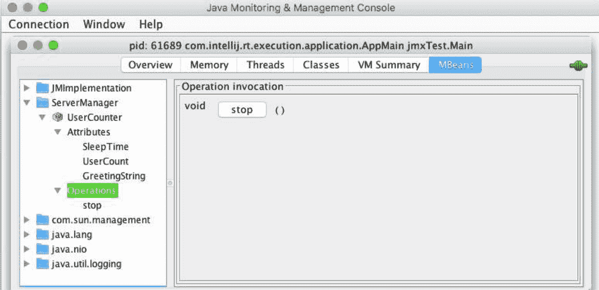

如果你想使用远程管理，将需要额外的 JVM 参数，例如：

```
-Dcom.sun.management.jmxremote=true //默认为 true
-Dcom.sun.management.jmxremote.port=36006
-Dcom.sun.management.jmxremote.authenticate=false
-Dcom.sun.management.jmxremote.ssl=false
```

这些参数可以在 JMX 指南的第 2 章中找到。之后，你就可以通过 `jconsole host:port` 或者在 JConsole GUI 中指定 `host:port` 或 `service:jmx:rmi:///jndi/rmi://hostName:portNum/jmxrmi` 来远程连接到你的应用程序了。

有用链接：

- JMX 指南
- JMX 最佳实践

## 第 173 章：Java 虚拟机 (JVM)

### 173.1 这些是基础

JVM 是一个驻留在你内存中的**抽象计算机器**或**虚拟机**。它具有一个与平台无关的执行环境，可以将 Java 字节码解释为本地机器码。(`javac` 是 Java 编译器，它将你的 Java 代码编译为字节码)

Java 程序将运行在 JVM 内部，然后 JVM 会被映射到底层的物理机上。它是 JDK 中的编程工具之一。

（字节码是平台无关的代码，可以在每个平台上运行；而`机器码`是特定平台的代码，只在特定平台（如 windows 或 linux）上运行；它取决于执行环境。）

部分组件包括：

- 类加载器（`Class Loader`） - 将 `.class` 文件加载到内存中。
- 字节码验证器（`Bytecode verifier`） - 检查你的代码中是否存在任何访问限制违反。
- 执行引擎（`Execution engine`） - 将字节码转换为可执行的机器码。
- JIT（即时编译） - JIT 是 JVM 的一部分，用于提高 JVM 的性能。它会在执行期间动态地编译或翻译 Java 字节码为本地机器码。

（已编辑）

## 第 174 章：XJC

参数详情

| 参数 | 说明 |
| --- | --- |
| schema file | 要转换为 `javac` 的 xsd schema 文件 |

`XJC` 是一个 Java SE 工具，可以将 XML 架构文件编译为带有完整注解的 Java 类。

它被分发在 JDK 包中，并位于 `/bin/xjc` 路径。

### 174.1 从简单的 XSD 文件生成 Java 代码

**XSD schema (schema.xsd)**

以下 xml 架构 (xsd) 定义了一个用户列表，带有 `name` 和 `reputation` 属性。

```xml
<?xml version="1.0"?>
<xs:schema version="1.0"
xmlns:xs="http://www.w3.org/2001/XMLSchema"
xmlns:ns="http://www.stackoverflow.com/users"
elementFormDefault="qualified"
targetNamespace="http://www.stackoverflow.com/users">
<xs:element name="Users" type="ns:Users">
  <xs:complexType>
    <xs:sequence>
      <xs:element name="User" type="user" minOccurs="0" maxOccurs="unbounded"/>
    </xs:sequence>
  </xs:complexType>
  <xs:complexType name="User">
    <xs:attribute name="name" use="required" type="xs:string"/>
    <xs:attribute name="reputation" use="required">
      <xs:simpleType>
        <xs:restriction base="xs:int">
          <xs:minInclusive value="1"/>
        </xs:restriction>
      </xs:simpleType>
    </xs:attribute>
  </xs:complexType>
</xs:element>
</xs:schema>
```

**使用 xjc**

这要求 `xjc` 工具（JDK 二进制文件）的路径在系统的路径变量中。

可以使用以下命令启动代码生成：

```
xjc schema.xsd
```

这将在工作目录中生成 java 文件。

**结果文件**

会有一些额外的注释，但生成的 java 文件基本上如下：

```java
package com.stackoverflow.users;

import java.util.ArrayList;
import java.util.List;
import javax.xml.bind.annotation.XmlAccessType;
import javax.xml.bind.annotation.XmlAccessorType;
import javax.xml.bind.annotation.XmlType;

@XmlAccessorType(XmlAccessType.FIELD)
@XmlType(name = "Users", propOrder = {"user"})
public class Users {

    protected List<User> user;

    public List<User> getUser() {
        if (user == null) {
            user = new ArrayList<User>();
        }
        return this.user;
    }
}
```

```java
package com.stackoverflow.users;

import javax.xml.bind.annotation.XmlAccessType;
import javax.xml.bind.annotation.XmlAccessorType;
import javax.xml.bind.annotation.XmlAttribute;
import javax.xml.bind.annotation.XmlType;

@XmlAccessorType(XmlAccessType.FIELD)
@XmlType(name = "User")
public class User {

    @XmlAttribute(name = "name", required = true)
    protected String name;

    @XmlAttribute(name = "reputation", required = true)
    protected int reputation;

    public String getName() {
        return name;
    }

    public void setName(String value) {
        this.name = value;
    }

    public int getReputation() {
        return reputation;
    }

    public void setReputation(int value) {
        this.reputation = value;
    }
}
```

```java
package com.stackoverflow.users;

import javax.xml.bind.JAXBElement;
import javax.xml.bind.annotation.XmlElement;
import javax.xml.bind.annotation.XmlRegistry;
import javax.xml.namespace.QName;

@XmlRegistry
class ObjectFactory {

    private final static QName _UsersQNAME = new QName("http://www.stackoverflow.com/users", "users");

    public ObjectFactory() {
    }

    public Users createUsers() {
        return new Users();
    }

    public User createUser() {
        return new User();
    }

    @XmlElement(namespace="http://www.stackoverflow.com/users", name="Users")
    public JAXBElement<Users> createUsers(Users value) {
        return null; // 实现细节
    }
}
```

## 第 175 章：JVM 标志

（注：由于原文第175章内容似乎存在严重的翻译/重复乱码问题，以下译文根据逻辑对齐进行了清理性翻译）

### 175.8 -XXexitOutOfMemory

此选项使 `Jockit JVM` 在第一次出现内存溢出（out）错误时退出。如果你倾向于重启 `Jockit JVM` 实例而不是处理内存溢出错误，可以使用它。在启动时输入此命令可强制 `Jockit JVM` 在第一次出现内存溢出错误时退出。

用法：

```
-XXexitOutOfMemory
```

## 第 176 章：JVM 工具接口 (JVTI)

### 176.1 遍历从对象可达的对象（堆 1.0）

```cpp
/*
#include <vector>
#include <string>
#include "agent_util.hpp"
// 此文件可以在 Java SE Development Kit 8u101 Demos and Samples 中找到
// 参考 http://download.oracle.com/otn-pub/java/jdk/8u101-b13-demos/jdk-8u101-windows-x64-demos.zip
//jdk1.8.0_101.zip!demo/jvmti/versionCheck/src/agent_util.h
* 用于 jvmti-*SetTag(object, 指向的指针) 的结构体
* http://docs.oracle.com/javase/7/docs/platform/jvmti.html#SetTag
*/
```


## 第 177 章：内存管理

### 第 177.1 节：设置堆、PermGen 和栈大小

当 Java 虚拟机启动时，它需要知道堆的大小，以及默认栈的大小。这些可以通过命令行选项指定。

注意，PermGen 在 Java 8 中已被移除，如果你尝试设置它，该选项将被忽略。

如果你不显式指定堆和栈大小，JVM 将使用计算得的默认值。这对于线程通常是足够的，但对于使用大量内存的程序可能会有问题。

设置堆、PermGen 和栈大小：

以下 JVM 选项设置大小：

- `-Xms<size>` 设置初始堆大小
- `-Xmx<size>` 设置最大堆大小
- `-XX:PermSize=<size>` 设置初始 PermGen 大小
- `-XX:MaxPermSize=<size>` 设置最大 PermGen 大小
- `-Xss<size>` 设置默认线程栈大小

示例：

```bash
$ java -Xms512m -Xmx1024m JavaApp
$ java -XX:PermSize=64m -XX:MaxPermSize=128m JavaApp
$ java -Xss512k JavaApp
```

查找默认值：

`-XX:+PrintFlagsFinal` 可以在启动 JVM 之前打印所有标志的值。用于打印堆和栈设置的默认值如下：

- 对于 Linux、Unix、Solaris 和 Mac OS

```bash
$ java -XX:+PrintFlagsFinal -version | grep -iE 'HeapSize|PermSize|ThreadStackSize'
```

- 对于 Windows：

```bash
java -XX:+PrintFlagsFinal -version | findstr /i "HeapSize PermSize ThreadStackSize"
```

上述命令的输出将类似于：

```text
uint InitialHeapSize := 20655360 {product}
uint MaxHeapSize := 33135086 {product}
uint PermSize := 21775952
uint MaxPermSize := 8598332
int ThreadStackSize := 1024
```

Java 语言规范（JLS）为 JVM 实现在决定何时收集不可达对象方面提供了很大的灵活性。它（在实践中）也允许 JVM 实现在检测不可达对象时采取保守的策略。

JLS 保证的是，任何可达对象永远不会被垃圾回收。

### 当对象变得不可达时会发生什么

首先，当对象变得不可达时，不会发生任何特定的事情。只有当垃圾回收器（GC）运行并检测到对象不可达时，才会发生动作。此外，GC 运行但没有检测到不可达对象也是常见现象。

当 GC 检测到不可达对象时，可能会发生以下事件：

- 如果有引用该对象的 `Reference` 对象，这些引用会在对象被删除之前被清除。
- 如果对象是可终化的（finalizable），则它将执行终化方法。这发生在对象删除之前。
- 对象可以被删除，其占用的内存可以被回收。

注意，所有事件的发生顺序是有明确的，但没有任何机制要求垃圾回收器在任何特定时间范围内对任何特定对象执行最终删除。

### 可达和不可达对象的示例

考虑以下示例类：

```java
// 一个简单的“开放”链表中的节点。
public class Node {
    private static int counter = 0;

    public int nodeNumber = ++counter;
    public Node next;
}

public class ListTest {
    public static void main(String[] args) {
        test();
        // M1
        System.out.println("Done");
        // M2
    }

    private static void test() {
        Node n1 = new Node(); // T1
        Node n2 = new Node(); // T2
        Node n3 = new Node(); // T3
        n1.next = n2;          // T4
        n2 = null;            // T5
        n3 = null;            // T6
    }
}
```

当我们检查调用 `test()` 时发生了什么时。语句 T1、T2 和 T3 创建了 `Node` 对象，这些对象分别通过 `n1`、`n2` 和 `n3` 变量是可达。语句 T4 将第二个 `Node` 对象的引用赋值给第一个对象。此时，第二个 `Node` 通过两条路径可达：

```
n2 -> Node2
n1 -> Node1, Node1.next -> Node2
```

在语句 T5 中，我们将 `null` 赋值给 `n2`。这打破了 `Node2` 的第一条可达链，但第二条链保持完整，因此 `Node2` 仍然是可达的。

在语句 T6 中，我们将 `null` 赋值给 `n3`。这打破了 `Node3` 唯一的可达链，导致 `Node3` 变得不可达。然而，`Node1` 和 `Node2` 都通过变量 `n1` 可达。

最后，当 `test()` 方法返回时，其局部变量 `n1`、`n2` 和 `n3` 超出了作用范围，因此无法被访问。这打破了 `Node1` 和 `Node2` 的可达链，所有的 `Object` 对象都变得不可达，并符合垃圾回收的条件。

> 1 - 这是一个忽略了终化和 `Reference` 类的断言。2 - 假设上 Java 实现可以这样做，但这样做的性能成本使其变得无法实现。

### 第 177.3 节：Java 中的内存泄漏

在垃圾回收中，我们暗示了 Java 解决了内存泄漏问题。事实并非如此，但泄漏的原因相当不同。

#### 可达对象也可能泄漏

考虑以下简单的栈（stack）实现。

```java
public class NaiveStack {
    private Object[] stack = new Object[100];
    private int top = 0;

    public void push(Object obj) {
        if (top > stack.length) {
            throw new StackException("stack overflow");
        }
        stack[top++] = obj;
    }

    public Object pop() {
        if (top <= 0) {
            throw new StackException("stack underflow");
        }
        return stack[--top];
    }

    public boolean isEmpty() {
        return top == 0;
    }
}
```

当你 `push` 一个对象并立即 `pop` 它时，栈数组中仍然存在指向该对象的引用。

栈实现的逻辑意味着该引用无法返回给 API 客户端。如果一个对象已经被 `pop`，那么我们可以证明它无法“从任何线程在任何潜在的后续计算中访问”。问题在于，当前代的 JVM 无法证明这一点。当前代的 JVM 在确定对象是否可达时并不考虑程序的逻辑。（至少目前，这是不可行的）。

但撇开可达性问题不谈，这意味着我们清楚地处于一种情况：`NaiveStack` 实现“持有”了本该被回收的对象。这就是内存泄漏。

在这种情况下，解决方案是显而易见的：

```java
public Object pop() {
    if (top <= 0) {
        throw new StackException("stack underflow");
    }
    Object popped = stack[--top];
    stack[top] = null; // 用 null 覆盖弹出的引用。
    return popped;
}
```

#### 缓存会导致内存泄漏

提高服务性能的常用策略是缓存结果。其思路是记录常见请求，并使用一种称为缓存的内存数据结构。每当发出请求时，你都在缓存中查找该请求。如果查找成功，则返回相应的结果。

这种策略如果实现得当，是有效的。然而，如果实现不当，可能会导致内存泄漏。考虑以下示例：

```java
public class RequestHandler {
    private Map<Task, Result> cache = new HashMap<>();

    public Result doRequest(Task task) {
        Result result = cache.get(task);
        if (result == null) {
            result = fetchFromSource(task);
            cache.put(task, result);
        }
        return result;
    }
}
```

这段代码的问题是缓存从未移除项，因此它会一直增长。

### 第 177.4 节：终化

Java 对象可以声明一个 `finalize` 方法。该方法在对象被释放之前被调用。它通常如下：

```java
public class MyClass {
    @Override
    protected void finalize() throws Throwable {
        // 清理代码
    }
}
```

然而，关于终化有一些重要的注意事项：

- Java 不保证 `finalize()` 方法会被调用。
- Java 甚至不保证在应用程序生命周期内调用 `finalize()`。
- 唯一保证的是该方法会在对象删除之前被调用。

上述注意事项意味着，依赖终化来执行必须及时完成的清理或其他操作是坏主意。过度依赖终化会导致存储泄漏、内存泄漏和其他问题。简而言之，只有极少数情况下终化才是良好的解决方案。

#### 终化器只运行一次

通常情况下，对象在终化后会被删除。但这并非总是发生。考虑以下示例：

```java
public class CaptainJack {
    public static CaptainJack notDeadYet = null;

    protected void finalize() {
        // 复活
        notDeadYet = this;
    }
}
```

当 `CaptainJack` 实例变得不可达且垃圾回收器尝试回收它时，`finalize()` 方法会将实例引用赋值给 `notDeadYet` 变量。这将使实例再次变为可达，垃圾回收器就不会删除它。

问题：Jack 是永生的吗？

回答：不是。

在于 JVM 只会在对象的生命周期内运行一次终化器。如果你将 `null` 赋值 `notDeadYet` 再次不可达，垃圾回收器将不再对该对象调用 `finalize()`。


- 1 - 参见 https://en.wikipedia.org/wiki/Jack_Harness

## 第 177.5 节：手动触发 GC

你可以通过调用以下代码手动触发垃圾回收：

```java
System.gc();
```

然而，Java 并不保证在调用返回时垃圾回收器已经运行。该方法向 JVM（Java 虚拟机）“建议”你让它运行垃圾回收器，但并没有强制它这样做。

手动触发垃圾回收通常被认为是一种坏习惯。运行 JVM 时可以使用 `-XX:+DisableExplicitGC` 来禁用对 `System.gc()` 的调用。通过 `System.gc()` 触发垃圾回收可能会干扰 JVM 使用的特定回收器实现的正常垃圾管理/对象晋升活动。

## 第 178 章：Java 性能优化

### 第 178.1 节：基于证据的 Java 性能优化方法

唐纳德·纳斯（Donald Knuth）经常引用过这句话：

> “程序员浪费大量时间去思考或担心程序中非关键部分的运行速度，当考虑到调试和维护时，这些对效率的尝试实际上会产生强烈的负面影响。我们应该忘记微小的效率提升，因为在 97% 的情况下：过早优化是万恶之源。然而，我们不应该放弃那关键的 3% 中的机会。”

来源

记住这一建议，以下是优化程序的推荐步骤：

1. 首先，以简单性和正确性为核心设计并编写你的程序或库。开始时，不要在性能上花费太多精力。
2. 使程序处于工作状态，并（理想情况下）为代码库的关键部分编写单元测试。
3. 开发一个应用程序性能基准测试。基准测试应该涵盖应用程序性能关键的方面，并执行一系列与生产环境中应用程序使用场景典型的任务。
4. 测量性能。
5. 将测量的性能与你对应用程序所需速度的标准进行比较。（避免不现实、无法实现或无法量化的标准，例如“越快越好”）
6. 如果满足了标准，停止。你的任务完成了。（任何进一步的努力可能都是浪费时间。）
7. 在运行性能基准测试时对应用程序进行分析（Profile）。
8. 检查分析结果并找到最大的（未优化的）“性能热点”；即程序花费时间最多的代码段。
9. 分析热点部分以理解为什么它是一个瓶颈，并思考使其变快的方法。
10. 实现建议的代码更改，并进行测试和调试。
11. 重新运行基准测试，查看代码更改是否改进了性能：
    - 如果是，则返回第 4 步。
    - 如果否，放弃更改并返回第 9 步。如果你没有进展，请选择另一个热点进行关注。

最终，你会达到应用程序运行足够快、你已经考虑了所有重要热点的程度。此时，你需要停止这种方法。如果某段代码消耗了（例如）总时间的 1%，即使提高 50%，也只能让应用程序整体速度提升 0.5%。

显然，存在一个点，超过该点后热点优化就是浪费精力。如果你达到了这一点，你需要采取更激进的方法。例如：

- 查看你核心算法的算法复杂度。
- 如果应用程序花费了大量时间进行垃圾回收，寻找减少对象创建频率的方法。
- 如果应用程序的关键部分是 CPU 密集型且单线程的，寻找并行机会。
- 如果应用程序已经是多线程的，寻找并发瓶颈。

但在可能的情况下，依靠工具和测量而不是直觉来指导你的优化工作。

### 第 178.2 节：减少 String 的数量

在 Java 中，创建许多不需要的 `String` 实例太“容易”了。其他原因可能导致你的程序有很多 GC 需要清理的 `String`。

你可能创建 `String` 实例的方式有：

```java
myString += "foo";
```

或者更糟，在循环或递归中：

```java
for (int i = 0; i < N; i++) {
  myString += "foo";
}
```

问题是每次都会创建一个新的 `String`（通常如此，因为新的编译器会优化某些情况）。可以使用 `StringBuilder` 或 `StringBuffer` 进行可能的优化：

```java
StringBuffer sb = new StringBuffer(myString);
for (int i = 0; i < N; i++) {
  sb.append("foo").append(i);
}
myString = sb.toString();
```

如果你构建长字符串（例如 SQL），请使用 `String` 构建 API。

其他考虑因素：

- 减少 `replace`、替换等操作的使用。
- 避免 `String.toArray()`，尤其是在频繁访问的代码中。
- 那些注定会被过滤（由于日志级别）的日志打印不应生成（应提前检查日志级别）。
- 必要时使用此类这样的库。
- 如果变量以非共享方式（跨线程）使用，则 `StringBuilder` 更好。

### 第 178.3 节：通用方法

互联网上充满了提高 Java 程序性能的技巧。也许最重要的第一点是有意识。这意味着：

- 识别潜在的性能问题和瓶颈。
- 使用分析和测试工具。
- 了解良好实践和反面教材。

如果是论论新系统或模块，第一点应该在设计阶段完成。如果是关于遗留代码，分析和测试工具就会登场。分析 JVM 性能最基础的工具是 `JVisualVM`，它包含在 JDK 中。

第三点主要关于经验和广泛的研究，当然还有会出现在本页及其他类似页面上的原始技巧。

## 第 179 章：基准测试

在 Java 中编写性能基准测试并不像在开始和结束获取 `System.currentTimeMillis()` 并计算差值那么简单。为了验证性能基准测试，应该使用正确的工具。

### 第 179.1 节：简单的 JMH 示例

编写恰当基准测试的工具之一是 JMH。假设我们想比较在 `HashSet` 与 `TreeSet` 中搜索元素的性能。

```java
import org.openjdk.jhm.runner.Runner;
import org.openjdk.jhm.runner.RunnerException;
import org.openjdk.jhm.runner.options.Options;
import org.openjdk.jhm.runner.options.OptionsBuilder;

public class BenchmarkMain {
    public static void main(String[] args) throws RunnerException {
        final Options options = new OptionsBuilder()
            .include(CollectionFinderBenchmarkTest.class.getSimpleName())
            .fork(1)
            .build();

        new Runner(options).run();
    }
}
```

我们现在准备就绪了。只需要运行 `mvn package`（它会在你的 `/target` 文件夹中创建 `benchmarks.jar`）并运行我们的基准测试：

```bash
java -cp target/benchmarks.jar benchmark.BenchmarkMain
```

在经过预热和计算迭代后，我们将得到结果：

## 运行完成。总耗时: 00:01:21

| Benchmark | Mode | Cnt | Score | Error | Units |
|---|---|---|---|---|---|
| CollectionFinderBenchmarkTest.hashSet | avgt | 20 | 9.940 ± 0.270 | ns/op |
| CollectionFinderBenchmarkTest.treeSet | avgt | 20 | 98.858 ± 13.743 | ns/op |

关于 `blackhole.consume()`。如果你的计算没有改变应用程序的状态，java 可能会直接忽略它。因此，为了避免这种情况，你可以让你的基准方法返回某个值，或者使用 `Blackhole` 对象来消费它。

你可以在 Aleksey Shipiliev 的博客、Jacob Jenkov 的博客以及 java-performance 博客找到更多关于编写适当基准测试的信息：1, 2。

## 第 180 章：上传到 AWS

使用 Spring REST API 将文件上传到 AWS S3 桶。

### 第 180.1 节：上传文件到 S3 桶

我们将创建一个 REST API，它将从前端接收 multipart 参数并使用 Java REST API 将上传到 S3 桶。

要求：你想要上传的 S3 桶的秘密密钥（secret key）和访问密钥（access key）。

```java
// DocumentController.java

@RestController
@RequestMapping("/api/v2")
public class DocumentController {
    private static String bucketName = "pharmer-chat";
    private static String keyName = "Pharmer" + UUID.randomUUID();

    @RequestMapping(value = "upload", consumes = MediaType.MULTIPART_FORM_DATA)
    public String uploadFileHandler(@RequestParam("name") String name, @RequestParam("file") MultipartFile file) throws IOException {
        // 输出从 @Request 获取所有可能的参数 *******

        System.out.println(file.getOriginalFilename() + " + " + file.getOriginalFilename());
        System.out.println(file.getContentType() + " + " + file.getContentType());
        System.out.println(file.getInputStream() + " + " + file.getInputStream());
        System.out.println(file.toString() + " + " + file.toString());
        System.out.println(file.getSize() + " + " + file.getSize());
        System.out.println(name + " + " + name);
        System.out.println(file.getBytes() + " + " + file.getBytes());
        System.out.println(file.hashCode() + " + " + file.hashCode());
        System.out.println(file.getClass() + " + " + file.getClass());
        System.out.println(file.isEmpty() + " + " + file.isEmpty());

        // ********* 传递到 s3 桶的 put Object *******/
        InputStream inputStream = file.getInputStream();
        String keyName = file.getOriginalFilename();

        // Aws 的凭据
        AWSCredentials credentials = new BasicAWSCredentials("AKIA***********","zr************");

        // *****************DocumentController.uploadfile(credentials); *********************************/

        AmazonS3 s3client = new AmazonS3Client(credentials);
        try {
            System.out.println("正在从文件上传新对象到 S3\n");
            // file = new file(awsuploadfile);
            s3client.putObject(new PutObjectRequest(
                bucketName, keyName, inputStream, new ObjectMetadata()));

            URL url = s3client.generatePresignedUrl(bucketName, keyName,
                Date.from(Instant.now()).plus(5, ChronoUnit.MINUTES));
            // URL=s3client.generatePresignedUrl(bucketName, keyName,
            // Date.from(Instant.now()).plus(5, ChronoUnit.MINUTES));
            System.out.println("************************************");

            return url.toString();
        } catch (AmazonServiceException exception) {
            System.out.println("捕获 AmazonServiceException，这 " + 
            "意味着你的请求发送到了 " + 
            "S3，但由于某些原因被错误响应拒绝了：" + 
            System.out.println("错误消息: " + exception.getMessage());
            System.out.println("HTTP 状态码: " + exception.getStatusCode());
            System.out.println("AWS 错误代码: " + exception.getErrorCode());
            System.out.println("错误类型: " + exception.getErrorType());
            System.out.println("请求 ID: " + exception.getRequestId());
        } catch (AmazonClientException exception) {
            System.out.println("捕获 AmazonClientException，这 " + 
            "意味着客户端在尝试与 S3 通信时遇到了内部 "
            "错误，例如无法访问。");
            System.out.println("错误消息: " + exception.getMessage());
            return null;
        }
    }
}
```

```javascript
var form = new FormData();
form.append("file", "image.jpeg");

var settings = {
    "async": true,
    "crossDomain": true,
    "url": "http://",
    "method": "POST",
    "headers": {
        "cache-control": "no-cache"
    },
    "processData": false,
    "contentType": "multipart/form-data",
    "data": form
};

$.ajax(settings).done(function (response) {
    console.log(response);
});
```

## 第 181 章：AppDynamics 集成

AppDynamics 旨在提供一种衡量应用程序性能的方法。

### 第 181.1 节：TIBCO BW 的插桩示例

1. 打开 Windows 资源管理器。
2. 在左侧的导航栏中右键点击*此电脑（旧版本 Windows 中为计算机）*，有一个无需使用资源管理器的快捷方法：按下 `Win + Pause`。
3. 在新打开的控制面板窗口中点击左上角的*高级设置*，这将打开系统属性窗口。
4. 在系统属性的**高级**选项卡中，点击右下角的“环境变量”按钮。
5. 在系统变量中点击“新建”，创建一个名为 `JAVA_HOME` 的变量，值为 JDK 安装目录路径。

## 附录 A：安装 Java（标准版）

此文档页提供了在 Windows、Linux 和 macOS 上安装 Java 标准版的说明。

### 第 A.1 节：在 Windows 上设置 %PATH% 和 %JAVA_HOME%

**假设：**

- 已安装 Oracle JDK。
- JDK 安装在默认目录。

**设置步骤：**

1. 打开 Windows 资源管理器。
2. 在左侧的导航栏中右键点击*此电脑（旧版本 Windows 中为计算机）*，有一个无需使用资源管理器的快捷方法：按下 `Win + Pause`。
3. 在新打开的控制面板窗口中点击左上角的*高级设置*，这将打开系统属性窗口。
4. 在系统属性的**高级**选项卡中，点击右下角的“环境变量”按钮。
5. 在系统变量中点击“新建”，创建一个名为 `JAVA_HOME` 的变量，值为 JDK 安装目录路径。输入这些值后，点击`确定`。
6. 或者，在运行框 `Win + R` 中输入 `SystemPropertiesAdvanced`（不区分大小写）并按回车。

### 系统变量

| 变量 | 值 |
|---|---|


| 变量名 | 值 |
| :--- | :--- |
| `JAVA_HOME` | `C:\Program Files\Java\jdk1.8.0_91` |
| `MONGO_HOME` | `C:\Program Files\MongoDB\Server\3.2` |

6. 向下滚动系统变量列表并选择 `Path` 变量。

7. **注意：** Windows 依赖 `Path` 来查找重要的程序。如果删除了其中任何或全部内容，Windows 可能无法正常运行。必须对其进行修改以允许 Windows 运行 JDK。基于此，在选中 `Path` 变量的情况下点击“编辑（Edit...）”按钮。在 `Path` 变量的开头添加 `%JAVA_HOME%\bin;`。

最好在行开头添加，因为 Oracle 软件用于在 `Path` 中注册它们自己的 Java 版本 - 如果你的版本出现在 Oracle 声明之后，会导致你的版本被忽略。

# 检查工作结果

1. 点击“开始”菜单，输入 `cmd` 并按回车键打开命令提示符。

2. 在提示符中输入 `javac -version`。如果成功，屏幕上将打印出 JDK 版本。

注意：如果你需要重试，请在检查结果之前关闭提示符。这将强制 Windows 获取新的 `Path`。

# A.2 节：在 Linux 上安装 Java JDK

## 使用包管理器

大多数主流 Linux 发行版都支持使用包管理器安装 OpenJDK 或 Oracle 的 JDK 和/或 JRE 版本。（可提供的选项取决于你使用的发行版。）

作为一个一般原则，操作步骤是打开终端窗口并运行下面的命令。（假设你拥有足够的权限以“root”身份运行命令……这正是 `sudo` 命令的作用。如果你没有权限，请咨询你的系统管理员。）

推荐使用包管理器，因为它（通常情况下）能更容易地让你的 Java 安装保持为最新版本。

### apt-get，基于 Debian 的 Linux 发行版（Ubuntu 等）

以下指令将安装 Java 8：

```bash
$ sudo add-apt-repository ppa:weupbd8team/java
$ sudo apt-get update
$ sudo apt-get install oracle-java8-installer
```

注意：若要自动设置 Java 环境变量，你可以安装以下包：

```bash
$ sudo apt-get install oracle-java8-set-default
```

### 创建 .deb 文件

如果你更倾向于从 Oracle 下载的 `.tar.gz` 文件创建 `.deb` 文件，请执行以下操作（假设你已将 `.tar.gz` 下载到 `./<jdk>.tar.gz`）：

```bash
$ sudo apt-get install java-package # 默认仓库中可能没有
$ make-jpkg ./<jdk>.tar.gz # 不应以 root 身份运行
$ sudo dpkg -i *jsdk+.deb
```

注意：这要求输入以 "tar.gz" 文件的形式提供。

### slackpack，基于 Slackware 的 Linux 发行版

```bash
sudo slapt-get install default-jdk
```

### yum，RedHat, CentOS 等

```bash
sudo yum install java-1.8.0-openjdk-devel.x86_64
```

### dnf，Fedora

在最近的 Fedora 版本中，`yum` 已被 `dnf` 取代。

```bash
sudo dnf install java-1.8.0-openjdk-devel.x86_64
```

在最近的 Fedora 版本中，没有安装 Java 7 及更早版本的包。

### pacman，基于 Arch 的 Linux 发行版

```bash
sudo pacman -S jdk8-openjdk
```

如果你以 root 用户身份运行，则不需要使用 `sudo`。

### Gentoo Linux

Gentoo Java 指南由 Gentoo Java 团队维护，并维护一个更新的 wiki 页面，包含了所需的正确移植包和 USE。

# 在 RedHat, CentOS, Fedora 上安装 Oracle JDK

## 从 Oracle JDK 或 JRE tar.gz 文件安装 JDK

1. 从 Oracle Java 下载网站下载所需版本的 Oracle 归档文件（".tar.gz"）。

2. 切换目录到你想放置安装程序的地方；

3. 解压缩归档文件；例如

```bash
$ tar xzvf jdk-8u67-linux-x64.tar.gz
```

## 从 Oracle Java RPM 安装

1. 从 [Oracle Java 下载网站](https://www.oracle.com/java/technologies/downloads/) 获取所需版本的 RPM 文件。

2. 使用 `rpm` 命令进行安装。例如：

```bash
sudo rpm -ivh jdk-8u67-linux-x64.rpm
```

# A.3 节：在 macOS 上安装 Java JDK

## Oracle Java 7 和 Java 8

Oracle 提供适用于 macOS 的 Java 7 和 8。此 Oracle 页面解答了许多关于 Mac 版 Java 问题。注意，出于安全考虑，7u25 之前的 Java 7 已被 Apple 禁用。

通常，Oracle Java（7 及更高版本）需要运行 macOS 10.7.3 或更高版本的 Intel Mac。

### 安装 Oracle Java

可以从 Oracle 网站下载适用于 macOS 的 Java 7 & 8 JDK 和 JRE 安装程序：

- Java 8 - [Java SE Downloads](https://www.oracle.com/java/technologies/downloads/#java8)
- Java 7 - [Oracle Java Archive](https://www.oracle.com/java/technologies/java-archive-downloads.html)

下载相关包后，运行安装程序。

### 命令行切换

安装 Java 后，它被设置为默认版本。要在版本间进行切换：

可以将以下函数添加到 `~/.bash_profile`（如果你使用 Bash）：

```bash
function java_set {
  if [ $1 == "6" ];
  then
    export JAVA_HOME=$(/usr/libexec/java_home -v 6)
    echo "Setting Java to 6..."
    echo "$JAVA_HOME"
  elif [ $1 == "7" ];
  then
    export JAVA_HOME=$(/usr/libexec/java_home -v 7)
    echo "Setting Java to 7..."
    echo "$JAVA_HOME"
  elif [ $1 == "8" ];
  then
    export JAVA_HOME=$(/usr/libexec/java_home -v 8)
    echo "Setting Java to 8..."
    echo "$JAVA_HOME"
  fi
}
```

### macOS Apple Java 6

旧版本的 macOS（10.11 Capitan 及更早版本）中预装了 Java 6。如果已安装，可以在以下位置找到：

`/Library/Java/VirtualMachines/1.6.jdk/Home`

注意 Java 6 已经停止支持，因此建议升级到新版本。Oracle 网站上有相关信息。

# A.4 节：在 Windows 上安装 Java JDK

Windows 仅提供 Oracle JDK 和 JRE。安装步骤非常简单：

- 点击 JDK 按钮、JRE 按钮或 Server JRE 按钮。使用 Java 开发需要 JDK。了解 JDK 和 JRE 之间的区别，请查看此处。
- 选择“接受许可协议（Accept License Agreement）”单选框。
- 下载 Windows x86（32位）或 Windows x64（64位）安装程序。
- 以常规 Windows 版本的方式运行安装程序。

使用命令提示符安装 Java 的另一种方法是使用 Chocolatey：

- 从 https://chocolatey.org/ 安装 Chocolatey。
- 打开 cmd 窗口，例如按下 `Win + R` 在“运行”窗口中输入 `cmd` 并回车。
- 在你的 cmd 实例中运行以下命令下载并安装 Java 8 JDK：

```cmd
C:\> choco install jdk8
```

# 使用便携版本运行

在某些情况下，你可能需要在受限的系统（如虚拟机）上安装 JDK/JRE，或者可能想要安装并使用多个版本或架构（x64/x86）的 JDK/JRE。在下载安装程序（EXE）之前的步骤相同。之后的步骤如下（适用于 JDK 7 及以上版本，旧版本的文件夹和文件略有不同）：

- 将文件移动到你希望 Java 二进制文件永久存在的合适位置。
- 如果权限受限，安装 7-Zip 或你的便携版本。
- 使用 7-Zip 从 Java 安装程序 EXE 中提取文件到该位置。
- 在资源管理器的文件夹中按住 Shift 并右键点击以打开命令提示符，或从任何地方导航到该位置。

5. 转到新创建的文件夹。假设文件夹名为 `jdk-7u25-windows-x64`。因此输入 `cd jdk-7u25-windows-x64`。然后顺序输入以下命令：

```
cd .src\JAVA_CAB10
extrac32 111
```

6. 这将在当前位置创建一个 `tools.zip` 文件。使用 7-Zip 解压 `tools.zip`，这样其中的文件就会被创建在相同目录下的 `tools` 文件夹中。

7. 现在在已打开的提示符上执行这些命令：

```
cd tools
for /r %x in (*.pack) do .\bin\unpack200 -r "%x" "%~dx%~px%~nx.jar"
```

8. 等待命令完成。将 `tools` 内容复制到你想要存放二进制文件的位置。

这样，你可以同时安装所需的任何版本的 JDK/JRE。

原始帖子：http://stackoverflow.com/a/657136/1448252

## Section A.5: 在 Linux 上使用 alternatives 配置和切换 Java 版本

### 使用 Alternatives

许多 Linux 发行版使用 `alternatives` 命令在不同版本的命令之间切换。你可以用它来切换机器上安装的多个 Java 版本。

1. 在命令行 shell 中，将 `$JDK` 设置为新安装的 JDK 路径；例如：

```
$ JDK=/Data/data/jdk1.8.0_67
```

2. 使用 `alternatives --install` 将 Java SDK 中的命令安装到 alternatives 中：

```
$ sudo alternatives --install /usr/bin/java java $JDK/bin/java 2
$ sudo alternatives --install /usr/bin/javac javac $JDK/bin/javac 2
$ sudo alternatives --install /usr/bin/jar jar $JDK/bin/jar 2
```

依此类推。

现在你可以按照如下方式切换 `java` 命令的不同版本：

```
$ sudo alternatives --config javac
```

有 1 节点程序提供 'javac'。

| 选择 | 命令 |
| :--- | :--- |
| * 1 | /usr/lib/jvm/java-1.8.0-openjdk-1.8.0.101-b14.fc23.x86_64/bin/javac |
| | /Data/jdk1.8.0_67/bin/javac |

```
按回车保留当前选择，或输入选择数字：2
$
```

有关使用 alternatives 的信息，请参阅 `alternatives(8)` 手册页。

## 基于 Arch 的安装

基于 Arch 的安装附带有 `archlinux-java` 命令用于切换 Java 版本。

### 列出已安装的环境

```
$ archlinux-java status
Available Java environments:
```


`java->openjdk (default)`

`java-openjdk/jre`

### 切换当前环境

```bash
archlinux-java set <JAVA_ENV_NAME>
```

例如：

```bash
archlinux-java set java-8-openjdk/jre
```

更多信息可以在 Arch Linux Wiki 上找到。

## Section A.6: Java 开发需要什么

JDK 安装和文本编辑器是 Java 开发的最低限配置。（如果能有一个支持 Java 语法高亮的文本编辑器会更好，但没有也没行。）

但是对于认的开发工作，建议你还使用以下工具：

- 像 Eclipse、IntelliJ IDEA 或 NetBeans 这样的 Java IDE
- 像 Ant、Gradle 或 Maven 这样的 Java 构建工具
- 代码库的版本控制系统（带有适当的备份和异地复制）
- 测试工具和 CI（持续集成）工具

## Section A.7: 选择合适的 Java SE 版本

自 1995 年发布原始 Java 1.0 以来，Java 发布了许多版本。（请参考版本历史获取摘要。）然而，大多数版本都已过了它们自己的截止日期（End Date）。这意味着该版本（现在通常是 Oracle）已停止开发，且不再为任何错误或安全问题提供公开/免费补丁。（对于有支持合同的人/机构通常可以获得私有补丁；请联系您的供应商销售部门。）

通常情况下，推荐的 Java SE 版本将是最新的公开发版本。目前，这意味着最新的 Java 8 版本。Java 9 将于 2017 年公开发布。（Java 7 已结束生命周期，最后一次公开发布是在 2015 年 4 月。不建议使用 Java 6 及更早版本。）

此建议适用于所有新的 Java 开发以及任何学习 Java 的人。它也适用于只想运行第三方提供的 Java 软件的人。通常来说，编写良好的 Java 代码可以在新版本的 Java 上运行。（但请检查软件的发行说明，并如果你有疑问，请联系作者/供应商/厂商。）

如果你正在处理较旧的 Java 代码库，建议确保你的代码运行在最新的 Java 版本上。决定何时开始使用新版本的特性要困难得多，因为这会影响你支持那些不知道或不留意自己 Java 安装情况的客户的能力。

## Section A.8: Java 发布和版本命名

Java 版本的命名有点困惑。实际上有两命名和编号系统，如下表所示：

| JDK | 营销名称 |
| :--- | :--- |
| `jdk-1.0` | JDK 1.0 |
| `jdk-1.1` | JDK 1.1 |
| `jdk-1.2` | Java 1.2 |
| `jdk-1.5` | Java 5 |
| `jdk-1.6` | Java 6 |
| `jdk-1.7` | Java 7 |
| `jdk-1.8` | Java 8 |
| `jdk-9` | Java 9 |

## Section A.9: 使用 tar 包在 Linux 上安装 Oracle Java

按照以下步骤使用 tar 包安装 JDK：

1. 从此处下载 tar 包 - 当前最新为 Java 8u。
2. 你需要 sudo 权限：

```bash
sudo su
```

3. 创建安装目录：

```bash
mkdir /opt/jdk
```

4. 将下载的 tar 解压到此处：

```bash
tar -zxf jdk-8u5-linux-x64.gz -C /opt/jdk
```

5. 验证解压的文件：

```bash
ls /opt/jdk
```

6. 设置 Oracle JDK 为默认：

```bash
update-alternatives --install /usr/bin/java java /opt/jdk/jdk1.8.0_05/bin/java 100
```

以及

```bash
update-alternatives --install /usr/bin/javac javac /opt/jdk/jdk1.8.0_05/bin/javac 100
```

7. 检查 Java 版本：

```bash
java -version
```

预期输出：

```text
java version "1.8.0_111"
Java(TM) SE Runtime Environment (build 1.8.0_111-b14)
Java HotSpot(TM) 64-Bit Server VM (build 25.111-b14, mixed mode)
```

## Section A.10: Linux 安装后的检查和配置

安装 Java SDK 后，建议检查它是否就绪。你可以通过使用普通用户运行以下两个命令来实现：

```bash
$ java -version
$ javac -version
```

这些命令分别打印出 shell 命令搜索路径中 JRE 和 JDK 的版本信息。寻找 JDK /JRE 版本字符串。

- 如果上述任一命令失败并显示“command not found”，则 JRE 或 JDK 完全不在搜索路径中；请查看下方的 Configuring PATH 部分。
- 如果上述任一命令显示的版本字符串与你预期的不符，说明你的搜索路径或“alternatives”系统需要调整；请查看 Checking Alternatives。
- 如果显示了正确的版本字符串，你已完成；请跳到 Checking JAVA_HOME。

### Configuring PATH

如果目前搜索路径中没有 `java` 或 `javac`，那么解决方案是将其添加到你的搜索路径中。

首先，找到你安装 Java 的位置；如果你有疑问，请查看 **Java 安装在何处**。

接下来，假设 bash 是你的命令 shell，请使用文本编辑器将以下行添加到 `~/.bash_profile` 或 `~/.bashrc` 的末尾（如果你使用 Bash 作为你的 shell）。

```bash
JAVA_HOME=<installation directory>
PATH=$JAVA_HOME/bin:$PATH
export JAVA_HOME
export PATH
```

... 将 `<installation directory>` 替换为你的 Java 安装目录的路径名。请注意，上述内容假设安装目录包含一个 `bin` 目录，且该 `bin` 目录包含你尝试使用的 `java` 和 `javac` 命令。

接下来，对化你刚刚编辑的文件，以便更新当前 shell 的环境变量。

```bash
$ source ~/.bash_profile
```

接下来，再次检查 `java` 和 `javac` 的版本。如果仍然存在问题，请使用 `which java` 和 `which javac` 来验证你是否正确更新了环境变量。

最后，注销并重新登录，以便更新的环境变量传播到你所有的 shell 中。你现在应该完成了。

### 检查替代方案

如果 `java -version` 或 `javac -version` 可以运行但给出了意外的版本号，你需要检查这些命令来自哪里。使用 `which` 和 `ls -1` 如下所示查找：

```bash
$ ls -1 `which java`
```

如果输出如下所示

```text
lrwxrwxrwx.1 root root 22 Jul 30 02:18 /usr/bin/java -> /etc/alternatives/java
```

那么正在使用替代方案（alternatives）。你需要决定是继续使用它，还是通过直接设置 `PATH` 来覆盖它。

- 在 Linux 上使用 alternatives 配置和切换 Java 版本
- 查看上文的“直接配置 PATH”。

### Java 安装在何处？

Java 可以安装在多个位置，取决于安装方法。

- Oracle RPM 将 Java 安装在 `/usr/java/`
- 在 Fedora 上，默认位置是 `/usr/lib/jvm/`
- 如果是通过手动 ZIP 或 JAR 文件安装的 java，则安装位置可能在任何地方。

如果你在查找安装目录时遇到困难，我们建议使用 `find`（或 `slocate`）来查找命令。例如：

```bash
$ find -name java -type f 2 > /dev/null
```

这会为你提供系统中所有名为 `java` 的文件的路径名。（将标准错误重定向到 `/dev/null` 会忽略关于你无法访问的文件和目录的消息。）

## 附录 B：Java版本、版本、发布版和发行版

### B.1节：Java SE JRE 或 Java SE JDK发行版之间的差异

Sun / Oracle 发布的 Java SE 有两种形式：JRE 和 JDK。简单来说，JRE 支持运行 Java 程序，而 JDK 也支持 Java 开发。

#### Java运行时环境 (JRE)

Java运行时环境或 JRE发行版包含运行和管理 Java 应用程序所需的库和工具集。典型现代 JRE 中的工具包括：

- 用于在 JVM（Java虚拟机）中运行 Java 程序的 `java` 命令
- 用于运行 Nashorn 引擎的 `jjs` 命令
- 用于操作密钥库的 `keytool` 命令
- 用于编辑沙箱策略的 `policytool` 命令
- 用于打包和解压 "pack200"文件的 `pack208` 和 `unpack208` 工具
- 支持 CORBA 和 RMI 应用程序的 `orb`、`rmid` 和 `tnames` 命令

“桌面 JRE”安装器包含某些浏览器的 Java 插件。这被故意排除在“服务器 JRE”安装器之外。

从 Java 7 开始，JRE 安装器包含了 JavaFX（2.2 或更高版本）。

#### Java 开发包 (JDK)

Java 开发包或 JDK发行版包含 JRE 工具以及用于开发 Java 软件的额外工具。额外工具包括：

- 将源代码 ("java") 编译为字节码文件 (".class") 的 `javac` 命令
- 创建 JAR 文件的工具如 `jar` 和 `jarsigner`
- 开发工具如：
    - 运行 applet 的 `appletviewer`
    - CORBA IDL 编译为 `jdk`
    - 生成 JNI 存根的 `jav`
    - 字符集转换的 `native`
    - 生成 XML 架构的（JAXB 的部分）`schegen`
    - Java 对象序列化字符串 `serializer`
    - 用于 JAX-WS 的 `wsgen` 和 `wsimport`
- 诊断工具如：
    - Java 调试器 `jdb`
    - 用于调试和分析 Java 堆的 `jmap` 和 `jprof`
    - 获取线程栈储的 `jstack`
    - 检查 ".class" 文件的 `javap`
- 应用管理和监控工具如：
    - 管理控制台 `jconsole`
    - 用于监控应用的 `jstat`、`jinfo` 和 `jcmd`

典型的 Sun / Oracle JDK 安装包含 Java 库的源代码 ZIP 文件。在 Java 6 之前，这是唯一公开的 Java 源代码。从 Java 6 开始，可以从 OpenJDK 网站下载完整的源代码。它通常不包含在 JDK 包中，但作为单独包提供。

### B.2节：Java SE 版本

#### Java SE 版本历史

下表提供了 Java 平台主要版本的时间线。

| Java SE 版本 | 代号 | 寿命结束 (free2) | 发布日期 |
| :--- | :--- | :--- | :--- |
| Java SE 10 (早期访问) | 无 | 未来 | 2018-03-20 (估计) |
| Java SE 9 | 无 | 未来 | 2017-07-27 |
| Java SE 8 | 无 | 未来 | 2014-03-18 |
| Java SE 7 | Dolphin | 2015-04-14 | 2011-07-28 |
| Java SE 6 | Mustang | 2013-03-16 | 2006-12-23 |
| Java SE 5 | Tiger | 2009-11-04 | 2004-10-04 |
| Java SE 4.2 | Mantis | 2009-11-04 之前 | 2003-06-26 |
| Java SE 1.4 | Merlin | 2009-11-04 之前 | 2002-02-06 |
| Java SE 1.3.1 | Ladybird | 2009-11-04 之前 | 2001-05-17 |
| Java SE 1.3 | Kestrel | 2009-11-04 之前 | 2000-05-08 |
| Java SE 1.2 | Playground | 2009-11-04 之前 | 1998-12-08 |
| Java SE 1.1 | Sparkler | 2009-11-04 之前 | 1997-02-19 |
| Java SE 1.0 | Oak | 2009-11-04 之前 | 1996-01-21 |

脚注：
1. 链接指向 Oracle 网站上相应发布版本的在线副本。旧版本的文档已不再在线，但通常可以从 Oracle 存档中下载。
2. 大多数 Java SE 历史版本已经过了它们的“寿命结束”日期。当 Java 版本越过这一里程碑时，Oracle 将停止为其提供免费更新。

来源：
- JDK 发布日期

#### Java SE 版本亮点

| Java SE 版本 | 亮点 |
| :--- | :--- |
| Java SE 8 | Lambda 表达式和 Map-reduce 流。Nashorn 引擎。重复注解上的注解。新的日期和时间 API。静态链接 JNI 库，JavaFX 启动器。移除 PermGen。 |
| Java SE 7 | 字符串 switch、try-with-resource、菱形语法、数字字面量增强以及异常处理/线程改进。并发库。对原生系统的增强支持。加密算法。改进的 2D 图形 (GPU) 支持。可插注解。 |
| Java SE 6 | 对 JVM 性能、语言 API 和 Rhino Javascript 引擎的显著性能增强。JDBC 4.0。编译器 API。JAXB 2.0。Web 服务 (JAX-WS)、泛型、自动装箱、枚举类、可变参数、增强 for 循环和静态导入。Java 内存模型规范 Swing 以及添加 java.concurrent 包 |

来源：
- 维基百科：Java 版本历史

### B.3节：Java EE、Java SE、Java ME 和 JavaFX 之间的差异

Java 技术既是一种编程语言也是一种平台。Java 编程语言是一种具有特定语法和风格的高级面向对象语言。Java 平台是运行 Java 编程程序的特定环境。

有多个 Java 平台。许多开发者，即使是资深的 Java 编程语言开发者，也不理解不同平台之间的关系。

#### 编程语言平台

Java语言有四个平台：

- Java 标准版 (Java SE)
- Java 企业版 (Java EE)
- Java 微型版 (Java ME)
- Java FX

所有 Java 平台都包含 Java 虚拟机 (VM) 和应用程序编程接口 (API)。Java 虚拟机是针对特定硬件和软件平台运行 Java 程序的程序。API 是创建其他软件组件或应用程序所需的软件组件集合。每个 Java 平台都提供虚拟机和 API，这使得该平台的应用程序能够在任何兼容的系统上运行，并具有 Java 编程语言的所有优势：平台无关、强大、稳定、易于开发和安全。

#### Java EE

Java EE 平台构建在 Java SE 平台之上。Java EE 平台为开发和运行大型、多层级、可扩展、可靠且安全的网络应用程序提供了 API 和运行时环境。

#### Java ME

Java ME 平台提供了一个 API 和一个轻量级虚拟机，用于在手机等等小型设备上运行 Java 编程语言应用程序。该 API 是 Java SE API 的子集，并附有适用于小型设备应用程序开发的特殊类库。Java ME 应用程序通常是 Java EE 平台服务的客户端。

#### Java FX

Java FX 技术是一种用于创建使用 Java FX Script 编写的富网络应用程序的平台。Java FX Script 是一种静态类型的声明式语言，它被编译为 Java 技术字节码，然后可以在 Java 虚拟机上运行。为 Java FX 平台编写的应用程序可以包含并链接到 Java 编程语言的类，并可能是 Java EE 平台服务的客户端。

- 取自 Oracle 文档

# 附录 C：类路径 (Classpath)

类路径列出了 Java 运行时应该查找类和资源的地方。Java 编译器也使用类路径来查找之前编译的类和外部依赖项。

## C.1 节：指定类路径的不同方法

设置类路径有三种方法。

1. 可以 `CLSPATH` 环境变量设置：

```bash
set CLSPATH=... # Windows 和 csh
export CLSPATH=... # Unix ksh/bash
```

2. 可以在命令行中如下设置：

```bash
java -classpath ...
javac -classpath ...
```

注意，`-classpath`（或 `-cp`）选项的优先级高于 `CLSPATH` 环境变量。

3. 可执行 JAR 文件的类路径是通过 MANIFEST.MF 中的 `Class-Path` 元素指定的：

```text
Class-Path: jar1-name jar2-name directory-name/jar3-name
```

注意，这仅当按如下方式执行 JAR 文件时有效：

```bash
java -jar some.jar ...
```


在这种执行模式下，`-classpath` 选项和 `CLSPATH` 环境变量将被忽略，即使 JAR 文件没有 `Class-Path` 元素。

如果没有指定类路径，在使用 `java -jar` 时，默认类路径为所选的 JAR 文件，否则为当前目录。

相关：

- https://docs.oracle.com/javase/tutorial/deployment/jar/downman.html
- http://docs.oracle.com/java/7/docs/technotes/tools/windows/classpath.html

## C.2 节：将目录中的所有 JAR 添加到类路径

如果你想将目录中的所有 JAR 添加到类路径，可以使用类路径通配符简洁地实现，例如：

```
someFolder/*
```

这会告诉 JVM 将 `someFolder` 目录下的 JAR 和 ZIP 文件添加到类路径中。此语法用于 `-cp` 参数、`CLSPATH` 环境变量或可执行 JAR 文件清单文件中的 `Class-Path` 属性。请参见“设置类路径：路径通配符”以获取示例和注意事项。

GoalKicker - Java® Notes for Professionals

注意事项：

1. 类路径通配符是在 Java 6 中首次引入的。早期的 Java 版本不将 `*` 视为通配符。
2. 你不能在 `*` 之前或之后放置其他字符；例如 `"SomeFolder/jar"` 不是通配符。
3. 通配符仅匹配后缀 `.jar` 或 `JAR`。ZIP 文件会被忽略，因为它们与 JAR 文件的后缀不同。
4. 通配符仅匹配目录本身的 JAR 文件，不匹配其子目录下的文件。
5. 当一组 JAR 文件被通配符条目匹配时，它们在类路径上的相对顺序是不指定的。

## C.3 节：从类路径加载资源

加载封装在 JAR 内部的资源（图像、文件属性、KeyStore 等）可能是很有用的。为了这个目的，我们可以使用 `Class` 和 `ClassLoader`。

假设我们有以下项目结构：

```
program.jar
|- com
  |- project
    |- file.txt
|- Test.class
```

我们想从 `Test` 类访问 `file.txt` 的内容。我们可以通过询问类加载器来实现：

```
InputStream is = Test.class.getClassLoader().getResourceAs("/com/project/file.txt");
```

通过使用类加载器，我们需要指定资源的限定路径（每个包）。

或者，我们可以直接使用 `Test` 类：

```
InputStream is = Test.class.getResourceAsStream("file.txt");
```

使用类时，路径相对于类本身。由于我们的 `Test.class` 位于 `com.project` 包中，与 `file.txt` 相同，我们不需要指定任何路径。

然而，我们可以从类本身使用绝对路径，如下：

```
is = Test.class.getResourceAsStream("/com/project/file.txt");
```

## C.4 节：类路径语法

类路径是一系列条目，这些条目是目录路径、JAR 或 ZIP 文件名或 JAR / ZIP 规范。

- 对于命令行（例如 `-classpath`）或作为环境变量指定的类路径，在 Windows 上必须使用 `;`（分号）分隔条目，在其他平台（Linux、UNIX、MacOS 等）上使用 `:`（冒号）分隔条目。
- 对于 JAR 文件 MANIFEST.Mf 中的 `Class-Path` 条目，使用单个空格分隔条目。

有时必须在类路径条目中嵌入空格：

- 当在命令行上指定类路径时，必须加引号：
```
export CLSPATH="/home/user/My Folder"
```

- 当 `Class-Path` 条目在 JAR 文件 MANIFEST.Mf 中时，使用单个空格分隔条目：
```
Class-Path: "/home/user/My Folder/jar1.jar"
```

## C.5 节：动态类路径

有时必须在类路径条目中嵌入空格。例如，如果你有一个名称带有空格的目录，你必须将路径封装在引号中。

类路径是一系列条目，这些条目是目录路径、JAR 或 ZIP 文件名或 JAR / ZIP 规范。

- 对于命令行（例如 `-classpath`）或作为环境变量指定的类路径，在 Windows 上必须用 `;`（分号）分隔条目，在其他平台（Linux、UNIX、MacOS）上用 `:`（冒号）分隔条目。
- 对于 JAR 文件 MANIFEST.Mf 中的 `Class-Path` 条目，使用单个空格分隔条目。

## C.6 节：类名到路径的映射

类路径是目录路径、JAR 或 ZIP 文件名或 JAR / ZIP 规范的目序列。

- 对于命令行指定的类路径，在 Windows 上必须用 `;`（分号）分隔条目，在其他平台（Linux、UNIX、MacOS）上用 `:`（冒号）分隔条目。

（此处省略原文中重复的文本部分，以符合翻译逻辑）

# 附录 D：资源（类路径上）

Java 允许检索存储在 JAR 包内部、与编译类一同的文件资源。本主题侧重于加载资源并供您使用。

## D.1 节：加载默认配置

要读取默认配置属性：

```java
package com.example;

public class ExampleApplication {

    private Properties getDefault() throws IOException {

        Properties defaults = new Properties();

        try (InputStream defaultsStream = 
            ExampleApplication.class.getResourceAsStream("config.properties")) {

            defaults.load(defaultsStream);

        }

        return defaults;

    }

}
```

## D.2 节：从资源加载图像

要加载封装的图像：

```java
package com.example;

public class ExampleApplication {

    private Image getIcon() throws IOException {

        URL imageURL = ExampleApplication.class.getResource("icon.png");

        return ImageIO.read(imageURL);

    }

}
```

## D.3 节：使用类加载器查找读取资源

Java 中的资源加载包含以下步骤：

1. 找到将查找资源的类或类加载器（`ClassLoader`）。
2. 找到资源。
3. 获取资源的字节流。
4. 读取并处理字节流。
5. 关闭字节流。

最后三个步骤通常通过将 URL 传递给库方法或构造函数来加载资源。在这种情况下，您通常会使用 `getResource`。在应用程序代码中读取资源数据也是可能的，在这种情况下您通常会使用 `getResourceAsStream`。

### 绝对和相对资源路径

可以从类路径（classpath）加载的资源由路径表示。路径的语法类似于 UNIX / Linux 文件路径。它由正斜杠（/）分隔的简单名称组成。相对路径以名称开头，绝对路径以分隔符开头。

正如类路径描述的，JVM 的类路径通过叠加类路径中目录、JAR 或 ZIP 文件的命名空间来定义一个命名空间。当解析绝对路径时，类加载器将开头的 `/` 解释为类路径的根目录。相比之下，相对路径可以相对于命名空间中的任何“文件夹”进行解析。使用的文件夹取决于您用于解析路径的对象。

### 获取类或类加载器

资源可以使用 `Class` 对象或 `ClassLoader` 对象加载。`Class` 对象可以解析相对路径，因此如果您有（类相关的）相对资源，通常会使用其中之一。获取 `Class` 对象有多种方法，例如：

- 类字面量（Class literal）将为您提供 Java 源代码中可以命名的任何类的 `Class` 对象；例如，`String` 会给您提供 String 类型的 `Class` 对象。
- `Object.getClass()` 将给您任何对象的类型的 `Class` 对象；例如，`"hello".getClass()` 是获取 String 类型类的另一种方法。
- `Class.forName(String)` 方法将（必要时）动态加载一个类并返回其 `Class` 对象；例如，`Class.forName("java.lang.String")`。

`ClassLoader` 通常通过在 `Class` 对象上调用 `getClassLoader()` 获取。也可以使用静态方法 `ClassLoader.getSystemClassLoader()` 持有 JVM 的默认类加载器。

### get 方法

一旦您拥有了 `ClassLoader` 实例，可以使用以下方法之一查找资源：

| 方法 | 描述 |
|---|---|
| `ClassLoader.getResource(path)` `Class.getResource(path)` | 返回一个表示给定路径资源位置的 URL。 |
| `ClassLoader.getResources(path)` `Class.getResources(path)` | 返回一个枚举（Enumeration），提供用于定位资源的 URL；见下文。 |
| `ClassLoader.getResourceAsStream(path)` `Class.getResourceAsStream(path)` | 返回一个 InputStream，您可以从中按字节序列读取资源的内容。 |

注意：

- `ClassLoader` 版本和 `Class` 版本方法的主要区别在于相对路径的解释方式。
- `Class` 方法在对应于类包的“文件夹”中解析相对路径。
- `ClassLoader` 方法将相对路径视为绝对路径；即在命名空间的“根文件夹”中解析它们。

- 如果找不到请求的资源（或多个资源），`getResource` 和 `getResourceAsStream` 方法将返回 `null`，而 `getResources` 返回一个空枚举。
- URL 将使用 `URL.toString()` 进行解析。它们可以是 `file:` URL 或常规 URL，但如果资源存在于 JAR 文件中，它们将是标识 JAR 文件及其内部特定资源的 `jar:` URL。
- 如果您的代码使用 `getResourceStream` 方法（通过 `URL.openStream()`）来获取 InputStream，则由代码负责关闭流对象。未关闭流可能会导致资源泄露。

## D.4 节：从多个 JAR 加载同名资源

相同路径和名的资源可能存在于类路径上的多个 JAR 文件中。常见情况是遵循约定或属于打包规范的资源。此类资源的示例有：

- `META-INF/MANIFEST.MF`
- `META-INF/beans.xml` (CDI Spec)
- 包含实现提供者的 `ServiceLoader` 属性

要访问不同 jar 中的所有这些资源，必须使用 `ClassLoader`，它有一个专门为此的方法。返回的枚举可以使用 `Collections` 函数方便地转换为列表（List）。

```java
Enumeration<URL> resEnum = MyClass.getClassLoader().getResources("META-INF/MANIFEST.MF");

ArrayList<URL> resources = Collections.list(resEnum);
```


# 致谢

非常感谢帮助本文内容的 Stack Overflow 用户，更新内容请发送至 `peter@stackoverflow.com`。

- Aaron Abraham, Chapter 100 and 79
- Aaron Ahmed, Chapter 28, 40, 72 and 109
- Aaron Basu, Chapter 9, 35, 45 and 47
- Aaron Bell, Chapter 23
- Aaron Bosch, Chapter 1
- Aaron Brown, Chapter 42 and 57
- Aaron Digulla, Chapter 11
- Aaron Franke, Chapter 47 and 184
- Aaron Eldh, Chapter 56
- ABDUL KHALIQ, Chapter 90, 65
- Abhishek Jain, Chapter 11, 23 and 79
- Abubakar, Chapter 11, 23, 57, 67 and 102
- Adam Infinitum, Chapter 23, 24, 33 and 73
- Adam Ratzman, Chapter 11
- Adam Ansari, Chapter 182
- Adrow, Chapter 79 and 164
- Adrian Krebs, Chapter 11, 23, 54, 69, 74 and 111
- afzal, Chapter 23
- agilob, Chapter 11, 23 and 69
- aogeb, Chapter 54
- Aiden Deom, Chapter 11
- Aimee B, Chapter 22 and 57
- aioebe, Chapter 35 and 117
- ajablonski, Chapter 182
- AJNeufeld, Chapter 74
- akgren Solar, Chapter 58
- Akhil S, Chapter 1, 66, 69, 117 and 182
- alain Janin, Chapter 16, 19 and 138
- Alex Mieczowski, Chapter 20, 33 and 78
- Alex A, Chapter 182
- Alex Meerburg, Chapter 11 and 47
- Alex Shesterov, Chapter 11 and 20
- Alexandre Grimaud, Chapter 181
- Alex Lagunov, Chapter 83
- alexey semenyuk, Chapter 47 and 117
- Alexity, Chapter 149
- Alon_G., Chapter 43
- Alper Firat Kaya, Chapter 77
- alphaloop, Chapter 144
- altom, Chapter 24 and 182
- Amani Kilunga, Chapter 10, 11, 35, 40 and 181
- Amit Gujarati, Chapter 12, 29, 30, 31 and 180
- Amit Gupta, Chapter 73
- Anatoly Yakimchuk, Chapter 23
- Andreas, Chapter 40, 99 and 106
- Andreas Fester, Chapter 35
- Andrew, Chapter 23, 40, 73 and 79
- Andrew Antipov, Chapter 88
- Andrew Brooke, Chapter 74
- Andrew Skyvaresky, Chapter 35
- Andrii Abramov, Chapter 41, 57, 73, 75, 81, 117 and 134
- Andrew, Chapter 33
- Ani Menon, Chapter 1, 42, 56 and 182
- Anil, Chapter 23
- ankidaemon, Chapter 23
- Ankit Katiyar, Chapter 73, 122 and 141
- Ankur Anand, Chapter 1
- Anony, Chapter 10, 11, 24, 35, 47, 73 and 89
- another Gatsby, Chapter 23
- Anthony Raymond, Chapter 182
- Anton Hlinisty, Chapter 130
- antonio, Chapter 1 and 23
- anuvab1911, Chapter 42 and 182
- arars, Chapter 52
- Arash, Chapter 122
- ArcticLord, Chapter 103 and 105
- arcy, Chapter 16 and 68
- Arkadly, Chapter 1 and 54
- arpit pandey, Chapter 21
- ArsenArsen, Chapter 57
- Arthur, Chapter 23, 71, 72, 77, 87, 93 and 110
- Asaph, Chapter 11
- AshanPerera, Chapter 74
- Asiat, Chapter 41
- assylias, Chapter 73 and 126
- AstroCB, Chapter 23
- ata, Chapter 28 and 77
- Athari, Chapter 23 and 57
- augray, Chapter 42
- Aurasphere, Chapter 77
- Austin, Chapter 11
- Austin Day, Chapter 11, 16, 18 and 26
- A Arnold, Chapter 57
- Bart Kummel, Chapter 66
- Batty, Chapter 35
- bcosynot, Chapter 97
- ben75, Chapter 69

## Bobas Pett

## 第 85 章

- Bohdan Korinnyi - 第 107 章
- Bohemian - 第 15, 45 和 54 章
- bowmore - 第 17, 67 和 126 章
- Božo Stojković - 第 23 章
- bpoiss - 第 23 和 57 章
- Brendon Dugan - 第 129 章
- Brett Kail - 第 42 章
- Brian Goetz - 第 73 章
- BrunoDM - 第 41 章
- Buddy - 第 74 章
- Burkhard - 第 1, 6, 7, 11, 23, 54, 66, 69, 77 和 107 章
- bwegs - 第 23 章
- cuent - 第 40 章
- c1phr - 第 23 章
- Cache Staheli - 第 11, 13, 23, 47 和 107 章
- CaffeineToCode - 第 42 章
- Caleb Brinkman - 第 6 和 74 章
- Caner - 第 11 章
- carabellim - 第 11 和 74 章
- Carltonton - 第 1 章
- CarManuel - 第 71 章
- Carter Brainerd - 第 6 章
- Cas Eliéns - 第 74 章
- Catalina Island - 第 70 章
- cdm - 第 24, 25, 26, 41 和 80 章
- ced - 第 85 章
- charlesreid1 - 第 1, 23 和 67 章
- Charlie H - 第 126 章
- Cheya - 第 24, 26, 78 和 86 章
- Chirag Parmar - 第 40 章
- Chris Midley - 第 19 章
- Christian - 第 16 章
- Christian Wilkie - 第 84, 103 和 115 章
- Christophe Weis - 第 40 章
- Christopher Schneider - 第 23 章
- Claudia - 第 57 章
- Claudio - 第 24 章
- clininomaniac - 第 47 章
- code11 - 第 24, 41 和 47 章
- Codebender - 第 11, 23 和 35 章
- coder - 第 98 章
- Coffee Ninja - 第 1 和 74 章
- CoffeehouseCoder - 第 23 章
- Cold Fire - 第 151 和 152 章
- compuhosny - 第 1, 23, 48, 85, 175 和 182 章
- Configure - 第 35 和 57 章
- Constantine - 第 126 章
- corsika - 第 5, 74 和 182 章
- CraftedCart - 第 42 章
- rocket_007 - 第 11 章
- cybersist - 第 1 章

## D D 第 22 章

- Daniel - 第 10 章
- Daniel Käfer - 第 23 章
- Daniel Lln - 第 48 和 111 章
- Daniel M. - 第 35, 46, 57, 73, 80, 112 和 177 章
- Daniel Nugent - 第 81, 114, 130 和 139 章
- Daniel Stradowski - 第 11, 23, 24, 26 和 57 章
- Daniel Wild - 第 116 章
- Danilo Guimaras - 第 35 和 163 章
- Dariusz - 第 23, 43, 54, 57, 82, 102, 126, 128 和 177 章
- DarkV1 - 第 1, 11, 23 和 86 章
- Datagrammar - 第 95 章
- Dave Ranjan - 第 48 章
- David Grinib - 第 54 章
- David Soroko - 第 87 章
- DeepCoder - 第 1 章
- Demon Coldmist - 第 43 章
- demongolem - 第 26 章
- desilicic - 第 176 章
- devguy - 第 79 章
- devnill69 - 第 93 章
- DimaSan - 第 26, 33, 50 和 126 章
- dimo414 - 第 69, 120 和 131 章
- Display Name - 第 113 和 170 章
- Dmitriy Kotov - 第 28 章
- dnup1092 - 第 10 和 11 章
- Do Nhu - 第 6 和 10 章
- DoryonM - 第 54, 57 和 93 章
- dorukayhan - 第 11, 20, 76, 87, 133 和 134 章
- Draken - 第 73 章
- Driztzt321 - 第 43 和 103 章
- Duh - 第 23 章
- Durgal Singh - 第 23 和 28 章
- Dushko Jovanovsky - 第 43, 57 和 130 章
- Dushman - 第 111, 114 和 173 章
- DVarga - 第 11, 23, 47, 54 和 79 章
- dwursteisen - 第 57 章
- Dylan - 第 41 章
- ebo - 第 74 章
- Eduard Wich - 第 120 章
- Eilit - 第 23 章
- EJP - 第 66 和 145 章
- eakarets - 第 97 章
- Elazar - 第 42 章
- Emil Sierga - 第 23, 42, 115 和 182 章
- Emily Mabry - 第 28 和 185 章
- emotionbanana - 第 66 和 120 章
- Emre Folat - 第 1 和 23 章
- Enamul Hassan - 第 56 章
- Eng. Fouad - 第 23 章
- engineercoding - 第 33 章
- Enigo - 第 13, 24, 42 和 77 章
- enrico.bacis - 第 57 章

Enwired 第 132 - 第 1, 23 和 24 章
- erickson - 第 117 章
- Erik Minarini - 第 23 章
- Erkan Hasat - 第 56 章
- esinin - 第 22, 172 和 179 章
- Etki - 第 23 章
- explv - 第 16, 23, 54 和 57 章
- F. Stephen - 第 87 和 143 章
- fabian - 第 10, 13, 40, 48, 74, 80, 91, 103, 122, 136 和 174 章
- faraa - 第 47 章
- FFY00 - 第 67 章
- fikovnik - 第 3, 11, 126 和 127 章
- Filip Smola - 第 40, 77 和 122 章
- FlyingMonster - 第 69 章
- FMC - 第 150 章
- foxot - Francesco Mezani - 第 1, 10 和 97 章
- Freddle - 第 126 章
- Friederike - 第 132 章
- Functiono - 第 1 和 23 章
- futureelite - 第 40 章
- puras - 第 23, 35, 57, 69, 73, 130, 131 和 183 章
- gar - 第 10 和 73 章
- garg10may - 第 1 章
- Garrett Golding - 第 19 章
- Gautam Mose - 第 23, 35 和 178 章
- geniushkg - 第 54 章
- George Bailey - 第 6, 22, 77, 130 和 185 章
- Gerald Mücke - 第 43 章
- GhostCat - 第 86 章
- Gihan Chandra - 第 11 章
- GingerHead - 第 1 和 23 章
- giucal - 第 117 章
- glee8 - 第 93 章
- gontard - 第 57 章
- GPI - 第 24, 28, 63, 73, 81, 108, 126, 135 和 184 章
- GradAsso - 第 66 章
- granimirupa - 第 23 和 25 章
- Gray
- GreenGiant - 第 11, 69 和 88 章
- Grexis - 第 35 和 146 章
- Grzegorz Oledzki - 第 57 章
- Gubbel - 第 58 章
- Guilherme Torres - 第 23 章
- Gustavo Coelho - 第 23 章
- gwintrob - 第 11 和 85 章
- Gytis Tenovas - 第 94 章

- hamena - Hank D - 第 57 和 73 章
- Hay - 第 77 章
- Hazem Farahat - 第 81 章
- HCarrasko - 第 116 章
- hellrock - 第 126 章
- hexafraction - 第 47, 69, 73, 126 和 144 章
- hirosht - 第 54 章
- Holger - 第 137 章
- HON95 - 第 11 章
- HTNW - 第 82 和 130 章
- Hulk - 第 102 章
- hzpz - 第 67 章
- Idcmp - 第 45 章
- iliketocode - 第 1, 11, 23 和 57 章
- Ilya - 第 11, 23, 82, 93, 118 和 126 章
- Infuzion - 第 11 章
- InitializeSahib - 第 97 章
- inaoovo - 第 79 章
- intbootstrap - 第 23, 46, 74 和 79 章
- Inzimam Tariq IT - 第 74 章
- ipsi - 第 1, 10, 35, 171 和 182 章
- iqbal_cache - 第 140 章
- Ironcake - 第 3 和 74 章
- Durgal Singh - 第 126 章
- Dushko Jovanovsky - 第 43, 57 和 130 章
- Dushman - 第 111, 114 和 173 章
- DVarga - 第 11, 23, 47, 54 和 79 章
- dwursteisen - 第 57 章
- Dylan - 第 41 章
- ebo - 第 74 章
- Eduard Wich - 第 120 章
- Eilit - 第 23 章
- EJP - 第 66 和 145 章
- eakarets - 第 97 章
- Elazar - 第 42 章
- Emil Sierga - 第 23, 42, 115 和 182 章
- Emily Mabry - 第 28 和 185 章
- emotionbanana - 第 66 和 120 章
- Emre Folat - 第 1 和 23 章
- Enamul Hassan - 第 56 章
- Eng. Fouad - 第 23 章
- engineercoding - 第 33 章
- Enigo - 第 13, 24, 42 和 77 章
- enrico.bacis - 第 57 章

Maxim Kreshchich 第 23 章

Maxim Plevako 第 11 章和 23 章

Maximilian Laumeister 第 23 章

mayha 第 11 章

mayojava 第 10 章和 85 章

MBorsch 第 10 章

Md. Nasir Udin Bhuiyan 第 20 章和 126 章

Michael 第 11 章和 58 章

Michael Myers 第 35 章和 103 章

Michael Piefiel 第 23 章、45 章和 126 章

Michael von Wenckstern 第 7 章

Michael Miles 第 67 章

michaelbahr 第 28 章、69 章和 87 章

Michael Rybak 第 135 章

Mick Mnemonic 第 35 章

MikeW 第 79 章

Miles 第 11 章、16 章和 17 章

Miljen Mikik 第 23 章、42 章、69 章和 122 章

Mimouni 第 23 章

Mimyck 第 23 章

Mine Stone 第 93 章

Minhas Kamal 第 23 章

Miroslav Bradic 第 88 章

Mitch Talmadge 第 1 章和 23 章

mnoronha 第 1 章

Mo.Ashfaq 第 28 章

Mohamed Fadhli 第 23 章

Mrunal Pagnis 第 107 章和 116 章

Mshnik 第 47 章、50 章、54 章和 81 章

mszymborski 第 19 章

Muhammad Reefeat 第 23 章和 54 章

Mukund 第 1 章

Murat K. 第 126 章

Mureinik 第 57 章和 59 章

Muto 第 57 章

Mykola Yashchenko 第 44 章

Myridium 第 69 章

NageN 第 23 章、35 章、40 章、42 章、46 章、55 章、95 章、111 章和 122 章

Nagesh Lakineally 第 6 章

NamshubWriter 第 16 章和 18 章

Naresh Kumar 第 57 章

Nathaniel Ford 第 28 章

NatNgs 第 47 章和 126 章

Nayay 第 22 章、23 章、42 章和 89 章

ncmathsadisit 第 73 章

Nf10 第 145 章

neohope 第 80 章

nahtdht 第 23 章

nicael 第 107 章

Nicholas J Panella 第 2 章

Nick Donnelly 第 126 章

nickguletskii 第 16 章、42 章和 85 章

| 名称 | 章节 |
| :--- | :--- |
| Nikhl.R | 第 158 章和 160 章 |
| Nikita Kurtin | 第 69 章和 107 章 |
| Niklas Rosencrantz | 第 162 章 |
| NikolaB | 第 11 章 |
| Nishant123 | 第 16 章 |
| nishizawa23 | 第 148 章 |
| Nitham | 第 1 章、128 章和 182 章 |
| niyasc | 第 23 章 |
- nobeh - 第 73 章
- Nolequen - 第 35 章、43 章和 81 章
- noscreenname - 第 66 章和 127 章
- Nfail - 第 20 章
- Nuri Tasdemir - 第 1 章、11 章、23 章、40 章和 57 章
- nyarasha - 第 1 章
- Ocracoke - 第 23 章
- OldCurdmudgeon - 第 35 章
- OldMcDonald - 第 54 章
- Oleg Skylar - 第 24 章、25 章、47 章和 54 章
- OliPro007 - 第 35 章
- Omar Ayala - 第 114 章
- Onur - 第 11 章、23 章、47 章、66 章和 122 章
- orccrusher99 - 第 23 章
- Ordiel - 第 157 章
- Ortomola Lokni - 第 40 章、43 章、47 章和 57 章
- ostrichofevil - 第 155 章
- OverCoder - 第 35 章和 177 章
- Pj.Meisch - 第 11 章、13 章、35 章、69 章、100 章和 130 章
- Pablo - 第 24 章
- Pace - 第 42 章
- padlipist - 第 177 章
- paisanco - 第 47 章
- Panda - 第 23 章
- ParkerHalo - 第 9 章、10 章、40 章和 46 章
- Paul Belliora - 第 47 章
- Pavneet_Singh - 第 1 章
- Pawan - 第 57 章和 111 章
- Pawel Albecki - 第 23 章、24 章、35 章和 47 章
- PCAF - 第 47 章
- Peter Rader - 第 132 章
- peterh - 第 72 章
- Petter Friberg - 第 3 章、11 章、24 章、35 章、42 章、47 章、56 章、57 章、69 章、73 章、82 章、103 章、117 章和 162 章
- phantom0m - 第 1 章
- phatfing - 第 28 章
- philinate - 第 47 章、52 章、73 章和 127 章
- PirateJack - 第 57 章
- Piyush Baderia - 第 11 章、89 章和 132 章
- PizzaFrog - 第 6 章
- Polostor - 第 24 章
- Pops - 第 1 章
- Powerlord - 第 11 章、16 章、23 章、33 章、57 章、69 章、80 章、91 章、105 章和 122 章
- ppeterka - 第 24 章
- Prasad Reddy - 第 24 章
- Prem Singh - 第 107 章
- Premysl - 第 1 章
- Pseudonym Patel - 第 148 章
- PSN - 第 23 章
- So - 第 11 章和 86 章
- Pujan Srivastava - 第 73 章
- QoP - 第 11 章和 23 章
- qxz - 第 40 章
- Radek Postolowicz - 第 69 章
- Radioef - 第 24 章
- Radouane ROU - 第 11 章、23 章、35 章、47 章、57 章、69 章、73 章和 182 章
- Rafael Pacheco - 第 114 章
- রাহুল tyagi - 第 40 章
- rajadilollk - 第 24 章
- Rajesh - 第 23 章
- Rakitić - 第 57 章和 182 章
- rakwahr - 第 170 章
- Ralf Kleberhoff - 第 16 章、23 章、28 章、42 章、43 章、48 章、70 章和 74 章
- RamenChef - 第 1 章、11 章、23 章、33 章、69 章、79 章、86 章、126 章和 156 章
- Randers000 - 第 10 章、11 章和 77 章
- Ravindra babu - 第 54 章、103 章、111 章和 127 章
- Ravindra HV - 第 52 章和 132 章
- Raviteja - 第 85 章
- ravithru - 第 28 章、57 章和 82 章
- rd22 - 第 24 章、33 章、35 章、47 章和 126 章
- rdonuk - 第 24 章和 69 章
- Rednrug - 第 22 章
- Retter - 第 78 章
- Rens van Heijden - 第 116 章
- reto - 第 57 章
- Reut Sharabani - 第 1 章、23 章、40 章和 57 章
- richersoon - 第 52 章
- RobAu - 第 57 章、69 章和 77 章
- Robert Columbia - 第 10 章、23 章和 42 章
- Robin - 第 75 章
- Rochlee - 第 47 章
- Rogérico - 第 66 章、77 章和 87 章
- rokonoid - 第 23 章、47 章、56 章和 73 章
- rolev - 第 182 章
- ronnyfm - 第 35 章
- Ronon Dex - 第 132 章
- RudolphEst - 第 20 章
- Ruslan Bes - 第 47 章
- RutledgePaul - 第 48 章
- Ryan Cocuzzo - 第 22 章
- Ryan Hilbert - 第 56 章和 89 章
- saagarjha - 第 1 章和 131 章
- SachinSarawagi - 第 73 章
- Saclyr Barlonium - 第 71 章
- Sadiq Ali - 第 80 章
- Saif - 第 33 章和 35 章
- Samk - 第 182 章
- Sanandrea Sandeep Chatterjee - 第 182 章
- sanjaykumar81 - 第 117 章
- Santhosh Ramanan - 第 74 章和 117 章
- sargue - 第 6 章和 50 章
- SaSa Sijak - 第 69 章
- Saurabh - 第 23 章
- SaWo - 第 150 章
- scorpp - 第 131 章
- screab - 第 130 章和 183 章
- Sergi Bishyrr - 第 23 章、57 章和 73 章
- sevenforce - 第 11 章、23 章、57 章和 74 章
- Shaan - 第 86 章
- Shettyh - 第 127 章
- shibli049 - 第 142 章
- ShivBuyya - 第 11 章、40 章和 77 章
- shmosel - 第 23 章、35 章、43 章、57 章、68 章和 106 章
- Shoe - 第 11 章、23 章和 57 章
- Siguza - 第 1 章和 47 章
- Simon - 第 10 章和 79 章
- Simulant Sainath Reddy - 第 66 章
- skia.heliou - 第 16 章
- Sky - 第 1 章
- Skylar Sutton - 第 73 章
- smichel - 第 101 章
- sml - 第 148 章
- solidcell - 第 11 章和 23 章
- someoneigna - 第 79 章
- Somnath Musib - 第 26 章和 85 章
- Spina - 第 57 章
- stacktr - 第 1 章、23 章和 57 章
- Stefan Dollase - 第 57 章
- stofanobaghi - 第 88 章
- steffen - 第 24 章
- Stephan - 第 1 章、47 章、69 章和 73 章
- Stephen Leppik - 第 57 章
- Steve K - 第 54 章、69 章和 77 章
- still learning - 第 54 章和 126 章
- Stoyan Devok - 第 38 章和 57 章
- Sudhir Singh - 第 3 章
- Sujan - 第 34 章
- Sujit Nirakul - 第 127 章、139 章和 146 章
- Suketu Patel - 第 85 章
- Sumindra Srinath - 第 93 章
- sumit svays
- snaidovfa - 第 1 章、5 章和 182 章
- taer - 第 128 章
- Tarun Maganti - 第 17 章和 35 章
- TDG - 第 1 章
- thatguy - 第 22 章
- The Guy with the Hat - 第 167 章
- TheLostMind - 第 1 章
- ThePhantomGamer - 第 9 章、25 章和 55 章
- Thisaru - 第 23 章和 47 章
- Thomas - 第 23 章和 47 章
- Thomas Fritsch - 第 91 章
- Thomas Gerot - 第 1 章和 79 章
- ThunderStruct - 第 23 章
- Tim - 第 107 章
- TMN - 第 42 章和 162 章
- Tobias Friedinger - 第 77 章
- Tomasz Bawor - 第 104 章
- tonirish - 第 40 章、130 章、162 章和 182 章
- Tony - 第 154 章
- Tony Benrahim - 第 11 章和 103 章
- Torsten - 第 80 章、93 章和 162 章
- tpunt - 第 23 章和 57 章
- trashgod - 第 184 章
- Travis J - 第 23 章
- Tripta Kiroul - 第 69 章
- Tumaki - 第 23 章、57 章和 73 章
- TuringTux - 第 76 章和 100 章
- Tyler Zika - 第 41 章和 50 章
- tynn - 第 23 章
- Unihedron - 第 23 章、57 章、67 章、73 章、74 章、80 章和 89 章
- Universal Electricity - 第 6 章和 103 章
- Uri Agassi - 第 74 章和 167 章
- user121883 - 第 102 章
- user133275 - 第 1 章和 57 章
- user140547 - 第 67 章和 125 章
- user1803551 - 第 10 章、98 章和 101 章
- user187470 - 第 79 章
- user2296600 - 第 63 章
- user2314737 - 第 10 章
- user2683146 - 第 57 章和 67 章
- user3105453 - 第 88 章、131 章和 152 章
- user6653173 - 第 23 章
- Ux - 第 144 章
- uzaif - 第 1 章和 23 章
- vallismortis - 第 91 章
- Vasilis Vasilatos - 第 25 章和 66 章
- Vasilis Ylasov - 第 24 章、52 章和 68 章
- VatsalSura - 第 75 章和 97 章
- Veedrac - 第 10 章

## 第 23 章

- VGR - 第 11 章、72 章、114 章和 185 章
- Viacheslav Vedenin - 第 28 章和 62 章
- Victor G. - 第 23 章和 35 章
- victorantunes - 第 104 章
- Vin - 第 1 章
- Vince Emigh - 第 79 章
- vincentjanoe - 第 73 章
- Vinod Kumar Kashyap - 第 16 章
- Vivek Anoop - 第 18 章
- Vlad - 第 47 章和 126 章
- Vladimir Vagaytsev - 第 88 章
- Vogel612 - 第 8 章、20 章、23 章、28 章、41 章、43 章、58 章、80 章、104 章、127 章和 162 章
- vorburger - 第 23 章
- vsmink - 第 107 章
- vsnyc - 第 57 章
- Vucco - 第 54 章
- vvtx - 第 11 章
- webo80 - 第 24 章和 73 章
- WillShackleford - 第 102 章和 164 章
- Wilson - 第 1 章、11 章、23 章、47 章、57 章和 69 章
- Wolfgang - 第 24 章、73 章和 88 章
- xploreraj - 第 126 章和 139 章
- xTrolkDudex - 第 19 章和 74 章
- x深刻 - 第 23 章
- yitzih - 第 69 章
- yiwei - 第 73 章
- Yogesh - 第 4 章
- Yohanes Khosiawan 许汉 - 第 11 章和 23 章
- yuku - 第 23 章和 107 章
- Yury Fedorov - 第 1 章
- Zachary David Saunders - 第 57 章和 182 章
- Ze Rubeus - 第 79 章和 134 章
- Zircon - 第 78 章、120 章和 152 章
- Měбēë - 第 19 章
- Łukasz Piaszczyk - 第 11 章、17 章、21 章、23 章、25 章、43 章、78 章和 103 章

# 你可能喜欢


