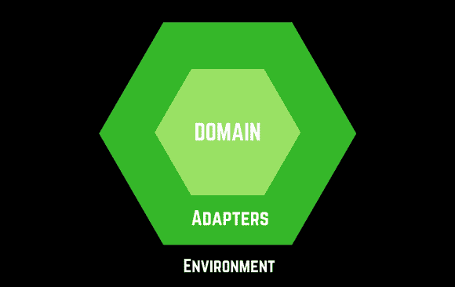

# Java OOP 高级指南

致敬 Mike Cavanagh 师：

你给我的启发远超你的想象。

你曾说我会成为一名优秀的顾问，“但那时我还没有故事”。

我花了一些时间，但故事就在这里了。

# 前言

为什么又要写一本关于 Java OOP 的书？

我在 Quora 上已经做了几年作家了。我非常喜欢那里。我能与世界各地的人讨论我热爱的话题——设计良好软件的艺术。我从 1981 年开始学习这门艺术。我还没有学完。

这本书的出现是因为我在 Quora 的新 Java 开发者之间发现了一个共同点。他们许多人认为 Java 的 OOP 是“啰嗦的”、“复杂的”或“过时的”。而且到处到处需要“getters and setters”。

然而，我们已经有很多关于 Java 的优秀书籍，以及 OOP 的经典著作。

那么改变了什么？

这是我的理论。所有伟大的书籍都写于 20 世纪 90 年——那时我们一些现代 Java 开发者甚至出生。没有人记得书中教训的原因很简单：我们不再教它们了。

这本书是我对那些经典思想的提炼，加上经验的转化。每一章都包含了我为了获得结果而在日常工作中使用的内容。它充满了在代码一线 25 年换来的智慧。它是实用的。而且非常简单。Bug 隐藏在复杂性中。我喜欢让 Bug 无处遁形。

我希望这本书能让你跳出“getter and setter”式的编码，进入高效状态，按照对象的设计初衷来使用。这可能是你第一次洞察 OOP 如何在现实世界中结合。Java 有啰嗦的声声。我希望这本书能告诉你如何解决这个问题。我希望你掌握编写整洁、强大、可读 OOP 代码的技巧。

这本书不是 Java 教程。它应该适合能够编写 Java“Hello World”并理解变量、条件和类基础语法的初学者。示例使用 Java 11 语法。许多在 Java 1 中即可运行。

Alan Mellor

Rock Cottage

2021 年 2 月

# 为清晰性而优化

在我们开始之前，这是本书的核心大题：

编程本质上是向另一个人类解释计算机在任何时刻究竟在做什么。作为副作用，它也告诉计算机该做什么。

这之所以如此重要，是因为计算机*实际*运行的内容对任何任何人来说几乎都是不可理解的。

例如，如果我写下：

```
clearScreen();
```

你可以理解我想要计算机清空屏幕上的所有内容，留出空白。

但计算机做不到。它像石头一样笨。字面上就是如此。硅片是由二氧化硅——沙子制成的。

我们需要通过某种翻译器将这段代码转换为计算机的语言。一种看起来完全不像英语的语言。

我的一台旧电脑需要像这样的东西：

```
LD HL, 4000H  00100001 00000000 01000000
LD DE, 4001H  00010001 00000001 01000000
LD BC, 6143   00000001 11111111 00010111 
LD (HL), 0    00110110 00000000
LDIR          11101101 10110000
```

其中左侧的汇编语言*仍然*是一种人类可读的形式。右侧的二进制是该计算机在其 Z80A 微处理器上运行的代码。

我知道我更喜欢哪一个。

编程的艺术在于让程序清晰。可读。易于扫读。没有花招。

这就是必须阅读所有二进制并推断出其意思是“清空屏幕”，与直接阅读 `clearScreen()` 之间的区别。

在一个运作良好的专业团队中，没有人有时间、金钱或欲望去这样做。永远没有。

这书的全部内容。

## 到底什么是对象？

编程的艺术在于让程序清晰。可读。易于扫读。没有花招。

这就是必须阅读所有二进制并推断出其意思是“清空屏幕”，与直接阅读 `clearScreen()` 之间的区别。

在一个运作良好的专业团队中，没有人有时间、金钱或欲望去这样做。永远没有。

这书的全部内容。

## 这 Java 有什么关系？

作为一种面向对象的语言，Java 的设计是为了反映现实世界，就像我们的示例中一样。它允许我们编写关于邮员、信件以及 `deliver()` 等代码。它允许我们编写计算机代码，读起来就像对我们问题的英语描述。而不是代码。

我认为，理解这一切最简单的方法就是下一节中的“用户（User）”示例。但在那之前，让我们先介绍一些术语和 Java 语法。

### 类、方法、构造函数、对象、引用

**对象 (Object)**：对象是方法和数据的小集合，用于表示一个单一、特定的事物：一个人、一列火车、一个单词、一个产品。

**类 (Class)**：在 Java 中，所有对象都属于一个 `class`。类允许创建一个或多个对象。它是每个对象公共特征的蓝图或模板。

**方法 (Method)**：方法用于描述对象为提供的行为。它很像是一个特定于 `class` 的函数。

**New**：关键字 `new` 接收一个类名，然后创建一个特定的对象。它返回该对象的引用，我们可以存储该引用。这让我们可以在稍后的代码中使用该对象。

**构造函数 (Constructor)**：一个由 `new` 调用的特殊方法。它负责在对象创建时对其进行设置。我们可以在这里提供事物的初始值。

**字段 (Fields)**：这些是每个对象特有的变量。为了帮助我们的行为方法工作，我们可以在对象的字段中存储数据。

**对象引用 (Object reference)**：关键字 `new` 会创建一个对象，用构造函数对其设置，然后返回一个“引用”。我们可以将此引用存储在局部变量或对象字段中。然后我们可以使用引用和点操作符在该对象上调用方法。

**this**：在方法内部，关键字 `this` 是一个对象引用，指向“当前对象”。这和我和你说话时说“我（me）”的概念一样。我指的是我自己。

**private (私有的)**：一个关键字，用于标记字段或方法为仅在 `Class` 内部可用。在外部，它是不可见的。它用于标记“秘密”。

**public (公共的)**：一个关键字，用于标记方法可以在调用代码的 `Class` 外部可用。也可以用在字段，但这种情况很少见。

### 简单示例：问候用户

为了展示我们的意思，让我们创建一个简单的对象：`User`。

大多数系统都有用户。希望我们会有大量的用户——如果我们的营销策略做得得当的话。我们的工作是为他们每一个人显示一个个性化的问候。

第一个设计决策是将每个用户表示为一个对象。为了做到这一点，我们需要为所有用户对象的共同点编写一个“蓝图”。一个 Java `User` 类：

```
public class User {
  private String name;  // 3. 私有数据

  public User(String name) { // 2. 构造函数
    this.name = name;
  }

  public void greet() { // 1. greet 方法
    System.out.println("Hello, " + name);
  } 
}
```

在对其操作之前，我们需要创建一个简单的测试应用程序。我们将使用标准的 Java 模板代码创建一个带有 `static main()` 的 `Application` 类——这是一个“魔法方法”，告诉操作系统从哪里开始我们的 Java 程序。

```
public class GreetingsApplication {
  public static void main(String[] commandLineArgs) {
    User u1 = new User("Jake");
    User u2 = new User("Katy");

    u1.greet();
    u2.greet();
  }
}
```

运行这个程序会向我们显示“Hello, Jake”和“Hello, Katy”。它是通过创建两个独立的用户对象，并要求它们问候它们所代表的用户来实现。

这段代码看起来可能平平无奇，但它包含了面向对象编程（OOP）最重要的基础。让我们来看看关键部分。

### 方法 - 让对象动起来

每个对象最重要的部分是你可以要求它做的事：即公共方法。

`User` 类有一个名为 `greet()` 的单一方法（见 1）。

方法名告诉我们该方法执行了*什么*，而不是*如何*做的。当我们编写调用代码时，这个名称描述了该方法将为我们做什么。它还让我们免于非要关心它是如何实现的。

这很重要，因为让我们让我们更改方法 `greet()` 的内部实现。当我们这样做时，调用代码将不会有任何变化。

我们的测试程序创建了两个用户对象，并对每个对象调用了 `greet()` 方法。注意测试程序读起来有多接近纯英语。OOP 的核心在于设计自定义对象，它们能为我们的应用程序恰恰执行正确的事情。我们可以按照用英语讨论我们正在解决的问题的方式来命名方法。

当我们设计对象时，我们从行为方法开始。稍后我们会添加数据和逻辑，如果这些对于让方法完成工作是必要的的话。

### 秘密 - 我们对象的专业知识

就像示例中的人知道某些事情并拥有工具来帮助他们工作一样，对象也有自己的秘密。

对象通常有两个秘密：

* 数据 - 每个对象特有的
* 算法 - 执行工作的逻辑

我们的 `greet` 方法包含了这两种秘密。

`greet()` 的逻辑很简单。我们使用 Java 的 `System.out.println()` 方法向控制台写入文本。

这就是*如何*——我们如何问候用户。因为它隐藏在 `greet` 方法的签名之后，我们可以自由更改这样做而不影响调用代码。这很重要。这防止了更改在系统中扩散。让代码更容易理解。

### 构造函数 - 让对象准备就绪

由于我们为每个用户创建一个对象，我们希望确保对象在创建后就是就绪的。这避免了其他方法中常见的“未初始化数据”问题。

我们有一个特殊方法可以做到这一点：构造函数。

构造函数的核心思想是它创建一个对象，加载数据并使其准备就绪。

对于我们的 `User` 对象，私有的 `name` 字段（见 3）是在构造函数内部设置的。我们将每个具体的名称作为参数传递给构造函数。

构造函数有助于保持我们数据的秘密。它们为调用代码提供了一种方法，可以在不知道任何秘密的情况下设置对象。

### 核心思想：调用代码非常简单

现在我们理解了 `User` 类内部是如何编码的，让我们来看看 OOP 的巨大优势：公共接口。即调用代码看到的部分。

它非常简单。

```
User u = new User("Alan");
u.greet();
```

编写一个知道如何问候用户的程序，我们只需要并调用这两个公共部分。我们调用构造函数创建对象并使其准备就绪。然后调用 `greet()`。这真的没有比这更简单的了。

现在，想象一下当程序变得越来越大时，这是如何帮助我们的。我们可能会有成百上千个类，也许有数千万行代码。但通过面向对象编程（OOP），我们只需要理解对象的公共接口可以做什么。它使我们免受细节的困扰。

这就是正确实现 OOP 的关键：`调用代码是简单的`

如果事实并非如此……说明我们做错了了。

## 面向对象设计是行为驱动设计

正确执行 OOP 的关键是让行为驱动设计。

第一个问题始终是“这个对象需要做什么？”。我们将其表示为一个方法，并使用名称来描述该行为。

然后，我们可以在该方法内部添加支持代码使其运行。我们可能会添加对私有方法的调用，将工作拆分成小块。我们可能需要将存储的数据作为对象的字段。在这种情况下，我们需要一个构造函数。

## 整洁代码

虽然我们上一个示例中的代码很短，但它也是“整洁”的。整洁代码简单意味着代码易读、易维护且安全。这里的安全意味着使用该代码时“没有陷阱”。

这意味着更愉快的日子、更快的开发速度和更少的 Bug。如果开发中有什么秘诀，那么整洁代码就是它。

这里使用了几种技术，我们应该在代码中始终使用它们。

### 良好的命名

名称在软件中至关重要。让我给你举个例子。下面这个类是做什么的：

```
class Z2 {
    private String aa;

    Z2(String aaa) {
        aa = aaa;
    }

    void q() {
        System.out.println("Hello, " + aa)
    }
}
```

没错——它是我们的 `User` 类，但命名糟糕。

很难理解，不是吗？

你是否发现自己在阅读代码时，“脑海中模拟计算机”并从中反向工程出含义？你是否想过这样的想法：“好的，这是一个 `Z2` 类。它有一个叫 `aa` 的字符串并被赋值，我们可以调用 `q` 方法，它……等一下……说了‘Hello’……这像是某种问候之类的吗？”

这里唯一给我们提供线索的文本是“Hello”。在我们命名得更好的 `User` 类中，我们有了 `user`、`greet`、`name` 和 `hello` 这些词，这帮助我们理解了该类的作用。我们不需要理解代码的每一个细节。

选择`意图清晰的命名`会极大地提高团队阅读你代码的能力。不是一点点，而是极大。而且它还能帮助你——当你六个月后回来编写你早已遗忘的代码时。

### 方法名：告诉我结果

有效的方法名解释了为什么我应该调用它们——在方法执行完成后会发生什么。它们不应该解释方法内部的内容，而应该说明该方法能为调用者做什么。

好的：`Users.findNewUsersSince(Date date)`

坏的：`Users.runDatabaseQueryToSortUsersByJoiningDateThenMap(Date date)`

方法名`应该是代码块的注释`。代码本身解释了方法是如何工作的。方法名的作用是注释，解释如果我调用它，方法会做什么。

哦对了；不要用注释来做这件事。将注释转换为方法名。

### 变量名：告诉我内容

有效的变量名告诉我它们的内容是什么，而不是它们是由什么构成的。

好的：`String surname` // 如果我需要姓氏，可以使用这个

坏的：`String theString` // 是的，是的，我看得出来！它为什么要在这里？

遵循这两条规则：`方法说明它们做什么，变量说明它们持有什么`，立立刻你的大部分代码将变得更容易理解。

## 围绕行为设计方法，而不是数据

很多文本建议 OOP 的重要之处在于类所拥有的数据。这困扰了很多人，并导致了一些脆弱的设计。关键点是“类应该具有哪些行为？”。在决定这些行为可能需要什么数据之前，回答这个问题。

在过去，我将对象视为一个数据结构，在其周围封装了一些函数。我学到首先设计行为（在不知道它们内部如何工作的情况下）可以带来更稳定的面向对象设计。我建议你也这样做。

围绕行为设计是正确执行 OOP 的关键。

## 隐藏数据 - 无 getter，无 setter

谈到数据，我们的 `greet()` 方法需要一些数据。它需要用户名来完成工作。因此，我们为此提供了一个私有的 `name` 字段。

但`只有` `greet()` 需要知道这一点。其他都不。

从类外部无法访问该名称。

没有 `getName()`。没有 `setName()`。

`User` 类根本没有需要这些。我们在构造函数中设置名称。我们使用名称作为 `greet()` 工作的一部分，但它没有其他重要性。它的存在仅是为了这一个原因。

这才是真正封装字段的样子。

以后，你可能会发现一个 getter `是合适的`。只需从行为开始，从完全封装的数据开始并从那里进行。

这样，你就不会担心其他程序员在其他类中编写代码，将我们锁定在私有数据上。

## 聚合：多于一个

我们的上一个示例遵循了所有伟大软件的足迹，只有一个 `User`。即使 Facebook 也是从那里开始的。

但当我们有多个东西时会发生什么？毕竟，这基本上就是计算机发明的目的。

Java 提供了许多实现此点的方法。大多数方法会导致代码难以阅读。所以，随着时间的推移，我倾向于这种方法。来自领域驱动设计：聚合。

## 问候更多

继续我们的示例，让我们添加更多用户：

```
public class Users {
  private final List<User> users = new ArrayList<>();

  public void add(User u) {
    users.add(u);
  }

  public void greet() {
    users.forEach(User::greet);
  }
}
```

这是一个 `Aggregate` 类。它之所以被称为这样，因为它将多个 `User` 聚合到了单个 `Users` 对象中。

这种方法的用处在于它遵循了之前的原则：

* 行为优先：添加用户，问候所有用户
* 隐藏数据 - 无 getter，无 setter
* 意图清晰的命名 `add()` 和 `greet()`

内部，它使用了 Java 8 及更高版本的功能，你现在已经在在使用了。

### 类型安全的集合而非原始数组

私有字段使用了著名的 Collection 类框架。字段本身是 `List<User>`。我选择它是为了表明我的意图，我不关心具体使用哪种列表，只要它按照调用 `add()` 的顺序访问即可。这体现在 `add(User u)` 方法中。

类型安全在大型程序中很重要。如果没有它，你可能会意外添加一个不是 `User` 对象且不支持 `greet()` 方法的对象。

这样做有什么意义？代码在运行时会崩溃。

Java 具有强静态类型，可以在运行程序`之前`发现这种错误。这是防止 Bug 进入代码的一种强大方式。

排除可能的错误是我在开发所有阶段始终使用的基本原则。如果你让某事无法出错，一切都会变得容易理解。你可以字面上地读取它能和不能做什么，而不是被迫猜测。

这里是另一种使用这种方法的方法。

Java 还提供了原始数组来存储“多个东西”。它们看起来有点像这样：

```
// Java 中的原始数组。拒绝。
User[] users = new User[10];
```


# 低级数组的问题

我一直认为这对我来说太底层了。我以前用 C 语言和汇编语言编程，在那里这是你唯一的选择。有集合类要好得多。

低级数组使用的问题在于：你必须预先知道想要存储多少内容；在上面的例子中是十个。

使用数组时，将它们添加到列表末尾非常笨拙。你必须跟踪你所写入的最后一个索引，然后使用 `users[currentIndex]` 语法写入下一个索引。

一旦达到数组大小的限制，因为它无法增长，你必须创建一个新数组，复制所有内容，然后将“上一次写入的索引”也复制过去。

这看起来就像应该有一个 `object` 来为你封装所有这些工作，不是吗？

当然，这正是 `ArrayList` 类所做的事情。

**所以就用它吧**。不要自己写。

人们抱怨 Java “过于繁琐”的原因之一是，当他们看到初学者代码充斥着原始数组管理时——而这些地方本该使用集合类（collections）。

我们的 `Users` 类繁琐吗？*真的吗？* 我认为并不繁琐。

## 使用 forEach 而不是循环

看一眼我们 `Users` 类中的 `greet()` 方法。

如果你以前见过这种写法，它看起来有点奇怪。

它使用了 Java 8 引入的一项新功能，称为 lambda 表达式。基本上，你可以将一个方法作为参数传递给另一个方法，这更像 JavaScript 使用高阶函数的方式。

每个 `Collection` 类（如 `List`）现在支持一个名为 `forEach()` 的方法，该方法恰好接受一个方法作为参数。

它的功能完全如其名所示，这也是我喜欢它的原因：对于集合中的每一个元素，在其上面运行该函数。

在我们的案例中，一个内部迭代器遍历了 `User` 对象列表。对于每个 `user` 对象，它都会调用该对象的 `greet()` 方法。

我们通过奇特的语法 `User::greet` 实现了这一点，这被称为“方法引用”。这是 Java 8 的一种简写，意为“对每个对象使用 `User` 类中的 `greet()` 方法”。

你可以使用四种不同的方法引用。它们都很有用。

关键点在于代码读起来有多么*直观*。“对于我们的每个用户，调用 `greet()`。”它简单、清晰且简洁。

我真正喜欢的是它与在原始数组上使用基于索引的循环的对比。让我们比较一下：

```
1 // 遍历原始数组。再次说不。
2 User[] users = new User[10];
3 users[0] = new User("Alan");
4 users[1] = new User("Katy");
5 users[2] = new User("Stephanie");
6 
7 // 请不要这样写代码。拜求了。
8 for (int i=0; i < 3; i++){
9   users[i].greet();
10 }
```

这有效吗？当然有效。但它很糟糕吗？噢，是的。

这里的主要问题——对我来说——是我看到的全都是*机制*。关于如何使用某些数组索引在带有 `greet()` 方法的 `User` 对象数组上运行循环有多么痛苦，包含了大量的细节，然后我们还必须调用 `greet()`。

我*没有*看到的是我原始的“业务问题”——“问候所有用户”。在聚合对象使用 `forEach()` 时，这一点是显而易见的。

另一个技术问题是循环的结束条件。我为了例子临时凑合了它。你能看到 `users` 数组有十个槽位吗？但我只添加了三个用户。你能看到我如何必须在 for 循环中硬编码数字 ‘3’ 吗？

再次，数组根本不是胜任这项工作的工具。*它们几乎从不是*。在集合类可以更好地完成工作的地方，请不要使用数组。

## 聚合方法作用于所有内容

这个简单的规则有助于你将代码拆分成不同的部分。

*   如果该行为作用于单个对象，就把它放在对象中
*   如果该行为适用于所有对象，就把它放在聚合类中

在我们的示例中，聚合类 `Users` 中的 `greet()` 方法将问候所有的 `Users`。单个类 `User` 中的 `greet()` 方法只问候该用户。

### 常见主题

聚合方法的常见想法有：

*   `summarise()` - 为某些公共元素创建一个摘要
*   `broadcast()` - 向所有对象发送某些内容
*   `submit()` - 发送一组订单

你还能想到多少个？

# 协作

对象像人一样，共同工作时效果最好。

设计一组对象来解决问题是一门艺术，而不是科学。有很多原则和准则，但没有循序渐进的计划。你必须在边做边构思每个解决方案，解决各种权衡。

后面的章节将详细探讨其中的一些原则。现在，让我们从基础开始。

## 基础机制

Java 给了我们两种基本方式让对象协同工作。我们可以将对象作为参数传递，也可以让对象作为一个字段（field）。

让我们在代码中看看它们，这样我们就知道它们的样子了。我们将使用两个类，`Dog` 和 `Cat`。`Dog` 想要追 `Cat`。也许不是两个宠物之间的“协作”，但让我们看看如何使用对象来实现。

我们将为 `Cat` 类制作一个 `chase()` 方法：

```
1 class Cat {
2     public void chase() {
3         System.out.println("I'm off up that tree");
4     }
5 }
```

让 `Dog` 类访问猫对象的第一种方法将其存储在私有字段中：

```
1 class Dog {
2     private final Cat cat ;
3 
4     Dog( Cat c ) {
5         this.cat = c;
6     }
7 
8     public void chase() {
9         cat.chase();
10     }
11 }
```

另一种方法是将 `Cat` 对象作为参数传递：

```
1 class Dog {
2     public void chase( Cat c ) {
3         c.chase();
4     }
5 }
```

这意味着我们需要另一个对象，它知道如何更详细地打印内容。让我们在这个对象上设计行为：

```
1 class Printer {
2     public void print( String text ) {
3         // todo
4     }
5 }
```

目前，假设我们只需要打印一个 `String` 值的能力。我们可以将实现留为 ‘todo’，稍后回来处理。

我们现在可以给 `Item` 增加一个打印自己的方法：

```
1 class Item {
2     public void print( Printer p ) {
3         // todo
4     }
5 }
```

这是一种进展。

我们正在向读者表达代码的高层设计和结构。我们是在告诉他们，我们有一个可以打印自己的 `Item` 对象。为了实现这一点，它将与一个 `Printer` 对象协作。

我想在这里停一下，并强调一下这里的思路。我们工作所展示的只有两个五行的类，其中每个方法都写着‘todo’。到目前为止，我不指望今年的年度薪酬审查中能获得多少奖金。

但这就是正确的 OOP（面向对象编程）的本质。这就是它之所以卓越的原因。我们首先作为*抽象*来设计系统的行为。抽象意味着“通用想法”或“无论你如何实现都始终为真的事”。

我们避免了陷入编码的细节中。相反，我们花时间表达我们的系统在做*什么*，每个大想法*在哪里*拆分，而不是*怎么*做到的。当然，“怎么做”非常重要。它只是重要性次于程序的结构。添加“怎么做”可以以后再做。

如果你用过低级语言编程，或者是编程的新手，你可能认出这是“反向”思维。我们习惯于直接切入细节。我过去也是这种方式处理代码的。我会带着一份详尽指令的“大购物清单”直接切入。

这导致了难以理解的代码。当我们阅读它时，必须通过逆向工程来理解正在操作什么。通过让我们的设计显式化，我们可以直接读出“做什么”。这回到了书的开头——我们的观点是 `clearScreen()` 比清空屏幕的二进制代码要容易理解得多。

这里也一样。我们通过先设计 OOP 行为来防止那种混乱。

总之，茶歇结束：回到编码中。我们的收据上只有一个 `Item`。让我们创建一个表示完整收据的聚合类：

```
1 class Receipt {
2     public void print () {
3         // todo
4     }
5 }
```

我能想到的第一个行为是 `print()`。

同样，在检查完需求后，我们会回到 `print` 的细节。但我们知道它会以某种方式与我们的 `Item` 对象协作并将它们打印出来。我们还记得之前的 `Item` 设计。它有一个接收 `Printer` 对象的 `print()` 方法。

让我们假设同一个 `Printer` 对象被用于打印整个收据。基于此，一个合理的设计决策是在 `receipt` 的构造函数中传入一个 `Printer` 对象，并将其存储在字段中备用：

```
1 class Receipt {
2     private final Printer printer ;
3 
4     public Receipt( Printer p ) {
5         this.printer = p;
6     }
7 
8     public void print () {
9         // todo - using field 'printer'
10     }
11 }
```

更多的进展。我们的 `receipt` 将能够打印自己了。

但它需要东西来打印！我们将给它一个在收收据上添加项目的方法：

```
1 class Receipt {
2     private final Printer printer ;
3 
4     public Receipt( Printer p ) {
5         this.printer = p;
6     }
7 
8     public void add(String description, Money price) {
9         // todo
10     }
11 
12     public void print () {
13         // todo - using field 'printer'
14     }
15 }
```

又向前了一步。

我在 `add()` 方法签名中做出了一个设计决策。这是基于需求的。该方法接受两个值参数——作为 `String` 的项目描述和作为 `Money` 对象的价格。我选择了这种方式而不是传入一个 `Item` 对象。也许我以后会改变主意。

目前，思路是 `Item` 将保持在该类簇内部为私有，以减少调用者的耦合。耦合（Coupling）是描述不同代码段之间连接程度的技术术语。

我们需要一个 `Money` 类，但目前可以是空的。在这个阶段代码只需要能够编译：

```
1 class Money {
2     // TODO
3 }
```

我们会在收据内部创建一个 `Item` 对象的列表，并使用 `add()` 向其添加：

```
1 class Receipt {
2     private final Printer printer ;
3     private final List<Item> items = new ArrayList<>();
4 
5     public Receipt( Printer p ) {
6         this.printer = p;
7     }
8 
9     public void add(String description, Money price) {
10         items.add( new Item(description, price) );
11     }
12 
13     public void print () {
14         // todo - using field 'printer'
15     }
16 }
```

这里是另一个设计决策。在 `Item` 类中需要一个接收 `Printer` 对象的构造函数。我们将传入 description 和 price，从而提供 `Item` 所需的信息：

```
1 class Item {
2     private String description;
3     private Money price;
4 
5     public Item( String description, Money price ) {
6         this.description = description;
7         this.price = price;
8     }
9 
10    public void print( Printer p ) {
11        // todo
12    }
13 }
```

为了让这个值不可变，我将它们标记为 `final`：

```
1 class Item {
2     private final String description;
3     private final Money price;
4 
5     public Item( String description, Money price ) {
6         this.description = description;
7         this.price = price;
8     }
9 
10    public void print( Printer p ) {
11        // todo
12     }
13 }
```

标记 `final` 意味着这个值是不可变的（Immutable）。这使得并发环境（如 Web 服务器）中的系统更易推理且更安全。

这种反向工作，为你的 IDE 提供它所需的所有线索。在 `Receipt` 类中输入 `new Item(description, price)`，IDE 会提供创建 `Item` 的构造函数。

我们到那里了。下一步工作是填充一些打印的细节。让我们从外部向内部开始，先坚持大图的想法：

```
1 class Receipt {
2     private final Printer printer ;
3     private final List<Item> items = new ArrayList<>();
4 
5     public Receipt( Printer p ) {
6         this.printer = p;
7     }
8 
9     public void add(String description, Money price) {
10         items.add( new Item(description, price) );
11     }
12 
13     public void print () {
14         items.forEach(item -> item.print(printer));
15     }
16 }
```

我们添加了一行 Java 8 Lambda 风格的代码来打印所有项目。它使用了“指令而非请求”（Tell Don’t Ask）风格来遍历所有的 `Item` 对象并要求每个对象打印自己。我们将我们在 `Receipt` 构造函数中提供的 `Printer` 对象传递该打印方法。

这就是良好的协作设计的示例。

我们没有通过 getter 和 setter 从对象中提取数据。我们甚至没有在考虑“数据”。嗯，我没有考虑。我把价格和描述看作是 `Item` 负责自己保留的“秘密知识”。当然，这有点像文字游戏；但它帮助我将 OO 设计看作由行为驱动，而非纯数据。

这仍然是一个大图的想法。`Receipt` 并不知道 `Item` 对象看起来什么样，也不知道如何处理打印。它只知道零或多个 `Item` 对象，并且它们可以被要求打印。这真的是创建代码的一种非常简单且具有描述性的方式。

让我们为 `Item.print()` 方法添加“如何做”的细节。“终于了！”，你可能会这样想。但别急着庆祝太——它将为我们带来另一个设计挑战。让我们先做最简单的事情：

```
1 class Item {
2     private final String description;
3     private final Money price ;
4 
5     public Item( String description, Money price ) {
6         this.description = description;
7         this.price = price;
8     }
9 
10     public void print( Printer p ) {
11         p.print(description);
12         p.print(" ");
13         price.print(p);
14 
15         p.newline();
16     }
17 }
```

一个结果是我们需要为 `Printer` 添加一个 `newline()` 方法。它应该在下一次调用任何 `print()` 方法时移动到下一行。

你能看到我所谈论的设计决策吗？

它是：“哪个对象应该负责知道如何在一行中格式化 Item？”

这很棘手。这并不是一个困难的选择，但我们有替代方案需要考虑。

我上面采取的方法是将 `description` 打印为字符串，*假设*可以打印一个空格来分隔价格，然后将格式化价格的责任*委托*给 `Money` 对象。这意味着我们需要为 `Money` 添加一个 `print(Printer p)` 方法。

这个方法知道 `Printer` 类，并且知道如何格式化一个适合打印的 `Money` 对象。

代码审查/结对时间：我们觉得怎么样？

我不确定。


对于一个简单的系统、一个概念验证，或者关于面向对象编程（OOP）书籍早期章节中的示例（咳咳），这足够了。它行得通。

然而，对我来说，它有许多代码异味：

* 视觉格式化看起来将是错误的
* 为什么 `Money` 要知道 `Printer`？以及为什么针对 `Printer` 的特定格式化？
* 为什么格式化一个 `Item` 的知识被分在两个类中？
* 阅读代码并知道预期结果有多有多难？

OOP 协作设计的真正核心就在此。到目前为止，一切一风风顺。但像这样的担忧——那些无法轻易映射到任何现有单一对象上的问题——正是我们必须停下来思考的地方。

目前有两种选择。我们可以继续进行。保持原样，稍后重新考虑该选择。或者我们现在改进结构。

在现阶段很容易过度工程，添加我们永远不需要且也没有人能读懂的复杂功能和结构。后面的章节将介绍关于何时停止的观点。特别是，测试驱动开发（TDD）将积极限制我们每一步所做的更改量。YAGNI 原则（“你不会需要它的”）有助于我们集中注意力。

但现在，让我们利用这个机会修复它——通过另一次协作。像往常一样，行为优先，细节在后：

```java
 1 class Item {
 2     private final String description;
 3     private final Money price ;
 4 
 5     public Item( String description, Money price ) {
 6         this.description = description;
 7         this.price = price;
 8     }
 9 
10     public void print( Printer p ) {
11         new ItemFormat(description, price).print(p);
12     }
13 }
```

我们引入了一个负责为打印格式化 `Item` 对象的对象。我们为它提供了执行该工作所需的所有信息。一如既往，我们将细节留到稍后。该对象的第一个版本将是简单的重构。我们将之前的 `Item.print()` 方法的内部内容放入 `ItemFormat.print()` 方法中。然后我们稍后会对关于 `description`、`Printer` 和 `Money` 之间谁做什么做出详细决策。

是时候为此构建一个小型测试应用了。首先，我们需要让我们的 `Printer` 类做点什么。我们将添加那个 `newline()` 方法。我们还将决定使用控制台输出：

```java
1 class Printer {
2     public void print(String text) {
3         System.out.print(text);
4     }
5 
6     public void newline() {
7         System.out.println();
8     }
9 }
```

填充 `Money` 类以包含 `print()` 行为以及支持的“秘密知识”：

```java
 1 class Money {
 2     private final String amount ;
 3     private final String currency ;
 4 
 5     public Money( String amount, String currency ) {
 6         this.amount = amount;
 7         this.currency = currency;
 8     }
 9 
10     public void print( Printer p ) {
11         p.print(currency);
12         p.print(amount);
13     }
14 }
```

Java 中真实的 `Money` 类将 `amount` 存储为 `BigDecimal`。这是一种固定精度、准确表示小数分数的方法——英镑和分。`float` 和 `double` 类型永远不会被使用，因为它们用空间换取精度。`float` 中的金额越高，存储的值就越不准确。这对银行非常糟糕。

我们对 `ItemFormat` 的第一次尝试来自于我们简单的重构：

```java
 1 class ItemFormat {
 2     private final Money price ;
 3     private final String description ;
 4 
 5     public ItemFormat( String description, Money price ) {
 6         this.description = description;
 7         this.price = price;
 8     }
 9 
10     public void print( Printer p ) {
11         p.print(description);
12         p.print(" ");
13         price.print(p);
14     }
15 }
```

添加一个演示应用：

```java
1 class ReceiptDemo {
2     public static void main(String[] commandArgs) {
3         new ReceiptDemo().run();
4     }
5 
6     private void run() {
7         Receipt r = new Receipt( new Printer() );
8 
9         r.add("Brie", new Money("1.95", "GBP"));
10         r.add("Tiger Bread", new Money("0.95", "GBP"));
11         r.add("Merlot", new Money("7.95", "GBP"));
12 
13         r.print();
14     }
15 }
```

并运行它查看：

```
1 Brie1.95
2 Tiger Bread0.95
3 Merlot7.95
```

## 设计回顾

让我们回顾一下设计。我们从对象的行为开始。设计由行为驱动。这些行为通过内部隐藏知识（`price`、`description`）和隐藏算法（`items.forEach()` 和 `ItemFormat.print()`）得到支持。

等等，我需要包含 `Receipt` 类：

```java
1 class Receipt {
2     private final Printer printer;
3     private final List<Item> items = new ArrayList<>();
4 
5     public Receipt(Printer printer) {
6         this.printer = printer;
7     }
8 
9     public void add(Item item) {
10        items.add(item);
11    }
12 
13    public void print() {
14        for (Item item : items) {
15            item.print(printer);
16            printer.newline();
17        }
18    }
19 }
```

### 练习：总金额

一个新的需求以敏捷用户故事的形式出现：

* 作为客户
* 我想看到总价
* 这样我就知道需要付多少钱

我们如何从行为开始驱动这一切片？

*提示：* 将 `Money.amount` 字段改为 `BigDecimal`。避免在 `Money` 中添加 `getAmount()` 方法的诱惑。思考 `Money` 对象如何与另一个对象协作，该对象负责跟踪总额并在我们的 `Printer` 对象上打印它。

我们已经看到面向对象编程（OOP）的核心在于让调用代码变得简单，并将细节隐藏在方法内部。我们构建一组相互协作的对象，并仅通过这些公共方法进行交互。我们已经学会了先设计行为方法，再添加任何必要的私有数据，最后才添加构造函数。我们从对象的外部向内部进行设计。

如果我们能找到一种方法，帮助我们记住按照这个顺序执行任务——并且在软件完全完成之前就将其 `run()` 起来会呢？

测试驱动开发（TDD）正是实现这一目标的方法。

TDD 帮助我们获得正确的设计。它迫使我们在编写任何内部代码之前，先思考对象方法对调用者来说应该是什么样的。

TDD 证明了我们的逻辑运行符合预期。我们调用一个方法，捕获输出并将其与预期值进行比较。

简而言之，这简直是魔法。你绝对应该使用它。

TDD 还提供了一种方法，让我们在编写出协作对象之前，就能证明我们的对象与其协作对象正常工作。但在尝试这一点之前，我们将在随后的章节中介绍“多态”。

让我们从基础开始。我们如何开始 TDD？它又有什么帮助？

## 使用 TDD 进行从外向内的设计

TDD 帮助我们设计对象的公共接口使其易于使用。

关键在于，使用我们认为良好的公共接口来编写调用我们对象的代码。我们是在编写对象内部代码 `before` 这么做的。这迫使我们思考如何让调用代码简单。这再次体现了 OOP 的“逆向思维”。

这段代码被称为测试代码。它将设置我们的对象，调用它的行为方法，然后检查该方法是否生效。

这个测试为我们做了两件事：

* 验证行为是否正确
* 验证调用是否易于实现 - 这是良好设计的标志

如果我们的设计难以设置或难以使用，我们将在难读的测试代码中看到。

Java 项目使用很棒的 `JUnit` 测试框架来提供帮助。我喜欢添加 `AssertJ` 来帮助完成检查。

让我们用 TDD 构建一个小型计算器，用来累加餐厅账单。在跟随操作时，请注意 TDD 的 `rhythm`：写一点测试，看到失败，用一点代码修复它，不断循环。

我们的计算器类应该做两件事：

* 为我们已添加的所有项目提供运行总计
* 添加另一个项目。

我们从写一个空测试开始。我们希望这个测试能证明某些在我们一创建 `BillCalculator` 类时就会成立的事。如果我们创建了这个对象且没有向它添加任何项目，总数必须为零。

让我们开始为之写一个测试。

### 第一个测试：总数从零开始

```java
class BillCalculatorTest {
    @Test
    public void totalStartsAtZero() {
        // ... todo
    }
}
```

我们得到了测试类和一个测试框架方法，它们都根据其功能命名。

现在我们为对象进行一步微小的设计。我们希望能够访问最新的运行总计。对于这一点，尽管我在之前的章节中一直在抱怨，但一个 `getTotal()` 方法似乎是最简单、最清晰的设计。

让我们把这个设计决策加入测试中：

```java
class BillCalculatorTest {
    @Test
    public void totalStartsAtZero() {
        // Act
        float total = calculator.getTotal();
    }
}
```

此时编译器会大声地抱怨，如果这是你第一次 TDD 会话，你可能也会这样抱怨：“还没有任何对象！”

说得对。让我们修复它。

使用 IDE 快捷键，创建一个名为 `BillCalculator` 的新类：

```java
class BillCalculator {
}
```

现在，我们可以修复编译器的许多抱怨中的第一个，并创建一个计算器对象：

```java
class BillCalculatorTest {
    @Test
    public void totalStartsAtZero() {
        // Arrange
        var calculator = new BillCalculator();

        // Act
        float total = calculator.getTotal();
    }
}
```

我使用了最近 Java 版本中的 `var` 关键字（别问我是哪个版本；我从来不是那种语言专家类型的人）。我觉得在这里读起来非常清晰。

编译器将不情愿地接受我们现在不是白痴了，并移除 `calculator` 下方的红 X。它将继续处理下一个抱怨。我们需要添加 `getTotal()` 方法。

让 IDE 快捷键来完成这个，因为 IDE 拥有所有所需的信息来正确完成：

```java
class BillCalculator {
    public float getTotal() {
        return 0.0;
    }
}
```

我喜欢这样倒着工作。IDE 拥有足够的信息来完成大部分的体力活，而且不会像我那样犯那么多输入错误。一旦进入了节奏，这是一种非常快的工作方式。你甚至（对外行人来说）像个 `10x 级忍者摇星程序员`。

总之。编译器会开心的，允许我们添加对一切都完好的检查。我们将使用很棒的 `AssertJ` 库来提供 `assertThat()` 方法。

```java
class BillCalculatorTest {
    @Test
    public void totalStartsAtZero() {
        // Arrange
        var calculator = new BillCalculator();

        // Act
        float total = calculator.getTotal();

        // Assert
        assertThat(total).isZero();
    }
}
```

我们可以运行这个测试 - 并且通过了！我们的计算器通过了它的第一个唯一测试。

## Arrange, Act, Assert - 测试内部的节奏

注意我们编写代码如何导致测试分为三个部分。我们首先决定了行为方法并对其进行了调用。这被称为 `act` 步骤 - 采取行动。

我们还决定了该方法返回什么。这意味着我们通过与预期值比较来如何测试它。这是 `assert` 步骤 - 我们对输出进行断言。

最后，我们需要一个对象来测试！这是 `arrange` 步骤，我们为测试开始做好所有准备。我们写的每个测试都有这个节奏：Arrange, Act, Assert。

## Red, Green, Refactor - 测试之间的节奏

在写完第一个测试后，我们就可以进入开发的核心了。我们一个测试一个地向代码添加功能。在此之前，TDD 有一个额外的节奏引导我们：Red, Green, Refactor。

**Arrange, Act, Assert** 引导我们在测试内部，帮助我们编写良好的测试代码并记住所有部分。

**Red, Green, Refactor** 帮助我们发现*涌现设计*。它发生在测试之间。

在 TDD 重构（refactor）阶段，我们将此书中的原则应用到代码中。我们会查看生产代码*以及*测试代码。我们进行一次微型代码审查（Code Review）并寻找改进点：

* 所有的命名都体现了意图吗？
* 我们可以消除重复代码（`DRY` 不要重复自己）吗？
* 我们可以用更简单的语法替换复杂的语法吗？
* 我们可以拆分某些内容来添加具有解释性的变量或方法吗？

如果我们发现了任何改进点——或者我们的结对伙伴或小组同事发现了——我们现在就进行修改。

在每个“红-绿-重构”（Red - Green - Refactor）循环结束时，我们拥有良好的 OOP 设计、被证明可以运行且质量正确的代码。

在我们案例中，我们才刚刚开始。在白纸上很难搞坏代码，所以我们没什么需要做什么的。

## 第二次测试：添加项目带给我们正确的总额

是时候添加我们的第一个“正式”功能了——在 TDD 中，这意味着编写另一个测试。

我们保留所有已经编写过的测试。通过这样做，我们构建了一整套回归测试。“回归”是指我们在添加功能 `#2` 时，不小心破坏了功能 `#1`。通过保持所有测试通过，我们证明了我们没有发生那种情况。

在开发过程中——而且肯定是在提交（commit）之前——我们都会运行所有测试并确保它们全部通过。

当然，这对软件质量是巨大的提升。这看起来可能非常显而易见。但只有当你知道如何做时，事情才是显而易见的。我提到这一点是因为一次训练营课程，有一个学生最后只剩了一个测试，在每次新迭代中都删除了其他测试！

总之。新的测试：

```java
 1 class BillCalculatorTest {
 2     @Test
 3     public void correctTotalForOneItem() {
 4         // Arrange
 5         var calculator = new BillCalculator();
 6 
 7         // Act
 8         calculator.add(12.95);
 9         float total = calculator.getTotal();
10 
11         // Assert
 12         assertThat(total).isEqualTo(12.95);
13     }
14 }
```

## 设计第二个功能

我们继续按照之前的 安排（Arrange）、执行（Act）、断言（Assert）节奏进行。

我们现在正在做更多的设计决策。我们开始影响代码的形状了。我做了两个决策，其中至少有一个是成疑的：将增加总额的行为命名为 `add()`，以及使用 `float` 来表示价格。公平地说，那是在上一步完成的。

使用 `float` 是那个成疑的。在学生练习和书中微小的练习之外（咳），`Floats` 和钱并不合拍。它们对货币来说有两个问题：舍入误差和货币类型。


`Floats` 缺乏精度。它们通常使用 `IEEE-754` 标准来存储具有特定二进制位的尾数和指数。结果是某些分数值——比如三分之一——无法被精确表示。这导致在相加时产生舍入误差。对于计算账单来说并不好。

原始的 `float` 也不具备涉及货币的知识。对于银行中常见的混合货币，这使得它们变得毫无用处。

创建一个 `Money` 类可以解决这两个问题。但毕竟这只是关于 TDD 的示例，而不是银行银务。让我们继续进行吧，假装我们谁都没说过那些话。试着别看起来心虚。

让我们用那个测试驱动出一个合理的实现：

```
class BillCalculator {
    private float total;

    public void add(float itemPrice) {
        total = itemPrice;  // 1. 我们需要谈谈这个...
    }

    public float getTotal() {
        return total;
    }
}
```

测试通过了。砰！大家击掌。

有什么需要重构的吗？没什么特别，但我决定重构 > 将类重名为 `Bill`。

现在我们已经有了行为方法 `add()`，这似乎比 `BillCalculator` 更有意义。这不是一个计算器。这是一份餐厅账单，我们正在对它进行操作。这是看待问题的另一种方式。随着你的面向对象设计的展开以及你对问题的进一步了解，获得这种见解是很常见的。这就是为什么敏捷、迭代开发与 OOP 配合得非常好的原因。

我们将使用 IDE 工具将 `BillCalculator` 重命名为 `Bill`，并勾选同步重命名测试。我还将重构 > 重命名测试中的本地变量 `calculator` 为 `bill`。

## TDD 步骤 - 太多还是太少

让我们看看 (1) 中的设计决策。它揭示了 TDD 中的一种张力。

我在上面执行了严格的 TDD 以展示如何操作。我通过编写脑中最简单的代码来让测试通过。正常的做法是在重构步骤中清理我们不喜欢的内容。

但这是不同的。这关乎在每一步中完成多少进度。

(1) 中的实现*将*价格赋值给总额。它覆盖了现有的总额，而不是将其累加。

这意味着零情况会通过，单个项目情况也会通过。添加第二个项目将失败。

严格的 TDD *始终*在每一步都只做最少的工作。这被称为 `YAGNI` 原则。

我的建议是从短语的开头去掉噪音词。这是一个测试用例，所以我们不需要说诸如 `shouldCalculateTotalAsZero`、`returnsTotalAsZero` 或 `checkThatTotalIsZero` 这样的话。

我们绝对*不需要*编写像下面这样笨重的测试名称：

```
@Test
public void BillTest_calculateTotal_isZero() {
   // JUST SAY NO!!!!!
}
```

### 为什么？

对我来说，这回到了方法的整个核心思想：方法是小型的抽象，让我们的代码变得不那么复杂。

我们并不是在描述测试*是如何*构建的。我们甚至没有在描述我们正在测试的方法是*如何*实现的。我们描述的是我们想要正在测试的方法*做什么*。

我们应该使用简洁的、以结果为驱动的测试名称。读者应该能够快速读出测试期望生产代码做什么。这提高了代码的可读性，并简化了日后重构生产代码内部实现的工作。

敏捷意味着我们可以对对象向调用者隐藏的秘密改变想法。我们在测试名称中也反映了这种思考。

## TDD 与 OOP - 天生一对

TDD 与面向对象编程（OOP）天生契合。OOP 的本质是从外向内设计对象。而 TDD 是为这一过程提供脚手架。

我们看到了两种引导我们的节奏：

*   准备（Arrange）、执行（Act）、断言（Assert）
*   红（Red）、绿（Green）、重构（Refactor）

我们已经看了 `YAGNI`（以及它的偷径近亲 `YAYA`）如何帮助我们防止代码过度复杂。我们看到了如何对代码改变想法，花精力在过程中进行改进。我们还看到了 TDD 如何帮助我们通过一个又一个测试长出一个“尺寸合适”的设计。

这些思想是极端编程（XP）的核心。这种“左移”（即更早揭示）了逻辑、设计和代码清晰度的任何问题。

## FIRST 测试是可用的测试

我们喜欢软件开发中的缩写，所以又提出了一个缩写来帮助我们设计单元测试：FIRST。

每个单元测试都应该是：

*   **快速 (Fast)**：它应该运行得很快（毫秒级）
*   **独立 (Independent)**：每个测试都可以单独运行。每个测试不需要任何其他测试先运行，也不需要任何硬件设置
*   **可重复 (Repeatable)**：每次测试运行时都会给出相同的结果。它的反面是*不稳定的（flaky）*测试
*   **自检 (Self-checking)**：测试自动检查输出。如果你需要人类来操作，它就不是一个 FIRST 测试
*   **及时 (Timely)**：每个测试编写花费的时间与其所测试的代码花费的时间差不多

早前的代码示例都是 FIRST 测试。

保持测试符合 FIRST 原关重要。它是拥有能够帮助你开发代码的有用测试的关键。违背了 FIRST，你得到的只有经理才会喜欢的测试。

## 现实世界的 TDD

在继续之前，分享一些在真实项目中使用 TDD 的经验是值得的。正如预期的，一切并不像我刚才描述的那么美好。

### 优点

我是 TDD 的忠实粉丝。它确实加快了开发速度（是的，真的）。开发周期要比启动三个服务、一个 Docker 化的数据库、Node 加上一个 React UI，然后点击五个屏幕来测试你的账单能否相加两项物品要快得多。

每次代码更改时获得的回归测试在减少 Bug 修复成本和维护客户声誉方面是价值连城的。

TDD 给了我很多对自己工作的信心。它让我能把事情拆分成我有限的脑力可以处理的小块。我以前在运行代码之前会一次性写几百行代码。现在我完全不知道自己是怎么做到的。

### 缺点

有些团队不喜欢 TDD 并拒绝使用它。

TDD 仅适用于清晰的设计，且这种设计被拆分以允许测试访问代码。遗留代码通常无法使用 TDD。在被称为代码的巨大乱面条团中，你无法获得所需的访问权限。

我曾遇到有人嫉妒我使用 TDD，他们在团队中让我的生活变得艰难。他们似乎觉得这在某种程度上显示了他们的低劣，而且这是我故意为之的。最好让大家达成共识。

当你*无法*预先决定一个方法应该做什么时，TDD 完全不起作用。虽然这听起来显而易见，但很多现实世界的开发都是实验性的。

你正在摸索，试图弄清楚哪些代码可能有效。你可能正在为一个尚未完全规范的功能连接你并不理解的库。

这里的解决方案是进行一次*探针实验（spike）*。忘记测试：直接乱写（Hack）。对有效的内容以及实现这些内容的代码粗略形状做笔记。撤销探针实验，然后使用 TDD 按照你的笔记进行适当的工程实现。

### 糟糕

TDD 在错误的人手中会创造出真正巨大的混乱。想象一下蹒跚儿童拿着马克笔画出的那种混乱。

问题在于，TDD 并不会——也无法——为你设计代码。这就是为什么我在这本书中把它放在 OOP 思想之后。它就是做不到。

相反，TDD 给你提供的是*设计反馈*。这里有三个经典的测试代码异味：

*   混乱的准备步骤（Arrange Step）：你的对象与其他对象的耦合过紧了。拆分它。
*   混乱的执行步骤（Act Step）：你的对象使用模式太复杂了：简化它。
*   混乱的断言步骤（Assert Step）：结果难以使用。重新思考它。

通常发生的情况是这些测试异味被忽视了。时间压力、缺乏领导，或者可能是缺乏知识。

## 多态 - OOP 皇冠上的明珠

到目前为止，面向对象编程中最有效的工具是多态。它是后续所有内容的关键。

它完全关于创建可以替换的对象。

多态为我们提供了条件逻辑的良好替代方案。它允许我们以非常有趣划分程序。我们可以隔离测试代码，与外部系统解耦并减少 if/switch 语句。

在 Java 代码中使用这种技术有几种方法。让我们看看最清晰的方法。

### 经典示例：Shape.draw()

经典示例是 `Shape.draw()`。它简单且很好地传了观点。

这个示例的核心是几个类，每个类都知道如何绘制单个形状。Circle 会画圆形。Square 画正方形。我们需要一段可以绘制所有这些形状的代码，同时允许我们在未来轻松添加更多。

### Shape 接口

我们从纯接口开始。这个接口定义了实现它的对象必须支持的行为。这就是赋予我们多态的部分。

它是对所有调用代码的承诺：任何实现 Shape 的对象都有我们可以调用的 `draw()` 方法。

```
interface Shape { 
  void draw(); 
} 
```

我非常喜欢这一点表达了*设计意图*。

我在告诉代码的读者，所有的 Shape 对象在被要求时都知道如何自己画。这是调用代码需要知道的唯一事情：它可以调用 `draw()`

为了让这个示例变得有用，我们需要创建一些具体类，隐藏如何绘制它们特定形状的细节。

为了简化这个示例，`draw()` 将形状的文本描述写入到控制台。一个更完整的示例向 `draw()` 传递一个 `Display` 对象，这让我们能够访问图形操作。我们将在书后面看到它。

现在，让我们专注于探索多态的基础，并让 `draw()` 在不同的对象中执行不同的操作。

```
class Circle implements Shape { 
  public void draw() { 
    System.out.println(“Look how round I am”); 
  } 
}
```

这是一个知道如何画圆的类。在这个例子中，这意味着它向控制台写入了一些文本。

```
class Square implements Shape { 
  public void draw(){ 
    System.out.println(“Four sides all the same for me”); 
  } 
}
```

`Square` 是一个知道如何画正方形的类。

# 告知不要询问（Tell Don’t Ask）—— OOP 的关键

这允许你编写代码来接收任何 `Shape` 并让它自己画出来。这就是“告知不要询问”原则的体现。回想一下我们的对象基础章节，我们讨论过不要告诉别人如何工作，我们只需要要求他们去做即可。这在代码中就是这样运作的。

这很魔法，我们稍后会讨论为什么。但首先，让我们看看调用代码是什么样子的：

```
var shapes = new ArrayList<Shape>(); 

shapes.add( new Circle() ); 
shapes.add( new Square() ); 

shapes.forEach( shape -> shape.draw() ); 
```

这段代码创建了一个实现 `Shape` 的对象的列表。它向该列表添加了 `Circle` 和 `Square` 的实例。它使用 Java 8 的 `forEach` 方法遍历列表中的每个对象，并调用它的 `draw()` 方法。

由于 `draw()` 是多态的，Java 运行时会将调用路由到`实现类`中的代码。尽管调用代码看起来每次都调用同一个 `draw()` 方法，但*事实并非如此*。运行时会将其路由到它找到的任何实际类。

输出看起来如下：

> Look how round I am
>
> Four sides all the same for me

让我们聊谈我提到的那种魔法。你会发现这里有几个非常精妙的地方：

*   没有 `if` 或 `switch` 语句
*   没有 `instanceof` 语句（哎！真的不要了）
*   循环代码不知道列表里有什么种类的形状
*   我们可以添加新形状而不影响任何其他形状

不使用 `if` 或 `switch` 语句是一个巨大的胜利。另一种方法是拥有单一的 `draw()` 方法，并在其中包含一个巨大的 `switch` 语句：

```
public void draw() {
    // 千万不要这样做！！！
    
    switch( shapeType ) {
        case "CIRCLE":
          System.out.println(“Look how round I am”);
          break;
        
        case "SQUARE":
          System.out.println(“Four sides all the same for me”);
          break;
        
        default:
          throw new IllegalArgumentException("Unknown Shape type " + shapeType)
    }
}
```

你可以看到随着新形状的添加，这样的代码会不断增长。代码本身是复杂的，所有的条件判断都是如此。它们在代码中拥有额外的可能执行路径。每一个都需要测试。每一个都增加了出现编码错误的可能性。

多态方法完全分离了这些代码部分。`Circle` 类与 `Square` 类完全没有联系。在我们“巨大的 switch 语句”情况下，情况就不成立。因此，对其中一个修改不会影响另一个。

另一个结果是添加新形状非常简单。

```
class Triangle implements Shape {
  void draw() {
    System.out.println("I really like having three points");
  }
}
```

*draw 循环代码完全没有改变 - 但现在可以画三角形了*

为了添加我们的三角形，我们只需要在对象创建代码中添加一行即可：

```
var shapes = new ArrayList<Shape>(); 

shapes.add( new Circle() ); 
shapes.add( new Square() ); 
shapes.add( new Triangle() ); // 唯一新的一行代码

shapes.forEach( shape -> shape.draw() ); // 这里没有变化
```

这是 `开闭封闭原则`（`OCP`）的示例，我们将在 SOLID 章节中介绍它。它是缩写词中的“O”。它很重要，因为它意味着我们可以保持代码对添加新功能开放——但对修改我们已知有效的现有代码保持关闭。

# SOLID 原则

随着面向对象的程序规模越来越大，将系统拆分成许多小部分变得至关重要。

但“拆分”意味着什么？到底什么是“小部分”呢？

被称为 SOLID 的五个设计原则是为了解决这些问题而提出的。它们的名字有些非常晦懂，但一旦你理解了它们解决的问题，就足够简单了。

## 五大 SOLID 原则

让我们它们列出来，这样你就知道这个缩写词的含义了：

*   `SRP` 单一责任原则 (Single Responsibility Principle)
*   `OCP` 开闭原则 (Open/Closed Principle)
*   `LSP` 利可用夫替换原则 (Liskov Substitution Principle)
*   `ISP` 接口隔离原则 (Interface Segregation Principle)
*   `DIP` 依赖倒原则 (Dependency Inversion Principle)

你可以从首字母看到这个缩写。

每个原则的标题都是真正意义上的术语。一旦你知道每个原则的含义，短标题就有意义了。但在那之前，它们没什么意义。

注意的是，这些原则的顺序是“听起来最好”的——而不是“最有用”。

乍看之下，这没什么特别的。我们看到了三个部分：获取输入、转换、显示。

但注意 `new` 关键字。这是一个问题。

正因为这个 `new`，该方法对如何读取键盘以及如何显示输出产生了`直接依赖`。

它还调用了 `System.out.println()` 进行输出，这存在同样的问题。我们被紧密地绑定到了一个全局方法上。但让我们先只考虑输入部分。

### 为什么 ‘new’ 是一个大问题？

`new` 关键字本身并不是问题。问题在于*它在代码中的位置*。

这种依赖关系是硬编码的。它们无法被更改。

如果我们想要一种不同的输入方式，我们就必须进入这个方法并修改代码。我们需要删除与 `Scanner` 相关的两行代码，并将它们替换为其他内容。

对于一个四行的方法来说，这听起来并不糟糕。但作为一种设计原则，这恰恰是我们不想要的。我们不希望互无关的代码区域必须发生改变。

这样想：我们这个小函数的主要目的是什么？是将某些内容转换为大写。是的，它需要从某地方获取一些输入来实现这一点。但函数完全不需要知道那些输入是如何获取的。

这正是 TDD 真正迫使我们在早期做出良好决策的地方。

我们如何为我们的函数编写单元测试呢？剧透一下：我们写不了。

我们不得不承认失败。我们没有让测试在这一层进行键盘输入。我们被锁定在了使用 `Scanner` 对象上。

但让我们重新表述这个问题而不要放弃：我们*如何能*编写单元测试？我们需要更改什么？

### 反转输入依赖

我们需要某种方法，让这段代码可以获取输入，而无需知道它是如何实现的。

我们以前见过怎么做。我们的多态 `Shape.draw()` 知道如何请求对象执行某事，而不需要知道怎么做。

让我们在这里使用相同的技术。

我们将引入一个名为 `Input` 的接口，我们可以要求它提供一些文本：

```
interface Input {
    String fetch();
}
```

这是一个抽象。它说：“你可以向我索要输入字符串，但它从哪里来由我来决定”。

它替换了示例代码中与 scanner 相关的两行代码。


```java
public void showInputInUpperCase() {
    String inputText = input.fetch();

    // Convert
    String upperCaseText = inputText.toUpperCase();

    // Display
    System.out.println(upperCaseText);
}
```

我还删除了注释。没有注释，接口本身也已经足够清楚了。

就目前而言，代码无法通过编译。

我们需要再做两个更改：

* 创建该接口的实现类
* 添加一个参数或字段 `input` - 这样我们的方法就可以使用接口

## 创建一个具体的 `KeyboardInput` 类

我们可以轻松地创建该接口的第一个实现：

```java
class KeyboardInput implements Input {
    @Override
    public String fetch() {
        Scanner scanner = new Scanner(System.in);
        String inputText = scanner.nextLine();
        
        return inputText;
    }
}
```

我们将 `Scanner` 代码复制粘贴到一个实现该接口的新类中。它被称为 `KeyboardInput`，因为这个类被允许确切知道输入来自哪里。

这个类就是所谓的“反反依赖”。

旧方法在方法内部通过 `new` 创建了 `Scanner`。它依赖于 `Scanner`。

新方法的代码只依赖于接口。新的 `KeyboardInput` 类封装了 `Scanner` 并且依赖于接口。这就是反转的部分。

我们将依赖关系从“方法依赖 `Scanner`” 为了“包含 `Scanner` 的类依赖接口”。

这种依赖关系与之前恰好相反。它被反转了。

这种思维过程被称为 `DIP` 依赖倒置原则。

## 依赖注入 - 使用我们的反转依赖

我们原始的方法需要一种方法来使用这个反转依赖。

最常见的方法将其注入到构造函数中：

```java
class TextConversion {
    private Input input ;
    
    // 这是我们注入依赖的地方
    public TextConversion(final Input input) {
        this.input = input;
    }
    
    public void showInputInUpperCase() {
        String inputText = input.fetch();
    
        // Convert
        String upperCaseText = inputText.toUpperCase();
    
        // Display
        System.out.println(upperCaseText);
    }
}
```

并且我们会构建一个小型应用程序来连接并运行它：

```java
public class TextUtility {
    public static void main(String[] commandLineArgs) {
        Input input = new KeyboardInput();
        
        new TextConversion(input).showInputInUpperCase();
    }
}
```

运行这个程序，我们得到了原始的行为。这是一个重构练习，而不是功能变更。

你能看到我们是如何将键盘输入的细节从实际的文本转换中*外部化*的吗？

## 可切换的输入源

这是此设计最神奇的地方。这种设计隔离了输入源的变化。

如果我们决定将使用键盘改为数据库，我们不需要更改 `TextConversion` 类。也不会更改键盘输入。

我们会编写一个实现 `Input` 接口的新具体类 `DatabaseInput`。我们在应用程序中使用它代替键盘输入：

```java
public class TextUtility {
    public static void main(String[] commandLineArgs) {
        Input input = new KeyboardInput();
        
        new TextConversion(input).showInputInUpperCase();
    }
}
```

## 反转输出到显示

与抽象输入一样，我们也可以对输出做同样的事情：

创建接口：

```java
interface Output {
    void display( String toDisplay );
}
```

创建一个输出到 System 的具体类：

```java
class ConsoleOutput implements Output {
    @Override
    public void display( String message ) {
        System.out.println( message );
    }
}
```

在构造函数中注入注入 `Input` 和 `Output` 依赖：

```java
class TextConversion {
    private Input input ;
    private Output output ;
    
    public TextConversion(final Input input, final Output output){
        this.input = input;
        this.output = output;
    }
    
    public void showInputInUpperCase() {
        String inputText = input.fetch();
        String upperCaseText = inputText.toUpperCase();
        output.display(upperCaseText);
    }
}
```

并在应用程序中创建这些具体类：

```java
public class TextUtility {
    public static void main(String[] commandLineArgs) {
        Input input = new KeyboardInput();
        Output output = new ConsoleOutput();

        new TextConversion(input, output).showInputInUpperCase();
    }
}
```

这允许我们切换到任何输入或显示源。我们只更改用 `new` 创建的对象。其他地方都不用动。

这有助于我们的单元测试。我们可以将输入替换为我们可以控制的内容，并将输出替换为可以捕捉发送到它的任何内容。

我们将在‘TDD 和测试替身’章节看到它是如何工作的。

## 反转 - 注入：硬币的两面

人们经常听过 DIP、SOLID 和像 Spring 这样的 DI 框架，但从未将它们联系起来。

依赖反置是一种*设计*技术。是从软件中移除硬编码耦合的思维过程。

依赖注入是一种 `implementation` 技术。我们反转了依赖关系。现在，我们需要某种方法来选择合适的具体实现并将其接入。

DI 框架通常很有用。但不要忘记——DI 的本质仅仅是简单地 `new` 出类并将它们传递给构造函数。

## LSP 里科夫替换原则 - 让事物可替换

Barbara Liskov（芭·里科夫）是计算领域的传奇。LSP 是她发现的一个重要原则的名称。

该原则帮助我们推导多态中遇到的问题。

让我们回到 Shapes（形状）示例来看它具体是什么。

### 当 Shapes 变得糟糕时

```java
interface Shape {
    void draw();
} 

class Circle implements Shape {
    public void draw(){
        System.out.println("I'm round");
    }
}
```

这是“良好”的情况。

`Circle` 实现了接口 `Shape` 的 `draw()` 方法，并可以在任何预期 `Shape` 的地方使用。

你可能记得那个调用代码示例，它可以在不更改代码的情况下混合使用 `Circle`、`Square` 和 `Triangle`。

但每个实现接口方法的类都能被替换吗？这个类的呢：

```java
class CardDealer implements Shape {
    private final Deck cards ;
    
    CardDealer( final Deck cards) {
        this.cards = cards;
    }
  
    public void draw(){
        Card next = cards.next();
        System.out.println(next.asText());
    }
}
```

这可能是一个牌游戏的类；桥牌甚至是 Snap。

`CardDealer` 类实现了方法 `Shape.draw()`，因此它与其具有多态性。

我们可以很容易地将其加入形状列表中：

```java
List<Shape> shapes = List.of( new Circle(), new CardDealer());
shapes.forEach( Shape::draw ); 
```

这将会编译并运行。

但它能按预期工作吗？

### 可替换性

直觉上——不能。它显然不会按预期工作。`CardDealer` 不符合我们对 `Shape.draw()` 应该做什么的预期。

`Shape.draw()` 和 `Circle` 等的整个设置表明，我们期望类去绘制几何形状，而不是从牌牌中抽牌。

这就是 Barbara Liskov 的洞察力所在。她随后在数学上对这种直觉进行了形式化处理。这种形式化就是为人知的里科夫替换原则（LSP）。

LSP 提醒我们，实现接口的类只有在所有情况下都能替换该接口时才是有用的。

具体来说，满足此点的类必须：

* 接受所有可能的输入
* 为这些输入产生所有预期的输出

简而言之，你可以更换任何实现类而不会导致代码崩溃。

Liskov 给出的一个严谨定义是：

> 如果 S 是 T 的子类型，那么程序中类型 T 的对象可以替换为类型 S 的对象，而不改变该程序的任何理想属性。

在实践中，我总是会问这个简单的问题：“是否存在某些情况，这个类会破坏接口契约？”

LSP 也适用于通用的继承——类和子类、抽象类等。它不仅限于接口和实现。

我之所以用这些术语描述它，唯一原因是我发现接口/实现是面向对象编程（OOP）中继承最简单、最安全的用法。它是“良性路径”。

## OCP 开闭原则 - 不经修改而进行扩展

开闭原则描述了可以在不改变代码本身的情况下使其产生不同行为的代码。

我们之前在 Shapes 示例中见过这个。绘制形状的代码可以绘制任何形状，而无需自身进行任何更改。

```java
class Shapes {
    private final List<Shape> shapes = new ArrayList<>();

    public void add (Shape s) {
        shapes.add(s);
    }

    public void draw() {
        shapes.forEach(Shape::draw);
    }
}
```

这个聚合类允许你向内部列表添加形状然后绘制它们。

OCP 的体现可以使用 `add(shape)` 方法添加任何兼容 LSP 的 `Shape` 实现。然后你可以更改 `Shapes.draw()` 的行为而无需更改该类内部的任何内容。行为的改变是在 `Shapes` 类之外完成的，而不是内部。

这就是所谓的 Shapes 对扩展**开放**（你可以让它执行不同的事情），但对修改**关闭**。

OCP 本质上是伪装的依赖倒置。

### 策略模式：行为外部化

有一个针对 OCP 的通用模式。

策略模式首次在“四人帮”编写的《设计模式》一书中描述，是一种允许将行为注入到类中的通用方法。

让我们把 `Shapes` 类看作是更大的图形程序（如 Photoshop）的一部分。我们想为我们的 `Shapes` 类添加一种处理每个 `Shape` 的方法。我们的第一个算法可以是为每个形状添加模糊效果。

实现此点的方法可能是向 `Shapes` 添加一个 `blur()` 方法：

```java
interface Shape {
    void draw();
    void apply(Filter f);


class Shapes {
    private final List<Shape> shapes = new ArrayList<>();

    public void add (Shape s) {
        shapes.add(s);
    }

    public void draw() {
        shapes.forEach(Shape::draw);
    }

    public void blur() {
        shapes.forEach(s -> s.apply(new BlurFilter()));
    }
}
```

为了支持这一点，我们为 `Shape` 添加了 `apply(Filter f)` 方法，以便在 `Shape` 上运行处理。`Filter` 是一个接口。每种不同的图形处理都必须实现它。我们根据需要传入具体的类。在例子中，它是 `BlurFilter`。

这运行良好。但我们不得不修改 `Shapes` 类。

通常情况下，我们希望避免修改已经编写的类。或者至少在有理由的情况下这样做。我们不希望在良好的代码中引入 Bug。我们绝不想创建包含大量方法的类。这就是开闭原则的动机。

向 `Shapes` 添加像图形处理这样的功能通常需要这样的代码更改。任何其他处理方式都是牵强的。

如果我们只需要一个 `blur()` 方法，这并不是一个糟糕的方法。

但如果我们需要更多类型的处理——比如锐化、加亮、变暗、波化——我们能做得更好吗？我们能限制为只修改一次，然后注入这些行为吗？

这就是策略模式所擅长的：

```java
class Shapes {
    private final List<Shape> shapes = new ArrayList<>();

    public void add (Shape s) {
        shapes.add(s);
    }

    public void draw() {
        shapes.forEach(Shape::draw);
    }

    public void filter(Filter filter) {
        shapes.forEach( s -> filter.applyTo(s) );
    }
}
```

在这里，`filter()` 方法将实现 `Filter` 接口的类注入到方法中。然后在每个形状上运行它。

`Filter` 是一种*策略模式*。它定义了我们过滤 `Shape` 的策略。它将行为外部化。

我们的 `Shapes.filter()` 方法不知道我们具体如何处理每个 `Shape`。它接收从类外部提供的内容并应用到每个 `Shape`。

正如 `Shapes.draw()` 不知道如何绘制任何形状一样，`Shapes.filter()` 知道如何过滤任何 `Shape`。由我们的 `Filter` 形成的策略模式将这种可变行为推到了类之外，使其对扩展开放，但对进一步修改关闭。

## 接口隔离原则 - 诚实的接口

接口隔离原则规定，调用方代码不应该被强制依赖于它并不使用的方法。这是一个很好的表述方式。

我将 ISP 理解为保持接口尽可能小且诚实。它的核心在于避免用只在某些情况下有意义的方法来污染接口。诀窍在于只添加那些*总是*有意义的方法。我们将“有时需要”的方法移动到其他它们“总是被需要”的地方，然后通过重新设计来利用它们。

### 错误反例：电视遥控器

硬件团队自豪地告诉我们，他们最新的低成本数字电视产品已经就绪，可以我们往里面写代码了。我们的第一个任务是实现遥控器代码。

我们保持简单，写了一个暴露了所有可控制项的接口：

```java
interface Control {
    void on();
    void off();
    void channelUp();
    void channelDown();
}
```

我们可以为测试遥控器适配器编写一个存根代码（stub），并创建一个驱动电视硬件的生产环境类。

一切顺利。

几周后，团队告诉我们他们获得了一些改进后的智能电视硬件。我们将推出两个产品：一个是低成本的入门级，另一个是我们的高端智能电视。


它具有数字节目录制功能，以及 YouTube 和 Netflix 网络电视功能。

我们可能决定将这些额外功能添加到现有的 `Control` 接口中：

```java
 1 interface Control {
 2     // 入门级电视功能
 3     void on();
 4     void off();
 5     void channelUp();
 6     void channelDown();
 7     
 8     // 智能电视专用功能
 9     void startRecording();
10     void endRecording();
11     void launchYoutube();
12     void launchNetflix();
13 }
```

我们开始编写驱动电视硬件的类，并且希望保持相同的代码库，而不是为每个产品进行分支（fork）。

啊。

如果我们为入门级和智能电视都保持同一个类，很快就会发现入门级产品上的智能电视方法存在问题：它们不起作用。

最初的想法是在每个需要的地方添加 `if (isSmartTV)` 语句。这本身就是一种 OOP 代码异味（code smell）。我们可能应该用多态来替换它，使用两个实现 `Control` 接口的独立类。将其命名为 `BasicControl` 和 `SmartTvControl`。

这消除了 `if` 语句。具体来说，它将这些语句推到了系统的边缘，在那里我们创建这两个类中的某一个。但仍然给我们留下了一个问题：`BasicControl` 应该如何处理所有智能电视专用的方法？

通常，这些方法要么是空操作（内部没有代码），要么抛出一个 `UnsupportedOperationException`。

问题的根源在于我们违反了 ISP。我们强迫接口的 `BasicControl` 实现者去使用一堆对它完全没有意义的方法。

### 修复我们的 ISP 违规行为

在这里，我希望可以说这很容易修复。但这类事情通常会变得非常复杂或非常凑巧（hacky）。

第一个建议是简单将接口拆分为两个：

```java
 1 interface BasicFeatures {
 2     void on();
 3     void off();
 4     void channelUp();
 5     void channelDown();
 6 }
 7 
 8 interface AdvancedFeatures {
 9     void startRecording();
10     void endRecording();
11     void launchYoutube();
12     void launchNetflix();
13 }
```

一种方法是让 `AdvancedFeatures` 继承 `BasicFeatures`。上面我选择没有这样做，因为我认为这对我们没有太大帮助。

通过这种拆分，我们在技术上修复了 ISP。我们可以创建一个类（可能是两个类）来在入门级电视和智能电视上驱动 `BasicFeatures`。我们可以创建一个单独类，仅在智能电视上驱动 `AdvancedFeatures`。每个类只获得它关心的方法。

### 重新设计为命令对象（Command objects）

在实际系统中，一个代码库被用于两个具有不同功能集的产品，仅仅修复 ISP 是不够的。

问题在于，我们希望向入门级电视用户暴露一组功能，并向智能电视用户暴露另一个不同的功能超集。Java 接口无法表达这种模型。

Java（以及 C# 和 C++）接口是静态绑定的。我们不能仅仅根据电视类型向其添加方法。正是这种静态绑定促使我们一开始就编写更小的接口并使用 ISP。

我们的应用程序理想情况下需要一种方式建模：入门级电视有三个方法——开启、关闭、选择频道，而我们的智能电视有更多。

优雅地实现这一点的方法是使用名为“命令”（Command）的设计模式。

```java
1 interface Command {
2     void execute();
3 }
```

你可以看到 `Command` 接口比我们之前使用的抽象高了一层。它对我们的特定应用程序一无所知。它只知道任何实现 `Command` 的对象都可以被指令 `execute()`——即运行执行该命令的代码。

所以我们会看到类似这样的类：

```java
 1 class ChannelUp implements Command {
 2     void execute() {
 3         // 驱动硬件显示列表 
 4         // 中“上”一个电视频道的代码
 5 
 6         // 这与我们在实现 BasicFeatures 的
 7         // 类中的代码是相同的 - 它只是
 8         // 重构到了不同的代码中
 9     }
10 }
```

```java
class TextConversion {
    private Input input ;
    private Output output ;
    
    public TextConversion(final Input input, final Output output){
        this.input = input;
        this.output = output;
    }
    
    public void showInputInUpperCase() {
        String inputText = input.fetch();
        String upperCaseText = inputText.toUpperCase();
        output.display(upperCaseText);
    }
}
```

在此时，我们已经对外部系统实现了依赖反转。

这段代码使用 `Input` 和 `Output` 接口分别获取输入和显示输出。它完全不了解输入是如何收集的机制。它完全不知道输出被发送到了哪里。

这是我们单元测试的秘诀：我们可以为这些接口创建测试版本。将它们想象成好莱坞电影中演员的“替身”。

我们甚至将这些类称为“测试替身”（Test Doubles）。

## 测试替身 - 桩 (Stubs) 和 模拟 (Mocks)

核心思想是解决手动测试中产生的问题。

我们可以通过在键盘上输入“abc123”并肉眼观察控制台上输出“ABC123”来手动测试这段代码。

这具有手动测试通常的缺点：速度很慢。我们经常忘记执行。它成本高昂——并且会延迟交付。解决方案是以某种方式实现测试自动化。

但我们如何自动化键盘输入呢？我们如何替换掉盯着控制台的人类观察者呢？

SOLID 给出的答案是：*我们不需要*。

外部系统总是会干扰单元测试。通常情况下，我们无法断言它们显示的内容，也无法在物理键盘上更改输入。

相反，我们通过测试替身来完全替换键盘和控制台——这些类将实现输入的自动化并对输出的分析。

## 用于单元测试的 DIP - 桩 (Stubs) 和 模拟 (Mocks)

依赖反转为我们的测试问题提供了答案。

由于我们的代码不知道输入是如何收集的或输出被传递到哪里，我们可以编写特定的测试类来提供帮助。这些就是我们的测试替身。

然后我们在单元测试中将这些测试替身注入到 `TextConversion` 代码中。

这里的巨大优势在于，我们没有以任何方式修改被测试的代码。如果它通过了单元测试，那么这段代码就可以在生产环境中使用了。它将是完全相同的代码。

我们需要为 `Input` 接口准备一个替身，为 `Output` 接口准备一个替身。每一个在执行的任务上都略有不同。我们有一些术语，以便能够清楚地讨论这些差异。

*   Input 测试替身是一个 `stub` (桩)
*   Output 测试替身是一个 `mock` (模拟)

桩（stub）只是我们其中一个依赖接口的实现，它*返回已知数据*。因为我们预先知道它会输出什么数据，所以我们可以预测它对被测试代码产生什么影响。

实现这一点的一种方法是创建一个 `StubInput` 类。它可以实现 `Input` 接口，并在 `fetch()` 中始终返回字符串‘abcde123’。

另一种方法是使用 `Mock`（模拟）对象。模拟（Mock）是桩（stub）的互补。模拟实现了接口，并*记录与它的任何交互*。

`MockOutput` 类可以实现 `Output`。然后，它可以捕获我们发送到 `display()` 方法的任何内容。我们可以编写测试对这些捕获的数据进行断言。这将证明我们的代码使用正确的方法和预期的数据调用了输出接口。

让我们在代码中查看：

```java
class StubInput implements Input {
    private final String stubValue ;
    
    public Input(String stubValue) {
        this.stubValue = stubValue ;
    }
    public String fetch() {
        return stubValue;
    }
}
```

每当我们调用 `fetch()` 时，它都会为我们提供已知数据。

我做了一个设计决策，传递我想返回的桩值，而不是选择返回常量的简单选项。理由是为了让测试更具读性；我们稍后会看到。

现在来看 `MockOutput`。它的职责是记录与 `display()` 方法的任何交互：

```java
class MockOutput implements Output {
    private String actual ;
    
    public void display( String toDisplay ) {
        this.actual = toDisplay ;
    }
    
    public String getActual() {
        return actual ;
    }
}
```

在这里，简单的 getter 方法似乎很好地暴露了捕获的数据。你可以将字段设为公共；如果你喜欢，也可以提供一个 `boolean hasExpectedValue( String expectedValue )` 方法。尽管我通常不喜欢 OOP 中的 getter，但在这里似乎是处理此任务的正确工具。

我们现在可以使用这些测试替身来编写一个完全自动化的单元测试：

```java
class TextConversionTest {
    
    @Test
    public void displaysUpperCasedInput() {
        // Arrange
        var in = new StubInput("abcde123");
        var out = new MockOutput();
        
        var tc = new TextConversion( in, out );
        
        // Act
        tc.showInputInUpperCase();
        
        // Assert
        assertThat(out.getActual()).isEqualTo("ABCDE123");
    }
}
```

## Mock 库

既然我们理解依赖反转允许我们生成测试替身，我们可以简化生活。

正如你所见，手动编写大量的测试替身相当疲惫的。这是样板代码。

正如你预期的，库可以帮助我们。

Java 中最流行的是 Mockito。它是一个允许我们仅通过注解就生成模拟和桩的库。

使用 Mockito，上面的单元测试会变成这样：

```java
class TextConversionTest {
    @Mock
    private Input input ;
    
    @Mock
    private Output output ;
    
    @Before
    public void beforeEachTest() {
        MockitoAnnotations.openMocks(this);
    }
    
    @Test
    public void displayUpperCasedInput() {
        // Arrange
        Mockito.when(input.fetch()).thenReturn("abcde123");
        var tc = new TextConversion(input, output);
        
        // Act
        tc.showInputInUpperCase();
        
        // Assert
        Mockito.verify(output).display("ABCDE123");
    }
}
```

Mockito 提供 `@Mock` 注解来自动生成测试替身。这些对象既可以是 Mock 也可以是 Stub。

桩（Stub）行为由 `Mockito.when()` 提供。最常见的用法是将其与 `.thenReturn(stubValue)` 链用。

模拟（Mock）行为由 `Mockito.verify()` 支持，它允许检查方法是否被调用以及使用的参数是什么。

Mockito 是一个广泛使用的第三方库。它提供了许多生成模拟和桩的工具。我建议你查看一下。

## 自分 (Self-Shunt) 模拟和桩

最后一种技术值得提：自分。

在这里，我们让测试类自己实现接口。这意味着不需要手动编写测试双端类（test double），也不需要 mock 库。测试运行得更快。当我们的接口变得过大时，我们甚至获得一些设计上的反馈：编写测试变得变得很厌烦。

```java
 1 class TextConversionTest implements Input, Output {
 2     private final Input input = this ;
 3     private final Output output = this;
 4 
 5     private String actualOutput ;
 6 
 7     // Input interface stub
 8     public String fetch() {
 9         return "abcde123";
10     }
 11 
 12     // Output interface mock
 13     public void display( String output ) {
 14         this.actualOutput = output;
15     }
 16 
 17     @Test
 18     public void displayUpperCasedInput() {
 19         // Arrange
 20         var tc = new TextConversion(input, output);
 21 
 22         // Act
 23         tc.showInputInUpperCase();
 24 
 25         // Assert
 26         assertThat(actualOutput).isEqualTo( "ABCDE123" );
 27     }
 28 }
```

测试类充当了它自己的测试双端。`input` 和 `output` 字段让意图更易理解。

我做过一个项目，这种风格是唯一被接受的。我喜欢它；但总的来说，它有点奇怪。我没在别处见过这种用法。

但它是工具箱中一个很不错的工具。

# 重构

到目前为止，每种技术都是关于第一次对代码进行结构化。


# 重构

我们一直努力让代码变得易读且简单。为了帮助实现这一点，我们从外向内进行设计和测试，选择让“我们要解决的问题”比“我们如何解决它”更突出。

但当我们没做对时呢？当我们对问题有了新的见解时会发生什么？当我们为了通过测试而丢下“最简单的代码”，但现在想要整洁的代码时又该如何？

## 什么是重构？

重构（Refactoring）是在保持代码行为不变的同时改变其代码结构的名称。重新组织我们的代码，但不破坏任何东西。

这个名字源于因子分解（factoring），它源于代数。因子分解是将事物拆分成更小部分的基本思想。重构简单就是“再做一遍”。

我一直在重构。

我会作为 TDD 过程的一部分进行重构，这是标准做法。我会写一个失败的测试，添加最简单的生产环境代码让它通过，然后进行重构。

面对难以理解的新代码时，我会先对其进行重构。这样，我就能捕捉到获得的任何见解，并将这种来之不易的理解留在代码中。

这就是为什么重构很有用。但我们该如何做呢？

Martin Fowler 的书籍《重构》是该主题的参考书。第一版完全基于 Java，是我推荐给 Java 开发者的版本。第二版在示例中使用了带有类支持的 JavaScript ES6。它还行，但对我们 Java 开发者来说没有那么直观。

以下是我经常使用的重构步骤——以及原因。

## 重命名方法，重命名变量

```
class User {
    private final String text;

    public User(String name) {
        this.text = name;
    }

    public void printout() {
        System.out.println("Welcome back, " + text);
    }
}
```

这个 `User` 类在传入名称 Alan 并创建对象后，会打印出“Welcome back, Alan”。

名称存储在一个名为 `text` 的字段中。嗯。它是 `text` —— 但并没有真正告诉我这个字段是做什么用的。它被用来存储我们想要放入欢迎消息中的用户名称。

修复方法是使用该字段的 `Refactor > Rename`。将其重命名为 `name`。

同样，方法 `printout()` 对于理解代码也没有什么帮助。是的，该方法会打印一些内容。我们可以读到这一点。但那不是它在*做什么*，那是它是*怎么做*的。我们希望方法能解释它们为什么存在那里以及它们的执行结果是什么。

我们可以对方法名使用 `Refactor > Rename` 给它起一个具有描述性的名字。让我们选择 `welcome()`。这能更好地解释正在做什么。

```
class User {
    private final String name;

    public User(String name) {
        this.name = name;
    }

    public void welcome() {
        System.out.println("Welcome back, " + name);
    }
}
```

这两种重构——更改字段或方法的名称——是我一直以来使用的。字面意思就是如此。以至于我不再为构思“最佳”名称而感到压力。我只写代码，想出一个初步的名字，然后当我有了更好的主意时再回来重构它。

我发现我的大脑就是这样运作的。当我工作时，背景中会发生一些事情。稍后一点我会获得更好的见解。

### 优先使用 IDE 工具而非手动更改

如果你的 IDE 是 `IntelliJ`、`Eclipse`、`NetBeans`，它可以实现这一点。

## 提取方法

另一个我非常喜欢的技巧，实际上用于：

*   将方法拆分成逻辑块
*   通过将注释转换为方法
*   通过添加描述性名称来明确方法的工作原理

这里有一个 SpaceInvaders 的例子，说明了这一点：

```
class TextConversionTest implements Input, Output {
    private final Input input = this;
    private final Output output = this;

    private String actualOutput;

    // Input interface stub
    public String fetch() {
        return "abcde123";
    }

    // Output interface mock
    public void display(String output) {
        this.actualOutput = output;
    }

    @Test
    public void displayUpperCasedInput() {
        // Arrange
        var tc = new TextConversion(input, output);

        // Act
        tc.showInputInUpperCase();

        // Assert
        assertThat(actualOutput).isEqualTo("ABCDE123");
    }
}
```

这个测试类充当了它自己的测试双端。`input` 和 `output` 字段让意图更易理解。

我做过一个项目，这种风格是唯一被接受的。我喜欢它；但总的来说，它有点奇怪。我没在别处见过这种用法。

但它是工具箱中一个很不错的工具。

## 更改方法签名

这是一个强调问题领域的极重构。

我工作的一家网络会议初创公司的真实示例是这样的：

```
class Chat {
    public void sendMessage(String toUsername) {
        // code ...
    }
}
```

我们之前使用一个简单的字符串来表示用户名。这个字符串像上面那样被传递到方法中。我们在到处都使用了它。这是你在早期为了能尽快开始工作而做出的设计决策之一。使用 `String` 可能不是长期的最佳决策，但在当时，任何其他方案似乎都过度设计了。

这种方法效果良好。但最终我们遇到了两个问题。

一个问题是，我们需要修改代码，以便任何给定的用户都位于特定的服务器上。设计后来发生了变化，我们需要同时传递 `username` 和主服务器信息。这修改起来非常困难，因为我们到处都是 `Strings`。正如你预期的那样，搜索和替换会出来成千上万个 `Strings`。而且它们的命名并不总是统一为“username”。

另一个问题是，基于 `String` 的用户名让你不得不猜测 `String` 应该是什么格式。你*究竟*传递的是什么？‘almellor’？‘al@webconf.com’？还是‘1172397f’？这是不可能知的。

答案是对每个方法执行 `Refactor > Change Method Signature`（重构 > 修改方法签名）。它不再接受 `String`，而是接受一个 `User` 对象：

```
class Chat {
    public void sendMessage(User recipient) {
        // code ...
    }
}
```

这使得代码清晰，防止了一整类错误，并让我们能够自由地将主服务器信息添加到 `User` 对象中。

正如你所看到的，整个“抽象级别”再次提升了。我们现在可以清楚地看到 `Chat` 可以向 `User` 发送消息 (`sendMessage`)。它用简单的英语直接写在代码中。我们看到“做什么”比“怎么做”更显著。我们看到的是‘User’而不是‘String’。

## 提取参数对象

我喜欢这一个。这种重构产生了一些非常出色的设计见解。当你看到一个方法的参数列表看起来太长时，就可以使用它。

回到以《太空侵略者》（Space Invaders）举例。

```
class InvadersGame {
    public void draw(int x, int y, Image currentFrame,
                     int deltaX, int deltaY) {
        // code
    }
}
```

这里我们有一个带有若干参数的 `draw()` 方法。这本身并没有什么问题。但它让我感到不安。感觉似乎有更好的代码正等待出现。

这些参数看起来有可疑的关联。一对 `(x, y)` 坐标。一个 `(deltaX, deltaY)` 运动向量。一个带有当前动画帧的 `Image`。

嗯。

它们听起来像是……嗯，听起来像是侵略者（Invader）的内部。让我们使用 `Refactor > Extract Parameter Object`（重构 > 提取参数对象）将它们提取出来作为一个 `Invader` 对象：

```
class InvadersGame {
    void draw(Invader i) {
        // code
    }
}

class Invader {
    private int x;
    private int y;
    private Image currentFrame;
    private int deltaX;
    private int deltaY;

    public int getX() {...}
    public int getY() {...}
    public Image getCurrentFrame() {...}
    public int getDeltaX() {...}
    public int getDeltaY() {...}
}
```

我省略了 `Invader` 对象这些 getter 方法、字段和构造函数内部的代码。在这里结构很重要，而不是细节。

我们把原始 `draw()` 方法中的所有参数，并将它们放入一个新类中——被称为“参数对象”。现有的 `draw()` 方法将把对原始参数的使用替换为 `i.getX()`、`i.getY()` 等。

`Invader` 还不算一个具有行为的 OOP 对象。它是一个纯数据结构。

有趣的地方在这里。如果我们将代码从原始 `draw()` 方法移动到 `Invader` 类的 `draw()` 方法中，我们就可以去掉所有那些 getter 方法：


```java
class InvadersGame {
    void draw(Invader i) {
        i.draw();
    }
}

class Invader {
    private int x;
    private int y;
    private Image currentFrame;
    private int deltaX;
    private int deltaY;

    public void draw() {
        // code 可以使用 x, y 等。它是一个对象！
    }
}
```

你可以看到，这更少是过程化的，更像我们一直在学习的 OOP。

你是否也能看到它开始看起来是“反向”的了——而且更具描述性？

我们旧的代码会从某处传入一堆原始值调用 `draw()`。

这段重构后的代码创建了一个 `Invader` 对象，它知道如何绘制自己和移动。这使得 `InvadersGame.draw()` 方法变得更短，更明显是关于 `Invader` 的——而且不再冗余。

`Extract Parameter Object` 是一种如此强大的重构，它让过程化的设计发生彻底反转，变为面向对象的设计。你可以预期变化会产生连锁，将越来越多的对象参与进来。到最后，你的代码将具有对象协同协作的简单性，带有隐藏的“秘密”和有意义的名字。

# 我们可以将任何东西重构为任何东西吗？

我听过关于这个问题的精彩演讲，来自当地曼彻斯特 XP Surgery 的传奇人物 Kevin Rutherford。

他的观点是“并不真正”。我同意。重构是强大的，但它有局限性。

重构受到两件事的阻：测试的缺乏（或过度）以及隐藏的耦合。第一个听起来很惊讶，但它是事实。你的测试需要“恰到好处”，就像金发姑娘的小粥一样。

第二个很棘手。你可能会发现在重构时破坏了某些测试，但却不知道为什么。当你调试时，你会发现两处代码区域需要同步更改。例如，可能有一个字符串常量。你在一个类中重构了它，但忘记在另一个类中重构它。

集成测试将几部分代码组合在一起，并将它们作为一个整体进行测试。通常，这些代码片段中的某些是外部系统。因此，你可能会针对运行中的数据库对某些业务逻辑进行测试。

端到端测试扩展了这一概念。你连接整个系统，并像用户一样对其测试。你驱动用户界面，并在实际数据库和真实的网络服务上运行。整个过程尽可能地“真实化”。

契约测试非常有意思。它们将测试分为两个方向。它们被用于拆解针对外部服务的测试。

通过这些测试，你将进行两次测试。首先，你测试你的应用程序逻辑是否可以正确地调用服务的存根。这就是“测试契约”的含义——你的应用程序与与其通信的任何对象之间的契约。

其次，你测试与外部服务通信的代码之间的契约，并确保它确实进行了正确的通信。

还有浏览器测试，它是端到端测试的一种形式，使用特殊的网络浏览器。你可以编写脚本来模拟鼠标移动、点击和击键，就像你是一个真实的用户一样。它能够捕获发送到浏览器的 HTML 和数据以便检查。

每一层测试都会变得越来越棘手。集成测试比单元测试慢，因为它必须设置并控制外部系统。端到端测试更慢。它们编写起来也更困难。

最糟糕的问题关于测试的**重复性**。我们希望测试在代码正确时始终通过，在代码不正确时失败。

遗憾的是，高层测试往往是“**不稳定的**”。代码可能是正确的，但外部系统中的某些问题可能仍会导致测试失败。这通常是一些简单的问题，例如数据库中存在错误的数据，或者响应缓慢。

不稳定的测试也由间歇性问题引起。诸如网络故障和数据库连接限制等都是这些问题。

举个例子，一个特别难诊断的问题是针对搜索网络服务的集成测试。该服务位于负载均衡器之后。

在测试环境中，负载均衡器被设置为轮询模式。我们有两个该服务的测试实例。负载均衡器会将请求路由到服务 1，然后将下一个请求路由到服务 2。至少`it did` 是这样——直到一个服务在没有人告诉我们的情况下被关闭了。哎。

所有的集成测试先通过后失败，先通过后失败，像时钟一样精准运行。

这完全是因为从测试路由到一个正常服务和一个宕机服务的 50/50 概率。

你也可以想象，在这些不同层级的测试之间可能存在测试重复。

一个确认某种用户选项可用的小型单元测试可能会被复选框的浏览器测试所重复。

与所有的重复一样，都是一个问题。它让更改变得更困难，理解也更困难。

拥有支持高层测试的真实化测试环境也有问题。托管成本会增加，因为我们需要专门的测试机器。如果我们的测试数据涉及真实人物，可能会出现数据保护和隐私问题。而且缓慢的运行速度阻碍了开发。

测试金字塔是一个简单的视觉辅助。它提醒我们主要使用快速的单元测试。在需要的地方用较慢、不稳定的集成测试来支持。但数量不要那么多。然后更少的浏览器和端到端测试。

通过尽可能减少系统中缓慢的、可能间歇性失败的测试数量，我们最大化了我们的测试能力。我们提高了速度并更早发布。

所以，如果慢的测试并不理想，显而易见的解决方案是避免这个问题并使用更多的 FIRST 单元测试。

如果如果没有那些讨厌的外部系统……

## 移除外部系统

当然，我们不能直接丢掉数据库和键盘。我们的程序将无法工作。

但我们可以从大部分代码中消除这些细节。我们已经知道如何做到这一点。我们可以使用依赖倒置原则。

让我们看看从我们的 `NotFaceBook` 应用中移除数据库依赖。

我们的 `NotFaceBook` 系统需要根据登录的用户 ID 查找用户配置。我们可以根据用户存储的任何内容显示配置页面。

从表面上看，这需要数据库代码。它确实需要。用户将他们的配置数据存储在数据库中：名称、个人自拍和最喜欢的猫照片。我们的代码必须从那里提取。

那就是我们如何做到的“方式”（how）：实现细节。

但在高层上，我们实际上在做什么（what）呢？

我们正在通过用户 ID 查找一个 `User` 对象。我们可以假设 `User` 对象知道如何将其配置信息作为内部知识提供。

我们可以将其代码化：

```java
interface UserRepository {
    User findUserById(String userId);
}
```

`UserRepository` 是一个接口，允许我们的代码访问 `User` 及其配置信息，而无需了解数据库的任何知识。

我们可以编写不同的实现。我们可以很容易地编写一个与文件通信的实现，也可以编写一个与 Postgres 数据库通信的实现。或者 MongoDB。我们甚至可以编写一个测试存根，返回固定的已知数据。

我们在这里使用 `Repository` 一词是用最通用的方式来描述“以某种方式存储、生成和获取 `User` 对象的任何东西”。我们使用它是为了表明精确的存储细节并不重要。

也许它甚至没有被存储。例如，在某些游戏中，`userID` 值可能被用来动态`生成`该配置信息而不是存储它。这仍然是一个“仓库”。

我们可以像这样在调用代码中使用它：

```java
class NotFaceBook {
    private final UserRepository users;
    private final Display display;

    public NotFaceBook(UserRepository users, Display display) {
        this.users = users;
        this.display = display;
    }

    public void showProfile() {
        String userId = "almellor_1901";

        User u = users.findUserById(userId);

        u.displayProfile(display);
    }
}
```

我们通过构造函数注入其中一个具体的实现。

你可以看到 `UserRepository` 是一个抽象。它是在数据库中查找用户的本质。输入 `UserId`，输出 `User` 对象。这是一个经典的依赖倒置。

我们的应用程序代码——`NotFaceBook` 类不再依赖数据库细节。它只依赖抽象。

这使得单元测试变得简单。我们可以简单地创建一个 `StubUserRepository` 类，它总是返回一个代表性的 `User` 对象。存根根本不会接触数据库。

这带给了我们 FIRST 测试的所有优点。它避免了数据库测试的问题。

真实的数据库测试很慢而且容易出错。你往往会遇到几个问题：

*   你的测试代码意外连接到了真实的数据库。噢。在测试 `deleteAllUsers()` 时是灾难性的。
*   测试数据库中没有你提供的 `UserId`。测试将作为假阴性失败。代码是正确的，但数据是错误的。
*   添加数据的测试第二次会失败。第一次，“User1”不存在并被插入。第二次，数据库拒绝插入：“User1 已存在。主键冲突：UserId”。

通过使用简单的内存存根，所有这些问题都消失了。相反，我们得到了：

*   大部分系统处于快速单元测试之下
*   清晰的领域模型——系统的“本质”
*   可能的“由内而外”、实验方法
*   简化了数据库和 Web 服务器技术的更改

## 六边形模型

你可以看到我们的代码现在由两个部分组成。应用程序逻辑，没有外部系统。然后是外部系统，没有应用程序逻辑。

我们给这些部分命名：

*   领域层 - 应用程序逻辑，没有外部系统
*   适配器层 - 外部系统，没有应用程序逻辑

从图形上看，我们可以将其绘制为两个同心六边形。

内部六边形是我们的领域层。这些是纯应用程序类。领域层是应用逻辑以及我们对外部系统抽象的地方 - 例如 `UserRepository` 这样的接口。

外部六边形包含适配器类。它们持有与外部系统通信的细节，并实现了这些接口。

我们使用六边形是因为每个外表面都可以代表一个外部系统。大多数代码涉及的外部系统不超过六个。六边形很容易画。它们是一个很好的通用图形化模板。



# 六边形架构

我们有两个简单的规则来确保设计正确：

*   适配器层实现接口并使用来自领域层的类。它可以依赖领域层。
*   领域层**严禁**使用来自适配器层的类。

领域层对适配器层一律一无所知。它对外部系统没有任何依赖。它们在我们的领域层中根本不存在。这里没有任何对数据库、Web 服务器或任何其他内容的引用。它只知道业务逻辑 - 即我们问题的核心。

这有助于可读性和测试。

适配器层是外部系统细节唯一出现的地方。这里是复杂的 SQL 语句、HTTP 调用、HTML 模板等内容的所在地。

这种划分帮助我们限制在更改外部系统技术时需要修改的代码范围。

想把像 `Postgres` 这样的 SQL 数据库换成像 `Mongo` 这样的 NoSQL 数据库吗？你编写一个新的适配器类并将其注入。你的领域层保持不变。领域层的测试也保持不变。这是一个巨大的优势。

六边形架构依赖多态和 SOLID 原则来工作。适配器层实现的接口是完全可替换的，因为它们遵循 `LSP`。每个适配器类只做一件事，遵循 `SRP`。这样，领域层对外部系统的改变开放，而无需修改。它遵循 `OCP`。

## 反转 / 注入：硬硬币的两面

在非正式对话中，开发者谈论依赖注入和依赖反转时，就好像它们是同一回事一样。

它们并不是。但两者密切相关。

依赖**反转**发生在设计阶段。那是我们创建如 `UserRepository` 这样的抽象接口的时候。

依赖**注入**发生在运行阶段。那是我们将如 `PostgresUserRepository` 这样的实现传递给消费 `UserRepository` 接口的调用代码的时候。

它们在六边形架构中结合在一起，构建出一个可扩展、可测试的系统。

# 处理错误

如果一切都按计划进行，那不是很好吗？

……然后你回到了房间。现实生活是混乱的。事情会出问题。

软件设计也面临着大量的意外状况。

困惑的用户、蓄意的攻击和硬件故障都意味着今天的业务无法按常理进行。

问题是“针对这些我们该怎么办？”

## 三类错误

虽然可以写一整本书来讨论“计算机系统中发生的故障”，但所有错误都可以归结为三种类型之一：

*   我们能修复的错误
*   我们无法修复的错误
*   我们不在乎的错误

每种错误的示例包括：“用户输入了错误的数字”（重新询问）、“磁盘驱动器崩溃并丢失所有数据”（噢，运气不好）、“当温度功能关闭时温度传感器未工作”（忽略）。

检测错误是一回事。但随后我们必须让软件知道它的存在。我们需要一种机制来实现这一点。

Java 和面向对象编程（OOP）有几种可用方法。每种方法都有自己的权衡。

让我们使用 `UserRepository` 的一个运行示例。`User findUserById(id)` 方法应该始终返回且仅返回一个 `User` 对象。`User` 对象有一个方法 `showProfile()`，它显示个人资料信息 - 在状态良好的情况下。

为了保持代码示例简洁，我们将孤立地显示该方法，它只返回错误情况。不要去寻找“快乐路径”代码，因为根本没有。

我们如何告诉调用代码出问题了？

## 空引用

起初，有 `null`。`null` 是没有形状的。是危险的。`null` 遍布 Java 的世界……

```java
User findUserById(String userId) {
    return null;
}
```

我们都见过这个。自 `Java 1.0` 以来它就深植于 Java 之中。

`null` 的概念是由计算机科学巨匠托尼·霍尔发明的他还发明了快速排序，这是一个好主意。与 `null` 不同。

托尼将 `null` 描述为他的“十亿美元错误”。

从理论上讲返回 `null` 是可以的。该方法要么返回一个可用的 `User` 对象，要么返回 `null`。

调用代码必须检查 `null` 返回值并决定做什么。

这些问题包括在代码中充斥着错误路径，所有那些需要编写和测试的额外 `if` 语句路径 - 以及忘记测试的风险。

如果 `findUserById(id)` 返回 `null`，任何进一步的访问将惨惨失败：

```java
User u = users.findUserById("alan0127");
u.showProfile(); // 如果 u 为 null，则会因 NullPointerException 崩溃
```

返回 `null` 让调用代码因为两条路径而变得复杂。这是一场等待发生的事故。你会在某个时刻忘记检查 `null`。你会的。你知道你会。我知道你会。我知道我也会！

接下来的所有内容都是一种相当绝望的尝试，旨在通过设计消除由未处理的 `null` 引用引起的 bug。

## 空对象模式

Bobby Woolf 在 1998 年提出了一个合理的尝试。被称为“空对象模式”，它利用多态性返回两个对象之一。要么返回有效的 `User`，要么返回 `NullUser` 对象：

```java
User findUserById(String id) {
    return NullUser();
}
```

`NullUser` 完全（符合 LSP）可以替换 `User`。我们可以通过通过让 `User` 成为接口并创建 `RealUser` 和 `NullUser` 来实现。或者，我们可以简单一点，创建一个带有 `NullUser` 子类的 `User` 类。

无论哪种方式，`NullUser` 的 `showProfile` 方法都是“无操作”：

```java
class NullUser extends User {
    public void showProfile() {
        // 无操作
    }
}
```

通过消除条件分支简化了代码 - 这是我们的大目标。这简化了 TDD 测试。这一切都加速了阅读和理解这些内容。

## 僵尸对象

不过 `NullUser` 有点儿糟糕：那整套子类东西。

我听过伙伴们抱怨：“我们只需要一个类，现在你又增加了两个三个！行了，Al - 简单点！”

这是一个很有道理的。尽管你可以争辩说你*并不只需要一个类。你正在代表两个不同的想法 - 存在的 User 和不存在的 User。

但和伙伴争论真的有点俗。所以，让我们都去给自己泡杯友好的热茶，再思考一下。

我们还能做什么？

“僵尸对象”之所以得名，是因为它表示 `null` 的方式就像是“行尸”：对象的外部看起来正常，但内部是坏的。

我们必须修改 `User` 类来添加一个“僵尸检测”方法：

```java
class User {
    boolean isValid() {...}

    void showProfile() {...}
}
```

`isValid()` 方法告诉我们对象是否有有效数据。如果 `isValid()` 返回 false，你就不能使用该对象。你每次使用该对象时都必须先检查这一点。

```java
User u = findUserById("alan0127");

if (u.isValid()) {
    u.showProfile();
}
```

这是一个判断性决策。这比空检查更好吗？

我的观点是“有时是肯定的”。可读性的微小提升是值得的。以“以清晰性优先”作为我们的指导原则，有时这会让调用处的代码更具描述性。


你必须自己决定。但如果你看到别人写了这样的代码，这就是原因所在。这种独特的 `if (object.isValid()) { /* use object */ }` 模式是“**僵尸对象**（Zombie object）”的特征。

## 异常 - 快速入门

在 Java 中，还有另一种完全不同的机制来报告程序出现问题。

异常从起初就一直存在。它们是一种替代的控制流机制。正因如此，它们相当有争议。

让我们看看它们在下面的代码段中是如何使用的：

```
 1 class ExceptionsDemo {
 2   public void demonstrateExceptions() {
 3     try {
 4         System.out.println("This will print out 1");
 5         methodWhichThrowsAnException();
 6 
 7         // Line below will never run ...
 8         System.out.println("This code will never be run 2");
 9     }
10     catch( RuntimeException e ) {
11       System.out.println("You will see this - exception caught");
 12 
 13       System.out.println("Exception message was: " + e.getMessage());
 14     }
 15   }
 16 
 17   private void methodWhichThrowsAnException() {
 18       System.out.println( "This will print out 2" );
 19       throw new RuntimeException("Used to report an error");
 20 
 21       // Unreachable code - this will never run
 22       System.out.println("This code will be be run 1");
 23   }
 24 }
```

这里的核心思想是 `throw` 关键字执行时会改变执行流。它会在该点停止顺序执行代码。代码会立即退出它所在的任何方法，而不再执行该函数的后续任何行。它是一种提前返回（early return）语句。

重要的是，如果该方法本应该返回某些内容，那将不会发生。什么都没有返回。不是 null。什么都没有。

`throw` 关键字设计用于与 `try` 和 `catch` 关键字配合使用，这种结构被称为 `try-catch` 块。

如果某个方法在 `try` 块内部抛出异常，那么代码执行将从匹配的 `catch` 块的第一行开始恢复。

`throw` 关键字有一个参数。该参数应该是一个对象实例，它要么是、要么继承自内置类 `Exception` 或 `RuntimeException` 之一。

`catch` 关键字有一个匹配的参数，用于接收 `throw` 语句中使用的对象。这是一种通过异常对象传递信息的方法，以便为 `catch` 块代码提供诊断信息。

在示例中，传递到 `RuntimeException` 对象构造函数的文本将由 `catch` 块中的代码显示。

你可以看到异常如何允许方法简单地提前终止，并将控制权传递给 `catch` 块——称为异常处理器。

异常是信号化“发生了错误。我无法继续执行该方法。原因如下”的一种强大方式。

但它们存在争议。

在实践中，使用异常有三种方法。

## 履行设计（Bertrand Meyer 风格）

Eiffel 语言的发明者 Bertrand Meyer 对方法和异常有一个极佳的想法。

他提出方法调用是方法内部代码与其调用代码之间的契约。我们的 `findUserById(id)` 方法声明了一个绑定契约：如果你调用该方法，你*将*收到一个有效的 `User` 对象。

Meyer 将异常视为指示“该契约无法满足”的方式。如果由于任何原因无法返回 `User` 对象，你将在 `findUserById()` 方法中抛出异常。契约被破坏了。

在这一对异常的观点下，它们是随处可见的。你可以编写依赖于契约履行的调用代码：

```
 1 try {
 2   User u = findUserById( "alan0127" );
 3 
 4   // 如果我们到达这里，我们保证 User u 是有效的
 5   // 得于我们的契约
 6   u.showProfile();
 7 }
 8 catch( Exception e ) {
 9     // 如果我们到达这里，我们知道 User 对象是无效的
110     // 我们可以处理它
 11 }
```

从这个角度看，异常清理了调用代码。它们消除了空值传递。它们消除了条件判断。事实上，它们从设计上消除了“返回的对象可能是无效的”的想法。这是不可能的。你要么得到结果，要么得到异常。

Java 完全支持这一点。它甚至提供了一个额外的工具。如果异常类继承自 `Exception`，Java 编译器将强制异常要么在调用处被捕获，要么声明为向上调用栈抛出。

相比之下，任何继承 `RuntimeException` 的内容都没有那么严格。这实际上是如今使用异常的优方法。

## 致命错误：停止世界！

关于异常的另一种观点是，你只将其用于需要立即停止程序的无法修复的问题。

这些将是抛出且从未被捕获的 `RuntimeException`（或子类）。虚拟机随后将杀死发生未捕获异常时正在运行的线程。如果恰是主线程，程序将退出。

## 结合方法：可修复与不可修复

第三种方法将两者结合起来。

我们使用异常来表示可修复的错误。我们使用不同的异常来表示不可修复的错误。

经典的例子是访问不可靠系统的超时，例如当网络中断时可能会失败的 REST 服务调用：

```
 1 for (int attempts = 0; attempts < 3; attempts++) {
 2     try {
 3         callUnreliableService();
 4         return ; // 正常路径 - 退出方法
 5     }
 6     catch( ServiceTemporUnavailableException se ) {
 7         Thread.sleep(1000); // 等待一秒
 8     }
 9 }
10 
11 throw new ServiceUnavailableException();
```

这段代码调用了方法 `callUnreliableService()`。它可能会通过抛出 `ServiceTemporUnavailableException` 失败。这可能是临时故障。所以我们等待一下，给予恢复的机会，然后重试。

如果连续三次都不，我们就承认失败并抛出 `ServiceUnavailableException`。此异常告诉调用代码遇到了问题，并应该规避它，或者终止程序。

我们之前已经提到过这一点。如果你返回了一个 null，然后尝试对该 null 调用方法，Java 就会崩溃（boom）。

公平地说，Java 崩溃的程度比 C 或 C++ 要小得多。它实际上相当有文明。它会抛出一个 `NullPointerException`。

表示无法返回用户对象的一种简单方法是返回 `null`。我们可以省略 null 检查，转而捕获异常：

```
1 try {
2     User u = findUserById("alan0127");
3     u.showProfile();
4 }
5 catch( NullPointerException npe ) {
6     // 处理缺失的用户 
7 }
```

这在本质上与带有 null 检查的 null 返回类似。你会在项目中看到这种写法。我不确定是否真的喜欢它——尽管我自己用过它。

## 特定应用的异常

一个小的改进是定义一个具描述性的异常：

```
1 class UserNotFoundException extends RuntimeException {
2     public UserNotFoundException( String diagnostics ) {
3         super(diagnostics);
4     }
5 }
```

这允许我们指示出如下的错误：

```
1 User findUserById( String userId ) {
2     throw new UserNotFoundException("<此处不可用的原因>");
3 }
```

并且调用代码变得稍微清晰了一些：

```
1 try {
2     User u = findUserById("alan0127");
3     u.showProfile();
4 }
5 catch( UserNotFoundException unfe ) {
6     // 处理缺失的用户 
7 }
```

这是迈耶“契约设计”（Design by Contract）思想的实现。

## 错误对象

异常与面向对象编程（OOP）之间似乎有些不协调。

OOP 的核心在于行为和对象的协作。而异常的核心在于以一种非常程序化的方式干扰控制流。这两者并不真正匹配。

错误对象与异常非常不同。它们是从方法返回的标准对象。这些方法会正常运行并完成。

它们通过使用多态和“告知而非询问”（tell don’t ask）来工作。正如我们将看到的，是如此两次。

让我们回到我们的运行示例 `findUserById(id)`。它可以返回一个有效的 `User`，或者告诉调用代码不存在它。

使用 OOP，我们可以将每种情况定义为一个独立的对象：

```
1 class ValidUser {
2     private final User ;
3 
4     public ValidUser(User u){
5         this.user = u;
6     }
7 }
8 
9 class InvalidUser {
10     // 无需表示的内容 ...
11 }
```

这听起来当然是 SRP（单一职责原则）的极佳应用，直到我们问：“如果它们之间存在某种继承关系——`extends` 或 `implements`——Java 函数才能返回两种对象。但事实并非如此。”

当然，我们可以简单地让两者都实现一个接口来修复这个问题。让 `findUserById(id)` 返回一个 `UserResult` 接口：

```
1 interface UserResult {
2     // 空
3     // ... 我们会再回到这里这里
4 }
```

它可以被简单地返回：

```
1 UserResult findUserById( String userId ) {
2     // ... 代码
3 }
```

如果我们让这两个对象实现我们的接口，那么该方法内部就可以返回我们的两个对象之一：

```
1 class ValidUser implements UserResult {
2     private final User user ;
3 
4     public ValidUser(User u){
5         this.user = u;
6     }
7 }
8 
9 class InvalidUser implements UserResult {
10     // 无需表示的内容 ...
11 }
```

这一切都很棒。我们正在稳步进展。但等一下——那是空接口吗？那是什么？很有道理。目前，我们在调用代码中能做的就是调用 `instanceof` 来找出返回的是哪个具体的类。这比 null 检查还要糟糕！我们需要做得更好。回想 OOP，我们真正需要一种共同的行为。某种能统一 `InvalidUser` 和 `ValidUser` 的东西。显然，那应该是类似于 `getName()` 的方法，因为 `InvalidUser` 没有这个方法。

修复方法是使用“告知而非询问”原则。我们可以告诉我们的对象“执行它的事情”。字面上的如此。我们添加一个 `applyTo()` 方法：

```
1 interface UserResult {
2     void applyTo(); // ... 我们会再回到这里
3 }
```

这样更好。我们的调用代码不再需要我们返回了哪个具体的类。它只需要调用 `applyTo()`，然后相关的对象就会应用自己。啊。它具体要应用到什么？我们缺少另一个接口：

```
1 interface UserConsumer {
2     void validUser( User u );
3     void invalidUser();
4 }
```

我们可以在 `UserResult` 接口中使用它：

```
1 interface UserResult {
2     void applyTo( UserConsumer consumer );
3 }
```

我们必须用新方法更新 `ValidUser` 和 `InvalidUser`：

```
1 class ValidUser implements UserResult {
2     private final User user ;
3 
4     public ValidUser(User u){
5         this.user = u;
6     }
7 
8     public void applyTo( UserConsumer uc ) {
9         uc.validUser( user );
10     }
11 }
12 
13 class InvalidUser implements UserResult {
14 
15     public applyTo( UserConsumer uc ) {
16         uc.invalidUser();
17     }
18 }
```

最后，这合理。我们告诉我们的结果对象应用自己，但这次是应用到我们创建的某个消费者对象上。在每种情况下，消费者对象都保证被赋予一个有效的 `User` 对象或无效的。这里的想法是 `findUserById(id)` 现在返回一个对象。我们让它 `applyTo()` 我们创建的另一个对象。该对象处理有效或无效的情况。这是一种“推”的解决方案。如果你回想 null 检查解决方案，会有两个代码块；一个处理 null，另一个处理非 null。现在，对于每种情况都有两个不同的方法。作为示例，让我们创建一个简单的对象来打印有效 `User` 的配置，并在无效时向控制台写入错误消息：

```
1 class ProfileTextDisplay implements UserConsumer {
2     public void validUser( User user ) {
3         user.showProfile();
4     }
5 
6     public void invalidUser() {
7         System.out.println( "抱歉，我们不认识那个用户。" );
8     }
9 }
```

我们可以创建这样的调用代码：

```
1 ProfileTextDisplay display = new ProfileTextDisplay();
2 
3 UserResult result = findUserById( "alan0127" );
4 result.applyTo(display)
```

这就是最终的结果。调用代码——终于——看起来清晰、简单且整洁。没有 null，没有异常，没有条件判断。只有知道如何作为其秘密执行正确事情的对象。我们需要胶水代码相当多：`UserResult`、`ValidUser`、`InvalidUser`、`UserConsumer`。但权衡是每个部分都得到了良好的分离。

## Optionalals - Java 8 流式方法

Java 8 通过使用流引入了一些纯函数思想。大想法是将遍历集合和转换集合中的每个对象合并为一步。

一个典型的示例是获取我们的 `User` 对象列表，找到第一个用户名以“Al”开头的用户，然后将该名称转换为全大写：

```
1 fetchDisplayNameForFirstAl( List users ) {
2     return users.stream()
3         .filter( user -> user.nameStartsWith("Al") )
4         .findFirst()
5         .map( user -> user.getName().toUpperCase() );
6 }
```

在上面的代码段中，如果没有`no` 名称以 Al 开头的用户，会发生什么呢？

该方法按照目前的写法是无法运行的。我们需要某种方式向该函数链信号“未找到数据”。

Java 8 借鉴了其他函数式语言的概念，为我们引入了 `optional value`（可选值）的概念。正如其字面意思一样，这是一个可能包含也可能不包含我们想要的数据。

在最简单的情况下，我们可以让 `findUserById(id)` 方法返回一个可选的 `User`：

```
1 Optional<User> findUserById( String userId ) {
2     // ... code
3 }
```

在方法内部，我们可以使用构造 `return Optional.of( user );` 来返回一个有效的 `User` 对象，或者使用 `return Optional.empty();` 来表示不存在有效的 `User`。

调用方的代码是有趣的地方。我们可以选择使用简单的 if 语句来处理这些情况，或者通过提供一个“lambda 函数”来对我们的有效 `User` 进行操作。

if 语句类似于空值检查：


## 代码示例

```java
1 Optional<User> result = findUserById("alan0127");
2
3 if (result.isPresent()) {
4     result.get().showProfile();
5 } else {
6     System.out.println("Sorry, we could not find that user");
7 }
```

从技术上讲，这并没有比空值检查改进。但我认为它的可读性好得多。它是`刻意`的。我们可以清晰地读出这段代码完全关于一个可选值，以及在值存在时处理该值的代码。

但 Java 8 提供了自己消除 `if` 语句的方法：

```java
1 findUserById("alan0127")
2     .ifPresent(user -> user.showProfile())
3     .orElse(System.out.println("Sorry, we could not find that user"));
```

这是对上面 `if` 语句的简单重构，但使用了 `Optional` 的 `ifPresent()` 方法。它接受一个 `lambda function reference`（lambda 函数引用）作为参数——我们传入一些代码，在值存在时执行它。链式方法 `orElse()` 同样接收一个 lambda 函数引用，在值不存在时运行。

这种风格具有可读性优势——一旦我们熟悉了方法引用的语法。它也具有避免空值检查的所有通常优点。

随着较新的（Java 8 及以后）库采用 `Optional<>`，这种风格正变得流行。

## 总结：应该使用哪种方法？

我们涵盖了报告错误的几种方法。它们都是可选的。你会在实际工作中看到所有的它们。

最基础的——空值检查——我们无法避免。它已经深植于 Java 库和 Java 程序员之中。空值检查是客观存在的。它们会一直存在。

不过，我不推荐它们。空值（Nulls）会污染调用代码，并引入未捕获的 `NullPointerException` 的可能性。这足以让整个应用程序崩溃。

对于新的 Java 8 及以后的代码，`Optional<T>` 方法可以效果良好，特别是结合了 `@NotNull` 注解时，这些注解可以通过静态分析工具进行检查。

遗憾的是，`Optional` 没有被制制成自己的原生类型。如果是那样，`Optional` 的返回将保证永远不会为 null。由于它只是一个普通的对象，你可以返回 null 而不是 `Optional`，这违背了整个初衷。我理解为什么没有引入这种对 Java 的根本性改变。但我允许对这个错失的机会抱怨一下。

错误对象需要大量的管道工作（plumbing）。但调用代码是纯粹的 OOP，非常干净。一旦你习惯了它们，它们有很多优势。它们在更高级的方式中很容易使用，除了 `valid()` 和 `invalid()` 方法外，还可以添加 `error(ErrorInfo reason)` 之类的方法。

异常（Exceptions）是一种相当干净的方法。批评者说它们是“美化版的 goto”。这很有道理。他们指出，在他们看来，异常应该只用于真正无法恢复的事情，即没有人料到的错误。我希望我已经向你展示了 Bertrand Meyer 的“契约设计”（Design by Contract）展示了另一种观点。

僵尸对象（Zombie objects）出奇地有用。通过将最少的管道工作与增强的可读性相结合，它们形成了一个“廉价且愉快”的错误对象。

在做决定时，你需要仔细考虑权衡，基于你现有的代码、现有的开发者以及对各种方法的 `feelings`（感受）。

你经常会发现，“感受”部分往往是决定性因素。

# 设计模式

将行为映射到不同的对象可能是一项辛苦的工作。就像为街道上的每栋房子都从头开始重新发明一样困难。

到 20 世纪 90 年代中期，面向对象的世界发现了相同的问题。许多对象具有相同的“形状”。就像街道上的房子一样。

为了理解什么是模式，让我们反过来来看这个问题。假设你写了一个具有三个数据字段的对象：

*   一个名称
*   一个时间戳
*   一个金额

这些是你类中的秘密。在不过度思考的情况下，你脑海中浮出的第一个代表它的东西是什么？不准作弊！3, 2, 1 …… 开始！

我得到的是：

*   账单上的项目项目：“Rioja 125ml, 晚上 8:30, £2.95”
*   租赁合同：“15A Acacia Avenue 的 12 个月租金，2020 年 1 月 1 日，£2,150”
*   会员证：“Alan 的极客俱乐部，1 年，2020 年 1 月 1 日，£2,150”
*   折扣码：“Xbox Live，有效期至 2020 年 10 月 20 日，$79.99”

还有很多例子。许多不同类型的对象具有相似的“形状”。在 20 世纪 90 年代中期，这一点已经被发现，但是从反方向发现的。`Customer` 对象的行为被认为与 `Member` 对象基本相同。这被称为`设计模式`。

对象在设计层面形成`模式`。模式为我们的设计提供了快速启动。我们可以从现成品开始并进行剪裁，而不是自己剪布料。并且搞乱了我们的比喻。我深表歉意。

20 世纪 90 年代热烈地投入了这一想法。它产生了许多书籍、论文和会议。有些是好的，有些是开创性的，有些则相当令人遗忘。

*   **PoEAA** 企业级应用架构模式 ISBN 978-0321127426
*   **Own** 我从工作中获得或自己设计的模式 ISBN 978-1527284449

## 模式：不是库，也不是框架

`patterns`（模式）的这个概念非常重要。它们不是复制粘贴的代码片段。它们也无法被封装进库中。

下面的代码示例并不是为了逐行复制。其目的是让你理解这些代码是如何工作的，然后将这些原则应用于你自己的情况。每个模式都使用多态来实现其效果——请留意它们在哪里被使用的。这将是你开启其工作原理的关键。

## 策略

`[GoF]` 为你提供可插的 `behaviour`（行为）

当你有一个需要改变行为的对象时，就会使用策略。根据配置或响应外部事件，它需要以不同的方式进行某些处理。你可以使用 `switch` 语句等条件判断来实现这一点。但你想遵守 `OCP` 并保持该对象不变。

注入一个 `Strategy` 对象可以实现这一点。

例如，员工在达到不同目标时可以有不同的奖金方案。

这是我们的策略模式接口。它允许我们做出各种实现：

```java
1 interface BonusScheme {
2     void applyTo(Money pay);
3 }
```

现在我们可以将其注入到我们的 `Employee` 对象中：

```java
 1 class Employee {
 2   private BonusScheme bonus ;
 3
 4   public Employee(BonusScheme bonus) {
 5       this.bonus = bonus;
 6   }
 7
 8   Money totalPay() {
 9       Money pay = calculateBasePay();
10
11       // Use the strategy
12       bonus.applyTo(pay);
13
14       return pay;
15   }
16
 17   private Money calculateBasePay() {
 18       // ... code
 19   }
 20 }
```

这个 `Employee` 对象现在对其奖金方案的行为是开放的，但对修改是关闭的。我们不需要为了更改奖金方案而更改其内部。

让我们用两个简单的方案来演示这一点——`NoBonus` 和 `BonusTwenty`：

```java
 1 class NoBonus implements BonusScheme {
 2     void apply(Money pay) {
 3         // No Action
 4     }
 5 }
 6
 7 class BonusTwenty {
 8     void apply(Money pay) {
 9         pay.add(new Money("20.00"));
10     }
11 }
```

当我们创建员工对象时，注入我们想要使用的任何奖金方案具体对象。

真实的支付系统更加复杂，奖金方案中会有逻辑。它可能会与其他对象（例如 `Targets`）协作以查看我们是否符合条件。`BonusScheme` 对象甚至可能拥有自己的策略模式对象。

策略出现在任何你想要改变 `behaviour` 的地方。就像变量处理可变数据一样，策略模式处理可变行为。简单如此。

策略可以是一种低级机制技术。在更高层次上，它可以表达在现实世界中具有变化行为的领域想法。经典的例子是现实世界中具有变化变化的 `Employee` 对象。

## 观察者

`[GoF]` 触发行为

观察者是一种将“需要的内容”与其行为分离的技术。根据配置或响应外部事件，它需要以不同的方式进行某些处理。你可以使用 `switch` 语句等条件判断来实现这一点。但你想遵守 `OCP` 并保持该对象不变。

我们编写了代码，将我们的领域模型想要的内容 `adapts` 为我们现有库可以提供的内容。在此过程中，我们遵循了 SRP（单一职责原则）和 OCP（开闭原则）。

适配器（Adapters）非常强大。它们是六形架构（Hexagonal Architecture）的基础——毕竟有一整层都是适配器。适配器的用途要广泛得多。

当我们有一个对象需要从另一个对象获取某些内容，但它们的方法并不完全匹配时，我们就可以使用 `Adapter`（适配器）。

GoF 书列出了一个相关的模式称为 `Bridge`（桥接）。它在与 `Adapter` 的相似之处和不同之处有一个有趣的章节。我从未真正认为它们有不同。它们都是让一个事物与另一个并非设计为与之协作的东西工作。我倾向于用简单的方式看待问题。

示例：六形适配器层、转换数据格式、转换表现格式、链接不同版本的发布 API。

## Command（命令模式）

`[GoF]` 为我们提供了一个自包含的动作

很多时候，我们在程序中响应事件。事情发生了；用户提交了表单。计时器倒数为零。一张忠诚卡被扫描了。这些事件中的每一个都需要我们系统执行某些动作。

一个 `command` 对象包含了该动作的代码。它为调用代码提供了一个统一的接口，以便所有动作都可以以相同的方式被调用。这允许我们构建库和框架，我们的调用代码可以将 `Command` 对象传递给框架，以便在适当的时间运行。

```java
1 interface Command {
2     void execute();
3 }
```

`Command` 对象的类型是一个带有单一方法 `execute` 的接口。我们告诉具体类去 `execute` 它所包含的任何动作代码。

由于 `Commands` 擅长处理事件，一个合理的例子是看看我们的 GUI `Button` 类如果使用命令模式会变成什么样：

```java
 1 class Button {
 2     private final Command action ;
 3
 4     public Button(Command action) {
 5         this.action = action;
 6     }
 7
 8     public void onClick() {
 9         action.execute();
10     }
 11 }
```

变体包括：

*   将 `Button` 传入 `execute` 方法以识别原因
*   维护动作列表，每个动作按顺序触发
*   在 `Command` 接口中添加 `undo()` 方法以反转动作

## Composite（组合模式）

`[GoF]` 让许多事物看起来像一个事物

`Composite` 是一种适配器类。它将多个事物的集合适配为与单个事物相同的接口。这使得它成为一个很好的模式，你可以在其他模式之外使用它。

回到我们的 `Shape.draw()` 示例，`Composite` 模式给了我们一个非常有用的额外 `Shape`：`ShapeGroup`：

```java
 1 class ShapeGroup implements Shape {
 2     private final List<Shape> shapes = new ArrayList<>();
 3
 4     public void add(Shape s) {
 5         shapes.add(s);
 6     }
 7
 8     public void draw() {
 9         shapes.forEach(Shape::draw);
10     }
 11 }
```

该类可以用于任何预期 `Shape` 接口的地方。它可以完全替换单个 `Shape`。它允许使用 `add()` 添加任意数量的 `Shape` 对象，然后在调用其 `draw()` 方法时绘制所有对象。

`Composite` 对象这种处处可见。经典的用法是当某些无法更改的现有代码预期一个单一对象——如上面的单个 `Shape`——但你需要它与多个对象一起工作时。

简单地将对象集合封装进 `Composite` 中，就可以就可以。

## Facade（门面模式）

`[GoF]` 简化我们调用复杂对象组的方式

`Facade`（门面）一词源于建筑学。它描述了如何用与建筑其他部分不同的材料构建一个“假正面”，以改善其外观。

在 OOP 中，当我们希望为调用代码提供一个简单的接口，但所需的对象又较难处理时，我们就使用 `Facade`。

一个 Web 服务可能由大量复杂对象组成。一个税收计算引擎可能有很多代表税率档、额度、免税额、阈值等的对象。

让我们的应用程序代码创建这些每一个对象、将它们全部连接在一起并进行配置将非常困难。这会暴露许多不必要的细节。

通过编写一个简单的 `Facade` 来为我们完成所有工作，我们可以简化调用代码：

```java
1 class TaxEngine {
2     public TaxEngine(Configuration c) {
3         // ... 创建对象、配置、连接的代码
4     }
5
6     public Money calculateTaxLiability(DateRange taxPeriod) {
7         // ... 代码
8     }
9 }
```

这个 `TaxEngine` `Facade` 隐藏了用于连接和配置所需的许多对象的所有细节。它向调用者提供了一个简单的接口。

## Builder（构建器模式）

`[GoF]` 让复杂对象的构建变得更容易

当对象包含大量数据并作为其隐藏的秘密的一部分时，它们的构造函数会变得很大。当这些数据的部分是可选的时，调用代码往往会提供 null 和空参数。太糟了。

改进此问题的方法是创建多个不同的构造函数。每个构造函数只列出非空参数，然后使用 `this()` 调用其他构造函数。在这种方法中，我们将默认值推入构造函数中。

这种方法虽然可行，但所需的构造函数数量会迅速失控。如果没有 IDE 的帮助，很难知道哪个参数对应哪个。`new User("alan", 3, 198736543)` 到底是什么意思？

`Builder` 是为了解决此问题的模式。它提供了一系列命名方法来描述每个数据项的用途。它包含了要使用的默认值和空值。而且对于被构建的对象只需要一个完整的构造函数。

我们可能在 `User` 类中有三个可选字段：

```java
1 class User {
2     private final String userId;
3     private final Date dateOfBirth;
4     private final User linkedAccount;
5
6     public User(String userId, Date dateOfBirth, User linkedAccount) {
7         this.userId = userId;
8         this.dateOfBirth = dateOfBirth;
9         this.linkedAccount = linkedAccount;
10    }
11 }
```

调用代码可以通过带有默认 `dateOfBirth` 和 `linkedAccount` 的方式来创建一个 `User`：

此其中 `User.NOBODY` 是一个公共静态常量对象。

这对于三个参数来说效果良好，但它模糊了哪些是真实参数，哪些是默认值。随着参数列表的增长，情况变得更糟。

`UserBuilder` 看起来像这样：


## Builder（构建器模式）

```java
1 class UserBuilder {
2     private String userId = "";
3     private Date dateOfBirth = new Date();
4     private User linkedAccount = new NullUser();
5 
6     public User build() {
7         return new User( userId, dateOfBirth, linkedAccount );
8     }
9 
10     public void userId( String userId ) {
11         this.userId = userId;
12     }
13 
14     public void dateOfBirth( Date dateOfBirth ) {
15         this.dateOfBirth = dateOfBirth;
16     }
17 
18     public void linkedAccount( User linkedAccount ) {
19         this.linkedAccount = linkedAccount;
20     }
21 }
```

你可以看到默认值被构建在 `Builder` 中。我们可以通过提供的“setter”方法更改它们。一旦设置了所有需要的内容，我们就使用 `build()` 创建 `User` 对象。

我倾向于将 `build` 方法放在顶部，仅仅出于风格考虑。我认为它是“最重要”的方法，也是帮助理解该类的方法。

有一个 Java 库可以自动编写这样的构建器，非常有用：

Project Lombok 访问 <https://projectlombok.org/features/Builder>

## Repository（仓库模式）

[DDD] 代表已存储的对象，而不说明它们如何存储

另一个基础模式。我们在某种存储中拥有数据并想要处理它。但我们不希望我们的应用程序了解关于该存储技术的任何信息。我们确实希望将这些数据取出来并使用它们创建对象。

`Repository`（仓库）允许我们根据我们的领域术语对存储的数据创建抽象。我们之前已经见过了。我们曾用它来存储 `User` 对象，作为适配器模式的示例。`Repository` 关注的是被调用的接口，而不是适配器类的实现。

为了展示 `Repository` 有多用，让我们来添加几个常用方法：

```java
1 interface UserRepository {
2     User  findUserById( String userId );
3     Users findUsersWhoseNameStartWith( String startOfName );
4     Users listAllUsers();
5 
6     Users execute( Query q );
7 }
```

`Users` 是一个聚合类，包含与多个 `User` 对象相关的方法。

这个接口使用了我们领域中已知的概念。它对存储机制字字未提。这使得它易于阅读、易于编写测试桩（stub），并且易于切换存储技术。

我们的领域模型代码仅使用此接口即可完成所有所需的工作。它实现了完全的关注点分离。

上述列出的方法是典型的：

* 通过各种唯一标识（如 `userId`）查找单个 `User`
* 根据某些标准查找多个用户
* 返回所有内容

最后一个方法非常有趣。它返回所有匹配指定 `Query` 的 `User` 对象，该查询作为参数对象传入的。

`Query` 本身就是一个抽象。它不是一个 SQL ‘SELECT’ 查询。它不是 Mongo 查询。它是一个表示查询的纯 Java 对象组。你会看到类似的内容：

```java
1 Query q = 
2   new QueryBuilder()
3   .attributeMatches( "name", "Al*")
4   .and()
5   .timeAttributeBefore( "creationPoint", new Time("2020-01-05T11.59.00Z\
6 ) )
7   .build();
```

这会构建一个抽象语法树（AST），描述一个查询，匹配所有名称以“Al”开头且 `creationPoint` 时间戳在 2020 年 11 月 5 日 11:59 之前的 `Users`。

`Query` 对象上有一个 `translate( QueryDialect dialect )` 方法。该方法会接收一个具体的对象，该对象知道如何为特定技术生成特定的查询——例如 `MySqlQueryDialect`。通常，这是通过访问者模式实现的。这可能是为什么要使用访问者模式的经典示例。

这会将通用查询映射为实现中实用的内容。它意味着当存储技术发生变化时，上述领域代码查询也不会发生变化。

示例：关系型数据访问、NoSQL 数据访问、REST 数据存储客户端、缓存。

## Query

[PoEAA] 描述要搜索什么，但不描述如何执行

我们的应用程序在对象创建后需要能够找到它们。

在内存中，一旦我们使用 `new` 创建了对象，我们就会获得该对象的引用。我们保留该引用并使用它来访问对象。

对于我们之前存储在 `Repository` 中的对象，我们没有这个引用。为了再次找到我们的对象，我们需要一个 `Query`。某种用来指定“寻找与这些搜索术语最匹配的对象（s）”。

查询有各种形式。我们在 `findUserById(userId)` 方法中经常看到其中一种。在这里，搜索标准“通过用户 ID”被编码在方法名中。

这既易读又简单又易于测试，但它并不灵活。

通常，我们需要一个通用的查询系统。就像我们在 SQL 语句中找到的那种一样。

但问题在于：我们不想将其表示为 SQL。

我们使用了 `Repository` 对象。我们使用了六边形架构（Hexagonal Architecture），使得我们的领域层完全不知道该 `Repository` 将如何实现。

如果我们将 SQL 语句传递到查找方法中，就违背了这种设计的初衷。我们创建了一个*泄露的抽象*，即某个特定实现的部分“泄露”出来的抽象。

解决方案是将查询分为两个部分：

* 纯英语：搜索标准的抽象表示
* 具体细节：翻译器将其转换为某些特定的技术实现

一旦我们意识到所有查询都可以用英文编写，就变得更容易理解了。“显示我昨天加入的所有用户”这就是一个例子。这就是 `Query` 对象模式的作用。`Query` 对象用纯粹的领域术语表达内容。然后，翻译器对象会将此转换为任何所需的格式。

### 简单查询对象 (Simple Query Object)

拥有一种非常简单的 `Query` 对象通常是有用的。它在可以表示的查询上是有刻意限制的，这使得编写翻译器对象变得更简单。技巧在于让它足够好以完成工作。

```java
 1 class Query {
2     private String name ;
3     private Object value ;
4 
5     public void attributeEquals(String name, Object value) {
6         this.name = name ;
7         this.value = value ;
8     }
9 
10     public void translate(Translator t) {
11         t.generate(name, value);
12     }
13 }
14 
15 interface Translator {
16     void generate(String name, Object value);
17 }
```

这个极其精陋的 `Query` 对象展示了工作的基本拆分。我们可以只表示一种查询——“<attribute> 是否等于 <value>?”。我们可以调用 `translate()` 并传入某些 `Translator` 对象来生成与特定实现相关的查询。

这里是一个简单的 `SqlTranslator` 对象，它会为我们创建一个 SELECT 语句，然后显示它——仅用于示例。它通常会连接到 `Database` 对象。

```java
1 class SqlTranslator implements Translator {
2     private final String table ;
3     private String sql ;
4
5     public SqlTranslator( String table ) {
6         this.table = table ;
7     }
8 9     public void generate( String name, Object value ) {
10         // Note: this only works for text
11         sql = String.format("SELECT * FROM %s WHERE %s = '%s'", 
12                             table, name, value);
13     }
14 
15     public void displayForDebug() {
16         System.out.println( sql );
17     }
18 }
```

我们使用这些类来实现 `findUserById()` 方法：

```java
1 User findUserById( String userId ) {
2     Query q = new Query();
3     q.attributeEquals( "id", userId );
4 
5     Translator sql = new SqlTranslator();
6     q.translate(sql);
7 
8     sql.displayForDebug();
9 
10     // database code
11 }
```

你可以看到细节是如何隐藏在 `SqlTranslator` 对象中的。我们要搜索内容的细节隐藏在 `Query` 对象中。

重要的是，它们是用领域术语表达的——而不是 SQL 或数据库术语。我们可以编写 `MongoTranslator` 或 `FileTranslator` 并让它们工作。

你也可以看到注释：它只对字符串值有效。

更完整的查询对象需要在 Java 数据类型和存储技术所需的任何类型之间转换。

事实上，查询对象和翻译器会变得复杂。

全功能版本构建一个 Criteria 对象的抽象语法树，带有如 AND、OR、LIKE、NOT、EQUALS、BETWEEN 等运算符。它们将在所有数据类型之间转换并使用访问者模式将 Criteria 图翻译为实现版本。

我实际上在一个真实项目中构建过这样的东西。那是一个允许用户能够构建自己的查询来报告企业网络中打印机状态系统。实际实现打算使用多个后端数据库系统来存储该队列的状态快照。

## 收集参数 (CollectingParameter)

[C2WIKI] 用于收集结果的对象

当我们想要聚合对象产生某种摘要或总计结果时，如何使用“只说不问”（tell-don’t-ask）风格的编码？

收集参数是一个我们可以传递给方法的对象。同一个收集参数会被传递给多个不同的对象，以便每个对象都能贡献自己的力量：

```java
class UserMetrics {
    void ageLessThan25();
    void age25To35()
    void age35Up();

    void premiumSubscriber();
    void inactive90days();

    void display( Display d );
}
```

`UserMetrics` 是一个收集参数类，可以传递给多个 `User` 对象。`User` 对象会调用相关的 `ageXXX()` 方法来收集年龄统计数据，并将该群体中相关用户的总数加 1。它还会根据情况调用 `premiumSubscriber()` 和 `inactive90days()`。这些都是我们决定想要更改的销售管道目标，因此我们需要对它们进行测量。

我们像下面将其传递给 `Users`：

```java
class Users {
    private final users List<User> users = new ArrayList<>();

    public void add( User u ) {
        users.add( u );
    }

    public void collect(UserMetrics metrics) {
        users.forEach(user->user.reportMetrics(metrics));
    }
}
```

我们调用 `Users.collect()`，传入一个 `UserMetrics` 对象的实例，它就会被填充。之后，我们就可以显示这些指标。

这种技术被用于各种场合。总计、报告、摘要、物料清单、库存。这是一种非常有用的技术。它是“访问者”模式（Visitor）的简化版本。

示例：管理报告、升级项目、订单、总计、通用数据处理。

## 项目-项描述 (Item-Item Description)

[Coad] 将实体与其描述分离

这种非常实用的模式在电子商务中经常出现。

你有一个 `Thing` —— 产品、服务、报价、电影、歌曲——任何东西都可以。`Thing` 需要一个描述才能放入目录中。

`Thing` 在逻辑上与它的描述是不同的。你可以讨论要买多少份《安德罗梅达菌株》电影。你也可以讨论这部电影是谁导演的，是谁写的。这两者是两个不同的视角，因此将它们分开是有意义的。

```java
class MovieDescription {
    void displayTitle(Display d){...}
    void displaySynopsis(Display d){...}
    void chargePriceToAccount(Account a){...}
}

class Movie {
    private final MovieDescription description ;

    public Movie(MovieDescription description) {
        this.description = description;
    }

    void buy(Account a){...}
}
```

示例：目录、媒体收藏、产品、法律格式文件、电子商务、分类广告、优惠券

## 瞬间-间隔 (Moment-Interval)

[Coad] 捕捉从开始到结束的时间段

`Moment-Interval` 代表一个由开始时间和结束时间定义的时间段。行为可以是通用的 —— 比如 `boolean isAfter(time)`、`boolean wasBefore(time)` —— 可以是特定特定的。

时间范围在许多领域都非常重要。租赁协议、租赁、有效性检查、访问控制窗口都受到时间限制。`Moment-Interval` 为我们提供了一种整洁的方式来建模它们。

```java
class SubscriptionPeriod {
    private final Date start ;
    private final Date end ;

    public SubscriptionPeriod( Date start, Date end ) {
        this.start = start;
        this.end = end;
    }

    public void applyTo( Subscription s, Date now ) {
        if ( now.isAfter(start) && end.isAfter(now) ) {
            s.subscriptionActive();
        }
        else {            
            s.subscriptionExpired();
        }
    }
}

class Subscription {
    private SubscriptionPeriod period ;

    public void renew(Period p) {
        this.period = p ;
    }

    public void provideService( Date now ) {
        period.applyTo( this );
    }

    public void subscriptionExpired() {
        // 过期时的操作
    }

    public void subscriptionActive() {
        // 激活时的操作
    }
}
```

软件即服务 (SaaS) 业务租用固定时间的访问权限。你可以使用它们的时间范围从我们收到付款的那刻开始，直到未来的某个点，通常取决于你支付的金额。

上面的 `Subscription` 代表一个受时间限制的服务。调用带有当前时间的 `provideService()` 方法将将其委托给 `Period` 对象。

这就是我们的 `Moment-Interval` 模式对象。

它将检查当前时间是否在它的限制范围内。如果在这些限制范围内，它将回调 `Subscription` 的激活状态，触发 `subscriptionActive()` 方法。这将提供已付费的服务。

如果订阅已过期，`Period` 将回调 `subscriptionExpired()`，然后可以尝试让用户续订订阅。如果他们这样做了，`Subscription` 方法 `renew()` 将被调用，并传入更新后的 `Period`。

## 时钟 (Clock)


# [Own] 提供一种可以被桩（stub）的表示当前时间的方法

时间是一个依赖项，增加了测试的复杂度，因为它不断变化。如果你直接使用系统时，很难编写依赖于特定时间的测试。

我们需要一个当前时间的抽象，允许我们在测试中对时钟进行桩。这个 `Clock` 接口如下：

```java
interface Clock {
    Date now();
}
```

在生产环境中，我们使用封装了系统时的实现：

```java
class SystemClock implements Clock {
    public Date now() {
        return new Date();
    }
}
```

对于测试，我们提供了一个桩类，允许我们控制时间：

```java
class StubClock implements Clock {
    private Date date ;

    public Date now() {
        return date ;
    }

    public void setTo( Date d ) {
        this.date = d;
    }

    public void oneHourLater() {
        // 向后移动一小时的代码
    }

    public void oneHourEarlier() {
        // 向前移动一小时的代码
    }
}
```

通过将 `Clock` 注入到需要它的类中，我们可以使测试具有确定性并且更容易理解。

# 规则（或策略） (Rules or Policy)

## [Own] 在单处应用一组规则

规则是你想要自动化的许多业务流程的一部分。诸如申请抵押、验证用户账户或检查消息是否为垃圾邮件，都有一套规则需要应用。

在许多情况下，这些规则散落在系统的某个地方处。

为了清晰起见，将所有规则提取到一个对象中通常是有好处的。这让我们有了将规则对象视为策略模式（Strategy pattern）的可能性。这提供了可插的规则。

一个示例是使用分段税率系统从给定金额计算税费。

假设 10,000 以下支付零税。在 10,000 到 30,000 之间支付 20%。超过部分支付 40%。不要太看这些数字；我希望我作为一个开发人员比财政大臣更出色。

这里是使用规则书模式（Rulebook pattern）实现此功能的一种方法：

```java
class TaxBand {
    private final Money lowerLimit ;
    private final Money upperLimit ;
    private final BigDecimal percentage ;

    public TaxBand(Money lowerLimit, 
                   Money upperLimit, 
                   BigDecimal percentage) {
        this.lowerLimit = lowerLimit ;
        this.upperLimit = upperLimit ;
        this.percentage = percentage ;
    }

    public void apply( Money amount, Money totalTax ) {
        if ( amount.atOrAbove(threshold) ) {
            totalTax.add( calculateTax(amount) );
        }
    }

    private Money calculateTax( Money amount ) {
        Money taxableAmount = amount.subtract( lowerLimit );
        return taxableAmount.multiply( percentage );
    }
}
```

这是一个 `Rules` 对象。你调用 `apply()` 方法传入要计算税额的金额，并传入一个 `CollectingParameter` 来收集总税额。

每个 `TaxBand` 对象在构造时都包含了应用该特定规则所需的秘密（参数）。

在这种设计中，`TaxBand` 对象是可链的。我们可以添加一个 `chain(TaxBand next)` 方法——在内部形成 `Tax Bands` 链表——或者创建一个名为 `TaxBands` 的 `Aggregate` 对象。在这种情况下，这两种方法读起来都很自然，所以随你选择。我稍微倾向于 Aggregate 的方法，因为它更彻底地分离了“一个”和“多个”的关注点。

在许多系统中，规则是可配置的。一个限制屏幕时间的规则可能会配置一个最大持续时间。这通常通过配置设置一个简单变量来实现。

当 `behaviour` 本身需要配置，而不仅仅是某些阈值值时，Rules 对象变得非常有用。

示例：访问控制、留存策略、业务流程规则。

# Aggregate（聚合根）

## [DDD] 代表一组对象以及适用于所有这些对象的行为

`Aggregate` 对象在之前的章节中介绍过。`User` 类代表一个用户。`Users` 类代表一组用户。

它们封装了单对象集合。行为是组操作中共有的部分。方法对集合中的所有对象进行操作。

# Cache（缓存）

## 加速对缓慢或获取昂贵的对象的访问

许多系统最终都会从其他地方获取数据，通常是数据库或 Web 服务。这些内容位于网络连接的另一端。这使得获取数据的速度比在本地对象内部慢五六个数量级。

我们无法简单地避免调用这些远程数据。无论喜不喜欢，数据就住在那里。

我们能做的是尽可能减少远程调用的频率。我们通过保留一个更新的本地对象副本来实现。

`Cache` 是我们给这种想法的名字。一个简单的缓存是最近使用的对象映射：

```java
interface UserRepository {
    User findUserById( String userId );
}

class UserCache implements UserRepository {
    private final Map<String, User> cache = new HashMap<>();
    private final UserRepository repository ;

    public UserCache( UserRepository r ) {
        this.repository = r
    }

    public User findUserById( String userId ) {
        if ( cache.containsKey( userId ) ) {
            return cache.get( userId );
        }

        User user = repository.findByUserId( userId );
        cache.put( userId, user );
        return user;
    }
}
```

这实际上是设计模式的“买一送二”：一个 `Repository`、一个 `Decorator` 和一个 `Cache`。我们甚至还引入了一些 LSP（里氏替换原则）。让我们逐一解释这些，看看为什么它们在这里是完美的结合。

`Cache` 的部分是名为 `cache` 的 `HashMap`。

它被用于在简单的查找表中根据 `userId` 存储用户。给定一个 `userId`，我们可以检查 `cache` 变量，查看我们是否已经在其中存储了相关的 `User` 对象。`findUserById()` 方法的前三行就是这么干的。如果 `User` 存在于我们的缓存中，我们就直接返回它。

这是缓存的核心优势——我们直接返回一个本地对象。我们避免了到 `UserRepository` 那次缓慢的往返。

如果缓存中不存在该 `User`，那么意味着我们之前没有请求过该 `userId`。因此，我们去访问 `UserRepository`。我们获取 `User` 对象，将其存入 `cache`，然后返回。下一次我们请求该 `userId` 时，它将从缓存中返回。

缓存常用于加速缓慢的操作。`Repositories` 和外部系统通常都能受益于 `Cache`。

尽管如此，它们很难设计得很好。

我们的简单示例有两个严重的问题：

- **无更新**：我们从不获取缓存 `User` 的更新。
- **无驱逐**：用户被永久缓存。内存将耗尽。

这两个问题都是 `cache invalidation`（缓存失效）的一部分，即标记缓存项为不再有效的的行为。

在生产环境中，真实的缓存处理这些问题会变得越来越复杂。

你经常会看到一个关联的 `Rules` 模式对象来描述何时清除缓存。流行的选择包括最近久未使用（LRU），它要求在缓存对象旁边存储一个时间戳；以及更简单的最近缓存（Most Recent），我们只为缓存最后 N 个项目留出空间。

人们说计算领域有四件难事：并发、缓存失效和差一错误……至于另外两个模式，我们正在使用 `Repository` 来抽象如何存储 `User` 对象。我们之前已经讨论过这个。

我们还在使用 `Decorator` 模式，该模式在 [GoF] 《设计模式的 GoF》书中首次提到。这是一个非常有用的模式，值得我们单独分出一个章节。我们接下来就做这一点。

# Decorator（装饰器）

## [GoF] 以可替换的方式向对象添加功能

`Decorator` 为我们提供了一种在不改变该类的情况下向类添加功能的方法。它是该类的包装器，类似于 `Adapter`。它与 `Adapter` 的区别在于新类可以替换原始类。它是完全符合 LSP 的。

这意味着调用代码可以接收原始类，也可以接收被装饰的类，而无需更改。

在对 Cache 模式的解释中，正因为这个原因，我们在 Repository 对象周围使用了一个装饰器（Decorator）：

```java
interface UserRepository {
    User findUserById( String userId );
}

class UserCache implements UserRepository {
    private final UserRepository repository ;

    public UserCache( UserRepository r ) {
        this.repository = r
    }

    public User findUserById(String userId) {
        // 在这里添加额外功能

        User user = repository.findByUserId( userId );

        // 在这里添加额外功能
        return user;
    }
}
```

这是相同的代码示例，但只保留了与 `Decorator` 相关的部分。与缓存相关的函数已被移除，因为它们不属于装饰器模式本身。这简单得多。

判断其为 `Decorator` 的特征是：接收 `UserRepository` 对象的构造函数，以及实现 `UserRepository` 的类。

它既可以作为 `UserRepository` 的替代品，又可以访问自身——始终是一个不同的对象实例。在这里，你可以想象有一个 `MySqlUserRepository` 实例传递给 `UserCache`。最终仓库本身是可替换的。

这个对象允许我们装饰 `UserRepository` 并赋予其额外功能。在这里，它是通过哈希映射来本地缓存 `User` 对象。只有当我们本地没有这些对象时，才会进一步访问我们真实的 `UserRepository`。

装饰器的其他常见用途是实现对被装饰对象的访问控制或日志记录。日志记录在生产系统中至关重要。它是你监控系统正常运行的唯一方式——并在系统在凌晨两点崩溃时诊断发生了什么。

另一个用是框架交给了你它自己的一个对象，而你需要额外的特定应用程序功能。你无法更改框架代码，因此使用 `Decorator` 对其进行封装通常会有帮助。

示例：`缓存`、`访问控制`、`生产环境日志`、`扩展框架`

# 外部系统（代理）

## [GoF] 代表我们在本地对外部系统的视图

外部系统对我们的应用程序来说是一个挑战。它们之间总是需要某种原始数据传输，并某种方式映射到我们的对象。由于这些系统存在于我们的内存空间之外，通信将要慢得多。它通常比本地调用方法慢 100,000 倍。

当我们引入一个本地对象来表示该外部系统时，处理这些挑战就会变得更简单。

处理外部系统的最佳方法是：

* 创建一个接口来表示它
* 仅使用我们的领域术语来抽象掉细节

我们在“六边形架构”章节中详细介绍了这一点。这是其背后的模式。

`External System` 对象非常强大，因为它将我们与该系统的细节解耦了。这为我们提供了多种可能性。我们可以使用 `stub` 进行测试。我们可以创建简单的 `Fakes` 来帮助我们的团队分工开发。我们可以用类似 `Cache`、日志或监控等工具对系统进行封装。

具体来说，外部系统对象代表了该系统中`我们需要的全部`。以 `Google Maps` 为例，它有很多实用的功能。但如果我们只需要获取某个点最近的城镇名称的能力，那么我们的接口将会是：

```java
interface Geography {
    String getNameOfTownNearestTo( float lat, float long );
}
```

当然，我们会创建一个实现此接口的 `GoogleMapsGeography` 对象，并通过 HTTP 实际上连接 `Google Maps API`。

这是一个更大的、非常有用的设计理念的一部分，被称为`消费者驱动约（consumer driven contracts）`。

该理念的核心是，所有重要的是特定客户端需要什么。你可以利用此根据实际需要——而不是“可能有用”的特性——从外向内（outside-in）地驱动出服务器所需的行为。

我看到的原始模式是 `[GoF]` 中的 `Proxy`。那是一种更通用的对象。它与某些其他对象具有相同的接口并取代其位置。在我的工作中，`Proxy` 的大量使用是为了表示外部系统，因此我更倾向于像上面那样思考它。

# 配置

## [Own] 提供了一种更改系统设置方式的方法

一旦面向对象的程序开始执行有用工作，它在启动时和整个运行期间都需要各种项进行设置。

在启动时，它需要将其所有对象创建为类的实例。所有各种依赖项都需要注入。需要提供外部网络服务的 `URLs`。需要提供数据库的连接字符串和地址。

这些内容通常特定于我们运行的环境。当我们使用测试数据库和在生产环境中运行时，数据库字符串是不同的。网络服务的 URL 可能指向用 `WireMock` 构建的虚假服务器，而不是网络上的真实服务。

甚至对象的`种类` 也可能会改变。我们可能在文件中有一个设置，用于使用 `Oracle` 数据库或 `Microsoft SQL Server`。在每情况下可能需要创建一个不同的对象，然后将其注入到所有的调用者中。

我们称之为 `Configuration` 配置。它包括设置如 `URLs` 等数据值、创建特定对象以及“对象接线”——在对象之间注入依赖关系。

放置所有这些内容的最佳位置是一个 `Configuration` 类：

```java
class Configuration {
    private boolean useOracle;
    private String jdbcConnectionString;
    private boolean useDarkMode;
    private Date offerExpiryDate ;

    public void load() {
        // 读取配置文件或服务器的代码
    }

    public UserRepository userRepository() {
        if ( useOracle ) {
            return new OracleUserRepository(jdbcConnectionString);
        }

        log(WARN, "Using STUB User Repository - TEST/QA ONLY");
        return new StubUserRepository();
    }

    public UiStyleScheme styleScheme() {
        return useDarkMode? 
            new UiStyleDark() :
            new UiStyleLight() ; 
    }

    public Date getOfferExpiryDate() {
        return offerEXpiryDate ;
    }
}
```

这给出了基本概念。`Configuration` 存在`某处`然后被读取。根据这些数据，为其他地方的使用创建正确类型的对象。代码的其他部分引用此 `Configuration` 对象来获取其依赖和值。

实际的配置数据通常存储在类似 `config.json` 的文件中，或者可能是固定位置的数据库，或者网络服务。像 `Spring Cloud` 这样的提供者使用网络广播在运行时发现配置服务器。

一旦读取，`Configuration` 对象上的方法就可以用于创建所需的特定对象。它们可以使用 `URLs`、超时和连接字符串等项的所需值进行初始化。


通常，可以在这里创建整个对象。这导致了整洁的代码。但我添加了一个 getter 来返回纯数据值。`Configuration` 类是一个通常这样做是个好主意的地方，从而产生最清晰的代码。

随着应用程序的增长，将其拆分为多个 `Configuration` 类是有意义的。

这些与你的`六边形架构`对齐，使每个子系统都拥有自己的 `Configuration` 对象。你最终会在领域层中有一个 `Configuration` 接口，然后编写一个特定的 `Adapter` 将其连接到源。

我还展示了一种常见的想法，我们在生产环境中使用 Oracle 数据库，但在配置文件中启用测试存根。

这简化了跨团队开发。QA 人员不需要数据库连接即可对 UI 更改进行探索性测试。其他开发 Oracle 的人员可以继续他们的工作。

这种特定的设计不仅关乎清洁代码，还关乎团队领导和管理。

## 订单-订单项目

[Coad] 为订单上的列表提供结构

订单出现在商业系统的各个。你会经常看到收据、发票、清单和电子商务订单。

每一个都有相同的相同的模式。

有一个行项目描述被订购的物品。通常，它知道某些值的组合：数量、部件代码、描述、价格、税率、位置。这些以及适当的行为进入 `OrderLineItem` 对象。

由于订单通常包含多个行项目，我们将这些聚合到 `Order` 对象中，描述整个订单。它通常知道关于下单时间、交付和账单详情、相关账户。`Order` 的典型行为是显示、付款和下单（将订单移动到履行阶段）。

`Order-LineItem` 仅仅是更通用的 `Aggregate` 对象理念的一个特定用例。但它是如此常见，值得指出。

## 请求-服务-响应

[Own] 描述了从服务获取响应的流程

这在`六边形架构`设计中经常出现。它是 Web 请求的“内部六边形”领域模型——没有任何 Web 技术的引用。因此，你可以将其用于任何类型的输入和输出适配器。它代表了对系统的通用请求。

为了延续我们的主题，让我们展示如何将其通过 `id` 查找用户。

一个 Web 请求已经到达，假设它是 RESTful 格式，例如 `GET /users/alan0127`。我们将编写一个 `Adapter` 从路径参数中提取 `alan0127` 的 `userId`，然后将其存储在请求对象中：

```
1 class FindUserByIdRequest {
2     private final String userId ;
3 
4     public FindUserByIdRequest( String userId ) {
5         this.userId = userId;
6     }
7 }
```

到目前为止，我们隐藏了提取出来的 `userId`。接下来，我们需要从仓库（repository）中找到这个用户。我们之所以这样做，是因为我们现在完全处于内部六边形之中——即纯领域模型。我们的 `UserRepository` 就住在那里：

```
 1 interface UserRepository {
 2     User findUserById( String userId );
 3 }
 45 class FindUserByIdRequest {
 6     private final String userId ;
 7 
 8     public FindUserByIdRequest( String userId ) {
 9         this.userId = userId;
10     }
11 
12     public User execute( UserRepository users ) {
13         return users.findUserById( userId );
14     }
15 }
```

我们添加了 `execute()` 方法，并为其提供某种类型的 `UserRepository` 实现。它可以是单元测试的存根（stub），也可以是生产环境中类似于 `PostgresUserRepository` 的真实实现。`execute` 接收我们之前存储的 `userId`，运行 `findUserById()` 查询并返回 `User` 对象。

然后，我们的 Web 层 `Adapter` 类将获取 `User` 对象并将其格式化为 Web 响应。

在过去遥远的年代，这将是一个 HTML 响应。但在过去的几年里，服务器端 HTML 生成被浏览器中的 JavaScript 取代。我们可能会返回一段 JSON 格式的数据给 `React`（或 `Angular`、或 `Vue`、或原生 JS……）应用程序，由它们来格式化以进行显示。

这是一个非常直接的模式，名实其实。它的价值在于将各种技术与业务逻辑分离开来。使用符合 Liskov 原则（LSP）的替换对象作为我们的接口，这使其变成了一个可以自由组合的系统。驱动网站的同一个领域模型可以同样轻松地驱动用 `JavaFX` 编写的桌面 GUI，也可以驱动控制台程序。

## 反面模式

设计模式虽然强大，但很容易被过度使用。有几种需要避免的反面模式。

### 设计模式大汤 (Design Pattern Soup)

不要创建一个“大杂烩”式的设计。

每当你发现自己写了 `class StrategyFactoryFactoryBuilder` 时，正如我的朋友 Jenny 所的那样，你需要“去角落里和自己好好谈谈”。

你之所以掉进这个兔子洞可能是有原因的。但如果可能，请尝试通过重新设计来跳出来。如果这不可行，就给这个怪物重命名。回到基础：从*应用程序*的角度来看，这个怪兽给了我们什么？它为什么要在这里？

### 不可需要的灵活性 (Unneeded Flexibility)

不要过度设计对象。

你可能会为了“以备将来扩展”而添加一种模式。也许我们简单的 `User` 对象可以长出一个 `Observer`（观察者模式），允许未来的代码监听用户名的变化。

我们直接把它删掉，好吗？

让未来随它去吧。我们的水晶球还不够灵。我们不知道未来什么样的代码是最好的。

即使需求真的落地了，我们往往发现当它到来时，情况已经变了。我们最初对未来代码所作出的假设是错误的。那些代码现在变成了我们必须编写变通方案的过时垃圾。

只写今天的代码。让明天去照顾它自己。我们将根据需要进行重构。

### 机制疯狂 (Mechanism Madness)

不要过度强调某事是如何工作的。

我们在这里回到了基础。良好的设计强调某物能给你什么，而不是它由什么组成。

不要直接复制粘贴模式，而是将它们融合其中。

如果我们的 `User` 对象*确实*需要用于名称变化的 `Observer` 模式，让我们不要叫它名字。创建一个名为 `NameChanged` 的接口，而不是 `Observer`。

模式本就应该是这样融合在一起使用的。否则，它们将仅仅是固定代码的库。那样它们就会失去价值。

# OOP 错误 - OOP 哎！

到目前为止，我们涵盖了良好使用 OOP 的方法。

我们看到了许多让代码易读、易于测试且紧凑的技术。还记得如何将 `Repository`、`Cache` 和 `Decorator` 结合起来，并获得可插式的加速提升吗？

事实证明，并不是人都同意 OOP 是一件好事。

在某些方面，当然他们是对的。很多事情根本就不适合 OOP。我想起简单的批处理脚本、构建脚本以及设置基础设施的 `Terraform` 脚本。我们还有“无服务器设计”（Serverless Designs），它们使用许多小函数来完成工作。OOP 在那里往往会成为障碍。

非 OOP 设计的另一个驱动因素是处理能力的限制。

几十年来，CPU 遵循摩尔定律。计算能力每两年翻一倍。但随后遇到了物理极限。CPU 上的晶体管数量达到了能容纳的最大值。“无法改变物理定律！”《星际迷》中的 Scottie 曾如此；光刻也是如此。晶体管只能做到那么小，不能更小了。然后物理学开始反击。

为了解决这个问题，CPU 创建了多核心——在同一块芯片上创建多个 CPU 设计副本。

这影响了软件设计。突然，我们需要并行处理而不是顺序处理。原本在对象内部的状态在跨核心通信时变得困难。函数式编程——无状态编程——在这里是有用的。

然而，这些并不是让 OOP 声名扫地的原因。让它名扫地的是*错误的 OOP*。

## 封装错误 - Getter 泛滥 (Getters Galore!)

在我糟糕设计的榜单上，第一是一个非常常见的错误：

```
1 class User {
2     private String name ;
3 
4     // 这写起来很痛苦 ...
5     public String getName() {
6         return name ;
7     }
8 
9     // 也是如此
10     public void setName( String name ) {
11         this.name = name;
12     }
13 }
14 
15 class UserGreeter {
16 
17     // 我发誓精灵和小猫正在死去
18     public void greet( User u ) {
19         System.out.println( u.getName() );
20     }
21 }
```

我们见过——到处都是 getter 和 setter！

这让我感到难过。真的。

现在，公平地说，Java 对此有很大责任。从 1.0 版本开始，Java 就有了这种“JavaBeans”的概念，就像上面的 User 一样。你有字段，但每个字段都有 getter 和 setter。不知为何，这变成了一种行业标准，并且到处都是。

这在理解了过程化编程但尚未学习 OOP 的开发者中流行起来。他们还没有学会对象暴露行为并隐藏秘密。

当你以这种方式思考时，每个问题看起来都是 getter 和 setter。当人们批评 OOP 没有实现其承诺时——但基于这种代码——问题所在之处显而易见：这错在他们。如果你甚至没有意识到自己的代码不是 OOP，就不要因为你的代码而埋怪 OOP！

## 继承错误 (Broken Inheritance)

作为 90 年代初的宠儿，继承本该是魔法的！你用继承把几个类组合在一起，砰！你的代码就完成了。

但并没有完成。相反，它只是一团糟。

继承有几个缺陷。它们就是如今在“OOP 已死”博客文章中出现的那些。

让我们从该特定类型的经典案例中学习。

## 鸟类扩展动物

每当我在示例中看到 `class Animal` 时，我都会翻个白眼，就像在恐怖电影里看到死胡同一样。

以下是问题是如何演展开的。我们从一个拥有 `eat()` 和 `makeNoise()` 方法的 `Animal` 基类开始。我们添加一个 `Dog` 子类。然后添加一个 `Bird` 子类，并增加一个 `fly()` 方法。接着添加两个 `Bird` 的子类，传统上 `Sparrow` 和 `Dodo`。`Dodo` 不会飞，所以我们可能在 `Dodo.fly()` 中抛出异常或者什么都不做。

这一团混乱的代码看起来是：

```
 1 abstract class Animal {
 2     abstract void eat();
 3     abstract void makeNoise();
 4 }
 5 
6 class Dog extends Animal {
 7     void eat() {
 8         System.out.println("Meat");
 9     }
10 
11     void makeNoise() {
12         System.out.println("Woof");
13     }
14 }
15 
16 abstract class Bird extends Animal {
17     abstract void fly();
18 }
19 
20 class Sparrow extends Bird {
21     void eat() {
22         System.out.println("Seeds");
 23     }
 
 24     void makeNoise() {
 25         System.out.println("Cheep cheep");
 26     }
 
 27     void fly() {
 28         System.out.println("Flap flap");
 29     }
 30 }
 31 
 32 
 33 class Dodo extends Bird {
 34     void eat() {
 35         System.out.println("Nothing, extinct");
 36     }
 
 37     void makeNoise() {
 38         System.out.println("No sound, extinct");
 39     }
 
 40     void fly() {
 41         throw new UnsupportedOperationException("error: cannot fly");
 42     }
 43 }
```

这里有几个地方是错误的，调用代码很快就会暴露。奇怪的是，那些“面向对象已死”的示例从未包含过单元测试或调用代码，不是吗？真搞笑，这……

关键问题在于我们在 `Dodo` 中继承该方法时，破坏了 `Bird.fly()` 的合约。

`Dodo` 不会飞，所以预期的合约“让它飞起来”无法满足。

这是对继承的误用——技术上来说是对静态类型的误用，错误地建模了不存在的行为。它违反了 LSP（里氏替换原则）。我们知道，当 LSP 将被破坏时，不应该使用继承。这并不合适。

这是一个问题，但这些文章通常完全忽略了更重要的一点。为什么 `Bird` 要派自 `Animal`？它们之间并没有许多共同用例。

回想我们如何正确这样做。我们从外向内开始，设计我们希望对象拥有的行为。如果我们以多态的方式处理对象，就要确保所有对象都能响应相同的方法。

这种情况下呢？完全不可能那样行通。

考虑一下调用代码对多态需要什么。它想要使用一些 `Base` 类。如果它使用 `Animal`，那么 `Bird` 就不存在——调用代码永远看不见 `Bird`，只有 `Animal`。你不能在 `Animal` 上调用 `fly()`。如果它使用 `Bird`，那么 `Animal` 就*不需要*存在。`Bird` 只需要有三个方法 `eat()`、`makeNoise()` 和 `fly()`。你可以简单地将这些放入一个 `Bird` 接口中，调用代码并不是否涉及 `Animal`。

`Animal` 或 `Bird` 都不是此场景的良好基类。然而，我们却在这里自豪地展示一个由无用基类组成的继承树，并在一篇说 OOP 不灵的文章中。干得好。我很喜欢你们的作品……

被忽略的根本问题是，你无法以“告知而非提问”（Tell-Don’t-Ask）的多态风格调用这些任何内容。你必须知道你手里是一个 `Animal`、`Bird` 还是一个 `Dodo`——然后记住永远不要调用 `fly()`。

OOP 中多态的整个优势都被忽视了。

只有当类在调用代码中是 LSP 可替换的时，继承才有用。如果调用代码必须通过 `instanceof` 来弄清楚它正在处理的是什么类，那么你并没有做 OOP。它比用一堆 `if` 语句和一个大过程好不到哪去。

通常的做法是将事物存储为 `Animals` 并使用 `instanceof` 判断它们是否是 `Bird` 的不同抽象。呃，不用了。

那么，我们该如何解决这个混乱局面呢？

我们只需接受我们在这种抽象上走错了路。

回归基础。我们试图建模的对象行为是 `eat()`、`makeNoise()` 和 `fly()`。不同种类的 `Animal` 以不同的组合拥有这些行为。

让我们从为每个行为创建接口开始

```
 1 interface Flying {
 2     void fly();
 3 }
 4 
 5 interface Feedable {
 6     void eat();
 7 }
 8 
 9 interface Audible {
 10     void makeNoise();
 11 }
```

作为第一次尝试，我们可以纠正一些 LSP 失败：

```
1 class Dodo implements Feedable, Audible {
2     void eat() {...}
3     void makeNoise() {...}
4 }
```

通过这种方式，我们纠正了一些 LSP 失败：

```
1 class Dodo extends Bird {
2     void fly() {
3         throw new UnsupportedOperationException("error: cannot fly");
4     }
5 }
```

这种方法修复了 `Dodo` 的某些问题：

```
1 class Sparrow extends Bird {
2     void eat() {
3         System.out.println("Seeds");
4     }
 
 5     void makeNoise() {
 6         System.out.println("Cheep cheep");
 7     }
 
 8     void fly() {
 9         System.out.println("Flap flap");
 10     }
 11 }
```

这种方法修复了 `Sparrow` 的某些问题：

```
1 class Dog extends Animal {
2     void eat() {
3         System.out.println("Meat");
4     }
 
 5     void makeNoise() {
 6         System.out.println("Woof");
 7     }
 8 }
```

这种方法修复了 `Dog` 的某些问题：


## 正方形继承矩形

在我们忧郁经典排行榜中，第二名是“正方形继承矩形”。

这个问题发生在我们在多态的 `Shape.draw()` 练习中做得很好，然后就有点玩过头了。

一切进展顺利，定义了一个有一个方法 `draw()` 的接口 `Shape`。我们完美地添加了 `Circle` 类、`Triangle` 类和 `Rectangle` 类。

沉浸在成功的喜悦中，我们决定画一个 `Square`。

我们注意到正方形是矩形的一种。IS-A（是一个...关系）！砰！我们可以继承 `Rectangle`——完美！

结果我们陷入了这种境地：

```java
class Graphics {
    // Coordinates (0,0) top left of screen
    void line(int x1, int y1, int x2, int y2);
}

interface Shape {
    void draw(Graphics g);
}

class Rectangle implements Shape {
    private int xLeft;
    private int yTop;
    private int width;
    private int height;

    public Rectangle(int xLeft, int yTop, int width, int height) {
        this.xLeft = xLeft;
        this.yTop = yTop;
        this.width = width;
        this.height = height;
    }

    void setWidth(int width) {
        this.width = width;
    }

    void setHeight(int height) {
        this.height = height;
    }

    void draw(Graphics g) {
        g.line(xLeft, yTop, xLeft + width, yTop);
        g.line(xLeft + width, yTop, xLeft + width, yTop + height);
        g.line(xLeft + width, yTop + height, xLeft, yTop + height);
        g.line(xLeft, yTop + height, xLeft, yTop);
    }
}

class Square extends Rectangle {
    void setSize(int sideLength) {
        setWidth(sideLength);
        setHeight(sideLength);
    }
}
```

万岁！我们完成了。画一个正方形只需要这个 `Square` 类，只要调用 `setSize()` 并传入你想要的边长即可。

但问题在于，在这种情况下，并没有发生特别糟糕的事情。但我们为以后埋下了陷阱。“未来的我们”可不会高兴。

假设我们需要一个额外的方法，对于 `Square` 和 `Rectangle` 具有不同的行为。假设它是为了驱动一个仪表盘，该仪表盘统计我们有多少个正方形和矩形：

```java
interface Shape {
    void draw(Graphics g);
    void report(Dashboard d);
}

class Rectangle implements Shape {
    // ... other code as above ...

    void report(Dashboard d) {
        d.reportRectangle();
    }
}

class Square extends Rectangle {
    // ... other code as above ...

    void report(Dashboard d) {
        d.reportSquare();
    }
}
```

这运行良好——直到你有一个 `Rectangle` 对象并对其调用了 `setWidth(5)` 和 `setHeight(5)`。

此时，我们有一个 `Rectangle` 类型的对象。我们将宽度和高度设置为相等。所以现在，它会像正方形一样绘制。从数学上讲，它确实是一个正方形。它应该向仪表盘报告自己是一个正方形。

但它不是，也不会报告。在 Java 中，它*不是*一个正方形。它是一个边相等的 `Rectangle`。在 Java 中，*并不是一回事*。

这归结为这样一个观点：在 Java 中，类或接口表示一个固定的类型。对象的类型在创建时就确定了。它*不能*根据其内部字段的值而改变。

在这个例子中，从数学上讲，正方形是矩形。这毫无置疑。但 Java 类无法动态地表示这种类型的改变。这不是 Java 的设计初衷。这不是 Java 支持的 OOP 模型。其他语言可能做到。但 Java 不行。

你必须利用已有的条件。尊重限制。

## 继承实现

我们的三个丑鸭子最后一个是仅仅为了继承来引入一些额外的代码，而不考虑 IS-A 关系、Liskov 替换（LSP）或领域中的任何内容：

```java
class MySqlDatabase {
    void insertSql(...) {...}

    // ... other database methods ...
}
class User extends MySqlDatabase {
    private String name;

    void setName(String name) {
        this.name = name;

        insertSql("USER_TABLE", "NAME", name);
    }
}
```

虽然很牵强，但仍然是一个真实的警告。

在这个例子中，我们的 `User` 类想要将自己保存到我们的 `MySqlDatabase` 中。我们通过继承引入了数据库代码。诚然，我们节省了一些击键次数，因为我们现在可以使用所有如 `insertSql()` 这样的数据库方法。

问题在于，`User` 与数据库没有任何关系。`User` 对象在所有上下文中都不——或者说不应该——是可以与数据库相互替换的。

是的，它节省了击键次数。但它破坏了我们的设计。90 年代初的 OOP 在媒体中充斥着这类东西，并在某种程度上损害了类的真谛。

## 损坏的共享状态

这其实是一个稻草人。

对象隐藏了秘密。一个显而见的秘密是可变的值。我们称之为“状态”：

```java
class Counter {
    private int total;

    void oneMore() {
        total++;
    }

    void display(Display d) {
        d.print("Total so far is ");
        d.println(total);
    }
}
```

我们可以创建一个新的 `Counter`，随心所欲地调用 `oneMore()`，并使用 `Display` 对象显示总量。

批评来自并发系统，如多线程多核 CPU。

如果你从不同的线程创建 Counter，就会出现故障。情况是 Thread A 正在给 total 加一，此时 Thread B 来了，获取部分结果并加一。值被损坏了。这不是好消息。

OOP 批评者认为这意味着 OOP 不能用于并发系统。或者很难使用。或者函数式编程（FP）才是合理的。

事实是，有很多技术允许在并发系统中安全、简单地使用对象。

简单的方法让对象不可变。如果你不在线程之间共享状态，就没有问题。

对于那些*需要*共享状态的情况，在大多数代码中，状态存储在数据库中。`Repository` 模式对象将访问数据库。数据库将为你管理并发访问。任务完成。

在没有数据库的情况下，Java 提供了原生类型（`Thread`、`synchronized`）以及一些高级对象（`java.util.concurrent` 包）来简化这一点。像 Akka 这样的框架提供了 `Actor` 对象，将每个对象视为独立的并发实体。

这与 OOP 没关系。FP 通过将状态推向系统的边缘来避免问题。但如果我们选择，我们也可以通过不可变对象这样做。或者添加同步。或者使用内置并发的对象。

## 普通糟糕代码

即使有优雅的 OO 设计，你仍然可能因为搞乱了你的方法而反败为胜。

在一个项目中，我遇到过外包商提供的这类代码：

```java
public boolean ok(Object o) {
    boolean result = false;

    if (o == null) {
        result = false;
    } else if (!(o instanceof Boolean)) {
        result = false;
    } else if (((Boolean) o).equals(Boolean.FALSE)) {
        result = false;
    } else if (((Boolean) o).equals(Boolean.TRUE)) {
        result = true;
    } else {
        result = false;
    }

    return result;
}
```

如果你打算写那样的方法，那么你的面向对象（OO）设计有多好完全不重要。这真是一个让人感叹“他们到底在想什么？”的时刻。

现实是，你可以拿钱去写非常低质量的代码。这些代码将由同样拿钱写非常低质量代码的同事进行评审。而这些决定将由非技术管理层盖章通过，因为他们既不知道什么是代码质量，也不在乎，只要按时交付即可。

希望我们能达成一致的共识：我们可以做得更好。

*我们可以做到的，不是吗？*

# 数据结构与纯函数

我们已经看过了面向对象的设计是如何由带有隐藏秘密的行为从外部向内部驱动的。我们还涵盖了为什么 getter 和 setter 是终极邪恶。

嗯，好吧，也许我并没说得那么绝对。但你懂我的意思。

这一章将关于纠正平衡。

有时候，解决问题的完美方案是一个纯数据结构。是的，一个彻头彻尾传统的、*只有* getter 和 setter 的类。

让我们来看看它们在何时产生价值，以及为什么。

## 系统边界

我们已经看到如何通过使用依赖倒置（Dependency Inversion）让应用程序轻松地与外部系统通信。这提供了一个本地接口，代表了我们对外部系统的视图。

但我们仍然需要通过网络与该系统*通信*。

显而易见^(1)，我们并没有实际上通过网络*发送*一个对象。那到底意味着什么？

我们需要做的是在一个称为*序列化*（serialisation）的过程中将其“扁平化”。

在这里，我们将对象内部的所有私有数据写出来，同时带有一些说明它是什么 `Class` 的额外元数据。

扁平化的数据是纯数据。它不是对象。当它只是网络上的 0 和 1 时，它不能拥有方法。

在系统边界使用纯数据结构完全合理。

在使用六边形架构（Hexagonal Architecture）设计时，我们只需在每个端点编写一个 `Adapter` 类。

这些看起来都很相似。它们接收领域对象，将其转换为纯数据结构，然后将其交给我们正在使用的任何网络库。接收端也会有一个类似的 `Adapter`，将纯数据结构映射回领域对象。

某些框架会为你处理这种映射，让你只需要编写领域对象。这有时很有帮助。但通常情况下，会有“注解汤”，将你的领域层直接与外部系统层耦合。

这种耦合通常是值得避免的。在适配器层中编写自己的纯数据类是答案。这些通常被称为数据传输对象（`DTOs`）或“模型”对象。

## 固定数据，变化函数

当我们知道想要让对象具备的行为集时，对象运行最好。

这样，我们可以先编写公共方法，之后再添加任何需要的私有数据。当方法是稳定的，这很棒，但它们的实现方式可能会改变。

有时候，我们要解决的问题恰恰相反。数据是稳定的，而任何作用于其上的方法都可能改变。

经典的例子是报告系统。

我们刚刚构建了一个电子商务系统，我们自己的迷你亚马逊。我们有大量的销售、库存和订单历史。我们想看到 KPI 的报告。我们从一份“总销售额”报告开始。

首席财务官非常喜欢并非常兴奋。她要求我们提供一份关于“各地区销量前五产品类别”的新报告。

过了一会儿，营销部门在 Slack 上说话了。“可以请提供一份按类别和时间段划分的 Facebook 广告投资回报率（ROI）报告吗？”

我们报告工具的成功正成为其自身最大的敌人。每当我们交付一份新报告，就会被要求再创建另外两个。

如果我们选择将其建模为一个对象，它很快就会变得笨肿。它会长出成百个看起来非常随机的方法，并连接到各种其他对象，而只想要这些对象的私有数据。

我们可以使用一些模式来帮助自己；`CollectingParameter`（收集参数）、`Strategy`（策略）甚至 `Observer`（观察者）都可以派上用场。但这往往会模糊发生的情况。

我们真的只关心报告的数据。数据是固定的。它包含支付详情、产品数据和类别。所有这一切保持不变。变化的是行为——即报告本身。

明智的方法是创建一组纯数据类，配有丰富的 getter 和 setter。我甚至可以更激进一点，让它们拥有公共数据*字段*，且完全没有 getter、setter 或方法。我认为这样是诚实的。但为了不搞坏 SonarQube（并让我们的团队抓狂），我们可以坚持传统的 JavaBean，带有 get/set 对。这在当前语境下是可以接受的。

报告可以是简单的、独立的类，处理这些数据对象，并在最后吐出一个报告。

我喜欢的一种方法是坚持 OOP 领域模型，其中一些领域对象可以被要求生成一个 `ReportingModel` 对象。这是用于报告包的 get/set 数据结构。

# 算法与数据结构

这种想法——带有分离算法的数据结构——是处理问题的不同方式。区别在于行为所在的位置。

在 OOP 中，行为是首要的。它们是对象的核心。数据隐藏在对象内部。这使得对数据和其他对象秘密的更改变得容易，但添加新行为会导致调用代码的改变。

在数据结构方法中，这些权衡是反转的。改变数据布局会引发连锁变化，但添加新函数则不会。数据是暴露的。行为是次要的。

根据数据或行为更容易变化的权衡，这两种方法都有用。

# 整合一切

好了，就是这些这就是这就是每天构建面向对象应用程序的全部方法。

## 没有步骤的计划

首先注意到，这里没有分步渐进的计划。我经常希望有。

初学者往往想学习构建不同类型软件所需的步骤。当发现没有时，他们会感到沮丧。

我们拥有的是技术工具箱。

这就像当建筑师。你有锤子、锯子和专业工具。你有木头、金属和其他材料。你了解测量、连接、承重等原理。只有当你着手建造一个特定的房子时，你才决定使用哪些工具，按什么顺序。

房子是由成千上万的小任务构建而成的。我们开孔、安装门框、拧合链。我们从不用“盖房子工具”来“盖房子”。

软件也一样。你不是“写一个文字处理器”。你是表示文本，将其保存到存储，从存储中获取，布局段落，在显示器绘制字体。我们创建对象来工作并让它们协作。随着时间的推移，我们构建所需的对象。

技巧在于信心地面对每个问题。当我们把问题分解到足够小时，我们工具中的一个或多个就能解决它。

## 开始

我的开始方法是采取敏捷、迭代的方法。

从简单的用户故事开始——一个用户看到的单一、微小功能带。那可能是“向系统添加新客户”。

从这里开始，我们可以想象我们需要什么样的对象。一个 `Customer`。一个 `CustomerRepository`。用于存储的实现，取决于我们决定如何存储数据。`Customer` 的某种接口——可能是用于驱动 JavaScript 前端的 Web 服务 REST API。

我们可以开始编写测试，让这段代码的小部分运行起来。重构它成型。作为贯穿整个系统的“条带”添加组件。考虑我们的领域/外部系统划分。思考如何让领域想法清晰，隐藏机制。

我内心是一个理想主义者。我发自地喜欢构建“优雅的解决方案”。恰到好处的模式。精妙的命名。合理的职责划分。

尽管，在实践中，我并不追求那么高的标准。至少并不完全如此。

有两个因素阻碍了完美：截止日期和有限的预见性。


现实世界的代码必须交付。它必须发布出去被使用才能产生价值。这意味着妥协。我的建议是明智地选择战场。从整洁的代码和良好的方法开始，维护它们。但允许自己引入 `Technical Debt`（技术债）。这是刻意使用一种“较差”的技巧——走捷径——为了让代码现在就能交付。你应该始终在工作跟踪系统中记录下 `Technical Debt`，并安排时间将其移除。

我的观点是，当你理解自己正在做出的权衡时，这样做是可以的。不可接受的是一直编写糟糕的代码并对此撒谎，称其为“技术债”。

坏代码就是坏代码：它本身就是坏的。正如我们在书中看到的，如果你知道如何写，编写整洁的代码并不比写其他代码花费更长时间。`Tech Debt` 关乎杠杆作用。这就像你贷款买房，以便在付不起全款之前先住在房子里。这种 `Tech Debt` 是好的。

坏代码就像从银行借了一万五千元全部花在一个派对上。晚上很尽快，但之后就很凄惨了。你必须偿还所有的钱，却什么什么也留不下。

如果截止日期迫使我们做出妥协，那么我们有限的预见性也会让我们感到挫败。

很多时候，我的代码会在后的更改中被清理。我当时写得已经尽所能了。但从那以后，我对我建模的领域*学习*了更多知识。我对于代码在领域模型中需要表达的内容有了更多了解。我之前无法写出比现在更好的代码了。

我会随着知识的增加不断清理代码——只要这样做是安全的。我的意思是“在不影响任何其他人的情况下”。一个典型的例子是当你对他人正在使用的代码有了更多了解时。任何更改都会影响到那些用户。你不应该在不通知他们且没有计划的情况下直接推送更改。

我也喜欢像“童子军”一样对待代码。让代码比你拿到它时更整洁一点。清晰度的微小、渐进的改进会随着时间的推积累。当你开发一个功能时，清理它周围的代码通常是好的。这会让添加你的功能变得更容易，并为未来改进那部分代码。

# 突破困局

编程是一项创造性活动。我们拥有工具和原材料。但我们必须找到应用它们自己的方法。

这需要创造力。

我曾认为创造力是诗人、剧作家和小说作家的专利。我发现这并不完全正确。每当我们必须想出一个自己的想法时，一个不是从别处抄袭的想法——那就是创造力。

而有时，这种情况并不会发生。

我们可能会精疲力竭、抑郁、压力大、生病或遭遇任何会关闭我们创造力的无数事情。在不那么剧烈的一端，我们可能只是卡住了。我们盯着 `IDE` 上那块空白屏幕在想：“我到底该怎么做这个？”

作为书中最后的一些建议，以下是我在这些情况下会做的：

首先，接受它。不要恐慌，也不要感到内疚或愚蠢。我们只是卡住了。很快，我们就不会再卡住。这就是它的运作方式。

腾出一些空间。做点别的事。我经常会让我的大脑专注于一些我可以做的事情上。也许是另一项工作。也许我会写些我熟悉的东西。或者盯着窗外。或者阅读或看 YouTube 视频。

空间让你的潜意识有机会在后台工作。不要问我怎么做到的，但很多时候，这就足够了。字面上的“在问题上睡觉”会有奇妙的效果。

其他有效的方法是寻求帮助。向别人解释问题以及你在思考什么。很多时候，这项活动本身就会给你答案。这甚至有一个专门的名字——“橡鸭调试”（rubber ducking）。你还不如对着一只橡皮鸭说话。所以封面上上有那一个——尽管使用它吧！正是这种大声组织思绪的过程带来了答案。

实验是另一个好方法。尝试一个小小的“冲刺测试”（spike）。我经常在单元测试框架内部这样做，这样只需易于运行。这通常会让你看到“解决方案的感觉是怎样的”。

如果一个想法目前太难了，始终准备好现在简化它。先让简单的方案运行，以后再添加额外功能。这可以防止“分析瘫痪”——你因为任务太重而无法开始。

# 延伸阅读

为了进一步阅读，这里我最喜欢的软件设计书籍

## Agile Software Development, Robert C Martin

这本书涵盖了所有内容。对 `TDD` 有很很好的介绍。对 `SOLID` 和其他设计思想的详细解释。

对我来说，这本书最棒的部分是它大量的案例研究。书中详细描述了许多真实系统是如何设计的，包括一个带有 `GUI` 的气象站。书将带你经历设计和重构的波折，在发现问题的历程之后，获得一个良好的解决方案。

ISBN 978-1292025940

https://www.amazon.co.uk/gp/product/B00IZ0G6YG

## Growing Object Oriented Software Guided By Tests, Freeman and Pryce

我最喜欢的 `TDD` 书籍。通常被称为“伦敦学派”。

# LeanPub 页面

这本书最初写作的地方。这是一个非常优秀的平台，我可以向你推荐。你绝对应该尝试写一本短书——LeanPub 会处理好所有的实际细节。

https://leanpub.com/javaoopdoneright

# 快速查表

我处理 OOP（面向对象）代码的心模型：

## 行为优先

按照此顺序进行设计：

* 公有方法
* 支持的私有字段
* 构造函数
* 支持的私有方法
* 合理情况的 getters
* setters（极少使用）

## 设计原则

* DRY - 不要重复自己（Don’t Repeat Yourself）。消除代码和测试中的重复。
* KISS - 保持简单（Keep It Simple）。
* 告诉不要提问（Tell Don’t Ask）——在对象内部工作。不要把数据拖出来。
* YAGNI - 你不需要它（You Ain’t Gonna Need It）（除非你真的需要，否则不要）。
* SOLID - 单责任原则。反转/注入依赖。可扩展。
* 优先组合优于继承 - 几乎总是如此。
* 优先使用接口/实现，而非继承树。
* 测试先行 - 通过反馈驱动设计，回归测试是额外奖励。
* FIRST 测试 - 快速（Fast）、独立（Independent）、可重复（Repeatable）、自验证（Self Validating）、适时（Timely）。
* 协作 - 哪个对象应该胜任这项工作？
* 六角形架构 - 将外部系统与领域代码解耦。
* 领域优于机制 - 强调“做什么”；隐藏“如何做”。

## 洁代码

* 言出其实意，行事随心
* 方法名描述结果
* 变量名描述内容

## 通用代码审查点

* 同事可以快速读懂吗？
* 同事可以安全地修改它吗？还是存在“陷阱”？
* 代码是实现该方法最直接的方式吗？
* 代码易于维护吗？
* 命名是否尽可能简洁？
* 所有测试都通过了吗？
* 我们对核心领域代码的单元测试覆盖率足够吗？
* 我们可以用单元测试替换集成测试（或高级测试）吗？
* 我们应该重构吗？
* 代码是否`为了清晰而进行了优化`？

# 关于作者

从 12 岁开始，Alan Mellor 就拥有四十年的软件开发经验，服务于各类公司、初创企业并作为自由职业者。

从一台只有 1k 内存的 Sinclair ZX81 家用电脑开始，Alan 逐渐为工业自动化、国防、电子商务、游戏和手机创建系统。

你可能听说过某些：诺基 Bounce、爱立信 R380s 智能手机、1985 年红箭飞行模拟器和 Fun School 2。它们都包含了 Alan 的代码。其他代码则静静地在那里，默默工作而不被注意到。更多的代码被投入了历史的巨大 `/dev/null`。

最近，Alan 了英国 4 级学徒的培训。他设计并交付了相关内容，希望能帮助他们对编程“开窍”。

Alan 还喜欢涉足各种吉他、电子产品、视频拍摄和奶酪板。顶级罗克福尔配里奥哈是无与伦比的。

## 感谢

感谢 BJSS Limited 和 Manchester Digital 提供提供使用和教授这些知识的机会。

Steven Taylor - 对初稿提出了极好的建议（尽管增加了更多工作！）

我妈妈。那台 ZX81 可不是自己买的。是你成就了我的职业。

Stephanie, Katy, Jake。谁能想到一个 80 年代的电脑极客，最终会被一群令他可以称为“家人”的优秀的人所环绕。何其荣幸。

感谢 Katy 提供的封面设计 https://www.redbubble.com/people/kath-ryn/shop

# 笔记

## 测试驱动开发

1. https://assertj.github.io/doc/↩︎
2. 在此处查看我的视频 https://www.viewfromthecodeface.com/how-to-write-a-tdd-unit-test-with-java/ ↩︎

## 数据结构与纯函数

1. 咳。我说“显而易见”。你应该知道，当我第一次使用传真机时，在发送文档之前先复印了它。我想留一份自己留底……↩︎
