# Java 性能指南


序言 ix

致谢 xi

关于作者 xv

- HSDB | 72

# 序言

欢迎阅读《Java® 性能》。本书旨在帮助你理解、调优和优化 Java 虚拟机 (JVM)。无论你是开发人员、系统管理员还是性能工程师，本书都为你提供构建和维护高性能 Java 应用程序所需的工具和知识。

本书的目的是让你对 JVM 如何工作有深入的理解，并了解如何利用其特性实现最大性能。我们将从垃圾回收的基础知识开始，然后进入更高级的主题，如调优、内存管理和性能分析。

我们还将涵盖特定功能，如服务性代理以及其他用于调试和分析的工具。这些工具对于故障排除和充分利用 JVM 的威力至关重要。

我们希望本书成为你精通 Java 性能道路上的宝贵资源。

# 致谢

## Charlie Hunt

对于那些曾考虑过写书，或者对写书所需付出的努力感到好奇的人来说，写书经历是一项巨大的工程！对我来说，如果没有这么多人的帮助，这一切就不可能发生。我无法列举所有让这一切成为可能的人。

为了尽可能列出对本书草稿编写及最终印刷产生深远影响的人，我首先想感谢我的合著者：Monica Beckwith、Bengt Rutisson 和 Poonam Parhar。当编写一本作为《Java™ Performance》配套读物的想法首次出现时，我想如果能让这些才华横溢的 HotSpot VM 工程师提供展示他们专业知识的机会将是非常棒的。我相信我从他们每个人身上学到的比他们从我身上学到的多得多。他们对本书的贡献让我感到无比自豪。

我还要感谢 Monica Beckwith 在分享关于 G1 GC 深度知识时付出的坚持和热情。在 G1 的早期，我曾幸运地与 Monica 每天处理 G1 性能问题，最终将控制权交给了她。她在推动 G1 性能和分享 G1 知识方面做得非常出色。

我必须特别点名感谢 Poonam Parhar 并感谢她的耐心。Poonam 非常耐心地等待其他贡献者完成他们的初稿——这种耐心是长达数年的！如果我们所有人都能及时完成初稿，这本书至少会在两年前就上架了。

我向整个 HotSpot VM 团队、HotSpot GC 工程师团队，特别是过去和现在的 G1 GC 工程师们表示感谢。

还要感谢本书内容的审阅员们：Paul Hohenensee 感谢他对细节的孜孜不倦的关注以及为提高可读性提出的极佳建议；Tony Printezis 感谢他对 G1 复杂的细节进行了详尽审查，并对 G1 的调优提出了建议。

感谢 John Cuthbertson 分享他关于 G1 的知识。John 恰好是我合作过的最有才华的并发故障排除工程师之一。我不认为我见过有种情况能让我通过对 G1 的某些奇怪观察（那显然是某种并发漏洞）来难倒他。我总是能追踪到问题所在。

感谢 Bernard Traversat 和 Georges Saab 在汇集《Java™ Performance》续作材料时提供的支持和鼓励。

显然，还要感谢我们的编辑 Greg Doench，感谢他对我们多次交付稿、完成评审以及完善手稿以交到他手中所表现出的耐心。

最后，感谢我的妻子 Barb、Boyd 以及儿子，忍受了又一年的写书经历！

## Monica Beckwith

当我的导师 Charlie Hunt 邀请我为本书写几章时，我感到非常荣幸。我完全没有想到这会花费我长时间。所以，我的第一组感谢送给我的同事们的耐心，以及感谢 Charlie 在整个过程中的坚持和鼓励。既然说到鼓励，我想感谢我的丈夫 Ben Beckwith——当他看到我很沮丧时，他给我的只有鼓励。他还是我初稿的最初审阅员。谢谢你，Ben。当然，还有我的两个孩子 Annika 和 Bodin，以及我的母亲 Usha，他们一直对我和这件事给予了无私的支持。

我在 G1 上的技术突破离不开 John Cuthbertson，感谢他支持我疯狂的查询，并耐心地倾听并与我一起工作，“让 G1 自适应”以及“驯服回收”。当我们以前讨论自适应标记阈值时，我厌倦了输入和讨论 `InitiatingHeapOccupancyPercent`，于是我把它缩短为 `IHOP`，John 就直接沿用了。真的很难找到像 John 和 Charlie 这样支持支持的同事了。

还有 Paul Hohenensee 和 Tony Printezis。他们是我自己的导师，我可以向你们保证，他们审阅我章节时的坚持使我的可读性和内容至少提升了 75%！

感谢大家的信任和鼓励。我将永远不报！

## Poonam Parhar

当 Charlie 建议我写一个关于可服务性代理（Serviceability Agent）的章节时，我深感荣幸和兴奋。我认为这是一个非常棒的主意，因为这个很棒的工具在世界上鲜为人知，谈论它的实用性和功能将是非常棒的。但我以前从未写过书，所以很紧张。非常感谢 Charlie 对我的信任和鼓励。

# Garbage First 概述

本章将介绍 Garbage First（简称 G1）垃圾回收器（GC），并回顾了 Java HotSpot 虚拟机（VM，以下简称 HotSpot）中垃圾回收器的历史发展，以及 G1 被引入 HotSpot 的原因。假设读者熟悉基本的垃圾回收概念，如年轻代（young generation）、老年代（old generation）和压缩（compaction）。《Java™ Performance》[1] 一书的第 3 章“JVM 概述”是学习这些概念的好来源。

`Serial GC`（串口 GC）是 1999 年作为 Java 开发包（JDK）1.3.1 的一部分引入 HotSpot 的第一个回收器。`Parallel GC`（并行 GC）和`并发标记清除`（Concurrent Mark Sweep，CMS）回收器于 2002 年作为 JDK 1.4.2 的一部分引入。这三者大致对应三个最重要的 GC 场景：“最小化内存占用”、“最大化应用程序吞吐量”以及“最小化 GC 相关的停顿时间”。人们可能会问：“为什么我们需要像 G1 这样的新回收器呢？”在回答之前，让我们先澄清一些在比较和对比垃圾回收器时常用的术语。我们将简要概述四种 HotSpot 垃圾回收器（包括 G1），并识别 G1 与其他者的区别。

# 术语

在本节中，我们定义了`并行`（parallel）、`全停世界`（stop-the-world）和`并发`（concurrent）这三个术语。“并行”意味着多线程的垃圾回收操作。当一个 GC 事件被描述为并行时，意味着使用多个线程来执行它。当一个垃圾回收器被描述为并行时，意味着它使用多个线程来执行垃圾回收。

在 HotSpot 垃圾回收器中，几乎所有的多线程 GC 操作都由内部 Java 虚拟机（JVM）线程处理。其中一个例外是 G1 垃圾回收器，某些后台 GC 工作由应用程序线程承担。更多细节请参见第 2 章“深度解析 G1 垃圾回收器”和第 3 章“G1 垃圾回收器性能调优”。

`全停世界`意味着在 GC 事件期间，所有 Java 应用程序线程都会停止。`全停世界垃圾回收器`是在执行垃圾回收时会停止所有 Java 应用程序线程的回收器。一个 GC 阶段或事件可以被描述为`全停世界`，意味着在该特定的 GC 阶段或事件期间，所有 Java 应用程序线程都停止了。

`并发`意味着垃圾回收活动与 Java 应用程序执行的同时发生。`并发 GC 阶段或事件`意味着可以用这三个术语中的任何一个或组合来描述该 GC 阶段或事件。例如，`并行并发回收器`是多线程的（并行部分），并且与应用程序同时执行的（并发部分）。

# 并行 GC (Parallel GC)

`Parallel GC` 是一种`全停世界`回收器，这意味着当发生 GC 时，它会停止所有应用程序线程，并使用多个线程执行 GC 工作。GC 工作可以非常高效地完成，而没有任何任何中断。这通常是相对于应用程序工作，最小化花费在 GC 上的总时间的最佳方法。然而，由 GC 引起的 Java 应用程序个别单次停顿（pauses）可能会非常长。

`Parallel GC` 中的年轻代和老年代收集都是并行的且`全停世界`的。老年代收集执行`压缩`。`压缩`将对象移动在一起以消除它们之间的浪费空间，从而实现最优的堆布局。然而，`压缩`可能花费大量时间，这通常取决于 Java 堆的大小以及老年代中存活对象的数量和大小。

在 `Parallel GC` 引入 HotSpot 时代，只有年轻代使用了并行的`全停世界`回收器。老年代收集使用单线程的`全停世界`回收器。当 `Parallel GC` 首次引入时，启用此配置中 `Parallel GC` 的 HotSpot 命令行选项是 `-XX:+ParallelGC`。

在 `Parallel GC` 引入时，服务器最常见的用例是需要吞吐量优化，`Parallel GC` 成为 HotSpot Server VM 的默认回收器。此外，大多数 Java 堆的大小倾向于在 512MB 到 2GB 之间，这使得 `Parallel GC` 的停顿时间保持在较低水平。随着 Java 堆的大小以及老年代中存活对象的数量和大小的增加，GC 的停顿时间变得增长。由于使用了多线程，`Parallel GC` 减少了停顿时间。

`Parallel GC` 在 Java 6 更新中交付，通过使用 `-XX:+ParallelGC` 启用。它是多线程的`全停世界`。当 `-XX:+ParallelGC` 启用时，它是多线程的 GC。这在 HotSpot 中`全停世界`，是多线程的。由于使用 `-XX:+ParallelGC`，这在 HotSpot 中我们认为是多线程的并行回收器。此外，使用 `-XX:+ParallelGC`。

> 在 Java 4 之前，HotSpot 默认使用 `Serial GC`。在 Java 5 之后，`Parallel GC` 成为默认回收器。

同样使用 `-XX:+ParallelGC`

`Parallel GC` 在以下情况下是很好的选择：

1. 应用程序吞吐量需求远大于延迟需求。批处理是一个很好的例子，因为它是非交互的。当你启动作业任务时，你希望它尽可能地运行。
2. 如果可以满足最差情况的延迟需求，`Parallel GC` 将提供最佳吞吐量。最差情况的延迟需求包括停顿以及发生的频率。例如，一个应用程序可能允许超过 500ms 的“停顿”每小时不超过一次，且所有停顿不超过三秒。具有足够小存活数据的满足 GC 延迟需求的交互式应用程序是一个很好的例子。然而，由于存活数据量与堆的大小高度相关，属于此类别的应用程序类型是有限的。

# 4 第 1 章 Garbage First 概述


**图 1.1** 使用 `Parallel GC` 时，应用程序线程如何被 GC 线程中断

`Parallel GC` 对于满足这些要求的应用程序效果良好。对于不满足这些要求的应用程序，停顿时间可能会非常长，因为全 GC 必须标记整个 Java 堆并压缩老年代。因此，停顿时间随着 Java 堆的增大而增加。

图 1.1 展示了应用程序线程（灰色箭头）如何停止，GC 线程（黑色箭头）如何接管执行垃圾回收工作。图中有 8 个 GC 线程和 8 个 Java 应用程序线程，尽管在大多数应用程序中应用程序线程的数量超过 GC 线程，特别是某些应用程序线程可能空闲的情况下。当发生 GC 时，所有应用程序线程都会停止，多个 GC 线程执行 GC。

# Serial GC (串口 GC)

`Serial GC` 与 `Parallel GC` 非常相似，只是它在单线程中完成所有工作。单线程方法允许不复杂的 GC 实现，并且所需的外部运行时数据结构很少。内存占用是所有 HotSpot 回收器中最低的。`Serial GC` 的挑战与 `Parallel GC` 相似。停顿时间可能很长，并与堆的大小和存活数据量呈线性增长。此外，对于 `Serial GC`，GC 停顿更加明显，因为 GC 工作是在单线程中完成的。

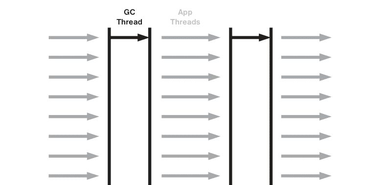

由于内存占用低，串行 GC（`Serial GC`）是 Java HotSpot Client VM 的默认选择。它也满足许多嵌入式用例的需求。可以通过 `-XX:+UseSerialGC` HotSpot 命令行选项显式指定使用的 GC。

图 1.2 展示了在运行八个 Java 应用程序线程的机器上，Java 应用线程（灰色箭头）如何停止，并由单个 GC 线程（黑色箭头）接管执行垃圾回收工作。由于是单线程的，在大多数情况下，`Serial GC` 执行 GC 的时间会比并行 GC（`Parallel GC`）长，因为 `Parallel GC` 可以将 GC 工作分散到多个线程中。

## 并发标记清除 (CMS) GC

`CMS GC` 的开发是为了响应日益增长的应用程序，这些应用程序需要具有比串行或并行 GC 更低最坏情况停顿时间的 GC，并且可以接受牺牲一些应用程序吞吐量来消除或大幅减少长时间 GC 停顿次数。

在 `CMS GC` 中，年轻代垃圾回收与 `Parallel GC` 类似。它们是并行的`停顿世界`（stop-the-world），意味着在年轻代垃圾回收期间，所有 Java 应用线程都会暂停，垃圾回收工作由多个线程执行。注意，你可以用单线程代垃圾收集器配置 `CMS GC`，但该选项在 Java 8 中已弃用并在 Java 9 中被移除。

`Parallel GC` 和 `CMS GC` 的主要区别在于老年代收集。对于 `CMS GC`，老年代收集尝试避免应用线程的长时间停顿。为了实现这一点，`CMS` 老年代收集器的大部分工作与应用程序执行`并发`进行，除了少数较短的 GC 停顿。`CMS` 通常被称为“大部分并发”，因为老年代收集的某些阶段会暂停应用线程，例如`初始标记`（initial-mark）和`重新标记`（remark）阶段。在 `CMS` 的初始实现中，`初始标记`和`重新标记`阶段都是单线程的，但之后已增强为多线程。支持多线程标记和重新标记阶段的 HotSpot 命令行选项是 `-XX:+CMSParallelInitialMark` 和 `-XX:+CMSParallelRemarkEnabled`。当通过 `-XX:+UseSweepGC` 命令行选项启用 `CMS` 时，这些选项会被默认启用。

在进行老年代收集时，极有可能且很有可能发生年轻代收集。当这种情况发生时，老年代收集会被后者的收集中断。`CMS GC` 的默认年轻代收集器通常称为 `ParNew`。

图 1.3 显示了应用线程（灰色箭头）如何被年轻代 GC（黑色箭头）、`CMS 初始标记`和`重新标记`阶段，以及老年代 GC `停顿世界`阶段（同样为黑色箭头）所停止。GC 中的老年代收集始于`停顿世界`的`初始标记`阶段。一旦`初始标记`完成，便开始`并发标记`阶段，此时 Java 应用线程被允许与 `CMS` 标记线程`并发`执行。在图 1.3 中，`并发标记`线程是前两个较长的条形，位于“Marking/Pre-cleaning（标记/预清理）”标签下方，一个在另一个上方。一旦`并发标记`完成，`CMS` 线程将执行`并发预清理`（concurrent pre-cleaning），如“Marking/Pre-cleaning”标签下的两个较短条形所示。注意，如果有足够的可用硬件线程，`CMS` 线程开销对 Java 应用线程的性能影响不大。然而，如果硬件线程饱和或利用率极高，`CMS` 将与 Java 应用线程争夺 CPU 周期。一旦`并发预清理`完成，进入`停顿世界`的`重新标记`（remark）阶段。`重新标记`阶段会处理`初始标记`、`并发标记`和`并发预清理`后遗漏的对象。`重新标记`阶段完成后，开始`并发清除`（concurrent sweeping），释放所有死亡对象空间。

`CMS GC` 的挑战之一是调优，`并发`工作可能会耗尽可用的 Java 堆空间。因此，`CMS` 的棘手部分在于找到启动`并发`工作的正确时机。`并发`方法的常见结果是，`CMS` 处理相同应用程序通常比 `Parallel GC` 多需要 10 到 20% 的 Java 堆空间。这是为了获得更短 GC 停顿而付出的代价。

## 并发标记清除 (CMS) GC

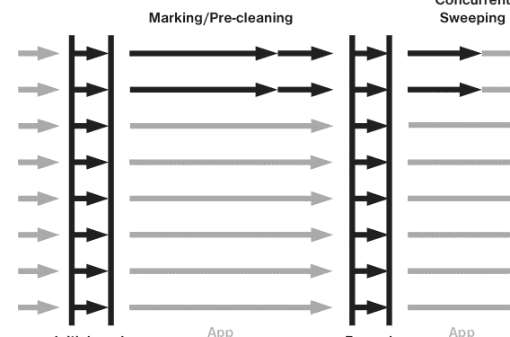

**图 1.3** 使用 `CMS` 时 Java 应用线程受 GC 线程的影响

`CMS GC` 的另一个挑战是如何处理老年代的碎片化。当老年代对象之间的空闲空间变得很小或不存在，导致年轻代提升的对象无法放入可用空隙时，就会产生碎片。`CMS` `并发`收集周期不执行`压缩`，甚至不执行增量或部分`压缩`。无法找到可用空隙会导致 `CMS` 回退到使用 `Serial GC` 进行全收集，这通常会导致长时间的停顿。与 `CMS` 碎片化相关的另一个不幸挑战是它是不可预测的。某些应用程序可能永远不会遇到因老年代碎片化导致的全 GC，而另一些应用程序则会经常遇到。

调优 `CMS GC` 有助于推迟碎片化的产生，修改应用程序（如避免分配大对象）也是如此。调优可能是一项艰巨的任务，需要专业知识。修改应用程序以避免碎片化也可能具有挑战性。

## 收集器总结

到目前描述的所有收集器都有一些共同问题。之一是老年代收集器在大多数操作（如标记、清除和`压缩`）中必须扫描整个老年代。这意味着工作量与 Java 堆的大小成线性缩放。另一个是必须预先决定年轻代和老年代在虚拟地址空间中的位置，因为年轻代和老年代是两个连续的内存块。

## Garbage First (G1) GC

`G1` 垃圾收集器通过一种相当不同的方法解决了 `Parallel`、`Serial` 和 `CMS GC` 的许多缺点。`G1` 将堆划分为一组`区域`（regions）。随后可以一次对一个`区域`执行大多数 GC 操作，而不是针对整个 Java 堆或整个代。

在 `G1` 中，年轻代只是一组`区域`，这意味着它不需要是连续的内存块。同样，老年代也只是一组`区域`。在 JVM 启动时，确定哪些`区域`属于老年代或年轻代。事实上，`G1` 的正常运行状态是随着时间推移，映射到 `G1` `区域`的虚拟内存会在代之间移动。一个 `G1` `区域`可能被指定为年轻代，随后在一次年轻代收集后，它可以变为可供其他`区域`，因为年轻代`区域`会被完全迁移到未使用的`区域`。

在本章的剩余部分，“`可用区域`（available region）”用于识别未使用且 `G1` 无法使用的`区域`。`可用区域`可以被使用或被指定为年轻代或老年代`区域`。在年轻代收集后，一个年轻代`区域`在未来的某个时间可以用作老年代`区域`。同样，在收集老年代`区域`后，它变成一个`可用区域`，可以在未来的某个时间用作年轻代`区域`。

`G1` 年代收集是并行`停顿世界`收集器。正如前所述，并行`停顿世界`在垃圾收集器执行时暂停所有 Java 应用线程，并且 GC 分散在多个线程中。


# G1 老年代收集与其它 HotSpot 收集器截然不同

G1 老年代不需要收集整个老年代来释放老年代空间。相反，在任何时候都可以收集老年代的一个子集。此外，这部分老年代区域是与年轻代收集一起进行的。

> **提示**
>
> 描述与年轻代收集一起收集老年代子集的术语是**混合 GC（mixed GC）**。因此，混合 GC 是在收集所有年轻代区域之外，还收集部分老年代区域的 GC 事件。换句话之，混合 GC 是正在收集的年轻代和老年代区域的混合。

# 垃圾优先 (G1) GC

与 CMS GC 类似，G1 有一种安全机制（fail-safe），在老年代空间耗尽等情况下对整个老年代进行收集和压缩。

G1 的老年代收集（不考虑安全机制类型的收集）由一系列阶段组成，其中某些阶段是并行停顿（stop-the-world），另一些是并行并发（parallel-current）。也就是说，某些阶段是多线程并停止所有应用线程，而另一些阶段则是多线程并与应用线程同时执行。第 2 章和第 3 章提供了关于这些阶段的更多详细信息。

当 Java 堆占用率超过阈值时，G1 会启动老年代收集。需要注意的是，G1 中的堆占用率阈值衡量的是老年代相对于整个 Java 堆的占用比例。熟悉 CMS 的读者会记得，CMS 是使用仅应用于老年代空间的占用阈值来启动老年代收集的。在 G1 中，一旦达到或超过堆占用率阈值，就会调度执行一个并行停世界的初始标记阶段（`initial-mark`）。

初始标记阶段与下一次 GC 同时执行。一旦初始标记阶段完成，将启动一个并发多线程标记阶段，用于标记老年代中的所有存活对象。当并发标记阶段完成后，会调度一个并行停世界的重新标记阶段（`remark`），用于标记任何由于应用线程与标记阶段并发执行而可能遗漏的对象。在重新标记阶段结束时，G1 拥有了老年代区域的完整标记信息。如果恰好某些老年代区域没有任何存活对象，它们可以在并发周期的下一个阶段——清理阶段（`cleanup phase`）中无需任何额外的 GC 工作即可被回收。

同样，在重新标记阶段结束时，G1 可以识别出一组待收集的最优老年代。

## 提示

在垃圾收集期间收集的区域集合被称为**收集集（CSet）**。

包含 CSet 中的区域是基于可以释放多少空间以及 G1 GC 停顿时间决定的。确定 CSet 后，G1 会调度一次 GC，在接下来的几次年轻代 GC 中收集 CSet 中的区域。也就是说，在接下来的几次年轻代 GC 中，除了年轻代外，部分老年代也会被收集。这就是之前提到的混合 GC（mixed GC）种的垃圾收集。

在 G1 中，每个被垃圾收集的区域（无论其是在老年代还是年轻代），其存活对象都会被迁移到可用的区域。一旦存活对象被迁移，被收集的年轻代和/或老年代区域将变为可用区域。

将存活对象从老年代迁移到可用区域的一个具有吸引力的结果是：被迁移的对象在虚拟地址空间中最终相邻。对象之间没有碎片化的空空间。G1 实际上对老年代执行了部分压缩。请记住，CMS、Parallel 和 Serial GC 都需要通过 Full GC 来压缩老年代，而压缩会清除整个老年代。

# 第 1 章 垃圾优先概述

由于 G1 是按区域执行 GC 操作的，因此适用于大型 Java 堆。尽管 Java 堆可能很大，但 GC 的工作量可以被限制在较小的区域集合内。

G1 停顿时间最大的贡献者是年轻代收集和混合收集，因此 G1 的设计目标之一是允许用户设置 GC 停顿目标。G1 试图通过 Java 堆的自适应大小调整来满足指定的停顿时间。它会根据停顿目标自动调整年轻代的大小和整个 Java 堆的大小。停顿目标越低，年轻代就越小，总大小越大，使得老年代相对变大。

G1 的设计目标是通过设置最大 Java 堆大小并指定 GC 目标来限制所需的调优。否则，G1 设计为使用启发式算法进行自我动态调优。在编写本文时，G1 中的启发式算法是 HotSpot GC 开发最活跃的领域。此外，截至本文，G1 在某些情况下可能需要额外的调优，但构建良好启发式算法的要素已经具备且前景良好。关于如何调优 G1 的建议，请参见第 3 章。

总结来说，G1 通过将堆划分为区域，在大堆场景下比其他垃圾回收器具有更好的扩展性。G1 借助部分压缩处理 Java 堆碎片，并以多线程方式完成所有工作。

在编写时，G1 主要针对具有合理低停顿的大型堆用例，以及那些正在使用 CMS GC 的应用程序。目前计划将 G1 也用于吞吐量用例，但对于寻求高吞吐量且能忍较长 GC 停顿的应用，Parallel GC 目前

# G1 设计

如前所述，G1 将 Java 堆划分为多个区域（`regions`）。区域的大小取决于堆的大小，但必须是 2 的幂，且至少为 1MB，最多为 32MB。因此，可能的区域大小为 1、2、4、8、16 和 32MB。所有区域的大小相同，且它们的大小在 JVM 运行期间不会改变。区域大小的计算基于初始堆大小和最大 Java 堆大小的平均值，使得平均堆大小对应大约 2000 个区域。例如，对于使用 `-Xmx16g -Xms16g` 命令行选项的 16GB Java 堆，G1 将选择 16GB/2000=8MB 的区域大小。

如果初始堆和最大堆大小相差很大，或者堆的大小非常大，可能会有多于 2000 个区域。同样，堆的大小最终可能少于 2000 个区域。

每个区域都有一个关联的集合（称为 `RSet`）。RSet 的大小是有限的但是明显的，区域的数量对 HotSpot 的内存占用有直接影响。在低端，RSet 开销约为 1%，在高端占堆大小的 20%。

一个特定的区域一次只用于一种用途，但当该区域包含在收集中时，它将被完全迁移并释放为可用区域。

G1 中有几种类型的区域。可用区域是未使用的。Eden 区域构成了 Eden 空间，Survivor 区域构成了 Survivor 空间。所有 Eden 和 Survivor 区域的集合就是年轻代。Eden 或 Survivor 区域的数量可以在每次 GC 之间变化（使用年轻、混合或 Full GC）。老年代区域占大部分。最后，巨型区域（`humongous regions`）被视为老年代的一部分，包含大小占区域 50% 或以上的对象。在 8u40 之前，巨型区域是在年轻代收集中回收的。8u40 在本章后续有更多关于巨型区域的细节。

区域可以用途意味着不需要将堆划分为连续的年轻代和老年代空间。相反，G1 启发式算法估计年轻代可以包含多少区域而仍能满足停顿目标。随着应用程序开始分配，G1 选择一个可用区域，将其标记为 Eden 区域，并向 Java 线程分配内存块。当区域填满后，另一个空用区域被标记为 Eden 区域。该过程持续到达到最大区域数，此时将触发年轻代 GC。

在年轻代 GC期间，所有的 Eden 和 Survivor 区域都会收集。这些区域中的所有存活对象都会迁移到新的 Survivor 区域或老年代区域。当当前的迁移区域填满时，根据需要将其标记为 Survivor 或老年代区域。

当老年代空间的占用率超过初始堆占用阈值时，G1 会启动老年代收集。该阈值由命令行选项 `-XX:InitiatingHeapOccupancyPercent` 控制，默认值为 Java 堆的 45%。

当标记阶段显示某些老年代区域没有任何存活对象时，G1 可以早期回收这些区域。此类区域会被添加到可用区域集中。包含存活对象的老年代区域将被调度在未来的混合收集中处理。

G1 使用多个并发标记线程。为了避免从应用线程占用过多 CPU 资源，标记线程以分发的方式进行工作。它们在给定的时间片内尽可能多地工作，然后暂停一段时间，允许 Java 线程独立执行。

## 巨型对象 (Humongous Objects)

G1 对大对象的分配特殊特殊，即 G1 所说的“巨型对象（humongous objects）”。正如前面提到的，巨型对象是指大小至少达到区域（`region`）大小 50% 的对象。该大小包含了 Java 对象头部。头部的大小在 32 位和 64 位 HotSpot VM 之间有所不同。在特定的 HotSpot VM 中，特定对象的头部大小可以通过 Java Layout 工具（也称为 JOL）获取。截至目前，可以在互联网上找到 Java Layout 工具 [2]。

当发生巨型对象分配时，G1 会定位一组连续的区域，其内存总和足以容纳该巨型对象。第一个区域被标记为“巨型起始区域（humongous start）”，其他区域被标记为“巨型后续区域（humongous continues）”。如果没有连续的可用区域，G1 将执行全 GC 来回收 Java 堆。

巨型区域被认为是老年代的一部分，但它们只包含一个对象。这一属性允许 G1 在并发标记阶段检测到巨型区域不再存活时，能够积极地回收该巨型区域。当这种情况发生时，所有包含该巨型对象的区域都可以一次性回收。

G1 面临的一个潜在挑战是，短命的巨型对象可能在失去引用后很长时间之后才被回收。JDK 8u4 实现了一种方法，在某些情况下可以在年轻代收集（`young collection`）期间回收巨型区域。在使用 G1 时，避免频繁的巨型对象分配对于实现应用性能目标至关重要。JDK 8u40 中提供的增强有所帮助，但对于所有具有大量短命巨型对象的应用程序来说，并非完美的解决方案。

## 全垃圾收集 (Full Garbage Collections)

G1 中的全 GC 使用与 Serial GC 收集器相同的算法实现。当发生全 GC 时，会对整个 Java 堆进行完全压缩。这确保了系统可以获得最大可用空闲内存。需要注意的是，G1 中的全 GC 是单线程的，因此可能会导致异常长的停顿时间。此外，G1 的设计初衷是预计不需要进行全 GC。G1 预计可以在不需要全 GC 的情况下满足应用性能目标，并且通常可以通过调整使得不需要进行全 GC。

## 并发周期 (Concurrent Cycle)

一个并发周期包括几个阶段的活动：初始标记、并发根区域扫描、并发标记、重新标记（`remarking`）和清理（`cleanup`）。并发周期的开始是初始标记，结束阶段是清理。除了清理阶段外，所有这些阶段都被认为是“标记存活对象图”的一部分。

初始标记阶段的目的是收集所有 GC 根（`roots`）。根是对象图的起点。为了收集来自应用线程的根，必须停止应用线程；初始标记阶段是全停顿的（`stop-the-world`）。在 G1 中，初始标记作为年轻代 GC 停顿的一部分完成，因为 GC 必须收集所有的根。

标记操作还必须扫描并追踪来自存活区（`survivor regions`）中对象的所有引用。这就是并发区域扫描阶段所做的。在此阶段，允许所有 Java 线程执行，因此不会发生应用停顿。唯一的限制是扫描必须在允许下一次 GC 启动之前完成。这是因为新的 GC 会产生一组与初始标记存活对象不同的新存活对象。

大部分工作在并发标记阶段完成。多个线程协调标记存活对象图。所有 Java 线程都允许与并发标记线程同时执行，因此应用没有停顿，尽管应用可能会经历一些吞吐量下降。并发标记完成后，需要另一个全停顿阶段来完成所有工作。此阶段被称为“重新标记阶段（`remark phase`）”，通常是一个非常短的全停顿停顿。

并发标记的最后一个阶段是清理阶段。在此阶段，发现不包含任何存活对象的区域将被回收。这些区域不包含在年轻代 GC 或混合 GC 中，因为它们不包含存活对象。它们被添加到可用区域列表中。

标记阶段必须顺序完成，以确定哪些区域包含在混合 GC（`mixed GCs`）中，以便对包含哪些区域做出明智决策。

## 大小设置 (Sizing)

G1 的堆大小始终是区域的倍数。除了该限制外，G1 可以在 `-Xms` 和 `-Xmx` 之间动态调整大小。G1 中 `-XX:GCTimeRatio` 的默认值为 5。该值越大，增长越激进。其他垃圾收集器在增加大小方面更为激进。

G1 增加堆大小有几个原因：

1. 当发生年轻代或混合 GC 时，G1 将扩展 Java 堆而不是执行全 GC。
2. 如果在执行 GC 后对象分配失败，与其立即退回全 GC，G1 将尝试扩展 Java 堆以获取更多区域。
3. 当 GC 请求一个新区域来移动对象时，G1 倾向于增加 Java 堆的大小，而不是让 GC 失败并退回全 GC。

## 背景介绍 (Background)

G1 GC 是 Java HotSpot 虚拟机的最新新增。它是一个基于优先收集最多垃圾原则的压缩收集器，因此被称为“垃圾优先（Garbage First）”GC。G1 GC 具有增量的、并行的全停顿停顿，通过复制实现紧凑，并具有并行的多阶段并发标记，这有助于将标记（`mark`）、重标记（`remark`）和清理（`cleanup`）停顿减少到最低。

随着 G1 GC 的引入，HotSpot JVM 从传统的连续代际布局，转变为现在由不连续的堆区域组成的代际。对于一个活跃的 Java 堆，特定的区域可以是 Eden 区、存活区（`survivor`）或老年代的一部分，也可以是一个巨型区域（`humongous`），甚至仅仅是一个空闲区域。这些区域的倍数形成了一个“逻辑”代际，以匹配以前 HotSpot 垃圾回收器中代际空间的传统概念。

## G1 中的垃圾回收

G1 GC 在收集停顿期间回收其大部分的堆区域。唯一的例外是多阶段并发标记周期中的清理（`cleanup`）阶段。在清理阶段中，如果 G1 GC 遇到完全填充垃圾的区域，它可以立即回收这些区域并将其返回空闲区域列表；因此，释放这些区域不需要等待下一次垃圾回收停顿。

G1 GC 有三种主要的垃圾回收周期：年轻代回收周期（`young collection`）、多阶段并发标记周期和混合回收周期（`mixed collection cycle`）。此外，有一种单线程（截至本文编写时）回退停顿称为“全量”垃圾回收停顿，这是 G1 GC 在发生区域移动失败（`evacuation failures`）时的安全保障机制。

> **提示**
>
> 移动失败也称为提升失败（`promotion failure`）、目标空间耗尽（`to-space exhaustion`）或目标溢出（`to-overflow`）。这种失败通常发生在没有可用空间来提升对象时。当面对这种情况时，所有的 Java HotSpot GC 都会尝试扩展它们的堆内存。如果堆已经达到最大值，GC 将尝试回收已成功复制对象的区域并更新它们的引用。对于 G1 GC，那些无法在原地复制的对象，所有 GC 都将对它们的引用进行自转发（`self-forwarded`）。这些自转发引用会在垃圾回收周期结束时被移除。

在年轻代回收期间，G1 GC 会暂停应用程序线程，将对象从年轻代区域移动到存活区域，或将其提升到老年代区域或两者兼顾。在混合回收中，G1 GC 额外将存活对象从最（缺乏更好的术语）“高效”的老年代区域移动到空闲区域，这些区域将成为老年代的一部分。

## 年轻代

> **提示**
>
> “GC 效率”实际上是指待回收空间与收集该区域的预估成本之间的比例。由于缺乏更好的术语，在本书中，我们将通过对堆区域进行排序以识别候选区域的过程称为计算“GC 效率”。使用相同术语的原因是，GC 效率评估了收集一个区域的收益相对于其收集成本的大小。而我们所指的“效率”完全取决于存活情况计数，因此仅仅是收集一个区域的成本。例如，一个老年代区域的收集时间比其他更昂贵的老年代区域短，则被认为是“高效”区域。效率最高的区域将是排序后区域数组中的第一个。

在收集周期结束时，属于收集集（Collection Sets，简称 `CSet`，更多信息请参阅本章稍后的“收集集及其重要性”章节）的区域被保证是空闲的并返回空闲列表。让我们详细讨论这些概念。

G1 GC 是一种分代的 GC GC，由年轻代和老年代组成。大多数分配都会落在该线程的 TLAB 中，极少数例外，例如对象大到无法放入分配线程的分配缓冲区（也称为 `TLAB`），但又小于被认为“巨型”，当然还有“巨型”对象本身（更多信息请参阅“巨型区域”章节）。`TLAB` 允许更快的分配，因为拥有线程能够以无锁的方式进行分配。这些 `TLAB` 来自于成为年轻代一部分的 G1 区域。除非在命令行上显式指定，否则当前的年轻代大小是根据初始和最大代大小边界计算的（JDK 默认值为：初始年轻代大小为总 Java 堆的 5% (`-XX:G1NewSizePercent`) 最大年轻代大小为总 Java 堆的 60% (`-XX:G1MaxSizePercent`) 以及分配停顿时间 (`-XX:MaxCPauseMillis`)）。

> **提示**
>
> 如果命令行上没有设置 `-XX:MaxCPauseMillis`，G1 GC 将默认选择为 200ms。如果用户设置了 `-Xmn` 或相关的年轻代选项（如 `-XX:NewRatio`），G1 GC 可能无法根据停顿时间目标调整年轻代大小，停顿时间目标可能会变得无效。

# 第 2 章 · 深度解析垃圾回收器


根据 Java 应用程序的分配速率，新区域被添加到年轻代中，直到达到所需尺寸。堆区域的大小在 JVM 启动时确定。堆区域的大小必须是 2 的幂，范围从 1MB 到 32MB 不等。JVM 的目标是大约 2048 个区域并据此设置堆区域大小（堆大小 = 堆大小/2048）。堆区域的大小在 1MB 到 32MB 之间调整，以适应堆大小的设置。如果堆已经达到最大值，GC 将尝试回收已成功复制对象的区域并更新其引用。对于 G1 GC，年轻代的大小是根据堆区域的调整来设置。

## 年轻代回收

在年轻代回收期间，G1 GC 暂停应用程序线程，将对象从年轻代区域移动到存活区域，或将其提升到老年代区域或两者兼顾。在混合回收期间，G1 GC 移动存活对象从 Eden 区到存活区，或者提升到老年代区域。

## G1 垃圾回收指标

| 指标 | 值 |
| :--- | :--- |
| 移动停顿（年轻代） | 15.894 ms |
| 并行时间 | 9.8 ms |
| 根修复 | 0.1 ms |
| 清理 | 0.0 ms |
| CT | 0.2 ms |
| 其他 | 4.9 ms |
| Eden | 695.0M -> 104.0M |
| 存活区 | 10.0M -> 13.0M |
| 堆 | 748.5M (1176.0M) -> 57.0M (1760.0M) |
| 时间 | user=0.08s, sys=0.0s, real=0.01s |

年轻代的新尺寸通过将 Eden 加上存活区的大小计算得出（例如：1043M+13M=1056M）。

## 对象年龄与老年代

正如在前节“年轻代回收停顿”中简述过的，在每次年轻代回收期间，G1 为每个对象维护年龄。特定对象经历的年轻代回收总数就是该对象的“年龄”。GC 在一个名为“年龄表”的表中维护年龄信息，以及已提升到年龄的对象的总大小。根据年龄、存活区大小、存活填充容量（由 `-XX:TargetSurvivorRatio` 决定，默认值为50）以及 `-XX:MaxTenuringThreshold`（值为15），JVM 自适应地设置一个阈值。一旦对象超过此阈值，它们就会提升/老化到老年代区域。当这些老化对象在老年代死亡时，它们的空间可以通过混合回收释放，或者在清理期间释放（但仅当整个区域被回收时），或者作为最后手段通过全量垃圾回收释放。

## 巨型区域

对于 GC 来说，收集的单位是区域。因此，堆区域的大小 (`-XX:GHeapRegionSize`) 是一个重要参数，因为它决定了什么尺寸的对象放入区域。堆区域的大小还决定了哪些对象被定义为“巨型”。巨型对象是跨越 G1 GC 区域 50% 或更多的大对象。这种对象不遵循通常的分配路径，而是直接分配在标记为巨型区域的老年代中。

图 2.1 展示了一个识别了不同类型 G1 区域的连续堆：年轻区域、老年代区域和巨型区域。在这里，我们可以看到每个年轻和老年代区域都跨越了一个收集单位。

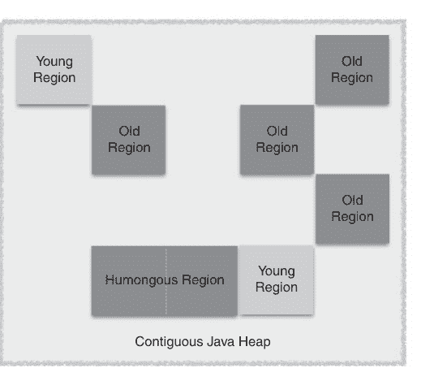

### 图 2.1 G1 Java 堆布局

另一方面，它跨越了两个收集单元，这意味着巨型区域（humongous regions）是由连续的堆区域组成的。让我们进一步深入这三个不同的巨型区域。

在图 2.2 中，巨型对象 1 跨越了两个连续区域。第一个连续区域标记为“StartsHumongous（开始巨型）”，后续的连续区域标记为“ContinuesHumongous（继续巨型）”。图 2.2 还展示了，巨型对象 2 跨越了三个连续的堆区域，而巨型对象 3 仅跨越了一个区域。

这些巨型对象的过去表明，此类对象的分配很常见，且对象本身是长寿的。另一个需要记住的点是，巨型区域必须是连续的（如图 2.2 所示）。因此，移动它们是有意义的，因为这样做没有收益（没有空间回收），而且由于大内存拷贝的开销并不小，这非常昂贵。因此，为了避免在年轻代垃圾收集期间复制这些巨型对象的费用，认为直接从老年代（old generation）分配巨型对象会更好。近年来，许多事务型应用程序可能拥有寿命不算太长的巨型对象。因此，人们正通过各种努力来优化巨型对象的分配和回收。


### 图 2.2 映射到巨型区域的不同巨型对象

之前提到，巨型对象遵循独立且经常被调用的路径。这意味着巨型对象的分配路径没有利用任何针对分配或晋优优化的年轻代 TLABs 和 PLABs，因为对新分配对象进行清零成本是巨大的，并且可能会抵消任何分配路径的收益。处理巨型对象时的另一个值得注意的区别在于巨型区域的收集。在 JDK 8u40 之前，如果任何巨型区域完全完全空闲，它只能在并发收集周期的清理阶段（cleanup phase）才被收集。为了优化短命巨型对象的收集，JDK 8u40 做出了一项重大的变化：如果确定巨型区域没有入站引用，则它们可以在年轻代收集期间被回收并返回到空闲区域列表中。全垃圾回收停顿（full garbage pause）也会收集完全空闲的巨型区域。

> 这里需要强调一个重要的潜在问题或混淆点。假设当前的 G1 区域大小为 2MB。假设一个字节数组的长度按 1MB 对齐。该字节数组仍被视为一个巨型对象，并需要以这种方式分配，因为 1MB 的数组长度不包含数组对象头部的大小。

## 混合收集停顿 (A Mixed Collection Pause)

随着越来越多的对象被提升到老年代区域，或者当巨型对象被分配到巨型区域时，老年代的占用率以及 Java 堆的总占用量随之增加。为了避免耗尽堆空间，JVM 进程需要启动垃圾收集，这种收集不仅涵盖年轻代区域，还将一些老年代区域纳入其中。参考此处关于巨型区域的上一章节以阅读有关巨型对象的特殊处理（分配和回收）。

为了识别垃圾最多的老年代区域，G1 GC 会启动并发标记周期，这有助于标记并最终识别所有存活对象，并计算每个区域的存活因子（liveness factor）。在分配速率、晋优速率与触发此标记周期之间需要一种微妙的平衡，以确保 JVM 进程不会耗尽 Java 堆空间。因此，在 JVM 进程启动时设置了一个占用阈值。截至编写时以及通过最近的 JDK 8u45，该阈值不是自适应的，可以通过命令行选项 `-XX:InitiatingHeapOccupancyPercent`（我非常亲切地称之为 IHOP）来设置。

在 G1 中，IHOP 阈值默认为总 Java 堆的 45%。注意的是，这个堆占用百分比适用于整个 Java 堆，而与 CMS GC 使用的占用命令行选项不同，后者仅适用于老年代。在 G1 GC 中，没有物理上独立的老年代——它有一个单一的空闲区域池，可以分配为 Eden、幸存者（survivor）或巨型。此外，分配的区域数量（例如 Eden）会随时间变化。因此，设置一个老年代百分比并没有真正意义。

## 知识 (Trivia)

我以前经常给 G1 GC 开发工程师以及 G1 GC 用户写关于标记阈值的邮件，并且总是得引用它的全称 `InitiatingHeapOccupancyPercent`，因为 CMS 和 G1 的标记阈值之间还有另一个区别（不同于前面的提示中提到的）——就是选项名称！CMS 的标记阈值被称为 `CMSInitiatingOccupancyFraction`，如你所见，选项名称中没有“percent”。因此，为了避免任何混淆，我总是要指定全名，很快我对它产生了一个昵称，并称之为 IHOP。

## 混合收集停顿 (A Mixed Collection Pause)

当老年代占用率达到（超过）IHOP 阈值时，会启动一个并发标记周期。在标记结束时，G1 GC 计算每个区域的存活对象数量。此外，在清理阶段，G1 GC 根据“GC 效率”计算老年代区域。现在混合收集可以发生了！在混合收集停顿期间，G1 GC 不仅收集年轻代的所有区域，还会收集一些已回收的老年代区域。

## 提示 (Tip)

比较 CMS 和 G1 时需要记住的一点是，G1 的多阶段并发周期比 CMS 的多阶段并发周期少。

单混合收集类似于年轻代停顿，通过拷贝来实现存活对象的压缩。唯一的区别是在混合收集期间，收集集包含了一些老年代区域。根据某些参数（在本章稍后讨论），可能会多次混合收集。这被称为“混合收集周期”。周期只有在跨越标记/IHOP 阈值并在完成并发标记周期后才会发生。

决定混合收集周期中混合收集总数的两个重要参数是：`-XX:G1MixedGCCountTarget` 和 `-XX:G1HeapWastePercent`。

`G1MixedGCCountTarget` 默认 8（JDK 8u45），它是混合 计数目标选项，被设置为标记周期完成后发生混合收集次数的物理限制。G1 GC 将可收集的候选区域总数除以计数目标数，并将其设置为每次混合收集停顿期间收集的老年代区域的最小值。这可以用公式表示：

每次混合收集的最小 CSet = 每个混合收集周期识别出的候选区域总数 / G1MixedGCCountTarget

`-XX:G1HeapWastePercent` 默认为总 Java 堆的 5%（JDK 8u45），是一个控制混合收集周期期间收集老年代区域数量的重要参数。在每次混合收集停顿期间，G1 GC 根据可以回收的死亡对象空间识别可回收堆的数量。一旦 G1 GC 达到这个堆浪费比例，G1 GC 就会停止启动混合收集停顿，从而结束混合收集周期。设置堆浪费比例基本上有助于限制为了加速混合收集周期而愿意浪费的堆空间。

# 第 2 章 · 深度解析 Garbage First Collector

因此，每个混合回收周期中的混合回收次数可以通过每次混合回收暂停的最小年代集合（CSet）数量以及堆百分比来控制。

## 集合（Collection Sets）及其重要性

在任何垃圾回收暂停期间，CSet 中的所有区域都会被释放。CSet 是在垃圾回收暂停期间目标为待回收的区域集合。这些候选区域中的所有活跃对象都将在回收期间被迁移，并且这些区域将返回空闲区域列表。在回收期间，CSet 仅包含用于回收的年轻代区域。另一方面，混合回收不仅会将所有年轻代区域加入其 CSet，还会根据其 GC 效率加入一些老年代的候选区域。

有两个重要的参数有助于选择混合回收的候选年代区域：

- `-XX:GMixedGCLiveThresholdPercent`
- `-XX:OldCSetThresholdPercent`

`-XX:GMixedGCLiveThresholdPercent`，默认值为 G1 区域的 85%（JDK 8u5），它是一个存活阈值和一个设定限制，用于从混合回收的 CSet 中排除最昂贵的老年代区域。G1 GC 设置了一个限制，任何低于此存活阈值的老年代区域都会包含在 CSet 中。

`-XX:OldCSetThresholdPercent`，默认值为总 Java 堆的 10%（JDK 8u45），设定了每次混合回收暂停期间可以回收的老年代区域的最大限制。该阈值取决于 JVM 进程可用的总 Java 堆，并以总 Java 堆百分比的形式表示。第3 章将涵盖几个示例来突出这些阈值的功能。

## 记忆集（Remembered Sets）及其重要性

分代收集器根据对象的年龄将堆划分为不同的区域。堆中的这些不同区域被称为年代。分代收集器可以将大部分回收精力集中在最近分配的对象上，因为它预计会更早地发现它们中的大多数对象。堆中的这些年代可以独立地进行回收。独立回收有助于降低响应时间，因为 GC 不需要扫描整个堆，而且（例如在拷贝式分代收集器的情况下）较旧的长寿对象不需要来回复制，从而减少了复制和引用更新的开销。

为了方便进行独立回收，许多垃圾收集器为它们的区域维护 RSet。RSet 是一种数据结构，有助于维护和跟踪进入其自身收集单元（在 G1 中为区域）的引用，消除了扫描整个堆以获取此类信息的需求。当 GC 执行停顿（stop-the-world）收集（年轻或混合）时，它会扫描其 CSet 中包含的区域的 RSet。一旦区域内的活跃对象移动，它们的入引用就会被更新。

对于 GC，在任何年轻或混合回收期间，年轻代都会被整体回收，不需要跟踪对象位于年轻代的引用。这减少了 RSet 的开销。因此，GC 只需要在以下两种场景下维护 RSet：

- 老年代到年轻代的引用——GC 维护从老年代区域指向年轻代区域的指针。年轻代被认为“拥有”该 RSet，因此该区域被认为是 RSet “所有”区域。
- 老年代到老年代的引用——在这里，来自老年代不同区域的指针将维护在“所有”老年代区域的 RSet 中。

在图 2.3 中，我们可以看到一个年轻区域（Region x）和两个老年代区域（Region y 和 Region z）。Region z 有一个入引用。该引用记录在 Region x 的 RSet 中。我们还观察到 Region z 有两个入引用，一个来自 Region x，另一个来自 Region y。Region z 的 RSet 只需要记录来自 Region y 的入引用，不需要记住来自 Region x 的引用，如之前所述，年轻代总是被整体回收的。最后，对于 Region y，我们看到一个来自 Region x 的入引用，该引用没有记录在 Region z 的 RSet 中，因为 Region x 是一个年轻区域。

如图 2.3 所示，每个区域只有一个 RSet。根据应用程序的不同，某个特定区域（以及其 RSet）可能是“热门”的，以至于在同一区域内甚至同一位置上可能会发生更新。这在 Java 应用中并不罕见。

GC 有其处理热点需求的方法；通过改变 RSet 的密度来实现。RSet 的密度遵循三个粒度级别：稀疏（sparse）、精细（fine）和粗粒（coarse）。对于热门区域，RSet 将粗化以容纳来自其他区域的指针。这将反映在区域的 RSet 扫描时间上。（有关 RSet 扫描时间的更多细节请参阅第 3 章。）每个粒度级别都有一个针对特定区域的区域表（PRT）抽象容器。

由于 GC 区域内部被划分为块，在 G1 GC 区域，实现的最低粒度是一个 512 字节的块，称为“卡”（card）（参见图 2.4）。全局卡表维护所有的卡。

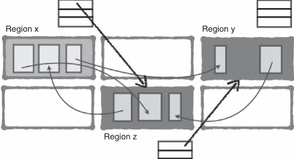

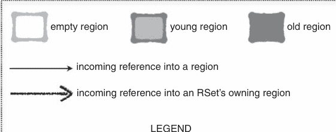

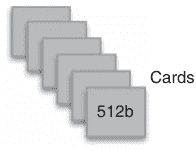

28 第2章 · 深度解析垃圾 垃圾收集器

```
[Clear CT: 0.1 ms]
[Other: 0.4 ms]
[Choose Cset: 0.0 ms]
[Ref Proc: 0.2 ms]
[Ref Enq: 0.0 ms]
[Redirty Reclaim: 0.0 ms]
[Humongous: 0.0 ms]
[Free: 0.1 ms]
Eden: 83.0M(83.0M)->0.0M(83.0M) Survivors: 1024.0K->1024.0K Heap:
104.0M(40.0M)->21.0M(40.0M)
Times: user=0.00s=0.00,
```

## 并发清理线程与屏障

先进的 RSet 结构伴随着其自身的维护成本，表现为写屏障（writer barriers）和并发“清理”线程。

屏障是原生代码片段，当受托管运行时执行某些语句时就会执行。屏障在垃圾回收算法中的应用已为人知，执行屏障代码的成本也是由于原生指令路径长度的增加而确定的。

OpenJDK HotSpot 的 Parallel Old 和 CMS GC 使用写屏障，该屏障在 HotSpot JVM 执行对象写入操作时执行：

```
object.field = some_other_object;
```

屏障通过更新一种类似卡表（card-table）的结构 [2] 来跟踪跨代引用。卡表在 Minor垃圾回收（minor GC）期间被扫描。写屏障算法基于 Urs Hölle 的快速写屏障 [3]，它将屏障开销降低到编译后代码中的两条额外指令。

G1 GC 采用了写前屏障（pre-write）和写后屏障（post-write）。前者在实际应用赋值之前执行，并在并发标记部分介绍；而后者在赋值后执行，并在此处进一步描述。

每当引用更新时，G1 GC 都会触发写屏障。例如，考虑此伪代码中的更新：

```
object.field = some_other_object;
```

此赋值将触发屏障代码。由于屏障是在对任何引用写入后触发的，因此它被称为“写后”屏障。写屏障序列

## 记忆集及其重要性

序列可能会变得非常昂贵，应用程序的吞吐量会随屏障代码复杂性的增加比例下降；因此，G1 GC 只需执行最少的工作来确定引用更新是否为跨区域更新，因为跨区域引用更新需要记录在所属区域的 RSet 中。对于 G1 GC 而言，屏障代码包含了一种在“实践中的老年代垃圾回收” [4] 中简要讨论的过滤技术，该技术涉及一个简单的检查，当更新位于同一区域时，该检查值为零。伪代码说明了 G1 GC 的写屏障：

```
(&object.field XOR &some_other_object) >> RegionSize
```

每当发生跨区域更新时，G1 GC 都会将相应的卡放入名为“日志缓冲区”（log buffer）或“脏卡队列”（dirty card queue）的缓冲区。在我们的更新示例中，包含对象的卡记录在日志缓冲区中。

## 提示

并发清理线程是专门用于维护记忆集的线程，它们通过扫描已填充日志缓冲区中的记录卡，并更新这些区域的记忆集来完成任务。清理线程的最大数量由 `-XX:G1ConcRefinementThreads` 决定。从 JDK 8u45 开始，`-XX:G1ConcRefinementThreads` 未在命令行设置，而是通过工程化手段设置为与 `-XX:ParallelGCThreads` 相同。


# G1 GC 日志缓冲区管理与并发标记

一旦日志缓冲区达到容量，它就会被退役并分配一个新的日志缓冲区。随后卡的入队将填充此新缓冲区。退役的缓冲区被放在全局列表中。一旦清理线程在全局列表中找到项，它们就开始并发处理这些退役缓冲区。退役缓冲区被放置后，清理线程开始并发处理这些缓冲区。清理线程始终是活跃的，G1 GC 以分层方式处理退役缓冲区。通过标记 `-XX:G1RefinementGreen`、`-XX:G1RefinementYellow`、`-XX:G1RefinementRed` 为缓冲区设置阈值。当清理线程跟不上填充缓冲区的速度时，执行线程会参与帮助。在这种情况下，新位将替换旧位，以处理填充的日志缓冲区。

> **提示**：用户不需要手动调整任何记忆集。在某些情况下，调整 `-XX:G1RefinementThreads` 或 `-XX:ParallelGCThreads` 有意义。下一章将介绍更多关于清理的内容。

## G1 GC 中的并发标记

随着 G1 GC 引入了区域的活跃性计数，显然需要一种增量标记算法。Yuasa 为增量标记和清除 GC 提出了一种“起始快照”（snapshot-at-beginning, SATB）算法 [5]。G1 GC 建立了一个标记阈值，它是总堆的百分比，可以通过命令行设置 `-XX:InitiatingOccupancyPercent` (IHOP)，默认值为 45%。当达到该值时，将启动标记周期。目标是在堆达到满容量之前完成并发标记。SATB 算法创建了堆的逻辑“快照”。SATB 标记保证在标记开始时存活的对象被识别。标记数据包含两个位图：之前的和后续。当前的标记创建并更新后续位图。随着时间的推移，之前的标记信息会过时。最终在标记周期结束时，后续位图将替换之前的位图。对应之前的位图和后续位图，每个 G1 区域分别有两个顶部值（TAMS）字段：之前的 TAMS（PTAMS）和后续的 TAMS（NTAMS）。这些 TAMS 字段对于识别标记周期期间分配的对象是有用的。


在标记周期开始时，`NTAMS` 字段被设置为每个区域的当前顶部，如图 2.5 所示。自标记开始以来分配（或死亡）的对象位于相应的 TAMS 值之上，相对于之前的位图被认为是隐式存活。TAMS 之下的对象需要显式标记。让我们来看一个例子：在图 2.6 中，我们看到并发标记期间的堆区域，标有“之前的位图”、“后续位图”、“PTAMS”、“NTAMS”和“顶部”。在 PTAMS 到堆底部（在图中标记为“底部”）之间的存活对象都被标记并保留在之前的位图中，如图 2.7 所示。在 PTAMS 到区域顶部之间的所有对象相对于之前的位图都是隐式存活的，如图 2.8 所示。这些对象包含了并发标记期间分配的各个，因此它们被分配在 NTAMS 之上，并且相对于下一个位图是隐式存活的，如图 2.10 所示。在重标记暂停（remark pause）结束时，所有 PTAMS 之上且 NTAMS 之下的存活对象都被完全标记，如图 2.9 所示。如前所述，在并发标记周期期间分配的对象将分配在 NTAMS 之上，并且相对于下一个位图被认为是隐式存活（见图 2.10）。

## 并发标记的阶段

标记任务块大部分是并发执行的。少数任务在短暂的停顿世界（stop-the-world）暂停期间完成。现在我们来谈谈这些任务的意义。

### 初始标记

在初始标记期间，变异线程（mutator threads）会被停止，以便标记 Java 堆中所有通过根（roots）直接可达的对象（也称为根对象）。

> 根对象是从 Java 堆外部可以可达的对象；原生栈对象以及 JNI（Java 原生接口）本地或全局对象就是一些例子。

由于变异线程处于停止状态，因此初始标记阶段是一个停顿世界阶段。此外，由于年轻代收集（young collection）也会追溯根并且是停顿世界的，因此在常规年轻代收集的同时进行标记是非常方便的（而且具有时间效率）。这也被被称为“顺便车”（piggybacking）。在初始标记暂停期间，每个区域的 `NTAMS` 值被设置为该区域的当前顶部（见图 2.5）。这一过程会反复进行，直到堆的所有区域都被处理完毕。

### 根区域扫描

根区域扫描阶段必须在下一次垃圾收集暂停之前完成，因为在扫描整个堆的存活对象之前，需要识别并标记所有从存活区（survivor regions）中引用的对象。

### 并发标记

并发标记阶段是并发且多线程的。用于设置所用并发线程数量的命令行选项是 `-XX:ConcGCThreads`。默认情况下，G1 GC 将总线程数设置为并行 GC 线程的四分之一（`-XX:ParallelGCThreads`）。并行 GC 线程由 JVM 在虚拟机启动时计算。并发线程在某个时间扫描一个区域，并使用“指纹”（finger）指针优化来认领该区域。这种“指纹”指针优化类似于 CMS 的“指纹”优化，可以在 [2] 中学习。

如“RSets 及其重要性”部分所述，G1 GC 还采用了一种预写屏障（pre-write barrier）来执行 SATB 并发标记算法所需的操作。当应用程序变异其对象图时，在标记开始时可达且作为标记快照（snapshot）的对象可能会在被标记线程发现和追踪之前被覆盖。SATB 标记保证了变异线程会将需要修改的指针的旧值记录在 SATB 队列/缓冲区中。这被称为“并发标记/SATB 预写屏障”，因为屏障是在更新之前执行的。预写屏障允许记录对象引用字段的旧值，以便并发标记可以标记通过被覆盖的值的对象。

形式为 `x.f = y` 赋值的预写屏障伪代码如下：

```
if (marking_is_active) {
  pre_val := x.f;
  if (pre_val != NULL) {
    satb_enqueue(pre_val);
  }
}
```

`marking_is_active` 条件是对线程本地标志的简单检查，该标志在标记开始时（初始暂停期间）被设置为 true。通过这种方式保护预屏障代码，可以减少在标记未激活时执行屏障剩余部分的开销。由于该标志是线程本地的且其值可能被多次加载，因此任何个人都可能将其留在缓存中，从而减少屏障的开销。

`satb_enqueue(pre)` 首先尝试将旧值入入线程本地缓冲区（称为 SATB 缓冲区）中。SATB 缓冲器的初始大小为 256 条目，每个应用程序线程都有 SATB 缓冲区。如果没有空间在缓冲区中放置 `pre_val`，则会调用 JVM 运行时；线程的 SATB 缓冲区会被弃用并放入全局 SATB 缓冲区列表，为该线程分配一个新的 SATB 缓冲区，并记录 `pre_val`。并发标记线程的职责是定期检查并处理这些缓冲区，以确保已记录的对象被标记。

填满的 SATB 缓冲区（在标记阶段）通过遍历全局列表进行处理，遍历每个缓冲区，并通过标记位图中的对应位标记每个记录的对象（如果该对象位于指纹下方，则将对象推入本地标记栈）。标记会遍历标记位图中某个区域的已设置位，追踪已标记对象的字段引用，在标记位图中设置更多位，并在需要时推送对象。

存活数据计数是顺便通过标记操作完成的。因此，每当一个对象被标记时，它也会被计数（即它的字节被加到区域的总数中）。只有 NTAMS 之下的对象会被标记和计数。在该阶段结束时，会清除下一个标记位图，以便在下一次标记周期开始时就绪。这是与变异线程并发完成的。

> **提示**
>
> JDK 8u40 引入了一个新的命令行选项 `-XX:+UseConcurrentMarking`，它允许在并发标记时进行卸类。

### 重标记

重标记阶段（remark）是并发标记结束后的。在重标记期间，G1 GC 遍历任何未访问的对象。在停顿世界期间，G1 GC 触发其故障安全机制并退回到单线程的全量收集。在 8u40 之前，重标记阶段是停顿世界的，以安全地完成数据计数。为了减少在此暂停中花费的时间，使用了并行线程来处理 SATB 缓冲区。

> **提示**
>
> 任何大量使用引用（弱引用、软引用、虚引用）的应用程序可能会看到引用处理。我们将在第 3 章介绍更多。

### 清理

在清理暂停期间，两个标记位图交换角色：下一个位图变为上一个（由于当前标记周期已完成并具有标记信息），而上一个位图变为新的（将在下次循环作为当前标记位图）。同样，`PTAMS` 和 `NTAMS` 也会交换角色。清理暂停的三大贡献是识别完全空区域、排序堆以识别用于混合收集的旧区域以及 RSet 清理。当前启发算法根据存活情况对区域进行排序（存活对象的区域收集成本很高，因为复制是一项昂贵的操作）以及记忆集大小（再次，大型记忆集由于区域的流行度收集成本很高——流行度概念在“RSets 及其重要性”部分讨论过）。目标是首先收集被认为成本较低（存活对象较少且流行度较低）的候选区域。

识别每个区域存活对象的优点是，当遇到存活对象的完全空区域时，可以清除其记忆集并立即回收该区域，返回空区域列表，而不是将其放入 GC 高效（在“G1 中的垃圾收集”部分讨论过）排序数组并等待回收（混合）垃圾收集暂停。RSet 清理有助于检测过期引用。例如，如果标记发现特定卡上的所有对象都是死的，则从“所有”RSet 中移除。

## 复制失败与全量收集

有时 G1 GC 无法找到空区域来复制来自年轻代的存活对象，或者在尝试复制来自老年代的对象时。这种失败在日志中被报告为空间耗尽（to-space exhausted）失败，失败持续时间在日志下方显示为复制失败时间（331.5ms），如下例：

```
111.912: [GC pause (young 0.6773162 secs]
<S0>
[Ev
```

在其他时间，巨型分配（humongous allocation）可能无法在老年代中找到连续区域。在这种情况下，G1 GC 会尝试增加 Java 堆的使用。如果 Java 堆空间的扩展失败，G1 GC 将触发其故障安全机制并退回到单线程的全量收集。

在全量收集（full collection）期间，单个线程会在整个堆上运行，并对构成分代的所有区域（无论开销高低）进行标记、清理和压缩。在收集完成后，生成的堆现在只包含存活对象，且所有分代都已完成完全的压缩。

> **Tip**：在 JDK 8u40 之前，类的卸载只能在全量收集时进行。

串行全量收集的单线程特性以及收集跨越整个堆的事实使得这种收集成为一种非常昂贵的操作，特别是当堆内存较大时。因此，在全量收集频繁发生的情况下，强烈建议进行复杂的调优。

> **Tip**：有关如何消除复制失败（evacuation failures）的更多信息，请参阅第 3 章。

# References

- [1] Charlie Hunt and Binu John. *Java™ Performance*. Addison-Wesley, Upper Saddle River, NJ, 2012. ISBN 978-0-13-714252-1.
- [2] Tony Printezis and David Detfs. “A Generational Mostly-Concurrent Garbage Collector.” *Proceedings of the 2nd International Symposium on Memory Management*. ACM, New York, 2000, pp. 143–54. ISBN 978-1-58-263-8.
- [3] Urs Hölze. “A Fast Write Barrier for Garbage Collectors.” Presented at OOPS93 Garbage Collection Workshop, Washington, DC, October 1993.
- [4] Darko Stefanovic, Matthew Hertz, Stephen M. McKinley, and J. Eliot B. Moss, “Older-First Garbage Collection in Practice: Evaluation in a Java Virtual Machine.” *Proceedings of 2002 Workshop on Memory System*. ACM, New York, 2002, pp. 25–36.
- [5] Taiichi Yuasa. “Real-Time Garbage Collection on General Purpose Machines.” *Journal of Systems and Software*, Volume 11, Issue 3, March 1990, pp. 181–98. Elsevier Science, Inc., New York.

# Garbage Collector Tuning

性能工程处理系统的非功能性需求，并确保在产品实现中满足这些需求。因此，它与系统或软件工程紧密相连。在本章中，我们将讨论 Java HotSpot VM 中最新的垃圾收集器——G1 的性能调优。读者被鼓励阅读 *Java™ Performance* [1]，第 7 章“Tuning the JVM”，以及本书的后续章节。

# The Stages of a Young Collection

G1 年轻代收集具有串行和并行阶段。串行阶段意味着某些任务只能在停顿（stop-the-world）收集期间执行。并行阶段采用多个 GC 线程，并从其他线程的任务队列中进行工作窃取（work stealing）。

> **Tip**：年轻代收集的阶段可以是多线程的，并可以使用 `-XX:ParallelThreads` 的值来确定 GC 工作线程的数量。

# Chapter 3 • Garbage Collector Performance

让我们查看运行 HotSpot VM 命令行选项 `-XX:+PrintGCDetails` 时生成的 G1 GC 日志片段。以下是命令行和“Java version”输出：

```
JAVA_OPTS=-XX:+UseG1 -XX:+PrintGCDetails -Xloggc:jdk8u45_h2.log
DaCapo mb$ java -version
java version "1.8.0_45"
Java(TM) SE Runtime Environment (build 1.8.0_45-b14)
Java HotSpot(TM) 64-Bit Server VM (build 25.45-b02, mixed mode)
```

这是 GC 日志片段（jdk8u45_h2.log）：

```
108.815: [G1 Evacuation Pause (young), 0.054382 secs
[Parallel Time: 52.1 ms, GC Workers: 8]
[GC Worker Start (ms): 108815.5, Avg: 108815.5, Max: 108815.6,
Diff: 0.1]
[Root Scanning (ms): 0.1, Avg: 0.2, Max: 0.2, Diff: 0.1,
Sum: 1.2]
[Update RS (ms): 12.8, Avg: 13.0, Max: 13.2, Diff: 0.4, Sum:
103.6]
[Scan RS (ms): 13.4, Avg: 13.6, Max: 13.7, Diff: 0.3, Sum: 109.0]
[Code Scanning (ms): 0.0, Avg: 0.0, Max: 0.0, Diff: 0.0, Sum:
Sum: 0.1]
[Processed Buffers: 15, Avg: 16.0, Max: 17, Diff: 2, Sum: 128]
[Termination (ms): 0.0, Avg: 0.0, Max: 0.0, Diff: 0, Sum:
[Object Copy (ms): 25.1, Avg: 25.2, Max: 25.2, Diff: 0.1, Sum:
201.5]
[GC Worker (ms): 0.0, Avg: 0.0, Max: 0.0, Diff: 0.0]
[GC Worker Total (ms): 51.9, Avg: 52.0, Max: 52.1, Diff: 0.1]
[GC End (ms): 108867.5, Avg: 108867.5, Max: 108867.6,
Diff: 0.1]
[Code Root Fixup (ms): 0.1]
[Code Root Purge (ms): 0.0]
[Clear (ms): 2.0]
[Other (ms): 2.0]
[Choose CSet (ms): 0.0]
[Ref (ms): 0.1]
[Refq (ms): 0.0]
[Dirty Cards: 0.2]
[Humongous Reclaim (ms): 0.0]
[Free CSet (ms): 1.2]
[Eden: 537.0M(537.0)->0.0M,
Survivors: 23.0M->31.0M, Heap: 449.2M(1024.0)->321.4M(1024.0)]
```

该片段显示了 G1 年轻代收集，在第一行被识别为 `(G1 Evacuation Pause) (young)`。时间戳为 108.815，总停顿时间为 0.0543862 秒。

## Start of Parallel Activities

日志片段的第二行显示了并行阶段花费的时间和 GC 工作线程数：

```
[Parallel Time: 52.1 ms, GC Workers: 8]
```

后续行显示了工作线程执行的并行工作：


# GC Worker 阶段分析

```
[GC Worker Scanning (ms): Min: 108815.5, Avg: 108815.5, Max: 108815.6, Diff: 0.1
[Ext Scanning (ms): Min: 0.1, Avg: 0.2, Max: 0.2, Diff: 0.1, Sum: 1.2]
[Update RS (ms): Min: 12.8, Avg: 13.0, Max: 13.2, Diff: 0.4, Sum: 103.6]
[Processed Buffers: Min: 15, Avg: 16.0, Max: 17, Diff: 2, Sum: 128]
[Scan RS (ms): Min: 13.4, Avg: 13.6, Max: 13.7, Diff: 0.3, Sum: 109.0]
[Code Root Scanning (ms): Min: 0.0, Avg: 0.0, Max: 0.0, Diff: 0.0, Sum: 0.1]
[Object Copy (ms): Min: 25.1, Avg: 25.2, Max: 25.2, Diff: 0.1, Sum: 201.5]
[Termination (ms): Min: 0.0, Avg: 0.1, Max: 0.1, Diff: 0.0, Sum: 0.1]
[GC Worker Other (ms): Min: 0.0, Avg: 0.1, Max: 0.1, Diff: 0.1, Sum: 0.4]
[GC Worker Total (ms): Min: 51.9, Avg: 52.0, Max: 52.1, Diff: 0.1]
[GC End (ms): Min: 108867.5, Avg: 108867.6, Max: 108867.6, Diff: 0.1]
```

`GC Worker Start` 和 `GC Worker End` 分别标记了并行阶段的开始和结束时间戳。`GC Start` 的最小值是第一个工作线程启动的时间；同样，`GC Worker` 的最大值是最后一个工作线程完成所有任务的时间。这些行还包含毫秒的 `Avg` 和 `Diff` 值。在这些行中需要关注的是：

- `Diff` 值离 0 多远（0 是理想状态）。
- `Max`、`Min` 或 `Avg` 之间的任何显著差异。这表明工作线程未能同一时间启动或完成并行工作。这可能意味着存在队列处理问题，需要通过查看该阶段的并行工作来进一步分析。

## External Root Regions

外部根区域扫描（`Ext Root Scanning`）是第一个并行任务之一。在此阶段，会扫描外部（堆外）根，例如 JVM 数据结构、JNI 线程句柄、硬件寄存器、全局变量和线程栈根，以查找当前停顿收集集（CSet）。

```
[Ext Scanning (ms): Min: 0.1, Avg: 0.2, Max: 0.2, Diff: 0.1, Sum: 1.2]
```

在这里，我们再次寻找 `Diff >> 0` 以及 `Max`、`Min` 或 `Avg` 的显著差异。

> **Tip**
>
> 差异（`Diff`）显示了组成并行阶段的所有计时活动。高差异通常意味着工作在工作线程之间没有平衡。这一知识是分析的起点，理想情况下，更深入的调查将识别潜在原因，这可能需要重构 Java 代码。

另一个需要注意的是工作线程是否被困于处理单个根。我们遇到过这样的问题：当加载的类很多时，被视为单个根的系统字典最终会占用一个工作线程。当工作线程延迟“结束”（`termination`，在本节稍后解释）时，它会被认为被阻塞了。

## Remember Sets and Processed Buffers

```
[Update RS (ms): Min: 12.8, Avg: 13.0, Max: 13.2, Diff: 0.4, Sum: 103.6]
[Processed Buffers: Min: 15, Avg: 16.0, Max: 17, Diff: 2, Sum: 128]
```

正如第 2 章“深度解析 First 垃圾收集”所述，G1 GC 使用记忆集（`RSet`）来帮助维护和跟踪进入拥有相应 `RSet` 的 G1 区域的引用。正如第 2 章讨论，并发清理线程的任务扫描日志缓冲区并更新脏卡区域的 `RSet`。为了补充并发清理线程执行的工作，任何已记录但未被清理线程处理的缓冲区将在收集停顿的并行阶段处理并由工作线程处理。这些缓冲区在日志片段中被称为 `Processed Buffers`。

# 年代集合的阶段

为了限制更新 `RSet` 所花费的时间，G1 设置了一个目标时间，作为暂停时间目标的百分比（`-XX:MaxGCPauseMillis`）。该目标时间默认为暂停时间目标的 10%。任何逃逸暂停（evacuation pause）都应该将大部分时间花在拷贝生存对象上，而暂停时间目标的 10% 被认为是花费更新 `RSet` 的合理时间。在查看日志后，如果你发现更新 `RSet` 花费暂停时间目标的 10% 是不理想的，你可以通过更新 `-XX:G1UpdatingPausePercent` 命令行选项来更改百分比以反映你所需的值。然而，重要的是，如果更新的日志缓冲区数量没有变化，那么在集合期间 `RSet` 更新时间的缩短将导致在该暂停期间处理的缓冲区更少。这将日志缓冲区的工作推给并发完善线程（concurrent refinement threads），导致工作量以及与 Java 应用程序变器线程（mutator threads）的资源共享增加。此外，最坏的情况下，如果并发完善线程跟不上日志缓冲区的更新速率，Java 应用程序变器线程必须介入帮助处理——这种情况是应该避免的场景！

> **提示**
>
> 如第 2 节所述，有一个名为 `-XX:G1ConcRefinementThreads` 的命令行选项。默认情况下，它设置为与 `-XX:ParallelGCThreads` 相同的值，这意味着 `-XX:ParallelGCThreads` 的任何更改都会改变 `-XX:G1ConcRefinementThreads` 的值。

在收集当前 CSet 中的区域之前，必须扫描 CSet 的 `RSet` 以查找其对 CSet 区域的引用。如第 2 节所述，一个区域中的热门对象或该区域本身的热门程度可能会导致其 `RSet` 从稀疏的 `PRT`（每区域表）变为细粒度的 `PRT` 甚至是粗粒度的位图（coarsened bitmap），从而使得扫描 `RSet` 需要更多时间。在这种情况下，你将看到此处显示的 Scan 时间增加，因为扫描时间取决于 `RSet` 数据结构的粗粒度梯度：

```
[Scan RS (ms): Min: 13.4, Avg: 13.6, Max: 13.7, Diff: 0.3, Sum: 109.0]
```

另一个与 `RSet` 相关的并行任务是根扫描（root scanning），在此期间会扫描代码根以找到指向当前 CSet 的引用：

```
[Code Root Scanning (ms): Min: 0.0, Avg: 0.0, Max: 0.0, Parallel: 0.0543862, Sum: 0.1]
```

在 HotSpot 的早期版本中，整个代码缓存被视为单个根，并由单个工作线程获取和处理。大型且完整或接近满的代码缓存会阻塞该工作线程，并导致总暂停时间增加。随着代码根扫描作为独立的并行活动引入，扫描 `nmethod` 的工作减少为仅扫描来自编译后代码引用的 `RSet`。因此，对于 CSet 中的特定区域，只有当该区域的 `RSet` 具有强代码根时，才会扫描对应的 `nmethod`。

> **提示**
>
> 开发者通常用 `nmethod` 一术语来指代 Java 方法的动态编译代码。不要将 `nmethod` 与原生方法（native method）混淆，后者指的是 JNI 方法。`nmethod` 除了生成的代码外，还包括常量池等辅助信息。

> **提示**
>
> 为了缩短 `nmethod` 扫描时间，仅扫描 CSet 中区域的 `RSet` 以查找编译器引入的引用，而不是由 Java 应用程序变器线程引入的“通常”引用。

## 记忆集（Remembered Sets）总结

选项 `-XX:+G1SummarizeRSetStats` 用于提供 `RSet` 粗粒化（细粒度或粗粒度位图）总数的窗口，帮助判断并发完善更改能够处理更新的缓冲区，并收集有关 `nmethod` 的更多信息。该选项每 n 次 GC 暂停总结一次 `RSet` 统计信息，n 由 `-XX:G1SummarizeRSetPeriod` 设置。

```
-XX:+G1SummarizeRSetStats 是一个诊断选项，必须通过添加 -XX:+UnlockDiagnosticOptions 来启用，例如：
JAVA_OPTS="-XX:+UseG1GC -XX:+UnlockDiagnosticOptions -XX:+G1SummarizeRSetStats -XX:G1SummarizeRSetPeriod=1 -Xlog:gc:jdk84.log"
```

# 记忆集总结日志示例

这是一个每个 GC 暂停总结一次 `RSet` 的日志片段：

### GC 前 RS 总结

**最近的并发完善统计**

处理了 23270 个卡，
来自 96 个完成的缓冲区：
96 (100.0%) 由并发 RS 线程处理。
0 (0.0%) 由变器线程处理。
进行了 0 次粗粒化。

并发 RS 线程时间 (s)
1.29 1.29 1.29 1.29 1.29 1.29 0.00

并发采样时间 (s)
0.97

**当前剩余集统计**

每区域大小 = 4380K, 最大 = 72K。
767 (17.5%) 来自 212 个区域。
296 (0.7%) 来自 9 个大内存区域。
215K (49.1%) 来自 64 个区域。
1431K (32.7%) 来自 155 个老区域。
静态结构 = 256K, 链表 = 。
816957 个卡。
13670 (1.7%) 来自 212 个区域。
4 (0.0%) 来自 9 个大内存区域。
0 (0.0%) 来自 64 个区域。
803282 (98.3%) 来自 155 个老区域

```
最大的剩余集
4:(O)[0x00000006c0400000,0x00000006c0500000,0x00000006c050000]size = 72K, 占用 = 190K。
堆代码根大小 = 40K. 最大 = 22K。
(0.8%) 来自 212 个年轻区域。
(0.3%) 来自 9 个大内存区域。
12K (30.9%) 来自 810 个空区域。
27K (68.0%) 来自 155 个老区域
1035 个代码根。
5 (0.5%) 元素来自 212 个区域。
0 (0.0%) 元素来自 9 个大内存区域。
0 (0.0%) 元素来自 64 个区域。
1030 (99.5%) 元素来自 155 个老区域
具有最多代码根的区域
4:(O)[0x00000006c0400000,0x00000006c0500000,0x00000006c050000]size = 22K, 元素数 = 0。
```

### GC 后 RS 总结

**最近的并发完善统计**
处理了 3782 个卡，
26 个完成的缓冲区：
26 (100.0%) 由并发 RS 线程处理。
0 (0.0%) 由变器线程处理。
进行了 0 次粗粒化。

并发 RS 线程时间 (s)
0.00 0.00 0.00 0.00 0.00 0.00 0.00
并发采样时间 (s)
0.00

**当前剩余区域大小 = 4329K. 最大 = 73K。**
33K (0.8%) 来自 10 个年轻区域。
29K (0.7%) 来自 9 个大内存区域。
2693K (62.1%) 来自 810 个空区域。
15776 (36.4%) 来自 195 个老区域。
静态结构 = 256K, 链表 = 63K。
85071 个卡。
0 (0.0%) 元素来自 10 个年轻区域。
4 (0.0%) 元素来自 9 个大内存区域。
0 (0.0%) 元素来自 810 个空区域。
80567 (100.0%) 元素来自 195 个老区域
最大的剩余集
4:(O)[0x00000006c0400000,0x00000006c0500000,0x00000006c050000]size = 73K, 占用 = 190K。
堆代码根大小 = 40K. 最大 = 22K。
(0.8%) 来自 10 个年轻区域。
(0.3%) 来自 9 个大内存区域。
12K (30.9%) 来自 810 个空区域。
27K (68.0%) 来自 155 个老区域
1036 个代码根。
2 (0.0%) 元素来自 10 个年轻区域。
0 (0.0%) 元素来自 9 个大内存区域。
0 (0.0%) 元素来自 810 个空区域。
1034 (99.8%) 元素来自 155 个老区域
具有最多代码根的区域
4:(O)[0x00000006c0400000,0x00000006c0500000,0x00000006c050000]size = 22K, 元素数 = 0。

此项中需要关注的主要内容如下：

处理了 23270 个卡
来自 96 个完成的缓冲区：
96 (100.0%) 由并发 RS 线程处理。
0 (0.0%) 由变器线程处理。
进行了 0 次粗粒化。

输出在 GC 暂停之前和之后都会打印。`Processed cards`（处理卡）总结了并发完善线程完成的工作，有时（极罕见）由 Java 应用程序变器线程完成。在这种情况下，96 个完成的缓冲区有 23,270 个处理卡，100% 的工作是由并发 `RSet` 完善线程完成的。

# 第 3 章 G1 垃圾收集器性能调优

## Termination 阶段

```
[Termination (ms): Min: 0.0, Avg: 0.0, Max: 0.0, Diff: 0.0, Sum: 0.1]
```

如果任何（或所有）工作线程在某处卡住，将体现在长时间的终止时间内，这可能表明存在工作窃取或负载均衡问题。

## GC 之外的并行活动

终止（`Termination`）标记了工作线程在迁移/收集停顿期间并行活动的结束。日志片段中的下一行标记为 `GC Worker Other`，它是在并行阶段花费的时间，但并不属于迄今为止描述的任何“常规”并行活动。虽然它被归类为“GC 时间”，但它很容易被在 GC 停顿并行阶段发生的 GC 之外的活动所占据。在此期间，GC 线程是停止的。我们曾看到，当由于考虑不周收集器选项导致 JVM 活动期间编译工作增加时，`GC Worker Other` 时间会变长。如果你观察到长时间运行，请调查非 GC 活动。

```
[GC Worker Other (ms): Min: 0.0, Avg: 0.1, Max: 0.1, Diff: 0.1, Sum: 0.4]
```

## 总结所有并行活动

并行阶段的最后一行标记为 `GC Worker Total`，它是“常规”和“非常规” GC 工作线程时间的总和：

```
[GC Worker Total (ms): Min: 51.9, Avg: 52.1, Max: 52.1, Diff: 0.1, Sum: 416.0]
```

## 所有串行活动的开始

并行阶段完成后，串行阶段从标记为 `Code Root Fixup`、`Code Root Purge` 和 `Clear CT` 的行开始。在此期间，主 GC 线程用迁移对象的新位置更新代码根，并清理 GC 根集表。`Clear CT` 阶段（在工作线程帮助下并行执行）清除卡表标记，如第 2 节所述，在扫描 `RSet` 时；GC 在全局表中标记一个相应的条目以避免扫描该卡。此标记在停顿的 `Clear CT` 阶段被清除。

## 年轻代收集的阶段

> **提示**
> 主 GC 线程是在安全点（safepoint）执行 GC VM 操作的 VM 线程。

```
[Code Root Fixup: 0.1 ms]
[Code Root Purge: 0.0 ms]
[Clear CT: 0.2 ms]
```

> **提示**
> 在混合收集停顿期间，`Code Root Fixup` 将包含更新非迁移区域花费。

## 其他串行活动

顺序阶段的最后部分标记为 `Other`。`Other` 的主要贡献者包括：为收集选择 CSet、引用处理和入队、卡重置（redirtying）、回收空巨型区域以及收集后释放 CSet。这些主要贡献者来自于 `PrintGCDetails` 输出：

```
[Other: 2.0 ms]
[Choose CSet: 0.0 ms]
[Ref Proc: 0.1 ms]
[Ref Enq: 0.0 ms]
[Redirty Cards: 0.2 ms]
[Humongous Reclaim: 0.0 ms]
[Free CSet: 1.2 ms]
```


> 提示
对于年轻代收集，所有的年轻代区域都会被收集，因此没有所谓的“选择”，因为所有年轻代区域都会自动成为年轻 CSet 的一部分。“选择”发生在混合收集停顿期间，并成为理解如何“驯服”你的混合收集的重要因素。我们将在本章稍后详细讨论选择 CSet。

引用处理和入队针对软引用、弱引用、虚引用和 JNI 引用。我们将在“引用处理调优”章节中讨论这一点及更多内容。引用入队的动作可能需要更新 RSets。因此，需要记录并将关联卡标记为脏。

# 第 3 章 G1 垃圾收集器性能调优

重置卡花费的时间为 `Redirty time`（前一个示例中为 0.2 ms）。

`Humongous Reclaim` 是 JDK 8u40 中引入的。如果通过查看根集或年轻代区域并确保 RSet 中没有指向巨型对象的引用，则该对象可以在迁移停顿期间被回收。（详见第 2 节关于巨型区域和巨型对象的详细描述）。

`Other` 的剩余时间用于修复 JNI 句柄和类似的工作。`Other` 集合时间应该很小，如果你的 `Cset` 非常大，可能会看到 `Free Cset` 时间变长。`Ref Proc` 和 `Ref Enq` 取决于应用程序中使用了多少引用，如果你有很多短命巨型对象。

## 年轻代调优参数

在《Java Performance》[1] 第 7 节“调优 JVM”中涵盖了一些可以帮助调优年轻代的调优参数。G1 具有巨大的调优潜力。有一些初始值和默认值有助于 G1 启发式算法。为了理解这些默认值对启发式算法的影响，某些选项如 `-XX:MaxPauseMillis`（停顿目标；默认 200 ms）、`-XX:G1SizePolicy`（年轻代大小占总堆的百分比；默认 5%）、`-XX:G1NewSizePercent`（年轻代上限占总堆的百分比；默认 60%）根据边界、停顿目标以及平均时间来增长或缩小年轻代。如果你对负载有良好的理解，并且发现自适应调整带来了益处（例如，如果你发现预测时间与实际时间差异巨大），可以调整默认值。副作用是你忘记为自适应调整设置更可预测的限制。另一点需要记住，新限制仅适用于你正在调优的应用程序，不会传递到具有类似停顿要求的其他应用程序，因为大多数应用程序具有不同的分配速率、晋升率、临时数据大小和寿命。

让我们看一些示例。这些再次使用了 JDK 8u45 以及不同的 `-XX:MaxCPauseMillis` 值（如目标停顿时间所示）。基准测试套为 DaCap，并在 JVM 命令行中启用了 `-XX:+PrintSizePolicy`。

```
6.317: [GC pause G1 Evacuation Pause) (young) 6.317: [G1Ergonomics (CSet Construction) start choosing CSet, pending_cards: 5800, predicted base time: 20.39 ms, remaining time: 179.61 ms, target pause time: 200.00 ms]
6.317: [G1Ergonomics (CSet Construction) add young regions to CSet, eden: 225 regions, survivors: 68 regions, predicted young region time: 202.05 ms]
6.317: [G1Ergonomics (CSet Construction) finish choosing CSet, eden: 225 regions, survivors: 68 regions, old: 0 regions, predicted pause time: 222.44 ms, target pause time: 200.00 ms, 0.112632 secs
```

在上述示例中，停顿目标留在了默认值 200ms，观察到尽管预测逻辑预测停顿时间为 222.44ms，但实际停顿时间仅为 112.63ms。在这种情况下，我们可以向 CSet 放更多的年轻区域。

```
36.931: [GC pause G1 Evacuation Pause) (young) 36.931: [G1Ergonomics (CSet Construction) start choosing CSet, pending_cards: 9129, predicted base time: 14.46 ms, remaining time: 35.54 ms, target pause time: 50.00 ms]
36.931: [G1Ergonomics (CSet Construction) add young regions to CSet, eden: 284 regions, survivors: 16 regions, predicted young region time: 60.90 ms]
36.931: [G1Ergonomics (CSet Construction) finish choosing CSet, eden: 284 regions, survivors: 16 regions, old: 0 regions, predicted pause time: 75.36 ms, target pause time: 50.00 ms, 0.021069 secs
```

第二个示例展示了与之前相似的场景，仅停顿时间变为了 50 ms（未对年轻代进行调整）。再次，预测逻辑出现了偏差，预测的停顿时间为 75.36 ms，而实际停顿时间为 21.86 ms。

调整年轻代后（如第三示例中添加到 CSet 的 eden 和 survivors 数量所示），我们可以获得 50 ms 的停顿时间，如下所示：

```
58.373: [GC pause G1 Evacuation Pause) (young) 58.373: [G1Ergonomics (CSet Construction) start choosing CSet, pending_cards: 5518, predicted base time: 10.00 ms, remaining time: 40.00 ms, target pause time: 50.00 ms]
58.373: [G1Ergonomics (CSet Construction) add young regions to CSet, eden: 475 regions, survivors: 25 regions, predicted young region time: 168.35 ms]
58.373: [G1Ergonomics (CSet Construction) finish choosing CSet, eden: 475 regions, survivors: 25 regions, old: 0 regions, predicted pause time: 178.35 ms, target pause time: 50.00 ms, 0.0507471 secs
```

在这里，尽管预测逻辑仍然偏离很大，但我们的停顿时间（50.75 ms）处于预期范围内（50 ms）。

## 并发标记阶段可调参数

对于 G1 来说，可调的参数 `-XX:InitiatingHeapOccupancyPercent=n`（此处 n 默认为总 Java 堆大小的 45%，并考虑了老年代的占用情况，包括老年代区域和大对象区域）有助于决定何时启动并发标记周期。

> 提示：CMS GC 启动标记周期是相对于其老年代大小的，而 G1 的 `InitiatingHeapOccupancyPercent` 是相对于整个 Java 堆大小的。

并发标记周期始于初始标记暂停，该暂停与年轻代回收同时发生（即“寄载”在年轻代回收中）。该暂停标记了收集周期的开始，随后是其他并发和并行任务，包括根节点扫描、并发标记和存活统计、最终标记以及清理。图 3.1 显示了并发标记周期中的所有停顿：初始标记、重标记和清理。要了解更多关于并发标记周期的信息，请参考第 2 章。

```
277.559: [GC pause (G1 Evacuation Pause) (young) (initial-mark), 0.0960289 secs]
```

如果应用程序的活跃对象图很大，并发标记任务可能会花费长时间，并且经常被年轻代回收暂停中断。并发标记周期必须在混合收集开始之前完成，并紧接着是一个年轻代回收，该回收会计算下次暂停时触发混合收集所需的阈值，如图 3.1 所示。该图显示了初始标记暂停（如所述，它寄载在年轻代回收中）。在并发阶段进行时，可能会有多次年轻代回收（图中仅显示了一个停顿）。最终标记（也称为重标记）完成标记，较小的清理暂停有助于完成第 2 章中描述的清理任务。清理暂停之后是一个年轻代晋散暂停，用于为混合收集周期做准备。该年轻代回收后的四个停顿是混合收集晋散暂停，它们能够成功地从目标 CSet 区域中收集所有垃圾。

| 年轻代回收 | 重标记 |
| --- | --- |
| 混合收集 | 清理 |
| 初始标记 | |

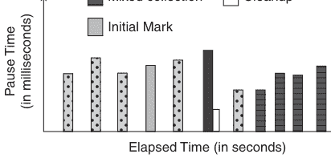

**图 3.1** 年轻代回收暂停、混合收集暂停以及并发标记周期中的停顿

如果任何并发标记任务（以及因此整个周期）完成时间过长，会导致混合收集暂停被延迟，这最终可能导致晋散失败。晋散失败会在 GC 日志中显示为 `to-space exhausted` 消息，归于失败的总时间将显示在解析的 `Other` 部分。以下是日志片段：

```
276.731: [GC pause (G1 Evacuation Phase) (young) (to-space exhausted),
0.8272932 secs]

[Parallel Time]: 387.0 ms, GC Workers: 8]

[GC Worker Start (ms): Min: 276731.9, Max: 276731.9, Sum: 276732.1,
Diff: 0.2]

[Ext Root Scanning (ms): Min: 0.0, Avg: 0.2, Max: 0.2, Diff: 0.2,
Sum: 1.3]

[Update RS (ms): Min: 17.0, Avg: 17.2, Max: 17.3, Diff: 0.4, Sum:
137.3]

[Processed Buffers]: Min: 19, Avg: 21.0, Max: 23, Diff: 4, Sum: 168]

[Scan RS]: Min: 10.5, Avg: 10.7, Max: 0.4, Diff: 85.4]

[Code Root Scanning (ms): Min: 0.0, Avg: 0.0, Max: 0.0, Diff: 0.0,
Sum: 0.1]

[Object Copy (ms): Min: 358.7, Avg: 358.9, Max: 358.9, Diff: 0.2,

[Termination (ms): Min: 0.0, Avg: 0.1, Max: 0.1, Diff: 0.1, Sum: 0.7]

[GC Worker Other (ms): Min: 0.0, Avg: 0.0, Max: 0.0, Diff: 0.0, Sum:
0.2]

[GC Worker Total (ms): Min: 386.7, Avg: 386.9, Max: 387.0,
Diff: 0.0]

[GC Worker End (ms): Min: 277118.8, Avg: 277118.8, Max: 277118.9,

[Code Root Fix: 0.1 ms]

[Code Root Purge: 0.2 ms]

[Clear CT: 0.2 ms]
```

```
276.731: [GC pause (G1 Evacuation Phase) (young) (to-space exhausted),
0.8272932 secs]

[Parallel Time]: 387.0 ms, GC Workers: 8]

[GC Worker Start (ms): Min: 276731.9, Max: 276731.9, Sum: 276732.1,
Diff: 0.2]

[Ext Root Scanning (ms): Min: 0.0, Avg: 0.2, Max: 0.2, Diff: 0.2,
Sum: 1.3]

[Update RS (ms): Min: 17.0, Avg: 17.2, Max: 17.3, Diff: 0.4, Sum:
137.3]

[Processed Buffers]: Min: 19, Avg: 21.0, Max: 23, Diff: 4, Sum: 168]

[Scan RS]: Min: 10.5, Avg: 10.7, Max: 0.4, Diff: 85.4]

[Code Root Scanning (ms): Min: 0.0, Avg: 0.0, Max: 0.0, Diff: 0.0,
Sum: 0.1]

[Object Copy (ms): Min: 358.7, Avg: 358.9, Max: 358.9, Diff: 0.2,

[Termination (ms): Min: 0.0, Avg: 0.1, Max: 0.1, Diff: 0.1, Sum: 0.7]

[GC Worker Other (ms): Min: 0.0, Avg: 0.0, Max: 0.0, Diff: 0.0, Sum:
0.2]

[GC Worker Total (ms): Min: 386.7, Avg: 386.9, Max: 387.0,
Diff: 0.0]

[GC Worker End (ms): Min: 277118.8, Avg: 277118.8, Max: 277118.9,

[Code Root Fix: 0.1 ms]

[Code Root Purge: 0.2 ms]

[Clear CT: 0.2 ms]
```

```
277.559: [GC pause (G1 Evacuation Pause) (young) (initial-mark), 0.0960289 secs]
```

## 第 3 章 · Garbage First Garbage Collector Tuning(Continued)

```
[Other: 440.0 ms]

[Evacuation Failure: 337.5 ms]

[Chooseset: 0.0 ms]

[Ref: 0.1 ms]

[Refq: 0.0 ms]

[Humongous Reclaim: 0.0 ms]

[Young Cset: 0.0 ms]

[Free: 0.0 ms]

[Eden: 0.0 ms]

[Times: user=0.0, real=0.0]

[Heap:00000000000000000000000000000000.00000000000000000000000000000000.00000000000000000000000000000000.00000000000000000000000000000000.00000000000000000000000000000000.00000000000000000000000000000000.00000000000000000000000000000000.00000000000000000000000000000000.00000000000000000000000000000000.
```

`XX:+PrintSizePolicy` 选项会导出 G1 启发式策略详情。示例如下：

```
JAVA_OPTS="-XX:+UseG1 -XX:+PrintGCDetails -XX:+PrintAdaptiveSizePolicy -Xloggc:jdk845_h"
```

片段：

```
97.859: [GC pause (G1 Evacuation Phase) (young) (mixed) 97.859: [G1Ergonomics (CSet Construction) start choosing CSet, pending_cards: 28330, predicted base time: 17.45 ms, remaining time: 182.55 ms, target pause time: 200.00 ms]
97.859: [G1Ergonomics (CSet Construction) add old regions to CSet, eden: 37 regions, survivors: 14 regions, predicted region time: 16.12 ms]
97.859: [G1Ergonomics (CSet Construction) finish adding old regions to CSet, reason: old CSet region max, old: 103 regions, max: 103 regions]
97.859: [G1Ergonomics (CSet Construction) finish choosing CSet, eden: 37 regions, survivors: 14 regions, old: 103 regions, predicted pause time: 123.38 ms, target pause time: 200.00 ms]
```


# 第 3 章 垃圾回收器性能调优

## 混合垃圾回收阶段的治理

可回收百分比阈值 `-XX:G1HeapWastePercent` 衡量了应用程序能够容忍的垃圾总量（如果你愿意，也可以称为碎片）。它以应用程序 Java 堆总量的百分比形式表示，默认值为 5%（JDK 8u45）。让我们来看一个例子：

```
123.563: [GC G1 Evacuation Phase) (mixed) 123.563: [G1Ergonomics
(CSet Construction) start choosing time, pending_times: 7404, predicted
base time: 6.13 ms, remaining time: 43.87 ms, target pause time: 50.00 ms]
123.563: [G1Ergonomics (CSet Construction) add young regions to CSet,
eden: 464 regions, predicted young region time: 80.18 ms]
123.563: [G1Ergonomics (CSet Construction) finish adding old regions
to CSet: reason: predicted time is too high, predicted time: 0.70 ms,
remaining: 0.00 ms, old: 24 regions, min: 24 regions]
123.563: [G1Ergonomics (CSet Construction) add expensive regions to
CSet: reason: old CSet region not reached min, old: 24 regions,
expensive: 24 regions, min: 24 regions, remaining time: 0.00 ms]
123.563: [G1Ergonomics (CSet Construction) finish choosing CSet, eden:
464 regions, surviving old regions: 24 regions, predicted pause time:
101.83 ms, target pause time: 50.00 ms]
123.640: [G1Ergonomics (Mixed GCs) continue mixed GCs, reason: candidate
old regions available, candidate old regions: 165 regions, reclaimable:
109942200 bytes (10.24 %), threshold: 5.00 %], 0.077159 sec]
```

示例的最后一行显示，混合回收将继续，因为有足够的垃圾可以回收（10.24%）。在这里，可回收百分比阈值保持在 5% 的默认值。

如果如图 3.2 所示，混合回收的成本呈指数级增长，这个阈值将会有帮助。但请记住，这种情况会导致更多的区域被碎片化并占用。这意味着老年代将保留更多（瞬态）活跃数据，这可以通过相应调整你的标记阈值来补偿。

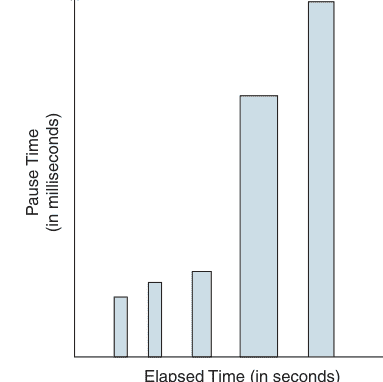

每次混合回收的最小老 CSet 大小 = 混合回收周期识别的候选老区域总数 / `G1MixedGCCountTarget`

此公式决定了每次混合回收中老区域的最小数量 $x$，以便通过 $y$ 次连续的混合回收收集所有老区域。在完成并发标记周期后执行的一组连续混合回收构成一个混合回收周期。看看上一个示例的第 4 行：

```
123.563: [G1Ergonomics (CSet Construction) add expensive regions to
CSet: reason: old CSet region not reached min, old: 24 regions,
expensive: 24 regions, min: 24 regions, remaining time: 0.00 ms]
```

第 4 行告诉我们只添加了 24 个区域，因为没有满足每个 CSet 的最小老区域数量。之前的（年轻代）停顿告诉我们有 189 个候选老区域可以回收，因此 G1 应该开始一个周期：

```
123.378: [G1Ergonomics (Mixed GCs) start mixed GCs, reason: candidate
old regions available, candidate old regions: 189 regions, reclaimable:23488760 bytes (12.56 %), threshold: 5.00 %]
```

所以，将 189 除以 `G1MixedGCCarget` 的默认值 (8) = Ceil(189/8) = 24。这就是我们得到 24 个区域最小数量的原因。就像添加到 CSet 的老区域有一个最小阈值一样，也有一个最大值。添加到 CSet 的老区域的最大值由 `-XX:G1HeapRegionPercent` 指定，值为堆大小的 10%。现在来看一个示例：

```
97.859: [GC pause (G1 Evacuation Phase) (mixed) 97.859: [G1Ergonomics
(CSet Construction) starting CSet, pending_cards: 28, base time: 17.45 ms, remaining time: 18.55 ms, target pause time: 200.00 ms]
97.859: [G1Ergonomics (CSet Construction) adding young regions to CSet,
eden: 37 regions, survivors: 14 regions, predicted young region time: 16.12 ms]
97.859: [G1Ergonomics (CSet Construction) adding old regions to CSet, reason: old CSet region reached max, old: 103 regions, regions: 37]
97.859: [G1Ergonomics (CSet Construction) choosing CSet, eden: 37 regions, survivors: 14 regions, old: 103 regions, predicted pause time: 123.38 ms, target pause time: 200.00 ms]
97.905: [G1Ergonomics (Mixed GCs) continue mixed GCs, reason: candidate
old regions available, candidate old regions: 160 regions, reclaimable:
6638328 bytes (6.18 %), threshold: 5.00 %]
```

第 3 行和第 5 行显示，尽管有更多的区域，CSet 中的老区域总数被限制在 103 个。正如前面的描述所述，103 个区域的计数来自于 1GB 的总堆大小和 `G1OldCSetRegionPercent` 的 10%，向上取整为 103。

现在我们知道如何指定每次混合回收中 CSet 的最小和最大区域数量，可以修改阈值以适应我们的停顿目标，并在那时维护老年代所需的活跃数据量。`-XX:G1MixedWastePercent` 选项默认 85%（JDK 8u45），允许区域包含 CSet 的活跃数据最大百分比。每个区域的活跃数据在当前标记阶段计算。如果老区域的活跃数据高于阈值，则不会作为 CSet 候选区域。此选项直接控制每个区域的碎片情况，请小心。

> **提示**
> 增加 `G1MixedWastePercent` 值意味着清空老区域需要更长时间，这意味着混合回收停顿也会更长。

## 避免整理失败

在“并发标记可调优参数”部分，我们讨论了避免整理失败的几种方法。这里有一些更多重要的调优参数：

- **堆大小**。确保你的 Java 堆可以容纳所有静态、瞬态活跃数据以及短中期活跃数据。除了容纳活跃数据外，应该有额外的 Java 堆空间（或剩余空间）以便 GC 高效运行。可用空间越多，吞吐量越高/或延迟越低。
- **显式指定你的 JVM 命令行选项！** 默认值不一定适用于你。根据初始和最大堆设置以及预期目标获取一个基准。如果你已经知道默认阈值没有帮助，可以在基准运行的命令行中添加调优后的阈值。因此，你的基础命令看起来如下：
  `-Xms2g -Xmx4g -XX:MaxGCPauseMillis=100`
  `-Xms2g -Xmx4g -XX:InitiatingHeapOccupancyPercent=55`

如果你的应用程序有大型巨型对象（humongous objects），确保你的标记阈值足够低以容纳它们。此外，确保你定义为“巨型”的长生存对象被 G1 这样对待。你可以通过设置 `-XX:G1HeapRegionSize` 为一个值来确保大于或等于区域大小 50% 的对象被视为巨型对象。正如第 2 章所述，默认值根据你的初始和最大堆大小计算。
这里是使用 `-XX:+PrintAdaptiveSizePolicy` 时的一个片段：

```
91.890: [G1Ergonomics (Concurrent Cycles) request current cycle initiation, reason: occupancy higher than threshold, occupancy: 483393536 bytes, allocation request: 2097168 bytes, threshold: 48138810 bytes (45.00 %), source: concurrent humongous allocation]
```

由于一个大对象分配请求导致堆占用超过了标记阈值，系统正在请求一个并发周期。该请求的大小为 2,097,168 字节，远大于 G1 在 JVM 启动时设置的 1MB G1 堆区域大小。

- **晋升失败** 是由于幸存区（survivor regions）空间无法容纳晋升的对象导致的复制失败。当你观察到这种情况发生时，尝试增加 `-XX:G1ReservePercent`。预留百分比为预留空间创建一个虚假天花板，以适应晋升模式的变化。默认值为总 Java 堆的 10%，并被 G1 限制为总 Java 堆的 50%，因为更多的比例会导致大量的空间浪费。

## 引用处理 (Reference Processing)

垃圾回收必须以不同于其他 Java 对象的方式处理 Java 引用对象——幻引用、软引用、弱引用。引用对象比非引用对象需要更多工作才能回收。

在本节中，你将学习如何识别 G1 垃圾回收暂停期间执行引用处理所需的时间是否会对你的应用程序产生影响，以及如何调优 G1 以减少这种开销，并提供隔离哪种引用对象类型引起最大开销的提示。根据应用程序及其时间要求，可能需要重构应用程序源码以减少引用处理开销。

> **提示**：每种引用对象的 Java 平台标准版 (Java SE) API 文档 (http://docs.oracle.com/java/8/docs/api) 以及 `java.lang.ref` 包中幻引用、软引用和弱引用的 API 都是理解每种引用对象行为以及如何以及何时被回收的良好来源。

### 观察引用处理

垃圾回收引用对象涉及几个主要活动：发现引用对象、将其推入 JVM 队列以及从队列中取出。当使用 `-XX:+PrintGCDetails` 使用 G1 时，队列引用对象的时间与处理它们的时间分开报告。这两个时间出现在年轻代 GC 和混合 GC 日志的 Other 部分：

```
[Other: 9.9 ms]
[Choose Cset: 0.0 ms]
[Ref Proc: 8.2 ms]
[Ref Enq: 0.3 ms]
[Redirty Cards: 0.7 ms]
[Humongous Reclaim: 0.0 ms]
[Free Cset: 0.5 ms]
```

`Ref Proc` 是处理引用对象的时间，`Ref Enq` 是队列引用对象的时间。如示例，`Ref Enq` 的时间与 `Ref Proc` 的时间一样长。事实上，我们还没有看到过 `Ref Enq` 持续更高的应用程序。如果发生这种情况，意味着处理引用的工作相对于其入队时间非常小，这对于大多数引用对象类型是不可能的。G1 在并发周期的 remark 阶段也会报告处理活动。使用 `-XX:+PrintGCDetails`，来自 remark 的日志输出将包含引用处理时间：

```
[GC Finalizing Marking, 0.000722 secs][GC ref-proc, 0.0129203 secs]
[Unloading, 0.016048 secs, 0.0308670 secs]
```

`-XX:+PrintReferenceGC` 报告每个引用对象的详细信息，对于隔离回收器花费时间最多的特定引用对象类型非常有用。

```
[GC Finalizing Marking, 0.000322 secs][GC ref-proc [SoftReference, 2 refs, 0.0052296 secs][WeakReference, 3264308 refs, 0.0524238 secs]
[FinalReference, 215 refs, 0.0028225 secs][PhantomReference, 1787 refs, 0.0050046 secs][JNI Weak Reference, 0.0007776 secs, 0.0932150 secs]
[Unloading, 0.0060031 secs, 0.2210401 secs]
```

注意 G1 是唯一通过 `-XX:+PrintGCDetails` 报告处理时间的 HotSpot GC。然而作为一个通用指南，`PrintGCDetails` 输出中的 Ref 时间超过 G1 年轻代或混合 GC 总暂停时间的 10%，则需要调优垃圾回收器的引用处理。对于 G1 remark 事件，通常会看到更大比例的处理时间，因为并发周期的 remark 阶段处理了老代回收期间发现的大部分引用对象。如果 G1 remark 的持续时间超过你的暂停时间，且大部分时间花费在引用处理上，如下一节所述。

### 引用处理调优

首先要做的是使用 `-XX:+ParallelRefEnabled` 启用多线程引用处理，因为 HotSpot 默认使用单线程引用处理。这种默认是为了最小化内存占用并将 CPU 周期留给其他应用程序。启用此选项会在引用处理期间消耗更多 CPU，但引用处理的时间将会减少。

如果 G1 remark 的持续时间超过你的暂停时间，且大部分时间花费在引用处理上（如下一节所述），下一步是确定 G1 花费时间最多的哪种引用对象类型。使用 `-XX:+PrintGCDetails`，来自 remark 的日志输出将包含引用处理时间：

```
[GC Finalizing Marking, 0.000322 secs][GC ref-proc [SoftReference, 2 refs, 0.0052296 secs][WeakReference, 3264308 refs, 0.0524238 secs]
[FinalReference, 215 refs, 0.0028225 secs][PhantomReference, 1787 refs, 0.0050046 secs][JNI Weak Reference, 0.0007776 secs, 0.0932150 secs]
[Unloading, 0.0060031 secs, 0.2210401 secs]
```

`-XX:+PrintReferenceGC` 报告回收时每个引用对象的详细信息，并对于隔离回收器花费时间最多的特定引用对象类型非常有用。

```
[GC Finalizing Marking, 0.000322 secs][GC ref-proc [SoftReference, 2 refs, 0.0052296 secs][WeakReference, 3264308 refs, 0.0524238 secs]
[FinalReference, 215 refs, 0.0028225 secs][PhantomReference, 1787 refs, 0.0050046 secs][JNI Weak Reference, 0.0007776 secs, 0.0932150 secs]
[Unloading, 0.0060031 secs, 0.2210401 secs]
```


[FinalReference, 215 refs, 0.0028225 secs][PhantomReference, 1787 refs, 0.0050046 secs][JNI Weak Reference, 0.0007776 secs, 0.0932150 secs]

[Unloading, 0.0060031 secs, 0.2210401 secs]

注意 G1 是唯一通过 `-XX:+PrintGCDetails` 报告处理时间的 HotSpot GC。然而，作为一个通用指南，`PrintGCDetails` 输出中的 Ref 时间超过 G1 年代或混合 GC 总暂停时间的 10%，则需要调优垃圾回收器的引用处理。对于 G1 remark 事件，通常会看到更大比例的处理时间，因为并发周期的 remark 阶段处理了老代回收期间发现的大部分引用对象。如果 G1 remark 的持续时间超过你的暂停时间，且大部分时间花费在引用处理上，如下一节所述。

## 使用软引用

遗憾的是，JavaDoc 建议使用软引用来实现内存敏感型对象缓存。这往往会误导用户，让他们认为 JVM 可以管理对象缓存的大小并移除条目——即释放空间——而这取决于垃圾回收器的决定或需要。此外，`-XX:SoftLRUPolicyPerMB` 的存在也表明，使用软引用作为对象缓存会导致高占用率，从而引发频繁的 GC 事件，在某些情况下甚至会导致内存溢出错误（OOM）。

为了说明为什么对象缓存的软引用往往会导致意料之外且不受愿的行为，让我们先观察 `-XX:SoftLRUPolicyPerMB`，它控制垃圾回收器保留多少引用。在丢弃软引用之前，对于堆中发现的每兆字节估算内存，并可能确定其中有多少是可达的（或已死亡的），`-XX:SoftLRUPolicyPerMB` 的值是以毫秒为单位的窗口，决定了自应用程序访问特定软引用以来经过了多久，以决定在当前执行的垃圾回收中是否保留该引用。

如果你回过来思考这意味着，应用程序运行得越快，你访问未来软引用的频率就越高。例如，假设一个应用程序每秒执行 10,000 次事务。该应用程序每秒处理的软引用将是之前的 100 倍。分配和晋升速率也大约 100 倍。应用程序执行得越快，垃圾回收器的压力就越大。

请记住，用于估算“保留哪些软引用”时间窗口的空闲兆字节数，是根据如果所有软引用都被清除并回收后将释放多少空间来计算的。然而，垃圾回收器无法得知软引用将额外保留多少内存。它只能估算保留多少个软引用，而不知道实际上会保留多少内存。

此外，保留的软引用数量越多（例如在对象缓存中），在垃圾回收结束时剩余的实际空闲内存就越少。GC 可用空间越少，在给定的分配或晋升速率下，垃圾回收器运行得就越频繁。例如，在空闲内存较少时，垃圾回收器的运行频率会更高，且每个单位应用程序工作所完成的工作也会相应增加。

这意味着软引用在应用程序工作很少或没有工作时是有用的，因为软引用的开销随应用程序运行速率呈平方级增长。你可以控制该平方项前的常数系数，但这是你唯一拥有的控制。这就是为什么 GC 调优指南建议将该常数系数设置为 `-XX:SoftLRUPolicyPerMB=0`。

请记住，没有任何 Java 或 JVM 规范规定了上述常数系数的默认值。对于在相同 Java 堆大小和相同负载下运行的相同 Java 应用程序，不同的垃圾回收器实现可能会清除和回收不同数量的软引用。这意味着，如果你使用软引用进行内存敏感型对象缓存，对象缓存的大小可能会在垃圾回收器之间变化，不仅在不同的 JVM 供应商之间，在同一个 JVM 内的不同垃圾回收器之间也是如此。你可能会在 HotSpot CMS、Parallel 和 G1 GC 之间观察到不同的 GC 行为，例如活跃数据或堆占用、GC 次数、频率以及持续时间的差异；IBM 的 J9 或 Azure 的 Zing 等 JVM 在软引用回收方面的表现也可能不同。这限制了使用引用的 Java 应用程序的移植性，因为它在不同垃圾回收器之间切换时行为会发生变化，或者至少需要对常数系数进行 JVM 调优（这可能是非易事的），以实现可预测的应用程序行为。

# 参考文献

- [1] Charlie Hunt and Binu John. *Java™ Performance*. Addison-Wesley, Upper Saddle River, NJ, 2012. ISBN 978-0-13-714252-1.
- [2] Nirmar S. Arora, Robert D. Blumofe, and C. Greg Plaxton. "Thread Scheduling for Multiprogrammed Multiprocessors." *Proceedings of the Tenth Annual ACM Symposium on Parallel Algorithms and Architectures*. ACM, New York, 1998, pp. 119–29. ISBN 0-89791-989-0.

# SA 组件

SA 大部分由 Java 类组成，但也包含少量的原生代码，用于从进程和核心文件中读取原始位：

- 在 Solaris 上，SA 使用 `libproc` 从进程或核心文件中读取位。
- 在 Linux 上，SA 结合使用 `/proc` 和 `ptrace`（主要是后者）来从进程中读取位。对于核心文件，SA 直接解析可执行和可链接格式（ELF）文件。
- 在 Windows 上，SA 使用 Windows 调试器接口（`dbgeng.dll` 库）从进程和核心文件中读取原始位。

## JDK 中的 SA 二进制文件

JDK 中存在两个组成 SA 的二进制文件。这些二进制文件随 JDK 一起发布：

- `sa-jdi.jar`
- Windows 上的 `sawindbg.dll`，Solaris/Linux 下 `libsaproc.so`

SA 组件作为 HotSpot 仓库标准构建的一部分进行构建。SA 的原生代码组件放置在 `libsaproc.so` 或 `sawindbg.dll` 中，Java 类放置在 `sa-jdi.jar` 中。

二进制文件 `sa-jdi.jar` 提供 SA 的 Java API，并包含了使用这些 API 实现的实用调试工具。它还包含 Java 调试接口（JDI）的实现，允许 JDI 客户端对核心文件和挂起的进程进行只读调试。

## 带有完整 SA 二进制文件的 JDK 版本

SA 二进制文件随以下 JDK 版本发布：

- 所有平台上的 JDK 7 及后续版本
- Solaris 和 Linux 上的 JDK 6u17+
- Windows 上的 JDK 6u31+

在这些版本之前，Windows 上的 JDK 并不附带 SA，且 Solaris 和 Linux 上的 JDK 仅附带部分 SA 类。列出的 JDK 版本在所有这些平台上都提供了完整的 SA 类集。

## SA 如何理解 HotSpot VM 数据结构

HotSpot 源码库中有一个文件 `src/class/vm/runtime/vmStructs.cpp`，该文件定义了一个 `VMStructs` 类，该类包含了每个 HotSpot 类及其字段的声明，以及与处理器相关的相关的项（如寄存器、`sizeof` 类型等）的声明。SA 借助该文件中的声明来理解 Java 对象和 HotSpot 数据结构。

例如，在文件 `src/share/vm/oop/cpCacheOop.hpp` 中，我们看到如下：

```cpp
class constantPoolCacheOopDesc: public arrayOopDesc {

  friend class VMStructs;

  private:

    // 对应的常量池

    constantPoolOop _constant_pool;

};
```

在 `vmStructs.cpp` 中，`_constant_pool` 字段声明为：

```cpp
nonstatic_field(constantPoolCacheOopDesc, _constant_pool, constantPoolOop);
```

通过 `vmStructs.cpp` 文件中的 `_constant_pool` 字段，SA 知道 Java HotSpot VM 中有一个名为 `constantPoolCacheOopDesc` 的类，该类有一个名为 `_constant_pool` 类型为 `constantPoolOop` 的字段。

## HotSpot 数据结构定义

这里有两个值得注意的定义。常量池是一个结构表，表示各种数值和字符串常量、接口名称、字段名称以及在类及其子类中引用的其他常量；而 `oop`（普通对象指针）是一个指向内部 HotSpot 数据结构实例的内存地址，该实例代表一个 Java 对象。

## SA 版本匹配

注意 `VMStructs` 被声明为友元类（friend class）。HotSpot 中的大多数类都声明 `VMStructs` 为友元，以便在 `VMStructs` 中访问该类的私有字段。

在 HotSpot 构建过程中，`vmStructs.cpp` 被编译为 `vmStructs.o`，并被包含在共享库 `libjvm.so` 或 `jvm.dll` 中。`VMStructs` 数据包含了 SA 读取 HotSpot 表示所需的所有数据。在运行时，SA 可以从目标 VM 读取这些数据。

`vmStructs.cpp` 中声明的结构和字段名被 SA 中对应的 Java 代码使用。因此，如果 `vmStructs.cpp` 中的字段名被删除或重命名，访问该字段的相应 Java 代码也需要修改。如果 `VMStructs` 中的声明与 SA 中的 Java 代码不同步，SA 在尝试检查进程/核心文件时将失败。

## SA 版本匹配

正如我们在上一节看到的，SA 中的 Java 代码是 HotSpot 中 C++ 代码的镜像。如果 HotSpot 中的某些数据结构或算法发生了更改、添加或删除，则必须在 SA Java 代码中进行相同的更改。由于 SA Java 代码与 HotSpot 实现之间存在紧密耦合，实例只能可靠地调试从与该 SA 实例相同的仓库中构建的 VM。为了检测 SA 与 HotSpot 之间的版本不匹配，我们在 HotSpot 构建过程中将名为 `sa.properties` 的文件放入 `sa-jdi.jar` 中。该文件包含一个 SA 版本属性，例如：

```
sun.jvm.hotspot.runtime.VM.saBuildVersion=24.0-b56
```

在运行时，SA 读取此属性，并与目标 HotSpot VM 的版本进行比较，如果版本不匹配，则抛出 `VersionMismatchException`。可以通过在运行 SA 工具时使用以下系统属性禁用此检查：

```
-Dsun.jvm.hotspot.runtime.VM.disableVersionCheck
```

使用此选项，如果 SA 的版本与目标 HotSpot 版本不匹配，SA 将不会报错。

## 可维护性代理调试工具

可维护性代理有两个主要工具：HSDB（图形）和 CLHSDB（命令行）。HSDB 提供图形化界面，而 CLHSDB 是命令行版本。

HSDB 提供了挂载到运行 Java 进程的功能。从开始，HSDB 有三种方式挂载到目标 HotSpot VM：

- 挂载到本地 HotSpot 进程
- 挂载到核心文件
- 挂载到远程调试服务器

### 挂载到 HotSpot 进程

HSDB 提供了挂载到运行 Java 进程的功能。点击 File > Attach to HotSpot process 会弹出一个对话框，要求输入挂载 SA 的进程 ID，如图 4.2 所示。

输入进程 ID 后，点击 OK，SA 就会挂载到该进程。此时进程会被暂停，只要 SA 仍挂载在其上，进程就会保持暂停。请记住，SA 是一个快照调试器，它提供挂载时间点的进程快照视图。图 4.3 显示了 SA 挂载到进程后 HSDB 的主窗口。

分析进程后，当我们从进程中卸载 SA 时，进程将恢复执行。从进程中卸载 SA 的操作如图 4.4 所示。

### 附加到 HotSpot Core 文件

SA 是一个用于事后分析非常有用的工具。通过 SA，可以连接到 HotSpot 的“core”（核心）文件，这在 Windows 平台上也称为崩溃转储（crash dump）文件。core 文件或崩溃转储文件是一个二进制文件，由运行中程序在特定时刻的状态组成。core 文件可能由于进程崩溃而生成，也可以从运行的应用程序中转储出来用于离线调试。关于 core/崩溃转储文件的更多详细信息见本章节后面的“Core Dump or Crash Dump Files”节。

> **提示**
> 注意，HotSpot core/崩溃转储文件可能非常大，这取决于生成文件时所包含的状态信息量。你可能需要配置操作系统以生成大型 core 文件，并确保生成文件的文件系统有足够的空间。

要使用 SA 打开 core 文件，启动 HSDB 并点击 File > Open HotSpot file，如图 4.5 所示。然后，如图 4.6 所示输入 core 路径以及 Java 可执行文件的路径。

在连接到 core 文件后，HSDB 提供了与处理活动进程时相同的工具集来探索 core 文件。

### 连接到调试服务器

当无法在 SA 所在的同一台机器上对进程或 core 文件进行调试时，此功能对于远程调试非常有用。通过此功能，我们可以在存在进程/core 文件的远程机器上运行调试服务器，然后将 SA 工具连接到远程运行的调试服务器。我们需要在远程机器上执行以下步骤来启动调试服务器：

- 在类路径中使用 `sa-jdi.jar` 启动 RMI 注册表：

```
$JAVA_HOME/bin/rmiregistry -Xbootclasspath/p:${JAVA_HOME}/lib/sa-jdi.jar
```

此命令创建并启动了一个远程对象注册表。可以指定启动该注册表的端口号。如果没有指定端口号，注册表将在端口 1099 上启动。

- 在远程机器上启动调试服务器，并指定要调试的进程或 core 文件：

```
${JAVA_HOME}/bin/java -classpath ${JAVA_HOME}/lib/sa-jdi.jar \
sun.jvm.hotspot.DebugServer <pid> [uniqueID]
```

或者

```
${JAVA_HOME}/bin/java -classpath ${JAVA_HOME}/lib/sa-jdi.jar \
sun.jvm.hotspot.DebugServer \
<产生 core 文件的 java 可执行文件路径> <要调试的 corefile 路径> [uniqueID]
```

`uniqueID` 是一个可选字符串。如果我们想在同一台机器上同时运行多个调试服务器，我们必须为每个调试服务器指定不同的 `uniqueID`。如果 RMI 注册表尚未启动，调试服务器将在默认端口 1099 启动 RMI 注册表。

现在，让我们在 Solaris SPARC 机器上启动一个 Java 进程，为其附加调试服务器，然后从 Windows 机器连接到该调试服务器。

1. 启动 Java 进程：

```
myserver% java TestClass &
27813
```

2. 启动 rmiregistry 和调试服务器：

```
myserver% rmiregistry -Xbootclasspath/p:$JAVA_HOME/lib/sa-jdi.jar
```

3. 启动调试服务器，传递 HotSpot 进程 ID 和我们想要分配给此调试的唯一名称：

```
myserver% $JAVA_HOME/bin/java -cp $JAVA_HOME/lib/sa-jdi.jar \
-Djava.rmi.server.codebase=$JAVA_HOME/lib/sa-jdi.jar \
sun.jvm.hotspot.DebugServer 27813
Attaching to process 27813 and starting RMI services,
wait...
Debugger attached and RMI services started.
```


从 Windows 机器，我们现在可以使用 `[uniqueID@hostname]` 格式的唯一标识符和主机名连接到此特定的调试服务器，如图 4.7 所示。一旦输入了唯一 ID 和主机名并点击 OK 按钮，SA 将显示一个状态窗口，说明正在尝试连接到调试服务器，如图 4.8 所示。

HSDB 连接到调试服务器后，我们可以使用 Tools 菜单下的所有可用工具来调试进程，就像在本地机器上运行一样。


图 4.7 连接到调试服务器

# 第 4 章 · 服务性代理


## HSDB 工具

HSDB 提供了许多工具帮助我们探索进程或 core 文件。当连接到 Java 进程或 core 文件时，出现的窗口是显示目标线程的 Threads 面板。图 4.9 显示了进程中的 Java 线程。


### 服务性代理调试工具

此面板左侧有一些有趣的图标，用于显示所选线程：

- **检查线程**：此图标会显示所选线程的，如图 4.8。
- **栈内存**：这显示所选线程的栈信息，如图 4.11。


图 4.10 检查

## 第 4 章 ■ 服务性代理


图 4.1 栈内存

- **显示 Java 栈跟踪**：这显示 Java 栈跟踪中的方法名和地址是超链接，点击这些链接可以在窗口底部显示详情。
- **显示线程信息**：这显示所选线程的详细信息，如图 4.13。
- **查找崩溃**：Threads 面板上的最后一个图标搜索任何线程是否崩溃，如果有，则显示关于崩溃的详情。

现在让我们快速查看 Tools 菜单下的可用工具，如图 4.14 所示。


图 4.12 Java 栈跟踪


图 4.13 线程信息

# 第 4 章 · 服务性代理


图 4.14 HSDB 工具

这些工具某些对于调试 Java 级问题很有帮助，另一些对于排除 JVM 级问题非常有用。

### 类浏览器

通过类浏览器（见图 4.15），我们可以看到目标 VM 加载的所有类。它允许我们对所有或某些特定的加载错误进行转储。当我们无法访问应用程序源代码，只有 core dump 文件并需要调查某些加载类的问题时，此工具非常有用。例如，如果某个加载类的行为不符合预期，我们可以转储该类，查看其代码并尝试解决问题。或者可能是加载的类太多，通过类浏览器我们可以查看这些类，看看是否有不必要的类也被加载了，或者这些类是否按预期被卸载。

### 死锁检测

此功能帮助我们检测线程之间的 Java 级死锁。如果目标 VM 中的线程之间存在 Java 级死锁，此工具将打印参与死锁的线程信息以及它们正在等待获取的监视。图 4.16 显示了一个未发现死锁的示例。

## 86 第 4 章 可用性代理

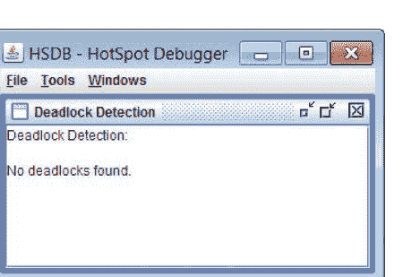

图 4.16 死锁检测

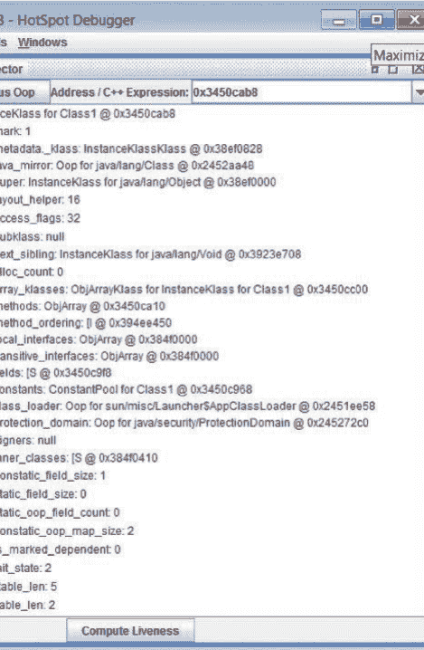

图 4.17 Inspector—java 对象

## 可用性代理调试工具

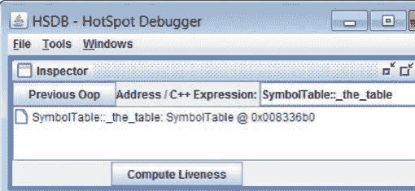

图 4.18 Inspector—VM 结构

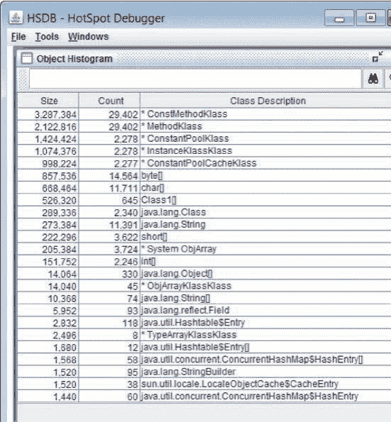

图 4.19 对象直方图

### 对象直方图

通过直方图工具（示例见图 4.19），我们可以获取 Java 堆中存在的对象的直方图。这有助于诊断 Java 程序中的内存泄漏或与内存溢出相关的问题。

## 88 第 4 章 可用性代理

该工具具有显示特定类实例的功能。点击右上角的搜索图标，会弹出一个窗口，显示所选类的所有实例。详见图 4.20。

我们可以从实例列表中选择任意实例，并获取该对象的存活路径，即该对象可达且被垃圾回收器认为存活的路径，如图 4.21 所示。

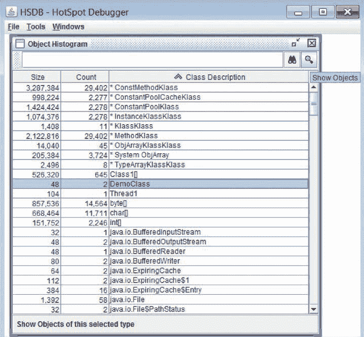

图 4.20 直方图—显示对象

## 可用性代理调试工具

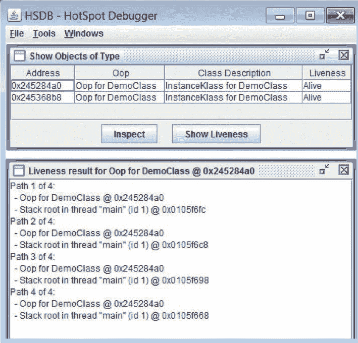

| 地址 | Oop | 类描述 | 存活状态 |
|---|---|---|---|
| 0x2452884a0 | DemoClass 的 Oop | DemoClass 的 InstanceKlass | 存活 |
| 0x245368b8 | DemoClass 的 Oop | DemoClass 的 InstanceKlass | 存活 |

- @ 0x2452884a0 的 DemoClass Oop 的存活结果
- 4 条路径中的第 1 条:
- @ 0x2452884a0 的 DemoClass Oop
- 线程 "main" (id 1) 中的栈根节点 @ 0x0105f6fc6
- 4 条路径中的第 2 条:
- @ 0x2452884a0 的 DemoClass Oop
- 线程 "main" (id 1) 中的栈根节点 @ 0x0105f6c8
- 4 条路径中的第 3 条:
- @ 0x2452884a0 的 DemoClass Oop
- 线程 "main" (id 1) 中的栈根节点 @ 0x0105f698
- 4 条路径中的第 4 条:
- @ 0x2452884a0 的 DemoClass Oop
- 线程 "main" (id 1) 中的栈根节点 @ 0x0105f668

图 4.21 显示存活状态

### 计算反向指针

此实用程序计算从 GC 根节点到达该对象的引用路径——即保持该对象在 Java 堆中存活的引用路径。一旦计算出反向指针，Object Inspector 窗口中对应对象的 `<<Reverse pointers>>` 字段就会显示该对象可达的反向指针，如图 4.22 所示。

## 90 第 4 章 可用性代理

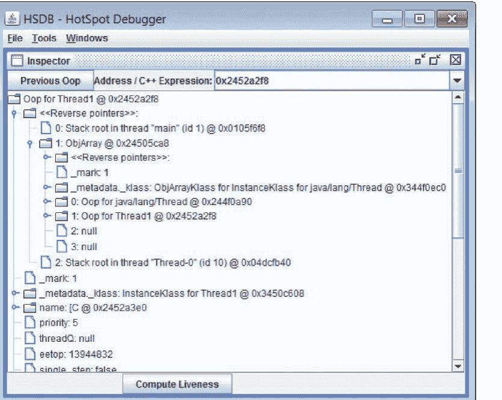

图 4.22 反向指针

我们还可以通过 Inspector 窗口中可用的 Compute Liveness（计算存活）和 Show Liveness（显示存活）按钮，在另一个窗口中查看对象的存活路径。详见图 4.23。

### 通过查询查找对象

该工具提供了基于 SQL 的查询语言，用于从 Java 堆中查询 Java 对象；例如，要查找 Java 堆中所有的线程对象，可以执行如下查询：

```
select t from java.lang.Thread t
```

图 4.24 显示了此查询的结果。

## 可用性代理调试工具

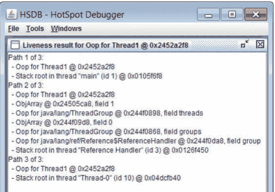

图 4.23 存活结果

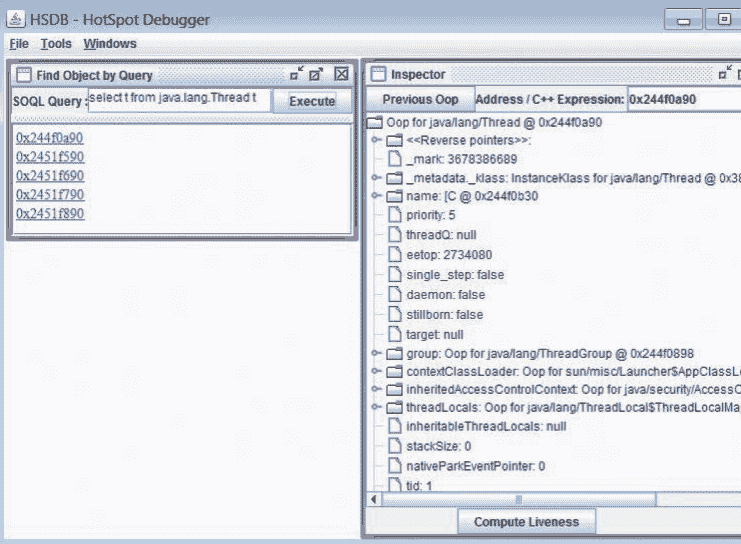

图 4.24 通过查询查找对象

## 92 第 4 章 可用性代理

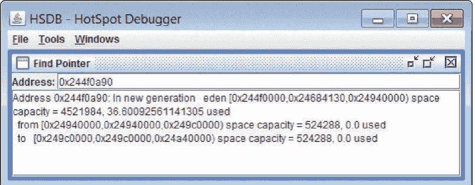

图 4.25 查找指针

### 查找指针

此工具可以帮助找到从 GC 根节点到达特定对象的引用路径，这在处理 JVM 崩溃问题时非常有用。例如，该地址位于 Java 堆的哪个位置？是在新生区还是老年代区？图 4.25 展示了这一点。

### 在堆中查找地址

该工具报告了 Java 堆中的所有值。这对于我们需要知道对象在堆中的具体位置时非常有用。通过追踪指向该对象的引用，可以了解为什么该对象没有被垃圾回收回收。

### 在代码缓存中查找值

该工具显示了代码缓存中的所有 JIT 编译方法。这对于排查 JIT 编译相关问题非常有用。图 4.27 展示了一个示例。

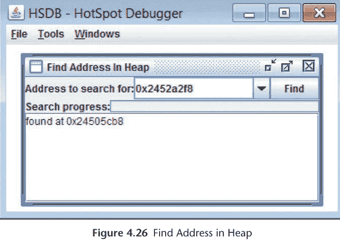

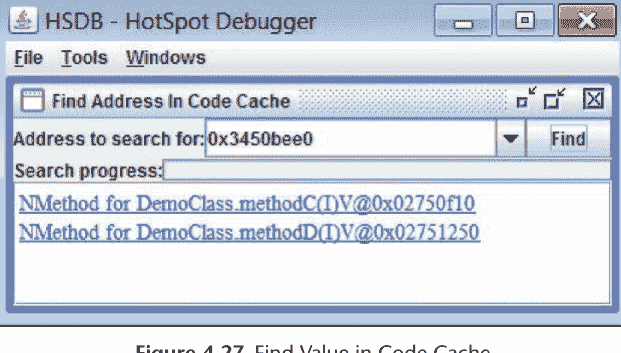

## 第 4 章 可用性代理

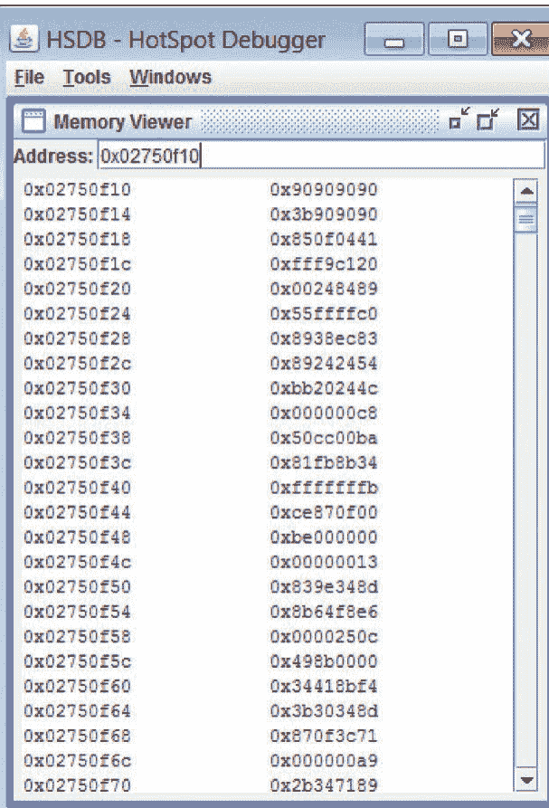

图 4.28 内存查看器

## 内存查看器

内存查看器以十六进制格式显示给定内存的内容。详见图 4.28。

## 监视

此实用程序显示了给定对象的监视情况。这对于排查同步问题非常有用。

## 代码查看器

代码查看器（见图 4.30）显示了 JIT 编译后的字节码。这有助于解决某些特定的崩溃问题。通过查看汇编代码，可以找到问题的根源。

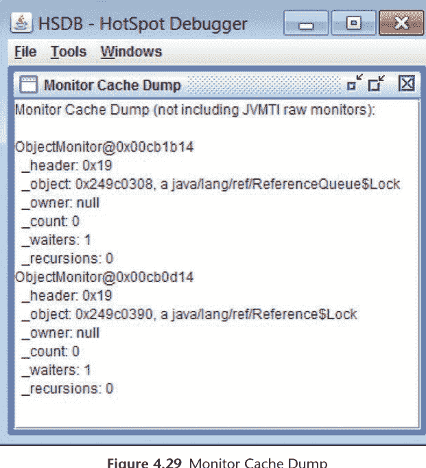

图 4.29 监视

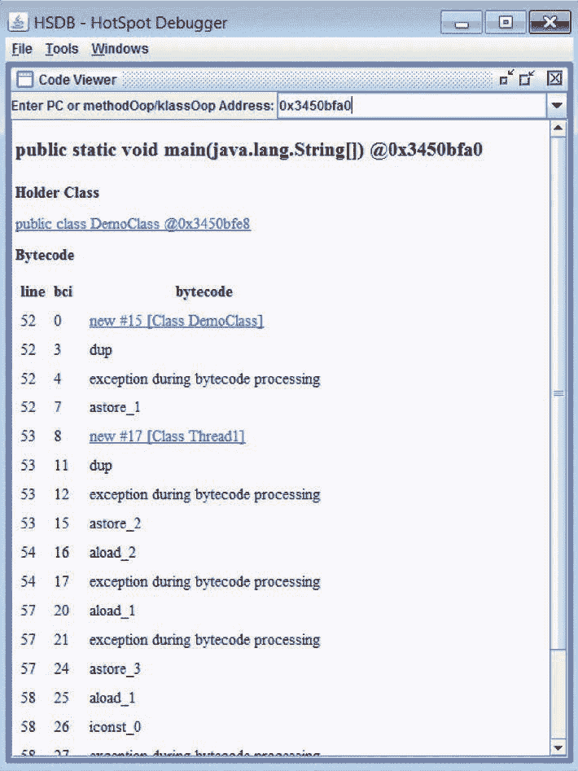

图 4.30 字节码

## 调试工具

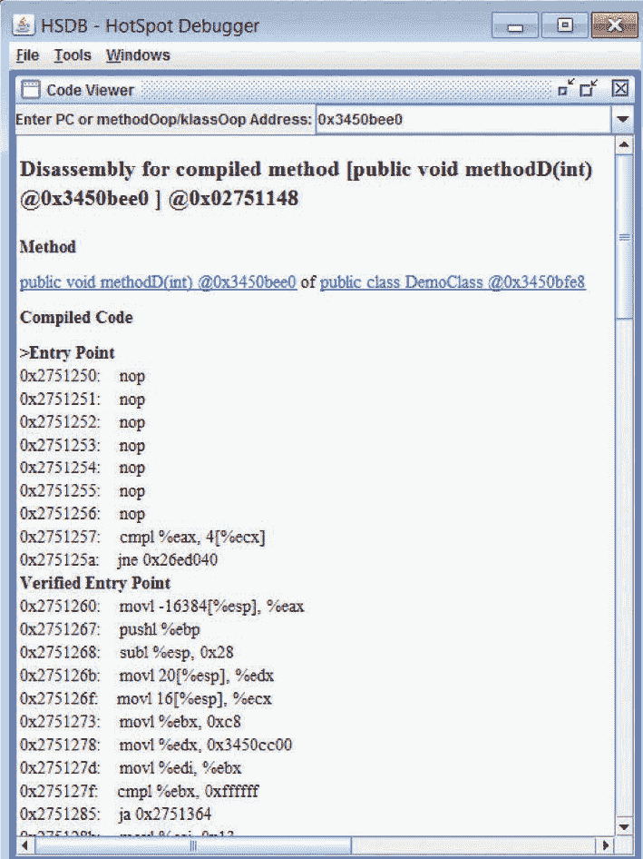

图 4.31 生成的代码代码

### 堆参数

堆参数工具显示了 Java 堆各个区域的边界。它有助于找到特定地址位于堆的哪个区域。示例见图 4.32。

### 系统属性

我们可以使用系统属性工具获取目标 VM 使用的系统属性。示例见图 4.33。

### 命令行标志

该实用程序显示了所有命令行 `-XX` JVM 选项的值。示例见图 4.34。

## CLHSDB

Command-Line HotSpot Debugger（命令行 HotSpot 调试器）是 HSDB 的命令行版本。启动 CLHSDB，我们需要设置与启动 HSDB 相同的环境变量。通过以下命令启动此工具：

```
$JAVA_HOME/bin/java -classpath $JAVA_HOME/lib/sa-jdi.jar sun.jvm.hotspot.CLHSDB
```

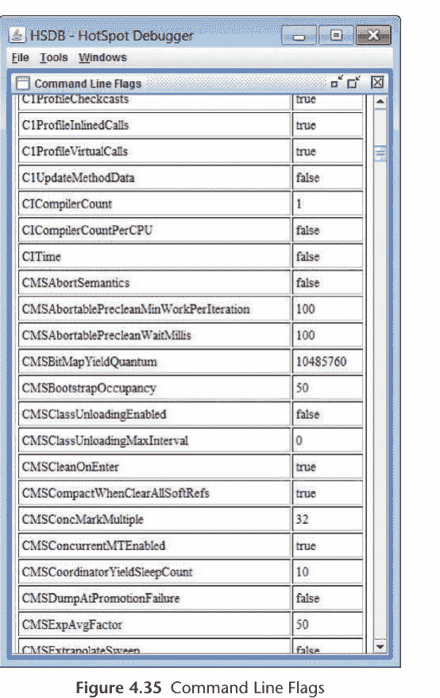

102 第 4 章 ■ 可维护代理

# 命令列表

这里是 CLHSDB 工具提供的完整命令列表：

```
hsdb help

Available commands:

assert true | false

attach pid | exec core

detach

dumpcfg { -a | id }

dumpcodecache

dumpideal { -a | id }

dumpilt { -a | id }

echo [ true | false ]

examine [ address/count ] | [ address,address ]

field type [ name fieldtype isStatic offset address ] ]

findc address

flags [ flag | -nd ]

help [ command ]

history

inspect expression

intConstant [ name | value ]

jhisto

jstack [-v]

livenmethods

longConstant [ name | value ]

pmap

print expression

printas type expression

printindo [-a | expression ]

printstatics [ type ]

pstack [-v]

quit

reattach

revptrs address

scanoops start end [ type ]

search [ heap | perm | rawheap | codecache | threads ] value

source filename

symbol address

symboldump

symboltable name

thread { -a | id }

threads

tokenize

type [ type name super isOop isUnsigned size ] ]

universe

verbose true | false

versioncheck [ true | false ]

mstructsdump

where { -a | id }
```

# 其他工具

SA 包含了一些非常实用的微型工具。这些工具可以附加到进程、核心文件或远程调试器上。让我们来看看如何使用它们以及它们能提供哪些有用信息。

## FinalizerInfo

该工具打印目标 VM 中可终化对象详情：

```
java -classpath %JAVA_HOME%\lib\sa-jdi.jar sun.hotspot.tools.FinalizerInfo 5684

attaching to process ID 5684, please wait...
Debugger attached successfully.
Client compiler detected.
JVM version is 24.0-b56
Number of objects pending for finalization: 0
```

## HeapDumper

该工具可以将 Java 堆转储为 hprof 格式的文件：

```
java -classpath %JAVA_HOME%\lib\sa-jdi.jar sun.hotspot.tools.HeapDumper 5684

attaching to process ID 5684, please wait...
Debugger attached successfully.
Client compiler detected.
JVM version is 24.0-b56
Dumping heap to heap.bin ...
Heap dump file created
```

## PermStat

该工具打印附加进程或核心文件的永久代统计信息：

```
java -classpath %JAVA_HOME%\lib\sa-jdi.jar sun.hotspot.tools.PermStat 5684

Attaching to process ID 5684, please wait...
Debugger attached successfully.
Client compiler detected.
JVM version is 24.0-b56
1073 intern Strings occupying 80268 bytes.
finding class loader instances
d.
computing per loader stat ..done.
please wait... computing
liveness...........................................................................................done.
```

# 第 4 章 ■ 可维护代理

| class_loader | classes | bytes | parent_loader | alive? | type |
| :--- | :--- | :--- | :--- | :--- | :--- |
| <bootstrap | 3 | 1539808 | null | live | <internal> |
| 0x23f7b398 | 3 | 28016 | 0x23f762e0 | live | |
| sun/misc/Launcher/AppClassLoader@0x38a0e9c0 | 0 | 0x23f762e0 | live | null |
| sun/misc/Launcher/ExtClassLoader@0x389eb420 | live | alive=3, dead=0 | N/A | |

## PMap

该工具打印目标进程/核心文件的映射，类似于 Solaris 的 pmap 工具：


# 可维护代理调试工具 (Serviceability Agent Debugging Tools)

## 对象直方图 (Object Histogram)

可以使用 HSDB 和 CLHSDB 中的工具收集对象直方图。还有一个独立的工具可用于转储目标 VM 的直方图：

```
java -classpath %JAVA_HOME%\lib\sa-jdi.jar sun.jvm.hotspot.tools.ObjectHistogram 6684
Attaching to process ID 6684, please wait...
Debugger attached successfully.
Client compiler detected.
JVM version is 24.0-b56
Iterating over heap. This may take a while...
Object Histogram:
```

| num | #instances | #bytes | Class description |
| :--- | :--- | :--- | :--- |
| 1: | 5659 | 546080 | `*ConstMethodClass` |
| 2: | 5659 | 455376 | `*MethodClass` |
| 3: | 385 | 37600 | `*ConstantPoolClass` |
| 4: | 385 | 154496 | `*InstanceClass` |
| 5: | 1687 | 149824 | `*KlassClass` |
| 6: | 353 | 139264 | `*ConstantPoolCache` |
| 7: | 477 | 122920 | `byte[]` |
| 8: | 445 | 54320 | `java.lang.Class` |
| 9: | 644 | 37600 | `*JSONArray` |
| 10: | 583 | 32736 | `short[]` |
| 11: | 1364 | | `java.lang.String` |
| 12: | 377 | 21064 | `int[]` |
| 13: | 43 | 14104 | `*ObjarrayClass` |
| 14: | 328 | 13544 | `java.lang.Object` |
| 15: | 120 | 7680 | `java.lang.reflect.Field` |
| 16: | 30 | 2223 | `java.util.HashMap$Entry` |
| 17: | 125 | 3000 | `java.util.Hashtable$Entry` |
| 18: | 118 | 2832 | `java.util.Hashtable$Entry` |
| 19: | 8 | 2624 | `*ArrayKlass` |
| 20: | 73 | 2472 | `java.lang.String` |
| 21: | 12 | 1680 | `java.util.Hashtable$Entry` |

### 示例：Windows 平台

```
D:\java -classpath %JAVA_HOME%\lib\sa-jdi.jar sun.jvm.hotspot.tools.ObjectHistogram 6684
Attaching to process ID 6684, please wait...
Debugger attached successfully.
Client compiler detected.
JVM version is 24.0-b56
Iterating over heap. This may take a while...
Object Histogram:
```

将 DumpJFR 挂载到核心文件（core file）以提取 Java Flight Recorder（飞行记录器）信息：

```
java -cp $JAVA_HOME/lib/sa-jdi.jar sun.jvm.hotspot.DumpJFR <java> <core>
```

`DumpJFR` 工具会将 JFR 数据导出到当前工作目录下的名为 `recording.jfr` 的文件中。该记录文件可以使用 Java Mission Control 进行分析。

## JSDB

JavaScript Debugger（JavaScript 调试器）为 SA 提供 JavaScript 接口。它是一个基于 Mozilla Rhino JavaScript 引擎的命令行 JavaScript 调试器。

```
java -classpath %JAVA_HOME%\lib\sa-jdi.jar sun.jvm.hotspot.sql1.JSDB 5684
Attaching to process ID 5684, please wait...
Debugger attached successfully.
Client compiler detected.
JVM version is 24.0-bdb
jsdb>
```

关于此更多细节可以在开源 HotSpot 仓库中的 `hotspot/agent/doc/jsdb.html` 文件中找到。

## 核心转储或崩溃文件 (Core Dump or Crash Files)

我们一直在讨论 Unix 系统上的核心文件（core files）和 Windows 系统上的崩溃转储文件（crash dump files）。以下是对这些转储文件的简要介绍。

核心文件或崩溃转储文件是一个二进制文件，由运行程序在特定时刻的状态组成。核心文件通常在程序意外终止时创建，原因是违反了操作系统或硬件的保护机制。操作系统会杀死该程序并创建一个核心文件，程序员后续可以使用该文件来查明出了什么问题。它包含了程序崩溃时所处状态的详细描述。

也可以从运行中的（非崩溃的）程序创建核心/崩溃转储文件。在 Solaris/Linux 上，有一个名为 `gcore` 的工具，可以将运行中或挂起的进程状态转储到文件中。在 Windows 上，我们可以使用 WinDbg、userdump 或 AdPlus 来收集崩溃转储文件。

每当难以调试运行中的进程时，核心转储文件对于诊断和调试 Java 程序中的问题非常有用。

## 调试传输的核心文件

有时，核心文件是在一个系统（核心主机）上创建的，而我们需要在另一个系统（调试器主机）上对其进行调试。原生调试器（dbx, gdb）以及 SA 并不总是能成功打开传输的核心文件，其原因是产生核心文件的系统与我们尝试调试的系统之间的内核和共享库不匹配。调试器可能会由于以下两种类型库的不匹配而遇到问题：

- 程序在核心主机上使用的共享库可能与调试器主机上的共享库不同。因此，我们需要让来自核心主机的原始库在调试器系统上可用。
- 调试器使用系统库（例如 `/usr/lib`、`/lib64` 等目录下的库）来理解系统上运行时链接器和线程库的实现细节。为了成功加载核心文件，我们还需要从核心主机获取系统库，并让它们在调试器主机上可用。

如果核心文件是崩溃产生的，并且生成了对应的 `hs_err` 文件，我们可以从 `hs_err` 日志文件中获取进程加载的共享库（系统和程序）的列表。

## SA 的共享库问题

当使用 SA 处理传输的核心文件时，我们可能会遇到与 `rtl_db` 或 `libthread_db` 不匹配相关的错误，或者 SA 可能会抛出目标进程缺少 HotSpot 符号的错误。例如，在下面的例子中，我们正尝试在 Linux/x64 上打开一个从另一个 Linux/x64 系统传输的核心文件：

```
$bash-3.2 $JAVA_HOME/bin/java -classpath $JAVA_HOME/lib/sa-di.jar sun.vm.hotspot.CLHSDB JAVA_HOME/bin/java/core.16963
Opening core file, please wait...
Unable to open core file
core.1693:
Doesn't appear to be a HotSpot VM (could not find symbol "gHotSpotVMTypes" in remote process)
sun.vm.hotspot.Debugger.ExceptionHandler: Doesn't appear to be a HotSpot VM (could not find symbol "gHotSpotVMTypes" in remote process)
at sun.vm.hotspot.HotSpotAgent.setupVM(HotSpotAgent.java:405)
at sun.vm.hotspot.HotSpotAgent.go(HotSpotAgent.java:314)
at sun.vm.hotspot.HotSpotAgent.attach(HotSpotAgent.java:173)
at sun.vm.hotspot.CLHSDB.attachDebugger(CLHSDB.java:188)
at sun.vm.hotspot.CLHSDB.run(CLHSDB.java:55)
hsdb> Input closed.
SA is not able to open this transported core file.
```

## 消除共享库问题

那么，我们如何解决在使用 SA 打开传输的核心文件时遇到的库问题呢？以下是我们可以采取的消除这些问题的措施：

1. 将程序使用的所有库从核心主机拷贝到调试器主机，例如拷贝到 `/space/corelibs/`。注意，库可以直接拷贝到 `/space/corelibs/`，也可以拷贝到 `/space/corelibs/` 下的完整路径。例如，来自核心主机的 `/local/java/lib/bin/server/libjvm.so` 可以直接拷贝到 `/space/corelibs/` 也可以拷贝到 `/space/corelibs/local/java/lib/bin/server/`。同样，来自核心主机的 `/usr/lib/libthread.so` 可以拷贝到 `/space/corelibs/` 或 `/space/corelibs/usr/lib/`。如果核心文件是崩溃产生的，并且生成了 `hs_err` 文件，我们可以从 `hs_err` 日志文件中的“Dynamic Libraries”部分获取进程加载的系统和程序库列表。

2. 然后，设置环境变量 `SA_ALTROOT` 指向调试器主机上对应的目录，即设置 `SA_ALTROOT=/space/corelibs/`。对于我们之前尝试打开的核心文件：

```
-bash-3.2 $JAVA_HOME/bin/java -classpath $JAVA_HOME/lib/sa-di.jar sun.vm.hotspot.CLHSDB JAVA_HOME/bin/java/core.16963
Opening core file, please wait...
hsdb
```

通过 `SA_ALTROOT`，SA 会从 `/space/corelibs/` 获取所需的库，从而成功打开核心文件。

# 第 4 章 可用性代理 (Serviceability Agent)

## 系统属性

| 系统属性 | 备注 | 适用平台 |
| :--- | :--- | :--- |
| `sun.jvm.hotspot.loadLibrary.DEBUG` | 启用在 Windows 平台上打印关于原生库加载的调试信息 | Windows |
| `sun.jvm.hotspot.tools.jcore.filter` | 指定想要从目标虚拟机（VM）中转储（dump）的类名 | 所有 |
| `sun.jvm.hotspot.tools.jcore.PackageFilter.pkgList` | 指定一个用逗号分隔的包列表，我们将从目标 VM 中转储这些包中的类 | 所有 |
| `sun.jvm.hotspot.tools.jcore.outputDir` | 指定从目标 VM 转储类文件的输出目录 | 所有 |

## 可用性代理的环境变量

可以通过设置环境变量来定义 SA 工具的运行时行为。详见表 4.3。

| 环境变量 | 备注 | 适用平台 |
| :--- | :--- | :--- |
| `SA_ALTROOT` | 在调试器宿主机上打开传输的转储文件时，设置 SA 查找共享库的目录位置 | Solaris 和 Linux |
| `LIBSPROC_DEBUG` | 启用将 SA 原生库 `libsaproc.so` 的调试信息打印到标准错误。Solaris 上的 SA 使用 `libproc.so` 库。该库也通过环境变量 `LIBSPROC_DEBUG` 打印调试信息。设置 `LIBSPROC_DEBUG` 也会设置该变量。 | Solaris 和 Linux |
| `SA_IGNORE_THREAD` | 打开传输的转储文件时，如果由于此环境变量中的库不匹配导致出现 `libthread_db_relative` 错误。使用此项后，SA 将忽略 `libthread_db` 错误并成功打开转储文件，但无法获取任何与线程相关的信息 | Solaris 和 Linux |

## JDI 实现

SA 二进制文件 `sa-jdi.jar` 包含了 Java 调试接口 (JDI) 的实现，使得任何 JDI 客户端（例如 JDB）能够通过该实现提供的 JDI 连接器附加到转储文件以及 Java 进程。

由这些连接器的 `attach()` 方法返回的 VM 对象是只读的。这意味着 VM 对象不能被修改。因此，使用这些连接器的 JDI 客户端不应调用任何定义为抛出 `VMCannotBeModifiedException` 的 JDI 方法。

## SA 核心附加连接器 (SA Core Attaching Connector)

该连接器可供调试应用程序调试转储文件。它允许在同一个转储文件上进行多个调试会话。它通过名称 `sun.jvm.hotspot.jdi.SACoreAttachingConnector` 唯一标识，用法如下：


```
$JAVA_HOME/bin/jdb
-Xbootclasspath/a:$JAVA_HOME/lib/sa-jdi.jar:$JAVA_HOME/lib/tools.jar
-connect sun.jvm.hotspot.jdi.SACoreAttachingConnector:core=
$(CORE_FILE),javaExecutable=$(EXE_FILE)
```

# SAPID 附加连接器 (SAPID Attaching Connector)

该连接器可供调试应用程序调试进程。需要调试的进程无需以调试模式启动（即无需使用 `-agentlib:jdwp=-Xdwp`），且允许进程挂起。使用此连接器，调试器将获得进程的只读视图，附加进程后获得的 VM 对象无法被修改。

当连接器附加时，进程会被挂起，当连接器断开时会恢复。多个 SAPID 附加连接器不能同时附加到同一个进程。该连接器通过名称 `sun.jvm.hotspot.jdi.SAPIDAttachingConnector` 唯一标识。

调试器可以使用以下方式连接并调试进程：

```
$JAVA_HOME/bin/jdb
-Xbootclasspath/a:$JAVA_HOME/lib/sa-jdi.jar:$JAVA_HOME/lib/tools.jar
-connect sun.jvm.hotspot.jdi.SAPIDAttachingConnector:pid=2402
```

# SA 调试服务器附加连接器 (SA Debug Server Attaching Connector)

该连接器可供调试应用程序调试运行调试器机器之外的机器上的进程或转储文件。该连接器使用远程方法调用 (RMI) 与运行在远程机器上的调试服务器通信。在调用该连接器的 `attach()` 方法之前，必须在远程机器上启动调试服务器并告知要调试的进程或转储文件。在远程机器上需要执行以下操作：

- 启动包含 `sa-jdi.jar` 的 RMI 注册表：

```
${JAVA_HOME}/bin/rmiregistry -Xbootclasspath:${JAVA_HOME}/lib/sa-jdi.jar
```

此命令创建并启动一个远程对象注册。可以指定一个可选端口号作为注册启动端口。如果没有指定端口号，注册将在端口 99 上启动。

- 在远程机器上启动调试服务器，指定要调试的进程或转储文件：

```
${JAVA_HOME}/bin/java -classpath ${JAVA_HOME}/lib/sa-jdi.jar sun.jvm.hotspot.jdi.DebugServer <pid> <uniqueID>
```

或

```
${JAVA_HOME}/bin/java -classpath ${JAVA_HOME}/lib/sa-jdi.jar sun.jvm.hotspot.jdi.DebugServer <产生转储文件的 java 可执行文件路径> <要调试的转储文件路径> <uniqueID>
```

如果注册表尚未运行，SA 调试服务器将在端口 99 启动 RMI 注册。这两个步骤的替代方案是使用 JDK 自带的工具在远程机器上启动 RMI 注册和调试服务器。如果在同一台机器上同时运行多个调试服务器，每个服务器必须具有不同的 `uniqueID` 字符串。

# 扩展可用性工具

可用性代理 API 提供了 `sun.jvm.hotspot.tools.Tool` 类，可以通过扩展它编写工具。这是一个扩展 `sun.jvm.hotspot.tools.Tool` 类的简单示例，它可以打印目标 VM 的系统属性。该工具是 `sa-jdi.jar` 文件的一部分：

```java
package sun.jvm.hotspot.tools;

import java.io.PrintStream;
import java.util.*;
import sun.jvm.hotspot.runtime.*;

public class SysPropsDumper extends Tool {

    public void run() {
        Properties sysProps = VM.getProperties();
        PrintStream out = System.out;
        if (sysProps != null) {
            Enumeration keys = sysProps.keys();
            while (keys.hasMoreElements()) {
                Object key = keys.next();
                out.print(key + "=");
                out.println(sysProps.get(key));
            }
        } else {
            out.println("System Properties not available!");
        }
    }

    public static void main(String[] args) {
        SysPropsDumper pd = new SysPropsDumper();
        pd.start();
    }
}
```

编写我们的工具需要扩展 `Tool` 类并实现 `run()` 方法。在前面的示例中，我们通过 `Tool` 类获取系统属性并将其打印到标准输出。

```
java.vm.info = mixed mode, sharing
java.version = 1.8.0_281
java.ext.dirs = D:\Java\jdk\jre\ext;C:\windows\Sun\Java\ext
java.class.path = D:\Java\jdk\jre\resources;D:\Java\jdk\jre\nlib.rt.jar;D:\Java\jdk\jre\sunnasig.jar;D:\Java\jdk\jre\jse-jar;D:\Java\jdk\jre\lib.ce.jar;D:\Java\jdk\jre\charsets.jar;D:\java\tool\jre\lib.jar;D:\Java\jdk\jre\classes
java.vendor = Oracle Corporation
file.separator =
java.vendor.url.bin = http://bugreport.sun.com/bugreport/
sun.io.encoding = UnicodeLittle
sun.cpu.endian = little
sun.desktop = windows
sun.cpu.isalist = pentium-pro+maxx pentium_pro pentium+maxx pentium i486 1386 186
```

SA 代码位于 `<hotspot-repo>/src/` 文件夹下，与 `sa-ji.jar` 绑定的工具的实现位于 `jvm/hotspot/tools/under` 文件夹下。

这些类的 JavaDoc API 可以从 http://docs.oracle.com/javasearch/8/docs/serviceabilityagent/ 下载。

# 用于 VisualVM 的 Serviceability Agent（可扩展性代理）插件

在深入探讨 JavaVM (VisualVM) Serviceability Agent 插件的细节之前，让我们简要介绍一下 VisualVM。

VisualVM 是一个用于排查故障、监控和观察 Java 应用的工具。它被定位为 Java 应用的一体化监控和故障排除工具。JDK 随带的许多独立工具（如 `jstack`、`jmap` 等）在 VisualVM 中可用。从 JDK 6u27 开始，VisualVM 也会随 JDK 一起发布，并可以使用 `jvisualvm` 命令启动。图 4.36 显示了 VisualVM 启动后的示例。

VisualVM 的一个非常棒点可以使用插件对其进行扩展。人们可以使用其 API 为 VisualVM 编写插件，并开发供他人使用的插件。这些插件随后可以在 VisualVM 插件中心发布。

用于 VisualVM 的 Serviceability Agent 插件是一个 VisualVM 插件，它将 SA 的核心功能带入 SAVM。该插件提供了从 VisualVM GUI 内部查看堆中 Java 对象的 VM 表示、应用程序中的 Java 线程以及方法的编译/解释执行代码的能力，并可以为 Java 堆中的给定地址查找引用。

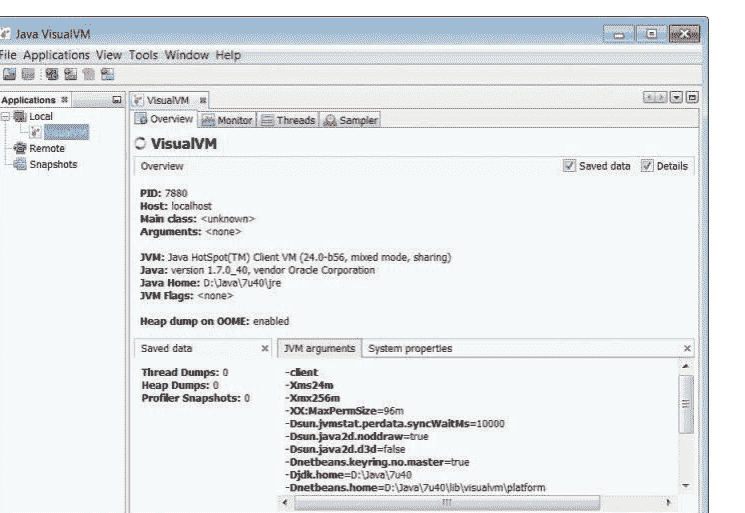

图 4.36 Java VisualVM

## 如何在 VisualVM 中安装 SA 插件

VisualVM 插件可以在 VisualVM 插件中心获取。最新的 VisualVM 插件中心地址为 http://visual.java.net/pluginscenters.html。要在 VisualVM 中安装 SA 插件，请点击“Tools（工具） > Plugins（插件）”。这将弹出插件对话框。点击“Available Plugins（可用插件）”标签，从列表中选择 SA-Plugin，然后点击“Install（安装）”。这会将 SA 插件安装到你的 VisualVM 安装中。

## 如何使用 SA 插件

让我们看看如何使用 SA 插件来探索运行中的进程或核心转储文件（core file）。

使用 SA 插件探索活动进程，请使用随二进制文件提供的 JDK 运行该进程。在 VisualVM 中打开此进程。当 VisualVM 安装了 SA 插件后，当进程在 VisualVM 中打开时，它会出现在“Application（应用程序）”视图中。现在，点击 Plugin 标签页中的“Attach to Process（附加到进程）”；这会将 SA 附加到运行中的进程，该进程会在该时刻暂停。现在我们可以探索进程的快照了。我们可以查看它的 Java 线程、检查 Java 对象、查看方法的字节码/编译后的代码等。

完成后，我们可以通过点击“Detach Process（分离进程）”按钮从 SA 中分离该进程。进程将恢复运行。

打开和诊断核心转储文件与使用 SA 插件探索进程类似。首先，我们需要在 VisualVM 中打开核心转储文件，然后从 SA 插件视图附加到该文件。与进程的情况一样，我们可以探索 Java 堆中的对象、查看线程对象、在 Java 堆中搜索值，并查看来自核心转储文件的方法的编译代码。SA 插件探索核心转储文件的能力对死后进程的事后分析非常有帮助。

## SA 插件工具

该插件在后续章节描述的四个面板中为 VisualVM 提供了一些 Serviceability Agent 工具。

## Java 线程/Java 堆栈跟踪

该面板如图 4.37 所示，显示了已附加进程或核心转储文件中的所有 Java 线程。双击任何线程或点击 Java Threads 面板上的“Open Inspector（打开检查器）”图标，可以在另一个窗口中显示线程对象的内部细节。

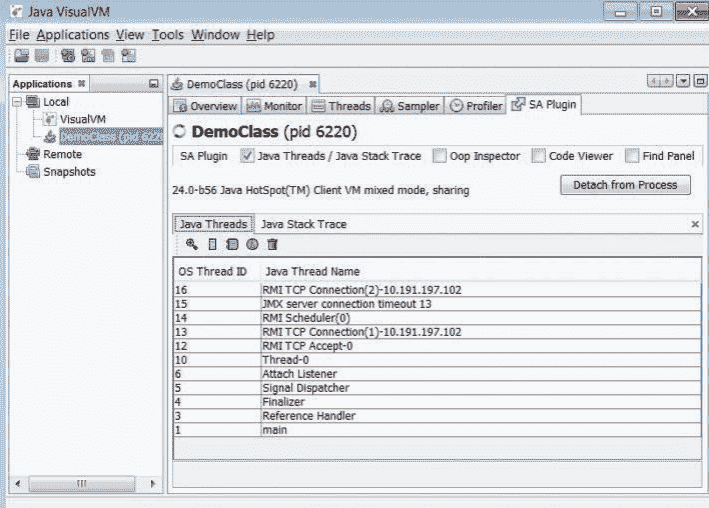

图 4.37 Java 检查器面板。在 Java Threads 面板上点击“Show Stack Trace（显示堆栈跟踪）”可以显示线程的堆栈跟踪。Show Stack Trace 面板的示例见图 4.38。

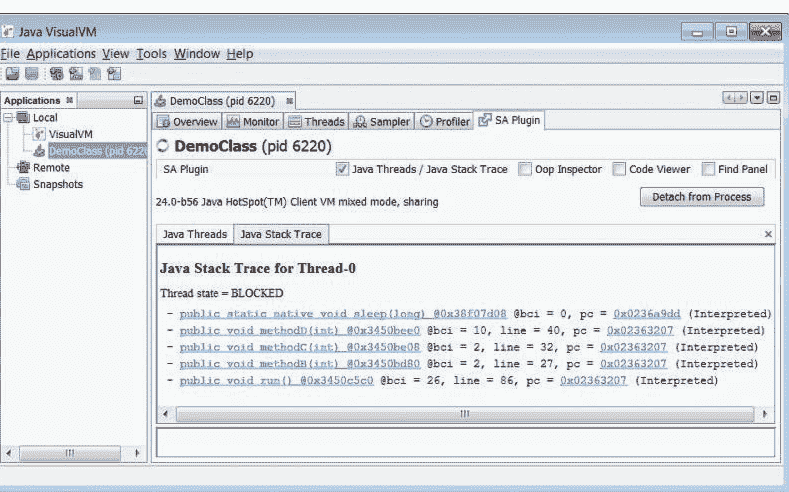

图 4.38 Java 堆栈跟踪

## Oop 检查器

此面板在 VisualVM 中提供了对 Java 堆中对象表示（Oop）的查看能力。在 Java Threads 面板上点击“Show Stack Trace”可以显示线程的堆栈跟踪。我们可以在 Java 堆中搜索值。面板的示例见图 4.39。

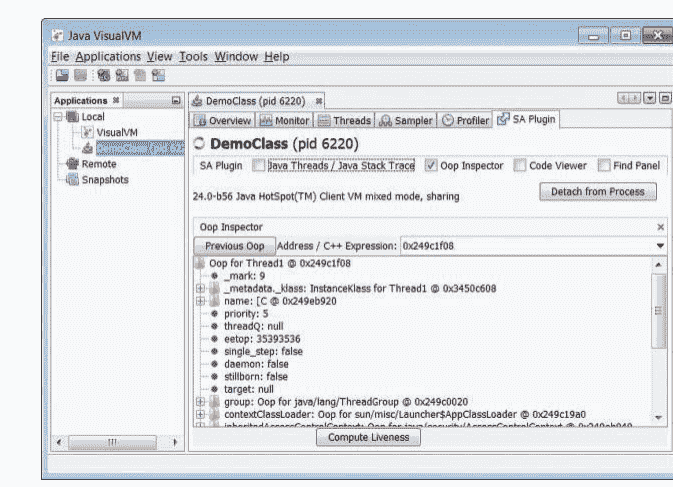

图 4.39 Oop 检查器

## 查看器

此面板显示了在 VM 中出现编译代码。图 4.40 和 4.41 查看了 JIT 编译代码。

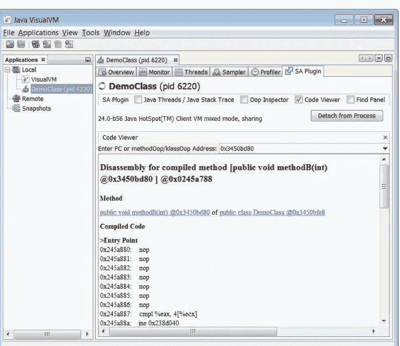

图 4.40 查看器

图 4.42 面板提供了三个工具：

- Find Pointer（查找指针）帮助我们找到引用
- Find Value in Heap（在堆中查找值）帮助我们找到值
- Find Value in CodeCache（在缓存中查找值）帮助我们找到值

# 使用 SA 排除故障

在之前的章节中，我们查看了 SA 以及它是如何工作的。在本节中，我们将讨论真实的 Java 应用问题。

Java 应用可能会面临多种问题：运行缓慢、高内存消耗、异常行为甚至崩溃。SA 工具可以极大地帮助解决这些问题。

## 诊断 OutOfMemoryError

OutOfMemoryError 在 Java 堆无法分配新对象时抛出。

由于我们的程序运行时间很短，并且没有足够的时间将工具附加到运行的进程，我们使用 `-XX:OutOfMemoryError` 选项在 OutOfMemoryError 发生时产生崩溃转储文件。我们正在 Windows 机器上运行此程序。

```
D:\tests\java -XX:OutOfMemoryError="D:\Tools\userdump.8\x64\userdump %p" MemoryError
# java.lang.OutOfMemoryError: Java heap space
# -XX:OutOfMemoryError="D:\Tools\userdump.8\x64\userdump %p"
# Executing "D:\Tools\userdump.8\x64\userdump 4768..."
User Mode Dumper (Version 8.1.2925)
Copyright (c) Microsoft Corp. All rights reserved.
Dumping process 4768...
d:\tests\java.hiddump
The process was dumped successfully.
```

处理此问题有许多方法：

- 使用 `jmap` 工具、`JConsole` 工具或使用 `-XX:+HeapDumpOutOfError` JVM 选项从进程收集堆转储，然后使用 `jhat` 或 VisualVM 分析堆转储。
- 使用 SA 工具从运行的进程收集堆直方图。
- 在发生 OutOfMemoryError 时使用 `-XX:OutOfMemory` 选项收集核心或转储文件，然后使用 SA 工具从该核心/转储文件获取堆直方图。

由于我们的程序运行时间并不长，并且没有足够的时间将任何工具附加到运行的进程，我们运行 `-XX:OutOfMemoryError` 在 OutOfMemoryError 发生时产生崩溃转储文件。我们在 Windows 机器上运行此程序。

# 使用 SA 排除故障

在 Solaris 或 Linux 平台上生成核心文件，可以如下方式运行程序：

```
java -XX:OnOutOfMemoryError="gcore %p" MemoryError
```

现在，让我们在 HSDB 工具中打开此崩溃转储文件：

```
D:\tests>java -classpath %JAVA_HOME%\lib\sa-jdi.jar
sun.jvm.hotspot.HSDB %JAVA_HOME%\bin\java.exe .dmp
```

点击 Tools > Object Histogram 获取堆的直方图，如图 4.43 所示。

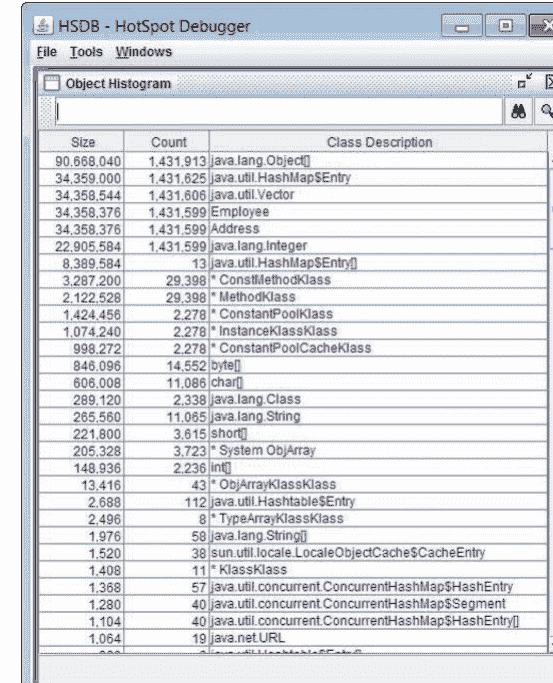

该直方图显示，除了系统类外，`Address` 和 `Employee` 类出现在直方图顶部，并占据了堆中的大量空间。这告诉我们，这些类的实例是导致 OutOfMemoryError 的主要元凶。

在 Object Histogram 工具中，我们可以找到 Java 堆中存在的特定类的实例。要实现这一点，Object Histogram 窗口的右上角有一个图标。让我们找到 `Address` 类的所有实例。图 4.44 显示了 Object Histogram 窗口正在搜索所有 `Address` 实例。

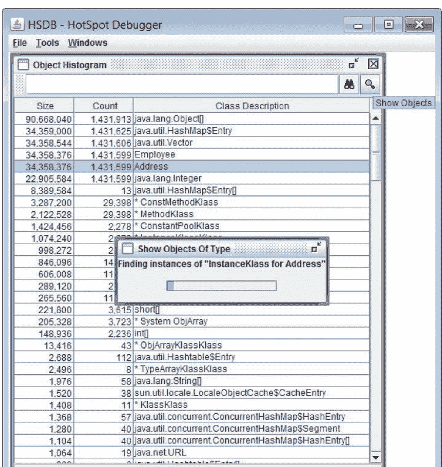

图 4.44 显示对象

## 使用 SA 排除故障

寻找所有实例可能需要一些时间，因为工具必须遍历整个堆。这将弹出 `Address` 类的 Show Objects of Type 窗口，如图 4.45 所示。

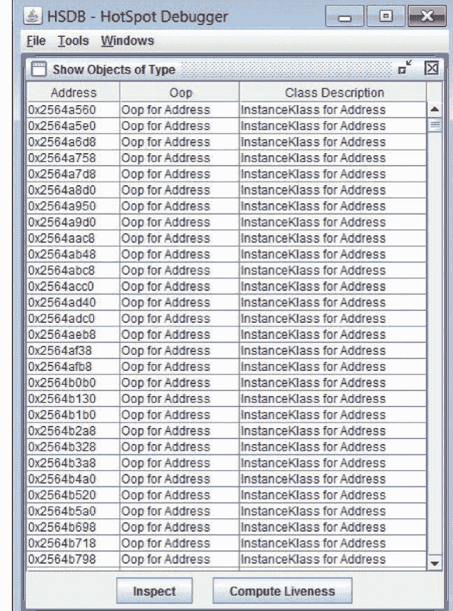

图 4.45 显示类型

## 第 4 章 - 可用性代理

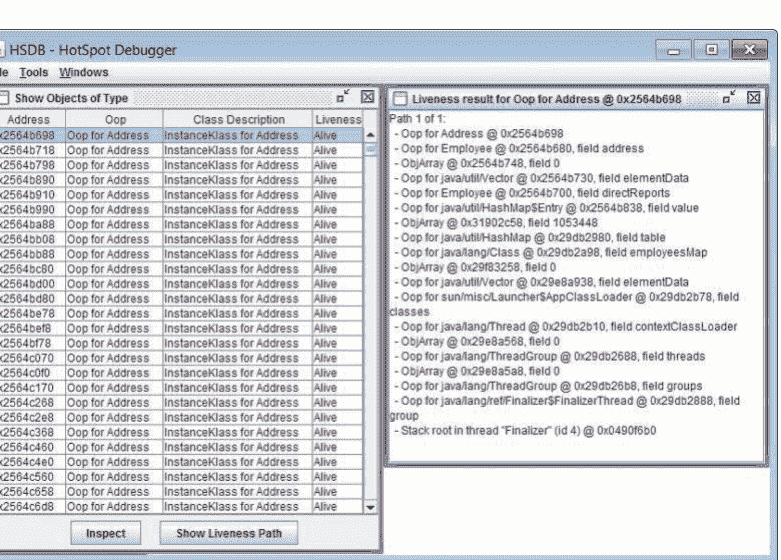

图 4.46 存活结果

现在，通过点击 Liveness 按钮，我们获得了 `Address` 类实例的存活路径（实例从 GC 根可达的引用路径）。见图 4.46。

然后我们可以通过点击 Show Liveness Path 查看所选实例的存活路径。位于 `0x2564b68` 处的 `Address` 实例显示它从 vector `employeesList` 可达。以下是测试程序的 Java 代码：


```java
import java.util.*;
public class MemoryError{
    static Vector employeesList;
    public static void main(String[] args) throws Exception{
        HashMap<String, Employee> employeesMap = new HashMap<>();
        employeesList = new Vector();
        int i = 0;
        while(true) {
            Employee emp1 = new Employee("Ram", new Address("MG Road", "Bangalore", 123));
            employeesMap.put(i++, emp1);
            employeesList.add(emp1);
            Employee emp2 = new Employee("Bob", new Address("House No. 4", "USA", 234));
            employeesMap.put(i++, emp2);
            employeesList.add(emp2);
            Employee emp3 = new Employee("John", new Address("Church Street", "Bangalore", 569));
            employeesMap.put(i++, emp3);
            employeesList.add(emp3);
        }
    }
class Employee {
    String address;
    Vector directReports;
    public Employee(String nm, String addr){
        name = nm;
        address = addr;
        directReports = new Vector();
    }
    public void addReports(Employee emp){
        directReports.add((Object)emp);
    }
}
class Address {
    String addr;
    String city;
    int zip;
    String country;
    public Address(String a, String ci, int z, String co){
        addr = a;
        city = ci;
        zip = z;
    }
}
```

我们可以看到这段 Java 代码维护了员工及其地址记录。这些记录被添加到两个集合中：`employeesList` 和 `employeeMap` 持有 `Employee` 和 `Address` 实例的引用，导致它们无法被垃圾器回收。因此，这些实例在 Java 堆中不断增加。此测试程序演示了应用程序中常见的错误：无意中维护了程序逻辑所需的对象缓存，导致内存错误。我们还可以使用 `Object Histogram` 独立工具从崩溃转储获取对象直方图：

```
D:\tests\java -classpath %JAVA_HOME%\lib\sa-jdi.jar
sun.hotspot.tools.ObjectHistogram %JAVA_HOME%\bin\java.exe .dump
Attaching to core java.exe from executable D:\java\7u40\bin\java.exe,
Debugger attached successfully.
Client remote.
JVM version is 24.0-b56
Iterating over heap. This may take a while...
Object Histogram:
```

| num | #instances | #bytes | Class |
|---|---|---|---|
| 1 | 1431913 | 90668040 | java.lang.Object[] |
| 2 | 1431625 | 34359000 | java.util.HashMapEntry |
| 3 | 1431606 | 34358544 | java.util.Vector |
| 4 | 1431599 | 34358376 | Employee |
| 5 | 1431599 | 34358376 | Address |
| 6 | 1431599 | 22005584 | java.lang.Integer |
| 7 | 13 | 8398584 | java.util.HashMapEntry[] |
| 8 | 29938 | 3287200 | ConstMethodClass[] |
| 9 | 29938 | 2122528 | MethodClass |
| 10 | 2278 | 1424416 | ConstantPoolClass |
| 11 | 2278 | 1074240 | InstancelClass |
| 12 | 2278 | 998272 | ConstantPoolCacheClass |
| 13 | 14552 | 846096 | byte[] |
| 14 | 11086 | 606008 | char[] |
| 166 | 1 | 8 | java.nio.Bits$1 |
| 167 | 1 | 8 | java.lang.Runtime |
| 168 | 1 | 8 | java.security.ProtectionDomain$1 |
| 169 | 1 | 8 | java.security.ReferenceLock |
| 170 | 1 | 8 | java.security.ProtectionDomain$3 |

堆遍历花费了 125.47 秒。

# 诊断 Java 级别死锁

让我们来看一个在执行后不久就陷入死锁的小型 Java 程序：

```java
public class DeadlockTest extends Thread {
    public static Object lock1 = new Object();
    public static Object lock2 = new Object();
    public static void main(String[] a) {
        Thread t1 = new Thread0();
        Thread t2 = new Thread1();
        t1.start();
        t2.start();
    }

    private static class Thread0 extends Thread {
        public void run() {
            synchronized (lock1) {
                System.out.println("Thread 0: Holding lock 1...");
                try { Thread.sleep(10); }
                catch (InterruptedException e) {
                    System.out.println("Thread 0: Waiting for lock 2...");
                    synchronized (lock2) {
                        System.out.println("Thread 0: Holding lock 1 & 2...");
                    }
                }
            }
        }
    }

    private static class Thread1 extends Thread {
        public void run() {
            synchronized (lock2) {
                System.out.println("Thread 1: Holding lock 2...");
                try { Thread.sleep(10); }
                catch (InterruptedException e) {
                    System.out.println("Thread 1: Waiting for lock 1...");
                    synchronized (lock1) {
                        System.out.println("Thread 1: Holding lock 2 & 1...");
                    }
                }
            }
        }
    }
}
```

## 132

## 第 4 章 · 可性代理 (The Serviceability Agent)

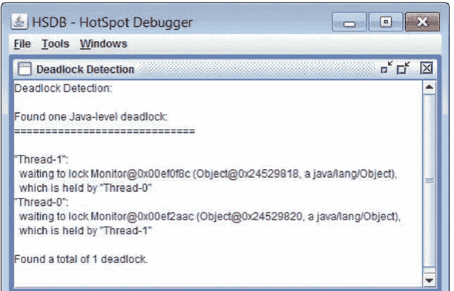

图 4.47 死锁检测

要获取关于这些监控器的详情，我们可以使用监控缓存转储（Monitor Cache Dump）工具。参见图 4.48。

有时，查看线程的状态是非常有趣的。我们可以通过检查 Oop Inspector 工具中的线程对象来实现。让我们观察 Oop Inspector 中的 `Thread-0` 和 `Thread-1` 对象。在 Java Threads 面板中双击这些线程，将打开对应这些线程对象的 Oop Inspector 窗口。图 4.49 显示了 `Thread-0` 的 Oop Inspector，图 4.50 显示了 `Thread-1` 的 Oop Inspector 窗口。

在这两个快照中，两者的线程状态均为 1025。让我们看看 Java HotSpot VM 中的代码，它是如何根据 `threadStatus` 字段计算 Java 线程状态的：

```java
public static Thread toThreadState(int threadStatus) {
    if ((threadStatus & JVMT_THREAD_STATE_RUNNABLE) != 0) {
        return RUNNABLE;
    } else if ((threadStatus &
        JVTI_THREAD_STATE_BLOCKED_ON_MONITOR_ENTER) != 0) {
        return BLOCKED;
    }

private final static int
JVTI_THREAD_STATE_BLOCKED_ON_MONITOR_ENTER = 0x0400;
```

## 使用 SA 排除故障问题

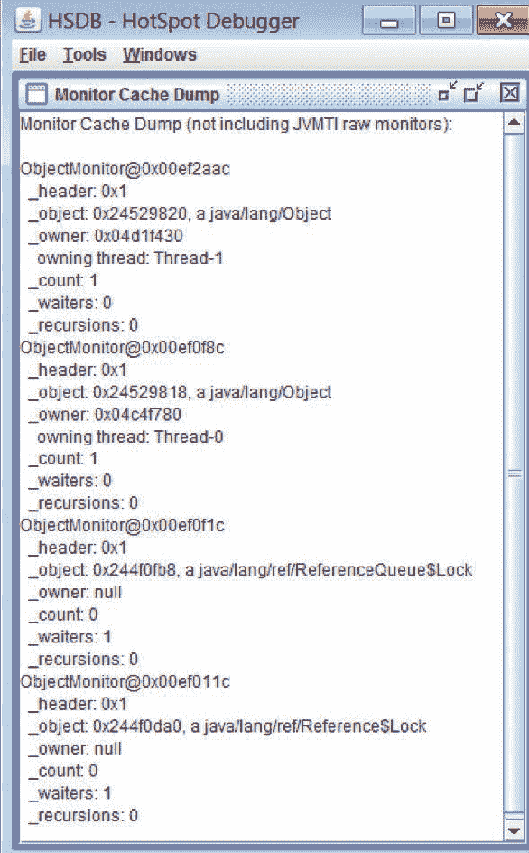

图 4.48 监控缓存转储

## 134 第 4 章 · 可性代理 (The Serviceability Agent)


图 4.49 Oop Inspector—Thread-0

## 使用 SA 排除故障问题

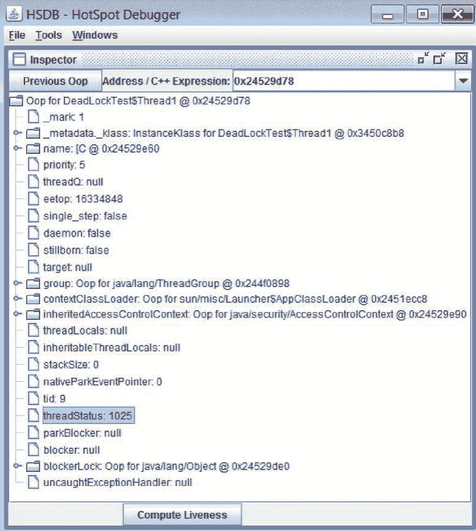

图 4.50 Oop Inspector—Thread-1

该计算在 `threadStatus` 为 1025 时会返回线程状态为 `BLOCKED`。这意味着两个线程都处于 `BLOCKED` 阻塞状态。

因此，使用死锁检测工具，我们可以轻松定位应用程序中的 Java 级死锁。

# HotSpot VM 崩溃的事后分析

SA 能够通过对这些崩溃产生的核心文件（core files）进行事后分析，来帮助诊断 JVM 崩溃。我有一个使用 JNI 的简单程序。它向一个超出大小限制的字节数组写入数据，这会导致覆盖并损坏 Java 堆中紧随其后的对象。当垃圾回收器尝试扫描损坏的 Java 堆时，程序就会崩溃。

## 测试程序

这里是测试程序，包含了 `TestCrash` 和 `Object1` Java 类。`Object1` 有一个原生方法（`nativeMethod()`），该方法在 `test.c` 文件的 C 代码中实现。`TestCrash` 创建 `Object1` 实例，然后在其中一个 `Object1` 实例上调用了 `nativeMethod()`。

```java
import java.util.ArrayList;

public class TestCrash {
    static {
        System.loadLibrary("test");
    }

    ArrayList a2 = new ArrayList();
    ArrayList a3 = new ArrayList();

    public static void main(String[] args) {
        TestCrash t = new TestCrash();
        t.method1();
    }

    void method1() {
        /* 用 ArrayList 填充堆 */
        ArrayList a1 = new ArrayList();
        for (int i=0; i<10000; i++) {
            Object1 obj = new Object1();
            a1.add(obj);
        }

        /* 使用原生方法破坏对象 */
        ((Object1)a1.get(i)).nativeMethod();

        /* 触发垃圾回收 */
        for (int p=0; p<10; p++) {
            System.gc();
        }
    } // 根据上下文添加了缺失的大括号
    try {
        Thread.sleep(1000);
    } catch (InterruptedException ex) {
    }
}
class Object1 {
    byte[] array = {1, 2, 3};
    native void nativeMethod();
}
```

这里是测试用例的原生部分，使用 JNI 实现了 `nativeMethod()` 方法。源代码存放在名为 `test.cpp` 的文件中，符合 JNI 源文件文件命名规范。

```cpp
#include "test.h"
#include <stdlib.h>
#include <memory.h>
```

> /* Class: Object1
> * Method: nativeMethod
> * Signature: (V) */

```cpp
JNIEXPORT void JNICALL Java_Object1_nativeMethod(
(JNIEnv *env, jobject obj) {
    jclass cls = env->GetObjectClass(obj);
    jfield jfield = env->GetFieldID(cls, "array", "[B]");
    jbyte arrayObject = 
        (jbyte*)env->GetObjectField(obj, jfield);

    byte* array = 
        (byte*)env->GetPrimitiveArrayCritical(array);

    env->ReleasePrimitiveArrayCritical(array, arrayObject, 0);

    env->Describe();
    env->ExceptionClear();
}
```

现在，这个原生部分是：

```bash
export JAVA_HOME=/java.
```

```在在 Solaris 上编译以下指令：

```java

import java.util.ArrayList;

public class TestCrash {

    static {

        System.loadLibrary("test");

    }

    ArrayList a2 = new ArrayList();

    ArrayList a3 = new ArrayList();

    public static void main(String[] args) {

        TestCrash t = new TestCrash();

        t.method1();

    }

    void method1() {

        /* 用 ArrayList 填充堆 */

        ArrayList a1 = new ArrayList();

        for (int i=0; i<10000; i++) {

            Object1 obj = new Object1();

            a1.add(obj);

        }
```


/* 使用原生方法破坏对象 */

```
((Object1)a1.get(i)).nativeMethod();
```

/* 触发垃圾回收 */

```
for (int p=0; p<10; p++) {
    System.gc();
}
```

```
try {
    Thread.sleep(1000);
} catch (InterruptedException ex) {
}
```

```
class Object1 {
    byte[] array = {1, 2, 3};
    native void nativeMethod();
}
```

然后以此方式执行：

```bash
oracle@solaris_11::~demo
```

# 140 第4章 可用性代理 (Serviceability Agent)

```bash
oracle@solaris_11X export PATH=$JAVA_HOME/bin:$PATH
oracle@solaris_11X java -classpath $JAVA_HOME/lib/sa-jdi.jar sun.jvm.hotspot:HSDB
```

图 4.52 显示了崩溃发生在 `0xfe2af22` 附近执行代码的反汇编。

图 4.52 中显示的程序计数器和相应的汇编指令表明，进程在尝试访问 `eax+100` 处的地址时崩溃，该地址位于程序计数器 `0xfe2af22`。从 `hs_err` 文件中可以看到计数器和 `EAX` 寄存器的值：

```
EAX=0xe261761, EBX=0xe7a6be0, ECX=0xa2406f6c, EDX=0x0000004
ESP=0xe783ff90, EBP=0xe783ffc8, ESI=0xe7a4ea68, EDI=0x00000000
EIP=0xfe2af22, EFLAGS=0x00001029
```

为了找出 `0xe2617611` 并确定为什么在尝试读取 `0xe261761+100` 处的值时发生崩溃，我们可以使用 `HSDB` 的 Find Pointer（查找指针）面板（如图 4.53 所示），可以看到该地址不在 Java 堆中。

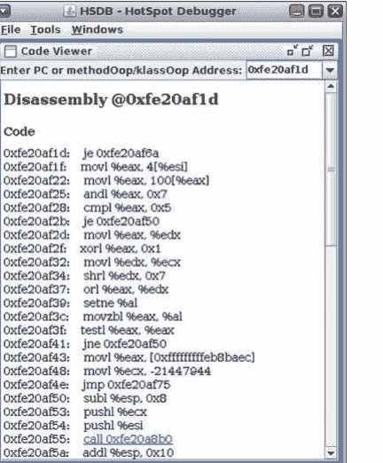

图 4.52 代码查看器 (Code Viewer)

## 使用 SA 排除故障问题

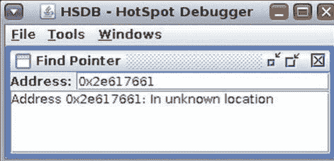

图 4.53 查找指针 (Find Pointer)


图 4.54 在堆中查找地址 (Find Address in Heap)

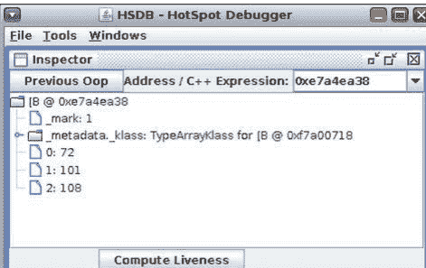

图 4.55 显示 `0xe7a4ea38` 对象的 Oop 检查器 (Oop Inspector)

使用 Find Address in Heap（在堆中查找地址）工具，我们可以找到 Java 堆中所有引用该特定地址的位置。见图 4.54。
现在，在 Object Inspector（对象检查器，见图 4.55）中检查这些找到的位置，查看这些地址是否位于某些有效对象内部。

# 142 第4章 可用性代理 (Serviceability Agent)

所有找到的地址都在 Object Inspector 中调出了 `0xe7a4ea38` 处的字节数组对象，这意味着 `0xe7a4ea38` 处的对象是这些位置之前最近的有效对象。如果我们仔细观察，这些位置实际上已经超出了字节数组对象的限制，该对象本应在 `0xe7a4eaa48` 结束，并且从地址 `0xe7a4ea48` 开始下一个对象应该已经开始了。见图 4.56 中内存位置 `0xe7a4ea38` 的原始内容。

我们可以在 `dbx` 调试器中将原始位视为字符（所示）。这清楚地显示 `0xe7a4ea38` 处的对象字节流超过了其三个元素的大小限制，并覆盖了从 `0xe7a4ea48` 开始的对象。

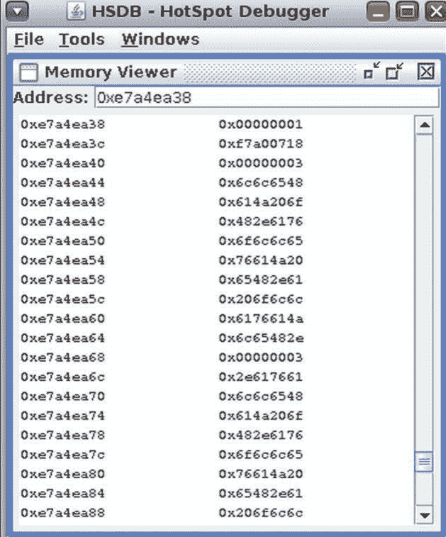

图 4.56 内存查看器 (Memory Viewer)

## 使用 SA 排除故障问题

```
(dbx) x 0xe7a4ea38/100c
0xe7a4ea38: '\u0001' '\0' '\0' '\030' '\u007' ╦ ╧ '\u0003' '\0'
\u0000 '\017' 'H' '\0' '\017' 'j'
0xe7a4ea38: 'o' 'j' 'a' 'v' 'a' ' ' 'H' 'e' 'e' ' ' '\011' ' ' 'j' 'l' 'j' ' ' 'o' ' ' 'j'
'a' 'v'
0xe7a4ea58: 'a' ' ' 'H' 'e' '\011' '\0' ' ' 'j' 'a' 'v' 'a' ' ' 'H'
'e' '\011 'j'
0xe7a4ea68: '\u0003' '\0' '\0' '\0' 'a' 'v' 'a' ' ' '.' 'H' 'e' '\011' 'j' ' ' 'o'
'j' 'a'
0xe7a4ea78: 'v' 'a' ' ' 'H' 'e' '\017' '\0' 'o' '\j' 'a' 'v' 'a' ' ' 'H'
'e'
0xe7a4ea88: 'j' '\011' '\0' 'a' 'v' 'a' ' ' 'H' 'e' '\011' 'j'
0xe7a4ea98: 'a' 'v' 'a' ' ' '.'
```

这是一个巨大的线索。现在，我们可以轻松地在代码中搜索字节 "Hello Java.." 是被写入的，以及导致数组溢出的代码 Bug 部分。该数组在 JNI 中遵循以下几行：

```
jclass cls = env->GetObjectClass(obj);
jfieldID fID = env->GetFieldID(cls, "array", "");
jbyteArray arrayObject = (jbyteArray)env->GetObjectField(obj, fID);
jbyte* array = (jbyte*)env->GetPrimitiveArrayCritical(arrayObject, 0);
memcpy(array, "Hello Java.", 100);
env->ReleasePrimitiveArrayCritical(arrayObject, array, 0);
```


上面的 `memcpy` 行是罪魁祸首，它正在写入超出大小限制的数组。嗯……这不很有趣吗？使用 SA 工具调试崩溃！

# 附录

## 感兴趣的额外 HotSpot VM 命令行选项

本附录列出了对于 G1 GC 的使用或调优可能感兴趣的 HotSpot VM 命令行选项。它还包含了一些未包含或未记录的命令行选项。对于列出的每个命令行选项，都有关于该选项作用的描述，以及在何时适当考虑使用它。使用命令行选项的通用建议是，首先应该有一个使用该选项的理由，而不仅仅是因为别人用过它，或者在某篇博客文章中看到有人使用了它。您应该在使用命令行选项运行 Java 应用程序时收集性能数据，作为支持使用该选项的依据。

HotSpot VM 命令行选项有两种形式。首先，有些是本质上是布尔值的命令行选项，通过在命令行名称前加上 "+" 或 "-" 字符来开启或关闭，例如 `-XX:+PrintSizePolicy`，它使用了 "+" 字符来启用 `PrintSizePolicy`。同样，`-XX:-PrintSizePolicy` 则关闭该选项。

第二种形式的 HotSpot VM 命令行选项接受数值或一组特定的关键字。本附录不包含任何后者的命令行选项。接受数值的前者形式不使用 "+" 或 "-" 字符。例如，`-XX:ConcGCThreads=6` 是一个期望数值的命令行选项。

本文中提及的给定 HotSpot VM 选项的默认值基于 JDK 8 的默认值。因此，在某些情况下，选项的默认值可能与本文所述的不符。默认值的更改通常是因为有关该选项的其他信息。

### `-XX:+UseG1GC`

启用 G1 垃圾器。要在 Java 7 和 Java 8 中使用 G1，必须通过此命令行选项显式启用。截至本文编写，计划在 Java 9 中引入 G1，尽管可能会回归 Parallel GC。

### `-XX:ConcGCThreads`

设置 GC 在与 Java 应用程序并发运行时使用的线程数。默认情况下，这大约是停止 Java 线程执行 GC 时线程数的四分之一。`-XX:ConcGCThreads` 可以减少 GC 线程与 Java 资源的竞争，从而提高性能。并发线程过少可能会导致并发周期回收内存的速度不够。

### `-XX:G1HeapRegionSize`

设置 G1 堆区域的大小。默认情况下这约为堆大小的 1/2000。可能的区域大小有 1M、2M、4M、8M、16M 和 32M。

大于区域大小的对象需要 G1 特别管理。增加区域大小允许大对象通过普通分配路径分配，如果此类大对象很常见，可能会提高性能。然而，较大的区域意味着 G1 在进行工程学决策时（例如决定分代的大小）的灵活性会降低。

### `-XX:G1HeapWastePercent`

控制 G1 不回收的允许空闲内存量。此值的默认值为 5%。

G1 将收集所有区域，直到任何区域释放的内存都少于 `-XX:G1HeapWastePercent` 为止。特别是在大堆上，使用较低的值可能是有意义的。

对于 `-XX:G1HeapWastePercent`，因为堆大小的 5% 已经代表了相当大量的内存。

### `-XX:G1MixedGCCountTarget`

设置在并发周期后应执行的多次混合 GC（mixed GCs）的目标值。默认值为 8。
老年代区域（Old regions）的收集时间通常比年轻代区域长。在并发周期后允许进行更多的混合 GC，可以让 G1 将老年代区域的回收分散到更多的收集中。增加 `-XX:G1MixedGCCountTarget` 意味着启动新的并发周期将需要更长的时间。如果不使用 GC 停顿时间，增加 `-XX:G1MixedGCCountTarget` 可能有所帮助。

### `-XX:+G1PrintLivenessInfo`

这是一个诊断性 VM 选项，需要配合 `-XX:+UnlockDiagnosticVMOptions` 启用。启用后，它将打印堆上每个区域的生存性信息（liveness information）。该信息包括使用情况、记忆集（remembered set）的大小以及“GC 效率”（后者是衡量收集该区域的价值的指标）。这些信息会在标记周期完成后，以及在区域排序以包含在收集集（collection set）中之后记录。
`-XX:+G1PrintLivenessInfo` 记录的信息在尝试理解堆使用和识别记忆集问题时非常有用。由于它为堆中的每个区域记录一行，对于大型堆来说这可能难以管理。

### `-XX:G1ReservePercent`

为了减少晋失败（promotion failure）的风险，G1 会预留部分内存用于晋。这部分内存不会用于年轻代。默认情况下，G1 预留 10% 的堆用于此目的。
在具有存活集合的大堆上，预留 10% 的堆可能过多。减少此值可以为年轻代留下更多内存并延长 GC 之间的时间，这通常会提高吞吐量性能。

### `-XX:+G1SummarizeRStats`

这是一个诊断性 VM 选项，需要配合 `-XX:+UnlockDiagnosticVMOptions` 启用。启用后，会在 VM 退出时打印记忆集的详细摘要。结合 `-XX:G1SummarizeRSetPeriod` 使用时，该摘要可以定期打印，而不仅仅是在 VM 退出时打印。
如果怀疑存在记忆集问题，这是一个分析这些问题的有用工具。

### `-XX:+G1SummarizeRSetStatsPeriod`

这是一个诊断选项，需要配合 `-XX:+UnlockDiagnosticVMOptions` 启用。它只能与 `-XX:+G1SummarizeRSetStats` 配合使用。如果设置为 0 以外的值，它将打印与 `-XX:+G1SummarizeRSetStats` 相同的摘要。但它不是在 VM 退出时打印，而是在每次发生 `-XX:+G1SummarizeRSetStatsPeriod` 指定的 GC 之后打印。

为每次 GC 打印此信息可能是昂贵的，但定期打印使得识别记忆集管理中存在哪些问题成为可能。

### `-XX:+G1TraceConcRefinement`

这是一个诊断选项，需要配合 `-XX:+UnlockDiagnosticVMOptions` 启用。使用 `-XX:+G1TraceConcRefinement` 后会记录有关并发细化线程（concurrent refinement threads）的信息。

产生的信息包括并发细化线程的激活和去激活时间。它可以用于识别并发细化问题。

### `-XX:+G1UseAdaptiveConcRefinement`

启用后，该命令行选项会在每次 GC 时动态重新计算 `-XX:G1ConcRefinementGreenZone`、`-XX:G1ConcRefinementYellowZone`、`-XX:G1ConcRefinementRedZone` 的值。此标志默认启用。

### `-XX:GCTimeRatio`

设置 Java 应用程序线程花费的时间与 GC 线程花费的时间的比率。

G1 尝试遵守 `-XX:GCTimeRatio` 设置的值，以确保 Java 应用程序获得该命令行选项指定的足够执行时间。G1 通过拆分工作并终止可以拆分或终止的工作来实现这一点。G1 还尝试分散 GC 停顿以实现这一目标。`-XX:GCTimeRatio` 的默认值取决于 HotSpot VM 正在使用的垃圾回收器。当启用 G1 时，默认的 `-XX:GCTimeRatio` 为 9。

HotSpot VM 使用以下公式将 `-XX:GCTimeRatio` 的值转换为百分比：`100/(1 + GCTimeRatio)`。换句话说，`-XX:GCTimeRatio` 可以看作是要求 HotSpot VM 尝试在 GC 线程中执行的时间不超过总时间的 `100/(1+GCTimeRatio)` 百分比。在这里，在启用 G1 的情况下，默认值 `-XX:GCTimeRatio=9` 意味着可以花费高达 10% 的时间进行 GC。

需要注意的是，HotSpot VM 的吞吐量垃圾回收器 Parallel GC 为 `-XX:GCTimeRatio` 设置的默认值为 99。这意味着 HotSpot 尝试花费高达 1% 的时间进行 GC 工作。这是有意义的，因为 Parallel GC 是吞吐量型 GC，而 G1 旨在成为一种更平衡的吞吐量、延迟和内存足迹的 GC。

### `-XX:+HeapDumpBeforeGC`

当启用此命令行选项时，在全 GC 启动之前会创建一个 hprof 文件。hprof 文件创建在启动 HotSpot VM 的目录中。

通过将此命令行选项结合 `-XX:+HeapDumpFullGC` 使用，比较全量 GC 前后 Java 堆的内容，可以很好地指示内存泄漏情况。

### `-XX:+HeapDumpAfterGC`

当启用此命令行选项时，在全 GC 启动之后会立即创建一个 hprof 文件。hprof 文件创建在启动 HotSpot VM 的目录中。

通过将此命令行选项结合 `-XX:+HeapDumpFullGC` 使用，比较全量 GC 前后 Java 堆的内容，可以很好地指示内存泄漏情况。

### `-XX:InitiatingOccupancyPercent`

设置启动并发周期的值。默认值为 45。换句话说，`-XX:InitiatingOccupancyPercent` 测量老年代的占用率。如果老年代的占用率达到或超过此值，将通过初始标记（initial-mark）启动并发周期。

通常情况下，早早启动 G1 并发周期比晚启动要好。如果是因为老年代空间不足而发生 GC，降低此值将有助于提高吞吐量。然而，G1 并发周期需要 CPU，因此可能会夺取应用程序线程的 CPU。

参见 `-XX:G1HeapWastePercent`、`-XX:G1MixedIHOPPercent`、AdaptiveIHOP 以及 `-XX:+G1UseAdaptiveIHOP`。

池化字符串（Interned Strings）的处理方式与非池化字符串不同。池化字符串在插入之前会被显式去重，以防止 HotSpot VM JIT 编译器对字面量进行优化。

### `-XX:+UseStringDeduplication`

启用 Java String 的去重。此命令行选项和功能在 JDK 8u20 中引入。默认不可用。

启用后，该选项通过查看 String 的字符数组来去重。当一个 String 包含另一个 String 相同的字符序列时（例如 `string1.equals(string2)` 结果为真），String 对象将更新为共享相同的字符数组。结果是释放了重复字符数组所需的空间。需要注意的是，String 对象本身并没有被去重，而是它们的字符数组被去重了。

此功能仅通过 G1 垃圾回收器实现。虽然非 G1 收集器（Parallel GC、CMS GC 和 Serial GC）允许启用此命令行选项，但不会执行 String 去重。

如果满足以下任何一个条件，对象即被视为去重候选：

- 该对象是 `java.lang.String` 的实例。
- 从年轻代区域迁移的对象。
- 正在从年轻代/存活区区域迁移的对象，且其年龄等于去重阈值；或者正在迁移到老年代区域的对象且其年龄小于去重阈值。参见 `-XX:StringDeduplicationAgeThreshold` 获取有关去重阈值的更多信息。

### `-XX:StringDeduplicationAgeThreshold`

设置 String 对象被视为去重候选时的 String 阈值。默认值为 3。

具体来说，当 String 对象被提升到 G1 老年代区域，或其年龄高于去重阈值时，String 就会成为去重候选。一旦 String 成为去重候选或已完成去重，它将不会再次成为候选。这种方法避免了对同一个对象进行多次操作。
另请参阅 `-XX:+UseStringDeduplication` 和 `-XX:+PrintStringDeduplicationStatistics`。

### `-XX:+PrintStringDeduplicationStatistics`

启用打印字符串去重（String deduplication）统计信息。默认值为禁用。

当你想要知道启用去重是否能显著节省 Java 堆中字符串对象占用的空间时，此命令行选项非常有用。因此，启用此命令行选项可以提供数据，以证明是否有必要启用 `-XX:+UseStringDeduplication`。

另请参阅 `-XX:+UseStringDeduplication` 和 `-XX:StringDeduplicationAgeThreshold`。

### `-XX:+G1UseAdaptiveIHOP`

这是在 JDK 9 及更高版本中提供的新命令行选项。它能够根据命令行选项 `InitiatingHeapOccupancyPercent`（初始堆占用百分比）的初始值，充分调整初始堆占用阈值。其意图是让 G1 适应标记阈值的行为，通过尽早触发标记周期而不耗尽老年代空间，从而提高吞吐量。

`G1UseAdaptiveIHOP` 机制使用命令行选项 `InitiatingHeapOccupancyPercent` 的值作为标记周期的初始值，直到对应用行为有了充分的观察。随后，它会调整到一个更优的占用百分比来启动标记周期。

当 `G1UseAdaptiveIHOP` 禁用时（通过命令行选项显式指定 `-XX:-G1UseAdaptiveIHOP`），G1 将始终使用 `InitiatingHeapOccupancyPercent` 的值作为启动标记周期的占用率。`G1UseAdaptiveIHOP` 在 JDK 9 引入时默认已启用。

另请参阅 `-XX:InitiatingHeapOccupancyPercent`。

### `-XX:MaxGCPauseMillis`

此命令行选项设置以毫秒为单位的暂停目标，默认值为 200。请注意，这是一个目标，而不是 G1 永远无法超过的硬性最大时间。

G1 尝试调整新生代的大小，以确保其可以在 `-XX:MaxGCPauseMillis` 设置的目标内完成收集。在使用 G1 时，配合使用 `-Xms` 和 `-Xmx` 对 Java 堆进行调优，此命令行选项是预期会被使用的。即使从 Parallel GC 或 CMS GC 迁移到 G1，这三个命令行选项也是使用 G1 建议的起点。

### `-XX:MinHeapFreeRatio`

设置堆中允许空闲内存的值。默认值为 40。该值实际上是一个百分比，而不是比例。遗憾的是，命令行名称中包含了“ratio”（比例）一词。

Java HotSpot VM 使用 `-XX:MinHeapFreeRatio` 设置的值来帮助决定何时扩展堆。此决策是在 GC 期间做的，可以描述为：如果 Java 堆的空闲比例小于 `-XX:MinHeapFreeRatio` 百分比，G1 将尝试扩展 Java 堆以满足 `-XX:MinHeapFreeRatio` 设置的值。

显然，为了让 Java 堆扩展，必须为 `-Xms`（初始 Java 堆大小）和 `-Xmx`（最大 Java 堆大小）设置不同的值。如果 `-Xms` 和 `-Xmx` 设置为相同的值，Java HotSpot VM 将不会扩展或缩小 Java 堆。

### `-XX:MaxHeapFreeRatio`

设置堆中允许空闲内存的值。默认值为 70。与 `-XX:MinHeapFreeRatio` 类似，该值实际上是一个百分比，而不是比例。同样，与 `-XX:MinHeapFreeRatio` 类似，遗憾的是命令行名称中包含了“ratio”（比例）一词。

Java HotSpot VM 使用 `-XX:MaxHeapFreeRatio` 设置的值来决定何时缩小 Java 堆。此决策是在 GC 期间做的，可以描述为：如果 Java 堆的空闲比例大于 `-XX:MaxHeapFreeRatio` 百分比，G1 将尝试缩小 Java 堆以满足 `-XX:MaxHeapFreeRatio` 设置的值。

与 `-XX:MinHeapFreeRatio` 情况一样，为了让 Java 堆缩小，必须为 `-Xms`（初始 Java 堆大小）和 `-Xmx`（最大 Java 堆大小）设置不同的值。如果 `-Xms` 和 `-Xmx` 设置为相同的值，Java HotSpot VM 将不会扩展或缩小 Java 堆。

### `-XX:+PrintAdaptiveSizePolicy`

开启关于堆大小变化的日志记录。这些信息对于理解 G1 的人体工程启发式决策（也适用于 Parallel GC）非常有用。

在调优 G1 时使用 `-XX:+PrintAdaptiveSizePolicy` 的描述见第 3 章“垃圾优先 收集器调优”。

### `-XX:+ResizePLAB`

设置 GC 用于提升对象的线程分配缓冲区（PLAB） 应该动态调整大小，还是保持静态大小。默认值为 true。

已证明 G1 中 PLAB 的动态调整大小会导致某些性能问题。对于某些应用程序，禁用线程本地提升缓冲区的调整大小可以通过缩短 G1 GC 暂停时间来提高性能。

### `-XX:+ResizeTLAB`

设置 Java 应用线程用于 Java 对象分配的线程本地分配缓冲区（TLAB） 应该动态调整大小，还是具有静态固定大小。默认值为 true。

在大多数情况下，TLAB 调整大小通过减少分配路径上的竞争来提高性能。与 PLAB 大小调整相反，通常不会看到为了性能而关闭此选项。因此，对于几乎所有应用程序，最好启用此命令行选项（即其默认设置）。

### `-XX:+ClassUnloadingWithConcurrentMark`

在 G1 并发周期期间开启卸载。默认值为 true。

通常情况下，卸载不可达类是有益的，即 `-XX:+ClassUnloadingWithConcurrentMark`。

### `-XX:+ClassUnloading`

开启类卸载。默认值为 true。

如果禁用此选项，即 `-XX:-ClassUnloadingWithConcurrentMark`。

### `-XX:+UnlockDiagnosticVMOptions`

设置是否允许诊断选项。默认值为 false。

与 `-XX:+UnlockExperimentalVMOptions` 类似，某些命令行选项被标记为“diagnostic”。这些选项可以在 Java HotSpot 命令行选项列表中通过使用 `-XX:+PrintFlagsFinal` 查看。

### `-XX:+UnlockExperimentalVMOptions`

设置是否允许实验性选项。默认值为 false。

与 `-XX:+UnlockDiagnosticVMOptions` 类似，某些命令行选项被标记为“experimental”。这些选项可以在 Java HotSpot 命令行选项列表中通过使用 `-XX:+PrintFlagsFinal` 查看。

# 索引

## A
- 地址，查找，92
- 年龄表，19
- 老龄化，活跃对象，18, 19
- 分配巨型对象（humongous objects），路径，19, 21
- 可用区域，8

### 类 (Classes)
- 转储（dumping），106–108
- 卸载（unloading），153
- 清理阶段（Cleanup phase），G1 GC，13
- 并发标记的清理阶段，36
- CLHSDB (命令行 HotSpot 调试器)。*参见* HSDB (HotSpot 调试器)
- 命令列表，102
- 描述，100–102
- Java 对象，检查，101
- 启动，100
- VM 数据结构，检查，101

## B
- 屏障（Barriers），在 RSets 中，28–30, 35
- 布尔值命令行选项，145

## C
- 卡片（Cards），定义，25
- 块（Chunks）。*参见* Regions
- 卡片，25
- 定义，25–28
- 全局卡片表，25–28
- 类浏览器（Class browser），84–85
- 类文件，转储，84, 112
- 类实例，显示，88
- ClassDump，106–108
- CMS（并发标记清除）GC，暂停时间，5–7
- 粗粒度位图，25
- 代码根扫描，43–44
- 代码查看器（Code Viewer），95–97
- 代码查看器面板，120–122
- 集合集（CSets）。*参见* CSets (collection sets)
- 命令行标记（Command Line Flags），98, 100
- 命令行选项。参见特定选项
- 布尔值，145
- 默认值，146
- 诊断选项，启用，153–154
- 显示，98, 100
- 翻转（overturning），导致整理失败，59
- 类型，145

### 压缩（Compaction）
- CMS（并发标记清除）GC，72
- G1 GC，10, 12
- 并行 GC，2–3

### 计算反向指针（Compute Reverse Pointers），89–90
- 并发周期，G1 GC，13
- 并发垃圾回收，定义，2
- 并发标记清除 (CMS) GC，暂停时间，5–7

### 并发标记（Concurrent marking）
- 并发标记写前屏障，35
- 描述，13
- 高重标记时间，36
- 识别分配对象，30
- 下一个位图，30–33
- NTAMS (next TAMS)，30–33, 37
- 概述，33
- 前一个位图，30–33
- 写前屏障，35
- PTAMS (previous TAMS)，30–33, 37
- SATB（起始时快照），30
- SATB 写前屏障，35

### 并发标记阶段（Concurrent marking, stages of）
- 清理，36
- 并发标记，34–36
- 初始标记，34
- 重标记（remark），36
- 根区域扫描，34
- 并发标记阶段，调优，52–54
- 并发标记写前屏障，35
- 并发标记中的并发阶段，34–36
- 并发整理线程，42–43
- 日志，148
- 最大数量，29
- 目的，29
- 在 RSets 中，28–30
- 并发根区域扫描，13
- 常量池，70
- 复制到幸存区，18, 19
- 核心文件。也包括崩溃转储文件
- 挂载到 HSDB，76
- 收集，108
- 命令行标记，98, 100
- 命令行 JVM 选项，显示，98, 100
- 创建，108
- 描述，108
- 使用 SA 插件探索，118–119
- Java 线程，显示，119–120
- JFR 信息，提取，107–108
- JVM 版本，显示，98–99
- 多个调试会话，113
- 使用可用性代理（Serviceability Agent），76–77
- 永久统计，打印，103–104
- 进程映射，打印，104
- 通过 /proc 接口读取位，111
- 远程调试，78–80, 114
- 线程堆栈跟踪，显示，119–120
- 核心文件，传输
- 调试，109–110
- 共享库，109–112
- 崩溃转储文件。参见 核心文件
- 挂载 HSDB，76
- 收集，108
- 描述，108
- 使用 Windows 调试器读取位，111
- CSets (collection sets)
- 定义，9
- 每个 CSet 的最小大小，设置，57–58
- 每个 CSet 的最大阈值，58
- 每个 CSet 的最小阈值，57–58

## D
- 死锁检测（Deadlock Detection），84, 86
- 死锁，检测，84, 86
- 故障排除，131–136
- 在 Windows 上启用调试消息，112
- 调试工具。参见 JDI (Java Debug Interface); Serviceability Agent
- 去重 Java 字符串，149–151
- 脏卡队列，29–30
- DumpJFR，107–108
- 堆中的值，122–123
- Fine RSets，25

### 碎片（Fragmentation）
- CMS（并发标记清除），GC，7
- G1，10
- 最大允许，56–59
- 每个区域，控制，58
- 全量 GC (Full GCs)
- 算法，12–13
- 压缩堆，12–13
- 评估失败，37–38
- 触发，37–38

## E
- Eden 空间，11–19
- 效率，垃圾回收。参见 GC 效率
- 启发式（Ergonomics），转储，54
- 整理（Evacuation），47
- 整理失败
- 定义，16
- 持续时间，确定，39
- 日志消息，53–54
- 查看，37–38
- 空间耗尽消息，53–54
- 失败，潜在堆大小，59
- 幸存区空间不足，60
- 长巨型对象，59–60
- JVM 命令行选项，59
- 外部根区域扫描，42

## G
- GC。参见可用区域，8
- 收集周期，16–17
- 并发标记，13
- 描述，8–10
- 启用，46
- 空闲内存，设置，146–147
- 堆调整，14
- 初始标记阶段，13
- 标记活跃对象图，13
- 线程，数量，146
- 垃圾，最大允许，56–59
- 垃圾回收器。常见问题，7–8
- 第一个垃圾回收器，103
- 可最终对象，打印详情
- 堆中的地址，92–93
- 通过查询查找对象，90–91
- 指针查找，122–123
- Code Cache 中的值，92–93
- CodeCache (VisualVM) 中的值，122–123
- 垃圾回收器相关问题，92
- 识别垃圾回收候选，22–24
- GCLABs (GC本地缓冲区)，47
- 核心工具，108
- 代，24

## H
- 堆，占用阈值，自适应，151
- 堆
- 边界，显示，98–99, 101
- 转储到区域。参见 区域
- G1 当前占用率，启动，147
- 空闲内存，设置，152
- 活跃性信息，打印，147
- 区域大小，设置，146
- 大小导致整理，59
- 变化，日志，152
- G1 GC 大调整，14
- HotSpot Service。参见 可用性代理
- Hprof 文件，创建，149
- HSDB (HotSpot 调试器)。(命令行 HotSpot 调试器)
- 核心文件，挂载到，76
- 调试模式，72–80
- 进程，挂载到，74
- 打开文件，76
- 远程调试，78–80
- 巨型对象 (Humongous objects)
- 分配，19, 21
- 描述，识别，19
- 优化分配和回收，20
- 短命对象的优化收集，21
- 巨型回收（Humongous Reclaim），50
- 巨型区域 (Humongous regions)
- 连续性，21
- 描述，19–21
- 示例，20–21
- 巨型起始区域，12
- InitiatingHeapOccupancyPercent
- 标记计算的初始标记阶段，34
- 初始标记阶段，G1 GC，13
- 检查命令，101

## I
- Java 应用线程。参见 JDI
- Java 调试接口 (JDI)。参见 JDI (Java Debug Interface)
- Java 堆。参见 堆
- Java 对象。参见 巨型对象；年轻代收集暂停，活跃对象
- 检查，101
- 普通对象指针，检查，120–121
- Java 堆栈跟踪面板，119–120
- Java 字符串
- 去重，149
- 去重统计信息，151
- 去重阈值，150
- Java 线程。参见 线程
- 堆栈跟踪面板，119–120
- java.lang.OutOfMemoryError，123–130
- java.lang.OutOfMemoryError，131–136
- 调试消息，在 Windows 上启用，112
- 调试工具。参见 JDI (Java Debug Interface); Serviceability Agent
- 去重 Java 字符串，149–151
- 脏卡队列，29–30
- DumpJFR，107–108
- 堆中的值，122–123
- JavaScript 调试器，114
- JavaScript 调试器，108
- Java 版本，98–99

## N
- Nmethods, 44
- NTAMS (下一个 TAMS), 30–33, 37

## O
- 对象直方图 (Object Histogram), 87–89, 105
- 对象直方图，收集 (Object histograms, collecting), 87–89, 105
- 对象检查器 (Object Inspector), 85–87
- 老年代，存活对象 (Old generation, live objects)
  - 年龄表 (age tables), 19
  - 老龄化 (aging), 19
  - 老到老的引用 (Old-to-old references), 25
  - 老到年轻的引用 (Old-to-young references), 25
- Oop 检查器面板 (Oop Inspector panel), 120–121
- oops (普通对象指针)，检查 (oops, inspecting), 120–121
- 内存溢出问题 (Out-of-memory problems), 87–89
  - 调试 (debugging), 113
  - 使用 SA 插件探索 (exploring with the SA Plugin), 118–119
  - Java 线程，显示 (Java threads, displaying), 119–120
- JFR 信息，提取 (JFR information, extracting), 107–108
- JVM 版本，代统计数据 (JVM version, generation statistics), 98–99
- 永久代统计数据，打印 (permanent generation statistics, printing), 103–104
- 进程映射，打印 (process map, printing), 104
- 通过 /proc 接口读取位 (reading bits with the /proc interface), 111
- 通过 Windows 调试器引擎读取位 (reading bits with the Windows Debugger Engine), 111
- 远程调试 (remote debugging), 114
- 线程堆栈追踪，显示 (thread stack trace, displaying), 118–120

## P
- 并行垃圾回收 (Parallel GC)
  - 压缩 (compaction), 2–3
  - 定义 (definition), 1–2
  - 描述 (description), 2–4
  - 启用 (enabling), 2–3
  - 中断 Java 线程 (interrupting Java application threads), 4
  - Java 堆大小 (Java heap sizes), 2–4
  - 暂停时间 (pause times), 4
  - 使用 (uses), 3–4
- 晋升失败 (Promotion failure)。参见 疏散失败 (Evacuation failures)
- PRTs (每区域表，per-region-tables), 25–26
- PTAMS (前一个 TAMS), 30–33, 37
- 暂停 (Pauses)
  - 并发标记清理 (CMS) GC, 5–7
  - G1 GC, 10
  - 并行 GC (Parallel GC), 4
  - 串行 GC (Serial GC), 4
  - 目标时间，设置 (time goal, setting), 151
  - 年轻代收集 (young collection), 18–19
- .pdb 文件，设置路径 (.pdb files, setting the path to), 111
- 性能调优 (Performance tuning)，参见 调优 (Tuning)
- 永久代统计数据，打印 (Permanent generation statistics, printing), 103–104
- PermStat, 103–104
- 每区域表 (PRTs), 25–26
- PLABS, 18, 21, 152–153
- PMap, 104
- 事后分析 (Postmortem analysis)
  - 核心文件 (core files), 136–143
  - Java HotSpot VM 崩溃 (Java HotSpot VM crashes), 136–143

## R
- 原始内存内容，显示 (Raw memory contents, displaying), 94
- 通过 /proc 接口读取位 (Reading bits with the /proc interface), 111
- 可回收百分阈值，混合收集阶段 (Reclaimable percentage threshold, mixed collection phase), 55–69
- 回收区域 (Reclaiming regions), 13
- 回收 (Reclamation), 47
- 引用对象类型 (Reference object types), 60
- 引用路径，收集 (Reference paths, collecting), 89–90
- 引用处理 (Reference processing)
  - 启用多线程引用处理 (enabling multithreaded reference processing), 62
  - 修正过度弱引用 (excessive weak references, correcting), 63
  - 观察 (observing), 60
  - 开销 (overhead), 36
  - 概述 (overview), 60
- 引用对象类型 (reference object types), 60
- 软引用 (soft references), 63–65

## S
- 区域大小 (Region size)
  - 自适应选择，覆盖 (adaptive selection, overwriting), 18
  - 平均 (average), 10
  - 计算 (calculating), 10
  - 确定 (determining), 18
  - 设置 (setting), 14
- 定义 (definition), 11, 25
  - 密度 (density), 25
  - 细粒 (fine), 25
  - 每个区域的数量 (number per region), 25
- 写前屏障 (pre-write barriers), 35
- 打印摘要 (printing a summary of), 147–148
- 已处理缓冲区 (processed buffers), 42–44
- SATB 写前屏障 (SATB pre-write barriers), 35
- 大小 (size), 11
- 稀疏 (sparse), 25
- 区域 (Regions)。另见 块 (Chunks); CSets (收集集，collection sets); RSets (记忆集，referenced sets)
  - 可用的 (available), 8
  - 候选的，识别 (candidates, identifying)。*参见 GC*
  - 效率 (efficiency)
    - 并发根区域扫描 (concurrent root region scanning), 13
    - 深入堆栈 (diving heaps), 8–10
    - Eden 空间 (eden space), 11, 18–19
    - GC 效率 (GC efficiency), 17
    - 巨型 (humongous), 11
    - 最大数量 (maximum number of), 10–11
    - 混合 GC (mixed GC), 8
    - 将老年代与年轻代收集混合 (mixing old generation with young collections), 8
    - 回收 (reclaiming), 13
    - 区域大小 (region size), 10
    - 根，定义 (root, definition), 34
    - 排序 (sorting)。参见 GC 效率
  - 存活空间容量 (survivor capacity), 19
  - 存活空间 (survivor space), 11, 18–19
  - 可视化潜在改进 (visualizing potential improvements), 47
- 写屏障 (write barriers), 28–30
- RSets (记忆集，referenced sets)
  - 老到老的引用 (old-to-old references), 25
  - 老到年轻的引用 (old-to-young references), 25
  - 视图 (view), 24–28
- PRTs (每区域表，per-region-tables), 25–26

## S (续)
- SA_ALTROOT 环境变量 (SA_ALTROOT environment variable)
  - 描述 (description), 112
  - 设置 (setting), 110
- SA_IGNORE_ABI 环境变量 (SA_IGNORE_ABI environment variable), 112
- 并发标记的 Remark (Remark of concurrent marking), 36
- Remark 时间 (Remark times, for), 36
- G1 GC 重新阶段 (Remaking phase, G1 GC), 13
- 记忆集 (Remembered sets (RSets))。*参见 RSets*
- 远程调试 (Remote debugging), 78–80, 114
- 调整大小，年轻代 (Resizing, young generation), 18
- RMI (远程方法调用，Remote Invocation), 114
- 根对象 (Root objects, definition), 34
- 根引用，收集 (Root references, collecting), 13
- 并发标记的根区域扫描 (Root region scanning of concurrent marking), 34
- satdi.jar, 61
- SATB (开始时的快照，snapshot-at-the-beginning), 30
- SATB 写前屏障 (SATB pre-write barriers), 35
- sawbg.dll, 69
- 方法 (Scanning methods), 44
- 串行 GC (Serial GC)。*参见* 并行 GC (Parallel GC)
  - 定义 (definition), 4
  - 描述 (description), 5
  - 中断 Java 线程 (interrupting Java threads), 5
  - 暂停时间 (pause times), 4
- RSets (记忆集，referenced sets)
  - 屏障 (barriers), 28–30
  - 稀疏 (coarse), 25
  - 粗粒度位图 (coarse-grained bitmap), 25
  - 代码根扫描 (code root scanning), 43–44
  - 并发写前屏障 (concurrent pre-write barriers), 35
  - 并发精炼线程 (concurrent refinement threads), 28–30
- 可用性代理 (Serviceability Agent)
  - JDK 中的 bin (bin in the JDK), 69–70
  - 组件 (components), 69
  - 描述 (description), 68
  - Windows 上的调试信息打印 (enabling print of debug messages on Windows), 112
  - 环境变量 (environment variables), 112
  - HotSpot 数据结构 (HotSpot data structures), 70–71
  - 目的 (purpose of), 68
  - 系统属性 (system properties), 111–112
  - 版本匹配 (version matching), 71
  - 可用性代理，调试 (Serviceability Agent, debugging)。*参见* CLHS (命令行 HotSpot 调试器，Command-Line HotSpot Debugger); HSDB (HotSpot 调试器)
  - ClassDump, 106–108
  - 扩展 (extending), 115–117
  - 可最终对象的详情 (finalizable objects, of), 103
  - FinalizerInfo, 103
  - 堆，转储 (heap, dumping), 103
  - 堆转储器 (HeapDumper), 103
  - 可用性代理的 Javascript 接口 (Javascript interface to Serviceability Agent), 108
  - JFR 信息，提取 (JFR information, extracting), 107–108
  - JSDB (JavaScript 调试器，JavaScript Debugger), 108
  - 加载类，调试 (loaded classes, debugging), 106–108
- 对象直方图 (Object Histogram), 105
- 对象直方图，收集 (object histograms, collecting), 105
- 永久代统计数据，打印 (permanent generation statistics, printing), 103–104
- PermStat, 103–104
- Map, 104
- 进程映射，打印 (process maps, printing), 104
- SOQL (结构对象查询语言，Structured Object Query Language), 106
- SOQL 查询，执行 (SOQL queries, executing), 106
- 可用性代理，VisualVM 查看插件 (Serviceability Agent, plugin for VisualVM viewer), 120–122
- 查找 (Find find), 122–123
- 指针查找 (Find pointer), 122–123
- 代码Cache 工具查找值 (Find Value in CodeCache utility), 122–123
- 堆工具查找值 (Find Value in Heap utility), 122–123
- Java 栈追踪面板 (Java Stack Trace panel), 119–120
- Java 线程 (Java threads), 119–121
- Oop 检查器面板 (Oop Inspector panel), 120–121
- 普通对象指针，检查 (ordinary object pointers, inspecting), 120–121
- 使用 (using), 118–119
- 工具 (utilities), 119–123
- 可用性代理，问题排查 (Serviceability Agent, troubleshooting problems)
  - Java 级死锁 (Java-level deadlocks), 131–136
  - OutOfMemoryError, 123–130
  - 核心文件的事后分析 (postmortem analysis of core files), 136–143
  - HotSpot JVM 崩溃的事后分析 (postmortem analysis of HotSpot JVM crashes), 136–143
  - 传输文件的共享库问题 (Shared library problems with transported core files), 109–110
- 调试快照 (Snapshot-at-the-debugging (SATB)), 30
- 软引用 (Soft references), 63–65
- SOQL (结构对象查询语言，Structured Object Query Language), 106
- SOQL 查询，执行 (SOQL queries, executing), 106
- 稀疏 RSets (Sparse RSets), 25
- 全停世界垃圾回收 (Stop-the-world garbage collection), 2–4
- TAMS (标记开始时的，top-at-mark-starts), 30–33
- 晋升阈值，存活对象 (Tenuring threshold, live objects), 18, 19
- 终止 (Termination), 47–48
- 线程计数，增加 (Thread count, increasing), 54
- 线程堆栈追踪，显示 (Thread stack trace, displaying), 118–120
- CMS (并发标记清理，Concurrent Mark Sweep) GC
  - GC, 5–7
  - 显示 (displaying), 78–84, 119–120
  - 设置 (setting of), 151
  - 时间比例 (time ratio), 148–149
- 并行 GC (Parallel GC)
  - GC, 4
  - 显示 (displaying), 119–120
  - 设置 (setting of), 151
  - 时间比例 (time ratio), 148–149
- 串行 GC (Serial GC)
  - GC, 4
  - 显示 (displaying), 119–120
  - 中断 Java 线程 (interrupting Java threads), 5
  - 暂停时间 (pause times), 4
- 区域大小 (Region size)
  - 自适应选择，覆盖 (adaptive selection, overwriting), 18
  - 平均 (average), 10
  - 计算 (calculating), 10
  - 确定 (determining), 18
  - 设置 (setting), 14
- 定义 (definition), 11, 25
  - 密度 (density), 25
  - 细粒 (fine), 25
  - 每个区域的数量 (number per region), 25
- 写前屏障 (pre-write barriers), 35
- 打印摘要 (printing a summary of), 147–148
- 已处理缓冲区 (processed buffers), 42–44
- SATB 写前屏障 (SATB pre-write barriers), 35
- 大小 (size), 11
- 稀疏 (sparse), 25
- 区域 (Regions)。另见 块 (Chunks); CSets (收集集，collection sets); RSets (记忆集，referenced sets)
  - 可用的 (available), 8
  - 候选的，识别 (candidates, identifying)。*参见 GC*
  - 效率 (efficiency)
    - 并发根区域扫描 (concurrent root region scanning), 13
    - 深入堆栈 (diving heaps), 8–10
    - Eden 空间 (eden space), 11, 18–19
    - GC 效率 (GC efficiency), 17
    - 巨型 (humongous), 11
    - 最大数量 (maximum number of), 10–11
    - 混合 GC (mixed GC), 8
    - 将老年代与年轻代收集混合 (mixing old generation with young collections), 8
    - 回收 (reclaiming), 13
    - 区域大小 (region size), 10
    - 根，定义 (root, definition), 34
    - 排序 (sorting)。参见 GC 效率
  - 存活空间容量 (survivor capacity), 19
  - 存活空间 (survivor space), 11, 18–19
  - 可视化潜在改进 (visualizing potential improvements), 47
- 写屏障 (write barriers), 28–30
- RSets (记忆集，referenced sets)
  - 老到老的引用 (old-to-old references), 25
  - 老到年轻的引用 (old-to-young references), 25
  - 视图 (view), 24–28
- PRTs (每区域表，per-region-tables), 25–26

## Y
- 年轻代收集停顿
  - 描述，18–19
  - Eden 区 (eden regions)，18–19
  - 幸存区 (survivor regions), 18–19
  - 触发，18
- 年轻代收集停顿，存活对象
  - 年龄，18
  - 复制到幸存区，18
  - 识别，22–24
  - 用于计算的活动区域 (liveactor region)，22–24
  - 幸存区填充容量，19
  - 晋升 (tenuring)，18, 19
  - 晋升阈值 (tenuring threshold)，18
- 年轻代收集
  - 并发标记阶段，调优，52–54
  - 迁移失败，日志消息，增加线程数，54
  - 标记阈值，设置，54
  - 阶段，39。另请参见特定阶段
- 年轻代收集，并行阶段
  - GC 之外的活动，48
  - 代码根扫描，43
  - 代码示例，39–40
  - 并发清理线程，42–43
  - 定义，39
  - 迁移，47
  - 扩展根区域扫描，42
  - 负载均衡，47–48
  - 已处理缓冲区，42–44
  - 回收，47
  - RSets 以及已处理缓冲区，42–44
  - RSets，统计摘要，44–47
  - 扫描方法，44
  - 并行活动开始，41
  - 总结并行活动，48
  - 终止，47–48
  - 定时活动中的差异，42
  - 任务窃取 (work stealing)，47–48
  - 最大增长限制，设置，50–52
  - 停顿时间目标，设置，50–52
- 年轻代收集，串行阶段
  - 活动，48–50
  - 定义，39
  - 调整大小，18
  - 大计算，17–18
  - 调优，50–52
- 年轻代
  - 描述，17–18
  - 初始代大小，设置，50–52

Yuasa, Taiichi, 30

在 informit.com/register 注册您的产品获取额外权益并在下次购买时享受 65% 折扣

- 下载可用的产品更新。
- 在适用时获取奖金。
- 接收新版本和相关产品的独家优惠。（在设置账户时勾选该框即可接收我们的消息）。
- 获取下次购买的 65% 优惠券，有效期 30 天。您的代码将出现在您的 InformIT 购物车中。（您也可以在账户页面的“管理代码”部分找到它。）

注册权益因产品而异。权益将在您的账户页面的“注册产品”下列出。

InformIT.com—信赖的技术学习源
InformIT 是全球领先的教育公司 Pearson 旗下信息技术品牌的在线家园。在 InformIT.com，您可以：

- 购买我们的书籍、电子书、软件、视频培训。
- 利用我们的特别优惠和促销活动 (informit.com/promotions)。
- 订阅特别优惠和内容通讯 (informit.com/newsletters)。
- 阅读信息技术专家编写免费文章和博客。
- 访问数千个免费图表和视频课程。

与 InformIT 连接——访问 informit.com/community
了解 InformIT 社区活动和计划。


informit.com
信赖的技术学习源
