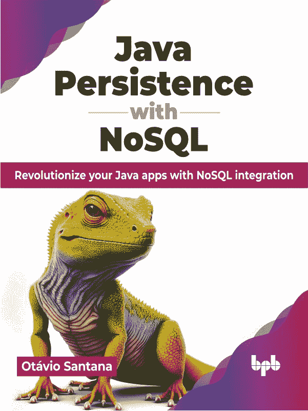

# NoSQL Java 持久化：通过 NoSQL 集成革新你的 Java 应用

献给亲爱的妻子 Poliana

## 关于作者

Otávio Santana 是一位资深软件架构师和工程师，对云和 Java 技术充满热情。在多语言持久化和高性能应用领域，Otávio 对 Java 及其开源社区做出了巨大贡献。作为 Java Champion 和 Oracle ACE 成员，Otávio 在塑造 Java 8 平台及其目标方面发挥了关键作用。Otávio 还是多个开源项目的活跃提交者和领导。他的专业知识涵盖金融、社交媒体和电子商务等领域，他在这些领域应用了先进的技术来交付可扩展且高效的软件。他精通多种语言，包括葡萄牙语、英语、意大利语和法语。通过《Java Persistence with NoSQL》一书，Otávio Santana 分享了他丰富的知识和经验，帮助读者掌握 NoSQL 数据库的世界并掌握多语言持久化的艺术。

## 关于评审员

Aaron Ploetz 自 1997 年以来一直是一名专业的软件开发者，拥有领导初创公司和 DevOps 团队的成功经验。他曾被任命为 Apache Cassandra MVP，并在多次会议上发表演讲。Aaron 经常解答 StackOverflow 上的问题，并编写过本书。他在威斯康星大学怀特沃特分校获得计算机系统管理学士学位，在雷吉斯大学获得软件工程硕士学位。在不编写或编码代码时，Aaron 喜欢钓鱼和玩游戏。

## 致谢

我想由衷感谢我的妻子 Poliana Santana，她在整个旅程中给予了我不懈的支持和鼓励。感谢 Java 社区的无私贡献和协作精神。你们对技术的激情每天激励着我。最后，感谢我的家人，你们的支持对我来说意味着一切。

## 前言

掌握 NoSQL 数据库的重要性在不断演变的 Java 架构中不言而喻。《Java Persistence with NoSQL》是导航 `Jakarta EE` 和 MicroProfile 中复杂的 NoSQL 数据库世界的全面指南，旨在帮助高级工程师、架构师和 Java 开发者设计并实现优化性能、扩展性和灵活性的高级数据存储解决方案。我们的旅程将带我们探索 NoSQL 数据库，包括 `MongoDB`、`Cassandra`、`Neo4J`、`Redis` 等，并学习如何利用这些数据库的独特功能。在书中，我们将深入研究 `Jakarta` 规范，确保你跟上不断发展的 Java 生态系统。在本书结束时，你将获得最佳实践、真实案例和实操练习的见解，使你能够自信地应对复杂的企业级挑战，确保安全性、高可用性和容错性。我很兴奋能与你一起开启这段旅程，解锁多语言持久化的潜力，并彻底改变你构建和管理 Java 应用的方式。
