# NoSQL Java 持久化：革新你的 Java 应用...2024

## 献给

我亲爱的妻子：

Poliana Santana

# 关于作者

Otávio Santana 是一位资深的软件架构师和工程师，热衷云技术和 Java 技术。Otavio 专注于多语言持久化（polyglot persistence）和高性能应用，对 Java 社区和开源社区做出了巨大贡献。

作为 Java 冠军和 Oracle ACE 计划成员，Otavio 因其对 Java 平台和开源项目的杰出贡献而获得认可。作为 JCP 执行委员会成员，自 Java 8 以来，他在塑造 Java 平台方向和目标方面发挥了关键作用。

Otavio 还是多个开源产品和规范的活跃提交者和负责人。他的专业知识涵盖金融、社交媒体和电子商务等多个领域，在这些领域应用了复杂的技术在云端交付了高扩展且高效的软件。

除了技术追求外，Otavio 还是历史、经济和旅行的热爱爱好者。他精通多种语言，包括葡萄牙语、英语、西班牙语、意大利语和法语，经常为父亲的笑话增添幽默。

在《NoSQL 的 Java 持久化》中，Otávio Santana 分享丰富的知识和经验，帮助读者应对 NoSQL 数据库的复杂世界，并掌握企业 Java 架构中多语言持久化的艺术。

# 关于评审员

Aaron Ploetz 自 1997 年起担任专业软件开发人员，拥有领导初创公司和财富 50 强企业 DBA 及 DevOps 团队的成功经验。他曾三次被 own Apache Cassandra 的 DataStax MVP，并在多次会议上演讲。Aaron 经常在 StackOverflow 上回答其他开发者的问题。他还编写过几本书。他拥有威斯康星大学怀特沃分校的管理/计算机系统学士学位，以及雷吉斯大学的软件工程硕士（侧重数据库技术）。在不写书或编写代码时，Aaron 喜欢钓鱼、玩复古视频游戏和滑雪马术。Aaron 与妻子和孩子一起住在双城地区。

# 致谢

我想衷心感谢我的妻子 Poliana Santana，感谢她在这段旅程中给予我无私的支持和鼓励。她对我的信任是我不断的动力源泉。

我也感谢 Java 社区提供的宝贵贡献和协作精神。你们对技术的热情每天激励着我。

最后，我要感谢家人的爱与理解，这让我能够全心投入这个项目。你们的支持对我来说意义非凡。

# 前言

在不断变化的企业 Java 架构和数据管理格局中，掌握 NoSQL 数据库的重要性无论如何强调都不为过。当组织应对现代数据密集型应用的需求时，利用 NoSQL 数据库的力量成为实现成功的关键差异因素。

本书《Java 持久化》是你导航 Jakarta EE 和 MicroProfile 框架内复杂的 NoSQL 数据库世界的全面指南。它旨在授权高级工程师、Java 开发者和爱好者，为他们的 Java 应用设计并实现先进的数据存储解决方案，以优化性能、扩展性和灵活性。

我们的旅程将带我们了解许多 NoSQL 数据库，包括 `MongoDB`、`Cassandra`、`Neo4J`、`Redis` 等。通过关注多语言持久化，我们将探索这些数据库的优势，并学习如何利用它们的独特能力。在整书中，我们深入研究最新的 Jakarta 规范，确保你跟上不断演变的 Java 生态系统。

读完本书后，你将获得对最佳实践、真实案例和实践练习的见解，使你能够自信地应对复杂的企业挑战。你将能够使用 NoSQL 数据库构建并实现企业级解决方案，确保安全性、高可用性和容错性。

我非常期待与你一起开启这段旅程，解锁多语言持久化的潜力，并彻底变革你在 Java 应用中构建和管理数据的方式。无论你是资深的 Java 开发者还是有抱负的架构师，这本书将让你自信地拥抱 NoSQL 数据库世界，并增强你的企业架构。

# 第1章：NoSQL 数据库简介

本章介绍了 NoSQL 数据库，解释了它们的基本概念、特征以及与传统 SQL 数据库相比的优势。它探索了各种 NoSQL 数据库，例如键值型、宽列型、文档型、图型和时间序列数据库，并为理解它们在现代 Java 架构中的作用奠定了基础。

# 第2章：NoSQL 数据库：对比分析

在第一章基础的基础上，本章对不同的 NoSQL 数据库进行了全面的对比分析。它深入探讨了建模考虑因素、灵活性、扩展性权衡以及数据库复制策略。读者将学习不同的 NoSQL 数据库在 Java 应用中是如何被建模和使用的。

# 第3章：生产环境中运行 NoSQL：最佳实践与考虑

本章侧重于生产环境中部署和管理 NoSQL 数据库。它讨论了数据库管理工具、重构、备份和灾备恢复以及云服务。本章提供了实践指导，以确保 NoSQL 部署的稳定性和扩展性。

# 第4章：通过框架简化 Java 应用集成

本章探索集成 Java 应用的框架，涉及企业 Java 应用中的层、架构以及数据库设计中的模式等主题。它帮助读者理解框架如何减少模板代码并提高 Java 开发的效率。

# 第5章：Java 持久化设计模式

本章深入研究 Java 持久化设计模式，包括仓库模式（`Repository`）、工作单元（`Unit of Work`）和数据访问对象（`DAO`）。它解释了这些模式如何为高效的数据访问提供抽象和模块化，重点关注 `Hibernate` 等对象关系映射（ORM）框架。

# 第6章：Java 架构与持久层

本章探索了 Java 架构与持久层之间的相互作用，涵盖了单体和微服务架构、事件驱动设计以及各种架构风格。它还讨论了 NoSQL 数据库在现代数据管理策略中的作用。

# 第7章：Jakarta EE 和 MicroProfile 简介

本章介绍了 Jakarta EE 和 MicroProfile，强调了它们在构建企业 Java 应用中的意义。它涵盖了 Jakarta EE 的架构格局、规范，以及 MicroProfile 如何辅助微服务开发。

# 第8章：使用 Jakarta Bean Validation 的高级验证技术

本章侧重于使用 Jakarta Bean Validation 在 Java 应用中实施数据约束。它解释了自定义验证约束、验证组、跨字段验证，并为维护数据完整性提供了实际示例。

# 第9章：使用 CDI 增强面向对象编程

探索上下文与依赖注入（CDI）。本章提升了读者的面向对象编程（OOP）能力。它涵盖了依赖注入及其形式、事件处理和拦截器。重点强调了 CDI 在提高代码模块化方面的作用。

# 第10章：使用 JAX-RS 实现 REST

本章探索了如何使用 JAX-RS 实现 RESTful Web 服务。它涵盖了核心功能、资源定义、HTTP 请求与响应处理、内容协商、错误处理以及 RESTful API 中的安全性。

# 第11章：Jakarta EE NoSQL 与数据简介

本章介绍了 NoSQL 及其在企业级 Java 应用程序中的作用，探索了 NoSQL 数据库的基础知识、优势以及 Jakarta NoSQL 的组件。它帮助读者理解如何在 Jakarta EE 应用程序中使用 NoSQL 数据库。

# 第12章：Redis 集成

本章将内存数据存储器 Redis 集成到 Java 应用程序中。它涵盖了 Redis 特性、Java 客户端库以及使用 Redis 进行缓存和数据管理的最佳实践。

# 第13章：Cassandra 集成

本章探索了 Cassandra 的集成，讨论了 Cassandra 的列族数据模型、Java 驱动以及数据建模和一致性级别等高级主题。它帮助读者利用 Cassandra 的可扩展性和容错性。

# 第14章：MongoDB 集成

本章涵盖了流行的面向文档 NoSQL 数据库 MongoDB 与 Java 应用程序的无缝集成。主题包括 MongoDB 的数据模型、Java 驱动程序、数据建模和查询优化。

# 第15章：Neo4J 集成

本章探索了图数据库 Neo4j，讨论了其基本概念、Java 驱动和高级建模技术。它帮助读者利用 Neo4j 处理数据中复杂的关系。

# 第16章：ArangoDB 与 Couchbase 集成

本章探索了多模型 NoSQL 数据库 ArangoDB 和 Couchbase 与 Java 应用程序的集成。主题包括它们的特性、Java 驱动以及最佳的数据建模和利用实践。

# 第17章：最后考量

在最后一章中，书中回顾了全文涵盖的关键概念和技术。它强调了异构持久化（polyglot persistence）的重要性，讨论了 Jakarta EE 和 MicroProfile 的角色，并对 NoSQL 数据库和 Java 应用程序中的数据迁移、备份、数据治理和安全性提供了见解。

---

## 如果您对成为作者感兴趣

如果您在某个领域拥有专业知识并对编写或贡献书籍感兴趣，请访问。我们已经与数千名像您这样的开发者和技术专业人士合作过，帮助他们与全球技术社区分享见解。您可以进行通用申请、申请我们正在招募作者的特定热点，或提交自己的想法。

## 请留下评论

在您阅读并使用这本书后，为什么不在购买的网站上留个评论呢？潜在的读者就可以看到并利用您的意见来做出购买决策。我们 BPB 可以了解您对我们产品的看法，我们的作者也可以看到您对书的反馈。谢谢！

## 欲了解更多关于 BPB 的信息，请访问

---

# 第3章：生产环境中运行 NoSQL：最佳实践与考虑

# 第5章：Java 持久化设计模式

# 第7章：Jakarta EE 与 MicroProfile 简介

---

## 结构

## 需求

## 结论

# 第9章：使用 CDI 增强面向对象编程

## 引言

## 目标

## 需求

## Redis 的 Java 集合

## Redis 的排序集与计数器

## Redis 与安全

## 多项选择

## 目标

## 探索用户定义类型

## 答案

## 需求

## 导航分页

## 结构

## 需求

## Neo4J 建模

## Neo4J 与安全

# 第17章：最终考量

## 目标

## 记忆要点

## 答案

- 拥抱 NoSQL 革命
- 释放文档数据库的力量
- 解析时序数据库

---

请参考下表，以掌握数据存储负担能力的惊人进展。它记录了从计算机早期到现在每兆字节数据存储的成本，凸显了数十年来价格的剧烈下降。这种演变在重塑我们感知和管理数据方面发挥了关键作用，推动了先进数据库技术的发展以及对数据驱动创新新领域的探索。请参考表格

| | |
|---|---|
| | |
| | |
| | |

当我们回顾数据的历史历程，从古代的洞穴岩画到如今的数字数据爆炸，一个引人注目的叙事从人类对利用、保护和处理信息的不懈追求中脱颖而出。这一叙事以技术的变革性力量和数据访问的逐渐民主化为特征，为我们探索的下一个章节奠定了基础。在接下来的章节中，我们将深入探讨 NoSQL 数据库，这是对数据驱动的世界不断演变的需求的创新响应。基于我们所揭示的历史背景，这一探索将揭示 NoSQL 数据库带来的原理和可能性，推动我们迈向现代数据管理的动态格局。

## 拥抱 NoSQL 革命

在数据为王的世界里，NoSQL 数据库的出现代表了一种变革性的范式转移，挑战了传统的以 SQL 为主的格局。虽然 SQL 数据库长期以来一直是结构化数据的可靠骨干，但 NoSQL 数据库的崛起并不意味着 SQL 的终结；相反，它承认了现代软件架构日益变化的复杂性以及数据管理的多样化需求。

NoSQL 数据库诞生于应对新挑战的必要性，提供了超越关系表限制的各种数据模型和结构。从非结构化数据到动态扩展，NoSQL 数据库提供了定制化的解决方案，使企业能够在面对不断变化的数据需求时蓬勃发展。这种多样性反映了一种共识：单一的方法无法满足各种现代数据挑战。

在数据管理中，ACID 基础原则长期以来指导着传统 SQL 数据库的可靠性。ACID 强制严格的数据完整性，但有时会阻碍扩展性和性能。相比之下，NoSQL 数据库采用的 BASE 方法将高可用性和响应速度置于绝对一致性之上。

现代软件系统的复杂性，特别是跨多个节点的分布式系统，导致了 CAP 定理的形成：一致性（Consistency）、可用性（Availability）、分区容错（Partition tolerance）。该定理假设在分布式系统中无法同时实现这三者。该定理强调了数据管理固有的权衡，迫使架构师根据特定的应用程序需求优先考虑某些属性。

当我们开启 NoSQL 数据库的之旅时，我们并没有见证 SQL 的衰落；相反，我们看到的是丰富的数据库解决方案织锦，每种方案都满足现代软件架构的不同需求。接下来的章节将深入探讨不同类型的 NoSQL 数据库，揭示它们的独特优势并展示其实际应用场景。这一探索证明了我们适应、创新和构建与数字时代数据动态脉搏共鸣的解决方案的能力。

在导航复杂的数据管理格局时，NoSQL 革命证明了我们创新和适应的能力。这种在对多样化数据挑战认识驱动下的范式转移，导致了数据库解决方案的织锦，每种都是为了解决特定的需求和复杂性而设计的。当我们深入后续章节时，将开启一场穿越各种类型 NoSQL 数据库的全面之旅。这一探索有望揭示丰富的数据模型和结构，每种模型在追求高效、可扩展和响应迅速的数据管理解决方案方面提供独特的优势。因此，让我们照亮 NoSQL 数据库的走廊吧，灵活性、速度和创新在此汇聚，塑造数据架构的未来。

探索 NoSQL 数据库类型始于迷人的键值数据库领域。这种类型的出现是为了满足管理海量数据所需的简单、高可扩展且敏捷的解决方案。其核心概念围绕将唯一键（keys）与相应的值（values）关联起来，创建了一种访问和存储信息的精简高效方式。

键值数据库的本质在于其简单性和高效性。这种结构适用于主要关注点是快速数据检索而非复杂查询和关系的场景。它的设计与优先考虑速度的用例对齐，例如缓存、用户会话和元数据存储，在这些场景中，快速访问至关重要。

键值数据库提供了一种精简快速的数据存储和检索方法，利用唯一键来实现高效访问。然而，像任何技术一样，它们也有其自己的权衡。下面，我们深入探讨使键值数据库在特定背景下脱颖而出的优势，以及可能使其不适用于其他场景的局限性。通过理解这些权衡，你将能够就键值数据库是否符合应用程序独特需求和目标做出明智决策。

### 键值数据库适用的场景：

- **高速**：键值数据库通过使用唯一键进行直接访问，擅长闪电般的数据检索。这使其成为需要快速访问数据的应用的理想选择，例如缓存频繁访问的内容。
- **可扩展性**：键值数据库可以将数据分布在多个节点上，实现无缝的水平扩展，以处理海量数据和高流量负载。
- **简单性**：键值数据库的简单性简化了数据管理，使其适用于不需要复杂查询和关系的简易用例。

### 键值数据库可能不适用的场景：

- **复杂查询**：如果你的应用程序严重依赖复杂查询，或需要从多个源连接数据，键值数据库有限的查询能力可能会影响效率。
- **数据关系**：键值数据库难以表示数据点之间复杂的关系，使其不适用于需要丰富数据连接的应用程序。
- **数据完整性与一致性**：虽然某些键值数据库对数据完整性提供基本支持，但对高速检索的强调有时会导致在维护严格一致性方面做出权衡。
- **模式（Schema）演进**：键值数据库有限的模式灵活性在适应随时间推移而演进的数据结构变化时可能会带来挑战。

键值数据库在速度、可扩展性和简单性至关重要的场景中大放异彩。然而，它们在查询复杂性和关系管理方面的权衡可能会限制其对高级查询能力和复杂数据连接应用的适用性。选择键值数据库应由仔细分析应用程序的特定需求和要求驱动。

几种键值数据库满足不同的需求，每种都有其权衡。一些著名的例子包括 `Redis`、`Memcached`、`Amazon DynamoDB` 和 `Riak`。虽然这些数据库在可扩展性和高速检索方面表现出色，但它们通常牺牲了关系型数据库中的高级查询能力。

下表展示了键值数据库与广泛认可的关系型数据库之间的对比分析。这种并排评估阐明了区分这两种数据库范式的独特属性。键值数据库列强调了这些数据库作为键值对存储库的根本性质，强调了通过直接键查找实现快速数据检索。与此相反，关系型数据库列突出了其具有行和列的表格结构化特征，以其全面的查询能力而闻名。比较维度包括查询灵活性、可扩展性、模式适应性、关系处理以及 ACID 合规性。这种比较形成了一座桥梁，引导我们在导航各种 NoSQL 和 SQL 数据库解决方案时的理解。

| | |
|------|---|
| | |
| | |
| | |
| | |

键值数据库的一个关键属性是其无与伦比的扩展性。这些数据库的分布式特性使其能够处理海量数据以及高并发的读写负载。然而，这种扩展性是以牺牲处理复杂查询和关系时的灵活性为代价的。

对于熟悉 Java 等语言中 `map` 等编程概念的开发者来说，键值结构让人想起了通过键进行快速数据访问的方式。

在下面的图中，我们看到了一个键值数据库结构的视觉化表示，它类似于熟悉的 Java `Map` 数据结构。这张图像在概念之间建立了一种实体的联系，使我们能够弥合编程熟悉度与数据库架构之间的差距。当我们深入研究这一描述时，我们揭示了键值数据库提供的简单性与高效性，将熟悉的编程范式的精髓转化为数据管理。请参考以下图：

在我们结束对键值数据库的探索时，我们为深入探索宽列数据库的世界做了准备，宽列数据库是键值结构的一种特殊演进。宽列数据库将信息拆分为更小的、离散的列，其中包含特定的数据。这种对“每个键单值”范式的偏离扩展了数据建模的视野，能够实现更细致和结构化的表示。接下来的章节将探索这种有趣数据库类型的机制、应用和优势。我们通过宽列数据库的视角，揭示了在现代数据管理中平衡简单与复杂性的艺术。

在我们对 NoSQL 数据库类型的持续之旅中，我们深入了宽列数据库，它通常与“列族”一词相关联。这种特殊的架构通过将数据组织为行内的不同列，扩展了键值模型。每行可以有不同的列，适应多种数据类型并实现更结构化的表示。宽列数据库的设计响应了对扩展性和结构化数据建模的需求，为管理大规模数据集提供了一种通用的解决方案。

宽列数据库适用于在扩展性与结构化数据组织之间寻求平衡的场景。这种方法在处理具有不同属性的大量数据时非常有益，允许高效的检索和存储。

宽列数据库在各种应用中具有相关性：

- **时序数据**：管理传感器读数、日志和财务记录等时间序列数据。
- **分析**：存储用于分析目的的数据，以便在大规模数据集上进行高效查询。
- **动态应用**：需要灵活适应随时间变化的数据结构的应用程序。
- **内容管理**：在内容管理系统中高效地存储和检索结构化内容。


# NoSQL 数据库概览

## 宽列数据库

几种宽列数据库（如 `Apache Cassandra`、`HBase` 和 `Hypertable`）提供了不同的权衡。虽然这些数据库在提供扩展性、容错性和优化的写操作方面表现出色，但由于缺乏事务且侧重于反范式化，它们通常需要仔细考虑数据建模。

请看下面的视觉概览，它捕捉了宽列数据库结构的精髓——这是一个旨在以无比拟的扩展性处理海量数据的框架。这张图像为定义宽列数据库的组织列提供了一个窗口，展示了它们高效管理大规模数据集的能力。当我们沉浸于这一插图中时，我们发现了宽列数据库如何在结构化存储与动态扩展性之间取得平衡，使其成为需要大量数据处理能力的场景的首选。请参考图：

| 行键 (Row-key) | 列 | |
|---|---|---|
| Apollo | Duty Sun | Color |
| Aphrodite | Duty Love, happy | 武器 Sword |
| Ares | Duty War | |
| Kratos | Dead Gods 13 | |

接下来的表格展示了宽列数据库与熟悉的关系数据库景观之间的深入对比。这种并置提供了对定义这两种数据库范式的独特属性的全面视角。宽列数据库列突出了独特的组织结构，即数据被组织在行内的列中，实现了对多种数据类型的高效检索和存储。相反，关系数据库列强调了声誉良好的表，这些行列以其多功能的查询能力而闻名。此表像指南针一样，引导我们探索数据库架构的复杂领域以及它们在动态数据驱动世界中的应用。

| 特性 | 宽列数据库 | 关系数据库 |
|---|---|---|
| 数据模型 | 列族/宽列 | 表/行/列 |
| Schema | 灵活/动态 | 固定/严格 |
| 扩展性 | 水平扩展强 | 垂直扩展为主 |
| 事务 | 有限/最终一致性 | ACID |
| 查询语言 | 类 SQL (CQL) | SQL |

### 宽列数据库的优势场景与局限场景

**优势场景：**

- **扩展性**：当扩展性至关重要时。
- **结构化**：需要结构化数据的应用程序。
- **大规模**：宽列数据库在大规模数据集上提供高效查询。

**局限场景：**

- **事务性**：严格的事务一致性至关重要的地方。
- **复杂性**：严重依赖表之间复杂连接的应用程序。

---

## 文档数据库

在我们结束对宽列数据库的探索时，我们准备好开启通往文档数据库的启发性之旅。文档数据库通常被视为键值模型的特殊扩展，它在保持键值对简单性的同时引入了新层次的查询能力。通过以更结构化的格式存储数据，文档数据库允许更深入、更有表现力的查询，弥合了差距。在接下来的章节中，我们将深入探讨文档数据库的机制、优势和应用，揭示了一种在不断演变的数据管理格局中协调数据结构与查询能力的动态方法。

在探索不同的 NoSQL 数据库类型时，我们深入了文档数据库的奇世界。与传统的键值数据库不同，文档数据库通过允许结构化数据存储来扩展该范式，同时保持键值对的简单性。文档数据库（如 `MongoDB`、`MongoDB Atlas` 和 `Couchbase`）的出现是为了解决数据库内部对更高级查询的需求，在键值和宽列数据库之间提供了一个折中。

文档数据库旨在弥合键值数据库效率与关系数据库查询能力之间的差距。这些数据库通过允许结构化数据存储，使开发者能够在没有外部工具的情况下执行复杂查询。

在下面的视觉片段中，我们看到了文档数据库结构的表示，它类似于熟悉的 JSON 或 XML 文件格式。这张图像弥合了数据组织与编程熟悉度之间的差距，使能够将数据管理与现代编程语言中广泛使用的结构联系起来。

看示例 JSON 结构：文档数据库多功能性的证明。这种简洁而富有表现力的捕捉了在类文档格式中数据组织的核心。在这种结构中，我们遇到一个名为她的实体，她多样化的职责，甚至还有她与兄弟之间的关系。此类 JSON 结构体现了文档数据库能够轻松管理复杂的半结构化数据的能力，使其成为灵活性和适应性至关重要的应用的首选。参考以下代码：

```json
{
  "name": "Artemis",
  "duties": ["Hunt", "Moon", "Wildlife"],
  "weapon": "Bow",
  "siblings": ["Apollo"]
}
```

### 文档数据库的用例

- **内容**：以结构化格式存储和检索内容，同时支持多功能查询。
- **产品**：以灵活、可扩展的方式处理产品信息、用户配置和订单。
- **目录**：管理具有变量属性的数据，使即席查询更具可管理性。
- **实时**：存储和查询数据以获得即时洞察，而无需采用复杂的连接（joins）。

接下来的表格引入了文档数据库与成熟的关系型数据库格局之间的全面对比。这种并列为理解定义这两种数据库范式的独特特性提供了宝贵的见解。文档数据库列突出了文档的结构化本质，能够在数据库内部实现高级查询能力。相比之下，关系型数据库列强调了带有行和列的熟悉表格，它们以其复杂的 SQL 查询能力而闻名。此表作为一个指南针，引导我们探索数据库结构的复杂格局，以及它们在不断演变的技术格局中适应多样化数据需求的能力。参考表：

| 特性 | 文档数据库 | 关系型数据库 |
|---|---|---|
| 数据模型 | 文档 (JSON/BSON) | 表/行/列 |
| Schema | 动态/无模式 | 固定/严格 |
| 查询能力 | 丰富的查询语言 | SQL (连接强) |
| 扩展性 | 水平分片 | 垂直/读写分离 |
| 事务 | 文档级 ACID / 多文档事务 | 完整 ACID |

### 文档数据库的权衡

**优势：**

- **模式（Schema）**：文档数据库在适应不断演变的数据结构时表现优异，使其适用于需求不断变化的应用。
- **灵活应用**：需要在数据库内进行即席查询和分析的灵活应用受益于文档数据库的高级查询能力。
- **半结构化**：文档数据库在数据具有结构但记录之间不均匀的场景下，平衡了结构与灵活性。

**局限：**

- **复杂应用**：具有错综关系和复杂连接的应用可能会发现文档数据库由于对关系连接的支持有限而不太适用。
- **跨一致性**：与关系型数据库相比，在文档数据库中维护多个文档的一致性可能更具挑战性。

---

## 图数据库

随着我们对文档数据库的探索完成，我们现在开启进入图数据库世界的迷人之旅，在这个领域中，关系和连接处于中心地位。图数据库代表了数据库格局的专门演进，提供了无与伦比的查询能力，可以深入挖掘数据点之间复杂的连接。与传统的关系型数据库不同，图数据库表示复杂的关系，使其对于需要深度分析和洞察的场景具有不可价值的价值。在接下来的章节中，我们将深入探讨图数据库的机制、应用和优势，揭示一个数据连通性以前所未有的方式推动创新和理解的领域。

在我们对各种 NoSQL 数据库类型的持续探索中，我们深入了图数据库的复杂世界。这一类别推崇关系的力量。图数据库的出现是为了响应在数据中表示、存储和查询复杂关系的需求。与传统数据库不同，图数据库在揭示实体之间细微的连接方面表现擅长，能够通过强大的查询来释放有价值的洞察。

图数据库旨在捕捉许多现实场景中固有的互连性本质。通过将数据建模为节点和关系，这些数据库促进了强大的查询，揭示可能被隐藏的模式、影响者和连接。

在下方的视觉插画中，我们进入了图数据库结构，细致地描述了带有属性和标签的关系。这张图像阐明了节点和边之间复杂的相互作用，突出了富含属性的双向向连接，这些属性封装了关系的深度。当我们沉浸在这一描绘中时，我们发现了图数据库在捕捉复杂连接方面的力量，超越了传统数据管理范式的限制。参考以下图：

*(此处应有图数据库结构示意图：节点、关系、属性、标签)*

### 图数据库的用例

- **社交**：揭示社交平台中个人、群体和兴趣之间的连接。
- **推荐**：分析用户行为以提供个性化推荐。
- **欺诈**：在金融交易中识别异常模式和关系。
- **知识**：构建互联的信息库以增强数据发现。

图数据库（如 `Neo4j`、`Amazon Neptune` 和 `ArangoDB`）提供了不同的权衡。虽然这些数据库在管理复杂关系和启用强大查询方面表现出色，但在处理海量数据集时需要仔细考虑性能和扩展性。

接下来的表格展示了图数据库与成熟的关系型数据库格局之间的迷人对比。这种对比为理解定义这两种数据库范式的独特属性提供了深入的视角。图数据库列突出了节点和关系的基础，实现了对数据的复杂查询。相比之下，关系型数据库列强调了传统的行和列表格，它们以其全面的查询能力而闻名。此表作为一个指南，引导我们探索数据库结构的复杂领域，以及它们在不断演变的技术时代通过复杂数据关系产生洞察的能力。参考表：

| 特性 | 图数据库 | 关系型数据库 |
|---|---|---|
| 数据模型 | 节点/关系/属性 | 表/行/列 |
| 关系处理 | 原生/一等公民 | 外键/连接 |
| 查询语言 | Cypher, Gremlin, GQL | SQL |
| 遍历性能 | 极快 (跳数无关) | 随深度下降 |
| 扩展性 | 较难水平扩展 | 成熟方案 |

### 图数据库的擅长与不擅长场景

**擅长场景：**

- **复杂**：在理解复杂关系对业务洞察至关重要的场景中，图数据库表现优异。
- **模式**：对于需要模式识别、欺诈检测和推荐引擎的应用，图数据库揭示了隐藏的连接。
- **层级**：图数据库为层次级或网络化的结构提供了更直观、高效的表示。

**不擅长场景：**

- **大规模**：在主要关注聚合和广泛数据分析的场景中，其他数据库可能提供更高效的解决方案。
- **事务**：虽然图数据库提供强的关系一致性，但对于高强度事务的应用，可能会有更好的选择。

---

## 时间序数据库

在我们对多种 NoSQL 数据库类型的持续探索中，我们深入了时间序数据库的迷人世界。这一类别专门为处理随时间变化的数据点时间顺序而设计。时间序数据库已成为一种专用的解决方案，能够高效地存储、管理和分析时间数据，满足了信息顺序至关重要的场景。本节将揭示时间序数据库的机制、优势以及现实世界中的应用。

时间序数据库的设计旨在满足根据时间记录和排序数据点的场景。这些数据库的结构化本质确保了历史数据的优化存储和检索，有助于趋势分析、预测建模和历史背景的探索。

### 时间序数据库的适用场景

- **IoT 传感器**：存储和分析来自传感器、设备和物联网部署的数据。
- **金融**：管理历史股票价格、市场趋势和交易数据。
- **应用程序**：捕获性能指标并随时间推移应用程序行为。
- **日志**：记录并分析日志、错误和事件以进行故障排除。

有多种时间序数据库，如 `InfluxDB`、`TimescaleDB` 和 `OpenTSDB`，提供了不同的权衡。虽然这些数据库能够高效管理时间数据并支持基于时间的查询，但对于某些查询模式，可能需要仔细的优化，并在处理其他数据类型时面临挑战。

接下方的表格全面比较了时间序数据库与成熟的关系型数据库领域。这种对比让我们更深入地理解区分这两种数据库范式的独特属性。时间序数据库列强调了时间属性，展示了随时间排序的数据点以进行洞察性分析。相反，关系型数据库列则重点关注熟悉的、由行和列组成的表格，它们以其复杂的 SQL 查询能力而闻名。这张表像指南针一样引导我们探索数据库结构的复杂领域，以及它们在数据演变的动态格局中阐明时间洞察的适应性。参见表：

| 特性 | 时间序数据库 | 关系型数据库 |
|---|---|---|
| 数据模型 | 时间戳 + 指标/标签 | 表/行/列 |
| 写入优化 | 高吞吐追加写 | 通用 |
| 压缩 | 专用时间序压缩 | 通用压缩 |
| 保留策略 | 内置 TTL/降采样 | 手动/分区 |
| 查询 | 时间范围/聚合函数 | SQL |

### 时间序数据库何时出色，何时不适用

**出色场景：**

- **时间性**：时间序数据库在分析历史趋势时表现出色，使其对于物联网数据分析和金融市场追踪等应用具有极高价值。
- **预测性**：时间序数据库为需要预测建模和预测的场景提供了必要的数据基础设施。
- **细粒度**：对性能指标进行详细监控和分析的应用程序受益于随时间存储和检索数据点的能力。

**不适用场景：**

- **非时间性**：时间序数据库为时间顺序的数据量身定制，可能不适用于没有时间背景的应用程序。
- **复杂性**：严重依赖复杂关系和复杂连接的复杂应用程序在时间序数据库环境中可能会面临挑战。

---

## 多模型数据库

当我们进一步进入时间序数据库领域时，我们发现了一种专用的解决方案，旨在通过数据捕获、组织和分析时间的流逝。后续章节将继续我们的探索，揭示多模型数据库——这是一种多功能的原型，能够满足多种数据建模需求，在数据驱动的格局中促进创新和适应性。

在我们对广阔 NoSQL 数据库格局的持续探索中，我们进入了多模型数据库领域。该领域试图将各种 NoSQL 世界的最优部分汇聚在一起。多模型数据库代表了一种独特的解决方案，旨在解决跨应用程序数据建模需求的多样性。通过在单一产品中纳多种数据结构和查询范式，多模型数据库旨在简化基础设施并降低复杂性。

多模型数据库的出现是为了用统一的解决方案解决各种数据场景。这种方法通过提供将数据建模为文档、键值对、图等的灵活性（并在单一数据库产品内实现），简化了数据库管理和基础设施规划。

### 多模型数据库的适用场景

- **复杂应用程序**：不同组件需要不同数据模型的应用程序可以受益于单一的集成解决方案。
- **可扩展性和基础设施**：使用一个数据库产品覆盖多个用例可以简化管理并减少开销。
- **成本**：将多种数据库类型合并到一个产品中，与管理不同的数据库相比，可能会节省成本。

有多种多模型数据库，如 `ArangoDB`、`Couchbase` 和 `OrientDB`，提供了不同的权衡。虽然它们为数据建模、查询和存储提供了统一的方法，但它们在单个专用数据库的特定能力上可能并不出色。

### 多模型数据库何时出色，何时不适用

**出色场景：**

- **多样性**：在应用程序需要不同数据模型但仍需共享数据和洞察的场景中，多模型数据库蓬勃发展。
- **基础设施**：寻求简化数据库基础设施同时兼顾各种数据模型的组织可以受益于多模型数据库。
- **成本**：将多种数据库类型合并到一个产品中，与管理不同的数据库相比，可能会节省成本。

**不适用场景：**

- **专用性**：要求特定模型性能的专用应用程序可能由专用数据库更好地服务。
- **深度**：当特定数据模型需要专业知识时，专用的数据库可能更有效。

多模型数据库提供了一个极具吸引力的多功能建议，旨在通过单一解决方案解决多样化的数据需求。然而，当我们研究它们的复杂性时，我们可能在其中任何一个方面都不出色。

---

## 总结

在本章中，我们全面地探索了 NoSQL 数据库，揭示了它们多样化的属性、角色和应用。从键值数据库的基础简单性到图数据库的复杂关系，我们遍历了宽列、文档和时间序数据库，每种数据库都是为解决独特的数据挑战而设计的。我们还深入了多模型数据库的创新概念，它提供了处理各种数据类型的统一方法。

NoSQL 数据库的影响是深远的，为数据管理提供了定制的解决方案，这些方案与现代应用需求紧密结合。然而，与任何架构选择一样，采用 NoSQL 数据库需要仔细考虑权衡、挑战以及项目的特定需求。

下一章将提供对这些 NoSQL 数据库类型的比较分析，为你提供评估和选择最适合你独特案例的数据库解决方案所需的见解。

## 知识点

- **多样化数据库**：NoSQL 领域提供了多种数据库类型，包括键值、宽列、文档、图和时间序数据库，每种都适应特定的数据建模需求。
- **优势**：每种 NoSQL 数据库类型都有其优势和权衡。键值数据库注重简单性和速度，宽列数据库擅长可扩展结构，文档数据库注重灵活性和查询，图数据库关注复杂关系，时间序数据库能够高效管理时间数据。
- **应用**：NoSQL 数据库广泛应用于各行业和场景，从物联网数据管理和实时分析到社交网络和内容管理系统。
- **多模型**：多模型数据库提供了在单一产品内管理不同数据模型的通用型解决方案，在简化基础设施管理的同时保持灵活性。

选择 NoSQL 数据库应该由仔细分析您的应用程序需求驱动，考虑可扩展性、查询复杂度、数据关系和一致性要求等因素。

架构化的 NoSQL 数据库影响着应用程序的架构，能够提供定制的数据存储和检索方法，同时在数据建模、性能调优和维护方面带来了新的挑战。

**权衡**：虽然 NoSQL 数据库提供了独特的优势，但它们也带来了实施过程中需要考虑的权衡和复杂性。

**知情**：深入理解每种 NoSQL 数据库类型的特性、优势和局限性，使你能够做出符合项目目标和要求的明智决策。

---

## 练习题

### 宽列数据库（wide-column databases）的一个关键特征是什么？

- 它们优先考虑简单性和速度。
- 它们擅长管理时间数据。
- 它们关注复杂的数据关系。
- **它们允许将数据组织为行中的列。**

### 在何种场景下，文档数据库（document database）最合适？

- IoT 传感器数据的实时分析。
- 跟踪历史股票价格。
- 揭示社交网络中的连接。
- **为故障排除聚合日志。**

### 使用多模型数据库（multi-model databases）相关的权衡是什么？

- **简化基础设施管理。**
- 专门的性能优化。
- 增强复杂关系一致性。
- 降低复杂性和挑战。

### 时序数据库（time-series databases）的主要目的是什么？

- 在类似文档的结构中管理数据。
- 优化复杂关系的查询。
- **存储和分析随时间排序的数据点。**
- 便于高效的键值存储和检索。

### 哪些考虑因素应该指导 NoSQL 数据库类型的选择？

- 数据库处理复杂连接（joins）的能力。
- 它能管理的表和行数。
- 对严格符合 ACID 标准解决方案的需求。
- **应用程序的具体需求，包括数据结构和查询需求。**

---

## 社区

### 加入我们书籍的 Discord 空间

加入书籍的 Discord 工作区以获取最新更新、优惠、全球科技动态、新发布以及与作者的互动会议：

`https://discord.bponline.com`

---

# 引言

在本章中，我们将探索 NoSQL 数据库的复杂领域，深入研究塑造其设计和效用的核心方面。随着我们深入数字版图，愈发明显的是，传统的关系型数据库模型已无法单一地满足现代应用的动态需求。在这里，我们提供了一份全面的指南，引导 NoSQL 数据库的各个维度，揭示为其有效性奠基础的关键建模考虑因素。

我们的旅程从对 NoSQL 至关重要的建模考虑因素的洞见探索开始。随着这些数据库的架构挑战了传统规范，我们深入研究支撑其结构的各种数据模型。无论是面向文档的方法、键值存储、列族存储还是图数据库，我们都精确地对每种模型进行剖析，阐明它们的独特属性和理想用例。通过对这些模型的深刻理解，我们展示了一系列利用 NoSQL 的技巧和技术。从模式设计的灵活性到分布式数据管理，本节将为你提供充分利用 NoSQL 数据库潜力的工具，同时确保最佳的性能和可维护性。

此外，如果没有深入的“对比分析：灵活性”，我们的探索将是不完整的，在这一部分，我们将 NoSQL 数据库的优势和局限性与其关系型对应物进行权衡。我们穿过灵活性和可扩展性的领域，揭示 NoSQL 数据库如何在适应不断变化的当代数据结构方面表现出色。

最后，我们探讨了许多 Java 开发者面临的关键问题：为你的 Java 选择合适的 NoSQL 数据库。在面对一系列选择时，我们将引导你通过决策过程，考虑数据模型匹配性、查询能力和集成易用性等因素。当我们开始这一章时，请准备好揭开 NoSQL 数据库的复杂性，并获得为你的项目做出明智选择所需的专业知识。

## 结构

本章涵盖了以下主题：

- NoSQL 数据库中的建模考虑因素
- NoSQL 中灵活性与可扩展性的权衡
- 数据库复制策略
- NoSQL 分区的动态
- 针对键值数据库的 NoSQL 建模


# NoSQL 数据库建模

## 概述

在本章结束，你将对 NoSQL 数据库有深入的理解，能够自信地应对复杂领域。通过对包括面向文档、键值、列族和图数据库在内的各种模型的探索，本章深入了定义这些数据库架构的关键建模因素。通过提供宝贵的技巧和技术、与关系型数据库进行对比分析，并为选择合适的 NoSQL 数据库提供指南，本章使你能够做出明智决策。它利用了 NoSQL 数据库带来的所未有的灵活性和扩展性。

在揭示 NoSQL 数据库细微差的过程中，我们首先剖析 SQL 和 NoSQL 范式的核心区别，数据建模之旅在此发生了独特的转变。与 SQL 数据库的结构化僵化不同，NoSQL 数据库引入了一个数据提供者之间不同的领域。这种差异需要仔细检查数据库提供商的数据结构细微差别，我们将在后续章节中深入探讨。然而，这里的重点是一个成为有效 NoSQL 数据建模基石的原则：

**反范式化** 与 SQL 中结构良好的规范化相比似乎违背直觉，但它是 NoSQL 中可靠的伙伴。反范式化通过合并数据和减少连接（`joins`）来最大化效率并优化数据检索。这种策略符合 NoSQL 数据库分布式和去中心化的本质，并有助于加速数据查询和检索操作。

在开启数据库设计复杂领域的旅程中，我们展示了一个对比表格，阐明了规范化与反范式化之间的动态相互作用。作为数据组织的支柱，这两种方法持有相反的哲学，每种都有独特的优势和挑战。下表提供了一个全面的概述，列出了定义规范化和反范式化策略的关键考虑因素。在阅读此表时，你将对为了优化存储、查询和性能而构建数据的权衡有更深层次的理解。表 2.1 为你提供了根据项目需求定制数据库设计所需的独特见解。

> （注：原文中的表格内容严重损坏，充满了重复的 "projects:" 字符串。根据语境，此表代表规范化与反范式化的对比。）

## 模式与无模式建模

模式（`Schema`）与无模式（`Schemaless`）建模之间的二元对立是 NoSQL 数据建模中出现的一个关键维度。与 SQL 数据库一样，传统的模式为数据结构规定了固定的蓝图，以确保统一性和一致性。相比之下，无模式方法将数据从预定义的结构中释放出来，允许动态更改并适应不断演变的数据需求。当数据演变迅速，且适应性优于对僵化模式的遵从时，这种灵活性就变得尤为有利。

让我们探讨一些场景，以阐明这一决策过程：

- **模式驱动**：考虑一种金融应用程序，其交易遵循定义良好的模式。在这种情况下，结构化的模式确保了数据完整性，防止了数据异常，并便于涉及多个表的复杂查询。
- **无模式**：想象一个社交媒体平台，用户生成的内容以各种形式出现：文本、图像、视频，且每种形式都在独立地演变。在这里，无模式模型可以容纳多种类型，能够在无需进行大量模式修改的情况下，无缝集成新的内容格式。

现在，让我们全面比较 NoSQL 数据建模中的模式驱动和无模式方法。下表概述了每种方法的关键方面和考量，为您提供一个清晰的参考点，以便根据特定的项目需求做出明智决策。在我们探索这一对比概述时，您将更深入地理解何时利用模式驱动方法的结构化可靠性，何时拥抱无模式策略的动态多功能。此表将作为一个价值的工具，引导您穿过 NoSQL 数据建模的复杂领域，允许您根据应用程序的独特需求定制方法。

| 维度 | 模式驱动 | 无模式 |
| :--- | :--- | :--- |
| 数据结构 | 固定/预定义 | 动态/灵活 |
| 数据完整性 | 高（由模式强制执行） | 应用级执行 |
| 灵活性 | 较低 | 较高 |
| 查询复杂度 | 针对结构化连接进行了优化 | 可能很复杂 |

在我们学习本章时，请记住，NoSQL 数据建模的艺术不仅局限于模式与无模式之间的简单选择。它涉及到对数据需求、访问模式以及您所可用的数据库模型独特特征的深度理解。

## 灵活性与扩展性的权衡

当我们为这一关于 NoSQL 数据库建模考虑的章节画上句号时，我们的探索现在将进入实际实现。随后的子节将深入探讨数据库设计中灵活性与扩展性之间复杂的舞蹈，揭明了构建一个在不断演变的数据格局中蓬勃发展的数据库模型所需的微妙平衡。接下来的讨论将承诺对这些属性中固有的权衡提供见解，为深入理解如何在保持最佳性能的同时利用 NoSQL 数据库的动态力量奠定基础。

当我们深入 NoSQL 数据库建模的核心地带时，我们面临着一个由灵活性与扩展性之间复杂的权衡所标记出的关键十字路口。这两个基本属性是塑造我们数据系统架构的支柱，但它们往往带来了需要审慎考虑的艰难选择。让我们通过探索灵活性和扩展性如何交织，以及我们在努力设计能够满足现代应用程序不断变化需求的数据库时所面临的艰难决策，来阐明这些复杂性。

在 NoSQL 数据库的动态领域中，我们遇到了两个核心原则：灵活性和扩展性。灵活性提供了通过动态字段、非键属性查询和专门索引来适应不断演变的数据结构的能力。然而，它可能导致存储开销的增加和查询复杂性的提升。另一方面，扩展性能够实现无缝水平扩展以满足数据密集型需求，但可能会引入影响数据处理深度和复杂查询的权衡。讨论探讨了有效的 NoSQL 数据库建模中这些原则之间的平衡。

在 NoSQL 数据库中，有两个核心原则引导数据管理：灵活性和扩展性。灵活性赋予开发者动态字段、非键属性查询和专门索引，以便快速适应演变的数据结构。然而，它可能会增加存储开销和查询复杂度。相反，扩展性是一个基石，允许无缝水平扩展以满足数据密集型需求。

然而，它可能意味着权衡，影响数据处理深度和查询复杂度。本讨论探讨了这些原则在 NoSQL 数据建模中的相互作用：

NoSQL 数据库中的灵活性光谱涵盖了许多可能性。从动态添加字段和查询非键属性的能力，到整合查询聚合器和专门索引，灵活的数据库模型使能够能够适应多样化的数据结构并快速适应不断变化的需求。然而，这种灵活性是有代价的：存储开销的增加以及查询性能潜在的复杂。

在光谱的另一端是扩展性，它是 NoSQL 数据库的基石。通过增加更多实例来实现无缝水平扩展的能力，对于满足当今数据密集应用程序的需求至关重要。然而，对扩展性的追求有时需要在数据处理深度和复杂查询能力方面做出某些牺牲。

例如，键值数据库领域以其无与伦比的扩展性而闻名。这些数据库依赖基于键的检索来处理海量数据。然而，它们的灵活性可能是有限的，通常返回整个记录作为二进制大对象（`BLOB`），而不是允许对特定字段进行细粒度查询。

下表提供了不同 NoSQL 数据库类型中灵活性与扩展性之间复杂相互作用的精简快照，总结了一个强调每种模型核心属性的排名。在我们处理数据库设计的复杂性时，此表将作为指南针，引导我们通过每种数据库类型独特的权衡。从键值数据库的高扩展性和中等灵活性，到文档和宽列数据库的动态扩展性，甚至于时间序列数据库的专门领域，此表为理解这些属性之间的微妙平衡提供了一个简要的参考点。

| 数据库类型 | 灵活性 | 扩展性 |
| :--- | :--- | :--- |
| 键值 (Key-Value) | 低 | 极高 |
| 文档 (Document) | 高 | 中高 |
| 宽列 (Wide-Column) | 中等 | 高 |
| 图 (Graph) | 高 | 中等 |
| 时间序列 (Time-Series) | 低 | 高 |

视觉化灵活性与扩展性之间的复杂关系是理解数据库设计中权衡的一种有力方式。接下来的笛卡尔图直观地表示了这种平衡，说明了这两个属性如何交汇。当我们审视图表时，一个引人注目的模式出现了：扩展性与查询复杂度之间的反相关性。图表显示，随着扩展性的增加，执行复杂查询的能力往往会降低。

在我们在这个复杂的领域，显而易见的是每种 NoSQL 数据库类型都提供了灵性和扩展性的独特组合。决策过程取决于应用程序的具体需求，其权衡深受数据复杂度、查询模式和增长预期等因素的影响。在这些属性之间取得正确的平衡是精通 NoSQL 数据库设计的标志，确保解决方案在敏性和扩展性方面蓬勃发展。加入我们，揭开这些奥秘，旨在做出明智的选择，使这些数据库建模的关键维度达到和谐统一。

当我们反思灵活性与扩展性之间错复杂的相互作用时，我们准备好进一步探讨 NoSQL 数据库建模的核心。接下来的子章节将带我们进入一个领域，其中主从（`primary/replica`）与对等（`peer-to-peer`）配置之间的选择，以及分区的关键作用如何塑造数据库的架构。这些决策渗透到数据库设计的每一个纹理中，影响着我们结构化数据、优化性能以及构建弹性系统的方式。加入我们，探索这些配置对我们数据库模型的影响，深入研究创建能够平衡灵活性、扩展性和效率原则解决方案的复杂性。通过这次探索，我们将发现在架构选择与数据建模之间取得最佳平衡的艺术，释放创建经得起考验的稳健 NoSQL 数据库的潜力。

## 复制策略

随着我们对 NoSQL 数据库设计的探索继续，我们深入了一个深刻影响架构的关键方面：数据库复制策略。决定采用对等配置还是主从配置是至关重要的，它影响着系统可靠性和数据建模考量。本子章节将引导这两种对比方法的细微差别，揭示何时使用每种方法以及它们实现中固有的权衡。

在对等设置中，数据库集群中的每个节点都独立运行，并可以处理读和写操作。这种方法促进了高可用性，实现了无缝故障转移和跨集群的负载均衡。需要一个中央控制点来增强系统韧性，但在特定场景下维护数据一致性时可能会带来挑战。参考以下图：

另一方面，主从架构指定单个主节点来处理写操作，同时将数据复制到一个或多个从节点。从节点主要处理读查询，释放主节点的压力并优化读取性能。这种配置引入了一定的数据一致性，但如果主节点成为瓶颈，可能会导致读取操作的潜在延迟。参考以下图：

在 NoSQL 数据库中，数据分布策略对于塑造性能和数据一致性至关重要。两种主要方法——对等和主从架构提供了不同的优势和权衡。对等架构提供了高可用性和负载平衡，但可能带来与最终一致性和数据相干相关的挑战。相比之下，主从架构确保了强的数据一致性和高效的读取，但可能会引入延迟和主节点瓶颈。本文探讨了这些策略，以便根据你的用例做出明智的决策。

对等架构提供了高可用性、改进的负载分布和对节点故障的韧性，但面临最终一致性和数据相干挑战。相比之下，主从架构提供了强的数据一致性、高效的读取性能并适用于实时同步，但增加了读取延迟和潜在的主节点瓶颈。

### 对等架构

- 高可用性，更好的读写负载分布，提高对节点故障的韧性。
- 最终一致性挑战以及维护数据相干的复杂性。

### 主从架构

- 强的数据一致性，高效的读取性能，适用于实时同步应用。
- 读取操作的延迟增加，主节点可能存在瓶颈。

在数据库架构的十字路口，存在着一个关键决策：拥抱对等方法还是主从方法。前面的表格提供了一个比较视角，用于审视这些策略，分析它们的优势和权衡。随着我们继续探索，这种视觉表示将作为无贵的指南针，指导我们选择与应用需求无缝衔接的复制策略。加入接下来的讨论，我们将揭示这些选择对数据库建模和整体系统性能具有的深远影响。通过对对等和主从架构的深入理解，我们将以明智的视角在 NoSQL 数据库设计领域，构建与韧性和效率共鸣的解决方案。参考下表：

| 特性 | 对等 (Peer-to-peer) | 主从 (Primary/Replica) |
| :--- | :--- | :--- |
| **一致性** | 最终 | 强 |
| **可用性** | 高 | 中 |
| **写性能** | 分布式 | 受主节点限制 |
| **读性能** | 高 | 高（卸载到从节点） |
| **复杂性** | 高 | 中 |

当我们遍历这个子章节时，数据库复制策略的细微动态及其对数据建模的影响将揭晓。通过理解对等架构和主从架构之间的权衡，你将了解这些选择如何在你的数据库结构、性能和完整性中产生影响。加入我们，导航复制策略的复杂性，让你能够做出符合你的应用目标和数据管理需求的明智决策。

## 分区策略

在对数据库复制策略及其深远影响有了全面的理解后，我们的旅程现在导向我们探索 NoSQL 数据库设计的另一个关键维度：分区。当我们过渡到接下来的子主题时，我们将揭示分区如何塑造 NoSQL 数据库的架构和性能。从水平扩展到优化的数据分布，分区是高效数据管理的关键。加入我们，深入研究分区的核心及其对数据建模的影响，使你能够构建能够无缝适应应用需求的数据库结构。

在 NoSQL 数据库设计中，分区是分布式系统中管理海量数据的基石策略。分区（分片）是一种技术，涉及将数据集分成较小的分区，然后将其分布到节点上。本节将深入探讨分区背后的原理，探索其各种类型，分析相关的权衡，并揭示其对数据建模艺术的深远影响。

**复合分区** 结合了多种分区策略，以适应复杂的数据模型和访问模式。

在探索 NoSQL 数据库建模中分区的复杂奥秘过程中，下表作为一盏明亮的指路灯，引导我们了解支持这一关键实践的各种策略。每种分区类型都有其独特的特性、优点和考虑因素，共同塑造了我们在分布式系统中分布和管理的方式。当我们审视这一对比概览时，我们能够更清晰地理解基于哈希、基于范围、基于目录和复合分区的各个定义的独特属性。这些见解使我们掌握了应对分区艺术所需的知识，使我们能够根据现代应用程序的需求定制数据库模型。加入我们，共同破译这些分区策略对数据管理、查询性能和整体系统效率的影响。请参考下表：

虽然分区提供了许多益处，但它也引入了必须仔细考虑的权衡。设计不当的分区策略可能导致数据倾斜、特定分区过载并影响性能。此外，跨越多个分区的复杂查询可能会因为数据分布而导致延迟增加。

分区深刻地影响着数据建模决策。选择正确的分区键需要对访问模式和查询需求有深入理解。分区策略直接影响数据分布，因此影响查询性能、连接操作和数据检索效率。有效的建模要求将分区选择与应用程序的数据访问模式和性能目标保持一致。

分区是 NoSQL 数据库可扩展性和性能优化的核心。其策略性的实施对数据建模具有深远影响，塑造了我们数据库系统的结构和效率。当我们穿过分区的复杂性时，我们开启了一段探索 NoSQL 数据库实践见解的之旅，利用分区的力量实现无缝扩展和增强性能。

## 键值数据库建模

在接下来的课程中，加入我们，深入探讨有效建模键值数据库的实用技巧和技术。在这个领域，分区和定制化结构在塑造数据管理策略方面起着关键作用。

当我们穿过 NoSQL 数据库建模领域时，焦点指向了键值数据库。这些数据库以简单和高可扩展性受到推崇，需要深思的数据建模方法来充分发挥其潜力。在本节中，我们将深入探讨使用键值数据库建模的“要做”与“不要”，为您提供实用技巧，帮助您在设计既满足应用程序需求又能优化查询性能的复杂结构时游刃有余。

在我们引导 NoSQL 建模的格局时，键值数据库领域需要非凡的技巧。本节将键值数据库内部的建模艺术提炼为一组可操作的指南。这些指南将引导您设计高效有效的结构。这些原则总结了通往成功的路径和需要避免的陷阱，确保您的数据库模型与键值数据库固有的性和可扩展性保持一致。加入我们探索这些核心建议，为您提供所需的洞察力，用以构建满足您的应用程序需求并释放这一动态 NoSQL 范式真正潜力的数据库。

键值数据库建模指南如下：

- **简化**：通过保持简单的模式（`schema`），拥抱键值数据库的极简本质。
- **识别键**：尽早识别访问模式，设计反映查询需求的高效键。
- **使用上下文**：利用为数据提供上下文的键，有助于数据检索和组织。
- **批量**：利用批量操作实现高效的数据写入和更新过程。
- **避免复杂**：尽力减少或避免复杂的连接，因为键值数据库无法有效支持它们。
- **警惕**：避免过度归一化，因为这会导致多次读取操作和效率低下的。
- **避免膨胀**：保持值合理的大小，以防止不必要的存储开销。
- **限制**：避免创建过多的索引，因为它们会影响写入性能。

在键值数据库中，有效的建模取决于在简单性与性能优化之间的平衡。通过遵循这些指南，您将完全能够创建一个与您的应用程序需求无缝衔接的数据库结构。

当我们结束对键值数据库及其建模复杂性的之旅时，我们的下一个目的地正在召唤——宽列数据库的世界。在接下来的课程中，我们将探索宽列数据库的世界、其独特属性、理想用例以及在该动态框架下的建模艺术。加入我们这一令人兴奋的探索，继续揭示 NoSQL 建模的多样维度，这些维度都为现代数据管理解决方案做出了贡献。

## 宽列数据库建模

步入宽列数据库，一个充满灵活性和可扩展性的世界正在展开，并伴随着对其有效建模的独特考量。本节将深入探讨宽列数据库建模的指南，为您提供洞察，以设计无缝适应需求并优化性能的结构。

当我们转向宽列数据库的迷人领域时，一个全新的建模可能性呈现出来。本节将作为您的指南，将宽列数据库有效数据建模的艺术提炼为可操作的原则：通往精通之路的指南。从利用反范化提高查询效率到构建良好的列族，这些建议塑造了您创建与宽列数据库灵活可扩展性和谐统一的数据库结构之旅。加入我们开启这段探索，武装应对这些动态数据存储建模复杂性的洞察。

宽列数据库建模指南：

- **何时反范化**：拥抱反范化以减少对复杂连接的需求并提高读取性能。
- **为查询设计**：定制模式以匹配常用模式，优化数据检索效率。
- **选择最优**：将相关数据分组到列族（`column families`）中，以实现高效存储和检索。
- **利用辅助**：利用二级索引实现灵活查询和数据访问。
- **压缩与布隆**：应用压缩技术和布隆过滤器来优化存储和查询性能。
- **避免**：虽然反范化很有价值，但过度反范化会导致数据不一致和复杂化。
- **警惕无界**：仔细设计列族以避免无限制增长和潜在的性能问题。
- **限制列**：为了保持查询高效，请控制列的数量。
- **避免过度使用辅助**：过度使用二级索引会影响写入性能和存储开销。

在宽列数据库中，成功的建模取决于反范化、查询优化和高效数据存储之间的战略平衡。通过遵循这些指南，您将能够自信应对宽列数据库的复杂性，创建出与其内在适应性和可扩展性相匹配的结构。


# 在复杂的时序数据库领域中穿行

在复杂的时序数据库领域中穿行，需要一种围绕数据时间特性的独特建模方法。本节将阐明时序数据库内部建模的指南，引导你通过这些策略，高效地结构化数据、优化查询并利用时间序列洞察的力量。

进入时序数据库的世界，我们开启了一段数据与时间交织的旅程，这塑造了建模实践的结构。本节通过一套精选的指南，指明了掌握时序数据库建模的路径。这些原则照亮了设计能够适应数据时间细微差数据库的道路，平衡了精确性与效率。从重视时间戳的重要性到优化查询模式和粒度，这些指南揭示了捕捉时间本质的结构构建艺术。让我们深入时间戳洞察的领域，准备好导航这些特殊数据库中建模复杂性的见解。

## 使用时序数据库进行建模的指南

使用时序数据库进行建模的指南如下：

- **优先考虑**：以时间戳为核心组织数据，利用它们来有效地组织和查询基于时间的信息。
- **粒度**：为时间戳选择合适的粒度级别，以平衡数据量和查询精确度。
- **保留原始数据**：在摘要旁边保留原始、未聚合的数据，以便进行详细分析。
- **优化目标**：为高效的数据插入设计你的架构，考虑高频数据的涌入。
- **理解访问模式**：调整你的模型以匹配应用程序常见的访问模式。
- **避免聚合**：虽然摘要很有价值，但要避免可能碍详细分析的过度聚合。
- **避开僵化**：远离限制你的时序数据灵活性的僵化模式。
- **不要忽略保留**：实施数据保留策略以管理数据增长和存储效率。
- **避免顺序**：目标是将写入分布在各个分区或节点上，以防止瓶颈。

在时序数据库中，时间上下文与数据洞察的融合至关重要。通过遵循这些指南，你将优雅地应对时间戳数据建模的复杂性，确保你的数据库结构与时序数据动态且不断变化的本质完美对齐。

当我们结束对时序数据库及其复杂建模考虑的探索时，我们的旅程将转向文档数据库领域。在接下来的章节中，我们将揭示文档数据库内部有效建模的原则和策略，数据固有的多样性在这里找到了归宿。让我们开启这段探索，深入研究从结构化到非结构化数据的 NoSQL 数据库建模的多维维度，丰富我们对现代数据管理解决方案的理解。

# 文档数据库建模

在文档数据库中，数据因其多样性和灵活性而受到重视，有效的建模需要策略与远见的结合。本节将作为你掌握文档数据库建模的指南，提供一套指南，赋予你设计能够容纳动态、非结构化且演进数据结构的能力，同时优化查询性能。

当我们进入文档数据库的动态图景时，建模的画布扩展到涵盖数据的多样性和灵活性。本节将呈现出一份精辟的指南，提供一套精选的指南，指明了精通构建文档数据库模型的路径。这些建议中包含了设计能够拥抱非结构化数据固有适应性、同时优化查询效率的结构关键。从利用嵌入文档到精炼索引的使用，这些原则将引导你精确且优雅地穿过文档数据库建模的领域。让我们深入数据多样性的复杂性，准备好利用见解，在文档数据库的活华织锦中熟练地引导数据结构化的艺术。

## 使用文档数据库进行建模的指南

使用文档数据库进行建模的指南如下：

- **利用嵌入**：利用嵌入文档来封装相关数据，减少对连接（`joins`）的需求。
- **围绕用例设计**：调整你的文档结构以适应应用程序的主要用例和查询模式。
- **使用索引**：实施索引以加速查询执行并增强数据检索。
- **需要归一化时**：当实体之间存在强关系时对数据进行归一化，平衡冗余与效率。
- **避免嵌入**：谨慎不要嵌入数据，这可能会导致过度的性能瓶颈。
- **避开单体化**：避免将过多数据打包进单个文档，以免影响查询性能。
- **警惕一刀切**：远离设计不迎合特定用例的通用文档结构。

在文档数据库的宇宙中，有效的建模意味着雕塑能够适应数据多维度的结构。通过遵循这些指南，你将在清晰地穿过文档数据库建模的复杂性，构建出体现数据流动性的架构，同时确保最佳的检索和分析。

当我们结束对文档数据库及其细微建模策略的探索时，我们的轨迹引导我们进入图数据库数据库的世界。在接下来的章节中，我们将深入研究图数据库内部建模的原则，关系和连接构成了数据表示的骨干。让我们在揭示图数据库建模艺术的同时探索，连接结构化与互联数据的领域，以对现代 NoSQL 数据库解决方案产生全面的理解。

# 图数据库的 NoSQL 建模

在图数据库迷人的领域中，关系处于中心地位，有效的建模展现出一种编织连接与洞察的艺术。本节像一盏灯塔，通过一套精选的指南照亮掌握图数据库建模的路径。这些指南赋予你雕塑拥抱复杂关系网络的能力，能够解锁深层洞察、优化遍历性能并利用互联数据的力量。

有效的建模在迷人的图数据库中占据中心，连接和关系交织揭示复杂的洞察。本节将作为指南针，通过一套精选的指南引导你通过图数据库建模的复杂性。这些原则照亮了创建能够适应动态关系网络的道路，使你能够有效发现节点之间关系所讲述的故事。

## 使用图数据库进行建模的指南

使用图数据库进行建模的指南如下：

- **拥抱关系驱动**：将关系视为优先实体，围绕它们组织你的数据。
- **构建高效遍历**：设计节点和关系以促进高效查询和遍历。
- **使用标签和类型**：采用标签和关系类型提供上下文并增强查询准确性。
- **利用索引用于**：为高选择性的节点利用索引，提升查询性能。
- **避免过度依赖**：远离使用过度连接（`joins`）来建模图数据，这会损害遍历效率。
- **避开过度连接**：避免节点过度连接，产生不必要的复杂性。
- **不要过度复杂**：目标是在简单易懂的图设计与必要的复杂性之间平衡。
- **警惕属性索引**：虽然属性索引有用，但过度使用会影响写入性能。

在图数据库中，力量在于将数据织在一起的复杂连接。通过遵循这些指南，你将清晰地应对图数据库建模的复杂领域，开辟有效表示关系并发现互联数据网络中洞察的路径。

当我们接近 NoSQL 数据库建模探索的终点时，我们回停下脚步，反思从不同数据库类型中收集的丰富见解。现在，让我们把整个旅程中获得的知识线索交织在一起，赋予你对 NoSQL 数据库建模全面的理解。随着我们进入终章，我们庆祝现代数据管理解决方案的深度和广度。我们准备好帮助你设计并构建弹性、高效且敏捷的数据库，使其与你的应用程序需求无缝衔接。

# 结论

随着我们 NoSQL 数据库建模多样化之旅的结束之际，我们发现自己已经掌握了针对每种数据库类型定制的见解和策略组合。每一节中精心概述的指南就像指引灯塔，为你提供了宝贵的建议，以构建出与各种 NoSQL 数据库独特属性和谐统一的数据库模型。

至关重要的是，虽然这些提示提供了基础知识，但 NoSQL 数据库的行为和特征可能会因供应商和版本而异。请务必始终咨询您特定 NoSQL 数据库供应商提供的文档和资源，以获得最准确、最新的指导。

我们的旅程并未在此结束；它推动我们进入下一个章节。在这里，我们将探索运行 NoSQL 数据库的实际操作，深入研究关键方面，如迁移策略、稳健的备份计划以及利用云服务的力量来简化操作。这些主题弥补了理论见解与现实实现之间的差距，让你具备有效管理和优化 NoSQL 数据库的工具。

当我们接近下一个章节时，让这次探索的终结带给你知识和信心，以开启运行 NoSQL 数据库的动态旅程。正如我们已经揭示了 NoSQL 建模的原理一样，我们现在将开启一场实用的之旅，将这些见解转化为可操作的步骤，确保你的数据库在不断演变的现代数据管理格局中无缝运行。

# 需要记忆的点

由于 NoSQL 数据库具有模式灵活性和多样化的数据结构，其建模与传统关系型数据库相比需要一种不同的数据建模方法。

NoSQL 数据库类型包括多种类型，如键值对、文档、图谱、宽列存储和时间序列数据库，每种类型都针对特定的用例进行了优化。

每种 NoSQL 数据库类型的建模都有其独特的指南：

- 键值对：关注键的设计，明智地去范式化，并针对读密集型或写密集型用例进行优化。
- 文档：利用嵌入式文档，根据用例进行设计，并注意索引的使用。
- 图谱：优先考虑关系，设计高效的遍历路径，并策略性地使用标签和类型。
- 宽列存储：必要时进行去范式化，保留原始数据，并针对插入进行优化。
- 时间序列：优先考虑时间戳，针对粒度进行设计，并保留原始数据。
- 供应商特定：记住不同的 NoSQL 数据库供应商和版本之间的行为和特征可能不同，因此请咨询它们的文档以获得准确指导。

# 多选题

## 在为 NoSQL 数据库建模数据时，关键考虑因素之一是什么？

- 范式化
- 关系约束
- 模式僵化
- **模式灵活性**

## 哪种类型的 NoSQL 数据库针对管理具有关系的互联数据进行了优化？

- 键值对
- 文档
- **图谱**
- 宽列

## 在哪种类型的 NoSQL 数据库中，你应该优先考虑基于时间戳的数据组织？

- 键值对
- 文档
- 图谱
- **时间序列**

## 哪种策略涉及将数据集划分为分布在多个节点上的较小分区？

- 范式化
- **分片 (Sharding)**
- 聚合
- 去范式化

## 使用文档数据库建模时，常见的指导方是什么？

- 为了性能过度嵌入数据
- 避免使用索引
- 尽可能对数据进行范式化
- **根据用例构建结构**

# 答案

1. 模式灵活性
2. 图谱
3. 时间序列
4. 分片 (Sharding)
5. 根据用例构建结构

# 第 3 章：在生产环境中运行 NoSQL：最佳实践与考虑因素

## 引言

在本章中，Java 世界与 NoSQL 数据库的领域交织在一起，引领你进入高级数据库管理的大门。我们开启了一段深入研究数据库重构（`Refactoring Database`）复杂艺术的旅程，揭示简化和优化你数据库设计的技巧。当我们在这个复杂的格局中穿行时，我们将为你提供一套用于生产级 NoSQL 数据库的工具包，使你能够掌握这些技术。

我们进一步探索备份策略和灾难恢复的关键领域，以增强你的数据免受意外的能力。在这个数字时代，云服务的诱惑正召唤着，我们并不会回避它。

随着我们的进展，我们将揭示利用云服务的力量，以前所未有的方式增强你的数据库管理。

系好安全带，我们即将进入一个无缝交织 NoSQL 数据库复杂性的章节，揭示云服务的无限潜力，增强你数据的韧性。你对这些页的旅程将是启发性的、赋能的且变革性的。

## 结构

本章涵盖了以下主题：

- SQL 与 NoSQL 的比较
- 数据库重构的挑战
- NoSQL 备份与灾难恢复
- 利用云服务的力量

## 目标

在本章中，我们的目标汇聚在 Java 与 NoSQL 数据库的融合，旨在提升你在数据库管理方面的知识。我们旨在引导你通过数据库重构的艺术，提供架构调整的见解。通过提供生产级 NoSQL 数据库的系列工具，赋予你应对复杂的能力。此外，我们深入研究备份策略和灾难恢复，传递知识以保护你的数据不受丢失或中断。最后，我们阐明云服务的变革潜力，让你能够充分利用其在管理工作中的扩展性和力量。

## SQL 与 NoSQL 的比较

当我们深入数据库管理的世界时，结构查询语言（SQL）和 NoSQL 数据库各自占据着独特的地位，拥有各自的工具和方法。虽然 SQL 数据库具有悠久、广泛采用和标准查询语言的优势，但相对年轻的 NoSQL 数据库则带来了不同的挑战和可能性。

SQL 数据库经历了更长的生存周期，因此具有更高的成熟度。多年来，针对 SQL 数据库管理的各个方面已经开发了许多工具。这些工具从复杂的查询优化器、性能监控解决方案到经过广泛使用的备份和恢复系统不等。NoSQL 数据库作为一种较新的产物，还需要更广泛的记录和 SQL 数据库所拥有的深度。这种成熟度的差距影响了每个系统的可用工具范围。

SQL 数据库的一个显著优势在于它们共享的查询语言 SQL。这种通用语言使得创建可以与各种关系型数据库交互的标准工具成为可能。标准化简化了 SQL 系统工具的发展，使其能够在不同的数据库供应商之间无缝工作。然而，NoSQL 景观还需要一种通用的查询语言。虽然已经努力尝试标准化一些 NoSQL 数据库的某些方面（例如某些文档存储中基于 JSON 的查询语言），这些尝试尚未达到像 SQL 那样的统一性和一致性。这种单一语言的缺失阻碍了能够通用影响不同 NoSQL 数据库的工具的。

目前已有多种尝试为 NoSQL 数据库引入标准的查询语言，但成功程度各异。针对 Apache Cassandra 的 Apache Querying Language 和针对 Couchbase 的 CQL 等项目旨在创建跨越其数据库系统的查询语言。然而，这些语言尚未实现 SQL 那样的行业范围内广泛采用。NoSQL 领域内数据模型和查询范式的多样性（如键值对、文档、列族和图数据库），使得设计一种能够服务于所有这些数据模型的单一查询语言变得具有挑战性。因此，NoSQL 数据库的工具仍然更加碎片化，存在针对特定类型的类型的工具。

总而言之，虽然 SQL 数据库生态系统受益于其长期的存在、广泛的应用和标准的查询语言，但 NoSQL 世界由于其数据模型的多样性和缺乏通用接受的查询语言，面临着独特的挑战。标准化 NoSQL 查询的努力均告失败，导致 NoSQL 数据库出现了更加多样化和专业化的工具格局。在您导航数据库管理领域时，请记住伴随这两种数据库范式的独特特征和工具集。请参考下表：

| 特性 | SQL 数据库 | NoSQL 数据库 |
| :--- | :--- | :--- |
| 成熟度 | 高 | 相对较低 |
| 标准查询语言 | SQL (统一) | 无统一标准 |
| 工具生态 | 丰富、标准化 | 碎片化、专用化 |
| 数据模型 | 关系型 | 多样化 (键值、文档、列族、图等) |

表 3.1：工具成熟度 SQL 对比 NoSQL

在 SQL 和 NoSQL 数据库不同的工具集和范式之间，存在着两个领域都必须面对的共同挑战：数据库重构的复杂任务。在我们过渡到下一节课程时，我们将深入这一任务的复杂性和考虑因素。重构，通过重组数据库来增强性能、适应不断变化的需求或优化数据存储的艺术，在 SQL 和 NoSQL 格局中都是至关重要的。无论是调整关系型模式以适应不断发展的业务需求，还是重塑 NoSQL 数据模型以提高查询效率，这一过程都需要细致的规划、执行以及对数据库架构的深层理解。加入我们，共同探索这一挑战的细微之处，探索策略、最佳实践和真实案例，以明通通更精简、高效的数据库结构的路径。

## 数据库重构的挑战

数据库重构是任何软件系统生命周期中一项至关重要的复杂的任务。本节将深入探讨这一挑战的细微之处，阐明涵盖重构数据库艺术的原因、复杂性和方法论。重构是一个软件开发者熟悉的术语，它的影响力扩展到了数据库领域，在该领域，由于数据库在应用开发中起着基础性作用，其重要性被放大了。

在应用之初，数据库建模通常在不确定性的阴云下进行。对业务领域的了解有限、快速演变的需求或初创的业务模型都可能导致数据库模式无法充分满足系统的长期需求。这种初始数据库设计与不断发展的业务需求之间的差异，强调了数据库重构的必要性。

一种被称为“软件腐蚀”（`software erosion`）的现象描述了软件质量和一致性随时间推移逐渐下降。随着应用的演进，数据库模式可能会积累低效、不一致和技术债。因此，在维护系统可靠性、性能和可维护性的驱动下，产生了重构的需求。

应用重构和数据库重构有着共同的目标：增强系统的结构、功能和可维护性。然而，它们在执行的复杂性上有所不同。应用重构主要关注代码重构、算法优化和软件设计改进。与此相反，数据库重构主要处理底层数据模型，需要对数据库结构和所含数据有深入理解。

重构的复杂过程，无论是在数据库端还是应用端，都涉及考虑和挑战的复杂相互作用，如上面的比较表所示。数据库重构的本质在于重构基础数据模型，以符合不断发展的业务需求并确保数据完整性。相比之下，应用重构侧重于优化代码和增强功能，同时维护现有数据结构。在我们探索这一比较时，请记住，重构的动态可能根据技术栈、项目范围和团队协作而产生很大差异。

此外，在我们后续关于 NoSQL 数据库的讨论中，承认格局在不同供应商和数据库类型之间可能存在巨大差异至关重要，这进一步强调了在该领域适应性和良好重构方法的必要性。开发者通过深入理解这些过程，可以应对复杂性，做出明智的决策，并在其软件生态系统中驱动有意义的改进。

在不断发展的软件开发版图中，“重构”和“改进”术语往往占据中心位置。然而，涉及到应用代码和底层数据库时，这些增强的路径是不同的。为了阐明这些区别，下表提供了数据库重构和应用重构周围关键方面的比较概览。请参考下表：

| 方面 | 数据库重构 | 应用重构 |
| :--- | :--- | :--- |
| 核心关注点 | 数据模型、数据完整性、迁移 | 代码结构、算法、设计模式 |
| 复杂性驱动因素 | 数据量、停机时间容忍度、向后兼容性 | 代码耦合度、测试覆盖率、依赖管理 |
| 典型操作 | 模式变更、数据迁移、索引调整 | 重命名、提取方法、移动类/模块 |
| 风险级别 | 高 (数据丢失风险) | 中等 (功能回归风险) |
| 回滚难度 | 困难 | 相对容易 (版本控制) |

表 3.2：重构应用对比数据库

数据库重构通常涉及数据迁移，这是一个充满复杂性和挑战的过程。确保数据完整性并将正在运行的操作干扰降至最低变得至关重要，需要仔细的规划和执行。与应用重构的变化可能局限于代码文件不同，数据库重构需要处理和转换大量数据。

总而言之，数据库重构的旅程既充满挑战又是必要的，它受不断发展的业务需求和软件腐蚀持续驱动。与应用重构不同，它的范围扩展到了支撑应用的数据核心。通过策略规划、严密执行以及对数据库在系统功能中作用的理解，开发者应对数据库重构的复杂性，以培养更具韧性、适应性的持久软件生态系统。

当我们开启旅程的下一个阶段时，重点转向了数据库管理中一个不可或缺的方面：备份策略和灾难恢复。正如重构的复杂艺术能够主动加强我们的系统一样，稳健的灾难恢复计划可以防御不可预见的意外。在即将开始的课程中，我们将深入研究保护数据资产的复杂技术，探索确保数据完整性、最小化停机时间并从潜在灾难中快速恢复的技术。本节将为您提供工具和洞察，帮助您应对数据丢失和系统故障等不可预测的挑战。加入我们，共同揭示构建韧性且可靠的数据库基础设施的基础原理，增强在面对逆境时的信心。

## NoSQL 备份与灾难恢复挑战

在 NoSQL 数据库的动态格局中，备份和灾难恢复是严峻的挑战，通常以其多样化的工具集和独特的方法为特征。在本节中，我们了解到，虽然 NoSQL 数据库提供了无与伦比的灵性和扩展性，但其复杂性使得制定全面的备份和恢复策略变得复杂。


# NoSQL 备份与灾难恢复策略

## 备份策略概述

与 SQL 数据库的标准环境不同，NoSQL 数据库有多种形式，每种形式都有相应的灾难恢复工具和技术。这种异质性要求对每种 NoSQL 数据库类型采取不同的方法，从而导致管理员在应对新范式时面临着陡峭的学习曲线。

在 NoSQL 领域，备份策略可以分为同步和异步两种方法。同步备份确保数据实时复制并安全，在发生故障时提供近乎瞬时的恢复。异步备份随推移将数据存储在不同的位置，但在恢复过程中可能会导致数据丢失。同步备份的数据丢失最少，但可能会影响系统性能。

同步备份和异步备份之间的选择涉及权衡。同步备份提供了更高的数据的一致性和更低的数据丢失风险，但由于持续的同步开销，可能会影响性能。异步备份缓解了性能担忧，但在故障时引入了数据丢失的可能性。在这些因素之间取得正确的平衡，对于设计符合组织优先事项的备份策略至关重要。

## 测试与验证的重要性

制定备份和恢复策略是必不可行的，但其现实有效性取决于严格的测试和验证。备份或恢复过程不完善的可能是灾难性的，可能导致关键事件期间数据丢失或长时间停机。主动测试可确保团队理解备份和恢复过程的每一个方面，减少高压局面下出现错误的概率。建立定期测试的文化可确保操作的就绪状态，并增强团队在应对不利场景时的信心。

## 总结

总之，NoSQL 备份与灾难恢复领域以其复杂性、多样化的工具、方法论以及固有的权衡为特征。结合严格的测试，在同步和异步备份之间进行选择对于强化数据资产抵御不可见的干扰至关重要。通过对这些复杂性的深入理解，组织可以开辟一条韧性且可靠的路径，保护其 NoSQL 数据库免受数据丢失和系统故障的陷阱。

# 云服务与 NoSQL 数据库

## 云服务的力量

在我们结束对 NoSQL 备份与灾难恢复策略的探索时，我们将目光转向未来，这一节有望彻底改变我们管理和扩展数据库的方式。在接下来的讨论中，我们将开启一段跨越云端的之旅，揭示其重塑数据库管理格局的潜力。从扩展性和可访问性到成本效益和实时洞察，云端有许多优势等待着被利用。加入我们，深入探讨在云环境中部署、优化和管理 NoSQL 数据库的复杂性，揭示一个灵活与创新的新纪元，这一纪元正准备重塑我们数据库生态系统的结构。

### 挖掘云服务的力量

在不断演变的现代技术格局中，云已成为一种变革性的力量，重塑了我们感知和管理数字资源的方式。云端通常被描述为“某人的计算机”，它超越了单纯的硬件，成为许多挑战的全面解决方案。在本节中，我们深入探讨云服务，将其不仅视为远程基础设施；它关乎外包复杂性，并拥抱“云真正意味着别人的问题”这一理念。通过迁移到云端，我们将复杂问题的管理——从扩展性和安全性到维护和监控——委托给精通处理这些复杂性的专家。

这一转型的核心是“委托”的概念。当我们迁移到云端时，我们将自己从处理可能消耗宝贵时间和资源的运营复杂性中解放出来。当我们的注意力从这些担忧中解脱后，我们可以投入更多精力来精炼业务、进行创新并在市场中脱颖而出。云赋予了我们利用一个庞大的专家和经验池，这反过来加速了开发速度并提升了我们的运营效率。

当我们将 NoSQL 数据库集成到云端时，关键考量因素显现出来。指标、监控、索引、备份和恢复构成了稳健可靠的数据库系统的基础。将这些责任委托给云服务提供商，使我们能够专注于真正让我们与众不同的点：我们独特的业务产物。云将我们从“重复造轮子”中解放出来，使我们能够专注于战略决策、创新和客户互动。

在不断演变的云服务格局中，在对技术复杂性的控制与对核心业务功能的坚定关注之间找到正确的平衡，是一门通常取决于战略权衡的艺术。这张图表由云原生计算基金会（`CNCF`）服务工作组慷慨提供，直观地表示了云生态系统中的动态服务选项。

图表生动地展示了云服务内提供的服务级别光谱，从高控制力到高业务关注不等。在这两个维度的交汇点，组织做出塑造其云战略的关键决策，权衡了对技术控制的需求与对精简业务运营的追求。

这张 `CNCF` 服务工作组的图表说明了组织在云端旅程中面临的细微决策。技术控制与业务关注之间的相互作用是一场优先事项的动态舞蹈，需要做出与战略目标一致的明智选择。通过理解这一光谱，企业可以熟练地应对云服务层级的复杂性，优化其策略以确保实现其独特目标。

### 无服务器与其他云原生技术

在云计算中，无服务器（`Serverless`）与传统服务之间的选择是在控制与关注业务逻辑之间的权衡。随附的图片说明了这种平衡：传统服务需要细致的堆栈管理，而无服务器架构优先考虑核心业务功能，将我们从基础设施复杂性中解放出来。这种视觉对比引导组织在云原生格局中找到控制与创新之间的适当平衡。请参考以下图：

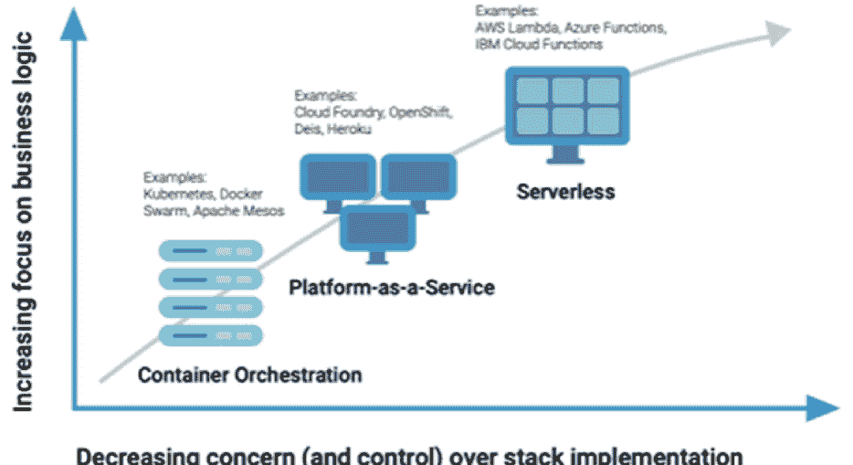

图 3.1：CNCF 服务

总之，云不仅仅是一个远程基础设施领域；它代表了向委托运营复杂性的范式转变，释放了宝贵的资源和时间。当我们拥抱云的变革能力时，正准备释放前所未有的效率和灵活性。现在，在奠定基础之后，我们将进入下一个主题：探索 Docker 与 NoSQL 数据库之间的和谐相互作用，灵活性和可携性在此统一定义了应用部署和管理的新纪元。

## NoSQL 数据库与容器

NoSQL 数据库与容器化技术（如 `Docker`）的融合，为灵活且可扩展的应用部署引入了可能性。在本分节中，我们将探索 NoSQL 数据库与容器之间的结合，并探讨支持这种共生关系的优势、缺点以及关键的权衡。

### 容器化的优势

在容器化中拥抱 NoSQL 数据库带来了一系列极具吸引力的优势。这些优点强调了 NoSQL 数据库的灵活性与容器封装效率之间的协同作用。值得注意的是，容器固有的隔离性和可移植性确保了跨系统的一致环境，缓解了兼容性问题。由于容器可以轻松地进行水平扩展，可扩展性变得轻而易举，能够适应变化的工作负载。容器化支持的精简部署流程降低了复杂性并提升了整体效率。此外，容器在共享宿主机系统资源的同时保持隔离，优化了资源利用。这些独特的优势共同营造了一个让 NoSQL 数据库蓬勃发展的和谐环境，提供了适应性、可扩展性和敏捷性。

在托管 NoSQL 数据库方面，容器化带来了许多优势。这些利益强调了 NoSQL 数据库的灵活性与容器封装效率之间的协同作用。以下是需要记住的关键优势简列表：

- **隔离**：容器封装了 NoSQL 数据库及其依赖项，确保了与宿主机系统的隔离以及跨各种环境的兼容性。这种可移植性简化了从开发到生产的过渡。
- **扩展**：容器促进了 NoSQL 数据库的轻松扩展，允许跨多个容器进行水平扩展，以适应不同的工作负载。
- **一致性**：容器化保证了环境的一致性，缓解了由于底层系统差异引起的潜在问题。
- **易用性**：容器的封装化特性简化了部署流程，减少了复杂性和潜在的部署相关错误。
- **资源**：容器在保持隔离并优化资源利用的同时，共享宿主机系统的资源。

### 容器化的缺点与权衡

虽然 NoSQL 数据库与容器化的结合具有巨大潜力，但对这种结合固有的缺点和权衡保持敏锐意识并引导这一领域至关重要。这些因素阐明了容器化益处与其所带来的挑战之间的微妙平衡。值得注意的是，容器引入了某种程度的开销，尽管远少于传统的虚拟机。

底层系统的抽象可能会限制对资源和网络的直接控制，可能影响精细调整的数据库配置。容器的瞬态性也对数据持久化提出了挑战，需要外部存储解决方案来维护数据完整性。安全考虑仍然是重中之重，要求采取强有力措施来保护容器化环境中的敏感数据。对这些缺点和权衡的全面理解，有助于在开启 NoSQL 数据库与容器配对旅程时做出明智的决策。

虽然容器化为托管 NoSQL 数据库提供了极具吸引力的优势，但审慎地应对潜在挑战至关重要。以下是关于容器中 NoSQL 数据库的一些基本考虑因素列表：

- **开销**：虽然容器与虚拟机相比最小化了开销，但仍然存在与容器化相关的固有开销。
- **有限控制**：容器抽象了底层系统，限制了对资源、硬件和网络的直接控制。这可能会影响精细调整的数据库配置。
- **数据持久化**：容器本质上是临时的。确保 NoSQL 数据库中的数据持久化需要细致的处理，通常涉及外部数据存储解决方案。
- **完整性**：容器的瞬态性可能为确保数据完整性带来挑战，需要彻底的备份和恢复策略。
- **安全**：尽管容器增强了隔离性，但安全担忧依然存在，需要强健的安全措施来保护敏感数据。

### 适用场景分析

利用 NoSQL 数据库和容器这一强大组合的决策，取决于对何时采用这种共生方法以及何时寻求替代策略的细致评估。值得注意的是，NoSQL 数据库与容器的结合在开发和测试等背景下被证明非常有价值，在这些场景中，一致的环境对于准确的结果至关重要。容器在本地开发场景中表现出色，允许开发者轻松地复制类生产环境。此外，在微服务架构中，容器的隔离性和可移植性与微服务的模块化无缝衔接。然而，某些场景下需要谨慎。对于极低延迟的应用，容器引入的轻微性能开销可能不适用。同样，资源密集型工作负载可能会因为容器固有的资源共享而面临限制。

当复杂的数据库配置和优化至关重要时，专用环境可能会提供所需的控制和灵活性。在容器中运行 NoSQL 数据库取决于对这些微妙背景的理解，从而做出最符合特定项目和应用需求的明智决策。

容器中的 NoSQL 数据库对以下方面特别有利：

- **开发**：容器为开发、调试和测试提供了一致的环境，最大限度地减少了“在我的机器上可以运行”的问题。
- **本地**：容器简化了本地设置，允许开发者以最小的努力复制类生产环境。
- **微服务**：容器补充了微服务，因为每个独立服务都可以运行在自己的容器中。

然而，容器在以下场景下可能并不适用：

- **极低延迟**：容器化可能会引入轻微的性能开销，可能不适用于极低延迟的应用。
- **资源密集型**：容器的资源限制可能会阻碍极其密集的 NoSQL 数据库。
- **复杂配置**：如果复杂的数据库配置和优化是必不可少的，专用环境可能会提供更好的控制。

NoSQL 数据库与容器的结合是一个动态的联盟，提供了敏捷性、可扩展性和精简的部署。理解优点、缺点和权衡可以指导在何时利用这一强大组合做出明智决策。正如本书使用 `Docker` 容器运行示例应用程序所示，这种协作可以促进高效的本地开发，并作为各种案例的模型。

# 结论

在本章中，我们开启了穿越 NoSQL 数据库动态领域的之旅，揭示了它们的复杂性、优势和挑战。从深入研究不同类型的 NoSQL 数据库到理解它们各自的优势和局限性，我们已经规划了这一领域并奠定了坚实的基础。我们探索了重构的艺术，这对于面对不断变化的业务需求保持适应性至关重要。此外，我们还研究了备份策略和灾难恢复的关键领域，确保了我们数据资产的韧性。

随着 NoSQL 生态系统的演进，必须意识到旅程远未结束。随着时间的推移，新工具不断出现，补充了这些数据库的成熟。服务和解决方案不断进化，提供了利用 NoSQL 数据库力量的创新方法。一个值得关注的趋势是即服务数据库（`DBaaS`）的兴起，使组织可以将数据管理的复杂性交给专用平台，从而为核心业务创新释放宝贵资源。

接下来的章节将深入探讨 NoSQL 数据库与 Java 生态系统的集成。特别是，我们将探索 Java NoSQL 集成框架的动态世界，以及它们对应用程序和 NoSQL 数据库的深远影响。这些框架桥接了应用层与 NoSQL 数据存储之间的鸿沟，实现了无缝交互和稳健的数据管理策略。

# 记忆点

- **NoSQL 数据库**：理解不同类型的 NoSQL 数据库——文档型、键值型、列族和图型——以及各自的优势和用场景。
- **重构**：意识到重构数据库结构的重要性，以适应不断演变的业务需求并防止软件腐化。
- **数据库重构**：数据库重构涉及修改数据模型，同时确保数据完整性和迁移，以适应不断变化的需求。
- **容器化**：将 NoSQL 数据库与 `Docker` 等容器相结合，可以获得隔离性、可移植性、可扩展性和简化部署等优势。
- **容器中 NoSQL 的优点**：在托管 NoSQL 数据库时提供隔离性、可扩展性、一致性、易于部署和资源效率。
- **缺点**：在将 NoSQL 数据库与容器集成时，面临开销、控制限制、数据持久化、完整性和安全方面的挑战。
- **策略性使用**：在容器中使用 NoSQL 数据库用于开发/测试、本地开发、微服务架构，以及负载和复杂度匹配的场景。
- **动态 NoSQL**：承认随着新工具、服务和 `DBaaS`（数据库即服务）选项出现而不断演变的格局，以简化数据管理。

# 多选题

## 章节中提到的 NoSQL 数据库的主要分类有哪些？

- 关系型、文档、列、图
- SQL、NoSQL、混合型、内存
- **键值、文档、列族、图**
- 事务型、分析型、操作型、历史型

## 数据库重构的主要目的是什么？

- 增强应用程序性能
- 增加数据存储容量
- **适应不断变化的业务需求**
- 实现新的安全协议

## 在托管 NoSQL 数据库时，容器化带来了什么优势？

- 更高的安全性
- 更低的资源利用
- 改进的网络能力
- **隔离、可移植性和扩展性**

## 哪种场景适用于 NoSQL 容器数据库？

- 有超低延迟要求的应用程序
- 不需要可扩展性的资源密集型负载
- **开发和测试环境**
- 需要大量控制的复杂配置

## 章节中关于 NoSQL 数据库的趋势是什么？

- NoSQL 数据库采用率下降
- 单一 NoSQL 数据库类型的出现
- **DBaaS 的兴起**
- 向传统的关系型数据库移动

# 答案

加入我们书籍的 Discord 空间

加入书籍的 Discord 工作空间获取最新更新、优惠、全球科技动态、新发布以及与作者的互动会议：

https://discord.bpbonline.com


# 使用框架简化 Java 应用程序集成

## 引言

在不断演变的现代软件开发格局中，NoSQL 数据库与 Java 编程之间的共生关系开辟了不可或缺的领域。当企业应对海量非结构化数据并为动态应用程序寻求捷解决方案时，这些技术之间的协同作用变得愈关重要。这种结合的核心在于 Java 框架领域，它们充当结构支柱，连接了 NoSQL 数据库的灵活性与 Java 编程的健壮性。

Java 框架已成为协调 NoSQL 数据库与 Java 结合的重要工具，为开发者提供了一系列选择，以满足各种应用程序需求。这些框架以其独特的风格为特征，具有塑造开发过程的能力，为代码库注入结构、效率和可维护性。当我们深入本章时，我们将揭示 Java 框架中反射（`reflection`）与无反射（`reflectionless`）解决方案的二分法，研究它们如何影响 NoSQL 数据库与 Java 之间的交互。反射具有动态和自省的性质，能够自适应编码，但可能会无意中损害性能。相反，无反射解决方案采用静态结构，以牺牲某些动态灵活性为代价优化了执行速度。这些方法共同说明了 Java 框架的深刻影响，展示了它们在平衡 NoSQL 数据库的动态需求与 Java 编程的规范原则之间的关键作用。

## 结构

本章涵盖了以下主题：

- Java 和 NoSQL 框架
- NoSQL 中的框架风格
- 探索框架可用性

## 目标

本章对 NoSQL 数据库与 Java 之间复杂的交汇进行全面探索，重点关注 Java 框架。我们的目标包括解读这些框架的多样风格和影响，阐明其必要性的理由，并深入研究它们提供的反射和无反射解决方案的细分领域。通过研究这些方面，旨在让读者对 Java 框架如何管理 NoSQL 数据库与 Java 编程之间的相互作用产生深刻理解，培养在构建健壮且适应良好的软件系统时做出明智决策所需的技能。

## Java 和 NoSQL 框架

在不断演变的现代软件开发格局中，NoSQL 数据库与 Java 编程之间的共生关系开辟了不可或缺的领域。当企业应对海量非结构化数据并为动态应用程序寻求捷解决方案时，这些技术之间的协同作用变得愈关重要。这种结合的核心在于 Java 框架领域，它们充当结构支柱，连接了 NoSQL 数据库的灵活性与 Java 编程的健壮性。

Java 框架已成为协调 NoSQL 数据库与 Java 结合的重要工具，为开发者提供了一系列选择，以满足各种应用程序需求。这些框架以其独特的风格为特征，具有塑造开发过程的能力，为代码库注入结构、效率和可维护性。当我们深入本章时，我们将揭示 Java 框架中反射（`reflection`）与无反射（`reflectionless`）解决方案的二分法，研究它们如何影响 NoSQL 数据库与 Java 之间的交互。反射具有动态和自省的性质，能够自适应编码，但可能会无意中损害性能。相反，无反射解决方案采用静态结构，以牺牲某些动态灵活性为代价优化了执行速度。这些方法共同说明了 Java 框架的深刻影响，展示了它们在平衡 NoSQL 数据库的动态需求与 Java 编程的规范原则之间的关键作用。

## NoSQL 中的框架风格

在不断演变的现代软件开发格局中，NoSQL 数据库与 Java 编程之间的共生关系开辟了不可或缺的领域。当企业应对海量非结构化数据并为动态应用程序寻求捷解决方案时，这些技术之间的协同作用变得愈关重要。这种结合的核心在于 Java 框架领域，它们充当结构支柱，连接了 NoSQL 数据库的灵活性与 Java 编程的健壮性。

Java 框架已成为协调 NoSQL 数据库与 Java 结合的重要工具，为开发者提供了一系列选择，以满足各种应用程序需求。这些框架以其独特的风格为特征，具有塑造开发过程的能力，为代码库注入结构、效率和可维护性。当我们深入本章时，我们将揭示 Java 框架中反射（`reflection`）与无反射（`reflectionless`）解决方案的二分法，研究它们如何影响 NoSQL 数据库与 Java 之间的交互。反射具有动态和自省的性质，能够自适应编码，但可能会无意中损害性能。相反，无反射解决方案采用静态结构，以牺牲某些动态灵活性为代价优化了执行速度。这些方法共同说明了 Java 框架的深刻影响，展示了它们在平衡 NoSQL 数据库的动态需求与 Java 编程的规范原则之间的关键作用。

## 探索框架可用性

在不断演变的现代软件开发格局中，NoSQL 数据库与 Java 编程之间的共生关系开辟了不可或缺的领域。当企业应对海量非结构化数据并为动态应用程序寻求捷解决方案时，这些技术之间的协同作用变得愈关重要。这种结合的核心在于 Java 框架领域，它们充当结构支柱，连接了 NoSQL 数据库的灵活性与 Java 编程的健壮性。

（注：此处后续内容与前文重复，已按要求完成完整翻译）


在解析 Java 框架与 NoSQL 数据库之间复杂的相互作用时，我们揭示了框架在弥合不同范式之间鸿沟方面的关键作用。范式阻抗（paradigm impedance）的挑战凸显了面向对象编程原则与 NoSQL 数据存储独特特性之间的微妙平衡。进入下一节之前，我们的重点将无缝转向全面探索专为 NoSQL 数据库需求而设计的各类持久化框架。这些框架各有独特的方法，使开发者能够应对数据交互的复杂性，确保 Java 强大的表达能力与 NoSQL 数据库特殊性的无缝集成。通过深入研究这些框架的细节，我们将获得对它们细微风格、变革性影响以及务实相关性的洞察，为构建弹性且适应性良好的现代软件解决方案奠定基础。

视觉辅助在传达复杂概念方面具有无价价值。在对 NoSQL 框架的探索中，意识到它们作为连接 Java 应用与 NoSQL 数据库桥梁的关键作用至关重要。这些视觉表示提供了一个有力的比喻，将框架描绘为关键链接，使得 Java 代码世界与数据存储检索领域能够实现无缝通信。这幅图像说明了框架如何充当促进者，允许数据在两个领域之间流动，确保开发者在熟悉的 Java 应用环境中工作的同时，能够利用 NoSQL 数据库的力量。当我们深入研究这些框架的细节时，这些视觉图将提供一条清晰的路线图，帮助我们以自信和清晰的方式应对现代数据库管理的复杂性：


图 4.1：Java 框架与 NoSQL 数据库架构

在软件开发的复杂织体中，Java 框架面临的最重大挑战之一是范式之间的阻抗：这是塑造面向对象编程世界和 NoSQL 数据库世界的基本原则之间的冲突。虽然面向对象编程在继承、接口、多态和设计模式等概念上繁荣，但 NoSQL 数据库的格局往往偏离了这些传统结构。这种二元对立对框架构成了严峻的挑战：即在 Java 面向对象范式的丰富表达力与 NoSQL 数据库独特的存储和检索机制之间进行无缝转换。

在协调这些不同范式的追求中，框架必须承载面向对象构造结构的复杂表示，将其转换为与 NoSQL 数据库存储模型对齐的格式。这种转换引入了影响性能的复杂性，因为框架必须在这些不同范式之间调解，同时确保完整性和系统稳定性。至关重要的是意识到，框架结合 NoSQL 数据库的主要目标不是防止对精细数据建模的需求，而是为了促进应用程序逻辑与数据存储之间更顺畅的交互。

在 NoSQL 数据库及其框架的复杂格局中，经常会出现一个关键挑战——映射不匹配（mapping mismatch）。这是一个值得仔细考虑的概念，因为它影响了数据库中的数据如何在应用程序代码中表示。接下来的图阐明了这一复杂问题，展示了 NoSQL 数据库中的数据模型可能与我们 Java 应用中的结构并不完美匹配。这可能导致数据检索、对象创建和应用程序逻辑的复杂性。通过剖析这一视觉表示，我们更深入地理解了开发者在弥合 NoSQL 数据库与 Java 应用之间的鸿沟时遇到的映射挑战。参考以下图：

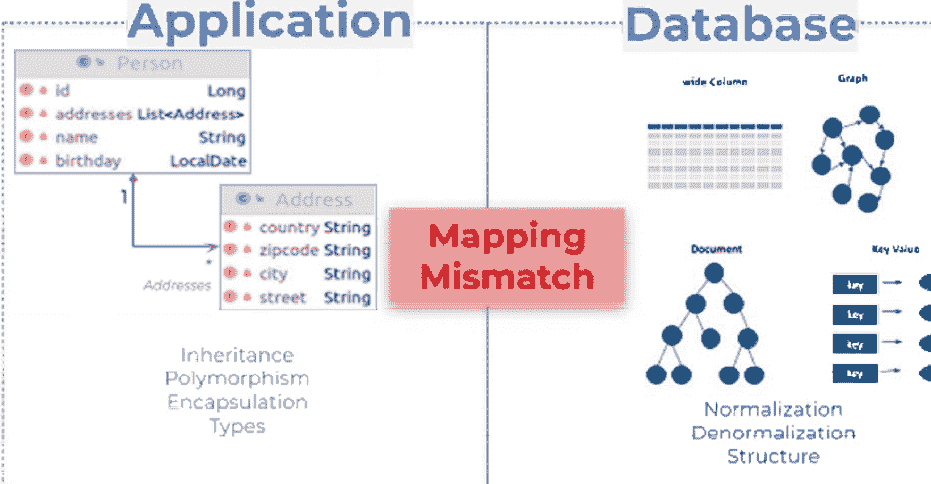

图 4.2：映射不匹配阻抗

Gavi 在关于 Hibernate 的演示中做出了敏锐的观察。即使使用框架，对数据库的深刻理解仍然至关重要。Java 框架与 NoSQL 数据库之间的共生关系并没有消除理解底层数据结构和检索机制的重要性。最终，像 `Hibernate` 或 `JPA` 等框架是旨在简化面向对象代码与数据库集成的工具。然而，它们并没有取代对数据库模型架构洞察的需求。当我们深入接下来的章节时，我们将探索这些框架如何应对范式阻抗，在 Java 的表达能力与 NoSQL 数据库的独特性之间取得平衡。

## NoSQL 中的框架风格

在 NoSQL 数据库中，框架风格的格局呈现出丰富的特征体系，这些特征显著影响了开发体验和软件解决方案的效能。这些风格由关键属性塑造，并引导着应用程序与数据存储之间交互的核心，为开发者提供了一系列选择，错综地塑造了他们的开发。如下所示：

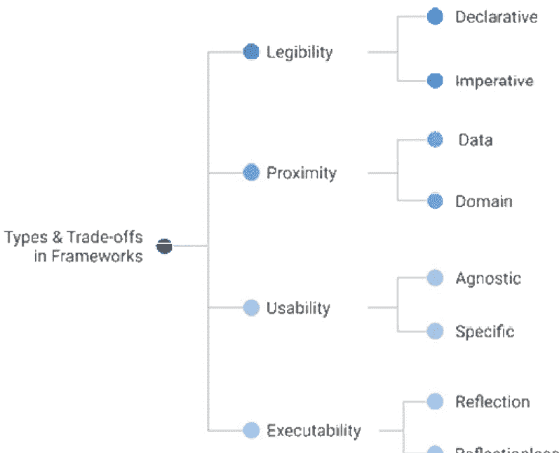

图 4.3：框架类型

可用性是框架设计的基石，突显了框架如何无缝地适应各种数据库。从特定性到无关性（agnostic），框架的可用性界定了单一 API 是为了某个特定的 NoSQL 数据库服务，还是将其通用性扩展到多个数据库。然而，贴近性（Proximity）塑造了框架与数据库及应用程序之间的关系。这种贴近性从作为通信通道的驱动程序（driver），到与应用程序对象对齐得更紧密的映射器（mapper）。这种区别显著影响了数据操作和检索的效率。

可执行性（Executability）揭示了框架与交互交互机制，分为基于反射、无反射和元数据生成的方法。执行策略的选择本质上影响性能、稳定性和开发灵活性。可读性（Legibility）是框架评估的一个关键维度，审视了框架 API 的清晰度和抽象层次。通过命令式或声明式（declarative）关注，API 引导开发者编写显式命令序列或指定所需结果。这种选择决定了开发者理解并将其设计意图转换为功能代码的难易程度。

当我们开启 NoSQL 框架风格的多样化旅程时，我们将揭示这些属性对开发生命周期的深远影响。从简化的数据访问和操作到代码表达的优雅，每种风格都包含独特的承诺，为开发者在动态的软件开发环境中构建弹性解决方案提供了工具。

深入研究 NoSQL 框架及其多样风格的复杂世界，我们揭示了这些连接应用程序与数据存储工具的多维度本质。可用性、贴近性、可执行性和可读性错综地影响着开发者如何应对 NoSQL 领域现代软件开发的复杂性。随着进展，我们将全面探索这些框架风格，从对可用性的深入调查开始。通过剖析这些风格如何影响我们的开发格局，我们将具备做出明智选择所需的见解，确保应用程序与 NoSQL 数据库的无缝集成。

### 探索框架的可用性

在探索 NoSQL 框架复杂图谱的过程中，我们深入探讨了可用性这一关键维度。在这一维度中，框架 API 的架构塑造了开发者的历程。在这个维度内，无关（Agnostic）API 与特定（Specific）API 之间存在着明显的权衡，它们各自的优势对软件开发过程产生了深远影响。

特定 API 与特定的 NoSQL 数据库紧密结合，为开发者提供了与最新功能同步以及利用独特优化的优势。这种同步性使开发者能够充分利用数据库的全部功能，从而可能增强性能并简化数据操作。然而，这种特异性也引入了一个显著的缺点：当向项目中引入新的 NoSQL 数据库时，开发者必须学习并适应新的持久化 API。这可能导致认知负荷增加和开发开销增大，因为团队必须替换或调整现有代码以适应新数据库的细微差别。

在光谱的另一端，无关 API 的魅力在于它能够抽象各种 NoSQL 数据库的底层细节，允许开发者使用一致的接口与多个数据库交互。这种方法显著降低了为每个数据库学习新 API 的认知开销，促进了更平稳的开发过程。然而，这种灵活性是以可能延迟采用特定数据库特有的最新功能和优化为代价的。开发者可能需要等待无关框架跟上数据库特定的进展，这可能会损害访问尖端能力的即时性。

在这些 API 样式之间平衡尺度，需要对项目需求、开发敏捷性和数据库专业化有细致的理解。通过深入研究框架的可用性，我们能够获得见解，以做出符合我们软件目标的明智决策。在随后的章节中，我们将进一步探索框架接近性（Proximity）、可执行性和可读性，使我们能够对这些属性如何塑造 NoSQL 框架的格局并引导我们的开发工作建立全面的理解。

在 NoSQL 框架的可用性领域，出现了一个基础性的选择——无关 API 还是特定 API。这一选择从根本上影响了开发者与 NoSQL 数据库交互的方式。下表提供了一个全面的参考，提供了这两种截然不同方法之间的结构化比较。通过分析从灵活性到适应性的每个方面，该表为为特定项目选择最合适的 API 样式时固有的权衡提供了全局视角。当我们深入研究此表时，我们将获得关于这些选择如何影响开发速度、维护工作以及充分利用特定 NoSQL 数据库能力的宝贵见解：

| 方面 | 无关 API | 特定 API |
| :--- | :--- | :--- |
| 灵活性 | 高（支持多个数据库） | 低（绑定到数据库） |
| 学习曲线 | 较低（接口一致） | 较高（数据库特定 API） |
| 性能 | 潜在开销（抽象化） | 高性能（原生优化） |
| 维护 | 易于切换/更新数据库 | 较难（每个数据库都需要编写代码） |

表 4.1：API 的可用性

当我们结束对 NoSQL 框架可用性以及无关 API 与特定 API 之间二分关系的探索时，我们揭示了开发者在为项目选择正确方法时面临的复杂决策。灵活性、学习曲线、数据库特性和性能之间的相互作用错综复杂地塑造了开发者构建稳健高效软件解决方案的历程。在我们过渡到下一节时，焦点将转向框架接近性。这一维度深入了框架与应用逻辑或数据库操作之间的紧密程度。通过这一视角，我们将发现接近性如何深刻地影响代码与数据不同领域之间的效率、可维护性和无缝交互。通过深入这一关键维度的核心，我们进一步增强了对支撑 NoSQL 框架机制的见解，并指导我们做出明智的架构决策。

## 引导框架接近性

在我们对 NoSQL 框架的持续探索中，进入了框架接近性维度，这一维度复杂地管理着数据库与领域之间的对齐。这一维度揭示了两种主流 API 样式之间的关键权衡：驱动 API（Driver API）和映射 API（Mapper API）。每种样式都带有独特的优势和挑战，显著影响了框架接近数据库操作或应用逻辑的程度。

驱动 API 靠近数据库，培养了一种以数据为中心的视角，这与强调高效数据检索和存储的场景无缝衔接。这种接近性使开发者能够利用数据库的原生能力，实现与数据结构和查询机制的直接交互。然而，这种接近性引入了一个挑战：需要显式转换。

相反，映射 API 将框架带向应用逻辑，将数据库交互封装在面向对象的抽象中。这种方法减少了样板代码并提高了代码的清晰度。然而，这种接近性可能以性能为代价，特别是在涉及海量数据的场景下。

讨论的核心在于数据中心效率与面向对象优雅性之间的平衡。在驱动 API 和映射 API 之间选择取决于项目需求、性能考虑以及团队对数据结构的熟悉程度。当我们进入接近性的复杂领域时，我们将进一步理解数据库与应用程序之间的距离。

在 NoSQL 框架的复杂图谱中，接近性方面作为一个关键维度展开，它塑造了应用逻辑与数据之间的协同作用。这种动态的相互作用产生了两种主流的 API 样式：驱动 API 和映射 API。在理解 NoSQL 框架细微差别的过程中，我们对这两种方法进行了比较探索。

| 特性 | 驱动 API | 映射 API |
| :--- | :--- | :--- |
| 关注点 | 数据库操作（以数据为中心） | 应用逻辑（以对象为中心） |
| 抽象 | 低（原生查询） | 高（类 ORM） |
| 样板 | 高（手动映射） | 低（自动映射） |
| 性能 | 通常较高 | 潜在的映射开销 |

表 4.2：API 的接近性：驱动对比映射

## 框架的可执行性

在 NoSQL 框架的探索之旅中，我们深入探讨“可执行性”这一维度。这是一个涉及框架如何与数据和代码交互的关键方面。在这个领域，反射 API（reflection APIs）与无反射（reflectionless）方法之间存在着关键的权衡，两者都具有独特的优势和挑战，深刻地影响着 NoSQL 框架的执行动态。

使用反射 API 提供了活性，能够动态交互、插件支持和实时验证。反射允许框架在运行时检查并修改类、方法和字段，适应不断变化的场景，而无需显式重新编译。然而，这种动态性是有代价的。初始化过程明显更加沉重，通常会导致启动时间延长和内存消耗增加。虽然反射带来了一系列强大的功能，但这些前期的权衡在性能敏感型应用中需要审慎的考量。

相比之下，无反射解决方案通过避免或最小化反射的使用，带来了一系列不同的优势。这些方法侧重于优化启动时间和内存消耗，从而为应用程序提供了更轻量的足迹。然而，这种优化并非没有代价，反射所提供的灵活性和动态适应能力变得居次要，可能会限制实时适应和插件集成。

必须注意的是，避免反射并不本质意味着完全放弃 Java 注解（annotations）。相反，无反射方法可以使用替代策略，例如 Java 注解处理器（Java Annotation Processors），在应用程序的构建阶段生成必要信息。这种方法桥接了运行时灵活性与高效执行之间的鸿沟，在实现动态适应的同时，大大减少了与运行时反射相关的开销。在反射和无反射方法之间的选择，取决于对项目性能需求、启动考量以及动态适应性需求的深刻理解。当我们深入研究可执行性的深度时，我们发现了这些战略性选择如何支撑 NoSQL 框架的机制，并积累了洞察力，以应对这一维度中固有的复杂权衡。

当我们深入探讨 NoSQL 框架中复杂的可执行性维度时，我们面临着一个对软件性能和灵活性具有重大影响的关键权衡。这一维度围绕着采用反射 API 和拥抱无反射方法之间的战略选择。为了阐明这一关键决策过程，下表全面比较了这两种截然不同的方法。通过剖析反射和无反射的不同特征，我们旨在丰富对这些选择如何深刻塑造 NoSQL 框架执行动态的理解。随着我们的进行，我们将深入这一维度的细微差别，揭示每方法如何影响运行时行为和应用效率。参考下表：

| 特性 | 反射 API | 无反射方法 |
| :--- | :--- | :--- |
| 启动时间 | 较慢（初始化沉重） | 较快（启动优化） |
| 内存消耗 | 较高 | 较低 |
| 灵活性 | 高（动态交互） | 较低（静态结构） |
| 适应性 | 实时适应 | 有限 |
| 插件支持 | 原生支持 | 需要构建时生成 |

表 4.3：API 的可执行性：反射对比无反射

在我们结束对框架可执行性的探索时，反射与无反射方法之间的动态相互作用揭示了 NoSQL 框架中灵活性与效率之间复杂的平衡。这一关键维度强调了战略选择对运行时行为、启动时间和内存消耗的深远影响。在下一节中，我们将重点转向“框架的可读性（legibility）”，这一维度深入探讨框架 API 的清晰度、抽象性和表达能力。通过这个视角，我们将揭示可读性如何影响开发体验以及 NoSQL 框架的长期维护性和适应性。通过审视这一维度的深度，我们将获得洞察力，指导我们构建在代码优雅性和实用功能之间取得最佳平衡的软件解决方案。

## 框架的可读性

在 NoSQL 框架的织锦中，可读性是一块基石，塑造着框架 API 的清晰度、抽象性和整体表达能力。在这个维度上，命令式（imperative）API 和声明式（declarative）API 之间出现了深层次的权衡，每种都体现了独特的属性，显著影响了开发者处理 NoSQL 框架设计复杂性的方式。

命令式 API 方法提供了细粒度的控制和定制，允许开发者指定复杂的细节并实现精确的结果。然而，这种控制是以潜在复杂性为代价的，因为操作可能需要一系列方法或步骤。

此外，命令式 API 中的封装不当（mis-encapsulation）可能会无意中导致意外行为，而丰富的方法可能会无意中创造出“自毁按钮”场景，即特定的操作序列可能会无意中触发非预期的后果。

相反，声明式 API 方法优先考虑清晰度和安全性。通过提供更高层次、抽象的接口，开发者在更受控制和引导的环境中工作。这种方法鼓励更安全、更具预测性的使用模式，减少遇到隐藏陷阱或意外行为的机会。然而，这种清晰性和安全性伴随着权衡，声明式 API 可能会限制开发者可用的定制程度，可能牺牲命令式对应物中的某些细粒度控制。

虽然命令式和声明式 API 之间的选择取决于项目需求、开发者专业知识以及所需的控制水平，但至关重要的是，这些方法并不是互斥的。一个设计良好的框架可以战略性地融合这些风格，以平衡精细的定制与清晰、明确的操作。

当我们深入可读性的深度时，我们揭示了命令式和声明式 API 之间的选择如何深刻地塑造了用户体验、代码可维护性和 NoSQL 框架的整体架构。通过这次探索，我们获得了关于构建能够共鸣清晰度、效率以及开发者与数据之间无缝协作的 API 的洞察。

当我们在可读性领域导航时，我们遇到了一个塑造了 API 设计本质的关键十字路口。这一维度围绕着采用命令式和声明式 API 之间的战略选择。为了阐明这一关键决策过程，随后的表格比较了这些风格。通过剖析命令式和声明式 API 的独特特征，我们力争更好地理解这些选择如何复杂地影响 NoSQL 框架的清晰性、简单性和效率。随着我们的进行，我们将深入这一维度的细微差别，揭示每方法如何影响代码维护、用户体验和 NoSQL 框架的整体架构。参考下表：

| 特性 | 命令式 API | 声明式 API |
| :--- | :--- | :--- |
| 控制 | 细粒度、精确 | 高级、抽象 |
| 清晰度 | 可能复杂/冗长 | 高度清晰直观 |
| 安全性 | 存在意外副作用的风险 | 更安全/可预测的模式 |
| 复杂度 | 高（步骤多） | 低（接口简单） |
| 实现 | 如何做 | 做什么 |

表 4.4：API 的可读性：命令式对比声明式

我们设计、实现并与 NoSQL 框架交互。接下来的章节将带领我们继续前进，深入探讨实际应用，说明这些维度如何协调工作，从而在现代数据库管理中创建稳健、高效且适应性强的软件解决方案。

## 结论

在对 NoSQL 框架的探索中，我们跨越了丰富的维度领域，这些维度复杂地影响着这些强大工具的架构、性能和用户体验。从易用性（usability）来看，通用 API 与特定 API 之间的平衡塑造了我们与各种数据库的集成；从接近性（proximity）来看，驱动 API 和映射器 API 之间的选择影响了框架与数据操作或应用程序逻辑的对齐程度。执行性（executability）揭示了反射与无反射策略之间的权衡，塑造了我们框架的效率和动态。在可读性（legibility）方面，命令式 API 与声明式 API 的对比强调了代码中控制与清晰度之间的平衡。

回顾这段通过易用性、接近性、执行性和可读性的旅程，我们意识到这些维度在塑造 NoSQL 框架整体格局方面存在复杂的相互作用。这些选择并非孤立的；它们融合并相互作用，以构建满足每个项目特定需求的解决方案。展望未来，我们的路径引导我们深入研究另一个关键方面：设计模式领域及其对 NoSQL 数据库的深远影响。


在下一章中，我们将探索设计模式如何为解决反复的问题提供结构化方法，丰富 NoSQL 解决方案的效率、灵活性可扩展性。通过将这些见解与我们对框架维度的理解相结合，我们开启了一场全方位的之旅，在不断演变的 NoSQL 数据库管理世界中构建韧性的软件解决方案。

## 记忆点

- **易用性 (Usability)**：框架提供特定的 API，以满足特定的 NoSQL 数据库或多个数据库，在通用性与数据库特性的同步之间取得平衡。
- **接近性 (Proximity)**：`Driver API` 和 `Mapper API` 之间的选择影响框架在数据库操作和应用程序逻辑之间的定位，从而影响效率和数据交互。
- **执行性 (Executability)**：`Reflection API` 提供了灵活性，但可能导致更长的启动时间和更高的内存消耗，而无反射方法则以牺牲灵活性为代价优化了这些因素。
- **可读性 (Legibility)**：`Imperative API` 与 `Declarative API` 之间的决定影响代码的清晰度、定制性、复杂性和安全性。

每个框架侧方面都涉及权衡，需要根据项目目标、性能需求和开发偏好做出明智的决策。

## 多选题

### 在 NoSQL 框架中选择通用 API 还是特定 API 时，关键考虑因素是什么？

- 所需样板代码量。
- 数据库的复杂程度。
- 使用的编程语言。
- 框架界面的配色方案。

### 哪种方法使框架更接近应用程序逻辑，将数据库交互封装在面向对象的抽象中？

- `Reflection API`。
- `Driver API`。
- `Mapper API`。
- `Reflectionless approach`。

### NoSQL 框架中反射 API 关联的权衡是什么？

- 运行速度较慢。
- 内存消耗更低。
- 灵活性降低。
- 启动时间更长。

### 哪种类型的 API 在 NoSQL 框架中优先考虑清晰、安全显式操作？

- `Imperative API`。
- `Declarative API`。
- `Driver API`。
- `Mapper API`。

### 本章 NoSQL 框架维度讨论的主要目标是什么？

- 推广特定的 NoSQL 数据库。
- 在开发者之间制造困惑。
- 展示框架的复杂性。
- 为做出明智的决策提供见解。

## 答案

加入我们书籍的 Discord 空间

加入书籍的 Discord Workspace 获取最新更新、优惠、全球科技动态、新发布以及与作者互动：

https://discord.bponline.com


Java 持久设计模式 (Java Persistence Design Pattern)

## 引言

本章探讨了 NoSQL 数据库与 Java 持久设计模式之间的共生关系。随着软件格局的变化以适应不断增长的数据需求，NoSQL 数据库因其灵性和可扩展性优势脱颖而出。然而，从传统关系型数据库到 NoSQL 解决方案的过渡需要重新评估已的设计模式。

首先，我们深入研究 NoSQL 数据库，分析其各种形式和底层原理。这些数据库包括文档、键值对、列族和图模型，提供了管理海量数据集和动态结构的灵活性。然而，这种适应性也带来了关于数据完整性、一致性和性能的挑战。

随后，我们将注意力转向如何在 NoSQL 背景下适配 Java 的持久化设计模式。`DAO`、`Mapper`、`Repository` 和非结构化层（`unstructured layer`）模式长期以来一直是 Java 开发的基础，现在它们被重新构思以适应 NoSQL 数据库的特征。`DAO` 模式演变为处理动态模式（`schema`）和查询，而 `Mapper` 模式处理了对象-文档转换的复杂性。同时，`Repository` 模式进行了调整以适应无模式设计并优化查询策略。值得注意的是，非结构化层模式作为一种新的补充出现，解决了 NoSQL 数据库通常支持的多种数据格式问题。当我们探索每个模式的转换和实现细差别时，对它们在有效 NoSQL 集成中作用的全面理解开始展开。

## 结构

本章涵盖了以下主题：

- 企业级 Java 应用中的分层
- 非结构化架构
- NoSQL 数据库架构中的 Mapper 模式
- 数据库操作中心
- 领域逻辑隔离
- 数据库设计中的模式

## 目标

本章深入探讨了 NoSQL 数据库与 Java 成熟的持久设计模式之间复杂的关系。随着技术格局的演变，集成 NoSQL 数据库对于高效管理和利用海量数据至关重要。通过探索 NoSQL 数据库的属性及其带来的独特挑战，本章为理解其各种形式和功能奠定了坚基础。此外，它弥补了传统 Java 持久设计模式与 NoSQL 集成需求之间的差距。通过研究 `DAO`、`Mapper`、`Repository` 和非结构化层等模式的适配，以与 NoSQL 数据库的动态保持同步，读者将获得将这些模式无缝整合到自己项目中的务实策略见解。最终，本章为开发者和架构师提供了所需的知识和工具，使能够在保持既定设计原则的同时，熟练应对 NoSQL 集成的复杂性。

## 企业级 Java 应用中的分层

在软件架构的复杂领域，层（`layers`）的概念证明是应对日益增加的应用复杂性的有力武器。在这种背景下，一个层代表一个不同的抽象层级，封装了一系列相关的功能和职责。它作为应用程序内部模块化的划分，促进了维护性、可扩展性和代码组织。本节深入探讨了层的重要性，特别是在使用 NoSQL 数据库的 Java 应用中，它们的作用变得更加至关重要。

层在软件架构中的重要性在于它们提供抽象和模块化的能力，这对于管理现代应用的复杂性至关重要。通过将应用程序结构分为不同的层，每个层负责一组特定的功能，开发者可以创建清晰的关注点分离。这种分离增强了代码组织和可维护性，并简化了负责应用程序不同方面的开发团队之间的协作。层像一个盾牌，允许开发者专注于单个层的复杂性，而而不至于被整个系统的复杂性所淹没。这种抽象使得系统更易理解、便于调试并具有重用潜力，最终导致更稳健、适应性更强的软件解决方案。

在介绍此列表之前，必须理解软件架构中的分层对于增强复杂应用程序的整体设计和可管理性至关重要。在这里，我们重点介绍了分层的两个基本方面：抽象与模块化，以及职责与关注点分离：

### 抽象与企业级

分层方法的核心在于促进抽象，保护应用程序的不同部分免受彼此复杂性的影响。这种抽象通过在组件之间提供定义良好的接口和边界来帮助开发者，使其更容易理解系统的行为和交互。这种关注点的分离提高了代码的可维护性和重用性。

### 职责与关注点分离

企业级应用通常包含许多功能，从用户界面到业务逻辑和数据存储。分层有助于将这些关注点分离到不同的层，确保每一层都负责应用程序的特定方面。这种分离简化了开发、测试和调试，因为开发者可以专注于某一层层的细节，而不会被整个系统的复杂性所淹没。

然而，采用分层架构也意味着必须仔细考虑的权衡。虽然层增强了可维护性和封装性，但它们可能会引入层之间的通信开销，可能影响性能。在强制严格的层边界与允许必要的层间交互之间取得平衡至关重要。

此外，分层架构的僵性在适应变化的需求或处理需要完美融入预定义层中的非常规场景时可能会带来挑战。必须权衡可维护性和关注点分离的优点与潜在的缺点，确保所选的架构符合软件系统的特定需求和未来演进。

在介绍此列表时，我们深入探讨了强调软件分层固有复杂性和挑战的两个关键方面：可维护性与开销，以及灵活性与僵性：

### 可维护性与开销

虽然层提供了优势，但也引入了潜在的复杂性。维护多个层需要仔细的协调并遵循设计原则。层间通信的开销以及潜在的代码或逻辑重复必须审慎地管理，以防止效率低下。

### 灵活性与僵性

分层方法有时会导致僵化的架构，需要适应不断变化的需求。某一层的更改可能会影响其他层，需要对整个应用程序进行调整。在强制结构化架构与允许未来变化的灵活性之间取得平衡是挑战性的。

在集成 NoSQL 数据库的企业级 Java 应用领域，分层的重要性变得愈发明显。NoSQL 数据库引入了动态数据模型和不同的一致性级别，需要一种能够随着这些变化优雅演化的结构化架构。开发者可以通过采用分层方法将数据库交互、业务逻辑和用户界面的复杂性进行分类。这种划分促进了可维护性，并使开发团队能够在不破坏整个应用程序的情况下适应和增强特定层。由于 NoSQL 数据库通常满足多样化的数据需求，分层有助于隔离数据存储、检索和操作的复杂性，使应用程序能够有效利用 NoSQL 技术提供的独特功能。

在利用 NoSQL 数据库的企业级 Java 应用中，层的重要性被放大。NoSQL 数据库的动态特性（数据结构可能会频繁演变）强调了对能够优雅容纳变化的良好结构架构的需求。层为隔离数据库交互、业务逻辑和用户界面提供了基础。通过划分这些职责，开发者可以迭代地调整组件，而不会触发整个应用程序的级联效应。

《恰合适的软件架构》（Just Enough Software Architecture）一书强调划分、知识和抽象是应对软件复杂性的实用工具。应用这些概念（主要通过分层方法），使开发者能够驾驭采用 NoSQL 数据库的企业级 Java 应用的复杂性。在我们理解软件架构的错综复杂时，意识到层的价值使我们能够在应对固有权衡的同时，利用其优势。

层是现代软件应用程序架构中基本的构建模块。通过促进抽象、关注点分离和模块化，它们赋予了开发者管理复杂性和维护代码质量的能力。然而，与任何架构选择一样，采用层也伴随着必须仔细管理的权衡，以便在僵性和适应性之间取得平衡。在利用 NoSQL 数据库的企业级 Java 应用中，层在应对数据存储和检索的动态特性方面起着至关重要的作用。后续章节将重点转向应用程序必须遵循分层结构的场景。通过探索偏离分层方法的挑战和后果，我们能够更深入地理解分层带来的益处。现在让我们探索缺失层带来独特考虑和影响的场景。

## 非结构化架构

与之前讨论的分层方法相反，软件开发中存在非结构化架构的情况。本节深入探讨非结构化架构，即应用程序需要定义良好的分离。虽然这种方法的简单性在特定场景下可能具有吸引力，但随着复杂性的增加，其影响将变得更加明显。

然而，随着应用程序范围和复杂性的扩展，无结构化架构的局限性变得愈发明显。最初看似连贯的结构可能会迅速解体成一个依赖关系和相互作用的网，变得难以理清。

修改应用程序的一个部分可能会在无意中触发其他组件之间一系列不可预见的连锁反应，使代码维护成为一项艰巨的任务。功能之间缺乏清晰的边界阻碍了开发，并难以有效诊断和修复问题的能力，导致架构在面对不断变化的需求和复杂性时难以适应并保持其完整性。

然而，随着应用程序复杂性的增加，缺乏分层结构会引入重大挑战。虽然单层架构最初看起来是连贯的，但它会迅速阻碍维护性、测试和扩展性。由于所有组件紧密交织在一起，应用程序某部分的更改可能会在无意中影响其他部分，导致封装性缺失，并在隔离和诊断问题时遇到困难。

此外，无结构化架构中缺乏定义良好的分层严重损害了测试格局。全面测试作为软件质量的基石，由于组件缺乏清晰的边界而变成了一项复杂的任务。无法为了测试目的而隔离单个功能导致单元测试的有效性降低，使得测试过程在确定特定缺陷时需要帮助。这种受损的测试格局阻碍了 Bug 的早期发现，并影响了稳健可靠应用程序的创建。因此，在确保软件质量和稳定性的挑战面前，无结构化架构的魅力逐渐消失。

测试作为软件开发的关键方面，在无结构化架构中变得尤为艰巨。组件之间缺乏清晰的边界阻碍了有效的单元测试，使得在隔离状态验证特定功能变得具有挑战。这损害了早期捕捉 Bug 能力，导致测试过程并非最优，且容易忽视关键问题。

在追求连贯的软件架构时，意识到无结构化设计中固有的细微权衡至关重要。虽然单层方法的简单在特定场景下可能提供即时满足，但必须考虑其对维护性、扩展性和测试的长期影响。随着应用程序的演进和适应变化的需求，对组织良好且连贯设计的需求变得愈发明显。

在简单性与扩展性之间取得平衡，需要对应用程序的轨迹和需求进行仔细考虑。在接下来的章节中，将检查跳过传统分层架构的真实世界应用示例，阐明放弃结构化设计的后果。通过理解这些结果，开发者可以获得做出明智架构决策的价值见解，以最符合其软件事业的长期成功。

虽然无结构化架构的简单性可能适用于特定语境，但随着应用程序复杂性的增加，意识到其局限性至关重要。单层设计的魅力让位于对事实的认知：高内聚性可能变成维护性、测试和扩展性的障碍。

在随后的章节中，我们将深入探讨放弃分层架构的真实世界应用示例，探索它们的动机和后果。通过研究这些案例，我们获得了关于无结构化架构相关权衡的价值见解，并学习何时接受或避免它们是明智的。

当我们处理无结构化架构的复杂性时，我们遇到了简单性与不断增长的复杂性挑战之间的对立。单层设计的魅力让人想起 NoSQL 的简单方法，为某些语境提供了快速解决方案，但随着应用程序的扩展暴露了其局限性。维护性、测试和扩展性方面的妥协凸显了深思架构决策的重要性。在接下来的章节中，我们将关注一种不同的方法：映射模式（`Mapper pattern`）。这种模式以其桥接面向对象编程与数据存储的能力而闻名，为无结构化架构提供了一种结构化的替代方案。通过深入研究真实世界的示例并分析映射模式的细微差别，我们获得了在处理软件架构复杂性的同时，在简单性和适应性之间保持平衡的价值见解。

## NoSQL 数据库架构中的映射模式

在追求能够有效集成 NoSQL 数据库的结构化应用程序时，映射模式作为之前讨论的无结构化架构的一种具前景的替代方案出现了。考虑到需要更多的划分和抽象，映射模式提供了一种分层方法，使 NoSQL 数据库与对象编程原则保持和谐。本节深入探讨 NoSQL 数据库背景下映射模式的复杂性，强调了它在实现更具组织且易于维护的架构方面的作用。

在接下来的图中，我们深入了映射模式的复杂性，它是软件设计中的一个基础架构概念。该模式充当面向对象编程与数据库交互之间的桥梁，为管理数据转换的复杂性提供了一种结构化的方法。在这种视觉表示中，我们探索了映射模式如何引入中间层，以增强抽象性、简化测试并并在带有 NoSQL 数据库的应用程序的适应性。当我们深入研究下面的图片时，我们揭开了映射模式的层级，全面理解了它在创建可维护、模块化且高效的软件系统中的作用。参考下图：

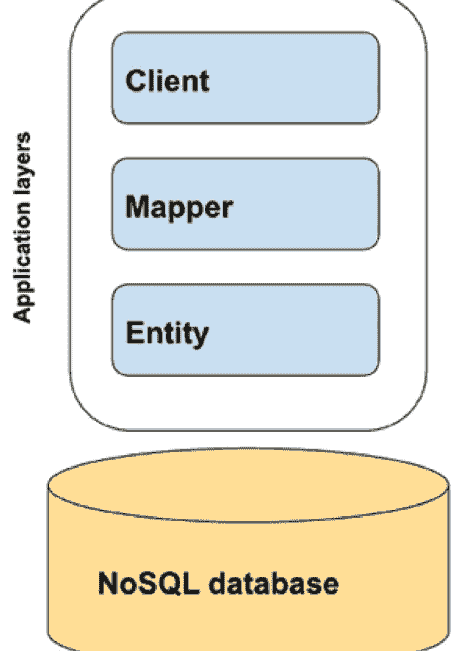

在无缝集成 NoSQL 数据库的应用程序结构化方面，映射模式作为一种强大的解决方案出现，提供了多层的方法。这种模式引入了一个特定的中间层，即对象-文档映射（`Object-Document Mapper, ODM`），策略性地放置在应用程序的核心功能与 NoSQL 数据库之间。此 `ODM` 映射层的主要目标是充当桥梁，促进数据在 Java 对象与之间的转换。通过将数据库的结构化本质与面向对象编程原则统一，映射模式旨在统一这些看似迥不同的领域，培养出更连贯、适应性强的架构。

映射模式在应用程序的核心功能与 NoSQL 数据库之间引入了额外的层。这个中间层通常被称为对象-文档映射，专门负责将数据转换为 Java 对象以及反之。。通过采用面向对象的范式，这种模式试图桥接数据库的结构化本质与面向对象编程模型之间的概念鸿沟。

映射模式魅力的核心在于其提升抽象并促进应用程序架构内严谨测试的能力。随着映射层的引入，数据转换和与 NoSQL 数据库交互的职责被精细地划分。这种模块化促进了更具组织的设计，并使开发者能够独立隔离并彻底测试映射功能。关注点的分离简化了调试工作，使能够快速识别并解决局限于映射层的问题。这种增强的测试格局促进了软件质量，并增强了对与底层 NoSQL 数据库交互的可靠性的信心。

映射模式通过显著增强应用程序内部的抽象和划分提供了深远的优势。随着映射层的引入，数据转换、与数据库交互乃至查询操作的职责被优雅地隔离。这种多维度的划分促进了更模块化、结构良好的设计，反过来又使开发者能够独立于应用程序的其他部分来测试映射功能。关注点的分离简化了测试和调试工作，并赋予了在映射层内精确确定位和修复问题的关键优势。此外，映射模式

它与对象关系映射 (`ORM`) 和对象文档映射 (`ODM`) 框架无缝衔接，允许开发者使用如 `find()` 或 `get()` 等直观的方法，而无需与复杂的 `SELECT/FROM/WHERE` 查询作斗争。因此，这种模式增强了抽象性，并培养了更符合开发者习惯且易于维护的代码库，最终促进了稳健高效的软件系统的创建。

然而，与任何架构决策一样，采用 `Mapper` 模式需要仔细评估其固有的权衡和考量。虽然该模式增强了抽象和测试能力，但引入额外的层也引入了复杂性和潜在的性能开销。开发者必须在增强组织结构的优势与复杂性增加带来的潜在缺点之间取得微妙的平衡。此外，保持应用程序数据模型与 NoSQL 数据库支持的结构之间的同步变得至关重要。未能保持这种一致性可能会导致数据不一致，并损害 `Mapper` 模式旨在提供的益处。因此，对应用需求和所选 NoSQL 数据库特性进行合理评估，对于确定 `Mapper` 模式的优势是否大于其复杂性及相关权衡至关重要。

然而，与任何架构选择一样，`Mapper` 模式也带来了权衡。额外的层引入了复杂性和开销，这可能会影响性能，特别是在效率至关重要的场景下。

此外，维护 `Mapper` 层要求应用程序数据模型与 NoSQL 数据库支持的结构之间进行仔细同步。请对齐这些方面，以避免不一致并阻碍该模式的潜在益处。

在追求精细架构方法的过程中，`Mapper` 模式作为一种引人注目的策略出现，弥补了 NoSQL 数据库与面向对象编程之间的差距。通过揭示数据转换、抽象和测试之间复杂的动态关系，该模式为开发者提供了一种结构化的手段，以应对现代应用程程序的复杂性。在承认采用模式固有挑战和权衡的同时，软件架构师可以策略性地将 `Mapper` 模式置于应用程序架构中，在利用其益处的同时减轻潜在的复杂性。通过将模式优势与应用的特定需求以及所选 NoSQL 数据库的细微差别进行严密对齐，`Mapper` 模式为在不断发展的软件格局中协调数据库集成和代码可维护性提供了一条可行途径。

`Mapper` 模式为非结构化架构提供了一种结构化的替代方案，利用多层方法来协调 NoSQL 数据库与面向对象编程。通过为数据转换提供专用层，`Mapper` 模式增强了抽象性，便于了测试，并促进了更精确的职责划分。然而，其优势也伴随着管理额外复杂性和考虑潜在性能影响。当我们探索 `Mapper` 模式的细微差别时，我们对导航架构景观有了更深层次的理解，将模式的优势与应用的特定需求以及所选 NoSQL 数据库的特征相结合。


# 当我们深入研究将 NoSQL 数据库集成到应用程序架构中的多种策略时

探索 Mapper 模式为在抽象、测试和权衡之间实现微妙平衡提供了宝贵的见解。这种方法为构建拥抱 NoSQL 数据库和面向对象编程优势的应用程序奠定了基础。然而，意识到还有其他可用途径也是至关重要的。在接下来的课程中，我们将关注另一种方法：数据访问对象 (DAO) 模式。通过引入一个处理数据库操作的专用层，DAO 模式为管理应用程序与 NoSQL 数据库之间的交互提供了一个不同的视角。通过对这种方法的全面检查，我们对可用的策略有了全面的理解，使我们能够做出最符合软件目标和挑战的明智架构决策。

## 数据库操作中心化

在应用程序架构中集成 NoSQL 数据库时，DAO 模式作为一种强大的策略出现，简化了数据库交互的管理。通过封装数据转换和 NoSQL 操作，DAO 模式提供了一种结构化的方法，将这些功能集中到单一的、定义良好的层中。本节将深入探讨 DAO 模式的复杂性及其对于实现增强的组织结构、易于测试以及处理 NoSQL 数据库的灵活性方面的影响。

在接下来的图中，我们深入探讨 DAO 模式的复杂性，它是与 NoSQL 数据库交互的应用程序架构的基石。这种视觉化表示提供了关于 DAO 模式如何将数据库操作集中到单一专用层的全面视图。通过封装数据访问逻辑，DAO 模式增强了可维护性，简化了测试，并允许在不同 NoSQL 数据库之间进行切换。当我们探索此图时，我们对 DAO 模式如何赋能开发者创建与 NoSQL 技术无缝集成的组织良好、可扩展且适应性系统有了宝贵的见解。请看下图：


图 5.3：DAO 模式

在数据库交互效率和可维护性的核心是 DAO 模式，这是一种整合了数据转换和 NoSQL 操作复杂过程的策略方法。通过采用这种模式，应用程序架构获得了一个处理所有数据库相关活动的定义良好的中央层。这种封装促进了对数据如何在应用程序中转换和存储的全面理解，同时创建了一个简化 NoSQL 数据库集成的结构化框架。DAO 模式的统一本质为增强组织结构和协调应用程序逻辑与数据库存储之间复杂交互奠定了基础。

关注点分离使得详尽的单元测试，以及快速调试和解决局限于 DAO 层的问题成为可能。

此外，维护工作也变得更加高效，因为数据库结构或交互逻辑的更改被局限在 DAO 内部，最大限度地减少了整个应用程序中产生意外副作用的风险。

DAO 模式提供的灵活性超越了增强测试和维护的范围，它能够在适应变化的数据库需求时实现无缝适配。由于所有数据库交互都集中在 DAO 层中，该模式促进了从一种 NoSQL 数据库切换到另一个的过程。通过精炼 DAO 层以符合不同 NoSQL 技术的规范，开发者可以在不破坏大型应用程序架构的情况下迁移数据库。这种动态适应能力在业务需求演进或性能考虑促使解决方案转变的场景中，被证明是无价之宝。DAO 模式在统一框架内容纳不同 NoSQL 数据库的能力，凸显了它的通用性，以及作为架构可持续性有力工具的作用。

DAO 模式的集中化特性也为选择 NoSQL 数据库提供了灵活性。由于所有数据库交互都局限于单个层，从一种 NoSQL 数据库切换到另一个变得更易于管理。通过调整 DAO 层以适应不同 NoSQL 技术的细微差别，开发者可以在数据库之间无缝过渡，而无需对应用程序的其他部分进行重大更改。这种适应性在扩展性或变化的业务需求需要切换数据库解决方案时特别有价值。

然而，实现 DAO 模式在提供显著收益的同时，也带来了需要审慎评估的考量。数据库操作在 DAO 层中的集中化可能会引入复杂性，可能影响模式的可维护性和性能。开发者必须在整合数据库功能的优势与复杂性增加的潜在劣势之间仔细平衡。此外，DAO 层与应用程序数据模型以及所选 NoSQL 数据库的复杂性之间的严密对齐至关重要。缺乏同步可能导致效率低下或不一致，从而削弱该模式试图提供的益处。最终，采用 DAO 模式的决策需要对其优势与复杂性进行细致的评估，以确保架构选择与应用程序的更广泛目标以及 NoSQL 数据库的特征相一致。

然而，DAO 模式也带有权衡。数据库操作的集中化会导致 DAO 层内部复杂性的增加，如果管理不当，可能会影响性能和代码维护性。在内聚性和复杂性之间取得平衡，对于确保 DAO 层保持为架构中可管理且有效的组件至关重要。

DAO 模式为应用程序架构中处理 NoSQL 数据库提供了一种结构化的方法。通过将数据转换和数据库交互整合到单个层中，DAO 模式增强了组织性，简化了测试，并为适应不同的 NoSQL 技术提供了灵活性。当我们探索 DAO 模式的细微差别时，我们获得了如何在管理其固有复杂性的同时利用其优势的见解，使我们的架构选择与应用程序的特定需求以及所选 NoSQL 数据库的特征相结合。

在导航 NoSQL 数据库集成的领域时，DAO 模式作为一个战略基石出现，它在统一数据库操作的同时提供了许多优势。通过将数据转换和 NoSQL 交互封装在专用层中，DAO 模式为复杂架构带来了清晰性，简化了测试，并促进了应用程序对各种数据库需求的适应性。然而，这种结构化方法也有其权衡，需要在内聚性和复杂性之间进行合理的平衡。当我们进一步深入架构策略时，我们必须意识到 DAO 模式并不是唯一的途径。在接下来的章节中，我们将探索领域驱动设计（DDD）的 Repository 方法，该概念扩展了应用程序领域模型中的封装和分离原则。通过这种探索，我们将发现 Repository 方法如何补充并可能完善 DAO 模式，为在复杂的 NoSQL 数据库格局中处理数据和持久化提供一个复杂的框架。

## 隔离领域逻辑

在软件架构中，DDD 哲学引入了一种名为 Repository（存储库）的强大概念。当应用于 NoSQL 数据库时，该模式为隔离领域逻辑和抽象数据访问提供了一种优雅的解决方案。在本章中，我们将深入探讨 DDD Repository 模式的复杂性，并探索其采用对使用 NoSQL 数据库的应用程序的影响。

在下面的图中，我们深入了 Repository 模式的核心原理，这是软件架构中的一个基本概念，特别是在处理 NoSQL 数据库时。这一视觉表示提供了 Repository 模式如何隔离领域逻辑、抽象数据访问并确保应用程序内关注点分离的全面概述。当我们研究此图时，我们将获得关于 Repository 模式如何增强可维护性、培养灵活性并促进各种 NoSQL 数据库技术无缝集成的宝贵见解。该模式是创建健壮且适应的软件系统的关键构建模块，本视觉指南将阐明其原则和影响。参考下图：

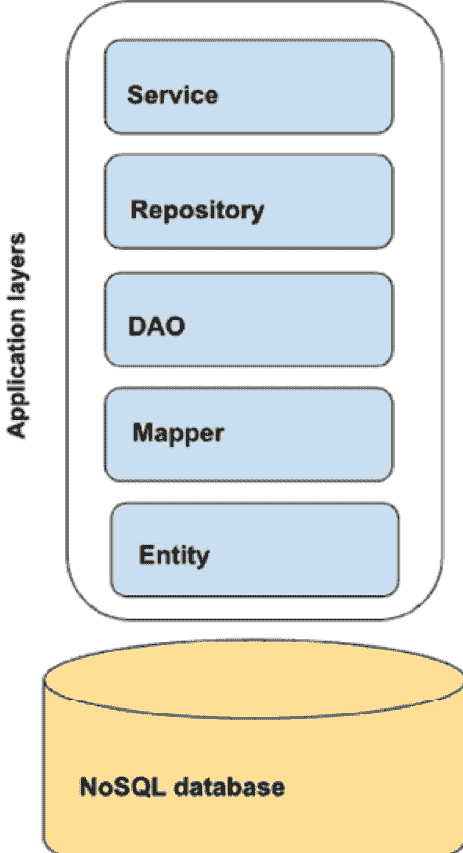

图 5.4：Repository 模式

DDD 原则的核心是 Repository 模式，这是一种为软件架构数据访问带来清晰性和结构的战略概念。该模式的本质在于它能够将领域实体从数据操作和存储的复杂性隔离开。通过引入专用的 Repository 层，Repository 模式允许应用程序将核心业务逻辑从数据库交互的复杂性中解耦。这种分离促进了更有组织性、模块化的架构，增强了可维护性，并允许开发者专注于完善应用程序的核心功能。

DDD Repository 模式的核心旨在提供一种结构化且标准的方法，将领域实体从数据访问的复杂性隔离开。通过创建一个专用的 Repository 层，可以将客户端代码和核心业务逻辑与数据库交互的具体细节解耦。这种分离促进了更纯洁、更聚焦的架构，并通过集中数据相关的职责增强了可维护性。

当应用于 NoSQL 数据库背景时，DDD Repository 模式提供了一种独特的优势，提供了一种有效策略来应对各种数据结构和存储模型的动态格局。NoSQL 数据库以其灵活性和多功能性著称，可以从 Repository 模式抽象数据访问的能力中极大受益。这种抽象保护应用程序免受各种 NoSQL 数据库技术的复杂影响，允许开发者无论底层数据库类型如何都能一致地与数据交互。因此，DDD Repository 模式充当了统一桥梁，将应用程序的领域逻辑与 NoSQL 数据库的多样化能力协调起来。

在 NoSQL 数据库背景下采用 DDD 存储库（Repository）模式最显著的影响之一，是它将应用程序与数据库实现的复杂性隔离开来。NoSQL 数据库涵盖多种数据模型和存储机制，每种都为特定的用例而定制。通过引入存储库层，应用程序可以通过标准化接口与数据进行交互，从而抽象数据存储和检索的细节。这种隔离机制使开发者能够专注于核心业务逻辑的实现和完善，而不必纠结于不同 NoSQL 技术的具体细节。存储库模式本质上充当了中介者的角色，确保应用程序在专注于为最终用户提供价值的同时，能够对底层数据库技术的变化保持韧性。

DDD 存储库模式的一个显著影响是它将应用程序与底层数据库技术隔离开的作用。由于 NoSQL 数据库提供了广泛的选项，包括文档型、键值型、列族型和图模型，存储库充当了中介，保护应用程序免受这些多样化数据存储的细微差别的影响。这种隔离让开发者能够专注于核心业务逻辑，而无需过度担心底层的数据库机制。

然而，采用 DDD 存储库模式虽然具有显著优势，但也需要仔细考虑权衡。额外的抽象层可能会引入需要有效管理的复杂性。如果优化不当，存储库在应用程序和数据库之间调解的作用可能会影响性能。此外，维护不断演变的领域模型与存储库设计之间的同步性，需要严谨的版本控制以避免数据不一致。在封装和性能之间取得平衡至关重要，以确保存储库模式仍然是一项资产而非阻碍。最终，决定采用 DDD 存储库模式应源于对其潜在收益与其内在复杂性审慎的评估，确保架构选择与应用程序的总体目标以及所选 NoSQL 数据库的特定特性和谐对齐。

虽然 DDD 存储库模式提供了许多益处，但它也引入了权衡。抽象层会增加一层复杂性，如果实现得不周全，可能会影响性能。维护存储库与不断演变的领域模型之间的同步性也可能具有挑战性，需要精细的版本管理。在隔离和效率之间取得平衡至关重要，以确保存储库模式在增强应用程序架构的同时，不会损害其响应能力或可维护性。

DDD 存储库模式提供了一种战略方法，用于在利用 NoSQL 数据库的应用程序中隔离领域逻辑并抽象数据访问。通过集中数据相关的职责，该模式提供了增强的可维护性、灵活性以及与各种 NoSQL 数据库技术复杂性的隔离。随着我们进一步探索 DDD 存储库的动态机制，我们对如何在应对其内在权衡的同时利用其益处有了见解，确保架构保持健壮并适应不断变化的 NoSQL 数据库格局。

## 数据库设计中的模式

在深入数据库设计领域（特别是在持久化层背景下），几种著名的设计模式脱颖而出。这些模式作为管理应用程序与数据库之间交互的指导原则，提供了独特的视角和解决方案。在本节中，我们将探索塑造数据库设计格局的六种主要模式：DAO、活动记录（Active Record）和 DTO 传输（DTO Transfer）。让我们深入研究这些模式中的每一个，以全面理解它们在设计健壮高效数据库系统中的作用和影响。

驱动程序（Driver）或数据库驱动程序模式提供了一个低级接口，用于与特定 DBMS 协议和 API 的复杂性进行交互，允许应用程序与数据库通信而无需陷入细节中。驱动程序是促进数据库连接、查询执行和结果检索的中介。

数据映射器（Data Mapper）模式是分离应用程序领域模型与数据库模式的基石。它充当应用程序面向对象世界与关系或非关系数据库结构之间的桥梁。数据映射器处理对象到数据库记录的映射，反之亦然，确保一个领域的变化不会直接影响另一个。

DAO 模式将数据库访问逻辑集中在专门的层中。它抽象了数据检索、修改和存储的细节，为应用程序与数据库交互提供了定义良好的接口。DAO 促进了可维护性，简化了测试，并允许在数据源或数据库技术之间切换。

在活动记录（Active Record）模式中，每个领域对象都封装了数据和行为，模糊了实体与数据库之间的边界。活动记录对象代表数据库记录，并负责其持久化操作。这种模式简化了数据库交互，但可能导致领域逻辑与数据存储之间的紧耦合。

存储库（Repository）模式将领域实体与数据访问的复杂性隔离开。它为查询和管理领域对象提供了标准化接口，抽象了数据库交互的细节。存储库增强了可维护性并促进了应用程序内部关注点的分离。

DTO（数据传输对象）作为轻量级数据容器用于在应用程序的不同层之间传输数据。它们封装了从数据库检索的数据，在需要对数据传输进行细粒度控制的场景中（例如减少分布式系统中的网络开销）特别有用。

在为软件系统设计架构时，理解管理应用程序和数据库的基本范式至关重要。这两个范式之间的分离程度（或距离）对于决定最合适的交互方式起着关键作用。正如之前所讨论的，应用程序和数据库在不同的范式下运行，导致了自然的阻抗不匹配。

当在靠近数据库的地方操作时，面向数据的编程（Data-Oriented Programming）方法通常会成为一种自然选择。这种方法强调行为与数据分离，使用通用结构表示数据，并将数据视为不可变。在这种情况下，驱动程序模式更自然地适用于使用 DOP 原则促进与数据库的通信。

相反，当应用程序运行得更接近领域时（这在面向对象编程中很常见），重点转向了暴露行为的同时封装数据。抽象、层和模块成为这种方法的关键组成部分。这种范式与面向对象编程的原则一致，其中对象封装了数据以及操作数据的行为。在 Java 语境中，这种面向对象的方法通常受到青睐，促进了结构化和模块化的设计，能够有效管理现实应用的复杂性。

为了说明这一关键点，附图提供了一个视觉化表示。该插图作为一个指南，帮助你可视化应用程序与数据库之间的距离对你架构选择的影响。通过识别内在的范式及其影响，在设计无缝衔接应用程序与数据库差距的软件系统时，你将能够做出明智的决策。请参考下图：

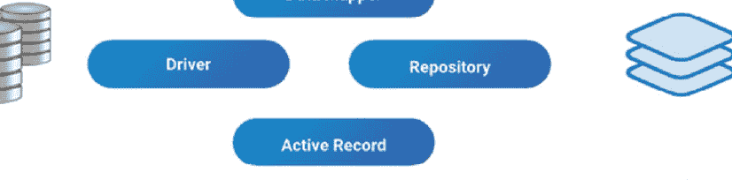

模式与范式之间的距离

我们对数据库设计模式和架构范式进行了全面的探索，强调了应用程序与数据库之间的距离在塑造软件架构中的关键作用。我们对六种突出的模式进行了概述：Driver、Data Mapper、DAO、Active Record、Repository 和 DTO，每种模式为管理数据交互和访问提供了独特的解决方案。这些模式是架构师和开发者构建高效、模块化且可维护的数据库系统的不可或缺的工具。之后，我们深入研究了管理应用程序和数据库的基础范式，强调了由于它们本质不同而产生的固有不匹配。我们讨论了优先考虑数据分离的 DOP（面向数据编程）方法，以及强调行为暴露和抽象的面向对象方法。可视化表示说明了应用与数据库距离对架构选择的深远影响。总而言之，我们为设计无缝衔接应用程序与数据库差距的软件系统提供了宝贵的见解和工具，以符合项目的需求和架构考虑。

## 结论

在追求有效的软件架构时，本章揭示了将 NoSQL 数据库集成到应用程序中的复杂策略。通过各种模式的视角，我们探索了架构如何深刻地影响应用程序与 NoSQL 数据存储交互的方式。Mapper 模式展示了添加中间层来弥合 NoSQL 数据库与面向对象编程之间差距的价值，增强了抽象、测试和适应性。

同样，DDD Repository 模式提供了一种引人入胜的方法，在抽象数据访问的同时隔离领域逻辑，创建了一个协调各种 NoSQL 技术与应用程序需求之间的桥梁。

正如我们所看到的，这两种模式都强调了结构化架构和良好定义层的重要性。每个层都有独特的用途，促进了更清晰的职责分工、简化的测试以及对不断变化的数据库技术的适应性。与数据库的逐渐分离，最终以隐式包含 Mapper 和 DAO 概念的 Repository 模式告终，说明了分层设计如何促进可维护、模块化和可扩展的设计。

凭借本章获得的基础知识，我们现在过渡到下一章，在其中我们将更深入地构建 NoSQL 数据库的艺术。通过探索数据建模、模式设计和性能优化等考虑因素，我们为自己提供了创建健壮高效的系统所需的见解，以充分利用 NoSQL 技术的潜力。通过对架构设计的全面探索，我们继续通往掌握现代软件开发动态景观之旅。

## 记忆要点

### 非结构化架构与 Mapper 模式

- 非结构化架构受 NoSQL 简单性的启发，适用于小型任务，但随着复杂性的增加，其可维护性和测试将面临挑战。
- Mapper 模式引入了中间层，将数据与 Java 对象之间进行转换，增强了抽象能力和测试能力。

### DAO 模式

- DAO 模式将数据库操作集中在单个层中，简化了测试、维护以及在不同 NoSQL 数据库之间切换。
- 它提供了一种结构化的方法，来弥合 NoSQL 数据库与应用程序逻辑之间的差距。

### DDD Repository 模式

- DDD Repository 模式将领域实体与数据访问复杂性隔离开，增强了可维护性和清晰度。
- 应用于 NoSQL 时，它抽象了数据交互并将应用程序与不同的数据库技术隔离开。

### 层的重要性

- 分层架构提供了抽象、关注点分离和模块化设计。
- 清晰的层边界增强了可维护性、扩展性和开发团队之间的协作。
- 不同的模式（Mapper、DAO、Repository）展示了层如何促进更好的代码组织、测试和适应性。

### 权衡的平衡

- 每种模式都带来了收益和权衡；仔细的考虑至关重要。
- Mapper 模式可能会引入复杂性，DAO 可能会影响性能，而 Repository 可能需要与不断发展的领域模型保持同步。

### 过渡到架构设计

- 本章为有效构建 NoSQL 数据库奠定了基础。
- 下一章将探索更深入的考虑，如数据建模、模式设计和性能优化。

## 单选题

### Mapper 模式在将 NoSQL 数据库集成到应用程序时提供了什么优势？

- 增强性能
- 降低复杂性
- **简化测试**
- 增加数据安全

### 在 NoSQL 数据库的背景下，DDD Repository 模式旨在隔离什么？

- 应用程序层
- 用户界面
- **领域逻辑**
- 系统架构

### DAO 模式如何有助于应用程序的可维护性？

- 通过增加代码复杂性
- **通过集中数据库操作**
- 通过消除测试需求
- 通过消除对层的需求

### 采用 DDD Repository 模式的潜在权衡是什么？

- 增强性能
- 降低可维护性
- 减少抽象
- **增加复杂性**

### Repository 模式如何帮助处理不同的 NoSQL 数据库技术？

- 它消除了对数据库交互的需求
- **它抽象了数据访问和技术细节**
- 它强制选择单一数据库
- 它防止应用程序扩展性

## 答案


# 加入我们书籍的 Discord 空间

加入书籍的 Discord 工作区获取最新更新、优惠、全球科技动态、新发布以及与作者的交流会议：

https://discord.bponline.com


# Java 架构与持久化层

## 引言

在快速演变的软件架构领域中，Java 与 NoSQL 数据库的结合已成为构建健壮且可扩展应用程序的关键推动因素。Java 架构的基础原则与 NoSQL 数据库提供的敏捷性和灵活性无缝衔接，产生了一种重新定义数据存储、访问和管理方式的共生关系。本章全面探索了这种协同作用，深入研究了 Java 架构与动态 NoSQL 数据库格局之间复杂的相互作用。

这一探索的核心是持久化层，这是一个连接软件设计概念领域与数据存储和检索实践领域的基础层次。本章通过深入研究持久化层对整体架构的多方面影响，超越了围绕 Java-NoSQL 集成的传统讨论。当我们揭示嵌入 Java 架构中的层时，我们强调了持久化层在塑造应用程序性能、扩展性和可维护性方面的关键作用。此外，我们遍历了一系列架构模式的织锦，从经典的端口和适配器范式到细致的命令查询职责分离（CQRS）和事件溯源。我们的旅程最终使我们理解这些架构选择如何影响 Java 与 NoSQL 之间的协同作用，使开发者能够创建无缝跨越健壮性和适应性领域的现代应用程序。

## 结构

本章涵盖以下主题：

- 架构影响：NoSQL 数据库集成
- 单体架构：重新发现简单性与权衡
- 微服务架构：多语言持久化和分布式复杂性
- 事件驱动设计
- 模型-视图-控制器（MVC）架构
- 命令查询职责分离（CQRS）
- 端口与适配器（六边形）架构
- 架构风格对比

## 目标

本章将开启揭明 Java 与 NoSQL 数据库集成中复杂微差别的旅程，强调持久化层所扮演的关键角色。本章的主要目标有两个：首先，揭示 Java 架构中固有的层次，阐明每一层如何对整个框架的功能和效率做出贡献。其次，深入研究持久化，分析其对现代应用程序性能、扩展性和可维护性的影响。通过对既有架构模式（如端口与适配器模型）以及 CQRS（读写分离）动态格局的全面探索，本章旨在为读者提供必要的洞察力，以便在协调 Java 架构原则与 NoSQL 数据库能力时做出明智决策。到本章结束时，读者将对涉及的技术复杂性以及通过这种集成所获得的战略优势有全面的理解，使他们能够在当代软件设计的前沿构建数据驱动的解决方案。

## 架构影响：NoSQL 数据库集成

在软件工程中，“架构”和“设计”术语往往交织在一起，但它们在塑造应用发展轨迹方面具有不同的意义。虽然前一章探讨了设计的复杂性及其对应用行为的关键影响，但本节将目光投向更广阔的架构视角，以及它如何与 NoSQL 数据库交互以塑造现代软件解决方案的本质。

在软件开发的复杂织锦中，架构与设计之间的界限对于引导创建健壮且功能完备的应用至关重要。虽然这两个词通常互换使用，但它们封装了共同塑造应用本质的不同维度。设计侧重于各个组件如何交互的细微差别，概述了代码实现和模块协作的细节。它包含了让应用功能活起来的细节。相比之下，架构则后退一步，构想更广泛的结构，为设计决策奠定基础。它定义了应用的高级组织，决定了模块之间的关系，并为高效实现搭建了舞台。架构与设计之间这种细微的区别支撑了引导在 Java 生态系统中集成 NoSQL 数据库的战略决策。

架构与设计之间的界限在于它们各自的范围和重点。设计主要涉及应用内部组件、交互和功能的蓝图。它围绕不同模块如何协作以实现预期功能展开，封装了指导代码实施的细粒度决策。另一方面，架构涵盖了一个更高层次的概述，定义了应用程序的整体结构和组织。它规定了各种组件之间的关系，划定了通信路径，并协调应用设计元素的对齐。虽然设计关注“如何做”，而架构解决的是应用存在的“是什么”和“为什么”。

架构在软件开发中的意义超越了仅仅的示意图规划；它构成了应用整个生命周期的基石。一个精心设计的架构类似于物理世界中的建筑奇迹，为应用程序的繁荣提供了必要的结构、凝聚力和韧性。除了作为指导蓝图的作用外，架构还赋予了决定应用在可扩展性、适应性和长期可行性方面轨迹的能力。当考虑 NoSQL 数据库的集成时，这一点变得尤为显著。架构与 NoSQL 数据库之间的共生关系是成功的关键，因为 NoSQL 的灵活本质需要一个对齐良好的架构基础。这种健壮的架构不仅利用了 NoSQL 数据库的能力，还确保了应用能够响应不断变化的需求进行进化。随着我们进入后续章节，由于 NoSQL 数据库集成而放大的架构深远影响将变得更加清晰，使我们能够对它们相互关联的角色建立全面的理解。

架构对软件系统的可持续性、可扩展性和适应性具有深远影响。它是设计选择的基础基石，在应用的整个生命周期内对其特性施加着无处不在的影响。一个构思良好的架构确保了设计实现的效率，并有助于未来的修改、扩展和优化。在集成 NoSQL 数据库的背景下，架构变得更加至关重要。NoSQL 数据库的灵活性多功能性要求与应用架构进行战略对齐，以发挥其全部潜力。健壮的架构可以无缝地集成 NoSQL 数据库，赋予应用扩展、适应变化的需求并利用 NoSQL 技术独特优势的能力。

在本章的后续章节中，我们将深入探讨构成 Java 架构的层次，解析它们在塑造与 NoSQL 数据库集成方面的作用。此外，我们还探索了作为这一集成之旅指南针的架构模式的复杂动态。通过理解架构的本质及其与 NoSQL 数据库的共生关系，读者将获得全面的视角，来构建超越单纯功能的应用程序，在动态的技术格局中体现适应性和韧性的精髓。

在处理 NoSQL 数据库与 Java 程序的集成时，架构中的几个关键方面凸显出来，塑造了这种协同作用的成功和有效性。这些方面对于确保应用最大化利用 NoSQL 数据库提供的利益，同时保持 Java 生态系统的完整性和效率至关重要：

- **可扩展性与灵活性**：架构必须促进 NoSQL 数据库的无缝扩展和灵活性。NoSQL 数据库以其处理大量数据和适应使用量激增的能力闻名。架构应该支持水平扩展，允许应用将数据分布在多个节点或集群以满足增加的需求。Java 架构应与 NoSQL 数据库的分布式和非关系特性无缝交互，允许数据被有效地分区和复制。

- **数据建模与模式**：与传统的关系型数据库不同，NoSQL 数据库提供了模式灵活性，允许数据模型在没有严格限制的情况下进化。架构必须使 Java 应用能够轻松适应变化的数据结构和需求。这通常涉及将 Java 对象映射到 NoSQL 文档、列或键值对，而无需预定义的模式。

- **数据访问模式**：架构应该包含与 NoSQL 数据库范式一致的高效数据访问模式。NoSQL 数据库擅长不同的数据访问方法，例如面向文档、键值、列族或基于图。Java 应用程序无缝地与这些数据访问模式接口，优化查询、检索和修改以适应所选的 NoSQL 数据库类型。

- **一致性与可用性**：NoSQL 数据库提供了一致性和可用性的权衡，从强一致性到最终一致性不等。架构应该允许 Java 应用根据需求选择适当的一致性级别。这确保了应用在考虑数据准确性、读写性能和容错能力的同时，能够高效地运行。

- **缓存与性能优化**：架构应该支持有效的缓存策略，以增强 Java 应用与 NoSQL 数据库交互时的性能。缓存机制通过在内存中存储频繁访问的数据，可以减轻数据库的负载，从而降低延迟并提高整体响应速度。

- **事件驱动架构**：NoSQL 数据库通常适用于事件驱动架构和实时处理。架构应能够适应事件驱动范式，使 Java 应用能够对数据变化做出响应，并根据数据库事件触发操作。

- **安全与身份验证**：安全在现代应用中至关重要。架构必须包含稳健的身份验证、授权和数据加密机制，以便在与 NoSQL 数据库交互时保护敏感信息。

- **迁移与演进**：随着技术格局的演变，架构的设计应当考虑到 NoSQL 数据库技术或版本的潜在变化。这包括对平滑迁移、数据转换以及集成新兴 NoSQL 解决方案的考虑。

从本质上说，架构必须将 Java 的基础原则与 NoSQL 数据库的独特特性融合，创建一个两种元素协同作用的环境，从而构建能够在当代数据驱动生态系统中蓬勃发展的具有韧性、可扩展且高效的应用。

在本章结束之际，必须承认，虽然我们深入探讨了将 NoSQL 数据库与 Java 应用集成时架构的关键方面，但架构设计的范畴是广阔且多面的。我们的目标并不是提供所有架构视角的详尽概述，而是突出在此类集成背景下具有特殊意义的关键考虑因素。

架构决策可以塑造应用的行为、扩展性和可行性。Java 架构与 NoSQL 数据库细微差别之间复杂的相互作用，需要一种明智的方法，通过平衡两者的优势来获得最佳结果。

我们意识到，本章仅仅触及架构原则的冰山一角。对于那些寻求更全面探索的人，我们将在最后的考量章节中提供建议，以供对更广泛的软件架构主题进行进一步阅读。

当我们过渡到结合 NoSQL 数据库的单体架构时，我们的探索将继续。这涉及到集成的另一个维度，面临着遗留系统的复杂性、扩展性挑战以及获得新敏捷性的潜力。通过研究这种混合的复杂性，我们将通过 NoSQL 数据库的视角，发现现代化和优化单体架构的策略。前面的旅程有望揭示软件开发动态格局中另一层面的架构精髓。

# 单体架构：重新发现简单与权衡

在软件架构范式不断发展的时代，单体架构仍然是一种可行且务实的方法，挑战了往往倾向于微服务的刻板印象。虽然微服务的吸引力在于其在扩展性、敏捷性和自主性方面的潜力，但与通常认知相反，单体架构仍然是一个极具吸引力的选择，特别是在过早优化可能会阻碍进展的特定背景下。

在软件架构中，单体是简单性和凝聚性的证明。想象你的应用程序是一个单一的、自包含的实体，从用户界面到业务逻辑和数据库的所有组件都紧密地集成到一个统一的结构中。下方插图所示的单一基础，提供了关于所有元素如何在单体架构内和谐共处的直观视图。探索插图以揭示单体的复杂性；这种风格通常受到青睐，因为它在需求简单的中小型项目中，易于与 NoSQL 数据库集成的特性。

请参考下图：

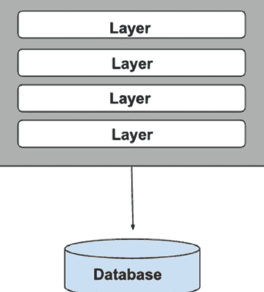

图 6.1：单体架构风格

单体架构在其简单性上具有独特的魅力。它将整个应用程序封装在单一代码库中，促进了直接的开发和维护。这种凝聚性的结构促进了模块之间更快的集成，利用共享内存空间进行通信，并消除了分布式微服务中常见的服务间通信的复杂性。

软件架构社区的知名人物强调了拥抱单体的优点，特别是在项目启动或其萌芽阶段。以微服务著作闻名的萨曼（Sam Newman）承认，并非所有应用都需要或已准备好应对微服务固有的复杂性。他提倡“单体优先”（Monolith First）的方法，即最初创建一个单体应用，允许团队在采用微服务架构之前验证想法、解决核心挑战并对领域复杂性产生洞见。该领域的杰出领袖马丁·福勒（Martin Fowler）也概述了“单体优先”原则，认为微服务的模块化和组织面临的挑战可以推迟到需求显而易见时考虑。

然而，单体架构也有其权衡。随着应用规模和复杂性的增长，单体可能会变得难以管理，使其维护、扩展和创新变得更加困难。单体某部分的更改可能会无意中影响其他部分，导致测试和部署方面的挑战。单体内部特定组件的扩展可能会受到单一代码库限制的约束，可能削弱微服务提供的扩展潜力。

然而，在单体和微服务之间的选择并非二元对立的。这是一种微妙的选择，取决于项目需求、团队专业知识和未来目标。应用的历程可以从单体开始，从简单快速开发中获益，并随着其成熟和需要更大的扩展性和模块化时转向微服务。

单体架构是软件设计中“简单性”这一永恒智慧的证明。虽然微服务的吸引力不容置疑，但单体的精简本质具有不可否认的优势，特别是在应用开发的早期。萨曼·纽曼和马丁·福勒等思想领袖的指导提醒我们，通往卓越架构的道路并非由一律的解决方案铺就，而是通过对项目需求的审慎评估以及对演进策略的开放态度。

然而，从单体到微服务的旅程不是线性进展，而是一种战略性的演进，每一步都根据应用需求和开发团队的抱负经过仔细权衡。当我们下一节将焦点转向微服务领域时，我们将探索一种提供模块化、自主性和扩展性的范式，但正如我们将要发现的那样，它也引入了自己的复杂性和挑战。

# 微服务架构：多语言持久化与分布式复杂性

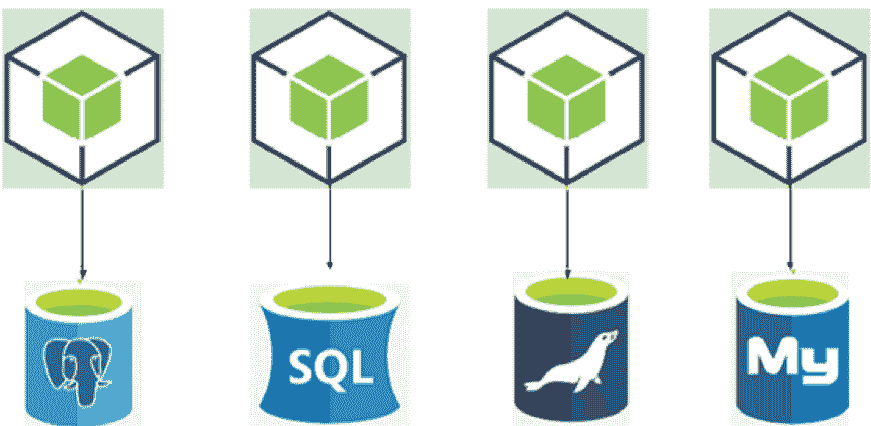

图 6.2: 微服务架构风格

微服务架构引入了一种超越功能边界的隔离范式，它封装了安全性、数据一致性和版本管理等关键方面。每个微服务都在其专用的数据库领域内运行，培养了一种隔间化水平，通过限制访问和潜在漏洞增强了安全性。这种隔离性还增强了数据一致性，因为单个服务内部的故障被限制在所属领域内，最大限度地减少了级联效应的风险。此外，微服务方法缓解了经常困扰单体架构的版本控制问题。每个微服务独立地管理其库、框架和数据库版本，版本冲突的阴影逐渐消退，为更平滑的更新和改进的长期维护策略铺平了道路。微服务与专用数据库之间的和谐形成了一个坚实的生态系统，安全性、一致性和版本控制在此汇聚，增强了现代应用的稳健性。

微服务架构的一个独特特征是它在选择多样化数据存储技术方面提供的自由，这种概念被称为多语言持久化。每个微服务都可以根据其特定需求利用最佳的 NoSQL 数据库，充分发挥各种数据库系统的优势。这种灵活性使组织能够采用多语言方法，为每个用例选择合适的数据库，范围从用于灵活数据结构的文档存储、到用于快速检索的键值存储，再到用于处理复杂关系的图数据库。微服务与 NoSQL 数据库之间的这种战略对齐引入了一种动态性，增强了应用的整体效率和适应性。

微服务在本质上从功能和数据两个方面促进了隔离。每个微服务都可以有其专用的数据库，确保数据被隔间化，并且访问仅限于经过授权的服务。这种隔离增强了安全性并提升了数据一致性，因为一个服务的故障不太可能传播到整个应用程序。此外，微服务降低了版本冲突的风险，因为每个服务都可以采用自己的框架、库和数据库版本，缓解了单体架构中经常遇到的 Java 版本兼容性挑战。

虽然微服务架构的吸引力不可否认，但带着对采用它时固有权衡的敏锐意识来走这条道路至关重要。由于功能分布在多个服务中，应用复杂性的增加为管理服务间通信、数据同步和最终一致性带来了挑战。微服务的分布式特性导致应用程序产生网络延迟，从而影响性能和响应时间。此外，与任何架构转变一样，并不是所有场景都值得向微服务转型。预期的收益被不可预见的复杂性所掩盖，导致应用程序与其单体对应物相比，运行更慢或更难维护。

当组织进入微服务领域时，有条理地进行这种转换至关重要，评估应用的特定需求并权衡收益与挑战。对架构选项进行明智的评估对于确保通往微服务的旅程符合组织目标和技术格局至关重要，避免在没有全面考虑的情况下过度采用而可能产生的陷阱。

然而，像任何架构选择一样，采用微服务并非没有权衡。复杂性的增加是一个值得关注的考量。随着每个服务作为一个独立的应用程序运行，服务间通信、数据同步和最终一致性等问题随之而生。微服务的分布式特性还引入了网络延迟和潜在瓶颈，影响了应用的整体性能。在某些情况下，微服务承诺的收益并未实现，导致应用程序比单体对应物运行更慢。

在采用微服务时，必须对涉及的权衡有清晰的理解，并对应用需求进行全面分析。彻底的计划和对潜在陷阱的考虑是必不可少的，以确保向微服务的转型产生预期收益，同时避免架构失误。

选择采用微服务还是单体架构具有深远的影响，特别是当考虑到它们与 NoSQL 数据库的相互作用时。下表提供了 NoSQL 技术背景下对这些架构范式的对比分析，阐明了各自的优势和挑战。当组织应对数据存储、扩展性、安全维护的格局时，这种比较作为一个战略指南，有助于选择与应用的独特需求无缝对接的架构，同时利用 NoSQL 数据库提供的优势。

参考下表：

| 特性 | 单体架构 | 微服务架构 |
| :--- | :--- | :--- |
| **复杂度** | 低（单单元） | 高（分布式系统） |
| **可扩展性** | 垂直扩展（扩展整个应用） | 水平扩展（独立服务扩展） |
| **数据一致性** | 强一致性（ACID 事务） | 最终一致性（BASE） |
| **部署** | 原子性（全或无） | 独立性（按服务） |
| **技术栈** | 有限（单一技术栈） | 多语言（允许多样化技术栈） |
| **容错性** | 单点故障 | 隔离故障 |
| **开发速度** | 初始快，随时间推移而变慢 | 初始慢，大型团队更快 |

## 事件驱动设计

在一个以信息快速流动和瞬时响应为特征的时代，事件驱动设计已成为一种变革性的范式，重新定义了现代应用程序交互、通信和适应的方式。本节将深入探讨 NoSQL 数据库背景下事件驱动架构的复杂性，揭示其优势、权衡，以及这种动态方法背后的内在影响和挑战。请参考图。

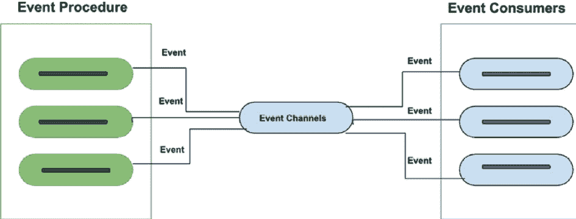

图 6.3：事件驱动架构风格

在现代应用架构领域，事件驱动范式是实时敏捷性的灯塔，与 NoSQL 数据库的能力无缝衔接。这种方法的魅力在于它能够利用异步事件处理来在分布式布局中编排任务。这种共生关系展现了多重优势。通过将 NoSQL 数据模型的灵活性与事件驱动设计的敏捷性相结合，应用程序可以超越传统边界，实现卓越的性能、响应和适应性。这种集成使应用程序能够在保持实时响应的同时，进行资源密集型操作，为利用 NoSQL 的分布式特性和可变模式提供了理想解决方案。

事件驱动设计在与 NoSQL 数据库集成时提供了诸多益处。事件的异步本质允许应用程序以分布式和响应式的方式处理任务，增强了性能和可扩展性。异步事件处理允许服务解耦，使其能够独立运行并适应不同的负载，这种特性特别适用于 NoSQL 分布且灵活的数据模型。这种方法释放了承担复杂和资源密集型任务（如数据分析）的潜力，而不会阻碍应用程序的实时响应。

虽然 NoSQL 数据库的事件驱动设计开启了前所未有的敏捷之门，但也伴随着一系列复杂的权衡和考虑。事件驱动架构的分布式和异步性质要求对数据一致性和顺序进行密切关注。在生产者和消费者之间实现准确的事件编排和同步需要巨大的努力。在这种动态环境中进行测试和调试可能带来挑战，因为事件的消费顺序和组件之间的交互变得至关重要。组织在使用事件驱动设计的优势时，必须应对这些复杂性，在利用该方法的潜力与解决其复杂性之间取得微妙的平衡。


然而，采用事件驱动设计并非没有权衡。在事件生产者和消费者的分布式布局中确保数据一致性需要仔细的考虑和健壮的机制。事件驱动系统中的测试和调试可能是复杂的，因为事件的编排及其消费顺序对于维护应用程序的完整性至关重要。虽然事件驱动架构提供了扩展和并行的潜力，但这种方法固有的复杂性可能会在保证准确数据处理和维护同步方面带来挑战。

在 NoSQL 数据库领域实现事件驱动设计引入了一系列需要创新解决方案的挑战。确保分布式事件交互中的数据一致性成为一个关键关注点，促使需要健壮的机制来维持一致的状态转换。此外，管理事件顺序、错误处理和准确事件传播的复杂性可能是惊人的。异步交互在理解和排错异常方面引入了复杂性，要求对事件交互有全面的掌握。事件驱动设计的未来道路涉及完善策略以应对这些挑战，开创性方法以保证精确的数据处理、事件排序和可靠的通信。随着应用程序继续拥抱实时响应的动态格局，这些挑战将推动进步，推动该领域向更加复杂和高效的事件驱动系统迈进。

实现事件驱动架构在数据一致性、事件顺序和错误处理方面引入了挑战。异步处理可能导致在管理状态转换和维护跨应用程序一致数据视图方面变得复杂。确保事件被准确发布、消费和处理变得至关重要。此外，处理由异步交互产生的错误和异常需要对事件生产者和消费者之间的交互有全面的理解。

当我们结束对 NoSQL 数据库背景下事件驱动设计的探索时，显而易见，这种范式提供了引人的协同作用，将应用程序推向实时响应和扩展性的领域。事件的异步本质与 NoSQL 数据存储的分布式灵活性和谐统一时，展现了可能的格局。然而，这段旅程并非没有挑战，需要敏锐的策略来确保数据完整性、顺序准确性和可靠通信。

我们的轨迹现在转向对应用架构模式的深层分析，深入构成现代软件设计结构的层级。接下来的课程将重点关注模型-视图-控制器（MVC）模式，这是一个封装了关注点分离和结构清晰的基础框架。通过探索该模式如何与 NoSQL 数据库相交，我们将揭开协调数据存储与用户交互的艺术，强调架构模式在塑造直观、可维护和可扩展应用程序方面所起到的关键作用。

# 模型-视图-控制器 架构

在软件设计领域，MVC 架构作为一种持久的基石，提供了一种促进清晰性、可维护性和关注点分离的结构化方法。本节将深入探讨 MVC 架构与 NoSQL 数据库之间复杂的相互作用，揭示这种范式如何在处理灵活数据存储解决方案的细微差别的同时塑造用户交互。

在软件架构复杂的织锦中，MVC 范式如一盏指明灯，提供了一种赋予清晰度、可维护性和模块化组织的系统方法。其核心是将应用程序划分为三个不可整合的组件：模型，负责管理数据；视图，负责展示用户界面；以及控制器，作为用户输入以及模型与视图之间通信的编排器。这种优雅的关注点分离不仅简化了开发过程，还培养了代码的可重用性并简化了维护，形成了支持结构与用户交互之间复杂舞蹈的基石。请参考下图：

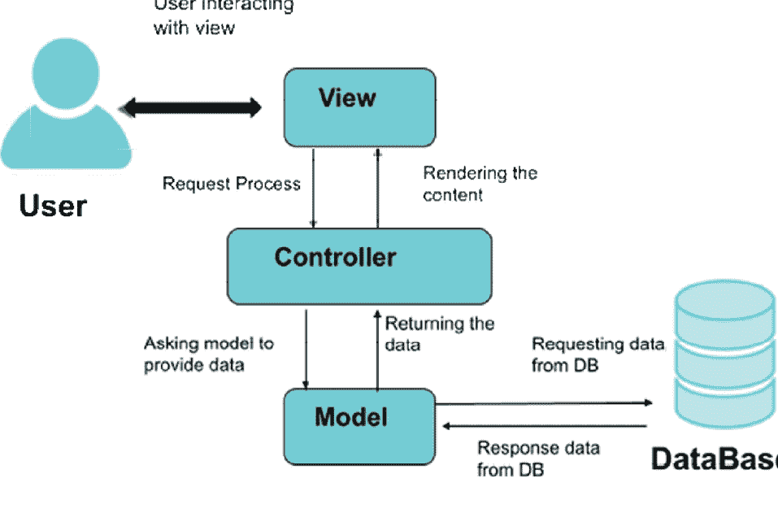

图 6.4：MVC 架构

当 MVC 架构与 NoSQL 数据库领域交织时，随之的是一场灵活性和适应性的交响乐。NoSQL 多化的数据模型（涵盖文档、键值对、列和图）与 MVC 的模型组件无缝协调。这种共生关系赋予应用程序在没有预定义模式约束的情况下构建数据结构的能力。NoSQL 固有的灵活性与 MVC 的模块化组织和谐一致，使数据模型能够动态演进并促进敏捷开发。这种融合弥合了用户交互与数据管理之间的差距，最终形成了一种拥抱变化、创新和响应的架构协同。

与 MVC 的 `Model` 组件无缝集成，允许应用程序根据需要塑造数据结构。这种灵活性增强了适应性，允许应用程序不受僵化模式的限制而演进，从而促进敏捷开发并为未来做好准备。

MVC 架构与 NoSQL 数据库的融合提供了一系列优势，但也引入了许多权衡和复杂性。MVC 固有的关注点分离有时会导致复杂的数据检索场景，其中单个视图所需的数据可能分布在多个 NoSQL 文档或集合中。随着数据检索复杂性的增加，这种错综性可能会带来性能挑战。此外，确保模型表示与视图呈现之间的数据一致性变成了一项细致的工作，特别是在 NoSQL 无模式（schema-less）环境中。要在模块化优点与 NoSQL 数据存储的复杂性之间取得平衡，需要对这两种范式均有敏锐的理解，使开发人员能够应对这些复杂性，并构建出能够优化用户交互和数据管理的解决方案。

在对 MVC 架构与 NoSQL 数据库之间动态相互作用的探索中，我们深入了在拥抱数据存储灵活性的同时塑造用户交互的艺术。这两种范式之间的共生关系产生了一个框架，赋予开发人员创建模块化、可维护且响应迅速的应用程序的能力。然而，正如任何架构方法一样，仍有需要平衡的考虑和需要应对的权衡，特别是在编排数据检索和确保一致性时。

当我们过渡到下一节时，我们将深入研究一种名为命令查询职责分离（CQRS）的特殊架构模式。这种范式提供了一种独立处理数据操作和检索的变革性方法，优化了性能和响应能力。通过沉浸在 CQRS 的复杂性中，我们发现了一种与 NoSQL 数据库相协调的架构策略，重塑了以数据为中心的设计格局，并扩展了我们构建现代数据驱动应用程序的工具箱。

## 命令查询职责分离 (Command query responsibility segregation)

在不断演变的软件架构格局中，CQRS 模式作为一种变革性方法出现，重新构想了应用程序处理数据操作和检索的方式。在本节中，我们探索了 CQRS 及其与 NoSQL 数据库之间复杂的关系，阐明这种范式如何在处理其权衡细微差别的同时，实现以数据为中心的设计。

CQRS 模式的核心是一个变革性概念，它重新定义了应用程序管理数据操作和检索的方式。CQRS 协调了读取操作（查询）与写入操作（命令）之间的划分，创建了针对每个任务优化的独特模型。虽然 CQRS 的原则与良好的架构设计一致，但其深远影响在 NoSQL 数据库领域表现得尤为强烈。本节深入探讨 CQRS 的本质，揭示了它的模块化和关注点分离如何与 NoSQL 数据存储的适应性和谐地契合，最终实现了一种焕新的新的以数据为中心的设计方法。请下图：

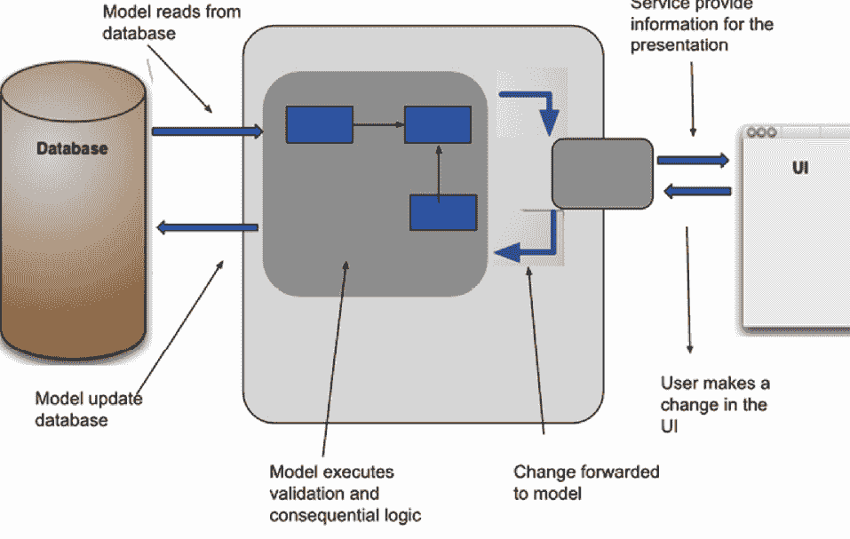

### 图 6.5：CQRS 架构

CQRS 是一种区分读取数据操作（查询）和修改数据操作（命令）的架构模式。这种分离促进了用于读取和写入数据的不同模型，使其能够根据每种操作的需求进行定制优化。虽然 CQRS 符合良好设计的基本原则并封装了整洁架构的精髓，但其影响在 NoSQL 数据库中产生了深远的回响。NoSQL 无模式本质固有的灵活性与 CQRS 无缝衔接，赋予应用程序定制其数据模型的能力，以实现最佳的查询和命令性能。

当我们采用 CQRS 模式时，面临的是一系列权衡和复杂的考虑因素。数据操作模型的隔离引入了一层需要细致编排的复杂性。确保查询模型和命令模型之间的数据一致性需要定义良好的同步策略。通过 CQRS 追求性能优化与在两个模型之间维持连贯数据视图的挑战之间取得了平衡。虽然 CQRS 赋予了应用程序更强的性能，但它也需要周密的规划、架构洞察力以及对最终一致性（eventual consistency）的清晰理解，以应对数据管理和检索的复杂格局。

拥抱 CQRS 并非没有权衡。读写不同模型的引入可能会导致应用程序开发的复杂性，因为开发人员必须管理这些模型之间的同步和一致性。在查询和命令模型之间维护数据一致性需要健壮的机制，以及对最终一致性的细致理解。虽然 CQRS 优化了读写双方的性能，但它可能会引入学习曲线，并在设计和实现中涉及审慎的考虑。

CQRS 与 NoSQL 数据库之间的相互作用谱写了一个和谐的叙事，汇聚了这两种范式的优势。NoSQL 多化的数据模型在 CQRS 的关注点分离中找到了恰当的对应。这种结合使应用程序能够根据特定案例定制数据存储和操作策略，优化读写性能。随着 NoSQL 的无模式本质与 CQRS 的模块性契合，应用程序可以编排一场以数据为中心的舞蹈，在优雅地处理其数据独特需求的同时，应对这种联盟随来的挑战。通过拥抱这种融合，开发人员掌握了释放增强性能和响应能力的力量，尽管需要敏锐的设计、细致的实现以及对确保 CQRS 不同模型之间数据完整性做出坚定不移的承诺。

CQRS 与 NoSQL 数据库的婚姻是以协同为特征的。NoSQL 多化的数据模型与 CQRS 提供的关注点分离和谐相处。这种联盟使应用程序根据其独特需求优化数据检索和操作策略。虽然 CQRS 增强了基于 NoSQL 的应用程序的性能和响应能力，但其成功实施取决于应用需求、架构考虑之间的战略对齐，以及对其所引入的影响的整体理解。

在探索 CQRS 与 NoSQL 数据库之间的共生关系时，我们揭示了一种重塑数据操作、性能优化和以数据为中心设计的动态协同。虽然 CQRS 在处理读写方面引入了范式转变，但 NoSQL 的自适应存储能力为这种架构转型提供了肥沃的土壤。然而，这段旅程并非没有复杂性，它要求优势和权衡之间进行战略性的平衡。

## 端口和适配器（六形）架构

在软件架构的织锦中，端口和适配器模式（也称为六形架构）是模块化和隔离的灯塔。本节开启了进入这种架构模型的程，揭示了它如何以及何处与 NoSQL 数据库交织，并深入探讨了隔离、适应性与该方法固有权衡之间的微妙平衡。请下图：

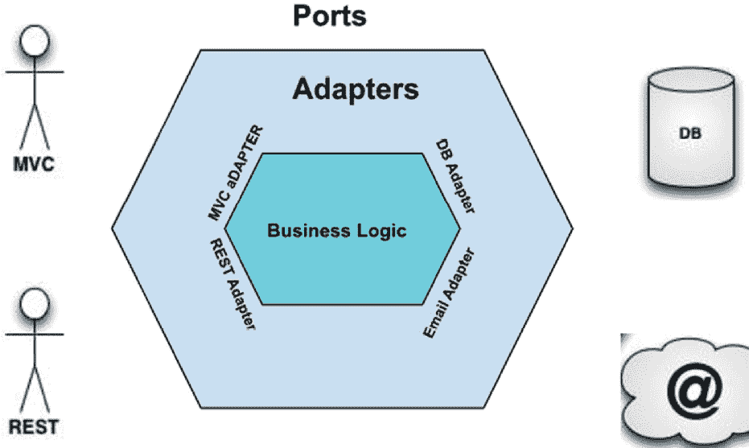

### 图 6.6：六形模型架构

在软件架构复杂的格局中，端口和适配器模式（也被称为六形架构）是一个模块化的优雅与策略性的隔离。这种架构范式倡导应用程序的核心业务逻辑与其外部依赖（如数据库、用户界面和外部服务）之间清晰的分离。这种分离通过创建“端口”（ports）来实现，端口定义了应用程序与这些依赖交互的接口，并桥接了核心应用程序与这些外部领域之间的鸿沟。这种方法封装了灵活性，促进了可维护性，并使应用程序免受外部变化带来的连锁反应影响，同时保持了一个纯洁、适应良好且与架构无关的核心。

从核心上说，端口与适配器（Port and Adapters）架构倡导关注点分离，主张应用程序核心逻辑与数据库、用户界面和外部服务等外部依赖之间明确的区别。这种隔离通过创建“接口”（Interfaces）来实现，接口定义了应用程序与这些外部依赖交互的方式；通过“实现”（Implementations）桥接核心应用程序与这些依赖之间的鸿沟。这种模块化方法确保了外部因素的变化不会影响到应用程序的核心逻辑，从而增强了系统的可维护性和灵活性。

端口与适配器模式对 NoSQL 集成的深远影响表现为一种战略性框架，封装了与 NoSQL 数据库之间复杂的交互。通过对专用适配器进行细致的设计和实现，这种架构模型提供了从特定 NoSQL 数据库技术中隔离的路径。通过将结构与 NoSQL 无模式（schema-less）灵活性的原则对齐，应用程序可以无缝集成各种 NoSQL 数据库，而不损害核心逻辑。NoSQL 数据模型的适应性与端口与适配器方法的模块化产生了共鸣，使应用程序能够熟练地定制其交互，同时确保数据存储策略的变化保持在局部。这种对齐使开发者能够利用 NoSQL 数据库的敏捷性，同时保持端口与适配器模型所体现的架构完整性和独立性。

端口与适配器模型对 NoSQL 集成的影响显而易见，它提供了一个优雅的框架来封装与 NoSQL 数据库的交互。通过设计与 NoSQL 数据库交互的专用适配器，应用程序可以实现特定特定技术的隔离。这种封装允许轻松切换数据库而不影响核心应用程序逻辑，确保数据存储策略的变化不会渗透到整个系统。NoSQL 多样的数据模型可以通过不同的适配器来容纳，使应用程序能够利用不同 NoSQL 数据库的优势，同时保持架构的完整性。

在端口与适配器（六边形）架构的领域，适配器（adapters）的概念占据了中心位置，开启了一个集成灵活性的领域。其核心是，适配器作为连接应用程序核心业务逻辑与其外部依赖（如数据库）的桥梁。在 NoSQL 数据库的背景下，这种以适配器为中心的方法尤为突出，提供了一种优雅的解决方案，协调了集中业务逻辑与多样化数据库模型的需求。

想象这样一个场景：核心业务功能和存储库结构保持不变，这是一个封装了应用程序精髓的基础实体。此时，数据库适配器不仅扮演着为数据库转换和建模实体的角色，还兼顾了特定 NoSQL 数据库技术的特异性。这种隔离允许进行定制的数据建模、索引策略和架构调整，以与所选 NoSQL 数据库的能力对齐，而不会渗透到核心业务逻辑。

这种模块化方法依赖于关注点分离、封装和敏捷性的原则。核心不受特定数据库建模复杂性的负担，使其能够始终专注于应用程序的首要目标。同时，数据库适配器拥抱了 NoSQL 数据库的动态性，在适应其独特属性的同时实现了无缝集成。下图展示了其中的示例，具有单个实体、存储库以及多个适配器。请参考以下图：

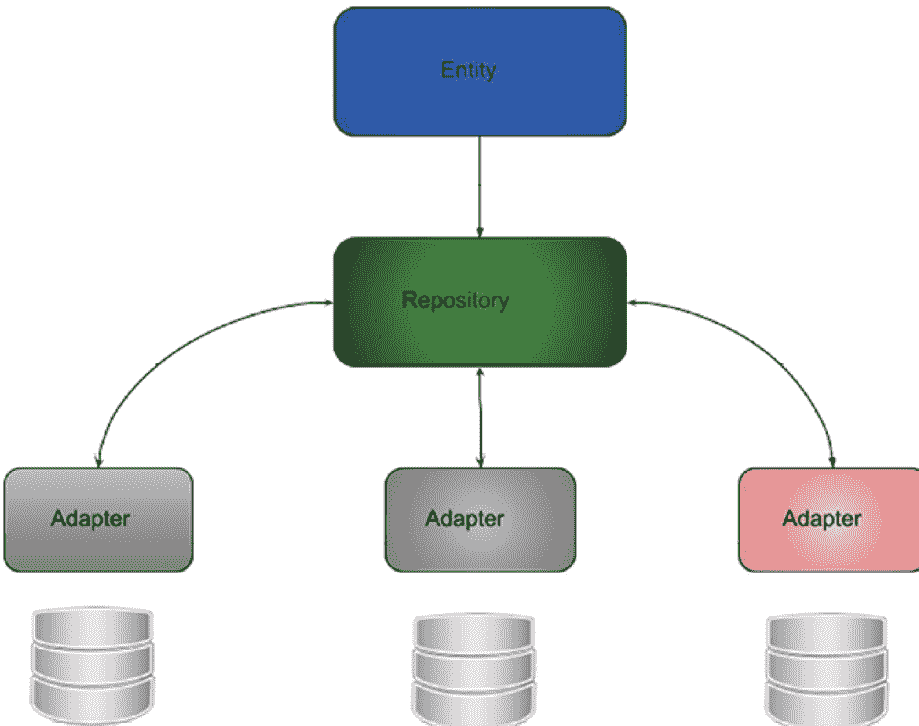

图 6.7：一核心对应多数据库

然而，这种方法并非没有权衡。随着适配器数量的增加（每个适配器对应特定的数据库技术），应用程序的复杂性也随之增加。确保适配器之间行为一致的需求，加上同步更改和维护适应性的挑战，可能会导致开发工作量增加和潜在的性能开销。

当我们探索这种由适配器驱动方法的复杂性时，我们意识到对架构卓越的追求往往涉及模块化优势与多层结构引入的复杂性之间精细的平衡。通过明智地评估应用程序的需求、NoSQL 数据库的复杂性以及手头的架构权衡，开发者可以利用适配器的力量，构建出与各种数据存储和谐集成的系统，同时保持核心业务逻辑的完整性。

在架构模型领域，端口与适配器模式呈现出一把优势与权衡并存的双刃剑。虽然对模块化和隔离的强调促进了可维护性和灵活性，但它也可能引入复杂性。将关注点分离到不同的适配器和端口可能会导致应用程序内部层数的增加。虽然这种分层方法符合整洁架构的范式，但它需要细致的平衡。由于数据在穿越这些层以与外部依赖交互，较高的层数可能会引入开发复杂性和潜在的性能开销。应对这种权衡需要敏锐的架构设计、对性能优化的细致关注以及对应用程序需求的全面评估，以便在封装和复杂性之间达成和谐平衡。

与任何架构模型一样，端口与适配器方法也伴随着权衡。对模块化的强调可能导致应用程序中层和组件数量的增加。这在开发工作和运行时性能方面都会引入程度的复杂性。

虽然架构提供的隔离是无价的，但它需要仔细的设计以便在封装和复杂性之间取得正确的平衡。

在我们对端口与适配器（六边形）架构的探索中，我们揭示了一个模块化、灵性和隔离汇聚的领域，塑造出与各种 NoSQL 数据库无缝集成的应用程序。这种方法的优雅之处在于它能够保持一个核心核心，不受特定数据库建模复杂性的约束，同时通过专用适配器适应各种 NoSQL 技术的细微差别。然而，这段旅程并非没有复杂性和权衡，促使我们在处理封装与层级复杂性的平衡时谨慎行事。

# 架构风格比较

当我们站在架构探索的十字路口时，现在是时候开启一场全景之旅，比较我们在本书中深入过的各种风格。我们涵盖的每种架构视角：Java 架构、持久化层、微服务、事件驱动设计、CQRS 以及端口与适配器（Port and Adapters），每种视角都带来了独特的优势和考虑因素。在本节中，我们将探索在与 NoSQL 数据库结合时，何时以及如何应用这些风格的格局，识别它们集成的理想场景，并探索平衡多种视角以获得最佳结果的艺术。

架构风格的选择取决于应用的特定需求、目标和挑战。例如，当目标是设计一种利用 NoSQL 灵活性的简单单体设计时，Java 架构视角提供了坚实的基础。当扩展性、隔离性和多语言持久化（polyglot persistence）至关重要时，微服务表现尤为出色，特别是在不同服务需要不同的 NoSQL 数据库来满足其独特需求的场景下。

当响应和实时交互是应用程序的心脏时，事件驱动设计成为了一个极具吸引力的选择。CQRS 在数据操作优化方面开辟了自己的领地，特别是当数据读取和写入需要不同的处理方式时。对于那些致力于封装数据交互并培养适应性的人来说，端口与适配器模式已准备好适应 NoSQL 的动态能力。

当我们穿过现代软件设计的版图时，架构风格之间的界限变得模糊，为和谐的协同提供了可能。这些风格——Java 架构、持久化层、微服务、事件驱动设计、CQRS 和端口与适配器——之间的相互作用可以创造出一种交响乐般的融合，利用它们的各自优势来应对复杂的挑战。通过协调这些视角的战略性融合，应用程序可以增强其能力并适应不断变化的需求。无论是将微服务与 CQRS 结合以优化数据操作，还是将事件驱动设计与端口与适配器交织以实现实时交互，关键在于理解每种风格的微妙差别及其相互作用，从而构建出超越个体边界的整体架构。

在现代应用程序架构领域，风格之间的边界往往是通透的，这使得实现一种利用它们优势的协调和谐成为可能。例如，微服务架构可以与 CQRS 协同工作以优化数据管理和响应。事件驱动设计可以与端口与适配器模式相互作用，塑造出在保持隔离性的同时利用实时交互的数据操作策略。

结合架构风格的艺术在于将其原则与应用程序的独特特征对齐。无论是融合两个或多个视角以实现扩展性、模块化或实时响应，关键在于理解每个视角带来的权衡和复杂性。通过采取务实的方法并明智地选择共鸣的风格，开发者可以构建出与 NoSQL 数据库无缝集成的应用程序，谱写敏捷、性能和适应性的交响乐。

随着我们对这些架构视角的探索结束，这段旅行通过从每种风格的织锦中汲取的教训告终。这些见解使我们能够构建稳健、创新且有效的应用程序，在不断变化的技术格局中生存，同时充分利用 NoSQL 数据库的优势和能力。

在软件架构的动态领域，选择正确的方法可以显著影响应用的成功。为了指明前进方向，我们对各种架构视角进行了全面的比较，每种视角在与 NoSQL 数据库集成时都拥有其自身的优势和考虑因素。此表捕捉了微服务、事件驱动设计、CQRS、端口与适配器以及单体（Monolith）方法的精髓，概述了它们的优势、理想场景以及需要注意的权衡。通过深入这种比较，我们使架构师和开发者能够做出明智的决策，在需要时战略性地融合这些视角，并在现代软件开发的复杂格局中塑造出与 NoSQL 数据库和谐交互的韧性和适应性应用程序。请参考下表：

## 表 6.2：架构概述

此比较旨在为每个架构视角的优势、用例和考虑因素提供一般概述。架构风格的最佳选择应该根据应用程序的特定需求、目标和限制，以及团队对所选范式的熟练程度来决定。

## 结论

我们在 NoSQL 数据库集成中复杂的架构视角世界之旅即将结束，这给我们留下了丰富的由见解、策略和考虑因素构成的织锦。我们探索的每种视角：微服务、事件驱动设计、CQRS、端口与适配器以及单体方法，都提供了一个独特的窗口，让我们通过它来观察在 Java 生态系统中集成 NoSQL 数据库的挑战与机遇。


作为架构师和开发者，凭借这些理解，我们准备好设计能够无缝协调用户交互和数据管理的应用程序。我们发现了这些视角为我们带来的模块化、适应性和实时响应的力量。每种视角都是现代应用程序设计画布上的笔触，共同构成了一幅捕捉敏捷、性能和创新精髓的复杂画像。

然而，当我们结束这一章时，我们意识到对卓越架构的追求是一个持续的过程。技术格局不断进化，挑战我们去适应和完善策略。随着 `Java` 企业版（现在的 `Jakarta EE`）出现在地平线上，下一章正在召唤——对支撑整个 `Java` 生态系统的标准化企业架构的探索。从 `NoSQL` 集成到分布式系统，`Jakarta EE` 的影响深远。在随后的旅程中，我们将深入研究 `Java` 企业架构的标准、最佳实践和不断演变的格局，揭示它与 `NoSQL` 数据库之间复杂的联系。通过统一对架构视角的理解并拥抱企业标准，我们使能够应对不断变化的技术潮流，塑造出体现架构卓越艺术性和精通的应用程序。

- **单体结构的简单性**：单体结构提供了集成上的简单性，是小型应用程序的理想选择，但在扩展性和充分利用 `NoSQL` 能力方面存在局限性。

- **整体方法**：选择合适的架构风格取决于特定的应用程序需求，需要在优势与权衡之间取得平衡，以最符合项目需求。

- **协同融合**：架构风格之间的相互作用可以放大优点并减轻弱点，但这需要对每种视角及其潜在相互作用有深入理解。

## 多选题

哪种架构视角最适用于具有实时交互和复杂数据流的应用？

- 微服务
- 事件驱动设计
- CQRS
- 端口与适配器 (`Port and Adapters`)

使用端口与适配器架构进行 `NoSQL` 集成的一个关键优势是什么？

- 大规模应用程序的可扩展性
- 简单且易于集成
- 实时响应能力
- 多语言持久化 (`Polyglot persistence`)

哪种架构风格通过分离读、写操作来优化数据处理？

- 微服务
- 事件驱动设计
- CQRS
- 端口与适配器

在什么场景下，单体架构风格最适合集成 `NoSQL` 数据库？

- 大型且复杂的应用程序
- 具有实时交互的应用程序
- 要求简单的中小型项目

使用微服务架构风格进行 `NoSQL` 集成的一个潜在权衡是什么？

- 管理微服务的简单性
- 实时响应能力
- 运维开销
- 限制的可扩展性

## 答案

# 第 7 章

# Jakarta EE 和 MicroProfile 简介

## 引言

在当今快速演变的数字领域，对高效且可扩展的数据管理解决方案的需求催生了 `NoSQL` 数据库的兴起。这些数据库旨在处理海量的非结构化或半结构化数据，通过提供无与伦比的灵活性和性能，改变了传统的关系型数据库模型。在本章中，我们将深入 `NoSQL` 数据库，探索其基本原理、独特特性以及它们涵盖的类别。

在 `Java` 企业生态系统中集成 `NoSQL` 数据库（特别是结合 `Jakarta EE`），为组织处理数据驱动应用程序的方法引入了范式转变。`Jakarta EE` 是构建企业级 `Java` 应用的标准，提供了一个健壮的框架，促进了 `NoSQL` 数据库的无缝集成，为开发者提供了充分利用这些现代数据存储潜力的工具。当我们探索 `NoSQL` 数据库与 `Jakarta EE` 集成的复杂综述时，不仅将发现这种强大组合的技术方面，还将发现其对整个软件开发格局的深远影响。加入我们，开启理解 `NoSQL` 数据库与 `Jakarta EE` 之间协同作用以及这种集成如何塑造企业应用未来的之旅。

## 结构

本章涵盖了以下主题：

- `Jakarta EE` 的演变
- 导航 `Jakarta EE` 的架构格局
- `Eclipse MicroProfile`

## 目标

在本章中，我们的目标是探索 `NoSQL` 数据库的基本原理和特性，研究它们涵盖的各种类别，并审视 `NoSQL` 数据库与 `Jakarta EE` 集成对 `Java` 企业生态系统的转型影响。我们旨在让读者对这种集成如何彻底改变数据管理方法并塑造现代企业应用开发格局有全面的理解。

## Jakarta EE 的演变

在不断演进的技术领域，标准的重要性不言而喻。这些标准是指导原则，在日益复杂的数字格局中培养了互操作性、一致性和可靠性。当我们深入 `Jakarta EE` 的世界时，我们将探索为什么标准在技术中至关重要、标准在 `Java` 生态系统中的意义，以及 `Jakarta EE` 简短但影响巨大的历史。

在动态的技术领域，标准作为在复杂中协调和谐的枢纽出现。它们是互操作性、一致性和进步繁荣发展的基石。标准通过为不同系统提供有效通信和协作的共享语言和框架，在缓解不断扩张的技术带来的挑战方面发挥着关键作用。通过建立通用惯例和协议，标准赋予了创新能力，驱动了一致性，并为无缝集成铺平了道路，确保复杂的技术体系作为一个统一且凝聚的整体运行。

在一个创新快速、解决方案多样化的世界里，标准是桥接不同技术之间鸿沟的共同语言。它们实现了各种系统之间的无缝通信，促进了开发者和组织之间的协作，并最终有助于创建稳健的、面向未来的解决方案。通过建立规则和惯例，标准确保了不同的组件、工具和框架能够和谐工作，避免供应商锁定。在企业技术中，复杂系统必须协同工作，标准成为实现效率、可扩展性和长久运行的基石。

在广阔的 `Java` 生态系统中，标准的意义如同一盏指引的明灯。随着广泛的采用和多样化的应用，`Jakarta EE` 作为一种统一的力量脱颖而出。通过定义一套全面的规范、`API` 和最佳实践，`Jakarta EE` 简化了开发过程，并确保了许多应用程序之间的一致性、兼容性和移植性。`Jakarta EE` 涵盖了企业应用开发的各个方面，包括 `Web` 服务、消息、持久化和安全性。

强调社区驱动开发、开放治理和快速创新。`Jakarta EE` 的演变不仅标志着名称的变更，更是方法的转变，顺应了软件行业的当代需求。通过培养一个供应商中立的环境并拥抱开源原则，`Jakarta EE` 已成为创新与协作的乐场，确保了企业级 `Java` 在瞬息万变的技术版图中始终保持驱动力。

当我们结束对 `Jakarta EE` 这一变革性领域的探索时，我们发现自己正处于创新与协作的十字路口。从理解技术标准的本质，到揭示 `Jakarta EE` 在 `Java` 生态系统中的意义，我们已经开启了一段彰显统一方法在塑造数字版图中所至关重要作用的旅程。

随着我们继续前进，我们的发现之旅仍在继续，指南针现在指向了 `Jakarta EE` 与 `Quarkus` 和 `Spring` 等其他领先平台之间的动态相互作用。在接下来的课程中，我们将探索 `Jakarta EE` 与这些平台之间迷人的关系，研究它们如何互补并放大彼此的优势。加入我们，共同揭开让开发者能够利用各种平台的最佳特性来创建尖端应用的复杂连接。我们将揭开推动现代软件工程进入未知领域的协作创新织锦。

## Jakarta EE 与 Spring、Quarkus 及其他平台的协作关系

在我们对 `Jakarta EE` 动态格局的持续探索中，我们关注它与其他著名 `Java` 平台（如 `Spring`、`Quarkus`、`Helidon`、`Open Liberty` 和 `Micronaut`）的共生关系。至关重要的是，`Jakarta EE` 与这些平台并非竞争关系；相反，它在合作和共同创新的基础上蓬勃发展。

一个标准的成功通常通过其广泛的采用和实施来衡量。`Jakarta EE` 通过与各种平台无缝集成实现了这一原则，弥合了不同生态系统之间的鸿沟，为开发者提供了丰富的工具和选择。无论是 `Spring` 的多功能、`Quarkus` 的极速启动时间、`Helidon` 的微服务优势、`Open Liberty` 的轻量级设计，还是 `Micronaut` 的高效，这些平台都为 `Java` 生态系统的集体力量做出贡献，而 `Jakarta EE` 则是将它们织在一起的线。

作为定义现代软件开发的协作精神的证明，这些平台接受了 `Jakarta EE` 并积极参与其演变。来自 `Java` 宇宙不同角落的供应商、开发者和贡献者合作制定新的规范，增强现有规范，并确保 `Jakarta EE` 与其平台对应物之间的和谐集成。

当我们结束对 `Jakarta EE` 与其他影响力的 `Java` 平台之间协作关系的探索时，我们见证了推动软件开发格局向前发展的蓬勃发展的统一精神。`Jakarta EE`、`Spring`、`Quarkus` 以及其他平台的共存与相互依赖，说明了集体创新优于孤独竞争的力量。它们共同创造了一个生态系统，其中每个平台的独特优势都能增强整个社区，塑造企业级应用程序的未来。

在下节课程中，我们将深入探索 `Jakarta EE` 的核心，揭示其基础规范。通过理解支撑 `Jakarta EE` 的核心元素，我们将获得关于它如何使开发者能够构建强大、标准化且可移植应用程序的洞解。加入我们，开启一段解码 `Jakarta EE` 架构蓝图的旅程，发现赋能开发者创建卓越软件解决方案的构建块。

## 导航 Jakarta EE 的架构格局

在 `Jakarta EE` 复杂的织锦中，规范和 `API` 构成了骨干，使开发者能够精确且一致地构建企业级应用程序。在本节课程中，我们将开启一段旅程，揭示 `Jakarta EE` 规范的细微差别，深入研究 `API` 在此语境下的意义，并揭开两者之间本质的区别。请参考下图：

# Jakarta EE 10 平台

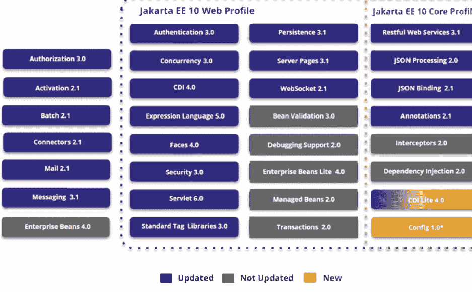

图 7.1：Jakarta EE 10 平台

`Jakarta EE` 内部的规范制定蓝图，定义了各种平台组件必须遵守的规则、行为和约定。这些规范充当了路线图，指导开发过程并确保不同实现之间的互操作性。它们封装了 `Jakarta EE` 兼容平台必须提供的基本特性，无论是 `Web` 服务、消息传递、安全还是持久化。规范提供了一个公平的竞争环境，开发者可以在依赖相同行为和功能的同时，在不同的实现之间无缝切换，从而促进了可移植性并防止了供应商锁定。

应用程序编程接口（`API`）是开发者在使用平台或库时与之交互的实体接口。它们提供了一种与底层功能交互的标准化方式，抽象了复杂性，并让开发者能够关注其应用程序逻辑。在 `Jakarta EE` 内部，`API` 是连接开发者与规范定义的标准行为的桥梁。通过暴露一组方法、类和函数，`API` 允许开发者将各种 `Jakarta EE` 功能集成到其应用程序中，确保不同平台在执行这些功能时的统一性和一致性。

规范与 `API` 之间的关键区别在于它们的角色和本质。

规范是高层蓝图，规定了规则和预期，促进了不同平台之间的兼容性。另一方面，`API` 是开发者用来与标准行为和功能交互的实用工具。将规范想象成建筑的计划图，而 `API` 则是建筑工人用来使结构变为现实的工具和材料。

当我们导航 `Jakarta EE` 内部的规范和 `API` 领域时，我们将更好地理解这些元素如何协同工作，创建一个凝聚且标准化的企业 `Java` 生态系统。加入我们的这节课程，掌握这些基础组件之间的复杂连接以及它们在塑造现代应用程序开发过程中的作用。在我们的下节课程中，我们将探索真实的用例，展示 `Jakarta EE` 规范和 `API` 的实际应用。

在 `Jakarta EE` 复杂的框架中，规范作为架构蓝图，支撑了一致、可移植且互操作的企业级应用程序的创建。这些规范封装了规则、行为和预期，引导开发者构建符合标准结构的应用程序，无论其底层的平台或技术如何。某些规范在集成 `NoSQL` 数据库以及变革数据管理和应用开发方面具有深远影响：

- **Bean Validation（豆验证）**：`Bean Validation` 规范在各种应用程序中（包括与 `NoSQL` 数据库交互的应用程序）中维护完整性和一致性。通过定义一组注解和约束，`Bean Validation` 允许开发者声明应用程序内实体的预期验证规则。这在处理 `NoSQL` 数据库时尤为重要，因为它们通常以灵活且无模式存储数据。通过 `Bean Validation`，开发者可以确保进入应用程序的数据符合特定标准，无论底层的数据库技术如何。

- **Jakarta NoSQL**：向无缝集成 `NoSQL` 数据库的一大步，`Jakarta NoSQL` 规范为开发者提供了一条专用路径，使用统一的 `API` 与各种 `NoSQL` 数据存储进行交互。该规范承认了 `NoSQL` 数据库的多样性，每个数据库都有其独特的数据模型和查询能力。`Jakarta NoSQL` 提供了一个标准化接口，抽象了各种 `NoSQL` 数据库的复杂性，允许开发者编写与数据库无关的代码，并轻松地与多个 `NoSQL` 解决方案集成。该规范不仅简化了开发，还让开发者能够利用 `NoSQL` 数据库的优势，而无需处理每种技术的复杂细节。

- **上下文与依赖注入 (`CDI`) 和 `JAX-RS` (`Java RESTful Web` 服务 `API`)**：虽然它们没有与 `NoSQL` 数据库直接关联，但 `CDI` 和 `JAX-RS` 等规范在 `Jakarta EE` 生态系统中起着至关重要的作用。`CDI` 促进了依赖注入和上下文信息管理，确保了应用程序内组件的高效协作。另一方面，`JAX-RS` 提供了构建 `RESTful API` 的工具，使应用程序与包括 `NoSQL` 数据库在内的各种数据源无缝通信。

`Jakarta EE` 生态系统中 `NoSQL` 数据库的集成通过多种规范实现，每种规范在允许开发者利用这些灵活数据存储的优势方面发挥着独特且重要的作用。下表提供了关键 `Jakarta EE` 规范及其对优化 `NoSQL` 数据库利用贡献的深入概述。从确保数据一致性到抽象复杂性以实现无缝交互，这些规范为旨在在其企业级应用程序中利用 `NoSQL` 数据库力量的开发者提供了指导支柱：

| 规范 | 贡献 |
| :--- | :--- |
| applications | applications |
| applications | applications |
| applications | applications |
| applications | applications |
| applications | applications |
| applications | applications |
| applications | applications |
| applications | applications |
| applications | applications |
| applications | applications |
| applications | applications |
| applications | applications |
| applications | applications |
| applications | applications |
| applications | applications |
| applications | applications |
| applications | applications |
| applications | applications |
| applications | applications |
| applications | applications |
| applications | applications |
| applications | applications |
| applications | applications |

表 7.1：NoSQL 的 Jakarta EE 规范

每种规范都提供了独特的工具和功能，开发者可以利用它们来优化与 `NoSQL` 数据库的交互。通过利用这些规范，开发者可以简化开发流程、确保数据一致性，并释放 `Jakarta EE` 应用中 `NoSQL` 数据库的全部潜力。当我们结束对 `Jakarta EE` 规范及其在利用 `NoSQL` 数据库潜力方面关键作用的探索时，我们对标准化实践与动态数据管理之间的和谐协同产生了深切认同。这些规范就像引路星，在不断演变的现代软件开发领域，指明了构建健壮、一致且适应性强的应用程序的道路。

在下一节中，我们将深入探讨 `Eclipse MicroProfile`，该框架从 `Jakarta EE` 中选取了特定的规范并对其进行精炼，以满足微服务架构的独特需求。`MicroProfile` 为开发者提供了一套定制的规范，这些规范与微服务的复杂性无缝衔接，为创建可扩展和高弹性的应用程序奠定了基础。当我们进入 `MicroProfile` 领域时，我们将见证这些规范如何为高效的微服务开发提供构建模块，为探索它们在基于 `NoSQL` 的微服务中的应用章节铺平道路。

## Eclipse MicroProfile

在不断演变的企业级应用开发领域，`Eclipse MicroProfile` 像一盏明灯，照亮了构建具有韧性、可扩展且适应性强的微服务的路径。`MicroProfile` 源于与 `Jakarta EE` 的历史渊源，它吸收了 `Jakarta EE` 规范的精华，对其进行精炼，并引入了新规范以应对微服务架构带来的独特挑战。在我们开启这一节之际，我们将深入探索 `Eclipse MicroProfile` 的动态世界，揭示它如何赋予开发者构建基于微服务的解决方案，同时探索 `MicroProfile` 与 `NoSQL` 数据库之间的协同作用。请参考下图：

| Telemetry 1.0 | OpenAPI 3.1 | Rest Client 3.0 | Config 3.0 |
| :--- | :--- | :--- | :--- |
| Fault Tolerance 4.0 | Metrics 5.0 | JWT Authentication 2.1 | Health 4.0 |
| | | Jakarta EE 10 Core Profile | |
| | | MicroProfile 6.0 | | |

- 新
- 已更新
- 与上一版本无变化

图 7.2：Eclipse Microprofile 6.0

`Eclipse MicroProfile` 的谱系可以追溯到 `Java EE` 平台，该平台随后在 `Eclipse Foundation` 的管理下转变为 `Jakarta EE`。意识到微服务需要标准化的方法，`MicroProfile` 倡议应运而生。利用其与 `Jakarta EE` 的历史联系，`MicroProfile` 挑选了相关规范，针对微服务对其进行了优化，并引入了新规范以增强开发体验。`Jakarta EE` 与 `MicroProfile` 之间的无缝协作确保了开发者在采用微服务架构现代需求的同时，能够利用他们的知识。


# NoSQL 数据库与 Eclipse MicroProfile：微服务架构的天然选择

NoSQL 数据库凭借灵活和可扩展的特性，是微服务架构的天然选择。Eclipse MicroProfile 为 NoSQL 数据库有效集成到基于微服务的应用程序中提供了完美的生态系统。像 `Jakarta NoSQL` 这种连接 Java 应用与 NoSQL 数据库的规范，在 MicroProfile 中找到了理想家。这种集成允许开发者创建与 NoSQL 数据库无缝通信的微服务，确保数据的高效检索、操作和存储。

此外，NoSQL 数据库的活性与微服务的分布式特性高度契合。通过 `Fault Tolerance` 和 `Metrics` 等规范，MicroProfile 使微服务具备了处理故障和收集性能洞察的能力，这在分布式系统中使用 NoSQL 数据库时至关重要。

## 场景示例：全球电商平台现代化

Eclipse MicroProfile 是一个在企业应用现代化方面发挥关键作用的框架，特别是在微服务背景下。让我们考虑一个假设的场景：一个全球电子商务平台正寻求升级其基础设施。由于该平台单体架构面临可扩展性挑战，它转向 Eclipse MicroProfile 寻求解决方案。

通过采用 MicroProfile，该平台将其应用程序模块化为微服务。这些微服务负责身份验证、产品目录和支付处理等特定功能。它们受益于 MicroProfile 的容错规范，确保了即使在流量高峰也能保持韧性。此外，平台使用 MicroProfile 的 `Metrics` 监控所有服务的性能，并使用 `Jakarta NoSQL` 实现与 NoSQL 数据库的高效集成。Eclipse MicroProfile 使向微服务的转型变得简单，并使平台能够在竞争激烈的市场中脱颖而出，证明了其在现代应用开发中的力量。

## 后续学习

加入我们接下来的课程，我们将深入探讨 `Jakarta Bean Validation`（Jakarta Bean 验证），发现它的实际意义，并见证它在现代应用开发动态格局中的集成。旅程仍在继续，随着我们利用规范的力量来塑造创新解决方案，未来充满了可能。

# 核心要点回顾

- **标准化**：`Jakarta EE` 是一个构建健壮企业级应用的标准化平台，为开发者创建可扩展的解决方案提供了一致的框架。
- **NoSQL 优势**：NoSQL 数据库以灵活性和扩展性彻底改变了数据管理，挑战了传统的关系型数据库。
- **NoSQL 分类**：不同类别的 NoSQL 数据库（如文档、键值、列族和图谱存储）满足了多样化的数据存储需求。
- **集成能力**：`Jakarta EE` 与 NoSQL 数据库无缝集成，弥补了传统数据存储与现代数据存储之间的差距。
- **社区协作**：供应商和 `Jakarta EE` 社区的共同努力确保了 NoSQL 数据库集成的顺畅与标准化。
- **规范与 API**：`Jakarta EE` 规范为标准化行为提供了蓝图，而 API 则为开发者与这些行为交互提供了具体的工具。
- **Bean Validation**：`Bean Validation` 规范通过实现验证规则，即使在无模式的 NoSQL 数据库中也能确保数据完整性。
- **Jakarta NoSQL**：`Jakarta NoSQL` 规范提供了一个统一的 API 来与不同的 NoSQL 数据库交互，简化了与数据库无关的代码创建。
- **CDI 和 JAX-RS**：`CDI` 和 `JAX-RS` 等规范允许在 `Jakarta EE` 生态系统中与 NoSQL 数据库进行高效交互。
- **Eclipse MicroProfile**：`Eclipse MicroProfile` 为微服务完善了 `Jakarta EE` 规范，无缝衔接了 NoSQL 数据库的交互。

# 多选题

## 规范在 Jakarta EE 生态系统中扮演什么角色？

- 它们是开发者的可选指南。
- **它们提供了一套规则和行为，以确保一致性和互操作性。**
- 它们仅适用于关系型数据库。
- 它们规定了特定供应商的实现细节。

## 哪种 Jakarta EE 规范确保数据一致性和完整性，特别是在无模式的 NoSQL 数据库中？

- `Jakarta NoSQL`
- `CDI`
- **`Bean Validation`**
- `JAX-RS`

## Jakarta NoSQL 规范的主要目的是什么？

- 标准化微服务之间的通信。
- 为 NoSQL 数据库提供一致的查询语言。
- 为所有 NoSQL 数据库创建通用模式。
- **提供一个用于与不同 NoSQL 数据库交互的统一 API。**

## 哪种规范对于创建 RESTful API 并实现与 NoSQL 数据库的通信至关重要？

- `Jakarta NoSQL`
- `CDI`
- **`JAX-RS`**
- `Bean Validation`

## Eclipse MicroProfile 如何与 Jakarta EE 相关？

- 它完全取代了 Jakarta EE。
- 它是一个独立的竞争性框架。
- **它为微服务完善了 Jakarta EE 规范。**
- 它专门关注关系型数据库。

# 答案

加入我们的书籍 Discord 空间

加入书籍 Discord 工作区，获取最新更新、优惠、全球技术动态、新发布以及与作者的互动：

https://discord.bpbonline.com


# 第 8 章：使用 Jakarta Bean Validation 的高级验证技术

## 引言

在 Java 与 NoSQL 数据库的汇聚中，这些技术的协同作用改变了现代应用程序中的数据处理方式。这种融合的核心是 `Jakarta Bean Validation`（以前称为 Bean Validation），它是一个专门通过为 Java 对象建立规则来维护数据准确性的框架。当我们深入研究其在 NoSQL 数据库中的应用时，我们将追溯它从关系型数据库起源到与 NoSQL 灵活结构和谐统一的演变。本章将作为指南，在引导 `Jakarta Bean Validation` 复杂特性的同时，揭秘 NoSQL 数据库的独特之处。通过掌握这些概念，你将能够将 Java 的健壮性与 NoSQL 的弹性无缝结合，开启数据质量和创新应用设计的新时代。

## 章节结构

本章涵盖了以下主题：

- 结合 Jakarta Validation 与 NoSQL 数据库
- Jakarta Bean Validation：探索注解与集成
- 探索 Jakarta Validation

## 目标

本章的目标是探索 `Jakarta Bean Validation` 与 NoSQL 数据库的集成，阐明其从传统关系型数据库演变的过程，深入探讨语法的复杂性，并揭示在动态多样的 NoSQL 数据模型环境中有效应用数据验证原则的策略，从而使读者具备在现代、灵活的应用环境中确保数据完整性和质量所需的知识和技能。

## 要求

以下是先决条件：

- `Java 17`
- `Maven`
- `Git`

源码结果：https://github.com/ultimate-engineer/java-persistence-nosql-book/tree/main/chapter-08

## 结合 Jakarta Validation 和 NoSQL 数据库

将 `Jakarta Bean Validation` 与 NoSQL 数据库结合源于确保应用程序架构内数据一致性的首要需求。作为一个健壮的验证框架，`Jakarta Bean Validation` 通过对 Java 对象强制规则和约束，带来了一种维护数据准确性的系统化方法。这种内在能力与 NoSQL 数据库的动态特性无缝衔接，解决了其灵活、无模式结构带来的挑战。通过集成 `Jakarta Validation`，开发者可以在一系列 NoSQL 数据模型中维护数据质量，在数据异构成为常态的环境中保持信息的完整性。

NoSQL 数据库从引入 `Jakarta Bean Validation` 中独特地获益。在一个优先考虑适应性的生态系统中，这种验证机制提供了一种一致的方法验证验证数据，无论架构如何。通过使用 `Jakarta Validation`，开发者可以确保数据符合约束，降低与非结构化数据相关的风险。这种方法使 NoSQL 数据库能够保持高数据质量和完整性，这对于依赖 NoSQL 解决方案的动态扩展性和性能的应用程序至关重要。然而，这种集成需要仔细考虑权衡，因为强制的验证级别应在数据完整性和系统性能之间取得平衡。

在结合 NoSQL 数据库使用 `Jakarta Validation` 的显著优势之一在于其标准化和广泛的兼容性。`Jakarta Bean Validation` 规范无缝集成到各种 Java 框架中，包括 `Spring`、`Quarkus`、`Helidon`、`Jakarta EE` 以及 `MicroProfile` 供应商。这种标准化方法促进了代码在不同 Java 环境中的重用和迁移性，简化了开发过程并降低了在框架切换时的学习曲线。因此，开发者可以在 NoSQL 数据库和其他应用架构中利用 `Jakarta Validation` 的力量来实现数据一致性，从而提高系统的效率、可维护性和整体质量。

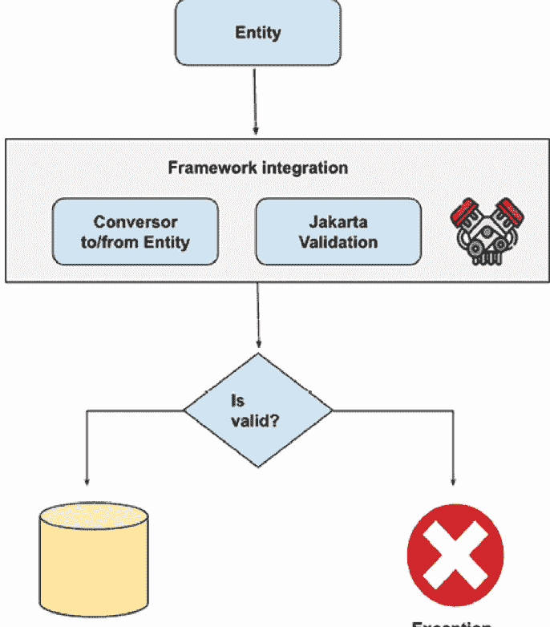

**图 8.1: Java 框架与 Jakarta Validation 步骤**

在考虑 `Jakarta Validation` 在不同框架之间的兼容性时，这种集成尤为值得关注。注解作为一种跨越框架边界的通用语言，无论所选框架的具体细节如何，都能提供一种一致的数据验证方法。这简化了开发过程，并增强了代码的可重用性和移植性。

因此，开发者可以专注于设计和实现应用程序的功能，而验证逻辑则在后台无缝运行。注解桥接了应用程序的业务逻辑与数据验证需求，确保数据在整个生命周期内保持一致性和准确性。这种注解驱动、框架集成的方法代表了 `Jakarta Bean Validation` 与现代应用程序开发实践之间的和谐协同，在维护数据质量标准的同时，为开发者提供了无缝且高效的体验。

## Jakarta Bean Validation：探索注解与集成

`Jakarta Bean Validation` 的核心是一系列全面的注解，这些注解允许开发者毫不费力地在 Java 对象上定义并强制验证约束。这种注解驱动的方法是 `Jakarta Validation` 用户友好设计的基石，为阐述数据需求提供了简洁且表达丰富的手段。

此外，这种注解驱动的验证过程与各种 Java 框架无缝集成，使验证成为应用程序开发中一个通用且透明的元素。注解可以与 `Spring`、`Quarkus`、`Helidon`、`Jakarta EE` 和 `MicroProfile` 等框架无缝集成。这种集成允许开发者专注于构建应用程序逻辑，而验证过程在后台和谐地运行。

此外，`Jakarta Validation` 的多功能还扩展到了自定义注解的创建，这一将在本章中进一步探讨。开发者可以定义封装特定验证规则的注解，从而将复杂的验证逻辑封装在单个注解中。这种自定义注解方法提高了代码的模块化、可重用性和可读性，最终随着应用程序的演进增强了验证逻辑的可维护性。

在本章的行程中，我们将深入探讨每个注解的细节，阐明它们的语法和实际实现。我们将演示如何将这些注解无缝集成到您的应用程序架构中，确保数据质量和一致性。此外，我们将深入自定义注解，使您能够创建与应用程序独特需求精确匹配的定制验证规则。`Jakarta Bean Validation` 注解与创建自定义注解的能力相结合，为现代应用程序开发复杂环境中强制数据完整性和质量引入了强大的工具包。

在 `Jakarta Bean Validation` 中，多种注解构成了数据完整性强制执行的基础。这些注解为开发者提供了一种简洁且结构化的方法，在 Java 对象上定义验证约束。下表展示了一些基本的 `Jakarta Validation` 注解，每个注解都简要描述了其目的和功能。在本章中，对这些注解的全面理解将使您能够将数据验证原则无缝集成到应用程序中，确保各种上下文下的数据准确性和一致性。请参考下表：

### 表 8.1: Jakarta Validation 注解

| Annotation | 描述 |
| :--- | :--- |
| `@NotNull` | 确保属性不为空。 |
| `@NotEmpty` | 确保属性不为空且长度大于零。 |
| `@NotBlank` | 确保属性不为空且不包含空白字符。 |
| `@Size` | 限制字符串、集合或数组的大小。 |
| `@Min` | 确保数值大于或等于指定值。 |
| `@Max` | 确保数值小于或等于指定值。 |
| `@Email` | 验证字符串为有效的电子邮件地址。 |
| `@Pattern` | 根据指定的正则表达式验证字符串。 |
| `@Past` | 确保日期在过去。 |
| `@Future` | 确保日期在未来。 |

当我们结束对 `Jakarta Bean Validation` 注解的探索时，一个强大的工具包出现了，它能够在 Java 应用程序中实现精确的数据质量管理。这些注解从简单的空检查到复杂的模式验证，提供了确保数据完整性的多功能手段。在接下来的环节中，我们将从理论转向实践，沉浸在这些注解变为现实的真实场景中。在实际示例中应用这些概念将巩固我们的理解并为后续内容铺路。

## 探索 Jakarta Validation

在本次实践中，我们将通过创建一个 `Worker` 实体来深入探讨 `Jakarta Validation` 注解的应用。我们的目标是确保该实体内部的数据一致性和质量，展示注解驱动验证的力量。让我们在下文中查看示例：

```java
public class Worker {
    @NotBlank
    private String nickname;

    @NotBlank
    private String name;

    @Size(min = 10, max = 100)
    private String bio;

    @AssertTrue
    private boolean working;

    @Min(18)
    @Max(65)
    private int age;

    @Email
    private String email;

    @SalaryConstraint
    private double salary;

    // Getters and setters
}
```

在 Java 应用上下文中这些注解的实现。

虽然我们在这里不会深入探讨如何使用 `Joda Money` 作为创建自定义类型或重复造轮子的替代方案，但寻求这一主题的见解可以参考 Martin Fowler 的文章《When Make Type》，它对此类尝试提供了更深入的理解。此外，为了全面理解采用 Money 作为规范的，文章《Moving Forward with the Money API (JSR 354): The Motivation Behind It》提供了宝贵的见解，阐明了驱动将货币相关功能集成到软件设计中的动机。

当然，使用 `Jakarta Validation` 创建自定义注解及其相应的验证器允许针对特定用例定制验证规则。我们概述了为薪资验证构建自定义验证注解的步骤如下：

### 创建验证器类

首先创建一个实现 `ConstraintValidator` 接口的类。在这种情况下，验证器确保薪资不为空且不为负。`isValid` 方法是定义验证逻辑的地方。请参考以下代码片段：

```
snippet: snippet: snippet: snippet: snippet: snippet: snippet: snippet:
snippet: snippet: snippet: snippet: snippet: snippet: snippet: snippet: 
snippet:
```

### 注解创建

接下来，定义一个用户将利用以应用验证规则的自定义注解。该注解应该引用之前创建的验证器类，并指定其实现。在注解内部，你还可以配置默认错误消息和其他约束。

在此代码片段中，我们引入了一个名为 `SalaryConstraint` 的自定义注解，它是你的 Java 应用中指定验证规则的强大工具。此注解允许你根据特定需求定制验证逻辑，以高度可定制的方式增强数据质量和完整性。如此处所示，`SalaryConstraint` 注解是 `Jakarta Bean Validation` 的不可或缺的组件，它可以无缝集成到你的应用程序中以强制数据约束。让我们深入探讨此自定义注解的细节，以及如何利用它来增强应用程序数据的质量。请参考以下代码：

```
code: code: code: code: code: code: code: code: code: code: code:
code: code: code: code: code: code: code: code: code: code: code:
code: code: code: code: code: code: code: code: code: code: code:
```

通过遵循这些步骤，你建立了一个自定义注解 `@SalaryConstraint`，它可以应用于到 Money 类型以执行与薪资相关的特定验证规则。该注解引用 `SalaryValidator` 类，该类封装了验证逻辑。这种方法展示了 `Jakarta Validation` 的灵活性和扩展性，允许开发者在应用程序中无缝集成定制的验证规则。

验证实体的旅程并不止于定义约束，测试是确保验证规则有效性的下一个关键步骤。在准备好验证基础设施后（如下方的代码片段所示）：

```
below: below: below: below: below: below: below: below: below:
```

转向编写评估验证结果的测试。虽然与 `Spring` 或 `Jakarta EE` 等框架集成可以自动验证检查，但手动验证测试是保证数据一致性的不可或少的实践。

在随后的代码提取中，我们模拟了 `Worker` 实体的验证过程，刻意生成违反各种约束的实例：


# 第 2 章

## 使用 CDI 增强面向对象编程

## 引言

在不断演变的现代软件开发领域，Java 保持了其作为可靠且多功能编程语言的地位。另一方面，NoSQL 数据库重新定义了我们处理数据的方式，提供了传统关系型数据库难以提供的灵活性和扩展性。这两个领域的结合开启了无限可能，使开发者能够创建出既健壮又能敏捷响应不断变化的数据应用程序。

本章深入探讨了上下文与依赖注入（Contexts and Dependency Injection, CDI）与 NoSQL 数据库之间的共生关系。CDI 是一种用于管理组件生命周期和依赖的健壮 Jakarta EE 标准。通过理解 CDI 如何无缝集成到 NoSQL 数据库，开发者可以提升架构的代码质量，使应用程序更具维护性、可扩展性，并能响应当今数据密集型世界的需求。

## 结构

本章涵盖了以下主题：

- 将 CDI 与 NoSQL 集成
- 揭秘 CDI 的奥秘
- 释放 CDI 的威力：实操演示

## 目标

这一综合章节为寻求利用 CDI 与 NoSQL 数据库结合力量的 Java 开发者提供了权威指南。本章旨在通过研究 CDI 与 NoSQL 集成的复杂细节，赋予读者知识和实践技能，以提升代码质量、增强应用程序扩展性，并创建健壮、适应性强且可维护的 Java 应用程序。通过关注最佳实践、真实案例和实地实现，本书将帮助开发者释放 CDI 和 NoSQL 的全部潜力，彻底改变他们处理现代应用程序架构的方式。

## 要求

- Java 17
- Maven
- Git
- 源码结果：`https://github.com/ultimate-engineer/java-persistence-nosql-book/tree/main/chapter-09`

## 将 CDI 与 NoSQL 集成

在本节中，我们将探索将 CDI 与 NoSQL 数据库集成的深层原因，以及如何有效利用 CDI 管理应用程序内部 NoSQL 连接的各个方面。通过理解 CDI 和 NoSQL 之间的协同作用，开发者可以确保高效的资源管理，避免连接泄漏，并在应用程序范围内创建有保证的对象。

CDI 与 NoSQL 数据库的集成带来了许多优势。CDI 作为一个健壮的依赖注入框架，为应用程序开发提供了结构化和模块化的方法。它促进了松耦合，这在处理多种 NoSQL 数据源时至关重要，并有助于创建可复用且易维护的组件。

处理 MongoDB 或 Cassandra 等 NoSQL 数据库时，管理连接、会话和资源变得至关重要。CDI 管理 Bean 生命周期和无缝处理依赖的能力与 NoSQL 数据库带来的挑战相匹配，确保了连接的高效和友好，并防止了连接泄漏。

有效集成的核心是使用封装了 NoSQL 连接的 Bean（manager beans）或实例类。这些管理器 Bean 充当中间层，控制 NoSQL 连接的生命周期并确保适当的管理和释放。通过利用 CDI 的作用域注解（如 `@ApplicationScoped` 或自定义范围），开发者可以确保每个 NoSQL 连接都被正确地创建、使用和关闭，避免潜在的资源耗尽。

此外，CDI 为在应用程序范围内创建有保证的对象提供了实用的解决方案。需要跨多个请求持久化的对象（例如会话信息）可以使用 CDI 有效管理。这确保了状态在用户交互期间得以保留，提供了无缝且一致的体验：

- **生产者 (Producer)**：利用 CDI 的生产者方法来集中创建和管理 NoSQL 连接。这促进了一致性并允许轻松重新配置数据源。
- **作用域 (Scoped)**：应用适当的作用域注解来管理 NoSQL 连接的 Bean 或实例。这确保了适当的生命周期管理，防止连接泄漏和不必要的资源消耗。
- **错误拦截器 (Interceptors for error)**：采用 CDI 拦截器统一处理来自 NoSQL 交互的错误和异常。这维护了代码质量并简化了错误报告。
- **CDI 事件**：利用 CDI 事件跨组件通信 NoSQL 数据的变化。这种方法最大限度地减少了紧耦合，并培养了更具响应性的架构。

将 CDI 与 NoSQL 数据库集成代表了现代应用程序架构的一项进展。通过利用 CDI 管理 NoSQL 连接、资源和对象生命周期的能力，开发者可以用优雅且高效的方式解决关键挑战。CDI 的依赖注入原则与 NoSQL 交互复杂性之间的无缝对接，为构建不仅可扩展、弹性强，而且可维护、适应的 Java 应用程序提供了路径。随着我们的推进，接下来的章节将深入探讨 CDI 的细节，探索其核心概念、注解以及它如何改变 Java 开发的格局，从而为结合 NoSQL 数据库利用其潜力奠定基础。

## 揭秘 CDI 的奥秘

在本节中，我们将开启揭秘 CDI 核心原理的旅程，CDI 是极大增强 Java 应用程序开发的基石技术。我们将深入研究 Bean 和作用域（scopes）的基本概念，揭示它们在创建模块化、可维护和可扩展应用程序中的重要性。

CDI 的核心是 Bean 的概念，它可以被视为 CDI 容器内的受管理组件。Bean 封装了业务逻辑、状态，而 CDI 确保它们被实例化、管理并无缝地注入到应用程序中。CDI Bean 是 Java 类或接口，通过特殊注解引导容器的行为。

CDI Bean 的一个关键属性是其作用域，定义了它们的生命周期以及在应用程序中的访问范围。CDI 提供了一系列内置的作用域注解，每种适用于不同的场景：

- **`@ApplicationScoped`**：具有此作用域的 Bean 在整个应用程序生命周期内生存。它们在应用程序启动时创建，在关闭时销毁。适用于管理共享资源。
- **`@SessionScoped`**：Bean 在用户会话期间保持状态。它们在会话开始时创建，在会话结束时销毁。适用于在用户与应用程序交互期间维护特定的数据。
- **`@RequestScoped`**：Bean 只在 HTTP 请求的作用范围内生存。它们在请求到达时创建，在请求处理结束时销毁。适用于封装特定 HTTP 请求的数据。
- **`@Dependent`**：默认作用域在每次注入时都会创建一个 Bean 的新实例。该作用域对于生命周期短且状态有限的组件理想。
- **`@SingletonScoped`**：具有此作用域的 Bean 在应用程序中共享单例。它们根据需要创建，直到应用程序终止为止存在。

作用域的选择对于构建结构良好且高效的应用程序架构起着关键作用。CDI 的作用域注解促进了模块化，确保 Bean 在定义的边界内交互，减少了意外的耦合。此外，它们简化了状态组件的管理，确保数据只在需要时持久。

为了直观表示 CDI 中不同的 Bean 作用域，我们展示了一张说明应用程序、会话和请求背景下 Bean 生命周期和边界的图表。该图旨在阐明 `@RequestScoped` Bean 之间在时间和使用上的差异，说明每个作用域如何对 Java 应用程序的模块化、状态管理和资源效率做出贡献。

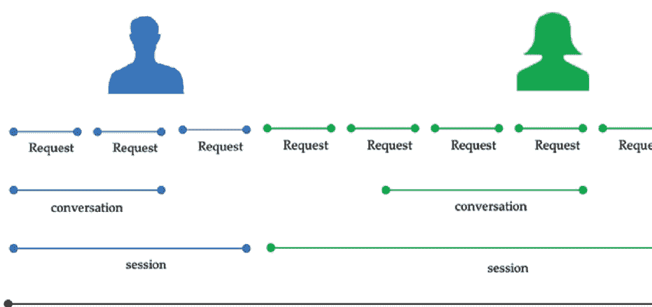

**图 9.1: CDI 范围图示**

在 CDI 中，一套全面的资源使开发者能够创建灵活、模块且结构良好的应用程序。当与 NoSQL 数据库应用程序智能集成时，这些资源可以提高代码质量、促进扩展性并确保高效的资源管理。让我们探索如何在使用 NoSQL 数据库应用程序时有效利用这些 CDI 资源：

### 注入 (Injection)

注入是 CDI 的核心，允许依赖项自动注入到托管 Bean（managed beans）中。在 NoSQL 数据库应用程序中，可以将 NoSQL 连接、数据访问组件甚至 NoSQL 特定的库无缝集成到 CDI 管理的 Bean 中。这确保了组件无需显式实例化即可获取所需的资源，减少了样板代码并使代码库更加整洁、更易读。

### 限定符 (Qualifier)

限定符提供了一种区分同类型实例的方法。在 NoSQL 上下文中，限定符可以用于区分不同的 NoSQL 数据库实现，允许应用程序根据特定标准在不同的 NoSQL 数据源之间切换。通过将特定的 NoSQL 技术从应用程序逻辑中抽象出来，这便于测试、开发和维护。

### 产生与销毁 (Produces and disposes)

`@Produces` 和 `@Disposes` 注解允许开发者显式地控制 Bean 实例的创建和销毁。当它们应用于 NoSQL 连接或资源时，这些注解能够对 NoSQL 相关对象的生命周期进行精确管理。这在与 NoSQL 数据库交互时，对于避免资源泄漏、管理连接池以及确保优化资源利用特别有价值。

### 事件 (Event)

CDI 事件提供了一种松耦合组件之间的通信机制。在 NoSQL 数据库中，事件可以通知应用程序的不同部分 NoSQL 数据的变化。例如，当新数据添加到 NoSQL 数据库时可以触发事件，感兴趣的组件可以监听这些事件以更新其状态或触发额外的操作。

### 装饰器 (Decorator)

CDI 中的装饰器允许开发者在不更改原始代码的情况下扩展或修改 Bean 的行为。在 NoSQL 上下文中，装饰器可以为与 NoSQL 数据库的交互添加日志、缓存或审计等交叉关注点。这通过将这些关注点封装在独立的装饰器类中，促进了关注点分离和代码整洁。

### 拦截器 (Interceptor)

拦截器提供了一种拦截和修改托管 Bean 方法调用的方法。在 NoSQL 应用程序中，拦截器可以应用于与 NoSQL 数据库交互的方法，允许开发者在整个应用程序中一致地实现安全检查、数据验证或性能监控等交叉关注点。

遍历 CDI 资源领域对于 Java 开发者来说可能是一次变革性的体验，特别是考虑到它们与 NoSQL 数据库结合使用时。下表简洁地比较了 CDI 资源，并概述了它们在 NoSQL 应用程序中的作用。通过理解注入、限定符、生产者、销毁器、事件、装饰器和拦截器如何与 NoSQL 的复杂性相对，开发者可以恰当地塑造应用程序架构，以增强模块化、可维护性和资源效率。此概述为深入研究这些资源的实际实现铺平了道路，我们将探索它们如何与 NoSQL 数据库协同工作以创建稳健且适应性解决方案。请参考下表：

| CDI 资源 | 在 NoSQL 应用程序中的作用 |
| :--- | :--- |
| 注入 | 自动提供 NoSQL 连接和数据访问组件。 |
| 限定符 | 区分不同的 NoSQL 数据库实现。 |
| 产生/销毁 | 管理 NoSQL 相关对象和连接的生命周期。 |
| 事件 | 通知应用程序部分 NoSQL 数据的变化。 |
| 装饰器 | 为数据库交互添加日志或缓存等交叉关注点。 |
| 拦截器 | 为数据库方法实现安全检查和数据验证。 |

**表 9.1: CDI 主要功能与 NoSQL 数据库的结合**

当我们结束对 CDI 资源及其与 NoSQL 数据库集成的探索时，显而易见，这些工具为构建现代 Java 应用程序架构提供了一套全面的工具包。通过有效利用注入、限定符、生产者、销毁器、事件、装饰器和拦截器，开发者可以构建出在动态数据需求面前超越传统边界、具有适应性、扩展性和可维护性的应用程序。

在下一节课程中，我们将开启一个实操演示，让 CDI 的力量变为现实。通过真实世界的示例，我们将展示如何在 NoSQL 驱动的应用程序背景下利用这些资源。从管理连接到处理数据变化以及添加交叉关注点，这一交互式演示将说明 CDI 与 NoSQL 数据库协同工作时的变革潜力。加入我们深入探讨 CDI 的实际实现，巩固对它如何彻底改变现代应用程序开发的理解。

## 释放 CDI 的力量：实操演示

在这一节中，我们开启了一段实践之旅，以揭示 CDI 的强大能力。通过一系列示例，我们将探索 CDI 如何简化并提升 Java 应用程序开发，特别是在与 NoSQL 数据库集成时。我们将从注入的基础开始，演示 CDI 如何管理生命周期并动态解析实现，展示从接口到具体类的无缝过渡。让我们深入代码示例，亲身感受 CDI 带来的变革性影响。

我们首先创建一个代表移动实体的 `Vehicle` 接口。然后，我们用 `Car` 类实现该接口，并带有 `@ApplicationScoped` 注解。该注解意味着 CDI 应该管理该类实例的生命周期。通过注入，我们将探索 CDI 如何自动解析依赖，允许接口和类的注入。我们将使用 CDI 标准版进行此演示，稍后扩展到微服务集成。

在这里，我们定义了一个名为 `Vehicle` 的 Java 接口，包含一个方法，代表任何车辆的核心功能。此外，我们还有一个名为 `Car` 的 `@ApplicationScoped` 类，它实现了 `Vehicle` 接口，提供了关于汽车如何移动的具体细节。这段代码片段阐述了框架内接口实现的基本概念：


# 主应用程序类演示

主应用程序类演示了 `Vehicle` 接口和 `Car` 类的注入。通过使用[此处代码]，我们初始化了 CDI 容器，展示了传统 Java 代码的 CDI 管理实例的无缝集成。

在代码片段中，我们演示了在 Java 应用程序中使用 CDI 框架。`App1` 类作为入口，展示了如何创建和管理 CDI 容器。在容器内部，我们选择并获取 `Vehicle` 和 `Car` 类的实例，展示了 CDI 在上下文和依赖注入框架中管理依赖和调用方法的力量。

在应用开发中，掌握依赖注入的艺术至关重要，而 CDI 提供了一个健壮的框架来实现这一目标。在整个课程中，我们深入学习了 CDI 注入的基础知识，见证了它如何无缝连接不同的组件并简化资源管理。通过动态解析依赖关系并将接口与其实现类无缝地集成，CDI 为构建灵活、模块化且易于维护的应用程序奠定了基础。

当我们进入下一个探索阶段时，重点将转向 CDI 限定符（qualifiers）。这些精确的工具使我们能够优雅地在各种实现之间进行区分和选择，根据特定需求定制我们的组件。欢迎加入接下来的课程，揭开 CDI 限定符的复杂之处，并发现它们如何通过为正确的任务编排正确的实现，来优化我们应用程序的架构。

# 限定符 (Qualifier)

接下来，我们将通过创建一个 `Instrument` 接口和相应的 `InstrumentType` 枚举来探索 CDI 中限定符的威力。通过 `@MusicalInstrument` 限定符，我们区分了不同乐器的实现。这使得 CDI 能够根据限定符的值动态地选择合适的实现。

在这段简短的代码片段中，我们展示了一组旨在与 CDI 集成的 Java 元素。`Instrument` 接口为各种乐器定义了 `sound()` 方法，`InstrumentType` 枚举对这些乐器进行分类。代码还展示了自定义 CDI 限定符的创建，并使用 `@MusicalInstrument` 注解。该限定符允许根据类型精确选择乐器实现，体现了 CDI 通过精确控制特定实现的注入，来促进应用程序内部模块化和适应性的能力：

通过实现不同的乐器（如 `Guitar` 和 `Piano`）并对每个乐器使用带有限定符的注解，我们展示了 CDI 根据限定符选择相应实现的能力，使得与 NoSQL 数据库的集成更加顺畅和灵活。

在此代码片段中，我们定义了多个遵循 `Instrument` 接口的乐器实现，并使用带有 `@MusicalInstrument` 的自定义 CDI 限定符对它们进行分类。每个实现代表一种不同的乐器类型，例如 `Guitar` 和 `Piano`，每个都带有其相应的乐器类型注解。此示例说明了 CDI 限定符如何实现对注入的乐器实现的精确选择，为处理应用程序中的各种乐器类型提供了模块化且适应性良好的方法：

在最后的演示中，我们展示了 `Orchestra` 类的概念，它展示了限定注入。通过根据限定符注入特定的乐器实现，CDI 提供了一种灵活的机制来有效管理和组织组件。

此代码片段引入了 `Orchestra` 类，它带有 `@ApplicationScoped` 注解，作为了在 CDI 框架内使用 CDI 限定符的实际演示。在 `play` 方法内部，使用 `@Inject` 注解根据由 `@MusicalInstrument` 限定符定义的乐器类型注入不同的音乐乐器。`Orchestra` 类展示了 CDI 如何促进对特定乐器实现的精确注入，从而通过不同类型的乐器编排交响乐团的组成：

在我们结束对 CDI 限定符的探索时，我们发现自己已经有了一种强大的机制，用于精炼 Java 应用程序中 Bean 的注入和区分。限定符能够对注入给定类型的特定实现进行精确控制，允许在组件选择中实现模块化和适应性。通过本课程，我们揭示了如何使用限定符来隔离和管理不同的实现，为增强代码组织和可维护性开辟了途径。

当我们过渡到下一节时，我们将进入 CDI 作用域（scope）和实例生命周期管理领域。CD 的这一关键方面使我们能够编排 Bean 的创建、管理和丢弃，确保高效的资源利用和最佳性能。在我们继续探索 CDI 变革性景观之际，加入我们发现作用域和实例生命周期的细微差别。

# 作用域 (Scope)

让我们探索 CDI 管理实例的生命周期管理细节。我们将研究 CDI 如何提供一种机制来控制实例的创建和销毁。通过示例，我们将创建并销毁 `Number` 的实例。此外，我们涵盖使用生产者（producers）和销毁器（disposers）来在 CDI 管理的 Bean 中动态管理资源。

为了演示 CDI 的实例生命周期控制，我们创建了带有 `@Dependent` 注解的 `NumberProducer` 类。该类展示了生产者方法的威力，这些方法在 CDI 管理的 Bean 请求时动态创建实例。在这种情况下，我们使用 `Random` 生成随机的 `BigDecimal` 值。

在此代码片段中，我们展示了 `NumberProducer` 类，它带有 `@Dependent` 注解，体现了 CDI 通过 `@Produces` 和 `@Disposes` 控制 Bean 生命周期的能力。`@Produces` 方法生成随机的 `BigDecimal` 值，而带有 `@Disposes` 注解的销毁方法处理未使用数字的释放。这演示了 CDI 如何允许你自定义 Bean 实例的创建和销毁，确保应用程序内高效的资源利用：

继续探索，我们引入了使用生产者方法进行动态日志的概念。`LoggerProducer` 类也带有 `@Dependent` 注解，展示了如何利用生产者根据请求的类动态创建和管理记录器。

此代码片段引入了 `LoggerProducer` 类，它带有 `@Dependent` 注解，阐明了利用 CDI 的 `@Produces` 注解动态创建并提供 `Logger` 类实例的方法。`getLog` 方法接受一个 `InjectionPoint` 参数，使其能够收集有关请求类的信息。此片段展示了 CDI 如何赋予你自定义实例创建和配置的能力，在...

在这种情况下，为应用程序中不同的 bean 提供了日志器实例，为资源管理提供了灵活性和细粒度的控制：

通过这种设置，每当日志器被注入到 CDI 管理的 bean 中时，`LoggerProducer` 都会生成一个为请求类定制的实例。这种动态方法增强了可追溯性，并提供了更多感知上下文的日志记录。

通过这些示例，我们窥视了 CDI 对实例创建和销毁的细粒度控制。通过生产者生成实例并使用销毁器优雅地管理其销毁的能力，有助于更高效的资源利用和更整的整体架构。

# 事件 (Event)

我们将揭开 CDI 事件的动态世界，这是一种强大的机制，促进了 Java 应用程序中各种组件之间的通信与协调。CDI 事件实现了不同系统部分之间的无缝交互，并促进了灵活的数据建模。通过实践探索，我们将创建一个示例，其中 `Journalist` 类触发代表新闻更新的事件，而像 `Observer` 和 `SocialMedia` 这样的观察者将以各种行动对这些事件做出响应。

我们首先引入 `Journalist` 类，它带有 `@ApplicationScoped` 注解。该类通过注入一个 `Event` 实例展示了 CDI 的事件触发能力。通过调用此事件的 `fire` 方法，`Journalist` 类向系统通信更新信息。

在段代码段中，我们引入了带有 `@ApplicationScoped` 注解的 `Journalist` 类，它展示了如何利用 CDI 事件来编排 Java 应用程序内的通信。`Journalist` 类配备了一个 `event` 字段，代表一个 `Event<News>` 实例。这段代码展示了 CDI 事件如何允许新闻的发布和分发，使其成为应用程序内实时更新、数据建模和响应式交互的基础功能：

```
application: application: application: application: application:
application: application: application: application: application:
application: application: application: application: application:
application: application: application: application: application:
application: application: application: application: application:
```

紧随之后，我们使用 `News` 类对新闻更新进行建模。该类实现了 `Supplier` 接口，使我们能够以结构化的方式封装新闻。

这段代码段引入了标记为 `@ApplicationScoped` 的 `News` 类，它实现了 `Supplier<String>` 接口。`News` 类封装了新闻的概念并可以提供一个字符串表示。虽然代码段没有提供具体的实现细节，但它是新闻建模的基础组件，并演示了如何将其集成到 CDI 应用程序中，以通过 CDI 事件实现动态通信：

```
events: events: events: events: events: events: events: events: events: events:
events: events: events: events: events:
```

为了响应被触发的事件，我们创建了如 `Observer` 和 `SocialMedia` 之类的观察者类。这些类带有 `@ApplicationScoped` 注解并实现了 `Consumer` 接口。在 `accept` 方法上使用 `@Observes` 注解，这些类积极监听传入的新闻事件并据此做出反应。

这段代码段展示了三个 CDI bean：它们都带有 `@ApplicationScoped` 注解。这些类实现了 `Consumer` 接口并作为 `News` 事件的观察者。虽然代码段没有提供具体的实现细节，但它强调了 CDI 事件如何被多个 bean 观察，每个 bean 扮演着不同的角色——模拟在 CDI 应用程序内跨多个媒体发布新闻。请参考以下代码段：

```
snippet: snippet: snippet: snippet: snippet: snippet: snippet:
snippet: snippet: snippet: snippet: snippet: snippet: snippet: snippet:
snippet: snippet: snippet: snippet: snippet: snippet: snippet: snippet:
snippet: snippet: snippet: snippet: snippet: snippet: snippet: snippet:
```

设置好后，我们创建了 `App4` 类来演示由 CDI 事件促进的动态通信。使用 CDI 容器，我们实例化 `Journalist` 类并调用其 `receiveNews` 方法来触发新闻事件。

段代码段中，我们引入了 `App4` 类，它作为 CDI 应用程序的入口。在 CDI 容器内部，我们获取 `Journalist` 类的实例，并通过带有消息的 `receiveNews` 方法（例如 "Java 17 has been released!"）来模拟新闻的到达。此代码段说明了 CDI 事件如何实现组件之间（如记者、发布者和新闻媒体）的通信，在应用程序内部创建了一个响应式生态系统。请参考以下代码段：

```
snippet: snippet: snippet: snippet: snippet: snippet: snippet:
snippet: snippet: snippet: snippet: snippet: snippet: snippet: snippet:
snippet: snippet: snippet: snippet: snippet: snippet: snippet: snippet:
snippet: snippet: snippet: snippet: snippet: snippet: snippet: snippet:
```

通过这个简单的示例，我们见证了 `Journalist` 与其观察者之间通信的编排。随着新闻事件的触发，`Observer` 和 `SocialMedia` 观察者通过各自的行动做出响应。

CDI 事件的美之处在于其通用性；可以轻松集成额外的观察者，而不影响现有组件。这种灵活的通信机制增强了应用程序的模块化，并允许无缝扩展。

结论，CDI 事件证明是 Java 应用程序中建立动态通信和编排的重要工具。通过实现不同组件之间信息的无缝交换，CDI 事件促进了实时更新、数据建模和响应式交互。在本节中，我们观察了 CDI 事件如何在各种实体之间建立桥梁，展示了这一特性的适应性和多功能性。随着我们的推进，下一节将深入探讨 CDI 装饰器的另一个变革性方面。

# 装饰器 (Decorator)

我们深入探讨 CDI 装饰器的迷人领域，这是一个强大的功能，可以在不修改原始代码的情况下增强管理 bean 的行为。CDI 装饰器提供了一种动态方式，向现有组件引入交叉切关注点，如日志记录、审计或安全检查。通过一个实践示例，我们将通过 `Manager` 装饰器装饰 `Programmer` 类来演示装饰器的概念。

我们的旅程从创建 `Worker` 接口开始，它代表执行任务的通用工作者。

这段代码段引入了 `Worker` 接口，定义了一个 `work(String job)` 方法，代表各种工作者的核心功能。它是 CDI 框架内实现不同类型工作者的基础，说明了 CDI 如何管理和编排应用程序内与工作相关的任务的执行：

为了让工作者的概念具体化，我们实现了 `Programmer` 类，带有 `@ApplicationScoped` 注解。该类代表一个执行分配任务的程序员，将咖啡转化为代码。

在此段代码片段中，我们展示了带有 `@Named` 注解的 `Programmer` 类，它实现了 `Worker` 接口。虽然此片段中省略了具体的实现细节，但 `Programmer` 类体现了 CDI 如何能够创建和管理各种类型的工作人员（在本例中为程序员）。该代码片段展示了 CDI 框架如何无缝集成工作人员实现以增强应用程序的功能，使其更具模块化和适应性。请参考以下代码片段：

```
snippet: snippet: snippet: snippet: snippet: snippet:
snippet: snippet: snippet: snippet: snippet:
```

装饰器的本质通过创建 `Manager` 类来展示，该类带有 `@Decorator` 注解，我们在该注解中定义了此装饰器的优先级。在装饰器内部，我们使用 `@Delegate` 注解注入 `Worker` 接口，使我们能够拦截并增强原始 `Programmer` 类的行为。

在此代码片段中，我们引入了带有 `@Decorator` 注解的 `Manager` 类，它体现了 CDI 框架中的装饰器概念。`Manager` 类实现了 `Worker` 接口，并采用 `@Delegate` 和 `@Any` 注解来增强 `Worker` 的功能。通过将任务委托给程序员，`Manager` 类说明了装饰器如何在不更改原始代码的情况下动态增强 Bean 的行为，从而为 CDI 应用程序中的功能扩展提供了一种灵活且模块化的方法。请参考以下代码片段：


## CDI 装饰器与拦截器实战

在我们的配置完成后，我们现在可以见证 `Programmer` 与 `Manager` 装饰器之间的协作。通过调用 `Programmer` 实例上的 `work` 方法，我们从本质上触发了装饰器的行为，允许管理器在程序员执行之前进行干预。

在此代码片段中，我们引入了 `App5` 类，它作为 CDI 应用程序的入口。在 CDI 容器中，我们获取 `Worker` 类的实例并调用 `work("Implement new feature")` 方法来模拟工作人员的任务。该片段演示了 CDI 如何无缝集成装饰器，允许 `Manager` 装饰器增强 `Worker` 的功能并动态修改应用程序的行为，从而实现更模块化、功能丰富的设计。请参考以下代码片段：

```
snippet: snippet: snippet: snippet: snippet: snippet: snippet: snippet:
snippet: snippet: snippet: snippet: snippet: snippet: snippet: snippet:
snippet: snippet: snippet: snippet: snippet: snippet: snippet: snippet:
snippet: snippet: snippet: snippet: snippet: snippet: snippet: snippet:
snippet: snippet:
```

我们已经释放了 CDI 装饰器的潜力，说明了它们如何无缝地增强现有托管 Bean 功能。通过引入装饰器，我们采用了一种模块化的方法来扩展整个应用程序的跨切关注点，而无需修改代码库。

在接下来的课程中，我们将深入探讨 CDI 拦截器的世界，探索它们如何提供一种动态机制来拦截和增强跨托管 Bean 的方法调用。

## 拦截器

在最后一节中，我们将深入研究 CDI 拦截器的动态世界，这是一种强大的工具，为 Java 中的拦截和增强方法调用提供了细粒度的方法。CDI 拦截器允许我们无缝地将日志、审计和性能指标等跨切关注点添加到方法中，从而增强我们应用程序的整体功能和可维护性。通过一个综合示例，我们将演示如何创建一个 `@Timed` 注解及其对应的拦截器，以测量方法执行所需的时间。

为了开启 CDI 拦截器的之旅，我们首先创建 `@Timed` 注解。该注解作为需要进行时间测量的方法的标记。它是 `@TimedInterceptor` 的入口，该拦截器将拦截所有带有 `@Timed` 注解的方法。

此代码片段引入了一个名为 `@Timed` 的自定义注解，并被标记为 `@Target`。`@Timed` 注解设计用于上下文和依赖注入（CDI）框架，并作为应应用拦截器的方法或类型的标记。通过在方法或类上应用此注解，你可以使用 CDI 拦截器来测量执行方法所需的时间，从而能够在应用程序中收集性能指标和其他数据。请参考以下代码片段：

```
snippet: snippet: snippet: snippet: snippet: snippet: snippet: snippet:
snippet:
```

接下来，我们编写带有 `@Interceptor` 注解并带有 `@Priority(Interceptor.Priority.APPLICATION)` 注解的类以确定其执行顺序。该拦截器在 `timedMethod` 方法上使用 `@AroundInvoke` 注解来拦截带有 `@Timed` 注解方法的执行。它计算被拦截方法所需的时间并记录结果。

在此代码片段中，我们展示了带有 `@Interceptor` 注解的 `TimedInterceptor` 类，它作为 CDI 框架中的拦截器使用。该拦截器捕获带有 `@Timed` 注解的方法和类的执行时间。它采用 `@Interceptor` 注解并根据 `@Priority(Interceptor.Priority.APPLICATION)` 设置优先级，测量执行被注解方法所需的时间并记录这些数据。`TimedInterceptor` 明了 CDI 拦截器如何用于收集性能指标和洞察，为增强应用程序的效率和优化提供了宝贵的工具。请参考以下代码片段：

```
snippet: snippet: snippet: snippet: snippet: snippet: snippet: snippet:
snippet: snippet: snippet: snippet: snippet: snippet: snippet: snippet:
snippet: snippet: snippet: snippet: snippet: snippet: snippet: snippet:
snippet: snippet: snippet: snippet: snippet: snippet: snippet: snippet:
```

我们继续创建带有 `@Interceptor` 注解的类，并创建两个实现类：`FastSupplier` 和 `SlowSupplier`。这两个类都带有 `@Timed` 注解，展示了拦截器如何无缝集成到代码中以测量时间。

在此代码片段中，我们引入了两个实现类：`FastSupplier` 和 `SlowSupplier`。这两个类都带有 `@Timed` 注解，展示了拦截器如何无缝集成到我们的代码中以测量时间。`FastSupplier` 快速返回结果，而 `SlowSupplier` 则引入了延迟以模拟较长的方法执行时间。

```
snippet: snippet: snippet: snippet: snippet: snippet: snippet: snippet:
snippet: snippet: snippet: snippet: snippet: snippet: snippet: snippet:
snippet: snippet: snippet: snippet: snippet: snippet: snippet: snippet:
snippet: snippet: snippet: snippet: snippet:
```

在配置完成后，我们通过观察 `FastSupplier` 和 `SlowSupplier` 的行为来展示 CDI 拦截器的集成。通过 `App6` 类，我们调用了这些提供者，`TimedInterceptor` 记录并记录了每个方法的执行时间。

在此代码片段中，我们引入了 `App6` 类，它作为 CDI 应用程序的入口。在 CDI 容器中，我们获取两个提供者类的实例（`FastSupplier` 和 `SlowSupplier`），它们都带有 `@Timed` 注解以测量它们的执行时间。`App6` 类调用这些提供者并显示结果，模拟了在 CDI 上下文中性能指标的测量。该片段说明了 CDI 拦截器如何用于监控和记录各种方法所需的时间，有助于应用程序的性能分析和优化。请参考以下代码片段：

```
snippet: snippet: snippet: snippet: snippet: snippet: snippet: snippet:
snippet: snippet: snippet: snippet: snippet: snippet: snippet: snippet:
snippet: snippet: snippet: snippet: snippet: snippet: snippet: snippet:
snippet: snippet: snippet: snippet: snippet:
```

这一引人入胜的章节为 CDI 核心功能的探索圆满结束。CDI 拦截器为我们的方法添加了动态控制层，使能够在不更改原始代码库的情况下嵌入性能监控等跨切关注点。

随着旅程的结束，我们已经遍历了上下文和依赖注入的领域，涵盖了基础注入、限定符、事件、装饰器和拦截器。掌握了这些知识，我们准备好构建现代、模块化且高效的 Java 应用程序，使其与 NoSQL 数据库和微服务架构无缝集成。

## 结论

最后，我们对 CDI 的深度解析阐明了构建在当今动态环境中蓬勃发展的端 Java 程序的路径。通过 CDI 的视角，我们见证了依赖管理、通信编排和方法级控制的演变，所有这些汇聚在一起，塑造出比以往更具模块化、可维护性和适应性的应用程序。

从注入的基本概念到限定符的精确性、事件的动态性、装饰器的优雅以及拦截器的精妙，我们探索了 CDI 多样化的工具箱。凭借这些见解，你现在已经完全能够充分利用 CDI 的能力，将你的编码实践转化为一种与 NoSQL 数据库和微服务无缝集成的艺术。

在我们结束这一章时，我们热切期待进入后续：JAX-RS。在这里，我们将深入构建健壮、可扩展 Web 服务的世界，释放你的应用程序面向全球观众的能力。当我们掌握使用 JAX-RS 设计、构建和部署 RESTful 服务的艺术时，准备好迎接全新的交互领域。

## 知识点回顾

- CDI 通过提供健壮的框架来管理依赖、编排通信和控制方法级行为，为 Java 应用程序赋能。

- 注入是 CDI 的一项基础功能，允许 bean 注入到其他 bean 中，从而减少紧耦合并促进模块化。

- 限定符通过允许指定应注入类型的哪种实现来增强注入的精确性。

- CDI 中的事件允许不同组件之间的动态通信，促进实时更新、数据建模和响应式交互。

- 装饰器是在不改变其原始代码的情况下增强 bean 功能的强大工具。它们允许你无缝地为 bean 添加跨切关注点。

- 拦截器允许你拦截并增强 CDI bean 内部的方法调用。它们对于添加日志、审计和性能指标等功能非常有用。

- CDI 提供了一系列预定义的范围来控制 bean 的生命周期，确保高效的资源利用和优化性能。

- 理解 CDI 的核心功能使你能够构建模块化、适应性的应用程序，这些程序与 NoSQL 数据库和微服务架构无缝集成。

- CDI 与其他 Java EE 和 Jakarta EE 技术的结合为开发现代健壮的应用程序提供了全面的解决方案。

## 多选题

### CDI 注入功能的主要目的是什么？

- 减少对接口的需求
- 创建 bean 的新实例
- 管理并将依赖注入到 bean 中
- 促进不同应用程序之间的通信

### 哪种 CDI 功能允许你在进行注入时对同一类型的多个实现之间进行区分？

- 范围
- 装饰器
- 限定符
- 拦截器

### CDI 事件的主要功能是什么？

- 强制数据验证
- 管理数据库事务
- 编排组件之间的通信
- 优化内存使用

### 装饰器在 CDI 中扮演什么角色？

- 它们强制方法级安全
- 它们为 bean 提供额外功能
- 它们控制 bean 的生命周期
- 它们定义 bean 的结构

### CDI 拦截器的目的是什么？

- 确保 bean 的安全性
- 定义 bean 的结构
- 管理数据库事务
- 拦截并增强 bean 中的方法调用

## 答案

加入我们书籍的 Discord 空间

加入书籍的 Discord 工作区以获取最新更新、优惠、全球科技动态、新发布以及与作者的交流会议：

https://discord.bpbonline.com


# 使用 JAX-RS 实现 REST

## 引言

NoSQL 数据库已成为关系型数据库的强大替代方案。它们灵活的模式、水平扩展性以及处理海量数据的能力彻底改变了我们处理信息的方式。这场革命的核心是 RESTful 服务 Java API（JAX-RS），它是与 NoSQL 无缝集成的关键工具。

在本章中，我们将深入探讨 JAX-RS 与 NoSQL 数据库之间的共生关系。凭借其构建和消费 RESTful API 的健壮工具集，我们将探索 JAX-RS 如何赋能开发者建立通信通道。通过理解这种集成的复杂性，你将获得设计和实现利用 NoSQL 能力应用程序的技能。

## 结构

- NoSQL 数据库集成中的 JAX-RS
- 使用 NoSQL 探索 RESTful 应用
- JAX-RS 的实际实现

## 目标

在本章中，我们的目标是阐明 JAX-RS 在促进 Java 应用程序与 NoSQL 数据库之间无缝高效集成方面的关键作用。我们旨在让你全面理解 JAX-RS 如何作为桥梁允许开发者建立健壮的连接。到本章结束，你将熟练掌握利用 JAX-RS 能力来最大化数据库潜力。

## 要求

以下是前提条件：

- Java 17
- Maven
- Git

源码结果：https://github.com/ultimate-engineer/java-persistence-nosql-book/tree/main/chapter-10

## NoSQL 数据库集成中的 JAX-RS

JAX-RS（RESTful Web 服务 Java API）在桥接 Java 应用程序与 NoSQL 数据库之间的差距发挥着关键作用，提供了许多增强这两种技术之间协同效应的益处：

以多功能和可扩展性闻名的无缝 NoSQL 数据库通常利用 RESTful API 作为其通信接口。JAX-RS 专为构建 RESTful 服务而设计，提供了一种标准化且直观的方式来创建、消费和交互这些 API。通过遵循 REST 原则，JAX-RS 允许开发者无缝地与 NoSQL 数据库建立连接，有效地抽象了底层通信协议的复杂性。

灵活的 NoSQL 数据库有多种类型，包括文档存储、键值存储、列族存储和图谱数据库。每种类型都需要独特的数据建模和交互方法。JAX-RS 灵活的架构允许开发者设计针对特定数据库类型的端点，适应 NoSQL 系统的多样化需求。这种适应性不仅简化了开发，还为应用程序应对数据库技术的变化提供了未来保障。

通过适当的设计实践，JAX-RS 支持创建符合 NoSQL 数据库扩展性目标的高性能 API。JAX-RS 赋予了开发者通过异步处理和缓存优化数据检索与更新操作的能力，确保了数据库资源的高利用。

JAX-RS 中间件充当中间层角色，促进了不同系统之间的集成。通过使用 JAX-RS 在 NoSQL 数据库上暴露统一的 API，开发者可以整合来自各种源的数据，使应用程序能够访问并操作数据，而不受单个数据库技术的复杂性。

JAX-RS 与 NoSQL 数据库之间的共生关系体现了技术的和谐融合，使开发者能够无缝地与灵活的数据存储系统交互并利用其能力。随着我们的不断进步，下一节将深入探讨 RESTful API 通信领域，阐明支撑这种交互模式的基本原理。通过掌握 RESTful 通信的复杂之处，你将做好准备开启一段旅程，探索实际实现技术、设计考量以及有效的策略，以构建健壮、可扩展且高效的 API，弥合 Java 应用程序与 NoSQL 数据库之间的差距。

## 使用 NoSQL 数据库探索 RESTful 应用

RESTful 应用彻底改变了我们设计、开发和与 Web 服务交互的方式，特别是在 NoSQL 数据库的背景下。本节将深入探讨为 NoSQL 数据存储构建 RESTful 应用的核心原理、优势和考量。我们还将探索与 gRPC、GraphQL 和 WebSockets 等替代方案的权衡，并提供对比分析。

在数据驱动应用的动态格局中，RESTful 应用与 NoSQL 数据库的结合已成为一种强大的组合，改变了数据交换、访问和处理的方式。表述状态转换（Representational State Transfer）提供了一系列基本原理，与 NoSQL 数据库的固有特性无缝融合。本章深入探讨了针对 NoSQL 数据存储细微差别定制 RESTful 应用的众多优势。从简单性和通用访问到缓存机制的高效编排，我们揭示了 RESTful 应用如何作为客户端与 NoSQL 数据库之间的健壮桥梁，重新定义数据交互：

- **简单性与通用性**：REST 基于定义良好的 HTTP 协议，简化了客户端与服务器之间的通信。这种简单性降低了开发难度并实现了通用访问，允许包括 Web 浏览器、移动应用和其他服务在内的各种客户端通过标准的 API 端点轻松地从 NoSQL 数据库中获取数据。

- **灵活性与松耦合**：RESTful 应用本质上是解耦的，允许客户端和服务器独立进化。这种灵活性符合许多 NoSQL 数据库无模式的特性，数据结构可以随时间不断变化而不影响 API。这种松耦合促进了开发中的快速迭代和实验。

- **缓存与性能**：REST 利用 HTTP 缓存机制，通过减少数据传输和降低服务器负载来提高性能。这种优势在 NoSQL 数据库处理高吞吐量数据的场景下尤为显著，因为优化的缓存策略可以缓解数据库资源的压力。


# RESTful 与 gRPC、GraphQL 和 WebSockets 的对比

在现代应用开发中，选择最优通信机制对于实现高效的数据交换和无缝的用户体验至关重要。本节开启对比之旅，探索四种主流通信技术的特性和影响：RESTful 架构、gRPC、GraphQL 和 WebSockets。通过深入研究每种方法带来的优势和权衡，我们的目的是让你对这些技术如何与 NoSQL 数据库领域交叉产生全面的理解。此分析将为你提供做出明智决策所需的洞察，使你的通信技术选择与 NoSQL 驱动应用的独特需求相匹配。

gRPC 通过高效的二进制序列化和多路复用提供了性能优势，它需要严格的规范，并且在数据表示方面可能没有 REST 灵活。RESTful API 通常因其适应性和广泛的兼容性而受青睐。

GraphQL 对数据检索提供了细粒度的控制，防止过度获取和获取不足的问题。然而，在简单性和通用性至关重要且缓存机制关键的场景下，REST 仍然表现出色。

WebSockets 支持双向通信，是实时应用的理想选择。然而，它们的实现和维护比 RESTful API 更复杂，且更适用于传统的请求-响应模式。

在通信技术的领域中穿行可能会令人望而生畏，特别是当将其与 NoSQL 数据库的具体需求对齐时。为了清晰理解各种方法的优势和权衡，我们在下表中提供了全面的对比。该表将 RESTful 架构、gRPC、GraphQL 和 WebSockets 并列对比，阐明了它们在数据检索、性能、兼容性、灵活性等关键方面对 NoSQL 数据库的适用性。通过检查这些属性，你将获得有助于决策过程的价值见解，使能够选择最合适的通信框架，以便在你的应用程序生态系统中有效集成 NoSQL 数据库。参考下表：

| 特性 | RESTful | gRPC | GraphQL | WebSockets |
| :--- | :--- | :--- | :--- | :--- |
| **协议** | HTTP/1.1, HTTP/2 | HTTP/2 | HTTP/1.1, HTTP/2 | TCP |
| **数据格式** | JSON, XML | Protobuf | JSON | 二进制 |
| **性能** | 中 | 极高 | 高 | 高（实时） |
| **灵活性** | 高 | 低（严格） | 极高 | 中 |
| **缓存** | 优秀（服务端） | 有限 | 复杂（客户端） | 无 |
| **复杂度** | 低 | 高 | 中 | 高 |

请记住，每种方法的适用性取决于你应用程序的具体需求以及你与 NoSQL 数据库交互的性质。此表是一个通用的对比，帮助你根据项目需求做出明智决策。

# JAX-RS 的实践实现

开启用于 RESTful API 的 JAX-RS 实践之旅是一项令人兴奋的尝试，而注解带来的简洁性和优雅性使这一过程更具吸引力。这些注解类似于语言提示，无缝地定义了应用程序中的操作和资源，促进了凝聚且直观的开发流程。

在 JAX-RS 中，注解是你的工具箱，可以轻松地定义组成 RESTful API 的动词和资源。想要将 HTTP GET 请求映射到方法上吗？使用 `@GET` 注解。需要用 POST 请求处理数据创建吗？利用 `@POST` 注解。这种从 HTTP 动词到注解的直接映射简化了构建 API 端点的过程。此外，像 `@PUT` 和 `@PATCH` 等注解补全了标准 HTTP 动词的完整体系，实现了客户端与资源之间的精确通信：

- `@Path`: 标识资源或特定方法的基准 URL。
- `@RequestMapping`: 将 HTTP 方法映射到 Java 类中的方法。
- `@PathParam`: 从 URL 路径段中提取值。
- `@QueryParam`: 从 URL 中的查询参数中提取值。
- `@Consumes`: 指定方法可以消耗的媒体类型（例如 JSON、XML）。
- `@Produces`: 指定方法可以产生的媒体类型。
- `@BeanParam`: 将来自 URI 路径、查询参数或 HTTP 请求头的值绑定到 JavaBean。

在用 JAX-RS 开发 RESTful API 时，注解是塑造端点行为和结构的构建块。为了提供简要的参考，我们编制了一张表格，简要概述了你可以使用的关键注解。该表格是一份快速参考指南，提供了每个注解目的和功能的快照。无论你是 JAX-RS 的新手，还是在寻找一种快速回顾核心注解的方法，此表格都将成为你构建健壮且高效 API 旅程中的无价资源：

| 注解 | 目的 |
| :--- | :--- |
| `@Path` | 标识资源或特定方法的基准 URL。 |
| `@GET` | 将 HTTP GET 请求映射到方法。 |
| `@POST` | 将 HTTP POST 请求映射到方法。 |
| `@PUT` | 将 HTTP PUT 请求映射到方法。 |
| `@DELETE` | 将 HTTP DELETE 请求映射到方法。 |
| `@PATCH` | 将 HTTP PATCH 请求映射到方法。 |
| `@PathParam` | 从 URL 路径段中提取值。 |
| `@QueryParam` | 从 URL 中的查询参数中提取值。 |
| `@Consumes` | 指定方法可以消耗的媒体类型。 |
| `@Produces` | 指定方法可以产生的媒体类型。 |
| `@BeanParam` | 将来自 URI 路径、查询参数或 HTTP 请求头的值绑定到 JavaBean。 |

表 10.2：JAX-RS 主要注解

这些注解是使用 JAX-RS 定义 RESTful API 结构和行为的核心。它们允许你无缝地映射 HTTP 方法及其相应的操作，同时从 URL 的各个部分提取数据。

虽然本节课程让你具备了使用注解实现 JAX-RS 的基础知识，但重要的是，构建设计良好且可维护的 API 的细微之处超出了本书的范围。这些宝贵的资源深入探讨了最佳实践、命名规范和原则，有助于创建经得起时间考验的 API。将这些资源作为起点，将带你走向掌握设计优雅集成到 NoSQL 数据库后端的 RESTful API 艺术之路。

在实际应用中，让我们以 Quarkus 为基础，并使用 JAX-RS 注解来构建和交互端点，深入构建一个管理鱼类的基础 API。

我们将首先定义一个名为 `Fish` 的简单不可变类，利用 Java 的 record 特性以简洁清晰的方式封装鱼类信息：

```java
public record Fish(Long id, String species, int weight) {}
```

接下来，为了管理鱼类数据，我们将创建一个使用 `Map` 进行存储的简单 `FishDatabase` 类。请注意，由于其简单性和单用户限制，此实现仅用于演示目的，尚未达到生产环境：

```java
public class FishDatabase {
    private final Map<Long, Fish> storage = new HashMap<>();

    public void add(Fish fish) {
        storage.put(fish.id(), fish);
    }

    public Fish get(Long id) {
        return storage.get(id);
    }

    public Collection<Fish> getAll() {
        return storage.values();
    }

    public void delete(Long id) {
        storage.remove(id);
    }
}
```

为了将我们的鱼类相关操作暴露为 API，我们将定义一个 `FishResource` 类，该类使用 JAX-RS 注解将 HTTP 方法映射到操作。此资源类将处理与鱼类操作相关的端点：

```java
@Path("/fish")
@Produces(MediaType.APPLICATION_JSON)
@Consumes(MediaType.APPLICATION_JSON)
public class FishResource {
    private final FishDatabase database = new FishDatabase();

    @GET
    public Collection<Fish> getAllFish() {
        return database.getAll();
    }

    @POST
    public Response addFish(Fish fish) {
        database.add(fish);
        return Response.status(Response.Status.CREATED).build();
    }

    @GET
    @Path("/{id}")
    public Fish getFish(@PathParam("id") Long id) {
        return database.get(id);
    }

    @DELETE
    @Path("/{id}")
    public Response deleteFish(@PathParam("id") Long id) {
        database.delete(id);
        return Response.noContent().build();
    }
}
```

## 注意事项

- **JAX-RS 注解**：是构建 RESTful API 的基石，它们将 HTTP 方法映射到 Java 代码中的操作。像 `@GET` 和 `@PATCH` 等注解可以无缝地转换为相应的 HTTP 动词。
- **资源**：资源类使用 JAX-RS 注解定义 API 的端点和操作。它封装了处理请求和与数据源交互的逻辑。

构建生产级 API 还需要考虑此基础示例之外的因素。可以探索诸如 Matthias Biehl 编写的《RESTful API Design》等书籍，以深入了解 API 设计的最佳实践。

## 多选题

### JAX-RS 注解在 API 开发中的主要目的是什么？

- 为了提供 API 结构的视觉化表示。
- 为了自动生成 API 文档。
- **为了将 HTTP 方法映射到 Java 代码中的操作。**
- 为了定义 API 端点的 URL 结构。

### 在 JAX-RS 中，@Path 注解的作用是什么？

- 它指定 API 端点的 HTTP 方法。
- **它定义 API 资源的根 URL。**
- 它指明响应的媒体类型。
- 它从 URL 的查询参数中提取值。

### 在 RESTful API 的语境中，JAX-RS 中 @Consumes 和 @Produces 注解的作用是什么？

- 它们定义了 API 的认证机制。
- 它们指示了资源允许哪些 HTTP 方法。
- **它们指定了方法可以消费和产生的媒体类型。**
- 它们决定了 API 端点的 URL 路径。

### 将 RESTful API 与 gRPC 进行比较时，gRPC 在通信协议方面与 REST 有何区别？

- gRPC 使用 HTTP 作为其通信协议，与 REST 相同。
- **gRPC 使用二进制协议进行通信，而 REST 使用基于文本的协议。**
- gRPC 要求客户端和服务器使用相同的编程语言。
- gRPC 仅支持同步通信，与 REST 的异步本质不同。

### 在数据检索方面，GraphQL 相比传统的 RESTful API 有什么优势？

- GraphQL 更适用于服务器到服务器的通信。
- **GraphQL 通过允许客户端只请求所需的字段，实现了精确的数据检索。**
- GraphQL 为 API 端点提供自动文档生成功能。
- GraphQL 在客户端和服务器之间强制执行严格的约定。

## 答案

加入我们的书籍 Discord 空间

加入书籍的 Discord 工作区以获取最新更新、优惠、全球科技动态、新书发布以及与作者互动：

https://discord.bponline.com


# 第 11 章

# Jakarta EE NoSQL 与数据简介

## 引言

在不断演变的软件开发领域中，Java 编程与 NoSQL 数据库之间的共生关系开启了灵活性和扩展性的新时代。随着企业日益拥抱 NoSQL 数据库的通用性来处理海量非结构化数据，与 Java 应用进行无缝集成的需求变得至关重要。为了应对此，Java 社区取得了突破性进展，诞生了两个关键规范：Jakarta NoSQL 和 Jakarta Data。

在前沿，Jakarta NoSQL 作为统一数据库交互的灯塔脱颖而出。通过其对 API 和注解的巧妙结合，该规范使 Java 开发人员能够轻松地应对多样化的数据库领域。开发者不再受限于单一数据存储，而是可以通过一致且直观的接口利用具有独特优势的多个数据库的潜力。同时，在创新的地平线上，Jakarta Data 从著名的 Spring Data 框架中汲取灵感，跨越了 SQL 和 NoSQL 的边界。通过在这些曾经不同的数据库范式之间织入一条主线，Jakarta Data 使开发者能够构建无缝跨越整个数据库图谱的应用，将 SQL 查询的熟悉感与 NoSQL 数据模型的无限视野融合在一起。当我们深入本章核心时，我们将通过这些远见规范的棱镜，开启探索 Java 与 NoSQL 之间变革性协同之旅。

## 结构

本章涵盖了以下主题：

- 多元化数据库视野
- Jakarta NoSQL
- 使用 Jakarta Data 统一数据访问

## 目标

在本章中，我们的目标是沉浸在 Java 与 NoSQL 集成的动态格局中，并重点关注 Jakarta NoSQL 和 Jakarta Data。我们旨在阐明 Jakarta NoSQL 巧妙的 API 和注解系统如何帮助 Java 开发人员轻松进行多数据库交互，将他们从单一数据库的依赖中解放出来。同时，我们努力阐明 Jakarta Data 的强大功能，它受 Spring Data 启发无缝统一 SQL 和 NoSQL 范式，从而使开发者能够构建流式遍历整个数据库图谱的应用。通过全面的探索和示例说明，我们旨在为开发者提供知识和见解，使其能够有效利用这些变革性规范，构建与 NoSQL 数据库集成的通用且高性能的 Java 应用。

# 多元化数据库视野

在这一启发性的环节中，我们探讨了开发者的一个常见问题：为什么不专门使用 Jakarta Persistence（原 JPA）来处理所有的数据库交互？这个问题引导我们探索创建 Jakarta Data 的理由，这是一种旨在填补从 SQL 迁移到 NoSQL 数据库时出现空白的革命性规范。

Jakarta Persistence 是关系数据库精心设计和完善的，它是 Java 生态系统中数据库交互的基石。然而，NoSQL 数据库的出现揭示了一个基本事实：并非所有数据库都是平等的。NoSQL 数据库的固有行为和结构与其关系型对手差异巨大，单一解决方案力不从心。为了说明这一点，想象仅仅因为汽车是一种交通工具就开车横跨海洋。就像海洋需要特殊的船只一样，NoSQL 数据库需要一种根据特性独特定制的方法。在软件工程复杂的织锦中，为正确的任务使用正确的工具至关重要，这一原则无缝延伸到 API 设计中。

Jakarta Data 应运而生，成为 SQL、NoSQL 和各种数据库引擎之间的桥梁。这一新规范解决了在穿越这些领域时遇到的预期行为差异。以典型的 CRUD 操作为例，虽然 Jakarta Persistence 在关系数据库范式中蓬勃发展，但其原则在应用于 NoSQL 景观时往往会遇到绊脚石。然而，Jakarta Data 承担了超越这些局限性的使命。它并不寻求取代 Jakarta Persistence，而是增强其能力。通过识别不同数据库模型的独特动态，Jakarta Data 使开发者能够应对现代数据格局的复杂性，为跨数据库开发提供统一的工具包。

## 表 11.1: Jakarta 规范、持久化、数据与 NoSQL

在我们结束这一富有见地的概述时，显而易见，Java 生态系统中数据库集成的格局已远超传统的关系型数据库。Jakarta Persistence、Jakarta NoSQL 和 Jakarta Data 之间的区别阐明了在当今多样化的环境中对定制化解决方案的需求。在接下来的节课程中，我们将深入探讨 Jakarta NoSQL 的复杂性，探索其 API 驱动的方法，使开发者能够无缝与各种 NoSQL 数据库进行交互。加入我们，开启这段旅程，发现 Jakarta NoSQL 在应对不断变化的非关系数据管理世界中的力量。

# Jakarta NoSQL

在本节课程中，我们将探索革命性的 Jakarta NoSQL 规范。它是现代 Java 开发的基石，解决了蓬勃发展的 NoSQL 数据库领域所带来的独特挑战与机遇。

Java 生态系统中对统一 NoSQL 数据库交互方式的迫切需求，驱动了 Jakarta NoSQL 的诞生。虽然 NoSQL 世界提供了无与伦比的可扩展性和灵活性，但 NoSQL 数据库的异构性为寻求一致高效访问的开发者带来了挑战。Jakarta NoSQL 是一种简化这些交互的解决方案，通过提供一种无缝的、基于 Java 的路径来执行各种 NoSQL 操作，从而提高生产力。

Jakarta NoSQL 的核心设计包含了一系列宏大的目标，每个目标都对 NoSQL 集成的范式转变做出了贡献：

- **提高生产力**：Jakarta NoSQL 旨在通过为各种 NoSQL 数据库提供统一 API 来提高开发者的生产力。这种方法消除了开发者学习和适应不同特定数据库 API 的需要，让他们能够专注于核心应用程序逻辑。


# Jakarta NoSQL 概览

## 核心特性

- **丰富的对象映射**：Jakarta NoSQL 允许开发者自然地表示复杂的数据结构，促进更直观、更高效的数据处理。

- **基于 Java 的查询**：Jakarta NoSQL 引入了以 Java 为中心的查询机制，符合开发者对该语言的熟悉程度。流式 API 进一步简化了查询构建，生成更简洁、更具表现力的代码。

- **特定模板**：针对 NoSQL 数据库的多样性，Jakarta NoSQL 为键值、文档和宽列数据类型提供了定制的模板。这些模板简化了交互，并在不同的 NoSQL 范式之间提供了一致的体验。

- **多功能**：Jakarta NoSQL 设计用于与一系列现有的 NoSQL 数据库无缝集成。此外，其可扩展架构确保了通过扩展适应新的 NoSQL 类型和行为，保障了未来的能力和敏捷性。

- **注解导向**：Jakarta NoSQL 采用注解导向的方法，在适当的情况下与 Java Persistence API (JPA) 的命名规范保持一致，方便了熟悉 JPA 的开发者的过渡。

## 架构设计

Jakarta NoSQL 的核心是其核心模块，包含了基础模板接口，该接口为无缝的 NoSQL 交互铺平了道路，我们很快就会探讨。然而，Jakarta NoSQL 的真正创新体现在它通过专业化来实现多功能性的承诺。该规范通过承认不同的 NoSQL 数据库具有独特的行为，从而适应了这些复杂性。

Jakarta NoSQL 适应性的关键在于它的标准注解和接口套件。这些为开发者提供了统一的基础，同时允许针对各种 NoSQL 范式的细微差别进行自定义专业化。注解的策略性使用确保了习惯于 JPA 方法的人员拥有熟悉的开发体验，能够平滑过渡到 NoSQL 领域。

核心之外，Jakarta NoSQL 分支为多个专用模块，以满足不同数据库类型的需求。键值、列和文档模块均经过精心设计，以封装这些数据库类别的独特行为和特征。这种模块化方法使供应商能够扩展规范的范围，便于引入图数据库等其他模块，这些模块可以在利用相同的底层架构的同时适应图特定的需求。请参考下图：

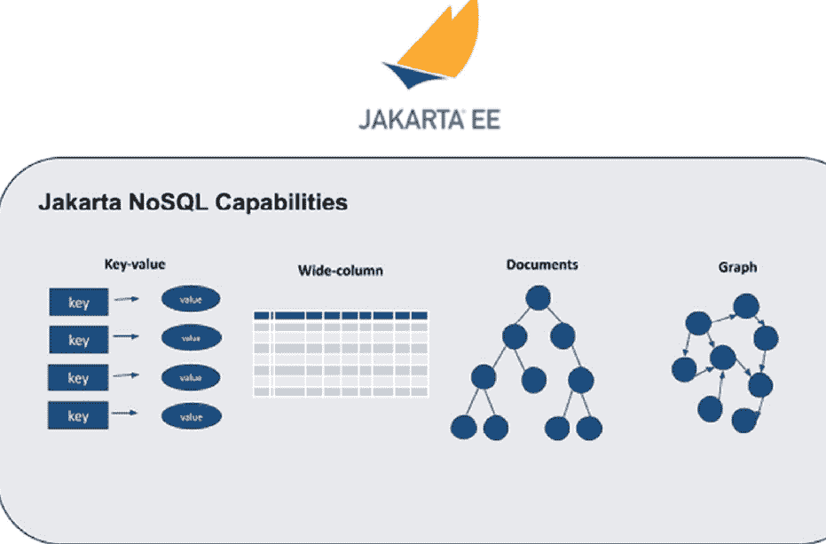

图 11.1: Jakarta NoSQL 能力

本节课程开启了我们进入 Jakarta NoSQL 架构景观的旅程。在接下来的章节中，我们将导航通过基于模板的核心，发现注解和专业化的潜力，并深入研究开启键值、列、文档和图数据库领域大门的专用模块。加入我们，揭开 Jakarta NoSQL 的复杂性，发现在多样化的 NoSQL 交互世界中标准化和专业化的力量。

# Jakarta NoSQL 的常用注解与模板魔法

在这一节启发性益浅的节课程中，我们将揭密塑造 Jakarta NoSQL 实体建模的核心注解，并揭示促进 Java 与各种数据库之间无缝通信的精妙模板机制。

## 常用注解

Jakarta NoSQL 引入了三个常用注解，作为实体建模的构建模块：

- `@Entity`：此注解表示该类是 NoSQL 上下文中的一个实体。应用于实体类时，它为将 Java 对象映射到 NoSQL 数据结构奠定了基础。

- `@Id`：使用此注解指定实体的主键。通过将其应用于字段或属性，你可以指定哪个属性唯一标识该实体。

- `@Column`：在将持久化属性或字段映射到数据库时，`@Column` 注解开始发挥作用。它决定了 Java 元素与数据库列之间的相关性。

考虑一个实体建模的实际示例：

| 字段 | 注解 | 说明 |
| :--- | :--- | :--- |
| id | `@Id` | 唯一标识符 |
| name | `@Column` | 实体名称 |
| age | `@Column` | 实体年龄 |

## 模板机制

除了实体建模，Jakarta NoSQL 引入了一个强大的概念：模板。这些动态实例促进了 Java 代码与底层数据库之间的交互，抽象了特定的数据库技术。想象一种数据库选择被隐藏的情景：

通过模板的魔法，实现了数据库无关性。在不暴露正在使用的数据库的情况下，Jakarta NoSQL 使开发者能够轻松执行插入、查询和删除等操作。请参考下图：

```java
@Inject
Template template;
template.insert(pet);
```


图 11.2: 魔法模板

在后续的章节中，我们将深入探讨这些注解和模板的本质，发现它们在构建优雅实体模型和促进与 NoSQL 数据库无缝通信方面的作用。此外，我们将探索如 Eclipse JNoSQL 等扩展 Jakarta NoSQL 能力的专用实现。

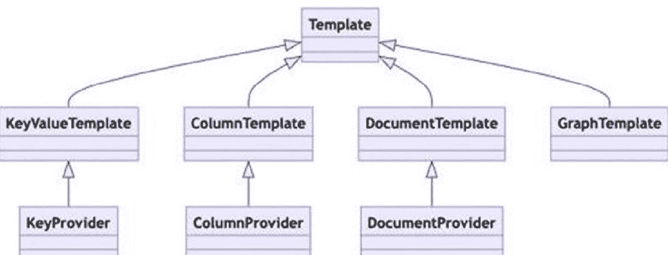

图 11.3：模板特化

在本节中，我们已经对 Jakarta NoSQL 的专用模板进行了一场富有启发性的探索，揭示了它们在将 Java 应用与多种 NoSQL 数据库无缝集成中的关键作用。从 `DocumentTemplate` 到 `ColumnTemplate`，我们窥见了一个灵活的框架，该框架使开发者能够根据每个 NoSQL 范式的特定需求定制其交互。这种模板的层级结构不仅提升了清晰度和效率，还扩展到了诸如 Eclipse JSQL 等扩展程序，揭示了 Jakarta NoSQL 架构的动态特性。

在本节结束之际，我们发现自己正处在创新与集成的十字路口。旅程并未在此结束；它将无缝过渡到我们的下一个章节。在接下来的节次中，我们将进入 Jakarta Data 领域开启新的征程。在这里，我们将探索该规范如何优雅地弥合 SQL 和 NoSQL 范式之间的差距，培养一种通用的 API，使 Java 开发者能够与多种数据库进行无缝交互。加入我们进入 Jakarta Data 的领域，发掘它的能力和优点，并发现其重新定义 Java 生态系统中数据库集成方法的的巨大潜力。

# 使用 Jakarta Data 统一数据访问

在这一引人入胜的节中，我们深入探讨了 Jakarta Data 领域。这是一项突破性的规范，旨在无缝弥合不同数据库类型之间的差距，为数据访问提供了一种一致且强大的编程模型。

## 核心理念

Jakarta Data 的核心是为 Java 开发者提供了一个动态 API，简化了对各种数据库类型的访问，无论是传统的关系型数据库，还是动态的 NoSQL 范式格局。该规范促进了访问数据存储库的统一方法，使开发者能够在各种数据库技术中利用其能力。

Java 开发者的工具箱因丰富的数据访问选项而更加丰富。通过 Jakarta Data，开发者可以轻松以多种方式与存储库交互。其中一种方法是在 `Repository` 接口上创建自定义的查询方法，为与数据交互提供了灵活的机制。这种易于定制的特性在保持一致编程模型的同时，满足了各种查询需求。

Jakarta Data 的哲学围绕着创建一个植根于 Jakarta 生态系统的熟悉且一致的编程模型展开。在抽象数据访问复杂性的同时，它保留了底层数据存储的独特特征和优势。这种独特的方法确保开发者可以在遵循 Jakarta 熟悉用法的同时，处理不同数据库的复杂性。想象一个动态图，其中业务层无缝连接到数据访问层。在数据访问层内部，出现了各种选项，包括 SQL、NoSQL 和 Web 服务。

在这一系列选择中，闪之星是 Jakarta Data，它被定位为任何持久层都可以访问的通用 API。它超越了数据的起源，允许开发者无论数据的来源或性质如何，都能与数据源进行无缝交互。参考下图：

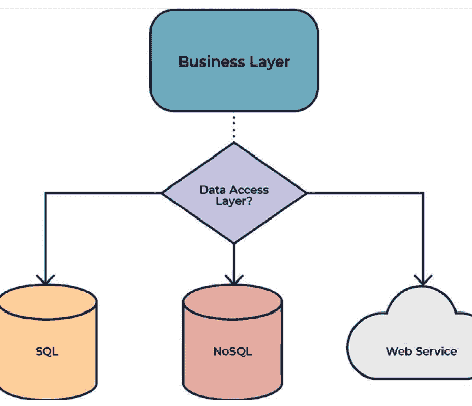

图 11.4：Jakarta Data 提案

## Repository 层级结构

Jakarta Data 初版发布的核心是存储库功能，它是开发者与数据存储库之间的桥梁。它封装了数据交互所需的复杂操作，为开发者提供了一个单一、直观的接口来处理各种数据库（无论是关系型还是 NoSQL）。这种统一使开发者能够专注于应用程序的逻辑，而不是纠结于特定的数据库细微差别。

与 Jakarta NoSQL 类似，Jakarta Data 采用了特化层，精炼了 `Repository` 概念以满足特定需求。根部是作为基础构建模块的 `Repository`。深入研究，我们遇到了 `CrudRepository`，它扩展了功能以包含了标准的创建、读取、更新和删除（CRUD）操作。此外，`PageableRepository` 通过整合分页功能丰富了层级结构，这在处理大量数据集时是一项至关重要的功能。可视化一个图形层级结构，顶端由通用的 `Repository` 占据。从这个核心散发出两个分支：一个通向健壮的 `CrudRepository`，另一个通向功能丰富的 `PageableRepository`。层级结构的每一层都封装了一组特定的功能，满足不同的数据访问需求。参考下图：

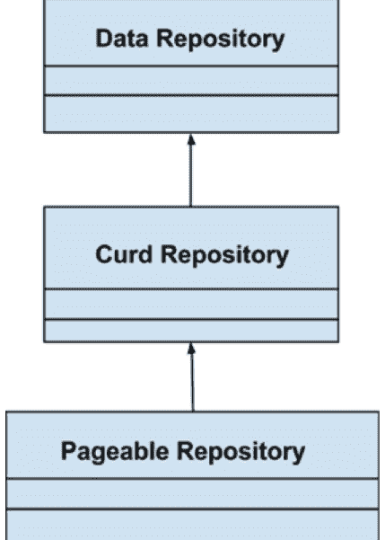


## 代码示例

我们的旅程从一窥 Jakarta Data 存储库的力量开始。想象一个 `Car` 实体，装饰有各种注解，将其映射到如 Jakarta Persistence 或 Jakarta NoSQL 等各种持久层中。为了方便与此实体交互，我们引入了 `CarRepository`。该接口扩展了 `CrudRepository`，继承了基本的创建、读取、更新、删除操作，并提供了额外的自定义查询方法。通过这些方法，开发者可以轻松地根据类型检索汽车列表，或通过名称定位汽车，抽象了数据查询和检索的复杂性。参考以下代码段：

```
snippet: snippet: snippet: snippet: snippet: snippet: snippet:
snippet: snippet: snippet: snippet: snippet: snippet: snippet:
```

Jakarta Data 存储库的卓越方面之一是接口与实现之间的关注点分离。开发者定义接口，而供应商承担实现。在供应商的角色中，负责实现提供的方法，从而减轻了开发者编写样板代码的负担。参考以下代码：

```
code: code: code: code: code: code: code:
```

除了基础数据访问外，Jakarta Data 存储库的功能还扩展到了分页，这是处理大型数据集时的一项关键功能。作为一个示例，考虑 `ProductRepository`。该接口扩展了 `PageableRepository`，允许开发者轻松使用分页。自定义查询方法根据类型检索产品，按名称排序并对结果进行分页。参考以下代码：

```
code: code: code: code: code: code: code: code: code:
code: code:
```

在本节结束之际，我们已经通过实例示例开启了探索 Jakarta Data 存储库力量的旅程。关注点分离、标准化方法和内置分页彰显了 Jakarta Data 为 Java 开发者简化数据访问的承诺。在接下来的节次中，我们将进一步探索 Jakarta Data 的能力，揭示其在统一各种数据库数据访问方面的作用。加入我们深入探讨 Jakarta Data 的多功能性，发掘它在不同持久层之间协调数据交互的能力。

# 需要记忆的要点

- **统一**：Jakarta Data 的 `Repository` 接口为数据访问提供了标准化且一致的编程模型，允许 Java 开发人员与包括关系型和 NoSQL 数据库在内的多种数据库类型进行无缝交互。

- **自定义查询**：Jakarta Data Repository 提供了在 Repository 接口中定义自定义查询方法的便利。这些方法封装了复杂的查询逻辑，将开发者从底层的复杂性中解放出来。

- **实现**：Jakarta Data 遵循关注分离的方法，由开发者定义 Repository 接口，而由供应商处理实现细节。这减轻了开发者编写样板代码的负担，让他们专注于应用程序逻辑。

- **内置**：内置 Jakarta Data Repository 扩展了其功能以支持分页。`PageableRepository` 接口允许开发者通过将分页直接整合到查询中，从而轻松地管理大型数据集。

- **一致性**：Jakarta Data 遵循熟悉的 Jakarta 哲学，为开发者提供了与 Jakarta 生态系统对齐的编程模型。这种一致性确保了开发者在处理不同的持久化层时，可以利用现有的知识。

- **平滑过渡**：通过 Jakarta Data Repository 接口学到的概念可以无缝过渡到 NoSQL 数据库。在接下来的章节中，我们将这些原则应用到我们的第一个 NoSQL 数据库 Redis 中，展示 Jakarta 原则在不同数据存储范式中的多变性。

# 单选题

## Jakarta Data Repository 接口的首要目标是什么？

- 创建复杂的数据模型。
- 仅关注 SQL 数据库。
- **为数据访问提供一种一致的编程模型。**
- 替换传统的 SQL 查询。

## 在 Jakarta Data Repository 层次体系中，哪一个专门化接口用于分页功能？

- CrudRepository
- **PageableRepository**
- DataRepository
- CustomRepository

## Jakarta Data `CrudRepository` 接口的主要角色是什么？

- 处理数据访问中的分页。
- 创建自定义查询方法。
- **封装 CRUD（创建、读取、更新、删除）操作。**
- 专用于图数据库交互。

## 在 Jakarta Data 中，哪种组件负责实现 Repository 接口中定义的方法？

- 应用程序开发者。
- Jakarta Data 框架本身。
- **数据库供应商。**
- Jakarta NoSQL 扩展。

## Jakarta Data 熟悉且一致的编程模型的益处是什么？

- 它强制仅使用 NoSQL 数据库。
- 它消除了对 Repository 接口的需求。
- **它简化了跨各种类型的数据访问。**
- 它需要额外的抽象层。

# Redis 集成

## 引言

将 Java 和 NoSQL 数据库结合已成为现代数据管理中构建健壮应用程序的关键枢纽。本章将关注 Redis，这是一种卓越的 NoSQL 数据库，探索它的本质、应用以及与 Java 编程语言的无缝协同。

Redis 以内存数据存储而闻名，以其卓越的性能和多功能性挑战了传统数据库的限制。当我们揭示其从数据结构到持久化机制的核心概念时，我们为首要目标——将 Redis 与 Java 集成奠定了基础。我们将通过简洁的代码示例和现实场景，阐明 Java 的灵活性与 Redis 的性能如何交织在一起，使开发者能够构建快速、数据密集型的应用程序。加入我们，揭开 Redis 和 Java 融合的奥秘，为你的软件项目提供工具，在动态数据需求的时代脱颖而出。

## 结构

本章涵盖了以下主题：

- Redis 简介
- 探索 Redis
- 探索 Redis 与 Java 的集成
- Redis 与安全

## 目标

本章的目标围绕探索 Java 与 NoSQL 数据库之间的共生关系展开，重点关注 Redis。我们旨在阐明 Redis 的核心概念，对其功能和应用提供简要的全面概述。我们的主要目标是展示 Redis 如何与 Java 编程语言无缝集成，为开发者提供所需的知识和实践见解，以利用 Redis 的力量优化 Java 应用程序中的数据管理、缓存和实时数据处理。通过说明性示例和动手实现，我们努力有效地为读者配备利用这种动态组合的技能。

# 要求

以下是本章的准备条件：

- Java 17
- Maven
- Git
- Docker

源自：https://github.com/ultimate-engineer/java-persistence-nosql-book/tree/main/chapter-12

## Redis 简介

Redis 卓越性能和多功能性的核心在于它被归类为键值数据库。这种分类体现了 Redis 的基本数据存储范式，即根据唯一键存储和检索数据，每个键都对应相应的值。这种简单而强大的方法赋予了 Redis 惊人的速度，使其成为对快速数据访问和操作至关重要的场景的理想选择。

Redis 的键值架构与 CAP 定理的原则和谐地交织在一起，该定理认为在分布式系统中，只能实现三个理想属性中的两个：Redis 主要设计用于高速数据检索和低延迟操作，因此通常优先考虑可用性和分区容性。这种强调使 Redis 能够在需要实时响应的场景中表现，例如缓存、会话管理和发布/订阅消息。

虽然 Redis 的优势显而易见，但它的设计选择也带来了特定的案例和权衡。极速是以可能较低的数据一致性为代价的，因为 Redis 为了确保立即可用性和分区容性，可能会牺牲严格一致性。这使得 Redis 非常适合对最终一致性要求足够的场景，例如排行榜、推荐引擎和实时分析仪表板。然而，需要强一致性的应用程序（如金融交易）可能需要替代的数据库解决方案。

为了理解 Redis 作为动态数据存储解决方案的广泛适用性，探索其多样化的案例至关重要。下表提供了这些场景的简要概述，突出了 Redis 的内存速度和多功能数据结构如何赋能开发者应对许多挑战，并深入 Redis 在优化性能、增强可扩展性和转变工作效率方面的能力。

| 用例 | 描述 |
| :--- | :--- |
| 缓存 | 频繁访问数据的高速检索。 |
| 会话管理 | Web 应用程序中的用户状态。 |
| 发布/订阅消息 | 系统组件之间的实时通信。 |
| 实时分析 | 立即处理数据流以获得即时见解。 |
| 排行榜 | 维护用户的实时排名。 |
| 推荐引擎 | 根据用户行为提供即时建议。 |


# Redis 集群架构

Redis 集群架构彻底改变了数据存储和分布。如图所示，数据被划分为哈槽（hash slots），这些哈槽被动态分配到集群中的不同节点。每个节点负责这些哈槽的子集，确保了均匀分布并优化了性能。自动故障转移机制实现了无缝恢复，正如连接主从节点的箭头所示。集群通过 gossip 进程维护动态视图，增强了其对不断变化的配置适应性。这种视觉化呈现让 Redis 集群设计的复杂性得以一斑，展示了它在分布式环境中提供扩展性、容错性和高可用性的能力。

请参考下图：

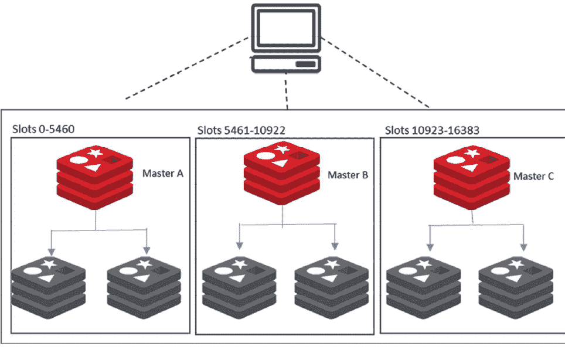

图 12.1：Redis 集群

在深入了解 Redis 集群的特性后，我们洞察了它的分布式架构，这种架构为应用程序提供了扩展性和容错能力。这一基础为我们的下一次探索奠定了舞台：深入探讨 Redis 数据库本身的核心组件和功能。在接下来的课程中，我们将学习 Redis 丰富的各种数据结构，探索其多功能命令，并揭示它在增强数据处理、缓存和实时应用中的关键作用。准备好迎接一场进入 Redis 核心的启发性之旅吧，在那里我们将发现让开发者能够充分发挥该数据库威力的工具。加入我们进入下一节，全面探索 Redis 的精髓和复杂性。

## 探索 Redis

作为一种极速的内存数据库，Redis 可以重新定义开发者处理数据的方式。在本节中，我们将开启一段发现之旅，导航 Redis 功能的关键方面，以及学习如何利用它来提升你的应用程序。Redis 提供了大量的操作和配置，本章将从开发者的视角揭示 Redis 的强大之处，侧重于让你能够有效利用其能力的实战见解。

在我们深入研究 Redis 之前，让我们先确保你已经准备好了用于动手操作探索的工具。

第一步是在本地安装 Redis，为你提供一个实验和学习的环境。虽然本书不会深入探讨复杂的运行和配置细节，但它将使你具备在项目中有效使用 Redis 所需的见解。

为了方便你的测试，我们将使用 Docker，这是一个强大的容器化工具。通过将 Redis 封装在 Docker 容器中，我们可以简化设置过程并确保跨各种环境的一致性。使用 Docker 在本地运行 Redis，请执行以下命令：

```
docker run --name redis-instance -p 6379:6379 -d redis
```

该命令在 Docker 容器中启动一个名为 `redis-instance` 的 Redis 实例，并开放端口 `6379` 用于通信。Docker 的简单性允许你快速搭建 Redis，为未来的探索铺平道路。随着我们的进行，我们将深入研究 Redis 的数据结构、命令和使用模式，使你能够挖掘这一卓越数据库的全部潜力。因此，让我们开启这段启发性的之旅，在揭秘 Redis 及其功能的同时，培养对它在现代数据管理中角色的更深层次的理解。

假设你已经按照指南在 Docker 容器中设置了 Redis，那么连接过程是简单的：

- 打开终端窗口。
- 输入以下命令并按回车键连接到 Docker 容器内的 Redis 实例：

```
docker exec -it redis-instance redis-cli
```

在这里，`redis-instance` 是你在设置期间为 Redis 容器分配的名称。

执行后，你将进入 Redis 命令行界面，表示已成功连接到 Redis 数据库。连接建立后，让我们执行几个基础命令来掌握 Redis 的功能：

- 设置并存储一个键值对并检索其值。参考以下代码片段：

```
SET my-key "hello world"
GET my-key
```

- 对数值执行原子递增。参考以下代码片段：

```
INCR my-counter
```

- 利用 Redis 列表（lists）管理有序集合。参考以下代码片段：

```
LPUSH my-list item1
LPUSH my-list item2
LRANGE my-list 0 -1
```

- 在单个键内存储多个字段值。参考以下代码片段：

```
HSET my-hash field1 value1 field2 value2
```

在 Redis 这一效率与速度汇聚的动态格局中，理解其核心命令对于释放其潜力至关重要。下表列出了精选的最流行且使用最广泛的 Redis 命令。这些命令涵盖了方方面的功能，从设置和检索值到管理列表、集合、哈希和有序集合等复杂数据结构。有了这些基础工具，你可以驾驭 Redis 多样化的应用，优化数据管理、缓存和实时处理。当我们详细探索每个命令时，你将获得关于其实际实现以及在构建健壮的数据驱动解决方案中关键作用的见解。

请参考下表：

| Command | Description |
| :--- | :--- |
| SET | 为键设置值 |
| GET | 获取键的值 |
| ... | ... (其他命令) |

表 12.2：Redis 命令

这些命令只是 Redis 庞大命令集的一小部分。它们涵盖了一系列数据操作任务，包括设置和检索值、处理列表、集合、哈希和有序集合，以及管理键的过期时间。熟悉这些命令是在各种应用中有效利用 Redis 能力的基石。

当我们结束对 Redis 基础命令的探索时，你已经迈入了 Redis 数据处理领域的第一步。配备了一系列强大的工具后，你现在准备好开启一段兴奋的旅程，在途中我们将桥接 Redis 和 Java 之间的鸿沟。在接下来的课程中，我们将无缝地集成这两种技术，揭示 Java 应用程序如何利用 Redis 的能力来增强数据管理、缓存和实时处理。Redis 与 Java 之间的协同作用是理论与实践的结合点。当我们深入实际实现时，你将获得优化应用程序速度、效率和响应能力的实战经验。因此，话话说说，让我们进入连接 Redis 与 Java 的艺术，揭开这种融合的无限可能。

## 探索 Redis 与 Java 的集成

在本次课程中，我们将开启一段跨越 Java 和 Redis 领域的旅程，利用两者的结合潜力构建强大且高效的应用程序。我们将使用 Jakarta 规范的 Jakarta NoSQL 和 Eclipse JNoSQL 实现来简化这种集成，这种强大的组合促进了流畅的数据交互。为了让这种融合更易于理解，我们将探索使用 Java SE 和 Maven 进行集成，这是一个展示了该方法多功能性的强大选择。

为了开启这段旅程，我们将引导你完成设置工作，从实现无缝集成所需的必需依赖项开始。我们的工具包包含了用于增强数据库交互的 Jakarta 规范 Jakarta NoSQL，以及为 Redis 数据库操作定制的 Eclipse JNoSQL。以下是构成此集成骨干的 Maven 依赖项预览：

| Group ID | Artifact ID | Version |
| :--- | :--- | :--- |
| jakarta.nosql | jakarta.nosql-api | 1.0.0 |
| org.eclipse.jnosql | redis-driver | 1.0.0 |
| org.eclipse.jnosql | diana-api | 1.0.0 |

后续步骤涉及配置凭据，以确保 Java 应用程序与 Redis 数据库之间的无缝通信。通过利用 Eclipse 的配置功能，我们使你能够针对不同的环境调整这些设置，符合“云原生十二因子”（The Twelve Factors）的原则。以下是你将要操作的配置属性预览：

| Property | Description |
| :--- | :--- |
| redis.host | Redis 服务器主机地址 |
| redis.port | Redis 服务器端口 |
| redis.password | Redis 认证密码 (可选) |

随着我们对 Redis 与 Java 集成的探索接近尾声，你已经在向解锁动态数据协同的世界迈出了巨大一步。Redis 和 Java 的融合（通过 Jakarta NoSQL 规范和 Eclipse JNoSQL 实现展示）阐明了这些技术如何结合来简化数据交互和管理。在掌握了配置的基础知识并浏览了有序集合（Sorted Sets）等 Redis 特殊结构后，你现在准备好进一步深入探索这种有趣的合作了。在接下来的章节中，我们将深入研究 Redis 环境下的 Java 集合（Collections），阐明如何使用 Redis 来利用这些熟悉的结构。因此，让我们继续跨越 Java 和 Redis 之间的鸿沟之旅，扩展我们的工具包以构建敏捷、高效且响应迅速的应用程序。加入我们的下节课程，共同探索 Java 集合与 Redis 的交汇点，开启数据驱动解决方案的新可能。

## Redis 的 Java 集合

当我们探索 Redis 和 Java 的融合时，下一步是在 Redis 环境下探索熟悉的 Java 集合。然而，重要的一点是 Redis 是以文本形式的键值对运行的。Eclipse JNoSQL 处理这些复杂性，自动将非字符串信息序列化为 JSON 格式。让我们深入研究，我们将如何利用 Redis 来发挥这些结构的潜力。

从 Java 开发者非常熟悉的列表（Lists）和集合（Sets）开始，我们将揭示 Redis 如何使用键和 JSON 序列化来存储和检索这些集合：

| Method | Description |
| :--- | :--- |
| `List.add()` | 向列表添加元素 |
| `List.get()` | 获取指定索引元素 |
| `Set.add()` | 向集合添加元素 |
| `Set.contains()` | 判断元素是否存在 |

过渡到队列（Queues），我们将检查 Redis 的实现是如何工作的：

| Method | Description |
| :--- | :--- |
| `Queue.offer()` | 插入元素到队列尾部 |
| `Queue.poll()` | 获取并移除队列头部元素 |
| `Queue.peek()` | 获取但不移除队列头部元素 |

最后，我们进入 Redis 对映射（Maps）的实现：

| Method | Description |
| :--- | :--- |
| `Map.put()` | 存储键值对 |
| `Map.get()` | 根据键获取值 |
| `Map.remove()` | 根据键移除键值对 |

当我们结束在 Java 环境下对 Redis 数据结构的探索时，你已经更好地理解了 Redis 的功能如何增强传统的集合。通过利用 Redis 的速度和效率，你见证了列表、集合、队列和映射如何转变为强大的数据存储和检索工具。在这一基础之上，我们准备好进一步研究 Redis 的特殊结构。在下一节课程中，我们将深入研究 Redis 的有序集合（Sorted Sets），这是一项卓越的功能，允许我们在数据中进行排序和排名管理。加入我们，揭开 Redis 有序集合的复杂性，并发现如何利用它们来构建需要精确数据优先级排序和组织的复杂应用程序。

# Redis 的有序集合和计数器

Redis 在努力扩展键值数据库能力的同时，引入了 Jakarta NoSQL 之外的特殊数据结构。其中一种结构就是有序集合，它结合了集合的本质和元素排序的力量。有序集合在 Redis 的工具库中占据独特地位，提供了系列应用场景，包括排名系统和数据优先级排序。

Redis 的有序集合擅长维护元素的有序集合，每个元素都有一个关联的分数（score）。该分数决定了元素在集合顺序中的位置。这种结构有助于元素的有效插入、删除和检索，并使你能够获取特定分数范围内的元素，提供了无与伦比的灵活性。

在探索有序集合背景的行程中，让我们构建一个 Redis 有序集合发光的场景：为游戏建立排名。这个示例展示了有序集合如何轻松地将玩家名称与其分数关联，从而让你能够创建一个全面的排名系统：

```
ZADD leaderboard 100 "player1"
ZADD leaderboard 200 "player2"
ZRANGE leaderboard 0 -1 WITHSCORES
```


接下来，Redis 专用计数器功能值得关注。Redis Counter 是一个简单而强大的工具，用于维护可以原子化递增或递减的整数值。这一功能在跟踪用户参与度或页面访问量时特别有用。让我们深入探讨 Redis Counter 的概念，并通过实际示例来探索其应用：

对于那些寻求通过 CDI 以更精简的方式与 Redis 计数器（`Counter`）和排序集合（`SortedSet`）交互的人来说，`RedisStructure` 类提供了一个强大的解决方案。通过利用 `@KeyValueDatabase` 注解，你可以以组织良好的方式无缝访问 `Counter` 和 `SortedSet` 结构。请参考以下代码段：

这种方法简化了代码，并强调了 Java 的结构优雅性与 Redis 数据处理能力之间的和谐。当你深入探索 Redis 集成时，请记住 CDI 提供了一条与 Redis 多样化数据结构交互的高效途径，能够优化你的开发流程。

在我们结束对 Redis 排序集合及其在维护顺序和排名中作用的探索时，你已经见证了 Redis 的能力如何超越传统的数据结构。通过分值对数据进行排序和组织的力量已然揭晓，为从游戏排行榜到复杂数据优先级排序等场景提供了一个强有力的工具。带着这些丰富的理解，我们准备好进入 Redis 和 Java 集成的新领域。在接下来的课程中，我们将深入处理实体（entities）的精彩领域，我们将结合使用 Redis 和 Java 来创建动态的基于实体的解决方案。加入我们这段旅程，发现这种协作如何赋予我们构建优雅高效且反映真实实体的健壮应用程序的能力。

## 基于实体结构的 Redis 和 Java 集成

在本节中，我们将通过实体结构的视角，深入探讨 Redis 和 Java 的无缝集成。在我们建立的基础之上，我们将探索一个以用户信息为中心的场景，其中 Redis 的键值范式和谐地适应了复杂实体的数据需求。

这种集成的关键在于 `User` 类，该类经过精心设计，将用户信息封装在单个实体中。利用 Jakarta NoSQL 的 `@Entity` 和 `@Id` 注解，我们将此类指定为实体，其中 `userName` 属性作为唯一标识，类似于 Redis 键值结构中的键。该类还容纳了其他字段，如 `settings`（映射类型）和 `languages`（集合类型）。请参考以下代码段：

`User` 实体准备就绪后，我们将其投入实际使用。一个继承自模板并提供额外键值能力的专用类成为了关注焦点。通过利用该模板，我们可以轻松地使用 `User` 实体与 Redis 数据库进行交互。请参考以下代码段：

当你深入这段代码时，请注意 `KeyValueTemplate` 是如何封装 Redis 操作的。通过模板处理 JSON 的序列化和反序列化，我们可以插入和检索实体，这是一个无缝的过程，使你能够使用熟悉的 Java 类处理复杂的数据结构。

在 Redis 中，`database:key` 约定是组织和访问数据的基本结构。这种命名约定意味着每条数据（称为 `value`）都与特定的键值对关联。数据库元素表示这些键值对所处的的范围或命名空间，允许对不同的数据类别进行逻辑分离。例如，如果我们有一个键为 `user:1` 的用户实体，Redis 将其存储为 `0:user:1`，其中 `0` 代表数据库并作为该数据库内的唯一键。这种模式确保了管理和检索数据的一种结构化且高效的方法。

为了说明 Redis 如何以 JSON 格式存储和检索数据：

在 Java 和 Redis 无缝集成的基础上，让我们进一步探索 Jakarta Data 的功能，通过使用存储库（repositories）来丰富与 Redis 的交互。

进入存储库领域，我们引入了带注解的接口，它在更高层次的抽象封装了标准的 CRUD 操作：

通过扩展 `CrudRepository` 并提供 `User` 类作为实体类型、`String` 作为标识符类型，我们拥有了一个便于对 `User` 实体进行各种操作的存储库。

然而，一个关键点是 Redis 存储库中的查询操作完全基于键。因此，通过方法约定查询（query by methods conventions）将抛出运行时异常，因为查询超出了 Redis 基于键的范式。

让我们实际运用这些概念，考虑下面的代码段，它展示了如何使用


在本节中，我们开启了一段通过实体结构整合 Redis 与 Java 的启发性旅程。通过利用 Jakarta NoSQL 的注解，我们将复杂的数据模型转换为 Redis 领域中以 JSON 表示形式的键值对。Java 面向对象的编程优雅性与 Redis 的速度和高效之间的相互作用，创造了一种协同效应，在保留实时操作能力的同时，简化了数据的存储和检索。当我们探索了 `UserRepository` 及其在优化交互中的作用时，我们见证了 Redis 仓库如何在基于键的范式中简化数据操作。本节使我们能够利用 Redis 的功能，通过 Java 的灵活性与 Redis 的强大性能的和谐融合，打造出稳健的、以数据为中心的应用程序。

## Redis 与安全

虽然本书的重点是 Redis 和 Java 的集成，但触及 Redis 安全这一话题至关重要。尽管 Redis 以其快速和高效而闻名，但保护你的 Redis 部署免受潜在安全威胁也同样关重要。本节将阐明 Redis 安全的重要性、如何启用它，以及为什么不应该忽视它。

在任何 Redis 部署中，强调 Redis 安全的意义都是至关重要的，即使我们在本书中主要探索 Redis 和 Java 的集成。安全构成了你基于 Redis 的应用程序的可靠性基础。由于 Redis 经常处理敏感数据（例如用户凭据和会话信息），保护这些信息免受未经授权的访问是不可妥协的。此外，实施安全措施可以防止恶意攻击者获得对你 Redis 实例的未经授权控制，减少数据泄露和潜在数据丢失的风险。因此，尽管我们的重点仍然是 Redis-Java 集成，但理解并实施 Redis 安全对于负责任地使用 Redis 是本质的。

安全是集成 Redis 和 Java 的关键。实施稳健的安全措施来保护敏感数据、控制访问并防止丢失。在我们探索 Redis 时，这些原则确保了与 Java 进行安全且稳健的集成：

- 数据：Redis 经常持有敏感数据，例如用户凭据或会话信息。保护你的 Redis 实例可以保护这些关键信息免受未经授权的访问。

- 防止未经授权：如果没有安全措施，任何访问网络的人都可以与你的 Redis 实例进行交互。实施安全确保只有经过授权的用户才能访问和修改数据。

- 缓解：Redis 的内存特性意味着如果服务器崩溃，数据可能会丢失。通过启用安全功能，你可以降低恶意攻击导致数据丢失的风险。

为了补充我们对 Redis-Java 集成的主要关注，简要讨论如何启用 Redis 安全及其背后的逻辑是非常重要的。通过主动保护你的 Redis 部署，你可以为数据抵御潜在威胁。Redis 安全不仅是一项预防措施，更是负责任使用 Redis 的基本方面。请参考以下步骤：

- 最简单的安全措施是为你的 Redis 实例设置密码（或 auth 令牌）。这防止任何人在没有正确密码的情况下连接到 Redis。

- 要启用身份验证，请向 Redis 配置文件添加以下行：

```
requirepass yourStrongPassword
```

- 绑定到特定：默认情况下，Redis 绑定到所有网络接口，这可能会使其暴露在不必要的风险中。配置 Redis 仅绑定到应用程序所需的特定 IP 地址或网络接口：

```
bind 127.0.0.1
```

- 防火墙和网络：利用防火墙和网络安全措施控制哪些 IP 地址或子网可以访问你的 Redis 实例。这提供了额外的保护。

- 虚拟专用网络：考虑使用 VPN 建立到你的 Redis 服务器的加密连接。VPN 可以加密数据传输，增加额外的安全级别。

- 定期：保持你的 Redis 安装为最新版本，以从安全补丁和错误修复中获益。

虽然 Redis 的速度和高效是其特征，但确保你的 Redis 实例的安全同样重要。通过实施身份验证、网络限制和定期更新等安全措施，你可以保护你的数据并防止未经授权的访问，从而实现更稳健、更安全的 Redis-Java 集成。

虽然本节提供了 Redis 安全及其重要性的简单概述，但必须强调，在生产环境中深入研究 Redis 安全措施是至关重要的。Redis 文档提供了关于有效保护 Redis 实例的全面见解。Redis 安全应该根据你应用程序特定需求和风险因素进行定制，而这些文档是配置稳健安全协议的不可或缺的指南。在我们继续 Redis 和 Java 集成的旅程时，请记住，彻底理解 Redis 安全实践可以确保你的数据在真实场景中的保护以及应用程序的稳定性。

## 结论

我们对 Redis 和 Java 集成的探索接近尾声，在这一动态协同作用中揭示了丰富的见解和可能性。从 Redis 的基础操作到其专门的数据结构，以及 Java 实体和仓库的无缝结合，我们航越了一个在构建尖端数据解决方案方面融合速度、灵活性和效率的领域。

当我们告别 Redis 时，我们的旅程将在新的道路上继续，探索 Cassandra 数据库与 Java 集成的迷人领域。Cassandra 的分布式架构和强大的数据建模能力提供了独特的数据存储和检索视角，使其成为大规模运行的 Java 应用程序的完美伴侣。在接下来的章节中，我们将开启全新的冒险，揭开 Cassandra 集成的复杂之处以及它赋予开发者无缝处理海量数据的多种方式。因此，请加入我们过渡到 Cassandra 和 Java，开启数据管理和应用程序开发的新视野。

## 记忆点

- Redis 和 Java：Redis 与 Java 的集成提供了 Redis 的速度、高效与 Java 的灵活性及面向对象编程的强大结合。

- Redis 的特殊数据：Redis 引入了列表、集合、队列、映射、排序集合和计数器等特殊结构，实现了各种场景下的高效数据存储和检索。

- 序列化：Redis 与键值对一起，像 JNoSQL 等库会自动将非字符串数据序列化为 JSON 格式，允许与 Java 实体无缝集成。

- 实体集成：你可以通过使用 Jakarta NoSQL 注解（如 `@Entity`）标记 Java 类，从而轻松地将复杂数据模型转换为 Redis 键值对。

- 高级抽象：Jakarta Data 仓库（如 `CrudRepository`）提供了与 Redis 交互的简化方法，简化了 CRUD 操作并增强了数据管理。

- 基于键的：Redis 遵循 `database:key` 的约定来构建数据，其中 `database` 定义数据范围，`key` 是唯一标识符。

## 选择题

1. 哪种 Redis 数据结构适用于带评分有序集合？

   - 列表 (List)

   - 集合 (Set)

   - 排序集合 (Sorted Set)

   - 映射 (Map)

2. 在 Redis 集成的背景下，Jakarta NoSQL 的 `@Entity` 注解的作用是什么？

   - 标识键

   - 指定 JSON 值

   - 将 Java 类映射到 Redis 实体

   - 表示外键关系

3. 在 Redis 仓库中，查询操作是如何执行的？

   - 使用 SQL 类查询

   - 通过基于键的操作

   - 调用存储过程

   - 通过外键关系

4. Redis 中的 `database:key` 命名约定代表什么？

   - 分级数据结构

   - Java 实体的命名指南

   - 唯一实体标识符

   - 数据库命名空间与键的组合

5. 根据基于键的存储范式，Redis 仓库通常如何访问数据？

   - 使用 SQL 类查询

   - 通过外键关系

   - 调用存储过程

   - 通过基于键的直接操作

## 答案

加入我们书籍的 Discord 空间

加入书籍 Discord 工作空间获取最新更新、优惠、全球科技动态、新发布以及与作者互动：

https://discord.bponline.com


# 第 13 章

## Cassandra 集成

## 引言

本章深入探讨 Java 与 NoSQL 数据库之间的动态协同作用，重点介绍 Cassandra。在所有 NoSQL 数据库中，Cassandra 的分布式、容错和可扩展架构脱颖而出，使其成为管理大规模非结构化数据的理想选择。我们将开启一段之旅，探索 Cassandra 的核心概念，简要研究其特性，然后见证它与 Java 的无缝集成。

Cassandra 以其无主设计挑战了传统规范，拥抱去中心化以实现高可用性而不牺牲性能。本章将揭示 Cassandra 的去中心化结构、宽列数据模型以及在管理写密集型工作负载方面的实力。在这些基础之后，我们将转向实践领域，Java 将成为我们的盟友。Java 的灵活性与 Cassandra 的韧性之间的协作使开发者能够构建优雅处理海量数据的应用程序。Cassandra 和 Java 重新定义了数据驱动系统的格局，我们将在本章中探索这种协同作用。

## 结构

本章涵盖以下主题：

- Cassandra 简介

- 探索 Cassandra

- 将 Cassandra 与 Java 集成

- Cassandra 与安全性

## 目标

在本章中，我们的目标有三点：首先，阐明 Java 与 NoSQL 数据库之间的共生关系，重点关注 Cassandra 作为分布式和可扩展解决方案的角色；其次，提供 Cassandra 基本概念和独特特性的全面概述；最后，演示 Cassandra 与 Java 的实际实现，展示两者的结合如何赋能开发者构建健壮、高性能的应用程序，以管理和利用海量数据。

## 要求

以下是本章的先决条件：

- Java 17

- Maven

- Git

- Docker

- 源码

## 介绍 Cassandra

Cassandra 是一种领先的 NoSQL 数据库，在 CAP 定理背景下体现了宽列存储的精髓。一致性、可用性和分区容性是决定数据库行为的关键因素。Cassandra 根植于宽列数据存储范式，提供了管理数据的独特方法，确保了灵活性、可扩展性和容错性。本节将介绍 Cassandra 在 CAP 框架内的独特特性，深入研究其宽列数据模型，并探索其提供的各种用例以及不可避免的权衡。

Cassandra 通过拥抱高可用性和分区容性来应对 CAP 三角，同时引入了被称为“可调一致性”（Tunable Consistency）的概念。其架构围绕在网络分区时保持操作运行，使其能够随时确保数据可用性。这与宽列存储的分布式本质一致，其中数据对齐以优化跨许多列的读写操作。CAP 定理的视角表明，在像 Cassandra 这样的分布式系统中，一致性与可用性之间存在权衡。Cassandra 倾向于可用性和分区容性，提供可调的一致性水平以满足不同的应用需求。

Cassandra 的宽列模型是为高效处理大规模数据集的场景量身定制的。这种设计适应了如时间序列数据管理、传感器数据采集和内容管理系统等用例，在这些场景中，高吞吐量和可扩展性至关重要。然而，选择可用性和分区容性而非强一致性需要仔细考虑权衡。值得注意的是，可能会出现数据一致性无法立即保证的情况，这要求开发者在设计应用程序时考虑最终一致性（eventual consistency）模式。当我们深入探索 Cassandra 领域时，我们将探索这些细节，让你能够做出明智的决策，并在复杂的分布式系统格局中充分利用这种宽列数据库的潜力。

Cassandra 的多功能性和可扩展性使其成为不同行业各种应用程序的迷人选择。下表强调了 Cassandra 表现卓越的一些主要用例，展示了它在数据管理中广泛的适用性：

| 用例 |
| :--- |
| 时间序列数据管理 |
| 传感器数据采集 |
| 内容管理系统 |
| 实时分析 |
| 用户配置文件 |
| 消息系统 |
| 欺诈检测 |
| IoT 数据 |

### 表 13.1：Cassandra 用例

Cassandra 的分布式架构、容错能力以及处理海量数据的能力贡献了它在用例中的有效性。然而，选择高可用性和分区容性而非强一致性需要在应用设计和数据一致性权衡上进行考虑。当我们深入这些用例时，还将探索如何在利用 Cassandra 满足特定应用需求的同时应对这些权衡。

Cassandra 的优势在于其分布式架构，这使其能够在节点集群中无缝管理和扩展大量数据。让我们深入研究定义 Cassandra 在集群环境中运行的关键组件：读修复、种子节点和 Gossip 协议。

在 Cassandra 中，数据被组织成跨越物理位置的节点集群。集群中的每个节点包含部分数据，数据在节点间进行复制以确保可用性和容错性。这种复制策略通常与分区相结合，增强了数据分布和访问性，同时减少了单点故障。以下图说明了具有多个节点的数据中心之间的通信：

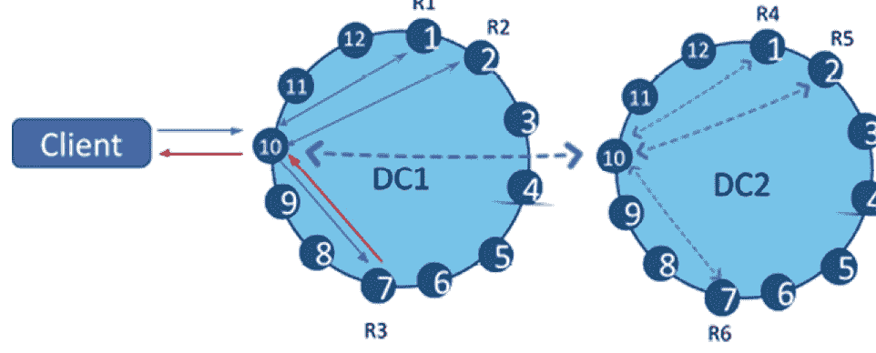

图 Cassandra 分布式系统

Cassandra 采用读修复机制在分布式操作中维护数据一致性。当向节点发出读取请求时，它可能会从多个副本获取数据以确保一致性。如果在此过程中检测到不一致，过期副本将更新为最新数据，从而增强集群的数据完整性。Cassandra 提供的可调一致性水平使开发者能够平衡可用性和一致性，使其适用于各种应用需求。

种子节点在集群形成过程中起着关键作用。它们作为新节点加入集群的初始接触点，帮助发现其他节点并维护集群成员信息。Cassandra 使用 Gossip 协议在节点之间交换状态信息。这种轻量级协议帮助节点发现彼此的存在，确保集群感知其当前的拓扑结构。Gossip 协议的去中心化特性允许高效的信息共享，使其成为 Cassandra 自组织和适应集群变化不可或缺的一部分。


轻量级协议帮助节点发现彼此的存在，确保集群感知其当前的拓扑结构。`gossip` 协议的去中心化特性允许高效的信息共享，使其成为 Cassandra 自组织和适应集群变化不可或缺的一部分。

本质上，Cassandra 的架构围绕分布和复制原则构建，使其能够以高可用性和容错性处理海量数据集。读取修复（`read repair`）、种子节点（`seed nodes`）和 `gossip` 协议的结合使 Cassandra 能够应对数据分布挑战，确保数据在集群内节点之间保持一致性、可访问性和高性能。

Cassandra 的架构围绕关键键空间（`key spaces`）和列族（`column families`）构建，其内部组件——如提交日志（`commit log`）、内存表（`memtable`）和 `SSTables`——协同工作，以确保持久性、数据完整性以及高效的读写操作。如图 13.2 所示：

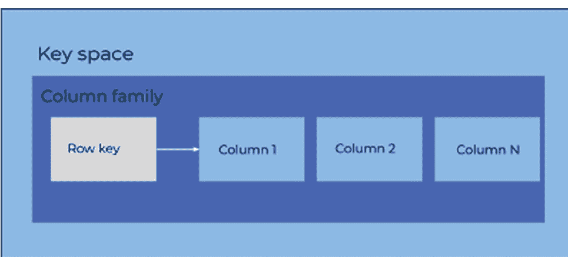

图 Cassandra 结构

在 Cassandra 中，键空间类似于关系型世界中的模式或数据库。它代表列族（表）的逻辑分组。每个列族包含由唯一主键索引的行。与关系型数据库不同，列族允许动态列，这意味着每行都不需要遵循固定的列集，在数据建模方面提供了极佳的灵活性。

Cassandra 的提交日志是持久性的基础组件。数据在写入或更新时首先会被追加到提交日志中。这种对提交日志的顺序写入确保了即使数据更改尚未刷新到磁盘，这些更改也是持久的。这种方法通过允许在发生崩溃或故障时进行数据恢复增强了可靠性。

在提交日志中记录写入操作后，数据还会被插入到名为 `memtable` 的内存数据结构中。`memtable` 是一个有序的写回缓存，在数据刷新到磁盘之前将其存储在内存中。这种设计通过减少磁盘 I/O 优化了写操作，因为多次写入可以在持久为排序字符串表（`Sorted String Tables`）并写入磁盘之前进行合并。

`SSTables` 是 Cassandra 中数据的磁盘上存储格式。它们是不可变的并按键排序，允许高效的范围查询。当 `memtable` 变得过大或触发刷新操作时，`memtable` 会作为 `SSTable` 写入磁盘。`SSTables` 对于读写操作而言既紧凑又高效，Cassandra 使用压缩（`compaction`）来管理它们，确保最优的数据存储并最小化磁盘空间占用。

Cassandra 的分区器（`partitioner`）负责将数据分布到集群节点。它使用一致哈希算法将键转换为哈希值，从而确定节点的数据分布。这种方法确保数据均匀分布并防止热点的产生。每个节点负责一个哈希范围，复制因子（`replication factor`）决定了集群中存在多少数据副本。如下所示，基于这些值探索如 Jim 和 Suzy 等键，将生成哈希值，并根据该值链接到 Cassandra 实例：

| Jim | Car: Camaro | Age: 32 |
| Carol | Color: Pink | Work: Hobby |
| Suzy | Team: Bahia | Country: USA |
| Jim | 1 | |
| Carol | 13 | |
| Suzy | 15 | |


图 Cassandra 哈希

总而言之，Cassandra 的架构围绕键空间和列族展开，通过提交日志、`memtable` 和 `SSTables` 等内部机制确保了数据的持久性、高效的读写操作以及有效的数据分布。分区器的一致哈希算法保证了数据的均匀分布，提升了 Cassandra 在保持高可用性和性能的同时处理大型数据集的能力。

在我们结束对 Cassandra 架构和内部机制的探索时，我们已经对其分布式设计有了全面的理解，这种设计使其能够以容错和高可用性处理海量数据集。我们深入研究了键空间、列族的概念以及提交日志、`memtable` 和 `SSTables` 的复杂性。

此外，我们还看到了分区器和一致哈希在跨集群高效分发数据方面起着关键作用。掌握了这些基础知识后，我们准备好深入探索 Cassandra 本身的核心。在接下来的章节中，我们将开启 Cassandra 核心功能的导览之旅，涵盖数据建模、查询以及支撑其无缝处理结构化和非结构化数据卓越能力的机制。让我们在揭示 Cassandra 数据库能力的许多方面的同时继续我们的旅程。

## 探索 Cassandra

在深入研究 Cassandra 开发之前，搭建一个可以让我们进行实验、探索和精炼技能的本地环境至关重要。本节将指导你如何在本地安装用于开发目的的 Cassandra。但是，请注意，本书侧重于开发者视角，不会详尽介绍运维和配置细节。

首先，确保你的机器上已安装 `Docker`，以便我们能够快速搭建起 Cassandra 进行测试。虽然全面的安装指南超出了本章的范围，但你通常可以在 `Docker` 官方网站找到直接的指令。一旦 `Docker` 运行，执行以下命令来为测试快速设置 Cassandra。

```
docker run --name cassandra -d cassandra:latest
```


# Cassandra 的分区器

Cassandra 的分区器（`partitioner`）负责将数据分布到集群节点。它使用一致哈希算法将键转换为哈希值，从而确定节点的数据分布。这种方法确保数据均匀分布并防止热点的产生。每个节点负责一个哈希范围，复制因子（`replication factor`）决定了集群中存在多少数据副本。如下所示，基于这些值探索如 Jim 和 Suzy 等键，将生成哈希值，并根据该值链接到 Cassandra 实例：

| Jim | Car: Camaro | Age: 32 |
| Carol | Color: Pink | Work: Hobby |
| Suzy | Team: Bahia | Country: USA |
| Jim | 1 | |
| Carol | 13 | |
| Suzy | 15 | |


总而言之，Cassandra 的架构围绕键空间和列族展开，通过提交日志、memtable 和 SSTables 等内部机制确保了数据的持久性、高效的读写操作以及有效的数据分布。分区器的一致哈希算法保证了数据的均匀分布，提升了 Cassandra 在保持高可用性和性能的同时处理大型数据集的能力。

在我们结束对 Cassandra 架构和内部机制的探索时，我们已经对其分布式设计有了全面的理解，这种设计使其能够以容错和高可用性处理海量数据集。我们深入研究了键空间、列族的概念以及提交日志、memtable 和 SSTables 的复杂性。

此外，我们还看到了分区器和一致哈希在跨集群高效分发数据方面起着关键作用。掌握了这些基础知识后，我们准备好深入探索 Cassandra 本身的核心。在接下来的章节中，我们将开启 Cassandra 核心功能的导览之旅，涵盖数据建模、查询以及支撑其无缝处理结构化和非结构化数据卓越能力的机制。让我们在揭示 Cassandra 数据库能力的许多方面的同时继续我们的旅程。

# 探索 Cassandra

在深入研究 Cassandra 开发之前，搭建一个可以让我们进行实验、探索和精炼技能的本地环境至关重要。本节将指导你如何在本地安装用于开发目的的 Cassandra。但是，请注意，本书侧重于开发者视角，不会详尽介绍运维和配置细节。

首先，确保你的机器上已安装 Docker，以便我们能够快速搭建起 Cassandra 进行测试。虽然全面的安装指南超出了本章的范围，但你通常可以在 Docker 官方网站找到直接的指令。一旦 Docker 运行，执行以下命令来为测试快速设置 Cassandra。

| Jim | Car: Camaro | Age: 32 |
| Carol | Color: Pink | Work: Hobby |
| Suzy | Team: Bahia | Country: USA |
| Jim | 1 | |
| Carol | 13 | |
| Suzy | 15 | |

## 表 13.2: Cassandra 命令

当我们结束对 Cassandra 基础概念和基本命令的探索时，你已经对这个分布式数据库的运行机制有了稳健的理解。这种理解为我们的下一个目标奠定了基础：将 Cassandra 与 Java 编程的强大功能无缝集成。在后续章节中，我们将开启一段充满启发的旅程，将 Cassandra 的动态数据库结构与 Java 的多功能性结合起来，释放构建复杂且可扩展应用的潜力。

# 将 Cassandra 集成 Java

Java 与 NoSQL 数据库的融合引发了应用开发的新纪元，其特点是扩展性与性能的无缝结合。在本节中，我们将开启一段揭示分布式 NoSQL 数据库 Cassandra 与 Java 集成艺术之旅。为了简化并增强这种集成，我们利用了 Jakarta 规范：Jakarta NoSQL，及其实用的实现——Eclipse JNoSQL。这一协作努力将强调集成过程，使我们能够专注于构建动态应用程序，同时最大限度地减少 Cassandra 配置的复杂性。

在追求简化的过程中，我们专注于 Jakarta NoSQL 规范，并与 Eclipse JNoSQL 保持一致。在本次探索的范围内，我们在 Java SE 领域内工作，并借助 Maven 的便利性来优化我们的集成体验。作为 Jakarta NoSQL 与 Java 动态世界兼容性的证明，这种方法支持 CDI 2.0 及更高版本，在无需完整企业级环境的情况下促进集成过程。

为了实现这一目标，Eclipse JNoSQL 库将派上用场。然而，Cassandra 与 Java 的成功结合需要一组依赖项作为支持。这包括用于管理上下文实例的 CDI、用于熟练处理 JSON 处理的 JSON-P，以及用于增强配置管理灵活性的 Eclipse MicroProfile Configuration。当这些组件交织进我们的开发生态系统中时，我们已准备好见证无缝集成的魔法发生。

我们的 Maven 项目是实现这一集成的核心，它作为一个整合了这些必要依赖的协作框架。在我们构建项目的 POM 文件时，我们引入了必要的 Maven 坐标：`weld-se-shaded` (CDI)、`jnosql-cassandra` (Cassandra 集成)、`yasson` (JSON-P) 和 `smallrye-config-core` (Eclipse MicroProfile Configuration)。这种组合创建了协同效应，推动我们向优化的集成体验迈进。请参考以下代码：

随着我们探索的展开，本节揭示了现代应用设计的一个重要方面：配置管理。通过利用 Eclipse MicroProfile Configuration 的功能，我们可以轻松地调优凭据和设置。通过遵循“要素原生应用”原则，我们确保了配置与代码的分离，从而在不同的环境中提供了更好的适应性和安全性。

请参考以下代码片段：

```
```

随着我们的 Cassandra 实例运行起来，我们现在可以深入研究使用 Cassandra 查询语言 (CQL) 来结构化我们的数据，并使用 Java 进一步对该结构进行建模。让我们从设置基础数据结构开始，然后建模 Person 实体，这将使我们能够探索 Cassandra 独特的类型支持。

请参考以下代码片段：

```

CQL 命令为我们的数据创建了必要的键空间（`keyspace`）和列族（`column families`）。名为 `developers` 的键空间使用了 `SimpleStrategy` 复制策略，复制因子（`replication factor`）为 3。此外，它定义了一个 Person 列族、一个自定义类型指示器和一个 Movie 列族。它定义了一个 Person 列族、一个自定义类型指示器和一个 Movie 列族。在 Movie 列族上还建立了一个索引以进行高效查询。

接下来，我们将在 Java 中对 Person 实体进行建模，使其与 Cassandra 保持一致。Person 类包含 ID、name 和 contacts 等属性，其中 contacts 被表示为 map。

请参考以下代码：

```

```

```

```
```

通过使用来自 Eclipse JNoSQL 的注解，我们将 Person 类映射到 Cassandra 键空间中的 Person 列族。`@Id` 注解指定主键字段，`@Column` 注解指示了要存储在 Cassandra 列族中的属性。建模为 map 的 `contacts` 属性展示了 Cassandra 纳复杂结构的能力。一旦我们的数据结构就绪且 Person 实体建模完成，我们就准备好探索 Cassandra 的动态查询能力，并观察 Java 与 Cassandra 之间的协同效应。

接下来的 Java 代码展示了 Java 如何使用 Eclipse JNoSQL 与 Cassandra 无缝交互。在随后的章节中，我们将探索集成、操作和查询数据的各种方法。

提供的 Java 代码演示了使用 `ColumnTemplate` 对 Person 实体进行集成。`ColumnTemplate` 简化了对 Cassandra 的操作。在示例中，我们创建了 otavio 和 elderjava 的 Person 实例，并将它们插入到名为 developers 的 Cassandra 列族中。elderjava 的插入配置了一秒钟的生存时间（TTL）。之后，我们使用 `find` 方法检索并打印已插入的实体。

请参考以下代码：

```
```


这个特定的模板允许我们一致且高效地执行 CQL 查询。在示例中，我们创建了一个名为 `ada` 的 `Person` 实例，并使用 `CassandraTemplate` 以指定的一致性级别保存它。随后，我们利用 `cql` 方法执行自定义 CQL 查询，以检索符合特定条件的实体并收集结果。

为了完成我们的探索，我们将深入研究利用仓库进行删除（CRUD）操作。Eclipse JNoSQL 允许我们使用类似于 Spring Data 仓库的仓库与 Cassandra 交互。在示例中，我们定义了 `PersonRepository` 接口，包含基本的 CRUD 方法。然后，我们创建了 `Person` 实例并使用该仓库来保存和检索该实体。这种方法简化了数据操作，对于熟悉存储库模式的开发者来说非常直观。请参考以下代码：

当我们结束使用 Eclipse JNoSQL 将 Cassandra 与 Java 集成的旅程时，我们见证了分布式 NoSQL 环境中精简数据操作和查询的力量。从插入和检索实体到执行自定义 CQL 查询以及利用存储库模式，我们探索了数据交互的各个方面。这一基础为深入研究 Cassandra 的数据建模能力（特别是通过用户定义类型 UDT 的视角）奠定了基础。在接下来的章节中，我们将揭示 UDT 的潜力，用以结构化和组织复杂的数据场景。Cassandra 这一复杂而直观的特性使我们能够以极高的灵活性进行数据建模，同时保持与 Java 强大功能的和谐集成。让我们深入 UDT 的世界，亲身体验它们如何提升我们在 Cassandra 中的数据建模之旅。

## 探索用户定义类型

在 Cassandra 数据建模领域，UDT 的概念证明了数据库的灵活性以及适应复杂数据结构的能力。UDT 允许开发者创建包含多个字段的自定义数据类型，提供了一种将相关属性封装到单个单元的方法。这对于数据实体包含嵌套属性或集合的建模场景尤为有用。

在 Cassandra 中利用 UDT 的一个典型示例可以通过电影实体场景来说明：电影实体有一个导演，导演负责管理一组电影。这种配置展示了 UDT 如何促进数据表示和检索，而无需进行大量的反规范化处理。

在提供的 Java 代码段中，我们编写了两个实体类：`Movie` 和 `Director`。`Movie` 实体代表一部具有名称和年龄属性的电影。`Director` 实体封装了关于导演的细节，包括名称和电影集。

通过使用 `@UDT(director)` 注解标记 `director` 实体，我们创建了一个名为 `director` 的 UDT，它可以在包括 `movie` 在内的其他实体中使用。这种 UDT 的建立使我们能够将电影的集合封装在导演类型中，促进了模块化和组织性。

在需要通过反规范化来优化查询性能的场景中，UDT 发挥着至关重要的作用。虽然反规范化会导致数据复制，但它通过允许在单个查询中检索相关数据来优化查询操作，而无需为每个信息执行多次查询。

在我们使用 Eclipse JNoSQL 将 Cassandra 与 Java 集成的旅途中，我们现在探索利用 Cassandra 能力的仓库。该仓库扩展自 `CassandraRepository`，赋予我们处理 Cassandra 特有功能（如 CQL 查询）的灵活性，同时遵循数据访问的存储库模式。

提供的 Java 代码展示了 `MovieRepository` 接口的创建，该接口扩展了 `CassandraRepository` 并将 `Movie` 实体和 `String` 作为标识符类型。此仓库封装了基本的 CRUD 操作，同时引入了特殊的查询方法。

请参考以下代码：

`MovieRepository` 接口包含了两个查询方法示例：`findByAge(Integer age)` 和一个自定义 CQL 查询。第一个方法演示了如何使用查询方法根据特定属性检索电影，而第二个方法展示了 CQL 执行自定义查询的力量。

随后，我们实现了一个 `main` 方法来演示如何使用仓库。在代码段中，我们使用 Eclipse JNoSQL 的依赖注入机制实例化 `MovieRepository`。然后，我们创建了具有各自细节和导演的 `Movie` 实体实例。

在保存这些实体后，我们使用仓库的查询方法检索并显示电影。

通过构建扩展 `CassandraRepository` 的仓库，我们获得了 Cassandra 的特定功能，而不会损害已建立的存储库模式。这种和谐的集成允许我们通过一个熟悉且对开发者友好的接口无缝地使用 Cassandra 的功能。正如执行中的代码所示：

当我们结束通过 Eclipse JNoSQL 能力将 Cassandra 与 Java 集成的探索时，我们揭示了一种简化了数据操作、查询和仓库管理的无缝协同作用。这些基础知识使我们能够高效地桥接 Java 开发与 Cassandra 的分布式特性。我们将通过深入研究使用 UDT 的高级数据建模来进一步丰富理解。通过 UDT，我们将发现优雅结构化复杂数据场景的艺术，使我们能够构建健壮且高效的应用。因此，让我们满期待地开启旅程的下一章，在 Cassandra 动态世界中揭开 UDT 错综复杂的锦缎。

在本节中，我们将简要触及 Cassandra 安全这一关键话题，尽管它并不是我们书的侧重点。虽然我们主要探索 Cassandra 与 Java 的集成以及数据建模，但理解任何数据库系统中安全重要性是至关重要的。

在 Cassandra 中启用安全功能涉及几个关键步骤：

Cassandra 支持多种认证机制，包括 `PasswordAuthenticator`、LDAP 和 Kerberos。配置认证可确保只有授权用户才能访问数据库。

一旦通过验证，用户需要适当的权限（角色）才能在 Cassandra 中执行特定操作。授权设置通过基于角色的访问控制（RBAC）进行配置。

Cassandra 允许数据在传输和静态状态下进行加密。启用 SSL/TLS 进行传输加密可确保数据在传输过程中是安全的。在节点和客户端之间。此外，启用静态加密可以保护存储在磁盘上的数据。

防火墙和网络安全措施（如防火墙和网络分段）有助于防止对 Cassandra 集群的未经授权的访问。

审计日志记录对于跟踪和监控数据库活动至关重要。它提供了谁访问了数据库、执行了什么操作以及何时发生的记录，有助于在发生安全事件时进行取证分析。

在 Cassandra 中启用安全功能至关重要，原因有多个：

数据安全确保了敏感数据的机密性，保护其免受未经授权的访问。

许多行业都有监管要求，强制实施数据安全措施。在 Cassandra 中启用安全性有助于满足这些合规标准。

防止泄露可以降低数据泄露的风险，这会导致严重的财务和声誉后果。

维护泄露会损害您对组织的信任。实施安全措施表明了您对保护客户和业务数据的承诺。

虽然本节简要概述了 Cassandra 的安全性考虑，但必须强调，深入研究生产环境文档是至关重要的。Cassandra 的生产文档为针对您的特定用例配置、实施和维护稳健的安全措施提供了全面的指导。无论您是在保护敏感数据、满足监管要求，还是防御不断变化的网络安全威胁，这些文档都是无价的。请记住，安全性是一个持续的过程，保持对最佳实践和最新更新的关注对于确保 Cassandra 部署的安全完整性至关重要。

## 结论

在本章中，我们在 Eclipse JNoSQL 的帮助下，探索了 Cassandra 与 Java 集成的复杂领域。我们学习了基础的数据操作、查询和存储库管理，为利用 Cassandra 的分布式数据库能力奠定了坚实的基础。当我们告别本章时，目光转向下一次冒险的地平线：进入 MongoDB 的领域。在接下来的章节中，我们将揭示 MongoDB 文档设计的独特之处及其与 Java 的集成。这段旅程将为不同的 NoSQL 范式提供新鲜见解，使我们能够扩展数据库解决方案工具箱，并无缝适配我们的 Java 技能。

在下一章，我们将发现 MongoDB 以文档为中心的世界。

## 重点回顾

- Cassandra 数据库：Cassandra 是一种以高可用性、可扩展性和容错性而闻名的分布式 NoSQL 数据库。它使用无主节点的对等架构，适用于处理跨节点的大量数据。

- 宽列（Wide-column）：Cassandra 被分类为宽列数据库，旨在处理具有高读写吞吐量的大量数据。其数据模型基于表，每行由一个主键和多个组成列族（column families）的列组成。

- CAP：Cassandra 的架构符合一致性、可用性和分区容错性（CAP）。它将可用性和分区容错性优先于严格的一致性，适用于对高可用性和容错性至关重要的用例。

- 用场景：Cassandra 非常适用于需要高可扩展性的场景，例如时间序列数据、事件日志和用户活动跟踪。它的权衡包括由于其去规范化结构导致的最终一致性和复杂的数据建模。

- 数据：Cassandra 确保跨多个节点进行数据副本复制（replication），以提供容错性。它支持多种复制策略，包括 `SimpleStrategy` 和 `NetworkTopologyStrategy`，实现了对数据分布的控制。

- 分区与数据：Cassandra 使用基于主键的分区器（partitioner）进行分区。每个分区分布在集群的节点上，允许水平扩展。

- 提交日志（Commit log）、内存表（memtable）和 Cassandra 的写入路径：涉及用于持久性的提交日志和用于内存写入的内存表。数据最终会被刷到磁盘上的 SSTables 以进行高效的读取操作。

- UDT（用户定义类型）：Cassandra 允许创建具有多个字段的自定义数据类型。它们对于将相关属性封装到单个单元中特别有用，增强了数据组织和检索。

- Eclipse JNoSQL：提供了扩展 `CassandraRepository` 的存储库（repositories），提供了 CRUD 操作和 Cassandra 特有的功能。存储库简化了数据访问，并为 Java 开发者提供了熟悉的模式。

- 数据：通过 `ColumnTemplate` 和 `CassandraTemplate`，我们探索了数据插入、检索和查询。使用 `CassandraTemplate` 可以轻松执行自定义的 CQL 查询，展示了数据库的动态查询能力。

## 多选题

在数据一致性方面，Cassandra 设计相关的主要权衡是什么？
- 强一致性（Strong consistency）
- 最终一致性（Eventual consistency）
- 线性一致性（Linearizability）
- 原子性（Atomicity）

Cassandra 使用什么机制在多个节点之间进行数据复制以确保容错性？
- 分片（Sharding）
- 分区（Partitioning）
- 复制因子（Replication factor）
- 聚类（Clustering）

在 Cassandra 的语文中，UDT 代表什么？
- 通用数据类型（Universal data type）
- 唯一数据令牌（Unique data token）
- 用户定义类型（User-defined type）
- 统一数据转换（Unified data transformation）

Cassandra 如何处理集群中节点间的数据分区？
- 通过使用表连接
- 通过使用主从架构
- 通过使用基于主键的分区器
- 通过在每个节点上复制数据

Eclipse JNoSQL 提供什么什么来简化 Cassandra 中的数据访问和操作？
- 高级机器学习算法
- 用于 Cassandra 开发的完整 IDE
- 一组预构建的 Cassandra Schema
- 扩展 `CassandraRepository` 的存储库

## 答案

加入我们书籍的 Discord 空间

加入书籍的 Discord 工作区，获取最新更新、优惠、全球技术动态、新书发布以及与作者的互动会议：

https://discord.bpbononline.com


## MongoDB 集成

## 引言

本章深入探讨了 Java 和 MongoDB 的融合，重点介绍了动态编程语言与领先的 NoSQL 数据库的结合。我们首先揭示 MongoDB 作为文档型数据库的本质，探索其灵活的结构以及 BSON（其二进制数据表示）的效率。

转换节奏，我们无缝过渡到 MongoDB 与 Java 的集成。通过 MongoDB 的 Java 驱动，我们导航了建立连接、执行查询和塑造数据的领域。通过掌握这种集成，你将能够构建结合了 MongoDB 灵活性和 Java 多功能性的应用程序，推动你进入现代数据驱动的发展。

## 结构

本章涵盖了以下主题：

- MongoDB MongoDB
- 探索 MongoDB
- 与 Java 集成
- MongoDB 与安全

## 目标

在本节中，我们的主要目标是深入理解支持 MongoDB 功能的基础概念，包括其无架构和 BSON 数据格式，并探索 MongoDB 与 Java 的实际集成。结束时，你将掌握在 Java 应用中利用 MongoDB 动态存储的知识和技能，能够设计高效的数据库结构并遵循最佳实践无缝执行 CRUD 操作。

## 介绍 MongoDB

在本节中，我们将深入探讨 MongoDB 作为文档型数据库的身份，阐明它如何符合 CAP 定理，并分析其独特的用例以及相关的权衡。

MongoDB 是一种著名的 NoSQL 数据库，属于文档数据库的范畴，以一种灵活且无模式（schema-less）格式存储和管理数据。每个文档都可以包含不同的字段，允许进行动态数据建模，从而轻松适应不断变化的应用程序需求。这种固有的灵活性符合 CAP 定理，MongoDB 重点关注一致性（Consistency）和分区容错性（Partition Tolerance），同时提供可调的可用性（Availability）。一致性与可用性之间的权衡是 MongoDB 设计哲学的核心特征，它使开发者能够根据应用程序的需求，对他们愿意接受的权衡水平做出明智的决策。

MongoDB 面向文档的方法在系列用例中被证明具有特别的价值。它擅长需要高速数据检索以及存储半结构化或非结构化数据的场景，例如内容管理系统、实时分析和目录管理。MongoDB 的水平扩展和分片能力使其成为处理海量数据集应用程序的理想选择，在这些场景中，将数据分布在多个节点上对于保持性能和响应速度至关重要。然而，这种动态性也带来了权衡。MongoDB 灵活的可能会可能会完整性挑战，要求在应用层进行仔细的验证。此外，CAP 的权衡影响了 MongoDB 在网络分区期间的行为，要求开发者根据应用程序的核心需求，在一致性和可用性之间进行策略选择。通过对这些权衡的深入分析以及对其优势的明智应用，MongoDB 可以成为现代开发者工具箱中强力的工具，协调灵活性、可扩展性和性能。

下表展示了 MongoDB 作为文档型数据库大放异彩的用例。每个用例都说明了 MongoDB 的动态模式、可扩展性和性能如何有助于满足特定的应用程序需求：

| 需求 |
| :--- |
| 需求 |
| 需求 |
| 需求 |
| 需求 |
| 需求 |
| 需求 |
| 需求 |
| 需求 |
| 需求 |
| 需求 |
| 需求 |
| 需求 |
| 需求 |
| 需求 |
| 需求 |
| 需求 |
| 需求 |
| 需求 |
| 需求 |
| 需求 |
| 需求 |
| 需求 |
| 需求 |
| 需求 |
| 需求 |
| 需求 |
| 需求 |

# 表 14.1：MongoDB 用例

MongoDB 在保持响应能力的同时处理海量数据的能力，主要归功于它对集群的支持和有效的分区策略。MongoDB 集群由多个服务器（节点）组成，共同存储和管理数据，提供高可用性和可扩展性。集群由两种主要的节点组成：副本集成员（replica set members）和分片节点（shard nodes）。

副本集是一组维护相同数据副本的 MongoDB 节点。一个节点作为主（primary），处理所有写操作，而其他节点作为从（secondary），复制主节点的数据。如果主节点故障，自动选举过程会将一个从节点提升为主节点，确保数据的持续可用性。这种架构通过将读查询重定向到从节点来分散读负载，增强了容错能力并促进了读扩展。如下如图所示：

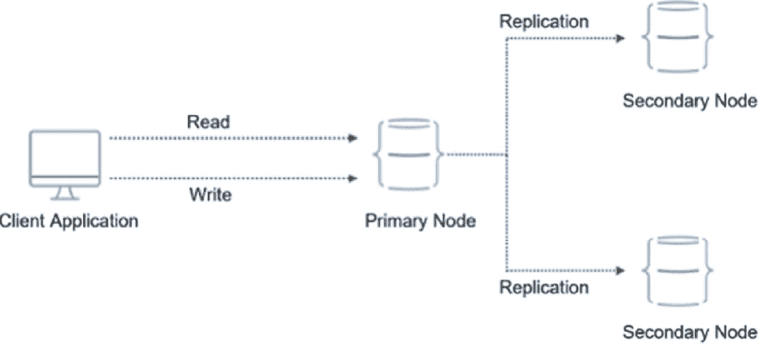

图 14.1：MongoDB 副本集

分片涉及将数据分布在多个分片（数据的子集）上，允许 MongoDB 水平扩展管理大规模数据集。每个分片都是独立的副本集，它们共同形成一个分片集群。通过根据选定的键（例如用户 ID 或地理位置）将数据拆分为分片，MongoDB 确保查询仅针对相关的分片，从而优化查询性能。这种分片策略还防止任何单个分片成为瓶颈，使数据库能够管理大量数据并提供一致的性能。参考下图：

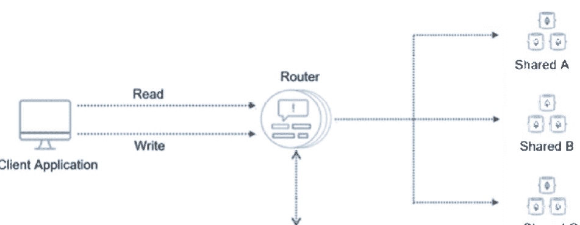

# 图 14.2：MongoDB 副本集

分区是分片的一个关键方面，涉及将数据拆分并分布到不同的分片中。MongoDB 的平衡进程会在分片之间迁移块，以确保数据和负载的均匀分布。分片键（sharding key）决定了如何划分数据，因此选择合适的键对于高效查询和数据分布至关重要。MongoDB 的动态模式允许对分片做出灵活选择，有助于适应应用程序的需求。

在我们结束对 MongoDB 集群架构和分区的探索时，我们深入理解了 MongoDB 的创新方法如何使其敏捷高效地管理大量数据。副本集和分片的结合使 MongoDB 具有高可用性、容性和无缝扩展的能力。在接下来的章节中，我们将直接进入 MongoDB 本体，探索其核心功能、查询能力以及与数据交互的机制。通过深入这些细节，我们将理解

## 探索 MongoDB

在深入 MongoDB 的功能之前，让我们开启一段旅程，熟悉使用这种强大的文档型数据库的初步步骤。我们将首先探索设置本地 MongoDB 实例，为我们的探索奠定基础。

此命令协调设置名为 `mongodb-instance` 的 Docker 容器，该容器运行 MongoDB 并可以通过端口进行访问。在环境就绪后，我们将深入一系列实战课程，探索 MongoDB 的查询机制、数据操作技术以及与各种编程语言的集成。通过从开发者的视角出发，我们将提供工具和知识，以有效地利用 MongoDB 的强大功能并在你的应用程序中释放其潜力。

开启 MongoDB 之旅程，首要第一步是建立与数据库的连接。我们将通过使用示例命令引导你完成此过程，直接在 MongoDB 容器内进行连接：

```


# MongoDB 与 Java 集成指南

## MongoDB Shell 基础操作

此命令在容器内提供了一个交互会话，让你能够直接与 MongoDB 数据库进行操作。

在 MongoDB shell 中，你可以执行各种命令与数据库进行交互。以下是一些基础示例：

### 显示数据库
```
show dbs
```

### 创建并切换数据库
```
use myDatabase
```

### 显示集合
```
show collections
```

### 插入文档
```
db.myCollection.insertOne({ name: "John", age: 30 })
```

### 查找文档
```
db.myCollection.find({ name: "John" })
```

这些命令让你得以一览 MongoDB 内部提供的核心操作。如果你正在创建一个新数据库，请在创建集合和插入文档之前，使用 `use` 命令切换到目标数据库。

下表列出了一些基本的 MongoDB 命令，这些命令允许开发者使用 MongoDB shell 在数据库中导航和操作数据：

| 命令 | 说明 |
|------|------|
| `show dbs` | 显示所有数据库 |
| `use <db>` | 切换到指定数据库 |
| `show collections` | 显示当前数据库的集合 |
| `db.<collection>.insertOne()` | 插入单个文档 |
| `db.<collection>.find()` | 查询文档 |

## 表 14.2：MongoDB 命令

在接下来的课程中，我们将桥接 MongoDB 与 Java 的领域，在动态文档型数据库与多功能编程语言之间锻造强大的协同效应。在具备了 MongoDB 查询和操作能力的坚实基础后，你现在准备好探索 MongoDB 在 Java 应用程序中的无缝集成。通过深入研究真实的代码示例，你将亲眼看到 MongoDB 的灵活性如何与 Java 的面向对象范式和谐统一。从建立连接、执行查询到处理数据操作，这段旅程将使你能够在 Java 项目中利用 MongoDB 的优势，创建在现代数据驱动格局中蓬勃发展的动态响应式应用程序。

## 将 MongoDB 集成到 Java 中

在本节中，我们将开启一段通过 Jakarta NoSQL 规范（特别是 Eclipse JNoSQL 实现）无缝结合 Java 和 MongoDB 能力的旅程。我们的首要目标是使用 Jakarta NoSQL 标准将 MongoDB 与 Java SE 集成，在这些技术之间建立无缝连接。

为了简化集成过程，收集必要的依赖至关重要。对于我们的目的，我们将使用带有 Eclipse JNoSQL 的 Jakarta NoSQL。集成还需要 CDI、JSON-P 和 Eclipse MicroProfile Configuration。你可以使用以下依赖项配置你的 Maven 项目：

```xml
<dependencies>
    <dependency>
        <groupId>org.eclipse.jnosql</groupId>
        <artifactId>jnosql-document-mongodb</artifactId>
        <version>1.0.0</version>
    </dependency>
    <dependency>
        <groupId>jakarta.enterprise</groupId>
        <artifactId>jakarta.enterprise.cdi-api</artifactId>
        <version>4.0.0</version>
    </dependency>
    <dependency>
        <groupId>jakarta.json</groupId>
        <artifactId>jakarta.json-api</artifactId>
        <version>2.0.0</version>
    </dependency>
    <dependency>
        <groupId>org.eclipse.microprofile.config</groupId>
        <artifactId>microprofile-config-api</artifactId>
        <version>3.0</version>
    </dependency>
</dependencies>
```

依赖项就绪后，你已准备好深入研究 Jakarta NoSQL 与 MongoDB 之间的集成。Eclipse JNoSQL 简化了在 MongoDB 内部连接、查询和管理数据的过程，提供了流畅且直观的体验。

在此阶段，我们将采取关键一步，为你的 Java-MongoDB 集成实现安全且灵活的配置管理。我们将探索 Eclipse Configuration 的功能，使我们的方法与云原生应用（Twelve-Factor App）原则保持一致，以促进开发与生产环境之间的平滑过渡。

我们已成功为集成奠定了基础，现在是时候通过外部化配置细节来增强安全性和活性了。为了实现这一点，让我们利用 Eclipse Configuration 的功能。我们将把 MongoDB 凭据作为属性外部化。将你当前的配置替换为占位符：

```properties
mongodb.host=${MONGODB_HOST}
mongodb.port=${MONGODB_PORT}
mongodb.database=${MONGODB_DATABASE}
mongodb.username=${MONGODB_USERNAME}
mongodb.password=${MONGODB_PASSWORD}
```

使用占位符变量，我们正在遵循云原生应用原则，特别是配置原则 #3。这种方法确保了配置与应用程序分离，提高了跨不同环境的适应性。为了满足生产需求，我们可以为占位符提供特定值。

当你从开发过渡到生产时，可以为占位符提供真实的凭据。这种方法最大限度地减少了代码库中暴露敏感数据的风险。此外，它符合云原生应用方法中的配置原则，增强了应用程序的安全性和可管理性。

在深入研究了使用 Eclipse Configuration 的安全配置管理后，这种基础策略在我们开发和生产环境之间移动时增强了安全性和维护性。展望未来，我们的重点将转向使用 Java record 进行不可变实体建模的有趣概念。这种创新方法确保了数据完整性并引入了跟踪能力。加入我们的下一节课程，探索这种技术的优雅之处，构建封装真实场景动态的数据结构。

# 使用不可变性建模实体

在此阶段，我们将深入研究实体与不可变性的强大结合，利用 Java record 的优雅特性。这种方法适用于特定场景，例如只读数据库或具有历史意义的实体，我们将通过 `Book` 实体来演示其实现。在这里，书的每次更改都会产生一个新的版本，从而保留实体的历史。

使用 Jakarta Persistence API，我们使用 Java record 定义不可变的 `Book` 实体。`@Entity` 注解将其标记为持久化实体。每本书的特征是其标题和出版信息。


为了体验不可变性和实体的力量，我们将让 `Book` 实体投入使用：

```java
// 创建新书籍
Book book = new Book("Effective Java", "Joshua Bloch", 2018);

// 使用 EntityManager 持久化
entityManager.persist(book);

// 根据标题查询检索
Book found = entityManager.createQuery("SELECT b FROM Book b WHERE b.title = :title", Book.class)
    .setParameter("title", "Effective Java")
    .getSingleResult();
```

在上述代码段中，我们创建了一个新书籍，使用相应的方法将其插入数据库，随后根据标题通过查询将其检索。这展示了不可变性，并且实体可以和谐工作，以一种反映历史变化的方式对数据进行建模，同时确保数据完整性。

通过使用 Java records 和不可变性概念，我们演示了如何精细地建模一个捕捉历史变化的实体。这种方法增强了数据完整性和可追溯性，使其成为只读数据库或历史数据跟踪等必要场景的理想选择。通过将不可变性集成到实体建模中，你将能够设计出既健壮又灵活的数据结构，反映你所处理的数据的真实世界动态变化。

在这次课程中，我们无缝地将实体建模的优雅与不可变性以及 Java records 的威力结合起来，保持了数据的完整性和简单性。随后，我们的重点转向了分页策略，这对于高效管理海量数据集至关重要。探索分页的艺术，在确保响应式用户体验的同时，掌握大规模数据管理。

## 导航分页

在这一关键章节中，我们将深入探讨分页，这是在高效管理大型数据集的同时确保最佳性能的一项基本技术。在处理大量数据需要策略性数据检索的场景中，分页的优势显而易见。分页减轻了不必要的资源消耗，并确保了响应式用户体验。

我们通过创建一个专门的仓库开始探索，`CrudRepository` 的此扩展无缝地促进了分页。我们关注扩展了 `CrudRepository` 的 `Library` 仓库，这为高效分页奠定了基础。

参考以下代码段：

```java
public interface LibraryRepository extends CrudRepository<Book, String> {
    Page<Book> findAll(Pageable pageable);
    
    Page<Book> findByAuthor(String author, Pageable pageable);
    
    Slice<Book> findByPublishedYear(int year, Pageable pageable);
}
```


我们的代码已准备好进行实现，其中我们利用 Faker 库的力量生成多本书，并随后对数据进行分页处理。在容器化环境中，我们遍历书籍集合，将每个保存到……。在建立了分页策略的情况下，我们使用 `pageable` 配置检索数据页，并按标题排序和……

参考以下代码段：

```
snippet: snippet: snippet: snippet: snippet: snippet: snippet
snippet: snippet: snippet: snippet: snippet: snippet: snippet: snippet
snippet: snippet: snippet: snippet: snippet: snippet: snippet: snippet
snippet: snippet: snippet: snippet: snippet: snippet: snippet: snippet
snippet: snippet: snippet: snippet: snippet: snippet: snippet: snippet
snippet: snippet: snippet: snippet: snippet: snippet: snippet: snippet
snippet: snippet: snippet: snippet: snippet: snippet: snippet: snippet
snippet: snippet: snippet: snippet: snippet: snippet: snippet: snippet
snippet: snippet: snippet: snippet: snippet: snippet: snippet: snippet: snippet
snippet: snippet: snippet: snippet: snippet: snippet: snippet: snippet: snippet
```

当我们深入研究分页时，这种技术的优势就显而易见了。通过以受控的方式无缝管理和检索大量数据集，分页优化了性能和响应速度。加入我们，探索分页的错综复杂，使你具备导航大型数据集的技能，同时提供无缝且高效的用户体验。

在这次富有启发的课程中，我们深入探讨了分页的艺术，这是精确、高效管理海量数据集的基石技术。通过策略性地将数据划分为可管理的页面，分页优化了性能和响应速度，确保了无缝的用户体验。随着我们向前迈，我们准备好探索 MongoDB 和文档数据库提供的广阔功能。加入我们接下来的课程，我们将深入领域复杂实体的领域，利用 MongoDB 的灵活性来创建复杂的数据结构，以满足现代应用程序的动态需求。通过这段旅程，你将见证数据库技术与实体设计之间的协同作用，这种协作将使你能够构建适应不断变化的数据格局的复杂解决方案。

## 子文档与嵌入注解

在这一节中，我们深入探讨文档数据库中的复杂实体，利用 NoSQL 结构固有的灵活性，这些结构通常类似于 XML 或 JSON 文件。我们的重点在于创建一个复杂的 Book 实体，在其中我们将深入探讨子文档和 `@Embeddable` 注解的深层概念。

旅程始于构建一个复杂的 Author 实体，该实体由许多属性定义，例如唯一 ID、名称、联系电话列表、地址和职位概况。这种封装突出了面向文档的数据库中子文档的精髓，使我们能够将相关数据嵌套在单个文档结构中：

```
structure: structure: structure: structure: structure: structure: structure
structure: structure: structure: structure: structure: structure: structure
structure: structure: structure: structure: structure: structure: structure
structure: structure: structure: structure: structure: structure: structure
structure: structure: structure: structure: structure: structure
```

在这段旅程中，我们通过 `Address` 类接触到了子文档的重要性。它包含了街道和城市属性，封装在 Author 实体中，镜像了真实世界的关系和数据层级结构：

```
hierarchies: hierarchies: hierarchies: hierarchies: hierarchies
hierarchies: hierarchies: hierarchies: hierarchies: hierarchies
hierarchies: hierarchies: hierarchies: hierarchies: hierarchies
hierarchies: hierarchies: hierarchies: hierarchies: hierarchies
hierarchies: hierarchies
```

引入 `@Embeddable` 注解，我们用 `Job` 类增强了 Author 实体，该类包含薪资和……等属性。这丰富了我们对单个文档结构内嵌入和封装相关数据的理解：

```
structure: structure: structure: structure: structure
structure: structure: structure: structure: structure: structure: structure
structure: structure: structure: structure: structure: structure: structure
structure: structure: structure
```

通过构建这个复杂的 Author 实体，我们开启了一段揭示文档数据库中子文档和 `@Embeddable` 注解威力的旅程。这种方法展示了复杂数据结构如何无缝地整合到面向文档的数据库体系中，镜像了真实世界的错综关系。随着我们的进展，我们将探索这些复杂实体提供的动态能力和查询复杂性，让你能够自信地导航文档数据库的多方面世界。

在这次实践演示中，我们通过使用构建的复杂实体模型创建一个无缝的通信流程，来弥合理论与实践。让我们跟随执行并观察通信的运行。

我们通过使用 Faker 库生成随机数据开始流程。我们创建一个 `Address` 和 `Job` 实例，然后使用构建器模式使用各种属性组装复杂的 Author 实体。数据模型完成后，我们利用容器中的 `DocumentTemplate` 将 Author 实体插入数据库。

插入数据后，我们查询数据库中地址中具有相同城市的实体。此查询演示了子文档结构的强大之处，我们正在寻找地址中包含特定城市的作者。打印结果实体以供观察：

在执行代码将我们的复杂实体插入数据库后，您可以直接在 MongoDB 客户端中验证结果。通过检查存储在集合中的记录，您可以深入了解复杂实体是如何在文档型数据库结构中持久化。。以下是 MongoDB 客户端中的数据表示：

| client | client | client | client | client | client | client | client | client | client |
| :--- | :--- | :--- | :--- | :--- | :--- | :--- | :--- | :--- | :--- |
| client | client | client | client | client | client | client | client | client | client |
| client | client | client | client | client | client | client | client | client | client |
| client | client | client | client | client | client | | |

| client | client | client | client | client | client | client | client | client | client |
| client | client | client | client | client | client | client | client | client | client |
| client | client | client | client | client | client | client | client | client | client |
| client | client | client | client | client | client | client | client | client | client |
| client | client | client | client | client | client | client | client | client | client |
| client | client | client | client | client | client | client | client | client | client |
| client | client | client | client | client | client | client | client | client | client |

如图所示，数据在文档数据库中结构化，保留了我们复杂 Author 实体的复杂性。这种视觉表示为文档数据库如何存储和组织数据提供了直观的视角，提供了存储信息的全面视图。

在这个沉浸阶段，我们将更深入地研究专门的仓库资源，利用它们的力量对复杂实体进行高级查询。加入我们，一起创建、探索和利用 AuthorRepository 来执行复杂的数据检索任务。

我们通过定义一个扩展了 `PageableRepository` 的 Author 实体体的专用仓库来启动此过程。该仓库使我们具备了对复杂实体执行特殊查询的能力：

| entity | entity | entity | entity | entity | entity | entity | entity | entity | |
| :--- | :--- | :--- | :--- | :--- | :--- | :--- | :--- | :--- | |
| entity | entity | entity | entity | entity | entity | entity | entity | entity | |

随着进行，我们将通过使用 Faker 库生成随机数据来深入实际操作。我们构建了一个具有各种属性的 Author 实体并使用...保存它。这允许我们利用仓库中定义的特殊查询：

| repository | repository | repository | repository | repository | repository | repository | | |
| :--- | :--- | :--- | :--- | :--- | :--- | :--- | | |
| repository | repository | repository | repository | repository | repository | repository | | |
| repository | repository | repository | repository | repository | repository | repository | | |
| repository | repository | repository | repository | repository | repository | repository | | |
| repository | repository | repository | repository | repository | repository | repository | | |
| repository | repository | repository | repository | repository | repository | repository | | |
| repository | repository | repository | repository | repository | repository | repository | | |
| repository | repository | repository | repository | repository | repository | repository | | |
| repository | repository | repository | repository | repository | repository | repository | | |
| repository | repository | repository | repository | repository | repository | repository | | |
| repository | repository | repository | repository | repository | repository | repository | | |
| repository | repository | repository | repository | repository | repository | repository | | |
| repository | repository | repository | repository | repository | repository | repository | | |

```
repository: repository: repository: repository: repository: repository
repository: repository: repository: repository: repository: repository
repository: repository: repository: repository: repository: repository
repository: repository: repository: repository: repository: repository
repository: repository: repository: repository: repository: repository
repository: repository: repository: repository: repository: repository
repository: repository
```


通过执行此代码，我们已经开启了一段探索专用仓库资源高级查询潜力的之旅。通过创建 `AuthorRepository` 并利用特殊查询，我们展示了这些仓库如何提供一种结构化且流化的方式与复杂实体进行交互。这种实践探索加强了我们对仓库作为强大工具的理解，使我们能够在 MongoDB 类似的文档型数据库中导航复杂的数据结构。随着我们的进展，我们将发现更高级的查询技术和数据库管理策略，进一步增强您在复杂数据方面的专业知识。

## MongoDB 与安全

虽然本书的重点是 MongoDB 与 Java 的集成以及复杂实体建模，但简要提及 MongoDB 的安全性也是至关重要的。尽管安全可能不是本书的主要目标，但在生产环境中使用 MongoDB 时，这是一个关键的考虑因素。

安全在任何数据库管理系统中都是至关重要的，MongoDB也不例外。在生产环境中部署 MongoDB 时，确保数据安全至关重要。以下是 MongoDB 安全重要的几个原因：

- 数据 MongoDB 经常存储敏感信息，使其成为恶意攻击者的目标。安全措施对于保护您的数据免受未经的访问至关重要。
- 许多行业对数据安全和隐私有严格的监管要求（例如 `GDPR`, `HIPAA`）。确保 MongoDB 的安全性对于符合这些法规至关重要。
- 信任和数据泄露可能会损害组织的声誉并侵蚀客户信任。维护稳健的安全措施对于保护组织的声誉至关重要。

MongoDB 提供了各种可以启用的安全特性来保护您的数据。以下是某些关键机制的概要概述：

- MongoDB 支持各种身份验证方法，包括用户名/密码认证和 `LDAP` 集成。启用身份验证可确保只有授权用户才能访问数据库。
- MongoDB 提供基于角色的访问控制（`RBAC`），允许您在粒度上定义用户角色和权限。这有助于限制对特定操作和集合的访问。
- MongoDB 支持传输中和静态的数据加密。启用加密确保数据保持机密，并免受窃听或盗取。
- MongoDB 可以记录所有数据库活动，为监控和合规性目的提供审计轨迹。启用审计有助于跟踪和调查安全事件。
- 网络 MongoDB 允许您配置网络访问控制（如 IP 白名单和绑定到特定的网络接口），以控制谁可以连接到数据库。

数据的完整性确保了 MongoDB 仍然是你应用程序数据存储需求的稳健且可靠的选择。

在 MongoDB 的领域，安全性是至关重要的支柱。虽然本节对 MongoDB 的安全措施及其重要性进行了简要概述，但必须强调的是，在生产环境中部署 MongoDB 时，对 MongoDB 安全性有全面的理解是必不可少的。

为了加固你的 MongoDB 部署免受潜在威胁和漏洞的影响，深入研究 MongoDB 的生产环境文档不仅是建议的，更是一个至关关键的步骤。这份全面的资源揭示了 MongoDB 安全性的复杂性，引导你实现身份验证、授权、加密、审计和网络安全措施。通过优先考虑安全性并利用 MongoDB 强大的安全功能，你保护了你的数据，并增强了组织的声誉和可信度。当你继续你的 MongoDB 之旅时，请记住，生产环境文档是你导航安全领域图图的指南针，确保你的数据在任何情况下都能得到保护。

## 结论

在本章结束之际，我们已经开启了一场贯越文档数据库、MongoDB 和复杂实体建模的全面旅程。从理解 NoSQL 数据库的细微差别及其与 Java 的兼容性，到探索实体设计、不可变性和高级存储库交互的复杂性，我们已经具备了对利用文档导型数据库力量的整体理解。

展望未来，我们的探索将发生一个变革性的转折，深入进入图数据库的迷人世界。我们的下一个主题《使用 Neo4j 的图》将解锁图数据库的潜力，以及在建模和遍历数据内部复杂关系方面的独特能力。加入我们，开启这一激动人心的篇章，在这里，图论与数据库技术相遇，为数据管理和分析提供了新的维度。

## 重点备要

- **`MongoDB`**: MongoDB 的 `BSON` 文档容纳了灵活且嵌套的数据结构，满足不同的数据复杂性。
- **`CAP 定理`**: MongoDB 的行为与 `CAP 定理`中的一致性（`Consistency`）和分区容错（`Partition Tolerance`）方面高度一致，提供了可的一的一性水平。
- **多样化应用**: MongoDB 应用于内容管理、实时分析、用户配置和目录等多种场景。
- **通过分片进行扩展**: 通过将数据分布在多个服务器上来实现水平扩展，提升了性能和管理能力。
- **Java 库**: 如 `Jakarta NoSQL` 和 `Eclipse JSQL` 简化了 Java 与 MongoDB 的集成，简化了数据交互。
- **复杂实体**: 利用实体、不可变性和如 `@Embeddable` 的注解可以构建复杂的数据结构。
- **子文档和嵌入实体**: 子文档和嵌入实体反映了真实世界的关系，增强了数据组织性。
- **专用存储库**: 专用存储库赋予了对复杂实体进行高级查询和交互的能力。

## 多项选择题

CAP 定理在 MongoDB 的行为中强调了什么？

- 一致性和可用性
- 一致性和分区容错性
- 可用性和分区容错性
- 一致性、可用性和分区容错性

MongoDB 中分片的主要目的是什么？

- 水平扩展和数据分布
- 垂直扩展和数据优化
- 为了更快的查询执行进行索引
- 数据压缩和存储效率

MongoDB 中子文档和嵌入实体的意义是什么？

- 它们减少了集合内部的数据冗余。
- 它们允许索引以加快查询。
- 它们改进了数据分布的一致性。
- 它们模拟了真实世界的关系并增强了数据组织。

MongoDB 中专用存储库资源的主要优势是什么？

- 它们会自动生成数据模式。
- 它们消除了索引索引。
- 它们允许数据的水平扩展。
- 它们赋予了对复杂实体进行高级查询和交互的能力。

哪些用例通常适用于 MongoDB的功能？

- 商业智能和复杂的数学计算
- 实时分析和内容管理
- 在线游戏平台和虚拟现实模拟

## 答案

加入我们书籍的 Discord 空间

加入书籍的 Discord 工作区获取最新更新、优惠、全球科技动态、新发布以及与作者的交流：

https://discord.bponline.com


# Neo4J 集成

## 引言

在现代数据管理中，Java 与 NoSQL 数据库的融合产生了处理多样化复杂数据集的创新方法。Neo4j 作为领先的图数据库，在其中脱颖而出。图数据库与传统的关系型数据库不同，它们专注于数据点之间的关系，这使得它们非常擅长处理社交网络、推荐引擎和组织架构等互联数据场景。本章将带我们进入 Neo4j 的世界及其与 Java 的无缝集成，深入探讨图数据库的核心概念，提供 Neo4j 能力的简要概述，并最终使用 Java 展示其实施。

想象这样一个世界，数据不仅是条目的静态集合，而是一个等待探索的关系动态景观。Neo4j 作为图数据库的先驱，将我们带入这个领域，节点象征实体，关系表示连接，形成了一个复杂的数据相互依赖网络网。与传统数据库不同，Neo4j 面向图的处理方法允许我们轻松地遍历复杂结构，并揭示传统数据模型可能会忽略的隐藏洞察。Neo4j 力量的核心在于其查询语言 `Cypher`，它专为直观表达图遍历和操作而设计。在本章中，我们开启了一场双重冒险：理解 Neo4j 图数据库的本质，并开启一段实战之旅，将 Neo4j 的强大功能与 Java 的灵活性融合。通过说明性示例和分步指导，我们揭示了将 Neo4j 无缝集成到 Java 中的艺术，为它们注入只有图数据库才能提供的敏活性和深度。

## 结构

本章涵盖了以下主题：

- 介绍 Neo4j
- 探索 Neo4j
- 将 Neo4j 与 Java 集成
- Apache TinkerPop
- Neo4j 与安全

## 目标

在本章中，我们的目标有三点：首先，全面理解支撑 Neo4j 图数据库的基础概念，阐明节点、关系和属性如何共同形成一个动态生态系统；其次，对 Neo4j 的能力提供简短但富有见解的概述，包括其查询语言 `Cypher`，以及其在查询和操作图数据中的作用；最后，通过实操演示 Neo4j 和 Java 的实际协同，使读者能够无缝地将图功能集成到 Java 应用中。

## 体系

以下是本章的准备条件：

- Java 17
- Maven
- Git
- Docker

源码：https://github.com/ultimate-engineer/java-persistence-nosql-book/tree/main/chapter15

## 介绍 Neo4j

Neo4j 创新的核心在于它被归类图数据库，这是一种独特的范式，通过强调数据点之间复杂的关系重新构想了数据存储和检索。像 Neo4j 这样的图数据库将数据建模为节点和边，反映了真实世界的关系和交互。这种独特的结构能够表示在传统表格数据库中难以捕捉的复杂互连。Neo4j 的图数据库架构与 `CAP 定理`紧密结合，其中一致性、可用性和分区容错性之间形成了一个微妙的平衡。这种平衡尤为相关，因为 Neo4j 的架构优先考虑维护稳固的关系（一致性），同时在面对分布式数据（分区容错性）时实现高效的遍历（可用性）。

Neo4j 的图数据库模型在不同领域创建了许多引人注目的案例。其中一种场景是社交网络，用户配置及其连接形成了一个自然的图结构。推荐引擎在 Neo4j 的功能中也找到了用点，利用其遍历关系的能力根据共同兴趣提供建议。知识图谱作为一种组织信息和发现洞察的强大工具，在 Neo4j 的环境中蓬勃发展，捕捉了数据内部复杂的关联。

然而，这种以图为中心的力量也伴随着权衡。虽然 Neo4j 擅长处理丰富关系的场景，但对于主要具有个人属性的表格数据，可能会有更好的选择。此外，在分布式设置中维护数据一致性，对于维护准确的至关重要关系可能会在网络分区期间影响系统可用性。因此，在将 Neo4j 应用于特定问题时，需要仔细考虑，权衡基于图的洞察力优势与应用程序特定需求之间的关系。

Neo4j 作为图数据库的多功能性为各种行业应用开启了大门。下表强调了 Neo4j 擅长的一些关键用例：

| 用例 |
| :--- |
| 欺诈检测 |
| 推荐引擎 |
| 网络分析 |
| 知识图谱 |
| 身份管理 |
| 数据集成 |

表 15.1：Neo4J 用例

Neo4j 经常部署在集群配置中以增强性能、可用性和容错能力。集群是一组互连的服务器，每台服务器运行一个 Neo4j 实例，协作管理并提供图数据库服务。Neo4j 集群化引入了高可用（`HA`）和负载均衡的概念，这对于维护系统完整性以及在服务器故障或负载增加时提供持续服务至关重要。

以下是 Neo4j 集群的工作原理：

### 节点 (Nodes)
在 Neo4j 集群中，每个服务器实例被称为一个节点（`Node`）。节点在集群中具有不同的角色：

- **核心节点 (Core)**：这些节点存储并管理实际的图数据。它们处理读写操作，确保数据一致性。
- **读取副本 (Read replica)**：这些节点作为核心服务器的副本。它们处理读取操作，从而提高读取性能，并减轻核心服务器过量读取请求的压力。
- **仲裁节点 (Arbiter)**：这些节点参与集群决策，但不存储数据。它们协助对集群状态和故障转移决策达成共识。

### 数据 (Data)
核心服务器采用数据复制技术来保持所有核心节点之间的数据一致性。当其中一个核心服务器上发生写操作时，更改将传播到其他服务器，以确保所有节点拥有相同的数据。

### 负载 (Load)
集群通过负载均衡器运行，该均衡器将入的读写请求重定向到合适的节点。读取请求指向核心服务器或读取副本服务器，而写请求被发送到核心服务器以确保数据一致性。

Neo4j 的集群架构通过确保即使某些节点故障，集群也能继续运行且不丢失数据，从而提供高可用性。当某个核心服务器无法访问时，集群管理器会将一个读取副本提升为核心服务器，以维持数据可用性。

### 多数派 (Quorum)
Neo4j 使用基于多数的仲裁系统来确保数据一致性。大多数核心服务器必须可用才能写入数据，且大多数可用节点必须对集群状态达成一致以做出关键决策。

如果核心服务器故障，集群管理器将协调故障转移过程，将读取副本提升为核心服务器以替换故障节点。这一过程确保了集群能够继续运行而不产生单点故障。

Neo4j 集群化提供了优势，如由于分布式读取带来的性能提升、高可用性和可扩展性。然而，它也引入了复杂性，例如管理集群状态、数据复制和网络分区。适当配置和维护对于确保集群可靠高效地运行至关重要。下图显示了带有 Neo4J 的典型分式集群：

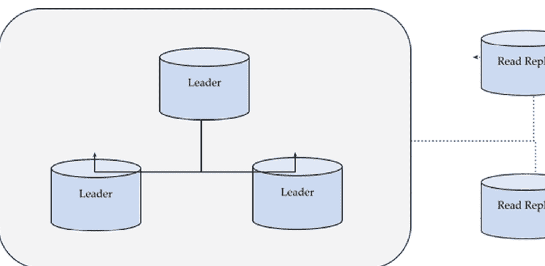


总结来说，Neo4j 的集群机制能够创建一个分布式环境，其中多个节点协作管理和提供图数据，为要求高数据完整性和无缝运行的应用程序提供了改进的性能、可用性和容错能力。

在我们结束对 Neo4j 集群架构的探索时，我们已经洞察了这种配置如何增强图数据库的性能、可用性和可靠性。Neo4j 集群内部节点、角色、数据复制和故障转移机制之间错综复杂的相互作用，凸显了其在面对故障时的韧性以及维护数据一致性的能力。然而，与任何分布式系统一样，集群的优势也伴随着对仔细配置和管理的需求，以确保最佳性能。在下一节中，我们将重点转移，以深入探讨 Neo4j 的核心；数据库本身。我们将探索 Neo4j 图模型的基础组成部分，理解节点、关系、属性和图查询的概念，为与数据库的核心功能进行实际交互铺平道路。现在，让我们开启 Neo4j 之旅的下一阶段，在那里我们将揭示驱动这一创新图数据库技术的构建基石。

## 探索 Neo4j

在深入研究 Neo4j 图数据库的复杂性之前，通过搭建环境建立坚实的基础至关重要。本节将引导你完成在本地安装 Neo4j 的初始步骤，为我们从开发人员角度的后续探索提供框架。虽然本书不会深入探讨详细的操作和配置方面，但它旨在使你具备在应用程序中利用 Neo4j 能力所需的技能。

要开启 Neo4j 之之旅，第一步是在你的机器上进行本地安装。此安装是我们探索图数据库核心功能的游乐场。值得注意的是，虽然操作上的复杂性超出了本书的范围，但我们将从开发者角度关注 Neo4j 的应用。

为了进行无缝测试和实验，我们推荐使用 `Docker`，这是一个在轻量级容器中部署应用程序的平台。以下 `Docker` 命令设置了一个 Neo4j ，暴露了必要的端口并配置了身份验证：

```bash
docker run --name neo4j -p 7474:7474 -p 7687:7687 -e NEO4J_AUTH=neo4j/admin123 neo4j
```

通过此命令，你将拥有一个运行的 Neo4j 实例，可以通过浏览器访问。

当我们为 Neo4j 探索奠定基础时，请记住这里的重点在于理解 Neo4j 的图模型、查询能力以及与 Java 的集成，一切通过开发者的视角。后续章节将深入 Neo4j 的基础组件，提供实践示例和见解，以利用图数据库的力量。因此，让我们采取激动之旅的第一步，设置我们的 Neo4j 环境并准备发现图和关系的世界。

随着 Neo4j 运行以及空白画布等待探索，让我们开启构建图之旅。要访问 Neo4j 浏览器界面，请打开网络浏览器并导航至。进入界面后，将提示使用以下凭据登录：

用户名：`neo4j`

密码：`admin123`

要开始构建你的图，首先通过编写 `Cypher` 查询来构建基础结构。在实践练习中，我们将定义节点和关系，为未来的探索铺路：

创建代表图中个人的节点，为它们分配 `Person` 标签和名称属性。参考以下代码片段：

```cypher
CREATE (p1:Person {name: 'Alice'})
CREATE (p2:Person {name: 'Bob'})
```

在这些节点之间建立关系以反映它们的连接。参考以下代码片段：

```cypher
MATCH (a:Person {name: 'Alice'}), (b:Person {name: 'Bob'})
CREATE (a)-[:KNOWS]->(b)
```

为节点添加额外属性，例如年龄。参考以下代码片段：

```cypher
MATCH (p:Person {name: 'Alice'})
SET p.age = 30
```

结构就绪后，让我们进入使用 `Cypher` 查询你的图阶段。这些查询将允许你检索信息、遍历关系并发现有价值的解。

检索所有节点并查看你构建的整个图谱。参考以下代码片段：

```
snippet:
```

查找朋友。探索“朋友的好友”连接。参考以下代码片段：

```
snippet: snippet: snippet: snippet: snippet: snippet: snippet:
snippet:
```

发现年龄。深入了解你图谱的年龄分布。参考以下代码片段：

```
snippet: snippet: snippet: snippet: snippet: snippet: snippet:
snippet: snippet: snippet: snippet: snippet: snippet:
```


当你构建图谱并对其数据进行查询时，你正在为更高级的探索奠定基础。Neo4j 浏览器界面和 Cypher 查询充当你的指南针，引导你探索隐藏在数据中的复杂连接和洞察。在接下来的章节中，我们将通过将 Neo4j 与 Java 集成来提升我们的 Neo4j 交互，在应用程序中释放图数据库的力量。因此，让我们继续前进，用 Neo4j 织就关系与知识的织锦。

下表展示了一些基础的 Cypher 命令，帮助你开始探索和查询你的 Neo4j 图谱：

| graph |
| :--- |
| graph: graph: graph: graph: graph: graph |
| graph: graph: graph: graph: graph: graph: graph: graph: graph |
| graph: graph: graph: graph: graph: graph |
| graph: graph: graph: graph: graph: graph: graph: graph |
| graph: graph: graph: graph: graph: graph |
| graph: graph: graph: graph: graph: graph: graph: graph |
| graph: graph: graph: graph: graph: graph: graph: graph |
| graph: graph: graph: graph: graph: graph: graph: graph |
| graph: graph: graph: graph: graph: graph |

表 15.2: Cypher 命令

这些基础 Cypher 命令构成了你穿越 Neo4j 图数据库之旅的基石。利用它们来塑造你的数据、发现关系并获得传统数据库可能会错过的洞察。当你熟悉了这些命令后，就已经准备好进入更高级的查询模式，丰富你对图数据和 Neo4j 能力的理解。

当我们结束对 Neo4j 图数据库及其通过 Cypher 查询进行交互的探索时，是时候在 Neo4j 和 Java 之间建立强大的连接了。Neo4j-Java 集成为应用开发的新维度开启了大门，Java 编程的灵活性与从图数据库中得出的洞察无缝融合。在接下来的章节中，我们将开启一段旅程，利用 Java 的编码能力来与 Neo4j 的图数据进行交互，使你能够构建处理复杂关系并在你的项目中利用图数据库潜力的应用程序。因此，请系好安全带，我们将深入探讨 Neo4j 和 Java 的协同作用，构建处理数据并破译底层复杂连接网的应用程序。

## 将 Neo4j 集成到 Java

在现代应用开发中，Neo4j 图数据库与 Java 编程之间的协同作用开启了无限可能。为了简化这种集成并优化开发流程，我们可以利用 `Jakarta NoSQL` 规范及其 `Eclipse JNoSQL` 实现。这种组合使我们能够在 Java 标准版 (SE) 配合 Maven 的舒适环境中，轻松将 Java 应用程序与 Neo4j 图数据库无缝连接。

`Jakarta NoSQL` 提供了一种与各种 NoSQL 数据库（包括像 Neo4j 这样的图数据库）交互的标准方法。`Eclipse JNoSQL` 是 `Jakarta NoSQL` 规范的具体实现，旨在促进 Java 应用程序与 NoSQL 数据库之间的通信。这种强大的组合抽象了复杂性，让开发者能够专注于构建健壮的应用程序，而无需深入研究特定数据库的细节。

在我们开始使用 `Jakarta NoSQL` 和 `Eclipse JNoSQL` 开启 Neo4j-Java 集成之旅之前，准备环境至关重要。`Eclipse JNoSQL` 依赖于几个依赖项以确保运行：

- **CDI（上下文和依赖注入）2.0** 或 CDI 提供了一种管理组件生命周期和依赖注入的强大机制。它是支持各种组件无缝集成的骨干。
- **JSON-P（JSON Processing）** 促进了 JSON 数据的解析和处理，这是处理 Neo4j 和 Java 之间数据交换的必要组件。
- **Eclipse MicroProfile Config** 此配置框架确保配置参数可以被外部化并管理，使你的应用程序更具弹性和适应性。
- **Apache TinkerPop** `Apache TinkerPop` 作为各种图数据库（包括 Neo4j）的通用查询语言。它实现了对图数据的标准化遍历和查询。

在我们寻求使用 `Jakarta NoSQL` 和 `Eclipse JNoSQL` 无缝集成 Neo4j 与 Java 的过程中，下一个关键步骤涉及配置数据库凭据。此配置确保了本地开发的顺畅，并遵循了“十二因素应用”原则，强调配置管理以维护跨环境的移植性和安全性。`Eclipse JNoSQL` 提供了有效处理此类配置的方法。

`Eclipse JNoSQL` 通过遵循标准简化了配置管理，同时提供了灵活性。这允许开发者外部定义配置参数，以适应各种环境和场景。以下片段展示了如何使用 `Eclipse Configuration` 在 `Eclipse JNoSQL` 中配置 Neo4j 凭据：

```
Configuration: Configuration: Configuration: Configuration:
```

“十二因素应用”方法强调将配置视为独立的关注点，与应用程序代码隔离。这一原则确保了可以在不更改代码库的情况下修改配置，有助于在各种环境中更平滑地部署。通过外部化 Neo4j 凭据（如所示），你的应用程序符合这一原则，能够在开发、测试和生产环境之间轻松地更改配置。

在按照“十二因素应用”原则安全地配置和管理 Neo4j 凭据后，你已经为 Neo4j 和 Java 之间健壮、灵活的集成奠定了基础。在接下来的章节中，我们将研究利用 `Eclipse JNoSQL` 的能力建立连接、查询图数据，并在 Java 应用程序中释放 Neo4j 的潜力。通过遵循最佳实践和标准，我们正在为创建能够在不同环境之间无缝切换，同时获得 Neo4j 图导向力量优势的应用程序做准备。因此，让我们在这段集成之旅上继续前进，我们将利用配置智能巧妙地连接 Neo4j 和 Java。

当我们结束 Neo4j-Java 集成的配置阶段时，我们已经利用 `Eclipse JNoSQL` 管理凭据并遵循了“十二因素应用”原则，这为我们的集成之旅确立了稳固的基础。在凭据就绪后，我们准备好进入下一阶段：在 Neo4j 中建模实体。在接下来的课程中，我们将探索 `Eclipse JNoSQL` 的映射能力如何赋能我们在实体中定义数据结构，无缝连接 Neo4j 的图数据库世界与 Java 的面向对象领域。加入我们，共同开启这一变革性阶段，将我们的数据塑造成一个凝聚且明确的表示。

## Neo4j 建模

在 Neo4j-Java 集成的旅程中，我们现在进入实体建模。这一阶段涉及将现实世界的实体映射到图数据库结构上，利用 `Eclipse JNoSQL` 的动态能力。让我们通过深入研究书籍推荐系统的背景来探索这一过程：

```
system: system: system: system: system: system: system:
system: system: system: system: system: system: system: system:
system: system: system: system: system: system: system: system:
system: system: system: system: system: system: system: system:
system: system: system: system: system: system: system:
```

在此片段中，我们引入了两个基础实体：`Book` 和 `Category`。`Book` 实体封装了如 `id` 和典型的书籍详情的属性。另一方面，`Category` 实体捕捉了书籍类别的本质，具有如 `id` 和

在我们的 Neo4j-Java 集成旅程中，路径上的下一个目标是创建此服务，它桥接了 Java 应用程序和 Neo4j 图数据库，利用动态 `GraphTemplate` 来促进对实体的操作。让我们深入研究这一关键服务及其……所有功能，同时揭示了 `Apache TinkerPop` 及其强大的 `Gremlin` 查询语言的底层原理。

`BookService` 利用了专门的工具，能够与 Neo4j 图谱进行无缝交互。该模板提供了一系列丰富的遍历方法，用于对图数据进行查询和操作。

`Apache TinkerPop` 是底层的图引擎，提供了一个强大的遍历框架和一种名为 `Gremlin` 的查询语言。`Gremlin` 使开发者能够以简洁高效的方式表达复杂的图遍历和查询。

在 `BookService` 中，你将找到创建和管理类别以及书籍的方法。`category` 方法通过名称搜索现有的类别，如果不存在则创建它们。同样，`book` 方法会创建并返回书籍实体。

边关系是另一个关键方面，`category` 方法说明了这一点。它在实体之间创建关系，并使用如 `LibraryLabels.IS` 等边标签。

此外，`BookService` 提供了如 `out` 和 `in` 等方法。这些方法演示了 `Gremlin` 遍历如何检索特定数据，展示了图揭示关联见解的能力。

`BookService` 封装了 Neo4j-Java 集成的精髓。通过利用 `GraphTemplate` 的力量并发挥 `Apache TinkerPop` `Gremlin` 查询的长处，你正在协调 Java 应用程序与 Neo4j 图之间的交互。请与我们继续这段旅程，揭示这对“黄金组合”的能力，并构建充分利用图数据库潜力和 Java 多功能性的应用程序。参考以下代码片段：

```
snippet: snippet: snippet: snippet: snippet: snippet: snippet: snippet:
snippet: snippet: snippet: snippet: snippet: snippet: snippet: snippet:
snippet: snippet: snippet: snippet: snippet: snippet: snippet: snippet:
snippet: snippet: snippet: snippet: snippet: snippet: snippet: snippet:
snippet: snippet: snippet: snippet: snippet: snippet: snippet: snippet:
snippet: snippet: snippet: snippet: snippet: snippet: snippet: snippet:
snippet: snippet: snippet: snippet: snippet: snippet: snippet: snippet:
```

```
snippet: snippet: snippet: snippet: snippet: snippet: snippet: snippet:
snippet: snippet: snippet: snippet: snippet: snippet: snippet: snippet:
snippet: snippet: snippet: snippet: snippet: snippet: snippet: snippet:
snippet: snippet: snippet: snippet: snippet: snippet: snippet: snippet:
snippet: snippet: snippet: snippet: snippet: snippet: snippet: snippet:
snippet: snippet: snippet: snippet: snippet: snippet: snippet: snippet:
snippet: snippet: snippet: snippet: snippet: snippet: snippet: snippet:
snippet: snippet: snippet: snippet: snippet: snippet: snippet: snippet:
```


# Gremlin 与 Apache TinkerPop 简介

Gremlin 是一种多功能且表达力丰富的图遍历语言，运行在所有支持 Apache TinkerPop 的数据库上。将其看作图结构与你想执行的查询之间的桥梁。Gremlin 允许你使用简洁的语法导航图、遍历关系、过滤数据并提取有意义的见解。

## 理解 `in` 与 `out` 遍历

在 Apache TinkerPop 的上下文中，`in` 和 `out` 指的是图中顶点（节点）之间遍历边关系的方向。让我们通过一个例子来说明：想象一个图，节点代表用户，边代表用户之间的友谊：

- **出边**：当你遍历标记为 `IS` 的出边时，你正沿着边的方向从书籍顶点移动到连接的类别顶点。例如，如果一个书籍顶点有一个指向类别的出边 `IS`，通过 `out` 遍历它将带你进入类别。
- **入边**：相反，当你遍历标记为 `IS` 的入边时，你正反边的方向从类别顶点移动到连接的书籍顶点。如果类别有一个来自书籍的入边 `IS`，通过 `in` 遍历它将带你回到书籍。

这些概念在编写图查询时变得格外强大。你可以使用 `out` 和 `in` 遍历来发现图结构中的关系、模式和见解，为你的应用程序需求提取相关数据。

Apache TinkerPop 作为图交互的底层引擎，结合 Gremlin 查询语言，为查询和导航如 Neo4j 等图数据库提供了坚实的基础。理解 `in` 和 `out` 遍历的细微差别可以增强你发现有意义连接和从图数据中获取见解的能力，让你的 Neo4j-Java 集成之旅更具收获。

# Neo4j-Java 集成与 PersonService

在 Neo4j-Java 集成中，我们的目标是执行查询……

Java 编程领域已超越了书籍推荐的范畴。与我们一起探索开发者之间错综复杂的连接网络，解锁能够引导我们营销活动取得成功的洞察。

在探索我们图数据库中连接与关系的过程中，我们引入了不可或缺的 `PersonService`。它充当着桥梁，能够与 Neo4j 图进行无缝交互，同时执行复杂的查询以识别开发者、他们的熟人，甚至是那些拥有深厚情感纽带的人。让我们探索 `PersonService` 的功能以及它在我们引人入胜的营销活动中的角色。

每个方法都揭示了我们营销活动探索的独特方面。`save` 方法确保了 `Person` 实体的持久化，而 `knows` 和 `love` 方法在个人之间建立了关系边。诸如 `developers` 等方法获取开发者列表，`whichDevelopersKnow` 获取开发者所认识的人，两者都能识别出共同的熟人，而 `couple` 则发现了那些对他有更深层感情的开发者。

`PersonService` 封装了我们营销活动场景的本质，使您能够遍历图、发现洞察并检索推动您的活动策略的有意义数据。随着我们进一步的探索，我们将继续拥抱 Neo4j 图宇宙的复杂性和 Java 的功能，丰富我们对它们和谐整合的理解。

## 运行时演示

当我们进入真实世界执行的领域时，让我们见证 `PersonService` 活生生地运行，协调我们图数据库内部复杂的关系和连接。以下是该服务运行的预览：

```
operates: operates: operates: operates: operates: operates: operates:
operates: operates: operates: operates: operates: operates: operates:
```

```
operates: operates: operates: operates: operates: operates: operates:
operates: operates: operates: operates: operates: operates: operates:
operates: operates: operates: operates: operates: operates: operates:
operates: operates: operates: operates: operates: operates: operates:
operates: operates: operates: operates: operates: operates: operates:
```

在这个生动的场景中，我们创建并协调了图中的连接。这些操作包括关联开发者、建立友谊甚至点燃爱情兴趣。`PersonService` 证明了它的实力，毫不费力地执行查询以获取开发者、他们的熟人、连接以及情侣。

随着控制台输出的展开，我们看到了由 Neo4j 图能力和 Java 实力驱动、能够毫不费力揭示的动态关系、洞察和连接。这一演示强调了 Neo4j 和 Java 之间的深度协同，激发了在不同场景中进一步探索它们潜力的好奇心。

当我们为 Neo4j 图潜力和动态查询的探索拉上帷幕时，我们处于一个丰富的洞察和连接的织锦之中。

展望下一次课程，我们望向水平线，那里有一个代表食物链复杂性的迷人的树等待着我们。在接下来的课程中，这段旅程将展开，利用 Neo4j 的力量和 Java 的精技来揭示相互连接的生态系统中微妙的相互作用。

# 探索层次结构：食物链

在随后的课程中，我们将深入研究使用食物链的概念创建层次结构。这项工作具有巨大的意义，因为它允许我们镜像自然界复杂的平衡以及决定各种物种生存的关系。通过绘制食物链，我们深刻地理解了它们是如何相互关联的，强调了它们在维持平衡中所起的关键作用。

为了让这个概念活起来，我们将首先定义一个代表食物链动物的实体。在本节中，我们正采用一种新方法，使用 Java 的 `record` 来简洁地封装数据。`Animal` record 包含一个 ID 和名称，构成了我们层次结构的基础。当我们构建这条食物链时，我们不仅是在构建一个层次结构，而且在揭示支撑生态系统的脆弱依赖网。

本节课程进一步探讨了 Neo4j 的图能力和 Java 的多功能性，阐明了图数据库如何成为描绘自然界复杂错综关系的宝贵工具。当我们进入食物链的世界时，我们将通过图数据库和 Java 编程的视角，揭示自然界复杂交响乐的秩序。

在构建反映自然复杂平衡的层次结构的过程中，我们引入了关键的 `Service` 层作为桥梁，促进了 Java 应用程序与 Neo4j 图数据库之间的无缝交互。通过这种方式，我们将为食物链注入生命，建立关系，发现依赖关系，并在生态系统的微妙网络中导航。请参考以下代码：

```
code: code: code: code: code: code: code:
```

```
code: code: code: code: code: code: code: code: code: code: code: code:
code: code: code: code: code: code: code: code: code: code: code: code:
code: code: code: code: code: code: code: code: code: code: code: code:
code: code: code: code: code: code: code: code: code: code: code: code:
code: code: code: code: code: code: code: code: code: code: code: code:
code: code: code: code: code: code: code: code: code: code: code: code:
code: code: code: code: code: code: code: code: code: code: code: code:
code: code: code: code: code: code: code: code: code: code: code: code:
code: code: code: code: code: code: code: code: code: code: code: code:
code: code: code: code: code: code: code: code: code: code: code: code:
code: code: code: code: code: code: code: code: code: code: code: code:
```


`AnimalService` 封装了为我们的食物链层次注入生命的操作。从使用 `eats` 方法定义动物及其关系，到解开如 `eatsTwice` 等特定模式，该服务强调了自然平衡中复杂的依赖关系。此外，`entityTree` 方法为食物链的层次结构描绘了一幅优雅的肖像。

该服务是通往 Neo4j 图能力的通道，展示了 Java 编程如何与图数据库进行和谐交互。随着我们进一步探索食物链，我们将发现生命互联网的本质，在穿越自然秩序的同时，增强了 Neo4j 与 Java 集成的力量。

随着我们的 `AnimalService` 准备就绪编排自然秩序，让我们沉浸在食物链表示的执行中。通过下面的代码段，我们为生态系统注入生命，捕捉了其中复杂的关系和依赖关系：

随着程序的展开，我们见证了食物链复杂交响乐的运行。从进食两次的动物到那些参与旅程直到到达草地的动物，我们能够发现生态系统内部依赖关系和关系的本质。`entityTree` 方法优雅地揭示了层次结构，强调了每个生物体在维持平衡中的关键作用。

这次执行封装了 Neo4j 图能力的力量和 Java 的适应性。通过这次探索，我们揭示了自然界互连之美，强调了像 Neo4j 这样的图数据库为观察生命网络提供的窗口。

随着食物链探索的执行，我们揭示了生命依赖关系和连接之间迷人的相互作用。在 Neo4j 图引擎和 Java 巧思的引导下，动物的编排舞蹈阐明了驱动我们世界的微妙平衡的生态系统。随着本节课程的结束，我们对图数据库强大性的理解加深，激励我们进一步发掘其解析自然及其他复杂性方面的潜力。

## Apache TinkerPop

在本节课程中，我们将通过 Apache TinkerPop 开启图遍历的之旅，Apache TinkerPop 是 Apache 基金会内部的一个开源项目。正如 SQL 之于关系型数据库的标准化查询语言一样，Apache TinkerPop 试图通过其 `Gremlin` 语言使图查询和谐化。本节课程提供了 Apache TinkerPop 的全景概述，展示了它在塑造图数据库格局中的关键作用。

从核心上说，Apache TinkerPop 设计用于像对于关系型数据库的 SQL 那样标准化图查询。它的 `Gremlin` 查询语言是一个通用公分母，能够与 30 多个图数据库进行无缝通信。拥抱 Apache TinkerPop 并掌握 `Gremlin` 开启了许多图数据库的大门，使你能够从容地遍历互联数据的复杂网络。

Apache TinkerPop 是协作的见证，因为它在开源创新的中心地——Apache 基金会的伞护下蓬勃发展。通过对包括 Java 和 Groovy 在内的多种编程语言的支持，TinkerPop 跨越了语言障碍，使图数据库领域变得民主化。

通过掌握 Apache TinkerPop 基础及其 `Gremlin` 语言，你将对图查询有坚实的掌握，并具备导航各种图数据库的技能。随着我们进入多模型数据库之旅的召唤，本节课程是一个不可或缺的基础，开启了无缝遍历互联数据景观的潜力。

Eclipse JNoSQL 的实现是 Apache TinkerPop 的一个内聚封装，将它的多功能能力引入到食物链中。

尽管 Jakarta NoSQL 的主要领域是文档数据库，但纳入 TinkerPop 的决定强调了与行业标准对齐的重要性。

## Neo4j 与安全

在补充章节中，我们讨论了 Neo4j 安全性至关重要的意义，尽管我们的书籍可能有其他关注点。保护你的图数据对数据库管理至关重要，Neo4j 提供了健壮的机制来保护敏感信息。

Neo4j 的安全性至关重要源于以下几点：

- 敏感信息保护：Neo4j 数据库通常包含敏感信息，如用户配置、财务交易和机密关系。确保数据隐私和完整性至关重要。
- 合规：许多行业（包括金融和医疗保健）有严格的合规性条例（GDPR, HIPAA）要求安全性。不合规可能导致严重的罚款。
- 防止未经授权的访问：对 Neo4j 数据库的未经授权访问可能导致数据泄露，产生严重后果，包括声誉损害和财务损失。

Neo4j 提供了可以启用以保护你的数据库的安全功能。以下是启用安全性的步骤概述：

- Neo4j 支持多种验证方法，包括用户名/密码、LDAP 和 Kerberos。你必须在 Neo4j 的配置文件中配置适当的方法以启用验证。
- 启用验证后，你可以为用户定义角色和权限。这控制了用户在数据库上可以执行的操作。角色和权限在 neo4j 文件中配置。
- 启用加密可确保客户端与 Neo4j 服务器之间传输的数据是安全的。Neo4j 支持 SSL/TLS 加密；你可以在 neo4j 文件中配置它。
- 审计 Neo4j 允许你记录验证和授权事件以供审计。你可以配置审计日志来监控数据库活动。
- 网络确保你的 Neo4j 服务器运行在安全的网络环境中。防火墙和网络分段可以增加额外的安全层。
- 定期保持 Neo4j 更新到最新的安全补丁和更新，对于解决已知漏洞至关重要。

虽然我们的书籍主要关注探索 Neo4j 的图能力以及与 Java 的集成，但承认安全性在数据库管理中的重要性是必要的。实施这些安全措施保护了你的数据，并展示了对负责任的数据管理实践的承诺，这在当今的数字格局中变得日益至重要。

当我们探索 Neo4j 的广阔世界及其与 Java 之间复杂的相互作用时，我们必须意识到，我们的旅程只是冰山一角。指引我们走向正确方向的指南是 Neo4j 的生产环境文档，它像北极星一样，引导我们深入图数据库管理的深处。

本节内容虽然简短，但强调了深入研究 Neo4j 生产环境文档的关键性。它是通往 Neo4j 全方位能力的门户，从高级查询技术到稳健的安全实现无一不包。在 Neo4j 生产环境文档的宏大画图中，隐藏着一张引领我们发现新领域、解决复杂挑战并解锁图数据库真正力量的宝图。

因此，在我们继续探索时，让我们将生产环境文档作为我们信赖的指南，像一盏灯塔，在不断发展的图数据库技术领域中照亮通往精通之路。

## 结论

当我们结束食物链（Foodchain）复杂层级探索的帷幕时，一种互连的交响乐在我们脑海中回响。Neo4j 的图处理能力与 Java 的适应性之间的和谐协作，揭示了强调自然平衡的细微关系。随着本章的结束，一个新的地平线正在召唤，引导我们进入多模型数据库的领域。在接下来的章节中，我们将进入 ArangoDB 和 Couchbase 的领域，探索它们在适应各种数据模型方面的多功能性。加入我们，拓宽数据库视野，发现这些平台如何无缝接纳多样化的结构，从而在不断发展的数据管理格局中塑造新的叙事。

## 记忆要点

- **图（Graphs）**：我们穿越 Neo4j 图数据库强大能力的之旅，与 Java 的卓越编程能力相得益彰，揭示了一个复杂关系的世界。从构建个性化的书籍推荐，到绘制开发者网络，这种集成凸显了基于图的数据管理的共生潜力。

- **自然秩序（Nature's order）**：深入研究食物链层级展示了 Neo4j 在描绘生态系统中生命相互作用方面无与伦比的能力。通过 Java 动态性与 Neo4j 图引擎融合的媒介，阐明了自然界固有的依赖关系和连接网络。

- **层级结构（Hierarchies in）**：使用 Neo4j 构建层级结构镜像了自然界互连的平衡。`AnimalService` 优雅地处理了食物链内部的关系，为 `eatsTwice` 等模式提供了见解。

- **Neo4j 与 TinkerPop**：我们探索的基础是 Neo4j 基于 Apache TinkerPop 框架的构建，这是一个统一图数据库的开源图计算框架。这种融合交付了前所未有的查询能力和遍历能力，并由于 Java 的多功能性，这种能力得到了进一步放大。

## 单选题

在图数据库的背景下，Apache TinkerPop 的主要目的是什么？

- 为图数据提供高效的存储机制。
- 为图数据库提供 SQL 的开源实现。
- 标准化图查询语言，类似于 SQL 对关系型数据库所做的那样。
- 创建 Gremlin 查询语言的替代方案。

Neo4j 数据库中用于存储数据的基本结构是什么？

- 表（Tables）
- 集合（Collections）
- 节点和关系（Nodes and relationships）
- 文档（Documents）

在 Neo4j 的背景下，CAP定理的概念指的是什么？

- 由 Neo4j 开发的图查询语言。
- 一个规定图数据库可以同时实现高一致性、可用性和分区容错误的原则。
- 一致性、可用性和分区容错之间的权衡，影响了数据库设计选择。
- 一种用于优化 Neo4j 中图遍历速度的技术。

以下哪项是 Neo4j 图数据库的有效用例？

- 存储大量的非结构化文本数据。
- 分析复杂的金融交易。
- 管理简单的键值对。
- 存储高维数值数据。

在 Neo4j 中，节点和关系用于什么？

- 节点代表用户，关系代表他们的活动。
- 节点代表表，关系代表外键。
- 节点代表实体，关系代表实体之间的连接。
- 节点代表实体，关系代表实体之间的连接。

## 答案

可以为您各行业和应用中的数据驱动项目提供支持。请参考下表：

表 16.1：多模态用例

结论是，表所示的多样化用例强调了多模态数据库在解决跨领域复杂数据管理挑战方面的巨大潜力。它们无缝处理结构化和非结构化数据并支持复杂关系的能力，使其成为不断演变的数据管理格局中强大的工具。随着我们探索了多模型数据库的通用应用，显而易见，其作用已远超传统的数据库范式。让我们在专门介绍该动态数据库系统的章节中，回到之前对 ArangoDB 的讨论。在那里，我们将深入探讨 ArangoDB 如何利用其多模态能力来应对这些用例，并为当今的数据驱动世界提供定制的解决方案。

## ArangoDB 介绍

开始谈起 ArangoDB，这是一个强大、开源的多模态 NoSQL 数据库，它因在单一系统中管理多种数据类型和关系方面表现出的多功能性和适应性而受到认可。它结合了文档存储、键值存储和图数据库的能力，使其成为灵活数据建模和高效查询应用程序的理想选择。

在一致性、可用性和分区容错（CAP）定理的背景下，ArangoDB 表现出与 CAP 三角一致的特征。ArangoDB 提供了可调的一致性级别，允许用户在应用程序的数据一致性与可用性之间做出策略决策。根据您的特定用例，您可以调整 ArangoDB 的行为以优先考虑强一致性或高可用性。在设计运行于各种网络条件和数据一致性要求的分布式系统时，这种灵活性是无价的：

- 内容管理：ArangoDB 非常适用于内容管理系统，此类系统需要高效存储和查询结构化与非结构化数据的混合（例如文章、图像和用户生成的内容）。它的多模态能力允许内容表示为文档、元数据表示为键值对、内容关系表示为图。

- 社交网络和推荐：ArangoDB 在涉及社交网络和推荐引擎的应用中表现出色。利用图数据库能力，它可以高效地管理用户配置、连接和内容关系。这对于需要实时推荐、朋友建议和复杂社交网络分析的平台极具价值。

- 物联网（IoT）和时间序列：ArangoDB 可以通过将设备读数建模为文档、设备元数据建模为键值对并将设备关系建模为图，来高效处理 IoT 和时间序列数据。这对于跟踪传感器数据、监控设备和分析带时间戳流的应用至关重要。

虽然 ArangoDB 提供了通用性和扩展性，但考虑潜在的权衡也是重要的：

- 实现：像 ArangoDB 这样的多模态数据库可能会为应用程序架构引入复杂性，特别是在单一数据库系统内管理不同的数据模型时。

- 学习：不熟悉 ArangoDB 的开发者可能需要时间来学习其复杂之处，因为它结合了多种数据模型并提供了各种查询选项。

- 资源：根据您的用例和配置，ArangoDB 的资源需求可能会有所不同。确保优化资源利用可能需要仔细的规划和监控。

下表提供了 ArangoDB 日常用例的简要概述，展示了它在各个领域卓越的多功能性和适应性。ArangoDB 在单一数据库系统中处理多种数据类型和关系的能力，使其在从内容管理、社交网络分析到物联网应用和推荐引擎的场景中都成为宝贵的资产。无论您是在寻求高效的数据存储、实时分析还是多模型数据管理，ArangoDB 都能提供针对您特定需求的稳健解决方案。探索这些简洁的描述，发现 ArangoDB 如何赋能您各行业和应用中的数据驱动项目：

表 16.2：ArangoDB 用例

ArangoDB 与许多现代 NoSQL 数据库一样，设计用于在集群或分布式环境中高效运行，允许水平扩展、高可用性和故障容错。ArangoDB 的集群方法被称为 ArangoDB Cluster；它提供了若干关键功能和组件以确保数据库的可靠性和性能。以下是 ArangoDB 如何与集群工作的概述。

ArangoDB 集群通常由多个节点组成，每个节点运行一个 ArangoDB 实例。这些节点共同工作，提供分布式且容错的数据库系统。ArangoDB 集群有两种主要的节点类型。

- **Coordinator（协调节点）**：这些节点处理客户端请求、查询协调和整体集群管理。协调节点作为客户端应用程序的入口，并管理跨集群的数据分布和查询。

- **DBServer（数据库服务器）**：DBServer 节点负责存储和管理数据。它们保留数据集合并在这些集合上处理读写操作。每个 DBServer 节点管理集群中的部分数据，如图所示。

## ArangoDB 集群

```
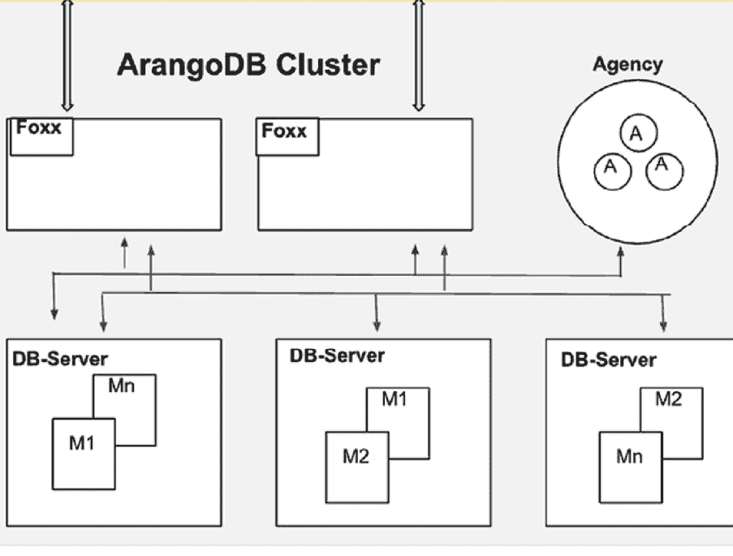
```

图：集群

ArangoDB 采用分片机制（sharding）将数据分布在 DBServer 节点上。数据被分为多个碎片，每个碎片存储在独立的 DBServer 节点上。这种数据分布有助于分担负载并确保水平扩展。

为了确保高可用性和数据冗余，ArangoDB 支持复制。数据在多个 DBServer 节点之间复制，提供故障容错。如果一个节点故障，另一个节点可以接管，减少停机时间。

ArangoDB 使用共识算法（通常是 Raft 或类似的协议）进行协调节点之间的协调并确保数据一致性。

这种共识机制有助于选举 Leader 并同步集群的操作。

协调节点处理传入的客户端请求并将查询分配到合适的 DBServer 节点。负载均衡确保每个节点的资源都得到有效利用，防止特定节点的瓶颈和过载。

ArangoDB 集群内置了自动故障转移机制。如果协调节点或 DBServer 节点由于硬件故障或其他问题失效，集群可以自动提升副本取代其位置，确保数据可用性。

在 ArangoDB 集群部署中，适当的配置和监控至关重要。管理员可以配置复制因子、分片策略和其他设置，以满足特定的性能和冗余要求。提供了全面的监控工具用于跟踪集群节点的健康和性能。

## Couchbase 简介

现在，我们将介绍 Couchbase，这是一种以卓越性能、可扩展性和多功能数据处理能力而闻名的分布式 NoSQL 数据库。它旨在高效管理海量数据，同时提供高可用性和低延迟访问。Couchbase 支持面向文档和键值的数据模型，使其成为许多应用程序的健壮选择。

在 CAP 理论的背景下，Couchbase 主要强调分区容错性（Partition Tolerance）和可用性（Availability）。Couchbase 采用带有内置数据复制和分片机制的分布式架构，以确保在网络分区和硬件故障时数据仍然可用。尽管它努力实现强的一致性，但它提供了可调的一致性级别，允许用户根据特定情况在一致性和可用性之间进行权衡。

- **实时分析**：Couchbase 是实时分析应用的极佳选择，这些应用对亚毫秒响应时间和高吞吐量至关重要。它可以高效处理大型数据集上的复杂查询，适用于需要即时数据分析的应用，例如用户行为跟踪和商业智能系统。

- **会话管理**：Couchbase 通常用于 Web 和移动应用程序。其内存缓存能力和低延迟访问确保了用户会话的快速检索和存储，从而增强了应用程序性能和用户体验。

- **内容缓存**：Couchbase 可以作为网站和内容分发网络（CDN）的内容缓存。它将频繁访问的内容存储在用户附近，减少了后端服务器的负载并提高了内容交付速度。

- **游戏**：Couchbase 用于在线游戏平台，存储玩家配置、游戏状态、排行榜和实时多人交互。它处理高并发和低延迟需求的能力在游戏行业至关重要。

虽然 Couchbase 提供了令人印象深刻的能力，但考虑潜在的权衡也是至关重要的：

- **复杂性**：实现和管理像 Couchbase 这样的分布式数据库可能非常复杂，特别是在大规模部署中。适当的配置和监控对于确保最佳性能至关重要。
- **一致性**：Couchbase 提供了可调的一致性级别，允许开发者在强一致性和高可用性之间进行选择。这里的权衡是，优先考虑其中一个可能会根据所选配置影响另一个。
- **资源**：Couchbase 的分布式架构可能需要大量的硬件资源（包括内存和存储）才能高效运行。扩展集群还可能需要细致的资源规划。

下表简要概述了 Couchbase 的日常用例，突显了其在不同领域和行业中的动态能力。Couchbase 卓越的性能、可扩展性和多功能性在这些应用中得以体现，证明了它在当今数据驱动世界中的重要性。从实时分析、会话管理到内容缓存、游戏平台和 IoT 解决方案，Couchbase 的适应性赋予了各行业企业力量。探索这些简要描述，了解 Couchbase 如何增强数据管理并推动您的行业或应用领域取得成功。

表 16.3: Couchbase 用例

| 领域 | 用例 |
| :--- | :--- |
| (示例) | ... |

这些简要描述突显了 Couchbase 的性能、可扩展性和多功能性在满足特定数据管理需求方面的实际应用。

Couchbase 设计用于在集群或分布式环境中无缝运行，提供高可用性、可扩展性和容错性。集群式 Couchbase 部署通常被称为 Couchbase 集群。以下是 Couchbase 如何与集群工作的解释。

一个 Couchbase 集群由多个运行 Couchbase 服务器实例的节点组成。这些节点可以分布在不同的物理机器或虚拟实例上。Couchbase 集群内的节点承担不同的角色：

- **数据节点 (Data nodes)**：数据节点存储数据并执行操作。它们管理数据存储、索引和查询处理。
- **索引节点 (Index nodes)**：索引节点管理数据的二级索引以实现高效查询处理。它们创建并维护索引以加速查询。
- **查询节点 (Query nodes)**：查询节点负责处理 N1QL 查询（N1QL 是 Couchbase 类似于 SQL 的查询语言）。它们针对数据节点中存储的数据优化并执行查询。
- **搜索节点 (Search nodes)**：全文搜索节点处理全文搜索操作，并允许全文搜索功能集成到您的应用程序中。
- **分析节点 (Analytics nodes)**：分析节点对数据节点中存储的数据执行分析查询，允许在不影响业务负载的情况下进行复杂的数据分析。
- **事件节点 (Event nodes)**：事件节点允许创建事件驱动函数，并根据数据的变化触发操作。

下图展示了生产环境下的 Couchbase 集群概览，节点执行着数据存储、索引、查询等不同角色。这种分布式架构展示了 Couchbase 提供高可用性、可扩展性和容错性的能力。节点专门化用于处理特定服务，包括数据存储、索引、查询、全文搜索、分析和事件触发。这种多功能性使 Couchbase 能够适应各种工作负载，成为现代企业的宝贵资产。通过自动故障转移和跨数据中心复制（XDCR）机制，Couchbase 确保了健壮性和可扩展性，使其适用于各行业的严苛生产环境：

图 16.2: Couchbase 集群

```
| 服务 1 | 服务 2 | 服务 3 | 服务 4 | 服务 5 |
| :--- | :--- | :--- | :--- | :--- |
| 数据服务 | 数据服务 | 数据服务 | 数据服务 | 查询服务 |
| 节点 1 | 节点 2 | 节点 3 | 节点 4 | 搜索服务节点 5 |
```

**示例：生产环境 Couchbase 服务器集群**

Couchbase 使用称为分区的机制将数据分布在多个节点上。数据被划分为分区，每个分区分配给特定的数据节点。这种分布确保了数据的均匀分布和跨集群的负载均衡。

Couchbase 提供数据复制以确保数据冗余和高可用性。每个数据节点通常有一个或多个副本。如果某个节点故障，副本可以接管以最小化停机时间。数据以异步方式复制以提供容错性。

Couchbase 包含自动故障转移机制。如果数据节点无响应或故障，集群可以自动检测问题并将副本提升为活动数据节点，从而维护数据可用性和服务运行时间。

Couchbase 包含集群管理器，帮助管理员配置、监控和管理集群。它提供了基于 Web 的图形用户界面 (GUI) 和用于集群管理的命令行界面 (CLI)。

Couchbase 集群设计为可水平扩展。您可以动态地添加或删除节点以适应不断变化的负载需求。这种弹性使得 Couchbase 适用于小规模和大规模部署。

对于地理分布的部署，Couchbase 提供了 XDCR，允许您在不同数据中心的集群之间复制数据，确保数据可用性和灾难恢复。

这些功能使其非常适用于需要健壮且分布式数据库系统的现代、数据密集型应用程序。

我们对 Couchbase 集群能力的探索揭示了一个在生产场景中表现良好的稳健且动态的数据库解决方案。其分布式架构包含了用于各种服务的节点，凸显了 Couchbase 满足跨行业现代企业需求的适应性。随着我们深入学习实验课程，我们将获得实操经验，进一步解锁 Couchbase 的潜力并利用其功能来解决现实世界中的挑战。这些实践练习将使我们能够在我们的数据驱动的应用程序中有效利用 Couchbase，强化其在当今快速发展的数字格局中作为多功能且可靠的数据库解决方案的角色。因此，让我们进入实验课程，让 Couchbase 和 ArangoDB 的力量为我们的数据管理需求提供服务。

## 探索 ArangoDB

在本节中，我们将开启一段之旅，探索 ArangoDB 这一多功能世界，它是一个多模 NoSQL 数据库。我们的主要重点是从开发者的视角理解 ArangoDB。虽然我们在本章中不会深入探讨操作和配置的复杂细节，但我们将深入研究如何根据你的开发需求使用 ArangoDB。

在深入研究 ArangoDB 的功能之前，让我们从安装过程开始。在本节中，我们将使用 Docker 在本地设置并运行一个 ArangoDB 实例。这种方法确保了用于开发和测试目的的无忧安装过程。请参考以下代码命令：


# ArangoDB 与 Couchbase 入门指南

## 启动 ArangoDB 实例

在上述命令中，我们正在指示 Docker：

- 运行一个 ArangoDB 容器镜像。
- 设置环境变量 `ARANGO_NO_AUTH` 为 `1`，以简化本地设置并禁用身份验证。
- 为容器分配名称（`arangodb-instance`）以便于引用。
- 在容器内部暴露端口 8529 并将其映射到宿主机上的相同端口，允许你访问 ArangoDB Web 界面。

一旦 Docker 命令成功执行，你的 ArangoDB 实例应该已经在本地启动并运行。

## 访问 ArangoDB Web UI

要开始使用，你不需要在本地安装 ArangoDB 或设置任何特定的连接。ArangoDB 提供了一个基于 Web 的用户界面（Web UI），你可以在浏览器中访问它。操作如下：

1. 打开你选择的网络浏览器。
2. 在地址栏中输入以下 URL：`http://localhost:8529`

此 URL 假设 ArangoDB 正在本地默认端口 (8529) 上运行。如果 ArangoDB 运行在不同的机器或端口上，请将 `localhost:8529` 替换为相应的地址和端口。

你现在应该看到 ArangoDB Web UI 登录界面。默认情况下，为了简化本地设置，ArangoDB 配置不需要身份验证。

- 点击 **Login**（登录）按钮访问 ArangoDB Web UI。

登录后，你将看到 ArangoDB Web UI，它提供了一个用于管理数据库的用户友好界面。从这里，你可以：

- 创建和管理数据库及集合（collections）。
- 与文档、图和键值数据交互。
- 使用查询编辑器（Query Editor）编写并执行查询。
- 监控集群性能和健康状况。
- 访问文档和资源以支持开发。

有了 Web UI，你可以无缝地探索 ArangoDB 的功能并与数据库交互，这成为你开发之旅的绝佳起点。在接下来的课程中，我们将深入研究数据建模、查询以及使 ArangoDB 成为广泛应用多功能选择的各种特性。

## ArangoDB 查询语言 (AQL)

Arango 查询语言 (AQL) 是一种强大且多功能的查询语言，专为 ArangoDB 这一多模型 NoSQL 数据库设计。AQL 允许你执行广泛的操作，从查询和过滤数据到在数据库内部对其进行处理和转换。

以下是 AQL 的一些关键方面和特性：

- **类 SQL**：AQL 语法灵感源于 SQL，对于有关系型数据库经验的人来说它很熟悉。这使得开发者更容易过渡到 ArangoDB。
- **多模态**：AQL 支持跨不同数据模型的查询，包括文档、图和键值对。这种灵活性允许你在单个查询中处理多种数据类型。
- **复杂查询**：AQL 允许你创建涉及数据过滤、排序、连接、分组和聚合的复杂查询。
- **事务支持**：AQL 查询可以在事务中执行，确保数据的一致性和完整性。
- **用户定义函数**：你可以在 JavaScript 中创建自定义函数，并在 AQL 查询中使用它们来执行特定的操作或计算。

现在，让我们探索一些示例 AQL 命令以直观感受其功能：

### 基础 SELECT 查询

此查询从特定集合中检索所有文档。请参考以下代码片段：

```
FOR doc IN collectionName
  RETURN doc
```

### 过滤数据

此查询根据特定条件过滤文档。请参考以下代码片段：

```
FOR doc IN collectionName
  FILTER doc.status == "active"
  RETURN doc
```

### 集合连接

AQL 支持集合之间的连接（joins）。这里是一个从两个集合中检索并合并文档的示例。请参考以下代码片段：

```
FOR user IN users
  FOR order IN orders
    FILTER user.id == order.userId
    RETURN { user: user.name, order: order.id }
```

### 聚合

你可以使用 AQL 执行聚合操作，例如计数和对值求和。请参考以下代码片段：

```
FOR doc IN collectionName
  COLLECT category = doc.category WITH COUNT INTO count
  RETURN { category, count }
```

### UDF（用户定义函数）

AQL 支持使用 UDF。这里有一个如何在查询中创建和使用 UDF 的示例。请参考以下代码片段：

```
LET myFunc = (x) => x * 2
FOR doc IN collectionName
  RETURN myFunc(doc.value)
```

这些只是你使用 AQL 可以完成的工作的一小部分示例。它是一种强大且灵活的查询语言，允许你有效地与 ArangoDB 中的数据进行交互。

---

## 启动 Couchbase 实例

- `-d` 确保容器在后台模式下运行。
- `--name` 为 Couchbase 容器分配一个名称 (`db`) 以便引用。
- `-p` 标志将 Couchbase 服务所需的各种端口映射到你宿主机上的相应的端口。

一旦 Docker 命令执行成功，你的 Couchbase 实例应该就已在本地启动并运行了。

## 第 2 步：探索 Couchbase

当 Couchbase 在本地运行后，你可以通过其基于 Web 的管理控制台访问它的功能和特性。要访问 Web UI，请打开网络浏览器并输入以下 URL：`http://localhost:8091`

此 URL 假设 Couchbase 运行在本地默认端口 (8091) 上。如果你的 Couchbase 运行在不同的机器或端口上，请将 `localhost:8091` 替换为相应的地址和端口。

Couchbase Web UI 提供了一个易于操作的界面，用于管理你的数据库，包括：

- 创建和管理桶（等于其他数据库中的集合或表）。
- 配置和监控集群节点。
- 使用查询工作台（Query Workbench）执行查询。
- 访问文档和资源以支持你的开发。

在我们继续旅程的过程中，我们将深入探索 Couchbase 以开发者为中心的特性、数据建模、查询以及各种使其成为 NoSQL 数据库解决方案极具吸引力的选择的因素。

## Couchbase N1QL

Couchbase N1QL（读作 "nickel"）代表用于 JSON 的 SQL，它是一种为 Couchbase（一种 NoSQL 数据库）设计的强大查询语言。N1QL 扩展了传统 SQL 的查询能力，使其与 JSON 数据结构无缝协作，为开发者提供了一种熟悉且表达丰富的方式与其数据交互。

以下是 Couchbase N1QL 的一些关键方面和特性：

- **类 SQL 化**：N1QL 采用类 SQL 语法，让具有 SQL 经验的开发者易于上手。这种熟悉感简化了来自关系型数据库背景的人士向 Couchbase 的过渡。
- **以 JSON 为中心**：与主要处理表格数据的 SQL 不同，N1QL 查询是为处理 JSON 文档量身定制的。你可以轻松地查询和操作嵌套的 JSON 结构。
- **动态性**：Couchbase 灵活的无模式架构被 N1QL 完全支持。你可以对数据运行查询，而无需预先定义固定模式。
- **丰富的查询**：N1QL 支持广泛的查询能力，包括过滤、排序、连接、分组、聚合和全文搜索。它还提供了空间和数组函数用于高级数据处理。

现在，让我们探索一些示例 N1QL 命令以理解它的能力：

### 基础 SELECT 查询

此查询从特定桶 (`myBucket`) 中检索所有文档。请参考以下内容：

```
SELECT * FROM `myBucket`;
```

### 过滤数据

此查询根据特定条件过滤文档。参考以下内容：

```
SELECT * FROM `myBucket`
WHERE type = "user" AND status = "active";
```

### 连接文档

N1QL 支持不同桶之间文档的连接。以下是一个示例从两个桶中检索文档并根据公共字段将它们合并。参考以下内容：

```
SELECT u.name, o.orderId
FROM `users` u
JOIN `orders` o ON KEYS u.orderIds;
```

### 聚合

你可以使用 N1QL 进行聚合操作，例如计数和对值求和。参考以下内容：

```
SELECT COUNT(1) AS total, SUM(price) AS revenue
FROM `orders`
WHERE status = "completed";
```

### 全文搜索

N1QL 可以使用 `MATCH` 子句执行全文搜索查询。参考以下内容：

```
SELECT * FROM `products`
WHERE MATCH(description) AGAINST("laptop");
```

### 数组操作

N1QL 允许你处理 JSON 文档中的数组。此查询检索数组中包含特定值的文档。参考以下内容：

```
SELECT * FROM `users`
WHERE "admin" IN roles;
```


这些只是你通过 Couchbase N1QL 可以实现的目标的一小部分示例。它提供了一种多功能且表达丰富的查询语言，用于高效地与你的 JSON 数据交互。无论你是在执行基础查询还是复杂的分析，N1QL 都提供了你所需的工具来让你与 Couchbase 高效工作。

我们对 Couchbase 和 ArangoDB 的探索为我们在这两种多功能的 NoSQL 数据库解决方案奠定了坚实的基础，每种方案都有独特的特性和能力。随着我们的前进，我们将弥合理论与实践之间的差距，使用这些数据库进入 Java 应用开发的世界。我们接下来的课程将探索如何在 Java 应用中利用 Couchbase 和 ArangoDB 的力量，使我们能够创建健壮的、数据驱动的解决方案。

（注：原文后续存在大量重复段落，已根据指令要求去重并翻译）

## 将 ArangoDB 集成到 Java

作为第一步，我们将建立一个 Maven 项目，使用依赖注入 (CDI)、JSON 绑定和 EclipseProfile 与 ArangoDB 工作。我们将关注将 ArangoDB 依赖添加到项目中。


一旦向项目中添加了 ArangoDB 依赖，你可以根据需要使用 CDI、JSON-B 和 EclipseProfile 探索 ArangoDB。

随着我们的前进，我们将弥合理论与实践之间的差距，使用这些数据库进入 Java 应用开发的世界。我们接下来的课程将探索如何在 Java 应用中利用 Couchbase 和 ArangoDB 的力量，使我们能够创建健壮的、数据驱动的解决方案。

### 实体与仓库定义

在本示例中：

`HeroRepository` 继承自 `Repository<Hero, String>`，表示它是一个用于管理 `Hero` 实体的仓库，其中 `String` 是 ID 类型。

该仓库包含两个查询方法：`findByName` 和 `find`。`findByName` 方法非常直观，不需要自定义查询，而 `find` 方法使用了通过 `@AQL` 注解定义的 ArangoQL 查询。该注解允许你指定自定义的 AQL 查询。

### 实战代码示例

现在，让我们来看看如何在实践中使用 `HeroRepository`。在下面的代码段中，我们使用该仓库执行数据访问操作：

```
Hero ironMan = new Hero("Iron Man", "Tony Stark");
repository.save(ironMan);

Hero foundByName = repository.findByName("Iron Man");
List<Hero> foundByQuery = repository.find("Iron Man");
```

在此代码中：

我们创建了一个名为 `ironMan` 的 `Hero` 实例，并使用 `HeroRepository` 的 `save` 方法将其保存。该方法会自动将 hero 插入到 ArangoDB 数据库。

我们演示了两种数据检索类型：

- 使用 `findByName` 方法，这是仓库中定义的查询方法。它简化了基于特定字段的数据检索。
- 使用在 `find` 方法中自定义 ArangoQL 查询。这展示了你如何利用自定义 AQL 查询进行更复杂的数据检索。

通过利用 `ArangoDBRepository`，你可以简化数据访问层，减少样板代码，并专注于使用 ArangoDB 和 Java 构建健壮且高效的数据驱动型应用程序。

## ArangoDB 实验总结

在本次 ArangoDB 实验中，我们深入了使用 ArangoDB 进行 Java 应用开发，涵盖了基本主题，如设置 Maven 项目、定义实体以及使用 `ArangoDBRepository`。我们探索了 ArangoQL 在数据操作方面的灵活性，并引入了带有 `ArangoDBRepository` 的仓库以简化数据访问。我们通过实战示例学习了如何使用 Java 在 ArangoDB 中插入、查询和处理数据。掌握了这些知识后，我们准备好过渡到 Couchbase 实验，在那里我们将继续通过另一个强大的 NoSQL 数据库 Couchbase 开启基于 Java 的数据访问之旅。

## Couchbase Java 集成

我们将探索如何使用 Java 操作 Couchbase，这是一个强大的 NoSQL 数据库。Couchbase 提供了卓越的灵活数据建模和查询能力，使其成为各种应用程序的流行选择。我们将创建一个利用 `CouchbaseTemplate` 和 `CouchbaseRepository` 高效执行数据操作的 Java 应用。

在通过 Java 深入研究 Couchbase 之前，需要强调的是 Couchbase 的配置比 ArangoDB 更复杂。请参考此链接获取有关初始配置的详细指南。确保你已经设置并运行了 Couchbase，并为应用程序配置了相应的桶（buckets）和索引。

我们将继续使用与之前字段相同的 `Hero` 实体，这使我们能够关注 Java 应用中针对 Couchbase 的特定方面。

### 插入数据与 N1QL 查询

让我们从使用 `insert` 方法向 Couchbase 插入一个 hero 开始吧。

```
Hero ironMan = new Hero("Iron Man", "Tony Stark");
template.insert(ironMan);

String query = "SELECT * FROM bucket WHERE name = 'Iron Man'";
N1qlQuery n1qlQuery = N1qlQuery.simple(query);
List<Hero> result = template.findByN1QL(n1qlQuery, Hero.class);
```

在此代码中：

我们创建了一个名为 `ironMan` 的 `Hero` 实例，并使用 `insert` 方法将其插入 Couchbase，这简化了向 Couchbase 添加数据的过程。

我们执行了一个 N1QL 查询。N1QL（读音为 nickel）是 Couchbase 用于 JSON 数据的类 SQL 查询语言。我们使用 N1QL 根据名称检索英雄。

### 仓库定义

现在，让我们探索如何创建一个继承自 `CouchbaseRepository<Hero, String>` 的 `HeroRepository`。

在此仓库中：

我们定义了 `HeroRepository` 接口，它继承自 `CouchbaseRepository<Hero, String>`。该接口为 `Hero` 实体提供了箱用的创建、读取、更新、删除（CRUD）操作。

我们使用 `@N1QL` 注解添加了自定义 N1QL 查询。该查询允许我们通过真实名称查找英雄。

### 仓库操作演示

最后，我们演示了如何使用 `HeroRepository` 进行数据操作：

```
Hero ironMan = new Hero("Iron Man", "Tony Stark");
repository.save(ironMan);

Hero found = repository.findByRealName("Tony Stark");
```


在此代码中：

我们创建了一个 `Hero` 实例，并使用继承自 `CouchbaseRepository` 的 `HeroRepository` 方法将其保存。

我们演示了两种数据检索类型：一种是通过 ID 检索，另一种是通过仓库中定义的自定义 N1QL 查询通过真实名称检索。

通过利用 `CouchbaseTemplate` 和 `CouchbaseRepository`，你可以将 Couchbase 无缝集成到你的 Java 应用中，并利用其存储和查询 JSON 数据的能力。Couchbase 的可扩展性和灵活性结合 Java 的强大，为构建数据驱动应用程序提供了坚实的基础。

## Couchbase、ArangoDB 与安全

虽然本书的重点一直是 ArangoDB 和 Couchbase 与 Java 结合的数据建模、查询和集成方面，但关注安全问题是至关重要的。安全在数据库管理中至关重要，启用稳健的安全措施对于保护你的数据和应用程序非常重要。在本节中，我们将简要讨论安全性以及如何在 ArangoDB 和 Couchbase 中启用它。

- **数据**：数据库存储价值和敏感数据，使其成为攻击的首要目标。适当的安全措施对于保护这些数据免受未经授权的访问、篡改或盗窃是必要的。
- **合规**：许多行业和应用程序对数据安全有特定的要求。满足这些要求不仅是法律义务，对于维护用户和客户的信任也至关重要。
- **应用程序**：不安全的数据库会导致应用程序漏洞。确保数据库安全有助于增强应用程序的整体安全性。

## 结论

在本章中，我们探索了 Java 生态系统中的 NoSQL 数据库，包括 ArangoDB 和 Couchbase，它们都支持键值、文档和查询能力。这些数据库通过在单一系统中容纳不同的数据模型，提供了多功能性。ArangoDB 以其对图数据库的支持脱颖而出，允许你无缝地建模和查询图数据，而 Couchbase 则在扩展性方面表现优异。

我们的最后一章将总结在 Java 中有效选择和使用 NoSQL 数据库的关键见解，确保你已经准备好应对项目中的各种数据库挑战。

## 注意事项

- **数据库**：在选择 NoSQL 数据库时，请考虑你项目的特定需求。ArangoDB、Couchbase 以及其他 NoSQL 数据库提供了多种数据模型，如键值、文档和图，允许你选择最合适的一种。
- **ArangoDB 和 Couchbase 是多模型数据库**，提供了在单个数据库系统内处理不同数据模型的灵活性。ArangoDB 额外支持图数据建模，使其成为图数据库的强大选择。
- **适当的数据库配置对于获得最佳性能至关重要**。确保你遵循所选数据库系统的设置说明和最佳实践。
- **Java**：利用 `ArangoDBTemplate` 和 `CouchbaseTemplate` 等工具可以简化 Java 中的数据访问和操作。存储接口（如 `ArangoDBRepository` 和 `CouchbaseRepository`）简化了数据操作。
- **查询**：ArangoDB 使用 ArangoQL 进行查询，而 Couchbase 使用 N1QL 进行灵活的 JSON 数据查询。理解这些查询语言将增强有效检索和处理数据的能力。
- **数据**：有效的数据建模是利用 NoSQL 数据库的关键。根据应用程序的需求定义数据结构，并利用所选数据库提供的适当数据模型。
- **Couchbase 以其扩展性闻名**，使其适用于数据需求快速增长的应用。在规划未来的扩展性时，请考虑这一因素。
- **NoSQL 数据库提供了广泛的选择**，选择正确的数据库取决于项目的独特需求。在做决定时，请考虑数据结构、查询复杂性和扩展性等因素。

## 单选题

**ArangoDB 的区分特征之一是什么（使其与本章中提到的其他 NoSQL 数据库区分开来）？**

- 支持 JSON 数据建模
- 多模型支持，包括键值、文档和图
- 强大的 N1QL 查询语言
- 针对大型数据集的卓越扩展性

**哪种查询语言主要与 ArangoDB 的数据检索和操作相关？**

- SQL
- ArangoQL
- N1QL
- GraphQL

**哪种查询语言主要与 Couchbase 的数据检索和操作相关？**

- SQL
- ArangoQL
- N1QL
- GraphQL

**根据本章，使用多模型数据库的主要优势之一是什么？**

- 它通过强制单一数据模型来简化数据建模。
- 它能够更高效地利用数据库集群。
- 它通过在单一数据库系统内支持多个数据模型提供了灵活性。
- 它确保了数据存储的卓越安全性。

**Couchbase 支持哪些数据模型？**

- 键值和文档
- 键值和图
- 关系型和文档
- 文档和图

**ArangoDB 在其多模型框架支持哪些类型的数据库？**

- 仅键值数据库
- 键值、文档和图数据库
- 键值和列式数据库
- 文档和图数据库

## 答案

加入我们书籍的 Discord 空间

加入书籍的 Discord 工作区以获取最新更新、优惠、全球科技动态、新发布以及与作者的互动：

https://discord.bpbonline.com


## 最终考虑

## 引言

在我们对 NoSQL 数据库及其与 Java 集成全面探索的最后一章中，我们来到了旅程中的关键转折点。当我们反思 NoSQL 技术的广阔及其与 Java 编程语言的共生关系时，显然，我们的探索仅仅是冰山一角。我们深入研究了各种 NoSQL 数据库类型，从面向文档的键值存储，并通过实践示例和最佳实践研究了它们与 Java 的集成。然而，必须承认，本书之外还有许多 NoSQL 数据库，每种都提供独特的功能和用例。在结语章节中，我们将提供一些最终考虑，以指导你在不断演变的 NoSQL 和 Java 世界中继续探索。

首先，我们将讨论 SQL 数据库的持久相关性。虽然 NoSQL 数据库在近年来获得了巨大的关注，但 SQL 数据库在现代数据管理中继续发挥至关重要的作用。我们将探索 SQL 数据库仍然是首选方案的情况，并讨论它们如何补充 NoSQL 解决方案。此外，我们将为你介绍进一步的阅读材料和资源，因为数据库、SQL 和 NoSQL 领域是动态且不断扩张的。当你穿梭于领域时，请记住架构选择至关重要。我们将强调为你的特定项目需求选择合适的数据库和框架的重要性，以确保扩展性、性能和可维护性。最后，我们将展示一系列与 NoSQL 数据库无缝集成的 Java 框架，为你提供应对复杂数据挑战的工具包。当你翻开最后一章的页面时，你将发现富有洞察力的结论，以及通往你未来 NoSQL 和 Java 开发充满可能的世界的大门。

## 结构

本章涵盖了以下主题：

- 数据库及最终考虑
- 文档与软件架构的最终考虑
- 测试的最终考虑
- Java 框架的最终考虑
- 安全
- 应对复杂的数据迁移领域
- 备份的关键作用
- NoSQL 中数据治理的必要性

## 目标

在本章中，我们的主要目标是强调尚未探索的 NoSQL 数据库，强调 SQL 数据库的持久相关性，通过推荐资源引导持续学习，强调架构选择的重要性，并介绍用于高效 NoSQL 集成的 Java 框架。通过实现这些目标，我们旨在让读者对 NoSQL 和 Java 集成有全面的理解，使他们能够做出明智的决策并在这一动态领域脱颖而出。

## 数据库及最终考虑

在本节中，我们将深入研究数据库的多样化格局，重点介绍我们在本书中探索过的关键类别：键值、宽列存储、文档和图型数据库。这些类别展示了 NoSQL 数据库在广泛范围内的丰富性和适用性。

尽管我们已经全面涵盖了这些主要的类别，但必须意识到，NoSQL 数据库的世界是广阔且不断演变的。我们在书中没有深入探索的两种值得注意的类型是时序数据库和向量数据库：

- **时序数据库**：这些数据库专门用于高效处理带有时间戳的数据。它们对于记录带有时间戳的数据点的应用非常理想，例如 IoT 传感器数据、金融市场数据或监控系统。时序数据库在大规模范围内存储、查询和分析时序数据方面表现出色，使其在对实时洞察和历史数据趋势至关重要的行业中不可或缺。
- **向量数据库**：向量数据库旨在处理高维数据，通常用于机器学习、自然语言处理和推荐系统等应用。它们能够高效地存储和查询向量或张量，从而实现相似性搜索和推荐算法等复杂操作。随着对 AI 和数据驱动应用需求的增长，向量数据库已变得日益重要。

在我们探索这些令人兴奋的数据库类别时，必须指出的是，关系型数据库在数据管理版图中仍然占据着重要地位。它们在需要结构化数据、复杂查询和事务一致性的场景中表现优异。SQL 和 NoSQL 数据库之间的选择通常取决于项目的特定需求，在许多情况下，关系型数据库仍然是一个可靠的选择。

在我们在本节的后续中，我们将提供对这些数据库类别独特优势和用途的见解，使我们能够在为项目选择合适的数据库时做出明智的决策。

**NewSQL** 是一种相对较新的数据库类别，它的出现是为了应对传统关系型数据库在现代、分布式和高事务率环境下的局限性。这些数据库结合了这两者的优点，既提供了传统 SQL 数据库的强一致性和结构化数据模型，又具备了 NoSQL 数据库的可扩展性、容错和分布式能力。以下是一些用户用例列表：

- **联机事务处理 (OLTP)**：NewSQL 数据库非常适合需要高并发和低延迟事务的 OLTP 负载。它们每秒可以处理数千次交易，使其成为电子商务平台、金融应用和实时订单处理系统的理想选择。
- **数据密集型应用**：在处理需要复杂连接、聚合和持久性 (ACID) 合规性的数据密集型应用时，NewSQL 数据库提供了极具吸引力的解决方案。医疗、金融和政府行业通常依赖 NewSQL 进行安全可靠的数据管理。
- **混合云环境**：NewSQL 数据库旨在于分布式和混合云环境中无缝运行。它们为跨越本地和基于云的基础设施的现代应用程序提供了所需的灵活性，确保了数据的一致性和可用性。
- **高监管性行业**：在具有严格监管要求的行业中，如医疗保健 (HIPAA) 和金融 (SOX)，NewSQL 数据库因其能够执行数据完整性审计和合规而受到青睐，同时还能提供关键业务所需的性能。
- **全球可扩展性**：NewSQL 数据库可以进行水平扩展，允许它们处理跨地理区域的不断增长的负载。这种可扩展性对于跨国公司和为全球用户提供低延迟访问的网络服务至关重要。
- **复杂分析**：某些 NewSQL 数据库内置了对分析查询的支持。这使得它们适用于需要分析大型数据集并从中获得见解，同时确保底层数据保持一致且最新的用例。

对于那些需要 NoSQL 数据库的可扩展性和容错性，同时又保留传统关系型数据库熟悉的 SQL 查询能力和事务一致性的应用程序来说，NewSQL 数据库代表了一个极具吸引力的选择。通过解决这些用例，NewSQL 数据库弥补了这两个世界之间的差距，为现代数据管理挑战提供了多用途的解决方案。

在不断演变的数据库领域，知识是有效应对数据管理复杂地形的关键。我们介绍了两本卓越的书，它们是数据库世界的指路明灯，为数据库爱好者、开发者和专业人士提供了深邃的见解和实践智慧。

在我们结束本次课程时，我们已经探索了各种数据库，包括 NoSQL 类别 NewSQL，并推荐了可以照亮这一动态领域道路的阅读材料。现在，让我们过渡到下一节，在那里我们将探索关键的文档和软件架构主题。充分的文档和深思熟虑的架构决策是成功数据库实现的基石。在接下来的课程中，我们将提供见解和策略，帮助您有效地为数据库系统建模，并在软件架构中做出明智的选择。这些技能对于确保您的数据解决方案的可扩展性、可靠性和可维护性至关重要。因此，加入我们，开启进入数据库文档和软件架构世界的本质旅程。

## 文档与软件架构的最终考虑

本节将深入探讨成功软件开发的两个基础方面：文档和软件架构。这些原则是通用的，并且在 NoSQL 数据库项目中至关重要。我们将探索为什么文档对于 NoSQL 项目是不可或缺的，列出其优势，并提供关于其如何促进透明度、协作和有效的项目管理的见解。此外，我们将强调良好的软件架构在企业应用（包括 NoSQL 数据库）成功中的关键作用，即通过增强可扩展性、可靠性和可维护性。

在现代软件开发的复杂织锦中，文档是一个无名英雄，是成功的无声建筑师。在 NoSQL 数据库领域，它的重要性比任何时候都显著。它揭示了文档对 NoSQL 项目的深远意义，阐明了贯穿整个开发生命周期的回响益处。从促进清晰度和协作，到加强故障排除和合规性，文档是引导开发者、管理员和利益相关者穿越 NoSQL 数据库动态格局的指南针。让我们开启一段旅程，探索稳健的文档不仅是 NoSQL 项目的配角，更是其成功的基石：

- **清晰与理解**：文档充当知识库，确保当前和未来的团队成员对 NoSQL 数据库模式、数据模型和查询模式有清晰的理解。这种清晰度能更好地促进决策和更顺畅的协作。
- **入职与培训**：文档良好的 NoSQL 数据库可以加速新团队成员的入职过程。详细的文档可以提供数据库结构、最佳实践和编码规范的见解，降低学习曲线。
- **故障排除与调试**：当 NoSQL 数据库出现问题时，全面的文档可以充当故障排除指南。它帮助识别潜在问题、其根源以及解决问题所需的步骤，在关键情况下节省宝贵时间。
- **合规性与治理**：在具有监管要求的行业中，文档对于证明合规性至关重要。它提供了审计追踪和数据更改记录，增强了治理和数据安全。

在不断演变的数字格局图中，企业应用的成功蓝图紧密地编织在它们的软件架构中。这一基础是构建稳健、可扩展且可靠的系统的基石。在本节中，我们将进入软件架构在企业应用中重要性的核心，包括其在 NoSQL 数据库领域的关键作用。我们将探索精心设计的架构如何赋能这些应用程序以优雅地扩展、可靠地运行，并无缝适应当今数据驱动世界不断变化的需求。当我们揭开这层架构织锦的层次时，我们发现了它如何形成效率、韧性和前瞻性的基石，并最终定义了企业事务的成功。加入我们，探索软件架构对企业格局的深远影响。

良好的软件架构是任何企业应用（包括 NoSQL 数据库）的骨干。以下是它对其成功的贡献：

- **可扩展性**：架构良好的系统可以水平和垂直扩展，以适应不断增长的数据和用户需求。它对于处理 NoSQL 数据库中不断扩大的数据集至关重要。
- **可靠性**：稳健的架构可以减少停机并确保高可用性。冗余、负载均衡和故障转移机制是增强可靠性的架构组件。
- **可维护性**：良好的架构有助于整洁的代码和模块化的设计，使得随着时间推移维护和更新 NoSQL 数据库系统变得更容易。它简化了新功能的添加。
- **性能**：架构选择（例如数据库分片和缓存策略）可以显著提高性能。经过深思熟虑的架构优化了资源利用和查询执行。
- **灵活性与适应性**：随着业务需求的演进，一种适应性架构允许与新技术进行无缝集成，确保 NoSQL 数据库在企业生态系统中的生命力和相关性。

文档和软件架构对于 NoSQL 项目和企业级应用的成功不可或缺。它们为构建稳健、可扩展且易于维护的系统奠定了基础，在如今数据驱动的格局中增强了 NoSQL 数据库的效率、可靠性和前瞻性。

在不断演变的软件开发领域，有两块不可或缺的支柱屹立：文档和软件架构。当我们开启深化这些关键领域理解的旅程时，我们介绍了三本卓越的书籍，指明了通往这些领域精通的道路。当我们结束对这些宝贵资源的探索时，我们揭示了文档和软件架构在软件开发中的深远意义。这些书籍提供了丰富的知识，从有效的技术写作艺术到稳健架构背后的工程实力。在我们的下节课程中，我们将进一步探索测试，这是软件开发生命周期中的一个关键阶段。我们将揭示确保软件创作可靠性和质量的策略、工具和最佳实践。因此，请与我们一起，深入探讨软件测试，这是构建卓越软件解决方案的最后一块拼图。

## 测试最后考虑

本节富有启发性的课程探索了软件开发中一个动态的交叉点：NoSQL 数据库与测试方法之间的关键关系。虽然我们可能没有深入探讨这个话题，但请不要忽视：它是现代数据库驱动应用不可或缺的元素。我们将揭示为什么测试对于 NoSQL 数据库至关重要，并提供关于如何确保数据完整性、可靠性和最佳性能的见解。我们将引入数据驱动测试的概念，这是验证 NoSQL 数据库的一种强大方法，并深入探讨 Testcontainers 这样的集成工具，它们简化了测试流程。加入我们这段富有启发性的旅程，共同揭示 NoSQL 数据库与测试方法之间的协同效应。

在 NoSQL 数据库与测试汇聚的领域，现代软件开发中的一项关键联盟应运而生。虽然我们的书籍可能没有深入探讨这一主题，但在 NoSQL 领域，测试的重要性不言而喻。我们将探索为什么测试对于维护数据完整性、优化性能和确保系统可靠性至关重要。我们将介绍数据驱动测试，并重点介绍 Testcontainers 等集成工具，以简化测试过程。加入我们，揭示 NoSQL 数据库与测试方法之间不可分割的联系，这种动态融合正在塑造数据驱动软件应用的未来。

- **确保数据完整性**：在 NoSQL 数据库中，数据通常是分布式的、复杂的且无模式的。全面的测试对于确保数据完整性至关重要，可以防止产生深远影响的数据损坏或丢失。
- **优化性能**：有效的测试允许开发者识别 NoSQL 数据库中的瓶颈和性能问题。模拟真实的使用场景可确保数据库能够高效处理预期负载。
- **增强 NoSQL 数据库**：NoSQL 数据库是许多关键任务应用的骨干。严格的测试保证了这些数据库的可靠运行，减少了系统故障和 costly 停机的风险。

**数据驱动测试** 是一种利用数据集来驱动测试场景的策略性方法。在 NoSQL 数据库背景下，这意味着使用多样化的数据集来验证不同的数据库操作。它对于发现边界情况以及确保数据库在各种输入和用例中按预期运行非常宝贵。

与真实数据库进行集成测试可能具有挑战性。`Testcontainers` 等工具通过在测试期间提供轻量级、可丢弃的数据库容器来简化这一过程。我们将探索 `Testcontainers` 的工作原理，并讨论其他与 NoSQL 数据库无缝集成的集成测试工具，使编写和维护可靠的测试变得更容易。

在本节中，我们弥合了 NoSQL 数据库与测试之间的差距，展示了它们的共生关系。通过数据驱动测试和 `Testcontainers` 等集成工具，我们使开发者能够确保其 NoSQL 数据库解决方案的稳健性和可靠性，增强对所创建软件的信心。

`Testcontainers` 文档对于那些寻求充分利用 NoSQL 测试的人是不可或缺的参考。这些资源将无疑助力你追求卓越测试，并增强你确保数据驱动软件应用程序韧性和可靠性的能力。

在本节富有启发性的课程中，我们揭示了 NoSQL 数据库与测试之间的重要联系，强调了它们在维护数据完整性和可靠性方面的关键作用。我们介绍了数据驱动测试，并强调了 `Testcontainers` 等工具的重要性。在我们结束之际，我们邀请你加入我们的下节课程，届时我们将探索与 NoSQL 数据库无缝集成的 Java 框架，为数据驱动的 Java 应用提供强大的解决方案。这段令人兴奋的旅程有望开启 Java 驱动数据解决方案领域的新纪元。

## Java 框架最后考虑

在本节富有启发性的课程中，我们开启了通往动态领域的旅程，在该领域，Java 框架与 NoSQL 数据库的多功能性和谐集成。我们想澄清，这里探索的 NoSQL 概念超越了特定框架并通用，为你的数据驱动 Java 应用奠定了坚实基础。虽然我们的书籍主要遵循 Jakarta EE 和 Eclipse MicroProfile 等 Java 企业标准，但我们也认识了超出这些标准的更广泛的解决方案图景。加入我们深入研究久负盛名的 Spring Framework，它启发了包括 Jakarta EE 在内的众多解决方案。我们还将探索 Quarkus 和 Micronaut 的创新世界，它们是两个支持 NoSQL 数据库的尖端框架，为 Java 开发者提供了高效且轻量级的替代方案。

**Spring Framework** 是塑造 Java 生态系统的开创性解决方案。它以其全面的功能集而闻名，提供了与 NoSQL 数据库的无缝集成，为开发者构建稳健、可扩展的应用程序提供了灵活性和便利性。它是 Java 领域的一个基石，并持续启发和演进我们在书中探索的标准。

**Quarkus** 是一个彻底改变 Java 开发范式的突破性框架。Quarkus 专为优化性能和资源效率而设计，对 NoSQL 数据库提供原生支持，使其成为微服务和云原生应用的极佳选择。我们将进一步深入研究 Quarkus，揭示其在 NoSQL 驱动的 Java 开发中的能力和优势。

在对与 NoSQL 数据库无缝集成的 Java 框架进行探索中，导航开发者提供的丰富选项是重要的。为了帮助这一旅程，我们整理了一份对比表格，突出了三个主流框架（Spring Framework、Quarkus 和 Micronaut）的关键特征和特性。每个框架都为表格带来了独特的优势，满足了不同的开发需求和偏好。该表格是一份宝贵的参考，根据你的项目需求选择最匹配的框架，无论你优先考虑的是性能、资源效率、云原生开发或其他特定标准。加入我们这一全面的对比，阐明这些 Java 框架在 NoSQL 数据库集成背景下的独特属性：

```
| 特性 | Spring Framework | Quarkus | Micronaut |
| :--- | :--- | :--- | :--- |
| 集成 | ... | ... | ... |
| ... | ... | ... | ... |
```

表 17.1：Java框架与 NoSQL 数据库

请注意，框架的适用性取决于您的项目需求，这些框架满足不同的开发需求。请选择与您的项目目标、开发团队专业知识以及架构偏好最匹配的一个。在我们结束对 Spring Framework、Quarkus 和 Micronaut 在 NoSQL 数据库支持方面的关键特性的探索时，我们掌握了在 Java 开发之旅中做出明智决策的见解。每个框架都有独特的优势和特点，允许开发者根据项目的特定需求定制选择。在进入最后一个环节之前，我们邀请您加入我们，共同对 Java 框架与 NoSQL 数据库汇聚的复杂领域进行全面总结。在下一节课程中，我们将总结主要发现，为框架选择提供指导，并为您构建稳健高效的 Java 应用的下一步工作奠定基础。

## 安全

在快速演变的软件开发领域，安全仍然是任何应用程序完整性、可靠性和长寿性的支柱。尽管我们已经遍历了 NoSQL 数据库的多样领域，深入了它们的类型、用例以及与 Java 框架的集成，但至关重要的是，安全不仅仅是一个可选的层，它是绝对的需要。在本节课程中，我们将强调安全在应用架构中的重要性，无论您采用何种技术栈。

当我们深入探索 NoSQL 数据库、Java 框架以及现代应用的复杂架构时，必须停下来并意识到，安全并非仅仅是一个可选的层；它是应用程序赖以存在的基石。在这一部分，我们将重点介绍安全在应用程序架构中的至关重要性。无论您采用何种技术栈，安全不仅是一个功能；它是一项基本需求，是一个不可逾越的方面，必须织入您软件事业的核心。加入我们，深入探讨安全作为应用程序基石的意义，确保其在数字时代的完整性、可靠性和长寿性。

安全应该置于您架构考量的前沿。它不是事后考虑，也不是您可以额外补上的功能。相反，它是一个必须织入应用程序本质的基本方面。在当今互联的数字世界中，忽视安全的后果可能是灾难性的，从数据泄露到法律和声誉损害。

在现代软件开发的复杂织图中，代码赋予了数字创造生命，一个令人警醒的统计数据要求我们关注：四个应用程序中有三个遭受了代码漏洞。这些漏洞（包括 SQL 注入等隐性威胁）凸显了采取主动安全措施的迫切需求。当我们穿梭于 NoSQL 数据库、Java 框架和应用架构的多维度世界时，我们必须承认安全并非事后考虑；它是每项数字事业的基石支柱。在这一部分中，我们将关注代码漏洞令人不安的现实，强调它们的潜在后果以及警惕的必要性。通过探索代码漏洞领域并跟上开放网络安全项目（Open Web Security Project）等行业标准，我们为自己提供了知识和工具，以抵御数字领域潜伏的危险。

一个警醒的统计数据脱颖而出：四个应用程序中有三个受到某种形式代码漏洞的影响，包括如 SQL 注入等可能是灾难性的问题。为了应对这一威胁，采取主动姿态至关重要。请熟悉最新的安全指南和资源（例如 `OWASP`），以保持对漏洞和最佳实践的更新。

在现代技术互联的格局中，虚拟与物理之间的边界变得模糊，您的基础设施的安全成为您的应用程序韧性的基石。当我们导航 NoSQL 数据库、Java 框架和架构复杂性地形时，最重要的是承认您的数字基础安全绝非仅仅是事后考虑，它是一项不移的要求。在这一部分中，我们将阐明基础设施安全的关键重要性，超越特定的技术，并强调其通用相关性。通过采用强有力的访问控制、严谨的审计和行业最佳实践，我们开启了一段保护数据库免受潜伏在数字阴影中不断变化的威胁的旅程。加入我们，进入基础设施安全领域，那里的防御强度直接影响着您的数字存在的长寿性和可靠性。

您的基础设施安全性取决于其最薄弱的环节。许多事件凸显了具有公共访问、默认凭据或安全配置松散的数据库的危险。在您设计 NoSQL 数据库解决方案时，请对基础设施安全采取严谨的方法。实施强有力的访问控制，定期审计您的配置，并遵循安全数据库实例的行业最佳实践。

总之，安全不是一种选择或奢侈品；它是每个应用程序架构的本质基础。无论您是处理 NoSQL 数据库、Java 框架还是任何其他技术栈，安全原则必须植入您系统的每一层。通过对代码漏洞和基础设施安全采取主动方法，并对新兴威胁保持关注，您将增强应用程序抵御数字领域无处不在的危险的能力。

## 应对数据迁移复杂地形

在数据库管理和组织数据生命周期的动态格局中，一个关键阶段往往非常显眼——数据迁移。无论您是考虑将单体数据库拆分为微服务，还是为了响应不断演变的业务需求，数据迁移都是现代数据管理中不可避免的方面。在本节课程中，我们将涉入数据迁移的复杂世界，探索其重要性、挑战以及成功执行的策略。

数据迁移不仅是一项技术尝试，更是一项战略性任务。无论是源于基础设施现代化、性能优化还是为了与变化的业务目标保持一致，迁移数据的决定都是至关重要的。它影响组织充分利用其数据资产潜力的能力，同时尽可能地减少干扰和风险。

数据迁移有很多形式，每种形式都有独特的考虑因素。它可能涉及在数据库之间移动数据、从本地到云端转换、合并来自多个源的数据，甚至开启一段为了分析或报告而转换数据的旅程。我们将探索各种迁移场景以及它们涉及的特定挑战。

- **数据库间迁移**：这种场景涉及将数据从一个数据库系统移动到另一个。这可能在从过时的数据库技术过渡到更现代的技术时是必要的，或者将多个数据库合并到一个单一系统中。挑战包括数据结构映射以及在迁移过程中确保数据的一致性。
- **本地到云的迁移**：随着企业日益拥抱云计算，将数据从本地基础设施迁移到如 AWS、Azure 或 Google Cloud 等云平台是一个常见场景。其目标通常是降低基础设施成本、提高可扩展性并利用云服务。挑战包括网络延迟、安全以及与云端服务的兼容性。
- **合并**：在大型企业中，多个数据库分散在不同部门或地点是常见现象。合并涉及将这些异构数据源整合到一个单一的集中数据库中。这可以改进数据管理、减少冗余并增强数据可访问性。挑战包括数据对齐、模式映射和处理数据冲突。
- **数据仓库迁移**：组织通常将数据迁移到新的仓储解决方案，以进行高级分析和报告。这可能涉及将各种来源的数据进行转换和聚合到结构化数据仓库中，并为业务智能和报告工具进行优化。挑战包括数据转换、确保数据质量以及最小化数据传输延迟。
- **应用程序现代化**：在升级或迁移应用程序时，数据迁移变得不可或缺，以确保旧数据与新系统无缝集成。这可能涉及将数据从旧应用程序迁移到新应用程序，通常会带有更新的数据模型和业务逻辑。挑战包括保护数据完整性和维护兼容性。
- **数据湖或大数据迁移**：随着大数据技术的兴起，组织可能会将数据迁移到数据湖或 Hadoop、Spark 等大数据平台。这种迁移的驱动力是对处理大量非结构化或半结构化数据并进行高级分析的需求。挑战包括数据转换、数据质量保证以及确保可扩展性。
- **地理数据复制**：在必须跨不同地理区域复制数据以实现冗余、灾备恢复或合规性的场景下，数据迁移起着至关重要的作用。挑战包括管理数据一致性延迟以及确保符合数据隐私法规。

这些迁移场景都带来了其自身的复杂性和考虑因素。成功的数据迁移需要细致的规划、对特定需求和挑战的深度理解，并选择合适的工具和方法以确保平稳过渡。

应对数据迁移的复杂性需要周密的规划、执行和监控。我们将深入探讨最佳实践、工具和方法，以确保平稳过渡。我们还将强调需要避免的常见陷阱，例如数据丢失、停机或安全漏洞。

数据迁移是确保数据从一个系统到另一个系统平稳过渡的关键过程。为了有效应对这一复杂领域，意识到最佳实践和陷阱至关重要。在这里，我们深入探讨一些关键考虑因素：

- **详尽规划**：从一份全面的数据迁移计划开始，概述目标、范围、时间表和资源。让利益相关者参与以确保与业务目标和数据需求一致。
- **数据剖析**：执行数据剖析以了解数据的质量、结构和关系。识别任何必须解决的数据不一致、重复或异常。
- **数据清洗**：在迁移前对数据进行清洗和准备。这包括去重、纠正错误以及确保数据一致性。高质量的数据会带来更好的结果。
- **数据映射**：创建一份清晰的数据映射文档，定义源数据如何映射到目标系统。这包括处理转换、数据类型和字段映射。
- **测试**：开发一个涵盖数据验证、对齐和端到端测试的全面测试策略。测试确保了数据完整性以及迁移后的数据符合业务需求。
- **数据验证**：在迁移期间和之后实施验证检查，以识别差异或数据丢失。确保数据已根据业务规则和标准进行验证。
- **备份与回滚**：在迁移之前始终维护数据的备份副本。这允许在迁移过程中出现不可见问题或数据损坏时进行回滚。
- **监控与日志**：在迁移期间实施稳健的监控和日志机制。实时跟踪有助于及时检测和解决问题，而详细的日志为故障排除提供了轨迹。

数据迁移中的常见陷阱包括规划不足，这可能导致范围蔓延和延迟。忽视数据质量可能会导致迁移低质量数据，而备份和回滚程序不足会增加迁移失败期间数据丢失的风险。测试不足可能导致迁移后数据不一致或出现意外问题。详尽的规划、数据质量检查、备份对于应对这些陷阱至关重要：

- **规划不足**：可能导致范围蔓延和延迟。
- **忽视数据质量**：可能导致迁移低质量数据。
- **备份和回滚程序不足**：增加了迁移失败期间数据丢失的风险。
- **测试不足**：可能导致迁移后数据不一致或出现意外问题。

许多数据专业人士正进入“在实践中学习”的领域，且通常是在生产环境中。

理想情况下，与客户或利益相关者确保专门的维护时间，可以为迁移提供一个更受控且压力更小的环境。然而，由于业务节奏极快和不断变化的运营需求，这种理想情况并非总是能够实现的。

无论你是拥有充裕的时间，还是在与时间赛跑，技术工具包在两种情况下都变得无价。其中两种技术是批处理和 MapReduce：

- **批处理**：批处理是以离散批次或组的形式收集、处理和移动数据的方法。这种方法适用于你有时间进行定期数据迁移的情况，允许你控制迁移的时机和对业务的影响。
- **MapReduce**：MapReduce 是一种用于大规模数据处理和迁移的编程模型和处理技术。它涉及将数据处理任务分解为更小的可并行的步骤（映射 mapping 和 还原 reducing）。MapReduce 在高效处理海量数据方面特别有效。

此外，值得注意的是，在许多迁移场景中，并行运行当前数据库和迁移后的数据库一段时间是一种稳妥的方法。这允许你使用 `CDC` 作为一种可靠机制，在两个系统之间验证和同步数据。`CDC` 确保当前数据库中的任何更改都会被跟踪并复制到迁移后的数据库中，从而在过渡期间保持数据一致性。这种敏捷的方法在应对数据迁移复杂性时降低了风险并提供了安全保障。

在不断演变的数据迁移领域，适应性至高无上，文档的匮乏证明了迁移场景内在的多样性。数据迁移不是一项静态任务；而是一场穿过每个组织独特数据生态系统复杂的动态旅程。无论你有奢侈的时间进行周密规划，还是被推入自然生产环境的磨炼，灵活的技术工具包都是你的盟友。

记住，通过 `CDC` 同步并行运行当前和迁移数据库的敏捷方法可以是一种战略性选择，为迁移提供安全保障。当我们应对数据迁移动态的迷宫时，文档可能提供指导，但实践经验和适应能力往往证明是最宝贵的老师。带着这种敏捷的心态，我们进入数据管理的下一个关键方面：备份与恢复。请加入我们接下来的课程，我们将共同探索通过稳健的备份策略保护数据资产并确保业务连续性的重要。

## 备份的关键作用

在数据管理的复杂领域，有一条公理不可动摇：数据是你最宝贵的资产。它是你组织的命脉、关键信息存储库以及驱动决策的引擎。然而，在数字复杂性中，数据并非免受丢失、损坏或不可预见的灾难的影响。这就是那个经常被低估的英雄出现的地方——数据备份。在这节课程中，我们将深入探讨备份在 NoSQL 数据库中的关键作用以及为什么它是至关重要的。

涉及数据丢失时，风险极高。我们目睹过公司成为灾难性数据事件的受害者，转眼之间丢失了重要信息、历史记录和客户洞察。影响波及组织的每一个方面，影响到运营、信任和财务稳定性。作为数据守护者，我们无法对其安全性进行赌博。

有效的数据备份围绕三个支柱展开：

- **定期备份**：常规备份是数据保护的基石。它们确保你的数据在定义的间隔内被捕获和保存，最大限度地减少数据丢失的风险。
- **测试与验证**：备份只有可以恢复时才有用。定期测试确保备份文件是有效的，且恢复过程运行正常。
- **文档**：备份程序、时间表和恢复步骤的清晰文档对于在危机期间做出及时响应至关重要。

## NoSQL 中数据治理的必要性

在数据管理的广阔版图中，数据治理作为一个关键学科出现，它超越了单纯的数据存储和检索。它包含了一套政策、流程和实践，确保数据资产的高质量、安全性、合规性和可用性。在 NoSQL 数据库的背景下，数据治理具有更大的意义，因为这些数据库通常处理多样化、非结构化且快速增长的数据集。在本节中，我们将探讨数据治理在 NoSQL 领域中的关键作用，并揭示为什么它是组织寻求充分发挥其数据资产潜力不可或缺的。

数据治理是数据完整性和战略数据管理的基石。它建立了一个框架，确保数据准确、一致且值得信赖。在 NoSQL 数据库中，数据模式可能是灵活且不断演变的，数据治理提供了必要的结构和监督，以维护数据质量并实现明智的决策。它将原始数据转化为战略资产，推动创新、增强客户体验并支持合规工作。

有效的数据治理建立在几个关键支柱之上：

- **数据质量**：确保数据准确、完整、一致且及时。数据治理建立数据标准、验证规则和清洗流程，以维护数据完整性。
- **数据安全与隐私**：保护敏感数据免受未经授权的访问、泄露和滥用。数据治理实施访问控制、加密和隐私政策，以保护数据资产并遵守法规。
- **合规与法规遵从**：遵守数据隐私法规（如 GDPR、CCPA、HIPAA）和行业标准。数据治理确保数据实践符合法律要求，降低法律和财务风险。
- **数据管理**：指定数据管理员负责数据质量、安全和合规。数据治理培养一种文化，让个人对其管理的数据负责。
- **元数据管理**：记录和管理元数据，以提供数据血缘、定义和关系的可见性。元数据管理增强了数据的可发现性、理解和信任。
- **数据生命周期管理**：管理从创建到归档或删除的数据生命周期。数据治理定义保留策略、归档程序和数据处置实践，以优化存储和合规性。

虽然数据治理在 NoSQL 数据库中的实现并非没有障碍和关键的考虑因素：

- **平衡安全性与可访问性**：在严格的数据安全措施与数据可访问性需求之间取得正确的平衡是具有挑战性的。数据治理必须保护敏感信息免受未经授权的访问或泄露，同时允许授权用户利用其价值。
- **应对不断演变的法规**：数据治理格局不断演变，新的数据隐私法规和合规标准层出不穷。跟上这些变化并确保数据实践保持合规是一项持久的挑战。
- **培养数据管理文化**：有效的数据治理需要组织内部的文化转变。它要求各级别的员工都成为数据管理员，负责数据质量和合规性。鼓励这种心态的转变可能是一项艰巨的任务。
- **确保数据质量**：维护数据质量是一项持续的挑战。数据治理必须建立清晰的数据标准、验证规则以及数据清洗和富集的机制，以确保数据的准确可靠。
- **管理元数据和数据血缘**：元数据管理和数据血缘追踪是数据治理不可或缺的一部分。确保元数据被一致记录且数据血缘透明在技术上可能非常复杂且耗资源。
- **数据所有权与责任制**：确定组织内部的数据所有权和责任归属可能是微妙的。数据治理策略应明确定义角色和职责，以避免模糊和冲突。
- **随数据增长进行扩展**：NoSQL 数据库以可扩展性著称，通常会导致数据呈指数级增长。数据治理策略必须无缝扩展，以适应不断增长的数据量和复杂性。

在探索数据治理在 NoSQL 领域图中的关键作用时，我们揭示了一个基本真理：数据治理是数据完整性和战略数据管理的基石。尽管存在诸如平衡安全性与可访问性、保持对演变法规合规以及培养数据管理文化等挑战，但其回报是巨大的。稳健的数据治理使组织能够信赖地利用其数据资产、驱动创新、增强决策并在数据驱动的时代蓬勃发展。在我们结束之际，我们的数据之旅将进入动态的数据分析领域，在那里，NoSQL 数据库为从各种来源提取可操作的洞察奠定了基础。加入我们，共同开启这段令人兴奋的征程，释放数据驱动智能的潜力。

## 结论

当我们对 NoSQL 数据库、Java 框架和测试方法这一动态世界的探索到达最后一章时，我们向读者你表示诚挚的感谢。你对这段旅程的投入是我们传授知识和见解背后的动力。我们希望这本书被证明是有益且富有启发性的，点燃了你对不断演变的软件开发格局的热情。

我们热切期待下一次相遇，共同深入新技术、创新和发现的前沿领域。在此之前，我们鼓励你在 NoSQL 数据库、Java 框架及其他领域令人兴奋的领域中继续探索、实验并拓展眼界。你的好奇心和奉献是燃料数字世界进步的火花，我们期待共同开启这段旅程的下一章。感谢你的阅读，希望很快再次见到你。

## 重点回顾

- **NoSQL 的多样性**：NoSQL 数据库有多种类型，包括键值型、宽列型、文档型和图数据库。每种类型都有其优势和用例，允许你为项目选择最合适的一个。
- **测试至关重要**：在处理 NoSQL 数据库时，严谨的测试至关重要。无论你选择何种框架或标准，它都能确保数据完整性、性能优化和系统可靠性。
- **数据驱动测试**：考虑实现数据驱动测试以有效验证 NoSQL 数据库。这种方法允许你测试不同的场景和边缘情况，增强你数据解决方案的健壮性。
- **Java 框架**：如 Spring、Quarkus 和 Micronaut 等 Java 框架为将 NoSQL 数据库集成到应用程序中提供了多种选择。选择符合你项目目标和需求的一个，无论是为了性能、资源效率，还是云原生开发。
- **通用的 NoSQL 概念**：要理解，书中探讨的概念适用于所有的 NoSQL 数据库，无论你使用何种特定的框架或标准。
- **持续探索**：在不断演变的软件开发格局中拥抱持续探索的精神。保持好奇，不断学习，并期待技术和创新的新地平。

## 选择题

**NoSQL 的多样性**：NoSQL 数据库有多种类型，包括键值型、宽列型、文档型和图数据库。每种类型都有其优势和用例，允许你为项目选择最合适的一个。

**测试至关重要**：在处理 NoSQL 数据库时，严谨的测试至关重要。无论你选择何种框架或标准，它都能确保数据完整性、性能优化和系统可靠性。

**数据驱动测试**：考虑实现数据驱动测试以有效验证 NoSQL 数据库。这种方法允许你测试不同的场景和边缘情况，增强你数据解决方案的健壮性。

**Java 框架**：如 Spring、Quarkus 和 Micronaut 等 Java 框架为将 NoSQL 数据库集成到应用程序中提供了多种选择。选择符合你项目目标和需求的一个，无论是为了性能、资源效率，还是云原生开发。

**通用的 NoSQL 概念**：要理解，书中探讨的概念适用于所有的 NoSQL 数据库，无论你使用何种特定的框架或标准。

**持续探索**：在不断演变的软件开发格局中拥抱持续探索的精神。保持好奇，不断学习，并期待技术和创新的新地平。

## 多选题

**数据治理在 NoSQL 背景下的主要作用是？**

1. 增强性能
2. 数据完整性和战略性管理
3. 优化网络延迟
4. 数据管理文化

**在 NoSQL 数据库中，平衡安全性与可访问性是挑战性的？**

1. 最大化数据容量
2. 赋能组织利用数据资产
3. 减少法律风险
4. 培养数据管理

**稳健的数据治理使组织能够做什么？**

1. 增加数据量
2. 信赖地利用数据资产
3. 最小化合规性
4. 数据管理

**哪项是 NoSQL 数据治理的常见挑战？**

1. 数据增长
2. 元数据管理
3. 对数据可访问性的过度关注
4. 数据管理文化

**数据治理在组织内部旨在建立什么？**

1. 僵硬且不变的数据结构
2. 数据管理文化和责任
3. 重数量而非质量
4. 对合规性的唯一关注

**为什么文档是有效数据治理至关重要的部分？**

1. 增加了不必要的开销
2. 作为危机期间指南
3. 阻碍了数据的可访问性
4. 增加了数据泄露风险

## 答案

加入我们的 Discord 空间

加入书籍 Discord 空间获取最新更新、优惠、全球技术动态以及作者交流：

https://discord.bpbonline.com


## 索引

## 符号

- `@ApplicationScoped` 146
- `@Dependent` 146
- `@RequestScoped` 146
- `@SessionScoped` 146
- `@Singleton` 146

# A

- Active Record 模式 87
- Apache 查询语言 (AQL) 43
- Apache TinkerPop 285
- 应用程序接口 (APIs) 124
- 应用重构与数据库重构 46
- ArangoDB 294
- 探索 302
- 安全 315
- 用例 295

ArangoDB 集群
- 协调节点 295
- DBServer 节点 295
- Arango 查询语言 (AQL)
- 架构风格

# B

- Bean Validation 124
- 二进制大对象 (BLOBs) 26

# C

- CAP 理论 294
- Cassandra 217
- 架构 219
- 分布式系统 218
- 探索
- 哈希 220
- 安全 233
- 用户案例 217
- Cassandra-Java 集成
- 用户定义类型
- Cassandra 查询语言 (CQL) 225

- 变更捕获 (CDC) 技术 332
- 云服务 49
- CNCF 服务工作组 48
- 命令行界面 (CLI) 300
- 命令查询职责分离 (CQRS)
- 复合分区 31
- 上下文与依赖注入 (CDI) 143
- 能力 150
- 装饰器
- 解密 146
- 事件
- 注入 147
- 集成，与 NoSQL 145
- 拦截器
- 产生并处理 147
- 限定符
- 范围

Couchbase 297
- 探索
- 安全 315
- 用例 298

Couchbase 集群
- 计数器 202
- 跨数据中心复制 (XDCR 机制) 299
- CRUD 操作 189

# D

- 数据重要性 3
- 数据访问对象 (DAO) 模式 86
- 数据备份 335
- 数据库设计模式
- 数据库视界
- 多样化
- 数据库管理系统 (DBMS) 86
- 数据库操作中心化
- 数据库重构 44
- 挑战 45
- 对比，应用重构 46
- 数据库复制策略 27
- 点对点架构
- 主/从架构
- 数据治理
- Data Mapper 模式 86
- 数据迁移 329
- 复杂性 331
- 考虑因素
- 场景 331
- 面向数据编程 (DOP) 方法 87
- 装饰器，CDI
- 委派 48
- 反范式化 23
- 对比，范式化 23
- 基于目录的分区 31
- 文档与软件架构最终考虑
- 文档数据库 11
- NoSQL 建模 37
- 用例 11
- 对比，关系型数据库 12
- 文档 238
- 领域驱动设计 (DDD) 存储库模式
- 领域逻辑隔离 83
- 驱动器模式 86
- DTO (数据传输对象) 87

# E

- Eclipse MicroProfile
- 电子数值积分器计算机 (ENIAC) 3
- 企业级 Java 应用层
- 事件驱动设计

# F

- NoSQL 中的框架风格
- 可执行性
- 可读性
- 邻近性 64
- 可用性 62

# G

- 图数据库 14
- NoSQL 建模 38
- 对比关系型数据库 15
- 图形用户界面 (GUI) 300
- GraphQL 171
- Gremlin 272
- gRPC 170

# H

- 基于哈希的分区 31
- 六角架构

# I

- 集成数据存储 (IDS) 3

# J

- Jakarta Bean Validation注解，探索
- 与 NoSQL 结合探索
- 集成，探索
- Jakarta Data 180
- 数据访问，统一与
- Jakarta EE架构蓝图，导航 124
- 与 Quarkus 的协作关系 122
- 与 Spring 的协作关系 122
- 演进
- Jakarta NoSQL 182
- 能力 184
- 常用注解 184
- 模板魔法
- Java，结合 NoSQL 框架
- Java 社区进程 (JCP) 121
- Java EE 121
- Java 框架最终考虑 327
- JAX-RS (RESTful Web Services Java API) 167
- 在 NoSQL 数据库集成中 169
- 实际实现

# K

- 键值数据库 5
- 优势 5
- 局限性 6
- NoSQL 建模 33
- 结构 7
- 对比关系型数据库 7

# M

- Mapper 模式
- 麻省理工学院 (MIT) 3
- Micronaut 326
- 微服务架构对比，单体架构 103
- NoSQL 数据库建模考虑因素
- 模型-视图控制器 (MVC) 模式 106
- MongoDB 238
- 探索
- 副本集 241
- 安全 255
- 用例 239
- MongoDB-Java 集成实体，使用不可变性建模 246
- 分页，导航 248
- 子文档和嵌入注解
- 单体架构 99
- 多模型数据库 293
- ArangoDB 301
- Couchbase 304
- 用例 293
- 多模型-Java 集成
- MVC 架构 107

# N

- N1QL 命令 306
- Neo4J 261
- 集群 263
- 探索
- 安全 287
- 用例 261
- Neo4J-Java 集成开发者连接，导航
- 层级结构
- Neo4J 建模
- 范式化对比，反范式化 23
- NoSQL 备份与灾难恢复 47
- 挑战 47
- NoSQL 数据库集成
- NoSQL 数据库建模针对文档数据库 37
- 针对图数据库 38
- 针对键值数据库 33
- 针对时间序列数据库 36
- 针对宽列数据库 35
- NoSQL 数据库数据库复制策略
- 文档数据库
- 最终考虑 321
- 灵活性 25
- 框架风格
- 图数据库 14
- 键值数据库
- 建模考虑因素
- 多模型数据库 17
- 分区 30
- 革命 5
- 可扩展性 26
- 时间序列数据库 16
- 用例 322
- 对比，SQL 数据库
- 宽列数据库 9
- 结合容器化

# O

- 对象-文档映射器 (ODM) 79
- 面向对象编程范式 87
- 对象关系映射 (ORM) 79
- 开放 Web 应用安全项目 (OWASP) 328

# P

- NoSQL 数据库中的分区 31
- 复合分区 31
- 基于目录的分区 31
- 基于哈希的分区 31
- 范围的分区 31
- 策略 31
- 类型 32
- 端口与适配器模式

# Q

- Quarkus 326

# R

- 范围分区 31
- Redis 195
- 探索
- 安全
- 用例 195
- Redis 集群 197
- Redis-Java 集成计数器
- 探索
- Java 集合
- 有序集合 204
- 结合实体结构
- 存储库模式 87
- 表述状态转移 (REST) 169
- RESTful 应用探索，结合 NoSQL 数据库 170
- 对比，GraphQL 171
- 对比，gRPC 170
- 对比，WebSockets 171

# S

- 模式驱动方法 24
- 无模式方法 24
- 安全最终考虑 329
- 软件腐蚀 44
- 有序集合 202
- 排序字符串表 (SSTables) 219
- Spring Framework 326
- SQL 数据库对比，NoSQL 数据库
- 结构化查询语言 (SQL) 42

# T

- Testcontainer 文档URL 325
- 测试最终考虑 325
- 时间序列数据库 16
- NoSQL 建模 36
- 生存时间 (TTL) 226
- 十二要素应用 201

# U

- 非结构化架构

# W

- WebSockets 171
- 宽列数据库 8
- 优势 10
- 局限性 10
- NoSQL 建模 35
- 结构 9
