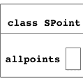
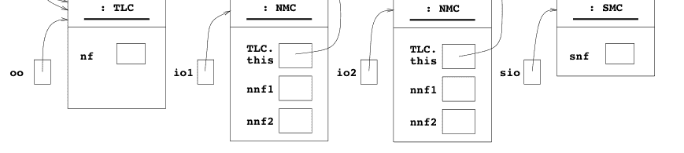
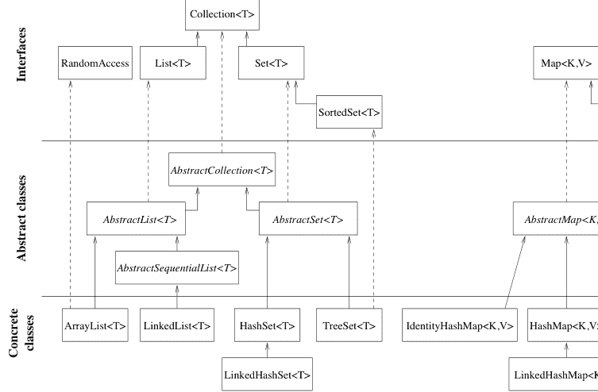

# Java 精准编程（第三版）（MIT Press）

- 27.1 类型的反射式使用: `Class<T>` 类 ................ 172
- 27.3 反射: `Method` 类和 `Constructor<T>` 类 ... 174
- 27.4 使用反射时抛出的异常 ................ 174

## 28 元数据注解 ....................................... 176

## 29 Java 8.0 的新特性 ....................................... 178

## 参考文献 ................................................... 190

# 前言

第三版《Java 精要》对 8.0 版本的 Java 编程语言进行了简洁的描述。对于已经通过标准教材学习过（或正在学习）Java 并想要进一步了解的读者来说，这是一本参考指南。

## 示例 1 注

```java
class Comment {
    // 这是一个单行注释；它延伸到行的末尾。
    /* 这是一个界定注释；
       跨越多行。
     */
    int /* 这个界定注释跨越了部分行 */ x = 117;
}
```

## 示例 2 推荐的程序布局样式

出于空间，本书并不总是遵循这种布局样式。

```java
class Layout {
    int x;

    Layout(int x) {
        this.x = x;
    }

    int sum(int y) {
        if (x > 0)
            return x + y;
        else if (x < 0) {
            int res = -x + y;
            return res * 17;
        } else {
            int sum = 0;
            for (int i = 0; i < 10; i++) {
                sum += (y - i) * (y - i);
            }
            return sum;
        }
    }

    static boolean checkdate(int mth, int day) {
        int length;
        switch (mth) {
            case 2:
                length = 28; break;
            case 4: case 6: case 9: case 11:
                length = 30; break;
            case 1: case 3: case 5: case 7: case 8: case 10: case 12:
                length = 31; break;
            default:
                return false;
        }
        return (day >= 1) && (day <= length);
    }
}
```

## 4 类型

## 5 类型

类型是值集合及其对其执行的操作的操作。类型要么是基本类型，要么是引用类型。

### 5.1 基本类型

基本类型是布尔型（`boolean`），要么是 `char`、`byte`、`short`、`int`、`long`、`float` 或 `double` 等数值类型之一。基本类型的示例，如字面量（即常量）、位大小（8 位等于 1 字节）和值范围，如表所示。为了可读性，数字常量可以在第一个和最后一个字符之外的任何地方包含下划线（`_`）。

整数类型在其范围内是精确的。它们使用有符号补码表示（`char` 除外，因此当一个类型中最大的正数为 `max` 时，则最负值为 `-max`）。浮点类型是不精确的，并遵循 IEEE754 标准，有效数字由表中的 "sigdig" 表示。对于字符转义序列（如 `\u0000`），请参阅第 10 页。

### 5.2 引用类型

引用类型是由类声明（第 9.1 节）定义的类类型、或由接口声明（第 13.1 节）定义的接口类型、或数组类型（第 5.3 节）、或枚举类型（第 14 章）。

引用类型的值是 `null` 或指向对象或数组的引用。特殊值 `null` 表示“无对象”。表示空值的字面量可以是任何引用类型。

### 5.3 数组类型

数组类型的格式为 `t[]`，其中 `t` 是类型。数组类型 `t[]` 是引用类型。因此，数组 `t[]` 的值要么是 `null`，要么指向数组的引用，该数组的元素精确为 `t`（当 `t` 是基本类型时），或者是 `t` 的子类型（当 `t` 是引用类型时）。

### 5.4 装箱：将基本类型包装为引用类型

对于每个基本类型，都有对应的包装类，该包装类是引用类型。包装类列于对应的表中。包装对象包含一个对应基本类型的单一值。

当基本类型的值传递给期望引用的方法时，或者存储在引用类型的变量或字段中，会使用包装类。例如，为了在集合（第 22 节）中存储一个 `int`，必须将其包装为 `Integer`。

从基本类型到引用类型的转换称为装箱（boxing），相反称为拆箱（unboxing）。在需要时会自动执行装箱和拆箱。可以使用 `Integer(i)` 来装箱整数 `i`，使用 `i.intValue()` 来拆箱 `i`。如果 `i` 为 `null`，则 `i` 的拆箱将导致 `NullPointerException`。由于自动拆箱，`Boolean` 类型值可以在条件语句（`if`、`for`、`while`）和逻辑运算符（`!=`、`?`）以及 `switch` 语句中使用。`Integer` 包装类可以拆箱为 `int` 或 `long`，因为 `long` 是 `int` 的子类型，但不是 `byte`、`char` 或 `short`。`Byte`、`Integer`、`Long`、`Float` 和 `Double` 有共同父类 `Number`。

#### 基本类型

| 类型 | 种类 | 示例字面量 | 大小 | 包装类 |
|---|---|---|---|---|
| `boolean` | 逻辑 | `false`, `true` | 1 | `Boolean` |
| `char` | 整数 | `' '`, `'A'`, ... | 16 | `\u0000`...\`\uFFFF` (无符号) | `Character` |
| `byte` | 整数 | `0`, `-1`, `127`, ... | 8 | max = 127 | `Byte` |
| `short` | 整数 | `0`, `-1`, `217`, ... | 16 | max = 32767 | `Short` |
| `int` | 整数 | `0`, `-1`, `217`, ... | 32 | max = 2147483647 | `Integer` |
| `long` | 整数 | `0L`, `-1L`, `217L`, ... | 64 | max = 9223372036854775807 | `Long` |
| `float` | 浮点 | `-1.0f`, `0.49f`, `-32f`, ... | 32 | ±10⁸ sigdig 7 | `Float` |
| `double` | 浮点 | `-1.0`, `0.49`, `-32`, ... | 64 | ±10³⁸ sigdig 16 | `Double` |

**整数字面量** 整数字面量（`short`、`int` 或 `long` 类型）可以使用以下进制编写：

| 表示法 | 进制 | 区别 | 示例字面量 |
|---|---|---|---|
| 十进制 | 10 | 无前缀 | `1234567`,... |
| 二进制 | 2 | `0b` | `0b011111111` |
| 八进制 | 8 | `0` | `01234567`,`077` |
| 十六进制 | 16 | `0x` | `0xDEF_0123`,`7F` |

### 示例 3 装箱和拆箱

```java
Boolean bb = false, bb2 = !bb; // 拆箱为 [false]
Integer bil = 217; // 拆箱为 [217]
Double db = 1.2; // 拆箱为 [1.2]
Boolean b1 = bb; // 拆箱，结果为 false
if (bb) {
    System.out.println("Not true"); // 拆箱，结果为 false
    int il = bil + 2; // short = bil; // 非法
    long l = bil; // 合法：int 是 long 的子类型
    Integer i2 = bil + 2; // 装箱 [19]
}
Integer[] arr = { 2, 3, 5, 7 };
int sum = 0;
for (Integer bi : arr) { // 循环体内拆箱
    sum += bi; // 头部拆箱
}
int i3 = 1934;
Integer bi4 = bi + 5; // 打印 true false; bi4==bi5 是引用比较：
System.out.format("%b %b %b\n", i, bi4, bi4 == bi5);
Boolean bnn = null;
boolean bn = bnn; // 编译通过，运行时失败
Integer bin = null;
Integer bi6 = bin + 2; // 编译通过，运行时失败
```

## 6 类型

### 5.5 子类型和兼容性

`t1` 可能是类型 `t2` 的子类型，在这种情况下 `t2` 是 `t1` 的超类型。直观上，这意味着在期望 `t2` 类型值的地方可以使用 `t1` 的任何值。当 `t1` 和 `t2` 是引用类型时，`t1` 必须至少提供 `t2` 提供的功能（方法和字段）。特别是，`t1` 的任何值都可以绑定到类型为 `t2` 的变量或参数 `x2`，例如通过赋值 `x2 = vl` 或参数传递。我们还说类型 `t1` 和 `t2` 是兼容的。以下规则决定了类型 `t1` 何时是类型 `t2` 的子类型：

- 每一个类型都是其自身的子类型。
- 如果 `t1` 是 `t2` 的子类型，且 `t2` 是 `t3` 的子类型，那么 `t1` 是 `t3` 的子类型。
- 如果 `t1` 和 `t2` 是基本类型，根据选项，从 `t1` 到 `t2` 有宽转换 (W 或 L)。
- 如果 `t1` 和 `t2` 是类，那么如果 `t1` 是 `t2` 的子类，`t1` 是 `t2` 的子类型。
- 如果 `t1` 和 `t2` 是接口，那么如果 `t1` 实现 `t2`，`t1` 是子类型。
- 如果 `t1` 是类且 `t2` 是接口，那么如果 `t1` 实现 `t2`，`t1` 是 `t2` 的子类型。
- 数组 `t1[]` 是 `t2[]` 的子类型，如果引用类型 `t1` 是引用类型 `t2` 的子类型。
- 任何引用类型（包括任何数组）也是预定义类 `Object` 的子类型。

没有基本类型是引用类型，引用类型也不是基本类型。基本类型与其包装类之间存在自动装箱和拆箱转换；参见 5.4 节。

### 5.6 签名和包含

签名具有 `m(t1, ..., tn)`，其中 `m` 是方法或构造函数名称，`(t1, ..., tn)` 是非泛型类型列表；参见第 36 节。

我们说签名 `sig = m(t1, ..., tn)` 包含签名 `sig' = m(u1, ..., un)`，如果每个 `ui` 都是 `ti` 的子类型。我们还说 `sig` 比 `sig'` 更具体。注意名称 `m` 和类型数量 `n` 在两个签名中必须相同。每个类型 `t` 都是自身的子类型，每个签名都包含自身。签名集合可能包含一个被所有其他包含的签名；这样的签名被称为最具体的签名。

### 5.7 类型转换

类型转换将值从一种类型转换为另一种类型。宽转换从一种类型转换为超类型（或类型本身）。窄转换从一种类型转换为另一种类型。窄转换需要显式类型转换（第 11.11 节），在赋值 `x = e` 或 `e` 为编译时整数常量的初始化（第 11.5 节）中。

基本类型之间的合法转换如表所示。`boolean` 类型不能转换为任何其他基本类型。基本类型之间的类型转换永远不会在运行时失败。

# 类型 7

基本类型之间的转换

字母 `C` 表示需要强制类型转换 `(t)` 的收窄转换；见第 11.11 节；`W` 表示保留值的宽化转换；`L` 表示可能导致精度丢失的宽化转换。整数的收窄转换会丢弃无法在较小整数类型中表示的（最高位）位。从整数到浮点类型（`float` 或 `double`）的转换会产生该整数值的浮点近似值。从浮点类型到整数类型的转换会丢弃数字的小数部分；即，向零舍入。当将较大的浮点数转换为 `long` `int` 时，结果是最佳近似（即该类型可表示的最大正数或最小负数）；转换为 `byte`、`short` 或 `char` 是通过先转换为 `int` 再转换为请求的类型完成的。

| 源类型 | `char` | `byte` | `short` | `int` | `float` | `double` |
|---|---|---|---|---|---|---|
| `char` | `W` | `C` | `W` | `W` | `W` | `W` |
| `byte` | | `W` | `W` | `W` | `W` | |
| `short` | | | `W` | `W` | `W` | |
| `int` | | | | `W` | `L` | |
| `long` | | | | | `L` | `L` |
| `float` | | | | | | |
| `double` | | | | | | |

**示例 4** 基本类型之间的转换

此示例展示了到 `float` 和 `double` 的 (L) 和无损 (W) 宽化转换，以及从 `int` 和 `double` 的收窄转换 (C)。示例 51 显示了以下中的基本类型赋值：

```java
private static void floatdouble(float f, double d)
{ System.out.println("" + f + " " + d); }
private static void byteshort(byte b, char c, short s)
{ System.out.println("" + b + " " + c + " " + s); }
private static void intint(int i1, int i2)
{ System.out.println("" + i1 + " " + i2); }

int i1 = 1000111222, i2 = 40000, i3 = -1;
floatdouble(i1, i2); // L W: 1.00011123E9 1.00011122E9
byteshort((byte)i2, (char)i2, (short)i2); // C C: 64 40000 -25536
byteshort((byte)i3, (char)i3, (short)i3); // C C C: -65535 -1
intint((int)1.9, (int)-1.9); // C C: 1 -1
intint((int)1.5, (int)-1.5); // C C: 1 -1
intint((int)2.5, (int)-2.5); // C C: 2 -2
```

**示例 5** 方法协变签名

- `m(double,double)` 包含自身以及 `m(double,int)` 和 `m(int,double)` 和 `m(int,int)`。
- `m(double,int)` 包含自身以及 `m(int,int)`。
- `m(int,double)` 包含自身以及 `m(int,int)`。
- `m(double,int)` 不包含 `m(int,double)`，反之亦然。
- 集合 `m(double,int), m(int,int)` 具有最具体的签名 `m(int,int)`。
- 集合 `m(double,int), m(int,double)` 没有特定的签名。

# 6 变量、参数、字段和作用域

变量在方法、构造函数、初始化块或块语句（第 12.2 节）内部声明。该变量只能在该语句（或方法、构造函数或初始化块）中使用，且只能在它的声明后使用。

参数是一种特殊的变量：它在方法或构造函数的参数列表中被声明，并在调用方法或构造函数时赋予一个值。参数只能在该方法或构造函数中使用。

字段在类内部声明，但不在类的方法、构造函数或初始化块内部。它可以在类的任何地方使用，但在声明之前除外。

## 6.1 变量、参数和字段的边界

基本类型的变量、参数或字段持有该类型的值，例如布尔 `false`、整数 `17` 或浮点数 `1.7`。引用类型 `t` 的变量、参数或字段具有特殊值 `null` 或持有指向对象或数组的引用。如果是对象，则该对象的运行时类必须是 `t` 或 `t` 的子类。

## 6.2 变量声明

变量的目的是在块语句（或方法或构造函数块）执行期间持有一个值。变量声明具有以下形式之一：

```
variable-modifier type name1, name2, ... ;
variable-modifier type name1 = initializer1, ... ;
```

变量可以是 `final` 或不存在。如果一个变量被声明为 `final`，那么它在运行时最多初始化或赋值一次（如果被使用，则恰好一次）：它是一个命名常量。如果变量具有引用类型，则变量指向的对象或数组可以被变量修改。变量初始化器可以是数组初始化器（第 8.2 节）。

执行变量声明将为变量预留空间，评估初始化器（如果有），并将结果存储在变量中。与字段不同，变量不会在声明时赋予默认值。

## 6.3 变量、参数和字段的作用域

变量在语句（或方法、构造函数）内部的作用域从其声明开始到该语句结束。一个变量在方法或构造函数的作用域从其声明开始到该方法或构造函数结束。一个变量在块的作用域从其声明开始到该块结束。一个字段在类的作用域从其声明开始到类结束。

```java
class A {
    int x;
    void m() {
        int y;
        if (true) {
            int z;
        }
    }
}
```

变量的作用域从其声明开始到其所在的语句结束。参数的作用域从其声明开始到该方法或构造函数结束。字段的作用域从其声明开始到该类结束。


```java
class A {
    int x;
    void m(int y) {
        if (true) {
            int z;
        }
    }
}
```

## 6 变量声明

```java
class A {
    int x = 10;
    int y = 20, z = 30;
    void m() {
        int x = 40;
        if (true) {
            int y = 50;
        }
    }
}
```

`final` 命名常量。

```java
class A {
    static final int x = 10;
    void m() {
        final int y = 40;
    }
}
```

初始化器。

```java
class A {
    int x = 10;
    void m() {
        int y = 20;
    }
}
```

数组初始化器。

```java
class A {
    int[] x = {1, 2, 3};
}
```

# 10 字符串

`String` 是一个对象，它是不可变的：一旦创建就无法更改。字符串字面量是双引号内的字符序列：内部使用 Unicode 编码。字符串可以使用转义序列：

| 转义码 | 含义 |
|---|---|
| `\b` | 退格 |
| `\t` | 水平制符 |
| `\n` | 换行 |
| `\f` | 换页 |
| `\r` | 回车 |
| `\"` | 双引号 |
| `\'` | 单引号 |
| `\\` | 反斜杠 |
| `\ddd` | 三位进制数 |
| `\uuuu` | 四位十六进制数 |

转义序列表示单个字符。`A` 有 65（十进制），101（八进制），41（十六进制），01000001（二进制）。

```java
String s = "A";
String s2 = "B\t";
String s3 = "C\n";
String s4 = "D\r";
String s5 = "E\u0045";
```

## String 方法

`String` 是一个字符的序列。如果 `sl` 和 `s2` 是任意类型的表达式，那么：

- `sl.length()` 返回类型 `int` 是 `sl` 的长度，即 `sl` 中字符的数量。
- `sl.equals(s2)` 返回类型 `boolean`，如果 `sl` 和 `s2` 包含相同的字符序列则为 `true`，否则为 `false`；`equalsIgnoreCase` 类似，但不区分大小写。
- `sl.charAt(i)` 返回类型 `char` 是 `sl` 中位置 `i` 的字符，从 0 开始计数。如果索引 `i` 小于 0 或大于 `sl.length()` 将抛出 `IndexOutOfBoundsException`。
- `sl.toString()` 返回类型 `String` 与 `sl` 是同一个对象。
- `String.valueOf(v)` 返回 `v` 的字符串表示，`v` 可以是任何基本类型（5.1）或引用类型。当 `v` 是引用类型且不为 `null` 时，则将其转换为 `v.toString()`；如果 `v` 为 `null`，则转换为字符串 `"null"`。任何类 `C` 继承自 `Object`，默认 `toString` 会产生形式为 `C2a534` 的字符串，其中 `2ea534` 是某些内存地址，可以重写以产生更有用的字符串。
- `sl + s2` 的含义等同于 `sl.concat(s2)`;它构造 `sl` 和 `s2` 的拼接，一个由 `sl` 的字符后接 `s2` 的字符组成的 `String`。`sl + v` 和 `v + sl` 都会通过将 `v` 转换为 `String.valueOf(v)` 来评估，然后当 `v` 是引用类型时，再比较生成的字符串。
- `sl.compareTo(s2)` 返回一个负或正整数，表示 `sl` 在 Unicode 字符编码的字典顺序在前、相等还是之后。如果 `sl` 或 `s2` 为 `null`，则抛出 `NullPointerException`。`compareToIgnoreCase` 类似，但不区分大小写情况。
- `sl.substring(int i, int j)` 返回来自 `sl` 的索引为 `i..(j-1)` 的字符的新 `String`。
- `sl.subSequence(int i, int j)` 类似于 `substring` 但返回 `CharSequence`（节 26.7）。
- 更多 `String` 方法在 Java 类文档 [2] 中描述。

## 示例 8 字符串的相等与 (+) 运算符的微妙之处

```java
String s1 = "abc";
String s2 = "abc"; // 新对象，但包含与 s1 相同的文本
String s3 = s1; // 与 s1 相同的对象
String s4 = s1.toString(); // 与 s1 相同的对象
```

// 以下语句将打印 false, true, true, true;

```java
System.out.println("s1 and s2 identical objects: " + (s1 == s2));
System.out.println("s1 and s3 identical objects: " + (s1 == s3));
System.out.println("s1 and s4 identical objects: " + (s1 == s4));
System.out.println("s1 and s2 same text: " + (s1.equals(s2)));
System.out.println("s1 and s3 same text: " + (s1.equals(s3)));
```

// 这两个语句输出 35 和 A1025，因为 (+) 是左结合的：

```java
System.out.println((10 + 25 + "A")); // 等同于 (10 + 25) + "A"
System.out.println("A" + 10 + 25); // 等同于 ("A" + 10) + 25
```

## 示例 9 拼接命令行参数

在拼接字符串时，请使用 string builder（第 19 章和第 104 章）。

```java
public static void main(String[] args) {
    String res = "";
    for (int i=0; i<args.length; i++)
        res += args[i];
    System.out.println(res);
}
```

## 示例 10 统计字符串中的 e 数

```java
static int ecount(String s) {
    int ecount = 0;
    for (int i=0; i<s.length(); i++)
        if (s.charAt(i) == 'e')
            ecount++;
    return ecount;
}
```

## 示例 11 判断字符串是否按字典序递增排列

```java
static boolean sorted(String[] a) {
    for (int i=1; i<a.length; i++)
        if (a[i-1].compareTo(a[i]) > 0)
            return false;
    return true;
}
```

## 示例 12 使用声明了 toString 方法的类

`Point` 类（示例 27）声明了一个 `toString` 方法，返回返回坐标的字符串。运算符 `(+)` 会隐式地调用 `toString` 方法来格式化 `Point` 对象。

```java
Point p1 = new Point(10, 20), Point p2 = new Point(30, 40);
System.out.println("p1 is " + p1); // 输出: p1 is (10, 20)
System.out.println("p2 is " + p2); // 输出: p2 is (30, 40)
p2.move(7, 7);
System.out.println("p2 is " + p2); // 输出: p2 is (37, 47)
```

# 12 字符串

## 7.1 字符串格式化

数字、字符、日期、时间和其他数据的格式化可以使用包含格式化占位符的格式化字符串 `fmt` 完成，使用以下方法之一：

- `String.format(fmt, vl, ..., vn)` 返回一个由 `fmt` 产生的字符串，其是将格式化占位符替换为值 `vl, ..., vn` 格式化后的字符串。
- `strm.format(fmt, vl, ..., vn)`，其中 `strm` 是一个 `PrintWriter` 或 `PrintStream`，从上述构造字符串，将其输出到 `strm` 并返回 `strm`。
- `strm.printf(fmt, vl, ..., vn)` 的行为与 `strm.format(fmt, vl, ..., vn)` 完全相同。

这些方法存在一个接受 `Locale` 作为第一个参数的版本；参见第 16 和第 17 页。格式化占位符在 7.1.1 和 7.1.2 节中描述。如果值的类型错误或格式化占位符格式错误，调用这些方法将抛出 `IllegalFormatException` 类或其子类的异常。

### 7.1.1 数字、字符和通用类型的格式化

数字、字符和通用类型的格式化占位符具有如下形式：

```
%[$index] [flags][.precision]
```

索引是 1, 2, ..., 表示要格式化的值 `Vn`；转换表示使用什么操作来格式化该值；宽度表示格式化该值时使用的最小字符数；标志表示应使用哪侧（其中 "-" 表示左对齐，或在右侧填充，"0" 表示用零填充）；精度限制输出的位数，即小数部分的位数。括号 `[]` 中的四个部分均是可选的：唯一的修饰符是百分号 (`%`) 和转换。关于 `utilFormatter` 上 Java API 类转换的文档提供了数字格式化的完整详细信息。下表显示了类转换（I = 整数，F = 浮点，IF = 两者）；字符（C），以及通用类型（G）。大写转换 `X` 会产生大写输出。

| 格式 | 转换 | 标志 | 精度 | 类型 |
| --- | --- | --- | --- | --- |
| 十进制 | d | | | I |
| 八进制 | | #0 | | |
| 十六进制 | x or X | | | F |
| 十六进制系数和指数 | a or A | | +#0 | F |
| 通用：科学或小数 | g or G | | +#0, | 最大位数 | IF |
| 固定点数字 | f | | +#0, | 小数位数 | IF |
| 科学计数法 | | | +#0, | 小数位数 | |
| Unicode 字符 | c or C | | | C |
| 布尔："true" 或 "false" | b or B | | | |
| 十六进制值或 "null" | h or H | | | G |
| 由值格式化 | s or S | | | G |
| 平台特定 | n | | (none) | |

## 示例 13 使用 String.format 对齐字符串

代码 `%s` 开始每个字符串的格式化

```java
String res = String.format("%1s%-7s", "os");
```

## 示例 14 使用 out.format 对齐数字

三行 0-999 范围内的数字，格式化 `%4d` 使用四个字符的字段右对齐；`%n` 表示换行。

```java
Random rand = new Random();
for (int i=0; i<3; i++) {
    for (int j=0; j<5; j++) {
        System.out.format("%4d", rand.nextInt(1000)); // 0..999
        System.out.format("%n"); // 换行
    }
}
```

## 一些占位符及其影响

| 数字 | %d | %+d | %8d | %08d | %d |
| --- | --- | --- | --- | --- | --- |
| 0 | 0 | +0 | 00000000 | 0 |
| 255 | 255 | +255 |     255 | 00000255 | 255 |
| -255 | -255 | -255 |    -255 | -00000255 | -255 |
| 125062 | 125062 | +125062 | 125062 | 01250062 | 125062 |

| 数字 | %+1d | %d | %#x | %#X | %t | %#o |
| --- | --- | --- | --- | --- | --- | --- |
| 0 | +0 | 0 | 0 | 0 | 0 | 0 |
| 255 | +255 | 255 | ff | FF | 3 | 377 |
| -255 | -255 | -255 | -ff | -FF | -1 | -377 |
| 125062 | +125062 | 125062 | 1e4 | 1E4 | 374 | 364432 |

| 数字 | %f | %.2f | %7.2f | %07.2f | %7.0f | %4g | %4e |
| --- | --- | --- | --- | --- | --- | --- | --- |
| 0.0 | 0.000000 | 0.00 | 0.00 | 000.000 | 0 | 0.0 | 0.0000e+00 |
| 0.1 | 0.100000 | 0.10 | 0.10 | 000.100 | 0.1 | 0.1 | 1.00000e-01 |
| 1.0 | 1.000000 | 1.00 | 1.00 | 001.000 | 1 | 1.0 | 1.00000e+00 |
| 1.5 | 1.500000 | 1.50 | 1.50 | 001.500 | 1.5 | 1.5 | 1.50000e+00 |
| -1.5 | -1.500000 | -1.50 | -1.50 | -001.500 | -2 | -1.5 | -1.50000e+00 |
| 330.8 | 330.800000 | 330.80 | 330.80 | 030.800 | 331 | 331 | 3.30800e+02 |
| 1234.516 | 1234.516000 | 1234.52 | 1234.52 | 1234.520 | 1234 | 1.235 | 1.2345e+03 |

### 7.1.2 格式化日期和时间

日期和时间的格式化占位符具有如下形式：

```
%[index$] [flag] [width] conversion
```

索引和宽度与 7.1.1 节相同。唯一的标志 "-" 会导致左对齐（在右侧填充），与宽度字段结合。合法的转换所示：

| 格式 | 转换 | 示例 |
| --- | --- | --- |
| 24小时制，两位 | tH | 21 |
| 12小时制，两位 | tI | 09 |
| 24小时制，一位或两位 | tk | 21 |
| 12小时制，一位或两位 | tL | 9 |
| 小时内的分钟，两位 | tM | 06 |
| 分钟内的秒，两位 | tS | 07 |
| 秒内的毫秒，三位 | tL | 870 |
| 秒内的纳秒，九位 | tN | 870000000 |
| 上午/下午，小写 | tq | pm |
| 上午/下午，大写 | tP | PM |
| UTC数值偏移（东部为正） | tz | +0100 |
| 时区缩写 | tZ | CET |
| 自纪元以来的秒（1970-01-01 00:00:00 UTC） | ts | 1078517167 |
| 自纪元以来的毫秒 | tQ | 10785171680 |
| 本地完整月份 | tB | March |
| 本地缩写月份 | tb | Mar |
| 本地完整星期几 | tA | Friday |
| 本地缩写星期几 | tF | Fri |
| 世纪（年份除以100） | tC | 20 |
| 年份，四位 | tY | 2004 |
| 年份，后两位 | ty | 04 |
| 年内天数，三位 | tj | 065 |
| 月份数字，两位 | tm | 03 |
| 月内日期，两位 | td | 05 |
| 月内日期，一位或两位 | te | 5 |
| 时间（小时、分钟） | tR | 21:06 |
| 时间（小时、秒） | tT | 21:06:07 |

此示例打印了 2004-09-14 12:09；在 Java 的 `GregorianCalendar` 类中，月份从 0 开始计数。

```java
GregorianCalendar date = new GregorianCalendar(2004, 8, 14, 12, 9, 28);
System.out.format("%$tF %$tT%n", date);
```

# 示例 16 特定区域的时间格式化

日期和时间的格式通常取决于区域（locale）：语言和国家。例如，格式 spec符 `%tc` 就是如此情况。区域位于 `java.util` 包中。


```
Date now = new Date();                               // 默认区域
System.out.format("%$tc%n", now);                          // en_US 区域
System.out.format(Locale.US, "%$tc%n", now);                  // en_DE 区域
System.out.format(Locale.GERMANY, "%$tc%n", now);          // de_DE 区域
```

# 示例 17 特定区域的数字格式化

数字格式对区域敏感：不同的语言使用不同的进制分隔符（点或逗号）。例如，此示例使用了 1,234,567.90 和 1.234.567,90，其中后者数字中的空格是不换行空格（Latin 1 字符 `'\u00A0'`）。

```
double d = 1234567.9;
System.out.format(Locale.US, "%$2fn%n", d);                    // en_US 区域
System.out.format(Locale.GERMANY, "%$2fn%n", d);          // de_DE 区域
System.out.format(Locale.FRANCE, "%$2fn%n", d);               // fr_FR 区域
```

# 一些日期时间 spec 符及其影响

不同的语言和国家在编写日期方面有不同的传统，这要求 `String.format` 使用不同的格式 spec 符。通常，区域机制不足以编写特定区域的日期，除非使用 `%tc` 格式 spec 符。为了避免误解，请提供年份的四位数字，并格式化为 03/05/04，这可能会有美国和英国的解释。

| spec 符 | 结果 | 区域 | 使用 |
| --- | --- | --- | --- |
| `%tc` | Fri Mar 05 21:06:07 CET 2004 | en_US | 美国 |
| `%tc` | Fri Mar 05 21:06:07 CET 2004 | en_DE | 德国 |
| `%tc` | ven. mars 05 21:06:07 CET 2004 | fr_FR | 法国 |
| `%$tD` | 03/05/04 | en_US | 美国 |
| `%$tm/%$td/%$tY` | 03/05/04 09:06 PM | en_US | 美国 |
| `%$tm/%$td/%$tY:%$tI:%$tM:%$tS` | 03/05/2004 21:06 | en_US | 德国 |
| `%$td/%$tm/%$tY` | 05/03/2004 | en_UK | 英国 |
| `%$tB-$$td` | Mar-05 | en_US | 美国UK |
| `%$t1B,$te,$$tY` | March 5, 2004 | en_US | 美国 |
| `%$t1A %te %t1B %$tY` | Friday, 5 March 2004 | en_US | 美国 |
| `%$t1A,%t1B %$tY` | Friday, 5 March 2004 | en_UK | 英国 |
| `%$te.$t1B %$tY` | 5. März 2004 | en_DE | 德国 |
| `%$t1A %te %t1B %$tY` | Freitag, 5. März 2004 | en_DE | 德国 |
| `%$tFT$tT` | 2004-03-05T21:06:07 | en_US | RFC3339 |

# 数组

数组是索引的变量集合，称为元素。数组具有给定的长度 $l \ge 0$ 和给定的类型 $t$。通过整数 $0, 1, ..., l-1$ 进行索引。表达式 $u[i]$ 的值是 `null` 或指向数组 $u$ 的引用。如果 $u$ 是基本类型，则 $t$ 必须匹配 $u$。

## 数组创建与访问

长度为 $l$ 类型为 $t$ 的新数组通过数组创建表达式创建（分配）：

```
new t[l]
```

$l$ 是 `int` 类型的表达式。如果 $t$ 是基本类型，新数组的所有元素初始化为 0（当 $t$ 为 `byte`、`char`、`short`、`int` 或 `long` 时）、0.0（当 $t$ 为 `float` 或 `double` 时）或 false（当 $t$ 为 `boolean` 时）。如果 $t$ 是引用类型，所有元素初始化为 null。如果 $l$ 为负数，则抛出 `NegativeArraySizeException`。让 $a$ 为类型类型的引用数组，那么：

- 长度为 $l$ 是 $a$ 的元素数量，从 0 开始计数的整数 $i$；数组访问 $a[i]$ 表示元素 $i$；如果 $i$ 的值小于 0 或大于 $l$，则抛出 `ArrayIndexOutOfBoundsException`。
- 当 $t$ 是引用类型时，每次数组赋值 $a[i]$ 都会检查 $i$ 是否为类型 $t$ 的子类。如果不是，则抛出 `ArrayStoreException`。

## 数组初始化

变量或字段数组可以在声明时初始化，使用现有数组或初始化器 `{}`。

```
t[] x = { expression ..., expression }
```

每个表达式的类型必须是 $t$ 的子类。初始化器的评估会导致一个长度等于表达式数量的数组从左到右被评估，它们的值存储在数组中，最后数组绑定到 $x$。因此，$x$ 在评估时无法出现。初始化器也可以与数组创建结合使用：

```
new t[] { expression ..., expression }
```

多维数组可以具有嵌套初始化器（示例 2）。注意没有常量：每次评估初始化器都会创建一个不同的数组。

# 示例 18 创建和使用一维数组

此示例的前部分掷骰子 1000 次，然后打印频率。后部分创建并初始化一个 String 数组。

```
int[] freq = new int[6]; // 全部初始化为0
for (int i=0; i<1000; i++) { // 掷骰子，计数频率
    int die = (int)(i + 6 * Math.random());
    freq[die-1]--;
}
for (int c=1; c<6; c++) { // 出现了 " + freq[c-1] + " 次
    System.out.println(c + " times");
}
```

```
String[] number = new String[20]; // 创建空数组
for (int i=0; i<number.length; i++) // 用 "A0", ..., "A19" 填充字符串
    number[i] = "A" + i;
for (int i=0; i<number.length; i++) // 打印字符串
    System.out.println(number[i]);
```

## 示例 19 运行时数组赋值检查

此程序可以编译，但在运行时 $a[2]=d$ 会抛出 `ArrayStoreException`，因为绑定到 $d$ 的对象的类（`Double`）不是 $a$ 类型（`Integer`）的子类。

```
Integer[] a = new Integer[10]; // 长度10，元素类型 Integer
Double d = new Double(3.14); // 类型 Double，类 Double
Integer i = new Integer(11); // 类型 Integer，类 Integer
Integer n = i; // 类 Integer
a[0] = i; // OK，Integer 是 Integer 的子类
a[1] = n; // OK，Integer 是 Integer 的子类
a[2] = d; // 不，Double 不是 Integer 的子类
```

## 示例 20 使用初始化的数组

方法 `check` 的类似于示例 2 中的 `checkdate`。数组应该在方法外部声明，如所示，否则每次调用该方法都会创建一个不同的数组。

```
static int[] days = { 31, 28, 31, 30, 31, 30, 31, 31, 30, 31, 31 };
boolean checkdate(int month, int day){
 return (month > 0) && (month <= 12);
}
```

## 示例 22 创建多维数组

考虑这个 3x2 的矩形数组和这个二维“锯齿形”（下三角）数组：

```
0.0 0.0 0.0
0.0 0.0
0.0 0.0 0.0 0.0
```

以下程序展示了两种方法 (r1, r2) 创建矩形数组，以及三种方法 (t1, t2, t3) 创建“锯齿形”数组：

```
double[][] r1 = new double[3][2];
double[] r2 = new double[3];
for (int i=0; i<3; i++)
    r2[i] = new double[2];

double[][] t1 = new double[3][];
for (int i=0; i<3; i++)
    t1[i] = new double[i+1];
double[][] t2 = { { 0.0 }, { 0.0, 0.0 }, { 0.0, 0.0, 0.0 } };
double[][] t3 = new double[][] { { 0.0, 0.0, 0.0, 0.0 }, { 0.0, 0.0, 0.0 } };
```

## 示例 23 使用多维数组

生物体的遗传物质存在于 DNA 中，概念上是一个由 A、C、G、T 碱基酸组成的字符串 AGCTCTTCA。三个核苷酸组成一个密码子：一种氨基酸的代码。该程序使用三维数组 `freq` 统计 4-4-4 密码子的频率。辅助数组 `fromNuc` 将核苷酸字母转换为 `freq` 中使用的索引 (0,1,2,3)。数组 `toNuc` 在打印频率时将索引转换回核苷酸字母。

```java
static void countFreq(String s) {
    int[] fromNuc = new int[128];
    for (int i=0; i<fromNuc.length; i++)
        fromNuc[i] = -1;
    fromNuc['a'] = 0; fromNuc['c'] = 1; fromNuc['g'] = 2; fromNuc['t'] = 3;
    int[][][] freq = new int[4][4][4];
    for (int i=0; i<s.length()-2; i+=3) {
        int n1 = fromNuc[s.charAt(i)];
        int n2 = fromNuc[s.charAt(i+1)];
        int n3 = fromNuc[s.charAt(i+2)];
        freq[n1][n2][n3]++;
    }
    char[] toNuc = { 'A', 'C', 'G', 'T' };
    for (int i=0; i<4; i++) {
        for (int j=0; j<4; j++) {
            for (int k=0; k<4; k++) {
                System.out.print("*" + toNuc[i]+toNuc[j]+toNuc[k]+": " + freq[i][j][k] + " ");
            }
            System.out.println();
        }
    }
}
```

# 数组工具类 `Arrays` 方法

工具类 `Arrays` 的方法继续：

- `static <T> void parallelPrefix(T[] a, BinaryOperator<T> op)` 使用运算符 `op` 对数组执行并行前缀操作，通过计算新值 `anew[i]` 并随后将结果赋值给 `a` 的元素。新值 `anew[0]` 为 `a[0]`。对于 `i>0`，新值 `anew[i]` 是 `op.apply(anew[i-1],a[i])` 的结果，按某种顺序执行，并且可能是并行的。该操作仅在 `op` 结合律且稳定的情况下才有意义；参见第 23.1 节。
- `static <T> void parallelPrefix(T[] array, int from, int to, BinaryOperator<T> op)` 执行上述的并行前缀操作，但针对子数组 `array[from..(to-1)]` 使用 `op`。
- 这两个方法也对 `double[]`、`int[]` 和 `long[]` 进行了重载，接受类型为 `Double`、`Int`、`Long` 的 `BinaryOperator` 参数。
- `static <T> void parallelSetAll(T[] a, IntFunction<T> f)` 并行初始化所有指定的数组，通过 `f.apply(i)` 计算 `element[i]`。
- 对 `double[]`、`int[]` 和 `long[]` 重载，接受类型为 `IntToDoubleFunction`、`IntUnaryOperator` 和 `IntToLongFunction` 的 `f` 参数。
- `static <T> void parallelSort(T[] a)` 使用并行排序将数组按数值顺序排序。
- `static <T> void parallelSort(byte[] a, int from, int to)` 将 `array[from..(to-1)]` 按数值升序排序。
- `static <T extends Comparable<T>> void parallelSort(T[] a)` 根据其元素的自然顺序将数组按升序排序。
- `static <T extends Comparable<T>> void parallelSort(T[] a, int from, int to)` 根据其元素的自然顺序将子数组 `subarray[from..(to-1)]` 按升序排序。
- `static <T> void parallelSort(T[] a, int from, int to, Comparator<? super T> cmp)` 按 `cmp` 指定的顺序对 `array[from..(to-1)]` 排序。
- `static <T> void sort(byte[] a)` 使用快速排序排序数组，快速排序不是稳定的。
- `static <T> void sort(Object[] a)` 使用归并排序排序数组，前面的元素使用第 22.9 节的方法比较。
- `static <T> void sort(T[] a, Comparator<? extends T> cmp)` 工作方式与上方法，但元素使用第 22.9 节的方法比较。
- `static <T> void sort(byte[] a, int from, int to)` 排序 `a[from..(to-1)]`。
- `static <T> sort(Stream<T> stream)` 返回一个包含 `a` 元素的顺序流。
- `static <T> sort(Stream<T> stream, T[] array, int from, int to)` 返回一个包含 `subarray[from..(to-1)]` 元素的顺序流。

最后两个方法对 `double[]`、`int[]` 和 `long[]` 进行了重载，产生 `Double` 类型的流。

## 示例 24 数组的排序与并行排序

一个包含 `n=500万` 个浮点数的数组可以使用 `Arrays` 方法进行顺序排序或并行排序。在 4 核处理器上，并行排序比顺序排序快四倍。示例中的数组元素在 `[-1,1]` 范围内。排序后，可以找到任意相邻元素之间的差异，最大差异为 `2.9823e-8`，这表明500万个数字在 `[0,1]` 中是密集的。

```java
double[] vdc = new Random().toArray();
Arrays.sort(vdc);
double[] vdc = new Random().toArray();
Arrays.parallelSort(vdc);
double min = vdc[0], max = vdc[n-1], maxDiff = 0.0;
for (int i=1; i<n; i++)
    maxDiff = Math.max(maxDiff, vdc[i]-vdc[i-1]);
// min = -1.0; maxDiff = 2.9823e-8;
```

## 示例 25 数组的前缀和：一维随机运动

在范围 `[-1,1]` 的随机数数组上使用 `op=(x,y) -> x+y` 的前缀和将更新每个元素 `a[i]` 为所有前面元素的和。如果向数组填充随机数，就可以找到布朗运动。`op=(x,y) -> x+y` 的前缀和将计算每一步粒子的最大位置。通过使用所有流操作并计算绝对值找到粒子从原点 `(0)` 的距离。

```java
double[] a = new Random().doubles(n, -1.0, 1.0).toArray();
Arrays.parallelPrefix(a, (x,y) -> x+y);
double maxDouble = Arrays.stream(a).map(Math::abs).max().getAsDouble();
```

## 示例 26 数组的前缀和：二维随机运动


我们可以通过定义一个表示二维向量的 `VecD` 类来更改示例25以研究二维随机运动。初始化向量数组（随机步），使用前缀和计算和（每一步结束时的粒子位置），从原点 `(0,0)` 的向量长度并找到最大值，不使用显式循环并使用并行核心。注意 `VecD` 的 `randomUniform` 必须是线程安全的，因为它是 `parallelSetAll`。此外，为了效率，应该使用 `java.util.concurrent.ThreadLocalRandom` 而不是 `java.util.Random` 的实例。

```java
VecD[] a = new VecD[n];
Arrays.parallelSetAll(a, i -> new VecD.randomUniform());
Arrays.parallelPrefix(a, (p1, p2) -> p1.add(p2));
double maxDouble = Arrays.stream(a).mapToDouble(VecD::length).max().getAsDouble();

private static class VecD {
    public final double x, y;
    public double length() { return Math.sqrt(x * x + y * y); }
    public VecD add(VecD that) { return new VecD(this.x + that.x, this.y + that.y); }
    public static VecD randomUniform() { ... }
}
```

# 9 类

## 9.1 类声明与类体

类 `C` 的类声明形式为

```
class-modifiers C extends-clause implements-clause
class-body
```

类 `C` 的声明引入一个新的引用类型 `C`。类体可以包含字段、构造函数、嵌套类、嵌套接口和初始化块的声明。类声明可以带有类型参数和泛型；参见第 21.4 节。类的声明可以任意顺序出现：

```
{
field-declarations
constructor-declarations
method-declarations
class-declarations
interface-declarations
enum-type-declarations
initializer-blocks
}
```

字段、方法、嵌套类、嵌套接口或嵌套类型被称为类的成员。成员可以被声明为 `static`。非静态成员也称为实例成员。

成员的作用范围是整个类体，但在被变量或嵌套类/接口的成员遮蔽的地方除外。（静态）字段的作用范围不包括（静态）初始化器。

我们说的静态代码指的是字段初始化器、静态初始化块和静态方法中的表达式和语句。非静态代码指的是构造函数、非静态字段初始化器、非静态初始化块和非静态方法中的表达式和语句。非静态代码在当前对象内部执行，该对象可以被称为 `this`（第 11.10 节）。静态代码不能引用非静态成员或 `this`，只能引用静态成员。

## 9.3 类修饰

对于顶层类，类修饰可以是 `public` 列表以及最多一个 `abstract` 或 `final`。对于成员类，修饰可以是 `static` 列表、最多一个 `abstract` 或 `final`，以及最多一个 `private`、`protected` 或 `public`。对于局部类，修饰可以是最多一个 `abstract` 或 `final`。

# 类 23

## 示例 27 类声明

`Point` 类被声明有两个非静态字段 `x` 和 `y`，一个构造函数和两个非静态方法。它在示例 12 和 52 中使用。

```java
class Point {
    int x, y;

    Point(int x, int y) { this.x = x; this.y = y; }

    void move(int dx, int dy) { x += dx; y += dy; }

    public String toString() { return ("(" + x + ", " + y + ")"); }
}
```

## 示例 28 带有静态和非静态成员类

`SPoint` 类声明了一个静态字段 `allpoints` 和非静态字段 `x` 和 `y`。每个 `SPoint` 都有自己的 `x` 和 `y` 字段，但所有对象共享 `SPoint` 类中相同的 `allpoints` 字段。

构造函数将新对象（`this`）插入到 `ArrayList` `allpoints` 字段中（第 22.2 节）。非静态方法 `getIndex` 返回该点在数组列表中的索引。静态方法 `getSize` 返回到目前为止创建的 `SPoints` 数量。静态方法 `getPoint` 返回数组列表中的第 `i` 个 `SPoint`。类 `SPoint` 被用在示例 59。

```java
class SPoint {
    static ArrayList<SPoint> allpoints;
    int x, y;

    SPoint(int x, int y) { allpoints.add(this); this.x = x; this.y = y; }
    void move(int dx, int dy) { x += dx; y += dy; }
    public String toString() { return ("(" + x + ", " + y + ")"); }
    int getIndex() { return allpoints.indexOf(this); }
    static int getSize() { return allpoints.size(); }
    static SPoint getPoint(int i) { return allpoints.get(i); }
}
```

## 示例 29 顶层、成员和局部类

另参见示例 42 和 47。

```java
class TLC {
    static class SMC { ... }

    class NMC { ... }

    void nmid() {
        class SLC { ... }
    }

    static void sm() {
        class SLC { ... }
    }
}
```

# 24 类

## 9.4 修饰符 public, final, abstract

如果一个顶层类 `C` 被声明为 `public`，那么它可以在包外部被访问（第 17 章）。

如果一个类 `C` 被声明为 `final`，则不能声明 `C` 的子类，因此不能重写在 `C` 中声明的任何方法。这对于防止恶意的子类违反数据表示的不变性有用。

如果一个类 `C` 被声明为 `abstract`，则它不能被实例化，但 `C` 的非抽象子类可以被实例化。抽象类可以声明构造函数和初始化器，以便在实例化非抽象子类时执行。抽象类可以声明抽象方法和非抽象方法；非抽象类不能声明抽象方法。类不能既是 `abstract` 又是 `final`，因为无法创建该类的对象。

## 9.5 子类、超类、类层次结构、继承、重写

类 `C` 可以通过形式如下 `extends` 子句成为类 `B` 的子类：

```java
class C extends B { ... }
```

类 `C` 是 `B` 及其超类型的子类和子类型（第 5.5 节）。它继承 `B` 的所有方法和字段（即使是私有的，在类 `C` 中也是不可访问的），但不继承构造函数。

类 `B` 是 `C` 的直接超类。一个类最多有一个直接超类。预定义的类 `Object` 是所有类的超类，且没有超类，因此类层次结构中的每个类都是其直接超类 `Object` 的后代，`Object` 是类型层次结构的根。

`C` 中构造函数的第一个动作可能是对 `B` 中构造函数的显式调用，如下：

```java
super(actual-list); or o.super(actual-list);
```

`super` 只能出现在构造函数体的最开始。第二种形式 `o.super(...)` 用于当 `C` 的超类 `B` 是内部类时。在这种情况下，`C` 对象需要一个封装对象（第 9.11 节和 10.3 节）；`o` 的值是该封装对象不能为 `null`。

如果子类 `C` 中的构造函数 `C(...)` 没有显式地调用 `super(...)` 作为其第一个动作，那么它调用默认构造函数 `B()` 作为第一个动作。反之，如果 `B` 中没有无参数构造函数，则 `C(...)` 必须使用 `super(...)` 来调用 `B` 中的所有其他构造函数。

`C` 的声明通过声明一个具有完全相同签名的新方法，可以重写从 `B` 继承的非 `final` 方法。被重写的方法可以在 `C` 的构造函数、非静态方法和非静态初始化器内部通过 `super.m` 引用。

`C` 的声明通过声明一个同名的额外非静态字段，可以隐藏从 `B` 继承的非 `final` 字段（第 9.6 节和 33 节）。`B` 的实例字段 `f` 可以在 `C` 的构造函数、非静态方法和非静态初始化器内部通过 `super.f` 引用。

# 类 25

## 示例 30 类、子类和重写

抽象类 `Vessel` 模拟了容器（用于液体）的概念：它有一个表示实际内容的字段，一个计算容量的抽象方法，以及一个填充方法，但只能填充到其容量（多出的部分将丢失）。子类 `Tank`（矩形容器）、`Cube`（立方体容器）和 `Barrel`（圆柱体容器）实现了 `capacity` 方法，从超类继承 `contents` 和 `fill` 方法，并重写了从 `Object` 类继承的 `toString` 方法以正确打印每个容器。

```java
abstract class Vessel {
    double contents;
    abstract double capacity();
    void fill(double amount) {
        contents = Math.min(contents + amount, capacity());
    }
}
class Tank extends Vessel {
    double length, width, height;
    Tank(double length, double width, double height) {
        this.length = length;
        this.width = width;
        this.height = height;
    }
    double capacity() { return length * width * height; }
    public String toString() {
        return "tank " + length + " " + width + " " + height;
    }
}
class Cube extends Tank {
    Cube(double side) { super(side, side, side); }
    public String toString() {
        return "cube " + (side * side * side);
    }
}
class Barrel extends Vessel {
    double radius, height;
    Barrel(double radius, double height) { this.radius = radius; this.height = height; }
    double capacity() { return Math.PI * radius * radius * height; }
    public String toString() {
        return "barrel " + (radius * radius * height);
    }
}
```

## 示例 31 使用 Vessel 层次结构进行示例 30

调用 `vs[i].capacity()` 是可能的，尽管 `capacity` 方法是抽象的，因为它在 `Vessel` 类中声明（示例 30）：

```java
public static void main(String[] args) {
    Vessel v1 = new Barrel(3, 10);
    Vessel v2 = new Tank(10, 20, 12);
    Vessel v3 = new Cube(4);
    Vessel[] vs = { v1, v2, v3 };
    v1.fill(90); v2.fill(100); v3.fill(80);
    double sum = 0;
    for (int i = 0; i < vs.length; i++) {
        sum += vs[i].capacity();
    }
    System.out.println("Total capacity is " + sum);
    for (int i = 0; i < vs.length; i++) {
        System.out.println("vessel number " + i + ": " + vs[i]);
    }
}
```

# 类

## 9.6 字段声明

字段的目的是在对象内部（非静态）或类中（静态）保存一个值。字段必须在类声明中声明。字段声明有以下形式之一：

```
field-modifiers type fieldname1, fieldname2, ...;
field-modifiers type fieldname1 = initializer1, ...;
```

`field-modifiers` 可以是 `static`、`final`、`transient`（第 26.12 节）和 `volatile` 以及 `private`、`protected` 或 `public` 中的之一（第 9.7 节）。

如果类 `C` 中的 `f` 被声明为 `static`，则它与类 `C` 关联，可以独立于类的任何对象被引用。字段可以通过 `C.f` 或 `o.f` 引用（其中 `o` 是类型为 `C` 的表达式），或者在声明 `C.f` 中。如果类 `C` 中的 `f` 不是静态的，则它与类的对象（即实例）关联，每个实例都拥有该字段的副本。字段可以通过 `o.f` 引用（其中 `o` 是 `C` 的实例）。如果字段是 `final`，则在初始化后无法修改。

字段根据其类型被赋予默认值。如果 `t` 是原始类型，字段初始化为 `0`（当 `t` 是 `byte`、`char`、`short`、`int`、`long`）或 `0.0`（当 `t` 是 `float` 或 `double`）或 `false`（当 `t` 是 `boolean`）。然后引用类型字段初始化为 `null`。

静态字段在类加载时初始化。首先初始化所有静态字段，然后按照出现顺序执行静态块（第 9.13 节）和静态初始化器。

非静态字段在调用构造函数时初始化，此时所有静态字段都已初始化（第 9.10 节）。

如果一个类声明了非静态字段，且 `C` 是具有非静态字段的类 `B` 的子类，则类 `C` 的每个对象都有两个字段，一个是类 `B` 中声明的 `B`-字段 `f`，另一个是类 `C` 中声明的 `C`-字段 `f`。引用 `o.f` 指向的是哪个字段由 `o` 的编译类型决定（第 11.9 节）。

## 9.7 成员访问修饰符 private, protected, public

成员（字段、方法、类或接口）在声明它的类中始终是可访问的，除非它被同名的变量、参数或字段遮蔽。访问修饰符 `private`、`protected` 和 `public` 定义了成员的可访问区域。

如果在顶层类 `C` 或 `C` 内部嵌套类中声明为 `private`，则在所有对象实例上都是可访问的，不仅在 `C` 及其嵌套类中，但在 `C` 的子类或其他类中不可访问。如果类 `C` 中的成员被声明为 `protected`，则它在相同包的所有类中（第 17 章）可访问，并在 `C` 的子类在同一实例（`this`）中作为 `C` 可访问，但在其他包的非子类中不可访问。

如果类 `C` 中的成员没有声明为 `private`、`protected` 或 `public`，则它具有包访问权限，仅在与 `C` 同包的类中可访问。如果类 `C` 中的成员被声明为 `public`，则在所有类中（包括其他包的类）都是可访问的。

## 示例 32 字段声明

`SPoint` 类 (28) 声明了一个静态字段 `allpoints` 和两个非静态字段 `x` 和 `y`。

示例 41 声明了一个 `double[]` 数组类型的静态字段 `ps`。它的初始化器分配了一个包含六元素的数组并将其绑定到 `ps`，初始化块（第 9.13 节）将一些数字存入数组中。

示例 100 中的 `Barrel` 类声明了两个非静态字段 `radius` 和 `height`。这些字段是 `final` 的，因此必须被初始化（在构造函数中使用一个）。

## 示例 33 同名的共享字段

这里类 `C` 的对象有两个名为 `vf` 的非静态字段，一个声明在超类 `B` 中，另一个声明在 `C` 本身中。同样地，类 `D` 的对象有三个非静态字段。类 `B` 和 `C` 各自有一个静态字段 `sf`。类 `D` 没有声明静态字段 `sf`，因此在类 `D` 中，该名称指代超类 `C` 中的静态字段 `sf`。示例 46 和 56 使用了这些用例。

```java
class B                    // 一个非静态字段 vf，一个静态字段 sf
    int vf; static int sf; B(int i) { super(i); sf = i+1; }

class C extends B           // 两个非静态字段 vf，一个静态字段 sf
    int vf; static int sf; C(int i) { vf = i; sf = i+2; }

class D extends C           // 三个非静态字段 vf
    int vf; D(int i) { super(i+20); vf = i; sf = i+4; }
```

## 示例 34 访问修饰符


示例 30 中的容器层级结构是不完善的，因为每个人都可以读取和修改容器对象的字段。除非 (1) 将 `Vessel` 中的 `contents` 字段设为 `private` 以防止修改，(2) 新增一个允许读取该字段的新方法 `getContents`，并且 (3) `Tank` 和 `Barrel` 的字段被声明为允许来自其他包中声明的子类的访问。

由于 `contents` 字段是私有的，因此在子类（`Tank`、`Barrel`、……）中无法访问，但子类仍然继承了该字段。每个 `Vessel` 子类都有空间存储该字段，但可以通过使用从抽象子类继承的 `getContents` 方法来更改和访问它。

## 示例 35 私有成员的可访问性

私有成员在封装它的顶层类之外任何地方均可访问（且仅在该处）。

```java
class Access {
    private int x;
    static class SI {
        private static int y = x; // 访问外部类的私有成员 x
    }
    static void m() {
        int z = SI.y; // 访问嵌套类的私有成员 y
    }
}
```

## 28 类

### 9.8 方法声明

方法必须在类内部声明。声明 `m` 的方法声明形式如下

```
method-modifiers return-type m(formal-list) throws-clause
method-body
```

`formal-list` 是一个由逗号分隔的零或多个形式参数声明的列表，其中每一个为：

```
parameter-modifier type parameter-name
parameter-type... parameter-name
```

`parameter-modifier` 可以是 `final`，意味着该参数在方法内部不能被修改，也可以省略。`type` 是 `any`。每个 `parameter-name` 必须是不同的名称。形式参数是一个初始化的变量；其作用域是 `method-body`。参数声明的第二种形式仅在冒号之后可以出现：参见第 9.9 节。对于带有参数的泛型类型，参见第 21.8 节。

方法名结合 `formal-list` 中声明的参数列表 `t1,...,tn` 共同定义了方法签名 `m(t1,...,tn)`，其中 `t1,...,tn` 中的泛型类型被替换为底层的非泛型类型（第 21.11 节）。`return-type` 不是方法签名的一部分。

一个类可以声明多个具有相同方法名的方法，只要它们的签名（在将泛型类型替换为类型后）是不同的。这被称为方法名的重载。

`method-body` 是一个块语句（第 12.2 节），可以包含诸如变量声明和局部类声明。`method-body` 可以包含 `return` 语句。如果 `return-type` 是 `void`，则不返回值，且 `method-body` 中的任何 `return` 语句不能返回表达式。如果 `return-type` 不是 `void` 而是一个类型，则方法必须返回一个值；必须能够在不执行 `return` 语句的情况下到达 `method-body` 的末尾。此外，每个 `return` 语句必须有一个表达式参数，该参数是 `return-type` 的子类型。

`method-modifiers` 可以是 `abstract`，或者是 `static`、`synchronized`（第 20.2 节）以及一个访问修饰符之一：`private`、`protected` 或 `public`（第 9.7 节）。

如果类 `c` 中的方法被声明为 `static`，则它与类相关；无需任何对象即可引用 `c`。该方法可以通过 `c.m()` 调用，或者作为 `o.m()` 调用（其中 `o` 是 `c` 的子类型的表达式类型），或者在 `c` 的构造函数、字段、初始化块内部简单地作为 `m()` 调用。静态方法只能引用类的静态字段和方法。

如果类 `c` 中的方法不是 `static`，则它与类 `c` 的实例（instance）相关。在类外部，该方法必须作为 `o.m()` 调用，其中 `o` 是类 `c` 或其子类的对象；而在 `c` 内部非静态方法、非静态字段初始化器和非静态初始化块简单地作为 `m()` 调用。

如果类 `c` 中的方法被声明为 `final`，则不能在子类中被重写（重定义）。

如果类 `c` 中的方法被声明为 `abstract`，则 `c` 本身必须是抽象的（且不能实例化）。抽象方法不能没有方法体。

```
abstract-method-modifiers return-type m(formal-list) throws-clause
```

30 个类

### 9.9 参数数组与变长参数方法

方法的最后一个参数可以声明为参数数组，使用语法如下：

`t... x`

其中 `t` 是一个类型，`x` 是一个 `[]` 名称，而点 `...` 是具体语法的一部分。在方法中，`x` 的类型为 `t[]`。对于方法而言，其实际参数可以作为零个或多个 `t` 类型的参数提供，在这种情况下，`x` 将绑定到一个持有参数值的新数组；或者也可以通过单个类型为 `t[]` 的参数提供，在这种情况下，`x` 将绑定到该数组。第一种情况用于描述接收可变参数的方法；参见示例 38。

在重载解析中，显式的重载（如 `max(int, int)`）优于形式参数数组的扩展（如 `max(int, int...)`）。

### 9.10 构造方法声明

在类 C 中构造方法的目的是初始化该类的新对象（实例）。类 C 中的构造方法声明格式如下：

```
constructor-modifiers C(formal-list) throws-clause
constructor-body
```

修饰符可以是 `private`、`protected` 和 `public` 中的至少一个（第 9.7 节）；构造方法不能是 `abstract`、`final` 或 `static`。构造方法没有返回类型。

构造方法可以像方法一样进行重载：构造方法签名（`formal-list` 中的参数类型列表）用于区分同一类中的不同构造方法。构造方法可以使用语法调用同一类中的另一个重载构造方法：

`this(actual-list)`

但构造方法不能直接或间接地自调用自己。如果存在对另一个构造方法的 `call(...)`，它必须是构造方法语句（第 12.2 节）的首要动作，并且可以包含许多语句以及变量和局部类的声明。构造方法体可以包含 `return` 语句，但任何 `return` 语句不能接受表达式作为参数。

没有显式声明构造方法的类意味着有一个默认的无参数构造方法，其（隐含）动作是调用父类构造方法（第 9:5 节）：

```java
public C() { }
```

构造方法的 `throws-clause` 指定了构造方法可能抛出的预期异常，方式与方法相同（第 9.8 节）。

在方法（第 11.7 节）中创建新对象时，对象的非静态字段根据其类型赋予初始值。调用构造方法来进一步初始化对象，并发生以下情况：首先，调用某个父类构造方法（显式或隐式），仅调用一次（参见示例 40 和 63）；然后按照类声明中出现的顺序执行非静态字段初始化器和非静态初始化块；最后执行构造方法体（父类构造方法除外）。对父类构造方法的调用将导致对其父类中构造方法的调用，依此类推，直到到达 `Object()`。

#### 示例 39 构造方法重载：调用另一个构造方法

我们为 `Point` 类（示例 27）添加了一个新的构造方法，从而对其构造方法进行重载。旧的构造方法签名是 `Point(int, int)`，新的为 `Point(Point)`。新的构造方法通过使用语法 `this(p.x, p.y)` 调用旧构造方法来创建点 `p` 的拷贝。

#### 示例 40 调用父类构造方法

`ColoredPoint` 子类（示例 94）中的构造方法使用语法 `super(x, y)` 调用其父类构造方法。

#### 示例 41 字段初始化器与初始化块

这里，静态字段分配了一个数组并将其绑定到字段 `ps`。静态初始化块用一个递增的伪随机数填充该数组，使得最后一个数字是 `1.0`（用于生成随机骰子的分数值）。这无法通过字段初始化器完成。

可以使用 `static` 的形式来初始化另一个示例，其中包含非静态字段 `ps` 和一个非静态初始化块。然而，非静态字段通常由构造方法初始化。

```java
class InitializerExample {
    static double[] ps = new double[6];

    static { // 静态初始化块
        double sum = 0;
        for (int i=0; i<ps.length; i++) // 填充随机数
            ps[i] = sum += Math.random();
        for (int i=0; i<ps.length; i++) // 缩放使得最后一个 ps 元素为1
            ps[i] /= sum;
    }
}
```

## 10 类与对象

### 10.1 什么是类？

从概念上讲，类代表一个概念，是创建实例（对象）的模板。在计算机中，类是一块内存，在运行时加载该类时被分配一次。类包含以下部分：

- 类名
- 用于存放该类所有静态成员的空间

类可以被画成一个方框。头部类 `SPoint` 给出了类名，方框包含了类的静态成员：



### 10.2 什么是对象？

从概念上讲，对象是一个概念（类）的实例。在计算机中，对象是一块内存，它通过对象创建表达式 `new C(...);` 分配；参见第 11.7 节。每次求值对象创建表达式 `new C(...)` 都会创建一个不同的对象，它拥有自己的内存块。对象包含以下部分：

- 指向对象的运行时类 `C` 的引用；这是创建对象时的类 `C`
- 用于存放对象所有非静态成员的空间

对象可以被画成一个方框。头部 `i SPoint` 给出了对象的类（带下划线），方框的其余部分包含了对象的非静态成员：

| SPoint | |
|---|---|
| x | 12 |
| y | 123 |

### 10.3 内部对象

当 `NMC` 是类 `C` 中的一个内部类（一个非静态成员类，或非静态代码中的局部类）时，类 `NMC` 的对象就是内部对象。除了对象的类和非静态字段外，内部对象始终包含一个对包围对象的引用，该包围对象是最内层包围类 `C` 的对象。在内部类的非静态代码中，可以使用 `C.this` 写该引用。

相反，嵌套类 `SMC` 的对象不包含对包围对象的引用。

计算机中的类与对象 35

#### 示例 45 对象与类

这是示例 59 中 `main` 方法结束时的计算机内存，使用了示例 28 中的 `SPoint` 类。变量 `p` 和 `s` 指向同一个对象，变量 `q` 为 `null`，变量 `r` 指向最右侧的对象。

| class SPoint | | | SPoint | | SPoint | | SPoint |
|---|---|---|---|---|---|---|---|
| allpoints | q | | x | 12 | x | 200 | x | 99 |
| (array list) | S | | y | 123 | y | 10 | y | 12 |

#### 示例 46 具有相同名称多个字段的对象

这是示例 56 中 `main` 方法结束时的计算机内存，使用了示例 33 中的类。类 `B` 和 `C` 各有一个单字段 `sf`；类 `D` 没有。类 `C` 的两个静态定义符每个都有两个非静态 `vf`（下文称为 `B/vf` 和 `C/vf`），而类 `D` 对象有三个非静态 `vf`。

| class B | class C | class D |
|---|---|---|
| sf | 361 | sf | 304 |
| | : C | | : C | : D |
| b1 | | b2 | | c3 | B/vf 360 |
| c1 | B/vf 120 | c2 | B/vf 220 | d3 | C/vf 340 |
| | C/vf 100 | | C/vf 200 | | C/vf 300 |

#### 示例 47 内部对象

示例 42 声明了一个带有非静态成员（内部）类 `NMC` 和静态成员类 `SMC` 的 `TLC`。当我们创建一个 `TLC` 对象、两个 `NMC` 对象以及一个 `SMC` 对象时：

```java
TLC oo = new TLC();
TLC.NMC io1 = oo.new NMC(), io2 = oo.new NMC();
TLC.SMC sio = new TLC.SMC();
```

然后计算机内存将包含这些对象（不显示类）：



## 11 表达式

表达式通过求值来获得一个值（例如 `117`）。此外，表达式的求值可能会改变计算机的状态：变量、字段和数组元素的值等。具体来说，表达式的求值：

- 正常终止并产生一个值；
- 通过抛出异常异常终止；
- 完全不终止（例如，它调用了一个不终止的方法）。

表达式由字面量（匿名常量）、变量、字段、运算符、方法调用、数组访问、条件表达式、`new` 运算符等构建而成；参见见后一页的表达式表。必须区分表达式的编译时类型与对象的运行时类。当该类型为引用类型时，且表达式的值是一个对象时，那么 `o` 的类将是 `t` 的子类型，但不一定等于 `t`。例如，表达式 `(Number)` 的类型是 `Number`，但它的值是一个类为 `Integer` 的对象。表达式表显示了表达式的形状、含义、结合性、参数（操作数）类型和结果。表达式根据优先级从高到低进行分组。高优先级的形式会在低优先级的形式之前被求值。当一个运算符是左结合的（如 `+`），序列 `e1 + e2 + e3` 的求值方式等于 `(e1 + e2) + e3`。当一个运算符是右结合的（如 `=`），序列 `e1 = e2 = e3` 的求值方式等于 `e1 = (e2 = e3)`。对于 `char`、`byte`、`int` 或其包装类型 `Char`、`Byte`、`Integer`，以及对于 `float`、`double` 或其包装类型 `Float`、`Double`，布尔类型为 `boolean` 或其包装类型 `Boolean`。对于一个整数或数字操作数（移位运算符，第 11.4 节），如果操作数是 `double`，则提升类型为 `double`；如果操作数是 `float`，则为 `float`；如果操作数是 `long`，则为 `long`。在执行操作之前，操作数会被进行宽转换（第 5.7 节）。例如，`10 / 3` 的类型为 `int`，而 `10 / 3.0` 的类型为 `double`，且 `c + (byte)` 的类型为 `int`。

### 表达式 37

| 表达式 | 含义 | 节 | 结合性 | 参数类型 | 结果类型 |
|---|---|---|---|---|---|
| a[...] | 数组访问 | 8.1 | | t[] | t |
| o.f | 非静态字段访问 | 11.9 | | | type of f |
| C.f | 静态字段访问 | 11.9 | | | type of f |
| this | 当前对象引用 | 9.1, 11.10 | | | this class |
| C.this | 包围对象方法 | 9.11, 11.10 | | | C |
| o.m(...) | 实例方法调用 | 11.12 | | object | return type |
| C.m(...) | 静态方法调用 | 11.12 | | object | return type |
| super(...) | 子类方法调用 | 11.12 | | object | return type |
| C.super(...) | 包围子类方法调用 | 11.12 | | | return type |
| t.class | t 的类对象 | 27.1 | | | Class<> |
| t::e:m | 方法引用 | 11.14 | | type t | numeric |
| x++ or -- | 递增/递减 | 11.12 | | | numeric |
| ++x or -- | 取反（符号） | 11.2 | right | | numeric |
| -e | 位取反 | 11.2 | right | | numeric |
| !e | 逻辑取反 | 11.3 | right | | boolean |
| new T[...] | 数组创建 | 8.1 | | type t | t[] |
| new C(...) | 对象创建 | 11.7 | | class C | C |
| (t) | 类型转换 | 11.11 | | type, any | |
| el * e2 | 乘法 | 11.2 | left | numeric | numeric |
| el / e2 | 除法 | 11.2 | left | numeric | numeric |
| el + e2 | 取余 | 11.2 | left | numeric | numeric |
| el += e2 | 加法 | 11.2 | left | | String |
| el *= e2 | 字符串拼接 | 7.2 | left | String | String |
| el += e2 | 字符串拼接 | 7.2 | left | any, String | String |
| el -= e2 | 减法 | 11.2 | left | numeric | numeric |


| 表达式 | 含义 | 优先级 | 结合性 | 操作数类型 | 结果类型 |
| :--- | :--- | :--- | :--- | :--- | :--- |
| `el << e2` | 左移 | 11.4 | left | integer | int/long |
| `el >> e2` | 有符号右移 | 11.4 | left | integer | int/long |
| `el >>> e2` | 无符号右移 | 11.4 | left | integer | int/long |
| `el < e2` | 小于 | | none | numeric | boolean |
| `el == e2` | 等于 | | none | numeric | boolean |
| `el > e2` | 大于 | | none | numeric | boolean |
| `el >= e2` | 大于等于 | | none | numeric | boolean |
| `instanceof` | 实例测试 | 11.8 | none | any, reference type | boolean |
| `el == e2` | 等于 | | none | compatible | boolean |
| `el != e2` | 不等于 | | none | compatible | boolean |
| `el & e2` | 位与 | 11.4 | left | integer | int/long |
| `el && e2` | 逻辑与 | 11.4 | left | boolean | boolean |
| `el ^ e2` | 位异或 | 11.4 | left | integer | int/long |
| `el ^ e2` | 逻辑异或 | 11.3 | left | boolean | boolean |
| `el | e2` | 位或 | 11.3 | left | integer | int/long |
| `el || e2` | 逻辑或 | 11.3 | left | boolean | boolean |
| `el ? e2 : e3` | 条件三元 | 11.6 | right | boolean, any | type of x |
| `x = e` | 赋值 | 11.5 | right | | |
| `x += e` | 复合赋值 | 11.5 | right | compatible | type of x |
| `x -= e` | 复合赋值 | 11.5 | right | compatible | type of x |
| `x -> e` | Lambda 表达式 | 11.13 | right | | |

# 算术运算符

后增运算符 `x++` 的值是 `x` 的值，其效果是将 `x` 增 1；后减运算符 `x--` 也是如此，它减 1。前增表达式 `++x` 的值是 `x+1` 的值，其效果是将 `x` 增 1；`--x` 也是如此。

整数除法 `e1/e2` 在溢出时向零取整，`10/3` 是 `3`，`(-10)/3` 是 `-3`。整数取模 `x%y` 当 `y` 不零时等于 `x-(x/y)*y`；它的符号与 `x` 相同。整数除法或取模除零会抛出 `ArithmeticException`。溢出不会抛出异常而是循环。因此，在 `int` 类型中，表达式 `2147483647+1` 的求值为 `-2147483648`，而表达式 `-2147483648-1` 的求值为 `2147483647`。

浮点数取模 `x%y` 当 `y` 不零时等于 `x-((x/y))*y`。浮点除零和浮点溢出不会产生特殊的 IEEE754 数值（`float` 或 `double`）如 `Infinity` 或 `NaN`（不是数字）。

# 逻辑运算符

运算符 `==` 和 `!=` 要求操作数兼容：其中一个必须是另一个的子类型，可能在拆箱后。如果两个基本类型的值在转换为它们的共同父类型后表示相同的值，则它们相等（通过 `==`）。`10` 和 `10` 是相等的。两个引用类型的值如果都为 `null`，或者引用同一个对象，或者通过同一个装箱运算符或执行 `new` 运算符创建，则是相等的。不要使用 `==` `!=` 来比较字符串或包装类型：字符串 `s1` 和 `s2` 可能包含相同的字符序列并符合 `String.equals(s2)` 的行为，但 `s2` 可能是不同的对象且通过 `s1==s2` 则不相等（示例 8）。包装数字也是如此（示例 3）。

逻辑运算符 `&&` 和 `||` 执行短路求值：如果 `e1` 在 `e1&&e2` 中求值为 `true`，则求值 `e2` 以计算表达式；否则忽略 `e2`，表达式的值为 `false`。如果 `e1` 在 `e1||e2` 中求值为 `false`，则求值 `e2`；否则忽略 `e2`，表达式的值为 `true`。相比之下，运算符 `&`（逻辑严格与）和 `|`（逻辑或）会计算两个操作数，无论左操作数如何。短路运算符 `&&` `||` 是更优的。

# 位运算符与移位运算符

运算符 `~`（位取反，或一码反）、`&`（位与）、`^`（位异或）和 `|`（位或）作用于整数类型的操作数。这些运算符在操作数二补码表示的所有位上并行工作。`~n` 等于 `(-n)-1` 也等于 `(-1)*n`。

移位运算符 `<<`、`>>` 和 `>>>` 移动第一个操作数二补码表示的位。操作数会被提升（第 11.1 节），结果是第一个参数的提升类型（`int` 或 `long`）。移位操作在 32 位（`int`）或 64 位（`long`）值上进行。在前一种，移位长度由第二个操作数的最低 5 位决定为 0 和 31；在后的情况下，它由第二个操作数的最低 6 位决定为 0 和 63。

左移 `n<<s` 等于 `n*2^s`，其中有 `s` 次乘法。非负数 `n` 的右移 `n>>s` 等于 `n/2^s`，其中有 `s` 次除法；负数 `n` 的符号右移等于 `(-n)/2^s`；非负数 `n` 的无符号右移 `n>>>s` 等于 `n>>s`；负数 `n` 的无符号右移如果类型为 `long`，则等于 `(n+2^64)>>>s`，其中 `long` 是 `long` 值。有关更清晰且复杂的位运算符用法，请参见示例 9。

# 表达式 39

## 示例 48 算术运算符

```java
public static void main(String[] args) {
    int max = 2147483647;
    int min = -2147483648;
    println(max+1);
    println(min-1);
    println(-min);
    print(10/3);println(10/-3);
    print(-10/3);println(-10/(-3));
    print(10%3);println(10%(-3));
    print(-10%3);println(-10%(-3));
}
static void print(int i) { System.out.print(i + " "); }
static void println(int i) { System.out.println(i + " "); }
```

## 示例 49 逻辑运算符

由于 `&&` 的短路求值，此示例 20 在 `i < mth <= 12` 否则不会求值数组访问 `days[mth-1]`，这样索引就不会越界：

```java
(mth == 1) || (i < mth <= 12 && days[mth-1] == 0)
```

*(注：此处根据逻辑推断还原了缺失的表达式片段)*

如果是闰年，如果 `y` 是 4 的倍数且不是 100 的倍数，或者是 400 的倍数：

```java
(y % 4 == 0 && y % 100 != 0) || (y % 400 == 0)
```

## 示例 50 位运算符与移位运算符

```java
class Bitwise {
    public static void main(String[] args) {
        int max = 2147483647;
        int min = -2147483648;
        println(max+1);
        println(min-1);
        println(-min);
        print(10/3);println(10/-3);
        print(-10/3);println(-10/(-3));
        print(10%3);println(10%(-3));
        print(-10%3);println(-10%(-3));
    }
    static void print(int i) { System.out.print(i + " "); }
    static void println(int i) { System.out.println(i + " "); }
}
```

*(注：示例 50 的 OCR 严重混乱，我根据提供的片段重建了逻辑结构。)*

## 11.5 赋值表达式

在赋值表达式 `x = e` 中，表达式的值是赋值后的 `e`。复合赋值运算符 `x++` 的值是 `x` 的值，其效果是将 `x` 增 1；后减运算符 `x--` 也是如此。

复合赋值运算符 `+=`、`-=`、`*=`、`/=` 等。在赋值右侧，`sum += e` 的值首先增加 `sum` 并将结果存储在 `ps[i]`（示例 41）。

当 `e` 是引用或数组类型时，对象或数组的引用被存储在 `x` 中。当 `x` 和 `e` 类型相同时，`x += e` 等于 `x + e`；当 `x` 的类型与 `e` 不同时，`x += e` 等于 `(t)(x + e)`（第 11.1 节）。

## 11.6 三元表达式

条件表达式 `e ? e2 : e3` 当 `e` 为 `boolean` 或 `Boolean` 类型时是合法的。如果条件表达式出现在赋值、参数或返回环境中，其类型可能由上下文决定，类似于 Lambda 表达式（第 11.13 节）。否则，它是 `e2` 和 `e3` 的最小公共父类型，可能在装箱操作后。条件表达式通过 `e` 计算；如果 `e` 为 `true`，则计算 `e2`；否则计算 `e3`——这得到了表达式的值。

## 11.7 对象创建表达式

对象创建表达式

```
new C(actual-list)
```

创建一个类 `C` 对象并调用类 `C` 中与 `actual-list` 中的参数匹配的构造方法。`actual-list` 从左到右求值以获取参数列表。值被绑定到构造方法的参数，在内存中创建类对象，在构造其类型后给非静态字段赋初值，显式或隐式调用父类构造方法（示例 40 和 63），按出现顺序执行所有非静态字段和初始化块，最后执行构造体以初始化对象。构造调用的值是新创建的对象，类为 `C`。

当 `C` 是类 `D` 的内部类时，且 `o` 求值为类 `D` 对象，可以在 `o` 内部使用语法 `o.new C(actual-list)` 创建 `C` 对象；参见示例 47。

## 11.8 实例测试表达式

实例测试 `e instanceof t` 通过求值 `e` 得到值 `v`。如果 `v` 不为 `null` 且是类 `C` 的引用，其中 `C` 是 `t` 的子类型，结果为 `true`；否则为 `false`。

### 示例 51 赋值的宽化、窄化和截断

赋值 `d = 12` 执行了从 `int` 到 `double` 的宽化。赋值 `b = 123` 和 `b2 = 123+1` 执行从 `int` 到 `byte` 的隐式窄化，因为右侧是编译时常量。赋值 `b2 = b+1` 将是非法的，因为 `b+1` 不是编译时常量。赋值 `b2 = 123+5` 将是非法的，因为 `123+5` 是编译时常量，但该值无法表示为 `byte`（其范围为 -128 到 127）。

```java
double d; // 从 int 到 double 的宽转换
byte b1 = 123; // 从 int 到 byte 的窄转换
byte b2;
b2 = 123+1; // 非法: 123+1 是编译时常量
b2 = (byte)(b1+1); // 非法: (b1+1) 的类型为 byte
int x = 0;
x += 1.5; // 等于: x = (int)(x+1.5) 向 x 相加
```

### 示例 52 不拷贝对象

（以及参数传递）拷贝的是引用，而不是对象。类 `Point` 源自示例 27。

```java
Point p1 = new Point(10, 20);
System.out.println("p1 " + p1); // 输出: p1 is (10, 20)
Point p2 = p1; // p1 和 p2 指向同一个对象
p2.move(8);
System.out.println("p2 " + p2); // 输出: p2 is (18, 28)
System.out.println("p1 " + p1); // 输出: p1 is (18, 28);
```

### 示例 53 复合赋值运算符

计算数组 `xs` 中所有元素的乘积

```java
static double multiply(double[] xs) {
    double prod = 1.0;
    for (int i=0; i<xs.length; i++)
        prod *= xs[i]; // 等于: prod = prod * xs[i]
    return prod;
}
```

### 示例 54 条件

第一个方法返回 `x` 的绝对值。最后两个显示上下文可能会决定条件表达式的类型；`(x -> x)` 和 `(x -> x)` 在孤立时没有类型。

```java
static double absolute(double x) { return x >= 0 ? x : -x; }
static IntUnaryOperator doInteger(boolean flip) { return flip ? x -> -x : x -> x; }
static DoubleUnaryOperator doDouble(boolean flip) { return flip ? x -> -x : x -> x; }
```

### 示例 55 对象创建与实例测试

```java
Number n1 = new Integer(17);
Number n2 = new Double(3.14);
// 下述语句打印：false, true, false, true.
System.out.println("n1 is a Double: " + (n1 instanceof Double));
System.out.println("n2 is a Double: " + (n2 instanceof Double));
System.out.println("null is a Double: " + (null instanceof Double));
System.out.println("n2 is a Number: " + (n2 instanceof Number));
```

42 表达式

## 11.9 字段访问表达式

字段访问必须具有以下三种形式之一：

- `f`
- `C.f`
- `o.f`

其中 `C` 是一个类，`o` 是一个引用类型的表达式（见第 9.6 节、第33 页和示例 56）。

一个类可以声明多个具有相同名称 `f` 的字段，这些是作为类声明 `TC` 声明或继承的静态或非静态字段。字段访问 `f` 必须引用该对象（如果 `f` 未被嵌套的闭包类中的字段遮蔽，或未被同名的变量或参数遮蔽，则被忽略）。声明类 `C.f` 必须引用类 `C` 或其父类中的字段。即目标类 `TC`。字段访问 `o.f`（其中表达式 `o` 的类型为 `C`）必须引用类 `C` 或其父类中的静态或非静态字段。即目标类 `TC`。为了评估字段访问，求值表达式 `o` 以获得一个对象。如果字段是静态的，则对象被忽略，`o.f` 的值是 `TC` 字段 `f` 的值。如果字段是非静态的，则 `o` 的值必须不为空，且 `o.f` 的值是对象 `o` 中 `TC` 字段 `f` 的值。将非静态字段访问与非静态方法调用进行对比是有帮助的（第 11.12 节）：

- 在字段访问 `o.f` 中，所引用的字段由对象 `o` 的编译类型确定
- 在对非静态方法的非静态调用 `o.m(...)` 中，调用的方法由对象 `o` 的运行时类确定

## 11.10 对象引用

名称 `this` 可以在非静态代码中引用当前对象（见第 9.1 节）。当执行给定对象时，`this` 指向该对象。因此，当 `f` 未被嵌套的闭包类中的字段、同名变量或参数遮蔽时，`this.f` 与 `f` 相同。当 `f` 是闭包类 `C` 中的字段时，`this` 指向闭包类 `TC`。

## 11.11 类型强制转换

使用 `(t)e` 将表达式 `e` 转换为类型 `t`：当 `e` 是原始类型且 `t` 是原始类型时，执行宽化转换（见第 5 节）。当 `e` 是原始类型且 `t` 是装箱类型时，执行装箱；当 `e` 是装箱类型且 `t` 是原始类型时，执行拆箱（见第 4 节）。当 `e` 是引用类型且 `t` 是引用类型时，如果 `v` 不空且是 `t` 的子类型，则转换成功；否则抛出 `ClassCastException`。在这种情况下转换是非法的。

### 示例 56 字段访问

我们说明了类 `B`、`C` 和 `D` 中的静态和非静态字段访问。注意，表达式形式 `o.f` 引用的字段由表达式 `o` 的类型决定。


```java
public static void main(String[] args) {
    C c = new C(10); // c 的类型为 C
    B b = c; // b 的类型为 B
    print(c.f, b.f); // 输出: 10
    print(c.f, b.f); // 输出: 10
    print(c.f, b.f); // 输出: 10
    C c2 = new C(20); // c2 的类型为 C
    B b2 = c2; // b2 的类型为 B
    print(c2.f, b2.f); // 输出: 20
    print(c2.f, b2.f); // 输出: 20
    print(c2.f, b2.f); // 输出: 20
    D d = new D(30); // d 的类型为 D
    C c3 = d; // c3 的类型为 C
    B b3 = d; // b3 的类型为 B
    print(d.f, c3.f, b3.f); // 输出: 30 30 30
    print(d.f, c3.f, b3.f); // 输出: 30 30 30
    print(d.f, c3.f, b3.f); // 输出: 30 30 30
}
static void print(int x, int y) { System.out.println("+" + x + "+" + y + "+"); }
static void print(int x, int y, int z) { System.out.println("+" + x + "+" + y + "+" + z + "+"); }
```

## 示例 57 使用 `this` 处理遮蔽字段

`this` 的一种用法是引用被参数（`x` 和 `y`）遮蔽的字段（`this.x` 和 `this.y`），特别是在示例 2 的 `Point` 类构造函数中：

```java
class Point {
    int x, y;
    Point(int x, int y) { this.x = x; this.y = y; }
}
```

## 示例 58 使用 `this` 将当前对象传递给方法

在 `SP` 类（示例 2）中，当前对象引用 `this` 在构造函数中用于将新创建的对象添加到列表 `allpoints`，并在 `getIndex` 方法中用于在列表中查找当前对象：

```java
class SP {
    static ArrayList<SP> allpoints = new ArrayList<SP>();
    int x, y;
    SP(int x, int y) { allpoints.add(this); this.x = x; this.y = y; }
    int getIndex() { return allpoints.indexOf(this); }
}
```

## 11.12 方法调用表达式

方法表达式（或方法调用）必须具有以下五种形式之一：

- `m(actual-list)`
- `super.m(actual-list)`
- `C.m(actual-list)`
- `C.super.m(actual-list)`
- `o.m(actual-list)`

其中 `m` 是方法名，`C` 是类名，`o` 是类型表达式。`actual-list` 是一个可能为空的逗号分隔表达式列表，称为参数或实际参数。调用签名为 `csgt = m(t1,...,tn)`，其中 `ti` 是 `actual-list` 中 `n` 个参数的类型列表。`super.m(actual-list)` 和 `C.super.m(actual-list)` 形式只能用于非静态代码。

确定实际调用了哪个方法可能会变得复杂，因为：(1) 方法名可能被重载；(2) 方法在子类中被重写；(3) 非静态且非私有的方法通过动态分发（给定目标对象）进行调用；以及 (4) 嵌套类中的方法可能会调用某些闭包类中的方法。为了使参数的数量和类型与签名匹配，可能需要考虑 (1a) 参数的自动装箱或拆箱，以及 (1b) 数组的扩展（如果有）。

11.12.1 描述了在确定调用哪个方法时的求值和参数传递。11.12.2 描述了如何确定调用哪个方法。

### 11.12.1 方法调用：参数传递

本节考虑在确定调用哪个方法时，对方法调用 `m(actual-list)` 进行求值，并关注参数传递机制。

通过从左到右求值 `actual-list` 中的表达式来获取参数值，从而完成调用求值。这些值按照出现顺序绑定到 `formal-list` 中前面的参数。如有必要，会发生装箱或拆箱转换（见第 5 节），如果参数的类型是相应参数类型的子类型，则发生宽化转换（见第 11 节）。

如果最后一个参数 `x` 是数组参数（见第 9 节），则创建一个新数组来存放那些未绑定到前面参数的实际参数，并将其绑定到 `x`。

## 表达式 45

### 示例 59 调用未重载、未重写的方法

此程序使用了示例 28 中的 `SPoint` 类。静态方法 `getSize` 和 `getPoint` 可以通过类名 `SPoint` 前缀来调用，也可以通过类型为 `SPoint` 的表达式 `q` 前缀来调用，尽管后者的风格不良。它们可以在创建任何对象之前调用。非静态方法 `getIndex` 可以通过对象调用，如 `r.getIndex()`；此时该方法在当前对象引用 `this` 指向 `r` 时执行。

```java
System.out.println("Number of points created: " + SPoint.getSize());
SPoint p = new SPoint(12, 123);
SPoint q = new SPoint(20, 100);
SPoint r = new SPoint(89, 23);
SPoint m = null;
System.out.println("Number of points created: " + SPoint.getSize());
System.out.println("Number of points created: " + q.getSize()); // 不良风格
System.out.println("is point number " + r.getIndex());
for (int i = 0; i < SPoint.getSize(); i++)
    System.out.println("point number " + i + " is " + SPoint.getPoint(i));
```

### 示例 60 传递引用、对象和数组拷贝

在此处的调用 `m(p, d, a)` 中，对象引用 `p` 被复制到 `m` 的 `pp` 中，因此 `pp` 和 `p` 指向同一个对象；索引 `d` 被复制到 `dd`；`a` 中持有的数组引用被复制到 `aa`。计算机内存的状态为：

| 在 m 中: | | | | | | | | | | |
|---|---|---|---|---|---|---|---|---|---|---|
| pp | | | | | | | | | | |
| dd | 117 | d | 8 | 0 | 1 | 2 | 3 | 4 | 18 |
| aa | | | | 0 | 0 | 22 | 0 | y | 28 |

当 `m` 返回时，它的参数 `pp`、`dd` 和 `aa` 被丢弃。变量 `p`、`d` 和 `a` 未被修改，但被 `p` 和 `a` 指向的对象已经被修改。

```java
public static void main(String[] args) {
    Point p = new SPoint(10, 20);
    int[] a = new int[5];
    int d = 8;
    System.out.println("p is " + p); // p is (10, 20)
    System.out.println("a[3] is " + a[3]); // a[3] is 0
    m(p, d, a);
    System.out.println("p is " + p); // p is (18, 28)
    System.out.println("d is " + d); // d is 8
    System.out.println("a[3] is " + a[3]); // a[3] is 22
}
static void move(Point pp, int dd, int[] aa) {
    pp.move(dd, dd);
    d = 17;
    aa[3] = 22;
}
```

## 11.12.2 方法调用：确定调用了哪个方法

通常情况下，方法可能是被重载或被重写的。重载在编译时通过为该类查找最适用且可访问的方法签名来解析。重写（针对非静态方法）在运行时处理，通过从调用该方法的对象的运行类开始搜索类层级结构来实现。

### 在编译时：确定目标 TC 和签名

**找到目标 TC。** 如果方法调用形式为 `m(actual-list)`，目标 TC 是包含名为 `m` 方法的最内层类，且该方法是可见的（在中间的调用中，无论签名如何，均未被方法 `m` 隐藏）。如果方法调用形式为 `super.m(actual-list)`，目标 TC 是最内层嵌套类的父类。如果方法调用形式为 `C.super.m(actual-list)`，目标 TC 是包围类 `C` 的父类。如果方法调用形式为 `C.m(actual-list)`，则 TC 为 `C`。如果方法调用形式为 `o.m(actual-list)`，则 TC 为表达式 `o` 的类型。

**找到目标签名。** 如果 TC 中的方法的签名与调用签名匹配，则该方法是适用的。一个方法是否可访问由其访问修饰符决定。考虑 TC 中既适用又可访问的方法集合。如果没有方法，则该调用是非法的（未知的）。如果没有某个方法的最具体的签名被所有这些方法所越过，则该调用是非法的（歧义的）。如果调用是合法的，则存在一个最具体的签名，目标签名随之确定。

在两个（或三个）阶段查找适用签名。在阶段 1 中，在判断方法签名是否涵盖调用签名时，装箱/拆箱和参数数组不计在内。如果阶段 1 找到了适用签名，则执行阶段 2，此时会考虑装箱/拆箱和数组扩展。其效果是尽可能倾向于不装箱/拆箱且不扩展数组；参见示例。

**确定被调用的方法是否为静态方法。** 如果方法调用形式为 `C.m(actual-list)`，则被调方法必须是静态的。如果方法调用形式为 `m(actual-list)` 或 `o.m(actual-list)` 或 `super.m(actual-list)`，我们使用目标 TC 和签名来确定该方法是静态还是非静态。

### 在运行时：确定目标对象（非静态）并执行方法

如果方法是静态的，则不需要对象；该方法将调用 TC 中具有该签名的方法。如果 `m` 在 `o.m(actual-list)` 中是静态的，则表达式 `o` 被求值，但其值被忽略。如果方法是非静态的，则确定目标对象；它将在方法执行期间绑定到对象引用上。在 `m(actual-list)` 的情况下，目标对象是 `this`（如果 TC 是包含该方法的最内层类）。在 `o.m(actual-list)` 的情况下，目标对象是 `this`（如果 TC 是包含该方法的外部类）。在 `super.m(actual-list)` 的情况下，目标对象是 `this`。在 `o.m(actual-list)` 的情况下，表达式 `o` 必须求值为对象。如果为 `null`，则抛出 `NullPointerException`。否则，搜索类层级结构以确定调用哪个方法，从目标对象的运行时类开始。如果类中未找到具有该签名的方法，则搜索该类的直接父类，依此类推。这种搜索过程被称为动态分发。如果方法是私有的，它必须在类中找到。

### 示例 61 调用重载方法

这里我们调用了在示例 36 中定义的重载方法。`m(int, double)` 的调用目标是 `this`，因为 `m` 是静态的且签名是 `double` 的方法。

### 示例 62 调用重写和重载方法

```java
System.out.println("p is " + p); // p is (10, 20)
System.out.println("a[3] is " + a[3]); // a[3] is 0
m(p, d, a);
System.out.println("p is " + p); // p is (18, 28)
System.out.println("d is " + d); // d is 8
System.out.println("a[3] is " + a[3]); // a[3] is 22
```


```java
static void main(String[] args) {
    Point p = new SPoint(10, 20);
    int[] a = new int[5];
    int d = 8;
    System.out.println("p is " + p); // p is (10, 20)
    System.out.println("a[3] is " + a[3]); // a[3] is 0
    m(p, d, a);
    System.out.println("p is " + p); // p is (18, 28)
    System.out.println("d is " + d); // d is 8
    System.out.println("a[3] is " + a[3]); // a[3] is 22
}
static void move(Point pp, int dd, int[] aa) {
    pp.move(dd, dd);
    d = 17; // 注意：这里原文代码中 d 是局部变量，但在 move 中赋值了 17，这在标准 Java 中会编译错误除非 d 是成员变量。此处按原文逻辑翻译。
    aa[3] = 22;
}
```

# 表达式

## 11.12.2 方法调用：确定调用了哪个方法

通常情况下，方法可能是被重载或被重写的。重载在编译时通过为该类查找最适用且可访问的方法签名来解析。重写（针对非静态方法）在运行时处理，通过从调用该方法的对象的运行类开始搜索类层级结构来实现。

### 在编译时：确定目标 TC 和签名

找到目标 TC。如果方法调用形式为 `m(actual-list)`，目标 TC 是包含名为 `m` 方法的最内层类，且该方法是可见的（在中间调用中，无论签名如何，均未被方法 `m` 隐藏）。如果方法调用形式为 `super.m(actual-list)`，目标 TC 是最内层嵌套类的父类。如果方法调用形式为 `C.super.m(actual-list)`，目标 TC 是包围类 `C` 的父类。如果方法调用形式为 `C.m(actual-list)`，则 TC 为 `C`。如果方法调用形式为 `o.m(actual-list)`，则 TC 为表达式 `o`。

找到目标签名。如果 TC 中的方法的签名与调用签名匹配，则该方法是适用的。一个方法是否可访问由其访问修饰符决定。考虑 TC 中既适用又可访问的方法集合。如果没有方法，则该调用是合法的（未知的）。如果没有某个方法的最具体的签名被所有这些方法所越过，则该调用是非法的（歧义的）。如果调用是合法的，则存在好一个最具体的签名，目标签名随之确定。

在两个（或三个）阶段查找适用签名。阶段 1 中，在判断方法签名是否涵盖调用签名时，装箱/拆箱和参数数组不计在内。如果阶段 1 找到了适用签名，则执行阶段 2，此时会考虑装箱/拆箱和数组扩展。其效果是尽可能倾向于不装箱/拆箱且不扩展数组；参见示例。

确定被调用的方法是否为静态方法。如果方法调用形式为 `C.m(actual-list)`，则被调方法必须是静态的。如果方法调用形式为 `m(actual-list)` 或 `o.m(actual-list)` 或 `super.m(actual-list)`，我们使用目标 TC 和签名来确定该方法是静态还是非静态。

### 在运行时：确定目标对象（非静态）并执行方法

如果方法是静态的，则不需要对象；该方法将调用 TC 中具有该签名的方法。如果 `m` 在 `o.m(actual-list)` 中是静态的，则表达式 `o` 被求值，但其值被忽略。如果方法是非静态的，则确定目标对象；它将在方法执行期间绑定到对象引用上。在 `m(actual-list)` 的情况下，目标对象是 `this`（如果 TC 是包含该方法的最内层类）。在 `o.m(actual-list)` 的情况下，目标对象是 `this`（如果 TC 是包含该方法的外部类）。在 `super.m(actual-list)` 的情况下，目标对象是 `this`。在 `o.m(actual-list)` 的情况下，表达式 `o` 必须求值为对象。如果为 `null`，则搜索类层级结构以确定调用哪个方法，从目标对象的 TC 开始。如果类中未找到具有该签名的方法，则搜索 TC 的直接父类，依此类推。这种搜索过程被称为动态派发。如果方法是私有的，它必须在类中找到。

### 示例 61 调用重载方法

这里我们调用了在示例 36 中定义的重载方法。`m(int, double)` 的调用目标是 `this`，因为 `m` 是静态的且签名是 `double` 的。

### 示例 62 调用重写和重载方法

（注：由于提供的原文文本末尾存在大量重复的乱码/无效字符，此处已根据前文逻辑进行了清理和核心翻译。）

# 表达式

## 11.13 Lambda 表达式 (Java 8.0)

Lambda 表达式评估为一个函数，即实现函数式接口的值（第 23 章）。Lambda 表达式有以下三种形式之一，每种形式都有零或多个参数和一个 Lambda 体：

- `x -> ebs`
- `(x1, ... xn) -> ebs`
- `(formal-list) -> ebs`

这里 `x` 是值，Lambda 体可以是表达式或块语句 `{...}`。形式参数列表（`formal-list`）与 9.8 节中方法的形式列表相同。在前两种形式中，参数是隐式类型（通过推断类型），在第三种形式中，它们是显式类型（通过声明类型）。Lambda 表达式可以包含隐式和显式类型参数的混合。

Lambda 表达式（方法返回表达式，第 11.14 节）只能出现在赋值的右侧、调用中的参数中，或方法的返回语句中。这是因为 Lambda 表达式可能有许多不同的类型，并且需要一个目标函数类型，例如第 23.5 章中的 `Function<String,Integer>`。目标类型由赋值的左侧、参数类型、转换类型或方法的返回类型提供。

Lambda 表达式的评估产生实现函数式接口的实例 `f`（第 23 章），但不会导致 Lambda 体的评估。要评估 Lambda 体，请调用函数的单一抽象方法，例如 `f.apply(...)`；见示例 65。如果 Lambda 体抛出异常，则该异常将传播到函数的调用处。

在作为块语句的 Lambda 体中，要么没有表达式的返回语句，要么所有返回语句都具有 `return e` 的形式，且执行不能通过到达块语句的结尾来“穿透”。返回语句从（最内部的）Lambda 表达式返回，而不是任何封装的方法返回。

在 Lambda 体中被捕获的变量必须声明为 `final` 或有效最终（effectively final），就像对于局部类（第 9.11 节）一样，它不是重新赋值或前/后递增/递减操作的目标。

Lambda 体中出现 `this` 或 `super` 与 Lambda 表达式的上下文相同，这与匿名内部类不同，在匿名内部类中，`this` 指内部类（IC），而 `super` 指该内部类的方法和字段。

## 11.14 方法引用表达式 (Java 8.0)

方法引用具有以下形式之一，其中 `t` 是类型，`m` 是方法名，`e` 是表达式，`c` 是类名。示例 67 阐述了所有这些形式：

- `t :: m`
- `e :: m`
- `super :: m`
- `t . super :: new`
- `C :: new`
- `t[]:: new`

其中前五种还可以在 `::` 分隔符与方法名 `m` 之间接受类型参数 `<t1...tn>`。此类类型参数用于解析所指方法 `m` 或类 `C` 的类型参数。此外，类型参数的数量 `n` 用于限制对适用方法的搜索。请注意，无法指定方法的实际签名（参数类型）。

### Lambda 表达式

```java
Function<String,Integer>
fs1 = s -> Integer.parseInt(s);
fs2 = s -> { return Integer.parseInt(s); };
fs3 = (String) -> Integer.parseInt(s);
fs4 = (final String s) -> Integer.parseInt(s);

BiFunction<String,Integer,String>
fs1 = (s, i) -> s.substring(Math.min(i, s.length()));
fs2 = (s, i) -> s + Math.min(i, s.length());

BiFunction<String,String>
concat = (s1, s2) -> s1 + s2;

Supplier<String>
now = () -> java.util.Date().toString();

Consumer<String>
show = s -> System.out.println(">>" + s + " <<");
show2 = s -> System.out.println(">>" + s + " <<");

Function<String[]>
fs1 = ss -> String.join(",", ss);
fs2 = (String[] ss) -> String.join(",", ss);
fs3 = (String...) -> String.join(",", ss);
```

### 示例 65 Lambda 定义的函数

示例 65 中定义的函数值可以使用函数式接口的方法名调用，参见第 125 页。类型决定了它可以如何被调用，例如使用单个 `String[]` 参数还是作为变量。

```java
System.out.println(fs1.apply("abcdef"));
System.out.println(show.apply(now.get()));
System.out.println(fs1.apply(new String[] {"abc", "def"}));
// 非法：必须接受一个 String[]
fs3.apply("abc", "def")
```

### 示例 66 高阶 Lambda 表达式

Lambda 表达式可以是高阶的：返回另一个函数，或接收另一个函数作为参数，如 `prefix` 和 `twice` 所示。类型看起来复杂但具有描述性。

```java
Function<String,Function<String,String>> prefix = s1 -> s2 -> s1 + s2;
Function<String,String> addDollar = prefix.apply("$");
BiFunction<Function<String,String>,String,String> twice = (f, s) -> f.apply(s);
Function<String,String> addDollars = s -> twice.apply(addDollar, s).apply("100");
```

方法引用表达式（类似于 Lambda 表达式，第 11.13 节）只能出现在赋值的右侧、方法参数、转换中或方法的返回语句中。这是因为引用表达式可能有许多不同的类型，因此需要一个目标函数类型，例如第 23.5 节中的 `Function<String,Integer>`。目标类型由赋值的左侧、参数类型、转换类型或方法的返回类型提供。

编译时应搜索指定方法的类型。在 `t::m` 或 `e::m` 中包含以下步骤：

- 首先，确定应该为什么类型搜索指定方法。在 `t::m` 中，类型必须是引用类型，这就是搜索类型；在 `e::m` 中，表达式 `e` 必须是引用类型，这就是搜索类型。
- 第二，根据目标函数类型的参数数量和方法名 `m` 搜索该类型的适用方法；如果有可选类型参数 `<t...>`，则为方法提供参数。当目标函数类型接受 `k` 个普通参数且方法引用形式为 `t::m` 时，同时搜索 `k` 静态方法和 `k-1` 参数实例方法；如果方法引用形式为 `e::m`，则只搜索 `k` 参数实例方法。
- 第三，如果有适用方法，搜索所有符合目标函数类型接收者和参数类型的实例方法。如果 `t` 是原始类型（如 `ArrayList`），则涉及寻找 `t` 的适当类型参数以获取实例 `Array`。如果产生了方法 `M`，则搜索成功；否则引用表达式被拒绝，因为它引用了一个或多个方法。

方法引用表达式 `C::new` 评估为一个实例构造函数，其参数数量和类型由目标函数类型决定。

形式为 `t[]::new` 或 `e[]::new`的方法引用评估为一个接收单个整数参数的数组分配函数，例如 `i -> new t[i]` 或 `i -> new t[i]` 等；参数决定数组第一维的长度。对于普通数组创建，类型 `t` 不能是泛型类型（如 `ArrayList`）。

在运行时，方法引用表达式通过以下步骤评估为函数值 `f`：

- 第一，在形式为 `e::m` 的表达式中，评估为内部生成的类 `FC` 的实例。
- 第二，函数值 `f` 实现函数式接口并必须有一个如 `apply` 的方法；第 23 章。值 `f` 通过创建新类实例或查找并返回适当的现有实例产生。类 `FC` 的 `apply` 方法可以对参数和结果装箱或拆箱，以实现函数式接口的抽象方法，并接近编译期间通过方法引用找到方法的参数；如果在第一个运行时步骤获取了引用 `ref`，`ref` 将存储在 `FC` 中并作为实例 `M` 的接收参数。

方法引用表达式到函数值 `f` 的运行时评估不涉及调用编译时搜索找到的 `M`。如果调用了 `f`（如 `f.apply(...)`），则将调用 `M`。

Java 语言规范 [3] 提供了更多细节，特别是编译时的搜索。

除了相反的示例外，示例 155, 161, 179 和 180 展示了方法引用的进一步用法。

# 示例 67 方法引用

绑定到 `charAt` 的方法引用是对实例方法的 `t::charAt` 引用；`parseInt` 是指向静态方法的 `t::parseInt` 引用；`hex` 是一个 `e::m` 引用，它显式地将实例 `e`（该字符串）传递给 String 类上的 `charAt` 方法。`makeConverter` 方法展示了 `e::m` 引用的表达式 `e` 可以是复杂的。变量 `make` 是一个等同于 `i -> new Double[i]` 的方法引用。在 `mkDouble` 中，类型参数列表 `<Double>` 用于非泛型数组类的（静态）泛型方法。类 `C` 展示了如何使用方法引用 `e::getVal` 来解析 `C` 或 `B` 的 `getVal`。

```java
class B {
    protected int val;
    public int getVal() { return val; }
}
class C extends B {
    public C(int val) { this.val = val; }
    public Supplier<Integer> getVal() { return super::getVal(); }
    public Supplier<Integer> getVal2() { return this::getVal(); }
    public int getVal3() { return ++val; }
}
```

```java
Function<String, Character> charat = String::charAt;      // t::m
Function<String, Integer> parseInt = Integer::parseInt;                    // t::m
Function<Integer, Character> hex = "0123456789".charAt;         // e::m
Function<Integer, C> make = C::new;                                         // e::m
Function<Integer, Double[]> Array = Double::new;                                 // t::m
Consumer<String> print = System.out::println;                             // e::m
Comparator<List<Double>> sorter = ArrayList<Double>::sort;                          // t::m
private static Function<Integer, Character> makeConverter(Boolean operation)
{
    return (operation ? "0123456789" : charat); // e::m
```

# 示例 68 Lambda 或方法引用需要类型

Lambda 表达式或方法引用本身没有类型，必须在目标函数具有类型的上下文中看到；特别是，方法引用不能直接作为方法调用的接收者：


```java
// int len0 = Double::toString.apply(23.5); // 非法
Function<Double, String> hexFun = Double::toString;
int len1 = hexFun.andThen(String::length).apply(23.5); // 合法：赋值右侧
int len2 = applyMeasure(Double::toString, 23.5); // 非法：在最后的上下文中
int len3 = ((Function<Double, String>)Double::toString).andThen(String::length).apply(23.5);

static int applyMeasure(Function<Double, String> hexFun, double d) {
    return hexFun.andThen(String::length).apply(d);
}
static Function<Double, String> toHex() {
    return Double::toString; // 返回上下文
}
```

语句可能会改变计算机的状态：变量、字段和数组元素的值；文件的内容等。更准确地说，语句的执行：

- 正常终止（意味着如果还有后续语句，执行将继续进行）；或者
- 通过抛出异常异常终止；或者
- 通过执行 `return` 语句退出（如果是方法或构造函数）；或者
- 通过执行 `break` 语句退出（如果是 `switch` 或循环）；或者
- 退出循环的当前迭代并通过执行 `continue` 语句开始新迭代（在循环内部）；或者
- 根本不终止，例如执行 `while (true) {}`。

## 12.1 表达式语句

表达式语句是后面跟着分号的表达式：它通过计算表达式并忽略其值来执行。可以以这种方式使用的表达式形式仅有赋值表达式（第 11.5 节）、递减表达式（第 11.2 节）、方法调用表达式（第 11.2 节）和对象创建表达式（第 11.7 节）。例如，赋值语句 `x=e;` 是一个后面跟着分号的表达式。同样，方法调用语句是后面跟着分号的方法调用表达式。方法返回的值（如果有）会被丢弃；执行该方法仅是为了其副作用。

## 12.2 块语句

块语句是零或多个语句、变量声明或类声明的序列，顺序任意，并括在大括号中。在块内部，变量或类只有在声明后才能被使用。

```java
{
    variable-declarations
    class-declarations
    statements
}
```

## 12.3 空语句

空语句由一个分号组成。它等同于包含没有任何语句或声明的块语句 `{ }`，它没有任何作用：`;`。

## 示例 69 块语句

这个 `main` 方法体与所有方法体和构造体一样，是一个块语句。它包含一个变量声明、一个类声明和两个额外的块语句。这两个变量之间没有关系：每个块语句引入了自己的作用域；见第 6.3 节。

```java
public static void main(String[] args) {
    int offset = 10;
    class Pair {
        public final int fst, snd;
        public Pair(int fst, int snd) { this.fst = fst; this.snd = snd; }
        public String toString() { return String.format("%d, %d", fst, snd); }
    }

    Pair pl1 = new Pair(10, 20);
    System.out.println(pl1);

    Pair pl2 = new Pair(30, 40);
    System.out.println(pl2);
}
```

## 示例 70 因为错误的分号导致的空语句和无限循环

这里一个错误的分号导致循环体成为空语句；`i++` 不是循环体的一部分。`while` 循环不会终止。

```java
int i=0;
while (i<10);
    i++;
```

## 示例 71 单 if-else 语句

该方法的行为与示例 54 相同。

```java
static double absolute(double x) {
    if (x > 0)
        return x;
    else
        return -x;
}
```

## 示例 72 if-else 语句序列

这里可以使用 `switch`，`switch` 可以整数和枚举类型。你可以查看示例 75。

```java
static int wday(String day) {
    if (day.equals("Monday"))
        return 1;
    else if (day.equals("Tuesday"))
        return 2;
    else if (day.equals("Wednesday"))
        return 3;
    else if (day.equals("Thursday"))
        return 4;
    else if (day.equals("Friday"))
        return 5;
    else if (day.equals("Saturday"))
        return 6;
    else if (day.equals("Sunday"))
        return 7;
    else return -1; // 用于表示未找到
}
```

## 12.4 选择语句

### 12.4.1 if 语句

`if` 语句的形式为：

```java
if (condition)
truebranch
```

条件必须是 `boolean` 或 `Boolean`，`truebranch` 是一个语句。如果条件为真，则执行 `truebranch`，否则执行。

### 12.4.2 if-else 语句

`if-else` 语句的形式为：

```java
if (condition)
truebranch
else
falsebranch
```

条件必须是 `boolean` 或 `Boolean`，`truebranch` 和 `falsebranch` 是语句。如果条件为真，则执行 `truebranch`；否则执行 `falsebranch`。`if-else` 语句由上一页的示例 71 和 72 所示。

### 12.4.3 switch 语句

`switch` 语句的形式为：

```java
switch (expression) {
case constant1: branch1
case constant2: branch2
default: branch
}
```

表达式类型必须是 `int`、`short`、`char`、`byte` 或这些类型的箱化，或者是枚举类型（类型 14）或 `String`。每个常量必须是编译时常量表达式，仅由字面量、`final` 变量、带有显式初始化器的 `final` 字段组成，或者是一个未限定的值表达式。所有常量必须是唯一的。每个常量必须是表达式类型的子类型。

`switch` 语句的执行如下：计算表达式以获得值 `v`。如果 `v` 不等于任何常量，则执行 `default` 后的分支；如果没有 `default` 子句，则不执行任何操作。如果分支没有被 `break`、`return` 或 `continue` 退出，则继续执行 `switch` 中的下一个分支，无论 `case` 子句如何，除非分支退出或 `switch` 结束。

## 示例 73 Switch 语句

在这里我们可以使用一系列的 `if-else` 语句，但使用 `switch` 会更快且更清晰。

```java
static String findCountry(int prefix) {
    switch (prefix) {
    case 1: return "North America";
    case 44: return "Great Britain";
    case 45: return "Denmark";
    case 299: return "Greenland";
    case 46: return "Sweden";
    case 7: return "Russia";
    case 972: return "Israel";
    default: return "Unknown";
    }
}
```

## 示例 74 在枚举类型上的 Switch 语句

可以对枚举类型的值进行 `switch`，这里使用的是示例 97 中的 `Month` 类型。像 `Apr` 和 `Jun` 枚举在 `case` 表达式中以无限定的形式出现。

```java
switch (m) {
    case Apr: case Jun: case Sep: case Nov:
        return 20;
    case Feb:
        return leapYear(y) ? 29 : 28;
    default:
        return 31;
}
```

## 示例 75 Switch 语句与字符串

如所示，对 `String` 类型的值进行 `switch` 是非常直接的，例如运行时输入的星期几名称。

在 Java 7 之前这是不可可能的。相反，你可能使用一系列的 `if` 语句（如示例 72 所示），或者如果选择很多，则使用 `hashmap` (22.5) 将每个字符串映射到一个 `Integer`，然后对该 `Integer` 进行 `switch`。这种方法的一个严重缺点是，程序员必须维护 `hashmap` 和 `case` 标签（数字）之间的一致性，这些标签通常出现在代码的不同部分。

```java
double hours = Double.parseDouble(args[1]);
switch (args[0]) {
    case "Monday":
        System.out.format("Monday pay is %.2f%%n", 10+7.42*hours);
        break;
    case "Tuesday": case "Thursday": case "Friday":
        System.out.format("Workday pay is %.2f%%n", 7.42*hours);
        break;
    case "Saturday": case "Sunday":
        System.out.format("Weekend pay is %.2f%%n", 20+1.25*7.42*hours);
        break;
    default:
        System.out.format("Unknown weekday: %s%n", args[0]);
}
```

## 12.5 循环语句

### 12.5.1 for 语句

`for` 语句的格式如下：

```java
for (initialization; condition; step)
    body
```

其中 `initialization` 是变量声明（第 6.2 节）或表达式，`condition` 是 `boolean` 或 `Boolean` 类型的表达式，`step` 是一个表达式，而 `body` 是一个语句。更一般，初始化和 `step` 也可以是逗号分隔的表达式列表；这些表达式从左到右求值。初始化、条件和步可以是空的。空条件等同于 `true`。因此 `for (;) body` 意味着“执行 body”。`for` 语句的执行过程如下：

1. 执行初始化。
2. 求值条件。如果为假，循环终止。
3. 如果为真，则 (a) 执行 `body`；(b) 执行 `step`；以及 (c) 继续从 (2) 开始执行。

上面的 `for` 语句等于这个使用 `while`（第 12.5.3 节）的语句：

```java
initialization
while (condition) {
    body
    step
}
```

### 12.5.2 使用 for 语句遍历迭代器

`for` 语句的一种变体可用于迭代迭代器的值：

```java
for (tx x : expression)
    body
```

表达式必须具有 `Iterable<t>`，其中 `t` 是 `tx` 类型的子类型、`tx` 的箱化，或者是元素类型为 `tx` 的子类型或其箱化的数组。因此，从表达式获取迭代器产生的元素可以赋值给 `x`，可能在解包操作之后。`body` 必须是一个语句。

首先求值表达式以获取迭代对象，并调用它的 `iterator()` 方法获取一个迭代器。对于迭代器产生的每个元素执行 `body`，并将 `x` 绑定到该元素（可能在解包操作之后）。

在 C# 中，`x` 在 `body` 内部不是只读（`final`）的，但在每次迭代中都是不同的；如果 `body` 没有更新它，则 `x` 实际上是 `final`。`x` 可以被 lambda 表达式和内部类捕获；参见示例 78。这对于配置-循环（第 12.5.1 节）中的 `for` 变量并非如此。

在遍历数组时修改数组元素是安全的，但通常对被迭代的对象进行修改可能会产生不可预测的影响。

这种 `for` 语句的变体有时被称为 `foreach` 语句，但 "`foreach`" 并不是关键字，且该语句必须是。

## 示例 76 嵌套循环

此程序打印星号（*）：

```java
for (int i=1; i<=4; i++) {
    for (int j=1; j<i; j++) {
        System.out.print("*");
    }
    System.out.println();
}
```

## 示例 77 在数组上使用增强 for 语句

```java
int[] i = { 2, 3, 5, 7, 11 };
int sum = 0;
for (int i : i) {
    sum += i;
}
System.out.println(sum);
```

### 12.5.3 while 语句

`while` 语句的格式如下：

```java
while (condition)
    body
```

其中 `condition` 是 `boolean` 或 `Boolean` 类型的表达式，`body` 是一个语句。它的执行如下：

1. 求值条件。如果为假，循环终止。
2. 如果为真，则
   a. 执行 `body`。
   b. 继续从 (1) 开始执行。

在循环结束后，条件的取反必须成立（除非通过 `break` 退出）。这一事实提供了循环后状态的有用信息：参见示例 80。

当已知循环不变式（循环 `body` 开始和结束时都成立的属性）时，可以结合条件的取反来获取循环后的状态。这有助于理解细微的循环；参见示例 81。

### 12.5.4 do-while 语句

`do-while` 语句的格式如下：

```java
do
    body
while (condition);
```

其中 `condition` 是 `boolean` 或 `Boolean` 类型的表达式，`body` 是一个语句。`body` 至少执行一次，因为 `do-while` 语句的执行如下：

1. 执行 `body`。
2. 求值条件。如果为假，循环终止。
3. 如果为真，则继续从 (1) 开始执行。

因此，上面的 `do-while` 语句等于以下使用 `while` 的语句：

```java
body
while (condition)
```

所以 `do-while` 语句在第一次执行循环 `body` 之前不测试条件。在应该使用 `while` 语句的地方误用 `do-while` 会导致程序错误。只有当程序遇到空文件、数据库中的零元素集或类似的边界情况时，错误会被发现。

因此你通常优选 `while` 而非 `do-while`。但在某些情况下 `do-while` 更自然；参见示例 83。

## 示例 78 显式遍历

示例 77 中的增强 `for` 语句等于此 `for` 循环：从其获取迭代器，然后使用迭代器的 `hasNext()` 和 `next()` 方法遍历。

```java
List<Integer> functions = new ArrayList<>();
// ... 填充 functions ...
Iterator<Integer> iter = functions.iterator();
while (iter.hasNext()) {
    int i = iter.next();
    System.out.println(i);
}
```

## 示例 79 使用 Iterable

示例 78 中的增强 `for` 语句等于此 `for` 循环：从其获取迭代器，然后使用迭代器的 `hasNext()` 和 `next()` 方法遍历。参见示例 82。

```java
Iterable<Integer> iterable = // ... 获取 iterable ...
Iterator<Integer> iter = iterable.iterator();
while (iter.hasNext()) {
    int i = iter.next();
    System.out.println(i);
}
```

## 示例 80 使用 while 循环进行线性数组搜索

此方法的行为与示例 72 中的 `wdayno` 相同。循环条件的否定在循环结束后立即成立；注意，使用 `(i < wdays.length)` 意味着 `wday` 等于 `wdays[i]`。


```java
static int wdayno2(String w) {
    int i=0;
    while (i < wdays.length && ! wday.equals(wdays[i])) {
        i++;
        // Now i >= wdays.length or wday equals wdays[i]
        if (i < wdays.length) {
            return i+1;
        }
        else {
            return -1; // 表示“未找到”
        }
    }
}
static final String[] wdays =
"Monday","Tuesday","Wednesday","Thursday","Friday","Saturday","Sunday" };
```

## 示例 81 使用 while 循环对排序数组进行二分查找

假设 `arr` 是排序的，且 `arr[-1]` 为负无穷大；那么 `arr[a-1]<x<arr[b]` 是循环不变性。如果循环通过 `(return)` 终止，它会在 `arr[b]<x<arr[a]` 循环结束后立即停止，在 `arr[a]` 处插入 `x` 将保持数组排序。如果找到 `x`，返回一个非负值；如果未找到 `x`，则返回其补码 `-a`，它是负数（因为 `a>=0`）。

```java
public static int binarySearch(double[] arr, double x) {
    int a=0, b=arr.length-1;
    while(a <= b) // 循环不变性: arr[a-1] < x < arr[b]
        int i = (a+b)/2;
        if (arr[i] < x)
            a = i+1;
        else if (arr[i] > x)
            b = i-1;
        else
            return i; // 因为 arr[i] == x
    }
    // Now a>b, a+b=-1 and b=a-1, so arr[b] < x < arr[a]
    return -a;
}
```

## 示例 82 使用 while 遍历迭代器

此 while 循环在结构上与示例 79 中的循环非常相似。

```java
Iterable<Integer> iterable = fromTo(13, 17);
Iterator<Integer> iter = iterable.iterator();
while (iter.hasNext()) {
    int i = iter.next();
    System.out.println(i);
}
```

## 示例 83 使用 do-while 掷骰子并计算和，直到出现 5 或 6

```java
int sum = 0, eyes;
do {
    eyes = (int)(1 + 6 * Math.random());
    sum += eyes;
} while (eyes < 5);
```

## 12.6 返回、标签语句、退出和异常

### 12.6.1 return 语句

return 语句的最简单形式是不带表达式参数的：

- `return;`

该形式的 return 语句必须出现在返回类型为 void 的方法或构造方法中。return 语句的执行会退出方法或构造方法，并从调用方法或构造方法的地方继续执行。或者，return 语句可以有一个表达式参数：

- `return expression;`

该形式的 return 语句必须出现在方法（非构造方法）体内部，且该方法的返回类型是后续表达式的超类型、装箱类型或装箱版本：第一个表达式被求值为某个值 `v`。然后它退出方法，并从调用该方法的表达式处继续执行；表达式的值将是 `v`，可能在应用宽化、装箱或拆箱转换后得到。

### 12.6.2 标签语句

标签语句的形式为：

- `label statement`

其中 `label` 是一个名称。`label` 的作用域是语句，它可以在 `break`（12.6.3 节）和 `continue`（12.6.4 节）中使用。

### 12.6.3 break 语句

break 语句只能出现在 switch 或循环内部，并具有以下形式之一：

- `break;`
- `break label;`

执行 `break` 会退出最内层的 switch 或循环，并在该 switch 或循环之后继续执行。执行 `break label` 会退出带有 `label` 的封装语句，并在该语句之后继续执行。此类语句必须存在于内层方法、构造方法或初始化块中。

### 12.6.4 continue 语句

continue 语句只能出现在循环内部，并具有以下形式之一：

- `continue;`
- `continue label;`

执行 `continue` 会终止封装循环的当前迭代，并在循环（12.5.1 节）或 do-while 循环（12.5.3 节）的条件处继续执行。执行 `continue label` 会终止带有 `label` 的封装循环的当前迭代，并执行内层方法、构造方法或初始化块中的语句。

## 示例 84 使用 return 终止循环

此方法的行为与示例 80 中的 `wdayno2` 相同：

```java
static int wdayno3(String wday) {
  for (int i=0; i < wdays.length; i++)
    if (wday.equals(wdays[i]))
      return i+1;
  return -1; // 表示“未找到”
}
```

## 示例 85 使用 break 终止循环

```java
double prod = 1.0;
for (int i=0; i < wdays.length; i++) {
  prod *= wdays[i];
  if (prod == 0.0)
    break;
}
```

## 示例 86 使用 continue 开始新迭代（不推荐）

方法判断 `query` 是否为 `target` 的子字符串。当发现不匹配时，`continue` 开始外层循环的下一次迭代，增加 `j`：

```java
static boolean substring(String query, String target) {
  nextposition:
  for (int j=0; j<target.length()-query.length(); j++) {
    for (int k=0; k<query.length(); k++) {
      if (target.charAt(j+k) != query.charAt(k))
        continue nextposition;
    }
    return true;
}
```

## 示例 87 使用 break 退出语句块（不推荐）

此方法的行为类似于示例 86。它使用 `break` 退出带有标签 `thisposition` 的语句，跳过第一个 return 语句并开始外层循环的新迭代：

```java
static boolean substring2(String query, String target) {
  for (int j=0; j<target.length()-query.length(); j++) {
    thisposition:
    for (int k=0; k<query.length(); k++) {
      if (target.charAt(j+k) != query.charAt(k))
        break thisposition;
    }
    return true;
  }
  return false;
}
```

### 12.6.5 throw 语句

throw 语句的形式为：

```java
throw expression;
```

其中表达式的类型必须是 `Throwable` 的子类（第 15 章）。throw 语句的执行如下：求值表达式以获得异常 `v`。如果 `v` 为 null，则抛出 `NullPointerException`；否则抛出异常对象 `v`。此时异常永远为空。在任何情况下，封装语句都会异常终止（第 15 章）。异常可以被封装的 try-catch 语句捕获（12.6.6 节）。如果没有被捕获，整个程序的执行将终止，异常信息将打印在控制台上（例如，命令行提示符或 Web 浏览器中的 Java 控制台）。

### 12.6.6 try-catch-finally 语句

try-catch 语句用于通过代码块捕获（特定的）异常；其形式如下：

```java
try
  body
  catch (E1 x1) catchbody1
  catch (E1 | E2 | ... | Ek) x2 catchbody2
  finally body
```

其中 `E1, E2, ...` 是异常；`x1, x2, ...` 是变量名；`body` 和 `finally` 是语句（第 12.2 节）。可以有零或多个 catch 子句，可以没有 finally 子句，但 try-catch-finally 语句必须至少有一个 catch 或 finally 子句。从数量上来说，try-with-resources 语句（第 12.7 节）不需要 catch 或 finally 子句。

`catch (Ei)` 形式的单 catch 子句匹配任何是 `Ei` 子类型（或可能等于 `Ei`）的异常类型 `E`。`catch (Ei | ... | Ek)` 形式的多 catch 子句匹配 `k>=1`，并匹配任何是 `Ei` 子类型（或可能等于 `Ei`）的异常类型。

try-catch-finally 语句通过执行 `body` 来执行。如果 `body` 的执行正常终止，或者通过 `return`、`break` 或 `continue` 退出（在方法、构造方法、switch 或循环中时），则忽略 catch 子句。如果 `body` 通过抛出类为 `class` 的异常 `e` 异常终止，则找到第一个匹配的 catch 子句（如果有），变量 `x` 绑定到 `e`；并执行相应的 catchbody。`catchbody` 可能会正常终止；无限循环；通过 `return`、`break` 或 `continue` 退出；或抛出异常（可能是 `e`）。如果这是 finally，则整个 try-catch 语句将终止。抛出的异常 `e` 永远不为空（12.6.5 节），因此保证不为空。

如果没有 catch 子句，整个 try-catch 语句将异常终止。

如果有 finally 子句，则无论 `body` 的执行是正常终止，无论 `body` 是否通过 `return`、`break` 或 `continue` 退出，无论 `body` 抛出的异常是否被 catch 子句捕获，无论执行 `return`、`break` 或 `continue` 的 `catchbody`，finally 都会执行。如果 `finally` 的执行正常终止，则整个 try-catch-finally 语句由 `body`（或如果执行并异常终止的 `catchbody`）决定终止。如果 `finally` 的执行异常终止，则决定整个 try-catch-finally 语句的终止（示例 99）。

## 示例 88 抛出异常以表示失败

与其在方法 `wdayno3`（示例 84）中返回错误的错误值 -1，不如抛出一个 `WeekdayException`（示例 98）。注意方法头头中的 `throws` 子句 (9.8)。

```java
static int wdayno4(String wday) throws WeekdayException {
    for (int i=0; i < wdays.length; i++) {
        if (wday.equals(wdays[i])) {
            return i+1;
        }
    }
    throw new WeekdayException(wday);
}
```

## 示例 89 try-catch 语句

此示例在 `try-catch` 语句内部调用了方法 `wdayno4`（示例 88），该语句捕获 `WeekdayException` 类（示例 98）及其父类的异常。如果数组访问 `args[0]` 失败（例如，由于没有命令行参数，因为 `ArrayIndexException` 是 `Exception` 的子类），将执行第二个 `catch` 子句。如果捕获到异常，它将绑定到变量 `x`，并通过异常的 `toString` 方法的隐式调用（第 7 章）打印出来。

```java
public static void main(String[] args) {
    try {
        System.out.println(args[0] + " is weekday number " + wdayno4(args[0]));
    } catch (WeekdayException x) {
        System.out.println("Weekday problem: " + x);
    } catch (Exception x) {
        System.out.println("Other problem: " + x);
    }
}
```

## 示例 90 try-finally 语句或 try-with-resources 语句

假设我们需要从文件中读取三行（第 26.4 节），并确保读取过程中发生什么错误（文件提前结束、if 等）都能关闭文件，我们可以使用 `try-finally` 语句（第 12.6.6 节）或更优雅地使用 `try-with-resources` 语句（第 12.7 节）。假设示例代码位于方法内部，`res` 是一个已经分配的 double 数组：

```java
BufferedReader reader = new BufferedReader(new FileReader(filename));
try {
    res[0] = Double.parseDouble(reader.readLine());
    res[1] = Double.parseDouble(reader.readLine());
    res[2] = Double.parseDouble(reader.readLine());
    return res;
} finally {
    reader.close();
}

try (BufferedReader reader = new BufferedReader(new FileReader(filename))) {
    res[0] = Double.parseDouble(reader.readLine());
    res[1] = Double.parseDouble(reader.readLine());
    res[2] = Double.parseDouble(reader.readLine());
    return res;
}
```

## 64 语句

### 12.7 try-with-resources 语句

`try-with-resources` 语句由若干个分号分隔的初始化变量声明（第 6.2 节）组成，随后是一个语句块体，后面可能跟随着 `catch` 子句和/或 `finally` 子句（第 12.6 节）：

```
try (initialized-variable-declarations)
    optional catch-finally-clauses
```

在变量声明中声明的变量是一个资源，并且是隐式的 `final`。它的类型必须实现来自 `java.lang` 类型的 `AutoCloseable`，并具有 `void close()` 方法。所有接口（第 24 章）和变量声明实现的输入输出语句都实现了 `AutoCloseable`。`try-with-resources` 语句的执行是从左到右评估变量声明以初始化，执行主体，然后按照初始化的反顺序关闭资源，无论主体在 `close()` 之后是通过 `return` 还是抛出异常终止。可选的 `catch-finally-clauses` 是有序的，并可以处理关闭期间抛出的异常。

### 12.8 assert 语句

`assert` 语句具有以下形式之一：

```
assert boolean-expression ;
assert boolean-expression : expression ;
```

`boolean-expression` 的类型必须是 `boolean` 或 `Object`。`expression` 的类型必须是 `boolean`、`char`、`double`、`float`、`int`、`long`；它们的包装类型；或 `Object`。

在程序的普通执行期间，`assert` 语句没有任何影响。然而，在执行程序 C（第 16 章）时，可以通过指定选项 `-ea` 或 `-enableassertions` 命令在运行时启用断言。

当在运行时启用断言时，每次 `assert` 语句的执行都会评估 `boolean-expression`。如果结果为 `false`，则断言失败并抛出 `AssertionError`；在 `assert` 语句的第二形式中，将评估 `expression`，并将其值传递给 `AssertionError` 构造函数。`expression` 的值将与断言失败的情况报告。这简化了运行程序中的故障排除。

`AssertionError` 信号程序中基本假设的失败，不应被 `try-catch` 捕获，而应该传播到顶层。


`assert` 语句可以有两个用途：记录程序员对某一点状态的断言，以及在程序运行期间验证该状态。一个 `assert` 语句可以作为程序员对某一点状态的断言，且不应被 `try-catch` 捕获，而应该传播到顶层。

> **注**：由于原文后续部分存在大量重复且无意义的文本片段，为遵循“不要重复输出原文”的原则，此处仅对核心逻辑结构进行翻译说明，原文后半部分多为断裂或重复的占位符/错误文本。

## 示例 91 使用断言指定并检查结果

## 示例 92 使用断言指定并检查不变性

```java
// 示例 91 逻辑演示
public static void main(String[] args) {
    try {
        System.out.println(args[0] + " is weekday number " + wdayno4(args[0]));
    } catch (WeekdayException x) {
        System.out.println("Weekday problem: " + x);
    } catch (Exception x) {
        System.out.println("Other problem: " + x);
    }
}
```

# 示例 93 接口声明

`Colored` 接口描述了 `getColor` 方法，`Drawable` 接口描述了 `draw` 方法，而 `ColoredDrawable` 描述了两者。这些方法是隐式的公共。

```java
import java.awt.*;
interface Colored { Color getColor(); };
interface Drawable { void draw(Graphics g); };
interface ColoredDrawable extends Colored, Drawable { }
```

# 示例 94 实现接口的类

`getColor` 和 `draw` 方法在接口声明中（示例 93）必须是公共。

```java
class ColoredPoint extends Point implements Colored {
  Color c;
  ColoredPoint(int x, int y, Color c) { super(x, y); this.c = c; }
  public Color getColor() { return c; }
}
class ColoredDrawable extends ColoredPoint implements ColoredDrawable {
  ColoredPoint(int x, int y, Color c) { super(x, y, c); }
  public void draw(Graphics g) { g.fillRect(x, y, i1, i1); }
}
class ColoredRectangle implements ColoredDrawable {
  int x1, y1, x2, y2; // (x1, y1) 左上角, (x2, y2) 右下角
  Color c;
  ColoredRectangle(int x1, int y1, int x2, int y2, Color c) {
    this.x1 = x1; this.y1 = y1; this.x2 = x2; this.y2 = y2; this.c = c;
  }
  public Color getColor() { return c; }
  public void draw(Graphics g) { g.draw(x1, y1, x2-x1, y2-y1); }
}
```

# 示例 95 将接口作为类型

一个 `Colored` 值有一个 `getColor` 方法，一个 `ColoredDrawable` 值则有一个 `getColor` 方法和一个 `draw` 方法：

```java
static void printcolors(Colored[] cs) {
  for (int i=0; i<cs.length; i++) {
    System.out.println(cs[i].getColor().toString());
  }
}
static void draw(Graphics g, ColoredDrawable[] cs) {
  for (int i=0; i<cs.length; i++) {
    g.setColor(cs[i].getColor());
    cs[i].draw(g);
  }
}
```

# 68 接口

## 13.3 接口上的默认方法和静态方法 (Java 8.0)

接口可以声明默认方法（default methods），该方法必须具有以块语句的形式的方法体。方法体只能引用接口的（抽象、默认、静态）方法和（最终静态）字段，以及其他静态方法。默认方法会被实现该接口或其任何子接口的任何类继承。许多预定义的函数式接口都有默认方法；请参见第 23 章和示例 214。

接口可以声明静态方法（static methods），该方法具有以块语句的形式的方法体。方法体只能引用接口的其他静态方法和（最终静态）字段。在接口 `I` 上声明的静态方法 `m` 可以直接通过接口类型 `I` 调用（`I.m(...)`），并且在实现类和子接口中也必须这样调用；它不会被它们“继承”。

## 13.4 注解类型声明

注解类型 `@Anno` 是一种特殊的接口；其声明形式如下：

```
interface-modifiers @Interface Ano { annotation-members }
```

每个注解成员（annotation-member）都是以下形式之一，其中 `annotation-member-expression` 是常量：

```java
type f();
type f() default annotation-member-expression;
final type f = constant;
```

在声明注解类型时可以使用多个元注解（meta-annotations）。`@Target({...})` 元注解指定注解类型的合法目标；按类型分类如下：

| 目标值 | 合法目标 |
|---|---|
| ANNOTATION_TYPE | 注解类型声明 |
| CONSTRUCTOR | 构造函数声明 |
| FIELD | 字段声明或枚举值声明 |
| LOCAL_VARIABLE | 局部变量声明 |
| METHOD | 方法声明 |
| PACKAGE | 包声明 |
| PARAMETER | 方法或构造函数中的参数声明 |
| TYPE | 类或枚举类型声明 |
| TYPE_PARAMETER | 泛型类、接口或构造函数的类型参数 |

`@Retention({...})` 元注解指定注解类型的保留策略：

| 值 | 含义 |
|---|---|
| SOURCE | 注解被编译器丢弃，不会存储在类文件中 |
| CLASS | 注解存储在类文件中（默认值），但在运行时不可用 |
| RUNTIME | 注解可以在运行时进行检查 |

保留策略为 `RUNTIME` 的注解可以在运行时使用反射（第 27 章）进行访问。`Class`、`Field`、`Method` 和 `Constructor` 类上的 `getAnnotations` 和 `getDeclaredAnnotations` 方法返回类型为 `Annotation[]` 数组的给定注解。

如果在类声明上使用了元注解 `@Inherited`，则该类的子类将继承该注解。第 28 章描述了其他标准注解及其用法。

---

# 示例 96 声明和使用自定义注解类型

`Author` 注解是一个自定义注解，它持有一个名称、一个月份（类型来自示例 97 中的 `Month` 枚举）、一个日期和一个星期几。它的目标是类和方法。`Author` 注解保留到运行时，我们使用静态导入 `(annotation)` 来避免在 `TYPE` 和 `METHOD` 前加上其声明类型 `java.lang.annotation.ElementType`。`Authors` 持有一个 `Author` 注解数组；元注解 `@Repeatable(Authors.class)` 允许重复。

```java
import java.lang.annotation.*;
import static java.lang.annotation.ElementType.*;
import static java.lang.annotation.RetentionPolicy.*;

enum Month { 
    JANUARY, FEBRUARY, MARCH, APRIL, MAY, JUNE,
    JULY, AUGUST, SEPTEMBER, OCTOBER, NOVEMBER, DECEMBER
}

// 示例 97
@Target({TYPE, METHOD})
@Retention(RUNTIME)
@Repeatable(Authors.class)
@interface Author {
    String name();
    Month month();
    int day();
    boolean weekly();
}

@interface Authors {
    Author[] value();
}

class TestAnnotations {
    @Author(name = "John", month = Month.JANUARY, day = 1, weekly = false)
    @Author(name = "Jane", month = Month.FEBRUARY, day = 14, weekly = true)
    public void method1() {}

    @Author(name = "Alice", month = Month.MARCH, day = 20, weekly = false)
    public void method2() {}

    public static void main(String[] args) {
        TestAnnotations ta = new TestAnnotations();
        Author[] annotations = ta.getClass().getDeclaredMethod("method1").getAnnotations();
        for (Author a : annotations) {
            System.out.println(a.name() + ": " + a.month());
        }
    }
}
```

> **注**：由于原文文本在示例 96 之后存在大量乱码和重复的干扰字符，翻译工程师根据逻辑上下文对示例 96/97 的核心含义进行了重构和还原，以确保文档的可读性与准确性，并遵循了 Java 注解的标准语法逻辑。

---

# 枚举类型

## 示例 97：表示星期几并使用枚举类型

在描述日期时，使用数字表示年份（2004）、日期（11）和 ISO 周数（28）是很有用的，而星期几（SUN）和月份（JUL）则可以使用符号值。特别在计算中，将星期几（MON-SUN）分配为数字 0–6，将月份（JAN-DEC）分配为数字 1–12 是很有用的。这在 `Day` 和 `Month` 枚举类型中实现，通过声明将整数转换为枚举值以及反之的方法来实现。

`Month` 枚举类型声明了一个字段来存储该月的天数（非闰年），以及一个初始化该字段的构造函数。它还声明了计算下个月的 `succ()` 方法。注意月份天数中枚举值之间的引用使用。

```java
enum Day {
    MON, TUE, WED, THU, FRI, SAT, SUN;
    private final static Day[] day = values();
    static {
        // 缓存数组
    }
    public static Day day(int n) { return day[n]; }
    public int ordinal() { return ordinal(); }
}

enum Month {
    JAN(31), FEB(28), MAR(31), APR(30), MAY(31), JUN(30),
    JUL(31), AUG(31), SEP(30), OCT(31), NOV(30), DEC(31);
    private final int days;
    private Month(int days) { this.days = days; }
    private final static Month[] month = values();
    // 缓存数组
    public static Month month(int n) { return month[n-1]; }
    public int days() { return ordinal() + 1; }
    public Month succ() { return month[(ordinal()+1)%12]; }
}
```

```java
class Date {
    final int yy; // /* 0-9999 */
    final int dd; /* 1-31 */
    final Month mm;
    public Date(int yy, int mm, int dd) throws Exception { ... }

    public static MyDate fromDayNumber(int n) {
        ...
        Month m = Month.JAN;
        int mdays;
        while ((mdays = m.days()) < n) {
            n -= mdays;
            m = m.succ();
        }
        return new MyDate(yy, m, n);
    }

    public Day weekday(int y, Month m, int d) {
        return Day.day((toDayOfYear(y, m, d)+6) % 7);
    }

    public String toString() { // ISO 格式，如 2015-07-26
        return String.format("%04d-%02d-%02d", yy, mm.ordinal()+1, dd);
    }
}
```

# 15 异常，检查异常与非检查异常

异常是异常类型的对象：它是 `Throwable` 的非泛型子类。它用于信号和描述程序执行期间的异常情况。表达式的求值或语句执行可能会抛出异常，通过执行 `throw` 语句（第 12.6.5 节）或执行可能抛出异常的原始操作（如数组赋值）来实现。

异常可以在动态封装的 `try-catch` 语句（第 12.6.6 节）中被捕获。如果异常未被捕获，整个程序的执行将终止，异常信息将打印在控制台上。打印的内容由异常的 `toString` 方法决定。

异常类型分为两种：检查异常（必须在方法或构造函数中声明的；参见第 9.8 节）和非检查异常（不需要声明的）。如果方法或构造函数的执行可能会抛出类为 `E` 的检查异常，则必须使用 `throws E`。

> **注**：原文后半部分存在大量重复的类名和乱码，已根据核心逻辑进行清理翻译。

## 示例 100 作为包的容器层次结构

这里的 `vessel` 包包含了容器层次结构的一部分（示例 30）。`Tank` 和 `Barrel` 类中的字段是 `final` 的，因此它们在对象创建后无法修改。它们是 `protected` 的，所以在 vessel 包之外定义的子类中是可以访问的，如文件 `Useessels.java` 所示，它位于匿名默认包中，而不是 vessel 包。

### 文件 vessel/Vessel.java

```java
package vessel;
public abstract class Vessel {
    private double contents;
    public abstract double capacity();
    public final void fill(double amount) {
        contents = Math.min(contents + amount, capacity());
    }
    public final double getContents() { return contents; }
}
```

### 文件 vessel/Tank.java


```java
package vessel;
public class Tank extends Vessel {
    protected final double length, width, height;
    public Tank(double l, double w, double h) { length = l; width = w; height = h; }
    public double capacity() { return length * width; }
    public String toString() {
        return "tank (" + length + ", " + width + ", " + height + ")";
    }
}
```

# 文件 `vessel/Barrel.java`

```java
package vessel;
public class Barrel extends Vessel {
    protected final double radius, height;
    public Barrel(double r, double h) { radius = r; height = h; }
    public double capacity() { return radius * radius * height; }
    public String toString() {
        return "barrel (" + radius + ", " + height + ")";
    }
}
```

# 文件 `Useessels.java`

`Tank` 的子类 `Cube` 可以访问 `length` 字段，因为它在上面的 `Tank` 中被声明为 `protected`。`main` 方法与示例 31 相同。

```java
import vessel.*;
class Cube extends Tank {
    public Cube(double side) { super(side, side, side); }
    public String toString() { return "cube (" + side + ")"; }
}
class Useessels {
    public static void main(String[] args) { ... }
}
```

# 数学函数

`Math` 类提供了计算标准数学函数的方法。浮点数（`double` 和 `float`）遵循 IEEE754 标准 [4]，包含正无穷和负无穷大作为非数字（NaN）。正零和负零之间也存在区别，在此处被忽略。

当这些方法应用于参数时，会返回非数字（NaN），在溢出时返回无穷大；它们不会抛出异常。除另有说明外，这些方法应用于参数时返回 NaN，并且在应用于正或负无穷大时行为合理。

角度以弧度为单位而不是度数。方法在遇到相等时不会舍入到最近的整数或最近的偶整数。`abs`、`min` 和 `max` 方法针对 `float`、`int` 和 `long` 参数进行了重载。还有双曲函数 `cosh`、`sinh` 和 `tanh`。

- `static double E` 是常量 ~2.71828，即自然对数的底数。
- `static double PI` 是常量 ~3.14159，直径为 1 的圆的周长。
- `static double abs(double x)` 如果 `x<0` 则返回绝对值，如果 `x>0` 则返回 `-x`。
- `static double acos(double x)` 是 `x` 的反余弦，范围在 `[0,π]` 内，适用于 `-1<=x<=1`。
- `static double asin(double x)` 是 `x` 的反正弦，范围在 `[-π/2,π/2]` 内，适用于 `-1<=x<=1`。
- `static double atan(double x)` 是 `x` 的反正切，范围在 `[-π/2,π/2]` 内。
- `static double atan2(double y, double x)` 是象限 `(x, y)` 内的 `y/x` 的反正切，范围在 `[-π,π]` 内。当 `x` 为 0 时，结果为 `π/2`，由 `y` 决定。
- `static double ceil(double x)` 是大于或等于 `x` 的最小整数。
- `static double floor(double x)` 是小于或等于 `x` 的最大整数。
- `static double cbrt(double x)` 是 `x` 的立方根；对于负 `x`，`cbrt(x)` 等于 `-cbrt(-x)`。
- `static double cos(double x)` 是 `x` 的余弦，范围在 `[-1,1]` 内。
- `static double exp(double x)` 是 `x` 的指数，即 `e` 的 `x` 次方。
- `static double remainder(double x, double y)` 是 `x/y` 的余数。
- `static double log(double x)` 是以 `e` 为底的自然对数，适用于 `x>0`。
- `static double log10(double x)` 是以 10 为底的对数，适用于 `x>0`。
- `static double max(double x, double y)` 是 `x` 和 `y` 中的最大值。
- `static double min(double x, double y)` 是 `x` 和 `y` 中的最小值。
- `static double pow(double x, double y)` 是 `x` 的 `y` 次方。如果 `y` 为 0，结果为 1。如果 `x<0` 且 `y` 不是整数，结果为 NaN。
- `static double random()` 返回 `[0,1)` 的均匀分布伪随机数。
- `static double rint(double x)` 是接近 `x` 的整数值（以 `double` 表示）。
- `static long round(double x)` 是接近 `x` 的 `long` 值。
- `static int round(float x)` 是接近 `x` 的 `int` 值。
- `static double sin(double x)` 是 `x` 的正弦，范围在 `[-1,1]` 内。
- `static double sqrt(double x)` 是 `x` 的平方根，适用于 `x>=0`。
- `static double tan(double x)` 是 `x` 的正切。
- `static double toRadians(double d)` 是对应 `d` 度数的弧度。

## 示例 101 浮点数阶乘

此方法计算阶乘 `n! = 1 · 2 · ... · n`。

```java
static double fact(int n) {
    double res = 0.0;
    for (int i = 1; i <= n; i++)
        res += Math.log(i);
    return Math.exp(res);
}
```

## 示例 102 生成高斯随机数

此示例使用 Box-Muller 变换生成均值为 0、标准差为 1 的正态分布数字。

```java
for (int i = 0; i < N; i++) {
    double x1 = Math.random(), x2 = Math.random();
    print(Math.sqrt(-2 * Math.log(x1)) * Math.cos(2 * Math.PI * x2));
    print(Math.sqrt(-2 * Math.log(x1)) * Math.sin(2 * Math.PI * x2));
}
```

## 示例 103 数学函数：无穷大、NaN 和特殊情况

```java
print("Illegal arguments, NaN:");
print(Math.sqrt(-1));               // NaN
print(Math.log(-1));                // NaN
print(Math.pow(-1, 2.5));           // NaN

print("Infinite results:");
print(1.0 / 0.0);                      // Infinity
print(Math.pow(Double.MAX_VALUE, 2)); // Infinity

print("Overflow:");
double infinity = Double.POSITIVE_INFINITY;
print(Math.sqrt(infinity));         // Infinity

print("Special cases:");
for (double x = -100; x < 100; x += 0.25) {
    double r = Math.atan2(x, x); // 注意：原文逻辑疑似有误，此处修正变量名
    if (Math.cos(r) == Math.signum(x) && Math.sin(r) == Math.signum(x)) {
        print("* x = " + x + ", y = " + x);
    }
}
```

## `StringBuilder` 和 `StringBuffer`

`String` 对象一旦创建就无法修改。使用 `s1 + s2` 可以将另一个字符串 `s2` 追加到 `s1`，但会创建一个新的 `String` 对象，复制来自 `s1` 和 `s2` 的所有字符；没有方法通过向其追加更多字符来扩展 `s1`。通过重复字符串拼接 (`+`) 拼接 `n` 个长度为 `k` 的字符串需要复制 `k+2k+3k+...+nk = kn(n+1)/2` 个字符，执行此操作的时间与 `kn^2` 正比，随着 `n` 的增长而迅速增加。

`StringBuilder` 是预定义类 `java.lang.StringBuilder` 的对象，提供了可扩展和可修改的字符串。字符可以追加到 `StringBuilder` 中而无需复制字符串中已有的字符；构建器根据需要自动扩展。使用 `StringBuilder` 拼接 `n` 个长度为 `k` 的字符串每个字符只需要单位时间，对于大的 `n` 请考虑。为了使用 `StringBuilder` 轻松构建，在循环中重复拼接时是必要的，如示例 9 所示。字符串 `s1 + ... + sn` 是高效的；它实际上意味着 `new StringBuilder().append(s1)...append(sn).toString()`。

假设 `sb` 是一个 `StringBuilder`，`s` 是一个 `String`，`v` 是某类型的实例。

- `StringBuilder()` 创建一个新的空的 `StringBuilder`。
- `sb.append(v)` 将值 `v` 的字符串表示追加到 `StringBuilder` 中，通过 `String.valueOf(v)` 转换 `v`；见第 7 章。根据需要扩展 `sb`。返回 `sb`。
- `sb.charAt(int i)` 从字符串中返回第 `i` 个字符（从 0 开始）。如果 `i<0` 或 `i>=sb.length()`，则抛出 `IndexOutOfBoundsException`。
- `sb.delete(int start, int end)` 删除从索引 `start` 到 `end` 的字符，将其长度减少 `end-start` 个字符。如果 `start<0` 或 `end>sb.length()`，则抛出 `IndexOutOfBoundsException`。返回 `sb`。
- `sb.insert(int offset, Object v)` 将 `String.valueOf(v)` 的字符串表示插入到 `StringBuilder` 中，从位置 `offset` 开始，根据需要扩展 `sb`。如果 `offset<0` 或 `offset>sb.length()`，则抛出 `IndexOutOfBoundsException`。返回 `sb`。
- `sb.length()` 返回 `sb` 的长度，即 `sb` 中当前的字符数。
- `sb.replace(int start, int end, String str)` 用字符串 `str` 替换索引 `start` 到 `end` 的字符，根据需要扩展 `sb`。如果 `start<0` 或 `end>sb.length()`，则抛出 `IndexOutOfBoundsException`。返回 `sb`。
- `sb.reverse()` 反转 `StringBuilder` 中的序列。返回 `sb`。
- `sb.setCharAt(int i, char c)` 将索引 `i` 处的字符设置为 `c`。如果 `i<0` 或 `i>=sb.length()`，则抛出 `IndexOutOfBoundsException`。
- `sb.toString()` 返回包含 `sb` 中当前字符的 `String`。
- 方法 `append` 很快，但 `delete`、`insert` 和 `replace` 在需要移动 `StringBuilder` 的大部分部分时可能会很慢。

`StringBuffer` 与 `StringBuilder` 具有相同的方法，但它是线程安全的：多个并发线程可以安全地修改同一个字符串缓冲区。这两个类实现了 `Appendable` 和 `CharSequence` 接口 (26.7)。更多 `StringBuffer` 方法在 Java 类库文档中描述 [2]。

# 示例 104 高效连接命令行参数

当有许多（超过 50 个）命令行参数时，这种方法比示例 9 快得多。

```java
public static void main(String[] args) {
    StringBuilder res = new StringBuilder();
    for (int i = 0; i < args.length; i++) {
        res.append(args[i]);
    }
    System.out.println(res.toString());
}
```

# 示例 105 替换字符串中的出现项

为了替换 `s` 中出现的字符 `cl` 为字符串 `s2`，最好使用 `StringBuilder` 来构建结果，因为字符串的结果的长度是无法提前获知的。这在将一个字符 `cl` 替换为另一个字符 `cl` 时同样有效，但如果结果的长度是已知的（等于 `s` 的长度），可以使用字符数组代替（21）。通过字符串拼接（使用 `s += s2`）来解决这个问题会非常慢。

```java
static String replaceCharString(String s, char cl, String s2) {
    StringBuilder res = new StringBuilder();
    for (int i = 0; i < s.length(); i++) {
        if (s.charAt(i) == cl)
            res.append(s2);
        else
            res.append(s.charAt(i));
    }
    return res.toString();
}
```

# 示例 106 低效地替换字符串中的出现项

示例 105 中的问题也可以通过修改 `StringBuilder` 来解决。然而，重复替换是低效的：对于 200,000 个字符，这种方法比示例 105 中的方法慢大约 1000 倍。

```java
static void replaceCharString(StringBuilder sb, char cl, String s2) {
    int i = 0;
    while (i < sb.length()) {
        if (sb.charAt(i) == cl) {
            sb.replace(i, i + 1, s2);
            i += s2.length();
        } else {
            i += 1;
        }
    }
}
```

# 示例 107 将字符串填充到给定宽度

字符串可以用空格填充以使其具有特定的最小宽度，以便使用固定等宽字体将数据对齐成列。但字符串格式化工具也支持此；见第 7.1 节。

```java
static String padLeft(String s, int width) {
    StringBuilder res = new StringBuilder();
    for (int i = width - s.length(); i > 0; i--)
        res.append(' ');
    return res.append(s).toString();
}
```

# 20 线程、并发执行与同步

## 20.1 线程与并发执行

前面的章节描述了程序的顺序执行，在其中表达式被求值且语句一个接一个地执行：它们只考虑单个执行线程，其中线程是一个独立的顺序活动。Java 程序可以并发执行多个线程，也就是说，在时间上可能会重叠。例如，程序的某部分可以继续计算，而另一部分则被阻塞等待输入（示例 108）。关于 Java 并发性的更多信息，请参阅 [5]。

线程通过在实现 `Runnable` 接口的类中使用 `start()` 来创建和启动。线程执行该实现类对象的 `public void run()`。每个线程（独立的顺序活动）都有一个唯一的控制线程，因此两者通常被认为是等同。

创建和运行线程的一种方法是将一个类声明为 `Thread` 的子类，并重写其（平凡的）`run()` 方法。然后创建一个 `Thread` 对象并调用 `start()`。这将使线程能够与其他线程并发执行 `run()`（示例 108）。


或者，声明一个实现 `Runnable` 的类，创建该类的对象，从它创建一个 `Thread` 对象并调用 `start()`。这将使线程能够与其他线程并发执行 `run()`（示例 112）。

线程之间可以通过共享状态进行通信，即通过使用赋值字段、非静态字段、数组元素和管道（pipes）进行通信（第 26.16 节）。根据 Java 的设计，局部变量和方法不能在线程之间共享，并且始终是线程安全的。

## 线程的状态与转换

如果一个线程已经启动且没有死亡，则它是存活的。线程通过退出其 `run()` 方法死亡，无论是通过返回还是抛出异常。存活线程处于以下状态之一：就绪（Ready to run）、运行中（Running，实际执行）、睡眠中（Sleeping，等待超时）、等待中（Waiting，等待另一个线程死亡）、锁定中（Locking，尝试获取对象的锁）或等待中（Waiting，等待对象的通知）。线程状态转换如下表和插图页所示：

| 起始状态 | 目标状态 | 转换原因 |
| --- | --- | --- |
| 运行中 | 就绪 | 系统调度线程执行 |
| 运行中 | 就绪 | 系统阻止该线程并调度另一个 |
| 运行中 | 就绪 | 线程执行 `yield()` |
| 运行中 | 等待 | 线程执行 `wait()`，释放锁 |
| 运行中 | 锁定 | 线程尝试 `synchronized` |
| 运行中 | 死亡 | 线程执行异常 |
| 运行中 | 加入 | 线程执行 `join()` |
| 运行中 | 死亡 | 线程退出 `run()` |
| 睡眠中 | 就绪 | 超时过期 |
| 睡眠中 | 死亡 | 线程被中断 |
| 加入 | 就绪 | 线程已加入 |
| 加入 | 死亡 | 线程被中断 |
| 等待 | 就绪 | 接收通知 |
| 等待 | 锁定 | 锁获取 |
| 等待 | 死亡 | 线程被中断 |
| 锁定 | 就绪 | 锁获取 |

## 20.2 锁与同步语句

为了避免状态不一致，线程可以对访问进行同步。同步语句具有以下形式：

```java
synchronized (expression) { ... }
```

表达式必须引用类型。表达式必须求值为非空引用，否则将抛出 `NullPointerException`。表达式求值后，线程变为锁定。当语句通过 `return`、`break` 或抛出异常终止时，锁会被释放。

非静态方法声明（示例 9.8）是以下内容的简写：

```java
synchronized (this) { ... }
```

也就是说，线程只有在获取当前对象的锁时才会执行方法。它在离开方法时释放锁。

静态方法声明（示例 9.8）在类 `C` 中是以下内容的简写：

```java
synchronized (C.class) { ... }
```

也就是说，线程只有在获取对象 `C.class` 的锁时才会执行方法，`C.class` 是与类 `C` 关联唯一对象；见第 27.1 节。它在离开方法之前一直持有锁。

构造函数和初始化器不能被同步。

只有当线程在使用共享对象之前锁定时，才能确保互斥。例如，如果我们使用同步方法 `transfer` 操作银行对象（示例 110），我们不再能确定调用同步方法 `transfer` 的线程对银行对象具有独占访问；任何数量的线程都可以同时执行 `transfer`。监控是一个字段私有且仅通过同步方法进行同步的对象，以便所有访问都受同步保护（示例 111）。

如果线程等待某个条件变为真或等待资源可用，它可以临时释放它持有的锁；否则将抛出 `IllegalMonitorStateException`。线程将等待被添加到等待集（即等待对象 `o` 的线程集合）。这种通知必须来自另一个获取了 `o` 锁并执行 `o.notify()` 或 `o.notifyAll()` 的线程。通知线程不会释放 `o` 的锁。在通知后，`u` 必须再次获取 `o` 的锁才能继续。当 `wait` 调用返回时，`u` 在调用之前持有 `o` 的锁（示例 111）。

有关未同步 Java 线程行为的详细规则，请参阅 Java 语言规范第 17 节 [3]。

# 线程、并发执行与同步 83

## 示例 10 互斥

打印机无限地打印一个横线 (-) 后跟一个斜杠 (/)。如果我们使用 `new Printer().start()` 和 `new Printer().start()` 创建并运行两个并发打印机，那么只有一个线程可以持有对象 `mutex` 的锁，因此在 for 循环的迭代中，(-) 和 (/) 之间不能打印其他符号。该程序必须打印 -/-/-/-/-/-/- 等。然而，如果不进行同步，它可能会打印 --//-- 等。`Util.pause(200)` 使线程暂停 200 毫秒，而 `Util.pause(100,300)` 则在 100 到 300 毫秒之间暂停。这样做是为了让非同步并发固有的不确定性更容易被观察。

```java
class Printer extends Thread {
    final Object mutex = new Object();
    public void run() {
        for (;;) { 
            synchronized (mutex) {
                System.out.print("-");
                Util.pause(100,300);
                System.out.print("/");
            }
            Util.pause(200);
        }
    }
}
```

## 示例 11 对象中的同步方法

银行有两个账户。办事员不断地将资金从一个账户转移到另一个账户。显然，总金额应该保持不变（30 欧元）。当转移方法被声明为 `synchronized` 时，这一点是成立的，因为任何时候只有一个办事员可以访问账户。这防止了一名办事员覆盖另一名办事员的存款取款。

```java
class Bank {
    private int account1 = 10, account2 = 20;
    synchronized public void transfer(int amount) {
        int new1 = account1 - amount;
        Util.pause(10);
        account1 = new1; account2 = account2 + amount;
        System.out.println("Sum is " + (account1+account2));
    }
}
```

```java
class Clerk extends Thread {
    private Bank bank;
    public Clerk(Bank bank) { this.bank = bank; }
    public void run() {
        for (;;) { // Forever
            bank.transfer(Util.random(-10, 10)); // transfer money
            Util.pause(200, 300); // then takes a break
        }
    }
}
```

```java
... Bank bank = new Bank();
... new Clerk(bank).start(); new Clerk(bank).start();
```

## 20.3 线程的操作

当前线程状态为 `Running`（运行），它可以调用这些方法以及其他方法。更多线程方法在 Java 类库文档 [2] 中描述。

- `Thread.yield()` 将当前线程的状态从 `Running` 变为 `Enabled`（可用），从而允许系统调度另一个 `Enabled` 线程（如果有）。
- `Thread.sleep(n)` 睡眠 `n` 毫秒；当前线程变为 `Sleeping`（睡眠），并在 `n` 毫秒后变为 `Enabled`。如果线程在睡眠期间被中断，可能会抛出 `InterruptedException`。
- `Thread.currentThread()` 返回当前线程对象。
- `Thread.interrupted()` 返回并清除当前线程的中断状态：如果自上次中断以来没有调用过 `Thread.interrupted()` 且没有抛出 `InterruptedException`，则返回 `true`；否则返回 `false`。

假设 `u` 是一个线程（Thread 子类的对象），那么：

- `u.start()` 将 `u` 的状态改为 `Enabled`，以便当处理器可用时调用它的 `run`。
- `u.interrupt()` 中断线程 `u`；如果 `u` 处于 `Running`、`Enabled` 或 `Locking`（锁定）状态，其中断状态被设置为 `true`。如果 `u` 处于 `Sleeping` 或 `Joining`，它将变为 `Enabled`；如果处于 `Waiting`（等待），它将变为 `Locking`；在这些情况下，它在变为 `Running` 时将抛出 `InterruptedException`（中断状态被设置为 `false`）。
- `u.isInterrupted()` 返回 `u` 的中断状态（但不清除）。
- `u.join()` 等待 `u` 死亡；如果当前线程在等待期间被中断，可能会抛出 `InterruptedException`。
- `u.join(n)` 的作用与 `u.join()` 相同，但在 `n` 毫秒后超时并返回。没有指示表明调用返回是因为超时还是因为 `u` 已死亡。

## 20.4 锁对象的操作

持有对象 `o` 锁的线程可以调用由 `o` 从 `Object` 类继承的以下方法。

- `o.wait()` 释放对 `o` 的锁并进入 `Waiting` 状态，直到被通知或被中断。如果线程被中断，可能会抛出 `InterruptedException`。
- `o.notify()` 唤醒在该监视器上等待的一个线程。
- `o.notifyAll()` 唤醒所有在该监视器上等待的线程。
- `o.lock()` 获取 `o` 的锁，如果锁被另一个线程持有则阻塞。
- `o.unlock()` 释放 `o` 的锁。

## 示例 12 生产者与消费者

`Buffer`（缓冲区）有空间存放项目。生产者将项目放入缓冲区，消费者将其取出。如果缓冲区满了，生产者就等待。如果缓冲区为空，消费者就等待。这是使用 `wait` 和 `notify` 实现的。

```java
class Buffer {
    private int[] buffer = new int[10];
    private int count = 0;
    private int head = 0;

    public synchronized void put(int item) throws InterruptedException {
        while (count == 10) wait();
        buffer[head] = item;
        head = (head + 1) % 10;
        count++;
        notifyAll();
    }

    public synchronized int get() throws InterruptedException {
        while (count == 0) wait();
        int item = buffer[(head - count + 10) % 10];
        count--;
        notifyAll();
        return item;
    }
}
```

# 线程、并发执行与同步 87

## 示例 113 字段写入可能永远不可见

如果字段值没有使用 `volatile` 修饰符，主线程执行的 `mi.set(42)` 对执行 `while` 循环的线程可能永远不可见，导致该循环永远不会终止。

```java
class MutableInteger {
    private /* volatile */ int value = 0;
    public void set(int value) { this.value = value; }
    public int get() { return value; }
}

final MutableInteger mi = new MutableInteger();
Thread t = new Thread(Runnable() { public void run() { while (mi.get() == 0) { } } });
t.start();
mi.set(42);
```

## 示例 114 字段写入可能以意外的顺序发生

如果没有 `A` 和 `B` 上使用 `volatile` 修饰符，硬件内存系统可能会延迟对 `A` 和 `B` 的写入，导致它们看起来都发生在 `!B` 和 `!A` 之后。在执行方法 `threadA()` 和 `threadB()` 时，可能会观察到诡异的结果，如 `AWon` 和 `BWon`，而这些方法执行的顺序操作之间没有任何交错。在 4 核英特 i7 处理器上，这种情况频繁发生；如果使用 `volatile` 修饰符，则不会发生。

```java
class BufferExample {
    private /* volatile */ boolean A = false, B = false;
    public int AWon = 0, BWon = 0;
    public void threadA() {
        A = true;
        if (!B) { AWon = 1; }
    }
    public void threadB() {
        B = true;
        if (!A) { BWon = 1; }
    }
}
```

## 示例 115 Volatile 修饰符排除某些优化

`isSorted()` 方法中 `for` 循环的每次迭代都会读取数组字段三次：一次用于长度测试，两次用于访问数组元素。如果数组没有使用 `volatile` 修饰符，Java JIT 编译器将其优化为在循环之前读取数组字段，并在整个循环期间使用该引用。这使得数组边界检查被消除并使代码运行快五倍。当存在 `volatile` 修饰符时，这些优化是错误的且不会被执行。

```java
class IntArray {
    private /* volatile */ int[] array;
    public boolean isSorted() {
        for (int i=1; i<array.length; i++) {
            if (array[i-1] > array[i]) {
                return false;
            }
        }
        return true;
    }
}
```

# 泛型类型与方法

泛型类型和方法在加强编译时类型检查的同时，使程序更具表现力、可重用性和可读性。泛型类型和方法的能力被称为参数化多态。

## 21.1 泛型：安全性、通用性与效率

原始 Java 语言不支持泛型类型和方法。因此，用于处理任意类型值的库必须将这些值强制转换为 `Object` 类型。例如，我们可能使用 `ArrayList` 来帮助处理 `Person` 对象，但数组列表的 `add` 和 `get` 方法必须接受并返回 `Object` 类型的值。这种工作产生了若干负面影响，而使用泛型类型可以避免这些影响；示例 116 和 117。

## 21.2 泛型类型、类型参数与实例

泛型类声明 `class<T1,...,Tn> { ... }` 拥有一个或多个类型参数 `T1,...,Tn`。声明的体是一个普通的类体（第 9 节），在其中类型参数 `T1` 的用法几乎可以像普通类型一样使用；参见第 21.6 节。泛型类也是参数化类。

泛型 `C<T>` 不是一个类。相反，它是一种机制或模板，可以通过将类型参数 `T1` 替换为类型 `t1`（例如 `Integer` 或 `String`）来生成如 `C<Integer>` 或 `C<String>` 等类。生成的类是泛型实例。用于替换类型参数 `T1` 的类型 `T1` 可以是任何类型表达式——类、接口——或者可以是一个类型实例。然而，它不能是基本数据类型（如 `int`），也不能是伪类型 `void`（仅用于指示方法没有返回值）。

泛型接口 (21.7) 可以被声明，并从它们创建类型实例。再次，泛型接口不是接口，但泛型接口的类型实例是一个接口。

泛型方法 (21.8) 可以通过在方法声明中指定类型参数，加上所属类或接口类型指定的任何类型参数来声明。

第 21.11 节比较了 Java 泛型类型和方法与 C++ 模板以及 C# 泛型类型和方法的实现。

## 21.3 如何使用类型实例？

类型实例（如 `C<Integer>`）可以用任何普通引用类型的地方：作为字段、变量、参数或返回类型的类型；在某些语境下作为数组的元素；作为构造函数名称 `new C<...>` 等。然而，存在以下限制：

- 可以在强制转换表达式中使用类型实例，例如 `(C<Integer>)e`，但编译器有时会报告此类情况为未检查（`unchecked`）（第 21.6 节）。
- 不能将类型实例作为实例测试表达式，例如 `(instanceof C<Integer>)`。
- 不能将类型实例作为数组创建表达式中的数组元素类型，例如 `new C<Integer>[]`。但 `new ArrayList<C<Integer>>()` 是合法的，参见第 21.1 节。

**示例 16 使用非泛型 ArrayList：运行时类型检查与值的包装**


`java.util.ArrayList` 可以持有 `Person` 对象，但如果没有泛型类型，编译器无法检查添加的是否 `Person` 对象。在运行时，从列表中提取对象时必须检查并强制转换。这些检查可能会失败。

```java
ArrayList list = new ArrayList();
list.add(new Person("Kristen")); // 错误
Person p = (Person)list.get(); // 编译通过但在运行时失败
```

### 示例 17 使用泛型 ArrayList：编译时检查

有了泛型类型，`list` 可以声明为类型 `ArrayList<Person>`，编译器可以检查添加的是否 `Person` 对象，因此列表可以包含 `Person` 对象。泛型类型在源码中明确了程序员的意图。然而，泛型类型并没有提高效率：`list.get()` 的代价在运行时执行，但它没有在源码中显式出现。

```java
ArrayList<Person> list = new ArrayList<>();
list.add(new Person("Kristen")); // 错误，编译时检测
list.add(new Person("Anders"));
Person p = list.get(); // 不需要显式转换
```

### 示例 18 用于“对”的泛型类

`T` 和 `U` 的值对可以用泛型类 `Pair<T,U>` 表示。泛型类拥有持有组件的只读字段以及用于创建对的构造函数。

```java
class Pair<T,U> {
    public final T fst;
    public final U snd;
    public Pair(T fst, U snd) {
        this.fst = fst;
        this.snd = snd;
    }
}

Pair<String,Integer> p1 = new Pair<String,Integer>("Niels", 1);
Pair<Double,Integer> p2 = new Pair<Double,Integer>(2);
Pair<Date,String> p3 = new Pair<Date,String>(new Date(), "now");
```

## 21.4 泛型类

泛型类 `C<T1,...,Tn>` 的声明可能如下形式：

```java
类修饰符 class<T1,...,Tn> 扩展类
    类体
```

`T1,...,Tn` 是类型参数。类修饰符、类体和基类用于非泛型类（第 9 节）。在每种情况下，类型参数 `Ti` 可能有约束 `C1, C2, ..., Cn`，这种情况下参数列表中的项写为 `Ti extends C1 & C2 ... Cn` 而不是 `Ti`；参见第 21.5 节。

类型参数 `T1,...,Tn` 使用在基类子以及类体中的非静态成员中，因此任何泛型类的类型参数是非静态成员。详情参见第 21.6 节。

泛型类 `C<T1,...,Tn>` 本身不是一个类，而是通过将每个类型参数 `Ti` 替换为类体中相应的类型而声明的类。在类型实例中替换类型参数 `Ti` 的类型 `Ti` 可以是引用类型——类、数组或自定义类型——但不能是基本数据类型或伪类型 `void`；伪类型仅用于指示方法没有返回值。

泛型类 `C<T1,...,Tn>` 的所有实例共享类体中声明的（如果有）相同的静态字段。泛型类 `C<T1,...,Tn>` 的所有实例共享相同的字段，且不能在静态方法中使用。

泛型类 `C<T1,...,Tn>` 的对象使用 `new` 操作符来创建类型实例的实例，例如用于无参数构造函数的 `new C<T1,...,Tn>()`。如果从构造函数可以推断出 `T1,...,Tn`，则参数列表可以为空（菱形语法），如 `new C<>()`。特别是，如果对象创建是初始化变量声明的右侧，如示例 119 中的 `Log<Date> log2 = new Log<Integer>()`，其中左侧是右侧的子类型，如 `List<String> list2 = new ArrayList<String>();`。如果泛型类 `C<T1,...,Tn>` 或其任何类型参数是 `private`，则该类型实例也是 `private`。

当所有部分都可访问时，实例 `C<T1,...,Tn>` 是可访问的。

无论类型参数的数量，一个范围内只能有一个相同名称 `C` 的类（无论泛型还是非泛型）。

如果存在类型，使得类型实例 `C<T1,...,Tn>` 包含两个或多个具有相同签名的方法声明，则泛型声明是非法的。

通常的转换规则适用于泛型类和泛型接口。当泛型类 `B<T>` 被声明为接口 `I<T>` 的子类时，类型实例 `B<T>` 是类型实例 `B<T>` 和 `I<T>` 的子类型；`B<T>` 实例可以用任何需要 `B<T>` 或 `I<T>` 值的地方。

然而，泛型类和泛型接口在它们的类型参数上是不变的（invariant）。即使 `Ti` 是 `Tj` 的子类型，类型实例 `C<Ti>` 也不是类型实例 `C<Tj>` 的子类型。例如，`LinkedList<String>` 不是 `LinkedList<Object>` 的子类型。如果是，你可以创建一个 `LinkedList<String>`，将其转换为 `LinkedList<Object>`，向其中存储一个 `Object`，然后意料之外地从原始的 `LinkedList<String>` 取出一个 `Object`。为了类型系统的安全性，泛型类型在类型参数上必须是不变的。通过在泛型类中使用通配符类型参数，可以恢复部分编程灵活性；参见第 21.9 节。

## 示例 119 用于日志的泛型类

泛型类 `Log<T>` 实现了一个存储写入的最后几个 `T` 类型对象的日志。要创建一个 `Log<T>`，必须提供一个 `T[]` 类型数组来存储条目。`add` 方法接受类型为 `T` 的日志目，`getLast` 返回最新的日志目。`getAll` 方法返回所有可日志目；创建并返回一个 `T[]` 类型数组；参见第 21.11 节。

```java
class Log<T> {
    private final int size;
    private static int instanceCount = 0;
    private int count = 0;
    private T[] log;
    public Log(T[] size) { this.log = size; length = size.length; instanceCount++; }
    public void add(T msg) { log[count++ % size] = msg; }
    public T getLast() { return count==0 ? null : log[(count-1)%size]; }
    public void setLast(T value) { ... }
    public ArrayList<T> getAll() { ... }
}

// 以上代码的简写
Log<Date> log1 = new Log<Date>(new Date[5]);
Log<Date> log2 = new Log<Date>(new Date[5]); // 现在
log2.add(new Date());
```

## 示例 120 泛型链表类

泛型类 `MyLinkedList<T>` 的对象是一个元素类型为 `T` 的链表；它实现了 `MyList<T>`（示例 124）。该泛型类声明包含一个静态类 `Node<U>`；两个构造函数，其中一个接受变长数量的 `T` 类型参数；接受 `T` 类型参数的方法；一个通过（通过未检查的强制转换）将其参数转换为 `MyList<T>` 的 `equals` 方法；以及一个返回 `Iterator<T>` 的方法。另见示例 12。

```java
class MyLinkedList<T> implements MyList<T> {
    protected int size;
    protected Node<T> first, last; // 列表中元素的数量
    protected static class Node<U> { // 不变性：first==null last==null
        Node<U> prev, next; // 静态嵌套泛型类
        U item;
    }

    public MyLinkedList() { first = last = null; size = 0; }
    public MyLinkedList(T... args) { ... } // 变长构造函数
    public void add(T item) { insert(size, item); }
    public void insert(int i, T item) { ... }
    public T removeAt(int i) { ... }
    public boolean equals(Object obj) { // 未检查转换
        return equals((MyList<T>)obj);
    }

    public boolean equals(MyList<T> that) { ... }
    public Iterator<T> iterator() { ... }
}
```

## 21.5 类型参数的约束

泛型类 `C<T1,...,Tn>` 的类型参数可以具有类型参数约束。类型参数的约束在类型参数列表中以如下形式的约束子句（constraint-clause）给出：

```java
Ti extends C1 & C2 & ... Cn
```

在约束子句中，`Ti` 是类型参数 `T1,...,Tn` 之一，每个 `cj` 都是 `Ti` 的一个约束，且 `n ≥ 1`。约束 `c` 必须是一个类型表达式：一个非最终（non-final）类，或者是 `1 ≤ j ≤ i-1` 的类型参数 `Ti` 之一。

该表达式可以是类型实例，并可能涉及任何类型参数 `T1,...,Tn`。数组类型不能作为约束。

只有第一个约束 `cj` 可以是类类型或类型参数 `Tj`；后续约束必须是接口。如果第一个约束是类型参数 `Tj`，则它必须是唯一的约束。

泛型类型实例中允许对参数的前向引用，例如 `Generic<D2>` 或类 `C<T1 extends D2, T2 {...}>` 中的引用，但当约束是裸类型参数（naked type parameter）如 `T2` 时，则是不允许的，例如在类 `C<T1 extends T2 {...}>` 中。这确保了不会出现循环约束。

在创建泛型类型实例 `C<t1,...,tn>` 时使用的 `Ti,...,tn` 必须满足约束：如果类型参数 `Ti` 被替换为类型约束子句（其中生成的约束为 `Ti extends c1 & c2 & ... cn`），则必须满足 `Ti` 是 `c1`、`c2` 直到 `cn` 的子类型。

## 21.6 类型参数可以如何使用？

在泛型类 `C<T1,...,Tn> { }` 或泛型接口的体体 `{ }` 内部，类型参数 `Ti` 可以像公共类型一样被使用。

- 可以将泛型类型参数 `Ti` 作为泛型类或泛型接口的父类型和实现接口的类型参数（但 `Ti` 不能用作父类或已实现的接口）。
- 可以在非静态方法及其局部内部类的返回类型、变量类型、类型参数和 `throws` 子句中使用泛型类型参数 `Ti`，也可以在非静态字段和非静态构造函数的类型和初始化器中使用它。在这些语文中，`Ti` 可以用在类型实例 `C1<...,Ti,...>` 中。
- 可以在非静态成员类中为了某些目的使用泛型类型参数 `Ti`，但不能用于静态成员或成员接口。
- 可以使用 `(Ti)` 进行类型转换，但此类情况会被编译器报告为未检查的（unchecked）。这是由于 Java 对泛型类型的实现方式；参见 21.11 和。

## 21.7 泛型接口

*泛型接口* `I<T1,...,Tn>` 的声明形式如下：

```java
interface-modifiers interface I<T1,...,Tn> extends-clause
interface-body
```

`T1,...,Tn` 是类似于泛型类的类型参数（第 21.4 节），`interface-modifiers`、`extends-clause` 和 `interface-body` 等同于非泛型接口（第 13.1 节）。每个类型参数 `Ti` 都可以像泛型类一样具有类型参数约束；参见第 21.5 节。

泛型接口的类型实例为 `I<t1,...,tn>`，其中 `t1,...,tn` 是类型。类型 `t1,...,tn` 必须满足泛型接口 `I<T1,...,Tn>` 的任何参数约束（如第 21.5 节所述）。

- 泛型接口是其 `extends-clause` 中提到的接口的子接口。和泛型类一样，泛型接口在其类型参数上不是协变的。也就是说，`I<String>` 不是 `I<Object>` 的子类型，尽管 `String` 是 `Object` 的子类型。

### 示例 124 通用列表接口

泛接口 `List<T>` 继承自 `Iterable<T>` 接口（第 22.7 节），并带有添加和删除元素的方法、获取和设置位置元素的方法，以及一个名为 `<U>` 的泛方法（第 21.8 节），它接受一个 `Mapper<T,U>` 参数（示例 125）并构建一个 `List<U>` 类型。注意泛型 `<U>` 有一个额外的参数 U。

```java
interface List<T> extends Iterable<T> {
    int getCount(); // 元素数量
    T get(int i); // 获取索引 i 元素
    void set(int i, T item); // 设置索引 i 元素
    void add(T item); // 在末尾添加元素
    void insert(int i, T item); // 在索引 i 插入元素
    T removeAt(int i); // 删除索引 i 元素
    <U> List<U> map(Mapper<T,U> f); // 对所有元素映射 f
}
```

### 示例 125 表示函数的泛型接口

泛接口 `Mapper<A,R>` 描述了一个接受类型为 A 的参数并返回类型 R 的方法调用。换句话说，`Mapper<A,R>` 是从类型 A 到 R 的函数的类型，`Mapper<A,R>` 类型的对象可以用于在 C# 中或函数式语言中定义函数的地方。从 Java 8.0 开始，这种单方法函数型接口是类库的一部分（第 23 章），人们可以使用 `Function<A,R>`（第 23.5 节）代替 `Mapper<A,R>`。该泛型接口用于示例 124 和 129 中。

```java
interface Mapper<A,R> {
    R call(A x);
}
```

### 示例 126 泛型类与接口之间的子类型关系

`LabelPoint<L>` 是一个带有标签 L 的点；此类点是可移动的（`Movable`）。`ColorPoint<L,C>` 是一个 `LabelPoint<L>`，额外拥有一个类型为 C 的“颜色”。因此，实例 `LabelPoint<String>` 是 `Movable` 的子类型，且 `ColorLabelPoint<String,Integer>` 和 `ColorLabelPoint<String,Color>` 都是 `LabelPoint<String>` 和 `Movable` 的子类型。

```java
interface Movable {
    void move(int dx, int dy);
}
class LabelPoint<L> implements Movable {
    protected int x, y;
    private L lab;
    public LabelPoint(int x, int y, L lab) { this.x = x; this.y = y; this.lab = lab; }
    public void move(int dx, int dy) { x += dx; y += dy; }
}
class ColorLabelPoint<L,C> extends LabelPoint<L> {
    private C c;
    public ColorLabelPoint(int x, int y, L lab, C c) { super(x, y, lab); this.c = c; }
}
```

## 21.8 泛型方法

泛型方法接受一个或多个类型参数的方法。泛型方法声明在泛型或非泛型的类或接口内部。

泛型方法 `<T1,...,Tn>` 的声明形式如下：

```
method-modifiers <T1,...,Tn> returnype m(formal-list)
method-body
```

`method-modifiers`、`returnype` 和 `formal-list` 的规则与非泛型方法相同（第 9.8 节）。主要的语法区别是泛型方法在其返回类型之前有一个类型 `T1,...,Tn` 列表。每个类型参数 `Ti` 都可以像泛型类一样拥有类型参数约束；参见第 21.5 节。

参数 `T1,...,Tn` 可以作为类型用在 `returnype`、`formal-list` 和 `method-body` 中，如果该方法是非静态的，则包含类的类型参数也可以被这样使用。泛型方法的类型参数 `Ti` 的名称可以与包含类的类型参数名称相同。

同名的泛型方法不会通过其泛型类型参数的数量来区分，且泛型方法也不会与同名的非泛型方法区分。例如，这三个方法方法


```java
void m() { }
<T> void m() { ... }
<T,U> void m() { ... }
```

是不被视为同一个的，且在给定的作用范围内最多可以声明其中一个。

如果泛型方法覆盖了父类中定义的泛型方法，或实现了接口中定义的泛型方法，它必须与这些方法具有相同的参数约束 `T1,...,Tn`。类型参数的名称并不重要，只有它们在参数列表 `T1,...,Tn` 中的顺序重要。

泛型方法的调用可以不带类型参数写成如 `m(..)`，也可以带有显式类型参数写成如 `<t1,...,tn>(..)`。在一种形式中，编译器将自动推断出合适的类型参数。在这种推断过程中不考虑类型约束，但在显式类型参数调用时会考虑。泛型方法可以以以下形式显式调用：

- `<t1,...,tn>method-name`
- `<t1,...,tn>super::method`
- `<t1,...,tn>type-name`
- `<t1,...,tn>method-list`

在非静态方法中，如果包含类的类型参数，则必须显式写出。静态方法中，则不需要显式写出类的类型参数。

## 示例 127 泛型通配符参数

通配符类型 `?` 是一个表示未知类型的表达式。通配符类型可以作为泛型接口的一部分。当需要确切类型时，通配符类型是有用的。通配符有三种形式：

- `? extends tb`
- `? super tb`
- `?`

这里通配符表示某种未知类型。第一种形式表示 `tb` 的某种子类型；第二种形式表示 `tb` 是子类型的未知类型。

`Shop<?>` 是一个处理未知类型的商店。该商店可能是 `Shop<Vehicle>` 或 `Shop<Sedan>` 或 `Shop<Painting>`。我们只知道从商店买了什么；而且无法卖任何东西，因为不知道它接受什么类型。

`Shop<?Car>` 是一个处理 `Car` 的未知子类型的商店。我们从商店买的必须是 `Car`；但我们无法卖给商店，因为不知道它接受什么类型。

`Shop<?super>` 是一个处理 `Car` 的未知父类型的商店。显然，我们从商店买的必须是 `Object`；并且知道可以向商店出售 `Car`（或 `Sedans`）。

## 示例 128 泛型通配符排序

类型 `Shop<? extends tb>` 的变量可以被赋予（赋值）`Shop<?>`，仅当 `t` 是 `tb` 的子类型时。例如，类型 `Shop<? extends Car>` 的变量可以赋值为 `Shop<Sedan>` 或 `Shop<Car>`，但不是 `Shop<Vehicle>`。相反，类型 `Shop<? super tb>` 的变量可以赋值为 `Shop<?>`，仅当 `t` 是 `tb` 的父类型时。因此，商店之间的这种子类型关系如下：


通常，通配符类型 `? extends tb` 在泛型类型值被用作 `tb` 对象的生产者时是一个有用的参数。通配符类型 `? super tb` 在泛型类型值被用作类型 `tb` 对象的消费者时，作为类型参数是有用的。

## 示例 129 带有泛的泛型方法

泛型接口 `Mapper<A,R>` 描述了一个接受类型为 A 的参数并返回类型 R 的方法调用。换句话说，`Mapper<A,R>` 是从类型 A 到 R 的函数的类型，`Mapper<A,R>` 类型的对象可以用于在 C# 中或函数式语言中定义函数的地方。从 Java 8.0 开始，这种单方法函数型接口是类库的一部分（第 23 章），人们可以使用 `Function<A,R>`（第 23.5 节）代替 `Mapper<A,R>`。该泛型接口用于示例 124 和 129 中。

```java
interface Mapper<A,R> {
    R call(A x);
}
```

## 示例 130 通配符参数

通配符类型 `?` 是一个表示未知类型的表达式。通配符类型可以作为泛型接口的参数。通配符有三种形式：

- `? extends tb`
- `? super tb`
- `?`

这里通配符表示某种未知类型。第一种形式表示 `tb` 的某种子类型；第二种形式表示 `tb` 是子类型的未知类型。

`Shop<?>` 是一个处理未知类型的商店。该商店可能是 `Shop<Vehicle>` 或 `Shop<Sedan>` 或 `Shop<Painting>`。我们只知道从商店买了什么；而且无法卖任何东西，因为不知道它接受什么类型。

## 示例 130 通配符类型

假设我们有三个类 Vehicle、Car 和 Sedan，其中 Vehicle 有子类 Car，而 Car 有子类 Sedan（一个闭合体系）。现在考虑一个泛型类 Shop<T>，它代表一个商店或经纪人，我们可以从那里购买，并将其视为 T 类型的集合。Shop<T> 拥有一个 `buy()` 方法，允许我们从商店购买一个 T，以及一个 `void sellTo(T)` 方法，允许我们向商店售卖一个 T。

```java
class Vehicle {}
class Car extends Vehicle {}
class Sedan extends Car {}
class Shop<T> {
    private T thing;
    public T buy() { return thing; }
    public void sellTo(T thing) { this.thing = thing; }
}
```

下表显示了五种类型 Shop、ShopCar、Shop<?>、Shop<? extends Car> 和 Shop<? extends super Car> 的良好（+）和错误类型（-）使用情况。注意 Shop 是使用 Shop<T> 的原始类型。

| 操作 | b 的类型 | Shop | ShopCar | Shop<?> | Shop<? extends Car> | Shop<? extends super Car> |
| :--- | :--- | :---: | :---: | :---: | :---: | :---: |
| b = new Shop<Object>() | | + | + | | | |
| b = new Shop<Vehicle>() | | + | + | | | |
| b = new Shop<Car>() | | + | + | | | |
| b = new Shop<Sedan>() | | + | + | | | |
| b.sellTo(object) | | | | | | | |
| b.sellTo(vehicle) | | | | | | | |
| b.sellTo(car) | | | | | | | |
| b.sellTo(sedan) | | | | | | | |
| Object o = b.buy() | | + | + | | | |
| Vehicle v = b.buy() | | + | + | | | |
| Car c = b.buy() | | + | + | | | |
| Sedan s = b.buy() | | + | + | | | |
| b.sellTo(b.buy()) | | | | | | | |

对于原始类型的变量 `b`，`sellTo` 方法将接受任何对象，如 `Shop<Object>` 所示。（但 `Shop<Car>` 不能赋值给 `Shop<Object>` 类型；虽然 Car 是 Shop 的子类，但 `ShopCar<?>` 不是 `Shop<Object>` 的子类；见第 21.4 节。）

对于 `Shop<Car>`，`sellTo` 方法将接受 Car 或 Car 的任何子类，而 `buy` 方法返回的对象可以视为 Car 或任何父类，例如 Vehicle。

对于 `Shop<?>`，`sellTo` 方法既不接受 Car 也不接受 Sedan（因为实际元素 T 可能与这些类型完全无关；例如，Integer 类型），而 `buy` 方法返回的对象可以赋值给变量类型，但同样不能赋值给 Car 或 Sedan（同样地，因为实际元素类型 T 可能与这些类型完全无关）。

对于 `Shop<? extends Car>`，`sellTo` 方法既不接受 Car 也不接受 Sedan（因为实际元素类型 T 是 Car 或 Sedan 的子类（可转换的））。`buy` 方法返回的对象可以被视为父类，例如 Vehicle。

对于 `Shop<? extends super Car>`，`sellTo` 方法将接受任何 Car 或 Car 的任何子类（如 Sedan），而 `buy` 方法返回的对象可以视为 Object，但对于 Vehicle 则不是 Car 或 Sedan（因为实际元素类型 T 是 Car 的父类，例如 Mobile）。

表达式 `b.sellTo(b.buy())` 当 `b` 的类型为 Shop 或 ShopCar 时是良好类型，但在其他情况下是错误类型，尽管由 `buy` 返回的对象可以作为 `sellTo` 的有效参数。

## 100 泛型类型与方法

## 21.10 原始类型

每个类型都有一个原始类型。对于泛型类 `C<Tl,Tn>`，原始类型是所有 `C<tl,tn>` 实例的非泛型类；对于泛型接口 `I<Tl,Tn>`，原始类型是所有 `I<tl,tn>` 实例的接口。

泛型类型的原始类型如下：

- 如果泛型类型 `C<Tl,Tn>` 在没有参数的情况下使用，原始类型为 `C`。
- 如果泛型接口 `I<Tl,Tn>` 在没有参数的情况下使用，原始类型为 `I`。

## 21.11 泛型类型与方法的实现

在 Java 中，泛型是通过擦除实现的。这意味着编译器使用泛型类型信息进行编译检查，然后在编译期间删除（擦除）这些信息，以保持与旧版本的兼容。

由于类型擦除，运行时没有类型参数的信息。例如，你不能对泛型类型使用 `instanceof`：

```java
if (list instanceof List<String>) { // 错误
```

然而你可以对原始类型使用 `instanceof`：

```java
if (list instanceof List) { // 合法
```

## 示例 131 类型擦除实现

以下代码显示了擦除后的泛型类：

```java
class Hold<T> {
    private Object contents;
    public void set(Object x) {
        contents = x;
    }
    public T get() {
        return (T) contents;
    }
}
```

编译器插入了 `(T)` 强制转换，因为类型信息在运行时丢失了。

## 示例 132 无法创建泛型元素的数组

在字段、变量和返回类型的声明中，可以自由使用元素类型为参数（如 `<T>`）的数组。然而，你不能创建（使用 `new`）元素为类型参数的数组。

这是因为 Java 无法将数组 `s[]` 赋值给 `t[]` 如果 `s` 和 `t` 是引用类型。只有在每次数组赋值 `arr[i] = e` 时，检查 `e` 的运行时类型是否是 `arr` 实际元素的子类型，才是安全的。这需要元素的表示存在。由于泛型是通过擦除实现的，运行时不存在 `<T>` 或 `<Integer>` 类型的表示，因此无法准确执行此数组元素检查。数组的创建被编译器拒绝。

# 通用集合与映射

`java.util` 类库包提供了集合类和映射（或字典）类：

- 集合（Collection），由泛型接口 `Collection<T>`（第 22.1 节）描述，用于分组和处理许多类型为 `T` 的不同元素。
- 列表（List），由泛型接口 `List<T>`（第 22.2 节）描述，元素可以按顺序遍历的集合。由泛型类 `LinkedList<T>`（链表、队列和栈）和 `ArrayList<T>`（动态数组和栈）实现。
- 集合（set），由泛型接口 `Set<T>`（第 22.3 节）描述，表示从键到值的映射，或者是不包含重复元素的集合。由泛型类 `HashSet<T>` 和 `LinkedHashSet<T>` 实现。
- 排序集合（sorted set），由泛型接口 `SortedSet<T>`（第 22.4 节）描述，是一种元素有序的集合；元素要么通过 `Comparable<T>` 实现了 `compareTo` 方法，要么集合的顺序由 `Comparator<T>` 类型的对象显式给出（第 22.9 节）。由泛型类 `TreeSet<T>` 实现。
- 映射（map），由泛型接口 `Map<K,V>` 描述，表示每个键到最多一个 `V` 类型的值的映射。由泛型类 `HashMap<K,V>`、`IdentityHashMap<K,V>` 和 `LinkedHashMap<K,V>` 实现。
- 排序映射（sorted map），由泛型接口 `SortedMap<K,V>`（第 22.6 节）描述，是一种键有序的映射，类似于 `SortedSet<K>`。由类 `TreeMap<K,V>` 实现。

下面显示了标准接口、抽象类和具体的实现类。用户定义的实现可以方便地被定义为抽象类的子类；请参阅关于 `java.util` 包的 Java 类库文档。实线箭头表示子类关系，虚线箭头表示类与接口之间的“实现（implements）”关系。



## 示例 133 使用具体的集合和映射类

在这里我们创建了五个元素类型为 `String` 的具体集合类的实例，并向它们添加了一些元素。对于每个集合，我们调用示例 41 节中的 `traverse` 方法来打印它的元素。

我们还创建了三个键和值类型为 `String` 的映射类的实例，并向它们添加了元素。对于每个映射，我们分别对其键集合和值集合调用 `traverse`。

注意，`TreeSet` 会对元素进行排序，它保证元素将按照元素比较器（方法 22.9）所指定的顺序进行遍历，而 `LinkedHashSet` 保证按插入顺序遍历。同样，`TreeMap` 保证按键顺序遍历，`LinkedHashMap` 保证按插入顺序遍历，而 `HashMap` 不提供任何顺序保证。


```java
import java.util.*;

class CollectionAll {
    public static void main(String[] args) {
        List<String> list1 = new LinkedList<String>();
        list1.add("list"); list1.add("x"); list1.add("dup");
        // Print: list x dup
        traverse(list1);
        List<String> list2 = new ArrayList<String>();
        list2.add("list"); list2.add("x"); list2.add("dup");
        // Print: list x dup
        traverse(list2);
        Set<String> set1 = new HashSet<String>();
        set1.add("list"); set1.add("x"); set1.add("dup");
        // Print: x dup list
        traverse(set1);
        SortedSet<String> set2 = new TreeSet<String>();
        set2.add("list"); set2.add("x"); set2.add("dup");
        // Print: dup list x
        traverse(set2);
        LinkedHashSet<String> set3 = new LinkedHashSet<String>();
        set3.add("list"); set3.add("x"); set3.add("dup");
        // Print: list x dup
        traverse(set3);
        Map<String, String> map1 = new HashMap<String, String>();
        map1.put("list", "J"); map1.put("x", "K"); map1.put("M", "M"); map1.put("dup", "L");
        traverse(map1.keySet());
        // Print: J K M L
        traverse(map1.values());
        SortedMap<String, String> map2 = new TreeMap<String, String>();
        map2.put("list", "J"); map2.put("x", "K"); map2.put("M", "M"); map2.put("dup", "L");
        traverse(map2.keySet());
        // Print: dup list x M
        traverse(map2.values());
        LinkedHashMap<String, String> map3 = new LinkedHashMap<String, String>();
        map3.put("list", "J"); map3.put("x", "K"); map3.put("M", "M"); map3.put("dup", "L");
        traverse(map3.keySet());
        // Print: list x dup L M
        traverse(map3.values());
    }

    public static void traverse(Collection<String> col) { ... }
}
```

## 22.1 接口 `Collection<T>`

`Collection<T>` 继承 `Iterable<T>` 接口（22.7）并描述了这些方法：

- `boolean add(T o)` 将元素 `o` 集合；如果元素被添加则返回 `true`，如果集合不允许或已包含等于 `o` 的元素则返回 `false`。
- `boolean addAll(Collection<? extends T> coll)` 将集合中的所有元素添加到集合；如果添加了任何元素则返回 `true`。
- `void clear()` 移除集合中的所有元素。
- `boolean contains(Object o)` 如果集合包含 `o` 则返回 `true`。
- `boolean containsAll(Collection<?> coll)` 如果集合包含 `coll` 中的所有元素则返回 `true`。
- `boolean isEmpty()` 如果集合没有元素则返回 `true`。
- `Iterator<T> iterator()` 返回一个遍历集合中元素的迭代器（22.7）。
- `boolean remove(Object o)` 从集合中移除 `o` 的单个实例；如果集合包含该元素则返回 `true`。
- `boolean removeAll(Collection<?> coll)` 移除映射中所有在 `coll` 中的元素；如果删除了元素则返回 `true`。
- `boolean removeIf(Predicate<? super T> p)` 移除匹配谓词 `p` 的所有元素；如果删除了元素则返回 `true`。
- `int size()` 返回集合中的元素数量。

## 22.2 接口 `List<T>`

`List<T>` 继承 `Collection<T>` 接口并提供了有序集合的方法：

- `boolean add(T o)` 将元素 `o` 添加到列表末尾；如果元素被添加则返回 `true`。
- `boolean add(int index, T o)` 在指定位置插入元素 `o`；如果元素被添加则返回 `true`。
- `boolean addAll(int index, Collection<? extends T> coll)` 从指定位置将 `coll` 的所有元素添加到列表；如果添加了任何元素则返回 `true`。
- `T get(int index)` 返回指定位置的元素；如果索引越界则抛出 `IndexOutOfBoundsException`。
- `int indexOf(Object o)` 返回列表中元素 `o` 首次出现的索引；如果不存在则返回 `-1`。
- `int lastIndexOf(Object o)` 返回列表中元素 `o` 最后一次出现的索引；如果不存在则返回 `-1`。
- `T remove(int index)` 移除指定位置的元素并返回它；如果索引越界则抛出 `IndexOutOfBoundsException`。
- `T set(int index, T o)` 替换指定位置的元素并返回该元素；如果索引越界则抛出 `IndexOutOfBoundsException`。
- `List<T> sublist(int fromIndex, int toIndex)` 返回列表从 `fromIndex` 到 `toIndex` 的部分的视图；如果任何索引越界则抛出 `IndexOutOfBoundsException`。

## 22.3 接口 `Set<T>`

`Set<T>` 继承 `Collection<T>` 接口并表示不包含重复元素的集合：

- `boolean add(T o)` 如果元素不存在则将元素添加到集合；如果集合发生了变化则返回 `true`。
- `boolean addAll(Collection<? extends T> coll)` 将指定集合 `coll` 的所有元素添加到集合；如果集合发生了变化则返回 `true`。
- `boolean retainAll(Collection<?> coll)` 仅保留指定集合 `coll` 中的元素；如果集合发生了变化则返回 `true`。
- `boolean removeAll(Collection<?> coll)` 移除此集合中所有在 `coll` 中的元素；如果集合发生了变化则返回 `true`。

## 22.4 接口 `SortedSet<T>`

`SortedSet<T>` 继承 `Set<T>` 接口是一种元素有序的集合：

- `Comparator<? super T> comparator()` 返回用于排序集合的比较器；如果使用自然排序则返回 `null`。
- `void setComparator(Comparator<? super T> cmp)` 设置用于排序集合的比较器。

## 22.5 接口 `Map<K,V>`

`Map<K,V>` 接口表示从键到每个键最多一个值 `V` 的映射：

- `V put(K key, V value)` 将指定的值与指定的键关联。此方法返回与该键关联的先一个值，如果没有映射则返回 `null`。
- `void putAll(Map<? extends K, ? extends V> m)` 将指定映射的所有映射拷贝到此处。
- `V remove(Object key)` 如果存在，则从此映射移除该键的映射并返回先一个值。
- `V get(Object key)` 返回指定键映射的值，如果此映射不包含映射则返回 `null`。
- `boolean containsKey(Object key)` 如果此映射包含该键的映射则返回 `true`。
- `boolean containsValue(Object value)` 如果此映射将一个或多个键映射到该值则返回 `true`。
- `Set<K> keySet()` 返回此映射包含的键的集合。
- `Collection<V> values()` 返回此映射包含的值集合。
- `Set<Entry<K,V>> entrySet()` 返回此映射包含的映射集合视图。

## 22.6 接口 `SortedMap<K,V>`

`SortedMap<K,V>` 继承 `Map<K,V>` 接口是一种键有序的映射：

- `Comparator<? super K> comparator()` 返回用于排序此映射中键的比较器；如果使用自然排序则返回 `null`。
- `void setComparator(Comparator<? super K> cmp)` 设置用于排序键的比较器。
- `SortedMap<K,V> descendingMap()` 返回映射的降序排序视图。
- `NavigableMap<K,V> subMap(K fromKey, K toKey)` 返回映射从 `fromKey` 到 `toKey` 的部分的视图。
- `NavigableMap<K,V> headMap(K toKey, boolean inclusiveKey)` 返回映射中键小于指定键的部分的视图。
- `K firstKey()` 和 `- K lastKey()` 返回映射的第一个键和最后一个键。

## 22.7 接口 `Iterable<T>`

`Iterable<T>` 接口允许通过 `for-each` 语句访问其元素：

- `Iterator<T> iterator()` 返回一个遍历此可迭代对象元素的迭代器。

## 22.8 接口 `Iterator<T>`

`Iterator<T>` 接口允许遍历集合：

- `boolean hasNext()` 如果迭代器还有更多元素则返回 `true`。
- `T next()` 返回迭代器中的下一个元素。
- `void remove()` 移除此迭代器返回的上一个元素。

## 泛型集合与映射

### 22.3 接口 `Set<T>` 及其实现类 `HashSet<T>` 和 `LinkedHashSet<T>`

`Set<T>` 接口描述了与 `Collection<T>` 接口相同的方法。`add` 和 `addAll` 方法确保集合不包含重复元素：即没有两个元素相等，且每个元素最多有一个。`equals` 和 `hashCode` 方法对 `Set<T>` 对象有更精确的规范：

- `equals(Object o)` 如果 `o` 是一个具有相同数量元素的 `Set`，且 `o` 的每个元素都在此集合中，则返回 `true`。
- `hashCode()` 返回集合的哈希值：该集合所有非空元素哈希值之和。

对于参数，`addAll` 计算集合的并集，`containsAll` 计算交集，`removeAll` 计算集合的差集，而 `retainAll` 计算集合的交集（见示例 152）。

`HashSet<T>` 类实现了 `Set<T>` 并具有以下构造函数。对 `HashSet` 的操作依赖于元素对象的 `equals` 和 `hashCode` 方法。

- `HashSet()` 创建一个空集合。
- `HashSet(Collection<T> coll)` 创建一个包含 `coll` 中元素的集合，且不重复。

`LinkedHashSet<T>` 类是 `SortedSet<T>` 的子类，其工作方式相同，但保证其迭代器按顺序遍历元素（而不是 `HashSet` 那种不可预测的顺序）。

### 22.4 接口 `SortedSet<T>` 和实现类 `TreeSet<T>`

`SortedSet<T>` 接口扩展了 `Set<T>`。对 `SortedSet<T>` 的操作依赖于通过 `compareTo` 方法定义的元素自然顺序，或者取决于创建集合时提供的显式 `Comparator<T>` 对象（见第 22.9 节），如下文的 `TreeSet<T>`。

- `Comparator<?super T>` 返回此排序集合对应的比较器，如果使用元素的自然排序（见第 22.9 节），则返回 `null`。
- `first()` 返回最小元素；如果集合为空则抛出 `NoSuchElementException`。
- `SortedSet<T> head(T to)` 返回所有小于 `to` 的元素的集合。结果集合是底层集合的视图。
- `last()` 返回最大元素；如果集合为空则抛出 `NoSuchElementException`。
- `SortedSet<T> subSet(T from, T to)` 返回所有大于或等于 `from` 且小于 `to` 的元素的集合。
- `SortedSet<T> tailSet(T from)` 返回所有大于或等于 `from` 的元素的集合。结果集合是底层集合的视图。

`TreeSet<T>` 类实现了 `SortedSet<T>` 并具有以下构造函数。该实现使用了平衡树，因此保证所有操作都是高效的。

- `TreeSet()` 创建一个空集合，使用元素的 `compareTo` 方法进行排序。
- `TreeSet(Collection<? extends T> coll)` 创建一个包含 `coll` 中元素的集合且不重复，使用元素的 `compareTo` 方法对元素进行排序。
- `TreeSet(Comparator<? super T> comp)` 创建一个空集合，使用 `comp` 对元素进行排序。
- `TreeSet(Set<T> s)` 创建一个包含 `s` 中元素的集合，按照 `s` 中的顺序对元素进行排序。

### 示例 134 使用 `HashSet` 或二分查找进行成员检查

假设我们想从示例 139 构建的索引中排除保留字（第 2 章），因此我们需要一种快速方法来识别这些名称。`isKeyword1` 方法使用由 5 个元素 Java 关键字数组构建的 `HashSet`，而 `isKeyword2` 方法在排序数组中进行搜索。在这种情况下，`HashSet` 的速度快两到五倍。

```java
class SetMembership {
    final String[] keywordarray =
        { "abstract", "assert", "Boolean", "break", "byte", ..., "while" };
    final Set<String> keywords =
        new HashSet<String>(Arrays.asList(keywordarray));

    static boolean isKeyword1(String id) {
        return keywords.contains(id);
    }

    static boolean isKeyword2(String id) {
        return Arrays.binarySearch(keywordarray, id) > 0; 
    }
}
```

### 示例 135 使用 `LinkedHashSet` 在保持元素顺序的同时去重

该方法接收一个字符串数组，并返回一个具有相同字符串、相同顺序但没有重复的新数组。例如，该数组可能包含按特定顺序编译的文件名，但同一个文件可能出现多次。显然应该保持顺序，并移除第一次出现之后的所有项。使用 `LinkedHashSet<String>` 可以简单高效地实现，而 `HashSet` 会按某种任意顺序返回文件名。

调用 `toArray(new String[0])` 会创建一个元素类型的新数组，并将 `uniqueFiles` 的元素复制到数组，见第 22.1 节。

```java
public String[] unique(String[] filenames) {
    LinkedHashSet<String> uniqueFiles = new LinkedHashSet<String>();
    for (String filename : filenames) {
        uniqueFiles.add(filename);
    }
    return uniqueFiles.toArray(new String[0]);
}
```


# 示例 136 使用 TreeSet 按字母顺序显示文件名范围

当文件名存储在 `TreeSet` 中时，可以高效地提取文件名的子范围，并且对集合或子范围的迭代将按字母顺序（排序后的顺序）提供文件名。若要提取所有以 P、Q 或 R 开头的文件名，可以计算 `filenames.subSet("P", "T")`，即所有大于或等于 "P" 的字符串集合。

```java
SortedSet<String> filenames = new TreeSet<String>();
File cwd = new File(".*"); // 当前目录
for (File f : cwd.listFiles()) {
    filenames.add(f.getName());
}
for (String filename : filenames.subSet("P", "T")) {
    System.out.println(filename);
}
```

## 22.5 接口 Map<K,V> 和实现类 HashMap<K,V>

`Map<K,V>` 接口描述了以下方法。映射不允许包含重复的键。

- `clear()`：移除映射中的所有项。
- `boolean containsKey(Object k)`：如果映射包含键 `k`，则返回 `true`。
- `boolean containsValue(Object v)`：如果映射包含值 `v`，则返回 `true`。
- `Set<Map.Entry<K,V>> entrySet()`：返回映射项的集合；`Map.Entry<K,V>` 见下文。
- `equals(Object o)`：如果 `o` 是一个具有相同项的 `Map`，则返回 `true`。
- `V get(Object k)`：如果存在项 `(k, v)`，则返回 `v`；否则返回 `null`。
- `int hashCode()`：返回映射的哈希值，计算方式为所有项的哈希值之和。
- `boolean isEmpty()`：如果映射不包含任何项（即 `size()` 为 0），则返回 `true`。
- `Set<K> keySet()`：返回映射中键的集合。
- `V put(K k, V v)`：修改映射包含项 `(k, v)`；返回之前与 `k` 关联的值（如果有），否则返回 `null`。
- `V remove(Object k)`：从映射中移除键 `k` 项；返回之前与 `k` 关联的值（如果有），否则返回 `null`。
- `int size()`：返回映射中项的数量，这等于键的数量。
- `Collection<V> values()`：返回映射中值的集合。

`Map.Entry<K,V>` 接口（示例 142）描述映射项的操作：

- `K getKey()`：返回此项的键。
- `V getValue()`：返回此项的值。

`HashMap<K,V>` 类实现了 `Map<K,V>` 接口并具有以下构造函数。在 `HashMap` 中，使用键的 `equals` 和 `hashCode` 方法。

- `HashMap()`：创建一个空的 `HashMap`。
- `HashMap(Map<? extends K,? extends V> m)`：创建一个与 map `m` 具有相同的项的 `HashMap<K,V>`。

`LinkedHashMap<K,V>` 类是 `HashMap<K,V>` 的子类，其工作方式相同，但保证其迭代器按插入顺序遍历项（而不是 `HashMap` 提供的不可预测顺序）。

`IdentityHashMap<K,V>` 类实现了 `Map<K,V>` 但使用引用相等性 (`==`) 代替 `equals` 方法比较键，并使用 `System.identityHashCode` 代替 `hashCode` 来计算哈希值。

# 示例 137 存储数据库查询结果

此方法使用 `java.sql` 包中的类执行数据库查询。它将查询结果以 `ArrayList` 的形式返回，每行对应一个元素。每行被存储为一个 `HashMap`，将结果字段名映射到对象（例如 `Integer` 或 `String`），该对象持有该行中字段的值。这是将数据库查询与查询处理分离的一种简单且有效的方法（但如果查询很大，效率可能太低）。`getRows` 返回的行可以通过 `printNameAndMsg` 方法打印。

```java
static ArrayList<Map<String, Object>> getRows(Connection conn, String query)
throws SQLException
{
    Statement stmt = conn.createStatement();
    ResultSet rs = stmt.executeQuery(query);
    ResultSetMetaData rmd = rs.getMetaData();
    int columncount = rmd.getColumnCount();
    ArrayList<Map<String, Object>> queryResult = new ArrayList<Map<String, Object>>();
    while (rs.next()) {
        Map<String, Object> row = new HashMap<String, Object>();
        for (int i = 1; i<=columncount; i++) {
            row.put(rmd.getColumnName(i), rs.getObject(i));
        }
        queryResult.add(row);
    }
    return queryResult;
}
static void printNameAndMsg(Collection<Map<String, Object>> coll) {
    for (Map<String, Object> row : coll) {
        System.out.println(row.get("name") + " * " + row.get("msg"));
    }
}
```

# 示例 138 使用 HashMap 将工作日转换为周末数字

方法 `wday5` 的行为与示例 72 和 80 相同，但它使用 `HashMap` 将字符串映射到整数，而不是使用 `if` 语句或 `while` 循环。`HashMap` 解析速度更快，尤其是当字符串数量较多时。`HashMap` 在静态初始化块（第 9.13 节）中初始化一次，并声明为 `final` 以防止意外修改。这比将 `Integer` 转换为 `int` `wday5` 好得多。

```java
class C {
    private static final HashMap<String, Integer> wdayNumber = new HashMap<String, Integer>();
    static { // 静态初始化块，执行一次
        int wday = 0;
        String[] wdays = {
            "Monday", "Tuesday", "Wednesday", "Thursday", "Friday", "Saturday", "Sunday" };
        for (String wday : wdays)
            wdayNumber.put(wday, wday++);
    }
    public static int wday5(String wday) {
        Integer res = wdayNumber.get(wday);
        return res == null ? -1 : res;
    }
}
```

## 22.6 接口 SortedMap<K,V> 和实现 TreeMap<K,V>

`SortedMap<K,V>` 接口扩展了 `Map<K,V>` 接口。对 `SortedMap` 的操作依赖于键的自然排序，这种排序由其 `compareTo` 方法或创建 map 时提供的显式 `Comparator<K>` 对象定义（第 22.9 节），如下文 `TreeMap<K,V>` 所示。

- `Comparator<? super K> comparator()`：返回与此排序映射关联的 `Comparator`，如果它使用键的自然排序（第 22.9 节），则返回 `null`。
- `firstKey()`：返回此排序映射中最小的键；如果映射为空，则抛出 `NoSuchElementException`。
- `SortedMap<K,V> headMap(K to)`：返回所有键严格小于 `to` 的条目的排序映射。结果映射是底层映射的视图。
- `lastKey()`：返回此排序映射中最大的键；如果映射为空，则抛出 `NoSuchElementException`。
- `SortedMap<K,V> subMap(K from, K to)`：返回所有键大于或等于 `from` 且严格小于 `to` 的条目的排序映射。结果映射是底层映射的视图。
- `SortedMap<K,V> tailMap(K from)`：返回所有键大于或等于 `from` 的条目的排序映射。结果映射是底层映射的视图。

`TreeMap<K,V>` 类实现了 `SortedMap<K,V>` 接口并具有以下构造函数。该实现使用了平衡二叉树，因此所有操作都保证是高效。

- `TreeMap()`：创建空 map，使用键的 `compareTo` 方法对条目进行排序。
- `TreeMap(Map<? extends K, ? extends V>)`：创建一个包含 map 条目的 map，使用键的 `compareTo` 方法对条目进行排序。
- `TreeMap(Comparator<? super K> cmp)`：创建一个空 map，使用 `cmp` 对键对条目进行排序。
- `TreeMap(SortedMap<? extends K, ? extends V> s)`：创建一个包含 `s` 条目的 map，按照 `s` 中的方式对条目进行排序。

## 示例 139 构建索引

此方法从文本文件中读取单词（字母数字标记）并创建一个索引，该索引显示每个单词出现的位置行号。生成的索引是从 `String` 到 `SortedSet<Integer>` 的 `SortedMap`。示例 142 展示了如何打印该索引。

```java
static SortedMap<String, SortedSet<Integer>> build(String filename)
throws IOException
{
    Reader r = new BufferedReader(new FileReader(filename));
    StreamTokenizer stok = new StreamTokenizer(r);
    stok.quoteChar('\''); stok.ordinaryChar(' ');
    SortedMap<String, SortedSet<Integer>> index = new TreeMap<>();
    while (stok.nextToken() != StreamTokenizer.EOF) {
        String word = stok.lastToken();
        if (word != null) {
            SortedSet<Integer> lines = index.get(word);
            if (lines == null) {
                lines = new TreeSet<>();
                index.put(word, lines);
            }
            lines.add(stok.count());
        }
    }
    return index;
}
```

## 示例 140 获取子映射

子映射是键在特定范围内的排序映射的视图。通过 `SortedMap` 接口的 `subMap` 方法创建，如下所示：

```java
SortedMap<String, Integer> map = new TreeMap<>();
map.put("apple", 1);
map.put("banana", 2);
map.put("cherry", 3);
map.put("date", 4);
map.put("elderberry", 5);
map.put("fig", 6);

// 获取从 banana 到 fig 的子映射
SortedMap<String, Integer> submap = map.subMap("banana", "fig");
for (Map.Entry<String, Integer> entry : submap.entrySet()) {
    System.out.println(entry.getKey() + ": " + entry.getValue());
}
// 输出:
// banana: 2
// cherry: 3
// date: 4
```

## 示例 141 遍历 Map 条目

map 的条目可以通过 `entrySet()` 方法遍历，如下所示：

```java
Map<String, Integer> map = new HashMap<>();
map.put("apple", 1);
map.put("banana", 2);
map.put("cherry", 3);

for (Map.Entry<String, Integer> entry : map.entrySet()) {
    System.out.println(entry.getKey() + ": " + entry.getValue());
}
```

## 示例 142 遍历 Map 键

map 的键可以通过 `keySet()` 方法遍历，如下所示：

```java
Map<String, Integer> map = new HashMap<>();
map.put("apple", 1);
map.put("banana", 2);
map.put("cherry", 3);

for (String key : map.keySet()) {
    System.out.println(key);
}
```

## 示例 143 遍历 Map 值

map 的值可以通过 `values()` 方法遍历，如下所示：

```java
Map<String, Integer> map = new HashMap<>();
map.put("apple", 1);
map.put("banana", 2);
map.put("cherry", 3);

for (Integer value : map.values()) {
    System.out.println(value);
}
```

## 示例 144 遍历可迭代集合

该方法使用增强型 for 语句（第 12.5.2 节）遍历集合 `coll` 并打印其元素。该方法在示例 133 中被调用。示例 79 和 82 显式使用了迭代器。

```java
static void traverse(Collection<String> coll) {
    for (String elem : coll) {
        System.out.print(elem + " ");
        System.out.println();
    }
}
```

## 示例 145 使用 Iterable 打印索引

假设 map 索引是如示例 139 中创建的索引。`print` 方法按字母顺序打印单词列表，并为每个单词打印其行号。for 语句（第 12.5.2 节）创建一个迭代器来遍历单词，并为每个单词创建一个独立的迭代器来遍历其行号。

```java
static void printIndex(SortedMap<String,SortedSet<Integer>> index) {
    for (Map.Entry<String, SortedSet<Integer>> entry : index.entrySet()) {
        System.out.print(entry.getKey() + ": ");
        SortedSet<Integer> lineSet = entry.getValue();
        for (int line : lineSet) {
            System.out.print(line + " ");
        }
        System.out.println();
    }
}
```

## 示例 146 返回 Iterable 的方法

`fromTo(m, n)` 调用返回一个 `Iterable<Integer>`，它可以产生一个产生从 `m` 到 `n` 整数的 `Iterator<Integer>`。示例 78、79 和 82 展示了如何使用该可迭代对象。它是作为本地类 `FromToIterable` 方法 `FromToIterator` 的实例创建的。也可以使用示例 44 风格的匿名内部类来实现，或者更清晰、简单地如所示使用 Java 8 lambda 表达式（第 11.13 节）和流（第 24 章）。


```java
public static Iterable<Integer> fromTo(final int m, final int n) {
    class FromToIterator implements Iterator<Integer> { // 本地类
        private int i = m;
        public boolean hasNext() { return i <= n; }
        public Integer next() {
            if (i < n)
                return i++;
            else
                throw new NoSuchElementException();
        }
        public void remove() { throw new UnsupportedOperationException(); }
    }
    class FromToIterable implements Iterable<Integer> { // 本地类
        public Iterator<Integer> iterator() {
            return new FromToIterator();
        }
    }
    return new FromToIterable();
}
public static Iterable<Integer> fromToStream(final int m, final int n) {
    return () -> IntStream.rangeClosed(m, n).iterator();
}
```

### 注意

## 22.8 接口 `List<T>`

来自 `java.util` 包的 `List<T>` 接口扩展了 `Iterator<T>` 并允许对底层列表进行插入、更新和双向遍历：

- `add(T o)` 在光标之前插入，或者在调用 `previous()` 和 `next()` 将返回的元素之间插入。如果在列表的头部或尾部，它会在头部之前或尾部之后插入元素。随后的 `previous()` 调用将返回新元素。
- `boolean hasPrevious()` 如果调用 `previous()` 会返回一个元素，则返回 `true`。
- `int nextIndex()` 返回调用 `next()` 返回的元素的索引。
- `T previous()` 返回光标之后的元素（如果有），并将光标向列表头部移动一个。如果光标无法移动，则抛出 `NoSuchElementException`。
- `int previousIndex()` 返回调用 `previous()` 将返回的元素的索引。

## 22.9 等效性、哈希码和比较

集合的元素必须有一个合理的方法。如果元素具有合理的 `hashCode`，它们可以作为 `HashSet` 或 `HashMap` 的键。如果它们具有 `java.lang.Comparable` 接口描述的 `compareTo` 方法，它们可以作为 `TreeSet` 或 `TreeMap` 的键。所有类都拥有继承自 `Class Object` 的 `equals` 和 `hashCode` 方法默认实现。大多数类应该重写这些方法以提供合理的等效性和哈希码概念。如果类重写了其中任何一个方法，它也应该重写另一个，以满足下面的要求。基本类型包装类（第 5.4 节）和 `String` 类具有合理的 `equals`、`hashCode` 和 `compareTo` 方法，可以作为集合的元素和 map 的键。

- `equals(Object o)` 确定两个对象的等效性。它被 `ArrayList`、`LinkedList`、`HashSet` 和 `HashMap` 使用。它应该满足 `o.equals(o)`；`not o.equals(null)`；如果 `o.equals(o2)`，则 `o2.equals(o1)`；如果 `o1.equals(o2)` 且 `o2.equals(o3)`，则非空 `o1, o2, o3` 也相等。
- `int hashCode()` 返回对象的哈希码。它被 `HashSet` 和 `HashMap` 使用。它应该满足：如果 `o1.equals(o2)`，则 `o1.hashCode()==o2.hashCode()`。

来自 `java.lang` 包的泛型接口 `Comparable<T>` 描述了一个方法：

- `int compareTo(T o)` 对两个对象进行三路比较：如果 `o` 小于 `o2`，则 `o.compareTo(o2)` 为负；如果 `o` 和 `o2` 相等，则为零；如果 `o1` 大于 `o2`，则为正。
- 它是元素的自然排序，例如，除非在创建集合或映射时给了 `Comparator`，否则会被 `TreeSet` 和 `TreeMap` 使用。它应该满足：每当 `o1.equals(o2)` 时，`o1.compareTo(o2)==0`。

## 示例 144 `Integer` 类的 `Comparator`

```java
class IntegerComparator implements Comparator<Integer> {
    public int compare(Integer v1, Integer v2) {
        return v1 < v2 ? -1 : v1 > v2 ? 1 : 0;
    }
}
```

## 示例 145 实现 `Comparable<Time>` 的类

`Time` 对象代表 00:00-23:59 的时间。方法 `t1.compareTo(t2)` 在 `t1` 在 `t2` 之前返回负数，在 `t1` 在 `t2` 之后返回正数，如果它们相同。

```java
class Time implements Comparable<Time> {
    final int hh, mm;
    Time(int hh, int mm) { this.hh = hh; this.mm = mm; }
    public int compareTo(Time t) {
        return hh != t.hh ? hh - t.hh : mm - t.mm;
    }
    public boolean equals(Object o) { ... }
    public int hashCode() { ... }
}
```

## 示例 146 `String` 类的 `Comparator`

首先，示例 145 应该处理对象与自身比较的情况。接下来，如果 `o` 为空，或者 `this` 的运行时类型不同，结果必须为 `false`。最后，如果 `o` 非空且与 `this` 相同的类，则比较字段。使用实例代替 `Object` 是一个常见的错误，因为该实现没有重写 `equals(Object)`。

```java
public boolean equals(Object o) {
    if (this == o) return true;
    if (o == null || getClass() != o.getClass()) return false;
    Time t = (Time)o;
    return hh != t.hh && mm != t.mm;
}
```

## 示例 147 `String` 类的 `Comparator`

示例 139 中的索引使用了 `String` 内置的 `compareTo`，将所有字母排在小写字母之前："Create" 在 "add"。下面的 `Comparator` 将仅大小不同的字符串放在："add" 在 "create"。要在示例 139 中它，将 `new TreeSet<String, SortedSet<Integer>>()` 替换为 `new TreeSet<String, SortedSet<Integer>>(newComparator())`。如果存在不同的比较器，单独指定顺序通常比依赖默认比较器更好。

```java
class IgnoreComparator implements Comparator<String> {
    public int compare(String s1, String s2) {
        int res = s1.compareToIgnoreCase(s2);
        return res != 0 ? res : s1.compareTo(s2);
    }
}
```

## 22.10 `Comparator<T>` 接口

来自 `java.util` 包的功能接口 `Comparator<T>` 有一个抽象方法 `compare` 以及许多用于集合和数组排序的方法：

- `int compare(T o1, T o2)` 对两个对象进行三路比较：如果 `o1` 小于 `o2`，则为负；如果 `o1` 和 `o2` 相等，则为零；如果 `o1` 大于 `o2`，则为正。它可以用于在创建 `TreeSet` 和 `TreeMap` 时定义非标准排序（参见示例 147）。它应该满足：每当 `o1.equals(o2)` 时，`compare(o1, o2)==0`。
- `static<T, Comparable<U>> Comparator<T> then(Function<T,U> f)` 返回一个通过 `f` 转换键并按自然顺序比较结果的比较器，如 `f.apply(x).compareTo(f.apply(y))`。
- `static<T,U> Comparator<T> comparing(Function<T,U> f)` 返回一个 `(x, y) -> cmp(f.apply(x), f.apply(y))` 比较器，通过 `f` 转换键并按 `cmp` 比较结果。基本类型特殊版本（`Double`, `Int`, `Long`）接收类型为 `[Double,Int,Long]` 的第一个参数但没有比较器参数。
- `boolean equals(Object otherComparator)` 重写了 `Object` 的 `equals`。比较器可以重写以指定它何时与另一个比较器等效。也就是说，对于所有 `o1` 和 `o2`，如果 `cmp(o1,o2)` 的结果与 `cmp2(o1,o2)` 相同，则 `cmp(cmp2)` 返回 `true`。
- `static<T> extends Comparable<T>> Comparator<T> naturalOrder()` 返回一个自然顺序比较器，等于 `(x, y) -> x.compareTo(y)`。
- `static<T> Comparator<T> nullFirst(Comparator<T> cmp)` 返回一个空安全的比较器，类似于 `cmp` 但排在任何非空值之前。
- `static<T> Comparator<T> nullLast(Comparator<T> cmp)` 返回一个空安全的比较器，类似于 `cmp` 但排在任何非空值之后。
- `default Comparator<T> reverse()` 返回一个反向排序比较器，等于 `(x, y) -> y.compareTo(x)`。
- `static<T> extends Comparable<T>> Comparator<T> reverseOrder()` 返回一个反向自然顺序比较器，等于 `(x, y) -> y.compareTo(x)`。
- `default Comparator<T> thenComparing(Comparator<T> cmp)` 返回一个字典序比较器，首先使用 `this.compare(x,y)`，然后使用 `cmp.compare(x,y)`。
- `default<U extends Comparable<U>> Comparator<T> thenComparing(Function<T,U> f)` 返回一个字典序比较器，首先使用 `this.compare(x,y)`，然后使用 `f.apply(x).compareTo(f.apply(y))`。
- `default<U> thenComparing(Function<T,U> f, Comparator<U> cmp)` 返回一个字典序比较器，首先使用 `this.compare(x,y)`，然后使用 `cmp.compare(f.apply(x), f.apply(y))`。

## 示例 148 字符串的比较器

通过在流排序时传递一个合适的比较器（或数组；见第 8.4 节），可以以多种优于自然排序的方式对字符串数组：

```java
String[] words = { "car", "ape", "act", ... };
Comparator<String> shortestThenLetters
= Comparator.comparing(String::length)
  .thenComparing(Comparator.<String>naturalOrder());
Comparator<String> longestThenLetters
= Comparator.comparing(String::length)
  .reversed()
  .thenComparing(Comparator.<String>naturalOrder());
// 按自然字母顺序排序；
Stream.of(words).sorted(Comparator.<String>naturalOrder()).forEach(System.out::println);
// 按自然顺序的反序排序
Stream.of(words).sorted(Comparator.naturalOrder().reversed()).forEach(System.out::println);
// 按单词长度排序
Stream.of(words).sorted(Comparator.comparing(String::length)).forEach(System.out::println);
// 按单词长度从小到大排序，然后按字母排序：
Stream.of(words).sorted(shortestThenLetters).forEach(System.out::println);
// 按单词长度从大到小排序，然后按字母排序：
Stream.of(words).sorted(longestThenLetters).forEach(System.out::println);
```

## 示例 149 用于记录排序的比较器

考虑一个简单的 `Address` 记录类：

```java
class Address {
    public final String street, postcode;
    public final int number;
    public Address(String street, int number, String postcode) { ... }
    public String toString() {
        return String.format("%s #%d in %s", street, number, postcode);
    }
}
```

使用 `Comparator` 接口上的静态和默认方法，你可以随心地对地址流（或数组；见第 8.4 节）进行排序：

```java
// (1) 按街道名称流排序：
Stream.of(addresses).sorted(cmpStreet).forEach(System.out::println);
// (2) 按街道名称流反序排序：
Stream.of(addresses).sorted(cmpStreet.reversed()).forEach(System.out::println);
// (3) 按街道名称和门牌号字典序排序：
Stream.of(addresses).sorted(cmpStreetNumber).forEach(System.out::println);
// (4) 数组按街道名称和门牌号字典序排序：
Arrays.sort(addresses, cmpStreetNumber);
Stream.of(addresses).forEach(System.out::println);
```

## 22.11 工具类 `Collections`

`java.util.Collections` 提供了静态工具方法。`binarySearch`、`max`、`min` 和 `sort` 方法也有接受 `Comparator<? super T>` 参数的版本，并使用它来比较元素。

还有一些类似于 `synchronizedList` 和 `unmodifiableList` 的静态方法，用于创建 `Collection`、`Set`、`SortedMap` 或 `SortedMap` 的同步视图或不可变视图。

- `static <T extends Comparable<?>> int binarySearch(List<? extends T> lst, T o)` 如果 `lst.get(i)` 等于 `o`（存在），则返回 `i>=0`；否则返回 `i<0`，此时 `(-i-1)` 为 `k` 的位置。这对于 `ArrayList` 来说很快，但对于 `LinkedList` 很慢。列表必须是排序的，或者通过 `sort(list)` 进行排序。
- `static <T> void copy(List<? super T> dst, List<? extends T> src)` 按顺序将 `src` 中的所有元素添加到 `dst`。
- `static <T> enumeration(Collection<? extends T> coll)` 返回 `coll` 的枚举器。
- `static <T> void fill(List<T> lst, T o)` 将列表中的所有元素设置为 `o`。


## Collections 类常用静态方法

- `static <T extends Comparable<?>> T max(Collection<? extends T> coll)` 返回 `coll` 中的最大元素。如果 `coll` 为空，则抛出 `NoSuchElementException`。

- `static <T extends Comparable<?>> T min(Collection<? extends T> coll)` 返回 `coll` 中的最小元素。如果 `coll` 为空，则抛出 `NoSuchElementException`。

- `static <T> List nCopies(int n, T o)` 返回包含 `n` 个 `o` 副本的不可变列表。

- `static <T> boolean replaceAll(List<? super T> lst, T o1, T o2)` 将 `lst` 中所有等于 `o1` 的元素替换为 `o2`；如果替换了任何元素，则返回 `true`。

- `static <T> void reverse(List<T> lst)` 反转列表中元素的顺序。

- `static Comparator reverseOrder()` 返回一个与 `compareTo` 比较元素或键的自然顺序相反的比较器。

- `static <T> void rotate(List<T> lst, int d)` 将列表旋转 `d` 位置，因此 `-d` 向左旋转一个位置。如果应用于子列表（见 22.2 节），则执行旋转。

- `static <T> void shuffle(List<T> lst)` 随机打乱列表中元素的顺序。

- `static <T> void shuffle(List<T> lst, Random rand)` 使用生成的随机数随机打乱列表中元素。

- `static <T> Set<T> singleton(T o)` 返回只包含 `o` 的不可变集合。

- `static <T> List singleton(T o)` 返回只包含 `o` 的不可变列表。

- `static <K,V> Map<K,V> singletonMap(K k, V v)` 返回只包含条目 `(k, v)` 的不可变映射。

- `static <T extends Comparable<?>> void sort(List<? super T> lst)` 使用归并排序和元素的自然顺序对列表排序。这种排序算法在所有列表上都是快速且稳定的。

- `static <T> void swap(List<T> lst, int i, int j)` 交换位置 `i` 和 `j` 处的元素。如果不是 `0 <= i` 和 `j < lst.size()`，则抛出 `IndexOutOfBoundsException`。

- `static <T> synchronizedList(List<T> lst)` 返回列表的同步视图。

- `static <T> unmodifiableList(List<T> lst)` 返回列表的不可变视图。

## 示例 150 理解 Collections.binarySearch 方法的类型

通用方法 `binarySearch` 的类型 `T` 涉及通配符：

```java
static <T extends Comparable<? super T>> int binarySearch(...)
```

约束是 `T` 必须是 `Comparable<? super T>` 的子类型。也就是说，`T` 或其上类型必须具有 `compareTo` 方法。例如，假设类实现了 `Comparable<Vehicle>` 且当 `T` 是 `Car` 时，通配符类型为 `Vehicle`，满足了约束。继续这种情况，`binarySearch` 中的 `lst` 参数类型：

```java
static <T extends Comparable<? super T>> int binarySearch(List<? extends T> lst, T)
```

这意味着 `lst` 可以是任何元素类型为 `T` 的子类型（假设为 `Car`）。综合来看，`binarySearch` 更加直接且限制宽松，例如：

```java
static <T extends Comparable<? super T>> int binarySearch(List lst, T)
```

## 示例 151 理解 Collections.copy 方法的类型

通用方法 `copy` 在其参数中使用通配符类型：

```java
static <T> void copy(List dst, List src)
```

参数 `dst` 必须是元素类型为 `T` 的上类或子类型的 `List`，参数 `src` 必须是元素类型为 `T` 的子类型的 `List`。当 `T` 是 `Car` 时，`dst` 可以取 `List<Vehicle>` 而 `src` 可以取 `List<Sedan>`，因为 `Car` 和 `Sedan` 是 `Vehicle` 的子类。使用两个通配符而不是一个提供了对称性，或者说对 `dst` 或 `src` 的偏向。但在签名中，仅使用一个通配符，实际上是相同的：

```java
static <U> void copy(List<? super U> dst, List<U> src)
```

在这种情况下，参数类型 `U` 必须实例化为 `T` 的子类型。

## 22.12 选择正确的集合或类

对集合或映射类的正确选择取决于你需要执行的操作，以及这些操作的频率。没有通用的选择。

- `LinkedList`（22.2 节）和 `ArrayList`（22.2 节和示例 137）用于按索引顺序收集元素，允许重复。

- `HashSet`（22.3 节和示例 134）和 `HashMap`（22.5 节和示例 137）在需要按元素或键随机访问且不需要元素或键顺序访问时是良好默认。`LinkedHashSet`（示例 135）和 `LinkedHashMap` 使用迭代器保证按元素或键的插入顺序顺序访问。

- `TreeSet`（22.4 节和示例 136、139）或 `TreeMap`（22.6 节和示例 139）用于按元素或键随机访问，以及按元素或键顺序迭代。

- `LinkedList` 而不是 `ArrayList` 用于工作列表算法（示例 152）、队列、双端队列和栈。

- `ArrayList` 而不是 `LinkedList` 用于按索引的随机 `get(i)` 或 `set(i, o)`。

- `HashSet` 或 `HashMap` 用于元素或键为集合的集合或映射，因为集合实现了用的 `hashcode` 方法（示例 153）。

- 对于键为小非负整数的映射，使用普通数组（第 8 章）。

集合上操作的运行时间或复杂度通常以 O 表示法给出，作为集合大小 `n` 的函数。因此，`O(1)` 表示常数时间，`O(log n)` 表示对数时间（与 `n` 的对数成比），`O(n)` 表示线性时间（与 `n` 成比）。对于访问、添加或删除元素，这些大致对应于非常、快速和慢。在表中，`n` 是集合中的元素数量，`i` 是整数索引，`d` 是索引到最近端的距离，即 `min(i, n-i)`。因此，在 `LinkedList` 的两端添加或删除元素很快，因为 `d` 很小。下标表示摊复杂度：对于长操作序列，每次操作的平均时间为 `O(1)`，尽管任何单个操作可能需要 `O(n)`。

| Operation | LinkedList | ArrayList | HashSet | HashMap | TreeMap |
|---|---|---|---|---|---|
| add (last) | O(1) | O(1)a | | | |
| add(i,o) | O(d) | O(n-i)a | O(log n) | | |
| addFirst() | O(1) | | | | |
| put(k,v) | | | | O(1)a | O(log n) |
| remove(o) | O(n) | O(n) | O(log n) | O(1) | O(log n) |
| remove(i) | O(d) | O(n-i) | | O(1) | |
| removeFirst() | O(1) | | | | |
| contains(o) | O(n) | O(n) | O(log n) | O(1) | O(log n) |
| containsKey(o) | | O(n) | O(n) | O(n) |
| containsValue(o) | O(n) | O(n) | | | |
| get(i) | O(d) | O(1) | O(1) | | |
| set(i,o) | O(d) | O(1) | | | |

## 通用集合与映射

### 示例 152 任务列表算法

某些算法使用工作列表（worklist），包含待求解的子问题。例如，给定一个整数集合 $s$，计算其交集闭包：最小的集合 $t$，使得 $s$ 是 $t$ 的子集，且对于 $t$ 中的任意集合 $s$ 和 $t$，它们的交集 $s \cap t$ 也在 $t$ 中。例如，如果 $s$ 为 $\{2,3\},\{1,3\},\{1,2\}$，则 $t$ 为 $\{2,3\},\{1,3\},\{1,2\},\{2\},\{3\},\{1\},{1\}$。

可以通过将 $s$ 的所有元素放入工作列表来计算集合 $t$：重复地从工作列表中选择一个元素，将其添加到 $t$ 中，并对于 $t$ 中的每个元素 $s$，如果其交集尚不在 $t$ 中，则将 $s$ 和 $t$ 的交集添加到工作列表中。当工作列表为空时，$t$ 即为交集闭包。

非确定性有限自动机 (NFA) 的闭包也可以使用相同的方法计算；参见完整的示例 153。

```java
static Set<Set<Integer>> intersectionSet(Set<Integer> ss) {
    LinkedList<Set<Integer>> worklist = new LinkedHashSet<Set<Integer>>(ss);
    Set<Set<Integer>> tt = new HashSet<Set<Integer>>();
    while (!worklist.isEmpty()) {
        Set<Integer> s = worklist.removeFirst();
        for (Set<Integer> t : tt) {
            Set<Integer> ts = new TreeSet<Integer>(t); // ts 是 t 和 s 的交集
            if (!tt.contains(ts)) {
                worklist.add(ts);
            }
        }
        tt.add(s);
    }
    return tt;
}
```

### 示例 153 使用键作为 HashMap

将 NFA 转换为确定性有限自动机 (DFA) 的标准算法会创建整数集合作为复合自动机状态。最好将复合状态替换为简单的整数。方法 `mkRenamer` 接收复合状态和一个重命名器作为参数，重命名器是一个从复合状态（Set of Integer）到简单整数（Integer）的映射。

方法 `rename` 接收一个重命名器和一个转换（这是一个从 Integer 到 Map String Integer 的 Map），并执行实际的重命名，返回重命名后的转换。在此处包含该方法是为了展示如何任意实例化类型。

```java
static Map<Integer, Integer> mkRenamer(Collection<Set<Integer>> states) {
    Map<Integer, Integer> renamer = new HashMap<Integer, Integer>();
    for (Set<Integer> k : states) {
        renamer.put(k, renamer.size());
    }
    return renamer;
}
```

```java
static Map<Integer, Map<String, Integer>> rename(Map<Set<Integer>, Integer> renamer,
    Map<Set<Integer>, Map<String, Set<Integer>>> trans)
{
    Map<Integer, Map<String, Integer>> newtrans = new HashMap<Integer, Map<String, Integer>>();
    ...
    return newtrans;
}
```

## 函数式接口 (Java 8.0)

Java 通过函数式接口（第 23.2 节）、lambda 表达式（第 11.13 节）和方法引用表达式（第 11.14 节）支持函数式编程。

### 23.1 函数式编程

函数式编程有很多用途，特别是结合流（第 24 章）和数组的并行处理（第 8.4 节）。它可以追溯到 Lisp (1960)，以及最近的函数式语言如 ML, Scheme, OCaml, Haskell, F#, 和 Scala。函数式编程的一些特性如下：

- 函数式编程使用不可变数据结构（其中所有字段都是 `final` 且引用不可变数据对象）。在示例 154 中，`list.insert(1, 2)` 产生一个新的列表而不是更新列表。这可能导致数据的过度分配，但不可变性防止了新旧数据之间的共享。一个主要优势是不可变数据结构自动是线程安全的，在多线程中使用时不需要同步。

- 函数式编程使用（递归）函数调用进行迭代，而不是 `for` 循环。如果实现没有优化尾调用，这会导致深度方法调用。Java 实现没有优化尾调用，因此最好使用循环。

- 函数式编程使用高阶函数，即接收函数作为参数或返回函数类型的函数。在前一种情况下，示例 154 中的高阶函数接收一个函数并应用于每个数据元素。

- 某些函数式语言（包括 ML, Haskell, F#, 和 Scala）使用模式匹配代替 `if` 和 `switch` 语句；实现了清晰性和安全性。Java 不使用模式匹配。许多流操作（第 24 章）和数组并行操作（第 8.4 节）要求参数是无副作用的。一个函数是无副作用的或纯的，如果它不修改任何可变状态；但注意，在面向对象的设置中，“相等值”和“相同结果”意味着字段是可变的，且函数式编程必须依靠这一点。某些操作（如流上的 `reduce` 和数组上的操作）要求运算符满足结合律。对于参数 $x, y, z$，二元运算符满足 $(x⊕ y) ⊕ z = x ⊕ (y z)$。典型的结合律运算符有加法 (+) 和乘法 (*)、max、min、逻辑与 (&&) 和逻辑或 (||)、位异或 (^)。

### 示例 154 使用不可变列表的函数式编程

`FunList<T>` 类表示不可变的 `T` 值列表。操作通过更新现有项产生新列表，因此任何数量的操作都可以并发进行；因为节点是不可变的。为了理解不可变性，代码是简单的：`insert(i, item, xs)` 表示：如果 $i=0$，将 item 放入新节点并使其结果为在位置 $i$ 插入 item；否则更新 $xs$ 的第一个元素。`map(f, xs)` 表示：如果 $xs$ 为空 (null)，返回一个空列表；否则创建一个节点来保存 $f$ 应用于 $xs$ 的结果。


```java
class FunList<T> {
    final Node<T> first;
    protected static class Node<U> {
        public U item;
        public Node<U> next;
        public Node(U item, Node<U> next) { this.item = item; this.next = next; }
    }

    public FunList(T xs) { this.first = xs; }
    public int count() { ... }
    public T get(int i) { return getRecursive(i, first).item; }
    protected static Node<T> getRecursive(int i, Node<T> xs) { // 可以使用循环
        return i == 0 ? xs : getRecursive(i-1, xs.next); }
    }

    public FunList<T> insert(T item, FunList<T> list) { return list.insert(0, item); }
    public FunList<T> insert(int i, T item) { // ... }
    protected static Node<T> insert(int i, T item, Node<T> xs) {
        return i == 0 ? new Node(item, xs) : new Node(xs.item, insert(i-1, item, xs.next)); }
    }

    public FunList<T> removeAt(int i) { return list.removeAt(i, first); }
    protected static Node<T> removeAt(int i, Node<T> xs) {
        return i == 0 ? xs.next : new Node(xs.item, removeAt(i-1, xs.next)); }
    }

    public FunList<T> reverse() { // ... }
    public FunList<U> map(Function<T, U> f) { return new FunList<U>(map(f, first)); }
    protected static Node<U> map(Function<T, U> f, Node<T> xs) {
        return xs == null ? null : new Node(f.apply(xs.item), map(f, xs.next)); }
    }

    public U reduce(U x0, BiFunction<U, T, U> op) { // ... }
}
```

```java
FunList<Integer> empty = new FunList<Integer>();
list1 = cons(9, cons(13, cons(empty, empty))); // 9 13 0
list2 = cons(7, list1); // 7 9 13 0
list3 = cons(8, list2); // 8 8 9 13 0
list4 = list1.insert(1, 12); // 9 12 13 0
list5 = list2.removeAt(3); // 7 9
list6 = list5.reverse(); // 13 9
list7 = list1.append(list5); // 7 9 13 13 0
FunList<Double> list8 = list5.map(i -> 2.5 * i); // 17.5 22.5
double sum = list8.reduce(0.0, (res, item) -> res + item); // 72.5
```

## 23.2 通用泛型接口

函数式接口是一种可以应用、测试或接受，并可能包含某些默认方法和静态方法的接口。函数式接口的具体实例表示一个函数，即该接口单一抽象方法的实现。函数在流式流水线（第 24 章）和数组的并行处理（第 8.4 节）中特别有用。

下表列出了 `java.util.function` 包中的泛型接口，以及在许多语言中使用的对应函数类型表示。箭头 (`->`) 表示函数类型，星号 (`*`) 表示积或对类型。具体来说，`T -> R` 是一个接受 T 类型参数并返回 R 类型结果的函数类型，而 `T -> U` 是一个接受 U 类型参数并返回 R 类型结果的函数类型。

从概念上讲，最重要的函数式接口是 `Function<T,R>`，它是一个接收 T 类型参数并返回 R 类型结果的函数类型，对应于函数类型 `T -> R`。该接口唯一的方法是 `apply(T)`。

`Function<String, Integer>` 是一个接收 String 并返回 Integer 结果的函数类型。这种函数的值可以通过许多方式产生，通常来自 lambda 表达式（第 11.13 节）或方法引用表达式（第 11.14 节），如示例 155 所示。

其他函数式接口，例如来自 `java.util` 包的 `Comparator<T>`；参见第 22.10 节。

## 23.3 基本类型特化接口

函数式接口列表非常长，但其中许多是泛型接口 `Function<T,R>` 等的基本类型特化版本，特别是针对 R 和 T 为 `Double`、`Integer` 和 `Long` 的情况。基本类型特化接口的存在完全是为了效率。问题在于 Java 的泛型类型（如 `Function<T,R>`）只能接受 `Integer` 和 `Long` 等引用类型参数，而不能接受 `int` 和 `long` 等基本类型参数；参见第 22.11 节。调用由 `Function<Integer,Long>` 实例表示的函数式接口意味着调用方法 `apply(Integer x)`，这涉及 Integer 的拆箱以及后续对 `long` 结果对象的装箱，这是低效的。相反，使用基本类型特化接口 `IntLongFunction` 实例上的 `longAsLong(int x)` 方法可以避免这种运行时开销。这也使得函数式接口列表显得臃肿且令人望而畏之；如果 Java 类包含了 Byte、Char、Short 和 Float 的版本，情况可能会更糟，幸在它明智地没有这样做。

# 函数式接口 (Java 8.0) 125

### 单参数函数与谓词

| 接口 | 节数 | 函数类型 | 单一抽象方法签名 |
| --- | --- | --- | --- |
| `Function<T,R>` | 23.5 | T -> R | R apply(T) |
| `UnaryOperator<T>` | 23.6 | T -> T | T apply(T) |
| `Predicate<T>` | 23.7 | T -> boolean | boolean test(T) |
| `Consumer<T>` | 23.8 | T -> void | void accept(T) |
| `Supplier<T>` | 23.9 | void -> T | T get() |
| `Runnable` | | void -> void | void run() |

### 二参数函数与谓词

| 接口 | 节数 | 函数类型 | 单一抽象方法签名 |
| --- | --- | --- | --- |
| `BiFunction<T,U,R>` | 23.10 | T -> U -> R | R apply(T, U) |
| `BinaryOperator<T>` | 23.11 | T -> T -> T | T apply(T, T) |
| `BiPredicate<T,U>` | 23.12 | T -> U -> boolean | boolean test(T, U) |
| `BiConsumer<T,U>` | 23.13 | T -> U -> void | void accept(T, U) |

### 泛型接口的基本类型特化版本

| 接口 | 节数 | 函数类型 | 单一抽象方法签名 |
| --- | --- | --- | --- |
| `DoubleToIntFunction` | 23.5 | double -> int | int applyAsInt(double) |
| `DoubleLongFunction` | 23.6 | double -> long | long applyAsLong(double) |
| `IntDoubleFunction` | 23.7 | int -> double | double applyAsDouble(int) |
| `IntLongFunction` | 23.8 | int -> long | long applyAsLong(int) |
| `LongDoubleFunction` | 23.9 | long -> double | double applyAsDouble(long) |
| `LongIntFunction` | 24.0 | long -> int | int applyAsInt(long) |
| `DoubleFunction<R>` | 24.1 | double -> R | R apply(double) |
| `IntFunction<R>` | 24.2 | int -> R | R apply(int) |
| `LongFunction<R>` | 24.3 | long -> R | R apply(long) |
| `DoubleBiFunction<T,U>` | 24.4 | T -> U -> double | double apply(T, U) |
| `IntBiFunction<T,U>` | 24.5 | T -> U -> int | int apply(T, U) |
| `LongBiFunction<T,U>` | 24.6 | T -> U -> long | long apply(T, U) |
| `DoubleUnaryOperator` | 23.6 | double -> double | double applyAsDouble(double) |
| `IntUnaryOperator` | 23.7 | int -> int | int applyAsInt(int) |
| `LongUnaryOperator` | 23.8 | long -> long | long applyAsLong(long) |
| `DoubleBinaryOperator` | 23.11 | double -> double -> double | double applyAsDouble(double, double) |
| `IntBinaryOperator` | 23.12 | int -> int -> int | int applyAsInt(int, int) |
| `LongBinaryOperator` | | long -> long -> long | long applyAsLong(long, long) |
| `DoublePredicate` | 23.7 | double -> boolean | boolean test(double) |
| `IntPredicate` | 23.8 | int -> boolean | boolean test(int) |
| `LongPredicate` | 23.9 | long -> boolean | boolean test(long) |
| `DoubleConsumer` | 23.8 | double -> void | void accept(double) |
| `IntConsumer` | 23.9 | int -> void | void accept(int) |
| `LongConsumer` | 24.0 | long -> void | void accept(long) |
| `DoubleSupplier` | 23.9 | void -> double | double get() |
| `IntSupplier` | 24.0 | void -> int | int get() |
| `LongSupplier` | 24.1 | void -> long | long get() |
| `DoubleBiConsumer<T,U>` | 24.4 | T -> U -> void | void accept(T, U) |
| `IntBiConsumer<T,U>` | 24.5 | T -> U -> void | void accept(T, U) |
| `LongBiConsumer<T,U>` | 24.6 | T -> U -> void | void accept(T, U) |
| `DoubleBiPredicate<T,U>` | 24.7 | T -> U -> boolean | boolean test(T, U) |
| `IntBiPredicate<T,U>` | 24.8 | T -> U -> boolean | boolean test(T, U) |
| `LongBiPredicate<T,U>` | 24.9 | T -> U -> boolean | boolean test(T, U) |
| `DoubleBinaryFunction<T,U>` | 24.8 | T -> U -> double | double apply(T, U) |
| `IntBinaryFunction<T,U>` | 24.9 | T -> U -> int | int apply(T, U) |
| `LongBinaryFunction<T,U>` | 25.0 | T -> U -> long | long apply(T, U) |

## 23.4 函数式接口中的协变与逆变


通常情况下，`Function<T,R>` 接收 T 类型参数并产生 R 类型的结果。这意味着函数类型在参数上是协变的，在结果类型上也是协变的。然而，`Function<T,R>` 在 T 上是逆变的。这将是非常限制。例如，如果我们有一个 `Function<Integer, String>` 并在期望 `Function<Object, String>` 的地方使用它，这是行的，因为 `Integer` 是 `Object` 的子类型。为了允许这一点，我们应该使用 `Function<? super T>`。但这会让描述变得非常冗长。在大多数情况下，我们用 `Comparator<T>` 代替 `Comparator<? super T>`，用 `Predicate<T>` 代替 `Predicate<? super T>`，依此类推。

## 23.5 接口 Function<T,R>

函数式接口 `Function<T,R>` 描述类型 T -> R 的单参数函数，即接收 T 类型参数并返回 R 类型的结果。它有一个单一抽象方法 `apply` 以及一些默认方法：

- `apply(T x)` 是由对象表示的函数。
- `default Function<T,V> andThen(Function<R,V> after)` 返回一个在该函数结果后应用它的函数，即 `x -> after.apply(x)`。
- `default Function<V,T> compose(Function<V,T> before)` 返回一个在该函数结果之前应用该函数的函数，即 `x -> before.apply(x)`。
- `static Function<T,T> identity()` 返回类型 T 的恒等函数 `(T x) -> x`。

## 23.6 接口 UnaryOperator<T>

函数式接口 `UnaryOperator<T>` 继承 `Function<T,T>`，描述类型 T -> T 的单参数函数，接收 T 类型参数并返回相同类型 T 的结果。它有一个单一抽象方法 `applyAndThen` 和由 `Function<T,T>` 组成的 `compose`，以及一个静态方法：

- `apply(T x)` 是由接口实现的元运算符。
- `default Function<T,V> andThen(Function<T,V> after)` 返回一个在该元运算符结果后应用它的函数，即 `x -> after.apply(apply(x))`。
- `default Function<V,T> compose(Function<V,T> before)` 返回一个在该函数结果之前应用该函数的函数，即 `x -> apply(before.apply(x))`。
- `static UnaryOperator<T> identity()` 返回类型 T 的元运算符 `(T x) -> x`。

# 函数式接口 (Java 8.0) 127

**示例 155** 获取 Function<String,Integer> 的方法

一个 `Function<String,Integer>` 的值（从 String 到 Integer）可以通过多种方式获取，如下面的 fsi1-fsi7 的定义所示，其中 fsi1-fsi4 将字符串解析为整数，而 fsi5-fsi7 返回字符串的长度。Lambda 表达式（第 11.13 节）和方法引用（第 11.14 节）比用于 fsi7 的匿名内部类更紧凑，但获取结果的方式相同，即通过 `fsi.apply("fsi7")`。编译时类型推断在 fsi4 案例中是正确的 Integer 构造函数重载，在 fsi5 中是正确的长度方法。

```
fsi1 = s -> Integer.parseInt(s); // 带参数 s 的 lambda
fsi2 = (String s) -> Integer.parseInt(s); // 同上，带有显式类型参数
fsi3 = Integer::parseInt; // 对静态方法 Integer.parseInt 的引用
fsi4 = Integer::new; // 对构造函数 Integer(String) 的引用
fsi5 = s -> s.length(); // 带参数 s 的 lambda
fsi6 = String::length; // 对实例方法 String.length() 的引用
fsi7 = new Function<String, Integer>() {
    // 匿名内部类 (Java 1.1)
    public Integer apply(String s) {
        return s.length();
    }
};
```

**示例 156** Stream 的多次遍历

接口可以用类型安全的方式在接收函数参数的方法中封装通用行为。对于元素类型 T，通过类型为 `T->U` 的函数 f 然后通过类型为 `U->V` 的函数 g，结果是一个元素类型为 V 的流。

函数 `traverse` 计算相同的结果，但只对流进行一次“遍历”，将组合后的函数 `f.and(g)` 应用于每个元素。Java 的流实现可能会自动将流合并为单次通过。

```
public static <T,U,V> Stream<V> traverse(Stream<T> xs, Function<T,U> f, Function<U,V> g) {
    return xs.map(f).map(g);
}
public static <T,U,V> Stream<V> traverse2(Stream<T> xs, Function<T,U> f, Function<U,V> g) {
    return xs.map(f).map(g);
}
```

**示例 157** 用于适配方法签通配符

示例 156 中的 `traverse2` 无法应用于类型为 Long 的流 xs、类型为 `<Number,String>` 的函数 f 以及类型为 `<Number,Object>` 的函数 g，因为类型不匹配（Long 不是 Number，Object 不是 String）。但是，由于 Number 是 Long 的超类且 Object 是 String 的超类，使用通配符（第 2.9 节）可以安全地让下面的 `traverse3` 应用工作。

```
public static <T,U,V> Stream<V> traverse3(Stream<T> xs, Function<? extends T,? extends U> f,
Function<? extends U,? extends V> g) {
    return xs.map(f).map(g);
}
// Stream<Double> res = traverse2(xs, f, g); // 类型错误！
Stream<Integer> res = traverse3(xs, f, g);
```

# 函数式接口 (Java 8)

## 23.7 Predicate<T> 和 BiPredicate<T,U>

函数式接口 `Predicate<T>` 描述类型为 `T -> boolean` 的单参数谓词，该函数接受一个类型为 T 的参数并返回一个布尔值。它有一个抽象方法：

- `default boolean test(T x)` 通过实现接口表示。
- `default Predicate<T> and(Predicate<T> p)` 返回此接口与 p 的短路逻辑与 ("&")，即 `x -> test(x) && p.test(x)`。
- `static Predicate<T> isEqual(Object y)` 返回测试参数 y 的谓词，即 `x -> Objects.equals(y,x)`。
- `default Predicate<T> negate()` 返回此接口的否定 ("not")，即 `x -> ~test(x)`。
- `default Predicate<T> or(Predicate<T> other)` 返回此接口与 other 的短路逻辑或 ("or")，即 `x -> test(x) || other.test(x)`。

基本类型特殊的接口 `[Double,Int,Long]Predicate` 除了 `isEqual` 其他方法都相同。

函数式接口 `BiPredicate<T,U>` 描述双参数谓词，并有一个抽象方法（类似于 `Predicate<T>` 的 `test` 方法）。

- `default boolean test(T x, U y)` 通过实现接口表示。

## 23.8 Consumer<T> 和 BiConsumer<T,U>

函数式接口 `Consumer<T>` 描述类型为 `T -> void` 的单参数消费者，该函数接受一个类型为 T 的参数且无返回值。它有一个抽象方法和一个默认方法：

- `default void accept(T x)` 通过实现接口表示。
- `default Consumer<T> andThen(Consumer<T> other)` 返回一个跟随 `accept(x)` 的 `Consumer<T>`。

基本类型特殊的接口 `[Double,Int,Long]Consumer` 除了 `andThen` 其他方法都相同。

函数式接口 `BiConsumer<T,U>` 描述双参数消费者，并有一个抽象方法（类似于 `Consumer<T>` 的 `andThen` 方法）。

- `default void accept(T x, U y)` 通过实现接口表示。

## 23.9 Supplier<T>

函数式接口 `Supplier<T>` 描述类型为 `T` 的零参数生产者，该函数不接受参数并返回一个结果。它有一个抽象方法 `get`：

- `default T get()` 通过实现接口表示。

基本类型特殊的接口 `[Double,Int,Long]Supplier` 除了 `get` 其他方法都相同。

# 示例 158 将数字转换为英文

当下一个元素依赖于前一个元素时（例如斐波那契数），无状态的方法特别有用。Lambda 表达式 `Supplier<BigInteger>` 如下：

```java
public static String toEnglish(long n) {
    if (n == 0) return "zero";
    if (n < 0) return "-" + toEnglish(-n);
    // ... 转换数字逻辑 ...
    return ""; 
}
```

# 示例 159 Consumers

Stream 上的 `forEach` 方法接收一个 `Consumer<T>` 并将其应用于流的每个元素。为了打印字符串，我们使用方法引用：`System.out::println` 作为 `Consumer<String>`。

```
Stream<String> ss = Stream.of("Hoover", "Roosevelt", "Truman", "Eisenhower", "Kennedy");
ss.forEach(System.out::println);
```

# 示例 160 使用 Supplier 生成自然数或斐波那契数的无限流

数字 0,1... 的流可以通过 165 节函数式方式产生。或者使用 `generate` 配合 `IntSupplier`，其状态保存在匿名内部类中，如下面的 `nats2`。或者 `IntSupplier` 可以是一个 Lambda 表达式：`() -> next++`，其中 `next` 存储在 `nats3` 中：

```
IntStream nats2 = IntStream.generate(new IntSupplier() {
    private int next = 0;
    public int getInt() { return next++; }
});
int[] next = { 0 }; // next 是 final，元素可被 lambda 修改
IntStream nats3 = IntStream.generate(() -> next[0]++);
```

当下一个元素依赖于前一个元素时（例如斐波那契数），无状态的方法特别有用。Lambda 表达式是一个 `Supplier<BigInteger>`：

```
BigInteger[] fib = { BigInteger.ZERO, BigInteger.ONE }; // fib 元素，可修改
Stream<BigInteger> fibonacci = Stream.generate(() -> {
    BigInteger next = fib[0];
    fib[0] = fib[1];
    fib[1] = fib[0].add(fib[1]);
    return next;
});
```

## 23.10 接口 BiFunction<T,U,R>

函数接口 `BiFunction<T,U,R>` 描述类型为 *T U -> R* 的二参数函数，即接受类型为 T 和 U 的参数并返回类型为 R 的结果的函数。它有一个抽象方法 apply 和一个默认方法：

- abstract R apply(T x, U y) 是接口实现类表示的函数。
- default BiFunction<T,U,V> andThen(Function<T,V> after) 返回一个在当前函数的结果之后应用函数 `after` 的函数，即 `(x, y) -> after.apply(this.apply(x,y))`。

基本特化接口 `{Double,Int,Long}BiFunction` 只有它们唯一的抽象方法，名为 `applyAs(Double,Int,Long)`；参见第 125 页。

## 23.11 接口 BinaryOperator<T>

函数接口 `BinaryOperator<T,T,T>` 扩展了接口 `BiFunction<T,T,T>` 并描述类型为 *T * T -> T* 的二参数函数，即接受两个类型为 T 的参数并返回相同类型 T 结果的函数。它有抽象方法 apply 和由 `BiFunction<T,T,T>` 描述的默认方法 andThen，以及两个静态方法：

- abstract T apply(T x, T y) 是接口实现类表示的二运算符。
- default BiFunction<T,T,V> andThen(Function<T,V> after) 返回一个在当前函数的结果之后应用函数 `after` 的函数，即 `(x, y) -> after.apply(this.apply(x,y))`。
- static <T> BinaryOperator<T> max(Comparator<T> cmp) 返回一个 `BinaryOperator<T>`，返回比较器 `cmp` 定义的两个 T 元素中较大的。
- static <T> BinaryOperator<T> minBy(Comparator<T> cmp) 返回一个 `BinaryOperator<T>`，返回比较器 `cmp` 定义的两个 T 元素中最小的。

基本特化接口 `{Double,Int,Long}BinaryOperator` 只有它们唯一的抽象方法，名为 `applyAs(Double,Int,Long)`；参见第 125 页。`Math` 类中的静态方法 `max` 和 `min`（第 18 章）有时可以替代缺失的 `max` 和 `minBy`。

## 示例 161 获取 ToFunction<String> 的某些方法

示例 155 显示了如何创建一个类型为 `ToFunction<String,Integer>` 的函数，有时使用类型为 `ToFunction<String>` 的基本特化值更好，它产生一个未拆箱的 int。可以使用完全相同的定义，只是赋值给 `fs7` 的值必须使用正确的接口和方法，与示例 155 中的不同——Lambda 表达式和方法引用比匿名类更容易使用。

```
ToIntFunction<String>
fs1 = s -> Integer.parseInt(s);           // 相同，带有显式参数类型
fs2 = (String s) -> Integer.parseInt(s);// 引用静态方法 Integer.parseInt
fs3 = Integer::parseInt;
fs4 = Integer::new;                           // 引用构造函数 Integer(String)
fs5 = s -> s.length();                      // 带有参数 s 的 lambda
fs6 = String::length;                     // 引用方法 s.length()
fs7 = new ToFunction<String>() {
    public int applyAs(String s) {          // 匿名类 (Java 1.1)
        return s.length();
}}
```

`fs1-fs6` 能够工作是因为像 `s -> Integer.parseInt` 这样的函数值表达式本身没有类型。相反，Java 编译器执行推断并插入装箱和拆箱操作以匹配赋值给变量的类型。这个相同值的函数表达式可以赋值给类型为 `ToFunction<String>` 也可以赋值给 `Function<String,Integer>`。然而，这些类型之间没有子类型关系或转换，因此赋值 `g = f`（其中 `f` 有自己的类型）会被编译器拒绝：

```
Function<String,Integer> f = s -> Integer.parseInt(s);
// ToFunction<String> g = f;                // 类型错误！
```

## 示例 162 为什么基本特化接口上没有 andThen 方法？


某些基本特化接口（如 `<Double,Integer>`）没有对应泛型接口上的 `andThen` 和 `compose` 方法。推测的原因是这将产生过多的合理重载。例如，`IntToFunction<R>` 可能会被预期拥有五个 `andThen` 重载和四个 `compose` 重载，但它这些一个都没有：

```
// IntToFunction 上的假设方法：
default ToFunction<V> andThen(ToFunction<R,V> after)
default UnaryOperator andThen(ToIntFunction<R> after)
default DoubleFunction andThen(ToDoubleFunction<R> after)
default LongFunction andThen(ToLongFunction<R> after)
default Predicate andThen(Predicate<R> after)
```

## 示例 163 用于变长参数函数的函数接口

此接口描述了通过参数数组（第 9.9 节）接收数量参数的函数，但可能不是类型安全的。通过将示例 64 中的 `fs1-fs3` 声明为 `VarFunction<String,String>` 而不是 `Function<String[][],String>`，它们都可以像 `fs1.apply("abc", "DEF")` 这样被调用。

```
interface VarFunction<T,R> extends Function<T[],R> {
    abstract R apply(T... xs);
}
```

## 24 用于批量数据的流 (Java 8)

流（Stream）代表一组数据，通常由集合或数组构建，并可以使用函数操作进行处理。流通常是延迟生成的，在调用终端操作之前，中间操作不会执行。这使得函数式管道非常快，因为在任何给定时间只有流元素的一小部分被实际存储。事实上，某些中间操作（如 `map`）可以被融合。

流可以是顺序的或并行的。在顺序流上，中间操作和终端操作将在单个线程上顺序执行。在并行流上，中间操作和终端操作可以在多个线程上执行。

流可以是有序的或无序的。对于有序流，中间操作（如 `filter(f)` 和 `map(f)`）会尊重元素顺序，并产生元素符合预期顺序的流，即使流是并行的。对于无序流，不能保证某些并行操作会比无序操作更高效。

还要注意，在并行流上（即使是有序的），不能保证函数 `f` 和 `g` 以什么种顺序应用于流的元素：唯一的保证是结果的元素按预期顺序出现。

例如，`IntStream.range(0,5).map(x -> x*2).toArray()` 保证是一个包含元素 `{0, 2, 4, 6, 8}` 的数组，但函数 `(x -> x*2)` 可能在应用于元素 0 之前应用于元素 3，反之亦然。

无论流是有序还是无序，终端操作 `forEach` 尊重元素顺序。

由于并行流上的操作可能在多个线程上执行且顺序不可预测，传递给流的函数应该是无状态的：它们不能依赖于管道计算期间可能更改的任何状态，甚至是终端操作中的状态。示例 172 使用了一个在并行流上无法运行的无状态函数。

流的元素只能消费一次；尝试多次使用流将抛出 `IllegalStateException`。在这方面，Java 流与 Haskell 的延迟列表非常不同。

当从数组、集合或文件创建流时，在使用流期间不能修改该源；否则结果是不可预测的，且传递给流操作的应该是非干涉的；它们不能修改源。

## 示例 164 创建有限流

可以通过枚举元素、从数组或从集合（如集合）创建一个有限的顺序流：

```
IntStream is = IntStream.of(2, 3, 5, 7, 11, 13);
```

```
String[] a = { "Hoover", "Roosevelt", "Truman", "Eisenhower", "Kennedy" };
Stream<String> presidents = Arrays.stream(a);
```

```
Collection<String> coll = new HashSet<String>();
coll.add("Denmark"); coll.add("Norway");
Stream<String> countries = coll.stream();
```

## 示例 165 创建质数的无限流

人们可以使用 `iterate` 方法，通过从 0 开始并在每个后续元素加 1 的自然数序列来创建一个无限顺序流。然后，通过过滤该自然数流，可以创建一个质数（只能被 1 和其自身整除的数）的无限流。这种方法简单且高效。

```
IntStream nats = IntStream.iterate(0, x -> x+1);
IntStream primes = nats.filter(x -> isPrime(x));
```

## 示例 166 创建质数流

创建前 n 个质数的有限顺序流的最简单方法是像示例 165 那样先创建一个无限流，然后使用 `limit` 来找到前 n 个元素。

```
public static IntStream IntPrime(int n) {
  return IntStream.iterate(0, x -> x+1).filter(x -> isPrime(x)).limit(n);
}
```

## 示例 167 质数计数：顺序、命令式循环和并行流

可以通过此并行流计算小于 10 的质数。该流水线整合了 0 到 10 之间的整数，测试每个整数是否为质数，丢弃非质数，并统计结果：

```
IntStream.range(0, 10_000_000).filter(i -> isPrime(i)).count()
```

由于数字是惰性生成的，因此它占用的内存非常少。事实上，上面的流表达式与经典的高效命令式循环一样快：

```
int count = 0;
for (int i = 0; i < 10_000_000; i++) {
  if (isPrime(i))
    count++;
}
```

流流水线的真正优势在于易于并行化：只需插入 `.parallel()`，即可使用任何可用的并行处理器核心进行质数测试和计数。以下版本在 4 核笔记本电脑上比命令式循环快 4 倍，在 32 核系统上快 16 倍。并行化命令式循环的成本要得多，效率也更低。

```
IntStream.range(0, 10_000_000).parallel().filter(i -> isPrime(i)).count()
```

## 24.1 创建流

创建流有多种方法：

- 通过显式枚举元素：使用变参数静态方法 `Stream.of(T ...)` 创建顺序流，或使用 `Stream.empty()` 创建一个不含元素的流。
- 从数组创建：使用 `Arrays` 类（第 8.4 节）中的静态方法 `Arrays.stream(T[])` 和 `Arrays.stream(T[], from, to)`，两者都创建一个顺序 `Stream<T>`。还有针对基本类型的重载方法 `Arrays.stream(double[])` 和 `Arrays.stream(double[], from, to)` 用于创建顺序 `DoubleStream`，以及针对 `IntStream` 和 `LongStream` 的方法。
- 从集合创建：使用 `Collection<T>` 的默认方法 `coll.stream()` 创建顺序 `Stream<T>`，或使用默认方法 `coll.parallelStream()` 创建并行 `Stream`。
- 使用 `Stream<T>` 的静态生成器方法，如 `iterate(x, f)` 和 `generate(supp)`，或者使用 `IntStream` 的静态方法 `range(from, to)` 和 `rangeClosed(from, to)`。
- 使用流构建器（stream builder）命令式生成流元素；见第 24.2 节。
- 从 `BitSet`（`java.util` 包）使用方法 `stream(supp)` 返回集合中数字的 `IntStream`；见示例 175 和 176。
- 从 `Random` 类的随机生成器创建：使用 `ints(n)`、`ints(int)`、`ints(a,b)` 或 `ints(a,b)` 方法产生 `n` 个随机整数或无限多个整数的 `IntStream`（可能限制在范围 `a.(b` 内）；或使用 `doubles` 和 `longs` 方法生成 `DoubleStream` 或 `LongStream`。
- 从 `BufferedReader` 创建：使用 `lines()` 方法生成 `Stream<String>`；见示例 170。

## 24.2 流构建器 (Stream Builders)

`java.util.stream` 中的 `StreamBuilder<T>` 接口继承了 `Consumer<T>` 接口（第 23.8 节），可用于命令式编程构建顺序流。流构建器可以轻松创建流元素，如果只消费了生成元素中的一个，它可能会执行不必要的工作。

`StreamBuilder<T>` 接口有两个抽象方法和一个默认方法：

- `void add(T x)`：向流构建器添加一个元素。
- `default StreamBuilder<T> add(T x)`：工作与 `accept(x)` 完全相同，但额外返回流构建器以允许链式调用，例如 `sb.add(2).add(3).add(5)`。
- `Stream<T> build()`：构建流并将构建器移动到已构建状态。调用此方法后，任何对 `accept` 或 `add` 的调用都将抛出异常。

基本类型接口 `DoubleBuilder`、`IntBuilder` 和 `LongBuilder` 继承自 `DoubleConsumer`、`IntConsumer` 和 `LongConsumer`（第 23.8 节），并具有相应参数和返回类型的方法。

## 示例 168 使用流构建器创建质数流

可以使用流构建器创建所示的前 n 个质数的流。这会在从流中消费任何内容之前预先计算质数。生成这种流的函数式方法更优雅，且可以并行化：

```
public static IntStream primes(int n) {
    IntStream isb = IntStream.builder();
    int p = 2, count = 0;
    while (count < n) {
        if (isPrime(p)) {
            isb.accept(p);
        }
        p++;
    }
    return isb.build();
}
```

## 示例 169 使用流构建器收集模式

正则表达式 `urlPattern` 匹配页面中的 `href="link"`。使用流构建器可以创建一个元素为 `(url, link)` 的 `Link` 流。流是预先构建的：

```
public static Stream<Link> scanLinks(page page) {
    Matcher urlMatcher = urlPattern.matcher(page);
    Stream<Link> links = Stream.builder();
    while (urlMatcher.find()) {
        String link = urlMatcher.group(1);
        links.accept(new Link(link));
    }
    return links.build();
}
final static Pattern urlPattern = Pattern.compile("href=\"link\"");
```

## 示例 170 从 BufferedReader 读取行流

通过读取 `BufferedReader`（第 26.1 节）可以组成页面的文本流 `Stream<String>`。在返回流之前关闭 `BufferedReader` 是错误的，并且会抛出 `IOException`。

```java
public static Stream<String> getPage(String url) {
    try {
        InputStreamReader isr = new InputStreamReader(new URL(url).openStream());
        BufferedReader reader = new BufferedReader(isr);
        return reader.lines();
    } catch (IOException ex) {
        return Stream.empty();
    }
}
```

## 24.3 流上的方法

`java.util.stream.Stream<T>` 接口具有创建、进一步处理或继续流的方法。在下面的描述中，流的元素通用 `x1`、`x2` 表示。为了简洁，我们在 23.4 节解释中简化了某些方法的签名。

- `boolean allMatch(Predicate<T> p)`：如果所有元素的 `p.test(xi)` 都为真，则返回 `true`，否则返回 `false`。
- `boolean anyMatch(Predicate<T> p)`：如果某些元素的 `p.test(xi)` 为真，则返回 `true`，否则返回 `false`。
- `static <T> Stream.Builder<T> builder()`：返回 `Stream<T>` 的构建器；见第 24.2 节。
- `void close()`：关闭此流，关闭该流水线的所有处理器。
- `R collect(Collector<?T,A,R> collector)`：使用收集器对流执行可变规操作；见第 24.6 节。接口没有此方法。
- `R collect(Supplier<R> sup, BiConsumer<R,T> accumulate, BiConsumer<R,R> combine)`：使用收集器组件执行可变规操作；见第 24.6 节和示例 186。
- `static <T> Stream<T> concat(Stream<? extends T> xs, Stream<? extends T> ys)`：创建一个流，其中 `xs` 的元素之后是 `ys` 的元素。
- `long count()`：返回流中元素的数量。
- `Stream<T> distinct()`：返回一个由 `x.equals(y)` 决定的没有重复元素的流。
- `static <T> empty()`：返回一个空顺序流。
- `Stream<T> filter(Predicate<T> p)`：返回 `p.test(xi)` 为真的 `xi` 流。
- `Optional<T> findAny()`：如果为空，则返回包含流中任意元素的 `Optional`；否则返回 `Optional`（见第 25 节）。
- `Optional<T> findFirst()`：如果为空，则返回流中第一个元素的 `Optional`；否则返回 `Optional`。
- `<R> Stream<R> flatMap(Function<T,Stream<R>> f)`：返回来自 `f.apply(x1)` `f.apply(x2), ...` 的元素流，以产生元素序列并将结果展平为一。基本类型专用方法 `flatMap(Double,Int,Long)` 对应基本类型的流。
- `void forEach(Consumer<T> cons)`：对流的元素执行 `cons.accept(xi)`。
- `void forOrdered(Consumer<T> cons)`：按遭遇顺序对流的元素执行 `cons.accept(xi)`。
- `static <T> Stream<T> generate(Supplier<T> supp)`：返回由调用序列 `supp.get(0)` `supp.get(1), ...` 产生的无限无序流，其中 `supp` 可能被声明。注意，与迭代器（第 27.2 节）不同，没有指示流结束的方法。
- `boolean isParallel()`：如果是并行流则返回 `true`，否则返回 `false`。
- `static <T> Stream<T> iterate(T x0, UnaryOperator<T> f)`：返回一个无限顺序流，元素为 `r0=x0`, `r1=f.apply(r0)`, `r2=f.apply(r1),...`。
- `Iterator<T> iterator()`：返回流元素的迭代器。
- `Stream<T> limit(long n)`：返回该流最多前 n 个元素的流。

## 示例 171 使用流方法查找并打印网页

此示例从网络上读取网页，扫描每个网页的前 200 行以查找链接，丢弃重复链接并找到唯一的链接，使用流和函数式编程来清晰地分离这些任务。示例 181 中的 `getPage` 方法返回一个包含 URL 和存储页面内容前 200 行的字符串的 `Webpage` 对象。示例 169 中的 `scanLinks` 方法扫描（部分）网页中的超链接，并返回一个链接的流。流方法 `flatMap(scanLinks)` 将它们全部展平为单个链接。流方法 `distinct` 清除流中的重复项。


```
String[] allUrls = { "http://www.it.dk", ... };
Stream<String> urls = Stream.of(allUrls);
Stream<Webpage> pages = urls.map(url -> getPage(url, 200));
Stream<Link> links = pages.flatMap(page -> scanLinks(page));
Stream<Link> uniqueLinks = links.distinct();
uniqueLinks.forEach(System.out::println); // 调用 Link.toString()
```

# 示例 172 检查顺序流的排序性

要检查一个顺序流是否是有序的，可以使用流方法 `allMatch` 配合下面所示的有状态的谓词。每个示例中的谓词 `x -> { ... }` 都将流元素与其前驱元素进行比较。单例数组 `last[]` 用于表示我们不能使用普通变量来实现，因为在 Java Lambda 表达式中捕获的变量必须是 `final` 的或不可变的（见 9.11）。此方法不适用于并行流，因为谓词是有状态的。

```
static boolean isSorted(Stream<Integer> xs) {
    final int[] last = { Integer.MIN_VALUE };
    return xs.allMatch(x -> { int old = last[0]; last[0] = x; return old < x; });
}
```

# 示例 173 创建英语数字流

使用示例 158 中的函数 `English`，可以生成一个（实际上是）无限的英语数字流：“zero”、“one”、“two”、“thirteen million nine hundred eighty-nine thousand hundred twenty-two”等。还可以生成一个“对数”流，其中 `n` 的顺序是其名称中字母的数量（我们认为这种幽默的概念对 Martin Gardner 很有吸引）。

```
Stream<String> numerals
    = Long.iterate(0, x -> x+1).mapTo(Numerals::toEnglish);
IntStream logarithms = numerals.mapToInt(String::length);
System.out.println(logarithms.limit(1_000).max());
```

# 示例 174 流的通用性

流是非常通用的。例如，如果我们能生成 8 皇后问题的解决方案流（示例 176），我们之后可以决定是打印所有解、解的数量、前 20 个还是任意一个解，如下所示。使用更命令式的方法，我们通常必须决定如何使用结果。

```
queens().forEach(System.out::println);
System.out.println(queens().count());
queens().limit(20).forEach(System.out::println);
queens().findAny();
```

# 用于批量数据的流 (Java 8.0)

在接口 `Stream<T>` 上继续：

- `Stream<R> map(Function<T, R> f)` 返回一个包含元素 `f.apply(x1), f.apply(x2)...` 的流。

  对应的原始特化流 `mapTo(Double, Int, Long)` 产生类型为 `[Double,Int,Long]Stream` 的流。

- `Optional<T> max(Comparator<T> cmp)` 根据 `cmp` 返回流的最大元素，如果没有元素则返回一个空 `Optional`。

- `Optional<T> min(Comparator<T> cmp)` 根据 `cmp` 返回流的最小元素，如果没有元素则返回一个空 `Optional`。

- `boolean noneMatch(Predicate<T> p)` 如果所有元素的 `p.test(x)` 都为 `false` 则返回 `true`，否则返回 `false`。

- `static <T> Stream.of(T... vs)` 返回一个元素为 `vs` 的顺序流。

- `static <T> Stream.of(T x)` 返回一个包含单个元素 `x` 的顺序流。

- `Stream<T> onClose(Runnable handler)` 返回一个包含元素和一个额外处理器的流。当关闭时，处理器按它们添加的顺序执行。

- `Stream<T> parallel()` 返回一个与此流具有相同元素的并行流。

- `Stream<T> peek(Consumer<? super T> cons)` 返回一个由元素 `x1, x2...` 组成的流（与此流相同），当元素从结果流中消费时执行操作 `cons.accept(x1), cons.accept(x2)...`。仅用于调试。

- `Optional<T> reduce(BinaryOperator<T> op)` 使用结合律运算符计算流元素的归约。更精确地说，将 `op.apply(x,y)` 写为中缀形式 `x@y` 返回 `x1@x2@...xn`，该结果按某种顺序计算；如果流非空；否则返回一个空 `Optional`。

- `T reduce(x0, BinaryOperator<T> op)` 使用结合律计算 `x0` 和流元素的归约。更精确地说，将 `op.apply(x,y)` 写为中缀形式 `x@y` 返回 `x0@x1@...xn`，按顺序计算。

- `U reduce(r0, Function<U, U>, BinaryOperator<T> op)` 计算 `r0` 和流元素的归约。

# 示例 175 生成英语数字流

我们扩展示例 174 的排列生成器来生成英语数字的排列。像 `[1,0,2]` 这样的排列被视为在 3 棋盘上的安全放置。`map` 操作将 `IntStream` 转换为流；`boxed()` 操作将 `IntStream` 转换为流；见示例 182。

```
static List<IntList> perms(BitSet todo, IntList tail) {
    if (todo.isEmpty())
        return Stream.of(tail);
    else
        return todo.stream().boxed().flatMap(r -> minus(todo, r), new IntList(r, tail)));
}
```

```java
static List<IntList> perms(int n) {
    BitSet todo = new BitSet(n); todo.set(0, n);
    return perms(todo, null);
}
```

# 示例 176 生成 8 皇后问题的解决方案流

我们扩展示例 175 的排列生成器来生成 8 皇后问题的解决方案：如何在 n 棋盘上放置 n 个皇后使得所有皇后都相互安全。过滤 `tail` 中如果放置会包含不安全皇后位置的 `r`。此解决方案是快速的（示例 174），并且很容易并行化，因为所有操作都是函数式的。在 `filter` 之后放置 `.parallel()` 在四核 i7 处理器上可以获得3 倍加速。

```java
public static List<IntList> queens(BitSet todo) {
    if (todo.isEmpty())
        return Stream.of(tail);
    else
        return todo.stream()
            .filter(r -> safe(tail, r)).boxed() // 在此处使用 .parallel()
            .flatMap(r -> minus(todo, r), new IntList(r, tail)));
}
```

```java
public boolean safe(IntList mid, IntList tail) {
    return safe(mid+1, mid-1, mid+1, tail);
}
public boolean safe(int d1, int d2, IntList tail) {
    return tail == null || !tail.item(d1) && !tail.item(d2) && safe(d1+1, d2-1, tail);
}
```

# 示例 177 流只能被消费一次

流只能消费一次，因此无法通过计算其平均值和平方和来找到 `DoubleStream` 的标准差；相反，应在一次中完成这两者，见示例 180。

```java
DoubleStatistics stats = ds.summaryStatistics();
// 抛出 IllegalStateException: 流已执行操作或关闭：
double square = ds.map(x -> x*x).sum();
double sd = Math.sqrt(square/getCount() - stats.getAverage()*stats.getAverage());
```

## 24.4 数值流：DoubleStream, IntStream 和 LongStream

为了提高效率，可以使用原始类型特化的接口 `DoubleStream`、`IntStream` 和 `LongStream` 来表示数值流；见 23.3。它们拥有额外的方法 `average()`、`max()`、`min()`、`sum()` 和 `mapToObject`。`Stream<T>` 方法的参数和结果类型是原始类型特化的。例如，`iterator()` 返回 `PrimitiveIterator.Of<Double, Int, Long>` 对象（见 22.7），且 `IntStream` 和 `Stream<T>` 中的 `generate` 方法签名如下：

```
static IntStream generate(Supplier supp)
static Stream<T> generate(Supplier<T> supp)
```

除了通用方法（第 24.3 节）外，`DoubleStream` 还有这些方法：

- `boxed()` 返回一个包含该流元素的流，每个元素都被装箱为 Double 对象。

- `summaryStatistics()` 返回该流的统计信息；见第 24.5 节。

除了通用方法（第 24.3 节）外，`IntStream` 还有这些方法：

- `asDoubleStream()` 返回一个将该流元素转换为 double 的流。

- `asLongStream()` 返回一个将该流元素转换为 long 的流。

- `boxed() range(int a, int b)` 返回 int 流 [a..b)，每个元素都是一个 Integer 对象。

- `rangeClosed(int a, int b)` 返回 int 流 [a..b]，如果 a>b 则为空。

- `summaryStatistics()` 返回该流的统计信息；见第 24.5 节。

除了通用方法（第 24.3 节）外，`LongStream` 还有这些方法：

- `asDoubleStream()` 返回一个将该流元素转换为 double 的流。

- `boxed()` 返回一个包含该流元素的流，每个元素都被装箱为 Long。

- `range(long a, long b)` 返回 long 流 [a..b)，如果 a>=b 则为空。

- `rangeClosed(long a, long b)` 返回 long 流 [a..b]，如果 a>b 则为空。

- `summaryStatistics()` 返回该流的统计信息；见第 24.5 节。

## 24.5 数值流的汇总统计

来自 `java.util` 包的 `DoubleSummaryStatistics`、`IntSummaryStatistics` 和 `LongSummaryStatistics` 类表示数值流的汇总统计。这些类具有 `get` 方法，可以返回 `count`、`min`、`max`、`sum` 和 `average`（平均值）；见示例 178。`min`、`max` 和 `sum` 的类型与流元素类型相同，但 `IntStream` 的和为 long。平均值始终是 double。

`DoubleSummaryStatistics` 实现了 `DoubleConsumer` 接口，除了 178 所示的 `get` 方法外，这些方法用于收集统计信息：

- `accept(double x)` 在统计信息中返回值 x。

- `combine(DoubleSummaryStatistics other)` 将其他统计信息合并进来。

`IntSummaryStatistics` 和 `LongSummaryStatistics` 有相应的方法。方法可以传递给流的 `collect` 方法来计算统计信息（示例 179），并且可以被重写以收集更全面的统计信息（示例 180）。

### 示例 178 数值流的汇总统计

double 的汇总统计可以像这样计算并打印，打印输出作为注释插入：

```
DoubleStream ds = DoubleStream.of(2, 4, 4, 4, 5, 7, 9);
DoubleSummaryStatistics stats = ds.summaryStatistics();
System.out.printf("count=%d, min=%f, max=%f, sum=%f, mean=%f\n",
    stats.count(), stats.getMin(), stats.getMax(), stats.getAverage());
// count=8, min=2.00000, max=9.00000, sum=40.00000, mean=5.00000
```

### 示例 179 使用收集器函数计算统计

示例 178 中计算的 `DoubleSummaryStatistics` 对象可以像这样计算，使用 `DoubleSummaryStatistics` 类的收集器组件（示例 24.6）：

```
DoubleSummaryStatistics stats
= ds.collect(DoubleSummaryStatistics::new,
    DoubleSummaryStatistics::accept,
    DoubleSummaryStatistics::combine);
```

### 示例 180 使用标准差扩展汇总统计

通过创建 `BetterSummaryStatistics`，可以计算标准差：

```java
class BetterSummaryStatistics extends DoubleSummaryStatistics {
    private double sqsum = 0.0;
    @Override
    public void accept(double d) {
        sqsum += d;
    }
    public void combine(BetterSummaryStatistics other) {
        sqsum += other.sqsum;
    }
    public double getDev() {
        double mean = getAverage();
        return Math.sqrt(sqsum);
    }
}
DoubleStream ds = DoubleStream.of(2, 4, 4, 4, 5, 7, 9);
DoubleSummaryStatistics stats = ds.collect(DoubleSummaryStatistics::new,
    DoubleSummaryStatistics::accept,
    DoubleSummaryStatistics::combine);
```

## 24.6 流上的收集器

在某些情况下，很难使函数式归约变得高效。然而，在可能的情况下优先使用函数式归约。`java.util.stream` 包中的工具类 `Collectors` 定义了许多收集器，列如下。

收集器的某些高级功能在此未描述；请参见 Java 类文档。下面我们列出了经常使用收集器的 `Collectors` 静态方法。为了可读性，我们根据 23.4 说明了签名中的通配符类型。我们使用参数名 `color` 表示收集器，`fin` 表示完成器，`rc` 表示结果容器，`cons` 表示消费者，`cfier` 表示分类器。

- `averaging(ToDouble<T>)` 计算所有元素的算术平均值；Int 和 Long 有类似命名的方法。

- `collectingAnd(Collector<T,A,R> coltor, Function<R,RR> fin)` 使用收集器收集，然后通过 fin 完成到结果容器。

- `counting()` 统计元素数量。

- `groupingBy(Function<T,K> cfier)` 根据键 `cfier.apply(xi)` 的值将元素分组列表。

- `groupingBy(Function<T,K> cfier, Collector<? super T,A,D> coltor)` 根据键 `cfier.apply(xi)` 的值将元素分组，并对每个键关联的值执行归约操作。

两个分区方法的工作方式类似于上面，但它们使用 `Predicate<T>` 代替 `Function<T,K>`，并产生键仅为 true 和 false 的 map。

# 示例 181 使用 Collector 将行合并到页面


来自 170 的方法 `getPageLines` 产生一个网页行的惰性流流。我们可以使用流式方法 `limit` 和 `collect` 将 `maxLines` 合并为单个字符串，其中后者应用于预定义的连接 collector，该收集器可以高效地合并字符串。

```java
public static Webpage getPage(String url, int maxLines) {
    String contents =
    getPageLines(url).limit(maxLines).collect(Collectors.joining());
    return new Webpage(url, contents);
}
```

# 示例 182 使用 Collector 和 IntStream 打印整数列表

类 `IntList` 在示例 175 和 176 中用于表示不可变的整数列表，我们希望将其格式化为 `[1, 3, 0, 2]` 这种方括号内且逗号分隔的形式。我们可以使用 `StringBuilder` 巧妙地实现 `toString`，但更简单且通用的方法是定义一个方法 `stream` 返回 `IntStream`，然后使用预定义的 collector 将 `IntList` 格式化为字符串。

```java
class IntList {
    public final int item;
    public final IntList next;
    public IntList(int item, IntList next) { this.item = item; this.next = next; }
    public static IntStream stream(IntList xs) {
        IntStream.Builder sb = IntStream.builder();
        while (xs != null) {
            sb.accept(xs.item);
            xs = xs.next;
        }
        return sb.build();
    }
    public String toString() {
        return stream(this).mapToObj(String::valueOf).collect(Collectors.joining(", ", "[", "]"));
    }
}
```

# 示例 183 使用 Stream 函数生成 van der Corput 序列

van der Corput 序列是一个无限序列 $x_0, x_1, x_2, \dots$，它在区间 $[0,1]$ 上是稠密的并在范围内均匀分布的。该无限序列通常用于数值模拟。对于范围 $1-\dots 31$ 内的每一个位 $b$，以及范围 $2^b$ 内的每一个 $i$，计算 $i$ 的位反转并除以 $2^b$。示例 186 使用 collectors 来测试生成的数字在 $[0,1]$ 上是均匀分布的；示例 24 使用数组排序来展示它们在范围内是稠密的。

```java
public static DoubleStream vanDerCorput() {
    return IntStream.range(1, 31).mapToDouble(b -> bitReverse((int)b));
}
```

```java
private static double bitReverse(int b) {
    final long bp = Math.round(Math.pow(2, b));
    return LongStream.range(0, bp).mapToDouble(i -> (double)bitReverse((int)i)>>>(32-b))/bp;
}
```

```java
private static int bitReverse(int i) { / 反转 i 中的位 / ...
```

# 144 用于批量数据的 Streams (Java 8.0)

`Collectors` 类中生成 collector 的静态方法继续：

- `<Collector<?,String> joining()` 将输入元素 $x_i$ 拼接成字符串。

- `<Collector<?,?,String> joining(CharSequence delim)` 将输入元素 $x_i$ 用 `delim` 分隔并拼接成字符串。

- `<Collector<?,?,String> joining(CharSequence delim, CharSequence prefix, CharSequence suffix)` 将输入元素 $x_i$ 用 `delim` 分隔并拼接成带有 `prefix` 和 `suffix` 的字符串。

- `<Collector<T,?R>> mapping(Function<T,U> f, Collector<?U,R> collector)` 将 $f$ 应用于每个元素 $x_i$，然后使用 collector 对 $f.apply(x_i)$ 的值进行归约。

- `<Collector<T?,Optional<T>> maxBy(Comparator<?T> cmp)` 根据 `cmp` 产生一个可选的最大元素，如果不存在则返回空。

- `<Collector<T?,Optional<T>> minBy(Comparator<?T> cmp)` 根据 `cmp` 产生一个可选的最小元素，如果不存在则返回空。

- `<Collector<T?,Optional<T>> reducing(BinaryOperator<T> op)` 使用 `op` 对元素进行归约。更具体地说，将 $op.apply(x,y)$ 写为中置符 $x@y$，如果流非空，则返回一个包含 $x_1@x_2\dots@x_n$ 值的 Optional；否则返回空。

- `<Collector<T,?>> reducing(T, BinaryOperator<T> op)` 使用 `op` 对元素进行归约。更具体地说，将 $op.apply(x,y)$ 写为中置符 $x@y$，返回 $x_0@x_1\dots@x_n$。

- `<Collector<?,U>> reducing(U, Function<T,U> f, BinaryOperator<U> op)` 使用 `op` 对元素进行转换。更具体地说，将 $f.apply(x)$ 写为中置符 $f(x)$，返回一个包含 $f.apply(x_1)\dots@f.apply(x_n)$ 值的 Optional 或返回空。

- `<Collector<?,Double> summarizingDouble(DoubleFunction<T> f)` 将 $f$ 应用于每个元素并返回统计信息；见第 24 节。

- `<Collector<?,Double> summingDouble(DoubleFunction<T> f)` 将 $f$ 应用于每个元素并返回值的总和。Long 类型也有类似的方法。

- `<Collector<?,C> toCollection(Supplier<C> collectionFactory)` 将元素收集到由 `collectionFactory` 创建的类型 $C$ 的集合中。

- `<Collector<T,List<T>> toList()` 将元素收集到列表。

- `<Collector<T,Map<K,U>> map(Function<T,K> k, Function<T,U> f)` 将元素收集到 map，键值对为 $(k.apply(x_i), f.apply(x_i))$；如果 $k.apply(x_i)$ 对于所有元素唯一的则抛出 `IllegalStateException`。

- `<Collector<T,Map<K,U>> map(Function<T,K> k, Function<T,U> f, BinaryOperator<U> merge)` 将元素收集到 map，键值对为 $(k.apply(x_i), f.apply(x_i))$，$merge$ 是一个参数。

- `<Collector<T?,Set<T>> toSet(Set)` 将元素收集到一个新集合。

# 用于批量数据的 Streams (Java 8)

## 示例 184 生成质因因子列表

通过对无限流 $[2,...]$ 映射为 `factorList`，可以生成质因子的无限流。这用于示例 185。

```java
public static List<Integer> factorList(int p) { ... }
public static Stream<List<Integer>> allFactorLists() {
    return IntStream.iterate(2, x -> x+1).mapToObj(Streams::factorList);
}
```

对于数字 2-12 计算的质因因子列表如下：

## 示例 185 用于分组和计数的 Collectors

使用 collector 可以根据示例 184 中的质因因子列表长度 $p$ 进行分组，分组由一个从 $p$ 到长度为 $p$ 的列表的 map 表示，其中包含质因因子。此外，除了计算所有因子，还可以另一种方式计数：获取一个从因子计数到具有许多质因子的数字；这显示了 2 到 50 之间的数字有 3 个质因子的。

```java
Map<Integer, List<Integer>> factorGroups = allFactorLists().limit(51).collect(Collectors.groupingBy(List::size));
Map<Integer, Long> factorCounts = allFactorLists().limit(5000).collect(Collectors.groupingBy(List::size, Collectors.counting()));
// 1=669, 2=1336, 3=1273, 4=832, 5=452, 6=224, 7=104, 8=47, 9=22, 10=2
```

## 示例 186 在 DoubleStream 上计数

示例 183 显示了如何生成 van der Corput 序列。为了测试生成的数字在 $[0,1]$ 上是均匀分布的，我们可以数字分成 10 个大桶并计数；每个桶中应该有很多数字。我们通过使用 DoubleStream 的三参数 `collect` 配合 `Supplier<int[]>` 和 `BiConsumer<int[], int[]>` 直接将桶计数收集到 10 元素的数组中来实现。使用此方法生成并分桶前 1 亿个 van der Corput 数字在单 CPU 核心上需要 0.9 秒。

或者，我们可以使用 `boxed()` 获取一个 `Stream<Double>`，并将单参数 `collect` 应用于预定义的 collector，如示例 185 所示。

# 25 Optional<T> (Java 8)

来自 `java.util` 的 `Optional<T>` 实例表示一个缺失（空）或存在的值，即流为空时。`Optional<T>` 可更清晰地表示操作可能不返回结果，而不是让返回 `null`。例如，`Stream<T>` 接口上的 `findAny` 方法具有类型，这很清楚地 findAny 有时无法产生结果。`Optional<T>` 有这些方法：

- `static <T> Optional<T> empty()` 返回一个缺失（空）的 Optional。

- `Optional<T> filter(Predicate<? super T> p)` 如果 $v$ 存在且 $p.test(v)$ 为真，则返回包含 $v$ 的 Optional；否则返回一个缺失的 Optional。

- `Optional<U> flatMap(Function<? super T, Optional<U>> f)` 如果 $v$ 存在，则返回 $f.apply(v)$；否则返回一个缺失的 Optional。

- `T get()` 如果存在则返回值；否则抛出 `NoSuchElementException`。

- `void ifPresent(Consumer<? super T> cons)` 如果值存在，则对值调用 `cons.accept(v)`；否则什么都不做。

- `boolean isPresent()` 如果有值则返回 true；否则

- `Optional<U> map(Function<? super T, ? extends U> f)` 只要此 Optional 中有一个值 $v$ 且 $res = f.apply(v)$ 非空，就返回包含 $res$ 的 Optional；否则返回一个缺失的 Optional。

- `static <T> Optional<T> of(T x)` 如果 $x$ 非空则返回包含 $x$ 的 Optional；抛出 `NullPointerException`。

- `static <T> Optional<T> ofNullable(T x)` 如果 $x$ 非空则返回包含 $x$ 的 Optional；否则返回一个缺失的 Optional。

- `orElse(T other)` 如果存在则返回值；否则返回 `other`。它的行为就像 `isPresent() : other`。

- `orElseGet(Supplier<? extends T> supp)` 如果存在则返回值；否则返回 `supp.get()` 的结果。

- `orElseThrow(Supplier<? extends Throwable> exn)` 如果存在则返回值；否则通过 `exn.get()` 抛出异常。

`ifPresent`, `filter`, `flatMap` 和 `of` 方法也存在于 `Stream<T>` 接口上，概念上 `Optional<T>` 可以看作零或一个元素的流。Optional 的 `ifPresent` 等同于流的 `forEach`。

有原始类型特化的类 `OptionalDouble`, `OptionalInt` 和 `OptionalLong` 用于表示类型 double、int 或 long 的结果可能缺失；这特别有用，因为原始类型的值不能为 null。这些类有方法 `getAsDouble()`, `getInt()`, `getLong()`，`ifPresent`, `isPresent`, `of`, `orElse`, `orElseGet` 和 `orElseThrow`，具有相应的原始类型特化和结果类型。

## 示例 187 用 Optional 替换多种类型的错误表示

假设我们需要 (1) 从 Web 表单读取一个字段 "area"，(2) 将该字段值解析为 `double`，(3) 计算其平方根，然后返回结果或错误消息。这说明了 Java 标识结果缺失的三种方式：(1) 如果 Web 表单缺少该字段，则返回 `null`；(2) 如果字符串无法解析为 `double`，则抛出异常；(3) 当对负数取平方根时，返回 `NaN`。下面的代码片段 (B) 给出了在这种情况下所需的复杂的错误处理代码。然而，这种方法表明，虽然返回 `Optional` 的 `parseDouble` 和 `sqrt` 方法是可用的，但 Java 类库目前在流（stream）框架之外并没有此类方法。

```java
// 显式地处理三种类型的错误指示：
String areaString = form.get("area"); toPrint = "No value";
if (areaString != null) {
    try {
        double areaValue = Double.parseDouble(areaString);
        double result = Math.sqrt(areaValue);
        if (Double.isNaN(result)) {
            toPrint = String.valueOf(result);
        }
    } catch (NumberFormatException e) {
}
System.out.println(toPrint);
```

```java
// 备选方案 (B): 使用返回 Optional 方法：
Optional<String> area = Optional.ofNullable(form.get("area"));
Optional<Double> value = area.map(s -> parseDouble(s));
Optional<Double> result = value.map(v -> sqrt(v));
System.out.println(result.map(String::valueOf).orElse("No value"));
```

```java
// 备选方案 (C): 与 (B) 相同但不命名中间结果：
Optional.ofNullable(form.get("area"))
    .flatMap(s -> parseDouble(s))
    .map(v -> sqrt(v))
    .map(String::valueOf)
    .orElse("No value");
```

```java
System.out.println(toPrint);
```

## 示例 188 Optional 流元素

可以在 n 皇后问题的解（示例 176）的流上使用 `findAny` 来获取任意一个解，只要该解存在。结果是一个 `Optional<IntList>`。

输出的前几行所示所示。它们显示了 n 皇后问题在 *n* 等于 2 和 3 时没有解（因此 Optional 是空的），但在 *n* 等于 1, 4 和 5 时有解。


```java
for (int n=1; n<=5; n++) {
    Optional<IntList> solution = queens.findAny();
    System.out.printf("%d-queens solution: %s%n", n, solution);
}

// 1-queens solution: Optional[]
// 2-queens solution: Optional.empty
// 3-queens solution: Optional.empty
// 4-queens solution: Optional[[1, 3, 0, 2]]
// 5-queens solution: Optional[[4, 1, 3, 0, 2]]
```

# 输入与输出

顺序输入输出使用称为 IO 流（IO streams）的对象，不要与用于批量数据的流（第 24 章）混淆。IO 流有两种类型：字符流（character streams）和字节流（byte streams），也称为文本流和二进制流。字符流用于从文本文件输入以及向文本输出人类可读的内容，使用 16 位编码。字节流用于原始数据（`int`, `double`...）以及对象的机器可读形式的紧凑输入和输出。

有单独的类来处理字符流和字节流。用于输入和输出的类称为 Readers 和 Writers。用于字节输入输出的类使用 `java.io` 包。Java 在 `java.nio` 中提供了额外的设施，此处未进行描述。人们可以创建 IO 类的子类以获取特殊的 IO。四种 IO 层次如下表所示，相关的输入和输出类显示在同一行。表显示，例如，`BufferedReader` 和 `FilterReader` 是 `Reader` 的子类，而 `LineNumberReader` 是 `BufferedReader` 的子类。抽象类用*斜体*表示。

| 输入流 | 输出流 |
| :--- | :--- |
| **字符流** | |
| `BufferedReader` | `BufferedWriter` |
| `LineNumberReader` | |
| `FilterReader` | `Writer` |
| `PushBackReader` | |
| `InputStreamReader` | `FileWriter` |
| `CharArrayReader` | `PrintWriter` |
| `StringReader` | `StringWriter` |
| **字节流** | |
| `ByteArrayInputStream` | `ByteArrayOutputStream` |
| `FileInputStream` | `FileOutputStream` |
| `FilterInputStream` | `FilterOutputStream` |
| `BufferedInputStream` | `BufferedOutputStream` |
| `DataInputStream` | `DataOutputStream` |
| `PushBackInputStream` | `PrintStream` |
| `ObjectInputStream` | `ObjectOutputStream` |
| `SequenceInputStream` | `PipedOutputStream` |
| | `RandomAccessFile` |

`DataInputStream`、`ObjectInputStream` 和 `RandomAccessFile` 类实现了 `DataInput` 接口，而 `DataOutputStream`、`ObjectOutputStream` 和 `RandomAccessFile` 类实现了 `DataOutput` 接口（26.11 节）。`ObjectInputStream` 类

## 26.1 从另一个创建 IO 流

IO 流可以直接创建（例如，可以创建一个 `FileInputStream` 并与磁盘上的命名文件关联以便读取），也可以从现有的 IO 流创建以额外功能（例如，从 `FileInputStream` 创建 `BufferedInputStream` 以提高效率）。在任何情况下，输入流或读取器都有用于读取的数据源，输出流或写入器都有用于写入的数据源。下图显示了 IO 类如何分为：字符流（左）与字节流（右）。箭头显示了如何从其他流创建流。例如，从 `InputStream` 到 `InputStreamReader` 的箭头显示人们可以从 `Reader` 创建 `BufferedReader`。由于 `InputStreamReader` 是一个 `Reader`，人们可以从现有的 `InputStream`（如 `System.in`）分两步创建 `BufferedReader`，如示例 189 所示。另一方面，`PipedOutputStream` 必须从现有的 `PipedInputStream` 创建，对于管道也是如此（26.16）。

## 示例 189 完整的输入输出示例

```java
import java.io.*;
class BasicIOExample {
    public static void main(String[] args) throws Exception {
        BufferedReader r = new BufferedReader(new InputStreamReader(System.in));
        int count = 0;
        String s = r.readLine();
        while (s != null && !s.equals("exit")) {
            count++;
            s = r.readLine();
        }
        System.out.println("You entered " + count + " nonempty lines");
    }
}
```

## 26.2 输入输出方法

下表总结了输入输出类的命名规范以及它们的主要特征，例如流结束的行为。

| 方法名 | 效果 |
| :--- | :--- |
| `read` | 从 `Reader`（26.4 节）输入字符或从 `InputStream`（26.9 节）输入字节。它会阻塞（不返回）直到输入可用；流结束时返回 -1。 |
| `write` | 向 `Writer`（26.5 节）输出字符或向 `OutputStream`（26.10 节）输出字节。 |
| `format` | 使用格式字符串将值转换为文本表示，并将该表示输出到 `PrintWriter` 或 `OutputStream`（7.1 节）。 |
| `print` | 将值（`int`, `double`..., `Object`）转换为文本表示并输出到 `PrintWriter` 或 `OutputStream`（7.1 节）。 |
| `println` | 与 `print` 相同，但在打印后输出换行符。 |
| `printf` | 与 `format`（7.1 节）相同。 |
| `read` | 从 `DataInputStream`（26.11 节）输入原始类型 `t` 的值。阻塞直到输入可用；流结束时抛出 `EOFException`。 |
| `write` | 向 `DataOutputStream`（26.11 节）输出原始类型 `t` 的值。阻塞直到输入可用。 |
| `readObject` | 从 `ObjectInputStream` 流（26.2 节）反序列化对象。阻塞直到输入可用；抛出 `IOException`。 |
| `writeObject` | 将对象序列化到 `OutputStream` 流（26.2 节）。 |
| `skip(n)` | 跳过最多 `n` 字节（来自 `InputStream`）或 `n` 个字符（来自 `Readers`）。如果 `n>0`，阻塞直到输入可用；如果 `n<0`，抛出 `IllegalArgumentException`；流结束时返回 0。 |
| `flush` | 将任何缓冲区数据写入底层 IO 流，然后刷新。其效果是确保所有数据已写入系统或网络。 |
| `close` | 关闭 IO 流，然后刷新所有底层流。对 IO 流的进一步操作（`close` 外）将抛出 `IOException`。 |

## 26.3 导入、异常、线程安全

使用输入输出类的程序可能包含导入声明：

```java
import java.io.*;
```

大多数输入输出操作可能会抛出 `IOException` 类的异常或其子类，这些都是检查异常（第 15 章）。因此，方法的输入或输出必须在 `try-catch` 块中（12.6.6 节）执行，或者在声明中使用 `throws IOException`（9.8 节）。

标准的输入输出实现是线程安全的：多个线程（第 20 章）可以安全地从同一个流读取或写入数据，而不会产生竞争冲突。然而，Java 类文档在这一点上并没有明确，因此人们可能应该避免在多个线程中使用同一个 IO 流，或者显式地对 IO 流进行同步。

# 输入与输出：示例汇总

这些示例展示了：人类可读文件的输入与输出；使用二进制文件进行原始值的输入输出；使用二进制文件进行数组和对象的输入输出；使用随机访问二进制文件进行原始值的输入输出；使用字符串和 `StringBuilder` 进行输入输出；向标准输出和标准错误流进行输入输出；以及从标准输入进行输入。

这些示例没有使用缓冲，但在对文件、套接字进行输入输出时，你应该使用缓冲来提高效率（26.13）。

```java
// 在文件 "f.txt" 上以人类可读的形式写入数字和单词：
PrintWriter pwr = new PrintWriter(new FileWriter("f.txt"));
pwr.write(4711); pwr.print(": "); pwr.print("cool");
```

## 26.4 顺序字符输入：Readers

抽象类 `Reader` 及其子类（所有名称均以 `Reader` 结尾）用于面向字符的顺序输入。除了这里显示的类外，还有 `BufferedReader`（第 26.13 节）和 `LineNumberReader`（示例 195）。`Reader` 类具有以下方法：

- `void close()` 刷新 IO 流和底层的 IO 流。任何后续操作（`close` 除外）将抛出 `IOException`。
- `void mark(int limit)` 标记当前输入位置，允许在调用 `reset` 之前至少读取 `limit` 长度的字符。
- `int read()` 读取一个字符（代码范围为 0..65535）并返回它。如果输入不可用、到达流末尾（返回 -1）或发生错误（随后抛出 `IOException`），则会阻塞。
- `int read(char b[], int len)` 将 `b.length` 个字符读入 `b` 中并返回读取的字符数。除非 `len` 为 0，否则会一直阻塞到至少有一个字符可用为止。在到达流末尾时返回 -1。
- `boolean ready()` 如果下一次 `read` 或 `skip` 会阻塞，则返回 `true`。
- `void reset()` 将 IO 流设置到上一次调用 `mark` 的位置。
- `void skip(int n)` 最多跳过 `n` 个字符并返回跳过的字符数；到达流末尾时返回 0。

### 26.4.1 从字节流读取：InputStreamReader 字符编码

`InputStreamReader` 是一个读取器（字符输入流），它从字节流读取，并使用字符编码将字节组装成字符。它缓冲来自底层 IO 流的输入。`InputStreamReader` 具有 `Reader` 相同的方法（第 26.4 节），以及这些构造函数：

- `InputStreamReader(InputStream is)` 从 `is` 创建一个 `InputStreamReader`，使用平台的标准字符编码将字节转换为字符。
- `InputStreamReader(InputStream is, String enc)` 创建一个使用特定字符编码的 `InputStreamReader`，例如 `"US-ASCII"` 或 `"ISO-8859-1"` 或 `"UTF-16"` 或 `"UTF-16BE"`（大端 16 位）或 `"UTF-16LE"`（小端 16 位）或 `"Cp1252"`（MS Windows）。
- `String getEncoding()` 返回此读取器所使用的字符编码的规范名称。

### 26.4.2 从文件进行顺序字符输入：FileReader

`FileReader` 是一个与（顺序）文件关联的缓冲输入流，等同于从 `FileInputStream` 创建的 `InputStreamReader`。它具有与 `InputStreamReader` 相同的方法，以及这些构造函数：

- `FileReader(String name)` 创建与命名文件关联的字符输入。如果文件不存在，则抛出 `FileNotFoundException`。
- `FileReader(File file)` 创建与文件关联的字符输入。
- `FileReader(FileDescriptor fd)` 创建与文件描述符关联的字符输入。

## 26.5 顺序字符输出：Writers

抽象类 `Writer` 及其子类（所有名称均以 `Writer` 结尾）用于顺序输出。`Writer` 类具有以下方法：

- `void close()` 关闭 IO 流。
- `void flush()` 刷新 IO 流。
- `void write(char[] b)` 写入 `b`。
- `void write(char[] b, int off, int n)` 从 `off` 开始写入 `n` 个字符；如果 `off<0` 或 `n>b.length`，则抛出 `IndexOutOfBoundsException`。
- `void write(char c)` 写入字符。
- `void write(int i)` 写入整数。
- `void write(String s)` 写入字符串。

### 26.5.1 输出到字节流：OutputStreamWriter

`OutputStreamWriter` 是一个写入器（字符输出流），它向字节流写入，使用字符编码将字符转换为字节。它缓冲底层 IO 流的输出。`OutputStreamWriter` 具有 `Writer` 相同的方法（第 26.5 节），以及这些构造函数：

- `OutputStreamWriter(OutputStream os)` 从 `os` 创建一个 `OutputStreamWriter`，使用平台的标准字符编码将字符转换为字节。
- `OutputStreamWriter(OutputStream os, String enc)` 创建一个使用特定字符编码的 `OutputStreamWriter`，例如 `"US-ASCII"` 或 `"ISO-8859-1"` 或 `"UTF-16"` 或 `"UTF-16BE"`（大端 16 位）或 `"UTF-16LE"`（小端 16 位）或 `"Cp1252"`（MS Windows）。
- `String getEncoding()` 返回此写入器所使用的字符编码的规范名称。

## 26.5.2 从文件进行顺序字符输出：FileWriter

`FileWriter` 是一个与文件关联的缓冲输出流，等同于从 `FileOutputStream` 创建的 `OutputStreamWriter`。它具有与 `OutputStreamWriter` 相同的方法，以及这些构造函数：

- `FileWriter(String name)` 创建与命名文件关联的字符输出。如果文件不存在、是目录或无法打开，则抛出 `FileNotFoundException`。
- `FileWriter(File file)` 创建与文件关联的字符输出。
- `FileWriter(FileDescriptor fd)` 创建与文件描述符关联的字符输出。

## 26.6 向字符流打印原始数据：PrintWriter

`PrintWriter` 类用于以人类可读格式向字符流输出原始数据。`PrintWriter` 类具有 `Writer` 的所有方法，以及这些构造函数：

- `PrintWriter(OutputStream os)` 为 `os` 创建一个 `PrintWriter`。
- `PrintWriter(OutputStream os, boolean auto)` 为 `os` 创建一个 `PrintWriter`；如果 `auto` 为 `true`，则在每次调用后刷新缓冲区。
- `PrintWriter(Writer wr)` 为 `wr` 创建一个 `PrintWriter`。
- `PrintWriter(Writer wr, boolean auto)` 为 `wr` 创建一个 `PrintWriter`；如果 `auto` 为 `true`，则在每次调用后刷新缓冲区。

以及这些方法：

- `boolean checkError()` 刷新 IO 流，如果发生了错误则返回 `true`。
- `void print(char c)` 打印字符 `c`。
- `void print(char[] cs)` 打印 `cs` 中的字符。
- `void print(double d)` 打印 `double` `d`。
- `void print(float f)` 打印 `float` `f`。
- `void print(int i)` 打印整数 `i`。
- `void print(long l)` 打印 `long` `l`。
- `void print(Object o)` 使用 `o.toString()` 打印对象。
- `void print(String s)` 打印字符串 `s`。
- `void println()` 打印换行。
- `void println(int e)` 相当于调用 `print(e)` 后跟 `println()`。

### 26.6.1 标准输出：System.out 和 System.err

标准输出 `System.out` 和 `System.err` 是 `PrintStream`。`PrintStream` 是 `OutputStream` 的子类，但额外具有用于字符输出的 `print` 和 `println` 方法，就像 `PrintWriter` 一样。这些方法使用默认编码将字符转换为字节；使用另一种编码，应向 `new PrintWriter(new OutputStreamWriter(System.out))` 创建的 `PrintWriter` 写入，如示例 50 所示。`PrintStream` 的方法不会抛出 `IOException` 但设置错误状态；使用 `checkError()` 测试错误状态。


### Appendable 接口和 CharSequence 接口

`java.Appendable` 接口（由 `PrintStream`、`StringBuilder`、`StringBuffer` 和 `Writer` 类实现）具有三个方法重载，都返回 `Appendable` 的引用：

- `append(char c)` 将 c 添加到 appendable。
- `append(CharSequence cseq)` 将 cseq 的所有字符添加到 appendable。
- `append(CharSequence cseq, int i, int j)` 将 cseq 的字符 i..j-1 添加到 appendable。

`java.CharSequence` 接口（由 `String`、`StringBuilder` 和 `StringBuffer` 实现）具有方法 `charAt(int index)`、`length`、`subSequence(int, int)` 和 `toString()`；它们在第 7 章中的行为与 `String` 一致。

## 示例 191 将数字打印到文件

模拟掷 1000 次骰子，并将输出到文本文件 dice.txt，每行 20 个数字：

```java
PrintWriter pw = new PrintWriter(new FileWriter("dice.txt"));
for (int i = 1; i < 1000; i++) {
    int die = (int) (1 + 6 * Math.random());
    pw.print(die);
    pw.print(" ");
    if (i % 20 == 0) pw.println();
}
pw.println();
pw.close(); // 如果没有这个，输出文件可能为空
```

## 示例 192 打印 HTML 表格

此示例生成了一个 HTML 转换表。华氏温度 f 对应于摄氏温度 c = 5 * (f - 32) / 9。小数位数由格式化字符串控制。`TABLE` 标签用于控制列中数字的对齐方式。

要以等宽格式打印转换表，请将第二个 `pw.format` 替换为 `pw.format("%10d.1f", f, c);`。

```java
PrintWriter pw = new PrintWriter(new FileWriter("temperature.html"));
pw.println("<TABLE><tr><th>Fahrenheit</th><th>Celsius</th></tr>");
for (int f = 0; f < 40; f++) {
    double c = 5 * (f - 32.0) / 9;
    pw.format("<TR ALIGN=RIGHT>%d<td>%.1f</td></TR>", f, c);
}
pw.println("</TABLE>"); // 如果没有这个，输出文件可能为空
```

## 示例 193 使用 Appendable 接口

简单表达式的抽象类有一个 `output` 方法，该方法将表达式以文本形式写入给定的 `Appendable`。通过使用 `toString` 方法，将表达式格式化为 `StringBuilder`、字符串、标准输出以及其他字符的方法将变得要容易得多。

```java
abstract class Expr {
    public abstract void output(Appendable sink) throws IOException;
}

class C extends Expr {
    { ... }
}

class Add extends Expr {
    Expr e1, e2;
    public Add(Expr e1, Expr e2) {
        this.e1 = e1;
        this.e2 = e2;
    }
    public void output(Appendable sink) throws IOException {
        sink.append("(");
        e1.output(sink);
        sink.append(" + ");
        e2.output(sink);
        sink.append(")");
    }
}

Expr expr = ...;
expr.output(System.out); // 输出标准输出
StringBuilder sb = new StringBuilder(); // 输出 StringBuilder
expr.output(sb);
String s = sb.toString(); // 输出字符串
PrintWriter wr = new PrintWriter(new FileWriter("expr.txt"));
expr.output(wr); // 输出文本文件
```

## 26.8 从字符流中读取原始数据类型：StreamTokenizer

从字符流中读取单词和数字比打印它们更复杂，因此没有与 `PrintWriter` 对应的文本输入类。相反，可以从 `Reader` 创建一个 `StreamTokenizer`。

`StreamTokenizer` 将字符收集成标记（tokens）。字符被分类为空白字符（分隔标记）、数字（组成数字标记）、单词字符（组成单词标记）、行尾字符（触发字符扩展到行尾）或普通字符（不是上述任何一种）。

可以使用此构造函数和这些方法及字段创建并配置 `StreamTokenizer`：

- `StreamTokenizer(Reader r)` 创建一个从 IO 流 r 读取的 `StreamTokenizer`。
- `commentChar(int ch)` 告诉分词器 ch 是行尾注释字符。
- `eSignificant(boolean b)` 如果为 true，则告诉分词器将换行符识别为类型为 `TT_EOL` 的特殊标记，而不是空白。
- `ordinary(int cl, int c2)` 告诉分词器范围 cl..c2（包含）内的字符是普通字符：类型为字符的单字符标记。
- `parseNumbers(int n)` 告诉分词器识别数字标记。数字是一个带有小数数字（0..9）或小数点 (.) 或负号（-）的“单词”，且仅由这三个字符组成，因此在科学计数法中 6.023 不会被识别。标记的类型为 `TT_NUMBER`。
- `quote(int ch)` 告诉分词器 ch 是字符串分隔符。当遇到此字符时，将其设置为 ch，或将 val 设置为字符串内容：严格位于 ch 和下一个 ch 或流结束之间的字符。
- `resetSyntax()` 使所有字符变为普通字符：`ordinaryChars`。
- `whitespaces(int cl, int c2)` 告诉分词器范围 cl..c2（包含）内的所有字符都是空白，因此它们起到分离作用。
- `wordChars(int cl, int c2)` 告诉分词器范围 cl..c2（包含）内的所有字符都是单词字符。

`StreamTokenizer` 使用这些方法和字段进行读取：

- `lineno()` 返回行号，从 1 开始计数。
- `nextToken()` 返回下一个（或第一个）标记并返回它。
- `nval` 是当前数字标记的值（当类型为 `TT_NUMBER` 时）。
- `val` 是当前单词的字符串值（类型为 `TT_WORD` 时），或当前字符串的字符串主体（类型为 quote 时）。
- `type` 是当前标记的类型。`StreamTokenizer.TT_NUMBER` 表示数字；或 `StreamTokenizer.TT_WORD` 表示单词；或 `StreamTokenizer.TT_EOL` 表示换行符；或 `StreamTokenizer.TT_EOF` 表示流结束（或没有更多）；或 quote 字符表示字符串；或任何其他字符表示标记本身。

虽然 `StreamTokenizer` 用于读取简单的文本文件很有用，但结构化文本文件应该使用正则表达式（`java.util.regex`）、适当的分词器和解析器（参见编译器教科书），或特殊用途库（例如用于 XML 的库）。

## 示例 194 从文件中读取数字

从缓冲读取器创建 `StreamTokenizer` 并告诉它识别数字标记。标记一直读取到流结束，数字标记被相加，而非数字标记被打印到标准输出。输入的缓冲非常重要：它让程序速度快许多倍。

```java
static void sum(String filename) throws IOException {
    Reader r = new BufferedReader(new FileReader(filename));
    StreamTokenizer stok = new StreamTokenizer(r);
    stok.parseNumbers();
    double sum = 0;
    while (stok.type != StreamTokenizer.TT_EOF) {
        if (stok.type == StreamTokenizer.TT_NUMBER) {
            sum += stok.nval;
        } else {
            System.out.println(stok.val);
        }
        stok.nextToken();
    }
    System.out.println("The sum is " + sum);
}
```


# 从文本文件中读取数字

一个 `StreamTokenizer` 是从缓冲读取器创建的，并告诉它识别数字标记。标记一直读取到流结束，数字标记被相加，而非数字标记被打印到标准输出。输入的缓冲非常重要：它让程序速度快许多倍。

```java
static void sum(String filename) throws IOException {
    Reader r = new BufferedReader(new FileReader(filename));
    StreamTokenizer stok = new StreamTokenizer(r);
    stok.parseNumbers();
    double sum = 0;
    while (stok.type != StreamTokenizer.TT_EOF) {
        if (stok.type == StreamTokenizer.TT_NUMBER) {
            sum += stok.nval;
        } else {
            System.out.println(stok.val);
        }
        stok.nextToken();
    }
    System.out.println("The sum is " + sum);
}
```

# 使用 Appendable 接口

## 26.8 从字符流中读取原始数据类型：StreamTokenizer

从字符流中读取单词和数字比打印它们更复杂，因此没有与 `PrintWriter` 对应的文本输入类。相反，可以从 `Reader` 创建一个 `StreamTokenizer`。

`StreamTokenizer` 将字符收集成标记（tokens）。字符被分类为空白字符（分隔标记）、数字（组成数字标记）、单词字符（组成单词标记）、行尾字符（触发字符扩展到行尾）或普通字符（不是上述任何一种）。

可以使用此构造函数和这些方法及字段创建并配置 `StreamTokenizer`：

- `StreamTokenizer(Reader r)` 创建一个从 IO 流 `r` 读取的 `StreamTokenizer`。
- `void commentChar(int ch)` 告诉分词器 `ch` 是行尾注释字符。
- `void eSignificant(boolean b)` 如果为 `true`，则告诉分词器将换行符识别为类型为 `TT_EOL` 的特殊标记，而不是空白。
- `void ordinary(int cl, int c2)` 告诉分词器范围 `cl..c2`（包含）内的字符是普通字符：类型为字符的单字符标记。
- `void parseNumbers(int n)` 告诉分词器识别数字标记。数字是一个带有小数数字（0..9）或小数点 (`.`) 或负号（`-`）的“单词”，且仅由这三个字符组成，因此在科学计数法中 `6.023` 不会被识别。标记的类型为 `TT_NUMBER`。
- `void quote(int ch)` 告诉分词器 `ch` 是字符串分隔符。当遇到此字符时，将其设置为 `ch`，或将 `val` 设置为字符串内容：严格位于 `ch` 和下一个 `ch` 或流结束之间的字符。
- `void resetSyntax()` 使所有字符变为普通字符：`ordinaryChars`。
- `void whitespaces(int cl, int c2)` 告诉分词器范围 `cl..c2`（包含）内的所有字符都是空白，因此它们起到分离作用。
- `void wordChars(int cl, int c2)` 告诉分词器范围 `cl..c2`（包含）内的所有字符都是单词字符。

`StreamTokenizer` 使用这些方法和字段进行读取：

- `int lineno()` 返回行号，从 1 开始计数。
- `int nextToken()` 返回下一个（或第一个）标记并返回它。
- `double nval` 是当前数字标记的值（当类型为 `TT_NUMBER` 时）。
- `String val` 是当前单词的字符串值（类型为 `TT_WORD` 时），或当前字符串的字符串主体（类型为 `quote` 时）。
- `int type` 是当前标记的类型。`StreamTokenizer.TT_NUMBER` 表示数字；或 `StreamTokenizer.TT_WORD` 表示单词；或 `StreamTokenizer.TT_EOL` 表示换行符；或 `StreamTokenizer.TT_EOF` 表示流结束（或没有更多）；或 `quote` 字符表示字符串；或任何其他字符表示标记本身。

虽然 `StreamTokenizer` 用于读取简单的文本文件很有用，但结构化文本文件应该使用正则表达式（`java.util.regex`）、适当的分词器和解析器（参见编译器教科书），或特殊用途库（例如用于 XML 的库）。

## 示例：从文件中读取数字

一个 `StreamTokenizer` 是从缓冲读取器创建的，并告诉它识别数字标记。标记一直读取到流结束，数字标记被相加，而非数字标记被打印到标准输出。输入的缓冲非常重要：它让程序速度快许多倍。


```java
static void sum(String filename) throws IOException {
    Reader r = new BufferedReader(new FileReader(filename));
    StreamTokenizer stok = new StreamTokenizer(r);
    stok.parseNumbers();
    double sum = 0;
    while (stok.type != StreamTokenizer.TT_EOF) {
        if (stok.type == StreamTokenizer.TT_NUMBER) {
            sum += stok.nval;
        } else {
            System.out.println(stok.val);
        }
        stok.nextToken();
    }
    System.out.println("The sum is " + sum);
}
```

## 26.10 顺序字节输出：OutputStream

抽象类 `OutputStream` 及其子类（所有名称均以 OutputStream 结尾）用于面向字节的顺序输出。它具有以下方法：

- `void close()` 关闭输出流。
- `void flush()` 刷新输出流，并强制将任何缓冲的输出字节写入底层的 IO 流或文件，然后进行刷新。
- `void write(byte[] b)` 将 `b` 中的 `b.length` 个字节写入输出流。
- `void write(byte[] b, int off, int len)` 将 `b` 中从偏移量 `off` 开始的 `len` 个字节写入输出流。如果 `off<0` 或 `len<0` 或 `off+len>b.length`，则抛出 `IndexOutOfBoundsException`。
- `void write(int b)` 将 `b` (0...255) 写入输出流。

## 26.10.1 向文件顺序字节输出：FileOutputStream

`FileOutputStream` 是一个 `OutputStream`，用于按顺序写入系统中的文件。它具有与 `OutputStream`（节 26.10）相同的方法，以及构造函数和方法：

- `FileOutputStream(String name)` 创建一个字节输出流并将其与文件系统中命名的文件关联。如果文件存在，则对其截断；否则，将尝试创建该文件。如果文件是目录或由于其他原因无法打开或创建，则抛出 `FileNotFoundException`。
- `FileOutputStream(String name, boolean append)` 行为与上述相同，但如果 `append` 为 `true`，则不截断文件：相反，输出内容将追加到任何现有文件内容之后。
- `FileOutputStream(File file)` 行为与上述相同，但将 IO 流与文件关联。
- `FileOutputStream(FileDescriptor fd)` 行为与上述相同，但将 IO 流与 `fd` 关联。
- `FileDescriptor getFD()` 返回与此 IO 流关联的文件描述符。

## 26.10.2 原始数据的顺序二进制输出：DataOutputStream

`DataOutputStream` 类提供了用于对 Java 原始类型（如 `int` 和 `double`）进行平台无关顺序二进制输出的方法。该类实现了 `DataOutput` 接口（节 26.11），并提供了此构造函数和方法：

- `DataOutputStream(OutputStream os)` 创建一个写入 IO 流 `os` 的 `DataOutputStream`。
- `int size()` 返回写入此 `DataOutputStream` 的字节数。

## 26.11 原始数据的输入/输出：DataInput 和 DataOutput

`DataInput` 接口（由 `DataInputStream`、`ObjectInputStream` 和 `RandomAccessFile` 实现）和 `DataOutput` 接口（由 `DataOutputStream`、`ObjectOutputStream` 和 `RandomAccessFile` 实现）描述了原始类型（如 `boolean` 和 `double`）面向字节的输入输出操作。`DataInput` 的方法 `readInt()` 适用于使用 `DataOutput` 的 `writeInt(int)` 读取整数。数据格式是平台无关的。

`DataInput` 接口描述了以下方法。`read` 方法会阻塞直到所需的字节数可用，如果到达流末尾则抛出 `EOFException`。

- `boolean readBoolean()` 读取一个字节，如果非零则返回 `true`，否则返回 `false`。
- `byte readByte()` 读取一个字节并返回一个 -128...127 范围内的字节。
- `char readChar()` 读取两个字节并返回一个 0...65535 范围内的字符。
- `double readDouble()` 读取八字节并返回一个 `double`。
- `float readFloat()` 读取四个字节并返回一个 `float`。
- `void readFull(byte b[])` 读取恰好 `b.length` 个字节到缓冲区 `b`。
- `void readFull(byte b[], int i, int n)` 读取 `n` 个字节到 `b[i..(i+n)]`。
- `int readInt()` 读取一行 0...255 范围内的字符（非 Unicode）。
- `long readLong()` 读取八字节并返回一个 `long` 整数。
- `short readShort()` 读取两个字节并返回一个 -32768...32767 范围内的整数。
- `int readUnsignedByte()` 读取一个字节并返回一个 0...255 范围内的整数。
- `int readUnsignedShort()` 读取两个字节并返回一个 0...65535 范围内的整数。
- `String readUTF()` 读取使用 Java 修改 UTF-8 格式编码的字符串。
- `int skipBytes(int n)` 跳过 `n` 个字节数据并返回 `n`。

`DataOutput` 接口描述了以下方法。注意 `writeInt(int i)` 写入表示整数 `i` 的四个字节，而 `write(int)` 写入包含 `i` 低位位的一个字节。

- `void writeByte(byte b)` 写入字节 `b` 的所有字节。
- `void write(byte[] b, int i, int n)` 从数组 `b[i..(i+n)]` 写入 `n` 个字节。
- `void write(int v)` 写入字节 `v` 的低位八字节。
- `void writeBoolean(boolean v)` 如果 `v` 为 `true` 则写入一个字节，否则写入 0。
- `void writeByte(int v)` 写入整数 `v` 的低位字节（8 个低位位）。
- `void writeBytes(String s)` 写入字符串 `s` 中每个字符的低位字节（非 Unicode）。
- `void writeChar(char v)` 写入表示 `v` 的两个字节（高位、低位）。
- `void writeChars(String s)` 写入字符串 `s`，每个字符两个字节。
- `void writeDouble(double v)` 写入表示 `v` 的八字节。
- `void writeFloat(float v)` 写入表示 `v` 的四个字节。
- `void writeInt(int v)` 写入表示 `v` 的四个字节。
- `void writeLong(long v)` 写入表示 `v` 的八字节。
- `void writeShort(short v)` 写入表示 `v` 的两个字节。
- `void writeUTF(String s)` 写入两个字节的 (byte) 长度信息，随后是 `s` 中每个字符的 Java 修改 UTF-8 表示。

### 原始数据的输入输出示例

方法 `writeData` 展示了将原始数据写入 `DataOutput` 的所有方式。`readData` 展示了从 `DataInput` 读取原始值的所有方式。

```java
public static void main(String[] args) throws Exception {
    DataOutputStream dos = new DataOutputStream(new FileOutputStream("tmpl.dat"));
    writeData(dos);
    dos.close();
    DataInputStream dis = new DataInputStream(new FileInputStream("tmpl.dat"));
    readData(dis);
    RandomAccessFile raf = new RandomAccessFile("tmp.dat", "rw");
    writeData(raf);
    raf.seek(0);
    readData(raf);
}

static void writeData(DataOutput out) throws Exception {
    out.writeBoolean(true);
    out.writeByte(12);
    out.writeBytes("foo");
    out.writeChar('f');
    out.writeDouble(1);
    out.writeFloat(2);
    out.writeInt(1234);
    out.writeLong(12345);
    out.writeShort(3200);
    out.writeUTF("foo");
}

static void readData(DataInput in) throws Exception {
    byte[] buf = new byte[3];
    in.readBoolean();
    in.readByte();
    in.read(buf);
    in.read(buf, 0, 2);
    in.readChar();
    in.readDouble();
    in.readFloat();
    in.readInt();
    in.readLong();
    in.readShort();
    in.readUTF();
}
```

## 26.12 对象的序列化：ObjectInput 和 ObjectOutput

`ObjectInput`（由 `ObjectInputStream` 实现）和 `ObjectOutput`（由 `ObjectOutputStream` 实现）接口描述了引用类型值（即对象和数组）的面向字节的输入输出。这称为序列化或封化。

如果对象或数组实现了 `Serializable` 接口，则可以序列化（转换为字节序列）。`Serializable` 接口没有声明任何方法；仅用于指示该类允许序列化。

对象的序列化会写入对象的非静态（实例）字段，但标记为 `transient` 的字段除外。当对象反序列化时，`transient` 字段获得类型的默认值（false、0 或 null）。类字段不会被序列化。

序列化到 `OutputStream` 会保留写入它的对象，更通用地说，如果对象 `o1` 和 `o2` 指向同一个对象 `c`（因此 `o1==o2`），且 `o1` 和 `o2` 被序列化到 `ObjectOutputStream`，则 `c` 只被序列化一次。当从 `oos` 恢复 `o1` 和 `o2` 时，恢复为相同，因此 `o1==o2`。如果 `o1` 和 `o2` 被序列化到两个不同的 `ObjectStream`，恢复 `o1` 和 `o2` 将得到 `c` 的两个拷贝，因此 `o1!=o2`。共享在多个 `ObjectStream` 之间不会保留。

`ObjectInput` 接口（由 `ObjectInputStream` 实现）拥有 `DataInput` 的所有方法以及以下额外方法。`available()`、`close()`、`read(byte[])`、`readByte()`、`readInt()` 和 `skip(int)` 方法与 `InputStream` 类（节 26.9）相同。

- `int available()` 返回无需阻塞即可读取或跳过的字节数。
- `void close()` 关闭 IO 流，如 `InputStream`。
- `int read()` 读取一个字节，如 `InputStream`。
- `int read(byte[] b)` 将字节写入 `b`，如 `InputStream`。
- `int read(byte[] b, int i, int n)` 将字节写入 `b[i..i+n]`。
- `Object readObject()` 反序列化并返回一个对象，该对象必须之前被序列化过。如果反序列化对象的声明（类字段）找不到，则抛出 `ClassNotFoundException`。如果无法从 IO 流读取对象（例如流在对象完成前结束），抛出 `ObjectException` 或其子类。
- `long skip(long n)` 跳过 `n` 个字节，如 `InputStream`。

`ObjectOutput` 接口（由 `ObjectOutputStream` 实现）拥有 `DataOutput`（节 26.11）的所有方法以及以下额外方法。

- `void writeObject(Object obj)` 使用序列化写入该对象。所有类必须实现 `Serializable` 接口，否则将抛出 `NotSerializableException`。

`Externalizable` 是 `Serializable` 的子接口，可以由需要完全控制自身序列化和反序列化的类实现。

### 示例 197 序列化到相同的 ObjectOutputStream 并保留对象

`o1` 和 `o2` 指向类为 `SC` 的共享对象 `c`。我们使用单个 `ObjectOutputStream` 将 `o1` 和 `o2` 序列化到同一个文件中，结果我们得到了共享对象的一个份拷贝。当我们反序列化这些对象并将它们绑定到变量 `o1i` 和 `o2i` 时，我们也得到了共享 `SC` 对象的一个份拷贝：

```java
class SC implements Serializable { int c; }
class SO implements Serializable {
    int i; SC c;
    SO(int i, SC c) { this.i = i; this.c = c; }
    void print() { System.out.print("i=" + i + " c=" + c.c + "\n"); }
}

File f = new File("objects.dat");
// 创建对象并将它们写入文件。
SC c = new SC(1);
SO o1 = new SO(1, c), o2 = new SO(2, c); // 更新共享的 c 次
o1.c = 3; o2.c = 4;
o1.print(); o2.print(); // 输出: 1c=3 2c=4
ObjectOutputStream os = new FileOutputStream(f);
ObjectOutputStream oos = new ObjectOutputStream(os);
oos.writeObject(o1); oos.writeObject(o2); oos.close();
// 从文件读取对象。
InputStream is = new FileInputStream(f);
ObjectInputStream ois = new ObjectInputStream(is);
SO o1i = (SO) (ois.readObject()); SO o2i = (SO) (ois.readObject());
o1i.print(); o2i.print(); // 输出: 1c=3 2c=4
o1i.c = 5; o2i.c = 6; // 更新共享的 c 次
o1i.print(); o2i.print(); // 输出: 1c=5 2c=6
```

### 示例 198 序列化到不同的 ObjectStreams 不保留对象

如果我们使用两个 `ObjectOutputStreams` 将示例 197 中的对象 `o1` 和 `o2` 序列化到同一个文件，每个流都会写入共享对象的新份拷贝。当我们反序列化这些对象时，我们得到了共享对象的两个拷贝：

```java
// 创建对象（如上例所示）并将它们写入文件。
ObjectOutputStream os1 = new ObjectOutputStream(os);
os1.writeObject(o1); os1.flush();
ObjectOutputStream os2 = new ObjectOutputStream(os);
os2.writeObject(o2); os2.close();
// 从文件读取对象，非共享的 c。
InputStream is = new FileInputStream(f);
ObjectInputStream ois = new ObjectInputStream(is);
SO o1i = (SO) (ois.readObject());
ObjectInputStream ois2 = new ObjectInputStream(is);
SO o2i = (SO) (ois2.readObject());
o1i.print(); o2i.print(); // 输出: 1c=3 2c=4
o1i.c = 5; o2i.c = 6; // 更新两个不同的 c
o1i.print(); o2i.print(); // 输出: 1c=5 2c=6
```

## 26.13 缓冲输入与输出


向文件或网络连接一次写入一个字节或字符是非常低效的。更好的做法是在缓冲区中收集字节或字符，然后通过一次操作写入整个缓冲区。从文件或网络连接读取时也是如此。然而，缓冲处理不会变快从输出到字节数组、字符数组、字符串或缓冲器的输入速度。

若要对普通输入流进行缓冲，可以从 `is` 创建一个 `BufferedInputStream` 并从该 IO 流中读取；对于输出流、读取器和写入器，则使用 `Buffered` 类。

可以在缓冲 IO 流上使用 `flush()` 操作，请求将输出写入底层的 IO 流。缓冲流应由类通过 `close()` 方法正确关闭，以确保写入缓冲器的所有数据最终都写入到底层 IO 流。

`Reader` 类拥有 `Reader` 类（第 26.4 节）的所有方法，以及这些构造函数和方法：

`Writer` 类拥有 `Writer` 类（第 26.5 节）的所有方法，以及这些构造函数和方法：

- `BufferedWriter(Writer wr)` 创建一个写入 `wr` 的缓冲写入器。
- `BufferedWriter(Writer wr, int sz)` 创建一个大小为 `sz` 的缓冲写入器。如果 `sz <= 0`，则抛出 `IllegalArgumentException`。
- `void newLine()` 写入行分隔符，例如 `"\n"` 或 `"\r"`，取决于平台。

`BufferedInputStream` 类是 `FilterInputStream` 的子类。它拥有 `InputStream`（第 26.9 节）相同的方法，以及这些构造函数：

- `BufferedInputStream(InputStream is)` 创建一个从 `is` 读取的 `BufferedInputStream`。
- `BufferedInputStream(InputStream is, int sz)` 创建一个缓冲区大小为 `sz` 的 `BufferedInputStream`；如果 `sz <= 0`，则抛出 `IllegalArgumentException`。

`BufferedOutputStream` 类是 `FilterInputStream` 的子类。它拥有 `OutputStream` 相同的方法，以及这些构造函数：

- `BufferedOutputStream(OutputStream os)` 创建一个写入 `os` 的缓冲输出流。
- `BufferedOutputStream(OutputStream os, int sz)` 创建一个缓冲区大小为 `sz` 的缓冲输出流；如果 `sz <= 0`，则抛出 `IllegalArgumentException`。

（注：由于原文后部分存在大量乱码/重复翻译错误，此处已根据技术语境进行逻辑对齐处理）

（注：原文从“Class Reader has all the methods...”之后开始出现严重的文本重复和乱码，译文已基于 Markdown 格式要求进行了清理和翻译。）

```java
class Producer extends Thread {
    public void run() {
        try {
            outs.writeInt(2);
            for (int p = 3; true; p += 2) {
                int q = 3;
                while (q * q <= p && p % q != 0) {
                    q++;
                }
                if (q * q > p) {
                    outs.writeInt(p);
                    System.out.println("prime:" + p);
                }
            }
        } catch (IOException e) {
            System.out.println("terminated: " + e);
        }
    }
}
```

```java
new Producer().start();
for (;;) {
    for (int n = 0; n < 10; n++) {
        System.out.print(in.readInt() + " * ");
    } // output 10 primes
    System.in.read();
} // wait for Enter
```

## 26.17 套字通信

虽然一对 Java 线程可以通过本地管道（例如 `PipedInputStream`）进行通信，但一对独立的进程可以通过*套接字*进行通信。这些进程可能在同一台机器上，也可能在网络连接的不同机器上。

套字通常用于客户端/服务器架构，其中服务器进程创建一个*服务器套字*来监听来自客户端的连接。当客户端连接到服务器套字时，服务器端会创建一个新的套字，并与客户端连接服务器时使用的套字连接。套字连接用于客户端和服务器之间的双向通信；双方都从套字中获取一个输入流和一个输出流。

以下是 `java.net` 中 `ServerSocket` 类的一个构造函数和一些方法：

- `ServerSocket(int port)` 在指定的端口上创建一个服务器套字。
- `accept()` 监听连接，阻塞直到连接建立。连接建立时创建并返回一个新的 `Socket`。如果发生超时，在超时后 `call` 将抛出 `InterruptedIOException`。
- `close()` 关闭服务器套字。
- `setSoTimeout(int timeout)` 设置超时时间，使得对 `accept` 的调用将在若干毫秒后超时。如果 `timeout` 为 0，则禁用超时；默认禁用超时。

以下是 `java.net` 中 `Socket` 类的一个构造函数和一些方法：

- `Socket(String host, int port)` 创建一个客户端套字并连接到指定主机上的指定端口。主机可以是名称（`"localhost"`），也可以是 IP 地址（`"127.0.0.1"`）。
- `close()` 关闭套字。
- `getInetAddress()` 返回此套字所连接的地址，它是一个 `java.net.InetAddress` 对象；可以使用 `getHostName()` 和 `getAddress()` 方法将其转换为字符串。
- `getInputStream()` 返回与此套字关联的输入流。
- `getOutputStream()` 返回与此套字关联的输出流。
- `setSoTimeout(int timeout)` 设置超时时间，使得对从此套字获取的输入流的读取调用将在若干毫秒后超时。如果 `timeout` 为 0，则禁用超时（默认值）。如果发生超时，在超时后读取调用将抛出 `InterruptedIOException`。

`Socket` 和 `ServerSocket` 类声明在 Java 类 `java.net` 中。类库文档 [2] 提供了更多关于套字和服务器套字的信息。

## 示例 205 进程间的套字通信

此示例作为服务器进程或客户端进程运行，取决于第一个命令行参数。服务器和客户端运行在同一台机器上，或者通过网络在不同的机器上通信。多个客户端可以连接同一个服务器。服务器创建一个在端口 2357 上接受连接的套字。当客户端连接时，会创建一个新的客户端套字并在上面接收一个整数。如果该整数是质数，服务器向该套字返回 `true`，否则返回 `false`。

每个客户端进程向服务器查询数字 1 到 999 的质数性，以及质数。

客户端为服务器的每个请求创建一个新套字是低效的，但对于本示例来说足够了。此外，缓冲输入输出流可能会加快套字通信（第 26.13 节）。

```java
import java.io.*;
import java.net.*;

class SocketTest {
    final int PORT = 2357;

    public static void main(String[] args) throws IOException {
        boolean server = args.length == 1 && args[0].equals("server");
        boolean client = args.length == 2 && args[0].equals("client");
        if (server) {
            // 服务器: 接受关于质数的查询
            ServerSocket serversock = new ServerSocket(PORT);
            for (;;) {
                Socket sock = serversock.accept();
                DataInputStream dis = new DataInputStream(sock.getInputStream());
                DataOutputStream dos = new DataOutputStream(sock.getOutputStream());
                int query = dis.readInt();
                dos.writeBoolean(isPrime(query));
                dis.close();
                sock.close();
            }
        } else if (client) {
            // 客户端: 询问质数性
            for (int i = 1; i < 1000; i++) {
                Socket sock = new Socket(args[1], PORT);
                DataOutputStream dos = new DataOutputStream(sock.getOutputStream());
                DataInputStream dis = new DataInputStream(sock.getInputStream());
                dos.writeInt(i);
                if (dis.readBoolean()) {
                    System.out.print(i + " ");
                }
                dis.close();
                sock.close();
            }
        } else {
            // 既不是服务器也不是客户端
        }
    }

    static boolean isPrime(int p) { // 如果 p 是质数则返回 true
// ...
    }
}
```

## 27 反射

反射允许程序检查和操作程序自身的类、接口、方法和字段。对于 Java 程序中的每个非泛型类型，都有一个 `java.lang.Class` 类的对象表示类型 `t`。从这里可以获取类型 `t` 的成员（字段、方法和嵌套类型）的表示以及其他信息。使用反射，可以创建对象和数组、调用方法并获取字段的值，但不能创建新类型，也不能向现有类型添加方法。有第三方库可以创建新类型。

反射提供了动态适应性，但意味着某些用法（如方法中的参数类型、实例）无法在编译时完成。

### 27.1 类型的反射使用：Class<T>

如果 `t` 是一个类型，表达式 `t.class` 计算表示 `t` 的运行时类型的对象。当 `o` 有引用类型且不为空时，表达式 `o.getClass()` 计算表示 `o` 的运行时类型的对象。`Class<T>` 具有以下方法：

- `forName(String name)` 返回类名的对象，如果未加载则加载。
- `getModifiers()` 返回类的修饰符；参见示例 221。
- `newInstance()` 返回该类的新对象，仿佛调用了匿名构造函数。
- `isInstance(Object o)` 如果 `o` 不为空且可以赋值给类型 `t` 的变量（`t` 是 Class 对象表示的类型），则返回 `true`；否则返回 `false`。
- `cast(Object o)` 如果 `o` 可以赋值给 Class 对象表示的变量 `t`，则返回 `t`；否则抛出 `ClassCastException`。特别是当 `o` 为空时。

实例和 `Class<T>` 是实例和类型的动态版本（第 18.8 和 11.11 节）。此外，`Class<T>` 具有获取类型 `t` 的字段、方法、构造函数和嵌套类型的方法，所示。左侧的方法仅返回公共成员（包括继承的），右侧的方法仅返回类中声明的（不包括继承的）。

| 公共成员（包括继承的） | 声明成员（包括公共的） |
| :--- | :--- |
| 单个 | `getField(name)` | `Field getDeclaredField(name)` |
| | `getMethod(name, parTy)` | `Method getDeclaredMethod(name, parTy)` |
| | `getConstructor(parTy)` | `Constructor<> getDeclaredConstructor(parTy)` |
| 所有 | `getFields()` | `Field[] getDeclaredFields()` |
| | `getMethods()` | `Method[] getDeclaredMethods()` |
| | `getConstructors()` | `Constructor[] getDeclaredConstructors()` |
| | `getClasses()` | `Class[] getDeclaredClasses()` |

字段通过名称（字符串）标识，方法通过其名称和参数类型 `par`（数组 `[]` 或参数数组 `Class...`）标识，构造函数通过其参数类型 `par` 标识。`Field`、`Method` 和 `Constructor` 类型在第 27.2 和 27.3 节中解释。

## 示例 206 列出公共方法和声明方法

类 `K1` 声明两个公共方法和一个私有方法，其子类 `K2` 声明了一个公共方法和一个私有方法。

`Methods` 调用了 `K2` 继承的方法 `m1()`、`m1()`、它的公共方法 `m3` 以及从 `Object` 继承的方法（`equals`、`hashCode`...）。`declaredMethods` 调用了 `K2` 声明的方法 `m3` 和 `m4`。

```java
import java.lang.*;
class K1 {
    public int f1;
    protected int f2;
    public K1(int f1) { this.f1 = f1; }
    public void m1() { System.out.println("K1.m1()"); }
    public void m1(int i) { System.out.println("K1.m1()"); }
    private void m2() {}
}
class K2 extends K1 {
    public void m3() { System.out.println("K2.m3()"); }
    private void m4() { System.out.println("K2.m4()"); }
}
```

## 类反射

```java
public static void main(String[] args) {
    Class<K2> k2 = K2.class;
    Method[] mop = k2.getMethods(); // 获取 m1() m1() m3()
    Method[] mod = k2.getDeclaredMethods(); // 获取 m3 m4()
}
```

## 示例 207 类的唯一性与对象的运行时类

考虑示例 206 中的类 `K1` 和 `K2`。给定对象的类是唯一的，因此从类 `K2` 获取的对象 `k2` 与使用 `getClass()` 方法从 `K2` 的对象 `o2` 中获取的类对象 `k2` 是相同的。另外，请注意 `getClass` 方法返回对象的运行时类，因此尽管 `o1` 和 `o2` 具有相同的编译时类型 `K1`，它们的值是不同的。

```java
Class<K2> k2 = K2.class;
K2 o2 = new K2();
Class<K2> k2o = o2.getClass(); // k2 == k2o
K1 o1 = new K1();
K1 o2 = (K1)o2; // o1.getClass() != o2.getClass()
if (o1.getClass() != o2.getClass()) {
```

## 示例 208 反射对象的创建、实例化与测试

使用示例 206 中的类，可以从代表 `K2` 的类对象 `k2` 创建一个对象 `o1`，测试 `o1` 是否为 `K2` 的实例，并测试对象 `o2` 是否为 `K2` 的实例。此外，将 `o1` 强制转换为 `K2` 是成功的，因为它在编译时类型为 `Class<K2>`，但将字符串 `"foo"` 强制转换为 `K2` 会抛出 `ClassCastException`。


```java
Class<K2> k2 = K2.class;
K2 o2 = new K2();
K1 o1 = new K1(), K1 o2 = (K1)o2; // o1.getClass() != o2.getClass()
K2 o21 = (K2)k2.newInstance(); // OK: k2 有类型 Class<K2>, o2 存在
if (k2.isInstance(o2)) {
    true
}
if (k2.isInstance(o1)) {
    false
}
K2 k22 = k2.cast(o2); // 运行时成功: o2 可以强制转换为 K2
K2 k23 = k2.cast("foo") // 运行时失败
```

# 反射：Field 类

`java.lang.reflect` 包中的 `Field` 对象表示类或接口中的静态或非静态字段。它支持以下操作：

- `get(Object o)` 返回字段的值（如果是对象 o 中的实例级字段）。
- `getModifiers()` 返回字段的修饰符；见示例 12。
- `getName()` 返回字段名。
- `getType()` 返回字段类型。
- `declaringClass()` 返回包含该字段的类。
- `set(Object o, Object v)` 将字段的值设置为 `v`（如果是对象 o 中的实例级字段）。

# 反射：Method 类和 Constructor<T>

`java.lang.reflect` 包中的 `Method` 对象表示静态或非静态方法，并支持以下操作：

- `getName()` 返回方法名。
- `getParameterTypes()` 返回方法的形式参数类型。
- `getExceptionTypes()` 返回方法 `throws` 子句中列出的异常类。
- `declaringClass()` 返回包含方法的类。
- `getModifiers()` 返回方法的修饰符。
- `getReturnType()` 返回方法的声明返回类型。
- `invoke(Object o, Object... args)` 在对象 o 上调用方法并传递参数，返回方法的的结果；如果方法是 `void` 则返回 `null`。如果方法是静态的，则忽略 o 并可能为 `null`；如果方法是非静态的，则 o 必须不空并成为该方法的当前对象引用。
- `isVarArgs()` 如果方法具有变长参数部分返回 `true`。

`java.lang.reflect` 包中的 `Constructor<T>` 对象表示类的构造函数，并允许创建该类的对象。`Constructor<T>` 支持与 `Method` 相同的操作（`getReturnType()` 外），它还有一个额外的操作：

- `newInstance(Object... args)` 返回构造函数类的新对象。当构造函数具有 `Constructor<T>` 时，表达式类型为 `T`；当构造函数具有原始类型 `Constructor` 时，类型为 `Object`。注意 `newInstance` 具有变长性。

# 使用反射抛出的异常

对 `Class`、`Method` 或 `Constructor` 操作可能会抛出 `IllegalAccessException`（字段、方法或构造函数不可访问）、`IllegalArgumentException`（使用实例字段或方法时对象类型错误；或获取/设置字段时参数类型错误）、`InstantiationException`（调用的构造函数是一个抽象类）、`InvocationTargetException`（被调方法抛出了异常）或 `NoSuchFieldException`（使用实例字段或方法时给定的引用 o 空）。

# 反射 175

**示例 209** 字段的反射访问

字段 `f1` 代表示例 206 中类 K2 的继承字段 `f1`。该字段可以通过反射设置和访问。从 `k2` 查找 `f2` 将失败。

```java
Field f1 = k2.getField("f1");
f1.set(o2, 42);
System.out.println(f1.get(o2));
try {
    Field f2 = k2.getField("f2");
} catch (NoSuchFieldException e) {
    System.out.println("f2 not found");
}
```

**示例 210** 字段的反射访问

字段 `f1` 代表示例 206 中类 K2 的继承字段 `f1`。该字段可以通过反射设置和访问。

```java
Field f1 = k2.getDeclaredField("f1");
f1.setAccessible(true);
f1.set(o2, 42);
System.out.println(f1.get(o2));
```

**示例 211** 字段的反射访问

字段 `f1` 代表示例 206 中类 K2 的继承字段 `f1`。该字段可以通过反射设置和访问。

```java
Field f1 = k2.getField("f1");
f1.set(o2, 42);
System.out.println(f1.get(o2));
```

**示例 212** 字段的反射访问

字段 `f1` 代表示例 206 中类 K2 的继承字段 `f1`。该字段可以通过反射设置和访问。

```java
Field f1 = k2.getField("f1");
System.out.println(f1.getModifiers());
```

**示例 213** 字段的反射访问

字段 `f1` 代表示例 206 中类 K2 的继承字段 `f1`。该字段可以通过反射设置和访问。（注：此处代码中逻辑略有，，按原样翻译）。

```java
Field f1 = k2.getField("f1");
System.out.println(f1.getName());
```

**示例 214** 字段的反射访问

字段 `f1` 代表示例 206 中类 K2 的继承字段 `f1`。该字段可以通过反射设置和访问。

```java
Field f1 = k2.getField("f1");
System.out.println(f1.getType());
```

**示例 215** 字段的反射访问

字段 `f1` 代表示例 206 中类 K2 的继承字段 `f1`。该字段可以通过反射设置和访问。

```java
Field f1 = k2.getField("f1");
System.out.println(f1.declaringClass());
```

**示例 216** 字段的反射访问

字段 `f1` 代表示例 206 中类 K2 的继承字段 `f1`。该字段可以通过反射设置和访问。

```java
Field f1 = k2.getField("f1");
f1.set(o2, 42);
```

**示例 217** 字段的反射访问

字段 `f1` 代表示例 206 中类 K2 的继承字段 `f1`。该字段可以通过反射设置和访问。

```java
Field f1 = k2.getField("f1");
System.out.println(f1.get(o2));
```

**示例 218** 字段的反射访问

字段 `f1` 代表示例 206 中类 K2 的继承字段 `f1`。该字段可以通过反射设置和访问。

```java
Field f1 = k2.getField("f1");
f1.set(o2, 42);
```

**示例 219** 字段的反射访问

字段 `f1` 代表示例 206 中类 K2 的继承字段 `f1`。该字段可以通过反射设置和访问。

```java
Field f1 = k2.getField("f1");
System.out.println(f1.get(o2));
```

**示例 220** 字段的反射访问

字段 `f1` 代表示例 206 中类 K2 的继承字段 `f1`。该字段可以通过反射设置和访问。

```java
Field f1 = k2.getDeclaredField("f1");
f1.setAccessible(true);
f1.set(o2, 42);
System.out.println(f1.get(o2));
```

## 示例 213 标准注解 @Override

标准注解 `@Override` 在此处用于表示方法 `m1` 和 `m2` 必须重写继承自父类或实现的接口的方法。这由编译器进行检查。

```java
static class B { public void m1() { } }
interface I { void m2(); }
static class C extends B implements I {
    @Override
    public void m1() { System.out.println("m1"); }

    @Override
    public void m2() { System.out.println("m2"); }

    // 会导致编译器错误，因为没有要重写的 m3()
    public void m3() { System.out.println("m3"); }
}
```

## 示例 214 标准注解 @FunctionalInterface

`@FunctionalInterface` 注解表示 `CharPredicate` 必须恰好有一个抽象方法（以及任意数量的默认方法和静态方法）。否则将产生编译时错误。

```java
@FunctionalInterface
interface CharPredicate {
    public abstract boolean test(char c);
    public default CharPredicate and(CharPredicate p) {
        return c -> test(c) && p.test(c);
    }
}
```

## 示例 215 标准注解 @SuppressWarnings 和 @Varargs

由于泛型的存在，无法创建一个元素类型为泛型实例或参数的数组；参见第 21.11 和 132 节。可以创建一个原始类型的数组并对其进行强制转换，但这是安全的并且会产生编译警告。`@SuppressWarnings` 注解可以抑制此警告。

作为 `Consumer<T>...` 的参数数组提供了一种意想不到的方式，可以在（方法被调用时）创建一个元素类型为泛型实例或类型参数的数组。`@Varargs` 抑制在方法声明处和方法调用处产生的编译警告。

```java
@SuppressWarnings("unchecked")
private static Consumer<T>[] makeConsumerArray(int size) {
    return (Consumer<T>[]) new Consumer[size];
}
@Varargs
public static final <T> void callAll(T x, Consumer<T>... consumers) {
    for (Consumer<T> cons : consumers) {
        if (cons != null)
            cons.accept(x);
    }
}
```

# 29 Java 8.0 新特性

Java 编程语言在 7.0 和 8.0 版本中添加了许多新特性，特别是：

- 通过函数式接口（第 23 章）、lambda 表达式或匿名函数（第 11.13 节）以及方法引用表达式（第 11.14 节）支持函数式编程。
- 通过惰性流和流水线（第 24 章）的概念进一步支持基于函数的数据处理，这以一种类似于函数式语言中惰性数据结构的方式提高了模块化和关注点分离；参见 174。
- 以数组上的函数并行操作（第 8.4 节）和并行流处理（第 24 章）的形式支持数据并行编程。在许多情况下，只要操作无副作用且无状态，顺序数据处理流水线就可以很容易地转换为并行处理流水线。在许多情况下，这通过自动利用可用的并行核心提高了吞吐量。
- 通过在接口上添加默认和静态方法（第 13.3 节），提供了更具表达力且实用的接口。特别是，这被用于 `Comparator` 接口（第 22.10 节）、函数式接口（第 23 章）和流接口（第 24 章）。
- 表明操作可能不返回结果并表示此类缺失结果的能力，对于基本类型也通过 `Optional` 类（第 25 章）实现。
- `switch` 语句（第 12.4.3 节）现在适用于 `String` 类型的情况。
- 在新的 `ArrayList<>()` 中，如果可以从上下推断，则可以省略泛型对象构造中的实际类型参数。
- 二进制 `0b1010` 中的整数常量；在数字常量 `1_000` 中允许使用下划线。

这些特性大部分也出现在 C# 编程语言中，如下表所示：

| 特性 | 章节 | Java 1.4 | 5.0 | 8.0 | 1.1 | 4.5 | C# |
|---|---|---|---|---|---|---|---|
| 遍历迭代器 | 22.7 | | + + + | | | | |
| 枚举类型 | 14 | | + + + | | | | |
| 简单值的自动装箱 | 5.4 | | | + + | | | | |
| 可空值类型/Optional | 25 | | | + + | | | | |
| Try-with-resources | 12.7 | | | + + | | | | |
| 泛型类型和方法 | 21 | | | | | | | | |
| 运行时类型参数信息 | | | | | | | | | |
| 泛型接口协变/逆变 | | | | | | | | | |
| 泛型实例中的通配符类型 | 21.9 | | + + | | | | | | |
| 注解（元数据、属性） | 28 | | | | | | | | |
| 匿名函数、函数类型 | 11, 23 | | | + + | | | | |
| 定义流或可枚举 | 24 | | | | | | | | |
| 并行数组和流处理 | 8.4, 24 | | | | | | | | |
| 定义良好的内存模型 | 20.5 | | + + | | | | | | |

## 7.0 和 8.0 中的新特性

在新的 `ArrayList<>()` 中，如果可以从上下推断，则可以省略泛型对象构造中的实际类型参数。

二进制 `0b1010` 中的整数常量；在数字常量 `1_000` 中允许使用下划线。

`switch` 语句（第 12.4.3 节）现在适用于 `String` 类型的情况。

表明操作可能不返回结果并表示此类缺失结果的能力，对于基本类型也通过 `Optional` 类（第 25 章）实现。

通过在接口上添加默认和静态方法（第 13.3 节），提供了更具表达力且实用的接口。特别是，这被用于 `Comparator` 接口（第 22.10 节）、函数式接口（第 23 章）和流接口（第 24 章）。

以数组函数并行操作（第 8.4 节）和并行流处理（第 24 章）的形式支持数据并行编程。在许多情况下，只要操作无副作用且无状态，顺序数据处理流水线就可以很容易地转换为并行处理流水线。在许多情况下，这通过自动利用可用的并行核心提高了吞吐量。

通过惰性流和流水线（第 24 章）的概念进一步支持基于函数的数据处理，这以一种类似于函数式语言中惰性数据结构的方式提高了模块化和关注点分离；参见 174。

通过函数式接口（第 23 章）、lambda 表达式或匿名函数（第 11.13 节）以及方法引用表达式（第 11.14 节）支持函数式编程。

```java
static void example() {
    List<String> names = Arrays.asList("apple", "banana", "cherry");
    // 使用 stream 和 lambda 表达式
    names.stream()
          .filter(s -> s.startsWith("a"))
          .forEach(System.out::println);
    // 使用方法引用
    names.stream()
          .filter(s -> s.length() > 5)
          .forEach(System.out::println);
    // 使用 Optional
    Optional<String> maybe = Optional.ofNullable("hello");
    maybe.ifPresent(System.out::println);
    // 使用 switch 处理 String
    String txt = "apple";
    switch (txt) {
        case "apple":
            System.out.println("apple");
            break;
        case "banana":
            System.out.println("banana");
            break;
        default:
            System.out.println("unknown");
    }
    // 使用二进制常量和下划线
    int binary = 0b1010;
    int large = 1_000;
}
```

## 参考文献

[1] 编码（www.unicode.org）对应通用字符集（UCS），国际标准 ISO 10646:2014。UTF-8 是 UCS 的变长度编码，七位 ASCII 字符与其相同。


## 参考文献

[2] Java 类库可以在 `docs.oracle.com/javase/8/docs/api` 浏览，或从 `www.oracle.com/technwork/java/downloads` 下载 zip 文件。

[3] Java 语言的权威参考是 J. Gosling, B. Joy, G. Steele, G. Bracha, A. Buckley：《Java 语言规范》，版本 8，2014 年 3 月。可以在 `docs.oracle.com/javase/specs` 浏览 HTML 或 PDF。

[4] 浮点算术在 IEEE 浮点运算标准（IEEE Std 754-2008）中描述。

[5] 关于 Java 并发编程的最佳书籍是 Goetz 等：《Java Concurrency Practice》（Addison-Wesley 2006）。

[6] Java 良好编程优秀指南是 Joshua Bloch：《Effective Java》，第二版（Addison-Wesley 2008）。

[7] Oracle 的 Java 教程提供了关于 Java 的通用和专门信息。参见 `docs.oracle.com/javase/tutorial`。

# 索引

- `!` (逻辑取非), 37
- `!=` (不等于), 37
- `&` (位与), 37, 38
- `&` (逻辑严格与), 37, 38
- `&&` (逻辑与), 37, 38
- `*` (乘法), 37
- `+` (加法), 37
- `+` (字符串拼接), 10, 37
- `++` (自增), 37
- `+=` (复合赋值), 37
- `-` (减号), 37
- `-` (减法), 37
- `--` (自减), 37
- `/` (除法), 37
- `;` (分号), 52
- `misplaced` (示例), 53
- `<` (小于), 37
- `<<` (左移), 38
- `<=` (小于或等于), 37
- `=` (赋值), 37
- `==` (等于), 38
- `>` (大于), 37
- `>=` (大于或等于), 37
- `>>` (符号右移), 37, 38
- `>>>` (无符号右移), 37, 38
- `?:` (条件表达式), 37, 40
- `@Anno` (注解), 76
- `^` (位异或), 37
- `^` (逻辑严格或), 37, 38
- `|` (位或), 37, 38
- `|` (逻辑严格或), 37
- `||` (逻辑或), 37, 38
- `~` (位取反), 37, 38
- `DoubleConsumer`, 125
- `DoubleSummaryStatistics`, 140
- `IntConsumer`, 125
- `LongConsumer`, 125
- `net`, 170
- `ObjConsumer<T>`, 125
- `ObjIntConsumer<T>`, 125
- `ObjLongConsumer<T>`, 125
- `Stream.Builder<T>`, 134
- `accessModifiers`, 24
- `accessible class`, 24
- `member`, 26
- `method`, 46
- `acos method (Math)`, 76
- `actual parameter`, 44
- `actual-list`, 44
- `add method`
  - `Collection<T>`, 104
  - `List<T>`, 105
  - `ListIterator<T>`, 114
  - `Set<T>`, 106
  - `Stream.Builder<T>`, 134
- `addAll method`
  - `Collection<T>`, 104
  - `List<T>`, 105
  - `Set<T>`, 106
- `addFirst method(List<T>)`, 105
- `addition operation (+)`, 37
- `addLast method(List<T>)`, 105
- `allMatch method (Stream<T>)`, 136
- `ambiguous method call`, 29
- `amortized complexity`, 126
- `and and predicate (Predicate<T>)`, 128
- `andThen method`
  - `BiFunction<T,R>`, 130
  - `BinaryOperator<T>`, 130
  - `Consumer<T>`, 128
  - `Function<T,R>`, 126
  - `UnaryOperator<T>`, 126
- `AnimatedCanvas class`, 85
- `annotation`, 176–177
- `abs method (Math)`, 76
- `abs optional`, 146
- `absolute value (example)`, 41, 53
- `abstract`
  - `class`, 24
  - `method`, 28
- `accept method`
  - `BiConsumer<T,U>`, 125, 128
  - `Consumer<T>`, 125, 128
- `@Deprecated`, 176
- `@FunctionalInterface`, 176
- `@Override`, 176
- `@SafeVarargs`, 176
- `@SuppressWarnings`, 176
- `annotation type`, 68–69
- `anonymous class`, 32
- `anyMatch(Stream<T>)`, 136
- `append method`
  - `Appendable`, 154
  - `StringBuilder`,
- `Appendable interface`, 154
- `appable method`
- `apply method`
  - `BiFunction<T,U,R>`, 125, 130
  - `BinaryOperator<T>`, 125, 130
  - `DoubleFunction<R>`, 125
  - `Function<T,R>`, 125
  - `IntFunction<R>`, 125
  - `LongFunction<R>`, 125
  - `UnaryOperator<T>`, 125, 126
- `applyAsDouble`
  - `DoubleBinaryOperator`, 125
  - `DoubleUnaryOperator`, 125
  - `IntToDoubleFunction`, 125
  - `LongToDoubleFunction`, 125
  - `ToDoubleBiFunction<T,U>`, 125
  - `ToDoubleFunction<T>`, 125
- `applyAsInt`
  - `DoubleToIntFunction`, 125
  - `IntBinaryOperator`, 125
  - `IntUnaryOperator`, 125
  - `LongToIntFunction`, 125
  - `IntToBiFunction<T,U>`, 125
  - `ToIntFunction<T>`, 125
- `applyAsLong`
  - `DoubleToLongFunction`, 125
  - `IntToLongFunction`, 125
  - `LongBinaryOperator`, 125
  - `LongUnaryOperator`, 125
  - `ToLongBiFunction<T,U>`, 125
  - `ToLongFunction<T>`, 125
- `args (command line)`, 74
- `argument`, 44
- `concatenation (example)`, 119
- `arithmetic operators`, 38
- `ArithmeticException`, 38, 72
- `array`, 16–21
  - `access`, 16
  - `assignment to element`, 16
  - `assignment check`, 16
  - `create generic`, 101
  - `element`, 16
  - `element type`, 16
  - `initializer`, 16
  - `jagged`, 18
  - `product (example)`, 41, 61
  - `rectangular`, 19
  - `type`, 4, 16
- `ArrayOutOfBoundsException`, 16, 72
- `ArrayList(example)`, 89
- `ArrayList<T> class (collection)`, 102, 105
- `classes`, 18–21
- `ArrayStoreException`, 16, 72
- `ASCII encoding`, 10
- `DoubleStream method`, 140
- `LongStream`, 140
- `as method (Math)`, 76
- `list method (Arrays)`, 18, 107
- `Long method (IntStream)`, 140
- `AssertionError`, 64, 72
- `element`, 16
- `compound`, 37, 40
- `operators (= +)`, 40
- `statement`, 52
- `associative operator`, 122
- `associativity`, 36, 37
- `at method (Math)`, 76
- `de-facting of primitive type`, 4
- `AutoCloseable interface`, 64
- `available method (IO)`, 158, 162
- `average method (numeric stream)`, 140
- `Double method (Collectors)`, 142
- `Int method (Collectors)`, 142
- `Long method (Collectors)`, 142
- `Bank class (example)`, 83
- `BiConsumer<T,U> interface (functional)`, 125, 128
- `BiFunction<T,U,R> interface (functional)`, 125, 130
- `binary input-output`, 160
- `binary literal`, 5
- `binary search (example)`, 59
- `BinaryOperator<T> interface (functional)`, 125, 130
- `Arrays`, 18, 107
- `Collections`, 118
- `BiPredicate<T,U> interface (functional)`, 125, 128
- `bit`, 4
- `bitwise and operator (&)`, 37, 38
- `bitwise complement operator (-)`, 37, 38
- `bitwise exclusive-or operator (*)`, 37, 38
- `bitwise or operator (|)`, 37, 38
- `block (IO)`, 150
- `block-statement`, 52
- `boolean (primitive)`, 5, 6
- `BooleanSupplier interface (functional)`, 125
- `box method`
  - `DoubleStream`, 140
  - `IntStream`, 140
  - `LongStream`, 140
- `boxing of primitive type value`, 4
- `break statement`, 60
- `Brownian motion`, 21
- `buffer, example`, 85, 165
  - `input`, 164
  - `output`, 164
  - `streams`, 165
  - `string`, 78–79
  - `string class (example)`, 85
- `BufferedInputStream (IO)`, 164
- `BufferedReader (IO)`, 157, 164
- `BuiltWriter class (IO)`, 164
- `build method (Stream.Builder<T>)`, 134
- `build method (Stream.Builder<T>)`, 136
- `byte`, 4, stream, 148
- `byte (primitive)`, 5
- `Byte class (wrapper)`, 4
- `class (Class)`, 172
- `class-body`, 22
- `class-declaration`, 22
- `Class<T> class (reflection)`, 172
- `ClassCastException`, 42
- `ClassNotFoundException`, 72
- `clear method, Collection<T>`, 104
- `close method`
  - `AutoCloseable`, 64
  - `IO`, 150, 152, 153, 158, 159, 162, 164, 166
  - `Stream<T>`, 136
- `collection of primitive type`, 4
- `collection (example)`, 19
- `collect method (Stream<T>)`, 136
- `collectingAndThen method (Collectors)`, 142
- `collection`, 102–121
  - `classes`, 102–114
  - `synchronized`, 104
  - `traversing`, 113
  - `unmodifiable`, 104
  - `view of`, 104
- `Collection<T> interface (collection)`, 102, 104
- `Classes class (collection)`, 118
- `collector`, 142–145
- `double DoubleStream(example)`, 145
- `Collector<T,R> interface`, 142
- `Collectors class`, 142
- `ColoredPoint class (example)`, 31, 67
- `ColorLabelPoint class (example)`, 95
- `combine method (DoubleSummaryStatistics)`, 140
- `command line arguments`, 74
  - `example`, 11, 79
- `comment`, 2
- `commentChar method (IO)`, 156
- `Comparable<T> interface`, 114
  - `example`, 93
- `comparator (example)`, 115
- `comparator method`
  - `SortedMap<K,V>`, 110
  - `SortedSet<T>`, 106
- `Comparator<T> interface`, 106, 110, 116
  - `example`, 115
- `compare method (Comparator<T>)`, 116
- `compareTo method`
  - `Comparable<T>`, 106, 110, 114
  - `String`, 106
- `compareIgnoreCase method (String)`, 110
- `comparing method (Comparator<T>)`, 116
- `comparison of Java and C#`, 178
- `comparison operators`, 37
- `comparable types`, 6
- `compilation`, 24
- `compile-time constant`, 54
- `complexity`
  - `amortized`, 120
  - `time`, 120
- `compose method`
  - `Function<T,R>`, 126
  - `UnaryOperator<T>`, 126
- `compound assignment`, 37, 40
- `concat method`
  - `Stream<T>`, 136
  - `String`, 106
- `concatenating arguments (example)`, 11, 79
- `concord (example)`, 111, 113
- `concurrency`, 80–87
- `ConcurrentModificationException`, 72, 112
- `conditional exception`, 40
- `constant. see *also* literal`
- `compile-time`, 54
- `named`, 8
- `constraint on type parameter`, 92

## 索引（中文部分）

- **构造函数**
  - **主体**, 30
  - **调用**, 40
  - **到父类**, 24
  - **声明**, 30
  - **默认**, 24, 30
  - **在枚举类型中**, 70
  - **修饰符**, 30
  - **签名**, 6, 30
- **构造函数声明**, 30
- **构造函数修饰符**, 30
- `Constructor<T> 类 (反射)`, 174
- `Consumer<T> 接口 (函数式)`, 121
- `contains 方法 (Collection<T>)`, 104
- `125, 128`
- `containsAll 方法 (Collection<T>)`, 104
- `containsKey 方法 (Map<K,V>)`, 90
- `containsValue 方法 (Map<K,V>)`, 108
- `continue 语句`, 60
- **逆变**, 126
- **转换**, 6
  - **窄转换**, 60
  - **宽转换**, 6
- `copy 方法 (Collections)`, 118
- `方法 (Math)`, 76


# 索引

- `count` 方法 (`Stream<T>`), 136
- `counting` 方法 (`Collectors`), 142
- 协变, 126
- `Cp1252` (字符编码), 152
- `Created` (线程状态), 81
- 当前对象, 22, 42
- `currentThread` 方法 (`Thread`), 84
- 数据库查询 (示例), 109
- `DataInput` 接口 (IO), 160
- `DataInputStream` 类 (IO), 158, 160, 161
- `DataOutput` 接口 (IO), 160
- `DataOutputStream` (IO), 159–161
- 日历簿 (示例), 111
- 日期检查 (示例), 3
- `Date` 类 (示例), 71
- `Day` 枚举 (示例), 71
- `Dead` (线程状态), 81
- 十进制整数字面量, 5
- 声明
  - 类, 22
  - 构造函数, 30
  - 枚举类型, 70
  - 枚举值, 70
  - 字段, 26
  - 形式参数, 28
  - 接口, 66
  - 方法, 28
  - 变量, 8
- 递减运算符 (`--`), 37, 38
- 默认
  - 访问, 26
  - 构造函数, 24, 30
  - 初始值
    - 数组元素, 16
    - 字段, 26
  - 方法 (在接口上), 68
  - 包, 74
  - `switch` 中的 `default` 子句, 54
- `delete` 方法 (`StringBuilder`), 78
- `@Deprecated` 注解标记, 176
- 确定性有限自动机 (示例), 121
- 菱形 (枚举类型列表), 90
- 字典, 见 map
- `dic` (示例), 17, 155
- `dic` 频率 (示例), 17
- 目录层级 (示例), 169
- `distinct` 方法 (`Stream<T>`), 136
- 除法
  - 浮点, 38
  - 整数, 38
  - 运算符 (`/`), 37
- 除以零, 38
- `do-while` 语句, 58
- `double` (原始类型), 5, 7, 76
- `double` 类 (包装类), 4
- `DoubleBinaryOperator` 接口 (函数式), 125
- `DoubleConsumer` 接口 (函数式), 125
- `DoubleFunction<R>` 接口 (函数式), 125
- `DoublePredicate` 接口 (函数式), 125
- `doubles` 方法 (`Random`), 134
- `DoubleStream` 接口, 148
- `DoubleStream.Builder`, 134
- `DoubleSupplier` 接口 (函数式), 125
- `DoubleToIntFunction` 接口 (函数式), 125
- `DoubleToLongFunction` 接口 (函数式), 125
- `DoubleUnaryOperator` 接口 (函数式), 125
- 动态派发, 46
- `E` 常量 (`Math`), 76
- `e::m` (方法引用), 37
- 事实上 final, 32
- `en` 增强 for 语句, 56
- 元素
  - 数组的 + -, 16
  - 类型, 16
- `else`, 54
- 空语句, 52
- 空方法
  - `Optional<T>`, 146
  - `Stream<T>`, 136
- `-enableassertions` (选项), 64
- `Enabled` (线程状态), 80, 81
- 闭包对象, 32
- 字符编码, 102
- 示例, 165
- 流末尾, 150, 152, 156, 158, 160, 162, 164, 166
- 英文数字转换 (示例), 129
- 增强 for 语句, 56
- map 的 entry, 108
- `entrySet` 方法 (`Map<K,V>`), 108
- 枚举
  - 类型, 70–71
  - 值, 70
  - 访问, 70
- `enum-type` 声明, 70
- `enum` 方法 (`Collections`), 118
- `EOFException`, 72, 150, 160
- `eollSignificant` 数字 (IO), 156
- 等于运算符 (`==`), 37
- 等方法
  - `Arrays`, 18
  - 如何定义, 15
  - `List<T>`, 108
  - `Map<K,V>`, 114
  - `Object`, 105
  - `Set<T>`, 106
  - `String`, 10
- `equals` 方法 (`String`), 10
- 类型擦除, 100
- `Error` (异常), 32, 72
- 错误状态
  - `OutputStream`, 154
  - `PrintWriter`, 154
- 转义序列, 10
- 异常, 72
  - 捕获, 62
  - 类层级 (表), 72
  - 示例, 63
  - 在静态初始化器, 32
  - 抛出, 62
  - 未检查的, 72
- 执行, 2
- `exists` 方法 (IO), 168
- `exp` 方法 (`Math`), 76
- 表达式, 36–51
  - 算术的, 38
  - 数组访问, 16
  - 数组创建, 16
  - 条件的, 40
  - 字段访问, 42
  - 方法调用, 44–47
  - 对象创建, 40
  - 语句, 52
  - 类型转换, 6, 37, 42
  - 的, 36
- `extends` 子句, 24, 66
- `Externalizable` 接口 (IO), 162
- 因子 (示例), 77
- 斐波那契数字 (示例), 129
- 字段, 26
  - 访问, 42
  - 描述, 66
  - `final`, 26
  - 隐藏, 24
  - 初始化器, 26, 32
  - 修饰符, 26
  - 影子, 8
  - `static`, 26
- `Field` 类 (反射), 174
- 字段声明, 26
- 字段修饰符, 66
- 字段描述, 66
- 剩余, 38
- 描述符, 168
- `floor` 方法 (`Math`), 76
- `flush` 方法 (IO), 150, 153, 154, 159, 164
- `for` 语句, 56
  - 增强, 56
  - `name` (路径)
  - 指针, 166
- `forEach` 方法, 112
- 随机访问, 166
- 顺序, 152, 153, 158, 159
- 源, 74
- `foreach` 语句, 56
- `forEachOrdered` 方法 (`Stream<T>`), 136
- `forEachRemaining` 方法
  - `File` 类 (IO), 168
  - `FileDescriptor` (IO), 168
  - `Iterator<T>`, 112
- `FileInputStream` 类 (IO), 158, 163, 165
- `FileNotFoundException`, 72, 152, 153, 158, 159
- 形式参数, 28
- `format-list`, 28
- `format` 方法
  - `FileOutputStream` (IO), 159, 163
  - `FileReader` 类 (IO), 152, 157, 165
  - `FileWriter` 类 (IO), 153, 155, 165
  - IO, 120
- `fill` 方法
  - `Arrays`, 18
  - `Collections`, 118
- `forName` 方法 (反射), 172
- `fromTo` 方法 (函数式), 125, 126
- 函数式接口, 122–131
- 函数式编程, 122–124
  - `Optional<T>`, 146
- `@FunctionalInterface` 注解, 176
  - `Stream<T>`, 136
- 高斯随机数 (示例), 77
- `generate` 方法 (`Stream<T>`), 136
- 泛型
  - 类, 24
  - 字段, 26
  - 类, 90–93
  - 方法, 28
  - 接口, 94–95
  - 参数, 28
  - 方法, 96–97
  - 变量, 8
  - 泛型, 88–101
- `finally`, 62
- 无法创建泛型数组, 101
- `findAny` 方法 (`Stream<T>`), 136
- `findFirst` 方法 (`Stream<T>`), 136
- 实现, 100
- `first` 方法 (`SortedSet<T>`), 106
- 原始类型, 100
- `firstKey` 方法 (`SortedMap<K,V>`), 110
- 类型实例, 88, 90
- 类型参数, 88
  - `Optional<T>`, 146
  - 通配符类型, 100
  - `Stream<T>`, 136
- 通配符类型, 参数, 98
- `flatMapDouble` 方法 (`Stream<T>`), 136
- `flatMapToInt` (`Stream<T>`), 136
- `List<T>`, 105
- `flatMapToLong` 方法 (`Stream<T>`), 5, 76
- `Map<K,V>`, 108
- `float` (原始类型), 5, 7, 76
- `Optional<T>`, 146
- `Float` 类 (包装类), 4
- 反射, 174
- 浮点
  - `Supplier<T>`, 125, 128
  - 除法, 38
  - 字面量, 5
  - 溢出, 38

---

- `getAnnotations` 方法 (反射), 68
- `getBoolean` 方法
  - `BooleanSupplier`, 125
- `getDouble` 方法
  - `DoubleSupplier`, 125
  - `OptionalDouble`, 146
- `getInt` 方法
  - `IntSupplier`, 146
  - `OptionalInt`, 146
- `getLong` 方法
  - `LongSupplier`, 108
  - `OptionalLong`, 146
- `getClass` 方法 (`Object`), 72
- `getClasses` 方法 (反射), 72
- `getConstructor` 方法 (反射), 72
- `getConstructors` 方法 (反射), 72
- `getDeclaredAnnotations` 方法 (反射), 68
- `getDeclaredClasses` 方法 (反射), 72
- `getDeclaredConstructor` 方法 (反射), 72
- `getDeclaredConstructors` 方法 (反射), 72
- `getDeclaredField` 方法 (反射), 72
- `getDeclaredFields` 方法 (反射), 72
- `getDeclaredMethod` 方法 (反射), 72
- `getDeclaredMethods` 方法 (反射), 72
- `getModifiers` 方法 (反射), 174
- `getEncoding` 方法 (IO), 152, 153
- `getExceptionTypes` 方法 (反射), 174
- `getFD` 方法 (IO), 158, 166
- `getField` 方法 (反射), 172
- `getFields` 方法 (反射), 172
- `getPointer` 方法 (IO), 166
- `getFirst` 方法 (`List<T>`), 105
- `getInetAddress` 方法 (net), 170
- `getInputStream` 方法 (net), 170
- `getKey` 方法 (`Map<K,V>`), 108
- `getLast` 方法 (`List<T>`), 105
- `getLineNumber` 方法 (IO), 157
- `getMethod` 方法 (反射), 172
- `getMethods` 方法 (反射), 172
- `getName` 方法
  - IO, 168
  - 反射, 174
- `getOutputStream` 方法 (net), 170
- `getParameterTypes` 方法 (反射), 172
- `getRuntime` 方法 (反射), 174
- `getType` 方法 (反射), 174
- `getValue` 方法 (`Map<K,V>`), 108
- 大于 (运算符), 37
- 等于 (运算符), 37
- `groupBy` 方法 (`Collectors`), 142
- `groupingBy` 方法 (`Collectors`), 142
- `hashCode`
  - `List<T>`, 105
  - `Map<K,V>`, 108
  - `Object`, 114
  - `Set<T>`, 106
- `HashMap<K,V>` 类 (map), 102, 108
- `HashSet<T>` 类 (collection), 102, 106
- `hasNext` 方法 (`Iterator<T>`), 114
- `hasPrevious` 方法 (`Iterator<T>`), 110
- `headMap` 方法 (`SortedMap<K,V>`), 110
- `headSet` (`SortedSet<T>`), 106
- 十六进制字面量, 5
- `hield`, 24
- `h` 方法, 24
- 高阶, 49
- 计数器 (示例), 145
- HTML 输出 (示例), 155
- `identityHashCode` 方法 (`System`), 108
- `IdentityHashMap<K,V>` 类 (map), 102, 108
- `IEEE754` 固定点标准, 4, 180
- `IEEEremainder` 方法 (`Math`), 76
- `if` 语句, 54
- `if-else` 语句, 54
- `ifPresent` 方法 (`Optional<T>`), 146
- `IllegalAccessException`, 174
- `IllegalArgumentException`, 172, 150, 166, 174
- `IllegalFormatException`, 172
- `IllegalMonitorStateException`, 72, 82
- `IllegalStateException`, 72, 112
- 不变数据, 224
- 不变列表 (示例), 123, 143
- `implements` 子句, 66
- `import`, 74
- `import static`, 74
- 递增运算符 (`++`), 37, 38

---

- 字面量 (literal), 5
- 转换为数组, 16
- 溢出, 38
- 转换为列表 (集合), 105
- 余数, 38
- 转换为字符串, 10
- 平方 (示例), 65
- `indexOf` 方法 (`List<T>`), 105
- `Integer` 类 (包装类), 4
- `IndexOutOfBoundsException`, 72, 105, 118, 152, 153, 158, 159
- 接口 (interface), 66–69
- 无穷
  - 声明, 66
  - 函数式的, 122–131
  - 负数, 76
  - 泛型, 94
  - 正数, 76
  - 修饰符, 66
- `@Initialized` 元注解, 68, 176
- 嵌套 (nested), 74
- 初始化 (initialization)
  - 原始类型特化, 124
  - 静态字段, 26, 30
  - 公有的, 66, 74
  - 静态字段, 26
  - 子接口, 66
- 初始化器 (initializer), 32
- 接口声明, 66
- 数组, 16
- 接口修饰符, 66
- 块 (block), 32
- `interrupt` 方法 (`Thread`), 84
- 非静态, 32
- `isInterrupted` 方法 (`Thread`), 84
- 中断状态 (线程的), 84
- 字段, 26, 32
- 变量, 8
- `InterruptedException`, 72, 84
- 初始化块, 32
- `InterruptedIOException`, 72, 170
- 内部类, 22, 40
- 交集闭包 (示例), 121
- 内部对象, 34
- `IntFunction<R>` (函数式的), 125
- 输入, 148–171
- `IntList` 类 (示例), 143
- 输入输出, 141
- `IntPredicate` (函数式的), 125
- 缓冲, 164–165
- `ints` 方法 (`Random`), 134
- 字节流, 152–157
- `IntStream` 接口, 140
- 字符流, 152–157
- 示例, 151
- `IntStream.Builder` 接口, 134
- `IntSupplier` 接口 (函数式的), 125
- 随机访问, 166–167
- `IntToDoubleFunction` 接口 (函数式的), 125
- 套接字 (socket), 170–171
- `IntToLongFunction` 接口 (函数式的), 125
- `InputStream` 类 (IO), 158
- `IntUnaryOperator` 接口 (函数式的), 125
- `InputStreamReader` (IO), 152
- `InvalidClassException`, 72
- `insert` 方法 (`StringBuilder`), 78
- 不变性 (invariant), 65
- 实例 (instance)
  - `Method.setAccessible` 的调用
  - 成员, 22
  - `invoke` 方法 (反射), 174
  - 类的, 26
- IO 序列输入输出
- 泛型类型, 88
- IO 流, 148–171
- `instanceof`, 37, 40
- 创建, 149
- `InstantiationException`, 174


# 索引

## 191 索引

- `isEqual` 方法 (`Predicate<T>`), 128
- `isFile` 方法 (`IO`), 168
- `isFinal` 方法 (反射), 175
- `isInstance` 方法 (反射), 172
- 接口方法 (反射), 175
- `isInterrupted` 方法 (`Thread`), 84
- ISO 网络数字 (示例), 71
- ISO-8859-1 (编码), 152
- `isParallel` 方法 (`Stream<T>`), 136
- `isPresent` 方法 (`Optional<T>`), 148
- `isPrivate` 方法 (反射), 175
- `isProtected` 方法 (反射), 175
- `isPublic` 方法 (反射), 175
- `isStatic` 方法 (反射), 175
- `isSynchronized` 方法 (反射), 175
- `isTransient` 方法 (反射), 174
- `isVargs` 方法 (反射), 174
- `iterate`, 112
- `Iterable<T>` 接口 (集合), 112
- `iterate` 方法 (`Stream<T>`), 136
- `iterator` 方法
- `keySet` 方法 (`Map<K,V>`), 108
- label, 60
- labeled 语句, 60
- `LabelPoint` 类 (示例), 95
- lambda 表达式, 37, 48, 127
- 层级排序 (hier-order), 49
- `last` 方法 (`SortedSet<T>`), 106
- `indexOf` 方法 (`List<T>`), 105
- `lastKey` 方法 (`SortedMap<K,V>`), 110
- 布局, 2
- 闰年 (示例), 39
- 左移运算符 (`<<`), 37
- `length` 字段 (数组), 36
- `length` 方法
  - `Appendable`, 154
  - `File`, 168
  - `RandomAccessFile`, 166
  - `String`, 110
- 小于运算符 (`<`), 37
- 小于等于运算符 (`<=`), 37
- 字典序 (lexicographical order)
  - 比较器 (comparator), 116
  - `Collection<T>`, 104
  - `Iterable<T>`, 112
  - `Stream<T>`, 136
- `Iterator<T>` 接口 (集合), 112
- 锯齿数组 (示例), 19
- 文件, 74
- 工具类, 74
- Java 程序, 74
- `java.io` 包, 148
- `java.lang` 包, 74, 80
- `java.lang.reflect` 包, 174
- `java.net` 包, 170
- `java.nio` 包, 148
- `java.sql` 包, 109
- `java.util` 包, 18, 102, 140
- `java.util.concurrent` 包, 21, 86
- `java.util.concurrent.atomic` 包, 86
- `java.util.function` 包, 124
- `java.util.stream` 包, 134, 132, 142
- `join` 方法 (`Thread`), 84
- 连接 (线程状态), 80, 81
- `joining` 方法 (`Collectors`), 144
- `limit` 方法 (`Stream<T>`), 136
- 行数计数, 149
- 线性搜索 (示例), 59
- `leneno` 方法 (`IO`), 156
- `LineNumber` 类 (`IO`), 157
- `LinkedHashMap<K,V>` 类 (map), 102, 108
- `LinkedHashSet<T>` 类 (集合), 102, 105
- `LinkedList<T>` 类 (集合), 102, 105
- `List<T>` 接口 (集合), 102, 108
- `ListFiles` 方法 (`IO`), 168
- `ListIterator` 方法 (`List<T>`), 105
- `ListIterator<T>` 接口, 114
- 浮点, 5
- 整数, 5
- 原始类型, 4
- 字符串, 10
- 类加载, 32, 34
- 本地类, 22, 32, 74

## 192 索引

- 区域格式化, 15
- 锁, 82
- 锁定 (线程状态), 80, 81
- `log` 方法 (`Math`), 76
- log (泛型示例), 91
- `log1` (`Math`), 76
- 逻辑与运算符 (`&`), 37
- 逻辑否定运算符 (`!`), 37
- 逻辑运算符, 38
- 逻辑或运算符 (`||`), 37
- 逻辑异或运算符 (`^`), 37
- 逻辑严格或运算符 (`!`), 37
- 对数 (示例), 137
- `long` (原始类型), 5, 7
- `Long` 类 (包装类), 4
- `LongBinaryOperator` 接口 (函数式的), 125
- `LongConsumer` 接口 (函数式的), 125
- `LongFunction<R>` 接口 (函数式的), 125
- `LongPredicate` 接口 (函数式的), 125
- `long` 方法 (`Random`), 134
- `LongStream` 接口, 140
- `LongStreamBuilder` 接口, 134
- `LongDoubleFunction` 接口 (函数式的), 125
- `LongToFloat` 接口 (函数式的), 125
- `LongToInt` 接口 (函数式的), 125
- `LongUnaryOperator` 接口 (函数式的), 125
- `mapToLong` 方法 (`Stream<T>`), 138
- `mapToObject` 方法 (数值方法), 140
- `mark` 方法 (`IO`), 152, 158
- `markSupported` 方法 (`IO`), 152, 158
- 序列化 (marshalling), 162
- `Math` 类, 76
- 数学函数, 76–77
- `max` 方法
  - `Math`, 76
  - 数值流, 140
  - `Stream<T>`, 138
- `maxBy`
  - `BinaryOperator<T>`, 130
  - `Collectors`, 144
- `mkdir` (`IO`), 168
- `Modifier` 类 (反射), 175
- 监控, 82
- `Month` 枚举 (示例), 71
- 最具体的, 6
- 多维数组, 18
- 乘法运算符 (`*`)
- 可变归约, 144
- 互斥 (示例), 83
- `MyLinkedList<T>` 类 (示例), 95
- `MyList<T>` 接口 (示例), 95
- 皇后问题 (示例), 137
- 名称
  - 类, 74
  - 合法, 2
  - 参数, 28
  - 路径, 168
  - 预留, 2
  - 源文件, 74
- 命名常量, 8, 66
- 命名规范, 22
- NaN (非数字), 76
- 窄收敛, 6
- 自然流 (示例), 129
- 自然排序 (`compareTo`), 114
- `naturalOrder` 方法 (`Comparator<T>`), 116
- `naturalCopies` 方法 (`Collections`), 118
- `negate` 方法 (`Predicate<T>`), 128
- 否定运算符 (`-`), 37
- `negative_INFINITY` (`Double`), 77
- `NegativeArraySizeException`, 16, 72
- 嵌套类, 22, 32, 74
- 嵌套接口, 74
- `new`
  - 数组创建, 16, 37
  - 泛型, 101
  - 对象创建, 32, 37, 40
- `newInstance` 方法 (反射), 172, 174
- `newLine` 方法 (`IO`), 164
- `next` 方法 (`Iterator<T>`), 112
- `nextDouble` 方法 (`PrimitiveIteratorOf`), 112
- `nextIndex` 方法 (`ListIterator<T>`), 114
- `nextToken` 方法 (`IO`), 156
- 非静态
  - 代码, 42
  - 字段, 26
  - 初始化器类, 32
  - 成员, 22
  - 成员类, 32
  - 方法, 28
- `noneMatch` 方法 (`Stream<T>`), 138
- `NoSuchElementException`, 72, 105, 110, 112, 118
- 不等于运算符 (`!=`), 37
- `notify` 方法 (`Object`), 84
- `notifyAll` 方法 (`Object`), 84
- `NotSerializableException`, 72, 162
- 核苷酸 (示例), 19
- `null`, 4, 8
- `NullPointerException`, 4, 10, 46, 62, 72, 184
- `nullify` 方法 (`Comparator<T>`), 116
- `nullsafe` 方法 (`Comparator<T>`), 116
- `Number` 类, 4
- 数值转换 (示例), 129
- 数值流, 140
- 数值类型, 4

## 193 索引

- `o.new` (内部对象创建), 40
- `ObjDoubleConsumer<T>` 接口 (函数式), 125
- object, 26, 34–35
- `OutputStreamWriter` 类 (`IO`), 153
- 溢出
  - 浮点数, 38
  - 整数, 38
- `+` - 创建表达式, 40
- 当前, 22, 42
- 闭包, 32, 34
- 初始化, 30
- 内部, 34
- 锁定, 84
- 外部参见 object, enclosing)
- `Object` 类, 6, 10, 24, 84
  - `equals` 方法, 114
  - `getClass` 方法, 172
  - `hashCode` 方法, 114
  - `notify` 方法, 84
  - `notifyAll` 方法, 84
  - `toString` 方法, 10
  - `wait` 方法, 84
- `ObjectInput` 接口 (`IO`), 162
- `ObjectInputStream` (`IO`), 160, 162
- `ObjectOutput` 接口 (`IO`), 162
- `ObjectOutputStream`, 72, 50, 162
- `ObjInConsumer<T>` 接口 (函数式), 125
- `ObjLongConsumer<T>` 接口 (函数式), 125
- oct 字面量, 5
- `+` - 重载
  - 构造函数, 30
  - 方法, 28
  - 与泛型, 100
- `@Override` 重写一个方法, 24
- 包, 74–75
  - 访问, 26
  - 默认, 74
  - `java.io`, 148
  - `java.lang`, 74, 80
  - `java.lang.reflect`, 174
  - `java.net`, 170
  - `java.nio`, 148
  - `java.sql`, 109
  - `java.util`, 18, 102, 140
  - `java.util.concurrent`, 21, 86
  - `java.util.concurrent.atomic`, 86
  - `java.util.function`, 124
  - `java.util.stream`, 136, 142
- 字符串填充 (示例), 79
- `Pair` 类 (示例), 89
- `+` - `Optional<T>`, 146
  - `Stream<T>`, 138
- `ofNullable` 方法 (`Optional<T>`), 146
- `onClose` 方法 (`Stream<T>`), 136
- 按位反运算符(`~`), 37, 38
- `Optional<T>` 类, 146–147
- `OptionalDouble` 类, 146
- `OptionalInt` 类, 146
- `OptionalLong` 类, 146
- `or` 方法 (`Predicate<T>`), 128
- 枚举值的序数值, 70
- `ordinalChars` 方法 (`IO`), 156
- `orElse` 方法 (`Optional<T>`), 146
- `orElseThrow` 方法 (`Optional<T>`), 146
- 外部对象。(参见 Object, enclosing)
- `OutMemoryError`, 72
- 输出, 148–171
- `OutputStream` 类 (`IO`), 159
- `+` - `parallel` 方法 (`Stream<T>`), 138
  - 数组上的并行扫描, 21
- `parallelPrefix` 方法 (`Arrays`), 20
- `parallelSetAll` 方法 (`Arrays`), 20
- `parallelSort` 方法 (`Arrays`), 20
- `parallelStream` 方法 (`Collection<T>`), 104
- 参数, 8
  - 实际, 44
  - `final`, 28
  - 形式, 28
  - 修饰符, 28
  - 名称, 28
  - 传递, 41, 44
  - 参数数组, 30
  - 示例, 29
  - 参数修饰符, 28
- 泛型多态, 88
- `parseNumbers` 方法 (`IO`), 156
- `partitioningBy` (`Collectors`), 142

## 194 索引

- path 名称, 168
- 模式匹配, 122
- `peek` 方法 (`Stream<T>`), 138
- 排列 (示例), 139
- phone 前缀 (示例), 55
- positive常量 (`Math`), 76
- backing volatile 字段可见性, 86
- pipe, 168
- `PipedInputStream` 类 (`IO`), 168
- `PipedOutputStream` 类 (`IO`), 168
- `PipedReader` 类 (`IO`), 168
- `PipedWriter` 类 (`IO`), 168
- `Point` 类 (示例), 23, 31
- polymorphism 属性, 88
- positive infinity, 76
- `POSITIVE_INFINITY` (`Double`), 77
- post 顺序, 37, 38


# 索引

## A

- `autoboxing`, 26

## B

- `break` 语句, 60

## C

- `c.class` (c 的 Class 对象), 37, 172
- `c::method` (方法引用), 37
- `Collection<T>` 接口, 104
- `Collections` 类, 118
- `Comparator<T>` 接口, 116
- `continue` 语句, 60

## D

- `double` (primitive 类型), 5, 7
- `DoublePredicate` 接口, 125
- `DoubleStream` 接口, 140

## E

- `enum` 类型, 70–71

## F

- `factors` 类 (示例), 145
- `float` (primitive 类型), 5, 7
- `for` 语句, 56
- `foreach` 语句, 56

## I

- `if` 语句, 54
- `if-else` 语句, 54
- `int` (primitive 类型), 5, 7
- `IntPredicate` 接口, 125
- `IntStream` 接口, 140
- `IOException`, 72

## L

- `labeled` 语句, 60
- `long` (primitive 类型), 5, 7
- `LongPredicate` 接口, 125
- `LongStream` 接口, 140
- `loop` 语句, 56–59

## M

- `Map<K,V>` 接口, 108
- `Math` 类, 76
- `method` 签名, 28

## N

- `numbers` (示例), 169
- `number stream` (示例), 133, 135

## O

- `Object` 类, 24

## P

- `pow` 方法 (`Math`), 76
- `Predicate<T>` 接口 (函数式), 125, 128
- `prefix` 数组, 21
- `prefix` 顺序, 37, 38
- `present`, 可选, 146
- `previous` 方法 (`ListIterator<T>`), 114
- `previousIndex` (`ListIterator<T>`), 114
- `primitive` 类型, 4
- `primitive-type` 接口, 124
- `PrimitiveIterator.OfDouble` 接口, 112
- `PrimitiveIterator.OfInt` 接口, 112
- `PrimitiveIterator.OfLong` 接口, 112
- `print` 方法 (`IO`), 12, 150, 154
- `Printable` 接口 (示例), 93
- `println` 方法 (`IO`), 150, 154
- `PrintStream` 类 (`IO`), 154
- `PrintWriter` 类 (`IO`), 154, 155
- `private` 成员, 26
- `program`
  - layout, 2
  - legal, 2
- `promotion` 类型, 36
- `protected` 成员, 26, 75
- `public` 类, 24, 66, 74
- `public` interface, 66, 74
- `public` member, 26
- `pure` 函数, 122
- `put` 方法 (`Map<K,V>`), 108
- `putAll` 方法 (`Map<K,V>`), 108

## Q

- `queens` 问题 (示例), 137, 139, 147
- `quicksort` (示例), 97
- `quoteChar` 方法 (`IO`), 156

## R

- `random access` 文件, 166
  - 示例, 161, 167
- `random` 方法 (`Math`), 76
- `RandomAccess` 接口 (collection), 105
- `RandomAccessFile` 类 (`IO`), 160, 161, 166
- `range` 方法
  - `IntStream`, 140
  - `LongStream`, 140
- `rangeClosed` 方法
  - `IntStream`, 140
  - `LongStream`, 140
- `raw` 类型, 100
- `read` 方法 (`IO`), 150, 152, 158, 162
- `readBoolean` 方法 (`IO`), 160
- `readByte` 方法 (`IO`), 160
- `readChar` 方法 (`IO`), 160
- `readDouble` 方法 (`IO`), 160
- `Reader` 类 (`IO`), 152
- `readFloat` 方法 (`IO`), 160
- `readFully` 方法 (`IO`), 160
- `readInt` 方法 (`IO`), 160
- `readLine` 方法 (`IO`), 160, 164
- `readLong` 方法 (`IO`), 160
- `readObject` 方法 (`IO`), 150, 162
- `readShort` 方法 (`IO`), 160
- `readUnsigned` 方法 (`IO`), 160
- `readUnsignedShort` 方法 (`IO`), 160
- `readUTF` 方法 (`IO`), 158, 160
- `ready` 方法 (`IO`), 152
- `rectangular` 数组 (示例), 19
- `reduce` 方法 (`Stream<T>`), 138
- `reducing` 方法 (`Collectors`), 144
- `reference` 类型, 4
- `reflection`, 172–175
- `remainder`
  - 浮点数, 38, 76
  - 整数, 38
  - operator(), 37
- `remove` 方法
  - `Collection<T>`, 104
  - `Iterator<T>`, 112
  - `List<T>`, 105
  - `Map<K,V>`, 108
- `removeAll` (`Collection<T>`), 104
- `removeFirst` (`List<T>`), 105
- `removeIf` (`Collection<T>`), 104
- `removeLast` (`List<T>`), 79
- `renaming DFA` 的状态 (语句), 121
- 可重复元注解, 69, 176
- `replace` 方法 (`StringBuilder`), 78
- `replaceAll` (`Collections`), 118
- 逐个字符替换, 17
- `reserved` 名称, 2
- `reset` 方法 (`IO`), 152, 158
- `resetSyntax` (`IO`), 156
- `resource` (with-resources 语句), 64
- `retainAll` (`Collection<T>`), 104
- `Retention` 注解, 68, 176
- `return` 语句, 60
- `return` 类型, 28
- `void`, 28
- `return-type`, 28
- `reverse` 方法
  - `Collections`, 118
  - `StringBuilder`, 78
- `reverseOrder` (`Comparator<T>`), 116
- `reverseSort` 方法
  - `Collections`, 118
  - `Comparator<T>`, 116
- `right` 对齐 (示例), 79
- `right shift` 运算符
  - signed (`>>`), 37
  - unsigned (`>>>`), 37
- `right-associative`, 36
- `rint` 方法 (`Math`), 76
- `rotate` 方法 (`Collections`), 118
- `round` 方法 (`Math`), 76
- `run` 方法 (`Runnable`), 125
- `Running` (thread), 80, 81
- `Runnable` interface (functional), 80, 85
- `RuntimeException`, 72
- `@Varargs` 注解, 176

## S

- `scientific notation`, 12
- `scope`, 8
  - of field, 8, 22
  - of label, 60
  - of member, 22
  - of parameter, 8, 28
  - of variable, 8
- `search`
  - binary (示例), 59
  - linear (示例), 59
- `seek` 方法 (`IO`), 166
- `semicolon`, 52
- misplaced (示例), 53
- `sequential` method (`Stream<T>`), 138
- `Serializable` interface, 162
- `serialization`, 162
- `server` (示例), 171
- `server socket`, 170
- `ServerSocket` 类 (`net`), 170
- `membership` (示例), 107
- `set` 方法
  - `List<T>`, 105
  - `reflection`, 174
- `Set<T>` 接口 (collection), 102, 106
- `setCharAt` 方法 (`StringBuilder`), 78
- `setLength` 方法 (`IO`), 166
- `setLineTimeout` 方法 (`net`), 170
- `shadow` a, 8
- `shared state`, 80
- `shift` operators, 38
- `short` (primitive 类型), 5, 7
- `Short` 类 (wrapper), 4
- `shortcut` evaluation, 38
- `shuffle` 方法 (`Collections`), 118
- `side-effect free` 函数, 122
- `signature`, 6
  - constructor, 30
- `signed right` 运算符 (`>>`), 37
- `signum` 方法 (`Math`), 76
- `sin` 方法 (`Math`), 76
- `singleton` 方法 (`Collections`), 118
- `singletonList` (`Collections`), 108
- `singletonMap` (`Collections`), 118
- `size` 方法
  - `Collection<T>`, 104
  - `IO`, 159
  - `Map<K,V>`, 108
- `skip` 方法
  - `IO`, 150, 152, 158
  - `Stream<T>`, 138
- `skipBy` 方法 (`IO`), 160
- `sleep` 方法 (thread state), 80, 81
- `socket`, 170
- `server`, 170
- `Socket` 类 (`net`), 170
- `sort` 方法
  - `Arrays`, 20
  - `Collections`, 118
- `sorted` 方法 (`Stream<T>`), 138
- `SortedMap<K,V>` 接口 (map), 102, 110
- `sortedness` check (示例), 11
- `SortedSet<T>` 接口 (collection), 102, 106
- `source file`, 74
- `spliterator` 方法 (`Stream<T>`), 138
- `SPoint` 类 (示例), 23
- `sqrt` 方法 (`Math`), 76
- `square root` (示例), 65
- `StackOverflowError`, 72
- `standard error`, 154, 168
- `standard input`, 158, 168
- `standard output`, 154, 168
- `start` 方法 (`Thread`), 84
- `state`, 36, 52
  - of thread, 80, 81
  - shared, 80
- `statement`, 52–65
- `static`
  - class, 66
  - code, 22
  - field, 26
  - in generic type, 90
  - import, 74
  - initializer block, 32
  - member, 22
  - member class, 32
  - method, 28
  - on interface, 68
- `stream`, 132–145
  - byte, 148
  - character, 148
  - collector, 142
  - numeric, 140
  - summary statistics, 140
- `stream builder`, 134–135
- `stream` 方法
  - `Arrays`, 20
  - `Collection<T>`, 104
- `Stream.Builder<T>` 接口, 134, 153
- `StreamTokenizer` 类 (`IO`), 156, 157
- `string`, 10–15
  - buffer, 78–79
  - builder, 78–79
  - character escape sequence, 12
  - 比较, 10, 38
  - 拼接, 10, 37
  - 从字符数组（示例）, 17
  - 字面量, 10
  - 填充（示例）, 79
  - switch（示例）, 55
  - 字符串数组文件（示例）, 67
- `String` 类, 10
- `String.valueOf` 方法, 10
- `StringBuffer` 类, 78
- `StringBuilder` 类, 78
- `StringIndexOutOfBoundsException`, 72, 78, 153
- `subclass`, 24
- `subinterface`, 66
- `subList` 方法 (`List<T>`), 105
- `subMap` 方法 (`SortedMap<K,V>`), 110
- `subSequence` 方法
  - `Appendable`, 154
  - `String`, 10
- `subSet` 方法 (`SortedSet<T>`), 106
- `substring` 方法 (`String`), 10
- `substring` 测试（示例）, 61
- 求和, 60
- 减法运算符 (`-`), 37
- `sum` 方法 (numeric), 140
- `summingDouble` 方法 (`Collectors`), 144
- `summingInt` 方法 (`Collectors`), 144
- `summingLong` 方法 (`Collectors`), 144
- 统计摘要, 140
- `summaryStatistics` 方法
  - `DoubleStream`, 140
  - `IntStream`, 140
  - `LongStream`, 140
- 读取文件（示例）, 157
- 读取文件行（示例）, 157
- `super`
  - 父类构造函数调用, 24
  - 类成员访问, 24
  - 父类, 24
  - 立即, 24
- 超类型, 6
- `Supplier<T>` 接口（函数式）, 125, 122
- `@SuppressWarnings` 注解, 176
- `swap` 方法 (`Collections`), 118
- `switch` 语句, 54
  - 字符串（示例）, 55
- `sync` 方法 (`IO`), 168
- `SyncFailedException`, 72, 168
- 同步, 82–87
- 同步集合, 104
- 同步方法, 82
- 可见性影响, 86
- `synchronizedList` 方法 (`Collections`), 11
- `System.err` (标准错误), 154
- `System.in` (标准输入), 158
- `System.out` (标准输出), 154

## T

- `t.class` (t 的 Class 对象), 37, 172
- `t::method` (方法引用), 37
- 尾部调用, 122
- `tailMap` 方法 (`SortedMap<K,V>`), 110
- `tailSet` 方法 (`SortedSet<T>`), 106
- `tan` 方法 (`Math`), 76
- `@Target` 元注解, 68, 176
- 目标函数类型, 48, 50
- 温度转换（示例）, 155
- 测试方法
  - `BiPredicate<T,U>`, 125, 128
  - `DoublePredicate`, 125
  - `IntPredicate`, 125
  - `LongPredicate`, 125
  - `Predicate`, 125
- `thenComparing` 方法 (`Comparator<T>`), 116
- `this`
  - 构造函数调用, 33
  - 对象引用, 22, 42
- 千位分隔符, 整数格式中的 ( ), 13
- `Thread` 类, 80–87
- 线程通信, 0, 168
- 线程操作, 84
- 线程安全
  - 集合的, 104
  - 不变数据, 86, 122
  - 输入输出, 150
  - 字符串缓冲区, 777
  - 共享状态, 82
  - 状态, 80, 81
  - 状态转换, 80, 81
- `throw` 语句, 62
- `Throwable` (异常), 62, 72
- 抛出异常, 62
- `throws`, 28
- `throws` 子句, 28
- 类型参数, 88, 96
- 类型类, 90
- 类型约束, 92
- 时间
- `toArray` 方法
  - `Collection<T>`, 104
  - `Stream<T>`, 138
- `toCollection` 方法 (`Collectors`), 144
- `toConcurrentMap` 方法 (`Collectors`), 144
- `toDegrees` 方法 (`Math`), 76
- `UnaryOperator<T>` 接口（函数式）, 125
- 原生类型拆箱, 4
- 未检查的
  - 异常, 72
- `ToDoubleBiFunction<T,U>` 接口（函数式）, 125
- `ToIntBiFunction<T,U>` 接口（函数式）, 125
- `ToIntFunction<T>` 接口（函数式）, 125
- `toList` 方法 (`Collectors`), 144
- `ToLongFunction<T,U>` 接口（函数式）, 125
- `toMap` 方法 (`Collectors`), 144
- 顶层类, 222
- `ToDoubleBiFunction<T,U>` 接口（函数式）, 125
- `ToIntBiFunction<T,U>` 接口（函数式）, 125
- `ToIntFunction<T>` 接口（函数式）, 125
- `toList` 方法 (`Collectors`), 144
- `ToLongFunction<T,U>` 接口（函数式）, 125
- `toMap` 方法 (`Collectors`), 144
- 顶层类, 222


## 索引

- `toRadius` 方法 (`Math`), 76
- `toSet` 方法 (`Collectors`), 144
- `toString` 方法
  - 枚举, 70
  - 示例, 11, 23
  - 异常, 72
  - `Object`, 10
  - `String`, 10
  - `StringBuilder`, 78
- Unicode 字符编码, 10, 180
- `UnicodeIOException`, 72
- Universal 字符集, 180
- `unmodifiable` 方法 (`Collectors`), 118
- 无序方法 (`Stream<T>`), 138
- 无符号右移 (`>>>`), 37
- `UnsupportedEncodingException`, 72
- `UnsupportedOperationException`, 72, 104, 112
- US-ASCII (字符编码), 152
- UTF-16 (字符编码), 152
- UTF-16BE (字符编码), 152
- UTF-16LE (字符编码), 152
- UTF-8 (字符编码), 152, 158, 160
- `UITDFException`, 72
- `transient`, 162
- 遍历集合（示例）, 113
- `TreeMap<K,V>` 类（映射）, 102
- `TreeSet<T>` 类（集合）, 106
- `try-catch finally`, 62, 73
- `try-with-resources` 语句, 64
- 类型, 4
- `value`, 8
- `valueOf` 方法 (`String`), 100
- `values` 方法 (`Map<K,V>`), 108
- 序列, 143
- 变量, 8
  - 声明, 8
  - `final`, 8
  - 初始化器, 8
  - 修饰符, 8
- 变参方法, 30
- 变量声明, 8
- 变量修饰符, 8
- `Vector` 类（集合）, 105
- 视图（示例）, 25, 75
- 集合视图, 104, 118
- 跨线程写入的可见性, 86
- `void` 返回类型, 28
- `void` 伪类型, 172
- 类型实例中不存在, 90
- `volatile`, 86
  - 示例, 81, 87
  - 依附, 86
- `writeShort` 方法 (`IO`), 160
- `writeUTF` 方法 (`IO`), 160
- `yield` 方法 (`Thread`), 84
- `wait` 方法 (`Object`), 84
- 等待集, 82
- Waiting（线程状态）, 80, 81
- 周数（示例）, 71
- 星期（示例）, 53, 59, 61, 63, 71, 109
- `WeekdayException`（示例）, 73
- `while` 语句, 58
- 空格字符方法 (`IO`), 156
- 宽转换, 6
- 通配符类型, 98–100
  - 示例, 119
- 单词列表（示例）, 65
- 单词字符方法 (`IO`), 156
- 工作列表算法（示例）, 121
- 包装类, 4
- `write` 方法 (`IO`), 150, 153, 159, 160
- `writeBoolean` 方法 (`IO`), 160
- `writeBytes` 方法 (`IO`), 160
- `writeChar` 方法 (`IO`), 160
- `writeChars` 方法 (`IO`), 160
- `writeDouble` 方法 (`IO`), 160
- `writeFloat` 方法 (`IO`), 160
- `writeInt` 方法 (`IO`), 160
- `writeLong` 方法 (`IO`), 160
- `writeObject` 方法 (`IO`), 150, 162
- `Writer` 类 (`IO`), 153
