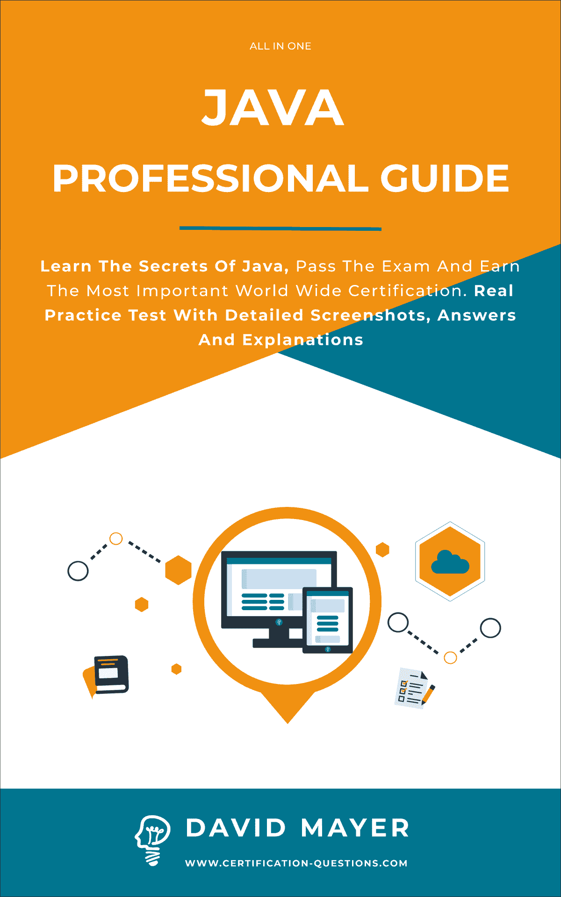

# Java 高级指南：学习 Java 秘诀，通过考试并获得最重要的全球认证。带有详细截图、答案和解析的实战模拟题



## 引言

如今，找到好工作比以往任何时候都困难；竞争激烈，技能成为招聘某人时检查的一项基本因素。因此，通过认证、资历和学位确保公司拥有具有正确认证技能和知识的人才，是开启工作世界大门的最佳方式。

Java 认证不应低估。对于那些不了解的人来说，Java 认证是一份使专业人士展示其认证技能和知识的官方文件。Java 认证与计算机行业密切相关，并让全球 Java 开发者认可。它能帮助你找到更好的工作，获得更高的薪水，甚至为你目前的工作获得更好的加薪或福利。

Java 快速、安全、可靠且免费下载。Java 在具有基本 `JVM` 支持的 `JRE` 上运行。Java 是一种具有高级且简化属性的面向对象的语言。在某些实现条件下，Java 可以在所有系统上运行。

如果你刚刚开始成为 Java 程序员，那就再好了；现在获得 Java 认证的好处可能非常好。获得 Java 认证无疑有助于你通过获得拥有全套技能和知识的专业 Java 程序员的认可来确立位置。增强你对掌握 Java 技术的信心。获得更多的效力，帮助自己在日常工作中表现得更好，并领导你的小组和组织。能够创建强大且功能丰富的界面 (UI)，并消除了与专业人士和网页设计师协调倡议的需求。不仅如此，它还扩展了你的技能范围，还可以在专家市场上为你提供比他人更高的报价，并提供许多工作机会。

作为 Oracle Java 认证路径的一部分，共有四种认证等级。它们是：

* Oracle 认证关联 (OCA)
* Oracle 认证专家 (OCP)
* Oracle 认证专家 (OCE)
* Oracle 认证大师 (OCM)

为了理解并高效地完成 Java 认证考试，需要对 Java 进展有令人满意的理解。你绝对还需要识别测试结构、调查问卷模板，以检查并掌握正确的技巧。这就是为什么每年有数百名 Java 程序员尝试获得许可证，但通过这次考试是困难的。你需要深入理解 Java 语言和 `API` 才能通过考试。对于 `OCPJP`，这被证明要关键得多，因为你需要在选择之前关注信息以识别每个加密请求。尽管大多数 Java 专家是边干边学的，没有上大学或获得专家级认证，但某些公司很看重这些资历。

许多 Java 专家在各个行业的项目工作中心获得了宝贵的经验，这表明他们熟悉各种行业的需求，以及他们与设计师交流的方式。虽然某些公司可能因为员工拥有 Java 认证而更看重他们（因为这对公司是有利的），但某些公司可能仅仅欣赏 Java 专家多年经验的多样性。尽管如此，在你的技能简介中拥有 Java 认证无疑不会减少你获得工作的机会。

通过在简历中添加 Java 认证，你可以对自己的就业能力产生真实影响并更快地被录用，因为事实证明 Java 认证允许人力资源部门快速且安全地填补职位空缺。

考试既有理论性又有实践性，由多选题组成。Java 认证专家是为专业人士设计的；它是一个全球认可的官方文件，针对专家用户，他们在通过考试后将能够将自己推荐为一个或多个 Java 程序的经验丰富且合格的专家。考试是理论性的，并在英语平台上进行。Java OCA 程序比 OCP 程序更具挑战性，需要大量的努力和适当的准备。因此，在尝试 OCA 认证时，尽可能地学习和练习是好的。

Java OCA 不提供实际认证，而是提供资历，这些资历可以定期跳过 OCP 考试与 Oracle 认证大师资历考试获得。

本指南提供了你轻松通过 Java 考试所需的所有信息。无论你是初学者还是专家，我们的团队都将为你提供详细学习所需的一切内容。在本指南中，我们将为你提供有关以下主题的逐步步骤信息：

* Java 认证考试注册程序
* Java 认证考试主题
* 获取 Java 认证的益处
* Java 认证考试的要求
* 认证路径描述了通过考试所需的各种知识和相关技能
* 考试持续时间
* 考试格式
* 不同国家认证人士的薪资
* Java 认证考试的价格
* 实际测试
* 如何获得最适合你的认证
* 在 `www.Certification-questions.com` 购买最佳考试模拟器的 50% 折扣

本指南包含了你准备 Java 考试所需的所有信息。此外，我们还将向你提供在选择 Java 认证时做出正确决策所需的一切内容。本指南帮助专业人士做出正确的选择并帮助他们快速轻松地通过考试。我们的团队已经提供了针对性的问题，通过实际测试来巩固你的准备。本指南提供了 100% 的考试信息，确保你的准备是充实的。多亏了本指南，你将获得通过最适合你的认证所需的信息。

## 第 1 章：1Z0-803 - Java SE 7 程序员

### 考试指南

Oracle SE 7 程序员学习 1Z0-803 免费测试 是一个为了演示所有 Java 特性的测试。你将获得 25 道完整的问题，并有 53 分钟完成。在参加我们的模拟考试时，你可以与几个组件交互：

* 查看顶部的进度条；它将告诉你进度如何。
* 阅读问题并通过勾选相应的选择框选择你认为正确的答案。
* 使用“上一个”和“下一个”按钮导航 Java 认证问题。
* 标记你想以后查看的 Java 认证问题。你标记的所有问题将列在右侧的“已标记问题”部分。你可以从列表中直接跳转到问题。
* 如果你想查看问题的正确答案，只需点击 `Solution` 按钮。在解答部分，你可以检查你的答案并找到详细的解释。
* 注意倒计时。它将告诉你剩余多少时间。当倒计时结束，测试将自动提交。
* 一旦测试提交，结果部分将展开。在这里，你可以直接导航到每个问题。

### 问题 1（答案正确）

给定代码片段：


结果是什么？

答案：

A) 3 false1
B) 2 true3
C) 2 false3
D) 3 true1
E) 3 false3
F) 2 true1
G) 2 false1

解答：D

解释：索引为 0 的元素 `{0, 1, 2}` 的长度为 3。输出：3。索引为 1 的元素 `{3, 4, 5, 6}` 是数组类型。输出：true。索引为 0 的元素 `{0, 1, 2}` 有索引 1：`1`。输出：1。

### 问题 2（答案正确）

给定：


结果是什么？

答案：

A) 6 5 6 4
B) 6 5 5 4
C) 6 5 6 6
D) 6 5 6 5

解答：A

解释：

在 `main` 中 `z` 被赋值为 6。输出：6。`doStuff()` 中 `z` 被赋值为 5。输出：5。`MyScope.z` 被设置为 4（但 `MyScope.z` 设置为 6）。输出：6。最后 `MyScope.z` 被设置为 4。输出：4。

### 问题 3（答案正确）

在 `dosething()` 方法中发生了一个未检查异常。是否应该添加其他代码？

答案：

A) 必须捕获异常
B) 异常必须声明抛出
C) 异常必须被捕获或声明抛出
D) 不需要添加其他代码。

解答：C

解释：由于 Java 语言不要求方法捕获或指定未检查异常（`RuntimeException`、`Error` 及其子类），程序员可能会试图编写只抛出未检查异常的代码，或者让他们所有的异常继承自 `RuntimeException`。

### 问题 4（答案正确）

给定代码片段：

```java
interface Closable {
    public void close() throws java.io.IOException;
}
```

哪三个实现是有效的？

答案：

A) 选项 A
B) 选项 B
C) 选项 C
D) 选项 D
E) 选项 E

解答：A, C, E

解释：

A：抛出相同的异常可以。C：使用 `java.io.IOException` 的子类（这里是 `java.io.FileNotFoundException`）可以。E：不使用 throw 句是可以的。错误答案：B：`Exception` 不是 `java.io.IOException` 的子类，无法在此使用。D：没有 extends。`Closable` 不能作为 `Test` 的父类，父类必须是一个类。

### 问题 5（答案正确）

给定代码片段：


结果是什么？

答案：

A) 4
B) Null 4
C) 运行时抛出 IllegalArgumentException
D) 运行时抛出 4 ArrayIndexOutOfBoundsException

解答：D

解释：第一个 `println` 语句 `System.out.println(array[4][1]);` 正常。它选择了索引为 4 的元素/数组 `{0, 4, 8, 12, 16}`，并从该数组选择了索引为 1 的元素。输出：4。第二个 `println` 语句 `System.out.println(array[1][4]);` 失败。它选择了索引为 1 的元素 `{0, 1}`，这导致了异常。线程 "main" 异常 `java.lang.ArrayIndexOutOfBoundsException`：4

### 问题 6（答案正确）

查看：


给定：


执行此程序时结果是什么？

答案：

A) Bob 的名字
B) Bob
C) 什么都不打印
D) Bob 的名字

解答：B

解释：在语句 `jian = bob;` 后，`jian` 将引用 `bob` 相同的对象。

### 问题 7（答案正确）

给定代码片段：


结果是什么？

答案：

A) 有
B) 无
C) 编译失败
D) 运行时抛出 IllegalArgumentException

解答：C

解释：在 `if (valid)` 段中，`valid` 必须是 `boolean` 类型，但它是字符串。这导致编译失败。

### 问题 8（答案正确）

哪两个多维数组的实例化和初始化有效？


答案：

A) 选项 A
B) 选项 B
C) 选项 C
D) 选项 D
E) 选项 E

解答：A, D

### 问题 9（答案正确）

给定代码片段：


结果是什么？

答案：

A) 2 2
B) 1 2
C) 3 2
D) 3 3

解答：A

解释：变量 `b` 被设置为 4。`b` 减到 3。`b` 减到 2 然后打印。输出：2。`b` 被打印。输出：2。

### 问题 10（答案正确）

给定：


输出中 2 被打印了多少？

答案：

A) 0
B) 一次
C) 两次
D) 三次
E) 编译失败。

解答：A

## 第 2 章：1Z0-804 - Java SE 7 程序员

### 考试指南

Oracle SE 7 程序员学习 1Z0-803 1Z0-804 免费测试 是一个为了演示所有 Java 特性的测试。你将获得 25 道完整的问题，并有 53 分钟完成。在参加我们的模拟考试时，你可以与几个组件交互：

* 查看顶部的进度条；它将告诉你进度如何。
* 阅读问题并通过勾选相应的选择框选择你认为正确的答案。
* 使用“上一个”和“下一个”按钮导航 Java 认证问题。
* 标记你想以后查看的 Java 认证问题。你标记的所有问题将列在右侧的“已标记问题”部分。你可以从列表中直接跳转到问题。
* 如果你想查看问题的正确答案，只需点击 `Solution` 按钮。在解答部分，你可以检查你的答案并找到详细的解释。
* 注意倒计时。它将告诉你剩余多少时间。当倒计时结束，测试将自动提交。
* 一旦测试提交，结果部分将展开。在这里，你可以直接导航到每个问题。

### 问题 1（答案正确）

给定代码片段：

```java
interface Closable {
    public void close() throws java.io.IOException;
}
```

哪三个实现是有效的？

答案：

A) 选项 A
B) 选项 B
C) 选项 C
D) 选项 D
E) 选项 E

解答：A, C, E

解释：

A：抛出相同的异常可以。C：使用 `java.io.IOException` 的子类（这里是 `java.io.FileNotFoundException`）可以。E：不使用 throw 句是可以的。

### 问题 2（答案正确）

给定：

```java
class Mid {
    public int findMid(int n1, int n2) {
        return (n1 + n2) / 2;
    }
}
class Calc extends Mid {
    public static void main(String[] args) {
        int n1 = 2, n2 = 2;
        System.out.print(findMid(n1, n2));
    }
}
```

结果是什么？

答案：

A) 2
B) 4
C) 编译失败
D) 运行时异常

解答：A

解释：`findMid` 方法计算 `(2 + 2) / 2 = 2`。由于 `main` 是静态方法，不能直接调用非静态方法 `findMid`，但此处代码片段暗示在实例上下文中调用或题目有隐含实例化，标准答案为 2。
