# Java 高级面试指南：学习 Java 面试题并练习并发、JDBC、异常处理、Spring 和 Hibernate 的回答（英文版）

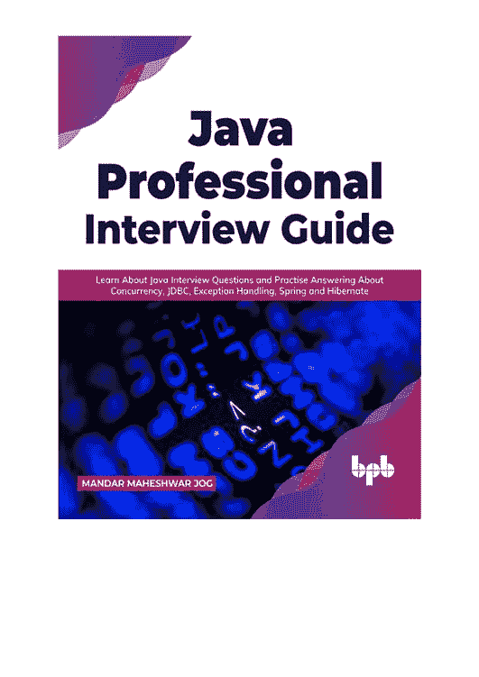

> 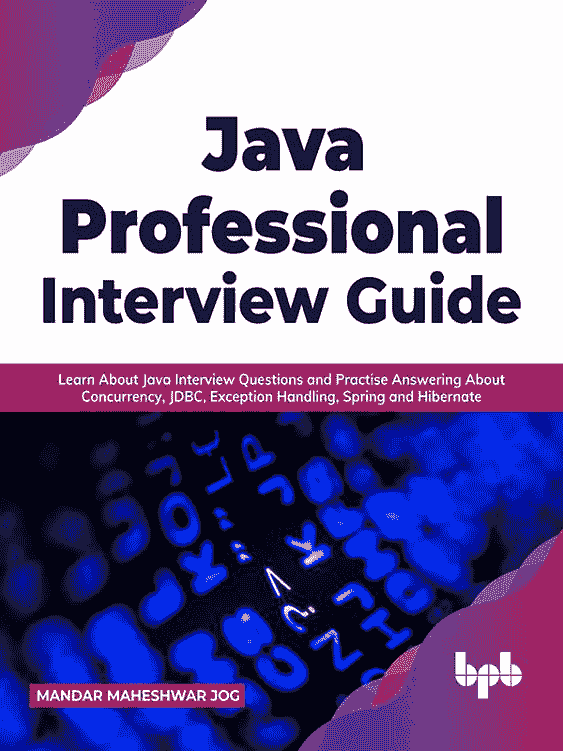
> 
> 

> www.bpbonline.com
>
> 2022 年第一版
>
> 版权所有 BPB Publications, India
>
> ISBN: 978-93-91030-056
>
> 保留所有权利。未经出版者书面许可，不得以任何形式或通过任何手段复制、分发或传输本书或存储在数据库或检索系统中，但可以在计算机系统中输入、存储和执行的程序列表除外，但这些程序不能通过出版、复印、录制或任何电子和机械手段进行复制。
>
> www.bpbonline.com
>
> 献给
>
> 我的妻子 Tejaswini 和我可爱的儿子 Ojas
>
> &
>
> 我爱的父母

## 关于作者

Mandar Jog 是一位热情的 Java 培训师，已从事培训工作 15 年以上。他的专业领域是 Java 及 J2EE 相关技术，如 `Spring`、`Spring Boot` 和 `Hibernate`。在培训之余，Mandar 还是一名自由作家，并在 BPB 出版社编写了名为《Java 9.0 to 13.0》的书。他还担任一些 Java 相关书籍的技术评审员。他也是许多对应届和资深候选人进行 Java 技术面试的组织的核心小组成员之一。

## 关于评审员

Abhijeet Rathod 自 2006 年起一直从事软件行业，目前担任经验丰富的软件开发经理兼架构师，涉及微服务架构、分布式系统以及跨云部署的架构、设计和实现。在职业生涯中，他利用敏捷方法、代码审查、DevOps 和 CI-CD 为多个产品类型组织成功交付了多个项目。

此外，他还积极参与具有不同技能的团队成员招聘，并作为自豪地领导成功团队的一部分对他们进行培养。

面对预算、需求不完整等挑战，他始终专注于对项目所需的每种语言/技术的基础知识保持清晰。

为了通过小包交付大价值，他认为需要对 OOPS、`SOLID` 原则和设计模式有良好的理解。

此外，Abhijeet 认为一个人应该培养一种 X 能力。

# 第 1 章：技术之外的准备

本主题主要涵盖应届候选人的非技术内容。本主题讨论了机会、他们应该如何介绍自己以及他们适合哪些角色。本主题的重点是桥接行业与候选人之间的差距。

# 第 2 章：Java 架构

本主题是一个通用主题，将讨论关于 Java 的架构信息。它将从 Java 版本信息以及这些版本中引入的不同新概念开始。该主题还将涵盖 Java 内部如何从源代码转换为可执行文件，以及在 `JDK` 或 `JRE` 中提供的其他文件系统。

# 第 3 章：Java 中的面向对象

本主题将描述面向对象语言的不同概念，并详细讨论这些概念在 Java 中的具体实现。本主题将涵盖所有的 OOP 概念，包括抽象类、接口等，这些是应届生面试中最重要的部分之一。

# 第 4 章：异常处理

本主题将首先涵盖如何在 Java 中处理异常的完整概念。它将涵盖所有概念，如 `try`、`catch`、`finally`、`throws` 和 `throw` 关键字。此外，还涵盖异常处理的新功能，如自动资源管理等。

# 第 5 章：文件处理

本章介绍了如何与文件连接以对文件执行不同的操作。该主题还详细涵盖了 Java 中的 IO 概念。除了传统的 IO，还涵盖了新的 `java.nio` 包（即 `NIO`），并对缓冲区（buffer）和通道（channel）等进行了详细研究。

# 第 6 章：并发

本章从多线程基础到并发应用开发方法的高级概念。除了基本的线程创建，还讨论了 `Executor Framework`、`fork & Joins`、`Locks` 和 `Barriers`、原子整数（atomic integers）等。

# 第 7 章：JDBC

## Java 中的 JDBC API

本主题讨论了 Java 中的 `JDBC API`。我们将连接到 MySQL 数据库，并讨论 JDBC 中的不同概念。该主题涵盖了数据库连接、检索数据、插入数据以及更新记录等内容。在章节的后半部分，将讨论到事务、`RowSet`、`CachedRowSet` 等。

# 第 8 章：集合

集合是面试中最重要的主题之一。本主题从集合的基础知识及其必要性开始讨论。此外，章节还讨论了不同类型的集合及其适用场景，以及使用 `collection API` 进行数据排序和搜索等不同技术。

# 第 9 章：杂项

Java 中有很多概念/类，很难归类到任何层次结构中。本主题关注 Java 中所有此类概念，这些概念可能在其他主题中未涵盖，但就面试而言可能非常重要。

# 第 10 章：函数式编程

函数式编程是如今的一种编程新方法。本章从函数式编程的需求以及它在现代编程时代的重要性开始。此外，还讨论了函数式接口、lambdas 和流（stream）的实现。

# 第 11 章：设计模式

软件开发不仅仅是编写代码和生成解决方案。除此之外，我们还需要确保为应用程序创建一个灵活且健壮的架构设计。设计模式为应用设计提供了这种方法。本主题涵盖了一些对面试非常重要的设计模式。

# 第 12 章：Web 基础

本主题专注于 Web 应用开发的基础。在进入 `Spring` 和 `Spring Boot` 等高级主题之前，读者必须了解这些基本概念。该主题涵盖了 `HTTP` 简介以及网络相关概念。章节还简要介绍了如何使用 `Servlet` 和 `JSP` 创建 Web 应用。

# 第 13 章：Spring 和 Spring Boot

`Spring Framework` 是目前最流行且轻量级的依赖注入框架之一。章节使用 `Spring Framework 5.0` 来解释从 `Spring` 基础到 `Spring Framework` 不同项目的概念。除了该主题外，章节还讨论了用于创建 `REST endpoints` 的 `Spring Boot`。

# 第 14 章：Hibernate

`Hibernate` 是最重要的框架之一，它通过 `ORM` 概念简化了数据库连接。该主题涵盖了从 `Hibernate` 基础到 `HQL` 和缓存等高级功能。

## 下载彩色图片

请点击链接下载本书的彩色图片：https://rebrand.ly/7eb340

`BPB Publications 家族` 非常感谢您的支持、建议和反馈。

## BPB 正在寻找像您这样的作者

如果您对成为 `BPB` 作者感兴趣，请访问 `www.bpbonline.com` 并在今天申请。我们已经与成千上万像您这样的开发者和技术专家合作过，帮助他们与全球技术社区分享见解。您可以提交通用申请、申请我们正在招聘的特定热门主题，或提交自己的想法。

本书的代码包也托管在 GitHub 上，如果代码有更新，将在现有的 GitHub 仓库中更新。

我们还从丰富的书籍和视频目录中提供了其他代码包，请查看！

## 版权

如果您在某个领域专长，并且对编写或为书籍贡献感兴趣，请访问

## 评价

请留下评价。在您阅读并使用这本书后，为什么不在您购买的网站上留个评价呢？潜在读者就可以看到并利用您的无偏见意见做出购买决策，我们 `BPB` 可以了解您对我们产品的看法，我们的作者也可以看到您对书籍的反馈。谢谢！

了解更多关于 `BPB` 的信息，请访问

# 第 1 章：技术之外的准备

- 简介
- 结构
- 招聘类型
    - 校园招聘
    - 社交招聘
- Java 职业机会
    - Java Web 开发者
    - Java 移动应用开发者
    - Java API 开发者
- 选拔流程：流水线
    - 技术测试
- 如何选择职业或角色？
- 准备得如何？

# 第 2 章：Java 体系

- 结构
- 目标
- Java 程序执行流程
- Java 中的关键文件
    - 源文件
    - 字节码文件
- Java 运行环境 (JRE)
    - `JRE` 的作用是什么？
    - `JRE` 包含哪些组件？
    - 类加载器起什么作用？
    - 类加载器的不同类型？
        - 启动类加载器
        - 扩展类加载器
    - 你可以手动选择 `ClassLoader` 吗？
- 字节码验证器
    - 字节码验证器执行哪些验证？
- JVM
    - `JVM` 在 Java 执行流程中起什么作用？
- JVM 内存管理
    - 你可以增加 `JVM` 的堆内存吗？
    - 什么是 `OutOfMemoryException`？我们该如何处理它？
    - JVM 如何执行类？
- JIT 编译器
    - JIT 内部如何工作选择要编译的方法？
    - 是否可以有与 Java 版本不同的 JIT？
    - 我们可以禁用 JIT 吗？
    - 如果禁用 JIT，你会面临什么后果？
- JDK、JRE 和 JVM 之间有什么区别？
    - JVM
    - JRE
    - JDK
- Main 方法详情
    - `main` 方法的合法签名有哪些？
    - 我们可以重载 `main()` 吗？
    - 如果我们重载了 `main` 方法，程序会执行吗？
    - 如果声明了任何方法，`JVM` 如何找到它？
    - 我们可以将 `main()` 声明为 `non-static` 吗？
    - 如果 `main` 声明为 `non-static`，程序能成功执行吗？

# 第 3 章：面向对象

## 简介

- 结构

### 类和对象

- 什么是类？
- 什么是对象？
- 对象的特征是什么？
- 什么是构造函数？解释它的作用。
- 我们可以有 `private` 构造函数吗？
- 为什么 Java 中所有的实例变量都有默认值？
- Java 中的访问器方法（accessor）和修改器方法（mutator）是什么？它们的意义是什么？
- 创建对象的不同方式有哪些？
- 如何使用 `newInstance` 方法创建对象？
- 如何创建现有对象的拷贝？
- `clone` 方法与将对象的引用复制给另一个对象有什么区别？
- 你的代码何时会抛出 `CloneNotSupportedException`？
- 如何序列化一个对象？
- 什么是反序列化，它是如何生成新对象的？

## 访问修饰符

- Java 中存在哪些访问修饰符？你能解释它们的意义吗？
- 我们可以对类应用 `private` 修饰符吗？
- 什么是封装，如何实现封装？
- 能通过真实示例解释为什么我们应该遵循封装吗？
- 为了实现完全封装，我们可以用 `private` 访问修饰符声明类吗？

### 继承

- Java 中的关联（association）是什么？
- Java 中的组合（composition）是什么？
- 你能给出一个组合和聚合的例子吗？
- Java 中 is-a（是一种）关系和 has-a（有一个）关系有什么区别？
- 你如何解释耦合（coupling）这个词？
- 你说的松耦合（loose coupling）是什么意思？
- 如何实现紧耦合，能真实示例说明吗？
- 用真实示例解释 Java 中的松耦合？
- 你能解释在 Java 中什么时候使用 is-a 关系，什么时候使用 has-a 关系吗？

### 抽象类和 final 类

- 什么是抽象类？
- 什么是 `final` 类，为什么需要声明它？
- 抽象类可以包含构造函数吗？
- 为什么抽象类即使不被实例化也提供构造函数？
- 什么是具体方法和抽象方法？
- 我们可以将抽象类的所有方法声明为具体方法吗？
- 抽象方法可以是 `private` 的吗？
- 我们可以将抽象方法声明为 `static` 吗？
- 如果抽象类无法实例化，谁负责调用抽象类的构造函数？

### 接口

- 接口可以有构造函数吗？它和抽象类有什么区别？
- 接口的需求是什么？
- 多态引用的意义是什么，如何实现它？
- 如果 `Object` 是一个宇宙超类，用它来引用每个对象会有什么问题？
- 我们可以扩展多个类吗？
- 我们可以实现多个接口吗？
- 如果你的类实现了两个接口，且这两个接口都声明了相似的方法，将调用哪个方法？这允许吗？

### 关键字和变量

- 我们可以把引用设为 `final` 吗？这意味着什么？
- `static` 变量的作用是什么？
- `static` 方法的作用是什么？
- 我们可以使用 `static` 方法处理实例变量吗？
- 我们可以声明同名的 `static` 变量和实例变量吗？
- 在什么场景下可以使用 `static` 变量？
- `this` 关键字的作用是什么？
- 解释 `super` 关键字的意义。
- 为什么 `super` 关键字必须位于构造函数的第一行？
- 如果创建一个类的对象，构造函数将按什么顺序被调用？

### Object 类

- `Object` 类中存在哪些重写的方法？
- `equals()` 方法是什么，如何使用？

### 高级接口

- 可以用 `abstract` 关键字声明接口吗？
- 默认是 `Object` 类吗？
- 接口中的默认方法是什么？
- 接口为什么需要默认方法？
- 接口中的 `static` 方法是什么，意义何在？
- 什么是函数式接口？
- Java 中的宇宙超类类？
- `==` 运算符和 `equals` 方法有什么区别？
- 什么是 `var` 参数？在哪里可以使用？
- 你说的方法重载是什么意思？
- `var` 参数和数组作为参数的区别是什么？
- 什么是方法重写？
- Java 重写的规则有哪些？
- 我们可以重写静态方法吗？
- 什么是协变返回值？
- 我们可以更改重写方法的返回类型吗？
- 在实现重载时对访问修饰符有什么限制吗？
- 什么是标记接口？
- 标记接口的作用是什么？
- 你能列出你用过的标记接口吗？

# 第 4 章：异常处理

## 引言

## 目标

- 你说的处理异常是什么意思？
- 为什么需要异常处理？
- 请介绍一下 `Throwable` 类。
- 你如何对异常进行分类？
- 能列出你知道的不同异常以及它们抛出的场景吗？
- 可以在不使用 `catch` 块的情况下使用 `try` 块吗？
- 我们可以使用单个 `try` 块来处理多个类型的异常吗？
- 单个 `catch` 块可以处理多个类型的异常吗？
- 什么是异常级联（cascading）？
- 什么是链异常（chained exception）？
- 如何以通用的方式处理异常？
- 可以将通用的异常处理器与其他异常处理器一起使用吗？
- `finally` 块的作用是什么？
- 可以在不使用 `catch` 块的情况下使用 `finally` 块吗？
- `ClassNotFoundException` 和 `NoClassDefFoundError` 之间的区别是什么？
- 如何自定义异常？
- 如何使用自定义异常？
- `throws` 关键字的作用是什么？
- JDK `7` 为异常处理提供了哪些更新？
- 什么是自动资源管理？
- 在 Java 的自动资源管理概念中，资源是如何自动关闭的？
- 在某些情况下，我们观察到 `main` 方法抛出了异常。这是什么？
- `printStackTrace()` 方法的作用是什么？
- 可以使用 `throw` 关键字同时用于检查异常（checked exceptions）和未检查异常（unchecked exceptions）吗？
- 如果 `try` 块向调用者返回一个值，`finally` 块会发生什么？它还会执行吗？
- 如果 `try` 块和 `finally` 块执行不同的布尔值会发生什么？
- 有什么方法可以避免执行 `finally` 块吗？
- 如果一个方法没有 `throws` 任何检查异常，我们可以在 `catch` 块处理检查异常的 `try-catch` 中调用该方法吗？

## 结论

# 第 5 章：文件处理

## 引言

## 结构

- 列出不同类型的 I/O 流。
- 解释基于字节类的层级结构。
- 解释基于字符类的层级结构。
- 两种流的必要性是什么？为什么我们需要字节流和字符流？
- 在你看来，使用字节流还是字符流更好？
- 什么是过滤流（filter streams），哪些是过滤流？
- 解释 `File` 类。
- 什么是 `FileInputStream`？
- 什么是 `FileOutputStream`？
- 什么时候使用 `Scanner` 类？
- 什么是缓冲流（Buffered stream）？
- 解释 `BufferedWriter`。`flush()` 和 `close()` 在哪里使用？
- 解释数据流的层级结构。
- 如何创建临时文件？如何删除临时文件？
- 你处理过属性文件（properties files）吗？如何动态创建属性文件？
- 什么是序列化反序列化？
- 你处理过序列化和反序列化吗？请解释一下这个过程。
- 什么是 `SerialVersionUID`？
- 有时，即使一个类实现了 `Serializable`，你也无法序列化对象。能解释为什么吗？
- 如何自定义序列化过程？
- 你处理过随机访问文件（Random access files）吗？
- 如果我想创建一个目录，我应该使用哪个类？
- 解释 `InputStream` 和 `OutputStream` 的区别？
- 解释 `PrintStream` 类的作用？
- 可以在 `try` 块中关闭流吗？为什么应该在 `finally` 块中关闭流？JDK `7` 在关闭流上有什么变化？
- 我们可以将文件转换为字符串吗？能解释如何实现吗？
- 你是否因为“拒绝访问”遇到过 `java.io.FileNotFoundException`？你知道如何修复吗？
- 什么是内存映射文件（memory-mapped file）？解释内存映射文件的优缺点。
- 什么是 `NIO`？`I/O` 和 `NIO` 的区别是什么？
- `NIO` 的基本组件有哪些？
- 什么是通道（channels）？


- 解释 `NIO` 通道类。

- 使用 `BufferedWriter` 类时，缓冲区何时以及如何清除？

# 6. 并发

## 引言

## 目标

- 什么是多线程？你能解释多线程吗？

- 多线程的优势是什么？

- 什么是进程？进程和线程有什么区别？

- 什么是同步和异步编程？

- 是否可以预测线程的行为？

- 线程中 `wait()` 方法的作用是什么？

- 你是否知道同步块？为什么在同步块中调用 `wait()`？

- 如何在 Java 中维护执行顺序？如果你有多个线程，如何控制某个线程先执行？

- 解释线程生命周期。生命中有哪些状态？

- 什么是上下文切换？

- 使用 `Thread` 类和 `Runnable` 接口创建线程有什么区别？

- `Thread` 提供了哪些重载构造函数？

- 线程可以启动两次吗？重复调用 `start()` 方法会发生什么？

- 是否可以直接调用 `run()` 方法而不是直接使用 `start()`？

- 我们可以重写 `start()` 方法吗？如果重写了它会发生什么？

- 为什么 `suspend()` 和 `resume()` 方法被弃用？

- 为什么 `destroy()` 方法被弃用？

- 线程之间如何通信？开发者可以使用哪些方法来实现线程间通信？

- 为什么 `wait()`、`notify()` 和 `notifyAll()` 在 `Object` 类中而不是 `Thread` 类中？

- 什么是线程饥饿（thread starvation）？

- 解释守护线程（daemon thread）。什么是守护线程？

- 什么是关闭钩子（shutdown hook）？

- 我们什么时候应该中断线程？

- 什么是同步？如何实现同步？

- `synchronized` 块的作用是什么？

- 我们可以将构造函数声明为 `synchronized` 吗？

- 什么是内部锁（intrinsic lock）？

- 什么是死锁（deadlock）？

- 如何检测死锁条件？如何避免死锁？

- 解释线程调度器。

## 并发与调度

## 核心概念

- 什么是线程优先级？

- 什么是竞态条件（race condition）？

- `Java` 中的 `volatile` 关键字是什么？

- 什么是线程池？

- `Java` 并发中的原子操作是什么？

- `Java` 并发 API 中的 `lock` 接口是什么？

- 你使用过并发 API？你接触过哪些并发 API？并发 API 的主要组件有哪些？

### Executor 框架

- 并发 API 中的 `Executor` 接口是什么？

- 解释并发 API 中的 `ExecutorService` 接口。

- 解释 `ScheduledExecutorService` 和 `ExecutorService` 接口之间的区别。

- `Callable`、`Runnable` 和 `Future` 接口之间的区别是什么？

- 传统多线程与并行编程之间的区别是什么？

- `Java` 中的 `ForkJoin` 框架是什么？

- 阐述 `ForkJoinPool` 的特性。为什么要显式地关闭 `ForkJoinPool`？

- 你能解释 fork-join 框架的实际应用吗？

### 管理与生命周期

- 解释 `FutureTask`。

- `Java` `Executor` 框架中 `shutdownNow()` 和 `shutdown()` 的区别。

- 如何在 `Executor` 框架中终止线程？

- 如何获取 `Executor` 框架中 `Callable` 线程返回的值？

## 集合与线程安全

- `collection` 中的哪些类提供了并发支持？

- 编写线程安全代码时应该注意什么？编写多线程应用时必须记住最重要的点有哪些？

- 当持有锁的对象调用 `sleep()` 或 `wait()` 方法会发生什么？

# 7. Java 数据库连接 (JDBC)

- 结构

- 目标

## JDBC 基础

- 持久化的方式有哪些？

- 什么是 `JDBC`？

- 你能解释 `JDBC` 的架构吗？

- 为什么需要 `JDBC` 驱动？`JDBC` 驱动的作用是什么？

- 有多少种驱动？你用过哪些驱动？什么是 `Type 4` 驱动？

- 详细解释驱动的类型。

- 你能解释连接数据库的步骤吗？连接数据库的步骤有哪些？

- 注册驱动的方式有哪些？

- 解释 `Class.forName()` 和 `DriverManager.registerDriver()` 的区别。

## JDBC API

- 如果 `JDBC` 是一个 API，谁提供了实现？

- 能列出 `JDBC` API 的不同接口吗？

- 获取数据库连接的标准流程是什么？如何获取 JDBC？

- 如何使用 `CallableStatement`？如何使用 `CallableStatement` 调用存储过程？

- 什么是 `ResultSet`？如何获取 `ResultSet`？

- `ResultSet` 提供哪些功能？你用过 `ResultSet` 的哪些功能？

- 什么是可滚的 `ResultSet`？

## 高级 JDBC 与事务

- 人可以使用可滚的 `ResultSet`。

- `ResultSet` 与 `ResultSet` 之间的区别。

- `ResultSet` 与 `ResultSet` 之间的区别。什么是事务。

- `ResultSet` 与 `ResultSet` 之间的区别。

- 事务的。

- `commit()` 和 `rollback()` 是什么。

- 什么是 `Savepoint`。如何使用 `Savepoint`。

- 什么是 `BatchUpdate`。如何执行 `BatchUpdate`？

- 什么是离线（disconnected）？

- 什么是 `ResultSet`。

- `ResultSet` 与 `ResultSet` 的区别。

# 8. 集合 (Collections)

- 结构

- 目标

- 你对 `Collections` 有什么理解？

- 遗留类（legacy classes）有哪些？

- 框架中提供的接口有哪些？

- 什么是泛型（generic）。

- 集合的优点有哪些？

- 陈述 `ArrayList` 和 `Vector` 的区别。

- `ArrayList` 和 `Vector` 的区别。

- `ArrayList` 和 `LinkedList` 的区别。

- `ArrayList` 的大小是多少？

- 如何将 `ArrayList` 转换为数组 (`array`)。

- 你可以从 `ArrayList` 创建什么。

- `ArrayList` 是可以修改的。如果是只读 `ArrayList` 怎么办？

- `ArrayList` 可以包含重复元素吗？如何从 `ArrayList` 中删除重复元素。

- 如何同步 `ArrayList`。

- 解释 `List` 和 `Set` 的区别。

- `HashSet` 和 `TreeSet` 的区别。

- `HashMap` 和 `Hashtable` 的区别。

- 你能解释为什么 `HashMap` 允许 `null` 吗？

- 什么是 `WeakHashMap`？

- 能通过代码解释 `WeakHashMap` 吗？

- 陈述 `Iterator` 和 `Enumeration` 的区别。

- 解释 `List` 和 `Set` 的区别。

- 解释 `Set` 和 `Map` 的区别。

- `HashMap` 和 `HashSet` 的区别。

- 通常说 `HashMap` 是按键排序的。如何按值排序？

- `HashMap` 和 `Hashtable` 的区别。

- `Comparable` 是什么意思？

- Set 只允许唯一元素；那么为什么我们得到的大小是三个而不是两个？我们需要做什么才能让 Set 只包含唯一元素？

- 为什么我们会得到异常？怎么做可以消除异常？

- `Comparable` 和 `Comparator` 的区别是什么？

- 为什么要用 `Properties` 文件？

- `hashCode()` 方法是做什么的？解释 `hashcode()` 方法。

- 以下代码的输出是什么？

- 尽管实例可用，但为什么员工实例没有被消除？我们需要做什么才能让 `remove` 方法生效？

# 8. Java 集合框架

- `fail-fast`（快速失败）什么含义？

- `JDK 8` 为 `collection` 添加了哪些特性？Java 8 中与 `Collection` 相关的特性有哪些？

- 解释为什么 `Collection` 没有继承 `Cloneable` 和 `Serializable` 接口？

- 为什么 `Map` 接口没有继承 `Collection` 接口？

- 解释 `Iterator`（迭代器）。什么是 `Iterator`？

- 为什么 `Iterator` 不提供向集合中添加元素的方法？

- 我们可以直接使用 `next()` 方法获取元素而不移动 `Iterator` 的光标吗？为什么 `Iterator` 不提供一个在不移动光标的情况下直接获取下一个元素的方法？

- 遍历列表（list）有哪些不同的方法？

- 比较以下两个语句的区别

- 可以使用任何类作为 `Map` 的键吗？

- 如何访问 `Map` 类型的集合中的每个条目（entry）？`Map` 接口提供了哪些不同的 `Collection` 视图（views）？

- 框架中哪些集合类是线程安全的？

- 你能详细介绍一下 `CopyOnWriteArraySet` 吗？

- 什么是 `Queue`（队列）和 `Stack`（栈），列出它们的区别？

- Java 集合框架的最佳实践有哪些？

- 可以向 `TreeSet` 或 `HashSet` 添加空元素吗？

- `Collection` 和 `Collections` 之间有什么区别？

- `NavigableSet` 比 `SortedSet` 提供了哪些额外特性？

- 什么是 `PriorityQueue`（优先级队列），它是如何工作的？

- 如果 `PriorityQueue` 使用相同的 `Comparator` 和 `Comparable` 接口进行排序，它与 `TreeSet` 或 `TreeMap` 有什么不同？

- 什么是 `Dequeue`（双端队列）？你能解释它的工作原理吗？

- 什么是 `IdentityHashMap`？它与普通的 `HashMap` 有什么不同？

## 结论

## 简介

## 结构

- 以下两个语句是相同的还是不同的？

- `StringBuffer` 和 `StringBuilder` 之间有什么区别？

- 你说的 `reflection`（反射）是什么意思？

- 如何不使用 `new` 操作符获取类的对象？

- 列出 `reflection API` 的不同方法及其用法

- 我们可以使用 `reflection` 访问另一个类的私有字段（private field）吗？

- 什么是 `Inner class`（内部类）及其类型？

- 为什么需要内部类，或者说我们为什么要使用内部类？

- `static nested class`（静态嵌套类）可以访问外部类的任何其他成员吗？

- 内部类可以声明为 `private` 吗？

- 什么是 `shadowing`（变量隐藏）？

- 什么是 `JUnit`？

- 什么是 `unit testing`（单元测试）？

- 能解释你如何测试应用程序的单元吗？

- 哪些实用的 `JUnit` 扩展？

- 哪些重要的 `JUnit` 注解？

- `@Before` 和 `@After` 注解的作用是什么？

- 手动测试和自动化测试之间有什么区别？

- fixtures（测试固件）中有哪些方法？

- 什么是 `localization`（本地化）？

- 如何使用 `Locale` 类更改数字的格式？ 

## 结论

# 10. 函数式编程

## 简介

## 结构

## 目标

- Java 8 引入了哪些新特性？

- 什么是函数式接口（functional interfaces），如何创建它们？有必要通过 `@FunctionInterface` 注解来声明函数式接口吗？

- 在 Java 8 之前我们有函数式接口吗？

- 什么是 `SAM Interface`（单抽象方法接口）？

- 什么是 `default methods`（默认方法）？

- 能解释 lambda 表达式的各个部分，或者如何编写 lambda 表达式吗？

- 你处理过 `Collection` 吗？用过 `Stream API` 吗？能向我们解释 `Collection API` 和 `Stream API` 之间的区别吗？

- 解释 `String::valueOf` 的含义

- `limit()` 和 `skip()` 有什么区别？

- 什么是中间操作（intermediate operations）和终端操作（terminal operations）？

- 能解释 `Stream` 中的 `reduce` 操作吗？

- 什么是 `pipelining`（流水线操作）？

- `Stream` 是惰性的（lazy）是什么意思？

- 请列出中间操作和终端操作

- `findFirst()` 和 `findAny()` 有什么区别？

- 解释 `streams` 是惰性的

- `Iterator` 和 `Spliterator` 的区别是什么？

- 什么是 `Optional` 类？

- 在执行操作时如何避免 `NullPointerException`？

- 什么是 `Consumer` 函数式接口？

- `map()` 函数的作用是什么？为什么要用它？

- `filter()` 方法的作用是什么？什么时候使用它？

- 创建 `Stream` 有哪些方法？如何将数组转换为 stream？

- 在调用终端操作后如何重用 stream？能给出一个真实的例子吗？

- 终端操作后是否有方法重用 stream？

- 能解释如何使用 `streams` 收集名称以“S”开头的 `Student` 对象吗？

- 解释 stream 中的 `Stateless`（无状态）和 `Stateful`（有状态）操作？

- 什么是 `parallel stream`？

- 能解释如何创建 `parallel stream`？

- 我们可以定义并行流的线程数吗？

## 结论

# 11. 设计模式

## 简介

## 结构

- 告诉我们什么是设计模式？

- 解释 Java 设计模式的优点？

- 哪种设计模式可以方便地顺序访问集合元素？

- 什么时候使用 `service locator`（服务定位器）模式？

- 哪些技术使用了 `Service Locator` 模式？

- 哪种模式可以将抽象与实现解耦？

- 当想要给现有对象添加新功能时，哪种设计模式会有帮助？

- 当需要一次性向服务器传递带有多个属性的数据时，哪种设计模式有用？

- 什么时候使用拦截（intercepting）模式？

# 设计模式问题

- 你能提供一些 JDK 实现单例模式的例子吗？

- 你能写线程安全的单例吗？为什么我们需要它？

- 我们可以创建单例对象的克隆（clone）吗？

- 你能列出标准 JDK 库中使用的设计模式吗？

- 什么是适配器模式（Adapter Patterns）？

- 解释装饰器模式（Decorator Pattern）。给出 JDK 中实现装饰器模式的例子。

- 如何区分 Java 中策略模式（Strategy）和状态模式（State）的区别？

- 什么是代理模式（Proxy Pattern）？

- 解释装饰器模式和代理模式之间的区别。

- 解释工厂模式（Factory）和抽象工厂模式（Abstract Factory）的区别。

- 在 Java 中何时使用策略模式？

- 说明 Java 中组合模式（Composite Pattern）的优点。

- Java 中的观察者模式（Observer Pattern）是什么？你在什么时候使用观察者模式？

- 你能提供观察者模式的典型例子吗？

- Java 中的构建者模式（Builder Pattern）是什么？何时使用构建者模式？构建者模式解决了什么问题？说明构建者模式的优点。

- 什么是代理模式？它是做什么的？代理的哪些类型？代理模式的使用场景有哪些？

- 解释责任链模式（Chain of Responsibility）及其优点。

- 桥接模式（Bridge Pattern）与适配器模式有什么不同？

- 解释依赖注入（Dependency Injection）和服务定位器模式（Service Locator）。并说明它们的区别。

- 在依赖注入模式中，何时使用 setter 注入和构造函数注入？

- 什么是 MVC 模式？

- 解释数据访问对象或 DAO 模式？

- 什么是前端控制器模式（Front Controller Pattern）？你能给出一个前端控制器的例子吗？

- 使用什么设计模式来创建复杂对象？

- 什么是空对象模式（Null Object Pattern）？

- 什么是 SOLID 设计原则？你能给出 SOLID 设计原则的例子吗？

## 结论

# 12. Web 基础

## 简介

- 目标

- 企业级架构的哪些类型？你工作过哪些架构？

- 单层架构（Single-tier architecture）

- 三层架构（Three-tier architecture）

- N 层架构（N-tier architecture）

- 容器在 Java EE 中起什么作用？

- 解释不同类型的容器

- 部署应用程序的过程是什么？

- 什么是协议？你工作过哪些协议？

- 你能解释不同的 Http 方法 吗？

- 你能解释 Web 程序的组件吗？

- 你能解释 MVC 1 和 MVC 2 架构吗？

- 什么是 Servlet 及其用途？


- 你开发过基于 `Servlet` 的应用程序吗？解释开发 `Servlet` 应用程序的步骤。解释配置 `Servlet` 的方法。

- 如何读取请求参数（request parameters）？

- `ServletRequest` 和 `ServletContext` 的 `getRequestDispatcher()` 方法有什么区别？

- 如何定义自定义的 `init()` 方法？

- 客户端如何向服务器发送信息？

- 属性（attribute）和参数（parameters）的区别是什么？

- 什么是头（headers）以及不同类型的头？

- 解释 `ServletConfig` 和 `ServletContext` 的区别

- 什么是会话跟踪（session tracking）？会话跟踪的方法有哪些？为什么需要会话跟踪？何时使用会话跟踪？

- 如何处理 `HttpSession` 对象？

- 什么是 `JSP`？为什么要用 `JSP`？`JSP` 在 Web 编程中有用？

- `JSP` 有哪些优点？

- 解释 `JSP` 的生命周期？

- 你说的动作标签（action tag）是什么？你可以如何使用它？

- 包含指令（include directive）和包含标准动作（include standard action）的区别是什么？

- 什么是 `EL` 和 `EL` 函数？

- 解释 `JSTL`

- 什么是过滤器（filters）？何时使用过滤器？如何配置过滤器？

## 结论

# 13. Spring 和 Spring Boot

## 简介

- 目标

- 给我介绍一下 Spring 框架吧？

- 我们经常看到博客、书籍或参考文献声称 Spring 框架让开发变得简单。你能解释它是如何做到的吗？

- 你能提供一些样板代码的例子吗？

- 你用过多少 Spring 模块？

- Spring 中的 `DI` 是什么？

- 结合实例解释依赖注入

- `DriverManagerDataSource` 是框架提供的唯一实现吗？

- 考虑一个触发多个获取连接请求的场景。使用 `DriverManagerDataSource` 是否可行？

- 请解释 Spring IoC 容器

- 在你看来 bean 是什么？或者，结合 Spring 框架解释 bean。

- 你刚刚提到了 `ApplicationContext` 接口。如果它是一个接口，我们需要提供它的实现吗？

- 我们可以使用不同的文件进行 bean 配置吗？还是必须使用 `beans.xml`？

- `beans.xml` 的位置是固定的吗？我们可以更改位置吗？

- 可以使用多个配置文件吗？在一个应用程序中将 bean 分布在多个文件中？

- `ApplicationContextAware`、`BeanFactoryAware` 或 `BeanNameAware` 是用来用的？

- `XML` 和基于注解的配置是两种不同的方式；你更倾向于哪一种？

- 写在我们的 `XML` 文件顶部的 `both` 和 `,` 都会激活基于注解的配置。它们是一样的吗？还是不同的？

- 解释类型注解（stereotype annotation）？

- 解释 `@Configuration`

- 为什么要使用 `@Autowired`？解释 `@Autowired` 注解。

- `@Required` 注解代表什么？

- 为什么要使用 `@Scope` 注解？

- 解释 Spring MVC 框架

- 在处理 Spring MVC 框架时，你用过哪些注解？

- 你刚刚提到请求映射（request mapping）位于 `WEB-INF/ servlet_name-servlet.xml` 文件。这个位置是固定的吗？我们可以更改文件的位置或名称吗？

- `1` 是做什么的？

- 你过消息资源包（message resource bundle）吗？它的用途是什么？

- 什么是 `AOP`？

- 解释 `AOP` 的概念

- 以哪些方式可以织入（weaving）？Spring `AOP` 支持哪些类型的织入？

- 解释你用过的切点设计符（pointcut designators），或者解释你知道的切点设计符

- 你过 `Spring Boot` 吗？解释 `Spring Boot`。什么是 `Spring boot`？

- 你过 Spring Boot 项目吗？用过哪些 starters？

- 你创建 REST 应用时用过哪些注解？

- 哪些是映射处理方法的注解？

- 你如何从请求中读取输入？你用过哪些注解来读取请求输入？

- 你过 `Spring Boot` 的内部数据库吗？

- `RestTemplate` 的作用是什么？如何使用 `RestTemplate`？

- 如何在应用程序中提供 `HATEAOS` 支持？

## 结论

### 简介

### 结构

- 什么是 `ORM`？

- `ORM` 的特性有哪些？`ORM` 如何帮助开发者？

- 解释 `Hibernate` 的架构？

- 解释你在 `Hibernate` 中用过的接口或核心组件

- 在 `Hibernate` 中维护配置需要哪些文件？

- 如何获取 `SessionFactory`？

- 可以在应用程序中使用 `Hibernate` 与两个不同的数据库通信吗？如何在 `Hibernate` 中创建两个 session factory？

- `Session` 是线程安全的对象吗？

- 如何将类映射到表？解释将实体映射到表中某行的注解。

- `@NaturalId` 是做什么的？

- 是否可以停止数据成员被持久化，或忽略保存到数据库的字段？

- 解释 `Session` 接口中 `persist()` 和 `save()` 的区别。

- 下面代码的输出是什么？

- 你知道生成器类（generator classes）吗？用过多少种生成器类？请解释 `Hibernate` 中的生成器类

- `hibernate.dialect` 是做什么的？

- 如何映射层级表（Table Per Hierarchy）、具体类表（Table Per Concrete Class）和子类表（Table Per Subclass）？

- `Hibernate` 中可用哪些关联模型？

- 你能解释什么是多对多关联以及如何通过实时示例配置它？

- 实体的一个属性需要通过某些表达式计算。如何使用 `Hibernate` 映射这样的属性？

- 什么是级联（cascading）？`CASCADE.ALL` 代表什么？你用过哪些级联选项？

- 如何使用 `Hibernate` 框架将枚举映射到数据库？

- 什么是 `HQL`？

- 解释 `HQL` 的缺点。

本书特别关注如何通过技术面试。在整本书中，我们将讨论不同概念的不同问题。但这一章的内容超出了这些范围。在本章中，我们将讨论如何在面试中更好地展现自己。我所说的“展现”，并不是教你该穿什么或不该穿什么，而是将分享我关于如何在面试中成功的各种心理方面的知识。让我重申一下，技术知识是首要任务。你不会在心理诊所工作，而是在开发公司工作。但是，如果你了解面试官的心态，并且知道自己在面试期间应该持什么样的心态，你将增加被选中的机会。

学习技术始终很重要，但在之前，你还必须为行为技能做好准备。你应该知道如何介绍自己、如何准备自己，以及如何建立以自信参加面试的心态。面试过程在你真正出现在面试官面前很久就开始了。你准备得越充分，获得你心仪工作的机会就越大。在本章中，我们将讨论面试的这些非技术方面的内容。

在本章结束时，你将了解如何从非技术角度准备面试。我们将讨论集中在以下内容上：

* Java 职业机会

* 选拔流程：流水线

* 如何选择你的职业或角色

* 如何练习面试

* 你应该避免的常见面试错误

* 面试官通常会做的分析

让我们开始这段迷人的旅程吧。

## 招聘类型

作为求职者，了解公司从何处进行招聘也是重要的。你会在学院或大学内部获得工作吗？还是在毕业后获得工作？通常有两种类型的招聘。

### 校园招聘

这是被组织选中的最简单的方法。通常，公司代表会在你处于毕业最后一年时访问一些优秀的大学并进行面试。此类面试通常基于你的能力以及对 `C`、`C++` 编程技能的了解。要在校园招聘中被选中，你需要在课程中保持良好的记录，并在能力测试和技术测试中表现优异，随后将是个人面试。

### 校外招聘

如果你没有通过校园招聘被选中，这并不是世界末日。你仍然可以通过校外招聘流程获得另一个选择机会。在这里，公司会在报纸或招聘门户网站（如等）或有时在它们自己的网站上发布广告。你可以根据公司的规定进行申请，然后会被叫面试。有时，还会有现场投递（walk-ins），你可以看到成千上万的求职者在队列中等待自己的机会。校外招聘也会有与校园面试类似的轮次，但通常观察到，校外招聘在技术上比校园面试更困难。

## Java 职业机会

IT 世界是巨大的。我们从外部看到的只是冰山一角。如果我们需要讨论 IT 领域中不同的职业机会，那么可能需要专门写写博客或一本书来彻底涵盖它。在本章中，我们将仅关注与 `Java` 技术对齐的职位。以下是如果你成为 `Java` 开发者可以预期的不同职位。

### Java 全栈开发人员

这可能是你现在在 IT 行业中遇到的最具挑战性的职位之一。全栈开发人员不仅开发应用程序，还会设计 UI 并对其进行测试。因此，你应该具备编程、UI 设计（如 `HTML`、`CSS`、`jQuery`、`Bootstrap`、`Angular` 或 `React JS`）以及测试的知识来申请这一职位。

### Java Web 开发者

要成为一名 Java Web 开发者，你应该了解 Web 应用程序的整体架构。你的工作大部分将为 UI 生成的请求生成响应。你必须具备一些 `HTML` 知识，并且还应该了解 `servlet` 和 `JSP`。虽然 Web 技术已经进化到了 `servlet` 和 `JSP` 之外，除非你了解这两个技术，否则你会发现学习其他技术时处于很尴尬的。

### Java 移动应用开发者

这是目前增长最快的领域之一。当你谈起任何业务，会立刻想到该业务的 App。移动应用程序开发有不同的框架。但对于 `Java` 而言，如果你想把应用开发者作为你的职业，你应该学习 `Android`。

### Java EE 开发者

企业级开发者负责大型应用开发。与普通的 Web 应用程序不同，这些应用程序具有日志、消息、Web 服务等许多功能。这些应用程序可能是 Web 应用程序或普通应用程序，但它们需要更高的可扩展性、可维护性和活性。构成此类应用程序的技术有 `EJB`、`Spring`、`Hibernate`、`REST` 等。

### Java API 开发者

`REST` 的进化确实改变了应用程序的创建方式。应用程序开发者不再创建一切，可以使用 API 开发者创建的服务。作为 API 开发者，你可以创建一个 API 来更新数据库、响应请求、消费数据等。作为 API 开发的主要技术是 `Spring Boot`。

## 选拔流程：流水线

IT 公司的选拔过程始终是一个艰难的过程。你需要经过许多轮次才能被选中。利益相关者显然希望让正确的人做正确的工作。在选拔过程中，你将遇到以下轮次。

### 电话面试

“早上好！！我是 Google 公司的 Stella，请问是 George 吗？”如果你申请了 Google 公司的职位，在工作日的清晨你可能会听到这种话。

电话面试对面试者来说非常方便，因为它让你了可以在任何地方参加通话的灵活性。你唯一需要确保的是你选择的地方必须没有任何干扰，并且不应该有网络问题。电话面试与面对面试几乎相似；唯一的区别在于你物理上没有坐在面试小组面前。但这并不意味着虚拟的对面没有面试小组。有时，你可能会预计项目经理会拨打电话给你进行面试，而在过程中，还有其他人也参与了通话。现在是技术时代。所以，要足够明智地使用各种可用工具，如 `Skype`、`Zoom` 或 `GoToMeeting`，这些工具现在是进行面试的首选方式，而不是电话会议。

如果你通过了电话筛选，下一轮面试将是技术测试。技术测试通常有两种类型：

-   基于算法的测试

并不总是同时进行这两项测试。大多数情况下，当你申请校园招聘时（即从你的学院或大学申请时），会进行 `MCQ` 测试。因此，当公司在审视成千上万的候选人时，他们希望绝对确保只有合格的候选人才能获得参加面试的机会。这说明进行面试的高级人员不会浪费他们宝贵的时间去面试不符合标准的候选人。最终，这些资深人员是项目中的关键人物，他们需要将时间投入到更有生产力的工作中。

通常，一个 `MCQ` 测试分为两个部分：能力测试和技术测试。能力测试部分基于数学技能。技术部分将包含基于 `C`、`C++`、`SQL` 的问题，有时甚至包括 `Java`。我们在这本书中的重点不是 `C` 和 `C++`，我们将更多地关注于关于 `Java` 的面试题。由于这一轮是获得个人或面对面面试的筛选标准之一，因此最好练习这些测试。但请记住，能力不是一蹴而就的成功；你需要与它共处。你需要将其作为日常练习，以成为解决这些问题的专家。学生经常会问我，如果我是一个程序员，能力测试的意义是什么？为什么当我申请 `Java` 程序员职位时，不了解 `Java` 就不是唯一被检查的能力吗？这仅仅是公司为了减少实际面试的人数而进行的淘汰过程吗？如果你从地面以上 15,000 英尺的高度观察这一点，你可能是正确的，但现实情况是你的能力技能与你解决问题的能力挂钩。这反映了你的大脑对日常生活中不同业务场景的反应有多快。

解决技术 `MCQ` 会稍微简单一点，因为它基于你已经做了多年的东西。毕竟，你投入了毕业几年的时间来学习编程语言。这应该是你的主场，你可以在那里畅畅地得分。尽管如此，有时通过代码设计问题解决方案以及解决 `MCQ` 可能是不同的视角，因此你阅读的概念越多，练习的程序越多，你就越处于更好的位置来解决此类 `MCQ`。

## 面对面试

“恭喜！！你已经通过了技术测试，我们很高兴邀请你参加 IST 的面对面 (F2F) 面试。”如果你收到雇主的这封邮件，你应该为自己感到自豪。有时，技术测试和面对面面试会在同一天进行。在午休前的上午时段，你可能需要参加技术测试，随后在午后，你可能会获得在面试小组面前参加 F2F 轮的机会。

F2F 是你选拔中最困难的方面。你不仅会被技术知识受到审视，还会有一些与你的行为技能相关的问题。大多数时候，面试将由一个小组进行，该小组由技术评估员和一些 HR 代表组成。技术人员可能是你未来的经理，你将与他一起工作。他将测试你在技术上有多优秀，以能够参与他领导下即将开展或正在进行的项目。而 HR 人员将监控你的行为技能，其中包括你的沟通能力。

尽管 HR 的观点很重要，但确保你满意地回答技术经理的问题会更重要。归结底，在考虑录取或拒绝时，他的/她的决定将得到更多考虑。他/她是负责项目成功交付的人员，他/她有全权选择合适的人来有效地完成工作。在整本书中，你将遇到技术面试中可能问到的各种问题。了解这一轮会问什么类型的问题是非常重要的。当然，这方面没有任何通用的规则。但根据我的经验，我想对此增加一点自己的浅见。一种可能性是，面试将基于你技术测试的表现开始。如果你刚刚通过的技术测试是关于某些算法实现的，那么面试官将会有兴趣了解相关的逻辑。有时，面试官会要求你现场更改算法，以检查你的灵活性以及你多快能接受挑战。记住，在这一点上，你是否完成了整个算法并不重要，更重要的是你解决问题的方法。面试官始终是技术大师，即使你只爬上了梯子的前几阶，他们也会知道你使用相同的方法能多快、多有效地到达顶层。所以，不要担心最终结果，如果被要求，请尽量强调解决问题描述的过程。这类解决方案通常要求在白纸或白板上产生。如果你没有练习，写在纸上有时会很麻烦。如今，我们如此喜欢系统，以至于往往忘记了纸和笔的使用。这可能是一个讽刺，但却是事实。当我试图回想上一次在纸上写程序时，那是 5 年前的事了。所以，要养成在纸上书写整洁清晰的代码片段的习惯。

## 处理无知与团队合作

> 这应该是你被选入所申请职位前的最后一个障碍了。我之所以说“应该”，可能是因为有时面试过程可能非常死板，即使你通过了所有三轮面试（即电话筛选、技术测试和面对面面试），可能还有下一轮，你可能需要与 HR 经理打交道。HR 经理轮通常是为了决定你的薪资范围和其他条款。通常，如果你通过了技术轮，这会在技术轮之后立即发生。

> 激情驱动成功。如果你对某事充满热情，你就会找到在该领域成功的方法。你的职业不是一场短期游戏。你将与你的职业共度一生。如果根据你投入工作中的有效小时数来计算，它几乎占了生活的三分之二。我知道，有人可能会辩称睡眠是最高效的工作，因为那是梦想产生的地方。但，让我们谈谈你清醒的时间段。我确信你们的大多数人都会同意这个事实：你大部分时间都会投入到工作中。因此，在申请工作之前，确保它与你的热情匹配。如果不是如此，几年后你将会产生怨恨。在 4-5 年后转换工作角色对你来说将很困难。所以，在申请之前，请检查职位描述（JD）是否适合你。例如，如果你对应用程序 UI 是如何开发的感兴趣，你可能是一个喜欢做 UI 设计工作的人。但如果你渴望知道 Twitter 仪表板是如何被不同的帖子填充的，你就是一个热于编码的开发者。或者有时，你可能更倾向于数据库设计方法。因此，了解自己是面试过程中最关键的部分之一。

> 无论你是来自名誉大学的应届毕业生，还是寻求变化的资深候选人，都必须做好充分准备。充分准备必须有组织，并应该涵盖面试涉及的所有部分，从申请工作开始。一旦你在当地报纸或网站上看到符合你资的广告，你应该做的第一件事就是将简历或 `CV` 发给相关的 HR 代表。等一下。这里是 resume 还是 CV？

> 一旦你分享了简历或 `CV`，你可以根据 HR 部门的政策期待面试电话或在线测试。你将通过电话或邮件收到此通知。但，不要等到接到电话。想得积极，假设你申请的所有工作都会被约面试。其主要原因是，在收到通知后，你可能没有足够的时间准备。少数公司会在周二晚上给你打电话，并希望你在周三早晨出现在面试小组面前。这正是持续准备将帮助你的地方。始终保持一档位，这样你就能快速驾驶你的汽车。定期复习所有概念并定期检查你的知识，也许和朋友一起或在在线门户上，即使你不会立即面对任何面试。

> 真正困难的事情是练习面试。你该怎么做呢？如果你觉得自己技术过硬并准备好参加面试，你如何确认这一点呢？是否有任何机构帮助你准备面试？我担心没有。即使有，数量也非常少。所以，练习面试是一项非常艰巨的工作。然而，你可以通过三种不同的方式来实现：


> 运动界常说：“无论你在网赛中表现得多好，你的真实能力将在参加实际比赛的压力下体现出来。”面试过程也是如此。你可能在技术上很好，或者觉得你会在面试中表现得从容。但现实可能是不同的。所以，去参加一场比赛来测试自己，在真实的比赛中练习。参加更多的面试。在最初几次面试中你会感到紧张。但之后，你将获得信心，能够理解面试官的心态。事实上，你将发现面试进展如何，以及你被选中的概率有多少。作为一名经验丰富的面试者，你将增加被选中的几率。

> “患难见真情是真正的朋友。”谁不知道这句世界著名的短语？准备面试可以通过创建面试环节来练习。你可以组成一个朋友小组，并创建面试期间可能被问到的数百个问题。之后，你可以实地参加面试，面试将由你的朋友主持（确保你忘记他是你的朋友，并像对待你的经理一样对待他）。这种练习将让你在面对真实面试时更加从容。

> 每个面试小组都会为面试者维护一份绩效表，并将其提交给 `HR` 部门。当你收到未被选入理想职位的通知时，你可以礼貌地询问面试反馈。很多时候，这听起来可能是一种粗鲁的行为，因为对方可能会觉得你是在询问关于被拒绝的证明。但，如果你礼貌地请求 `HR` 部门，此类文档将帮助你在未来的面试中提高自己，他们可能会帮助你。记住，从建立联系的第一天起与 `HR` 的互动在这里很重要。如果你已经通过邮件和支持与 `HR` 建立了一些积极的关系，`HR` 将通过提供关于面试的正确反馈来帮助你。

错误是不可避免的。毕竟，你们是技术领域的毕业生，而不是如何应对面试的毕业生。可能在读完这本书后，你就能掌握如何应对面试，但在此时，你仍然是一个新手。错误是所难免的。你会在难题面前碰绊子，但经理们知道你是一个新人。即使是迈克·泰森，在职业生涯初期，脸上也挨过很多拳击；他倒下了，但又站了起来并继续反击。但正如我已经提到的，尽量尽早避免错误。现在让我们列出一些常见的错误。

### 过于复杂且混乱的回答

### 失去冷静

面试时感到压力并不稀奇。事实上，心理学家说，面试时产生一些压力是好的，但同时，你应该学会如何控制它。这种压力情况可能会让你进入大脑空白阶段，在那里你将忘记你准备好的内容。确保你找到如何控制压力的方法，以便在面试中表现得更好。

### 给出背诵的答案

背诵的答案可能让你通过多选题（`MCQ`），但无法通过面对面面试。记住，面试官是技术大师，他们在自己的领域拥有多年经验。如果你不能解释一个概念的本质，他们就不会指望有人谈论该概念的教科书定义。尝试寻找你可以使用该概念的不同场景。虽然关于概念的理论信息没有改变，但真实的案例可以是你自己的。

永远不要试图在面试中表现得格外聪明。很多时候，你在不需要时通过提供额外信息来在面试中进行尝试。如果你没有真正扎实的知识，这些额外信息可能会带来麻烦。此外，当小组在对你的人格进行判断时，这可能对你产生不利影响。做你自己。你必须证明你能做到这一点，而不仅仅是给人这种感觉。

### 面试官通常在分析什么？

### 你胜任工作的能力如何？

这是面试官需要进行的基础分析。为了进行这项分析，面试官可能会问与你的技能组合以及你对这些技能知识深度相关的问题。你的行为技能总是次要要求，因此面试官会将大部分时间花在这些问题上。这些问题通常包括你做过的项目、你面临的挑战，以及你是如何作为胜利者走出这些挑战的，或者无论结果如何你付出了什么努力。

### 他们愿意与你共事吗？

任何机构都不希望拥有一个试图打破其边界的资源。每个机构都有自己的一套规则和工作风格。这涉及到在升级问题时如何遵循等级制度，或者如何与直属经理或老板建立联系。面试官通常了解公司的这些参数，如果个人不遵守，可能会影响机构的工作文化。因此，你可以预计会有几个问题将引导他们从这方面更好地了解你。

动力是成功的关键。一个动力十足的人总是会找到完成事情的理由，而不是寻找无法完成的原因。面试官总是想知道你对你申请的职位是否充满动力。你可能会遇到这样的问题：“为什么要申请这个职位？”或“什么让你觉得这份工作是为你设计的？”准备好回答此类问题，因为它们与你对申请工作的兴趣相关。

### 你学习新工具/技术的能力有多好、多快？

### 你适应团队文化吗？

创建软件是一项团队任务。你不会坐在隔间里好几个月独自创建软件。由不同的角色（`persona`）来创建不同的模块。团队之间有更多的沟通，这是开发更好产品的关键方面之一。因此，面试官将渴望了解你的人际关系以及你如何处理与团队成员之间的冲突。

### 肢体语言很重要

除了你的技术水平如何，你的自我展示也同样重要。你可能认为这是面试的次要方面，但它其实非常重要。你的坐姿、说话方式都会对面试官产生影响。面试官可能会被你的肢体动作（咬指甲、敲桌子、抓挠等）分散注意力，从而错过你回答中的某些部分，你不应该让这种情况发生。尽可能，尝试在说话时带上温暖的微笑。一些候选人认为增加微笑可能会给人留下过度自信的印象，但事实并非如此。此外，即使你脸上表现出一些紧张也不是完全错误的。面试官理解面试并不是在玩游戏。这有时会被解读为你对面试和工作非常认真。

## 研究公司

这是显而易见的，不是吗？如果你在申请一家公司，你必须知道该公司的业务领域。该公司的主要或相关产品是什么？如果能从公共领域了解公司的利益相关者或董事会成员会更好。在面试过程中你可能没有见到他们，但了解这些细节可能帮助你做出更好的准备，因为在少数公司中，董事虽然在幕后发挥作用，但在筛选应届生方面扮演着重要角色。有时，面试小组中可能会出现一位成员，他想知道“你对我们公司了解多少”。

技能是你被选中的最重要的参数。确保你具备你所面试的职位所需的技能。例如，如果你申请全栈开发人员职位，你必须具备该要求的技能，如 `UI` 设计、数据库和编程。只有当这些技能出现在你的简历中时，你才会被选入面试名单。少数公司有一套系统，会通过作业或在线测试作为初选来检查技能。在面试前复习所需的技能总是明智的。有时，增加一些公司所属的领域知识也更好。例如，如果你申请像 `CITI` 或 `JPMorgan` 等金融机构，面试官会希望测试你与金融或交易相关概念的技能能力映射。

## 理解职位描述

## 你的性格与职位的关系

性格与开发人员的工作有什么关系呢？毕竟你将在孤立的隔间里对系统工作。在大多数情况下确实如此。但有些职位你需要成为团队的一部分。特别是如果一家公司采用敏捷方法，你必须直抒胸臆。你应该在每日站会（`daily standup`）中发言的勇气，这将有助于你或你组织开发的软件质量。所以，如果面试官发现你不是一个可以融入团队的人，或者不够外向而不主动分享你的观点，那么你可能会失去被选的机会。

## 你的期望很重要

你的期望总是与你的表现挂钩。如果你的期望与组织的政策一致，你将一直表现良好。高层管理人员对职位上的水平或垂直增长，甚至是薪资增长非常看重。因此，在面试期间你可能会遇到一个问题：“你希望 5 年后自己处于什么位置？”这类问题始终会让雇主明确你的期望，他/她会理解你是否会在组织的既定政策内获得满足。

表现出肯定有时是好的。但在现实世界中，情况总是不同的。你可能有自己坚持的办事原则。但工作文化各不相同。雇主可能希望你在时间、技术，甚至你已经使用一段时间的政策方面保持灵活。在面试期间，你将得到一些问题来检查你的灵活性，以及你根据情况转变传统策略的开放程度如何。

## 你必须积极主动

## 了解你的简历

简历是你给人的第一印象。你根据简历的有效性被选入面试名单。但这并不意味着你要用自己并不掌握的技能来装饰你的简历。虽然首要目标是到达面试小组面前，但预期的结果是被选中。你难道仅仅对参加了面试或获得了该职位就感到满意了吗？如果你是应届生，不仅是技能树，你的爱好、学术项目在面试中也会被考虑进去。确保你了解你的简历。你应该知道简历中提到的所有内容。如果你无法谈论简历中提到的点，面试官可能会觉得你在欺骗。任何组织都不会愿意雇佣一个故意或无意试图欺骗他们的人。

## 你应该值得信赖且良好的团队合作者

一旦你通过了面试的技术流程，这将最后一步，面试官将对你作为团队合作者对组织有多好。你是否是一个能够融入现有团队的人？面试官会非常关注你在团队中工作时作为一个人的表现。

开发者是一个奇才。他/她对领域、算法有丰富的知识，并且知道如何将两者结合起来创建一个高效的应用程序。编写代码并编译它是一项惯用任务。一旦编译完成，程序就会在底层系统上执行。而这正是开发者会卡住的地方。开发者通常不了解操作系统的内部工作原理。这可能对编写程序的方式影响不大，但有时会导致非常令人不悦的惊喜。

## 结构

编译和执行 Java 程序只需要几条命令。但是，必须考虑这一过程在内部是如何发生的。本章将采用循序渐进的方法，介绍如何编写一个 Java 程序、如何编译它以及如何执行它。在讨论所有这些概念期间，我们还将讨论你在参加面试时可能会遇到的不同面试题。

## 目标

在本章结束时，你将理解 Java 程序的架构。你将能够理解：

- Java 程序的执行流
- Java 程序中的关键文件
- `JVM`
- `JDK`
- 字节码验证器 (`Bytecode verifier`)
- 即时编译编译器 (`Just-in-time compiler`)

## Java 程序的执行流

编写 Java 程序、编译和执行它是你日常工作。但尽管如此，你仍然需要确保理解每一个细节。让我们结合面试题来深入讨论这一点。

### 解释 Java 程序的执行流

你需要理解的最基本的点是 Java 程序是如何执行的。图 2.1 给出了这一过程的图示表示：

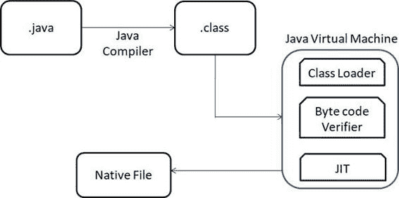

图 2.1：Java 程序的执行流

正如我们观察到的，源文件 `.java` 被提供给编译器。编译器编译该文件并转换为字节码文件，这是一个与平台无关的文件。该文件被传递给 `JVM`，由 `JVM` 负责执行它。

## Java 中的关键文件

在开发 Java 应用程序时，我们会遇到不同类型的文件。作为开发者，你必须意识到所有文件。

### 不同的文件类型是什么？它们在 Java 编程中的意义是什么？

当开发者编写应用程序代码时，他们通常在人类可读的文件中编写代码，这些代码会被转换为机器兼容的文件。作为开发者，你必须理解这些关键文件。

#### 源代码文件

该文件由 Java 开发者编写，扩展名为 `.java`。这通常是用高级编程语言编写的程序。下面的代码段将向你展示此类文件的基本结构看起来如下：

```java
int x;
//其他数据成员
public void() {
}
}
```

#### 字节码文件

在 Java 将高级代码转换为原生兼容的可执行文件之前，它会将其生成字节码，这是一种与平台无关的代码。该文件的扩展名为 `.class`，被称为可以执行的类文件。虽然面试官并不期望你去阅读类文件，但你可能可以看一眼编译后生成的类文件片段。

### 为什么 Java 被称为平台中性或独立语言？

传统的编程语言在编译后生成依赖于平台的文件来执行程序。例如，C 语言如果在 Windows 上编译，会生成 `.exe` 文件，该文件仅与 Windows 平台兼容。这意味着该文件是不可移植的。相反，Java 在编译后生成类文件，它是平台中性的。你可以在任何 `JVM` 上加载此文件，相应的 `JVM` 将负责生成用于执行的原生文件。

## Java 运行环境 (JRE)

在讨论 Java 时，你会遇到的最常见术语之一是 `JRE`。虽然它很常见，但我们许多人并不知道 `JRE` 的内部工作原理。面试官可能会就 `JRE` 提出一些刁钻的问题，你可能对此无知。

### JRE 的作用是什么？

`JRE` 通常是一个可以与其提供的类文件通信的程序。运行环境通常是软件传统上运行的一种物理操作系统。`JRE` 是运行在底层操作系统之上的软件。`JRE` 在整个 Java 生命周期中起着至关重要作用的主要原因是，程序员不需要担心实际的操作系统，也不需要根据操作系统来修改代码或执行过程。当你指示 Java 执行程序时，`JRE` 接受你的代码，通过 Java 类加载器合并不同的依赖项，并将其传递给 `JVM`。

### JRE 的组件有哪些？

`JRE` 包含以下三个组件：

1. 类加载器 (`Class loader`)
2. 字节码验证器 (`Bytecode verifier`)
3. 解释器 (`Interpreter`)

## 类加载器

类加载器在整个 Java 应用程序流中起着至关重要的作用。以下是你可以期待关于类加载器的面试题。

### 类加载器起什么作用？

Java 应用程序在设计上是复杂的。它们包含不同的类，这些类之间是相关的。大多数类使用来自其他类的服务。换句话说，它们依赖于某些其他类。因此，为了确保一个类被编译或执行，该类必须找到它所依赖的类。类加载器负责在内存中搜索并加载此类类。这些类并不是由类加载器一次性加载到内存中的；而是按需进行的。

### 有哪些不同类型的类加载器？

`JRE` 中有不同的类加载器，取决于它们从哪里动态加载类。

### 启动类加载器 (Bootstrap class loader)

`JRE` 的单体版本有一个 `.jar` 文件，它是 Java 中所有系统或内部类的仓库。这个 `.jar` 文件存在于 `lib` 目录。启动类加载器负责加载该 `.jar` 文件内部的类。此外，启动类加载器还作为其他类加载器的父类，需要有人来初始化它们。因此，它被称为 Java 的原始类加载器 (`primordial class loader`)。

### 扩展类加载器 (Extension class loader)

扩展类加载器是启动类加载器的子类。`JRE` 中的外部类位于 `jre/lib/ext` 目录中。如果类没有被启动类加载器加载，则扩展类加载器从该目录加载类。

#### 系统或应用类加载器 (System or application class loader)

该类加载器是扩展类加载器的子类。通常，开发者设置类路径来搜索应用程序的类。系统类加载器从类路径加载类。

如果你想知道哪个类加载器用于加载所需的类，可以使用该类的 `getClassLoader()` 方法，如下所示：


```java
class CheckClassLoader {
    public static void main(String[] args) {
        System.out.println(d.getClassLoader());
    }
}
```

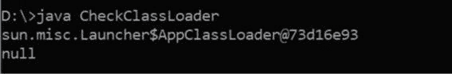

正如你所观察到的，`CheckClassLoader` 类是从 `Date` 类加载加载的，你得到的输出是 `null`。这个 `null` 表示该类是由启动类加载器加载的。启动类加载器的输出 `null` 是因为启动类加载器是用 C 或 C++ 库实现的。

在通过我们在应用程序中加载类时，我们可以提供类加载器。`Class.forName()` 方法接收字符串格式的类的全限定名称作为参数，这是你想要作为资源加载的类。

众所周知，Java 程序的编译和执行过程非常简单且直接。开发者通过一些事务性工作来生成类文件，并将其传递给 `JVM` 执行。尽管通常情况下，这不应该给 `JVM` 带来不一致性或安全性漏洞问题，但情况并非总是如此。有时，上传到 `JVM` 的类文件可能并非来自可靠的资源。例如，从热点浏览器下载的文件通常包含不需要 `JVM` 编译的类文件，因为它们在应用程序内部已经经过了预编译。此类第三方类文件可能包含某些代码，这些代码可以利用 Java 虚拟机。为了确保没有入侵者进入内部，`JVM` 拥有一个守门人，即字节码验证器（bytecode verifier）。如名所示，字节码验证器会验证是否存在任何损害 `JVM` 的违反约束的行为。

### 字节码验证器执行哪些验证？

验证器会执行以下验证：

- 帧中存在的操作数栈不应溢出，且不应下溢或未被充分利用。
- 变量在使用之前必须先进行初始化。
- 方法调用必须使用正确的引用。
- 栈不应溢出。
- `final` 类不能被扩展，`final` 方法不能被重写。

我知道你脑海中立刻产生的问题是：“嘿，你在开玩笑吗？所有这些任务都是由编译器完成的。字节码验证器在这些工作中起什么作用？”面试官可能会向你提出类似的问题。

尽管编译器可以检查所有这些方面并创建类文件，但类文件**是可以被修改的**。如果有任何心怀不轨的人了解汇编编程，他/她就可以编辑类文件并进行修改。这正是守门人拒绝此类类文件的地方。这使得 `JVM` 更加健壮和可靠。

`JVM` 是整个 Java 生态系统的核心。无论你是初学者还是 Java 专家，都应该对 `JVM` 有足够的了解。面试官期望你深入了解 `JVM` 的作用。让我们过一下一些与 `JVM` 相关的面试题。

“虚拟机”（Virtual Machine），这就是我们这样称呼它的。但当人们说虚拟机时，视角是不同的。通常，我们知道可以在现有的机器上安装虚拟机。例如，我们可以在 Windows 上安装一个 Linux 虚拟机，并在 Windows 系统之上运行 Linux。同样地，`JVM` 实际上是安装在你的系统上的一个抽象机器，你可以在上面执行你的 Java 程序。这种在你的系统上拥有一个独立虚拟机的方法是为了满足 Java 的平台无关性方法。大多数其他高层编程语言生成与操作系统匹配的可执行文件，而 Java 则创建的是一个可以在 `JVM` 上执行的字节码文件。`JVM` 拥有像你拥有的系统所有的特征。硬件设备包含寄存器、指令指针和集合。所有这些特征都被赋予了 `JVM`，正因如此，我们可以在它上运行 Java 编写的程序。

Java 程序包含不同的段，如方法、局部变量、引用、对象等许多。当我们执行类时，在程序运行期间，所有这些段都会被临时存储。这些段不会存储在 `JVM` 的相同位置，而是存储在不同的逻辑隔间内。图 2.3 显示了 `JVM` 的不同内存块。

**图 2.3：JVM 内存块**

以下是 `JVM` 生成的不同内存区域类型：

- **方法区或类 (Method Area or Class)**：此区域存储类信息，如变量、方法数据或运行时常量池。
- **栈 (Stack)**：栈内存存储执行期间每个线程创建的帧。所有的局部变量、方法结果都存储在这里。每当方法调用结束或完成时，帧就会被删除或移除。
- **PC**：每个被 `JVM` 执行的任务都在线程内执行。程序计数寄存器是一个内存，包含当前由 `JVM` 执行的线程的指令。
- **原生栈 (Native Stack)**：如果应用程序中使用原生方法，则原生栈内存会被原生方法利用。

### 你可以增加 JVM 的堆内存吗？或者什么是“OutofMemoryException”？我们如何处理它？

此异常在 `JVM` 内存不足时发生。为了处理这个问题，我们需要增加 `JVM` 的堆内存。我们可以通过向 Java 命令提供额外的属性来动态地增加 `JVM` 的堆内存。我们可以使用以下属性来修改堆内存大小：

- 设置最小堆大小
- 设置最大堆大小

例如，你可以执行以下 Java 命令来更改堆大小：

```bash
java Sample -Xms512m -Xmx1024m
```

或者，你也可以在操作系统中设置环境变量，以便在每次 Java 程序执行时更改堆大小：

```bash
```

### 你如何区分栈内存和堆内存？

栈内存是用于存储局部变量和对象或数组引用的内存。这种内存是运行时可扩展的。另一方面，堆内存是用于存储对象或数组的固定大小内存。这种内存可以在 JVM 启动时更改 Java 变量设置时更改。

`JIT` 是 Just in Time compiler（即时编译器）的缩写，它是存在于 `JVM` 内部的一种特殊编译器，将字节码转换为原生代码。`JIT` 在提高 Java 应用程序性能方面起着重要作用。它的工作方式与普通编译器相反。普通编译器在执行之前工作；而 `JIT` 在执行开始时开始工作。它本质上是动态的。让我们通过一些面试题来讨论 `JIT` 的概念。

我们都知道 Java 程序包含需要执行的类。类无非是平台无关的字节码。当 `JVM` 开始执行这些代码时，它必须解释这些字节码以确保底层 CPU 能理解它们。这个过程是非常耗时的，因为每个调用的方法或代码都必须经过解释，这会导致应用程序性能受到影响。

**图 2.4: 即时编译器**

图 2.4 显示了 `JIT` 如何获取字节码并将其转换为原生代码，以便 `JVM` 可以执行它。当然，与普通编译器一样，`JIT` 也相当昂贵。它确实需要内存和其他系统资源。但是，即使考虑到这一点，与 `JVM` 的普通解释过程相比，`JIT` 仍然提高了应用程序的性能。

### JIT 内部如何工作选择要编译的方法？

`JIT` 的工作方式非常有趣。`JIT` 编译器不会在方法调用时编译该方法。实际上，每个方法都会获得一个编译阈值。每当调用方法时，该阈值就会减一，一旦阈值达到零，`JIT` 就会将该方法编译为原生代码。

### 我们可以与 Java 版本不同的 JIT 版本吗？

`JIT` 和 `JVM` 是集成在一起的。因此，没有选项可以使用不同于 `JVM` 或 `Java` 版本的 `JIT`。通常，`JIT` 与 `JVM` 绑定，因此无法将其分离并作为独立组件使用。

### 可以禁用 JIT 吗？

可以，我们可以通过向 Java 命令提供选项 `-Xint` 或 `-DJava.compiler=NONE` 来禁用 `JIT` 编译器。

### 如果禁用了 JIT，你会面临什么后果？

不建议禁用 `JIT`，因为这将强制解释整个 Java 程序。正因如此，应用程序的性能将受到影响。所以，通常情况下，如果有人想诊断应用程序，才会禁用 `JIT`。

### JDK、JRE 和 JVM 之间有什么区别？

#### JVM

#### JRE

这通常是 `JVM` 的实现，称为 Java Runtime（Java 环境）。`JRE` 的主要工作是为 Java 提供运行时环境。它包含了执行 Java 文件所需的 Java 库。

#### JDK

`JDK` 是一个我们可以使用它来开发和编译 Java 应用程序甚至 applet 的环境。所以，我认为这是一个开发人员包。现在，`JRE` 本质上是 `JDK` 的一部分。

`JVM` 期望程序中有一个 `main` 方法作为启动方法。`main` 方法必须声明为 `public static void`。`main` 方法必须具有 `String` 类型的参数。参数不能是单个参数，但你可以拥有一个 `String` 数组或一个 `String` 变长参数。

```java
public static void main(String data[])
public static void main(String... data)
static void main(String[] data)
static public void main(String... data)
```

### 我们可以重载 main() 吗？

### 如果我们重载了 main 方法，你的程序会执行吗？

考虑以下代码段：

```java
class TestIT {
    public static void main(String args[]) {
        // 重载 main
    }
    public static void main(String[] args) {
        // 重载 main
    }
}
```

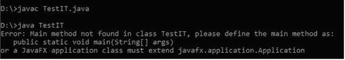

在这里，`TestIT` 类包含了重载的 `main` 方法。这个类可以正常编译，但如果执行，它将像前面的输出截图所示抛错误。

答案仍然是！上一个问题将根据 `private` 关键字的访问修饰符规则后续下一个问题。

我们可以将 `main()` 方法声明为 `private`。但如果你这样做，它在类外部是不可见的。正因为这样，`JVM` 将无法找到它并生成找不到 `main` 方法的错误。

可以，我们可以这样做。

如果我们把 `main` 方法声明为非 static，那么有人负责初始化类并通过该类的对象来调用方法。如果我们把 `main()` 声明为 `static`，那么 `JVM` 将 `main` 方法作为静态方法加载。

在本章中，我们讨论了 Java 的内部结构。我们探讨了在应用程序执行中起积极作用的不同 Java 组件。除此之外，我们讨论了针对每个这些组件可能提出的不同问题。

类是对象的工厂。对象的属性和行为是由类定义构建的。我们也可以说，它包含了关于你的对象将如何行为的指令。它是现实世界实体与理论概念之间的桥梁。类中声明的变量描述了对象的物理属性，而类的方法描述了对象的行为。在设计项目架构时，良好的类设计始终是最重要的部分，因为错误的类设计会导致生成的对象在整个项目的预期生命周期内可能无法按照预期的意工作。

## 设计类的约定有哪些？

在设计类时，应遵循以下约定：

- 名称应该大写字母开头
- 方法应该使用小驼峰命名法（camel Case）
- 应该包含私有数据成员
- 应该包含公共方法
- 注意：你可能会遇到关于修饰符及其规则的后续问题。

## 什么是对象？

如果说类是想象或预期，那么对象就是现实。对象是从类中创建的实体。每个对象都拥有与数据成员关联的值，这被称为状态（state），以及执行分配给它的任务的业务逻辑，这被称为行为（behavior）。对象可以是逻辑上的，也可以在自然界中物理存在。

每个对象都与其相关的以下属性：

### 状态

状态是对象所拥属性的值。对象的设计通常通过这种状态来实现。例如，当一辆汽车是蓝色的，蓝色就是颜色属性的值，定义了汽车的状态。

### 行为

### 身份

同类型的每个对象都与其相关的唯一性，这被称为该对象的身份（identity）。你可以拥有任何数据成员并将其视为身份，或者你可能拥有该对象的内存地址，这被视为身份，但对程序员是不可见的。

人们说我们的出生是有原因的。上天分配给了我们某些任务。同样，对象的创建是为了某个目的；它们负责某些事情。它们必须参与它们被创建时所属的业务逻辑。

对对象的详细了解是你必须掌握的最基础的内容之一。毕竟，对象是 OOP 的核心，你的整个开发都围绕它展开。你应该知道如何创建它、如何在不同对象之间建立关系，以及如何销毁它。如果你无法回答这些基础问题，那么你在面试中将会惨败。这些问题的答案很重要，因为你面试的接下来的旅程将取决于此。

## 什么是构造函数？解释它的作用

构造函数是定义在类中的特殊方法，其名称与类名相同。每当对象被创建时，构造函数就会被隐式调用。构造的主要目的是初始化对象，换句话说，初始化对象的数据成员。

## 我们可以私有构造函数吗？

是的，我们可以写私有构造函数。但是，如果我们这样做，可以观察到以下一些限制：

- 你无法创建该类的子类。
- 通常，这种做法用于单例设计模式。

## 为什么 Java 不被称为 100% 面向对象的编程语言？

要将任何编程语言视为 OOP 语言，它必须遵循两个原则。它必须支持 OOP 语言的所有支柱，Java 做到了。其次，它的所有内容都必须是对象。遗憾的是，Java 在这一点缺失。Java 仍然具有一些像基本类型（Primitives）这样的特性，它们不是对象。当然，Java 有包装类作为基本类型的对应对象，但根据许多开发者的观点，API 中存在基本类型使得它不符合完整的 OOP 语言。

## 为什么 Java 中所有的实例变量都有默认值？

当我们使用 `new` 关键字创建对象时，会在堆中保留内存。为了初始化这段内存，JVM 提供了默认构造函数，负责将实例变量初始化为默认值。当我们创建对象时，这个构造函数始终存在。所以，如果你写了自己的构造函数，将在 JVM 提供的构造函数之后调用。

## Java 中的访问器方法（accessor）和修改方法（mutator）是什么？它们的意义是什么？

每个类都有参与业务逻辑的数据成员。访问和修改此类数据成员始终需要方法的帮助。这些方法可以用于初始化数据成员或设置数据成员。但是，如果我们写一个方法来访问和修改数据成员，我们就违反了面向对象的抽象规则。因此，Java 引入了访问器和修改方法的概念。这些方法专门用于单个数据成员。因此，每个数据成员将有两个方法即 `setter` 和 `getter`。`setter` 方法用于设置数据成员的值，被称为修改方法。而 `getter` 用于获取其所声明的数据成员的值，被称为访问器方法。除此之外，访问器和修改方法还有另一个优势。许多框架如 `spring`、`hibernate` 在内部与你对象的数据成员进行通信。如果访问数据成员的方法是由你写的，那么框架就不可能搜索这样的方法。但是，框架可以在内部找到 `getter` 和 `setter` 方法来隐式地与数据成员通信。

## 对象创建

对象的创建是另一个基础但重要的领域，面试官会在那里测试你。你应该知道什么是创建对象，以及创建对象的不同方式。以下章节涵盖了大多数与对象创建相关的问题。

### 创建对象的不同方式有哪些

- 使用 `new` 关键字
- 使用 `clone` 方法
- 使用反序列化（de-serialization）

### 如何使用 `newInstance` 方法创建对象？

### 如何创建现有对象的拷贝？

### `clone` 方法与将对象引用复制另一个对象有什么区别？

### 如何使用 clone 方法创建新对象？

```java
class Student implements Cloneable {
    String studName;

    Student(int rollNo, String studName) {
        this.studName = studName;
    }

    public Object clone() throws CloneNotSupportedException {
        return super.clone();
    }

    public static void main(String[] args) {
        try {
            Student s1 = new Student(101, "John");
            Student s2 = (Student) s1.clone();
            System.out.println(s2);
        } catch (CloneNotSupportedException c) {
            c.printStackTrace();
        }
    }
}
```

当我们尝试克隆一个没有实现 `Cloneable` 接口的对象时，`JVM` 会抛出此异常。如果对象没有实现 `Cloneable` 接口，你无法对其调用 `clone` 方法。

当我们想要序列化一个对象时，必须做的第一件事是对该对象的类实现标记接口 `Serializable`。这使得该类的对象具备序列化的资格。

注意：关于序列化还有一些可能的问题，但我们将在第 5 章 `File` 中详细介绍。

### 什么是反序列化，它是如何生成新对象的？

反序列化是我们能够检索已序列化对象的过程。我们不需要任何构造函数来创建此类对象，但 `JVM` 在内部会读取该对象在序列化时存储的全部字节码。然后，提取的数据被封装成对象格式并返回给用户。

注意：有时，面试官可能会更进一步，问你是否可以反序列化从其他框架序列化的对象，例如，如果一个对象在 C# 中序列化，Java 能反序列化同一个对象吗？答案是不！反序列化是一个依赖于语言的过程，因为在序列化过程中，语言信息被添加到序列化对象中。

### Java 中存在哪些访问修饰符？你能解释它们的重要性吗？

以下是 Java 中的访问修饰符：

- **private**：
  当我们将任何成员声明为 `private` 时，认为它具有最高安全级别。此类成员在声明它的类内部是可以被访问的。即使你导入了一个类，这些数据成员也是不可访问的。只有内部类可以访问其声明的外部类的私有数据成员。

- **default（默认）**：
  如名所示，这是一个默认访问修饰符。没有特定的方法来声明它，但如果你没有提到任何修饰符，该成员就被认为具有默认访问权限。具有此修饰符的成员在同一个包内是可以访问的。

- **protected**：
  当我们将一个成员声明为 `protected` 时，该成员在包内是可以访问的。它在包外部也是可用的，但仅限于该类的子类。

- **public**：
  当我们要声明任何要暴露给整个世界的成员时，我们可以使用 `public` 访问修饰符来声明该成员。当然，即使我们使用了 `public` 访问修饰符，如果我们在包之外使用该成员，导入该类是强制性的。

### 我们可以对类应用 private 修饰符吗？


这是一个棘手的问题。如果你说可以对类应用私修饰符，答案是错误的。但从另一个角度来看，如果一个类是内部类，你可以对它应用 `private` 关键字。

## 封装

著名诗人费尔南杜·佩索曾说过：“如果我死后人们想写我的传记，这并不简单。他们只需要两个日期：我的出生日期和去世日期。在两者之间，每一天都属于我。”每个人在现实世界中都享有隐私。对象也是如此，毕竟它们代表了现实世界。建议通过封装来设计对象，使其隐藏自身的构建方式和处理数据以实现目标的方式。

## 什么是封装，如何实现它？

每个对象由数据成员和成员函数组成。数据成员的值表示对象的状态，成员函数定义对象的行为。行为通常由数据成员的值控制。因此，如果我们希望对象的行为正如创建者设计的那样，那么数据成员就不应该直接暴露给终端用户。这种从外部世界隐藏内部结构或数据成员的行为被称为封装。

我们可以通过将数据成员声明为 `private` 并将成员函数声明为 `public` 来实现封装。通过这种方式，系统的用户只能访问成员函数而不能访问数据成员。

## 你能通过示例解释为什么要遵循封装吗？

当然。考虑如下代码中的 `Rectangle` 类：

```java
class Rectangle {
    int width, height;

    Rectangle(int width) {
        this.width = width;
    }

    double getArea() {
        return area;
    }

    Rectangle rect = new Rectangle(10);
    System.out.println(rect.getArea());
}
```

在这里，我们期望用户初始化 `width`，而在内部，`height` 将根据开发者编写的逻辑进行计算。但这种方法的问题在于，由于没有遵循封装，对象可以直接初始化数据成员 `height`：

我们不希望对 `height` 数据成员进行手动修改。为了实现这一点，我们需要将 `width` 和 `height` 声明为 `private` 数据成员，以便它们在类之外无法被访问：

```java
private int width, height;
// 实现代码
}
```

## 为了实现完全封装，我们可以将类声明为私修符吗？

## 继承

## 什么是 Java 中的关联（Association）？

下面的代码片段将演示如何实现组合：

```java
{
  String color;
  Engine
  }
  {
    //data member
    //member functions
}
```

这两者在 Java 中都是关联（association）的类型。这两个概念都使用另一个对象作为自身的一部分。但它们有一个区别：一旦使用组合，如果我们销毁了主对象，与之关联的对象也会被销毁或失去意义。在聚合的情况下，即使删除了主对象，另一个对象仍然存在于系统中。

## 你能提供一个组合和聚合的例子吗？

## Java 中“是一个...”关系（is-a-kind relation）和“包含一个”关系（has-a-kind relation）的区别是什么？

Java 支持两种类型的继承方式：“是一个...”关系和“包含一个”关系。“是一个...”关系展示了继承的经典方法，你创建一个行为与现有类型相似的新类型。在这种方法中，你创建一个新对象，它本质上继承了已存在对象的所有属性和行为，该对象被称为它的超类（super class）。新创建的对象称为子类（subclass）。例如，汽车是车辆（vehicle）类型。在这里，`vehicle` 定义了不同类型车辆的共同属性。汽车是一个子类，可以被设计为一种类型的汽车。这实现了 `vehicle` 中定义的代码的可重用。因此，你不需要重新定义 `vehicle` 中已经定义的共同属性或方法。

另一方面，“包含一个”关系代表组合。在这种方法中，一个对象拥有另一个对象的引用作为其属性的一部分。在这里，新创建的对象不继承现有对象的属性和行为，但它可以通过内部声明的引用来使用该对象的服务。例如，汽车有一个方向盘，或者汽车内部有一个引擎。

## 你如何解释耦合（coupling）这个术语？

松耦合（loose coupling）是指什么意思？

软件本质上是不同组件相互通信以实现某些目标的集合。这种通信通常需要在系统的不同组件之间建立关系。这种关系或连接在 OOP 语言中被称为耦合。

## 耦合（tight coupling）是指什么意思？

软件开发是一个复杂的场景，我们从出生起就知道这一点。随着我们向更高级的编程功能移动，它变得越来越复杂。软件本质上是不同组件相互通信以实现某些目标的集合。这种通信通常需要在系统的不同组件之间建立关系。这种关系或连接在 OOP 语言中被称为耦合。

软件开发是一个复杂的场景，我们从出生起就知道这一点。随着我们向更高级的编程功能移动，它变得越来越复杂。软件本质上是不同组件相互通信以实现某些目标的集合。这种通信通常需要在系统的不同组件之间建立关系。这种关系或连接在 OOP 语言中被称为耦合。

## 用真实示例解释松耦合

```java
{

  Print s;

  {

  }

  {

    s.display();

}

```

```

{

  B b;

    b = new B();

  }

  {

  }

}

```

## 什么是抽象类（abstract class）？

抽象类被认为是不完整的类。该类声明的是骨架（skeleton）而不是具体实现（stub）。这意味着该类声明了方法但没有定义方法体。该类通过将方法声明为抽象的（abstract）来声明不完整的方法。此类抽象方法需要由扩展抽象类的子类进行重写。

类当被声明为 final 时，它不能被扩展。当你想要确保你的服务不会通过创建子类被修改时，可以将该类声明为 final。通过将类声明为 final，所有的方法都会隐式地变为 final 的。如果你愿意，可以对特定的方法应用 final 关键字。

## 什么是 final 方法（final method）？

## 抽象类可以包含构造函数吗？

是的。抽象类可以作为其定义的一部分包含构造函数。

## 为什么抽象类在无法实例化的情况下也提供构造函数？

抽象类不仅仅代表一个骨架。有时，它可能包含带有某些业务逻辑的具体方法。为了执行该方法的业务逻辑，抽象类可能需要局部变量或数据成员。因此，为了给数据成员某些默认值，抽象类提供了构造函数，你或 JVM 可以在构造从中初始化数据成员。

通常，当我们定义一个类时，我们会编写描述对象行为的方法。这些方法在花括号边界内有与之关联的方法体。此类方法被称为**具体方法**（concrete methods）。

即使方法使用空花括号声明，该方法仍然被视为具体方法而不是抽象方法。

可以。我们可以拥有一个所有方法都是具体方法的类，并且仍然将该类声明为抽象类。但正如我们所知，我们不能实例化抽象类。因此，如果你想使用该类提供的服务，你需要派生该类的子类然后实例化它。

将任何类声明为抽象类的整个目标是为了子类化。我们总是扩展抽象类并实例化子类。子类还会重写由抽象类声明的抽象方法。`final` 关键字使得类无法被子类化；如果类被声明为 `final`，则无法扩展该类。因此，不允许将声明的抽象类声明为 `final`。

当我们把任何方法声明为 `private` 时，基本上是我们剥夺了它的可见性。该方法对外部世界不可见。抽象方法需要被子类重写，因此它们必须对子类可见。由于 `private` 方法在类外不可见，你无法重写它。因此，不允许将抽象方法声明为 `private`。

`static` 关键字与类相关，而不是与对象相关。相反，重写的概念是建立对象之间的关系，你可以在其中覆盖父类的方法。因此，任何不属于对象的内容都不能被重写，所以在在声明抽象方法时不使用 `static` 关键字。

抽象类被子类扩展。每个子类在实例化时都会隐式地调用它自己的构造函数。而构造函数提供了 `super` 关键字，它会调用父类的构造函数。

```java
int x;

}
//方法 1 的体

}
}
```

```java
int x;
//数据成员初始化
}


//调用父类的默认构造函数，即抽象类 A


//方法 1 的体


}
```

## 接口有构造函数吗？它与抽象类有什么区别？

与抽象类不同，接口没有构造函数。由于接口没有数据成员，因此它不需要构造函数。抽象类和接口之间的一个主要区别是，接口包含抽象方法，而抽象类可以包含具体方法和抽象方法的组合。

## 接口的作用是什么？

Java 不支持多重继承。因此，你无法利用从多个资源声明或定义的服务。接口是解决这个问题的方案。你可以为你的类扩展单个类和多个接口。接口是完全抽象的实时实现，你在其中声明方法，并将实现留给子类。接口在实现松耦合方面也起着重要作用。

## 什么是多态引用？

多态引用用于动态控制子类的行为。当子类对象被父类引用引用时，这种引用被称为多态引用。任何参与“是一种”这种关系（is-a kind of）的实例都可以参与多态引用。因此，任何对象都可以被其直接父类、间接父类、它所实现的接口甚至是宇宙父类对象所引用。

## 多态引用的意义是什么？你如何实现它？

当我们使用对象引用来调用方法时，JVM 在你所引用的对象中搜索该方法，并执行该方法。如果子类中不存在该方法，那么如果父类中存在该方法，则将执行父类的方法。因此，表面上看，子类足够灵活，可以编写并执行父类中不存在的方法。子类传统上是一个超级老板，除非有人控制它。

考虑以下代码段，其中 `Dog` 是以下类的子类：

```java
is
}
}

`Dog` 扩展了 `Animal`，并且它可以重写 `Animal` 类中的方法。因此，调用 `talk()` 时的 `Dog` 引用将调用 `Animal` 中的实现，而当调用 `breath()` 方法时，将调用 `Animal` 类的方法，因为 `Dog` 类中不存在该方法。但是，让我们考虑 `Dog` 的实现如下：

class Dog extends Animal {
void read() {
    System.out.println("reading Economic Times");
}
}
```

让我们现在更改 `Dog` 的引用，如下所示：

```java
Animal d = new Dog();

d.read();
```

前面的代码失败了，因为 `Dog` 的对象被 `Animal` 引用，它尝试调用 `Animal` 未知的方法。通过这种方式，我们可以使用多态引用来控制子类的行为。

## 如果 Object 是宇宙父类，用它引用每个对象会有问题吗？

从技术上讲，通过 Object 父类引用每个对象没有问题。但动态来看，这将产生非常奇怪的情况。想象以下语句：

```java
Object c = new Car();

Object s = new Student();
```

在这里，所有三个对象都被 Object 父类引用，这对于编译器来说完全没问题。但当你尝试使用相应的引用调用 `Employee`、`Car` 或 `Student` 的方法时，将会失败。原因显而易见。因为所有对象都是多态引用的，只能调用 Object 类已知的方法。

## 我们可以扩展多个类吗？

不，在 Java 中不支持多重继承。虽然你可以创建层次继承，但不能创建多重继承。

## 你在 Java 中如何实现多重继承？

在 Java 中实现多重继承的唯一方法是使用接口的概念。你可以创建一个接口，并在想要多重继承的类中实现它。你的类可以扩展一个类，并实现任意数量的接口。

## 你可以实现多个接口吗？

是的，我们可以。使用接口的一个重要原因之一是为了有效实现高内聚。即使所有接口之间互不相关，你也可以实现多个接口。

你可以做的另一件事是可以在接口之间建立关系，并将它们用作层次结构继承。让我们观察以下接口代码片段，首先是 First 和

```java
First.java
Second
```

```java
在前述代码片段中，接口 `Second` 继承自 `First`。你可以从一个接口扩展另一个接口。

InterfaceDemo.java
//实现接口 First,Second 中的方法
}
```

如果你的类实现了两个接口，且这两个接口都声明了相似的方法，那么将调用哪个方法？这样做是允许的吗？

考虑以下代码片段：

```java
}
}
@Override
// TODO 自动生成的方法存根
}
}
```

在前面的代码片段中，有两个接口 `First` 和 `Second`。这两个接口都声明了相同的方法。当 `DemoInterface` 实现了 `First` 和 `Second` 接口时，它必须重写来自这两个接口的方法。但由于两个接口包含相同的方法，该类可以拥有一个方法来满足两个接口中声明的方法，因此程序可以正常编译。

注意：如果问题的描述方式不同，例如——你是否可以由一个类实现具有相同方法签名的不同接口？答案仍然是肯（YES）。但是，如果你遇到这样的场景，那么说明你的应用程序设计存在问题。请确保在面试官面前提到这一点。

## `final` 关键字的作用是什么？

在 Java 中，没有像 C、C++ 等早期编程语言中存在的 `const` 关键字。`final` 关键字用于标记不可修改的内容。你可以将变量声明为 `final`，使其成为常量。你也可以将类声明为 `final`，使其无法被扩展。你甚至可以将方法声明为 `final`。如果你将一个方法声明为 `final`，则子类不允许重写该方法。

## 我们可以将引用声明为 final 吗？这意味着什么？

我们可以将引用声明为 `final`。将引用声明为 `final` 并不意味着你让它引用的对象是 final 的。当你将任何引用声明为 `final` 时，你无法将对象重新赋值给引用。考虑以下代码片段：

```java
//编译错误
```

在片段中，`String x` 被声明为 `final`。这意味着我们不能将任何对象重新赋值给它。由于由于，第 2 行将编译失败。但正如你看到的，可以通过调用所引用的对象的 `concat()` 方法来对对象进行更改。

## `static` 变量的作用是什么？

`static` 关键字用于声明类变量。通常，当我们声明任何数据成员时，它会为不同的对象独立实例化。不同的对象会分配到不同的变量副本。因此，如果一个对象对该变量进行了任何更改，另一个对象与此没有任何关系。另一个对象将拥有该变量自己的副本，并在上面进行处理。

另一方面，如果我们将变量声明为 `static`，则该变量的副本将在所有相同对象之间共享。因此，如果一个对象对此类变量进行了修改，另一个对象将获得该变量的更新副本。

## `static` 方法的作用是什么？

众所周知，我们可以在类中声明 `static` 变量。`static` 变量是类变量，所有对象共享同一个变量副本。当我们想要处理 `static` 变量时，建议使用 `static` 方法。因此，本质上，`static` 方法用于处理或返回 `static` 变量。

## 可以使用非静态方法来处理静态变量吗？

可以。我们可以使用非静态方法来处理静态变量。尽管这在开发者脑海中可能会引起困惑，但在技术上来说，这是允许的。

## 可以使用静态方法来处理实例变量吗？

不可以。每当我们声明 `static` 方法时，内部永远不会使用 `this` 关键字。实例变量总是由编译器加上 `this` 关键字的前缀。但是，`static` 方法不属于任何特定的对象，它们被称为类方法，不能处理任何专门针对特定对象的业务逻辑。因此，我们不能在 `static` 方法中使用非静态成员。

## 静态和实例变量可以声明相同的名称吗？

不可以，你不能为静态和实例变量使用相同的名称，因为这会给编译器带来困惑。

## 在什么场景下可以使用静态变量？

有很多场景可以使用静态变量。假设你有一个 `Employee` 类。如果你感兴趣统计创建了多少个 `Employee` 对象，你需要一个计数器变量，该变量在每次创建对象时都应该加 1。但如果你将计数器变量声明为实例变量，那么如果一个对象增加了计数器变量的值，其他对象仍然将获得计数器的原始值。在这种情况下，你可以将计数器声明为 `static`，这样对计数器变量的所有更新都将在所有 `Employee` 对象之间共享。


```java
{
    int empId;
    counter;

    Employee(int empId, String empName) {
    }
    {
        return counter;
        (String[] args) {
            Employee
            Employee
            Employees
        }
    }
}
```

### 除了变量之外，我可以在其他地方应用 `static` 吗？

### `this` 关键字的作用是什么？

此外，如果局部变量和实例变量之间存在任何歧义，你可以使用 `this` 关键字来区分于局部变量的实例变量。

`super` 关键字指向父类。如果你从子类显式地调用父类的成员，就可以使用这个关键字。你可以调用父类的数据成员或成员函数。不仅如此，你还可以从子类构造函数显式地调用父类的构造函数。

# `super` 关键字必须是构造函数的第一行。

当我们说处于一个子类中时，它显然包含了一些数据成员。很多时候，子类的数据成员依赖于父类的数据成员。因此，除非父类的数据成员被初始化，否则子类的数据成员将无法被初始化。所以，为了确保父类的数据成员在子类的任何成员之前被初始化，`super` 关键字被放置在构造函数的第一行。

当我们创建一个任何类的对象时，隐式地会调用该对象的构造函数。但在内部，该构造函数通过 `super` 关键字调用父类的构造函数。因此从实际上，尽管我们可以观察到父类的构造函数是先调用的，但从理论上来说，并不是这样的。“事情并非看起来都是那样。”总是子类的构造函数首先执行，它在内部调用父类的构造函数。

与 C++ 等传统编程语言不同，在 Java 中没有与类名同名的析构函数。但是，`finalize()` 方法在 Java 中被称为析构函数。该方法在对象内存从虚拟内存中删除时，由 `JVM` 隐式地调用。我们可以重写此方法，编写自定义代码以释放与当前对象相关的资源。

以下方法是 `Object` 类的一部分，可以被子类重写：
- `protected Object clone()`
- `protected void finalize()`
- `public int hashCode()`
- `public String toString()`

一旦你列出了 `Object` 类中的不同方法，接下来，你可以预期会有基于这些方法的一系列问题。

## `toString()` 方法的作用是什么？

正如名称所示，该方法以 `String` 格式表示对象。它返回一个包含对象信息的字符串，这对用户来说是易读的。如果没有被重写，它将返回对象哈希值的十六进制表示。我们可以重写此方法，以便根据业务需求返回我们想要作为对象信息的的字符串。

## `equals()` 方法是什么，它是如何使用的？

该方法用于检查对象的相等性。开发者可以重写此方法以实现检查对象相等性的业务逻辑。在这个方法中，开发者可以检查成员级别的相等性，并根据结果返回 `true` 或 `false`。如果该方法没有被重写，`Object` 父类将认为每个对象都不相等，并向调用者返回 `false`。

## 我们可以用 `abstract` 关键字声明接口吗？

我们可以使用 `abstract` 关键字声明接口，但这不是必须的。接口内部默认是抽象类，因此我们可以将接口声明为抽象接口。

## 如果接口在内部是一个类，它是否会默认扩展万能父类，即 `Object` 类？

接口没有可用的万能父类。由于其抽象实现方式，没有任何业务逻辑的范围，因此不需要 `Object` 父类。

## 接口中的默认方法（default method）是什么？

默认方法的概念在 `JDK1.8` 中引入。通常，接口提供完全的抽象，但接口中的默认方法是接口中已实现的方法。这等同于创建一个结合了具体方法和抽象方法的抽象类。

## 为什么接口中需要默认方法？

有时，我们有一个被某些类实现的接口。假设现在接口因为某些业务需要想要再声明一个方法。但当我们向接口中添加某些额外方法时，与该接口连接的类将会失败，因为它们并不知道接口中引入的新新方法。
因此，在这种情况下，新创建的方法或多个方法可以创建为默认实现方法。通过这样做，依赖于接口的现有类不需要修改自己，因为接口中的方法有与其关联的方法体。将实现你的接口的新类可以在需要时重写该方法。

## 接口可以有多个方法作为默认实现方法吗？

是的，接口可以拥有任意数量的方法作为默认实现方法。

## 接口中的静态方法（static method）是什么，它的意义是什么？

接口中的静态方法与默认方法类似，这意味着它们拥有关联的方法体。但两者之间的区别在于，由于方法是静态的，实现该接口的子类没有权限重写它；另一方面，默认方法是可以重写的。

## 什么是函数式接口（functional interface）？

函数式接口只有一个目的的接口。这意味着函数式接口在其内容只声明了一个方法。任何实现此接口的类都需要重写此方法，以确保它为函数式接口所声明的服务提供了含义。

## Java 中的万能父类（cosmic super class）是哪个？

`Object` 类被称为 Java 中每个对象的万能父类。即使你没有显式提到任何扩展 `Object` 的类，默认情况下，`JVM` 也会将 `Object` 变为每个类的父类。

## 等于运算符 (`==`) 和 `equals` 方法之间的区别是什么？

相等运算符 `==` 通常用于基本类型以检查变量的相等性。另一方面，`equals()` 方法通过比较数据成员来检查相等性。要检查两个对象是否相等，我们需要重写 `equals()` 方法。我们也可以对引用使用 `==` 运算符，但它检查的不是对象，而是引用的相等性。只有引用指向同一个对象时，`==` 才会返回 `true`。

## 什么是变长参数（var argument）？在哪里可以使用？

当我们重载方法时，我们在修改方法的参数。我们要更改参数的类型或数量。如果我们想要重载一个接受相同数据类型不同数量参数的方法，与其声明具有不同数量的方法，不如使用变长参数。

```java
// 方法体
}

method(int b, int c) {

}

method(int b, int c, int d) {
    // 方法体
}
```

在前面的代码片段中，我们重载了三个接受不同数量整数参数的方法。这段代码片段可以用下面的变长参数替换：

```java
method(int... values) {
    // 方法体
}
```

## 声明变长参数方法的不同规则是什么？

在使用变长参数时，必须遵循以下规则：
- 给定方法中必须且只有一个变长参数。

## 使用 `var` 参数和数组作为方法参数有什么区别？

## 什么是方法重写（Method Overriding）？

## Java 中方法重写的规则有哪些？

- 被重写的方法必须具有相同的方法名和相同的参数列表。
- 被重写的方法必须具有相同的返回类型或协变返回类型（协变返回类型是原始方法返回类型的子类型）。
- `final` 方法不能被重写。
- 私有方法不能被重写，因为它们在声明或定义的所在的类外部不可见。
- 被重写的方法不能抛出新的或更宽泛检查异常（checked exceptions）。
- `strictfp` 修饰符对重写过程没有影响。
- 静态方法不能被重写。

静态方法是可以重载的，因为重载的概念仅限于参数的类型或数量。在重载方法时，应用于该方法的其他关键字并没有意义。

这个问题有点诡机。如果我们在父类中将方法声明为 `static` 并用不同的实现重写相同的方法声明，那么不会出现编译错误。但这不被视为重写。`static` 关键字在面向对象的任何概念中都不被考虑，特别是继承关系。因此，简而言之，我们可以说不能重写静态方法。

当我们在子类中重写方法时，必须保持方法的返回类型相同或原始返回类型的子类型。这种返回类型的子类型被称为协变返回。

```java
{

}

    public Integer method with covariant return

}
```

在前面的代码段中，类 `B` 是类 `A` 的子类，它重写了父类 `A` 中定义的 `returnSomething()` 方法。如果你观察父类中方法的返回类型，它返回 `Number`。但在子类中，该方法返回 `Integer`，它是 `Number` 的子类型。这种返回类型被称为协变返回类型。

## 我们可以更改重写方法的返回类型吗？

根据规则，被重写方法的返回类型必须相同。然而，你还有另一个备选方案。与其保持返回类型完全相同，你可以将方法的返回类型保持为父类中定义方法的子类型。

## 在实现方法重载时，对访问修饰符有任何限制吗？

准确地说，方法重载的概念仅与方法签名相关。在方法重载中，我们需要严格保持相同的方法名但不同的参数列表。方法重载与访问修饰符无关，因此在重载时，保持访问修饰符相同或不同没有任何限制。

> **注意**：有时，面试官可能会在白纸上和你分享一些代码，其中用不同的访问修饰符实现了方法重载，因此请确保你清楚在阅读重载方法时需要观察什么。

## 抽象类和接口之间有什么区别？

以下是抽象类和接口之间的区别：
- 抽象类可以包含抽象方法，也可以包含具体方法；接口只能包含抽象方法。
- 抽象类可以包含构造函数，但接口不能包含构造函数。
- 抽象类可以包含数据成员，但接口只能声明和初始化常量。
- 抽象类可以拥有私有的、保护的甚至是公共的成员。另一方面，接口的所有所有内容默认都是公共的。

## 什么是标记接口（Marker Interface）？

标记接口是一种特殊的接口，其内部没有声明任何方法。它甚至没有与其关联的字段。这种接口也称为标签接口（tagging interface）。

## 标记接口的用途是什么？

标记接口用于指示编译器在运行时可以应用于某个类的特殊行为。你不需要重写任何方法来实现接口；它只是提供给编译器的某些额外信息。当然，还有比标记接口其他方法可以向编译器提供额外信息，例如在类内部声明某些标志。但如果我们使用标记接口，它会增加类的可读性。

## 你能列出一些你工作过的标记接口吗？

我工作过不同的标记接口，比如像 `Serializable`、`Cloneable`、`Remote` 等等等。

## 你可以创建自己的标记接口吗？如何声明它？

创建标记接口没有任何特殊的魔法。我们只需要创建一个不带方法的接口，它将被视为标记接口。然后，你可以在类上实现这个接口，以表示该类是你声明的标记接口类型。此外，在你的业务逻辑中，你可以检查该类是否为你声明的类型，然后允许对象进行某些处理。

如果你观察的话，第 2 行使用了 `Object` 类的引用来访问 `Employee` 的数据成员，由于多态引用，这是不可能的。因此，为了实现这一点，你需要将 `Object` 类的引用向上转型（up-cast），如下：

```java
public boolean equals(Object o) {
    Employee e = (Employee) o; // Downcasting
}
```


### Java 中变量类型有哪些？请解释它们的作用域。

Java 提供了以下类型的变量：

#### 实例变量

#### 局部变量

当变量在方法或块内部声明时，被称为局部变量。局部变量的主要属性是它们仅在声明它们的块或方法内可见。你可以在方法、循环、甚至 `if` 条件中声明局部变量。与实例变量不同，局部变量没有默认值。

#### 静态变量

静态变量看起来与实例变量几乎相似，但有一个区别：它们需要用 `static` 关键字声明。静态变量也被称为类变量，因为它们没有为每个对象提供单独拷贝。变量的单一拷贝在同类的所有对象之间共享。一个对象的修改将反映在同类的其他对象上。与实例变量类似，所有的静态变量都有默认值。

引用变量是指指向对象的变量。我们可以在方法中局部声明这些变量，也可以在组合概念中将其作为实例变量使用。如果它们被用作实例变量，则该类的所有方法都可以访问它们。但如果在任何方法内部声明，它们仅在该方法内是可访问的。

### Java 中的实例初始化块是什么？

### Java 中静态初始化块和实例初始化块有什么区别？

静态初始化块用于初始化静态成员，而实例初始化块用于初始化实例变量。两者之间的主要区别是，静态初始化块只在生命周期期间被调用一次，而实例初始化块在每次创建该类的对象时被调用。

### 你能解释 Java 中包装类的概念吗？

包装类顾名思义，封装了数据。它们封装数据并将其转换为对象。因此，本质上，包装类是原始类型的对象形式。例如，对于 `int` 原型，有一个 `Integer` 包装类。同样，我们还有 `Byte`、`Short`、`Long`、`Double`、`Float`、`Character`、`Boolean`。

包装类提供了两个重要的功能：
1. Java 中有些概念（如集合）只能使用对象而不是原始类型。因此，在这种情况下，如果我们想使用原始类型，可以使用相同的包装形式。
2. 包装类提供了将数据类型从一种转换为另一种类型的方法。

### 什么是自动装箱和自动拆箱？在什么场景下观察到它们？

自动装箱是将原始类型转换为包装类的过程。自动拆箱是将包装类转换为原始类型的过程。

当你尝试访问、修改或处理包装类时，会发生自动拆箱。例如，考虑两个 `Integer` 包装类，你想将它们相加，如下：

```java
Integer i1;
Integer i2;
int sum = i1 + i2;
```

在这种情况下，你不能直接相加 `i1` 和 `i2`，因为它们是对象。但在运行时，JVM 会拆箱包装类并从中提取值，然后执行加法过程。

### 什么是不可变对象？你能列出你处理过的某些不可变对象吗？

### 不可变对象的用途是什么？我们为什么要创建这样的对象？

如果你不想让对象在创建后被修改，则会创建不可变对象。当我们创建一个多线程应用程序时，有时一个线程创建的对象可能会被另一个线程修改，导致系统可能以意想不到的方式运行。因此，为了确保你的对象不会被其他线程修改，你可以创建一个不可变对象。

可以。我们可以创建不可变对象。要创建不可变对象，在设计类时需要遵循以下规范：
- 类的所有数据成员都应该是 `private` 的。因为如果不是私有的，它们可能会在类外被修改。
- 你必须为类准备一个带参数的构造函数以便初始化数据成员。
- 类不能有 setter 方法。它可以包含 getter 方法。
- 如果类包含其他对象引用，那么 getter 方法不应该返回对象的引用；相反，应该返回该对象的拷贝。

Java 中的枚举是一种特殊的类，包含一组命名的常量。枚举类是定义的 `Enum` 类的子类。在 Java 中，枚举还可以包含变量、方法和构造函数。

### enum 可以扩展其他类吗？

不可以，`enum` 不能扩展其他类，因为它已经扩展了 `Enum` 类。这违反了 Java 的策略，即“Java 不支持多重继承”。

### 我们可以编写实现接口的 enum 吗？

可以，`enum` 可以实现任何其他接口如类，因为它内部是一个类。你只需要记住，你必须重写接口中声明的方法。

当你访问枚举中存在的常量时，Java 内部提供了 `toString()` 方法，返回该常量或对象的字符串表示。你甚至可以重写 `toString()` 方法并返回表示对象的自定义字符串。

### 可以在 enum 中声明构造函数吗？

### 为什么枚举的构造函数保持为私有？

枚举构造函数保持为私有是为了使其内部存在的值或常量不应在外部修改。

### 可以使用 `new` 关键字实例化 enum 吗？

由于 `enum` 没有公共构造函数，你不能通过 `new` 关键字创建枚举的实例。

Java 枚举中有三个重要方法：
- `values()`：此方法返回枚举中存在的所有值。
- `ordinal()`：返回枚举常量的索引数字。
- `valueOf()`：此方法返回作为参数指定的 `enum` 中的常量。

## 包

在 Java 中，包用于将相关的类分组在一起。在类内部编写的服务可以通过将包导入到其他类来使用。我们将讨论几个关于包的面试题。

### 哪个包是作为每个 Java 类的默认包而可用的？

### 如果我们导入了父包，编译器会自动导入子包吗？

不会。如果你想使用子包中的类，你必须显式地导入它们。

### 应用程序的两个包中可以有相同的类吗？

可以。我们可以拥有名称相同的类。你可以通过分别导入这些类来利用该类的服务。但你不能在一个类中同时导入这两个类。

当我们定义一个类时，会在类内部使用静态成员。为了导入这些静态成员，我们可以使用 `static import` 语句。当你使用 `static import` 时，在导入它的类内部使用该成员时，不需要编写完整的类名。在这里，我们没有导入整个类，而是只导入我们要在类中使用的成员。

## 结论

在本章中，我们讨论了 Java 中可以实现的不同的面向对象概念。我们从 `class` 和 `object` 等非常基础的术语开始之旅，然后讨论了它们的每一个细节。我们讨论了抽象、继承和多态等不同概念，以及针对这些概念可能提出的问题。我们还讨论了一些重要的概念，如 `enum`、`wrapper`，这些在实际面试时将提供额外的优势。在下一章中，我们将讨论如何在 Java 中处理异常。

# 第 4 章：异常处理

### 引言

人非完人，每个人都接受这是一个事实。作为人类，我们慷慨到忽略他人犯的错误。我们大多数人生活在宽容的文化中，这是快乐和长寿的关键。遗憾的是，当我们谈论软件时，情况有所不同。客户总是希望为他们的业务拥有可靠、健壮的软件。容易出错的软件可能会导致客户损失数百万。开发者的首要责任是开发不会失败或产生其支付费用之外的非预期结果的软件。问题是，在任何情况下为什么要创建错误的软件呢？开发者会尽最大努力创建完美的软件。但尽管如此，可能由于某些情况导致软件失败。软件是由人类创建、安装在机器上并由人类使用的。因此，硬件可能会出现问题，或者系统用户的某些不当操作可能导致系统故障。此类情况被称为异常。作为开发者，我们需要确保控制此类情况。或者，即使发生了这种情况，我们也需要确保应用程序不会突然终止。这种控制应用程序突然终止的过程被称为异常处理。

Java 以其健壮性而闻名。这是通过实现异常处理概念实现的。异常是可以被处理的运行时错误。每个应用程序都必须有一个高效的方法来处理此类异常。我们将在本章中学习以下概念：
- 异常的不同类型是什么
- 如何处理异常
- 如何创建和处理自定义或用户定义的异常
- 不同的面试题及其答案是什么

异常处理是 Java 面试过程中的重要特性之一。你必须了解异常处理的必要性以及实现它的方法。在本章中，你将学习异常处理的基础知识，例如什么是处理异常、如何处理它，直到异常处理的更新内容。此外，你将知道如何回答面试中可能提出的实时面试问题。

### 你说的处理异常是什么意思？

### 为什么需要异常处理？

当异常被抛出时，程序会突然终止。与此同时，它还会生成一条关于异常的技术信息，这些信息对于系统用户来说难以理解。此外，由于这种突然终止，异常之后不依赖于异常的代码段也会终止。
因此，我们必须注意以下几点：
- 向终端用户显示适当的消息。
- 异常后的代码（如果它与产生异常的代码无关）应该平滑地执行。

### 解释异常的层次结构

异常层次结构中的顶层类是 `Throwable` 类，它进一步由两个不同的类扩展：`Error` 和 `Exception`。`Error` 和 `Exception` 类都有它们进一步的子类。
下图显示了 Java 中的异常层次结构。

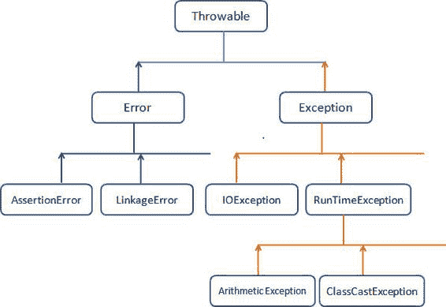
图 4.1：异常的层次结构

注意：此图是不完整的，因为无法在视图中显示所有类。但是，如果你能够解释这么多类，对于面试官来说就足够了。

### 告诉我一些关于 Throwable 类的信息

`Throwable` 是 Java 中异常类的父类。只有此类或其子类的对象才能被 Java 处理。`Throwable` 类或其子类包含两个构造函数：默认构造函数和一个带 `String` 参数的参数化构造函数。该 `String` 参数用于返回有关异常的完整信息。如果我们想获取异常的消息，可以使用该类的 `getMessage()` 方法。

异常分为两种类型：

#### 检查异常

#### 未捕获异常

这些类型的异常在运行时检查。即使异常没有被处理，编译器也不会报错。但如果发生任何异常，程序可能会突然结束。是否处理此类异常完全取决于程序员。此类异常的示例有...

### 你能列出你所知道的不同异常以及它们被抛出的场景吗？

以下是一些常见的异常以及它们出现的情况：

## 如何处理异常？

以下语法展示了如何使用 `try-catch` 块：

```java
try {
    // code block
} catch (Exception e) {
}
```

虽然不建议这样做，但你可以使用不带 `catch` 的 `try` 块。在这种情况下，你**强制**使用 `finally` 块作为 `catch` 块的替代方案。无论是否发生异常，`finally` 块始终都会执行。但在缺少 `catch` 的情况下，如果发生异常，程序将异常终止。这种做法非常不常见，违背了异常处理概念的初衷。

我们可以使用单个 `try` 块，它可能会抛出多种类型的异常。这个 `try` 块后面可以跟一个单一的 `catch` 块（用于泛泛处理所有异常），也可以跟多个与 `try` 块中生成的异常类型匹配的 `catch` 块。

可以。我们可以使用单个 `catch` 块来处理多个异常。为了实现这一点，`catch` 块必须是泛泛的。这意味着它不应该处理某个特定的异常，而应该使用 `Exception` 对象作为参数，因为它可以接受从 `try` 块抛出的所有类型的异常。然而，为了处理特定的异常类型，你需要检查异常的类型，如下面的 `catch` 块代码段所示：

```java
catch (Exception e) {
    if (e instanceof ArithmeticException) {
        // 处理类型为 ArithmeticException 的异常
    }
    if (e instanceof NullPointerException) {
        // 处理类型为 NullPointerException 的异常
    }
}
```

## Java 中 error 和 exception 有什么区别？

`Error` 和 `Exception` 是 `Throwable` 类的子类。因此，如果不进行处理，它们都可能导致程序异常终止。但需要记住的一点是，**错误是不可恢复的**。这意味着如果错误在运行时发生，你没有办法处理它们。程序将异常终止。然而，每当你觉得异常可能会导致应用程序异常终止时，你都可以通过提供异常处理代码来控制这种异常终止。

## 什么是异常级联？

异常级联是异常的传播。当异常被抛出时，它需要在同一个方法块中处理。但有时，如果我们不处理该异常，异常就会传递到调用原始方法的其他方法中。这种将异常转发给下一个方法的方法被称为异常级联或异常的传播。

## 什么是链式异常？

链式异常是在 `JDK 1.4` 中引入的。链式异常允许你在发生某些异常时重新抛出一个新异常。这样做时，你仍然可以保留之前异常的原因，并将该原因链到下一个异常上。为了实现这一点，`Throwable` 类被修改了两个额外的方法和构造函数，列如下：

### 新方法
- `Throwable initCause(Throwable t)`

### 新构造函数
- `Throwable(Throwable t)`

以下代码段说明了我们如何使用链式异常：

```java
try {
    // some code
    throw new Exception();
} catch (Exception e) {
    throw new AnotherException(e);
}
```

在前面的示例中，`catch` 块处理了 `e`，但并没有完成处理，而是重新抛出了另一个异常。

## 如何泛泛地处理异常？

通常，处理异常我们使用 `catch` 块。在 `catch` 块中，我们使用特定的 `Exception` 对象类型作为参数。一旦异常对象被抛出，它会被相应的 `catch` 块捕获。但是，与其处理特定的异常对象，可以使用父类 `Exception` 作为参数。这被认为是一种多态引用，其中父类引用可以引用其子类型。由于所有异常类型都是 `Exception` 超类的子类型，`Exception` 超类可以引用所有类型的异常。

接下来的 `catch` 块展示了使用泛泛的方法处理异常的情况：

```java
catch (Exception e) {
    // 处理异常的 catch 块
}
```

## 你建议在什么时候泛泛地处理异常？使用这种方法的复杂性是什么？

## 我们可以将泛泛的异常处理器与其他异常处理器一起使用吗？

可以，我们完全可以。但你需要遵循一个重要的规则，即：泛泛 `catch` 块必须位于所有 `catch` 块的最后。

以下代码段将导致编译错误，因为泛泛异常处理器写在了开头：

```java
try {
    // code
} catch (Exception e) {
    // 处理异常的 catch 块
} catch (ArithmeticException ae) {
    // 处理 ArithmeticException
} catch (NullPointerException npe) {
    // 处理 NullPointerException
}
```

发生这种情况的原因是，如果在开头添加泛泛异常处理器，那么 `try` 块抛出的所有异常对象都被这个 `catch` 块捕获。这使得其他 `catch` 块变成了不可达代码。

以下代码段展示了结合泛泛和特定异常处理器的实际方法：

```java
try {
    // code
} catch (ArithmeticException ae) {
    // 处理 ArithmeticException
} catch (NullPointerException npe) {
    // 处理 NullPointerException
} catch (Exception e) {
    // 处理异常
}
```

## finally 块的作用是什么？

`finally` 块用于编写无论是否发生异常都想要执行的代码。`finally` 块通常用于关闭在 `try-catch` 块期间打开的资源。当然，我们也可以在 `try-catch` 块中关闭资源，但不建议这样做，因为我们无法保证 `try` 或 `catch` 块中的任何一个完整执行。如果发生异常，`try` 块将终止，JVM 执行 `catch` 块。但如果没有发生异常，JVM 永远不会进入 `catch` 块。正因如此，我们需要一个无论异常状态如何都能确保被执行的代码块。`finally` 块正符合此目的。

## 可以在不使用 catch 块的情况下使用 finally 块吗？

是的，我们可以在没有 `catch` 块的情况下在 `try` 块之后使用 `finally` 块。正如我们知道的，`finally` 块总是执行；它并不关心 `catch` 块是否存在。

## 如果在没有 catch 块的情况下使用 finally 块，当 try 块抛出异常会发生什么？

在这种情况下，`try` 块会抛出一个异常，并生成一个通用消息。即使 `finally` 块没有作为参数的任何捕获异常的功能，实际异常仍然会在 `finally` 块内部被处理：观察下面的代码段：

```java
public class Test {
    public static void main(String[] args) {
        int a = 10, b = 0, div;
        try {
            div = a / b;
        } finally {
            System.out.println("Finally called !!");
        }
    }
}
```

在前面的代码中，`try` 块将生成 `ArithmeticException`。但是，我们没有 `catch` 块来处理这个异常。因此，`try` 块将终止。但在此过程中，它会打印出已生成的异常。JVM 然后执行 `finally` 块，并返回详细的异常堆栈，如下：

```text
Finally called !!
Exception in thread "main" java.lang.ArithmeticException: / by zero
```


### `ClassNotFoundException` 和 `NoClassDefFoundError` 之间有什么区别？

这两个异常都与运行时查找类有关。如果我们使用 `Class.forName()` 加载类，且在类路径（classpath）中找不到该类，就会生成 `ClassNotFoundException`。另一方面，如果类在编译时存在但在运行时不可用，则会发生 `NoClassDefFoundError`。

### 如何创建自定义异常？

要创建一个自定义或用户定义的异常，我们需要创建一个继承自 `Exception` 的类。由于 `Exception` 是该类的父类，因此该类的对象可以像其他异常类型一样被抛出和捕获。该类还可能包含一个构造函数来初始化 `String` 成员，该成员将包含有关异常的信息。此外，它还应该实现 `toString()` 方法以向异常处理器返回该字符串。下面的代码段展示了如何创建一个自定义或用户定义的异常：

```java
class MyException extends Exception {
    String str;

    public MyException(String str) {
        this.str = str;
    }

    public String toString() {
        return "MyException: " + str;
    }
}
```

### 如何使用自定义异常？

JVM 不知晓用户定义的异常，因此它们不会被 JVM 自动抛出。根据创建此类异常的场景，抛出此类异常的对象是开发者的责任。我们需要使用 `throw` 关键字来显式地抛出自定义异常的对象。下面的代码段展示了如何抛出并处理我们之前创建的 `MyException` 类型的异常：

```java
public class TestMyException {
    public static void main(String[] args) {
        try {
            throw new MyException("Custom Exception");
        } catch (MyException e) {
            System.out.println(e);
        }
    }
}
```

### `throws` 关键字的作用是什么？

在某些情况下，我们会遇到方法中包含可能生成异常的代码的情况。通常，我们需要通过在该方法内部使用 `try-catch` 块来处理此类异常。但是，如果我们不想自己处理该异常，可以在方法的声明中使用 `throws` 关键字。这表示该方法包含某些生成异常的代码。但方法没有处理它，处理该异常是调用者的责任。下面的代码段展示了如何使用 `throws` 关键字：

```java
import java.io.*;

public class ThrowsDemo {
    public static void displayContent(File f) throws IOException {
        FileInputStream fis = new FileInputStream(f);
        while (fis.read() != -1) {
            // 读取文件的业务逻辑
        }
        fis.close();
    }

    public static void main(String[] args) {
        File f = new File("test.txt");
        try {
            displayContent(f);
        } catch (IOException io) {
            io.printStackTrace();
        }
    }
}
```

前面的代码段声明了一个方法 `displayContent(File f)`，它用于读取文件内容。读取文件会生成 `IOException`，这是一个受检异常（checked exception）。但该方法没有将读取文件的代码放在 `try-catch` 中；而是声明自己 `throws IOException`。这迫使方法的调用者处理该异常。如果你观察 `main()` 方法中对 `displayContent()` 的调用，发现它被封装在 `try-catch` 之中。这个 `try-catch` 处理了由实际方法抛出的 `IOException`。

### 给出一个可以使用 `throws` 关键字的场景

当方法内部的代码段生成任何异常时，我们需要处理该异常。如果我们在方法内部处理异常，那么对于所有调用该方法的其他用户来说，这是一个处理异常的具体方法。但如果方法没有处理该异常并将其委托给调用者，那么调用者就具有更大的灵活性来按照他/她想要的方式处理异常。

### JDK 7 提供的异常处理更新有哪些？

JDK 1.7 在异常处理机制中引入了两个特性：
1. 自动资源管理
2. 多捕获语句（Multi-catch block）

#### 什么是自动资源管理？

自动资源管理或 `try-with-resources` 是 JDK 1.7 中引入的一种新机制，用于以更健壮可靠的方式处理涉及资源的异常。通常，当我们在异常处理处理资源时，我们需要关闭资源。为了实现这一点，我们实现 `finally` 块并关闭资源。但问题是，由于资源在 `try` 块内部要在 `try` 块之外关闭，开发者需要付出额外努力，这可能会使代码变得臃肿。相反，JDK 1.7 提供了一种在 `try` 内部打开资源的方法，这些资源由 JVM 自动关闭。

```java
try (BufferedReader reader = new BufferedReader(new FileReader("test.txt"))) {
    // 使用 reader
}
```

通过这种方法，我们不需要使用 `finally` 块来关闭在 `try` 参数中作为资源打开的 `BufferedReader`。

#### Java 自动资源管理概念中资源是如何自动关闭的？

从 JDK 1.7 开始，引入了 `AutoCloseable` 接口。该接口由可以作为资源的不同类实现。与 I/O、网络、RMI 的类实现了该接口。该接口为所有实现类暴露了 `close()` 方法。当资源在 `try` 块中作为资源使用时，`close` 方法会被 JVM 隐式调用。我们不需要显式地关闭此类资源。

#### 什么是多捕获语句？

这是 JDK 1.7 的另一个更新。在应用程序中，我们经常遇到单个 `try` 块可能产生多个异常的情况。为了处理此类多个异常，我们以前可以连续编写多个 `catch` 块。我们可以建立 `catch` 块的阶梯。这种方法在 JDK 1.7 中通过实现多捕获语句被取代。在这种情况下，我们可以通过管道符号 `|` 将所有异常类型组合在单条 `catch` 块中。这类似于 `if` 语句中的 OR 逻辑块。下面的代码段展示了我们如何使用多捕获语句来处理 `ArrayIndexOutOfBoundsException` 和 `NullPointerException`：

```java
try {
    // 某些代码
} catch (ArrayIndexOutOfBoundsException | NullPointerException e) {
    // 异常处理器代码
}
```

你也可以在这个 catch 块中使用通用的异常对象，但你应该将其放在最后。在某些情况下，我们观察到 `main` 方法抛出了异常。你这是什么意思？

> 当你有一个会抛出任何异常的代码时，你需要对其进行处理。有几种替代方案可以实现：你可以将代码放在方法内部的 `try-catch` 块中，或者使用 `throws` 子句声明该方法。如果你使用 `throws` 子句声明方法，则调用者必须处理它。但有时，即使调用者也不处理该异常。在这种情况下，你的代码可能会异常终止。为了避免这种情况，你可以将 `main` 方法声明为抛出该异常。这意味着异常在 `main` 内部没有被处理，而是向 `main` 方法的调用者传播。换句话说，异常被传播到了 `JVM`，由它来处理该异常。

### `printStackTrace()` 方法的作用是什么？

> 通常情况下，当我们处理异常时，会在 `try` 块中为用户打印有关该异常的信息。实现这一点的方法之一是直接打印异常引用。但这种方法的局限性是，用户会知道异常的原因，但无法获得发生异常的精确行号。
> 请考虑以下代码段：

```java
public class PrintStackTraceDemo {
    public static void divideNumber() {
        try {
            int ans = 10 / 0;
        } catch (Exception e) {
            System.out.println(e);
        }
    }

    public static void main(String[] args[]) {
        divideNumber();
    }
}
```

在这里，我们知道程序将会失败。当我们执行程序时，程序会给出关于异常的如下输出：
`java.lang.ArithmeticException: / by zero`

因此，与其直接打印异常引用，我们可以在 `catch` 块中调用异常引用的 `printStackTrace()` 方法，如下：

```java
catch (Exception e) {
    e.printStackTrace();
}
```

这将返回如下的输出：
```
java.lang.ArithmeticException: / by zero
    at PrintStackTraceDemo.divideNumber(PrintStackTraceDemo.java:6)
    at PrintStackTraceDemo.main(PrintStackTraceDemo.java:12)
```

### 我们可以同时用 `throw` 关键字处理检查异常和非检查异常吗？

`throw` 关键字用于显式抛出某些异常。虽然我们通常使用 `throw` 关键字处理自定义异常，但也可以将其用于预定义的异常。我们可以同时抛出检查异常和非检查异常。

### 我们可以同时用 `throws` 关键字处理检查异常和非检查异常吗？

我们可以对检查异常和非检查异常使用 `throws` 关键字。

### 如果 `try` 块向调用者返回一个值，`finally` 块会发生什么？它还会执行吗？

`finally` 块起着保证人的作用。无论 `try` 发生了什么，`finally` 都会执行。所以，即使 `try` 成功地向其调用者返回了某个值，`finally` 仍然执行。在这种情况下，`finally` 会先执行，然后值返回给调用函数。

### 如果 `try` 和 `finally` 块执行了不同的布尔值会怎样？

注意：这是一个陷阱性的问题。因为通常我们在实现 `finally` 块时，会将资源关闭代码写在其中。因此，面试官期望你在答案中给出常识性的方法。

如果你有一个返回 `Boolean` 的方法，那么你的 `try` 块必须返回一个 `Boolean` 值。但 `try` 和 `finally` 并不强制返回相同的值。这意味着你的 `try` 可以返回 `true`，而 `finally` 可以返回 `false`。在这种情况下，由于 `finally` 在 `try` 生成 `return` 语句之前就已经执行了，方法将从 `finally` 自身返回，并向调用者返回 `false`。

### 有什么方法可以避免执行 `finally` 块吗？

正如我们所知，无论 `try` 块的状态如何，`finally` 块总是执行的。避免执行 `finally` 块的唯一方法是使用 `System.exit(0)`，如下：

```java
try {
    // code
} finally {
    // 这将不会执行
}
System.exit(0);
```

# Java 流概览

### `System.err`

`System.err` 与 `System.out` 的静态字段几乎相似。`System.err` 也是 `PrintStream` 的实例，它是 `OutputStream` 类的子类。通常，此语句用于在控制台上打印错误信息。大多数情况下会在异常处理器的 catch 块中看到此语句。

### `Reader` 和 `Writer` 层次结构

`Reader` 和 `Writer` 层次结构用于以字符格式输入/输出数据。尽管它们在内部按字节进行处理，但对开发者是以字符处理器的形式呈现。`Reader` 和 `Writer` 是该层级中最顶层的抽象超类。`StringReader` 和 `StringWriter` 是这些超类的一些实现类。

## 两种流的必要性是什么？为什么我们需要字节流和字符流？

`字节` 流有助于处理包含 `ASCII` 字符的文件。有时，文件也包含 `Unicode` 字符。为了读取此类资源，Java 引入了基于字符的流。`ASCII` 是 `Unicode` 的子集，因此读取带有英文字符的文件时，可以使用字节流或字符流。

## 在你看来，使用字节流还是字符流更好？

我觉得使用字符流更好。基于字符的流比基于字节流具有更多功能，例如可以使用 `BufferedReader` 代替 `BufferedInputStream`，或者 `BufferedReader` 拥有 `newLine()` 方法来跳转到下一行。如果想使用字节流，则需要编写额外的代码。

## 什么是过滤流（filter streams），哪些是这些流？

`filter` 流为现有流添加额外功能，例如为目标添加行号，即使源中不存在这些行号。`filter` 流还有助于提高复制操作的性能。

`filter` 类如下：

*   `LineNumberReader`: 该类允许向目标文件添加行号。
*   `BufferedReader`: 该类提供了 `read()` 和 `readLine()` 等方法，通过这些方法可以一次读取一个字符或一个字符串。
*   `BufferedWriter`: 该类提供缓冲效果，可以将性能提升到峰值。
*   `PushbackInputStream`: 该类允许将所需的字符推回系统。

## 什么是 PrintStream 和 PrintWriter？它们是一样的吗？它们之间的区别是什么？

这两个类都提供了使用 `println()` 方法显示数据的功能。然而，这两个类属于两个不同的类别：字节流和字符流。`PrintStream` 属于字节流，`PrintWriter` 属于字符流。

## 解释 File 类？

`File` 类是一个非流类。该类用于查找文件的属性，例如文件何时被创建或修改、文件是否具有读/写权限、文件大小等。它通常指向一个文件位置，该位置可以进一步用于以只读或写模式打开文件。`File` 对象并不保证文件是否存在；只有当我们配合 `FileWriter` 或 `FileOutputStream` 使用此引用时，JVM 才会检查文件的存在性。

## 什么是 FileInputStream？

`FileInputStream` 类用于读取文件内容。它是 `InputStream` 的具体实现。因此，它为如 `read()` 和 `available()` 等方法提供了实现。该类提供了以下构造函数以以读模式打开文件：

```java
public FileInputStream(String fileName) throws FileNotFoundException
public FileInputStream(File file) throws FileNotFoundException
public FileInputStream(FileDescriptor fd)
```

## 什么是 FileOutputStream？

`FileOutputStream` 类用于向文件写入数据。它是 `OutputStream` 的具体实现。因此，它为如 `write()` 等方法提供了实现。`write()` 方法可以接收 `int` 或 `byte[]` 数组并传递到文件。该类提供了以下构造函数：

```java
public FileOutputStream(String filename) throws FileNotFoundException
public FileOutputStream(File file) throws FileNotFoundException
public FileOutputStream(FileDescriptor fd)
public FileOutputStream(String name, boolean append) throws FileNotFoundException
```

## 我们可以从网页读取数据吗？

Java 提供了 `java.net` 包，其中包含用于与网络通信的各种类。要与网页通信，可以使用 `URL` 类，它接受格式为 `String` 的 `URL` 作为参数进行连接。一旦连接到指定的 `URL`，我们可以使用 `InputStream` 的 `openStream()` 方法，它可以从服务器下载数据，然后通过 `read()` 方法读取数据。

## 什么时候使用 Scanner 类？

`Scanner` 类在 Java 1.5 中引入。它用于从输入读取数据流。在 `Scanner` 读取输入之前，人们使用 `DataInputStream`，在读取流后，必须将其转换为相应的数据类型，如 `String`、`integer` 或 `double` 等。但 `Scanner` 类是一个更灵活的类，提供了直接方法来扫描不同的数据类型，如 `next()` 和 `nextInt()` 等。

## 什么是缓冲流（Buffered stream）？

`Buffered` 流用于在缓冲区中存储大量数据。输入数据可以使用 `BufferedInputStream`，生成输出可以使用 `BufferedWriter`。当调用 `read()` 方法时，数据不会从流中移除，但会从缓冲区中移除。同样，如果我们写入数据，它将存储在内部字节数组中，而不是逐字节写入数据，而是将整个数组推向输出。

## 解释 BufferedWriter。flush() 和 close() 在哪里使用？

缓冲区是存储数据的临时区域。`BufferedWriter` 类是一个创建字符输出流的类。

`flush()` 用于清除缓冲区中存储的所有字符。

`close()` 用于关闭打开的字符输出流。

## 解释数据流（data streams）的层次结构

这些类是专门用于读取不同原始类型的类，如整数、浮点数甚至字符串。两个重要的实现是 `DataInputStream` 和 `DataOutputStream`，它们分别是 `FilterInputStream` 和 `FilterOutputStream` 的子类。此外，它们还实现了一个接口。`DataInput` 由 `DataInputStream` 实现，`DataOutput` 由 `DataOutputStream` 实现。这些接口提供了如 `readInt()` 和 `writeInt()` 等方法，由这些类相应实现。

## 我们可以同时从多个源读取数据吗？

是的，可以。Java 提供了 `SequenceInputStream`，它可以将多个输入流连接起来，以便从不同的源读取数据。这种 `SequenceInputStream` 的子类按顺序读取资源中的所有字节，最后关闭流。

以下是该类的两个构造函数：

```java
public SequenceInputStream(Enumeration en)
public SequenceInputStream(InputStream ins1, InputStream ins2)
```


在这里，在第二个构造函数中，参数必须是 `InputStream` 类型。以下代码示例展示了你如何打开不同的流来读取 www.rediff.com 等网站主页的数据：

```java
try {
    URL u1 = new URL("http://www.rediff.com");
    URL u2 = new URL("http://www.yahoo.com");
    SequenceInputStream sin = new SequenceInputStream(u1.openStream(), u2.openStream());
} catch (IOException e) {
    // 异常处理块
}
```

可以使用以下代码创建临时文件，并在使用后删除它：

```java
File tem = File.createTempFile("prefix", "suffix");
tem.deleteOnExit(); // 这将在 JVM 退出时执行
```

### 属性文件
你处理过属性文件吗？如何动态创建属性文件？

是的，我曾处理过 JDBC 连接属性。属性文件用于存储应用程序相关的配置数据。应用程序可以在运行时获取这些数据。

可以按照如下方式动态创建文件：

```java
Properties props = new Properties();
// 填充属性文件
props.setProperty("key", "value");
FileOutputStream os = new FileOutputStream("config.properties");
// 将属性存储到文件中
props.store(os, "This is a sample properties");
```

### 序列化与反序列化
什么是序列化和反序列化？

序列化是将对象的状态以字节序列的形式进行持久保存的过程。反序列化是序列化的相反操作，它从这些字节恢复对象。`java.io` 包提供了用于序列化和反序列化过程的 API。要序列化任何对象，表示该对象的类必须实现 `Serializable` 接口。

#### Serializable 接口中声明了哪些方法？
`Serializable` 是一个标记接口，内部没有声明任何方法。这仅使得该类的对象有资格参与序列化过程。

#### 你处理过序列化和反序列化吗？请解释其过程
是的，我处理过这些过程。我们可以如下所示对数据进行序列化和反序列化：假设我们有一个 POJO 类 `Person`。

我们可以如下序列化数据：
```java
FileOutputStream fos = new FileOutputStream("person.ser");
ObjectOutputStream oos = new ObjectOutputStream(fos);
// 对象序列化的方法
oos.writeObject(person);
```

反序列化可以如下所示进行：
```java
FileInputStream fis = new FileInputStream("person.ser");
ObjectInputStream oin = new ObjectInputStream(fis);
// 对象反序列化的方法
Person person = (Person) oin.readObject();
System.out.println("Name = " + person.getName());
System.out.println("Age = " + person.getAge());
```

#### 什么是 SerialVersionUID？
与每个可序列化类相关的版本号被称为 `serialVersionUID`。这个数字在反序列化过程中使用。它用于验证序列化对象是否对于与序列化兼容的类已加载。如果在反序列化时，接收端加载的对象类的 UID 与发送端的类 UID 不同，则会抛出 `InvalidClassException`。

#### 有时即使你为类实现了 Serializable，也无法序列化对象。你能解释为什么吗？
是的，有时你可能会遇到 `NotSerializableException`，即使类实现了 `Serializable` 接口。发生这种情况由于以下原因：
1. 如果你在对象内部使用了包含，且被包含的对象不可序列化。
2. 类的父类没有实现 `Serializable` 接口，甚至没有默认构造函数。
3. 如果有人故意抛出异常，以确保对象不应该被序列化。

#### 如何自定义序列化过程？
要自定义序列化过程，我们需要实现 `Externalizable` 接口，而不是实现 `Serializable` 接口。与 `Serializable` 接口不同，该接口不是标记接口；它声明了必须重写的 `readExternal()` 和 `writeExternal()` 方法。通过这种方式，不再由 JVM 承担整个序列化过程，开发者可以编写自定义逻辑来序列化对象。

#### 如何保护数据不被序列化？
如果你需要某个数据成员免受序列化过程的影响，可以使用 `transient` 关键字声明该数据成员。用 `transient` 关键字声明的成员即使在对象被序列化也不会被序列化。

#### 随机访问文件
你处理过随机访问文件吗？

`RandomAccessFile` 类设计用于对文件内容提供随机访问的文件。使用 `RandomAccessFile` 类可以将 `DataInputStream` 和 `DataOutputStream` 的功能合并到一个类中。除了它们提供的功能外，该类提供了另一个方法 `seek()`。该方法允许用户移动到文件的特定位置并更改存储在那的值。

在使用 `RandomAccessFile` 类时，我们需要记住文件结构。`RandomAccessFile` 类提供了读取和写入基本类型以及 UTF-8 字符串的方法。

#### 如果我想创建一个目录，应该使用哪个类？
我们有 `File` 类来创建文件，但没有 `Directory` 类。`File` 类本身既用于创建文件也用于目录。可以使用以下代码创建一个名为 `mydir` 的目录：

```java
File dir = new File("mydir");
if (!dir.exists()) {
    dir.mkdirs();
}
```

### 输入流 vs 输出流
#### 解释 InputStream 和 OutputStream 之间的区别？
`InputStream` 用于从源（如文件、套接字或标准输入）读取数据。
`OutputStream` 用于向目标（如文件、套接字或标准输出）写入数据。

#### 你能解释 BufferedReader 和 FileReader 之间的区别吗？
`FileReader` 专门用于从指定的文件读取数据。然而，`BufferedReader` 是装饰器。`BufferedReader` 提供缓冲以实现更快的 I/O。

`FileReader` 类提供了一个 `read()` 方法从文件中读取数据。可以使用它来从 `myfile.txt` 文件读取数据：
```java
FileReader fr = new FileReader("myfile.txt");
```

`BufferedReader` 作为装饰器，提供了如下方法来读取数据：
```java
FileReader fr = new FileReader("myfile.txt");
BufferedReader br = new BufferedReader(fr);
```

由于 `BufferedReader` 是装饰器，它也可以用于读取标准输入。我们可以使用以下代码读取标准输入：
```java
InputStreamReader isr = new InputStreamReader(System.in);
BufferedReader br = new BufferedReader(isr);
```

#### 解释 PrintStream 类的作用？
`PrintStream` 类用于向标准输出写入数据。我们非常频繁地使用 `System.out.println()` 在控制台上显示内容。在这里，`out` 是 `PrintStream` 类的一个对象，我们在其上调用 `println()` 方法。

### 资源管理
#### 可以在 try 块中关闭流吗？为什么应该在 finally 块中关闭流？JDK 7 发生了什么变化？
应该在 `finally` 块中关闭流，因为无论 `try` 块是否发生异常，`finally` 块总是执行的。如果在 `try` 中关闭流，则只有在代码执行没有异常时流会被关闭。

从 JDK 7 开始，如果我们在 try-with-resources 中打开流，就不需要显式关闭流。这是因为它们现在实现了 `AutoCloseable` 接口：

```java
try (BufferedReader br = new BufferedReader(new FileReader("test.txt"))) {
    // 代码
} catch (IOException e) {
    e.printStackTrace();
}
```

#### 我们可以将文件转换为字符串吗？你能解释如何做吗？
以下代码段显示了如何将文件转换为字符串：
```java
FileInputStream fi = new FileInputStream("name_of_file");
byte[] buffer = new byte[1024];
StringBuilder sb = new StringBuilder();
int bytesRead;
while ((bytesRead = fi.read(buffer)) != -1) {
    sb.append(new String(buffer, 0, bytesRead));
}
String file_to_string = sb.toString();
```

#### 我们可以设置文件权限吗？文件可以设置哪些权限？如何设置文件权限？
当用户想要限制文件操作时，就需要更改文件权限。有很多方法可以提供检查和设置文件权限。例如，只读文件可以设置为允许写入数据的权限。

我们可以通过以下方法检查权限，例如：
- `canExecute()`：该函数检查应用程序是否允许执行该文件。如果路径名称存在且应用程序允许执行指定的文件，则将返回 `true`。
- `canRead()`：该函数检查应用程序是否允许读取该文件。如果应用程序可以读取该文件，则方法返回 `true`。

以下方法用于更改或设置文件的权限：
- `setExecutable()`：该方法允许为路径名设置所有者的执行权限。
- `setReadable()`：该方法用于设置所有者的读取权限。
- `setWritable()`：该方法用于设置所有者的写入权限。

你是否曾经在遇到 `Access is denied`（拒绝访问）时遇到过 `java.io.FileNotFoundException`？你知道如何修复它吗？

我在安装操作系统的 C 盘上创建文件时遇到了这个异常。

我们可以按照以下步骤更改其权限：
1. 转到 `C:\Program Files`
2. 在文件夹上右键点击 `Java` 并点击 `Properties`（属性）。
3. 现在选择 `Security`（安全）选项卡。
4. 点击 `Edit`（编辑）按钮。
5. 将弹出一个 `PERMISSIONS FOR JAVA` 窗口。
6. 点击 `Add`（添加）。
7. 另一个弹出窗口将打开。在这里，`Enter object name`（输入对象名称）框中，输入你的用户账户，然后点击 `Check Names`（检查名称）。
8. 在 `PERMISSIONS OF JAVA` 窗口中，你会发现几个可以点击的选项。其中一个就是你的用户名。选择它，并在子窗口中勾选 `FULL CONTROL`（完全控制）选项。
9. 点击 `Apply`（应用）并 `OK`。

### 什么是内存映射文件？解释内存映射文件的优缺点
内存映射文件是 Java 中的文件，允许应用程序直接从内存访问内容。这是通过将整个文件或文件的部分映射到内存中实现的。操作系统将负责加载请求的页面，然后将其写入文件，而应用程序则处理内存。这允许非常快的 I/O 操作。用于加载内存映射文件的内存来自 Java 堆空间之外。`java.nio` 包提供了内存映射文件操作。可以使用 `MappedByteBuffer` 从内存中进行读和写。

#### 优点
- 性能对于构建高频电子交易系统至关重要。内存映射文件是一种比使用普通 I/O 操作使用标准文件访问更快的方法。
- 内存映射文件允许开发者加载可能更大的文件，否则将无法访问这些文件。
- 大多数操作系统都支持内存映射 I/O 操作。此外，由于 64 位架构，可以将几乎任何文件映射到内存中，并使用 Java 应用程序直接访问它。
- 文件可以共享；它为开发者提供了进程间的共享内存，这比使用环回套接字延迟低 10 倍以上。

#### 缺点
- 由于操作系统只将文件的部分加载到内存中，当请求的页面不在内存中时，将导致页错误。

### 什么是 NIO？I/O 和 NIO 之间有什么区别？
Java 新输入/输出被称为 `NIO`，它是随 `JDK 1.4` 引入的。`NIO` 为库提供了高速的、面向块的 I/O。

- `I/O` 是阻塞 I/O；然而，`NIO` 是非阻塞 I/O。这意味着线程将一直阻塞直到它完成 I/O 操作。然而，如果数据不可用，线程可以执行其他操作而不会阻塞进程。
- 旧的 `I/O` 是基于流的；然而，`NIO` 是面向缓冲区的。这意味着 `NIO` 首先在缓冲区中读取数据，然后将其供异步处理使用。此外，可以在缓冲区中来回移动，但在旧的基于流的操作中是不可能的。

### NIO 的基本组件是什么？
以下是 `NIO` 的基本组件：
- **通道与缓冲区**：在标准 IO 中，操作要么基于字符要么基于流，但 `NIO` 使用通道和缓冲区。这意味着数据始终从缓冲区写入通道，然后从通道读取到缓冲区中。
- **选择器**：选择器是一个用于监控多个通道事件的对象，例如连接打开、数据到达等。它使得单线程能够监控多个通道的数据。
- **非阻塞 I/O**：应用程序必须有一种机制来发现数据何时就绪，以便操作不会阻塞等待数据到达。

### 什么是选择器？
选择器是在 `NIO` 中引入的，它允许单个线程监控多个输入通道。人们可以使用选择器注册多个通道。之后，可以使用单个线程选择有可用数据处理的通道。此外，还可以选择准备好写入的通道。选择器的机制使得单线程管理多个通道变得容易。

### 什么是通道？
通道用于执行 `NIO` 操作。它们充当管道，数据通过在缓冲区和实体之间传输。数据通过通道从实体读取并放入缓冲区中进行消费。通道最好的部分是它们可以同时用于读和写操作。这意味着通道从缓冲区中的实体读取数据，然后也可以异步地从缓冲区将数据写入目的地。

### 解释 NIO 通道类
以下是通道类的类型：
- `FileChannel`：这是一个基于文件的通道，用于读取和写入操作，且不能放在非阻塞模式下。人们可以通过调用文件实例上的 `getChannel()` 方法来获取 `FileChannel` 实例。
- `SocketChannel`：这些可以在非阻塞模式下运行的通道。`SocketChannel` 主要分为以下三种类型：
    - `DatagramChannel`：此类用于通过 `UDP` 在网络上执行读写操作。
    - `SocketChannel`：类用于在 TCP 网络上读写。
    - `ServerSocketChannel`：此类用于在 TCP 连接上执行 IO 操作。

### 使用 BufferedWriter 类时缓冲区何时以及如何清除？
缓冲区在以下情况下会被清除：
- 缓冲区完全填充时
- 显式调用 `flush()` 时

在文件写入操作结束时需要调用 `flush()` 方法，以便将所有残留内容转到文件中。

### 以下代码的输出是什么？执行以下代码后，该位置会有物理文件吗？
```java
File f = new File("myfile.txt");
```
代码将执行且不会产生异常，但不会创建物理文件。如果需要创建文件，则需要执行如下代码：
```java
f.createNewFile();
```

### 如何提取特定类型的文件进行处理？
Java 提供了 `FilenameFilter` 接口，它允许你提供关于可以接受哪些文件的信息。该接口存在 `java.io` 包中，声明了如下 `accept()` 方法：
```java
boolean accept(File directory, String name)
```


该方法接受两个参数：指向目录的 `File` 对象和文件名。

### 总结

在本章中，我们讨论了用于 I/O 操作的不同类和接口。Java I/O API 数量庞大，但我们尝试涵盖许多在面试题中起着至关重要的类和接口，这正是本书的主要目标。在本章中，我们讨论了许多 Java 面试中可能会问到的问题。

从编程早期开始，开发者们就在编写顺序程序来开发应用程序。通常，这些程序运行在一个整个生命周期内只执行单一任务的系统上。虽然起初这并不是大问题，但在硬件开发的后期，当硬件和操作系统演进到下一个阶段时，这种编程方式被认为是既低效又昂贵的。顺序程序没有充分利用操作系统和硬件的性能。这导致了多线程或并发编程概念的产生，使得不同的程序可以在操作系统上同时运行。要理解多线程程序的概念，你可以从日常生活中寻找实时例子。例如，在为茶烧水时，你可以去拿一张放在门垫上的报纸，或者在喝茶时，你甚至可以读报纸；这些任务本质上通常是异步的。同样，应用程序中也有许多任务互不依赖。这些任务可以使用线程的概念同时执行。

## 结构

对于初级 Java 程序员来说，线程的概念是一个相对新的概念。如果你不理解多线程的基础知识，那么理解高级并发 API 将具有挑战性。在本章中，我们将讨论以下内容：

- 什么是线程，以及如何创建它
- 创建线程的不同方法及其意义
- 线程间的通信
- 线程生命周期方法
- 并发 API
- 关于多线程的面试问答

## 目标

在本章中，你将学习什么是线程以及如何创建它。我们还将讨论不同线程如何相互通信以创建一个高效的应用程序。在后期，我们将讨论 Java 的并发 API，它使得多线程编程方式比传统的编程方法更加简单。

## 什么是多线程？你能解释一下多线程吗？

多线程是指多个线程同时执行的情况。多线程消耗的内存更少。由于线程是轻量级的，它们增强了应用程序的性能。

## 什么是线程？

线程是一个轻量级的子进程。它是一个独立的执行路径，因为每个线程运行在不同的栈帧中。一个进程可以包含多个线程。线程共享进程资源，但它们仍然独立执行。

## 多线程有哪些优点？

优点如下：

- 线程是轻量级的。因此，它增强了应用程序性能。
- 多线程减少了服务器，因为一台服务器可以同时执行多个线程。
- 即使某些后台任务正在运行，多线程也允许应用程序始终保持响应以接受输入。
- 由于多线程包含了多个线程的独立执行，它允许任务更快地执行。
- 线程共享公共内存资源。因此，多线程提供了对缓存内存更好的利用。

## 什么是进程？你能区分进程和线程吗？

执行中的程序被称为进程，而线程是进程的子集。它们之间的区别如下：

- 进程是独立的，但线程是进程的子集。
- 进程在内存中具有不同的地址空间。然而，线程包含进程的共享地址空间。
- 线程间的通信比进程间的通信更快更容易。
- 与进程相比，线程之间的上下文切换更快。

## 多线程中同步编程和异步编程有什么区别？

以下是同步和异步编程之间的区别：

- **同步**：这是一种编程模型。在同步编程中，一个线程被分配完成一个任务。一旦线程开始处理该任务，只有在分配的任务完成后，它才能用于其他任务。
- **异步编程**：在异步编程中，一个作业可以由多个线程完成。它增强了应用程序性能，从而提供了最大的可用性。

## 可以预测线程的行为吗？

没有人能预测线程的行为。之所以这么说，是因为线程的执行是由线程调度器的。开发者对选择执行哪个线程没有控制权。线程调度器在不同平台上可能有不同的实现。因此，可能会出现同一个线程程序在相同平台上的后续执行中产生不同输出的情况。

## 你如何理解线程间通信？

多线程应用程序本质上由不同的线程执行其任务以实现业务需求。在实现这一目标时，这些多个线程可以相互通信。它们可能拥有数据或方法调用，这些在它们之间共享。这通常是为了确保 CPU 始终保持利用状态，减少其空闲时间。线程之间的这种通信产生了它们之间的信息交换。这种信息交换有时是复杂的，因为信息在业务逻辑完成之前就已经交换。为了控制这种混乱，线程间通信通过不同的方法（如 `wait()` 和 `notify()`）进行控制。

## 线程中 `wait()` 方法的作用是什么？

`Object` 类拥有 `wait()` 方法用于 Java 中的线程间通信。该方法用于暂停当前线程，等待另一个线程不再调用 `notify()` 或 `notifyAll()` 方法。

## 你知道 synchronized 块吗？为什么要在 synchronized 块中调用 `wait()` 方法？

当人们尝试进行线程间通信时，`wait()` 方法就会出现。`synchronized` 块为相应的线程提供了监视器锁。一旦线程获得了锁，它就成了监视器的所有者。如果在调用 `wait()` 方法时不使用 `synchronized` 块，它将抛出 `java.lang.IllegalMonitorStateException` 异常。

## 你如何在 Java 中维护线程的执行顺序？如果你有多个线程，你如何控制特定线程先执行？

这可以通过在特定线程上调用 `join()` 方法来实现。假设你有三个线程，并希望 `thread1` 先完成任务，那么你可以对 `thread1` 调用 `join()`。记住，在调用 `join()` 方法之前，你必须对 `thread1` 调用了 `start()` 方法。

## `join()` 方法的作用是什么？

`join()` 方法导致当前运行线程暂停，直到它连接的线程完成任务。

`join()` 方法有三种重载版本如下：

- `join()`：此方法会将当前运行线程置于等待状态，直到调用该方法的线程死亡。如果线程被中断，它将抛出 `InterruptedException`。
- `join(long millis)`：此方法与 `join()` 方法类似，但它会等待参数指定的时间。
- `join(long milliseconds, int nanoseconds)`：此重载方法除了毫秒外，还增加了纳秒来表示 `join` 的等待时间。

## 解释线程生命周期。线程生命周期中有哪些状态？

每个线程在生命周期内都会经历以下状态：

- **新建（New）**：在此状态下，创建了 `Thread` 类的实例。然而线程并不是活的。
- **可运行（Runnable）**：一旦对线程调用了 `start()` 方法，线程就会变为可运行。它使线程准备好运行。线程尚未处于运行状态，因为它还没有被线程调度器选中。

### 线程状态

- **运行（Running）**：线程调度器从线程池中选择该线程，并调用其 `run()` 方法。该方法的执行表示线程正在运行。
- **等待（Waiting）或阻塞（Blocked）**：在此状态下，线程是存活的，但没有在运行，或者它可能在等待其他线程完成。
- **死亡（Dead）或终止（Terminated）**：当 `run()` 方法执行完成后，即达到此状态。此后，线程被认为已死亡或终止。

## 什么是上下文切换？

当我们处理多个线程时，我们会从一个线程切换到另一个线程。在上下文切换过程中，执行中的线程的状态会被存储起来。当线程再次获得执行机会时，会恢复这些存储的状态并从该点继续执行。

## Thread 类与 Runnable 接口

区分创建线程时使用的 `Thread` 类和 `Runnable` 接口。

线程可以通过两种方式创建：

1. 通过定义一个继承 `Thread` 类的类。
2. 通过定义一个实现 `Runnable` 接口的类。

**这两种方式之间的区别：**

- 当使用 `Thread` 类的扩展时，该类无法继承另一个类，因为 Java 不支持多继承。然而，当使用 `Runnable` 接口的实现时，该类仍然可以继承另一个类以利用其服务。
- 一旦我们写了一个继承 `Thread` 的类，每个线程都会创建一个唯一的对象并关联。然而，如果使用 `Runnable` 接口的实现，多个线程将共享同一个对象。
- `Thread` 类拥有内置方法，而 `Runnable` 接口只有一个方法。

## Thread 和 Runnable 之间是什么关系？

`Thread` 类实现了 `Runnable` 接口。由于 `Runnable` 接口声明了 `run()` 方法，`Thread` 类对 `run()` 方法实现了空实现。

## Thread 构造函数

Thread 类提供了哪些重载的构造函数？

（表 6.1：线程的构造函数）

## 线程生命周期方法

### 我们可以启动两次线程吗？如果对线程调用两次 `start()` 方法会发生什么？

不，无法多次重启线程。一旦线程启动，它将由线程调度器执行并完成 `run()` 方法。之后，它会进入死亡状态。如果仍然尝试启动线程，将抛出一个异常类型的异常。

### 是否可以直接调用 `run()` 方法而不是 `start()`？

`run()` 方法是一个有效的公共方法。所以显然，可以直接调用 `run()` 方法。但我们需要理解这种调用方式的区别。当直接调用 `run()` 方法时，它不会作为线程工作，它会被视为普通对象调用了 `run()` 方法。因此，不会创建新的栈。当调用 `start()` 方法时，它会在内部调用 `run()` 方法，这会为线程创建一个新的栈。

### 强制要求重写 `run()` 方法吗？如果我们不重写 run 方法会发生什么？

`Thread` 类是一个具体类，所以当人们继承自 `Thread` 的类时，并没有强制重写 `run()` 方法。由于我们没有重写该方法，新创建的线程没有自定义代码可以执行，什么都不会发生。

然而，如果我们正在编写实现 `Runnable` 接口的类，那么我们就没有选择，必须重写 `Runnable` 接口的 `run()` 方法。

### 我们可以重写 `start()` 方法吗？如果重写它会发生什么？

`Thread` 类拥有 `start()` 方法，该方法不是 final 的。因此，重写此方法是合法的。但当我们在代码中对线程调用内置的 `start()` 方法时，它在内部调用 `run()` 方法，其中包含了为新线程编写的自定义代码。如果我们重写了 `start()` 方法，那么 `run()` 方法将不会在内部调用。因此，我们需要显式地调用 `run()` 方法，否则它永远不会被调用。

## 已弃方法

### 为什么 `suspend()` 和 `resume()` 方法被弃用了？

`suspend()` 方法容易导致死锁。当目标线程持有对象的锁时，如果它处于挂起状态，其他任何线程都无法锁定该对象，直到目标线程恢复。尝试获取已由目标线程拥有的对象或监视器锁的新线程，必须调用目标线程的 `resume()` 方法，否则会导致死锁条件。这种死锁也被称为冻结。`suspend()` 方法将线程从运行状态置于等待状态。现在，只有当对线程调用已弃用的 `resume()` 方法时，线程才能从等待状态变为可运行状态。`resume()` 方法仅与 `suspend()` 方法配合使用，这也是它被弃用的原因。

### 为什么 `destroy()` 方法被弃用了？

`destroy()` 方法同样容易导致死锁。当目标线程持有被销毁对象的锁时，没有线程可以锁定该对象。这与不当使用 `suspend()` 和 `resume()` 方法形成的死锁非常相似。一旦形成死锁，必须调用 `destroy()` 方法。当在线程上调用 `destroy` 方法时，将抛出一个运行时异常，且 `destroy()` 方法将线程从运行变为死亡状态。

## 比较

### 解释 `wait()` 和 `sleep()` 方法的区别。`wait()` 和 `sleep()` 方法有什么区别？

最重要的区别之一是这些方法的层次结构。`wait()` 定义在 `Object` 类中，而 `sleep()` 定义在 `Thread` 类中。`wait()` 方法释放线程获取的锁；然而，`sleep()` 方法不会释放锁。

### 线程之间如何通信？开发者可以使用哪些方法来实现线程间通信？

多个线程可以通过 `notify()` 和 `notifyAll()` 方法进行相互通信。`wait()` 方法可用于等待另一个线程的结果。`notify()` 和 `notifyAll()` 方法用于向处于等待状态的线程发送通知。

### 为什么 `wait()`、`notify()` 和 `notifyAll()` 在 `Object` 类中而不是 `Thread` 类中？

`Object` 类拥有监视器，多个线程可以访问同一个对象。一次只能有一个线程持有对象监视器以执行同步方法或块。`Object` 类提供的 `notify()` 和 `notifyAll()` 方法允许在该对象上创建的所有线程能够轻松地相互通信。

如果 `Thread` 类提供了 `notify()` 和 `notifyAll()` 方法，那么线程间的通信将成为一个问题。对象上的同步将变得不可行。如果每个线程都有自己的监视器，那么将没有实现同步的方法，这将导致对象状态的不一致。

## 什么是线程饥饿（thread starvation）？

线程饥饿发生在线程没有足够的 CPU 时间来执行任务时。这可能是由于不同的原因引起的，例如：

- 与高优先级线程相比，低优先级线程获得的执行所需的 CPU 时间较少。因此，低优先级线程可能会因为等待获取足够的 CPU 来执行任务而导致饥饿。
- 在死锁情况下，两个或多个线程互相等待对方释放锁。因此，这两个线程都会由于无法获取 CPU 而处于饥饿。
- 线程可能长时间等待对象监视器的锁，因为没有其他线程在调用 `notify()` 或 `notifyAll()` 方法。

## 解释守护线程（daemon thread）。什么是守护线程？

守护线程是低优先级线程。守护线程为用户线程提供后台支持和服务。如果程序中只剩下守护线程，JVM 会自动终止守护线程。`Thread` 类中的以下两个方法可用于守护线程：

- `setDaemon(boolean)`：该方法用于将线程标记为守护线程或用户线程。
- `isDaemon()`：该方法用于检查线程是否为守护线程。

### 如何创建守护线程？如果线程已经启动，我们可以把用户线程变成守护线程吗？

如果一个线程已经启动，之后再尝试将其设置为守护线程，将会抛出异常。人们只能在启动线程之前创建守护线程。

下面的代码段演示了如何创建守护线程：

```java
public class DaemonThread extends Thread {

    public DaemonThread() {

    }

    public void run() {

        // 检查线程是否为守护线程

        if (Thread.currentThread().isDaemon()) {

            System.out.println(getName() + " is Daemon");

        } else {

            System.out.println(getName() + " is User");

        }

    }

    public static void main(String[] args) {

        DaemonThread thread1 = new DaemonThread();

        // 将用户线程设置为守护线程

        thread1.setDaemon(true);

        thread1.start();

    }

}
```


## 什么是停机钩子（shutdown hook）？

停机钩子是在 JVM 关闭之前隐式调用的线程。人们可以使用它在 JVM 正常或异常关闭时执行资源清理以保存状态。停机钩子只有在 JVM 关闭时才能被启动。停机钩子比其他方式更可靠，因为停机钩子不运行的概率非常小。可以调用 `Runtime` 类的 `halt(int status)` 方法来停止停机钩子。

## 我们什么时候应该中断（interrupt）一个线程？

一旦对线程调用了 `wait()` 或 `sleep()` 方法，线程就会暂停。当我们想要通过调用 `interrupt()` 方法打破该线程的睡眠或等待状态时，就可以中断该线程。

## 什么是同步？如何实现同步？

有时，应用程序拥有可以被多个线程访问的共享资源。同步是控制多个线程访问此类共享资源的能力。同步用于防止线程干扰并防止一致性问题。每当多个线程尝试执行相同的任务时，很有可能获得错误的结果。为了避免这种情况，可以使用同步机制。在同步中，一次只允许一个线程执行。

可以通过以下方式实现同步：
- 同步方法（Synchronized method）
- 同步块（Synchronized block）
- 静态同步方法（Static synchronized method）

### 你能提供一个应用程序中同步的实时示例吗？

一个常见的例子可以是并发读写文件。想象这样一个场景：一个用户正尝试从文件中读取，而另一个用户正尝试更新文件。如果文件同时被两个用户访问，那么最终结果将非常复杂且诡异。在这种情况下，你可以利用同步的概念，在第一个用户仍在读取文件时，控制第二个用户进入以更新文件的操作。

## 同步块（synchronized block）的目的是什么？

同步允许单个线程执行函数中编写的代码以避免副作用。但有时，只有几行代码可能会引起副作用，而不是整个函数。这意味着没有必要将整个函数都设为同步。在这种情况下，可以使用同步块对任何共享资源锁定对象。一次只有一个线程可以在同步块内部编写的特定资源上执行，而所有其他尝试进入的线程都会被阻塞。

## 我们可以将构造函数声明为同步吗？

不，我们不能将构造函数声明为同步。构造函数用于创建对象的实例。这意味着当调用构造函数时，对象的创建过程正在进行。因此，在对象创建完成之前，不需要任何同步。如果我们尝试将构造函数声明为同步，将会显示编译错误。

**注意：** 需要记住构造函数不能是同步的；但在构造函数内部编写同步块是可以。

## 你能解释一下内部锁（intrinsic lock）吗？

当同步围绕一个实体构建时，它被称为内部锁或监视器（monitor）。内部锁在强制执行对象状态的排他访问以及建立对可见性关键的关系方面起着至关重要的作用。每个对象都关联有一个锁。当线程在访问对象成员之前需要进行排他且一致的访问时，对象应该获取对象的内部锁。

**注意**，在任务完成后，应该释放锁。线程仅在获取锁和释放锁之间拥有内部锁。一旦线程拥有了内部锁，其他线程就无法获取该锁。这意味着其他线程在尝试获取锁时会被阻塞。

## 什么是重入同步（reentrant synchronization）？

当一个线程拥有锁时，另一个线程无法获取锁，但线程可以获取它已经拥有的锁。重入同步是允许线程多次获取同一个锁的情况。重入同步描述了这种情况：同步代码直接或间接地调用了另一个包含同步的方法，更重要的是，两组代码使用了同一个锁。在没有使用重入同步的情况下，同步代码需要许多额外的预防措施来避免线程阻塞。

## 什么是死锁（deadlock）？

在多线程应用程序中，线程间的通信是非常正常的。死锁是指所有线程都在等待某种资源，而该资源被另一个同样处于等待状态的线程持有。这意味着没有一个线程正在执行，也没有执行的机会。因此，所有线程都普遍处于等待状态。死锁是一个非常复杂的情况，在编写多线程应用程序时，人们应该总是避免它。

### 如何检测死锁情况？如何避免它？

我们可以通过在命令行中运行代码并收集线程转储（thread dump）来检测死锁情况。如果代码中存在任何死锁，命令行将显示相关消息。避免死锁情况的某些方法如下：

- 避免使用嵌套锁（nested lock）。

嵌套锁是导致死锁的常见原因之一。当向多个线程提供锁时，就会发生死锁，因此要确保在任何特定时刻一个锁只给某一个线程。

- 避免使用不必要的锁。

如果不需要，必须避免使用锁。

- 使用线程连接 (thread join)

线程连接允许等待某个线程，直到另一个线程完成其执行。合理地使用 `join` 方法有助于避免死锁。

### 解释线程调度器

开发者创建线程。然后，这些线程就在线程调度器的监管下运行。线程调度器是 JVM 的一部分，它负责调度线程并决定执行哪个线程。线程调度器使用抢占式和时间片两种机制来执行这种线程调度。线程调度器根据线程的优先级来决定选择哪个线程。调度器还负责确定线程的等待时间。

### 什么是抢占式调度、非抢占式调度和时间片？解释抢占式调度和非抢占式调度的优点

以下是用于线程调度的不同算法：

#### 抢占式调度

抢占式调度是一种根据优先级优先分配任务的调度方法。在某些情况下，在运行任何低优先级任务之前运行高优先级任务是非常重要的。有时，低优先级任务的线程正在运行；但我们仍然希望执行高优先级的任务。在抢占式调度中，具有最高优先级的任务将一直执行，直到它们进入等待状态或死锁状态，或者有其他更高优先的任务出现。

#### 抢占式调度的优点

- 抢占式调度方法是一种更健壮的方法，因为单个进程无法垄断 CPU。
- 任务在被中断后会重新考虑运行任务的选择。
- 每一个事件都会导致运行任务的中断。
- 在这种方法中，操作系统确保所有运行进程的 CPU 使用是相同的。
- 抢占式调度在我们用于多编程环境时是有益的。

#### 非抢占式调度

在非抢占式调度方法中，CPU 被分配给特定的进程。保持 CPU 忙的进程将通过切换上下文或终止来释放 CPU。它不需要任何特殊的硬件，因此这种调度被用于各种硬件平台。非抢占式调度发生在进程自愿进入等待状态或终止之后。

#### 非抢占式调度的优点

- 调度提供了较低的调度开销。
- 概念上这是一种非常简单的方法。
- 它倾向于提供高吞吐量。
- 调度需要较少的计算资源。

#### 时间片

在时间片调度中，特定任务执行预定义的时间片，之后，它会重新进入就绪任务的线程池。然后，线程调度器根据优先级或其他因素决定下一个应该执行哪个任务。

### 什么是线程优先级？

线程优先级是一个与线程关联的 1 到 10 的数字。数字 1 表示最低优先级，10 表示最高优先级。`Thread` 类还提供了 `final static int` 类型的变量来设置线程优先级。与低优先级线程相比，具有 `MAX_PRIORITY` 的线程可能会获得更多的 CPU。`setPriority(int)` 用于更改线程的优先级，该方法返回线程所拥有的优先级。

### 什么是竞态条件 (race condition)？

在多线程场景下，多个线程可能需要访问相同的资源。竞态条件实际上是多个同时执行的线程试图同时访问共享资源时发生的问题。人们可以正确地使用同步机制来避免竞态条件。

### Java 中的 volatile 关键字是什么？

`volatile` 是一个用于在多线程编程中实现线程安全的关键字。一个 volatile 变量的变化对所有其他线程都是可见的，因此一个变量一次由一个线程使用。

### 什么是 ThreadLocal？

当应用程序使用多线程或并发代码时，会伴随着同步或锁的开销。但这对应用程序的可扩展性有很大影响。当多个线程共享一个对象时，同步是实现安全的方法。`ThreadLocal` 是另一种实现线程安全的方法。它不需要同步；而是通过为每个线程显式地提供对象的副本来消除共享。对象不再被共享，因此不再需要同步。这自动提高了应用程序的可扩展性和性能。

### 什么是线程池？

线程池是一组等待分配任务的工人线程。线程池中的线程受调度器的监管，调度器从池中拉取提取一个线程并为其分配一个任务。一旦分配给线程的任务完成，该线程就会返回线程池。线程池的大小取决于保留备用执行的线程总数。

### Java 并发中的原子操作 (atomic action) 是什么？

原子操作是在单个任务单元中执行且不受任何其他操作干扰的操作。原子方法在 `java.util.concurrent` 包中可用。在正在进行的任务中间是不可能停止原子操作。它只在任务完成后才会停止。对于原始变量，所有的读写操作都是原子操作（`long` 和 `double` 除外）。对于 volatile 变量，所有的读写操作都是原子操作。

### Java 并发 API 中的 lock 接口是什么？

`java.util.concurrent.locks.Lock` 接口被用于同步机制。它的工作原理类似于 `synchronized` 块。锁与 `synchronized` 块之间有几点区别，如下所示：

- `Lock` 接口提供了等待线程获得访问的保证，而 `synchronized` 块不保证。
- `Lock` 提供了未获得访问时的超时选项，而 `synchronized` 块不提供。
- `Lock` 接口的方法（如 `lock()`）可以在不同的方法中调用，而单个 `synchronized` 块必须完全包含在一个方法内。

### 你使用并发 API 吗？你处理过哪些并发 API？并发 API 的主要组件是什么？

并发 API 位于 `java.util.concurrent` 包。我们可以在包中找到以下类和接口：

- `Executor`
- `ForkJoinPool`
- `ExecutorService`
- `ScheduledExecutorService`
- `Future`
- `TimeUnit` (枚举)
- `CountDownLatch`
- `CyclicBarrier`
- `Semaphore`
- `ThreadFactory`
- `BlockingQueue`
- `DelayQueue`
- `Locks`
- `Phaser`

### 并发 API 中的 Executor 接口是什么？

`Executor` 接口是由包提供的，可以通过 `execute()` 方法来执行新任务。这是一种自动实现多线程的方法，无需开发者花费额外精力来创建和管理线程。

### 解释并发 API 中的 ExecutorService 接口

`ExecutorService` 是 `Executor` 接口的子接口，它增加了管理生命周期的功能。

### 解释 ScheduledExecutorService 和 ExecutorService 接口之间的区别？

`java.util.concurrent` 包包含了 `ExecutorService` 和 `ScheduledExecutorService` 接口。`ExecutorService` 允许在后台对任务进行异步执行。`ScheduledExecutorService` 接口比其父类多了一些额外方法。这些方法允许在延迟后或固定时间间隔后重复执行 `Runnable` 和 `Callable` 任务。

### `Callable`、`Runnable` 和 `Future` 接口之间的区别是什么？

`Callable` 和 `Runnable` 接口都用于对多线程执行感兴趣的类，但它们之间的区别如下：

- `Callable` 接口仅在 Java 5 之后才能使用，而 `Runnable` 接口从 Java 的第一个版本就可以使用。因此，`Callable` 是 `Runnable` 的改进版本。
- `Callable` 接口可以返回结果，但 `Runnable` 接口不能返回任何结果。
- `Callable` 接口可以抛出受检异常（checked exception），但 `Runnable` 接口不能。

另一方面，`Future` 接口用于提供并发过程的结果，它由 `Callable` 接口返回。该接口包含以下实现方法：

- `cancel(boolean)`：此方法用于取消已分配任务的执行。
- `get()`：该方法等待直到执行完成，之后获取结果。
- `isCancelled()`：该方法返回一个 `Boolean` 值。当任务在完成之前被取消时，该方法返回 `true`。
- `isDone()`：该方法也返回一个 `Boolean` 值。如果作业成功完成，则返回 `true`；否则返回 `false`。

### 传统多线程与并行编程之间的区别是什么？

多线程设计用于单 CPU 工作，并利用 CPU 的空闲时间。遗憾的是，尽管系统具有多核心，多线程仍无法充分利用这一点。`fork-join framework`（ForkJoin 框架）使用了并行编程，它可以利用计算机中的多个处理器，从而增强应用性能。

### Java 中的 `fork-join framework` 是什么？

`fork-join framework` 在 JDK 7 中引入到 `java.util.concurrent` 包中。`fork` 和 `join` 框架用于实现并行编程。该框架使用分治策略将一个大任务分解为更小的、易于管理的任务。

### `ForkJoin framework` 中的分治算法是什么？

一个大任务被分解成更小的任务，使得子任务足够小到可以独立解决。分治策略递归地将任务分解为更小的子任务，直到子任务不再小到可以独立解决。

### 请说明 `ForkJoinPool` 的特征。为什么必须显式关闭 `ForkJoinPool`？

`ForkJoinPool` 是一个特殊的线程池，专为 `fork-join` 任务拆分设计。该池使用工作窃取（work stealing）方法来管理线程。每个线程都维护一个任务队列。当一个线程的队列为空时，它可以从另一个线程获取任务，这提高了应用的性能。

需要显式关闭线程池，是因为该池使用了低优先级的守护线程，这些线程在后台间歇性运行，并在所有其他用户线程死亡后终止。如果需要，可以使用 `shutdown()` 方法关闭线程池。此外，可以设置并行级别；然而，设置级别并不保证会有相应数量的任务被同时管理。因此，执行的任务数可能会超过 `ForkJoinPool` 的并行级别。

### 你能解释一下 `fork-join framework` 的实际应用吗？

假设我们有一个包含 100,000 个或更多元素的数组。我们想要计算数组元素的和。逐个执行计算任务将非常耗时。相反，可以使用 `fork-join framework` 进行计算。该框架使用分治策略进行并行编程。该策略递归地将数组分为更小的子数组，直到子数组不再小到可以独立处理。如果其中一个线程耗时较长或忙碌，池将使用工作窃取方法来管理线程。

### `Executor` 框架中的 `Executors` 是什么？

`Executors` 是并发 API 的一部分。`Executors` 是一个工厂，提供返回 `ScheduledExecutorService` 的方法，`Executors` 具有以下方法：

- `newFixedThreadPool(int nThreads)`：该方法返回一个具有固定数量线程的池。需要向该方法传递一个数字来管理相应数量的线程。当并发提交的任务超过所维护的池大小时，其余的任务需要在队列中等待。该方法的返回类型为 `ExecutorService`。
- `newScheduledThreadPool(int corePoolSize)`：该方法还用于创建一个固定大小的池，并带有一个额外功能可以调度线程，该线程可以在定义的延迟后运行。该方法对于调度任务非常有用。该方法的返回类型为 `ScheduledExecutorService`。
- `newCachedThreadPool()`：它创建一个没有固定线程数量的池。线程将在运行时创建。当没有任务执行时，线程将存活 60 秒，并最终会死亡。该方法最适合创建一个具有短寿命线程的线程池。该方法的类型为 `ExecutorService`。

### 解释 `FutureTask`

`FutureTask` 类是 `Future` 接口的实现。只有当一个任务执行完成后，才能获取其生成的结果。如果计算尚未完成，`get()` 方法将被阻塞。然而，如果执行已完成，它将无法重新启动甚至取消。

### Java `Executor` 框架中 `shutdownNow()` 和 `shutdown()` 的区别是什么？

`shutdownNow()` 和 `shutdown()` 都属于 `ExecutorService` 方法。`shutdown()` 允许在完成当前任务后停止执行且不再接受新任务。`shutdownNow()` 方法还会尝试停止运行的线程。这将强制停止所有正在运行或计划运行的任务。它不会执行任何已提交尚未启动的任务。它返回所有处于等待状态的任务列表。

`java.util.concurrent` 包提供了 `ConcurrentMap` 接口作为 `Map` 接口子类，它确保了线程安全和原子性保证。该接口支持对底层 map 变量的原子操作。它具有 `get()` 和 `set()` 方法，用于对 volatile 变量进行读和写操作。

`ConcurrentNavigableMap` 接口包含在 `java.util.concurrent` 包中，作为 `ConcurrentMap` 接口的子接口。它支持 `NavigableMap` 操作，如 `higherKey` 等。

### 如何使用 `BlockingQueue` 解决生产者-消费者模式？

生产者-消费者问题可以使用 `wait()` 和 `notify()` 方法来解决。生产者-消费者模式可以使用 `BlockingQueue` 接口进行优化。`BlockingQueue` 接口拥有 `put()` 和 `take()` 方法来解决生产者-消费者模式。`put(i)` 方法用于生产者在共享队列中生产数据，而 `take()` 方法用于消费者从共享队列中消费数据。

### 在编写线程安全代码时应该注意什么？在编写多线程应用时，必须记住最重要的点是什么？

线程安全的代码可能会导致应用程序出现各种问题。因此，在编写线程安全的健康代码并避免死锁时，必须格外小心。我们可以遵循的几点如下：

- 使用不可变的 `String` 代替 `StringBuffer`/`StringBuilder`，因为每当字符串的值发生变化时，它都会产生一个新的 `String`。
- 多线程代码中的未同步方法可能会导致竞态条件。因此，请尝试使用 `synchronized` 块或 `synchronized` 方法。
- `final` 变量是线程安全的，因为一旦赋值，就无法被修改。如果可能，请尝试使用 `final` 变量。
- `static` 变量也不是线程安全的。如果在未同步的静态方法中使用此类静态变量，多个线程可能会并发进入该方法，导致问题。必须将静态方法声明为 `synchronized`。
- 当字段被声明为 `volatile` 时，所有线程都能看到该变量的一致值。`volatile` 变量可以被视为 `synchronized` 方法的替代方案。因此，在可能的情况下使用 `volatile` 变量。
- 使用线程安全的集合，例如，使用 `ConcurrentHashMap` 代替 `HashMap`。

### 当持有锁的对象调用 `sleep()` 或 `wait()` 方法时会发生什么？

当调用 `sleep()` 方法时，线程不会离开锁状态，尽管它从运行状态转变为等待状态。现在，线程会等待指定的睡眠时间完成，一旦完成，线程将继续处于可运行状态。

当调用 `wait()` 方法时，线程会释放对象的锁，并从运行状态变为等待状态。现在，线程会等待同一个对象上的其他线程调用 `notify()` 或 `notifyAll()` 方法。当任何一个 `notify()` 或 `notifyAll()` 被调用时，线程会离开等待状态并进入可运行状态。一旦线程处于可运行状态，它将重新获取对象的锁。

### 总结

在本章中，我们讨论了 Java 的并发机制。应用程序中有许多任务可以同时执行，这将提高应用程序的性能。我们学习了如何通过使用多线程的概念来实现这一点。但在运行此多线程应用时，有时可能会出现线程功能交叉的问题，由于多个线程正在访问公共数据，这会产生意外或不理想的输出。为了避免这种情况，我们必须知道如何实现同步，我们在整个章节中已经通过不同的面试题学习了这一点。在本章的最后，我们讨论了 Java 中引入的并发 API 更新。在下一章中，我们将讨论 Java 数据库连接。

# 第 7 章
## Java 数据库连接

### 简介

数据、数据、还是数据！世界充满了数据。这些数据可以是不同的格式。我们的大脑也由海量数据组成。每天进出（甚至是晚上），我们的大脑接收大量数据，令人惊讶的是，我们可以在需要时回想起这些数据。类似的，我们的应用程序处理大量数据。这些数据可能由应用程序生成，或由用户输入。但这些数据不是永恒的。当应用程序退出时，数据就会消失。有时这是可以接受的。但想象一种场景：你通过应用程序向银行账户存入了一些金额。显然，当你重新启动应用程序时，你希望在银行中看到该金额的反映。但这无法发生，因为数据在应用程序终止时会被删除。所以，必须有一种方法即使应用程序终止也能永久存储这些数据。而且，应用程序在每次重启时都能提取这些数据。另一个例子是你开户时提供的身份证明。你可能希望一旦向银行提供了此类信息，银行机构就不再对每笔交易都要求你的身份证明。你可以将此类数据存储在平面文件或数据库中。我们已经在第 5 章中讨论了如何在文件中存储数据。但是，文件缺乏结构化格式的数据存储，这使得根据某些条件查找数据变得更加困难。为了实现这一点，Java 引入了 `JDBC` API，它可以与数据库通信，以结构化格式存储、检索或更新数据。

### 结构

在本章中，我们将讨论：
- 什么是持久化（persistency）
- 如何使用 `JDBC` API 连接数据库
- `JDBC` API 的不同接口
- `JDBC` 的连接和离线架构
- 如何实现事务管理
- 如何有效回答关于 `JDBC` 的面试题

### 目标

在本章结束，你将学习基于 Java 数据库连接的各种面试题。使用 `JDBC` 总是复杂的，因为需要记住很多接口及其顺序以实现预期结果。在本章中，我们将从非常基础的概念开始旅程。我们将从理解持久化概念开始，然后学习如何使用 `JDBC` API 实现。我们没有针对特定的数据库来解释 `JDBC`，但在一些代码片段中，我们使用了 MySQL 作为底层数据库。但你可以根据你选择的数据库更改这些特定数据库的代码片段。在未来主题学习 Hibernate 时，理解 `JDBC` 是非常重要的。

持久化是任何应用程序最重要的部分之一。因此，面试官总是想知道你是否了解持久化的基础知识。让我们讨论一些与 `JDBC` 相关的面试可能会遇到的非常基础的问题。

#### 什么是持久化？

持久化是长时间地存储数据。

#### 持久化的方式有哪些？

Java 提供了多种存储数据的方式。
存储数据最早的方法是文件处理。Java 对象可以使用序列化保存到文件中。
Java 对象可以存储在 XML 文件中，通过使用 `JAXB` API，开发者可以在 Java 应用程序中处理。
Java 数据库连接能够在数据库中持久化数据。

#### 什么是 JDBC？

`JDBC` 是一种用于数据库的 Java API。这种由 Sun Microsystems 开发（现属于 Oracle）的 API 用于处理数据库。`JDBC` API 为连接到数据库提供了一种机制。它还提供了在数据库上执行 CRUD 查询的方法。

### 你能解释一下 JDBC 的架构吗？

图 7.1 展示了 JDBC 的架构：

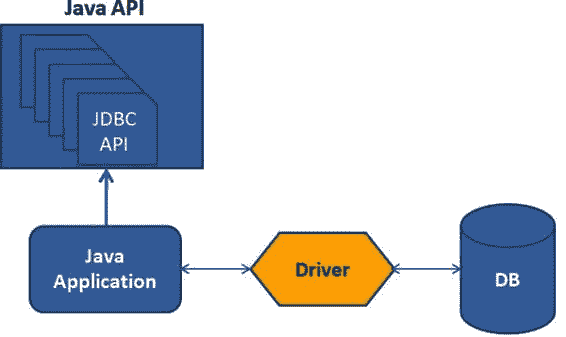

图 7.1：JDBC 架构

从图中可以观察到，Java 应用程序通过 `JDBC API` 与数据库建立连接。然而，Java 应用程序无法直接与数据库通信。我们需要在 Java 应用程序和数据库之间建立一个 `JDBC driver` 层。该驱动程序将 Java API 转换为相应的数据库 API，反之亦然。

## 什么是 JDBC 驱动？为什么需要它？

`JDBC 驱动` 是一个软件组件，允许 Java 应用程序与底层数据库进行交互。它提供了 `Java API` 中不同接口的实现。通常，该驱动以 `jar` 文件的格式提供。

## 为什么需要 JDBC 驱动？JDBC 驱动的作用是什么？

`JDBC 驱动` 是安装在客户端机器上的客户端适配器。驱动程序帮助将 Java 程序的请求转换为数据库可以理解的协议。它还将数据库供应商生成的结果传输到 Java 应用程序。

## 有多少种驱动程序？你用过哪些驱动程序？什么是 Type 4 驱动？

共有 4 种 `JDBC 驱动`。

驱动类型：
- `Type 1` 或 `JDBC-ODBC 桥驱动`
- `Type 2` 或 `native API 驱动` 或 `部分 Java 驱动`
- `Type 3` 或 `网络协议驱动`
- `Type 4` 或 `纯 Java 驱动`

## 详细解释驱动类型

以下是不同类型的驱动程序：

### Type 1 或 JDBC-ODBC 桥驱动

`Type 1` 驱动使用安装在每个客户端机器上的 `ODBC 驱动` 来连接数据库。需要在系统上配置 `Data Source Name`（数据源名称）以使用 `ODBC`。`JDBC-ODBC 桥驱动`将 `JDBC` 方法调用转换为 `ODBC` 函数调用。数据的转换发生在 `JDBC` 到 `ODBC`，这导致速度较慢。由于不需要额外的下载或安装，因此易于使用。但我们不能忽略在每个系统上配置 `DSN` 的问题，这使得系统之间的迁移变得繁琐。

### Type 2 或 native API 驱动或部分 Java 驱动

`Type 2` 驱动使用数据库的客户端库。在 `Type 2` 驱动中，`JDBC API` 调用被转换为 `native C/C++ API` 调用，这些调用是数据库特有的。每当更改数据库时，必须更改 `native API`，因为它是特定于数据库的。性能优于 `JDBC-ODBC 桥驱动`。这些驱动由数据库供应商提供，并且必须安装在每个客户端机器上。

### Type 3 或网络协议驱动

`Type 3` 驱动非常灵活，使用三层方法访问数据库。`网络协议驱动`使用中间件，中间件将 `JDBC` 调用转换为特定供应商的数据库协议。驱动程序完全用 `Java` 编写，不需要任何客户端库。

`JDBC 客户端`使用标准套接字与中间件应用程序服务器通信。现在，套接字信息由中间件应用程序服务器转换为 DBMS 需要调用格式并转发到数据库服务器。由于客户端上没有安装代码，且单个驱动程序实际上可以访问多个数据库，因此它非常灵活。

### Type 4 或纯 Java 驱动

`Type 4` 或 `纯 Java 驱动` 通过套接字连接直接与数据库通信。它直接将 `JDBC` 调用转换为特定供应商的数据库协议，因此为数据库提供了可用性能最高的驱动程序。它完全用 `Java` 编写，通常由供应商提供。由于驱动是特定于数据库的，每次更改数据库，我们需要记得添加新的驱动定义。

## 你能解释连接数据库的步骤吗？连接数据库的步骤有哪些？

连接数据库需要遵循以下步骤：
1. 注册驱动
2. 获取与数据库的连接
3. 创建 `statement` 实例
4. 执行 `CRUD` 操作
5. 关闭已打开的资源

## 有哪些方法可以注册驱动？

注册驱动有不同的方法，如下：
- 使用 `Class` 的 `forName()` 方法可以注册驱动类。该方法动态加载驱动类。要加载的驱动取决于你想要连接到哪个数据库。
- 我们也可以使用 `newInstance()` 方法来处理不符合标准的 JVM。
- 我们可以使用静态的 `DriverManager.registerDriver()` 方法来注册驱动。如果你在使用不符合 JDK 标准的 JVM，可以使用 `registerDriver()` 方法。

```java
Class.forName("com.mysql.jdbc.Driver");
DriverManager.registerDriver(new com.mysql.jdbc.Driver());
```


Driver driver = new `oracle.jdbc.driver.OracleDriver()`;

`DriverManager.registerDriver(driver)`;

```

注意：如果指定的驱动不可用，则 JVM 将生成异常。对于 `TypeIV` 驱动，你可以在项目中添加相应的 `jar` 文件。

## 解释 Class.forName() 和 DriverManager.registerDriver() 之间的区别

这个问题可以重新表述为：
- 为什么开发者总是使用 `Class.forName()` 来注册驱动？
- 为什么建议不要使用 `DriverManager.registerDriver()` 进行驱动注册？

`JDBC` 规范要求驱动在类加载时获取注册自身。类使用 `Class.forName()` 方法加载。在 `JDBC 4` 中，驱动程序只需将它们放在类路径中即可自动加载。

另一方面，`DriverManager.registerDriver()` 是手动的。这是危险的，因为它会导致驱动被注册两次。

## JDBC API

Java 通过 `JDBC` 提供了连接底层数据库的方法。它包含了许多接口，作为开发者，你必须了解。有关接口的问题将在后续章节讨论。

## 如果 JDBC 是一个 API，谁提供实现？

供应商实现 `JDBC API` 并以 `jar` 文件形式提供。例如，MySQL 提供了该 jar 包含了不同接口的实现。

## 你能列出 JDBC API 的不同接口吗？

`JDBC` 提供了等接口。

`Statement` 是一种用于与表通信的通用方法。它被用于执行静态查询。

### PreparedStatement
`PreparedStatement` 是一种非常有用的方法，可以在运行时使用不同的参数值反复执行相同的 SQL 语句。它对于执行动态或参数化查询非常有用。`PreparedStatement` 是一个预编译查询，查询的只会发生一次，从而节省了时间。因此，它提高了应用程序的性能。

### CallableStatement
`CallableStatement` 用于执行存储过程。我们可以按照如下方式向 `CallableStatement` 传递三种类型的参数：

- `IN` 参数用于向存储过程传递输入值。
- `OUT` 参数用于存放存储过程返回的结果。
- `INOUT` 参数同时持有 `IN` 和 `OUT` 参数。

#### 如何使用 CallableStatement？如何使用 CallableStatement 调用过程？
使用 `CallableStatement` 的工作包含以下步骤：
1. 创建 `CallableStatement` 对象。
2. 使用 `setter()` 方法传递 `IN` 参数。
3. 使用 `registerOutParameter()` 方法注册 `OUT` 参数。
4. 执行
5. 使用 `getter()` 方法获取存储过程返回的结果。

让我们了解如何在不同情况下编写 `CallableStatement` 代码来调用 `procedure1`：

**情况 1：没有 IN 或 OUT 参数**
```java
CallableStatement callstmt =
callstmt.execute();
```

**情况 2：有 IN 参数但没有 OUT 参数**
```java
CallableStatement callstmt =
callstmt.execute();
```

**情况 3：同时有 IN 和 OUT 参数**
```java
CallableStatement callstmt =
Types.VARCHAR);
callstmt.execute();
String address =
```

**情况 4：有 IN 和 INOUT 参数**
```java
CallableStatement callstmt =
Types.VARCHAR);
callstmt.execute();
String address =
```

---

### ResultSet
#### 什么是 ResultSet？如何获取 ResultSet？
`ResultSet` 指以行和列的形式存在的数据，它是查询执行的结果。

可以通过通过 `Statement` 发送查询查询来获取 `ResultSet`，如下：
```java
Statement st=con.createStatement();
ResultSet * from ;
```
我们也可以使用参数化查询或 `PreparedStatement` 来获取 `ResultSet` 对象。

#### ResultSet 提供了哪些功能？你用过 ResultSet 的哪些功能？
`ResultSet` 提供了获取数据、导航数据中以及更新数据的方法。以下是 `ResultSet` 的一些方法：

- 从列中返回数据，该列的索引在方法中声明。`XXX` 代表你感兴趣检索的数据类型。例如，如果你想从第二列检索 `String` 类型的数据，则该方法的调用方式为...
- 此方法与之前的方法完全相同。唯一的区别是，你不需要提供列索引号，而是需要提供列名作为参数。例如，如果你想从 `first_name` 列检索 `String` 数据，该方法的调用方式为...
- 将光标移动到...的下一行。
- 将光标移动到...的上行。
- 将光标移动到...的第一行。

注意：这些并不是所有的方法，但考虑到问题的范围，这些已经足够了。即使你能够列出这么多方法，面试官也会对你的知识水平做出自己的判断。

#### 如何判断 ResultSet 是否有数据或是否为空？
`ResultSet` 标的光标始终指向它的开头。这意味着光标指向第一行之前。即使我们根据查询没有任何记录，`ResultSet` 仍然会被生成，但它是空的。但是，当在这种情况下调用 `next()` 方法时，应用程序会抛出异常。为了避免这种情况，我们需要在处理之前检查 `next()` 方法的返回值。如果...中没有可用的下一记录，`next()` 方法返回 `false`。

以下代码段显示了我们如何实现这一点：
```java
Statement st = con.createStatement();
ResultSet rs = * from
if (rs.next() == {
    in
} else {
    do {
        String name =
        System.out.println(name);
    } while (rs.next());
}
```

#### 什么是可滚动的 ResultSet？
这可以重新表述为：什么是 `ResultSet.TYPE_SCROLL_INSENSITIVE` 和 `ResultSet.TYPE_SCROLL_SENSITIVE`？

`ResultSet` 持有数据。默认情况下，`ResultSet` 是不可更新的。光标只能向前移动。此外，`ResultSet` 中的数据不能被更改。然而，可滚动的 `ResultSet` 更灵活，它既是可滚动的也是可更新的。

`ResultSet` 是可滚动的，这意味着人们可以向前也可以反向遍历记录。可滚动的 `ResultSet` 具有读取第一条记录、最后一条记录、下一条记录和上一条记录的能力。

要生成可滚动的 `Statement` 对象，必须提供滚动类型常量，如下：
- `ResultSet.TYPE_FORWARD_ONLY`：默认类型，允许 `ResultSet` 只能向前移动。
- `ResultSet.TYPE_SCROLL_INSENSITIVE`：此常量允许数据向前和反向滚动，但它对 `ResultSet` 的更新不敏感。
- `ResultSet.TYPE_SCROLL_SENSITIVE`：此常量允许数据向前和反向滚动。相反，数据对 `ResultSet` 的更新敏感。

在可更新的情况下，更改将立即持久化到数据库中，并由 `ResultSet` 对象实时反映。

`ResultSet` 的并发类型有助于判断 `ResultSet` 是可更新的还是只读的。`ResultSet` 有两个并发级别：
- `ResultSet.CONCUR_READ_ONLY`：`ResultSet` 不可更新。
- `ResultSet.CONCUR_UPDATABLE`：`ResultSet` 是可读可更新的。

以下代码段显示了如何创建一个不敏感且只读的可滚动结果：
```java
Statement st = con.createStatement(ResultSet.TYPE_SCROLL_INSENSITIVE, ResultSet.CONCUR_READ_ONLY);
```
我们也可以使用 `PreparedStatement` 代替。如前所述，要创建可更新的，你需要更改 `createStatement()` 方法的第二个参数，如...

人们可以使用 `Statement` 实例执行查询，是否可以在不使用 statement 或执行查询的情况下向 DB 插入行？
可更新的 `ResultSet` 可以通过...的 `insertRow()` 在表中插入行。
我们需要记住，插入行中的每个不允许为空值且没有默认值的列都必须给出一个值。在调用它之前，你必须调用 `updateXXX()` 方法来修改列数据。

```java
Statement st = con.createStatement(ResultSet.TYPE_FORWARD_ONLY, ResultSet.CONCUR_UPDATABLE);
ResultSet rs = FROM
rs.moveToInsertRow();
"Value of
"Value of Last
rs.insertRow();
rs.moveToCurrentRow();
```

如果 `ResultSet` 使用默认工作机制并尝试更新数据，会发生什么？
这将产生异常，这意味着 `ResultSet` 必须来自可滚动且可更新的 `ResultSet` 类型。

#### JDBC 中通常会发生哪种异常，如何处理它？
`java.sql.SQLException` 是 JDBC 程序中需要处理的最常见异常。处理传统异常和 JDBC 异常没有区别。我们可以使用 `try-multi catch` 甚至是 `finally` 块。此外，我们还可以使用 `AutoClosable` 接口来消除 `finally` 块。

#### JDBC 中的事务管理是什么？
事务代表在 DB 上执行的单一工作单元。换句话说，事务也可以被视为一组用于执行任务的操作。

# 事务管理的 ACID 特性是指什么？

ACID 特性定义了事务管理的属性。它是原子性（Atomicity）、一致性（Consistency）、隔离性（Isolation）和持久性（Durability）的缩写：

- **原子性**：意味着所有执行的查询要么全部成功，要么一个都不执行。
- **一致性**：确保数据状态的一致性。
- **隔离性**：确保一个事务与其他事务相互隔离。
- **持久性**：确保一旦事务提交，即使发生错误事件，它也将保持提交状态。

# 为什么应用程序需要事务管理？

在 `JDBC` 中，事务是自动提交的。这种默认行为在小型应用程序是可以接受的。但在企业级 Java 应用中，由于以下原因我们可能需要自定义行为：

- 它提高了应用程序的性能。
- 它允许维护业务流程的完整性。
- 事务管理允许我们使用分布式事务。

## 你能解释事务管理是如何提高应用程序的速度或性能的吗？

有时，应用程序需要执行大量操作。可能会出现用户正在向数据库中插入数百行数据。如果这些插入是独立执行的，可能会影响性能。但如果使用事务，你能够一次性提交所有插入操作，这对于应用程序的性能显然是有益的。

# 事务有哪些类型？

事务可以分为以下类：

### 本地事务 (Local transaction)
本地事务指定语句在单个事务资源（如 `JDBC`）上执行。本地事务更容易实现，在集中式计算环境中非常有用。在本地事务中，应用程序组件和资源位于单个站点，并涉及运行在单台机器上的本地数据管理器。

### 分布式事务 (Distributed transaction)
分布式事务跨越多个事务资源。在分布式事务管理中，事务管理器负责所有与数据库特定的操作。需要注意的是，分布式事务必须在不同的位置保持同步和可用。

### 嵌套事务 (Nested transaction)
嵌套事务发生在另一个事务的引用范围内。嵌套事务所做的任何更改对现有或主事务都是不可见的。一旦嵌套事务提交，发生的所有更改都可以通知给主事务。嵌套事务有助于管理事务机制的隔离性。

# 如何在 JDBC 中提供事务管理？

默认情况下，`JDBC` 是自动提交的。为了控制事务管理，我们需要执行以下步骤：

1. **禁用自动提交**
2. 使用 `execute()` 或 `executeUpdate()` 方法执行 CRUD 操作，然后调用 `commit()` 方法：
```java
con.commit();
```
3. 如果事务中的任何操作未执行或发生发生异常，则调用 `rollback()` 方法：
```java
catch (Exception se) {
    // 每当发生异常时
    con.rollback();
}
```

# commit() 和 rollback() 方法是什么？

我们开始的事务可能成功，也可能失败。根据此，我们可以决定是希望让已执行任务的更改被永久反映，还是想要撤销它们。为了实现这一点，事务管理提供了两个方法，如下：

- 一旦执行了 CRUD 操作且我们希望这些更改永久反映在数据库中，我们就调用 `commit()` 方法。
- 每当执行 CRUD 操作时，在执行其中一个步骤时都有可能出现异常。这可能包括已经执行的步骤。因此，为了维护数据的一致性，到目前为止的所有更改都需要回滚。要撤销这些更改，需要调用 `rollback()` 方法。

# 什么是 Savepoint（保存点）？如何使用 Savepoint？

事务是一个连续执行多个操作的概念。在执行这些多个操作时，我们可能在当前事务内部需要一个中间标记，这可以通过 `Savepoint` 实现。一旦设置，事务可以回滚到该 `Savepoint` 而不影响之前的工作。下面的代码片段详细说明了如何创建和使用：

```java
Savepoint savepoint = con.setSavepoint();
//中间操作
// 回滚到‘savepoint’
```

# 什么是元数据（metadata）？什么是 DatabaseMetaData 和 ResultSetMetaData？

元数据提供关于其他数据的结构化描述数据。`JDBC` 提供不同的对象来提供有关信息的信息，如下：

- 它提供了与应用程序通信的底层数据库的信息。
- 我们可以使用 `DatabaseMetaData` 获取数据库信息，如下：
    - 数据库用户、表、视图和存储过程
    - 数据库模式（schema）和目录信息
    - 关于表的主键（PK）、外键的信息
- 它提供了由查询生成的 `ResultSet` 信息。我们可以使用 `ResultSetMetaData` 获取数据库信息，如下：
    - 列数、名称、类型和长度
    - 列是否可读/可写，是否可搜索

# 什么是 BatchUpdate（批量更新）？如何执行批处理？

在批量更新中，一组更新被分组并一次性发送到数据库，而不是一个接一个地发送。以下是批量更新的优势：

- 使用批量更新有助于一次性执行更新，这比逐个发送数据并等待每个任务完成要快得多。
- 批量更新有助于减少网络流量。
- 速度相比于逐个执行更新要更快。
- 我们可以将批量更新用于 SQL 插入、更新以及删除。

下面的代码片段描述了如何使用批量更新：

```java
Statement st = con.createStatement();
st.addBatch("employee set firstname='ABC' where ...");
st.addBatch("employee set firstname='Eric' where ...");
st.addBatch("employee set firstname='May' where ...");
affected = st.executeBatch();
} finally {
    st.close();
}
```


注意：在前面的代码中可以使用 `PreparedStatement` 代替 `Statement`。

# JDBC 中的游标（cursor）是什么？

游标是由 `ResultSet` 对象维护的指针，指向当前行。

# 什么是连接架构和离线架构？

Java 提供了不同的架构来从数据库获取数据，如下：

- **连接架构**：必须打开连接才能访问从数据库获取的数据。
- **离线架构**：即使数据库连接关闭，也可以访问从数据库获取的数据。

`JDBC` 默认使用连接架构。然而，`RowSet` 支持处理数据库的离线架构。

# 什么是 RowSet？

`RowSet` 实例是 JDK 1.5 中引入的 Java Bean 组件。它是一种封装器，以比 `ResultSet` 更简单灵活的方式存储表格数据。`RowSet` 对象默认是可滚动和可更新的。

# RowSet 有哪些不同类型？

`RowSet` 分两种类型：

- **连接型 (Connected)**：连接型 `RowSet` 对象建立数据库连接以执行 CRUD 操作。连接一直保持到 `RowSet` 对象关闭。
- **离线型 (Disconnected)**：在离线型 `RowSet` 对象中，仅在向数据库读写数据时才会与数据库建立连接。在处理数据时不持有连接。

连接型和离线型 `RowSet` 对象几乎相同，区别在于：

- 与连接型 `RowSet` 对象相比，离线型 `RowSet` 重量更轻。
- 离线型 `RowSet` 默认是可序列化的。
- 离线型 `RowSet` 可将数据发送到轻量级客户端，如手机等。

`RowSet` 是一个接口。那么它的类型和实现类有哪些？

# 以下是不同类型的

## JdbcRowSet

`RowSet` 的扩展接口之一是 `JdbcRowSet`，它是 `ResultSet` 对象的包装器。这使得 `ResultSet` 可以作为一个 JavaBean 组件使用。`JdbcRowSet` 是一个连接型的 `RowSet`，它使用支持 JDBC 技术的驱动程序维护与数据库的连接。`JdbcRowSet` 实例可以简单地接收在其上的调用，然后反过来，这些调用会发生在其 `ResultSet` 对象上。默认情况下，`JdbcRowSet` 对象是可滚动和可更新的。当驱动程序和数据库不支持滚动或更新时，应用程序可以使用 `ResultSet` 对象的数据来填充 `JdbcRowSet` 对象，然后我们就可以对该 `JdbcRowSet` 对象进行操作。

`JdbcRowSet` 的具体实现是 `JdbcRowSetImpl`。

以下代码段说明了 `JdbcRowSetImpl` 的用法：

```java
JdbcRowSetImpl jdbcRowset = new JdbcRowSetImpl();
jdbcRowset.setCommand("SELECT * FROM employee WHERE empid = ?");
jdbcRowset.execute();
```

## CachedRowSet

`CachedRowSet` 对象是离线的。它是数据行的容器，在内存中缓存这些行，从而能够在无需始终连接数据源的情况下进行操作。`CachedRowSet` 对象包含来自 `ResultSet` 的行。然而，它也可以包含来自任何具有表格格式的文件（如电子表格）的数据。每当 `CachedRowSet` 中的数据被修改时，这些修改就可以传播到数据源。其实现方式是 `CachedRowSetImpl`。

## WebRowSet

`WebRowSet` 更适用于平台无关的通信。`WebRowSet` 是 `CachedRowSet` 的扩展。通过使用它，`RowSet` 提供了将数据库查询结果写入 XML 文件的功能。其实现方式是 `WebRowSetImpl`。

## JoinRowSet

`JoinRowSet` 是 `WebRowSet` 的扩展，由来自不同 `RowSet` 的相关数据组成。`JoinRowSet` 提供了一种在不连接数据源的情况下，在离线 `RowSets` 之间建立 SQL JOIN 标准方法。任何数量实现 `Joinable` 接口的 `RowSet` 对象都可以添加到 `JoinRowSet` 对象中。`Joinable` 接口提供了根据指定列执行 `JOIN` 操作的方法。

## FilteredRowSet

有时，`RowSet` 对象必须对其内容进行某种程度的过滤。在这里，可以为所有标准的 `RowSet` 实现提供查询语言。但对于轻量级组件来说，这是一种复杂且不实际的方法。`FilteredRowSet` 为数据过滤提供了一种轻量的解决方案。

## 什么是 SQLTimeoutException？

JDBC 提供了 `setQueryTimeout(int seconds)` 方法来设置获取结果的等待时间。如果查询没有在参数指定的时间内返回结果，则会抛出 `SQLTimeoutException`。

## 结论

在本章中，我们讨论了 Java 面试中可能会问哪些基于 JDBC 的问题。在讨论过程中，我们学习了关于如何连接数据库以及如何从数据库检索信息或数据到应用的许多知识。我们还讨论了不同的接口及其实现，这些构成了 JDBC 的核心部分。我们还处于大楼的第一层；就 Java 面试而言，还有很多需要学习和理解的内容。在下一章中，我们将详细讨论集合。

# 第 8 章：集合

## 引言

Java 是一种面向对象的编程语言。使用 Java 创建的软件由许多相互通信的对象组成。将这些对象组合在一起以便对这些对象执行某些共同操作总是至关重要的。通常，此类操作需要开发者手动重复地执行。为了减少这种工作，Java 引入了集合框架（Collection Framework），它由预定义的数据结构和算法组成，这些内容可以应用于对象。集合框架本质上是一组不同的接口及其实现类，通过这些类，可以根据不同的场景对对象进行分组。每个接口本身根据对象的排列或遍历方式为一组对象提供不同的功能。这些功能为开发者提供了灵活性，使其能够在应用程序中充分利用对象以实现预期的结果。有时，开发者需要有序的对象；有时，他们想要没有重复的相同对象组，或者有时，想要按某种排序顺序的相同对象组。集合框架为开发者提供了所有此类解决方案。

## 结构

理解集合框架通常被认为是复杂的。它由许多接口、子接口及其实现类组成。在本章中，我们将涵盖 `Collection` 框架的不同方面：

- 为什么需要 `Collection` 框架？
- 不同的 Collection 接口：
  - `List`
  - `Set`
  - `Queue`
  - `Map`
  - 如 `Collections` 和 `Arrays` 等工具类

## 目标

`Collection` 中的每个接口旨在实现特定的功能。记住这样一个庞大的 API 并不是一项易事。由于其在实时项目中的重要性，`Collection` 是 Java 面试过程中最受欢迎的话题之一。如所述，`Collection Framework` API 是巨大的。因此，就面试过程而言，涵盖每一个类是不可能的，或者事实上在面试过程中也是不需要的。但可以确定，在本章中，你将学习如何回答几乎每一个重要问题，从概念到实现，以便你在面试中成功。你将能够掌握不同的集合类型如 `List`、`Set`、`Queue` 和 `Map` 及其实现。

## 解释集合框架。什么是集合框架？

JDK 1.2 引入了集合框架，其中包含了一组集合接口、实现和算法。这些 API 是类和接口的集合，用于存储、查找、添加和操作对象。框架提供了诸如 `Queue` 的接口以及用于此目的的实现类。

## 列出集合框架的优势

Java Collections 现在配备了泛型和并发集合类用于线程安全操作。它包括在 `java.util.concurrent` 包中的阻塞接口实现。

## 解释数组和集合的区别。数组和集合的主要区别是什么？

数组和集合都支持数据的存储。它们之间存在一些区别，如下：

- 数组的大小始终是固定的。这意味着一旦定义了数组的大小，在运行时就无法更改，但集合的大小是动态的。这意味着集合的大小可以在运行时动态更改。
- 数组只能存储一种类型的对象或同构元素，但集合可以持有异构对象。
- 数组没有预定义数据操作方法，用户需要为元素的排序和搜索提供逻辑。然而，集合提供了预定义数据操作方法。

## 什么是遗留类？

集合框架（Collection framework）从一开始并不是 JDK 的一部分。它是从 JDK 1.2 开始引入的。因此，在集合框架之前，JDK 依赖某些类和接口来存储和操作数据集合。以下是遗留类：

- `Vector` 与 `ArrayList` 类似，但 `Vector` 的方法是同步的，而 `ArrayList` 的方法是非同步的。
- `Hashtable` 基于 `Map` 接口执行工作。`Hashtable` 中的每个条目都是一个键值对。
- `Dictionary` 是一个抽象类，它将每个元素作为键值对持有。`Hashtable` 是 `Dictionary` 类的子类型。
- `Properties` 是 `Hashtable` 类的扩展。`Properties` 是线程安全的，因此它不需要任何手动同步来存储键值对中的值。
- `Stack` 被称为 LIFO（后进先出），它允许仅从一端弹出（popping）。它是 `Vector` 类的扩展。

### 集合框架中提供了哪些接口？

`java.util` 包作为集合框架的一部分提供了各种接口和类。以下是该框架提供的接口列表：

- `Collection` 是框架提供的主要接口。该接口继承自 `Iterable` 接口。所有的接口和类必须实现此接口。
- `List` 接口：`java.util.List` 接口继承自 `Collection` 接口。列表接口是有序的对象集合，不一定按自然顺序排序。它允许重复元素。接口还允许对元素进行随机访问。
- `Set` 接口：`java.util.Set` 接口是一个不允许重复元素的对象集合。元素是无序且未排序的。该接口提供了 `Collection` 接口继承的方法。
- `Queue` 接口：`java.util.Queue` 接口定义了队列数据结构。队列以先入先出（First In First Out）的形式存储元素。
- `Map` 以键值对的形式存储元素。`Map` 接口没有实现 `Collection` 接口。它允许唯一的键，但元素可以是重复的。元素以无序、未排序的方式存储。

### 泛型集合（generic collection）的优势是什么？

以下是使用泛型集合的优势：

- 在获取或遍历元素时，如果使用泛型类，则不需要类型转换。
- 泛型是类型安全的，并在编译时进行检查。
- 泛型集合通过在编译时即可检测错误，确保了代码的稳定性。

### 什么是类型擦除（type erasure）？

默认情况下，集合 API 允许异构元素。这种异构性在处理集合数据时可能会产生问题。为了避免此类处理问题，泛型在 `JDK 1.5` 中被引入。泛型的使用确保了类型安全；这意味着集合允许持有相同类型的元素，内部不允许包含异构元素。

尽管泛型非常强大，但它只在编译时强制执行类型约束，类型信息在运行时是不可用的。这种在运行时擦除类型信息的过程被称为 `type erasure`（类型擦除）。

### Collection 和 Collections 之间有什么区别？

以下是 `Collection` 和 `Collections` 之间的区别：

- `Collection` 是接口，而 `Collections` 是类。
- `Collection` 接口为 `List`、`Set` 和 `Queue` 提供数据结构的标准功能。`Collections` 类提供了排序和同步集合元素的方法。
- `Collection` 是根接口，而 `Collections` 是一个通用工具类。
- `Collection` 接口提供了用于操作存储在相应数据结构中的元素的方法。`Collections` 类为集合对象提供了各种工具方法的静态方法。

### 集合框架的优势是什么？

以下是集合框架的优势：

- 框架通过提供预定义方法减少了编程工作量。
- 使用框架可以提高性能，因为它提供了数据结构和算法的高性能实现。
- 它提供了不相关 API 之间的互操作性，使得集合可以从一个更改到另一个。
- 框架非常容易学习和实现功能。

### 陈述 ArrayList 和 Vector 之间的区别

`ArrayList` 和 `Vector` 都以 `List` 作为父接口。这意味着这两个类都是索引的、有序的、未排序的集合。然而，它们之间存在一些主要区别，如下：

- `ArrayList` 不是同步的；然而，`Vector` 是同步的。
- `ArrayList` 不是遗留类，但 `Vector` 是遗留类。
- `ArrayList` 按数组大小的 50% 增加容量。`Vector` 按数组大小翻倍来增加容量。

### ArrayList 和 Vector 之间有什么相似之处？

`ArrayList` 和 `Vector` 具有以下相似点：

- 两个类都是索引集合。
- 它们在内部都由数组支持。
- 两个类都是有序集合。这意味着我们插入元素的顺序始终被保持。
- 两个类的 `iterator` 实现设计上都是快速失败（fail-fast）。
- 两个集合都允许空值。
- 它们都允许通过索引号对元素进行随机访问。

### ArrayList 和 LinkedList 之间有什么区别？

以下是 `ArrayList` 和 `LinkedList` 之间的区别：

- `ArrayList` 使用动态数组，而 `LinkedList` 使用双向链表。
- `ArrayList` 在操作上不高效，但 `LinkedList` 高效。
- 当人们想要存储和获取数据时，`ArrayList` 更好。然而，操作数据时 `LinkedList` 是更好的选择。
- `ArrayList` 提供随机访问，但 `LinkedList` 不提供。
- 由于 `ArrayList` 只存储对象，因此内存开销较小，而 `LinkedList` 存储对象及其地址，因此内存开销更大。

### Array 和 ArrayList 之间有什么区别？

`array` 和 `ArrayList` 都是索引集合，区别如下：

- `array` 的大小是固定的，不能在运行时调整大小，而 `ArrayList` 的大小可以动态更改。
- `array` 是静态类型，而 `ArrayList` 是动态大小。
- `array` 允许存储基本类型和对象；然而，在 `ArrayList` 中只能存储对象类型。

### 解释数组长度和 ArrayList 大小的区别

可以使用 `length` 属性获取数组的长度，但 `ArrayList` 不支持 `length` 属性。`ArrayList` 提供了 `size()` 方法，用于查找列表中元素的数量。

### Array 和 ArrayList 可以互相转换吗？如何将 ArrayList 转换为数组反之？

是的，可以。

- 可以使用 `Arrays` 类的 `asList()` 方法将数组转换为 `ArrayList`。`asList()` 方法是 `Arrays` 类提供的静态方法，接受数组对象。
- 同样地，可以使用 `ArrayList` 类的 `toArray()` 方法将 `ArrayList` 转换为数组。

### 如何从列表创建基本类型的数组？

之前讨论的 `toArray()` 方法创建的是包装类数组。如果你尝试使用该方法生成基本类型数组，它将抛出异常。因此，创建此类数组的唯一选择是使用列表的 `get()` 方法显式地将元素复制到数组中。

> 默认情况下，`ArrayList` 在运行时是可以修改的。这意味着可以使用 `remove()` 或 `set()` 方法分别访问、删除或更新元素。
>
> 但，可以通过调用 `Collections.unmodifiableList()` 方法获取一个只读的 `ArrayList`。当 `ArrayList` 为只读状态时，人们无法通过 `remove()` 或 `set()` 方法修改集合。
>
> 下面的代码段展示了如何使用该方法：

```java
List<Integer> list = new ArrayList<>();

// 填充列表
list.add(10);
list.add(20);

// 打印列表
System.out.println("list: " + list);

// 获取不可修改的列表
// 使用 unmodifiableList() 方法
List<Integer> nonModifiableList = Collections.unmodifiableList(list);

// 向新列表添加元素以修改
nonModifiableList.add(30);
```

如果你尝试执行上述代码，你将得到如下所示的异常 `UnsupportedOperationException`：

```
Initial list: [10, 20]
Trying to modify the list
Exception in thread "main" java.lang.UnsupportedOperationException
    at java.util.Collections$UnmodifiableCollection.add(Unknown Source)
```

## ArrayList 可以包含重复元素吗？通过哪些方法可以移除 ArrayList 中的重复元素？

默认情况下，`ArrayList` 可以包含重复元素。通过以下两种方法，可以移除 `ArrayList` 中的重复元素：

### 使用 HashSet

可以使用 `HashSet` 移除 `ArrayList` 中的重复元素。这意味着你需要将 `ArrayList` 转换为 `HashSet`。然而，在这种情况下，它不会保留插入顺序。

### 使用 LinkedHashSet

使用 `LinkedHashSet` 可以在移除重复的同时保持插入顺序。可以通过以下步骤实现：
1. 首先，将 `ArrayList` 的所有元素复制到 `LinkedHashSet`。
2. 现在，借助于 `clear()` 方法清空 `ArrayList`。`clear()` 方法将移除列表中的所有元素并使其为空。
3. 最后，将 `LinkedHashSet` 的所有元素复制到 `ArrayList`。

## 默认情况下，ArrayList 是有序的。是否有任何方法可以反转或排序 ArrayList 中的元素？

默认情况下，`ArrayList` 不提供任何此类功能。但，通过使用工具类 `Collections`，我们可以实现这一点。下面的代码段展示了如何实现相同的效果：

```java
List<Integer> list = new ArrayList<>();

// 填充列表
list.add(30);
list.add(10);
list.add(20);

// 打印列表
System.out.println("list: " + list);

// 排序
Collections.sort(list);
System.out.println("Sorted list: " + list);

// 反转
Collections.reverse(list);
System.out.println("Reversed list: " + list);
```


## 代码输出示例

上述代码段的输出如下：

```
Initial list: [10, 6, 20, 4, 15]
Reversed list: [15, 4, 20, 6, 10]
Sorted list: [4, 6, 10, 15, 20]
```

## 有哪些方法可以同步 ArrayList？

`ArrayList` 可以通过以下两种方式进行同步：

### 使用 SynchronizedList
该方法接受一个列表并返回一个同步列表。当人们不想同步遍历，但需要防止并发线程之间的干扰时，该方法非常有用。这种方式是昂贵的，因为每次写操作都需要单独的数组复制。当人们有一个列表且只需要遍历其元素而不频繁修改它们时，这种机制是非常高效的。

### 使用 CopyOnWriteArrayList
在进行遍历时，即使人们尝试在遍历时修改数据，它也不会抛出 `ConcurrentModificationException`，因为迭代器是在副本上进行迭代。此外，写操作将在副本上执行。

## 解释 List 和 Set 接口之间的区别

`List` 和 `Set` 接口都继承自 `Collection` 接口。它们有以下区别：
- `List` 可以包含重复元素，但 `Set` 只能包含唯一元素。
- `List` 是有序集合。这意味着它维护了插入顺序。然而，`Set` 是无序集合。
- `List` 接口允许任意数量的 `null` 值，但 `Set` 接口只允许单个 `null` 值。
- `List` 接口包含一个遗留类 `Vector`。但 `Set` 接口没有任何遗留类。

## HashSet 和 TreeSet 的区别是什么？

`HashSet` 和 `TreeSet` 类都是 `Set` 接口的实现。但它们有以下区别：
- `HashSet` 是无序的，但 `TreeSet` 保持升序。
- `HashSet` 由哈希表实现，而 `TreeSet` 是树结构。
- `HashSet` 比 `TreeSet` 更快。
- `HashSet` 由 `HashMap` 支持，而 `TreeSet` 由 `NavigableMap` 支持。

## HashMap 和 HashTable 的区别是什么？

`HashMap` 是非同步的，意味着不能直接在线程之间共享，并且需要实现正确的同步代码。但 `HashTable` 是同步的，可以安全地与多个线程共享。
- `HashTable` 不允许任何 `null` 键和 `null` 值，但 `HashMap` 允许一个 `null` 键和多个 `null` 值。
- 如果不需要同步，通常倾向于使用 `HashMap`。

## HashTable 允许 null 吗？你能解释为什么 HashTable 不允许 null 吗？你能为什么 HashMap 允许 null？

`HashTable` 中的每个条目都以键值对的形式存在。如果人们想成功地存储元素并从中检索存储的对象，那么用键的对象必须实现 `hashCode()` 和 `equals()` 方法。但如果我们使用 `null`，就会出现问题，因为 `null` 不是对象。由于它不是对象，它无法同时实现 `hashCode()` 和 `equals()` 方法。

`HashMap` 是一个带有改进的高级版本。

## 什么是 WeakHashMap？

这也是 `Map` 的一种实现，类似于 `HashMap` 但有一项重要的变化。如果我们声明的键是对象类型，那么它与垃圾回收器连接。这意味着 `WeakHashMap` 允许垃圾回收器删除键（注：原文逻辑似乎反了，`WeakHashMap` 的键是弱引用，GC 可回收）。

## 能通过代码来解释 WeakHashMap 的概念吗？

当然可以。下面的代码段展示了垃圾回收器如何活跃地删除未使用的键：

```java
Map hashMap = new HashMap();
Map weakHashMap = new WeakHashMap();

String keyHashMap = new String("key");
String keyWeakHashMap = new String("key");

hashMap.put(keyHashMap, "value");
weakHashMap.put(keyWeakHashMap, "value");

// GC 之前
keyHashMap = null;
keyWeakHashMap = null;

System.gc();

// GC 之后
```

如所示，与对象关联的键被设置为 `null`。但尽管如此，`HashMap` 的键仍然存在并指向实际对象，这在 `WeakHashMap` 的情况下并非如此。

注意：你也可以使用用户自定义对象作为键而不是字符串，并实现 `finalize()` 方法来证明垃圾回收器确实在工作。

## 解释 Iterator 和 ListIterator 之间的区别？

`Iterator` 和 `ListIterator` 的区别如下：
- `Iterator` 仅用于正向遍历元素。但 `ListIterator` 可用于正向和反向遍历元素。
- `Iterator` 可以用于大多数集合，如 `List`、`Set` 和 `Queue`，但 `ListIterator` 的使用仅限于 `List`。
- `Iterator` 在遍历集合时仅提供删除操作。但 `ListIterator` 在遍历集合时提供添加、更新和删除元素的操作。

## Iterator 和 Enumeration 的区别

- `Iterator` 可以遍历遗留元素和非遗留元素。但 `Enumeration` 只能遍历遗留元素。
- `Iterator` 是快速失败机制（fail-fast）的，而 `Enumeration` 不是。
- `Iterator` 速度比 `Enumeration` 慢。
- `Iterator` 在遍历集合时提供删除操作。然而，`Enumeration` 只能遍历集合。

## List 和 Set 接口的区别

`Set` 和 `List` 的区别如下：
- `List` 是一个有序集合。然而，`Set` 是一个无序集合。
- `Set` 包含唯一值，但 `List` 可以包含重复值。
- `List` 默认不是排序的。`Set` 提供了一个排序版本，作为 `SortedSet`。

## Set 和 Map 接口的区别

`Set` 和 `Map` 的区别如下：
- `Set` 仅包含值，但 `Map` 同时包含键和值。
- `Set` 包含所有唯一值。然而，`Map` 可以包含与唯一键关联的重复值。
- `Set` 可以有一个 `null` 值，但 `Map` 允许一个 `null` 键，且可以包含任意数量的 `null` 值。

## HashMap 和 HashSet 的区别

`HashSet` 和 `HashMap` 的区别如下：
- `HashSet` 实现了 `Set` 接口，而 `HashMap` 实现了 `Map` 接口。
- `HashSet` 只包含值，而 `HashMap` 将键和值作为一个条目。
- `HashSet` 可以直接迭代。然而，要遍历 `HashMap`，需要先将其转换为 `Set`。
- `HashSet` 不能包含重复值。但 `HashMap` 可以包含重复值，这些将与唯一键关联。
- `HashSet` 可以包含一个 `null` 值，但 `HashMap` 只能有一个 `null` 键。`HashMap` 允许任意数量的 `null` 值。

## HashMap 和 TreeMap 的区别

`HashMap` 和 `TreeMap` 的区别如下：
- `HashMap` 是无序的。然而，`TreeMap` 按升序排序。
- `HashMap` 默认实现哈希表，而 `TreeMap` 实现树形结构。
- 可以使用键或值对 `HashMap` 进行排序，但 `TreeMap` 只能按键排序。
- `HashMap` 允许一个 `null` 键对应多个 `null` 值，但 `TreeMap` 不允许任何 `null` 键，尽管可以包含多个 `null` 值。
- 与 `TreeMap` 相比，`HashMap` 的搜索操作更快。

## 如何按值对 HashMap 排序

通常说 `HashMap` 是按键排序的。如何按值对其进行排序呢？
我们可以执行以下步骤按值对 `HashMap` 进行排序：
1. 通过 `entrySet()` 方法将 `HashMap` 转换为 `List`（或 `LinkedList`）。
2. 使用 `Collections.sort(list, comparator)` 方法并将 `List` 作为第一个参数。该调用的第二个参数将是 `Comparator` 的实现。
3. 将 `List` 转换为 `LinkedHashMap` 以保持顺序。

## HashMap 和 Hashtable 的区别

`HashMap` 和 `Hashtable` 的区别是：
- `HashMap` 是非同步的，而 `Hashtable` 是同步的。
- `HashMap` 允许一个 `null` 键和多个 `null` 值。然而，`Hashtable` 不允许任何 `null` 键或 `null` 值。
- `HashMap` 不是线程安全的，适用于非多线程应用程序。但 `Hashtable` 是线程安全的，可以在不同线程之间共享。
- `HashMap` 继承自 `AbstractMap` 类，而 `Hashtable` 继承自 `Dictionary` 类。

## Comparable 有什么用？

`Comparable` 接口用于通过自然顺序对 POJO 类的对象进行排序。但它提供了一种单一的方法来对序列排序。

## Set 的唯一性和 equals()

`Set` 仅允许唯一元素；那么，为什么我们得到的大小是三而不是二呢？我们需要做什么才能让 `Set` 仅拥有唯一元素？

是的，根据理论，`Set` 仅允许唯一元素。当我们添加用户定义类的实例时，`Set` 并没有任何方法来使两个实例相等。`Set` 中的实例和用户想要添加的实例可以通过隐式使用 `equals()` 方法检查它们的相等性。然而，在 `Employee` 类中，开发者并没有定义它。这意味着 `Employee` 类的默认父类 `Object` 类的 `equals()` 方法正在被调用。默认情况下，`equals()` 方法比较的是两个引用而不是两个实例的内容。显然，两个实例引用是不等的，这意味着尽管两个实例具有相同的内容或属性值，`Set` 也会将它们视为两个唯一的实例并允许添加。

以下代码的输出是什么？

```java
class Employee {
    private int empId;
    private String name;
    // 默认构造函数和参数构造函数
    // getters and setters
    // compareTo 方法
}

class Test {
    public static void main(String[] args) {
        Set<Employee> employees = new TreeSet<>();
        // ... 逻辑
    }
}
```

前面的代码将产生异常。
为什么我们会得到异常？怎么做才能消除异常？

在这里，我们将得到 `ClassCastException`。
原因：
`TreeSet` 默认是排序集合。这意味着人们插入到排序集合中的所有元素必须实现 `Comparable` 接口，因为我们没有实现 `Comparable` 接口，如果我们违反了这一限制，我们将会得到异常。

解决方案：在 `Employee` 类中实现 `Comparable` 接口。

## Comparable 和 Comparator 的区别

`Comparable` 和 `Comparator` 接口都用于集合元素的排序，但它们的区别如下：
- `Comparable` 允许以一种方式排序。但 `Comparator` 允许以多种方式排序。
- `Comparable` 包含在 `java.lang` 包中，而 `Comparator` 包含在 `java.util` 包中。
- `Comparable` 提供 `compareTo()` 方法进行比较，而 `Comparator` 提供 `compare()` 方法进行排序。
- POJO 类需要实现 `Comparable` 接口进行排序。但没有强制要求实现 `Comparator` 接口。

## 什么是 BlockingQueue？

`BlockingQueue` 是一个扩展 `Queue` 的接口。它为获取、插入和删除数据提供了并发支持。在获取元素时，它会等待队列非空。在存储集合时，它会等待可用空间。它是一个安全的集合，不能包含空元素。

## 为什么要使用属性文件？

有时，在编写代码时，可能需要某些值，这些值在未来或根据客户需求更改。如果人们硬编码这些值，更改值需要重新编译类并部署。属性文件可以包含键值对条目。与其硬编码，如果从属性文件中获取这些值，即使属性文件中的值在运行时更改，也不需要重新编译类。使用属性文件使得应用程序易于管理。数据库的驱动程序、用户名和密码等值是存储在属性文件的常用方式。

## hashCode() 方法的作用是什么？

`hashCode()` 方法返回一个称为哈希值的整数值。如果两个键相同，`hashCode()` 方法返回相同的整数。但两个哈希值可能具有不同的或相同的键。如果两个对象使用 `equals()` 方法没有得到相等的结果，那么 `hashCode()` 方法将为这两个对象提供不同的结果。

以下代码的输出是什么？

```java
class Employee {
    private int empId;
    private String name;
    // 默认构造函数和参数构造函数
    // getters and setters
}

class Test {
    public static void main(String[] args) {
        Set<Employee> employees = new HashSet<>();
        // ... 逻辑
        System.out.println("size:-" + employees.size());
        // 删除后
        System.out.println("size:-" + employees.size());
    }
}
```

> 即使调用了 `remove()` 方法，对象也不会被移除，且初始大小和移除后的大小保持不变。
> 员工的实例存在于集合中；那么，为什么初始大小和最终大小是一样的？需要做什么才能让代码正常运行？
> 是的，实例在 `HashSet` 集合中是可选的。当我们尝试删除已有的实例时，必须减小集合的大小。然而，在实践中，我们得到了相反的结果，初始大小等于最终大小。

### 原因：
当我们调用 `remove()` 方法时，`remove()` 方法首先会尝试寻找两个实例是否相等。是的，当需要对实例进行相等比较时，`equals()` 方法就会登场。但在这里，我们使用 `HashSet` 时，在检查属性是否相等之前，两个实例的哈希码（`hashCode`）必须相等。但是员工类没有 `hashCode()` 方法。作为 `Object` 类的子类，将调用 `Object` 类的 `hashCode()` 方法。这意味着两个实例具有不同的哈希码值，如果两个实例的哈希码不同，就不会调用 `equals()` 方法来比较属性。这就是为什么尽管内容相同，实例也不会被移除。

在 `Employee` 类中添加 `hashCode()` 实现。

### 为什么我们要重写 `equals()` 方法？

`equals()` 方法用于检查两个对象的相等性。如果人们想要根据属性来检查对象，他们就会重写该方法。

### 以下代码的输出将是什么？

```java
class Employee {
    private int empId;
    private String name;
    // 默认构造函数和参数化构造函数
    // getters and setters
}

class Test {
    public static void main(String[] args) {
        List<Employee> employees = new ArrayList<>();
        System.out.println("size:- " + employees.size());
        System.out.println("size of list after removing an element:- " + employees.size());
    }
}
```

作为输出，你预期元素从列表中被移除。但惊讶的是，元素不会被移除，且观察到移除前后的列表大小是相同的。

尽管实例可用，但为什么员工实例没有被消除？我们需要做什么才能让 `remove` 方法正常工作？

是的，实例在列表中，所以它必须被移除，但在实践中，它并没有被移除。

### 原因：
当我们尝试移除用户定义类的实例时，`remove()` 方法内部首先会交叉检查实例的相等性。如果实例相等，则会被移除；否则将不会被移除。现在，为了检查实例的相等性，将隐式地调用 `equals()` 方法。然而，在 `Employee` 类中，开发者并没有定义它。这意味着 `Employee` 类的默认父类 `Object` 类的 `equals()` 方法被调用了。默认情况下， `equals()` 方法比较的是两个引用而不是两个实例的内容。显然，两个实例引用是不相等的。由于实例不相等，`remove` 方法不起作用，大小保持不变。

在 `Employee` 类中添加 `equals()` 方法，并定义我们希望如何处理两个实例的相等性。例如，如果两个实例具有相同的属性，它们将被视为是相等的。

## 我们可以同步集合接口吗？通过哪些方法可以同步 List、Set 和 Map 元素？

是的，有一些方法可以对集合接口进行同步。`Collections` 类提供了以下方法使 List、Set 或 Map 元素成为同步状态：

```java
public static List synchronizedList(List list)
public static Set synchronizedSet(Set set)
public static Map synchronizedMap(Map map)
```


## Java 集合框架核心方法与常见面试题

### 同步集合工厂方法

```java
public static SortedSet synchronizedSortedSet(SortedSet s)

public static Map synchronizedMap(Map m) {}

public static SortedMap synchronizedSortedMap(SortedMap m)
```

### Hashtable 中的哈希冲突是什么？如何处理？

当我们有两个不同的键具有相同的哈希值时，这种场景被称为哈希冲突。当两个不同的条目具有相同的哈希值时，它们会被保留在同一个哈希桶（bucket）中以避免冲突。

我们有以下两种方法避免哈希冲突：

1.  **链地址法 (Separate chaining)**：链地址法实现简单。在这种情况下，这种安排使得哈希表的每个单元都指向具有相同哈希函数值的记录的链表。
2.  **开放地址法 (Open addressing)**：在开放地址法中，所有元素都存储在哈希表本身。这意味着执行线性探测、二次探测或双哈希。

### 解释 HashMap 中初始容量和负载因子的作用。它们的默认值是多少？

**初始容量 (Initial capacity)**：
可以在创建 `HashMap` 时将初始容量作为参数传递。这意味着初始容量影响内部数组的大小。初始容量默认为 16，且是 2 的幂。

**负载因子 (Load factor)**：
`HashMap` 的负载因子是元素数量与桶数量的比率。例如，如果我们有 16 个桶包含 12 个元素，那么它的负载因子就是 `12/16=0.75`。较高的负载因子表示更多的冲突。当映射达到这个负载因子值时，它将调整其内部数组的大小。默认负载因子值为 0.75；这意味着当未指定初始容量时，可以在 `HashMap` 中放入 12 个元素。

### 快速失败 (fail-fast) 的含义是什么？

每当在遍历集合中的元素时尝试修改内部结构时，它将抛出 `ConcurrentModificationException` 异常。这被称为集合类中所有的 `Iterator` 实现都是快速失败的，`ConcurrentHashMap` 等并发类除外。

### 解释快速失败 (fail-fast) 和安全失败 (fail-safe) 之间的区别？

**安全失败 (fail-safe)**：
`java.util.concurrent` 中的类是安全失败的。这意味着它不受集合中任何修改的影响。在遍历安全失败的集合时，`Iterator` 永远不会抛出 `Iterator` 异常。安全失败属性与底层集合的副本工作。但当然，为了实现这一点，需要额外的内存。

**快速失败 (fail-fast)**：
默认情况下，`java.util` 包中所有的集合类都是快速失败的。这不允许在迭代时修改集合。当我们迭代时尝试修改元素，快速失败迭代器会抛出异常。它使用原始集合遍历元素。不需要额外的内存。

### `forEach()` 方法与 `Collection` API 改进

`forEach()` 方法在将 lambda 表达式作为 `Consumer` 接口的参数时非常有用。

`Collection` API 也通过在 `Iterator` 接口中添加 `forEach(Consumer action)` 方法得到了改进。

### 解释为什么 `Collection` 不扩展 `Cloneable` 和 `Serializable` 接口？

`Collection` 是一个接口，它定义了一组对象，这些对象被称为元素（elements）。

由于它是一个接口，如何维护这些元素的选择交由 `Collection` 接口的具体实现类来决定。

例如，`List` 继承自 `Collection` 接口，它允许重复元素；而 `Set` 作为 `Collection` 的另一个扩展类，是不允许重复元素的。在 `Collection` 中添加 `clone()` 是没有意义的，因为 `Collection` 作为一个接口，是一个抽象的表示，因此完全取决于 `clone()` 方法的实现，而不是声明。具体的实现类应该决定如何对其进行克隆或序列化。

因此，通过在接口中添加该方法来强制执行克隆或序列化实现，其灵活性较低且限制也更多。因此，必须由特定的实现类来决定是否可以被克隆、序列化或两者兼有。

### 为什么 `Map` 接口不扩展 `Collection` 接口？

`Map` 接口及其所有的实现都是 `Collections` 框架的一部分。然而，`Map` 没有扩展 `Collection`，因为所有扩展 `Collection` 的接口只支持值（values）。而 `Map` 将其中的每个条目都以键值对的形式存储。`Collection` 提供了获取元素的方法，但 `Map` 方法提供的是获取键列表或值列表，这不符合处理元素的范式。

### 解释 `Iterator`。什么是 `Iterator`？

`Iterator` 是一个提供遍历集合方法的接口。人们可以使用相应集合的 `iterator()` 方法获取 `Iterator` 实例。通过使用 `iterator`，可以在遍历集合的过程中从底层集合中移除元素。`Iterator` 实现了 `iterator` 设计模式，为遍历集合元素提供了一种通用的方式。

### 为什么 `Iterator` 不提供向集合添加元素的方法？

执行元素迭代时遵循的契约是不明确的。因此，如果尝试向 `List`（一个有序集合）中添加元素，由于 `Iterator` 的语义不明确，将无法保证元素被添加到末尾。另一个特殊的迭代器 `ListIterator` 提供了一个添加元素的操作，因为它保证了迭代的顺序。

### 我们能直接使用 `next()` 方法获取元素而不移动 `Iterator` 的光标吗？为什么 `Iterator` 不提供在不移动光标的情况下直接获取元素的方法？

对象存储在内存中，具有引用地址。现在，要获取任何对象的值，你需要提供引用信息。根据 API，`Iterator` 中的光标始终指向中间，因此将光标移动到当前位置是重要的。调用 `next()` 方法会将光标移动到当前位置。

### 陈述 `Iterator` 和 `ListIterator` 之间的区别？

`Iterator` 和 `ListIterator` 都用于迭代，区别如下：

- `Iterator` 可以用于遍历 `List` 和 `Set` 集合。相反，`ListIterator` 只能用于遍历 `List`。
- `Iterator` 只能向正向遍历。然而，`ListIterator` 可以用于正向和反向遍历。
- `ListIterator` 继承自 `Iterator` 接口。它提供了额外的功能，例如使用索引位置对前一个后续元素进行添加、替换和获取。

### 遍历列表有哪些不同的方法？

人们可以使用 `Iterator` 和/或 for-each 循环来遍历列表。使用 `Iterator` 更具线程安全性，因为它确保了当底层列表元素被修改时，会抛出异常。这两种方法都可以如代码所示：

使用 `Iterator`：
```java
List<String> list = new ArrayList<>();

Iterator it = list.iterator();

String data = it.next();

System.out.println(data);
```

使用 for-each 循环：
```java
List<String> list = new ArrayList<>();

for (String data : list) {
    System.out.println(data);
}
```

### 什么是 `UnsupportedOperationException`？在执行过程中何时发生 `UnsupportedOperationException`？

`UnsupportedOperationException` 是一种用于表示操作不支持的异常。它被广泛用于集合框架的 JDK 类中。`java.util.Collections.UnmodifiableCollection` 对所有 `add` 和 `remove` 操作都会抛出此异常。

例如，假设我们有一个数组，并从它获取一个列表：
```java
String[] fruits = {"Apple", "Banana", "Cherry"};

List<String> list = Arrays.asList(fruits);
```
现在，如果我们尝试向列表中添加另一个水果：
```java
list.add("Mango");
```
我们将得到 `UnsupportedOperationException`。在从获取的列表中移除元素时也会发生相同的异常。

### 以下两个语句之间的区别是什么？

```java
List<String> fruits = Arrays.asList("Mango", "Kiwi", "Orange", "Papaya");
```

与

```java
String[] fruits = {"Mango", "Kiwi", "Orange", "Papaya"};

List<String> fruitList = new ArrayList<>(Arrays.asList(fruits));
```


第一条语句提供的是不可变列表。如果尝试从列表中添加或删除元素，将会得到 `UnsupportedOperationException`。

第二组语句提供了可变列表，这意味着可以对其添加或删除元素。

### `HashMap` 在 Java 中是如何工作的？

`HashMap` 使用 `Map.Entry` 静态内部类存储每个条目作为键值对。它基于哈希算法工作。在通过相应的 `put` 或 `get` 方法操作元素时，它使用了 `hashCode()` 和 `equals()` 方法。当调用 `put()` 方法传递键值对时，`HashMap` 使用 `key.hashCode()` 来查找存储键值对的索引。如果存在已有的条目，它会使用 `equals()` 方法检查；如果不存在，则会创建一个新条目并存储该键值条目。

当调用 `get()` 方法传递键时，`HashMap` 再次使用 `hashCode()` 查找数组中的索引，之后使用 `equals()` 方法找到正确的条目并返回其值。

`HashMap` 具有 `capacity`、`load factor`、`threshold` 等属性。`HashMap` 的初始默认容量为 `16`，负载因子为 `0.75`。阈值通过 `capacity` 与 `load factor` 计算。每当尝试添加条目时，都会检查映射的大小。如果大小大于阈值，`HashMap` 将内容重新哈希到容量更大的数组中。容量始终是 2 的幂，所以如果我们知道需要存储大量的键值对，那么初始化具有正确 `capacity` 和 `load factor` 的 `HashMap` 是一个好主意。

### 可以将类的实例作为 Map 的键吗？

是的，可以使用类的实例作为 map 的键。但在将实例作为键之前，我们需要考虑以下几点：

- 如果该类重写了 `equals()` 方法，它也应该重写 `hashCode()` 方法。
- 该类对于所有实例都符合与 `equals()` 和 `hashCode()` 相关的规则。
- 如果类字段没有在 `equals()` 中，那么也不应该在 `hashCode()` 方法中使用它。

用户定义键类的最佳实践是使其变为不可变的，这样 `hashCode()` 值就可以被缓存，从而提供快速的性能。如果我们把类设为不可变，就能确保 `hashCode()` 和 `equals()` 在未来不会发生变化，这将解决任何可变性带来的问题。

### 如何访问 `Map` 类型集合中的每个条目？`Map` 接口提供了哪些不同的集合视图？

`Map` 接口提供了以下方式或方法来访问元素：

#### `keySet()`
`keySet()` 方法返回一个包含 `map` 中键的 `Set`。该 `set` 由 `map` 支持。这意味着 `map` 的任何更改都会反映在 `set` 中，反之，如果 `set` 发生了更改，这些更改将反映到 `map` 中。

- 如果在遍历 `set` 的过程中修改了 `map`，迭代结果将为 `undefined`。
- `set` 支持删除元素，这将从 `map` 中移除映射。这种删除可以通过 `Iterator` 的 `remove()` 和 `clear()` 操作完成。它不支持 `add()` 或 `addAll()` 操作。

#### `values()`
该方法返回一个包含 `map` 中值的集合。

`collection` 由 `map` 支持，`map` 的任何更改都会反映在 `collection` 中，反之亦然。

- 如果在遍历 `collection` 的过程中修改了 `map`，迭代结果将为 `undefined`。
- `collection` 支持删除元素，可以通过 `Iterator` 的 `remove()` 和 `clear()` 方法从 `map` 中移除相应的映射。它不支持 `add()` 或 `addAll()` 操作。

#### `entrySet()`
该方法返回一个包含 `map` 中映射的集合集。

`set` 由 `map` 支持，因此 `map` 的更改会反映在 `set` 中，反之亦然。

- 如果在遍历 `set` 的同时修改了 `map`，迭代结果将为 `undefined`。
- `set` 允许删除元素，这实际上通过 `remove()` 和 `clear()` 操作从 `map` 中移除相应的映射，但它不支持 `add()` 或 `addAll()` 操作。

### 框架中的哪些集合类是线程安全的？

`Properties` 和 `Stack` 等类是同步的；这意味着它们是线程安全的，可以在多线程环境中安全使用。在 JDK 1.5 中，包含了一些并发 API，允许在迭代过程中进行修改。这是可能的因为它们在 `collection` 的克隆上运行，使得它们在多线程环境中是安全的。这些类位于 `java.util.concurrent` 包中。这些类允许在迭代时修改集合。

### 你能详细解释一下 `CopyOnWriteArraySet` 吗？

`CopyOnWriteArraySet` 引入于 JDK 1.5，它是 `Set` 的线程安全版本。内部，它使用 `CopyOnWriteArrayList` 对元素执行的所有操作。有趣的是，它由不可变数组支持。这意味着如果你更改它的任何元素，它会在后台完全创建一个新数组。因此，如果你处于经常修改元素的情况下，那么这种 `Set` 实现的代价会更高。

### `Queue` 和 `Stack` 是什么？列出它们的区别？

`Queue` 和 `Stack` 用于在处理数据之前存储数据，其区别如下：

- `java.util.Queue` 是一个接口，其实现类存在于 Java 并发包中。
- `Queue` 是一个接口；但 `Stack` 是一个继承自 `Vector` 的类。
- `Queue` 允许按照先进先出（FIFO）顺序检索元素，而 `Stack` 允许按照后进先出（LIFO）顺序检索元素。
- `Stack` 提供了 `push()` 和 `pop()` 操作，而 `Queue` 提供了 `offer()` 和 `poll()` 方法。

`Stack` 数据结构本质上是一种递归数据结构，具有良好的递归操作，例如实现二叉树的前序、后序和中序遍历。另一方面，`Queue` 是一种顺序数据结构，可以按顺序处理数据。

### 与 Java 集合框架相关的最佳实践有哪些？

我们可以根据对大小的需求选择合适的集合。例如，如果我们需要固定大小，可能就会使用 `array`。如果我们需要唯一性，我们会选择 `Set`。如果我们需要以排序的方式维护对象，我们需要使用 `TreeSet`。如果我们希望即使对于重复对象也能实现唯一性，可以利用 `Map` 的实现。某些集合允许指定初始容量，所以如果我们能估计想要存储的元素数量，就可以利用它来避免重新哈希（rehashing）或调整大小。

在此基础上，我们还需要记住以下几点：

- 始终以接口而非实现来编写应用程序，这样将来就可以轻松地更改实现。
- 始终使用提供类型安全的泛型，而且它可以避免运行时出现 `ClassCastException`。
- 使用 JDK 提供的不可变类作为 `Map` 的键，这样我们就不需要为自定义类实现 `hashCode()` 和 `equals()` 方法。这避免了编码开销。
- 尽可能多地使用工具类来实现算法或获取只读、同步或空集合，而不是自己写。

简单来说，`Deque` 是一个双端队列，元素在尾部插入并从头部移除。但是，你可以从两端执行这些操作。它实际上是 `Queue` 和 `Stack` 的结合体。这意味着它同时适用于 `FIFO`（先进先出）和 `LIFO`（后进先出）算法。`ArrayDeque` 和 `LinkedList` 类是 `Deque` 接口的实现类。为了方便从两侧添加和删除元素，它提供了与 `Queue` 不同的方法，例如 `removeLast()` 等。

### 在不同的 `Queue` 实现中，你如何决定使用哪一个？

确定应该使用哪种 `Queue` 实现通常是很困惑的。但是，如果你确定了自己的功能需求以及对并发的需求，那么你的选择将会变得容易。

如果你感兴趣按 `FIFO` 顺序获取元素，显然的选择是 `ArrayDeque`；但如果你更看重元素的优先级，则需要选择 `PriorityQueue`。这种选择是基于你不预期元素会被并发访问的假设。如果你打算进行并发访问，那么可以选择 `PriorityBlockingQueue`；或者在不想对 `Queue` 采用阻塞方法的情况下，你可以选择 `ConcurrentLinkedQueue`。

### 什么是 `IdentityHashMap`？它与普通的 `HashMap` 有何区别？

`IdentityHashMap` 是 `Java` `1.4` 版本引入的。该类也是 `Map` 的实现，但它内部不使用 `equals()` 和 `hashCode()` 方法进行对象比较。相反，它使用等价运算符（`==`）来检查对象的相等性。因此，这种 `Map` 实现比另一个更快。另一个区别在于键，存储在 `HashMap` 中的键必须是不可变的，但在 `IdentityHashMap` 中，键并不要求必须是不可变的。

### `Collections` 类中哪些是常用于对 `List` 执行操作的常用方法？

可以调用以下这些来自 `Collections` 类的方法来专门用于对 `List` 执行操作：

```java
void reverse(List<?> list)
void rotate(List<?> list, int distance)
void shuffle(List<?> list)
void sort(List<?> list)
void sort(List<?> list, Comparator<? super T> c)
void swap(List<?> list, int i, int j)
void copy(List<? super T> dest, List<? extends T> src)
void fill(List<? super T> list, T obj)
void replaceAll(List<?> list, T oldVal, T newVal)
```

### 结论

你刚刚完成了 Java 面试中最重要且复杂的章节之一。在本章中，我们讨论了 `Java` 中的 `Collection` 框架。我们详细讨论了这一强大 API 中的不同接口和类。我们讨论了各种集合类型如 `List`、`Set`、`Queue` 和 `Map` 及其意义。在此，我们涵盖了该接口的不同实现类。除了这些类，我们还讨论了 `Arrays` 和 `Collections` 等工具类，以及它们如何增强集合的行为。

在下一章中，我们将讨论 `Java` 的一些杂项概念，如 `String`、`StringBuffer`、内类、反射等。

## 第 9 章：杂项

## 引言

到目前为止，我们已经看到了许多帮助你应对 `Java` 面试的 `Java` 概念。我们从 Java 的架构开始，讨论了 `Java` 内部是如何构建的。我们还详细讨论了如何实现面向对象的方法，以及如何处理异常、并发、文件处理、`JDBC` 等。但是，`Java` 是巨大的。除了这些之外，还有许多其他组件使得应用程序开发更加灵活和易于维护。在本章中，我们将讨论此类杂项术语，并通过不同的面试问题进行讨论。

## 结构

本章涵盖了以下概念：
- `String` 和 `StringBuffer`
- 内类
- 反射 API (Reflection API)
- 单元测试
- 国际化

## 目标

在本章结束时，你将能够根据内类、单元测试等不同概念回答面试问题。本章还将通过一些代码段提供关于如何实现所有这些概念的基础知识。

### 以下两个是相同还是不同的？

```java
String emptyLiteral = "";
String emptyNewString = new String("");
```

`emptyLiteral` 将被添加到 `String` 池中，而 `emptyNewString` 将直接进入堆内存。

```java
String nullValue = null; 
以及
String emptyLiteral = "";
```

上述两个语句是相同还是不同的？

这些是不同的语句。如果我们尝试对具有 `null` 值的 `String` 调用任何方法，我们将得到 `NullPointerException`。然而，空字符串不会抛出。

### `StringBuffer` 和 `StringBuilder` 之间有什么区别？

以下是 `StringBuffer` 和 `StringBuilder` 之间的区别：

- `StringBuffer` 是同步的，而 `StringBuilder` 是非同步的。
- `StringBuffer` 的效率比 `StringBuilder` 低。

### `StringBuffer` 和 `String` 之间有什么区别？

以下是 `StringBuffer` 和 `String` 之间的区别：

- `String` 类是不可变的，而 `StringBuffer` 是可变的。
- `String` 消耗更多内存，并且对其执行的每次操作都会创建过多的实例。当你更新字符串时，`StringBuffer` 消耗的内存较少。
- `StringBuffer` 比 `String` 快。

`String` 重写了 `Object` 类的 `equals()` 方法，但 `StringBuffer` 类没有重写对象的 `equals()` 方法。

### 什么是反射？

反射是一种在运行时检查并修改类的过程。通过反射，我们可以检查接口、字段和方法。

### 如何解释使用反射？

反射提供了多种方法。以下显示了实现反射的一种方式：

```java
Class<?> c = String.class;
System.out.println(c.getName());
```

上述代码片段将打印 `String`。

### 如何不使用 `new` 运算符获取类的对象？

有三种方法可以生成类对象：

- `Class` 类的 `forName()` 方法：用于动态加载类。如果你知道类的完全限定名，则应使用它。它不能用于基本类型。该方法在前面的问题中已经显示。
- `Object` 类的 `getClass()` 方法：返回 `Class` 实例。如果你知道类型，则可以使用它。它也可以用于基本类型。
- 简单的 `.class` 语法：如果没有实例但知道类型，可以通过在类型后附加 `.class` 获取类。它可以用于基本数据类型：

```java
Class<Integer> c = int.class;
```

### 列出反射 API 的不同方法及其用途

下表列出了反射 API 的一些方法：

| API | 用途 |
| :--- | :--- |
| `getName()` | 返回类名 |
| `getMethods()` | 返回类的所有公共方法 |
| `getDeclaredMethods()` | 返回类声明的所有方法 |
| `getFields()` | 返回类的所有公共字段 |
| `getDeclaredFields()` | 返回类声明的所有字段 |
| `getConstructors()` | 返回类的所有公共构造方法 |
| `getDeclaredConstructors()` | 返回类声明的所有构造方法 |
| `newInstance()` | 创建类的新实例 |

### 我们可以使用反射访问另一个类的私有字段吗？

私有字段成员通常不在类外访问。但是，使用反射，我们可以这样做。反射 API 提供了一个方法，通过它你可以获取该字段的引用，然后在你的类中访问该字段。以下代码片段显示了如何从另一个类访问 `Person` 类中定义的私有字段 `personId`：

```java
Field personData = Person.class.getDeclaredField("personId");
personData.setAccessible(true);
String personValue = (String) personData.get(personObj);
System.out.println(personValue);
```


### 什么是内类及其类型？

内类是嵌套在另一个类中的类。我们有四种类型如下：

#### 内部类

- 另一个类内部的类
- 在类的方法内部声明的类
- 匿名类
- 静态内部类

#### 为什么需要内部类，或者说我们使用内部类？

当我们想要在逻辑上将类组合在一起时，就会使用内部类。更具体地说，如果我们只想让某一个类利用另一个类的服务，那么与其单独创建该类，我们不如将其创建为内部类。

#### 静态嵌套类可以访问外部类的任何其他成员吗？

静态嵌套类无法访问外部类的任何其他成员。这确保了所有对象共有的数据是由静态嵌套类访问的。

#### 内部类可以声明为私有吗？

可以，嵌套类可以用任何修饰符声明。由于外部类对访问修饰符的使用有限制，而内部类没有这种限制，甚至可以声明为私有。这为嵌套类提供了灵活性，并允许它仅被内部类使用。

#### 什么是隐藏（Shadowing）？

当内部类中的成员声明与外部类中的成员声明同名时，内部类对其本地成员的优先级高于外部类成员。这意味着它将遮蔽外部类的成员。这一过程被称为隐藏。

#### 什么是 JUnit？

`JUnit` 是用于 Java 代码单元测试的测试框架。

#### 什么是单元测试？

测试应用程序的单个功能（称为单元）的过程被称为单元测试。

#### 你能解释一下如何测试应用程序的单元吗？

`JUnit` 提供了不同的注解，你可以通过这些注解来测试应用程序。我们可以使用的一个重要注解是 `@Test`。此注解可以应用于被测试的方法。被测试的方法可以使用 `assertEquals()` 等方法来检查预期结果与生成结果之间的对比。根据结果，测试被认为成功或失败。

#### 哪些实用的 JUnit 扩展？

以下是 `JUnit` 的一些扩展：
- `JWebUnit`
- `XMLUnit`
- `Cactus`
- `MockObject`

#### 哪些是重要的 JUnit 注解？

以下是 `JUnit` 中使用的一些重要注解：
- `@Test`
- `@BeforeClass`
- `@Before`
- `@After`
- `@AfterClass`

#### @Before 和 @After 注解的作用是什么？

当我们执行任何测试用例时，可能需要在该测试之前和之后执行某些业务逻辑。`@Before` 注解应用于方法上，告知在每个测试之前应该执行该方法。同此，`@After` 注解用于告知在每个测试用例后执行该方法。

#### JUnitCore 类的作用是什么？

使用 `@Test` 注解，我们可以单独测试不同的方法。但如果我们想同时测试应用程序的多个方法，可以使用 `JUnitCore` 类。该类有一个方法可以运行所有测试用例并将信息以包的形式返回。

#### 手动测试和自动化测试有什么区别？

手动测试由人类执行，因此是耗时且成本高。自动化测试通过测试工具或程序执行，因此速度快且成本低。

#### 如何对“私有”方法进行测试？

没有直接的方法可以测试私有方法；因此必须进行手动测试，或者将方法改为“保护”方法。

#### Fixture（变形）中有哪些方法？

`Fixture` 包含以下方法：
- `setup`
- `teardown`

#### 什么是国际化？

国际化也被称为 `i18N`，它是一个概念，我们创建一个可以适应全球应用程序，并根据特定国家或地区的语言显示相应的消息或货币等。

#### 什么是本地化？

本地化是一个向应用程序添加资源的过程，以便应用程序能够支持特定的语言。为了实现这一点，我们可以借助 `Locale` 类的帮助，该类代表了语言以及该地区的时区等设置。可以通过传递语言和国家作为参数来创建 `Locale` 类的对象。

#### 如何使用 Locale 类更改数字格式？

下面的代码段显示了如何使用 `Locale` 类更改数字的格式：

```java
double number = 123456.789;
NumberFormat nf = NumberFormat.getInstance(Locale.ITALY);
System.out.println("number in ITALY format is " + nf.format(number));
```

#### 总结

在本章中，你学习了 Java 的一些杂项 API。我们还讨论了内部类、反射和国际化等概念。我们还简要了解了单元测试的方法，以知道如何测试应用程序。在下一章中，我们将讨论函数式编程，这是最近 Java API 中最重要的增强功能之一。

# 第 10 章
## 函数式编程

## 引言

接口始终为你的应用程序提供松散耦合或灵活性。它们有助于子类在需要时实现自己的版本的业务逻辑。但通常，当接口只包含一个方法时，开发者会觉得他们正在编写的实现代码变得不必要的混乱。为了实现单个方法，他们可能必须编写一个完整的类，这有时比在接口重写的方法中编写的实际业务逻辑还要臃肿。为了克服这种复杂性，Java 引入了匿名内部类形式的闭包。虽然匿名内部类避免了类定义的使用，但它在减少代码臃肿方面仍然不足。通常，人们说匿名内部类存在“垂直问题”，因为我们需要堆叠几行代码来包含单行的业务逻辑。函数式编程的主要目标是避免这种仪式性的代码，用声明式方法取代结构化代码块。这确实改进了开发者处理函数接口和集合的方法。

## 结构

在本章中，我们将讨论软件开发中的不同设计模式。我们将涵盖：
- 什么是函数式编程？
- 什么是 lambda？
- 什么是流以及创建它的方法？
- Stream API 有哪些操作？
- 什么是谓词（Predicate）及其用途？

## 目标

尽管函数式编程为开发者理解实现增加了极大的灵活性，但对于初学者来说一直是一个挑战。虽然并不困难，但将开发者的思维从传统编程转变为函数式编程是一个关注点。在本章中，你不仅将学习如何实现函数式编程，还将学习 lambda、stream 等不同概念。我们将熟悉 lambda 和 stream 的基础。我们将讨论基于 lambda 和 stream 的不同面试题，如果面试是基于 `Java 8` 的，这些是面试中非常重要的部分。

> **注意**：尽管这个问题看起来非常基础，但它是一个重要的问题。通常当面试者在简历中提到 `Java 8` 是一项技能时，他/她并并没有意识到自己是使用了 `Java 8` 编译器还是使用了 `Java 8` 的特性。由于 Java 编译器的后兼容性，即使你没有使用 `Java 8` 的任何新功能，你仍然可以在 `Java 8` 编译器上编译你的 Java 8 之前的程序，这会让你觉得你熟悉 `Java 8` API。显然，作为专家，面试官知道这一点，他/她会想你是否真的用过 `Java 8`。

## 什么是函数式接口？如何创建它们？有必要用 `@FunctionalInterface` 注解声明函数式接口吗？

`Java 8` 引入了函数式接口。函数式接口只有一个抽象方法的接口。`Java 8` 提供了许多函数式接口，如 `Supplier`、`Consumer`、`Function` 等。需要时也可以声明自定义的函数式接口。可以通过声明只有一个抽象方法的接口来开发函数式接口。我们也可以对这种包含单个抽象方法的接口进行注解。使用 `@FunctionalInterface` 注解并不是强制的。但它是推荐的做法，因为该注解可以确保接口不会包含任何其他抽象方法，如果尝试添加，就会发生错误。

## 在 `Java 8` 之前我们也有函数式接口吗？

是的。在 Java 8.0 之前的版本中，我们确实有一些行为类似于函数式接口的接口。换句话说，它们只有一个需要实现的抽象方法。唯一的区别是它们没有使用 `@FunctionalInterface` 注解。以下是此类接口的示例：

- `java.lang.Runnable`
- `java.util.Comparator`
- `java.util.concurrent.Callable`
- `java.io.FileFilter`
- `java.nio.file.PathMatcher`
- `java.lang.reflect.InvocationHandler`
- `java.awt.event.ActionListener`
- `javax.swing.event.ChangeListener`

## 什么是 SAM 接口？

`Java 8` 引入了函数式接口，即只有一个抽象方法的接口。由于这些接口只包含一个抽象方法，它们也被称为 SAM 接口。SAM 代表 Single Abstract Method（单抽象方法接口）。

## 定义函数式接口时应该遵循哪些指南？

定义函数式接口时应遵循以下指南：

- 函数式接口应该只包含一个抽象方法。
- 接口中不能定义多个抽象方法。
- 为了确保接口不包含多个抽象方法，接口必须由 `@FunctionalInterface` 注解。然而，使用该注解并不是强制的。

## 什么是默认方法（default methods）？

默认方法是接口中带有方法体的方法。顾其名，这些方法使用了 `default` 关键字。使用这些默认方法是为了“向后兼容”，这意味着如果 `JDK` 修改了任何接口（不带默认方法），那么实现该接口的类将会崩溃。

相反，如果你在接口中添加 `default` 方法，那么你就可以提供默认实现。这不会影响实现类，因为类没有负责实现它自己版本的该方法。

## lambda 函数有哪些不同的特征？

lambda 函数的主要特征如下如下：

- 被定义为 lambda 表达式的方法可以作为参数传递给另一个函数。
- 函数独立存在，不属于任何类。
- 一个人可以跳过参数类型的声明，因为编译器可以从参数的值中获取类型。
- 如果函数没有参数或只有一个参数，可以跳过写括号。
- 使用多个参数时需要括号。
- 只要表达式体只有一条语句，就可以跳过使用大括号来声明函数体。

## 你能解释 lambda 表达式的各个部分，或者如何编写 lambda 表达式吗？

一个典型的 lambda 表达式形式如下：

`(value1, value2) -> body of function`

它包含以下部分：

- 函数调用，根据函数的声明，可能包含也不包含传递给函数的参数。
- 箭头运算符，指向函数体。
- 函数体，可能包含一行或多行代码。

## 你能通过一些代码展示如何实现 lambda 表达式吗？

lambda 表达式本质上与函数式接口和匿名内部类的概念。让我们考虑以下函数式接口：

`MyInterface.java`

```java
@FunctionalInterface
interface MyInterface {
    void doSomething();
}
```

上述代码中的 `@FunctionalInterface` 注解完全可选可选。

传统上，为了实现此接口，我们可以写一个具体的类来重写抽象方法。但是，我们也可以采用以下 lambda 表达式：

`TestLambda.java`

```java
public class TestLambda {
    public static void main(String[] args) {
        MyInterface m = () -> {
            // is
        };
        m.doSomething();
    }
}
```

## 你用过 Collection 吗？你用过 Stream API 吗？你能解释一下 Collection API 和 Stream API 之间的区别吗？

以下点提供了 collection API 和 stream API 之间区别的概念：

- `Stream API` 是在 `Java 8` 标准版中引入的，`Collection API` 是在 `Java 1.2` 中引入的。
- `Stream API` 用于计算。`Collection API` 也可以用于存储。
- `Stream API` 不使用 `Iterator`，遍历不同元素时简单地使用 `forEach`。
- 使用 `Stream API` 只能消费和遍历一次；然而使用 `Collection API` 可以在需要时这样做。

## 什么是方法引用（method reference）？

方法引用是 `Java 8` 引入的另一个特性。方法引用函数式接口的方法。方法引用可以替换 lambda 表达式。

下行表示 lambda 表达式：
`name -> System.out.println(name)`

相同的表达式可以转换为方法引用：
`System.out::println`

这里 `::` 是用于区分类名和方法名的运算符。

## 解释 String::valueOf 的含义

它是方法引用的示例，更准确地说，它是静态方法引用。该表达式创建了 `String` 类中 `valueOf` 方法的静态方法引用。该表达式可以返回类型为 `Character`、`Integer`、`Boolean` 等参数的字符串表示。

## 什么是 Stream API？为什么我们需要 Stream API？

`Stream API` 已添加到 `Java 8`，包含了处理来自 `collection` 等源对象的 API。它有助于：
- 函数式编程
- 简化处理的聚合操作
- 更快的处理带来性能
- 利用多线程的并行操作

## limit() 和 skip() 之间有什么区别？

`limit()` 方法用于指定返回的元素数量。例如，当某人说输出将包含 10 个元素时。以下代码片段说明了 `limit()` 方法的工作：

在这里，我们将 limit 设置为 `6`。因此，它将返回前 10 个数字。

`skip()` 方法跳过到指定索引的元素。例如，如果我们调用它，它将跳过到第五索引的元素并返回其余元素。

以下代码片段说明了 `skip()` 方法的工作原理。

> 这将跳过第五个索引，并返回从索引 6 开始的所有元素。

## 如何在 Java 8 中使用 `forEach` 打印 5 个随机数？

以下代码将生成 5 个随机数，并借助 `forEach` 函数打印生成的数值：

```java
Random random = new Random();
random.ints().limit(5).forEach(System.out::println);
```

## 什么是中间操作和终端操作？Stream 中中间操作和终端操作的区别是什么？

所有的 `Stream` 操作都分为中间操作和终端操作。

### 中间操作

这些操作返回一个 `Stream`，因此可以在其上执行其他操作。中间操作被称为惰性操作（lazy operations），因为在对它上执行任何终端操作之前，它们不会处理该 `Stream`。一些中间操作函数包括 `map()`、`filter()`、`distinct()`、`sorted()`、`limit()` 和 `skip()`。

### 终端操作

终端操作启动对 `Stream` 的处理。当调用终端操作时，`Stream` 将经过所有的中间操作。一些终端操作函数包括 `forEach()`、`toArray()`、`reduce()`、`collect()`、`min()`、`max()` 和 `count()`。

## 你能解释一下 Stream 中的 `reduce` 操作吗？

当我们处理一组数据（即集合）时，通常需要执行不同的操作。其中某些操作可能需要根据流中存在的元素生成一个单一值。这可能是计数元素，或者计算平均值或和。在这种情况下，我们可以使用流的 `reduce()` 函数。

以下是 `reduce()` 函数的语法：

```java
T reduce(T identity, BinaryOperator<T> accumulator);
```

其中，
- `T` 是初始值的恒等值（identity）
- `Accumulator` 是我们想要对元素执行的函数或过程

例如，以下代码段使用了 `reduce()` 函数，它计算流中所有元素的和：

```java
int total = stream.reduce(0, (value1, value2) -> value1 + value2);
```

## 什么是流流水（stream pipelining）？

流流水是将操作链式组合以产生所需结果的概念。流操作分为中间操作和终端操作。每个中间操作在运行时都会返回一个 `Stream` 实例。人们可以执行任意数量的中间操作来处理数据。所有这些操作构成了一个处理流水线。

流水线必须有一个终端操作，它会终止流水线并返回最终值。

## Stream 是惰性的（lazy）是什么意思？

Stream 之所以是惰性的因为除非使用终端操作，否则中间操作链中的任何动作都不会发生。通常，当使用一个函数时，移动和流控制会运行到该行，函数会被调用并发生动作。但在 `Stream` 中，情况并非如此。只有当对 `Stream` 调用终端方法时，中间操作才会工作。

## 请列出并解释不同的中间操作和终端操作

以下表列出了不同的中间操作：

**表 10.1：中间操作**
（根据源码省略了操作列表）

以下表列出了不同的终端操作：

**表 10.2：终端操作**
（根据源码省略了操作列表）

## `findFirst()` 和 `findAny()` 方法之间有什么区别？

`findFirst()` 方法使用谓词（predicate）返回满足指定条件的第一个元素。

`findAny()` 方法返回匹配指定条件的任意元素。在处理并行流时，`findAny()` 方法非常有用。

## 你能展示流是如何惰性的吗？

让我们考虑以下代码段，我们想要查找值大于 5 的元素的首次出现：

```java
List<Integer> a = Arrays.asList(1, 2, 15);
a.stream()
    .peek(num -> System.out.println("Filtered element: " + num))
    .filter(x -> x > 5)
    .findFirst();
```

上述代码段的输出如下：

```
Filtered element: 1
Filtered element: 2
Filtered element: 15
15
```


正如我们观察到的，我们使用了流的 `findFirst()` 方法，一旦找到匹配的元素，就不会再检查后续元素。这种方法使得流具有惰性。

## `Iterator` 和 `Spliterator` 之间有什么区别？

`Iterator` 引入于 JDK 1.2，而 `Spliterator` 引入于 JDK 1.8。

`Iterator` 用于迭代 `Collection` API。然而，`Spliterator` 用于 `Stream` API。

`Iterator` 具有用于迭代元素的 `next()` 和 `hasNext()` 方法。`Spliterator` 具有方法...

人们需要在集合对象上调用 `iterator()` 方法进行迭代。但对于 spliterator，我们需要在 `Stream` 对象上调用 `spliterator()` 方法。

`Iterator` 只能按顺序进行迭代。然而，`Spliterator` 也可以以并行和顺序进行迭代。

## 解释一下 `Optional` 类？

`Optional` 类是 Java 8 引入的 `java.util` 包中的一个类，用于避免 `NullPointerException`。它作为一个容器，用于包含非空对象。它包含许多方法；一些常用的方法是 `isPresent()` 和 `get()`。

`isPresent()` 方法确保容器是否包含值。

`get()` 方法在值存在时返回该值，否则会抛出异常。

### 什么是谓词（predicate）？解释谓词和函数（function）之间的区别？

`Predicate` 和 `Function` 是 Java 8 中 `java.util.function` 包下的预定义函数式接口。

`Predicate` 返回一个 `Boolean`；然而 `Function` 返回一个对象。

`Predicate` 以 `Predicate<T>` 的形式编写，接受一个单一参数。然而，`Function` 以 `Function<T, R>` 的形式编写，接受一个类型为 `T` 的单一参数并返回一个类型为 `R` 的结果。

`Predicate` 用于验证条件。而 `Function` 用于对参数执行某些操作并返回修改后的值。

### 什么是 Consumer 函数式接口？

`Consumer` 是一个函数式接口，它接受一个单一参数并对其进行处理以产生结果，但不返回生成的的结果。

### 什么是 Supplier 函数式接口？

`Supplier` 是一个函数式接口。它不接受任何输入参数，但提供元素。从 `Supplier` 返回的值可以使用 `get()` 方法来获取。

### map() 函数的作用是什么？你为什么要使用它？

`Stream` 的 `map()` 函数执行映射操作。它允许通过应用某些逻辑将一种类型的对象转换为另一种。这意味着可以取一个 `List<String>` 并使用 `map` 将其转换为包含每个 String 长度的 `List`。

这用于你想将一个对象转换为另一个对象的情况。

### flatmap() 函数的作用是什么？你为什么需要它？

`flatMap()` 函数是 `map()` 的扩展。它不仅允许将一个对象转换为另一个，还可以将其扁平化（flatten）。

### 解释 map() 和 flatMap() 之间的区别？

当使用 `Stream` 函数时，它每个输入值产生一个输出值。然而，当我们使用 `flatMap()` 操作时，它每个输入值产生零或多个输出值。

让我们来看一个例子。我们将创建一个如下列表：

```java
List<String> fruits = Arrays.asList("mango", "papaya", "banana");

List<Integer> list = fruits.stream()
    .map(s -> s.length())
    .collect(Collectors.toList());
```

### filter() 方法的作用是什么？什么时候使用它？

`Stream` 的 `filter()` 方法用于过滤元素。过滤条件使用 `Predicate` 函数指定。

例如，如果你有一个整数列表，并想要那些能被 3 整除的整数，那么我们可以使用 `filter()` 函数。我们将提供一个函数来检查数字是否能被 3 整除，使用 `n -> n % 3 == 0`，而 `filter()` 将此应用于流的每个元素。

### 为什么要使用 peek() 函数？peek() 方法的作用是什么？你什么时候应该使用它？

`Stream` 类的 `peek()` 方法允许透视流流水线。在这里，我们可以透视已处理的每一个步骤，然后在控制台上打印出有意义的消息。`peek()` 的主要目的是调试与 lambda 表达式和 `Stream` 处理相关的问题。

### 创建 Stream 的方法有哪些？你可以将数组转换为 Stream 吗？如何做？

以下是创建流的不同方式：

1. **使用集合 API**：它有一个 `stream` 方法，允许从集合创建流，如下：
```java
Stream<String> stream = fruits.stream();
```
2. **从指定值创建**：我们可以从某些指定值创建流：
```java
Stream<String> stream = Stream.of("mango", "papaya", "banana");
```
3. **创建空流**：`empty()` 方法允许创建流，以避免为没有元素的流返回 null。
```java
Stream<String> stream = Stream.empty();
```
4. **从数组创建流**：`Stream` 有一个 `of()` 方法，数组的 `stream()` 方法也可以用于从指定的数组获取顺序流。这两个方法在用非原始类型 `T` 调用时都会返回一个 `Stream`，如下：
```java
String[] fruits = {"mango", "papaya", "banana"};

Stream<String> stream = Arrays.stream(fruits);

// 以及

Stream<String> stream = Stream.of(fruits);
```

### 可以为基本类型创建 stream 吗？它有哪些不同的类型？

是的，我们也可以从一组基本类型创建流。`Stream` API 提供了不同类型的流来处理基本类型如 `IntStream` 处理 int，`DoubleStream` 处理 double，`LongStream` 处理 long 类型的数据。以下代码段显示了如何使用 `IntStream` 处理 int 数据类型并打印它：

```java
int[] nums = {1, 2, 3, 4, 5};

Arrays.stream(nums).forEach(System.out::println);
```

### 一旦终端操作后就可以重用该 stream 吗？可以提供任何实时示例吗？

正如单词本身解释的那样，终端操作会终止流。一旦执行了终端操作，你就无法继续进行任何操作，因为流在之后就被关闭了。

考虑以下代码段：
```java
List<String> mystream = Arrays.asList("a", "b", "c");

mystream.stream().filter(s -> s.startsWith("a")).anyMatch(s -> true); // 终端操作后流关闭
```

是的，我们可以做到。虽然流（stream）中没有直接的 API 来实现，但我们可以借助 fork and join（分叉与合并）框架来实现。你可以创建一个 fork and join 对象，并将流操作封装在其中。下面的代码段展示了如何实现这一点：

```java
List data = 
ForkJoinPool customThreadPool = new

int actualTotal = customThreadPool.submit(() ->
Integer::sum)).get();

System.out.println(actualTotal);
```

前面的代码使用 fork and join 框架创建了 4 个线程，负责对转换为流的列表元素进行累加的任务。

# 结论
在本章中，我们讨论了 `Java 8` 的一些更新。具体来说，我们讨论了函数式编程。我们讨论了 `lambda` 和 `streams` 的实现。我们讨论了什么是 `lambda` 以及如何构建 `lambda` 表达式。我们还讨论了 `streams`，它为对数据集合进行迭代和操作提供了更大的灵活性。在此期间，我们还讨论了 `stream` API 提供的不同方法，例如中间操作和终端操作。在最后，我们还讨论了 `parallel streams`（并行流）。在下一章中，我们将涵盖在软件架构中起至关作用的不同设计模式。

# 第 11 章：设计模式

## 引言
我们有多少次重复过“软件设计是……”这句话了？每当你设计软件时，你都需要记住这个并不受欢迎的短语。但问题是，是什么让软件变得复杂？而且当我们谈论面向对象编程时，它变得更加复杂。当我们设计软件时，我们需要考虑不同的对象，并为它们设计不同的 `classes` 和 `interfaces`。对象的行为取决于开发者定义 `classes` 和 `interfaces` 的效率。很多时候我们需要修改 `class` 的初始设计，以实现系统更大的灵活性和扩展性。有时，客户会在软件流程或结构方面更改需求，这导致我们可能需要从头设计整个结构。如果你想实现这一点，设计模式将是你的救星。设计模式为你提供了一种更灵活的方式来设计你的 `classes` 和 `interface`。

## 结构
在本章中，我们将学习以下核心概念：
- 什么是设计模式？为什么要使用它？
- 不同的设计模式，例如：
    - 创建型设计模式
    - 结构型设计模式
    - 行为型设计模式
    - J2EE 设计模式
- `Java API` 中设计模式的实现

## 目标
本章将涵盖大多数有助于更有效地创建应用程序的重要设计模式。此外，本章还旨在让你了解可能基于设计模式提出的各种面试问题，以及 `Java` 如何实现这些模式。

## 你能告诉我们什么是设计模式吗？
设计模式是一种扩展代码，它们是独立语言的策略，用于解决常见的面向对象设计问题、重复编码问题或从零开始编写代码。它们定义了使应用程序更具灵活性并降低耦合的技术。设计模式描述了如何结构化 `classes` 以满足系统的特定需求，从而节省时间和精力并提高效率。

## Java 设计模式有哪些分类？
根据问题分析，可以将设计模式分为以下几类：

### 创建型模式 (Creational patterns)
这些模式用于定义和描述创建对象的方法。它们深入描述了在类实例化时如何创建对象。
- `Factory method`（工厂方法）
- `Abstract factory`（抽象工厂）
- `Builder`（构建器）
- `Prototype`（原型）
- `Singleton`（单例）

### 结构型模式 (Structural patterns)
结构型设计模式关注 `classes` 和对象如何组合在一起形成一个更大的结构。它们为类组合和对象结构提供了高效的解决方案。这些模式依赖于继承的概念，这允许多个类或对象作为一个单一的工作单元协同工作。它们通过识别它们之间的关系来简化结构。这些模式关注 `classes` 如何从相互继承以及它们是如何从其他类组合的。
- `Adapter`（适配器）
- `Bridge`（桥接）
- `Filter`（过滤器）
- `Composite`（组合）
- `Decorator`（装饰器）
- `Facade`（门面模式）
- `Flyweight`（备用模式）
- `Proxy`（代理）

### 行为型模式 (Behavioral patterns)
行为型设计模式关注对象之间的交互和责任。这些模式专注于对象之间交互的简易性。然而，这些模式确保通信对象之间是松耦合的，以避免硬编码。
- `Interpreter`（解释器）
- `Template method/pattern`（模板方法/模式）
- `Chain of responsibility`（责任链）
- `Command pattern`（命令模式）
- `Iterator pattern`（迭代器模式）
- `Strategy pattern`（策略模式）
- `Visitor pattern`（访问者模式）

### J2EE 模式
用于设计 J2EE 应用程序的模式。
- `MVC pattern`（MVC 模式）
- `Data access object pattern`（数据访问对象模式）
- `Front controller pattern`（前端控制器）
- `Intercepting filter pattern`（拦截过滤器模式）
- `Transfer object pattern`（传输对象模式）

## 解释 Java 设计模式的优点？
以下是 Java 设计模式的优点：
- 设计模式提供了模板化的、可重用的解决方案，可以用于多个项目。
- 设计模式有助于定义一种解决方案，帮助定义并定制系统架构，而不是手动编写所有代码。
- 设计模式是捕捉专家和经验软件工程师或开发者反思的一种。他们提供了经过验证的解决方案。
- 设计模式实现了应用程序设计中的透明性。

## 解释设计模式的缺点？
以下是设计模式的缺点：
- 模式并没有导致任何直接的代码重用。
- 模式表面看起来非常简单。
- 在应用程序中使用模式的团队可能会遭受模式过载。
- 当团队协作工作时，将模式集成到应用程序开发中需要高度的人力活动。

## 哪种设计模式可以轻松顺序访问集合对象的元素？
`iterator pattern`（迭代器模式）用于方便地顺序访问集合对象的元素。

## 什么时候使用服务定位模式（service locator pattern）？
可以使用服务定位设计模式来定位各种服务。通常，这种模式使用中心注册表，负责向调用者返回所需的服务。你可以将此中心注册表视为 `JNDI`。这里需要注意的重要点是，该模式不直接实例化服务，因此不是紧耦合的。但它在某些服务器上注册服务并提供定位它们的方法。

## 哪些技术使用了服务定位模式？
`EJB` 和 `JMS` 是内部使用服务定位模式的两个例子。

## 哪种模式可以在代码中将抽象与其实现解耦？
为了将抽象与其实现解耦，可以使用 bridge（桥接）。在这里，实现可以独立地变化。为了实现这种独立修改，使用一个接口作为抽象和实现之间的桥接。这便于多个对象使用实现类，而不必担心抽象层的变化。

# 何时使用拦截器模式？

当我们希望对请求响应中的数据进行预处理或后处理时，可以使用拦截器模式。这也被称为拦截过滤器模式（intercepting filter pattern）。

# 什么是工厂设计模式？

什么时候可以使用工厂模式？工厂设计模式有哪些优点？

工厂设计模式是一种创建性模式，它提供了创建对象的最佳方式。它也被称为虚拟工厂（virtual factory）。在这种模式中，我们不向客户端暴露创建对象的逻辑以及使用创建对象的标准接口。它允许子类选择要创建的对象的类型。

当我们必须根据给定的数据创建父类或其任一子类的对象时，可以使用工厂模式。工厂设计模式可以用于以下情况：

- 当一个类不知道需要创建哪种类的对象时。
- 当类通过指定其子类来指定要创建哪些对象时。

工厂设计模式的用处如下：

- 它在创建对象时增加了封装层级。
- 它允许用更高级、更高性能的功能性实现来替换类的原始实现，而无需对客户端进行任何更改。
- 工厂模式使代码更加健壮。代码的耦合度降低，因此更容易扩展。

# 既然可以使用 new 操作符，为什么还要用工厂类来实例化一个类？

工厂类提供了具有以下优点的设计灵活性：

- 使用这种模式会导致更解耦的代码，因为它能够从依赖代码中隐藏创建逻辑。
- 该模式允许引入控制反转容器（inversion of control container）。
- 由于创建逻辑从依赖代码中隐藏了，它在需要更改应用程序时提供了更多的灵活性。

# 你能提供一些 JDK 中工厂设计模式的实现示例吗？

- `java.util.Calendar`
- `java.util.ResourceBundle`
- `java.text.NumberFormat`

# 什么是抽象工厂模式？

抽象工厂模式是一种创建性设计模式。该模式允许定义一个抽象类或接口，用于创建一组相关的对象，而无需指定它们具体的子类。拥有抽象工厂模式的原因是比工厂模式高一个层次，因为它定义了一个返回类工厂的类。抽象工厂模式围绕超类运行。这些超类参与了其他类的创建。每个生成的工厂都负责根据工厂模式提供对象。在抽象工厂模式中，一个接口负责创建相关对象的工厂，而无需显式地识别它们的类。

# 如何区分工厂模式和抽象工厂设计模式？

工厂模式处理对象的创建并将其委托给单独的工厂类，而抽象工厂模式围绕工厂的超集运行，该超集参与了其他工厂的创建。

# 解释一下单例模式？

单例模式是一种创建性模式，在应用程序内提供单一实例创建。JDK 类 `java.lang.Runtime` 基于单例模式。单例模式允许定义一个只有一个实例的类，并为该实例提供全局访问点。这意味着，类的责任是提供一种创建单一实例的机制，所有其他类都可以使用这个单一对象。

# 如何实现单例模式？

创建单例模式的两种方式如下：

### 早期实例化 (Early instantiation)
在早期实例化中，实例将在加载时创建。以下代码表示如何实现早期实例化的单例设计模式：

```java
{
    EarlySingleton earlySingleton = new EarlySingleton();

    EarlySingleton {

        return earlySingleton;

    }
}
```

### 懒性实例化 (Lazy instantiation)
在懒性初始化中，仅在需要时才创建实例。以下代码表示如何实现懒性实例化的单例设计模式：

```java
{
```


# 单例模式的局限性和缺点是什么？

## 单例设计模式的局限性
单例模式确保类只有一个实例，并为其提供全局访问点。这个单一实例变成了一个局限，因为应用程序中的大多数类可能需要创建多个实例。

## 单例设计模式的缺点
- 该模式没有遵循单一职责原则，因为它控制了自己创建实例的逻辑以及如何管理对象的生命周期。
- 由于它有一个共享的全局实例，它会停止对全局实例所访问的对象和资源的释放。

# 你能提供一些 JDK 中单例设计模式的实现示例吗？

- `java.lang.Runtime` 的 `getRuntime()` 方法，它返回与当前 Java 应用程序相关的 `Runtime` 对象。
- `java.lang.System` 类的 `getSecurityManager()` 方法。该方法返回安全管理器。
- `java.awt.Desktop` 类的 `getDesktop()` 方法。该方法返回与当前桌面上下文相关的 `Desktop` 实例。

# 你能写线程安全的单例吗？我们为什么需要它？

即使我们通过私有构造函数来实现单例模式，在某些情况下，多个线程也可以访问该类来创建对象。在这些情况下，即使实现了单例模式，也可能创建多个对象。为了控制这一点，我们可以创建一个同步或线程安全的单例对象。

有许多编写线程安全单例的方法如下：
- 最直接的方法是使用 `enum` 创建线程安全的单例。
- 通过双重检查锁定来编写单例。
- 使用静态单例实例，它在类加载时初始化。

你可以通过以下方式修改 `getInstance()` 方法使其线程安全：

```java
public static synchronized LazySingleton getInstance() {
    if (lazySingleton == null) {
        lazySingleton = new LazySingleton();
    }
    return lazySingleton;
}
```


# 我们可以创建单例对象的克隆吗？

是的，可以创建单例对象的克隆。

# 将整个 getInstance 方法同步更好，还是只同步关键部分更好？你倾向于哪种？

当整个方法同步时，锁将一直锁定直到整个方法执行完毕。因此同步 `getInstance()` 方法的开销很大，而且它只在初始化单例实例以停止创建另一个单例实例时才需要。所以，最好倾向于同步部分而不是整个方法。

# 你能列出标准 JDK 库中使用一些设计模式吗？

以下是 JDK 库中设计模式实现的一些示例：

- **装饰器模式**：用于各种 Java IO 类。
- **单例模式**：用于 `Calendar` 类。
- **工厂模式**：用于不可变类，例如 `Long.valueOf()` 方法。
- **观察者模式**：用于 Swing 编程和许多事件监听框架。

# 什么是适配器模式？

## 适配器模式 (Adapter Pattern)

在适配器中，根据需求将一个类的接口转换为另一个接口。这意味着该模式允许开发者根据需求转换接口，同时通过其他不同的接口使用该类的服务。该模式也称为包装器（wrapper）。使用这种模式，我们可以创建一个混合对象，它可以在需要时同时使用两个接口的服务。

## 装饰器模式 (Decorator Pattern)

解释一下装饰器模式。给出一些 JDK 中实现装饰器设计模式的示例。

装饰器模式是最流行的设计模式之一。它便于在不改变代码的情况下改变现有对象的行为。这种模式创建了一个新类，称为装饰器类。该装饰器类在内部包装了原始类，并添加了额外的方法。显然，这保持了原始类不变，但同时，由于装饰器的存在，你也可以使用新功能。

JDK 的 `java.io` 包大量使用了这种模式。装饰器模式使用组合而非继承，在运行时扩展对象的功能。

装饰器模式的示例如下：
- `java.io.InputStream`, `java.io.OutputStream`, `java.io.Reader` 和 `java.io.Writer`
- `java.io.BufferedReader`
- `java.io.BufferedWriter`
- `java.util.Collections` 中的 `synchronizedXXX()`
- `java.util.Collections` 中的 `unmodifiableXXX()`

## 模板方法模式 (Template Method Pattern)

在 Java 中何时使用模板方法设计模式？

模板方法模式也是最流行的设计模式之一。模板方法写在父类中，声明了操作可以执行的结构和顺序。子类继承这个父类，并使用这个模板方法来严格遵循父类中声明的顺序。在该模式中，最重要的控制点之一是模板方法必须被声明为 `final`。这将确保子类无法重写此方法以更改算法实现的步骤或顺序。同时，某些单独的步骤可以是抽象的，以便子类可以以自己的方式实现它们。

## 策略模式 vs 状态模式 (Strategy vs State Pattern)

区分 Java 中的策略模式和状态设计模式？

策略模式和状态设计模式具有相同的结构。两者的 UML 类图相同，但它们的意图非常不同。状态设计模式允许管理和定义对象的状态。而策略模式允许描述一组可交换的算法。

## 代理模式 (Proxy Pattern)

什么是代理设计模式？

代理设计模式是一种结构性模式。正如其名所示，它作为其他类的代理，反而访问其他类的功能。因此，客户端不是直接与对象通信，而是与代理对象通信，代理对象内部包装了实际对象以提供功能。

## 装饰器 vs 代理模式 (Decorator vs Proxy Pattern)

解释装饰器模式和代理模式之间的区别。

装饰器和代理设计模式都实现了它们所装饰或封装的对象的接口，这非常相似。但，装饰器模式用于在已经创建的对象上实现功能。而代理模式用于控制对对象的访问。

说明代理和适配器之间的区别？

代理对象的输入与实际对象相同。然而，适配器对象的输入与实际对象不同。

## 工厂模式 vs 抽象工厂 (Factory vs Abstract Factory)

解释工厂模式和抽象工厂之间的区别。

抽象工厂模式创建一个工厂，而工厂模式创建对象。虽然两者都抽象了创建逻辑，但一个抽象了创建工厂的逻辑，另一个抽象了创建项的逻辑。

## 策略模式 (Strategy Pattern)

在 Java 中何时使用策略设计模式？

策略模式适用于实现一组相关的算法，例如压缩算法、过滤策略等。该模式允许创建上下文类，通过使用策略的实现来实现业务规则。`collections` 和 `comparator` 的 `sort()` 方法具有排序策略，而 `comparator` 接口提供了比较对象的方法。由于策略的存在，`sort()` 方法不需要修改。同时，人们可以通过重写 `comparator` 接口的 `compare()` 方法来定义比较策略。策略模式是开闭原则的良好示例。我们重写了 `comparator` 的方法。因此，它对实现是开放的，但不需要重写 `sort()` 方法，因为它没有改变。

## 组合模式 (Composite Pattern)

说明 Java 中组合设计模式的优点？

以下是组合设计模式的优点：
- 组合模式允许客户端对一组对象进行集体操作，这些对象可能可能不表示相同的层次结构。
- 该模式提供了一种添加新类型组件的简单方法。
- 该模式提供了结构的灵活性，将具有可管理的类或接口。

解释组合模式的用途？在 Java 中何时使用组合设计模式？你之前在项目中使用它吗？

组合模式允许我们以相似的方式处理容器和对象。JDK 中组合模式最好的示例是 `JPanel` 类。`JPanel` 是一个既作为组件又作为容器的类。每当面板的显示需要修改时，就会调用它的 `paint()` 方法。`paint()` 方法内部会调用各个组件的 `paint()` 并允许它们自己绘制。

当应用程序需要表示部分或完整的层次结构时，可以使用组合模式。当我们动态动态向单个对象添加职责而不影响其他对象时，也可以这种模式。

## 观察者模式 (Observer Pattern)

Java 中的观察者模式是什么？在 Java 中何时使用观察者模式？

观察者模式基于观察和通知的概念。我们的对象总是与应用的某些部分连接。而且，这些对象对它们连接的组件是否发生了变化感兴趣。在这种情况下我们可以使用观察者模式，当连接组件的状态发生变化时，会给对象通知。

能给出观察者模式的典型示例吗？

观察者模式常见的实时示例是发布者-订阅者。假设你订阅了一个发布新闻更新的新频道。因此，新闻频道充当发布者，你充当订阅者。新闻频道发布的任何新更新都会到达你，因为你是订阅者。

## 构建者模式 (Builder Pattern)

Java 中的构建者设计模式是什么？何时使用构建者设计模式？构建者模式解决了什么问题？说明构建者模式的优点。

构建者模式是一种创建性设计模式。当我们需要创建一个由不同过程产生的复杂对象时，该模式通过构建较简单的小对象来实现目标。

构建者模式的优点：
- 该模式提供了对构建过程的增强控制。
- 该模式促进了对象构建与其表示之间的清晰分离。
- 在此模式中，对象始终在完整状态下被实例化。
- 它有助于在对象构建过程中快速创建不可变对象。

## 何时构建过程允许被构建的对象具有不同的表示。

该模式解决以下问题：

当任何对象具有许多属性时。这些属性中的许多是可选的，或者它们可能处于不一致的状态。该模式通过提供一种分步构建对象的方法提供了解决方案。它提供了一个实际上返回最终对象的方法。

给出 JDK 中实现构建器设计模式的示例：

- `java.lang.StringBuilder`
- `java.lang.StringBuffer`
- `java.nio.ByteBuffer`
- `java.nio.FloatBuffer`
- `java.nio.IntBuffer`

## 什么是代理模式？它的作用是什么？代理的类型有哪些？代理模式的用例有哪些？

代理（Proxy）意味着替身，一个代表其他对象的对象。代理模式提供了一个替代品，以控制对其他对象的访问。

根据 GOF（设计模式九），代理模式提供了对原始对象的访问控制。它通过隐藏原始对象的信息允许执行安全操作。它还允许按需加载对象。

有不同类型的代理，如下所示：

- **保护代理 (Protection proxy)**：保护代理根据某些条件控制对原始对象的访问。
- **缓存代理 (Caching proxies)**：缓存代理倾向于缓存对真实对象的昂贵调用以增强性能。这些缓存策略包括读穿（read-through）、写穿（write-through）、旁路（cache-aside）和基于时间（time-based）。
- **虚拟代理 (Virtual proxies)**：虚拟代理通过在实现中管理对象的生命周期来实例化昂贵的对象。它通过决定实例创建的需求以及何时复用来优化性能。
- **远程代理 (Remote proxies)**：远程代理用于分布式对象通信。远程代理调用本地对象方法来执行远程对象。
- **智能代理 (Smart proxies)**：智能代理用于实现日志记录调用和对对象的引用计数。

代理模式可以用于想要提供以下服务的场景：

- 懒性初始化
- 日志记录实现
- 促进网络连接
- 一种统计对象引用次数的方法

## 解释责任链模式及其优点

在责任链模式中，发送者将请求发送给一个对象链。然后，链中的任何一个对象都可以处理该请求。

责任链模式避免了请求发送者与请求接收者之间的耦合。让我们考虑一个 ATM 服务的例子。ATM 服务在货币交易中使用该模式。每个接收者都包含另一个接收者的引用。当一个对象无法处理请求时，它会将其发送给下一个接收者，并继续该。

以下是该模式的优点：

- 该模式最小化了耦合。
- 该模式在为对象分配职责时提供了灵活性。
- 该模式允许一组类作为一个单元工作。通过组合（composition），其中一个类中产生的事件可以发送到其他处理程序类。

## 桥接模式与适配器模式有什么区别？

桥接模式的设计用于将接口的实现与类隔离开。它允许在不更改客户端代码的情况下更改实现。

另一方面，适配器模式允许消除两个类实现的需求，以便与不兼容的接口工作。

## 在什么场景可以使用适配器模式？

当他/她需要让两个具有不兼容接口的类工作时，可以使用适配器模式。该模式可以用于封装第三方代码，使得你的应用程序仅依赖于适配器。当第三方代码发生变化或移动到第三方代码时，适配器可以调整自己。

## 解释依赖注入和服务定位器模式

在依赖注入模式中，类感知不到依赖项的来源。服务定位器模式用于创建依赖项。类将不知道自己是否在使用定位器。定位器可以在从定位器获取请求时拦截请求。

## 依赖注入和服务定位器之间的区别：

依赖注入比服务定位器更容易进行单元测试，因为我们可以传递它的 mock（模拟）实现。

## 在依赖模式中何时使用 setter 注入和构造函数注入？

setter 注入用于提供对象的可选依赖，构造函数用于提供强制性依赖。

Spring 框架提供了一个 IOC 容器，它提供了使用 setter 方法或构造函数处理依赖的方法。

## 什么是 MVC 模式？

这是 J2EE 中最常用的设计模式之一。在 MVC 中，M 代表模型（model），V 代表视图（view），C 代表控制器（controller）。

模型是对象，用作应用程序中使用的所有对象的蓝图。

视图是数据的呈现方面，主要面向用户。

控制器是控制点。控制器充当模型和视图之间的连接点。控制器接收传入的请求，然后可能将其转发到业务逻辑层或视图层。

## 解释拦截过滤器设计模式及其益处

过滤器设计模式用于在处理请求之前之后拦截并操作响应。此类过滤器可以使用请求的身份验证和授权执行安全检查、记录请求、跟踪请求，并在记录或跟踪后将请求转发到相应的处理器。这些处理器可以是链中的另一个过滤器，也可以是控制器。

涉及的组件有过滤器、过滤器链、目标、过滤器管理器和客户端。

过滤器是参与在请求处理器执行请求之前或之后执行特定任务的单元。过滤器链起着至关重要的作用。在某些情况下，单例控制器可能无法执行所需的任务，或者有时，多个任务被拆分为由不同过滤器执行的多个步骤。过滤器链包含多个过滤器，这些过滤器将按照定义的顺序在目标上执行。

目标是请求处理器。

过滤器管理器管理过滤器和过滤器链。

客户端是向目标对象发送请求的对象。

## 数据访问实现

数据访问实现或具体类：此类是 `DAO` 接口的实现。该类负责从数据源获取数据。该数据源可以是 XML 文件、某个数据库或任何其他存储机制。

模型对象：模型对象是一个包含 getter 和 setter 方法的 `POJO`，它允许使用 `DAO` 类存储从数据源检索的数据。

## 前置控制器设计模式

什么是前置控制器设计模式？你能给出一个置控制器的例子吗？

前置控制器设计模式提供了一种中心化的请求处理机制，所有的请求都由一个中心处理器进行处理。这个中心处理器可以用于身份验证、授权、日志记录和请求跟踪。一旦完成处理，前置控制器会将请求转发给相应的处理器。

以下是涉及前置控制器模式的实体：

- **前置控制器 (Front controller)**：用于处理应用程序所有类型请求的单一处理器。
- **分发器 (The dispatcher)**：前置控制器可以使用分发器对象，将请求分发给相应的特定处理器。
- **视图 (The view)**：请求产生的对象。

## 构建器设计模式

你会使用哪种设计模式来创建一个复杂对象？

构建器设计模式最适合构建复杂对象。构建器模式旨在解决工厂模式和抽象工厂模式的问题。

## 空对象模式

什么是空对象模式？

空对象模式是一种设计模式，用空对象替换实例变量的 `NULL` 检查。与其对空值进行检查，空对象反映了“什么都不做”的关系。它也可以用于在数据不可用时提供默认行为。

## 开闭原则

什么是开闭设计原则？

开闭设计原则是 Robert C. Martin 在其最著名的书籍《清洁代码》中定义的 `SOLID` 原则之一。该原则指出，代码应该对扩展开放，但对修改关闭。一旦我们在编码开始阶段探索了多态的力量，我们就会发现可以提供该原则稳定性和灵活性的模式。状态模式和策略设计模式是该模式的关键示例之一，其中上下文类对修改关闭，而人们可以通过实现新的状态或策略来添加新功能。

## SOLID 设计原则

什么是 SOLID 设计原则？你能给出一个 SOLID 设计原则的例子吗？

`SOLID` 设计原则实际上是取取每个实际原则的首字母构成的缩写：

- 单一责任原则或 `SRP`
- 开闭原则或 `OCD`
- 利斯夫替换原则
- 接口隔离原则
- 依赖倒置原则

## 总结

在本章中，我们讨论了不同的设计模式及其在整体软件开发方法中的重要性。我们讨论了许多关于这些模式可能的问题，这将帮助你通过 `Java` 面试。虽然人们可能觉得对于 `Java` 来说设计模式可能并不重要，但这些知识无疑将成为你简历中的加分项。在下一章中，我们将进入 Web 世界并学习 Web 应用开发的基础。

# 第 12 章：Web 基础

## 引言

多年来，开发者一直忙于开发独立应用程序。但是，独立应用程序对于用户和开发者来说一直是一个头疼的问题。关于软件是否让用户的工作变得更简单更可靠，这一点是不言置疑的。但开发者需要在安装、维护和更新独立应用程序上投入大量精力，这有时比开发应用程序本身还要多。这种方法在后期通过实现网络应用程序得到了一定的简化。在这种架构中，实际程序或软件安装在服务器上，网络中的客户端机器访问该服务器。虽然这种方法减少了工作，但它在系统连接距离和相互通信方面有自己的局限性。此外，纯网络应用程序在本质上是同质的，这意味着服务器应用程序和客户端应用程序必须使用通编程语言通信，这并不总是可行的。我们需要某种语言无关的方法，以便在不同应用程序之间共享数据。解决此问题的方案是 Web 技术。在 Web 技术中，应用程序位于 Web 容器内的服务器上，它可以使用 `HTTP` 等语言无关的协议与客户端通信。不同的编程语言开发了不同的 API 来处理 Web 架构。`Java` 使用 `Servlet` 和 `JSPs` 来开发此类应用程序。我们将在本章讨论它们。

## 结构

理解 Web 技术可能比理解 `Spring` 和 `Hibernate` 等高级技术看起来简单。但如果你不知道 Web 编程的基础，那么面对基于 Web 技术的面试将会困难。

在本章中，我们将讨论 Web 应用开发的基础。我们将学习：

- 不同的面试题及可能的答案
- `Servlet` 和 `JSP` 的生命周期
- 读取和处理请求与响应
- 会话管理

## 目标

在本章结束，你将能够回答各种基于 `Java` Web 技术的面试题。你还将学习如何使用 `Servlet` 和 `JSP` 来处理请求和响应。

## 企业级架构

企业级架构有哪些类型？你工作过哪些架构？

企业级应用可以通过实现不同的架构来构建，如：

- 单层架构
- 二层架构
- 三层架构
- N 层架构

### 单层架构

单层架构适用于小型应用程序。它在单一的计算系统或平台中包含表示层、业务逻辑层和数据层。如 MP3 播放器、MS Office 等应用程序属于单层应用。

### 二层架构

这是开发企业级应用的传统方法。在二层架构中，数据层与其他两层分离。在这里，应用程序完全存在于本地机器上，而数据库则部署在独立的安全系统中。处理负载由客户端承担。然而，服务器处理应用程序与数据访问层之间的流量。由于数据是集中的，多个用户可以在同一时间访问它。

二层架构通常被称为客户端/服务器通信。客户端与服务器之间的通信通过提供 UI、业务逻辑和数据访问层的实现来实现。

### 三层架构

在三层架构中，我们有三个独立的层级，由位于第一层的表示层、第二层的业务逻辑组成，而数据层由第三层处理。由于表示层和业务逻辑相互分离，这增加了许多灵活性。对于一个取决于客户端需求的业务逻辑，也可以开发出多个表示层。

### N 层架构

正如其名所示，N 层架构具有大量的层级，有助于开发者创建灵活且可重用的应用程序。它适用于开发企业级应用。该架构能够为扩展性、安全性、可重用性、容错性、互性和可维护性提供解决方案。

## 容器在 Java EE 中起什么角色？

容器作为组件与支持该组件的底层、特定平台的功能之间的接口。它促进了应用的部署，并提供了管理和执行部署的应用组件的方法。

## 解释不同类型的容器

以下是不同类型的容器：

- **Web**：它允许部署包含 `Servlet` 和 `JSP` 页及其所有组件的应用。所有的 Web 组件及其服务运行在 Web 容器上。
- **应用程序客户端容器 (Application client container)**：应用程序客户端容器用于托管应用程序组件和客户端。正如名称所示，它运行在客户端计算机上。它能够开发健壮的 Java 应用，并支持访问数据源等 J2EE 资源。
- **Applet 容器 (Applet container)**：applet 容器为 appletset 模型提供支持。该容器是客户端机器上的 Java 插件和浏览器的混合。它使用沙箱安全模型防止 applet 访问系统资源以停止任何损坏。
- **EJB 容器 (EJB containers)**：该容器用于部署 EJB 应用。它允许执行所有的企业豆（Beans）。这些也被称为应用程序容器。存在不同类型的 EJB 容器，如 `Glassfish` 和 `JBOSS`。

## 不同的应用开发和部署角色有哪些？

部署应用及其管理是一个非常复杂的过程。许多人参与此过程并扮演不同的角色。这些角色根据 Java EE 规范定义。角色如下：

- Java EE 产品提供者
- 工具提供者
- 应用程序组件提供者
- 应用组装员 (Application assemblers)
- 应用部署者和管理员

## 部署应用的过程是什么？

部署是将应用及其所有组件安装到容器的过程。

## 什么是协议？你用过哪些协议？

相互通信的双方所同意的一系列规则称为协议。

例如，网络协议。网络协议建立了一套规则，决定了同一网络中不同设备之间传输数据的方式，无论它们的内部过程、结构或设计是否存在差异。

我们还有以下协议：
- **通信**：`FTP`、`IP`、`Bluetooth`、`routing` 等
- **安全**：加密协议、传输协议
- **网络管理**：连接协议、链路聚合协议
- **网络**：`HTTP`、`SSH`、`SMS` 等

## 你能解释不同的 Http 方法吗？

最常用的 HTTP 方法是 `GET` 和 `DELETE`，它们分别对应创建、读取、更新和删除操作。

### GET

`GET` 方法请求特定的资源。它主要用于检索数据。在这种情况下，客户端数据通过附加在 URL 后来发送到服务器。这种方法是安全的，因为人们可能会复制 URL 并在稍后重用。在由该方法生成的查询字符串中，最多只能发送 2047 个字符。

### HEAD

`HEAD` 方法请求服务器应用的某些响应。它与 `GET` 请求非常相似。然而，当我们使用 `HEAD` 方法时，服务器**不得**在响应中返回消息体。

### POST

`POST` 方法用于向服务器上的指定资源提交数据。该方法会导致状态发生变化。这意味着它对服务器有副作用。来自客户端的数据通过请求体发送到服务器，使其非常安全。与 `GET` 方法不同，该方法对数据没有限制。

### PUT

`PUT` 方法用于用请求负载（payload）替换目标资源的所有当前表示。

### DELETE

`DELETE` 方法用于删除服务器上的指定资源。

### OPTIONS

`OPTIONS` 方法通过请求 URI 描述目标资源的通信选项。该方法有助于客户端确定与资源相关的选项或要求、服务器的能力，而无需暗示资源操作或启动资源检索。该方法的响应不能被客户端缓存。

### TRACE

`TRACE` 方法专门用于诊断目的。它被用于调用指向目标资源路径上的远程应用层环回测试。

### PATCH

`PATCH` 方法用于使用 URI 对资源进行部分更新。

### CONNECT

`CONNECT` 方法建立到由 URI 标识的服务器通道。

## 什么是状态码？

当客户端向服务器发送请求时，服务器将响应返回给客户端。除了请求数据的实际内容外，服务器还会向客户端发布一个特定的数字。服务器响应客户端发发的这个特定数字称为状态。这些状态码分为五类。状态码的第一位定义了响应的类别。以下是状态码的不同类别：

- **1xx**：表示信息性响应。例如：已接收请求，继续处理。
- **2xx**：表示任务成功。例如：已成功接收、接受并处理请求。
- **3xx**：表示重定向正在进行。
- **4xx**：表示客户端错误。例如：请求包含错误语法或无法实现。
- **5xx**：表示服务器错误。例如：服务器未能履行表面上有效的请求。

## 你能解释 Web 应用的组件吗？

Web 应用有三个主要组件：
1. 视图层
2. 业务逻辑层
3. 数据访问层

### 视图层或用户界面

视图层充当用户界面（UI 组件）。视图层可以认为是最重要的组件之一，因为它充当了系统用户与应用程之间的桥梁。该组件仅负责数据的展示或接收用户数据的方法。它从不参与任何业务逻辑或数据库通信。然而，根据应用需求，它可以负责用户数据校验。

### 业务逻辑层

业务逻辑层是应用最重要的层。该层的组件负责应用业务逻辑或算法来解决问题。它从不直接与数据库通信，但通常在从数据库检索的数据上进行操作。它从不决定如何展示数据，这个决定始终由 UI 负责。

### 数据访问层

数据访问层拥有与数据库或文件等持久化组件通信的代码。从一个数据库迁移到另一个是可能的。在这种情况下，如果该层编写得不当，就需要大量的重复工作。因此，开发者必须编写松耦合的类。

## 你能解释 MVC 1 和 MVC 2 架构吗？

注意：面试官可能也想知道你是否熟悉 MVC 术语。

`MVC` 是一种应用开发架构，将你的组件分为三类：

- **M – 模型 (Model)**
- **V – 视图 (View)**
- **C – 控制器 (Controller)**

模型组件负责业务逻辑。这通常是纯 Java 代码。视图组件负责展示。通常是 `HTML` 或 `JSP` 代码。

控制器控制应用的流。它通常将用户数据传输给模型，一旦模型生成响应，响应就会传输到视图以展示给终端用户。

## MVC1 和 MVC2

MVC1 也称为单页请求-响应模式。在这种架构中，`JSP` 页面仅作为处理请求的唯一负责组件。所有的 HTTP 请求都映射到 `JSP` 页面。`JSP` 页面接收请求数据、对其进行处理，并生成带有呈现层的响应。因此，单个页面既充当控制器，又充当表现层。

另一方面，MVC2 引入了 `Servlet`，它接收请求并将将其委托给模型进行业务逻辑实现，而模型是纯粹的 Java 代码。模型生成数据/响应，然后将其传输到表现层。该表现层可以是 HTML、`JSP` 或任何可以生成呈现的模板（如 FreeMarker 等）。

## 什么是 Servlet 及其用途？

`Servlet` 是一种 Java 程序，它作为 Web 应用程序的一部分托管或部署在服务器上。它扩展了服务器的功能，以便能够为请求生成响应。它提供了不同的方法，如 `doGet()` 和 `doPost()`，来处理相应的请求。要创建一个 `Servlet`，你可以实现 `javax.servlet` 包中的 `Servlet` 接口，或者扩展 `javax.servlet.http` 包中的 `HttpServlet` 类。

## 解释 Servlet 的生命周期

`Servlet` 由 `Servlet container` 管理。`Servlet` 的生命周期与普通对象的生命周期不同。它具有以下阶段：

### Servlet 的加载和实例化

在此阶段，`Servlet` 被加载到内存中并由 `Servlet container` 实例化。为了实现这一点，容器使用 `Servlet` 的无参构造函数。

### Servlet 的初始化

实例化后，使用 `init()` 方法对 `Servlet` 进行初始化。在此过程中，会生成 `ServletConfig` 对象，该对象用于读取初始化参数。如果需要，你还可以通过重写此方法来初始化其他资源。这使得 `Servlet` 准备好处理请求。

### 服务请求

在此阶段，`Servlet` 通过 `doGet()` 等方法生成 `HttpServletRequest` 和 `HttpServletResponse` 对象。这些方法在内部会调用 `service()` 方法，该方法负责处理来自客户端的不同请求。

### 销毁 (Destroy)

当 `Servlet` 完成服务客户端的任务时，容器会销毁 `Servlet` 实例。所有为该对象运行的线程都将被强制完成其任务，然后调用 `destroy()` 方法。你可以在此方法中释放与此 `Servlet` 连接的所有资源。之后，`Servlet` 实例将符合垃圾收集条件。

## 开发和配置基于 Servlet 的应用程序

要开发基于 Servlet 的应用程序，我们需要创建一个 `Servlet` 并对其进行配置，以便其他资源可以访问。

### 创建 Servlet

要创建一个 `Servlet`，你需要创建一个可以扩展 `HttpServlet` 或实现 `Servlet` 接口的类。推荐的做法是通过扩展 `HttpServlet` 并根据请求类型的需要重写 `doGet()` 或 `doPost()` 方法。以下代码段显示了如何完成此任务：

```java
// 代码示例待补充
```


```java
protected void doGet(HttpServletRequest req, HttpServletResponse res) throws ServletException, IOException {

    //Reading request parameters

}
```

### 配置 Servlet

Servlet 可以通过使用 XML 文件（即部署描述符文件）或通过在 Servlet 类上应用注解来配置。

#### 通过 XML 配置

要为 `Servlet` 声明 URL 模式和其他初始化值，我们可以配置 Web 部署描述符文件，即 `web.xml` 所示：

#### 使用注解

在 Servlet 3.0 API 中，我们可以对 `Servlet` 类使用注解而不是 XML 文件来定义 URL 模式：

```java
@WebServlet("/example")
public class ExampleServlet extends HttpServlet {
}
```

我们也可以为单个 servlet 设置多个 URL 模式。

## 请求处理

### 如何读取请求参数？

要读取请求参数，`HttpServletRequest` 对象提供了如下表所示的不同方法：

**表 12.1: 读取请求参数**

### ServletRequest 的 getRequestDispatcher() 方法和 ServletContext 的 getRequestDispatcher() 方法有什么区别？

`getRequestDispatcher()` 用于将请求转发到方法提供的 `String` 参数指定的位置。

`ServletContext` 的 `getRequestDispatcher()` 只接受绝对路径作为参数。`ServletRequest` 的 `getRequestDispatcher()` 同时接受绝对路径和相对路径作为参数。

### 如何定义自定义 init() 方法？

`HttpServlet` 的 `init()` 方法在 servlet 处理第一个传入请求之前仅调用一次。正如名称所示，此方法用于初始化 `Servlet`。`init()` 方法可以使用 `super.init()` 方法保存 `ServletConfig` 实例。

### 区分 GET 和 POST 方法？

当在表单提交时使用 `GET` 方法时，提交的表单参数将添加到 URL 中。此 URL 对所有人可见，任何人都可以使用这些值。这意味着 `GET` 不安全，不应使用它来传递用户名和密码类型的请求参数。此外，它对传输的数据量有上限。`GET` 速度更快且更容易使用，可优于从服务器获取数据。

`POST` 方法从请求体将参数传递到服务器，因此这些参数是不可见的。`POST` 是安全的，始终用于在客户端和服务器之间传递用户名和密码等数据。由于数据是从请求体传递的，因此传输量没有限制。

### 客户端如何向服务器发送信息？

客户端可以使用请求参数向服务器发送信息。我们有两种方式向服务器发送请求参数：

#### 表单提交

HTML `<form>` 标签用于收集客户端信息，并在提交表单时将信息发送到表单 `action` 属性映射的资源。

#### URL 重写

URL 重写用于在客户端和服务器之间传递数据。当客户端点击链接时，请求将带有值发送到服务器。

### 属性（attribute）和参数（parameters）有什么区别？

在 Web 应用程序开发中，有时我们需要在组件（如 Servlet、JSP、过滤器）之间共享数据。

请求参数是组件之间共享数据的一种方式，特别是从请求页面到请求目标。例如，从客户端向其他资源发送表单数据。除了请求参数，我们还有上下文参数和配置参数。

属性允许开发者以集合对象事件的形式在不同组件之间共享数据。然而，参数仅共享 `String` 类型的数据。

属性可以在作用域（scope）中添加、更新甚至删除，但无法通过任何此类方法设置参数。只能通过表单提交或 URL 重写发送请求参数中的数据。

### HTTP 头部

HTTP 头部允许开发者在客户端和服务器之间交换一些额外信息。我们有两种类型的头部：请求头部和响应头部。头部使用键-值对的形式，并用冒号分隔。头部部分的结束由一个空字段头部表示。

从语境上来说，我们有以下四种类型的头部：

- **通用头部（General headers）**：这类头部同时应用于请求和响应。
- **请求头部（Request headers）**：这种类型的头部包含关于客户端获取的请求的信息。
- **响应头部（Response headers）**：这种类型的头部包含关于源位置的信息。
- **实体头部（Entity headers）**：这种类型的头部包含关于资源正体的信息，例如内容长度、MIME 类型等。

HTTP 头部提供了有关请求上下文的信息，以便服务器利用这些信息生成适当的响应。请求头部的类型有：

- `From`
- `Accept`
- `Accept-Encoding`
- `Accept-Language`
- `Authorization`
- `Charge-To`
- `If-Modified-Since`
- `User-Agent`
- `Referrer`
- `Pragma`

我们可以使用头部来：

- 通信认证信息、缓存信息。
- 使用内容协商头部从服务器请求特定类型的响应。
- 使用 cookie 处理会话（session）。
- 使用跨源共享（`CORS`）与第三方应用程序通信。

## 什么是作用范围（scope）？作用范围的不同类型有哪些？

作用范围是某个事物可以使用的生命周期。在 Web 应用中，作用范围用于解释一个属性可以被使用多久。以下是 Web 应用中提供的不同作用范围：

- **请求作用范围（Request scope）**：请求范围在请求到达 servlet 时初始化，在 servlet 交付响应时结束。请求属性可以供参与处理请求的 Servlet 和 JSP 使用。
- **会话作用范围（Session scope）**：会话范围在客户端与 Web 应用建立通信时初始化。除非会话未被激活，否则会话范围会跨越多个请求和响应对。会话属性可以供参与服务客户端且属于同一个会话的 servlet 和 JSP 使用。
- **上下文或应用作用范围（Context or application scope）**：上下文范围从应用程序启动开始。从属性添加到上下文中该刻起，请求属性对所有的请求和会话可用。该属性一直可用直到应用程序关闭或重载。
- **页面作用范围（Page scope）**：页面范围是一个非常特殊的范围，仅在 JSP 页面可用。页面范围被限制在从初始化到页面结束的同一页面内。隐式对象 `pageScope` 在 JSP 页面中表示页面范围。

## 解释 ServletConfig 和 ServletContext 的区别

`ServletContext` 和 `ServletConfig` 实例用于通过初始参数或配置执行 Servlet 的初始化。

`ServletContext` 实例由 servlet 容器创建。该实例共享初始参数或配置信息给整个应用程序。这意味着所有的 servlet、JSP 和过滤器都可以使用存储在 `ServletContext` 实例中的数据。每个应用程序只创建一个 `ServletContext` 实例，所有的 Web 组件都使用同一个实例。可以如下所示配置上下文参数：

我们可以如下所示获取公司名称：

```java
String company_name = getServletContext().getInitParameter("company_name");
```

servlet 容器使用参数或配置信息创建 `ServletConfig` 实例。这些信息在初始化过程中传递给 servlet。`ServletConfig` 实例特定于特定的 Servlet。这意味着一个 `ServletConfig` 实例的信息不能被另一个实例使用。每个创建的 servlet 都会获得一个 `ServletConfig` 实例。可以如下所示配置上下文参数：

我们可以如下所示检索参数：

```java
String servlet_name = getServletConfig().getInitParameter("servlet_name");
```

## 什么是会话跟踪（session tracking）？会话跟踪的方法有哪些？为什么需要会话跟踪？什么时候使用会话跟踪？

默认情况下，一旦请求被处理并将响应返回客户端，服务器就不会再记住该请求的任何细节。这意味着默认情况下应用程序无法在两个连续请求之间建立关系。换句话说，服务器是无状态的。会话跟踪是建立连续请求之间关系的过程。

会话跟踪的不同方法如下：

- 隐藏表单字段（Hidden form field）
- URL 重写（URL rewriting）
- Cookie 管理
- Http session 处理

## 在 Servlet 中如何与 HttpSession 对象配合工作？

要实例化 `HttpSession` 对象，我们需要调用返回当前会话的方法。如果当前会话不存在，则它将创建一个新的会话并返回它。

`request.getSession()` 默认接受 `true` 作为参数。因此，`request.getSession()` 和 `request.getSession(true)` 在内部是相同的。`request.getSession(true)` 也会返回当前会话。如果当前会话不存在，则它将创建一个新会话并返回它。

另一方面，`request.getSession(false)` 返回已存在的会话。如果会话不可用，它不会创建新会话并返回 null。

这意味着从应用程序的角度来看，为了跟踪会话，开发者需要使用它。这将确保页面作为一个会话的一部分加载，并包含所有所需信息。

## Servlet 中的事件处理（event handling）是什么？

事件表示用户动作的发生，它可能会改变某些对象的状态。没有人知道这个事件何时发生。因此，事件处理方法使用了回调机制。

事件类如下：

- `ServletRequestEvent`
- `ServletRequestAttributeEvent`
- `ServletContextEvent`
- `ServletContextAttributeEvent`
- `HttpSessionEvent`
- `HttpSessionBindingEvent`

事件接口/监听器如下：

- `ServletRequestListener`
- `ServletRequestAttributeListener`
- `ServletContextListener`
- `ServletContextAttributeListener`
- `HttpSessionListener`
- `HttpSessionAttributeListener`
- `HttpSessionBindingListener`
- `HttpSessionActivationListener`

## 什么是 JSP？为什么要用 JSP？JSP 在 Web 中有什么用？

JSP 是 JavaServer Pages 的缩写。它是一种服务器端编程技术，允许开发者创建动态、平台无关 Web 应用。对于每个 JSP，容器都会生成一个 servlet 类文件。

在 JSP 中，既可以使用 HTML 标签也可以使用 Java 代码。为了使用 Java 代码，可以在 JSP 中使用不同标签：

脚本段标签用于将 Java 源码嵌入 HTML 页面。JSP 包含使用 HTML 标签加上 Java 代码的脚本段（scriptlet）。它的语法如下：

```jsp
<% Java 源码 %>
```

表达式标签用于将代码写入输出流，其语法为：

```jsp
<%= 显示内容的语句 %>
```


指令标签用于向 Web 容器提供关于如何翻译 JSP 的信息。我们有以下三种指令标签：

- `page` 指令
- `include` 指令
- `taglib` 指令

该标签用于声明数据成员和方法。使用声明标签编写的代码放置在自动生成的 servlet 的 `service()` 方法之外。

## JSP 的优点有哪些？

Servlet 写在 `.java` 文件中。在 servlet 中编写带有复杂设计的 HTML 代码是非常困难的。以下是 JSP 的优点：

JSP 是扩展的 servlet，因此所有 servlet 的功能均可用。除了 servlet 的功能外，JSP 还具有隐式对象，并且它们支持 `JSTL` 标签、自定义标签和 `EL`。

使用 JSP 进行开发速度更快。它不需要重新编译，因此在更改后不需要重新部署应用程序。

JSP 易于维护。

由于 JSP 支持许多预定义的标签、隐式对象、`JSTL` 标签和 `EL` 函数，开发者需要编写的代码相对较少。

## 解释 JSP 的生命周期？

每个 JSP 遵循以下阶段：

1. 容器将每个 JSP 翻译成一个 servlet 类。
2. 容器编译转换后的 servlet 并生成 `.class` 文件。
3. `Classloader` 加载生成的类文件。
4. 容器使用构造函数实例化 servlet 类对象。
5. 实例化之后，容器调用 `jspInit()` 方法来执行资源的初始化。
6. 为了为客户端提供服务，容器会调用 `jspService()` 方法。
7. 当应用程序关闭时，容器调用 `jspDestroy()` 方法执行清理工作。

## JSP 中的隐式对象是什么？

隐式对象是某些类型的预定义对象，由容器自动创建。这些对象在 JSP 的翻译阶段被创建。我们可以直接在脚本段中使用这些隐式对象。

我们在 JSP 中使用的隐式对象包含以下内容：

- 这是一个 `javax.servlet.jsp.JspWriter` 类的对象，它允许将数据写入缓冲区并将响应中的输出发送给客户端。
- 此对象是 `HttpServletRequest` 的实例。它用于获取表单参数、头部信息等信息。我们可以使用 `request.getParameter()` 来获取请求参数。
- 此对象是 `javax.servlet.http.HttpServletResponse` 的实例，可将响应发送到客户端。此隐式对象可以设置内容类型、向响应中添加 cookie 以及将响应重定向到其他资源。
- 此对象是 `ServletConfig` 的实例。它由容器为每个 JSP 创建。它被用于检索在 `web.xml` 中配置的初始化参数。
- 此对象是 `ServletContext` 的实例，用于检索 JSP 中的上下文信息。容器在应用程序部署时会创建一个单一的应用对象。
- 此对象是 `HttpSession` 的实例。session 对象用于获取、设置和删除会话范围内的属性。它还提供了关于会话实例的信息。
- 此对象是 `PageContext` 类型。用于获取、设置和删除页面范围内的属性。
- `page` 代表当前 JSP 页面的对象。
- 此对象是 `Throwable` 类的实例。这有助于在 JSP 中的异常处理。异常对象在创建错误页面中起着重要作用。

## 什么是动作标签（action tag）？如何使用它？

动作标签用于从 JSP 执行某些操作。这些操作包括在页面之间的控制权转移、设置或获取实例的属性（包括从一个页面到另一个页面）等。我们有以下标准动作标签：

- `<jsp:useBean>`：允许在 JSP 中使用 JavaBeans。该标签要么创建某个类型的新实例，要么从指定的范围内定位某些实例。其语法如下：`<jsp:useBean id="..." class="..." scope="..." />`。`scope` 的值可以是 `page`、`request`、`session` 或 `application`。`scope` 的默认值为 `page`。
- `<jsp:include>`：该标签用于在页面的请求处理阶段包含另一个资源或文件。它提供了一种简单的重用页面的方法，例如页眉或页脚页面创建一次并在需要时添加。
- `<jsp:forward>`：前进标签用于在页面之间导航。当前页面的操作被终止，请求被转发到指定的资源。该资源可以是任何其他静态页面、JSP 甚至是 servlet。使用前进动作的语法如下：`<jsp:forward page="..." />`。
- `<jsp:plugin>`：该标签用于将另一个 Java 组件嵌入页面。该标签确定浏览器类型，然后根据需要插入对象或嵌入内容。标签的语法如下：`<jsp:plugin code="..." type="..." />`。
- `<jsp:params>`：该标签是 `plugin` 标签的子对象。它必须包含一个或多个提供额外参数的动作。
- `<jsp:param>`：该标签用于定义用于生成动态元素体的 XML。标签的语法如下：`<jsp:param name="..." value="..." />`。
- `<jsp:attribute>`：该标签用于定义将动态生成的 XML 属性。其语法为：`<jsp:attribute name="..." value="..." />`。
- `<jsp:body>`：用于 JSP 中的文本模板。它的主体不能包含任何其他元素；它只包含文本或 `EL` 表达式。其语法如下：`<jsp:body value="..." />`。

## 包含指令（include directive）和包含标准动作（include standard action）有什么区别？

包含指令和包含标准动作都用于将一个文件包含到另一个文件中，其区别如下：

- 包含指令在翻译时包含文件；而包含标准动作在运行时包含文件。
- 当被包含的文件发生更改但包含该更改页面的 JSP 未更改时，只有当开发者使用了更改后的页面时，更改才会生效。
- 这两种方法使用不同的语法：
  - 包含指令使用：`<%@include file="filename"%>`
  - 包含动作使用：`<jsp:include page="filename"/>`

在 Web 开发中，有时请求需要进行预处理或后处理。Servlet 充当控制器，接收请求数据并将其转发给模型以进行进一步的业务逻辑。过滤器（Filters）是允许对请求进行预处理或后处理的 Web 组件。过滤器用于日志记录、执行某些转换、文件压缩、数据加密或解密，或执行输入数据校验。

开发一个过滤器，我们需要遵循以下步骤：

1. 编写实现 `Filter` 接口的类。
2. 重写 `doFilter()` 和 `destroy()` 方法。
3. `doFilter()` 方法包含对请求数据预处理或后处理的逻辑。一旦预处理或后处理完成，请求就可以被转发到过滤器链中的下一个过滤器或 Servlet。`FilterChain` 的 `doFilter()` 方法将控制权委托给链中的下一个组件。`chain.doFilter()` 之前的代码用于预处理，而 `chain.doFilter()` 之后的代码用于请求的后处理。

现在，在 `web.xml` 中映射过滤器：

```
<filter>
    <filter-name>MyFilter</filter-name>
    <filter-class>com.example.MyFilter</filter-class>
</filter>
<filter-mapping>
    <filter-name>MyFilter</filter-name>
    <url-pattern>/*</url-pattern>
</filter-mapping>
```

## 总结

在本章中，我们讨论了 Java 中的 Web 技术。我们从 Web 技术所需的内容以及它如何比独立应用程序更好开始讨论。我们讨论了面试过程中可能提出的各种面试问题。在讨论这些问题时，我们学习了 Servlet 和 JSP 的许多组件。当然，Web 技术只是 J2EE 的一小部分；还有像 Spring 和 Hibernate 等其他技术，我们将在本书的后期阶段讨论。在下一章中，我们将讨论最热门的框架之一 Spring。大家准备好灵活应变吧，我们下章见。

# 第 13 章：Spring 和 Spring Boot

## 引言

应用程序开发正变得日益复杂。客户的期望在提高，业务场景也变得越来越具有挑战性。除了编写业务逻辑外，开发者还需要考虑应用程序的其他维度，如应用程序数据流和其他跨交叉关注点。在满足所有需求的同时，开发者还必须确保他/她能够在给定的时间范围内交付软件。传统上，开发者完全负责开发所有耗时的内容，而且难以维护软件。因此，为了让开发变得简单一些，引入了框架。框架是半完成的应用，带有一些现成代码或配置，开发者可以根据需要对其进行自定义以创建定制的应用程序。

不同的任务有不同的框架。Spring 框架就是此类框架之一，它以依赖注入和 IoC 技术等概念而闻名。在本章中，我们将介绍所有基于 Spring 和 Spring Boot 框架可能提出的常见问题。

Spring 框架是行业中需求最大的框架之一。通常，如果你的目标是金融机构，因为其高性能，Spring 是最受青睐的框架。Spring 框架始终是面试官的“甜点”。当他/她在你的简历中看到“Spring Framework”时，你完全能看到面试官的眼睛闪放光芒。

## 结构

本章将通过讨论不同的面试问题，逐步从 Spring 框架的不同概念过渡到 Spring Boot。在本章中你将学习以下概念：

- Spring 框架
- Spring 模块
- Spring 中的 DI 和 IoC
- Spring bean 的不同配置
- Spring Boot 配置

## 目标

在本章结束时，你能够学习 Spring 框架和 Spring Boot。你也将能够回答基于该框架的各种面试问题，这些问题现在已成为面试过程中不可或缺的一部分。

### 请介绍一下 Spring 框架吗？

Spring 是一个轻量级框架，由一些模块组成，使开发者能够快速开发控制台以及 Web 应用程序。

### 我们看到很多博客、书籍或参考声称 Spring 框架让开发变得简单。你能解释一下是怎么做的吗？

以下是 Spring 框架实现的的主要特性，用于实现快速或简单的应用程序开发：

- Spring 开发专注于开发解耦的代码。
- **易于配置**：Spring 提供了基于 XML 和基于注解的配置。这两种方式都是易用且自解释易懂的。
- **关注开发**：开发者的主要关注点是通过某些业务逻辑、算法等为问题提供解决方案。但实际上，很多时候在开发 Java 企业级应用时，开发者需要考虑并编写配置、日志以及逻辑代码。这些配置、日志记录是耗时且重复的。框架管理 bean，为开发者提供 AOP，让他们能够关注应用程序的逻辑方面。
- **减少水管代码（plumbing code）**。
- **减少样板代码（boiler-plated code）**：在开发过程中，开发者必须反复编写相似的代码，这被称为样板代码。Spring 提供了模板（如 `RestTemplate` 组件）来消除样板代码。

### 你说的样板代码（boiler-plated code）是什么意思？

在开发过程中，在许多情况下，我们需要反复编写相似的代码，并且无法轻易摆脱。让我们以从表中获取数据为例。我们知道 `ResultSet` 是对象的集合，但我们无法直接获得一个对象或对象列表。当我们获取时，需要编写代码将 `ResultSet` 中的每一行转换为对象。然而，从 `ResultSet` 获取 `Employee` 对象的方法与从某处获取 `Book` 对象的方法是相似的。在这个过程中唯一的区别是每个对象具有不同的数据成员或数据类型。因此，这种代码被视为样板代码。

### 你能提供一些样板代码的示例吗？

是的！正如我提到的，JDBC 代码是样板代码的最好示例。此外，当我们处理异常、事务管理和日志记录时，需要编写样板代码。

### 你用过哪些 Spring 模块？

（这个问题是为了了解你对框架的熟悉程度以及你有多少实践经验。这个问题的答案将决定你的 Spring 框架学习历程。因此，请诚实回答。你可能对某些模块没有实战经验，这没关系。Spring 非常庞大，无法涵盖一切。如果你假装在没有工作过的模块上很有经验，将很难逃脱。所以，请诚实。在这里我提供一个理想答案。某些模块你可能没有工作过。所以，请根据经验选择模块。现在问题是：“如果我自己在练习 Spring，我该怎么办？”在这种情况下，你可以提到你了解的模块，然后告诉他们你使用过的模块。）

Spring 提供了约 20 个模块，支持不同的功能：

### 核心容器

核心容器由 `spring-context` 和 Spring 表达式模块组成。依赖注入和 IoC 等功能由 `spring-core` 和 `spring-beans` 模块支持。`spring-context` 模块提供了从容器访问对象的方法。`spring-expression` 模块提供了查询和操作对象图的方法。

### Spring AOP 和仪器化

> `Spring AOP` 模块支持面向切面编程方法的集成。通过使用 `AOP`，可以将交叉关注点集成到应用程序中。

> `Spring Aspects` 模块提供了在应用程序中集成 `AspectJ` 的支持。

> `Spring Instrument` 模块提供了类检测支持和类加载器实现。

### 数据访问或集成模块

> `data-access` 模块集成 `JDBC`、`ORM`、`JMS`、`OXM` 和 `Transaction` 模块。

> `Spring-Jdbc` 模块支持 `JDBC` 的集成。

> `Spring ORM` 提供对对象关系映射 (`ORM`) 集成的支持。

> `Spring-TX` 模块支持程序化和声明式的事务管理。

> `JAXB`、`Castor`、`XStream` 提供了对象/XML 映射。`Spring-OXM` 支持这些映射的集成。

> `Spring-JMS` 模块在 Spring `4.1` 版本中添加。该模块提供了生产和消费消息的功能。

### 消息传递

> `Spring-Messaging` 模块已包含在 Spring `4` 中。该模块提供了在消息传递应用程序中集成 `MessageHandler` 的支持。

### Web

> `Web Module` 层由 `Spring-Web MVC`、`Spring-WebSocket` 组成。

> `Spring-Web` 模块支持面向 Web 的开发。

> `Spring-Web MVC` 支持为 `Spring MVC` 和基于 REST 的 Web 服务开发应用程序。

### 测试

> `Spring-Test` 模块提供了使用 `JUnit` 或 `TestNG` 在应用程序中集成单元测试和集成测试的支持。

### 什么是 Spring DI？

> Spring 使用依赖注入来管理 `bean` 的依赖关系。

### 请解释依赖注入

> 依赖注入是一个由容器将数据成员的值推送到对象的过程。

文件的位置取决于开发者的选择。在实例化容器时，我们需要从相关位置加载配置文件。如果文件在类路径（classpath）中或相对于类路径，我们可以使用 `ClassPathXmlApplicationContext`；如果文件与类路径无关，可以使用 `FileSystemXmlApplicationContext`。

## 我们可以使用多个配置文件吗？是否可以在单个应用中将 bean 分配在多个配置文件？

是的，我们可以使用多个配置文件来配置 bean。这些文件可以在 Spring 容器初始化时加载。

## 哪些方法可以获取多个 bean 配置文件的容器实例化？在创建容器时如何加载多个 bean 配置文件？

以下是在 Spring 框架中从多个配置文件加载 bean 的不同方法。

我们可以使用 `ClassPathXmlApplicationContext` 的构造函数来加载包含配置的 XML 文件，如下所示：

```
ApplicationContext context = new ClassPathXmlApplicationContext("beans1.xml", "beans2.xml");
```

我们可以编写多个包含 bean 配置的文件，然后使用 `<import>` 标签从其他文件中加载 bean 定义。

你可能还会遇到一些关于如何从 XML 获取已配置 bean 的问题。因此，也要为这些问题做好准备。

## 请写出在 XML 文件中配置 bean 的标准方法

我们可以使用 setter 注入（setter injection）或构造函数注入（constructor injection）来配置 bean。

### 对于基于 setter 的注入：

```
<bean id="myBean" class="com.example.MyBean">
    <property name="dependency" ref="anotherBean"/>
</bean>
```

### 对于基于构造函数的配置：

```
<bean id="myBean" class="com.example.MyBean">
    <constructor-arg ref="anotherBean"/>
</bean>
```

## 配置具有“包含（has-a-kind）”关系的 bean 方法是什么？

面试官可能会给出如下代码所示的类定义并要求你配置它们：

```java
package com.pojo;

class Pojo {
    long pincode;
    String cityName;
    // getters and setters
}
```

```java
class Address {
    String publicationName;
    // 默认和参数化构造函数
}
```

在这里，我们需要如下定义两个 bean：

```xml
<bean id="pojo" class="com.pojo.Pojo">
    <property name="pincode" value="123456"/>
    <property name="cityName" value="City"/>
</bean>

<bean id="address" class="com.pojo.Address">
    <property name="publicationName" value="PubName"/>
    <property name="pojo" ref="pojo"/>
</bean>
```

当我们使用“包含”关系时，我们需要在配置文件中使用 `ref` 属性。在前面的代码段中，我们使用了 `ref="pojo"` 而不是 `value="..."`。

## 你刚刚提到了几个 bean 配置；我想知道容器会为这种 bean 配置创建多少个实例？

这个问题可以重新表述为：

当你定义一个 bean 配置时，容器会创建多少个实例？

Spring 默认支持 bean 的单例作用（singleton scope），这意味着 bean 只会被 Spring 实例化一次。Spring 容器只是会针对该 bean 的多次请求反复返回同一个实例。

或者简单来说，XML 中配置的每个 bean 只会创建一个对象。

## 是否意味着开发者从容器中只能获得一个实例来工作？

这个问题可以重新表述为不同的形式：

是否可能从同一个 bean 配置中获取多个实例？

## bean 的作用域（scope）是什么？Spring 中提供了哪些作用域？

bean 的作用域定义了为 bean 配置创建多少实例，或者 bean 实例存活多久。Spring 框架提供了以下五种作用域：

1. **singleton**（单例）：Spring IoC 容器为配置的 bean 只创建一个实例。这是 bean 的默认作用域。
2. **prototype**（原型）：Spring IoC 容器为每个新请求创建一个新实例。


## 3. request（请求）

Spring IoC 容器为每个新的 HTTP 请求创建一个新实例。请求作用域仅在上下文感知 Web（Web-aware）时有效。

## 4. session（会话）

Spring IoC 容器为新的会话创建一个新实例。该作用域仅在上下文感知 Web 时有效。

## 5. application（应用）

应用作用域将单个 bean 定义映射到应用的生命周期中。该作用域仅在上下文感知 Web 时有效。

## 6. global-session（全局会话）

应用作用域将单个 bean 定义映射到生命周期。该作用域也仅在上下文感知 Web 时有效。

## bean 的默认作用域是什么？

bean 的默认作用域是 `singleton`。

## 你刚刚说 bean 是单例的。我们可以更改默认的单例作用域吗？

面试官可能会将此问题重构为如下两个问题：

- 如何更改 bean 的作用域？
- 如何配置 bean 的作用域？

是的，我们可以通过修改配置来更改作用域，如下代码所示：

与其使用 `prototype`，我们可以指定 `singleton`、`request`、`session` 或 `global-session`。

## 使用注解定义 bean 作用域可能？

可以。我们可以通过注解驱动的组件定义 `request` 作用域，通过 `session` 作用和 `application` 作用域。

## 是否可以创建自定义的作用域？

可以，开发者可以开发一种新的作用域，称为自定义范围（custom scope）。

> **注意**：如果你了解如何创建它，你可以解释如何创建自定义作用域。但只有在你了解流程且不是为了给面试官留好印象而解释时才这样做。他们只是在确保你了解框架特性。聪明是没问题的，但当你知识有限时不要试图表现得过分。

要定义自定义作用域，需要实现 `org.springframework.beans.factory.config.Scope` 接口并重写以下方法：

```java
Object get(String name, ObjectFactory objectFactory)
Object remove(String name)
void registerDestructionCallback(String name, Runnable destructionCallback)
String getConversationId()
```

## 容器何时进行实例化过程？bean 是急激（eagerly）还是懒性（lazily）初始化？

默认情况下，Spring 容器为每个配置的 bean 急激实例。

## 是否可以更改默认的实例化机制？

再次，这个问题可以重新表述为：

- 我们可以指示容器进行懒性初始化吗？
- 如何配置懒性初始化？

可以通过在 XML 配置中配置 `lazy-init` 属性来更改急激初始化机制。配置如下：

```
bean 可以懒性初始化吗？可以在控制层控制懒性初始化吗？
```

是的，可以在容器级别懒性初始化。你认为哪种初始化更好，急激还是懒性？为什么？

配置中的错误或环境中的问题可以在 XML 配置时立即发现，而不是在后期阶段发现。在不希望急激创建实例的情况下，我们可以配置 `lazy-init=true` 在被请求时创建。

## 什么是自动装配（auto-wiring）？主依赖可以使用自动装配吗？

通常，在定义 bean 配置时，我们需要显式说明 bean 的所有依赖。自动装配有助于我们自动注入对象依赖。

自动装配用于包含关系，即一个对象需要注入到另一个对象中。它不适用于 `long` 类型的主依赖，以及 `String` 类型依赖。

## 自动装配类型有哪些？如何配置它们？

不同的自动装配类型有：

1. **no**：自动装配的默认模式是 `no`。这意味着开发者需要隐含注入所需的对象依赖。
2. **byName**：`byName` 自动装配模式根据成员字段名称注入缺失的对象。
3. **byType**：`byType` 自动装配模式根据成员字段类型注入缺失的对象。
4. **constructor**：`constructor` 自动装配模式通过调用类的参数化构造函数注入依赖。

## 解释 bean 的生命周期

面试官可能会在类似概念上提出以下问题：

### Bean 生命周期中的回调方法包含哪些？

## 是否可以自定义 Bean 的特性？

是的，可以使用某些回调函数来定制 bean 的特性。下图展示了 bean 的生命周期：

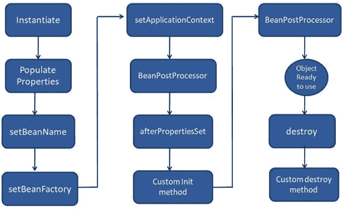

图 13.2: Spring 生命周期

## 是否可以设置某种机制，在 bean 实例化后修改其属性？

这个问题可以有以下几种形式的提问：

- `init-method` 属性的作用是什么？
- 我们在什么时候可以使用 `InitializingBean` 接口？
- `InitializingBean` 的作用是什么？

在实例化后，如果我们需要修改 bean 的属性，就可以使用 `init` 方法。有几种不同的方法可以实现这一点：

1. 在类中声明一个无参数的 `public void` 方法并使用该属性。
2. 可以在类中实现 `InitializingBean` 接口，并重写 `afterPropertiesSet` 方法来修改 bean 的属性。
3. 或者，我们可以写一个通用方法并对其进行注解。

使用 `init-method` 属性和实现 `InitializingBean` 接口是实例化后修改 bean 属性的两种方法。哪一个更好呢？

我不会说哪个好坏，而是会提供一些有助于决策选择哪一个的观点。实现接口的好处是，我们不需要在 bean 实例化后指定容器要调用的方法。但同时，我们需要记住一点：当我们实现一个接口时，代码是紧耦合的。

同时，如果我们正在编写基于 XML 的配置，可以随时更改配置文件。因此，如果我们不倾向于使用紧耦合的类，那么这是一个很好的选择。

## 我们可以拥有自定义的清理方法吗？

这个问题可以以不同的方式重述为：

- 是否可以写一个方法在销毁 bean 之前释放资源？
- `destroy-method` 属性的作用是什么？为什么要使用 `DisposableBean` 接口？
- 你能告诉一种提供清理机制的优雅方法吗？

是的，我们可以拥有自定义清理机制。这种清理方法允许开发者在包含 bean 的容器销毁之前，提供一种关闭所有打开资源的方法或执行某些回滚。

提供清理机制有三种方法：

1. 在类中提供一个无参数的 `void` 清理方法，并在 XML 中配置该 bean。
2. 实现此目的第二种方法是通过让类实现 `DisposableBean` 接口，并重写 `destroy` 方法来提供清理机制。
3. 或者，我们也可以写一个通用方法并使用 `@PreDestroy` 进行注解。

在每个单独的 bean 配置中都提供 `init-method` 或 `destroy-method` 是既重复又耗时的。我们是否有替代方法提供默认的初始化或销毁方法？

是的，为每个 bean 配置初始化和销毁方法是重复的。为了避免这种情况，我们可以在每个类中添加相同的方法，这些方法代表 `init()` 和 `destroy()` 方法。现在，我们可以在配置中通过类中声明的方法名配置 `default-init-method="method-name"` 或 `default-destroy-method="method-name"` 属性。

## ApplicationContextAware、BeanFactoryAware 或 BeanNameAware 是什么用的？

有时，bean 需要访问 `ApplicationContext` 来查找其他 bean。`BeanFactoryAware` 允许查找配置好的 bean。有时，bean 期望 `BeanFactory` 能感知它们的名称。在这种情况下，类可以实现

## bean 配置中的 `parent` 属性是做什么的？

这个问题可以重述为：

- 为什么要使用“parent”属性？
- 解释“parent”属性的作用。

Spring 始终支持减少样板代码。即使在 XML 配置中也是如此。假设我们有两个 bean 定义，它们的属性和值是相同的。与其重复相同的配置，我们可以通过提供 `parent` 属性在另一个定义中复用第一个。可以使用父类的所有属性值，但同时也允许对少数属性的值进行覆盖。

最棒的部分是，子 bean 定义继承了父类的范围（scope）、方法重写、构造器参数值以及属性值，并且添加新值的选项仍然开放。

## XML 和基于注解的是两种不同的配置方式；你更倾向于哪一个？

这两种方法都是可行的，且各有优缺点。完全取决于哪种在特定场景下更好。

基于 XML 的配置与源码是解耦。因此，人们可以在不接触源码的情况下修改配置。

当我们使用基于注解的配置时，它在声明中提供了上下文。不需要维护额外的配置文件。基于注解的配置更加简洁。

另一个需要考虑的是，XML 允许将配置放置在集中位置。这意味着控制变化变得更容易。然而，当我们使用注解进行配置时，它们分布在整个代码中，此时要控制这种去中心化的配置就很困难了。

## 注解默认是开启的吗？

或者面试官可能会问：

- 如何开启基于注解的配置？

当我们考虑基于 XML 的配置时，注解是禁用的。当我们要启用注解时，我们需要在 XML 文件的顶部进行配置。写在 XML 文件顶部的两个 `...` 和 `...` 都会激活基于注解的配置。它们是一样的吗？还是不同的？

注解主要用于启用依赖注入的注解。配置激活了已经注册到上下文中 bean 的注解。配置会扫描包以检测类中的注解。

## 哪个注解激活了包扫描？

这个问题也可以问为：

- 应用 `@ComponentScan` 注解可以实现什么？

`@ComponentScan` 允许扫描包以检测用于类型和自动注入的类和接口注解。

## 解释类型注解（stereotype annotation）

类型注解在应用于类时会将其注册到应用文中。一旦类注册到上下文中，就可以在其他类进行依赖注入。

## 哪些是类型注解？解释 Spring 中不同的类型注解

以下是 Spring 中存在的不同类型注解：

- `@Component`：这是一个通用的 Spring 管理组件。
- `@Service`：该注解应用于执行业务逻辑或调用 API 执行某些功能的类。
- `@Controller`：该注解应用于处理 HTTP 请求和响应的类。
- `@Repository`：`@Repository` 注解应用于涉及数据库通信的类。

## 解释 @Configuration

`@Configuration` 是类级别的注解。应用它表示该类被 Spring 容器用作 bean 定义的源。

## 解释 @Bean 配置

`@Bean` 注解应用于方法。该注解表示从该方法返回的 bean 已注册到 Spring 上下文中。

## 为什么要使用 @Autowired？解释 @Autowired 注解

该注解用于依赖的自动注入。`@Autowired` 可以用于数据成员、构造函数或 setter 方法。

## 何时使用 @Qualifier 注解？@Qualifier 注解表示什么？

当 `@Autowired` 注解应用于依赖项时，通常表示按类型进行自动装配。当我们希望使用属性名称来发现用于注入的缺失属性时，会使用 `@Qualifier`。（它等同于

### `@Required` 注解表示什么含义？

`@Required` 是一个方法级别的注解。当它应用于设置方法（setter method）时，它表示在配置时必须将属性注入到 bean 中。

### `@Autowired` 和 `@Required` 是一样的吗？推荐使用哪一个？

`@Autowired` 和 `@Required` 注解在基于 Spring 的应用程序中扮演不同的角色。

- `@Autowired` 用于标记依赖的自动装配。然而，`@Required` 对于检查属性是否已设置有用。
- `@Autowired` 可以应用于数据成员、构造函数或 setter 方法，但 `@Required` 仅应用于 setter 方法。
- 当 `@Autowired` 应用于依赖项时，表示属性的注入。如果未发现或依赖项可用，则会抛出异常。在不必注入 bean 的不确定，我们可以配置 `@Autowired(required=false)` 来忽略默认的注入行为。

### 为什么要使用 `@Scope` 注解？

默认情况下，Spring 中配置的 bean 是单例（singleton）。当开发者想要更改默认范围时，对类应用该注解如下

### 你能解释一下 Spring MVC 框架的一些特性吗？

- 它围绕前端控制器 MVC 设计模式设计。
- 它通过 `Controllers`、`Validators`、`Model` 和 `View` 对象实现了角色的清晰分离。
- 数据的绑定和验证。
- 提供 JSTL 标签以方便数据的绑定。

### 解释 Spring MVC 框架

可以通过图示解释 Spring MVC 框架

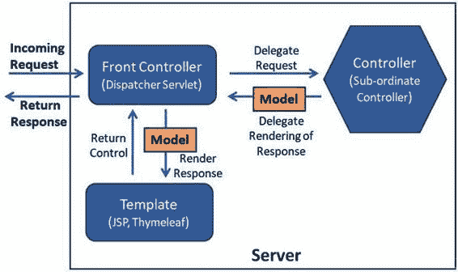

图 13.3: Spring MVC 框架

Spring MVC 围绕前端控制器 MVC 设计模式设计。每次发出请求时，都会前端控制器处理。根据请求模式，请求被委托给相应的控制器。控制器负责从传入请求中读取数据并对其进行逻辑处理。一旦逻辑部分完成，就可以与用户通信响应了。控制器想要发送给用户的数据被绑定到 `Model` 对象上。该 `Model` 对象现在将由前端控制器绑定在视图模板中。包含包含数据的模板响应被返回给用户。

### 请解释 Spring MVC 设计模式的组件

Spring MVC 围绕前端控制器 MVC 设计模式设计。MVC 代表模型、视图和控制器。

- **Model** 是一个带有数据的对象。这些数据可能从数据库获取，或者使用某些逻辑创建的对象。
- **View** 由包含 JSTL 代码的简单 JSP 执行；它也可以是 Thymeleaf 模板。
- **Controller** 是一个被 `@Controller` 注解的类，负责处理请求并生成绑定在视图中的模型。
- **front controller (前端控制器)** 是框架最重要的部分，它处理所有传入的请求并将其委托给后续控制器。前端控制器还负责将响应返回给用户。Spring 框架提供的 `DispatcherServlet` 充当前端控制器。

### 在处理 Spring MVC 框架时你用过哪些注解？

Spring MVC 框架中存在的注解有：

- 处理 Http 请求和响应的类由 `@Controller` 注解。
- `@RequestMapping`：此注解用于将 Web 请求映射到特定的处理器类和/或处理器方法，在这些方法中执行某些逻辑以生成某些可以作为响应返回的数据。
- 此注解应用于需要执行验证的输入参数。
- 此注解应用于方法参数或方法的返回值。被注解的参数随后暴露给 Web 视图。

### 前端控制器是如何让控制器委托请求的？

前端控制器在 `web.xml` 或部署描述符(`DD`) 中通过标签映射。发现调度请求的控制器的映射位于 `WEB-INF/servlet_name-servlet.xml` 文件中。

> **注意**：尝试不要提供更多映射的信息。不要继续进行映射。

### 你刚刚说映射位于 `WEB-INF/servlet_name-servlet.xml` 文件中。这个位置是固定的吗？我们可以更改文件的位置或名称吗？

默认情况下，`WEB-INF/servlet_name-servlet.xml` 文件是位置。但是可以更改文件的位置甚至名称。我们可以配置 `DD` 中标签的初始化参数来更改位置，如下：

- `/WEB-INF/sub_folder_name/file_name_with_extension`

### 你配置了 1 吗？1 起了什么作用？

`DD` 中的标签指定 servlet 是在项目部署时还是服务器启动时加载。容器按照标签内声明的整数值升序加载 servlet。如果我们不指定此标签，则 servlet 将按需加载。

### WebApplicationContext 中包含哪些不同的 bean？

以下 bean 存在于：

- 此 bean 负责将传入的请求映射到相应的处理器。
- 此 bean 帮助将本地名称解析为实际的视图文件名。`ViewResolver` 定义了 `prefix` 和 `postfix` 属性，可以应用于本地文件名，框架根据此定位实际的视图文件。

### 你用过消息资源包（message resource bundle）吗？它的用途是什么？

是的，用过。`ResourceBundleMessageSource`帮助从属性文件中解析消息。它实现了 `MessageSource`，其主要用途之一是国际化。

### 你处理过验证吗？验证的方法有哪些？为什么我们需要验证？

与用户交互是软件的目的。用户通过提供某些输入与软件交互，基于这些输入生成输出。但每当用户输入数据时，都有输入错误数据的可能性。例如，假设应用程序要求用户输入电子邮件地址，但用户没有提供格式正确的电子邮件；或者想象要求用户输入年龄，用户输入了小于 0 或大于 100 的数字。在这种情况下，假设用户是明的业务逻辑将会失败。因此，必须有一种确保正确性的方法。确保这种正确性的过程就是验证。验证可以在客户端或服务器端进行。客户端验证可以使用 JavaScript 完成。Spring 提供了 `Validators` 来执行服务器端验证。

在编写自定义验证器的情况下，我们需要编写实现 `Validator` 的类并重写 `support` 和 `validate` 方法。`support` 方法检查我们要验证的对象是否为预期类型。`validate` 方法包含应用验证规则的逻辑。为了执行此类验证，验证器必须注册到容器中作为 bean。

编写自定义验证器是执行验证的方法之一。另一种方法是使用 Hibernate 验证。我们可以将 `@NotNull`、`@Min`、`@Max`、`@Size` 注应用于 POJO 数据成员。现在我们可以对控制器请求处理方法的参数应用 `@Valid` 注解。

## 什么是 AOP？


# AOP 是面向切面编程

AOP 是面向切面编程，用于编写交叉关注点，并有助于消除代码重复。

## 在什么情况下你会倾向于使用 AOP？选择 AOP 的用例有哪些？你能解释参考 AOP 的情况吗？

开发者最重要的职责为客户提供一个集中的解决方案来解决特定的问题或故障。在开发解决方案的同时，开发者还需要考虑并实现异常处理、事务管理和日志记录。这些关注点分布在应用程序的所有层中，导致了代码重复。AOP 允许我们在一处编写代码，并根据将其应用到连接点（`JoinPoint`）上。

## 解释 AOP 的概念

AOP 由不同的术语组成：

- **切面（Aspect）**：包含跨切关注点的组件，例如事务管理或日志记录。
- **连接点（JoinPoint）**：应用程序中可以应用切面的点。
- **建议（Advice）**：在特定 `JoinPoint` 上执行的操作。
- **切入点表达式（Pointcut Expression）**：用于选择应用建议的 `JoinPoint` 的表达式。
- **目标对象（Target）**：将应用建议的对象称为目标对象。
- **织入（Weaving）**：将切面与其他应用程序对象链接以创建被增强对象的过程。

## 什么是建议，有哪些类型的建议？

建议是在特定点上采取的操作。

### 建议的类型

- **前置建议（Before Advice）**：在连接点之前执行。
- **后置建议（After Advice）**：在连接点之后执行。
- **返回后建议（After Returning Advice）**：在连接点正常完成后执行。
- **抛出后建议（After Throwing Advice）**：在方法抛出异常后执行。
- **环绕建议（Around Advice）**：在连接点之前和之后执行建议。

## 织入可以通过哪些方式完成？Spring AOP 支持哪些类型的织入？

织入可以在编译时、加载时或运行时进行。Spring AOP 执行的是运行时织入。

## 使用几个示例解释如何编写切入点表达式。你能写出切入点表达式来跟踪 com.dao 包中的所有方法吗？

我们可以写如下的切入点表达式：

- `@Pointcut("execution(public * *(..))")` 用于跟踪来自所有包中所有方法的所有连接点。
- `@Pointcut("within(com.dao.MyClass.*(..))")` 用于跟踪类 `com.dao.MyClass` 中所有方法的连接点。
- `@Pointcut("within(com.dao.*.*(..))")` 表达式用于跟踪 `com.dao` 包中的所有方法。

你可以参考以下表达式来编写切入点：

- 任何公共方法：`execution(* *(..))`
- 任何以 "set" 开头的方法：`execution(* set*(..))`
- 任何以 "get" 开头的方法：`execution(* get*(..))`
- 由 `MyService` 接口定义的任何方法：`execution(* com.service.MyService.*(..))`
- 在 `dao` 包或其子包中定义的任何方法：`execution(* com.dao..*.*(..))`
- `dao` 包内部的任何连接点：`within(com.dao..*)`
- `dao` 包或内的任何连接点：`within(com.dao.*)`
- 代理实现 `MyService` 接口的连接点：`this(com.xyz.service.AccountService)`

## 解释你使用的切入点设计符，或者解释你知道的切入点设计符

我工作过的不同的切入点设计符有：

- **执行设计符（execution designator）**：用于匹配方法执行连接点。
- **within 设计符（within designator）**：为了将匹配限制在某些类型（如包）内的连接点。
- **this 设计符（this designator）**：用于限制匹配到 bean 引用为给定类型实例的连接点。
- **目标设计符（target designator）**：用于限制匹配到目标对象为给定类型实例的连接点。
- **@target 注解**：限制匹配到执行对象的类具有给定类型注解的连接点。
- **@args 注解**：限制匹配到传递的实际参数的运行时类型具有给定类型注解的连接点。
- **@within 注解**：用于限制匹配到具有 `@within` 注解的类型内的连接点。
- **@annotation 注解**：用于限制匹配到连接点的主体（方法）具有给定注解的连接点。

## 你能解释环绕建议吗？

这个问题也可以重述为：

- `Around` 建议与其他建议有何区别？
- 我们什么时候可以使用 `Around` 建议？

`Around` 建议在匹配的切入点处运行。它允许在方法执行之前和之后执行工作。它还允许我们决定方法何时以及如何实际执行。据说当我们需要共享状态时，它是非常强大的。`Around` 建议通常用于我们需要在方法执行之前和之后共享状态的情况。例如，它可以用于计算完成方法执行所需的时间。

## 你用过 Spring Boot 吗？解释一下 Spring Boot。什么是 Spring Boot？

Spring Boot 是一个基于 Java 的框架，有助于创建生产级的独立应用程序以及 Web 应用程序。

## 能告诉我们一些 Spring Boot 的功能吗？

Spring Boot 有不同的功能：

- 它帮助或便于独立以及 Web 应用程序的创建。
- 它直接对 Tomcat 等服务器提供内置支持。
- 它启用了 `Metrics`、`Health Checks` 等功能来创建生产就绪的应用程序。
- 允许外部化应用程序配置，有助于从单点管理应用程序。
- 应用程序可以通过简单的属性文件进行配置，而不是基于 XML 的配置。
- 它提供了许多 Starters 以便轻松地配置应用程序。

## 你用过 Spring Boot 项目吗？你用过哪些 Starters？

是的，我工作过以下 Spring Boot Starters：

- `spring-boot-starter`
- `spring-boot-starter-web`
- `spring-boot-starter-jdbc`
- `spring-boot-starter-data-jpa`
- `spring-boot-starter-hateoas`
- `spring-boot-starter-security`
- `spring-boot-starter-data-rest`

> **注意**：如果你没有用过所有的它们，不要担心。你可以列出所有的 Starters，然后告诉面试官你只用过其中几个。

## 创建 Spring Boot 应用程序有很多方法。你用过几种？能告诉我们创建 Spring Boot 项目的方法吗？

可以通过以下方式创建 Spring Boot 应用程序：

1. Spring Initializr
2. Spring Boot CLI
3. Spring Tool Suites

## 创建 REST 应用你用过哪些注解？

这个问题也可以重述为：

- 你能解释 REST 应用程序中使用的注解吗？
- 解释用于 REST 应用程序开发的注解？

REST 应用程序中不同注解有：

- `@RestController`：为创建 REST Web 服务的类提供了一种方便的方法。该注解在 4.0 中引入，结合了 `@Controller` 和 `@ResponseBody`。
- `@RequestMapping`：非常常用的注解。它允许将 HTTP 请求映射到 REST 控制器的处理方法。
- `@GetMapping`：该注解允许映射 GET 请求到特定的处理方法。它是 `@RequestMapping(method = RequestMethod.GET)` 的快捷方式。
- `@PostMapping`、`@PutMapping`、`@DeleteMapping` 和 `@PatchMapping`：为映射 POST、PUT、DELETE 和 PATCH 方法引入的注解。
- `@ResponseBody`：该注解告诉控制器返回的对象将被序列化为 JSON 并传回响应对象。

## 你能解释一下 @PutMapping 和 @PatchMapping 注解吗？

这也可以重述为：

- 你能解释何时使用 PUT 和 PATCH 方法吗？

我们可以创建代表 PUT 和 PATCH 方法的方法，并分别在这些方法上应用 `@PutMapping` 和 `@PatchMapping`。

当客户端需要完全替换现有资源时，使用 `PUT` 方法是可行的。

当客户端需要部分替换现有资源时，使用 `PATCH` 方法是可行的。

## 哪些是映射处理程序方法的注解？

可用于映射处理程序方法的不同注解有：

- `@GetMapping`：允许将 HTTP GET 请求映射到特定的处理程序方法。它是 `@RequestMapping(method = RequestMethod.GET)` 的快捷方式。
- `@PostMapping`、`@PutMapping`、`@DeleteMapping` 和 `@PatchMapping`：引入用于映射 `POST`、`PUT`、`DELETE` 和 `PATCH` 方法处理器的注解。

## Boot 中的 Runners（运行器）是什么？

你可以获取到与此问题相关的不同问题：

- Spring Boot 提供了哪些 Runners？
- `CommandLineRunner` 是什么？
- 你可以使用 Spring Boot 创建一个独立应用程序吗？
- 如何在 Spring Boot 中创建独立应用程序？

`Runner` 是一个接口，它便于在应用程序启动后执行代码。Spring Boot 提供了 `ApplicationRunner` 和 `CommandLineRunner`。`CommandLineRunner` 是一个接口，用于指示一个 Bean 在包含在容器时应该运行。它允许创建独立应用程序。

## 如何从请求中读取输入？你使用了哪些注解来读取请求输入？

我们可以使用如下注解从请求中读取输入：

- `@RequestParam`：该注解用于从请求中读取数据（如表单数据），然后将其自动绑定到方法参数。
- `@RequestBody`：该注解将请求体映射到 `Transfer Domain Object` 到该类型的方法参数。

## @RequestParam 和 @QueryParam 之间有什么区别？

这两个注解都用于读取请求参数。`@QueryParam` 是 `JAX-RS` 框架提供的注解，而 `@RequestParam` 是 `Spring` 框架的注解。

## 你处理过 Spring Boot 的内部数据库吗？

这个问题的后续将是不同的问题：

- 如何配置 H2 数据库？
- 使用 H2 DB 好吗？
- 在何时以及如何使用 H2 DB？

`H2` 是一个用 `Java` 编写的内存数据库。它可以嵌入到 Java 应用程序中。Spring Boot 支持在 Spring Boot 应用中集成 `H2`。

要在 Spring Boot 中配置 `H2`，我们需要在 `pom.xml` 文件中添加 `H2` 依赖，然后在 `application.properties` 文件中配置数据库属性。现在，在属性文件中配置 `spring.h2.console.enabled=true` 和 `spring.h2.console.path=/h2`。有时，在系统上安装数据库是不可能的或不可行的。这时，我们可以使用内部数据库进行代码测试，而无需担心事先安装和管理专门的数据库服务器。

当 `H2` 也将用于生产环境时，使用 `H2` 是更好的选择。然而，当我们在生产环境中使用不同的数据库时，针对 `H2` 进行代码测试是一个糟糕的选择。

## 如何执行数据库架构创建表或向表中插入记录？

Spring Boot 提供了一种简单的方法来创建表并操作其中的数据。要实现这一点，你可以创建包含 `DML` 或 `DDL` 语句的 `.sql` 文件进行执行。你必须在 `src/main/resources` 目录下创建文件。

该文件将在启动时加载并执行，根据其中编写的 SQL 语句创建表或向其中插入记录。

## RestTemplate 的用法

`RestTemplate` 用于消费 REST 应用。`RestTemplate` 为 Web 通信提供了不同的方法，如下：

- `exchange()`：该方法执行指定的 HTTP 方法作为 `GET` 或 `POST`，并返回 `ResponseEntity`，它可以包含 HTTP 状态码、作为对象的资源或两者兼有。
- `execute()`：该方法期望 `RequestCallback` 和 `ResponseExtractor` 作为参数。它便于创建复杂请求或可能处理复杂响应。
- `getForEntity()`：该方法执行一个 `GET` 请求并返回包含状态码和作为对象的 `ResponseEntity`。
- `getForObject()`：该方法执行一个 `GET` 请求并直接返回资源。

> **注意**：虽然这个答案足够了，但你可以添加额外的信息来点缀色彩，例如：与 `GET` 的 `getForEntity()` 和 `getForObject()` 一样，我们也有 `postForEntity()`、`postForObject()`、`put()` 等对应方法。

## 什么是 HATEOAS？

`HATEOAS` 是 `Hypertext As the Engine of Application State`（超文本作为应用程序状态引擎）的缩写。

通常在 HTML 页面中，我们可以在两个资源之间放置超链接。在 Web 服务中，两个资源之间的响应链接由 `HATEOAS` 提供。它便于在两个资源之间创建链接以检索相关信息。它允许为模型类创建链接和资源表示模型链接。它支持链接构建器的 API，以创建指向 Spring MVC 控制器中声明方法的链接。

## 如何在应用程序中提供 HATEOAS 支持？

要启用 `HATEOAS`，我们需要遵循不同的步骤：

- 在 `pom.xml` 文件中添加 `HATEOAS` 的依赖。
- 创建由 `RepresentationModel` 扩展的 POJO 类。
- 在控制器中，使用 `linkTo()` 方法创建资源之间的链接。

## 什么是 Swagger，为什么要使用它？

在 REST 应用中，有许多处理程序方法映射到不同的请求参数和响应类型。向客户端正确传达 REST API 文档至关重要。`Swagger2` 是一个用于生成 REST API 文档的开源项目。它还提供了一个用户界面，可以通过 Web 浏览器访问我们的 RESTful Web 服务。

最后，这段有趣的旅程到达了终点。`Spring` 框架规模巨大，很难在一个章节中涵盖所有功能。但是，我们已经涵盖了几乎所有可能回答基于 `Spring` 和 `Spring Boot` 问题所需的概念。

## 结论

在本章中，我们探索了整个 `Spring` 框架。我们讨论了 `Spring` 框架的各个组件，以及基于这些组件可能提出的问题。我们还通过不同的问题讨论了 Spring 的用处以及我们如何使用 `XML` 文件和注解自定义应用程序的行为。

# 第 14 章：Hibernate

## 引言

将数据存储在数据库中是应用程序开发中最重要的方面之一。无论是什么种类型的应用程序，我们都需要持久存储数据。在之前的章节中，我们已经看到过如何使用 `JDBC` 存储数据。你也完全清楚编写 `JDBC` 代码并不是易事。经常，开发者对编写实现 `JDBC` 不同接口的样板代码感到沮丧。`Hibernate` 框架应运而生。它提供了一种简化的方法将数据持久化到数据库。`Hibernate` 使用 Java 对象表示数据，并将其映射到可以持久化的表中。这种将对象存储到数据库的方法被称为对象关系映射（ORM），`Hibernate` 是它的实现之一。`Hibernate` 通过提供实现对象持久化的配置，让开发工作变得更加简单。

## 结构

在本章中，我们将讨论：

- `Hibernate` 的架构
- `Hibernate` 框架的工作原理
- `Hibernate` 面试中可能提出的不同面试问题及答案

## 目标

### Hibernate 简介

在本章结束时，你将能够理解 Hibernate 这种持久化的自动化方法。你将能够处理 Hibernate 的不同配置设置以及在该框架中使用的注解。此外，我们还将讨论基于 Hibernate 的不同面试问题。

## 什么是 ORM？

`ORM` 是对象关系映射（Object Relational Mapping）的缩写。

### 哪些支持 ORM 的框架？

像 `iBatis`、`Hibernate` 等 `ORM` 工具提供了数据持久化的 `JPA` 规范实现。

## ORM 有哪些特性？ORM 如何帮助开发者？

以下是 `ORM` 的不同特性：

- `ORM` 有助于快速开发应用程序。
- `ORM` 消除了所有的底层细节。
- 使得继承映射、集合管理变得简单。
- 它管理事务。

## ORM 或 Hibernate 是否有缺点？

尽管 `ORM` 为应用开发者提供了许多功能，但它也有一些缺点，例如：

- 开发速度更快，但应用程序性能比传统方式慢。
- 应用程序的调试变得困难。
- `Hibernate` 不允许多次插入（注）。
- 建议在批处理时使用纯 `JDBC`，因为 `Hibernate` 在批处理中的性能不佳。
- `Hibernate` 的学习曲线比较耗时。

## 解释 Hibernate 的架构？

下图显示了 `Hibernate` 框架的不同组件：

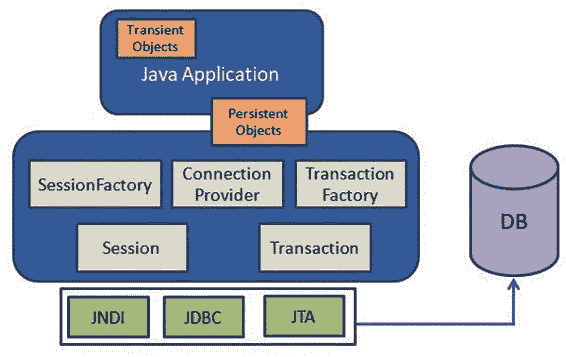

*图 14.1：Hibernate 架构*

如图所示，`Hibernate` 框架由不同的组件组成：

- `SessionFactory`
- `Connection Provider`（连接提供者）
- `Transaction Factory`（事务工厂）
- `Session`
- `Transaction`（事务）

## 什么是 Hibernate？JPA 和 Hibernate 相同还是不同？

`Java Persistence API`（Java 持久化 API）是一种规范，便于访问、管理和持久化对象到数据库。`JPA` 提供 API 但不提供任何实现，因此它需要实现。

像 `iBatis`、`Hibernate` 等 `ORM` 工具提供了数据持久化的 `JPA` 规范实现。`Hibernate` 和 `JPA` 之间相互相关，但它们有一些根本性的区别如下：

*表 14.1：Hibernate 和 JPA 的区别*


## 解释你在 Hibernate 中使用的接口或核心组件

`Hibernate` 框架的核心接口有：

### Configuration（配置）

`Configuration` 的实例有助于应用程序指定属性和映射文档，这些文档可以用于创建 `SessionFactory`。通常，在应用程序中，我们创建一个单一的 `Configuration` 来构建一个 `SessionFactory` 实例。默认情况下，将从 `hibernate.properties` 文件中指定的属性创建一个新的 `Configuration`。

通常，一个应用程序有一个 `SessionFactory` 实例，为服务客户端请求的线程从该工厂获取 `Session` 实例。`SessionFactory` 的内部状态始终是不可变的。一旦创建实例，该内部状态就会设定，其中包含了关于对象/关系映射的元数据。

### Session（会话）

`Session` 的主要目的是为映射的实体类实例提供创建、读取和删除操作。`Session` 接口便于执行 CRUD 操作，这些操作通过 `PK`（主键）在数据库上执行。另一方面，`Query` 接口提供了一种不使用 `PK` 获取行的方法。`Query` 接口提供了如 `executeUpdate()`、`list()`、`setMaxResult()` 等方法，用于对数据库执行操作以处理数据。

以下代码段描述了如何创建和使用 `Query` 对象：

```java
Query sum(salary) from
```

### Criteria（条件）

`Criteria` 有助于动态构建条件查询对象。它提供了除 `HQL` 和原生 SQL 查询之外的另一种数据检索方式。`Criteria` API 设计用于在不使用任何硬编码 SQL 语句的情况下操作数据。

以下代码段描述了如何创建和使用 `Criteria` 对象：

```java
Criteria c2 = 
```

### Transaction（事务）

`Transaction` 允许应用程序通过维护底层事务实现（如 `JTA`）的抽象来定义工作单元。`Transaction` 实例与 `Session` 关联，通常通过调用 `Session.beginTransaction()` 来实例化。

## Hibernate 中的映射

### 类可以通过多少种方式映射到表/多个表？Hibernate 如何实现对象到表的映射的？

`Hibernate` 将类映射到表。我们可以使用两种不同的方法来实现这种映射。首先是在 `XXX.hbm.xml` 文件中进行配置，另一种是在 POJO 类上使用预定义的注解。

### 在 Hibernate 中维护配置需要哪些文件？

`Hibernate` 需要关于如何与数据库通信以及类如何映射到数据库表的信息。为了实现这一点，`Hibernate` 使用 `hibernate.cfg.xml` 文件来配置用于与数据库通信的属性。此外，`XXX.hbm.xml` Bean 文件有助于将类映射到表。

### 我们可以更改 hibernate.cfg.xml 文件的名称吗？

默认情况下，使用类路径下的 `hibernate.cfg.xml` 来获取 `Configuration` 实例。但是，也可以更改文件的位置以及使用不同的名称。

我们可以使用以下语法使用另一个文件名：

```java
Configuration configuration = new Configuration();
configuration.configure("custom.cfg.xml");
```

### 如何获取 SessionFactory？

我们可以像下面的代码段所示获取 `SessionFactory`：

```java
Configuration configuration = new Configuration();
SessionFactory factory = configuration.configure().buildSessionFactory();
```

### 开发者在应用程序中通常创建并可以使用多少个 SessionFactory 对象？

这个问题可以重新表述为：你创建了多少次 `SessionFactory` 实例？

第二个数据库可以通过以下方式配置在同一个应用程序中获取另一个 `SessionFactory` 实例：

```java
Configuration configuration1 = new Configuration();
SessionFactory factory1 = configuration1.configure().buildSessionFactory();
```

### `SessionFactory` 是线程安全的对象吗？

是的，`SessionFactory` 是线程安全的对象；多个线程可以同时访问它。

### `Session` 是线程安全的对象吗？

不是，`Session` 不是线程安全的对象；多个线程**不可以**同时访问。换句话说，你**不可以**在线程之间共享它。

### 请解释实体的阶段。什么是离态实体（detached entity）？对象的状态有哪些？

下图显示了实体的不同阶段：

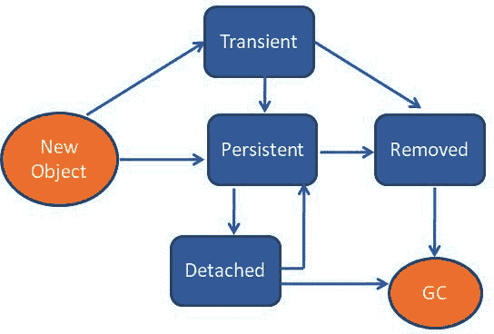

图 14.2：实体的阶段

- **New（新建）**：通过 `new` 等方法实现新对象状态。这个新创建的对象准备好持久化。

- **Transient（瞬态）**：如果对象刚刚被创建，但在表中没有标识符或 `PK`，则处于瞬态状态。它没有与 `Session` 关联。

- **Persistent（持久化）**：`Session` 对象对瞬态对象调用 `persist()` 等方法，将瞬态对象转换为持久化对象。在持久化状态下，应用程序中的对象代表活动会话数据库中的某行。在此状态下，它与唯一的 `identifier` 关联。或者，如果会话已打开，且你刚刚在数据库中保存了实例或从数据库中检索了实例，对象处于持久状态。

- **Detached（离态）**：在离态阶段，应用程序中的对象与数据库没有活动通信。我们可以通过对持久化对象调用 `evict()` 或 `close()` 方法来实现这种状态。如果会话关闭，对象处于离态状态。无法对处于离态阶段的对象进行操作。如果我们调用 `lock()` 或 `update()` 方法，对象将回到持久化状态。

- **Removed（已删除）**：当对实体调用 `delete()` 方法时，实体会被推入删除状态。此状态下的对象会被交给垃圾回收器。

### 如何将类映射到表？解释将实体映射到表中的行的注解

Hibernate 支持基于 XML 和基于注解的配置来将实体映射到表。

#### 基于 XML 的配置：

```xml
<class name="Employee" table="employee">
    <id name="name_of_data_memember_to_consider_as_PK" type="data_type" column="column_name"/>
    <property name="property_name" column="column_name"/>
</class>
```

#### 基于注解的配置：

- 使用 `@Entity` 注解 POJO 类。
- 使用 `@Id` 注解数据成员，该成员需要被视为表的 `PK`。
- 其他数据成员默认成为表的列。默认情况下，数据成员名称被视为列名。然而，可以通过对数据成员使用 `@Column` 注解来更改列名。该注解允许自定义属性，如 `name`、`length`、`nullable` 等。

### `@Id` 注解的作用是什么？

当我们对数据成员使用 `@Id` 注解时，该数据成员的值被视为表的 `PK`。

### `@NaturalId` 的作用是什么？

`@Id` 注解用于将数据成员标记为 `PK`。必须配合 `@GeneratedValue` 使用 `@Id` 来为数据库中的记录创建主键。但有时，实体不使用 `PK` 作为标识，而是使用其他属性，这些属性可以视为自然 ID。如果你想将实体的任何属性作为自然 ID，可以使用 `@NaturalId` 注解它。

### 你能提供 `@Id` 和 `@NaturalId` 的真实示例吗？

如果你考虑 `Employee` 实体，那么 `empId` 将始终被视为一个属性，即主键，可以使用 `@Id` 注解。但是，与 `Employee` 关联的 `emailAddress` 也是唯一的，在某些情况下，可以通过邮箱地址识别员工。因此，`emailAddress` 属性可以使用 `@NaturalId` 注解。

### 是否可以停止数据成员的持久化，或忽略保存到数据库的字段？

是的，可以忽略一个或多个数据成员在数据库中的持久化。要做到这一点，我们只需要添加 `@Transient` 注解到实体类、映射父类或可嵌入类的属性或字段。`@Transient` 有助于忽略字段将其添加到数据库。

### `Session` 提供了哪些方法？

`Session` 提供的不同方法包括：

- `save(Object object)`：该方法保存给定的瞬态实例。
- `saveOrUpdate(Object object)`：该方法允许保存新实例或更新表中的给定实例。
- `update(Object object)`：该方法允许通过给定离态实例的标识符更新持久化实例。
- `delete(Object object)`：此方法允许从数据存储中删除持久化实例。
- `get(String entity_name, Serializable id)`：该方法根据指定的标识符返回给定命名实体的持久化实例。如果没有这样的持久化实例，则可能返回 `null`。
- `getTransaction()`：该方法获取与当前会话关联的 `Transaction` 实例。
- `beginTransaction()`：该方法开始工作单元并返回相关的 `Transaction` 对象。
- `createCriteria(String entity_name)`：该方法为指定的实体名称创建一个新的 `Criteria` 实例。
- `createQuery(String query_to_execute)`：该方法为指定的查询字符串创建一个新的 `Query` 实例。
- `clear()`：该方法清除会话。
- `close()`：该方法通过释放 JDBC 连接和清理来结束会话。

### `Session` 的 `persist()` 和 `save()` 方法有什么区别？

以下是这两个方法之间的区别：

- 两个方法都能向数据库插入记录。然而，`persist()` 方法返回 `void`，而 `save()` 方法返回 `Serializable` 对象。
- 两个方法都能使瞬态实例持久化。然而，`persist()` 方法不保证立即为持久化实例赋值标识符。它可能在 `flush()` 时执行赋值。
- 两个方法在事务边界外的行为不同。`persist()` 方法保证在事务边界外被调用时不会执行插入语句。然而，`save()` 方法不保证这一点；它会返回标识符。如果为了获取标识符必须执行插入，无论是在事务内还是事务外，插入都会立即发生。

在事务边界外，`persist()` 方法对于扩展会话上下文很有用。相反，`save()` 方法在扩展会话上下文中并不适用。

### 解释 Hibernate 中 `save()`、`saveOrUpdate()` 和 `persist()` 方法之间的区别。我们应该使用哪一个？

`persist()` 方法用于将新实体实例添加到持久化上下文。我们通常在向数据库添加记录时调用它，即当我们想要持久化实体实例时。以下代码段显示了如何使用该方法：

```java
Employee emp = new Employee();
session.persist(emp);
```

当对已经持久化的实例调用 `persist()` 方法时，什么都不会发生。当我们尝试持久化离态实例时，实现将抛出异常。

`save()` 的基本目的与 `persist()` 相同。但该方法保证返回该标识符的可序列化值。以下代码段显示了如何使用 `save()` 方法：

```java
Employee emp = new Employee();
Long id = session.save(emp); // long 是 PK 的数据类型
```

当对离态实例调用 `save()` 时，它会创建一个新的持久化实例并分配一个新的标识符。这会导致提交或刷新时在数据库中产生重复记录。

`merge()` 方法用于从离态实体实例获取新字段值来更新持久化实体实例。`merge()` 方法通过已传递对象的 ID 查找实体实例，然后将其字段复制到此新实例中。最后，它返回新更新的实例。以下代码段展示了如何使用 `merge()` 方法：

```java
Employee emp = new Employee();
session.save(emp);
session.evict(emp);
emp.setName("name");
Employee empNew = (Employee) session.merge(emp);
```

`update()` 方法用于更新数据。该方法作用于传递的对象。`update()` 方法将已传递的对象从离态状态转换为持久化状态。如果你向它传递一个瞬态实体，该方法将抛出异常。以下代码段展示了如何使用 `update()` 方法：

```java
Employee emp = new Employee();
session.save(emp);
session.evict(emp);
emp.setName("name");
session.update(emp);
```

**注意：** 我们没有将 `update` 操作的结果存放在单独的变量中，因为更新是在 `Employee` 对象本身上进行的。这意味着我们正在将现有的实体实例重新关联到持久化上下文。

`saveOrUpdate()` 方法是一个更安全的方法。当它应用于瞬态实例时，该方法不会抛出异常。在我们不确定表中是否存在某个标识符时，可以使用 `saveOrUpdate()` 方法。如果不存在，它将在表中添加新的一行。

### 下列代码的输出是什么？

```java
Employee emp = new Employee();
emp.setName("name");
session.update(emp);
```

在瞬态实例上调用 `update` 将导致异常。因此，当我们运行上述代码时，它将无法工作。

### `get()` 方法和 `load()` 方法之间有什么区别？

这两个方法实际上都用于获取对象。但它们也有一些区别。这些差异在下表中进行了讨论：

表 14.2：`get()` 和 `load()` 的区别

| 特性 | `get()` | `load()` |
| :--- | :--- | :--- |
| 返回值 | 若对象不存在，返回 `null` | 若对象不存在，抛出 `ObjectNotFoundException` |
| 加载方式 | 立即加载，直接查询数据库 | 延迟加载，返回代理对象 |
| 性能 | 相对较慢（立即查询） | 相对较快（仅在访问属性时查询） |
| 适用场景 | 不确定对象是否存在时 | 确定对象存在，仅需引用时 |

### 你知道生成器类吗？你工作过多少个生成器类？请解释 Hibernate 中的生成器类

数据库中的每张表都将有一个主键。主键可以由应用程序为该行分配，也可以由底层数据库生成。它用于为持久化类的对象生成唯一标识符。可以使用 `<generator>` 元素或 `@GeneratedValue` 来生成主键（PK）。

必须使用哪种生成器类取决于底层数据库。Hibernate 支持 `assigned`、`increment`、`sequence`、`hilo`、`native`、`identity`、`seqhilo`、`uuid`、`select`、`foreign`。

可以使用 `@GeneratedValue(strategy = GenerationType.XXX)` 根据策略生成主键。我们可以指定策略如下：

- `GenerationType.AUTO`
- `GenerationType.IDENTITY`
- `GenerationType.SEQUENCE`
- `GenerationType.TABLE`

### `hibernate.hbm2ddl.auto` 代表什么？

属性 `hbm2ddl.auto` 用于在创建 `SessionFactory` 时验证并导出数据库的架构。可能的值有：

- **Create**：创建一个架构，先删除现有架构再创建。
- **Update**：更新现有架构。
- **Validate**：验证现有架构。
- **Create-drop**：在 `SessionFactory` 创建时创建架构，在 `SessionFactory` 关闭时删除架构。

### `hibernate.dialect` 起什么作用？

Hibernate 将开发者从编写 SQL 查询的责任中解放出来。这些查询由 Hibernate 生成，而不是由开发者。然而，我们不能忽略不同的数据类型以及 SQL 中编写查询和过程的方式。`dialect` 指定了 Hibernate 中使用的数据库类型，以确保正确生成对应类型的 SQL 语句。当我们将 Hibernate 连接到应用程序时，配置 `dialect` 是关键的。

### 列出在 Hibernate 中实现继承的不同映射策略

我们可以使用三种继承映射策略之一，通过数据库表来映射层次分类的类：

1. 每个类层次结构表
2. 每个具体类表
3. 每个子类表

### 如何映射类层次结构表、每个具体类表和每个子类表？

#### 每个类层次结构表

在类层次结构映射中，需要一张表来映射整个层次结构。我们在配置中指定一个额外的列（鉴别器列），用于识别类。我们可以通过 XML 指定鉴别器列，也可以为其提供注解。

XML 文件配置：

```xml
<class name="Parent" table="PARENT_TABLE">
    <id name="id" column="ID">
        <generator class="native"/>
    </id>
    <discriminator column="DISCRIMINATOR" type="string"/>
    <subclass name="Child" discriminator-value="CHILD">
        <!-- child properties -->
    </subclass>
</class>
```

使用注解：

```java
@Entity
@Inheritance(strategy = InheritanceType.SINGLE_TABLE)
@DiscriminatorColumn(name = "DISCRIMINATOR", discriminatorType = DiscriminatorType.STRING)
public class Parent { ... }

@Entity
@DiscriminatorValue("CHILD")
public class Child extends Parent { ... }
```

#### 每个具体类表

在每个具体类表的情况下，表会根据类来创建。虽然数据是根据类的定义存储的，但子类表中总是添加重复的列。

该策略可以通过两种方式进行映射：

- 使用 `union-subclass` 元素。
- 为每个类使用自建表。

我们也可以使用注解来建立这种关系。要使用基于注解的配置，指定 `@Inheritance(strategy = InheritanceType.TABLE_PER_CLASS)`。该注解表示每个具体类表的策略。它应该只在父类中指定。`@AttributeOverrides` 注解定义了父类属性如何在子类中被覆盖。在表结构中，父类表的列将被添加到子类表中。

#### 每个子类表

在这种策略中，表根据类创建，但通过外键关联。在每个子类表中，与父类相关的子类映射表通过外键进行连接。

基于 XML 的配置：

```xml
<class name="Parent" table="PARENT_TABLE">
    <id name="id" column="ID">
        <generator class="native"/>
    </id>
    <joined-subclass name="Child" table="CHILD_TABLE">
        <key column="PARENT_ID"/>
        <!-- child properties -->
    </joined-subclass>
</class>
```

基于注解的配置：

```java
@Entity
@Inheritance(strategy = InheritanceType.JOINED)
public class Parent { ... }

@Entity
public class Child extends Parent { ... }
```


我们需要使用`class`元素，通过主键和外键关系将子类与父类进行映射。

## 基于注解的配置

要使用基于注解的配置，我们需要在父类中指定`@Inheritance(strategy=InheritanceType.JOINED)`，并在子类中使用`@PrimaryKeyJoinColumn`注解。

## 你能解释映射的优缺点吗？

以下是每种策略的优缺点：

### 每个类层次结构表 (Table Per Class Hierarchy)

- **优点**：即使对于深层次结构，该策略也提供最好的性能，因为只需要一次查询。
- **缺点**：每当层次成员发生变化时，都需要对表列进行更改、添加或删除。

### 每个子类表 (Table Per Subclass)

- **优点**：当修改父类时，该策略不需要对数据库架构进行复杂的更改。适用于浅层次结构。
- **缺点**：随着层次结构的增长，可能会导致性能下降。构建子类所需的连接数量随之增加。

### 每个具体类表 (Table Per Concrete Class)

- **优点**：这是最容易实现的继承映射方法。
- **缺点**：属于父类的数据分散并重复在多个子类表中（这些表代表具体类）。每当父类发生变化时，更改都会反映到大量的表中。这会导致大量的查询操作。

## 多对一关联

多对一关联表示实体之间的双向关系，其中一个对象引用另一个对象的多个引用。反之，另一个对象可以包含对第一个对象的单个引用。这种模式的典型示例可以用`Movie`（电影）和`Review`（评论）表示。`Movie`可以有多个`Reviews`，而每个`Review`实体可以引用一个`Movie`。

下面的代码段展示了如何配置`Movie`和`Review`类来表示这种关联：

### Movie.java

```java
@Entity
public class Movie {
    @Id
    @GeneratedValue(strategy = GenerationType.AUTO)
    @Column(updatable = false, nullable = false)
    private Long id;

    private List<Review> reviews = new ArrayList<>();
    // …
}
```

### Review.java

```java
@Entity
public class Review {
    @Id
    @GeneratedValue(strategy = GenerationType.AUTO)
    private Long id;

    @ManyToOne
    private Movie movie;
    // …
}
```

**注意：** 这个问题也可以作为问题“如何在 Hibernate 中映射集合（collections）？”的答案。

## 多对多关联

当一个实体可以引用多个实体，而另一个实体也可以引用第一个实体的多个引用时，这种关联被称为多对多关联。一个真实世界的例子是`Movie`，`Movie`可以有多个`writers`（作者），而多个`writers`可以编写多部`movies`。

下面的代码段展示了如何为相同的情况编写配置：

### Movie.java

```java
@Entity
public class Movie {
    @Id
    @GeneratedValue(strategy = GenerationType.AUTO)
    @Column(updatable = false, nullable = false)
    private Long id;

    @ManyToMany
    @JoinTable(name = "...", joinColumns = {@JoinColumn(name = "movie_id")})
    private List<Writer> authors = new ArrayList<>();
    // …
}
```

### Writer.java

```java
@Entity
public class Writer {
    @Id
    @GeneratedValue(strategy = GenerationType.AUTO)
    private Long id;

    private List<Book> books = new ArrayList<>();
    // …
}
```

## 单向映射与双向映射

### 单向

顾如其名，它是单方向映射。当实体中只有一个包含对另一个实体的引用时，该关联是单向的。当仅有一个实体支持这种关系时，就是单向映射。这意味着我们可以从另一个实例获取一个实例，而另一个实例没有对早期实例的引用。让我们考虑`User`有一个`Address`。`User`实例可以访问并更新地址。然而，`address`并不知道`User`正在使用地址，因为地址模型不包含任何对`User`模型的引用。

### 双向

当两个实体之间的关联是相互的时，它被称为双向映射。换句话说，当两个实体都对对方的引用时，被称为双向映射。这意味着一个实例可以轻松地获取、更新另一个实例。双向映射提供了两个方向的导航访问。考虑同样的例子。`User`有一个`Address`，现在由于我们使用了双向映射，`Address`也有了`User`实例，并且`Address`可以访问并更新彼此。

## 映射计算属性

实体的某个属性需要通过某些表达式进行计算。如何使用 Hibernate 映射此类属性？

为了实现这一点，我们可以在该属性上应用`@Formula`注解。我们可以使用 SQL 表达式或普通表达式来生成值，这些值可以被 Hibernate 用于持久化。

## 懒加载与 饿加载

`Lazy`（懒加载）和 `Eager`（饿加载）是 Hibernate 支持的两种数据加载策略，适用于一对一、一对多等关联。

### Eager（饿加载）

在饿加载中，数据加载发生在父对象被获取时。多对一和一对一等关联默认使用饿加载策略。初始数据的加载可能需要更多时间，因为在加载父对象时，子对象也需要加载。使用`fetch = FetchType.EAGER`属性可以启用饿加载。

### Lazy（懒加载）

在懒加载中，数据加载只在开发者显式调用`get`或`size()`方法时才发生。默认情况下，多对多和一对多关联使用懒加载策略。在这种情况下，初始加载时间远小于饿加载，因为子对象只有在被显式请求时才会被加载。要启用懒加载，可以使用`fetch = FetchType.LAZY`属性。

## Hibernate 中的级联

级联（Cascading）最简单的字典意思是“某种事物（通常是信息或知识）被连续传递的过程”。

在 Hibernate 中，一个实体与另一个实体具有某种关联。因此，当我们对目标实体执行某些操作时，该操作必须传播到与其具有关联的另一个实体上。这可以通过级联来实现。让我们考虑`User`有一个`address`。当某人更新`User`时，是否更新`address`取决于提供`cascading`属性的值。

我们有如下级联选项：

- **ALL**：这意味着在容器上执行的“所有”操作将应用于被包含的实体上。在这种情况下，当父实体被持久化时，它的所有相关实体也将被持久化。这意味着`save()`或`persist()`操作会级联到相关实体。
- **REMOVE**：在这种情况下，如果父实体被删除，则所有相关实体也将被删除。
- **MERGE**：当父实体被合并时，其所有相关实体也被合并。
- **DETACH**：当父实体被解离时，其所有相关实体也被解离。
- **REFRESH**：当父实体被刷新时，其所有相关实体也被刷新。

JPA 中没有默认的级联类型；这意味着默认情况下没有操作是级联的。

## 映射 java.util.Date

如何在 Hibernate 中映射`java.util.Date`？

当我们把实体的一部分映射到数据库时，Hibernate 默认以纳秒存储。然而，你可以将此格式更改为不同的类型，如：

- **TIMESTAMP**：以纳秒持久化日期和时间。
- **TIME**：以纳秒持久化时间。
- **DATE**：以年、月、日持久化日期。

要使用这些类型，可以使用`@Temporal`注解。

## 映射 Enum

如何使用 Hibernate 框架将枚举映射到数据库？

将枚举属性映射到数据库，我们可以使用`@Enumerated`注解。我们可以为此枚举提供不同的值，这决定了枚举元素存储在数据库的方式。如果我们使用默认值，枚举的索引号将被持久化到数据库。但如果我们使用`@Enumerated(EnumType.STRING)`，则枚举的字符串值将被持久化到数据库。

## 事务管理

什么是事务？如何在 Hibernate 中管理事务？

事务简单代表一个工作单元。这意味着如果某个步骤失败，整个单元都会失败。事务可以用原子性、一致性、隔离性和持久性属性来描述。在 Hibernate 中，`Transaction`接口定义了工作单元。它有`JTA`和`JDBC`作为事务的实现。事务始终与`Session`关联。`session.beginTransaction()`启用新会话的开始。

`Transaction`接口的方法如下：

- `begin()`：启动新事务。
- `commit()`：结束工作单元，除非设置了`FlushMode.NEVER`。
- `rollback()`：强制事务回滚。
- `setTimeout()`：为后续调用`begin`启动的任何事务设置特定的超时时间。

> 与 SQL 相比，HQL 查询转换带来的性能下降可以忽略不计。
> PL/SQL 程序无法被 HQL 调用。

## 什么是缓存？为什么要使用缓存？

在 Hibernate 中，当从数据库获取更多数据时，由于数据量的大小，应用程序的性能会受到影响。如果每次查找数据，我们需要访问数据库。这个过程通过网络加载数据需要花费更多时间。与其每次都访问数据库，不如访问临时本地存储是一个更好的方法。这种存储是一个缓冲区内存，位于应用程序和数据库之间，被称为缓存内存。缓存内存存储最近使用的数据，以尽可能地减少对数据库的访问次数。

## 解释 Hibernate 中的缓存

这个问题可以重新表述为：

- 你能解释 Hibernate 的缓存架构吗？
- 解释一级缓存和二级缓存。
- 解释二级缓存。

下面的图解释了 Hibernate 的缓存架构：

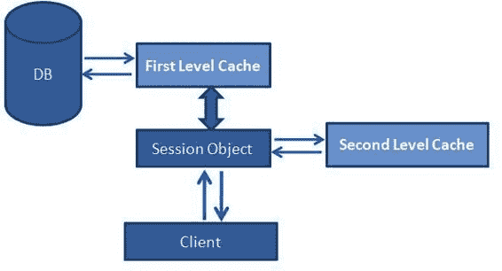

图 14.3：缓存架构

### 一级缓存

每当从数据库加载数据时，我们都在无意中使用了一级缓存。一级缓存无非就是`Session`缓存。它是一个强制性缓存，所有请求都必须通过它。`Session`对象在将对象提交到数据库之前会将其保留在本地。可以使用一级缓存在本地存储数据，或者存储所需的数据。一级缓存是默认开启的。

### 二级缓存

一级缓存是默认开启的。然而，二级缓存是可选的。在二级缓存尝试定位对象之前，总是会咨询一级缓存。可以按类和按集合为基础来配置二级缓存，它负责跨会话缓存对象。二级缓存维护在`SessionFactory`级别，并对所有会话可用。

二级缓存默认是禁用的。Hibernate 也没有为之提供任何缓存实现。`JBossCache`是某些可以配合使用的第三方缓存。为了处理缓存实现，我们必须实现`org.hibernate.cache.CacheProvider`接口。

## 解释一级缓存和二级缓存之间的区别。或者 Hibernate 中一级缓存与二级缓存的区别

非常基础的区别是，一级缓存维护在`Session`级别，而二级缓存维护在`SessionFactory`级别。

- 一级缓存仅供维护它的`Session`访问。然而，二级缓存可供所有人访问。
- 一级缓存默认开启，但二级缓存默认禁用。

## 缓存和懒性加载之间有什么相似之处？

缓存和懒性加载都有助于提高应用程序性能。但它们的机制和概念非常不同。缓存是将数据存储在`Session`中或使用二级缓存存储在本地。懒性加载仅在被请求时加载数据。在处理一对多关联时，懒性加载是更受关注的。

## 在 Hibernate 中什么是不可变类？如何在 Hibernate 中创建不可变类？

类或对象默认是可变的，这允许类或集合进行添加、更新和删除。每当将这种可变性设置为 false 时，该类及其相关的集合就不能被更改。我们可以使用`@Immutable`注解实体标记为不可变。

`@Immutable`将实体标记为不可变。当列表、映射或集合很少更改时，可以使用它。该类的更新将被忽略，且不会抛出任何异常。该类仅允许添加和删除操作。

## 不可变性规定对象不能突变，但有时对象需要在数据库中更新。如何更改数据？

人们可以注解类以停止突变。这意味着状态倾向于很少改变。正如此，一旦我们把任何对象设为不可变，就没有办法使用 Hibernate API 在运行时修改该对象。如果必须更改数据，可以通过 SQL 或管理应用程序手动完成。

注意：在讨论可变性时，必须考虑 Hibernate 缓存。当引用数据更改时，必须安排以确保使用该数据的应用程序得到通知。这是通过`refresh()`方法或重启应用程序来实现的。

## Hibernate 中的自动脏检查（Automatic Dirty checking）是什么？

Hibernate 提供自动脏检查作为非常强大的功能之一。在这个概念中，对持久化对象的更改会在会话刷新（flush）或事务提交时自动保存到数据库中。它实现了对象的隐式更新，代码不需要显式调用 save 或 update。

## 什么是检查策略（inspection strategy）？

当对象从数据库加载时，内存中会保留它的一个快照。现在，当会话刷新时，Hibernate 将存储的快照与当前状态进行比较。如果两者不同，对象被标记为脏，为了更新状态，会队列一个 SQL 命令。Hibernate 的这种策略被称为检查。

## @NamedQuery 注解的作用是什么？

在应用程序的许多场景中，我们需要找到可能具有不同参数的相似查询。因此，开发者总是坚持要求从某些中心化仓库中提取此类查询，而不是重复编写。`@NamedQuery`注解用于声明此类查询。该注解接受两个参数：`name`（查询的标识）和`query`（你想执行的实际查询）。

## 结论

在本章中，我们通过不同的面试问题讨论了 Hibernate 的架构。我们讨论了 Hibernate 如何通过提供自动持久化机制来简化重量级 JDBC 代码的使用。我们还讨论了 Hibernate 针对关联和继承的不同策略。与此同时，我们涵盖了一级缓存和二级缓存等不同概念，以及它们在持久化机制中起着什么作用。最重要的是，我们讨论了大部分问题及其答案，这些问题在 Hibernate 面试中可能会问到。

# 相比应用开发角色 236

## 应用开发角色

## 相比应用部署角色 236

# 建议 285

## 数组

- 转换为`ArrayList` 159
- 转换为`stream` 208
- 相比`ArrayList` 159
- 相比`collection` 155
- 数组作为方法参数
- 相比`var`参数 61
- 数组长度
- 相比`ArrayList`长度 159

## ArrayList

- 关于 158
- 转换为数组 159
- 去重 161
- 使用`HashSet`去重 161
- 使用`LinkedHashSet`去重 161
- 元素反转 162
- 元素排序 162
- 同步 162
- 相比`array` 159
- 相比`LinkedList` 159
- 相比`Vector` 158
- ArrayList 长度
- 相比`array`长度 159
- 原始类型数组
- 创建 160

## 面向切面编程 (AOP)

- 关于 282
- 用例 282

## 异步编程

- 关于 111
- 相比同步编程 111

## 原子操作 124

## 原子性 145

## 原子性、一致性、隔离性和持久性 (ACID) 316

## 属性

- 相比参数 244

## 自动箱 68

## 自动脏检查 319

## 自动资源管理 85

## 自动拆箱 68

## 自动装配

- 关于 271
- 用于主依赖 271
- 类型 272

# B

## 批量处理

- 执行 149
- 批量更新 149

## bean

- 关于 263
- 配置 267
- 在 XML 文件中配置 267
- 默认作用域 269
- 在`WebApplicationContext`内部 281
- 使用 Spring 框架 263

## bean 实例化

- 默认机制 270

## bean 周期

- 关于 272
- 基于注解的配置 275
- 启用注解 275
- `ApplicationContextAware` 274
- `BeanFactoryAware` 274
- `BeanNameAware` 274
- 修改 bean 属性 273
- 自定义清理方法 273
- 使用`init-method` 273
- 用于注解的包扫描 276
- 使用父级属性 275
- 基于 XML 的配置 275

## beans

- 从多个配置文件加载 266
- 使用多个配置文件 266
- `beans.xml`文件 266

## 行为模式 215

## 双向映射 313

## `BlockingQueue` 170

## 样板代码

- 关于 259
- 示例 259

## 启动类加载器 21

## 桥接模式

- 相比适配器模式 228

## BufferedReader

- 相比`FileReader` 101

## 缓冲流 96

## BufferedWriter 96

## BufferedWriter 类

- 使用 106

## 构建器模式

- 关于 226
- 优势 226
- 必要性 226
- 问题 226
- 场景 226
- 在 Java 中的用法 226

## 业务逻辑层 239

## 基于字节的类

- 层次 92

## 字节码验证器

- 关于 22
- 验证 23
- 配合编译器 23

## 字节流

- 关于 93
- 使用 93

# C

## 缓存加载 318

## 缓存

- 关于 317
- 在 Hibernate 中 317
- 必要性 317

## Callable 接口


- 相比 `Future` 接口 126
- 相比 `Runnable` 接口 126

## `CallableStatement`

- 使用 141

## Callable 线程

- 在 Executor 框架中返回 130

## 级联

- 关于 314
- 选项 315

## 链式异常 79

## 责任链模式

- 关于 228
- 优势 228

## 通道 105

## 基于字符的类

- 层次 93

## 字符流

- 关于 93
- 使用 93

## 检查异常 76

## 类

- 关于 32
- 设计规范 32
- 映射到表 301
- `Class.forName()` 方法
- 使用 `DriverManager.registerDriver()` 138

## 类接口

- 抽象方法 53

## 类加载器

- 关于 20
- 字节码验证器 22
- 手动选择 22
- 角色 20

## 类对象

- 运算符使用 189

## `ClassXmlApplicationContext`

- 使用 265

## 类变量 67

## 客户端信息

- 发送到服务器 244

## `Cloneable` 接口

- 相比 `Serializable` 接口 176

## `clone()` 方法 36

## `close()` 方法 96

## 集合

- 关于 157
- 相比 `array` 155
- 相比 `Collections` 157

## Collection API

- 相比 `Stream` API 200

## 集合框架

- 关于 154
- 接口 156

## 集合接口

- 同步 173

## `Collections` 类

- 执行 List 操作 185

## `commit()` 方法 147

## `Comparable` 接口

- 关于 168
- 相比 `Comparator` 接口 170

## `Comparator` 接口

- 相比 `Comparable` 接口 170

## 组合设计模式

- Java 中的优势 225

## 组合模式

- 关于 225
- 必要性 225
- 具体方法 47

## 并发 API

- 关于 125
- 类和包 125

## `Executor` 接口 126

## 并发机制

- 类 130

## 连接器架构 149

## 一致性 145

## 构造函数

- 关于 34
- 声明为同步 120

## 构造函数注入

- 关于 262
- 在依赖注入模式中 229

## 消费者函数式接口 206

## 消费者生产者模式

- 使用 `BlockingQueue` 131

## 容器

- 关于 235
- Java EE 中的角色 235

## 容器类型

- 关于 235
- Applet 容器 236
- 客户端容器 235
- EJB 容器 236
- Web 容器 235

## 上下文切换 114

## 控制器组件 240

## `CopyOnWriteArraySet` 182

## 超类

- 关于 59
- Java 59

## 耦合 43

## 协变返回类型

- 关于 63
- 方法重载实现 63

## 创建模式 214

## 自定义 `init()` 方法 273

## 定义 243

## 守护线程

- 关于 118
- 创建 160
- 方法 118

## 数据

- 序列化保护 100
- 从源读取 97

## 数据访问层 239

## 数据访问对象 (DAO) 模式

- 关于 230

## 数据流

- 层次 96

## 数据库

- 连接 137

## `DatabaseMetaData` 148

## 数据源名称 (DSN) 136

## 目录类

- 使用 100

## 离线架构 149

## 分布事务 146

## 分治算法

## 强制转换 65

## 双端队列 (Deque)

- 关于 184

## 反序列化 38

### 反序列化

- 关于 98
- 处理过程 98

## 设计模式

- 关于 214
- 用于创建复杂对象 231

## 离散实体 300

## 实体

- 阶段 300

## 枚举

- 关于 69
- 构造函数 70
- 声明 70
- 使用 `new` 关键字实例化 70
- 接口实现 70
- Java 中的方法 70
- `toString()` 方法连接 70

## 枚举属性

- 在 Hibernate 框架中映射 315

## 枚举类 70

## 枚举方法

- `ordinal()` 71
- `valueOf()` 71
- `values()` 71

## 等于运算符 (`==`)

- 相比 `equals()` 方法 60

## `equals()` 方法

- 重写 172
- 使用 58
- 相比等于运算符 (`==`) 60

## 错误

- 相比异常 78

## 异常

- 级联 78
- 分类 76
- 层次 75
- 获取 169
- 场景 76
- 相比错误 78

## 异常处理

- 关于 77
- 必要性 74
- 使用单个 catch 块处理多种异常类型 78
- 使用单个 try 块处理多种异常类型 77
- 使用不带 catch 的 try 块 77

## 通用方式异常处理

- 关于 79
- 方法 80

## 异常类型

# F

- 面对面 (F2F) 面试 7
- 工厂类 (factory class)
    - 优点 218
    - 工厂设计模式
        - 关于 218
        - 优点 218
        - 工厂类的必要性 218
        - 用法 218
        - 对抽象工厂模式 224
- 快速失败 (fail-fast)
    - 关于 175
    - 对安全失效 (fail-safe) 175
- 安全失效 (fail-safe)
    - 对快速失败 175
- 文件 (file)
    - 转换，转换为字符串 102
    - `File` 类 94
    - `FileInputStream` 94
    - `FileOutputStream` 95
    - 文件权限
        - 关于 102
        - 方法 103
    - `FileReader`
        - 对 `BufferedReader` 101
    - 文件类型
        - 处理 107
    - `filter()` 方法
        - 关于 208
        - 必要性 208
    - 过滤器 (filters)
        - 关于 254
        - 配置 254
        - 用法 254
    - 过滤流 (filter streams)
        - 关于 94
        - 类 94
- `final` 类
    - 关于 46
    - 声明 46
- `final` 关键字
    - 用法 53
- `finally` 块
    - 布尔值，执行 88
- `ClassNotFoundException` 对 `NoClassDefFoundError` 82
- 执行，避免 89
- 流，关闭 101
- try 块异常，处理 82
- try 块值，处理 88
    - 用法 81
    - 在没有 catch 块的情况下使用 81
- `final` 方法 46
- `findAny()` 方法
    - 关于 204
    - 对 `findFirst()` 方法 204
- `findFirst()` 方法
    - 关于 204
    - 对 `findAny()` 方法 204
- 触发查询 (firing query) 144
- 第一级和二级缓存
    - 关于 318
    - 在 Hibernate 中 318
- 夹具方法 (fixtures method) 193
- `flatMap()` 函数
    - 关于 207
    - 必要性 207
    - 对 `map()` 函数 207
- `flush()` 方法 96
- `forEach` 函数
    - 在 Java 中使用 201
- for-each 循环
    - 遍历列表使用 178
- fork-join 框架 (fork-join framework)
    - 分治算法 127
    - 在 Java 中 127
    - 实际应用 128
    - `ForkJoinPool` 128
- 前置控制器设计模式 (front controller design pattern)
    - 关于 231
    - 实体 231
- 冻结进程 (frozen processes) 116
- 全栈开发者 3
- 函数 (function)
    - 对 `Predicate` 206
- 函数式接口 (functional interface)
    - 关于 197
    - 创建 197
    - 定义 198
    - 到 Java 8 197
- `Future` 接口
    - 对 `Callable` 接口 126
    - 对 `Runnable` 接口 126
- `FutureTask` 129

# G

- 生成器类 (generator classes) 306
- 通用集合 (generic collection)
    - 优势 157
- `get()` 方法
    - 对 `load()` 方法 305
- `GET` 方法
    - 对 `POST` 方法 243

# H

- `hashCode()` 方法 170
- 哈希冲突 (hash-collision)
    - 关于 174
    - 处理 174
- `HashMap`
    - null，使用 164
    - 按值排序 167
    - 对 `HashSet` 167
    - 对 `Hashtable` 168
    - 对 `HashTable` 163
    - 对 `IdentityHashMap` 185
    - 对 `TreeMap` 167
    - 在 Java 中工作 179
- `HashSet`
    - null 元素，添加 183
    - 对 `HashMap` 167
    - 对 `TreeSet` 163
- `HashSet` 集合
    - 实例 172
- `HashTable`
    - null，避免 164
    - 对 `HashMap` 163
- `Hashtable` 类
    - 关于 181
    - 对 `HashMap` 168
- 头部 (headers) 244
    - 头部，类型
    - 实体头部 245
    - 通用头部 244
    - 请求头部 245
    - 响应头部 245
- 堆内存 (heap memory) 25
- `Hibernate`
    - 关于 295
    - 架构 295
    - 关联模型 311
    - 缓存 317
    - 配置 297
    - 核心接口 297
    - 缺点 294
    - 基础 296
    - 生成器类 306
    - 继承映射策略 307
    - `java.util.Date` 映射 315
    - 对象，映射到表 297
    - 会话工厂，创建 299
    - `hibernate.dialect` 306
    - `hibernate.hbm2ddl.auto` 306
- `Hibernate Query Language (HQL)`
    - 关于 316
    - 优点 316
    - 缺点 316
- `Http` 方法
    - 关于 237
    - `CONNECT` 方法 238
    - `DELETE` 方法 237
    - `GET` 方法 237
    - `HEAD` 方法 237
    - `OPTIONS` 方法 237
    - `PATCH` 方法 238
    - `POST` 方法 237
    - `PUT` 方法 237
    - `TRACE` 方法 238
- Hypertext As The State (HATEOAS)
    - 关于 290
    - 启用 290

# I

- `IdentityHashMap`
    - 关于 185
    - 对 `HashMap` 185
- `immutable` 类
    - 在 Hibernate 中 318
- `immutable` 对象
    - 关于 69
    - 创建 69
    - 必要性 69
- `include` 指令
    - 对标准动作 253
    - 标准动作 252
- 继承 (inheritance)
    - 关于 41
    - 聚合示例 42
    - 组合示例 42
    - 对聚合 42
    - Java 关联 41
    - Java is-a-kind 关系，对 Java has-a-kind 关系 42
    - 继承映射策略
        - 优点 310
        - 缺点 310
        - 在 Hibernate 中 307
- 初始容量 174
- `inner` 类
    - 声明为私有 191
- `Inner` 类
    - 关于 191
    - 类型 191
- `inner` 类
    - 必要性 191
- `InputStream`
    - 对 `OutputStream` 100
- 检查策略 (inspection strategy) 319
- `instance` 实例化块
    - 关于 67
    - 在 Java 中 67
    - 对静态初始化块 67
- `instance` 变量
    - 声明 55
    - Java 中的默认值 34
    - 实例变量 67
- 拦截过滤器模式 (intercepting filter design pattern)
    - 关于 230
    - 优点 230
    - 组件 230
    - 拦截模式 217
- `interface`
    - 避免宇宙超类 58
    - 使用 abstract 关键字声明 58
    - 默认方法 59
    - 必要性 49
    - 对抽象类 49
- Intermediate 操作 (intermediate)
    - 关于 202
    - 方法 203
    - 对终结操作 202
- 国际化 (internationalization) 193
- 线程间通信
    - 关于 112
- `wait()` 方法 112
- 面试 (interview)
    - 规则和指南
    - 错误 10
    - 附加信息 10
    - 避免 10
    - 复杂且困惑的答案 10
    - 失去冷静 10
    - 答案 10
    - 练习 9
    - 面试后反馈收集 9
    - 过程 9
    - 模拟面试创建 9
    - 原生锁 121
    - 控制反转 (IoC) 263
- I/O
    - 对 `NIO` 104
    - I/O 流类型
        - 关于 92
        - 基于字节的类层级 92
- `Isolation` (隔离) 146
- `Iterator`
    - 关于 177
    - 不含集合元素的实现 177
    - 不含方法元素的实现 177
    - 遍历列表使用 178
    - 对 `Enumeration` 166
    - 对 `ListIterator` 177
    - 对 `Spliterator` 205

# J

- J2EE 模式 215
- `Java`
    - 访问器方法 34
    - 作为独立语言 19
    - 作为平台中语言 19
    - 组合设计模式，用法 225
    - `enum` 方法 70
    - `forEach` 函数，使用 201
    - `fork-join` 框架 127
    - has-a-kind 关系，使用 46
    - `HashMap` 工作 179
    - `instance` 初始化块 67
    - is-a-kind 关系，使用 46
    - `Lock` 接口 125
    - 方法重写 62
    - 多重继承，实现 51
    - `mutator` 方法 34
    - `Observer` 设计模式，用法 225
    - 意义 34
    - `Strategy` 设计模式，用法 224
    - `Template` 方法模式，用法 223
    - 类型转换 65
    - 变量类型 66
    - `volatile` 关键字 124
    - 包装，概念 68
- Java 8
    - 特性 196
    - 函数式接口 197
- Java 8 Collection API
    - 特性 176
- Java API 开发者 4
- Java 应用，文件类型
    - 关于 19


# 索引

## 字节码文件
- 字节码文件 19
- 源码 19

## Java 集合框架
- 最佳实践 183

## Java Database Connectivity (JDBC)
- 关于 135
- 架构 135
- 获取 139
- `Java Database Connectivity (JDBC)` API 135

## Java 设计模式
- 优点 216
- 行为模式 215
- 分类 214
- 创建模式 214
- 缺点 216
- `iterator` 模式，用于访问集合对象元素 216

## J2EE 模式
- 结构化模式 215

## Java 开发包 (JDK)
- Java 开发包 (JDK) 28

## Java EE
- 容器，角色 235

## Java EE 开发者
- Java EE 开发者 4

## Java 全栈开发者
- Java 全栈开发者 3

## 异常
- `java.io.FileNotFoundException`
    - 访问 103

## Java 移动应用开发者
- Java 移动应用开发者 3

## Java Persistence API (JPA)
- 关于 295
- 基础 296

## Java Persistence Query Language (JPQL)
- Java Persistence Query Language (JPQL) 296

## Java 程序执行流
- Java 程序执行流 18

## Java 环境 (JRE)
- 关于 28
- 角色 20

## Java Server Pages (JSP)
- 关于 249
- 优点 249
- 自定义标签 254
- 隐式对象 251
- 生命周期 250
- 必要性 249
- 在 Web 编程中使用 249

## Java 标准标签库 (JSTL)
- 关于 253

## Java 技术
- `标签` 253
- `关于` 3
- `Java API 开发者` 4
- `Java EE 开发者` 4
- `Java 全栈开发者` 3
- `Java 移动应用开发者` 3
- `Java Web 开发者` 3

## 核心类
- `java.util.Date`
- `mapping`, 在 `Hibernate` 中 315

## Java 虚拟机 (JVM)
- `关于` 28
- `role, 在 Java 执行流中的角色` 23
- `Java Web 开发者` 3

## JDBC API
- `关于` 138
- `实现` 139
- `接口` 139
- `JDBC 驱动程序`
    - `关于` 135
    - `必要性` 136
    - `注册` 138
    - `类型` 136
- `JDBC 异常` 145
- `JDBC-ODBC 桥接驱动程序` 136

## JDK 7
- `streams, 关闭` 101
- `JDK 7 特性`
    - `自动资源管理` 85
    - `在异常处理中` 85
    - `多异常捕获块语句` 86
- `join()` 方法
    - `关于` 113
    - `版本` 113

## JRE 组件
- `关于` 20
- `类加载器` 20

## JSP & JSTL
- `JSP, 标签`
    - `声明` 249
    - `指令` 249
    - `表达式` 249
    - `脚本段` 249
- `JSTL 标签`
    - `优势` 253

## JUnit
- `关于` 191
- `注解` 192
- `应用, 测试` 192
- `扩展` 192
- `JUnitCore` 类
    - `必要性` 193

## 即时编译 (JIT) 编译器
- `关于` 26
- `禁用` 28
- `重要性` 27
- `main()` 方法 28
- `main()` 方法, 作为私有关键字 30
- `main()` 方法, 声明为非静态 30
- `main()` 方法, 重载 29
- `程序执行` 29
- `版本` 27
- `工作原理` 27

## JVM 内存管理
- `关于` 24
- `类, 执行中` 25
- `堆内存` 25
- `内存区域, 类型` 25
- `内存区域, 类型` 24
- `OutofMemoryException` 25
- `栈内存` 25

## Lambda & 函数式编程
- `lambda 表达式`
    - `关于` 199
    - `实现` 199
- `lambda 函数`
    - `特性` 198
    - `懒性获取` 314
    - `懒性加载` 318
- `遗留类` 156

## 集合框架
- `limit()` 方法对比于 `skip()` 方法 201
- `LinkedList` 对比 `ArrayList` 159
- `List` 接口对比于 `Set` 接口 166
- `ListIterator` 对比 `iterator` 177
- `负载因子`
    - `关于` 174
    - `默认大小` 175
- `load()` 方法对比于 `get()` 方法 305
- `Locale` 类
    - `用于修改数字格式` 194
- `本地化` 193
- `本地事务` 146
- `局部变量` 67
- `Java` 中的 `lock` 接口 125
- `松耦合`
    - `关于` 43
    - `在 Java 中` 45

## 测试与关联
- `main 方法`
    - `异常处理` 86
    - `手动测试` 对比 `自动化测试` 193
- `多对多关联`
    - `配置` 312
- `多对一关联`
    - `关于` 311
    - `配置` 311

## Map 接口
- `map()` 函数
    - `关于` 207
    - `必要性` 207
    - 对比 `flatmap()` 函数 207
- `map 处理器方法`
    - `注解` 287
- `map` 接口
    - `实现, 在没有集合接口` 176
- `Map` 接口
    - `方法` 181
    - 对比 `Set` 接口 166
- `Map` key
    - `类实例` 180
- `标记接口`
    - `关于` 64
    - `创建` 65
    - `声明` 65
    - `必要性` 64
    - `使用` 64

## 文件 I/O 与持久化
- `内存映射文件`
    - `关于` 104
    - `优势` 104
    - `缺点` 104
- `merge()` 方法 304
- `消息资源包`
    - `使用` 281
- `元数据` 148
- `方法重载` 61
- `方法重写`
    - `关于` 61
    - `在 Java 中` 62
- `方法引用` 200
- `模型组件` 239
- `监视锁` 121
- `多异常捕获语句` 86
- `多重继承`
    - `关于` 51
    - `实现` 52
    - `在 Java 中` 51

## 多线程
- `多线程应用`
    - `编写` 131
- `多线程`
    - `关于` 110
    - `优势` 110
    - `过程, 对比线程` 111
    - `同步编程, 对比异步编程` 111
    - `线程行为` 112
- `可变列表` 对比 `不可变列表` 179
- `构造器方法` 35

## 架构
- `MVC 1` 架构 239
- `MVC 2` 架构 239

## NIO & 网络
- `原生 API 驱动` 136
- `NavigableSet`
    - `特性` 184
- `嵌套事务` 147
- `网络协议` 236
- `网络协议驱动` 137
- `next()` 方法 177
- `NIO`
    - `关于` 104
    - `基础组件` 105
    - 对比 `I/O` 104
- `NIO 通道类` 105
- `NIO 通道类, 类型`
    - `FileChannel` 105
    - `SocketChannel` 106
- `不可变列表` 179
- `非抢占式调度`
    - `关于` 123
- `非静态方法`
    - `使用, 处理静态变量` 54
- `n 层架构` 235
- `空指针对象模式` 231
- `NullPointerException` 188
    - `在对象操作中避免` 206
- `数字格式`
    - `使用 Locale 类修改` 194

## 对象面向编程 (OOP)
- `对象`
    - `关于` 33
- `对象, 特性`
    - `行为` 33
    - `身份` 33
    - `职责` 33
    - `状态` 33
- `对象 类`
    - `重写` 57
- `对象创建`
    - `关于` 35
- `cloneable 接口`
    - `反序列化` 38
- `Java, 访问修符` 39
- `对象引用, 从 clone() 方法复制` 36
- `私有修符, 应用于类` 39
- `序列化` 37
- `使用 clone() 方法` 36
- `使用 newInstance() 方法` 35
- `面向对象编程 (OOP)` 语言
- `对象关系映射 (ORM)`
    - `关于` 294
    - `缺点` 294
    - `特性` 294
- `对象超类`
- `观察者设计模式`
    - `示例` 226
    - `在 Java 中使用` 225
- `开闭原则` 232
- `Optional 类` 206
- `OutOfMemory Error` 89
- `OutputStream` 对比 `InputStream` 100

## 包与数据
- `包`
    - `关于` 71
    - `类, 导入` 71
    - `Java 类` 71
    - `静态导入, 使用` 72
    - `子包, 导入` 71
- `并行编程`
    - `传统多线程` 127
- `并行流`
    - `关于` 211
    - `线程, 定义` 212
- `参数`
    - `属性` 244
- `部分 Java 驱动` 136
- `peek()` 函数 208
- `peek()` 方法 208
- `持久化` 134
- `persist()` 方法
    - 对比 `save()` 方法 304
    - 对比 `saveOrUpdate()` 方法 304
- `物理文件` 106
- `切点设计符`
    - `使用` 285
- `切点表达式`
    - `编写` 284
- `多态引用`
    - `关于` 51
    - `意义` 50
- `POST 方法`对比 `GET 方法` 243
- `predicate` (谓词)
    - `关于` 206
    - 对比 `function` (函数) 206
- `非抢占式调度` (抢占式调度)
    - `关于` 122
    - `优势` 123
- `主键 (PK)`
    - `从数据库获取` 139
- `printstackTrace()` 方法
    - `使用` 87
- `PrintStream`
    - `关于` 94
    - `使用` 71
    - 对比 `PrintWriter` 94
- `PrintWriter`
- `PriorityQueue`
    - `关于` 184
    - 对比 `TreeMap` 184
    - 对比 `TreeSet` 184
    - `实现` 34
- `私有方法`
    - `使用` 39
    - `在 Java 中` 51
- `序列化` 37
- `使用 clone() 方法` 36
- `使用 newInstance() 方法` 35

## 概念与范围
- `request 范围` 246
- `session 范围` 246
- `可滚动 ResultSet` 144
- `二级缓存`
- `在 Hibernate 中` 318
- `选择过程`
- 关于 4
- `面对面 (F2F) 面试` 7
- `技术测试` 5
- `电话面试` 4

## 数据结构与接口
- `选择器` 105
- `分离链法` 174
- `serializable 接口`
    - 类的实现，用于 99
    - `方法，声明` 98
    - 对比 `cloneable 接口` 176
- `序列化`
    - 关于 98
    - `过程，自定义` 99
    - `过程，处理` 98
- `SerialVersionUID` 99

## 设计模式
- `服务定位器模式`
    - 关于 229
    - `抽象，与代码解耦` 217
    - `装饰器模式，为对象添加功能` 217
    - `拦截模式，用法` 217
    - 技术 217
    - `传输对象模式，用于传递多个属性` 217
    - 使用 216
    - 对比 `依赖注入模式` 229

## Servlet 技术
- `Servlet`
    - 关于 240
    - `配置` 242
    - `事件处理` 248
    - `生命周期` 241
    - `用法` 240
- `基于 servlet 的应用程序`
    - 开发 241
- `ServletConfig`
    - 关于 247
    - 对比 `ServletContext` 246
- `ServletContext`
    - 关于 246
    - 对比 `ServletConfig` 246
- `ServletContext.getRequestDispatcher()` 方法
    - 对比 `ServletRequest.getRequestDispatcher()` 方法 243
- `ServletRequest.getRequestDispatcher()` 方法
    - 对比 `ServletContext.getRequestDispatcher()` 方法 243

## Session 管理
- `Session`
    - `方法` 303
- `SessionFactory`
    - `对象，创建` 298
    - 获取 298
    - `线程安全对象` 299
- `session 跟踪`
    - 关于 247
    - `在 Servlet 中工作的 HttpSession 对象` 248
    - 需性 247
    - `用法` 247

## Set 接口
- `Set 接口`
    - `元素` 169
    - 对比 `List 接口` 166
    - 对比 `Map 接口` 166

## 依赖注入
- `setter 注入`
    - 关于 229
    - 在 `dependency injection 模式` 中 229
    - `遮蔽` 191

## 并发与线程
- `关闭钩子` 119
- `shutdown()` 方法
    - 对比 `shutdownNow()` 方法 129
- `shutdownNow()` 方法
    - 对比 `shutdown()` 方法 129
- `Single Abstract Method (SAM) 接口` 197
- `单层架构` 234
- `单例模式`
    - 关于 219
    - `设计模式，在 JDK 库中实现` 222
    - 缺点 220
    - `getInstance()` 方法，同步 222
    - 实现 220
    - 由 JDK 实现 221
    - 局限性 220
    - `单例对象克隆，写入` 222
    - `线程安全单例，写入` 221
- `skip()` 方法
    - 对比 `limit()` 方法 201
- `sleep()` 方法
    - 关于 132
    - 对比 `wait()` 方法 117

## 软件工程
- `软件开发` 43
- `SOLID 设计原则`
    - 关于 232
    - 示例 232
- `spliterator`
    - 对比 `iterator` 205

## Spring 框架
- `Spring`
    - `依赖注入 (DI), 使用` 261
    - `DriverManagerDataSource` 262
- `Spring AOP`
    - `织入类型` 283
- `Spring Boot`
    - 特性 285
    - `内部数据库，工作` 288
    - `runners` 288
    - `starters` 286
    - 工作 285
    - `Spring Boot ` 286
- `Spring 容器` 270
- `Spring 框架`
    - 关于 258
    - 特性，实现 259
    - `Spring 框架，范围`
        - 应用 269
        - 原型 269
        - 请求 269
        - Session 269
        - 单例 269


# 目录

## WebSocket
- `websocket` 269

## Spring 核心
- `Spring IoC 容器` 263
- `Spring 模块`
- `Spring MVC 设计模式`
    - 组件 279
- `Spring MVC 框架`
    - 关于 279
    - 注解 280
    - 特性 278

## 内存与异常
- `SQLTimeoutException` 152
- `Stack`
    - 对比 `Queue` 182
- `Stack 类` 181
- `栈内存` 25

## 设计模式与流
- `状态设计模式`
    - 对比 `策略设计模式` 223
- `有状态操作`
    - 关于 211
    - 在 `Java 流` 中 210
- `无状态操作`
    - 关于 210
    - 在 `Java 流` 中 210

## Java 语言基础
- `Statement 实例` 144
- `静态初始化块`
    - 关于 67
    - 对比 `实例初始化块` 67
- `静态实例化块` 56
- `static 关键字`
    - 关于 54
    - 应用，除变量以外的 56
- `静态方法`
    - 关于 59
    - 在接口中 59
    - 重载 62
    - 重写 62
    - 使用，处理实例变量 55
- `静态嵌套类`
    - 访问，避免包含类成员 191
- `静态嵌套内部类` 56
- `static 变量`
    - 声明 55
    - 用法 55
- `static 变量` 67
- `状态代码` 238
- `stereotype 注解`
    - 关于 276
    - `@Autowired` 77
    - `@Bean` 77
    - `@Configuration` 77
    - 在 `Spring` 中 76
    - `@Qualifier 注解` 77
    - `@Required 注解` 77
    - `@Scope 注解` 278
- `Spring MVC 框架`, 功能 278
- `策略设计模式`
    - 用法，在 Java 中 224

### Stream API
- `stream`
    - 创建 208
    - 创建，用于基本类型 209
    - `reduce 操作` 202
    - 重用 209
    - 类型 209
    - 使用，调用对象 210
- `Stream API`
    - 需 201
    - 对比 `Collection API` 200
    - `Stream` 是懒性的 203
    - `流流水线` 203
- `String` 188
- `StringBuffer` 188
- `StringBuilder` 188
- `String::valueOf` 200
- `结构化模式` 215
- `结构化语言 (SQL)` 316
    - 子类对象
    - 创建，调用构造函数 57
- `super 关键字`
    - 关于 56
    - 定位，作为构造函数 57
    - 意义 56
- `supplier 接口` 206
- `suspend() 方法` 116
- `Swagger` 290
- `同步化`
    - 关于 120
    - 实时示例 120
- `synchronized 块`
    - 关于 112
    - 同步编程 111
- `system 加载器` 21
- `System.error` 93
- `System.in` 92
- `System.out` 92

## 表
- `类层级 表`
    - 关于 307
    - 优势 310
    - 缺点 310
- `具体类 表`
    - 关于 307
    - 优势 310
    - 缺点 310
- `子类 表`
    - 关于 309
    - 优势 310
    - 基于注解的配置 309
    - 缺点 310
    - 基于 XML 的配置 309
- `标签库 (TLD)` 253
- `技术测试` 5
    - 类型 5
- `电话面试` 4
- `模板方法模式`
    - 关于 223
    - 在 Java 中 223

## 线程详情
- `临时文件`
    - 创建 97
    - 删除 97
- `终端操作`
    - 关于 202
    - 方法 203
    - 中间操作 202
- `this 关键字`
    - 用法 56
- `thread`
    - 关于 111
    - `interrupt()` 方法，调用 119
    - 在 `Executor 框架` 中终止 129
    - 对比 `process` 111
- `thread 行为` 112
- `thread 类`
    - 对比 `Runnable 接口` 114
- `thread 生命周期`
    - 关于 113
    - 上下文切换 114
    - `destroy() 方法` 116
    - `notifyAll() 方法` 117
    - `notify() 方法` 117
    - 重载构造函数 115
    - `resume() 方法` 116
    - `run() 方法`调用 115
    - `run() 方法`重写 116
    - `start() 方法`调用 115
    - `start() 方法`重写 116
    - `suspend() 方法` 116
    - `thread 类`，对比 `runnable 接口` 114
- `线程，通信` 117
- `线程饥饿` 118
- `wait() 方法` 117
    - `wait() 方法，对比 `sleep() 方法` 117
- `ThreadLocal` 124
- `线程池` 124
- `线程 优先级` 123
- `线程`
    - 定义，用于生成并行流 212
- `线程安全代码`
    - 写入 131
- `线程安全单例`
    - 需 221
    - 写入 221
- `线程调度器` 122
- `线程饥饿` 118
- `三层架构` 235
- `Throwable 类` 75
- `throw 关键字`
    - 场景 85
    - 用法 84
    - 使用，用于检出异常 88
    - 使用，用于未检异常 88
- `紧耦合`
    - 关于 44
    - 实时示例 44
    - 时间分片 123
- `toString() 方法`
    - 用法 58
- `传统多线程`
    - 对比 `并行编程` 127

## 事务
- `事务`
    - 关于 316
    - 在 `Hibernate` 中管理 316
- `事务管理`
    - 关于 146
    - 在 `JDBC` 中 145
    - 在 `JDBC` 中提供 147
    - 用于应用程序性能 146
- `事务，类型`
    - 关于 146
    - `分布式事务` 146
    - `本地事务` 146
    - `嵌套事务` 147
- `传输对象模式` 217
- `TreeMap`
    - 对比 `HashMap` 167
    - 对比 `PriorityQueue` 184
- `TreeSet`
    - 添加空元素 183
    - 对比 `HashSet` 163
    - 对比 `PriorityQueue` 184

## 错误处理
- `try 块`
    - `Boolean` 值，执行 88
    - `流，关闭` 101
- `try-catch 块`
    - 方法，使用未检异常调用 90
- `二层架构` 235
- `类型转换`
    - 在 `Java` 中 65
- `类型转换，类型`
    - 关于 65
    - `向下转型` 65
    - `向上转型` 65
- `类型擦除` 157
- `类型，类加载器`
    - `应用类加载器` 21
    - `启动类加载器` 21
    - `扩展类加载器` 21
    - `系统类加载器` 21
- `类型，JDBC 驱动`
    - `JDBC-ODBC 桥接驱动` 136
    - `原生 API 驱动` 136
    - `网络协议驱动` 137
    - `纯 Java 驱动` 137

## UI 设计
- UI 设计 8

## U
- 未捕获异常 76
- 单向映射 313
- 单元测试 192
- `UnsupportedOperationException` 178
- 向上转型 (up-casting)
    - 关于 65
    - 应用于对象 66
    - 应用于引用 66

## V
### 验证
- 必要性 282
- 使用 281

### 可变参数 (var argument)
- 关于 60
- 规则 61
- 使用 60
- 与方法参数数组对比 61

### 变量类型
- 在 Java 中 66
- 实例变量 67
- 局部变量 67
- 引用变量 67
- 静态变量 67

### Vector 类
- 关于 181
- 与 `ArrayList` 对比 158

### 其他
- 验证 26
- 视图组件 239
- 视图层 239
- 虚拟构造函数 218
- `volatile 关键字`
    - 在 Java 中 124

## W
### wait() 方法
- 关于 132
- 与 `sleep()` 方法对比 117

### `WeakHashMap` 164
- 概念 165

### Web 组件
- 关于 238
- 业务逻辑层 239
- 数据访问层 239
- 视图层 239
- Web 容器 264

### 包装类
- 概念，在 Java 中 68
- 意义 68
- 包装模式 222
- 包装器 68

## X
### 基于 XML 的配置 309

---

目录

开始
