# Java 编程 第八版

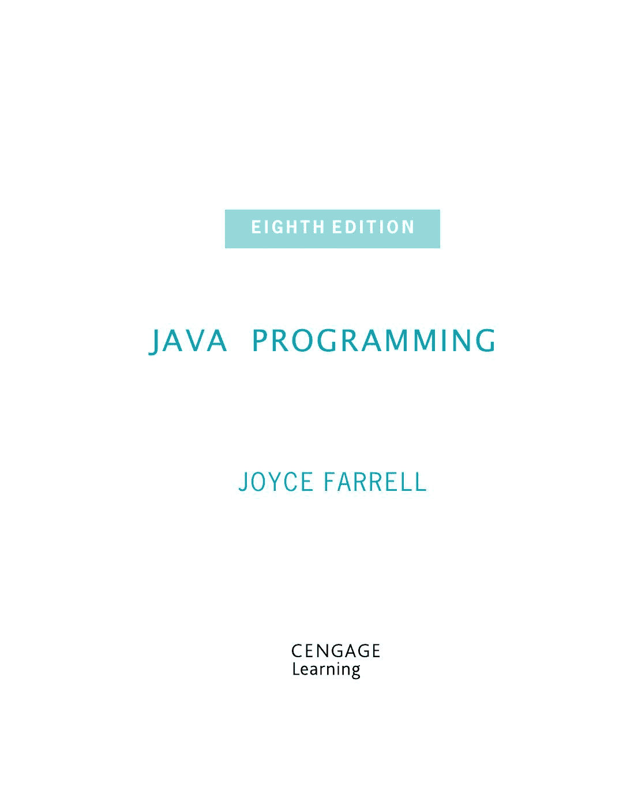

# 第 5 章

## 决策

## 规划决策逻辑

## `if` 和 `if…else` 语句

### `if` 语句

### 陷阱：在 `if` 语句中错误放置分号

### 陷阱：使用赋值运算符而非等值运算符

### 陷阱：尝试使用运算符比较对象

### `if…else` 语句

### 在 `if` 和 `if…else` 子句中使用多条语句

### 嵌套 `if` 和 `if…else` 语句

## 使用逻辑 AND 和 OR 运算符

### `AND` 运算符

### `OR` 运算符

### 短路求值

### 准确的决策

### 准确的检查

### 高效的检查

### 恰当使用 `&&` 和 `||`

### 使用 `switch` 语句

### 使用条件和 `NOT` 运算符

### 使用 `NOT` 运算符

### 运算符优先级

### 向实例方法添加决策和构造函数

### 不要这样做

### 核心术语

### 章节总结

### 复习题

### 练习题

### 编程练习题

### 调试练习题

### 游戏区

### 案例分析

# 第 6 章

## 循环

### 学习循环结构

### 创建 `while` 循环

### 编写确定的 `while` 循环

### 陷阱：未在循环体内修改循环控制变量

### 陷阱：无意中创建空体循环

### 修改确定性循环的控制变量

### 编写不确定的 `while` 循环

### 数据校验

### 使用简写算术运算符

### 创建 `for` 循环

### 不非常规的 `for` 循环

### 学习如何以及何时使用 `do…while` 循环

### 嵌套循环

## 性能优化

### 避免不必要的操作

### 注意短路求值

### 循环嵌套

# 第 7 章

## 字符、字符串与 `StringBuilder`

### 理解字符串数据

### `Character` 类方法

### 声明字符串对象

### 字符串值

### 空 `null` 字符串

### 其他字符串方法

### 将字符串转换为数字

### 学习 `StringBuilder` 和 `StringBuffer` 类

### 不要这样做

### 核心术语

### 章节总结

### 复习题

### 练习题

### 编程练习题

### 调试练习题

### 游戏区

### 案例分析

# 第 8 章

## 数组

## 声明数组

## 初始化数组

## 在数组中使用变量下标

## 使用增强型 for 循环

## 使用数组的一部分

## 声明和使用对象数组

## 在对象中使用增强型 for 循环

## 字符串数组的操作

## 搜索数组和使用并行数组

## 使用并行数组

## 搜索范围匹配的数组

## 向方法传递数组并从方法返回数组

## 从方法返回数组

## 不要这样做

## 关键术语

## 章节总结

## 复习题

## 练习题

### 编程练习

### 调错练习

### 游戏区

### 案例分析

# 第 9 章：高级数组概念

## 使用冒泡排序算法排序数组元素

### 使用冒泡排序算法

### 提高冒泡排序的效率

## 对对象数组排序

## 使用插入排序算法排序数组元素

## 使用二维及其他多维数组

### 向方法传递二维数组

### 在二维数组中使用 `length` 字段

### 理解不规则参数组（Ragged Arrays）

### 使用其他多维数组

## 使用 `Arrays` 类

## 使用 `ArrayList` 类

## 创建枚举

## 不要这样做

## 关键术语

## 章节总结

## 复习题

## 练习题

## 编程练习

## 调错练习

## 游戏区

## 案例分析

# 第 10 章：继承引入

## 学习继承概念

## 使用 UML 绘制继承图

## 继承术语

## 扩展类

## 重写父类方法

### 使用 `@Override` 标签

## 在继承过程中调用构造函数

### 使用父类构造函数

### 访问父类方法

## 比较 `this` 和 `super`

## 实现信息隐藏

### 子类不能重写父类的 `static` 方法

### 子类不能重写父类的 `final` 方法

## 不要这样做

## 关键术语

## 章节总结

## 复习题

## 练习题

## 编程练习

## 调错练习

## 游戏区

## 案例分析

# 第 11 章：高级继承概念

## 创建和使用抽象类

## 使用动态方法绑定

## 将父类作为方法类型

## 创建子类对象数组

## 使用 `Object` 类及其方法

### 使用 `toString()` 方法

### 使用 `equals()` 方法

## 使用继承实现良好设计

## 创建和使用接口

## 创建接口存储常量

## 创建和使用包

## 不要这样做

## 关键术语

## 章节总结

## 复习题

## 练习题

## 编程练习

## 调错练习

## 游戏区

## 案例分析

# 第 12 章：异常处理

## 学习异常

## 尝试代码并捕获异常

## 使用 `try` 块使程序“无一失”

## 在 `try...catch` 块中声明和初始化变量

## 抛出和捕获多个异常

## 使用 `finally` 块

## 理解异常处理的优势

## 指定方法可以抛出的异常

## 通过调用栈跟踪异常

## 创建自定义异常类

## 使用断言

## 显示虚拟键盘

## 不要这样做

## 关键术语

## 章节总结

## 复习题

## 练习题

## 编程练习

## 调错练习

## 游戏区

## 案例分析

# 第 13 章：文件输入输出

## 理解计算机文件

## 使用 `Path` 和 `Files` 类

## 创建 `Path`

## 获取关于 `Path` 信息

## 将相对路径转换为绝对路径

## 检查文件访问权限

## 删除 `Path`

## 确定文件属性

## 文件组织、流和缓冲区

# 使用 Java 的 IO 类

## 写入文件

## 从文件读取

## 创建和使用顺序数据文件

## 学习随机访问文件

## 向随机访问数据文件写入记录

## 从随机访问数据文件中读取记录

## 顺序访问随机访问文件

## 随机访问随机访问文件

## 不要这样做

### 关键术语

### 章节总结

### 复习题

### 练习题

### 编程练习题

### 调试练习题

### 游戏区

### 案例分析

# 第 14 章

## Swing 组件简介

### 理解 Swing 组件

### 使用 `JFrame` 类

### 自定义 `JFrame` 的外观

### 使用 `JLabel` 类

### 更改 `JLabel` 的字体

### 使用布局管理器

### 扩展 `JFrame` 类

### 在 `JFrame` 中添加 `JTextFields`、`JButtons` 和工具提示

#### 添加 `JTextFields`

#### 添加 `JButtons`

#### 使用工具提示

### 学习事件驱动编程

#### 准备你的类以接受事件消息

#### 告诉你的类预期会有事件发生

#### 告诉你的类如何响应事件

#### 一个事件驱动的程序

#### 使用多个事件源

#### 使用 `setEnabled()` 方法

### 理解 Swing 事件监听器

### 使用 `JCheckBox`、`ButtonGroup` 和 `JComboBox` 类

#### `JCheckBox` 类


#### `ButtonGroup` 类 771

#### `JComboBox` 类 772

### 不要这样做 780

### 关键术语 780

### 章节总结 781

### 复习题 783

### 练习题 785

### 编程练习题 785

### 调试练习题 787

### 游戏区 787

### 案例分析 788

# 第 15 章

## 高级 GUI 主题 91

### 理解内容 (Content Pane) 92

### 使用颜色 95

### 学习更多布局管理器 97

#### `BorderLayout` 98

#### `FlowLayout` 100

#### `GridLayout` 102

#### `CardLayout` 103

#### 高级布局管理器 105

### 使用 `JPanel` 类 113

### 创建滚动面板 (ScrollPanes) 121

### 深入了解事件处理 124

#### 事件示例：`KeyListener`

#### `AWT` 类方法 130

#### 坐标 132

#### 处理鼠标事件 132

#### 使用菜单 137

#### 特殊菜单项 141

#### `addSeparator()` 143

#### `setMnemonic()` 143

### 不要这样做 148

### 关键术语 149

### 章节总结 150

### 复习题 151

### 练习题 153

### 编程练习题 153

### 调试练习题 155

### 游戏区 155

### 案例分析 159

# 第 16 章

## 图形 161

### 学习渲染方法 162

### 绘制字符串 165

### 重绘 167

### 设置字体 169

### 使用颜色 170

### 绘制线条和形状 174

#### 绘制线条 174

#### 绘制不填充的和填充的矩形 175

#### 绘制透明矩形 175

#### 绘制圆角矩形 176

#### 绘制阴影矩形 178

#### 绘制椭圆 179

#### 绘制弧线 180

#### 创建多边形 181

#### 复制 `Area` 183

#### 在 `JFrames` 使用 `paint()` 方法 183

#### 学习更多字体 191

#### 发现屏幕 193

#### 发现字体 194

#### 使用 `2D` 图形绘制 198

#### 指定渲染属性 199

#### 设置笔画 (Stroke) 201

#### 创建用于绘制的对象 202

### 不要这样做 210

### 关键术语 211

### 章节总结 211

### 复习题 212

### 练习题 215

### 编程练习题 215

### 调试练习题 216

### 游戏区 216

### 案例分析 218

# 附录 A

## 使用 Java 平台 219

### 学习 Java SE 开发工具包 (JDK) 220

#### 配置 Windows 使用 JDK 220

#### 找到命令提示符 221

#### 命令提示符剖析 221

#### 切换目录 221

#### 设置 `class` 和 `classpath` 变量 222

#### 修改文件名 222

#### 编译并执行 Java 程序 223

# 附录 B

## 数据表示 925

### 理解计数制 926

# 数值的表示 (927)

# 字符的表示 (929)

# 关键术语 (930)

# 附录 C

## 输出格式化 (931)

### 数字的舍入 (932)

### 使用 `printf()` 方法 (933)

### 使用 `printf()` 指定显示位数 (936)

### 使用 `printf()` 指定字段大小 (937)

### 在 `printf()` 中可选参数索引 (938)

### 使用 `DecimalFormat` 类 (939)

### 关键术语 (940)

# 附录 D

## 生成随机数 (941)

### 理解计算机生成的随机数 (942)

### 使用 `Math.random()` 方法 (943)

### 使用 `Random` 类 (944)

### 关键术语 (947)

# 附录 E

## Javadoc (949)

### Javadoc 文档生成器 (950)

### Javadoc 注类型 (950)

### 生成 Javadoc 文档 (952)

### 指定 Javadoc 文档的可见性 (955)

### 关键术语 (956)

## 词表 (957)

## 索引 (979)

# 前言

*Java Programming, Eighth Edition* 为初学者提供了一份使用 Java 编程语言开发应用程序的指南。Java 在专业程序员中非常流行，因为它用于构建视觉化且有趣的图形用户界面 (GUI) 以及 Web 应用程序。Java 还为初学者提供了一个良好的环境——学生可以在学习结构化和面向对象编程技术基础的同时，快速构建实用的程序。

本教科书假设你几乎或没有编程经验。它提供了良好的面向对象编程技术的坚实背景，并使用清晰、熟悉的语言介绍术语。编程示例均为业务示例；它们并不假设学生具有高中商务数学之外的数学背景。此外，示例仅阐述一或两个主要要点；不会包含过多特性导致你在无关且多余的细节中迷失。每个章节都会频繁出现完整、可运行的程序；这些示例帮助学生完成从理论到实践的过渡。每章展示的代码也可以从出版者的网站下载，因此学生可以轻松运行程序并对其进行更改实验。

使用 *Java Programming, Eighth Edition* 的学生是从自下上构建应用程序，而不是从现有的对象开始。这有助于对面向对象编程中使用的概念进行更深入的理解，并随着学生对语言知识的增加，对使用的现有对象产生欣赏。当学生完成本书时，他们将知道如何修改和创建简单的 Java 程序，并拥有了创建更复杂示例的工具。他们还将拥有面向对象编程的基础知识，这对于他们学习高级 Java 课程或学习其他面向对象的语言（如 C++、C# 和 Visual Basic）大有益。

## 结构与内容

*Java Programming, Eighth Edition* 介绍了 Java 编程概念，强制执行良好的风格、逻辑思维和面向对象范式。从一开始就开始介绍对象，比许多其他教科书都要早。你在第 1 章就创建了第一个 Java 程序。第 2、3 和第 4 章加深了你对数据、类、对象和方法在面向对象环境中如何交互的理解。

第 5 和第 6 章探索了输入和循环结构，这是编程逻辑的骨干，对于在任何语言中创建实用的程序至关重要。你在第 7、8 和第 9 章中学习了字符串和数组操作的特殊考虑。

第 10、11 和 12 章彻底涵盖了继承和异常处理。继承是一种面向对象的概念，它允许你通过适应现有对象的特性来快速开发新对象；异常处理是处理错误的面向对象方法。这两者都是面向对象设计中的重要概念。第 13 章提供了处理文件的信息，以便你可以永久地存储和检索程序输出。

第 14、15 和 16 章引入了 GUI Swing 组件（Java 视觉美观、易于使用的组件）、它们的布局管理器和图形处理。

## 特性

以下是第八版的新特性：

- **JAVA 8**：所有程序都已使用 Java 8 进行过测试。

- **WINDOWS 8.1**：所有程序均在 Windows 8.1 中进行过测试，且所有截图均在该环境下拍摄。

- **日期和时间类**：本版对 Java 8 中新增的 `java.time` 包进行了全面覆盖。

- **屏幕键盘**：本版提供了关于如何在触摸屏或标准屏幕上显示和使用屏幕键盘的说明。

- **现代化的图形输出**：关于图形的章节（第 16 章）已完全重写，专注于使用 `paintComponent()` 方法的 Swing 组件图形。

- **现代化的重写**：引入了 `@Override` 标签。

- **扩展的 equals() 方法覆盖**：本书详细解释了重载和重写 `equals()` 方法之间的区别。

- **编程练习**：每个章节都包含几个以前版本中未出现的新编程练习。本版中被替换的上版所有练习及其解决方案在教师资源包中仍然可用。

此外，*Java Programming, Eighth Edition* 还包含以下内容：

- **目标**：每个章节开头都有一个目标列表，让你了解该章节将介绍的主题。除了提供所涵盖主题的快速参考外，该特性还提供了实用的学习辅助。

- **你来做 (YOU DO IT)**：在每个章节中，逐步练习帮助学生创建多个可运行的程序，强调程序员在选择要包含的语句时使用的逻辑。这些部分为学生提供了独立成功的手段——即使是在线或远程课程的学生也是如此。

- **注释 (NOTES)**：这些高亮提示提供了额外信息——例如，执行过程过程的另一种方法、概念的另一个术语、技术的背景信息或要避免的常见错误。

- **强调学生研究**：学生经常被引导至 Java 网站以调查类和方法。计算机语言在不断演变，编程专业人士必须理解如何如何找到最新的语言改进。本书鼓励独立研究。

- **图表**：每个章节都包含许多图表。代码图通常只有 25 行或更少，一次只说明一个概念。频繁的截图展示了程序输出的真实外观。在需要的地方会出现标注以强调要点。

- **颜色**：每章中的代码图包含所有 Java 关键字并标记为蓝色。这有助于学生更容易地识别关键字，将其与程序员命名的名称区分开来。

# 文件

可以从出版商的网站下载 200 多个学生文件。大多数文件包含每章图表中所示的代码；学生可以自己运行代码、查看输出，并修改代码以观察效果。其他文件还包括调试练习题，帮助学生提高其编程技能。

# 一两真一假

通过简短的测验对每个章节的小节进行回顾，并提供答案。

此测验包含三个基于前文文本的陈述——其中两个陈述是真实的，一个是虚假的。多年来，学生一直要求提供答案，但我们一直犹豫是否发布它们，以防教师希望将这些问题作为作业或考试题。这些真假测验可以在学生阅读时为其提供即时反馈，而不会“泄露”单选题和编程练习题的答案。

# 别这样做

每章末尾的这一部分总结了新程序员在学习当前主题时常见的错误和陷阱。

## 关键术语

每个章节都包含一个新引入的词汇列表，按其在文中出现的顺序显示。关键术语列表对章节中的主要概念进行了简要回顾。

# 总结

每章之后都有一个总结，回顾了该章涵盖的编程概念和技术。这一功能为学生检查他们对每章要点的理解提供了一种简洁的手段。

### 复习题

每个章节都包含 20 道单选题，作为对章节主题的回习。

### 游戏区

每章提供一个或多个练习，学生可以使用到目前为止的编程技术创建互动游戏；书中建议了 70 个游戏程序。这些游戏创建和玩起来都很有趣；编写它们能激励学生掌握必要的编程技术。学生可以互相交换完成的游戏程序，提出改进并发现完成任务的替代方法。

# 案例

每章包含两个运行案例问题。这些案例代表了项目，利用每个新章节中学到的概念，在整个学期内不断成长。

两个案例允许教师在交替学期分配不同的案例，或将班级学生分成两个案例小组。

# 词汇表

本版包含按字母顺序排列的书中识别的所有关键术语列表，以及它们的定义。

# 附录

本版包含了关于使用 Java 平台、数据表示、输出格式、生成随机数和创建 Javadoc 注释的实用附录。

# 质量

每个程序示例、练习和游戏解决方案都经过作者测试，然后由质量保证团队使用 Java 标准版 (SE) 8（最新可用版本）再次测试。

## CourseMate

学习越努力，效果越好。通过在一个处获得成功所需的所有内容，充分利用你的学习时间。阅读你的教科书、做笔记、复习闪卡、观看视频并在网上进行测验。CourseMate 超越了书籍本身，为你提供所需的一切！访问 `www.cengage.com/coursemate` 了解更多信息。

`Java Programming` CourseMate 包括：

### 调试练习

每章配有四个带有错误的程序。通过调试这些程序，学生可以获得通用的程序逻辑以及特别是 Java 编程语言的专业知识。

### 视频课程

每章至少配有三节视频课程，帮助解释重要的章节概念。这些视频是由作者制作并配音的。

### 交互式学习辅助工具

交互式电子书、测验、闪卡等！

教师可以将 CourseMate 添加到教科书包中，或者学生可以在 `www.CengageBrain.com` 直接购买 CourseMate。

## 教师资源

以下教学工具可以在我们的教师伴侣网站上下载。

只需在 `s.cengage.com` 搜索此书即可。需要教师登录。

### 电子版教师手册

随同本教科书的教师手册包含额外的教学材料，以协助课堂准备，包括概述、章节目标、教学技巧、快速测验、课堂讨论话题、额外项目、额外资源和关键术语等项目。还提供示例教学大纲。

### 难题

每章都配有申请者在技术面试中可能遇到的两个困难的问题。这些问题通常是开放式的；有些涉及编码，另一些涉及研究。

### 讨论话题

关于通用编程或特别是 Java 的几个启发性问题。这些问题可以用于课堂或在线讨论，或用于开发研究和写作。

### 编程练习与解决方案

每章都配有若干编程练习，作为书中内容的补充。教师可以使用这些练习作为额外或替代作业，或作为课程的基础。

### 题库

由 Cengage Learning 驱动测试是一个灵活的在线系统，允许您：

- 从多个 Cengage 解决方案中编写、编辑和管理题库内容。

- 创建多个版本的测试。

- 从您的 LMS、教室或任何地方交付测试。

### 幻灯片演示

本书提供了每章配的幻灯片。幻灯片可用于课堂演示、提供给学生进行章节复习或作为课堂讲义。书中每个图都提供了文件。教师可以使用这些文件自定义幻灯片、演示测验或创建讲义。

### 解决方案

`You Do It`练习和所有章节末练习的解决方案。部分单选题复习题提供了答案解析。例如，如果学生可能会争议答案选项或不理解被认为是正确的选项，则会提供理由。

为了完成书中的步骤和项目，你需要专门为本书创建的数据文件。你的教师将向你提供这些数据文件。你也可以从 `www.CengageBrain.com` 电子版获取这些文件。在书背上找到你书籍的 ISBN 号，然后在 Cengage Brain 首页顶部的搜索框中输入该 ISBN。你可以在打开的产品页面上找到数据文件。请注意，可以使用学校实验室的计算机或你自己的电脑来完成书中的练习。

## 使用你自己的电脑

要使用你自己的电脑完成步骤和练习，你需要以下物品：**软件：** `Java SE 8`，可从 `www.oracle.com/technetwork/java/index.html` 获取。尽管书中几乎所有的示例都可以在较版本的 Java 上运行，但本书是使用 `Java 8` 创建的。书中明确指出了少数几个基于 `Java 7` 且无法在较早版本的 Java 上运行的示例。你还需要一个文本编辑器，例如 `Notepad`。部分练习要求你使用浏览器进行研究。

**硬件：** 如果你使用的是 Windows 8，Java 网站建议至少有 128 MB 内存和至少 181 MB 磁盘空间。其他操作系统的要求，请参阅 `http://java.com/en/download/help`。

# 第 1 章：创建 Java 程序

在本章中，你将：

- 定义基础编程术语
- 比较过程化和面向对象的编程
- 描述 Java 语言的特性
- 分析产生控制台输出的 Java 应用
- 编译 Java 类并修正语法错误
- 运行 Java 应用并修正逻辑错误
- 为 Java 类添加注释
- 创建产生 GUI 输出的 Java 应用
- 查找帮助

## 学习编程术语

**计算机程序**是你编写的一组指令，用于告诉计算机执行什么。

计算机设备（如显示器或键盘）是**硬件**，而程序是**软件**。为用户执行任务的程序（例如计算并生成工资单、文字处理或玩游戏）是**应用软件**；管理计算机本身的程序（例如 Windows 或 Linux）是**系统软件**。任何计算机程序（无论是应用程序还是系统程序）背后的**逻辑**都决定了产生所需结果所需的指令的精确顺序。书中的大部分内容描述了如何开发创建应用软件的逻辑。

所有计算机程序最终都会被转换为机器语言。**机器语言**或**机器码**是计算机可以执行的最基本的指令集。每种类型的处理器（处理计算机指令的内部硬件）都有其自己的机器语言指令。程序员经常使用 1 和 0 来描述机器语言，以表示计算机系统的开关电路。

这种仅使用 1 和 0 的系统被称为*二进制计数系统*。附录 B 详细介绍了二进制系统。在本章的后续部分，你将学到*字节码*（bytecode）是 Java 程序转换为机器语言时创建的二进制代码的名称。

机器语言是一种**低级编程语言**，或者说是与计算机处理器电路紧密对应的语言。低级语言要求你在创建命令时使用针对特定机器的内存地址。这意味着低级语言难以使用，并且必须为运行程序的每种类型的机器进行定制。

幸运的是，由于高级编程语言的发展，编程已演变成了一项更容易的任务。**高级编程语言**允许你使用合理的术语词汇，例如*read*（读）、*write*（写）或*add*（加），而不是执行这些任务的 1 和 0 序列。高级语言还允许你为存储数据的内存区域分配单单词、直观的名称。这意味着你可以使用 `hoursWorked`（工作时长）或 `rateOfPay`（薪率）等标识符，而无需记住它们的内存位置。目前，有 2000 多种高级编程语言供开发者使用；`Java` 就是其中之一。

每种高级语言都有自己的**语法**，或者说关于如何正确组合语言元素以产生可用语句的规则。例如，取决于特定的高级语言，你可能使用动词 *print*（打印）或 *write*（写）来产生输出。所有语言都有特定的、有限的词汇（语言的**关键字**）以及使用该词汇的特定规则。当你学习计算机编程语言（如 `Java`、`C++` 或 `Visual Basic`）时，你实际上是在学习该语言的词汇和语法。


# 使用编程语言

使用编程语言，程序员编写一系列**程序语句**（类似于英语句子），以执行他们希望程序完成的任务。程序语句也被称为**命令**，因为它们是对计算机的指令，例如“输出这个单词”或“相加这两个数字”。

在编写程序语句后，高级语言程序员使用一种称为**编译器**或**解释器**的计算机程序将他们的语言语句翻译成机器语言。编译器在执行任何语句（或**执行**语句）之前会翻译整个程序，而解释器则一次翻译一条程序语句，在翻译一个语句后立即执行它。

使用编译器还是解释器通常取决于你所使用的编程语言。例如，`C++` 是一种编译型语言，而 `Visual Basic` 是一种解释型语言。每种类型的翻译器都有其支持者；用编译语言编写的程序执行速度更快，而用解释语言编写的程序可能更容易开发和调试。`Java` 结合了这两种技术的优点：使用编译器翻译你的编程语句，并使用解释器在程序执行时（也称为**运行时**）逐行读取编译后的代码。

当编译器和解释器每次遇到无效的程序语句（即包含**语法错误**或误用语言的语句）时，都会发布一条或多条错误信息。语法错误的示例包括拼写错误的关键字或遗漏语句所必需的单词。当检测到语法错误时，程序员可以修正错误并尝试再次翻译。修复所有语法错误是程序**调试**过程的第一部分——即消除程序中的所有缺陷或错误，也称为 **bug**。

……它们或者在获得适当输入之前就产生输出。当你开发任何相当规模的程序时，都应该在编写任何程序语句之前规划好它的逻辑。

纠正逻辑错误比纠正语法错误困难得多。当你编译程序时，语言翻译器会发现语法错误，但一个程序完全可以在完全不含语法错误的情况下执行，同时仍然留有逻辑错误。通常你只有在检查程序的输出时才能识别出逻辑错误。例如，如果你知道员工的薪单应该包含 $4,000 的值，但当你检查工资单程序的输出时发现它只是 $40，那么就发生了逻辑错误。也许执行了错误的计算，或者可能错误地输出了工作小时数值而不是净工资值。当输出不正确时，程序员必须仔细检查程序中的所有语句，修改或移动引起问题的语句，并再次翻译和测试程序。

仅仅因为程序产生了正确的输出，并不意味着它没有逻辑错误。例如，假设一个程序应该乘以用户输入的两个值，用户输入了两个 2，输出是 4。该程序实际上可能错误地相加了这两个值。程序员只有通过输入不同的值（例如 5 和 7）并检查结果才能发现这个逻辑错误。

程序员将某些逻辑错误称为 `semantic errors`（语义错误）。例如，如果你拼错了一个编程语言的单词，你就触犯了语法错误；但如果你在错误的语境中使用正确的单词，你就触犯了语义错误。

## 两个真假一假

### 学习编程术语

在每个“两个真假一假”部分，编号的陈述中有两个是真的，一个是假的。识别出错误的陈述并解释它为什么是假的。

1. 与低级编程语言不同，高级编程语言允许你使用合理的术语词汇，而不是执行相应任务的开/关开关序列。

2. 当你误用语言时，就会发生语法错误；定位并修复所有语法错误是程序调试过程的一部分。

3. 逻辑错误相当容易找到，因为翻译程序的软件会为你找到所有的逻辑错误。

（注：此处原文后续为乱码，未进行有效翻译）

# 第一章：创建 Java 程序

## 比较过程化与面向对象编程

### 编程概念

#### 过程化编程

**过程化编程**（Procedural programming）是一种编程风格，其中操作按顺序依次执行。在过程化应用中，你为计算机内存位置命名，这些位置可以存储电子形式的值——例如数字和文本。这些命名的计算机内存位置被称为 `variables`（变量），因为它们存储的值可能会变化。例如，一个工资程序可能包含一个名为 `rateOfPay`（工资率）的变量。

由名称 `rateOfPay` 引用的内存位置在不同时间可能包含不同的值（公司每位员工的值都不同）。在工资程序的执行期间，存储在 `rateOfPay` 名称下的每个值都可能经过多次操作——例如，该值可能从输入设备读取，与代表工作小时的变量相乘，然后打印在纸上。

为了方便起见，计算机程序中使用的单个操作通常被分组称为 `procedures`（过程/函数）的逻辑单元。例如，一组四个或五个比较和计算共同决定了一个人的联邦预扣税值，可能被分组为一个名为 `calculateFederalWithholding` 的过程。过程化程序定义了变量内存位置，然后调用一系列过程来输入、处理和输出存储在这些位置中的值。当程序 `calls a procedure` 时，当前逻辑会被暂时挂起，以便执行该过程的命令。一个过程化程序通常包含数百个变量和过程调用。过程也被称为 *modules, methods, functions, and subroutines*（模块、方法、函数和子程序）。不同编程语言的用户倾向于使用不同的术语。正如你将在本章后面学到的，Java 程序员最常用的术语是 *method*（方法）。

#### 面向对象编程

面向对象编程是过程化编程的扩展，你采用了一种稍微不同的方法来编写计算机程序。编写 `object-oriented programs`（面向对象程序）涉及：

* 创建类（classes），即对象的蓝图
* 创建对象（objects），即这些类的特定实例
* 创建处理或使用这些对象的应用程序

程序员使用 *OO* 作为 *object-oriented*（面向对象）的缩写；发音为“oh oh”。面向对象编程缩写为 *OOP*，发音与 *soup* 押韵。

## 比较过程化与面向对象编程概念

最初，面向对象编程最常用于两类主要的应用：

* **计算机模拟**（Computer simulations），试图模拟现实世界的活动，以便对其过程进行改进，或者让用户能更好地理解现实世界的流程是如何运作的。
* **图形用户界面**（Graphical user interfaces），或 **GUIs**（读音为“gooey”），允许用户在图形环境中与程序交互。

在这两类应用中考虑对象是有意义的。例如，一个城市可能想要开发一个模拟交通模式的程序，以帮助防止拥堵。

程序员会为汽车和行人等对象创建类，这些类包含自身的数据和行为规则。例如，每辆车都有速度以及改变该速度的方法。汽车的特定实例可以被运动起来，创建一个真实城市在高峰时段的模拟。

为用户创建 GUI 环境也是面向对象性的自然应用。人们很容易将用户在计算机屏幕上操作的组件（如按钮和滚动条）想象成类似于现实世界的物体。每个 GUI 对象都包含数据——例如，屏幕上的按钮具有特定的尺寸和颜色。每个对象还包含行为——例如，每个按钮都可以被点击，并在点击时产生特定的反应。有些人认为*面向对象编程*术语等同于 GUI 编程，但面向对象编程意义更多。尽管许多 GUI 程序是面向对象的，但并非所有的面向对象程序都使用 GUI 对象。现代企业在开发各种业务应用程序时（无论是否为 GUI 应用）都会使用面向对象的设计技术。在本书的前 13 章中，你将学习适用于任何程序类型的面向对象技术；在最后几章中，你将学到的这些技术专门应用于 GUI 应用。

在面向对象的术语中，`class`（类）是一个描述具有共同属性的对象组或集合的术语。就像建造房屋之前存在蓝图，在烘焙饼干之前存在配方一样，`class definition`（类定义）在创建任何对象之前就已经存在。类定义描述了对象将具有哪些属性以及这些对象能够做什么。`Attributes`（属性）是定义对象的特征；它们是对象的 `properties`（属性）。当你学习像 `Java` 这样的编程语言时，你会学习处理两种类型的类：由语言创建者已经开发的类，以及你自己编写的新型自定义类。


`object`（对象）是类的一个特定的、具体的 `instance`（实例）。创建实例的过程被称为 `instantiation`（实例化）。你可以从自己编写的类以及其他程序员编写的类（包括 `Java` 的类）创建对象。对象属性中包含的值通常会将同一类的实例彼此区分开来。例如，`Automobile` 类描述了 `Automobile` 对象是什么样的。`Automobile` 类的某些属性是品牌、型号、年份和颜色。每个 `Automobile` 对象拥有相同的属性，但这些属性的值并不一定相同。一台 `Automobile` 可能是 2010 年白色的福特金牛，而另一辆可能是 2015 年红色的雪佛兰迈马罗。同样，你的狗拥有所有 `Dogs` 的属性，包括品种、名称、年龄以及接种疫苗是否在有效期。

对象属性的值被称为对象的 `state`（状态）。换句话说，你可以将对象大致等同于名词，将它们的属性比作描述名词的形容词。

当你理解了一个对象的类时，你就理解了对象的特征。如果你的朋友买了一辆 `Automobile`，你就知道它有一个型号；如果你的朋友养了一只 `Dog`，你就知道这只狗有一个品种。了解类中存在哪些属性允许你对这些属性的状态或值提出恰当的问题。例如，你可能会问汽车每加仑能跑多少英里，但你不会问汽车是否打过疫苗。同样，在 GUI 操作系统环境中，你期望每个组件具有特定的、一致的属性和方法，例如窗口具有标题栏和关闭按钮，因为每个组件作为 GUI 组件通用类的一员，获得了这些属性。图 1-2 显示了某些 `Dog` 对象与 `Dog` 类之间的关系。

按照惯例，使用 `Java` 的程序员类名以大写字母开头。因此，定义汽车属性和方法的类可能会被命名为 `Automobile`，而狗的类可能会被命名为 `Dog`。然而，为了产生可运行的程序并不遵循这一惯例。

```
Dog class definition
Dog class instances (objects)
每一个创建的 Dog 都将具有：
Name
Age
Ginger
Bowser
Roxy
Breed
Akita
Retriever
Beagle
Shot status
Up to date
Up to date
Up to date
```

**图 1-2** Dog 类定义及其从中创建的一些对象

## 比较过程化与面向对象编程的概念

定义属性外，类还定义了对象可以使用的方法。`method`（方法）是一个自包含的程序代码块，用于执行某些操作，类似于过程化程序中的过程。例如，一个 `Automobile` 可能有向前、向后移动以及确定油箱状态的方法。同样，一个 `Dog` 可能有行走、进食和确定其名称的方法，而程序的 GUI 组件可能还有用于最大化和最小化以及确定其大小的方法。

换句话说，如果对象类似于名词，那么方法就类似于动词。在面向对象的类中，属性和方法被封装到对象中。

### 封装

`Encapsulation`（封装）指的是两个密切相关的面向对象概念：`Encapsulation` 是将数据和方法封装在对象内部。`Encapsulation` 允许你将对象的所有方法和数据视为单一实体。就像一只真实的狗包含了它所有的属性和能力一样，程序中的 `Dog` 对象也是如此。

`Encapsulation` 也指从外部源隐藏对象的数据和方法。隐藏数据有时被称为 `information hiding`（信息隐藏），而隐藏方法的工作方式则被称为 `implementation hiding`（实现隐藏）；你将在“使用方法、类和对象”章节中学习更多关于这两个术语的知识。`Encapsulation` 使你能够从外部隐藏特定的对象属性和方法，并提供安全性，使数据和方法免受意外更改。

如果对象的方法编写得很好，用户可以无需了解方法执行的低级细节，用户只需要理解方法与对象之间的接口或交互。例如，如果你可以给你的 `Automobile` 加满汽油，是因为你理解了加油泵喷嘴与车辆油箱口之间的接口。你不需要了解油泵在机械上是如何工作的，也不需要知道油箱位于车辆内部的何处。如果你能读取速度表，显示的数字是如何计算出来的并不重要。事实上，如果有人生产了一种更优越、更准确的速度设备并将其插入你的 `Automobile` 中，只要你的接口保持不变，你就不需要知道或关心它是如何工作的。

同样的原理适用于构建良好的面向对象类——使用这些类的程序只需要与接口交互即可。

## 理解继承与多态

面向对象程序设计的一个重要特性是 `inheritance`（继承）——创建共享现有类属性和方法的类，但具有更具体的特征。例如，`Automobile` 是一个类，所有的 `Automobile` 对象共享许多特征。`Convertible` 是一个继承自 `Automobile` 的类；`Convertible` 是 `Automobile` 的一种，它拥有并能做“普通” `Automobile` 所做的一切——但增加了一个降低车顶的能力。（反之，`Automobile` 继承自 `Vehicle` 类。）`Convertible` 不是对象——它是一个类。一个特定的 `Convertible` 是对象——例如 `my67BlueMustangConvertible`。

继承帮助你理解现实世界的对象。例如，当你第一次遇到篷车时，你已经理解点火、刹车、门锁和其他系统是如何工作的，因为你意识到篷车是汽车的一种，所以你只需要关注篷车“新”的属性和方法。编程中的优势也是一样的——你可以基于现有类构建新类，并专注于你正在添加的专门功能。

面向对象术语中的最后一个重要概念是 `polymorphism`（多态）。从字面上，`polymorphism` 的意思是“许多形式”——它描述了语言的一种特性，允许根据上下文正确解释相同的单词或符号。

例如，尽管 `Automobile`、`Sailboat` 和 `Airplane` 类都继承自 `Vehicle`，但 `turn` 和 `stop` 方法对于这些类的实例表现不同。当你开始创建包含窗口、按钮和菜单栏等功能的 GUI 应用时，多态的优势将变得更加明显。在 GUI 应用中，记住一个方法名（如 `setColor` 或 `setHeight`）并无论你修改什么种类型的对象都能正确工作，是非常方便的。

当你在两个数字之间看到加号（`+`）时，你理解它们正在被相加。

当你看到它刻在树上两个名字之间，你理解这两个名字在感情上相互联系。因为该符号根据上下文具有不同的含义，所以它是多态的。第 10 和第 11 章提供了更多关于继承、多态以及它们在 Java 中如何实现的信息。

观看视频 `Object-Oriented Programming`。

## 二真一假

### 比较过程化编程与面向对象编程

### 编程概念

1. 类的实例是一个被创建的对象，拥有类定义中描述的属性和方法。

2. `Encapsulation` 通过将数据隐藏在对象内部来保护数据。

3. `Polymorphism` 是创建共享现有类属性和方法但具有更特定特征的类的能力。

---

# Java 编程语言的特性

`Java` 由 Sun Microsystems（太阳系统公司）开发的一种面向对象的语言，适用于通用业务应用程序以及交互式、基于万维网的 Internet 应用程序。

（Sun 公司稍后被 Oracle 公司收购。）让 Java 成为流行语言的优势包括它的安全特性以及它是 `architecturally neutral` 的这一事实。

与其他语言不同，你可以使用 Java 编写运行在任何操作系统（如 Windows、Mac OS 或 Linux）或设备（如 PC、手机和平板电脑）上的程序。

Java 可以运行在各种计算机和设备上，因为它并不直接在计算机上执行指令。相反，Java 运行在一个名为 `Java Virtual Machine (JVM)` 的假设性计算机上。当程序员称 `JVM` 为 `hypothetical` 时，他们的意思是它不是由硬件创建的物理实体，而是仅由软件组成。

图 1-3 显示了 Java 环境。用高级编程语言编写的编程语句是 `source code`。当你编写 Java 程序时，首先使用诸如 `Notepad` 的文本编辑器或开发环境及源码编辑器（如 `jGRASP`）来构建源代码，你可以从网络上免费下载这些工具。`development environment` 是一组工具，它们通过提供诸如用颜色显示语言关键字等功能来帮助你编写程序。语句保存在文件中；然后，Java 编译器会将源代码转换为 `bytecode` 二进制程序。一个名为 `Java interpreter` 的程序随后检查字节码并与操作系统通信，在 Java 虚拟机内部逐行执行字节码指令。由于 Java 程序与操作系统隔离开来，它也与其运行的特定硬件隔离开来。正由于这种隔离，`JVM` 提供了防止入侵者通过操作系统访问你计算机硬件的安全性保护。因此，Java 比其他语言更安全。

`JVM` 提供的另一个优势意味着程序员的工作更少——当使用其他编程语言时，软件供应商通常必须为同一产品制作多个版本（Windows 版本、Macintosh 版本、UNIX 版本、Linux 版本等），以便所有用户都能运行该程序。使用 Java，一个程序版本就可以运行在所有这些平台上。“编写一次，随处运行”（WORA）是 Sun Microsystems 开发的口号，用于描述一个 Java 程序版本能够在多个平台上正确运行的能力。

Java 也比许多其他面向对象的语言更容易使用。Java 是模仿 `C++` 建模的。虽然这两种语言初次接触都不易于阅读或理解，但 Java 确实消除了 `C++` 中一些最难理解的特性，例如 `pointers` 和 `multiple inheritance`。

## 创建 Java 程序

### Java 源代码

源代码存储在磁盘的文件，以 `.java` 结尾命名。

### Java 编译器

编译器创建 `bytecode` 并存储在磁盘的文件中，以 `.class` 结尾命名。

### Java 虚拟机

`JVM`（名为 `java.exe`）执行安全检查并将字节码翻译成 `Computer Operating System` 执行的机器语言。

---

**图 1-3** Java 环境。

### Java 程序类型

你可以使用 Java 编写两种程序：

* `Applets` 是嵌入 Web 页面的程序。你可以在本章末尾的特殊章节中阅读关于 applet。


* `Java applications` 是独立程序。Java 应用程序可以进一步细分为 `console applications`（支持向计算机屏幕输出字符或文本的控制台应用程序）和 `windowed applications`（带有菜单、工具栏和对话框等元素 GUI 的窗口应用程序）。控制台应用程序是更容易创建的应用；你将在下一节开始使用它们。

## 二真一假

### Java 编程语言的特性

1. Java 的开发目标是实现架构中立性，这意味着任何人都可以无需深入研究即可构建应用程序。
2. 在你写完 Java 程序后，编译器会将源代码转换为字节码二进制程序。
3. 嵌入在 Web 页面中的 Java 程序被称为 applet，而独立程序被称为 Java 应用程序。

## 分析产生控制台输出的 Java 应用程序

乍一看，即使是最简单的 Java 应用程序也涉及大量的混淆语法。考虑图 1-4 中的应用程序。

```java
public class First {
    public static void main(String[] args) {
        System.out.println("First Java application");
    }
}
```

**图 1-4** First 类。

在书中插表的程序代码中，Java 关键字以及 `true`、`false` 和 `null` 是蓝色的，所有其他程序元素均为黑色。Java 关键字的完整列表将在本章后部分显示。

书中显示的每个完整程序的代码可以在你可以下载的学生文件中找到，以便在你自己的计算机上执行这些程序。

### 理解产生输出的语句

尽管图 1-4 中的程序占据了多行，但它只包含一个 Java 编程语句。`System.out.println("First Java application");` 语句执行了该程序的实际工作。像所有的 Java 语句一样，它以分号结尾。大多数 Java 编程语句可以跨越你选择的任意行，只要你在适当的位置放置换行符即可。例如，在图 1-4 的程序中，你可以在左括号之前或之后，或者右括号之前或之后放置换行符。然而，你通常希望将短语句放在单行。

文本“First application”是字符的 `literal string`——一组按照输入方式完全出现在输出中的字符序列。Java 中的任何字面量字符串都写在双引号之间。在 Java 中，字面量字符串不能拆分并放在多行。图 1-5 标记了该字符串以及语句的其他部分。

### "第一个 Java 程序"

在语句 `System.out.println("First Java application");` 中：

- `out` 是 `System` 类的一个属性。
- `"First Java application"` 是一个字面量字符串，作为 `println()` 方法的参数。
- `System` 是一个类。
- 点 `.` 用于分隔类、对象和方法。
- `println()` 是一个方法。
- 方法名后面总是跟着括号。
- 每一个 Java 语句都以分号结束。

### 图 1-5 Java 语句的解剖结构

字符串 `"First Java application"` 出现在括号内，是因为该字符串是方法的参数，而方法的参数总是出现在括号内。

## 参数

**参数**（Arguments）是发送到方法中的信息。将参数发送到方法的行为被称为向方法**传递参数**（passing arguments）。类比一下，考虑向一家销售运动用品的公司下订单目录订单。处理目录订单是一个方法，它由一组标准程序组成——记录订单、检查物品可用性、从仓库中提取物品等。每份目录订单还需要一组数据项，例如你订购的商品编号以及所需的数量；这些数据项可以被视为订单处理方法的参数。如果你从目录中订购 2 件 5432 号物品，你预期的结果与订购 1,000 件 9008 号物品不同。同样，如果你向一个 Java 显示方法传递参数 `"Happy Holidays"`，你预期的结果与传递参数 `"First Java application"` 不同。

分析语句 `System.out.println("First Java application");` 内部的 Java 程序，你传递 `"First Java application"` 的方法名为 `println()`。Java 方法 `println()` 和 `print()` 都会产生输出。使用 `println()`，在输出显示后，插入点会移动到下一行，以便随后的输出出现在新行中。然而，使用 `print()` 时，插入点不会移动到新行，因此随后的输出将出现在当前行的末尾。

当你调用一个方法时，始终在方法名后使用括号。在本书中，你将学习许多在括号之间需要参数的方法，以及许多其他你留空括号的方法。当你想要输出空行时，可以使用不带参数的 `println()` 方法。在本章的后后部分，你将学习一个名为 `showMessageDialog()` 的方法，它需要两个参数。其他方法需要的更多。

在语句 `System.out.println("First Java application");` 中，`out` 是 `System` 类的一个属性对象，它指向系统的**标准输出设备**（通常是显示器）。`out` 对象本身是 `PrintStream` 类的实例，它包含了几个方法，包括 `println()`。技术上，你可以自己创建 `out` 对象并编写 `println()` 方法中的指令，但这将非常耗时，而且 Java 的创建者假设你经常希望在屏幕上显示输出。因此，创建 `System` 和 `PrintStream` 类、`out` 对象以及 `println()` 方法是为了方便程序员。

在语句 `System.out.println("First Java application");` 中，`System` 是一个类。因此，`System` 为 `System` 对象定义了属性，就像 `Dog` 类为 `Dog` 对象定义属性一样。`System` 的属性之一是 `out`。（你可能猜到另一个属性是 `in`，它代表一个输入设备。）`System.out.println()` 中的点（periods）用于分隔语句中组件的名称。你将在 Java 程序中反复使用这种格式。

Java 是区分大小写的；名为 `System` 的类与名为 `system`、`SYSTEM` 或甚至 `sYsTeM` 的类是完全不同的，且 `out` 与名为 `Out` 或 `OUT` 的对象也是不同的。在编写 Java 程序时，必须注意使用正确的大小写值。

因此，显示字符串 `"First Java application"` 的语句包含一个类、一个对象引用、一个方法调用、一个方法参数和一个结束语句的分号，但该语句不能独立存在；它嵌入在一个类之中，如图 1-4 所示。

## 理解第一个类

你在 Java 程序中使用的任何内容都必须是类的一部分。当你写 `public class First` 时，你正在定义一个名为 `First` 的类。你可以使用任何需要的名称或**标识符**（identifier）来定义 Java 类，只要它满足以下要求：Java 标识符必须以英语字母表中的字母、非英语字母（如 $\alpha$ 或 $\pi$）、下划线或美元符号开头。类名不能以数字开头。

Java 标识符只能包含字母、数字、下划线或美元符号。

Java 标识符不能是保留关键字，例如 `public` 或 `class`。（保留关键字列表请参见表 1-1。）

Java 标识符不能是以下值之一：`true`、`false` 或 `null`。这些不是关键字（它们是原始值），但它们被保留了，不能使用。

Java 基于 **Unicode**，这是一种国际字符表示系统。*字母*（letter）一词指的是英语字母，以及来自阿拉伯语、希腊语和其他字母表的字符。你可以在附录 B 中学习更多关于 Unicode 的知识。

### 第 1 章：创建 Java 程序

| `abstract` | `continue` | `for` | `new` | `switch` |
| `assert` | `default` | `goto` | `package` | `synchronized` |
| `boolean` | `do` | `if` | `private` | `this` |
| `break` | `double` | `implements` | `protected` | `throw` |
| `byte` | `else` | `import` | `public` | `throws` |
| `case` | `enum` | `instanceof` | `return` | `transient` |
| `catch` | `extends` | `int` | `short` | `try` |
| `char` | `final` | `interface` | `static` | `void` |
| `class` | `finally` | `long` | `strictfp` | `volatile` |
| `const` | `float` | `native` | `super` | `while` |

**表 1-1 Java 保留关键字**

尽管 `const` 和 `goto` 是保留关键字，但在 Java 程序中未使用。这两个词在其他语言中使用，以便未来 Java 的开发者可以使用它们。

Java 的标准（虽然不是强制）是类标识符以大写字母开头，并在需要时采用大写字母以提高可读性。（相比之下，方法标识符如 `println()` 通常以小写字母开头。）这种每个单词以大写字母开头的风格被称为**帕斯命名法**（Pascal casing），有时称为**大驼峰命名法**（upper camel casing）。你应该遵循既定的约定，以便其他程序员能够易于理解。本书使用了既定的约定。

表 1-2 列出了你在编写 Java 程序时可以使用且符合约定的有效类名。表 1-3 提供了一些可以在 Java 中使用（如果你使用这些类名，类可以编译）但不符合约定且不推荐的类名示例。表 1-4 提供了一些非法的类名示例。

### 表 1-2 Java 有效类名

| 类名 | 描述 |
| :--- | :--- |
| `Employee` | 以大写字母开头 |
| `UnderGradStudent` | 以大写字母开头，不包含空格，每个新单词均大写开头 |
| `InventoryItem` | 以大写字母开头，不包含空格，第二个单词字母大写开头 |
| `Budget2016` | 以大写字母开头且不包含空格 |

### 表 1-3 不符合约定的类名

| 类名 | 描述 |
| :--- | :--- |
| `undergradstudent` | 新单词没有以大写字母开头，导致该标识符难以阅读 |
| `Inventory_Item` | 使用下划线，这在 Java 类中是不符合传统的 |

### 表 1-4 非法类名

| 类名 | 原因 |
| :--- | :--- |
| `123Class` | 类名不能以数字开头 |
| `class` | Java 标识符不能是保留关键字 |
| `BUDGET2016` | 类标识符使用全大写字母是不符合传统的 |
| `budget2016` | 按照习惯，类名不以小写字母开头 |
| `Inventory Item` | 标识符中是非法的空格 |
| `2016Budget` | 类名不能以数字开头 |
| `phone#` | 数字符号（`#`）在标识符中是非法的 |

在图 1-4 中（再次在图 1-6 中），代码行 `public class First` 是类头；它包含了关键字 `class`，该关键字将 `First` 标识为一个类。保留字 `public` 是访问修饰符。**访问修饰符**定义了可以访问类的情况以及有权使用该类的其他类。公共访问（Public access）是最宽松的访问类型；你将在“使用方法、类和对象”章节中学习公共访问和其他类型的访问。

### 创建 Java 程序

关键字 `class` 将 `First` 标识为一个类。`First` 是类的名。这一行 `public class First` 是类头。

```java
public class First{
    public static void main(String[] args){
        System.out.println("First Java application");
    }
}
```

大括号之间的所有内容都是类体。**18**

**图 1-6** 典型类的组成部分

在类头之后，你用大括号（`{` 和 `}`）将类的内容括起来；大括号之间的任何数据项和方法构成了**类体**。类体可以由任意数量的数据项和方法组成。在图 1-4 中（再次在图 1-6 中），类 `First` 在大括号内只包含一个方法。该方法的名称是 `main()`，`main()` 方法和 `println()` 方法一样，包含了自己的一组括号。`First` 类中的 `main()` 方法只包含一条语句——即使用 `println()` 方法的语句。`main()` 方法并不*包含*任何其他方法，但它*调用*了 `println()` 方法。

### 缩进样式

通常情况下，Java 中的空白是可选的。**空白**是任何非打印字符的组合。你使用空白来组织程序代码并使其更易读。

你可以通过输入空格、制表符或空行在程序代码的单词或行之间插入空白，因为编译器会忽略这些额外的空格。然而，你不能在标识符或关键字内部使用空白，也不能在任何类-对象-方法组合的点号周围使用空白。

对于 Java 程序中的每一个左大括号（`{`），都必须有一个对应的右大括号（`}`），但左、大括号的位置对编译器来说并不重要。例如，下面的类执行方式与图 1-4 所示的类完全相同。唯一的区别是大括号的布局——换行发生在不同的位置。

```java
public class First{
public static void main(String[] args){
System.out.println("First Java application");
}
}
```

上述示例所示的缩进样式（即左大括号不单独占一行）被称为 **K & R 样式**，并以编写第一本 C 语言编程书籍的 Kernighan 和 Ritchie 命名。图 1-4“分析产生控制台输出的 Java ”中所示并在本书中使用的缩进样式（即大括号对齐且每个括号占一行）被称为 **Alman 样式**，并以推广这种样式的程序员 Eric Alman 命名。Java 程序员使用各种缩进样式，所有的样式都能生成可运行的 Java 程序。当你编写自己的代码时，应该养成一种一致的样式。在学校里，你的老师可能有偏好的样式，而当你找 Java 程序员的工作时，你的机构可能也会有一个偏好的样式。在许多开发环境 **19** 中，在你输入时，会自动为你完成缩进。

大多数程序员会将方法的语句比其其大括号多缩进几个空格。有些程序员缩进两个空格，有些三个，有些则四个。有些程序员使用 Tab 键来创建缩进，但另一些人反对这种做法，因为 Tab 键在不同的系统中可能表示不同的缩进尺寸。有些程序员不在乎使用制表符还是空格，只要你不在同一个程序中混合使用它们即可。Java 编译器不在乎你如何缩进。再次，最重要的规则是养成一种你的机构认可的一致样式。

### 理解 main() 方法

`main()` 方法的方法头相当复杂。图 1-7 显示了 `main()` 方法的组成部分。

```java
public class First
{
    public static void main(String[] args) {
        System.out.println("First Java application");
    }
}
```

`static` 意味着该方法可以在不实例化对象的情况下工作。`public` 是访问修饰符。`void` 是方法的返回类型。

在方法头 `public static void main(String[] args)` 中，单词 `public` 是访问修饰符，就像你用它来定义 `First` 类一样。**20**

方括号 `[]` 意味着方法的参数是一个 `String` 数组，作为该方法的参数。该方法的任何参数必须是 `String` 对象。`args` 是该方法参数数组的标识符。第 8 章和第 9 章提供了更多关于 `String` 的信息。

**图 1-7** 典型 main() 方法的组成部分

即使你没有传递任何参数，`main()` 方法的括号内也必须包含 `String[]` 和一个法的标识符（例如 `args`）。当你在 `main()` 方法头中引用 `String` 类时，方括号表示 `String` 对象的数组。你将在第 7、8 和第 9 章中学习更多关于 `String` 类和数组的知识。

图 1-4 所示的简单应用程序有许多需要记忆的部分。不过，现在你可以使用图 1-8 所示的 Java 代码作为骨架，将 `AnyClassName` 替换为你任选的类名，并将 `/****/` 行替换为任何你想执行的语句。

请观看视频 *A Java Program*。

### 分析产生控制台输出的 Java 应用

```java
public class AnyClassName
{
    public static void main(String[] args)
    {
        //////
    }
}
```

图 1-8 骨架代码

### 保存 Java 类


当你编写一个 Java 类时，必须使用可写的数据存储介质（如磁盘、DVD 或 USB 设备）来保存它。在 Java 中，如果一个类是公共的（即在类名之前使用了 `public` 访问修饰符），你必须将该类存在一个完全相同且扩展为 `.java` 的文件中。例如，`First` 类必须存储在名为 `First.java` 的文件中。类名文件名必须完全匹配，包括大小写。如果扩展名不是 `.java`，Java 编译器将认为该文件包含 Java 类。附录 A 包含了关于保存 Java 程序的额外信息。

#### 两个真理一假

**分析产生控制台输出的 Java 应用**

1. 在方法头 `public static void main(String[] args)` 中，`public` 单词是一个访问修饰符。

2. 在方法头 `public static void main(String[] args)` 中，`static` 单词意味着该方法是可以访问和使用的，即使该类的对象不存在。

3. 在方法头 `public static void main(String[] args)` 中，`void` 单词意味着 `main()` 方法是一个空方法。

### 第 1 章：创建 Java 程序

*你来做：你的第一个应用程序*

现在你已经理解了 Java 编写应用程序的基础知识，已经准备好在文本编辑器中输入你自己的 Java 应用程序了。程序员之间有一个传统：你用任何语言编写的第一个程序输出都是“Hello, world!”。你现在将创建这样一个程序。你可以使用任何文本编辑器，如记事本或 TextPad，或者开发环境，如 `jGRASP`。

编写 Java 程序时，使用最简单的文本编辑器是最好的。多功能的文字处理程序因为所有内置功能（如字体样式和页边距设置），保存的文件会大得多，而 Java 编译器无法解释这些功能。

1. 启动文本编辑器，然后打开一个新文档。

2. 如下所示输入类头：

```java
public class Hello
```

在此示例中，类名是 `Hello`。你可以为类使用任何你喜欢的有效名称。如果你选择了 `Hello`，你必须始终将该类引用为 `Hello` 而不是 `hello`，因为 Java 是区分大小写的。

3. 按一次 **Enter** 键，输入 `{`，再次按 **Enter** 键，然后输入 `}`。将在这些大括号之间添加 `main()` 方法。虽然这不是强制要求的，但本书使用的习惯是将每个大括号放在单独的一行，并使左右大括号对齐。使用这种格式使你的代码更易读。

4. 如图 1-9 阴影部分所示，在大括号之间添加 `main()` 方法头，然后为 `main()` 输入一组大括号。

```java
public class Hello
{
    public static void main(String[] args)
    {
    }
}
```

图 1-9 用于 `Hello` 类的 `main()` 方法骨架（续）

5. 接下来，在 `main()` 方法内部添加将产生“Hello, world!”输出的语句。参考图 1-10，在 `main()` 方法中添加阴影 `println()` 语句。

```java
public class Hello
{
    public static void main(String[] args)
    {
        System.out.println("Hello, world!");
    }
}
```

图 1-10 完整的 Hello 类

6. 将应用程序保存为 `Hello.java`。类名文件名必须完全匹配，且你必须使用 `.java` 扩展名。

### 编译 Java 类和修正语法错误

在你编写并保存应用程序之后，在查看程序输出之前必须执行两个步骤。

1. 你必须将编写的类（称为*源代码*）编译成字节码。

2. 你必须使用 Java 解释器将字节码翻译成可执行的语句。

#### 编译 Java 类

如果你使用如 `jGRASP` 这样的开发环境，可以通过点击 Compile（编译）按钮，或点击 Build 菜单并选择 Compile 来编译你的程序。如果你使用如记事本之类的文本编辑器，可以从命令行编译源码。你的提示符应显示存储程序的程序的文件夹或目录。然后，你输入 `javac` 后跟包含源代码的文件名。

例如，要编译名为 `First.java` 的文件，你输入以下内容并按 Enter：

```
javac First.java
```

编译程序将产生三种结果之一：

- 你收到诸如 `'javac' 不是内部或外部命令、可执行程序或批文件` 的消息。

- 你收到一个或多个编程错误消息。

- 你没有收到消息，这意味着应用程序编译成功。

编译时，如果源代码文件不在当前路径，你可以输入带有文件名的全路径。例如：

```
javac c:\java\MyClasses\Chapter01\First.java
```

在 DOS 环境中，你可以使用 `cd` 命令更改目录。例如，要从当前目录更改到名为 `MyClasses` 的子目录，输入 `cd MyClasses` 并按 Enter。在任何目录中，都可以通过 `cd\` 并按 Enter 返回到根目录。如果你收到无法识别命令的消息，可能意味着以下情况之一：

- 你拼错了命令 `javac`。

- 你拼错了文件名。

- 你在命令行中不在正确的文件夹或子目录中。

- Java 安装不正确。（有关安装请参见附录 A。）

如果你收到编程语言错误消息，说明源代码中存在一个或多个语法错误。记住，语法错误是在你在程序中引入输入错误或不正确使用编程语言时发生的编程错误。例如，如果类名在源代码中是 `first`（小写 *f*），但你将文件保存为 `First.java`（大写 *F*），那么在编译应用程序时将收到错误消息。错误消息将是 `class first 是公共，应在名为 first.java 的文件中`，因为在区分大小写的语言中 *first* 和 *First* 不是同一个。如果发生此类错误，你必须重新打开包含源码的文本文件进行必要的修正，然后保存文件并尝试重新编译。

# 引言

如果你在编译名为 `First.java` 的文件代码后没有收到任何错误消息，说明应用程序编译成功。在这种情况下，系统会创建一个名为 `First.class` 的文件，并将其保存在与源代码文本文件相同的文件夹中。编译成功后，可以在任何安装了 Java 语言解释器的计算机上运行程序（运行类文件）。

## 修正语法错误

当你向文本编辑器中输入 Java 语句时，经常可能会出现拼写错误。

当你发出编译包含错误的类的命令时，Java 编译器会产生一个或多个错误消息。具体显示的错误信息取决于你正在使用的编译器。

图 1-11 所示的 `FirstWithMissingSemicolon` 类包含一个错误——`println()` 语句末尾缺少分号。（当然，这个类的命名是有意为之，为了提醒你注意该错误。）当你编译这个类时，屏幕会显示与图 1-12 相似的错误消息。

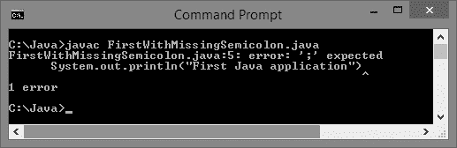

### 编译 Java 类并修正语法错误

```java
public class FirstWithMissingSemicolon
{
    public static void main(String[] args)
    {
        // 语句结束
        System.out.println("First Java application") // 省略了分号
    }
}
```

**图 1-11** `FirstWithMissingSemicolon` 类 

**图 1-12** 编译 `FirstWithMissingSemicolon` 类时生成的错误消息。图 1-12 中错误消息的第一行显示了发现错误的文件名（`FirstWithMissingSemicolon.java`）、发现错误所在的行号（`5`）以及错误的性质（`';' expected`）。错误消息的下一行显示了包含错误的语句，并包含一个插入符号（caret），它指向首次发现错误的精确位置。正如你在编写和编译 Java 程序时将会看到的，发现错误的地方并不一定是产生错误的地方。有时，需要进行一些“侦探工作”来解读错误消息并确定其原因。

最后，图 1-12 中生成的消息包含了发现的错误计数——在这种情况下，只有一个错误。这是一个**编译时错误**的示例，即编译器检测到违反了语言语法规则，并且无法将源代码翻译成机器码。

当你编译一个类时，编译器会报告它能找到的所有错误，以便你尽可能修复这些错误。有时，语法中的一个错误会导致多条错误消息，而如果第一个语法错误不存在，这些消息通常不会被视为错误，因此修复一个错误可能会消除多条错误消息。有时，当你修复了一个编译时错误并重新编译程序时，会生成新的错误消息。这是因为当你修复了第一个错误后，编译器可以继续在该点之后运行并可能发现新错误。当然，没有程序员会故意编写包含语法错误的程序的，但当你真的这么做时，编译器会为你找到所有的错误。

---

# 第 1 章：创建 Java 程序

## 两真理一谎言

### 编译 Java 类并修正语法错误 

1. 在编写并保存应用程序后，你可以通过编译它来生成字节码。当你编译一个类时，编译器会创建一个与源文件同名的 `.class` 文件。

2. 语法错误是编译时错误。

### 修正语法错误

在本节中，你将检查错误消息。 

1. 如果你没有学生文件，请自己输入该文件，如图 1-13 所示。

```java
public class FirstWithMissingSemicolon
{
    public static void main(String[] args)
    {
        System.out.println("First Java application") 
    }
}
```

**图 1-11** `FirstWithMissingSemicolon` 类 

### 编译 Java 类并修正语法错误

1. 在编写并保存应用程序后，你可以通过编译它来生成字节码。当你编译一个类时，编译器会创建一个与源文件同名的 `.class` 文件。

2. 语法错误是编译时错误。

### 修正语法错误

在本节中，你将检查错误消息。 

1. 如果你没有学生文件，请自己输入该文件，如图 1-13 所示。

```java
public class HelloErrors
{
    public static void main(String[] args)
    {
        System.out.println("Hello");
        System.out.println("This is a test");
    }
}
```

**图 1-13** `HelloErrors` 类 

### 编译 Java 类并修正语法错误

1. 在编写并保存应用程序后，你可以通过编译它来生成字节码。当你编译一个类时，编译器会创建一个与源文件同名的 `.class` 文件。

2. 语法错误是编译时错误。

**图 1-15** 当 `HelloErrors` 程序的 `main()` 方法头中缺少 `void` 时生成的错误消息

## 7. 从 `HelloErrors` 程序中删除最后一个右大括号。保存文件并重新编译。图 1-16 显示了生成的消息“reached end of file while parsing.（解析时到达文件末）”。**解析**是编译器将你的源代码划分为有意义的部分的过程；该消息意味着编译器在*(继续)*

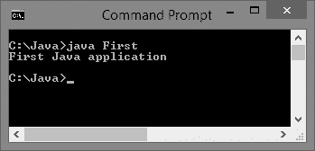

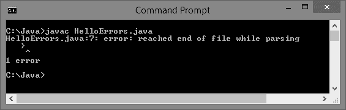

运行 运行 Java 应用程序并纠正逻辑错误 *(接上)*

在分析代码的过程中过早地遇到了文件末尾。如果你通过重新插入右大括号、保存文件并重新编译来修复错误，就可以消除该错误消息。

**图 1-16** 当 `HelloErrors` 程序缺少右大括号时生成的错误消息

## 8. 通过拼错单词、省略标点符号和添加多余按键来继续在程序中引入错误。记住在重新编译之前保存每个版本的程序；否则，你将重新编译上一个版本。当生成错误消息时，请仔细阅读它们，并尝试理解它们在你故意制造的错误语境下的含义。

偶尔，即使你在程序中插入了错误，也不会生成任何错误消息。这并不意味着你的程序是正确的。它只意味着程序没有包含语法错误。程序可能没有语法错误但仍然是不正确的，正如你将在下一节中学到的。

## 运行 Java 应用程序并纠正逻辑错误

在程序在没有语法错误的情况下通过编译后，你就可以执行它。然而，仅仅因为程序可以编译和执行，并不意味着程序没有错误。

### 运行 Java 应用程序

要从 `jGRASP` 运行应用程序，你可以点击 `Run` 按钮，或点击 `Build` 菜单然后点击 `Run`。要从命令行运行图 1-4 中的 `First` ，你需要输入以下内容：

```
java First
```

图 1-17 显示了命令行窗口中的应用程序输出。在这个示例中，你可以看到 `First` 类存储在 `C` 盘名为 `Java` 的文件夹中。当你输入 `java` 命令执行程序后，调用 `println()` 方法的字面量字符串会被输出，因此屏幕上出现了 `First Java` 应用程序。随后控制权返回命令提示符。

**图 1-17** `First` 应用程序的输出

确认你的 `First.java` 类存储位置的方法取决于你的操作系统。在 Windows 操作系统中，你可以打开 `Windows Explorer`，找到代表你正在使用的存储设备的图标，找到你保存文件的文件夹并展开该文件夹。你应该能看到 `First.java` 文件。

当你使用 `java` 命令运行 Java 应用程序时，不要在文件名后添加 `.class` 扩展。如果你输入 `java First`，解释器会寻找名为 `First.class` 的文件。如果你输入 `java First.class`，解释器会寻找名为 `First.class.class` 的文件。

### 修改已编译的 Java 类

在查看应用程序输出后，你可能决定修改类以获得不同的结果。例如，你可能会决定将 `First` 应用程序的输出从 `First Java application` 改为：

```
My new and improved Java application
```

为了产生新的输出，首先必须修改包含现有类的文本文件。你需要更改现有的字面量字符串，然后为另一个文本字符串添加输出语句。图 1-18 显示了更改输出的类。

```java
public class First
{
    public static void main(String[] args)
    {
        System.out.println("My new and improved");
        System.out.println("Java application");
    }
}
```

**图 1-18** 修改了原始版本输出的 `First` 类。对 `First` 类的修改增加了语句 `System.out.println ("My new and improved");`，并从另一个 `println()` 语句的字符串中删除了单词 `First`。

如果你像图 1-18 所示对文件进行了更改，并在不重新编译的情况下保存文件，那么当你在命令行通过输入 `java First` 执行程序时，你将看不到新的输出——你将看到没有添加该行的旧输出。即使你保存了包含已修改类类源代码的文本文件，执行的也是已编译的类文件中的类。当你保存了名为 `First.java` 的文件后，同名的类旧编译版本仍然存储在你的计算机上。

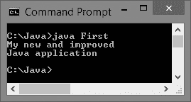

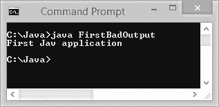

在执行新源代码之前，你必须执行以下操作：

1. 保存带有更改的文件（使用相同的文件名）。

2. 使用 `javac` 命令重新编译类。

3. 解释类字节码并使用 `java` 命令执行该类。

图 1-19 显示了新的输出。

当你重新编译一个类时，带有 `.class` 扩展的原始编译文件版本会被替换，原始版本不再存在。当你修改类时，你必须决定是否保留原始版本。如果你保留，则必须给新版本一个一个新的类名和新的文件名。

**图 1-19** 执行修改后的 `First` 类

偶尔，当你对 Java 类进行更改并重新编译和执行时，旧版本会运行。最简单的解决方案是删除 `.class` 文件并再次编译。程序员将此称为**清洁构建 (clean build)**。

## 纠正逻辑错误

除了语法错误，第二种错误发生在程序语法正确且通过编译，但在执行时产生错误结果的情况下。这种类型的错误是逻辑错误，通常更难发现和解决。例如，图 1-20 显示了名为 `FirstBadOutput` 的编译程序的输出。如果你扫视输出太快，可能不会注意到 *Java* 拼写错误。编译器不会在字面量字符串中查找拼写错误；输出任何字母组合都是合法的。逻辑错误的其他例子包括：在应该相加时使用了相乘，在应该打印五份报告时只打印了一份，或者在用户请求的业务报告结尾忘记生成总计。这种类型的错误必须通过仔细检查程序输出来检测。测试程序并发现任何逻辑错误是程序作者的责任。

**图 1-20** `FirstBadOutput` 的输出

3. 当你编译程序时，有时一个语法错误会导致多个错误信息。


## 在 Java 类中添加注释

如你所见，即使是最简单的 Java 类也需要几行代码，并包含了一些令人困惑的语法。执行许多任务的大型应用程序包含更多的代码，随着你编写越来越大的应用程序，记住为什么要包含某些步骤或你打算如何使用特定变量会变得越来越困难。对程序代码进行注释可以帮助你记住为什么那样编写这些代码。**程序注释**是你为了文档化之目的而添加到程序中的非执行语句。换句话说，注释是为阅读源代码的人设计的，而不是为执行程序的计算机设计的。

程序员使用注释来为自己以及未来可能阅读他们程序的人留存笔记。至少，你的 Java 类文件应该包含标明作者、日期以及类名或函数的注释。最佳实践要求你还应该包含一个简短的注释，来描述你在类中创建的每个方法的具体用途。

### 在 Java 类中添加注释

在学习此书的过程中，请在每个文件的第一行添加注释。注释应该包含类名和目的、你的名字以及日期。你的老师可能会要求你包含额外的注释。

在开发应用程序时，将某些程序语句转换为注释有时是有用的。如果程序运行没有按照预期进行，你可以“注释掉”各种语句，并随后运行程序以观察效果。当你**注释掉**一条语句时，你将其转换为注释，这样编译器就不会翻译它，`JVM` 也不会执行它的命令。这可以帮助你确定故障程序中错误语句的位置。

Java 中有三种类型的注释：

- **行注释**以两个正斜杠（`//`）开始，并持续到当前行的结束。行注释可以单独占一行，也可以出现在可执行代码的行尾（且右侧）。行注释不需要结束符号。
- **块注释**以正斜杠和星号（`/*`）开始，以星号和正斜杠（`*/`）结束。块注释可以单独占一行、出现在可执行代码之前的行，或者出现在可执行代码之后的行。块注释还可以跨越任意行数。
- **Javadoc 注释**是块注释的一种特殊情况，被称为**文档注释**，因为它们被用于通过名为 `javadoc` 的程序自动生成格式良好的程序文档。Javadoc 注释以正斜杠和两个星号（`/**`）开始，以星号和正斜杠（`*/`）结束。

正斜杠（`/`）和反斜杠（`\`）字符经常被混淆，但它们是两个不同的字符。你不能交叉使用它们。

Java 开发工具包（`JDK`）包含了 `javadoc` 工具，你可以在编写 Java 程序时使用它。该工具会生成描述类及其内容的 HTML 页面。

图 1-21 显示了如何在代码中使用注释。在这个示例中，唯一执行的语句是 `System.out.println("Hello");` 语句；其他所有内容（所有阴影部分）都是注释。

```
// 演示注释

/* 这显示了
这些注释
并不重要 */
System.out.println("Hello"); // 这行执行

// 直到注释开始的地方

/* println() 之外的所有内容
都是注释 */
```

图 1-21 包含多个注释的程序段

## 第 1 章：创建 Java 程序

你可能仅仅为了美观而创建注释。例如，你可能想使用一排连字符或星号的注释，作为程序部分之间的视觉分割线。

当程序在商业环境中使用时，由于业务需求的变化，程序经常随时间被修改。如果程序员更改了代码但没有更改相应的注释，那么未来阅读程序的人可能会感到困惑或被误导。当你修改程序时，更改任何相关的注释是很重要的。

### 两个真理和一个谎言：在 Java 类中添加注释

1. 行注释以两个正斜杠（`//`）开始并以两个反斜杠（`\\`）结束；它们可以跨越任意行数。
2. 块注释以正斜杠和星号（`/*`）开始并以星号和正斜杠（`*/`）结束；它们可以跨越任意行数。
3. Javadoc 注释以正斜杠和两个星号（`/**`）开始并以星号和正斜杠（`*/`）结束；它们用于通过名为 `javadoc` 的程序生成文档。

### 动手：为类添加注释

在练习中，你为 `Hello.java` 添加注释并将其保存为新类 `Hello2`。

1. 打开之前创建的 `Hello.java` 文件。在文件顶部输入注释，在指定位置插入你的名字和日期。

```java
// Filename Hello2.java
// Written by <your name>
// Written on <today’s date>
```

2. 将类名改为 `Hello2`，然后在类头之后输入以下块注释：

```java
/* 此类演示了如何使用 println()
方法来打印消息 Hello, world! */
```

3. 将文件保存为 `Hello2.java`。该文件必须命名为 `Hello2.java`，因为类名是 `Hello2`。

4. 进入保存 `Hello2.java` 的驱动器和文件夹的命令行提示符，输入以下命令编译程序：

```bash
javac Hello2.java
```

5. 编译成功后，在命令行输入 `java Hello2` 运行你的应用程序。注释对执行没有影响；输出应该出现在下一行。

### 创建产生 GUI 输出的 Java 应用程序

除了允许 `System` 类产生命令行输出外，Java 还提供了产生 GUI 输出的内置类。例如，Java 包含一个名为 `JOptionPane` 的类，允许你产生对话框。**对话框**是一个类似于窗口的 GUI 对象，你可以在其中放置想要显示的消息。图 1-22 显示了一个名为 `FirstDialog` 的类。`FirstDialog` 类包含许多你熟悉的元素；只有两个阴影行是新的。

```java
import javax.swing.JOptionPane;

public class FirstDialog
{
    public static void main(String[] args)
    {
        JOptionPane.showMessageDialog(null, "First Java dialog");
    }
}
```

图 1-22 FirstDialog 类

# 第 1 章：创建 Java 程序

在 Java 的旧版本中，任何使用 `JOptionPane` 对话框的应用程序都要求以 `System.exit(0);` 语句结束，否则应用程序将不会终止。你可以将此语句添加到你的程序中，它们将能够正常工作，但这不是必须的。然而，在检查他人编写的程序时，你可能会看到这一行。

在图 1-22 中，第一行阴影部分是一个导入语句。当你想要访问包含在一个名为**包**的类组中的内置 Java 类时，你就需要使用**导入语句**。要使用 `JOptionPane` 类，你必须导入名为 `javax.swing.JOptionPane` 的包。你使用的任何导入语句都必须放置在文件中编写的任何类之外。随着你继续学习 Java，你将学到更多关于导入语句以及特别是 `javax.swing` 包的知识。

在使用 `System` 类时（例如使用 `System.out.println()` 方法），不需要使用导入语句，因为 `System` 类包含在 `java.lang` 包中，该包在每个 Java 程序中都会被自动导入。你*可以*在任何使用 `System` 类的文件顶部包含 `import java.lang;` 语句，但不需要这样做。

图 1-22 中 `FirstDialog` 类中的第二个阴影语句使用了 `JOptionPane` 类中的 `showMessageDialog()` 方法。与用于控制台输出的 `println()` 方法一样，`showMessageDialog()` 方法以小写字母开头，后面跟着一组括号。然而，`println()` 方法在括号内只需要一个参数来产生输出字符串，而 `showMessageDialog()` 方法需要两个参数。每当一个方法需要多个参数时，它们用逗号隔开。当 `showMessageDialog()` 的第一个参数为 `null` 时（如图 1-22 中的类所示），意味着输出消息框应该放置在屏幕中心。（你将在第 2 章中学习更多关于对话框的知识，包括如何将它们放置在不同的位置以及如何添加更多选项。）逗号后的第二个参数是显示的字面量字符串。

在本章前面，你已经学过 `true`、`false` 和 `null` 都是表示值的保留字。

当用户执行 `FirstDialog` 类时，会显示图 1-23 所示的对话框。用户必须点击 OK 按钮或 Close 按钮来关闭对话框。如果用户拥有触摸屏，可以触摸 OK 按钮或 Close 按钮。

**图 1-23** FirstDialog 应用程序的输出

## 创建产生 GUI 输出的 Java 应用程序

### 两个真理和一个谎言

1. 对话框是一个类似于窗口的 GUI 对象，你可以在其中放置想要显示的消息。
2. 当你想要访问包含在一个名为包的类组中的内置 Java 类时，你使用追加语句。
3. 不同方法可能需要不同数量的参数。

### 动手实践：创建对话框

接下来，你编写一个在对话框中产生输出的 Java 应用程序。

1. **在你的文本编辑器中打开一个新文件。** 输入类似的注释，并在指示处插入你自己的名字和今天的日期。

```java
// Filename HelloDialog.java
// Written by <your name>
// Written on <today’s date>
```

2. **输入允许你使用 `JOptionPane` 类的导入语句：**

```java
import javax.swing.JOptionPane;
```

3. **输入 `HelloDialog` 类：**

```java
public class HelloDialog {
    public static void main(String[] args) {
        JOptionPane.showMessageDialog(null, "Hello, world!");
    }
}
```

4. **保存文件为 `HelloDialog.java`。** 使用以下命令编译类：

```bash
javac HelloDialog.java
```

如有，消除任何语法错误，重新保存文件。然后使用以下命令执行程序：

```bash
java HelloDialog
```

输出如**图 1-24** 所示。

5. **点击 OK** 以关闭对话框。

## 查找帮助

当你编写 Java 程序时，可以查阅本书之外的有用文档。Java 网站上有大量的材料，`www.oracle.com/technetwork/java/index.html`。非常有价值的是 Java 编程接口，通常被称为 **Java API**。Java API 是一个类库，包含了关于你可以使用的类的信息。

Java 网站上同样令人感兴趣的是常见问题解答（FAQs），它们对 Java 软件和产品提供了简短回答。你还可以免费下载 Java 开发工具包（`JDK`）。`JDK` 是一套程序员使用的软件开发包。它适用于 Windows、Linux 和 Solaris 操作系统。你可以在线搜索文档，也可以将文档下载到你的计算机上。安装后，你可以在本地搜索文档。

从 `http://docs.oracle.com/javase/tutorial/` 可以获得名为“Java 教程”的包含完整示例的可下载教程。该教程按主题（轨迹）组织。你可以从开始开始按顺序导航到结束，也可以在不同主题之间跳转。在你学习本书的每一章时，鼓励你充分利用这些材料。

### 动手实践：探索 Java 网站

在本节中，你将探索 Java 网站的部分材料。

1. **打开浏览器并导航到 `www.oracle.com/technetwork/java/index.html`。**
2. Oracle 可能会在书籍出版后更改布局。然而，你应该能够找到并点击 **Java APIs** 链接，然后点击 **Java SE 8**。（如果你使用的是旧版本的 Java，可以选择相应的版本。）
3. **所有的 Java 类都列在一个标记为 Classes 的面板中。** 滚动直到你可以选择 `System` 类。页面上最大的面板应该显示关于 `System` 类的细节。
4. **你可以看到 `System` 类包含三个字段。** 你已经熟悉 `out` 字段，并且可以看到它是 `PrintStream` 类型的对象。点击 `PrintStream` 类型的超链接将跳转到带有该类细节的新页面。
5. **浏览 `PrintStream` 类的方法。** 注意该类包含多个版本的 `print()` 和 `println()` 方法。找到接受 `String` 参数的 `println()` 版本。点击该方法的链接以阅读它的详细信息，例如它“打印一个字符串并结束该行”。

### 不要这样做

在每一章的末尾，有一个“不要这样做”列表将提醒你初级程序员常犯的错误。

- 不要忘记，在 Java 中，公共文件的文件名必须与它包含的类名相同。例如，如果一个文件名为 `Program1.java`，你不能简单地将其重命名为 `Program1BackUp.java` 并期望它通过编译，除非你更改文件内部的类名。
- 不要混淆 `parentheses`（圆括号）、`braces`（大括号）、`brackets`（括号）、`curly braces`（大括号）、`square brackets`（方括号）和 `angle brackets`（尖括号）这些术语。当你编写程序或执行其他计算机任务时，如果有人告诉你：“现在，输入一些 braces”，你可能需要澄清他指的是哪一个术语。表 1-5 总结了这些标点符号。

#### 表 1-5 Java 中使用的括号和大括号

| 名称 | Java 中的典型用法 | 别名 |
| :--- | :--- | :--- |
| `( )` | 圆括号。跟在方法名后面，圆括号可以出现在 `println()` 中，但这种用法并不常见 | 称为 `round brackets` |
| `{ }` | 大括号。一对括号包围类体、方法体和代码块；当你在第 8 章学习数组时，你会发现大括号也包围了数组值的列表 | 可以称为 `curly brackets` |
| `[ ]` | 方括号。一对括号表示一个数组；方括号将在第 8 章介绍 | 可能会被称为 `box brackets` 或 `square braces` |
| `< >` | 尖括号。尖括号用于参数化类中的泛型参数；当尖括号之间没有任何内容时出现时，它们被称为 `chevron`（角号） | （在本书中使用） |

- 不要忘记结束块注释。每一个 `/*` 必须有一个对应的 `*/`，即使它在几行之后。行注释（以 `//` 开头的注释）较难出错，但请记住，`//` 之后行中的任何内容都不会执行。
- 不要忘记 Java 是区分大小写的。
- 不要忘记在每条语句末尾加分号，但*不要*在类或方法的头部结束处加分号。
- 不要忘记对你修改过的程序进行重新编译。修复错误后运行程序，却不理解为什么没有看到更改的迹象，这可能会让人非常沮丧。原因可能是 `.class` 文件没有包含你的更改，因为你忘记了重新编译。

## 关键术语

- **计算机程序** 是你编写的一组指令，用于告诉计算机做什么。
- **硬件** 是计算机设备的通用术语。
- **软件** 是计算机程序的统称。
- **应用软件** 为用户执行任务。
- **系统软件** 管理计算机。
- 任何程序背后的**逻辑** 涉及按顺序执行各种语句和过程以产生所需的结果。
- **机器语言** 是一种表示一系列开/关的电路级语言。
- **机器码** 是机器语言的另一种说法。
- **低级编程语言** 的编写是为了与计算机处理器的电路紧密对应。
- **高级编程语言** 允许你使用类英语词汇来编写程序。
- **语法** 指定义语言元素如何正确组合使用以创建可用语句的规则。
- **关键字** 是编程语言的一部分的单词。
- **程序语句** 类似于英语句子；它们执行程序所执行的任务。
- **命令** 是程序语句。
- **编译器** 是一种将语言语句翻译成机器码的程序；它在程序的任何部分执行之前，一次性翻译整个程序。
- **解释器** 是一种将语言语句翻译成机器码的程序；它一次翻译一条语句，允许程序部分执行。
- **执行** 一条语句或一个程序意味着实施或完成它。
- **在运行时** 是描述程序执行期间的短语。
- **语法错误** 是当你在程序中引入输入拼写错误或不正确地使用编程语言时发生的编程错误；包含语法错误的程序无法翻译成可执行的程序。
- **调试** 是消除程序中所有错误的过程。
- **错误** 是计算机程序中的缺陷或错误。
- **逻辑错误** 是一种编程错误，它允许源程序成功翻译成可执行程序，但产生了错误的结果。
- **语义错误** 发生在你在程序代码的错误语境下使用正确的单词时。
- **过程化编程** 是一种编程风格，其中一组操作按顺序一个接一个执行。

看到大量的编译器错误信息时不要恐慌。通常，修复一个错误就能解决几个。

当所有的编译器错误都消除时，不要认为你的程序是完美的。只有通过多次运行程序并仔细检查输出，才能确保程序在逻辑上是正确的。


- **变量 (Variables)** 是命名的计算机内存位置，用于存放可能变化的值。

- **过程 (Procedures)** 是计算机程序执行的一组操作。

- **调用过程 (call a procedure)** 是暂时放弃当前逻辑，以便执行过程的命令。

- 编写**面向对象的程序 (object-oriented programs)** 涉及创建类、从这些类创建对象，以及创建使用这些对象的应用程序。

- **计算机模拟 (Computer simulations)** 是试图模拟现实活动的程序，以便改进其过程，或让用户能够更好地理解现实世界过程是如何运作的。

- **图形用户界面 (Graphical user interfaces)**，或 **GUIs**（读作“gooys”），允许用户在图形环境中与程序交互。

- **类 (class)** 是具有共同属性的对象的组或集合。

- **类定义 (class definition)** 描述了对象将具有什么以及能够做什么。

- **属性 (Attributes)** 是定义对象的特征。

- **属性 (Properties)** 是类的特征。

- **对象 (object)** 是类的实例。

- **实例 (instance)** 是类的对象。

- **实例化 (Instantiation)** 是创建对象的过程。

- **状态 (state)** 是对象的属性的取值集合。

- **方法 (method)** 是一个自包含的程序代码块，类似于过程。

- **封装 (Encapsulation)** 将数据和方法封装在对象内部。

- **继承 (Inheritance)** 是创建共享现有类属性和方法的类的能力，但具有更特定的功能。

- **多态 (Polymorphism)** 描述语言的一种特性，允许根据语境在不同情况下正确解释同一个单词。

- **Java** 是一种面向对象的语言，既用于通用业务应用程序，也用于交互性的基于万维网的 应用程序。

- **体系无关 (architecture neutral)** 描述 Java 的一种特性，允许你编写在任何平台（操作系统）上运行的程序。

- **Java 虚拟机 (Java Virtual Machine, JVM)** 是一个运行 Java 的假设（基于软件的）计算机。

- **源代码 (Source code)** 由用高级编程语言编写的程序语句组成。

- **jGRASP** 是一个开发环境和源代码编辑器。

- **开发环境 (development environment)** 是一组帮助你编写程序的工具，提供如显示语言关键字颜色等的功能。

- **字节码 (bytecode)** 由编译成二进制格式的程序语句组成。

- **Java 解释器 (Java interpreter)** 是一种检查字节码并与操作系统通信的程序，在 Java 内部逐行执行字节码指令。

- **“一次编写，随处运行”（Write once, run anywhere, WORA）** 是由太阳公司开发的口号，描述一个 Java 程序版本可以在多个平台上正确运行的能力。

- **小程序 (Applets)** 是嵌入 Web 页面的 Java 程序。

`Java applications` 是独立的 Java 程序。

`Console applications` 支持向计算机屏幕输出字符或文本输出。

`Windowed applications` 创建带有菜单、工具栏和对话框等元素的图形用户界面 (GUI)。

`literal string` 是一系列与输入内容完全相同的字符序列。Java 中的任何字面量字符串都出现在双端引号之间。

`Arguments` 是传递给方法的信息，以便其执行任务。

`Passing arguments` 是将参数发送到方法的行为。

`standard output device` 通常是指显示器。

`identifier` 是程序组件（如类、对象或变量）的名称。

`Unicode` 是一种国际性的字符表示系统。

`Pascal casing` 是一种命名规范，标识符以大写字母开头，并且每个新单词都用大写字母开头。

`Upper camel casing` 就是 Pascal casing。

# 第 1 章

## 创建 Java 程序

`access specifier`（访问修饰符）定义了类被访问的情况以及有权使用该类的其他类。

`class body` 是紧跟类头的大括号之间的数据项和方法集合。

`Whitespace` 是任何非打印字符的组合，例如空格、制表符和回车键（空行）。

`K & R style` 是一种缩进风格，其中左括号紧跟在同一行的头部；它以 Kernighan 和 Ritchie 命名，他们编写了第一本关于 C 语言语言的书。

`Al man style` 是一种缩进风格，其中大括号对齐且每个大括号占据单独一行；它以 Eric Alman 命名，他是一个普及这种风格的程序员。

关键字 `static` 意味着即使不存在该类的对象，该方法也是可以被访问和使用的。

关键字 `void` 在方法头中使用时，表示该方法在被调用时不返回任何值。

一个 `compile-time error`（编译时错误）是指编译器检测到违反语言语法并无法将源代码翻译为机器码的错误。

`Parsing`（解析）是编译器用于将源代码分为有意义的部分进行分析的过程。

当你在重新编译之前删除所有之前编译过的类版本，就会创建一个 `clean build`（清理构建）。

`run-time error`（运行时错误）发生在程序编译成功但未执行时。

`Program comments`（程序注释）是你出于文档目的而添加到 Java 文件中的非执行语句。

`comment out`（注释掉）一个语句是指将其转换为注释，这样编译器就不会执行其命令。

`Line comments`（行注释）以两个正斜杠 (`//`) 开头，并持续到当前行尾。行注释可以单独成，也可以出现在可执行代码的行尾。

`Block comments`（块注释）以正斜杠和星号 (`/*`) 开头，以星号和正斜杠 (`*/`) 结束。块注释可以单独成、出现在可执行代码之前的行，或出现在可执行代码之后的行。块注释还可以跨越任意数量行。

`Javadoc` 注释是生成文档的块注释。它们以正斜杠和两个星号 (`/**`) 开头，以星号和正斜杠 (`*/`) 结束。

`Documentation comments`（文档注释）是可以自动生成格式良好的程序文档的注释。

## 章节总结

`dialog box`（对话框）是一个类似于窗口的 GUI 对象，你可以在其中放置想要显示的消息。

`import statement`（导入语句）访问包含在包中的内置 Java 类。

`package`（包）包含一组内置的 Java 类。

`Java API` 是应用程序编程接口，是关于如何使用每个预写 Java 类的信息的集合。

`FAQs` 是常见问题解答。

`JDK` 是 Java 开发工具包。

`SDK` 是软件开发工具包，或一组对程序员有用的工具。

### 章节总结

计算机程序是一组告诉计算机该做什么的指令。你可以使用高级编程语言编写程序，这种语言有它自己的语法（或语言规则）。在你写完程序后，你使用编译器或解释器将语言语句翻译成机器码。

编写面向对象的程序涉及创建类、从这些类创建对象，以及创建应用程序——使用这些对象的独立可执行程序。面向对象的编程语言支持封装、继承和多态。

用 Java 编写的程序运行在称为 Java 虚拟机 (JVM) 的标准化假设计算机上。当你的类被编译成字节码时，JVM 内部的解释器随后会解释字节码并与你的操作系统通信以产生程序结果。

Java 程序中的所有内容都必须是类的一部分，并包含在左右大括号内。类中的方法包含语句，每条语句都以分号结束。点号用于分隔程序代码中的类、对象和方法。所有的 Java 应用都必须有一个名为 `main()` 的方法，大多数 Java 应用还包含额外的方法。

要从命令行编译你的源代码，输入 `javac` 后紧跟包含源代码的文件名。编译器可能会发布语法错误信息，你必须纠正这些信息。当你成功编译源代码时，编译器会创建一个扩展名为 `.class` 文件。

你可以在任何带有 Java 语言解释器的计算机上运行编译后的 `.class` 文件，方法是输入 `java` 命令后跟类文件名。当你修改类时，必须重新编译它以使更改生效。程序执行后，你必须检查输出以发现逻辑错误。

程序注释是你出于文档目的而添加到文件中非执行语句。Java 为你提供了三类型的注释：行注释、块注释和 javadoc 注释。

# 第 1 章

## 创建 Java 程序

Java 提供了产生 GUI 输出的内置类。例如，Java 包含一个名为 `JOptionPane` 的类，允许你产生对话框。

Java 网站上存在大量的有用材料。

### 复习题

1. 最基础的电路级计算机语言是

a. C++

c. 高级语言

b. Java

d. 机器语言

2. 允许你使用易懂描述性术词汇（如 *read*、*write* 或 *add*）的语言被称为 _____ 语言。

a. 过程化的

c. 高级

b. 机器

d. 面向对象的

3. 编程语言的规则构成了

a. 语法

c. 格式

b. 逻辑

d. 对象

4. A 将高级语言语句翻译成机器码。

a. 程序员

c. 编译器

b. 语法检测器

d. 解码器

5. 命名的内存位置被称为。

a. 编译器

c. 地址

b. 变量

d. 逻辑

6. 计算机程序中的单独操作通常被分组在逻辑单元中。

a. 过程

c. 常数

b. 变量

d. 逻辑

7. 将程序组件想象为现实世界中具体对象是 _____ 的标志。

a. 命令行操作系统

c. 面向对象编程

b. 过程编程

d. 机器语言

8. 对象属性的值被称为它的。

a. 状态

c. 方法

b. 取向性

d. 条件

9. 类的实例是一个(n) ______。

a. 方法

c. 对象

b. 过程

10. Java 在架构上是

a. 特定的

c. 中立的

b. 面向的

d. 抽象的

11. 你必须将用 Java 编写的类编译成

a. 字节码

c. javadoc 语句

b. 源代码

d. 目标码

12. 所有 Java 编程语句必须以以下符号结束

a. 句号

c. 分号

b. 逗号

d. 右括号

13. 方法的参数总是出现在内部

a. 圆括号

c. 单引号

b. 双引号

d. 大括号

14. 在 Java 程序中，你必须使用以下符号来分隔类、对象和方法。

a. 逗号

c. 点

b. 分号

d. 正斜杠

15. 所有的 Java 应用程序必须有一个名为以下哪个的方法

a. `method()`

c. `java()`

b. `main()`

d. `Hello()`

16. 提供文档的非执行程序语句被称为

a. 类

c. 注释

b. 备注

d. 命令

17. Java 支持三种类型的注释：，， 和 javadoc。

a. 行注释、块注释

c. 常量、变量

b. 字符串、字面量

d. 单行、多行

18. 在你编写并保存 Java 应用程序文件后，你对其进行。

a. 解释然后编译

c. 编译然后重新保存

b. 解释然后执行

d. 编译然后解释

19. 执行编译后的 Java 应用程序的命令是 .。

a. run

c. `javac`

b. execute

d. `java`

20. 你使用以下扩展名的文件保存包含 Java 源代码的文本文件

a. `.java`

c. `.txt`

b. `.class`

d. `.src`

## 练习

### 编程练习

1. 以下每个类标识符是 (a) 合法且符合习惯，(b) 合但不符合习惯，还是 (c) 非法？

a. `associationRules`

f. `Apartment`

b. `void`

g. `Phone#`

c. `Golden Retriever`

h. `8888`

d. `Invoice`

i. `displayTotal()`

e. `36542ZipCode`

j. `Accounts_Receivable`

2. 以下每个方法标识符是 (a) 合法且符合习惯，(b) 合但不符合习惯，还是 (c) 非法？

a. `associationRules()`

f. `Apartment()`

b. `void()`

g. `Phone#()`

c. `Golden Retriever()`

h. `8888()`

d. `Invoice()`

i. `displayTotal()`

e. `36542ZipCode()`

j. `Accounts_Receivable()`

3. 为以下每个类列出至少三个可能合适的属性：

a. `Classroom`

b. `InsurancePolicy`

c. `CreditCardBill`

4. 为以下每个类列出至少三个作为其实例的现实对象：a. `Movie`

b. `Team`

c. `Musician`

5. 为这些对象每个列出至少三个可能的类：a. `mySchoolPlayground`

b. `shrimpAlfredo`

c. `grandmasRockingChair`

6. 编写、编译并测试一个类，在屏幕上显示你最喜欢的电影台词。

将该类保存为 `MovieQuote.java`。

在你完成书中的编程练习时，你会创建许多文件。为了组织它们，你可能想要创建一个单独的文件夹来存储每个章节的文件。

7. 编写、编译并测试一个类，显示你最喜欢的电影台词、所属电影、说这段台词的角色以及电影年份。将该类保存为 `MovieQuoteInfo.java`。

8. 编写、编译并测试一个类，在屏幕上显示以下模式：将该类保存为 `TableAndChairs.java`。

9. 编写、编译并测试一个类，显示你最喜欢的歌曲的至少四行歌。

将该类保存为 `FavoriteSong.java`。

10. 编写、编译并测试一个类，使用命令行窗口显示关于注释的述语句：

“程序注释是出于文档化目的而添加到文件中的非执行语句。”

同时在类中的三个不同注释中包含相同的语句；每个注释都应使用 Java 类中包含注释的三种不同方法之一。将该类保存为 `Comments.java`。

11. 修改练习 10 中的 `Comments.java` 程序，使关于注释的语句在对话框中显示。将该类保存为 `CommentsDialog.java`。

12. 从 1925 年到 1963 年，Burma Shave 广告牌出现在全美各地的公路旁。通常成排有四五个牌子，包含押韵诗片段，最后是一个写着“Burma Shave”的牌子。例如，一组由史密森尼博物馆保存的牌子内容如下：

剃须刷

你很快就会看到它们

在架子上

在某个博物馆里

Burma Shave

在网上找一个经典的 Burma Shave 押韵诗。编写、编译并测试一个类，生成一系列四个对话框，以便每个对话框依次显示 Burma Shave 标语的一行内容。将该类保存为 `BurmaShave.java`。

### 调试练习

1. 你可下载的学生文件中 `Chapter01` 文件夹中的以下每个文件都有语法和/或逻辑错误。在每个情况下，确定问题并修复错误。在纠正错误后，使用相同的文件名保存每个文件。例如，`DebugOne.java` 将变为 `FixDebug1.java`。

a. `DebugOne.java`

c. `DebugOne3.java`

b. `DebugOne2.java`

d. `DebugOne4.java`

当你更改文件名时，记得更改文件中的所有实例以匹配。

### 游戏区域

1. 1952 年，A. S. Douglas 在剑桥大学写了关于人机交互的博士论文，并创建了第一个图形游戏——Tic-Toe 版本。该游戏是在 EDSAC 真空管计算机上编写的。第一个计算机游戏假设是 1962 年在 MIT 开发的“Space-war！”1973 年 Atari 推出了 Pong。1980 年，Atari 的“Aster”和“Lunar Lander”成为首批在美国版权局注册的视频游戏。在整个 80 年代，玩家们沉浸于那些现在看来非常简单且乏味的游戏中；你记得玩过《冒险》、《俄之旅》、《卡门迪亚在哪里》或《神秘》吗？

今天，商业游戏要复杂得多；它们需要许多程序员、美术师和测试人员来开发，并需要大型管理和营销团队来推广。一个游戏的开发和营销可能花费大量资金，但成功的游戏可能会赚取巨额资金。显然，根据本章对编程的简要介绍，你无法创建一个复杂的游戏。但是，你可以开始。

为了让游戏吸引兴趣，通常包含一些随机、不可预测的行为。例如，在一个射击行星的游戏中，如果行星每次运行时都遵循相同的可预测路径，将会失去乐趣。因此，生成随机值是创建大多数有趣游戏的关键。

附录 D 包含了生成随机数的信息。要完全理解这一过程，你必须学习更多 Java 类和方法。然而，现在你可以复制以下语句来生成并使用显示 1 到 10 之间随机数的对话框：

```java
JOptionPane.showMessageDialog(null,"数字是 "+(1 + (int)(Math.random() * 10)));
```

编写一个 Java 应用程序，按顺序显示两个对话框。第一个要求你想想一个 1 到 10 之间的数字。第二个显示一个随机生成的数字；用户可以看到自己的猜测是否准确。（在未来的章节中，你将改进这个游戏，让用户可以输入猜测，程序可以判断用户是否正确。如果你愿意，你还可以告诉用户偏离多少、猜测是高还是低，并提供特定次数的尝试。）将文件保存为 `RandomGuess.java`。

案例分析


# 练习案例

本节中的案例问题引入了两个虚构业务。在整书中，你将为这些业务创建日益复杂的类，并使用你在每章中掌握的新概念。

1. **Carly’s Catering** 公司为派对和特殊活动提供餐点。编写一个程序，显示 Carly 的格言，即“Carly’s makes the food that makes it a party.”将文件保存为 `CarlysMotto.java`。创建第二个程序，用由星号组成的边框包围该格言。将文件保存为 `CarlysMotto2.java`。

2. **Sammy’s Seashore Supplies** 公司向游客租赁皮划艇、独木舟、沙滩椅和阳伞等海滩设备。编写一个程序，显示 Sammy 的格言，即“Sammy’s makes it fun in the sun.”将文件保存为 `SammysMotto.java`。

创建第二个程序，用由重复的 `S` 组成的边框包围该格言。将文件保存为 `SammysMotto2.java`。

# 第 1 章 创建 Java 程序

## 关于 Java Applet 的说明

Applet（小程序）是一种在另一个应用程序（通常是 Web 浏览器）内部调用的 Java 程序。`applet` 的名字意思是“小应用程序”。换句话说，applet 不是一个完整的程序；它依赖于其他程序来执行。

Applet 的许多行为源于位于名为 `JApplet` 的 Java 类中的方法。你将在书中看到对该类的几次引用。

Applet 随着 1995 年发布的第一个 Java 版本被引入，并立即变得非常流行，因为它们被认为比 Java 程序更容易编写。然而，多年来 applet 导致了多个安全问题，因此大多数浏览器不再运行 applet，除非它们拥有由验证过发送者的权威机构颁发的签名证书。权威证书为 applet 的创建者背书，提供了某种程度的信心，确保 applet 是可靠的，不会包含损坏本地计算机或窃取数据的恶意代码。大多数浏览器不再接受未签名的 applet，因此专业的 applet 开发人员需要从权威机构购买证书并每年续签。

由于证书要求带来的困难，本书未涵盖 applet 的编写。然而，在你学习了编写 Java 应用程序之后，学习编写 applet 相对容易，因为它们使用相同的语法，包含许多相同的元素，使用相同的 `.java` 文件扩展保存，并以相同的方式进行编译。如果你在工作中遇到 applet，你可以根据代码中的以下特征识别出它：

- 类名之后出现了 `extends JApplet` 短语。
- 与本章介绍的应用程序不同，applet 不包含 `main()` 方法。相反，它们包含一个或多个以下方法标识符：`init()`、`start()`、`paint()`、`stop()` 和 `destroy()`。

# 第 2 章 使用数据

## 本章目标

在本章中，你将：

- 声明并使用常量和变量
- 使用整数类型
- 使用 `boolean` 数据类型
- 使用浮点数据类型
- 使用 `char` 数据类型
- 使用 `Scanner` 类接收键盘输入
- 使用 `JOptionPane` 类接收 GUI 输入
- 执行算术运算
- 理解类型转换

## 声明和使用常量与变量

当一个数据项的值无法更改时，该项为常量。例如，当你在 Java 类中包含以下语句时，数字 459 就是一个常量：`System.out.println(459);`

每当执行包含常量 459 的应用程序时，都会显示值 459。

程序员以几种方式引用像 459 这样的数字：

- 它是一个**字面量常量**（literal constant），因为它的值在每次使用时都是按字面意思取的。
- 它是一个**数值常量**（numeric constant），与字符或字符串常量相对。
- 它是一个**未命名常量**（unnamed constant），与命名常量相对，因为它没有与之关联的标识符。

与其使用常量数据，你可以设置一个数据项为变量。**变量**（variable）是一个命名的内存位置，可以存储一个值。一个变量一次只能包含一个值，但它所持的值可以改变。例如，如果你创建一个名为 `ovenTemperature` 的变量，它在应用程序启动时可能存储 0，稍后被更改为存储 350，之后又被更改为存储 400。

无论数据项是变量还是常量，在 Java 中它总有一个数据类型。项的**数据类型**（data type）描述了可以存储在该处的数据类型、该项占据多少内存，以及可以对数据执行哪些类型的操作。Java 提供了八种原始数据类型。**原始类型**（primitive type）是一种简单的数据类型。Java 的八种数据类型如表 2-1 所示。在本章后面，你将学习关于其中几种数据类型的更具体信息。

| 关键字 | 描述 |
| :--- | :--- |
| `byte` | 字节长度整数 |
| `short` | 短整数 |
| `int` | 整数 |
| `long` | 长整数 |
| `float` | 单精度浮点数 |
| `double` | 双精度浮点数 |
| `char` | 单个字符 |
| `boolean` | 布尔值（true 或 false） |

表 2-1 中的八种数据类型被称为原始（primitive），是因为它们简单且不复杂。原始类型还作为更复杂数据类型的基石，后者被称为**引用类型**（reference types），它们持有内存地址。你将在第 3 章开始创建的类就是引用类型的示例，你在第 1 章中使用的 `System` 类以及你在本章后面将使用的 `Scanner` 类也是如此。

### 声明变量

**变量声明**（variable declaration）是一个预留命名内存位置的语句，包括：

- 标识变量要存储的数据的数据类型
- 变量名的标识符
- 可选的赋值运算符和赋值值，如果你想让变量包含初始值
- 结束的分号

变量名必须是合法的标识符。（你在第 1 章学习过合法标识符的要求。）基本上，变量名必须以字母开头且不能是关键字。你必须在使用变量之前对其进行声明。你可以在使用变量之前的任何点声明变量，但通常做法是在方法中先声明变量，然后再放置可执行语句。Java 是一种强类型语言，即每个变量都有定义的数据类型，该类型限制了你可以对其执行的操作；强类型意味着所有变量在使用之前必须声明。

变量名通常以小写字母开头，以与类名区分开。然而，与类名一样，如果构造方式不符合常规，程序也可以编译。以小写字母开头并将标识符内部的后续单词大写的样式被称为**驼峰命名**（camel casing）。像 `lastName` 这样的标识符看起来像驼峰，因为中间有一个大写的“峰”。

例如，以下声明创建了一个传统的 `int` 变量 `myAge`，并为其分配了初始值 25：

```java
int myAge = 25;
```

此声明是一个完整的、可执行的语句，因此以分号结尾。等号（`=`）是**赋值运算符**（assignment operator）。赋值运算符右侧的任何值都被分配给左侧命名的内存位置。声明变量时进行的赋值是**初始化**（initialization）；稍后进行的赋值只是**赋值**（assignment）。因此，跟随的第一个语句是初始化，第二个是赋值：

```java
int myAge = 25;
myAge = 42;
```

你只需要在方法中声明一次变量，但可以为其分配多次新值。

注意，赋值运算符左侧为字面量的表达式（例如 `25 = myAge`）是非法的。赋值运算符具有从右到左的结合性。`Associativity`（结合性）指的是值与运算符使用的顺序。每个运算符的结合性不是从右到左就是从左到右。出现在赋值运算符左侧的标识符有时被称为 `lvalue`（左值），而只能出现在赋值运算符右侧的项目是 `rvalue`（右值）。变量既可以作为 `lvalue` 也可以作为 `rvalue`，但字面量常量只能作为 `rvalue`。

### 未初始化变量

当你在方法内部声明一个变量但不对其赋值时，它就是一个 `uninitialized variable`（未初始化变量）。例如，下面的变量声明声明了一个名为 `myAge` 的 `int` 类型变量，但在创建时没有分配任何值：`int myAge;`

未初始化变量包含一个被称为 `garbage value`（垃圾值）的未知值。Java 防止你无意中使用存储在未初始化变量中的垃圾值。例如，如果你尝试显示垃圾值或将其作为计算的一部分，你将收到一条错误消息，说明该变量可能未初始化，程序将无法编译。

当你学习“使用方法、类和对象”章节中的类创建时，你会发现声明在类中但在任何方法之外的变量会自动为你初始化。

### 多变量声明

你可以在单独的语句中声明多个相同类型的变量。你也可以通过逗号分隔变量声明，在单条语句中声明两个或多个相同类型的变量，如下语句所示：`int height = 70, weight = 190;`

按照惯例，许多程序员会在自己的独立语句中声明每个变量，但有些人遵循在用途密切相关时在同一条语句中声明多个变量的习惯。记住，即使一条语句占据多行，在遇到分号之前，该语句是不完成的。

你可以在语句中声明任意数量的变量，只要这些变量具有相同的数据类型。然而，如果你声明不同类型的变量，必须为每个类型使用单独的语句。

### 声明命名常量

变量是一个命名的内存位置，其内容可以改变。如果一个命名位置的值在程序执行期间不应该改变，你可以将其创建为一个 `named constant`（命名常量）。命名常量也被称为 `symbolic constant`（符号常量）。命名常量与变量相似，它们都具有数据类型、名称和值。命名常量与变量有几点不同：

- 在其声明语句中，命名常量的数据类型前面会有一个关键字 `final`。
- 命名常量只能赋一次值，之后在程序中就不能更改。通常你在声明命名常量时会对其进行初始化；如果你在声明时没有初始化常量，它被称为 `blank final`（空 final），你可以在稍后赋值。无论哪种方式，你都必须在使用常量之前为其分配一个值。
- 虽然不是强制要求，但习惯上，命名常量使用全大写字母，并在需要时使用下划线分隔单词。

例如，以下每个项目都定义了一个符合命名习惯的常量：

```java
final int NUMBER_OF_DEPTS = 20;
final double PI = 3.14159;
final double TAX_RATE = 0.015;
final String COMPANY = "ABC Manufacturing";
```

你可以在任何使用相同类型变量的地方使用这些命名常量，但在第一个值赋值后的赋值语句左侧除外。换句话说，当它接收值时，命名常量是一个 `lvalue`，但在赋值之后，命名常量是一个 `rvalue`。

常量在程序中始终具有相同的值，所以你可能会奇怪为什么不直接使用实际的字面量值。例如，当你需要公司的部门数量时，为什么不使用未命名的常量 `20`，而不是费力创建 `NUMBER_OF_DEPTS` 命名常量呢？使用命名常量而不是字面量有几个很好的理由：

- 如果数字 20 与一个标识符关联，它更容易被识别为部门数量。使用命名常量会让你的程序更容易阅读和理解。一些程序员将使用如 20 这样的字面数值常量称为使用 `magic number`（魔数）——即没有直接直观含义的值，或者在没有额外知识的情况下无法解释的数字。例如，你可能会编写一个在多个用途中使用值 7 的程序，因此你可以使用 `DAYS_IN_WEEK` 和 `NUM_RETAIL_OUTLETS` 这样的常量，它们都持有 7，但更清晰地描述了用途。避免魔数有助于为你的程序提供内部文档。
- 如果你组织的部门数量发生变化，你只需要在程序中的一处（定义常量的地方）更改 `NUMBER_OF_DEPTS` 的值，而不是搜索每个使用 20 的地方将其改为不同的数字。能够在一处进行更改可以节省你的时间，并防止遗漏对部门数量的引用。
- 即使你愿意搜索程序中的每个 20 实例并改为新的部门数量值，你也可能无意中改变了用于其他用途的 20 的值，例如工资扣除值。
- 使用命名常量减少了拼写错误。例如，如果你必须在程序的几处包含 20，你可能会无意中将其中一个写成 10 或 200，编译器无法识别这个错误。然而，如果你使用 `NUMBER_OF_DEPTS` 标识符，编译器将确保你拼写正确。

在表达式中使用命名常量时，它与变量明显不同。例如，在下面的算术语句中，很容易看出哪些元素是变量，哪些是常量，因为常量使用了习惯的大写字母和下划线分隔：

```java
double payAmount = hoursWorked * STD_PAY_RATE – numDependents * DEDUCTION;
```

尽管许多程序员使用命名常量代表程序中的大部分常量值，但在使用 0 或 1 时，许多人会例外。

### 变量和常量的作用域

数据项的 `scope`（作用域）是程序可见的区域，你可以在其中使用简单标识符引用它。变量或常量的作用域从其声明开始一直到其所在代码块结束。**代码块**是指一组大括号之间的代码。因此，如果你在方法内部声明变量或常量，它可以从声明处一直使用到方法结束，除非该方法包含多组大括号。这时，数据项只能使用到声明所在块的结束。

在“使用方法、类和对象”章节中，你将开始创建包含多组大括号的类。在“更多对象概念”章节中，你将学习一些使用当前不在作用域内的变量的技术。

## 字符串与变量及常量的拼接

### 控制台输出

正如你在第 1 章中所学的，可以使用 `print()` 或 `println()` 语句进行控制台输出。它们唯一的区别是 `println()` 语句在输出后会另起一行。你可以单独在 `print()` 或 `println()` 语句中显示变量或常量，也可以将其与字符串结合。例如，图 2-1 所示的 `NumbersPrintln` 类声明了一个整数 `billingDate`，并将其初始化为 5。在第一个阴影语句中，`billingDate` 的值单独发送到 `print()` 方法；在第二个阴影语句中，`billingDate` 与一个 `String` 结合或拼接在一起。在 Java 中，当使用 `+` 号将数值变量拼接到 `String` 上时，整个表达式将变成一个 `String`。在图 2-1 中，使用了 `print()` 和 `println()` 方法调用来显示不同的数据类型，包括简单的 `String`、一个 `int` 以及一个拼接后的 `String`。图 2-1 所示应用程序的输出出现在图 2-2 中。

```java
public class NumbersPrintln {
    public static void main(String[] args) {
        int billingDate = 5;
        System.out.print("Bills are sent on day ");
        System.out.print(billingDate);
        System.out.println(" of the month");
        System.out.println("Next bill: October " + billingDate);
    }
}
```

**图 2-1** NumbersPrintln 类

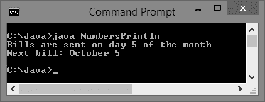

**图 2-2** NumbersPrintln 应用程序的输出

图 2-1 中的最后一个输出语句跨越了两行，因为它相对较长。该语句可以写在一行，也可以在任何括号之前或之后，或者在 `+` 号之前或之后换行。当一行很长且包含 `+` 号时，本书将遵循在符号之后换行的惯例。当你阅读一行时，在行尾看到 `+` 号会让你更容易识别出语句在下一行继续。

在本章的后面部分，你将学到两个数值值之间的加号（`+`）表示加法操作。然而，当你将字符串放在 `+` 号的一侧或两侧时，就会发生拼接操作。在第 1 章中，你学过*多态性*描述了语言的一种特性，允许同一个单词或符号根据上下文在不同情况下被正确解释。`+` 号是多态的，因为它在与字符串一起使用时表示拼接，在与数字一起使用时表示加。

将 `String` 与数字拼接时，整个表达式都是一个 `String`。因此，表达式 `"A" + 3 + 4` 的结果是 `String` `"A34"`。如果你的意图是创建 `String` `"A7"`，你可以添加括号写成 `"A" + (3 + 4)`，这样数值表达式就会先求值。

图 2-1 中的程序使用命令行显示输出，但你也可以使用对话框。回想第 1 章，可以使用带有两个参数的 `showMessageDialog()` 方法：`null` 表示对话框应该出现在屏幕中心，以及要在对话框中显示的 `String`。图 2-3 显示了一个 `NumbersDialog` 类，它使用两次 `showMessageDialog()` 方法来显示一个声明为 `creditDays` 并初始化为 30 的整数。在类中的每个阴影语句中，数值变量都被拼接到 `String` 上，使得整个第二个参数变成一个 `String`。在第一个阴影语句中，拼接的 `String` 是一个空 `String`（或 `null` `String`），通过输入一对中间没有任何内容的引号来创建。该应用程序产生了图 2-4 和 2-5 所示的两个对话框。第一个对话框仅显示值 30；在点击 OK 关闭它后，第二个对话框出现。

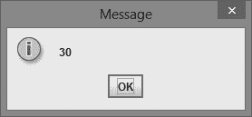
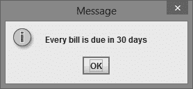


```java
import javax.swing.JOptionPane;

public class NumbersDialog {
    public static void main(String[] args) {
        int creditDays = 30;
        JOptionPane.showMessageDialog(null, "" + creditDays);
        JOptionPane.showMessageDialog(null, "Every bill is due in " + creditDays + " days");
    }
}
```

**图 2-3** NumbersDialog 类

**图 2-4** NumbersDialog 应用程序创建的第一个对话框

**图 2-5** NumbersDialog 应用程序创建的第二个对话框

## 陷阱：忘记变量一次只能持有一个值

每个变量一次只能持有一个值。假设你有两个变量 `x` 和 `y`，`x` 持有 2 而 `y` 持有 10。进一步假设你想交换它们的值，使得 `x` 持有 10 而 `y` 持有 2。你不能简单地进行像 `x = y` 这样的赋值，因为那样两个变量都将持有 10，2 将丢失。同样，如果你进行赋值 `y = x`，那么两个变量都将持有 2，10 将丢失。解决方案是声明并使用第三个变量，如下序列事件所示：

```java
int x = 2, y = 10, z;
z = x;
x = y;
y = z;
```

在这个示例中，第三个变量 `z` 被用作原始值之一的临时位置。变量 `z` 被赋值 `x` 的值。变量 `x` 被赋值 `y` 的值。最后，`y` 被赋值 `z` 的值。

## 6. 到本书为止，你所看到的每个 `print()` 和 `println()` 语句都使用 `String` 作为参数。当你向 `DataDemo` 类中添加最后两个语句时，你写了一个使用 `int` 作为参数的 `println()` 语句。事实上，`print()` 和 `println()` 有许多不同的版本，它们分别使用不同的数据类型。访问 Java 官方网站（`www.oracle.com/technetwork/java/index.html`），选择 `Java APIs`，然后选择 `Java SE 8`。浏览 `All Classes` 列表并选择 `PrintStream`；你可能记得第 1 章中提到 `PrintStream` 是用于 `println()` 方法的 `out` 对象的数据类型。向下滚动查看 `Method Summary` 中的方法列表，注意到 `print()` 和 `println()` 方法有许多版本，包括接受 `String`、`int`、`long` 等参数的版本。在你添加到此程序的最后两个语句中，其中一个使用了接受 `String` 的方法版本，另一个使用了接受 `int` 的方法版本（继续）

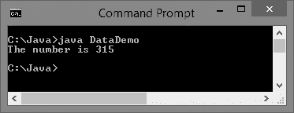

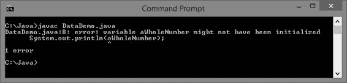

## 声明和使用常量与变量

（继续）接受 `int`。记住，方法根据上下文能够正常工作的能力被称为*多态性*。

## 7. 通过命令行输入 `javac DataDemo.java` 来编译文件。

如有必要，修正任何错误，保存文件，然后重新编译。

## 8. 通过命令行输入 `java DataDemo` 运行应用程序。命令行窗口的输出如图 2-6 所示。

**图 2-6** DataDemo 程序的输出

### 尝试使用未初始化的变量

在本节中，你看到当变量未初始化时会发生什么。

1. 在 `DataDemo` 类中，移除变量 `aWholeNumber` 的赋值运算符和初始化值，使声明变为：`int aWholeNumber;`。

2. 保存类并重新编译。出现如图 2-7 所示的错误信息。注意，声明语句没有产生错误，因为你可以声明变量而不对其初始化。然而，`println()` 语句生成了错误信息，因为在 Java 中，你不能显示未初始化的变量。

**图 2-7** 变量未初始化时生成的错误信息

3. 修改 `aWholeNumber` 的声明，使变量再次初始化为 `315`。编译类并再次执行。

### 在程序中添加具名常量

在本节中，你为 `DataDemo` 程序添加了一个具名常量。

1. 在 `DataDemo` 类中声明 `aWholeNumber` 变量后，在程序中插入新行并输入以下常量声明：`final int STATES_IN_US = 50;`。

（继续）

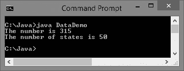

**第 2 章**

使用数据

（继续）

2. 在现有程序的最后一个 `println()` 语句之后，添加一条新语句来显示连接后的字符串和数值常量。`println()` 方法使用了接受 `String` 参数的版本。

```java
System.out.println("The number of states is " + STATES_IN_US);
```

**图 2-8** 最近调用后 DataDemo 程序的输出

## 学习整数数据类型

在 Java 中，你可以使用数据类型 `byte`、`short`、`int` 和 `long` 的变量来存储（或持有）整数；**整数**是不带小数部分的整个数字。

`int` 数据类型是最常用的整数类型。`int` 类型的变量可以存放从 –2,147,483,648 到 +2,147,483,647 之间的任何整数值。当你给 `int` 变量赋值时，不需要输入任何逗号或句号。最新版本的 Java 允许在数字中使用下划线；这些下划线通常用于让长数字更易于阅读，如下语句所示：

```
corporateBudget = 8_435_000;
```

然而，当你输入数字时，通常只输入数字和一个可选的加负号来表示正负整数。

`byte`、`short` 和 `long` 数据类型都是整数类型的变体。`byte` 和 `short` 类型占据内存较少，只能存储较小的值；`long` 类型占据内存更多，可以存储更大的值。表 2-2 显示了这些类型的上限和下限值。在其他编程语言中，原始数据类型的格式和大小可能取决于运行程序的平台。相比之下，Java 一致地规定了其原始数据类型的尺寸和格式。

### 学习整数数据类型

| 类型 | 最小值 | 最大值 | 字节数 |
| :--- | :--- | :--- | :--- |
| byte | -128 | 127 | 1 |
| short | -32,768 | 32,767 | 2 |
| int | -2,147,483,648 | 2,147,483,647 | 4 |
| long | -9,223,372,036,854,775,808 | 9,223,372,036,854,775,808 | 8 |

**表 2-2** 按类型划分的整数限制

## 整数值的限制

为使用的变量选择合适的类型是非常重要的。如果你尝试赋值一个超出数据类型范围的值，编译器会报错。如果你选择了一个比需要大的数据类型，就会浪费内存。例如，一个人事应用程序可能会用 `byte` 表示家属人数（因为 127 足够了），用 `short` 表示每月工作小时（因为 127 不够），并用 `int` 表示年薪（因为 32,000 可能很大）。由于程序员没有注意数据类型，曾出现过著名的故障。例如，华盛顿特区的一个医院计算机系统使用 `short` 来计算自 1900 年 1 月 1 日以来的天数。该系统在第 32,768 天（1989 年）崩溃了，导致了长时间的人工操作。

如果应用程序使用字面量常量，如 `93`，该数字默认是 `int`。如果你需要使用一个大于 `2,147,483,647` 的常量，数字后必须跟随字母 `L`。

```
long InTheNorthWoods = 244455588L;
```

你可以在数字后输入大写或小写的 `L` 来表示 `long` 类型，但为了避免与数字 1 混淆，建议使用大写的 `L`。将数值常量存储在 `int`、`byte` 或 `short` 中不需要任何特殊符号。

由于整数常量（如 `18`）默认是 `int`，因此本书中的示例在变量的目的是为了持有整个数字时，几乎总是将变量声明为 `int`。也就是说，即使预期值小于 128（例如 `hoursWorkedToday`），本书也会将变量声明为 `int`。如果你正在编写一个对节省内存重要的应用程序，你可能会将同一个变量声明为 `byte`。

# 你来做

## 处理整数

在本节中，你将更多地处理整数值。

1.  在你的文本编辑器中打开一个新文件，并如下所示创建一个 `IntegerDemo` 类的壳：

```java
public class IntegerDemo
{
}
```

2.  在大括号之间，缩进几个空格并如下所示编写 `main()` 方法的壳：

```java
public static void main(String[] args)
{
}
```

3.  在 `main()` 方法中，创建四个声明，每个对应一种整数数据类型类型。

`int anInt = 12;`

`byte aByte = 12;`

`short aShort = 12;`

`long aLong = 12;`

（继续）

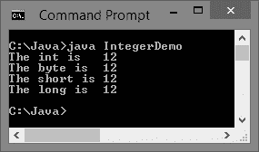

### 学习整数数据类型

（继续）

4.  接下来，添加四个输出语句来描述并显示每个值。字符串字面量末尾包含了空格，这样在显示时这些值将垂直对齐。

```java
System.out.println("The int is " + anInt);
System.out.println("The byte is " + aByte);
System.out.println("The short is " + aShort);
System.out.println("The long is " + aLong);
```

5.  将文件保存为 `IntegerDemo.java`。然后编译并执行它。图 2-9 显示了输出。所有值都是每个数据类型的合法尺寸，因此程序编译并执行时没有错误。

**图 2-9** IntegerDemo 程序的输出

6.  将应用程序中的每个赋值值从 12 改为 `1234`，然后保存并重新编译程序。图 2-10 显示了生成的错误信息，因为 1234 太大，无法放入 `byte` 变量。消息“possible lossy conversion from int to byte”意味着如果将大数字插入较小的空间中，数字的准确性将受到损害。**有损转换**是指丢失某些数据的转换。有损转换的反面是**无损转换**——即不丢失任何数据的转换。（错误信息在其他开发环境和 Java 的某些早期版本中有所不同。）

（继续）

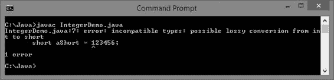

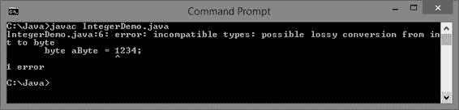

# 第 2 章：使用数据

（继续）

**图 2-10** 将过大的值赋值给 byte 变量时生成的错误信息

7.  将 `aByte` 的值改回 `12`。将 `aShort` 的值改为 `123456`。

保存并重新编译程序。图 2-11 显示了结果。错误信息“possible lossy conversion”与字节值无效时相同，但错误表明现在问题出在 `short` 变量上。

**图 2-11** 将过大的值赋值给 short 变量时生成的错误信息

8.  将 `short` 变量的值改为 `12345`，然后保存并编译程序。现在，程序编译无通过。执行程序，并确认其运行符合预期。

9.  在 Java 网站（`www.oracle.com/technetwork/java/index.html`），检查 `PrintStream` 类中 `println()` 方法的列表。虽然你可以找到接受 `String`、`int` 和 `long` 参数的版本，但你找不到接受 `byte` 或 `short` 值的版本。然而，程序最新版本的 `println()` 语句工作正常。原因与类型转换有关，你将在本章稍后部分学习。

10. 将 `aLong` 的值替换为 `1234567890987654321`。保存程序并编译。图 2-12 显示了生成的错误信息，指示该整数太大。消息并没有说该值对于 `long` 类型变量来说太大。相反，它的意思是在尝试将其存储在 `long` 变量之前，字面量常量被评估为太大，无法作为一个默认的 `int`。

（继续）

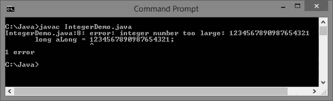

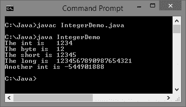

### 学习整数数据类型

**图 2-12** 将过大的值赋值给 long 变量时生成的错误信息

11. 通过在长数字值末尾添加一个 `L` 来解决问题。

现在，该常量是正确的赋值给 `long` 变量的数据类型。保存、编译并执行程序；执行成功。

12. 注意某些错误，当数据值单独使用时对于数据类型是可以接受的，但在一起可能会产生超出范围的算术结果。为了演示，在 `IntegerDemo` 程序当前变量声明列表的末尾添加以下声明：`int anotherInt = anInt * 10000000;`

13. 在当前输出语句列表的末尾添加另一个输出语句，以便查看算术结果：`System.out.println("Another int is " + anotherInt);` 保存、编译并执行程序。输出见图 13。尽管 12 和 10000000 都是可以接受的值，但它们的乘积超出了 `int` 的范围，丢失了一些信息。

**图 13** 修改后超出范围的 IntegerDemo 程序的输出

## 使用 boolean 类型

布尔逻辑基于真或假。虽然 `int` 变量可以包含许多值（在不同的时间），但 `boolean` 变量只能包含两个值——true 或 false。以下语句声明并为布尔变量赋值：

```java
boolean isItPayday = false;
boolean areBroke = true;
```

虽然你可以为布尔变量使用任何合法标识符，但如果你在变量名中使用 *is* 或 *are* 作为一部分，它们很容易被识别为布尔值，例如 `isPayday`。

除了赋值 true 和 false 之外，你还可以根据比较结果为布尔变量赋值。Java 支持六种用于比较的关系运算符。关系运算符比较两个项目；它有时被称为比较运算符。包含关系运算符的表达式的值始终为真或假。表 2-3 描述了这些关系运算符。

当你将 Boolean 作为形容词时（例如布尔运算符 Boolean operators），通常以大写 B 开始，因为该数据类型是以符号逻辑创始人乔治·布尔（George Boole）命名的，他生活于 1815 年至 1864 年。然而，Java 数据类型 `boolean` 以小写 b 开头。

| 运算符 | 描述 | 真示例 | 假示例 |
| :--- | :--- | :--- | :--- |
| < | 小于 | 3 < 8 | 8 < 3 |
| > | 大于 | 4 > 2 | 2 > 4 |
| == | 等于 | 7 == 7 | 3 == 9 |
| <= | 小于等于 | 5 <= 5 | 8 <= 6 |
| >= | 大于等于 | 7 >= 3 | 1 >= 2 |
| != | 不等于 | 5 != 6 | 3 != 3 |

**表 2-3** 关系运算符

当你使用任何带有两个符号的运算符（`==`、`<=`、`>=` 或 `!=`）时，不能在两个符号之间放置任何空格。你不能反转符号的顺序。也就是说，`=<`、`=>` 和 `=!` 都是无效的运算符。

当在比较的一个或两个端操作数中使用变量时，布尔表达式更有意义，如以下三个示例所示，其中变量与字面量常量（40）比较，变量与命名常量（HIGH_CUTOFF）比较，以及两个变量进行比较。

```java
boolean isOvertimePay = (hours > 40);
boolean isTaxBracketHigh = (income > HIGH_CUTOFF);
boolean isFirstScoreHigher = (score1 > score2);
```

当你学习第 5 章和第 6 章中的决策和循环时，布尔表达式将变得变得有用得多。

## 两个真理一假

### 使用 boolean 数据类型

1. 一个 `boolean` 变量只能包含两个值之一——`true` 或 `false`。

2. Java 支持六个关系运算符，用于比较：`<`， `>`， `<=`， `>=`， `==`， 和 `!=`。

3. 包含关系运算符的表达式具有 `boolean` 值。

## 学习浮点数数据类型

`floating-point` 数包含小数位。Java 支持两种浮点数据类型：`float` 和 `double`。`float` 数据类型可以存储最多六或七位有效数字的浮点值。`double` 数据类型比 `float` 需要更多内存，可以存储 14 或 15 位有效数字精度。`significant digits` 一词指的是数值的数学精确性。例如，给 `float` 赋值为 `0.324616777`，它显示为 `0.324617`，因为该值只精确到小数点后六位。表 2-4 显示了每个浮点数据类型的最小值和最大值。注意 `double` 的最大值为 `3.4 * 10 的 38 次方`，这意味着 `3.4` 乘以 10 后面跟着 38 个零——这是一个巨大的数字。


取决于你运行程序的环境，给 `float` 赋值 `324616777`，它会在 `3` 之后显示小数点，并且只有六或七位数字后跟着 `e+008` 或 `E8`。这种格式被称为`科学计数法`，意味着该值大约是 `3.24617` 乘以 10 的 8 次方，或 `324617000`。显示值中的 `e` 代表“指数”；`8` 表示真实的小数点在显示位置的右侧八位，表示这是一个很大的数字。（`e` 后面跟着负数则意味着真实的小数点在左侧，表示一个非常小的数字。）程序员可能会选择将值存储为 `float` 而不是 `double` 以节省内存。然而，如果需要高水平的精度（例如在图形密集型软件中），程序员可能会选择使用 `double`，为了高精度而牺牲内存。

## 第 2 章：使用数据

| 类型 | 最小值 | 最大值 | 字节大小 |
| :--- | :--- | :--- | :--- |
| `float` | –3.4 * 10³38 | 3.4 * 10³38 | 4 |
| `double` | –1.7 * 10³308 | 1.7 * 10³308 | 8 |

**表 2-4：浮点值的限制**

存储在 `double` 中的值是`双精度浮点数`；`float` 中的值是`单精度浮点数`。

就就像整数常量（如 `18`）默认是 `int` 类型的值一样，浮点常数（如 `18.23`）默认是 `double`。要指示一个浮点数值常数是 `float`，你可以在数字后输入字母 `F`，如下所示：

```java
float pocketChange = 4.87F;
```

你可以输入小写或大写的 `F`。你也可以在浮点常数后输入 `D`（或 `d`）来指示它是 `double`，但即使没有 `D`，该值默认也会存储为 `double`。浮点数是非精确的，你在本章后面的部分将会看到。

## 两个真理一假

### 学习浮点数数据类型

1. Java 支持两种浮点数据类型：`float` 和 `double`。`double` 数据类型需要更多内存并可以存储更多有效数字。
2. 浮点常数（如 `5.6`）默认是 `float`。
3. 与整数一样，你可以对浮点数进行加、减、乘、除数学运算。

## 使用 char 数据类型

你使用 `char` 数据类型来存储任何单个字符。你将常量字符放在单引号内，因为计算机存储字符和整数的方式不同。`char` 可以是任何字母——大写或小写——标点符号或数字。`char` 在内存中的表示方式也与 `int` 不同。例如，典型的字符声明：

```java
char aValue = 'M';
char Initial = 'A';
char aStar = '*';
```

有些程序员倾向于将 `char` 读作 "char"。另一些人倾向于将 `char` 读作 "care"。你应该使用偏好的读法。

如果你想查看 `char` 的数值值，可以使用 `println()`：

```java
char aValue = '9';
int aNumValue = 9;
```

如果你使用 `println()` 显示这些变量的每一个，你就会看到数值。每个 `char` 都分配了一个唯一代码。表 2-5 显示了一些进制值。

## 表 2-5：Unicode 值（续表）

| Dec | Char | Dec | Char | Dec | Char | Dec | Char |
| :--- | :--- | :--- | :--- | :--- | :--- | :--- | :--- |
| 0 | nul | 32 | space | 64 | @ | 96 | ` |
| 1 | soh | 33 | ! | 65 | A | 97 | a |
| 2 | dc2 | 34 | " | 66 | B | 98 | b |
| 3 | dc3 | 35 | # | 67 | C | 99 | c |
| 4 | dc4 | 36 | $ | 68 | D | 100 | d |
| 5 | enq | 37 | % | 69 | E | 101 | e |
| 6 | enq | 38 | & | 70 | F | 102 | f |
| 7 | bel | 39 | ' | 71 | G | 103 | g |
| 8 | bs | 40 | ( | 72 | H | 104 | h |
| 9 | ht | 41 | ) | 73 | I | 105 | i |
| 10 | lf | 42 | * | 74 | J | 106 | j |
| 11 | vt | 43 | + | 75 | K | 107 | k |
| 12 | ff | 44 | , | 76 | L | 108 | l |
| 13 | cr | 45 | - | 77 | M | 109 | m |
| 14 | so | 46 | . | 78 | N | 110 | n |
| 15 | si | 47 | / | 79 | O | 111 | o |
| 16 | dle | 48 | 0 | 80 | P | 112 | p |
| 17 | dc1 | 49 | 1 | 81 | Q | 113 | q |
| 18 | dc2 | 50 | 2 | 82 | R | 114 | r |
| 19 | dc3 | 51 | 3 | 83 | S | 115 | s |
| 20 | dc4 | 52 | 4 | 84 | T | 116 | t |
| 21 | nak | 53 | 5 | 85 | U | 117 | u |
| 22 | syn | 54 | 6 | 86 | V | 118 | v |
| 23 | etb | 55 | 7 | 87 | W | 119 | w |
| 24 | can | 56 | 8 | 88 | X | 120 | x |
| 25 | em | 57 | 9 | 89 | Y | 121 | y |
| 26 | sub | 58 | : | 90 | Z | 122 | z |
| 27 | esc | 59 | ; | 91 | [ | 123 | { |
| 28 | fs | 60 | < | 92 | \ | 124 | \| |
| 29 | gs | 61 | = | 93 | ] | 125 | } |
| 30 | rs | 62 | > | 94 | ^ | 126 | ~ |
| 31 | us | 63 | ? | 95 | _ | 127 | del |

从 0 到 127 的 Unicode 值及其对应的字符。`char` 类型的变量只能存储一个字符。要存储一个字符字符串（例如人的姓名），你必须使用一种名为 `String` 的数据结构。在 Java 中，`String` 是一个内置类，它提供了存储和操作字符字符串的手段。与使用单引号的单个字符不同，字符串常量被写在双引号之间。例如，在名为 `firstName` 的变量中将姓名 `Audrey` 存储为字符串的表达式：

```java
String firstName = "Audrey";
```

你将在“字符、字符串与 StringBuilder”章节中学习更多关于字符串和 `String` 类的知识。

## 使用 `char` 数据类型

你可以在 `char` 变量中存储任何字符——包括退格键或制表符等非打印字符。为了存储这些字符，你可以使用`转义序列`（escape sequence），它始终以反斜杠 `\` 开始，后面紧跟一个字符——这对组合表示单个字符。例如，以下代码在 `char` 变量 `aNewLine` 和 `aTabChar` 中存储了一个换行符和一个制表符：

```java
char aNewLine = '\n';
char aTabChar = '\t';
```

在 `aNewLine` 和 `aTabChar` 的声明中，反斜杠和字符的组合充当单个字符；转义序列的作用是赋予字符新的含义。也就是说，前面代码中的字面字符与普通的 `'n'` 或 `'t'` 不同。表 2-6 描述了可以在 Java 命令行输出中使用的一些常用转义序列。

### 转义序列

| 转义序列 | 描述 |
| :--- | :--- |
| `\b` | 退格；将光标向左移动空格 |
| `\t` | 制表符；将光标移动到下一个制表位 |
| `\n` | 换行或行行；将光标移动到下一行的开头 |
| `\r` | 回车；将光标移动到当前行的开头 |
| `\"` | 双引号；显示一个双引号 |
| `\'` | 单引号；显示一个单引号 |
| `\\` | 反斜杠；显示一个反斜杠 |

**表 2-6** 常用转义序列

当你在 `JOptionPane` 对话框而非命令行窗口显示值时，转义序列 `\n`（换行）、`\"`（双引号）和 `\\`（反斜杠）按预期工作，但 `\t`、`\b` 和 `\r` 在 GUI 环境中不起作用。当你想要在命令行窗口产生多行输出时，有两种选择：你可以使用换行序列，也可以多次使用 `println()` 方法。例如，图 2-14 和 2-15 都显示了相同的输出：一行显示“Hello”，另一行显示“there”。使用哪种取决于你。从打字员的角度来看，图 2-14 的示例效率更高，因为 `System.out.println` 只出现一次；从编译器的角度来看，`println()` 方法被调用了多次。然而，图 2-15 的示例可能更容易阅读和理解。在编写 Java 时，你会发现这些方法各有其意义。

## 第 2 章

### 使用数据

```java
public class HelloThereNewLine
{
    public static void main(String[] args) {
        System.out.println("Hello\nthere");
    }
}
```

**图 2-14** HelloThereNewLine 类

```java
public class HelloTherePrintlnice
{
    public static void main(String[] args) {
        System.out.println("Hello");
        System.out.println("there");
    }
}
```

**图 2-15** HelloTherePrintlnice 类

`println()` 方法使用本地平台的行终止符，这可能是换行符 `'\n'`。

## 两个真相一假

### 使用 `char` 数据类型

1. 你使用 `char` 数据类型存储任何单个字符；你将常量值放在单引号内。
2. 为了存储字符字符串，你使用一种名为 `Text` 的数据结构；字符串常量写在括号之间。
3. 转义序列始终以反斜杠后跟一个字符；这对表示单个字符。

### 动手做：*操作 char 数据类型*

在本节的步骤中，你创建一个演示 `char` 数据类型特性的应用程序。

1. 如下创建名为 `CharDemo` 的类及其 `main()` 方法的结构：

```java
public class CharDemo {
    public static void main(String[] args) {
    }
}
```

2. 在 `main()` 方法的大括号之间，声明一个 `char` 变量并提供初始化值：

```java
char initial = ' ';
```

3. 添加两个语句。第一个显示变量，第二个演示某些字符。

```java
System.out.println(initial);
System.out.print("\t\"abc\\bghi\njkl");
```

4. 将文件保存为 `CharDemo.java`，然后编译并执行。

**图 2-16** CharDemo 的输出

```
	"abc
  ghi
jkl
```

5. 根据需要反复修改、重新编译并执行 CharDemo 程序，直到你能准确预测使用各种字符和转义序列组合时会显示的内容。

## 第 2 章

### 使用数据

使用 Scanner 类接收键盘输入

尽管你可以为声明的变量赋值，但当用户每次运行运行时都能提供不同的值时，程序通常会变得有用。在第 1 章中，你学习了如何使用 `System.out` 属性在显示器上显示输出。

`System.out` 指向标准输出设备（通常是显示器）。为了创建接受用户输入的交互式程序，你可以使用 `System.in`，它指向标准输入设备（通常是键盘）。

已经学习可以使用 `print()` 和 `println()` 方法显示许多数据类型；例如，你可以用它们显示 `double`、`int` 或 `String`。`System.in` 对象并不灵活；它被设计为只读取字节。这是一个问题，因为你经常想要接受其他类型的数据。幸运的是，Java 的设计者创建了一个名为 `Scanner` 的类，使得 `System.in` 更加灵活。

要创建一个 `Scanner` 对象并连接到 `System.in` 对象，你写了一句类似下面的语句：

```java
Scanner inputDevice = new Scanner(System.in);
```

赋值运算符左侧的语句部分 `Scanner inputDevice` 声明了一个类型为 `Scanner` 的对象，名称由程序员指定（inputDevice），这与 `int x` 声明一个名称为 `x` 的整数完全相同。

赋值运算符右侧的语句部分 `new Scanner(System.in)` 创建了一个连接到 `System.in` 属性的 `Scanner` 对象。换句话说，创建的 `Scanner` 对象连接到默认输入设备。`new` 关键字是 Java 的；每当你创建比基本数据类型更复杂的对象时，都会使用它。

在“更多对象概念”章节中，你将学习到 `Scanner` 声明的第二部分调用了一个特殊的方法，称为**构造方法**，它是预定义的 `Scanner` 类的一部分。你还将在接下来的两个章节中学习更多关于 Java 关键字 `new` 的知识。

`Scanner` 声明语句中的赋值运算符会将新对象的值（即它的内存地址）赋值给程序中的 `inputDevice` 对象。

`Scanner` 类包含从输入设备检索值的方法。每个被检索的值都是一个**令牌（token）**，它是一组字符，通过空白字符与下一组字符隔开。在大多数情况下，这意味着当用户按下 Enter（回车）键时接受数据，但也可能意味着在空格或制表符之后接受一个令牌。表 2-7 总结了某些从默认输入设备读取不同数据类型的最实用方法。每个方法都从键盘检索一个值，并且如果下一个令牌是正确的数据类型，则返回该值。

### 使用 Scanner 类接受键盘输入

#### 描述

| 方法 | 描述 |
| :--- | :--- |
| `nextDouble()` | 将输入作为 double 类型检索 |
| `nextInt()` | 将输入作为 int 类型检索 |
| `nextLine()` | 检索下一行数据并将其作为 String 返回 79 |
| `next()` | 将下一个完整的令牌作为 String 检索 |
| `nextShort()` | 将输入作为 short 类型检索 |
| `nextByte()` | 将输入作为 byte 类型检索 |
| `nextFloat()` | 将输入作为 float 类型检索。注意当你输入一个将被存储为 float 的输入值时，不需要输入 `F`。`F` 仅用于程序中编码的常量。 |
| `nextLong()` | 将输入作为 long 类型检索。注意，当你输入一个将被存储为 long 的输入值时，不需要输入 `L`。`L` 仅用于程序中编码的常量。 |

**表 2-7** 选定的 Scanner 类方法

`Scanner` 类不包含 `nextChar()` 方法。若要从键盘检索单个字符，你可以使用 `nextLine()` 方法，然后使用 `charAt()` 方法。“字符、字符串和 StringBuilder”章节提供了关于 `charAt()` 方法的更多细节。

图 2-17 包含一个使用两个 `Scanner` 类方法的程序，图 2-18 显示了一个典型的执行过程。该程序从键盘读取一个字符串和一个整数并显示它们。`Scanner` 类被用于图中四个阴影语句中。

第一个阴影语句导入了使用 `Scanner` 类所需的包。

第二个阴影语句声明了一个名为 `inputDevice` 的 `Scanner` 对象。

第三个阴影语句使用 `nextLine()` 方法从键盘检索一行文本，并将其存储在 `name` 变量中。

最后一个阴影语句使用 `nextInt()` 方法从键盘检索一个整数，并将其存储在 `age` 变量 变量中。

Java 程序员会说 `Scanner` 方法返回了适当的值。这意味着该方法的值就是适当的值，你可以将返回的值赋值给变量、显示它或在其他合法语句中使用。在“使用方法、类和对象”章节中，你将学习如何编写自己的返回值的方法。


**不要这样做 2 数据**


```java
import java.util.Scanner;

public class GetUserInfo
{
    public static void main(String[] args)
    {
        String name;
        // 这里的输入 80
        Scanner inputDevice = new Scanner(System.in);
        System.out.print("Please enter your name >> ");
        name = inputDevice.nextLine();
        System.out.print("Please enter your age >> ");
        age = inputDevice.nextInt();
        System.out.println("Your name is " + name + " and you are " + age + " years old.");
    }
}
```

**图 2-17** GetUserInfo 类

**图 2-18** 典型执行

Java 程序员会说 `Scanner` 方法返回了适当的值。这意味着该方法的值就是适当的值，你可以将返回的值赋值给变量、显示它或在其他合法语句中使用。在“使用方法、类和对象”章节中，你将学习如何编写自己的返回值的方法。

提示符（prompt）是显示在屏幕上、用于请求并描述输入的。`GetUserInfo` 类中的每个 `print()` 语句都以大于号和空格结尾。这种标点不是必须的，它只是为了提高可读性。程序没有提示符也可以工作，但不会那么用户友好。你可能更倾向于使用一系列句、破折号或几个空格。


### 使用 Scanner 类接受键盘输入

可以编写一个请求多个输入值的单个提示符，例如，“请输入你的年龄、区号和邮政编码 >>”。用户可以使用空格、制表符或回车键输入这三个值。这些值将被解释为独立的令牌，可以通过三个独立的 `nextInt()` 方法检索。然而，让用户输入多个值往往会导致错误。本书遵循为每个输入值使用独立提示符的实践。

#### 陷阱：使用 nextLine()

当你在 `nextLine()` 方法之前使用数值类方法时，可能会遇到问题。考虑图 2-19 中的程序。它与图 2-17 相同，只是在请求名称之前先请求年龄。（见阴影部分。）图 2-20 显示了一个典型的执行过程。

```java
// 这里的 19
        age = inputDevice.nextInt();
        System.out.print("Please enter your name >> ");
        name = inputDevice.nextLine();
```

如果你在字符串输入之前接受数值输入，除非采取特殊操作，否则字符串输入会被忽略。例如上所示。

**图 2-19** GetUserInfo2 类

**图 2-20** GetUserInfo2 程序的典型执行

#### 其他 Scanner 输入方法

当你使用键盘输入字符时，它们会被临时存储在内存中称为**键盘缓冲区（keyboard buffer）**或**预缓冲区（type-ahead buffer）**的位置。所有的击键都会存储在键盘缓冲区，包括回车键。问题的发生是因为 `nextLine()` 方法与其他 Scanner 检索方法的工作方式不同：

- Scanner 方法 `next()`、`nextInt()` 和 `nextDouble()` 检索缓冲区中直到下一个空白字符的令牌，空白字符可能是空格、制表符或回车键。
- `nextLine()` 方法读取直到回车键字符的所有数据。

因此，在图 2-20 的执行过程中，用户被提示输入年龄，输入 `28` 并按下回车键。`nextInt()` 方法的调用获取了 `28`，并将回车键留在输入缓冲区中。然后，显示名称提示，`nextLine()` 的调用在用户来得及输入名称之前就获取了等待中的回车键。

解决该问题的方法很简单。在任何调用 `next()`、`nextInt()` 或 `nextDouble()` 之后，你都可以添加一个额外的 `nextLine()` 方法调用，以获取被遗弃的回车键字符。这样，无论后续输入的是什么类型的输入，程序都将顺利执行。

图 2-21 显示了一个程序，它与图 2-19 相比只有一处变化——增加了阴影语句，用于从输入缓冲区中获取被遗弃的回车键字符。

虽然你可以将回车键的值赋值给字符变量，但没有必要这样做。当你接受了一个输入并丢弃它而不使用时，程序员称该输入被**消耗了**（consumed）。图 2-21 显示，`nextInt()` 的调用接受了整数，第一个 `nextLine()` 调用消耗了紧随整数输入的回车键，而第二个 `nextLine()` 调用则接受了输入的名称以及随其后的回车键。图 2-22 显示修改后的程序执行正确。

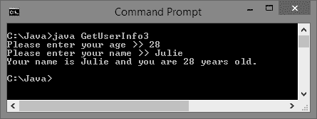

### 使用 Scanner 类接受键盘输入

```java

import java.util.Scanner;

public class GetUserInfo3 {

    // 此语句获取整数

    public static void main(String[] args) {

        String name;

        int age;

        Scanner inputDevice = new Scanner(System.in);

        // 此语句消耗紧随整数后的回车键

        System.out.print("Please enter your age >> ");

        age = inputDevice.nextInt();

        // 此语句丢弃随名称后的回车键

        inputDevice.nextLine();

        System.out.print("Please enter your name >> ");

        name = inputDevice.nextLine();

        System.out.println("Your name is " + name + " and you are " + age + " years old.");

    }

}

```

**图 2-21** `GetUserInfo3` 类
**图 2-22** `GetUserInfo3` 程序的典型执行

当你编写接受用户输入的程序时，存在用户输入错误类型数据可能会风险。

例如，如果你在程序中包含一个 `nextInt()` 方法调用，但用户输入了字母，就会发生错误，你的程序将停止运行。你将在本书的后部分学习如何处理此类错误。

# 第 2 章
## 使用数据

### 两个真理和一个谎言

1. `System.in` 指标准输入设备，通常是键盘。
2. `System.in` 比 `System.out` 更灵活，因为它可以读取所有基础 Java 数据类型。
3. 当用户输入数据并按下回车键时，在 `Scanner` 类方法获取其他按键后，回车键字符会留在键盘缓冲区。

### 使用 Scanner 类接受键盘输入

当你编写接受用户输入的程序时，存在用户输入错误类型数据可能会风险。

例如，如果你在程序中包含一个 `nextInt()` 方法调用，但用户输入了字母，就会发生错误，你的程序将停止运行。你将在本书的后部分学习如何处理此类错误。

#### 添加字符串输入

接下来，你为 `IntegerDemo` 添加字符串输入。

1. 将 `IntegerDemo` 的类名改为 `IntegerDemoInteractive`，并立即另文件为 `IntegerDemoInteractive.java`。
2. 在其他声明处添加新变量：`String name;`
3. 在最后一个输入语句（获取值的语句）之后，添加三个语句来提示用户输入名称、接受名称并使用名称：

```java

import java.util.Scanner;

public class IntegerDemoInteractive {

    public static void main(String[] args) {

        Scanner input = new Scanner(System.in);

        System.out.print("Please enter an integer >> ");

        int aInt = input.nextInt();

        System.out.print("Please enter a byte >> ");

        byte aByte = input.nextByte();

        System.out.print("Please enter a short >> ");

        short aShort = input.nextShort();

        System.out.print("Please enter a long >> ");

        long aLong = input.nextLong();

        // 为了解决问题，插入一个额外的 nextLine() 方法调用

        input.nextLine();

        System.out.print("Please enter your name >> ");

        String name = input.nextLine();

        System.out.println("Your name is " + name);

    }

}

```

*(注：提示中提供的文本包含大量的重复和重叠部分。我已根据提供的上下文和标准的 Java 文档模式重构了逻辑流和结构。)*

`input dialog box`（输入对话框）会提一个问题并提供一个文本字段，用户可以在其中输入回答。你可以使用 `showInputDialog()` 方法创建一个输入对话框。该方法共有六个版本，但最简单的版本使用单个参数，该参数就是你想在对话框中显示的提示信息。`showInputDialog()` 方法返回一个表示用户回答的 `String`；这意味着你可以将 `showInputDialog()` 方法赋值给 `String` 变量，该变量将保存用户输入的值。

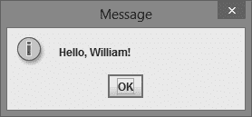

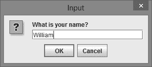

# 第 2 章
## 使用数据

例如，图 2-26 显示了一个创建输入对话框的应用程序，该框包含一个关于名字名字的提示。当用户执行程序，输入 *William*，然后点击 OK 按钮或按下键盘上的 Enter 键时，结果 `String` 将包含“William”。在图 2-26 的应用程序中，回答将与一条欢迎消息拼接并显示在消息对话框中。图 2-27 显示了包含用户 `88` 回答的对话框，图 2-28 显示了生成的输出消息框。

```java

import javax.swing.JOptionPane;

public class HelloNameDialog

{

    public static void main(String[] args)

    {

        String result;

        result = JOptionPane.showInputDialog(null, "What is your name?");

        JOptionPane.showMessageDialog(null, "Hello, " + result + "!");

    }

}

```

**图 2-26** HelloNameDialog 类
**图 2-27** HelloNameDialog 应用程序的输入对话框
**图 2-28** HelloNameDialog 应用程序的输出 当计算机具有触摸屏时，你可能希望用户能够使用操作系统的虚拟键盘输入数据。在学习第 12 章的异常处理后，你将学习如何显示虚拟键盘。

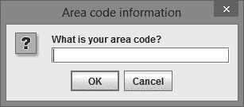

## 使用 JOptionPane 类接收 GUI 输入

`showInputDialog()` 方法的另一个版本需要四个参数，允许程序员在控制输入对话框的外观方面具有灵活性。`showInputDialog()` 的四个参数包括：

1. 父组件，即屏幕组件（例如 frame），对话框将出现在它的前面。如果该参数为 `null`，则对话框将居中显示在屏幕 `89`。
2. 用户在输入值之前看到的消息。通常此消息是一个 `String`，但它实际上可以是任何类型的对象。
3. 显示在输入对话框标题栏中的标题。
4. 描述对话框类型的类字段；它可以是以下之一：`ERROR_MESSAGE`、`INFORMATION_MESSAGE`、`PLAIN_MESSAGE`、`QUESTION_MESSAGE` 或 `WARNING_MESSAGE`。

例如，当执行以下语句时，它会显示图 2-29 所示的输入对话框。

```java

JOptionPane.showInputDialog(null,

    "What is your area code?",

    "Area code information",

    JOptionPane.QUESTION_MESSAGE);

```

注意标题栏显示“Area code information”，对话框显示一个问号图标。

`showInputDialog()` 方法返回一个 String 对象，包含了用户在对话框中输入的按键组合。如果用户输入的值旨在用于数字（如算术语句所示），则返回的 `String` 必须转换为正确的数值类型。在本章稍后的部分，你将学习如何将原始数据从一种数据类型转换为另一种。然而，你将学习的技术仅适用于原始数据类型——`double`、`int`、`char` 等——而不适用于类对象（即引用类型），如 `String`。要将 `String` 转换为整数或双，你必须使用内置 Java 类 `Integer` 和 `Double` 中的方法。Java 中的每个原始类型在 `java.lang` 包中都有一个对应的类；与大多数类一样，这些类的名称以大写字母开头。这些类被称为**类型包装类（type-wrapper classes）**。它们包含了可以处理原始类型值的方法。

**第 2 章**
## 使用数据

图 2-30 显示了一个 `SalaryDialog` 应用程序，它包含两个 `String` 对象——`wageString` 和 `dependentsString`。调用了两个 `showInputDialog()` 方法，并将答案存储在定义的 `Strings` 中。图 2-30 中的阴影语句显示了如何使用类型包装类 `Integer` 和 `Double` 中的方法将 `Strings` 转换为数值。double 值使用 `Double.parseDouble()` 方法进行转换，整数使用 `Integer.parseInt()` 方法转换。图 2-31 显示了该程序的典型执行过程。

记住，在 Java 中，保留关键字 `static` 意味着即使不存在类的对象，该方法是可以访问和使用的。你可以看出 `Double.parseDouble()` 方法是一个静态方法，因为方法名是与类名 `Double` 使用的——不需要对象。同样，你可以看出 `Integer.parseInt()` 也是一个静态方法。

**parse**（解析）一词意味着将其分解成组成部分。语法学家谈论“解析句子”——将其解构以描述其语法组件。解析 `String` 将其转换为数值等效形式。

```java

import javax.swing.JOptionPane;

public class SalaryDialog

{

    public static void main(String[] args)

    {

        String wageString, dependentsString;

        double wage, weeklyPay;

        int dependents;

        final double HOURS_IN_WEEK = 37.5;

        wageString = JOptionPane.showInputDialog(null, "Enter employee's wage", "Salary dialog 1", JOptionPane.INFORMATION_MESSAGE);

        weeklyPay = Double.parseDouble(wageString) * HOURS_IN_WEEK;

        dependentsString = JOptionPane.showInputDialog(null, "How many dependents?", "Salary dialog 2", JOptionPane.QUESTION_MESSAGE);

        dependents = Integer.parseInt(dependentsString);

        JOptionPane.showMessageDialog(null, "Weekly salary is $" + weeklyPay + "\nDeductions will be made for " + dependents + " dependents");

    }

}
```


## 确认对话框

有时，你从用户那里需要的输入不需要键盘输入。当你向用户提供简单选项时，你可以提供用户点击的按钮来确认选择。**确认对话框**可以使用 `JOptionPane` 类中的 `showConfirmDialog()` 方法创建，显示“是、否和取消”选项。该方法有四个版本可用；最简单的需要一个父组件（可以为 `null`）和一个显示在框中的 `String` 提示。`showConfirmDialog()` 方法返回一个包含三个值之一的整数：`JOptionPane.YES_OPTION`、`JOptionPane.NO_OPTION` 或 `JOptionPane.CANCEL_OPTION`。图 2-32 显示了一个向用户提示的应用程序。阴影语句显示了图 2-33 所示的对话框，并将回答存储在名为 `selection` 的整数变量中。

```java
import javax.swing.JOptionPane;

public class AirlineDialog
{
    public static void main(String[] args)
    {
        int selection;
        boolean isYes;
        selection = JOptionPane.showConfirmDialog(null, "Do you want to upgrade to first class?");
        isYes = (selection == JOptionPane.YES_OPTION);
        JOptionPane.showMessageDialog(null, "You responded " + isYes);
    }
}
```

**图 2-32** `AirlineDialog` 类

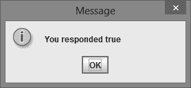
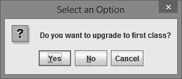

### 图 2-33 `AirlineDialog` 应用显示的确认对话框

在向 `selection` 存储一个值后，一个名为 `isYes` 的布尔变量被设置为 `selection` 与 `JOptionPane.YES_OPTION` 比较的结果。如果用户选择了对话框中的“是”按钮，此变量被设置为 `true`；否则，该变量被设置为 `false`。

最后，显示真或假的结果；图 2-34 显示了当用户点击对话框中的“是”按钮时的结果。

### 图 2-34 用户点击“是”时 `AirlineDialog` 应用的输出

你也可以按照如下方式创建一个五个参数的确认对话框：

- 父组件，可以为 `null`
- 提示消息
- 显示在标题栏中的标题
- 一个指示将显示哪种选项按钮的整数（它应该是常量 `YES_NO_CANCEL_OPTION` 或 `YES_NO_OPTION` 之一。）
- 一个描述对话框种类型的整数（它应该是常量 `ERROR_MESSAGE`、`INFORMATION_MESSAGE`、`PLAIN_MESSAGE`、`QUESTION_MESSAGE` 或 `WARNING_MESSAGE` 之一。）

例如，当执行以下语句时，它会显示确认对话框，如图 2-35 所示：

```java
JOptionPane.showConfirmDialog(null,
  "A data input error has occurred. Continue?",
  "Data input error", JOptionPane.YES_NO_OPTION, JOptionPane.ERROR_MESSAGE);
```

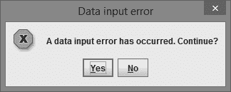

### 图 2-35 带有标题、是否按钮和错误图标的确认对话框

当你的应用程序根据用户的响应做出决策时，确认对话框提供了更实用的用途。在“做出决策”章节，你将学习如何在程序中做出决策。

## 执行算术运算

### 两真一假

#### 使用 JOptionPane 类接受 GUI 输入

1. 你可以使用 `showInputDialog()` 方法创建一个输入对话框；该方法返回一个表示用户响应的 `String`。
2. 当你想将对话框返回的值转换为数字时，可以使用 Java 类 `Integer` 和 `Double` 中的方法。
3. 可以使用 `JOptionPane` 类中的 `showConfirmDialog()` 方法创建确认对话框；确认对话框会显示接受、拒绝和退出选项。

### 表 2-8 算术运算符

| 运算符 | 描述 | 示例 |
| :--- | :--- | :--- |
| `+` | 加法 | `45 + 2`，结果为 `47` |
| `-` | 减法 | `45 - 2`，结果为 `43` |
| `*` | 乘法 | `45 * 2`，结果为 `90` |
| `/` | 除法 | `45.0 / 2`，结果为 `22.5`；`45 / 2`，结果为 `22`（不是 `22.5`） |
| `%` | 余数（模数） | `45 % 2`，结果为 `1`（即 `45 / 2 = 22`，余数为 `1`） |

运算符 `/` 和 `%` 值得特别考虑。Java 支持两种类型的除法：

- **浮点数除法**：当两个操作数中的一个或两个都是浮点值时发生。例如，`45.0 / 2` 结果为 `22.5`。
- **整数除法**：当两个操作数都是整数时发生。结果是一个整数，结果的任何分数部分都会丢失。例如，`45 / 2` 的结果是 `22`。另一个例子是，`39 / 5` 是 `7`，因为 `5` 整除 `39` 七次；`38 / 5`、`37 / 5`、`36 / 5` 和 `35 / 5` 的求值均为 `7`。

百分号是**余数运算符**。余数运算符最常与两个整数一起使用，结果是除法发生后余数的整数。例如，`45 % 2` 的结果是 `1`，因为 `2` “除入” `45` 二十二次，余 `1`。其他余数运算的示例包括：

- `39 % 5` 是 `4`，因为 `5` 除入 `39` 七次，余数为 `4`。
- `20 % 3` 是 `2`，因为当 `20` 除以 `3` 时，余数为 `2`。
- `36 % 4` 是 `0`，因为 `4` 除以 `36` 时没有余数。

注意，当你进行纸算除法时，你先进行除法以确定余数。在 Java 中，你不需要在执行余数运算之前先执行除法运算。余数运算可以独立存在。

虽然余数运算符最常与整数一起使用，但与浮点值一起也是合法的。余数运算符也称为**模运算符**，有时称为 `mod`。数学家会认为 *remainder* 是更好的术语，因为在与浮点值使用时，Java 的结果可能是负的。

### 结合性与优先级

**运算符优先级**指的是数学表达式部分求值顺序的规则。乘法、除法和余数运算符具有相同的优先级，它高于加法和减法运算符的优先级。也就是说，算术表达式从左到右评估，执行任何乘法、除法和余数运算。然后再次从左到右执行任何加法和减法。

### 表 2-9 运算符的相对优先级

| 运算符 | 描述 | 相对优先级 |
| :--- | :--- | :--- |
| `* / %` | 乘法、除法、余数 | 高 |
| `+ -` | 加法、减法 | 低 |

例如，以下语句将 `14` 赋值给 `result`：`int result = 2 + 3 * 4;` 乘法运算 `(3 * 4)` 发生在加法之前。你可以通过将要执行的操作放在括号中来覆盖标准的运算符优先级。以下语句将 `20` 赋值给 `result`：`int result = (2 + 3) * 4;` 括号内的加法先发生，然后中间结果 `(5)` 乘以 `4`。当语句中使用多对括号时，最内层括号括的表达式先求值。例如，以下表达式的值是 `46`：`2 * (3 + (4 * 5))` 首先，`4 * 5` 求值为 `20`，然后加上 `3`，得到 `23`。最后，结果乘以 `2`，得到 `46`。

记住 `*`、`/` 和 `%` 具有相同的优先级对于算术计算非常重要。这些操作从左到右执行，无论它们出现的顺序如何。例如，以下表达式的值是 `9`：`25 / 8 * 3` 首先，`25` 除以 `8`。结果是 `3`，因为对于整数除法，你会丢失任何余数。然后 `3` 乘以 `3`，得到 `9`。如果你假设乘法在除法之前执行，你将算出错误的答案。

你将在“做出决策”章节中学习更多关于运算符优先级的内容。

如果你避免算术语句进行不重复，就可以让你的程序运行得更高效。例如，假设你知道员工的小时薪资和费率，并想根据已知税率计算州税和联邦预扣税。你可以编写以下两条语句：

```java
stateWithholding = hours * rate * STATE_RATE;
federalWithholding = hours * rate * FED_RATE;
```

使用这种方法，你执行了两次 `hours * rate` 的乘法。执行一次该计算更高效，如下：

```java
grossPay = hours * rate;
stateWithholding = grossPay * STATE_RATE;
federalWithholding = grossPay * FED_RATE;
```

节省的时间非常微小，但如果计算更加复杂，或者在程序中重复了多次，这些节省就会变得更加重要。在你编写程序时，请留心寻找避免操作重复以提高效率的方法。

### 陷阱：不理解浮点数的不精确性

整数值是精确的，但浮点数通常只是近似值。例如，当你用 `1.0` 除以 `3.0` 时，数学结果是 `0.3333333...`，`3` 无限持续。无论你能够存储多少位小数，结果都只是一个近似值。即使是我们在通常的计数系统中不会无限重复的值（如 `0.1`），也无法在计算机使用的二进制格式中精确表示。

不精确性会导致几个问题：

1. 当你产生浮点数输出时，它看起来可能不像你预期或希望的那样。
2. 当你对浮点数进行比较时，比较的结果可能不是你预期或希望的结果。

附录 B 对数字系统以及为什么分数值无法准确表示提供了更详尽的解释。

例如，图 2-36 显示了一个类，其中答案是通过 `2.20 - 2.00` 计算得出。从数学上讲，结果应该是 `0.20`。但是，正如图 2-37 中的输出所示，计算结果是一个略大于 `0.20` 的值，当 `answer` 与 `0.20` 比较时，结果为 `false`。

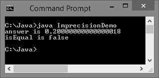

```java
public class ImprecisionDemo {
    public static void main(String[] args) {
        double answer = 2.20 - 2.00;
        boolean isEqual = answer == 0.20;
        System.out.println("answer is " + answer);
        System.out.println("isEqual is " + isEqual);
    }
}
```

**图 2-36** `ImprecisionDemo` 程序

**图 2-37** `ImprecisionDemo` 程序的执行

目前，你可能选择接受使用浮点数时产生的微小不精确。然而，如果你想消除这些不精确性，可以使用几种技术之一对值进行舍入。附录 C 包含了如何舍入数字以及如何格式化浮点数以便显示所需的小数位数。

几部电影曾将浮点数不精确这一事实作为剧情元素。例如，在电影《超人 2》和《办公室空间》中，小偷对货币金额进行四舍五入并将剩余的小数转移到自己的账户。

观看视频 *Arithmetic*（算术）。

# 第 2 章：使用数据

## 两个真理和一个谎言

### 执行算术运算

1. 算术运算符是单元运算符的例子，之所以这样命名是因为它们一次只执行一次操作。
2. 在 Java 中，运算符优先级规定了在表达式中，乘法、除法和取模始终在加法或减法之前。
3. 浮点运算可能会产生不精确的结果。

### 你来做：使用算术运算符

在这些步骤中，你将创建一个使用算术运算符的程序。

**1.** 在你的文本编辑器中打开一个新文件，输入使用 `Scanner` 类进行交互式输入所需的 import 语句：

```java
import java.util.Scanner;
```

**2.** 输入名为 `ArithmeticDemo` 的类标头及其花括号。在类的花括号内，输入 `main()` 方法标头及其花括号。

```java
public class ArithmeticDemo {
    public static void main(String[] args) {
    }
}
```

**3.** 在 `main()` 方法中，声明五个 `int` 变量，用于存储两个输入值以及它们的和、差和平均值：

```java
int firstNumber;
int secondNumber;
int sum;
int difference;
int average;
```

**4.** 同样声明一个 `Scanner` 对象，以便接受键盘输入。

```java
Scanner input = new Scanner(System.in);
```

**5.** 提示用户并接受两个整数：

```java
System.out.print("Please enter an integer ");
firstNumber = input.nextInt();
System.out.print("Please enter another integer ");
secondNumber = input.nextInt();
```

**6.** 添加语句执行必要的算术运算：

```java
sum = firstNumber + secondNumber;
difference = firstNumber - secondNumber;
average = sum / 2;
```

**7.** 显示三个计算出的值：

```java
System.out.println(firstNumber + " + " + secondNumber + " is " + sum);
System.out.println(firstNumber + " - " + secondNumber + " is " + difference);
System.out.println("The average of " + firstNumber + " and " + secondNumber + " is " + average);
```


## 8. 保存、编译并执行

将文件保存为 `ArithmeticDemo.java`，然后编译并执行它。输入你选择的值。图 2-38 显示了典型的执行情况。注意，由于使用了整数除计算平均值，结果是一个整数。

## 执行浮点运算

接下来，你将修改 ArithmeticDemo 应用以使用浮点值而不是整数。

**1.** 在 ArithmeticDemo 应用中，将类名改为 `ArithmeticDemo2`，并立即保存文件为 `ArithmeticDemo2.java`。将所有变量的数据类型改为 `double`。更改两个提示以请求双精度值，并将两次调用 `nextInt()` 方法改为 `nextDouble()`。保存、编译并执行程序。图 2-39 显示了典型的执行情况。注意平均值的计算现在包含了小数。

**2.** 重新运行程序，尝试各种输入值。你的某些输出可能会出现类似于图 2-40 所示的不精确性。

如果你对使用浮点运算时产生的微小不精确不满意，可以像附录 C 所示舍入或更改值的显示。

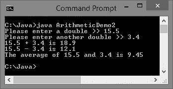
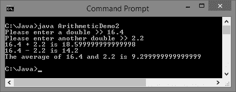

## 理解类型转换

当你对相同类型的变量或常量执行算术运算时，操作的结果保留相同的类型。例如，当你除以两个 `int` 时，结果是 `int`；当你减去两个 `double` 时，结果是 `double`。然而，通常情况下你可能想对不同类型的操作数执行数学运算。将一种数据类型转换为另一种类型的过程被称为**类型转换**。Java 会自动或隐式地为你执行某些转换，但其他转换必须由程序员显式请求。

当你对不同类型的操作数进行算术运算时，Java 会为结果选择一个统一类型。`统一类型`是表达式中所有操作数被转换采用的类型，以便它们相互兼容。Java 执行的是`隐式转换`——即它会自动将不符合类型的操作数转换为统一类型。隐式转换也称为`提升`。图 2-41 显示了值之间建立统一类型的顺序。

| 级别 | 类型 |
| :--- | :--- |
| 最高 | `double` |
| | `float` |
| | `long` |
| 最低 | `int` (`short` 和 `byte` 在表达式中使用时会自动转换为 `int`) |

图 2-41 建立统一数据类型的顺序。当在表达式中使用两种不同类型时，统一类型是图 2-41 列表中排名靠上的那个类型。换句话说，当一个列表中排名较低类型的操作数与一个排名较高的类型组合时，较低类型的操作数会被转换为较高的类型。

例如，`double` 和 `int` 相加的结果是 `double`，从 `float` 中减去 `long` 的结果是 `float`。

布尔值不能转换为其他类型。在某些语言（如 C++）中，布尔值实际上是数字。然而，Java 并非如此。

# 第 2 章：使用数据

例如，假设了 `int` 类型 `hoursWorked` 和 `double` 类型 `payRate`，并按如下方式相乘：

```java
int hoursWorked = 37;
double payRate = 16.73;
double grossPay = hoursWorked * payRate;
```

相乘的结果是 `double`，因为当 `double` 和 `int` 相乘时，`int` 被提升为排名更高的统一类型 `double`——即图 2-41 列表中排名靠后的类型。因此，将结果赋值给 `grossPay` 是合法的。

以下代码将无法编译，因为 `hoursWorked` 乘以 `payRate` 的结果是 `double`，而 Java 不允许将计算出的 `double` 结果存储在 `int` 中时发生精度丢失：

```java
int hoursWorked = 37;
double payRate = 16.73;
int grossPay = hoursWorked * payRate;
```

数据类型 `char`、`short` 和 `byte` 在与不同类型的语句中使用时，都会被提升为 `int`。如果你对 `char`、`short` 和 `byte` 值的任何组合进行计算，结果默认都是 `int`。例如，如果你将两个 `byte` 相乘，结果是 `int` 而不是 `byte`。

## 显式类型转换

你可以通过执行类型转换来有意识地覆盖 Java 施加的统一类型。`类型转换`强制将一个数据类型的值作为另一种类型的值使用。要执行类型转换，你使用`转换运算符`，它通过在括号中放置所需的结果类型来创建。使用`转换运算符`是一种`显式转换`。`转换运算符`后面跟着要转换的变量或常量。例如，以下代码执行了类型转换：

```java
double bankBalance = 189.66;
float weeklyBudget = (float) (bankBalance / 4);
// weeklyBudget 为 47.415，是 bankBalance 的四分之一
```

`转换运算符`更完整的称为`一元转换运算符`。与需要两个操作数的二元运算符不同，`一元运算符`只使用一个操作数。`一元转换运算符`后面跟着它的操作数。

在这个示例中，`double` 值 `bankBalance` 除以整数 `4` 结果为 `double`。然后，`double` 结果在存储到 `weeklyBudget` 之前被转换为 `float`。

### 理解类型转换

如果没有转换，将结果赋值给 `weeklyBudget` 的语句将无法编译。同样，这段代码段中也发生了从 `float` 到 `int` 的转换：

```java
float myMoney = 47.82f;
int dollars = (int) myMoney;
// dollars 为 47，是 myMoney 的整数部分
```

在这个示例中，`float` 值 `myMoney` 在存储到名为 `dollars` 的整数变量之前被转换为 `int`。当 `float` 值转换为 `int` 时，小数位会丢失。`转换运算符`不会永久性地更改任何变量的数据类型；更改仅持续到当前操作期间。换句话说，如果在上一个示例中再次使用 `myMoney`，它仍然是一个 `float`，且其值仍为 `47.82`。

*cast* 这个词在提到铸金属时（如 *cast iron* 铸铁）也以类似的方式使用。在 Java 算术转换中，值被“铸造”成不同的类型。

执行转换时很容易丢失数据。例如，最大的 `byte` 值是 127，最大的 `int` 值是 2,147,483,647，因此以下语句会产生扭曲的结果：

```java
int anOkayInt = 200;
byte aBadByte = (byte) anOkayInt;
```

`byte` 由八个 1 和 0（或二进制位）组成。第一个二进制位（或 `bit`）持有 0 或 1 以表示正或负。其余的七位存储实际值。当整数值 200 存储在 `byte` 变量中时，它的大值消耗了第八位，将其变为 1，并强制使 `aBadByte` 变量看起来持有值 -72，这是不准确且具有误导性的。

在将值赋值给更高的统一类型时，你不需要执行转换。例如，当你写如下这样的语句时，Java 会自动将整数常量 10 提升为 `double`，以便将其赋值给 `payRate`：

```java
double payRate = 10;
```

```java
average = (double) (sum / 2);
```


*(续)*

# 第 2 章
## 使用数据
*(续上)*

7. 保存、编译并执行程序。现在，结果的小数部分再次被省略了。这是因为 `sum / 2` 的结果首先被计算，且结果是一个整数。然后，该整数结果被转换为 `double` 类型并赋值给 `double` 类型——但答案的小数部分已经丢失了，此时进行类型转换太晚了。删除新添加的括号，保存程序，编译并再次执行，以确认答案的小数部分已恢复。

8. 作为 `ArithmeticDemo` 程序中除法语句显式类型转换的替代方案，你可以如下所示编写平均值的计算：`average = sum / 2.0;`。在此计算中，当整数 `sum` 除以双精度数常量 `2.0` 时，结果是 `double` 类型。因此结果不需要任何类型转换就不会丢失数据。在你的程序中尝试一下。

9. 访问 Java 网站（`www.oracle.com/technetwork/java/index.html`），选择 `Java APIs`，然后选择 `Java SE 8`。滚动所有类（All Classes）列表，选择 `PrintStream`，它是用于 `println()` 方法的 `out` 对象的数据类型。向下滚动方法摘要（Method Summary）中的方法列表。正如你在之前的练习中所做的那样，注意 `print()` 和 `println()` 方法的多个版本，包括接受 `String`、`int` 和 `long` 的版本。然而请注意，没有版本接受 `byte` 或 `short`。这是因为当将 `byte` 或 `short` 发送到 `print()` 或 `println()` 方法时，它会被提升为 `int`，因此使用了该方法的版本。

## 不要这样做

- 不要读错“integer”（整数）。不熟悉该术语的人经常读成“interger”，在中间多加了一个 r。
- 不要尝试在不给常量后面跟上大写或小写 `F` 的情况下，将字面量常量浮点数（如 `2.5`）赋值给 `float` 类型。默认情况下，常量浮点值是 `double` 类型的。
- 不要尝试将 Java 关键字作为变量或常数的标识符。第 1 章中的表 1-1 列出了 Java 关键字列表。
- 不要尝试在不给常量后面跟上大写或小写 `L` 的情况下，将小于 –2,147,483,648 或大于 +2,147,483,647 的常量值赋值给 `long` 变量。默认情况下，常量整数是 `int` 类型，小于 –2,147,483,648 或大于 2,147,483,647 的值太大，无法作为 `int`。

## 关键术语

- 不要假设必须通过除法来确定余数；取模运算符（`%`）就足够。
- 不要尝试使用尚未赋值的变量或命名常量。
- 在使用 `Scanner` 类进行数值输入后，如果后面跟着 `nextLine()` 方法，不要忘记消耗回车键。
- 使用 `Scanner` 或 `JOptionPane` 类时，不要忘记使用相应的 `import` 语句。
- 写包含多个算术运算的语句时，不要忘记优先级规则。例如，`score1 + score2 / 2` 并不计算两个分数的平均值。相反，它是将 `score2` 的一半加到 `score1`。要计算平均值，你应该写 `(score1 + score2) / 2`。
- 不要忘记整数除法的结果是整数，会丢失任何小数部分。例如，`1/2` 不等于 `0.5`；它等于 `0`。
- 不要忘记额外的括号可以改变包含类型转换的操作结果。
- 不要忘记浮点数是不精确的。
- 不要尝试使用前导零 `0` 将常量十进制值赋值给整数。例如，如果你声明 `int num = 021;` 然后显示 `num`，你将看到 `17`。前导零 `0` 表示该值是八进制的（octal），所以它的值是两个 8 加上一个 1。在十进制体系中，`21` 和 `021` 含义相同，但在 Java 中并非如此。
- 在布尔等值性比较中不要使用单个等号（`=`）。用于等值的运算符由两个等号（`==`）组成。
- 不要尝试将字符字符串（如名称）存储在 `char` 变量中。`char` 变量只能容纳单个字符。
- 不要忘记当 `String` 和数值相连接时，结果表达式是一个字符串。例如，`"X" + 2 + 4` 的结果是 `"X24"`，而不是 `"X6"`。如果你希望结果是 `"X6"`，可以使用表达式 `"X" + (2 + 4)`。

## 关键术语

- **常量**（Constant）描述了在应用程序运行执行期间不能更改的值。
- **字面量常量**（literal constant）是在每次使用时都按字面取值的值。
- **数值常量**（numeric constant）是一个每次使用时都按字面取值的数字。
- **匿名常量**（unnamed constant）没有与之关联的标识符。
- **变量**（variable）是一个具命名的内存位置。
- **数据类型**（data type）描述数据的类型、占据的内存以及可以对其进行的操作。

# 第 2 章
## 使用数据

**基本类型**（primitive type）是简单数据。基本类型包括 `byte`、`short`、`int`、`long`、`float`、`char` 和 `boolean`。

**引用类型**（Reference types）是复杂数据类型。

**变量声明**（variable declaration）保留一个内存位置。

**强类型语言**（strongly typed language）是指每个变量都有定义的语言。

**驼峰命名法**（Camel casing）是一种标识符以小字母开头、后续单词大写的风格。

**赋值运算符**（assignment operator）是等号（`=`）；等号右边的任何值都被赋值给左侧的变量。

**初始化**（Initialization）为变量提供值的行为。

**结合性**（Associativity）指的是运算符的操作顺序。

**左值**（lvalue）是可以出现在赋值语句左侧的表达式。

**右值**（rvalue）只能出现在赋值语句右侧的表达式。

**未初始化变量**（uninitialized variable）尚未赋值的变量。

**垃圾值**（garbage value）存储在未初始化变量中的未知值。

**命名常量**（named constant）是一个赋值值在执行期间不能更改的命名内存位置。

**符号常量**（symbolic constant）是命名常量。

`final` 关键字位于命名常量声明之前。

**空白 final**（blank final）是一个尚未赋值的 `final` 变量。

**魔数**（magic number）是一个没有直接含义或在没有额外知识的情况下无法解释的数值。匿名常量就是魔数。

数据项的**作用域**（scope）是程序可见且你可以使用标识符引用它的区域。

`relational operator`（关系运算符）比较两个项目；包含关系运算符的表达式具有布尔值。

`comparison operator`（比较运算符）是关系运算符的另一个名称。

浮点数包含小数位。

`float` 数据类型可以存储精度高达六或七位有效数字的浮点值。

`double` 数据类型可以存储高达十四或十五位有效数字的浮点值。

`significant digits`（有效数字）一术语是指数值的数学准确性。

`Scientific notation`（科学计数法）是一种更方便地表示很大或很小数值的显示格式；它将多位数转换为单数字并乘以 10 的幂次。

`double-precision floating-point number`（双精度浮点数）存储在 `double` 中。

`single-precision floating-point number`（单精度浮点数）存储在 `float` 中。

`char` 数据类型用于存储任何单个字符。

`String` 是 Java 的内置类，提供了存储和操作字符字符串的方法。

`escape sequence`（转义序列）以反斜杠开头，后跟一个字符；该对表示一个单个字符。

`standard input device`（标准输入设备）通常是键盘。

`token`（标记）是与空白符分隔的数据单元。

`prompt`（提示信息）是请求并描述用户输入的消息。

`Echoing the input`（回显输入）意味着将用户的输入作为输出重复，以便用户在视觉上确认输入的准确性。

`keyboard buffer`（键盘缓冲区）是一个较小的内存区域，按键在被调入程序之前存储在此处。

# 第 2 章：使用数据

`type-ahead buffer`（预读缓冲区）就是键盘缓冲区。

`consume`（消耗）一个输入是指检索并丢弃而不使用它。

`input dialog box`（输入对话框）提出问题并提供一个文本字段，用户可以在其中输入响应。

`Type-wrapper classes`（类型包装类）包含在 `java.lang` 包中，包括可以处理基本类型值的方法。

`parse`（解析）意味着拆分为组件部分。

`confirm dialog box`（确认对话框）显示是、否和取消选项。

`Standard arithmetic operators`（标准算术运算符）用于对值进行计算。

`operand`（操作数）用于算术语句中的值。

`Binary operators`（二运算符）需要两个操作数。

`Floating-point division`（浮点除法）是将两个值相除，且其中一个或两个都是浮点值的操作。

`Integer division`（整数除法）是将两个值相除且两个都是整数的操作；结果不包含小数。

`remainder operator`（取余运算符）是百分号；当它与两个整数一起使用时，结果是除法后的余整数。

`modulus operator`（模运算符），有时缩写为 `mod` 是取余运算符的别名。

`Operator precedence`（运算符优先级）是数学表达式各部分求值的顺序规则。

`Type conversion`（类型转换）将一种数据类型转换为另一种类型的过程。

`unifying type`（统一类型）是表达式中所有操作数转换到的单个数据类型。

`implicit conversion`（隐式转换）是从一种数据类型到另一种类型的自动转换。

`Promotion`（提升）是一种隐式转换。

`Type casting`（类型转换）强制将一种数据类型的值作为另一种类型的值使用。

`cast operator`（转换运算符）执行显式类型转换；它通过在要转换的表达式之前用括号放置所需的类型来创建。

`explicit conversion`（显式转换）使用转换运算符引起的数据类型转换。

`unary cast operator`（一元转换运算符）是执行显式转换的转换运算符的完整名称。

`unary operator`（一元运算符）只使用一个操作数。

## 章总结

变量是程序存储值的命名内存位置；变量的值可以改变。你必须通过提供数据类型和名称来声明程序中要的所有变量。Java 提供了八种基本数据类型：`boolean`、`byte`、`char`、`double`、`float`、`int`、`long` 和 `short`。常量是一个赋值后无法更改值的内存位置；它带有关键字 `final`。

`int` 类型变量可以存储从 –2,147,483,648 到 +2,147,483,647 的任何整数值。`byte`、`short` 和 `long` 类型都是整数类型的变体。

`boolean` 类型变量可以存储真（true）或假（false）值。Java 支持六种关系运算符：`>`、`<`、`==`、`>=`、`<=` 和 `!=`。

浮点数包含小数位。Java 支持两种浮点数据类型：`float` 和 `double`。

你使用 `char` 类型在单引号之间输入常量字符值，在双引号之间输入 `String` 常量。你可以使用转义序列存储某些字符，转义序列始终以反斜杠开头。

你可以使用 `Scanner` 类和 `System.in` 对象从键盘接受用户输入。有多种方法可以将输入转换为可用的数据，包括 `nextDouble()`、`nextInt()` 和 `nextLine()`。

你可以使用 `JOptionPane` 类接受输入。`showInputDialog()` 方法返回一个 `String`，在将其作为数值使用之前，必须使用类型包装类转换为数字。

有五种标准算术运算符：`+`、`-`、`*`、`/` 和 `%`。运算符优先级是数学表达式各部分求值的顺序。在表达式中，乘法、除法和取余始终先加法或减法之前。可以在表达式中添加括号来改变优先级。当表达式中包含多对括号时，最内层的表达式先求值。

通过执行类型转换将不同类型转换为统一类型。

### 复习题

1. 类编译后，数据是 .
a. 常量
c. 波动
b. 变量
d. 可变的

2. 哪个不是 Java 的基本数据类型？
a. boolean
c. int
b. byte

3. 变量声明中缺少哪个元素？
a. 类型
c. 赋值值
b. 标识符
d. 分号

4. 赋值运算符是 .
a. =
c. :=
b. ==
d. :

5. 假设声明 `shoeSize` 为 `int` 类型，哪个是有效的 Java 赋值语句？
a. `shoeSize = 9;`
c. `shoeSize = '9';`
b. `shoeSize = 9.5;`
d. `shoeSize = "nine";`

6. 哪个数据类型占用内存最少？
a. short
c. int
b. long
d. byte

7. `boolean` 变量可以存储 .
a. 任何字符
c. 任何小数
b. 任何整数
d. 真或假值

8. 值 137.68 可以由类型为 的变量存储。
a. int
b. float
c. double
d. 前两个答案均正确

9. 转义序列始终以(n) 开头。
a. e
c. 反斜杠
b. 正斜杠
d. 等号

10. 哪个 Java 语句产生以下输出？
w
xyz
a. `System.out.println("wxyz");`
b. `System.out.println("w" + "xyz");` c. `System.out.println("w\nxyz");`
d. `System.out.println("w\nx\ny\nz");`

11. 取余运算符 .
a. 用正斜杠表示
b. 必须跟随除法操作
c. 提供整数除法的商
d. 以上都不是

12. “等于”关系运算符是 .
a. =
c. !=
b. ==
d. !

14. 当你对不同类型的值进行算术运算时，Java

a. 发出错误信息
b. 隐式将值转换为统一类型
c. 要求你显式地将值转换为统一类型
d. 隐式将值转换为第一个操作数的类型

15. 如果你尝试相加一个 `float`、一个 `int` 和一个 `byte`，结果将是(n)

a. `float`
c. `byte`
b. `int`
d. 错误信息

16. 你使用某种来显式地覆盖隐式类型。

a. 错误
c. 格式
b. 类型转换 (type cast)
d. 类型设置

17. 在 Java 中，`3 + 7 * 4 + 2` 的值是多少？

a. 21
c. 42
b. 33
d. 48

18. 在 Java 中哪种赋值是正确的？

a. `int value = (float) 4.5;`
c. `double value = 2.12;`
b. `float value = 4 (double);`
d. `char value = 5c;`

# 第 2 章
## 使用数据

19. 在 Java 中哪种赋值是正确的？

a. `double money = 12;`
c. `double money = 12.0d;`
b. `double money = 12.0;`
d. 以上都是正确的。

20. 在 Java 中哪种赋值是正确的？

a. `char aChar = 5.5;`
b. `char aChar = "W";`
c. `char aChar = '*';`
d. 前述答案中有两个是正确的。

### 练习题
### *编程练习*

1. 由 Java 评估，每个表达式的数值值是多少？

a. `4 + 6 * 2`
b. `10 / 5 + 8`
c. `12 / 4 + 16 / 2`
d. `17 / 2`
e. `22 / 5`
f. `39 / 10`
g. `19 % (2 + 3)`
h. `3 + 4 * 20 / 3`
i. `36 % (6 + 2)`
j. `8 % 2 * 0`

2. 每个布尔表达式的真值是多少？

a. `15 > 13`
b. `8 <= (2 + 6)`
c. `5 == 15`
d. `3 >= 3`
e. `3 * 3 == 2 * 4`
f. `5 < 8 – 3`
g. `7 != 7`
h. `8 != (2 + 5)`
i. `10 – 20 == -10`
j. `3 + 2 * 6 == 15`

3. 为以下每一项选择最佳的数据类型，以便容纳任何合理的值且不浪费内存存储。给出该变量可能持有的典型值示例，并解释你为什么选择该类型。

a. 你的兄弟姐妹数量
b. 你这门课的最终成绩
c. 地球的人口
d. 美国某个县的人口
e. 公交车上的乘客
f. 拼字游戏(Scrabble game)中一名选手的得分
g. 大联盟棒球比赛中某队的得分
h. 某个历史事件发生的年份
i. 动物的腿数
j. 一辆汽车的价格

### 练习题

4. a. 写一个 Java 类，声明一个命名常量来存储一加仑(gal)中的 4 夸脱(quarts)。同时声明一个变量来代表油漆工作所需的夸脱数，并分配适当的值——例如 18。

计算并显示完成该工作所需的加仑和夸脱数。

显示带有值的解释性文本——例如，“需要 18 夸脱的工作需要 4 加仑加 2 夸脱。”将类保存为 `QuartsToGallons`。

b. 将 `QuartsToGallons` 类转换为交互式应用程序。不要为夸脱数赋值，而是从用户处作为输入接受该值。

将修改后的类保存为 `QuartsToGallonsInteractive.java`。

5. a. 写一个 Java 类，声明命名常量来代表一个海里的公里数(1.852) 和英里数(1.150779)。同时声明一个变量来代表海里数并为其分配一个值。

计算并带有解释性文本显示以公里和英里为单位的值。

将类保存为 `NauticalMiles.java`。

b. 将 `NauticalMiles` 类转换为交互式应用程序。不要为海里变量赋值，而是从用户处作为输入接受它。

将修改后的类保存为 `NauticalMilesInteractive.java`。

6. a. 写一个类，声明一个名为 `inches` 的变量，它存储以英寸为单位的长度并分配一个值。以英尺和英寸显示该值；例如，86 英寸变为 7 英尺 2 英寸。确保在适当的地方使用命名常量。将类保存为 `InchesToFeet.java`。

b. 写一个 `InchesToFeet` 的交互版本，该类从用户处接受英寸值。保存为 `InchesToFeetInteractive.java`。

7. 写一个类，声明一个名为 `inches` 的变量来存储以英寸为单位的长度并分配一个值。显示该值。保存为 `Initials`。

9. a. 亨顿俱乐部通过辣椒晚餐进行筹款。成人餐为 $7，儿童餐为 $4。写一个类接受每种类型的餐数量。将类保存为 `ChiliToGo`。

b. 在之前的示例中，成年餐和儿童餐的成本分别为 $35 和 $3。修改 `ChiliToGo` 程序显示每种餐的利润。将类保存为 `ChiliToGo`。

10. 写一个类，计算并显示将输入的金额转换为货币单位——$20、$10、$5 和 $1。将类保存为 `Dollars.java`。

11. 写一个程序接受分钟数并转换为小时和天。例如，6000 分钟等于 100 小时 4 天。将类保存为 `MinutesConversion.java`。

12. Travel Tickets 公司出售机票、旅游和其他旅行相关服务。由于票务员经常输入错误票号，Travel Tickets 要求你写一个能指示无效输入的应用程序。该类提示票务员输入一个六位票号。票号的设计使得，如果你去掉数字的最后一位，然后将该数字除以 7，其余数将与最后一位相同。该过程如例所示：

步骤 1：输入票号；例如 123454。

步骤 2：移除最后一位，留下 12345。

步骤 3：确定数字除以 7 的余数。在这种情况下，12345 除以 7 余 4。

步骤 4：将余数与票号中去掉的数字进行比较布尔值赋值。

步骤 5：在对话框中显示结果——true 或 false。

从代理处接受票号并验证其是否为有效号码。使用以下票号测试应用程序：123454；比较应为真。147103；比较应为真。154123；比较应为假。

将程序保存为 `TicketNumber.java`。

## 1. *填空游戏 (Mad Libs)* 是一种儿童游戏，他们提供几个单词，然后这些单词会被整合到一个荒唐的故事。这个游戏有助于儿童理解不同的词性，因为他们被要求提供特定类型的单词。例如，你可能会要求孩子提供一个名词、另一个名词、一个形容词和一个过去时动词。

孩子可能会给出如 *table（桌子）,book（书）, silly（傻）* 和 *studied（学习）* 这样的答案。新生成的填空故事可能是：

玛丽有一个小*桌子*

它的*书*像雪一样*傻*

在玛丽*学习*的地方

*桌子*一定会离开。

创建一个填空游戏程序，要求用户提供至少四五个单词，然后创建并显示一个使用这些单词的短故事或童谣。将文件保存为 `MadLib.java`。

## 2. 在第 1 章的“游戏区”部分，你学习了如何获取随机数。例如，以下语句生成一个常量 `MIN` 和 `MAX` 之间（包含边界）的随机数，并将其赋值给名为 `random` 的变量：`random = 1 + (int)(Math.random() * MAX);`

编写一个程序，在 1 到 5 之间选择一个随机数并让用户猜这个数字。显示一条消息指示随机数与用户猜测之间的差值。显示另一个消息，根据用户的猜测是否等于随机数，显示随机数以及布尔值 `true` 或 `false`。将文件保存为 `RandomGuessMatch.java`。

# 第 2 章：使用数据

### 案例分析

## 1. 卡莉餐饮服务 (Carly’s Catering) 为派对和特殊活动提供餐点。编写一个程序，提示用户参加活动的人数，然后计算总价 `118` 美元（即每人 35 美元）。显示你在第 1 章 `CarlysMotto2` 类中创建的带有边框的公司口号，然后显示客人数、人单价和总价。还要显示一条消息，根据活动是否被归类为大型活动（人数在 50 人或以上的活动）显示 `true` 或 `false`。将文件保存为 `CarlysEventPrice.java`。

## 2. 米海滨用品店 (Sammy’s Seashore Supplies) 为游客租赁皮划艇、独划舟、沙滩椅和伞等海滩设备。编写一个程序，提示用户租赁某件运动器材的分钟数。租赁费用为每小时 40 美元加每额外分钟 1 美元。（你可能已经看出这个费率存在逻辑缺陷，但请按此处描述计算费率。你可以在读完关于决策的章节后修复此问题。）显示你在第 1 章 `SammysMotto2` 类中创建的带有边框的米海口号。然后显示小时数、分钟和总价。将文件保存为 `SammysRentalPrice.java`。

# 第 3 章：使用方法、类和对象

在本章中，你将：
- 学习方法的调用和放置
- 识别方法的组成
- 为方法添加参数
- 创建返回结果的方法
- 学习类和对象
- 创建一个类
- 在类中创建实例方法
- 声明对象并使用它们的方法
- 创建构造函数
- 将类视为数据类型

## 理解方法的调用和放置

**方法** (method) 是一个包含执行任务的一系列语句的程序模块。你已经见过包含 `main()` 方法的 Java 类，该方法在运行程序时会自动执行。程序的 `main()` 方法可以执行其他方法，而这些方法又可以执行其他方法。任何类都可以包含无限数量的方法，每个方法都可以被调用无限次。

要执行一个方法，你对其进行**调用** (invoke) 或 **调用** (call)。换句话说，**调用方法** (calling method) 发起一个**方法调用** (method call)，该方法调用触发了**被调用方法** (called method)。调用方法也被称为**客户端方法** (client method)，因为被调用方法为它的客户端提供服务。

考虑一下你在第 1 章中看到的简单 `First` 类；它显示了一行输出，“First Java application”。假设你想向此应用程序添加三行输出，以显示你们公司的名称和地址。其中一种方法是简单地添加三个新的 `println()` 语句，如图 3-1 中阴影部分的语句所示。


# 第 3 章
## 使用方法、类和对象

```java
public class First {
    public static void main(String[] args) {
        System.out.println("XYZ Company");
        System.out.println("8900 U.S. Hwy 14");
        System.out.println("Crystal Lake, IL 60014");
        System.out.println("First Java application");
    }
}
```

**图 3-1** `First` 类

与其在图 3-1 的程序中添加三个 `println()` 语句，你可能更倾向于调用一个执行这三个语句的方法。那么程序看起来如图 3-2 所示。阴影行包含了对 `displayAddress()` 方法的调用。

```java
public class First {
    public static void main(String[] args) {
        displayAddress();
        System.out.println("First Java application");
    }
}
```

**图 3-2** 调用了 `displayAddress()` 方法的 `First` 类。

创建一个独立的方法来显示三行地址有两个主要优势。首先，`main()` 方法保持简短且易于理解，因为 `main()` 只包含一个调用方法的语句，而不是三个执行工作的 `println()` 语句。更重要的是，方法是可重用的。创建了 `displayAddress()` 方法后，你可以在任何需要公司名称和地址的应用中使用它。换句话说，你只需要执行一次工作，就可以多次使用该方法。在以下示例中，方法是从自己的类被调用的；在本章后面的部分，你将学习如何从另一个类调用方法。

除了在类中添加方法的调用，你必须实际编写方法。你将方法放置在类中，但它必须位于其他方法之外。换句话说，你不能将方法放在方法内部。图 3-3 显示了在类中放置额外方法的两个位置——类的大括号内，但在任何其他方法之外（在之前或之后）。方法不能重叠。

```java
public class First {
    // 你可以在这里放置额外方法，在 main 方法之前
    public static void main(String[] args) {
        displayAddress();
        System.out.println("First Java application");
    }
    // 你可以在这里放置额外方法，在 main 方法之后
}
```

**图 3-3** 类中方法的放置

使用一个方法名来包含或封装一系列语句，是程序员所说的 `abstraction`（抽象）特征的一个示例。考虑一下抽象艺术，艺术家试图捕捉对象的本质，而不是关注细节。同样，当程序员使用抽象化时，他们在模块中使用一个通用的方法名，而不是列出该方法将要执行的所有详尽活动。

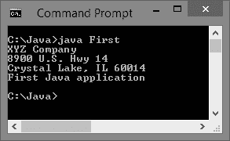

```java
public class First {
    public static void main(String[] args) {
        //这个类包含两个语句。第一个是对 displayAddress() 方法的。
        System.out.println("First Java application");
        displayAddress();
    }

    public static void displayAddress() {
        System.out.println("XYZ Company");
        System.out.println("8900 U.S. Hwy 14");
        System.out.println("Crystal Lake, IL 60014");
    }
}
```

**图 3-4** 使用 `main()` 调用 `displayAddress()` 的 First 类

**图 3-5** First 程序的输出，包括 `displayAddress()` 方法。

观看视频 *Methods*（方法）。

## 两个真理和一个谎言
### 理解方法调用和位置
1. 任何类都可以包含无限数量的方法。
2. 在程序的单次执行期间，一个方法可能会被调用任意次数。
3. 方法通常写在另一个方法内部。

## 理解方法的构造

每个方法必须包含图 3-6 所示的两个部分：
- `method header`（方法头）——方法头提供了关于其他方法如何与其进行交互的信息。方法头也被称为 `declaration`（声明）。
- 一对大括号之间的 `method body`（方法体）——方法体包含了执行方法任务的语句。方法的体被称为该方法的 `implementation`（实现）。从技术上讲，方法并不要求在其方法体中包含任何语句，但你通常没有理由在类中创建一个空方法。

有时，在开发程序时，程序员会创建一个空方法作为占位符，稍后再填充实现。空方法被称为 `stub`（存根方法）。

```java
public class First {
    public static void main(String[] args) {
        displayAddress();
        System.out.println("First Java application");
    }

    public static void displayAddress() {
        System.out.println("XYZ Company");
        System.out.println("8900 U.S. Hwy 14");
        System.out.println("Crystal Lake, IL 60014");
    }
}
```

**图 3-6** First 类中方法的头和方法体。

方法头是方法的第一行。它包含以下内容：
- 可选的访问修饰符（access specifiers）
- 返回类型
- 标识符（identifier）
- 圆括号

接下来的几图比较了 First 类中 `main()` 方法和 `displayAddress()` 方法头部的这些部分。

### 访问修饰符 (Access Specifiers)

图 3-7 突出了 First 类中两个方法的可选访问修饰符。

Java 方法的访问修饰符可以是以下修饰符之一：`public`、`private`、`protected`，或者如果未指定，默认为包私有（package）。大多数情况下，方法被赋予 `public` 访问权限；本书稍后将涵盖其他修饰符。赋予方法 `public` 访问权限意味着任何其他类都可以使用它，而不仅仅是方法所在的类。

应用程序中的 `main()` 方法必须指定 `public` 访问。
`displayAddress()` 方法不需要指定 `public` 访问。然而，如果访问是 `public`，则该方法可以被外部类使用。

`static` 修饰符意味着这些方法不需要创建对象。

**图 3-7** 两个方法的访问修饰符。

你在第 1 章首先学习了 *access specifier*（访问修饰符）术语。访问修饰符有时被称为 `access modifiers`（访问修改符）。

此外，任何不需要实例化对象即可使用的方法都需要修饰符 `static`。应用程序中的 `main()` 方法必须使用关键字 `static`，但其他方法如 `displayAddress()` 也可以使用。你将在本章后面学习非静态方法。

### 返回类型 (Return Type)

图 3-8 展示了 First 类中 `main()` 和 `displayAddress()` 方法的返回类型。`return type`（返回类型）描述了方法发送回其调用方法的数据类型。并不是所有方法都会向调用方法 `return a value`（返回值）；不返回数据的方法返回类型为 `void`。应用程序中的 `main()` 方法必须具有 `void` 返回类型；在示例中，`displayAddress()` 也有 `void` 返回类型。你在本章稍后看到的其他方法具有不同的返回类型。*void method*（void 方法）和 *method of type void*（void 类型的方法）都指代具有 `void` 返回类型的方法。

应用程序中的 `main()` 方法必须具有 `void` 返回类型。

**图 3-8** 两个方法的返回类型。

### 方法名 (Method Name)

图 3-9 突出了 First 类中两个方法的名称。方法名可以是任何合法的标识符。也就是说，与类和变量的标识符一样，方法的标识符必须是一个没有空格的单词，且不能是 Java 关键字。运行应用程序时第一个执行的方法必须命名为 `main()`，但对于你创建的其他方法，你有很大的余地。从技术上讲，你甚至可以给另一个方法命名为 `main()`，只要不在圆括号内包含 `String[]`，但这样做会引起混乱且不建议这样做。因为方法会“做”某事——即执行操作——它们的名称经常包含动词，例如 `print` 或 `display`。

**图 3-9** 两个方法的标识符。

### 圆括号 (Parentheses)

如图 3-10 所示，每个方法头都包含一组跟随标识符的圆括号。圆括号可能包含发送给方法的数据。例如，当你在类中编写 `main()` 方法时，头中的圆括号括着 `String[] args`。

First 类中的 `displayAddress()` 方法不需要外部数据，因此它的圆括号是空的。在本章后面，你将看到几个接受数据的方法。

**图 3-10** 两个方法的圆括号及其内容。

`displayAddress()` 方法的全名是 `First.displayAddress()`，它包含了类名（`First`）、一个点和方法名，即 `displayAddress()`。（该名称不包含对象，因为 `displayAddress()` 是静态方法。）一个完整名称。

包含类的标识被称为 `完全限定标识符`。当你使用该类内部的方法时，你不需要使用完全限定名称（尽管你可以这样做）；仅需简单的方法名就足够了。然而，如果你想在另一个类中使用方法，除非你使用全名，否则编译器无法识别该方法。在调用 `JOptionPane.showMessageDialog()` 方法时，你已经使用过类似的语法（包括类名、点和方法名）。

两个不同的类中的每一个都可以拥有自己的命名为 `displayAddress()` 的方法。第二个类中的此类方法与第一个类中同名的方法是完全不同的。你可以通过使用它们的完全限定标识符，在第三个类中同时使用这两个方法。应用程序中的两个类不能具有相同的名称。

将类名想象成姓氏。在自己的家族内部，你可能将某项活动称为“家族聚会”，但在家族外部，人们需要使用姓氏，例如“安德森家族聚会”。同样，在类内部，仅需方法名就足够了，但在类外部，你需要使用完全限定名。

## 两个真理一假

### 理解方法的构造
1. 方法头也称为实现（implementation）。
2. 当方法用 `public` 访问权限声明时，其他类的方法可以调用它。
3. 并不是所有方法都返回返回值，但每个方法都需要一个返回类型。

## 你来做
### 创建不需要参数且不返回值的静态方法

Paradise Day Spa 提供许多个人服务，如理发、美甲和面部护理。在本节中，你创建一个名为 `ParadiseInfo` 的新类，该类包含一个调用 `displayInfo()` 方法的 `main()` 方法。

1. 在文本编辑器中打开一个新文档，并输入以下类结构：

```java
public class ParadiseInfo {
}
```

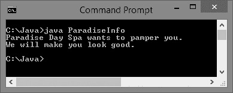

2. 在类的大括号之间，缩进几个空格并创建 `main()` 方法的结构：

```java
public static void main(String[] args) {
}
```

3. 在 `main()` 方法的大括号之间，插入对 `displayInfo()` 方法的调用：

```java
displayInfo();
```

4. 将 `displayInfo()` 方法放置 `main()` 方法之外，紧邻 `ParadiseInfo` 类结束的大括号之前：

```java
public static void displayInfo() {
    System.out.println("Paradise Day Spa wants to pamper you.");
    System.out.println("We will make you look good.");
}
```

5. 将文件保存为 `ParadiseInfo.java`。
6. 编译该类，然后执行它。输出应该如图 3-11 所示。

**图 3-11** `ParadiseInfo` 输出

### 从另一个类调用静态方法

接下来，你将看到如何从另一个类调用 `static` 方法。

1. 在文本编辑器中打开一个新文档，并输入以下类结构：

```java
public class TestInfo {
    public static void main(String[] args) {
        ParadiseInfo.displayInfo();
    }
}
```

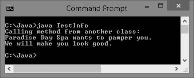

2. 将文件保存为 `TestInfo.java`。
3. 编译该类，然后执行它。输出应该如图 3-11 所示。

**图 3-11** `ParadiseInfo` 输出

如果你在 `displayInfo()` 中省略了 `static` 关键字，编译器将发出错误：“无法找到符号”，因为该方法不是静态的。要理解为什么，请检查 `ParadiseInfo` 中的 `displayInfo()` 方法：

```java
public class ParadiseInfo {
    public static void displayInfo() {
        System.out.println("Paradise Day Spa wants to pamper you.");
        System.out.println("We will make you look good.");
    }
}
```

该方法是 `static` 的，因此可以在不创建类实例的情况下调用。如果它不是 `static` 的，你需要先创建一个 `ParadiseInfo` 的对象，并在对象上调用该方法。

## 为方法添加参数

某些方法要求在调用时向它们发送数据。你在调用方法时使用的数据项称为参数（arguments）。当方法接收到数据时，它们被称为形式（parameters）。

举一个生活中的例子，当你预订餐厅时，你不需要为一年的每个日期、每个可能的时间采用一个不同的方法。相反，你可以将日期和时间作为信息提供给执行该方法的人。记录预订的方法将以相同的方式执行，无论提供什么日期和时间。

同样，面向对象程序的程序使用 `implementation hiding`（实现隐藏），它描述了方法细节的封装。这意味着客户端不需要知道方法在内部是如何工作的，只需要知道被调用方法的名称以及需要发送什么类型的信息。（通常，你还想知道由该方法返回的任何数据；你将在本章稍后的部分学习返回的数据。）换句话说，调用它的方法只需要理解指向被调用方法的 `interface`（接口）。接口是方法中客户端可见或与之交互的唯一部分。此外，如果你替换了新的或修订后的方法实现，只要方法的接口不改变，你就不需要对调用已更改方法的任何方法进行任何更改。

隐藏的实现方法通常被认为存在于 `black box`（黑盒）中。许多日常设备都是黑盒——也就是说，你可以在不理解它们工作原理的情况下使用它们。例如，我们大多数人使用电话、电视机和汽车，并不十分了解它们的内部机制。

### 创建接收单个参数的方法

当方法可以接收参数时，它的声明包含与不接受参数的方法相同的元素——可选的访问修饰符、方法的返回类型、方法名以及一组包含两个项目的圆括号：
- 参数类型
- 参数的局部名称

例如，一个名为 `predictRaise()` 的公共方法，它接受一个人的年薪并计算 10% 的加薪金额，其声明可以写如下：

```java
public static void predictRaise(double salary)
```


你可以将方法声明中的圆括号想象成进入方法的漏斗——列在其中的参数包含了被“丢入”方法中的数据。方法接受的参数可以是任何数据类型，包括基本数据类型，如 `int`、`double` 和 `char`；它也可以是内置类类型（如 `String` 或 `PrintStream`），或者你创建的类类型。

在 `predictRaise()` 方法头中，圆括号内的参数 `double salary` 表示该方法将接收一个 `double` 类型的值，并且在方法内部，传递进去的值将被称为 `salary`。图 3-13 显示了一个完整的方法。

| 参数数据 | 参数类型 | 标识符 |
| --- | --- | --- |

```java
public static void predictRaise(double salary) {
    double newSalary;
    final double RAISE_RATE = 1.10;
    newSalary = salary * RAISE_RATE;
    System.out.println("Current salary: " + salary + " After raise: " + newSalary);
}
```

**图 3-13** `predictRaise()` 方法

`predictRaise()` 方法是一个 `void` 方法，因为它不需要向调用它的任何其他方法返回值——它的唯一功能是接收薪资值，将其乘以 `RAISE_RATE` 常数（1.10，结果导致薪资增加 10%），然后显示结果。

### 为方法添加参数

`predictRaise()` 方法的参数是 `double` 类型，因此你使用任何可以被提升为 `double` 的参数来调用它。换句话说，因为 `predictRaise()` 接受 `double`，它也可以接受 `float`、`long`、`int`、`short` 或 `byte`。（参阅第 2 章中的图 2-41 以复建立统一数据类型的顺序）。该参数可以是常量、变量或更复杂的表达式。

例如，以下所有方法调用都是有效的：
- `predictRaise(1000);`——此调用使用了一个未命名的 `int` 常量，被提升为 `double`。
- `predictRaise(472.25);`——此调用使用了一个未命名的 `double` 常量。
- `predictRaise(16.55 * 40);`——此调用使用了一个算术表达式。
- `predictRaise(STANDARD_SALARY);`——此调用使用了一个命名常量，该常量可能是 `double`、`float`、`long`、`int`、`short` 或 `byte`。
- `predictRaise(mySalary);`——此调用使用了一个变量，该变量可能是 `double`、`float`、`long`、`int`、`short` 或 `byte`。
- `predictRaise(getCurrentSalary());`——此调用假设作为参数的 `getCurrentSalary()` 方法返回 `double`、`float`、`long`、`int`、`short` 或 `byte`。你将在本章稍后学习返回数据的方法。

你可以多次调用，每次使用不同的参数。这些参数中的每一个在方法内部都被称为 `salary`。标识符 `salary` 代表一个变量，它持有传递给方法的任何 `double` 值的副本。

有趣的是，如果在对 `predictRaise()` 方法调用中使用作为参数的值是一个变量，它可能具有与 `salary` 相同的标识符，也可能是不同的标识符，例如 `startingWage`。例如，图 3-14 中的代码显示了三次对 `predictRaise()` 方法的调用，图 3-15 显示了输出。一次调用使用了常量 `400.00`。另外两个使用了变量——一个名称与 `salary` 相同，另一个名称不同，为 `startingWage`。`main()` 方法中的标识符 `salary` 指向的内存位置与 `predictRaise()` 方法中的不同。参数 `salary` 仅仅是 `predictRaise()` 方法内部使用的占位符。只要方法的接口不改变，你就不需要对调用已更改方法的任何方法进行任何更改。


**第 3 章** 使用方法、类和对象

```java
public class DemoRaise {
    public static void main(String[] args) {
        double salary = 200.00;
        double startingWage = 800.00;
        System.out.println("Demonstrating some raises");
        predictRaise(400.00);
        predictRaise(salary);
        predictRaise(startingWage);
    }
}
```

**图 3-14** 带有三次调用 `predictRaise()` 的 main 方法的 DemoRaise 类

回一下，`final` 修饰符使 `RAISE_RATE` 成为常量。因为图 3-14 的 `predictRaise()` 方法中没有修改 `salary`，你也可以通过将方法头声明为 `public static void predictRaise(final double SALARY)` 来使参数变为常量。程序的执行没有区别，但将参数声明为 `final` 意味着它不能更改。阅读程序的人将发现该参数是不打算改变的。

**图 3-15** DemoRaise 程序的输出

每当图 3-14 中的 `predictRaise()` 方法执行时，`salary` 变量都会被重新声明——也就是说，会设置一个足够容纳 `double` 的新内存位置并命名为 `salary`。在 `predictRaise()` 方法内部，`salary` 持有由 `main()` 方法传递的任何值的副本。当 `predictRaise()` 方法在右大括号结束时，局部 `salary` 变量不再存在。也就是说，如果你在 `predictRaise()` 内部计算中使用 `salary` 之后更改它的值，不会影响任何其他地方。持有 `salary` 的内存位置在方法结束时释放，方法内部对其值的任何更改都不会影响调用方法中的任何值。特别地，不要认为 `main()` 方法中名为 `salary` 的变量会发生任何变化；该变量尽管与 `predictRaise()` 方法中的局部参数同名，但它是不同的变量，拥有自己的内存地址。

当一个变量在方法结束时不再存在，程序员说该变量“离开了作用域（goes out of scope）”。

变量的 `scope`（作用域）是程序中变量存在可以使用其未限定名称访问的部分。第 4 章将详细讨论作用域。

### 创建需要多个参数的方法

一个方法可以需要多个参数。例如，与其创建一个为每个人的工资增加 10% 涨幅的 `predictRaise()` 方法，你可能更倾向于创建一个方法，向该方法传递两个值——要加薪的金额以及加薪的百分比数字。图 3-16 显示了一个使用两个此类参数的方法。

```java
public static void predictRaiseUsingRate(double salary, double rate) {
    double newAmount;
    newAmount = salary * (1 + rate);
    System.out.println("With raise, new salary is " + newAmount);
}
```

图 3-16 接受两个参数的 `predictRaiseUsingRate()` 方法。在图 3-16 中，两个参数（`double salary` 和 `double rate`）出现在方法头括号内。逗号分隔每个参数，每个参数都需要自己的声明类型（在本例中两者均为 `double`）以及自己的标识符。请注意，接收两个或多个参数的方法声明必须列出每个参数的类型，即使这些参数具有相同的类型。

你可以通过在方法调用中列出参数并用逗号分隔，向方法传递多个参数。当值像下述语句中那样被传递给方法时，第一个传递的值在方法内部被引用为 `salary`，第二个传递的值被引用为 `rate`：`predictRaiseUsingRate(mySalary, promisedRate);`。

传递方法的参数必须按正确的顺序传递。调用 `predictRaiseUsingRate(200.00, 0.10);` 产生的输出代表基于 200.00 美元工资的 10% 涨幅（或 220.00 元），但 `predictRaiseUsingRate(0.10, 200.00);` 产生的输出代表基于 10 美分工资的 20,000% 涨幅（或 20.10 元）。

如果以错误的顺序传递给方法的参数，结果将是以下情况之一：
- 如果方法仍可以接受两个参数，则结果是逻辑错误；即程序可以编译并执行，但可能会产生错误的结果。
- 如果方法无法接受这些参数，则按错误的顺序传递参数将构成语法错误，程序无法编译。

你可以编写一个方法，使其能够以任何顺序接收任意数量的参数。然而，当你调用方法时，你发送给方法的参数在顺序、数量和类型上都必须与方法声明中列出的参数匹配。方法的 `signature`（签名）是方法名以及参数的数量、类型和顺序的组合。

方法调用必须与被调用方法的签名匹配。

因此，一个计算汽车销售人员佣金金额的方法可能需要此类参数：所售出车辆的整数美元值、双精度类型的百分比佣金率，以及车辆类型的字符代码。只有当按正确顺序发送了三个正确类型的参数时，正确的方法才会执行。图 3-17 显示了一个包含三参数方法以及 `main()` 方法的类，该方法调用了两次，一次使用变量参数，另一次使用常量参数。图 3-18 显示了应用程序的输出。

```java
public class ComputeCommission {
    public static void main(String[] args) {
        char vType = 'S';
        int value = 23000;
        double commRate = 0.08;
        computeCommission(value, commRate, vType);
        computeCommission(40000, 0.10, 'L');
    }

    public static void computeCommission(int value, double rate, char vehicle) {
        double commission;
        commission = value * rate;
        System.out.println("\nThe " + vehicle + " type vehicle is worth $" + value);
        System.out.println("With " + (rate * 100) + "% commission rate, the commission is $" + commission);
    }
}
```

图 3-17 ComputeCommission 类

图 3-18 ComputeCommission 应用程序的输出。方法调用中的参数通常被称为 `actual parameters`（实际参数）。方法声明中接受来自实际参数值的变量是 `formal parameters`（形式参数）。

### 为方法添加参数

当你查看 Java 应用程序时，可能会看到似乎可以以多种方式调用的方法。例如，你可以使用不带参数的 `System.out.println()` 来显示空行，或者使用带 `String` 参数的调用来显示该字符串。你之所以可以使用不同参数列表使用该方法，是因为编写了该方法的多个版本，每个版本都接收一组特定的参数。通过更改与方法名一起使用的参数来执行不同的方法实现的能力被称为方法重载（method overloading），你将在下一章学习这个概念。

#### 两个真理一个谎言：为方法添加参数

1. 类可以包含任意数量的方法，每个方法可以被调用任意次。
2. 参数在方法调用中使用；它们被传递给方法头中的形式参数。
3. 方法头始终包含一个返回类型、一个标识符和括号内的参数列表。

### 创建返回值的方法

当发生以下任何事件时，方法将结束：
- 方法完成了其所有的语句。你在上一节中已经见过这样的方法。
- 方法抛出异常。异常是错误；你将在“异常处理”章节中学习它们。
- 方法到达 `return statement`（返回语句）。`return statement` 导致方法结束，并将程序的逻辑返回到调用它的方法。此外，返回语句经常会将一个值传回给调用它的方法。

方法的返回类型可以是 Java 中使用的任何类型，包括原始类型 `int`、`double`、`char` 等，以及类类型（包括你创建的类类型）。当然，方法也可以不返回内容，在这种情况下返回类型为 `void`。

方法的返回类型更简练地称为 `method’s type`（方法的类型）。例如，图 3-4 之前所示的 `displayAddress()` 方法的声明写如下：`public static void displayAddress()`。此方法不返回值，所以它的类型是 `void`。

一个提示用户输入年龄并将年龄返回给调用方法的方法可以声明为：

```java
public static int getAge()
```

该方法返回一个 `int`，所以它的类型是 `int`。

另一个例子，一个根据员工是否加班工作时而返回真或假的方法可以声明为：

```java
public static boolean workedOvertime()
```

此方法返回一个 `Boolean` 值，所以它的类型是 `boolean`。

之前显示的 `predictRaise()` 方法产生输出，但不返回任何值，因此它的返回类型是 `void`。如果你想创建一个方法来返回计算后的新工资而不是显示它，方法头将写如下：`public static double predictRaise(double salary)`。

图 3-19 显示了此方法。

```java
public static double predictRaise(double salary) {
    double newAmount;
    final double RAISE = 1.10;
    newAmount = salary * RAISE;
    return newAmount;
}
```

图 3-19 返回 double 类型的 `predictRaise()` 方法

注意图 3-19 中 `predictRaise()` 方法头中方法名之前的返回类型 `double`。同样注意定义的 `newAmount`。这个 `double` 变量的值在方法的最后一条语句中返回。返回语句（return statement）导致一个值从被调用的方法传回调用方法。方法声明的返回类型必须与返回语句中使用的值的类型匹配；如果不匹配，该类将无法编译。

一个方法最多可以返回一个值。返回的值可以是一个变量、具名或未命名常量，或者另一个方法调用，且返回类型必须与方法头中声明的返回类型匹配，或者可以提升为该返回类型。例如，一个返回类型为 `double` 的方法其返回语句可能像以下任意一种形式：

```java
return 1;
return 1.0;
return mySalary;
return getMySalary();
```

除了 `void` 方法外，所有方法都需要一个返回适当类型值的返回语句。你可以在 `void` 方法中放置返回语句，只需是 `return` 单词后跟一个分号即可。然而，大多数 Java 程序员在不需要返回内容时不会在方法中包含返回语句。

你不能在方法的返回语句之后放置任何语句。这些语句是**不可达语句**（unreachable statements），因为逻辑流在返回语句处就离开了方法。

不可达语句永远不会执行，并会导致编译器错误。不可达语句也称为**死代码**（dead code）。

如果返回语句嵌入在判断逻辑中，一个方法可以包含多个返回子句，尽管这种做法并不推荐，因为它可能会导致难以检测的错误。然而，在方法的最后一个返回子句之后不能放置任何其他语句。你将在“做出决策”章节中学习决策制定。

如果一个方法返回一个值，那么当你调用该方法时，你通常会使用该返回的值，尽管并非强制这样做。例如，当你调用 `predictRaise()` 方法时，你可能想将返回的值（也称为方法的值）赋值给名为 `myNewSalary` 的 `double` 变量，如下语句所示：

```java
myNewSalary = predictRaise(mySalary);
```

`predictRaise()` 方法返回一个 `double`，因此将方法的返回值赋值给 `double` 变量是合适的。

或者，你可以选择直接使用方法的返回值，而不将其存储在任何变量中。当你使用方法的值时，其使用方式与使用任何相同类型的变量相同。例如，你可以在如下语句中显示返回值：

```java
System.out.println("New salary is " + predictRaise(mySalary));
```

### 第 3 章：使用方法、类和对象

在前面的语句中，对 `predictRaise()` 方法的调用是在 `println()` 方法调用内部进行的。由于 `predictRaise()` 返回一个 `double`，你可以像使用任何简单的 `double` 值一样使用该方法调用。另一个例子是，你可以对方法的返回值进行算术运算，如下语句所示：


# 第 3 章：使用方法、类和对象

## 方法调用链

任何方法都可能调用任意数量的其他方法。例如，`main()` 方法可能会调用 `predictRaise()` 方法，而 `predictRaise()` 方法可能会调用 `calculateBonus()` 方法，如图 3-20 中的阴影语句所示。

```java
double spendingMoney = predictRaise(mySalary) - expenses;
```

在这条语句中，`mySalary` 的值没有被改变；唯一改变的变量是 `spendingMoney`。

如果你想让 `mySalary` 有加薪后的新薪水值，你可以使用以下语句：

```java
mySalary = predictRaise(mySalary);
```

```java
public static double predictRaise(double salary) {
    double newAmount;
    double bonusAmount;
    final double RAISE = 1.10;
    newAmount = salary * RAISE;
    bonusAmount = calculateBonus(newAmount);
    newAmount = newAmount + bonusAmount;
    return newAmount;
}
```

**图 3-20** `predictRaise()` 方法调用 `calculateBonus()` 方法。观察从 `predictRaise()` 方法对 `calculateBonus()` 方法的调用，你并不需要知道 `calculateBonus()` 是如何工作的。你只知道 `calculateBonus()` 方法接受 `double` 作为参数（因为 `newAmount` 被传递给它），并且它必须返回 `double` 或可以自动提升为 `double` 的类型（因为结果被存储在 `bonusAmount` 中）。换句话说，该方法像一个黑盒。

作为示例，`calculateBonus()` 方法可能像图 3-21 所示的两个版本之一。第一个版本只是为 `salary` 参数增加 $50.00 的奖金。第二个版本调用另一个名为 `trickyCalculation()` 的方法，该方法返回一个加到 `salary` 的值。当你读取 `calculateBonus()` 方法时，你不知道 `trickyCalculation()` 方法中发生了什么，当你读取调用 `calculateBonus()` 的 `predictRaise()` 方法时，你甚至不确定调用了 `trickyCalculation()`。

```java
public static double calculateBonus(double salary) {
    final double BONUS_AMT = 50.00;
    salary = salary + BONUS_AMT;
    return salary;
}
```

```java
public static double calculateBonus(double salary) {
    salary = salary + trickyCalculation();
    return salary;
}
```

**图 3-21** `calculateBonus()` 方法的两种版本。

你还可以在语句中链式调用方法。如果 `calculateBonus()` 接受并返回 `double`，`predictRaise()` 也接受并返回 `double`，那么以下语句是合法的：

```java
double salaryGoingForward = calculateBonus(predictRaise(300.00));
```

在这条语句中，来自 `predictRaise()` 的值被传递给 `calculateBonus()`，最终结果被赋值给 `salaryGoingForward`。

### 两个真相和一个谎言

1. 方法的类型可以是 Java 中的任何类型，包括 `int`、`double` 和 `void`。
2. 方法声明的返回类型必须与参数列表中使用的类型匹配。
3. 你不能将方法放在另一个方法内部，但你可以从另一个方法调用方法。

### 动手实践：创建参数并返回值的静态方法

在本节中，你将在上一个“动手实践”部分开始的 `ParadiseInfo` 类中添加一个方法。新方法接收两个参数并返回一个值。

该方法的目的是接受本周特色折扣的最低价格和折扣率，并返回客户节省的最低金额。

1. 在文本编辑器中打开 **ParadiseInfo.java** 文件，然后将类名改为 **ParadiseInfo2**。立即保存文件为 **ParadiseInfo2.java**。
2. 在文件的第一行，添加允许用户输入的导入语句：`import java.util.Scanner;`。
3. 在 `main()` 方法左大括号后，作为第一个语句添加四个声明。其中一个存储允许折扣的最低价格，另一个存储折扣率。第三个变量是最低储蓄，通过将折扣最低价格和折扣率相乘计算。第四个变量是一个 `Scanner` 对象，用于键盘输入。

```java
double price;
double discount;
double savings;
Scanner keyboard = new Scanner(System.in);
```

与其导入 `Scanner` 类来提供控制台输入，不如你可以替换 `JOptionPane` 并包含提供 GUI 输入的程序语句。输入过程也可以使用其他技术，例如从存储设备中获取数据——你将在“文件输入与输出”章节中学习文件输入。无论你使用哪种特定的技术或类型的硬件设备，“输入”这一概念（将数据从外部获取到内存中）都是相同的。

4. 在变量声明之后，提示用户输入最低折扣价格，并从键盘接受一个值：

```java
System.out.print("Enter cutoff price for discount >> ");
price = keyboard.nextDouble();
```

5. 提示用户输入折扣率并接收。

```java
System.out.print("Enter discount rate as a whole number >> ");
discount = keyboard.nextDouble();
```

6. 在调用 `displayInfo()` 之后，插入对 `computeDiscountInfo()` 的调用。你把 `price` 和 `discount` 值传递给该方法，该方法返回消费者将节省的最小金额，并存储在 `savings` 中：

```java
savings = computeDiscountInfo(price, discount);
```

7. 在 `main()` 方法的右括号之前，显示节省信息：

```java
System.out.println("Special this week on any service over " + price);
System.out.println("Discount of " + discount + " percent");
System.out.println("That’s a savings of at least $" + savings);
```

8. 在 `displayInfo()` 方法实现之后、类的结束右括号之前，添加 `computeDiscountInfo()` 方法。它接受两个 `double` 类型并返回一个 `double`。

```java
public static double computeDiscountInfo(double pr, double dscnt) {
    double savings;
    savings = pr * dscnt / 100;
    return savings;
}
```

9. 保存文件，然后编译并执行。图 3-22 显示了一个典型的执行过程。在提示用户输入本周销售的截止价格和要应用的折扣后，程序执行 `displayInfo()` 方法。然后程序执行 `computeDiscountInfo()` 方法，该方法返回一个值并存储在 `savings` 变量中。最后，显示折扣信息。

**图 3-22** ParadiseInfo2 程序的典型执行

## 理解方法可以作为黑盒使用

在本章中，你已经学习了在不了解其实现细节的情况下使用方法。作为专业程序员使用实现隐藏的示例，你可以访问 Java 网站查看位于 Java 预写类中的成千上万个预写方法的接口。你不被允许查看这些方法内部的代码；你只能看到它们的接口，而这已经是你使用这些方法所需的所有内容。

1. 打开浏览器，访问 Java 网站，并导航到 Java SE 8 的 Java APIs。
2. 从字母顺序的类列表中选择 `PrintStream`。
3. 在 `PrintStream` 页面上，阅读该类的几个方法的描述。注意，对于每个方法，你都可以看到返回类型、方法名和参数列表，但你看不到任何现有方法的实现代码。
4. 检查其他类。再次注意，Java 文档为你提供了方法接口而不是实现。当你将来开发自己的类时，你可能会选择为用户提供类似的文档和编译后的类，这样他们无法查看、修改或盗取你辛苦开发的代码。

## 学习类和对象

当你以面向对象的方式思考时，万物皆对象，而每个对象都是类的成员。你可以将任何无生命的物理物品想象成对象——你的桌子、你的电脑以及你居住的建筑在日常对话中都被称为对象。

你也可以将生物视为对象——你的室内植物、你的宠物鱼和你的姐姐都是对象。事件也是对象——你购买的股票、你参加的抵押贷款结算、以及为你举办的毕业派对都是对象。

万物皆对象，每个对象都是更通用的类的成员。你的桌子是包含所有桌子的类的成员，你的宠物鱼是包含所有鱼的类的成员。一个面向对象的程序员会说，你的桌子是 `Desk` 类的实例，你的鱼是 `Fish` 类的实例。这些陈述代表了**继承关系（is-a relationships）**——即对象“是”该类的具体实例的关系。

只有当你按照正确的顺序引用对象和类时，表达“继承关系”才是正确的。你可以说：“我那张带有划痕的橡木桌*是一个* `Desk`，我那条名为 Moby 的金鱼*是一条* `Fish`。”你不会通过说“Desk 是一张带有划痕的橡木桌”来定义 `Desk`，也不会通过说“Fish 是一条名为 Moby 的金鱼”来解释 Fish 是什么，因为 Desk 和 Fish 都要泛得多。

类与对象之间的区别等于抽象与具体之间的区别。对象是类的**实例化（instantiation）**，或者说是类的一个实物示例。你的金鱼、我的孔雀鱼和动物园的鲨鱼分别构成了 `Fish` 类的一个实例。

程序员在讨论继承关系时也会使用“是（is-a）”短语。你将在“继承简介”和“高级继承概念”章节中学习更多关于继承的内容。

类的概念之所以有用是因为它的可重用性。对象从类中获取属性，所有对象由于是类的成员而具有可预测的属性。例如，如果你被邀请参加毕业派对，你会自动知道关于它的很多事情。你假设会有开始时间、一定数量的客人以及某些数量的食物。根据你对 `Party` 类的预知，你理解派对对象包含什么。你并不知道这个特定派对有多少客人或什么食物，但你理解所有派对都有客人和招待，这个也是如此。

除了属性之外，对象还与其关联的方法，每个类的实例对象都被认为拥有相同的方法。例如，对于所有的 `Party` 对象，会在某个设置日期和时间。在程序中，你可能会将这些方法命名为 `setDate()` 和 `setTime()`。派对客人需要知道日期和时间，并可以使用命名为 `getDate()` 和 `getTime()` 的方法获取任何派对对象的日期和时间。以 *get* 和 *set* 开头的方法非常典型。你将在下一节中学习更多关于 get 和 set 方法。

那么，你的毕业派对标识符可能是 `myGraduationParty`。作为 `Party` 类的一个成员，`myGraduationParty` 与所有的 Party 对象一样，可能拥有数据方法 `setDate()` 和 `setTime()`。当你使用这些方法时，`setDate()` 和 `setTime()` 方法需要参数，即传递给它们的信息。例如，诸如 `myGraduationParty.setDate("May 12")` 和 `myGraduationParty.setTime("6 P.M.")` 等语句会调用 `myGraduationParty` 对象可用的方法。当你使用一个对象及其方法时，可以将其想象成向该对象发送消息以指导它完成某些任务——你可以告诉名为 `myGraduationParty` 的 `Party` 对象设置你请求的日期和时间。尽管你的 `yourAnniversaryParty` 也是 `Party` 类的成员，尽管它也可以访问 `setDate()` 和 `setTime()` 方法，但你发送给 `yourAnniversaryParty` 方法的参数将与你发送给 `myGraduationParty` 方法的参数不同。在任何面向对象的程序中，你都在不断地向对象的方法发送请求，并经常将参数作为这些请求的一部分。

此外，应用程序中使用的某些方法必须返回消息或值。如果你的某个派对客人使用了 `getDate()` 方法，该客人希望该方法能返回所需的信息。同样，在面向对象的程序中，方法经常被调用以向请求源返回某些信息。例如，`Payroll` 类中一个计算联邦预扣税的方法可能会返回一个以美元和分为单位的税额，而 `Inventory` 类中的一个方法可能会返回 `true` 或 `false`，取决于该方法对某物品是否达到重新订购点的判断。

### 两个真相和一个谎言：学习类和对象

1. 类是许多对象的实例化。
2. 对象从它们的类中获得属性和方法。
3. 实例化另一个预写类对象的应用程序或类是类客户端。

## 创建类

当你创建一个类时，必须为该类命名，并且必须确定哪些数据和方法将成为类的一部分。假设你决定创建一个名为 `Employee` 的类。`Employee` 的一个实例变量可能是员工编号，而两个必要的方法可能是一个设置（或为员工编号提供值）的方法，以及另一个获取（或检索）该员工编号的方法。开始时，你创建一个包含三个部分的类头部：

- 一个可选的访问修饰符
- 关键字 `class`
- 你为类名选择的任何合法标识符——惯例上以大写字母开头

例如，一个代表员工的类头部可以是：`public class Employee`

最宽松的访问形式是 `public`。`public` 关键字是一个类修饰符。

`public` 的类可以被所有对象访问。公共类还可以被**扩展**，或作为任何其他类的基础。将访问设为公共意味着如果你开发了一个良好的 `Employee` 类，将来某天你想开发两个更具体的类，`SalariedEmployee` 和 `HourlyEmployee`，那么你不需要从头开始。每个新类都可以成为原始 `Employee` 类的扩展，继承它的数据和方法。尽管存在其他修饰符，但你将在大多数类中使用 `public` 修饰符。

你将在“继承导论”章节中学习扩展类。

在写完类头部 `public class Employee` 后，你在一组大括号之间编写 `Employee` 类的体。类体包含了该类的数据和方法。

类的数据组件通常被称为**数据字段**，以帮助区分于你可能使用的其他变量。图 3-23 显示了一个 `Employee` 类，它包含一个名为 `empNum` 的数据字段。数据字段是你在类内部但在任何方法之外声明的变量。

在图 3-23 中，数据字段 `empNum` 前没有 `static` 关键字。如果在这里插入 `static` 关键字，那么一个 `empNum` 值将被所有最终实例化的 Employee 对象共享。由于图 3-23 中的 `empNum` 字段没有 `static`，当你最终从类创建或实例化对象时，每个 Employee 都可以拥有自己的 `empNum`。

```java
public class Employee {
    private int empNum;
}
```


# 第 3 章：使用方法、类和对象

## 两个真理一个谎言

### 创建类

1. 类头包含一个可选的访问限定符、关键字 `class` 以及一个标识符。
2. 当你实例化对象时，每个对象都拥有类中每个 `static` 数据字段的副本。
3. 类中的大多数字段是私有的，而大多数方法是公有的。

## 非静态字段与访问修饰符

**图 3-23** 具有一个字段的 Employee 类

非静态字段（如 `empNum`）是类的**实例变量**。

你已经了解到大多数 Java 方法的访问修饰符是 `public`。然而，大多数字段（如 `Employee` 类中的 `empNum`）都是 `private`，这提供了最高安全性。为字段分配**私有访问**意味着没有其他类可以访问字段的值，只有同类的方法被允许设置、获取或其他方式使用私有变量。创建私有访问的原理有时被称为**信息隐藏**，它是面向对象程序的重要组成部分。类的私有数据只能由类自己的方法进行更改或操作，而不能通过属于其他类的方法。与通常为私有的字段相比，大多数类方法都是 `public` 的。

由此产生的私有数据/公有方法安排为你提供了一种控制外部访问你数据的方法——只有类的非私有方法可以用于访问该类的私有数据。这种情况类似于聘佣了一位公立接待人员坐在你的私人办公室前，控制你收到的信息（可能过滤掉琐碎或敌对的信息）以及你发送的信息（可能检查你的拼写、语法和任何法律影响）。非私有方法的编写方式决定了（控制了）你如何使用这些私有数据。

Java 的第一个版本（1.0）支持五种访问级别——之前列出的四种加上 `private protected`。在比 1.0 更高的 Java 版本中，不再支持 `private protected` 访问级别；你不应该在自己的 Java 程序中使用它。

总结来说，类的数据字段通常是私有的且非静态（static）的。例外出现在希望在不需要创建对象的情况下使用一个不变的值时——在这种情况下，你将字段同时设为 `static` 和 `final`。例如，`Math` 类包含一个名为 `PI` 的 `final`、`public` 且 `static` 的字段，你可以在不实例化一个 `Math` 对象的情况下使用它。

你将在下一章中学习 `Math` 类。

## 在类中创建实例方法

除了数据外，类还包含方法。例如，对于一个包含 `empNum` 的 `Employee` 类，你需要一个方法来获取（或返回）任何 `Employee` 的 `empNum`，以供另一个类使用。该方法的合理名称是 `getEmpNum()`，它的声明为 `public int getEmpNum()`，因为它将具有公有访问权限，返回一个整数（员工 147 号），并拥有标识符 `getEmpNum()`。

同样地，你还需要一个方法来设置 `empNum` 字段。该方法的合理名称是 `setEmpNum()`，它的声明为 `public void setEmpNum(int emp)`，因为它将具有公有访问权限，没有返回值，拥有标识符 `setEmpNum()`，并且需要一个代表员工 ID 号的参数，其类型为 `int`。

设置或更改字段值的方法称为 `mutator methods`（变器方法）；获取值的方法称为 `accessor methods`（访问方法）。在 Java 中，变器方法习惯上以 `set` 前缀开头，访问方法习惯上以 `get` 前缀开头。在方法名中使用这些三个字母的前缀不是强制要求的，但它是约定俗成的。**图 3-24** 显示了 `Employee` 类中 `empNum` 字段的 `get` 和 `set` 方法。

```java
public void setEmpNum(int emp) {
    empNum = emp;
}

public int getEmpNum() {
    return empNum;
}
```

**图 3-24** `setEmpNum()` 和 `getEmpNum()` 方法。注意，与你在在本章之前创建的方法不同，`getEmpNum()` 和 `setEmpNum()` 方法没有使用 `static` 修饰符。关键字 `static` 用于类级方法，但不用于“属于”对象的方法。如果你正在创建一个带有 `main()` 方法的程序并执行它来完成某些任务，你的许多方法将是 `static` 的，这样你可以在 `main()` 内部调用它们而无需创建对象。

然而，如果你正在创建一个可以实例化对象的类，大多数方法可能是非静态（nonstatic）的，因为你会将方法与单个对象关联。例如，`getEmpNum()` 方法必须是非静态的，因为它对你创建的每个 `Employee` 对象都返回不同的 `empNum` 值。与对象实例化一起使用的方法被称为 `instance methods`（实例方法）。你*可以*在对象上使用静态或非静态方法，但只有非静态方法会对每个对象表现出独特性异的行为。你不能在没有对象的情况下使用非静态方法。

理解何时将字段和方法声明为 `static` 和非静态对于新程序员来说是一项挑战。为了帮助你判断一个数据字段应该是静态还是否，你可以问自己它出现了多少次。如果它每个类中出现一次，它是静态的；但如果它每个对象中出现一次，它就不是静态。**表 3-1** 提供了总结。

### 表 3-1：静态与非静态的比较

| 静态 (Static) | 非静态 (Nonstatic) |
| :--- | :--- |
| 在 Java 中，`static` 是一个关键字。它也可以用形容词。 | 非静态项没有关键字。当你没有显式地声明一个字段或方法为 `static` 时，它默认是非静态的。 |
| 类中的静态字段称为类字段（class fields）。 | 类中的非静态字段称为实例变量（instance variables）。 |
| 类中的静态方法称为类方法（class methods）。 | 类中的非静态方法称为实例方法（instance methods）。 |
| 当你使用静态字段或方法时，不需要使用对象；例如：`JOptionPane.showDialog();`, `System.out.println();` | 当你使用非静态字段或方法时，你必须使用对象；例如：（文中未提供示例） |
| 当你创建一个带有静态字段的类并实例化 100 个对象时，内存中只存在该字段的一个副本。 | 当你创建一个带有非静态字段的类并实例化 100 个对象时，内存中将存在 100 个该字段的副本。 |
| 当你创建一个带有静态字段的类并实例化 100 个对象时，内存中只存在该字段的一个副本。 | 当你创建一个静态方法的类并实例化 100 个对象时，内存中只存在该方法的一个副本，且方法不接收 `this` 引用。 |
| 当你创建一个非静态方法的类并实例化 100 个对象时，内存中只存在该方法的一个副本，但方法接收一个 `this` 引用，包含当前使用它的对象的地址。 | |
| 静态类变量不是实例变量。 | 实例字段和方法是非静态的。 |
| 系统在第一次遇到类时为类变量分配内存，无论实例化多少个类实例。 | 系统为每个实例中的每个非静态字段分配单独内存位置。 |
| 类实例共享任何静态类变量副本。 | |

表 3-1 提到了 `this` 引用。你将在下一章学习 `this` 引用。

**图 3-25** 提供了公有、私有、静态和非静态成员如何在另一个类使用的总结。该图显示了一个名为 `MyClass` 的类，它包含四个方法：公有静态、私有静态、公有非静态和私有非静态。该图还显示了一个实例化 `MyClass` 对象的 `TestClass`。

`TestClass` 包含八个方法调用。三个有效的调用是针对公有方法的。对非静态方法的调用使用了对象，而两个针对静态方法的调用可以使用对象，也可以不使用。注释之后的其余 `TestClass` 代码都是无效的。私有方法无法在类外部调用，且非静态方法需要一个对象。

```java
public class MyClass {
    public static void pubStatMethod() {}
    private static void privStatMethod() {}
    public void pubNonstatMethod() {}
    private void privNonstatMethod() {}
}

public class TestClass {
    MyClass object = new MyClass();
    object.pubNonstatMethod(); // TestClass 无法访问私有方法。
    object.pubStatMethod();
    MyClass.pubStatMethod();
    // 以下代码均不起作用
    // 非静态方法必须配合 MyClass 对象使用。
    MyClass.privStatMethod();
    MyClass.pubNonstatMethod();
    object.privStatMethod();
    object.privNonstatMethod();
    MyClass.privNonstatMethod();
}
```

**图 3-25** 基于方法修饰符组合的合法与非法方法调用的总结。

**图 3-26** 显示了完整的 `Employee` 类，它包含一个私有数据字段和两个公共方法，它们都是非静态的。该类成为名为 `Employee` 的新数据类型的模型；当最终创建 `Employee` 对象时，每个对象都将拥有自己的 `empNum` 字段，并且每个对象都可以访问两个方法——一个为其 `empNum` 字段提供值，另一个检索存储在该处的值。

```java
public class Employee {
    private int empNum;
    public int getEmpNum() {
        return empNum;
    }
    public void setEmpNum(int emp) {
        empNum = emp;
    }
}
```

**图 3-26** 具有一个字段和两个方法的 `Employee` 类。当你创建一个像 `Employee` 这样的类时，可以对其进行编译，这将识别识别错误。然而，你无法执行该类，因为它不包含 `main()` 方法。

像 `Employee` 这样的类旨在作为其他应用程序中对象的数据类型，你将在下一节中看到。

## 类的组织

你创建的大多数类都有多个数据字段和方法。例如，除了需要员工编号外，`Employee` 还需要姓、名和薪水，以及用于设置和获取这些字段的方法。**图 3-27** 显示了如何为 `Employee` 类编写数据字段代码。

```java
public class Employee {
    private int empNum;
    private String empLastName;
    private String empFirstName;
    private double empSalary;
    // 方法将放在这里
}
```

**图 3-27** 具有多个数据字段的 `Employee` 类。虽然没有强制要求，但大多数程序员会将数据字段按照逻辑顺序放在类的开头。例如，`empNum` 最可能被用作每个员工的唯一标识符（数据库用户通常称为 `主键`），因此在类中先列出员工编号是有意义的。员工的姓和名是“关联的”，因此相邻存储这两个 `Employee` 组件是有意义的。尽管有这些常识规则，但在任何类中定位数据字段时，你有很大的灵活性。

唯一标识符是在应用程序内不应重复的标识符。例如，一个组织可能有许多姓 Johnson 或每周薪水为 $400.00 的员工，但员工编号为 128 的员工只有一个。

由于当前 `Employee` 类中有两个 `String` 组件，它们可以在同一个语句中声明，如下所示：`private String empLastName, empFirstName;`。

然而，如果字段是垂直列出的，一眼识别出每个 `Employee` 字段通常会更容易。

你可以按照任何顺序在类中放置数据字段和方法。例如，你可以先放置所有方法，然后是所有数据字段；或者你可以组织类，使得几个数据字段后面跟着使用它们的方法，然后是几个更多数据字段后面再跟着使用它们的方法。本书遵循将所有数据字段放在最前面的习惯，以便你在阅读使用这些字段的方法之前看到它们的名称和数据类型。

**图 3-27** 开始的 `Employee` 类仅包含四个字段。即使每个字段只需要一个 set 方法和一个 get 方法，也需要八个方法。考虑大多数组织的员工记录，你会发现通常需要多得多的字段（如地址、电话号码、入职日期、受养人人数等）以及多得多的方法。在列表中查找路径可能变成一项艰巨的任务。

为了方便查找类方法，许多程序员按字母顺序存储它们。其他程序员则将值按 get 和 set 方法对进行排列，这种顺序也会产生功能性分组。**图 3-28** 显示了 `Employee` 的完整类定义可能是什么样。

```java
public class Employee {
    private int empNum;
    private String empLastName;
    private String empFirstName;
    private double empSalary;
    public int getEmpNum() {
        return empNum;
    }
    public void setEmpNum(int emp) {
        empNum = emp;
    }
    public String getEmpLastName() {
        return empLastName;
    }
    public void setEmpLastName(String name) {
        empLastName = name;
    }
    public String getEmpFirstName() {
        return empFirstName;
    }
    public void setEmpFirstName(String name) {
        empFirstName = name;
    }
    public double getEmpSalary() {
        return empSalary;
    }
    public void setEmpSalary(double sal) {
        empSalary = sal;
    }
}
```

**图 3-28** 带有多个数据字段的 `Employee` 类（续）。

`Employee` 类仍然一个大类，它的每个方法都很短，但它已经变得难以管理。它确实需要恰当的注释。例如，类的目的和程序员的名字可以出现在文件的顶部，注释可以用于区分类的数据部分和方法部分。

### 真话与谎言

1. `static` 关键字用于类级方法，但不用于“属于”对象的方法。
2. 当你从类创建实例对象时，大多数方法是非静态的。
3. 静态方法是实例方法。

### 你来做：创建一个包含实例字段方法的类

接下来，你创建一个类来存储 Paradise Day Spa 提供的服务信息。

1. 在你的文本编辑器中打开新文档，输入以下类头并用大括号围绕类体：

```java
public class SpaService {
}
```

2. 在类的大括号之间，插入两个存储水疗服务的私有数据字段：

```java
private String serviceDescription;
private double price;
```

3. 在类的大括号内字段声明之后，输入以下两个设置字段值的方法。`setServiceDescription()` 方法接受一个 `String` 参数并将其赋值给最终实例化的每个对象的 `serviceDescription` 字段。同样，`setPrice()` 方法接受一个 `double` 参数并将其赋值给 `price` 字段。注意这些方法都不是静态的。

```java
public void setServiceDescription(String service) {
    serviceDescription = service;
}

public void setPrice(double pr) {
    price = pr;
}
```

4. 接下来，添加以下两个检索字段值的方法：

```java
public String getServiceDescription() {
    return serviceDescription;
}

public double getPrice() {
    return price;
}
```


**5.** 将文件保存为 `SpaService.java`，编译它，然后修正任何语法错误。记住，你不能将此文件作为程序运行，因为它不包含 `public static main()` 方法。在读完下一节后，你将使用该类来创建对象。

# 第 3 章：使用方法、类和对象

## 声明对象并使用它们的方法

声明类并不会创建任何实际对象。类只是对如果以后实际实例化对象，对象将是什么样的一种抽象描述。就像你可以在第一件产品离开流水线之前很久就了解你打算制造的物品的所有特征一样，你也可以在实例化该类的成员对象之前，先创建一个包含字段和方法的类。

创建类的实例对象是一个分两步的过程。首先，你提供一个类型和一个标识符——就像声明任何变量时一样——然后为该对象分配计算机内存。例如，你可以声明一个整数为 `int someValue;`，并可以如下所示声明一个 `Employee`：

```
Employee someEmployee;
```

在这条语句中，`someEmployee` 可以是任何合法的标识符，但对象通常以小写字母开头。

当你声明一个整数为 `int someValue;` 时，你通知编译器存在一个名为 `someValue` 的整数，同时为它预留计算机内存。当你声明 `Employee` 实例 `someEmployee` 时，你是在通知编译器你将使用标识符 `someEmployee`。然而，你还没有留出存储名为 `someEmployee` 的 `Employee` 的计算机内存——只有对于基本类型变量才会自动这样做。要为对象分配所需的内存，你必须使用 `new` 运算符。两条真正分配了足够内存来存放 `Employee` 的语句如下：

```
Employee someEmployee;
someEmployee = new Employee();
```

你在第 2 章创建 `Scanner` 对象时就学过 `new` 运算符了。

与其使用两条语句，你可以在一条语句中声明并为 `someEmployee` 预留内存，如下所示：

```
Employee someEmployee = new Employee();
```

在这条语句中，`Employee` 是对象的类型（也是它的类），`someEmployee` 是对象的名称。此外，`someEmployee` 变成了`对对象的引用`——即存放对象的内存地址的名称。每个对象名称也是一个引用——即一个计算机内存位置。在第 2 章中，你学过像 `Employee` 这样的类是`引用类型`。

等号是赋值运算符，因此在声明中正给 `someEmployee` 赋值。`new` 运算符正在为 `someEmployee` 分配一段新的、未使用的计算机内存。该语句赋值给 `someEmployee` 的值是 `someEmployee` 将所在的内存地址。你不需要担心实际的内存地址是什么——当你引用 `someEmployee` 时，编译器会为你在相应的地址找到它。

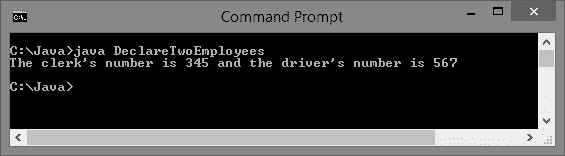

### 构造方法和方法访问

`new` 运算符之后语句的最后部分 `Employee()` 及其带有的括号，看起来非常像一个方法名。事实上，它是用于构造 `Employee` 对象的的方法名。`Employee()` 方法是一个`构造方法`，这是一种创建和初始化对象的特殊方法。你可以为类编写自己的构造方法，你将在本章稍后部分学习。然而，当你没有为类编写构造方法时，Java 会为你写一个。无论你是编写自己的构造方法还是使用 Java 自动创建的，构造方法的名称始终与它所构造的类名称相同。

对象实例化后，可以使用对象的标识符、点号和方法调用来访问其方法。例如，图 3-29 显示了一个实例化两个 `Employee` 对象的应用程序。这两个对象 `clerk` 和 `driver` 分别使用一次 `setEmpNum()` 和 `getEmpNum()` 方法。`DeclareTwoEmployees` 应用程序可以使用这些方法，因为它们是`public` 的，并且必须配合 `Employee` 对象使用其中每一个方法，因为这些方法不是`static` 的。图 3-30 显示了应用程序的输出。

```java
public class DeclareTwoEmployees {

    public static void main(String[] args) {

        Employee clerk = new Employee();

        Employee driver = new Employee();

        clerk.setEmpNum(345);

        driver.setEmpNum(567);

        System.out.println("The clerk's number is " + clerk.getEmpNum() + " and the driver's number is " + driver.getEmpNum());

    }

}
```

**图 3-29** `DeclareTwoEmployees` 类
**图 3-30** `DeclareTwoEmployees` 应用程序的输出。图 3-29 中的程序假设 `Employee.java` 文件存储与应用程序相同的文件夹中。如果 `Employee.java` 文件存储在不同的文件夹中，你需要在文件顶部使用一个 `import` 语句，类似于你用于 `Scanner` 和 `JOptionPane` 类时使用的那些。

## 理解数据隐藏

在 `DeclareTwoEmployees` 类中，你必须使用公共方法 `setEmpNum()` 和 `getEmpNum()` 才能设置和检索每个 `Employee` 的 `empNum` 字段的值，因为你无法直接访问 `empNum` 字段。例如，以下语句是不允许的：

```
clerk.empNum = 789;
```

该语句产生错误信息“empNum has private access in Employee”，意味着你无法从 `DeclareTwoEmployees` 类访问 `empNum`。如果你将 `empNum` 为 `public` 而不是 `private`，赋值语句有效，但你违反了面向对象编程的一个重要原则——使用封装实现数据隐藏。数据字段通常应该是`private` 的，客户端应用程序应该通过公共接口——即通过类的公共方法来访问它们。

然而，你可能会合理地问：“当我写应用程序时，如果我不能直接设置对象的数据字段，但可以通过公共方法设置，这有什么区别？字段值无论如何都被设置了！”实际上，图 3-26 中 `Employee` 类中的 `setEmpNum()` 方法确实会接受你发送给它的任何整数值。但是，你可以重写 `setEmpNum()` 方法以防止无效数据被分配给对象的数据字段。例如，可能你的组织对员工 ID 号有规定——例如它们至少要有五位，或者必须以 9 开头——或者你可能计算一个附加在每个员工 ID 号上的校验位。强制这些要求的语句将是 `setEmpNum()` 方法的一部分。检查值的有效性需要进行决策。你将在“做出决策”章节中学习更多。

校验位是附加在字段后的数字，通常是 ID 号或账户号。校验位确保了该数字是有效的。例如，一个组织可能会使用五位员工 ID 号，其中第五位通过将前四位除以 7 并取余数计算得出。例如，如果你的 ID 号前四位是 7235，那么第五位就是 4，即前四位除以 7 的余数。因此，五位 ID 变成了 72354。后来，如果你在公司应用程序中误地将你的 ID 输入为 82354，应用程序将把前四位 8235 除以 7。余数不是 4，该 ID 将被发现为无效。

同样，`get` 方法可能会控制如何检索某个值。你可能不希望客户端访问员工 ID 码的一部分，或者你可能希望在将每个 ID 返回给客户端之前，始终为其添加一个公司代码。即使某个字段没有数据值要求或限制，将数据设置为私有并提供公共的 set 和 get 方法也可以建立一个框架，使得未来进行此类修改变得更加容易。你并不一定为类中的每个字段都编写 set 和 get 方法；某些字段是不允许客户端修改的。某些字段只需被赋值，而某些字段的值可能会根据其他字段的值计算。

观看视频 *Classes and Objects*（类与对象）。

# 声明对象并使用其方法：真一假

## 声明对象并使用其方法

1. 当你声明一个对象时，你会给它一个名称并留出足够的内存来存储该对象。
2. 对象名称是一个引用；它保存了一个内存地址。
3. 当你没有为类编写构造函数时，Java 会为你创建一个；构造函数的名称始终与其类名相同。

### *动手做做*：声明和使用对象

在最后一个“动手做做”部分中，你创建了一个名为 `SpaService` 的类。现在，你创建一个实例化并使用 `SpaService` 对象的应用程序。

**1.** 在你的文本编辑器中打开一个新文件，并输入接受用户键盘输入的交互式程序所需的导入语句：`import java.util.Scanner;`。

**2.** 创建名为 `CreateSpaServices` 的类的外壳：`public class CreateSpaServices {}`。

**3.** 在 `CreateSpaServices` 类的的大括号之间，为应用程序创建一个 `main()` 方法的外壳：`public static void main(String[] args) {}`。

*(继续)*

# 第 3 章：使用方法、类和对象
*(接上)*

**4.** 在 `main()` 方法内部，声明变量来存储用户从键盘输入的服务描述和价格：

```java
String service;
double price;
```

**5.** 接下来，声明三个对象。其中两个是使用你在上一步“动手做”步骤中创建的类的 `SpaService` 对象。第三个对象使用内置的 Java `Scanner` 类。这两个类都使用 `new` 运算符为它们的对象分配内存，并且都调用了与类名相同的构造函数。区别在于 `Scanner` 构造函数需要一个参数（`System.in`），而 `SpaService` 类不需要。

```java
SpaService firstService = new SpaService();
SpaService secondService = new SpaService();
Scanner keyboard = new Scanner(System.in);
```

**6.** 在接下来的语句中，提示用户输入服务，从键盘接收输入，提示用户输入价格，并从键盘接收。

```java
System.out.print("Enter service >> ");
service = keyboard.nextLine();
System.out.print("Enter price >> ");
price = keyboard.nextDouble();
```

**7.** 回想 `SpaService` 类中的 `setServiceDescription()` 方法是非静态的，这意味着它是与对象一起使用的，并且需要一个 `String` 参数。编写语句，将用户输入的服务发送给 `firstService` 对象的 `setServiceDescription()` 方法：`firstService.setServiceDescription(service);`。

**8.** 同样，将用户输入的价格发送给 `firstService` 对象的 `setPrice()` 方法。回想该方法是非静态的需要一个 `double` 参数。
`firstService.setPrice(price);`。

**9.** 调用 `nextLine()` 方法以移除最后一次数字输入后留在输入缓冲区中的回车键。然后重复提示，并为第二个 `SpaService` 对象接收数据。

```java
keyboard.nextLine();
System.out.print("Enter service >> ");
service = keyboard.nextLine();
System.out.print("Enter price >> ");
price = keyboard.nextDouble();
secondService.setServiceDescription(service);
secondService.setPrice(price);
```

*(继续)*

## 使用构造函数的简介
*(接上)*

**10.** 显示 `firstService` 对象的详情。

```java
System.out.println("First service details:");
System.out.println(firstService.getServiceDescription() + " $" + firstService.getPrice());
```

**11.** 显示 `secondService` 对象的详情。

```java
System.out.println("Second service details:");
System.out.println(secondService.getServiceDescription() + " $" + secondService.getPrice());
```

**12.** 将文件保存为 `CreateSpaServices.java`。编译并运行该程序。确保你理解了用户输入的值是如何赋值并从两个 `SpaService` 对象中检索的。

**图 31**: CreateSpaServices 程序的典型执行

当你创建一个类（例如 `Employee`）并按如下方式实例化一个对象时，你正在调用默认提供的构造函数：`Employee chauffeur = new Employee();`

**默认构造函数**是指不需要参数的构造函数。当你没有编写自己的构造函数时，Java 编译器会自动为任何类创建一个默认构造函数。当调用 Employee 类的默认构造函数时，它会建立一个包含内容的 Employee 对象：

- 数字字段设置为 0。
- 字符字段设置为 `\u0000`。
- 布尔字段设置为 false。
- 对象引用的字段（例如 `String` 字段）被设置为 null。

如果你不希望对象中的每个字段都持有这些默认值，或者你想在创建类实例时执行额外的任务，你可以编写自己的构造函数。你编写的任何构造函数必须与它构造的类名相同，且构造函数没有返回值——即使是 `void`。通常，你将构造函数声明为公共，以便其他类可以实例化该类的对象。

例如，如果你希望每个 Employee 对象都有每周 300.00 美元的默认起薪，你可以编写图 3-32 所示的 Employee 类构造函数：

```java
public Employee() {
    empSalary = 300.00;
}
```

**图 3-32**: 分配薪水的 Employee 类构造函数 图 3-32 中的 Employee 类构造函数没有参数。因此，它是默认构造函数。

将在下一章学习带参数的非默认构造函数。你可以在构造函数中编写任何 Java 语句。虽然通常没有理由这样做，但你可以在构造函数内部显示消息或执行任何其他任务。

你可以将构造函数放在类内部的任何位置，位于任何其他方法之外。

通常情况下，构造函数会与其他方法放在一起。程序员通常会将构造函数列在第一位，因为它是在创建对象时使用的第一个方法。

你并不总是需要为类编写构造函数；如果该类不包含显式的构造函数，Java 就会为你提供一个默认版本。

一个类可以包含多个构造函数。你将在下一章学习如何重载构造函数。

# 使用构造函数简介
观看视频 `Constructors`。

## 两个真理一个谎言

### 使用构造函数简介
1. 在 `Java` 中，你不能编写默认构造函数；它必须由系统自动提供。
2. 自动提供的默认构造函数会将所有数值字段设置为 0，字符字段设置为 Unicode `\u0000`，布尔字段设置为 false，并将对象引用的字段设置为 `null`。
3. 当你编写一个构造函数时，它的名称必须与它构建的类名相同，且不能有返回类型。

## 你来做做
### 为类添加一个构造函数

**1.** 打开你在在本章稍前的“你来做做”部分创建的 `SpaService.java` 文件。

**2.** 在字段声明之后、方法声明之前，插入一个显式的默认构造函数，将 `serviceDescription` 设置为“XXX”，并将 `price` 设置为 0。因为对象中的数值字段默认设置为 0，所以最后一次赋值并不是真的必要的。然而，程序员有时会编写类似于将 `price` 设置为 0 的语句，以便让阅读程序的人清楚地理解他们的意图。

*(继续)*

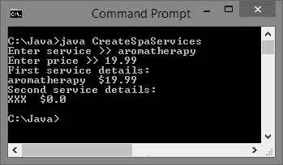

# 第 3 章
## 使用方法、类和对象

*(继续)*

```java
public SpaService() {
    serviceDescription = "XXX";
    price = 0;
}
```

**3.** 保存该类并编译它。

**4.** 打开 `CreateSpaServices.java` 文件。在每行代码开头添加双斜杠，注释掉用于提示、接收和设置 `secondService` 对象值的七条语句，如下所示。通过注释掉这些行，你改变了程序，使户户不再需要为 `secondService` 对象输入值。相反，由构造函数分配的值将是该对象的最终值。

```java
// keyboard.nextLine();
// System.out.print("Enter service >> ");
// service = keyboard.nextLine();
// System.out.print("Enter price >> ");
// price = keyboard.nextDouble();
```


# 第 3 章：使用方法、类和对象

## 你来做
### 理解类是数据类型

在本节中，你将修改 `CreateSpaServices` 类以包含一个用于数据输入的方法。此更改使 `main()` 方法变得更短，让你具备重用代码的能力，并展示了 `SpaService` 类类型的对象可以像原始数据类型一样容易地从方法返回。

1. 如果文本编辑器中尚未打开 `CreateSpaServices.java` 文件，请打开该文件。

2. 删除 `service`、`price` 和 `keyboard` 的声明。这些变量的声明现在将成为你将要创建的数据输入方法的一部分。

3. 删除提示用户并获取 `firstService` 对象值的 6 条语句。同样删除提示用户并检索 `secondService` 对象数据的 7 条语句。你在上一个“你来做”部分中已经注释掉了这些语句。

4. 在刚才删除的语句所在处，插入两条新语句。第一条语句将 `firstService` 对象的副本发送到名为 `getData()` 的方法。该方法返回一个填充了适当数据的 `SpaService` 对象，并将该对象赋给 `firstService`。第二条语句对 `secondService` 执行相同的操作。

```java
firstService = getData(firstService);
secondService = getData(secondService);
```

5. 在 `main()` 方法的结束大括号之后、类的结束大括号之前，开始编写以下 `public static getData()` 方法。头部显示该方法既接受又返回一个 `SpaService` 对象。包含方法的起始大括号，并为 `service`、`price` 和 `keyboard` 进行声明。

```java
public static SpaService getData(SpaService s) {
    String service;
    double price;
    Scanner keyboard = new Scanner(System.in);
}
```

6. 继续该方法，提示用户输入并接受服务及其价格。包含最后一次对 `nextLine()` 的调用，以便在最后一次数字输入后清除输入缓冲区。

```java
System.out.print("Enter service >> ");
service = keyboard.nextLine();
System.out.print("Enter price >> ");
price = keyboard.nextDouble();
keyboard.nextLine();
```

7. 使用 `SpaService` 类的 `setServiceDescription()` 和 `setPrice()` 方法，将输入的服务和价格赋给 `SpaService` 对象参数，从而完成方法。然后将整个对象返回给 `main()` 方法，并将其赋给方法调用中使用的对象。为方法添加结束大括号。

```java
s.setServiceDescription(service);
s.setPrice(price);
return s;
}
```

## 理解类是数据类型

你创建的类变成了数据类型。程序员有时将类称为`抽象数据类型`，或 `ADTs`。抽象数据类型是一种实现被隐藏且通过其公共方法访问的类型。你创建的类也可以被称为`程序员定义的数据类型`；换句话说，它不是语言内置的类型。类是一个复合类型——也就是说，类是由较小的部分组成的。

Java 的原始类型不是复合的。Java 有八种内置的原始数据类型，如 `int` 和 `double`。原始类型也可以称为`标量`类型。你不需要定义这些简单类型；Java 的创建者已经完成了定义。例如，当 `int` 类型首次创建时，设计它的程序员必须考虑以下因素：

- Q：我们应该称它什么？
- 答：`int`。
- Q：它的属性是什么？
- 答：一个 `int` 存储在四个字节中；它持有整数值。
- Q：`int` 需要哪些方法？
- 答：一个给变量赋值的方法（例如，`num = 32;`）。
- Q：还有其他方法吗？
- 答：一些对变量进行算术运算的运算符（例如，`num + 6`）。
- Q：还有其他方法吗？
- 答：当然，`int` 还有更多的属性和方法，但这些是一个良好的开始。

你构建新数据类型的工作也是类似的。如果你需要一个员工的类，你应该问：

- Q：我们应该称它什么？
- 答：`Employee`。
- Q：它的属性是什么？
- 答：一个 `Employee` 有一个整数编号、一个 String 姓名和一个 double 薪水。
- Q：`Employee` 需要哪些方法？
- 答：一个显示该类成员中数据的方法（例如，ID 32，姓名“Walters”，薪水 30,000）。
- Q：还有其他方法吗？
- 答：可能有，但这些足够入门了。

当你声明一个原始类型对象时，你提供了它的类型和标识符。当你从其中一个类声明一个对象时，你也这样做。在每个存在后，你可以以非常相似的方式使用它们。例如，假设你声明了一个名为 `myInt` 的 `int` 和一个名为 `myEmployee` 的 `Employee`。那么每个都可以像原始对象一样传递给方法。类并不神秘；它们只是你发明的新数据类型。

```java
import java.util.Scanner;

class MethodsThatUseEmployee {
    public static void main(String args[]) {
        Employee myEmployee;
        myEmployee = getEmployeeData();
        displayEmployee(myEmployee);
    }

    public static Employee getEmployeeData() {
        Employee tempEmp = new Employee();
        int id;
        double sal;
        Scanner input = new Scanner(System.in);
        System.out.print("Enter employee ID >> ");
        id = input.nextInt();
        tempEmp.setEmpNum(id);
        System.out.print("Enter employee salary >> ");
        sal = input.nextDouble();
        tempEmp.setEmpSalary(sal);
        return tempEmp;
    }

    public static void displayEmployee(Employee anEmp) {
        System.out.println("\nEmployee #" + anEmp.getEmpNum() + " Salary is " + anEmp.getEmpSalary());
    }
}
```

**图 3-34** `MethodsThatUseEmployee`

**图 3-35** `MethodsThatUseEmployee` 程序的典型执行。注意图 3-34 中的应用程序，在 `main()` 方法中声明的 Employee 并不是在那里构建的。Employee 是在 `getEmployeeData()` 方法中构建的，并返回给 `main()` 方法，在并在它被赋值给 `myEmployee` 引用。


## 8. 保存文件、编译并执行

图 3-36 显示了典型的执行过程。

执行过程与程序的原始版本并无异，但通过创建一个接受未填充的 `SpaService` 对象并返回一个填充了数据的方法，你使 `main()` 方法变得更短并重用了数据输入代码。

**图 3-36** 使用数据输入方法的 `CreateSpaServices` 程序的典型执行情况

## 不要这样做

不要在方法头部的末尾放置分号。当你习惯了在每条语句末尾加分号后，很容易开始在过多的地方放置分号。方法头部永远不会以分号结尾。

不要认为“默认构造函数”仅指系统自动提供的构造函数。虽然类自动提供的构造函数是默认构造函数，你创建的任何不接受参数的构造函数也是如此。

不要认为类的方法必须接受其自身字段的值作为参数，或将其返回给其自身字段。当一个类同时包含字段和方法时，每个方法都可以直接访问类中的每个字段。

先不要创建一个具有与类字段相同标识符的参数的类方法。如果你这样做，你将只被允许访问方法内的局部变量，而无法访问该字段。在读完下一章后，你将可以使用相同的标识符并仍然访问两个值。现在，请确保任何方法中的参数标识符与任何字段不同。

## 核心术语

- **方法（method）**：一个程序模块，包含一组执行特定任务的语句。
- **调用（invoke/call）**：当你调用一个方法时，你是在执行它。
- **调用方法（calling method）**：通过**方法调用（method call）**调用**被调用方法（called method）**。
- **客户端方法（client method）**：调用另一个方法的方法。
- **抽象（Abstraction）**：允许你使用方法名来封装一系列语句的编程特性。
- **方法头部（method header）**：方法的第一行，包含了关于其他方法如何与其进行交互的信息。
- **声明（declaration）**：方法头部的另一种说法。
- **方法体（method body）**：紧随头部的大括号之间的语句集，用于执行该方法。
- **实现（Implementation）**：描述了方法内部的动作。
- **存根（stub）**：一个不包含语句的方法；程序员创建存根作为临时占位符。
- **访问修饰符（Access modifier）**：有时也用作访问限定符（access specifier）。
- **返回类型（return type）**：表示在方法完成后发送回调用方法的数据类型。

## 核心术语（续）

- **返回值（return a value）**：将值从被调用方法传回调用方法。
- **完全限定标识符（fully qualified identifier）**：包括类名和一个点。
- **实参参数（Arguments）**：发送给方法的数据项。
- **参数（Parameters）**：方法接收的数据项。
- **实现隐藏（Implementation hiding）**：面向对象编程的原则，描述了类内部的方法细节封装。
- **方法的接口（interface）**：包括方法的返回类型、名称和参数。它是客户端看到并使用的部分。
- **黑盒（black box）**：一种可以在了解其原理的情况下使用的设备。
- **局部变量（local variable）**：仅在方法边界内已知。
- **方法的签名（signature）**：方法名与参数的数量、类型和顺序的组合。
- **实际参数（Actual parameters）**：调用中的参数。
- **形式参数（Formal parameters）**：方法声明中接收实际参数值的变量。
- **返回语句（return statement）**：结束方法，并经常将值从被调用方法传回调用方法。
- **方法的类型**：其返回类型。
- **不可到达语句（Unreachable statements）**：指由于逻辑路径永远无法遇到而执行的语句；不可到达语句会导致编译错误。
- **死代码（Dead code）**：逻辑上不可到达的语句集。
- **is 关系（is-a relationship）**：对象与其所属类之间的关系。
- **类的实例化（instantiation）**：一个对象；换句话说，它是类的一个具体实例。
- **类客户端（class client）**或**类用户（class user）**：实例化另一个预写类的应用程序或类。
- **类可以被扩展（extended）**：或作为任何其他类的基础。
- **数据字段（Data fields）**：声明在类之外的数据变量。
- **类的实例变量（instance variables）**：其数据组件。
- **私有访问（private access）**：为字段分配私有访问意味着其他类都无法访问字段的值，只有同类的方法被允许设置、获取或以其他方式使用私有变量。
- **信息隐藏**：在为数据字段创建私有访问时使用的面向对象编程原则；类的私有数据只能通过类自身的方法进行更改或操作，而不能通过属于其他类的方法进行。
- **修改器方法（Mutator methods）**：设置值。
- **访问器方法（Accessor methods）**：检索值。
- **非静态方法（Nonstatic methods）**：即那些与对象实例化一起的方法，称为**实例方法**。
- **主键**：数据库中数据的唯一标识符。
- **new 运算符**：用于分配存储对象所需的内存。
- **对象的引用（reference to an object）**：存储对象的内存地址的名称。
- **构造函数（constructor）**：一种用于建立对象的方法。
- **默认构造函数**：不需要参数的构造函数；如果你不写，Java 编译器将自动为类创建一个默认构造函数。
- **抽象数据类型 (ADT)**：一种实现被隐藏且通过其公共方法访问的类型。
- **程序员定义的数据类型**：由程序员创建且未内置到语言中的类型。

# 第 3 章
## 使用方法、类和对象

## 本节总结

方法是执行任务的一系列语句。任何方法都可以调用（或触发）另一个方法。你将方法放在类内部，位于任何其他方法之外。

方法必须包含一个声明（或头或定义）和一对包围方法体的大括号。方法声明包含可选的访问修饰符、方法的返回类型、方法名以及一对可能包含参数列表的括号。

当方法可以接收参数时，其声明必须在括号内包含参数类型和标识符。方法可以接受多个用逗号隔开的参数。发送到方法的参数必须（在数量和类型上）都与方法声明中列出的参数匹配。

方法的返回类型（方法的类型）可以是任何 Java 类型，包括 `void`。

`return` 语句将值传回给调用方法。

对象是类的具体实例。对象从其类中获得属性，所有对象都具有可预测的属性，因为它们是某些类的成员。除了属性外，对象还与其关联的方法，且每个作为类实例的对象都被认为拥有相同的方法。

类头包含一个可选的访问修饰符、`class` 关键字以及你为类名选择的任何合法标识符。类包含字段（通常是私有的）和方法（通常是公有的）。

非静态实例方法对每个对象单独运行。在类中，字段可以放在方法之前或之后，方法可以按任何逻辑顺序排列。

## 复习题

创建一个类的实例对象，你需要提供一个类型和一个标识符，然后使用 `new` 运算符和类构造函数为该对象分配计算机内存。通过编写良好的面向对象编程方法，使用实现隐藏——或在类内部封装方法细节——意味着调用方法只需要理解被调用方法的接口。

构造函数建立对象并为对象的数据字段提供特定的初始值。构造函数的名称始终与它所属的类名相同。默认情况下，数值字段被设置为 0（零），字符字段被设置为 Unicode `\u0000`，布尔型字段被设置为 `false`，对象类型字段被设置为 `null`。

类是一种抽象的、程序员定义的数据类型，类似于 Java 内置的原始数据类型。

### 复习题

1. 在 Java 中，方法必须包含所有内容，但以下项除外。
   a. 声明
   b. 对另一个方法的调用
   c. 大括号
   d. 方法体

2. 所有方法声明都包含。
   a. `static` 关键字
   b. 一个或多个显式命访问修饰符
   c. 参数
   d. 括号

3. 一个名为 `computeSum()` 的公共静态方法位于 `classA` 中。要在 `classB` 内部调用该方法，请使用语句。
   a. `computeSum(classB);`
   b. `classB(computeSum());`
   c. `classA.computeSum();`
   d. 你不能在 `classB` 内部调用 `computeSum()`

4. 对于名为 `displayFacts()` 的静态方法，如果该方法接收一个 `int` 参数，以下哪个方法声明是正确的？
   a. `public static int displayFacts()`
   b. `public void displayFacts(int data)`
   c. `public static void displayFacts(int data)`
   d. 以上两项都是正确的。

5. 声明为 `public static int aMethod(double d)` 的方法类型为。
   a. static
   b. `int`
   c. `double`
   d. 你无法确定方法类型。

6. 下列哪项是对声明为 `public static void aMethod(char code)` 的方法的正确调用？
   a. `void aMethod();`
   b. `void aMethod('V');`
   c. `aMethod(char 'M');`
   d. `aMethod('Q');`

7. 方法声明为 `public static void showResults(double d, int i)`。以下哪个是正确的方法调用？
   a. `showResults(double d, int i);`
   b. `showResults(12.2, 67);`
   c. `showResults(4, 99.7);`
   d. 以上两项都是正确的。

8. 声明为 `public static char procedure(double d)` 的方法类型为。
   a. static
   b. `double`
   c. `char`

9. 方法 `public static boolean testValue(int response)` 返回。
   a. `boolean` 值
   b. 一个 `int` 值
   c. 无值
   d. 你无法确定是什么。

10. 下列哪项可以作为声明为 `public static int getVal(double sum)` 的方法的最后语句？
    a. `return;`
    b. `return 77;`
    c. `return 2.3;`
    d. 以上任何一项均可。

11. 类非静态数据组件通常被称为。
    a. 访问类型
    b. 实例变量
    c. 方法
    d. 对象

12. 对象包含方法和数据项，后者被称为。
    a. 字段
    b. 方法
    c. 类
    d. 实例

13. 你通过对象的 ___ 发送消息或信息。
    a. 字段
    b. 方法
    c. 类
    d. 类型

14. 实例化预写类对象的程序或类是。
    a. 客户端
    b. 超类
    c. 对象
    d. 顾客

15. 类体总是写在。
    a. 单行，作为类的第一条语句
    b. 括号内
    c. 大括号之间
    d. 方法调用

16. 大多数类字段是。
    a. `private`
    b. `public`
    c. `static`

17. 类私有数据通过类自身方法更改的概念被称为。
    a. 结构化逻辑
    b. 面向对象
    c. 信息隐藏
    d. 数据掩码

18. 假设你声明了一个对象 `Book thisBook`。在向 `thisBook` 存储数据之前，你。
    a. 必须为其分配内存
    b. 不需要为其分配内存
    c. 只有当有构造函数时才必须分配内存
    d. 可以声明它不使用内存

19. 如果类名为 `Student`，则类构造函数名为。
    a. 任何合法 Java 标识符
    b. 任何以 *S* 开头的合法 Java 标识符
    c. `StudentConstructor`
    d. `Student`

20. 创建对象时使用自动提供的默认构造函数，
    a. 数值字段被设置为 0（零）
    b. 字符字段被设置为为空格
    c. 布尔型字段被设置为 `true`

## 练习
### 编程练习

1. 假设你创建了一个只有以下变量的程序。

```java
int a = 5;
int b = 6;
```

假设你还有一个如下头的方法：`public static void mathMethod(int a)`

以下方法调用哪些是合法的？
a. `mathMethod(a);`
b. `mathMethod(b);`
c. `mathMethod(a + b);`
d. `mathMethod(a, b);`
e. `mathMethod(2361);`
f. `mathMethod(12.78);`
g. `mathMethod(29987L);`
h. `mathMethod();`
i. `mathMethod(x);`
j. `mathMethod(a / b);`

2. 假设你创建了一个仅包含变量的程序。

```java
int age = 34;
int weight = 180;
double height = 5.9;
```


# 第 3 章：使用方法、类和对象

## 练习

### 3. 假设一个名为 `Bicycle` 的类包含一个私有的非静态的整数 `height`，一个公共的非静态字符串 `model`，以及一个公共的静态整数 `wheels`。在一个名为 `BicycleDemo` 的类中，如果实例化了一个对象 `Bicycle myBike = new Bicycle();`，以下哪些是合法的语句？

a. `myBike.height = 26;`
f. `Bicycle.model = "Hurricane";`
b. `myBike.model = "Cyclone";`
g. `Bicycle.int = 3;`
c. `myBike.wheels = 3;`
h. `Bicycle.model = 108;`
d. `myBike.model = 108;`
i. `Bicycle.wheels = 2;`
e. `myBike.height = 24;`
j. `Bicycle yourBike = myBike;`

### 4. a. 创建一个名为 `NumbersDemo` 的应用程序，其 `main()` 方法包含两个整数变量。给这些变量赋值。依次将每个值传递给名为 `displayTwiceTheNumber()`、`displayNumberPlusFive()` 和 `displayNumberSquared()` 的方法。创建每个方法以执行其名称所暗示的任务。将应用程序保存为 `NumbersDemo.java`。

b. 修改 `NumbersDemo` 类，以从键盘接受用户输入的两个整数的值。将文件保存为 `NumbersDemo2.java`。

### 5. a. 创建一个名为 `Percentages` 的应用程序，其 `main()` 方法包含两个 double 类型变量。给这些变量赋值。将这两个变量传递给名为 `computePercent()` 的方法，该方法显示这两个值以及第一个数字占第二个数字的百分比值。例如，如果数字是 `2.0` 和 `5.0`，该方法应该显示类似于“2.0 是 5.0 的 40%”的语句。

然后再次调用该方法，按反顺序传递值。将应用程序保存为 `Percentages.java`。

b. 修改 `Percentages` 类，以从键盘接受用户输入的两个 double 类型的值。将文件保存为 `Percentages2.java`。

### 6. 为了鼓励学生取得优异成绩，赫莫莎高中（Hermosa High School）决定为每位学生发放书店积分，积分金额为学生平均学分的 10 倍。换句话说，平均学分为 3.2 的学生将获得 32 美元的积分。创建一个类，提示学生输入姓名和平均分，然后将这些值传递给一个显示描述性信息的方法。该信息使用学生的姓名，回显平均分，并计算并显示积金金额。将应用程序保存为 `BookstoreCredit.java`。

### 7. 一英寸有 2.54 厘米，一美国加仑有 3.7854 升。创建一个名为 `MetricConversion` 的类。它的 `main()` 方法从键盘接受用户输入的一个整数值，并依次将输入的值传递给两个方法。

一个方法将值从英寸转换为厘米，另一个方法将相同的值从加仑转换为升。每个方法都带有适当的解释显示结果。将应用程序保存为 `MetricConversion.java`。

### 8. 假设一加仑漆可以覆盖约 350 平方英尺的墙面。创建一个带有 `main()` 方法的应用程序，提示用户输入矩形房间的长度、宽度和高度。将这三个值传递给一个执行以下操作的方法：

- 计算房间的墙面积
- 将计算出的墙面积传递给另一个计算并返回所需的油漆加仑数
- 显示所需的加仑数
- 根据每加仑 32 美元的漆价计算价格，假设油漆可以以与整桶相同的价格购买任何分量的加仑
- 将价格返回给 `main()` 方法

`main()` 方法显示最终价格。例如，粉刷一个长 15 英尺、宽 20 英尺、高 10 英尺的房间的费用为 64 美元。将应用程序保存为 `PaintCalculator.java`。

### 9. 集团人寿保险（Harrison Group Life Insurance）根据客户在当前日历年内的年龄计算年度保单费。保费的计算方法是：取客户年龄的年代，加上 15，然后乘以 20。例如，34 岁的客户将支付 360 美元，其计算方法是将年代（3）加上 15，然后乘以 20。编写一个应用程序，提示用户输入当前年份和出生年份。将这两个值传递给一个计算并返回保费金额的方法，然后显示它。将应用程序保存为 `Insurance.java`。

### 10. Cait 琳的创意制作（Caitlyn’s Crafty Creations）计算产品零售价的方法为：材料成本加上所需的小时数乘以 12 元，再加上 7 美元的运费和手续费。创建一个包含 `main()` 方法的类，提示用户输入产品名称（例如，“包包”）、材料成本和所需的小时数。将数值数据传递给一个计算零售价的方法并返回给 `main()` 方法，在 `main()` 方法中显示名称和价格。将程序保存为 `CraftPricing.java`。

### 11. a. 创建一个名为 `Sandwich` 的类。数据字段包括用于主料的 String（例如“金枪鱼”）、用于面包种类的 String（例如“小麦”）以及用于价格的 double（例如 `4.99`）。包含用于获取和设置这些字段值的方法。将类保存为 `Sandwich.java`。

b. 创建一个名为 `TestSandwich` 的应用程序，实例化一个 `Sandwich` 对象并演示 set 和 get 方法的使用。将应用程序保存为 `TestSandwich.java`。

### 12. a. 创建一个名为 `Student` 的类。Student 具有 ID 号、已获得学分和获得数的字段。（例如，许多学校根据 4 分制计算平均分，因此一门 3 学分的课程获得 A 价值 12 分。）包含为所有字段赋值值的方法。Student 还有一个平均分字段。包含一个方法通过得分除以已获得学分来计算平均分字段。编写显示每个 Student 字段值的方法。将此类保存为 `Student.java`。

b. 写一个名为 `ShowStudent` 的类，实例化你创建的类对象并对其字段赋值。计算 Student 平均分，然后显示与 Student 相关的所有值。将应用程序保存为 `ShowStudent.java`。

c. 为你创建的 `Student` 类创建一个构造函数。构造函数应将每个学生的 ID 号初始化为 9999，得分初始化为 12，学分初始化为 3（导致平均分为 4.0）。编写一个程序，通过实例化对象并显示初始值来证明构造函数有效。将应用程序保存为 `ShowStudent2.java`。

### 13. a. 创建一个名为 `Lease` 的类，其字段持有公寓租客的姓名、公寓号、月租金额和租赁期限（月月）。包含一个构造函数，将姓名初始化为“XXX”，公寓号初始化为 0，租金初始化为 1000，期限初始化为 12。还包含用于获取和设置每个字段的方法。包含一个非静态方法 `addPetFee()`，将月租值增加 10 美元，并调用一个名为 `explainPetPolicy()` 的静态方法，该方法用于解释宠物费。将类保存为 `Lease.java`。

b. 创建一个名为 `TestLease` 的类，其 `main()` 方法声明了四个 `Lease` 对象。调用 `getData()` 方法三次。在方法内部，提示用户输入每个 `Lease` 字段的值，并返回一个 `Lease` 对象给 `main()` 方法，然后将其赋值给 `main()` 中的一个 `Lease` 对象。不要提示用户输入第四个 `Lease` 对象的值，而是让它继续保持默认值。然后，在 `main()` 中，将其中一个 `Lease` 对象传递给 `showValues()` 方法，由该方法显示数据。接着，使用传递进去的 `Lease` 对象调用 `addPetFee()` 方法，并确认费用说明语句已显示。接下来，再次为该 `Lease` 对象调用 `showValues()` 方法，并确认宠物费用已加到租金中。最后，用其他三个对象中的每一个对象调用 `showValues()` 方法；确认其中两个对象持有你提供的输入值，而另外一个对象持有构造函数的默认值。将该应用程序保存为 `TestLease.java`。

## 调试练习

1. 在你的可下载学生文件中，保存在 `Chapter03` 文件夹中的每个文件都存在语法和或逻辑错误。对于每种情况，确定并修复问题。纠正错误后，使用相同的文件名但在文件名前前加上 *Fix* 保存每个文件。例如，`DebugThree1.java` 将变为 `FixDebugThree1.java`。

a. `DebugThree1.java`

b. `DebugThree2.java`

c. `DebugThree3.java`

d. `DebugThree4.java`

> 当你更改文件名时，请更改文件内所有类名的出现处，使其与新文件名匹配。在 Java 中，文件名和类名必须始终保持一致。

## 游戏区

1. 纸牌被用于许多电脑游戏，包括单机牌、红心模型和扑克等经典游戏的版本。设计一个 `Card` 类，该类包含一个字符数据字段用于存储花色（`s` 代表黑桃，`h` 代表红心，`d` 代表方片或 `c` 代表梅花）以及一个用于存储 1 到 13 数值的整数数据字段。（当你在“字符、字符串和 StringBuilder”章节中学习更多字符串处理知识时，你可以修改该类以存储花色的单词，例如 *spades* 或 *hearts*，以及某些数值的单词——例如 *ace* 或 *king*。）为每个字段包含 get 和 `set` 方法。将该类保存为 `Card.java`。

编写一个应用程序，随机选择两张纸牌并显示它们的数值。只需为每张牌分配一个花色，但要为每张牌的数值生成一个随机数。附录 D 包含了关于生成随机数的信息。为了完全理解这一过程，你必须学习更多 Java 类和方法。然而，现在，你可以复制以下语句来生成一个 1 到 13 之间的随机数并将其赋值给变量：

```java
final int CARDS_IN_SUIT = 13;
myValue = ((int)(Math.random() * 100) % CARDS_IN_SUIT + 1);
```

在阅读“做决策”章节后，你将能够让游戏判断哪张牌更大。现在，只需观察多次执行程序时纸牌数值的变化。将该应用程序保存为 `PickTwoCards.java`。

你使用 `Math.random()` 函数生成随机数。该函数调用只使用了类名和方法名——没有对象——所以你知道 `random()` 方法必须是一个静态方法。

2. 电脑游戏通常包含不同的角色或生物。例如，你可能会设计一个游戏，其中外星生物具有特定的特征，如颜色、眼睛数量或寿命。为游戏设计一个角色，创建一个类来持有该角色的至少三个属性。为每个的属性包含 get 和 `set` 方法。将该文件保存为 `MyCharacter.java`。然后编写一个应用程序，在其中创建两个角色。最后，将每个角色传递给一个显示属性的方法。将该应用程序保存为 `TwoCharacters.java`。

## 案例分析

### 1. Carly’s Catering

a. Carly’s Catering 为派对提供餐饮服务。在第 2 章中，你编写了一个应用程序，提示用户输入活动人数，显示带有边框的店标语，然后显示活动价格。现在修改程序，使 `main()` 方法只包含三条可执行语句，每条语句如下：

- 第一条可执行语句调用一个静态 int 方法，提示用户输入活动人数并将其返回给 `main()` 方法。
- 第二条可执行语句调用一个静态 void 方法，显示带有边框的店标语。
- 最后一条可执行语句将人数传递给一个静态 void 方法，由该方法计算价格并显示是否为大型活动。

将文件保存为 `CarlysEventPriceWithMethods.java`。

b. 创建一个类来持有 Event 数据。该类包含：
- 两个 public final static 字段，持有每人的价格和大型活动的阈值。
- 三个 private 字段，持有活动编号、活动人数和价格。活动编号存储为 String，因为 Carly 计划分配如 `M12` 这样的编号。
- 两个 public set 方法设置活动编号 (`setEventNumber()`) 和人数 (`setGuests()`)。价格没有 set 方法，因为 `setGuests()` 方法通过人数乘以每人的价格来计算价格。
- 三个 public get 方法返回这些字段保存为 `Event.java`。

c. 使用你在 1a 中创建的 CarlysEventWithMethods 类作为起点，编写一个演示 1b 中创建的 Event 类的程序，但进行以下更改：

- 你已经有一个获取人数的方法；现在添加一个获取活动编号的方法。`main()` 方法应该声明一个 `Event` 对象，调用两个数据输入方法，并使用它们的返回值设置 `Event` 对象的字段。
- 调用 CarlysEventPriceWithMethods 类中显示边框的方法。该方法是可访问的，因为它是 public，但你必须限定名称，因为它在另一个类中。
- 修改显示活动详情的方法，使其接受新创建的 `Event` 对象。该方法应该显示活动编号，并且仍然显示人数、每人的价格、总价以及是否为大型活动。

将程序保存为 `EventDemo.java`。

### 2. Sammy’s Seashore Supplies

a. Sammy’s Seashore Supplies 向游客租赁皮划艇、独木舟、沙滩椅和伞。在第 2 章中，你编写了一个应用程序，提示用户租赁运动器材的分钟数，显示带有边框的店标语，并显示租赁价格。现在修改程序，使 `main()` 方法只包含三条可执行语句，每条语句如下：

- 第一条可执行语句调用一个方法，提示用户租赁时间（分钟）并将其返回给 `main()` 方法。
- 第二条可执行语句调用一个静态 void 方法，显示带有边框的店标语。
- 最后一条可执行语句将分钟数传递给一个方法，该方法计算租赁的小时、额外分钟和价格，然后显示所有细节。

将文件保存为 `SammysRentalPriceWithMethods.java`。

b. 创建一个类来持有 Sammy’s Seashore Supplies 的租赁数据。该类包含：
- 两个 public final static 字段，持有每小时分钟数和每小时租赁率。
- 四个私有字段，分别用于存储合同号、租赁的小时、超过一小时的分钟数以及价格。合同号以 `String` 类型存储，因为 Sammy 计划分配诸如 `K681` 这样的合同号。
- 两个公有的 set 方法。一个用于设置合同号 `setContractNumber()`。另一个命名为 `setHoursAndMinutes()`，它接受租赁的分钟数，然后设置小时数、额外的分钟数以及总价。回想第 2 章，价格为每小时 40 美元，每多一分钟加 1 美元。
- 四个公有的 get 方法，用于返回四个非静态字段中的值。将文件保存为 `Rental.java`。

c. 使用你在步骤 2a 中创建的 `SammysRentalPriceWithMethods` 类作为程序的起点，用来演示你在步骤 2b 中创建的 `Rental` 类，但要进行以下更改：

- 你已经有一个方法可以从用户处获取分钟数了；现在添加一个获取合同号的方法。`main()` 方法应该将 `181` 声明为一个 `Rental` 对象，调用这两个数据输入方法，并使用它们的返回值来设置 `Rental` 对象中的字段。
- 从 `SammysRentalPriceWithMethods` 类调用 `RentalDemo` 方法，该方法会带边框显示公司格言。该方法是公开的（public），但你必须使用全限定名，因为它位于另一个类中。
- 修改显示租赁详情的方法，使其接收新创建的 `Rental` 对象。该方法应该显示合同号，并且仍然应该显示小时和分钟、小时率和总价。

将程序保存为 `RentalDemo.java`。

# 第 4 章：更多对象概念

在本章中，你将：
- 理解块（blocks）和作用域（scope）
- 重载方法
- 避免歧义
- 创建并调用带参数的构造函数
- 使用 `this` 引用
- 使用静态字段
- 使用自动导入的预写常量和方法
- 使用组合和嵌套类

## 理解块和作用域

在任何类或方法中，一对括号之间的代码被称为**块（block）**。例如，图 4-1 所示的方法包含两个块。**外层块（outer block）**从第一个左大括号开始，到方法结束处的最后一个右大括号结束。

**内层块（inner block）**从第二个左大括号开始，到第一个右大括号结束。它包含两个可执行的语句：`anotherNumber` 的声明和一个 `println()` 语句。内层块是**嵌套的（nested）**，或者说完全包含在外层块内部。

```java
public static void methodWithNestedBlocks() {
    // Outer block
    int aNumber = 10;
    // aNumber 从左大括号开始开始存在
}
```


# 第 4 章：更多对象概念

```java
System.out.println("In outer block, aNumber is " + aNumber);

{

    // Inner block 

    int anotherNumber = 512;

    // anotherNumber 从下一个左大括号开始开始存在

    System.out.println("In inner block, aNumber is " + aNumber + " and another number is " + anotherNumber);

}

// Inner block ends, anotherNumber 不再存在；它离开了作用域

System.out.println("In outer block, aNumber is " + aNumber);

}

// Outer block, aNumber 不再存在；它离开了作用域结束
```

**图 4-1** 带有嵌套块的方法。

一个块可以完全位于另一个块内部，也可以完全位于另一个块之外并独立，但块永远不会重叠。例如，如果一个方法包含两个左大括号（表示两个块的开始），那么第一个左大括号和最后一个右大括号是定义外层块的一对，而第二个左大括号和第一个右大括号是定义内层块的一对。

你无法引用声明它的块之外的变量。正如你在第 3 章中学到的，程序中允许引用变量的部分是该变量的**作用域（scope）**；在程序的这部分，变量存在并可以使用其未限定名进行访问。在 Java 中，当你声明一个变量时，它就会产生或**进入作用域（comes into scope）**，而在它声明所在的块结束时，变量将不再存在或**离开作用域（goes out of scope）**。

程序员说 Java 变量的**作用域级别（scope level）**就是它所在的块。

尽管你可以在任何程序中创建任意数量变量和块，但如果没有理由，这样做并不明智。使用不必要的变量和块会增加变量命名和作用域使用不当的可能性。

在图 4-1 所示的 `methodWithNestedBlocks()` 方法中，变量 `aNumber` 从声明点开始到方法结束一直存在。这意味着 `aNumber` 在外层块和内层块中都存在，可以在方法的任何地方使用。变量 `anotherNumber` 在内层块中产生；`anotherNumber` 在内层块结束时离开作用域，且不能在该块之外使用。图 4-2 显示了图 4-1 中方法执行时的输出。

185

**图 4-2** 使用 `methodWithNestedBlocks()` 的应用程序产生的输出。产生图 4-2 所示输出的程序可以在你下载的学生文件中找到。

你不能使用不在作用域内的数据项。例如，图 4-3 显示了一个包含两个块和一些阴影部分的无效语句的方法。每个块的左右大括号是垂直对齐的。你并不要求垂直对齐块的左右大括号，但如果这样做，你的程序会更易读。

```java
public static void methodWithInvalidStatements()
{
    aNumber = 75; // 无效语句；变量未声明

    int aNumber = 22;

    aNumber = 6;

    {
        anotherNumber = 489; // 无效语句；变量未声明

        int anotherNumber = 99;

        anotherNumber = 2;
    }

    anotherNumber = 50; // 无效语句；该变量在内层块声明，此处已离开作用域

    anotherNumber = 34;

    aNumber = 29; // 无效语句；变量离开了作用域
}
```

**图 4-3** `methodWithInvalidStatements()` 方法。

图 4-3 中第一个外层块中的第一个赋值语句 `aNumber = 75;` 是无效的，因为 `aNumber` 尚未声明。同样，尝试将 `489` 和 `165` 赋值给 `anotherNumber` 的语句也是无效的，因为 `anotherNumber` 尚未声明。在声明 `anotherNumber` 后，可以在内层块的剩余部分使用它，但赋值为 `34` 的语句位于它声明的块之外。图 4-3 中的最后一个阴影语句 `aNumber = 29;` 不起，因为它位于 `aNumber` 声明的块之外；它位于整个 `methodWithInvalidStatements()` 方法之外。

在方法内部多次声明同名的变量，只要每个声明都在各自互不重叠的块中。例如，图 4-4 中两个名为 `someVar` 的变量声明都是有效的，因为每个变量都包含在自己的块中。在第二个实例进入作用域之前，第一个 `someVar` 实例已经离开了作用域。

```java
public static void twoDeclarations()
{
    // 该变量将在下一个右大括号处离开作用域。
    int someVar = 7;

    System.out.println(someVar);

    {
        // 一个新块在这里开始
        int someVar = 845;

        // 这个变量与上一个块中的变量完全不同
        System.out.println(someVar);
    }
}
```

**图 4-4** `twoDeclarations()` 方法。

你不能在一个代码块内多次声明同一个变量名，即使该块包含其他代码块。当你在一个块中多次声明一个变量时，你是在尝试`redeclare the variable`，这是一种项非法操作。例如，如图 4-5 所示，`aValue` 的第二次声明会导致错误，因为你不能在方法的外层块中两次声明同一个变量。同样的理，`aValue` 的第三次声明也是无效的，尽管它出现在一个新的块中。包含第三次声明的块完全位于外层块内部，因此 `aValue` 的第一次声明尚未超出作用范围。

```java
public static void invalidRedeclarationMethod()
{
    int aValue = 35;

    // Invalid redeclaration of aValue because it is
    int aValue = 44; 
    // in the same block as the first declaration
    { 
        int anotherValue = 0;
        int aValue = 10;
        // Invalid redeclaration of aValue; even though this
    }
    // is a new block, this block is inside the first block
}
```

**图 4-5** `invalidRedeclarationMethod()`

### 理解块和作用域

虽然你不能在同一个块内两次声明变量，但你可以在类的一个方法中声明变量，并在类的另一个方法中使用相同的变量名。在这种情况下，每个方法内部声明的变量位于计算机内存中的独立位置。当你声明变量的方法中使用该变量名时，它的优先级会高于（或`overrides`）另一个方法中任何同名的变量。换句话说，在类内部声明的局部 `y` 变量总是会掩盖或隐藏类中其他地方同名的 `187` 变量。

例如，考虑图 4-6 中的类。在 `OverridingVariable` 类的 `main()` 方法中，声明了 `aNumber` 并赋值赋值为 `10`。当程序调用 `firstMethod()` 时，会声明一个同名的新变量，但它具有不同的内存地址和新值。新变量仅存在于 `firstMethod()` 中，在该处显示的值为 `77`。在 `firstMethod()` 执行并在逻辑返回 `main()` 方法后，将显示原始的 `aNumber`，其值为 `10`。当将 `aNumber` 传递给 `secondMethod()` 时，会在方法内部创建一个副本。该副本与原始 `aNumber` 具有相同的标识符，但内存地址不同。因此，在 `secondMethod()` 中，当值更改为 `862` 并显示时，对 `main()` 中的原始变量没有影响。当逻辑在 `secondMethod()` 后返回 `main()` 时，将再次显示原始值。请查看图 4-7 中的输出以理解事件发生的顺序。

```java
public class OverridingVariable
{
    public static void main(String[] args)
    {
        int aNumber = 10; // aNumber is declared in main().
        System.out.println("In main(), " + aNumber);
        firstMethod();
        secondMethod(aNumber);
        System.out.println("Back in main(), " + aNumber);
    }

    public static void firstMethod()
    {
        int aNumber = 77; // Whenever aNumber is declared
        System.out.println("In firstMethod(), " + aNumber);
    }

    public static void secondMethod(int aNumber)
    {
        aNumber = 862; // a copy is made within the method
        System.out.println("In secondMethod(), " + aNumber);
    }
}
```

**图 4-6** `OverridingVariable` 类

2. 你不能在同一个块中多次声明相同的变量名，即使该块内包含了其他块。

3. 类的实例变量会覆盖在类方法内部声明的同名局部变量。

# 理解块和作用域

*演示作用域*

在本节中，你将创建一个包含若干块的方法，以演示块级作用域。

**1.** 启动你的文本编辑器，如果有必要，打开一个新文档。

**2.** 为名为 `DemoBlock` 的类输入前几行：*(未完)*

```java
public class DemoBlock
{
    public static void main(String[] args)
    {
```

**3.** 添加一条显示程序目的的语句：`System.out.println("Demonstrating block scope");` **4.** 在新的一行上，声明一个名为 `x` 的整数，给它赋值 `1111`，并显示它的值：

```java
int x = 1111;
System.out.println("In first block x is " + x);
```

**5.** 在下一行输入一个左大括号开始一个新块。在新块中，声明另一个名为 `y` 的整数，并显示 `x` 和 `y`。`x` 的值为 `1111`，`y` 的值为 `2222`：

```java
{
    int y = 2222;
    System.out.println("In second block x is " + x);
    System.out.println("In second block y is " + y);
}
```

**6.** 在下一行开始另一个新块。在新块中，声明一个与上一个块中声明的整数同名的整数；然后显示 `x` 和 `y`。`y` 的值为 `3333`。调用名为 `demoMethod()` 的方法，并再次显示 `x` 和 `y`。即使你在 `demoMethod()` 中包含了为 `x` 和 `y` 分配不同值的语句，此处此处显示的 `x` 和 `y` 仍然是 `1111` 和 `3333`：

```java
{
    int y = 3333;
    System.out.println("In third block x is " + x);
    System.out.println("In third block y is " + y);
    demoMethod();
    System.out.println("After method x is " + x);
    System.out.println("After method block y is " + y);
}
```

**7.** 在块结束后的新行，输入以下内容：`System.out.println("At the end x is " + x);` `main()` 方法中的最后这条语句显示了 `x` 的值，它仍然是 `1111`。输入右大括号。

*(未完)*

**8.** 完成 `y` 后，输入以下 `demoMethod()`，它创建了了自己的 `x` 和 `y` 变量，分配了不同的值，然后显示它们：

```java
public static void demoMethod()
{
    int x = 8888, y = 9999;
    System.out.println("In demoMethod x is " + x);
    System.out.println("In demoMethod block y is " + y);
}
```

**9.** 输入最后的右大括号，然后将文件保存为 `DemoBlock.java`。

在命令行提示符处，输入命令 `javac DemoBlock.java` 编译文件。如有必要，修正任何错误并重新编译程序。

**10.** 输入命令 `java DemoBlock` 运行程序。

你的输出应该类似于图 4-11。确保你理解每行输出中 `x` 和 `y` 的值是如何确定的。

**11.** 为了更完整地理解块和作用域级别，修改程序中多个位置 `x` 和 `y` 的值，并尝试在保存、重新编译和运行程序之前预测精确的输出。

## 方法重载

**重载**（Overloading）方法允许你使用一个标识符来执行不同的任务。在 Java 中，这具体意味着在相同的作用域内编写多个同名但参数列表不同的方法。在重载方法中，参数标识符不需要，但参数列表必须满足以下一个或两个条件：

- 列表必须具有不同数量的参数。例如，一个列表可以有一个 `double`，另一个列表可以有两个 `doubles`，第三个列表可以有 10 个 `doubles`。
- 列表的参数数据类型顺序必须不同。例如，一个列表可以有两个 `doubles`，另一个可以有一个 `int` 和一个 `double`，第三个可以有一个 `double` 和一个 `int`。

当你使用英语时，你一直都在重载单词。当你说“开门”（open the door）、“睁眼睛”（open your eyes）和“打开文件”（open a file）时，你在说非常不同的动作。然而，当你重载方法时，多个方法共享同一个名称，编译器根据参数判断应该使用哪一个。例如，假设你创建了一个类来计算单利。如果你重载了 `interest()` 方法：

```java
public static void interest(double bal, double rate)
{
    double interest;
    System.out.println("Simple interest on $" + bal + " at " + rate + "% rate is " + interest);
}
```

**图 4-12** 具有两个 double 参数的 `interest()` 方法

假设当应用程序调用 `interest()` 方法并传入两个 double 参数时——例如，`interest(1000.00, 0.04)`——将执行方法的第一个版本（图 4-12 所示）。

然而，如果在调用 `interest()` 时使用整数作为第二个参数——如 `interest(1000.00, 4)`——则执行方法的第二个版本（图 4-13 所示）。在第二个例子中，整数比率数字在用于确定收益利息之前已正确地除以 100.0。

解决使用数字表示参数值时产生冲突的方案是重载 `interest()` 方法。例如，除了 4-12 所示的 `interest()` 方法外，你还可以添加图 4-13 所示的方法。注意 `rate` 的数据类型。

```java
public static void interest(double bal, int rate)
{
    double interest, rateAsPercent;
    // 除以 100.0 将 rate
    // 转换为百分比值
    rateAsPercent = rate / 100.0;
    interest = bal * rateAsPercent;
    System.out.println("Simple interest on $" + bal + " at " + rate + "% rate is " + interest);
}
```


**图 4-13** 具有一个 `double` 参数和一个 `int` 参数的 `interest()` 方法

在图 4-13 中，注意 `rateAsPercent` 是通过除以 `100.0` 而不是 `100` 计算的。如果两个整数相除，结果是截断后的整数；除以双精度 `100.0` 会导致结果为 `double`。

或者，你也可以显式类型转换，例如 `rateAsPercent = (double)rate / 100`。

当然，你可以使用不同名称的方法来解决生成准确利息数字的困境——例如，`calculateInterestUsingDouble()` 和 `calculateInterestUsingInt()`。然而，对于使用你方法的程序员来说，只需要记住一个方法名，并以最适合他们程序的形式使用它，会更简单、更方便。对于功能完全相同（仅取决于传递的参数类型不同）的任务，能够使用一个合理的名称是非常方便的。编译器会根据传递的参数知道应该调用哪个版本的方法。

在第 3 章中，你学习了 `print()` 和 `println()` 方法是为了接受不同类型的参数（包括不带参数）而创建的，这种特性被称为**方法重载**。

# 方法调用中的自动类型提升

在第 2 章中，你学习了当对不同类型进行算术运算时，Java 会变量转换为统一类型。类似地，当你向方法传递参数时，Java 可以将一种数据类型提升另一种类型。例如，如果一个方法有一个 `double` 参数，而你传递了一个整数，该整数会被提升为 `double`。记住提升的顺序是 `double`、`float`、`long` 和 `int`。此列表中的任何类型都可以提升到它之前的任何类型。

当应用程序只包含一个版本的方法时，你可以使用正确类型或可以提升为正确类型的参数调用该方法。例如，考虑图 4-14 所示的简单方法。

```java
public static void simpleMethod(double d) {
    System.out.println("Method double parameter");
}
```

**图 4-14** 带有 `double` 参数的 `simpleMethod()` 方法（省略）

# 重载方法

如果你编写一个程序，将 `doubleValue` 声明为 `double` 变量并将 `intValue` 声明为 `int` 变量（如图 4-15 所示），两个方法调用 `simpleMethod(doubleValue);` 或 `simpleMethod(intValue);` 都会输出“Method double parameter”。使用整数调用之所以有效是因为整数被转换为（或提升为）`double`。图 4-15 中程序的输出如图 4-16 所示。

```java
public class CallSimpleMethod {
    public static void main(String[] args) {
        double doubleValue = 45.67;
        int intValue = 17;
        simpleMethod(doubleValue);
        simpleMethod(intValue);
    }

    public static void simpleMethod(double d) {
        System.out.println("Method double parameter");
    }
}
```

**图 4-15** 使用 `double` 和 `int` 调用 `simpleMethod()` 的 `CallSimpleMethod` 程序
**图 4-16** `CallSimpleMethod` 程序的输出

注意，如果不存在声明 `void simpleMethod(double d)` 但存在 `void simpleMethod(int i)`，那么方法调用 `simpleMethod(doubleValue);` 将失败。虽然 `int` 可以提升为 `double`，但 `double` 不会自动转换为 `int`。如果你考虑到 `double` 值转换为整数时可能会丢失信息，这样做就是合理的。

假设你为图 4-15 中的程序添加了 `simpleMethod()` 的重载版本。该版本接受整数参数，如图 4-17 所示。当你正确地重载方法时，你可以提供不同的参数列表来调用它，并执行适当的版本。现在当你调用 `simpleMethod(intValue);` 时，输出发生了变化。编译器没有将整数参数提升为 `double`，而是识别出使用整数参数的方法调用更精确，因此它调用了产生“Method integer parameter”输出的方法。图 4-18 显示了输出。

```java
public class CallSimpleMethodAgain {
    public static void main(String[] args) {
        double doubleValue = 45.67;
        int intValue = 17;
        simpleMethod(doubleValue);
        simpleMethod(intValue);
    }

    public static void simpleMethod(double d) {
        System.out.println("Method double parameter");
    }

    public static void simpleMethod(int d) {
        System.out.println("Method integer parameter");
    }
}
```

**图 4-17** 使用 `double` 和 `int` 调用 `simpleMethod()` 的 `CallSimpleMethodAgain` 程序
**图 4-18** `CallSimpleMethodAgain` 程序的输出

# 真一假

## 重载方法

1. 当重载 Java 方法时，你编写多个具有相同名称的方法。
2. 当重载 Java 方法时，使用不同的参数调用方法。
3. 与重载方法相比，编写具有唯一标识符的方法更好。

# 你来做

## 重载方法

在本节中，你重载方法来显示日期。与其创建自己的类来存储日期，不如使用 Java 内置的 `LocalDate` 来处理日期。这个练习让你对 Java `LocalDate` 类创建者所考虑的因素有所了解。

1. 在你的文本编辑器中打开一个新文件。
2. 开始 `DemoOverload` 类，使用三个整数变量来测试方法，并调用三次 `displayDate()`：

```java
public class DemoOverload {
    public static void main(String[] args) {
        int month = 6, day = 24, year = 2017;
        displayDate(month);
        displayDate(month, day);
        displayDate(month, day, year);
    }
```

3. 创建 `displayDate()` 方法，需要一个参数来表示月份，并对日期年份使用默认值：

```java
public static void displayDate(int mm) {
    System.out.println("Event date " + mm + "/1/2016");
}
```

4. 创建 `displayDate()` 方法，需要两个参数来表示月份和日期，并对年份使用默认值：

```java
public static void displayDate(int mm, int dd) {
    System.out.println("Event date " + mm + "/" + dd + "/2016");
}
```

5. 创建 `displayDate()` 方法，需要三个参数作为月份、日期和年份：

```java
public static void displayDate(int mm, int dd, int yy) {
    System.out.println("Event date " + mm + "/" + dd + "/" + yy);
}
```

6. 输入 `DemoOverload` 类的结束大括号。
7. 将文件保存为 `DemoOverload.java`。
8. 编译程序，纠正错误，必要时重新编译，然后执行程序。图 4-19 显示了输出。注意，无论你使用一个、两个还是三个参数调用 `displayDate()` 方法，日期都是正确显示的，是因为你成功重载了 `displayDate()` 方法。

**图 4-19** `DemoOverload` 的输出

# 学习歧义

重载方法非常有用，因为你可以使用同一个标识符，根据传递给方法的参数来执行不同的指令。然而，当你重载方法时，可能会面临创建**歧义**情况的风险——即编译器无法确定应该使用哪种方法。例如，考虑以下重载的 `computeBalance()` 方法声明：

```java
public static void computeBalance(double deposit)
public static void computeBalance(double withdrawal)
```

如果你声明一个名为 `myDeposit` 的 `double` 变量并进行诸如 `computeBalance(myDeposit);` 的调用，你就创建了一个歧义情况。这两个方法对于你的调用 `cal` 都是精确匹配的。你可能会认为，使用名为 `myDeposit` 变量的调用“似乎”应该去到参数名为 `deposit` 的方法版本，但 Java 不会根据变量名做出任何假设。每个版本的 `computeBalance()` 都可以接收 `double` 类型，Java 不会假定你打算使用哪一个。

有时，很难识别潜在的歧义情况。例如，考虑以下两个方法声明：

```java
public static void calculateInterest(int bal, double rate)
public static void calculateInterest(double bal, int rate)
```

这些 `calculateInterest()` 方法的参数列表中具有不同的类型。使用带有 `int` 和 `double` 参数（按此顺序）的 `calculateInterest()` 调用将执行方法的第一个版本，而使用带有 `double` 和 `int` 参数的 `calculateInterest()` 调用将执行方法的第二个版本。对于这些每一个调用 `cal`，编译器都能为你发送的参数找到精确匹配项。然而，如果你使用两个整数参数调用 `calculateInterest()`，例如 `calculateInterest(300, 6);`，就会产生歧义情况，因为对于该方法调用 `cal` 没有精确的匹配项。由于方法调用 `cal` 中的两个整数中的任何一个都可以提升为 `double`，因此该调用匹配了方法的两个版本。编译器无法确定应该使用哪个版本的 `calculateInterest()` 方法，程序无法编译。

如果从未过任何歧义调用 `cal`，这两个版本的 `calculateInterest()` 就可以共存。重载方法本身并不是歧义的——只有当你创建了歧义情况时，它才会变成歧义。一个包含潜在歧义情况的程序，只要你不进行任何歧义的方法调用 `cal`，就能无问题地运行。

重要的是，你可以通过为同名方法提供不同的参数列表来正确地重载方法。名称相同但参数列表相同而返回类型不同的方法不是重载——它们是非合法的。

例如，以下两个方法在同一个类中是非法的：

```java
int aMethod(int x)
void aMethod(int x)
```

编译器根据方法调用 `cal` 中的参数来决定调用多个版本方法中的哪一个，而不考虑返回类型。

编译器通过方法的签名确定调用哪个版本的方法。在第 3 章中，你学习了方法签名是方法名以及参数的数量、类型和顺序的组合。

如果关键字 `final` 出现在方法的参数列表中，在确定歧义性时它会被忽略。换句话说，两个头部为 `void aMethod(int x)` 和 `void aMethod(final int x)` 的方法是有歧义的。

观看视频 *重载方法* (Overloading Methods)。

## 真理和一个谎言

### 学习歧义

1. 当它与 `void myMethod(int age, String name)` 在同一个程序中时，以下方法是有歧义的：
   `void myMethod(String name, int age)`

2. 当它与 `void myMethod(int age, String name)` 在同一个程序中时，以下方法是有歧义的：
   `String myMethod(int zipCode, String address)`

3. 当它与 `void myMethod(int age, String name)` 在同一个程序中时，以下方法是有歧义的：
   `void myMethod(int x, String y)`

# 创建和调用带参数的构造

在第 3 章中，你学习了 Java 在创建类时会自动提供一个构造函数。你还学习了可以编写自己的构造函数，并且当你想要确保类中的字段初始化为某些适当的默认值时通常会这样做。你学习了自动提供的构造函数是默认构造函数（不需要参数的构造函数），并且你可以编写自定义的默认构造函数。

然而，当你编写自己的构造函数时，还可以编写接收参数的版本。这些参数通常用于初始化对象的数据字段。

### 创建和调用带参数的构造

例如，考虑图 4-20 所示的只有一个数据字段的 `Employee` 类。

```java
public class Employee {
    private int empNum;

    Employee() {
        empNum = 999;
    }
}
```

每当使用类似 `Employee partTimeWorker = new Employee();` 的语句创建 `Employee` 对象时，即使从未使用其他数据赋值方法，你也确保所有的 `Employee` 对象都具有初始值为 999 的 `empNum`。

**图 4-20** 带有初始化 `empNum` 字段的默认构造函数的 `Employee` 类。

或者，你可能会选择初始 `empNum` 值不同的 `Employee` 对象。为了在实例化对象时实现这一点，你可以将员工编号传递给构造函数。图 4-21 显示了一个包含接收参数构造函数的 `Employee` 类。使用此构造函数，可以使用如下语句传递参数：

`Employee partTimeWorker = new Employee(881);`

当构造函数执行时，调用 `cal` 中的整数被传递给参数 `num`，然后赋值给 `empNum` 字段。当你创建一个如图 4-21 所示构造函数的 `Employee` 类时，你创建的每个 `Employee` 对象都必须在其构造调用中使用一个整数参数。换句话说，对于该类的此版本，以下语句不再有效：`Employee partTimeWorker = new Employee();`

在你为类编写了构造函数之后，不再获得自动提供的默认构造函数。如果类的唯一构造函数需要参数，则你为创建的类的每个对象必须提供参数。如果你想创建一个带参数的构造函数并提供默认构造函数，你可以重载构造函数。

## 重载构造函数

就像任何其他方法一样，你可以重载构造函数。重载构造函数为你提供了一种根据需要创建具有不同初始化参数或无参数的方法。例如，除了图 4-21 所示的构造函数外，还可以为 `Employee` 类创建第二个构造函数；图 4-22 显示了一个包含两个构造函数的 `Employee` 类。

```java
public class Employee {
    private int empNum;

    Employee() {
        empNum = 999;
    }

    Employee(int num) {
        empNum = num;
    }
}
```

当你使用此类创建 `Employee` 对象时，你可以选择以以下方式之一创建对象，无论是否有初始的 `empNum` 值。当你使用以下语句创建一个 `Employee` 对象时：

```java
Employee aWorker = new Employee();
```

将调用无参数的构造函数，`Employee` 对象将接收初始值为 999 的 `empNum`。当你使用以下语句创建一个 `Employee` 对象时：

```java
Employee anotherWorker = new Employee(7677);
```


# 第 4 章：更多对象概念

将使用需要整数的构造函数版本，`anotherWorker` 将接收初始值为 7677 的 `empNum`。

**图 4-22** 包含两个构造函数。

你可以使用构造函数参数来初始化字段值，也可以将它们用于任何其他用途。例如，你可以仅仅根据参数的存在来决定调用两个可能的构造函数中的哪一个，而在构造函数内部不使用参数。只要构造函数的参数列表不同，构造函数就不会产生歧义。

观看视频 *Overloading Constructors*（重载构造函数）。

## 两个真理和一个谎言

### 创建和调用带参数的构造函数

1. 默认构造函数是自动创建的。
2. 当你编写构造函数时，它可以写成接收参数，也可以不接收参数。
3. 如果一个类的唯一构造函数需要参数，则你必须为你创建的类的每个对象提供参数。

## 创建和调用带参数的构造函数 *你来做做*

*创建重载构造函数*

在本节中，你将创建一个带有重载构造函数的类，并演示它们是如何工作的。

**1.** 在你的文本编辑器中打开一个新文件，如下开始 `CarInsurancePolicy` 类。该类包含三个字段，分别存储保单号、保单人每年付款次数以及保单人的居住城市。

```java
public class CarInsurancePolicy {
    private int policyNumber;
    private int numPayments;
    private String residentCity;
}
```

**2.** 创建一个为三个数据字段都需要参数的构造函数。

```java
public CarInsurancePolicy(int num, int payments, String city) {
    policyNumber = num;
    numPayments = payments;
    residentCity = city;
}
```

**3.** 假设销售汽车保险单的代理机构位于 Mayfield 市。创建一个仅需要两个参数的构造函数，只需要编号和付款次数。该构造函数将 "Mayfield" 赋值给 `residentCity`。

```java
public CarInsurancePolicy(int num, int payments) {
    policyNumber = num;
    numPayments = payments;
    residentCity = "Mayfield";
}
```

**4.** 添加第三个只需要数字的构造函数。该构造函数使用 Mayfield 作为城市的默认值（在本章的稍后部分，你将学习如何消除重复赋值）。

```java
public CarInsurancePolicy(int num) {
    policyNumber = num;
    residentCity = "Mayfield";
}
```

**5.** 添加一个 `display()` 方法来输出所有内容：

```java
public void display() {
    System.out.println("Policy #" + policyNumber + ". " + numPayments + " payments annually in " + residentCity + ".");
}
```

**6.** 为类添加右大括号。

**7.** 在你的文本编辑器中打开一个新文件，如下开始 `CarInsurancePolicy` 类。该类包含三个字段，分别存储保单号、保单人每年付款次数以及保单人的居住城市。

```java
public class CarInsurancePolicy {
    private int policyNumber;
    private int numPayments;
    private String residentCity;
}
```

**8.** 创建一个为三个数据字段都需要参数的构造函数。

```java
public CarInsurancePolicy(int num, int payments, String city) {
    policyNumber = num;
    numPayments = payments;
    residentCity = city;
}
```

**9.** 假设销售汽车保险单的代理机构位于 Mayfield 市。创建一个仅需要两个参数的构造函数，只需要编号和付款次数。该构造函数将 "Mayfield" 赋值给 `residentCity`。

```java
public CarInsurancePolicy(int num, int payments) {
    policyNumber = num;
    numPayments = payments;
    residentCity = "Mayfield";
}
```

**10.** 添加第三个只需要数字的构造函数。该构造函数使用 Mayfield 作为城市的默认值（在本章的稍后部分，你将学习如何消除重复赋值）。

```java
public CarInsurancePolicy(int num) {
    policyNumber = num;
    residentCity = "Mayfield";
}
```

**11.** 添加一个 `display()` 方法来输出所有内容：

```java
public void display() {
    System.out.println("Policy #" + policyNumber + ". " + numPayments + " payments annually in " + residentCity + ".");
}
```

**12.** 为类添加右大括号。

**13.** 在你的文本编辑器中打开一个新文件，如下开始 `CarInsurancePolicy` 类。该类包含三个字段，分别存储保单号、保单人每年付款次数以及保单人的居住城市。

```java
public class CarInsurancePolicy {
    private int policyNumber;
    private int numPayments;
    private String residentCity;
}
```

**14.** 创建一个 `main` 方法，使用不同的构造函数创建三个 `CarInsurancePolicy` 对象，然后为每个对象调用 `display()`。

```java
public static void main(String[] args) {
    CarInsurancePolicy first = new CarInsurancePolicy(123, 24, "Newcastle");
    CarInsurancePolicy second = new CarInsurancePolicy(456, 12);
    CarInsurancePolicy third = new CarInsurancePolicy(789);
    first.display();
    second.display();
    third.display();
}
```

当你为一个类创建一个使用非静态字段值的方法时（例如，为了获取或设置字段值），该方法必须是非静态的。这意味着它对每个对象的执行方式都可能相同。然而，如果为从类中创建的每个对象都存储一个单独的方法副本，将消耗巨大的内存，而且是浪费的，特别是因为每个方法的代码都是相同的。幸运的是，在 Java 中，类中的每个非静态方法只存储一个副本，所有实例化的对象都可以使用该副本。单个方法副本能够与多个对象字段协同工作的奥秘在于：类中的每个非静态方法都会自动接收其所引用的对象的内存地址。

当你使用非静态方法时，你使用对象名、点号和方法名——例如，`aWorker.getEmpNum()` 或 `anotherWorker.getEmpNum()`。当你执行 `getEmpNum()` 方法时，你运行的是该方法的唯一副本。然而，在 `getEmpNum()` 方法内部，当你访问 `empNum` 字段时，你根据对象访问的是不同的字段。编译器会访问正确对象的字段，因为每次你调用非静态方法时，都会隐式地理解一个 `reference`——即对象的内存地址。传递给任何对象非静态方法的对象的引用被称为 `this reference`；这是 Java 中的一个保留字。只有非静态的实例方法才有 `this` 引用。例如，**图 4-24** 所示的 `Employee` 类的两个 `getEmpNum()` 方法执行方式相同。第一个方法简单地使用了 `this` 引用，而你并未察觉；第二个方法则显式地使用了 `this` 引用。这两个方法都返回用于调用该方法的对象的 `empNum`。

`this` 引用会自动作为参数发送到这个非静态方法中；你不需要（也无法）为它编写代码。

```java
public int getEmpNum() {
    // 你不需要对 empNum 使用 this
}
```

```java
public int getEmpNum() {
    return this.empNum;
}
```

然而，你*可以* 显式地在 `empNum` 上使用 `this` 引用。图中的两个方法操作方式相同。

**图 4-24** `getEmpNum()` 方法两个版本，分别带有和不带有显式的 `this` 引用

### 学习 this 引用

通常情况下，你不想也不需要在你编写的实例方法内部引用 `this` 引用，但 `this` 引用始终在那里，在幕后工作，以便能够访问正确对象的数据字段。

在某些情况下，你必须使用 `this` 引用来让你的类正常工作；**图 4-25** 中的 `Student` 类就展示了一个例子。在该类的构造函数中，参数名 `stuNum` 和 `gpa` 与类字段名相同。在构造函数内部，`stuNum` 和 `gpa` 指的是局部声明名称，而不是类字段名。`stuNum = stuNum` 语句没有起到任何作用——它将局部变量的值赋值给它自己。**图 4-26** 中的客户端应用程序尝试创建一个 编号为 111、平均分为 3.5 的 `Student` 对象，但**图 4-27** 显示了错误的输出。这些值没有被分配给字段；相反，它们全为 0。

```java
public class Student {
    private int stuNum;
    private double gpa;

    public Student(int stuNum, double gpa) {
        stuNum = stuNum;
        gpa = gpa;
    }

    public void showStudent() {
        System.out.println("Student #" + stuNum + " gpa is " + gpa);
    }
}
```

**图 4-25** 一个构造函数不起作用 Student 类

```java
public class TestStudent {
    public static void main(String[] args) {
        Student aPsychMajor = new Student(111, 3.5);
        aPsychMajor.showStudent();
    }
}
```

**图 4-26** 实例化 `Student` 对象的 `TestStudent` 类

**图 4-27** 使用图 4-25 中错误的 `Student` 类的 `TestStudent` 应用程序输出

修复 `Student` 类问题的方法是对类的字段和构造函数的参数使用不同的标识符。然而，有时你选择的标识符是该值最好且最简单的标识符。如果你选择使用相同的标识符，可以显式使用 `this` 引用来标识字段。**图 4-28** 显示了一个修改后的 `Student` 类。该类与**图 4-25** 中类的唯一区别在于构造函数内部显式使用了 `this` 引用。当方法与字段名配合 `this` 引用时，该引用指向类的数据字段，而不是方法内部声明的局部变量。当 `TestStudent` 应用程序使用新版本的 `Student` 类时，输出符合预期，如**图 4-29** 所示。

```java
public class Student {
    private int stuNum;
    private double gpa;

    public Student(int stuNum, double gpa) {
        this.stuNum = stuNum;
        this.gpa = gpa;
    }

    public void showStudent() {
        System.out.println("Student #" + stuNum + " gpa is " + gpa);
    }
}
```

**图 4-28** 在构造函数中使用显式 `this` 引用的 Student 类

**图 4-29** 使用新版本 `Student` 类的 `TestStudent` 输出

### 使用 this 引用使重载构造函数高效

假设你创建一个具有学生编号和平均分字段的 `Student` 类。进一步假设你想要如下重载构造函数：一个接受 `int` 和 `double` 并分别将它们赋值给学生编号和平均分的构造函数；一个接受 `double` 并将其赋予平均分但将学生编号初始化为 999 的构造函数；一个接受 `int` 并将其赋予学生编号但将平均分初始化为 0.0 的构造函数；以及一个将学生编号 999、平均分 0.0 的默认构造函数。

**图 4-30** 显示了该类。虽然该类可以工作并允许以四种方式构造 Student，但构造函数内部存在大量重复。

```java
public class Student {
    private int stuNum;
    private double gpa;

    public Student(int num, double avg) {
        stuNum = num;
        gpa = avg;
    }

    public Student(double avg) {
        stuNum = 999;
        gpa = avg;
    }

    public Student(int num) {
        stuNum = num;
        gpa = 0.0;
    }

    public Student() {
        stuNum = 999;
        gpa = 0.0;
    }
}
```

**图 4-30** 具有四个构造函数的 Student 类

你可以通过从一个构造函数版本调用其他构造函数版本，来减少**图 4-30** 中的重复代码并使代码更不易出错。要做到这一点，从一个构造函数版本中使用 `this` 引用调用另一个版本。**图 4-31** 显示了 `Student` 类可以如何重写。

```java
public class Student {
    private int stuNum;
    private double gpa;

    public Student(int num, double avg) {
        this.stuNum = num;
        this.gpa = avg;
    }

    public Student(double avg) {
        this(999, avg);
    }

    public Student(int num) {
        this(num, 0.0);
    }

    public Student() {
        this(999, 0.0);
    }
}
```

**图 4-31** 使用 `this()` 调用其他构造函数的 Student 类

## 两个真理和一个谎言

### 学习 this 引用

1. 通常，你希望类的每个实例都拥有自己的非静态数据字段，但每个对象并不需要拥有大多数方法的独立副本。
2. 当你使用非静态方法时，编译器会访问正确对象的字段，因为你隐式地向方法传递了对象引用。
3. `this` 引用在类中是自动提供的；你不能显式地使用它。

虽然你可以在类中的任何方法中使用 `this` 引用配合字段名，但你不能从类的其他方法调用 `this()`；你只能从构造函数中调用它。

此外，如果你在构造函数中调用 `this()`，它必须是构造函数的第一条语句。

观看视频 *The this Reference*。

```java
class Student {
    Student(int num) {
        this(num, 0.0);
    }

    Student() {
        this(999, 0.0);
    }
}
```


# 图 4-31 `Student` 类在四个构造函数中的三个中使用了 `this`

通过编写每个构造函数来调用一个主构造函数，你可以节省代码编写量并减少错误概率。例如，如果以后添加代码来确保所有学生 ID 都是三位数，或者确保没有成绩平均分超过 4.0，那么新代码将仅编写在双参数版本的构造函数中，所有其他版本都将使用它。

> （测试变量以确保其落在适当的数值范围内需要决策。下一章将涵盖这一主题。）

---

## 你来做：使用 this 引用让构造函数更高效

在本节中，你将修改 `CarInsurancePolicy` 类，以便其构造函数更高效。

1. 打开 `CarInsurancePolicy.java` 文件。将类名更改为 `CarInsurancePolicy2`，并立即将文件保存为 `CarInsurancePolicy2.java`。
2. 将三参数构造函数的名称从 `CarInsurancePolicy()` 更改为 `CarInsurancePolicy2()`。
3. 将接受单个参数作为保单号的构造函数替换为以下构造函数。该构造函数的名称与之前的版本发生了变化，此版本将保单号和两个常量值传递给三参数构造函数：
```java
public CarInsurancePolicy2(int num) {
    this(num, 2, "Mayfield");
}
```

4. 将接受两个参数（保单号和支付次数）的构造函数替换为以下构造函数。此构造函数有一个新名称，并将两个参数和一个常量值传递给三参数构造函数：
```java
public CarInsurancePolicy2(int num, int payments) {
    this(num, payments, "Mayfield");
}
```

5. 保存文件并编译。
6. 打开 `CreatePolicies.java` 文件，该文件演示了不同构造版本的用法。将类名更改为 `CreatePolicies2`，并将文件保存为 `CreatePolicies2.java`。
7. 在六处添加数字 `2`——三次用于在作为数据类型时将类名 `CarInsurancePolicy` 更改为 `CarInsurancePolicy2`，另外在三次构造函数调用处。
8. 保存文件，然后编译并执行。输出与上一个“你来做”部分中图 4-23 所示的内容相同，但重复的构造函数代码被消除了。
9. 你可以通过将单参数构造函数更改为以下内容进一步减少 `CarInsurancePolicy` 类中的代码，这从构造函数调用中删除了常量 "Mayfield"：
```java
public CarInsurancePolicy2(int num) {
    this(num, 2);
}
```
现在，单参数版本调用双参数版本并传递保单号和常量 `2`。相应，双参数版本调用三参数版本，并将 "Mayfield" 作为城市添加。
10. 保存此版本的 `CarInsurancePolicy2` 类并编译。然后重新编译 `CreatePolicies2.java` 文件并执行。输出保持不变。

---

# 使用静态字段

在第 3 章中，你学习了创建的无需对象使用的方法是静态的。例如，程序中的 `main()` 方法以及 `main()` 在没有对象引用的情况下调用的方法都是静态的。你还学习到在将实例化类内部创建的大多数方法是非静态的。静态方法没有 `this` 引用。

你还可以创建**类变量**，即类的每个实例都共享的变量。类中的实例变量在每个对象中独立存在，而每个类每个静态变量只有一个副本。

```java
public class BaseballPlayer {
    private static int count = 0;
    private int number;
    private double battingAverage;

    public BaseballPlayer(int id, double avg) {
        number = id;
        battingAverage = avg;
        count = count + 1;
    }

    public void showPlayer() {
        System.out.println("Player #" + number + " batting average is " + battingAverage + " There are " + count + " players");
    }
}
```

**图 4-32** `BaseballPlayer` 类。`BaseballPlayer` 类中的 `showPlayer()` 方法显示 `BaseballPlayer` 的编号、击球率和当前人数。`showPlayer()` 方法不是静态的——它访问单个对象的数据。声明为静态的方法无法访问实例变量，但像 `showPlayer()` 这样的非静态实例方法可以访问静态和实例变量。

图 4-33 中的 `TestPlayer` 类声明了两个 `BaseballPlayer` 对象并显示它们，然后创建第三个 `BaseballPlayer` 对象并显示。检查图 4-34 中的输出时，你会发现当前两个对象声明时，它们共享的 `count` 值为 2。无论使用 `aCatcher` 对象还是 `aShortstop` 对象访问 `count`，值都是相同的。声明第三个对象后，它的 `count` 值为 3，这与之前声明的两个对象相关的 `count` 值相同。

换句话说，`count` 变量在构造函数内部增加，因此它的值随着每次新实例化而变化，由于该字段是静态的，每个对象都可以访问存储 `count` 值的单一内存位置。无论最终实例化了多少个 `BaseballPlayer` 对象，每个对象都指向单一的 `count` 字段。

```java
public class TestPlayer {
    public static void main(String[] args) {
        BaseballPlayer aCatcher = new BaseballPlayer(12, .218);
        BaseballPlayer aShortstop = new BaseballPlayer(31, .385);
        aCatcher.showPlayer();
        aShortstop.showPlayer();

        BaseballPlayer anOutfielder = new BaseballPlayer(44, .505);
        anOutfielder.showPlayer();
        aCatcher.showPlayer();
    }
}
```

图 4-33 `TestPlayer` 类

图 4-34 `TestPlayer` 程序使用常量字段的输出

在第 2 章中，你学习了如何通过 `final` 关键字创建命名常量。有时，类中的某个数据字段应该是常量。例如，你可能想存储一个对于你创建的每个 `Student` 对象都完全相同的学校 ID 值，因此你将其声明为 `static`。此外，如果你希望学校 ID 的值是固定的，以便所有 `Student` 对象都使用相同的 ID 值——例如，在申请奖学金资助机构的或在注册标准化考试时——你可能希望让学校 ID 不可更改。与普通变量一样，你可以在字段上使用 `final` 关键字来使其值在构造之后变得不可更改。例如，图 4-35 中的类包含符号型常量 `SCHOOL_ID`。因为它是 `static` 的，所有对象都共享该字段的同一个内存位置；因为它是 `final` 的，它在程序执行期间不能更改。

# 第 4 章：更多对象概念

```java
public class Student {
    private static final int SCHOOL_ID = 12345;
    private int stuNum;
    private double gpa;

    public Student(int stuNum, double gpa) {
        this.stuNum = stuNum;
        this.gpa = gpa;
    }

    public void showStudent() {
        System.out.println("Student #" + stuNum + " gpa is " + gpa);
    }
}
```

图 4-35 包含符号常量的 `Student` 类。非静态 `final` 字段的值可以在构造函数中赋值。例如，你可以使用常量来设置它，或者使用传递给构造函数的参数来设置它。

然而，`static final` 字段的值必须在声明时设置，如图 4-35 中的 `Student` 类示例所示。这是合理的，因为对于每个实例化的对象只存储一个 `static` 字段，因此在对象构造过程中不断重置该字段的值是多余的。

你也可以在方法或类以及字段上使用 `final` 关键字。在这种用法下，`final` 表示对继承施加的限制。你将在“继承简介”和“高级继承概念”章节中学习更多关于继承的知识。

`final` 字段也可以在静态初始化块中初始化。有关此技术的更多细节，请参阅 Java 网站。

声明为 `static` 的字段并不总是 `final` 的。相反，`final` 字段也不总是 `static` 的。总结来说：

- 如果你想创建一个该类的所有实例都可以访问的字段，但该字段的值可以更改，那么它是 `static` 但不是 `final`。例如，在最后一节中，你看到 `BaseballPlayer` 类中有一个非 `final` `static` 字段，它持有一个所有实例化对象的不断变化的计数。
- 如果你希望从类创建的每个对象都包含自己的 `final` 值，你将把字段声明为 `final` 但不是 `static`。例如，你可能希望每个 `BaseballPlayer` 对象都有自己的、不改变的入队日期。
- 如果你希望所有对象共享一个单一不变的值，那么该字段既是 `static` 又是 `final` 的。

## 使用静态字段

### 两个真理和一个谎
1. 声明为 `static` 的方法接收一个 `this` 引用，该引用包含与其关联的对象引用。
2. 声明为 `static` 的方法被称为类方法。
3. `final static` 字段的值由类的每个对象共享。

### 你来做：使用静态和非静态 final 字段
在本节中，你将为 Riverdale 犬俱乐部（Riverdale Kennel Club）创建一个类，以演示 `static` 和非静态 `final` 字段的使用。俱乐部让它的狗参加年度三项锦赛，每只狗在敏捷性、体型和服从方面获得三个分数。

1. 在你的文本编辑器中打开一个新文件，输入 `DogTriathlonParticipant` 类的前几行。该类包含一个 `final` 字段，保存狗参加的项目数量。一旦 `final` 字段被设置，它就永远不应该更改。该字段不是 `static` 的，因为每只狗的情况不同。该类还包含一个 `static` 字段，保存所有参赛狗的总累计分。该字段不是 `final` 的，因为随着每只狗参加三项锦赛，它的值会增加，但它是 `static` 的，因为在任何时刻，对所有参赛者来说都是相同的。

```java
public class DogTriathlonParticipant {
    private final int NUM_EVENTS;
    private static int totalCumulativeScore = 0;
}
```

2. 添加六个私有字段，持有参赛狗的名字、在三个项目中的分数、总分和平均分：
```java
private String name;
private int obedienceScore;
private int conformationScore;
private int agilityScore;
private int total;
private double avg;
```

3. 该类的构造函数需要五个参数——狗的名字、项目数量和三个分数。（读完关于决策的章节后，你将能够确保非零分数的数量与项目数量匹配，但现在不会进行任何检查。）构造函数将每个值分配给相应的字段。

```java
public DogTriathlonParticipant(String name, int numEvents, int score1, int score2, int score3) {
    this.name = name;
    NUM_EVENTS = numEvents;
    obedienceScore = score1;
    conformationScore = score2;
    agilityScore = score3;
    total = obedienceScore + conformationScore + agilityScore;
    avg = (double) total / NUM_EVENTS;
    totalCumulativeScore = totalCumulativeScore + total;
}
```

4. 开始一个显示每个三项锦赛参赛者数据的方法。注意除法的结果被强制类型转换为 double。

```java
public void display() {
    System.out.println(name + " participated in " + NUM_EVENTS + " events and has an average score of " + avg);
    System.out.println(" " + name + " has a total score of " + total + " bringing the total score to " + totalCumulativeScore);
}
```

5. 为类添加一个右括号。然后，将文件保存为 `DogTriathlonParticipant.java`。编译该类，并修正任何错误。

### 使用静态字段（续）

6. 在你的文本编辑器中打开一个新文件，然后输入一个你可以用于测试 `DogTriathlonParticipant` 类的类的头部和起始、结束括号。还要包含一个 `main()` 方法头部及其起始和结束括号。

```java
public class TestDogs {
    public static void main(String[] args) {
    }
}
```

7. 在 `main()` 方法的大括号之间，声明一个 `DogTriathlonParticipant` 对象。为参赛者、项目数量和三个分数提供值，然后显示该对象。

```java
DogTriathlonParticipant dog1 = new DogTriathlonParticipant("Bowser", 2, 85, 89, 0);
dog1.display();
```

8. 在 `main()` 方法中创建并显示另外两个对象。

```java
DogTriathlonParticipant dog2 = new DogTriathlonParticipant("Rush", 3, 78, 72, 80);
dog2.display();

DogTriathlonParticipant dog3 = new DogTriathlonParticipant("Ginger", 3, 90, 86, 72);
dog3.display();
```


# 第 4 章 更多对象概念

## 10. 保存、编译并执行 TestDogs 程序

将文件保存为 `TestDogs.java`。编译并执行该程序。输出结果如图 4-36 所示。视觉上确认每个总和、平均值和累计总和都是正确的。

**图 4-36** TestDogs 程序的输出

## 11. 实验 DogTriathlonParticipant 类及其测试类

尝试以下操作：

- 在 `TestDogs` 类的末尾添加一条新语句，再次显示其中任一参与者的数据。请注意，只要不创建新对象，无论哪个参与者使用该方法，所有参与者的累计分数都保持不变。
- 尝试为 `display()` 方法中的常量 `NUM_EVENTS` 赋值一个值，然后编译该类并读取生成的错误信息。
- 从 `DogTriathlonParticipant` 类中 `totalCumulativeScore` 的定义中移除 `static` 关键字，然后重新编译类并运行程序。注意输出中，非静态累计分数不再反映所有对象的累计分数，而仅反映使用 `display()` 方法的当前对象的数值。
- 使用 `0` 作为对象的事件数量。当计算参与者的平均值时，结果不是数值，并且会显示为 `NaN`。

`NaN` 是 `Not a Number`（不是数字）的缩写。在下一章中，你将学习如何做出决策，然后你就可以防止 `NaN` 的输出。

## 使用自动导入的、预写的常量和方法

如果你为某个机构编写 Java 程序，你最终可能会创建几十个甚至上百个自定义的类。例如，你可能会创建一个 `Employee` 类，其字段适合描述你所在机构的员工；并创建一个 `Inventory` 类，其字段适合你所销售或制造的任何类型的物品。然而，许多类并不需要针对特定业务进行定制。相反，它们通常被各种程序员广泛使用。与其让每个 Java 程序员都“重复造轮子”，Java 的创建者已经为你生成了数百个类供你的程序中使用。

你已经使用了这些预写类中的几个；例如，你使用过 `System` 和 `JOptionPane` 类来产生输出。这些类中的每一个都存储在一个**包**（package）或**类库**（library of classes）中，这简单来说就是一个为类提供方便分组的文件夹。Java 有两类包：

- `java.lang` 包被隐含导入到你写的每个程序中。它包含的类是**基础类**，它们提供了 Java 编程语言的基础。你用于访问 `print()` 和 `println()` 的 `System` 类就是 `java.lang` 包中自动导入的类。其他类还包括 `Object` 类（你将在第 11 章中学习它）、包装类（如 `Integer`、`Float` 和 `Double`，你将在第 7 章中学习它们），以及在下一节中讨论的 `Math` 类。某些引用将其他几个 Java 类也列为“基础类”，但 `java.lang` 包是唯一一个自动导入的具名包。
- 所有其他 Java 包只有当你在程序内显式命名它们时才可用。这些包包含了**可选类**。例如，当你使用 `JOptionPane` 时，你必须将 `javax.swing` 包导入你的程序；当你使用 `LocalDate` 类时，你必须导入 `java.time` 包，正如你在本章后面学到的那样。

### Math 类

`java.lang.Math` 类包含了你可以用于执行常用数学函数的常量和方法。`Math` 类中的所有常量和方法都是静态的——它们是类变量和类方法。换句话说，当你使用该类时，不需要创建任何 `Math` 对象。

例如，`PI` 是一个常用的 `Math` 类常量。在几何学中，`pi` 是根据圆周与直径之比对圆半径的近似。在 `Math` 类中，`PI` 的声明如下：

```java
public final static double PI = 3.14159265358979323846;
```

注意 `PI` 是：
- `public`，所以任何程序都可以直接访问它
- `final`，所以它不能被更改
- `static`，所以只存在一个副本，你可以在不声明 `Math` 对象的情况下访问它
- `double`，所以它持有一个浮点值

你可以通过引用定义 `PI` 的完整包路径，在你编写的任何程序中使用 `PI` 的值；例如，你可以使用以下语句计算圆面积：

```java
areaOfCircle = java.lang.Math.PI * radius * radius;
```

然而，由于 `java.lang` 包会自动导入到你的程序中，所以如果你简单引用 `Math.PI`，Java 会将此代码识别为完整包路径的快捷方式。因此，更优（且更简单）的语句是：

```java
areaOfCircle = Math.PI * radius * radius;
```

除了常量外，`Math` 类中还有许多有用方法。例如，`Math.max()` 方法返回两个值中的较大者。

**表 4-1** 常用 Math 方法

| 方法 | 返回 |
| :--- | :--- |
| `abs(x)` | `x` 的绝对值 |
| `acos(x)` | `x` 的反正余弦 |
| `asin(x)` | `x` 的反正正弦 |
| `atan(x)` | `x` 的反正正切 |
| `atan2(x, y)` | 极坐标的直角坐标（角度） |
| `ceil(x)` | 不小于 `x` 的最小整数值 |
| `cos(x)` | `x` 的余弦 |
| `exp(x)` | `x` 的指数 |
| `floor(x)` | 不大于 `x` 的最大整数值 |
| `log(x)` | `x` 的自然对数 |
| `max(x, y)` | `x` 和 `y` 中的较大者 |
| `min(x, y)` | `x` 和 `y` 中的较小者 |
| `pow(x, y)` | `x` 的 `y` 次方 |
| `random()` | 0.0 到 1.0 之间的随机双精度值 |
| `rint(x)` | 接近 `x` 的整数（`x` 为 double，返回值为 double） |
| `round(x)` | 接近 `x` 的整数（`x` 为 float 或 double，返回值为 int 或 long） |
| `sin(x)` | `x` 的正弦 |
| `sqrt(x)` | `x` 的平方根 |
| `tan(x)` | `x` 的正切 |

由于 `Math` 类中的所有常量和方法都是类级的（即静态的），不需要实例化 `Math` 类。你无法实例化 `Math` 类型的对象，因为 `Math` 类的构造函数是私有的。

除非你是数学家，否则你不会使用这些 `Math` 类方法，在了解它们目的的情况下这样做是不明智的。例如，因为负数的平方根未定义，如果你在调用方法 `imaginaryNumber = Math.sqrt(-12);` 后显示结果，你会看到 `NaN`。

#### 导入未自动导入的类

Java 包含数百个类，只有少数（`java.lang` 包中的类）会自动包含在编写的程序中。要使用任何其他预写类，你必须使用三种方法之一：

1. 使用类名称的完整路径。
2. 导入该类。
3. 导入包含你使用的类的包。

例如，在它的 `java.time` 包中，Java 包含了一些处理日期和时间非常有用的类。其中一个类 `LocalDate` 持有关于日期的信息，包括月、日、年，并包含允许轻松处理日期的方法。你可以通过使用完整类路径来声明 `LocalDate` 引用，如下：`java.time.LocalDate myAnniversary;`。

`java.time` 包是 Java 8 中新引入的。在早期的 Java 版本中，使用了其他几个类，如 `Calendar` 和 `GregorianCalendar` 来处理时间。`java.time` 中定义的类将其日历系统基于 ISO 日历，这是一种表示日期和时间的国际标准。

然而，你可能更倾向于使用更短的语句。你在书中看到过一些示例，使用以下语句导入了 `Scanner` 和 `JOptionPane` 类：

```java
import java.util.Scanner;
import javax.swing.JOptionPane;
```

这些导入语句允许你在无需输入完整路径的情况下创建 `Scanner` 和 `JOptionPane` 引用。

同样，你可以使用以下语句导入 `LocalDate` 类：`import java.time.LocalDate;`。

然后你就可以使用简短的语句声明 `LocalDate` 引用，例如：

```java
LocalDate myAnniversary;
```

导入类的另一种替代方法是导入整个类包。你可以使用星号 `*` 作为通配符符号，它表示它可以替换任何字符集。在 Java 导入语句中，你使用通配符表示包中的所有类。因此，以下语句导入了 `LocalDate` 类以及其他 `java.time` 类：

```java
import java.time.*;
```

导入语句并没有像其名称暗示的那样将整个导入类或包移动到你的程序中。相反，它只是通知程序你将使用部分导入类或包中的数据和方法名。

导入整个包而不是只导入你需要的类在性能上没有不利影响，你会在专业的编写 Java 程序中经常看到通配符方法。然而，你也有另一种选择，即单独导入你需要的每个类。一次性导入包的所有类可以节省打字时间，但通过名称（不使用通配符）导入每个类可以作为一种文档形式，特别是用于显示正在使用包的哪些部分。此外，如果两个或多个包包含具有相同标识符的类，那么使用通配符可能会导致冲突。

你不能完全像 DOS 或 UNIX 通配符那样使用导入语句的通配符，因为你不能通过 `import java.*;` 导入所有的 Java 类。Java 的通配符仅适用于特定的包，例如 `import java.util.*;` 或 `import java.time.*;`。此外，请注意导入语句中的星号导入了包中的所有类，但不是导入包内部的其他包。

由于你的类路径（`classpath`）设置，你自己的类包含在应用程序中，不需要导入语句。有关类路径的更多信息请参见附录 A。

Java 在实例化泛型数据类型时也使用问号 `?` 作为通配符。当你继续学习 Java 时，将学习到这个主题。

## 使用 LocalDate 类

有多种方法创建 `LocalDate` 对象。例如，你可以使用以下语句创建当前日期和 2018 年 5 月 29 日的 `LocalDate` 对象：

```java
LocalDate today = LocalDate.now();
LocalDate graduationDate = LocalDate.of(2018, 5, 29);
```

`LocalDate` 类的命名是为了与其他在日期中包含时区信息的 Java 类区分开来——换句话说，不是“本地”的日期。

这些语句分别使用了静态方法 `now()` 和 `of()`。你可以看出这些方法是静态的，因为它们与类名一起使用且没有对象。`now()` 方法不接受参数，而 `of()` 方法接受三个代表年、月、日的整数。你可以从这两个语句中看出，`now()` 和 `of()` 方法的返回类型都是 `LocalDate`，因为它们的返回值被赋值给 `LocalDate` 对象。

与你见过的其他类不同，在创建 `LocalDate` 对象时你不使用 `new` 操作符并调用构造函数；相反，你使用 `of()` 或 `now()`。该类的构造函数是不可用的，因为它们不是公共的。

`LocalDate` 对象可以显示为 `String`，并用连字符分隔年、月、日。例如，图 4-37 显示了一个程序在 2015 年 10 月 15 日创建了两个 `LocalDate` 对象并显示了它们。图 4-38 显示了输出。

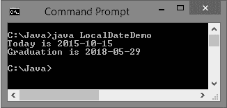

**图 4-37** LocalDateDemo 应用程序

```java
import java.time.*;

public class LocalDateDemo {
    public static void main(String[] args) {
        LocalDate today = LocalDate.now();
        LocalDate graduationDate = LocalDate.of(2018, 5, 29);
        System.out.println("Today is " + today);
        System.out.println("Graduation is " + graduationDate);
    }
}
```

**图 4-38** 执行 LocalDateDemo 应用程序

可以通过使用 `getYear()`、`getMonthValue()` 和 `getDayOfMonth()` 方法从 `LocalDate` 对象中检索特定的数据字段值，这些方法各返回一个整数。例如，假设 `graduationDate` 已经按照参数 2018、5 和 29 创建（如图 4-37 所示程序所示），以下语句产生输出“Graduation will be on day 29 in month 5”：

```java
System.out.println("Graduation will be on day " +
    graduationDate.getDayOfMonth() + " in month " +
    graduationDate.getMonthValue());
```

其他 `LocalDate` 方法包括 `getMonth()` 和 `getDayOfWeek()`。这些方法都返回一个枚举（enumeration），枚举是一个由值组成的数据类型。你将在第 9 章学习创建自己的枚举，但现在你可以使用 Java 的 `Month` 和 `DayOfWeek` 枚举。枚举是诸如 `JANUARY`、`FEBRUARY` 和 `MARCH` 以及 `SUNDAY`、`MONDAY` 和 `TUESDAY` 之类的常量。例如，假设 `graduationDate` 已如图 4-37 所示设置，以下语句显示“Graduation is on TUESDAY”：

```java
System.out.println("Graduation is on " + graduationDate.getDayOfWeek());
```

你可能会选择使用 `Month` 枚举之一创建 `LocalDate` 对象，如下声明所示：

```java
LocalDate annualMeeting = LocalDate.of(2017, Month.OCTOBER, 1);
```

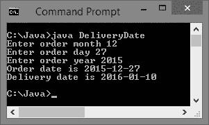

另一组方法从现有日期加减时间。一些常用的方法名称是 `plusDays()`、`plusWeeks()`、`plusMonths()`、`plusYears()`、`minusDays()`、`minusWeeks()`、`minusMonths()` 和 `minusYears()`。这些方法都接受一个 `long` 参数；当然，你可以向任何方法传递一个 `int` 以将其提升为 `long`。例如，图 4-39 显示了一个应用程序提示用户输入家具订单日期，并显示关于送货日期的细节，送货日期是两周后。图 4-40 显示了典型的执行。

**图 4-39** DeliveryDate 应用程序

```java
import java.time.*;
import java.util.Scanner;

public class DeliveryDate {
    public static void main(String[] args) {
        Scanner input = new Scanner(System.in);
        LocalDate orderDate;
        int mo;
        int day;
        int year;
        final int WEEKS_FOR_DELIVERY = 2;
        System.out.print("Enter order month ");
        mo = input.nextInt();
        System.out.print("Enter order day ");
        day = input.nextInt();
        System.out.print("Enter order year ");
        year = input.nextInt();
        orderDate = LocalDate.of(year, mo, day);
        System.out.println("Order date is " + orderDate);
        System.out.println("Delivery date is " +
            orderDate.plusWeeks(WEEKS_FOR_DELIVERY));
    }
}
```

**图 4-40** 执行 DeliveryDate 应用程序


# 使用自动导入的预写常量和方法

注意图 4-40，两周后的交付日期显示是正确的，尽管它在下个月和下一年都可能出现问题。如果没有 `LocalDate` 类的内置方法，此输出将需要一些相当复杂的计算和判断，但由于 Java 的创建者已经为你提供了该类及其方法，你的任务被大大简化了。许多程序员都需要 `LocalDate` 中的方法，包括管理人员、库存和账单系统的人员，以及编写跟踪玩家记录的游戏的程序员。由于 Java 的创建者实现了许多实用的 `LocalDate` 方法，他们的工作变得更轻松了。此外，当程序员进阶到编写不同类型的应用程序或更换雇主时，他们不需要学习如何使用那些可能由之前的程序员编写的晦涩日期处理方法。一旦程序员学习了 `LocalDate` 的内置方法和常量，他们就知道在许多情况下如何处理日期了。

## 两个真言和一个谎言

**使用自动导入的预写常量和方法**
1. Java 的创建者已经为你制作了数百个类，供你在程序中使用。
2. Java 包只有当你在程序中显式命名它们时才可用。
3. 隐式导入 `java.lang` 包包含了基础的 Java 类。

## 第 4 章：更多对象概念

在本节中，你将学习更多关于使用 `LocalDate` 的知识，并介绍 `LocalDateTime` 类。

1. 使用 Web 浏览器访问 Java 网站，选择 `Java APIs` 和 `Java SE 8`。使用字母顺序类列表找到 `LocalDate` 类并选择它。
2. 注意描述顶部引用了 `java.time`，这表示它是所属的包。
3. 阅读 `LocalDate` 类的历史和背景，以了解在确定如每周的第一天和一年中的周数等值时涉及到多少问题。然后阅读文档的其余部分，熟悉该类提供的字段和方法。
4. 查找 `LocalDateTime` 类的文档。它与 `LocalDate` 类相似，不同之处在于包含了关于当天时间的信息。阅读方法 `getHour()`、`getMinute()`、`getSecond()` 和 `getNano()` 的描述（**纳秒**是秒的十亿分之一）。

## 使用显式导入的预写类

接下来，你使用 `LocalDateTime` 类创建一个应用程序，输出用户对问题的响应时间。

1. 在文本编辑器中打开一个新文件，并输入以下导入语句。你需要 `JOptionPane` 类来使用 `showConfirmDialog()` 方法，需要 `java.time` 包来使用 `LocalDateTime` 类：
```java
import javax.swing.JOptionPane;
import java.time.*;
```

2. 如下所示启动 `TimedResponse` 应用程序。声明两个名为 `time1` 和 `time2` 的 `LocalDateTime` 对象。这些对象将保存用户提示之前的精确时间以及用户响应后的精确时间。还要声明两个整数来存储两个时间的秒值。这两个值之间的差就是创建两个 `LocalDateTime` 值之间所经过的时间。
```java
public class TimedResponse {
    public static void main(String[] args) {
        LocalDateTime time1, time2;
        int seconds1, seconds2, difference;
    }
}
```

3. 将当前时间赋值给 `time1` 对象，然后提取当前秒字段的值。
```java
time1 = LocalDateTime.now();
seconds1 = time1.getSecond();
```

4. 显示一个对话框，要求用户做一个艰难的选择。
```java
JOptionPane.showConfirmDialog(null, "Is stealing ever justified? ");
```

5. 接下来，在用户响应对话框后立即获取系统时间，并提取其秒分量。
```java
time2 = LocalDateTime.now();
seconds2 = time2.getSecond();
```

6. 计算时间之间的差，并在对话框中显示结果。
```java
difference = seconds2 - seconds1;
JOptionPane.showMessageDialog(null, "End seconds: " + seconds2 +
    "\nStart seconds: " + seconds1 +
    "\nIt took " + difference + " seconds for you to answer");
```

7. 添加两个右大括号——一个用于方法，另一个用于类——然后将文件保存为 `TimedResponse.java`。
8. 编译并运行程序。当问题出现时，思考几秒，然后选择一个回答。图 4-41 显示了一个典型的执行过程。
9. `TimedResponse` 应用程序中的输出只有当第一个和第二个 `LocalDateTime` 对象在同一分钟内创建时才是准确的，如图 4-41 所示。如果第一个对象在分钟开始 2 秒后创建，则差值将计算错误。你自己修改 `TimedResponse` 应用程序来纠正这个问题。将文件保存为 `TimedResponse.java`。

## 组合

类中的字段可以是简单数据类型（如 `int` 和 `double`），但也可以是类类型。**组合**描述了当一个类的对象是另一个类的数据字段时，类与类的关系。你已经学习过许多包含 `String` 对象字段的类。这些类使用了组合。

当你将一个对象作为另一个对象的数据成员时，如果被包含的对象没有默认构造函数，你必须记住为包含的对象赋值。例如，你可以创建一个名为 `NameAndAddress` 的类来存储姓名和地址。这样的类可以用于员工、客户、学生或任何有姓名和地址的人。

图 4-42 显示了一个 `NameAndAddress` 类。该类包含三个字段，所有字段都通过构造函数设置。`display()` 方法分行显示姓名和地址信息。

```java
public class NameAndAddress {
    private String name;
    private String address;
    private int zipCode;

    public NameAndAddress(String nm, String add, int zip) {
        name = nm;
        address = add;
        zipCode = zip;
    }

    public void display() {
        System.out.println(name);
        System.out.println(address);
        System.out.println(zipCode);
    }
}
```

假设你想创建一个包含有关学校信息的 `School` 类。与其为学校的姓名和地址声明字段，不如使用 `NameAndAddress` 类。这种创建的关系有时被称为**拥有关系（has-a relationship）**，因为一个类“拥有”一个另一个类的实例。图 4-43 显示了一个声明并使用 `NameAndAddress` 对象的 `School` 类。

```java
public class School {
    private NameAndAddress nameAdd;
    private int enrollment;

    public School(String name, String add, int zip, int enrolled) {
        // This statement calls the constructor in the NameAndAddress class.
        nameAdd = new NameAndAddress(name, add, zip);
        enrollment = enrolled;
    }

    public void display() {
        // This statement calls the display() method in the NameAndAddress class.
        System.out.println("The school information:");
        nameAdd.display();
        System.out.println("Enrollment is " + enrollment);
    }
}
```

**图 4-43** School 类

如图 4-43 所示，`School` 构造函数需要四个参数。在构造函数内部，三个项目——名称、地址和邮政编码被传递给 `NameAndAddress` 构造函数以提供相应字段的值。第四个参数（学校人数）被赋值给 `School` 类的字段。

在 `School` 类的 `display` 方法中，调用 `NameAndAddress` 对象的 `display()` 方法来显示学校名称和地址。随后显示人数。图 4-44 显示了一个实例化 `School` 对象的简单程序。图 4-45 显示了执行结果。

```java
public class SchoolDemo {
    public static void main(String[] args) {
        School mySchool = new School("Audubon Elementary", "3500 Hoyne", 6018, 350);
        mySchool.display();
    }
}
```

**图 4-44** SchoolDemo 程序
**图 4-45** SchoolDemo 输出

# 第 4 章：更多对象概念

## 嵌套类

到目前为止学习的每个类都存储在单独的文件中，文件名与类名匹配。在 Java 中，你可以在一个类内部创建一个类并将它们存储在一起；此类类被称为**嵌套类**。包含类被称为**顶层类**。嵌套类有四种类型：

*   **静态成员类**：静态成员类可以访问顶层类的静态方法。
*   **非静态成员类** 也称为**内部类**：这种类型的类需要实例；它可以访问顶层类的数据和方法。
*   **局部类**：局部于代码块的类。
*   **匿名类**：没有标识符的局部类。

将一个类嵌套另一个类内部的常见原因是该内部类仅供顶层类使用；换句话说，它是顶层类的“辅助类”。将类打包在一起使得它们的关系更容易理解，代码更容易维护。

例如，考虑房地产公司用于描述待售房屋的 `RealEstateListing` 类。该类可能包含编号、价格、地址和居住面积的独立字段。作为替代方案，你可能认为编号和价格“属于”房源，而地址和居住面积真的“属于”房子。因此，你可能会创建一个像图 4-46 阴影部分那样的内部类。

```java
public class RealEstateListing {
    private int listingNumber;
    private double price;
    private HouseData houseData;

    public RealEstateListing(int num, double price, String address, int sqFt) {
        listingNumber = num;
        this.price = price;
        houseData = new HouseData(address, sqFt);
    }

    public void display() {
        System.out.println("Listing number #" + listingNumber + " Selling for $" + price);
        System.out.println("Address: " + houseData.streetAddress);
        System.out.println(houseData.squareFeet + " square feet");
    }

    private class HouseData {
        private String streetAddress;
        private int squareFeet;

        public HouseData(String address, int sqFt) {
            streetAddress = address;
            squareFeet = sqFt;
        }
    }
}
```

**图 4-46** RealEstateListing 类（续）


注意图 46 中的内部 `HouseData` 类是一个私有类。你不需要将内部类设为私有，但这样做可以向外部隐藏隐藏成员。如果你希望一个类的成员是可访问的，就不会将其设为内部类。内部类可以访问顶层类的字段和方法（即使它们是私有的），而外部类可以访问其内部类的成员。

你通常不会想要创建内部类。例如，如果你将 `HouseData` 类作为一个普通类（而不是内部类）并将其存储在单独的文件中，你可以在其他类中通过组合使用它——也许是 `MortgageLoan` 类或 `Appraisal` 类。

目前，它只能在它当前所在的类中使用。你可能不会频繁地创建嵌套类，但你会在某些内置 Java 类中看到它们的实现。

## 两真一假
### 理解组合与嵌套类

1.  当一个类的对象作为另一个类的数据字段时，组合描述了类与类之间的关系。
2.  [原文内容损坏或无法读取]
3.  嵌套类位于另一个类内部。

# 第 4 章：更多对象概念

## 不要这样做

*   当一个类的对象作为另一个类的数据字段时，组合描述了类与类之间的关系。
*   [原文内容损坏或无法读取]
*   嵌套类位于另一个类内部。

### 不要这样做（续）

*   不要尝试使用超出其作用范围的变量。
*   不要假设常量在传递给方法时仍然是常量。
*   如果你希望参数在方法内部是常量，必须在参数列表中使用 `final`。
*   不要尝试通过赋予它们不同的类型来重载方法。
*   不要认为`默认构造函数 (default constructor)`仅指自动提供的版本。
*   不要忘记对于有其他构造函数的类编写默认构造函数，以便在不使用参数的情况下实例化。
*   不要假设导入语句中的通配符像 DOS 或 UNIX 通配符。
*   通配符仅适用于特定的包，不会导入嵌套包。

## 关键术语

*   **块 (block)** 是一对大括号之间的代码。
*   **外部块 (outer block)** 包含另一个。
*   **内部块 (inner block)** 位于另一个块内部。
*   **嵌套 (Nested)** 描述内部块的状态。
*   **作用域 (Scope)** 是变量存在并可以使用其限定名访问的程序部分。
*   **进入作用域 (Comes into scope)** 描述变量变得可用的情况。
*   **离开作用域 (Goes out of scope)** 描述变量在声明它的块结束时不再存在的情况。
*   **作用域级别 (Scope level)** 是变量存在并可以使用其限定名访问的程序部分；在 Java 中，这是变量所在的块。
*   **重复声明变量 (redeclare a variable)** 是尝试两次声明它，这是一种非法行为。
*   **覆盖 (overrides)** 指一个变量在与同名变量冲突时其具有优先权的情况。
*   **遮蔽 (Shadowing)** 指局部变量隐藏在作用域中更远处的同名变量的行为。
*   **作用域更近 (Closer in scope)** 描述了局部变量相对于它所遮蔽的其他变量的状态。
*   **重载 (Overloading)** 指使用一个术语表示多种含义，或编写多个名称相同但参数不同的方法。
*   **歧义的 (ambiguous)** 指编译器无法确定使用哪个方法的情况。
*   **引用 (reference)** 是对象的内存地址。

`this reference` 是传递给任何对象的非静态类方法的对象的引用。

`Class methods` 是没有 `this reference` 的静态方法（因为它们没有与它们关联的对象）。

`Class variables` 是由类的每个实例化都共享的静态变量。

`NaN` 是 `Not a Number`（不是数字）的缩写。

`package`（包）是一个类的库。

`library of classes`（类库）是一个为类方便分组的文件夹。

`java.lang` 包提供了对 Java 编程语言设计至关重要的类；它被隐式导入到每个 Java 程序中。

`fundamental classes` 是包含在 `java.lang` 包中的基本类，它们会自动导入到你编写的每个程序中。

`optional classes` 位于必须显式导入到程序的包中。

`wildcard symbol`（通配符）是一个表示它可以被任何字符替换的符号。在 Java 导入语句中，通配符是星号。

`enumeration`（枚举）是一种由值列表组成的数据类型。

`nanosecond`（纳秒）是秒的十亿分之一。

`Composition`（组合）描述了当一个类的对象是另一个类的数据字段时，类之间的关系。

`has-a relationship`（拥有...的关系）是基于组合的关系。

`Nested classes`（嵌套类）是包含其他类中的类。

`top-level class`（顶层类）是嵌套类中的包含类。

`static member class`（静态成员类）是嵌套类的一种，它具有访问其顶层类的所有静态方法的能力。

`Nonstatic member classes`（非静态成员类），也称为内部类，是需要实例的嵌套类。

`Local classes`（局部类）是局部于代码块的嵌套类。

`Anonymous classes`（匿名类）是没有标识符的嵌套局部类。

# 第 4 章：更多对象概念

## 章总结

变量的作用域是程序中可以引用该变量的部分。块（block）是一对大括号之间的代码。在方法内部，你可以多次声明同名的变量，只要每个声明都在自己的互不重叠的块中。如果你在类中声明一个变量并在类的 `236` 方法中使用相同的变量名，则方法内部使用的变量将优先于（或覆盖、或掩盖）第一个变量。

重载（Overloading）涉及编写多个具有相同名称但参数列表不同的方法。参数列表相同但返回类型的方法不是重载；它们是非合法的。

当你重载方法时，可能会导致歧义情况——即编译器无法确定应该使用哪种方法。

当你编写自己的构造函数时，它们可以接收参数。这些参数通常用于初始化对象的数据字段。一旦你为一个类编写了构造函数，你就不再获得自动提供的默认构造函数了。如果一个类的唯一构造函数需要参数，则你必须为你创建的该类的每个对象提供参数。你可以像重载其他方法一样重载构造函数。

在非静态方法内部，可以访问正确对象的数据字段，因为 `this reference` 被隐式传递给了非静态方法。静态方法没有 `this reference`，因为它们没有与之关联的对象；静态方法也被称为类方法。

静态类字段和方法由类的每个实例化共享。当类中的字段标记为 `final` 时，它在被赋予初始值后就不能更改。

Java 包含了数百个预先编写类，它们存储在包中，包是为类提供方便分组的文件夹。隐式导入到每个 Java 程序中的包名为 `java.lang`。它包含的类是基本类，而必须显式命名的类是可选类。`java.lang.Math` 类包含了可以执行常用数学函数的常量和方法。`LocalDate` 和 `LocalDateTime` 类允许你定义和操作日期与时间。

当一个类的对象是另一个类的数据字段时，组合描述了类之间的关系。你可以创建存储在文件的嵌套类。将类嵌套在另一个类内部的最常见原因是内部类仅供外部或顶层类使用；换句话，它是顶层类的“辅助类”。

### 复习题

1. 方法中一对括号之间的代码是一个 \ .
   a. 函数
   c. 砖
   b. 块 (block)
   d. 区域

2. 当块存在另一个块内部时，这些块是 \ .
   a. 结构化的
   c. 受保护的
   b. 嵌套的 (nested)
   d. 非法的

3. 程序中引用变量的部分是变量的 \ .
   **237**
   a. 范围
   c. 域
   b. 空间
   d. 作用域 (scope)

4. 你可以多次声明同名的变量 \ .
   a. 在语句内部
   b. 在块内部
   c. 在方法内部
   d. 你永远不能声明多个同名的变量。

5. 如果你在类中将一个变量声明为实例变量，并在类的方法内部声明并使用相同的变量名，那么在方法内部， \ .
   a. 方法内部使用的变量优先 b. 类实例变量优先
   c. 两个变量指向同一个内存地址
   d. 会发生错误

6. 方法变量 \ 一个与其同名的类变量。
   a. 顺从于
   c. 覆盖 (overrides)
   b. 破坏
   d. 修改

7. 无歧义的重载方法必须具有相同的 \ .
   a. 名称
   c. 参数名称
   b. 参数数量
   d. 参数类型

8. 如果编写一个方法来接收 double 类型，而向该方法传递了一个整数，那么方法将 \ .
   a. 正常工作；整数将提升为 double b. 正常工作；整数将保持整数
   c. 执行但输出是错误的
   d. 不工作；将发出错误信息

9. 构造函数 \ 参数。
   a. 可以接收
   c. 必须接收
   b. 不能接收
   d. 最多接收 10

# 第 4 章：更多对象概念

10. 构造函数 \ 重载。
    a. 可以
    c. 必须
    b. 不能
    d. 总是

11. 通常，你希望类的每个实例化都拥有自己的 **238** 的 .
    a. 数据字段
    c. 以上都是
    b. 类方法
    d. 以上都不是

12. 如果你创建一个包含方法的类并实例化两个对象，你通常为对象存储 \ .
    a. 方法的一个拷贝
    b. 方法的两个拷贝
    c. 包含两个不同 this 的两个方法 d 只有数据（方法不被存储）

13. `this reference` \ .
    a. 可以隐式使用
    c. 必须隐式使用
    b. 必须显式使用
    d. 必须

14. 你通过单个对象引用的方法是 \ .
    a. 私有的
    c. 静态的
    b. 公有的
    d. 非静态的

15. 由类的每个实例化共享的变量是 \ .
    a. 类变量
    c. 公有变量
    b. 私有变量
    d. 非法的

16. 用于变量声明的 `final` 关键字表示 \ .
    a. 程序的结束
    b. 静态字段
    c. 符号常量
    d. 程序中不再声明更多变量

17. Java 类存储在文件夹或 \ .
    a. 数据包 (packet)
    c. 束 (bundle)
    b. 包 (package)
    d. 簇 (gaggle)

18. 下述哪个语句确定数字的平方根并将其赋值给变量 `s`？
    a. s = sqrt(number);
    c. number = sqrt(s);
    b. s = Math.sqrt(number);
    d. number = Math.sqrt(s);

## 练习

19. `LocalDate` 对象 \ .
    a. 可以显示字符串
    b. 包含当前年份等静态字段 c. 使用公有默认构造函数创建
    d. 以上都是

**239**

20. 下列哪个表达式正确返回一个表示名为 `hireDate` 的 `LocalDate` 对象月份的整数？

    a. `getMonth(hireDate)`
    b. `getMonthValue(hireDate)`
    c. `hireDate.getMonthValue()`
    d. 以上所有

### 练习题

### 编程练习题

1. 创建名为 `FormLetterWriter` 的类，其中包含两个名为 `displaySalutation()` 的重载方法。第一个方法接受一个 `String` 参数，代表客户的姓，并显示问候语“Dear Mr. or Ms.”后接该姓。第二个方法接受两个 `String` 参数，分别代表名和姓，并显示问候语“Dear”后接名、空格和姓。在显示每个问候语后，显示简短商务信的剩余部分：“Thank you for your recent order.”。编写一个 `main()` 方法来测试每个重载方法。将文件保存为 `FormLetterWriter.java`。

2. 创建一个名为 `Billing` 的类，其中为相册店包含三个重载的 `computeBill()` 方法。

*   当 `computeBill()` 接收单个参数时，它代表订购一本相册的价格。增加 8% 的税，并返回应付总量。
*   当 `computeBill()` 接收两个参数时，它们代表相册的价格和订购数量。将两个值相乘，增加 8% 的税，并返回应付总量。
*   当 `computeBill()` 接收三个参数时，它们代表相册的价格、订购数量和优惠券金额。将数量和价格相乘，减去优惠金额，然后增加 8% 的税并返回应付总量。

编写一个 `main()` 方法来测试所有三个重载方法。将应用程序保存为 `Billing.java`。

3. a. 创建一个 `FitnessTracker` 类，其中包含健身活动、参与分钟数和日期的数据字段。该类包含获取每个字段的方法。此外，创建一个默认构造函数，自动将活动设置为“running”，分钟数设置为 0，日期设为今年 1 月 1 日。将文件保存为 `FitnessTracker.java`。创建一个应用程序来演示每个方法都能正常工作，并将其保存为 `TestFitnessTracker.java`。

b. 为你在练习 3a 中创建的 `FitnessTracker` 类创建一个额外的重载构造函数。该构造函数接收每个数据字段的参数并进行相应的赋值。在 `TestFitnessTracker` 应用程序中添加任何必要的语句以确保重载构造函数正常工作，保存它，然后进行测试。

c. 修改 `FitnessTracker` 类，使默认构造函数调用三个参数的构造函数。将类保存为 `FitnessTracker2.java`。创建一个应用程序来测试该类的新版本，并命名为 `TestFitnessTracker2.java`。

4. a. 创建一个名为 `BloodData` 的类，包含持有血型（四种血型为 `O`、`A`、`B` 和 `AB`）和 Rh 因子（因子为 `+` 和 –）的字段。创建一个默认构造函数将字段设置为“O”和“+”，以及一个需要两个字段值的重载构造函数。为每个字段包含 `get` 和 `set` 方法。将此文件保存为 `BloodData.java`。创建一个名为 `TestBloodData` 的应用程序来演示方法正常工作。将应用程序保存为 `TestBloodData.java`。

b. 创建一个名为 `Patient` 的类，其中包含 ID 号、年龄和 `BloodData`。提供一个默认构造函数将 ID 号设置为“0”，年龄设置为 0，`BloodData` 设置为“O”和“+”。创建一个为每个字段提供值的重载构造函数。还为每个字段提供 `get` 方法。将文件保存为 `Patient.java`。创建一个应用程序演示每个方法都正常工作，并将其保存为 `TestPatient.java`。

5. a. 为 Tip Top 面包店创建一个名为 `Bread` 的类，包含面包类型（如“rye”）和每片热量的数据字段。包含一个接受每个字段参数的构造函数，并包含返回字段值的 `get` 方法。还包含一个名为 `MOTTO` 的 `public final static String`，并将其初始化为 `The staff of life`。编写一个名为 `TestBread` 的应用程序实例化三个具有不同值的 `Bread` 对象，然后显示每个对象的所有数据，包括格言。保存 `Bread.java` 和 `TestBread.java` 文件。

b. 创建一个名为 `SandwichFilling` 的类。包含一个填充物类型（如“蛋鸡蛋沙拉”）的字段和另一个代表每份热量的字段。包含一个接受每个字段参数的构造函数，并包含返回字段值的 `get` 方法。编写一个名为 `TestSandwichFilling` 的应用程序实例化三个不同值的 `SandwichFilling` 对象，然后显示每个对象的所有数据。保存 `SandwichFilling.java` 和 `TestSandwichFilling.java` 文件。

c. 创建一个名为 `Sandwich` 的类。包含一个 `Bread` 字段和一个 `SandwichFilling` 字段。包含一个接受两个对象所需的每个字段参数的构造函数，并将赋值给每个对象的构造函数。编写一个名为 `TestSandwich` 的应用程序实例化三个不同值的 `Sandwich` 对象，然后显示每个对象的所有数据，包括 `Sandwich` 的总热量，假设每个 `Sandwich` 使用两片 `Bread` 制。保存 `Sandwich.java` 和 `TestSandwich.java` 文件。

6. a. 创建一个名为 `Circle` 的类，字段名为 `radius`、`diameter` 和 `area`。包含一个将 `radius` 设置为 1 并计算另外两个值的构造函数。还包含名为 `setRadius()` 和 `getRadius()` 方法。`setRadius()` 方法不仅设置 `radius`，还计算另外两个值。（圆的直径是半径的两倍，圆面积是 `pi` 乘以半径的平方。使用 `Math.PI` 常量进行此计算。）将类保存为 `Circle.java`。

b. 创建一个名为 `TestCircle` 的类，其 `main()` 方法声明了几个 `Circle` 对象。使用 `setRadius()` 方法为一个 `Circle` 分配较小的半径，为另一个分配较大的半径。不要为第三个圆的 `radius` 赋值；而是保留构造时分配的值。显示所有 `Circle` 对象的所有值。将应用程序保存为 `TestCircle.java`。

7. 编写一个 Java 应用程序，使用 `Math` 类确定以下每个问题的答案：
   a. 37 的平方根
   b. 300 的正弦和余弦
   c. 22.8 的 `floor`、`ceiling` 和 `round` 值
   d. 字符 ‘D’ 和整数 71 的较大值和较小值
   e. 0 到 20 之间的随机数（提示：`random()` 方法返回 0 到 1 之间的值；你需要一个大 20 倍的数。）将应用程序保存为 `MathTest.java`。

8. 编写一个程序，声明两个 `LocalDate` 对象并赋值代表今年 1 月 31 日和 12 月 31 日的值。显示在每个对象分别增加一个月、两个和三个月后的日期。将应用程序保存为 `TestMonthHandling.java`。

9. 编写一个应用程序，计算并显示你满 10,000 天岁的那一天。将应用程序保存为 `TenThousandDaysOld.java`。

11. a. 创建一个 `CertOfDeposit` 类。该类包含若干数据字段，用于存储证书编号、持有人姓氏、余额、发行日期和到期日，每个日期均使用 `LocalDate` 对象。为每个字段提供 `get` 和 `set` 方法。还要提供一个构造函数，该构造函数接收用于设置前四个字段的参数，并将到期日设置为发行日期后恰好一年。将该类保存为 `CertOfDeposit.java`。

b. 创建一个交互式应用程序，提示用户为两个 `CertOfDeposit` 对象输入数据。提示用户输入每个 `CertOfDeposit` 的证书编号、姓名、余额和发行日期，然后实例化这些对象。显示所有键值，包括到期日。将该程序保存为 `TestCertOfDeposit.java`。

# 第 4 章：更多对象概念

12. 创建一个名为 `Person` 的类，包含以下字段：两个用于表示人的名和姓的 `String` 对象，以及一个用于表示人出生日的 `LocalDate` 对象。创建一个名为 `Couple` 的类，其中包含两个 `Person` 对象。创建一个名为 `Wedding` 的类供婚礼策划师使用，包括婚礼日期、已结婚 `Couple` 的姓名以及一个表示地点的 `String` 字段。为每个类提供接受每个字段参数的构造函数，并为每个字段提供 `get` 方法。然后编写一个程序创建两个 `Wedding` 对象，并依次将它们传递给一个显示所有细节的方法。将文件保存为 `Person.java`、`Couple.java`、`Wedding.java` 和 `TestWedding.java`。

### 调试练习

1. 在可下载的学生文件的 `Chapter04` 文件夹中，以下每个文件都存在语法和/或逻辑错误。在每种情况下，请确定问题并修复程序。在纠正错误后，使用相同的文件名但在其名前加上前缀 *Fix* 来保存每个文件。例如，将 `DebugFour1.java` 保存为 `FixDebugFour1.java`。

   a. `DebugFour1.java`
   b. `DebugFour2.java`
   c. `DebugFour3.java` 和 `DebugBox.java`
   d. `DebugFour4.java`

当你更改文件名时，记得更改文件中所有的类名实例，使其与新文件名匹配。在 Java 中，文件名和类名必须始终一致。

### 游戏区

1. 骰子用于许多游戏。投掷一个骰子可以随机显示从 1 到 6 的值。设计一个 `Die` 类，该类可以包含一个整数数据字段来存储值（1 到 6）。包含一个构造函数，用于随机为骰子对象分配一个值。

附录 D 包含了有关生成随机数的信息。为了完全理解这一过程，你必须更多地学习 Java 类和方法。不过，现在你可以复制以下语句来生成 1 到 6 之间的随机数并将其赋值给变量。使用此语句假设你已经为静态常量分配了适当的值。

```
```


`randomValue = ((int)(Math.random() * 100) % HIGHEST_DIE_VALUE + LOWEST_DIE_VALUE);`

在类中包含一个方法来返回骰子的值。将该类保存为 `Die.java`。

编写一个应用程序，随机“投掷”两个骰子并显示它们的值。

在阅读“做出决策”章节后，你将能够让游戏判断哪个骰子点数更高。现在，只需观察在多次执行程序时值是如何变化的。将该程序保存为 `TwoDice.java`。

### 习题

2. 使用 `Die` 类编写一个应用程序，为计算机随机“投掷”五个骰子，为玩家随机投掷五个骰子。显示值，然后通过观察结果，根据以下 `Die` 值的层级结构判断谁获胜。（计算机不会决定胜者；玩家将根据观察决定胜者。）任何较大的组合都胜过较小的组合；例如，五条同大胜过四条同。

五条同
四条同
三条同
一对

在下一章学习了决策方法后，你将能够让程序判断你或计算机的骰点（rol）更好，在读完“数组介绍”章节后，你将能够让这种判断更高效。现在，只需观察在多次执行程序时值是如何变化的。将该程序保存为 `FiveDice.java`。

### 案例分析

这些项目建立在你在第 3 章创建项目的基础上，因此它们具有相同的文件名。如果你想保留两个版本的文件，请将它们保存在不同的文件夹中。

1. a. Carly's Catering 为派对和特殊活动提供餐点。在第 3 章中，你为公司创建了一个 `Event` 类。`Event` 类包含两个 `public final static` 字段，用于存储每位客的价格（$35）和大型活动的截断值（50 位客人），以及三个私有字段，用于存储活动编号、活动人数和价格。它还包含两个 `public` `set` 方法和三个 `get` 方法。

现在，修改 `Event` 类使其包含两个重载的构造函数。

一个构造函数接收活动编号和人数作为参数。分别将这些值传递给 `setEventNumber()` 和 `setGuests()` 方法。`setGuests()` 方法会自动计算活动价格。

另一个构造函数是默认构造函数，它将“A000”和 0 传递给双参数构造函数。

将文件保存为 `Event.java`。

b. 在第 3 章中，你还创建了一个 `EventDemo` 类来演示两个 `Event` 对象的使用。现在，修改该类以实例化 `Event` 对象，并在类中包含以下新方法：

实例化一个对象以保留构造函数的默认值。

# 第 4 章 更多对象概念

接收活动编号和人数字段的用户数据，并使用该数据集实例化第二个对象。显示两个对象的所有细节。

将文件保存为 `EventDemo.java`。

2. a. Sammy’s Seashore 为游客租赁皮划艇、独木舟、沙滩椅和伞。在第 3 章中，你为公司创建了一个 `Rental` 类。`Rental` 类包含两个 `public final static` 字段，用于存储每小时分钟数和小时租金（$40），以及四个私有字段，用于存储合同编号、小时数、超过小时的分钟数和价格。它还包含两个 `public` `set` 方法和四个 `public` `get` 方法。

现在，修改 `Rental` 类使其包含两个重载的构造函数。

一个构造函数接收合同编号和分钟数作为参数。分别将这些值传递给 `setContractNumber()` 和 `setHoursAndMinutes()` 方法。`setHoursAndMinutes()` 方法会自动计算小时数、额外分钟和价格。

另一个构造函数是默认构造函数，它将“A000”和 0 传递给双参数构造函数。

将文件保存为 `Rental.java`。

b. 在第 3 章中，你还创建了一个 `RentalDemo` 类来演示 `Rental` 对象。现在，修改该类以实例化两个 `Rental` 对象。

实例化一个对象以保留构造函数的默认值。

接收合同编号和分钟字段的用户数据，并使用该数据集实例化第二个对象。显示两个对象的所有细节。

将文件保存为 `RentalDemo.java`。

## 决策

## 规划决策逻辑

当计算机程序员在编写程序时，他们很少只是坐在键盘前就开始打字。程序员必须使用纸和笔来规划程序中的复杂部分。程序员经常使用 `pseudocode`（伪代码），这种工具帮助他们通过用通俗易懂的英语描述完成给定任务所需的步骤来规划程序的逻辑。你用日常语言编写伪代码，而不是编程语言中使用的语法。事实上，你用伪代码编写的任务并不一定与计算机相关。如果你曾经写过一份去你家的路线说明——例如，(1) 在 Algonquin 路上向西走，(2) 在 Roselle 路上左转，(3) 进入高速公路向东行驶，以此类推——你已经写过伪代码。

`flowchart`（流程图）与伪代码类似，但你以图表的形式编写步骤，即一系列由箭头连接的形状。有些程序员使用各种不同的形状来表示流程图中的不同任务，但你只需要使用矩形、菱形和箭头就可以画出表达非常复杂情况的简单流程图。你用矩形表示任何无条件的步骤，用菱形表示任何决策。例如，图 5-1 显示了一个描述去朋友家驾驶路线的流程图。图 5-1 中的逻辑是 `sequence structure`（顺序结构）的示例——这种逻辑结构中的一个步骤无条件地跟随另一个步骤。顺序结构可能包含任意数量的步骤，其中一个任务跟随另一个任务，没有分支或跳过某个步骤的机会。

有时，逻辑步骤并不是无条件的顺序执行——某些任务根据你所做的决策可能会发生或不发生。为了表示决策，流程图创建者使用菱形来包含一个问题，并从菱形的侧面画出指向可选方案的路径。图 5-2 包含 `decision structure`（决策结构）——即根据程序中的某些值在可选方案之间进行选择。决策让计算机程序看起来很“智能”。

**图 5-1** 一系列顺序步骤的流程图

当简化为最基本的形式时，所有的计算机决策都是是或否的选择。也就是说，每个计算机问题的答案都是是或否（或者真或假，或者开启或关闭）。这是因为计算机电路由数百万个开启或关闭的微型开关组成，每个决策的结果都会设置内存中这些开关之一的状态。正如你在第 2 章中所学到的，值 `true` 和 `false` 是 `Boolean values`（布尔值）；每个计算机决策都会产生一个布尔值。因此，在内部，程序从不会询问“用户输入了什么数字？”相反，决策可能是“用户输入了 *1* 吗？”“如果没有，用户输入了 *2* 吗？”“如果没有，用户输入了 *3* 吗？”

乔治·布尔士（Sir George Boole）生活于 1815 年至 1864 年。他开发了一种基于 `0` 和 `1` 的语言代数，其中最基础的操作（过去是现在也是）是 `AND`、`OR` 和 `NOT`。编程逻辑基于他的发现。

**图 5-2** 包含决策的流程图

# 第 5 章 两个真理和一个谎言

1. 伪代码和流程图都是用于检查计算机程序语法的工具。
2. 在顺序结构中，一个步骤无条件的跟随另一个步骤。
3. 在决策结构中，根据布尔值选择可选方案。

## if 和 if…else 语句

在 Java 中，当你想在布尔表达式为真时执行操作时，你会使用 `if` 语句。如果你想在布尔表达式为真时执行操作，而在表达式为假时执行另一个操作，则使用 `if…else` 语句。

### if 语句

你可以用来做决策的最简单语句是 `if statement`。`if statement` 有时被称为 `single-alternative selection`（单分支选择），因为只有一个备选方案——为真的备选方案。

例如，假设你声明了一个名为 `quizScore` 的整数变量，并希望在 `quizScore` 的值为 10 时显示一条消息。图 5-3 中的 `if` 语句决定了是否产生输出。注意，双等号 (`==`) 被用于判断相等性；它是 Java 的 `equivalency operator`（等价运算符）。

```
if (quizScore == 10) {
    System.out.println("The score is perfect");
}
```

**图 5-3** 一个 Java if 语句及其逻辑

### if…else 语句

在图 5-3 中，如果 `quizScore` 的值为 10，则表达式 `quizScore == 10` 的布尔值为真，此时输出语句就会执行。如果表达式 `quizScore == 10` 的值为假，则输出语句不执行。正如流程图所示，无论测试的表达式是真是假，程序都会继续并执行 if 语句之后的任何语句。

Java 的 `if` 语句始终包含括号。在括号内，你可以放置任何布尔表达式。大多数情况下，你使用一个比较判断，其中包含你在第 2 章中学过的关系运算符之一 (`==`, `<`, `>`, `<=`, `>=`, `!=`)。然而，你也可以使用任何求值为真或为假的表达式，例如一个简单的布尔变量，或者对一个返回布尔值的方法的调用。

#### 陷阱：在 if 语句中错误放置分号

在图 5-3 中，紧跟括号的 `if` 语句第一行末尾没有分号，因为语句并没有在那里结束。语句在 `println()` 调用之后才结束，所以那里才是你输入分号的地方。你可以将整个 if 语句写在一行内，它也能正确执行；然而，if 语句的双行格式更符合习惯且更易读，因此你通常在一行内输入 `if` 和布尔表达式，按回车键，然后缩进几个空格，再编写布尔表达式求值为真时发生的操作。要小心——如果你使用双行格式并在第一行末尾输入了分号（如图 5-4 所示），结果可能不是你预期的。

```
if (quizScore == 10); // 这个分号是非随意的
System.out.println("The score is perfect");
```

**图 5-4** 在 if 语句中插入额外分号时会执行的逻辑

当图 5-4 中的布尔表达式为真时，一个只包含一个分号的 `empty statement`（空语句）会执行。无论测试的表达式求值为真还是为假，决策都会立即结束，程序将继续执行下一个显示消息的独立语句。在这种情况下，由于错误的分号，if 语句没有起到任何作用。

另一种常见的编程错误发生在程序员在尝试判断等价时，使用了单等号而不是双等号。表达式 `quizScore = 10` 并没有将 `quizScore` 与 `10` 进行比较；相反，它尝试将值 `10` 赋值给 `quizScore`。当 `quizScore = 10` 用在 `if` 语句中时，赋值是非合法的，因为只允许布尔表达式。这种混淆部分源于在一些较旧的编程语言（如 COBOL、Pascal 和 BASIC）中，`if` 语句的布尔表达式内部使用了单等号。更增加混淆的是，Java 程序员在谈论等价时会使用 *equals*（等于）一词。例如你可能会说：“如果 `quizScore` *equals* 10……”。

表达式 `if(x = true)` 只有在 `x` 是布尔变量时才能编译，因为将 `true` 赋值给 `x` 是合法的。赋值后，变量 `x` 和表达式 `(x = true)` 的值均为 `true`，因此语句的 `if` 子句会执行。

在 `if` 语句中使用布尔表达式（如 `quizScore == 10`）的替代方案是将布尔表达式的值存储在布尔变量中。例如，如果 `isPerfectScore` 是布尔变量，那么下面的语句会将 `quizScore` 与 `10` 进行比较，并将 `true` 或 `false` 存储在 `isPerfectScore` 中：

```
isPerfectScore = (quizScore == 10);
```

然后，你可以这样写 `if` 语句：

```
if(isPerfectScore) {
    System.out.println("The score is perfect");
}
```

这为程序增加了一个步骤，但让 `if` 语句更类似于英语语句。

在比较变量与常量时，某些程序员倾向于将常量放在比较运算符的左侧，例如 `10 == quizScore`。这种做法是其他编程语言（如 C++）的残留，在这些语言中，当程序员输入赋值运算符（单等号）而不是比较运算符（双等号）时，可能会发生意外赋值。换句话说，在某些语言中，`if(quizScore = 10)` 会将 `10` 赋值给 `quizScore` 而不是进行比较。在 Java 中，编译器不允许在布尔表达式中进行错误的赋值，因此 Java 程序员通常将常量放在布尔表达式的右侧，因为这样语句读起来更自然。

## 陷阱：使用关系运算符比较对象

你可以使用标准关系运算符（`==`, `<`, `>`, `<=`, `>=`, 和 `!=`）来比较 `int` 和 `double` 等原始数据类型的值。然而，你不能使用 `<`, `>`, `<=` 或 `>=` 来比较对象；包含此类比较的程序无法编译。你可以对对象使用 `equals` 和不相等比较（`==` 和 `!=`），但当你使用它们时，你比较的是对象的内存地址而不是它们的值。请记住，每个对象名称都是一个引用；等价运算符比较的是对象的引用。换句话说，只有当两个对象指向内存中的同一个对象时，`==` 才会产生 `true`，而不是当它们是具有相同值的不同对象时。要比较对象的值，你应该编写专门的方法。记住，`Strings` 是对象，所以不要使用 `==` 来比较 `Strings`。你将在“字符、字符串和 StringBuilder”章节中学习如何比较字符串。

对象名称是引用，但简单数据类型的值不是。例如，假设你创建了一个名为 `Student` 的类，其中包含一个 `double` 类型的平均学分字段和一个名为 `getGpa()` 的非静态公共方法。在实例化两个名为 `student1` 和 `student2` 的对象后，你可以编写类似下面的语句：

```
if(student1.getGpa() > student2.getGpa()) {
    System.out.println("The first student has a higher gpa");
}
```

`student1.getGpa()` 和 `student2.getGpa()` 代表的值都是 `doubles`，因此可以使用任何关系运算符进行比较。

## if…else 语句

在 Java 中，`if…else statement` 提供了一种机制：当布尔表达式求值为 `true` 时执行一个操作，当布尔表达式求值为 `false` 时执行另一个操作。换句话说，你使用 `if…else statement` 进行二选一。例如，如果你想在 `quizScore` 的值为 10 时显示一条消息，在不为 10 时显示另一条消息，你就会使用 `if…else statement`。

图 5-5 中的代码显示了两个消息之一。在这个示例中，当 `quizScore` 的值为 10 时，语句的 `if clause` 执行，显示消息“The score is perfect”。当 `quizScore` 为任何其他值时，语句的 `else clause` 执行，程序显示消息“No, it’s not”。你可以编写不带 `else` 的 `if`，但编写没有前置 `if` 的 `else` 是非法的。

```
if(quizScore == 10) {
    System.out.println("The score is perfect");
} else {
    System.out.println("No, it's not");
}
```

图 5-5 示例代码中所示缩进不是要求的，但它是标准用法。你垂直地将关键字 `if` 与关键字 `else` 对齐，然后缩进依赖于求值的操作语句。

当你执行 `if…else statement` 时，根据求值结果执行其中一个操作。每个语句（依赖于 `if` 的和依赖于 `else` 的）都是完整的语句。

### 真相与谎言：if 和 if…else 语句

1. 在 Java `if` 语句中，`if` 关键字后面跟着括号内的布尔表达式。
2. 在 Java `if` 语句中，布尔表达式后面跟着分号。
3. 在 Java 中判断等价时，你使用双等号。

## 你来：使用 if…else 语句

在本节，你将为一个二手商店编写一个程序。该程序决定由哪个志愿者为捐赠物品定价。首先，你提示用户回答捐赠是衣服还是其他类型，然后程序显示处理此类捐赠的志愿者姓名。衣服捐赠由 Regina 处理，其他捐赠由 Marco 处理。

1. 通过输入以下代码创建一个名为 `AssignVolunteer` 的新应用程序。你导入 `Scanner` 类以便可以使用键盘输入。该类包含一个执行类所有工作的 `main()` 方法：

```java
import java.util.Scanner;

public class AssignVolunteer {
    public static void main(String[] args) {
    }
}
```

2. 在新行中，声明此应用程序使用的变量和常量。用户将被提示输入两个常量中存储的值之一。

该值随后将赋值给整数 `donationType` 并与 `CLOTHING_CODE` 常量进行比较。然后，根据该比较的结果，程序会将一个 `PRICER` 常量的值赋值给 `String` 变量 `volunteer`。

```
int donationType;
String volunteer;
final int CLOTHING_CODE = 1;
final int OTHER_CODE = 2;
final String CLOTHING_PRICER = "Regina";
final String OTHER_PRICER = "Marco";
```

3. 定义输入设备，然后添加提示用户输入 *1* 或 *2* 作为捐赠类型的代码。接受该响应并将其赋值给 `donationType`：

```java
Scanner input = new Scanner(System.in);
```


# 第 5 章 决策

## 使用 `if…else` 语句

### 4. 使用 `if…else` 语句来选择志愿者名称并赋值给 `volunteer` 字符串，如下所示：

```java
if (donationType == CLOTHING_CODE)
    volunteer = CLOTHING_PRICER;
else
    volunteer = OTHER_PRICER;
```

### 5. 显示选定的代码和对应的志愿者名称：

```java
System.out.println("You entered " + donationType);
System.out.println("The volunteer who will price this item is " + volunteer);
```

### 6. 输入两个右大括号以结束 `main()` 方法和 `AssignVolunteer` 类。

### 7. 将程序保存为 `AssignVolunteer.java`，然后编译并运行程序。确认当您选择 `1` 进行衣物捐赠或 `2` 进行任何其他类型的捐赠时，程序是否选择了正确的志愿者。例如，图 5-6 显示了用户输入 `1` 进行衣物捐赠时程序的典型执行情况。

## 在 `if` 和 `if…else` 子句中使用多个语句

通常，你可能希望在 `if` 语句中布尔表达式的求值之后，执行多于一个的操作。例如，你可能想要显示几行独立的输出，或者执行几次数学计算。为了执行多个依赖于布尔表达式求值结果的语句，你使用一对大括号将这些依赖项的语句放置在一个块中。

例如，图 5-7 所示的程序段判断员工的工作时间是否超过了常量 `FULL_WEEK` 的取值；如果是，程序将计算常规工资和加班费。

```java
if (hoursWorked > FULL_WEEK) {
    regularPay = FULL_WEEK * rate;
    overtimePay = (hoursWorked – FULL_WEEK) * OT_RATE * rate;
}
```

`if` 语句在此处结束。

**图 5-7** 确定工资及其逻辑的 `if` 语句

当你在 `if` 语句中放置一个块时，正确放置大括号至关重要。例如，在图 5-8 中，省略了大括号。在图 5-8 的代码段中，当 `hoursWorked > FULL_WEEK` 为真时，程序会计算 `regularPay` 然后 `if` 表达式结束。计算 `overtimePay` 的下一条语句会在程序每次运行时都会执行，无论 `hoursWorked` 中存储了什么值。最后这条语句并不依赖于 `if` 语句；它是一个独立的、单独的语句。缩进可能会具有误导性；看起来似乎有两个语句依赖于 `if` 语句，但缩进并不会导致 `if` 语句之后的语句产生依赖关系。相反，如果必须将多个语句视为一个块，则需要大括号。

当你创建一个块时，并不非要在其中放置多个语句。在单个语句周围放置大括号是完全合法的。为了清晰起见，一些程序员总是使用大括号来包围 `if` 语句中的操作，即使块中只有一条语句。

***不要这样做***

```java
if (hoursWorked > FULL_WEEK)
    regularPay = FULL_WEEK * rate;
    overtimePay = (hoursWorked – FULL_WEEK) * OT_RATE * rate;
```

编译器会忽略这种缩进。无论 `hoursWorked` 的值是多少，加班费的计算始终会被执行。

**图 5-8** 缺少大括号导致的加班费计算错误

由于缺少了大括号，无论 `hoursWorked` 是否大于 `FULL_WEEK`，图 5-8 中的最后一条语句都是一个新的独立的语句，它不属于 `if` 的部分，因此它将始终执行。例如，如果 `hoursWorked` 为 30，而 `FULL_WEEK` 为 40，那么程序计算出的 `overtimePay` 值为负数（因为 30 减去 40 的结果是 −10）。因此，输出是错误的。正确的块处理对于获得有效输出至关重要。

当你未能对应该依赖于 `if` 的语句进行块处理，并且使用了 `else` 子句时，程序将无法编译。例如，考虑以下代码：

```java
if (hoursWorked > FULL_WEEK)
    regularPay = FULL_WEEK * rate;
    overtimePay = (hoursWorked – FULL_WEEK) * OT_RATE * rate;
else
```

在这种情况下，`if` 语句在计算 `regularPay` 后结束，第二条独立的语句执行 `overtimePay` 的计算。第三条语句以 `else` 开头，这是非法的。错误信息将显示“else without if”。正如你可以通过块处理使语句依赖于 `if` 一样，你也可以通过块处理使语句依赖于 `else`。图 5-9 显示了一个包含带有两个依赖语句的 `if` 和带有两个依赖语句的 `else` 的应用程序。程序执行最后的 `println()` 语句时不考虑 `hoursWorked` 的值；它不属于决策结构。图 5-10 显示了程序的两次执行输出。在第一次执行中，用户为 `hoursWorked` 输入了 39，为 `rate` 输入了 20.00；在第二次执行中，用户为 `hoursWorked` 输入了 42，为 `rate` 输入了 20.00。

```java
import java.util.Scanner;

public class Payroll {
    public static void main(String[] args) {
        double rate;
        double hoursWorked;
        double regularPay;
        double overtimePay;
        final int FULL_WEEK = 40;
        final double OT_RATE = 1.5;
        Scanner keyboard = new Scanner(System.in);
        System.out.print("How many hours did you work this week? ");
        hoursWorked = keyboard.nextDouble();
        System.out.print("What is your regular pay rate? ");
        rate = keyboard.nextDouble();
        if (hoursWorked > FULL_WEEK) {
            regularPay = FULL_WEEK * rate;
            overtimePay = (hoursWorked – FULL_WEEK) * OT_RATE * rate;
        } else {
            regularPay = hoursWorked * rate;
            overtimePay = 0.0;
        }
        System.out.println("Regular pay is " + regularPay + "\nOvertime pay is " + overtimePay);
    }
}
```

**图 5-9** 包含块的 `if` 和 `else` 子句的 Payroll 应用

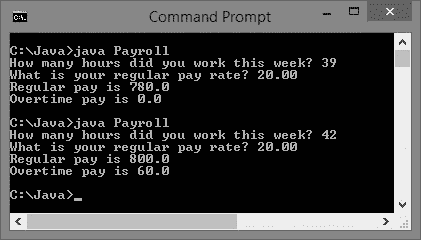

**图 5-10** Payroll 应用的典型执行

当你对语句进行块处理时，必须记住在块内定义的任何变量都是该块局部的。例如，以下代码段包含一个名为 `sum` 的变量，它是 `if` 之后块的局部变量：

```java
if (a == b) {
    int sum = a + b;
    // sum 变量在这个块中声明...
    System.out.println("The two variables are equal");
}
System.out.println("The sum is " + sum); // ...所以在这里不被识别
```

### 二真一假：在 `if` 和 `if…else` 子句中使用多个语句

1. 缩进可以使 `if` 语句之后的语句依赖于布尔表达式的求值结果。
2. 当你在代码块内部声明变量时，它是该代码块的局部变量。

## 在 `if` 和 `if…else` 子句中使用多个语句（实操）

在本节中，你将使用代码块为 `if…else` 语句添加多个操作。

1. 从之前的“你来做”部分打开 `AssignVolunteer` 应用程序。将类名更改为 `AssignVolunteer2`，并立即保存文件为 `AssignVolunteer2.java`。不要忘记应用程序的类名及其文件名必须匹配。
2. 向变量添加一个 `String`。这个 `String` 将被分配一个显示捐赠类型的消息：
   `String message;`
3. 将程序中现有的 `if…else` 语句替换为以下语句，它为每种捐赠类型执行两个块状操作。它为 `message` `String` 变量分配了一个志愿者和一个值。

```java
if (donationType == CLOTHING_CODE) {
    volunteer = CLOTHING_PRICER;
    message = "a clothing donation";
} else {
    volunteer = OTHER_PRICER;
    message = "a non-clothing donation";
}
```

4. 在显示捐赠类型的输出语句之后，添加以下语句以显示分配的消息：`System.out.println("This is " + message);`
5. 保存文件，并编译且执行该程序。图 5-11 显示了两次执行情况。

**图 5-11** AssignVolunteer2 程序的两次典型执行。

## 嵌套 `if` 和 `if…else` 语句

在 `if` 或 `else` 子句中，你可以根据需要编写任意数量依赖语句，包括其他的 `if` 和 `else` 语句。将决策包含在另一个决策的 `if` 或 `else` 子句中的语句被称为**嵌套 if 语句**（nested if statements）。当在执行某些操作之前必须满足两个或多个条件时，嵌套 if 语句特别有用。

例如，假设你只想在销售人员至少售出三件物品总价值达到 1,000 美元或以上时，才向其支付 50 美元的奖金。图 5-12 显示了解决问题的逻辑和代码。

```java
final int MIN_ITEMS = 3;
final int MIN_VALUE = 1000;
final int SALES_BONUS = 50;
int bonus = 0;
if (itemsSold >= MIN_ITEMS) {
    if (totalValue >= MIN_VALUE) {
        bonus = SALES_BONUS;
    }
}
```

每个 `if` 语句中的布尔表达式必须为真才能进行奖金赋值。

**图 5-12** 使用嵌套 if 语句确定是否分配奖金。注意，图 5-12 显示的 `if` 语句代码中，在 `bonus = SALES_BONUS;` 语句之前没有分号。表达式 `itemsSold >= MIN_ITEMS` 先被求值。只有当该表达式为真时，程序才会评估第二个布尔表达式 `totalValue >= MIN_VALUE`。如果该表达式也为真，则执行奖金分配语句，嵌套 if 语句结束。

当你使用嵌套 if 语句时，必须密切注意任何 `else` 子句的位置。例如，假设你想按照以下修订后的计划发放奖金：
- 售出少三件物品获得 10 美元奖金
- 售出三件或以上总价值低于 1,000 美元的物品获得 25 美元奖金
- 售出至少三件且总价值至少 1,000 美元的物品获得 50 美元奖金

图 5-13 显示了逻辑。

```java
final int MIN_ITEMS = 3;
final int MIN_VALUE = 1000;
final int LARGE_BONUS = 50;
final int MEDIUM_BONUS = 25;
final int SMALL_BONUS = 10;
int bonus = 0;
if (itemsSold >= MIN_ITEMS) {
    if (totalValue >= MIN_VALUE) {
        bonus = LARGE_BONUS;
    } else {
        bonus = MEDIUM_BONUS;
    }
} else {
    bonus = SMALL_BONUS;
}
```

**图 5-13** 使用嵌套 if 语句确定三种奖金之一。如图 5-13 所示，当一个 `if` 语句紧接另一个语句时，遇到的第一个 `else` 子句将与最近遇到的 `if` 配对。在图中，整个嵌套 `if…else` 语句完全位于外层 `if…else` 语句的 `if` 部分。

无论需要多少层 `if…else` 语句来产生解决方案，`else` 语句总是按照“后进先出”的原则与其对应的 `if` 关联。在图 5-13 中，代码行的缩进有助于显示哪个 `else` 语句与哪个 `if` 语句配对。请记住，编译器不考虑缩进，但一致的缩进可以帮助读者理解程序的逻辑。

### 二真一假：嵌套 `if` 和 `if…else` 语句

1. 将 `if` 语句包含在另一个 `if` 语句中的语句通常被称为嵌套 if 语句。
2. 当一个 `if` 语句紧接另一个语句时，遇到的第一个 `else` 子句将与它之前的第一个 `if` 配对。
3. 一个完整的嵌套 `if…else` 语句始终完全位于外层 `if…else` 语句的 `if` 部分或 `else` 部分。

## 使用嵌套 `if` 语句

在本节中，你为 `AssignVolunteer2` 应用程序添加一个嵌套 if 语句。

1. 重新运行 `AssignVolunteer2` 程序，并输入无效代码，例如 `3`。选定的志愿者是 Marco，因为程序只测试了输入是否为 `1`。修改程序，仅当输入值为 `1` 或 `2` 时才显示输入的代码、志愿者和捐赠类型消息，否则显示输入的代码和错误消息。将类重命名为 `AssignVolunteer3`，并将文件保存为 `AssignVolunteer3.java`。

图 5-14 显示了程序的两次典型执行。

## 使用逻辑 AND 和 OR 运算符

在 Java 中，你可以使用逻辑 AND 和 OR 运算符将布尔测试组合成一个表达式。这样的表达式被称为**复合布尔表达式**或**复合条件**。

### AND 运算符

作为对某些嵌套 if 语句的替代方案，你可以在两个布尔表达式之间使用**逻辑 AND 运算符**来创建一个复合布尔表达式，当它的操作数都为真时，该表达式为真。在 Java 中，AND 运算符写作两个 ampersands（`&&`）。例如，图 5-15 所示的两个语句工作完全相同。在每情况下，`itemsSold` 变量必须至少达到奖金所需的最小物品数量，且 `totalValue` 变量必须达到奖金所需的最小价值，奖金才能被设置为 `SALES_BONUS`。

```java
if (itemsSold > MIN_ITEMS && totalValue >= MIN_VALUE) bonus = SALES_BONUS;
```

**图 5-15** 使用嵌套 if 和 `&&` 运算符确定奖金决策的代码和逻辑

需要注意的是，当你使用 `&&` 运算符时，必须在每一侧都包含一个完整的布尔表达式。换句话说，就像许多算术运算符一样，`&&` 运算符是一个二元运算符，这意味着它在每一侧都需要操作数。如果你想在 `saleAmount` 同时大于 $1,000 且小于 $5,000 时将奖金设为 $400，正确的语句是：

```java
if (saleAmount > 1000 && saleAmount < 5000) bonus = 400;
```

尽管 `saleAmount` 变量本意是要用于 AND 表达式的两个部分，但以下语句是错误的且无法编译，因为在二元运算符 `&&` 的两侧都没有一个完整的表达式：

***不要这样做***
此语句将无法编译
```java
if (saleAmount > 1000 && < 5000)
```
因为在 `&&` 运算符的每一侧都没有布尔表达式。

为了清晰起见，许多程序员倾向于用自己的括号将复合布尔表达式中的每个布尔表达式括起来，如下例所示：

```java
if ((saleAmount > 1000) && (saleAmount < 5000)) bonus = 400;
```


如果这样做让复合表达式对你来说更清晰，请使用额外的括号。你并不强制使用 `&&` 运算符，因为使用嵌套 `if` 语句始终可以达到相同的结果，但使用 `&&` 运算符通常会让你的代码更简洁、更不容易出错且更容易理解。

# OR 运算符

当你希望即使两个条件中只有一个为真也执行某些操作时，可以使用嵌套 `if` 语句，也可以使用逻辑 OR 运算符，写作 `||`。逻辑 OR 运算符用于创建一个复合布尔表达式，当其操作数中至少有一个为真时，该表达式为真。

例如，如果你想给任何满足两个条件之一的客户提供折扣——购买最小数量商品或购买总金额达到最小值的任意商品——你可以使用图 5-16 所示的任一种方式编写代码。

OR 运算符中使用的两条竖线有时被称为“管道符”（pipes）。管道符出现在键盘上与反斜线相同的键上。

```java
if(itemsBought >= MIN_ITEMS)
    discountRate = DISCOUNT;
else
    if(itemsValue >= MIN_VALUE)
        discountRate = DISCOUNT;
```

```java
if(itemsBought >= MIN_ITEMS || itemsValue >= MIN_VALUE) discountRate = DISCOUNT;
```

**图 5-16** 当客户只需满足两个标准之一时确定客户折扣

# 第 5 章：做出决策

与 `&&` 运算符一样，你并不强制使用 `||` 运算符，因为使用嵌套 `if` 语句始终可以达到相同的结果。然而，使用 `||` 运算符通常会让你的代码更简洁、更不容易出错且更容易理解。

### 短路求值

`&&` 和 `||` 运算符每一侧的表达式仅会被评估到确定整个表达式为真为假所需的程度。这种特性被称为**短路求值**（short-circuit evaluation）。

对于 `&&` 运算符，两个布尔表达式操作数都为真，结果语句中的操作才能发生。（嵌套 `if` 也是如此，如图 5-15 所示。）当你使用 `&&` 运算符时，如果第一个测试的表达式为假，则第二个表达式将永远不会评估，因为它的值并不重要。

`||` 运算符也使用短路求值。换句话说，因为 `||` 表达式中只需有一个布尔表达式为真就能导致相关语句执行，所以如果 `||` 左侧的表达式为真，则没有需要评估 `||` 右侧的表达式。（嵌套 `if` 也是如此，如图 5-16 所示。）当你使用 `||` 运算符时，如果第一个测试的表达式为真，则第二个表达式将永远不会评估，因为它的值并不重要。

如果你将简单的比较作为 `&&` 或 `||` 运算符的操作数（如图 5-15 和 5-16 示例所示），你不会注意到短路求值的发生。

然而，假设你创建了两个返回布尔值的方法，并在 `if` 语句中调用了这些方法，如下所示：

```java
if(method1() && method2())
    System.out.println("OK");
```

取决于方法内部执行的操作，理解这一点：在这种情况下，如果 `method1()` 为假，那么 `method2()` 将不会执行。如果 `method2()` 包含你希望无论 `method1()` 的值如何都执行的语句，那么你不应该将 `method2()` 作为复合条件的一部分，而应该单独执行它，如下例所示：

```java
boolean isMethod2True = method2();
if(method1() && isMethod2True)
    System.out.println("OK");
```

同样，在以下语句中，如果 `method1()` 返回真，那么 `method2()` 将不会执行，因为 OR 表达式中只需要一个操作数为真，整个表达式就为真。

```java
if(method1() || method2())
    System.out.println("OK");
```

除了修改局部变量或返回值之外，方法所做的任何事情都是**副作用**。由于短路求值的存在，你必须意识到未执行方法的副作用。

## 使用逻辑 AND 和 OR 运算符

1. AND 运算符写作两个和（`&&`），OR 运算符写作两个竖线（`||`）。
2. 使用 `&&` 和 `||` 时，必须在每一侧都包含一个完整的布尔表达式。
3. 无论使用 `&&` 还是 `||`，布尔表达式都从左到右测试。

## 你来做：使用 && 运算符

本节帮助你创建一个展示短路如何于 `&&` 运算符。

1. 在你的文本编辑器中打开一个新文件，并输入名为 `ShortCircuitAnd` 的类的头部和花括号：

```java
public class ShortCircuitAnd
{
}
```

2. 在类的括号之间，输入 `main()` 方法的头部和括号：

```java
public static void main(String[] args)
{
}
```

3. 在 `main()` 方法内部，插入一个 `if…else` 语句来测试两个方法的返回值。如果两个方法都为真，则显示“Both are true”。否则，显示“Both are not true”。

```java
if(trueMethod() && falseMethod())
    System.out.println("Both are true");
else
    System.out.println("Both are not true");
```

4. 在 `main()` 方法括号之后、类括号之前，插入一个名为 `trueMethod()` 的方法。

该方法显示消息“True method”并返回一个真值。

```java
public static boolean trueMethod()
{
    System.out.println("True method");
    return true;
}
```

5. 在 `trueMethod()` 括号之后，插入一个名为 `falseMethod()` 的方法，其显示消息“False method”并返回一个假值。

```java
public static boolean falseMethod()
{
    System.out.println("False method");
    return false;
}
```

6. 将文件保存为 `ShortCircuitTestAnd.java`，然后编译并执行它。

图 5-17 显示了输出。首先，显示“True method”，是因为 `trueMethod()` 作为程序 `if` 语句中布尔表达式的前半部分被执行了。然后，布尔的后半部分调用了 `falseMethod()`。最后，显示“Both are not true”，是因为所测试表达式的两个部分都不真。

**图 5-17** `ShortCircuitTestAnd` 程序的执行 *(续)*

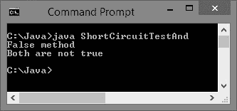

## 做出准确且高效的决策

*(续)*

7. 更改 `if` 语句中方法调用的位置，使语句变为如下：

```java
if(falseMethod() && trueMethod()) {
    System.out.println("Both are true");
} else {
    System.out.println("Both are not true");
}
```

8. 保存文件，编译并执行它。现在的输出看起来如图 5-18 所示。

`if` 语句调用了 `falseMethod()`，并显示了它的输出。

由于布尔表达式的前半部分为假，因此不需要测试后半部分，所以 `trueMethod()` 永远不会执行，程序直接进入显示“Both are not true”的语句。

**图 5-18** 反转布尔表达式后的 `ShortCircuitTestAnd` 执行

9. 将类名更改为 `ShortCircuitTestOr`，并立即将文件保存为 `ShortCircuitTestOr.java`。将 `&&` 运算符替换为 `||` 运算符。

编译并执行程序，使 `trueMethod()`位于 `||` 运算符右侧，`falseMethod()`位于左侧。然后反转方法的位置，再次编译并执行程序。确保你理解每种情况的结果。

## 做出准确且高效的决策

当新程序员必须进行范围检查时，他们经常会在程序中引入错误或低效的代码。在本节中，你将学习如何进行准确且高效的范围检查，还将学习如何正确使用 `&&` 和 `||` 运算符。

# 第 5 章
做出决策

## 做出准确的范围检查

**范围检查** 是一系列语句，用于确定另一个值落在若干组连续值序列中的哪一组。考虑以下情况：销售人员根据其销售额获得三种可能的佣金率：

*   销售额达到 $1,000 或以上 8% 的佣金
*   销售额在 $500 到 $999 之间 6% 的佣金
*   销售额小于 $500 5% 的佣金

使用三个独立的 `if` 语句来测试单个布尔表达式可能会导致某些错误的佣金分配。例如，检查图 5-19 所示的代码。

```java
final double HIGH_LIM = 1000.00;
final double HIGH_RATE = 0.08;
final double MED_LIM = 500.00;
final double MED_RATE = 0.06;
final double LOW_LIM = 499.99;
final double LOW_RATE = 0.05;

if (saleAmount >= HIGH_LIM) {
    commissionRate = HIGH_RATE;
}

if (saleAmount >= MED_LIM) {
    commissionRate = MED_RATE;
}

if (saleAmount <= LOW_LIM) {
    commissionRate = LOW_RATE;
}
```

**图 5-19** 错误的确定佣金的代码及其逻辑

使用图 5-19 所示的代码，当 `saleAmount` 为 $5,000 时（例如），第一个 `if` 语句执行，布尔表达式 `(saleAmount >= HIGH_LIM)` 结果为真，因此 `HIGH_RATE` 正确赋值给 `commissionRate`。然而，下一个 `if` 表达式 `(saleAmount >= MED_LIM)` 结果也为真，因此刚刚设为 `HIGH_RATE` 的 `commissionRate` 被错误地重置为 `MED_RATE`。

### 做出准确且高效的决策

解决此问题的部分方案是在第一次评估后使用 `else` 语句，如图 5-20 所示。

```java
final double HIGH_LIM = 1000.00;
final double HIGH_RATE = 0.08;
final double MED_LIM = 500.00;
final double MED_RATE = 0.06;
final double LOW_LIM = 499.99;
final double LOW_RATE = 0.05;

if (saleAmount >= HIGH_LIM) {
    commissionRate = HIGH_RATE;
} else if (saleAmount >= MED_LIM) {
    commissionRate = MED_RATE;
} else if (saleAmount <= LOW_LIM) {
    commissionRate = LOW_RATE;
}
```

**图 5-20** 改进但低效的确定佣金的代码及其逻辑

***不要这样做***
高 `saleAmount` 将导致中等率佣金。（这个问题已经回答过过了。）

图 5-20 所示的代码可以工作，当 `saleAmount` 为 $5,000 时，第一个 `if` 语句执行，布尔表达式 `(saleAmount >= HIGH_LIM)` 结果为真，因此 `HIGH_RATE` 正确赋值给 `commissionRate`。然而，下一个 `if` 表达式 `(saleAmount >= MED_LIM)` 结果也为真，因此刚刚设为 `HIGH_RATE` 的 `commissionRate` 被错误地重置为 `MED_RATE`。

## 做出准确高效的决策

在图 5-22 中，注意比较使用的是 `<` 运算符而不是 `<=`。这是因为 $1,000.00 的 `saleAmount` 应该产生 `HIGH_RATE`，而 $500.00 的 `saleAmount` 应该产生 `MED_RATE`。如果你想使用 `<=` 比较，可以将 `MED_LIM` 和 `LOW_LIM` 截断值分别改为 `999.99` 和 `499.99`，假设销售额仅以分为单位递增。

如果涉及到半分，测试大于 500 或小于等于 499.99 的范围可能并不总是产生相同的结果。例如，机构可能会提供每英里 42.5 分的里程津贴，而销售税通常基于 8.5% 百比等数值。当你根据此类数值进行计算时，你需要了解控制预期结果的业务规则。

## 恰当地使用 && 和 ||

初级程序员在想要使用 `||` 时经常使用 `&&` 运算符，并且在应该使用 `&&` 时经常使用 `||`。部分问题在于我们使用英语语言的方式。

例如，你的老板可能会要求：“当员工的时薪率低于 $5.85 且小时薪率超过 $60 时，显示错误消息。”你将 $5.85 定义为命名常量 `LOW`，将 $60 定义为 `HIGH`。然而，由于老板在请求中使用了*and*（和）这个词，你可能想编写如下程序语句：

```java
if(payRate < LOW && payRate > HIGH)
    System.out.println("Error in pay rate");
```

这条消息永远不会输出，因为该布尔表达式永远为假。然而，作为一个单一变量，没有任何 `payRate` 值可能同时低于 5.85 又高于 60，因此无论 `payRate` 取什么值，输出语句永远不会执行。在这种情况下，你必须编写以下代码，使用 `||` 运算符在正确的情况下显示错误消息：

```java
if(payRate < LOW || payRate > HIGH)
    System.out.println("Error in pay rate");
```

同样，你的老板可能会要求：“显示部门 1 和部门 2 中员工的姓名。”由于老板在请求中使用了*and*一词，你可能想编写以下代码：

```java
if(department == 1 && department == 2)
    System.out.println("Name is: " + name);
```

然而，变量 `department` 永远不可能同时包含 1 和 2，因此无论 `department` 的值是什么，都不会输出员工姓名。正确的语句选择了部门为 1 或 2 的员工，如下：

```java
if(department == 1 || department == 2)
    System.out.println("Name is: " + name);
```

当你尝试表示逻辑与（AND）或或（OR）时使用单个安培符或管道符会发生另一种错误。`&` 和 `|` 都是有效的 Java 运算符，但带有整数操作数的单个 `&` 或 `|` 作用于单个位。随着继续学习 Java，你将学更多关于 `&` 和 `|` 的知识。

# 第 5 章 决策

## 两个真理和一个谎言

1. 范围检查是一系列语句，用于确定一个值落在一组范围中的哪一个。
2. 当你必须在程序中做出一系列决策时，首先询问最可能真的问题效率最高。
3. 语句 `if(payRate < 6.00 && payRate > 50.00)` 可用于选择比指定限制更高更低的 `payRate` 值。

## 使用 switch 语句

通过嵌套一系列 `if` 和 `else` 语句，你可以从任意数量方案中进行选择。例如，假设你想根据存储的数字显示学生的年级。图 5-23 显示了该逻辑的一种可能的实现方式。

```java
if(year == 1)
    System.out.println("Freshman");
else
    if(year == 2)
    System.out.println("Sophomore");
else
    if(year == 3)
    System.out.println("Junior");
else
    if(year == 4)
    System.out.println("Senior");
else
    System.out.println("Invalid year");
```

**图 5-23** 使用嵌套 `if` 语句确定年级状态

在像图 5-23 这样的程序段中，`else if` 结构是常见的。然而，使用图 5-23 所示系列 `if` 语句的替代方案是使用 `switch` 语句。当你需要将单个变量与精确的整数（包括 `int`, `byte`, `short`）、字符或字符串值进行比较时，`switch` 语句非常有用。`switch` 语句使用了四个关键字：
- `switch` 开始语句，后面跟着圆括号内的测试表达式。
- `case` 后面跟着测试表达式的可能值之一和一个冒号。
- `break` 在每个 `case` 结束时终止 `switch` 语句。
- `default` 用于在测试变量不匹配时应该发生的任何操作之前。

图 5-24 显示了用于显示四个年级的 `switch` 语句：

```java
switch(year) {
    case 1:
```


# 第 5 章：决策

## 使用 switch 语句

```java
System.out.println("Freshman");
break;
case 2:
    System.out.println("Sophomore");
    break;
case 3:
    System.out.println("Junior");
    break;
case 4:
    System.out.println("Senior");
    break;
default:
    System.out.println("Invalid year");
}
```

**图 5-24** 使用 switch 语句确定年级状态

你不需要像图 5-24 所示按升序列出 case 值，尽管这样做通常更容易理解语句。图 5-24 所示的 switch 语句从评估第一行的 `year` 变量开始。例如，如果 `year` 等于 3，执行显示“Junior”的语句。`break` 语句跳过 switch 语句的其余部分，执行 switch 语句闭大括号之后的任何语句。如果 `year` 变量不包含任何 case 语句的值，执行 `default` 语句。

你可以在 switch 语句中省略 `break` 语句。然而，如果你省略了 `break` 且程序找到了测试变量的匹配项，switch 语句内的所有语句将从那里开始执行。例如，如果你省略了图 5-24 所示代码中的每个 `break` 语句，当 `year` 为 3 时，跳过前两个 case，但 `Junior`、`Senior` 和 `Invalid year` 都会输出。如果你希望在匹配测试变量后执行所有后续 case，你应该有意地省略 `break` 语句。例如，图 5-25 中的 switch 语句会在特定某天显示本周剩余的所有任务。当 `day` 为“Wednesday”时，`Send out meeting reminders`、`Order snacks for delivery` 和 `Meeting 10 am` 都会显示。

```java
switch(day) {
    case "Monday":
        System.out.println("Reserve room for Friday meeting");
    case "Tuesday":
        System.out.println("Prepare PowerPoint slides");
    case "Wednesday":
        System.out.println("Send out meeting reminders");
    case "Thursday":
        System.out.println("Order snacks for delivery");
    case "Friday":
        System.out.println("Meeting 10 am");
    default:
        System.out.println("Invalid day");
}
```

**图 5-25** 使用 switch 语句确定本周剩余的所有任务

你不需要为 switch 语句中的每个 `case` 编写代码。例如，假设部门 1、2 和 3 的主管是 `Jones`，但其他部门有不同的主管。在这种情况下，你可能使用图 5-26 所示的代码。

```java
int department;
String supervisor;
// 获取部门代码的语句放在在此处
switch(department) {
    case 1:
    case 2:
    case 3:
        supervisor = "Jones";
        break;
    case 4:
        supervisor = "Staples";
        break;
    case 5:
        supervisor = "Tejano";
        break;
    default:
        System.out.println("Invalid department code");
}
```

**图 5-26** 使用空 case 语句使多个 case 产生相同的结果

另一方面，你也可以在 switch 语句中使用字符串来判断主管名称是否有效，如图 5-27 所示的方法所示。

```java
public static boolean isValidSupervisor(String name) {
    boolean isValid;
    switch(name) {
        case "Jones":
        case "Staples":
        case "Tejano":
            isValid = true;
            break;
        default:
            isValid = false;
    }
    return isValid;
}
```

**图 5-27** 一个对字符串值并使用 switch 语句的方法

当必须检查多个 char 变量且你想忽略它们是大写还是小时，一种常用的技术是使用空 case 语句，如图 5-28 所示。

```java
switch(departmentCode) {
    case 'a':
    case 'A':
        departmentName = "Accounting";
        break;
    case 'm':
    case 'M':
        departmentName = "Marketing";
        break;
    // 以此类推
}
```

**图 5-28** 使用 switch 语句忽略字符的大小写

你并不被要求使用 switch 语句；你始终可以使用嵌套的 if 语句实现相同的结果。当有多个依赖于单一整数、字符或字符串值的备选方案时，switch 语句使用起来非常方便。此外，只有当需要测试合理数量的特定匹配值时，使用 switch 才有意义。

观看视频 *Using the switch Statement*（使用 switch 语句）。

## 两真一假：使用 switch 语句

1. 当你必须做出超过 Java 支持的决策时，你使用 switch 语句而不是嵌套的 if…else 语句。
2. 当你需要将单个变量与一系列精确的整数或字符值进行比较测试时，switch 语句非常有用。
3. `break` 语句会跳过 switch 语句的剩余部分，执行将在 switch 语句结束大括号之后的任何语句继续。

## 使用 switch：你来做

在本节中，你将修改 `AssignVolunteer3` 程序为捐赠类型添加更多选项，然后使用 switch 语句分配相应的志愿者。

1. 打开你之前在本章“你来做”部分创建的 `AssignVolunteer3.java` 文件。将类名更改为 `AssignVolunteer4`，并保存为 `AssignVolunteer4.java`。
2. 保留 `CLOTHING_CODE` 声明，但将 `OTHER_CODE` 声明替换为三个新的：
   `final int FURNITURE_CODE = 2;`
   `final int ELECTRONICS_CODE = 3;`
   `final int OTHER_CODE = 4;`
3. 保留两个定价声明，添加两个新的：
   `final String furniture = "Walter"; final String electronics = "Lydia";`
4. 将要求用户输入 1 或 2 的输出语句替换为以下简单的语句：
   `System.out.print("Enter an integer… ");`
   在专业程序中，你可能想向用户展示所有选项的细节，但此示例保持提示简单，以避免过多的输入。
5. 将现有的 if…else 语句替换为以下 switch 语句：
```java
switch(donationType) {
    case CLOTHING_CODE:
        volunteer = clothing;
        message = "a clothing donation";
        break;
    case FURNITURE_CODE:
        volunteer = furniture;
        message = "a furniture donation";
        break;
    case ELECTRONICS_CODE:
        volunteer = electronics;
        message = "an electronics donation";
        break;
    case OTHER_CODE:
        volunteer = other;
        message = "another donation type";
        break;
    default:
        volunteer = "invalid";
        message = "an invalid donation type";
}
```
6. 保存文件，然后编译并执行。

**图 5-29** `AssignVolunteer4` 程序的典型执行

## 使用条件运算符和 NOT 运算符

除了使用 if 语句和 switch 语句，Java 还提供了另一种决策方法。条件运算符需要三个用问号和冒号分隔的表达式，并作为 if…else 语句的简写版本。与 switch 语句一样，你并不被要求使用条件运算符；它只是方便的快捷方式。条件运算符的语法为：`testExpression ? trueResult : falseResult;`

第一个表达式 `testExpression` 是一个布尔表达式，结果为真或假。如果为真，整个条件表达式取问号后的值 (`trueResult`)。如果 `testExpression` 的值为假，整个表达式取 `falseResult` 的值。

你已经见过许多二元运算符的例子，例如 `==` 和 `&&`。条件运算符是一个三元运算符——需要三个操作数。在 Java 6 之前，条件运算符是 Java 中唯一的三元运算符，因此被称为“三元运算符”。Java 7 引入了条件运算符的压缩版本，用于检查赋值给对象的空值。新运算符被称为 *Elvis 运算符*，因为它使用了问号和冒号（`?:`）；如果你侧着看它，它会让你想起猫王猫。

例如，假设你想为促销商品分配最小价格。让变量 `a` 为标价，变量 `b` 为折扣价。分配最小成本的表达式为：
`smallerNum = (a < b) ? a : b;`

当评估表达式 `a < b` 时，如果 `a` 小于 `b`，整个条件表达式取冒号左侧的值 `a`，然后赋值给 `smallerNum`。如果 `a` 不小于 `b`，表达式取冒号右侧的值 `b`，并将 `b` 赋值给 `smallerNum`。

你可以使用以下 if…else 语句实现相同的结果：
```java
if(a < b)
    smallerNum = a;
else
    smallerNum = b;
```
使用条件运算符的优点是语句简洁。

## 使用 NOT 运算符

你使用 NOT 运算符（用感叹号 `!` 表示）来反转任何布尔表达式的结果。任何评估为真的表达式在放在 NOT 运算符之前都会变为假，同样地，任何在 NOT 运算符之前的假表达式都会变为真。

例如，假设驾驶员年龄为 25 岁或以下时每月汽车保险费为 $200，年龄 26 岁及以上则为 $125。图 5-30 中的每个 `if`…else 语句都正确地分配了保费值。

```java
if (age <= 25)
    premium = 200;
else
    premium = 125;

if (!(age <= 25))
    premium = 125;
else
    premium = 200;

if (age >= 26)
    premium = 125;
else
    premium = 200;
```

**图 5-30** 四个功能相同的 `if`…else 语句

在图 5-30 中，带有 `!` 运算符的语句读起来稍微困难，特别是因为它们需要双层括号，但每种情况下决策过程的结果都是相同的。在测试布尔变量的值时，使用 `!` 运算符更加清晰。例如，一个初始化为 `boolean oldEnough = (age >= 25);` 的变量可以成为相对易读的表达式 `if(!oldEnough)`……的一部分。

## 两个真理一个谎言：使用条件运算符和 NOT 运算符

1. 条件运算符是 `if`…else 语句的缩写版本，需要两个由感叹号分隔的表达式。
2. `NOT` 运算符写为感叹号（`!`）。
3. 任何假表达式在位于 `NOT` 运算符之前时，其值会变为真。

## 理解运算符优先级

你可以根据需要组合任意 `&&` 或 `||` 运算符来做出决策。例如，如果你想给在四次测验中任何一次获得满分的学生奖励加分（定义为 `BONUS`），你可能会编写如下语句：

```java
if(score1 == PERFECT || score2 == PERFECT || score3 == PERFECT || score4 == PERFECT)
    bonus = BONUS;
else
    bonus = 0;
```

在这种情况下，如果至少有一个 `score` 变量等于 `PERFECT` 常量，该学生就会获得加分。

尽管你可以在表达式中组合任意数量的 `&&` 或 `||` 操作，但在混合使用它们时必须特别小心。你在第 2 章中学习过算术操作具有高低不同的优先级，而运算符的优先级会影响表达式评估的方式。例如，在算术表达式中，乘法和除法始终在加减法之前执行。同样，`&&` 的优先级高于 `||`。表 5-1 显示了你目前为止使用的运算符的优先级。

| 优先级 | 运算符(s) | 符号(s) |
| :--- | :--- | :--- |
| 最高 | 逻辑非 | `!` |
| 中间 | 乘法、除法、取模 | `* / %` |
| | 加法、减法 | `+ -` |
| | 关系 | `> < >= <=` |
| | 等于 | `== !=` |
| | 逻辑与 | `&&` |
| | 逻辑或 | `||` |
| | 条件 | `?:` |
| 最低 | 赋值 | `=` |

**表 5-1** 目前为止使用的运算符优先级

例如，考虑图 5-31 所示的程序段。这些代码段旨在作为保险公司程序的一部分，用于判断是否应对符合以下两个标准的驾驶员收取额外保费：拥有两张以上的交通罚单或年龄小于 25 岁；是男性。

```java
// 错误地分配额外保费
if (trafficTickets > 2 || age < 25 && gender == 'M')
    extraPremium = 200;
// 先评估使用 && 运算符的表达式。

// 正确地分配额外保费
if ((trafficTickets > 2 || age < 25) && gender == 'M')
    extraPremium = 200;
// 先评估内层括号内的表达式。
```

**图 5-31** 使用括号改变优先级


# 第 5 章

## 决策

**图 5-31** 使用 `&&` 和 `||` 的两种比较

记住 `AND` 和 `OR` 运算符优先级的一种方法是记住它们是按字母顺序进行评估的。

考虑一位 30 岁的女性驾驶员，有三张交通罚单；根据所述标准，她不应被分配额外保费，因为她不是男性。在图 5-31 的第一个 `if` 语句中，`&&` 运算符优先级更高，因此先评估 `age < 25 && gender == 'M'`。该值为假，因为 `age` 不小于 25，所以表达式简化为 `trafficTickets > 2 || false`。因为 `tickets` 变量的值大于 2，整个表达式为真，因此 `extraPremium` 被赋值为 200，尽管本不该赋值的。

在图 5-31 所示的第二个 `if` 语句中，添加了括号，使得 `||` 运算符先评估。表达式 `trafficTickets > 2 || age < 25` 为真，因为 `trafficTickets` 的值为 3。因此，表达式演变为 `true && gender == 'M'`。因为 `gender` 不是 ‘M’，整个表达式的值为假，`extraPremium` 值没有被赋值 200，这是正确的结果。即使表达式在不添加额外括号的情况下也能按照你的意图进行评估，你也可以添加它们来帮助他人更易地理解你的程序。

记住以下两个约定很重要：
- 使用运算符的顺序会产生影响。
- 你始终可以使用括号来改变优先级或使你的意图更清晰。

## 两个真理一个谎
### 理解运算符优先级

1. 假设 `p`、`q` 和 `r` 都是赋值为 `true` 的布尔变量。执行该语句后，`p` 的值仍为真。
   `p = !q || r;`
2. 假设 `p`、`q` 和 `r` 都是赋值为 `true` 的布尔变量。执行该语句后，`p` 的值仍为真。
   `p = !(!q && !r);`
3. 假设 `p`、`q` 和 `r` 都是赋值为 `true` 的布尔变量。执行该语句后，`p` 的值仍为真。
   `p = !(q || r);`

## 图 5-32
该 `Employee` 类包含一个执行决策的构造函数。如果图 5-32 中的 `Employee` 类也包含用于 `empNum` 和 `payRate` 的设置方法，且控制适当取值的规则与构造函数中使用的规则相同，那么在设置方法中做出决策并在编写构造函数时调用这些设置方法将是有意义的。这样，决策将只在类中出现一次，从而节省了时间和空间。此外，如果未来需要更改规则（例如，如果为这两个字段想要不同的默认值），则只需在一处更改代码，从而减少错误或不一致的概率。

## 你来做做
### 在构造函数和实例方法中添加决策

在本节中，你将修改在第 4 章中创建的 `DogTriathlonParticipant` 类。由于参加每项活动都会获得积分，除非狗狗没有参加，否则得分不可能是 0。在现有的类中，构造函数接受狗狗参加的活动数量以及参赛者在每项活动中的得分。目前，还没有方法可以检查这些值是否一致。现在，你可以修改该类，使得活动数量与提供给构造函数的有效得分数量匹配。

1. 打开你在第 4 章中创建的 `DogTriathlonParticipant.java` 文件。将类名更改为 `DogTriathlonParticipant2`，并立即保存文件为 `DogTriathlonParticipant2.java`。

2. 将构造函数名称更改为 `DogTriathlonParticipant2`。

3. 如果现有程序中的活动数量赋值为 0，计算平均分将产生非数值结果。现在你已经知道如何使用决策，可以修复这个问题。不要使用通过除法产生平均分的算术语句，而是使用以下 `if…else` 语句：

```java
if (NUM_EVENTS == 0)
    avg = 0;
else
    avg = (double) total / NUM_EVENTS;
```

4. 在类字段列表中添加一个布尔字段。如果报告的活动数量与非零得分数量匹配，则该字段为 `true`；否则，该字段为 `false`：

```java
private boolean scoresAgree;
```

5. 有几种方法可以确保传递给构造函数的活动数量与非零得分数量匹配。一种方法是为每个非零得分将总数加 1，然后判断该总数是否等于传递的活动数量。为了实现这一点，首先在构造函数中紧接在名称和活动数量赋值的语句之后添加以下代码。这些语句声明了一个变量，用于保存传递给构造函数的非零得分数量，然后为每个非零活动得分将变量加 1：

```java
int totalNot0 = 0;

if (score1 != 0)
    totalNot0 = totalNot0 + 1;

if (score2 != 0)
    totalNot0 = totalNot0 + 1;

if (score3 != 0)
    totalNot0 = totalNot0 + 1;
```

6. 比较活动数量与非零得分总数，并设置布尔变量 `scoresAgree`：

```java
if (numEvents == totalNot0)
    scoresAgree = true;
else
    scoresAgree = false;
```

7. 将无条件为 `obedienceScore`、`conformationScore` 和 `agilityScore` 赋值的语句替换为以下 `if…else` 语句，该语句仅在 `scoresAgree` 为 `true` 时才将构造器的参数赋值给三个得分：

```java
if (scoresAgree) {
    obedienceScore = score1;
    conformationScore = score2;
    agilityScore = score3;
} else {
    obedienceScore = 0;
    conformationScore = 0;
    agilityScore = 0;
}
```

8. 在 `DogTriathlonParticipant2` 类的 `display()` 方法中，添加以下语句，如果活动数量值发生错误，则显示特殊通知：

```java
if (!scoresAgree)
    System.out.println("\nNotice! Number of events for " + name + " does not agree with scores reported.");
```

9. 保存文件并编译。

10. 打开你在第 4 章“你来做做”部分创建的 `TestDogs.java` 文件。将类重命名为 `TestDogs2`，并立即保存文件为 `TestDogs2.java`。

11. 在三个对象声明中的六处 `DogTriathlonParticipant` 更改为 `DogTriathlonParticipant2`。

12. 修改对象声明，使得某些对象的活动数量和作为构造参数的非零得分数量匹配，而另一些对象不匹配。

13. 保存文件，然后编译并执行。图 5-33 显示了一个典型的执行过程，其中一个参赛者的数据有效，而另外两个包含错误。

## 图 5-33
`TestDogs2` 程序的输出

14. 修改 `TestDogs2` 程序中的值。多次编译并重新执行程序，以确保使用各种活动组合产生适当的结果。

15. 独立修改 `DogTriathlonParticipant2` 类并将其重命名为 `DogTriathlonParticipant3`。在这个版本中，不要使用非零得分计数来判断活动数量是否匹配，而是仅使用决策。将文件保存为 `DogTriathlon3.java`。

## 关键术语

- **伪代码**：帮助程序员通过编写纯英语语句来规划逻辑的工具。
- **流程图**：帮助程序员以图形式编写步骤来规划逻辑的工具，由箭头连接的一系列形状。
- **顺序结构**：一个步骤接一个步骤无条件的逻辑结构。
- **决策结构**：根据程序中的某些值在替代方案之间进行选择的逻辑结构。
- **布尔值**：真或假的值；计算机的决策都会产生布尔值。
- **if 语句**：用于编写单分支选择。
- **单分支选择**：根据一种备选方案执行操作或不执行操作的决策结构。

## 不要这样做
- 不要忽略决策中的细微差别。例如，选择工资少于 20 美元的员工与选择工资 20 美元或以上的员工是不同的。
- 在测试相等性时，不要使用赋值运算符代替比较运算符。
- 不要向 `if` 语句的布尔表达式后插入分号；在整个语句完成后再插入分号。
- 当多个语句依赖于 `if` 或 `else` 子句时，不要忘记用大括号括起语句。
- 确保 `&&` 或 `||` 运算符的两侧都包含完整的布尔表达式。
- 不要尝试使用 `switch` 语句测试整数、字符或字符串值以外的内容。
- 如果你的 `switch` 语句逻辑需要，不要忘记使用 `break` 语句。
- 不要使用标准关系运算符比较对象；仅将它们用于内置的 Java 类型。

## 决策

`等值运算符` (`==`) 比较值，如果它们相等则返回 true。

`空语句`（empty statement）仅包含一个分号 `;`。

`if…else 语句` 提供了一种机制，用于当布尔表达式求值为 true 时执行一个操作，当布尔表达式求值为 `false` 时执行另一个操作。

`双分支选择`（dual-alternative selection）采取两种可能的行动方案中的一种。

`if…else 语句`的 `if 子句`是在评求的布尔表达式为真时执行的部分。

`if…else 语句`的 `else 子句`是在评求的布尔表达式为假时执行的部分。

`嵌套 if 语句`（nested if statement）是指在一个 if 语句内部包含另一个 if 语句。

`复合布尔表达式`（compound Boolean expression）是指包含 `AND` 或 `OR` 运算符的表达式。

`复合条件`（compound condition）在复合布尔表达式中进行测试。

`逻辑与运算符`（logical AND operator）使用两个布尔表达式作为操作数，如果两个操作数都为真，则求值为真。`AND` 运算符写作两个 & 符号 (`&&`)。

`逻辑或运算符`（logical OR operator）使用两个布尔表达式作为操作数，如果其中一个操作数为真，则求值为真。`OR` 运算符写作两个竖线符号 (`||`)。

`短路求值`（Short-circuit evaluation）描述了 `AND` 和 `OR` 运算符的特性，即仅在做出最终决策所需的范围内进行评求值。

`旁路效应`（side effect）是指方法中除返回值以外的任何操作。

`范围检查`（range check）是一系列语句，用于确定一个值落在一组范围中的哪一个。

`else…if 子句`是一种用于嵌套 if 语句的格式，其中每个 `else` 实例及其随后的 `if` 放置在同一行。

`switch 语句`使用最多四个关键字来将单个变量与一系列精确的整数或字符值进行比较。关键字是 `switch`、`case`、`break` 和 `default`。

`条件运算符`（conditional operator）需要三个用问号和冒号隔开的表达式，并作为 `if…else 语句` 的简写版本。

`三元运算符`（ternary operator）需要三个操作数的运算符。

`非运算符`（NOT operator） (`!`) 否定或反转任何布尔表达式的结果。

### 章节总结

决策涉及根据程序中的某些值在两种可选行动方案之间进行选择。

`if 语句`用于根据布尔表达式做出决策。单分支选择根据一种可选方案执行操作；双分支选择（或 `if…else`）提供了当布尔表达式为真时执行一个操作、当表达式为假时执行另一个操作的机制。

任意数量的语句都可以分组以依赖于 `if` 或 `else` 子句。

在执行某些操作之前必须满足两个或更多条件时，嵌套 if 语句特别有用。

`AND` 运算符 (`&&`) 用于创建一个复合布尔表达式，当其所有的操作数都为真时，该表达式为真。`OR` 运算符 (`||`) 用于创建一个复合布尔表达式，当其至少有一个操作数为真时，该表达式为真。

新程序员在执行 `if 语句` 时经常会由于范围检查不正确或低效，或者在尝试做出 `AND` 或 `OR` 决策时使用了错误的运算符而导致错误。

`switch 语句`将单个变量与一系列精确的整数、字符或字符串值进行测试。

`条件运算符`需要三个表达式、一个问号和一个冒号，并作为 `if…else 语句` 的简写版本。`非运算符` (`!`) 否定任何布尔表达式的结果。

运算符优先级控制了表达式的评求值方式。你可以使用括号来改变优先级或使你的意图更清晰。

决策经常用于控制字段的值。

### 复习题

1. 指一个指令在没有分支的情况下接另一个指令发生的逻辑结构是 .
   a. 顺序 (sequence)
   c. 循环 (loop)
   b. 选择 (selection)
   d. 情况 (case)

2. 下哪项通常用于流程图以表示决策？
   a. 正方形 (square)
   c. 菱形 (diamond)
   b. 矩形 (rectangle)
   d. 椭圆 (oval)

3. 下哪项不是 if 语句的类型？
   a. 单分支 (single-alternative)
   c. 反转 (reverse)
   b. 双分支 (dual-alternative)
   d. 嵌套 (nested)

4. 决策是基于一个(n)值的。
   a. 复杂的 (convoluted)
   c. 确定的 (definitive)
   b. 绝对的 (absolute)
   d. 布尔 (Boolean)

5. 在 Java 中，`(14 > 7)` 的值是 `true`。
   a. true
   c. 4
   b. false
   d. 7

6. 假设变量 `score` 已赋值为 13，以下哪个语句会显示 XXX？
   a. `if(score > 0) System.out.println("XXX");`
   b. `if(score > 17); System.out.println("XXX");`
   c. `if(score < 7); System.out.println("XXX");`
   d. 以上所有项都显示 XXX。

7. 以下代码段的输出是什么？

```java
t = 10;

if (t > 7) {
    System.out.print("AAA");
    System.out.print("BBB");
}
```
   a. AAA
   c. AAABBB
   b. BBB
   d. 无输出

8. 以下代码段的输出是什么？

```java
t = 0;

if (t > 7)
    System.out.print("AAA");
```
   a. AAA
   c. AAABBB
   b. BBB
   d. 无输出

9. 以下代码段的输出是什么？

```java
t = 7;

if (t > 7) {
    System.out.print("AAA");
    System.out.print("BBB");
}
```
   a. AAA
   c. AAABBB
   b. BBB
   d. 无输出

10. 将一个 if 语句嵌套在另一个 if 语句中时，这些是 **嵌套 (nested)**。

11. 将两个条件组合为一个布尔值，当其两个操作数都为真时，该值为真的运算符是 `&&`。
    a. $$
    c. ||
    b. !!
    d. &&

12. 将两个条件组合为一个布尔值，当其至少有一个操作数为真时，该值为真的运算符是 `||`。
    a. $$
    c. ||
    b. !!
    d. &&

13. 假设变量 `f` 已初始化为 5，以下哪个语句将 `g` 设置为 0？
    a. `if(f > 6) g = 0;`
    c. `if(f < 2) g = 0;`
    b. `if(f >= 4) g = 0;`
    d. 以上所有都将 g 设置为 0。

14. 以下哪个优先级最低？
    a. `<`
    c. `&&`
    b. `==`
    d. `||`

15. 以下哪个语句正确输出住在地区 6 或地区 7 的名称？
    a. `if(district == 6 && district == 7) System.out.println("Name is " + name);`
    b. `if(district == 6 || district == 7) System.out.println("Name is " + name);`
    c. `if(district == 6 || district == 7) System.out.println("Name is " + name);`
    d. 以上两个均正确

16. 以下哪项在学生 ID 小于 1000 或大于 9999 时显示“Error”？
    a.
```java
if (studentId < 1000) if (studentId > 9999)
    System.out.println("Error");
```
    b.
```java
if (studentId < 1000 && studentId > 9999)
    System.out.println("Error");
```
    c.
```java
if (studentId < 1000)
    System.out.println("Error");
else
    if (studentId > 9999)
        System.out.println("Error");
```


d. 以上两个正确。

17. 你可以使用 `break` 语句来终止 `switch` 语句。
a. `switch`
c. `case`
b. `end`
d. `break`

18. 以下哪项不能作为 `switch` 语句的测试参数？
a. `int`
c. `double`
b. `char`
d. `String`

19. 假设变量 `w` 已赋值为 15，以下语句执行什么？
`w == 15 ? x = 2 : x = 0;`
a. 将 15 赋值给 `w`
c. 将 0 赋值给 `x`
b. 将 2 赋值给 `x`
d. 无

20. 假设变量 `y` 已赋值为 6，`!(y < 7)` 的值是 .
a. 6
c. `true`
b. 7
d. `false`

## 编程练习

1. 写一个程序，要求用户输入一个整数。显示指示该整数是偶数还是奇数的语句。保存文件为 `EvenOdd.java`。

2. 写一个程序，要求用户输入三个整数。按升序和降序显示它们。保存文件为 `AscendingAndDescending.java`。

### 3
a. 为 Summerdale Condo Sales 办公室编写一个应用程序；该程序用于确定公寓的价格。要求用户选择 `1` 代表景观景，`2` 代表高尔夫场景，或 `3` 代表湖景。输出所选景致的名称以及公寓的价格。景观房公寓为 150,000 美，高尔夫场景公寓为 170,000 美，湖景公寓为 210,000 美。如果用户输入的代码无效，则将价格设置为 0。将文件保存为 `CondoSales.java`。

b. 在 `CondoSales` 应用程序中添加一个提示，要求用户指定 (1) 有车库或 (2) 停车位，但仅在景致选择有效时才进行。为任何带车库的公寓价格增加 5,000 美。如果停车位值无效，则显示适当的消息，并假设该价格适用于无车库的公寓。

   将文件保存为 `CondoSales2.java`。

### 4
为手机服务提供商 Horizon Phones 编写一个程序。提示用户输入通话分钟数、短信数和数据流量（GB）的最大月值，然后根据客户的需求推荐最佳计划。需要通话时间少于 500 分钟且没有短信或数据的客户应接受每月 49 美的计划 A。需要通话时间少于 500 分钟且有任何短信的客户应接受每月 55 美的计划 B。需要通话时间 500 分钟或以上且没有数据的客户应接受计划 C（最多 100 条短信，每月 61 美）或计划 D（100 条短信或更多，每月 70 美）中的其一。需要任何数据的客户应接受计划 E（最多 2GB 流量，每月 79 美）或计划 F（2GB 流量或更多，每月 87 美）中的其一。将文件保存为 `CellPhoneService.java`。

### 5
a. 编写一个应用程序，提示用户输入月份、日期和年份。显示一条消息，说明输入的日期是 (1) 不是今年，(2) 是今年较早的月份，(3) 是今年较晚的月份，或 (4) 本月。将文件保存为 `PastPresentFuture.java`。

b. 使用网络学习如何使用 `LocalDate` 的布尔方法 `isBefore()`、`isAfter()` 和 `equals()`。利用你的知识编写一个程序，提示用户输入月份、日期和年份，然后显示一条消息，说明输入的日期是在过去、现在还是未来。将文件保存为 `PastPresentFuture2.java`。

### 6
Barnhil Fastener 公司经营着小型工厂。该公司雇佣的工人根据技能水平获得三种小时薪率之一：

| 技能等级 | 每小时薪率 ($) |
| :--- | :--- |
| 1 | 17.00 |
| 2 | 20.00 |
| 3 | 22.00 |

每位工厂工人每周可以工作任何小时的小数；超过 40 小时的部分按通常费率的 1.5 倍支付。

此外，技能等级 2 和 3 的工人可以选择以下保险选项：

| 选项 | 说明 | 员工每周成本 ($) |
| :--- | :--- | :--- |
| 1 | 医疗保险 | 32.50 |
| 2 | 牙保险 | 20.00 |
| 3 | 长期残障险 | 10.00 |

此外，技能等级 3 的工人可以选择参加按总工资 3% 计算的退休计划。

编写一个交互式 Java 工资应用程序，用于计算工厂工人的净工资。程序提示用户输入技能等级和工作小时数，以及适用于员工技能类别的相应保险和退休选项。

该应用程序显示：(1) 工作小时，(2) 每小时薪率，(3) 40 小时的常规工资，(4) 加班工资，(5) 常规和加班工资的总和，以及 (6) 细项扣款总额。如果扣款额超过总工资，则显示错误消息；否则，计算并显示 (7) 从总工资中减去所有扣款后的剩余净工资。将文件保存为 `Pay.java`。

### 7
创建一个存储职位申请人数据的类。包含一个姓名、电话号码以及四个布尔字段，表示申请人在以下每个领域是否精通技能：文字处理、电子表格、数据库和图形。包含一个接受每个字段值的构造函数。还为每个字段包含一个 get 方法。创建一个应用程序，实例化多个职位申请人对象，并将每个对象传递给布尔方法，该方法判断每个申请人是否有资格参加面试。然后，在 `main()` 方法中，为每个申请人显示适当的结果。合格的申请人至少具备四项技能中的三种。将文件保存为 `JobApplicant.java` 和 `TestJobApplicants.java`。

### 8
为经销商创建一个 `Automobile` 类。包含 ID 号、品牌、型号、颜色、年份和每加仑英油数的字段。为每个字段包含 get 和 set 方法。

不允许 ID 为负数或超过 9999；如果是，则将 ID 设置为 0。不允许年份早于 2000 年或晚于 2017 年；如果是，则将年份设置为 0。不允许每加仑英油数小于 10 或大于 60；如果是，则将其设为 0。包含一个接受每个字段值的构造函数，并使用 set 方法分配这些值。编写一个应用程序声明多个 `Automobile` 对象并演示这些方法工作正常。将文件保存为 `Automobile.java` 和 `TestAutomobiles.java`。

### 9
创建一个名为 `Apartment` 的类，持有公寓号、卧室数、浴室数和租金金额。创建一个接受数据字段值的构造函数。还为每个字段创建一个 get 方法。编写一个应用程序创建至少五个 `Apartment` 对象。然后提示用户输入所需的最小卧室数、最小浴室数以及愿意支付的最大租金。显示符合用户条件的 `Apartment` 对象的数据，如果没有此类公寓则显示适当的消息。将文件保存为 `Apartment.java` 和 `TestApartments.java`。

### 10
使用网络查找传统歌曲《十二圣诞》的歌词。这首歌包含了每天收到的礼物列表。列表是累积的，随着每一天的过去，新的诗节包含前一节的内容和一个新物品。编写一个应用程序，从用户输入的任何一天开始显示歌词。（提示：使用降序排列的 `switch` 语句且不使用任何 `break` 语句，以便任何一天的歌词都能重复之前的歌词。）将文件保存为 `TwelveDays.java`。

## 练习

### 调试练习
1. 你学生文件中 Chapter05 文件夹中的以下每个文件都有语法和/或逻辑错误。在每个情况下，确定问题并修复程序。纠正错误后，使用文件名前加 Fix 保存每个文件。例如，将 `DebugFive1.java` 保存为 `FixDebugFive1.java`。

a. `DebugFive1.java`
c. `DebugFive3.java`
b. `DebugFive2.java`
d. `DebugFive4.java`

### 游戏区
1. 在第一章，你创建了一个名为 `RandomGuess` 的类。在这个游戏中，玩家猜数字，应用程序生成一个随机数，然后玩家判断是否正确。现在你可以做决定了，修改应用程序，允许玩家在显示随机数之前输入猜测，然后显示玩家的猜测是正确的、太高还是太低。将文件保存为 `RandomGuess2.java`。（在完成下一章后，你将能够修改应用程序，让用户继续猜测直到输入正确答案。）

2. 创建一个彩票游戏应用程序。生成三个随机数（帮助这一点请参考附录 D），每个数字在 0 到 9 之间。允许用户猜测三个数字。

将用户的每个猜测与三个随机数字进行比较，并显示一条包含用户的猜测、随机生成的三位数以及用户赢得金额的消息，格式如下：

**数字匹配**

**奖金（美元$）**

| 条件 | 金额 |
| :--- | :--- |
| 匹配其中任意一个 | 10 |
| 匹配两个 | 100 |
| 三个匹配但顺序不符 | 1,000 |
| 三个匹配且顺序完全一致 | 1,000,000 |
| 无匹配 | 0 |

确保你的应用程序能够处理重复数字。例如，如果用户猜测了 1、2 和 3，而随机生成的数字是 1、1 和 1，则不要给用户三次正确猜测的奖励——只计为一次。将文件保存为 `Lottery.java`。

# CHAPTER 5
## 做出决策

3. 在第 3 章中，你创建了一个 `Card` 类。修改 `Card` 类，使 `setValue()` 方法不再允许 `Card` 的值小于 1 或大于 13。如果传递 `setValue()` 的参数超出范围，则将 `Card` 的值赋值为 1。

在第 3 章中，你还创建了一个 `PickTwoCards` 应用程序，它可以随机选择两张牌并显示它们的值。在那个应用程序中，所有的 `Card` 对象都被任意 **298** 分配了一个由单个字符表示的花色，但它们可以有不同的值，玩家观察两个 `Card` 对象中哪一个值更高。现在，修改应用程序，使花色和值都被随机选择。使用两个 `Card` 对象玩一个非常简单的“战争”纸牌游戏版本。分发两张 `Cards`——一张给电脑，一张给玩家——判断哪张牌较大，然后显示一条消息指示纸牌是否相等、电脑胜还是玩家胜。（如果纸牌的值相同，无论花色如何，均视为相等。）对于这个游戏，假设 Ace（值 1）是最小的。确保分发的两张 `Cards`不是同一个 `Card`。例如，一副牌中不能包含两张代表黑桃 2 的 `Card`。如果选择的两张牌值相同，则改变其中一张的花色。将应用程序保存为 `War.java`。（在你学习完“数组”章节后，你将能够创建一个更复杂的“战争”游戏，其中你可以使用整副牌而不重复纸牌。）

4. 在第 4 章中，你创建了一个 `Die` 类，通过该类你可以实例化一个包含 1 到 6 随机值的对象。你还写了一个应用程序，随机“掷出”两个骰子并显示它们的值。修改应用程序，使其判断两个骰子是否相同、第一个的值是否更高，或第二个的值更高。将应用程序保存为 `TwoDice2.java`。

5. 在剪刀石头布游戏中，两个玩家同时选择三个选项之一：石头、纸或剪刀。如果两个玩家选择相同的选项，则结果为平局。然而，如果他们选择的不同，胜者的判定方法如下：石头赢过剪刀，因为石头可以砸碎剪刀。

剪刀赢过纸，因为剪刀可以剪开纸。

纸赢过石头，因为纸可以盖住石头。

创建一个游戏，由电脑随机选择石头、纸或剪刀。让用户输入数字 1、2 或 3，每个数字代表一种选择。然后确定胜者。将应用程序保存为 `RockPaperScissors.java`。（在“字符、字符串”章节中，你将修改为让用户输入字符串而不是数字。）

## 练习
### 案例分析

1. a. Sammy’s Catering 为派对提供餐点。在第 3 章和第 4 章中，你创建了一个 `Event` 类。现在，对该类进行以下更改：

目前，该类包含一个价格字段。现在添加另一个字段 `pricePerGuest` 。添加一个 `isLargeEvent()` 方法，如果人数为 50 人或更多则返回 `true`，否则返回 `false`。**299**

客。修改价格计算逻辑，使大型活动（超过 50 人）使用较低的价格。将文件保存为 `Event.java`。

b. 在第 4 章中，你修改了 `EventDemo` 类。现在，再次修改该类：

实例化三个 `Event` 对象，并提示用户为每个对象输入值。显示每个对象的细节以验证新价格是否正常工作。创建一个接受两个 `Event` 对象并根据人数返回较大一个对象的方法。（如果 `Event` 的人数相同，你可以返回任何一个对象。）调用此方法三次——每次使用一对实例化的 `Events`——并显示活动编号和人数。

2. a. Seashore Supplies 租用皮划艇、独木舟、沙滩椅等设备。在第 3 章和第 4 章中，你创建了一个 `Rental` 类。现在，对该类进行以下更改：

目前，租金计算为每小时 40 美元，超过一小时每分钟加 1 美元。这意味着租赁 41 分钟或更长的客户比等到下一个小时的客户支付更多。修改价格计算逻辑，使客户每小时支付 40 美元，对于 40 分钟在内的每个额外分钟支付 1 美元。将文件保存为 `Rental.java`。

b. 在第 4 章中，你修改了 `RentalDemo` 类。现在，再次修改该类：

实例化三个 `Rental` 对象，并提示用户为每个对象输入值。显示每个对象的细节以验证新价格是否正常工作。创建一个接受两个 `Rental` 对象并返回时间较长一个的方法。（如果 `Rental` 的时间相同，你可以返回任何一个对象。）调用此方法三次——每次使用一对实例化的 `Rentals`——并显示每个合同的编号以及小时分钟的时间。

# CHAPTER 6
## 循环

在本章中，你将：
- 学习循环结构
- 创建 `while` 循环
- 使用复合赋值运算符
- 创建 `for` 循环
- 创建 `do...while` 循环
- 嵌套循环
- 提高循环性能

### 学习循环结构

如果决策让程序看起来智能，那么循环就让程序变得强大。**循环**是一种允许重复执行语句块的结构。

在循环结构内部，评估一个布尔表达式。如果它为真，则执行被称为 **302** 循环体 的语句块，并再次评估该布尔表达式。循环体可以是单个语句，也可以是位于大括号之间的语句块。只要表达式为真，循环体的语句就会继续执行。当布尔值为假时，循环结束。任何循环的单次执行称为一次迭代。

图 6-1 显示了循环逻辑的图。

在 Java 中，你可以使用多种机制创建循环。在本章中，你将学习使用三种类型的循环：

- `while` 循环，其中控制循环的布尔表达式是真-布尔表达式
- `for` 循环，通常用作执行循环的假-简洁格式
- `do…while` 循环，其控制循环的布尔表达式是循环中的最后一个语句。

**图 6-1** 循环结构流程图

## 二真一假

### 学习循环结构

1. 循环是一种结构，只要测试的表达式为真，它就可以重复执行一段语句块。
2. 如果循环待测试的布尔表达式为真，则在再次评估该布尔表达式之前，会执行被称为“循环体”的语句块。
3. 当循环中测试的布尔评估结果变为为假时，循环体会会最后执行一次。

## 创建 while 循环

你可以使用 `while` 循环持续执行一段语句体，只要控制进入循环的布尔表达式保持为真。在 Java 中，`while` 循环由关键字 `while` 组成，后面紧跟一个括号内的布尔表达式，然后是循环体。

当你需要执行一个执行次数为预先确定或不可预测的任务时，可以使用 `while` 循环。执行特定次数的循环被称为**确定性循环**或**计数型循环**。另一方面，循环执行的次数可能在程序运行期间无法确定。这种循环被称为**不定循环**，因为你不知道它最终会循环多少次。

### 编写确定性 while 循环

要编写确定性循环，你需要初始化一个`循环控制变量`，该变量的值决定了循环执行是否继续。只要比较循环控制变量与另一个值得到的布尔值为真，`while` 循环体就会继续执行。在循环体中，你必须包含一条能够改变循环控制变量的语句；否则，循环将永远不会结束。例如，图 6-2 所示的代码段显示了从 1 到 10 的系列整数。变量 `lcv` 就是循环控制变量——它从值 1 开始循环，只要该值小于 11，`lcv` 就会继续输出并增加。

```java
int lcv;
final int LIMIT = 11;
lcv = 1;
while (lcv < LIMIT)
{
    System.out.println(lcv);
    lcv = lcv + 1;
}
```

**图 6-2** 显示整数 1 到 10 的 `while` 循环。

在编写包含循环的应用程序时，很容易出错。例如，执行图 6-3 所示的代码会导致“Hello”消息永久显示（理论上），因为没有代码来结束循环。永远不结束的循环被称为**死循环**（无限循环）。

### 请不要这样做

```java
while (4 > 2)
{
    System.out.println("Hello");
}
```


**图 6-3** 无限显示“Hello”的循环。死循环可能不会真的无限执行。取决于循环所执行的任务，计算机内存最终可能会耗尽（从字面意思还是比喻意义上都是），执行可能会停止。此外，处理器可能具有超时功能，强制循环结束。无论何种情况，取决于你的系统，在循环停止运行之前可能会经过很长的时间。

作为程序员之间的一个内部笑话，苹果公司的地址是 `1 Infinite Loop, Cupertino, California`。它是苹果“查找朋友”（Find My Friends）应用程序的默认起始位置。

在图 6-3 中，表达式 `4 > 2` 的评估结果为真。你显然不需要进行这样的评估，但如果你在这个 `while` 循环中这样做，就会进入循环体并显示“Hello”。接下来，再次评估该表达式。表达式 `4 > 2` 仍然为真，所以再次进入循环体。“Hello”被反复显示；循环永远不会结束，因为 `4 > 2` 永远不会为假。

故意编写死循环是一个坏主意。然而，即使是经验丰富的程序员也会不小心写错。因此，在你开始编写循环之前，了解如何退出死循环是有好的。如果发现反复显示相同的输出，或者屏幕长时间保持空闲而没有显示预期的输出，你可能怀疑程序了死循环。如果你认为你的应用程序处于死循环中，可以按住 `Ctrl` 键，然后按 `C` 或 `Break` 键；循环中的程序将会终止。（在许多键盘上，`Break` 键也是 `Pause` 键。）

为了防止 `while` 循环无限执行，必须发生三个独立的动作：
1. 将循环控制变量初始化为一个起始值。
2. 在 `while` 语句中测试循环控制变量。
3. 在循环体内部更改循环控制变量。必须更改变量，以便测试表达式最终能够评估为假并从而结束循环。

图 6-4 中的示例满足了所有这些条件。首先，命名循环控制变量并将其赋值 1。其次，将 `loopCount` 与 3 进行比较。第三，在循环体中更改 `loopCount`。注意，图 6-4 显示的循环体由大括号包围的两个语句组成块。当 `loopCount` 为 1 时，它与 3 比较，因为小于 3，所以循环体执行，显示“Hello”并增加 `loopCount`。下一次 `loopCount` 为 2 时，它仍然小于 3，所以循环体执行。“Hello”第二次次显示，`loopCount` 变为 3。最后，由于 `loopCount < 3` 现在评估为假，循环结束。

```java
int loopCount = 1;

while (loopCount < 3)
{
    System.out.println("Hello");
    loopCount = loopCount + 1;
}
```

**图 6-4** 显示两次“Hello”的 while 循环。

### 陷阱：未在循环体内更改循环控制变量

在循环体内更改循环控制变量是非常重要的。图 6-5 显示了与图 6-4 相同的代码，但删除了大括号。在这种情况下，`while` 循环体在“Hello”语句末后的的分号处结束。给 `loopCount` 加 1 不再属于循环所在块的一部分，因此 `loopCount` 的值永远不会改变，从而创建了死循环。

```java
int loopCount = 1;

while (loopCount < 3)
    System.out.println("Hello");
    loopCount = loopCount + 1; // 这一行不属于循环
```

### 陷阱：无意中创建带有空体的循环

正如你在第 5 章中学到的决策语句 `if` 语句一样，在处理 `while` 语句时，语句结束分号的位置至关重要。如果错误地将分号放在 `while(loopCount < 3);` 部分语句的末尾（如图 6-6 所示），该循环也是无限的。这种循环有一个**空体**，即不包含任何语句的体。因此，评估布尔表达式，因为结果为真，进入了循环体。由于循环体是空的，没有采取任何操作，然后再次评估布尔表达式。情况没有变化，所以它仍然为真，进入空体，死循环继续下去。

这个分号会导致循环体变为空。

```java
loopCount = 1;

while (loopCount < 3);
{
    307
    System.out.println("Hello");
    loopCount = loopCount + 1;
}
```

**图 6-6** 一个 while 循环，它无限循环且没有输出，因为循环体为空。

# 修改确定循环的控制变量

确定性循环是一种**计数控制循环**，因为循环控制变量是通过计数来改变的。通过在循环控制变量上加 1（即**递增**变量）来改变其值是非常常见的做法。然而，并不是所有的循环都是通过加 1 来控制的。图 6-7 所示的循环显示了两次“Hello”，这与图 6-4 中的循环一样，但它的循环是通过从循环控制变量中减 1（即**递减**变量）来控制的。

```java
loopCount = 3;

while (loopCount > 1)
{
    System.out.println("Hello");
    loopCount = loopCount - 1;
}
```

**图 6-7** 一个 while 循环，显示两次“Hello”，并在循环体中递减 `loopCount` 变量。

# 第 6 章：循环

在图 6-7 所示的程序段中，变量 `loopCount` 的初始值为 3。由于 `loopCount` 大于 1，因此循环体显示“Hello”并将 `loopCount` 递减为 2。while 循环中的布尔表达式被再次测试。因为 2 大于 1，再次显示“Hello”，`loopCount` 变为 1。现在 `loopCount` 不再大于 1，因此循环结束。执行循环两次的方法有很多种。例如，**308** 你可以可以将循环控制变量初始化为 10，并在该值大于 8 时继续执行，每通过一次循环时将该值减 1。同样地，你可以将循环控制变量初始化为 12，当它大于 2 时继续执行，并且每次减少 5。总的来说，你不应该使用此类不寻常的方法来计算次数，因为它们只会让程序变得困惑。要执行特定次数的循环，最清晰且最好的方法是从 0 或 1 开始循环控制变量，每次通过循环时递增 1，并在循环控制变量达到相应限制时停止。

当你刚开始编程时，将计数器值初始化为 1 似乎是合理的，而且这也是一种可行的方法。然而，许多资深程序员从 0 开始计数器值，因为他们他们在处理数组时习惯了这样做。当你在“数组简介”章节中学习数组时，你会学到元素是从 0 开始编号的。

观看视频 *Looping*。

## 编写不确定 while 循环

你并不需要通过加或减法来修改循环控制变量。通常，循环控制变量的值不是通过算术运算改变，而是通过用户输入来改变。不确定循环不是计数控制循环，而是**事件控制循环**。也就是说，某个事件决定了循环是否继续。事件控制循环是不确定循环的一种类型，因为你不知道它最终会重复多少次。例如，你可能希望在用户回答正确的情况下继续向用户提问。在这种情况下，在你编写程序时，并不知道循环最终会执行 2 次还是 200 次。

考虑这样一个应用程序：询问用户银行余额，然后询问用户是否想查看利息累积后的余额。每当用户选择继续，就会出现一个增加的余额，反映出多一累积利息。当用户最终选择退出时，程序结束。程序如图 6-8 所示。

## 创建 while 循环

```java
import java.util.Scanner;

public class BankBalance
{
    public static void main(String[] args)
    {
        double balance;
        309 
        int response;
        int year = 1;
        final double INT_RATE = 0.03;
        Scanner keyboard = new Scanner(System.in);

        System.out.print("Enter initial bank balance > "); balance = keyboard.nextDouble();

        System.out.println("Do you want to see next year's balance?"); 
        System.out.print("Enter 1 for yes");
        System.out.print(" or any other number for no >> "); response = keyboard.nextInt();

        while (response == 1)
        {
            balance = balance + balance * INT_RATE;
            System.out.println("After year " + year + " at " + INT_RATE +
            " interest rate, balance is $" + balance);
            year = year + 1;
            System.out.println("\nDo you want to see the balance " +
            "at the end of another year?");
            System.out.print("Enter 1 for yes");
            System.out.print(" or any other number for no >> "); response = keyboard.nextInt();
        }
    }
}
```

**图 6-8** BankBalance 应用程序。

在 `BankBalance` 程序中，与任何交互式程序一样，用户必须输入预期数据类型的数据。否则，将发生错误且程序终止。你将在“异常处理”章节中学习管理用户错误。

图 6-8 所示的程序声明了所需的变量和常量，然后询问用户余额。图 6-8 应用程序中的循环从 `while(response == 1)` 开始。如果用户输入 1 的任何整数值，循环体将不会执行；程序结束。然而，如果用户输入 1，循环体内的语句将执行。应用程序按利率值增加余额，显示新余额，年份加 1，并询问用户是否想要另一个余额。图 6-9 显示了用户在响应 2 之前输入 1 **310** 次后的输出。

**图 6-9** BankBalance 的典型执行。许多不确定循环被编写为在输入结束值之前继续。停止循环的值被称为**哨兵**。在本章末的练习中，你将编写几个使用哨兵的程序。

## 验证数据

程序员在验证输入数据时常用不确定循环。**验证数据**是确保值落在指定范围的过程。例如，假设你要求用户输入不超过 3 的值。图 6-10 所示的应用程序在用户输入正确值之前不会通过数据输入循环。如果用户在第一次提示时输入 3 或更小的值，阴影循环将不会执行。然而，如果用户输入大于 3 的数字，阴影循环将执行，为用户提供再次机会。当用户继续输入错误数据时，循环会重复。图 6-11 显示了典型执行。

```java
import java.util.Scanner;

public class EnterSmallValue
{
    public static void main(String[] args)
    {
        int userEntry;
        311
        final int LIMIT = 3;
        Scanner input = new Scanner(System.in);

        System.out.print("Please enter an integer no higher than " +
        LIMIT + " > ");
        userEntry = input.nextInt();

        while (userEntry > LIMIT)
        {
            System.out.println("The number you entered was too high");
            System.out.print("Please enter an integer no higher than " +
            LIMIT + " > ");
            userEntry = input.nextInt();
        }
    }
}
```

```java
System.out.println("You correctly entered " + userEntry);
}
```

**图 6-10** EnterSmallValue 

**图 6-11** EnterSmallValue 程序的典型执行过程。图 6-10 展示了一个用于验证输入的 Excel 输入方法。在进入循环之前，首先获取了第一个输入。这个第一个输入可能是一个导致循环无法执行的值。循环之前的这个第一个输入语句被称为`引导读入`（priming read）或`引导输入`（priming input）。

在循环内部，最后一条语句获取同一变量的后续输入值，这些值将在进入循环时进行检查。

# 第 6 章：循环

初级程序员经常犯一个错误，即使用判断而非循环来检查无效数据。也就是说，他们使用 `if` 语句询问数据是否无效；如果数据无效，就重新提示用户。然而，他们忘记了用户可能会多次输入错误数据。通常，在验证输入数据时，循环是最好的结构。

## 两个真理一个谎言

### 创建 while 循环

1. 有限循环执行特定的次数；无限循环是永远不会结束的循环。
2. 一个编写良好的 `while` 循环包含一个初始化的循环控制变量，该变量在 `while` 表达式中进行测试，然后在循环体内被修改。
3. 在无限循环中，你不知道循环会发生多少次。

### *你来做*：编写循环以验证数据输入

在第 5 章中，你为 Sacks Fifth Avenue 一家非营利旧货店创建了一个 `AssignVolunteer4` 程序。该程序接受捐赠代码并分配相应的志愿者对待售物品进行定价。现在，你添加一个循环以确保始终输入有效代码。

1. 打开你在第 5 章创建的 `AssignVolunteer4.java` 文件。将类名更改为 `AssignVolunteer5`，并立即将文件保存为 `AssignVolunteer5.java`。
2. 在获取用户代码的语句之后，但在分配志愿者的 `switch` 结构之前，插入以下循环。当输入 `donationType` 小于最小有效代码或大于最大有效代码时，循环继续。（记住 `CLOTHING_CODE`、`FURNITURE_CODE`、`ELECTRONICS_CODE` 和 `OTHER_CODE` 的值分别为 1 到 4。）在循环体内，语句向用户解释错误，然后获取 `donationType` 的新值。

```java
while(donationType < CLOTHING_CODE || donationType > OTHER_CODE)
{
    System.out.println("You entered " + donationType + " which is not a valid donation type");
    System.out.print("Please enter a value between " + CLOTHING_CODE + " and " + OTHER_CODE + "... ");
    System.out.print("Enter an integer... ");
    donationType = input.nextInt();
}
```


## 使用快捷算术运算符

程序员通常需要增加程序中变量的值。正如你在上一节中看到的，许多循环是通过不断在某个变量上加 1 来控制的，例如 `count = count + 1`。在循环中递增变量以跟踪某些事件发生的次数被称为**计数**（counting）。同样，在图 6-8 所示的循环银行余额程序中，程序不仅通过加 1 来递增 `year` 变量，还通过语句 `balance = balance + balance * INT_RATE` 通过利息增加了银行余额。换句话说，银行余额变成了旧值加上新的利息金额；通过某些金额重复增加某个值的过程被称为**累加**（accumulating）。

由于增加变量非常常见，Java 为你提供了几种递增和累加的快捷方式。语句 `count += 1;` 的含义与 `count = count + 1` 相同。`+=` 是**加并赋值**运算符；它在一个步骤内完成加法和赋值。同样，`balance += balance * INT_RATE` 通过 `INT_RATE` 增加了 `balance`。除了使用运算符 `+=`，你还可以使用**减并赋值运算符**（`-=`）、**乘并赋值运算符**（`*=`）、**除并赋值运算符**（`/=`）和**取模并赋值运算符**（`%=`）。这些运算符分别用于执行操作并赋值结果。例如，`balanceDue -= payment` 从 `balanceDue` 中减去 `payment`。

当你想要精确增加变量的值 1 时，可以使用快捷运算符——前缀 `++`（也称为前缀递增运算符）和后置 `++`（也称为后置递增运算符）。要使用前缀 `++`，你在变量名之前输入两个加号。语句 `++someValue` 的结果是 `someValue` 比之前多了一个。要使用后置 `++`，你在变量名之后输入两个加号。语句 `anotherValue++` 的结果是 `anotherValue` 增加一个。图 6-13 显示了增加数值 1 的四种方法；每种方法产生的结果相同。你并不要求必须使用快捷运算符；它们仅仅是为了方便。

```java
int value;

value = 24;

++value; // 结果: value 为 25

value = 24;

value++; // 结果: value 为 25

value = 24;

value = value + 1; // 结果: value 为 25

value = 24;

value += 1; // 结果: value 为 25
```

**图 6-13** 给数值加 1 的四种方法

你不能对常量使用前缀 `++` 和后置 `++` 运算符。诸如 `++84;` 的表达式是非法的，因为 84 必须始终是 84。然而，你可以创建一个名为 `val` 的变量，并为其赋值 84，然后编写 `++val;` 或 `val++;` 来增加变量的值。

然而，当前缀或后置运算符作为较大表达式的一部分使用时，使用哪种操作符会产生差异，因为它们在*返回值*方面的运行方式不同。当在表达式中使用前缀运算符时，使用的是计算*之后*的值；而当在表达式中使用后置运算符时，使用的是计算*之前*的值。

当你使用前缀 `++` 时，会先计算结果，然后使用该值。例如，考虑以下语句：

```java
b = 4;
c = ++b;
```

结果是 `b` 和 `c` 都持有了值 5，因为 `b` 先增加到 `5`，然后将该表达式的值赋值给 `c`。

当你使用后置 `++` 时，存储的是表达式在增加之前的值。例如，考虑这些语句：

```java
b = 4;
c = b++;
```

结果仍然是 `b` 为 5，但 `c` 仅为 4。`b` 的值被赋值给 `c`，然后 `b` 增加了 1。换句话说，如果 `b = 4`，则 `b++` 的值也是 4，但语句执行完成后，`b` 的值变为 5。

图 6-14 显示了一个说明前缀和后置递增运算符工作差异的应用程序。从图 6-15 的输出可以看出，当对 `myNumber` 使用前缀递增运算符时，`myNumber` 的值从 17 增加到 18，结果存储在 `answer` 中，`answer` 也变为 18。在值重置为 17 后，使用了后置递增运算符；17 被赋值给 `answer`，然后 `myNumber` 增加到 18。

**图 6-14** `PrefixPostfixDemo` 应用程序

```java
public class PrefixPostfixDemo {

    public static void main(String[] args) {

        int myNumber, answer;

        myNumber = 17;

        System.out.println("Before incrementing, myNumber is " + myNumber);

        answer = ++myNumber;

        System.out.println("After prefix increment, myNumber is " + myNumber);

        System.out.println(" and answer is " + answer);

        myNumber = 17;

        System.out.println("Before incrementing, myNumber is " + myNumber);

        answer = myNumber++;

        System.out.println("After postfix increment, myNumber is " + myNumber);

        System.out.println(" and answer is " + answer);

    }

}
```

**图 6-15** `PrefixPostfixDemo` 应用程序的输出

当运算符是较大表达式的一部分时，选择使用前缀还是后置运算符是非常重要的。例如，如果 `d` 为 5，那么 `2 * ++d` 为 12，但 `2 * d++` 为 10。

当你使用前缀和后置递减运算符时，也可以应用类似的逻辑。例如，如果 `b = 4` 且 `c = b--`，4 被赋值给 `c`，但 `b` 减小并取值 `3`。如果 `b = 4` 且 `c = --b`，`b` 减小到 3，且 3 被赋值给 `c`。

### 两个真理和一个谎言：使用简写算术运算符

1. 假设 `x = 4` 且 `y = 5`。`++y + ++x` 的值为 11。
2. 假设 `x = 4` 且 `y = 5`。`y == x++` 的结果为真。
3. 假设 `x = 4` 且 `y = 5`。`y += x` 的值为 9。

### 你来做：使用前缀和后置递增运算符

接下来，你编写一个应用程序，演示如何使用前缀和后置运算符增加变量，以及递增如何影响包含这些运算符的表达式。

1. 输入 `public class DemoIncrement { public static void main(String[] args) {` 创建一个名为 `DemoIncrement` 的新应用程序。
2. 在新行上添加变量 `v` 并为其赋值值 4。然后声明一个名为 `plusPlusV` 的变量，通过输入 `int v = 4; int plusPlusV = ++v;` 为其赋值 `++v`。
3. 最后一条语句 `int plusPlusV = ++v;` 将 `v` 增加到 5，因此在声明一个赋值 `v++` 的 `vPlusPlus` 变量之前，通过输入 `v = 4; int vPlusPlus = v++;` 将 `v` 重置为 4。
4. 添加以下语句来显示三个值：
   ```java
   System.out.println("v is " + v);
   System.out.println("++v is " + plusPlusV);
   System.out.println("v++ is " + vPlusPlus);
   ```
5. 添加 `main()` 方法的右括号和类的右括号。将文件保存为 `DemoIncrement.java`，然后编译并执行。你的输出应该如图 6-16 所示。
6. 为了演示如何进行比较，将类名更改为 `DemoIncrement2`。将文件保存为 `DemoIncrement2.java`。
7. 在最后一个 `println()` 语句之后添加三个整数变量和两个布尔变量。第一个布尔变量比较 `w` 与 `y`；第二个布尔变量比较 `x` 与 `y`：
   ```java
   int w = 17, x = 17, y = 18;
   boolean compare1 = (++w == y);
   boolean compare2 = (x++ == y);
   ```
8. 添加以下语句显示存储在布尔变量中的值：
   ```java
   System.out.println("First compare is " + compare1);
   System.out.println("Second compare is " + compare2);
   ```
9. 确保每个语句显示该值。

## 创建 for 循环

**for 循环** 是一种需要确定循环次数的特殊循环；它提供了创建计数循环的方便方法。虽然可以使用 while 循环满足这种需求，但 for 循环提供了这种类型的简写表示法。当你使用 for 循环时，可以在一个地方指示循环控制变量的起始值、控制进入的测试条件以及改变循环控制变量的表达式。

你使用 `for` 关键字开始 for 循环，后面跟着一组括号。括号内有由两个分号精确分隔的三个部分。这三个部分通常用于：
- 初始化循环控制变量
- 测试循环控制变量
- 更新循环控制变量

假设名为 `val` 的变量已声明为整数，图 6-18 所示的 for 语句与下面的 while 语句产生相同的输出——都显示整数 1 到 10。

```java
for (val = 1; val < 11; ++val) {
    System.out.println(val);
}

val = 1;
while (val < 11) {
    System.out.println(val);
    ++val;
}
```

**图 6-18** 显示整数 1 到 10 的 for 循环和 while 循环

图 6-18 所示的 for 语句括号内，第一个分号之前的第一个部分将 `val` 初始化为 1。程序只执行此语句一次，无论 for 循环体执行多少次。

初始化后，程序控制传递到 `for` 语句中两个分号之间的中间部分，或测试部分。如果在那里找到的布尔表达式求值为真，则进入 `for` 循环的体。在图 6-18 所示的程序段中，`val` 的初始值被设置为 1，因此当测试 `val < 11` 时，它的结果为真。循环体显示 `val`。

在这个示例中，循环体是单条语句，因此不需要大括号（尽管可以添加它们）。

在循环体执行后，`for` 循环中第二个分号之后的最后三分之一部分将执行，`val` 增加到 2。在执行 `for` 语句的第三部分后，程序控制返回到第二部分，在此将 `val` 与 11 进行第二次比较。由于 `val` 仍然小于 11，执行循环体：显示 `val`（现在为 2），然后再次执行 `for` 循环的第三方修改部分。变量 `val` 增加到 3，`for` 循环继续。最终，当 `val` 不小于 11 时（在显示了 1 到 10 之后），`for` 循环结束，程序继续执行 `for` 循环之后的任何语句。

### 非常规的 for 循环

虽然 `for` 循环的三个部分最常用于包含初始化、测试和递增的单个表达式，但你也可以执行以下任务：

*   在 `for` 语句的第一部分通过在分离的语句之间放置逗号，初始化多个变量，如下所示：`for(g = 0, h = 1; g < 6; ++g)`
*   你可以在 `for` 语句内部声明变量，如下所示：`for(int val = 1; val < 11; ++val)`。当循环控制变量在程序的任何其他部分都不需要时，程序员经常使用这种技术。如果你在 `for` 语句中声明变量，则该变量只能在依赖于该 `for` 语句的块中使用；当块结束时，该变量将超出作用域。
*   在第二部分使用复合条件执行多个测试，如下所示：`for(g = 0; g < 3 && h > 1; ++g)`
*   在第三部分执行递减或某些其他任务，如下所示：`for(g = 5; g >= 1; --g)`
*   在第三部分执行多个操作，并用逗号分隔，如下所示：`for(g = 0; g < 10; ++g, ++h, sum += g)`

你可以在 `for` 语句的任何部分使用方法调用，如下例所示。在这里，`isFinished()` 方法需要返回一个布尔值，而 `alter()` 方法需要返回一个 `x` 接受的数据类型。

```java
for(x = initMethod(); isFinished(); x = alter(x))
```

你可以让 `for` 循环的一个或多个部分为空，但两个分号仍作为占位符。例如，如果 `x` 在之前的程序语句中已经初始化，你可能会写成：

```java
for(; x < 10; ++x)
```

你可能会遇到 `for` 语句的所有三个部分都留空的 for 循环。例如，考虑图 6-19 中的 `Clock` 类。程序包含一个 `for` 循环，旨在无限执行并每秒显示一个更新时间的时钟。在循环内部，使用 `LocalDateTime` 类获取当前时间。

如果自上次循环执行以来 `getSecond()` 值发生了变化，则显示小时、分、秒并更新 `prevSec` 变量。图 6-20 显示了典型的执行情况；用户在几秒后通过按住 `Ctrl` 键并按 C 停止了程序。

**图 6-19** `Clock` 应用程序

```java
import java.time.*;

public class Clock {

    public static void main(String[] args) {

        LocalDateTime now;
        int nowSec;
        int prevSec = 0;

        for (;;) {
            now = LocalDateTime.now();
            nowSec = now.getSecond();

            if (nowSec != prevSec) {
                System.out.println(now.getHour() + " : " +
                now.getMinute() + " : " + nowSec);
                prevSec = nowSec;
            }
        }
    }
}
```

**图 6-20** `Clock` 应用程序的典型执行

你首先在第 4 章学习了 `LocalDateTime` 类。该类是 Java 8 中引入的。

通常情况下，你应该在 `for` 语句的所有三个部分使用相同的循环控制变量，尽管你可能会看到他人编写的一些程序并非如此。你还应该避免在循环体内修改循环控制变量。如果一个变量在 `for` 语句内部和它控制的块内部都被修改，那么跟踪程序的逻辑将非常困难。这种技术还会产生难以发现的程序错误。通常，你应该将 `for` 循环用于它的意图——作为确定循环。

偶尔你会遇到一个不包含体的 for 循环，但它是故意那样编写的，如下：

```java
for(x = 0; x < 10000; ++x);
```

注意最后的分号。这是一个空循环——它占据时间。你会在《数组简介》中学习增强型 for 循环。

### 两个真理和一个谎言：创建 for 循环

1. `for` 循环始终包含两个分号。
2. `for` 循环体可能永远不执行。
3. `for` 循环括号内的最后部分必须修改控制变量。

### 你来做：处理确定循环

假设你想找到所有能整除 100 的数字。你想写一个确定循环——一个执行 100 次的循环。在这个部分，你写了一个 `for` 循环将变量设置为 1 并将其增加到 100。在循环的 100 次中，如果 100 可以被变量整除，应用程序就会显示该数字。

1. 输入以下代码启动名为 **DivideEvenly** 的新应用程序。使用命名常量表示 100 值，并使用变量 `var` 轮持有 1 到 100 的每一个值：

```java
public class DivideEvenly
{
```


```java
public static void main(String[] args) {
    final int LIMIT = 100;
    int var;

    // 2. 输入说明程序目的的语句
    System.out.print(LIMIT + " is evenly divisible by ");

    // 3. 编写 for 循环使 var 从 1 变化到 100。在循环的每次迭代中，测试 100 % var 是否为 0。如果你用 100 除以一个数字且没有余数，该数字就能整除 100。
    for (var = 1; var <= LIMIT; ++var) {
        if (LIMIT % var == 0) {
            System.out.print(var + " ");
        }
    }

    // 4. 添加一个空的 println() 语句将插入点推进到下一行
    System.out.println();
}

// 5. 输入 main 方法和 DivideEvenly 类的结束大括号
```

6. 将程序保存为 `DivideEvenly`。编译并运行程序。图 6-21 显示了输出。

# 学习如何以及何时使用 do…while 循环

（续）

**325**

## 图 6-21 DivideEvenly 程序的输出

7. 根据定义，任何大于 `LIMIT` 一半的值都不可能被整除 `LIMIT`。因此，如果 `DivideEvenly` 程序中的循环在 `var` 小于或等于 `LIMIT` 的一半时执行，它的执行速度可能会更快。

如果你决定对程序进行此更改，请记住你必须在输出中包含 `LIMIT` 的值，因为它可以被它自己整除。

## 学习如何以及何时使用 do…while 循环

在你为止编写的所有循环中，循环体可能会执行很多次，但也有可能完全不执行。例如，回想图 6-8 显示的显示复利的银行余额程序。该程序首先询问用户是否想查看明年的余额。如果用户没有输入 `1` 来表示“是”，则循环体将永远不会执行。

同样，回想图 6-10 中的 `EnterSmallValue`。提示用户输入一个值，如果用户输入的值 3 或更小，则错误报告的循环体将永远不会执行。

在这些情况下，循环控制变量都在循环体有机会执行之前在循环的“顶部”进行评估。`while` 循环和 `for` 循环都是**预测试循环**——即在循环体执行之前测试循环控制变量的循环。

有时，你可能需要确保循环体至少执行一次。如果是这样，你就想编写一个在第一次迭代之后在循环“底部”检查的循环。`do…while loop` 就是这样的循环；它是一个**后测试循环**——即在循环体执行之后测试循环控制变量的循环。

图 6-22 显示了 `do…while 循环` 的通用结构。注意，在询问循环控制问题之前，循环体已经执行了一次。换句话说，决策是在循环体的末尾，这使其成为后测试循环。图 6-23 显示了一个包含 `do…while 循环` 的 `BankBalance2` 程序。循环从阴影关键字 `do` 开始。循环体紧随其后并包含在大括号内。在用户有任何响应选项之前，会输出第一年的余额。在循环底部，会提示用户：“你想查看另一年底的余额吗？”现在用户有了查看更多余额的选项，但查看第一次显示是不可避免的。用户的响应会在循环底部的阴影评估中进行检查；如果是 `1` 表示“是”，则循环重复。图 6-24 显示了典型的执行情况。

**图 6-22** do…while 循环的通用结构

```
循环体
循环测试
true
控制变量
false
```

**图 6-23** 用于 BankBalance2 程序的 do…while 循环

```java
import java.util.Scanner;

public class BankBalance2 {
    public static void main(String[] args) {
        double balance;
        int response;
        int year = 1;
        final double INT_RATE = 0.03;
        Scanner keyboard = new Scanner(System.in);

        System.out.print("Enter initial bank balance > ");
        balance = keyboard.nextDouble();
        keyboard.nextLine();

        do {
            balance = balance + balance * INT_RATE;
            System.out.println("After year " + year + " at " + INT_RATE + " interest rate, balance is $" + balance);
            year = year + 1;
            System.out.println("\nDo you want to see the balance " + "at the end of another year?");
            System.out.println("Enter 1 for yes");
            System.out.print(" or any other number for no >> ");
            response = keyboard.nextInt();
        } while (response == 1);
    }
}
```

**图 6-24** BankBalance2 程序的典型执行

当 `do…while 循环` 的体包含单个语句时，你不需要使用大括号来块该语句。例如，以下循环在 `total` 保持小于 200 时正确地将 `numberValue` 加到 `total` 中：

```java
do
    total += numberValue;
while (total < 200);
```

尽管在这种情况下不需要大括号，但许多程序员建议使用它们。这样做可以防止第三行代码看起来像是要开始一个新的 `while` 循环，而不是结束上一个 `do…while 循环`。因此，尽管结果相同，下面的包含大括号的示例不太可能被读者误解：

```java
do {
    total += numberValue;
} while (total < 200);
```

你永远不需要要求使用 `do…while 循环`。在银行余额示例中，你可以通过在开始循环之前无条件地显示第一年的银行余额（如图 6-23 所示的逻辑）、提示用户，然后启动一个可能不会进入的 `while` 循环来实现相同的结果。然而，当你知道你想至少执行一次某些任务时，`do…while 循环` 是方便的。

## 两个真理和一个谎言

### 学习如何以及何时使用 do…while 循环

1. `do…while 循环` 在循环顶部检查循环变量的值。
2. 当循环体必须执行一次时，使用 `do…while 循环` 很方便。
3. 当 `do…while 循环` 的体包含单个语句时，你不需要使用大括号来块该语句。

## 学习嵌套循环

正如 `if` 语句可以嵌套，循环也可以。你可以将 `while` 循环嵌套在 `while` 循环中，将 `for` 循环嵌套在 `for` 循环中，将 `while` 循环嵌套在 `for` 循环中，或者任何其他组合。

图 6-25 显示了一个阴影内部循环嵌套在外部循环中的图。内部循环必须完全包含在外部循环内部；循环不能重叠。然而，在某个点，你的机器将无法存储所有的循环信息。

```
外部测试 true 控制变量 false
内部测试 true 循环体
```

**图 6-25** 嵌套循环

在第五章中，你学过决策可以嵌套但不能重叠。循环也是如此。

假设你想在改变年份和利率的同时显示未来余额。图 6-26 显示了一个应用程序，在外部循环开始时，工作余额重置为初始值，以确保每个更改后的利率值的计算是正确的。阴影内部循环改变年份并显示每个计算出的余额。图 6-27 显示了典型的执行。

```java
import java.util.Scanner;

public class BankBalanceByRateAndYear {
    public static void main(String[] args) {
        double initialBalance;
        double balance;
        int year;
        double interest;
        final double LOW = 0.02;
        final double HIGH = 0.05;
        final double INCREMENT = 0.01;
        final int MAX_YEAR = 4;
        Scanner keyboard = new Scanner(System.in);

        System.out.print("Enter initial bank balance > ");
        initialBalance = keyboard.nextDouble();
        keyboard.nextLine();

        for (interest = LOW; interest <= HIGH; interest += INCREMENT) {
            balance = initialBalance;
            System.out.println("\nWith an initial balance of $" + balance + " at an interest rate of " + interest);
            for (year = 1; year <= MAX_YEAR; ++year) {
                balance = balance + balance * interest;
                System.out.println("After year " + year + " balance is $" + balance);
            }
        }
    }
}
```

**图 6-26** 包含嵌套循环的 BankBalanceByRateAndYear 类

## 图 6-27 `BankBalanceByRateAndYear` 程序的典型执行情况

在图 6-27 中，浮点数计算出的余额包含了分币的小数部分。如果你为银行编写此程序，你必须询问是否应该像这里这样对分的小数部分计算利息，还是应该对金额进行四舍五入或截断。

当你嵌套循环时，有时哪个变量控制外循环、哪个变量控制内循环并没有区别，但很多情况下是有区别的。

当你在循环内部嵌套循环时，你应该始终将外层循环视为“外围循环”。外层循环中的变量变化频率较低。例如，假设有一个名为 `outputLabel()` 的方法创建三种不同颜色的客户邮件标签，用于连续的促销邮件，且颜色值以整数形式存储。以下嵌套循环调用了 `outputLabel()` 方法 60 次，并为第一个客户产生三个标签，为第二个客户产生三个标签，以此类推：

```java
for (customer = 1; customer <= 20; ++customer)
    for (color = 1; color <= 3; ++color)
        outputLabel();
```

以下嵌套循环也调用了 `outputLabel()` 60 次，并最终产生相同的 60 个标签，但它先创建 20 个第一种色的标签，再创建 20 个第二种色的标签，最后创建 20 个第三种色的标签。

```java
for (color = 1; color <= 3; ++color)
    for (customer = 1; customer <= 20; ++customer)
        outputLabel();
```

如果更改墨水颜色是 `outputLabel()` 方法中的耗时过程，那么第二个嵌套循环的执行速度可能比第一个得多。

## 学习嵌套循环

观看视频 *Nested Loops*。

### 两个真相和一个谎言

#### 学习嵌套循环

1. 你可以在 `while` 循环中嵌套 `while` 循环，或在 `for` 循环中嵌套 `for` 循环，但你不能混合使用循环类型。
2. 内层循环必须完全包含在其外循环之内。
3. 以下循环体执行了 20 次：

```java
for (int x = 0; x < 4; ++x)
    for (int y = 0; y < 5; ++y)
        System.out.println("Hi");
```

### 你来做做

#### 处理嵌套循环

假设你不仅想知道哪些数字能整除 100，还想知道哪些数字能整除从 1 到（并包含）100 的每一个正整数。你可以多写 99 个循环——一个用于显示能整除 1 的数字，另一个显示能整除 2 的数字，以此类推——或者你可以将当前循环放置在一个不同的外层循环中，正如接下来所做的那样。

1. 如果需要，打开文件 `DivideEvenly.java`，将类名更改为 `DivideEvenly2`，然后将类保存为 `DivideEvenly2.java`。
2. 在文件开头与其他变量声明放在一起添加一个新变量声明：
   `int number;`
3. 将现有的 `for` 循环替换为以下嵌套循环。外循环使 `number` 从 1 变为 100。对于外循环中的每个数字，内层循环使用从 1 到该数字的每个正整数，并测试它们是否能整除该数字：

```java
for (number = 1; number <= LIMIT; ++number) {
    System.out.print(number + " is evenly divisible by ");
    for (var = 1; var <= number; ++var)
        if (number % var == 0)
            System.out.print(var + " ");
    System.out.println();
}
```

4. 确保文件以三个大括号结尾——一个用于改变 `number` 的 `for` 外循环，一个用于 `main()` 方法，还有一个用于类。内层循环不需要大括号，因为它只包含一条输出语句，尽管你也可以为循环添加一组大括号。
5. 将文件保存为 `DivideEvenly2.java`，然后编译并执行应用程序。当输出停止滚动时，它看起来类似于图 6-28。

**图 6-28** `DivideEvenly2` 应用程序停止滚动时的输出

## 提高循环性能

### 提高循环性能

无论你决定在应用程序中使用 `while`、`for` 还是 `do...while` 循环，都可以通过以下方法提高循环性能：
- 确保循环不包含不必要的操作
- 考虑短路运算符的求值顺序
- 使用前置递增而不是后置递增

如果循环只执行几次，实施本节中的建议不会对性能产生太大影响，但对于速度重要的大型应用程序，其中一些建议可以产生影响。思考一下这些建议。

### 避免不必要的操作

通过不在循环的测试表达式或循环体内部使用不必要的操作或语句，你可以使循环更高效。例如，假设循环在 `x` 小于两个整数 `a` 和 `b` 之和时执行。循环可以写为：

```java
while (x < a + b)
    // 循环体
```

***不要这样做***
对于每次循环迭代都重新计算 `a + b` 可能是低效的。如果循环执行 1000 次，那么 `a + b` 将被计算 1000 次。相反，如果你使用以下代码，结果是相同的，但算术运算只执行一次：

```java
int sum = a + b;
while (x < sum)
    // 循环体
```

当然，如果 `a` 或 `b` 在循环体中发生变化，那么每次必须重新计算和。然而，如果 `a` 和 `b` 的和在循环开始之前是固定的，那么这样编写代码要高效得多。同样，如果 `getNumberOfEmployees()` 方法在程序执行期间始终返回相同的值，那么如下所示循环可能会多次调用该方法：

```java
while (count < getNumberOfEmployees())
```

更高效的方法是调用一次方法，将结果存储在变量中并在重复评估中使用该变量，例如：

```java
numEmployees = getNumberOfEmployees();
while (count < numEmployees)
```

### 考虑短路运算符的求值顺序

在第 5 章中，你学习了 `AND` 或 `OR` 表达式的每个部分使用短路求值；也就是说，只有在必要确定整个表达式的真假时进行求值。当循环可能执行多次时，考虑发生的求值次数变得越来越重要。

例如，假设用户可以请求 0 到 15 份任何数量的报告，你想在继续操作之前验证用户的输入。如果你认为用户输入过值的概率远大于输入负数的概率，那么你希望启动一个使用以下表达式重新提示用户的循环：

```java
while (requestedNum > LIMIT || requestedNum < 0)
```


因为你认为第一个布尔表达式比第二个更可能为真，你可以在更多情况下消除对第二个测试。表达式的顺序在单个循环中可能并不重要，但如果这个循环嵌套在另一个循环中，比较次数的差异就会增加。同样，当复合 `if` 语句包含在可能执行数次的循环中时，求值顺序比只进行一次评估时更重要。

与 0 进行比较比与任何其他值比较都更快。因此，如果你的应用程序可以与 0 进行比较，你可以通过重构循环，使循环控制变量与 0 比较而不是其他值，来提高循环性能。

例如，一个基于从 0 变化到 100,000 的变量的循环，其执行次数与基于从 100,000 变化到 0 的变量的循环相同。然而，第二个循环的执行速度略快。将值与 0 比较而不是其他值之所以更快，是因为在编译型语言中，无论循环执行多少次，比较的条件标志都只设置一次。无论你使用哪种比较运算符——大于、小于、等于等——将值与 0 比较都比与其他值要快。

图 6-29 包含一个程序，用于测试两个嵌套的空操作循环的执行时间，这两个循环在图中被阴影标记。该程序在每个嵌套循环开始前声明一个用于存储 `startTime` 的变量，并在每个嵌套循环完成后声明一个 `endTime`。在执行每个嵌套循环之前，从 `LocalDateTime` 类中获取当前时间，并使用 `getNano()` 方法获取 `nanoseconds`（十亿分之一）的值。在每个嵌套循环重复 100,000 次后，再次获取当前时间。用一个时间减去另一个时间计算间隔，并除以 100 万将纳秒转换为更易读的毫秒。

如图 6-30 所示，两个循环之间的执行时间存在微小差异——大约 1/20 秒。时间的长短取决于不同的机器，并且在同一台机器上的后续执行中也会有所不同。

提高循环性能取决于在同一时间段内机器上其他地方发生的事件，但使用 0 比较的循环永远不会比另一个慢。随着重复次数的增加或嵌套层次的进一步增加，差异将变得更加明显。例如，如果在循环内部需要循环控制变量的值向用户显示计数，那么你可能被要求从 0 开始变化循环。然而，如果循环的目的仅仅是计数迭代，你可能考虑让循环比较使用 0。

```java
import java.time.*;

public class CompareLoopTimes {
    public static void main(String[] args) {
        int startTime, endTime;
        final int REPEAT = 100_000;
        final int FACTOR = 1_000_000;
        LocalDateTime now;
        now = LocalDateTime.now();
        startTime = now.getNano();
        for(int x = 0; x <= REPEAT; ++x)
            for(int y = 0; y <= REPEAT; ++y);
        now = LocalDateTime.now();
        endTime = now.getNano();
        System.out.println("Time for loops starting from 0: " + ((endTime - startTime) / FACTOR) + " milliseconds"); 
        now = LocalDateTime.now();
        startTime = now.getNano();
        for(int x = REPEAT; x >= 0; --x)
            for(int y = REPEAT; y >= 0; --y);
        now = LocalDateTime.now();
        endTime = now.getNano();
        System.out.println("Time for loops ending with 0: " + ((endTime - startTime) / FACTOR) + " milliseconds");
    }
}
```

**图 6-29** `CompareLoopTimes` 应用

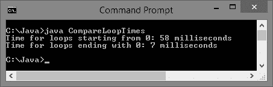

**第 6 章**

循环

**图 6-30** `CompareLoopTimes` 应用的典型执行情况。注意 `CompareLoopTimes` 应用中大数字处的下划线的使用。在第 2 章中，你学过下划线不是必须的，但它们让数字更易读。

如果你执行图 6-29 中的程序，你可能会看到不同的结果。在快速的操作系统上，你可能看不到图 6-30 所示的差异。如果是这样，可以尝试通过增加 `REPEAT` 的值或向循环添加更多嵌套层次来实验该程序。

当你执行 `CompareLoopTimes` 程序时，你偶尔会看到负数输出。当获取的纳秒值落在不同的秒时就会这种情况：开始时间在某秒内是一个很大的纳秒数值，而结束时间在下一秒内是一个很小的数值。本章末尾的一项练习要求你纠正这个问题。

### 采用循环融合

**循环融合（Loop fusion）**是将两个循环合并为一个循环的技术。例如，假设你想调用两个方法，每个方法各调用 100 次。你可以设置一个名为 `TIMES` 的常量为 100 并使用以下代码：

```java
for(int x = 0; x < TIMES; ++x)
    method1();

for(int x = 0; x < TIMES; ++x)
    method2();
```

然而，你也可以使用以下代码：

```java
for(int x = 0; x < TIMES; ++x) {
    method1();
    method2();
}
```

循环融合并不适用于所有情况；有时 `method1()` 的所有活动必须在 `method2()` 活动开始之前完成。然而，如果两个方法互不依赖，融合循环可以提高性能。

### 提高循环性能

#### 使用前置自增代替后置自增

在 `for` 语句的分号之后，常见的操作可能是递增控制变量。在大多数教科书中和专业程序中使用后置自增运算符来实现此目的，例如 `for(int x = 0; x < LIMIT; x++)`

由于递增 `x` 在 `for` 循环中是一个独立的语句，无论你使用 `x++` 还是 `++x`，结果都是相同的。然而，使用前置自增会产生更高效的循环。考虑图 6-31 中的程序。它与图 6-29 中的 `CompareLoopTimes` 应用相似，但它不是比较计数增减循环，而是比较使用前置和后置自增的循环。两个重复 50,000 次的计时空操作循环在图中被阴影标记。

```java
import java.time.*;

public class CompareLoopTimes {
    public static void main(String[] args) {
        int startTime, endTime;
        final int REPEAT = 50_000;
        final int FACTOR = 1_000_000;
        LocalDateTime now;
        now = LocalDateTime.now();
        startTime = now.getNano();
        for(int x = 0; x <= REPEAT; ++x);
        now = LocalDateTime.now();
        endTime = now.getNano();
        System.out.println("Time with prefix increment: " + ((endTime - startTime) / FACTOR) + " milliseconds"); 
        now = LocalDateTime.now();
        startTime = now.getNano();
        for(int x = 0; x <= REPEAT; x++);
        now = LocalDateTime.now();
        endTime = now.getNano();
        System.out.println("Time with postfix increment: " + ((endTime - startTime) / FACTOR) + " milliseconds");
    }
}
```

**图 6-31** `CompareLoopTimes2` 程序

图 6-32 显示了程序的典型执行情况。使用前置自增的程序比使用后置自增的程序稍快一点，因为当编译器使用后置自增时，它会先复制作为表达式值的变量副本，然后增加变量。换句话说，运算符是行为如下的方法：

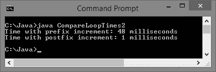

**图 6-32** `CompareLoopTimes2` 程序的典型执行情况

如图 6-32 所示，50,000 次循环的持续时间差异非常小——只有 47/1000 秒。如果你多次运行程序，将得到不同的结果。然而，使用前置运算符通常可以节省少量时间。作为一名专业人士，你可能会遇到坚持在循环中使用后置自增或前置自增的程序员。你应该遵循你组织建立的约定，但现在你已经有了工具来证明前置自增更快。

## 关于改进循环性能的最后提示

在之前的章节中，你学习了如何通过消除不必要的操作、考虑短路运算符的求值顺序、与 0 比较、采用循环融合以及使用前置自增而非后置自增来提高循环性能。随着你成为一名丰富的程序员，你将发现其他增强你所写程序运行效率的方法。你应该始终关注提高程序性能的方法。然而，几乎所有的业务人士都同意，如果为了节省几毫秒导致代码变得难以理解，那么你就没有成功。你几乎总是应该倾向于可读性更好、更容易维护的程序，即使它们的执行速度较慢。

## 改进循环性能

### 两个真理和一个谎言

### 改进循环性能

1. 你可以通过确保循环在测试表达式中不包含不必要的操作来提高循环的性能。

2. 你可以通过确保循环体内部不包含不必要的操作来提高循环性能。

3. 当两个条件都必须为真时，可以通过优先测试最可能发生的情况来提高循环性能。

---

# 第 6 章

## 循环

（续）

## *你来做*

### 比较独立循环与融合循环的执行时间

在本节中，你将比较使用两个循环或单个循环完成相同任务的执行时间。

**1.** 创建一个名为 `TestFusedLoopTime` 的应用程序。

```java
import java.time.*;

public class TestFusedLoopTime
{
    public static void main(String[] args)
    {
```

**2.** 创建变量来存储循环执行的开始和结束时间。还要声明一个循环控制变量 `x` 以及两个命名常量，用于存储循环次数和将纳秒转换为毫秒的因子：`int startTime, endTime; int x; final int REPEAT = 5_000_000; final int FACTOR = 1_000_000;`

记住下划线可以用于使长数字更容易读。下划线也可以省略。

（续）

**3.** 声明一个 `LocalDateTime` 对象，将其初始化为开始时间，并提取其纳秒部分。

```java
LocalDateTime now;
now = LocalDateTime.now();
startTime = now.getNano();
```

**4.** 在一个重复 500 万次的循环中，调用名为 `method1()` 的方法。当 `method1()` 调用完成后，执行第二个同样重复 500 万次的循环，调用另一个名为 `method2()` 的方法。

```java
for(x = 0; x < REPEAT; ++x)
    method1();
for(x = 0; x < REPEAT; ++x)
    method2();
```

**5.** 当两个循环完成后，获取当前时间，提取纳秒值，并显示开始时间和结束时间之间的差（单位为毫秒）：

```java
now = LocalDateTime.now();
endTime = now.getNano();
System.out.println("Time for loops executed separately: " + ((endTime - startTime) / FACTOR) + " milliseconds");
```

**6.** 获取一个新的开始时间，并在单个循环中依次调用 `method1()` 和 `method2()` 各 500 万次。

```java
now = LocalDateTime.now();
startTime = now.getNano();
for(x = 0; x < REPEAT; ++x)
{
    method1();
    method2();
}
```

**7.** 获取循环的结束时间，并显示经过时间间隔的值。为方法添加一个右大括号。

```java
now = LocalDateTime.now();
endTime = now.getNano();
System.out.println("Time for loops executed in a block: " + ((endTime - startTime) / FACTOR) + " milliseconds");
}
```

（续）

**8.** 创建两个名为 `method1()` 和 `method2()` 的方法。每个方法都是存根——即不包含任何语句的方法。为类添加一个右大括号。

```java
public static void method1()
{
}

public static void method2()
{
}
```

**9.** 将文件保存为 `TestFusedLoopTime.java`，并编译执行它。

**10.** 尝试增加和减少 `REPEAT` 的值，并观察效果。图 6-33 `CompareLoopTimes2` 程序的典型执行情况。

`Accumulating` 是通过某些数值多次增加一个值以产生总和的过程。

`加法赋值运算符` (`+=`) 通过将右侧的操作数加到左侧的操作数上来改变左侧的值。

`减法赋值运算符`（`-=`）通过从左侧的操作数中减去右侧的操作数来改变左侧操作数的值。

`乘法赋值运算符` (`*=`) 通过将左侧的操作数乘以右侧的操作数来改变左侧操作数的值。

`除法赋值运算符` (`/=`) 通过将左侧的操作数除以右侧的操作数来改变左侧的值。

`取模赋值运算符` (`%=`) 将左操作数除以右操作数的余数赋值给左操作数。

`prefix ++` 也称为前置递增运算符，对变量加 1，然后对其进行求值。

`postfix ++` 也称为后置递增运算符，先对变量进行求值，然后对其加 1。

`前置和后置递减运算符` 从变量中减 1。

`for 循环` 是一种特殊的循环，可以在需要固定循环次数时使用。

`空循环` 是一种除了循环外不执行任何操作的循环。

`先测试循环` 是在执行循环体之前先测试循环控制变量的循环。

`do…while 循环` 至少执行一次循环体；它在循环一次后，在循环底部检查循环控制变量。

`后测试循环` 是在执行循环体后测试循环控制变量的循环。

`内层循环` 完全包含在另一个循环内部。

`外层循环` 包含另一个循环。

`循环融合`是将两个循环合并为一个循环的技术。

# 第 6 章

## 循环

### 章节总结

循环是一种允许重复执行语句块的结构。在循环结构中，会评估一个布尔表达式，如果结果为真，则执行一个被称为循环体的语句块；然后再次评估该布尔表达式。

你可以使用 `while` 循环在某些条件持续为真时持续执行一个语句体。要正确执行 `while` 循环，你应当先初始化一个循环控制变量，在 `while` 语句中测试它，然后在循环体中更改循环控制变量。

`加法赋值运算符` (`+=`) 将右侧的值加到左侧的变量上。

减法、乘法除法也有类似的操作。`前置和后置递增运算符`将变量的值加 1。`前置和后置递减运算符`将变量的值减 1。`前置`运算符先改变其操作数的值，然后使用它；`后置`运算符先使用该值，然后改变它。

`for 循环`在一个语句中完成初始化、测试和递增。`for` 循环括号内有三个部分，它们之间恰好用两个分号分隔。

`do…while 循环`在执行一次循环后，在循环底部测试布尔表达式。

循环可以嵌套，创建内层循环和外层循环。

你可以通过确保循环不包含不必要的操作或语句，并考虑短路求值、零比较、循环融合和前置递增等因素，提高循环性能。

### 复习题

1. 允许重复执行语句块的结构是

a. 周期 (cycle)

b. 循环 (loop)

c. 环 (ring)

d. 带带 (band)

2. 永不结束的循环是

a. 迭代的 (iterative)

b. 无限的 (infinite)

c. 结构化的 (structured)

d. 相等的 (egal)

3. 为了构建一个正确的循环，你应该初始化一个循环控制

a. 变量 (variable)

b. 常量 (constant)

c. 结构 (structure)

d. 条件 (condition)

4. 以下代码的输出是什么？

```
b = 1;
while(b < 4) {
    System.out.print(b + " ");
}
```

a. 1

b. 1 2 3

c. 1 2 3 4

d. 1 2 3 4

5. 以下代码的输出是什么？

```
b = 1;
while(b < 4) {
    System.out.print(b + " ");
    b = b + 1;
}
```

a. 1

b. 1 2 3

c. 1 2 3 4

d. 1 2 3 4

6. 以下代码的输出是什么？


```
e = 1;
while(e < 4);
    System.out.print(e + " ");
```

a. 无输出 (Nothing)

b. 1 1 1 1

c. 1 2 3 4

d. 4 4 4 4

7. 如果 `total = 100` 且 `amt = 200`，在执行语句 `total += amt` 后

a. total 等于 200

b. total 等于 300

c. total 等于 100

8. `prefix ++` 是一个 运算符。

a. 一元的 (unary)

b. 二元的 (binary)

c. 三元的 (tertiary)

d. 后置的 (postfix)

9. 如果 `g = 5`，在执行 `h = ++g` 后，`h` 的值是

a. 4

b. 5

c. 6

d. 7

10. 如果 `m = 9`，在执行 `n = m++` 后，`n` 的值是

a. 8

b. 9

c. 10

d. 11

11. 如果 `m = 9`，执行 `n++` 后，`n` 的值是

a. 8

b. 9

c. 10

d. 11

12. 如果 `j = 5` 且 `k = 6`，那么 `j++` 为

a. 5

b. 6

c. true

d. false

13. `for` 循环中必须包含 _________。

a. 两个分号 (semicolons)

b. 三个分号 (semicolons)

c. 两个逗号 (commas)

d. 三个逗号 (commas)

14. 以下语句的输出是什么？

```
for(a = 0; a < 5; ++a)
    System.out.print(a + " ");
```

a. 0 0 0

b. 0 1 2 3 4

c. 0 1 2 3 4 5

d. 无输出 (nothing)

15. 以下语句的输出是什么？

```
for(b = 1; b < 3; ++b)
    System.out.print(b + " ");
```

a. 1 1 1

b. 1 2 3

c. 1 2 3 4

d. 无输出 (nothing)

16. 以下语句的输出是什么？

```
for(f = 1, g = 4; f < g; ++f, --g)
    System.out.print(f + " " + g + " ");
```

a. 1 4 2 3

b. 1 4 2 3

c. 无输出 (nothing)

17. 在循环底部进行条件检查的循环是 ________。

a. while

b. do…while

c. for

d. for…while

18. 以下代码段的输出是什么？

```
d = 0;
do {
    System.out.print(d + " ");
    d++;
} while (d < 2);
```

a. 0

b. 0 1

c. 0 1 2

d. 无输出 (nothing)

### 练习

19. 以下代码段的输出是什么？

```
for(f = 0; f < 3; ++f)
    for(g = 0; g < 2; ++g)
        System.out.print(f + " " + g + " ");
```

a. 0 0 0 1 1 0 1 2 0 2 1

b. 0 1 0 2 0 3 1 1 1 2 1 3

c. 0 1 0 2 1 1 1 2

d. 0 0 0 1 0 2 1 0 1 1 1 2 2 2

20. 以下代码段的输出是什么？

```
for(m = 0; m < 4; ++m)
    for(n = 0; n < 2; ++n)
        System.out.print(m + " " + n + " ");
```

a. 0 0 0 1 1 0 1 2 0 2 1

b. 0 1 0 2 0 3 1 1 1 2 1 3

c. 4 2

d. 3 1

### 练习

*编程练习*

1. 当你执行图 6-29 所示所示 CompareLoopTimes 程序时，如果纳值落在不同的秒，偶尔会看到负数输出。修改程序修复此问题，并将文件保存为 `CompareLoop3.java`。（提示：为了测试你的修改，可能需要执行数百次或上千次才能“捕捉”到程序在秒结束时。为了测试，你可以给开始和停止时间赋值，而不是从 `LocalDateTime` 类中获取。）

一个数的阶乘是该数字乘以比它小的每一个正整数的乘积。例如，4 的阶乘是 `4 * 3 * 2 * 1`，或 `24`。将文件保存为 `Factorials.java`。

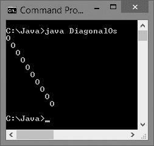

# 第 6 章：循环

5. 编写一个应用程序，提示用户输入两个整数并显示它们之间的每一个整数。如果输入的值之间没有整数，则显示一条消息。

确保无论输入的哪个值较大，程序都能正常工作。将文件保存为 `Inbetween.java`。

6. 编写一个应用程序，显示从 1 到 1,000 之间的每一个完美数。`348` 完美数是指等于所有能整除它的数字之和的数。例如，6 是完美数，因为 1、2 和 3 都能整除 6，且它们的和为 6；然而，12 不是完美数，因为 1、2、3、4 和 6 都能整除 12，且它们的和大于 12。将文件保存为 `Perfect.java`。

7. 编写一个应用程序，使用循环创建图 6-34 所示的 `O` 模式，其中每个 `O` 都向右多显示一个空格。将文件保存为 `DiagonalOs.java`。

**图 6-34** `DiagonalOs` 应用程序的输出

8. 编写一个应用程序，允许用户输入任意数量的学生分数，直到输入 999 为止。如果输入的分数小于 0 或大于 100，则显示适当的消息且不使用该分数。在输入所有分数后，显示输入的数的个数、最高分、最低分以及算术平均分。将文件保存为 `TestScoreStatistics.java`。

9. 编写一个应用程序，使用以下假设计算企业未来 20 年每年的潜在利润：(1) 第一年的毛利润预计为 $20,000。(2) 第一年的支出预计为 $35,000。(3) 净利润或亏损额为毛利润减去支出。(4) 毛利润预计每年增长 10%。(5) 支出预计每年增长 4%。显示每年的年份、毛利润、支出和净利润。还要显示首次报告净利润的年份。将文件保存为 `WhenProfitable.java`。

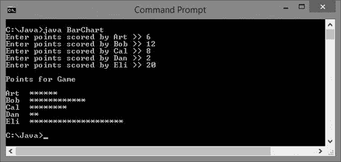

## 练习

10. a. 编写一个应用程序，提示用户距离退休还有多少年以及每年可以储蓄金额。如果用户对任一值输入 0 或负数，则重新提示用户直到输入有效数字。假设资金不产生利息。显示用户退休时将拥有的金额。将文件保存为 `RetirementGoal.java`。

b. 修改 `349` `RetirementGoal` 应用程序，显示如果用户每年余额获得 5% 的利息，他们将拥有的金额。将文件保存为 `RetirementGoal2.java`。

11. Pickering 制造公司每周随机选择四个工厂中的一个进行检查。编写一个应用程序，确定未来 52 周内每周将选择哪个工厂。使用附录 D 中解释的 `Math.random()` 函数生成 1 到 4 之间的工厂编号；你使用类似下面的语句：

```
factory = 1 + (int) (Math.random() * 4);
```

在每次选择后，显示要检查的工厂，在 52 次选择完成后，显示当年每个工厂的检查百分比。运行该应用程序几次，直到你确认工厂选择是随机的。将文件保存为 `Inspections.java`。

12. 假设墨西哥的人口为 1.21 亿，人口每年增长 1.01%。假设美国的人口为 3.15 亿，人口每年减少 0.15%。编写一个应用程序，显示这两个国家每年的人口，直到墨西哥的人口超过美国，并显示所需的年数。将文件保存为 `Population.java`。

13. 亨廷顿高中篮球队有五位名为 Art、Bob、Cal、Dan 和 Eli 的球员。接受每位球员在比赛中的得分，并创建一个展示所示得分的条形图，类似于图 6-35 中的图表。将文件保存为 `BarChart.java`。

**图 6-35** `BarChart` 应用程序的典型执行情况

14. a. 创建一个名为 `Purchase` 的类。每个 `Purchase` 包含发票号、销售金额和销售税额。为发票号和销售金额包含 `set` 方法。在销售金额的 `set()` 方法中，计算销售税为销售金额的 5%。还包含一个显示购买详情的方法。将文件保存为 `Purchase.java`。

b. 编写一个应用程序，声明一个 `Purchase` 对象并提示用户输入购买详情。在提示发票号时，在用户输入 1,000 到 8,000 之间的数字之前，不要让用户继续。在提示销售金额时，在用户输入非负值之前，不要继续。在创建有效的 `Purchase` 对象后，显示对象的发票号、销售金额和销售税。将文件保存为 `CreatePurchase.java`。

### 调试练习

1. 第 6 章文件夹中的每个文件都有语法或逻辑错误。在每种情况下，确定问题并修复程序。纠正错误后，使用 *Fix* 前缀保存每个文件。例如，将 `DebugSix1.java` 保存为 `FixDebugSix1.java`。

a. `DebugSix1.java`

b. `DebugSix2.java`

c. `DebugSix3.java`

d. `DebugSix4.java`

### 游戏区

1. a. 编写一个应用程序创建一个测验。测验应包含五个关于爱好、流行音乐、天文学或其他兴趣的问题。每个问题都应该是有至少四个选项的选择题。当用户错误回答问题时，显示适当的消息以及正确答案。在测验结束时，显示正确答案和错误答案的数量以及正确答案的百分比。将文件保存为 `Quiz.java`。

b. 修改 `Quiz` 应用程序，使得在正确回答问题之前重复显示问题。移除正确答案百分比的计算——用户在完成应用程序时将是 100% 正确的。将文件保存为 `Quiz2.java`。

2. 在第 1 章中，你创建了一个类 `RandomGuess`。在这个游戏中，玩家猜测一个数字，应用程序生成一个随机数，玩家判断自己是否正确。在第 5 章中，你改进了应用程序，显示玩家的猜测是正确、太高还是太低。现在，添加一个循环持续提示用户输入数字，指示猜测高还是低，直到用户输入正确的值。在用户正确猜中数字后，显示尝试次数。将文件保存为 `RandomGuess3.java`。

3. 在第 4 章中，你创建了一个 `Die` 类，可以从中实例化一个包含 1 到 6 随机值的对象。现在使用该类创建一个简单的骰子游戏，用户选择一个 2（两个骰子最小可能的总和）到 12（两个骰子最大可能的总和）之间的数字。用户最多掷三次骰子。如果用户选择的数字出现了，则用户获胜且游戏结束。如果在三次掷内没有出现该数字，电脑获胜。将应用程序保存为 `TwoDice3.java`。

4. a. 使用你在第 4 章中创建的 `Die` 类，创建一个用户可以与电脑对玩的 Pig 骰子游戏。游戏的目标是第一个得到 100 分。用户和电脑按照以下规则轮流掷骰子：

在每个回合中，每位玩家“掷”两颗骰子。如果没有出现 `1`，则将骰子的值累加到总分中，玩家可以选择继续投掷或将回合交给另一位玩家。

如果其中一个骰子上出现了 `1`，则玩家的总分不再增加任何分数，并轮到另一位玩家的回合。

如果两颗骰子上都出现了 `1`，不仅玩家的回合结束了，而且玩家的所有累积得分将重置为 0。

在这个版本的游戏中，当电脑没有掷出 `1` 且可以选择继续投掷时，生成一个 0 到 1 之间的随机值。如果该值为 `0.5` 或以上，则让电脑继续掷骰子；如果该值小于 `0.5`，则让电脑停止并将回合交给玩家。

将游戏保存为 `PigDiceGame.java`。

b. 修改 `PigDiceGame` ，使得如果玩家掷出 `1`，不仅玩家的回合会结束，该玩家在该轮中获得的所有分数也会被消除（之前回合的分数不受影响。也就是说，当玩家或电脑掷出 `1` 时，从对方回合开始后累积的所有分数都会被减除）。将游戏保存为 `PigDiceGame2.java`。

5. 两个人通过轮流输入 `1`、`2` 或 `3` 来玩 Count 21 游戏，这些数字会被累加到一个总和中。加上数值导致总和超过 21 的玩家输掉游戏。创建一个玩家与电脑竞技的 Count 21 游戏，并编写一种始终让电脑获的策略。在任何回合中，如果玩家输入的不是 `1`、`2` 或 `3` 以外的值，则强制玩家重新输入该值。将游戏保存为 `Count21.java`。

# 第 6 章

## 循环

### 案例分析

1. Carly’s Catering 为派对和特殊活动提供餐点。在之前的章节中，你开发了一个存储餐饮活动信息的类以及一个使用该类四个对象来测试方法的应用程序。现在修改 `EventDemo` 类到第 352 行以执行以下操作：

- 持续提示每个 `Event` 的人数，直到该值落在 5 到 100 之间（包含）。

- 对于其中一个 `Event` 对象，创建一个循环，根据该 `Event` 的人数显示“Please come to my event!”。

将修改后的文件保存为 `EventDemo.java`。

2. Sammy’s Seashore Supplies 为游客租赁海滩设备。在之前的章节中，你开发了一个存储设备租赁信息的类以及一个使用该类四个对象来测试方法的应用程序。现在修改 `RentalDemo` 类以执行以下操作：

- 持续提示每个 `Rental` 的租赁分钟数，直到该值落在 60 到 7,200 之间（包含）。

- 对于其中一个 `Rental` 对象，创建一个循环，根据该 `Rental` 的完整小时显示“Coupon good for 10 percent off next rental”。

将修改后的文件保存为 `RentalDemo.java`。

# 第 7 章

## 字符、字符串与 StringBuilder

在本章中，你将：

- 识别字符串数据问题

- 使用 `Character` 类方法

- 声明并比较 `String` 对象

- 使用其他 `String` 方法

- 使用 `StringBuilder` 和 `StringBuffer` 类

### 理解字符串数据问题

处理字符和字符串为 Java 初学者带来了某些挑战。例如，考虑图 7-1 所示的 `TryToCompareStrings` 应用程序。`main()` 方法声明了一个名为 `aName` 的 `String` 并将其赋值为“Carmen”。然后提示用户输入一个名称。应用程序使用相等运算符 (`==`) 比较这两个名称，并显示两条消息之一，用以指示字符串是否相等。

```java
import java.util.Scanner;

public class TryToCompareStrings {
    public static void main(String[] args) {
        String aName = "Carmen";
        // 不要这样做
        String anotherName;
        // 不要使用 == 来比较字符串的内容。
        Scanner input = new Scanner(System.in);
        System.out.print("Enter your name > ");
        anotherName = input.nextLine();
        if (aName == anotherName) {
            System.out.println(aName + " equals " + anotherName);
        } else {
            System.out.println(aName + " does not equal " + anotherName);
        }
    }
}
```

图 7-1 `TryToCompareStrings` 应用程序

图 7-2 显示了应用程序的典型执行过程。当用户输入“Carmen”作为 `anotherName` 的值时，应用程序得出两个名称不等的结论。

图 7-2 `TryToCompareStrings` 应用程序的典型执行

图 7-1 中的应用程序似乎产生了错误的结果。问题源于在 Java 中，`String` 是一个类，每个创建的 `String` 都是一个对象。作为一个对象，`String` 变量名是一个引用。因此，当你使用 `==` 比较两个 `String` 对象时，你比较的是它们的值，而不是它们的值。

### 使用字符类方法

程序员比较位置的内容（值）的频率高于比较它们的地址。幸运的是，Java 的创建者提供了三个可以在处理文本数据时使用的类；这些类为你提供了许多方法：

- `Character`：一个实例可以持有单个字符且其方法可以处理数据的类。

- `String`：用于处理固定字符串数据——即不可变数据的类。

- `StringBuilder` 和 `StringBuffer`：用于存储和处理可变数据的类。

理解字符串数据问题

1. `String` 是一个可以持有文本数据的简单数据类型。（假）

2. 程序员比较字符串值的频率高于他们比较它们地址的频率。（真）

3. `Character`、`String` 和 `StringBuilder` 是处理文本数据的有用内置类。（真）

# 356

`isLowerCase()`

测试字符是否为小写

`toLowerCase()`

返回参数的小写对应字符串；如果参数不是大写字母，则不做任何更改

`isDigit()`

如果参数是数字（0−9）则返回 true，否则返回 false

`isLetter()`

如果参数是字母，则返回 true，否则返回 false

`isLetterOrDigit()`

如果参数是字母或数字，则返回 true，否则返回 false

`isWhitespace()`


如果参数是空白字符则返回 true，否则返回 false；这包括空格、制表符、换行符、回车符和分页符 **表 7-1**

# Character 类的常用方法

`Character` 类定义在 `java.lang` 中，并自动导入到你写的每个程序中。`Character` 类继承自 `java.lang.Object`。当你学习“继承简介”章节中的继承概念时，将学到更多关于 `Object` 类的知识。

图 7-3 包含一个使用了表 7-1 所示许多方法的的应用程序。

该程序将变量 `aChar` 定义为 'C' 并显示有关它的信息。

```java
import java.util.Scanner;

public class CharacterInfo
{
    public static void main(String[] args)
    {
        char aChar = 'C';
        System.out.println("The character is " + aChar);
        if(Character.isUpperCase(aChar))
            System.out.println(aChar + " is uppercase");
        else
            System.out.println(aChar + " is not uppercase");
        if(Character.isLowerCase(aChar))
            System.out.println(aChar + " is lowercase");
        else
            System.out.println(aChar + " is not lowercase");
        aChar = Character.toLowerCase(aChar);
        System.out.println("After toLowerCase(), aChar is " + aChar);
        aChar = Character.toUpperCase(aChar);
        System.out.println("After toUpperCase(), aChar is " + aChar);
    }
}
```

**图 7-3** CharacterInfo 应用程序 *(续)*

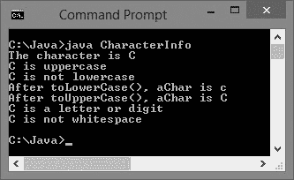

## 使用 Character 类方法

*(续)*

```java
if(Character.isLetterOrDigit(aChar))
    System.out.println(aChar + " is a letter or digit");
else
    System.out.println(aChar + 357 " is neither a letter nor a digit");

if(Character.isWhitespace(aChar))
    System.out.println(aChar + " is whitespace");
else
    System.out.println(aChar + " is not whitespace");
```

**图 7-3** CharacterInfo 应用程序

你可以发现，图 7-3 中 CharacterInfo 应用程序使用的每个 `Character` 类方法都是静态方法，因为在使用方法名时没有使用对象引用——你只使用了类名、一个点和方法名。你在第 3 章中学习过静态方法和实例方法之间的区别。

`CharacterInfo` 应用程序的输出如图 7-4 所示，其中你可以看到：

- `isUpperCase()` 方法返回值为 true。
- `isLowerCase()` 方法返回值为 false。
- `toLowerCase()` 方法返回值为 ‘c’。
- `toUpperCase()` 方法返回值为 ‘C’。
- `isLetterOrDigit()` 方法返回值为 true。
- `isWhitespace()` 方法返回值为 false。

**图 7-4** CharacterInfo 应用程序的输出

# 第 7 章 字符、字符串和 StringBuilder

## 两个真理和一个谎言

## 使用 Character 类方法

358

1. `Character` 是一个类，但 `char` 是一个简单的数据类型。
2. `Character` 类方法 `isLowerCase()` 返回任何大写字母的写写版本。
3. 如果 `char` 变量持有 Tab 键的 Unicode 值，`isWhitespace()` 将为 true，而 `isLetterOrDigit()` 将为 false。

### 你来做做

#### 测试字符

在本节中，你将尝试 `CharacterInfo` 应用程序以熟悉不同的字符属性。

1. 找到存储在你学生文件（Student Files）中 Chapter07 文件夹中的 `CharacterInfo.java` 文件。（如果找不到学生文件，可以输入图 7-3 所示的程序。）更改 `aChar` 变量的值，编译并执行程序，然后检查结果。多次重复此任务，使用各种字符值，包括大小写字母、数字、标点符号、特殊字符（如 ‘@’ 和 ‘[’）以及空白字符（如空格或 Tab）。验证每个情况下输出是否符合你的预期。

#### 在 Java 网站查看 Character 类

1. 使用 Web 浏览器访问 Java 网站 `www.oracle.com/technetwork/java/index.html`，选择 **Java APIs** 和 **Java SE 8**。使用类的字母顺序列表找到 `Character` 类并选择它。
2. 检查 `Character` 类广泛的方法列表。找到一个你熟悉的，例如 `toLowerCase()`。注意该方法有两个重载版本。你在 `CharacterInfo` 应用程序中使用的版本接受一个 `char` 并返回一个 `char`。另一个接受并返回 `int` 的版本使用 Unicode。附录 B 提供了更多关于 Unicode 的信息。

## 定义和比较 String 对象

你在第 1 章中学过用双引号括的字符序列是一个字面量。（程序员可能称之为“字符串字面量”。）你已经使用了许多字面量，例如“First Java application”，它们赋值给 String 对象，并在方法中使用它们，如 `println()` 和 `showMessageDialog()`。359 字面量是一个未命名对象（或**匿名对象**），属于 String 类，而 **String 变量**仅仅是同类的命名对象。`String` 类定义在 `java.lang` 中，会自动导入到你写的每个程序中。

你在每个 `main()` 方法头中声明了一个名为 `args` 的 String 数组。你将在下一章学习数组。

当你定义 String 对象时，String 本身——即它包含的字符——与引用它的标识符是分开的。你可以通过 `new` 关键字和 `String` 构造函数创建一个 String 对象，就像创建任何类型的对象一样。例如，以下语句定义了一个名为 `aGreeting` 的对象，将其声明为 String，并为其赋值初始值“Hello”：`String aGreeting = new String("Hello");`

变量 `aGreeting` 存储 String 对象的引用——它跟踪 String 对象存储在内存的位置。当你声明并初始化 `aGreeting` 时，它连接到初始化字符串值。由于 String 在程序中经常声明，Java 提供了一种快捷方法，你可以通过以下省略 `new` 关键字且不显式调用类构造函数的语句来声明包含“Hello”的 String：`String aGreeting = "Hello";`

## 比较 String 值

在 Java 中，String 是一个类，每个创建的 String 都是一个对象。String 变量名是一个引用；也就是说，String 变量名指向内存中的一个位置，而不是一个特定的值。

这种区别是微妙的，但当你声明一个基本原始类型的变量时，例如 `int x = 10;`，`x` 所在的内存地址持有值 10。如果你稍后给 `x` 赋值一个新值，新值将替换所分配内存地址上的旧值。

相比之下，当你声明 String 时，例如 `String aGreeting = "Hello";`，`aGreeting` 并不持有字符“Hello”；相反它持有存储字符的内存地址。

图 7-5 的左侧显示了如果 `aGreeting` 恰好存储在内存地址 10876 而字符串 “Hel o” 恰好存储在内存地址 26040 的计算机内存图。你无法选择存储数值的内存地址。像 10876 和 26040 这样的地址是由操作系统选择的。

# 第 7 章 字符、字符串与 StringBuilder

```java
String aGreeting = "Hello";
String aGreeting = "Hello";
aGreeting = "Bonjour";
```

地址 10876，命名为 `aGreeting`

地址 10876，命名为 `aGreeting`

26040

32564

`aGreeting`

`aGreeting`

持有地址

持有地址

“Hello”所在的

地址 26040

“Bonjour”所在的

地址 26040

存储。

Hello

Hello

地址 32564

地址 32564

XXYYZZ223

Bonjour

**图 7-5** 声明时和赋值后 `aGreeting` 的内容。当你引用 `aGreeting` 时，你实际上是在访问你想要使用的字符的地址。（在图 7-5 左侧的示例中，从地址 32564 开始的内存位置尚未使用，且包含垃圾值。）如果你随后为 `aGreeting` 赋值一个新值，例如 `aGreeting = "Bonjour";`，`aGreeting` 持有的地址就会改变；现在，`aGreeting` 持有一个存储字符 “Bonjour” 的新地址。如图 7-5 右侧所示，“Bonjour”是一个完全全新的对象，具有它自己的位置。“Hel o”字符串仍然在内存中，但 `aGreeting` 不再持有它的地址了。最终，Java 系统中称为垃圾回收器的部分会丢弃 “Hel o” 字符，以便该内存地址可以用于其他用途。因此，字符串实际上从不改变；相反，会创建新的字符串，并由字符串引用持有新地址。字符串和其他不可更改的对象是**不可变的**。

Java 的创建者将字符串设为不可变是出于几个原因。例如，在多个程序（或程序的一部分，称为*执行线程*）并发运行的环境中，一个逻辑路径不能更改另一个路径正在使用的字符串。使用不可变字符串对象还可以使编译器的执行效率更。。在简单程序中，你并不关心这些特性。

然而，不可变性会导致性能问题。在本章的后后部分，你将学习到如果你想使用一个可变对象来持有字符字符串，可以使用 `StringBuilder` 类。

### 声明和比较字符串对象

由于字符串引用持有内存地址，在它们之间进行简单比较往往会产生误导性的结果。例如，回想图 7-1 中的 TryToCompareStrings 应用程序。在这个示例中，Java 认为字符串变量 `aName` 和 `anotherName` 不相等，因为尽管变量包含相同的系列字符，但其中一组是直接赋值的，另一组是从键盘输入并存储在内存的不同区域的。当你使用 `==` 运算符比较字符串时，你比较的是它们的内存地址，而不是它们的值。此外，当你尝试使用小于号（`<`）或大于号（`>`）运算符比较字符串时，程序甚至无法通过编译。

如果你声明了两个字符串对象并将它们都初始化为相同的值，该值仅在内存中存储一次，且两个对象引用持有相同的内存地址。由于字符串只存储了一次，因此节省了内存。考虑以下示例，将相同的值赋值给两个字符串（而不是从用户输入获取一个）。

以下示例的输出结果是误导性的。当你编写以下代码时，输出是 *Strings are the same*。

```java
String firstString = "abc";
String secondString = "abc";
if(firstString == secondString)
    System.out.println("Strings are the same");
```

输出为 *Strings are the same* 是因为 `firstString` 和 `secondString` 持有的内存地址相同，而不是因为它们的内容相同。

幸运的是，`String` 类为你提供了许多实用的方法，可以按照你通常意图的方式比较字符串。`String` 类的 `equals()` 方法评估两个字符串对象的内容来判断它们是否等价。如果对象的内容相同，无论内容是如何赋值的，该方法都会返回 true。例如，图 7-6 显示了一个 CompareStrings 应用程序，与图 7-1 中的 TryToCompareStrings 应用程序相同，除了阴影比较部分外。

```java
import java.util.Scanner;

public class CompareStrings
{
    public static void main(String[] args)
    {
        String aName = "Carmen";
        String anotherName;
        Scanner input = new Scanner(System.in);
        System.out.print("Enter your name > ");
        anotherName = input.nextLine();
        if(aName.equals(anotherName))
            System.out.println(aName + " equals " + anotherName);
        else
            System.out.println(aName + " does not equal " + anotherName);
    }
}
```

**图 7-6** CompareStrings 应用程序

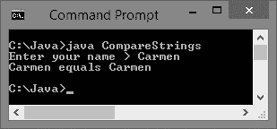

# 第 7 章 字符、字符串与 StringBuilder

当用户运行 CompareStrings 应用程序并输入“Carmen”作为名字时，输出如图 7-7 所示；字符串的内容相等。`String` 类的 `equals()` 方法只有在两个字符串相同时才返回 true。因此，指向 “Carmen”的字符串不等同于指向 “CARMEN”，而指向 “Carmen ”（n 后面有一个空格）的字符串不等价于指向 “Carmen”（n 后面没有空格）。

**图 7-7** CompareStrings 应用程序的典型执行。技术上，`equals()` 方法并不执行字母顺序的比较；它执行的是**字典顺序比较**——基于字符的整数值进行比较。

图 7-6 中声明的两个字符串对象（`aName` 和 `anotherName`）都可以访问 `String` 类的 `equals()` 方法。如果你分析 `equals()` 方法在图 7-6 中的使用方式，你可以推断出许多关于该方法如何编写的信息：

- 因为你对字符串对象使用 `equals()` 方法，且该方法使用该对象的唯一内容进行比较，你可以推断它不是静态方法。
- 因为 `equals()` 方法的调用可以用于 if 语句，你可以推断它返回一个布尔值。
- 因为你在 `equals()` 方法的括号中看到一个 String，你可以推断 `equals()` 方法接收一个 String 参数。

因此，`String` 类中 `equals()` 方法的方法头部类似于：

```java
public boolean equals(String s)
```

你对方法头部唯一未知的信息是用于字符串参数的本地名称——它可能是 `s`，也可能是任何其他合法标识符。当你使用像 `equals()` 这样的预写方法时，你并不知道其内部代码是如何写的。例如，你不知道 `equals()` 方法是从左到右还是从右到左比较字符串中的字符。你所知道的是，当两个字符串完全等价时，该方法返回 true，否则返回 false。

### 声明和比较字符串对象

由于图 7-6 应用程序中的 `aName` 和 `anotherName` 都是字符串，`aName` 对象可以像所示通过 `aName.equals(anotherName)` 调用 `equals()`，或者 `anotherName` 对象可以通过 `anotherName.equals(aName)` 调用 `equals()`。`equals()` 方法可以接收变量字符串对象或字面量字符串作为其参数。

`String` 类的 `equalsIgnoreCase()` 方法与 `equals()` 方法类似。正如名称所示，该方法在判断两个字符串是否等价时忽略大小写。

因此，如果你声明一个 `String` 为 `String aName = "Carmen";`，那么 `aName.equals("caRMen")` 为 false，但 `aName.equalsIgnoreCase("caRMen")` 为 true。当用户在你的程序中输入提示响应时，这个方法非常有用。你无法预测用户在输入数据期间何时会使用 Shift 键或 Caps Lock 键。

当使用 `String` 类的 `compareTo()` 方法比较两个 `Strings` 时，它会以整数的形式向用户提供额外信息。当你使用 `compareTo()` 比较两个 `String` 对象时，该方法：

- 如果两个 `Strings` 的值完全相同，则返回零
- 如果调用对象“小于”参数，则返回负数


- 如果调用对象“大于”参数，则返回正数

`String` 根据其 Unicode 值被认为“小于”或“大于”彼此；因此，“a” 小于“b”，而“b” 小于“c”。例如，如果 `aName` 指向“Roger”，那么 `aName.compareTo("Robert")` 返回 5。该数字是正数，表示“Roger”大于“Robert”。这并不意味着“Roger”的字符比“Robert”多；而是意味着“Roger”在字母顺序上“大于” “Robert”。比较过程如下：

- “Roger”中的 `R` 和“Robert”中的 `R` 进行比较，发现是相等的。
- “Roger”中的 `o` 和“Robert”中的 `o` 进行比较，发现是相等的。
- “Roger”中的 `g` 和“Robert”中的 `b` 进行比较；它们是不同的。`g` 的数值减去 `b` 的数值等于 5（因为在字母表中 `g` 在 `b` 之后五个字母），所以 `compareTo()` 方法返回值 5。

通常，你并不关心 `compareTo()` 的具体返回值是什么；你只是想确定它是正还是负的。例如，你可以使用类似 `if(aWord.compareTo(anotherWord) < 0)` 的测试……来判断 `aWord` 在字母上小于 `anotherWord`。如果 `aWord` 是指向值“hamster”的 `String` 变量，而 `anotherWord` 是指向值“iguana”的 `String` 变量，则比较 `if(aWord.compareTo(anotherWord) < 0)` 结果为 true。

### 空字符串和 null 字符串

程序员经常对空 `String` 和 null `String` 之间的区别感到困惑。

可以使用以下语句创建一个名为 `word1` 的空 `String` 以及两个名为 `word2` 和 `word3` 的 null `String`：

```java
String word1 = "";
String word2 = null;
String word3;
```

## 第 7 章：字符、字符串和 StringBuilder

空 `String` `word1` 指向一个未存储字符的内存地址。`null String` `word2` 使用 Java 关键字 `null`，使得 `word2` 尚未持有内存地址。

未赋值的 `String` `word3` 默认也是 `null String`。这些声明之间的重要区别是，`word1` 可以用于本章描述的 `String` 方法，而 `word2` 和 `word3` 不行。例如，假设名为 `someOtherString` 的 `String` 被赋值为值 364，那么比较 `word1.equals(someOtherString)` 是有效的，但 `word2.equals(someOtherString)` 会导致错误。

由于 `String` 默认设置为 `null`，一些程序员认为显式地将 `String` 设置为 `null` 是多余的。其他程序员觉得，显式使用关键字 `null` 使你的意图对阅读程序的人更加清晰。你应该使用你组织推荐的风格。

观看视频 *Comparing Strings*（比较字符串）。

### 真相和一个谎言：声明和比较 String 对象

（碎片文本重构）

1. 要创建一个 `String` 对象，你必须使用关键字 `new` 并显式调用该类的构造函数。
2. 当你使用 `==` 运算符比较 `String` 时，你比较的是它们的内存地址，而不是值。
3. 当你使用 `equals()` 方法比较 `String` 时，你比较的是它们的值，而不是内存地址。

#### 你来做：在 Java 网站检查 String 类

在本节中，你将学习更多关于 `String` 类的知识。

1. 使用网络浏览器访问 Java 网站，选择 `Java APIs` 和 `Java SE 8`。使用类的字母顺序列表找到 `String` 类并选择它。
2. 检查 `equals()` 方法。在你最后一次看到该方法用于如 `aName.equals(anotherName)` 这样的表达式中。由于 `equals()` 是与对象 `aName` 一起使用的，你可以预测 `equals()` 方法不是 `static` 365。当你查看 `equals()` 方法的文档时，可以看到这是 true。你也可以看到它返回一个 `boolean` 值。你可能预测的是 `equals()` 方法接受一个 `String` 参数，因为 `anotherName` 是一个 `String`。然而，文档显示 `equals()` 方法接受一个 `Object` 参数。你将在“高级继承概念”章节中学习更多关于 `Object` 类的知识，但现在请理解 `String` 是 `Object` 的类型。`Object` 是所有类都派生的基类。

### 使用其他 String 方法

`String` 类提供了许多其他可用方法。`toUpperCase()` 和 `toLowerCase()` 方法可以将任何 `String` 转换为大写或小写。例如，如果你声明一个 `String` 为 `String aWord = "something";`，则内存中创建了“something”并将其地址赋值给 `aWord`。由于 `aWord = aWord.toLowerCase();` 会改变 `aWord` 指向“something”。

`length()` 方法是一个返回 `String` 长度的访问方法。例如，以下语句使变量 `len` 持有 5：

```java
String greeting = "Hello";
int len = greeting.length();
```

在第 2 章中，你学过访问方法通常以 *get* 开头。Java 的创建者在命名 `length()` 方法没有遵循这一习惯。当你必须判断一个 `String` 是否为空时，将其与 0 进行比较比使用 `equals()` 方法更快。

`indexOf()` 方法确定特定字符是否出现在 `String` 中。如果是，方法返回字符的位置；`String` 的第一个位置是零。如果字符在 `String` 中不存在，则返回值为 –1。例如，在 `String myName = "Stacy";` 中，`myName.indexOf('S')` 的值为 0，`myName.indexOf('a')` 的值为 2，而 `myName.indexOf('q')` 的值为 –1。

`charAt()` 方法需要一个整数参数，指示方法返回的字符的位置，从 0 开始。例如，如果 `myName` 是指向“Stacy”的 `String`，则 `myName.charAt(0)` 的值为 ‘S’，`myName.charAt(4)` 的值为 ‘y’。如果你使用的参数是负数或大于等于调用 `String` 的长度，则会发生错误。与其在 `charAt()` 中使用常量参数，你经常会想在循环中使用变量参数来检查每个字符。例如，为了统计 `String` `mySentence` 中的空格数量，你可能会编写如下 366 行的循环：

```java
for(int x = 0; x < myName.length(); ++x) {
    if(mySentence.charAt(x) == ' ') {
        ++countOfSpaces;
    }
}
```

当你想让用户从键盘输入单个字符时，`charAt()` 方法也非常有用。用于控制台输入的 `Scanner` 对象的 `nextLine()` 方法和用于 GUI 输入的 `JOptionPane.showInputDialog()` 方法都返回 `String`。例如，如果 `input` 已经声明为一个 `Scanner` 对象，你可以使用如下的语句从用户的键盘输入中提取一个字符：

```java
char userLetter = input.nextLine().charAt(0);
```

`endsWith()` 方法和 `startsWith()` 方法各接受一个 `String` 参数，并根据 `String` 对象是否是以指定的参数结尾或以指定的参数开头，分别返回 `true` 或 `false`。例如，如果 `String myName = "Stacy";`，那么 `myName.startsWith("Sta")` 为 `true`，而 `myName.endsWith("z")` 为 `false`。这些方法是区分大小写的，因此如果 `String myName = "Stacy";`，那么 `myName.startsWith("sta")` 为 `false`。

`replace()` 方法允许你替换 `String` 中某些字符的所有出现处。例如，如果 `String yourName = "Annette";`，那么 `String goofyName = yourName.replace('n', 'X');` 将将 `"AXXette"` 赋值给 `goofyName`。

语句 `goofyName = yourName.replace('p', 'X');` 将将 `"Annette"` 赋值给 `goofyName` 而没有任何变化，因为在 `yourName` 中没有找到 `'p'`。

`replace()` 方法是区分大小写的，因此如果 `String yourName = "Annette";`，那么 `String goofyName = yourName.replace('N', 'X');` 没有任何变化。

虽然 `toString()` 不是 `String` 类的一部分，但它为其他类定义，以便将对象转换为字符串。例如，`Integer` 类的 `toString()` 方法将整数转换为 `String`。在执行以下语句后，`theString` 指向“4”：

```java
String theString;
int someInt = 4;
theString = Integer.toString(someInt);
```

如果你如下声明一个 `String` 和一个 `double`，在执行以下语句后，`anotherString` 指向长度为 4 的“8.25”：

```java
String anotherString;
double someDouble = 8.25;
anotherString = Double.toString(someDouble);
```

你也可以使用连接操作 `+` 将任何原始类型（变量或常量）转换为 `String`。例如，如果你声明一个变量 `int myAge = 25;`，以下语句产生指向“My age is 25”的 `String`：`String aString = "My age is " + myAge;`

同样，如果你写如下代码，`anotherString` 指向“12.34”：

```java
String anotherString;
float someFloat = 12.34f;
anotherString = "" + someFloat;
```

Java 解释器首先将 `float` `12.34f` 转换为 `String` “12.34”，并将其添加到空 `String` “”。

`toString()` 方法位于 `Object` 类；它是 Java 中可以用于任何对象类型的方法。在整本书中，你一直在使用 `toString()` 而并不知。当你使用 `print()` 和 `println()` 时，如果有必要，它们的参数会被转换为 `String`。你不需要使用 `import` 语句来使用 `toString()`，因为它是 `java.lang` 的一部分，该包会被自动导入。

你已经知道可以使用加号 (`+`) 将 `String` 与其他 `String` 或值连接；自第 1 章以来你已经在 `println()` 和 `showMessageDialog()` 等方法中使用这种方法。例如，你可以使用以下语句显示 `firstName`、一个空格和 `lastName`：

`System.out.println(firstName + " " + lastName);`

此外，你可以使用 `substring()` 方法提取 `String` 的部分，并单独使用或与另一个 `String` 连接。`substring()` 方法接受两个整数参数——起始位置和结束位置——它们都基于 `String` 的第一个位置为零。提取的子字符串的长度是第二个整数与第一个整数之间的差；如果调用方法时不提供第二个整数参数，子字符串将延伸到原始字符串的末尾。

例如，图 7-8 中的应用程序提示用户输入姓。随后应用程序提取这些姓名，以便构建一封友好的商务信。在应用程序提示用户输入姓名后，循环控制变量被初始化为 0。当变量小于输入的姓名长度时，每个字符都会与空格字符进行比较。当发现空格时，会创建两个新字符串。第一个 `firstName` 是从原始输入位置 0 到发现空格位置的 `substring`。第二个 `familyName` 是从原始输入空格之后位置到字符串末尾的 `substring`。一旦姓和名被创建，循环控制变量被设置为原始字符串的长度，以便循环退出并继续显示友好的商务信。图 7-9 显示了数据输入界面以及生成的输出信件。

# 第 7 章

### 字符、字符串和 StringBuilder

```java
import javax.swing.*;

public class BusinessLetter
{
    public static void main(String[] args)
    {
        String name;
        String firstName = "";
        String familyName = "";
        int x;
        char c;
        name = JOptionPane.showInputDialog(null, "Please enter customer's first and last name");
        x = 0;
        while(x < name.length())
        {
            if(name.charAt(x) == ' ')
            {
                firstName = name.substring(0, x);
                familyName = name.substring(x + 1, name.length());
                x = name.length();
            }
            ++x;
        }
        JOptionPane.showMessageDialog(null, "Dear " + firstName +
        ",\n am so glad we are on a first name basis" +
        "\nbecause I would like the opportunity to" +
        "\ntalk to you about an affordable insurance" +
        "\nprotection for the entire " + familyName +
        "\family. Call A-One Insurance today" +
        "\nat 1-800-555-9287.");
    }
}
```

图 7-8 BusinessLetter 应用程序

为了保持示例简单，`BusinessLetter` 应用程序只显示一个客户的信。实际的业务应用程序可能会允许员工输入几十甚至数百个客户姓名并将其存储在数据文件中供以后使用。你将在“文件输入和输出”章节中学习如何在文件中永久地存储数据。现在，只需专注于应用程序的字符串处理能力。

图 7-9 BusinessLetter 应用程序的典型执行

`regionMatches()` 方法可以测试两个 `String` 区域是否相同。

`regionMatches()` 方法的一个版本接受四个参数——在调用字符串中的起始位置、被比较的另一个字符串、在另一个字符串中的起始位置以及比较的长度。例如，假设你如下声明了两个 `String` 对象：

```java
String firstString = "abcde";
String secondString = "xxbcdef";
```

那么，表达式 `firstString.regionMatches(1, secondString, 2, 4)` 为 `true`，因为 `firstString` 从位置 1 开始的四个字符子字符串是“bcde”，而 `secondString` 从位置 2 开始的四个字符子字符串也是“bcde”。表达式 `firstString.regionMatches(0, secondString, 3, 2)` 为 `false`，因为 `firstString` 从位置 0 开始的两个字符子字符串是“ab”，而 `secondString` 从位置 3 开始的两个字符子字符串是“cd”。

`regionMatches()` 方法的第二个版本在第一个参数接受一个额外的 `boolean` 参数表示在判断区域是否匹配时是否忽略大小写。例如，假设你如下声明了两个 `String`：

```java
String thirdString = "123 Maple Drive";
String fourthString = "a maple tree";
```

那么下面的表达式为真，因为 `thirdString` 从位置 4 开始并持续五个字符长度的子字符串是 "Maple"，而 `fourthString` 从位置 2 开始并持续五个字符长度的子字符串是 "maple"，且忽略大小写的参数已设置为 true：


# 第 7 章：字符、字符串与 StringBuilder

## 将 String 对象转换为数字

如果一个 `String` 包含所有数字，例如“649”，你可以将其从 `String` 转换为数字，以便用于算术运算，或像使用任何其他数字一样使用它。例如，假设你要求用户在输入对话框中输入薪水。当你使用 `showInputDialog()` 接收输入时，的值始终是一个 `String`。为了能够在算术语句中使用该值，你必须将 `String` 转换为数字。

当你使用本节中描述的任何方法尝试将 `String` 转换为数字时，该 `String` 可能并不代表一个有效的数字。例如，它可能包含字母、逗号或美元符号，或者它可能代表一个转换数据类型错误的有效数字。在这种情况下，会发生名为 `NumberFormatException` 的错误。你将在“异常处理”章节中学习异常。

要将 `String` 转换为整数，你使用 `Integer` 类，它是 `java.lang` 的一部分，并会自动导入到你编写的程序中。`Integer` 类是包装类（wrapper）的一个示例。**包装类**是一个“包裹”在简单元素周围的类或对象；`Integer` 包装类包含一个简单的整数和用于操作它的有用方法。在第 2 章中，你学习了 `parseInt()` 方法，它是 `Integer` 类的一部分；该方法接受一个 `String` 参数并返回其整数值。例如，以下语句将数值 649 存储在变量 `anInt` 中：

```java
int anInt = Integer.parseInt("649");
```

你可以像使用任何其他整数一样使用该整数值。你可以看出 `parseInt()` 是一个静态方法，因为你是通过类名而不是对象来使用它的。

将 `String` 对象转换为双值也很容易。你必须使用 `Double` 类，它和 `Integer` 类一样，是一个包装类，并会自动导入到你的程序中。`Double` `parseDouble()` 方法接受一个 `String` 参数并返回其双值。例如，以下语句将数值 147.82 存储在变量 `doubleValue` 中。

```java
double doubleValue = Double.parseDouble("147.82");
```

除了 `Double` 和 `Integer`，其他包装类如 `Float` 和 `Long` 也提供了如 `parseFloat()` 和 `parseLong()` 等方法。

观看视频 *String Methods*。

## 两个真一假

### 使用其他 String 方法

1. 假设 `myName` 是定义为“mol y”的 `String`。`myName.toUpperCase()` 的值为“Mol y”。
2. 假设 `myName` 是定义为“mol y”的 `String`。`myName.length()` 的值为 5。
3. 假设 `myName` 是定义为“mol y”的 `String`。`myName.indexOf('M')` 的值为 –1。

`myName.toUpperCase()` 然后变为“mole”，如果 #1 为假，则结果为 `myName`。

## 你来做：使用 String 方法

为了演示 `String` 方法的使用，在本节中你将创建一个应用程序，要求用户输入名称，然后“修复”名称，使得每个新单词的首字母大写，无论用户输入名称时是否是这样。

1. 在你的文本编辑器中打开一个新的文本文件。输入以下 `RepairName` 程序的前几行。该程序声明了几个变量，包括两个引用名称的字符串：一个将用正确的大小写形式进行“修复”；另一个将按用户输入的方式保存，以便在程序结束时以原始形式显示。在声明变量后，提示用户输入名称：

```java
import javax.swing.*;

public class RepairName
{
    public static void main(String[] args)
    {
        String name, saveOriginalName;
        int stringLength;
        int i;
        char c;
        name = JOptionPane.showInputDialog(null, "Please enter your first and last name");
```

2. 将输入的名称存储在 `saveOriginalName` 变量中。接下来，计算用户输入的名称的长度，然后开始一个循环来检查名称中的每个字符。名称的首字母总是字母大写的，所以当循环控制变量 `i` 为 0 时，提取名称字符串中该位置的字符并将其转换为对应的大写字符。然后用该大写字符附加到现有名称的剩余部分替换名称。

```java
saveOriginalName = name;
stringLength = name.length();
for(i = 0; i < stringLength; i++)
{
    c = name.charAt(i);
    if(i == 0)
    {
        c = Character.toUpperCase(c);
        name = c + name.substring(1, stringLength);
    }
```

3. 在名称中的第一个字符转换后，程序将检查名称的剩余部分，测试空格并将空格后的每个字符大写。当在位置 `i` 发现空格时，增加 `i`，从名称中提取下一个字符，将字符转换为大写版本，并使用旧字符串和名称剩余部分创建新字符串。`else` 结束，`for` 循环结束。

```java
else
if(name.charAt(i) == ' ')
{
    ++i;
    c = name.charAt(i);
    c = Character.toUpperCase(c);
    name = name.substring(0, i) + c + name.substring(i + 1);
}
}
```

4. 在检查完每个字符后，显示原始名称和修复后的名称，并为 `main()` 方法和类添加大括号。

```java
JOptionPane.showMessageDialog(null, "Original name was " +
saveOriginalName + "\nRepaired name is " + name);
}
}
```

5. 将应用程序保存为 `RepairName.java`，然后编译并运行程序。图 7-10 显示了典型的执行过程。确保你理解所有的 `String` 方法是如何有助于程序的成功的。

## 将字符串转换为整数

在后续步骤中，你将编写一个程序提示用户输入数字，从键盘读取字符，将字符存储在 `String` 中，然后将 `String` 转换为可用于算术语句的整数。

1. 在你的文本编辑器中打开一个新的文本文件。输入 `NumberInput` 类的前几行，该类将接受字符串输入：

```java
import javax.swing.*;

public class NumberInput
{
    public static void main(String[] args)
    {
```

2. 为输入的 `String`、其转换的整数以及结果声明以下变量：

```java
String inputString;
int inputNumber;
int result;
```

3. 声明一个持有倍法因子的常量。此程序将用户的输入乘以 10：

```java
final int FACTOR = 10;
```

4. 输入以下输入对话框语句，将用户键盘输入存储在 `String` 变量 `inputString` 中：

```java
inputString = JOptionPane.showInputDialog(null, "Enter a number");
```

5. 使用以下 `Integer.parseInt()` 方法将输入的 `String` 转换为整数。然后将整数乘以 10 并显示结果：

```java
inputNumber = Integer.parseInt(inputString);
result = inputNumber * FACTOR;
JOptionPane.showMessageDialog(null,
inputNumber + " * " + FACTOR + " = " + result);
```

6. 为程序添加最后两个闭大括号，然后将程序保存为 `NumberInput.java` 并编译和测试该程序。图 7-11 显示了典型的执行过程。尽管用户输入的是字符串（String），但它可以成功地用于算术语句中，因为它通过 `parseInt()` 方法进行了转换。

*(继续)*

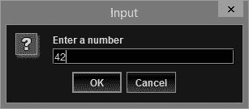

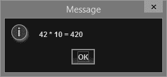

## 学习 StringBuilder 和 StringBuffer 类

在 Java 中，`String` 的值在创建后就是固定固定的；字符串是不可变的（immutable），即不可更改的。当你编写 `someString = "Hello";` 并紧接着写 `someString = "Goodbye";` 时，你既没有改变 `someString` 所代表地址的计算机内存内容，也没有消除“Hello”这些字符。

相反，你将“Goodbye”存储在一个新的计算机内存位置上，并将新地址存储在 `someString` 变量中。如果你想将 `someString` 从“Goodbye”修改为“Goodbye Everybody”，你不能在包含“Goodbye”的 `someString` 后面添加空格和“Everybody”。相反，你必须创建一个全新的 `String` 对象——“Goodbye Everybody”，并将其赋值给 `someString` 地址。如果你对 `String` 执行了许多此类操作，最终会在内存中创建许多不同的 `String` 对象，这会消耗时间和资源。

为了规避这些限制，你可以使用 `StringBuilder` 或 `StringBuffer` 类。当你知道一个 `String` 将被反复修改时，可以使用这两个类中的一个（它们是 `String` 类的替代方案）。通常，你可以在任何使用 `String` 的地方使用 `StringBuilder` 或 `StringBuffer` 对象。与 `String` 类一样，这两个类都属于 `java.lang` 包，并会自动导入到每个程序中。除了以下区别外，这两个类是相同的：

- `StringBuilder` 效率更高。
- `StringBuffer` 是线程安全的。这意味着你应该在运行多个**执行线程（threads of execution）**的应用程序中使用它，线程是由操作系统调度的处理单元，用于在程序执行期间创建多个控制路径。由于你编写的大多数程序（以及你使用本书编写的所有程序）都包含单线程，因此通常你应该使用 `StringBuilder`。

本节的其余部分将讨论 `StringBuilder`，但每个语句对于 `StringBuffer` 同样适用。

可以使用如下语句创建一个包含 `String` 的 `StringBuilder` 对象：

```java
StringBuilder message = new StringBuilder("Hello there");
```

当你使用 `Scanner` 对象的 `nextLine()` 方法进行控制台输入或使用 `JOptionPane.showInputDialog()` 方法进行 GUI 输入时，用户输入将以 `String` 的形式进入你的程序。如果你想以 `StringBuilder` 对象的形式处理输入，可以使用 `StringBuilder` 构造函数对 `String` 进行转换。例如，以下两个语句使用名为 `keyboard` 的 `Scanner` 对象获取用户输入，然后将其存储在 `StringBuilder` `name` 中：

```java
String stringName = keyboard.nextLine();
StringBuilder name = new StringBuilder(stringName);
```

或者，你可以将这两个语句合并为一条并避免声明变量 `stringName`，如下所示：

```java
StringBuilder name = new StringBuilder(keyboard.nextLine());
```

当你创建一个 `String` 时，可以选择省略 `new` 关键字，但当你初始化一个 `StringBuilder` 对象时，必须使用 `new` 关键字、构造函数名称以及构造函数括号之间的初始化值。你可以使用如下语句创建一个空的 `StringBuilder` 变量：

```java
StringBuilder uninitializedString = null;
```

在用定义的 `StringBuilder` 对象对其进行初始化之前，该变量不会引用任何内容。通常，当你创建一个 `String` 对象时，系统会分配足够的内存来容纳字符串中的 Unicode 字符。然而，`StringBuilder` 对象包含一个被称为**缓冲区（buffer）**的内存块，它可能包含也可能不包含字符串。

即使它包含字符串，该字符串可能也没有占据整个缓冲区。换句话说，字符串的长度可能与缓冲区的长度不同。缓冲区的实际长度就是 `StringBuilder` 对象的**容量（capacity）**。

你可以通过 `setLength()` 方法更改 `StringBuilder` 对象中字符串的长度。`StringBuilder` 对象的长度等于其内部包含的 `String` 的字符数量。当你增加 `StringBuilder` 对象的长度使其比持有的 `String` 更长时，额外的字符将包含 `\u0000`。如果你使用 `setLength()` 方法指定的长度比其 `String` 短，则字符串会被截断。

要找到 `StringBuilder` 对象的容量，你可以使用 `capacity()` 方法。图 7-12 中的 `StringBuilderDemo` 演示了这种方法。该应用程序创建一个包含字符“Barbara”的 `nameString` 对象。获取 `StringBuilder` 对象的容量并存储在整数变量 `nameStringCapacity` 中进行显示。

```java
import javax.swing.JOptionPane;

public class StringBuilderDemo
{
    public static void main(String[] args)
    {
        StringBuilder nameString = new StringBuilder("Barbara");
        int nameStringCapacity = nameString.capacity();
        System.out.println("Capacity of nameString is " + nameStringCapacity);

        StringBuilder addressString = null;
        addressString = new StringBuilder("6311 Hickory Road");
        int addStringCapacity = addressString.capacity();
        System.out.println("Capacity of addressString is " + addStringCapacity);

        nameString.setLength(20);
        System.out.println("The name is " + nameString + "end");
        addressString.setLength(20);
        System.out.println("The address is " + addressString);
    }
}
```

**图 7-12** StringBuilderDemo

图 7-13 显示 `StringBuilder` 的容量为 23，比字符串“Barbara”的长度多出 16 个字符。每当你使用 `String` 作为构造函数的参数创建 `StringBuilder` 对象时，该 `StringBuilder` 的容量就是作为构造函数参数的 `String` 的长度加上 16。这“额外的”16 个位置允许在创建后对 `StringBuilder` 对象进行合理的修改，无需分配新的内存位置。

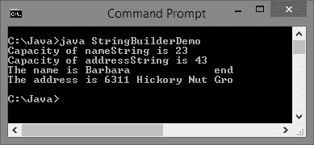


# Java 的创建者选择 16 个字符作为 `StringBuilder` 对象的额外长度

Java 的创建者选择 16 个字符作为 `StringBuilder` 对象的额外长度，是因为 16 个字符恰好占据四个字节的内存。当你更多地接触通用计算机特别是编程时，你会发现存储容量几乎总是以 2 的幂值创建的——4, 8, 16, 32, 64 等。

在图 7-12 的应用程序中，`addressString` 变量被创建为 `StringBuilder addressString = null;`。在通过后续语句用定义的 `StringBuilder` 对象进行初始化之前，该变量不引用任何内容：`addressString = new StringBuilder("6311 Hickory Nut Grove Road");`。这个新 `StringBuilder` 对象的容量如图 7-13 所示，为字符串长度加上 16，即 43。

在图 7-12 的应用程序中，使用 `setLength()` 方法将每个字符串的长度都更改为 20。应用程序显示了扩展后的 `nameString` 和“end”，因此你可以从输出中看到字符串末尾有 13 个额外的空格。应用程序还显示了截断后的 `addressString`，以便你可以看到将其长度缩减到 20 的效果。

`StringBuilder` 对象可修改的特性使得，当你预知字符串内容会反复变化时，使用它们比使用 `Strings` 更高效。然而，如果你的程序对字符串的修改较少，或者需要进行 `String` 比较，则你不应该使用 `StringBuilder`。例如，尽管 `equals()` 方法比较 `String` 对象的内容，但当你将其与 `StringBuilder` 对象一起使用时，比较的是引用。要比较两个名为 `obj1` 和 `obj2` 的 `StringBuilder` 对象的内容，你必须先使用如下表达式将其转换为 `Strings`：`obj1.toString().equals(obj2.toString())`。

`StringBuilder` 对象两个实用的方法是 `append()` 和 `insert()`。`append()` 方法允许你向 `StringBuilder` 对象的末尾添加字符。例如，以下两个语句共同声明 `phrase` 包含“Happy”，并修改 `phrase` 使其包含“Happy birthday”：

```java
StringBuilder phrase = new StringBuilder("Happy");
phrase.append(" birthday");
```

# 第 7 章：字符、字符串与 StringBuilder

`insert()` 方法允许你在 `StringBuilder` 对象内部的特定位置添加字符。例如，如果 `phrase` 指向“Happy birthday”，那么 `phrase.insert(6, "30th ")` 就会修改 `StringBuilder` 使其包含“Happy 30th birthday”。`StringBuilder` 对象中的第一个字符占据位置零。

要修改 `StringBuilder` 对象中的单个字符，你可以使用 `setCharAt()` 方法，它允许你更改指定位置的字符。该方法需要两个参数：一个整数位置和一个字符。如果 `phrase` 指向“Happy 30th birthday”，那么 `phrase.setCharAt(6,'4')` 将值更改为第 40 岁生日的问候。

从 `StringBuilder` 对象中提取字符的一种方法是使用 `charAt()` 方法。`charAt()` 方法接受一个参数，该参数是字符位置相对于 `String` 开头的偏移量，并返回该位置的字符。以下语句将字符‘P’赋值给变量 `letter`：

```java
StringBuilder text = new StringBuilder("Java Programming");
char letter = text.charAt(5);
```

如果你尝试使用小于 0 或大于 `StringBuilder` 对象中最后一个位置索引的索引，会导致被称为异常（exception）的错误，你的程序将会终止。

`StringBuilder` 构造函数的一个版本允许你在创建 `StringBuilder` 对象时为其分配一个容量。例如：

```java
StringBuilder prettyBigString = new StringBuilder(300);
```

当你能够大致估算出 `StringBuilder` 对象最终所需的大小时，分配足够的容量可以提高程序性能。例如，图 7-14 中的程序比较了向两个 `StringBuilder` 对象添加“Java” 200,000 次所需的时间——一个初始容量为 16 个字符，另一个初始容量为 800,000 个字符。图 7-15 显示了典型的执行情况；实际时间会随执行次数而异，在不同的计算机上也会不同。然而，向初始较短的 `StringBuilder` 添加内容的循环总是需要额外时间，因为随着对象增大，必须反复为其分配新内存。

```java
import java.time.*;

public class ConcatenationTimeComparison {
    public static void main(String[] args) {
        long startTime, endTime;
        final int TIMES = 200_000;
        final int FACTOR = 1_000_000;
        int x;
        StringBuilder string1 = new StringBuilder("");
        StringBuilder string2 = new StringBuilder(TIMES * 4);
        LocalDateTime now;
        now = LocalDateTime.now();
        startTime = now.getNano();

        for (x = 0; x < TIMES; ++x) {
            string1.append("Java");
            now = LocalDateTime.now();
            endTime = now.getNano();
        }
        System.out.println("Time with empty StringBuilder: " + ((endTime - startTime) / FACTOR + " milliseconds"));

        now = LocalDateTime.now();
        startTime = now.getNano();
        for (x = 0; x < TIMES; ++x) {
            string2.append("Java");
            now = LocalDateTime.now();
            endTime = now.getNano();
        }
        System.out.println("Time with empty StringBuilder: " + ((endTime - startTime) / FACTOR + " milliseconds"));
    }
}
```

图 7-14 `ConcatenationTimeComparison` 应用程序 *(续)*

图 7-15 `ConcatenationTimeComparison` 程序的典型执行。观看视频 *StringBuilder*。

## 关于 StringBuilder 和 StringBuffer 类（续）

### 真实和一个谎言

1. 当创建 `String` 时，你可以选择省略 `new`，但当你初始化 `StringBuilder` 对象时，你必须使用 `new`、构造函数名和括号。

2. 当你创建一个初始值为“Juan”的 `StringBuilder` 时，其容量为 16。

3. 如果一个名为 `addressString` 的 `StringBuilder` 包含“817”，那么 `addressString.append(" Maple Lane")` 将更改为“817 Maple Lane”。

### 来动手：使用 StringBuilder 方法

在这些步骤中，你将编写一个演示 `StringBuilder` 类方法的程序。

1. 打开一个新的文本文件，输入 `StringBuilderMethods` 类的以下几行：

```java
public class StringBuilderMethods {
    public static void main(String[] args) {
```

2. 使用以下代码创建一个 `StringBuilder` 对象，然后显示它：

```java
StringBuilder str = new StringBuilder("singing");
System.out.println(str);
```

3. 输入以下 `append()` 方法向现有的 `StringBuilder` 添加字符并再次显示它：

```java
str.append(" in the dead of ");
System.out.println(str);
```

4. 输入以下 `insert()` 方法插入字符。然后显示 StringBuilder，插入额外的字符，再次显示它：

```java
str.insert(0, "Black");
System.out.println(str);
str.insert(5, "bird ");
System.out.println(str);
```

5. 再添加一个 append 和显示序列：

```java
str.append("night");
System.out.println(str);
```

6. 为 `main()` 方法添加一个右大括号。

7. 输入类的右大括号，然后将文件保存为 `StringBuilderMethods.java`。编译并执行，然后将你的输出与图 7-16 进行对比。

不要忘记 `startsWith()`、`endsWith()` 和 `replace()` 是区分大小写的，因此你可能希望在使用它们之前将参与的 `Strings` 转换为相同的大小写。

在声明初始化的 `StringBuilder` 或 `StringBuffer` 对象时，不要忘记使用 `new` 运算符和构造函数。

除非有充分理由，否则不要使用 `StringBuilder` 或 `StringBuffer`；否则请使用 `String` 类。

# 第 7 章：字符、字符串与 StringBuilder

### 核心术语

- `reference`（引用）是一个保存内存地址的变量。

- `Character` 类是一个其实例可以包含单个字符值的类。该类还定义了可以操作或检查单个字符数据的方法。

- `String` 类用于处理固定字符串数据——也就是说，由多个字符组成不变数据。

- `anonymous object`（匿名对象）是一个未命名的对象。

- `String variable`（String 变量）是 `String` 类的命名对象。

- `Immutable`（不可变的）对象不能被改变。

- `lexicographical comparison`（字典序比较）基于字符的整数 Unicode 值。

- `null String`（空字符串）不持有内存地址。

- `Concatenation`（拼接）是将一个值连接到字符串以创建更长字符串的过程。

- `wrapper`（包装器）是一个包裹在更简单元素周围的类或对象。

- `Threads of execution`（执行线程）是由操作系统调度的处理单元，用于在程序执行期间创建多条控制路径。

- `buffer`（缓冲区）是一块内存。

- `StringBuilder` 对象的 `capacity`（容量）是缓冲区的实际长度，而不是缓冲区内字符串的长度。

### 章节总结

`String` 变量是引用，因此它们需要特殊的技巧来进行比较。

`Character` 类是一个其实例可以包含单个字符值的类。该类还定义了可以操作或检查单个字符数据的方法。

用双引号括起来的字符序列是字面量字符串（literal string）。与其他类不同，在声明 `String` 时，并不要求使用 `new` 关键字或显式调用构造函数，尽管你可以这样做。`Strings` 是不可变的。有用的 `String` 类方法包括 `equals()`、`equalsIgnoreCase()` 和 `compareTo()`。

其他有用的 `String` 方法包括 `toUpperCase()`、`toLowerCase()`、`length()`、`indexOf()`、`charAt()`、`endsWith()`、`startsWith()` 和 `replace()`。`toString()` 方法将任何对象转换为 `String`。你可以使用加号 (`+`) 拼接 `Strings`。你可以使用 `substring()` 方法提取 `String` 的部分。如果 `String` 包含适当字符，可以通过 `Integer.parseInt()` 和 `Double.parseDouble()` 等方法将其转换为数字。

当字符串内容必须更改时，你可以使用 `StringBuilder` 或 `StringBuffer` 类来提高性能。

### 复习题

1. 双引号括起来的字符序列是一个 ____。

   a. 符号字符串

   b. 字面量字符串

   c. 提示

   d. 命令

2. 为了创建一个 `String` 对象，你可以在调用构造函数之前使用关键字 ____，但并不要求使用这种格式。

   a. object

   b. create

   c. char

   d. `new`

3. `String` 变量名是一个 ____。

   a. 引用

   b. 值

   c. 常量

   d. 字面量

4. 程序员用来描述不可改变对象的术语是 ____。

   a. 不可撤销的

   b. 非易变的

   c. 不可变的

   d. 稳定的

5. 假设你声明了两个 `String` 对象：

   ```java
   String word1 = new String("happy");
   String word2;
   ```

   当你要求用户为 `word2` 输入一个值时，如果用户输入“happy”，则 `word1 == word2` 的值为 ____。

   a. true

   b. false

   c. egal

   d. unknown

6. 如果你声明了两个 `String` 对象：

   ```java
   String word1 = new String("happy");
   String word2 = new String("happy");
   ```

   那么 `word1.equals(word2)` 的值为 ____。

   a. true

   b. false

   c. egal

   d. unknown

7. 忽略大小写判断两个 `String` 对象是否相等的方法是 ____。

   a. `equalsNoCase()`

   b. `toUpperCase()`

   c. `equalsIgnoreCase()`

   d. `equals()`

8. 如果一个 `String` 被声明为：

   ```java
   String aStr = new String("lima bean");
   ```

   那么 `aStr.equals("Lima Bean")` 的值为 ____。

   a. true

   b. false

   c. egal

   d. unknown

9. 如果你创建两个 `String` 对象：

   ```java
   String name1 = new String("Jordan");
   String name2 = new String("Jore");
   ```

   那么 `name1.compareTo(name2)` 的值为 ____。

   a. true

   b. false

   c. –1

   d. 1

10. 如果 `String myFriend = new String("Ginny");`，以下哪项值为 1？

    a. `myFriend.compareTo("Gabby")`

    b. `myFriend.compareTo("Gabriella")`

    c. `myFriend.compareTo("Ghazala")`

    d. `myFriend.compareTo("Hammie")`

11. 如果 `String movie = new String("West Side Story");`，则 `movie.indexOf('s')` 的值为 ____。

    a. true

    b. false

    c. 2

    d. 3

12. `String` 类的 `replace()` 方法替换 ____

    a. 将字符串替换为字符

    b. 将一个字符串替换为另一个字符串

    c. 将字符串中的字符替换为另一个字符

    d. 将字符串中所有出现的字符替换为字符

13. `toString()` 方法将 ____ 转换为 `String`。

    a. char

    b. int

    c. float

    d. 以上

14. 使用加号连接 `Strings` 是 ____。

    a. 链

    b. 拼接

    c. 解析

    d. 链接

15. `String` 中的 ____

    a. 必须是字母

    b. 必须是大写

    c. 是零

    d. 被 `compareTo()` 方法忽略

16. 从另一个字符串中提取字符串的方法是 ____。

    a. `extract()`

    b. `parseString()`

    c. `substring()`

    d. `append()`

17. `parseInt()` 将 ____ 转换为整数。

    a. String

    b. Double


c. 转换为 String

d. 转换为整数

18. `int` 和 `Integer` 之间的区别是 ____。

a. `int` 是基本类型；`Integer` 是类

b. `int` 是类；`Integer` 是基本类型

c. 不存在；两者都是基本类型

d. 不存在；两者都是类

19. 作为 `String` 类的替代方案，并且为了更改字符串的内容，你可以使用 ____

a. char

b. StringHolder

c. `StringBuilder`

d. StringMerger

20. 与创建 `String` 不同，创建 `StringBuilder` 时必须使用关键字 ____。

### 编程练习

1. 修改图 7-3 所示的 `CharacterInfo` 类，从用户输入获取测试字符。将文件命名为 `InputCharacterInfo.java`。

2. 编写一个应用程序，提示用户输入三个名字，并将它们拼接成所有可能的组合，以便父母比较比较找到好听的名字。将文件命名为 `BabyNameComparison.java`。

3. a. 创建一个程序，包含一个存储电影台词的字符串，并显示其中空格的总数。将文件命名为 `CountMovieSpaces.java`。

b. 编写一个应用程序，统计用户输入的电影台词中的空格总数。将文件命名为 `CountMovieSpaces2.java`。

4. 编写一个应用程序，提示用户输入包含两个大写字母、两个小写字母和两个数字的密码。反复提示用户直到输入有效密码为止。每次输入后，显示一条消息指示用户是否成功或失败的原因。将文件命名为 `ValidatePassword.java`。

5. 编写一个应用程序，统计用户输入的 `String` 中的单词数。单词由空格、句、逗号、分号、问号、感叹号或破折号分隔。图 7-17 显示了两次典型的执行情况。将文件命名为 `CountWords.java`。

**图 7-17** CountWords 程序的两次典型执行结果。

6. a. 编写一个应用程序，接受用户输入的三个 `Strings`，并根据用户输入的 `Strings` 是否按不区分大小写的字母顺序排列，显示两条消息之一。将文件保存为 `Alphabetize.java`。

b. 编写一个应用程序，接受用户输入的三个 `Strings`，并按不区分大小写的字母顺序显示这些字符串。将文件保存为 `Alphabetize2.java`。

7. 三字母缩写在商业世界非常常见。例如，在 Java 中，你使用 `JDK`（Java 开发工具包）中的 `IDE`（集成开发环境）来编写供 `JVM`（Java 虚拟机）使用的程序，这些程序可能会通过 `LAN`（局域网）发送。程序员甚至使用缩写 TLA 来代表 *three-letter acronym*（三字母缩写）。编写一个程序允许用户输入三个单词，并全大写显示相应的三字母缩写。如果用户输入的单词超过三个，则忽略多余单词。将文件保存为 `ThreeLetterAcronym.java`。

### 练习题

8. 编写一个应用程序，接受用户输入的一个单词并转换为皮格拉丁语（Pig Latin）。如果单词以辅音开头，皮格拉丁语版本将移除单词开头所有的辅音并将其置于末尾，然后加上 `ay`。例如，*cricket* 变为 *icketcray*。如果单词以元音开头，皮格拉丁语版本则在原单词末尾加上 `ay`。例如，*apple* 变为 *appleay*。如果 `y` 是单词的第一个字母，则将其视为辅音；否则，它被视为元音。例如，*young* 变为 *oungyay*，但 *system* 变为 *ystemsay*。对于此程序，假设用户只会输入一个由全小写字母组成的单词。将文件保存为 `PigLatin.java`。

9. 编写一个程序，在用户输入的 10 位数字字符串中插入圆括号、空格和破折号，将其格式化为电话号码。例如，*5153458912* 变为 *((515) 345-8912*。如果用户输入的数字恰好是 10 位，则显示错误信息。继续接受用户输入，直到用户输入 `999`。将文件保存为 `PhoneNumberFormat.java`。

10. 编写一个应用程序，判断用户输入的短语是否为回文。回文是指正读和反读都相同的短语，且不考虑大小写或标点符号。例如，“Dot saw I was Tod”、“Was it a car or a cat I saw?”和“Madam, I’m Adam（女士，我是亚当）”都是回文。将文件保存为 `Palindrome.java`。

11. 编写一个应用程序，提示用户输入全名和街道地址，并根据用户的字母首字母和地址的数字部分构造 ID。例如，居住在 34 Elm 的用户 William Henry Harrison 将拥有 `WHH34` 的 ID，而居住在 1778 Monroe 的用户 Addison Mitchel 将拥有 `AM1778` 的 ID。将文件保存为 `ConstructID.java`。

12. 创建一个 `TaxReturn` 类，其字段应包含存储纳税人的社会安全号码、姓、名、街道地址、城市、州、邮政编码、年收入、婚姻状况和纳税负债。包含一个构造函数，其参数需要为纳税负债以外的所有字段提供值。

该构造函数根据年收入和下表中的百分比计算纳税负债。

| 婚姻状况 | 收入 ($) | 单身 | 已婚 |
| :--- | :--- | :--- | :--- |
| 0–20,000 | 15% | 14% | |
| 20,001–50,000 | 22% | 20% | |
| 50,001 及以上 | 30% | 28% | |

在 `TaxReturn` 类中，还要包含一个显示所有 `TaxReturn` 数据的方法。将文件保存为 `TaxReturn.java`。

# 第 7 章

字符、字符串和 StringBuilder

创建一个应用程序，提示用户输入创建 `TaxReturn` 所需的数据。只要满足以下任一条件，就继续提示用户输入数据：

- 社会安全号码格式不正确，数字和破折号未在相应位置——例如 `999-99-9999`。

- 邮政编码不是五位数。

- 婚姻状况不以以下字符之一开头：“S”、“s”、“M”或“m”。

- 年收入为负数。

在所有输入数据都正确无后，创建一个 `TaxReturn` 对象，然后显示它的值。将文件保存为 `PrepareTax.java`。

### 调试练习题

1. 在可下载的学生文件 Chapter07 文件夹中的以下每个文件都有语法和/或逻辑错误。在每种情况下，确定问题并修复程序。纠正错误后，使用相同的文件名但加上 `Fix` 前缀保存每个文件。例如，`DebugSeven1.java` 将变为 `FixDebugSeven1.java`。

a. `DebugSeven1.java`

b. `DebugSeven2.java`

c. `DebugSeven3.java`

d. `DebugSeven4.java`

### 游戏区

1. a. 在第 3 章中，你设计了一个 `Card` 类。该类持有包含卡牌值和花色的字段。目前，花色由单个字符表示（s, h, d 或 c）。修改该类，使花色变为字符串（“Spades”、“Hearts”、“Diamonds”或“Clubs”）。此外，在 `Card` 类中添加一个新字段，根据值持有其字符串表示。在 `Card` 类的 `setValue()` 方法中，除了设置数值外，还要设置字符串排名如下：

| 数值 | 字符串排名 |
| :--- | :--- |
| Ace | Ace |
| 2 到 10 | 2 到 10 |
| Jack | Jack |
| Queen | Queen |
| King | King |

b. 在第 5 章中，你创建了一个 游戏，随机选择两张牌（玩家和计算机）并宣布胜负。修改游戏将每张牌的花色设置为字符串，然后使用修改后的类执行游戏。图 7-18 显示了四次执行。记住，在这个版本的 War 中，你假设 Ace 是最小值。

2. 在第 5 章中，你创建了一个石头剪刀游戏。游戏中，玩家输入数字来表示选择。对游戏进行以下改进：

- 允许用户输入字符串（“rock”、“paper”或“scissors”）而不是数字。

- 确保无论玩家输入大写字母、小写字母还是两种组合，游戏都能正常工作。

- 为了允许玩家拼写错误，只要玩家的前两个字母是正确的，就接受其输入（也就是说，如果玩家输入“scixrs”，我们会接受为“scissors”）。当玩家输入的至少包含一个选项的前两个字母时，重新提示玩家并继续，直到玩家的输入包含一个选项的前两个字母。

- 允许进行 10 轮游戏。结束时，显示玩家获胜次数、计算机获胜次数和平局次数。

将文件保存为 `RockPaper2.java`。

3. 创建一个简单的猜词游戏（类似于吊字游戏），用户猜字母并尝试猜部分隐藏的短语。显示一个部分字母被星号替换的短语：例如，“G* T***”（代表“Go Team”）。每当用户猜一个字母，要么将该字母放在短语中正确的位置（或位置）并再次显示，要么告诉用户猜的字母不在短语中。当推导出整个正确短语时，显示祝贺消息。将游戏保存为 `SecretPhrase.java`。在下一章中，你将修改此程序，使得不再每次玩游戏时都向用户展示同一个短语，而是程序从短语列表中随机选择一个短语。

# Eliza 程序

Eliza 是由 Joseph Weizenbaum 于 1966 年编写的一段著名的计算机程序。它通过将患者的许多陈述重新表述为问题并向患者提出，来模拟心理学家（更具体地说，是罗杰斯派治疗师）。这种疗法（有时被称为非引导性疗法）在电影和电视节目中经常被模仿，在这些节目，治疗师甚至不需要听患者说话，而是给出“预设的”回答，引导患者从一个陈述转向另一个。例如，当患者说“我和兄弟之间有问题”时，治疗师可能会说“多告诉我一些关于你兄弟的情况”。如果患者说“我不喜欢学校”，治疗师可能会说“你为什么说不喜欢学校？”Eliza 成为计算机史上一个里程碑，因为这是程序员首次尝试创造人与人交互的幻象。

## 项目作业

创建一个简单版本的 Eliza，允许用户连续输入陈述，直到用户输入“Goodbye”退出。在每条陈述之后，让计算机做出以下响应之一：

*   如果用户输入了单词 `my`（例如，“I am having trouble with my brother”），响应“Tell me more about your”并插入相关的名词——例如，“Tell me more about your brother”。在用户输入的内容中搜索单词时，确保它是整个单词而不仅仅是另一个单词内部的字母。例如，在搜索 `my` 时，确保它不是 `dummy` 或 `mystic` 等单词的一部分。

*   如果用户输入了强烈的词汇，如“love”或“hate”，响应“You seem to have strong feelings about that”。

*   添加你选择的几个其他合适的响应。

*   在没有上述任何输入的情况下，从以下短语中随机选择一个进行响应：“Please go on”、“Tell me more”或“Continue”。

将文件保存为 `Eliza.java`。

## 练习

### 案例分析

### 1. Carly’s Catering

Carly’s Catering 为派对和特殊活动提供餐点。在之前的章节中，你已经开发了一个存储餐饮活动信息的类，以及一个使用该类的四个对象来测试方法的应用程序。现在，请按照以下方式修改 `Event` 和 `EventDemo` 类：

*   修改 `Event` 类中设置活动编号的方法，如果传递给方法的参数不是一个以字母开头、后跟三个数字的四字符字符串，则活动编号被强制设置为“A000”。如果活动编号中的首字母不是大写，则强制设为大写。

*   在 `Event` 类中添加一个联系电话字段。

*   为 `Event` 类中的联系电话字段添加一个 set 方法。

*   无论用户输入全数字还是数字、空格、连字符、点或括号的任意组合，都将其存储为全数字。例如，如果用户输入 `(920) 872-9182`，则将电话存储为 `9208729182`。如果用户输入的数字少于或多于 10 位，则将数字存储为 `0000000000`。

*   为电话字段添加一个 get 方法。该 get 方法返回按如下方式构建的电话字符串：括号括住三位区号，后面是一个空格，然后是三位的电话交换机，接着是一个连字符，最后是电话的最后四位数字。

*   修改 `EventDemo` 程序，除了活动编号和客人数外，程序还要提示用户输入并获取每个示例对象的联系电话。显示电话号码以及其他的 Event 详情。测试 `EventDemo` 应用程序，确保它对有效和无效的活动编号及电话号码正常工作。

将文件保存为 `Event.java` 和 `EventDemo.java`。

### 2. Sammy’s Seashore Supplies

Sammy’s Seashore Supplies 为游客租赁海滩设备。在之前的章节中，你开发了一个存储设备租赁信息的类以及一个使用该类的四个对象来测试方法的应用程序。现在，按照以下方式修改 `Rental` 和 `RentalDemo` 类：

*   修改 `Rental` 类中设置合同编号的方法，如果传递给方法的参数不是一个以字母开头、后跟三个数字的四字符字符串，则合同编号被强制设置为“A000”。如果合同编号中的首字母不是大写，则强制设为大写。

*   在 `Rental` 类中添加一个联系电话字段。

*   为 `Rental` 类中的联系电话字段添加一个 set 方法。

*   无论用户输入全数字还是数字、空格、连字符、点或括号的任意组合，都将其存储为全数字。例如，如果用户输入 `(920) 872-9182`，则将电话存储为 `9208729182`。如果用户输入的数字少于或多于 10 位，则将数字存储为 `0000000000`。

*   为电话字段添加一个 get 方法。该 get 方法返回按如下方式构建的电话字符串：括号括住三位区号，后面是一个空格，然后是三位的电话交换机，接着是一个连字符，最后是电话的最后四位数字。

*   修改 `RentalDemo` 程序，除了合同编号和分钟外，程序还要提示用户输入并获取每个示例对象的联系电话。显示电话号码以及其他的 Rental 详情。测试 `RentalDemo` 应用程序，确保它对有效和无效的合同编号及电话正常工作。

将文件保存为 `Rental.java` 和 `RentalDemo.java`。

# 第 7 章 字符、字符串和 StringBuilder

## 数组

### 引言

在本章中，你将学习：

* 声明数组
* 初始化数组
* 使用数组下标
* 使用对象数组
* 在方法传递并返回数组

### 声明数组

在完成本书的前五章时，你使用变量存储值。在那些早期章节中，你只是存储一个值并使用它，但从未超过几次。在第六章中，你创建了循环来“循环”变量并多次使用；也就是说，在创建变量后，你可以赋值并使用。

然而，有时你可能会遇到在内存中只存储一个值无法满足需求的情况。例如，一位监督 20 名员工的销售经理想要确定每位员工的销售额高于还是低于平均水平。当你将第一个员工的销售值输入应用程序时，无法确定它是高于还是低于，因为在获得所有 20 个值之前不知道平均值。不幸，如果你尝试将 20 个销售值赋值同一个变量，当你给第二个员工赋值时，它会替换第一个员工的值。

一种解决方案是创建数组。**数组**是具有相同数据类型的命名数据项列表。每个数据项都是数组的**元素**。你可以像声明任何简单变量一样声明数组变量，但在类型名称后插入一对方括号。例如，为了声明一个存储销售人员销售数字的 double 数组，你可以写如下代码：

```java
double[] sales;
```

```java
double[] salesFigures;
```

同样，为了创建一个用于存储学生 ID 号的整数数组，你可以编写如下代码：

```java
int[] idNums;
```

在 Java 中，你也可以通过在数组名后放置方括号来声明数组变量，例如 `double salesFigures[];`。这种格式对于 C 和 C++ 程序员来说很熟悉，但 Java 程序员更倾向的格式是将方括号放在变量类型之后、变量名之前。

你可以为数组提供任何合法的标识符，但 Java 程序员惯成上会遵循与变量相同的规则来命名数组——数组名以小写字母开头，随后的单词使用大写字母开头。

### 声明数组

此外，许多程序员会遵循以下约定之一，以便更明显地表示该名称代表一组项目目：

- 数组通常使用复数名词命名，例如 `salesFigures`。

- 数组通常通过添加一个表示组的结尾词来命名，例如 `salesList`、`salesTable` 或 `salesArray`。

395

在你创建一个数组变量后，仍然需要预留内存空间。你使用与创建对象时相同的步骤来创建数组。回想一下当你创建一个名为 `Employee` 的类时，你可以使用如下声明来声明 `Employee` 对象：`Employee oneWorker;`

然而，该声明并没有并没有创建 `oneWorker` 对象。你会在使用 `new` 关键字并调用构造函数时才创建 `oneWorker` 对象，例如：`oneWorker = new Employee();`

同样地，声明数组和为其预留内存空间是两个不同的过程。

为了为 20 个 `salesFigures` 值预留内存位置，你可以通过两个独立的语句声明数组变量并创建数组，如下：

```java
double[] salesFigures;
salesFigures = new double[20];
```

或者，就像处理对象一样，你可以通过以下方式在一个语句中声明并创建数组：

```java
double[] salesFigures = new double[20];
```


在 Java 中，数组的大小遵循数据类型，并且绝不会紧跟在数组名之后声明（像 C++ 等其他语言中那样）。其他语言（如 Visual Basic、BASIC 和 COBOL）使用圆括号而不是括号来引用单个数组元素。通过使用方括号，Java 的创建者让你更容易区分数组名和方法。

语句 `double[] salesFigures = new double[20];` 为 20 个 `double` 值预留了 20 个内存位置。你可以通过下标区分每个 `salesFigures` 项目与其他项目。**下标**是包含在方括号内的整数，指定数组的元素之一。在 Java 中，任何数组的元素都从 0 开始编号，因此在处理具有 20 个元素的数组时，你可以合法地使用从 0 到 19 的任何下标。

话说，第一个 `salesFigures` 数组元素是 `salesFigures[0]`，最后一个 `salesFigures` 元素是 `salesFigures[19]`。图 8-1 显示了 20 个 `salesFigures` 值数组的前几个和最后几个元素在计算机内存中的形式。

```
salesFigures[1]
salesFigures[18]
salesFigures[0]
salesFigures[2] salesFigures[17]
salesFigures[19]
```

**图 8-1** 内存中 20 个 `salesFigures` 项目数组的前几个和最后几个元素

# 第 8 章：数组

下标也称为**索引**。特别地，你会在编译器发布的某些错误信息中看到 *index* 一词。

忘记数组中的第一个元素是 0 元素是一个常见的错误，特别是如果你熟悉另一种编程语言（在那种语言中第一个数组元素是 1 元素）。

犯这个错误意味着你在使用任何数组时都会“差 1”（off by one）。忘记最后一个元素的下标比数组的大小小 1 而不是数组的大小也是很常见的。例如，对于一个包含 100 个元素的数组，允许的最大下标是 99。为了记住数组元素从 0 元素开始，如果你将第一个数组元素想成“距离数组开头零个元素”，将第二个元素想成“距离数组开头一个元素”，以此类推，可能会有所帮助。如果你对数组使用的下标太小（即为负数）或太大，该下标就会**越界**（out of bounds），并会生成错误消息。

当你处理任何单个数组元素时，你对待它的方式与对待相同类型的单个变量没有区别。例如，要给数组中的第一个 `salesFigures` 元素赋值，你使用一个简单的赋值语句，如下：

```java
salesFigures[0] = 2100.00;
```

要显示 20 个元素数组中的最后一个 `salesFigures` 元素，你可以写：`System.out.println(salesFigures[19]);`

当程序员谈论这些语句时，他们通常会说：“salesFigures sub 0 被赋值为 2100.00”以及“输出了 salesFigures sub 19”。换句话说，他们使用 *sub* 作为“带有下标的”的缩写。

当你声明或访问数组时，可以使用任何表达式来表示大小，只要该表达式是整数。其他一些编程语言（如 C++）在声明数组时仅允许使用命名或未命名的常量作为大小。Java 允许变量、算术表达式和返回值作为大小，这使得数组声明更加灵活。

例如，为了声明一个名为 `moneyValues` 的双数组，你可以使用以下任一：

- 字面量常量：`double[] moneyValues = new double[10];`
- 命名常量：`double[] moneyValues = new double[NUMBER_ELS];`
- 整数变量：`double[] moneyValues = new double[numberOfEls];`
- 算术表达式：`double[] moneyValues = new double[x + y];`
- 方法返回值：`double[] moneyValues = new double[getElements()];`

## 两真一假：声明数组

1. 语句 `int[] idNums = new int[35];` 预留了足够 34 个整数的空间。
2. 任何数组的第一个元素都是 0，无论存储什么数据类型。
3. 在 Java 中，你可以使用常量作为数组大小。

## 你来做：声明数组

在本节中，你创建一个小型数组来观察如何使用数组。该数组存储四类员工的工资。

1. 打开一个新的文本文件，通过输入以下类和 `main()` 头以及相应的左大括号开始编写演示如何使用数组：

```java
public class DemoArray
{
    public static void main(String[] args)
    {
```

2. 在新行通过输入以下代码声明并创建一个可以容纳四个双值的数组：

```java
double[] salaries = new double[4];
```

3. 逐个通过输入以下代码为四个数组元素赋值四个值：

```java
salaries[0] = 6.25;
salaries[1] = 6.55;
salaries[2] = 10.25;
salaries[3] = 16.85;
```

4. 为了确认已赋值了四个值，使用以下代码逐个显示工资：

```java
System.out.println("Salaries one by one are:");
System.out.println(salaries[0]);
System.out.println(salaries[1]);
System.out.println(salaries[2]);
System.out.println(salaries[3]);
```

5. 添加两个右大括号，用以结束 `main()` 方法和 `DemoArray` 类。

6. 将程序保存为 `DemoArray.java`。编译并运行该程序。

程序的输出如图 8-2 所示。

**图 8-2** DemoArray 程序的输出

*(继续)*

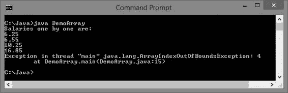

### 初始化数组

*(续上)*

## 使用越界下标

在本节中，你将故意生成一个越界错误，以便熟悉生成的错误信息。

1. 在 `DemoArray.java` 文件的最后一行可执行代码之后，添加一条新的输出语句，尝试使用超出数组范围的下标来显示 `salaries` 值：

```java
System.out.println(salaries[4]);
```

2. 保存文件，然后编译并执行它。输出结果如图 8-3 所示。

当用于数组的下标为 0、1、2 或 3 时，程序可以成功运行。然而，当下标达到 4 时，就会生成图 8-3 中的错误。该信息表示发生了 `ArrayIndexOutOfBoundsException`，且错误的索引为 4。

**图 8-3** 下标越界时 DemoArray 程序的输出。在第 12 章中，你将学习更多关于*异常*（exception）的知识，并学习处理异常的新方法。

3. 从 `DemoArray` 类中删除该错误语句。保存程序，然后重新编译并运行，以确认它再次正确执行。

### 初始化数组

基本数据类型（如 `int`）的变量持有一个值。引用类型（如数组）的变量持有存储该值的内存地址。换句话说，数组名称包含引用，所有的 Java 对象名称也是如此。

当你仅使用数据类型、括号和名称声明数组时，不会分配内存地址。相反，数组变量名的值为 `null`，这意味着该标识符未与内存地址关联。你可以显式地为数组引用赋值 `null`，但这不是强制要求的。例如，以下语句均将 `null` 赋值给 `someNums`：

```java
int[] someNums;
int[] someNums = null;
```

当你使用关键字 `new` 来定义数组时，数组引用会获得一个内存地址值。例如，当你在以下语句中定义 `someNums` 时，会分配一个内存地址：

```java
int[] someNums = new int[10];
```

当你声明 `int[] someNums = new int[10];` 时，`someNums` 持有一个地址，但由于 `someNums` 是整型数组，`someNums` 的每个元素默认值均为 0。`double` 或 `float` 数组中的每个元素被赋值为 0.0。默认情况下，`char` 数组元素被赋值为 `'\u0000'`（这是空字符的 Unicode 值），而 `boolean` 数组元素自动被赋值为 `false`。在包括 `Strings` 在内的对象数组中，每个元素默认被赋值为 `null`。

你已经知道如何通过如下方式给数组的单个元素赋不同的值，例如：`someNums[0] = 46;`

你也可以在创建时为数组元素赋非默认值。要初始化数组，你使用一个由逗号分隔并包含在大括号内的**初始化列表**（initialization list）。

为数组中的所有元素提供值也被称为**填充数组**（populating the array）。

例如，如果你想创建一个名为 `multsOfTen` 的数组，并在数组中存储前六个 10 的倍数，你可以如下声明该数组：`int[] multsOfTen = {10, 20, 30, 40, 50, 60};`

注意语句末尾的分号。在方法的右大括号后你不使用分号，但在数组初始化列表的右大括号后你需要使用分号。

当你在创建数组时通过提供初始化列表来填充数组时，你不需要为数组指定大小——大小是根据你放在初始化列表中值的数量来分配的。例如，恰恰定义的 `multsOfTen` 数组大小为 6。此外，当你初始化数组时，不需要使用关键字 `new`；相反，系统会根据所提供的值列表的长度分配新的内存。

在 Java 中，你不能直接初始化数组的一部分。例如，你不能创建一个包含 10 个元素的数组并只初始化其中五个；你必须初始化每一个元素，或者一个都不初始化。

观看视频 *Arrays*（数组）。

## 两个真理一个谎言：初始化数组

1. 当你声明 `int[] idNums = new int[35];` 时，数组的每个元素的值均为 0。
2. 当你声明 `double[] salaries = new double[10];` 时，数组的每个元素的值均为 0.0。
3. 当你声明 `int[] scores = {100, 90, 80};` 时，数组的前三个元素被赋值为这些值。

## 你来做：初始化数组

接下来，你修改 DemoArray 程序，直接初始化数组，而不是先声明数组后赋值。

1. 打开 `DemoArray.java` 文件。立即将其保存为 `DemoArray.java`。

将类名改为 `DemoArray2`。删除声明双类型数组的语句，然后将其替换为以下初始化语句：

```java
double[] salaries = {6.25, 6.55, 10.25, 16.85};
```

2. 删除以下单独为数组赋值的语句：

```java
salaries[0] = 6.25;
salaries[1] = 6.55;
salaries[2] = 10.25;
salaries[3] = 16.85;
```

3. 保存文件（作为 `DemoArray2.java`），编译并测试该程序。

输出的值与图 8-2 中 DemoArray 程序所示相同。

## 在数组使用变量下标

如果你将每个数组元素视为独立的实体，那么声明数组相比声明独立的基本类型变量并没有太大优势。当你开始使用变量下标而非常量下标时，数组的威力就显现出来了。

例如，假设你声明了一个五个整数的数组来存储测试分数，如下：

```java
int[] scoreArray = {2, 14, 35, 67, 85};
```

你可能想对每个数组元素执行相同的操作，例如增加每个分数的常数。例如，为了将每个 `scoreArray` 元素增加 3 分，你可以写：

```java
final int INCREASE = 3;
scoreArray[0] += INCREASE;
scoreArray[1] += INCREASE;
scoreArray[2] += INCREASE;
scoreArray[3] += INCREASE;
scoreArray[4] += INCREASE;
```

对于五个 `scoreArray` 元素，这项任务是可以处理的，只需要五个语句。然而，你可以通过使用变量下标来减少所需的程序代码。然后，你可以使用循环对每个数组元素进行算术运算，如下例：

```java
final int INCREASE = 3;
for(sub = 0; sub < 5; ++sub)
    scoreArray[sub] += INCREASE;
```

循环控制变量 `sub` 被设置为 `0`，然后它与 `5` 进行比较。由于 `sub` 的值小于 `5`，循环执行并将 `3` 加到 `scoreArray[0]` 中。然后，变量 `sub` 增加 1 变为 `1`，它仍然小于 `5`，因此当循环再次执行时，`scoreArray[1]` 增加了 `3`，依此类推。原本需要五条语句完成的过程现在只需要一条。此外，如果数组有 100 个元素，使用第一种方法通过单独的语句将数组值增加 `3` 将导致额外增加 95 条语句。使用第二种方法所需的更改是：通过插入额外的分数初始值将数组大小更改为 100，并将 `for` 语句的中间部分更改为将 `sub` 与 `100` 比较而不是与 `5` 比较。将 100 个单独的分增加 3 的循环如下：

```java
for(sub = 0; sub < 100; ++sub)
    scoreArray[sub] += INCREASE;
```

当应用程序包含一个数组且你想在某些任务中使用数组的每个元素时，通常会执行一个使循环控制变量从 `0` 变化到数组大小减 1 的循环。例如，如果你获取数组元素的输入值、修改数组中的每个值、求数组中所有值的和，或显示数组中的每个元素，你需要执行一个执行次数与数组元素数量相同的循环。（如果你执行循环的次数过多，下标将越界；如果你执行循环的次数不够，你将漏掉对列表中某些元素的处理。）当有 10 个数组元素时，下标从 `0` 变化到 `9`；当有 800 个元素时，下标从 `0` 变化到 `799`。

因此，在包含数组的应用程序中，声明一个等于数组大小的命名常量并并在处理数组的每个循环将其作为限制值是非常方便的。这样，如果将来数组大小发生变化，你只需要修改存储在命名符号常量中的值，而不需要搜索并修改处理数组的每个循环中的限制值。

例如，假设你如下声明一个数组和一个命名常量：

```java
int[] scoreArray = {2, 14, 35, 67, 85};
final int NUMBER_OF_SCORES = 5;
```

那么，以下两个循环是完全相同的：

```java
for(sub = 0; sub < 5; ++sub)
    scoreArray[sub] += INCREASE;

for(sub = 0; sub < NUMBER_OF_SCORES; ++sub)
    scoreArray[sub] += INCREASE;
```

第二种格式有两个优势。第一，通过使用命名常量 `NUMBER_OF_SCORES`，读者可以理解你正在根据整个数组的大小处理每个数组元素。如果你使用数字 `5`，读者必须回看数组声明以确认 `5` 是否代表数组的完整大小。第二，如果由于删除或添加分数导致数组大小发生变化，你只需要更改一次命名常量的值，所有使用该常量的循环都会自动更改，以执行正确的重复次数。

作为一个更好的选择，你可以使用一个字段（实例变量），它会为你创建的每个数组自动分配一个值；`length` 字段包含数组中的元素数量。例如，当你使用以下语句之一声明数组时，字段 `scoreArray.length` 被赋值为值 `5`：

```java
int[] scoreArray = {2, 14, 35, 67, 85};
int[] scoreArray = new int[5];
```

因此，你可以使用以下循环将 `3` 加到每个数组元素：

```java
for(sub = 0; sub < scoreArray.length; ++sub)
    scoreArray[sub] += INCREASE;
```

稍后，如果你修改了数组的大小并重新编译程序，数组中 `length` 字段的值将发生相应的变化。在处理数组元素时，编写操作数组的循环时，使用命名常量或 `length` 字段总是更好的。

程序员经常犯错误是尝试将 `length` 作为数组方法，引用 `scoreArray.length()`。正如你在上一章中学到的，`length()` 是一个 String 方法。

然而，`length` 不是数组方法；它是一个字段。实例变量或对象字段如 `length` 也称为对象的属性。

### 使用增强型 for 循环

在第 6 章，你学习了如何使用 `for` 循环。Java 也支持增强型 for 循环。这种循环允许你遍历数组，而无需指定循环控制变量的起始和结束点。例如，你可以使用以下语句之一来显示名为 `scoreArray` 的数组中的每个元素：

```java
for(int sub = 0; sub < scoreArray.length; ++sub)
    System.out.println(scoreArray[sub]);

for(int val : scoreArray)
    System.out.println(val);
```


在第二个示例中，`val` 被定义为与位于 `404` 冒号后的数组相同的类型。在循环内部，`val` 轮流获取数组中的每个值。你可以将第二个示例读为：“对于 `scoreArray` 中的每个 `val`，显示 `val`。”事实上，你会看到增强型 for 循环被称为 foreach 循环。你也可以在下一节中更复杂的对象使用增强型循环。

### 使用数组的一部分

有时，你不想使用数组中的每个值。例如，假设你编写了一个允许学生输入最多 10 个分数并计算平均值的程序。为了允许 10 个分数，你创建一个可以容纳 10 个值的数组，但由于学生可能少于 10 个，你可能会使用数组的一部分。图 8-4 显示了这样一个程序。

```
import java.util.*;

public class AverageOfQuizzes
{
    public static void main(String[] args)
    {
        int[] scores = new int[10];
        int score = 0;
        int count = 0;
        int total = 0;
        final int QUIT = 999;
        final int MAX = 10;
        Scanner input = new Scanner(System.in);

        System.out.print("输入分数或输入 " + QUIT + " 退出 ");
        score = input.nextInt();
        while(score != QUIT)
        {
            scores[count] = score;
            total += scores[count];
            count++;
            if(count == MAX)
                score = QUIT;
            else
            {
                System.out.print("输入下一个分数或输入 " + QUIT + " 退出 ");
                score = input.nextInt();
            }
        }

        System.out.print("\n 输入的分数: ");
        for(int x = 0; x < count; ++x)
        {
            System.out.print(scores[x] + " ");
        }
        if(count != 0)
        {
            System.out.println("\n 平均分是 " + (total * 1.0 / count));
        }
        else
        {
            System.out.println("未输入分数.");
        }
    }
}
```

**图 8-4** AverageOfQuizzes  *(继续)*

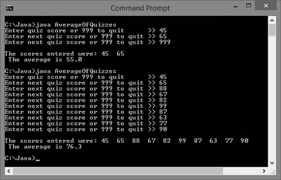

### 在数组中使用变量下标

**405**

1. 当应用程序包含一个数组时，通常会执行循环，使循环控制变量从 0 变化到数组长度减 1。
2. 数组的 `length`（长度）字段包含可以作为数组下标的最大值。
3. 增强型 for 循环允许你遍历数组，而无需为循环控制变量指定起始和结束点。

## 2. 使用 for 循环访问数组元素

*你来做做* 接下来，修改 `DemoArray2` 程序，使用 `for` 循环来处理数组。

**1.** 打开 `DemoArray2.java` 文件，并立即将该文件另存为 `DemoArray3.java`。将类名更改为 `DemoArray3`。删除四个显示四个数组值的 `println()` 语句，然后将它们替换为下方的 for 循环：

```
for(int x = 0; x < salaries.length; ++x)
    System.out.println(salaries[x]);
```

**2.** 保存程序（另存为 `DemoArray3.java`），编译并运行程序。

再次，输出结果与图 8-2 所示相同。

## 声明和使用对象数组

就像你可以声明 `int` 或 `double` 等简单类型的数组一样，你也可以声明存储对象元素的数组。例如，假设你创建了图 8-6 所示的 `Employee` 类。该类有两个数据字段（`empNum` 和 `empSal`）、一个构造函数以及每个字段的 `get` 方法。

```
public class Employee {
    private int empNum;
    private double empSal;

    Employee(int e, double s) {
        empNum = e;
        empSal = s;
    }

    public int getEmpNum() {
        return empNum;
    }

    public double getSalary() {
        return empSal;
    }
}
```

**图 8-6** `Employee` 类

你可以创建名称不同的独立 `Employee` 对象，例如：`Employee painter, electrician, plumber;` `Employee firstEmployee, secondEmployee, thirdEmployee;` 然而，在许多程序中，创建一个 `Employee` 对象数组要方便得多。

一个名为 `emps` 且包含七个 `Employee` 对象的数组可以定义为：`Employee[] emps = new Employee[7];`

该语句为名为 `emps[0]` 到 `emps[6]` 的七个 `Employee` 对象留出了足够的计算机内存。但是，该语句并没有实际构造这些 `Employee` 对象；相反，你必须调用七个构造函数。根据图 8-6 所示的类定义，`Employee` 构造函数需要两个参数：员工编号和工资。如果你想给 `Employees` 编号为 101、102、103 等，并让每个 `Employee` 的工资从 $15,000 开始，那么构造七个 `Employee` 对象的循环如下：

```
final int START_NUM = 101;
final double STARTING_SALARY = 15_000;
for(int x = 0; x < emps.length; ++x)
    emps[x] = new Employee(START_NUM + x, STARTING_SALARY);
```

随着 `x` 从 0 变化到 6，七个 `emps` 对象中的每一个在构造时其员工编号都比 `x` 大 101，且七个 `emps` 对象都持有相同的工资。

与图 8-6 所示的包含需要参数构造函数的 `Employee` 类不同，某些类只包含一个默认构造函数，该构造函数可能在没有创建其他构造函数时自动提供，或者可以显式地编写。

要使用默认构造函数构造对象数组，你仍必须使用 `new` 关键字为每个声明的数组元素调用构造函数。例如，假设你创建了一个名为 `InventoryItem` 的类但没有写构造函数。要创建一个 1,000 个 `InventoryItem` 对象数组，你需要写如下代码：

```
final int NUM_ITEMS = 1000;
InventoryItem[] items = new InventoryItem[NUM_ITEMS];
for(int x = 0; x < NUM_ITEMS; ++x)
    items[x] = new InventoryItem();
```

你可以使用初始化列表来创建对象数组，如下例所示：

```
InventoryItem[] items = {new InventoryItem(), new InventoryItem(), new InventoryItem()};
```

然而，即使数组中只有几个对象，这种方法也很笨拙。

要使用属于数组中某个对象的方法，你需要在数组名之后、方法名之前的点之前插入适当的下标符号。

例如，要显示存储在 `emps` 数组中的七个 `Employees` 的数据，你可以写如下代码：

```
for(int x = 0; x < emps.length; ++x)
    System.out.println(emps[x].getEmpNum() + " " + emps[x].getSalary());
```

注意 `Employee` 对象方法调用的语法，例如 `emps[x].getEmpNum()`。虽然你可能想将下标放在表达式末尾——如 `emps.getEmpNum()[x]` 或 `emps.getSalary()[x]`——但你不能这样做；该方法属于 `emps` 中的特定元素。

## 对对象使用增强型 for 循环

你可以使用增强型 for 循环遍历对象数组。例如，要显示存储在 `emps` 数组中的七个 `Employees` 的数据，你可以写：

```
for(Employee worker : emps)
    System.out.println(worker.getEmpNum() + " " + worker.getSalary());
```

在此循环中，`worker` 是一个局部变量，依次代表 `emps` 中的每个元素。

## 操作字符串数组

与其他任何对象一样，你可以创建一个 `String` 对象数组。例如，你可以如下所示存储三个部门名称：

```
String[] deptNames = {"Accounting", "Human Resources", "Sales"};
```

### 声明和使用对象数组

你可以像访问其他数组一样通过下标访问这些部门名称。例如，你可以使用代码显示存储在 `deptNames` 数组中的 `String` 列表：

```
for(int a = 0; a < deptNames.length; ++a)
    System.out.println(deptNames[a]);
```

注意 `deptNames.length` 指的是数组 `deptNames` 的长度（三个元素），而不是内部任何 `String` 对象的长度。例如，如果 `deptNames[0]` 是“Accounting”，那么 `deptNames[0].length()` 为 10，因为“Accounting”包含 10 个字符。

## 创建包含字符串数组的类

*你来做做* 在本节中，你创建一个名为 `BowlingTeam` 的类，包含保龄球队名称和一个存储四个团队成员名称的数组。

**1.** 打开一个新文件，输入 `BowlingTeam` 类的头部和花括号：

```
public class BowlingTeam {
}
```

**2.** 为团队名称创建一个字段，和一个存储团队成员名称的数组。

```
private String teamName;
private String[] members = new String[4];
```

**3.** 为 `teamName` 字段创建 get 和 set 方法如下：

```
public void setTeamName(String team)
{
    teamName = team;
}

public String getTeamName()
{
    return teamName;
}
```

**4.** 添加一个设置团队成员名称的方法。该方法需要一个位置和一个名称，并使用该位置作为 `members` 数组的下标。

```
public void setMember(int number, String name)
{
    members[number] = name;
}
```

**5.** 添加一个返回团队成员名称的方法。该方法需要一个值作为下标，用于确定返回哪个成员的名称。

```
public String getMember(int number)
{
    return members[number];
}
```

**6.** 将文件保存为 `BowlingTeam.java`。编译它并修正任何错误。

### 创建程序演示 `BowlingTeam` 类的实例

在本节中，你将编写一个程序，在其中创建一个 `BowlingTeam` 类的实例并为其提供值。

**1.** 打开一个新文件，输入以下代码开始定义类。

```
import java.util.*;
public class BowlingTeamDemo
{
    public static void main(String[] args)
    {
```

**2.** 添加五个声明。这些包括一个存储用户输入的 String、一个 `BowlingTeam` 对象、一个用于下标的整数、一个表示保龄球团队成员数量的常量，以及一个用于输入的 `Scanner` 对象。

```
String name;
BowlingTeam bowlTeam = new BowlingTeam();
int x;
final int NUM_TEAM_MEMBERS = 4;
Scanner input = new Scanner(System.in);
```

**3.** 提示用户输入保龄球团队名称。接受它，然后将其赋值给 `BowlingTeam` 对象：

```
System.out.print("Enter team name >> ");
name = input.nextLine();
bowlTeam.setTeamName(name);
```

**4.** 在一个执行四次的循环中，提示用户输入团队成员的名称。接受该名称并使用下标指示该成员在 `BowlingTeam` 类数组中的位置。

```
for(x = 0; x < NUM_TEAM_MEMBERS; ++x)
{
    System.out.print("Enter team member's name >> ");
    name = input.nextLine();
    bowlTeam.setMember(x, name);
}
```

**5.** 使用以下代码显示 `BowlingTeam` 对象的详情：

```
System.out.println("\nMembers of team " + bowlTeam.getTeamName());
for(x = 0; x < NUM_TEAM_MEMBERS; ++x)
    System.out.print(bowlTeam.getMember(x) + " ");
System.out.println();
```

**6.** 为 `main()` 方法添加一个右大括号，并为类添加另一个。

**7.** 将文件保存为 `BowlingTeamDemo.java`，然后编译并执行它。

图 8-7 显示了一个典型的执行过程。

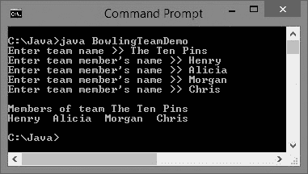

---

# 第 8 章

## 数组

### 创建一个声明 `BowlingTeam` 对象数组的程序

接下来，你将创建并使用 `BowlingTeam` 对象的数组。

**1.** 打开 `BowlingTeamDemo.java` 文件。重命名类为 `BowlingTeamDemo2`，并立即将文件保存为 `BowlingTeamDemo2.java`。

**2.** 在 `BowlingTeam` 对象的声明上方，添加一个新的命名常量来存储 `BowlingTeams` 的数量，然后将声明单个 `BowlingTeam` 对象的语句替换为四个 `BowlingTeam` 对象的数组声明。

```
final int NUM_TEAMS = 4;
BowlingTeam[] teams = new BowlingTeam[NUM_TEAMS];
```

**3.** 当前程序声明了 `x`，它被用下标显示团队成员名称。现在，在 `x` 的声明之后，添加一个用于下标显示团队的变量：

```
int y;
```

**4.** 在 `Scanner` 对象的声明之后、团队名称提示之前，插入一个执行次数等于 `BowlingTeams` 数量的 for 循环。添加左大括号，并在循环内部为每个数组元素分配内存：

```
for(y = 0; y < NUM_TEAMS; ++y)
{
    teams[y] = new BowlingTeam();
```

**5.** 删除使用单个 `bowlTeam` 调用 `setTeamName()` 方法的语句。在它的位置上，插入一个使用数组元素之一调用该方法的语句：

```
teams[y].setTeamName(name);
```

**6.** 在由 `x` 控制的第一个 for 循环内部，删除使用单个 `bowlTeam` 调用 `setMember()` 方法的语句。在它的位置上，插入一个使用数组元素之一调用该方法的语句：

```
teams[y].setMember(x, name);
```

**7.** 在变量 `x` 控制的 for 循环右大括号之后，为变量 `y` 控制的 for 循环添加右大括号。

**8.** 调整程序语句的缩进，使程序逻辑配合新的嵌套循环易于理解。你刚刚修改的嵌套循环应该像下面这 13 行代码：


```java
for(y = 0; y < NUM_TEAMS; ++y)
{
    teams[y] = new BowlingTeam();
    System.out.print("Enter team name >> ");
    name = input.nextLine();
    teams[y].setTeamName(name);
    for(x = 0; x < NUM_TEAM_MEMBERS; ++x)
    {
        System.out.print("Enter team member's name >> ");
        name = input.nextLine();
        teams[y].setMember(x, name);
    }
}
```

9. 当前程序末尾的 `for` 循环列出了四个成员的名称。将此循环替换为以下嵌套版本，列出每个团队的名称：

```java
for(y = 0; y < NUM_TEAMS; ++y)
{
    System.out.println("\nMembers of team " + teams[y].getTeamName());
    for(x = 0; x < NUM_TEAM_MEMBERS; ++x)
        System.out.print(teams[y].getMember(x) + " ");
    System.out.println();
}
```

*(接续)*

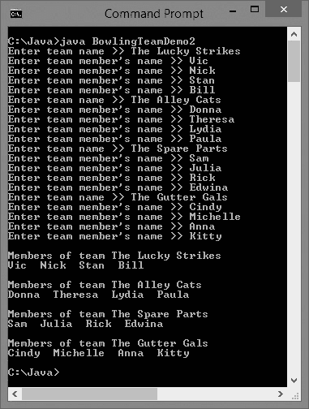

---

# 第 8 章

## 数组

*(接续)*

10. 保存文件，然后编译并执行程序。图 8-8 显示了一个典型的执行过程。用户可以向 `BowlingTeam` 对象数组输入（包括每个对象中的 `String` 数组），然后查看所有输入的数据。

## 数组

假设一家公司生产 10 种物品。当客户下单时，你需要判断订单单上的物品编号是否有效。当你想要确定一个变量是否包含多个有效值时，一种方案是使用一系列 `if` 语句将变量与有效值比较。如果有效编号是连续的（例如 101 到 110），下面的简单 `if` 语句可以验证订单并将布尔字段置为真：

```java
final int LOW = 101;
final int HIGH = 110;
boolean validItem = false;
if(itemOrdered >= LOW && itemOrdered <= HIGH) validItem = true;
```

### 使用并行数组搜索数组

在此示例中，布尔字段 `validItem` 被用作**标志**——一个持有值以指示某些条件是否的变量。

如果有效编号是非连续的（例如 101、108、201 等），你可以编写以下深度嵌套的 `if` 语句或复杂的 `OR` 比较来确定物品编号的有效性：

```java
if(itemOrdered == 101)
    validItem = true;
else if(itemOrdered == 108)
    validItem = true;
else if(itemOrdered == 201)
    validItem = true;
// 以此类推
```

与其使用长串 `if` 语句相比，更优雅的解决方案是将 `itemOrdered` 变量与数组中的值列表进行比较，这一过程被称为**搜索数组**。

你可以使用以下语句使用有效值初始化数组，该语句创建了精确 10 个数组元素，下标从 0 到 9：

```java
int[] validValues = {101, 108, 201, 213, 266, 304, 311, 409, 411, 412};
```

在有效值列表初始化后，你可以使用 `for` 语句来遍历数组，并在找到匹配项时将 `Boolean` 变量设置为 `true`：

```java
for(int x = 0; x < validValues.length; ++x)
{
    if(itemOrdered == validValues[x])
        validItem = true;
}
```

这个简单的 `for` 循环替换了长长的 `if` 语句序列；它会依次将 `itemOrdered` 值与数组中的 10 个值进行比对。此外，如果一家公司经营 1,000 件商品而不是 10 件，`for` 语句也不需要任何更改——`validValues.length` 的值会自动更新。

## 第 8 章 数组

### 使用并行数组

作为一个额外的好处，如果你设置了另一个具有相同元素数量和对应数据的数组，你就可以使用相同的下标来访问额外信息。

`并行数组`（parallel array）是指与另一个数组元素数量相同的数组，且其对应位置元素值是相关的。例如，如果你公司经营的 10 件商品有 10 个不同的价格，你可以设置一个数组来存储这些价格，如下：

```java
double[] prices = {0.29, 1.23, 3.50, 0.69…};
```

价格必须按照它们在 `validValues` 数组中对应的商品编号顺序出现。现在，寻找有效商品编号的同一个 `for` 循环也能找到价格，如图 8-9 中的应用程序所示。在代码的阴影部分，注意当在 `validValues` 数组中找到订单商品编号时，`itemPrice` 值是从 `prices` 数组中“提取”的。换句话说，如果商品编号出现在 `validValues` 数组的第二个位置，你就可以在 `prices` 数组的第二个位置找到正确的价格。图 8-10 显示了程序的典型执行过程。用户请求 409 号商品，它是 `validValues` 数组中的第八个元素，因此显示的价格是 `prices` 数组中的第八个元素。

```java
import javax.swing.*;

public class FindPrice
{
    public static void main(String[] args)
    {
        final int NUMBER_OF_ITEMS = 10;
        int[] validValues = {101, 108, 201, 213, 266, 304, 311, 409, 411, 412};
        double[] prices = {0.29, 1.23, 3.50, 0.69, 6.79, 3.19, 0.99, 0.89, 1.26, 8.00};
        String strItem;
        int itemOrdered;
        double itemPrice = 0.0;
        boolean validItem = false;

        strItem = JOptionPane.showInputDialog(null, "Enter the item number you want to order");
        itemOrdered = Integer.parseInt(strItem);

        for(int x = 0; x < NUMBER_OF_ITEMS; ++x)
        {
            if(itemOrdered == validValues[x])
            {
                validItem = true;
                itemPrice = prices[x];
            }
        }

        if(validItem)
            JOptionPane.showMessageDialog(null, "The price for item " + itemOrdered + " is $" + itemPrice);
        else
            JOptionPane.showMessageDialog(null, "Sorry - invalid item entered");
    }
}
```

**图 8-9** 通过并行数组访问信息的 FindPrice 

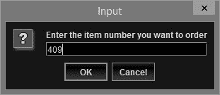


## 搜索数组和使用并行数组

**图 8-10** FindPrice 程序的典型执行。当你初始化并行数组时，使用空格是非常方便的，这样相互对应的值在屏幕或打印页面上视觉上对齐。

与其使用包含商品编号和价格的并行数组，你可能更喜欢创建一个名为 `Item` 的类，其中每个实例包含两个字段——`itemOrdered` 和 `itemPrice`。然后，你可以创建一个对象数组来封装商品编号和价格。解决编程问题几乎总是有方法。

在图 8-9 所示的代码中，你将每个 `itemOrdered` 与 10 个 `validValues` 中的每一个进行比较。即使当 `itemOrdered` 等于 `validValues` 数组中的第一个值 (101) 时，你仍然会对数组进行九次额外的循环。在这九次额外的循环中，`itemOrdered` 和 `validValues[x]` 之间的比较始终为假。一旦找到 `itemOrdered` 的匹配项，最有效的方法是提前跳出 `for` 循环。实现此点的简单方法是在执行匹配的语句块内将 `x` 设置为一个高值。这样，在匹配后，`for` 循环将不再执行，因为限制条件（`x < NUMBER_OF_ITEMS`）已被越越。

图 8-11 显示了这个循环。在具有许多可能匹配项的数组中，最有效的方法是将常用的商品放在前面，以便它们能立即被匹配。例如，如果 311 号商品订单最频繁，请将 311 放在 `validValues` 数组的第一个，并将它的价格（$0.99）放在 `prices` 数组的第一个。

```java
for(int x = 0; x < NUMBER_OF_ITEMS; ++x)
{
    if(itemOrdered == validValues[x])
    {
        validItem = true;
        itemPrice = prices[x];
        x = NUMBER_OF_ITEMS;
    }
}
```

**图 8-11** 带有提前退出的 for 循环

在图 8-11 所示的代码中，循环控制变量在体内被修改了。有些程序员反对在 `for` 子句中修改循环控制变量。

### 搜索数组进行范围匹配

在数组中搜索精确匹配并不总是切实际的。假设你的公司根据商品数量提供折扣。也许对于少于一打的任何订单都不提供折扣，但随着数量的增加，折扣也会增加，如表 8-1 所示。

| 订单总数量 | 折扣 |
| :--- | :--- |
| 1 到 12 | 无 |
| 13 到 49 | 10% |
| 50 到 99 | 14% |
| 100 到 199 | 18% |
| 200 及以上 | 20% |

**表 8-1** 折扣表

一种笨办法是创建一个数组来存储折扣率。你可以使用名为 `numOfItems` 的变量作为数组的下标，但该数组需要数百个条目，如下例：

```java
double[] discounts = {0, 0, 0, 0, 0, 0, 0, 0, 0, 0, 0, 0, 0.10, 0.10, 0.10 …};
```

`discounts` 数组中列出了三个零。数组第一个元素下标为 0，代表零个商品的零折扣。接下来的 12 个折扣（针对商品 1 到 12）也是零。当 `numOfItems` 为 13 时，`discounts[numOfItems]` 或 `discounts[13]` 为 0.10。数组将为元素 13 到 49 存储 37 个 0.10。`discounts` 数组需要大到离谱才能为每个可能的订单数量存储精确值。

更好的选择是创建两个对应的数组并进行`范围匹配`，即将值与数值范围的端点进行比较，以找到该值所属的类别。例如，一个数组可以存储五个折扣率，另一个数组可以存储五个折扣范围限制。如果你使用每个范围中的第一个数字，你可以创建一个包含五个低限限制的数组：

```java
int[] discountRangeLimits = {1, 13, 50, 100, 200};
```

并行数组可以存储五个折扣率：

```java
double[] discountRates = {0, 0.10, 0.14, 0.18, 0.20};
```

然后，从 `discountRangeLimits` 数组的最后一个元素开始，对于任何大于或等于 `discountRangeLimits[4]` 的 `numOfItems`，适当的折扣是 `discounts[4]`。换句话说，对于任何小于 `discountRangeLimits[4]` 的 `numOrdered`，你应该递减下标并在较低的范围中进行查找。图 8-13 显示了一个使用并行数组的应用程序，图 8-14 显示了程序的典型执行过程。

```java
import javax.swing.*;

public class FindDiscount
{
    public static void main(String[] args)
    {
        final int NUM_RANGES = 5;
        int[] discountRangeLimits = { 1, 13, 50, 100, 200};
        double[] discountRates = {0.00, 0.10, 0.14, 0.18, 0.20};
        double customerDiscount;
        String strNumOrdered;
        int numOrdered;
        int sub = NUM_RANGES - 1;

        strNumOrdered = JOptionPane.showInputDialog(null, "How many items are ordered?");
        numOrdered = Integer.parseInt(strNumOrdered);

        while (sub >= 0 && numOrdered < discountRangeLimits[sub])
            sub--;

        customerDiscount = discountRates[sub];
        JOptionPane.showMessageDialog(null, "Discount rate for " + numOrdered + " items is " + customerDiscount);
    }
}
```

**图 8-13** FindDiscount 类


**第 8 章**

数组

**420**

**图 8-14** FindDiscount 类的典型执行过程。在图 8-13 应用程序的 `while` 循环中，在比较 `numOrdered` 和 `discountRangeLimits[sub]` 的语句的后半部分执行之前，`sub` 必须大于或等于 0。确保数组下标不会低于 0（这会导致运行时错误）是一种良好的编程习惯。

观看视频 *Searching an Array*（搜索数组）。

**两个真理一个谎言**

**搜索数组与使用并行数组**

1. 并行数组是指与另一个数组具有相同数量元素，且对应元素中的值相关的数组。
2. 在搜索数组时，一旦找到所需的元素，立即停止搜索通常是最高效的。
3. 在范围匹配中，你通常会将一个值与一系列数值范围范围的中点进行比较。

**搜索数组与使用并行数组** *你来做*

*搜索数组*

**421**

在本节中，你将修改 `BowlingTeamDemo2` 程序，使得在输入保龄球队数据后，用户可以请求特定球队的名单。

1. 打开 `BowlingTeamDemo2.java` 文件，将类名更改为 `BowlingTeamDemo3`。立即将文件保存为 `BowlingTeamDemo3.java`。
2. 在现有应用程序的末尾，最后两个结束的大括号之前，插入一个提示，要求用户输入团队名称。然后接受输入的值。
   `System.out.print("\n\nEnter a team name to see its roster >> ");`
   `name = input.nextLine();`
3. 接下来，插入一个嵌套的 `for` 循环。外层循环 `y` 从 0 变化到 `teams` 数组允许的最大下标。在此循环内部，将用户请求的团队名称与存储的团队名称进行比较；当它们相等时，另一个 `for` 循环将显示四个团队成员的名字。
   ```java
   for(y = 0; y < teams.length; ++y)
       if(name.equals(teams[y].getTeamName()))
           for(x = 0; x < NUM_TEAM_MEMBERS; ++x)
             System.out.print(teams[y].getMember(x) + " ");
   ```
4. 插入额外的空 `println()` 方法调用。
   `System.out.println();`
5. 保存文件，然后编译并执行程序。图 8-15 显示了典型执行的最后部分，包含了输入完成后的输出。

（待续）


**第 8 章**

数组

（续）

**图 8-15** BowlingTeamDemo3 应用程序的典型输出

## 将数组传递给方法以及从方法返回数组


# 第 8 章：数组

## 将数组传递给方法

你已经看到，你可以像使用任何同类型的单个变量一样，使用任何单个数组元素。也就是说，如果你声明一个整数数组 `int[] someNums = new int[12];`，你随后可以显示 `someNums[0]`，或增加 `someNums[1]`，或对 `someNums` 进行操作。

检查图 8-16 显示的 `PassArrayElement` 应用程序以及图 8-17 显示的输出。

```java
// 来自方法的数组
public class PassArrayElement
{
    public static void main(String[] args)
    {
        final int NUM_ELEMENTS = 4;
        int[] someNums = {5, 10, 15, 20};
        int x;

        System.out.print("At start of main: ");
        for (x = 0; x < NUM_ELEMENTS; ++x)
            System.out.print(someNums[x] + " ");
        System.out.println();

        methodGetsInt(someNums[0]);

        System.out.print("At end of main: ");
        for (x = 0; x < NUM_ELEMENTS; ++x)
            System.out.print(someNums[x] + " ");
        System.out.println();
    }

    public static void methodGetsInt(int one) {
        System.out.print("At start of method is: " + one);
        one = 999;
        System.out.println(" and at end of method is: " + one);
    }
}
```

**图 8-16** `PassArrayElement` 类

**图 8-17** `PassArrayElement` 应用程序的输出。从图 8-17 可以看出，在 `methodGetsInt()` 方法中更改的四个数字在 `main()` 中保持不变。名为 `one` 的变量是 `methodGetsInt()` 方法的局部变量，对传入变量的更改不是永久性的。每个 `one` 只持有传入数组元素的副本。

### 按值传递

当将任何基本数据类型（`boolean`、`char`、`byte`、`short`、`int`、`long`、`float` 或 `double`）传递给方法时，传递的是值。

数组像所有非基本对象一样，都是引用类型；这意味着对象实际持有存储数值的内存地址。（你之前在 **424** 页学过 `引用` 类型，那里它们与 `基本` 类型进行了对比。）因为数组名称是引用，你不能使用 `=` 运算符将另一个数组赋值给它，也不能使用 `==` 运算符比较两个数组。此外，当你将数组（即传递其名称）传递方法时，接收方法获得的是数组实际内存地址的副本。

这意味着接收方法可以访问并修改调用方法中数组元素中的原始值。

图 8-18 显示的类创建了一个包含四个整数的数组。

在方法内部，显示了这些数字，这表明它们保留了从 `main()` 中获取的值，但随后每个数字都被赋值为值 `888`。尽管 `methodGetsArray()` 是一个 `void` 方法——意味着它没有向 `main()` 方法返回任何内容——但当 `main()` 方法第二次显示数组时，所有的值都已变为 `888`，正如图 8-19 的输出所示。由于该方法接收的是对数组的引用，`methodGetsArray()` 方法“知道”在 `main()` 中声明的数组地址，并直接对原始数组执行了修改。

在某些语言中，数组是通过引用传递的，这意味着接收方法获得的是内存地址。这是一个细微的区别，但在 Java 中，接收方法获得的是原始地址的拷贝。换句话说，在 Java 中，数组不是通过引用传递的，而是数组的引用是通过按值传递的。

```java
public class PassArray {
    public static void main(String[] args) {
        final int NUM_ELEMENTS = 4;
        int[] someNums = {5, 10, 15, 20};
        int x;
        System.out.print("At start of main: ");
        for (x = 0; x < NUM_ELEMENTS; ++x)
            System.out.print(" " + someNums[x]);
        System.out.println();
        methodGetsArray(someNums);
        System.out.print("At end of main: ");
        for (x = 0; x < NUM_ELEMENTS; ++x)
            System.out.print(" " + someNums[x]);
        System.out.println();
    }
}
```

图 8-18 `PassArray` 类 *(续)*


### 将数组传递给方法以及从方法返回数组 *(续)*

```java
public static void methodGetsArray(int[] arr) {
    int x;
    System.out.print("At start of method arr holds: "); // 425
    for (x = 0; x < arr.length; ++x)
        System.out.print(" " + arr[x]);
    System.out.println();
    for (x = 0; x < arr.length; ++x) {
        arr[x] = 888;
        System.out.print(" and at end of method arr holds: ");
        for (x = 0; x < arr.length; ++x)
            System.out.print(" " + arr[x]);
        System.out.println();
    }
}
```

图 8-18 `PassArray` 类

注意，在图 8-18 的第一个阴影语句中，数组名被传递给方法，且没有使用括号。在方法头部，使用了括号来表示该参数是一个整数数组（引用），而不是简单的 `int`。

图 8-19 `PassArray` 应用程序的输出

在其他一些语言（特别是 C、C++ 和 C#）中，你可以选择按值或按引用将变量传递给方法。在 Java 中，你无法做出这种选择。基本类型变量总是按值传递的。当你传递一个对象时，总是传递的是该对象引用的拷贝。

## 从方法返回数组

方法可以返回数组引用。当方法返回数组引用时，你需要在方法头部的返回类型中使用方括号。例如，图 8-20 显示了一个 `getArray()` 方法，它返回一个声明的局部 `y` 整数数组。方括号作为返回类型的一部分使用（426）；返回语句则返回数组名，不带任何括号。

```java
public static int[] getArray() {
    int[] scores = {90, 80, 70, 60};
    return scores;
}
```

图 8-20 `getArray()` 方法

当你调用图 8-20 中的 `getArray()` 方法时，可以将返回的值存储在任何整数数组引用中。例如，你可以在以下语句中声明数组并进行方法调用：

`int[] scoresFromMethod = getArray();`

观看视频 *数组与方法*。

### 两个真一假：将数组传递给方法以及从方法返回数组

1. 你使用数组名向方法传递单个数组元素，并且该方法必须准备好接收相应的数据类型。

2. 你使用数组名后跟一对括号将数组传递给方法；数组是通过按值传递的。

3. 当方法返回数组引用时，你需要在方法头部的返回类型中使用方括号。

## 将数组传递给方法以及从方法返回数组：你来做

### 向方法传递数组 (427)

接下来，你为 `BowlingTeamDemo3` 应用程序添加一个方法。此改进允许你从主程序中移除数据输入过程，并将其封装在它自己的方法中。

1. 如果 `BowlingTeamDemo3.java` 尚未打开，请打开。将文件重命名为 `BowlingTeamDemo4.java`。

2. 在结束括号之前，添加一个接收 `BowlingTeam` 数组的方法。

```java
public static void getTeamData(BowlingTeam[] teams) {
```

3. 在 `getTeamData` 中，添加声明：

```java
String name;
final int NUM_ELEMENTS = 4;
int x;
int y;
final int NUM_MEMBERS = 4;
Scanner input = new Scanner(System.in);
```

4. 在 `getTeamData` 内部，添加以下内容：

```java
for (y = 0; y < NUM_ELEMENTS; ++y) {
    teams[y] = new BowlingTeam();
    System.out.print("Enter team name: ");
    name = input.nextLine();
    teams[y].setName(name);
}
for (x = 0; x < NUM_MEMBERS; ++x) {
    System.out.print("Enter member's name: ");
    name = input.nextLine();
    teams[y].setMember(x, name);
}
```

5. 在 `main()` 方法中插入方法调用。该调用将数组引用传递给方法。注意，此调用没有返回值。

`getTeamData(teams);`

6. 保存文件 (`BowlingTeamDemo4.java`)，然后编译并执行程序。确认程序的运行情况与添加新方法之前完全一致。

## 不要这样做

- 不要忘记最小下标是 0。
- 不要忘记最大的数组下标是数组长度减 1。
- 不要忘记数组初始化列表结束括号后的分号。
- 不要忘记 `length` 是数组的属性而不是方法。相反，`length()` 是 `String` 的方法而不是属性。
- 在访问对象数组时，不要将下标放在对象的字段或方法之后。相反，对象的下标紧在对象后面，位于点符号和方法名之前。
- 不要假设字符数组是字符串。虽然字符数组在 C++ 等语言中可以被当作字符串处理，但在 Java 中你不能这样做。例如，如果你显示字符数组的名字，你看到的是它的地址，而不是内容。

## 关键术语

- 一个对象的 `property`（属性）是一个实例变量或字段。
- `enhanced for loop`（增强 for 循环）允许你在不指定循环控制变量起始和结束点的情况下遍历数组。
- `foreach loop`（foreach 循环）是一种增强 for 循环。
- `flag`（标记）是一个持有值（通常为真或假）的变量，作为是否满足某些条件的指示。
- `Searching an array`（搜索数组）是将值与数组中的值列表进行比较以寻找匹配项的过程。
- `parallel array`（并行数组）与另一个数组元素数量相同，且对应元素中的值相关的数组。
- `range match`（范围匹配）是将值与数值范围的端点进行比较以找到该值所属类别的过程。
- `Passed by value`（按值传递）描述了变量传递给方法并在接收方法中创建副本时的情况。
- `Passed by reference`（按引用传递）描述了将引用（地址）传递给方法时的情况。

## 本章总结

数组是一个具有相同类型的数据项命名列表。你通过在类型后插入一对方括号来声明数组变量。为了为数组预留内存空间，你需要使用关键字 `new`。你使用包含方括号的下标来引用数组的变量或元素。在 Java 中，任何数组的元素都从零开始编号。

数组名称代表计算机内存地址。当你声明一个数组名称时，不会为其分配计算机内存地址，且数组变量的值为 `null`。当你使用关键字 `new` 或提供初始化列表时，数组会获得实际的内存地址。当不提供初始化列表时，每个数据类型的数组元素都有一个默认值。

你可以通过使用变量作为下标来缩短许多基于数组的任务。当应用程序包含数组时，通常会执行从 0 到数组大小减 1 的循环。`length` 字段是一个自动创建并分配给每个数组的字段；它包含数组中元素的数量。

你可以声明持有任何类型元素的数组，包括 `Strings` 和其他 430 类对象。要使用属于数组部分对象的方法，你需要在数组名称之后、方法名之前的点（.）之前插入适当下标符号。

通过遍历数组并进行比较，你可以搜索数组以找到与值的匹配项。你可以使用具有相同数量元素的并行数组来存储相关元素。你通过将范围的结束值放入数组中，并对每个数组元素进行大于或小于比较来执行范围匹配。

你可以将单个数组元素传递给方法，数组将接收所传值的副本。你可以将数组名称传递给方法，该方法将接收数组内存地址的副本，并有权访问原始数组中的值。

## 复习题

1. 数组是一个数据项列表，它们：
   a. 都具有相同的类型
   b. 都具有不同的名称
   c. 都是整数
   d. 均都是 null

2. 当你声明数组时，
   a. 你始终在同一条语句中为其预留内存
   b. 你可能在同一条语句中为其预留内存
   c. 你不能在同一条语句中为其预留内存
   d. 在同一条语句中为其预留内存的能力取决于数组的类型

3. 你在何时时候为数组预留内存位置：
   a. 声明数组名称
   b. 使用关键字 `new`
   c. 使用关键字 `mem`
   d. 使用关键字 `size`

4. 下述语句为多少整数预留了空间？
   `int[] value = new int[34];`
   a. 0
   b. 33
   c. 34
   d. 35

5. 下列哪项可以作为数组下标？
   a. character
   b. double
   c. int
   d. String

6. 如果你如下声明一个数组，如何指示数组的最后一个元素？
   `int[] num = new int[6];`
   a. `num[0]`
   b. `num[5]`
   c. `num[6]`
   d. 无法判断

7. 如果你如下声明一个整数数组，`num[2]` 的值是多少？
   `int[] num = {101, 202, 303, 404, 505, 606};`
   a. 101
   b. 202
   c. 303
   d. 无法判断

8. 数组名称代表。
   a. 值
   b. 函数
   c. 引用
   d. 幻觉

9. Unicode 值 `\u0000` 也称为。
   a. nil
   b. void
   c. nada
   d. null

10. 当你在创建时通过赋值来初始化数组时，你：
    a. 没有显式地赋予数组大小
    b. 也必须显式地赋予数组大小
    c. 必须使所有值为零、空白或假
    d. 必须使每个值与其他值不同

11. 在 Java 中，你可以声明一个 12 个元素的数组并初始化。
    a. 仅初始化第一个
    b. 初始化所有
    c. 这两个都是正确的。
    d. 这两个都不对。

12. 假设数组如下声明。下列哪条语句正确地将值 100 赋值给每个数组元素？
    `int[] num = new int[4];`
    a. `for(x = 0; x < 4; x++) num[x] = 100;`
    b. `for(x = 0; x <= 4; x++) num[x] = 100;`
    c. `for(x = 1; x < 4; x++) num[x] = 100;`
    d. `for(x = 0; x < 3; x++) num[x] = 100;`

13. 假设你声明了如下数组：
    `int[] creditScores = {670, 720, 815};`
    `creditScores.length` 的值是多少？
    a. 0
    b. 1
    c. 2
    d. 3

14. 如果名为 `Student` 的类包含一个接收 `int` 参数的方法 `ID()`，并且你创建一个包含 20 个 `Student` 对象的数组 `scholar`，哪条语句正确为第一个赋值 ID？
    a. `Student[0].ID(1234);`
    b. `scholar[0].ID(1234);`
    c. `Student.ID(0);`
    d. `scholar.ID(0);`

15. 并行数组是：
    a. 与另一个数组值对应的
    b. 持有偶数个数
    c. 代码中相邻的
    d. 内存中相邻的

16. 在下列哪些情况下设置并行数组最有用？
    a. 你需要通过员工 ID 查找其姓氏。
    b. 你需要计算储蓄余额的利息。
    c. 你需要存储 20 个常见的拼写错误。
    d. 你需要确定地图上点之间的最短距离。

17. 当你将数组元素传递给方法时，方法接收：
    a. 数组的副本
    b. 数组的地址
    c. 元素的副本
    d. 元素的地址

18. 原生类型的单个数组元素传递给方法是通过。
    a. 值
    b. 引用
    c. 地址
    d. 渗透

19. 当你将数组传递给方法时，方法接收：
    a. 数组的副本
    b. 数组第一个元素的副本
    c. 数组的地址
    d. 无

20. 如果方法应向调用方法返回数组，
    a. 方法的返回类型必须与其参数类型匹配
    b. 方法头中的返回类型前有 &


c. 方法头中的返回类型后跟着方括号

d. Java 方法不能返回数组。

## 练习

1. 编写一个应用程序，在数组中存储 12 个整数。从前往到后显示这些整数，然后从后往前显示这些整数。将文件保存为 `TwelveInts.java`。

2. 允许用户输入最多 20 个双精度值。用户应输入 99999 来停止输入数字。如果用户在输入任何数字之前就退出，则显示错误消息；否则，显示每个输入值及其与平均值的距离。将文件保存为 `DistanceFromAverage.java`。

### 3

a. 为 Cody 的汽车修护店编写一个应用程序，向用户显示可用的服务列表：`oil change`（换油）、`tire rotation`（轮胎循环）、`battery check`（电池检查）或 `brake inspection`（刹车检查）。允许用户输入对应于之一的字符串，并相应地显示该选项及其价格（25、$22、$15 或 $5）。如果用户输入了无效项目，则显示错误信息。将文件保存为 `CarCareChoice.java`。

b. 期望用户准确地输入如“oil change”之类的长字符串可能并不合理。修改 `CarCareChoice` 类，只要用户输入了服务的前三个字符，该选择就被视为有效。将文件保存为 `CarCareChoice2.java`。

### 4

创建一个包含存储 10 个整数数组的应用程序。该程序应调用五个方法，这些方法依次执行：(1) 显示所有整数，(2) 反序显示所有整数，(3) 显示整数之和，(4) 显示小于限制参数的所有值，以及 (5) 显示大于计算出的平均值的所有值。将文件保存为 `ArrayMethodDemo.java`。

### 5

a. 编写一个应用程序接受最多 10 个 `Strings`，如果用户输入了终止值则接受较少。将输入的 `Strings` 分为两个列表——一个用于长度为 10 个字符或更少的短 `Strings`，另一个用于长 `Strings`。在数据输入完成后，提示用户输入要显示哪种类型的 `String`，然后输出正确的列表。对于此练习，你可以假设如果用户没有请求短字符串列表，则用户想要长字符串列表。如果请求的列表中没有 `Strings`，则输出适当的消息。持续提示用户，直到输入哨兵值为止。将文件保存为 `CategorizeStrings.java`。

b. 修改 `CategorizeStrings` 应用程序，将输入的 `Strings` 分为不包含空格的、包含一个空格的或包含多个空格的。在数据输入完成后，持续提示用户输入要 kind 的 `String` 类型。如果用户没有输入三个有效选择之一，则显示所有的 `Strings`。将文件保存为 `CategorizeStrings2.java`。

### 6

a. 创建名为 `Salesperson` 的类。`Salesperson` 的数据字段包括一个整数 ID 号和一个双精度浮年度销售额。方法包括一个需要两个数据字段值的构造函数，以及每个数据字段的 get 和 set 方法。编写一个名为 `DemoSalesperson` 的应用程序，声明一个包含 10 个 `Salesperson` 对象的数组。将每个 ID 号设置为 9999，每个销售值设置为 0。

显示这 10 个 `Salesperson` 对象。将文件保存为 `Salesperson.java` 和 `DemoSalesperson.java`。

b. 修改 `DemoSalesperson` 应用程序，使每个 `Salesperson` 拥有从 111 到 120 的连续 ID 号，销售值范围在 $25,000 到 $70,000 之间，每个后续 `Salesperson` 增加 $5,000。将文件保存为 `DemoSalesperson2.java`。

### 7

a. 创建一个 `CollegeCourse` 类。该类包含课程 ID（例如“CIS 210”）、学分（例如 3）和字母等级（例如‘A’）的字段。

为每个字段包含 get 和 set 方法。创建一个包含一个 ID 号和五个 `CollegeCourse` 对象数组的 `Student` 类。为学生 ID 号创建一个 get 和 set 方法。还创建一个 get 方法，返回 `Student` 的 `CollegeCourses` 之一；该方法接受一个整数参数并返回该位置的 `CollegeCourse`（0 到 4）。接下来，创建一个 set 方法来设置 `Student` 的 `CollegeCourses` 之一；该方法接受两个参数——一个 `CollegeCourse` 和一个代表 `CollegeCourse` 位置（0 到 4）的整数。将文件保存为 `CollegeCourse.java` 和 `Student.java`。

b. 编写一个应用程序，提示教授为 10 名学生输入五门不同课程的成绩。提示教授每次输入一个学生的数据，包括学生 ID 和五门课程的课程数据。使用包含正在输入的学生编号和课程编号的提示——例如，“Enter ID for student #s”，其中 `s` 是 1 到 10 之间的整数，表示学生；以及“Enter course ID #n”，其中 `n` 是 1 到 5 之间的整数，表示课程编号。验证教授在输入每门课程的成绩值时仅输入 A、B、C、D 或 F。将文件保存为 `InputGrades.java`。

### 8

编写一个应用程序，允许用户输入最多 10 个朋友的名字和出生日期。持续提示用户输入姓名和出生日期，直到用户对姓名输入哨兵值“ZZZ”或已输入 10 个名字，以先到者为准。用户完成姓名输入后，生成输入名称的计数，然后显示这些姓名。在循环中，持续要求用户输入其中一个姓名并显示相应的出生日期，如果未姓名之前输入过，则显示错误消息。循环持续到用户对姓名输入“ZZZ”为止。将应用程序保存为 `BirthdayReminder.java`。

### 9

一个个人电话簿留有存储 30 人的姓名和电话号码的空间。为前 10 个人分配姓名和电话号码。提示用户输入姓名，如果姓名在列表中，显示相应的电话号码。如果姓名不在列表中，提示用户输入电话号码，并将姓名和电话号码添加到列表中。持续提示用户直到用户输入 `quit`。数组满（包含 30 个）后不允许用户添加新条目。将文件保存为 `PhoneNumbers.java`。

### Exercises

10. 在第 4 章的练习中，你创建了 `CertOfDeposit` 类。现在，创建一个应用程序接受五个 `CertOfDeposit` 对象的数据，然后显示数据。

11. 在第 6 章的练习中，你创建了 `Purchase`。`Purchase` 包含发票号、销售金额、销售税和多个方法。现在，编写一个程序声明五个 `Purchase` 对象的数组并提示用户输入其值。在创建每个 `Purchase` 对象时，持续提示用户输入 1000 到 8000 之间的发票号以及非负销售金额。提示用户输入每个对象的值然后显示所有值。将文件保存为 `PurchaseArray.java`。

### Debugging Exercises

1. 下载的学生文件夹中的以下文件都有语法和/或逻辑错误。在每种情况下，确定问题并修复程序。修正错误后，使用相同的文件名并加上前缀保存每个文件。例如，`DebugEight1.java` 将变为 `FixDebugEight1.java`。

a. `DebugEight1.java`

b. `DebugEight2.java`

c. `DebugEight3.java`

d. `DebugEight4.java`

### Game Zone

1. 编写一个应用程序，包含 10 个与你喜好的爱好相关的多选择测试题。每个问题包含三个选项。还创建一个数组来存储每个问题的正确答案——A、B 或 C。显示每个问题并验证用户仅输入 A、B 或 C 作为答案——如果不是，继续提示用户直到输入有效响应。如果用户正确回答问题，则显示“Correct!”；否则显示“正确答案是”以及正确答案的字母。在用户回答所有问题后，显示正确和错误答案的数量。将文件保存为 `Quiz.java`。

2. a. 在第 4 章，你创建了一个 `Die` 应用程序，可以随机为计算机和玩家投掷五个骰子。应用程序显示这些值。

修改应用程序以根据下面的骰子值层级结构决定胜者。任何高级组合都胜过低级组合——例如，五条胜过四条。

五条（Five of a kind）

四条同

三条同

一对儿


# 第 8 章

## 数组

在这个游戏中，骰子的数值并不计入内；例如，如果两个玩家都得到三条同，则平局，无论这三个骰子的数值是多少。此外，游戏不识别“葫芦”（三条同加对儿）。图 8-21 显示了一个示例执行过程。将应用程序保存为 `FiveDice2.java`。

**图 8-21** `FiveDice2` 程序的典型执行情况。

b. 改进 `FiveDice2` 游戏，使得当两个玩家具有相同的骰子组合时，值较高者获胜。例如，两个 `6` 胜过两个 `5`。图 8-22 显示了一个示例执行过程。将应用程序保存为 `FiveDice3.java`。

**图 8-22** `FiveDice3` 程序的典型执行情况。

3. a. 在第 7 章中，你修改了之前创建的 `Card` 类，使得每个 `Card` 包含一个花色名称（“黑桃”、“红心”、“方片”或“梅草”）以及一个数值（“A”、“K”、“Q”、“J”或数字值）。现在，创建一个包含 52 个 `Card` 对象的数组，为每个 `Card` 分配不同的值，并显示每个 `Card`。

将应用程序保存为 `FullDeck.java`。

b. 在第 7 章中，你创建了一个名为 `War2` 的卡牌游戏，它随机选择两个 `Card` 对象（一个给玩家，一个给电脑），并根据卡牌值决定胜者或平局。现在创建一个玩 26 轮“战争”的游戏，发出一副不重复牌的整牌。提示：首先像本练习的 a 部分一样，创建一个所有 52 张扑牌的数组。

为玩家第一张牌的牌组位置选择一个随机数，并将该数组位置上的牌分配给玩家。

将牌中每个位置靠后的牌“向下”移动一位以填补空隙。

换句话说，如果玩家的第一随机随机数是 49，则选择位置 49 的牌，将原本位置 50 的牌移动到位置 49，并将位置 51 的牌移动到位置 50。在发完玩家的第一张牌后，牌组中剩余 51 张牌，因此可用牌数组减小了一个。

同样，为电脑随机选择一张牌并从牌组中“移除”该牌。

显示玩家和电脑卡牌的值，比较它们的值，并确定胜者。

当牌组中的所有牌用完时，显示玩家获胜次数、电脑获胜次数和平局次数。

将游戏保存为 `War3.java`。

4. 在第 7 章中，你创建了一个类似于“猜字游戏”的 `Secret Phrase` 游戏，用户通过猜测部分隐藏短语中的字母来尝试确定完整的短语。修改程序以使得：

- 待猜的短语从至少 10 个短语的列表中随机选择。

- 向用户展示线索时，用星号替换待猜的字母，但在适当的位置留空格。例如，如果待猜的短语是“No man is an island”，那么用户看到的第一个线索如下：

`*** ** ** ******`

空格提供了关于单个单词开始和结束位置的价值线索。

确保当用户做出正确猜测时，无论大小写如何，所有匹配的字母都被填入。

将游戏保存为 `SecretPhrase2.java`。

# 第 8 章：数组

### 案例分析

1. 在之前的章节中，你开发了用于处理 Carly’s Catering 餐饮活动信息的类。现在按照以下方式修改 `Event` 和 `EventDemo` 类：

- 修改 `Event` 类，以包含一个存储事件类型的整数字段。添加一个 `final` `String` 数组，用于存储 Carly’s Caters 提供的活动类型名称——婚礼、洗礼、生日、公司活动和其他。为该整数事件类型字段添加 `get` 和 `set` 方法。如果传递给设置事件类型方法的参数大于 `String` 事件类型数组的大小，则将该整数设置为“其他”所占的元素索引。包含一个 `get` 方法，根据数字事件类型返回事件的 `String` 事件类型。

- 为了保持 `EventDemo` 类的简单，删除所有比较事件大小和显示邀请 `String` 的语句。

- 修改 `EventDemo` 类，使其不再创建三个单独的 `Event` 对象，而是使用包含三个 `Event` 对象的数组。获取每个对象的数据，然后显示每个对象的详细信息。

将文件保存为 `Event.java` 和 `EventDemo.java`。

2. 在之前的章节中，你开发了用于存储 Sammy’s Seashore Supplies 租赁合同信息的类。现在按照以下方式修改 `Rental` 和 `RentalDemo` 类：

- 修改 `Rental` 类，以包含一个存储设备类型的整数字段。

- 添加一个 `final` `String` 数组，用于存储 Sammy’s 租赁的设备类型名称——喷气滑艇、浮筏、划船、独舟、皮划艇、沙滩椅、遮阳伞和其他。为该整数设备类型添加 `get` 和 `set` 方法。如果传递给设置设备类型方法的参数大于类型数组的大小，则将该整数设置为“其他”所占的元素索引。包含一个 `get` 方法，根据数字设备类型返回租赁的 `String` 类型。

- 为了保持 `RentalDemo` 类。

- 修改 `RentalDemo` 类，使其不再创建三个单独的 `Event` 对象，而是使用包含三个 `Event` 对象的数组。获取每个对象的数据，然后显示每个对象的详细信息。

将文件保存为 `Rental.java` 和 `RentalDemo.java`。

# 第 9 章

## 数组概念

在本章中，你将：

- 使用冒泡排序算法排序数组

- 使用插入排序算法排序数组

- 使用二维数组

- 使用 `Arrays` 类

- 使用 `ArrayList` 类

- 创建枚举

# 第 9 章：高级数组概念

## 使用冒泡排序算法排序元素

**排序**是将一组对象按某种逻辑排列的过程。当你从值最小的对象开始排列时，你是在**升序排序**；相反，当你从值最大的对象开始时，你是在**降序排序**。

最简单的排序涉及两个无序的值。为了让值有序，你必须交换这两个值。假设你有两个变量——`valA` 和 `valB`——并且假设 `valA = 16` 且 `valB = 2`。为了交换这两个变量的值，你不能简单地使用代码：

```
valA = valB // 2 变为 valA
valB = valA // 2 变为 valB
```

如果在执行 `valA = valB` 后，两个变量都持有值 2。原本存储在 `valA` 中的值 16 丢失了。当你执行第二个赋值语句 `valB = valA` 时，每个变量仍然持有值 2。

允许你保留两个值的解决方案是使用一个变量临时持有 `valA` 的值进行交换：

```
temp = valA; // 16 进入 temp
valA = valB; // 2 变为 valA
valB = temp; // 16 变为 valB
```

使用这种技术，`valA` 的值（16）被赋值给 `temp` 变量。`valB` 的值（2）随后被赋值给 `valA`，因此 `valA` 得到了更新。然后，`temp` 值（16）被赋值给 `valB`。

如果你想对任意两个值 `valA` 和 `valB` 进行升序排序，使得 `valA` 是较小的值，你可以使用以下 `if` 语句来做出是否交换的决定。如果 `valA` 大于 `valB`，你就想要交换这两个值。如果 `valA` 不大于 `valB`，则你不需要交换。

```
if(valA > valB)
{
    temp = valA;
    valA = valB;
    valB = temp;
}
```

对两个值进行排序是一个相当简单的任务；对多个值进行排序更为复杂，当你尝试使用一系列决策时。当你知道如何使用数组时，这项任务就变得可以处理了。

## 使用冒泡排序算法

已经开发了多种排序算法；`algorithm` 是解决问题的过程或一组步骤。在升序 `bubble sort` 算法中，你反复比较成对的项，如果它们的顺序不对，就交换它们，最终创建一个有序列表。

### 使用冒泡排序算法对数组元素进行排序

冒泡排序既不是最快也不是最高效的排序技术，但它是最容易理解的方法之一，并能提供对数组元素操作更深层次的理解。

要使用冒泡排序，你将原始未排序的值放在数组中。你比较前两个数字；如果它们不是升序，就交换它们。比较第二个和第三个数字；如果它们不是升序，就交换它们。你继续向下遍历列表，对于每个位置 `x`，如果位置 `x + 1` 处的值不大于，你就想要交换这两个值。

假设你已经声明了一个数组：

```
int[] someNums = {88, 33, 99, 22, 54};
```

那么，过程如下：

1. 比较 `88` 和 `33`。它们顺序不对。交换它们。列表变为 `33, 88, 99, 22, 54`。

2. 比较列表中的第二个和第三个数字——`88` 和 `99`。它们是有序。什么都不做。

3. 比较列表中的第三个和第四个数字——`99` 和 `22`。它们顺序不对。交换它们。列表变为 `33, 88, 22, 99, 54`。

4. 比较第四和第五个数——`99` 和 `54`。它们顺序不对。交换它们。列表变为 `33, 88, 22, 54, 99`。

当你到达列表底部时，数字并不是升序的，但最大的数字 `99` 已经移动到了列表底部。这个特征赋予了冒泡排序名字——“重”值沉到了列表底部，而“轻”值则泡到了顶部。

假设 `b` 和 `temp` 都已经被声明为整数变量，目前的代码如下：


```
for(b = 0; b < someNums.length - 1; ++b)
    if(someNums[b] > someNums[b + 1])
    {
        temp = someNums[b];
        someNums[b] = someNums[b + 1];
        someNums[b + 1] = temp;
    }
```

与其在循环每次迭代中都将 `b` 与 `someNums.length - 1` 进行比较，不如声明一个变量并将 `someNums.length - 1` 赋值给它，并在比较中使用该变量。这样，算术运算只需执行一次。为了减少示例中的步骤，这里省略了这一步。

注意 `for` 语句测试了 `b` 从 `0` 到 `3` 的每一个值。数组 `someNums` 包含五个整数，因此数组下标的值范围从 `0` 到 `4`。在 `for` 循环内部，每个 `someNums[b]` 都会与 `someNums[b + 1]` 进行比较，因此 `b` 的合法最大值是 `3`。对于任何尺寸数组的排序，`b` 的值必须保持小于数组长度减 1。

# 第 9 章

## 高级数组概念

起初为 `88, 33, 99, 22, 54` 的数字列表目前为 `33, 88, 22, 54, 99`。要继续排序列表，你必须再次执行整个比较-交换过程。

1. 比较前两个值——`33` 和 `88`。它们是有序；什么都不做。

2. 比较第二个和第三个值——`88` 和 `22`。它们顺序不对。交换它们，使列表变为 `33, 22, 88, 54, 99`。

3. 比较第三个和第四个值——`88` 和 `54`。它们顺序不对。交换它们，使列表变为 `33, 22, 54, 88, 99`。

4. 比较第四和第五个值——`88` 和 `99`。它们是有序；什么都不做。

在对列表进行第二次遍历后，数字是 `33, 22, 54, 88` 和 `99`——接近升序，但尚未完全相同。你可以看到，只需再遍历一次列表，值 `22` 和 `33` 将就会交换，列表最终将就绪。要完全排序最坏情况的列表（即原始数字是降序的，即最极端的非升序状态），你需要遍历列表四次，进行比较和交换。

最多情况下，你遍历列表的次数始终等于其长度减 1。

图 9-1 假设 `a`、`b` 和 `temp` 是整数并显示了整个过程。

```
for(a = 0; a < someNums.length - 1; ++a)
    for(b = 0; b < someNums.length - 1 - a; ++b)
        if(someNums[b] > someNums[b + 1])
        {
            temp = someNums[b];
            someNums[b] = someNums[b + 1];
            someNums[b + 1] = temp;
        }
```

图 9-1 升序冒泡排序

### 改进冒泡排序

当你使用升序冒泡排序时，每次遍历保证最大值位于数组底部。你可以使用一个新变量来控制比较次数，使排序更高效。

```
int comparisonsMake = someNums.length - 1;
for(a = 0; a < someNums.length - 1; ++a)
    for(b = 0; b < comparisonsMake; ++b)
        if(someNums[b] > someNums[b + 1])
        {
            temp = someNums[b];
            someNums[b] = someNums[b + 1];
            someNums[b + 1] = temp;
        }
    comparisonsMake--;
```

图 9-2 更高效的冒泡排序。要将列表置为降序，你需要将大于号 (`>`) 改为小于号 (`<`)。

## 对象数组排序

你可以以与基本类型数组相同的方式对对象数组进行排序。主要的区别发生在你决定是否交换两个数组元素的比较时。当你排序基本类型数组时，你比较的是数组元素的值。当数组元素是对象时，你通常根据特定的对象字段进行排序。

假设你已经创建了如图 9-3 所示的简单 `Employee` 类。该类持有四个字段以及这些字段的 get 和 set 方法。

```java
public class Employee
{
    private int empNum;
    private String lastName;
    private String firstName;
    private double salary;

    public int getEmpNum()
    {
        return empNum;
    }

    public void setEmpNum(int emp)
    {
        empNum = emp;
    }

    public String getLastName()
    {
        return lastName;
    }

    public void setLastName(String name)
    {
        lastName = name;
    }

    public String getFirstName()
    {
        return firstName;
    }

    public void setFirstName(String name)
    {
        firstName = name;
    }

    public double getSalary()
    {
        return salary;
    }

    public void setSalary(double sal)
    {
        salary = sal;
    }
}
```

图 9-3 Employee 类

你可以使用以下语句编写一个包含五个 Employee 对象数组的程序：

```
Employee[] someEmps = new Employee[5];
```

假设在给 Employee 对象分配了员工工号和工资后，你想按工资对 Employee 进行排序。你可以将数组传递给准备好接收 `Employee` 对象的 `bubbleSort()` 方法。图 9-4 显示了该方法。

```
public static void bubbleSort(Employee[] array)
{
    int a, b;
}
```

```java
Employee temp;

int highSubscript = array.length - 1;

for (a = 0; a < highSubscript; ++a)
    for (b = 0; b < highSubscript; ++b)
        if (array[b].getSalary() > array[b + 1].getSalary())
        {
            temp = array[b];
            array[b] = array[b + 1];
            array[b + 1] = temp;
        }
```

**图 9-4** 按工资对 `Employee` 对象排序的 `bubbleSort()` 方法

## 使用冒泡排序排序数组元素

仔细观察图 9-4，注意 `bubbleSort()` 方法与你用于任何基本类型数组的 `bubbleSort()` 方法非常相似，但有三个主要区别：

1. `bubbleSort()` 方法头部显示它接收一个 `Employee` 类型的数组。

2. 用于交换的 `temp` 变量类型是 `Employee`。`temp` 变量将持有如 `445` 这样的 `Employee` 对象，而不仅仅是一个数字或一个字段。需要注意的是，尽管只比较了员工工资，但你并不简单地交换员工工资。你不想用一个员工的工资替换另一个的工资。相反，你作为一个整体交换每个 `Employee` 对象的 `empNum` 和 `salary`。

3. 确定是否发生交换的比较使用了方法调用 `getSalary()`，将数组中每个 `Employee` 对象的返回工资与相邻的 `Employee` 对象的工资进行比较。

### 两真一假：使用冒泡排序排序数组元素

1. 在升序冒泡排序中，你比较成对的项，如果它们的顺序错了就交换它们，使得最大的项“泡”到列表的顶部，最终创建一个有序列表。

2. 当你对对象进行排序时，你通常想根据特定的对象字段进行排序。

3. 在对对象数组进行排序交换时，你通常交换整个对象，而不仅仅是进行比较的字段。

#### 你来做做：使用冒泡排序

在本节中，你将创建一个程序，在其中输入值并使用冒泡排序算法对其进行排序。你在外层排序循环的每次迭代中显示这些值，以便跟踪它们在数组中重新定位时的值。

**1.** 在你的文本编辑器中打开一个新文件，并如下创建 `BubbleSortDemo` 程序的结构：

```java
import java.util.*;

class BubbleSortDemo
{
    public static void main(String[] args)
    {
    }
}
```

**2.** 在 `main()` 方法的大括号之间进行一些声明。声明一个包含五个整数的数组和一个用于控制排序期间比较次数的变量。声明一个 `Scanner` 对象、两个用于处理数组下标的整数，以及一个排序期间使用的临时整数值。

```java
int[] someNums = new int[5];
int comparisonsToMake = someNums.length - 1;
Scanner keyboard = new Scanner(System.in);
int a, b, temp;
```

**3.** 编写一个 `for` 循环，提示用户为每个数组元素输入值并接收它们。

```java
for(a = 0; a < someNums.length; ++a)
{
    System.out.print("Enter number " + (a + 1) + " >> ");
    someNums[a] = keyboard.nextInt();
}
```

**4.** 接下来，调用一个接受数组和已执行排序迭代次数（当前为 `0`）的方法。该方法的目的是显示排序过程中数组的当前状态。

```java
display(someNums, 0);
```

**5.** 添加执行排序的嵌套循环。外层循环控制遍历列表的次数，内层循环控制每次遍历列表时的比较。当任何两个相邻元素顺序错误时，它们会被交换。在嵌套循环结束时，输出当前列表，并将下一次遍历的比较次数减一。

```java
for(a = 0; a < someNums.length - 1; ++a)
{
    for(b = 0; b < comparisonsToMake; ++b)
    {
        if(someNums[b] > someNums[b + 1])
        {
            temp = someNums[b];
            someNums[b] = someNums[b + 1];
            someNums[b + 1] = temp;
        }
    }
    display(someNums, a + 1);
    comparisonsToMake--;
}
```

**6.** 在 `main()` 方法的结束括号之后，但在类的结束括号之前，插入 `display()` 方法。它接受数组和当前索引，并显示数组。

```java
public static void display(int[] someNums, int a)
{
    System.out.print("Iteration " + a + ": ");
    for(int x = 0; x < someNums.length; ++x)
    {
        System.out.print(someNums[x] + " ");
    }
    System.out.println();
}
```

**7.** 保存文件为 `BubbleSortDemo.java`，然后编译并执行。**8.** 修改 `BubbleSortDemo` 为任意大小。确认无论你指定多少元素，排序算法都能工作并以有序列表结束。

**图 9-5** BubbleSortDemo 的典型执行

### 插入排序数组元素

冒泡排序相对容易理解和操作，但许多排序算法已经被开发。例如，当你使用**插入排序**时，你每次查看一个元素。如果元素相对于列表之前的任何项，就将每个前面的项向下移动并插入测试的元素。例如，如果列表包含 2, 3, 1, 4，且你想使用插入排序进行升序排列，你会测试 2 和 3，但不移动它们。但当你测试列表中的第三个值 1 时，你会将 2 和 3 移动到后续位置并将 1 插入第一个位置。

**图 9-6** 插入排序

```java
int[] someNums = {90, 85, 65, 95, 75};
a = 1;
while(a < someNums.length)
{
    temp = someNums[a];
    b = a - 1;
    while(b >= 0 && someNums[b] > temp)
    {
        someNums[b + 1] = someNums[b];
        --b;
    }
    someNums[b + 1] = temp;
    ++a;
}
```

图 9-6 中的外层循环使循环控制变量 `a` 从 1 变化到数组长度减 1。逻辑如下：

首先 `a` 设置为 1，然后开始 while 循环。

1. `temp` 的值被设置为 `someNums[1]`，即 85，`b` 被设置为 0。

2. 因为 `b` 大于或等于 0 且 `someNums[b]` (90) 大于 `temp`，进入内部循环。（如果你正在执行降序排序，那么你会询问 `someNums[b]` 是否小于 `temp`）

3. `someNums[1]` 的值变为 90，`b` 减 1 变为 -1，所以 `b` 不再大于或等于 0，内部循环结束。

4. 然后将 `someNums[0]` 设置为 `temp`，即 85。

# 使用插入排序算法对数组元素排序

执行这些步骤后，90 向下移动了一个位置，85 被插入到第一个位置，因此数组值的顺序比原来稍微好了一些。值如下：85, 90, 65, 95, 75。

现在，在外层循环中，`a` 变为 2。图 9-6 中的逻辑如下：

1. `temp` 的值变为 65，`b` 被设置为 1。

2. `b` 的值大于或等于 0，且 `someNums[b]` (90) 大于 `temp`，因此进入内部循环。

3. `someNums[2]` 的值变为 90，`b` 减 1 变为 0，因此循环再次执行。

4. `someNums[1]` 的值变为 85，`b` 减 1 变为 –1，因此循环结束。

5. 然后 `someNums[0]` 变为 65。

执行这些步骤后，数组值的顺序比原来更好了，因为 65 和 85 现在都位于 90 之前。值是：65, 85, 90, 95, 75。

现在，`a` 变为 3。图 9-6 中的逻辑对新列表的操作过程如下：

1. `temp` 的值变为 95，`b` 被设置为 2。

2. 要使循环执行，`b` 必须大于或等于 0（确实如此），且 `someNums[b]` (90) 必须大于 `temp`（但它*并不是*这样）。因此，内部循环不执行。

3. 因此，`someNums[2]` 被设置为 90，它原本已经是如此了。换句话说，没有发生变化。

现在，`a` 增加到 4。图 9-6 中的逻辑如下：

1. `temp` 的值变为 75，`b` 被设置为 3。

2. `b` 的值大于或等于 0，且 `someNums[b]` (95) 大于 `temp`，因此进入内部循环。

3. `someNums[4]` 的值变为 95，`b` 减 1 变为 2，因此循环再次执行。

4. `someNums[3]` 的值变为 90，`b` 减 1 变为 1，因此循环再次执行。

5. `someNums[2]` 的值变为 85，`b` 减 1 变为 0；`someNums[b]` (65) 不再大于 `temp` (75)，因此内部循环结束。换句话说，值 85, 90 和 95 都向下移动了一个位置，但 65 留在了原地。

6. 然后 `someNums[1]` 变为 75。

执行这些步骤后，所有的数组值都按升序重新排列如下：65, 75, 85, 90, 95。

观看视频 *插入排序*。

# 第 9 章

## 高级数组概念

除了冒泡排序和插入排序外，还有许多排序算法。你可能想研究一下*选择排序、鸡尾排序、归并排序*和*快速排序*所使用的逻辑。

### 两真一假：使用插入排序算法对数组元素排序

1. 当你使用插入排序时，你会一次查看每个列表元素，如果被测试的元素应该插入到它们之前，则将项目向下移动。

2. 你可以使用插入排序创建一个升序列表，但不能创建降序列表。

3. 插入排序类似于你手动对一组对象时最可能使用的技术。

## 动手实践

### 使用插入排序

在本节中，你将修改 `BubbleSortDemo` 程序使其执行插入排序。


# 1. 打开 `BubbleSortDemo.java` 文件

将类名更改为 `InsertionSortDemo`，并立即将文件保存为 `InsertionSortDemo.java`。

# 2. 删除 `comparisonsToMake` 的声明

# 3. 删除构成冒泡排序的嵌套循环的 14 行代码

换句话说，删除从第二个 `for` 循环开始到递减 `comparisonsToMake` 语句后的闭大括号的所有行。

# 4. 用执行插入排序的语句替换被删除的行

这些语句与你在图 9-6 中看到的相同，但增加了一个对 `display()` 方法的调用，以便你可以跟踪排序的进度：


使用插入排序算法对数组元素排序（继续）

```
a = 1;
while(a < someNums.length)
{
    temp = someNums[a];
    b = a - 1;
    while(b >= 0 && someNums[b] > temp)
    {
        someNums[b + 1] = someNums[b];
        b--;
    }
    someNums[b + 1] = temp;
    display(someNums, a);
    a++;
}
```

# 5. 将文件保存为 `InsertionSortDemo.java`，然后编译并执行它

图 9-7 显示了典型的执行。在第一次循环中，77 与 88 比较并插入到数组开头。在第二个循环中，66 分别与 77 和 88 比较并插入到数组开头。然后同样的事情发生，直到所有值都排序完毕。

# 6. 尝试用其他值运行程序并检查输出，以便理解插入排序的工作原理

# 高级数组概念

## 使用二维及其他多维数组

### 多维数组

当你声明一个像 `int[] someNums = new int[3];` 数组时，你可以将声明的三个整数想象成内存中的一列数字，如图 9-8 所示。换句话说，你可以想象这三个数字堆叠在上方。你可以想象成一列值、且可以使用单个下标访问其元素的数组，被称为**一维数组**或**单维数组**。你可以将数组的 `someNums` 大小视为其高度。

Java 还支持二维数组。**二维数组**具有两或多列值，如图 9-9 所示。两个维度代表数组的高度和宽度。

另一种构想二维数组的方式是数组的数组。将二维数组想象为行和列是最简单的。访问二维数组中的元素时必须使用两个下标。数学家使用二维数组时，通常称之为**矩阵**或**表格**；你可能用过电子表格。

之后给数组元素赋值。例如，`someNums[0][0] = 14;` 将值 14 赋值给 `someNums` 数组中第一行第一列的元素。

或者，你可以在创建二维数组时用值对其初始化。

例如，以下代码在创建时为 `someNums` 赋值：

```
int[][] someNums = { {8, 9, 10, 11}, {1, 3, 12, 15}, {5, 9, 44, 99} };
```

`someNumbers` 数组包含三行四列。你*并不需要*将二维数组的每一行值单独放在一行上。然而，这样做可以使数值的位置更易理解。你将整组值包含在一对外层大括号中。数组的第一行包含四个整数 `8`、`9`、`10` 和 `11`。注意，这四个整数被放置在它们自己的内层大括号中，以表示它们构成了一行，即第一行，也就是第 `0` 行。同样，`1`、`3`、`12` 和 `15` 成了第二行（第 `1` 行），你通过下标 `1` 引用它。

接下来，`5`、`9`、`44` 和 `99` 是第三行（第 `2` 行）的值，你通过下标 `2` 引用它。`someNumbers[0][0]` 的值为 `8`。`someNumbers[0][1]` 的值为 `9`。

`someNumbers[2][3]` 的值为 `99`。数组名称后第一组括号中的值始终指行；第二个括号中的值指列。

作为一个二维数组有多有用的例子，假设你拥有一栋有四楼的公寓楼——一个地下室（你将其称为零层）以及另外三层编号为一、二、三的楼层。此外，每层都有单间公寓（无卧室）以及一室和二室公寓。每种类型公寓的月租金不同——楼层越高，租金越高（视野越好），卧室越多的公寓租金越高。表 9-1 显示了租金金额。

| 楼层 | 零卧室 | 一室 | 两室 |
| :--- | :--- | :--- | :--- |
| 0 | 400 | 450 | 510 |
| 1 | 500 | 560 | 630 |
| 2 | 625 | 676 | 740 |
| 3 | 1000 | 1250 | 1600 |

**表 9-1** 收取的租金（美元）

要确定租客的租金，你需要知道两项信息：租客租公寓的楼层以及公寓的卧室数量。在 Java 程序中，你可以使用以下代码声明一个租金数组：

```java
int[][] rents = { 
    {400, 450, 510},
    {500, 560, 630},
    {625, 676, 740},
    {1000, 1250, 1600} 
};
```

如果你声明了两个名为 `floor` 和 `bedrooms` 的整数，那么任何租客的租金都可以通过 `rents[floor][bedrooms]` 引用。图 9-10 显示了一个提示用户输入楼层数和卧室数量的应用。图 9-11 显示了典型的执行过程。


## `FindRent` 类

```java
import javax.swing.*;

class FindRent {
    public static void main(String[] args) {
        int[][] rents = { 
            {400, 450, 510},
            {500, 560, 630},
            {625, 676, 740},
            {1000, 1250, 1600} 
        };
        String entry;
        int floor;
        int bedrooms;

        entry = JOptionPane.showInputDialog(null, "Enter a floor number ");
        floor = Integer.parseInt(entry);

        entry = JOptionPane.showInputDialog(null, "Enter number of bedrooms ");
        bedrooms = Integer.parseInt(entry);

        JOptionPane.showMessageDialog(null,
            "The rent for a " + bedrooms +
            " bedroom apartment on floor " + floor +
            " is $" + rents[floor][bedrooms]);
    }
}
```

**图 9-10** `FindRent` 类

**图 9-11** `FindRent` 程序的典型执行

## 将二维数组传递给方法

当你将一个二维数组传递给方法时，就像传递一维数组一样传递数组名称。接收二维数组的方法在方法头部的参数列表中，数据类型后使用两对括号。例如，以下方法头分别接受 `int` 类型、`double` 类型和 `Employee` 类型的二维数组：

```java
public static void displayScores(int[][] scoresArray)
public static boolean areAllPricesHigh(double[][] prices)
public static double computePayrollForAllEmployees(Employee[][] staff)
```

在每种情况下，请注意方法头中指示数组的括号是空的。不需要在括号中插入数字，因为传递的每个数组名称都是一个起始内存地址。你在方法内部操作下标的方式决定了如何访问行和列。

### 在二维数组中使用 `length` 字段

在第 8 章中，你学习了一维数组有一个 `length` 字段表示数组中的元素数量。对于二维数组，`length` 字段表示行数。每一行反过来又有一个 `length` 字段来表示列数。例如，假设你定义 `rents` 数组如下：

```java
int[][] rents = { 
    {400, 450, 510},
    {500, 560, 630},
    {625, 676, 740},
    {1000, 1250, 1600} 
};
```

`rents.length` 的值为 4，因为有四行。`rents[0].length` 的值为 3，因为第一行有三列。同样，`rents[1].length` 的值为 3，因为第二行有三列。图 9-12 显示了一个使用 `rents` 字段显示租金的应用，`floor` 变量从 0 变为 4（外层循环），`bedrooms` 变量从 0 变为 3（内层循环）。

```java
class DisplayRents {
    public static void main(String[] args) {
        int[][] rents = { 
            {400, 450, 510},
            {500, 560, 630},
            {625, 676, 740},
            {1000, 1250, 1600} 
        };
        int floor;
        int bedrooms;

        for (floor = 0; floor < rents.length; ++floor) {
            for (bedrooms = 0; bedrooms < rents[floor].length; ++bedrooms) {
                System.out.println("Floor " + floor + " Bedrooms " + bedrooms + " Rent is $" + rents[floor][bedrooms]);
            }
        }
    }
}
```

**图 9-12** `DisplayRents` 类


## 理解锯齿数组

在二维数组中，每一行也是一个数组。在 Java 中，你可以为每行声明不同的长度。当二维数组的行长度不同时，它被称为**锯齿数组**，因为你可以想象行的边缘是不齐的。创建锯齿数组的方法是定义二维数组的行数，但不定义行中的列数。例如，假设你有四位销售代表，他们每个人覆盖不同数量的州。此外，假设你想用一个数组存储每个销售代表在每个州的总销售额。你会这样定义数组：

```java
double[][] sales = new double[4][];
```

该语句声明了一个四行的数组，但行尚未创建。然后，你可以根据每位销售代表覆盖的州数声明具体的行：

```java
sales[0] = new double[12];
sales[1] = new double[18];
sales[2] = new double[9];
sales[3] = new double[11];
```

### 使用其他多维数组

除了一维和二维数组，Java 还支持三维、四维及更多维数组。多维数组的通用术语是**多维数组**。例如，如果你拥有一栋有多楼层且每层有不同数量卧室的公寓楼，你可以使用二维数组来存储租金。如果你拥有多栋公寓楼，你可能希望引入第三个维度来存储楼号。类似 `rents[building][floor][bedrooms]` 的表达式指向特定的租金金额，其楼号存储在 `building` 变量中，而楼层和卧室数量分别存储在 `floor` 和 `bedrooms` 变量中。

5 号楼一楼的一间两室公寓。当你使用 `Java` 编程时，可以在数组中使用四维、五维或更多维的数组。只要你能记住作为下标所需的变量顺序，并且只要不耗尽计算机的内存，Java 允许你创建任何大小的数组。

## 两个真理一个谎言

### 使用二维数组和其他多维数组

1. 二维数组既有行有列，因此在访问二维数组中的元素时，必须使用两个下标。

2. 下面的数组包含两列三行：

```java
int[][] myArray = { {12, 14, 19}, {33, 45, 88} };
```

3. 对于二维数组，`length` 字段存储的是数组的行数；每一行都有一个 `length` 字段，存储该行的列数。

## 由你来做

### 使用二维数组

在本节中，你将创建一个演示使用二维数组的应用。

**1.** 在你的文本编辑器中打开一个新文件，并启动一个将演示运行的二维数组的类：

```java
import java.util.Scanner;
class TwoDimensionalArrayDemo
{
    public static void main(String[] args)
    {
```

**2.** 声明一个三乘三的整数数组。默认情况下，所有元素都将被初始化为 0。

```java
int[][] count = new int[3][3];
```

**3.** 为输入声明一个 `Scanner` 对象，用于存储行和列的变量，以及一个用于指示用户想要退出程序的常量。

```java
Scanner input = new Scanner(System.in);
int row, column;
final int QUIT = 99;
```

**4.** 提示用户输入行号或 `QUIT` 值来退出，然后接受用户的输入。

```java
System.out.print("Enter a row or " + QUIT + " to quit > ");
row = input.nextInt();
```

**5.** 在用户未输入 `QUIT` 值时持续的循环中，提示用户输入列号。如果行和列都在适当范围内，则将选定位置的元素加 1。

```java
while(row != QUIT)
{
    System.out.print("Enter a column > ");
    column = input.nextInt();
    if(row < count.length && column < count[row].length)
    {
        count[row][column]++;
```

**6.** 在仍在检查有效行和列的 `if` 语句中，添加一个嵌套循环来显示新增量数组的每一行每一列。每行的元素显示在同一行中，每行结束时开始新行。为 `if` 语句添加一个右大括号。

```java
    for(int r = 0; r < count.length; ++r)
    {
        for(int c = 0; c < count[r].length; ++c)
            System.out.print(count[r][c] + " ");
            System.out.println();
    }
}
```

**7.** 为 `if` 语句添加一个 `else` 子句，当行或列值过高时显示错误信息。

```java
    else
        System.out.println("Invalid position selected");
```

**8.** 在循环结束时，提示用户并接受下一个行号。为循环、`main()` 方法和类添加右大括号。

```java
    System.out.print("Enter a row or " + QUIT + " to quit > ");
    row = input.nextInt();
}
}
}
```

**9.** 将文件保存为 `TwoDimensionalArrayDemo.java`。编译并执行程序。图 9-14 显示了典型的执行情况。随着用户继续输入行和列值，数组中相应的元素会递增。

**图 9-14** `TwoDimensionalArrayDemo` 程序的典型执行


### 使用 `Arrays` 类

当你完全理解了数组的力量后，你会想要使用它们来存储各种对象。你经常会想要对不同的数组执行类似的任务——例如，用值填充它们并对其元素进行排序。Java 提供了一个 `Arrays` 类，其中包含许多操作数组的有用方法。表 9-2 显示了 `Arrays` 类的一些有用方法。对于表格左列列出的每个方法，`type` 代表数据类型；每个方法都针对每个适当的数据类型存在一个重载版本。例如，有一个 `sort()` 方法的版本用于排序 `int`、`double`、`char`、`byte`、`float`、`long`、`short` 和 `Object` 数组。

**表 9-2** `Arrays` 类的有用方法

| 方法 | 用途 |
| :--- | :--- |
| `binarySearch(type[] a, type key)` | 使用二分查找算法在指定数组中搜索指定的键 |
| `equals(type[] a, type[] a2)` | 如果两个相同类型的指定数组与另一个相等则返回 true |


| 方法 | 说明 |
| :--- | :--- |
| `fill(type[] a, type val)` | 将指定的值赋予指定数组的每个元素 |
| `sort(type[] a)` | 将指定的数组按升序排序 |
| `sort(type[] a, int fromIndex, int toIndex)` | 将数组的指定范围按升序排序 |
| `parallelSort(type[] a)` | 将指定的数组按升序排序 |
| `parallelSort(type[] a, int fromIndex, int toIndex)` | 将数组的指定范围按升序排序 |

当你完全理解了数组的力量后，你会想要使用它们来存储各种对象。你经常会想要对不同的数组执行类似的任务——例如，用值填充它们并对其元素进行排序。Java 提供了一个 `Arrays` 类，其中包含许多操作数组的有用方法。表 9-2 显示了 `Arrays` 类的一些有用方法。对于表格左列列出的每个方法，`type` 代表数据类型；每个方法都针对每个适当的数据类型存在一个重载版本。例如，有一个 `sort()` 方法的版本用于排序 `int`、`double`、`char`、`byte`、`float`、`long`、`short` 和 `Object` 数组。

`Arrays` 类的方法是静态的，这意味着你不需要实例化 `Arrays` 对象就可以使用它们。`Arrays` 类位于 `java.util` 包中，所以你可以使用 `import java.util.*;` 来访问它。图 9-15 中的 `ArraysDemo` 应用演示了如何使用 `Arrays` 类的一些方法。在 `ArraysDemo` 类中，创建了 `myScores` 数组来存储整数。然后，将消息和数组传递给 `display()` 方法。图 9-16 输出的第一行显示原始数组被填充为 0。在第一次 `display` 之后，在图 9-15 的第一个阴影语句中调用了 `Arrays.fill()` 方法。应用中更改了两个数组元素为 6 和 3，并再次显示数组。最后，在第二个阴影语句中调用了 `Arrays.sort()` 方法。图 9-16 输出显示当 `display()` 方法第四次执行时，数组元素已经过排序。


```java
import java.util.*;
public class ArraysDemo
{
    public static void main(String[] args)
    {
        int[] myScores = new int[5];
        display("Original array:", myScores);
        Arrays.fill(myScores, 8);
        display("After filling with 8s:", myScores);
        myScores[2] = 6;
        myScores[4] = 3;
        display("After changing two values: ", myScores);
        Arrays.sort(myScores);
        display("After sorting:", myScores);
    }

    public static void display(String message, int[] array)
    {
        int sz = array.length;
        System.out.print(message);
        for(int x = 0; x < sz; ++x)
            System.out.print(array[x] + " ");
        System.out.println();
    }
}
```

**图 9-15** `ArraysDemo` 应用

**图 9-16** `ArraysDemo` 应用的输出

`Arrays` 类 `parallelSort()` 方法是 Java 8 的一项新功能。你以使用 `sort()` 方法的方法使用它们，但当需要排序数千或数百万个对象时，它们的算法使排序更高效。

`Arrays` 类 `binarySearch()` 方法为搜索各种数据类型的排序值列表提供了方便的方法。在执行操作之前，确保列表是有序的是非常重要的，在调用 `binarySearch()` 时使用它，否则结果是不可预测的。要使用 `binarySearch()` 方法，你不需要理解二分查找是如何运作的，但基本上其操作过程如下：

你有一个排序过的数组和一个你要在数组中搜索的项。根据数组的大小，你确定中间位置。（在元素个数为偶数的数组中，这可以是两个中间位置中的任意一个。）你将正在查找的项目与数组中间位置的元素进行比较，并判断你的项目是否在数组的该点之上——即你的项目的值是否小于中间点的值。

如果它在数组的该点之上，接下来你将找到数组上半部分的中间位置；如果它不在该点之上，你就找到下半部分的中间位置。无论哪种，你都将你的项目与新中间位置的元素进行比较，并再次将搜索区域减半。

最终，你会找到该元素或确定它不在数组中。

程序员通常将二分查找称为“分而治之”的程序。如果你曾经玩过猜别人心里在想什么数字的游戏，你可能使用过类似的技巧。

假设你的机构使用六个单字符产品代码。图 9-17 包含一个 `VerifyCode`，用于验证用户输入的产品代码。`codes` 数组按升序存储了六个值。用户输入一个代码，该代码通过 `String` 类的 `charAt()` 方法从第一个字符串位置提取。接着，将有效字符数组和用户输入的字符传递给 `Arrays.binarySearch()` 方法。如果在数组中找到该字符，则返回它的位置。如果不在数组中找到该字符，则返回一个负整数，应用程序显示错误消息。图 9-18 显示了当用户输入 `K` 时程序的执行情况；该字符在数组的位置 2（第三个位置）被找到。

当未找到值时，`binarySearch()` 方法返回的负整数是数组大小的负等值。在大多数应用程序中，你不关心没有匹配项时返回的具体值；你只关心它是否为负数。


## 使用 `Arrays` 类

```java
import java.util.*;
import javax.swing.*;

public class VerifyCode
{
    public static void main(String[] args)
    {
        char[] codes = {'B', 'E', 'K', 'M', 'P', 'T'};
        String entry;
        char usersCode;
        int position;

        entry = JOptionPane.showInputDialog(null, "Enter a product code");
        usersCode = entry.charAt(0);
        position = Arrays.binarySearch(codes, usersCode);

        if (position >= 0)
            JOptionPane.showMessageDialog(null, "Position of " + usersCode + " is " + position);
        else
            JOptionPane.showMessageDialog(null, usersCode + " is an invalid code");
    }
}
```

**图 9-17** `VerifyCode` 应用程序

**图 9-18** `VerifyCode` 应用程序的典型执行

`Arrays` 类中的 `sort()` 和 `binarySearch()` 方法非常有用，允许你通过比自己编写方法更少的指令来实现结果。这并不意味着你浪费时间阅读本章之前关于排序和搜索方法的内容。你对如何操作数组理解得越彻底，你未来的应用程序就会越有用、高效且越有创意。

# 第 9 章：高级数组概念

## 两个真理一个谎言：使用 `Arrays` 类

1. `Arrays` 类包含操作数组的方法，如 `binarySearch()`、`fill()` 和 `sort()`。
2. 只要你为数组元素分配了值，你就可以在任何数组上成功使用 `Arrays` 类的 `binarySearch()` 方法。
3. `binarySearch()` 方法通过不断判断所求元素是在原始列表子列表的中点之上还是之下来工作。

### 你来做：使用 `Arrays` 类方法

在本节中，你将创建一个演示多个 `Arrays` 类方法的应用程序。该应用程序将允许用户输入餐厅当天提供的菜菜单。然后，应用程序将菜单展示给用户，允许其请求，并指示请求的项目是否在菜单上。

1. 在你的文本编辑器中打开一个新文件，并输入创建使用 `JOptionPane` 和 `Arrays` 类的应用程序所需的导入语句：`import java.util.*;` 和 `import javax.swing.*;`。
2. 添加 `MenuSearch` 应用程序类的前几行：

```java
public class MenuSearch
{
    public static void main(String[] args)
    {
```

3. 声明一个存储当天菜单选择的数组；允许用户输入最多 10 道菜。还声明两个 String——一个用于存储用户当前的输入，另一个用于累积菜单列表。String 变量使用引号初始化为空字符串；如果你不初始化这些 String，就会收到编译错误。此外，还声明一个整数作为数组的下标，另一个用于存储菜单项目数量，第三个用于存储允许的下标（该下标小于数组大小）：

```java
String[] menuChoices = new String[10];
String entry = "", menuString = "";
int x = 0;
int numEntered;
int highestSub = menuChoices.length - 1;
```

4. 使用 `Arrays.fill()` 方法用 `z` 字符填充菜单数组，如下代码行所示。你使用此方法是为了当你稍后执行搜索时，实际值将存储在任何未使用的菜单位置中（`zzzzz` 字符通常被称为**占位值**）。如果你忽略这一步且填充的内容少于数组，你的搜索方法可能会产生错误：

```java
Arrays.fill(menuChoices, "zzzzz");
```

特意选择小写 `z` 作为数组字符，是因为它们的数值比任何其他字母都高。因此，当用户的输入排序时，`zzzzz` 项将位于底部。

5. 显示一个输入对话框，用户可以在其中输入菜单项目。允许用户在输入 10 个项目之前通过输入 `zzz` 退出。（使用像 `zzz` 这样的值是一种常见的编程技术，用于检查用户停止输入数据的意愿。如果数据项是数字而不是文本，你可能会使用像 `999` 的值。）在用户输入第一个菜单项目后，应用程序进入一个循环，继续将输入的项目添加到菜单列表中，增加下标，并提示新的菜单项目。只要用户没有输入 `zzz` 且下标没有超过允许限制，循环就会继续。当循环结束，保存输入的菜单项目数量：

```java
menuChoices[x] = JOptionPane.showInputDialog(null, "Enter an item for today's menu, or zzz to quit");
while(!menuChoices[x].equals("zzz") && x < highestSub)
{
    menuString = menuString + menuChoices[x] + "\n";
    ++x;
    if(x < highestSub)
        menuChoices[x] = JOptionPane.showInputDialog(null, "Enter an item for today's menu, or zzz to quit");
}
numEntered = x;
```

6. 当菜单完成后，将其展示给用户并允许用户提出请求：

```java
entry = JOptionPane.showInputDialog(null,
    "Today's menu is:\n" + menuString +
    "Please make a selection:");
```

7. 将索引位置 0 到 `numEntered` 的数组进行排序，使其在使用 `binarySearch()` 方法之前呈升序排列。如果不对数组进行排序，`binarySearch()` 方法的结果将不可预测。你可以对整个数组排序，但仅对包含实际菜单元素的部分排序效率更高：

```java
Arrays.sort(menuChoices, 0, numEntered);
```

8. 使用 `Arrays.binarySearch()` 方法在之前排序的数组中搜索请求条目。如果方法返回一个小于 `numEntered` 的非负值，则显示消息“Excellent choice”，否则显示错误消息：

```java
x = Arrays.binarySearch(menuChoices, entry);
if(x >= 0 && x < numEntered)
    JOptionPane.showMessageDialog(null, "Excellent choice");
else
    JOptionPane.showMessageDialog(null, "Sorry - that item is not on tonight's menu");
```

9. 为 `main()` 方法和类添加结束大括号，并将文件保存为 `MenuSearch.java`。编译并执行该程序。当提示时，输入任意数量的菜单选择，并在想要停止数据输入时输入“zzz”。当再次提示时，输入一个菜单选择并观察结果。（你输入的选择必须与菜单中的拼写完全匹配。）图 9-19 显示了呈现给用户的典型菜单以及用户做出有效选择后的结果。

*(未完)*


# 使用 `ArrayList` 类

*(续上)*

**图 9-19** `MenuSearch` 应用在使用 `ArrayList` 类时的典型执行

除了 `Arrays` 类外，Java 还提供了一个 `ArrayList` 类，可用于创建存储对象列表的容器。`ArrayList` 类相比 `Arrays` 类具有一些优势。具体来说，`ArrayList` 是动态可大小的，这意味着它的大小可以在程序执行期间发生变化。这意味着：

* 你可以在 `ArrayList` 容器的任何位置添加项目，数组大小会自动扩展以容纳新项目。
* 你可以在 `ArrayList` 容器的任何位置删除项目，数组大小会自动收缩。

要使用 `ArrayList` 类，你必须使用以下导入语句之一：

```java
import java.util.ArrayList;
import java.util.*;
```

然后，要声明一个 `ArrayList`，可以使用默认构造函数，如下例所示，它声明了一个 String 列表：

```java
ArrayList<String> names = new ArrayList<String>();
```

`ArrayList` 可以持有任何类型的对象；在尖括号中添加数据类型会导致 Java 检查你是否为列表分配相应的类型。你可以省略 `ArrayList` 类名后面的尖括号和数据类型，但你会收到一个关于正在使用未检查或不安全操作的警告。

默认构造函数创建一个容量为 10 个项目的 `ArrayList`。`ArrayList` 的容量是它在不需要增加大小的情况下可以容纳的项目数。根据定义，`ArrayList` 的容量大于或等于它的大小。你也可以根据需要指定容量。例如，以下语句声明了一个可以容纳 20 个名字的 `ArrayList`：

```java
ArrayList<String> names = new ArrayList<String>(20);
```

如果你知道从一开始将需要超过 10 个项目，那么创建一个较大容量的 `ArrayList` 效率更高。

表 9-3 总结了一些有用的 `ArrayList` 方法。

| 方法 | 目的 |
| :--- | :--- |
| `public void add(Object)` | 向 `ArrayList` 添加一个项目；默认版本在下一个可用位置添加项目；重载版本 `public void add(int, Object)` 允许你指定添加项目的位置 |
| `public void remove(int)` | 从 `ArrayList` 的指定位置删除一个项目 |
| `public void set(int, Object)` | 更改 `ArrayList` 指定位置上的项目 |
| `Object get(int)` | 从 `ArrayList` 的指定位置检索项目 |
| `public int size()` | 返回 `ArrayList` 的当前大小 |

**表 9-3** `ArrayList` 类的实用方法

在“高级继承概念”章节中，你将学到 `Object` 类是最通用的 Java 类。如需向 `ArrayList` 的末尾添加项目，你可以使用 `add()` 方法。例如，要向名为 `names` 的 `ArrayList` 中添加名字 *Abigail*，你可以执行以下语句：

```java
names.add("Abigail");
```


# 第 9 章：高级数组概念

## 使用 ArrayList 类

你可以使用包含位置的 `add()` 方法的重载版本在 `ArrayList` 的特定位置插入项目。例如，要在 `names` `ArrayList` 的第一个位置插入名字 `Bob`，你使用以下语句：

```java
names.add(0, "Bob");
```

对于在本节中描述的每种方法，如果位置数字对于 `ArrayList` 无效，你将收到错误消息。如表 9-3 所示，你还可以更改和删除 `ArrayList` 中的项目。`ArrayList` 类包含一个 `size()` 方法，返回 `ArrayList` 的当前大小。图 9-20 包含一个演示了这些方法的程序。

```java
import java.util.ArrayList;
public class ArrayListDemo {
    public static void main(String[] args) {
        ArrayList<String> names = new ArrayList<String>();
        names.add("Abigail");
        names.add("Brian");
        names.add("Zachary");
        names.add(2, "Christy");
        names.remove(1);
        names.set(0, "Annette");
    }

    public static void display(ArrayList<String> names) {
        System.out.println("The size of the list is " + names.size());
        for (int x = 0; x < names.size(); ++x) {
            System.out.println("position " + x + " Name: " + names.get(x));
        }
    }
}
```

**图 9-20** ArrayListDemo 程序

1. `ArrayList` 类优于 `Arrays` 类的优势是 `ArrayList` 是动态可调整的。
2. `ArrayList` 类优于 `Arrays` 类的优势是它可以包含多个对象类型。
3. `ArrayList` 类优于 `Arrays` 类的优势是它可以包含诸如 `int` 和 `double` 等原始数据类型。

## 创建枚举

数据类型有一组特定的值。例如，在第 2 章中，你学习到 `byte` 不能存储大于 127 的值，而 `int` 不能存储大于 2,147,483,647 的值。

你也可以创建自己的具有有限合法值集合的数据类型。由程序员创建的具有固定值集合的数据类型称为**枚举数据类型**。

在 Java 中，你通过使用 `enum` 关键字的语句来创建一个枚举数据类型，该语句包含一个类型的标识符，以及一对包含 `enum 常量` 列表的大括号，这些 `enum 常量` 是该类型允许的值。例如，以下代码创建了一个名为 `Month` 的枚举类型，它包含 12 个值：

```java
enum Month {JAN, FEB, MAR, APR, MAY, JUN, JUL, AUG, SEP, OCT, NOV, DEC};
```

按照惯例，枚举类型的标识符以大写字母开头。这是有道理，因为枚举类型是一个类。同样，按照惯例，`enum 常量`与其他常量一样，全大写字母。这些常量不是字符串，也不包含在引号中；它们是 Java 标识符。

在你创建枚举数据类型后，可以声明该类型的变量。例如，你可能会声明如下：

```java
Month birthMonth;
```

你可以将任何 `enum 常量` 赋值给该变量。因此，你可以编写如下的语句：

```java
birthMonth = Month.MAY;
```

像 `Month` 这样的枚举类型是一个类，它的 `enum 常量` 就像是从该类实例化的对象，包括可以访问类的方法。这些内置方法包括表 9-4 所示的方法。这些方法都是非静态的；也就是说，每个方法都与 `enum` 对象一起使用。

### 表 9-4：一些常用的非静态枚举方法

| 方法 | 描述 | 如果 `birthMonth = Month.MAY` 的示例 |
| :--- | :--- | :--- |
| `toString()` | `toString()` 方法返回调用常量对象的名称。 | `birthMonth.toString()` 的值为“MAY”。你可以将 `birthMonth` 传递给 `print()` 或 `println()`，它会自动转换为其等效字符串。 |
| `ordinal()` | `ordinal()` 方法返回一个整数，表示常量在常量列表中的位置。与数组一样，第一个位置是 0。 | `birthMonth.ordinal()` 为 4 |
| `equals()` | 如果其参数与调用对象的值相等，`equals()` 方法返回 `true`。 | `birthMonth.equals(Month.MAY)` 为 true；`birthMonth.equals(Month.NOV)` 为 false |
| `compareTo()` | 如果调用对象的序值小于参数的序值，则返回负整数；如果相同，则返回 0；如果调用对象的序值大于参数的序值，则返回正整数。 | `birthMonth.compareTo(Month.JUL)` 为负数；`birthMonth.compareTo(Month.FEB)` 为正数；`birthMonth.compareTo(Month.MAY)` 为 0 |

还有几个静态方法可用于枚举。这些方法与类型配合，而不是与单个常量配合。表 9-5 描述了两个常用的静态方法。

### 表 9-5：一些静态枚举方法

| 方法 | 描述 | 使用 `Month` 枚举的示例 |
| :--- | :--- | :--- |
| `valueOf()` | `valueOf()` 方法接受字符串参数并返回一个枚举常量。 | `Month.valueOf("DEC")` 返回 `DEC` 枚举常量 |
| `values()` | `values()` 方法返回一个包含 `enum 常量` 的枚举常量数组。 | `Month.values()` 返回一个包含 12 个元素的数组 |

你可以在单独的文件中声明枚举类型，在这种情况下文件名与类型名称匹配并具有 `.java` 扩展名。你将在本章后的“你来做做”练习中使用这种方法。或者，你可以在类内部声明枚举类型，但不在方法内部。图 9-24 是声明 `Month` 枚举并演示其用法的应用程序。图 9-25 显示了两次典型的执行。

```java
import java.util.Scanner;

public class EnumDemo {
    enum Month {JAN, FEB, MAR, APR, MAY, JUN, JUL, AUG, SEP, OCT, NOV, DEC};

    public static void main(String[] args) {
        Month birthMonth;
        String userEntry;
        int position;
        int comparison;
        Scanner input = new Scanner(System.in);
        System.out.println("The months are:");
        for (Month mon : Month.values())
            System.out.print(mon + " ");
        System.out.print("\n\nEnter the first three letters of your birth month: ");
        userEntry = input.nextLine().toUpperCase();
        birthMonth = Month.valueOf(userEntry);
        System.out.println("You entered " + birthMonth);
        position = birthMonth.ordinal();
        System.out.println("So month number is " + (position + 1));
        comparison = birthMonth.compareTo(Month.JUN);
        if (comparison < 0)
            System.out.println(birthMonth + " is earlier in the year than " + Month.JUN);
        else if (comparison > 0)
            System.out.println(birthMonth + " is later in the year than " + Month.JUN);
        else
            System.out.println(birthMonth + " is " + Month.JUN);
    }
}
```

### 图 9-26 EnumDemo2 类

### EnumDemo2 程序的输出

创建一个枚举类型（enumeration type）可以为你提供许多优势。例如，`Month` 枚举可以通过以下方式改进你的程序：如果你没有为月份值创建枚举类型，你可以使用其他类型——例如 `int` 或 `String`。问题是，任何值都可以被赋值给 `int` 或 `String` 变量，但只有 12 个允许的值可以赋值给 `Month`。

如果你没有为月份值创建枚举类型，你可以创建另一种类型来表示月份，但可能会对这些值应用无效的行为。例如，如果你使用整数来表示月份，你可以对两个月份进行加、减、乘、除操作，这在逻辑上是不对的。程序员说使用枚举使得值是**类型安全**（type-safe）的。

**类型安全**描述的是一种只允许执行适当行为的数据类型。

枚举常量提供了一种自说明文档的形式。阅读你程序的人可能会误解 `9` 作为月份值的含义，但当你使用标识符 `OCT` 时，混淆就会少很多。

与其他类一样，你也可以向枚举类型添加方法和其他字段。

观看视频 *Enumerations*（枚举）。

### 两个真理与一个谎言

假设你已经编写了以下代码：

```java
enum Color {RED, WHITE, BLUE};
Color myColor = Color.RED;
```

1. `myColor.ordinal()` 的值为 1。
2. `myColor.compareTo(Color.RED)` 的值为 0。
3. `myColor < Color.WHITE` 的值为 `true`。

### 你来做做：创建枚举

在本节中，你将创建两个分别持有颜色和汽车型号的枚举。你将在它们作为 `Car` 类中的字段类型，并编写一个演示程序展示如何使用这些枚举。

1. 在你的文本编辑器中打开一个新文件，并输入以下 Color 枚举：`enum Color {BLACK, BLUE, GREEN, RED, WHITE, YELLOW};`
2. 将文件保存为 `Color.java`。
3. 在你的文本编辑器中打开一个新文件，并创建以下 Model 枚举：`enum Model {SEDAN, CONVERTIBLE, MINIVAN};`
4. 将文件保存为 `Model.java`。接下来，在你的文本编辑器中打开一个新文件，开始定义一个包含三个字段的 `Car` 类：年份、型号和颜色。

```java
public class Car {
    private int year;
    private Model model;
    private Color color;
```

5. 为 `Car` 类添加一个构造函数，接收持有年份、型号和颜色值的参数，如下所示：

```java
    public Car(int yr, Model m, Color c) {
        year = yr;
        model = m;
        color = c;
    }
```

6. 添加一个 `display()` 方法来显示 `Car` 对象的数据，然后为类添加一个右大括号。

```java
    public void display() {
        System.out.println("Car is a " + year + " " + color + " " + model);
    }
}
```

7. 将文件保存为 `Car.java`。
8. 在你的文本编辑器中打开一个新文件，并编写一个短的演示程序，实例化两个 `Car` 对象并使用模型和颜色的枚举值为它们赋值。

```java
public class CarDemo {
    public static void main(String[] args) {
        Car firstCar = new Car(2012, Model.MINIVAN, Color.BLUE);
        Car secondcar = new Car(2014, Model.CONVERTIBLE, Color.RED);
        firstCar.display();
        secondcar.display();
    }
}
```

### 图 9-28 CarDemo 程序的输出

## 不要这样做

- 不要忘记用于二维数组的第一个下标表示“行”，第二个下标表示“列”。
- 不要尝试在 `ArrayList` 结构中存储原始数据类型。
- 不要认为枚举常量是字符串；它们没有被引号括起来。

## 关键术语

**排序**（Sorting）是按照某种逻辑顺序排列一系列对象的过程。

**升序**（Ascending order）描述从低值到高值排列的对象顺序。

**降序**（Descending order）描述从高值到低值排列的对象顺序。

**算法**（algorithm）解决问题的过程或一组步骤。

**一维数组**或**单维数组**包含一列值；你使用单个下标来访问其元素。

**二维数组**同时具有行和列，并需要两个下标来访问。

**矩阵**（Matrix）和**表格**（table）是用于二维数组的名称。

**锯齿数组**（ragged array）是一种行长度不相同的二维数组。

**多维数组**包含两个或多个维度。

**哑位值**（Dummy values）是用户输入的非真实值；它们仅作为停止录入信号。

**动态可调整大小**（Dynamic resizable）描述一种大小在执行过程中可以改变的对象。

`ArrayList` 的**容量**（capacity）是指它在不增加大小的情况下可以容纳的项目数量。

**枚举类型**（enumerated type）是一种程序员创建的具有固定值的类型。

**枚举常量**（enum constants）是该类型允许的值。

**类型安全**（Type-safe）描述的是一种只允许适当行为的数据类型。

## 总结

排序按升序或降序排列一系列对象的过程。

在冒泡排序中，你继续比较元素对，如果它们的顺序不对则进行交换，使得最小的元素“泡”到列表顶部，最终创建一个有序列表。

在插入排序中，你每次查看一个列表元素，如果该元素相对于列表中之前的任何元素顺序不对，则将每个先前的元素向下移动一位，然后插入被测试的元素。

你可以以类似于原始类型数组的方式排序对象数组。主要的区别出现在你判断是否要交换两个数组元素的比较时。当数组元素是对象时，你通常根据特定的对象字段进行排序。

一维数组或单维数组使用单个下标访问。

二维数组同时具有行和列，并需要两个下标来访问。

Java `Arrays` 类包含许多处理数组的有用方法。这些方法提供了轻松搜索、比较、填充和排序数组的方法。

Java `ArrayList` 类包含处理动态大小数组的有用方法。你可以向 `ArrayList` 容器添加、删除和替换对象。

## 复习题

1. 当你从值最大的对象开始按顺序放置对象时，你是在进行降序排序。
   a. 认可
   c. 贬低
   b. 升序
   d. 降序

2. 使用冒泡排序涉及：
   a. 比较并行数组
   b. 将数组的每个元素与平均值比较
   c. 将数组的每个元素与其相邻的元素比较
   d. 将每个数组元素与其相邻元素交换

3. 当你使用冒泡排序进行升序排序时，在对数组第一次遍历后，最大值位于：
   a. 列表的开头
   b. 列表的中间
   c. 列表的末尾
   d. 在没有更多信息的情况下无法确定答案

4. 当你使用冒泡排序进行升序排序时，在对数组第一次遍历后，最小值位于：
   a. 列表的开头
   b. 列表的中间
   c. 列表的末尾
   d. 在没有更多信息的情况下无法确定答案

5. 当数组元素是对象时，你通常希望根据对象的某个属性进行排序。
   a. 字段 (field)
   c. 名字 (name)
   b. 方法 (method)
   d. 类型 (type)

6. 以下定义了一个数组：


```java
int[][] nums = { {1, 2}, {3, 4}, {5, 6} };
```

a. 一维

c. 三维

b. 二维

d. 六维

7. 以下数组包含多少行？

```java
double[][] prices = { {2.56, 3.57, 4.58, 5.59}, {12.35, 13.35, 14.35, 15.00} };
```

a. 1

c. 4

b. 2

d. 8

8. 以下数组包含多少列？

```java
double[][] prices = { {2.56, 3.57, 4.58, 5.59}, {12.35, 13.35, 14.35, 15.00} };
```

a. 1

c. 4

b. 2

d. 8

9. 在以下数组中，`code[2][1]` 的值是：

```java
char[][] code = { {'A ', 'D ', 'M '}, {'P ', 'R ', 'S '}, {'U ', 'V ', 'Z '} };
```

a. 'P'

c. 'U'

b. 'R'

d. 'V'

10. 在以下数组中，`address[1][1]` 的值是：

```java
String address = { {"123 Oak ", "345 Elm "}, {"87 Maple ", "901 Linden "} };
```

a. "123 Oak "

c. "87 Maple "

b. "345 Elm "

d. "901 Linden "

11. 在以下数组中，`fees.length` 的值是：

```java
double[][] fees = { {3.00, 3.50, 4.00, 5.00}, {6.35, 7.35, 8.35, 9.00} };
```

a. 2

c. 8

b. 4

d. 以上均非

12. 在以下数组中，`fees[1].length` 的值是：

```java
double[][] fees = { {3.00, 3.50, 4.00, 5.00}, {6.35, 7.35, 8.35, 9.00} };
```

a. 2

c. 8

b. 4

d. 以上均非

### 复习题

13. 在接收二维数组的方法参数列表中，你在数据类型之后放置了（  ）。

a. 一对空括号

b. 两对空括号

c. 一对包含行数的括号，后跟一对空括号

d. 一对空括号，后跟一对包含列数的括号

14. 数组具有不同长度的行。

a. 锯齿状 (ragged)

c. 憔悴的 (haggard)

b. 锯齿状 (jagged)

d. 破碎的 (tattered)

15. 如果 `credits[0].length` 不等于 `credits[1].length`，你就知道 `credits` 是：

a. 一个三维数组

b. 未初始化的数组

c. 部分填充的数组

d. 锯齿状数组 (jagged array)

16. 如果一个运行成功的程序包含以下语句，哪项是正确的：

```java
Arrays.fill(tax, 10);
```

a. tax 是一个二维数组。

c. tax 是一个包含 10 个元素的数组。

b. fill() 是非静态方法。

d. 以上均非

17. 使用二分查找方法处理数组，哪项是要求？

a. 数组必须是数字型的。

b. 数组必须按升序排序。

c. 数组必须至少有三个元素。

d. 以上均非

18. 使用 `ArrayList` 类代替 `Arrays` 类的主要优势是 `ArrayList`：

a. 能够大得得多

b. 更容易搜索

c. 可调整大小

d. 可以作为参数

19. 使用 `ArrayList` 代替 `Arrays` 类的主要缺点是 `ArrayList`：

a. 无法排序

b. 无法存储基本类型

c. 无法使用下标访问

d. 以上均非

20. 使用基本类型的优点是：

a. 因为限制集合减少了错误

b. 因为运行更快节省了时间

c. 因为自动创建类型减少了编码时间

d. 以上均非

## 练习

### 编程练习

1. a. 编写一个升序输入的程序。保存为 `StringSort.java`。

b. 编写一个接受最多 20 个 String 值并按升序输入的程序。保存为 `StringSort2.java`。

2. a. 列表的平均值是其算术平均值。中位数是值排序后的中间值。编写一个输入五个值并显示其平均值和中位的程序。

b. 修改 `MeanMedian` 类，使得当值数量为偶数时，中位数定义为两个中间值的平均值。保存为 `MeanMedian2.java`。

3. a. 电台需要一个类来跟踪播放的内容。创建一个名为 `Recording` 类，包含标题、艺术家和播放时间（秒）的字段以及相应的 getter 和 setter 方法。保存为 `Recording.java`。

b. 编写一个程序实例化五个 `Recording` 对象并提示用户输入字段值。然后提示用户按标题、艺术家或播放时间排序。执行请求的排序并显示对象。保存为 `RecordingSort.java`。

4. 在第 8 章，你创建了一个包含 ID 号和销售值字段的 `Salesperson` 类。现在编写一个程序，允许用户输入七个 `Salesperson` 对象。让用户选择按 ID 号或销售值顺序显示。保存为 `SalespersonSort.java`。

5. 在第 8 章，你创建了一个包含 ID 号和销售值字段的 `Salesperson` 类。现在编写一个程序，存储最多 20 个 `Salesperson` 对象的数组作为数据库。当用户决定继续，提供三个选项：添加记录、删除记录或修改记录。然后按照以下步骤操作：

如果用户选择添加选项，如果数据库已满，则输出错误。否则，提示用户输入 ID 号。如果 ID 号已存在，则输出错误。否则，提示用户输入销售值并将新记录添加到数据库中。

如果用户选择删除选项，如果数据库为空，则输出错误。否则，提示用户输入 ID 号。如果 ID 号不存在，则输出错误。否则，后续处理中不再访问该记录。

如果用户选择修改选项，如果数据库为空，则输出错误。否则，提示用户输入 ID 号。如果请求的记录不存在，则输出错误。否则，提示用户输入一个新的销售值并更改记录的销售值。

执行每个选项后，按销售人员 ID 号升序显示更新后的数据库，并提示用户选择下一个操作。保存程序为 `SalespersonDatabase.java`。

6. 编写一个应用程序，用一个二维数组存储至少五个不同的部门名称和主管名称。允许用户输入一个部门名称（例如“Marketing”），并显示相应的主管名称。如果该部门不存在，则显示错误信息。将文件保存为 `Departments.java`。

7. 在第 6 章的练习题中，你创建了一个名为 `Purchase` 的类。每个 `Purchase` 对象都包含一个发票号、销售金额、销售税金额以及几个方法。为发票号字段和销售金额字段添加 get 方法，以便其值可以被用于比较。接下来，编写一个程序，声明一个包含五个 `Purchase` 对象的数组，并提示用户输入这些对象的值。然后，在一个持续到用户输入哨兵值为止的循环中，询问用户是否应该对 `Purchase` 对象按发票号顺序或销售金额顺序进行排序并显示。

将文件保存为 `SortPurchasesArray.java`。

8. 创建一个应用程序，其中包含一个表示星期几的枚举。显示日期列表，然后提示用户输入一天。显示所选日期的业务营业时间。假设该商店在周日从 11 点到 5 点营业，工作日从 9 点到 9 点营业，周六从 10 点到 6 点营业。将文件保存为 `DayOfWeek.java`。

# 第 9 章

## 高级数组概念

9. 创建一个名为 `Majors` 的类，包含一个表示该学院提供的六个专业的枚举：ACC, CHEM, CIS, ENG, HIS, PHYS。向用户显示枚举值，然后提示用户输入一个专业。显示该专业所属的学院。ACC 和 CIS 属于商学院，CHEM 和 PHYS 属于科学学院，ENG 和 HIS 属于 486 人文学院。将文件保存为 `Majors.java`。

10. Morgan 百货商店在假期高峰结束后向销售人员发放奖金。表 9-6 显示了奖金，这些基于季节期间工作的完整周以及正面在线客户评价的数量。编写一个程序，允许用户连续输入这两个决定奖金因素的值，并显示相应的奖金。将文件保存为 `MorgansBonuses.java`。

**表 9-6：Morgan 百货商店奖金**

| 收到的正面评价 | 工作的完整周数 | 0 | 1 | 2 | 3 | 4 或更多 |

| :--- | :--- | :--- | :--- | :--- | :--- | :--- |

| **0** | | 5.00 | 9.00 | 16.00 | 22.00 | 30.00 |

| **1** | | 10.00 | 12.00 | 18.00 | 24.00 | 36.00 |

| **2** | | 20.00 | 25.00 | 32.00 | 42.00 | 53.00 |

| **3** | | 32.00 | 38.00 | 45.00 | 55.00 | 68.00 |

| **4** | | 46.00 | 54.00 | 65.00 | 77.00 | 90.00 |

| **5** | | 60.00 | 72.00 | 84.00 | 96.00 | 120.00 |

| **6 或更多** | | 85.00 | 100.00 | 120.00 | 140.00 | 175.00 |

### 调试练习

1. 在可下载的学生文件中`Chapter09` 文件夹中的以下每个文件都存在语法和/或逻辑错误。在每个情况下，确定问题并修复程序。纠正错误后，使用相同的文件名保存每个文件，并在文件名前加上 *Fix*。例如，`DebugNine1.java` 将变为 `FixDebugNine1.java`。

a. `DebugNine1.java`

b. `DebugNine2.java`

c. `DebugNine3.java`

d. `DebugNine4.java`

e. `Movie.java`，该文件被 `DebugNine2.java` 使用。

## 练习

### 游戏区

1. 创建一个名为“它有腿吗？”的猜动物游戏，你想你想一个动物，电脑尝试猜它是什么。随着你的玩，游戏会变得越来越“聪明”，因为你正在教它如何让提问更具体。对于 487，一个典型的游戏过程可能如下：

**电脑：** 你想的动物有腿吗？

**玩家：** 有。

**电脑：** 它是狗吗？

**玩家：** 是。

**电脑：** 耶！我赢了。你想再玩一次吗？

**玩家：** 是。

**电脑：** 你想的动物有腿吗？

**玩家：** 有。

**电脑：** 它是狗吗？

**玩家：** 不是。

**电脑：** 我放弃了。你的动物是什么？

**玩家：** 马。

**电脑：** 输入一个问题，该问题对狗的答案是“是”，对马的答案是“否”。

**玩家：** 它住在家里吗？

**电脑：** 你想再玩一次吗？

**玩家：** 是。

**电脑：** 你想的动物有腿吗？

**玩家：** 有。

**电脑：** 它住在家里吗？

**玩家：** 不是。

2. 创建一个名为“它有腿吗？”的猜动物游戏，你想你想一个动物，电脑尝试猜它是什么。随着你的玩，游戏会变得越来越“聪明”，因为你正在教它如何让提问更具体。对于 487，一个典型的游戏过程可能如下：

**电脑：** 你想的动物有腿吗？

**玩家：** 有。

**电脑：** 它是狗吗？

**玩家：** 是。

**电脑：** 耶！我赢了。你想再玩一次吗？

**玩家：** 是。

**电脑：** 你想的动物有腿吗？

**玩家：** 有。

**电脑：** 它是狗吗？

**玩家：** 不是。

**电脑：** 我放弃了。你的动物是什么？

**玩家：** 马。

**电脑：** 输入一个问题，该问题对狗的答案是“是”，对马的答案是“否”。

**玩家：** 它住在家里吗？

**电脑：** 你想再玩一次吗？

**玩家：** 是。

**电脑：** 你想的动物有腿吗？

**玩家：** 有。

**电脑：** 它住在家里吗？

**玩家：** 不是。

（提示：你可能需要在网上查找“二叉树”来组织这个。）将应用程序保存为 `DoesItHaveLegs.java`。a. 创建一个井字游戏。在这个游戏中，两个玩家交替在网格中放置 `X` 和 `O`，直到有人在行、列或对角线上有三个符号。用户看到一个包含数字 1 到 9 的三三三网格。当用户通过输入数字选择位置时，在该处放置 `X`。生成一个随机数作为电脑放置 `O` 的位置。图 9-29 显示了典型游戏的四个窗口。当玩家或电脑连三个时，宣布获者；如果所有位置都被占用，宣布平局。将游戏保存为 `TicTacToe.java`。b. 在 TicTacToe 应用程序中，电脑的选择是随机的。改进游戏，使得当电脑在任何行、列或对角线上有两个 `O` 时，它选择胜利位置而不是随机选择。将改进后的游戏保存为 `TicTacToe2.java`。

3. 在第 8 章，你创建了一个应用程序类 `FullDeck`，它实现了一个 52 个元素的数组来代表标准牌牌中的每张牌。现在，创建一个枚举，包含花色 SPADES, HEARTS, DIAMONDS 和 CLUBS。将枚举保存在文件 `Suit.java` 中。修改第 8 章的 `Card` 类以使用该枚举，并将类保存为 `Card2.java`。修改 `FullDeck`应用程序以使用新的 `Card` 类，并将应用程序保存为 `FullDeck2.java`。

4. 在第 7 章，你改进了用户与电脑之间进行的石头剪刀布游戏。添加一个包含 ROCK、PAPER 和 SCISSORS 三个值的枚举，并将其用于程序中的所有比较。将文件保存为 `RockPaperScissors3.java`。

# 第 9 章

### 案例分析

1. 在上一节中，你修改了 Carly’s Catering 的`EventDemo`程序，以接受并显示`Event`对象数组的数据。现在，修改程序以使用包含八个`Event`对象的数组。提示用户选择一个选项，按活动编号、客人数或活动类型升序排序活动。显示排序后的列表，并继续提示用户排序选项，直到用户输入哨兵值。将文件保存为 `EventDemo.java`。

2. 在上一章中，你修改了 Sammy’s Seashore Supplies 的 `RentalDemo` 程序，使其接受并显示包含三个 `Rental` 对象的数组数据。现在，修改程序以使用包含八个 `Rental` 对象的数组。提示用户选择按合同编号、价格或设备类型升序排序租赁的选项。显示排序后的列表，并继续提示用户排序选项，直到用户输入哨兵值。将文件保存为 `RentalDemo.java`。

# 第 10 章：继承引论

在本章中，你将：

- 学习继承的概念

- 扩展类

- 重写父类方法

- 在继承过程中调用构造函数

- 访问父类方法

- 使用信息隐藏

- 学习哪些方法是不能重写的

## 第 10 章：继承引论

### 学习继承的概念

在 Java 和所有面向对象的语言中，`inheritance`（继承）是一种允许一个类获取另一个类的所有行为和属性的机制，这意味着只需指出新类与已经开发并测试过的类之间的不同之处，就可以创建一个新类。

你从各种非编程场景中已经熟悉继承的概念。当你使用 `inheritance` 一词时，你可能会想到遗传继承。从生物学上你知道，你的血型和眼睛颜色是遗传基因的产物；你可以说关于你的许多事实——你的属性，或“数据字段”——都是继承的。

同样，你通常可以将你的行为归因于继承。例如，你对储钱的态度可能和你祖母一样，而你累时拉耳朵的奇特方式可能符合你 Steve 叔叔的做法——因此，你的方法也是继承的。

你可能还会根据继承来选择植物和动物。因为位置阴凉，你在房子旁边种了凤仙；因为你需要一只看门狗，你养了一只罗宾犬。每一个植物和宠物都有略微不同的特征，但在一个物种内，你可以依靠许多一致的继承的属性和行为。

同样，你在面向对象编程语言中创建的类可以从现有类继承数据和方法。当你通过让一个类继承自另一个类来创建一个类时，新类会自动包含原始类的数据字段和方法。

## 使用 UML 绘制继承图

从本书的第一章开始，你一直在创建类并对其进行实例化。程序员和分析师有时使用图形化语言来描述类和面向对象的过程；这种 `Unified Modeling Language`（统一建模语言， UML）由许多类型的图组成，其中某些可以帮助说明继承。

例如，考虑图 10-1 所示的简单 `Employee` 类。该类包含两个数据字段 `id` 和 `salary`，以及四个方法：每个字段各有一个 get 和 set 方法。

图 10-2 显示了 `Employee` 类的 UML 类图。`class diagram`（类图）是一种视觉工具，可以为你提供类的概览。它由一个分为三个部分的矩形组成——顶部部分包含类名，中间部分包含属性的名称和数据类型，底部部分包含方法。

图中只提供了方法的返回类型、名称和参数——构成方法体的的指令被省略了。

#### 图 10-1 Employee 类

```java
public class Employee
{
    private int id;
    private double salary;

    public int getId()
    {
        return id;
    }

    public double getSalary()
    {
        return salary;
    }

    public void setId(int idNum)
    {
        id = idNum;
    }

    public void setSalary(double sal)
    {
        salary = sal;
    }
}
```

#### 图 10-2 Employee 类图


# 第 10 章

## 继承简介

观看视频 *Inheritance*（继承）。

**496**

## 两个真理和一个谎言

## 学习继承概念

1. 当你在 `Java` 中使用继承时，你可以创建一个包含现有类所有数据和方法的新类。
2. 当你使用继承时，你可以节省时间并减少错误。
3. 作为继承基础的类被称为子类。

## 扩展类

你在 `Java` 中使用 `extends` 关键字来实现继承。例如，下面的类头定义在 `Employee` 和 `EmployeeWithTerritory` 之间创建了超类-子类的关系：

```java
public class EmployeeWithTerritory extends Employee
```

每个 `EmployeeWithTerritory` 自动接收基类 `Employee` 的数据字段和方法；然后你向新创建的子类添加新的字段和方法。

图 10-4 显示了一个 `EmployeeWithTerritory` 类。

```java
public class EmployeeWithTerritory extends Employee
{
    private int territory;
    public int getTerritory()
    {
        return territory;
    }

    public void setTerritory(int terr)
    {
        territory = terr;
    }
}
```

**图 10-4** `EmployeeWithTerritory` 类

## 扩展类

你可以写下实例化派生类对象的语句，例如：`EmployeeWithTerritory northernRep = new EmployeeWithTerritory();`。然后你可以使用以下任何方法来获取 `northernRep` 的值：

```java
northernRep.getId();
northernRep.getSalary();
northernRep.getTerritory();
```

`northernRep` 对象可以访问所有的 get 方法——其中两个是继承自 `Employee` 的方法，一个属于 `EmployeeWithTerritory` 的方法。

同样，在声明 `northernRep` 对象后，以下任何语句都是合法的：

```java
northernRep.setId(915);
northernRep.setSalary(210.00);
northernRep.setTerritory(5);
```

`northernRep` 对象可以访问父类 `Employee` 的所有方法，以及它自己的方法。

首先，你创建一个 `Party` 类，该类包含一个数据字段和三个方法。

在创建了通用 `Party` 类后，你编写一个应用程序来演示它的用法。

然后，你创建一个更具体的 `DinnerParty` 子类，它继承了 `Party` 类的字段和方法。

最后，你修改演示程序，添加一个使用 `DinnerParty` 类的示例。

### 创建超类以及使用它的应用程序

1. 打开一个新文件，并输入以下几行代码来创建一个简单的 `Party` 类。该类包含一个整数数据字段——预计参加派对的客人数：

```java
public class Party
{
    private int guests;
}
```

*（继续）扩展类（续）*

2. 添加以下方法，用于获取和设置客人数：

```java
public int getGuests()
{
    return guests;
}

public void setGuests(int numGuests)
{
    guests = numGuests;
}
```

3. 添加一个显示派对邀请函的方法：

```java
public void displayInvitation()
{
    System.out.println("Please come to my party!");
}
```

4. 添加类的结束大括号，然后将文件保存为 `Party.java`。编译该类；如有必要，修正任何错误并重新编译。

### 编写使用 Party 类的应用程序

现在你已经创建了一个类，就可以在应用程序中使用它。一个非常简单的应用程序创建一个 `Party` 对象，提示用户输入派对的人数，设置数据字段并显示结果。

1. 打开一个新文件，并开始编写一个 `UseParty` 应用程序，该程序有一个方法——`main()` 方法。声明一个用于客人数的变量、一个 `Party` 对象以及一个用于输入的 `Scanner` 对象：

```java
import java.util.*;
public class UseParty
{
    public static void main(String[] args)
    {
        int guests;
        Party aParty = new Party();
        Scanner keyboard = new Scanner(System.in);
```

2. 继续编写 `main()` 方法，提示用户输入客人数并接受键盘传入的值。在 `Party` 对象中设置客人数，然后显示该值。

```java
System.out.print("Enter number of guests for the party >> ");
guests = keyboard.nextInt();
aParty.setGuests(guests);
System.out.println("The party has " + aParty.getGuests() + " guests");
```

*（继续）*


**第 10 章**

继承引论（续）*

3. 添加一条语句来显示派对邀请函，然后为 `main()` 方法和类添加结束右大括号：

```java
aParty.displayInvitation();
}
}
```

4. 将文件保存为 `UseParty.java`，然后编译并运行该应用程序。图 10-5 显示了一个典型的执行过程。

**图 10-5** `UseParty` 应用程序的典型执行情况。

### 从 Party 类创建子类

接下来，你创建一个名为 `DinnerParty` 的类。`DinnerParty` 是 `Party` 的一种类型，其中提供晚餐服务，因此 `DinnerParty` 是 `Party` 的子类。

1. 打开一个新文件，并输入 `DinnerParty` 类的前几行代码：

```java
public class DinnerParty extends Party
{
```

2. `DinnerParty` 包含若干客人，但你不需要在这里定义该变量。变量已经在 `Party`（即该类的超类）中定义过了。你只需要添加任何 `DinnerParty` 特有的变量。

输入以下代码以添加一个用于晚餐菜单的整数代码：

```java
private int dinnerChoice;
```

3. `Party` 类已经包含了获取和设置客人数的方法，因此 `DinnerParty` 只需要按照所示添加获取和设置 `dinnerChoice` 变量的方法：

```java
public int getDinnerChoice()
{
    return dinnerChoice;
}

public void setDinnerChoice(int choice)
{
    dinnerChoice = choice;
}
```

*（继续）扩展类（续）*

4. 为类添加一个结束大括号。

5. 将文件保存为 `DinnerParty.java`，然后编译它。

### 编写使用 DinnerParty 类的应用程序

现在，你可以修改 `UseParty` 应用程序，使其既创建一个普通的 `Party`，也创建一个 `DinnerParty`。

1. 打开 `UseParty.java` 文件，将类名改为 `UseDinnerParty`。立即将文件保存为 `UseDinnerParty.java`。

2. 包含一个存储 `DinnerParty` 晚餐选择的新变量：`int choice;`。

3. 在构造 `Party` 对象语句之后，输入以下 `DinnerParty` 对象声明：

```java
DinnerParty aDinnerParty = new DinnerParty();
```

4. 在 `main()` 方法结束处，在显示 `Party` 对象的数据和邀请函之后，添加一个晚餐派对人数的提示。接受用户输入的值并将其赋值给对象。尽管 `DinnerParty` 类不包含 `setGuests()` 方法，但它的父类包含，因此 `aDinnerParty` 可以使用该方法。

```java
System.out.print("Enter number of guests for the dinner party >> ");
guests = keyboard.nextInt();
aDinnerParty.setGuests(guests);
```

5. 接下来，提示用户输入晚餐选择。为了保持示例简单，程序只提供两个选择。接受用户的响应，将其赋值给对象，然后显示出来。

```java
System.out.print("Enter menu option – 1 for chicken or 2 for beef >> ");
choice = keyboard.nextInt();
aDinnerParty.setDinnerChoice(choice);
System.out.println("The dinner party has " + aDinnerParty.getGuests() + " guests");
System.out.println("Menu option " + aDinnerParty.getDinnerChoice() + " will be served");
```

*（继续）*


**第 10 章**

继承引论（续）*


# 第 10 章：继承导论

面向对象编程程序员在讨论任何具有多种含义的操作时都会使用 `polymorphism` 术语，无论是否涉及继承。例如，加号 `+` 是多态的，因为它的操作方式取决于它的操作数。你可以使用加号来相整数或双精度浮点数、连接字符串，或指示正值。另一个例子是，具有相同但参数列表不同的方法是多态的，因为方法调用根据其参数以不同的方式运行。

当 Java 开发者提到对于相同父类的子类能够正常工作的方法时，更具体的术语是**subtype polymorphism**（子类型多态）。

## 使用 @Override 标签

当你在子类中重写父类方法时，可以在方法之前插入一个重写注解。`@Override` 注解让编译器知道你的意图是重写父类中的方法，而不是创建一个具有新签名的方法。例如，如果 `Employee` 类包含一个显示每周薪资率的 `displayRateOfPay()` 方法，而你的意图是重写子类 `ContractEmployee` 中的方法以显示合同薪资率，你可以这样写子类方法：

```java
@Override
public void displayRateOfPay() {
    System.out.println("Pay is " + rateOfPay + " per contract ");
}
```

方法头之前的 `@Override` 标签申明了你重写父类方法的意图，如果你没有这样做，编译器就会发出错误信息——这很可能是因为你在子类方法头中犯了拼写错误，导致其与父类版本不匹配。程序在不使用任何 `@Override` 标签的情况下也可以正常工作并正确重写父类方法，但使用这些标签可以帮助你防止错误，并作为你意图的一种文档形式。

有些程序员将 `@Override` 标签与方法头放在同一行。你应该使用你所在组织惯用的风格。

观看视频 *Handling Methods and Inheritance*。

## 重写超类方法

### 两个真理一个谎言

1. 任何子类对象都拥有父类的所有属性，但并非所有属性都可能直接访问。
2. 你通过创建一个具有相同标识符但不同参数列表或返回类型的子类方法来重写父类方法。
3. 当子类方法重写父类方法时，当你对子类对象使用该方法名时，执行的是子类方法版本。

## 动手操作：重写超类方法

在之前的“动手”部分，你创建了 `Party` 和 `DinnerParty` 类。`DinnerParty` 类继承自 `Party`，因此可以使用它的 `displayInvitation()` 方法。

假设你想让 `DinnerParty` 对象使用特殊的邀请函。在本节中，你重写父类方法，使相同的名称对子对象具有唯一特性。

1. 打开 `DinnerParty.java` 类。将类名更改为 `DinnerParty2`，并将文件保存为 `DinnerParty2.java`。
2. 创建一个 `displayInvitation()` 方法来重写父类方法，名称如下：

```java
@Override
public void displayInvitation() {
    System.out.println("Please come to my dinner party!");
}
```

3. 保存类并编译。
4. 打开 `UseDinnerParty.java` 文件。将类名更改为 `UseDinnerParty2`，并立即保存文件为 `UseDinnerParty2.java`。
5. 修改 `aDinnerParty` 对象的声明，使其使用 `DinnerParty2` 类作为数据类型，并将 `DinnerParty2` 作为构造函数名称。
6. 保存类、编译并执行。图 10-7 显示了典型的执行情况。每个类型的对象都使用自己的 `displayInvitation()` 方法版本。
7. 故意在子类 `displayInvitation()` 方法头中引入错误。例如，你可以将 `I` 改为小写，如 `displayinvitation()`。保存并编译 `DinnerParty2.java` 文件。

你将收到类似的编译器错误信息：*Method does not override or implement a method from a supertype.*

（你将在第 11 章学习关于 `implements` 关键字。）

8. 在 `@Override` 注解前插入两个正斜杠（`//`）将其注释掉。保存并编译 `DinnerParty2.java` 文件。这次编译成功了，因为 `displayinvitation()` 是一个有效的方法名——它只是没有重写父类方法。如果你想在应用程序中使用此方法，你必须记住在方法名中的 `invitation` 中使用小写的 `i`。然而，不建议这样做，因为你可能会很容易将 `displayinvitation()` 与 `displayInvitation()` 混淆。
9. 移除 `@Override` 注解的注释斜杠，并在 `displayInvitation()` 方法头标中恢复大写的 `I`。保存并重新编译该类，并确认没有错误。

## 在继承过程中调用构造函数

当你创建任何对象时（如后续语句所示），你正在调用一个构造函数：

```java
SomeClass anObject = new SomeClass();
```

当你实例化一个作为子类成员的对象时，你实际上调用了至少两个构造函数：基类的构造函数和扩展派生类的构造函数。当你创建任何子类对象时，父类的构造函数必须先执行，*然后*执行子类的构造函数。

在“高级继承概念”章节中，你将学到每个 Java 对象自动是名为 `Object` 的类的子类。因此，当你实例化任何对象时，你调用了它的构造函数和 `Object` 的构造函数；而当你创建自己的父类和子类时，子类实际上使用了三个构造函数。

当父类包含默认构造函数且你实例化一个子类对象时，父类构造函数的执行通常是透明的——也就是说，除非构造函数中包含诸如显示消息之类的操作，否则没有任何会引起对父类构造函数正在执行的关注。然而，你应该意识到，当你创建如下所示的对象时（其中 `HourlyEmployee` 是 `Employee` 的子类），`Employee()` 和 `HourlyEmployee()` 构造函数都会执行。

```java
HourlyEmployee clerk = new HourlyEmployee();
```

例如，图 10-8 显示了三个类。名为 `ASuperClass` 的类有一个可以显示消息的构造函数。名为 `ASubClass` 的类继承自 `ASuperClass`，它的构造函数显示不同的消息。`DemoConstructors` 类仅包含一条语句，实例化了一个 `ASubClass` 类型的对象。

```java
public class ASuperClass {
    public ASuperClass() {
        System.out.println("In superclass constructor");
    }
}

public class ASubClass extends ASuperClass {
    public ASubClass() {
        System.out.println("In subclass constructor");
    }
}

public class DemoConstructors {
    public static void main(String[] args) {
        ASubClass child = new ASubClass();
    }
}
```

**图 10-8** 展示在实例化子类对象时调用构造函数的三个类


图 10-9 显示了 `DemoConstructors` 执行时的输出。你可以看到，当 `DemoConstructors` 实例化 `ASubClass` 对象时，父类构造函数首先执行并显示其消息，然后执行子类构造函数。尽管只创建了一个对象，但有两个构造函数执行了。

**图 10-9** `DemoConstructors` 程序的输出

当然，大多数构造函数执行的任务比显示一条消息通知你它们的存在要多得多。当构造函数初始化变量时，你通常希望父类构造函数负责初始化源自父类的数据字段。

通常，子类构造函数只需要初始化子类特有的数据字段。

## 使用需要参数的父类构造函数

当你创建一个类且不提供构造函数时，Java 会自动为你提供一个默认构造函数——一个永远不需要参数的构造函数。当你编写自己的构造函数时，你会替换自动提供的版本。根据你的需求，你为类创建的构造函数可能是默认构造函数，也可能需要参数。

当你将一个类作为父类且该类只有需要参数的构造函数时，你必须确保任何子类都为父类构造函数提供了所需的参数。

不要忘记一个类可以有多个构造函数。只要你为类创建至少一个构造函数，你就不能再使用自动提供的版本了。

如果父类有一个默认构造函数，你可以创建一个带有或不带自身构造函数的子类。无论该默认父类构造函数是自动提供的还是你写的，这一点都成立。然而，当父类只包含需要参数的构造函数时，你必须为你创建的每个子类至少包含一个构造函数。你的子类构造函数可以包含任意数量的语句，但如果所有父类构造都需要参数，每个子类构造函数的第一条语句必须调用父类构造函数之一。当父类在对象实例化需要构造函数参数时，即使你没有其他理由创建子类构造函数，你也必须编写子类构造函数以便调用其父类的构造函数。

如果父类有多个构造函数，但其中一个是默认构造函数，除非你想，否则你不需要创建子类构造函数。如果子类没有构造函数，所有子类对象在实例化时都会使用父类的默认构造函数。

从子类构造函数调用父类构造函数的语句格式为：

```java
super(参数列表);
```

关键字 `super` 始终指向你使用它的所在类的父类。

如果父类只包含需要参数的构造函数，你必须创建一个子类构造函数，但子类构造函数本身并不一定有参数。例如，假设你创建了一个 `Employee` 类，其构造函数需要三个参数——一个字符、一个浮点数和一个整数——并且你创建了 `Employee` 的子类 `HourlyEmployee` 类。以下代码显示了 `HourlyEmployee` 的一个有效构造函数：

```java
public HourlyEmployee() {
    super('P', 12.35, 40);
    // 其他语句可以放在这里
}
```

这个版本的 `HourlyEmployee` 构造函数不需要参数，但它向其父类构造函数传递了三个常量参数。`HourlyEmployee` 构造函数的另一个重载版本可以接收参数。它可以将相应的参数传递给父类构造函数。例如：

```java
public HourlyEmployee(char dept, double rate, int hours) {
    super(dept, rate, hours);
    // 其他语句可以放在这里
}
```

除了注释外，`super()` 语句必须使用它的子类构造函数中的第一条语句。甚至数据字段不能在其之前。

在第 4 章中，你学习了如何使用 `this()` 从一个构造函数调用另一个。在本章中，你学习了如何使用 `super()` 从派生类调用基类构造函数。然而，你不能在同一个构造函数中使用 `this()` 和 `super()`，因为它们都要求出现在其所在构造函数中的第一条语句。

### 两个真理一个谎言

1. 当你创建任何子类对象时，子类的构造函数首先执行，然后执行父类的构造函数。
2. 当构造函数初始化变量时，你通常希望父类构造函数初始化源自父类的数据字段，而子类构造函数则初始化子类特有的数据字段。
3. 当父类只包含非默认构造函数时，你必须为你所创建的每个子类至少包含一个构造函数。

## 1. 理解构造函数在继承中的作用

接下来，你为 `Party` 类添加一个构造函数。当你实例化一个子类对象时，父类的构造函数会在子类构造函数执行之前执行。

1. 打开 `Party.java` 文件，并将其另存为 `PartyWithConstructor.java`。将类名改为 `PartyWithConstructor`。
2. 在声明 `guests` 数据字段的语句之后，输入一个构造函数，其功能仅为显示一条表示其正在运行的消息的消息：

```java
public PartyWithConstructor()
{
    System.out.println("Creating a Party");
}
```

3. 保存文件并编译。

*(待续)*


## 继承过程中的构造函数调用

*(续)*

4. 打开 `DinnerParty2.java` 文件，并将类名改为 `DinnerPartyWithConstructor`。将 `extends` 子句中的类改为 `PartyWithConstructor`。将文件另存为 `DinnerPartyWithConstructor.java` 并编译。
5. 打开一个新文件，编写一个应用程序来演示如何在扩展类对象中使用基类构造函数。该程序只创建了一个子类对象：

```java
public class UseDinnerPartyWithConstructor
{
    public static void main(String[] args)
    {
        DinnerPartyWithConstructor aDinnerParty = new DinnerPartyWithConstructor();
    }
}
```

6. 将程序保存为 `UseDinnerPartyWithConstructor.java`，然后编译并运行。输出结果如图 10-10 所示。尽管应用程序只创建了一个子类对象（没有父类对象），且子类本身不包含自己的构造函数，但父类的构造函数仍然执行了。

**图 10-10** `UseDinnerPartyWithConstructor` 程序的输出。

## 父类需要构造参数时的继承

接下来，你修改 `PartyWithConstructor` 类，使其构造函数需要一个参数。然后，你会发现一个没有构造函数的子类无法编译。

1. 打开 `PartyWithConstructor.java` 文件，然后将类名改为 `PartyWithConstructor2`。

*(待续)*


# 第 10 章：继承导论

*(续)*

**2.** 使用新类名替换现有的构造函数。此构造函数需要一个参数，该参数用于设置参加派对的人数：

```java
public PartyWithConstructor2(int numGuests)
{
    guests = numGuests;
}
```

**3.** 将文件保存为 `PartyWithConstructor2.java`，然后编译。

**4.** 打开 `DinnerPartyWithConstructor.java` 文件，并按如下方式修改类头，使类名为 `DinnerPartyWithConstructor2` 并继承自 `PartyWithConstructor2`：

```java
public class DinnerPartyWithConstructor2 extends PartyWithConstructor2
```

**5.** 将文件保存为 `DinnerPartyWithConstructor2.java` 并编译。

出现了一条错误信息，如图 10-11 所示。当你尝试编译子类时，在父类中找不到无参数的构造函数，因此编译失败。

**图 10-11** 编译 `DinnerPartyWithConstructor2` 类时生成的错误信息。

**6.** 为了纠正错误，打开 `DinnerPartyWithConstructor.java` 文件。在 `dinnerChoice` 字段声明之后，按如下所示插入该类的构造函数：

```java
public DinnerPartyWithConstructor2(int numGuests)
{
    super(numGuests);
}
```

*(待续)*

**7.** 保存文件并编译。这次编译成功了，因为子类调用了父类的构造函数，并传递了一个整数值。

注意，你可以在创建 `DinnerPartyWithConstructor2` 子类构造函数时不带用于传递给父类构造函数的整数参数。例如，创建一个不需要参数但向其父类传递常量（例如 0）的子类构造函数也是可以接受的。同样，子类构造函数可以需要多个参数，将其中一个传递给父类，并将其他的用于不同的用途。要求并不是子类构造函数的参数数量或类型必须与父类相同；唯一的要求是子类构造函数必须调用 `super()` 并向父类传递执行所需的内容。

## 访问父类方法

在本章前面的部分，你已经学习了子类可以包含一个与其父类中的方法具有相同名称和参数（相同签名）的方法。当这种情况发生且你对子类对象使用该方法名时，子类方法将重写父类方法。然而，如果一个方法被重写了，但你想在子类内部使用父类的版本，可以使用关键字 `super` 来访问父类方法。

例如，查看图 10-12 中的 `Customer` 类和图 10-13 中的 `PreferredCustomer` 类。`Customer` 拥有 `idNumber` 和 `balanceOwed`。除了这些字段外，`PreferredCustomer` 还会获得一个 `discountRate`。在 `PreferredCustomer.display()` 方法中，你想显示所有三个字段——`idNumber`、`balanceOwed` 和 `discountRate`。

由于实现显示的三分之二代码已经在 `Customer` 类中写好，因此在 `PreferredCustomer.display()` 方法中使用父类的 `display()` 方法来显示自己的折扣率是非常方便的。图 10-14 显示了一个显示每个类一个对象的应用程序，图 10-15 显示了输出。

### 图 10-12 `Customer` 类

```java
public class Customer
{
    private int idNumber;
    private double balanceOwed;

    public Customer(int id, double bal)
    {
        idNumber = id;
        balanceOwed = bal;
    }

    public void display()
    {
        System.out.println("Customer #" + idNumber + " Balance $" + balanceOwed);
    }
}
```

### 图 10-13 `PreferredCustomer` 类

```java
public class PreferredCustomer extends Customer
{
    double discountRate;

    public PreferredCustomer(int id, double bal, double rate)
    {
        super(id, bal);
        discountRate = rate;
    }

    @Override
    public void display()
    {
        super.display();
        System.out.println(" Discount rate is " + discountRate);
    }
}
```

### 图 10-14 `TestCustomers` 程序

```java
public class TestCustomers
{
    public static void main(String[] args)
    {
        Customer oneCust = new Customer(124, 123.45);
        PreferredCustomer onePCust = new PreferredCustomer(125, 3456.78, 0.15);

        oneCust.display();
        onePCust.display();
    }
}
```


当子类构造函数中调用父类构造函数时，该调用必须是构造函数的第一个语句。然而，当子类方法中调用普通的父类方法时，并不要求该调用必须是方法的第一个语句，尽管可以像图 10-13 中的 `display()` 方法所示那样。

在子类中，关键字 `this` 和 `super` 有时指向同一个方法，但有时并不指向同一个。

例如，如果子类重写了名为 `someMethod()` 的父类方法，那么在子类内部，`super.someMethod()` 指向该方法的父类版本，而 `someMethod()` 和 `this.someMethod()` 指向的都是子类版本。

另一方面，如果子类*没有*重写名为 `someMethod()` 的父类方法，子类可以使用 `super` 访问该方法名（因为该方法是父类的成员），也可以使用 `this` 访问（因为由于继承关系，父类方法也是子类的成员），或者直接使用该方法名（同样，因为父类方法是子类的成员）。

## 真相：二真一假

### 访问父类方法

1. 你可以在派生类的方法内部使用 `this` 关键字来访问基类中被重写的方法。

2. 你可以在派生类的方法内部使用 `super` 关键字来访问基类中被重写的方法。

3. 你可以在派生类的方法内部使用 `super` 关键字来访问基类中未被重写的方法。

# 第 10 章：继承导论

## 使用信息隐藏

图 10-16 所示的 `Student` 类是一个典型的 Java 类示例。在 `Student` 类中，与大多数 Java 类一样，关键字 `private` 位于每个数据字段之前，关键字 `public` 位于每个方法之前。事实上，这四个 `get` 和 `set` 方法在 `Student` 类中是公开的，专门是因为这些数据字段是私有的。如果没有这些公开的 `get` 和 `set` 方法，就无法访问这些私有数据字段。

### 图 10-16 `Student` 类

```java
public class Student
{
    private int idNum;
    private double gpa;
    public int getIdNum() {
        return idNum;
    }

    public double getGpa() {
        return gpa;
    }

    public void setIdNum(int num) {
        idNum = num;
    }

    public void setGpa(double gradePoint) {
        gpa = gradePoint;
    }
}
```

当应用程序作为 `Student` 类的客户端时（即它实例化了一个 `Student` 对象），客户端无法直接修改任何私有字段中的数据。例如，假设你写了一个 `main()` 方法来创建 `Student` 对象：

```java
Student someStudent = new Student();
```

那么你不能通过类似下面的语句来更改 `Student` 的 `idNum`：

***不要这样做***

```java
someStudent.idNum = 812;
```

你无法访问对象的私有数据成员。在使用 `Student` 对象的 `main()` 方法中，无法访问 `someStudent` 对象的 `idNum`，因为 `idNum` 是私有的。只有 `Student` 类本身的方法才被允许修改私有的 `Student` 数据。要修改 `Student` 的 `idNum`，你必须使用公开方法，如下：

```java
someStudent.setIdNum(812);
```

保持数据私有的概念被称为**信息隐藏**。当你采用信息隐藏时，你的数据只能通过你选择的方法进行更改，并且只能以你能控制的方式进行更改。例如，你可能希望 `setIdNum()` 方法进行检查以确保 `idNum` 在特定的值范围内。如果 `Student` 类之外的类可以修改 `idNum`，那么 `idNum` 可能会被赋予 `Student` 类无法控制的值。

你已经在第 3 章中学习了信息隐藏以及使用 `public` 和 `private` 关键字。你可能想复习这些概念。

当一个类作为你创建的其他类的父类时，你的子类会继承父类的所有数据和方法。子类中的方法可以使用父类的所有数据字段和方法，但有一个例外：父类的私有成员在子类的方法中是不可访问的。如果新类可以简单地扩展你的 `Student` 类并不通过适当渠道获取其数据字段，那么信息隐藏就没有起作用。

如果基类的成员没有显式的访问修饰符，它们的访问权限默认是包私有的。除非两个类在同一个包中，否则在子类中无法访问这些基类成员。你将在下一章学习包。

有时，你希望在子类中访问父类数据。例如，假设你创建了两个扩展 `Student` 子类——`PartTimeStudent` 和 `FullTimeStudent`。如果你希望子类方法能够直接访问 `idNum` 和 `gpa`，那么这些数据字段就不能是私有的。然而，如果你不想让其他类访问这些字段，它们就不能是公开的。为了解决这个问题，可以使用 `protected` 创建字段。**受保护访问**为你提供了公开和私有之间的一个中间层安全级别。如果你创建了一个受保护的数据字段或方法，它可以在该类内部或在扩展自该类的类中使用，但不能被“外部”类使用。换句话说，受保护成员是该类及其后代可以使用的成员。

你很少需要将父类字段设置为受保护。子类可以使用父类中定义的公开方法来访问父类的私有数据字段，就像任何其他类一样。只有当你希望子类能够直接访问父类数据，但仍然想禁止其他类访问它时，才需要将父类字段设置为受保护。（例如，可能你不希望父类对某个字段有公开的 `get` 方法，但你确实希望子类能够访问该字段。另一个例子，可能父类的 `set` 方法对字段值实施了限制，但子类对象不应有此类限制。）

对字段使用 `protected` 访问修饰符非常方便，它还能提高程序性能，因为子类可以直接使用继承的字段，而不是通过“经过”方法来访问数据。然而，受保护的数据成员应该谨慎使用。只要可能，都应该遵守信息隐藏原则，因此子类通常也必须通过公开方法来“获取”父类的私有数据。当允许子类直接访问父类的字段时，未来错误的概率就会增加。直接使用父类字段的类被称为是**脆弱的**，因为它们容易产生错误——也就是说，它们很容易“损坏”。

## 真相：二真一假：使用信息隐藏

1. 信息隐藏描述了保持数据私有的概念。

2. 子类继承父类的所有数据和方法，私有成员除外。

3. 如果一个数据字段被定义为 `protected`，子类方法可以直接使用它。

有时在创建类时，你可能选择不允许子类重写父类的某些方法。例如，一个 `Employee` 类可能包含一个根据特定的 `Employee` 属性计算每个 `Employee` 标识符的方法，你可能不希望任何派生类都能提供该方法的自定义版本。另一个例子是，也许某个类包含一条显示使用该类时的法律限制的语句。你可能决定任何派生类都不应该能够显示该语句的不同版本。

在子类中无法重写的三类类型的方法是：

- `static` 方法
- `final` 方法
- `final` 类中的方法

## 子类无法重写父类中的静态方法

子类不能重写在父类中声明为 `static` 的方法。换句话说，子类不能重写类方法——即你可以在不实例化对象的情况下直接使用的方法。子类可以通过在子类中声明一个与父类中 `static` 方法签名相同的 `static` 方法，来*隐藏*父类中的 `static` 方法。然后，你可以通过子类对象在子类或其他类中调用这个新的静态方法。然而，这个隐藏了父类静态方法的静态方法无法使用 `super` 对象来访问父方法。


## 你无法重写的方法

图 10-17 显示了一个 `BaseballPlayer` 类，它包含一个名为 `showOrigins()` 的单一静态方法。图 10-18 显示了一个 `ProfessionalBaseballPlayer` 类，它扩展了 `BaseballPlayer` 类以提供工资。在 `ProfessionalBaseballPlayer` 类中，尝试创建一个非静态方法来重写静态的 `showOrigins()` 方法，以显示来自父类的关于棒球的通用 Abner Doubleday 信息以及关于职业棒球的具体信息。然而，编译器返回了图 10-19 所示的 `519` 错误信息——你不能用非静态方法重写静态方法。

### 图 10-17 `BaseballPlayer` 类

```java
public class BaseballPlayer
{
    private int jerseyNumber;
    private double battingAvg;
    public static void showOrigins()
    {
        System.out.println("Abner Doubleday is often " +
        "credited with inventing baseball");
    }
}
```

### 图 10-18 尝试重写父类静态方法的 `ProfessionalBaseballPlayer` 类

```java
public class ProfessionalBaseballPlayer extends BaseballPlayer
{
    double salary;
    ***Don’t Do It***
    @Override
    // 非静态方法不能重写父类的静态成员。
    public void showOrigins()
    {
        // super.showOrigins();
        System.out.println("The first professional " +
        "major league baseball game was played in 1871");
    }
}
```

**图 10-19** 编译图 10-18 中的 `ProfessionalBaseballPlayer` 类时出现的错误信息


# 第 10 章：继承导论

图 10-20 显示了 `ProfessionalBaseballPlayer` 类的第二个版本。在这个版本中，`showOrigins()` 方法被更改为 `static`，试图解决图 10-19 中的问题。图 10-21 显示了编译该类时出现的错误信息。由于该方法版本是 `static` 的，因此该方法不通过对象使用且不接收 `this` 引用。`super` 关键字可以在子类的非静态方法、实例方法和构造函数中使用，但不能在子类的静态方法中使用。

### 图 10-20 尝试引用 `super` 的静态方法的 `ProfessionalBaseballPlayer` 类

```java
public class ProfessionalBaseballPlayer extends BaseballPlayer
{
    double salary;
    @Override
    ***Don’t Do It***
    // 你不能在静态方法中引用 super。
    public static void showOrigins()
    {
        super.showOrigins();
        System.out.println("The first professional " +
        "major league baseball game was played in 1871");
    }
}
```


**图 10-21** 编译图 10-20 中的 `ProfessionalBaseballPlayer` 类时出现的错误信息

最后，图 10-22 显示了一个无错误编译的 `ProfessionalBaseballPlayer` 类。该类扩展了 `BaseballPlayer`，其 `showOrigins()` 方法是 `static` 的。

由于此方法与父类方法同名，当你使用子类对象调用该名称时，此方法会隐藏原始方法。然而，它无法使用 `super` 关键字来访问 Abner Doubleday 方法。如果你希望 `ProfessionalBaseballPlayer` 类既显示通用棒球信息，又显示职业棒球的具体信息，你可以采取以下任一措施：

1. 你可以在子类中使用 `println()` 语句重复父类信息。
2. 你可以使用父类名、点操作符和方法名。虽然子类不能继承父类的静态方法，但它可以像任何其他类一样，访问其父类的非私有 `static` 方法。图 10-22 中的阴影语句就使用了这种方法。


图 10-23 显示了一个创建 `ProfessionalBaseballPlayer` 并测试方法的类；图 10-24 显示了输出。注意，`showOrigins()` 方法没有使用 `@Override` 标签，因为它并没有重写父类中的方法——它只是隐藏了父类版本。

```java
public class ProfessionalBaseballPlayer extends BaseballPlayer
{
    double salary;
    public static void showOrigins()
    {
        BaseballPlayer.showOrigins();
        System.out.println("The first professional " +
        "major league baseball game was played in 1871");
    }
}
```

**图 10-22** `ProfessionalBaseballPlayer` 类

```java
public class TestProPlayer
{
    public static void main(String[] args)
    {
        ProfessionalBaseballPlayer aYankee = new ProfessionalBaseballPlayer();
        aYankee.showOrigins();
    }
}
```

**图 10-23** `TestProPlayer` 类

**图 10-24** TestProPlayer 的输出


## 子类无法重写父类中的 final 方法

子类不能重写在父类中声明为 `final` 的方法。例如考虑图 10-25 和 10-26 中的 `BasketballPlayer` 和 `ProfessionalBaseballPlayer` 类。当你尝试编译 `ProfessionalBaseballPlayer` 类时，你会收到图 10-27 中的错误信息，因为该类无法重写父类中的 `final` `displayMessage()` 方法。

```java
public class BasketballPlayer
{
    private int jerseyNumber;
    public final void displayMessage()
    {
        System.out.println("Michael Jordan is the " +
        "greatest basketball player - and that is final");
    }
}
```

**图 10-25** `BasketballPlayer` 类

```java
public class ProfessionalBaseballPlayer extends BasketballPlayer
{
    double salary;
    @Override
    // 子类方法不能重写父类的 final 方法。
    public void displayMessage()
    {
        System.out.println("I have nothing to say");
    }
}
```

**图 10-26** 尝试重写 final 方法的 `ProfessionalBaseballPlayer` 类

**图 10-27** 编译图 10-26 中的 `ProfessionalBaseballPlayer` 类时出现的错误信息

如果你将图 10-26 中 `ProfessionalBaseballPlayer` 类中的 `displayMessage()` 方法改为 `final`，你会收到与图 10-27 相同的编译器错误信息。如果你将 `ProfessionalBaseballPlayer` 类中的 `displayMessage()` 方法改为 `static`，该类将无法编译，但你会收到一条额外的错误信息。

在第 2 章中，你学习了当想要创建一个常量时，可以使用 `final` 关键字，例如 `final double TAXRATE = 0.065;`。当你不希望方法被重写时，也可以在方法上使用 `final` 修饰符——也就是说，当你希望每个子类都使用父类的原始方法版本时。

在 Java 中，所有的实例方法调用默认都是 `virtual method calls`（虚方法调用）——也就是说，所使用的方法是在程序运行时确定的，因为使用的对象类型在方法执行之前可能是未知的。例如，通过以下方法，你可以传入一个 `BasketballPlayer` 对象或任何作为 `BasketballPlayer` 子类的对象，因此参数 `bbplayer` 的“实际”类型以及使用哪个版本的 `displayMessage()`，在方法执行之前是未知的。

```java
public void display(BasketballPlayer bbplayer) {
  bbplayer.displayMessage();
}
```

换句话说，所使用的方法版本在程序编译时并不确定，而是在进行方法调用时确定的。确定正确的方法需要少少的时间。将方法设为 `final` 的优势是，编译器知道该方法只有一个版本——即父类版本。因此，编译器*确实*知道应该使用哪个方法版本（也是唯一的版本），程序运行得更高效。

由于 `final` 方法的定义永远不会改变——也就是说，永远无法被修改版本重写——编译器可以通过删除对 `final` 方法的调用，并在每个方法调用处将其替换为其定义的展开代码来优化程序的性能。这一过程被称为代码的 `inlining`（内联）。当程序执行时，你永远感知不到内联的发生；编译器选择使用此过程来节省调用方法的开销，从而使程序运行得更快。只有当 `final` 方法是一个仅包含一两行代码的小型方法时，编译器才会选择对其内联。

### 子类无法重写 final 父类中的方法

你可以将一个类声明为 `final`。当你这样做时，无论方法名之前是什么访问修饰符，所有的方法都是 `final` 的。`final` 类不能作为父类。

图 10-28 显示了两个类：`HideAndGoSeekPlayer` 类，由于类头头中有 `final` 关键字，它是一个 `final` 类；以及 `ProfessionalHideAndGoSeekPlayer` 类，它尝试扩展该 `final` 类并添加了一个 `salary` 字段。图 10-29 显示了尝试编译 `ProfessionalHideAndGoSeekPlayer` 类时生成的错误信息。


**图 10-28** `HideAndGoSeekPlayer` 类和 `ProfessionalHideAndGoSeekPlayer` 类

```java
public final class HideAndGoSeekPlayer {
    // 注意方法头中的关键字 final。
    private int count;

    public void displayRules() {
        System.out.println("You have to count to " + count + " before you start looking for hiders");
    }
}

public final class ProfessionalHideAndGoSeekPlayer extends HideAndGoSeekPlayer {
    // 不要这样做！
    // 你不能扩展一个 final 类。
    private double salary;
}
```

**图 10-29** 尝试编译 `ProfessionalHideAndGoSeekPlayer` 类时生成的错误信息。

### 子类无法重写 final 父类中的方法

你可以将一个类声明为 `final`。当你这样做时，无论方法名之前是什么访问修饰符，所有的方法都是 `final` 的。`final` 类不能作为父类。

多态是指使用相同的方法名，根据对象的类型对方法指示不同的实现。当你通过在子类中创建一个具有相同名称和参数列表的方法来重写父类方法时，你就使用了多态。

When 你创建任何子类对象时，父类的构造函数必须首先执行，*然后*执行子类的构造函数。当父类只包含需要参数的构造函数时，你必须为你创建的每个子类至少包含一个构造函数。子类构造函数可以包含任意数量的语句，但每个构造函数的第一个语句必须调用父类的构造函数。当父类在实例化时需要参数，即使你没有其他理由创建子类构造函数，你也必须编写子类构造函数以便调用其父类的构造函数。

子类可以使用其父类的任何非私有方法，但如果方法在子类中被重写，你可以使用关键字 `super` 来访问父类方法。

### 527

子类继承其父类的所有数据和方法，但父类的私有成员无法通过子类的方法访问。然而，如果你创建了一个受保护的（字段或方法，它可以在它自己的类或任何从自该类的类中使用，但不能被“外部”类使用。子类不能重写在父类中声明为静态（static）的方法。子类可以通过在子类中声明与父类静态方法签名相同的静态方法来*隐藏*父类的静态方法。子类不能重写在父类中声明为最终（final）的方法，或在最终类中声明的方法。

### 复习题

1. 发现两个类中哪一个是基类、哪个是子类的方法是：
   a. 查看类的大小
   b. 尝试将两个类名连在一起
   c. 使用多态
   d. a 和 b 都正确。

2. 使用继承减少了错误，是因为：
   a. 新类访问的数据字段较少
   b. 新类访问的方法较少
   c. 你可以复制已经创建的方法
   d. 你需要的许多方法已经过使用和测试。

3. 基类也可以称为：
   a. 子类
   b. 子类
   c. 派生类
   d. 父类

4. 下列选项中是父类/子类关系最佳示例的是：
   a. 玫瑰/花
   b. 礼物/礼物
   c. 狗/贵宾犬
   d. 雀雀/鸟

5. 创建继承的 Java 关键字是：
   a. static
   b. enlarge
   c. extends
   d. inherits

### 第 10 章

#### 继承简介

6. 一个名为 `Building` 的类有一个公共的、非静态的方法 `getFloors()`。如果 `School` 是 `Building` 的子类，且 `modelHigh` 是 `School` 类型的对象，以下哪个语句是有效的？
   a. `Building.getFloors();`
   b. `School.getFloors();`
   c. `modelHigh.getFloors();`
   d. 以上语句均有效。

### 528

7. 下列哪个语句是正确的？
   a. 子类继承自父类。
   b. 父类继承自子类。
   c. 前两个语句都是正确的。
   d. a 和 b 都不正确。

8. 当子类方法与父类具有相同名称和类型时，子类方法：
   a. 重写 (overrides)
   b. 使用 (uses)
   c. 重载 (overloads)
   d. 补偿 (compensates)

9. 关键字 `super` 始终引用你实例化它的类：
   a. 子类
   b. 父类
   c. 子类
   d. 父类

10. 如果父类需要参数，子类：
    a. 必须包含构造函数
    b. 必须不包含构造函数
    c. 可以包含构造函数
    d. 不能包含构造函数

11. 当你实例化子类时，构造函数执行：
    a. 作为第一条语句
    b. 作为最后语句
    c. 在某个时刻
    d. 多次

12. 如果父类需要参数，子类必须：
    a. 调用它们
    b. 经过训练
    c. 参与
    d. 多个参数

13. 在 Java 中，保持数据私有化的概念被称为：
    a. 多态
    b. 信息隐藏
    c. 数据欺骗
    d. 隐藏

14. 如果你创建一个受保护的（protected）数据字段或方法，它可以在它自己的类或任何从该类的类中使用。当你想要防止在处重写方法时，使用此访问限定符：
    a. public
    b. protected
    c. final
    d. subclass

15. 在子类内部，你不能重写声明为的方法：
    a. public
    b. private
    c. static
    d. final

16. 你使用以下哪个调用静态方法：
    a. 类名、加点
    b. 父类名、加点
    c. 对象名、加点
    d. a 或 b

17. 子类不能重写在父类中声明为最终（final）的方法。
    a. public
    b. protected
    c. static
    d. a 和 b 都是

18. 编译器可以在程序编译时决定代码时：
    a. duplicate
    b. inline
    c. redline
    d. beeline

19. 当父类包含一个静态方法时，子类：
    a. 经常
    b. 罕少
    c. 必须
    d. 不能

### 第 10 章

#### 继承简介

##### **练习题**

*编程练习*

1. 创建一个名为 `Horse` 的类，包含名称、颜色和出生 530 年的数据字段。为这些字段包含 get 和 set 方法。接下来，创建一个名为 `RaceHorse` 的子类，它包含一个存储参赛次数的额外字段，以及该字段的 get 和 set 方法。编写一个演示每个类对象的程序。将文件保存为 **Horse.java**、**RaceHorse.java** 和 **DemoHorses.java**。

2. Mick’s Wicks 各种尺寸的蜡烛。创建一个业务类 `Candle`，包含颜色、高度和价格的数据字段。为所有字段创建 get 方法。为颜色和高度创建 set 方法，但不为价格。相反，在设置高度时，确定价格为每英寸 2 美元。创建一个名为 `ScentedCandle` 的子类，包含一个名为 `scent` 的额外数据字段以及它的访问方法。在子类中，重写父类的 `setHeight()` 方法，将 `ScentedCandle` 对象的价格设为每英寸 3 美元。编写一个实例化每个类型对象并显示详细信息的程序。将文件保存为 **Candle.java**、**ScentedCandle.java** 和 **DemoCandles.java**。

3. 为 Francis Pet Supply 创建 `ItemSold` 类。字段包括发票号、描述和价格。为每个字段创建 get 和 set 方法。

创建一个继承自 `ItemSold` 的子类 `PetSold`，包含三个布尔字段，指示宠物是否接过疫苗、绝育和经过训练，并为这些字段包含 get 和 set 方法。编写一个创建每个类两个对象的程序，并证明所有方法都能正常工作。将文件保存为 **ItemSold.java**、**PetSold.java** 和 **DemoItemsAndPets.java**。

4. 创建一个名为 `Poem` 的类，包含诗的名称和其行数的字段。包含一个需要这两个字段值的构造函数。

同样包含用于检索字段值的 get 方法。创建三个子类：`Couplet`（双句）、`Limerick`（五行诗）和 `Haiku`（俳句）。每个子类的构造函数只需要一个标题；`lines` 字段使用常量值设置。双句有两行，五行诗有五行，俳句有三行。创建一个应用程序来演示每种类型对象的使用。将文件保存为 `Poem.java`、`Couplet.java`、`Limerick.java`、`Haiku.java` 和 `DemoPoems.java`。

### 5. 一个名为 `Sugar Smash` 的免费在线游戏的开发者要求你开发一个名为 `SugarSmashPlayer` 的类，用于存储单个玩家的数据。该类包含以下字段：玩家的整数 ID、一个 `String` 类型的屏幕名称，以及一个存储 10 个游戏关卡中最高得分的整数数组。为每个字段包含 get 和 set 方法。得分的 get 和 set 方法都需要两个参数——一个表示所获得的分数，另一个表示要检索或分配的游戏关卡。如果用户尝试为超出数组范围的关卡分配或检索分数，则显示错误信息。此外，除非用户在之前的每个关卡中至少获得 100 分，否则不应设置第一关以外的任何级别。

如果用户尝试为尚未开启的级别设置分数，则发出错误信息。创建一个名为 `PremiumSugarSmashPlayer` 的类，它继承自 `SugarSmashPlayer`。当用户支付 $2.99 以访问额外的 40 个关卡时，实例化该类。与游戏的免费版一样，除非用户在所有之前的关卡中至少获得 100 分，否则用户无法为关卡设置分数。创建一个程序实例化每种类型的多个对象并演示这些方法。

将文件保存为 `SugarSmashPlayer.java`、`PremiumSugarSmashPlayer.java` 和 `DemoSugarSmash.java`。


### 6. 创建一个名为 `BaseballGame` 的类，包含两个队伍名称的数据字段以及每局比赛中每个队伍的得分。为每个字段创建 get 和 set 方法；得分的 get 和 set 方法需要一个参数，指示正在分配或检索哪一局的分数。如果所有之前的局都尚未设置，则不允许设置该局得分。如果用户尝试设置尚未开启的局，则发出错误信息。还包含一个方法，在输入最后一局得分后确定比赛获胜者。

（在此练习中，假设比赛可能以平局结束。）从 `BaseballGame` 创建两个子类：`HighSchoolBaseballGame`（高中赛）和 `LittleLeagueBaseballGame`（小联盟）。高中赛有七局，小联盟赛有六局。

确保这些子类型对象无法访问后几局的得分。

编写三个应用程序，每个程序实例化其中一种对象类型并演示其方法。将文件保存为 `BaseballGame.java`、`HighSchoolBaseballGame.java`、`LittleLeagueBaseballGame.java`、`DemoBaseballGame.java`、`DemoHSBaseballGame.java` 和 `DemoLLBaseballGame.java`。

### 7. 创建一个名为 `Package` 的类，包含盎司单位的重量、运输方式和运费的数据字段。运输方式是一个字符：`A` 代表空运，`T` 代表卡车，`M` 代表邮件。`Package` 类包含一个需要重量和运输方式参数的构造函数。该构造函数调用 `calculateCost()` 方法，根据下表确定运费：

| 重量 (oz.) | 空运 ($) | 卡车 ($) | 邮件 ($) |
| :--- | :--- | :--- | :--- |
| 1 到 8 | 2.00 | 1.50 | .50 |
| 9 到 16 | 3.00 | 2.35 | 1.50 |
| 17 及以上 | 4.50 | 3.25 | 2.15 |

`Package` 类还包含一个 `display()` 方法，用于显示所有四个字段的值。创建一个名为 `InsuredPackage` 的子类，根据下表在运费基础上增加保险费用：

| 保险前的运费 ($) | 额外费用 ($) |
| :--- | :--- |
| 0 到 1.00 | 2.45 |
| 1.01 到 3.00 | 3.95 |
| 3.01 及以上 | 5.55 |

编写一个名为 `UsePackage` 的应用程序，它使用各种重量和运输方式代码实例化每种类型（`Package` 和 `InsuredPackage`）至少三个对象。显示每个 `Package` 和 `InsuredPackage` 的结果。将文件保存为 `Package.java`、`InsuredPackage.java` 和 `UsePackage.java`。

### 8. 创建一个名为 `CollegeCourse` 的类，包含持有部门（例如 `ENG`）、课程编号（例如 `101`）、学分（例如 `3`）和课程费用（例如 $360）的数据字段。除了费用外，所有字段都作为构造函数的参数，费用是按每学分每小时 $120 计算的。包含一个 `display()` 方法来显示课程数据。

创建一个名为 `LabCourse` 的子类，在课程费用基础上增加 $50。重写父类的 `display()` 方法，以指示该课程是实验课程并显示所有数据。编写一个名为 `UseCourse` 的应用程序，提示用户输入课程信息。如果用户输入以下部门中的任何一个，则创建一个 `LabCourse`：`BIO`、`CHM`、`CIS` 或 `PHY`。否则，创建一个不包含费用的 `CollegeCourse`。将文件保存为 `CollegeCourse.java`、`LabCourse.java` 和 `UseCourse.java`。

### 9. 创建一个名为 `Rock` 的类，作为历史博物馆收集和分类的岩石的基类。`Rock` 类包含数量、岩石描述以及以克为单位的重量。

包含一个接受数量和重量参数的构造函数。`Rock` 构造函数将描述设置为“未分类”。为每个字段包含 get 方法。创建三个子类 `IgneousRock`（火岩）、`SedimentaryRock`（沉积岩）和 `MetamorphicRock`（变质岩）。这些类的构造函数需要数量和重量参数。在网上搜索每个岩石类型的简要描述并赋值给 `description` 字段。创建一个应用程序实例化每个类型的对象并演示方法工作正常。将文件保存为 `Rock.java`、`IgneousRock.java`、`SedimentaryRock.java`、`MetamorphicRock.java` 和 `DemoRocks.java`。

### 10. 为大学开发一套用于学生服务和人事应用的类。你需要设计的类包括：

**Person**: `Person` 包含名、姓、街道地址、邮政编码和电话号码。该类还包含一个设置每个数据字段的方法（使用一系列对话框）和一个 `display()` 方法，用于在命令行屏幕单行显示 `Person` 的所有信息。

#### 练习

**CollegeEmployee**: `CollegeEmployee` 继承自 `Person`。`CollegeEmployee` 还包括社会号、年薪和部门名称，以及重写 `Person` 方法以接收并显示所有 `CollegeEmployee` 数据。

**Faculty**: `Faculty` 继承自 `CollegeEmployee`。此类还包含一个布尔字段，指示该教职工是否终身制，以及重写 `CollegeEmployee` 方法以接收并显示此额外信息。

**Student**: `Student` 继承自 `Person`。除了 `Person` 中的可用字段外，`Student` 包含专业字段和 GPA，以及重写 `Person` 方法以接收并显示这些额外事实。

编写一个名为 `CollegeList` 的应用程序，它声明了一个包含四个“普通” `CollegeEmployee`、三个 `Faculty` 和七个 `Student` 的数组。提示用户指定将输入哪种类型的人员（`C`、`F` 或 `S`），或允许用户退出（`Q`）。

当用户选择继续（即不退出）时，接受相应类型 `Person` 的数据输入。如果用户尝试输入的数据超过四个 `CollegeEmployees`、三个 `Faculty` 或七个 `Students`，则显示错误信息。

当用户退出时，在屏幕上显示一份报告，在相应的标题“College Employees”、“Faculty”（教师）或“Students”（学生）下列出每组 `Persons`。如果用户在本次会话期间没有输入一种或多种类型 `Persons` 的数据，则在相应的标题下显示适当的消息。

将文件保存为 `Person.java`、`CollegeEmployee.java`、`Faculty.java`、`Student.java` 和 `CollegeList.java`。

### 调试练习

1. 可下载的学生文件 `Chapter10` 文件夹中的以下每个文件都有语法和/或逻辑错误。在每种情况下，确定问题并修复程序。纠正错误后，使用带有 *Fix* 前缀的文件名保存每个文件。例如，`DebugTen1.java` 将变为 `FixDebugTen1.java`。

a. `DebugTen1.java`

b. `DebugTen2.java`

c. `DebugTen3.java`

d. `DebugTen4.java`

e. `Chapter10` 文件夹中还有其他八个调试文件；这些文件用于 `DebugTen` 练习。


# 第 10 章

## 继承简介

### 游戏区

1. a. 创建一个 `Alien` 类。包含至少三个你自定义的保护数据成员，例如 `Alien` 的眼睛数量。包含一个需要每个数据字段值的构造函数，以及一个返回包含 `Alien` 完整描述的 `String` 的 `toString()` 方法。将文件保存为 `Alien.java`。

b. 创建两个继承自 `Alien` 的类——`Martian` 和 `Jupiterian`。为每个类提供一个构造函数，用你选择的值设置 `Alien` 数据字段。例如，你可以决定 `Martian` 有四只眼睛，而 `Jupiterian` 只有两只。将文件保存为 `Martian.java` 和 `Jupiterian.java`。

c. 创建一个应用程序，实例化一个 `Martian` 和一个 `Jupiterian`。对每个对象调用 `toString()` 方法并显示结果。将应用程序保存为 `CreateAliens.java`。

2. a. 在第 4 章中，你创建了一个 `Die` 类，可以使用它实例化持有六个随机选择值之一的对象。修改此类，使其值字段变为 `protected` 而不是 `private`。这将允许子类访问该值。将文件保存为 `Die.java`。

b. 创建一个 `LoadedDie` 类，可以用于赋予玩家比计算机的微弱优势。`LoadedDie` 永远不会掷出 `1`；它只会掷 `2` 到 `6` 之间的值。将文件保存为 `LoadedDie.java`。

c. 创建一个程序，让两个 `Die` 对象相互对赌 1,000 次，并统计第一个 `Die` 值大于另一个 `Die` 的次数。然后让一个 `Die` 对象与一个 `LoadedDie` 对象对赌 1,000 次，并统计 `Die` 胜出的次数。显示结果。将应用程序保存为 `TestLoadedDie.java`。图 10-30 显示了两次典型的执行。

**图 10-30** `TestLoadedDie` 程序的两次典型执行

### 练习

### 案例分析

1. a. 在第 8 章中，你为 Carly’s Catering 创建了一个 `Event` 类。现在扩展该类以创建一个 `DinnerEvent` 类。在扩展类中，包含四个新的整数字段，代表每个 `DinnerEvent` 对象的主菜、两个配菜和一份甜点的数字选择。还包含三个 `final` 数组，其中包含主菜、配菜和甜点的 `String` 菜单选项，并在每个数组中存储至少三个选择。创建一个 `DinnerEvent` 构造函数，该函数需要事件编号和客人数的参数，以及一份主菜、两份配菜和一份甜点的整数菜单选择。将前两个参数传递给 `Event` 构造函数，并将后四个参数分配给相应的本地字段。还包含一个 `getMenu()` 方法，该方法构建并返回一个包含四个菜单选择 `Strings` 的 `String`。将文件保存为 `DinnerEvent.java`。

b. 在第 9 章中，你为 Carly’s Catering 创建了一个 `EventDemo` 程序。该程序使用 `Event` 对象数组，并允许用户按事件编号、客人数或事件类型升序排列 `Events`。现在修改程序以使用四个 `DinnerEvent` 对象的数组。提示用户输入每个对象的所有值，然后允许用户连续按事件编号、客人数或事件类型对 `DinnerEvent` 描述进行排序。将文件保存为 `DinnerEventDemo.java`。

2. a. 在第 8 章中，你为 Sammy’s Seashore Supplies 创建了一个 `Rental` 类。现在扩展该类以创建一个 `LessonWithRental` 类。在扩展类中，包含一个新的 `Boolean` 字段，指示根据租赁设备的类型是否需要或可选课程。还包含一个 `final` 数组，其中包含代表八种设备类型讲师名称的 `Strings`，并在数组中存储你选择的名字。创建一个 `LessonWithRental` 构造函数，该函数需要事件编号、租赁分钟数和整数设备类型的参数。将前两个参数传递给 `Rental` 构造函数，并将最后一个参数分配给设备类型。对于前两种设备类型（喷气滑艇和浮筏），将 `Boolean` 课程需要字段设置为 `true`；否则设置为 `false`。还包含一个 `getInstructor()` 方法，该方法构建并返回一个包含设备类型 `String`、指示是否需要课程的消息以及讲师的 `String`。将文件保存为 `LessonWithRental.java`。

b. 在第 9 章中，你为 Sammy’s Seashore Supplies 创建了一个 `RentalDemo` 程序。该程序使用 `Rental` 对象数组，允许用户按合同编号、设备类型或价格升序排列 `Rentals`。现在修改程序以使用四个 `LessonWithRental` 对象的数组。提示用户输入每个对象的所有值，然后允许用户连续按合同编号、设备类型或价格对 `LessonWithRental` 描述进行排序。将文件保存为 `LessonRentalDemo.java`。

***11***

# 第 11 章

## 高级继承概念

在本章中你将：

- 创建和使用抽象类
- 使用动态方法绑定
- 创建子类数组
- 使用 Object 类及其方法
- 使用继承实现良好的软件设计
- 创建和使用接口
- 创建和使用包

## 创建和使用抽象类

理解继承概念后，开发新类将变得更容易。当你扩展一个类时，子类继承了基类中定义的所有通用属性；因此，你只需要为子类创建新的、具体的属性。例如，`SalariedEmployee` 和 `HourlyEmployee` 比 `Employee` 更具体。它们可以继承通用 `Employee` 属性（如员工编号），但增加了特定的属性（如唯一的计算工资的方法）。

父类包含所有子类共享的特征。例如，`Dog` 类的属性被 `Poodle` 和 `Spaniel` 共享。子类是父类类型更具体的实例；它们在通用特征的基础上增加了更多功能。相反，当你查看子类时，你会发现它的父类更通用且不具体；例如，`Animal` 比 Dog 更通用。

回顾第 10 章，*base class*（基类）、*superclass*（父类）和 *parent*（父）术语是等价的。同样，*derived class*（派生类）、*subclass*（子类）和 *child*（子）术语也是等价的。还记得子类包含父类的所有成员，无论这些成员是 `public`、`protected` 还是 `private`。然而，子对象无法直接访问从父类继承的私有成员。

`concrete class`（具体类）是可以实例化对象的类。有时某个类非常通用，以至于你从未打算创建该类的任何特定实例。例如，你可能永远不会创建一个“仅仅”是 `Employee`（员工）的对象；每个 `Employee` 更具体地说是 `SalariedEmployee`（月薪员工）、`HourlyEmployee`（时制员工）或 `ContractEmployee`（合同工）。像 `Employee` 这样你仅用于扩展的类并不是 `concrete class`；它是一个 `abstract class`（抽象类）。

在上一章中，你学习了如果你不想让其他类能够扩展它们，就可以创建 `final` 类。你声明为 `abstract` 的类则相反；你创建它们的唯一目的是为了允许其他类来扩展它们。如果你尝试从一个 `abstract class` 实例化对象，你将收到编译器的错误信息，提示你提交了 `InstantiationError`。在声明 `abstract class` 时，使用 `abstract` 关键字。（在其他编程语言中，如 `C++`，抽象类被称为 `virtual classes`。）

在上一章中，你学习了如何创建类图。按照惯例，当在类图中显示抽象类和方法时，它们的名称会以*斜体*显示。

`Number` 是一个抽象的内置 Java 类。你不能创建 `Number` 对象，但可以从它的子类创建对象，包括 `Double`、`Float` 和 `Integer`。

抽象类可以包含两种方法：

**Nonabstract methods**（非抽象方法），如你在任何类中都可以创建的方法，它们在 `abstract class` 中实现并直接由其子类继承。

**Abstract methods**（抽象方法）没有体，必须在子类中实现。

## 创建和使用抽象类

抽象类通常包含至少一个抽象方法。当你创建一个抽象方法时，你需要提供 `abstract` 关键字以及方法头的其余部分，包括方法类型、名称和参数。然而，声明到此结束了：你不需要提供大括号或方法内的任何语句——只需在声明末尾加一个分号。如果你在 `abstract class` 中创建一个空方法，即使你在定义该方法时没有显式使用 `abstract` 关键字，该方法也是抽象的，`539`，尽管程序员通常为了清晰起见会包含该关键字。在进行抽象声明时：

*   如果你将一个类声明为 `abstract`，则它的每个方法可以是抽象的，也可以不是。
*   如果你将一个方法声明为 `abstract`，则你必须将其类也声明为 `abstract`。

当你创建一个继承抽象方法的子类时，你需要编写一个签名相同的方法。你被要求编写子类方法来覆盖每个继承的空抽象父类方法。子类方法本身必须是 `abstract`，或者你必须为被继承的方法提供体（实现）。

假设你想创建类来表示不同的动物，例如 `Dog`（狗）和 `Cow`（牛）。

你可以创建一个名为 `Animal` 的通用抽象类，这样你就可以只提供一次通用数据字段，例如动物名称。`Animal` 是通用的，但所有具体的 `Animals` 都会发出声音；实际的声音因 `Animal` 到 `Animal` 的而异。如果你在抽象的 `Animal` 类中编写一个空的 `speak()` 方法，你就要求所有未来的 `Animal` 子类都编写一个特定于子类的 `speak()` 方法。图 11-1 显示了一个抽象的 `Animal` 类，包含名称数据字段、`getName()` 和 `setName()` 方法以及一个抽象的 `speak()` 方法。


# 第 11 章：高级继承概念

## 抽象类与继承

```java
public abstract class Animal
{
    private String name;

    public abstract void speak();

    public String getName()
    {
        return name;
    }

    public void setName(String animalName)
    {
        name = animalName;
    }
}
```

**图 11-1** 抽象 `Animal` 类

图 11-1 中的 `Animal` 类被声明为抽象类；你不能实例化 `Animal` 对象，如 `Animal myPet = new Animal("Murphy")`，因为 `Animal` 是一个抽象类。然而，如果 `Dog` 是一个具体类，你就可以实例化 `Dog` 对象。

`Dog` 类扩展了 `Animal`，因此你可以创建一个 `Dog` 对象。例如，因为 `Dog` 是一个具体类，所以 `Dog` 必须实现 `speak()` 方法。

```java
public class Dog extends Animal
{
    @Override
    public void speak()
    {
        System.out.println("Woof!");
    }
}
```

**图 11-2** `Dog` 类

`Dog` 类中的 `speak()` 方法是必要的，因为你想创建 `Dog` 对象而 `Animal` 是一个抽象类。如果你不想创建 `Dog` 对象而想扩展 `Dog`，那么 `Dog` 也必须是 `abstract` 的。

```java
public class Cow extends Animal
{
    @Override
    public void speak()
    {
        System.out.println("Moo!");
    }
}
```

**图 11-3** `Cow` 类

```java
public class Snake extends Animal
{
    @Override
    public void speak()
    {
        System.out.println("Ssss!");
    }
}
```

**图 11-4** `Snake` 类

```java
public class UseAnimals
{
    public static void main(String[] args)
    {
        Dog myDog = new Dog();
        Cow myCow = new Cow();
        Snake mySnake = new Snake();

        myDog.setName("My dog");
        myCow.setName("My cow");
        mySnake.setName("My snake");

        System.out.print(myDog.getName() + " says "); myDog.speak();
        System.out.print(myCow.getName() + " says "); myCow.speak();
        System.out.print(mySnake.getName() + " says "); mySnake.speak();
    }
}
```

**图 11-5** `UseAnimals`

图 11-6 中的输出显示，当你创建 `Dog`、`Cow` 和 `Snake` 对象时，每个都是一个 `Animal`，可以访问 `Animal` 类的 `getName()` 和 `setName()` 方法，并且每个都使用自己的 `speak()` 方法。

在图 11-6 中，注意 `myDog.getName()` 和 `myDog.speak()` 方法调用产生的输出，与 `myCow` 和 `mySnake` 使用相同方法名时的输出不同。请记住，使用相同的方法名来表示不同的实现被称为*多态性*（polymorphism）。通过多态，一个方法名可以为不同类型的对象产生不同且适当的操作。

**图 11-6** `UseAnimals` 程序的输出

## 创建抽象 `Vehicle` 类

在本节中，你将创建一个抽象类 `Vehicle`。该类包含用于动力源、轮子数量和价格的字段。`Vehicle` 是一个抽象类；永远不会有“普通的”`Vehicle` 对象。后，你将创建两个子类：`Sailboat`（帆船）和 `Bicycle`（自行车）；这些更具体的类包含了针对车辆类型的价格限制，以及显示数据的不同方法。

1. 打开一个新文件，并输入以下前几行以开始创建一个抽象类 `Vehicle`：

```java
public abstract class Vehicle
{
```

2. 声明动力源、轮子数量和价格的数据字段。将 `price` 声明为 `protected` 而不是 `private`，因为你希望子类能够访问该字段。

```java
private String powerSource;
private int wheels;
protected int price;
```

3. `Vehicle` 构造函数接受三个参数并调用三个方法。第一个方法接受 `powerSource` 参数，第二个方法接受 `wheels` 参数，第三个方法提示用户输入车辆价格。

```java
public Vehicle(String powerSource, int wheels)
{
    setPowerSource(powerSource);
    setWheels(wheels);
    setPrice();
}
```

4. 包含以下三个 `get` 方法，用于返回数据字段的值：

```java
public String getPowerSource()
{
    return powerSource;
}

public int getWheels()
{
    return wheels;
}

public int getPrice()
{
    return price;
}
```

5. 输入以下 `set` 方法，它们为 `powerSource` 和 `wheels` 字段赋值。

```java
public void setPowerSource(String source)
{
    powerSource = source;
}
public void setWheels(int wls)
{
    wheels = wls;
}
```

6. `setPrice()` 方法是一个抽象方法。你最终创建的每个代表不同车辆类型的子类都将具有独特的价格提示和不同的最大价格。输入抽象方法的定义和类的右大括号：

```java
public abstract void setPrice();
}
```

7. 将文件保存为 `Vehicle.java`。在命令行提示符下，使用 `javac` 命令编译该文件。

## 扩展抽象类

你刚刚创建了一个抽象类，但你无法从这个类中实例化任何对象。相反，你必须扩展此类才能创建任何与 `Vehicle` 相关的对象。接下来，你创建一个扩展 `Vehicle` 类的 `Sailboat` 类。这个新类是具体的；也就是说，你可以创建实际的 `Sailboat` 类对象。

1. 打开一个新文件，然后输入以下内容，包括一个扩展 `Vehicle` 类的 `Sailboat` 类头：

```java
import javax.swing.*;
public class Sailboat extends Vehicle
{
```

2. 通过输入以下代码，添加一个 `Sailboat` 特有的 `length` 字段声明：

```java
private int length;
```

3. `Sailboat` 构造函数必须调用其父类的构造函数，并发送两个参数为 `powerSource` 和 `wheels` 赋值。它还调用了 `setLength()` 方法，该方法会提示用户并设置 `Sailboat` 对象的长度：

```java
public Sailboat()
{
    super("wind", 0);
    setLength();
}
```

4. 输入以下 `setLength()` 和 `getLength()` 方法，它们分别询问并返回 `Sailboat` 的长度：

```java
public void setLength()
{
    String entry;
    entry = JOptionPane.showInputDialog(null, "Enter sailboat length in feet ");
    length = Integer.parseInt(entry);
}
public int getLength()
{
    return length;
}
```

5. 具体的 `Sailboat` 类必须包含一个 `setPrice()` 方法，因为该方法在父类中是抽象的。假设 `Sailboat` 的最大价格为 $100,000。添加以下 `setPrice()` 方法提示用户输入价格，如果输入值太高，则强制设为最大值。包含 `@Override` 注解，因为 `setPrice()` 方法重写了 `Vehicle` 的版本。

```java
@Override
public void setPrice()
{
    String entry;
    final int MAX = 100000;
    entry = JOptionPane.showInputDialog(null, "Enter sailboat price ");
    price = Integer.parseInt(entry);
    if(price > MAX)
        price = MAX;
}
```

6. 在第 7 章中，你首先使用了自动包含的 `Object` 类的 `toString()` 方法，它可以将任何对象转换为 `String`。现在，你可以通过编写如下自定义版本为此类重写该方法。你可以包含 `@Override` 注解指示此版本的 `toString()` 旨在重写 `Object` 类的版本。完成后，为类添加右大括号。

```java
@Override
public String toString()
{
    return("The " + getLength() + " foot sailboat is powered by " +
    getPowerSource() + "; wheels and costs $" + getPrice());
}
```

7. 将文件保存为 `Sailboat.java`，然后编译该类。

## 使用第二个子类扩展抽象类

`Bicycle` 类继承自 `Vehicle`，就像 `Sailboat` 类一样。由于 `Sailboat` 类需要一个 `length` 字段，而 `Bicycle` 类不需要。区别在于 `setPrice()` 和 `toString()` 方法的内容。

1. 打开一个新文件，然后输入 `Bicycle` 类的以下几行：

```java
import javax.swing.*
public class Bicycle extends Vehicle
{
```

2. 输入 `Bicycle` 构造函数，它调用父构造函数并传递动力源和轮子值：

```java
public Bicycle()
{
    super("a person", 2);
}
```

3. 输入 `setPrice()` 方法，强制 `Bicycle` 的价格不超过 $4000：

```java
@Override
public void setPrice()
{
    String entry;
    final int MAX = 4000;
    entry = JOptionPane.showInputDialog(null, "Enter bicycle price ");
    price = Integer.parseInt(entry);
    if(price > MAX)
        price = MAX;
}
```

4. 输入 `toString()` 方法，并为类添加右大括号：

```java
@Override
public String toString()
{
    return("The bicycle is powered by " + getPowerSource() + "; wheels and costs $" + getPrice());
}
}
```

## 从子类实例化对象

接下来，你创建一个程序从你刚刚创建的两个子类实例化具体对象。

1. 打开一个新文件，然后输入 `DemoVehicles` 类的开头：

```java
import javax.swing.*
public class DemoVehicles
{
public static void main(String[] args)
{
```

2. 输入声明每个子类类型语句：

```java
Sailboat aBoat = new Sailboat();
Bicycle aBike = new Bicycle();
```

3. 输入以下语句显示两个对象的内容。为 `main()` 方法和类添加右大括号：

```java
    JOptionPane.showMessageDialog(null,
    "\nVehicle descriptions:\n" +
    aBoat.toString() + "\n" + aBike.toString());
}
}
```

4. 将文件保存为 `DemoVehicles.java`，然后编译它。无错误编译类后，使用 `java DemoVehicles` 命令运行此应用程序。当程序提示你时，输入帆船的长度和价格，以及自行车的价格。图 11-7 显示了典型用户输入后的输出。

**图 11-7** `DemoVehicles` 应用**使用动态方法绑定**的典型输出

## 使用动态方法绑定

当你创建一个父类和一个或多个子类时，每个子类的每个对象都“是”该父类的一个对象。每个 `SalariedEmployee` “都是”一个 `Employee`；每个 `Dog` “都是”一个 `Animal`。（反之则不然。父类对象不是其任何子类的成员。一个 `Employee` 不是 `SalariedEmployee`。一个 `Animal` 不是 `Dog`。）由于每个子类对象都“是”一个父类成员，因此你可以将子类对象转换为父类对象。

正如你所知到的，当一个父类是抽象的时，你无法实例化该父类的对象；但是，你可以间接创建一个指向父类抽象对象的引用。引用不是对象，但它指向一个内存地址。当你创建一个引用时，你不使用 `new` 关键字来创建一个具体的对象；相反，你创建了一个名为 `name` 的变量，可以在其中存储具体对象的内存地址。因此，虽然对抽象父类对象的引用不是具体的，但你可以在那里存储具体的子类对象引用。

你在第 4 章中学习了如何创建引用。当你编写代码 `SomeClass someObject;` 时，你正在创建一个引用。如果你随后编写了以下语句，包括 `new` 关键字和构造函数名，那么你实际上为 `someObject` 分配了内存：`someObject = new SomeClass();`

例如，如果你创建了一个 `Animal` 类（如之前的图 11-1 所示）以及各种子类（如 `Dog`、`Cow` 和 `Snake`，如图 11-2 到 11-4 所示），你可以创建一个包含通用 `Animal` 引用变量的应用程序，并向其中分配任何一个具体的 `Animal` 子对象。图 11-8 显示了一个 `AnimalReference` ，图 11-9 显示了它的输出。变量 `animalRef` 的类型是 `Animal`。没有创建父类 `Animal` 对象（任何一个都无法创建）；相反，使用 `new` 关键字创建了 `Dog` 和 `Cow` 对象。当将 `Cow` 对象赋值给 `Animal` 引用时，`animalRef.speak()` 方法的结果是“Moo！”；当 `Dog` 对象赋值给 `Animal` 引用时，方法 `speak()` 的结果是“Woof！”。记住，将一种类型的变量或常量赋值给另一种类型的变量被称为*提升、隐式转换*或*向上转型*。

```java
public class AnimalReference
{
    public static void main(String[] args)
    {
        Animal animalRef;
        animalRef = new Cow();
        animalRef.speak();
        animalRef = new Dog();
        animalRef.speak();
    }
}
```

**图 11-8** `AnimalReference`

**图 11-9** `AnimalReference` 应用的输出

图 11-8 中的应用程序显示，使用引用多态允许你在期望基类类型时，扩展基类并使用扩展后的对象。例如，你可以将 `Dog` 或 `Cow` 传递给一个期望 `Animal` 的方法。这意味着所有编写为接受父类参数的方法都可以用于其子类——这一特性为子类创建者节省了大量工作。


# 高级继承概念

回想第 10 章的知识，你可以使用 `instanceof` 关键字来确定一个对象是否是其层次结构中任何类的实例。例如，如果 `myPoodle` 是一个 `Dog` 对象且 `Dog` 是 `Animal` 的子类，那么以下两个表达式都是 true：

```
myPoodle instanceof Animal
myPoodle instanceof Dog
```

图 11-8 中的应用程序演示了多态行为。相同的语句 `animalRef.speak();` 在 `animalRef` 被赋值为每个新的动物类型后重复出现。每次调用 `speak()` 方法都会产生不同的输出。每个引用都会根据所引用动物的类型“选择”正确的 `speak()` 方法。这种灵活的行为在你将引用传递给方法时最有用；你将在下一节中学习更多内容。在上一章中，你学到在 Java 中，所有的实例方法调用默认都是虚方法调用——所使用的方法是在程序运行时确定的，因为所使用的对象类型在方法执行之前可能是未知的。应用程序根据参数类型选择正确子类方法的能力被称为**动态方法绑定**。当应用程序执行时，正确的方法会根据当前、变化的（动态）上下文附加（或绑定）到应用程序上。动态方法绑定也称为**后期方法绑定**。动态方法绑定的反面是**静态（固定）方法绑定**。在 Java 中，实例方法（接收 `this` 引用的方法）使用动态绑定；类方法使用静态方法绑定。动态绑定使程序灵活；然而，静态绑定运行速度更快。

在本节的示例中，使用 `speak()` 的对象正好相关（`Cow` 和 `Dog` 都是 `Animal`）。请注意，多态行为也可以适用于不相关的类。例如，`DebateStudent` 和 `VentriloquistsDummy` 可能也可以 `speak()`。当多态行为依赖于方法重载时，它被称为**特设多态**；当它依赖于使用父类作为方法参数时，被称为**纯多态**或**包含多态**。

## 将父类作为方法的参数类型

当你想要创建一个具有一个或多个可能是几种类型之一的方法时，动态方法绑定最有用。例如，图 11-10 中的 `talkingAnimal()` 方法接受任何类型的 `Animal` 参数。该方法可以用于 `Dog` 对象、`Cow` 对象或任何派自 `Animal` 的类的程序。应用程序首先向方法传递一个 `Dog`，然后传递一个 `Cow`。图 11-11 中的输出显示，无论接收何种类型的 Animal，方法都能正常工作。

```java
public class TalkingAnimalDemo
{
    public static void main(String[] args)
    {
        Dog dog = new Dog();
        Cow cow = new Cow();
        dog.setName("Ginger");
        cow.setName("Molly");
        talkingAnimal(dog);
        talkingAnimal(cow);
    }

    public static void talkingAnimal(Animal animal)
    {
        System.out.println("Come one. Come all.");
        System.out.println("See the amazing talking animal!");
        System.out.println(animal.getName() + " says");
        animal.speak();
        System.out.println("***************");
    }
}
```

**图 11-10** `TalkingAnimalDemo` 类

**图 11-11** `TalkingAnimalDemo` 应用的输出

## 创建子类对象的数组

### 二真一假

1. 如果 `Parent` 是父类且 `Child` 是其子类，你可以将 `Child` 对象赋值给 `Parent` 引用。

2. 如果 `Parent` 是父类且 `Child` 是其子类，你可以将 `Parent` 对象赋值给 `Child` 引用。

3. 动态方法绑定是指程序在运行时为父类引用选择正确子类方法的能力。

请记住，每个数组元素必须是相同的数据类型，该类型可以是原始类型、内置类型或基于更复杂类的类型。在 Java 中创建数组时，你并不是在构造对象。相反，你是在为指向对象的引用创建空间。换句话说，虽然称之为“对象数组”很方便，但每个对象数组实际上都是一个对象引用的数组。当你创建一个父类引用的数组时，它可以持有子类的引用。无论所涉及的父类是抽象的还是具体的，这一点都是成立的。

例如，即使 `Employee` 是一个抽象类，并且每个 `Employee` 对象要么是 `SalariedEmployee` 子类或是 `HourlyEmployee`，但创建一个通用的 `Employee` 引用数组可能会非常方便。同样，一个 `Animal` 数组可能包含各个 `Dog`、`Cow` 或 `Snake` 对象作为元素。只要每个 `Employee` 子类都能访问 `calculatePay()` 方法，并且每个 `Animal` 子类都能访问 `speak()` 方法，你就可以操作父类对象数组，并为每个子类成员调用相应的方法。

以下语句创建一个包含三个 `Animal` 引用的数组：`Animal[] animalRef = new Animal[3];`

该语句为三个名为 `animalRef[0]`、`animalRef[1]` 和 `animalRef[2]` 的 `Animal` 对象预留了足够的计算机内存。该语句并没有实例化 `Animals`；`Animal` 是一个抽象类，不能被实例化。`Animal` 数组声明仅为三个对象引用预留了内存。如果你实例化 `Animal` 子类的对象，你可以将这些对象的引用放入 `Animal` 数组中，如图 11-12 所示。图 11-13 显示了 `AnimalArrayDemo` 程序的输出。这个三个引用数组用于访问每个相应的 `speak()` 方法。


```java
public class AnimalArrayDemo {
    public static void main(String[] args) {
        Animal[] animalRef = new Animal[3];
        animalRef[0] = new Dog();
        animalRef[1] = new Cow();
        animalRef[2] = new Snake();
        for(int x = 0; x < animalRef.length; ++x) {
            animalRef[x].speak();
        }
    }
}
```

**图 11-12** `AnimalArrayDemo` 程序

**图 11-13** `AnimalArrayDemo` 程序的输出。在图 11-12 的 `AnimalArrayDemo` 程序中，`Dog` 类实例的引用被赋值给第一个 `Animal` 引用，然后 `Cow` 和 `Snake` 对象的引用被赋值给第二个第三三个数组元素。对象引用进入数组后，你可以像操作其他数组元素一样操作它们。图 11-12 中的程序使用 `for` 循环和下标来获取每个单独的 `speak()` 方法引用。

## 两真一假

### 创建子类对象数组

1. 你可以将一个父类引用赋值给其子类类型的数组。

2. 以下语句创建一个包含 10 个 `Table` 引用的数组：`Table[] table = new Table[10];`

3. 你可以将子类对象赋值给其父类类型的数组。

### 你来做做：使用对象引用

接下来，你编写一个程序，在其中创建一个 `Vehicle` 引用数组。在程序内部，将 `Sailboat` 对象和 `Bicycle` 对象赋值给同一个数组。然后，由于不同的对象类型存储在同一个数组中，你可以使用 `for` 循环轻松地操作它们。

1. 打开一个新文件，然后输入 `VehicleDatabase` 程序的前几行代码：

```java
import javax.swing.*;
public class VehicleDatabase {
    public static void main(String[] args) {
        // ...
```

2. 创建以下包含五个 `Vehicle` 引用的数组以及一个用于数组的整数下标：

```java
Vehicle[] vehicles = new Vehicle[5];
int x;
```

3. 输入以下 `for` 循环，该循环提示你选择在数组中输入帆船还是自行车。根据用户输入，实例化相应的对象类型：

```java
for(x = 0; x < vehicles.length; ++x) {
    String userEntry;
    int vehicleType;
    userEntry = JOptionPane.showInputDialog(null,
        "Please select the type of\n " +
        "vehicle you want to enter: \n1 - Sailboat\n" +
        " 2 - Bicycle");
    vehicleType = Integer.parseInt(userEntry);
    if(vehicleType == 1)
        vehicles[x] = new Sailboat();
    else
        vehicles[x] = new Bicycle();
}
```

*(继续)*

4. 在输入每个车辆的信息后，通过输入代码来显示数组内容。首先创建一个 `StringBuffer` 来存放车辆列表。然后，在 `for` 循环中，通过添加换行符、计数器和数组中的车辆到 `StringBuffer` 来构建一个输出字符串。在对话框中显示 `StringBuffer`：

```java
StringBuffer outString = new StringBuffer();
for(x = 0; x < vehicles.length; ++x) {
    outString.append("\n#" + (x + 1) + " ");
    outString.append(vehicles[x].toString());
}
JOptionPane.showMessageDialog(null,
    "Available Vehicles:\n" +
    outString);
```

5. 将文件保存为 `VehicleDatabase.java`，然后编译它。运行应用程序，并输入你选择的对象。图 11-14 显示了输入数据后的典型输出。

## 使用 Object 类及其方法

Java 中的每个类都是子类，外有一个例外。当你定义一个类时，如果你没有显式扩展另一个类，你的类隐含是 `Object` 类的扩展。`Object` 类定义在 `java.lang` 包，该包会被自动导入。以下两个类声明的结果相同：

```java
public class Animal {}
public class Animal extends Object {}
```

`Object` 类包含了后类可以使用、重载或覆盖的方法。表 11 描述了内置于 Object 类的方法；你创建的类都可以访问这些方法。本章详细介绍了 `toString()` 和 `equals()` 方法；你将在后续学习中了解其他方法。

| 方法 | 描述 |
| :--- | :--- |
| `Object clone()` | 创建并返回对象的副本 |
| `boolean equals(Object obj)` | 指定某个对象与参数对象相等 |
| `void finalize()` | 垃圾回收器在没有更多对象引用时对对象调用 |
| `Class<?> getClass()` | 返回对象运行时所属的类 |
| `int hashCode()` | 返回对象的哈希值 |
| `void notify()` | 唤醒等待该对象监视器的单个线程 |
| `void notifyAll()` | 唤醒等待该对象监视器的所有线程 |
| `String toString()` | 返回对象的字符串表示 |
| `void wait()` | 使当前线程等待，直到另一个线程调用该对象的 `notify()` 或 `notifyAll()` 方法 |
| `void wait(long timeout)` | 使当前线程等待，直到另一个线程调用该对象的 `notify()` 或 `notifyAll()` 方法，或者指定的时间已过去 |
| `void wait(long timeout, int nanos)` | 使当前线程等待，直到另一个线程调用该对象的 `notify()` 或 `notifyAll()` 方法，或者指定的长时间已过去 |

# 高级继承概念

该对象的 `notify()` 或 `notifyAll()` 方法，或者某些 `int` 纳秒，线程中断了当前线程，或者经过了定量的实际时间。

## 表 11-1 Object 类方法

表 11-1 在多处提到了 `threads`。在第 7 章中，你已经学习了与 `StringBuffer` 类相关的 `threads`。执行线程是由操作系统调度的处理单元，可以用于在程序执行期间创建多个控制路径。

## 使用 toString() 方法

`Object` 类的 `toString()` 方法将一个 `Object` 转换为包含有关该 `Object` 信息的 `String`。在类中，如果你没有创建一个重写了 `Object` 类中版本的 `toString()` 方法，则可以使用使用该方法的父类版本。

例如，检查图 11-1 和 11-2 所示的 `Animal` 和 `Dog` 类的原始代码，这些代码在图 11-15 中重复出现。请注意，图 11-15 中的 `Animal` 类或 `Dog` 类都没有定义 `toString()` 方法。然而，当你编写图 11-15 中的 `DisplayDog` 程序时，它可以在阴影语句中使用带有 `Dog` 对象的 `toString()` 方法。

输出如图 11-16 所示。`Dog` 对象可以使用 `toString()` 方法，是因为 `Dog` 从 `Object` 继承了 `toString()`。

```java
public abstract class Animal
{
    private String name;
    public abstract void speak();
    public String getName()
    {
        return name;
    }
    public void setName(String animalName)
    {
        name = animalName;
    }
}

public class Dog extends Animal
{
    public void speak()
    {
        System.out.println("Woof!");
    }
}

public class DisplayDog
{
    public static void main(String[] args)
    {
        Dog myDog = new Dog();
        String dogString = myDog.toString();
        System.out.println(dogString);
    }
}
```

**图 11-15** `Animal` 和 `Dog` 类以及 `DisplayDog` 程序。


## 使用 Object 类及其方法

**图 11-16** `DisplayDog` 程序的输出。图 11-16 中 `DisplayDog` 程序的输出并不十分有用。它由对象所属的类名（`Dog`）、at 符号（@`）和一个十六进制（16 进制）标识符组成。标识符（图 11-16 中的 `*6d06d69c*`）是哈希值（hash code）——一个用于唯一标识对象的计算数字。即使应用程序中的两个对象具有相同的 Java 标识符（如果在不同方法中使用相同的标识符），每个对象也将具有唯一的哈希值。在本章稍后的部分，你将学习 `equals()` 方法，它也使用了哈希值。

与其在你的类中使用自动的 `toString()` 方法，通常编写你自己的重载版本更为有用，它可以显示你使用的对象的某些或所有数据字段值。一个良好的 `toString()` 方法在调试程序时非常有用；如果你不理解为什么一个类的行为是那样，你可以显示 `toString()` 值并检查其内容。例如，图 11-17 显示了一个 `BankAccount` 类，其阴影行中有一个错误——`BankAccount` 的余额值被设置为账户号码而不是余额金额。当然，如果你在自己的类中犯了这样的错误，将没有阴影或注释来帮助你发现错误。此外，一个实用的 `BankAccount` 类会大得多，因此错误更难定位。然而，当你运行包含 `BankAccount` 对象的程序时，你会发现你的 `BankAccounts` 余额是不正确的。


# 第 11 章：高级继承概念

为了帮助你发现原因，你可以创建一个类似于图 11-18 中 `TestBankAccount` 类的短程序。该程序使用 `BankAccount` 类的 `toString()` 方法来显示 `BankAccount` 对象的相关细节。`TestBankAccount` 程序的输出如图 11-19 所示。


```java
public class BankAccount
{
    private int acctNum;
    private double balance;
    public BankAccount(int num, double bal)
    {
        acctNum = num;
        // 不要这样做
        balance = num; // bal 参数应该赋值给 balance。
    }

    @Override
    public String toString()
    {
        String info = "BankAccount acctNum = " + acctNum + " Balance = $" + balance;
        return info;
    }
}
```

**图 11-17** `BankAccount` 类。

```java
public class TestBankAccount
{
    public static void main(String[] args)
    {
        BankAccount myAccount = new BankAccount(123, 4567.89);
        System.out.println(myAccount.toString());
    }
}
```

**图 11-18** `TestBankAccount` 程序。

**图 11-19** `TestBankAccount` 程序的输出。从图 11-19 的输出中可以看到账户号码和余额的值。

创建一个与你为许多类创建的方法相似的方法，并给它一个像 `areTheyEqual()` 的标识符。


## 重写 Object 类的 equals() 方法

重写 `Object` 类的 `equals()` 方法。使用除 `equals()` 以外标识符创建方法的好处是，程序员不会将其误认为是 `Object` 类方法的重写版本。

使用 `equals()` 标识符的好处是程序员期望用它来比较对象。重载 `equals()` 方法比重写它容易得多，因此你将在下一节中学习如何重载它。然后你将读到如何重写它。

### 重载 equals()

图 11-20 所示的应用程序使用图 11-17 中的 `BankAccount` 类实例化了两个 `BankAccount` 对象。`BankAccount` 类没有包含自己的 `equals()` 方法，因此它既没有重载也没有重写 `Object equals()` 方法。因此，图 11-20 中的应用程序产生了图 11-21 所示的输出。尽管这两个 `BankAccount` 对象的账号和余额相同，但这些 BankAccounts 不被认为是相等的，因为它们没有相同的哈希值。在程序中声明的两个对象除非你更改了其中一个，否则永远不会有相同的哈希值。

```java
public class CompareAccounts {
    public static void main(String[] args) {
        BankAccount acct1 = new BankAccount(1234, 500.00);
        BankAccount acct2 = new BankAccount(1234, 500.00);
        if (acct1.equals(acct2))
            System.out.println("Accounts are equal");
        else
            System.out.println("Accounts are not equal");
    }
}
```

**图 11-20** `CompareAccounts` 应用程序

**图 11-21** `CompareAccounts` 应用程序的输出

如果你希望在应用程序中，两个哈希值不同但账号和余额相同的 `BankAccount` 对象被认为是相等的，并且你想使用 `equals()` 方法进行比较，你必须在 `BankAccount` 类中编写自己的比较方法。


例如，图 11-22 显示了 `BankAccount` 类的新版本，其中包含一个重载 `equals()` 方法。当你重新执行图 11-20 中的 `CompareAccounts` 应用程序时，结果如图 11-23 所示。

```java
public class BankAccount {
    private int acctNum;
    private double balance;

    public BankAccount(int num, double bal) {
        acctNum = num;
        balance = bal;
    }

    @Override
    public String toString() {
        String info = "BankAccount acctNum = " + acctNum + " Balance = $" + balance;
        return info;
    }

    public boolean equals(BankAccount secondAcct) {
        boolean result;
        if (acctNum == secondAcct.acctNum && balance == secondAcct.balance) result = true;
        else
            result = false;
        return result;
    }
}
```

**图 11-22** 包含自己的 `equals()` 方法的 `BankAccount` 类

**图 11-23** 在 `BankAccount` 类中添加重载的 `equals()` 方法后 `CompareAccounts` 应用程序的输出

图 11-23 输出中描述的两个 `BankAccount` 对象相等，因为它们的账号和余额匹配。由于图 11-22 中的 `equals()` 方法是 `BankAccount` 类的一部分，由于 `equals()` 是一个非静态方法，调用方法的对象由方法内部的 `this` 引用持有。也就是说，在图 11-22 的应用程序中，`acct1` 变成了 `equals()` 方法中的 `this` 引用。这意味着在 `CompareAccounts` 应用程序中，`acct2` 是 `equals()` 方法的参数，因此在 `equals()` 方法内部，`acct2` 变为 `secondAcct`，而 `secondAcct.acctNum` 和 `secondAcct.balance` 指向 acct2 的值。

你的组织可能认为如果两个 `BankAccount` 账号匹配，它们就是相等的。如果是这样，你只需更改 `equals()` 方法中的 `if` 子句。或者，你可能决定根据其他标准判断账户是否相等。你可以以任何符合你需求的方式实现 `equals()` 方法。

`BankAccount` 类中的 `equals()` 方法重载了 `Object` 类的 `equals()` 方法。你首先在第 4 章学习了*重载*这个术语；记住，当方法的参数列表不同时，一个方法就重载另一个方法。`BankAccount` `equals()` 方法有一个 `BankAccount` 参数，但 `Object` `equals()` 方法有一个 `Object` 参数。

因此，此 `equals()` 方法重载了其父类的版本，`BankAccount` 对象可以访问两个 `equals()` 方法——一个接受 `BankAccount` 参数，另一个接受 `Object` 参数。

如果你更改了一个类（例如通过添加新方法来更改 `BankAccount`），你不仅必须重新编译该类，还必须重新编译任何客户端应用程序。

### 重写 equals()

当子类方法重写父类方法时，签名必须相同，如你在第 10 章中学到的那样。因此，如果你想让 `BankAccount` `equals()` 方法重写父类，方法头必须按照带有 `Object` 参数的任何标识符如下如下：

`public boolean equals(Object obj)`

在此签名的 `equals()` 方法中，在进行比较之前，你必须将 `Object` 参数强制转换为 `BankAccount` 对象。图 11-24 显示了带有阴影语句的方法。

```java
@Override
public boolean equals(Object obj) {
    BankAccount secondAcct = (BankAccount)obj;
    boolean result;
    if (acctNum == secondAcct.acctNum && balance == secondAcct.balance) result = true;
    else
        result = false;
    return result;
}
```

**图 11-24** 重写 Object 类版本的 `BankAccount` `equals()` 方法

图 11-24 中的方法在你编写的大多数程序中正确比较 `BankAccount` 对象。然而，当你开始使用更复杂的 Java 技术时，除非遵循 Java 创建者为重写 `equals()` 建议，否则你会遇到奇怪的错误。这些建议包括：

- 使用 `obj == this` 等比较判断 `equals()` 参数是否与调用对象是同一个对象，如果是返回 `true`。
- 如果 `Object` 参数为 `null`，返回 `false`。
- 如果调用对象和参数对象不是同一类，返回 `false`。
- 仅当它们是同一类时，才将 `Object` 参数强制转换为调用对象的相同类型。

图 11-25 显示了 `BankAccount` 类包含所有这些建议的 `equals()` 方法。

```java
public boolean equals(Object obj) {
    boolean result;
    if (obj == this)
        result = true;
    else
        if (obj == null)
            result = false;
        else
            if (obj.getClass() != this.getClass())
                result = false;
    BankAccount secondAcct = (BankAccount)obj;
    if (acctNum == secondAcct.acctNum && balance == secondAcct.balance) result = true;
    else
        result = false;
    return result;
}
```

**图 11-25** 改进的重写 Object 类版本的 `BankAccount` `equals()` 方法

Java 创建者建议你在专业类中重写 `equals()` 方法时还有一条额外的建议需要遵循：

你也应该重写 `hashCode()` 方法，因为相等的对象应该具有相同的哈希值。

如果你没有采取这一步，在许多程序中可能察觉不到差异，但如果使用基于哈希方法的更复杂的程序使用了你的类，你就会遇到问题。当你重写 `hashCode()` 方法时，你使用质数和以及类的 `equals()` 方法中使用的任何字段的值组合来计算出一个代码。更多细节请参阅 Java 网站上的文档。

## 两个真理一个谎言

### 使用 Object 类及其方法

1. 当你定义一个类时，如果没有显式地继承另一个类，那么你的类就是 `Object` 类的扩展。
2. `Object` 类定义在 `java.lang` 包中，该包在你每次编写程序时都会自动导入。
3. `Object` 类的 `toString()` 和 `equals()` 方法是抽象的。

## 使用继承实现良好的软件设计

当一家汽车公司设计一种新车型时，公司并不会从零开始构建新汽车的每一个组件。公司可能会完全从零设计一个新功能；例如，在某个时刻，有人设计了第一个安全气囊。然而，新汽车的许多功能仅仅是现有功能的修改。制造商可能会创建一个更大的油箱或更舒适的座椅，但即使是这些新功能仍然具有旧型号中前代产品的许多属性。新车型的大多数功能甚至没有经过修改；相反，现有组件（如空气过滤器和雨刮器）在没有任何任何更改的情况下被包含在新模型中。

同样地，如果计算机程序的许多组件被“原样”使用或经过轻微修改，你就可以更轻松地创建强大的计算机程序。继承并没有赋予你编写在其他情况下无法编写程序的能力。如果 Java 不允许你扩展类，你*可以*从零开始创建程序的每一个部分。继承只是让你的工作变得更轻松。

专业程序员不断地创建新的类库以供 Java 程序使用。

拥有这些可用类会让你的工作更易于管理。你已经使用过许多“原样”类，例如 `System` 和 `String`。当你创建一个实用的、可扩展的父类时，你就节省了时间，因为大部分代码已经写好了。

## 创建和使用接口

在英语中，interface（接口）是指不相关实体用于相互作用的设备或系统。在 Java 中，接口为不相关对象之间的相互作用提供了一种方法。接口类似于协议，是一种约定的行为。在某些方面，汽车可以表现得像 `InsuredItem`（已保险项目），房子、电视机和珠宝首饰也是如此。

作为一个例子，回想本章早前的 `Animal` 和 `Dog` 类。图 11-26 显示了这些类，其中 `Dog` 继承自 `Animal`。

```java
public abstract class Animal
{
    private String name;

    public abstract void speak();

    public String getName()
    {
        return name;
    }

    public void setName(String animalName)
    {
        name = animalName;
    }
}

public class Dog extends Animal
{
    public void speak()
    {
        System.out.println("Woof!");
    }
}
```

**图 11-26** `Animal` 和 `Dog` 类

你可以创建一个 `Worker` 接口，如图 11-27 所示。为了简单起见，这个示例为 `Worker` 接口只有一个名为 `work()` 的方法。当任何类实现 `Worker` 时，它必须包含一个 `work()` 方法，或者该新类必须声明为抽象类，然后它的子类必须实现该方法。

```java
public interface Worker
{
    public void work();
}
```

**图 11-27** `Worker` 接口

图 11-28 中的 `WorkingDog` 类继承自 `Dog` 并实现了 `Worker`。`WorkingDog` 包含一个“普通” `Dog` 不具备的数据字段——一个存储接收训练小时数的整数。`WorkingDog` 类还包含该字段的 `get` 和 `set` 方法。由于 `WorkingDog` 类实现了 `Worker` 接口，它也必须包含一个 `work()` 方法。在这个示例中，`work()` 方法调用 `Dog speak()` 方法，然后产生另外两行输出——一条关于工作的陈述和训练小时数。

```java
public class WorkingDog extends Dog implements Worker
{
    private int hoursOfTraining;

    public void setHoursOfTraining(int hrs)
    {
        hoursOfTraining = hrs;
    }

    public int getHoursOfTraining()
    {
        return hoursOfTraining;
    }

    public void work()
    {
        speak();
        System.out.println("I am a dog who works");
        System.out.println("I have " + hoursOfTraining + " hours of professional training!");
    }
}
```

**图 11-28** `WorkingDog` 类


正如你从看过的类中所了解到的，一个类可以继承另一个类而不实现任何接口。一个类即使不继承任何其他类也可以实现一个接口。当一个类既继承又实现时（例如 `WorkingDog` 类），按照惯例，`implements` 子句位于类头中 `extends` 子句之后。

# 第 11 章 高级继承概念

图 11-29 中的 `DemoWorkingDogs` 实例化了两个 `WorkingDog` 对象。每个对象可以使用以下方法：

- `WorkingDog` 从 `Animal` 类继承的 `setName()` 和 `getName()` 方法
- `WorkingDog` 从 `Dog` 类继承的 `speak()` 方法
- `WorkingDog` 类中包含的 `setHoursOfTraining()` 和 `getHoursOfTraining()` 方法
- `WorkingDog` 类在使用 `implements Worker` 短语时要求包含的 `work()` 方法

```java
public class DemoWorkingDogs
{
    public static void main(String[] args)
    {
        WorkingDog aSheepHerder = new WorkingDog();
        WorkingDog aSeeingEyeDog = new WorkingDog();
        aSheepHerder.setName("Simon, the Border Collie");
        aSeeingEyeDog.setName("Sophie, the German Shepherd");
        aSheepHerder.setHoursOfTraining(40);
        aSeeingEyeDog.setHoursOfTraining(300);

        System.out.println(aSheepHerder.getName() + " says ");
        aSheepHerder.speak();
        aSheepHerder.work();

        System.out.println(); // 为了可读性输出空行
        System.out.println(aSeeingEyeDog.getName() + " says ");
        aSeeingEyeDog.speak();
        aSeeingEyeDog.work();
    }
}
```

图 11-29 DemoWorkingDogs 应用

图 11-30 显示了 `DemoWorkingDogs` 应用执行时的输出。每种动物都被介绍，然后它们“说话”，然后每种动物都“工作”，这包括再次说话。每个 `Animal` 都可以执行在其所属类中实现的 `speak()` 方法，每个类都可以执行在实现的接口中的 `work()` 方法。当然，`WorkingDog` 类并不要求实现 `Worker` 接口；相反，它可以仅包含所有 `WorkingDog` 对象都可以使用的 `work()` 方法。如果 `WorkingDog` 是唯一使用 `work()` 的类，那么这种方法可能是最好的行动方案。然而，如果有许多类都是 `Workers`——即需要一个 `work()` 方法——那么它们都可以实现 `work()`。如果你已经熟悉了 `Worker` 接口及其方法，当你一眼看到 `WorkingHorse`、`WorkingBird`、`Employee` 或 `Machine` 的类定义并看到它实现了 `Worker` 时，你不需要猜测显示类对象所执行工作的方法名称。请注意，当一个类实现接口时，它代表了一种类似于继承的情况。就像 `WorkingDog` “是一个” `Dog` 且“是一个” `Animal` 一样，它“也是” `Worker`。


## 创建和使用接口

图 11-30 DemoWorkingDogs 应用的输出

你可以如下比较抽象类和接口：

- 抽象类和接口的相似之处在于，你无法从其中任何一个实例化具体的对象。
- 抽象类与接口的区别在于，抽象类可以包含非抽象方法，但接口中的所有方法必须是抽象的。
- 一个类只能继承一个抽象父类，但可以实现任意数量的接口。

初学者有时难以决定何时创建抽象父类，何时创建接口。请记住，当你想要提供子类可以继承的数据或方法时，你会创建一个抽象类，但同时这些子类保持重写继承方法的能力。

假设你创建一个 `CardGame` 类作为不同纸牌游戏的基类。它包含四个名为 `shuffle()`、`deal()`、`displayRules()` 和 `keepScore()` 的方法。`shuffle()` 方法对于每个 `CardGame` 的工作方式相同，因此你在父类中编写 `shuffle()` 的语句。

`deal()`、`displayRules()` 和 `keepScore()` 方法对于每个子类的运行方式不同（例如对于 `TwoPlayerCardGames`、`FourPlayerCardGames`、`BettingCardGames` 等），因此你通过在父类中留空它们来强制 `CardGame` 子类包含这些方法的指令。因此，`CardGame` 类应该是抽象父类。

当你编写扩展 `CardGame` 父类的类时，你继承了 `shuffle()` 方法，并在每个子类中编写 `deal()`、`displayRules()` 和 `keepScore()` 方法。

当你知道想要包含的操作，但又希望每个用户单独定义方法执行时必须发生的行为时，你就创建一个接口。

假设你创建一个 `MusicalInstrument` 类作为不同乐器类（如 `Piano`、`Violin` 和 `Drum`）的基类。父类 `MusicalInstrument` 包含 `playNote()` 和 `outputSound()` 等适用于所有乐器的方法，但你希望为每种乐器类型实现这些方法。通过使 `MusicalInstrument` 接口，你要求每个抽象子类编写所有方法。

当你想要一个类实现来自多个一个父类的行为时，你也会创建一个接口。例如，假设你想创建一个交互式的 `NameThatInstrument` 纸牌游戏，在游戏中你从电脑扬声器播放乐器声音，并要求玩家通过点击显示乐器图像的多张卡片来识别他们听到的乐器。这个游戏类不能继承两个类，但它可以继承 `CardGame` 并实现 `MusicalInstrument`。

Java 具有许多内置接口，名称如 `Serializable`、`Runnable`、`Externalizable` 和 `Cloneable`。更多信息请参阅 Java 网站上的文档。

## 创建存储相关常量的接口

接口可以包含数据字段，但它们必须是 `public`、`static` 且 `final` 的。接口数据不能是 `private` 的这是合理的，因为接口方法不能包含方法体；没有公共方法体，你就无法获取私有数据。接口中的数据字段必须是 `static` 的也是合理的，因为你无法创建接口对象。接口数据字段必须是 `final` 的也是合理的，因为在没有包含方法体的情况下，除了声明处外，你没有其他方法来设置数据字段的值，而且你无法更改它们。

你创建一个包含常量的接口的目的是提供一组数据，让许多类可以使用这些数据，而无需重新声明这些值。例如，图 11-31 中的接口类为披萨店提供了若干常量。任何为披萨店编写的类都可以实现此接口并使用这些固定值。

图 11-32 显示了一个使用每个值的应用程序示例，图 11-33 显示了输出。图 11-32 中的应用程序只需要对当前特殊价格进行声明；所有常量（如披萨店的名字）都从接口中获取。


### 创建和使用接口

```java
public interface PizzaConstants {
    public static final int SMALL_DIAMETER = 12;
    public static final int LARGE_DIAMETER = 16;
    public static final double TAX_RATE = 0.07;
    public static final String COMPANY = "Antonio’s Pizzeria";
}
```

**图 11-31** `PizzaConstants` 接口

```java
public class PizzaDemo implements PizzaConstants {
    public static void main(String[] args) {
        double specialPrice = 11.25;
        System.out.println("Welcome to " + COMPANY); 
        System.out.println("We are having a special offer:\na " +
        SMALL_DIAMETER + " inch pizza with four toppings\nor a " +
        LARGE_DIAMETER + " inch pizza with one topping\nfor only $" + specialPrice); 
        System.out.println("With tax, that is only $" +
        (specialPrice + specialPrice * TAX_RATE));
    }
}
```

**图 11-32** `PizzaDemo` 应用程序

**图 11-33** `PizzaDemo` 程序的输出 查看视频 *Interfaces*。

## 第 11 章

## 高级继承概念

### 两个真理一个谎言

1. Java 继承多个类的能力被称为多重继承。
2. 接口中的所有方法都是隐式的 `public` 且抽象的，其所有的数据项（如果有的话）都是隐式的 `public`、`static` 且 `final`。
3. 当一个类继承另一个类时，子类可以使用其父类的非私有、未被重写的成员，但当一个类使用接口时，它必须实现每个方法的自己的版本。

### *你来做*

### *使用接口*

在本节中，你将创建一个 `Insured` 接口，用于表示代表可保险对象的类。例如，你可能将此接口与 `Jewelry` 或 `House` 等类一起使用。在本节中，你还将扩展 `Vehicle` 来创建一个实现 `Insured` 接口的 `InsuredCar` 类，然后编写一个短程序来实例化 `InsuredCar` 对象。

1. 打开一个新文件，并输入以下 `Insured` 接口。实现 `Insured` 的具体类需要包含 `setCoverage()` 和 `getCoverage()` 方法。

```java
public interface Insured {
    public void setCoverage();
    public int getCoverage();
}
```

2. 将文件保存为 `Insured.java` 并编译它。

3. 打开一个新文件，开始编写扩展 `Vehicle` 并实现 `Insured` 的 `InsuredCar` 类：

```java
import javax.swing.*;
public class InsuredCar extends Vehicle implements Insured {
```

（继续）

（续）

4. 添加一个变量来存储保险金额：`private int coverage;`

5. 添加一个调用 `Vehicle` 超类构造函数的构造函数，传递 `InsuredCar` 动力源和轮数的参数。

```java
public InsuredCar() {
    super("gas", 4);
    setCoverage();
}
```

6. 实现 `Vehicle` 类要求的 `setPrice()` 方法。该方法接受用户输入的汽车价格并强制执行 $60,000 的最大值。

```java
public void setPrice() {
    String entry;
    final int MAX = 60000;
    entry = JOptionPane.showInputDialog(null, "Enter price ");
    price = Integer.parseInt(entry);
    if(price > MAX)
        price = MAX;
}
```

7. 实现 `Insured` 要求的 `setCoverage()` 和 `getCoverage()` 方法。`setCoverage()` 方法将保险金额设置为汽车价格的 90%：

```java
public void setCoverage() {
    coverage = (int)(price * 0.9);
}
public int getCoverage() {
    return coverage;
}
```

8. 创建 `toString()` 方法，随后是类的结束大括号：

```java
public String toString() {
    return("The insured car is powered by " + getSource() +
    "; has " + getWheels() + " wheels, costs $" +
    getPrice() + " and is insured for $" + getCoverage());
}
}
```

（继续）

9. 将文件保存为 `InsuredCar.java` 并编译。

10. 创建一个演示程序，实例化 `InsuredCar` 对象并显示其值：

```java
import javax.swing.*;
public class InsuredCarDemo {
    public static void main(String[] args) {
        InsuredCar myCar = new InsuredCar();
        JOptionPane.showMessageDialog(null, myCar.toString());
    }
}
```

11. 将文件保存为 `InsuredCarDemo.java`。编译并执行它。将提示输入汽车价格。图 11-34 显示了执行期间的输出。


## 创建和使用包

在本书的大部分内容中，你的程序导入了包。正如你在第 4 章学到的，包是一个命名的类集合；例如，`java.lang` 包包含基础类，并会自动导入到你写的每个程序中。你还创建了类，并在这些类中显式导入了可选包，如 `java.util` 和 `javax.swing`。当你创建类时，可以将它们放在包中，以便你或其他程序员能够轻松地将你的相关类导入到新程序中。

将类放在包中鼓励他人复用软件，因为这使得一次性导入许多相关类变得方便。

当你为他人创建可使用的专业类时，你通常不希望向用户提供带有 `.java` 扩展名的文件中的源代码。你花费了大量精力为程序开发了可运行的代码，你不希望其他程序员能够复制你的程序、进行微小修改，并自行营销新产品。相反，你希望向用户提供具有 `.class` 扩展名的编译后文件。这些文件是用户运行你所开发的程序时所需的文件。同样，当其他程序员使用你开发的类时，他们只需要完整的编译后代码即可将其导入到自己的程序中。`.class` 文件就是你放置在包中的文件，以便其他程序员可以导入它们。

在 Java 编程语言中，包或类库通常以 `Java ARchive (JAR) file` 的形式交付给用户。JAR 文件压缩了它们存储的数据，从而减小了归档类文件的大小。JAR 格式基于流行的 Zip 文件格式。

如果你没有为类指定包，它将被放置在一个未命名的 `default package`（默认包）中。一个要放置在非默认包中供他人使用的类必须是 `public` 的。如果一个类不是 `public`，则它只能被同一个包内的其他类使用。要将类置于包中，你需要在源代码文件的开头包含一个包声明，该声明指示了编译代码将被放置的文件夹。当文件包含包声明时，它必须是文件中的第一个语句（注释除外）。如果有导入声明，它们将跟在包声明之后。在文件中，包语句必须出现在类定义之外。包语句、导入语句和注释是 Java 程序文件中出现在类定义之外的唯一语句。

例如，以下语句表示编译后的文件应该被放置在名为 `com.course.animals` 的文件夹中：

```java
package com.course.animals;
```

也就是说，编译后的文件应该存储在 `com` 子文件夹下的 `course` 子文件夹内部的 `animals` 子文件夹中（或 `com\course\animals`）。路径名可以包含你想要的任意数量层级。

当你编译一个想要放置在包中的文件时，你可以复制或移动编译后的 `.class` 文件到相应的文件夹中。或者，你可以使用 `javac` 命令的编译器选项。`-d`（代表 *directory*，目录）选项表示你希望将生成的 `.class` 文件放置在文件夹中。例如，以下命令表示编译后的 `Animal.java` 文件应该被放置在 `Animal.java` 文件中导入语句所示的目录中：

```bash
javac -d . Animal.java
```

# 第 11 章

## 高级继承概念

编译器命令中的点（句号 `.`）表示文件中的包语句中所示的路径应该在当前目录中创建。


# 第 11 章：高级继承概念

你可以将类放置在包（`packages`）中，这样你或其他程序员就可以轻松地将相关类导入到新类中。包的命名约定使用反向 Internet 域名，以确保你的包名不会与其他任何 Internet 用户的包名冲突。

## 创建和使用包

如果 `Animal` 类文件包含语句 `package com.course.animals;`，则 `Animal.class` 文件被放置在 `C:\com\course\animals` 中。如果这些子文件夹中的任何一个不存在，Java 会创建它们。同样，如果你为 `Dog.java`、`Cow.java` 等编译后的文件打包成包，未来的程序只需要使用以下语句即可使用所有相关的类：

```java
import com.course.animals.Dog;
import com.course.animals.Cow;
```

由于 Java 在互联网上广泛使用，因此为每个包赋予一个唯一的名称是非常关键的。Java 的创建者定义了一种包命名规范，该规范使用反序的你的互联网域名。例如，如果你的域名是 `course.com`，那么你所有的包名都以 `com.course` 开头。随后，将你的包组织到合理的子文件夹中。

使用 Java 的命名规范创建包有助于避免命名冲突——不同的程序员可能会创建同名的类，但它们包含在不同的包中。类命名冲突有时被称为碰撞（`collisions`）。正由于包的存在，你可以创建一个类，而不必担心它的名称在 Java 或由另一个组织分发的包中已经存在。例如，如果你的域名是 `course.com`，那么你可能想创建一个名为 `Scanner` 的类并将其放置在名为 `com.course.input` 的包中。你的 `Scanner` 类的全限定名是 `com.course.input.Scanner`，而内置 `Scanner` 类的全限定名是 `java.util.Scanner`。

## 两真理一假言

### 创建和使用包

1. 通常，你将 `.class` 文件放置在包中，以便其他程序员将其导入到他们的程序中。
2. 一个要放置在包中供他人使用的类必须受到保护，以便他人无法读取你的源代码。
3. Java 的创建者定义了一种包命名规范，在其中你使用反序的你的互联网域名。

## 你来做

### 创建包

接下来，你将 `Vehicle` 系列类放入一个包中。假设你在一家赞助 `vehicleswesel.com` 网站的机构工作，因此将包命名为 `com.vehicleswesell`。首先，你必须创建一个名为 `VehiclePackage` 的文件夹来存储你的项目。你可以使用任何你熟悉的技巧。

例如，在 Windows 中，你可以双击“计算机”，导航到你想要存储包的设备或文件夹，右键点击，点击“新建”，点击“文件夹”，将“新建文件夹”替换为新文件夹名称（`VehiclePackage`），并按回车键。或者，从命令提示符开始，你可以使用以下命令导航到你希望新文件夹所在的驱动器和文件夹：

如果命令提示符没有指示你想要的存储设备，输入驱动器名称和冒号以将命令提示符更改到不同的驱动器。例如，要将命令提示符更改到系统的 F 盘，输入 `F:`。

如果目录不是你想要的，输入 `cd\` 导航到根目录。

`cd` 命令代表“更改目录”，反斜杠表示根目录。然后输入 `cd` 后跟你想要的子文件夹名称。

如果该子文件夹位于目录层次结构的很深处，你可以根据需要重复此命令以到达正确的子文件夹。

接下来，你可以将三个类放入一个包中。

1. 打开 `Vehicle.java` 文件。在文件的第一行插入以下语句：

```java
package com.vehicleswesell.vehicle;
```

2. 将文件保存为 `Vehicle.java` 并存于 `VehiclePackage` 文件夹中。

3. 在命令行，在 `VehiclePackage` 文件夹的提示符下，使用以下命令编译文件：

```bash
javac -d . Vehicle.java
```

请确保你在命令中的每个元素之间都输入了空格，包括点点。Java 在你编译程序的目录内创建一个名为 `com\vehicleswesel\vehicle` 的文件夹，并将编译后的 `Vehicle.class` 文件放置在此文件夹中。

理解。此工具的副本包含在你的可下载学生文件中。如果你正在使用 `jGRASP` 编译 Java 程序，你也可以用它来设置编译器选项。要将编译器选项设置为 `-d`，请执行以下操作：

1. 打开 `jGRASP` 项目工作空间。
2. 点击 `Settings`（设置）菜单，指向 `Compiler Settings`（编译器设置），然后点击 `Workspace`。会出现工作空间设置对话框。
3. 在对话框的 `FLAGS` 或 `ARGS` 部分，点击 `Compile` 选项旁边方框内的点，输入编译器选项 `-d`。然后点击 `Apply`（应用）按钮。
4. 点击 `OK` 按钮关闭对话框，然后像往常一样编译你的程序。

4. 使用你熟悉的任何操作系统程序检查存储设备上的文件夹。例如，如果你在 DOS 命令行下进行编译，请在命令行提示符处输入 `dir` 来查看当前目录中存储的文件夹。你可以看到 Java 创建了一个名为 `com` 的文件夹。（如果存储的文件和文件夹太多，可能很难找到 `com` 文件夹。如果是这样，请输入 `dir com*` 来查看当前文件夹中所有以“com”开头的文件和文件夹。）图 11-35 显示编译 `Vehicle` 类的命令以及 `dir` 命令的结果，包括 `com` 文件夹。

**图 11-35** 在包中编译 `Vehicle.java` 文件并查看结果（续）

或者，要在 Windows 8.1 操作系统中查看创建的文件夹，你可以从屏幕右边缘滑动，点击 `Search`（搜索），开始输入 `File Explorer` 并点击 `File Explorer`。然后搜索该文件夹。`com` 文件夹内有一个 `vehicleswesel` 文件夹，而 `vehicleswesel` 内有一个 `vehicle 579` 文件夹。`Vehicle.class` 文件位于子文件夹中，而不是与通常放置的 `.java` 源文件在同一个文件夹中。

如果你在存储设备上没有找到 `com` 文件夹，你可能没有查看编译类时所在的同一个文件夹。重复第 4 和第 5 步，但要确保先切换到源代码文件所在的目录命令行提示符。

5. 现在你可以删除 `VehiclePackage` 文件夹中 `Vehicle.java` 文件的副本（尽管你可能想在其他地方保留一个副本）。在你分发给用户的文件夹中不再需要此源文件，因为编译后的 `.class` 文件已存储在 `com\vehicleswesel\vehicle` 文件夹中。不要删除原始存储位置上的代码副本；你可能想保留一份代码副本以备后修改。

6. 在你的文本编辑器中打开 `Sailboat.java` 文件。对于文件的第一行，插入以下语句：

```java
package com.vehicleswesell.vehicle;
```

7. 将文件保存到与 `Vehicle.java` 相同的目录中。在命令行，使用以下命令编译文件：

```bash
javac -d . Sailboat.java
```

然后你可以从 `VehiclePackage` 文件夹中删除 `Sailboat.java` 源文件（但不要从其原始位置删除——你想保留一份原始代码副本）。

8. 重复第 6 和第 7 步，对 `Bicycle.java` 文件执行相同的操作。

9. 在你的文本编辑器中打开 `VehicleDatabase.java` 文件。在文件顶部插入以下语句：

```java
import com.vehicleswesell.vehicle.Vehicle;
import com.vehicleswesell.vehicle.Sailboat;
import com.vehicleswesell.vehicle.Bicycle;
```

10. 将文件保存为 `VehiclePackage\VehicleDatabase.java`。编译文件，然后运行程序。程序的输出应与添加 import 语句之前相同。将与车辆相关的类文件放在包中并不是 `VehicleDatabase` 程序正确执行所需的；在你学习创建包之前，是以完全相同的方式运行它的。

将类放在包中可以让你更轻松地隔离和分发文件。

## 不要这样做

- 不要为抽象方法编写方法体。
- 不要忘记在抽象方法头以分号结尾。
- 不要忘记在你派生的任何子类中重写任何抽象方法。
- 不要错误地重载抽象方法而不是重写它；子类方法必须与父类的抽象方法具有相同的参数列表。
- 不要尝试实例化一个抽象类对象。
- 不要忘记重写你所实现的接口中的所有方法。
- 当你创建自己的包时，不要尝试使用通配符格式来导入多个类。这种技术仅适用于内置包。

## 关键术语

- **具体类**（`Concrete classes`）是可以实例化对象的非抽象类。
- **抽象类**（`abstract class`）是你无法从中创建任何具体对象，但可以从它继承。
- **虚类**（`Virtual classes`）是其他编程语言（如 C++）中抽象类的名称。
- **非抽象方法**（`nonabstract method`）是被继承的方法。
- **抽象方法**（`abstract method`）用 `abstract` 关键字声明且没有方法体；子类必须重写基类的抽象方法。
- **动态方法绑定**（`Dynamic method binding`）是应用程序在程序执行期间选择正确方法的能力。
- **后期方法绑定**（`Late method binding`）是动态方法绑定的另一种说法。
- **静态**或**固定方法绑定**是动态方法绑定的反面；它发生在程序编译时。
- **特设多态**（`Ad-hoc polymorphism`）发生在当一个方法名可以用于多种类型时，因为存在多种实现；它是方法重载的另一种说法。
- **纯多态**或**包含多态**发生在当一个方法实现可以用于各种对象时，因为它们是参数类型的对象。
- **Object 类**定义在 `java.lang` 包中，每当你编写程序时都会导入；每个类都继承自 `Object` 类。

### 章总结

- **哈希码**（`hash code`）用于识别对象的计算数字。
- **多重继承**（`Multiple inheritance`）是继承自多个类的能力。
- **接口**（`interface`）看起来很像类，但它的所有方法必须是抽象的，且所有数据（如果有）必须是静态的；它声明方法头，而不是方法内的指令。
- **Java 归档 (JAR) 文件**压缩存储的数据。
- **默认包**（`default package`）是你未为类指定包时所在的无名包。
- **冲突**（`Collision`）是描述类冲突的术语。

### 章总结（续）

- 你仅用于扩展而不实例类是抽象类。通常，抽象类包含一个或多个抽象方法——没有方法语句的方法。子类方法重写继承的抽象基类方法。
- 每个子类对象都是父类的实例，因此你可以将子类对象转换为父类对象。程序在执行期间根据参数类型选择正确方法的能力被称为动态方法绑定。你可以创建一个父类对象引用数组，并在其中存储子类实例。
- Java 中的每个类都是 `Object` 类的扩展，无论你是否显式扩展了它。每个类都继承 `Object` 的几个方法，包括 `toString()`（将对象转换为字符串）和 `equals()`（返回指示一个对象是否为另一个对象的布尔值）。你可以重写或重载这些方法以使它们对你的类更有用。
- 当你创建一个有用且可扩展的父类时，你节省了开发时间，因为该类的大部分代码已经写好了。此外，你节省了测试时间，而且由于父类代码是可靠的，你减少了学习新类功能的时间。你还维护了父类的完整性。
- 接口（`interface`）类似于类，但它所有的方法都是隐式的公共且抽象的，而且它所有的数据（如果有的话）都是隐式的公共、静态（`static`）且最终的（`final`）的。当你创建一个使用接口的类时，要在类头中包含 `implements` 关键字和接口名称。这种表示法要求类对象包含接口中所有方法的代码。
- 抽象类和接口的相似之处在于，你都无法从它们任何一个中实例化具体的对象。抽象类与接口的区别在于，抽象类可以包含非抽象方法，但接口中的所有方法都必须是抽象的。
- 一个类只能继承自一个抽象父类，但它可以实现任意数量的接口。

## 复习题

1. 父类比其子类 ____。
   a. 不那么具体
   c. 更容易理解
   b. 更具体
   d. 更晦涩

2. 抽象类与其他类的区别在于你 ____。
   a. 必须不能在它们内部编写任何方法
   b. 必须从它们中实例化对象
   c. 不能从它们中实例化对象
   d. 不能在它们内部包含数据字段

3. 抽象类可以包含 ____。
   a. 抽象方法
   c. 以上两者都是
   b. 非抽象方法
   d. 以上都不是

4. 一个抽象类 `Product` 有两个子类：`Perishable` 和 `NonPerishable`。这些类的构造函数都不需要任何参数。下列哪个语句是合法的？
   a. `Product myProduct = new Product();`
   b. `Perishable myProduct = new Product();`
   c. `NonPerishable myProduct = new NonPerishable();`
   d. 都不是

5. 一个抽象类 `Employee` 有两个子类：`Permanent` 和 `Temporary`。`Employee` 类包含一个名为 `setType()` 的抽象方法。在实例化 `Permanent` 和 `Temporary` 对象之前，下列哪个语句必须正确？
   a. 你必须在 `Permanent` 类中为 `setType()` 方法编写语句。
   b. 你必须在 `Permanent` 和 `Temporary` 类中都为 `setType()` 方法编写语句。
   c. 你不能在 `Permanent` 或 `Temporary` 类中的一个为 `setType()` 方法编写语句。
   d. 你可以在 `Permanent` 类中或 `Temporary` 类中为 `setType()` 方法编写语句，但不能都写。

6. 当你创建一个父类和一个或多个子类时，子类的每个对象 ____ 父类对象。
   a. 覆盖了
   c. “不是一个”
   b. “是一个”
   d. 是一个新的

7. 下列哪个语句是正确的？
   a. 父类对象是其子类的成员。
   b. 父类可以包含抽象方法。
   c. 你可以使用 `new` 运算符创建一个抽象类对象。
   d. 抽象类不能包含抽象方法。

8. 在 Java 中当你创建一个 ____ 时，你创建了一个变量名，可以在其中存放对象的内存地址。
   a. 字段
   c. 建议
   b. 指针
   d. 引用

9. 应用程序选择正确的子类方法来执行的能力被称为 ____ 方法绑定。
   a. 多态
   c. 早期
   b. 动态
   d. 智能

10. 哪个语句创建了一个包含五个名为 `Currency` 的抽象类引用数组？
    a. `Currency[] = new Currency[5];`
    b. `Currency[] currencyref = new Currency[5];`
    c. `Currency[5] currencyref = new Currency[5];`
    d. `Currency[5] = new Currency[5];`

11. 你创建的任何类都可以 ____ `toString()` 方法。
    a. 不能
    c. 必须
    b. 可以
    d. 必须实现 `StringListener`

12. `Object` 类的 `equals()` 方法接受 ____。
    a. 没有参数
    c. 两个参数
    b. 一个参数
    d. 需要任意参数

13. 假设以下语句出现在运行良好的 Java 程序中，且 `equals()` 方法在对象的类中已正确重写：`if(thing.equals(anotherThing)) x = 1;`
    你知道 ____。
    a. `thing` 是 `Object` 类的对象
    b. `anotherThing` 与 `thing` 相同类型
    c. `thing` 中的每个字段都与其在 `anotherThing` 中的对应字段值相同。
    d. 以上都是正确的。

14. `Object` 类的 `equals()` 方法在两个对象引用具有相同的 ____ 时认为它们是相等的。
    a. 所有数据字段的值
    c. 数据类型
    b. 任意数据字段的值
    d. 内存地址

15. `Object` 类的 `equals()` 方法在两个对象引用具有相同的 ____ 时，认为它们是相等的。
    a. 所有数据字段的值
    c. 数据类型
    b. 任意一个数据字段的值
    d. 内存地址

16. Java 子类有继承自 ____ 个父类的能力。
    a. 一个
    c. 多个
    b. 两个
    d. 无

17. Java 中多重继承的替代方案被称为 a(n) ____。
    a. 超对象
    c. 接口
    b. 抽象类
    d. 以上都不是

18. 当你创建一个使用接口的类时，要在类头中包含关键字 ____ 和接口名称。
    a. 接口
    c. 参数
    b. implements
    d. 监听器

19. 你可以从 a(n) ____ 实例化对象。
    a. 抽象类
    c. 或者
    b. 接口
    d. 都不

20. 在 Java 中，类可以 ____。
    a. 最多继承一个抽象类
    b. 最多实现一个接口
    c. 以上两者
    d. 都不是

21. 当你想提供子类可以继承的数据或方法，但你想让子类重写特定方法时，你应该编写一个(n) ____。
    a. 抽象类
    c. 最终父类
    b. 接口
    d. 具体对象

## 练习

### 编程练习


# 高级继承概念

## 练习题

### 1. Book 类层次结构

#### a. 创建抽象类 `Book`
- 包含用于标题的 `String` 字段和用于价格的 `double` 字段
- 包含一个需要标题的构造函数
- 添加两个 get 方法：一个返回标题，另一个返回价格
- 包含一个名为 `setPrice()` 的抽象方法

#### b. 创建两个子类：`Fiction` 和 `NonFiction`
- 每个子类必须包含 `setPrice()` 方法：
  - `Fiction` 书价格设置为 $24.99
  - `NonFiction` 书价格设置为 $37.99
- 为每个子类写一个构造函数，并在内部调用 `setPrice()`
- 写一个应用程序演示创建 `Fiction` 和 `NonFiction` 对象并显示它们的字段
- 文件保存为：`Book.java`、`Fiction.java`、`NonFiction.java`、`UseBook.java`

#### c. 创建 `BookArray` 应用程序
- 创建包含 10 个 `Book`（一些 `Fiction`、一些 `NonFiction`）的数组
- 使用 `for` 循环显示所有 10 本书的详情
- 文件保存为：`BookArray.java`

### 2. PhoneCall 类层次结构

#### a. 创建抽象类 `PhoneCall`
- 包含用于电话号码的 `String` 字段和用于价格的 `double` 字段
- 包含一个需要电话号码参数的构造函数，并将价格设置为 0.0
- 为价格包含一个 set 方法
- 包含三个抽象 get 方法：返回电话号码、返回价格、显示电话信息

#### b. 创建两个子类：`IncomingPhoneCall` 和 `OutgoingPhoneCall`

**`IncomingPhoneCall`**：
- 构造函数将电话号码参数传递给父类构造函数，并将电话价格设置为 0.02
- 显示电话信息的方法显示电话号码、费率和价格（与费率相同）

**`OutgoingPhoneCall`**：
- 包含额外字段存储通话时长（单位：分钟）
- 构造函数需要电话号码和时长
- 价格为每分钟 0.04 元
- `display` 方法显示通话详情：电话号码、每分钟费率、分钟数和总价

#### c. 编写应用程序演示实例化并显示两种对象
- 文件保存为：`PhoneCall.java`、`IncomingPhoneCall.java`、`OutgoingPhoneCall.java`、`DemoPhoneCalls.java`

#### d. 创建 `PhoneCallArray` 程序
- 将混合的 10 个 `IncomingPhoneCall` 和 `OutgoingPhoneCall` 对象赋值到数组中
- 使用 `for` 循环显示这些数据
- 文件保存为：`PhoneCallArray.java`

### 3. NewspaperSubscription 类层次结构

#### a. 创建抽象类 `NewspaperSubscription`
- 包含订阅者姓名、地址和费率的字段
- 为姓名字段提供 get 和 set 方法
- 为地址和订阅费率提供 get 方法
- `setAddress()` 方法为抽象方法

#### b. 创建两个子类

**`PhysicalNewspaperSubscription`**：
- `setAddress()` 方法参数必须包含至少一个数字；否则显示错误信息并将订阅费率设置为 0
- 地址有效时，订阅费率为 15 美元

**`OnlineNewspaperSubscription`**：
- `setAddress()` 方法参数必须包含一个 @ 符号；否则显示错误信息
- 地址有效时，订阅费率为 9 美元

#### c. 编写应用程序声明两种子类型的多个对象并显示数据字段
- 文件保存为：`NewspaperSubscription.java`、`PhysicalNewspaperSubscription.java`、`OnlineNewspaperSubscription.java`、`DemoSubscriptions.java`

### 4. Division 类层次结构

#### a. 创建抽象类 `Division`
- 包含公司部门名称和账号的字段
- 包含抽象的 `display()` 方法
- 构造函数要求提供这两个字段的值

#### b. 创建两个子类

**`InternationalDivision`**：
- 包含部门所在国家的字段和所用语言的字段
- 构造函数需要这两个参数

**`DomesticDivision`**：
- 包含部门所在州的字段
- 构造函数需要该字段的值

#### c. 编写 `UseDivision` 应用程序
- 为两家公司创建 `InternationalDivision` 和 `DomesticDivision` 对象并显示信息
- 文件保存为：`Division.java`、`InternationalDivision.java`、`DomesticDivision.java`、`UseDivision.java`

### 5. Element 类层次结构

#### a. 创建抽象类 `Element`
- 存储元素属性：符号、原子序、原子质量
- 构造函数需要这三个属性值
- 为每个值提供 get 方法（例如：碳的符号是 C，原子序为 6，原子质量为 12.01）
- 包含抽象方法 `describeElement()`

#### b. 创建两个扩展类：`MetalElement` 和 `NonMetalElement`
- 每个类包含 `describeElement()` 方法，显示元素细节及类型属性简要解释
- 例如：金属是良好的导体，非金属是糟糕的导体

#### c. 编写 `ElementArray` 应用程序
- 创建并显示包含每种至少两个元素的数组
- 文件保存为：`Element.java`、`MetalElement.java`、`NonMetalElement.java`、`ElementArray.java`

### 6. Blanket 类层次结构

#### a. 创建类 `Blanket`
- 字段：尺寸、颜色、材质、价格
- 构造函数默认值：Twin（单人）、white（白色）、cotton（棉）、$30.00
- 为前三个字段提供 set 方法：
  - 尺寸：双人毯 +$10，大号毯 +$25，加大号毯 +$40
  - 材质：毛 +$20，羊绒 +$45（加大号羊绒毯 = $115）
  - 尺寸或材质无效时，重置为默认值
- 包含返回描述的 `toString()` 方法
- 文件保存为：`Blanket.java`

#### b. 创建子类 `ElectricBlanket` 继承自 `Blanket`
- 额外字段：加热档位数量、是否具有自动关机功能
- 默认值：一个档位、无自动关机
- 为这些字段提供 get 和 set 方法
- 档位数量不允许少于 1 或大于 5；否则使用 1 的默认设置
- 具有自动关机功能时，价格增加 $5.75
- 包含 `toString()` 方法，调用父类 `toString()` 并结合新字段数据
- 文件保存为：`ElectricBlanket.java`

#### c. 创建 `DemoBlankets` 应用程序
- 声明每个类型的毯子并演示方法工作原理
- 文件保存为：`DemoBlankets.java`

### 7. Participant 类与 TwoEventParticipants 应用程序

- 创建类 `Participant`，字段：姓名、年龄、街道地址
- 构造函数将参数值分配给每个字段
- `toString()` 方法返回包含所有值的字符串
- `equals()` 方法：三个字段值相同则认为相等
- 创建应用程序包含两个各至少 8 个元素的数组：
  - 一个存储迷你径赛参赛者
  - 一个存储跳水比赛参赛者
- 提示用户输入参与者值
- 输入数据后，显示参加了两项活动的参赛者值
- 文件保存为：`Participant.java`、`TwoEventParticipants.java`

### 8. Student 类层次结构

#### a. 创建抽象类 `Student`
- 字段：学号、姓、年学费
- 构造函数需要学号和姓名参数
- 为每个字段提供 get 和 set 方法
- `setTuition()` 方法为抽象方法

#### b. 创建三个子类，每个有独特的 `setTuition()` 方法
- `UndergraduateStudent`：学费 $4,000/期
- `GraduateStudent`：学费 $6,000/期
- `StudentAtLarge`：学费 $2,000/期

#### c. 编写应用程序创建至少 6 个对象的数组演示各类型方法
- 文件保存为：`Student.java`、`UndergraduateStudent.java`、`GraduateStudent.java`、`StudentAtLarge.java`、`StudentDemo.java`

### 9. Turner 接口实现

#### a. 创建接口 `Turner`
- 包含单一方法 `turn()`

#### b. 创建实现类
- `Leaf`：`turn()` 显示“切换颜色”
- `Page`：`turn()` 显示“跳转到下一页”
- `Pancake`：`turn()` 显示“翻面”

#### c. 创建 `DemoTurners` 应用程序
- 为每种类型创建对象并演示 `turn()` 方法
- 文件保存为：`Turner.java`、`Leaf.java`、`Page.java`、`Pancake.java`、`DemoTurners.java`

#### d. 扩展：思考另外两个使用 `turn()` 的对象
- 为它们创建类，添加到应用程序中
- 重命名为 `DemoTurners2.java`
- 保存文件，使用新对象命名

---

## 高级继承概念

### 10. UseInsurance 程序

- 使用抽象类 `Insurance` 及其子类 `Health` 和 `Life`
- `Insurance` 类：
  - `String` 字段表示保险类型
  - `double` 字段存储每月价格
  - 构造函数需要 `String` 参数指定保险类型
  - `Life` 和 `Health` 构造函数不需要参数
  - 为每个字段包含 get 方法
  - 包含抽象方法 `setCost()` 和 `display()`
- `Life.setCost()`：月费 $36
- `Health.setCost()`：月费 $196
- `UseInsurance` 程序提示用户输入保险类型并创建相应对象
- 文件保存为：`Life.java`、`Health.java`、`Insurance.java`、`UseInsurance.java`

### 11. GeometricFigure 类层次结构

- 创建抽象类 `GeometricFigure`
- 每个图形包含：高度、宽度、图形类型、面积
- 包含确定面积的抽象方法
- 创建子类 `Square` 和 `Triangle`
- 编写程序创建两个子类对象并存储在数组中
- 文件保存为：`GeometricFigure.java`、`Square.java`、`Triangle.java`、`UseGeometric.java`

### 12. 修改第 11 题添加 SidedObject 接口

- 创建接口 `SidedObject`，包含 `displaySides()` 方法显示边数
- 修改 `GeometricFigure` 子类使用该接口
- 编写程序演示两个子类使用
- 文件保存为：`GeometricFigure2.java`、`Square2.java`、`Triangle2.java`、`SidedObject.java`、`UseGeometric2.java`

### 13. Runner 接口实现

- 创建接口 `Runner`，包含抽象方法 `run()` 显示“运行”的含义
- 创建实现类：`Machine`、`Athlete`、`PoliticalCandidate`
- 编写程序演示这些类的使用
- 文件保存为：`Runner.java`、`Machine.java`、`Athlete.java`、`PoliticalCandidate.java`、`DemoRunners.java`

### 14. Building 类层次结构与包

- 创建 `Building` 类和子类 `House`、`School`
- `Building` 字段：平方英尺、层数
- `House` 额外字段：卧室、浴室
- `School` 额外字段：教室数量、年级（如小学、初中）
- 所有类包含相应 get/set 方法
- 将 `Building`、`House`、`School` 放在 `com.course.buildings` 包中
- 编写程序声明并使用该包
- 文件保存为：`Building.java`、`House.java`、`School.java`、`CreateBuildings.java`

### 15. Sanchez 贷款公司程序

编写程序跟踪所有新贷款，计算到期欠款总量（原始贷款金额 + 费用）。

#### 类设计：

**`Loan`**：实现 `LoanConstants` 接口的公共抽象类
- 字段：贷款编号、客户姓氏、贷款金额、利率、期限
- 构造函数需要除利率外的每个字段数据
- 不允许贷款金额超过 $100,000
- 非 `LoanConstants` 定义的三个期限强制设为短期（1 年）
- `toString()` 方法显示所有贷款数据

**`LoanConstants`**：公共接口
- 包含短期（1 年）、中期（3 年）、长期（5 年）贷款常数值
- 包含公司名称和最大贷款金额常量

**`BusinessLoan`**：继承 `Loan` 的公共类
- 构造函数将利率设置为当前基准利率 + 1%

**`PersonalLoan`**：继承 `Loan` 的公共类
- 构造函数将利率设置为当前基准利率 + 2%

**`CreateLoans`**：创建 `Loans` 数组的程序
- 提示用户输入当前基准利率
- 循环提示用户输入贷款类型和所有信息
- 将创建的 `Loan` 对象存储在数组中
- 数据输入完成后显示所有贷款

- 文件保存为：`Loan.java`、`LoanConstants.java`、`BusinessLoan.java`、`PersonalLoan.java`、`CreateLoans.java`

---

## 调试练习

### 1. 修复第 11 文件夹中的文件

以下文件有语法和/或逻辑错误，需确定问题并修复。纠正后使用 `Fix` 前缀重命名：

- `DebugEleven1.java` → `FixDebugEleven1.java`
- `DebugEleven2.java` → `FixDebugEleven2.java`
- `DebugEleven3.java` → `FixDebugEleven3.java`
- `DebugEleven4.java` → `FixDebugEleven4.java`
- 第 11 文件夹中的另外三个调试文件

---

# 第 11 章：高级继承概念

## 游戏区

### 1. 修改 Alien 类为抽象类

- 在第 10 章中创建了 `Alien` 类及子类 `Martian`、`Jupiterian`
- 将 `Alien` 类修改为抽象类
- 验证 `Martian` 和 `Jupiterian` 仍可继承自 `Alien`，且 `CreateAliens` 程序正常工作
- 修改后的文件保存为：`Alien.java`

### 2. CardGame 类层次结构

#### a. 创建抽象类 `CardGame`
- 包含 52 张扑克牌的“牌组”，使用 `Card` 类存储每张牌的花色和点值
- 包含整数字段存储发给玩家的牌数量
- 构造函数用适当值初始化牌组（如“红心 K”）
- `shuffle()` 方法随机洗牌数组中 `Card` 位置
- 两个抽象方法：
  - `displayDescription()`：显示游戏简要描述
  - `deal()`：向玩家发放相应数量的 `Card` 对象
- 文件保存为：`CardGame.java`

#### b. 创建两个扩展 `CardGame` 的子类
- 可选择任意游戏（如 `Poker`、`Bridge`）
- 构造函数初始化发牌数量字段（如：扑克 5 张，桥牌 13 张）
- 为每个子类创建适当的 `displayDescription()` 和 `deal()` 方法
- 使用适当名称保存文件（如 `Poker.java`、`Bridge.java`）

#### c. 创建 `PlayCardGames` 程序
- 实例化每种游戏类型对象并演示方法工作正常
- 文件保存为：`PlayCardGames.java`

## 分析


# 练习题

## 1. Carly’s Catering 员工管理系统

### a. 创建 `Employee` 抽象类
在之前的章节中，你为 Carly’s Catering 创建了几个类。现在，创建一个名为 `Employee` 的新抽象类。该类包含员工 ID 编号、姓、名、薪率和职位的数据字段。该类为每个字段都包含 `get` 和 `set` 方法；薪率和职位的 `set` 方法是抽象的。将文件保存为 `Employee.java`。

### b. 创建三个子类
创建三个继承 `Employee` 的类，分别命名为 `Waitstaff`、`Bartender` 和 `Coordinator`。每个类中设置薪资率的方法接受一个参数并赋值给薪资率，但任何 `Waitstaff` 员工的费率不能高于 `10.00`，任何 `Bartender` 的费率不能高于 `14.00`，任何 `Coordinator` 的费率不能高于 `20.00`。设置职位的方法不接受参数——它只需将字符串 `"waitstaff"`、`"bartender"` 或 `"coordinator"` 相应地赋值给对象。将文件保存为 `Waitstaff.java`、`Bartender.java` 和 `Coordinator.java`。

### c. 修改 `DinnerEvent` 类
在之前的章节中，你创建了一个 `DinnerEvent` 类来存储事件信息，包括菜单选择。修改该类以包含一个拥有 15 个 `Employee` 对象的数组，代表可能被分配到 `DinnerEvent` 的员工。

包含一个接受 `Employee` 数组参数并将其赋值给 `Employee` 数组字段的方法，以及一个返回 `Employee` 数组的方法。

文件名是 `DinnerEvent.java`。

### d. 编写 `StaffDinnerEvent` 应用程序
编写一个应用程序，声明一个 `DinnerEvent` 对象，提示用户输入事件编号、人数、菜单选项和联系电话，然后将它们分配给该对象。还要根据客人数提示用户输入所需数量的 `Employees` 数据。每个 `DinnerEvent` 每个事件都需要一个 `Waitstaff` 员工；如果事件有 10 个或更多客人，则需要两个；如果有 20 个或更多客人，则需要三个，以此类推。每个 `DinnerEvent` 每 25 个客人需要一个 `Bartender`，且无论有多少客人参加都需要一个 `Coordinator`。所有这些 `Employees` 都应该存储在 `DinnerEvent` 对象的 `Employee` 数组中。（对于许多事件，你会有空的 `Employee` 数组位置。）在输入所有数据值后，将 `DinnerEvent` 对象传递给一个方法，该方法用于显示事件的所有细节，包括所有分配工作的员工的详细信息。将程序保存为 `StaffDinnerEvent.java`。

## 2. Sammy’s Seashore Supplies 设备租赁系统

### a. 创建 `Equipment` 抽象类
在之前的章节中，你为 Sammy’s Seashore Supplies 创建了几个类。现在，Sammy 决定重构他的费率，除了根据租赁长度收费外，还要包括不同设备类型的费用，并对使用某些设备所需的课程收费。创建一个名为 `Equipment` 的抽象类，包含数字型设备类型、`String` 类型设备名称和租赁设备费用的字段。包含一个 final 数组来存储设备名称——喷气滑艇、平台船、划船、独木舟、皮划艇、沙滩椅、阳伞和其他。还包含一个 final 数组，包含每种设备类型的额外费用——分别为 $50、$40、$15、$12、$10、$2、$1 和 $0。包含一个构造函数，该构造函数需要一个设备类型，并将字段设置为该类型，除非该类型超出范围，在超出范围的情况下，则将类型设置为 `"other"` 代码。为每个字段包含 get 和 set 方法，并包含一个抽象方法，用于返回一个解释该类型设备课程策略的 `String`。将文件保存为 `Equipment.java`。

### b. 创建两个子类
创建两个继承 `Equipment` 的类——`EquipmentWithoutLesson` 和 `EquipmentWithLesson`。每个类的构造函数都要求设备类型在范围内——也就是说，喷气滑艇、平台船、划船、独木舟和皮划艇是 `EquipmentWithLesson` 对象，但其他设备类型不是。在两个子类中，如果设备类型不在范围内，构造函数会将设备类型设置为 `"other"`。

构造函数还根据第 2a 部分的描述设置设备费用。每个子类还包含一个返回消息的方法，指示是否需要课程，以及如果是的话的费用 ($27)。将文件保存为 `EquipmentWithoutLesson.java` 和 `EquipmentWithLesson.java`。


### c. 修改 `Rental` 类
在之前的章节中，你创建了一个 `Rental` 类。现在，修改它以包含一个 `Equipment` 数据字段和一个用于存储在添加设备费用之前的基础价格的额外价格字段。从 `Rental` 类中移除设备 `Strings` 数组以及返回设备字符串的方法。修改 `Rental` 构造函数，使其需要三个参数：合同号、租赁分钟数和设备类型。设置小时数和分钟的方法现在会在包含设备费用之前设置一个基础价格。在构造函数内部，像以前一样设置合同号和时间，但添加语句来创建 `EquipmentWithLesson` 对象或 `EquipmentWithoutLesson` 对象，并将其赋值给 `Equipment` 数据字段。将基础价格（基于时间）和设备费用（基于设备类型）之和赋值给 `price` 字段。将文件保存为 `Rental.java`。

### d. 修改 `RentalDemo` 类
在之前的章节中，你创建了一个 `RentalDemo` 类来显示四个 `Rental` 对象的细节。根据需要修改该类以使用包含 `Equipment` 字段的修订版 `Rental` 类。确保修改显示 `Rental` 细节的方法以包含设备的所有相关数据。图 11-36 显示典型执行输出的最后部分。将文件保存为 `RentalDemo.java`。

**图 11-36** RentalDemo 应用程序典型执行输出结束

# 第 11 章：高级继承概念

# 第 12 章：异常处理

在本章中，你将：

- 学习异常
- 尝试代码并捕获异常
- 抛出并捕获多个异常
- 使用 `finally` 块
- 理解异常处理的优势
- 指定方法可以抛出的异常
- 通过调用栈跟踪异常
- 创建你自己的异常类
- 使用断言
- 学习如何显示异常


## 了解异常

**异常**是一个意外的情况或错误状态。你编写的程序可能会产生许多类型的潜在异常：

- 程序可能会尝试从磁盘读取文件，但该文件不存在。
- 程序可能会向磁盘写入数据，但磁盘已满或未格式化。
- 程序可能会请求用户输入，但用户输入了无效的数据类型。
- 程序可能会尝试除以 0。
- 程序可能会尝试访问太大或太小的数组。

这些错误被称为异常，是因为它们通常不是常发生的事件；它们是“特殊的”。**异常处理**是管理或解决此类错误的面向对象的技术的名称。在程序运行期间发生的非计划异常被称为**运行时异常**，与程序编译期间发现的语法错误形成对比。

Java 包含两个错误类：`Error` 和 `Exception`。如图 12-1 所示，这两个类都继承自 `Throwable` 类。和 Java 中其他类一样，`Error` 和 `Exception` 继承自 `Object` 类，该类定义在自动导入的 `java.lang` 包中。

**图 12-1** 异常和错误类的继承关系

`Error` 类表示更严重的错误，你的程序通常无法从中恢复。例如，可能内存不足以执行程序。通常，你不会在程序中使用或实现 `Error` 对象。程序无法自行从 `Error` 条件中恢复。

`Exception` 类包含不严重的错误，代表程序运行时出现的非常情况，程序*可以*从中恢复。例如，一种类型的 `Exception` 类错误发生在程序使用无效的数组下标值时，程序可以通过给下标变量分配有效值来恢复。

当程序代码可以防止错误时，Java 会显示异常消息。

例如，图 12-2 显示了一个名为 `Division` 的类，它包含一个单一的短 `main()` 方法。该方法声明了三个整数，提示用户输入其中两个的值，并通过将前两个值相除来计算第三个整数的值。

```java
import java.util.Scanner;

public class Division {
    public static void main(String[] args) {
        Scanner input = new Scanner(System.in);
        int numerator, denominator, result;
        System.out.print("Enter numerator >> "); numerator = input.nextInt();
        System.out.print("Enter denominator >> "); denominator = input.nextInt();
        result = numerator / denominator;
        System.out.println(numerator + " / " + denominator + " = " + result);
    }
}
```

**图 12-2** `Division` 类


图 12-3 显示了 `Division` 程序的两种典型执行情况。在第一次执行中，用户输入了两个可用值，程序正常执行。在第二次执行中，用户输入 0 作为分母的值，并显示了一条异常消息。

（Java 不允许整数除以 0，但允许浮点数除以 0——结果将显示为 `Infinity`。）在图 12-3 的第二次执行中，大多数程序员会说程序发生了崩溃（crash），意味着它由于错误而提前结束了。*crash*（崩溃）一词可能演变自读/写头突然接触硬硬盘时发生的硬件错误，但该术语已演变为包含导致程序运行失败的软件错误。

**图 12-3** `Division` 程序的两种典型执行情况

在图 12-3 中，`Exception` 是一个 `java.lang.ArithmeticException`。`ArithmeticException` 是 `Exception` 的许多子类之一。Java 承认了超过 75 类的具有异常名称的 `Exceptions`，例如 `ActivationException`、`AlreadyBoundException`、`AWTException`、`CloneNotSupportedException`、`PropertyVetoException` 和 `UnsupportedFlavorException`。

除了 `Exception` 的类型外，图 12-3 还显示了有关错误（“/ by zero”）的一些信息、生成错误的方法（`Division.main`）以及错误的文件和行号（`Division.java`，第 12 行）。

图 12-4 显示了 `Division` 类的两次执行。在每次执行中，用户都为分母输入了非整数数据——首先是一个字符串，其次是一个浮点数。在每种情况下，都发生了不同类型的 `Exception`。你可以从这两组错误消息中看到 `Exception` 是一个 `InputMismatchException`。消息的最后一行表明问题发生在 `Division` 程序的第 11 行，倒数第二条错误消息显示问题发生在调用 `nextInt()` 期间。

由于用户没有输入整数，`nextInt()` 方法失败了。倒数第二条消息还显示错误发生在 `nextInt()` 方法的第 2076 行，但显然你不想修改位于 `Scanner` 类中的 `nextInt()` 方法——你只想重新运行程序并输入一个整数，要么修改程序以防止这些错误在后续执行中发生。


**图 12-4** `Division` 程序的两次执行，其中用户输入了非整数值

图 12-4 中每次尝试执行后的错误消息列表被称为堆栈跟踪历史列表（stack trace history list），或简单地称为堆栈跟踪（stack trace）（你可能还会听到 *stack backtrace* 或 *stack traceback* 等术语）。列表显示了程序运行时调用的每个方法。

你将在本章后面学习更多关于跟踪堆栈的内容。

异常发生并不意味着你必须处理它。在 `Division` 类中，你可以简单地让出错程序像图 12-4 那样终止。然而，程序的终止是突然且不留情面的。当程序除以两个数时，如果程序突然结束，用户可能会感到困扰。

然而，如果程序被用于关键任务（mission critical task），例如空中交通管制或在手术期间监测患者的生命体征，那么突然结束可能是灾难性的。

（**mission critical**（任务关键）一词描述任何对组织至关重要的过程。）面向对象的异常处理技术为处理错误提供了更优雅、更安全的解决方案。

当然，你可以在不使用异常处理的情况下编写程序——在学习这本书的过程中，你已经写了许多这样的程序。

在面向对象的方法诞生之前，程序员就必须处理错误条件了。最常见的错误处理解决方案可能是使用判断来避免错误。例如，你可以通过添加图 12-5 阴影部分所示的判断来修改 `Division` 类的 `main()` 方法以避免除以 0：

```java
import java.util.Scanner;

public class Division2 {
    public static void main(String[] args) {
        Scanner input = new Scanner(System.in);
        int numerator, denominator, result;
        System.out.print("Enter numerator >> "); numerator = input.nextInt();
        System.out.print("Enter denominator >> "); denominator = input.nextInt();
        if (denominator == 0) {
            System.out.println("Cannot divide by 0");
        } else {
            result = numerator / denominator;
            System.out.println(numerator + " / " + denominator + " = " + result);
        }
    }
}
```

**图 12-5** 使用传统错误处理技术的 `Division2` 应用程序

当分母值为 0 时，应用程序 12-5 向用户显示消息，但在输入字符串或浮点数等非整数数据时，它无法恢复。面向对象的异常处理使得这种恢复成为可能。

## 尝试代码和捕获异常

在面向对象的术语中，你“尝试”（try）一个可能导致错误的过程。检测错误条件的方法会“抛出”（throws）一个异常，如果你编写了一个处理错误的代码块，该代码块被称为“捕获”（catch）了异常。

### 异常处理

为了处理抛出的异常，你可以在 `try` 块之后紧跟一个或多个 `catch` 块。**catch 块**（catch block）是一个处理由之前的 `try` 块可能抛出的异常的代码段。异常可能是自动抛出的，也可能是你显式编写 `throw` 语句抛出的。**throw 语句**（throw statement）是将 `Exception` 对象发送出代码块或方法，以便在其他地方进行处理。抛出的 `Exception` 可以被 `catch` 块捕获。每个 `catch` 块可以“捕获”一种类型的异常——即一个类型为 `Exception` 或其子类的一个对象。你通过输入以下元素来创建一个 `catch` 块：

* 关键字 `catch` 后面跟一对括号
* 括号之间是一个 `Exception` 类型和一个实例的标识符
* 一对大括号，其中包含执行你想要用于处理错误状况的操作的语句

图 12-6 显示了包含 `try…catch` 对的方法的通用格式。`catch` 块看起来非常像名为 `catch()` 的方法，该方法接收某种类型的 `Exception` 作为参数。然而，它并不是一个方法；它没有返回类型，你不能直接调用它。一些程序员将 `catch` 块称为 *catch 子句*（catch clause）。

```java
returnType methodName(optional arguments)
{
    // 尝试执行的代码之前的可选语句
    try
    {
        // 可能产生异常的语句或语句
    }
    catch(Exception someException)
    {
        // 发生异常时要采取的操作
    }
    // try 之后的可选语句，
    // 无论 catch 块是否执行都会执行
}
```

**图 12-6** try…catch 对的格式

在图 12-6 中，`someException` 代表 `Exception` 类的对象或其任何子类的类的对象；该名称可以是程序员选择的任何合规的 Java 标识符。如果在执行 `try` 块期间发生了异常，则异常会被抛出，并执行 `catch` 块中的语句。如果 `try` 块内部没有发生异常，则 `catch` 块不会执行。无论何种情况，`catch` 块之后的任何语句都会正常执行。


# 第 12 章：异常处理

## 尝试代码并捕获异常

图 12-7 显示了一个名为 `DivisionMistakeCaught` 的应用，它对 `Division` 类进行了改进。该类中的 `main()` 方法包含一个 `try` 块，其中包含尝试除法的代码。当尝试进行非法的整数除法时，会自动创建一个 `ArithmeticException` 并执行 `catch` 块。图 12-8 显示了两种典型的执行情况，一个是生成了 `Exception`，另一个是没有。

```java
import java.util.Scanner;

public class DivisionMistakeCaught
{
    public static void main(String[] args)
    {
        Scanner input = new Scanner(System.in);
        int numerator, denominator, result;
        System.out.print("Enter numerator >> "); numerator = input.nextInt();
        System.out.print("Enter denominator >> "); denominator = input.nextInt();
```

**图 12-7** `DivisionMistakeCaught` 应用 *(续)*


```java
try
{
    result = numerator / denominator;
    System.out.println(numerator + " / " + denominator + " = " + result);
}
catch(ArithmeticException mistake)
{
    System.out.println("Arithmetic exception was thrown and caught");
}
System.out.println("End of program");
}
```

**图 12-8** `DivisionMistakeCaught` 应用的两次执行

在图 12-7 的应用中，`throw` 和 `catch` 操作位于同一个方法中。在本章的后续部分，你将学到 `throws` 及其对应的 `catch` 块经常位于不同的方法中。

如果你想将错误消息发送到“正常”输出以外的位置，可以使用 `System.err` 代替 `System.out`。例如，如果一个应用程序将报告写入到特定的磁盘文件，你可能希望错误写入到不同的位置——也许是另一个磁盘文件或屏幕。

## 使用 `getMessage()` 方法

图 12-8 中的输出显示了 `DivisionMistakeCaught` 应用的两次执行。

* 当用户输入有效的除数时，执行整个 `try` 块，包括显示结果的语句，并跳过 `catch` 块。
* 当用户为分母输入 *0* 时，`try` 块被放弃而不显示除法结果，并执行 `catch` 块，显示错误消息。
* 无论除数是否有效，都会显示“End of program”消息。

与其在 `catch` 块中编写你自己的消息，不如使用 `ArithmeticException` 从 `Throwable` 类继承的 `getMessage()` 方法来获取 Java 内置的关于异常的提示。例如，图 12-9 显示了一个 `DivisionMistakeCaught2` 类，它使用 `getMessage()` 方法（见阴影语句）来生成“伴随”进入 `catch` 块的捕获 `ArithmeticException` 参数的消息。

```java
import java.util.Scanner;

public class DivisionMistakeCaught2
{
    public static void main(String[] args)
    {
        Scanner input = new Scanner(System.in);
        int numerator, denominator, result;
        System.out.print("Enter numerator >> "); numerator = input.nextInt();
        System.out.print("Enter denominator >> "); denominator = input.nextInt();
        try
        {
            result = numerator / denominator;
            System.out.println(numerator + " / " + denominator + " = " + result);
        }
        catch(ArithmeticException mistake)
        {
            System.out.println(mistake.getMessage());
        }
        System.out.println("End of program");
    }
}
```

**图 12-9** `DivisionMistakeCaught2` 应用


**图 12-10** `DivisionMistakeCaught` 应用的输出

图 12-10 中自动生成的错误消息为“/ by zero”，并不意外；你在图 12-3 中程序员没有提供异常处理时看到了相同的消息，异常是自动抛出的，其消息也是自动提供的。

### 其他异常

另一个产生 `ArithmeticException` 的示例是如果你使用 Java 的 `BigDecimal` 类创建一个对象，然后执行会导致无限小数除法的除（例如 1/3），但指定需要精确结果，就会抛出 `ArithmeticException`。

作为另一个示例，你可以创建自己的类，其中包含一个方法，该方法创建 `ArithmeticException` 类的新实例并在你指定的任何条件下抛出它。

当然，你可能希望在 `catch` 块中做的不仅仅是显示错误消息；毕竟，Java 已经为你做这些，而不需要你编写捕获异常的代码。你可能还想添加代码来修正错误；例如，此类代码可以强制算术除以 1 而不是 0。图 12-11 显示了 try…catch 代码，其中 `catch` 块通过除以 1 而不是除数值来计算结果。

```java
try
{
    result = numerator / denominator;
}
catch(ArithmeticException mistake)
{
    result = numerator / 1;
}
// 程序在此继续；result 保证有一个有效值
```

**图 12-11** 在 catch 块中纠正错误的 try…catch 块

在图 12-11 的代码中，你可以在 `catch` 块中通过编写 `result = numerator;` 而不是 `result = numerator / 1;` 获取相同的结果。显式除以 1 只是让代码的意图更加清晰，但这确实需要一点执行时间。作为替代方案，你可以通过省略除以 1 并添加注释来提高清晰度，使程序更高效。

## 使用 `try` 使程序“防错”

`try` 块最常用的用途之一是规避用户数据输入错误。

在本书中测试你自己的程序时，你可能会在响应提示时不小心输入了错误的数据类型。例如，如果用户在响应 `nextInt()` 方法调用时输入字符或浮点数，程序就会崩溃。使用 `try` 块可以允许你处理由粗心用户引起的潜在数据转换异常。你可以将转换尝试（例如调用 `nextInt()` 或 `nextDouble()`）放在 `try` 块中，然后处理任何生成的错误。

在第 2 章中，你学习了在任何 `next()`、`nextInt()` 或 `nextDouble()` 调用之后添加 `nextLine()` 调用，以在后续的 `nextLine()` 调用之前吸收输入缓冲区中剩余的回车键。当你尝试在 `try` 块中转换数值数据且随后是另一次转换尝试时，你也必须记住考虑输入缓冲区中可能剩余的字符。例如，图 12-12 显示了一个接受并显示六个整数数组的程序。阴影和带注释的行在图 12-13 两次执行时并不是程序的一部分。

```java
import java.util.Scanner;

public class EnteringIntegers
{
    public static void main(String[] args)
    {
        int[] numberList = {0, 0, 0, 0, 0, 0};
        int x;
        Scanner input = new Scanner(System.in);
        for (x = 0; x < numberList.length; ++x)
        {
            try
            {
                System.out.print("Enter an integer >> "); numberList[x] = input.nextInt();
            }
            catch (Exception e)
            {
                System.out.println("Exception occurred");
            }
            // input.nextLine();
        }
    }
}
```

**图 12-12** 没有额外 `nextLine()` 调用的 `EnteringIntegers` 程序（续）


```java
System.out.print("The numbers are: ");
for (x = 0; x < numberList.length; ++x)
    System.out.print(numberList[x] + " ");
System.out.println();
```

**图 12-12** 没有额外 `nextLine()` 调用的 `EnteringIntegers` 程序

**图 12-13** 没有额外 `nextLine()` 调用的 `EnteringIntegers` 程序的两次典型执行

在图 12-13 中，你可以看到当用户在第一次执行中输入有效数据时，程序运行顺利。然而，在第二次执行中，用户输入了一些字母而不是数字。程序正确地显示了 `Exception occurred`，但不允许用户为任何剩余数字输入数据。可以通过取消注释图 12-12 程序中阴影部分的 `nextLine()` 调用来修复此问题。在程序重新编译后，它的执行结果如图 12-14 所示。现在，每个数据输入异常都被记录了，但用户可以继续为剩余数组元素输入数据。

**图 12-14** 带有额外 `nextLine()` 调用的 `EnteringIntegers` 程序的典型执行

## 在 try…catch 块中声明和初始化变量

你可以在 `try` 块或 `catch` 块中包含任何合法的 Java 语句，包括变量声明。然而，你必须记住，在块内声明的变量是该块局部的。换句话说，当 `try` 或 `catch` 块结束时，变量就会超出范围，因此在其中一个块中声明的任何变量只具有临时用途。

如果你想在 `try` 或 `catch` 块以及之后使用一个变量，那么你必须在 `try` 块开始之前声明该变量。然而，如果你在 `try` 块之前声明了一个变量，但等到在 `try` 块内部对其赋值，你必须小心确保变量接收到了值；否则，当 `try` 块结束后使用该变量时，程序将无法编译。

图 12-15 阐述了这一点。在 `UninitializedVariableTest` 程序中，`x` 被声明并在 `try` 块内接收了它的值。由于用户可能没有输入整数，因此转换为整数可能会失败。你有三种简单的方法来修复此错误：

1. 在 `try` 块开始之前为 `x` 赋值。
2. 在 `catch` 块内为 `x` 分配一个可用的值。
3. 将输出语句移动到 `try` 块内。如果转换为整数成功，`try` 块结束；如果转换失败，`try` 块被抛弃，执行 `catch` 块，显示错误消息并处理 `x`。

```java
import java.util.Scanner;

public class UninitializedVariableTest
{
    public static void main(String[] args)
    {
        int x;
        Scanner input = new Scanner(System.in);
        try
        {
            System.out.print("Enter an integer >> "); x = input.nextInt();
        }
        catch (Exception e)
        {
            System.out.println("Exception occurred");
        }
        System.out.println("x is " + x);
    }
}
```

**图 12-15** `UninitializedVariableTest` 程序


**图 12-16** 编译 `UninitializedVariableTest` 时生成的错误

观看视频 *Exceptions*。

### 两个事实和一个谎言

#### 尝试代码并捕获异常

1. `try` 块是你尝试执行的代码块，同时承认可能会发生异常。
2. 你通常在 `try` 块之后紧跟一个 `catch` 块，以处理由 `try` 块抛出的异常。
3. `throw` 语句是将 `Exception` 对象发送到 `try` 块以便进行处理。

### 你来做：抛出并捕获异常

在本节中，你创建一个应用程序，其中用户输入两个要除的值。如果输入的任何值不是整数，应用程序将捕获异常。

1. 打开一个新文件，输入名为 `ExceptionDemo` 的交互应用程序的前几行。

```java
import javax.swing.*;

public class ExceptionDemo
{
    public static void main(String[] args)
    {
```

2. 声明三个整数——两个由用户输入，第三个存储除法后的结果。`numerator` 和 `denominator` 变量必须分配初始值，因为它们的值将在 `try` 块内输入。编译器理解 `try` 块可能无法完成；即在完成之前抛出异常。还要声明一个输入字符串来存储 `JOptionPane.showInputDialog()` 方法的返回值。

```java
int numerator = 0, denominator = 0, result;
String inputString;
```

3. 添加一个 `try` 块，提示用户两个值，将每个输入的 String 转换为整数并除以这些值，产生 `result`。

```java
try
{
    inputString = JOptionPane.showInputDialog(null,
    "Enter a number to be divided");
    numerator = Integer.parseInt(inputString);
    inputString = JOptionPane.showInputDialog(null, "Enter a number to divide into the first number");
    denominator = Integer.parseInt(inputString);
    result = numerator / denominator;
}
```

4. 添加一个 `catch` 块，在尝试除以 0 时捕获 `ArithmeticException` 对象。如果执行了此块，则显示错误消息并强制将 `result` 设为 0。

```java
catch(ArithmeticException exception)
{
    JOptionPane.showMessageDialog(null, exception.getMessage());
    result = 0;
}
```

5. 无论 `try` 块是否成功，都显示结果（该结果可能被设置为 0）。包含 `main()` 方法和类的结束大括号。

```java
JOptionPane.showMessageDialog(null, numerator + " / " + denominator + "\nResult is " + result);
}
}
```

## 抛出和捕获多个异常


## 6. 将文件保存为 `ExceptionDemo.java`，然后编译并执行该应用

输入两个非零整数值。例如，图 12-17 中的第一次执行显示了用户输入 `12` 和 `4` 作为两个输入值时的输出。应用成功完成。点击 **OK** 结束应用程序，并再次执行 `ExceptionDemo` 应用。这次，为第二个值输入 `0`；输出看起来像图 12-17 的后半部分。点击 **OK** 结束应用程序。

**图 12-17** `ExceptionDemo` 应用两次执行的输出

### 抛出和捕获多个异常

你可以在 `try` 块中放置所需的任意数量的语句，并且可以捕获任意数量的异常。如果你尝试执行多条语句，只有第一个产生错误的语句会抛出异常。一旦发生异常，逻辑就会转移到 `catch` 块，这会导致 `try` 块中剩余语句不再被执行。

当程序包含多个 `catch` 块时，程序会按顺序检查它们，直到找到与所发生异常类型匹配的块。然后，执行匹配的 `catch` 块，并跳过每个剩余 `catch` 块。

例如，考虑图 12-18 中的应用。`DivisionMistakeCaught3` 类中的 `main()` 方法抛出了两种类型的 `Exception` 对象：`ArithmeticException` 和 `InputMismatchException`。应用中的 `try` 块包围了可能发生异常的所有语句。

```java
import java.util.*;

public class DivisionMistakeCaught3
{
    public static void main(String[] args)
    {
        // 610
        Scanner input = new Scanner(System.in);
        int numerator, denominator, result;
        try
        {
            System.out.print("Enter numerator >> "); numerator = input.nextInt();
            System.out.print("Enter denominator >> "); denominator = input.nextInt();
            result = numerator / denominator;
            System.out.println(numerator + " / " + denominator + " = " + result);
        }
        catch(ArithmeticException mistake)
        {
            System.out.println(mistake.getMessage());
        }
        catch(InputMismatchException mistake)
        {
            System.out.println("Wrong data type");
        }
        System.out.println("End of program");
    }
}
```

**图 12-18** `DivisionMistakeCaught3` 类

图 12-18 中的程序必须导入 `java.util.InputMismatchException` 类以便能够使用 `InputMismatchException` 对象。`Scanner` 类也需要 `java.util` 包，因此最简单的方法导入整个包。

如果你对 `InputMismatchException` 对象使用 `getMessage()` 方法，你会发现消息是 `null`，因为 `null` 是 `InputMismatchException` 对象的默认消息值。

在图 12-18 程序的 `main()` 方法中，执行 `try` 块。可能会出现几种结果：

- 如果用户输入两个可用的整数，则计算 `result`，显示正常输出，且两个 `catch` 块都不会执行。
- 如果用户在第一个或第二个阴影语句处输入无效（非整数）值，则将创建并抛出一个 `InputMismatchException` 对象。当程序遇到第一个 `catch` 块（捕获 `ArithmeticException` 的块）时，会被跳过，因为异常类型不匹配。当程序遇到第二个 `catch` 块时，类型匹配，并显示“Wrong data type”消息。
- 如果用户为 `denominator` 输入 `0`，则除法语句抛出 `ArithmeticException`，并放弃 `try` 块。当程序遇到第一个 `catch` 块时，异常类型匹配，显示 `getMessage()` 方法的值，然后跳过第二个 `catch` 块。

图 12-19 显示了四次典型程序执行的输出。

**图 12-19** `DivisionMistakeCaught3` 应用的四次执行

当 `try` 块后列出多个 `catch` 块时，必须确保某些 `catch` 块不会变成不可达。不可达语句是在任何情况下都无法执行的程序语句。例如，如果连续的 `catch` 块分别捕获 `ArithmeticException` 和普通的 `Exception`，那么 `ArithmeticException` 异常会导致更通用的 `Exception` 块被跳过。但如果你反转 `catch` 块的顺序，让捕获通用 `Exception` 的块在前，那么 `ArithmeticException` 块就是不可达的。

你在第 3 章学过不可达语句。例如，方法的 `return` 语句后的语句是不可达的。创建一个不可达的 `catch` 块会导致编译器错误，生成的消息指示异常“已被捕获”。

有时，无论发生哪种 `Exception` 类型，你都执行相同的代码。例如，在图 12-18 的 `DivisionMistakeCaught3` 应用中，两个 `catch` 块分别显示不同的消息。你可能希望两个 `catch` 块显示相同的消息。由于 `ArithmeticException` 和 `InputMismatchException` 都是 `Exception` 的子类，你可以像图 12-20 所示重写程序，使用单个泛型 `catch` 块（阴影部分）来捕获任何类型的 `Exception` 对象。

```java
import java.util.*;

public class DivisionMistakeCaught4
{
    public static void main(String[] args)
    {
        Scanner input = new Scanner(System.in);
        int numerator, denominator, result;
        try
        {
            System.out.print("Enter numerator >> "); numerator = input.nextInt();
            System.out.print("Enter denominator >> "); denominator = input.nextInt();
            result = numerator / denominator;
            System.out.println(numerator + " / " + denominator + " = " + result);
        }
        catch(Exception mistake)
        {
            System.out.println("Operation unsuccessful");
        }
        System.out.println("End of program");
    }
}
```

**图 12-20** `DivisionMistakeCaught4` 应用

图 12-20 中的 `catch` 块接受比任何潜在产生错误的 `try` 语句抛出的参数类型更通用的 `Exception` 类型，因此泛型 `catch` 块可以作为“全捕获”块。当发生算术错误或错误的输入类型错误时，抛出的异常在 `catch` 块中被“提升”为 `Exception` 错误。

图 12-21 显示了 `DivisionMistakeCaught4` 程序的多次执行。请注意，无论执行过程中发生了何种类型的错误，通用的 catch 块都会显示“操作失败”消息。

**图 12-21** `DivisionMistakeCaught4` 程序的多次执行

在 Java 7 和 Java 8 中，还可以编写 catch 块来捕获特定的多种异常类型。例如，下面的 catch 块捕获了两种 `Exception` 类型。当捕获到其中一种时，其本地标识符为 `e`。

```java
catch(ArithmeticException | InputMismatchException e)
{

}
```

虽然方法可以抛出任意数量的 `Exception` 类型，但许多开发者认为，方法抛出并捕获三个或四种以上的类型是不良好的。如果是这样，可能存在以下条件之一：

- 可能该方法试图完成过多的多样化任务，应该被拆分为更小的方法。
- 可能抛出的 `Exception` 类型过于具体，应该被泛化，就像图 12-20 中 `DivisionMistakeCaught4` 程序中的那样。

观看视频 *Catching Multiple Exceptions*。

---

# 第 12 章：异常处理

## 两个真相和一个谎言

### 抛出和捕获多个异常

1. 当多个 `try` 块语句抛出异常时，可能会执行多个 catch 块。
2. 一发生异常，包含该异常的 `try` 块将被放弃，其余语句将不再执行。
3. 当程序包含多个 catch 块时，第一个匹配抛出的 `Exception` 类型的块将执行。

## 你来做做：使用多个 catch 块

在本节中，你为 `ExceptionDemo` 程序添加第二个 catch 块。

**1.** 打开 `ExceptionDemo.java` 文件。将类名更改为 `ExceptionDemo2`，并将文件保存为 `ExceptionDemo2.java`。

**2.** 执行程序，并在其中一个提示处输入一个非整数值。

程序执行失败。例如，图 12-22 显示了用户在第一个提示处输入字符串“four hundred and seventeen”时生成的错误。

**图 12-22** 用户输入非整数值时，当前版本的 `ExceptionDemo2` 程序生成的错误消息

**3.** 在现有的捕获 `ArithmeticException` 对象的 catch 块之后，添加一个 catch 块，如果两个用户输入都无法转换为整数，则捕获 `NumberFormatException` 对象。如果执行此块，则显示错误消息，将 `numerator` 和 `denominator` 设置为默认值 999，并强制将 `result` 置为 1。

```java
catch(NumberFormatException exception)
{
    JOptionPane.showMessageDialog(null, "This application accepts digits only!");
    numerator = 999;
    denominator = 999;
    result = 1;
}
```

**4.** 保存、编译并执行程序。这次如果你输入非整数值，输出将如图 12-23 所示。点击 **OK** 结束程序。

**图 12-23** 用户输入非整数值时，改进版的 `ExceptionDemo2` 程序生成的错误消息

**5.** 通过输入各种有效和无效数据再次执行几次程序。确认无论你是输入两个可用的整数、第二个整数输入不可用的 0，还是包含字母或标点符号的字符串等非整数数据，程序都能正常工作。

## 使用 finally 块

当需要在 `try…catch` 序列结束时执行某些操作时，可以使用 `finally` 块。`finally` 块中的代码无论之前的 `try` 块是否识别出异常都会执行。通常，你使用 `finally` 块来执行必须发生的清理任务，无论是否发生了异常以及发生的异常是否被捕获。图 12-24 显示了使用 `finally` 块的 `try…catch` 序列的格式。

```java
try
{
    // 尝试的语句
}
catch(Exception e)
{
    // 如果抛出异常则执行的操作
}
finally
{
    // 无论 catch 块是否执行都会执行的操作
}
```

**图 12-24** `try…catch…finally` 序列的格式

将图 12-24 与本章之前所示图 12-6 进行比较。当图 12-6 中的 `try` 代码无错误运行时，控制将传递到方法末尾的语句。当 `try` 代码失败并抛出异常时，`catch` 块执行，控制将传递到方法末尾的语句。然而，最后的语句可能永远不会执行，至少有两个原因：

- 任何 `try` 块都可能抛出一个你没有提供 catch 块的 `Exception`。
- `try` 或 `catch` 块可能包含 `System.exit()`，这会立即停止执行。

当你包含 `finally` 块时，可以确保在方法被放弃之前，`finally` 语句会执行，即使方法早早结束。例如，当程序使用必须关闭的数据文件时，程序员经常使用 `finally` 块。

你将在下一章中学习更多关于向数据文件写入和读取的内容。目前，请考虑图 12-25 所示的格式，它代表了文件处理程序的一部分：

```java
try
{
    // 打开文件
    // 读取文件
    // 将文件数据放入数组
    // 从数据计算平均值
    // 显示平均值
}
catch(IOException e)
{
    // 发布错误消息
    // 系统退出
}
finally
{
    // 如果文件已打开，则关闭
}
```

**图 12-25** 尝试读取文件并处理 IOException 的伪代码

在这种情况下，图 12-25 中的伪代码代表一个打开文件的应用程序；在 Java 中，如果打开文件时文件不存在，会抛出输入输出异常或 `IOException`，catch 块可以处理该错误。然而，由于图 12-25 中的应用程序使用了数组，即使文件成功打开，也可能发生未捕获的 `IndexOutOfBoundsException`。（正如其名称，当下标超出数组有效下标范围时发生该异常）。该异常不会被现有的 catch 块捕获。此外，由于应用程序计算平均值，它可能会除以 0 并发生 `ArithmeticException`；它同样也不会被捕获。

在这些任何事件中，你可能都想在继续之前关闭文件。通过使用 `finally` 块，你可以确保在控制返回操作系统之前关闭文件，因为 `finally` 块中的代码会执行。无论 `try` 块出现何种结果，`finally` 块中的代码都会执行：

- `try` 正常结束。
- `catch` 执行。
- 未捕获的异常导致方法早早放弃。未捕获的异常不会让 `try` 块完成，也不会导致 `catch` 块执行。

如果一个应用程序可能会抛出多种异常，你可以尝试执行一些代码，捕获可能的异常，再次尝试一些代码并捕获可能的异常，以此类推。

通常，更优的方法是尝试所有可能抛出异常的语句，然后包含所有需要的 `catch` 块和一个可选的 `finally` 块。这就是图 12-25 所示的方法，它通常会产生易于理解的逻辑。

你可以避免使用 `finally` 块，但你将需要编写重复的代码。例如，与其在图 12-25 的伪代码中使用 `finally` 块，你可以将“如果文件已打开，则关闭它”这一语句分别插入 `try` 块的最后一条语句和 `catch` 块的倒数第二条语句中（紧在 `System.exit` 之前）。然而，在 `finally` 块中只写一次代码更清晰，且不容易出错。

如果 `try` 块调用了 `System.exit()` 方法，而 `finally` 块调用了相同的方法，则 `finally` 块中的 `exit()` 方法将执行。`try` 块中的 `exit()` 方法调用将被放弃。

C++ 程序员熟悉 `try` 和 `catch` 块，但 C++ 并不提供 `finally` 块。C# 和 Visual Basic 包含 `try`、`catch` 和 `finally` 关键字。

## 两个真理一个假：使用 finally 块

1. 当 `try` 块识别出一个未被捕获的异常时，`finally` 块中的代码会执行。
2. 通常，你使用 `finally` 块来执行清理任务，这些任务无论是否发生异常、无论发生的异常是否被捕获都会执行。
3. `try…catch…finally` 序列之后的代码可能永远不会执行——例如，如果 `try` 块抛出了未处理的异常。

## 理解异常处理的优势

在面向对象编程语言出现之前，潜在的程序错误是使用某种令人混乱且容易出错的方法处理的。例如，一个传统的非面向对象过程化程序可能会执行三个相互依赖的方法，其代码提供的错误检查方式与图 12-26 中的伪代码相似。


# Understanding the Advantages of Exception Handling

```
call methodA()
if methodA() worked {
    call methodB()
    if methodB() worked {
        call methodC()
        if methodC() worked {
            everything's okay, so display finalResult
        } else {
            set errorCode to 'C'
        }
    } else {
        set errorCode to 'B'
    }
} else {
    set errorCode to 'A'
}
```

**图 12-26 表示传统错误检查的伪代码**。图 12-26 表示一个应用程序，在显示 `finalResult` 之前，逻辑必须通过三个测试。程序执行 `methodA()`；只有在 `methodA()` 成功时，它才会调用 `methodB()`。同样，只有在 `methodA()` 和 `methodB()` 都成功时，才会执行 `methodC()`。当任何方法失败时，程序会将相应的 `errorCode` 设置为‘A’、‘B’或‘C’。（假设 `errorCode` 稍后会在应用程序中使用。）这种逻辑很难理解，而且应用程序的目的和预期的通常结果——显示 `finalResult`——迷在了 `if` 语句的迷宫中。此外，由于复杂的嵌套、缩进以及大括号的开启和关闭，很容易在这样的程序中编写编码错误。

对比使用图 12-27 所示的 Java 面向对象错误处理技术的相同程序逻辑。使用 `try…catch` 面向对象技术提供了与传统方法相同的结果，但执行“实际”工作的程序语句（调用方法 `A`、`B` 和 `C` 并显示 `finalResult`）被放置在一起，其逻辑易于理解。`try` 步骤通常应该在不产生错误的情况下运行；毕竟，这些错误是“异常”。在一个位置看到这些按常执行的步骤是非常方便的。不寻常的异常事件被组合在一起并移出主要操作的范围。

```
try {
    call methodA() and maybe throw an exception
    call methodB() and maybe throw an exception
    call methodC() and maybe throw an exception
    everything's okay, so display finalResult
} catch (methodA()'s error) {
    set errorCode to "A"
} catch (methodB()'s error) {
    set errorCode to "B"
} catch (methodC()'s error) {
    set errorCode to "C"
}
```

**图 12-27 表示面向对象异常处理的伪代码**。除了清晰性外，面向对象异常处理的另一个优势是它在处理错误情况时允许的灵活性。当你编写的方法抛出异常时，该方法可以捕获该异常，尽管不是要求这样做，而且在大多数面向对象的程序中它并没有这样做。通常，你不希望一个方法处理它自己的异常。在许多情况下，你希望方法检查错误，但你并不要求方法在发现错误时去处理该错误。面向对象异常处理的另一个优势是，当你决定如何处理异常时，你获得了恰当处理异常的能力。当你编写一个方法时，它可以调用另一个方法并捕获抛出的异常，然后你可以决定你想做什么。就像警察可以根据情况以不同方式处理超速司机一样，程序也可以根据当前目的对异常做出特定反应。

方法之所以灵活部分是因为它们是可重用的——也就是说，一个编写良好的方法可以被许多应用程序使用。每个调用应用程序可能根据其目的需要不同的处理抛出的错误。例如，一个使用除法方法的应用程序在发生除以 0 时可能需要终止。另一个程序可能只是希望用户重新输入要使用的数据，而第三个程序可能希望强制除以 1。包含除法语句的方法可以抛出错误，但每个调用程序都可以承担以适当方式处理方法检测错误的错误。

## 指定方法可以抛出的异常

## 两个真理一个假：理解异常处理的优势

1. 使用面向对象错误处理技术的优势是程序更清晰、更灵活。

2. 使用面向对象错误处理技术的优势是，当方法抛出异常时，它总是以相同、一致的方式被处理。

3. 在许多情况下，你希望方法检查错误，但你并不要求方法在发现错误时去处理该错误。

如果一个方法抛出了它不会捕获但由其他方法捕获的异常，你必须通过在方法头中使用 `throws` 关键字后跟异常类型来创建一个 **`throws` 子句**。这种做法被称为**异常规范**。

例如，图 12-28 显示了一个公司使用的 `PriceList` 类，它用于存储其销售商品的价格列表。为了简单起见，这里只有四个价格，和一个显示单个商品价格的方法。`displayPrice()` 方法接受一个参数作为数组下标，但由于下标可能会超出范围，该方法包含了一个阴影的 `throws` 子句，以确认它可能会抛出异常。

```java
public class PriceList
{
    private static final double[] price = {15.99, 27.88, 34.56, 45.89}; 
    public static void displayPrice(int item) throws IndexOutOfBoundsException
    {
        System.out.println("The price is $" + price[item]);
    }
}
```

**图 12-28** `PriceList` 类

图 12-29 和 12-30 显示了两个应用程序，程序员在其中选择了不同的方式来处理潜在异常。在第一个类 `PriceListApplication1` 中，程序员选择在阴影的 `catch` 块中处理异常，显示价格为 $0。在第二个类 `PriceListApplication2` 中，程序员选择使用数组中的最高价格来处理异常。图 12-31 显示了每个程序的多次执行结果。编写使用 `PriceList` 类的其他程序的程序员可以选择不同的操作，但他们都可以使用灵活的 `displayPrice()` 方法，因为该方法没有限制调用方法对补救措施的选择。

```java
import java.util.*;

public class PriceListApplication1
{
    public static void main(String[] args)
    {
        int item;
        Scanner input = new Scanner(System.in);
        System.out.print("Enter item number >> "); item = input.nextInt();
        try
        {
            PriceList.displayPrice(item);
        }
        catch(IndexOutOfBoundsException e)
        {
            System.out.println("Price is $0");
        }
    }
}
```

**图 12-29** `PriceListApplication1` 类

```java
import java.util.*;

public class PriceListApplication2
{
    public static void main(String[] args)
    {
        int item;
        Scanner input = new Scanner(System.in);
        final int MAXITEM = 3;
        System.out.print("Enter item number >> "); item = input.nextInt();
        try
        {
            PriceList.displayPrice(item);
        }
        catch(IndexOutOfBoundsException e)
        {
            PriceList.displayPrice(MAXITEM);
        }
    }
}
```

**图 12-30** `PriceListApplication2` 类


**图 12-31** `PriceListApplication1` 和 `PriceListApplication2` 的多次执行结果

### 指定方法可以抛出的异常

对于你编写的大多数 Java 方法，你并不使用 `throws` 子句。例如，在学习这本书的过程中，你编写的许多程序中，你并不需要使用 `throws` 子句；然而，在这些方法中，如果你执行除以 0 或超出了数组边界，仍然会抛出异常。大多数情况下，你让 Java 通过关闭程序来处理任何异常。想象一下，如果你被要求为每个可能的错误（包括设备故障和内存问题）提供处理指令，你的程序将变得多么难以维护。大多数异常永远不需要显式抛出或捕获，你也不需要在自动抛出这些异常的方法头中包含 `throws` 子句。唯一必须捕获或在 `throws` 子句中命名的异常是被称为*检查异常*（checked exceptions）的类型。

Java 异常分为两类：

- **未检查异常 (Unchecked exceptions)**：这些异常继承自 `Error` 类或 `RuntimeException` 类。虽然你可以在程序中处理这些异常，但并不是要求的。例如，除以 0 是一种 `RuntimeException`，你不需要处理此异常——你只需让程序终止即可。

- **检查异常 (Checked exceptions)**：这些异常是程序员应该预料且程序应该能够从中恢复的类型。所有你显式抛出且继承自 `Exception` 类的异常都是检查异常。

Java 程序员说，检查异常受**捕获或指定**（catch or specify）的要求，这意味着如果你从一个方法中抛出一个检查异常，你必须执行以下操作之一：

1. 在方法内部将其*捕获*（*Catch*）。

2. 在你方法头的 `throws` 子句中*指定*（*Specify*）该异常。

如果不遵循捕获或指定规则，使用检查异常的代码将无法编译。

如果你在方法头写了一个带有 `throws` 子句的方法，那么任何使用你方法的方法必须执行以下操作之一：

1. 捕获并处理可能的异常。

2. 在它的 `throws` 子句中声明该异常。被调用的方法可以将该异常重新抛出给另一个方法，该方法可能会捕获它或再次抛出它。

换句话说，当异常是检查异常时，客户端程序员被迫处理异常可能会被抛出的可能性。某些程序员认为使用检查异常是“语法盐”（syntactic salt）的一个例子。**语法糖**（Syntactic sugar）是 Peter J. Landin 创造的术语，用于描述计算机语言中让程序员使用起来更“甜”、或更方便的特性。这个比喻被扩展为**语法盐**，它指的是一种让编写坏代码变得更困难的语言特性。

如果你编写了一个显式抛出未在方法内捕获异常的方法，Java 要求你在方法头中使用 `throws` 子句。使用 `throws` 子句并不意味着方法*会*抛出异常——一切可能进展顺利。相反，它意味着方法*可能会*抛出异常。你在方法头中包含 `throws` 子句是为了让使用你方法的应用程序能够感知到潜在的异常。

覆盖的方法不能抛出异常，除非它抛出的类型与父方法相同，或者是父方法抛出异常类型的子类。这些规则不适用于重载方法。重载方法的任何版本都可以（或不可以）抛出异常，而无需考虑其他版本抛出了哪些异常。

在第 3 章中，你学过方法的签名是方法名以及参数的数量、类型和顺序的组合。某些程序员认为任何 `throws` 子句也是签名的一部分，但大多数权威并不认同。你不能创建一个包含多个仅返回类型不同的方法的类；这样的方法不是重载的。对于签名相同但仅 `throws` 子句不同的方法，也是如此；编译器认为这些方法具有相同的签名。与其说 `throws` 子句是方法签名的一部分，你可能更倾向于说它是方法接口的一部分。

当一个方法可能会抛出多种异常类型时，你可以在方法头中用逗号分隔它们来指定潜在的异常列表。作为替代方案，`625`

如果所有异常都继承自同一个父类，你可以指定更通用的父类。例如，如果你的方法可能会抛出 `ArithmeticException` 或 `ArrayIndexOutOfBoundsException`，你只需要指定你的方法抛出 `RuntimeException` 即可。这种技术的一个优点是，当将来你修改该方法以包含更具体的 `RuntimeExceptions` 时，方法头不需要发生更改。这为你方法的用户节省了时间和金钱，因为他们不需要修改自己的方法来适应新的 `RuntimeException` 类型。

另一种极端的替代方案是直接指定你的方法抛出一个通用的 `Exception` 对象，这样所有异常都包含在一个子句中。这样做简化了你编写的异常规范。然而，使用这种技术会掩盖可能发生的特定异常类型的信息，而这些信息对你方法的用户来说通常具有价值。

通常，你只声明受检异常（checked exceptions）。记住，运行时异常可能发生在程序的任何地方，而且数量可能非常多。如果你必须在每个方法声明中考虑运行时异常，程序将变得不那么清晰且更加臃肿。因此，Java 编译器并不要求你捕获或指定运行时异常。

观看视频 *Specifying Exceptions*（指定异常）。

## 两个真相和一个谎言

### 指定方法可以抛出的异常

1. 异常规范是在方法头的 `throws` 子句中列出可能异常的实践。

2. 许多异常不需要显式地抛出或捕获，你也不需要在自动抛出这些异常的方法头中包含 `throws` 子句。

3. 如果你在方法头中为受检异常编写了带有 `throws` 子句的方法，那么任何使用你方法的方法都必须捕获并处理可能的异常。

# 第 12 章

## 异常处理

### 在调用栈（Call Stack）中追踪异常

当一个方法调用另一个方法时，计算机操作系统必须跟踪该调用来自何，并且当被调用方法完成后，程序控制必须返回到调用方法。例如，如果 `methodA()` 调用了 `methodB()`，操作系统 `626` 必须“记住”在 `methodB()` 结束时返回 `methodA()`。同样，如果 `methodB()` 调用了 `methodC()`，计算机必须在 `methodC()` 执行时“记住”返回到 `methodB()`，最终返回到 `methodA()`。被称为**调用栈**（call stack）的内存位置是计算机存储方法结束时系统必须返回的内存位置列表的地方。程序员有时将调用栈称为*执行栈*（execution stack）、*内存*栈或直接称为*栈*（stack）。

当一个方法抛出异常且该方法没有捕获它时，异常会被抛给调用栈中的下一个方法，换句话说，抛给调用结束结束的方法。图 12-32 显示了调用栈是如何工作的。如果 `methodA()` 调用了 `methodB()`，`methodB()` 调用了 `methodC()`，而 `methodC()` 抛出一个异常，Java 首先在 `methodC()` 中查找 catch 块（catch block）。如果不存在，Java 会在 `methodB()` 中查找相同的内容。如果 `methodB()` 没有 catch 块，Java 将将到 `methodA()`。如果 `methodA()` 无法捕获该异常，它将被抛给 Java 虚拟机（JVM），虚拟机会在命令行提示符处显示消息。

```
操作系统
methodA()
调用 methodB()
这里能捕获吗？不能？
methodB()
调用 methodC()
这里能捕获吗？不能？
methodC()
抛出异常
这里能捕获吗？不能？
```

**图 12-32** 循环遍历调用栈

例如，检查图 12-33 中的应用程序。应用程序的 `main()` 方法调用了 `methodA()`，`methodA()` 显示了一条消息并调用了 `methodB()`。在 `methodB()` 中，显示了另一个消息并调用了 `methodC()`。在 `methodC()` 中，又显示了一条消息。

然后，声明了一个三整数数组，程序尝试显示数组中的第四个元素。该程序可以正确编译——在 `methodC()` 尝试访问范围外的数组元素之前，没有检测到错误。在图 12-33 中，注释指示了行号，以便你更容易跟进生成的错误消息序列。你可能不会在运行的应用程序添加此类注释。图 12-34 显示了应用程序执行时的输出。


# 第 12 章：异常处理

## 通过调用堆栈追踪异常

```java
public class DemoStackTrace
{
    // 627
    public static void main(String[] args)
    {
        methodA(); // 行 5
    }

    public static void methodA()
    {
        System.out.println("In methodA()");
        methodB(); // 行 10
    }

    public static void methodB()
    {
        System.out.println("In methodB()");
        methodC(); // 行 15
    }

    public static void methodC()
    {
        System.out.println("In methodC()");
        int[] array = {0, 1, 2};
        // 不要这么做
        System.out.println(array[3]); // 行 21
        // 你永远不会故意使用范围外的下标
    }
}
```

**图 12-33** DemoStackTrace 类

**图 12-34** 应用程序生成的错误消息

应用程序执行时如图 12-34 所示，显示了三条消息，表明 `methodA()`、`methodB()` 和 `methodC()` 是按顺序调用的。然而，当 `methodC()` 尝试访问数组范围外的元素时，自动抛出了 `ArrayIndexOutOfBoundsException`。生成的错误消息显示异常发生在 `methodC()` 的第 21 行，该方法是由 `methodB()` 在文件的第 15 行调用的，而该方法是由 `methodA()` 在文件的第 10 行调用的，而该方法是由 `main()` 方法在文件的第 5 行调用的。

使用此错误消息列表，你可以追踪到错误产生的位置。当然，在包含数千行代码的大型应用程序中，堆栈列表将更有用。

遍历栈的技术具有巨大的优势，因为它允许在程序员认为最合适的地方处理异常——包括允许操作系统处理错误。然而，当程序使用多个类时，缺点是程序员很难定位异常的原始源。

你已经使用了 `Throwable` 的 `getMessage()` 方法来获取 `Exception` 对象的信息。另一个有用的 `Exception` 方法是 `printStackTrace()`。

当你捕获 `Exception` 对象时，可以调用 `printStackTrace()` 来显示调用栈中的方法列表，以便确定导致异常语句的位置。

例如，图 12-35 显示了一个 `DemoStackTrace2` 应用程序，其中 `printStackTrace()` 方法产生了被抛出异常的轨迹。与 `DemoStackTrace` 应用程序不同的可执行语句被阴影标记。

对 `methodB()` 的调用被放置在 `try` 块中，以便捕获异常。

该应用程序没有将异常抛给操作系统，而是捕获异常、显示堆栈跟踪历史列表并继续执行。图 12-36 中方法列表的输出与图 12-34 类似，但应用程序不会突然中断。

```java
public class DemoStackTrace2
{
    public static void main(String[] args)
    {
        methodA(); // line 5
    }

    public static void methodA()
    {
        System.out.println("In methodA()");
        try
        {
            methodB(); // line 12
        }
        catch(ArrayIndexOutOfBoundsException error)
        {
            System.out.println("In methodA() - The stack trace:");
            error.printStackTrace();
        }
        System.out.println("methodA() ends normally.");
        System.out.println("Application could continue " + "from this point.");
    }

    public static void methodB()
    {
        System.out.println("In methodB()");
        methodC(); // line 26
    }

    public static void methodC()
    {
        System.out.println("In methodC()");
        int[] array = {0, 1, 2};
        System.out.println(array[3]); // line 32
    }
}
```

**图 12-35** DemoStackTrace2 类 *(续)*


**图 12-36** DemoStackTrace2 程序的输出

通常情况下，你不想在已完成的程序中放置 `printStackTrace()` 方法调用。典型的应用程序用户对显示的晦涩信息并不感兴趣。然而，当你正在开发应用程序时，`printStackTrace()` 可以成为诊断你的类中问题的有用工具。

### 两个真理与一个谎言

#### 通过调用堆栈追踪异常

1. 调用堆栈是计算机存储位置列表的地方，在每次方法调用后，系统都必须返回到这些位置。
2. 当方法抛出异常且该方法没有捕获该异常时，异常将抛给调用堆栈栈中的下一个方法，换句话说，即抛给引发异常的方法所调用的下一个方法。
3. 当你捕获异常时，可以调用 `printStackTrace()` 显示调用堆栈中的方法列表，以便你确定导致异常的语句的位置。然而，通常情况下你不想在已完成的程序中放置 `printStackTrace()` 方法调用。

## 创建你自己的异常类

Java 提供了超过 40 类的异常，你可以在程序中使用它们。然而，Java 的创建者无法预测应用程序中可能出现异常的每种情况。例如，当你的银行余额为负数或第三方尝试访问你的电子邮件帐户时，你可能想要声明一个 `Exception`。大多数组织对异常数据有特定的规定；例如，员工编号不能超过三位数字，或者小时工资不能低于法定最低工资。

当然，你可以用 `if` 语句处理这些潜在的错误情况，但 Java 也允许你创建自己的 `Exception` 类。要创建自己的可抛出异常类，你必须扩展 `Throwable` 的子类。

回想图 12-1 可，`Throwable` 有两个子类：`Exception` 和 `Error`，用于区分可恢复和不可恢复的错误。由于你总是想为可恢复的错误创建自己的异常，因此你的类应该扩展 `Exception` 类。你可以扩展任何现有的异常子类，例如 `ArithmeticException` 或 `NullPointerException`，但通常你想直接继承自 `Exception`。惯例是每个异常子类的名称以 *Exception* 结尾。

`Exception` 类包含以下四个构造函数：

- `Exception()`——构建一个新的 `Exception` 对象，其详细消息为 null
- `Exception(String message)`——构建一个具有指定详细消息的新 `Exception` 对象
- `Exception(String message, Throwable cause)`——构建一个具有指定详细消息和原因的新 `Exception` 对象
- `Exception(Throwable cause)`——构建一个具有指定原因且详细消息为 `cause.toString()` 的新 `Exception` 对象，该消息通常包含原因的类名和详细消息，如果原因参数为 null 则为 null

例如，图 12-37 显示了一个 `HighBalanceException` 类。它的构造函数包含一条单条语句，将错误描述传递给父类 `Exception` 构造函数。如果你对 `HighBalanceException` 对象调用 `getMessage()` 方法，将获取到此字符串。

```java
public class HighBalanceException extends Exception
{
    public HighBalanceException()
    {
        super("Customer balance is high");
    }
}
```

**图 12-37** HighBalanceException 类

图 12-38 显示了一个使用 `HighBalanceException` 的 `CustomerAccount` 类。`CustomerAccount` 构造函数头部指示它可能会抛出 `HighBalanceException`（参见第一个阴影语句）；如果作为构造函数参数的余额超过了设定限额，则抛出一个新的、未命名的 `HighBalanceException` 类实例（参见第二个阴影语句）。

```java
public class CustomerAccount
{
    private int acctNum;
    private double balance;
    public static double HIGH_CREDIT_LIMIT = 20000.00;

    public CustomerAccount(int num, double bal) throws HighBalanceException
    {
        acctNum = num;
        balance = bal;
        if(balance > HIGH_CREDIT_LIMIT)
            throw(new HighBalanceException());
    }
}
```

**图 12-38** CustomerAccount 类

在图 12-38 的 `CustomerAccount` 类中，你可以选择实例化命名的 `HighBalanceException` 并在余额超过限额时抛出它。通过仅在需要时实例化未命名对象，你可以提高程序性能。

图 12-39 显示了一个实例化 `CustomerAccount` 的应用程序。在此应用程序中，用户被提示输入帐户和余额。在输入值后，在 `try` 块中构造 `CustomerAccount`（参见第一个阴影部分）。

如果尝试成功——即 `CustomerAccount` 构造函数没有抛出 `Exception`——则会在对话框中显示 `CustomerAccount` 信息。然而，如果 `CustomerAccount` 构造函数抛出了 `HighBalanceException`，`catch` 块将接收它（参见第二个阴影部分）并显示消息。不同的应用程序可以采取许多操作；例如，它可以显示 `getMessage()` 方法的返回值、构造一个余额较低的 `CustomerAccount` 对象，或者构造另一个类型—— `CustomerAccount` 的子类 `PreferredCustomerAccount`，它允许更高的余额。图 12-40 显示了客户余额过高时的程序典型输出。

```java
import javax.swing.*;

public class UseCustomerAccount
{
    public static void main(String[] args)
    {
        int num;
        double balance;
        String input;

        input = JOptionPane.showInputDialog(null, "Enter account number");
        num = Integer.parseInt(input);
        input = JOptionPane.showInputDialog(null, "Enter balance due");
        balance = Double.parseDouble(input);

        try
        {
            CustomerAccount ca = new CustomerAccount(num, balance);
            JOptionPane.showMessageDialog(null, "Customer #" + num + " has a balance of $" + balance);
        }
        catch(HighBalanceException hbe)
        {
            JOptionPane.showMessageDialog(null, "Customer #" + num + " has a balance of $" + balance + " which is higher than the credit limit");
        }
    }
}
```

**图 12-39** UseCustomerAccount 类

**图 12-40** UseCustomerAccount 程序的典型输出

与其像图 12-39 所示将错误消息硬编码到异常类中，你可能可以考虑创建一个供使用的可能消息目录。这种方法具有以下几个优点：

- 所有消息都存储在一个地方，而不是散布在整个程序中，这使得它们更容易查看和修改。
- 可能出现的错误列表可以作为文档的源文件，列出运行该程序时可能出现的问题。
- 其他应用程序可能也想要使用同一个消息目录。
- 如果你的程序将在范围内范围内，你可以提供多种语言的消息，其他程序员可以使用适用于其所在国家的版本。

你可以在任何时间抛出任何类型的异常，而不仅仅是你自己创建的异常。例如，在任何程序中，你可以编写：

```java
throw(new RuntimeException());
```

当然，你只有在有充分理由的情况下才会这样做，因为 Java 会通过停止程序来为你处理 `RuntimeException`。由于你无法预测每种可能的错误，Java 的自动响应通常是最佳行动方案。

你不应该为你的类创建过多的特殊 `Exception` 类型，特别是当 Java 开发环境中已经包含一个可以捕获该错误的 `Exception` 类时。额外的 `Exception` 类型会为使用你类的程序员增加复杂度。然而，在适当的情况下，专门的 `Exception` 类为你处理错误情况提供了一种优雅的方法。它们允许你将错误代码与通常的非异常事件序列分离；它们允许错误向上栈传递并追踪；并且允许你类的客户端以最适合其应用程序的方式处理异常情况。

### 二真一假

#### 创建你自己的异常类

1. 为了让你的程序被认为是真正的面向对象，你必须为程序创建自己的 `Exception` 类。
2. 要创建自己的可抛 `Exception` 类，你应该扩展 `Exception` 类。
3. `Exception` 类包含四个构造函数，包括一个默认构造函数和一个需要 `String` 的构造函数，该字符串包含了可以由 `getMessage()` 方法返回的消息。

## 使用断言

在第 1 章中，你学习了在编写程序时可能会在无意中创建语法错误或逻辑错误。语法错误是使用 Java 语言时的错误；它们是编译时错误，会阻止程序编译并创建带有 `.class` 扩展的可执行文件。

在第 1 章中，你还学习了程序即使没有语法错误，也可能包含逻辑错误。某些逻辑错误会导致运行时错误，或导致程序终止的错误。在本章中，你学习了如何使用异常来处理许多此类错误。

某些逻辑错误不会导致程序终止，但仍然产生错误的结果。例如，如果一个薪资程序应该通过工作小时乘以小时薪率来确定总薪，但你无意中除掉了这些数字，则不会发生运行时错误，也不会抛出异常，但输出是错误的。**断言**（assertion）是 Java 语言特性，可以帮助你检测此类逻辑错误并调试程序。你使用 `assert` 语句创建一个断言；当你使用 `assert` 语句时，你声明了一个应该为真的条件，当它不为真时，Java 会抛出 `AssertionError`。

`assert` 语句的语法为：

```java
assert booleanExpression : optionalErrorMessage
```

如果程序运行正常，`assert` 语句中的 `Boolean` 表达式应该始终为真。如果 `booleanExpression` 为假，则显示 `optionalErrorMessage`。

### 使用断言

图 12-41 包含一个应用程序，该程序提示用户输入一个数字并将其传递给判断该值是否为偶数的方法。在 `isEven()` 方法中，取传递的参数除以 2 的余数。如果除以 2 后的余数为 1，则结果设为 false。例如，1、3 和 5 是奇数，当对它们应用 `% 2` 时，结果均为 1。如果除以 2 后的余数不是 1，则结果设为 true。例如，2、4 和 6 是偶数，当对它们应用 `% 2` 时，余数均为 0。


```java
import java.util.Scanner;

public class EvenOdd {
    public static void main(String[] args) {
        Scanner input = new Scanner(System.in);
        int number;
        System.out.print("Enter a number >> "); 
        number = input.nextInt();
        if(isEven(number))
            System.out.println(number + " is even");
        else
            System.out.println(number + " is odd");
    }

    public static boolean isEven(int number) {
        boolean result;
        if(number % 2 == 1)
            result = false;
        else
            result = true;
        return result;
    }
}
```

图 12-41 没有断言的缺陷 EvenOdd

### 图 12-42 应用程序的典型执行

图 12-43 包含了 `isEven()` 方法的新版本，其中添加了阴色的 `assert` 语句。该语句断言当数字除以 2 的余数不是 1 时，它必须是 0。

```java
public static boolean isEven(int number) {
    boolean result;
    if(number % 2 == 1)
        result = false;
    else {
        result = true;
        assert number % 2 == 0 : number + " % 2 is " + number % 2;
    }
    return result;
}
```

图 12-43 带有断言的缺陷 isEven() 方法

### 图 12-44 使用启用断言选项执行应用程序

如果你添加了图 12-43 所示的断言，然后按照通常的方式编译并执行程序，你会得到与图 12-42 相同的错误输出。要启用断言，必须在执行程序时使用 `-ea` 选项；`ea` 代表 `enable assertion`（启用断言）。当 EvenOdd 程序执行且用户输入 -5 时，程序显示图 12-44 中的消息，而不是显示错误的输出。你可以从消息中看到抛出了 `AssertionError`，并且 `-5 % 2` 的值为 `-1`，而不是你假设的 1。当操作数之一为负数时，余数运算符会产生一个负值，这使得该程序中的输出是错误的。

当程序员看到 `-5 % 2` 是 `-1` 时，合理的做法是返回源代码并更改逻辑。可以进行几种调整：

- 程序员可能决定在在使用余数运算符之前将传递给 `isEven()` 方法的参数转换为绝对值，如下所示：`number = Math.abs(number);`

- 另一种方案是更改 `if` 语句，通过首先比较 `number % 2` 是否等于 0 来测试偶值，如下：

```java
if(number % 2 == 0)
    result = true;
else
    result = false;
```

这样 1 和 -1 的值都被归类为非偶数。

其他选项可能包括在遇到负值时显示错误信息、当参数为负时反转 true 和 false 的结果值，或者抛出异常。

一个经验丰富的程序员可能会在不使用断言的情况下发现原始 `EvenOdd` 应用程序中的错误。例如，程序员之前可能对一个负数操作数使用了取模运算符，记得结果可能是负数，并相应地更改了代码。或者，程序员可能在程序的策略位置插入了语句来显示值。然而，在发现并修复错误后，当最终产品准备好发布给用户时，应该移除任何额外的显示语句。相比之下，任何 `assert` 语句都可以保留原样，如果用户在运行程序时不使用 `-ea` 选项，用户将看不到任何关于断言语句存在的的证据。

# 第 12 章：异常处理

在程序的关键位置放置 `assert` 语句可以减少开发和调试时间。

你不希望使用断言来检查程序中可能发生的每种错误。例如，如果你想确保用户输入数字数据，你应该使用异常处理技术，为程序提供从错误中恢复的方法。如果你想确保数据落在特定范围内，你应该使用判断语句或循环。断言旨在程序的开发阶段提供帮助，而不是在程序处于生产环境并在用户手中时。

## 两个真相和一个谎言

### 使用断言

1. 所有逻辑错误都会导致程序终止，它们应该通过抛出和捕获异常来处理。

2. 如果程序运行正常，`assert` 语句中的布尔表达式始终为真。

3. 要启用断言，在执行程序时必须使用 `-ea` 选项。

## 你来做：创建一个自动抛出异常的类

接下来，你将创建一个包含两个抛出异常但不捕获异常方法的类。`PickMenu` 类允许餐厅客户从晚餐菜单中进行选择。在创建 `PickMenu` 之前，你将创建一个 `Menu` 类，该类列出了晚餐选择并允许用户进行选择。

**1.** 打开一个新文件，然后输入以下导入语句、类头以及 `Menu` 类的左大括号：

```java
import javax.swing.*;

public class Menu
{
```

*(继续)*

使用断言 *(继续)*

**2.** 输入以下用于三个主菜选择的 String 数组。还包含一个用于构建你将显示的菜单的 String，以及一个用于存储选择的数值等值的整数。

```java
private String[] entreeChoice = {"Rosemary Chicken", "Beef Wellington", "Maine Lobster"};
private String menu = "";
private int choice;
```

**3.** 添加 `displayMenu()` 方法，该方法列出每个主菜选项以及相应的数字，客户可以输入该数字进行选择。尽管允许的 `entreeChoice` 数组下标是 0、1 和 2，但大多数用户期望输入 1、2 或 3。因此，你在提示中编写 `x + 1` 而不是 `x` 作为数字。在用户输入选择后，将其转换为整数。返回与用户菜单选择相对应的 String——即下标比输入值小 1 的那一个。在 `displayMenu()` 方法的右大括号之后，添加类的类的右大括号。

```java
public String displayMenu()
{
    for(int x = 0; x < entreeChoice.length; ++x)
    {
        menu = menu + "\n" + (x + 1) + " for " + entreeChoice[x];
    }
    String input = JOptionPane.showInputDialog(null, "Type your selection, then press Enter." + menu);
    choice = Integer.parseInt(input);
    return(entreeChoice[choice - 1]);
}
}
```

`displayMenu()` 方法中的 `for` 循环不需要大括号，因为循环体只包含一条语句。然而，在稍后的练习中，你将在此块中添加另一个语句。

**4.** 检查 `displayMenu()` 方法中的代码。考虑可能发生的异常。用户可能没有输入整数，因此 `parseInt()` 方法可能会失败，即使用户输入了整数，它可能也不在访问 `entreeChoice` 数组的允许范围内。因此，`displayMenu()` 方法与大多数依赖用户输入数据的方法一样，可能会抛出你能够预料的异常。（当然，任何方法都可能抛出意料之外的异常。）

**5.** 将文件保存为 `Menu.java`，并使用 `javac` 命令编译该类。

*(继续)*

第 12 章：异常处理 *(继续)*

## 创建一个传递异常对象的类

接下来，你将创建 `PickMenu` 类，它允许客户从可选的晚餐菜菜中进行选择。`PickMenu` 类声明了一个 `Menu` 对象以及一个名为 `guestChoice` 的 String，用于存储客户选择的主菜名称。

为了让 `PickMenu` 类未来能与不同的 `Menu` 操作，你将把一个 `Menu` 传递给 `PickMenu` 构造函数。这种技术有两个优势：首先，当菜单选项更改时，你可以修改 `Menu.java` 的内容而无需更改使用它的任何程序。其次，你可以扩展 Menu，例如 `VegetarianMenu`、`LowSaltMenu` 或 `KosherMenu`，并且仍然使用 `PickMenu` 类。当你将任何 `Menu` 子类传递到 `PickMenu` 构造函数时，会出现正确的客户选项。

`PickMenu` 类不太直接生成任何异常，因为它没有请求用户输入。（记住，任何类都可能由于不可控制的事件如系统内存不足而产生异常。）然而，`PickMenu` 声明了一个 `Menu` 对象；因为 `Menu` 类可能会产生异常。

**1.** 打开一个新文件，输入 `PickMenu` 类的以下几行代码及其数据字段（一个 `Menu` 和一个反映客户选择的 String）：

```java
import javax.swing.*;

public class PickMenu
{
    private Menu briefMenu;
    private String guestChoice = new String();
```

**2.** 输入以下 `PickMenu` 构造函数，它接收代表 `Menu` 的参数。构造函数将参数的 `Menu` 赋值给本地 `Menu`，然后调用 `setGuestChoice()` 方法，该方法提示用户从可用菜单中选择。`PickMenu()` 构造函数可能会抛出异常，因为它调用了 `setGuestChoice()`，而后者调用了 `displayMenu()`，这是一个使用键盘输入并可能抛出异常的方法

```java
public PickMenu(Menu theMenu)
{
    briefMenu = theMenu;
    setGuestChoice();
}
```

*(继续)*

使用断言 *(继续)*

**3.** 以下 `setGuestChoice()` 方法显示菜单并读取键盘数据输入（因此方法抛出异常）。它还显示指令并获取用户的选择。

```java
public void setGuestChoice()
{
    JOptionPane.showMessageDialog(null, "Choose from the following menu:");
    guestChoice = briefMenu.displayMenu();
}
```

**4.** 添加以下 `getGuestChoice()` 方法，它从 `PickMenu` 类返回客人的 String 选择。此外，添加类的类的右大括号。

```java
public String getGuestChoice()
{
    return(guestChoice);
}
}
```

**5.** 将文件保存为 `PickMenu.java`，并使用 `javac` 命令编译它。

*创建一个可以捕获异常的应用程序*

你已经创建了一个 `Menu` 类，它仅包含一个食物项目列表，显示自身，并允许用户进行选择。你还创建了一个 `PickMenu` 类，其字段用于存储用户从给定菜单中特定的特定选择，并包含用于获取和设置这些字段值的方法。`PickMenu` 类可能会抛出异常，但它不包含任何捕获这些异常的方法。接下来，你编写一个使用 `PickMenu` 类的应用程序。该应用程序可以捕获 `PickMenu` 抛出的异常。

### 1. 打开一个新文件，并开始输入以下 `PlanMenu` 类，它只有一个方法——`main()` 方法：

```java
import javax.swing.*;

public class PlanMenu
{
    public static void main(String[] args)
    {
```

### 2. 构造一个名为 `briefMenu` 的 `Menu` 实例，并声明一个名为 `entree` 的 `PickMenu` 对象。你现在不想构造 `PickMenu` 对象，因为你希望能够捕获 `PickMenu` 构造函数可能抛出的异常。因此，你希望等待并在 `try` 块内部构造 `PickMenu` 对象。目前，你只需声明 `entree` 并将其赋值为 `null`。此外，你声明了一个存储客户菜单选择的 `String`。

```java
Menu briefMenu = new Menu();
PickMenu entree = null;
String guestChoice = new String();
```

### 3. 编写以下 `try` 块来构造 `PickMenu` 项。如果构造成功，下一条语句将一个选择赋值给 `entree` 对象。由于 `entree` 是一个 `PickMenu` 对象，它可以访问 `PickMenu` 类中的 `getGuestChoice()` 方法，你可以将方法的返回值赋值给 `guestChoice` `String`。

```java
try
{
    PickMenu selection = new PickMenu(briefMenu);
    entree = selection;
    guestChoice = entree.getGuestChoice();
}
```

### 4. `catch` 块必须紧随 `try` 块之后。当 `try` 块失败时，`guestChoice` 将没有有效值，因此通过在以下 `catch` 块中为 `guestChoice` 赋值来恢复异常：`catch(Exception error)`

```java
{
    guestChoice = "an invalid selection";
}
```

### 5. 在 `catch` 块之后，应用程序继续执行。使用以下代码在 `PlanMenu` 应用程序末尾显示客户的选择，然后为 `main()` 方法和类添加闭大括号：

```java
    JOptionPane.showMessageDialog(null, "You chose " + guestChoice);
    }
}
```

### 6. 将文件保存为 `PlanMenu.java`，然后编译并执行它。阅读说明，点击 `OK`，通过输入菜单中的数字来选择主菜，然后再次点击 `OK`。确认显示的菜单选择是你选择的项，并点击 `OK` 关闭最后一个对话框。图 12-45 显示了第一个指令对话框、出现的菜单以及用户选择选项 3 时的输出。


**图 12-45** `PlanMenu` 应用程序的典型执行

### 7. 当你输入有效的菜单选择时，`PlanMenu` 应用程序运行良好。

强制异常的一种方法是在提示处输入无效的菜单选择。再次运行 `PlanMenu` 应用程序，并在提示处输入 `4, A` 或任何无效值。输入 `4` 会产生 `ArrayIndexOutOfBoundsException`，输入 `A` 会产生 `NumberFormatException`。如果程序缺少 `try…catch` 对，任何一种输入都会停止程序。然而，由于 `PickMenu` 类中的 `setGuestChoice()` 方法抛出了异常，且 `PlanMenu` 应用程序捕获了它，`guestChoice` 取了值“an invalid selection”，应用程序得以平稳结束，如图 12-46 所示。

**图 12-46** `PlanMenu` 应用程序的异常执行

## 扩展抛出异常的类

使用面向对象的异常处理技术的优势是，你可以在编写的每个程序中以不同的方式处理错误状况。接下来，你扩展 `Menu` 类来创建一个名为 `VegetarianMenu` 的类。随后，当你编写一个使用 `VegetarianMenu` 对象的 `PickMenu` 应用程序时，处理任何抛出异常的方法都可以与编写 `PlanMenu` 应用程序时不同。

### 1. 打开 `Menu.java` 文件，将 `entreeChoice` 数组的访问修符从 `private` 改为 `protected`。这样当你扩展类时，派生类就可以访问数组。

保存文件并使用 `javac` 命令重新编译。

### 2. 打开一个新文件，然后为扩展 `Menu` 的 `VegetarianMenu` 类输入以下类头：

```java
public class VegetarianMenu extends Menu
{
```

### 3. 如下为 `VegetarianMenu` 提供新的菜单选择：

```java
String[] vegEntree = {"Spinach Lasagna", "Cheese Enchiladas", "Fruit Plate"};
```

### 4. 添加以下构造函数，它调用父类构造函数并将每个素食选择分配给类的 `entreeChoice` 数组，然后添加类的闭大括号：


```java
public VegetarianMenu()
{
    super();
    for(int x = 0; x < vegEntree.length; ++x)
        entreeChoice[x] = vegEntree[x];
}
```

### 5. 将类保存为 `VegetarianMenu.java`，然后编译它。

### 6. 现在编写一个使用 `VegetarianMenu` 的应用程序。你可以编写任何程序，但为了演示，你可以只需修改 `PlanMenu.java`。打开 `PlanMenu.java` 文件，立即将其保存为 `VegetarianMenu.java`。

### 7. 将类头中的类名改为 `VegetarianMenu`。

### 8. 修改 `main()` 方法中的第一个语句，使其声明 `VegetarianMenu` 而不是 `Menu`：

```java
VegetarianMenu briefMenu = new VegetarianMenu();
```

### 9. 如下修改 `catch` 块中的 `guestChoice` 赋值语句：

```java
guestChoice = "an invalid vegetarian selection";
```

### 10. 保存文件、编译并运行应用程序。当看到素食菜单时，输入一个有效的选择并确认程序运行正常。

再次运行应用程序并输入一个无效选择。图 12-47 所示的错误信息将你的无效输入识别为“an invalid vegetarian selection”。完成后，点击 `OK` 结束应用程序。

**图 12-47** 用户做出无效选择时 `PlanVegetarianMenu` 应用程序的输出

## 创建异常类

除了使用派自 `Exception` 的内置类（如 `NumberFormatException` 和 `IndexOutOfBoundsException`）外，你还可以创建自己的异常类。例如，假设尽管你要求用户输入代表菜单选择的数字，但你意识到某些用户可能会误输入选项的首字母，例如代表*迷迭香鸡*的 *R*。

虽然用户犯了错误，但你希望比其他错误（如输入与呈现菜单无明显联系字母）更宽松地处理这种错误。在下一节中，你将创建一个 `MenuException` 类，并与 `Menu` 类配合以表示特定类型的错误。

### 1. 打开一个新文件，进入 `MenuException` 类。该类继承自 `Exception`。它的构造函数需要一个 `String` 类型参数，该参数被传递给父类，作为 `getMessage()` 方法的返回值。

*(接续)*

## 第 12 章

### 异常处理

*(接续)*

```java
public class MenuException extends Exception {
    public MenuException(String choice) {
        super(choice);
    }
}
```

### 2. 将文件保存为 `MenuException.java` 并进行编译。

### 使用你创建的异常

接下来，你将修改 `Menu`、`PickMenu` 和 `PlanMenu` 类，演示如何使用 `MenuException` 对象。

### 1. 打开 `Menu` 文件，并立即将其保存为 `Menu2.java`。

### 2. 将类名更改为 `Menu2`。

### 3. 在类数据字段列表的末尾，添加一个字符数组，用于可以存储菜单中每道菜的首字母。

`protected char initial[] = new char[entreeChoice.length];`

### 4. 在 `displayMenu()` 类方法头部的末尾，添加以下子句：

`throws MenuException`

你添加此子句是因为你将要添加抛出此类异常的代码。

### 5. 在 `displayMenu()` 方法内部，在构建菜单字符串的 `for` 循环结束大括号之前，添加一条语句，获取每个 `entreeChoice` 的第一个字符并将其存储在 `initial` 数组对应的元素中。在 `for` 循环结束时，`initial` 数组包含了每道可用菜的首字母。

`initial[x] = entreeChoice[x].charAt(0);`

### 6. 在显示菜单并接收用户输入的 `JOptionPane` 对话框显示之后，添加一个循环，将用户选择的首字母与每个有效菜单选项的首字母进行比较。如果找到匹配项，则抛出一个 `MenuException` 类的新实例，并使用相应的菜作为其 `String` 参数。换句话说，当这个抛出的 `MenuException` 被另一个方法捕获时，假设的菜名将*(接续)*

使用断言

*(接续)*

`getMessage()` 方法返回的字符串。通过在调用 `parseInt()` 之前放置此测试，你使得 `R`、`B` 或 `M` 的输入在引起 `NumberFormatException` 之前抛出 `MenuException`。

```java
for(int y = 0; y < entreeChoice.length; ++y)
    if(input.charAt(0) == initial[y])
        throw (new MenuException(entreeChoice[y]));
```

### 7. 将你的新类与图 12-48 进行比较，在图中 `Menu` 类的所有更改都经过了阴影处理。

```java
import javax.swing.*;

public class Menu2 {
    protected String[] entreeChoice = {"Rosemary Chicken", "Beef Wellington", "Maine Lobster"};
    private String menu = "";
    private int choice;
    protected char initial[] = new char[entreeChoice.length];

    public String displayMenu() throws MenuException {
        for (int x = 0; x < entreeChoice.length; ++x) {
            menu = menu + "\n" + (x + 1) + " for " + entreeChoice[x];
            initial[x] = entreeChoice[x].charAt(0);
        }
        String input = JOptionPane.showInputDialog(null, "Type your selection, then press Enter." + menu);
        for (int y = 0; y < entreeChoice.length; ++y)
            if (input.charAt(0) == initial[y])
                throw (new MenuException(entreeChoice[y]));
        choice = Integer.parseInt(input);
        return entreeChoice[choice - 1];
    }
}
```

**图 12-48** `Menu2` 类

### 8. 保存该类并进行编译。

### 9. 打开 `PickMenu` 文件，并立即将其保存为 `PickMenu2.java`。

*(接续)*

## 第 12 章

### 异常处理

*(接续)*

### 10. 将类名更改为 `PickMenu2`，并将 `Menu` 对象的声明更改为 `Menu2` 对象。将构造函数名称更改为 `PickMenu2`，将其参数类型改为 `Menu2`。同时在 `PickMenu2` 构造函数头部添加 `throws` 子句，使其抛出 `MenuException`。此构造函数并不直接抛出异常，而是调用 `setGuestChoice()` 方法，该方法又调用 `displayMenu()` 方法，后者会抛出 `MenuException`。

### 11. 在 `setGuestChoice()` 方法头部添加以下 `throws` 子句：`throws MenuException`

### 12. 将你的修改与图 12-49 中的 `PickMenu2` 类进行比较，在图中来自 `PickMenu` 类的更改都经过了阴影处理。保存文件并编译。

```java
import javax.swing.*;

public class PickMenu2 {
    private Menu2 briefMenu;
    private String guestChoice = new String();

    public PickMenu2(Menu2 theMenu) throws MenuException {
        briefMenu = theMenu;
        setGuestChoice();
    }

    public void setGuestChoice() throws MenuException {
        JOptionPane.showMessageDialog(null, "Choose from the following menu:");
        guestChoice = briefMenu.displayMenu();
    }

    public String getGuestChoice() {
        return guestChoice;
    }
}
```

**图 12-49** `PickMenu2` 类

### 13. 打开 `PlanMenu` 文件，并立即将其保存为 `PlanMenu2.java`。

*(接续)*

使用断言

*(接续)*

### 14. 将类名更改为 `PlanMenu2`。在 `main()` 方法中，声明一个 `Menu2` 对象和一个 `PickMenu2` 引用，而不是 `Menu` 对象和 `PickMenu` 引用。

### 15. 参考图 12-50，在 `try` 块之后、现有 `catch` 块之前添加一个 `catch` 块。此 catch 块将捕获 `MenuException` 并显示其消息。消息将是输入的内容。

```java
import javax.swing.*;

public class PlanMenu2 {
    public static void main(String[] args) {
        Menu2 briefMenu = new Menu2();
        PickMenu2 entree = null;
        String guestChoice = new String();
        try {
            PickMenu2 selection = new PickMenu2(briefMenu);
            entree = selection;
            guestChoice = entree.getGuestChoice();
        } catch (MenuException error) {
            guestChoice = error.getMessage();
        } catch (Exception error) {
            guestChoice = "an invalid selection";
        }
        JOptionPane.showMessageDialog(null, "You chose " + guestChoice);
    }
}
```

**图 12-50** `PlanMenu2` 类

### 16. 保存文件，然后编译并多次运行。当要求进行选择时，尝试输入有效数字、无效数字、菜单中的首字母以及一个不是任何首字母的字母，并观察每次的结果。

## 显示虚拟键盘

你可以在不使用异常处理技术的情况下编写许多功能性的 Java 程序。毕竟，你在学习本书的前 11 章时就是这样做的。然而，当你想要使用他人编写的会抛出异常的方法时，将将采用异常处理技术。例如，如果你想显示 Windows 系统的虚拟键盘，你就必须处理抛出的异常。

**虚拟键盘**是一种显示在屏幕上的键盘。用户通过鼠标指向并点击按键来操作它；如果电脑有触摸屏，用户可以用手指或触控笔触摸按键。你可以使用图 12-51 所示的代码来调出 Windows 操作系统的虚拟键盘。

```java
Scanner input = new Scanner(System.in);

try {
    Process proc = Runtime.getRuntime().exec("cmd /c C:\\Windows\\System32\\osk.exe");
} catch (IOException e) {
    System.out.println(e.getMessage());
}
String name;
System.out.print("Enter name >> ");
name = input.nextLine();
System.out.println("Hello, " + name + "!");
}
```

## 图 12-51 VirtualKeyboardDemo 应用程序

图 12-51 中的应用程序包含了使用 `Scanner` 类的标准输入和输出语句；自第 2 章以来，你一直在使用此类语句。定义定义进程的阴影语句是由于你来说唯一的新内容。每个 Java 应用程序都有一个 `Runtime` 类的单实例，允许程序与其环境进行接口交互。`exec()` 方法执行名为 `osk.exe` 的操作系统程序。`osk` 是“on-screen keyboard”（屏幕键盘）的缩写。`exec()` 方法会抛出一个未捕获的 `IOException`，因此它的语句包含在 `try` 块中。在你开始阅读这本书后不久，你一直在使用 `Scanner` 类标准的键盘输入输出。现在你已经理解了如何抛出异常，你也可以使用虚拟键盘了。


## 显示虚拟键盘

当你编写像图 12-51 所示的程序时，永远不会抛出异常——如果你从用户输入接受 `exec()` 方法的 `String` 参数，那么发生异常的可能性要得多。因此，在 `catch()` 块中放置什么语句并不重要。在 `VirtualKeyboardDemo` 应用程序中，许多程序员不会使用 `try…catch` 对，而是消除 `try` 块，在 `main()` 方法头的末尾添加 `throws IOException` 短语，并允许任何异常重新抛出给操作系统。

651

## 图 12-52 执行过程中的 VirtualKeyboardDemo 程序

图 12-52 显示了执行过程中的 `VirtualKeyboardDemo` 程序。虚拟键盘一旦程序启动就会出现。当命令行出现提示符时，用户可以选择在标准键盘上打字或使用屏幕版本。

**图 12-52** 执行过程中的 VirtualKeyboardDemo 程序 如果你在没有 `osk.exe` 文件的机器上运行图 12-51 中的程序，程序将正常运行但不会显示键盘。

## 两个真理一个谎言

### 显示虚拟键盘

1. 你可以在不使用异常处理技术的情况下编写功能性的 Java 程序。

2. 你必须有一个触摸屏才能在 Windows 系统上显示虚拟键盘。

3. `Runtime` 类的 `exec()` 方法会抛出一个 `IOException`。

# 第 12 章 异常处理

### *你来做做*

### 显示 Windows 计算器

652

在本节中，你将创建一个程序，要求用户完成一个简单的算术题，并显示 Windows 计算器以帮助用户。

**1.** 打开一个新文件，然后输入以下导入语句、类头以及 `CalculatorDemo` 类的起始大括号：`import java.util.Scanner;`、`import java.io.IOException;`、`public class CalculatorDemo` `{`。

**2.** 创建 `main()` 方法头。该方法抛出一个 `IOException`，因为它将使用 `Runtime` 的 `exec()` 方法，且不处理该方法抛出的异常。`public static void main(String[] args) throws IOException` {。

**3.** 为输入声明一个 `Scanner` 对象，以及一个调用名为 `calc.exe` 的内置计算程序的 `Process` 对象。`Scanner input = new Scanner(System.in);`、`Process proc = Runtime.getRuntime().exec("cmd /c C:\\Windows\\System32\\calc.exe");`。**4.** 声明一些用于算术题的值。还要声明一个存储两个数字之和的变量以及另一个存储用户答案的变量。`double num1 = 279.6;`、`double num2 = 872.8;`、`double answer = num1 + num2;`、`double usersAnswer;`。


**5.** 提示用户输入答案，接受它，然后显示适当的消息。包含 `main()` 方法和类的另一个结束大括号。`System.out.print("What is the sum of " + num1 + " and " + num2 + "? >> ");`、`usersAnswer = input.nextDouble();`、`if(usersAnswer == answer)` `System.out.println("Correct!");`、`else` `System.out.println("Sorry - the answer is " + answer);`、`}` `}`

*(接续)*


## 不要这样做

*(接续)*

**6.** 将文件保存为 `CalculatorDemo.java`，然后编译并执行它。

当程序运行时，计算器会出现在屏幕上。图 12-53 显示了一个典型的执行过程。

653

**图 12-53** `CalculatorDemo` 的典型执行过程

**7.** 如果你不再需要计算器，点击 **Close** 将其关闭。

## 不要这样做

不要忘记 `try` 块可能不会执行。如果抛出了异常，`try` 块中该点之后的语句将**不**执行。

不要忘记在从键盘读取数据后需要 `nextLine()` 方法。

不要忘记在更通用的 `catch` 块之前放置更具体的 `catch` 块。

# 第 12 章 异常处理

不要忘记为抛出已检查异常但不处理的方法编写 `throws` 子句。

不要忘记通过编写 `catch` 块或在方法的 `throws` 子句中列出处理任何已检查异常。

654

## 关键术语

异常是一种意外或错误状态。

异常处理是管理或解决错误的面向对象的技术。

运行时异常是在执行期间发生的意外异常。该术语也专门用于描述 `RuntimeException` 类成员。

崩溃是程序提前、意外且不优雅的结束。

堆栈跟踪列表（或简单的堆栈跟踪）显示了执行期间调用的所有方法。

任务关键描述组织中任何重要的过程。

容错应用程序的设计使其系统部分故障时能够继续运行（可能处于较低水平）。

健壮性表示系统对压力的韧性，保持正确运行。

`try` 块是一个可能抛出可由随后的 `catch` 块处理的异常的代码块。

`catch` 块是可以处理其之前的 `try` 块可能抛出的异常的代码段。

`throw` 语句是将异常发送到块或方法之外，以便在其他地方处理。

`finally` 块是一个在 `try…catch` 序列结束时必须执行语句的代码块，无论是否抛出了异常。

`throws` 子句是方法头中的异常规范。

异常规范是在方法头中使用 `throws` 子句的实践；如果一个方法抛出一个它不会捕获的已检查 `Exception` 对象，则这种实践是要求的。

未检查异常是执行程序无法合理预期从中恢复的异常。

已检查异常是程序员应该计划并程序应该能够从中恢复的异常。

## 章总结

捕获或指定要求是 Java 规则，即已检查异常需要捕获或声明。

`Syntactic sugar`（语法糖）是一个术语，用于描述计算机语言中让程序员使用起来更加“甜”、更简单的特性。

`Syntactic salt`（语法盐）描述一种旨在让编写糟糕代码变得困难的语言特性。

655

`call stack`（调用栈）是计算机存储方法位置列表的内存位置，系统必须返回这些位置。

`assertion`（断言）是 Java 语言特性，可以帮助你检测逻辑错误并调试程序。

`virtual keyboard`（虚拟键盘）是屏幕上的计算机键盘。用户通过鼠标指向并点击键来操作它；如果计算机具有触摸屏，用户用手指或手笔触摸按键。

### 章节总结

异常是一个意外情况或错误状态。异常处理是管理或解决此类错误的面向对象技术名称。在 Java 中，错误的两个基本基类是 `Error` 和 `Exception`；它们都继承自 `Throwable` 类。

在面向对象的术语中，`try` 块包含可能导致错误并抛出异常的代码，而 `catch` 块负责处理错误。

你可以在 `try` 块中放置任意数量的语句，并且可以捕获任意数量的异常。如果你尝试执行多个语句，只有第一个产生错误的语句会抛出异常。一旦发生异常，逻辑就会转移到 `catch` 块，这会导致 `try` 块中剩余的语句不再执行。当程序包含多个 `catch` 块时，第一个匹配的 `catch` 块将执行，其余的每个 `catch` 块都会被跳过。

当你需要在 `try…catch` 序列结束时执行某些操作时，可以使用 `finally` 块，无论之前的 `try` 块是否识别出异常，它都会执行。通常，你使用 `finally` 块来执行清理任务。

除了清晰之外，面向对象异常处理的优势是它在处理错误情况时提供了灵活性。每个调用应用程序可能根据其目的以不同的方式处理同一个错误。

当你编写一个可能会抛出未在方法内捕获的检查异常的方法时，你必须在方法头之后输入 `throws <name>Exception` 子句，以指示可能抛出的 `Exception` 类型。显式抛出检查异常的方法需要 `catch` 块或声明。

`call stack` 是计算机存储方法位置列表的内存位置，系统必须返回这些位置。当你捕获异常时，可以调用 `printStackTrace()` 显示 `call stack` 中的方法列表，以便你确定异常的位置。

## 第 12 章 异常处理

Java 提供了超过 40 种类的 `Exceptions`，你可以在程序中使用它们。

然而，Java 的创建者无法预测应用程序中所有可能成为 `Exception` 的情况，因此 Java 也允许你创建自己的 `Exceptions`。要创建你自己的可抛出的 `Exception` 类，你必须扩展 `Throwable` 的子类。

`assertion`（断言）是 Java 语言特性，可以帮助你检测逻辑错误并调试程序。当你使用 `assertion` 时，你声明了一个应该为真的条件，如果为假，Java 会抛出 `AssertionError`。

你可以使用 `Runtime` 类中的 `exec()` 方法调用 Windows 操作系统程序，如 `virtual keyboard`。

### 复习题

1. 在面向对象编程术语中，意外情况或错误状态是(n)。

   a. 异常 (anomaly)
   c. 偏差 (deviation)
   b. 离差 (aberration)
   d. 异常 (exception)

2. 所有 Java `Exceptions` 都是。

   a. 错误 (`Errors`)
   c. 可抛出对象 (`Throwables`)
   b. 运行时异常 (`RuntimeExceptions`)
   d. 遗漏 (Omissions)

3. 下面哪个说法是正确的？

   a. `Exceptions` 比 `Errors` 更严重。
   b. `Errors` 比 `Exceptions` 更严重。
   c. `Errors` 和 `Exceptions` 一样严重。
   d. `Exceptions` 和 `Errors` 是一回事。

4. 结束当前应用程序并将控制返回给操作系统的的方法是。

   a. `System.end()`
   c. `System.exit()`
   b. `System.done()`
   d. `System.abort()`

5. 在面向对象术语中，你(n) 一个可能无法正确完成的程序。

   a. `try`
   c. 处理 (handle)
   b. `catch`
   d. 封装 (encapsulate)

6. 检测错误条件或 `Exception` 的方法是一个 `Exception`。

   a. 抛出 (throws)
   c. 处理 (handles)
   b. 捕获 (catches)
   d. 封装 (encapsulates)

7. 一个 `try` 块包含以下所有元素之外。

   a. 关键字 `try`
   b. 关键字 `catch`
   c. 大括号
   d. 可能导致 `Exceptions` 的语句

8. 在异常发生后处理或采取适当行动的代码段是(n)块。

   a. `try`
   c. 抛出 (throws)
   b. `catch`
   d. 处理 (handles)

9. 你在 `try` 块中(n)。

   a. 必须只放置一个语句
   b. 可以放置任意数量的语句
   c. 必须放置至少两个语句
   d. 必须放置 `catch` 块

10. 如果你在 `try` 块中包含三个语句，并在块后面紧跟三个 `catch` 块，且 `try` 块中的第二个语句抛出了 `Exception`，那么。

    a. 第一个 `catch` 块执行
    b. 前两个 `catch` 块执行
    c. 只有第二个 `catch` 块执行
    d. 第一个匹配的 `catch` 块执行

11. 当 `try` 块没有产生 `Exception` 且你包含了多个 `catch` 块时，

    a. 它们都执行
    c. 只有第一个匹配的执行
    b. 只有第一个执行
    d. 没有 `catch` 块执行

12. 以 `catch(Exception e)` 开始的 `catch` 块可以捕获类型的 `Exceptions`。

    a. `IOException`
    c. 以上两者都是
    b. `ArithmeticException`
    d. 以上都不是

## 第 12 章 异常处理

13. 当 `try` 块(n) 时，`finally` 块内的代码执行。

    a. 识别出一个或多个 `Exceptions`
    b. 没有识别出任何 `Exceptions`
    c. a 或 b
    d. 既非 a 也非 b

14. 使用 `try…catch` 块的优势是异常事件被(n)。

    a. 消除
    c. 与普通事件整合
    b. 减少
    d. 与普通事件隔离

15. 哪些方法可以抛出 `Exception`？

    a. 带有 `throws` 子句的方法
    b. 带有 `catch` 块的方法
    c. 同时带有 `throws` 子句和 `catch` 块的方法
    d. 任何方法

16. 方法可以。

    a. 检查错误但不处理
    b. 处理错误但不检查检查
    c. 以上任一
    d. 以上都不是

17. 如果你想能够充分地使用一个方法，以下哪项最不重要？

    a. 方法的返回类型
    b. 方法所需的参数类型
    c. 方法内部语句的数量
    d. 方法抛出的 `Exceptions` 类型

18. 计算机存储系统必须返回的方法位置列表的内存位置被称为。

    a. 注册表 (registry)
    c. 年代 (chronicle)
    b. `call stack`
    d. 档案 (archive)

19. 你可以使用以下方法获取 `Exception` 经过的方法列表。

    a. `getMessage()`
    c. `getPath()`
    b. `callStack()`
    d. `printStackTrace()`

20. A(n) 是测试程序中使用的一种语句，应该是真的；如果为假，则抛出 `Exception`。

    a. 断言 (`assertion`)
    c. 验证 (`verification`)
    b. 可抛出对象 (`throwable`)
    d. 声明 (`declaration`)

### 练习

#### 编程练习

1. 编写一个名为 `BadSubscriptCaught` 的应用程序，其中定义一个包含 10 个第一个名字的数组。编写一个 `try` 块，提示用户输入一个整数并显示请求位置的名字。创建一个 `catch` 块来捕获当用户输入超出范围的数字时抛出的 `ArrayIndexOutOfBoundsException`。该 `catch` 块还应显示错误消息。将文件保存为 `BadSubscriptCaught.java`。

2. `Double.parseDouble()` 方法需要一个 `String` 参数，但如果该 `String` 无法转换为浮点数，它就会失败。编写一个应用程序，尝试接收用户的 double 类型输入，并在抛出 `NumberFormatException` 时捕获它。`catch` 块将数字强制设为 0 并显示相应的错误信息。在 `catch` 块之后，显示该数字。将文件保存为 `TryToParseDouble.java`。

3. 在第 2 章中，你创建了一个名为 `QuartsToGallonsInteractive` 的应用程序，它接受用户输入的夸脱数并将其转换为加仑。现在，为此程序添加异常处理功能，并在输入任何非数值值时持续提示用户输入。将文件保存为 `QuartsToGallonsWithExceptionHandling.java`。

4. 在第 8 章中，你编写了一个名为 `DistanceFromAverage` 的应用程序，允许用户输入多达 20 个 double 类型的值，然后显示每个输入的值及其与平均值的距离。现在，修改该程序首先提示用户输入一个代表数组大小的数字。如果你尝试创建一个负数大小的数组，Java 会生成 `NegativeArraySizeException`；如果你尝试使用非数值作为大小来创建数组，则会创建 `NumberFormatException`。使用 `catch` 块处理这些异常并显示相应的信息。如果数组创建成功，使用异常处理技术确保在程序计算每个元素与平均值的距离之前，每个输入的数组值都是 double 类型。将文件保存为 `DistanceFromAverageWithExceptionHandling.java`。

5. 编写一个应用程序，当尝试对负值开平方根时，抛出并捕获 `ArithmeticException`。提示用户输入一个值，并尝试对其使用 `Math.sqrt()` 方法。该应用程序要么显示平方根，要么捕获抛出的 `Exception` 并显示相应的信息。将文件保存为 `SqrtException.java`。

6. 创建一个 `ApartmentException` 类，其构造函数接收一个 `String`，该字符串包含街道地址、公寓号、卧室数量和公寓的租金值。将文件保存为 `ApartmentException.java`。创建一个包含这些字段的 `Apartment` 类。`Apartment` 构造函数需要每个字段的值。在构造时，如果公寓号不是三位数、卧室数量少于 1 或大于 4，或者租金低于 $500 或超过 $2,500，则抛出 `ApartmentException`。将该类保存为 `Apartment.java`。编写一个应用程序，建立一个包含至少六个有效和无效值的 `Apartment` 对象数组。当 `Apartment` 对象创建成功或失败时，显示相应的信息。将文件保存为 `ThrowApartmentException.java`。

7. 创建一个扩展 `Exception` 的 `UsedCarException` 类；其构造函数接收车辆识别码 (`VIN`) 的值并将其传递给父类构造函数，以便在 `getMessage()` 调用。将该类保存为 `UsedCarException.java`。创建一个包含 `VIN`、`make`（品牌）、`year`（年份）、`mileage`（里程）和 `price`（价格）字段的 `UsedCar` 类。`UsedCar` 构造函数在 `VIN` 不是四位数、`make` 不是 `Ford`、`Honda`、`Toyota`、`Chrysler` 或 `Other`、`year` 不在 1990 到 2014 年之间（含边界），或者 `mileage` 或 `price` 为负时，抛出 `UsedCarException`。将该类保存为 `UsedCar.java`。编写一个应用程序建立一个至少七个 `UsedCar` 对象的数组并处理任何 `Exceptions`。仅显示成功构造的 `UsedCar` 对象列表。将文件保存为 `ThrowUsedCarExceptions.java`。

8. 编写一个应用程序，显示至少五个学生 ID 号（存储在数组中），并要求用户为学生输入一个数值测试分数。创建一个 `ScoreException` 类，如果用户没有输入有效分数（小于或等于 100），则为该类抛出 `ScoreException`。捕获 `ScoreException` 并显示相应的信息。此外，为该学生的分存储 `0`。在应用程序结束时，显示所有学生 ID 和分数。将文件保存为 `ScoreException.java` 和 `TestScore.java`。

9. 编写一个应用程序，显示至少 10 个学生 ID 号（存储在数组中），并要求用户为学生输入测试字母等级。创建一个名为 `GradeException` 的 `Exception` 类，其中包含一个用于有效等级字母的 `static public array`（‘A’、‘B’、‘C’、‘D’、‘F’和‘I’），你可以以此判断从应用程序输入的等级是否有效。在应用程序中，如果用户没有输入有效的字母等级，则抛出 `GradeException`。捕获 `GradeException` 并显示相应的信息。此外，对于任何捕获异常的学生存储‘I’（代表未完成）。在应用程序结束时，显示所有学生 ID 和等级。将文件保存为 `GradeException.java` 和 `TestGrade.java`。

10. 创建一个 `DataEntryException` 类，其 `getMessage()` 方法返回有关无效整数的数据。编写一个名为 `GetIDAndAge` 的程序，持续提示用户输入 ID 号和年龄，直到两者都输入终止符 `0`。如果 ID 不在有效 ID 号的范围内（0 到 999），则抛出 `DataEntryException`。捕获 `DataEntryException` 或 `InputMismatchException` 并显示相应的信息。将文件保存为 `DataEntryException.java` 和 `GetIDAndAge.java`。


**11.** 创建一个交互式接受员工数据的应用程序。用户在输入数据时可能发生以下错误：员工编号不是数字、小于 1000 或大于 9999；时薪率不是数字、低于 $9.00 或超过 $25.00。创建一个类存储可用错误消息数组以描述上述情况；将其保存为 `EmployeeMessages.java`。创建一个 `EmployeeException` 类；该类的每个对象将存储其中一条消息。将文件保存为 `EmployeeException.java`。创建一个提示用户输入员工数据的应用程序并在发生错误时显示相应的信息。如果没有发生错误，显示消息“Valid data”。将程序保存为 `EmployeeDataEntry.java`。

**12.** 一公司交互式接受其产品的订单。用户在输入数据时可能发生以下错误：订单的项目编号不是数字、小于 0 或大于 9999；数量不是数字、小于 1 或大于 12；项目编号不是当前有效的物品。虽然公司未来可能会扩大，但其目前的库存由表 12-1 所示的物品组成。

| 项目编号 | 价格 ($) |
| :--- | :--- |
| 111 | 0.89 |
| 222 | 1.47 |
| 333 | 2.43 |
| 444 | 5.99 |

表 12-1：项目编号和价格

创建一个类存储可用错误消息数组；将文件保存为 `OrderMessages.java`。创建一个 `OrderException` 类来存储其中一条消息；将文件保存为 `OrderException.java`。创建一个包含项目编号和数量提示的应用程序。允许非数值输入以及超出范围范围和不匹配任何可用项目编号的输入。如果发生了错误，程序应显示相应的信息。如果输入数据中不存在错误，计算用户的总金额（数量乘以每个项目的价格）并显示它。将程序保存为 `PlaceAnOrder.java`。

# 第 12 章

在本章的“你来做做”部分中，你创建了一个 `CalculatorDemo` 程序，该程序要求用户解决一道算术题，并提供了系统计算器以备帮助。现在，修改该程序以包含以下改进：

- 算术题中的两个数字都应该是 1 到 5,000 之间的随机整数。
- 程序应该要求用户解决五道题。
- 程序应该处理任何非整数数据输入，显示适当的消息，并继续处理下一题。
- 将文件保存为 `CalculatorDemo2.java`。

## 调试练习

1. 在可下载的学生文件中，`Chapter12` 文件夹中的以下每个文件都存在语法和/或逻辑错误。在每种情况下，请确定问题并修复程序。在纠正错误后，使用相同的文件名但在其前加上 `Fix` 来保存每个文件。例如，`DebugTwelve1.java` 将变成 `FixDebugTwelve1.java`。你还将配合 `DebugTwelve4.java` 文件使用 `DebugEmployeeIDException.java` 文件。

    a. `DebugTwelve1.java`
    b. `DebugTwelve2.java`
    c. `DebugTwelve3.java`
    d. `DebugTwelve4.java`

### 游戏区

1. 在第 1 章中，你创建了一个名为 `RandomGuess` 的类。在这个游戏中，应用程序为玩家生成一个随机数进行猜测。在第 5 章中，你改进了应用程序，显示一条消息指示玩家的猜测是正确、太高还是太低。在第 6 章中，你通过添加循环进一步改进了游戏，在必要时不断提示用户输入正确的值。按照目前的写法，只要玩家输入数字猜测，游戏就能正常工作。然而，如果玩家输入字母或其他非数字字符，游戏将抛出异常。

发现抛出的 `Exception` 类型，然后通过处理异常来改进游戏，让用户获知错误并允许再次尝试输入正确的数据。将文件保存为 `RandomGuess4.java`。

2. 在第 8 章中，你创建了一个 `Quiz` 类，其中包含一个有 10 道多选题的数组，用户需要用 *A*、*B* 或 *C* 进行回答。当时，你已经知道在输入无效字符时如何处理用户的响应。

现在重新运行程序，确定如果用户不输入任何内容是否会抛出异常——即用户只按了 Enter 键而没有进行输入。

如果是，通过捕获异常、显示适当的错误消息并再次向用户展示相同的问题来改进程序。将文件保存为 `QuizWithExceptionsCaught.java`。

# 练习

### 案例分析

1. 在第 11 章中，你创建了一个交互式的 `StaffDinnerEvent` 类，该类获取了 Carly’s Catering 晚宴活动的所有数据，包括参加该活动所需的员工的详细信息。现在，修改该类，通过对每个数值输入进行异常处理，使其对用户数据输入错误具有“免疫力”。每当程序需要数值数据时（例如，客人数、选定的菜单选项和员工工资），持续提示用户，直到输入的数据类型是正确的。将修订后的程序程序保存为 `StaffDinnerEvent.java`。

2. 在第 11 章中，你创建了一个交互式的 `RentalDemo` 类，该类获取了 Sammy’s Seashore Rentals 四次租赁的所有数据，包括合同号、租赁时长和设备类型的详细信息。现在，修改该类，通过对每个数值输入进行异常处理，使其对用户数据输入错误具有“免疫力”。每当程序需要数值数据时（例如，租赁期限），持续提示用户，直到输入的数据类型是正确的。将修订后的程序保存为 `RentalDemo.java`。

# 第 13 章：文件输入与输出

在本章，你将：

- 学习计算机文件
- 使用 `Path` 和 `Files` 类
- 学习文件组织、流和缓冲区
- 使用 Java 的 `IO` 类向文件写入和从中读取
- 创建并使用顺序数据文件
- 学习随机访问文件
- 向随机访问数据文件写入记录
- 从随机访问数据文件读取记录

## 理解计算机文件

数据项可以存储在计算机系统的两种大类存储设备上：**易失性存储 (Volatile storage)** 是临时的；易失的值（如存储在变量中的值）在计算机掉电时会丢失。**随机存储器 (RAM)** 是计算机内部的临时存储。当你编写一个将值存储在变量中的 Java 程序时，你正在使用 RAM。大多数计算机专业人士简单地将非易失性存储称为*内存*。

**非易失性存储 (Nonvolatile storage)** 是永久存储；它在计算机掉电时不会丢失。当你编写 Java 程序并将其保存到磁盘时，你正在使用永久存储。

在讨论计算机存储时，*临时*和*永久*指的是易失性，而不是时间长短。例如，一个*临时*变量可能在一个大型程序中存在几个小时，或者在用户忘记关闭程序时存在，但一个*永久*数据可能在被保存后几秒钟内被删除。近年来，内存和存储之间的界限变得模糊，因为许多系统会自动将数据保存到非易失性设备，并在断电后检索它。由于你可以从文件中删除数据，一些程序员更倾向于使用“持久存储 (persistent storage)”而不是永久存储。换句话说，你可以从存储在磁盘驱动等设备上的文件中删除数据，因此从技术上讲它并不是永久的。然而，即使计算机掉电，数据仍然留在文件中；所以，与 RAM 不同，数据是持久的或持续的。**计算机文件**是存储在非易失性设备上的数据集合。文件存在于**永久**存储设备上，如硬盘、软盘、USB 闪存盘、磁带和光盘。

你可以根据存储数据的方式对文件进行分类：

**文本文件**包含可以使用文本编辑器读取的数据，因为数据使用 ASCII 或 Unicode 等方案编码。（有关 Unicode 的更多信息请参见录 B。）某些文本文件是包含事实和数字的**数据文件**，例如包含工号、姓名和工资的工资文件；某些文件是存储软件指令的**程序文件**或**应用程序文件**。你在书中创建了许多此类文件。

**二进制文件**包含未以文本编码的数据。它们的内容是二进制格式，示例包括图像、音乐以及你在书中创建的具有 `.class` 扩展的编译程序文件。

尽管内容不同，文件具有许多共同特征——每个文件都有其在磁盘或其他存储设备上占据的空间，每个文件都有名称和特定的创建时间。

当你存储永久文件时，可以将其放在存储设备的主目录或**根目录**中。如果你将计算机存储比作文件柜，保存到根目录等同于将散装文档扔进抽屉。然而，为了更好的组织，大多数办公人员会将文档放在文件夹中，大多数计算机用户会将文件组织在**文件夹**或**目录**中。用户还可以在文件夹中创建文件夹以形成层次结构。

## 使用 Path 和 Files 类

用于分离路径组件。在 Solaris (UNIX) 操作系统中，使用斜杠 (`/`) 作为分隔符。

当你在应用程序中处理存储的文件时，通常会执行以下任务：

- 确定路径或文件是否存在以及位于何处
- 打开文件
- 向文件写入
- 从文件中读取
- 关闭文件
- 删除文件

Java 提供了内置类，其中包含的方法可以帮助你完成这些任务。

## 两个真理一个谎言

### 理解计算机文件

1. 现代计算机系统的优势是计算机内部内存和磁盘存储都是非易失性的。
2. 数据文件包含事实和数字；程序文件存储了可能使用数据文件的软件指令。
3. 磁盘驱动器的完整列表加上文件所在的目录层次结构就成了该文件的路径。

## 使用 Path 和 Files 类

你可以使用 Java 的 `Path` 和 `Files` 类来处理存储的文件。

`Path` 类用于创建包含文件和目录信息的对象，例如它们的位置、大小、创建日期以及它们是否存在。

`Files` 类用于对文件和目录执行操作，例如删除它们、确定它们的属性以及创建输入输出流。

## 第 13 章：文件输入与输出

你可以在 Java 程序中包含以下语句来使用 `Path` 和 `Files` 类：

```java
import java.nio.file.*;
```

`java.nio` 中的 `nio` 代表 *new input/output*（新输入/输出），因为它的类是“新”的，因为它们直到 Java 7 才被开发出来。

### 创建 Path

要创建一个 `Path`，你首先使用像下面的语句来确定主机计算机上的默认文件系统：

```java
FileSystem fs = FileSystems.getDefault();
```

该语句使用 `FileSystems` 类中的 `getDefault()` 方法创建了一个 `FileSystem` 对象。该语句使用了两个不同的类。不带后缀 `s` 的 `FileSystem` 类用于实例化对象。带有后缀 `s` 的 `FileSystems` 是一个包含工厂方法的类，用于辅助对象的创建。

在创建 `FileSystem` 对象后，你可以使用它的 `getPath()` 方法来定义一个 `Path`：

```java
Path path = fs.getPath("C:\\Java\\Chapter.13\\Data.txt");
```

记住，反斜杠在 Java 中用作转义序列的一部分。（例如，`'\n` 表示换行字符。）因此，要在字符串中输入反斜杠作为路径分隔符，你必须输入两个反斜杠来表示单个反斜杠。另一种方法是使用 `FileSystem` 方法 `getSeparator()`。该方法返回当前操作系统的正确分隔符。例如，你可以使用下面的语句创建一个与之前相同的 `Path`：

```java
Path filePath = fs.getPath("C:" + fs.getSeparator() + "Java" + fs.getSeparator() + "Chapter.13" + fs.getSeparator() + "Data.txt");
```

创建 `Path` 的另一种方法是使用 `Paths` 类（注意名称以 `s` 结尾）。`Paths` 类是一个辅助类，消除了创建 `FileSystem` 对象的需要。`Paths` 类 `get()` 方法调用默认文件系统的 `getPath()` 方法，不需要你实例化 `FileSystem` 对象。你可以使用以下代码创建一个 `Path` 对象：

```java
Path filePath = Paths.get("C:\\Java\\Chapter.13\\SampleFile.txt");
```

创建 `Path` 后，你使用它的标识符（在本例中为 `filePath`）来引用文件并对其执行操作。`C:\Java\Chapter.13\SampleFile.txt` 是操作系统引用它时存储文件的全名，但在应用程序内部，路径被称为 `filePath`。文件在被操作系统引用时有一个名称，而在应用程序内有另一个名称的想法，类似于一个在学校里被称为“Arthur”的学生在家里可能被称为“Junior”。当应用程序声明一个路径而你想使用不同的文件运行该应用程序时，你只需要更改传递给实例化方法的 `String` 即可。

### 使用 Path 和 Files 类

每个 `Path` 要么是绝对的，要么是相对的。

**绝对路径**是一个完整的路径；它不需要任何其他信息即可定位系统上的文件。诸如 `C:\Java\Chapter.13\SampleFile.txt` 的全路径就是一个绝对路径。

**相对路径**依赖于其他路径信息。像 `SampleFile.txt` 这样的简单路径是相对的。当你处理仅包含文件名的路径时，假设该文件位于使用它的程序的相同文件夹中。同样，当你引用诸如 `Chapter.13\SampleFile.txt` 的相对路径（不带驱动器号或顶层 Java 文件夹）时，假设 `Chapter.13` 文件夹是当前目录的子文件夹，而 `SampleFile.txt` 位于该文件夹内。

对于 Microsoft Windows 平台，包含磁盘驱动器说明的绝对路径的前缀由驱动器字母加冒号组成。对于 UNIX 平台，绝对路径的前缀始终是一个正斜杠。

### 获取有关路径的信息

表 13-1 总结了几个实用的 `Path` 方法。正如你在其他类中学到的那样，`toString()` 方法被从 `Object` 类重写了；它返回 `Path` 的 `String` 表示形式。

| 方法 | 描述 |
| :--- | :--- |
| `toString()` | 返回 `Path` 的 `String` 形式，消除双反斜杠 |
| `Path getFileName()` | 返回文件名，但也可能是文件夹名 |
| `int getNameCount()` | 返回 `Path` 中的元素数量 |
| `Path getName(int)` | 返回 `Path` 指定位置的名称 |

**表 13-1: Path 类的方法**

`Path` 的元素通过索引访问。目录中的顶层元素位于索引 0；结构中的最后一个元素通过 `getName` 访问，其索引比元素数量少 1。你可以使用 `getNameCount()` 获取列表中的元素数量，并使用 `getName(int)` 获取指定位置的名称。

## 文件输入与输出

图 13-1 显示了一个创建 `Path` 并使用表 13-1 中某些方法的演示程序。图 13-2 显示当 `Path` 声明中的文件存在时的输出。

```java
import java.nio.file.*;

public class PathDemo {
    public static void main(String[] args) {
        Path filePath = Paths.get("C:\\Java\\Chapter.13\\Data.txt");
        int count = filePath.getNameCount();
        System.out.println("Path is " + filePath.toString());
        System.out.println("File name is " + filePath.getFileName());
        System.out.println("There are " + count + " elements in the file path");
        for (int x = 0; x < count; ++x) {
            System.out.println("Element " + x + " is " + filePath.getName(x));
        }
    }
}
```

**图 13-1: PathDemo 类**

**图 13-2: PathDemo 程序的输出**

### 将相对路径转换为绝对路径

`toAbsolutePath()` 方法将相对路径转换为绝对路径。例如，图 13-3 显示了一个程序向用户询问文件名并在必要时将其转换为绝对路径。

```java
import java.util.Scanner;
import java.nio.file.*;

public class PathDemo2 {
    public static void main(String[] args) {
        String name;
        Scanner keyboard = new Scanner(System.in);
        System.out.print("Enter a file name >> ");
        name = keyboard.nextLine();
        Path inputPath = Paths.get(name);
        Path fullPath = inputPath.toAbsolutePath();
        System.out.println("Full path is " + fullPath.toString());
    }
}
```

**图 13-3 `PathDemo2` 类**

当 `PathDemo2` 程序执行且输入的文件名代表一个绝对路径（Path）时，程序不会修改输入内容。然而，如果输入代表的是一个相对路径，该程序将通过将文件分配给当前目录来创建一个绝对路径。

图 13-4 显示了一个典型的程序执行过程。

**图 13-4 `PathDemo2` 程序的输出**

## 检查文件可访问性


# 第 13 章：文件输入与输出

为了验证文件是否存在以及程序是否根据需要访问它，你可以使用 `checkAccess()` 方法。下面的 import 语句允许你访问可以作为方法参数的常量：

```java
import static java.nio.file.AccessMode.*;
```

假设你已经声明了一个名为 `filePath` 的 `Path` 对象，则使用 `checkAccess()` 的语法如下：

```java
filePath.getFileSystem().provider().checkAccess();
```

你可以将以下任何项作为 `checkAccess()` 方法的参数：

- 无参数——检查文件是否存在
- `READ`——检查文件是否存在以及程序是否有权限读取该文件
- `WRITE`——检查文件是否存在以及程序是否有权限写入该文件
- `EXECUTE`——检查文件是否存在以及程序是否有权限执行该文件

Java 的静态导入（static import）功能在 `import` 和要导入的包名之间放置关键字 `static` 时生效。此功能允许你在不使用类名的情况下使用静态常量。例如，如果你从 `java.nio.file.AccessMode` 的导入语句中移除 `static`，那么在不使用 `static` 时，你必须通过全名 `AccessMode.READ` 来引用 `READ` 常量；而使用 `static` 时，你可以直接引用 `READ`。

作为使用无参数 `checkAccess()` 来判断文件是否存在的替代方案，你可以使用 `Files.exists()` 方法并向其传递一个 `Path` 参数。

你可以使用逗号分隔的多个参数给 `checkAccess()` 方法。如果方法中调用的文件名无法被访问，则会抛出一个 `IOException`。（注意图 13-5 中，必须导入 `java.io.IOException` 包）。图 13-5 显示了一个声明了 `Path` 并检查该路径下的文件是否既可读又可执行的应用。

图 13-6 显示了当 `PathDemo.class` 文件位于指定位置时的输出结果。

```java
import java.nio.file.*;
import static java.nio.file.AccessMode.*;
import java.io.IOException;

public class PathDemo3
{
    public static void main(String[] args)
    {
        Path filePath = Paths.get("C:\\Java\\Chapter.13\\PathDemo.class");
        System.out.println("Path is " + filePath.toString());
        try {
            filePath.getFileSystem().provider().checkAccess(filePath, READ, EXECUTE);
            System.out.println("File can be read and executed");
        } catch (IOException e) {
            System.out.println("File cannot be used for this application");
        }
    }
}
```

### 图 13-5 `PathDemo3` 类


### 图 13-6 `PathDemo3` 程序的输出

程序可能会发现某个文件是可用的，但在该文件被实际使用之前它可能变得不可用了。这种程序错误被称为 **TOCTOU**（Time-of-Check to Time-of-Use，检查到使用的时间差）——它发生在检查和使用之间。

## 删除 Path

`Files.delete()` 方法接受一个 `Path` 参数并删除文件，如果存在。

如果你尝试删除一个不存在的文件，将抛出 `NoSuchFileException`。

如果你尝试删除一个非空目录，将抛出 `DirectoryNotEmptyException`。

如果你尝试删除一个没有权限的文件，将抛出 `SecurityException`。

其他的输入/输出错误会导致 `IOException`。

```java
import java.nio.file.*;
import java.io.IOException;

public class PathDemo4
{
    public static void main(String[] args)
    {
        Path filePath = Paths.get("C:\\Java\\Chapter.13\\Data.txt");
        try {
            Files.delete(filePath);
        } catch (NoSuchFileException e) {
            System.out.println("No such file");
        } catch (DirectoryNotEmptyException e) {
            System.out.println("Directory is not empty");
        } catch (SecurityException e) {
            System.out.println("No permission to delete");
        } catch (IOException e) {
            System.out.println("IO error");
        }
    }
}
```

### 图 13-7 `PathDemo4` 类

## 文件属性

你可以使用 `Files` 类的 `readAttributes()` 方法来获取文件的有用信息。该方法接受两个参数——`Path` 对象和 `BasicFileAttributes.class`——并返回一个 `BasicFileAttributes` 实例。在你创建了 `BasicFileAttributes` 对象后，你可以使用这些方法来获取文件信息。例如，`size()` 方法返回文件的大小。如 `creationTime()` 和 `lastModifiedTime()` 等方法返回时间。

```java
import java.nio.file.*;
import java.nio.file.attribute.*;
import java.io.IOException;

public class PathDemo5
{
    public static void main(String[] args)
    {
        Path filePath = Paths.get("C:\\Java\\Chapter.13\\Data.txt");
        try {
            BasicFileAttributes attr = Files.readAttributes(filePath, BasicFileAttributes.class);
            System.out.println("Creation time " + attr.creationTime());
            System.out.println("Last modified time " + attr.lastModifiedTime());
            System.out.println("Size " + attr.size());
        } catch (IOException e) {
            System.out.println("IO Exception");
        }
    }
}
```

### 图 13-8 `FileTime` 类

`PathDemo5` 程序中的时间方法每个返回一个 `FileTime` 对象，该对象在 `println()` 方法中被转换为 `String`。`FileTime` 对象的表示如下：

`yyyy-mm-ddThh:mm:ss`

在 `FileTime` 对象中，四位数的年份后面是两位月份和两位日期。在 *T*（代表 Time）之后，小时、分钟和秒（包括小数秒）用冒号分隔。你可以从图 13-9 的输出中看到，该文件创建于 2012 年 10 月，最后修改于 2014 年 5 月。

### 图 13-9 `PathDemo5` 程序的输出

```java
import java.nio.file.*;
import java.nio.file.attribute.*;
import java.io.IOException;

public class PathDemo6 {
    public static void main(String[] args) {
        Path file1 = Paths.get("C:\\Java\\Chapter.13\\Data.txt");
        Path file2 = Paths.get("C:\\Java\\Chapter.13\\Data2.txt");
        try {
            BasicFileAttributes attr1 = Files.readAttributes(file1, BasicFileAttributes.class);
            BasicFileAttributes attr2 = Files.readAttributes(file2, BasicFileAttributes.class);
            FileTime time1 = attr1.creationTime();
            FileTime time2 = attr2.creationTime();
            System.out.println("file1's creation time is: " + time1);
            System.out.println("file2's creation time is: " + time2);
            if (time1.compareTo(time2) < 0)
                System.out.println("file1 was created before file2");
            else if (time1.compareTo(time2) > 0)
                System.out.println("file1 was created after file2");
            else
                System.out.println("file1 and file2 were created at the same time");
        } catch (IOException e) {
            System.out.println("IO Exception");
        }
    }
}
```

### 图 13-10 `PathDemo6` 类


### 图 13-11 `PathDemo6` 程序的输出

除了 `BasicFileAttributes` 外，Java 还支持用于 DOS 系统的 DOS 文件属性专用类以及用于 UNIX 等系统的 POSIX 文件属性专用类。例如，DOS 文件可能是“隐藏的”或“只读的”，而 UNIX 文件可能有一个组所有者。有关特殊文件属性的更多详细信息，请访问 Java 网站。

观看视频 *Paths and Attributes*（路径与属性）。

### 两个真一假

#### 使用 Path 和 Files 类

1. Java 的 `Path` 类用于创建包含指定文件或目录位置信息的对象。
2. 相对路径是一个完整路径；它不需要任何其他信息即可在系统中定位文件。
3. 你可以使用 `Files` 类的 `readAttributes()` 方法来获取有关文件的信息，例如大小和创建时间。

## 文件组织、流与缓冲区

大多数企业每天生成并使用大量数据。你可以将数据存储在程序中的变量中，但这种存储是临时的。当程序结束时，变量将不再存在，数据值也会丢失。变量存储在计算机的主内存或主存（RAM）中。当你需要保留数据较长时间时，必须将数据保存在永久的次级存储设备上，例如磁盘。

企业按层次结构组织数据，如图 13-12 所示。对大多数用户来说，最小有用的数据单元是字符。一个**字符**可以是组成数据的任何字母、数字或其他特殊符号（如标点符号）。字符由位（代表计算机电路的 0 和 1）组成，但使用数据的人通常不在乎 `A` 的内部表示是 `01000001` 还是 `10111110`。相反，他们关心的是 `A` 的含义——例如，它可能代表课程成绩、某人的首字母或公司代码。在计算机术语中，字符可以是任何位组，它并不一定代表字母或数字；例如，某些“字符”会产生声音或控制显示。此外，字符并不总是通过单次按键创建的；例如，转义序列用于创建字符 `\n`（用于开始新行）和 `\\`（代表单个反斜杠）。有时，你可以将字符视为一种信息单元，而不是具有特定外貌的数据。例如，数学字符 pi（`π`）和希腊字母 pi 看起来相同，但它们具有两个不同的 Unicode 值。

**文件 (File):**

- 员工文件

**记录 (Records):**

- Andrews 记录
- Brown 记录
- Collins 记录

**字段 (Fields):**

- ID 786
- Brown
- Jennifer
- 12.95

**字符 (Characters):**

- B
- r
- o
- w
- n

**图 13-12** 数据层次结构

当企业使用数据时，它们将字符分组为字段。**字段**是一组具有某些意义的字符。**记录**是代表一个实体的字段集合。例如，一条记录包含有关某人的数据。字段被组合在一起形成文件。一个文件由相关的记录组成，例如，公司的人员文件包含每个员工的一条记录。有些文件只有几条记录；也许你的教授维护着一个学生文件。其他文件则包含数百万条记录。例如，保险公司维护一个保单持有者文件，邮购目录公司维护一个可用商品文件。

当按照存储的顺序一个接一个访问每个记录时，数据文件可以作为**顺序访问文件**（sequential access file）使用。通常每条记录是根据某个字段的值存储的；例如，员工可能按安全号存储，或者库存物品可能按项目编号存储。当记录不按顺序使用时，该文件被用作随机访问文件（random access file）。你将在本章后面的部分学习更多关于随机访问文件的知识。

当记录存储在数据文件中时，它们的字段可以每行一个，或者使用一个字符来分隔。**逗号分隔值**（**CSV**）文件是指记录中的每个值都用逗号分隔的文件；CSV 是一种广泛使用的文件格式，适用于数据库和电子表格。在本章晚些时候，你将看到 CSV 文件的示例。

应用程序在使用数据文件之前，必须打开它。Java 应用程序通过创建对象并与其关联字节流来**打开文件**。同样，当你完成对文件的使用后，程序应该**关闭文件**——即使其不再对你的应用程序可用。如果你未能关闭输入文件（从文件中读取数据的文件），通常没有严重后果；数据仍然存在于文件中。然而，如果你未能关闭输出文件（向文件中写入数据的文件），数据可能无法访问。

虽然人们将文件视为一系列记录，每个记录包含若干数据字段，但 Java 并不会自动为文件内容赋予这种意义。相反，Java 简单地将文件视为一系列字节（bytes）。当你应用程序中执行输入操作时，可以想象字节通过输入设备通过一个 `stream`（流）流入你的程序，这个流充当了管道或通道的作用。当你执行输出时，某些字节会通过另一个流流出你的应用程序并到达输出设备，如图 13-13 所示。流是一个对象，和所有对象一样，流具有数据和方法。这些方法允许你执行打开、关闭、读取和写入等操作。

**图 13-13** 文件流（输入/输出）

大多数流只向一个方向流动；每个流要么是输入流，要么是输出流。


（随机访问文件使用双向流动的流。你将在本章稍后的部分使用随机访问文件。）你可能在应用程序中同时打开多个流。例如，一个读取数据磁盘并将有效记录与无效记录分离的应用程序可能需要三个流。数据通过输入流到达；一个输出流将某些记录写入有效记录文件，而另一个输出流将其他记录写入无效记录文件。

由于硬件限制，输入和输出操作通常是任何计算机系统中执行最慢的。出于这个原因，专业程序通常会使用缓冲区（`buffers`）。在第 7 章中，你学习了 `StringBuilder` 对象预留了一个名为 *buffer*（缓冲区）的内存块。同样的术语也描述了一个内存位置，字节在逻辑输出之后、发送到输出设备之前存储在其中。使用缓冲区在发出实际的 IO 命令之前累积输入或输出，可以提高程序性能。当你使用输出缓冲区时，有时会在关闭之前对其进行刷新（`flush`）。`Flushing`（刷新）会清除任何已发送到缓冲区准备输出但尚未输出到硬件设备的字节。

观看视频 *File Organization, Streams, and Buffers*。

## 两真理一谎言：文件组织、流与缓冲区

1. 字段具有某些意义的字符组；记录是字段的集合。

2. 当每个记录的第一个字段首先存储在文件中，每个记录的第二个字段接着存储，依此类推时，该数据文件被用作顺序访问文件。

3. Java 将文件视为一系列字节，通过流流入和流出你的应用程序。

## 使用 Java 的 IO 类

图 13-14 显示了 Java 用于输入和输出（IO）操作的一些类的部分层次关系；它显示了 `InputStream`、`OutputStream` 和 `Reader` 是 `Object` 类的子类。这三个类都是抽象类。正如你在第 11 章中所学到的，抽象类包含了必须在其子类中重写的方法。

该图还显示了你在本章将学习的主要 IO 子类。这些类的能力总结在表 13-2。

### 表 13-2：用于输入输出的选类描述

| 类 | 描述 |
| :--- | :--- |
| `InputStream` | 包含执行输入方法的抽象类。 |
| `FileInputStream` | `InputStream` 的子类，提供从磁盘文件读取的能力。 |
| `BufferedInputStream` | `FilterInputStream` 的子类，而 `FilterInputStream` 是 `InputStream` 的子类；`BufferedInputStream` 处理来自系统标准（或默认）输入设备（通常是键盘）的输入。 |
| `OutputStream` | 包含执行输出方法的抽象类。 |
| `FileOutputStream` | `OutputStream` 的子类，允许你向磁盘文件写入。 |
| `BufferedOutputStream` | `FilterOutputStream` 的子类，而 `FilterOutputStream` 是 `OutputStream` 的子类；`BufferedOutputStream` 处理来自系统标准（或默认）输出设备（通常是显示器）的输入。 |
| `PrintStream` | `FilterOutputStream` 的子类，而 `FilterOutputStream` 是 `OutputStream` 的子类；`System.out` 是一个 `PrintStream` 对象。 |
| `Reader` | 用于读取字符流的抽象类；子类必须实现的方法只有 `read(char[], int, int)` 和 `close()`。 |
| `BufferedReader` | 从字符输入流读取文本，对字符缓冲以便高效读取字符、数组和行。 |
| `BufferedWriter` | 将文本写入字符输出流，缓冲字符以便高效写入字符、数组和行。 |

正如其名称所示，`OutputStream` 类可以被用于产生输出。表 13-3 显示了该类的一些常用方法。你可以使用 `OutputStream` 写入字节数组的所有或部分。当你完成对 `OutputStream` 的使用时，通常希望对其进行 `flush` 并关闭它。

### 表 13-3：选定的 OutputStream 方法

| 方法 | 描述 |
| :--- | :--- |
| `void close()` | 关闭输出流并释放与流相关的任何系统资源。 |
| `void flush()` | 刷新输出流；如果有任何字节被缓冲，它们将被写入。 |
| `void write(byte[] b)` | 将指定数组中的所有字节写入输出流。 |
| `void write(byte[] b, int off, int len)` | 从指定数组中，从偏移量 `off` 开始，写入长度为 `len` 个字符的字节到输出流。 |

Java `System` 类包含一个名为 `System.out` 的 `PrintStream` 对象；你在书中已经同它的 `print()` 和 `println()` 方法大量使用了该对象。除了 `System.out` 之外，`System` 类还定义了一个名为 `System.err` 的 `PrintStream` 对象。`System.err` 和 `System.out` 的输出可以可以重定向到同一个设备；事实上，`System.err` 和 `System.out` 默认都重定向到命令行上的显示器。区别在于 `System.err` 通常保留错误消息，而 `System.out` 保留有效输出。你可以将 `System.err` 或 `System.out` 重定向到新位置，例如磁盘文件或打印机。例如，你可能希望保留程序生成的错误信息的纸质日志，但将标准输出重定向到磁盘文件。

虽然你通常不需要这样做，但你可以创建自己的 `OutputStream` 对象并将 `System.out` 赋值给它。图 13-15 显示了这是如何工作的。应用程序声明了一个课程成绩 `String`。然后，`getBytes()` 方法将 `String` 转换为字节数组。声明了一个 `OutputStream` 对象并在 `try` 块中将 `System.out` 赋值赋值。`write()` 方法接收字节数组并发送到输出设备，然后输出流被刷新并关闭。

图 13-16 显示了执行情况。

```java
import java.io.*;

public class ScreenOut
{
    public static void main(String[] args)
    {
        String s = "ABCDF";
        byte[] data = s.getBytes();
        OutputStream output = null;
        try
        {
            output = System.out;
            output.write(data);
            output.flush();
            output.close();
        }
        catch(Exception e)
        {
            System.out.println("Message: " + e);
        }
    }
}
```

**图 13-15** ScreenOut 类

**图 13-16** ScreenOut 程序的输出

图 13-16 中的输出并不印象深刻。在你了解流（`streams`）之前，你使用自动创建的 `System.out` 对象编写了在显示器上显示字符串的应用程序，因此图 13-15 中的应用程序最初似乎包含许多不必要的工作。然而，其他输出设备可以分配给 `OutputStream` 引用，允许你的应用程序将数据保存到这些设备中。

与其将标准输出设备分配给 `OutputStream`，不如分配一个文件。为了实现这一点，你可以构造一个 `BufferedOutputStream` 对象并将其分配给 `OutputStream`。如果你想更改应用程序的输出设备，除了给 `OutputStream` 分配一个新对象外，不需要修改应用程序；其余逻辑保持不变。Java 允许你将文件分配给 `Stream` 对象，使得屏幕输出和文件输出的工作方式完全相同。

# 第 13 章

## 文件输入与输出

你可以使用 `Files` 类的 `newOutputStream()` 方法创建一个可写文件。你向该方法传递一个 `Path` 参数和一个 `StandardOpenOption` 参数。如果文件尚不存在，该方法将创建一个文件，打开文件以进行写入，并返回一个可以向文件写入字节的 `OutputStream`。表 13-4 显示了你可以作为 `newOutputStream()` 方法第二个参数使用的 `StandardOpenOption` 参数。如果你不指定任何选项且文件不存在，则会创建一个新文件。如果文件存在，它会被截断。换句话说，不指定任何选项等于同时指定了 `CREATE` 和 `TRUNCATE_EXISTING`。

### StandardOpenOption

| 常量 | 描述 |
| :--- | :--- |
| `WRITE` | 打开文件进行写入 |
| `APPEND` | 将新数据追加到文件末尾；配合 `WRITE` 或 `CREATE` 时使用此选项 |
| `TRUNCATE_EXISTING` | 将现有文件截断为 0 字节以便替换文件内容；配合 `WRITE` 选项时使用此选项 |
| `CREATE_NEW` | 仅在文件不存在时创建新文件；如果文件已存在则抛出异常 |
| `CREATE` | 如果文件存在则打开文件，如果不存在则创建新文件 |
| `DELETE_ON_CLOSE` | 在流关闭时删除文件；最用于仅在程序运行期间存在的临时文件 |

**表 13-4** 选定的 StandardOpenOption 常量

图 13-17 显示了一个向文件写入字节 `String` 的应用程序。它与之前的 `ScreenOut` 类的唯一之处在图中进行了阴影显示，并在此总结：使用了额外的导入语句。类名已更改更改。为 `Grades.txt` 文件声明了 `Path`。不是将 `System.out` 分配给 `OutputStream` 引用，而是分配了一个 `BufferedOutputStream` 对象。

```java
import java.nio.file.*;
import java.io.*;
import static java.nio.file.StandardOpenOption.*;

public class FileOut {
    public static void main(String[] args) {
        Path file = Paths.get("C:\\Java\\Chapter.13\\Grades.txt");
        String s = "ABCDF";
        // 图 13-17 FileOut 类（续）
        byte[] data = s.getBytes();
        OutputStream output = null;
        try {
            output = new BufferedOutputStream(Files.newOutputStream(file, CREATE));
            output.write(data);
            output.flush();
            output.close();
        } catch (Exception e) {
            System.out.println("Message: " + e);
        }
    }
}
```

**图 13-17** `FileOut` 类

当 `FileOut` 程序执行时，显示器上不会出现输出，但在 `Path` 语句指定的位置会创建一个文件。图 13-18 显示了在记事本中打开该文件。

**图 13-18** `FileOut` 程序创建的 `Grades.txt` 文件内容

## 从文件读取

你使用 `InputStream` 的方式就像使用 `OutputStream`。如果你愿意，可以创建一个 `InputStream`，将 `System.in` 分配给它，并使用创建的对象的 `read()` 方法来获取键盘输入。然而，通常使用 `Scanner` 类处理键盘输入，使用 `InputStream` 类输入存储在文件中的数据会更有效。

为了打开文件进行读取，你可以使用 `Files` 类的 `newInputStream()` 方法。该方法接受一个 `Path` 参数并返回一个可以从文件读取字节的流。

图 13-19 显示了一个从之前创建的 `Grades.txt` 文件读取内容的 `ReadFile` 类。声明了 `Path`，使用 `Path` 声明了 `InputStream`，并且在图中第一个阴影语句中，将一个流分配给了 `InputStream` 引用。

```java
import java.nio.file.*;
import java.io.*;

public class ReadFile {
    public static void main(String[] args) {
        Path file = Paths.get("C:\\Java\\Chapter.13\\Grades.txt");
        InputStream input = null;
        try {
            input = Files.newInputStream(file);
            BufferedReader reader = new BufferedReader(new InputStreamReader(input));
            String s = null;
            s = reader.readLine();
            System.out.println(s);
            input.close();
        } catch (IOException e) {
            System.out.println(e);
        }
    }
}
```

**图 13-19** `ReadFile` 类

如果你需要从图 13-19 的文件读取多行，可以使用循环：

```java
while((s = reader.readLine()) != null) {
    System.out.println(s);
}
```

该循环持续读取直到 `readLine()` 方法返回 `null`，表示没有更多可用数据。

**图 13-20** `ReadFile` 程序的执行

### 使用 Java 的 IO 类

**两真一假**

1. `InputStream`、`OutputStream` 和 `Reader` 类用于处理输入输出。

2. 你可以创建自己的 `OutputStream` 对象，将 `System.out` 分配给它并用它输出到屏幕，或者可以使用 `Files` 类的 `newOutputStream()` 方法创建一个文件并打开进行写入。

3. 为了打开文件进行读取，你可以使用 `newInputStream()` 方法获取可以从文件读取字节的流。

当你使用 `BufferedReader` 类时，必须导入 `java.io` 包。表 13-5 显示了一些 `BufferedReader` 方法。

| 方法 | 描述 |
| :--- | :--- |
| `close()` | 关闭流及其关联资源 |
| `read()` | 读取单个字符 |
| `read(char[] buffer, int off, int len)` | 读取数组中从 `off` 位置开始的 `len` 个字符 |
| `readLine()` | 读取一行文本 |
| `skip(long n)` | 跳过指定数量的字符 |

**表 13-5** 选定的 BufferedReader 方法

## 创建和使用顺序数据文件

通常，你想要向文件中保存不仅仅是一个 `String`。例如，你可能有一个人事记录数据文件，其中包含组织中每个员工的 ID、姓名和薪资率。图 13-21 显示了一个从键盘读取员工 ID、姓名和薪资率并发送到逗号分隔文件的程序。

```java
import java.nio.file.*;
import java.io.*;
import static java.nio.file.StandardOpenOption.*;
import java.util.Scanner;

public class WriteEmployeeFile {
    public static void main(String[] args) {
        Scanner input = new Scanner(System.in);
        Path file =
```


```java
Paths.get("C:\\Java\\Chapter.13\\Employees.txt");
String s = "";
String delimiter = ",";
int id;
String name;
double payRate;
final int QUIT = 999;

try {
    OutputStream output = new BufferedOutputStream(Files.newOutputStream(file, CREATE));
    BufferedWriter writer = new BufferedWriter(new OutputStreamWriter(output));
    System.out.print("Enter employee ID number >> ");
    id = input.nextInt();
    while (id != QUIT) {
        System.out.print("Enter name for employee #" + id + " >> ");
        input.nextLine();
        name = input.nextLine();
        System.out.print("Enter pay rate >> ");
        payRate = input.nextDouble();
        s = id + delimiter + name + delimiter + payRate;
        writer.write(s, 0, s.length());
        writer.newLine();
        System.out.print("Enter next ID number or " + QUIT + " to quit >> ");
        id = input.nextInt();
    }
    writer.close();
} catch (Exception e) {
    System.out.println("Message: " + e);
}
}
```

### 图 13-21 WriteEmployeeFile 类

#### 创建和使用顺序数据文件

在图 13-21 中，注意在输入员工 ID 号之后有一个额外的 `nextLine()` 调用。回想第 2 章，这个额外的调用是必要的，用于消耗在接受 ID 号后输入缓冲区中剩余的换行符。

`WriteEmployeeFile` 程序中的第一个阴影语句创建了一个名为 `writer` 的 `BufferedWriter`。`BufferedWriter` 类是 `BufferedReader` 的对应类。它向输出流写入 `689` 文本，并对字符进行缓冲。该类有三个重载的 `write()` 方法，分别提供了字符、数组和字符串的高效写入。

表 13-6 包含了 `BufferedWriter` 类中定义的所有方法。

#### BufferedWriter 方法

| 方法 | 描述 |
| :--- | :--- |
| `close()` | 关闭流，并先刷新缓冲区 |
| `flush()` | 刷新流 |
| `newLine()` | 写入换行符 |
| `write(String s, int off, int len)` | 从位置 `off` 开始写入长度为 `len` 的 `String` |
| `write(char[] array, int off, int len)` | 从位置 `off` 开始写入长度为 `len` 的字符数组 |
| `write(int c)` | 写入单个字符 |

**表 13-6** BufferedWriter 方法

在 `WriteEmployeeFile` 程序中，员工数据字符串在循环中构建，该循环在用户不输入 `QUIT` 值时一直执行。当一个 `String` 完成时——即它包含用逗号分隔的 ID 号、名称和薪资率时——该 `String` 会在类的第二个阴影语句中发送给 `writer`。`write()` 方法接受从位置 `0` 开始的整个长度的 `String`。

在写入 `String` 之后，还会写入系统的换行符。虽然数据文件在每条记录后不需要换行符（每个新记录可以使用逗号或任何不需要作为数据部分的唯一字符来分隔），但将每条记录放在新行使得输出文件更容易让人类阅读和解释。

由于并不是所有平台都使用 `\n` 来分隔行，`BufferedWriter` 类包含一个 `newLine()` 方法，它使用当前平台的行分隔符。或者，你可以写入 `System.getProperty("line.separator")` 的值。此方法返回系统的默认行分隔符；两种方式提供的分隔符相同，因为 `newLine()` 方法实际上为你调用了 `System.getProperty()` 方法。

`WriteEmployeeFile` 程序中的任何输入或输出方法都抛出异常，因此类中的所有相关代码都放在 `try` 块中。图 13-22 显示了典型的程序执行，图 13-23 显示了在记事本中打开的输出文件。


**第 13 章**

文件输入与输出

**690**

**图 13-22** `WriteEmployeeFile` 程序的典型执行

**图 13-23** 图 13-22 程序执行后的输出文件

图 13-24 显示了一个读取 `WriteEmployeeFile` 程序创建的 `Employees.txt` 文件的程序。该程序为文件声明了一个 `InputStream`，然后使用 `InputStream` 创建了一个 `BufferedReader`。第一行被读取到 `String` 中；只要 `readLine()` 方法不返回 `null`，就会显示该 `String` 并读取新行。

```java
import java.nio.file.*;
import java.io.*;

public class ReadEmployeeFile {
    public static void main(String[] args) {
        Path file = Paths.get("C:\\Java\\Chapter.13\\Employees.txt");
        String s = "";
// ... continues ...
```

**图 13-24** `ReadEmployeeFile` 类 *(续上)*


#### 创建和使用顺序数据文件（继续）

```java
try {
    InputStream input = new BufferedInputStream(Files.newInputStream(file));
    BufferedReader reader = new BufferedReader(new InputStreamReader(input));
    s = reader.readLine();
    while (s != null) {
        System.out.println(s);
        s = reader.readLine();
    }
    reader.close();
} catch (Exception e) {
    System.out.println("Message: " + e);
}
```

**图 13-24** `ReadEmployeeFile` 类

图 13-25 显示了在记事本中打开的 `WriteEmployeeFile` 程序输出。每个逗号分隔的 `String` 独占一行。

**图 13-25** `WriteEmployeeFile` 程序的输出许多应用程序并不希望像 `WriteEmployeeFile` 程序那样只使用文件数据。图 13-26 显示了一个更有用的程序

```java
import java.nio.file.*;
import java.io.*;

public class ReadEmployeeFile {
    public static void main(String[] args) {
        Path file = Paths.get("C:\\Java\\Chapter.13\\Employees.txt");
        String[] array = new String[3];
        String s = "";
        String delimiter = ",";
        int id;
        String name;
        double payRate;
        double gross;
        final double HRS_IN_WEEK = 40;
        double total = 0;

        try {
            InputStream input = new BufferedInputStream(Files.newInputStream(file));
            BufferedReader reader = new BufferedReader(new InputStreamReader(input));
            System.out.println();
            s = reader.readLine();
            while (s != null) {
                array = s.split(delimiter);
                id = Integer.parseInt(array[0]);
                name = array[1];
                payRate = Double.parseDouble(array[2]);
                gross = payRate * HRS_IN_WEEK;
                System.out.println("ID#" + id + " " + name + " $" + payRate + " $" + gross);
                total += gross;
                s = reader.readLine();
            }
            reader.close();
        } catch (Exception e) {
            System.out.println("Message: " + e);
        }
        System.out.println("Total gross payroll is $" + total);
    }
}
```

**图 13-26** `ReadEmployeeFile` 类


#### 了解随机访问文件

在 `ReadEmployeeFile2` 类中，当读取并分割每条记录时，其薪资率字段被根据 40 小时的工作周计算总薪资。然后将薪资累加，在处理完所有数据后输出总薪资。图 13-27 显示了程序的执行情况。

**693**

**图 13-27** `ReadEmployeeFile2` 程序的执行 **两真一假**

1. `BufferedWriter` 向输出流写入文本并对字符进行缓冲。
2. 数据文件在每条记录后不需要换行符，但添加换行符使得输出文件更容易让人类阅读和解释。
3. `String` 类的 `split()` 方法将 `String` 的部分转换为 int、double 和其他数据类型。

# 第 13 章 文件输入与输出

## 学习随机访问文件

本章第一部分的文件示例都是顺序访问文件，这意味着你按照从头到尾的顺序来处理记录。例如，在 `ReadEmployeeFile` 程序中，如果你写了一个 ID 号为 145 的员工记录，然后写了一个 ID 号为 289 的第二个记录，当你检索这些记录时，它们将保持着原始的数据录入顺序。当企业使用记录进行**批处理**时，它们会按顺序存储数据，批处理涉及对许多记录逐一个地执行相同的任务。例如，当公司生成客户账单时，计费期间的记录会被收集成批次，然后按顺序计算并打印账单。先生成哪份账单实际上并不重要，因为在组内所有账单打印并寄出之前，没有任何账单会发送给客户。

`batch processing` 一词除了表示处理大量记录的系统外，还可以指你一组发出多个操作系统命令的系统。

对于许多应用程序来说，顺序访问是低效的。这些被称为**实时**应用程序的应用要求在客户端等待时立即访问某个记录。用户直接提出请求的程序是**交互式程序**。例如，如果客户给百货商店致电询问月单问题，客户服务代表不想按顺序访问每个客户账户。假设商店的数据库包含数万条账户记录需要读取，而所涉及的客户记录位于列表末尾。如果必须顺序读取所有记录，那么访问该客户记录将花费太长时间。相反，客户服务代表需要**随机访问文件**——即可以按任何顺序直接检索记录的文件。随机文件也被称为**直接访问文件**或**即时访问文件**。

你可以使用 Java 的 `FileChannel` 类来创建你自己的随机访问文件。**文件通道**（file channel）对象是读写文件的通道。文件通道是**可寻址**（seekable），这意味着你可以搜索特定的文件位置，并且操作可以在任何指定的位置开始。表 13-7 描述了一些 `FileChannel` 方法。

### 表 13-7 选定的 FileChannel 方法

| FileChannel 方法 | 说明 |
| :--- | :--- |
| `FileChannel open(Path file, OpenOption... options)` | 打开或创建文件，返回一个用于访问文件的文件通道 |
| `long position()` | 返回通道的文件位置 |
| `FileChannel position(long newPosition)` | 设置通道的文件位置 |
| `int read(ByteBuffer buffer)` | 从通道读取一个字节流到缓冲区 |
| `long size()` | 返回通道文件的大小 |
| `int write(ByteBuffer buffer)` | 从缓冲区向通道写入一个字节流 |

表 13-7 中的几个方法使用了 `ByteBuffer` 对象。正如其名称描述的那样，`ByteBuffer` 仅仅是等待读取或写入的字节的存放地。可以使用 `ByteBuffer.wrap()` 方法将一个字节数组**封装**（wrapped）或包含在 `ByteBuffer` 中。

将字节数组封装到缓冲区中会导致对缓冲区所做的更改也影响该数组，反之亦然，对数组所做的更改也会影响缓冲区。创建一个用于随机写入数据的可用 `FileChannel` 需要创建一个 `ByteBuffer` 以及其他几个步骤：你可以使用 `Files` 类的 `newByteChannel()` 方法来获取对应 `Path` 的 `ByteChannel`。

`newByteChannel()` 方法接受 `Path` 和 `StandardOpenOption` 参数，这些参数指定了文件的打开方式。

`newByteChannel()` 方法返回的 `ByteChannel` 然后可以使用类似于下面的语句强制转换为 `FileChannel`：`FileChannel fc = (FileChannel)Files.newByteChannel(file, READ, WRITE);`。你可以创建一个字节数组。例如，可以使用 `getBytes()` 方法从 `String` 构建字节数组，如下所示：

```java
String s = "XYZ";
byte[] data = s.getBytes();
```

该字节数组可以如下所示封装到 `ByteBuffer` 中：`ByteBuffer out = ByteBuffer.wrap(data);`。

然后可以使用下面的语句将填充好的 `ByteBuffer` 写入声明的 `FileChannel`：

```java
fc.write(out);
```

你可以通过检查 `hasRemaining()` 方法来测试 `ByteBuffer` 的内容是否已用完。

在你写完 `ByteBuffer` 的内容后，可以使用 `rewind()` 方法将 `ByteBuffer` 重新定位到缓冲区开头，从而再次写入相同的 `ByteBuffer` 内容。

图 13-28 使用了所有这些步骤声明一个文件并在 0、22 和 12 位置按顺序随机写入其中一些字节。


# 第 13 章

## 文件输入与输出

```java
import java.nio.file.*;
import java.io.*;
import java.nio.channels.FileChannel;
import java.nio.ByteBuffer;
import static java.nio.file.StandardOpenOption.*;

public class RandomAccessTest {
    public static void main(String[] args) {
        Path file = Paths.get("C:\\Java\\Chapter.13\\Numbers.txt");
        String s = "XYZ";
        byte[] data = s.getBytes();
        ByteBuffer out = ByteBuffer.wrap(data);
        FileChannel fc = null;

        try {
            fc = (FileChannel)Files.newByteChannel(file, READ, WRITE);
            fc.position(0);
            while (out.hasRemaining()) {
                fc.write(out);
                out.rewind();
            }
            fc.position(22);
            while (out.hasRemaining()) {
                fc.write(out);
                out.rewind();
            }
            fc.position(12);
            while (out.hasRemaining()) {
                fc.write(out);
            }
            fc.close();
        } catch (Exception e) {
            System.out.println("Error message: " + e);
        }
    }
}
```

**图 13-28** `RandomAccessTest` 类


**图 13-29** 执行 `RandomAccessTest` 前后的 `Numbers.txt`。字符串 "XYZ" 已被位于 0、8 和 12 位置。

## 向随机访问文件写入记录

像 `RandomAccessTest` 程序那样在文本文件的随机位置写入字符的价值有限。在文件中存储记录时，访问第 8 或第 12 条记录通常比访问第 8 或第 12 个字节更有用。在这种情况下，将每个记录的大小乘以要访问的位置。例如，如果你存储的记录每个长 50 字节，那么第 1 条记录位于位置 0，第 2 条 50，第 3 条 100，以此类推。换句话说，你可以使用以下语句访问名为 `fc` 的 `FileChannel` 中的第 *n* 条记录：

```java
fc.position((n - 1) * 50);
```

一种写入随机访问文件的方法是根据键字段将记录放入文件中。**键字段**（key field）是记录中使该记录与其他所有记录都保持不同的字段。

例如，假设你想在一个随机访问文件中存储员工的 ID 号、姓氏和薪资率。在员工文件中，许多记录可能有相同的姓氏或薪资率，但每个记录都有唯一的员工 ID 号，因此该字段可以作为键字段（key field）。

创建随机访问员工文件的第一步是创建一个包含默认记录的文件——例如，使用 0 填充 ID 号和薪资率，使用空白填充姓名。在示例中，假设每个员工 ID 号都是三位数字；换句话说，员工总数不能超过 1,000 人，因为 ID 号不能超过 999。图 13-30 包含一个可以创建 1,000 条此类记录的程序。

```java
import java.nio.file.*;
import java.io.*;
import java.nio.ByteBuffer;
import static java.nio.file.StandardOpenOption.*;
public class CreateEmptyEmployeesFile {
    public static void main(String[] args) {
        Path file = Paths.get("C:\\Java\\Chapter.13\\RandomEmployees.txt");
        String s = "000,,00.00" + System.getProperty("line.separator");
        byte[] data = s.getBytes();
        ByteBuffer buffer = ByteBuffer.wrap(data);
        final int NUMRECS = 1000;
        try {
            OutputStream output = new BufferedOutputStream(Files.newOutputStream(file, CREATE));
            BufferedWriter writer = new BufferedWriter(new OutputStreamWriter(output));
            for (int count = 0; count < NUMRECS; ++count) 
                writer.write(s, 0, s.length());
            writer.close();
        } catch (Exception e) {
            System.out.println("Error message: " + e);
        }
    }
}
```

**图 13-30** `CreateEmptyEmployeesFile` 类。在图 13-30 的第一个阴影语句中，声明了一个表示默认记录的 `String`。三位数的员工编号设置为 0，姓名由七个空格组成，薪资率是 00.00，且该 `String` 以系统的行分隔符值结束。从 `String` 构建了一个 `byte` 数组并将其封装到 `buffer` 中。然后，以 `CREATE` 模式打开文件并建立一个 `BufferedWriter`。

在图 13-30 的最后一个阴影语句中，循环执行了 1,000 次。在循环内部，将默认的员工字符串传递给 `BufferedWriter` 对象的 `write()` 方法。图 13-31 显示了用记事本打开创建的文件时所示的几条记录。


**图 13-31** 由 `CreateEmptyEmployeesFile` 程序创建的 `RandomEmployees.txt` 文件。

基底随机访问文件中的默认字段不必是 0 和空白。例如，如果你想让 000 成为合法的员工 ID 号，或者想让空白代表正确的姓名，你可以使用不同的默认值，如 999 和“XXXXXXX”。唯一的要求是默认记录必须能够被识别为默认记录。

在创建了基础默认文件后，你可以用实际员工的数据替换其任何记录。通过对记录的键字段进行算术运算，你可以找到新记录的正确位置。例如，图 13-32 中的应用程序在第一个阴影语句中定义了一个单一员工记录。该记录是员工 002 的记录，姓氏为 Newmann，薪资率为 12.25。在第二个阴影语句中，该字符串的长度被赋值给 `RECSIZE`。（在这种情况下，`RECSIZE` 为 19，它包含了示例记录字符串中每个字符的每个字节（包括分隔符逗号），加上 `System.getProperty()` 方法返回的行分隔符值占用的两个字节。）在建立 `FileChannel` 后，记录被写入文件，位置从记录大小的两倍处开始。在这个演示程序中硬编码了值 `2`，因为员工的 ID 号是 002。

```java
import java.nio.file.*;
import java.io.*;
import java.nio.channels.FileChannel;
import java.nio.ByteBuffer;
import static java.nio.file.StandardOpenOption.*;
public class CreateOneRandomAccessRecord {
    public static void main(String[] args) {
        Path file = Paths.get("C:\\Java\\Chapter.13\\RandomEmployees.txt");
        String s = "002,Newmann,12.25" + System.getProperty("line.separator");
        // Figure 13-32 The CreateOneRandomAccessRecord class (continues)
        final int RECSIZE = s.length();
        byte[] data = s.getBytes();
        ByteBuffer buffer = ByteBuffer.wrap(data);
        FileChannel fc = null;
        try {
            fc = (FileChannel)Files.newByteChannel(file, READ, WRITE);
            fc.position(2 * RECSIZE);
            fc.write(buffer);
            fc.close();
        } catch (Exception e) {
            System.out.println("Error message: " + e);
        }
    }
}
```

**图 13-32** `CreateOneRandomAccessRecord` 类（接上）。


**图 13-33** 运行 `CreateOneRandomAccessRecord` 程序后创建的 `RandomEmployees.txt` 文件。将硬编码的员工记录插入数据文件的程序是没有用的。图 13-34 中的程序可以接受任意数量的记录并在循环写入文件。如图的第一行所示，每个员工的数据值从键盘以 `String` 接收，并使用 `parseInt()` 方法转换为整数。然后，如第二个语句所示，通过将 ID 号乘以记录大小来计算记录所需的位置。

```java
import java.nio.file.*;
import java.io.*;
import java.nio.channels.FileChannel;
import java.nio.ByteBuffer;
import static java.nio.file.StandardOpenOption.*;
import java.util.Scanner;

public class CreateEmployeesFile {
    public static void main(String[] args) {
        Scanner input = new Scanner(System.in);
        Path file = Paths.get("C:\\Java\\Chapter.13\\RandomEmployees.txt");
        final String QUIT = "999";
        String delimiter = ",";
        String idString;
        int id;
        String name;
        String payRate;
        FileChannel fc = null;
        try {
            fc = (FileChannel)Files.newByteChannel(file, READ, WRITE);
            System.out.print("Enter employee number >> ");
            idString = input.nextLine();
            while (!(idString.equals(QUIT))) {
                id = Integer.parseInt(idString);
                System.out.print("Enter name for employee #" + id + " >> ");
                name = input.nextLine();
                System.out.print("Enter pay rate >> ");
                payRate = input.nextLine();
                String s = idString + delimiter + name + delimiter + payRate + System.getProperty("line.separator");
                int RECSIZE = s.length();
                byte[] data = s.getBytes();
                ByteBuffer buffer = ByteBuffer.wrap(data);
                fc.position(id * RECSIZE);
                fc.write(buffer);
                System.out.print("Enter next ID number or " + QUIT + " to quit >> ");
                idString = input.nextLine();
            }
            fc.close();
        } catch (Exception e) {
            System.out.println("Error message: " + e);
        }
    }
}
```

**图 13-34** `CreateEmployeesFile` 类


**图 13-35** `CreateEmployeesFile` 程序的典型执行过程

**图 13-36** 执行图 13-35 期间创建的文件

图 13-35 显示了程序的典型执行情况，图 13-36 显示了生成的文件。（该程序是在重新运行 `CreateEmptyEmployeesFile` 程序后执行的，因此所有记录都从默认值开始，图 13-33 所示程序创建的记录不在文件中。）在图 13-36 中，你可以看到每个员工记录并不是根据其输入顺序存储的，而是根据其键字段位于正确的位置。

为了保持示例的简洁并聚焦于随机访问文件的写入，`CreateEmployeesFile` 应用程序做了几项假设：员工记录仅包含 ID 编号、姓名和薪率。在实际应用中，每位员工可能需要更多字段，例如地址、电话号码、入职日期等。

### 703

每个员工的 ID 编号都是三位数。在许多实际应用中，ID 编号会更长以确保值的唯一性。（三位数数字只能提供 1,000 种唯一组合。）

用户将输入有效的 ID 编号和薪率。在实际应用中，这种假设是愚蠢的，因为用户可能会输入过多数字或非数字字符。然而，为了简化代码并集中于随机访问文件的写入，本示例删除了对有效 ID 编号和薪率的错误检查。

用户不会重复员工 ID 编号。在实际应用中，应该将键字段与所有现有键字段进行检查，以确保在将其添加到文件之前该记录是唯一的。

输入的姓名均为七个字符。这使得每条记录具有相同的大小。

只有当记录大小统一时，才能通过算术方法计算偏移位置。在实际应用中，你必须用空格填充较短的姓名并截断较长的姓名以实现统一大小。

每个员工的记录被放置在随机访问文件中，位置为员工 ID 编号减 1。在许多实际应用中，用于确定文件放置位置的键字段数学计算要复杂得多。

## 两个真理一个谎言

### 向随机访问数据文件写入记录

1. 你可以根据记录中的键字段和记录大小设置 `FileChannel` 的读取位置。

2. 键字段是记录中存储最敏感信息的字段。

3. 创建随机访问文件的实用技术是首先在每个位置上设置一个带有默认记录的文件。

## 从随机访问数据文件读取记录

仅仅因为文件被创建为随机访问文件，并不意味着它必须以随机访问的方式使用。你可以以顺序或随机的方式处理随机访问文件。

### 704

## 顺序访问随机访问文件


# 从随机访问数据文件读取记录

上一节创建的 `RandomEmployees.txt` 文件包含 1,000 条记录。然而，其中只有四条包含有价值的数据。显示文件中的每条记录将导致许多无关的输出行。只显示那些插入了 ID 编号的记录更有意义。图 13-37 中的应用程序在 `while` 循环中顺序读取这 1,000 条记录的文件。阴影语句检查了有效的 ID 编号。此示例假设没有员工的有效 ID 编号为 000，因此程序仅在 ID 不为 000 时才显示记录。如果 000 可以是一个有效的 ID 编号，那么你需要检查姓名是否为空、薪率是否为 0 或两者兼有。图 13-38 显示了应用程序的输出——一个已输入记录列表，方便地按 ID 编号顺序排列，这反映了它们在文件中的相对位置。

```java
import java.nio.file.*;
import java.io.*;
import static java.nio.file.AccessMode.*;

public class ReadEmployeesSequentially
{
    public static void main(String[] args)
    {
        Path file = Paths.get("C:\\Java\\Chapter.13\\RandomEmployees.txt");
        String[] array = new String[3];
        String s = "";
        String delimiter = ",";
        int id;
        String stringId;
        String name;
        double payRate;
        double gross;
        final double HRS_IN_WEEK = 40;
        double total = 0;
        try
        {
            InputStream input = new BufferedInputStream(Files.newInputStream(file));
            BufferedReader reader = new BufferedReader(new InputStreamReader(input));
            System.out.println();
            s = reader.readLine();
            // Figure 13-37 The ReadEmployeesSequentially class (continues)
            while (s != null)
            {
                array = s.split(delimiter);
                stringId = array[0];
                // 705
                id = Integer.parseInt(array[0]);
                if (id != 0)
                {
                    name = array[1];
                    payRate = Double.parseDouble(array[2]);
                    gross = payRate * HRS_IN_WEEK;
                    System.out.println("ID#" + stringId + " " + name + " $" + payRate + " $" + gross);
                    total += gross;
                }
                s = reader.readLine();
            }
            reader.close();
        }
        catch (Exception e)
        {
            System.out.println("Message: " + e);
        }
        System.out.println("Total payroll is $" + total);
    }
}
```

图 13-37：ReadEmployeesSequentially 类

## 从随机访问数据文件读取记录（继续）

如果你只是想根据键字段按顺序显示记录，则不需要创建随机访问文件并浪费存储。相反，使用随机访问的处处可以直接从文件中检索特定记录，而无需遍历其他记录。在图 13-39 的 `ReadEmployeesRandomly` 应用程序中，用户输入 ID 编号，通过 `parseInt()` 方法转换为整数。（为了保持示例简洁，应用程序没有检查它是否小于 999。）通过将 ID 编号乘以记录大小计算所需记录的位置，然后将文件指针置于该位置。从数据文件中检索员工记录并显示，然后提示输入下一个 ID 编号。图 13-40 显示了典型执行过程。

```java
import java.nio.file.*;
import java.io.*;
import java.nio.channels.FileChannel;
import java.nio.ByteBuffer;
import static java.nio.file.StandardOpenOption.*;
import java.util.Scanner;

public class ReadEmployeesRandomly
{
    public static void main(String[] args)
    {
        Scanner keyBoard = new Scanner(System.in);
        Path file = Paths.get("C:\\Java\\Chapter.13\\RandomEmployees.txt");
        String s = "000,00.00" + System.getProperty("line.separator");
        final int RECSIZE = s.length();
        byte[] data = s.getBytes();
        ByteBuffer buffer = ByteBuffer.wrap(data);
        FileChannel fc = null;
        String idString;
        int id;
        final String QUIT = "999";
        try
        {
            fc = (FileChannel)Files.newByteChannel(file, READ, WRITE);
            System.out.print("Enter employee ID number or " + QUIT + " to quit >> ");
            idString = keyBoard.nextLine();
            // Figure 13-39 The ReadEmployeesRandomly class (continues)
            while(!idString.equals(QUIT))
            {
                id = Integer.parseInt(idString);
                buffer = ByteBuffer.wrap(data);
                // 707
                fc.position(id * RECSIZE);
                fc.read(buffer);
                s = new String(data);
                System.out.println("ID #" + id + " " + s);
                System.out.print("Enter employee ID number or " + QUIT + " to quit >> ");
                idString = keyBoard.nextLine();
            }
            fc.close();
        }
        catch (Exception e)
        {
            System.out.println("Error message: " + e);
        }
    }
}
```

图 13-38：ReadEmployeesSequentially 应用程序的输出

图 13-39：ReadEmployeesRandomly 类

图 13-40：典型执行过程

图 13-40 `ReadEmployeesRandomly` 程序的典型执行。观看视频 *Random Access Data Files*。

# 第 13 章：文件输入与输出

## 两个真理一个谎言

## 从随机访问文件中读取记录

1. 当一个文件被创建为随机访问文件时，你也必须以随机方式读取它。
2. 使用随机访问文件的好处是能够直接从文件中检索特定记录，而无需读取其他记录来定位所需的记录。
3. 当你从随机访问文件中访问某个记录时，你通常根据键（key）计算其位置。

## 你来做做：创建多个随机访问文件

在本节中，你将编写一个类，提示用户输入客户数据，并根据客户的居住状态将数据分配给两个文件之一。该程序假设威斯康星州（WI）记录被分配到州内文件，而所有其他记录被分配到州外文件。首先，你将创建空文件来存储记录，然后编写代码将每条记录放在正确的文件中。

1. 打开一个新文件，并输入以下必要的导入语句：`import java.nio.file.*;`，`import java.io.*;`，`import java.nio.channels.FileChannel;`，`import java.nio.ByteBuffer;`，`import static java.nio.file.StandardOpenOption.*;`，`import java.util.Scanner;`，`import java.text.*;`。

2. 输入程序的起始行，包括一个 `Scanner` 类对象以接收用户输入：

```java
public class CreateFilesBasedOnState
{
    public static void main(String[] args)
    {
        Scanner input = new Scanner(System.in);
```

3. 该程序使用两个 `Path` 对象来持有州内和州外客户的记录。你可以根据你的系统和想要保存文件的位置为 `Paths` 使用不同的 `String` 值。

```java
Path inStateFile = Paths.get("C:\\Java\\Chapter.13\\InStateCusts.txt");
Path outOfStateFile = Paths.get("C:\\Java\\Chapter.13\\OutOfStateCusts.txt");
```

4. 构建一个字符串，用于格式化在写入任何实际客户数据之前创建的空文件。包含账号格式（三位数字）、客户名称（10 个空格）、客户所在州以及客户余额（最高 9999.99）的常量。在定义了字段分隔符（逗号）后，你可以通过组合这些部分来构建一个通用的客户字符串。然后从虚拟记录中计算记录大小。一致的记录大小非常重要，因为在随机访问文件时可以使用它计算记录的位置。

```java
final String ID_FORMAT = "000";
final String NAME_FORMAT = "      ";
final int NAME_LENGTH = NAME_FORMAT.length();
final String HOME_STATE = "WI";
final String BALANCE_FORMAT = "0000.00";
String delimiter = ",";
String s = ID_FORMAT + delimiter + NAME_FORMAT + delimiter + HOME_STATE + delimiter + BALANCE_FORMAT + System.getProperty("line.separator");
final int RECSIZE = s.length();
```

5. 最后几个声明用于两个 `FileChannel` 引用；客户账号的字符串和整数表示；客户名称、州和余额字段；以及一个标识数据输入结束的 `QUIT` 常量。

```java
FileChannel fcIn = null;
FileChannel fcOut = null;
String idString;
int id;
String name;
String state;
double balance;
final String QUIT = "999";
```

6. 接下来，你调用一个方法创建空文件，最终可以将随机放置的数据记录写入这些文件。该方法接受文件的 `Path` 和定义记录格式的 `String`。

```java
createEmptyFile(inStateFile, s);
createEmptyFile(outOfStateFile, s);
```

7. 为 `main()` 方法和类添加右大括号。然后将文件保存为 `CreateFilesBasedOnState.java`，编译它，并在继续之前纠正任何语法错误。

## 编写一个创建空文件的方法

在本节中，你将编写一个使用默认记录格式字符串创建空文件的方法。该方法将创建 1,000 条账号为 000 的记录。

1. 在 `CreateFilesBasedOnState` 的结束大括号之前，插入一个方法的头部和起始大括号，该方法将创建一个存储随机访问记录的空文件。该方法接受 `Path` 参数和默认记录字符串。

```java
public static void createEmptyFile(Path file, String s)
{
```

2. 为要写入的记录数定义常量：`final int NUMRECS = 1000;`。

3. 在 `try` 块中，使用方法的 `Path` 声明一个新的 `OutputStream`。然后使用该 `OutputStream` 创建 `BufferedWriter`。

```java
try {
    OutputStream outputStr = new BufferedOutputStream(Files.newOutputStream(file));
    BufferedWriter writer = new BufferedWriter(new OutputStreamWriter(outputStr));
```

4. 使用 `for` 循环写入 1000 条默认记录。

```java
for(int count = 0; count < NUMRECS; ++count) {
    writer.write(s);
}
writer.close();
}
```

5. 添加 `catch` 块来处理 `try` 块抛出的任何 `Exception`，并为方法添加结束大括号。

```java
catch(Exception e) {
    System.out.println("Error message: " + e);
}
}
```

6. 保存文件并编译。纠正任何错误。

## 为程序添加数据输入功能

在这些步骤中，你将添加代码从键盘接收数据并根据客户账号将其写入正确的文件中。

1. 在调用 `createEmptyFile()` 方法之后、方法头部之前，启动一个 `try` 块来处理所有记录的数据输入和文件写入：

```java
try {
```

2. 为州内和州外文件设置 `FileChannel` 引用。

```java
fcIn = (FileChannel)Files.newByteChannel(inStateFile, CREATE, WRITE);
fcOut = (FileChannel)Files.newByteChannel(outOfStateFile, CREATE, WRITE);
```

3. 提示用户输入客户账号并从键盘接收。启动循环，只要用户不输入 `QUIT` 值循环就会继续。接下来，将输入的账号转换为整数，以便用于计算输入记录的文件位置。在完整的应用程序中，你会添加代码确保账号是三位数字，但为了保持示例简洁，此程序假设用户将输入有效的账号。

```java
System.out.print("Enter customer account number >> ");
idString = input.nextLine();
while(!(idString.equals(QUIT))) {
    id = Integer.parseInt(idString);
```

4. 提示用户并接收客户名称。为了确保输入的名称使用统一的长度存储，将名称分配给 `StringBuilder` 对象，并将长度设置为标准长度。然后将新调整大小的 `StringBuilder` 赋值回 `String`。


```java
System.out.print("Enter name for customer >> ");
name = input.nextLine();
StringBuilder sb = new StringBuilder(name);
sb.setLength(NAME_LENGTH);
name = sb.toString();
}
```

**5.** 提示用户并接受客户的居住州。（在完全开发的程序中，你将把输入的州与有效州列表进行检查，但为了保持程序简短，这里省略了这一步。）`System.out.print("Enter state >> ");` `state = input.nextLine();`

*(继续)*

# 第 13 章

## 文件输入与输出

*(继续)*

**6.** 提示用户并接受客户的余额。由于你使用了 `nextDouble()` 方法来获取余额，因此紧随其后需要调用一次 `nextLine()` 来吸收输入流中留下的回车键值。然后你可以使用 `DecimalFormat` 类来确保余额符合文件的格式要求。由于 `BALANCE_FORMAT` 字符串的值为 `0000.00`，对于任何不符合标准的 `double` 类型，将在其前面或后面添加零。例如，`200.99` 将被存储为 `0200.99`，而 `0.1` 将被存储为 `0000.10`。附录 C 包含了关于 `DecimalFormat` 类的更多信息，并描述了其他潜在的格式。

`System.out.print("Enter balance >> ");` `balance = input.nextDouble();`

`input.nextLine();`

`DecimalFormat df = new DecimalFormat(BALANCE_FORMAT);`

**7.** 通过将输入的字段与逗号分隔符以及换行符拼接，构建要写入文件的字符串。

`s = idString + delimiter + name + delimiter + state + delimiter + df.format(balance) + System.getProperty("line.separator");`

**8.** 将构建的字符串转换为字节数组，并将数组封装进 `ByteBuffer` 中。

`byte data[] = s.getBytes();`

`ByteBuffer buffer = ByteBuffer.wrap(data);`

**9.** 根据客户所属的州，使用州内或州外的 `FileChannel`。根据账户号码将文件指针定位到正确位置开始写入记录，并写入数据字符串。

```java
if(state.equals(HOME_STATE))
{
    fcIn.position(id * RECSIZE);
    fcIn.write(buffer);
}
else
{
    fcOut.position(id * RECSIZE);
    fcOut.write(buffer);
}
```

**10.** 提示用户下一个客户账户号码，并为 while 循环添加一个右大括号。

`System.out.print("Enter next customer account number or " + QUIT + " to quit >> ");`

`idString = input.nextLine();`

`}`

*(继续)*


## 从随机访问数据文件中读取记录

*(继续)*

**11.** 关闭 `FileChannels`，并为类添加一个右大括号。

`fcIn.close();`

`fcOut.close();`

`}`

**12.** 添加一个 catch 块，用于处理从本节的第一步开始的 try 块中抛出的任何异常。

```java
catch (Exception e)
{
    System.out.println("Error message: " + e);
}
```

**13.** 保存文件并编译它。执行程序并输入几条记录。

确保包含长于和短于 10 个字符的名称，并包含各种余额值。图 13-41 显示了典型的执行情况。

**图 13-41** CreateFilesBasedOnState 程序的典型执行 *(继续)*


# 第 13 章

## 文件输入与输出

*(继续)*

**14.** 定位并打开 `InStateCusts.txt` 和 `OutOfStateCusts.txt` 文件。滚动查看文件直到找到你创建的记录。图 13-42 显示了两个文件的部分，其中包含了通过图 13-41 中的执行操作添加的记录。

确认每条记录都放置在正确的文件位置，每个名称和余额都符合正确的格式，并且州值为“WI”的记录被放置在一个文件中，而所有其他记录被放在另一个文件中。

**图 13-42** 由图 13-41 程序执行所创建的文件部分内容

*设置程序以读取创建的文件*

现在，你可以编写一个可以使用你刚刚创建的任一文件的程序了。

该程序包含四个部分：

1. 程序将提示用户输入要使用的文件名，并设置所有必要的变量和常量。
2. 显示关于文件的一些统计信息。
3. 顺序显示文件的非默认内容。
4. 直接访问文件中的选定记录。

**1.** 打开一个新文件。为 `ReadStateFile` 输入所有所需的 import 语句和类头。

```java
import java.nio.file.*;
import java.io.*;
import java.nio.file.attribute.*;
import static java.nio.file.StandardOpenOption.*;
import java.nio.ByteBuffer;
import java.nio.channels.FileChannel;
import java.util.Scanner;

public class ReadStateFile
{
```

*(继续)*

### 从随机访问文件中读取记录

*(继续)*

**2.** 一个 `main()` 方法，在其中声明一个 `Scanner` 对象来处理输入。然后声明一个存储文件名的 `String`。提示用户输入文件名，将其与路径拼接并创建一个 `Path` 对象。

```java
public static void main(String[] args)
{
    Scanner kb = new Scanner(System.in);
    String fileName;
    System.out.print("Enter name of file >> ");
    fileName = kb.nextLine();
    Path file = Paths.get(fileName);
```

**3.** 添加字符串格式常量并构建一个示例字符串以便确定记录大小。为了节省时间，你可以从 `CreateFilesBasedOnState` 程序拷贝这些声明。（注意：声明 set 包含了稍后与 `ByteBuffer` 使用的字节数组以及代表空账户的字符串。）

```java
final String ID_FORMAT = "000";
final String NAME_FORMAT = "**";
final int NAME_LENGTH = 10;
final String HOME_STATE = "WI";
final String BALANCE_FORMAT = "0000.00";
String delimiter = ",";
final int RECSIZE = s.length();
```

**4.** 最后一组声明包含了数值余额变量，它将从文件中存储的字符串转换。还声明一个 `total` 并初始化为 0，以便累加客户总余额。

```java
byte data[] = s.getBytes();
final String EMPTY_ACCT = "000";
String[] array = new String[4];
double balance;
double total = 0;
```

**5.** 为方法和类添加两个右大括号。保存文件。编译。

*显示文件统计信息*

在程序的下一部分，你将显示文件的创建时间和大小。

**1.** 在你刚刚添加到程序的两个右大括号之前，插入一个 `try` 块，在其中声明一个 `BasicFileAttributes` 对象。然后添加语句显示文件的创建时间和大小。包含一个 `catch` 块来处理任何抛出的异常。

```java
try
{
    BasicFileAttributes attr = Files.readAttributes(file, BasicFileAttributes.class);
    System.out.println("\nAttributes of the file:");
    System.out.println("Creation time " + attr.creationTime());
    System.out.println("Size " + attr.size());
}
catch(IOException e)
{
    System.out.println("IO Exception");
}
```

**2.** 保存文件，然后编译并执行。提示，你可以输入 **InStateCusts.txt** 文件或 **OutOfStateCusts.txt** 文件的名称。

# 图 13-43 `ReadStateFile` 程序的典型执行过程*顺序和随机读取文件*

在这些步骤中，你首先按顺序显示文件中所有录入记录，然后随机访问并显示一条记录。

## 1. 在第一个 `try...catch` 块结束后、程序中两个右大括号之前，启动一个新的 `try...catch` 对。声明一个 `InputStream` 和 `BufferedReader` 来处理文件的读取。

*(继续)*

从随机访问数据文件中读取记录（继续）

```java
try {
    InputStream iStream = new BufferedInputStream(Files.newInputStream(file));
    BufferedReader reader = new BufferedReader(new InputStreamReader(iStream));
}
```

## 2. 显示一个标题，然后从文件中读取第一条记录到 `String` 中。

`System.out.println("\nAll non-default records:\n"); s = reader.readLine();`

## 3. 在一个只要有更多数据可读就持续的循环中，使用逗号分隔符分割 `String`。测试第一个分割元素账号，只有当它不是“000”时才继续。如果该记录是在之前的程序中录入的，则显示分割后的 `String` 元素。将余额累加总和。作为循环的最后一个操作，读取下一条记录。

```java
while(s != null) {
    array = s.split(delimiter);
    if(!array[0].equals(EMPTY_ACCT)) {
        balance = Double.parseDouble(array[3]);
        System.out.println("ID #" + array[0] + " " + array[1] + array[2] + " $" + array[3]);
        total += balance;
    }
    s = reader.readLine();
}
```

## 4. 在处理所有记录后，显示总和并关闭读取。为 `try` 块添加一个右大括号。

`System.out.println("Total of all balances is $" + total); reader.close();`

## 5. 创建一个 `catch` 块来处理任何抛出的异常。

```java
catch(Exception e) {
    System.out.println("Message: " + e);
}
```

## 6. 在最后一个 `catch` 块的右大括号之后、类中两个最后的右大括号之前，添加一个新的 `try` 块，声明一个 `FileChannel` 和 `ByteBuffer`，然后提示用户并接受要在文件中搜索的账号。

*(继续)*


# 第 13 章

文件输入与输出

（继续）

```java
try {
    FileChannel fc = (FileChannel)Files.newByteChannel(file, READ);
    ByteBuffer buffer = ByteBuffer.wrap(data);
    int findAcct;
    System.out.print("\nEnter account to seek >> ");
    findAcct = kb.nextInt();
}
```

## 7. 通过记录数乘以文件大小计算所需记录在文件的位置。将选定的记录读取到 `ByteBuffer`，并将关联字节数组转换为可以显示的 `String`。为 `try` 块添加一个右大括号。

```java
fc.position(findAcct * RECSIZE);
fc.read(buffer);
s = new String(data);
System.out.println("Desired record: " + s);
```

## 8. 添加一个 `catch` 块来处理任何异常。

```java
catch(Exception e) {
    System.out.println("Message: " + e);
}
```

## 9. 保存文件，然后编译并执行它。图 13-44 显示了典型的执行过程。首先显示文件属性，然后显示所有记录，最后显示用户选择的某条记录。

# 图 13-44 代码完成后后 `ReadStateFile` 程序的典型执行过程

## 关键术语

## 不要这样做

- 不要忘记 `Path` 名称可能是相对路径，在访问它之前，你可能需要将 `Path` 设为绝对路径。
- 不要忘记反斜杠字符 `\` 在 Java 中用于启动转义序列，因此在描述 DOS 操作系统中 `Path` 的字符串中，你必须使用双反斜杠。

## 关键术语

- **易失性存储（Volatile storage）**是计算机丢失电源后会丢失的临时存储。
- **随机存内存（RAM）**是计算机内部的临时存储。
- **非易失性存储（Nonvolatile storage）**是永久存储；计算机丢失电源后它不会丢失。
- **计算机文件（computer file）**是存储在计算机系统非易失性设备上的数据集合。
- **永久存储设备（Permanent storage devices）**，如硬盘、Zip 磁盘、USB 驱动器、磁卷或磁带以及光盘，都是非易失性的并保存文件。
- **文本文件（Text files）**包含可以在文本编辑器中读取的数据，因为这些数据使用 ASCII 或 Unicode 等方案进行了编码。
- **数据文件（Data files）**包含事实和数字，例如包含员工编号、姓名和工资的薪资文件。
- **程序文件（Program files）**或**应用文件（application files）**存储软件指令。
- **二进制文件（Binary files）**包含未编码为文本的数据；其内容以二进制格式存在。
- **根目录（root directory）**是存储设备的主目录。
- **文件夹（Folders）**或**目录（directories）**用于组织存储的文件。
- **路径（path）**是完整的目录列表加上文件。
- **路径分隔符（path delimiter）**是用于分隔路径组件的字符。
- **工厂方法（Factory methods）**是辅助创建对象的方法。
- **绝对路径（absolute path）**是完整的路径，不需要任何其他信息。
- **相对路径（relative path）**是依赖于其他的路径。
- Java 的**静态导入（static import）**允许在不用类名的情况下使用常量。

# 第 13 章

文件输入与输出

- **TOCTOU 漏洞**是一种发生在“检查”到“使用”之间的错误。
- **字符（character）**可以是任何字母、数字或其他符号（如标点符号），它构成了数据。
- **字段（field）**是具有某种含义的字符组。
- **记录（record）**是包含实体数据的字段集合。
- **顺序访问文件（sequential access file）**是按存储顺序访问记录的文件。
- **逗号分隔值（CSV）**是用逗号分隔的字段。
- **打开文件（open a file）**是创建一个对象并与其关联一个字节流。
- **关闭文件（close the file）**是使文件不再对应用程序可用。
- **流（stream）**是数据管道或通道。
- **刷新（Flushing）**是清除已发送到输出缓冲区但尚未输出到硬件设备的字节。
- **批处理（Batch processing）**涉及按顺序对许多记录执行相同的任务。
- **实时（Real-time）**应用程序要求在客户端等待时立即访问记录。
- **交互式程序（interactive program）**是用户直接请求的程序。
- **随机访问文件（random access files）**是可以按任何顺序检索的文件。


- **直接访问文件（direct access files）**和**瞬时访问文件（instant access files）**是`随机访问文件`的别名。

- **文件通道（file channel）**对象是读写文件的通道。

- **可寻（Seekable）**描述可以搜索特定文件位置并在指定位置开始操作的文件通道。

- **封装（wrapped）**是指被另一种类型包含。

- **键字段（key field）**是记录中使其与其他记录区分开来的字段。

## 总结

数据项可以存储在两种类型的存储设备上——临时易失性存储或永久非易失性存储。Java 的 `Path` 类用于收集文件信息，如位置、大小和创建时间。你可以使用 `Files` 类对文件和目录执行操作，例如删除它们、确定它们的属性以及创建输入输出流。

### 复习题

企业按照字符、字段、记录和文件的层级结构组织数据。当程序执行输入和输出操作时，字节流进入程序流，该程序流充当了管道或通道的作用。缓冲区是一个内存位置，字节在逻辑输出后但在发送到输出设备之前被存储在此处。使用缓冲区累积输入或输出可以提高程序性能。刷新（Flushing）会清除任何已发送到缓冲区准备输出但尚未输出到硬件 721 设备的字节。

`InputStream`、`OutputStream` 和 `Reader` 是 `Object` 类的子类，用于输入和输出。可以将输出设备分配给 `OutputStream` 引用，允许应用程序将数据保存到其中。你可以使用 `Files` 类的 `newOutputStream()` 方法创建一个文件并向写入。要打开文件进行读取，可以使用 `newInputStream()` 方法。

`BufferedWriter` 类包含了用于创建数据文件的 `write()` 方法。

可以使用 `BufferedReader` 类读取文件。`String` 类的 `split()` 方法接受一个参数，该参数用于标识字段分隔符，并返回一个 `Strings` 数组，其中数组的每个元素包含一个字段。

企业在使用记录进行批处理时，按按顺序存储数据。

实时应用需要通过随机访问文件进行交互式处理。Java 的 `FileChannel` 类创建随机访问文件。文件通道是可寻址（seekable），这意味着你可以搜索特定的文件位置，操作可以在任何指定位置开始。

写入随机文件的一种方法是根据键字段将记录放入文件中，该字段使一个记录与其他所有记录都区分开来。创建随机访问文件的第一步是创建一个包含默认记录的文件。然后你可以通过设置文件通道的位置，用实际数据替换任何默认记录。

你可以按顺序或按随机方式处理随机访问文件。使用随机访问文件的好处是可以直接从文件中检索特定记录，而无需通过读取其他记录来定位所需的记录。

### 复习题

1. 下列叙述哪是正确的？

a. 易失性存储仅持续几秒。

b. 当计算机丢失电源时，易失性存储丢失。

c. 计算机磁盘是易失性存储设备。

d. 以上全部正确。

2. 存储在计算机系统非易失性设备上的数据集合是 .

a. 一个文件

c. 易失的

b. 一个应用程序

d. 一种二进制文件

# 第 13 章

## 文件输入和输出

3. 磁盘驱动器的完整列表加上文件所在的目录层级结构是其 .

a. 目录

c. 分隔符

b. 文件夹

d. 路径

722

4. 下列哪个叙述创建了一个名为 `p` 指向名为文件流 `f` 的 `Path`？

a. `Path p = new Path("C:\\Java\\MyFile.txt");`

b. `Path p = f("C:\\Java\\MyFile.txt");`

c. `Path p = f.getPath("C:\\Java\\MyFile.txt");`

d. `Path p = getPath(new f("C:\\Java\\MyFile.txt"));`

5. 无需额外信息即可定位文件的路径是 .

a. 绝对路径

c. 最终路径

b. 相对路径

d.常量路径

6. `Path` 类 `getFileName()` 方法返回 .

a. `Path` 的字符串表示

b. 绝对的 `Path`

c. `Path` 名称元素列表中的第一个项

d. `Path` 名称元素列表中的最后一个项

7. 下列哪个叙述始终返回与 `Files.exists(file)` 相同的值？

a. `file.checkAccess()`

c. `file.checkAccess(READ, WRITE)`

b. `file.checkAccess(EXISTS)`

d. `file.checkAccess(file.exists())`

8. 你不能删除一个 `Path` .

a. 在任何情况下

b. 如果它代表一个目录

c. 如果它代表一个非空目录

d. 如果它代表超过五层级

9. 数据层级结构从最小到最大数据发生顺序是： .

a. 字符、字段、记录、文件

c. 字符、记录、字段、文件

b. 字符、文件、记录、字段

d. 记录、字符、字段、文件

10. 当按照存储的顺序一个接一个地访问记录时，它们的文件正被用作 . 访问文件。

a. 随机

c. 按顺序

b. 二进制

d. 顺序

### 复习题

11. 如果你未能关闭输出文件， .

a. 通常没有严重后果

b. 你可能会失去对写入数据的访问

c. Java 将自动为你关闭它

d. 以上两项都是正确的。

723

12. 关于流，下列哪个叙述是正确的？

a. 流是字节流通过的通道。

b. 流总是向两个方向流动。

c. 程序一次时间只能打开一个流。

d. 以上全部正确。

13. 缓冲区 .

a. 存储了计划输入或输出的字节

b. 降低程序性能

c. 在 Java 中不能被刷新

d. 以上全部正确。

14. `InputStream` 是 .

a. `OutputStream` 的子类

b. 一个抽象类

c. 用于屏幕输出而非文件输出

d. 以上全部正确。

15. Java 的 `print()` 和 `println()` 方法定义在类中。

a. `BufferedOutputStream`

c. `PrintStream`

b. `System`

16. `newOutputStream()` 方法

a. 定义在 `Files` 类中

b. 如果文件不存在则创建一个

c. 打开文件进行写入

d. 以上全部正确。

17. 下列哪个操作与 `BufferedWriter` 类的 `newLine()` 方法功能相同？

a. `System.getProperty("line.separator")`

b. `Path.getProperty("line.separator")`

c. `System.out.println()`

d. `System.out.print("\n")`

# 第 13 章

## 文件输入和输出

18. 下列系统最可能使用批处理？

a. 航空公司订票系统

c. 信用卡检查

b. 工资

d. 电子邮件应用程序

19. 实时应用 .

724

a. 使用顺序文件

c. 使用随机访问文件

b. 使用批处理

d. 很少交互

20. 文件通道 .

a. 可以读取

c. 可寻址

b. 可以写入

d. 以上全部正确。

# 练习

### 编程练习

1. 使用文字处理程序或编辑器创建一个文件。编写一个程序显示文件的名称、所在文件夹、大小和修改时间。

将文件保存为 `FileStatistics.java`。

2. 创建三个任意类型的文件——例如文字文档、表格或图片。编写一个程序确定前两个文件是否与第三个文件位于同一个文件夹。当文件在同一文件夹和不在同一文件夹时测试该程序。将文件保存为 `CompareFolders.java`。

3. 创建一个包含你喜欢的歌词的文件。使用 Notepad 等文本编辑器并保存。复制文件内容并粘贴到 Word 等文字处理程序。编写一个程序显示这两个文件的大小以及它们之间的大小比例。将文件保存为 `FileSizeComparison.java`。

4. 编写一个程序，确定下列文件是否存在于你保存本章练习的文件夹：`autoexec.bat`、`CompareFolders.java`、`FileStatistics.class` 和 `Hello.doc`。将文件保存为 `FindSelectedFiles.java`。

5. a. 创建一个程序允许用户输入客户记录（编号、名、姓和余额）并将每个记录保存到文件中。将程序保存为 `WriteCustomerList.java`。执行程序时，请确保输入多个具有相同姓的记录，因为你将在练习的 d 部分中搜索重复的名字。

b. 编写一个应用程序读取由 `WriteCustomerList` 程序创建的文件并显示记录。将文件保存为 `DisplaySavedCustomerList.java`。

c. 编写一个应用程序，允许你输入任何 ID 号，读取练习 5a 中创建的客户数据文件，并显示该客户的数据。如果在输入文件中找不到该 ID 号，则显示合适的提示信息。将文件保存为 `DisplaySelectedCustomer.java`。

d. 编写一个应用程序，允许你输入任何姓氏，并显示所有该姓氏客户的数据。如果在输入文件中找不到该姓氏，则显示合适的提示信息。将文件保存为 `DisplaySelectedCustomersByName.java`。

e. 编写一个应用程序，允许你输入任何购买金额，并显示所有余额大于输入值的客户数据。如果没有客户符合条件，则显示适当的提示信息。将文件保存为 `DisplaySelectedCustomersByBalance.java`。

6. 使用文本编辑器创建一个文件，其中包含至少 10 个六位数的账号的列表。读取每个账号并显示其是否有效。只有当最后一位等于前五位数字之和除以 10 的余数时，该账号才有效。例如，数字 `223355` 是有效的，因为前五位数字之和为 15，15 除以 10 的余数为 5，且最后一位也是 5。

仅将有效的账号写入输出文件，每个账号占一行。将应用程序保存为 `ValidateCheckDigits.java`。

7. a. 编写一个应用程序，允许用户输入文件名和一个表示文件位置的整数。假设该文件与你的执行程序在同一文件夹中。访问文件中的请求位置，并显示该处的后续 20 个字符。将文件保存为 `SeekPosition.java`。

b. 修改 `SeekPosition` 应用程序，使其不再显示 20 个字符，而是由用户输入要显示的字符数，从请求的位置开始显示。将文件保存为 `SeekPosition2.java`。

8. a. 编写一个应用程序，允许你输入学生数据，包括 ID 号、名字、姓氏和平均学点（GPA）。根据学生的平均学点是否至少 2.0，将每条记录输出到“表现良好学生”文件或“学术观察学生”文件中。将程序保存为 `StudentsStanding.java`。

b. 编写一个应用程序，显示练习 8a 中通过 `StudentsStanding` 应用程序创建的两个文件中的每条记录。为从每个文件产生的列表显示一个标题。对于每条记录，显示 ID 号、名字、姓氏、平均学点，以及平均学点超出或低于 2.0 临界值的差值。将程序保存为 `StudentsStanding2.java`。

9. a. 罗彻斯特银行（Rochester Bank）在一个随机访问文件中维护客户记录。编写一个应用程序，创建 10,000 条空白记录，然后允许用户输入客户账户信息，包括一个小于等于 9999 的账号、姓氏和余额。将每条新记录插入到数据文件中，位置等于该账号。假设用户不会输入无效的账号。强制每个名称长度为 8 个字符，在需要时用空格填充或截断。同样假设用户不会输入大于 99,000.00 的银行余额。将文件保存为 `CreateBankFile.java`。

b. 编写一个应用程序，使用用户在练习 9a 中创建的文件，并按账号顺序显示所有现有账户。将文件保存为 `ReadBankAccountsSequentially.java`。

c. 编写一个应用程序，使用用户在练习 9a 中创建的文件，并允许用户输入账号以查看账户余额。允许用户查看其他账户余额，直到输入一个终止应用程序的值。将文件保存为 `ReadBankAccountsRandomly.java`。

10. a. 编写一个程序，为公司创建一个客户文件。程序的开头部分应该创建一个适用于写入每个客户的三位 ID 号、六位姓氏和五位邮政编码的空文件。程序的后半部分接受用户输入以填充该文件。

对于此练习，假设用户会正确输入 ID 号和邮编，但如果客户名称太长或太短，则强制其为七个字符。如果用户尝试保存已使用的 ID 号的记录，则发布错误信息且不保存该记录。将程序保存为 `CreateCustomerFile.java`。

b. 编写一个程序，创建一个公司携带商品的文件。每个商品包括一个三位项目编号和多达 20 个字符的描述。如果用户尝试存储已使用的项目编号，则发布错误信息。将程序保存为 `CreateItemFile.java`。

c. 编写一个接收客户订单的应用程序。允许用户输入客户编号和订购项目。如果客户文件中不存在该客户编号或项目文件中不存在该项目，则显示错误信息；否则，显示所有客户信息和项目信息。将程序保存为 `CustomerItemOrder.java`。

### 调试练习

1. 你可下载的学生文件中 `Chapter13` 文件夹中的以下每个文件都有语法和/或逻辑错误。在每种情况下，确定问题并修复程序。纠正错误后，使用原文件名名前加上 *Fix* 来保存每个文件。例如，`DebugThirteen1.java` 将变为 `FixDebugThirteen1.java`。

a. `DebugThirteen1.java`

b. `DebugThirteen2.java`

c. `DebugThirteen3.java`

d. `DebugThirteen4.java`

`Chapter13` 文件夹包含四个额外的数据文件，命名为 `DebugData1.txt`、`DebugData2.txt`、`DebugData3.txt` 和 `DebugData4.txt`。这些文件供调试程序使用。

### 练习

#### Game Zone

1. 在本书之前的 Game Zone 练习中，你创建了类似于猜字游戏的游戏，通过选择字母来猜词。这些版本的吸引力有限，因为它们只包含几个可能的短语；玩几次后，用户就记住了所有的短语。现在创建一个版本，在玩游戏之前可以将任意数量的短语保存到文件中。使用记事本等文本编辑器向文件中输入任意数量的短语，每行一个。将文件保存为 `Phrases.txt`。

然后创建一个从文件中随机选择短语并允许用户逐字母猜的游戏。将游戏保存为 `SecretPhraseUsingFile.java`。

2. 在第 8 章中，你创建了一个名为 `Quiz` 的游戏，用户可以回答选择题。修改该游戏，使其在文件中存储之前游戏的最高分，并在新游戏开始时显示高分。（第一次玩游戏时，高分为 0。）使用文本编辑器创建一个逗号分隔的用户 ID 和密码文件。修改你在本书中创建的任何一个游戏，让用户在玩之前先输入正确的 ID 及其关联密码。将程序保存为 `GameWithPassword.java`。

#### 案例分析

1. a. 在第 12 章中，你创建了一个交互式的 `StaffDinnerEvent` 类，获取 Carly's Catering 晚宴活动的所有数据，包括活动详情和要求该活动的所有工作人员。现在，修改程序以提示用户输入三个晚宴活动的数据，并创建一个包含每个活动编号、活动类型代码、人数和价格的文件。将程序保存为 `StaffDinnerEventAndCreateFile.java`。

b. 编写一个程序显示 1a 部分创建的文件中保存的数据。将程序保存为 `DisplayDinnerEventFile.java`。

2. a. 在第 12 章中，你创建了一个交互式的 `RentalDemo` 类，它从 Sammy’s Seashore Rentals 获取了四次租赁的所有数据，包括合同号、租赁时长和设备类型的详细信息。现在，修改程序以创建一个数据文件，包含每个合同号、以小时和分钟为单位的租赁时间、设备类型代码和名称以及价格。将程序保存为 `RentalDemoAndCreateFile.java`。

b. 编写一个程序，显示在 2a 部分创建的文件中保存的数据。

将程序保存为 `DisplayRentalFile.java`。

# 第 14 章：Swing 组件介绍

在本章中，你将：

- 理解 Swing 组件

- 使用 `JFrame` 类

- 使用 `JLabel` 类

- 使用布局管理器

- 扩展 `JFrame` 类

- 在 `JFrame` 中添加 `JTextFields`、`JButtons` 和工具提示

- 学习事件驱动编程

- 理解 Swing 事件监听器

- 使用 `JCheckBox`、`ButtonGroup` 和 `JComboBox` 类

# 第 14 章：Swing 组件介绍

## 理解 Swing 组件

计算机程序在包含图形用户界面 (GUI) 组件时通常更符合用户习惯（使用起来更有趣）。**GUI 组件**是按钮、文本字段以及用户可以与之交互的其它组件。Java 包含了两组预写的 GUI 组件——**抽象窗口工具包**（**AWT**）和 **Swing**。AWT 组件较旧，没有 Swing 组件那样具有移植性，而且在不同的操作系统上使用时外观并不一致。本章重点关注 Swing 组件，因为它们现在于新程序开发中使用得更频繁。在 AWT 中，组件具有较简单的名称，例如 `Frame` 和 `Button`。当 Java 的创建者设计新的、改进的类时，他们为这些类需要新的名称，因此在每个新类名之前加了一个 `J`。因此，Swing 组件具有像 `JFrame` 和 `JButton` 这样的名称。


# Swing 组件简介

Swing 组件以 20 世纪 40 年代流行的一种音乐风格命名。这个名字意味着这些组件具有风格和活力。你已经使用过作为 `Swing` 类一部分的 `JOptionPane` 组件。`Swing` 类是更通用的 GUI 编程能力的一部分，统称为 **Java 基金会类 (JFC)**。JFC 包含了 Swing 组件类和来自 `java.awt` 包的选类。

GUI 组件也称为 *controls*（控件）或 *widgets*（小部件）。每个 Swing 组件都是 `JComponent` 的后代，而 `JComponent` 又继承自 `java.awt.Container` 类。你可以在 Java 程序文件的开头插入 `import javax.swing.*;`，这样就可以利用所有的 Swing GUI 组件及其方法。`javax` 中的 `x` 最初代表 *extension*（扩展），之所以命名是因为 Swing 类是原始 Java 语言规范的扩展。

几乎所有的 Swing 组件都被认为**轻量级组件**，因为它们完全用 Java 编写，而不依赖于本地操作系统代码。这意味着组件不会因为需要与运行应用程序的操作系统（例如 Windows 或 Macintosh）进行交互而产生“重量负担”。某些 Swing 组件（如 `JFrames`）被称为**重量级组件**，因为它们确实需要与本地操作系统进行交互。

轻量级组件重用其最近的重量级祖类的原生（原始）窗口；而重量级组件则有自己的不透明原生窗口。Swing 中使用的重量级组件有 `swing.JFrame`、`swing.JDialog`、`swing.JWindow`、`swing.JApplet`、`awt.Component`、`awt.Container` 和 `awt.JComponent`。

当你使用 Swing 组件时，通常将它们放在容器中。**容器**是一种持有其它组件的组件类型，你可以将一组组件视为一个单一实体。容器定义在 `Container` 类中。通常，容器的形式是一个允许你拖动、调整大小、最小化、恢复和关闭的窗口。

正如你从第 10 章和第 11 章关于继承的内容中所知，所有的 Java 类都继承自 `Object` 类。`Component` 类是 `Object` 类的子类，而 `Container` 类是 `Component` 类的子类。因此，每个 `Container` 对象都是一个 `Component`，而每个 `Component` 对象（包括每个 `Container`）都是一个 `Object`。

`Container` 类也是一个父类，`Window` 类是 `Container` 的子类。

**窗口**（window）是一个可以包含 GUI 控件的矩形容器。然而，Java 程序员通常倾向于创建框架（frame）而不是窗口。**框架**（frame）是带有标题栏和边框的窗口。在 Java 中，`Frame` 是 `Window` 的子类，而 `JFrame` 是 `Frame` 的子 Swing 对象。

## 两个真理和一个谎言

1. Swing 组件是按钮之类的元素；你通常可以识别出它们的名称，因为它们包含了 *Swing* 这个词。
2. 每个 Swing 组件都是 `JComponent` 的后代，而 `JComponent` 又继承自 `java.awt.Container` 类。
3. 你在 Java 程序文件的开头插入语句 `import javax.swing.*;`，以便你就可以使用 Swing 组件。

## 使用 JFrame 类

你通常会创建一个 `JFrame`，以便你可以在其中放置其他对象进行显示。图 14-1 显示了 `JFrame` 的继承树。记住，`Object` 类定义在 `java.lang` 包中，每当你编写 Java 程序时，它都会被自动导入。然而，`Object` 的后代（如图 14-1 所示）不会自动导入。

`JFrame` 类有四种构造函数：

- `JFrame()` 构造一个不可见且没有标题的新帧。
- `JFrame(String title)` 创建一个指定标题的不可见 JFrame。
- `JFrame(GraphicsConfiguration gc)` 在指定的 `GraphicsConfiguration` 中创建一个标题空白的 JFrame。（当你继续学习 Java 将学习 `GraphicsConfiguration` 类。）
- `JFrame(String title, GraphicsConfiguration gc)` 创建具有指定标题和指定 `GraphicsConfiguration` 的 JFrame。

你可以像构造其他对象一样构造 `JFrame`，使用类名、标识符、赋值运算符、`new` 运算符和构造函数调用。例如，以下语句构造了两个 JFrame：一个标题为 *Hello*，另一个没有标题：

```java
JFrame firstFrame = new JFrame("Hello");
JFrame secondFrame = new JFrame();
```

创建 `JFrame` 对象后，你可以使用现在熟悉的对象-点-方法格式来调用操作 JFrame 特性的方法。表 14-1 描述了一些实用的 `JFrame` 类方法。

表 14-1 中的方法仅代表适用于 `JFrame` 的方法的一小部分。表 14-1 列出的每个方法都继承自 `JFrame` 的父类 `Component` 或 `Frame`。这些类除了这里列出的外还包含许多有用方法。你可以在 `http://docs.oracle.com/javase/8/docs/api/` 查看所有方法的文档。

### 表 14-1 JFrame 类继承的实用方法

| 方法 | 目的 |
| :--- | :--- |
| `void setTitle(String)` | 使用 `String` 参数设置 JFrame 的标题 |
| `void setSize(int, int)` | 以宽度和高度作为参数设置 JFrame 的尺寸（像素） |
| `void setSize(Dimension)` | 使用 `Dimension` 类对象设置 JFrame 的尺寸；`Dimension(int, int)` 构造函数创建一个表示宽度和高度的对象 |
| `String getTitle()` | 返回 JFrame 的标题 |
| `void setResizable(boolean)` | 通过向方法传递 `true` 来设置 `JFrame` 可调整大小，或通过传递 `false` 设置 `JFrame` 不可调整大小 |
| `boolean isResizable()` | 返回 `true` 或 `false` 以表示 `JFrame` 是否可调整大小 |
| `void setVisible(boolean)` | 使用布尔参数 `true` 将 `JFrame` 设置为可见，使用布尔参数 `false` 将其设置为不可见 |
| `void setBounds(int, int, int, int)` | 覆盖 `JFrame` 默认位于计算机屏幕桌面左上角的行为；前两个参数是 `JFrame` 左上角在桌面上的水平位置和垂直位置，最后两个参数设置宽度和高度 |


图 14-2 显示了一个程序，该程序声明了一个名为 `aFrame` 的 `JFrame`，将其大小设置为水平 250 像素，垂直 100 像素，并设置其标题以显示一个字符串。**像素**（Pixels）是构成计算机显示器上图像的图像元素或微小的光点。

当你设置 `JFrame` 的大小时，你并没有完整的区域，因为部分区域被 `JFrame` 的标题栏和边框占据了。

```java
import javax.swing.*;

public class JFrame1
{
    public static void main(String[] args)
    {
        JFrame aFrame = new JFrame("First frame");
        aFrame.setSize(250, 100);
        aFrame.setVisible(true);
    }
}
```

图 14-2 JFrame1 类

图 14-2 中的应用程序产生图 14-3 所示的 `JFrame`。它看起来像你可能在使用 GUI 程序时见过的窗口。在自己的程序中使用类似的窗口对象的一个原因是，用户已经熟悉了这种窗口环境。当用户在他们的计算机屏幕上看到窗口时，他们期望在顶部看到一个包含文本信息（如“First frame”）的标题栏。用户还期望在窗口的右上角看到最小化、最大化或还原，以及关闭按钮。大多数用户认为他们可以通过拖动边框来更改窗口大小，或通过拖动窗口标题栏到新位置来在屏幕上定位窗口。图 14-3 中的 `JFrame` 具备所有这些功能。

图 14-3 JFrame1 应用程序的输出

在图 14-2 的应用程序中，`main()` 方法中的三个语句都是重要的。在实例化 `JFrame` 对象后，如果不使用 `setVisible(true)`，你将无法看到它。如果你不设置它的大小，你只能看到 `JFrame` 的标题栏，因为 `JFrame` 的默认大小为 0 × 0。`JFrame` 的默认状态为不可见，这似乎很不寻常。

然而，请考虑，你可能想在执行其他操作时在后台构造一个 `JFrame`，并且可能想在以后适当的时候让它可见（例如，在用户采取了如选择选项等操作之后）。

当用户通过点击右上角的关闭按钮关闭 `JFrame` 时，默认行为是隐藏 `JFrame` 并让应用程序继续运行。当主窗口关闭后程序还有其他任务需要完成时，这是合理的——例如，显示额外的窗口、关闭已打开的数据文件或打印活动报告。要更改此行为，你可以调用 `JFrame` 的 `setDefaultCloseOperation()` 方法并使用以下四个值之一作为参数：

- `JFrame.EXIT_ON_CLOSE` 在 `JFrame` 关闭时退出程序。
- `WindowConstants.DISPOSE_ON_CLOSE` 关闭窗口，释放 `JFrame` 对象并保持应用程序继续运行。
- `WindowConstants.DO_NOTHING_ON_CLOSE` 保留 `JFrame` 并继续运行。换句话说，它禁用了关闭按钮。
- `WindowConstants.HIDE_ON_CLOSE` 关闭 `JFrame` 并继续运行；这是你经常想要覆盖的默认操作。

四个可用的 `setDefaultCloseOperation()` 参数每一个都代表一个整数；例如，`JFrame.EXIT_ON_CLOSE` 的值为 3。然而，记住常量名称比记住它们代表的数值要容易得多，而且如果你使用具名常量标识符，其他程序员更容易理解你的意图。

如果你正在测试一个应用程序并希望在用户关闭 `JFrame` 时结束程序，但你忘记更改默认的关闭操作，你可以通过 `Ctrl+C` 来结束程序。

### 自定义 JFrame 的外观

图 14-3 中 `JFrame` 的外观是由运行程序的操作系统提供的（在本例中为 Windows）。例如，窗口标题栏中的咖啡杯图标以及最小化、还原和关闭按钮的外观和作用与其他 Windows 应用程序中的相同。这些图标和按钮被称为**窗口装饰**（window decorations）；默认情况下，窗口装饰是由操作系统提供的。然而，你可以请求 Java 的外观和感觉（look and feel）为窗口提供装饰。**外观和感觉**（Look and feel）包含了任何用户界面中的设计、样式和功能元素。

可选，你可以使用 `setDefaultLookAndFeelDecorated()` 方法设置 `JFrame` 的外观和感觉。例如，图 14-4 显示了一个调用此方法的应用程序。


```java
import javax.swing.*;

public class JFrame2
{
    public static void main(String[] args)
    {
        JFrame.setDefaultLookAndFeelDecorated(true);
        JFrame aFrame = new JFrame("Second frame");
        aFrame.setSize(250, 100);
        aFrame.setVisible(true);
    }
}
```

图 14-4 JFrame2 类

你可以为窗口提供自定义图标，而不是使用操作系统的图标或 Java 的外观图标。有关详情，请访问 Java 网站并搜索“How to Make Frames”。

图 14-4 中的程序与图 14-2 的区别仅在于阴影区域，这些区域显示了类名、标题栏中的文本以及外观语句。图 14-5 显示了输出。如果你将图 14-5 中的窗口与图 14-3 进行比较，你会发现 Java 的外观具有相似的功能，但外观不同。

Java 的外观也称为 *Metal*。

图 14-5 JFrame2 应用程序的输出

外观感觉是一个法律问题，因为某些软件公司声称竞争对手通过复制它们产品的外观侵犯了它们的版权保护。

视频 *Using the JFrame class.*

#### 两个事实一个谎言

1. `JFrame` 类包含重载的构造函数；例如，你可以指定标题或指定。
2. 使用 `JFrame` 的优点是它类似于人们习惯使用的传统窗口。
3. 当用户通过点击右上角的关闭按钮关闭 `JFrame` 时，默认行为是应用程序结束。

### 动手做：创建 JFrame

在本节中，你将在屏幕上创建一个 `JFrame` 对象。

1. 打开一个新文件，输入以下语句以导入 `javax.swing` 类：`import javax.swing.*;`
2. 在接下来的几行中，输入以下 `JDemoFrame` 类的头部、它的大括号、`main()` 方法头部以及它的大括号：

```java
public class JDemoFrame
{
    public static void main(String[] args)
    {
    }
}
```

3. 在 `main()` 方法体内，输入以下代码来声明一个带有标题的 `JFrame`，设置其大小并使其可见。如果你忽略了设置 `JFrame` 的大小，你将只会看到 `JFrame` 的标题栏（因为大小为 0 × 0）；如果你忘记让 `JFrame` 可见，则什么也看不到。添加两个大括号——一个用于 `main()` 方法，一个用于 `JDemoFrame` 类。

```java
JFrame aFrame = new JFrame("This is a frame");
final int WIDTH = 250;
final int HEIGHT = 250;
aFrame.setSize(WIDTH, HEIGHT);
aFrame.setVisible(true);
}
}
```

4. 将文件保存为 `JDemoFrame.java`。编译并运行程序。输出如图 14-6 所示——一个带有标题栏的空 `JFrame`，比宽高一点。`JFrame` 具有你在应用程序中所过的所有属性。例如，点击 `JFrame` 的 `Minimize`（最小化）按钮，`JFrame` 会最小化为任务栏上的图标。

**图 14-6** JDemoFrame 的输出

5. 点击任务栏上的 `JFrame` 图标。`JFrame` 返回到之前的大小。
6. 点击 `JFrame` 的 `Maximize`（最大化）按钮。`JFrame` 填充屏幕。
7. 点击 `JFrame` 的 `Restore`（还原）按钮。`JFrame` 返回原始大小。
8. 将鼠标指针放在 `JFrame` 的标题栏上，然后将 `JFrame` 拖到屏幕上的新位置。
9. 点击 `JFrame` 的 `Close`（关闭）按钮。`JFrame` 消失或隐藏。


10. 要结束程序并将控制权返回命令行，点击 `Command Prompt` 窗口并按 `Ctrl+C`。在第 6 章中你学会了按 `Ctrl+C` 来停止一个包含无限循环的程序。这种情况类似于——你想停止一个不会自动结束的程序。

#### 当 JFrame 关闭时结束应用程序

接下来，修改 `JDemoFrame` 程序，以便在用户点击 `JDemoFrame` Close 按钮时结束。

1. 在 `JDemoFrame` 类文件中，将类名改为 `JDemoFrameCloses`。
2. 在 `main()` 方法中添加如下代码行：

```java
aFrame.setDefaultCloseOperation(JFrame.EXIT_ON_CLOSE);
```

3. 将文件保存为 `JDemoFrameCloses.java`，编译并执行应用程序。
4. 当 `JFrame` 显示在屏幕上时，确认它具有最小化、最大化和还原功能。然后点击 `JFrame` 的 Close 按钮。`JFrame` 关闭，程序将控制权交给操作系统。

## 使用 JLabel 类

在 GUI 环境中，`label` 是一种不可编辑组件，通常用于向用户提供信息。（Editable 表示接受按键输入。）`JLabel` 是内置的 Java Swing 类，允许你在 `JFrame` 中显示标签。

`JLabel` 类的继承层次如图 14-7 所示。

**图 14-7** JLabel 类的继承层次


`JLabel` 类的可用构造函数包括：

- `JLabel()` 创建无图像且标题为空字符串的 `JLabel` 实例。
- `JLabel(Icon image)` 创建指定图像的 `JLabel` 实例。
- `JLabel(Icon image, int horizontalAlignment)` 创建指定图像和水平对齐的 `JLabel` 实例。
- `JLabel(String text)` 创建指定文本的 `JLabel` 实例。
- `JLabel(String text, Icon icon, int horizontalAlignment)` 创建指定文本、图像和水平对齐的 `JLabel` 实例。
- `JLabel(String text, int horizontalAlignment)` 创建指定文本和水平对齐的 `JLabel` 实例。

例如，你可以通过以下语句创建一个名为 `greeting` 的包含 *Good day* 字字的 `JLabel`：

```java
JLabel greeting = new JLabel("Good day");
```

然后你可以使用 `add()` 方法将 `greeting` 对象添加到名为 `aFrame` 的 `JFrame` 对象中：

```java
aFrame.add(greeting);
```

图 14-8 显示了一个应用程序，其中创建了一个 `JFrame` 并设置了它的大小、可见性和关闭操作。然后创建了一个 `JLabel` 并将其添加到 `JFrame` 中。图 14-9 显示了输出。

```java
import javax.swing.*;

public class JFrame3 {
    public static void main(String[] args) {
        final int FRAME_WIDTH = 250;
        final int FRAME_HEIGHT = 100;
        JFrame aFrame = new JFrame("Third frame");
        aFrame.setSize(FRAME_WIDTH, FRAME_HEIGHT);
        aFrame.setVisible(true);
        aFrame.setDefaultCloseOperation(JFrame.EXIT_ON_CLOSE);
        JLabel greeting = new JLabel("Good day");
        aFrame.add(greeting);
    }
}
```

**图 14-8** JLabel 类


第 14 章 Swing 组件简介

**740**

**图 14-9** JFrame3 应用程序的输出

`add()` 方法的对应的是 `remove()` 方法。以下语句从 `aFrame` 中移除 `greeting`：

```java
aFrame.remove(greeting);
```

如果你在容器变为可见后从其添加或移除组件，你还应该调用 `invalidate()`、`validate()` 和 `repaint()` 方法，否则你将看不到操作的结果。每个方法执行的功能略有不同，但所有三个方法都能保证你的布局结果将生效。`invalidate()` 和 `validate()` 方法是 `Container` 类的一部分，而 `repaint()` 方法是 `Component` 类的一部分。

如果你在构造*期间*在 `JFrame` 中添加或移除组件，即使你以后更改了组件（例如，通过更改其文本），也不必调用 `repaint()`。只有在构造后添加或移除组件，你才需要调用 `repaint()`。你将在“图形”章节中学习更多关于 `repaint()` 方法的知识。

你可以通过向 `JLabel` 对象传递 `String` 并使用 `Component` 类的 `setText()` 方法来更改文本。例如，以下代码更改了 `greeting` 的值：

```java
greeting.setText("Howdy");
```

你可以通过 `getText()` 方法获取 `JLabel`（或其他 Component）的文本，该方法返回当前存储的 `String`。

### 更改 JLabel 的字体

你可能对图 14-9 显示的简单应用程序感到乏味。幸运的是，你可以更改 GUI 组件中显示的字符串的字体。**字体**是字体的大小、重量和样式，Java 提供了一个 `Font` 类，你可以从它创建一个持有字体和大小信息的对象。`setFont()` 方法需要一个 `Font` 对象参数。要构造 `Font` 对象，你需要三个参数：字体、样式和字体大小。

*字体参数*是 `Font` 构造函数的表示字体的 `String`。常见的字体名称有 *Arial*、*Century*、*Monospaced* 和 *Times New Roman*。`Font` 构造函数的字体参数只是一个请求，运行程序的系统可能无法访问请求的字体，如果有必要，它会替换默认字体。

*样式参数*应用于显示的文本，是三个值之一：`Font.PLAIN`、`Font.BOLD` 或 `Font.ITALIC`。

在打印领域中，字号（point size）定义了单间距文本文档中行与行之间的距离。字号基于排版点，排版点约为英寸的 1/72。Java 采用了一种约定：显示器上的一个点等于用户坐标中的一个单位。更多信息，请参阅 Java 网站上的 `Font` 文档。

要给 `JLabel` 对象赋予新字体，你可以像下面所示创建一个 `Font` 对象：`Font headlineFont = new Font("Monospaced", Font.BOLD, 36);`。字体族名称是一个 `String`，因此你必须将其包含在双引号中。

你可以使用 `setFont()` 方法通过类似语句将 `Font` 分配给 `JLabel`，例如：`greeting.setFont(headlineFont);`。

图 14-10 显示了一个名为 `JFrame4` 的类。所有相对于 `JFrame3` 的更改都带有阴影标记。

```java
import javax.swing.*;
import java.awt.*;

public class JFrame4
{
    public static void main(String[] args)
    {
        final int FRAME_WIDTH = 250;
        final int FRAME_HEIGHT = 100;
        Font headlineFont = new Font("Arial", Font.BOLD, 36);
        JFrame aFrame = new JFrame("Fourth frame");
        aFrame.setSize(FRAME_WIDTH, FRAME_HEIGHT);
        aFrame.setVisible(true);
        aFrame.setDefaultCloseOperation(JFrame.EXIT_ON_CLOSE);
        JLabel greeting = new JLabel("Good day");
        greeting.setFont(headlineFont);
        aFrame.add(greeting);
    }
}
```

**图 14-10** JFrame4 程序

图 14-10 中的程序包含一个用于 `Font` 类的包的新导入语句。该程序包含一个名为 `headlineFont` 的 `Font` 对象，并应用于 greeting。


**第 14 章**

Swing 组件简介

图 14-11 显示了 `JFrame4` 程序的执行结果；问候以 36 磅、粗体、Arial 字体显示。

**742**

**图 14-11** JFrame4 程序的输出

你不需要为 `Font` 提供标识符。例如，你可以省略图 14-10 中声明 `headlineFont` 的阴影语句，并使用以下使用匿名 `Font` 对象的语句设置问候 `Font`：`greeting.setFont(new Font("Arial", Font.BOLD, 36));`。在创建一个 `Font` 对象后，你可以使用 `deriveFont()` 方法配合适当参数创建一个不同类型和大小的新对象。例如，以下两个语句创建了一个 `headlineFont` 对象和一个基于该第一个对象的 `textBodyFont` 对象：

```java
Font headlineFont = new Font("Arial", Font.BOLD, 36);
Font textBodyFont = headlineFont.deriveFont(Font.PLAIN, 14);
```

### 两个真理与一个谎言

#### 使用 JLabel 类

1. `JLabel` 是内置的 Java Swing 类，用于保存你可以显示的的文本。
2. 你可以使用其所属 `JFrame` 的名称、一个点号和 `add()` 方法，然后将所需的文本作为该方法的参数来更改 `JLabel` 的文本。
3. 如果你在容器变为可见后向其添加或删除组件，你还应该调用 `validate()` 和 `repaint()` 方法，否则你将看不到你操作的结果。

### 使用布局管理器

当你想要向 `JFrame` 或或其他容器添加多个组件时，你通常需要为组件的布局提供指令。例如，图 14-12 显示了一个应用程序，该程序在最后的阴影语句中创建了两个 `JLabels` 并将其添加到 `JFrame` 中。

**743**

```java
import javax.swing.*;
import java.awt.*;

public class JFrame5
{
    public static void main(String[] args)
    {
        final int FRAME_WIDTH = 250;
        final int FRAME_HEIGHT = 100;
        JFrame aFrame = new JFrame("Fifth frame");
        aFrame.setSize(FRAME_WIDTH, FRAME_HEIGHT);
        aFrame.setVisible(true);
        aFrame.setDefaultCloseOperation(JFrame.EXIT_ON_CLOSE);
        JLabel greeting = new JLabel("Hello");
        JLabel greeting2 = new JLabel("Who are you?");
        aFrame.add(greeting);
        aFrame.add(greeting2);
    }
}
```

**图 14-12** JFrame5 程序

图 14-12 中的程序显示了 `JFrame5`。因为向框架添加了两个 `JLabels`，它们相互重叠了。

**图 14-13** JFrame5 程序的输出

要在容器中放置多个组件，你必须显式地使用 `layout manager`（布局管理器）。`JFrame` 的正常（默认）行为是使用 `BorderLayout`，它将容器分为区域。如果你使用流布局管理器，组件不会堆叠。相反，布局管理器会将组件放置在行中；当任何行填满后，额外的组件将流向下一行。

**744**

`FlowLayout` 类中定义了三个常量，指定组件在每行中的定位方式。这些常量是 `FlowLayout.LEFT`、`FlowLayout.RIGHT` 和 `FlowLayout.CENTER`。例如，要创建一个将组件右对齐的布局管理器 `flow`，可以使用语句：`FlowLayout flow = new FlowLayout(FlowLayout.RIGHT);`

如果你不指定如何布局，默认情况下它们会在每行中居中。假设你如下创建一个名为 `flow` 的 `FlowLayout` 对象：

```java
FlowLayout flow = new FlowLayout();
```

然后可以使用语句将 `aFrame` 的布局设置为新创建的 `FlowLayout`：

```java
aFrame.setLayout(flow);
```

使用匿名 `FlowLayout` 对象的简洁语法为：

```java
aFrame.setLayout(new FlowLayout());
```

图 14-14 显示了一个应用程序，该程序设置了 `JFrame` 的布局管理器以便多个组件可见。

```java
import javax.swing.*;
import java.awt.*;

public class JFrame6
{
    public static void main(String[] args)
    {
        final int FRAME_WIDTH = 250;
        final int FRAME_HEIGHT = 100;
        JFrame aFrame = new JFrame("Sixth frame");
        aFrame.setSize(FRAME_WIDTH, FRAME_HEIGHT);
        aFrame.setVisible(true);
        aFrame.setDefaultCloseOperation(JFrame.EXIT_ON_CLOSE);
        JLabel greeting = new JLabel("Hello");
        JLabel greeting2 = new JLabel("Who are you?");
        aFrame.setLayout(new FlowLayout());
        aFrame.add(greeting);
        aFrame.add(greeting2);
    }
}
```

**图 14-14** JFrame6 程序


使用布局管理器

图 14-15 显示了 `JFrame6` 程序的执行结果。因为使用了 `FlowLayout`，两个 `JLabels` 并排显示。如果有更多的 `JLabels` 或组件，它们将继续横跨 `JFrame` 并排放置，直到没有空间为止。

然后，额外的组件将放置在第一行组件下方的新行中。

其他布局管理器允许你更精确地在容器中定位组件。你将在“图形”章节中学习这些内容。本章的示例将使用 `FlowLayout`，因为它是布局管理器中最容易使用的。

观看视频 *Using a Layout Manager*。

### 两个真话和一个谎言

#### 使用布局管理器

1. 如果你没有为 `JFrame` 提供布局管理器，你将无法向其添加多个组件。
2. `JFrame` 的正常（默认）行为是使用一种名为 `BorderLayout` 的布局格式。
3. 布局布局管理器（flow layout manager）将组件放置在行中，当某一行填满时，它会自动将组件溢出到下一行。

# 第 14 章

## Swing 组件简介

### 扩展 JFrame 类

你可以在应用程序的 `main()` 方法中，或者通过你编写的任何类的任何方法，实例化一个简单的 `JFrame` 对象。或者，你可以创建一个继承自 `JFrame` 类的自定义类。创建 `JFrame` 子类的用处是，你可以在对象的构造函数中设置 `JFrame` 的属性；这样，当你创建该 `JFrame` 子对象时，它就会自动具备你所指定的特征，例如标题、大小和默认关闭操作。

你已经知道通过在类头头部中使用 `extends` 关键字并跟上父类名来创建子类。你还知道可以使用 `super` 关键字调用父类的构造函数，并且当你调用 `super()` 时，该调用必须是构造函数中的第一个语句。例如，图 14-16 中的 `JMyFrame` 类扩展了 `JFrame`。在 `JMyFrame` 构造函数内部调用了 `super()` `JFrame` 构造函数；它接受一个 `String` 参数作为 `JFrame` 的标题。（或者也可以使用 `setTitle()` 方法。）`JMyFrame` 构造函数还为每个 `JMyFrame` 设置了大小、可见性和默认关闭操作。图 14-16 中的构造函数中，`setSize()`、`setVisible()` 和 `setDefaultCloseOperation()` 这三个方法出现时都没有带对象引用，因为该对象就是正在构造的当前 `JMyFrame`。这三个方法中的每一个都可以加上 `this` 引用，含义完全相同。也就是说，在 `JMyFrame` 构造函数内部，以下两个语句具有相同的含义：

```java
setSize(WIDTH, HEIGHT);
this.setSize(WIDTH, HEIGHT);
```

每条语句都设置了“当前” `JMyFrame` 实例的大小。

```java
import javax.swing.*;

public class JMyFrame extends JFrame {
    final int WIDTH = 200;
    final int HEIGHT = 120;

    public JMyFrame() {
        super("My frame");
        setSize(WIDTH, HEIGHT);
        setVisible(true);
        setDefaultCloseOperation(JFrame.EXIT_ON_CLOSE);
    }
}
```


# 第 14 章：Swing 组件简介

## 扩展 `JFrame` 类

**图 14-16** `JMyFrame` 类

图 14-17 显示了一个声明了两个 `JMyFrame` 对象的应用程序。每个对象具有相同的属性集，这些属性由 `JMyFrame` 构造函数决定。


```java
public class CreateTwoJMyFrameObjects {
    public static void main(String[] args) {
        JMyFrame myFrame = new JMyFrame();
        JMyFrame mySecondFrame = new JMyFrame();
    }
}
```

**图 14-17** `CreateTwoJMyFrameObjects` 应用程序

当你执行图 14-17 中的应用程序时，两个 `JMyFrame` 对象会显示出来，第二个位于第一个上面或遮挡了第一个。图 14-18 显示了在将顶部的 `JMyFrame` 拖动部分露出底部后，`CreateTwoJMyFrameObjects` 应用程序的输出。

**图 14-18** 拖动顶层框架后 `CreateTwoJMyFrameObjects` 应用程序的输出

你可以对其中一个 `JMyFrame` 对象使用 `setBounds()` 方法产生图 14-18 中的输出，这样你就不需要移动一个 `JMyFrame` 对象来查看另一个。详情请见表 14-1。

当你点击图 14-18 所示两个 `JMyFrame` 对象任一上的关闭按钮时，应用程序退出。每个对象具有相同的默认关闭操作，因为它们都使用了指定该操作的相同构造函数。为了允许一个 `JMyFrame` 控制程序的退出，你可以对应用程序中的一个或两个对象使用 `setDefaultCloseOperation()` 方法来更改其关闭行为。例如，你可以使用 `DISPOSE_ON_CLOSE` 关闭其中一个框架但保持应用程序运行。

当你扩展 `JFrame` 来创建一个新的自定义类时，你必须决定哪些属性你想在类内部设置，哪些你想留给使用该类的应用程序。例如，你可以将 `setVisible()` 语句放在 `JFrame` 子类构造函数中（使用显式或隐式的 `this` 引用），或者你可以允许应用程序使用 `setVisible()` 语句（使用实例化对象的名称后加点）。

### 两个真话和一个谎言

#### 扩展 `JFrame` 类

1. 如果你没有为 `JFrame` 提供布局管理器，你将无法向其添加多个组件。
2. 创建 `JFrame` 子类的用处是，你可以在对象的构造函数中设置 `JFrame` 的属性。
3. 当你扩展 `JFrame` 来创建一个新的自定义类时，你必须决定哪些属性你想在类内部设置，哪些你想留给使用该类的应用程序。

## 在 `JFrame` 中添加 `JTextField`、`JButton` 和工具提示

### `JTextField`

**文本字段**（text field）是一种用户可以在其中输入单行文本数据的组件。（文本数据包括任何你可以从键盘输入的字符，包括数字和标点符号。）创建文本字段的 Swing 类是 `JTextField`。图 14-19 显示了 `JTextField` 类的继承结构。


通常，用户向 `JTextField` 输入一行内容，然后按下键盘上的回车键或用鼠标点击按钮输入数据。你可以使用以下构造函数之一构造 `JTextField` 对象：

- `JTextField()` 构造一个新的 `JTextField`。
- `JTextField(int columns)` 构造一个指定列宽的空 `JTextField`。
- `JTextField(String text)` 构造一个带有指定文本的 `JTextField`。
- `JTextField(String text, int columns)` 构造一个带有指定文本和列宽的 `JTextField`。

例如，为了提供一个允许用户输入约 10 个字符的 `JTextField`，你可以编写如下代码：

```java
JTextField response = new JTextField(10);
```

将名为 `response` 的 `JTextField` 添加到名为 `frame` 的 `JFrame` 中，你需要：

```java
frame.add(response);
```

`JTextField` 显示字符的数量取决于所使用的字体和实际输入的字符。例如，在大多数字体中，*w* 比 *i* 宽，因此 Arial 字体大小为 10 的 `JTextField` 可以显示 24 个 *i* 字符，但只能显示 8 个 *w* 字符。

在创建 `JTextField` 时，尝试预判用户可能会输入多少个字符。

用户输入的字符数可能比显示的字符多，但多出的字符会滚出视图。尝试在一个大小不够的字段中输入数据可能会让人感到困惑。

通常情况下，高估文本框的大小比低估要好。

对于 `JTextFields`，还有其他几种方法可以使用。`setText()` 方法允许你更改已创建的 `JTextField`（或其他 `Component`）中的文本，如下所示：

```java
response.setText("Thank you");
```


在用户在 `JTextField` 中输入文本后，你可以使用如下语句将其清除，该语句将一个空字符串赋值给文本：`response.setText("");`。

`getText()` 方法允许你检索 `JTextField`（或其他 `Component`）中的文本 `String`，如下所示：

```java
String whatUserTyped = response.getText();
```

`JTextField` 默认是可编辑的。如果你不希望用户能够在 `JTextField` 中输入数据，可以向 `setEditable()` 方法发送一个布尔值来更改 `JTextField` 的可编辑状态。例如，如果你想给用户有限的机会来正确回答问题，你可以计算输入尝试次数，然后使用类似下所示语句防止用户替换或编辑 `JTextField` 中的字符：

```java
if (attempts > LIMIT)
    response.setEditable(false);
```

### 添加 `JButton`

在 GUI 环境中，**按钮**（button）是一种通常用于在用户点击时触发操作或做出选择的组件。创建按钮的 Java 类是 `JButton`。创建 `JButton` 比创建 `JTextField` 甚至容易得多。有五个 `JButton` 构造函数：

- `public JButton()` 创建一个没有文本的按钮。
- `public JButton(Icon icon)` 创建一个具有类型为 `Icon` 或 `ImageIcon` 图标的按钮。
- `public JButton(String text)` 创建一个带有文本的按钮。
- `public JButton(String text, Icon icon)` 创建一个带有初始文本和类型为 `Icon` 或 `ImageIcon` 图标的按钮。
- `public JButton(Action a)` 创建一个属性从提供的 `Action` 获取的按钮。（`Action` 是一个 Java 类。）

`JButton` 类的继承层次如图 14-20 所示。

**图 14-20** `JButton` 类的继承层次

### 在 `JFrame` 中添加 `JTextField`、`JButton` 和工具提示

要创建一个带有 *Press when ready* 文本的 `JButton`，你可以写如下：

```java
JButton readyJButton = new JButton("Press when ready");
```

你可以使用 `add()` 方法向 `JFrame`（或其他容器）添加 `JButton`。你可以使用 `setText()` 方法更改 `JButton` 的文本，如下所示：

```java
readyJButton.setText("Don't press me again!");
```

你可以使用 `getText()` 方法从 `JButton` 检索文本并将其赋值给 `String` 对象，如下所示：

```java
String whatsOnJButton = readyJButton.getText();
```

图 14-21 显示了一个扩展 `JFrame` 并持有多个组件的类。当组件（两个 `JLabel`、一个 `JTextField` 和一个 `JButton`）被添加到 `JFrame` 时，它们将从左到右水平排列在跨越 `JFrame` 表面上。图 14-22 显示了实例化 `JFrame` 实例程序。

```java
import javax.swing.*;
import java.awt.*;

public class JFrameWithManyComponents extends JFrame {
    final int FRAME_WIDTH = 300;
    final int FRAME_HEIGHT = 150;

    public JFrameWithManyComponents() {
        super("Demonstrating many components");
        setSize(FRAME_WIDTH, FRAME_HEIGHT);
        setDefaultCloseOperation(JFrame.EXIT_ON_CLOSE);
        JLabel heading = new JLabel("This frame has many components");
        heading.setFont(new Font("Arial", Font.BOLD, 16));
        JLabel namePrompt = new JLabel("Enter your name:");
        JTextField nameField = new JTextField(12);
        JButton button = new JButton("Click to continue");
        setLayout(new FlowLayout());
        add(heading);
        add(namePrompt);
        add(nameField);
        add(button);
    }
}
```

**图 14-21** `JFrameWithManyComponents` 类


```java
public class ComponentDemo {
    public static void main(String[] args) {
        JFrameWithManyComponents frame = new JFrameWithManyComponents();
        frame.setVisible(true);
    }
}
```

**图 14-22** 实例化 `JFrameWithManyComponents` 的 `ComponentDemo` 应用程序

当你执行 `ComponentDemo` 程序时，`JFrame` 包含了在框架构造函数中添加的所有组件，如图 14-23 所示。用户可以最小化或恢复框架，并通过拖动框架边界更改其大小。用户可以在 `JTextField` 中输入字符并点击 `JButton`。当按钮被点击时，它看起来被按下了，就像你在专业应用程序中使用的按钮一样。然而，当用户输入字符或点击按钮时，并没有操作发生，因为还没有编写代码来处理这些用户触发事件。

**图 14-23** 执行 `ComponentDemo`

### 使用工具提示

**工具提示**（Tool tips）是帮助用户理解应用程序中组件的弹出窗口；它们在用户将鼠标指针悬停在组件上时出现。你使用 `setToolTipText()` 方法并传递相应的 `String` 来定义工具提示中显示的文本。例如，在图 14-21 的 `JFrameWithManyComponents` 程序中，你可以使用如下语句为按钮添加工具提示：

```java
button.setToolTipText("Click this button");
```


**图 14-24** 添加了工具提示的 `JFrame`

下载文件中的 `JFrameWithToolTip.java` 文件包含了 `JFrameManyComponents` 的修订版本。`ToolTipDemo.java` 文件包含一个实例化 `JFrameWithToolTip` 对象的应用程序。

### 两真一假

#### 在 `JFrame` 中添加 `JTextField`、`JButton` 和工具提示

1. `JTextField` 是一个用户可以在其中输入单行文本数据的组件；通常，用户在 `JTextField` 中输入一行，然后按下键盘上的 Enter 键或点击鼠标按钮来输入数据。
2. `JButton` 是用户可以点击以做出选择的组件。
3. 工具提示是在应用程序中可以作为光标的不同符号。

```java
public JFrameWithComponents() {
    super("Frame with Components");
    setDefaultCloseOperation(JFrame.EXIT_ON_CLOSE);
    setLayout(new FlowLayout());
    add(label);
    add(field);
    add(button);
}
```

3. 为类添加一个右大括号，并将文件保存为 `JFrameWithComponents.java`。
4. 编译该类并修正任何错误。
5. 接下来编写一个程序创建一个名为 `aFrame` 的新 `JFrameWithComponents`，使用 `setSize()` 方法对其进行排序，然后将其可见性属性设置为 true。

*(继续)*


## 学习事件驱动编程

*(继续)*

```java
import javax.swing.*;

public class CreateJFrameWithComponents {
    public static void main(String[] args) {
        JFrameWithComponents aFrame = new JFrameWithComponents();
        final int WIDTH = 350;
        final int HEIGHT = 100;
        aFrame.setSize(WIDTH, HEIGHT);
        aFrame.setVisible(true);
    }
}
```

6. 将文件保存为 `CreateJFrameWithComponents.java`。编译并执行该程序。输出如图 14-25 所示。

**图 14-25** `CreateJFrameWithComponents` 程序的输出

7. 点击 `JButton`。它的行为就像按钮应该的一样——即，当你点击它时，它似乎被按了，但什么都没有发生，因为你还没有编写用于按钮点击时执行的指令。
8. 关闭程序。

## 学习事件驱动编程

当用户对组件采取操作时，就会发生一个**事件**，例如在 `JButton` 对象上点击鼠标。在**事件驱动的程序**中，用户可能会以任何顺序启动任意数量的事件。例如，如果你使用一个文字处理程序，你随时都有几十种选择可供使用。你可以输入单词、用鼠标选择文本、点击按钮将文本加粗、点击按钮将文本设为斜体、选择菜单项等。

随着你创建的每个文字处理文档，你都会按照当时认为合理的任何顺序选择选项。文字处理程序必须准备好响应你发起的任何事件。

在事件驱动的程序中，产生事件的组件是事件的**源**。对事件感兴趣的对象是**监听器**。程序员有时说源*触发*（triggers）事件或*引发*（fires）事件。例如，如果用户点击按钮时标签出现或改变颜色，那么按钮就是事件的源，而标签就是监听器。当源引发事件时，包含在监听器类中的事件处理方法会响应该事件。源和监听器可以是同一个对象。例如，你可能编写一个按钮，使其在用户点击它时更改自己的文本。

并不是所有对象都监听所有可能的事件——你可能用过某些点击屏幕许多区域没有任何效果的程序。如果你想让一个对象成为某个事件的监听器，你必须**注册**或将该对象注册为源的监听器。社交网站维护着你感兴趣的人列表，并在列表中的人员每次发布评论或图片时通知你。同样，Java 组件源对象（如按钮）维护着一个已注册的监听器列表，并在事件发生时通知它们所有成员。

为了在你创建的任何类中响应用户事件，你必须执行以下操作：

1. 通过导入并实现相应的监听器接口，准备你的类以接受事件消息。
2. 通过将类注册为监听器，告诉你的类预期事件的发生。
3. 在方法中编写必要的动作语句，告诉你的类如何响应事件。

## 准备你的类以接受事件消息


`java.awt.event` 包包含了事件类，这些类提供了处理用户生成事件的能力，例如 `ActionEvent`，当用户点击按钮时发生的事件类型。你导入事件包以获得事件类中方法的访问权限，然后通过在类头添加 `implements`（实现）短语来准备一个类来处理事件。例如，实现 `ActionListener` 接口可以为你提供标准的事件方法规范，允许监听器处理 `ActionEvents`。

你已经在第 11 章中学习了如何创建和实现接口。你可以识别出如 `ActionListener` 这样的接口，因为它们被用带有 `implements` 关键字的短语中。在普通语言中，被实现（implemented）的项意味着投入使用或使用。当应用于接口时，“实现”具有类似的含义。相比之下，被导入（imported）的包被引入到应用程序中，而被添加的类则被扩展（extended）。

如果你声明一个类扩展了一个实现监听器的类，你就不需要在子类类头中包含 `implements`，因为新类继承了该实现。

## 学习事件驱动编程：告诉你的类预期事件的发生

你使用以适当监听器注册方法开头的方法名来告诉你的类预期事件发生。注册 `ActionEvent` 的方法是 `addActionListener()` 方法。（你将在本章稍后的部分学习其他监听器注册方法。）例如，假设你正在创建一个表示框架的类；在类内部，你声明了一个名为 `aButton` 的 `JButton`，并且你想在用户点击 `aButton` 时执行操作。在这种情况下，`aButton` 是消息的源，而你的类是监听器。

类中的类代码将来自 `aButton` 的任何 `ActionEvent` 消息（按钮点击）发送到框架：

```java
aButton.addActionListener(this);
```

你在第 4 章中学习过 `this` 引用意味着“当前对象”。在这种情况下，`this` 指向语句所在的框架类。

并不是所有事件都是具有 `addActionListener()` 方法的 `ActionEvents`。例如，`KeyListeners` 有 `addKeyListener()` 方法，而 `FocusListeners` 有 `addFocusListener()` 方法。其他事件类型和方法将在下一章详细介绍。

## 告诉你的类如何响应事件

你通过在监听器接口的特定方法中编写语句，告诉你的类在事件产生时做什么。例如，`ActionListener` 接口包含了在事件发生时执行的 `actionPerformed()` 方法规范。该方法是**事件处理器**（event handler）的一个用例——它负责响应并处理生成的事件。当你实现 `ActionListener` 接口时，你必须编写 `actionPerformed()` 方法来重载接口中的空版本。（在第 11 章中，你学习过接口中的所有方法都是抽象的，因此在使用它们的类中必须提供方法体。）

假设你创建了一个扩展 `JFrame` 的类，并将其注册为 `JButton` 触发事件的监听器。当用户点击 `JButton` 时，`actionPerformed()` 方法会自动执行。`actionPerformed()` 方法必须具有以下头部，其中 `e` 代表你为事件选择任何名称：

```java
public void actionPerformed(ActionEvent e)
```

方法体包含你希望在动作发生时执行的任何语句。你可能希望执行数学计算、构造新对象、产生输出或任何其他操作。

### 事件驱动程序示例

例如，图 14-26 显示了一个响应按钮点击的 `JFrame`。该类包含一个提示用户输入名称的 `JLabel` 以及一个用户可以在其中输入的 `JTextField`，一个响应、一个可以点击的 `JButton` 以及另一个显示用户输入名称的 `JLabel`。第一个阴影部分导入了事件包，第二个阴影部分显示了实现事件监听器的短语，第三个阴影部分是将该框架注册为按钮点击监听器的语句，而最后一个阴影部分是当按钮被点击时执行的方法。在 `actionPerformed()` 方法中，获取用户在 `JTextField` 中输入的字符串 `String` `758` 并将其存储在变量 `name` 中，然后用于第二个 `JLabel` 的文本中。图 14-27 显示了一个实例化 `JHelloFrame` 对象并使其变为可见的应用程序。

```java
import javax.swing.*;
import java.awt.*;
import java.awt.event.*;

public class JHelloFrame extends JFrame implements ActionListener
{
    JLabel question = new JLabel("What is your name?");
    Font bigFont = new Font("Arial", Font.BOLD, 16);
    JTextField answer = new JTextField(10);
    JButton pressMe = new JButton("Press me");
    JLabel greeting = new JLabel("");
    final int WIDTH = 275;
    final int HEIGHT = 225;

    public JHelloFrame()
    {
        super("Hello Frame");
        setSize(WIDTH, HEIGHT);
        setLayout(new FlowLayout());
        question.setFont(bigFont);
        greeting.setFont(bigFont);
        add(question);
        add(answer);
        add(pressMe);
        add(greeting);
        setDefaultCloseOperation(JFrame.EXIT_ON_CLOSE);
        pressMe.addActionListener(this);
    }

    @Override
    public void actionPerformed(ActionEvent e)
    {
        String name = answer.getText();
        String greet = "Hello, " + name;
        greeting.setText(greet);
    }
}
```

**图 14-26** 当用户点击 `JButton` 时产生输出的 `JHelloFrame` 类


### 学习事件驱动编程

```java
public class JHelloDemo
{
    public static void main(String[] args)
    {
        JHelloFrame frame = new JHelloFrame();
        frame.setVisible(true);
    }
}
```

**759**

**图 14-27** 一个实例化 `JHelloFrame` 对象的应用程序。图 14-28 显示了 `JHelloDemo` 程序的典型执行过程。用户在 `JTextField` 中输入 *Lindsey*，在用户点击按钮后，会显示带有名称的问候语。

**图 14-28** `JHelloDemo` 程序的典型执行（使用多个事件源）

你可以向监听器添加多个一个事件源组件。例如，在图 14-26 的 `JHelloFrame` 类中，你可能希望用户在点击按钮或在 `JTextField` 中按回车键后都能看到消息。在这种情况下，你可以通过对每个使用 `addActionListener()` 方法将 `pressMe` 按钮和 `answer` 字段指定为消息源，如下：

```java
pressMe.addActionListener(this);
answer.addActionListener(this);
```

这两个语句使 `JFrame` 成为来自这两个对象任一对象的消息的监听器。当 `pressMe` 按钮或 `answer` 文本字段产生事件时，`actionPerformed()` 方法就会执行。

### 第 14 章：Swing 组件简介

如果你想根据用户是点击按钮还是按回车键来执行不同的操作，你必须确定事件的源。在 `actionPerformed()` 方法中，你可以使用带有 `event` 参数的 `getSource()` 方法来确定是哪个组件生成了事件。例如，当 `actionPerformed()` 方法的参数命名为 `e` 时，你可以使用以下语句确定哪个对象生成了 `760` `ActionEvent`：

```java
Object source = e.getSource();
```

例如，如果一个 `JFrame` 包含两个名为 `option1` 和 `option2` 的 `JButtons`，你可以使用图 14-29 方法中的决策结构根据点击了哪个按钮采取不同的行动。无论事件源是 `JButton`、`JTextField` 还是其他 `Component`，它都可以赋值给 `Object`，因为所有组件都继承自 `Object`。

```java
@Override
public void actionPerformed(ActionEvent e)
{
    Object source = e.getSource();
    if (source == option1)
        // 当用户点击 option1 时执行这些语句
    else
        // 当用户点击任何其他选项时执行这些语句
}
```

**图 14-29** 执行两种可能操作之一的 `actionPerformed()` 方法。或者，你也可以使用 `instanceof` 关键字来确定事件的源。

当只需要知道组件的类型而不是哪个组件触发了事件时，就会使用 `instanceof` 关键字。例如，如果你想在用户向任何 `JTextField` 输入数据时执行某些操作，但在由不同 `Component` 类型产生事件时不执行，你可以使用图 14-30 所示的方法。

```java
@Override
void actionPerformed(ActionEvent e)
{
    Object source = e.getSource();
    if (source instanceof JTextField)
    {
        // 当任何 JTextField 生成事件时执行这些语句
        // 但当 JButton 或其他 Component 产生时不执行
    }
}
```

**图 14-30** 当从任何 `JTextField` 生成事件时执行语句块的 `actionPerformed()` 方法


### 学习事件驱动编程

#### 使用 `setEnabled()` 方法

你可能用过某些组件变为禁用或不可用的计算机程序。例如，当程序员不再希望用户访问 `JButton` 的功能时，该按钮可能会变暗且无响应。组件默认是启用的，但你可以通过分别向 `setEnabled()` 方法传递 `true` 或 `false` 来使组件可用或不可用 `761`。例如，图 14-31 显示了一个包含两个 `JButton` 对象的 `JFrame`。上面的已启用，但底部的已禁用。

**图 14-31** 包含一个启用 `JButton` 和一个禁用 `JButton` 的 `JFrame`。你下载的学生文件包含一个名为 `JTwoButtons.java` 的文件，它产生了图 14-31 所示的 `JFrame`。

### 两个真话一个谎言：学习事件驱动编程

1. 在事件驱动程序中，产生事件的组件是监听器。
2. 你通过在程序中导入 `java.awt.event` 包并在类头中添加 `implements ActionListener` 短语来准备你的类接受按钮点击事件。
3. 能够响应 ActionEvents 的类包含一个 `actionPerformed()` 方法。

## 步骤 6：添加 `actionPerformed()` 方法

在类的右大括号之前，添加以下 `actionPerformed()` 方法，该方法重写了 `ActionListener` 接口中定义的方法。当用户点击按钮或在文本字段中按回车键时，该方法会更改标签和按钮上的文本。

```java
@Override
public void actionPerformed(ActionEvent e)
{
    label.setText("Thank you");
    button.setText("Done");
}
```

## 步骤 7：添加 `main()` 方法

在 `actionPerformed()` 方法之后、类的右大括号之前，为类添加一个 `main()` 方法，以便你可以为了演示之目的实例化一个 `JAction` 对象。

```java
public static void main(String[] args)
{
    JAction aFrame = new JAction();
    final int WIDTH = 250;
    final int HEIGHT = 100;
    aFrame.setSize(WIDTH, HEIGHT);
    aFrame.setVisible(true);
}
```

*(继续)*


### 学习事件驱动编程（续）

## 步骤 8：保存、编译并执行

保存文件，然后编译并执行它。输出结果类似于图 14-32 左侧的框架。在文本字段中输入一个名称，然后点击 `OK` 按钮。它的文本变为“Done”，其尺寸略微增加，因为“Done”标签比“OK”标签需要更多空间。另一个标签所需的空间比以前少，因为“Thank you”比“Enter your name”消息更短。因此，所有组件都重新分布了，因为 `FlowLayout` 管理器会在将组件添加到后续行之前，在顶行水平上放置尽可能多的组件。

输出结果类似于图 14-32 的右侧。

**图 14-32** 用户点击 OK 按钮后 `JAction` 程序的典型执行情况

## 步骤 9：再次执行测试 Enter 键

关闭应用程序并再次执行。这次，在文本字段中输入一个名称并按 `Enter`。再次，按钮文本发生了变化，表明 `actionPerformed()` 方法对按钮或文本字段上发生的动作做出响应。

## 步骤 10：关闭应用程序

关闭应用程序。

### 区分事件源

接下来，你将修改 `JAction` 类的 `actionPerformed()` 方法，以便根据用户采取的不同动作产生不同的结果。

## 步骤 1：打开并重命名文件

如果 `JAction.java` 文件尚未打开，请打开它。立即将文件保存为 `JAction2.java`。

*(继续)*


**第 14 章：Swing 组件简介（续）**

## 步骤 2：更新类名和构造函数名

通过在每个名称后添加 `2`，将类名和构造函数名与新文件名匹配。

## 步骤 3：修改 `main()` 方法

在 `main()` 方法中，将实例化 `JFrame` 对象的语句更改如下内容：

```java
JAction2 aFrame = new JAction2();
```

## 步骤 4：修改 `actionPerformed()` 方法以区分事件源

在 `actionPerformed()` 方法中，你可以使用命名的 `ActionEvent` 参数和 `getSource()` 方法来确定事件的源。使用 `if` 语句，你可以在参数代表不同的源时采取不同的动作。例如，你可以更改框架中的标签以指示事件的源。将 `actionPerformed()` 方法更改为：

```java
@Override
public void actionPerformed(ActionEvent e)
{
    Object source = e.getSource();
    if(source == button)
        label.setText("You clicked the button");
    else
        label.setText("You pressed Enter");
}
```

## 步骤 5：保存、编译并执行

保存文件（作为 `JAction2.java`），然后编译并执行它。输入一个名称，按 `Enter` 或点击 `button`，注意框架标签中不断变化的结果。例如，图 14-33 显示了用户输入名称并按回车键后的应用程序。

**图 14-33** `JAction2` 程序的典型执行情况

## 步骤 6：关闭应用程序

关闭应用程序。

### 理解 Swing 事件监听器

Java 中存在许多类型的监听器，每个监听器都可以处理特定类型的事件。一个类可以实现它所需的任意数量的监听器——例如，一个类可能需要同时响应鼠标按钮按下和键盘键按下，因此你可能同时实现 `ActionListener` 和 `KeyListener` 接口。表 14-2 列出了一些事件监听器以及它们使用的事件类型。

作为简写，程序员有时使用 `XXXListener` 或 `<name>Listener` 将所有监听器类归为一组。

| 监听器 | 事件类型 | 示例 |
| :--- | :--- | :--- |
| ActionListener | 动作 | 按钮点击 |
| AdjustmentListener | 事件 | 滚动条移动 |
| ChangeListener | 更改事件 | 滑块重新定位 |
| FocusListener | 键盘焦点事件 | 文本字段获得或失去焦点 |


| ItemListener | 事件 | 复选框状态变化 |
| KeyListener | 键盘事件 | 输入文本 |
| MouseListener | 事件 | 鼠标点击 |
| MouseMotionListener | 移动事件 | 鼠标滚动 |
| WindowListener | 事件 | 窗口关闭 |

**表 14-2** 部分事件监听器的字母顺序列表

表 14-4 中的每个监听器只与一个或两个方法关联。其他监听器，如 `KeyListener` 和 `MouseListener`，与多个方法关联。你将在“高级 GUI 主题”章节中学习如何使用这些更复杂的监听器。

## 使用 `JCheckBox`、`ButtonGroup` 和 `JComboBox` 类

在熟悉事件处理模型之前，这看起来可能非常困惑。现在，请记住在声明处理事件的类时必须执行的这些任务：你必须在处理事件的类中导入 `java.awt.event` 包。

处理事件的类必须实现一个监听器接口，或者扩展实现监听器接口的类。

你必须使用 `addXXXListener()` 方法将事件处理类的每个实例注册为一个或多个组件的监听器。

你必须编写一个具有适当标识符的事件处理方法（如表 14-4 所示），该方法接收生成的事件并对其做出反应。

请观看视频*事件驱动编程*。

### 两个真理和一个谎言

#### 理解 Swing 事件监听器

1. 一个类可以实现它需要的任意数量事件监听器。
2. 只要对象实现了相应的接口并注册为相应事件源的事件监听器，它就可以被通知鼠标点击或键盘按键事件。
3. 每个事件处理方法都接受一个代表该事件监听器的参数。

## 使用 `JCheckBox`、`ButtonGroup` 和 `JComboBox`

### 类

除了 `JButtons` 和 `JTextFields` 之外，其他几个 Java 组件允许用户在 GUI 环境中进行选择。这些包括 `JCheckBoxes`、`ButtonGroups` 和 `JComboBoxes`。

#### `JCheckBox` 类

**复选框**由一个位于正方形旁边的标签组成；你可以点击正方形来显示或移除勾选标记。通常，你使用复选框允许用户开启或关闭选项。创建复选框的 Java Swing 类是 `JCheckBox`。例如，图 14-34 显示了使用四个 `JCheckBox` 对象的应用程序代码，图 14-35 显示了输出。

```java
import java.awt.*;
import javax.swing.*;
import java.awt.event.*;

public class CheckBoxDemonstration extends JFrame implements ItemListener
{
    FlowLayout flow = new FlowLayout();
    JLabel label = new JLabel("What would you like to drink?");
    JCheckBox coffee = new JCheckBox("Coffee", false);
    JCheckBox cola = new JCheckBox("Cola", false);
    JCheckBox milk = new JCheckBox("Milk", false);
    JCheckBox water = new JCheckBox("Water", false);

    public CheckBoxDemonstration()
    {
        super("CheckBox Demonstration");
        setDefaultCloseOperation(JFrame.EXIT_ON_CLOSE);
        setLayout(new FlowLayout());
        label.setFont(new Font("Arial", Font.ITALIC, 22));
        coffee.addItemListener(this);
        cola.addItemListener(this);
        milk.addItemListener(this);
        water.addItemListener(this);
        add(label);
        add(coffee);
        add(cola);
        add(milk);
        add(water);
    }

    @Override
    public void itemStateChanged(ItemEvent check)
    {
        // Actions based on choice go here
    }

    public static void main(String[] arguments)
    {
        final int FRAME_WIDTH = 350;
        final int FRAME_HEIGHT = 120;
        CheckBoxDemonstration frame = new CheckBoxDemonstration();
        frame.setSize(FRAME_WIDTH, FRAME_HEIGHT);
        frame.setVisible(true);
    }
}
```

图 14-34 `CheckBoxDemonstration` 类


在 14-34 中，使用四个 `JCheckBox` 对象的应用程序代码，图 14-35 显示了输出。


# 第 14 章：Swing 组件简介

## 使用 `JCheckBox`、`ButtonGroup` 和 `JComboBox` 类

在 14-34 中，使用四个 `JCheckBox` 对象的应用程序代码，图 14-35 显示了输出。

有时，你希望选项是互斥的——也就是说，你希望用户能够从几个选择中只选择一个。当你使用 `ButtonGroup` 类创建一个 `button group` 时，你可以将多个组件（例如 `JCheckBoxes`）组合在一起，使用户一次只能选择其中一个。当你对 `JCheckBox` 对象分组时，当用户选择任何一个复选框，所有其他 `JCheckBox` 都会自动关闭。`ButtonGroup` 类的继承层次如图 14-38 所示。你可以看到 `ButtonGroup` 直接继承自 `Object` 类。尽管它不是以 `J` 开头，但 `ButtonGroup` 类是 `javax.swing` 包的一部分。

**图 14-38** `ButtonGroup` 类的继承层次。一组 `JCheckBoxes` 允许用户一次选择其中一个，这也类似于一组单选按钮（例如用于在汽车收台上选择预设电台的按钮），你可以使用 `JRadioButton` 类来创建它们。`JRadioButton` 类与 `JCheckBox` 类非常相似，当你有一组互斥的用户选项列表时，你可能倾向于使用它。对于可以选中的项目（即使用 `isSelected()` 方法的项目）使用 `ButtonGroups` 是有意义的。

你可以在 Java 网站找到关于 `JRadioButton` 类的更多信息。

### 创建 `ButtonGroup` 并添加 `JCheckBox`

要在 `JFrame` 中创建一个 `ButtonGroup` 并添加 `JCheckBox`，你必须执行四个步骤：

1. 创建一个 `ButtonGroup`，例如 `ButtonGroup aGroup = new ButtonGroup();`。
2. 创建一个 `JCheckBox`，例如 `JCheckBox aBox = new JCheckBox();`。
3. 使用 `aGroup.add(aBox);` 将 `aBox` 添加到 `aGroup`。
4. 使用 `add(aBox);` 或 `this.add(aBox);` 将 `aBox` 添加到 `JFrame` 中。

你可以先创建一个 `ButtonGroup` 然后创建单独的 `JCheckBox` 对象，也可以先创建 `JCheckBoxes` 然后再创建 `ButtonGroup`。如果你创建了 `ButtonGroup` 但忘记向它添加任何 `JCheckBox` 对象，那么这些 `JCheckBoxes` 将作为独立的、非互斥的复选框运行。

用户可以通过点击来将组内的一个 `JCheckBox` 设置为“开启”，或者程序员可以使用如下语句在 `ButtonGroup` 中选择一个 `JCheckBox`：

```java
aGroup.setSelected(aBox);
```

一个组内只能选择一个 `JCheckBox`。如果你为组内的 `JCheckBox` 分配了选中状态，任何之前的分配都将失效。你可以使用 `isSelected()` 方法确定 `ButtonGroup` 中的 `JCheckBox` 一个被选中（如果有被选中的话）。

在 `ButtonGroup` 中的一个 `JCheckBox` 被选中后，组内将始终有一个项目处于选中状态。换句话说，你无法为 `ButtonGroup` 的所有成员项“清空状态”。你可以使用的一种技巧让 `ButtonGroup` 中的所有 `JCheckBoxes` 初始显示为未选中的方法，是添加一个不可见的 `JCheckBox`（使用 `setVisible()` 方法）。然后，你可以使用 `setSelected()` 方法选中不可见的 `JCheckBox`，其他所有项目看起来都是未选中的。

## JComboBox 类

`combo box`（组合框）是一种将按钮或可编辑字段与下拉列表相结合的组件。Swing 类 `JComboBox` 创建组合框。当 `JComboBox` 出现在屏幕上时，默认选项显示在框顶部的字段中，列表不会显示。当用户点击 `JComboBox` 上的按钮时，列表会弹出来；如果用户从列表中选择一个项，它将替换框中显示的项。如果组合框顶部的字段是可编辑的，用户也可以在其中输入内容。使用 `JComboBox` 相比用复选框或按钮显示一系列选择的最大的优势是，在列表展开之前，组合框不会在框架中占用过多空间。图 14-39 显示了 `JComboBox` 在刚次显示时以及用户点击它后的样子。


**图 14-39** 用户点击 `JComboBox` 之前的后的对比。生成图 14-39 中 `JComboBox` 的代码包含在你可下载的学生文件的 `ComboBoxDemonstration.java` 文件中。

用户通常期望按字母顺序查看 `JComboBox` 选项。如果对你的应用程序合理，请考虑以这种方式显示你的选项。其他合理的方法是将选择按逻辑顺序排列，例如“小”、“中”、“大”，或者将最频繁选择的选项放在前面。

`JComboBox` 类的继承层次如图 14-40 所示。


# 第 14 章：Swing 组件简介

## 图 14-40 `JComboBox` 类的继承层次

你可以通过使用一个不带参数的构造函数，然后使用 `addItem()` 方法向列表添加项（例如 `Strings`）来构建 `JComboBox`。以下语句创建了一个名为 `majorChoice` 的 `JComboBox`，它包含三个用户可以从中选择的选项：

```java
JComboBox<String> majorChoice = new JComboBox<>();
majorChoice.addItem("English");
majorChoice.addItem("Math");
majorChoice.addItem("Sociology");
```

在 `JComboBox` 的声明中，注意构造函数调用后的 `String`。默认情况下，`JComboBox` 期望添加的是 `Object` 类型。如果没有为 `addItem()` 方法插入数据类型，程序可以编译，但会发出警告。

程序员说 `JComboBox` 使用泛型。**泛型编程**是现代语言的一种特性，允许安全地使用多种数据类型。

作为替代方案，你可以使用对象数组作为构造函数参数来构造 `JComboBox`；数组中的对象将成为列表项。例如，以下代码创建了与前面的代码相同的 `majorChoice` `JComboBox`：

```java
String[] majorArray = {"English", "Math", "Sociology"};
JComboBox majorChoice = new JComboBox(majorArray);
```

## 表 14-6 `JComboBox` 类的一些方法

| 方法 | 目的 |
| :--- | :--- |
| `void addItem(Object)` | 向列表添加一项 |
| `void removeItem(Object)` | 从列表中移除一项 |
| `void removeAllItems()` | 从列表中移除所有项 |
| `Object getItemAt(int)` | 返回整数参数指定的索引处的列表项 |
| `int getItemCount()` | 返回列表的数量 |
| `int getMaximumRowCount()` | 返回组合框在没有滚动条的情况下可以显示的最大行数 |
| `int getSelectedIndex()` | 返回当前选中项的位置 |
| `Object getSelectedItem()` | 返回当前选中的项 |
| `Object[] getSelectedObjects()` | 返回包含选中对象的数组 |
| `void setEditable(boolean)` | 将字段设为可编辑或不可编辑 |
| `void setMaximumRowCount(int)` | 设置组合框一次可以显示的行数 |
| `void setSelectedIndex(int)` | 设置参数指示的位置的索引 |
| `void setSelectedItem(Object)` | 将组合框显示区域中的选中项设置为 Object 参数 |

## 使用 `JCheckBox`、`ButtonGroup` 和 `JComboBox` 类

通过使用 `JCheckBox`、`ButtonGroup` 和 `JComboBox` 类，你可以将 `JComboBox` 对象中的项目列表视为一个数组；第一个项目位于位置 0，第二个项目位于位置 1，依此类推。使用 `getSelectedIndex()` 方法来确定当前选中项在列表中的位置是非常方便的；然后你可以使用该索引来访问并行数组中存储的相应信息。

例如，如果一个名为 `historyChoice` 的 `JComboBox` 已经填充了历史事件列表，例如“独立宣言”、“珍珠港遇事件”和“人类漫步月球”，你可以编写以下代码来获取用户的选择：

```java
int positionOfSelection = historyChoice.getSelectedIndex();
```

变量 `positionOfSelection` 现在持有所选项目的位置，你可以使用该变量来访问日期数组，以便显示与所选历史事件对应的日期。例如，如果你声明了以下内容，那么 `dates[positionOfSelection]` 就存储了所选历史事件的年份：

```java
int[] dates = {1776, 1941, 1969};
```

`JComboBox` 不一定包含声明为 `Strings` 的项目；它可以包含 `Objects` 数组，并显示在使用这些对象时对应的 `toString()` 方法的结果。换句话说，与其使用并行数组来存储历史事件和日期，你可以设计一个 `HistoricalEvent` 类，封装用于事件的 `Strings` 和用于日期的 `ints`。

除了用户点击列表中显示项目的 `JComboBoxes` 外，你还可以创建用户可以在其中输入文本的 `JComboBox`。要实现这一点，你需要使用 `setEditable()` 方法。

使用可编辑 `JComboBox` 的缺点是，用户输入的文本必须与列表框中的项目完全匹配。如果用户拼错了选择项或使用了错误的大小写，`getSelectedIndex()` 方法将返回一个负值。你可以使用 `if` 语句来测试返回的值，或者采取行动，例如强制使用默认选项或发布适当的错误消息。

### 两个真理和一个谎言

1. `JCheckBox` 由一个位于方框旁边的标签组成；你可以点击方框来显示或移除标记。
2. 当你创建一个 `ButtonGroup` 时，你可以将多个组件（例如 `JCheckBoxes`）分组，以便用户可以同时选择多个选项。
3. 当用户点击 `JComboBox` 时，备选项目列表会弹出；如果用户选择了其中一个，它将替换框中显示的项目。

## 在应用程序中包含 `JCheckBox`

接下来，你将为一家度假村创建一个交互式程序。房间的基础价为 $200，客人可以从几个选项中进行选择。周末晚上预订房间将在基础上增加 $100，包含早餐增加 $20，包含一场高尔夫球增加 $75。客人可以选择这些、部分或全部这些增值服务。每当用户更改选项包时，价格都会重新计算。

**1.** 打开一个新文件，然后输入以下这段 Swing 应用的前几行代码，用以演示 `JCheckBox` 的使用。注意，`JResortCalculator` 类实现了 `ItemListener` 接口：

```java
import javax.swing.*;
import java.awt.*;
import java.awt.event.*;

public class JResortCalculator extends JFrame implements ItemListener
{
```

**2.** 声明命名常量，用于存储度假村房间的基础价格以及周末住宿、早餐和一场高尔夫的溢价金额。还要包含一个持有住宿总价的变量，并将其初始化为基础价的值。稍后，根据用户的选择，溢价可能会添加到 `totalPrice` 中，使其超过 `BASE_PRICE`。

```java
final int BASE_PRICE = 200;
final int WEEKEND_PREMIUM = 100;
final int BREAKFAST_PREMIUM = 20;
final int GOLF_PREMIUM = 75;
int totalPrice = BASE_PRICE;
```

**3.** 声明三个 `JCheckBox` 对象。每个对象都带有选项描述的 `String` 和成本。每个 `JCheckBox` 初始状态为未勾选。

```java
JCheckBox weekendBox = new JCheckBox("Weekend");
JCheckBox breakfastBox = new JCheckBox("Breakfast");
JCheckBox golfBox = new JCheckBox("Golf");
```

**4.** 包含用于信息的 `JLabels` 以及用于显示总价的 `JTextField`：

```java
JLabel resortLabel = new JLabel("Resort");
JLabel priceLabel;
```

**5.** 开始 `JResortCalculator` 类构造函数。包含通过传递给 `JFrame` 来设置标题、设置默认操作以及设置布局器的指令。然后将所有必要的组件添加到 `JFrame`。

```java
public JResortCalculator()
{
    super("Resort Price Estimator");
    setDefaultCloseOperation(JFrame.EXIT_ON_CLOSE);
    setLayout(new FlowLayout());
    add(resortLabel);
    add(weekendBox);
    add(breakfastBox);
    add(golfBox);
    add(priceLabel);
}
```

**6.** 继续构造函数，通过设置 `totPrice` 字段的文本来显示美元符号和 `totalPrice` 值。为这三个 `CheckBoxes` 生成的事件注册该类。最后，为构造函数添加右括号。

```java
    priceLabel = new JTextField(10); // 假设此处 priceBox 逻辑对应 字段
}
```

**7.** 开始编写用户选中或取消 `JCheckBox` 时执行的 `itemStateChanged()` 方法。使用适当的方法确定哪个 `JCheckBox` 是事件的源，以及该事件是由选中还是取消生成的。

```java
@Override
public void itemStateChanged(ItemEvent event)
{
    Object source = event.getSource();
    int select = event.getStateChange();
```

**8.** 编写一个嵌套 `if` 语句，测试源是否等于 `weekendBox`、`breakfastBox` 或默认的 `golfBox`。在每种情况下，根据是否被选中或取消，从 `totalPrice` 中增加或减去相应的溢价费用。在 `JTextField` 中显示总价，并为方法添加右括号。

```java
    if (source == weekendBox)
        if (select == ItemEvent.SELECTED)
            totalPrice += WEEKEND_PREMIUM;
        else
            totalPrice -= WEEKEND_PREMIUM;
    else if (source == breakfastBox)
    {
        if (select == ItemEvent.SELECTED)
            totalPrice += BREAKFAST_PREMIUM;
        else
            totalPrice -= BREAKFAST_PREMIUM;
    }
    else // if(source == golfBox) 默认
        if (select == ItemEvent.SELECTED)
            totalPrice += GOLF_PREMIUM;
        else
            totalPrice -= GOLF_PREMIUM;

    totPrice.setText("$" + totalPrice);
}
```

**9.** 添加一个 `main()` 方法，创建 `JFrame` 的实例并设置其大小和可见性。然后为类添加右括号。

```java
public static void main(String[] args)
{
    new JResortCalculator().setVisible(true);
}
```

```java
JResortCalculator aFrame = new JResortCalculator();
final int WIDTH = 300;
final int HEIGHT = 200;
aFrame.setSize(WIDTH, HEIGHT);
aFrame.setVisible(true);
}
}
```

（续下）


### 使用 `JCheckBox`、`ButtonGroup` 和 `JComboBox` 类（续）

10. 将文件保存为 `JResortCalculator.java`。编译并运行该应用程序。输出结果如图 14-41 所示，基础价格最初设置为 $200。

**779**

**图 14-41** `JResortCalculator` 应用程序的初始输出

11. 选 `Weekend premium`（周末优惠）`JCheckBox`，注意活动总价的变化。尝试勾选和取消选项以确保价格变化正确。例如，图 14-42 显示了选择了周末和高尔夫选项的应用程序，在 $200 的基础价格上增加了 $175。在测试所有选项组合后，关闭应用程序。

**图 14-42** 用户做出选择后 `JResortCalculator` 应用程序的输出

---

# 第 14 章：Swing 组件简介

## 注意事项（Don't Do It）

- 当向应用程序中导入 Swing 组件时，不要忘记 `javax` 中的 `x`。
- 如果你想让 `JFrame` 可视，不要忘记使用 `JFrame` 的 `setVisible()` 方法。
- 当向 `JFrame` 添加多个组件组件时，不要忘记使用 `setLayout()`。
- 在向已可见的容器添加或删除组件后，不要忘记调用 `validate()` 和 `repaint()`。
- 不要忘记创建 `ButtonGroup` 并不会导致组件被分组；每个应该在组中的组件都必须显式地添加。
- 不要忘记 `ButtonGroup` 类不是以 `J` 开头的。

## 核心术语

- **GUI 组件** 是图形化用户界面组件，如按钮和文本框，用户可以与其进行交互。
- **抽象窗口工具包 (AWT)** 包含了较旧且移植性不如 Swing 组件的 GUI 组件。
- **Swing** 是一个包含比 AWT 组件具移植性的 GUI 组件的工具包；你通常可以识别出它们的名称，因为它们以 `J` 开头。
- **Java 基础类 (JFC)** 包括 Swing 组件类以及来自 `java.awt` 包的选类。
- **轻量级组件** 完全用 Java 编写，不需要依赖于运行本地操作系统而编写的代码。
- **重量级组件** 需要与本地操作系统进行交互。
- **容器 (container)** 是一种持有其他组件的组件类型，你可以将一组组件视为单个实体。容器通常以窗口的形式存在，你可以对其进行移动、调整大小、最小化、恢复和关闭。
- **窗口 (window)** 是一个可以包含 GUI 组件的矩形容器。
- **框架 (frame)** 是一种与窗口类似的 GUI 组件，但带有标题栏和边框。
- **像素 (Pixels)** 是构成计算机显示器上图像的图像元素或微小的光点。
- **窗口装饰 (Window decorations)** 是窗口或框架的一部分的图标和按钮。
- **外观 (Look and feel)** 包含了用户界面中的设计、样式和功能元素。

## 章总结

- **标签 (label)** 是一种不可编辑的 GUI 组件，通常用于向用户提供信息。
- **可编辑的 (Editable)** 描述一种可以接受击键输入的组件。
- **字体 (font)** 是字字体的大小、重量和样式。
- **布局管理器 (layout manager)** 是控制组件位置的类。
- **边框布局管理器 (border layout manager)** 是将容器划分为若干区域的布局管理器。
- **流式布局管理器 (flow layout manager)** 是将组件放置在行的布局管理器；当任何一行填满时，额外的组件会自动溢到下一行。
- **文本框 (text field)** 是一个用户可以向其中输入单行文本数据的 GUI 组件。
- **按钮 (button)** 是通常用于在用户点击时触发操作或做出选择的 GUI 组件。
- **工具提示 (Tool tips)** 是帮助用户理解应用程序中组件用途的弹出窗口；当用户将鼠标指针悬停在组件上时，就会出现工具提示。
- **事件 (event)** 在用户对组件采取操作时发生。
- 在**事件驱动程序 (event-driven program)** 中，用户可能会以任何顺序启动任意数量的事件。
- 事件的**源 (source)** 是产生事件的组件。
- **监听器 (listener)** 是对事件感兴趣的对象。
- 将对象**注册 (register)** 为事件监听器即是将其加入名单。
- **事件处理器 (event handler)** 是在发生适当事件发生时自动执行的方法。


- **复选框 (check box)** 由一个位于可点击正方形旁边的标签组成；你经常使用复选框允许用户开启或关闭选项。

- **按钮组 (button group)** 将多个组件（如复选框）分组，以便使用户一次只能选择一个。

- **组合框 (combo box)** 是一种结合了显示默认选项的显示区域和包含额外选项的列表框的 GUI 组件。

- **泛型编程 (Generic programming)** 是语言的一种特性，允许方法安全地用于多种数据类型。

### 章总结

- **标签 (label)** 是一种不可编辑的 GUI 组件，最常用于为用户提供信息。

- **可编辑的 (Editable)** 描述一种可以接受击键输入的组件。

- **字体 (font)** 是字体的大小、重量和样式。

**781**

- **布局管理器 (layout manager)** 是控制组件位置的类。

- **边框布局管理器 (border layout manager)** 是将容器划分为若干区域的布局管理器。

- **流式布局管理器 (flow layout manager)** 是将组件放置在行的布局管理器；当任何一行填满时，额外的组件会自动溢到下一行。

- **文本框 (text field)** 是一个用户可以向其中输入单行文本数据的 GUI 组件。

- **按钮 (button)** 是通常用于在用户点击时触发操作或做出选择的 GUI 组件。

- **工具提示 (Tool tips)** 是帮助用户理解应用程序中组件用途的弹出窗口；当用户将鼠标指针悬停在组件上时，就会出现工具提示。

- **事件 (event)** 在用户对组件采取操作时发生。

- 在**事件驱动程序 (event-driven program)** 中，用户可能会以任何顺序启动任意数量的事件。

- 事件的**源 (source)** 是产生事件的组件。

- **监听器 (listener)** 是对事件感兴趣的对象。

- 将对象**注册 (register)** 为事件监听器即是将其加入名单。

- **事件处理器 (event handler)** 是在发生适当事件发生时自动执行的方法。

- **复选框 (check box)** 由一个位于可点击正方形旁边的标签组成；你经常使用复选框允许用户开启或关闭选项。

- **按钮组 (button group)** 将多个组件（如复选框）分组，以便使用户一次只能选择一个。

- **组合框 (combo box)** 是一种结合了显示默认选项的显示区域和包含额外选项的列表框的 GUI 组件。

- **泛型编程 (Generic programming)** 是语言的一种特性，允许方法安全地用于多种数据类型。

### 章总结

Swing 组件是如对话框和按钮等 GUI 元素。每个 Swing 组件都是 `JComponent` 的后类，而 `JComponent` 继承自 `java.awt.Container`。Swing 组件通常被放在容器中——一种持有其他组件的类型。容器定义在 `Container` 类中。

`JFrame` 持有并显示对象。常用的方法包括 `setSize()`、`setTitle()`、`setVisible()`、`setBounds()` 和 `setDefaultCloseOperation()`。

**782**

当用户通过点击右上角的关闭按钮关闭 `JFrame` 时，默认行为是隐藏 `JFrame`。

一个类可以实现它所需的任意事件监听器。监听器的示例有 `ActionListener`、`ItemListener`、`KeyListener` 和 `MouseListener`。只要对象实现了相应的接口并在适当的事件源上注册为事件监听器，它就可以接收事件通知。特定的方法对特定的事件类型做出反应。

`JCheckBox` 由一个位于可勾选方框旁边的标签组成，通常用于允许用户开启或关闭某个选项。`ButtonGroup` 将组件分组，使用使用户每次只能选择一个。`JComboBox` 是一种组件，它结合了显示默认选项的显示区域和一个包含额外选项的下拉列表框。

## 复习习题

1. `JFrame` 是下列每个类的后类，但除了：

   a. `Component`

   b. `Jar`

   c. `Container`

   d. `Window`

2. 与 `Window` 不同，`JFrame`

   a. 可以包含其他对象

   b. 可以可见

   c. 可以拥有后类

   d. 有标题栏和边框

3. 语句 `JFrame myFrame = new JFrame();` 创建的 `JFrame` 状态是：

   a. 不可见且没有标题

   b. 不可见且有标题

   c. 可见且没有标题

   d. 可见且有标题

4. 要创建一个宽 300 像素、高 200 像素的名为 `aFrame` 的 `JFrame`，你可以：

   a. 使用声明 `JFrame aFrame = new JFrame(300, 200);`

   b. 声明名为 `aFrame` 的 `JFrame`，然后编写 `aFrame.setSize(300, 200);`

   c. 声明名为 `aFrame` 的 `JFrame`，然后编写 `aFrame.setBounds(300, 200);`

   d. 使用上述任何一种

5. 当用户关闭 `JFrame` 时，默认行为是：

   a. 关闭 `JFrame` 应用程序继续运行

   b. 隐藏 `JFrame` 应用程序继续运行

   c. 关闭 `JFrame` 应用程序退出

   d. 什么都不发生

6. 扩展 `JFrame` 类的优点是：

   a. 你可以在类构造函数中设置子类属性

   b. 没有其他方法可以在用户点击 `JFrame` 的关闭按钮时导致应用程序关闭

   c. 没有其他方法可以让 `JFrame` 可见

   d. 以上都是

7. 假设你创建了一个应用程序，在其中实例化了一个名为 `frame1` 的 `JFrame` 和名为 `label1` 的 `JLabel`。应用程序中以下哪个语句将 `label1` 添加到 `frame1`？

   a. `label1.add(frame1);`

   b. `frame1.add(label1);`

   c. `this.add(label1);`

   d. 上述两个

8. `Font` 构造函数所需的参数包括所有内容，但不包括：

   a. 字体 (typeface)

   b. 样式 (style)

   c. 模式 (mode)

   d. 字号 (point size)

9. 控制 `JFrame` 中组件位置的类是：‎

   a. 容器 (container)

   b. 布局管理器 (layout manager)

   c. 格式化器 (formatter)

   d. 设计主管 (design supervisor)

10. 关于 `JTextField`，以下说法哪一个错误？

    a. 用户可以在其中输入文本数据。

    b. 它的数据可以在程序中设置而不是由用户设置。

    c. 程序可以设置其属性，使用户无法在其中输入。

    d. 它是 `Container` 的类型。

11. 是当用户鼠标指针悬停在组件上时出现的弹出窗口。

    a. 导航注释

    b. 提示 (Tool tips)

    c. 帮助图标

    d. 图形建议

12. 在事件驱动程序中，产生事件的组件是：

    a. 执行者 (performer)

    b. 监听器 (listener)

    c. 源 (source)

    d. 处理器 (handler)

13. 响应按钮按下事件的类必须在它的头部部使用哪个短语？

    a. `import java.event`

    b. `extends Action`

    c. `extends JFrame`

    d. `implements ActionListener`

14. `JFrame` 包含一个名为 `button1` 的 `JButton`，它在被点击时应执行 `actionPerformed()` 方法。在 `JFrame` 类中需要哪个语句？

    a. `addActionListener(this);`

    b. `addActionListener(button1);`

    c. `button1.addActionListener(this);`

    d. `this.addActionListener(button1);`

15. 当你对 `ActionEvent` 对象使用 `getSource()` 方法时，结果是（一个）：

    a. `Object`

    b. `ActionEvent`

    c. `Component`

    d. `TextField`

### 练习题

16. 类可以实现

    a. 一个监听器

    b. 两个监听器

    c. 所需数量的监听器

    d. 只要不是冲突的监听器，任意数量数量

17. 当你编写一个响应 `JCheckBox` 变化的方法时，你将方法命名为：

    a. `itemStateChanged()`

    b. `actionPerformed()`

    c. `checkBoxChanged()`

    d. 你选择的任何合法标识符

18. 如果一个类包含两个可能各自生成特定事件类型的组件，你可以使用哪个方法确定是哪个组件引起了事件。

    a. `addActionListener()`

    b. `getSource()`

    c. `whichOne()`

    d. `identifyOrigin()`

19. 为了将多个组件（如 `JCheckBox`）分组以便使用户每次只能选择一个，你创建一个

    a. `JCheckBoxGroup`

    b. `CheckBoxGroup`

    c. `JButtonGroup`

    d. `ButtonGroup`

20. 假设你声明了一个名为 `twoOptions` 的 `ButtonGroup`，并向其添加了名为 `box1` 和 `box2` 的两个 `JCheckBox`。在执行以下语句后哪个框被选中？

    `twoOptions.setSelected(box1);`

    `twoOptions.setSelected(box2);`

    a. box1

    b. box2

    c. box1 和 box2

    d. 以上都不是

### 编程练习

1. a. 写一个应用程序，显示一个包含你喜欢的书籍开头句的 `JFrame`。将文件保存为 `JQuote.java`。

   b. 在 `JQuote` 程序中添加一个按钮。当用户点击按钮时，显示书名。将文件保存为 `JQuote.java`。

2. a. 写一个应用程序，实例化一个包含 `JButton` 的 `JFrame`。在用户点击后禁用按钮。将文件保存为 `JFrameButton.java`。

   b. 修改 `JFrameButton` 程序，在用户点击八次之前不禁用按钮。此时显示“足够了！”的 `JLabel`。将文件保存为 `JFrameButton2.java`。

3. 创建一个带有 `JFrame` 和至少五个包含历史事实标签的应用程序。每当用户点击 `JButton` 时，移除一个标签并添加另一个。将文件保存为 `JHistoricalFacts.java`。

4. 写一个租赁租赁应用程序。使用独立的 `ButtonGroup` 允许客户选择三个地点之一、卧室数量以及是否包含餐食。假设公园边每周 600 美，池边每周 750 美或湖边每周 825 美。假设房屋有一、二、三间卧室，每多一间增加 75 美。假设如果增加餐食，每处租赁增加 200 美。将文件保存为 `JVacationRental.java`。

5. a. 写一个应用程序，允许用户选择至少五个电视节目之一进行点播观看。当用户选择节目时，显示简要介绍。将文件保存为 `JTVDownload.java`。

   b. 修改 `JTVDownload` 应用程序包含一个可编辑的组合框。允许用户输入节目名称，如果所需的节目不存在，则显示相应的错误消息。将文件保存为 `JTVDownload2.java`。

6. 设计一个披萨店应用程序。用户从列表中选择披萨订单，应用程序显示价格。用户可以选择小号（7 美）、中号（9 美）、大号（11 美）或特大（14 美），以及任意数量的配料。奶酪不收费，但任何其他配料在价格基础上增加 1 美。提供至少五种不同的配料选择。将文件保存为 `JPizza.java`。

7. 写一个应用程序，允许用户从包含至少七个选项列表中列表中一个国家。在用户选择后，显示该国的首都。将文件保存为 `JCapitals.java`。

（健康维护组织，health maintenance organization）或 `PPO`（首选提供者组织）。使用普通的（单选）`JCheckBoxes` 用于牙科保险和视力保险选项；用户可以选择一个选项、两个选项或两个都不选。当用户选择每项选项时，在文本框中显示其名称和价格；HMO 每月费用为 200 美元，PPO 每月 600 美元，牙科保险每月增加 75 美元，视力护理每月增加 20 美元。当用户取消选择某项时，使文本框留空。

将文件保存为 `JInsurance.java`。

### 练习题

9. a. 在 Java 网站搜索关于如何使用 `JTextArea`、其构造函数以及 `setText()` 和 `append()` 方法的信息。编写一个应用程序，允许用户选择宿舍房间的选项。使用 `JCheckBoxes` 处理如单人间间、网络连接、有线电视连接、微波炉、冰箱等选项。当应用程序启动时，使用文本区域显示列出尚未选择选项的消息。当用户选择或取消选择选项时，向公共文本区域添加适当的消息，使其累积一个反映用户选择的运行列表。将文件保存为 `JDorm.java`。

b. 修改 `JDorm` 应用程序，使其不再显示用户选择的运行列表，而是只显示当前选择。将文件保存为 `JDorm2.java`。

10. 为摄影工作室“Paula 的肖像”（Paula’s Portraits）创建一个应用程序。该应用程序允许用户计算摄影课程的价格。Paula 的基础价格是单人室内摄影拍摄的 40 美元。对于两个或更多主体的室内拍摄会，室内费用为 75 美元；带宠物的拍摄会费用为 95 美元。在户外拍摄而非室内拍摄将额外增加 90 美元的费用。包含一组互斥的复选框来选择肖像主体，以及另一组互斥的复选框来选择拍摄地点。包含适当的标签来解释应用程序的功能。将文件保存为 `JPhotoFrame.java`。

### 调试练习题

1. 在你可下载的学生文件的 `Chapter14` 文件夹中，以下每个文件都有语法和/或逻辑错误。在每种情况下，请确定问题并修复程序。在修正错误后，使用相同的文件名保存每个文件，并在前面加上 `Fix`。例如，`DebugFourteen1.java` 将变为 `FixDebugFourteen1.java`。

a. `DebugFourteen1.java`

b. `DebugFourteen2.java`

c. `DebugFourteen3.java`

d. `DebugFourteen4.java`

### 游戏区

1. a. 创建一个测验游戏，按顺序显示关于你任选任何主题的五个问题。所有五个问题都应该有相同的三个可能的多选题答案。例如，你可以提出关于美国各州的常识问题，正确答案可以是加利福尼亚州、佛罗里达州或纽约州。在显示每个问题后，允许用户通过选择 `JCheckBoxes` 来选择一个、两个或全部三个答案。换句话说，如果用户确定某个答案，他将只选择一个框；但如果他不确定，他可能会选择两个或三个框。

当用户准备好提交答案时，他们点击按钮。如果用户对问题的回答正确且他只选择了一个框，则给 5 分。如果用户回答正确但选择了两个框，则给 2 分。如果用户选择了所有三个框，则给 1 分。如果用户选择了少于三个框但错误，则用户获得 0 分。总分可以是 25 分。如果用户在游戏结束时积累了超过 21 分，显示消息 *Fantastic!*（太棒了！）。如果用户累积了超过 15 分，显示消息 *Very good*（非常好），如果用户积的分较少，显示 *OK*。将文件保存为 `HedgeYourBet.java`。

b. 修改 `HedgeYourBet` 游戏，使其将上次游戏的得分存储在文件中，并在每个新游戏开始时显示之前的得分。（第一次玩游戏时，之前的得分应为 0。）将游戏保存为 `HedgeYourBetUsingFile.java`。

2. 在第 5 章中，你创建了一个彩票游戏应用程序。使用复选框创建一个类似的游戏。对于这个游戏，生成六个随机数，每个都在 0 到 30 之间（包含 30）。允许用户选择六个复选框来玩游戏。（不允许用户选择超过六个框）。在玩家选择六个数字后，显示随机选中的数字、玩家的数字以及用户赢到的金额，如下：

| 匹配数字 | 奖金 ($) |
| :--- | :--- |
| 三个匹配 | 100 |
| 四个匹配 | 10,000 |
| 五个匹配 | 50,000 |
| 六个匹配 | 1,000,000 |
| 零、一个或两个匹配 | 0 |

将文件保存为 `JLottery2.java`。

3. a. 创建一个名为“最后留者”（Last Man Standing）的游戏，目标是选择最后一个剩余的 `JCheckBox`。游戏包含 10 个 `JCheckBoxes`。玩家可以选择一个、两个或三个框，然后点击 `JButton` 表示该回合结束。然后计算机随机选择一个、两个或三个 `JCheckBox` 对象。当最后一个 `JCheckBox` 被选中时，显示一条指示获胜者的消息。将游戏保存为 `LastManStanding.java`。


# 第 15 章：高级 GUI 话题

## 练习题

### b. 改进 `Last Man Standing` 游戏
在 `Last Man Standing` 的当前版本中，计算机可能会因为其随机选择而犯下策略性错误。例如，当只剩下两个 `JCheckBox` 对象时，计算机可能会随机勾选一个并获胜。修改游戏使其尽可能智能。将改进后的游戏保存为 `SmarterLastStanding.java`。

## 案例分析

1. **Carly 的餐饮（Carly’s Catering）GUI 应用程序**  
   在之前的章节中，你为“Carly 的餐饮”创建了许多程序。现在，创建一个交互式 GUI 应用程序，允许用户在文本框中输入活动人数；如果输入不是数字，则将活动费用设为 0。还允许用户从至少四个选项中选择一个主菜，从至少四个选项中选择最多两个侧菜，并从至少三个选项中选择一个甜点。显示活动费用为每人 35 美元；当用户继续更改选择时，显示当前所选项目的列表。如果用户尝试选择超过两个侧菜，删除所有当前的侧菜选择，让用户重新开始。将程序保存为 `JCarlysCatering.java`。

2. **Sammy 海滨租赁（Sammy’s Seashore Rentals）GUI 应用程序**  
   在之前的章节中，你为“Sammy 海滨租赁”创建了许多程序。现在，创建一个交互式 GUI 应用程序，允许用户在文本框中输入租赁小时数；如果输入不是数字，则将租赁价格设为 0。还允许用户从至少七个选项中选择一种租赁类型。喷水摩托或浮平台船的租赁费用为每小时 40 美元；划船、独木舟或皮划艇为每小时 20 美元；海滩椅或遮阳伞为每小时 7 美元。允许用户额外支付 5 美元增加设备课程。显示一条指示所有租赁详情的消息，包括总价。将程序保存为 `JSammysSeashore.java`。

## 容器与内容面板

容器包含一个 `content pane`（内容面板），它包含了容器用户界面中所有可见的组件。因此，以下任何技术都可以使 `JButton` 出现在 `JFrame` 的屏幕上：

- 按钮可以直接放置在 `JFrame` 的内容面板上。
- 按钮可以放置在一个容器上（例如 `JPanel`），而该容器本身又位于 `JFrame` 的内容面板上。（你将在本章稍后的部分学习 `JPanel` 类。）
- 按钮可以放置在另一个容器上，而该容器又位于 `JFrame` 内容面板上的另一个容器上。

以此类推，内容面板始终位于根面板层级结构的最顶部。

### 菜单栏和玻璃面板

顶级容器可以包含菜单栏。`menu bar`（菜单栏）是一个水平条，通常放置在容器的顶部并包含用户选项。如果存在 `menu bar`，它就在内容面板上方（且与内容面板分离）。`glass pane`（玻璃面板）位于内容面板之上。图 15-1 显示了 `JFrame` 及其根面板、内容面板和玻璃面板之间的关系。

**图 15-1** JFrame 的组成部分

玻璃面板是一个强大的容器功能。你在第 14 章中学习过的工具提示（Tool tips）就位于玻璃面板上。你还可以在 `JFrame` 的组件“之上”在玻璃面板上绘制你自己的图形。（你将在“图形”章节中学习绘制。）如果你在玻璃面板上添加一个 `MouseListener`，它将防止鼠标触发 `JFrame` 上玻璃面板下方组件的事件。

根面板上方还有一个额外的分层面板（layered pane），但 Java 程序员通常不显式地使用它。

更多细节，请参阅 Java 网站。

每当你创建一个 `JFrame`（或其他顶级容器）时，都可以使用 `getContentPane()` 方法获取其内容面板的引用。在第 14 章中，你向 `JFrames` 中添加和删除了组件，并设置了它们的布局管理器，而当时并没有意识到你正在使用内容面板。你之所以拥有这种能力，是因为 Java 会自动将 `add()`、`remove()` 和 `setLayoutManager()` 语句转换为更完整的版本。

例如，在继承自 `JFrame` 的类中，以下三条语句是等价的：

```java
this.getContentPane().add(aButton);
getContentPane().add(aButton);
add(aButton);
```

### 理解内容面板

在第一条语句中，`this` 指向语句所在的 `JFrame` 类，`getContentPane()` 提供了内容面板的引用。在第二条语句中，`this` 引用是隐式的。在第三条语句中，`this` 引用和 `getContentPane()` 调用都是隐式的。

虽然如果你只是向 `JFrame` 中添加组件、删除组件或设置其布局管理器，就不需要担心内容面板，但对于所有其他操作（例如设置背景颜色），你必须引用内容面板。

当你编写一个向内容面板添加多个组件的应用程序时，声明一个表示内容面板的对象比反复调用 `getContentPane()` 方法更有效。例如，考虑在 `JFrame` 类中添加三个按钮的代码：

```java
getContentPane().add(button1);
getContentPane().add(button2);
getContentPane().add(button3);
```

你可能更喜欢编写以下语句。对 `getContentPane()` 只调用一次，将其引用存储在变量中，并反复使用该引用名调用 `add()` 方法：

```java
Container con = getContentPane();
con.add(button1);
con.add(button2);
con.add(button3);
```

例如，图 15-2 中的类创建了一个类似于你在第 14 章中创建的 `JFrame`，尽管为了保持示例简单，没有为按钮分配任何任务。

```java
import java.awt.*;
import javax.swing.*;

public class JFrameWithExplicitContentPane extends JFrame
{
    private final int SIZE = 180;
    private Container con = getContentPane();
    private JButton button = new JButton("Press Me");

    public JFrameWithExplicitContentPane()
    {
        setSize(SIZE, SIZE);
        con.setLayout(new FlowLayout());
        con.add(button);
    }

    public static void main(String[] args)
    {
        JFrameWithExplicitContentPane frame = new JFrameWithExplicitContentPane();
        frame.setVisible(true);
    }
}
```

**图 15-2** `JFrameWithExplicitContentPane` 类


> **注意**：为了保持示例简单，本章图中所示许多程序没有设置标题或默认关闭操作。记住，你可以在命令行中按 `Ctrl+C` 在不指定关闭操作的情况下结束程序。

在图 15-2 中，`getContentPane()` 方法将一个引用分配给名为 `con` 的 `Container`，该 `Container` 引用稍后用于 `setLayout()` 和 `add()` 方法。图 15-3 显示了结果。从图 15-2 中的类构建的框架与省略阴影部分后构建的框架是相同的。

当你想要使用 `add()`、`remove()` 或 `setLayout()` 以外的方法时，必须使用内容面板。在下一节中，你将学习 `setBackground()` 和 `setForeground()` 方法，这些方法用于更改 `JFrame` 中的颜色。如果你在不使用内容面板引用的情况下使用这些方法，将看到结果。

**图 15-3** `JFrameWithExplicitContentPane` 的输出

### 两个真实和一个谎言

1. 每个组件都有一个可见的内容面板。
2. 每当你创建一个 `JFrame` 时，可以使用 `getContentPane()` 方法获取其内容面板。
3. 当你更改 `JFrame` 的背景颜色或布局时，应该更改内容面板。

## 使用颜色

`Color` 类定义了供你使用的颜色。`Color` 类可以配合 `Component` 类的 `setBackground()` 和 `setForeground()` 方法使用，使你的应用程序更漂亮有趣。当你使用 `Color` 类时，在文件顶部包含 `import java.awt.Color;` 语句。

`import java.awt.*;` 使用通配符导入 `java.awt` 包中的所有类型，但不导入 `java.awt.Color` 或其他包。如果你计划使用 `java.awt` 和 `java.awt.Color` 中的类，必须使用两个导入语句。

`Color` 类定义了命名常量，如表 15-1 所示。尽管 Java 常数通常使用全大写字母（正如你在第 2 章中学到的），Java 的创建者为 `Color` 类中的每种颜色声明了两个常量——一个大写版本（如 `BLUE`）和一个小写版本（如 `blue`）。早期版本的 Java 只包含小写的 Color 常数。（两个大写 Color 常数在 `DARK_GRAY` 和 `LIGHT_GRAY` 中使用了下划线；小写版本是单个单词：`darkgray` 和 `lightgray`。）

**表 15-1** Color 类常量

| 常量 |
| :--- |
| `BLACK` |
| `BLUE` |
| `CYAN` |
| `DARK_GRAY` |
| `GRAY` |
| `GREEN` |
| `LIGHT_GRAY` |
| `MAGENTA` |
| `ORANGE` |
| `PINK` |
| `RED` |
| `WHITE` |
| `YELLOW` |

你还可以使用以下语句创建你自己的 `Color` 对象：

```java
Color someColor = new Color(r, g, b);
```

在此语句中，`r`、`g` 和 `b` 是代表你想要的颜色中红色、绿色和蓝色强度的数字。数字范围从 0 到 255。例如，黑色使用 `r`、`g` 和 `b` 值为 0, 0, 0 创建，而白色由 255, 255, 255 创建。以下语句产生一种深紫色，它包含红色和蓝色分量，但没有绿色。

```java
Color darkPurple = new Color(100, 0, 100);
```

你可以使用这种方法创建超过 1600 万种自定义颜色。某些计算机无法显示 1600 万种可能颜色中的每一种；每个计算机会显示与请求颜色最接近的颜色。

你还可以使用四个参数来创建一个 `Color` 对象。第四个参数是 `alpha` 值，它表示颜色的透明度，值可以是 `0.0` 到 `1.0` 之间的任何值。如果不使用第四个参数或使用 `1.0`，则颜色完全不透明。如果你使用 `0.0` 作为第四个参数，则颜色完全透明。


你可以使用 `getRed()`、`getGreen()` 和 `getBlue()` 方法发现任何现有颜色的红色、绿色或蓝色分量。这些方法中的每一个都返回一个整数。例如，你可以通过显示 `Color.MAGENTA.getRed()` 的值来发现 `MAGENTA`（洋红色）中的红色。

图 15-4 显示了一个短程序，它设置了 `JFrame` 内容面板（content pane）的背景颜色，并设置了 `JButton` 的前景颜色和背景颜色。图 15-5 显示了输出。

```java
import java.awt.*;
import javax.swing.*;
import java.awt.Color;

public class JFrameWithColor extends JFrame
{
    private final int SIZE = 180;
    private Container con = getContentPane();
    private JButton button = new JButton("Press Me");

    public JFrameWithColor()
    {
        setSize(SIZE, SIZE);
        con.setLayout(new FlowLayout());
        con.add(button);
        con.setBackground(Color.YELLOW);
        button.setBackground(Color.RED);
        button.setForeground(Color.WHITE);
    }

    public static void main(String[] args)
    {
        JFrameWithColor frame = new JFrameWithColor();
        frame.setVisible(true);
    }
}
```

**图 15-4** `JFrameWithColor` 类

> 由于这本书只用两种颜色打印，你无法在图中看到设置应用程序颜色的完整效果。然而，当你完成本章稍后的“你来做做”（You Do It）练习时，你可以在自己的显示器上观察颜色变化的效果。

**图 15-5** `JFrameWithColor` 程序的执行

### 两个真话一个谎言：使用颜色

1. `Color` 类可以配合 `Component` 类的 `setBackground()` 和 `setForeground()` 方法使用，使你的应用程序更具吸引力和趣味性。
2. `Color` 类定义了代表 256 种颜色的命名常量。
3. 你可以使用代表你想要的颜色中红、绿、蓝强度的值来创建自己的 `Color` 对象。

## 更多关于布局管理器的知识

正如你在第 14 章中所学到的，布局管理器是一个控制 `Container` 对象内部组件大小和位置的对象。你分配给 `Container` 的布局管理器决定了其组件的大小和位置。布局管理器类是 JDK 部分的接口；它们对齐你的组件，使组件既不互相拥挤也不重叠。例如，你已经学习了 `FlowLayout` 布局管理器在容器中按从左到右跨行排列组件。其他布局管理器将组件排列在等间距的列和行中，或将组件在容器内居中。

你放置在 `Container` 中的每个组件本身也可以是一个 `Container`，因此你可以在布局管理器内部分配布局管理器。Java 平台提供了从简单（`FlowLayout` 和 `GridLayout`）到特殊（`BorderLayout` 和 `CardLayout`）再到灵活（`GridBagLayout` 和 `BoxLayout`）的布局管理器。表 15-2 列出了每个布局管理器及其常用场景。

**表 15-2** Java 布局管理器

| 布局管理器 | 使用时机 |
| :--- | :--- |
| `BorderLayout` | 当你向最多排列在北、南、东、西和中心五个区域的部分添加组件时使用 |
| `FlowLayout` | 当你需要从左到右添加组件时使用；`FlowLayout` 在需要时自动移动到下一行，每个组件占据其首选大小 |
| `GridLayout` | 当你需要将组件添加到行和列组成的网格中时使用；每个组件的大小相同 |
| `CardLayout` | 当你需要添加一次显示一个的组件时使用 |
| `BoxLayout` | 当你需要将组件添加到单行或单列中时使用 |
| `GridBagLayout` | 当你需要为你添加的每个组件设置大小、位置和对齐约束时使用 |


### 使用 BorderLayout

`BorderLayout` 管理器是所有内容面板的默认管理器类。你可以对任何具有五个或更少组件的容器使用 `BorderLayout` 类。（然而，任何组件都可以包含更多组件的容器。）当你使用 `BorderLayout` 管理器时，组件会在五个区域填充屏幕：北、南、东、西和中心。如果你在向 `BorderLayout` 添加组件时没有指定区域，则组件被放置在中心。在第 14 章中，当你未指定区域而在 `BorderLayout` 中放置多个组件时，每个组件都会遮挡中心区域的上一个。

图 15-6 显示了一个使用 `BorderLayout` 的 `JFrame`；内容面板中的五个区域每个包含一个带有描述性文本的 `JButton` 对象。


# 第 15 章 高级 GUI 主题

## 使用 BorderLayout

```java
import javax.swing.*;
import java.awt.*;

public class JDemoBorderLayout extends JFrame
{
    private JButton nb = new JButton("North Button");
    private JButton sb = new JButton("South Button");
    private JButton eb = new JButton("East Button");
    private JButton wb = new JButton("West Button");
    private JButton cb = new JButton("Center Button");
    private Container con = getContentPane();

    public JDemoBorderLayout()
    {
        con.setLayout(new BorderLayout());
        con.add(nb, BorderLayout.NORTH);
        con.add(sb, BorderLayout.SOUTH);
        con.add(eb, BorderLayout.EAST);
        con.add(wb, BorderLayout.WEST);
        con.add(cb, BorderLayout.CENTER);
        setSize(400, 150);
    }

    public static void main(String[] args)
    {
        JDemoBorderLayout frame = new JDemoBorderLayout();
        frame.setVisible(true);
    }
}
```

图 15-7 `JDemoBorderLayout` 类

图 15-7 中的 `JDemoBorderLayout` 程序使用了内容面板的 `setLayout()` 和 `add()` 方法。该引用也可以省略。

在使用 `BorderLayout` 时，你可以使用常量 `PAGE_START`、`PAGE_END`、`LINE_START`、`LINE_END` 和 `CENTER` 来代替 `NORTH`、`SOUTH`、`EAST`、`WEST` 和 `CENTER`。这些常量不是使用地理引用，而是对应于你想象打印页面上的位置。此外，如果你在文件顶部添加以下导入语句，你可以直接引用 `CENTER` 而不是 `BorderLayout.CENTER`：

```java
import static java.awt.BorderLayout.*;
```

当你恰好在容器中放置了五个组件，并在 `BorderLayout` 中为每个组件使用不同的区域时，每个组件都会填充一整个区域，如图 15-6 所示。当应用程序运行时，Java 会根据组件的内容确定每个组件的精确尺寸。当你调整使用 `BorderLayout` 的 `Container` 大小时，区域的大小也会随之改变。

如果你拖动 `Container` 的边界使其变宽（使用鼠标、或触摸屏上的手指或手写笔），北部、南部和中心区域会变得更宽，但东部和西部区域不会发生变化。如果你增加 `Container` 的高度，东部、西部和中心区域会变高，但北部和南部区域不会发生变化。

在图 15-7 中，当在 `setLayout()` 方法中调用构造函数时，会创建一个匿名的 `BorderLayout` 对象。或者，你可以声明一个命名的 `BorderLayout` 对象，并在 `setLayout()` 调用中使用其标识符。然而，没有必要使用这两种技术来指定 `BorderLayout`，因为它是所有内容面板的默认布局管理器。你必须配合 `FlowLayout` 等其他管理器使用 `setLayout()`。

当你使用 `BorderLayout` 时，并不要求向五个区域中的每个区域添加组件。如果你添加的组件较少，任何空的组件区域都会消失，剩余组件将扩展以填充可用空间。如果留下了北部、南部、东部或西部的某些或全部区域，中心区域将扩展到缺失的区域。但是，如果留下了中心区域，北部、南部、东部或西部区域不会改变。

## 使用 FlowLayout

回顾第 14 章，你可以使用 `FlowLayout` 管理器类按跨 `Container` 宽度的行排列组件。使用 `FlowLayout`，你添加的每个 `Component` 都会放置在行中之前添加组件的右侧；或者，如果当前行已满，`Component` 将放在新的一行。

当你使用 `BorderLayout` 时，你添加的 `Components` 会填充它们的区域——即每个 `Component` 根据其区域的大小进行扩展或收缩。然而，当你使用 `FlowLayout` 时，每个 `Component` 都保留其默认尺寸，或**首选尺寸**（preferred size）。例如，`JButton` 的首选尺寸是足够容纳 `JButton` 文本的尺寸。与 `BorderLayout` 不同，当你使用 `FlowLayout` 然后调整窗口大小时，每个组件都会保留其尺寸，但可能会被部分遮挡或改变位置。

`FlowLayout` 类包含三个常量，可以使用它们对齐 `Container` 中的 `Components`：

- `FlowLayout.LEFT`
- `FlowLayout.CENTER`
- `FlowLayout.RIGHT`

如果你不指定对齐方式，`Components` 在 `FlowLayout` `Container` 中默认居中对齐。图 15-8 显示了一个使用 `FlowLayout.LEFT` 和 `FlowLayout.RIGHT` 常量重新定位 `JButtons` 的应用程序。在这个示例中，使用名为 `layout` 的 `FlowLayout` 对象来设置内容面板的布局。当用户点击按钮时，`actionPerformed()` 方法中的阴影代码将使用 `FlowLayout` 类的 `setAlignment()` 方法将对齐改为左侧或右侧。图 15-9 显示了应用程序启动时、用户点击“L”按钮后 `JButton` `Components` 重新定位的情况，以及用户点击“R”按钮后 `Components` 重新定位的情况。

```java
import javax.swing.*;
import java.awt.*;
import java.awt.event.*;

public class JDemoFlowLayout extends JFrame implements ActionListener
{
    private JButton leftButton = new JButton("L Button");
    private JButton rightButton = new JButton("R Button");
    private Container con = getContentPane();

    private FlowLayout layout = new FlowLayout();

    public JDemoFlowLayout()
    {
        con.setLayout(layout);
        con.add(leftButton);
        con.add(rightButton);
        leftButton.addActionListener(this);
        rightButton.addActionListener(this);
        setSize(500, 100);
    }

    // Figure 15-8 The JDemoFlowLayout application (continues)
}
```


### 深入了解布局管理器（续）

```java
@Override
public void actionPerformed(ActionEvent event)
{
    Object source = event.getSource();
    if (source == leftButton)
        layout.setAlignment(FlowLayout.LEFT);
    else
        layout.setAlignment(FlowLayout.RIGHT);
    con.invalidate();
    con.validate();
}

public static void main(String[] args)
{
    JDemoFlowLayout frame = new JDemoFlowLayout();
    frame.setVisible(true);
}
```

图 15-8 JDemoFlowLayout 应用程序

`JDemoFlowLayout` 类中的最后语句调用了 `invalidate()` 和 `validate()`。

`invalidate()` 调用将 `container`（及其任何父级容器）标记为需要重新布局。`validate()` 调用导致组件根据新分配的布局重新排列。

图 15-9 JDemoFlowLayout 应用程序首次出现在屏幕上的样子、用户选择“L”按钮后的样子，以及用户选择“R”按钮后的样子。

## 使用 GridLayout

如果你想将组件排列成整齐的行和列，可以使用 `GridLayout` 管理器类。当你创建一个 `GridLayout` 对象时，你指定行和列的数量，然后容器会被划分为网格，类似于电子表格。

当你向 `GridLayout` 添加新组件时，它们从左到右按顺序定位。不幸的是，你无法跳过某个位置或为组件指定精确的位置。（但是，你可以向网格添加空白组件，如标签或面板来产生跳过位置的效果。）你还可以使用额外的参数指定以像素测量的垂直和水平间隙。例如，图 15-10 显示了一个建立了三行两列 GridLayout 的程序。

五个 `JButton` 组件被添加到 `JFrame` 自动获取的内容面板中。

```java
import javax.swing.*;
import java.awt.*;

public class JDemoGridLayout extends JFrame
{
    private JButton b1 = new JButton("Button 1");
    private JButton b2 = new JButton("Button 2");
    private JButton b3 = new JButton("Button 3");
    private JButton b4 = new JButton("Button 4");
    private JButton b5 = new JButton("Button 5");
    private GridLayout layout = new GridLayout(3, 2, 5, 5);
    private Container con = getContentPane();

    public JDemoGridLayout()
    {
        con.setLayout(layout);
        con.add(b1);
        con.add(b2);
        con.add(b3);
        con.add(b4);
        con.add(b5);
        setSize(200, 200);
    }

    public static void main(String[] args)
    {
        JDemoGridLayout frame = new JDemoGridLayout();
        frame.setVisible(true);
    }
}
```

图 15-10 JDemoGridLayout 类


### 深入了解布局管理器

图 15-11 显示了 JDemoGridLayout 应用程序的输出。组件跨三行放置在面板中。由于有六个位置但只有五个组件，因此有一个位置未使用。

在 `GridLayout` 中，你可以指定行数并将列数设为 0，让布局管理器确定列数；或者你可以将行数设为 0，指定列数，让布局管理器计算行数。

当尝试决定使用 GridLayout 还是 FlowLayout，请记住以下几点：

**图 15-11** 输出的输出

当你希望 `JDemoGridLayout` 程序中的组件具有固定的行和列，并且希望组件的大小填充可用空间时，请使用 `GridLayout`。

如果你希望让 Java 自动确定行和列，不希望使用固定的行列布局，并且希望组件在容器调整大小时保留其“自然”尺寸以确保内容完全可见，则请使用 `FlowLayout`。

## 使用 CardLayout

`CardLayout` 布局生成一组堆叠的容器或组件，一个接一个，就像扑克牌发牌员从牌堆顶部一次一次地翻开纸牌一样。组中的每个组件被称为 `card`（卡片），每张卡片可以是任何类型的组件——例如，`JButton`、`JLabel` 或 `JPanel`。当你希望多个组件共享同一个显示空间时，就会使用 `CardLayout`。

卡片布局通过 `CardLayout` 类使用两个构造函数之一来创建：

- `CardLayout()` 创建一个没有水平或垂直间隙的卡片布局。
- `CardLayout(int hgap, int vgap)` 创建一个具有指定水平和垂直间隙的卡片布局。水平间隙放置在左右边缘。垂直间隙放置在顶部和底端边缘。

例如，图 15-12 显示了一个 `JDemoCardLayout` 类，它使用 `CardLayout` 布局管理器创建一个 `JButtons` 堆栈，其中包含标签“红桃 A”、“黑梅 3”和“草桃 Q”。在类的构造函数中，你需要一个稍有不同的 `add()` 方法版本，将组件添加到布局管理器为 `CardLayout` 的内容面板中。

该方法的格式为：

```java
add(aString, aContainer);
```

在上述语句中，`aString` 代表你想要用于标识所添加的 `Component` 卡片的名称。

```java
import javax.swing.*;
import java.awt.*;
import java.awt.event.*;

public class JDemoCardLayout extends JFrame implements ActionListener
{
    private CardLayout cards = new CardLayout();
    private JButton b1 = new JButton("Ace of Hearts");
    private JButton b2 = new JButton("Three of Spades");
    private JButton b3 = new JButton("Queen of Clubs");
    private Container con = getContentPane();

    public JDemoCardLayout()
    {
        con.setLayout(cards);
        con.add("ace", b1);
        b1.addActionListener(this);
        con.add("three", b2);
        b2.addActionListener(this);
        con.add("queen", b3);
        b3.addActionListener(this);
        setSize(200, 100);
    }

    @Override
    public void actionPerformed(ActionEvent e)
    {
        cards.next(getContentPane());
    }

    public static void main(String[] args)
    {
        JDemoCardLayout frame = new JDemoCardLayout();
        frame.setVisible(true);
    }
}
```

图 15-12 JDemoCardLayout 类


# 在具有 `CardLayout` 布局器的程序中

在具有 `CardLayout` 布局器的程序中，卡片的切换通常由用户操作触发。例如，在 `JDemoCardLayout` 程序中，每个 `JButton` 都可以触发 `actionPerformed()` 方法。在该方法内部，语句 `next(getContentPane())` 会翻到容器的下一张卡片。（卡片的顺序取决于你将它们添加到容器的顺序。）你也可以使用 `previous(getContentPane())`、`first(getContentPane())` 和 `last(getContentPane())` 分别翻到上一个、第一张和最后一张卡片。你可以通过使用 `add()` 方法调用中指定的 `String` 名称来跳转到特定的卡片。例如，在图 15-12 的应用程序中，以下语句将显示“黑梅 3”，因为在 `JDemoCardLayout` 构造函数中将 `b2` 对象添加到内容面板时，使用了 "three" 作为第一个参数：`cards.show(getContentPane(), "three");`。

图 15-13 显示了 `JDemoCardLayout` 程序在首次出现在屏幕上、用户点击或在触摸屏幕上点击按钮一次、以及用户第二次点击或触摸按钮后的输出。


由于每个 `JButton` 都是一张卡片，因此每个 `JButton` 都占据使用 `CardLayout` 布局器的容器中的整个视图区域。如果用户继续点击或触摸图 15-13 中的卡片按钮，卡片将继续顺序循环。

**图 15-13** JDemoCardLayout 在首次出现在屏幕上、用户点击或触摸一次以及点击或触摸两次后的输出。

`JTabbedPane` 类的工作方式类似于一个带有 `CardLayout` 的容器，但设置了文件夹类型的标签供用户选择各种组件。你可以在 Java 网站上找到该类的更多信息。

# 使用高级布局管理器

正如专业的 Java 程序员不断创建新的 `Components` 一样，他们也创建新的布局管理器。你可以在网络上搜索*第三方布局管理器*，以找到一些为 Java 创建的有趣布局管理器。在你的编程生涯中，你甚至可能创建自己的布局管理器。

例如，当 `GridLayout` 不能满足你的需求时，可以使用 `GridBagLayout`。`GridBagLayout` 布局允许你将组件添加到精确的位置，并指示特定组件跨越多个行或列。例如，如果你想创建一个包含六个 `JButtons` 的 `JPanel`，其中两个组件与其他组件等宽，可以使用 `GridBagLayout`。该类关联了 200 多个方法。访问 Java 网站获取详情。

另一种布局管理器选项是 `BoxLayout` 管理器，它允许组件以垂直或水平方式排列。组件不会换行，因此例如组件的垂直排列在框架调整大小时仍保持垂直。Java 网站可以为你提供详情。观看视频 *Layout Managers*。

```java
add(eb, BorderLayout.EAST);
add(wb, BorderLayout.WEST);
add(cb, BorderLayout.CENTER);
setDefaultCloseOperation(JFrame.EXIT_ON_CLOSE);
}
```

4. 添加一个 `main()` 方法，其中实例化 `JBorderLayout` 对象并设置其大小和可见性，并为类包含一个右大括号：`public static void main(String[] args)`

```java
{
JBorderLayout jbl = new JBorderLayout();
jbl.setSize(250, 250);
jbl.setVisible(true);
}
}
```

5. 将文件保存为 `JBorderLayout.java`，然后编译并执行它。输出结果如图 15-14 所示。每个 `JButton` 完全填充了其所在的区域。（如果你点击 `JButtons`，它们看起来被按了，但由于你没有实现 `ActionListener`，因此不会发生其他操作。）

**图 15-14** JBorderLayout 程序的输出 *(续)*


**第 15 章**

高级 GUI 主题 *(续)*

6. 这样你就可以观察更改视图区域大小的效果，使用鼠标拖动 `JFrame` 的右边界，将宽度增加到大约图 15-15 所示的。（如果你有触摸屏 808，可以使用它。）注意，中心区域扩大了，而东部和西部区域保持其原始大小。

**图 15-15** 用户拖动右边界增加宽度后 JBorderLayout 程序的输出

7. 尝试调整 `JFrame` 的宽度和高度。完成后关闭 `JFrame`。

## 在 BorderLayout 布局管理器中使用少于五个的组件

当你使用 `JBorderLayout` 时，你并不要求在每个区域都放置组件。例如，你可能只使用四个组件，留出北部区域为空。接下来，你从 `JBorderLayout JFrame` 中移除其中一个对象以观察效果。

1. 打开 `JBorderLayout.java` 文件，并立即将其保存为 `JBorderLayoutNoNorth.java`。

2. 将类名更改为 `JBorderLayoutNoNorth`。同时更改构造函数名称以及 `main()` 方法中的两个类名实例。

3. 移除“North”按钮的声明，并在构造函数内部移除将“North”按钮添加到 `JFrame` 的语句。

*(续)*


学习更多关于布局管理器 *(续)*

4. 保存文件，编译它，然后运行程序。输出如图 15-16 所示。中心区域占据了原来由北部区域 809 占据的空间。

5. 尝试从 `JBorderLayoutNoNorth` 程序中移除其他一些组件。

## 使用 FlowLayout

接下来，你修改 `JBorderLayout` 程序，以展示相同组件在 `FlowLayout` 时是如何呈现的。

**图 15-16** JBorderLayoutNoNorth 程序的输出

1. 打开 `JBorderLayout.java` 文件，并立即将其保存为 `JFlowLayoutRight.java`。

2. 将类名从 `JBorderLayout` 更改为 `JFlowLayoutRight`。同时更改构造函数名称以及 `main()` 方法中的类名称引用。

3. 在构造函数内部，将 `setLayout()` 语句改为使用 `FlowLayout` 和右对齐：`setLayout(new FlowLayout(FlowLayout.RIGHT));`

4. 修改五个 `add()` 语句中的每一个，使括号内仅出现按钮名称并省略区域。例如，将 `add(nb, BorderLayout.NORTH);` 变为：`add(nb);`

5. 保存文件，然后编译并执行它。你的输出应该类似于图 15-17。组件具有它们的“自然”尺寸（或首选尺寸）——即按钮显示其标签所需的最小尺寸。按钮在 `JFrame` 表面按行流过，直到无法再容纳更多为止；在图 15-17 中，最后添加的两个按钮无法放入第一行，因此它们出现在第二行，并向右对齐。

*(续)*


**第 15 章**

高级 GUI 主题 *(续)*

**810**

**图 15-17** JFlowLayoutRight 程序的输出

6. 尝试加宽和收窄 `JFrame`，并观察组件如何重新对齐。然后关闭 `JFrame`。

## 使用 GridLayout

接下来，你修改一个 `JFrame` 来演示 `GridLayout`。

1. 打开 `JFlowLayoutRight.java` 文件，并将文件保存为 `JGridLayout.java`。

2. 将类名从 `JFlowLayoutRight` 更改为 `JGridLayout`。更改构造函数名称以及 `main()` 方法中类的类的引用。

3. 在构造函数内部，将 `setLayout()` 语句改为建立具有两行三列、水平间距两像素和垂直间距四像素的 `GridLayout`：`setLayout(new GridLayout(2, 3, 2, 4));`

4. 保存文件，然后编译并执行它。组件按照它们添加到容器的顺序，从左到右排列两行三列。由于只有五个组件，仍然有一个网格位置可用。见图 15-18。

*(续)*


学习更多关于布局管理器 *(续)*

**811**

**图 15-18** GridLayout 程序的输出

5. 关闭程序。

## 使用 CardLayout

接下来，你创建一个包含五个卡片的 `CardLayout`，每个卡片包含一个之前示例使用的 `JButtons`。

1. 打开 `JGridLayout.java` 文件，将其保存为 `CardLayout.java`。

2. 将类名从 `JGridLayout` 更改为 `CardLayout`。同时更改构造函数名称以及 `main()` 方法中的两个引用。

3. 在构造函数内部，将 `setLayout()` 语句改为建立 `CardLayout`：`setLayout(new CardLayout());`

4. 修改将按钮添加到内容面板的五个 `add()` 语句，使每个包含一个命名组件的 `String`，如下：

```java
add("north", nb);
add("south", sb);
add("east", eb);
add("west", wb);
add("center", cb);
```

5. 保存文件，然后编译并执行它。输出如图 15-19 所示。你只看到“North” `JButton`，因为它是第一个添加的卡。你可以点击按钮，但由于你没有实现 `ActionListener`，不会发生任何动作。

*(续)*


**第 15 章**

高级 GUI 主题 *(续)*

**812**

6. 关闭程序。

## 在 CardLayout 中查看所有卡片

接下来，你修改 `CardLayout` 程序，使其按钮触发事件，允许你查看添加到内容面板的所有五个 `JButtons`。

1. 打开 `CardLayout.java` 文件，并将文件保存为 `JCardLayout2.java`。

2. 将类名、构造函数名称以及 `main()` 方法中的引用从 `CardLayout` 更改为 `JCardLayout2`。

3. 在文件顶部添加允许类响应事件的类和方法的导入语句：`import java.awt.event.*;`

4. 在类头部结尾插入以下短语，以便 `JFrame` 响应按钮点击：`implements ActionListener`

5. 不要使用匿名布局管理器，你需要创建一个带有标识符的 `CardLayout` 器，用户点击按钮时可以使用 `next()` 方法。在五个 JButton 声明语句之后，插入以下语句：

```java
CardLayout cardLayout = new CardLayout();
```

6. 在构造函数内部，将 `setLayout()` 语句改为使用命名的布局管理器：`setLayout(cardLayout);`

7. 在构造函数的末尾，添加五个语句，允许每个按钮触发 `ActionEvent`：

```java
nb.addActionListener(this);
sb.addActionListener(this);
eb.addActionListener(this);
wb.addActionListener(this);
cb.addActionListener(this);
```

8. 在构造函数的闭合大括号之后，添加一个 `actionPerformed()` 方法来响应用户点击。该方法使用 `next()` 方法显示集合中的下一张卡片（下一个按钮）。

```java
@Override
public void actionPerformed(ActionEvent e)
{
    cardLayout.next(getContentPane());
}
```

9. 保存、编译并运行程序。输出结果与图 15-19 相同：你只能看到“North” `JButton`。然而，当你点击它时，按钮会连续变为“South”、“East”、“West”和“Center”。

完成完成后，关闭 `JFrame`。

# 使用 JPanel 类

使用 `BorderLayout`、`FlowLayout`、`GridLayout` 和 `CardLayout` 布局管理器，如果你只能在布局的某个区域放置一个 `Component`，那么提供的屏幕布局方案将非常有限。幸运的是，你可以通过使用 `JPanel` 类创建一个**面板（panel）**来极大地增加可能的组件排列数量。面板是一个普通的、无边框的表面，可以包含按钮、复选框或其他面板等轻级 GUI 组件。

图 15-20 显示了 `JPanel` 类的继承层次结构。你可以看到每个 `JPanel` 都是一个 `Container`。通过在 `JPanel` 中嵌套 `JPanels`，你可以创建无限种的屏幕布局。每个 `JPanel` 的默认布局管理器是 `FlowLayout`。

图 15-20 `JPanel` 类的继承层次结构。要向 `JPanel` 添加组件，你需要调用容器的 `add()` 方法，并将组件作为参数。例如，图 15-21 显示了创建一个扩展自 `JFrame` 的 `JFrameWithPanels` 类的代码。一个 `JButton` 被添加到名为 `panel1` 的 `JPanel` 中，另外两个 `JButtons` 被添加到另一个名为 `panel2` 的 `JPanel` 中。然后，`panel1` 和 `panel2` 被添加到 `JFrame` 的内容面板中。


**C H A P T E R 15**

高级 GUI 主题

```java
import javax.swing.*;
import java.awt.*;
import java.awt.Color;

public class JFrameWithPanels extends JFrame
{
    private final int WIDTH = 250;
    private final int HEIGHT = 120;
    private JButton button1 = new JButton("One");
    private JButton button2 = new JButton("Two");
    private JButton button3 = new JButton("Three");

    public JFrameWithPanels()
    {
        JPanel panel1 = new JPanel();
        JPanel panel2 = new JPanel();
        Container con = getContentPane();
        con.setLayout(new FlowLayout());
        con.add(panel1);
        con.add(panel2);
        panel1.add(button1);
        panel1.setBackground(Color.BLUE);
        panel2.add(button2);
        panel2.add(button3);
        panel2.setBackground(Color.BLUE);
        setSize(WIDTH, HEIGHT);
    }

    public static void main(String[] args)
    {
        JFrameWithPanels frame = new JFrameWithPanels();
        frame.setVisible(true);
    }
}
```

图 15-21 `JFrameWithPanels` 类

图 15-22 显示了 `JFrameWithPanels` 程序的输出。`JFrame` 中添加了两个 `JPanels`。由于此应用程序使用 `setBackground()` 方法将每个 `JPanel` 的背景设置为蓝色，你可以看到一个面板的结束和另一个面板的开始。第一个 `JPanel` 包含一个 `JButton`，第二个包含两个 `JButtons`。

图 15-22 `JFrameWithPanels` 程序的输出

## 使用 JPanel 类

当你创建一个 `JPanel` 对象时，可以使用四个构造函数之一。在第 7 章和第 13 章中，你学习了缓冲区（buffer）是为特殊用途预留的内存块，例如创建 `StringBuilder` 对象或持有文件输出。`JPanel` 也是在缓冲区中创建的。不同的构造函数允许你使用默认值或指定布局管理器以及 `JPanel` 是否使用双重缓冲。如果你指定了**双缓冲（double buffering）**（这是默认的缓冲策略），则指定将使用额外的内存空间在更新 `JPanel` 时在离屏幕处进行绘制。通过双缓冲，重绘后的 `JPanel` 只有在完成后才会显示；这为观察者提供了在重绘时不会闪烁的更新屏幕。这四个构造函数如下：

* `JPanel()` 创建一个具有双缓冲和流式布局的 `JPanel`。


# 第 15 章：高级 GUI 主题

## 使用 JPanel 类

* `JPanel(LayoutManager layout)` 创建一个具有指定布局管理器和双缓冲的 `JPanel`。
* `JPanel(Boolean isDoubleBuffered)` 创建一个具有流式布局和指定双缓冲策略的 `JPanel`。
* `JPanel(LayoutManager layout, Boolean isDoubleBuffered)` 创建一个具有指定布局管理器和指定缓冲策略的 `JPanel`。

当你采用双缓冲时，可见的屏幕表面称为**主表面（primary surface）**，离屏幕图像称为**后缓冲区（back buffer）**。将内容从一个表面复制到另一个的操作通常被称为**块行传输（block line transfer）**或**位块（blitting）**，因为其缩写为 `blt`，读作 `blit`。

双缓冲可以防止“撕裂（tearing）”，即由于重绘速度不够快而看到不同图像部分部分的视觉效果。与大多数有益的功能一样，双缓冲是有代价的：额外的内存需求。

正如 Java 的许多方面一样，有多种方法可以实现相同的结果。例如，以下每种技术都会创建一个使用 `BorderLayout` 布局且具有双缓冲的 `JPanel`：

* 你可以创建一个命名布局并将其作为 `JPanel` 构造器的参数：

```java
BorderLayout border = new BorderLayout();
JPanel myPanel = new JPanel(border);
```

* 你可以在 `JPanel` 构造函数中使用匿名布局：

```java
JPanel myPanel = new JPanel(new BorderLayout());
```

* 你可以创建一个 `JPanel` 然后使用 `setLayout()` 方法设置匿名布局：

```java
JPanel myPanel = new JPanel();
myPanel.setLayout(new BorderLayout());
```

* 你可以创建一个 `JPanel` 然后使用 `setLayout()` 方法设置命名布局：

```java
JPanel myPanel = new JPanel();
BorderLayout border = new BorderLayout();
myPanel.setLayout(border);
```

* 你可以使用两个构造器参数创建 `JPanel`，显式指示双缓冲：

```java
JPanel myPanel = new JPanel(new BorderLayout(), true);
```

当 `JPanel` 的布局不是 `FlowLayout` 时，出于性能考虑，在创建 `JPanel` 时指定布局是更好的。如果你先创建 `JPanel` 然后更改布局，会创建一个必要的 `FlowLayout` 对象。

使用 `add()` 方法向 `JPanel` 添加组件。图 15-23 显示了一个 `JDemoManyPanels` 程序，其中 `JFrame` 包含了四个 `JPanel` 和 12 个 `JButton`，每个按钮显示一个数字以便你更好地理解它们的位置。`JFrame` 的默认内容面板被分配了 `BorderLayout`，每个 `JPanel` 被分配了 `GridLayout` 或 `FlowLayout` 并放置在其中一个区域（留空北部区域）。然后在每个 `JPanel` 上放置了一个或多个 `JButtons`。

图 15-24 显示了用户调整 `JFrame` 边界以更改其大小时的输出。

以代码为指南，确保你理解每个 `JButton` 在 `JFrame` 中为何显示所示。

```java
import javax.swing.*;
import java.awt.*;

public class JDemoManyPanels extends JFrame
{
    // 十二按钮
    private JButton button01 = new JButton("One");
    private JButton button02 = new JButton("Two");
    private JButton button03 = new JButton("Three");
    private JButton button04 = new JButton("Four");
    private JButton button05 = new JButton("Five");
    private JButton button06 = new JButton("Six");
    private JButton button07 = new JButton("Seven");
    private JButton button08 = new JButton("Eight");
    private JButton button09 = new JButton("Nine");
    private JButton button10 = new JButton("Ten");
    private JButton button11 = new JButton("Eleven");
    private JButton button12 = new JButton("Twelve");

    // 四个面板
    private JPanel panel01 = new JPanel(new GridLayout(2, 0));
    private JPanel panel02 = new JPanel(new FlowLayout());
    private JPanel panel03 = new JPanel(new FlowLayout());
    private JPanel panel04 = new JPanel(new GridLayout(2, 0));
}
```

**图 15-23** `JDemoManyPanels` 类

```java
public JDemoManyPanels()
{
    setLayout(new BorderLayout());
    add(panel01, BorderLayout.WEST);
    add(panel02, BorderLayout.CENTER);
    add(panel03, BorderLayout.SOUTH);
    add(panel04, BorderLayout.EAST);
    panel01.add(button01);
    panel01.add(button02);
    panel01.add(button03);
    panel02.add(button04);
    panel02.add(button05);
    panel02.add(button06);
    panel03.add(button07);
    panel04.add(button08);
    panel04.add(button09);
    panel04.add(button10);
    panel04.add(button11);
    panel04.add(button12);
    setSize(400, 250);
}

public static void main(String[] args)
{
    JDemoManyPanels frame = new JDemoManyPanels();
    frame.setVisible(true);
}
}
```

**图 15-23** `JDemoManyPanels` 类（续）

如果你正在创建一个像图 15-23 中所示有很多按钮和面板的程序，你可能更倾向于创建组件数组，而不是创建许多单独命名的组件。本示例没有使用数组，这样你可以更清楚地看到每个组件是如何放置的。


**图 15-24** `JDemoManyPanels` 程序的输出：当用户调整 `JFrame` 边界时的三个视图

除了 `JPanel` 和内容面板之外，Swing 容器通常提供一些应用程序接口 (API) 方法，你应该使用这些方法，而不是 `add()` 方法。详细信息请参阅 Java 网站。

`GridLayout` 为你提供了类似于二维数组的行和列。因此，它特别适用于显示对象数组。例如，图 15-25 包含一个 `Checkerboard` 类，该类以交替颜色显示八行八列的图案。放置在内容面板中的 `JPanel` 有一个八八的 `GridLayout`。声明了 64 个 `JPanel`，并在循环中一个接一个地实例化，并将它们分配到网格的一个区域（见阴影标记的语句）。在将每组八个 `JPanel` 分配给网格后（当 `x` 能被 8 整除时），第一个和第二个颜色值会进行反转，使得第一行从蓝色正方形开始，第二行从白色正方形开始，依此类推。在每行中，所有偶数位置的正方形都填充一种颜色，而奇数位置的正方形填充另一种颜色。图 15-26 显示了输出结果。

```java
import java.awt.*;
import javax.swing.*;
import java.awt.Color;

public class Checkerboard extends JFrame
{
    private final int ROWS = 8;
    private final int COLS = 8;
    private final int GAP = 2;
    private final int NUM = ROWS * COLS;
    private int x;
    private JPanel pane = new JPanel(new GridLayout(ROWS, COLS, GAP, GAP));
    private JPanel[] panel = new JPanel[NUM];
    private Color color1 = Color.WHITE;
    private Color color2 = Color.BLUE;
    private Color tempColor;

    public Checkerboard()
    {
        add(pane);
        for(x = 0; x < NUM; ++x)
        {
            panel[x] = new JPanel();
            pane.add(panel[x]);
            if (x % COLS == 0)
            {
                tempColor = color1;
                color1 = color2;
                color2 = tempColor;
            }
            if (x % 2 == 0)
                panel[x].setBackground(color1);
            else
                panel[x].setBackground(color2);
        }
    }

    public static void main(String[] args)
    {
        Checkerboard frame = new Checkerboard();
        final int SIZE = 300;
        frame.setSize(SIZE, SIZE);
        frame.setVisible(true);
    }
}
```

**图 15-25** `Checkerboard` 类


**图 15-26** `Checkerboard` 程序的输出


## 创建 JScrollPane

在创建 `Checkerboard` 类时，你可能会想只创建两个 `JPanel`，一个蓝色一个白色。然而，`JScrollPane` 允许用户滚动面板的不可见部分。`JScrollPane` 在面板的侧面、底部或两者处提供滚动条，并配有一个 `viewport`。

**图 15-27** `JScrollPane` 的继承层次

`JScrollPane` 构造函数有四种形式：

1. `JScrollPane()` 创建一个空的 `JScrollPane`，需要时显示水平和垂直滚动条。
2. `JScrollPane(Component)` 创建显示指定组件的 `JScrollPane`。
3. `JScrollPane(Component, int, int)` 创建显示指定组件并包含垂直和水平滚动规格的 `JScrollPane`。
4. `JScrollPane(int, int)` 创建具有垂直和水平滚动规格的 `JScrollPane`。

当你使用无参数构造函数创建简单的 `JScrollPane` 时（如下所示），水平和垂直滚动条只有在需要时才会出现；即如果没有它们无法完全显示内容：`JScrollPane aScrollPane = new JScrollPane();`

为了强制显示滚动条，可以使用 `ScrollPaneConstants` 类定义的类变量，如下：

- `ScrollPaneConstants.HORIZONTAL_SCROLLBAR_AS_NEEDED`
- `ScrollPaneConstants.HORIZONTAL_SCROLLBAR_ALWAYS`
- `ScrollPaneConstants.HORIZONTAL_SCROLLBAR_NEVER`
- `ScrollPaneConstants.VERTICAL_SCROLLBAR_AS_NEEDED`
- `ScrollPaneConstants.VERTICAL_SCROLLBAR_ALWAYS`
- `ScrollPaneConstants.VERTICAL_SCROLLBAR_NEVER`

例如，下面的代码创建了一个显示名为 `picture` 的图像、具有垂直滚动条且没有水平滚动条的滚动面板：

`JScrollPane scroll = new JScrollPane(picture, ScrollPaneConstants.VERTICAL_SCROLLBAR_ALWAYS, ScrollPaneConstants.HORIZONTAL_SCROLLBAR_NEVER);`

**图 15-28** `JScrollDemo` 类

```java
import javax.swing.*;
import java.awt.*;

public class JScrollDemo extends JFrame
{
    private JScrollPane scroll = new JScrollPane();
    private JLabel label = new JLabel("Four score and seven");
    private Font bigFont = new Font("Arial", Font.PLAIN, 20);
    private Container con;

    public JScrollDemo()
    {
        con = getContentPane();
        label.setFont(bigFont);
        scroll.setViewportView(label);
        con.add(scroll);
    }

    public static void main(String[] args)
    {
        final int WIDTH = 180;
        final int HEIGHT = 100;
        JScrollDemo aFrame = new JScrollDemo();
        aFrame.setSize(WIDTH, HEIGHT);
        aFrame.setVisible(true);
    }
}
```

**图 15-28** `JScrollDemo` 类（续）

图 15-28 程序中的 `JScrollDemo` 对象特意设计得足够小（180 × 100），以便使得使其包含的标签只有部分内容可见。用户可以滑动滚动条来查看整个标签。图 15-29 显示了滚动条在两个位置时的输出。

**图 15-29** `JScrollDemo` 程序的输出


## 两个真理和一个谎言：创建 JScrollPane

1. `JScrollPane` 可以在面板的侧边或底部提供滚动条，或者两者都提供。
2. 当你使用不带参数的构造函数创建一个简单的滚动面板时，只有在需要时才会出现水平和垂直滚动条。
3. 你可以强制在 `JScrollPane` 中显示滚动条，除非它包含的组件需要更多空间。

## 深入了解事件和事件处理

在第 14 章中，你学习了当用户点击按钮时会生成 `ActionEvent`，而当用户点击复选框时会生成 `ItemEvent`。这两种事件类型都继承自抽象类 `AWTEvent`，该类位于 `java.awt.event` 包中。

`AWTEvent` 继承自 `EventObject`，而 `EventObject` 又继承自 `Object` 类。尽管你可能认为开发者将事件基类命名为 `Event` 而不是 `EventObject` 更符合逻辑，但目前 Java 中并没有名为 `Event` 的活动内置类（尽管 Java 1.0 中曾有一个）。图 15-30 说明了这些关系的继承层次结构。

**图 15-30** 事件类的继承层次结构


# 第 15 章：高级 GUI 主题

你从图 15-30 中可以看出，`ComponentEvent` 是多个事件类的父类，包括 `InputEvent`，它是 `KeyEvent` 和 `MouseEvent` 的父类。事件的家族树根源相当深，但类名非常直观，且它们在你的程序中共享基本角色。例如，`ActionEvents` 是由用户可以点击的组件（如 `JButtons` 和 `JCheckBox`）生成的，而 `TextEvents` 是由用户输入文本的组件（如 `JTextField`）生成的。`MouseEvents` 包括确定鼠标指针的位置以及区分单击和双击。表 15-3 列出了一些常见的用户动作以及由此产生的事件。

#### 表 15-3 示例：用户动作及其结果性事件类型

| 用户动作 | 结果性事件类型 |
| :--- | :--- |
| 点击按钮 | `ActionEvent` |
| 点击组件 | `MouseEvent` |
| 点击列表框中的项目 | `ItemEvent` |
| 点击复选框中的项目 | `ItemEvent` |
| 文本框中的文字 | `TextEvent` |
| 打开窗口 | `WindowEvent` |
| 窗口最小化 | `WindowEvent` |
| 按下键 | `KeyEvent` |

由于 `ActionEvents` 涉及鼠标，因此很容易混淆 `ActionEvents` 和 `MouseEvents`。如果你对 `ActionEvents` 感兴趣，你关注的是组件的变化（例如 `JFrame` 上的 `JButton` 被按下）；如果你对 `MouseEvents` 感兴趣，你关注的是用户手动操作鼠标的行为（例如，点击鼠标左键）。

当你编写带有 GUI 的程序时，你始终在处理源自特定 `Components` 或 `Containers` 鼠标或按键的事件。就像电话在来电时会通知你一样，计算机操作系统会在 `AWTEvent` 发生时通知用户——例如，当点击鼠标时。就像当你没有预期或不想电话时可以忽略手机一样，你也可以忽略 `AWTEvents`。如果你不在乎某个事件（例如当你的程序包含一个点击后不会产生效果的组件时），你不需要去寻找消息的发生。

当你关心事件时——也就是说，当你想要监听某个事件时，你可以为你的类实现一个相应的接口。表 15-3 显示的每个事件类都关联着一个监听器接口，因此对于每个事件类 `<name>Event`，都有一个同名的 `<name>Listener` 接口。例如，`ActionEvent` 有一个 `ActionListener` 接口。（`MouseEvent` 类除了 `MouseListener` 之外还有一个监听器：`MouseMotionListener`。）

记住，接口只包含抽象方法，因此所有接口方法都是空的。如果你实现了一个监听器，你必须为接口中的所有方法提供自己的方法。每个 `<name>Listener` 方法的返回类型均为 `void`，且都接受一个参数：`<name>Event` 类的实例。因此，`ActionListener` 接口有一个事件处理方法 `actionPerformed()`，其头部为 `void actionPerformed(ActionEvent)`。当事件发生时，会执行 `actionPerformed()`，`e` 代表该事件的实例。

与其实现接口类，你可以扩展适配器类。适配器类实现了接口中的所有方法，并为每个方法提供了空实现。例如，`MouseAdapter` 类为 `MouseListener` 中的所有方法提供了空实现。与其实现接口类，而是扩展适配器类的优势是，你只需要编写你想使用的方法，而无需为其他方法创建空方法。（如果监听器只有一个方法，则不需要适配器。例如，`ActionListener` 类只有一个方法 `actionPerformed()`，因此没有 `ActionAdapter` 类。）

无论使用监听器还是适配器，你通过编写监听器代码来创建事件处理器——也就是说，告诉你的类如何处理事件。创建处理器后，你还必须要在事件影响的组件上注册该类的实例。对于任何 `<name>Listener`，你必须使用 `object.add<name>Listener(Component)` 向 `Component` 注册对象。`add<name>Listener()` 方法（如 `addActionListener()` 和 `addItemListener()`）的工作原理相同。它们向 `Component` 注册监听器，返回 `void`，并接受 `<name>Listener` 对象作为参数。

例如，如果 `JFrame` 是一个 `ActionListener` 并包含一个名为 `pushMe` 的 `JButton`，那么以下语句将该 `JFrame` 注册为 `pushMe` JButton 的监听器：`pushMe.addActionListener(this);`。

#### 表 15-4 事件及其监听器和处理器

| 事件 | 监听器(s) | 处理器(s) |
| :--- | :--- | :--- |
| `ActionEvent` | `ActionListener` | `actionPerformed(ActionEvent)` |
| `ItemEvent` | `ItemListener` | `itemStateChanged(ItemEvent)` |
| `TextEvent` | `TextListener` | `textValueChanged(TextEvent)` |
| `AdjustmentEvent` | `AdjustmentListener` | `adjustmentValueChanged(AdjustmentEvent)` |
| `ContainerEvent` | `ContainerListener` | `componentAdded(ContainerEvent)`, `componentRemoved(ContainerEvent)` |
| `ComponentEvent` | `ComponentListener` | `componentMoved(ComponentEvent)`, `componentHidden(ComponentEvent)`, `componentResized(ComponentEvent)`, `componentShown(ComponentEvent)` |
| `FocusEvent` | `FocusListener` | `focusGained(FocusEvent)`, `focusLost(FocusEvent)` |
| `MouseEvent` | `MouseListener` | `mousePressed(MouseEvent)`, `mouseReleased(MouseEvent)`, `mouseEntered(MouseEvent)`, `mouseExited(MouseEvent)`, `mouseClicked(MouseEvent)` |
| `MouseEvent` | `MouseMotionListener` | `mouseDragged(MouseEvent)`, `mouseMoved(MouseEvent)` |
| `KeyEvent` | `KeyListener` | `keyPressed(KeyEvent)`, `keyTyped(KeyEvent)`, `keyReleased(KeyEvent)` |
| `WindowEvent` | `WindowListener` | `windowActivated(WindowEvent)`, `windowClosing(WindowEvent)`, `windowClosed(WindowEvent)`, `windowDeiconified(WindowEvent)`, `windowIconified(WindowEvent)`, `windowOpened(WindowEvent)` |
| `MouseWheelEvent` | `MouseWheelListener` | `mouseWheelMoved(MouseWheelEvent)` |

### 事件处理示例：KeyListener

当你对用户从键盘发起的动作感兴趣时，使用 `KeyListener` 接口。`KeyListener` 接口包含三个方法：`keyPressed()`、`keyTyped()` 和 `keyReleased()`。对于大多数用户必须按下键盘键的键盘应用程序，无论你在用户首次按下按键时、按住期间还是在释放按键时采取相应动作，可能并不重要；这些情况下，这些事件会快速连续发生。

然而，在那些你不希望在用户按住键时采取动作的情况下，你可以将动作放在 `keyReleased()` 方法中。当你想发现用户输入了什么种字符时，使用 `keyTyped()` 方法是最好的。当用户按下不产生字符的按键（例如，功能键，有时称为**动作键**）时，`keyTyped()` 不执行。`keyPressed()` 和 `keyReleased()` 方法是获取不产生字符的按键信息的唯一方式。`KeyEvent` 类包含被称为**虚拟键码**（virtual key codes）的常量，这些常量表示已按下的键盘按键。例如，当你输入 `A` 时，会生成两个虚拟键码：Shift 和 “a”。虚拟键码常量的名称如 `VK_SHIFT` 和 `VK_ALT`。请查看 Java 网站以获取虚拟键码的完整列表。图 15-31 显示了一个 `JDemoKeyFrame` 类，它使用 `keyTyped()` 方法来发现用户最后输入的按键。

Java 程序员将 `keyTyped()` 事件称为“高级级”事件，因为它们不依赖于平台或键盘布局。（例如，在式键盘布局上产生 `VK_Q` 的键在法语键盘布局上产生 `VK_A`）。相比之下，`keyPressed()` 和 `keyReleased()` 事件是“低级”事件，并且依赖于平台和键盘布局。根据 Java 文档，使用 `keyTyped()` 是查找字符输入的优方法。

```java
import javax.swing.*;
import java.awt.*;
import java.awt.event.*;

public class JDemoKeyFrame extends JFrame implements KeyListener
{
    private JLabel prompt = new JLabel("Type keys below:");
    private JLabel outputLabel = new JLabel();
    private JTextField textField = new JTextField(10);

    public JDemoKeyFrame()
    {
        setLayout(new BorderLayout());
        add(prompt, BorderLayout.NORTH);
        add(textField, BorderLayout.CENTER);
        add(outputLabel, BorderLayout.SOUTH);
        addKeyListener(this);
        textField.addKeyListener(this);
    }

    @Override
    public void keyTyped(KeyEvent e)
    {
        char c = e.getKeyChar();
        outputLabel.setText("Last key typed: " + c);
    }

    @Override
    public void keyPressed(KeyEvent e)
    {
    }

    @Override
    public void keyReleased(KeyEvent e)
    {
    }

    public static void main(String[] args)
    {
        JDemoKeyFrame keyFrame = new JDemoKeyFrame();
        final int WIDTH = 250;
        final int HEIGHT = 100;
        keyFrame.setSize(WIDTH, HEIGHT);
        keyFrame.setVisible(true);
    }
}
```

**图 15-31** `JDemoKeyFrame` 类

北边界区域的提示要求用户在中心区域的文本框中输入。用户每次按下按键，`keyTyped()` 方法就会更改框架南边界区域的标签，以显示产生最近 `KeyEvent` 的按键。图 15-32 显示了用户在文本框中输入几个字符后的输出。

**图 15-32** 用户输入几个字符后 `JDemoKeyFrame` 程序的输出。观看视频 *Event Handling*。

#### 两个真理和一个谎

1. `ActionEvents` 由用户可以点击的组件产生，`TextEvents` 由用户输入文本的组件产生，而 `MouseEvents` 由鼠标动作产生。
2. 每个 `<name>Listener` 接口方法都有一个返回类型，引用相应的 `<name>Event` 类的实例。
3. 适配器类实现了所有方法，提供空体。

## 事件与事件处理的深入观察

除了事件监听器包含的处理器方法外，`AWTEvent` 类本身包含许多其他关于事件的方法。例如，`ComponentEvent` 类包含 `getComponent()` 方法，可以确定是哪个组件产生了事件。`WindowEvent` 类包含类似的方法 `getWindow()`，返回事件的窗口。

表 15-5 列出了许多事件类的有用方法。所有组件都有这些方法：`addComponentListener()`、`addFocusListener()`、`addMouseListener()`、`addMotionListener()`。

### 表 15-5：事件类有用方法

| 类 | 方法 | 目的 |
| :--- | :--- | :--- |
| `EventObject` | `getSource()` | 返回事件的对象 |
| `ComponentEvent` | `getComponent()` | 返回事件的组件 |
| `WindowEvent` | `getWindow()` | 返回事件的窗口 |
| `ItemEvent` | `getItem()` | 返回选中或取消的对象 |
| `ItemEvent` | `getStateChange()` | 返回整数 `ItemEvent.SELECTED` 或 `ItemEvent.DESELECTED` |
| `InputEvent` | `getModifiers()` | 返回点击了哪个鼠标键的整数 |
| `InputEvent` | `getWhen()` | 返回事件发生的时间 |
| `InputEvent` | `isAltDown()` | 返回事件发生时 Alt 键是否按下 |
| `InputEvent` | `isControlDown()` | 返回事件发生时 Ctrl 键是否按下 |
| `InputEvent` | `isShiftDown()` | 返回事件发生时 Shift 键是否按下 |
| `KeyEvent` | `getKeyChar()` | 返回从键盘输入的 Unicode 字符 |
| `MouseEvent` | `getClickCount()` | 返回鼠标点击次数；识别用户的双击 |
| `MouseEvent` | `getX()` | 返回鼠标指针的 x 坐标 |
| `MouseEvent` | `getY()` | 返回鼠标指针的 y 坐标 |
| `MouseEvent` | `getPoint()` | 返回包含鼠标位置 x- 和 y 坐标的 `Point` 对象 |

你可以使用与所有类方法相同的对象-点-方法格式，调用表 15-5 中列出的任何方法。例如，如果你有一个名为 `inputEvent` 的 `KeyEvent` 和一个名为 `unicodeVal` 的整数，以下语句是有效的：

```java
unicodeVal = inputEvent.getKeyChar();
```

当你使用一个事件时，可以使用该事件的任何方法，并且通过继承机制，你还可以使用该事件的任何父类的方法。例如，任何 `KeyEvent` 都可以访问 `InputEvent`、`ComponentEvent`、`AWTEvent`、`EventObject` 和 `Object` 方法，以及 `KeyEvent` 的方法。

## 理解 x 和 y 坐标

表 15-5 指出了鼠标指针的 `x` 和 `y` 坐标。窗口或框架由屏幕上的许多水平和垂直像素组成。放置在屏幕上的任何组件在窗口中都有一个水平（或 `x-轴`）位置以及一个从 `0` 开始的垂直（或 `y-轴`）位置。任何显示器的左上角位置均为 `0, 0`。

第一个值（或 `x 坐标`）随着你从窗口左到右移动而增加。第二个值（或 `y 坐标`）随着你从上到下移动而增加。图 15-33 展示了一些屏幕坐标位置。

**图 15-33** 屏幕坐标位置。

## 二真理一虚假

### 使用 AWTEvent 类方法

1. 你使用许多 `AWTEvent` 类方法来确定事件的性质和事实。


## 2. `getSource()` 方法返回涉及事件的 `Object`，而 `getComponent()` 方法返回涉及事件的 `Component`。

## 3. `isAltDown()` 和 `isShiftDown()` 方法是 `ActionEvent` 方法。

```
isShiftDown() && isAltDown()
```

## 处理鼠标事件

尽管 Java 程序用户有时通过键盘输入字符，但当你编写 GUI 程序时，你可能希望用户花费大部分时间操作鼠标。`MouseMotionListener` 接口为你提供了名为 `mouseDragged()` 和 `mouseMoved()` 的方法，用于检测鼠标是否在组件表面上滚动或拖动。`MouseListener` 接口为你提供了名为 `mousePressed()`、`mouseClicked()` 和 `mouseReleased()` 的方法，这些方法与键盘事件方法 `keyPressed()`、`keyTyped()` 和 `keyReleased()` 类似。

然而，使用鼠标时，你关心的不仅是按钮点击；你有时只是想知道鼠标指向哪里。额外的接口方法 `mouseEntered()` 和 `mouseExited()` 会在用户将鼠标置于组件上方（进入）或将鼠标移出组件（退出）时通知你。`MouseInputListener` 实现了 `MouseListener` 和 `MouseMotionListener` 接口中的所有方法；虽然它没有自己的方法，但当你需要处理许多类型的鼠标事件时，它非常方便。

表 15-6 和 15-7 分别显示了 `MouseListener` 和 `MouseMotionListener` 类的方法。

### 表 15-6：MouseListener 方法

| 方法 | 描述 |
| :--- | :--- |
| `void mouseClicked(MouseEvent e)` | 在组件上鼠标按钮被点击（按下并释放）时调用 |
| `void mouseEntered(MouseEvent e)` | 当鼠标指针进入组件时调用 |
| `void mouseExited(MouseEvent e)` | 当鼠标指针离开组件时调用 |
| `void mousePressed(MouseEvent e)` | 在组件上鼠标按钮被按下时调用 |
| `void mouseReleased(MouseEvent e)` | 在组件上鼠标按钮被释放时调用 |

表 15-6 和 15-7 中的许多方法也出现在本章早前的表中。它们在这里按接口组织，以便你更好地理解用于鼠标操作可用方法范围。不要忘记，由于 `MouseListener`、`MouseMotionListener` 和 `MouseInputListener` 是接口，你必须在实现它们的每个程序中包含每个方法，即使你选择在某些方法中不放置任何指令。

### 表 15-7：MouseMotionListener 方法

| 方法 | 描述 |
| :--- | :--- |
| `void mouseDragged(MouseEvent e)` | 在组件上鼠标按钮被按下并被拖动时调用 |
| `void mouseMoved(MouseEvent e)` | 当鼠标指针移动到组件上但未按下任何按钮时调用 |

`MouseWheelListener` 接口仅包含一个名为 `mouseWheelMoved()` 的方法，它接受一个 `MouseWheelEvent` 参数。表 15-6 和 15-7 中的每个方法都接受一个 `MouseEvent` 参数。`MouseEvent` 是由鼠标操作生成的事件类型。图 15-34 显示了 `MouseEvent` 类的继承层次结构。从该图中你可以看到 `MouseEvent` 是 `InputEvent` 的类型，而 `InputEvent` 是 `ComponentEvent` 的类型。`MouseEvent` 类包含了许多实例方法和字段，这些对于描述鼠标生成的事件非常有用。表 15-8 列出了 `MouseEvent` 类中一些更有用的方法，表 15-9 列出了一些字段。

**图 15-34** `MouseEvent` 类的继承层次结构。

### 表 15-8：MouseEvent 方法

| 方法 | 描述 |
| :--- | :--- |
| `int getButton()` | 返回哪个（如果有的话）鼠标按钮状态发生了变化 |
| `int getClickCount()` | 返回与事件相关的鼠标点击次数 |
| `int getX()` | 返回相对于源组件的事件水平 x 位置 |
| `int getY()` | 返回相对于源组件的事件垂直 y 位置 |

### 表 15-9：MouseEvent 字段

| 字段 | 描述 |
| :--- | :--- |
| `static BUTTON1` | 表示鼠标按钮 1 |
| `static BUTTON2` | 表示鼠标按钮 2 |
| `static BUTTON3` | 表示鼠标按钮 3 |
| `static NOBUTTON` | 表示没有按钮变化 |

## 实现示例

图 15-35 展示了一个演示若干鼠标监听器方法的 `MouseActionFrame` 应用。`MouseActionFrame` 继承自 `JFrame`，因为它实现了 `MouseListener`，它必须包含五个方法——`mouseClicked()`、`mouseEntered()`、`mouseExited()`、`mousePressed()` 和 `mouseReleased()`，尽管在 `mousePressed()` 或 `mouseReleased()` 方法中没有包含任何操作。

```java
import javax.swing.*;
import java.awt.*;
import java.awt.event.*;

public class MouseActionFrame extends JFrame implements MouseListener {
    private int x, y;
    private JLabel label = new JLabel("Do something with the mouse");
    private String msg = "";

    public MouseActionFrame() {
        setLayout(new FlowLayout());
        addMouseListener(this);
        add(label);
    }

    @Override
    public void mouseClicked(MouseEvent e) {
        int whichButton = e.getButton();
        msg = "You pressed mouse ";
        if (whichButton == MouseEvent.BUTTON1) {
            msg += "button 1.";
        } else if (whichButton == MouseEvent.BUTTON2) {
            msg += "button 2.";
        } else {
            msg += "button 3.";
        }
        msg += " You are at position " + e.getX() + ", " + e.getY() + ".";
        if (e.getClickCount() == 2) {
            msg += " You double-clicked.";
        } else {
            msg += " You single-clicked.";
        }
        label.setText(msg);
    }

    @Override
    public void mouseEntered(MouseEvent e) {
        msg = "You entered the frame.";
        label.setText(msg);
    }

    @Override
    public void mouseExited(MouseEvent e) {
        msg = "You exited the frame.";
        label.setText(msg);
    }

    @Override
    public void mousePressed(MouseEvent e) {
    }

    @Override
    public void mouseReleased(MouseEvent e) {
    }

    public static void main(String[] args) {
        // Main entry 点
    }
}
```

```java
JMouseActionFrame mFrame = new JMouseActionFrame();
final int WIDTH = 600;
final int HEIGHT = 100;

mFrame.setSize(WIDTH, HEIGHT);
mFrame.setVisible(true);

}
}
```

### 图 15-35 JMouseActionFrame

图 15-35 中的 `JMouseActionFrame` 应用程序会在用户产生鼠标动作时显示消息。在类的开始处，声明了两个整数用于存储鼠标位置的 x 坐标和 y 坐标。还声明了一个 `JLabel` 和一个 `String` 用于存储告知用户已执行的鼠标动作的消息。在图 15-35 的第一个阴影区域，构造函数设置了布局管理器，使帧户能够监听鼠标事件，并将 `JLabel` 添加到 `JFrame` 中。

在图 15-35 中，大部分动作发生在 `mouseClicked()` 方法中（图中第二个非阴影区域）。该方法构建了一个 `String` 并最终将其赋值给 `JLabel`。同样的动作也可以放置在 `mousePressed()` 或 `mouseReleased()` 方法中，因为这些语句同样可以在其中任何一个时间放置在帧中。

在 `mouseClicked()` 方法内部，名为 `e` 的 `MouseEvent` 对象被多次使用。它配合 `getButton()` 方法来确定用户点击了哪个鼠标按钮，`getX()` 和 `getY()` 用于获取鼠标位置，而 `getClickCount()` 用于区分单击和双击。

在图 15-35 中，不同的消息也会在 `mouseEntered()` 和 `mouseExited()` 方法中生成，因此当鼠标指针“进入”——即经过（悬停）——正在监听动作的组件 `JFrame` 的表面区域时，用户会收到通知。

类末尾的 `main()` 方法创建了一个 `JMouseActionFrame` 类的实例，并设置了它的尺寸和可见性。


## 使用菜单

图 15-36 显示了执行过程中的 `JMouseActionFrame` 应用程序。此时，用户刚刚点击了帧左下角附近的鼠标左键。当然，在你自己的应用程序中，你可能不仅仅想通知用户他们的鼠标动作；相反，你可能想要执行计算、创建文件或生成任何其他编程任务。

**837**

**图 15-36** JMouseActionFrame 应用程序的典型执行两个真理和一个谎言

### 处理鼠标事件

1. `MouseMotionListener` 接口为你提供了方法，用于检测鼠标在组件表面上的滚动或拖动。

2. `MouseListener` 接口为你提供了与键盘事件方法 `keyPressed()`、`keyTyped()` 和 `keyReleased()` 类比的方法。

3. `MouseListener` 接口实现了 `MouseInputListener` 接口中的所有方法。

## 菜单

**菜单（Menus）**是用户选项的列表；它们通常是 GUI 程序中添加的功能。应用程序用户已经习惯在帧的顶部看到水平菜单栏，并期望能够点击这些选项以产生显示更多选择的下拉列表。`JMenus` 的水平列表是一个 `JMenuBar`。每个 `JMenu` 可以包含名为 `JMenuItems` 的选项，也可以包含同样是 `JMenus` 的子菜单。

例如，图 15-37 显示了一个 `JFrame`，说明了以下组件的使用：

* 一个包含两个名为 `File` 和 `Colors` 的 `JMenus` 的 `JMenuBar`。
* `Colors` `JMenu` 中的三个项目：`Bright`、`Dark` 和 `White`。`Dark` 和 `White` 是 `JMenuItems`。`Bright` 是一个包含子菜单的 `JMenu`。你可以看出 `Bright` 是一个子菜单，因为它的名称右侧有一个箭头，当鼠标悬停在 `Bright` 上时，会出现两个额外的 `JMenuItems`：`Pink` 和 `Yellow`。


**第 15 章**

高级 GUI 主题

**838**

菜单栏 / 菜单 / 菜单项 / 子菜单

**图 15-37** 带有水平 `JMenuBar` 的 `JFrame`，其中包含两个 `JMenus`。要创建图 15-37 所示的输出，分阶段创建并组合了一系列 `JMenuBar`、`JMenu` 和 `JMenuItem` 对象。你可以如下创建在图 15-37 菜单中看到的每个组件：

你可以像创建其他对象一样创建 `JMenuBar`——通过使用 `new` 运算符并调用构造函数，如下：

```java
JMenuBar mainBar = new JMenuBar();
```

你可以创建作为 `JMenuBar` 部分的两个 `JMenus`：

```java
JMenu menu1 = new JMenu("File");
JMenu menu2 = new JMenu("Colors");
```

`Colors` `JMenu` 内部的三个组件创建方式如下：

```java
JMenu bright = new JMenu("Bright");
JMenuItem dark = new JMenuItem("Dark");
JMenuItem white = new JMenuItem("White");
```

作为 `Bright` `JMenu` 部分的两个 `JMenuItems` 创建方式如下：

```java
JMenuItem pink = new JMenuItem("Pink");
JMenuItem yellow = new JMenuItem("Yellow");
```

一旦创建了所有组件，你就对它们进行组装。你添加 `JMenuBar` 的方式通过 `setJMenuBar` 方法如下：

```java
setJMenuBar(mainBar);
```

#### 使用菜单

一旦所有组件都创建完成后，你就对它们进行组装。你添加 `JMenuBar` 的方式通过 `setJMenuBar` 方法如下：

```java
setJMenuBar(mainBar);
```

一旦所有组件都创建完成后，你就对它们进行组装。你添加 `JMenuBar` 的方式通过 `setJMenuBar` 方法如下：

```java
setJMenuBar(mainBar);
```

在图 15-38 的应用程序中，每个 `JMenuItem` 都成为一个 `ActionEvent` 的源，并且 `JFrame` 被分配为每个项的监听器。`actionPerformed()` 方法确定任何生成的事件的源。如果用户从 `File` 菜单中选择 `Exit` ，应用程序将结束。如果用户从 `Colors` 菜单中选择任何颜色，`JFrame` 的背景颜色将随之改变。

# 使用菜单

## 使用特殊的菜单项

`JCheckBoxMenuItem` 和 `JRadioButtonMenuItem` 类派生自 `JMenuItem` 841。每个类都提供了更具体的菜单项，如下：`JCheckBoxMenuItem` 对象出现时旁边带有一个复选框。该项可以被选中（在框中显示勾号），也可以不被选中。通常，你使用复选框来开启或关闭选项。

`JRadioButtonMenuItem` 对象出现时旁边带有一个圆形单选按钮。用户通常期望单选按钮是互斥，因此你通常会将单选按钮作为 `ButtonGroup` 的一部分。，当任何单选按钮被选中时，其他的会被取消选择。

可以使用 `isSelected()` 方法确定 `JCheckBoxMenuItem` 或 `JRadioButtonMenuItem` 的状态，并可以使用 `setSelected()` 方法更改复选框的状态。

图 15-39 显示了一个 `JMenuFrame2` 应用程序，其中两个 `JCheckBoxMenuItems` 和三个 `JRadioButtonMenuItems` 被添加到一个 `JMenu` 中。这些控件尚未被分配任何任务，但图 15-40 显示了当应用程序执行时菜单的样子。


```java
import javax.swing.*;
import java.awt.*;
import java.awt.event.*;

public class JMenuFrame2 extends JFrame
{
    private JMenuBar mainBar = new JMenuBar();
    private JMenu menu1 = new JMenu("File");
    private JCheckBoxMenuItem check1 = new JCheckBoxMenuItem("Check box A");
    private JCheckBoxMenuItem check2 = new JCheckBoxMenuItem("Check box B");
    private JRadioButtonMenuItem radio1 = new JRadioButtonMenuItem("Radio option 1");
    private JRadioButtonMenuItem radio2 = new JRadioButtonMenuItem("Radio option 2");
    private JRadioButtonMenuItem radio3 = new JRadioButtonMenuItem("Radio option 3");
    private ButtonGroup group = new ButtonGroup();

    public JMenuFrame2()
    {
        setLayout(new FlowLayout());
        setJMenuBar(mainBar);
        mainBar.add(menu1);
        menu1.add(check1);
        menu1.add(check2);
        menu1.addSeparator();
        menu1.add(radio1);
        menu1.add(radio2);
        menu1.add(radio3);
        group.add(radio1);
        group.add(radio2);
        group.add(radio3);
    }

    public static void main(String[] args)
    {
        JMenuFrame2 frame = new JMenuFrame2();
        final int WIDTH = 150;
        final int HEIGHT = 200;
        frame.setSize(WIDTH, HEIGHT);
        frame.setVisible(true);
    }
}
```

图 15-39 `JMenuFrame2` 应用程序。

图 15-40 `JMenuFrame2` 应用程序的执行。

## 使用 addSeparator()

图 15-39 中的阴影语句调用了 `addSeparator()` 方法。该方法在菜单中添加一条水平线，以便在视觉上为用户区分分组。在图 15-40 中，你可以看到分隔符位于 `JCheckBoxMenuItems` 和 `JRadioButtonMenuItems` 之间，因为这是调用阴影 `addSeparator()` 方法的顺序。分隔符不会改变菜单的功能；它只是让菜单对用户来说在视觉上更有组织。

## 使用 setMnemonic()

`mnemonic`（助记键）是一个导致已可见的菜单项被选中的按键。你可以使用 `setMnemonic()` 方法为任何可见的菜单项提供快捷菜单键。例如，当你向图 15-39 中的 `JMenuFrame2` 构造函数中添加以下语句时，菜单将如图 15-41 所示：

```java
menu1.setMnemonic('F');
```

`File` 菜单的助记键被设置为 `F`，因此 `File` 中的 `F` 被带有下划线。当用户在键盘上按下 `Alt+F` 时，结果与用户点击菜单上的 `File` 相同：菜单列表被打开并显示。

你下载的学生文件包含一个 `JMenuFrame3` 应用程序，它包含了产生图 15-41 输出的 `setMnemonic()` 指令。

图 15-41 应用了助记键的 `File` 菜单。

你应该为每个带有助记键的菜单项使用不同的助记键；如果你多次使用相同的助记键，只有第一次赋值有效。通常，你使用选项的首字母——例如，`File` 使用 `F`。如果多个菜单项以相同的字母开头，惯例是选择名称中下一个明显的字母。例如，`Exit` 使用 `X`。

`accelerator`（加速键）与 `mnemonic` 。它是一个组合键，无论菜单项是否可见都能导致其被选中。例如，许多程序使用 `Ctrl+P` 在任意打印。只有叶子项（没有分支的菜单）可以使用加速键。

# 使用菜单栏和 JPanels

接下来，你为一个活动策划公司创建一个应用程序，该程序使用带有多个选项的菜单栏，并使用带有布局器的 `JPanels` 来组织组件。

1. 打开一个新文件，输入 `EventSelector` 类的以下几行。该类扩展了 `JFrame` 并实现了 `ActionListener`，因为 `JFrame` 包含了可能的选择。

```java
import javax.swing.*;
import java.awt.*;
import java.awt.event.*;
import java.awt.Color;

public class EventSelector extends JFrame
```

2. 创建一个 `JMenuBar` 以及它的两个 `JMenus`，如下：

```java
private JMenuBar mainBar = new JMenuBar();
private JMenu menu1 = new JMenu("File");
private JMenu menu2 = new JMenu("Event types");
```

3. 接下来，创建出现在菜单中的项。`File` 菜单包含一个 `Exit` 。`Event types` 菜单包含两个子菜单：`Adult` 和 `Child`。这些子菜单都包含更多选项。例如，图 15-42 显示了完成程序中展开的 `Adult` 事件类型菜单。

```java
private JMenuItem exit = new JMenuItem("Exit");
private JMenu adult = new JMenu("Adult");
private JMenu child = new JMenu("Child");
private JMenuItem adultBirthday = new JMenuItem("Birthday");
private JMenuItem anniversary = new JMenuItem("Anniversary");
private JMenuItem retirement = new JMenuItem("Retirement");
private JMenuItem adultOther = new JMenuItem("Other");
private JMenuItem childBirthday = new JMenuItem("Birthday");
private JMenuItem childOther = new JMenuItem("Other");
```

4. 声明几个其他用于显示 `JFrames` 如何组合的组件：

```java
private JPanel birthdayPanel = new JPanel();
private JPanel otherPanel = new JPanel();
private JLabel birthdayLabel = new JLabel("Birthday events are our specialty");
private JLabel otherLabel = new JLabel("We have lots of ideas for memorable events");
private JPanel buttonPanel = new JPanel();
```

```java
private JRadioButton radButton1 = new JRadioButton("Formal events");
private JRadioButton radButton2 = new JRadioButton("Casual events");
```

### 5. 为 `JFrame` 编写构造函数。设置标题、默认关闭操作和布局。调用独立的方法来组合菜单、为菜单项添加必要的动作监听器，并布局 `JFrame` 的组件。这些任务可以直接在构造函数中执行，但你也可以将它们放在单独的方法中，以便更好地组织应用程序。（续*）

```java
public EventSelector() {
    setTitle("Event Selector");
    setDefaultCloseOperation(JFrame.EXIT_ON_CLOSE);
    setLayout(new FlowLayout());
    composeMenus();
    addActionListeners();
    layoutComponents();
}
```

### 6. 添加 `composeMenus()` 方法。设置主菜单栏并向其添加两个菜单。然后向第一个菜单添加一个选项，向第二个菜单添加两个子菜单。最后，向第一个子菜单添加四个项目，向另一个子菜单添加两个项目。

```java
public void composeMenus() {
    setJMenuBar(mainBar);
    mainBar.add(menu1);
    mainBar.add(menu2);
    menu1.add(exit);
    menu2.add(adult);
    menu2.add(child);
    adult.add(adultBirthday);
    adult.add(anniversary);
    adult.add(retirement);
    adult.add(adultOther);
    child.add(childBirthday);
    child.add(childOther);
}
```

### 7. 添加 `addActionListeners()` 方法，该方法使 `JFrame` 成为每个菜单项的监听器：

```java
public void addActionListeners() {
    exit.addActionListener(this);
    adultBirthday.addActionListener(this);
    anniversary.addActionListener(this);
    retirement.addActionListener(this);
    adultOther.addActionListener(this);
    childBirthday.addActionListener(this);
    childOther.addActionListener(this);
}
```

### 8. `layoutComponents()` 方法安排内容面板出现的所有组件。`birthdayPanel` 对象包含单个标签。`otherPanel` 对象包含一个标签和一个位于网格中的另一个面板（`buttonPanel`）。

`buttonPanel` 包含两个单选按钮。在本演示中，这些单选按钮没有功能，但在更复杂的应用程序中，可以对它们应用 `addActionListener()` 方法。此外，在更复杂的应用程序中，你可以继续将面板放置在另一个面板内来实现复杂的设计。

```java
public void layoutComponents() {
    birthdayPanel.setLayout(new FlowLayout());
    otherPanel.setLayout(new GridLayout(2, 1, 3, 3));
    birthdayPanel.add(birthdayLabel);
    otherPanel.add("other", otherLabel);
    otherPanel.add("buttons", buttonPanel);
    buttonPanel.add(radButton1);
    buttonPanel.add(radButton2);
    add(birthdayPanel);
    add(otherPanel);
}
```

### 9. 添加一个 `actionPerformed()` 方法来响应菜单选择。根据用户的选择设置不同的背景颜色。

```java
@Override
public void actionPerformed(ActionEvent e) {
    Object source = e.getSource();
    Container con = getContentPane();
    if (source == exit) {
        System.exit(0);
    } else if (source == childBirthday || source == childOther) {
        con.setBackground(Color.PINK);
    } else {
        con.setBackground(Color.WHITE);
    }
    if (source == adultBirthday || source == childBirthday) {
        birthdayPanel.setBackground(Color.YELLOW);
        otherPanel.setBackground(Color.WHITE);
    } else {
        birthdayPanel.setBackground(Color.WHITE);
        otherPanel.setBackground(Color.YELLOW);
    }
}
```

### 10. 添加 `main()` 方法，该方法实例化 `EventSelector` 对象并设置其大小和可见性。为类添加结束大括号。

```java
public static void main(String[] args) {
    EventSelector frame = new EventSelector();
    final int WIDTH = 400;
    final int HEIGHT = 200;
    frame.setSize(WIDTH, HEIGHT);
    frame.setVisible(true);
}
```

### 11. 将应用程序保存为 `EventSelector.java`，然后编译并运行它。进行各种选择并观察效果。图 15-4 显示了用户做出选择后运行的应用程序。

### 12. 通过通过修改 `EventSelector` 应用程序进行实验。例如，某些菜单选择可以将 `JFrame` 的背景更改为不同的颜色，另一些选择可以向 `JFrame` 内容面板添加新的 `JLabel`。

每个顶层容器都有一个内容面板（content pane），该面板包含容器用户界面中所有可见的组件。内容面板可以包含组件或其他容器。每当你创建一个顶层容器时，都可以使用 `getContentPane()` 方法获取其内容面板的引用。

`Color` 类为你定义了 13 种颜色供你在应用程序中使用；你也可以创建超过 1,600 万种自定义颜色。该类可以与 `Component` 类的 `setBackground()` 和 `setForeground()` 方法一起使用，使你的应用程序更具吸引力和趣味性。

分配给 `Container` 的布局管理器决定了其组件的大小和位置。`BorderLayout` 管理器是所有内容面板的默认管理器类；当你使用它时，组件将填充五个区域的屏幕。`FlowLayout` 管理器跨越 `Container` 的宽度按行排列组件。`GridLayout` 布局将组件按行和列对齐。`CardLayout` 管理器生成一个堆叠的组件。

`JPanel` 是一个普通的、无边框的表面，可以存放轻量级 GUI 组件。

`JScrollPane` 在面板的侧边或底部（或两者）提供滚动条，以便户可以滚动初始不可见的面板部分到视图中。

`ActionEvents` 由用户可以点击的组件生成，而 `TextEvents` 由用户可以输入文本的组件生成。`MouseEvents` 包括确定鼠标指针的位置以及区分单击和双击。对于每一个事件类（例如 `<name>Event`），都有一个命名相似的 `<name>Listener` 接口。你不需要实现一个监听器类，而是可以扩展一个适配器类（adapter class）。

除了事件监听器接口中包含的处理器方法外，`AWTEvent` 类本身包含了返回事件信息的方法。

## 复习习题

`MouseMotionListener` 接口为你提供了能够对鼠标在组件表面上滚动或拖拽做出反应的方法。`MouseListener` 接口提供了在鼠标按钮被按下、点击或释放，以及用户使用鼠标进入或退出组件时做出反应的方法。`MouseInputListener` 接口实现了 `MouseListener` 和 `MouseMotionListener` 接口中的所有方法。

**851**

菜单是用户选项的列表。创建菜单时，你使用 `JMenuBar`、`JMenu`、`JMenuItem` 以及其他类。

## 复习习题

1. 如果向 `BorderLayout` 中添加少于五个组件，

   a. 任何空的组件区域都会消失


### 选择题

1. 当你调整使用 `BorderLayout` 的 `Container` 时，

   a. `Container` 和区域的大小都会发生变化

   b. `Container` 发生变化，但区域保持原始大小

   c. `Container` 保持大小，但区域发生变化或可能消失

   d. 什么都没有发生

2. 当你创建一个名为 `myFrame` 的 `JFrame` 时，可以使用语句将其布局管理器设置为 `BorderLayout`：

   a. `myFrame.setLayout = new BorderLayout();`

   b. `myFrame.setLayout(new BorderLayout());`

   c. `setLayout(myFrame = new BorderLayout());`

   d. `setLayout(BorderLayout(myFrame));`

3. 在使用 `CardLayout` 时，向名为 `con` 的 `Container` 添加名为 `b1` 的 `JButton` 的正确语法是：

   a. `con.add(b1);`

   b. `con.add("b1");`

   c. `con.add("Options", b1);`

   d. 以上都不是

4. 你可以使用 `class` 类将组件在容器的单行或单列中排列。

   a. `FlowLayout`

   b. `BorderLayout`

   c. `CardLayout`

   d. `BoxLayout`

### 第 15 章

高级 GUI 主题

5. 当你使用 `` 时，你添加的组件将填充其区域；它们不会保留默认大小。

   a. `FlowLayout`

   b. `BorderLayout`

   c. `FixedLayout`

   d. `RegionLayout`

6. 该语句确保组件在 `JFrame` 表面上从左到右排列，直到第一行满，此时在框架表面的左边缘开始第二行。

   a. `setLayout(FlowLayout.LEFT);`

   b. `setLayout(new FlowLayout(LEFT));`

   c. `setLayout(new FlowLayout(FlowLayout.LEFT));`

   d. `setLayout(FlowLayout(FlowLayout.LEFT));`

7. `GridBagLayout` 类允许你。

   a. 在网格内的精确位置添加组件

   b. 指明特定组件应跨越网格中的多行或多列

   c. a 和 b 都

   d. 以上都不是

8. 语句 `setLayout(new GridLayout(2,7))` 建立了一个具有水平行的 `GridLayout`。

   a. 零

   b. 一

   c. 二

   d. 七

9. 当你向 `GridLayout` 添加新组件时，

   a. 它们按顺序跨越每行从左到右定位

   b. 你可以通过跳过某些位置来指定精确位置

   c. 以上均是

   d. 以上都不是

10. `JPanel` 是一个。

    a. `Window`

    b. `Container`

    c. 以上者都是

    d. 以上都不是

11. `class` 类允许你像卡片一样堆叠组件。

    a. `GameLayout`

    b. `CardLayout`

    c. `BoxLayout`

    d. `GridBagLayout`

### 练习题

12. `AWTEvent` 是 的子类。

    a. `Object`

    b. `Event`

    c. `Component`

    d. `ItemEvent`

13. 当用户点击 `JPanel` 或 `JFrame` 时，会产生一个

    a. `ActionEvent`

    b. `MouseEvent`

    c. `PanelEvent`

    d. `KeyboardEvent`

14. 处理器是。

    a. `abstract classes`

    b. `concrete classes`

    c. `listeners`

    d. `methods`

15. `getComponent()` 的返回类型是。

    a. `Object`

    b. `Component`

    c. `int`

    d. `void`

16. `KeyEvent` 方法 `getKeyChar()` 返回一个。

    a. `int`

    b. `char`

    c. `KeyEvent`

    d. `AWTEvent`

17. 允许你识别双击的 `MouseEvent` 方法是。

    a. `getDouble()`

    b. `isDouble()`

    c. `getDoubleClick()`

    d. `getClickCount()`

18. 你可以使用方法来确定 `ActionEvent` 来源。

    a. `getObject()`

    b. `getOrigin()`

    c. `getEvent()`

    d. `getSource()`

19. 在标准应用程序中，以下哪个是正确的？

    a. `JMenuItem` 包含 `JMenu`。

    b. `JMenuItem` 包含 `JMenuBar`。

    c. `JMenuBar` 包含 `JMenu`。

    d. `JMenu` 包含 `JMenuBar`。

### 编程练习

1. 创建一个 `JFrame` 并将其布局设置为 `BorderLayout`。在每个区域放置一个 `JButton`，显示一个经典电影的名称。例如，该按钮可能是《伊甸山》。当用户点击该按钮时，显示电影的年份和其中明星的名字。

   将文件保存为 `MovieFrame.java`。

2. 创建一个教育程序，在用户点击按钮时区分元音和辅音。创建 26 个 `JButton`，每个标记为字母表中的一个字母。创建一个 `JFrame`，以两列网格包含三个 `JPanel`。随机选择 26 个 `JButton` 中的八个，并在两个 `JPanel` 中各放置四个。在第三个面板上添加 `JLabel`。当用户点击 `JButton` 时，`JLabel` 的文本将识别按钮字母是元音还是辅音，然后用新随机选择的字母替换按钮上的字母。将文件保存为 `VowelConsonant.java`。

3. 创建一个 `JFrame`，包含五个不同字体的按钮。包括第六个按钮，用户可以点击它使字体变大或变小。使用用户字体字体和大小显示 `JLabel`。将文件保存为 `FontSelector.java`。

4. 创建一个使用 `BorderLayout` 的 `JFrame`。在中心区域放置一个 `JButton`。每当用户点击 `JButton` 时，更改其他一个区域的背景颜色。将文件保存为 `ColorFrame.java`。

5. 创建一个带有 `JPanel`、`JButton` 和 `JLabel` 的 `JFrame`。当用户点击 `JButton` 时，将 `JLabel` 重新定位到另一个 `JPanel` 中的新位置。将文件保存为 `MovingFrame.java`。

6. 创建一个自 `JPanel` 的类，其构造函数接受两个颜色、一个 `Font` 和一个 `String`。使用这些颜色作为面板的背景和前景颜色，并使用 `font` 参数显示该字符串。创建一个名为 `JPanelDemo` 的应用程序。

   使用 `GridLayout` 显示四个示例面板。将文件保存为 `JFlexiblePanel.java` 和 `JPanelDemo.java`。

7. 编写一个应用程序，允许你在 `JFrame` 上点击左键、右键或（如果你有的话）中键时，能够确定由 `InputEvent` 方法 `getModifiers()` 返回的整数值。将文件保存为 `JLeftOrRight.java`。

8. a. 在 Java 网站搜索关于如何使用 `JTextArea` 的信息。为 WebBuy 公司编写一个应用程序，允许用户编写完整电子邮件消息的三个部分：“收件人 (To:)”、“主题 (Subject:)”和“正文 (Message:)”。“收件人”和“主题”文本区域应提供单行输入。“正文”应允许多行输入，并在必要时适应长消息而进行滚动。用户点击按钮发送邮件。当消息完成并点击发送按钮时，应用程序应在消息区域的新行显示“邮件已发送！”。将文件保存为 `JEMail.java`。

   b. 修改 `JEMail` 应用程序，包含一个“清除 (Clear)”按钮，用户可以随时点击该按钮来清除“收件人”、“主题”和“正文”字段。将文件保存为 `JEMail2.java`。

9. a. 创建一个应用程序，使用图形界面捕获员工数据并将数据写入随机访问输出文件。每个员工所需的数据包括从 1 到 99（包含）的员工编号、员工的姓氏以及员工的小时工资。允许用户每次输入一条记录，并点击按钮保存每条记录。将类保存为 `CreateRandomEmployeeFile.java`。

   b. 创建一个应用程序，允许用户输入员工编号。当用户点击按钮时，显示该员工的所有存储数据。将文件保存为 `ReadRandomEmployeeFile.java`。

10. 为 Java 职业学院创建一个 `JFrame`。使用菜单允许用户访问有关不同校区、提供的主要专业和活动的信息。在每个菜单中至少包含两个选项。将文件保存为 `JavaJuniorCollege.java`。

### 调试练习

1. 在可下载的学生文件的第 15 文件夹中的以下每个文件都有语法和/或逻辑错误。在每个情况下，确定问题并修复程序。纠正错误后，使用原文件名前加上 `Fix` 来保存每个文件。例如，`DebugFifteen1.java` 将变为 `FixDebugFifteen1.java`。

   a. `DebugFifteen1.java`

   b. `DebugFifteen2.java`

   c. `DebugFifteen3.java`

   d. `DebugFifteen4.java`

### 游戏区

在创建本节中的游戏时，你可能会发现构造后在容器中添加或删除组件非常方便。回顾第 14 章，为了让用户看到更改，可能需要调用 `validate()`。在下一章中，你将学习更多关于 `repaint()` 的知识。

1. a. 创建一个雷区，让用户尝试点击目标。使用 `BorderLayout` 设置 `JFrame`。使用 `GridLayout` 创建网格，并在五个面板上随机显示 `X` 作为目标。当用户点击每个 `X` 时，更改标签以指示命中。当所有五个 `X` 都被命中后，随机显示一组五个目标。继续进行用户在 10 秒内可以命中的尽可能多的组。时间结束后，显示命中目标的计数。如果用户选择“简单 (Easy)”，显示消息。如果选择“中等 (Intermediate)”，显示消息。如果选择“困难 (Difficult)”，显示消息。将游戏保存为 `MineField.java`。

   b. 改进雷区，允许用户在开始前选择难度级别。如果用户选择“简单”，显示消息。如果选择“中等”，显示消息。如果选择“困难”，显示消息。

### 高级主题

2. a. 创建一个帮助用户提高手眼协调的游戏。在 `JFrame` 中显示一个包含至少 100 个 `JPanels` 的网格。在五个面板上随机显示 `X` 作为目标。当用户点击每个 `X` 时，更改标签以指示命中。当所有五个 `X` 都被命中后，随机显示一组五个目标。（在第 4 章中，你学习了如何使用 `LocalDateTime` 类来测量通过的时间。）将文件保存为 `JCatchMouse.java`。

   b. 修订游戏，显示用户命中目标所需的秒数。对于此程序，假设用户在同一小时内开始和停止。使用 `JCatchMouseTimed.java`。

3. 游戏“围王 (Corner the King)”在棋盘上进行。开始时，棋子被随机放置在底部。玩家可以向左或向上移动一或两个格，然后电脑可以向左或向上移动一或两个格。先到达左上角的获胜。设计一个游戏，其中电脑的移动是随机的。当游戏结束时，显示指示胜利者的消息。将游戏保存为 `CornerTheKing.java`。

4. 创建一个目标练习游戏，允许用户点击移动目标并在 10 秒内的命中次数。创建一个包含至少 100 个 `JPanels` 的网格。在五个面板上随机显示 `X` 作为目标。当用户点击每个 `X` 时，更改标签以指示命中。当所有五个 `X` 都被命中后，随机显示一组五个目标。时间结束后，显示命中目标的计数。将文件保存为 `JTargetPractice.java`。

5. 你通过在网格中成对背朝地放置卡片来设置“对对子”（Concentration）纸牌游戏。玩家每次翻开两张卡片，显示它们的数值。如果卡片匹配，它们将从网格中被移除。如果卡片不匹配，它们会被翻回去，使数值再次隐藏，玩家再选择另外两张卡片显示。利用之前翻过的卡片所获得的知识，玩家尝试从游戏中移除所有的卡片对。使用 `GridLayout` 创建这个游戏的 Java 版本，该网格高四行、宽五列。为 20 个 `JPanels` 中的每一个面板随机分配 0 到 9 之间的两个数字，并将这 20 个 `JPanels` 中的每一个放置在网格的单元格中。初始状态下，通过将每个面板的背景设置为实色来仅显示卡片的“背面”。当用户点击第一张卡片时，改变它的颜色并显示它的数值。当用户点击第二张卡片后，将它的颜色改为与第一个翻出的卡片相同的颜色，显示第二张卡片的值，并保持两张卡片都显示，直到用户的鼠标指针移出第二张卡片。如果两张翻出的卡片不同，则再次隐藏卡片。如果翻开张卡片匹配，则通过将它们的背景颜色设置为白色来从游戏中“移除”这对。当用户将所有 20 张卡片匹配成 10 对对时，显示一条祝贺消息。将游戏保存为 `JConcentration.java`。

6. 创建一个扫雷游戏，设置一个由行和列组成的网格，其中随机隐藏了“炸弹”。你可以选择游戏的大小和难度；例如，你可能会通过显示一个包含四枚炸弹的四五网格来创建一个相当简单的游戏。如果玩家点击了网格中包含炸弹的面板，则玩家输了。如果点击的面板不是炸弹，则显示一个数字，表示相邻面板中有多少个炸弹。

   例如，如果用户点击了一个包含 0 的面板，用户就知道点击该单元格上方、下方、侧面或对角的相邻单元格是安全的，因为这些单元格不可能包含炸弹。如果玩家因点击炸弹而输掉，则显示所有的数值以及炸弹的位置。如果玩家成功点击了除炸弹以外的所有面板，则玩家获胜，你应该显示一条祝贺消息。图 15-44 显示了典型的游戏进程。在第一个屏幕中，用户点击了一个面板，显示显示没有相邻单元格包含炸弹。在第二个屏幕中，用户点击了第二个面板，显示有一个相邻单元格包含炸弹。在最后一个屏幕中，用户点击了一个炸弹面板，并显示了所有炸弹的位置。将游戏保存为 `MineSweeper.java`。

   

   

   

### 第 15 章

高级 GUI 主题

7. 使用 `BorderLayout` 创建“点亮灯”（Lights Out）游戏。在一个区域放置五五五的面板网格，并留出另一个区域用于显示祝贺消息。随机将网格中的每个面板设置为深色或浅色。游戏的目标是强制所有面板都变成深色，从而“熄灯”。当玩家点击一个面板时，将同一行和同一列的所有面板（包括点击的面板）切换为相反的颜色。例如，如果用户点击了第二行第三列的面板，则将第二行和第三列中所有的浅色面板变暗，并将该行该列中所有的深色面板变亮。当网格中的所有面板都变成深色时，显示一条祝贺消息。将游戏保存为 `LightsOut.java`。

8. 创建“对对子”游戏，设置一个由行和列组成的网格，其中随机隐藏了“炸弹”。你可以选择游戏的大小和难度；例如，你可能会通过显示一个包含四枚炸弹的四五网格来创建一个相当简单的游戏。如果玩家点击了网格中包含炸弹的面板，则玩家输了。如果点击的面板不是炸弹，则显示一个数字，表示相邻面板中有多少个炸弹。

   例如，如果用户点击了一个包含 0 的面板，用户就知道点击该单元格上方、下方、侧面或对角的相邻单元格是安全的，因为这些单元格不可能包含炸弹。如果玩家因点击炸弹而输掉，则显示所有的数值以及炸弹的位置。如果玩家成功点击了除炸弹以外的所有面板，则玩家获胜，你应该显示一条祝贺消息。图 15-45 显示了典型的游戏进程。在第一个屏幕中，用户点击了一个面板，显示显示没有相邻单元格包含炸弹。在第二个屏幕中，用户点击了第二个面板，显示有一个相邻单元格包含炸弹。在最后一个屏幕中，用户点击了一个炸弹面板，并显示了所有炸弹的位置。将游戏保存为 `StopGate.java`。

   

   

### 案例

1. 在第 14 章，你创建了一个卡莉餐饮（Carly’s Catering）交互式 GUI 应用程序，允许用户输入人数并选择主菜、配菜和甜点。然后应用程序显示活动的费用和选择列表。现在修改界面，为人数输入、每组选择和输出添加独立的面板。使用至少两种不同的布局管理器和至少两种不同的颜色。将程序保存为 `JCarlyCatering.java`。


## 2. 修改萨米海岸租赁 GUI 应用程序

在上一章中，你创建了一个萨米海岸租赁（Sammy’s Seashore Rentals）交互式 GUI 应用程序，允许用户输入租赁时长、设备类型和选项。然后应用程序显示租赁的费用和细节。现在修改界面，为小时输入、每组选择和输出添加独立的面板。使用至少两种不同的布局管理器和至少两种不同的颜色。将程序保存为 `JSammysSeashore.java`。

---

## 第 16 章 图形

在本章中，你将：

- 学习渲染方法
- 绘制字符串
- 绘制线条和形状
- 学习更多字体
- 使用 Java 2D 绘图

### 学习渲染方法

运行包含图形的 Java 程序时（例如之前章节中的 `JFrame` 应用程序），显示表面经常需要显示，即**渲染**和**重新渲染**。渲染和重新渲染表面也称为**绘画**。

绘画操作根据其原因分为两大类：

- **系统触发的绘画**：发生在系统请求组件渲染其内容时。这种请求发生在组件首次可见、调整大小或受损时。例如，当覆盖组件部分区域的另一个组件移动时，组件就会受损，显示出之前不可见的部分。
- **应用程序触发的绘画**：发生在程序请求它时，通常是因为组件的内部状态发生了变化。例如，当用户点击按钮时，你可能会更改组件的文本或颜色。

在 Java 中，无论绘画请求是由系统还是应用程序触发，都会调用组件的 `paint()` 方法。`paint()` 方法的头部为：

```java
public void paint(Graphics g)
```

该方法的参数是一个 `Graphics` 对象。`Graphics` 类是一个直接继承自 `Object` 的抽象类，包含了有关图形操作的数据以及绘制形状、文本和图像的方法。你将在本章晚些时候学习更多关于该类的内容。

如果你希望在必须渲染组件时执行特定操作，可以在程序中重写 `paint()` 方法。例如，窗口可能需要更新，因为它包含了新图像，或者你将一个新对象移动到了屏幕上。你通常不会直接调用 `paint()` 方法。相反，是 `repaint()` 方法会调用 `paint()`。当 Java 系统需要更新窗口时，会自动调用 `repaint()` 方法，你也可以在想要进行绘制时手动调用它。

当像 `JPanel` 这样的一个 Swing 对象调用 `repaint()` 方法时，它不仅会调用 `paint()`，还会调用另外三个名为 `paintComponent()`、`paintBorder()` 和 `paintChildren()` 的方法。Java 的创建者建议，扩展 Swing 组件的类应该将所有绘制代码放置在 `paintComponent()` 方法中，该方法应重写父类的同名方法。你通常不应该编写自己的 `paintBorder()` 或 `paintChildren()` 版本。你放置绘制代码的 `paintComponent()` 方法具有以下头文件：

```java
public void paintComponent(Graphics g)
```

你在此方法中放置的第一条语句通常是：`super.paintComponent(g);`

该语句使用作为 `paintComponent()` 参数自动创建的 `Graphics` 对象，并将其传递给父类的同名方法，确保组件在进行新绘制之前被清除。如果你省略了这条语句，组件在更新之间将不会清除，新的输出似乎会“堆叠”在之前的输出之上。

### 演示组件绘制的自动执行

图 16-1 显示了一个演示组件绘制如何自动执行的类。该图包含一个扩展 `JPanel` 的类。构造函数需要一个 `color` 参数，以便在面板最终放置在框架上时你可以轻松看到它。

为了简单起见，构造函数假设颜色为红色或蓝色，并将适当的值赋值给字符串并设置面板的背景颜色。`JColorPanel` 类还包含一个 `paintComponent()` 方法，该方法会被自动调用，并且重写了 `JPanel` 的该方法。在其中，`count` 会增加并显示，这样你可以跟踪每个从该类创建的对象该方法被调用的次数。注意，`paintComponent()` 方法从未从该类中被调用。

```java
import javax.swing.*;
import java.awt.*;
import java.awt.Color;

public class JColorPanel extends JPanel
{
    int count = 0;
    String colorString;

    public JColorPanel(Color color)
    {
        if(color.equals(Color.RED))
            colorString = "red";
        else
            colorString = "blue";
        setBackground(color);
    }

    @Override
    public void paintComponent(Graphics g)
    {
        super.paintComponent(g);
        ++count;
        System.out.println("In paintComponent() method —— " +
        colorString + " " + count);
    }
}
```

**图 16-1** `JColorPanel` 类

图 16-2 显示了一个扩展 `JFrame` 的类。声明了两个 `JColorPanel` 对象——一个红色的，一个蓝色的。框架的背景设置为黄色，蓝色和红色面板添加到框架的不同区域。`main()` 方法只是声明了一个框架对象并设置了它的大小。注意，`paintComponent()` 方法没有从该类中被调用。

```java
import javax.swing.*;
import java.awt.*;
import java.awt.Color;

public class JDemoComponent extends JFrame
{
    JColorPanel p1 = new JColorPanel(Color.RED);
    JColorPanel p2 = new JColorPanel(Color.BLUE);

    public JDemoComponent()
    {
        setLayout(new BorderLayout());
        setDefaultCloseOperation(EXIT_ON_CLOSE);
        getContentPane().setBackground(Color.YELLOW);
        add(p1, BorderLayout.EAST);
        add(p2, BorderLayout.SOUTH);
    }

    public static void main(String[] args)
    {
        JDemoComponent frame = new JDemoComponent();
        frame.setSize(150, 100);
        frame.setVisible(true);
    }
}
```

**图 16-2** `JDemoComponent` 类

**图 16-3** `JDemoComponent` 程序的典型执行

### 绘制字符串

`Graphics` 类中的 `drawString()` 方法允许你在 `JPanel` 或其他组件上绘制字符串。`drawString()` 方法需要三个参数：一个 `String`、一个 x 坐标和一个 y 坐标。x 轴代表水平位置，y 轴代表垂直位置。当你使用 `drawString()` 使用 x 和 y 坐标时，字符串的左下角将出现在坐标处。

`drawString()` 方法是 `Graphics` 类中的实例方法，因此你需要使用一个 `Graphics` 对象来调用它。例如，如果你创建一个扩展 `JPanel` 的类，并实现一个头文件为 `public void paintComponent(Graphics brush)` 的方法，你可以在你的方法中使用如下语句绘制字符串：`brush.drawString("Hi ", 50, 80);`

图 16-4 包含一个名为 `JPanelWithButton` 的类，它扩展了 `JPanel` 并包含一个 `JButton`。构造函数将面板背景设置为红色并激活按钮。

当用户点击按钮时执行的 `actionPerformed()` 方法会在颜色为红色时将其设置为蓝色，为蓝色时将其设置为红色。当面板需要重绘时，自动调用的 `paintComponent()` 方法会调用 `drawString()`，它将在 20, 80 处显示当前的颜色名称。

```java
import javax.swing.*;
import java.awt.*;
import java.awt.event.*;
import java.awt.Color;

public class JPanelWithButton extends JPanel implements ActionListener
{
    JButton button = new JButton("Press me");
    Color color;
    String colorString;

    public JPanelWithButton()
    {
        color = Color.RED;
        colorString = "red";
        setBackground(color);
        add(button);
        button.addActionListener(this);
    }

    public void actionPerformed(ActionEvent e)
    {
        if(color.equals(Color.RED))
        {
            color = Color.BLUE;
            colorString = "blue";
        }
        else
        {
            color = Color.RED;
            colorString = "red";
        }
        setBackground(color);
    }

    public void paintComponent(Graphics g)
    {
        super.paintComponent(g);
        g.drawString("The panel is " + colorString, 20, 80);
    }
}
```

**图 16-4** `JPanelWithButton` 类

`Color` 类重写了 `equals()` 方法以比较颜色。只有当颜色的红、绿、蓝和 alpha（透明度）值完全相同时，颜色才相等。

图 16-5 包含一个短小的演示程序，它继承自 `JFrame`，为其添加了一个 `JPanelWithButton` 对象并将其显示。当你执行该程序时，窗口看起来如图 16-6 所示。当用户点击按钮时，面板的背景颜色从红色变为蓝色；当用户再次点击时，它又从蓝色变为红色。字符串会相应改变，因为 `paintComponent()` 方法会响应颜色变化自动执行。


```java
import javax.swing.*;
import java.awt.*;

public class JDemoPanelWithButton extends JFrame
{
    JPanelWithButton p1 = new JPanelWithButton();

    public JDemoPanelWithButton()
    {
        setDefaultCloseOperation(JFrame.EXIT_ON_CLOSE);
        add(p1, BorderLayout.CENTER);
    }

    public static void main(String[] args)
    {
        JDemoPanelWithButton frame = new JDemoPanelWithButton(); 
        frame.setSize(200, 200);
        frame.setVisible(true);
    }
}
```

**图 16-5** `JDemoPanelWithButton` 程序

有趣的是，当你使用负数字体大小调用 `drawString()` 方法时，字符串会倒过来显示。此时，坐标指示的是字符串的右下角。

### 重绘

在图 16-4 的 `JPanelWithButton` 程序中，`paintComponent()` 方法自动执行并显示字符串，这是因为面板的颜色发生了变化，导致了重绘面板的需求。然而，即使在面板没有发生任何触发绘图的更改时，你可能也想执行 `paintComponent()`。

考虑图 16-7 中的 `JPanelWithButton2` 类。该类与 `JPanelWithButton` 类相似，不同之处在于删除了颜色。当用户点击按钮时，计数变量会加 1，然后在 `paintComponent()` 方法中使用 `drawString()` 方法显示出来。由于颜色没有改变，程序中没有任何地方会自动调用 `paintComponent()`，因此显式调用 `repaint()` 是必须的。如果没有它，`paintComponent()` 将永远不会执行，`count` 的新值也将无法在每次按下按钮时显示。相反，它只会在下一次面板自动重绘后才会显示——例如，在应用程序被最小化并恢复之后。

```java
import javax.swing.*;
import java.awt.*;
import java.awt.event.*;

public class JPanelWithButton2 extends JPanel implements ActionListener
{
    JButton button = new JButton("Press me"); 
    int count = 0;

    public JPanelWithButton2()
    {
        add(button);
        button.addActionListener(this);
    }

    public void actionPerformed(ActionEvent e)
    {
        ++count;
        repaint();
    }

    @Override
    public void paintComponent(Graphics g)
    {
        super.paintComponent(g);
        g.drawString("The count is " + count, 20, 80);
    }
}
```

**图 16-7** `JPanelWithButton2` 类

图 16-8 包含一个扩展 `JFrame` 并演示 `JDemoPanelWithButton2` 类的程序。与图 16-5 中的 `JPanelWithButton` 类相比，唯一的区别是在类名中显式添加了 2。

```java
import javax.swing.*;
import java.awt.*;

public class JDemoPanelWithButton2 extends JFrame
{
    JPanelWithButton2 p1 = new JPanelWithButton2(); 
    public JDemoPanelWithButton2()
    {
        setDefaultCloseOperation(JFrame.EXIT_ON_CLOSE);
        add(p1, BorderLayout.CENTER);
    }

    public static void main(String[] args)
    {
        JDemoPanelWithButton2 frame = new JDemoPanelWithButton2(); 
        frame.setSize(200, 200);
        frame.setVisible(true);
    }
}
```

**图 16-8** `JDemoPanelWithButton2`


图 16-9 显示了用户点击三次按钮后的窗口。在每次点击按钮后，由于按钮的 `actionPerformed()` 方法中调用了 `repaint()`，面板上的显示会重新渲染。

### 设置字体


你可以通过使用 `setFont()` 方法来改进使用 `Graphics` 对象绘制的字符串的外观。`setFont()` 方法需要一个 `Font` 参数（你在第 14 章学过 `Font` 类）。你可以通过将字体对象作为 `setFont()` 方法调用的参数，来指示 `Graphics` 对象使用某种字体。例如，如果一个 `Graphics` 对象名为 `artist`，可以通过以下方式设置其字体：

```java
Font smallFont = new Font("Arial", Font.PLAIN, 8);
artist.setFont(smallFont);
```

与其创建一个具名的 `Font` 对象，你也可以在 `setFont()` 调用中使用匿名对象，如下所示：

```java
artist.setFont(new Font("Arial", Font.PLAIN, 8));
```

图 16-9 显示了创建一个 `Font` 对象来绘制字符串的面板类。图 16-10 显示了输出。

```java
import javax.swing.*;
import java.awt.*;

public class JFontPanel extends JPanel
{
    Font fancyFont = new Font("Serif", Font.ITALIC, 40);

    @Override
    public void paintComponent(Graphics g)
    {
        super.paintComponent(g);
        g.setFont(fancyFont);
        g.drawString("Hello", 20, 80);
    }
}
```

### 图 16-10 JPanel 类


```java
import javax.swing.*;
import java.awt.*;

public class JDemoFontPanel extends JFrame
{
    JFontPanel p1 = new JFontPanel();

    public JDemoFontPanel()
    {
        setDefaultCloseOperation(JFrame.EXIT_ON_CLOSE);
        add(p1);
    }

    public static void main(String[] args)
    {
        JDemoFontPanel frame = new JDemoFontPanel(); 
        frame.setSize(200, 200);
        frame.setVisible(true);
    }
}
```

### 图 16-11 JDemoFontPanel 

### 使用颜色

你可以通过使用 `setColor()` 方法指定 `Graphics` 对象的颜色来改进图形输出外观。正如你在第 15 章中学的，`Color` 类包含常量；你可以将这些常量之一作为 `setColor()` 方法的参数。例如，你可以使用以下语句指示名为 `g` 的 `Graphics` 对象产生绿色输出：

```java
g.setColor(Color.GREEN);
```

在更改颜色之前，后续的图形输出都是绿色的。

### 图 16-12 输出的

### 绘制字符串

#### 两真一假

**绘制字符串**

1. `drawString()` 方法需要三个参数：一个 `String`、一个 x 轴坐标和一个 y 轴坐标。

2. `String` 的左上角位于 `drawString()` 的 x 和 y 坐标参数所示的位置。

3. `drawString()` 是 `Graphics` 类的一个实例方法。

*你做*

*使用 drawString() 方法*

在接下来的步骤中，你将编写一个继承自 `JPanel` 并使用 `drawString()` 方法的类。

1. 打开一个新文件，通过输入以下内容开始 `JStringPanel` 类的定义：

```java
import javax.swing.*;
import java.awt.*;
import java.awt.Color;

public class JStringPanel extends JPanel
{
```

2. 声明五个可以存储字符串内容、字体、颜色以及水平和垂直位置的变量：

```java
String string;
Font font;
Color color;
int horizontal;
int vertical;
```

3. 添加一个构造函数，将参数赋值给面板的每个属性，并将面板的背景颜色设置为白色：

```java
public JStringPanel(String s, Font f, Color c, int x, int y) {
    string = s;
    font = f;
    color = c;
    horizontal = x;
    vertical = y;
    setBackground(Color.WHITE);
}
```

4. 编写以下 `paintComponent()` 方法，该方法调用 `JPanel` 类版本的方法，然后设置 `Graphics` 参数的字体和颜色。在指定位置绘制字符串，并为类添加一个结束右大括号。

```java
@Override
public void paintComponent(Graphics g) {
    super.paintComponent(g);
    g.setFont(font);
    g.setColor(color);
    g.drawString(string, horizontal, vertical);
}
}
```

5. 将文件保存为 `JStringPanel.java`，然后编译它并修复任何错误。

## 创建一个 JFrame 来容载 JStringPanel 对象

接下来，你创建一个包含四个 `JStringPanel` 对象的 `JFrame`，这样你就可以观察不同的字符串颜色、字体和位置的效果。

1. 打开新文件并编写类的前几行代码，创建一个可以容纳四个 `JStringPanel` 对象的 `JFrame`。

```java
import javax.swing.*;
import java.awt.*;
import java.awt.Color;
public class JDemoStringPanels extends JFrame {
}
```

2. 窗口将使用网格布局，因此创建一个常量来存储网格中显示的面板之间的间隙：

```java
final int GAP = 15;
```

3. 实例化 `JStringPanel` 对象。构造函数需要一个字符串、一个字体、一种颜色以及 x 轴和 y 轴的位置：

```java
JStringPanel p1 = new JStringPanel("abc", new Font("TimesRoman", Font.BOLD, 16), Color.BLACK, 20, 20);
```

*(继续)*

## 绘制字符串

*(继续)*

4. 创建另外三个面板，每个面板具有不同的值：

```java
JStringPanel p2 = new JStringPanel("def", new Font("Arial", Font.ITALIC, 26), Color.RED, 20, 60);
JStringPanel p3 = new JStringPanel("ghi", new Font("Boopee", Font.BOLD, 32), Color.BLUE, 20, 80);
JStringPanel p4 = new JStringPanel("jkl", new Font("Serif", Font.PLAIN, 40), Color.MAGENTA, 20, 120);
```

5. 开始 `JFrame` 构造函数，其中包含了设置关闭操作、设置布局为 2x2 网格以及将背景颜色设置为黑色的语句。窗口的背景将出现在网格布局部分之间的间隙中。

```java
public JDemoStringPanels() {
    setDefaultCloseOperation(JFrame.EXIT_ON_CLOSE);
    setLayout(new GridLayout(2, 2, GAP, GAP));
    getContentPane().setBackground(Color.BLACK);
}
```

6. 接下来，将四个 `JStringPanel` 对象添加到窗口中，并为构造添加一个结束右大括号。

```java
add(p1);
add(p2);
add(p3);
add(p4);
}
```

7. 使用 `main()` 方法完成该类，该方法实例化 `JDemoStringPanels` `JFrame` 并设置其大小和可见性。为类添加一个结束右大括号。

```java
public static void main(String[] args) {
    JDemoStringPanels frame = new JDemoStringPanels();
    frame.setSize(400, 400);
    frame.setVisible(true);
}
}
```

8. 将文件保存为 `JDemoStringPanels.java`，编译它并执行它。

程序的输出如图 16-13 所示。你可以看到被黑色间隙隔的四个面板。你可以看到每个面板中的字符串使用了不同的字体、大小和位置。虽然书中的图片是以黑白形式显示的，但请注意屏幕上的字符串是以不同的颜色显示的。程序中出现的字体可能与图中所示的不同，取决于你计算机上安装的字体。（在本章稍晚些时候，你将学习如何查看计算机上所有可用字体的列表。）*(继续)*


**第 16 章**

**图形处理（Graphics）**

*(继续)*

**图 16-13** JDemoStringPanels 程序的输出 9. 关闭 `JFrame` 以结束应用程序。

## 绘制线条和形状

就像可以使用 `Graphics` 对象绘制字符串一样，Java 还提供了几种方法来绘制各种线条和几何形状。任何线条或形状都用你通过 `setColor()` 方法设置的颜色绘制。当你不设置颜色时，默认用黑色绘制。

### 绘制线条

你可以使用 `drawLine()` 方法在屏幕上的任意两点之间画直线。`drawLine()` 方法接受四个参数：线的 x 坐标和 y 坐标


### 绘制线条和形状

875

**图 16-14** JDemoLine.java 程序的输出

```java
pen.drawLine(50, 50, 100, 200);
```

由于你可以从任何端开始，例如，如果你创建一个名为 `pen` 的 `Graphics` 对象，`drawLine` 语句将从 50 倾斜到 100，如图 16-14 所示。

并对其添加了一个 `JDemoRectangles` 面板。输出结果如图 16-16 所示。你无法在图中“清除”区域看到矩形的边界——你只会看到红色和黄色填充矩形的部分从图中被移除。

**图 16-16** `JDemoRectangles` 程序的输出

# 绘制线条和形状

## 绘制圆矩形

`drawRoundRect()` 方法创建圆角矩形。该方法需要六个参数。四个参数与绘制矩形所需的四个参数相同：左上角的 `x` 和 `y` 坐标、宽度 `width` 和高度 `height`。另外两个参数表示与圆角相关的弧宽和弧高（`arc` 是圆周的一部分）。如果你给弧坐标赋值为零，则矩形将不是圆角的；相反，角是直角的。在另一个极端，如果给弧坐标赋值至少大于或等于矩形 `width` 和 `height` 的值，则矩形将圆到变成一个圆。图 16-17 中的 `paintComponent()` 方法绘制了四个角弧逐渐增大的矩形。第一个矩形绘制在坐标 `20`、`40` 处，每个后续矩形的水平坐标增加 `100`。每个矩形的 `width` 和 `height` 相同，但每组弧值都变得越来越大，顺序产生不圆角、略圆角、非常圆角和完全圆的矩形。

图 16-18 显示了程序的输出。

```java
import javax.swing.*;
import java.awt.*;

public class JDemoRoundedRectangles extends JPanel
{
    @Override
    public void paintComponent(Graphics gr)
    {
        super.paintComponent(gr);
        int x = 20;
        int y = 40;
        final int WIDTH = 80, HEIGHT = 80;
        final int ARC_INCREASE = 20;
        final int HORIZONTAL_GAP = 100;
        for(int size = x; size <= HEIGHT; size += ARC_INCREASE)
        {
            gr.drawRoundRect(x, y, WIDTH, HEIGHT, size, size);
            x += HORIZONTAL_GAP;
        }
    }

    public static void main(String[] args)
    {
        JFrame frame = new JFrame();
        frame.add(new JDemoRoundedRectangles());
        frame.setSize(430, 180);
        frame.setVisible(true);
    }
}
```

**图 16-17** `JDemoRoundedRectangles` 类


Java 还包含一个 `fillRoundRect()` 方法用于创建填充圆角矩形，以及一个 `clearRoundRect()` 方法用于创建透明圆角矩形。

## 绘制带阴影的矩形

`draw3DRect()` 方法是 `drawRect()` 方法的一个变体。你使用 `draw3DRect()` 方法绘制一个在两条边上有深色“阴影”、另外两条边上有浅色“高光”的矩形。除了 `drawRect()` 方法所需的 `x`、`y` 坐标、`width` 和 `height` 外，`draw3DRect()` 方法还需要第五个参数。

第五个参数是一个 `Boolean` 值，如果你想要凸起效果（右侧和底部较深），则为 `true`；如果你想要凹入效果（右侧和底部较浅），则为 `false`。你看到矩形底部有阴影是因为它是凸起的，因为在自然界中，物体受到阳光照射是从上方照射的。

`fill3DRect()` 方法创建填充的三维（3D）矩形；该方法用于图 16-19 中的程序中。

```java
import javax.swing.*;
import java.awt.*;
import java.awt.Color;

public class JDemo3DRectangles extends JPanel
{
    @Override
    public void paintComponent(Graphics gr)
    {
        super.paintComponent(gr);
        final int WIDTH = 60, HEIGHT = 80;
        gr.setColor(Color.PINK);
        gr.fill3DRect(20, 40, WIDTH, HEIGHT, true);
        gr.fill3DRect(100, 40, WIDTH, HEIGHT, false);
    }

    public static void main(String[] args)
    {
        JFrame frame = new JFrame();
        frame.add(new JDemo3DRectangles());
        frame.setSize(200, 180);
        frame.setVisible(true);
    }
}
```

**图 16-19** `JDemo3DRectangles` 类 *(续)*


图 16-19 中的程序创建了两个粉色的填充 3D 矩形。（3D 方法在使用较浅的绘制颜色时效果最好。）你可以看到图 16-20 输出中的阴影效果非常微妙；阴影只有一个像素宽。

## 绘制椭圆

你可以使用 `drawRoundRect()` 或 `fillRoundRect()` 方法绘制椭圆，但通常使用 `drawOval()` 和 `fillOval()` 方法更简单。这两个方法都使用左上角的 `x` 和 `y` 坐标、`width` 和 `height` 测量值，椭圆放置在矩形内使其触及矩形的边。例如，假设你创建一个名为 `tool` 的 Graphics 对象并绘制如下矩形：

```java
tool.drawRect(50, 50, 100, 60);
```

假设然后创建一个相同坐标的椭圆：

```java
tool.drawOval(50, 50, 100, 60);
```

**图 16-21** 演示的


可下载的学生文件包含一个 `JDemoOval.java` 文件，它产生 16-21 中的框架。

## 绘制弧

在 Java 中，你可以使用 `drawArc()` 方法绘制弧。使用 `drawArc()` 方法需要提供六个参数：包含该弧的虚拟圆矩形左上角的 `x` 和 `y` 坐标、矩形的 `width` 和 `height`、起始弧位置和弧角。

弧位置和角度以度为单位；圆有 360 度。任何弧的 0° 位置都是三点钟方向，如图 16-22 所示。其他 359 度位置随着你沿虚拟圆逆时针移动而增加，因此 90° 在圆顶部的 12 点钟位置，180° 在起始位置相反的九点钟位置，270° 在圆底部的 6 点钟位置。

弧角是你想要绘制弧的度数，从起始位置开始逆时针旅行。如果你想从起始位置顺时针旅行，则将角度表示为负数。就像绘制线条时一样，绘制弧时你可以采取两种方法之一：要么从 A 点开始到 B 点，要么从 B 点开始到 A 点。例如，如果你使用一个名为 `g` 的 `Graphics` 对象创建一个看起来像圆上半圆的弧，以下语句产生相同的结果：

```java
g.drawArc(x, y, w, h, 0, 180);
g.drawArc(x, y, w, h, 180, -180);
```

第一条语句从三点钟位置开始，逆时针移动 180 度到达九点钟位置。第二条语句从九点钟开始顺时针移动到三点钟位置。

**图 16-22** 弧位置

`fillArc()` 方法用于创建一个实心弧形。它会绘制一个弧形，并从弧形的端点到该弧形所占周长的虚圆圆心绘制两条直线。例如，假设你已经声明了一个名为 `g` 的 `Graphics` 对象，


### 绘制线条和形状

以下两个语句共同产生图 16-23 所示的输出：

```java
g.fillArc(20, 50, 100, 100, 20, 320);
g.fillArc(60, 50, 100, 100, 340, 40);
```

这两个弧形分别位于一个大小为 100  100 的圆内。第一个弧形几乎完成了一个圆，它从位置 20（大约两点钟方向）开始，沿圆周旋转 320 度结束（在位置 340，大约四点钟方向）。第二个填充弧形更像是一个饼块，从位置 340 开始，延伸 40 度结束于位置 20。

你的可下载学生文件包含一个名为 `JDemoFilledArcs.java` 的程序，该程序可以生成图 16-23。

**图 16-23** 两个填充弧形

### 创建多边形

**多边形**是具有直边的几何图形。矩形是一种具有四条边且全为直角的多边形类型。使用 `drawRect()` 方法绘制矩形是最简单的，但如果你想创建一个更复杂的形状，你有以下选项：

- 你可以连续调用 `drawLine()` 方法。
- 你可以使用 `drawPolygon()` 方法。

`drawPolygon()` 方法需要三个参数：两个整数数组和一个单体整数。第一个整数数组存储了一系列 x 坐标位置，第二个数组存储了一系列对应的 y 坐标位置。这些位置代表连接起来以形成多边形点。第三个整数参数是你想要连接的点对数。如果你不想连接由数组值所表示的所有点，可以为第三个参数赋值一个小于每个数组元素个数的值。如果第三个参数的值大于可用坐标对的数量，则会发生错误。

例如，检查图 16-24 所示的代码，它是一个绘制星形多边形的 `JPanel`。


**图 16-24** JStar 类

```java
import javax.swing.*;
import java.awt.*;

public class JStar extends JPanel
{
    int xPoints[] = {42, 52, 72, 52, 60, 40, 15, 28, 9, 32, 42};
    int yPoints[] = {38, 62, 68, 80, 105, 85, 102, 75, 58, 60, 38};

    @Override
    public void paintComponent(Graphics g)
    {
        super.paintComponent(g);
        g.drawPolygon(xPoints, yPoints, xPoints.length);
    }

    public static void main(String[] args)
    {
        JFrame frame = new JFrame();
        frame.add(new JStar());
        frame.setSize(140, 160);
        frame.setVisible(true);
    }
}
```

在 `JStar` 程序中，两个并行数组被赋值了 x 坐标和 y 坐标。如果没有网格纸上勾画出所需的形状以发现合适的坐标值，否则创建这样一个程序几乎是不可能的。`drawPolygon()` 方法使用这两个数组以及其中一个数组的长度作为点的数量。程序的输出如图 16-25 所示。

你可以使用 `fillPolygon()` 方法来绘制实心形状。`drawPolygon()` 和 `fillPolygon()` 方法之间的主要区别在于，如果用于 `fillPolygon()` 方法的起点和终点不相同，则在为多边形填充颜色之前，两个端点会用一条直线连接起来。

**图 16-25** JStar 程序的输出

与其为 `fillPolygon()` 方法提供三个参数，你还可以创建一个 `Polygon` 对象，并将构建的对象作为单个参数传递给 `fillPolygon()` 方法。`Polygon` 构造函数需要一个 x 坐标数组、一个 y 坐标数组和一个尺寸。例如，你可以使用以下语句创建一个填充多边形：

```java
Polygon someShape = new Polygon(xPoints, yPoints, xPoints.length);
gr.fillPolygon(someShape);
```

### 绘制线条和形状

`Polygon` 类也有一个默认构造函数，因此你可以使用以下语句实例化一个空的 `Polygon` 对象（没有任何点）：

```java
Polygon someFutureShape = new Polygon();
```

无论你是否使用默认构造函数，你都可以在构造后向多边形添加点。例如，你可能想添加由用户输入或数学计算确定的点。如下语句中使用 `addPoint()` 方法在构造后向多边形添加点：

```java
someFutureShape.addPoint(100, 100);
someFutureShape.addPoint(150, 50);
someFutureShape.addPoint(50, 250);
```

点可以无限地添加到多边形中。

### 复制区域

当你创建一个图像后，你可能想创建它的副本。例如，你可能想让 logo 出现多次。当然，你可以重绘图片，但也可以使用 `copyArea()` 方法复制任何区域。`copyArea()` 方法需要六个参数：

- 要复制区域的左上角的 x 和 y 坐标
- 要复制区域的宽度和高度
- 目标位置的水平和垂直位移

例如，以下行代码会导致名为 `gr` 的 `Graphics` 对象从左上角 (0,0) 复制一个宽 20 像素高 30 像素的区域到位置：

`gr.copyArea(0, 0, 20, 30, 100, 50);`

### 在 Frame 中 paint 方法

Java 创建者建议你在 `JPanel` 上创建图形，但你可能会看到在 `JFrame` 上绘制图形的程序。当你在 `JFrame` 上放置图形时，你应该重写 `paint()` 方法而不是 `paintComponent()` 方法。例如，图 16-26 显示了一个扩展 `JFrame` 的 `JFrameDrawingDemo` 类。它的 `paint()` 方法调用了父类的 `paint()` 方法，然后绘制了三个形状。

**图 16-26** JFrameDrawingDemo 类

```java
import java.awt.*;
import javax.swing.*;

public class JFrameDrawingDemo extends JFrame
{
    final int SIZE = 40;

    @Override
    public void paint(Graphics g)
    {
        super.paint(g);
        g.drawRect(50, 50, SIZE, SIZE);
        g.drawOval(80, 80, SIZE, SIZE);
        g.drawRect(110, 110, SIZE, SIZE);
    }

    public static void main(String[] args)
    {
        JFrameDrawingDemo frame = new JFrameDrawingDemo();
        frame.setDefaultCloseOperation(JFrame.EXIT_ON_CLOSE);
        frame.setSize(170, 210);
        frame.setVisible(true);
    }
}
```

**图 16-27** JFrameDrawingDemo 程序的输出 观看视频 *线条和形状*。

### 两真一假

1. 你可以使用 `drawLine()` 方法在屏幕上任意两点之间绘制直线。
2. 你可以使用名为 `drawRect()`、`fillRect()`、`clearRect()`、`drawOval()` 和 `fillOval()` 方法来创建各种形状。
3. 当你绘制弧时，零度位置位于虚时钟的 12 点钟，90 度位置位于三点钟方向。

### 创建 JShapePanel 程序

1. 按照如下创建一个名为 `JShapePanel` 的新程序：

```java
import javax.swing.*;
import java.awt.*;
import java.awt.event.*;
import java.awt.Color;

public class JShapePanel extends JPanel implements ActionListener
{
```

2. 实例化 `JButton`、一个持有当前绘制颜色的 `Color` 对象，以及三个用于存储将绘制的每个形状水平和垂直位置的整数，以及一个绘制数量的计数器：

```java
JButton button = new JButton("Press me");
Color color = Color.RED;
String shape = "circle";
int x = 0;
int y = 0;
int count = 0;
```

3. 添加三个常量。`SIZE` 常量存储每个绘制的圆形和正方形的宽度和高度。`INCREASE` 常量存储用户每次点击面板按钮时，水平和垂直位置变量增加的值。`TIMES` 常量存储在从左上角到右下角重新开始之前，在面板上绘制圆形和正方形的次数。

```java
final int SIZE = 40;
final int INCREASE = 15;
final int TIMES = 14;
```

4. 为类添加一个构造函数。它设置背景颜色，将按钮添加到面板，并激活按钮。

```java
public JShapePanel()
{
    setBackground(Color.WHITE);
    add(button);
    button.addActionListener(this);
}
```

5. 启动将响应按钮点击的 `actionPerformed()` 方法。

用户每次点击按钮，`count` 就会加 1。点击 14 次后，形状将从面板的左上角绘制到右下角，因此该方法将下次绘制的水平和垂直位置设回面板的左上角，并重置点击计数。

```java
public void actionPerformed(ActionEvent e)
{
    ++count;
    if(count == TIMES)
    {
        x = 0;
        y = 0;
        count = 0;
    }
```

6. 如果当前形状是圆形，则下次渲染时将其更改为蓝色正方形。否则，将其更改为红色圆形。

```java
if(shape.equals("circle"))
{
    color = Color.BLUE;
    shape = "rect";
}
else
{
    shape = "circle";
    color = Color.RED;
}
```

7. 改变下一个形状绘制的位置——向右移动一点并向下一点。然后，为了在新位置渲染新形状，调用 `repaint()`，它会调用 `paintComponent()`。为 `actionPerformed()` 方法添加一个右括号。

```java
x += INCREASE;
y += INCREASE;
repaint();
}
```

8. `paintComponent()` 方法调用父类方法，然后将绘制颜色设置为当前颜色。如果当前形状是圆形，该方法使用 `fillOval()` 在当前位置绘制一个圆形。否则，它使用 `fillRect()` 在当前位置绘制一个正方形。

```java
@Override
public void paintComponent(Graphics g)
{
    super.paintComponent(g);
    g.setColor(color);
    if(shape.equals("circle"))
        g.fillOval(x, y, SIZE, SIZE);
    else
        g.fillRect(x, y, SIZE, SIZE);
}
```

9. 类的 `main()` 方法实例化了一个 `frame` 来持有面板，并设置了关闭操作、大小和可见性。该类以右括号结束。

```java
public static void main(String[] args)
{
    JFrame frame = new JFrame();
    frame.setDefaultCloseOperation(JFrame.EXIT_ON_CLOSE);
    frame.add(new JShapePanel());
    frame.setSize(300, 300);
    frame.setVisible(true);
}
}
```

10. 将文件保存为 `JShapePanel.java`，并编译执行它。图 16-28 的左侧显示了应用程序启动时。显示的第一个形状是位于 15, 15 位置的红色圆形。右侧的图像显示了用户点击一次按钮后的框架。形状变为位于 30, 30 位置的蓝色正方形，位于红色圆形原始位置的略下方和右侧。

11. 继续点击按钮，观察面板上新位置处交替出现的圆形和正方形。在第十三次点击后，框架看起来像图 16-29。在第十四次点击时，形状再次出现在面板顶部，并继续它向右和下方的旅程。

12. 关闭应用程序。

### 观察 `super.paintComponent()` 调用的影响

接下来，你将观察省略调用父类 `paintComponent()` 方法的影响。

1. 在 `JShapePanel` 类的 `paintComponent()` 方法中找到对 `super.paintComponent()` 的调用。通过在行开头放置两个正斜杠来注释掉该语句。
2. 保存程序，然后编译并执行它。使用此版本的类，每当你点击按钮时，面板都不会重绘，因此形状会“堆叠”在一起。此外，在面板顶部会出现一个不想要的第二个按钮。图 16-30 显示了用户点击按钮 10 次后的输出。
3. 通过移除注释恢复 `super.paintComponent()` 激活状态，然后编译并执行程序。确保它再次工作。

### 复制区域

接下来，你将学习如何复制一个要在面板上显示多次的区域。通过复制，你不需要每次都重新创建形状。

1. 打开一个新文件，然后输入使用 `copyArea()` 方法的 `JPanel` 语句：

```java
import javax.swing.*;
import java.awt.*;

public class CopyShape extends JPanel
{
```

2. 添加以下语句，它们创建一个星形形状的多边形：

```java
int xPoints[] = {42, 52, 72, 52, 60, 40, 15, 28, 9, 32, 42};
int yPoints[] = {38, 62, 68, 80, 105, 85, 102, 75, 58, 60, 38};
Polygon aStar = new Polygon(xPoints, yPoints, xPoints.length);
```

3. 添加以下 `paintComponent()` 方法，它绘制一个星形然后在不同的位置绘制四个相同的星：

```java
@Override
public void paintComponent(Graphics g)
{
    super.paintComponent(g);
    g.drawPolygon(aStar);
    g.copyArea(0, 0, 75, 105, 80, 40);
    g.copyArea(0, 0, 75, 105, 40, 150);
    g.copyArea(0, 0, 75, 105, 170, 0);
    g.copyArea(0, 0, 75, 105, 150, 110);
}
```


## 4. 添加 `main()` 方法

添加一个 `main()` 方法，实例化一个 `JFrame` 来持有 `JCopyShape` 面板，并设置关闭操作、大小和可见性。添加右括号以结束类：

```java
public static void main(String[] args)
{
    JFrame frame = new JFrame();
    frame.setDefaultCloseOperation(JFrame.EXIT_ON_CLOSE);
    frame.add(new CopyShape());
    frame.setSize(300, 300);
    frame.setVisible(true);
}
}
```

## 5. 保存并编译

将文件保存为 `JCopyShape.java`，然后编译程序。当你运行程序时，输出看起来像图 16-31。尽管程序只列出了一个星形的点坐标，但绘制了五个相同的星形。

## 6. 关闭应用程序

关闭框架以结束应用程序。

## 字体与定位挑战

随着你在 GUI 应用中添加越来越多的组件，定位变得愈发重要。特别是当你使用不同的字体绘制字符串时，很难将它们放置在正确的位置以避免重叠，这会导致它们难以阅读或无法阅读。此外，不同操作系统的可用字体数量差异巨大，因此即使你使用如“Arial”或“Courier”之类的字符串参数定义字体，也无法保证该字体在运行你程序的每台计算机上都可用。如果用户的计算机上没有安装请求的字体，Java 会选择一个默认替换字体，因此你永远无法完全确定输出结果将是怎样的。

幸运的是，Java 提供了许多实用方法来获取有关你所用字体的信息。

## 发现可用字体

你可以通过使用 `getAvailableFontFamilyNames()` 方法来发现系统上有哪些字体，该方法是 `java.awt` 包中 `GraphicsEnvironment` 类的一部分。`GraphicsEnvironment` 类描述了 Java 应用程序在特定平台上可用的 `Font` 对象和 `GraphicsDevice` 对象的集合。`getAvailableFontFamilyNames()` 方法返回一个 `String` 对象的数组，这些是可用字体的名称。例如，以下语句声明了一个名为 `ge` 的 `GraphicsEnvironment` 对象，然后使用该对象及其方法将字体名称存储在字符串数组中：

```java
GraphicsEnvironment ge = GraphicsEnvironment.getLocalGraphicsEnvironment();
String[] fontNames = ge.getAvailableFontFamilyNames();
```

注意前面的示例，你不能直接实例化 `GraphicsEnvironment` 对象。相反，你必须通过调用静态方法 `getLocalGraphicsEnvironment()` 获取当前计算机环境的引用对象。（这种技术与你在第 12 章调用 `getRuntime()` 以及在第 15 章调用 `getContentPane()` 时使用的技术类似。）图 16-32 显示了一个扩展 `JPanel` 的类，列出了执行程序的计算机上所有可用字体名称。

创建一个 `GraphicsEnvironment` 对象并使用 `getAvailableFontFamilyNames()` 方法检索字体名称数组。然后，在 `paintComponent()` 方法中，使用 `for` 循环通过 `drawString()` 显示名称。在绘制完每个字符串后，垂直位置增加 10，以便下一个字符串在面板表面稍微低一点。当一列填满后，增加水平位置，以便下一个输出出现在新的一列中。该面板显示在 `JFrame` 中。典型的输出如图 16-33 所示。

### 示例：JFontList 类

```java
import javax.swing.*;
import java.awt.*;
import java.awt.Color;

public class JFontList extends JPanel {
    int i, x, y;
    final int VERTICAL_SPACE = 10;
    final int HORIZONTAL_SPACE = 180;
    final int NUM_IN_COLUMN = 63;

    GraphicsEnvironment ge = GraphicsEnvironment.getLocalGraphicsEnvironment();
    String[] fontNames = ge.getAvailableFontFamilyNames();

    public JFontList() {
        setBackground(Color.WHITE);
    }

    @Override
    public void paintComponent(Graphics gr) {
        super.paintComponent(gr);
        x = 10;
        y = 20;
        gr.setFont(new Font("Arial", Font.PLAIN, 10));
        for (i = 0; i < fontNames.length; ++i) {
            gr.drawString(fontNames[i], x, y);
            y += VERTICAL_SPACE;
            if (y > VERTICAL_SPACE * NUM_IN_COLUMN) {
                x += HORIZONTAL_SPACE;
                y = 20;
            }
        }
    }

    public static void main(String[] args) {
        JFrame frame = new JFrame();
        frame.add(new JFontList());
        frame.setSize(940, 680);
        frame.setVisible(true);
    }
}
```

> **图 16-32** JFontList 类
> 
> 
> 
> **图 16-33** JFontList 程序的典型输出

## 发现屏幕统计信息

通常，在确定要使用的最佳字体大小之前，了解更多关于字体将要显示的屏幕是有帮助的。例如，你可以使用 `Toolkit` 类中的程序来发现系统上的分辨率和屏幕尺寸。

`getDefaultToolkit()` 方法返回一个包含正在使用的系统信息的 `Toolkit` 对象。`getScreenResolution()` 方法以整数返回像素数量。你可以使用以下代码创建 `Toolkit` 对象并获取屏幕分辨率：

```java
Toolkit tk = Toolkit.getDefaultToolkit();
int resolution = tk.getScreenResolution();
```

`Dimension` 类用于表示用户界面组件（如 `JFrame` 或 `JButton`）的宽度和高度。`Dimension` 类有三个构造函数：

- `Dimension()` 创建一个宽度为 0、高度为 0 的 `Dimension` 实例。
- `Dimension(Dimension d)` 创建一个 `Dimension` 实例，其宽度和高度等于参数 `Dimension d` 中的值。
- `Dimension(int width, int height)` 构建一个 `Dimension` 并将其初始化为指定的宽度和高度。

`getScreenSize()` 方法返回一个 `Dimension` 类型的对象，指定了以像素为单位的屏幕宽度和高度。知道宽高的像素数对于确定组件的大小或在特定位置放置组件很有用。以下代码将屏幕的宽度高度存储在变量中：

```java
Toolkit tk = Toolkit.getDefaultToolkit();
Dimension screen = tk.getScreenSize();
int width = screen.width;
int height = screen.height;
```

## 发现字体统计数据

排版人员将字体的高度分为三个部分：升部（ascent）、下降部（descent）和行距（leading）。

- **升部**：大写字母从基线到顶部的字体高度。
- **下降部**：测量“悬在基线以下”的部分，例如小写字母 `g` 和 `j`。
- **行距**（读作 *ledding*）：指上一行底部到下一行字符顶部之间的距离。

字体的高度是行距、升部和下降部的总和。图 16-34 插明了字体的高度部分。

你可以通过使用 `Graphics` 类的 `getFontMetrics()` 方法返回一个 `FontMetrics` 对象，然后使用该对象的以下 `FontMetrics` 类方法来发现字体的统计数据：

- `public int getLeading()`
- `public int getAscent()`
- `public int getDescent()`
- `public int getHeight()`

另一个方法 `getMetrics()` 使用更加复杂，但它返回类似的字体统计数据。这些方法中的每一个都返回一个整数值，表示所请求字体部分的磅大小（一个磅等于 1/72 英寸）。例如，如果你定义了一个名为 `myFont` 的 `Font` 对象和一个名为 `paintBrush` 的 `Graphics` 对象，可以使用以下语句设置 `Graphics` 对象的当前字体：

```java
paintBrush.setFont(myFont);
int heightOfFont = paintBrush.getFontMetrics().getHeight();
```

此时 `heightOfFont` 变量持有 `myFont` 字符的总高度。

> **注意**：当你定义 `Font` 对象时，使用的是磅值。但当你使用 `FontMetrics` 的 get 方法时，返回的大小是像素值。

发现字体高度的一个实际用途是在显示字符串时正确地间距它们。例如，你可以在循环中使用类似下语句绘制一系列字符串：

```java
g.drawString("Some string", x, y += INCREASE);
```

在此语句中，`g` 是一个 `Graphics` 对象，而 `INCREASE` 是一个数值常量。相反，你可以让垂直位置的实际增加取决于字体。如果你编写以下代码，就可以确保每个 `String` 都有足够的空间，无论当前 `Graphics` 对象正在使用哪种字体：

```java
pen.drawString("Some string", x, y += pen.getFontMetrics().getHeight());
```

当你创建一个 `String` 时，你知道其中包含多少个字符。然而，你无法确定 Java 将使用或替换哪种字体，而且由于字体的测量值不同，很难知道在 `JFrame` 中显示的 `String` 的确切宽度。幸运的是，`FontMetrics` 类包含一个 `stringWidth()` 方法，该方法返回 `String` 参数的整数型宽度。例如，如果你创建一个名为 `myString` 的 `String`，可以通过以下代码获取 `myString` 的宽度：

```java
int width = g.getFontMetrics().stringWidth(myString);
```

> **观看视频** *Font Methods*。

## 两个真理一个谎言：深入了解字体

1. Java 流行的原因之一是它的字体保证在所有计算机上看起来都是那样的。
2. 你可以使用 `getScreenResolution()` 和 `getScreenSize()` 方法发现你系统的分辨率和屏幕大小，这些方法是 `Toolkit` 类的一部分。
3. `Ascent`（升部）是大写字母从基线到字符顶部的高度，而 `descent`（降部）测量字符“悬挂在基线以下的部分，例如小写字母 `y` 的尾部。

# 第 16 章：图形

## 你来做：使用 FontMetrics 方法比较字体

接下来，你编写一个程序来演示 `FontMetrics` 方法。你将创建三个 `Font` 对象并显示它们的指标。

### 1. 创建文件并定义字符串

打开一个新文件，然后输入 `JDemoFontMetrics` 程序的前几行。包含你选择的任何电影台词。

```java
import javax.swing.*;
import java.awt.*;

public class JDemoFontMetrics extends JPanel
{
    String movieQuote = new String("Go ahead, make my day");
}
```

### 2. 创建演示字体

输入以下代码以创建几个用于演示的字体：

```java
Font courierItalic = new Font("Courier New", Font.ITALIC, 16),
timesPlain = new Font("Times New Roman", Font.PLAIN, 16),
scriptBold = new Font("Freestyle Script", Font.BOLD, 16);
```

### 3. 定义变量

添加以下代码以定义四个持有字体测量的整数变量，以及两个持有输出水平和垂直位置的整数变量：

```java
int ascent, descent, height, leading;
int x, y;
```

### 4. 实现 `paintComponent()` 方法

创建一个 `paintComponent()` 方法，该方法调用父类方法，给 `x` 和 `y` 赋予初始值，将字体设置为每个声明的字体，并将 `Graphics` 对象传递给显示字体统计的方法。

```java
@Override
public void paintComponent(Graphics g)
{
    super.paintComponent(g);
    x = 20;
    y = 30;
    g.setFont(courierItalic);
    displayMetrics(g);
    g.setFont(timesPlain);
    displayMetrics(g);
    g.setFont(scriptBold);
    displayMetrics(g);
}
```

### 5. 开始 `displayMetrics()` 方法

开始一个 `displayMetrics()` 方法，通过从 `paintComponent()` 方法传递一个 `Graphics` 参数。获取四个字体统计字段的值。

```java
public void displayMetrics(Graphics g)
{
    leading = g.getFontMetrics().getLeading();
    ascent = g.getFontMetrics().getAscent();
    descent = g.getFontMetrics().getDescent();
    height = g.getFontMetrics().getHeight();
```

### 6. 完成 `displayMetrics()` 方法

通过显示电影台词完成 `displayMetrics()` 方法。注意，尽管大小为 16，统计数据也不同。

```java
    g.drawString("Leading: " + leading, x, y);
    g.drawString("Ascent: " + ascent, x, y);
    g.drawString("Descent: " + descent, x, y);
    g.drawString("Height: " + height, x, y);
}
```

### 7. 编写 `main()` 方法

为了演示 JPanel，编写一个 `main()` 方法，声明一个 `JFrame` 并将 JPanel 添加到其中。在设置大小和可见性后，结束方法。

```java
public static void main(String[] args)
{
    JFrame frame = new JFrame();
    frame.add(new JDemoFontMetrics());
    frame.setDefaultCloseOperation(JFrame.EXIT_ON_CLOSE);
    frame.setSize(300, 460);
    frame.setVisible(true);
}
```

### 8. 保存并运行

将文件保存为 `JDemoFontMetrics.java`，然后编译它。运行程序时，观察结果。

## 使用 2D 图形绘图

在本章之前的绘图操作是使用 `Graphics` 对象调用的，但你也可以使用 `Graphics2D` 类对象调用绘图操作。使用 2D 的优势是它们提供了更高质量的二维（2D）图形、图像和文本。

某些 2D 类特征包括：

- 填充模式，例如渐变
- 定义绘制宽度和端点样式的笔画（Strokes）
- 抗锯齿，一种产生更平滑图形的技巧

### 使用 Java2D 绘图

`Graphics2D` 位于 `java.awt` 包中。`Graphics2D` 对象通过强制转换 `Graphics` 对象来产生。例如，在一个接收 `Graphics` 对象的 `paintComponent()` 方法中，可以使用以下代码将对象强制转换为 `Graphics2D` 对象：

```java
public void paintComponent(Graphics pen)
{
    Graphics2D newPen = (Graphics2D)pen;
```

### 指定渲染属性


# 绘制 2D 对象

绘制 2D 对象的第一步是指定如何渲染它。非 2D 的绘制只能使用 `Color` 属性，但在 2D 中你可以指定其他属性，例如线宽和填充模式。你通过使用 `setColor()` 方法指定 2D 颜色，该方法与同名的 `Graphics` 方法一样。使用名为 `g` 的 `Graphics2D` 对象，可以使用以下代码将颜色设置为黑色：

```java
g.setColor(Color.BLACK);
```

## 填充模式

填充模式控制如何填充绘制对象。除了使用实色外，2D 填充模式可以是渐变填充、纹理，甚至是你设计的图案。通过使用 `Graphics2D` 的 `setPaint()` 方法创建填充模式，并将填充模式对象作为唯一参数。可以从中构造填充模式的类包括 `Color`、`TexturePaint` 和 `GradientPaint`。

**渐变填充**是从一个坐标点的某种颜色到另一个坐标点的不同颜色的渐变变化。如果颜色变化在两点之间发生一次——例如，从黄色缓慢变为红色——你正在使用一种`非循环渐变`（acyclic gradient），它不会在颜色之间循环。如果这种变化反复发生，例如从黄色变为红色再回到黄色，你正在使用一种`循环渐变`（cyclic gradient），它会在颜色之间循环。

图 16-36 展示了一个演示非循环渐变和循环渐变填充的应用程序。该程序的运行如下：

第一个阴影 `setPaint()` 方法设置了一个渐变，它从坐标 20, 40 处的 `LIGHT_GRAY` 开始，到坐标 180, 100 处的 `DARK_GRAY` 结束。`GradientPaint()`构造函数的最后一个参数是 `false`，表示非循环渐变。在应用 `Graphics2D` 对象的 `paint` 方法后，在该区域上绘制一个填充矩形。这些语句在图 16-37 的左侧生成了矩形，它从浅灰色逐渐变为深灰色，向右下方移动。

图 16-36 中的第二个阴影 `setPaint()` 语句建立了一个起始位置更靠右的新渐变。在该语句中，`GradientPaint()` 的最后一个参数是 `true`，创建了一个循环渐变。正如你在图 16-37 右侧所看到的，这个矩形的阴影在其表面上逐渐变化。

在本章的晚些部分，你将学习用于创建矩形的 `Rectangle2D.Double` 类。

```java
import javax.swing.*;
import java.awt.*;
import java.awt.geom.*;
import java.awt.Color;

public class JGradient extends JPanel
{
    int x, y, x2, y2;

    public void paintComponent(Graphics gr)
    {
        super.paintComponent(gr);
        x = 20;
        y = 40;
        x2 = 180;
        y2 = 100;
        Graphics2D gr2D = (Graphics2D)gr;
        gr2D.setPaint(new GradientPaint(x, y, Color.LIGHT_GRAY, x2, y2, Color.DARK_GRAY, false));
        gr2D.fill(new Rectangle2D.Double(x, y, x2, y2));
        x = 210;
        gr2D.setPaint(new GradientPaint(x, y, Color.LIGHT_GRAY, x2, y2, Color.DARK_GRAY, true));
        gr2D.fill(new Rectangle2D.Double(x, y, x2, y2));
    }

    public static void main(String[] args)
    {
        JFrame frame = new JFrame();
        frame.add(new JGradient());
        frame.setSize(440, 200);
        frame.setVisible(true);
    }
}
```

图 16-36 `JGradient` 类


使用 Java 2D 图形绘图

901

图 16-37 `JGradient` 应用程序的输出

## 设置画笔

非 2D 图形操作中的所有线条都被绘制为实线，带有方形端点，且线宽为一个像素。使用 2D 方法，绘制线条是一个 `stroke`（笔触），它代表单次移动，就像使用笔或铅笔等绘画工具一样。在 Java 2D 中，你可以使用 `setStroke()` 方法更改笔触的宽度。`Stroke` 是一个接口；定义线条类型并实现 `Stroke` 接口的类名为 `BasicStroke`。

`BasicStroke` 构造函数接受三个参数：

- 一个表示线宽的 float 值
- 一个决定线条末端帽装饰类型的 int 值
- 一个决定两条线段之间接头样式的 int 值

`BasicStroke` 类变量决定了端点和接头样式参数。`端点样式`（Endcap styles）适用于不与其他线条连接的线条末端，包括 `CAP_BUTT`、`CAP_ROUND` 和 `CAP_SQUARE`。`接头样式`（Juncture styles）适用于连接的线条，包括 `JOIN_MITER`、`JOIN_ROUND` 和 `JOIN_BEVEL`。

以下语句创建一个 `BasicStroke` 对象并将其设置为当前笔触：

```java
BasicStroke aLine = new BasicStroke(1.0f, BasicStroke.CAP_ROUND, BasicStroke.JOIN_ROUND);
```

图 16-38 展示了一个使用非常宽笔触绘制矩形的程序。


```java
import javax.swing.*;
import java.awt.*;
import java.awt.geom.*;

public class JStroke extends JPanel
{
    public void paintComponent(Graphics gr)
    {
        super.paintComponent(gr);
        Graphics2D gr2D = (Graphics2D)gr;
        BasicStroke aStroke = new BasicStroke(15.0f, BasicStroke.CAP_ROUND, BasicStroke.JOIN_ROUND);
        gr2D.setStroke(aStroke);
        gr2D.draw(new Rectangle2D.Double(20, 20, 100, 100));
    }

    public static void main(String[] args)
    {
        JFrame frame = new JFrame();
        frame.add(new JStroke());
        frame.setSize(440, 200);
        frame.setVisible(true);
    }
}
```

图 16-38 `JStroke` 类

## 绘制对象

在你创建了 `Graphics2D` 对象后，可以使用 `java.awt.geom` 包绘制线条、矩形、椭圆和弧。图 16-39 `JGradient` 应用程序的 `draw()` 或 `fill()` 方法。

### 线条

线条使用 `Line2D.Float` 或 `Line2D.Double` 创建。与 Point 类一样，这两个线条类通过构造函数的参数类型来区分：float 或 double。例如：

```java
Line2D.Float pos1 = new Line2D.Float(60F, 5F);
Line2D.Float pos2 = new Line2D.Float(13F, 28F);
Line2D.Float line = new Line2D.Float(pos1, pos2);
```

### 点

使用 `Point2D.Float` 或 `Point2D.Double` 创建点。与 Line 类一样，这两个点类通过构造函数的参数类型来区分：float 或 double。例如：

```java
Point2D.Float pos1 = new Point2D.Float(60F, 5F);
Point2D.Float pos2 = new Point2D.Float(13F, 28F);
Point2D.Float line = new Point2D.Float(pos1, pos2);
```

### 矩形

使用 `Rectangle2D.Float` 或 `Rectangle2D.Double` 创建矩形。与 Line 类一样，这两个矩形类通过构造函数的参数类型来区分：float 或 double。例如，以下代码创建了一个名为 rect 的 `Rectangle2D.Float` 对象，位于 10, 10，宽度为 50，高度为 40：

```java
Rectangle2D.Float rect = new Rectangle2D.Float(10F, 10F);
```

### 椭圆

使用 `Ellipse2D.Float` 或 `Ellipse2D.Double` 创建椭圆对象。`Ellipse2D.Float` 构造函数需要四个参数，代表 x 坐标、y 坐标、宽度和高度。例如，以下代码创建了一个名为 ell 的 `Ellipse2D.Float` 对象，位于 10, 73，宽度为 40，高度为 20：

```java
Ellipse2D.Float ell = new Ellipse2D.Float(10F, 73F, 40F, 20F);
```

### 弧

使用 `Arc2D.Float` 或 `Arc2D.Double` 创建弧。`Arc2D.Float` 构造函数接受七个参数。前四个参数代表其所属圆的 x 坐标、y 坐标、宽度和高度。其余三个参数如下：

- 弧的起始位置
- 它移动的度数
- 指明其关闭方式的整数字段

最后一个参数使用三个类字段之一：`Arc2D.PIE` 将弧连接到圆的中心，看起来像一块饼图。

`Arc2D.CHORD` 用直线连接圆弧的端点。

`Arc2D.OPEN` 是一个未封闭的圆弧。

以下语句在位置 10, 133 处创建一个名为 `ac` 的 `Arc2D.Float` 对象。它的宽度为 30，高度为 33。起始角度为 30，使用变量 `Arc2D.PIE` 绘制 120 度。

```java
Arc2D.Float ac = new Arc2D.Float(10F, 133F, 30F, 33F, 30F, 120F, Arc2D.PIE);
```

## 多边形

通过定义从一个点到另一个点的移动来创建一个 `Polygon` 对象。创建多边形的移动是一个 `GeneralPath` 对象；`GeneralPath` 类位于 `java.awt.geom` 包中。

你可以使用如下语句实例化 `GeneralPath` 对象：

```java
GeneralPath poly = new GeneralPath();
```

然后，你使用 `moveTo()` 方法定义多边形的起始点。例如，以下语句在坐标 10, 100 处开始一个多边形。

```java
poly.moveTo(10F, 100F);
```

`lineTo()` 方法用于创建结束于新点的线。在之前的 `moveTo()` 语句之后，以下语句绘制一条从 10, 100 到 50, 200 的连接线：

```java
poly.lineTo(50F, 200F);
```

你可以根据需要使用任意数量的 `lineTo()` 语句来创建你想要的形状。对于封闭形状，`lineTo()` 方法可以帮助将线连接回原始点。

或者，你可以使用不带任何参数的 `closePath()` 方法来完成形状。你将在下一个“你来做做”节中创建一个多边形。

## 二真一假

### 使用 Java 2D 图形进行绘图

1. 使用 Java 2D 对象的优点是它们提供了更高质量的 2D 图形、图像和文本。
2. 通过 Java 的 2D 图形，你可以指定颜色、线宽和填充模式等属性。
3. 通过 Java 的 2D 方法，绘图线是一个画笔，代表单次移动，就像你使用笔或铅笔等绘画工具一样。

## 你来做做：使用绘制笔触

接下来，你创建一个带有绘制笔触的线条，以说明它可以具有不同的端点类型和线条交叉处的接线类型。

1. 打开一个新文件，然后输入扩展 `JPanel` 的 `J2DLine` 类的前几行。（注意你正在导入 `java.awt.geom` 包。）

```java
import javax.swing.*;
import java.awt.*;
import java.awt.geom.*;

public class J2DLine extends JPanel
```

2. 通过调用父类方法并声明 `Graphics2D` 对象来启动 `paintComponent()` 方法。然后声明线条的起点和终点。

```java
@Override
public void paintComponent(Graphics gr)
{
    super.paintComponent(gr);
    Graphics2D gr2D = (Graphics2D)gr;
    Point2D.Float pos1 = new Point2D.Float(80, 20);
    Point2D.Float pos2 = new Point2D.Float(20, 100);
```

3. 创建一个名为 `aStroke` 的 `BasicStroke` 对象。注意线宽设置为 15 像素，端点样式和接线样式分别设置为 `CAP_ROUND` 和 `JOIN_MITER`。

```java
BasicStroke aStroke = new BasicStroke(15, BasicStroke.CAP_ROUND, BasicStroke.JOIN_MITER);
gr2D.setStroke(aStroke);
```

4. 添加以下代码在点 `pos1` 和 `pos2` 之间创建并绘制线条。添加方法的右括号。

```java
gr2D.setStroke(aStroke);
Line2D.Float line = new Line2D.Float(pos1, pos2);
gr2D.draw(line);
}
```

*(续)*

5. 为类添加 `main()` 方法和右大括号：

```java
public static void main(String[] args)
{
    JFrame frame = new JFrame();
    frame.add(new J2DLine());
    frame.setDefaultCloseOperation(JFrame.EXIT_ON_CLOSE);
    frame.setSize(90, 160);
    frame.setVisible(true);
}
}
```

6. 将文件保存为 `J2DLine.java`，然后编译并执行。你的输出应该类似于图 16-40。

7. 通过增大 `JFrame` 并添加更多线条进行实验。

## 使用形状

接下来，使用 Java2D 绘制对象创建一个显示矩形、椭圆、圆弧和多边形的 `JFrame`。

1. 打开一个新文件，然后编写 `JShapes2D` 的前几行：

```java
import javax.swing.*
import java.awt.*
import java.awt.geom.*

public class JShapes2D extends JPanel
{
```

2. 输入语句启动 `paintComponent()` 方法并调用其父类。创建一个 `Graphics` 环境，将其转换为 `Graphics2D` 环境：

```java
public void paintComponent(Graphics gr)
{
    super.paintComponent(gr);
    Graphics2D gr2D = (Graphics2D)gr;
```

3. 创建名为 `rect` 和 `rect2` 的两个 `Rectangle2D.Float` 对象。绘制 `rect` 对象并填充 `rect2` 对象：

```java
Rectangle2D.Float rect = new Rectangle2D.Float(20, 40, 40, 40);
Rectangle2D.Float rect2 = new Rectangle2D.Float(20, 70, 40, 40);
gr2D.draw(rect);
gr2D.fill(rect2);
```

4. 创建名为 `ellipse` 和 `ellipse2` 的两个 `Ellipse2D.Float` 对象。绘制 `ellipse` 对象并填充 `ellipse2` 对象：


```java
Ellipse2D.Float ellipse = new Ellipse2D.Float(20, 120, 40, 40);
Ellipse2D.Float ellipse2 = new Ellipse2D.Float(20, 170, 40, 40);
gr2D.draw(ellipse);
gr2D.fill(ellipse2);
```

### 5. 创建名为 `ac` 和 `ac2` 的两个 `Arc2D.Float` 对象。绘制 `ac` 对象并填充 `ac2` 对象：

```java
Arc2D.Float ac = new Arc2D.Float(20, 220, 50, 50, 30, 120, Arc2D.PIE);
Arc2D.Float ac2 = new Arc2D.Float(20, 270, 50, 50, 30, 120, Arc2D.PIE);
gr2D.draw(ac);
gr2D.fill(ac2);
```

### 6. 创建一个名为 `pol` 的 `GeneralPath` 对象。设置多边形的起点并创建两个额外的点。使用 `closePath()` 方法通过连接当前点到起始点来关闭多边形。绘制 `pol` 对象，然后用右括号结束方法：

```java
GeneralPath pol = new GeneralPath();
pol.moveTo(20, 300);
pol.lineTo(40, 360);
pol.lineTo(100, 380);
pol.closePath();
gr2D.draw(pol);
}
```

### 7. 为类添加 `main()` 方法和最后的右大括号：

```java
public static void main(String[] args)
{
    JFrame frame = new JFrame();
    frame.add(new JShapes2D());
    frame.setDefaultCloseOperation(JFrame.EXIT_ON_CLOSE);
    frame.setSize(100, 430);
    frame.setVisible(true);
}
}
```

## 创建绘制线条的交互式程序

在本节中，你将创建一个画板，根据用户的鼠标移动在面板上绘制线条。

### 1. 打开一个新文件并启动一个允许用户在 `JPanel` 上绘制 2D 线条的程序。该程序实现了 `MouseListener` 和 `MouseMotionListener`，以便能够响应点击和拖拽。

```java
import javax.swing.*;
import java.awt.*;
import java.awt.event.*;
import java.awt.geom.*;

public class SketchPad extends JPanel implements MouseListener, MouseMotionListener
{
```

### 2. 向类中添加以下字段：用户将绘制的线条每个端点的水平和垂直位置，以及一个 `BasicStroke` 对象。

```java
int xStart, yStart;
int xStop, yStop;
BasicStroke aStroke = new BasicStroke(5.0f, BasicStroke.CAP_ROUND, BasicStroke.JOIN_ROUND);
```

### 3. 构造函数使 `JPanel` 响应鼠标事件：

```java
public SketchPad()
{
    addMouseListener(this);
    addMouseMotionListener(this);
}
```

### 4. 每次按下鼠标时，将其坐标存储在水平和垂直起始位置中。

```java
public void mousePressed(MouseEvent e)
{
    xStart = e.getX();
    yStart = e.getY();
}
```

*(继续)*

使用 Java 2D Graphics 绘图

*(继续)*

### 5. 每次拖动鼠标时，将其坐标存储在水平和垂直结束位置，并调用 `repaint()` 在起始位置和停止位置之间画线。然后更新起始坐标以持有当前的结束坐标，以便下一条线从上一线的结束处开始。

```java
public void mouseDragged(MouseEvent e)
{
    xStop = e.getX();
    yStop = e.getY();
    repaint();
    xStart = xStop;
    yStart = yStop;
}
```

### 6. 实现 `MouseListener` 和 `MouseMotionListener` 需要编写以下五个额外的方法：

```java
public void mouseClicked(MouseEvent e)
{
}
public void mouseEntered(MouseEvent e)
{
}
public void mouseExited(MouseEvent e)
{
}
public void mouseReleased(MouseEvent e)
{
}
public void mouseMoved(MouseEvent e)
{
}
```

### 7. `paintComponent()` 方法将 `Graphics` 对象参数强制转换为 2D 对象。使用存储的停止和起始坐标声明一个 `Line2D.Float` 对象。请注意，每个坐标都被强制转换为 `float` 以提高清晰度；如果不进行强制转换，整数将自动转换为浮点数。同样注意，与本章中的其他程序不同，此程序没有调用 `super.paintComponent()` 方法——用户创建的线条不应在每次调用 `paintComponent()` 时被擦除。

```java
public void paintComponent(Graphics g)
{
    Graphics2D gr2D = (Graphics2D)g;
    Line2D.Float line = new Line2D.Float((float)xStart, (float)yStart, (float)xStop, (float)yStop);
    gr2D.setStroke(aStroke);
    gr2D.draw(line);
}
```

*(继续)*


**第 16 章 Graphics**

*(继续)*

### 8. 添加一个 `main()` 方法，声明帧并将 `SketchPad` 面板添加到其中。设置帧属性，并在 `main()` 方法的结束大括号后添加类的结束大括号。

```java
public static void main(String[] args)
{
    JFrame frame = new JFrame();
    frame.add(new SketchPad());
    frame.setSize(400, 400);
    frame.setVisible(true);
    frame.setDefaultCloseOperation(JFrame.EXIT_ON_CLOSE);
}
}
```

### 9. 将文件保存为 `SketchPad.java`，并编译执行它。图 16-42 显示了典型的执行情况。你可以在面板表面移动鼠标并绘制任意数量的线条。

### 10. 关闭帧。通过将面板添加到新帧中来实验程序，允许用户选择颜色和线条粗细等选项，并擦除草图重新开始。

**图 16-42** SketchPad 程序的典型执行

## 不要这样做

- 当编写使用图形并扩展 `JPanel` 且需要在每次新的图形输出之前擦除面板的类时，不要忘记在 `paintComponent()` 方法的第一语句调用 `super.paintComponent()`。
- 不要忘记 `String` 的左下角位于调用 `drawString()` 时使用的坐标。
- 不要忘记绘制矩形的 `Graphics` 方法名称是 `drawRect()` 而不是 `drawRectangle()`。

---

### 章节总结

## 关键术语

- **渲染 (render)**：绘图是指涂绘或显示它。
- **重新渲染 (rerender)**：绘图是指重新涂绘或重新显示它。
- **涂绘 (Painting)**：是重新显示表面的行为。
- **系统触发的涂绘 (System-triggered painting)**：发生在系统请求组件渲染其内容时。
- **应用程序触发的涂绘 (Application-triggered painting)**：发生在程序请求时，通常是因为组件的内部状态发生了变化。
- **弧 (arc)**：是圆周上的一部分。
- **多边形 (polygon)**：是具有直边的几何图形。
- **升部 (Ascent)**：是字体 `Font` 高度的三个衡量标准之一；它是大写字母从基准线到字符顶部的高度。
- **下降部 (Descent)**：是字体 `Font` 高度的三个衡量标准之一；它测量字符“悬挂在基线以下”的部分。
- **行间距 (Leading)**：是字体 `Font` 高度的三个衡量标准之一；它是行之间的空间。
- **字体高度 (height of a font)**：是升部、下降部和行间距的总和。

`Graphics2D` 对象提供了高质量的 2D 图形、图像和文本。通过 2D，你可以指定线宽和填充图案等属性。

### 复习题

1. 在 Java 中，可见表面的重绘是由以下触发的：
   a. 操作系统
   c. 以上者任其一
   b. 应用程序
   d. 以上都不是

2. 你应该为 Swing 对象放置绘图代码的方法是：
   a. `callPaint()`
   c. `requestPaint()`
   b. `paint()`
   d. `paintComponent()`

3. `paintComponent()` 方法头需要一个参数：
   a. `Graphics`
   c. `String`
   b. `int`
   d. `Color`

4. `drawString()` 方法的三个参数代表：
   a. 一个 `String` 和水平、垂直位置
   b. 一个 `String`、一种颜色 和一个字体
   c. 一个 `Graphics` 对象、一个 `String` 和一个 `Point` 位置
   d. 一个 `JPanel`、一个 `Graphics` 对象和一个字体

5. 语句 `g.drawString(someString, 50, 100);` 将 `someString` 的角放置在位置 50, 100 处。
   a. 左上
   b. 左下
   c. 右上
   d. 右下

6. 如果你使用 `setColor()` 方法将 `Graphics` 对象的颜色更改为 `yellow`，
   a. 只有该对象的下次输出将显示为 `yellow`
   b. 在方法的剩余部分内，该对象的所有输出将始终显示为 `yellow`
   c. 在应用程序的剩余部分，该对象的所有输出将始终显示为 `yellow`
   d. 在更改颜色之前，该对象未来的所有输出将显示为 `yellow`

7. 在语句 `x.drawString("Hi ", 10, 10);` 中，`x` 是一个对象。
   a. `Graphics`
   b. `String`
   c. `JPanel`
   d. `Font`

8. 语句 `g.drawRoundRect(100, 100, 100, 100, 0, 0);` 画出的形状看起来最像 a。
   a. 正方形
   b. 圆角矩形
   c. 圆形
   d. 直线

9. 如果你画一个宽和高相同的椭圆，你画的是一个（）。
   a. 圆形
   b. 正方形
   c. 圆正方形
   d. 椭圆

10. 任何弧的零度位置位于时钟的位置。
    a. 三点
    b. 六点
    c. 九点
    d. 十二点

11. 你用于创建实心圆弧的方法是。
    a. `solidArc()`
    b. `fillArc()`
    c. `arcSolid()`
    d. `arcFill()`

12. 你使用 `method` 将任何矩形区域复制到新位置。
    a. `copyRect()`
    b. `copyArea()`
    c. `repeatRect()`
    d. `repeatArea()`

13. 大写字母从基线到字符顶部的测量值是它的。
    a. `ascent`（升部）
    b. `descent`（下行部）
    c. `leading`（行距）
    d. `height`（高度）

14. 为了确保用对象 `g` 绘制的一系列垂直字符串有足够的空间在 `JPanel` 上显示，对于垂直坐标你应该使用哪一个表达式？
    a. `y += g.getFontMetrics().getHeight();`
    b. `y += g.getFontMetrics().getLeading();`
    c. `g.getFontMetrics().getAscent();`
    d. `y += g.getFontMetrics().getDescent();`

15. 你可以使用以下方法发现你的系统上有哪些可用字体。
    a. `GraphicsEnvironment` 类的 `getAvailableFontFamilyNames()` 方法
    b. `Graphics` 类的 `getFonts()` 方法
    c. `GraphicsFonts` 类的 `getMyFonts()` 方法
    d. `Fonts` 类的 `getAllFonts()` 方法

16. `getScreenResolution()` 和 `getScreenSize()` 方法返回的数据类型是。
    a. 都是 `int`
    b. 一个 `int` 和一个 `Dimension` 类型的对象
    c. 都是 `Dimension` 类型的对象
    d. 都是 `double`

17. `Graphics2D` 对象可以通过以下方式产生。
    a. 调用 `setGraphics2D()`
    b. 调用 `getGraphics2D()`
    c. 强制转换 `Graphics2D` 对象
    d. 强制转换 `Graphics` 对象

18. 使用 Java 2D 对象进行绘制的过程包括。
    a. 指定渲染属性
    b. 设置绘图笔触（stroke）
    c. 以上均者
    d. 以上都不是

19. 渐变填充是某种的逐渐变化。
    a. 颜色
    b. 字体大小
    c. 绘制样式
    d. 线宽

20. 使用 2D 方法时，绘制线被称为 a。
    a. 画刷（brush）
    b. 笔触（stroke）
    c. 带（belt）
    d. 绘制（draw）


## 练习

### 编程练习

1. 写一个扩展 `JPanel` 的应用程序，显示从 6 到 20 的每种字体大小的短语。将文件保存为 `JFontSizesPanel.java`。

2. a. 写一个扩展 `JPanel` 的应用程序，用大字体显示一个短语。每当用户点击 `JButton` 时，用不同的颜色显示相同的短语，向右稍微移动一点，并使用稍小一点的字体。允许点击三次。将文件保存为 `JChangeSizeAndColorPanel.java`。

   b. 修改 `JChangeSizeAndColorPanel` 应用程序，只要用户继续点击按钮，它就不断改变短语的大小、颜色和位置。将应用程序保存为 `JChangeSizeAndColorPanel2.java`。

3. 写一个扩展 `JPanel` 的应用程序并显示一个短语。每当用户点击按钮时，在倒过来显示和正向显示短语之间交替。将应用程序保存为 `JUpsideDownPanel.java`。

4. 写一个扩展 `JPanel` 的应用程序，显示八个嵌套矩形，类似于图 16-43 中第一个面板中的所示。你程序中只能使用一次 `drawRect()` 语句。（*提示*：在循环中使用它。）将文件保存为 `JNestedBoxesPanel.java`。

**图 16-43** 练习 4、5 和 6 中描述的程序的输出

5. 写一个扩展 `JPanel` 的应用程序并显示 15 个嵌套圆，类似于图 16-43 中面板中的所示。你可以只使用一个 `drawOval()` 语句。将文件保存为 `JCircles.java`。

6. 写一个扩展 `JPanel` 的应用程序并显示直线，类似于图 16-43 中最后一个面板中的所示。将文件保存为 `DiagonalLines.java`。

7. a. 写一个扩展 `JPanel` 的应用程序并在屏幕上显示一个笑脸。将文件保存为 `JFacePanel.java`。

   b. 为 `JFacePanel` 添加一个按钮，使得每次用户点击时，笑脸都会变成哭脸再变笑脸。将文件保存为 `JFacePanel2.java`。

8. 使用多边形和线条创建一个像烟花的图形图像。写一个扩展 `JPanel` 的应用程序并显示烟花。将文件保存为 `JFireworks.java`。

9. a. 写一个扩展 `JPanel` 的应用程序并显示你的名字。在名字周围以 10、20、30 和 40 像素的间隔放置方框。将文件保存为 `JBorderPanel.java`。

   b. 修改 `JBorderPanel` 应用程序，当用户在 `JTextField` 中输入任何名字时，名字以 10、20、30 和 40 像素的间隔显示。将文件保存为 `JBorderPanel2.java`。

10. 写一个扩展 `JPanel` 的应用程序使用 `Graphics2D` 环境创建一个 `GeneralPath` 对象。使用 `GeneralPath` 对象创建你所在省份的轮廓。在其边界中心显示名称。将文件保存为 `JStatePanel.java`。

### 调试练习


# 学生文件 Chapter16 中的以下每个文件都有语法或逻辑错误

在每种情况下，确定问题并修复程序。修复错误后，使用 `Fix` 前缀保存每个文件。例如，`DebugSixteen1.java` 变为 `FixDebugSixteen1.java`。

a. `DebugSixteen1.java`
b. `DebugSixteen2.java`
c. `DebugSixteen3.java`
d. `DebugSixteen4.java`

卡牌被洗牌并数字朝下放置。要开始游戏，玩家翻开任意卡牌。卡牌上显示的数字决定了下一张必须翻出的卡牌的位置（从左到右读取）。例如，如果玩家翻开第一张卡牌且数字是 7，那么下一张翻出的卡牌必须是第七张（从左到右计数）。如果玩家翻出的卡牌数字所在的位置已经被翻过，则玩家输掉。如果玩家成功翻开所有七张卡牌，则玩家获胜。

你将使用卡牌，而是使用 `JPanel` 上的七个按钮。按钮从左到右标记为 `1` 到 `7`。随机地将 `1` 到 `7` 这七个值中的一个关联到每个按钮。（换句话说，关联的值可能等于也可能不等于按钮的标记值。）当玩家点击按钮时，显示关联的隐藏值。如果该值代表已点击过的按钮的位置，则玩家输了。如果显示的数字代表一个可用的按钮，则强制用户点击它；也就是说，在用户点击正确的按钮之前，不要执行任何操作。

玩家点击按钮后，将该按钮从游戏中移除。

例如，玩家可能会点击按钮 `7`，显示数字 `4`。然后玩家点击按钮 `4`，显示数字 `2`。接着玩家点击按钮 `2`，显示数字 `7`。玩家输了，因为按钮 `7` 已经使用。将游戏保存为 `JLuckySeven.java`。

## 3. a. 在第 7 和 8 章中，你创建了一个名为 `Secret Phrase` 的游戏

用户通过每次输入字母来猜测随机选择的短语。现在创建一个运行该游戏的 GUI 应用程序，允许用户通过选择 26 个按钮之一来选择字母。（*提示*：考虑创建一个按钮数组，而不是 26 个独立的以 `y` 名的按钮。）


# 第 16 章：图形

一旦字母被猜中，就禁用它，并在拼图完成后，禁用所有的字母。图 16-45 显示了用户猜中短语中的字母 `E` 后的典型执行情况。将文件保存为 `JSecretPhrase.java`。

**图 16-45** `JSecretPhrase` 程序的典型执行情况

**b.** 让 `JSecretPhrase` 游戏更像传统的字母猜字游戏“吊人”，每错错一个字母就逐部分画出一个“被吊人”。

例如，当用户选择一个正确的字母时，将其放置在短语中相应的位置或位置上；但当用户第一次选择不在目标短语中的字母时，为“被吊人”画一个头。当用户第二次猜错时，添加一个躯干。继续画手臂和腿。如果在用户猜完短语中所有字母之前画完了完整的身体，则显示一条消息指示玩家输了游戏。如果用户在所有身体部位画完之前完成了短语，则显示一条玩家获胜的消息。将游戏保存为 `JSecretPhrase2.java`。

## 案例分析

1. 在第 14 和 15 章中，你为 Carly’s Catering 开发了一个交互式 GUI 应用程序。现在，设计一个使用图形显示公司 Logo 的 `JPanel` 并修改 GUI 应用程序将其包含其中。将 `JPanel` 类保存为 `JCarlysLogoPanel.java`，并将 GUI 应用程序保存为 `JCarlysCatering.java`。

2. 在第 14 和 15 章中，你为 Sammy’s Seashore Rentals 开发了一个交互式 GUI 应用程序。现在，设计一个使用图形显示公司 Logo 的 `JPanel` 并修改 GUI 应用程序将其包含其中。将 `JPanel` 类保存为 `JSammysLogoPanel.java`，并将 GUI 应用程序保存为 `JSammysSeashore.java`。

# 附录：使用 Java 平台

在本附录中，你将：

- 了解 Java SE 开发工具包
- 配置 Windows 以配合 JDK 使用
- 编译并执行 Java 程序

## 附录 A：使用 Java 平台

### 了解 Java SE 开发工具包

Java 网站（`www.oracle.com/technetwork/java/index.html`）免费提供多个版本的 Java。最新版本的官方名称是 Java Platform, Standard Edition 8，通常简称为 `Java SE 8`。使用两个版本号（例如 `1.8.0` 和 `8`）来标识 Java 平台的每个发布版本。版本 8 是产品版本，而 `1.8.0` 是开发者版本。数字 8 用于反映 Java 不断发展的成熟度。随着现有版本的更新出现或包含高级特性的全新版本的发布，你可以下载它们。例如，在本书编写期间最近的 la 更新是 `Java SE 8u11`，它是 `version 8, update 11` 的缩写。

在 Java 被 Oracle 收购之前，Java 网站是 `http://java.sun.com`。现在网站是 `http://www.oracle.com/technetwork/java/index.html`。然而，较短的 URL 会重定向到较长的那个，所以如果更方便，可以使用较短地址。传统上，每个 Java 新版本都有一个代号。版本 5、6 和 7 的代号分别为 Tiger、Mustang 和 Dolphin。

从版本 8 开始，代号已停止使用，但一些 Java 开发者将其称为 Spider。多年来，Java 的命名并不一致。在版本 6 之前，标准版本为 `JDK 1.0.3`、`JDK 1.1.8`、`J2SE 1.2.0` 到 `1.4.2` 以及 `J2SE 5.0`。在版本 6、7 和 8 中，Java 尝试简化名称。

### 配置 Windows 使用 JDK

为了配置你的 Windows 系统使用 JDK，你必须将 Java `bin` 目录添加到操作系统的路径（path）中。这样，你的操作系统就会去寻找你使用的 Java 命令。

更新 Windows 路径的一种方法是在 `autoexec.bat` 文件中编辑或设置操作系统路径。该文件会在每次启动计算机时自动执行。另一种更简单且不易出错的方案是在开始处理 Java 程序会话时在操作系统提示符输入两个命令。（这两个命令将在本附录后面介绍。）

#### 查找命令提示符

要在 Windows 8.1 计算机上找到命令提示符，你可以从屏幕右侧滑动，点击搜索并开始输入 `Command Prompt`。当 `Command Prompt` 列表中时，点击它。或者，你可以同时选择 `Win` 和 `X` 键调出高级用户菜单，然后点击 `Command Prompt`。

在早期的 Windows 版本中，控制窗口被称为 MS-DOS（微软磁盘操作系统）`prompt`（提示符），或者简单称为 `DOS prompt`。许多人仍然使用这个术语，而不是 `command prompt`（命令提示符）。

## 命令提示符的结构

Windows 命令提示符至少包含一个磁盘驱动器名称，后面跟着一个冒号、反斜杠和一个大于号（例如，`C:\>`）。你可能在命令提示符的大于号之前看到文件夹或目录名称，如下例所示：

```
C:\Documents and Settings>
C:\Documents and Settings\Administrator>
```

路径中的每个目录都由反斜杠分隔。

## 切换目录

你可以通过输入 `cd`（代表“change directory”）后跟两个点：`cd..` 来返回上一级目录。

例如，如果你的 OS 提示符包含 `C:\Users\<your name>`，你输入了 `cd..`，命令提示符将变为 `C:\Users>`。如果你再次输入 `cd..`，提示符将变为 `C:\`，表示返回了根目录。

当你有多个目录需要返回时，使用以下命令更为方便：

```
cd\
```

这将直接带你回到根目录，而不是逐级返回。

在命令提示符下，你可以通过输入 `cd` 后跟目录的名称来切换目录。例如，如果你有一个名为 `Java` 的文件夹，且其中包含一个名为 `Chapter.01` 的文件夹，你可以通过返回到根目录并输入以下内容，将命令提示符切换到 `Chapter.01` 文件夹：

```
cd Java
cd Chapter.01
```

执行这些命令后，命令提示符将显示为 `C:\Java\Chapter.01>`。当你编译并执行 Java 程序时，应该从文件所在的命令提示符处开始。

当你的命令提示符显示屏满是命令时，看起来可能会很混乱。如果你需要，可以输入 `cls`（代表 Clear Screen，清除屏幕）来移除旧命令。

## 附录 A

## Java 平台操作

### 设置 class 和 classpath 变量

当你启动 Java 会话时，你可能需要设置类和路径 选项。这些设置告诉操作系统去哪里寻找 Java 编译器和你的类文件。如果你或其他人修改了你的 `autoexec.bat` 文件以包含这些命令，则你就不需要输入它们。否则，每次你想编译和执行 Java 程序时，你都需要输入类似下方的语句：

```
path = c:\program files\java\jdk1.8.0\bin
set classpath=.
```

在输入 class 和 classpath 语句后，你可以编译并运行任意数量的 Java 程序，无需再次输入这些命令。如果你关闭了命令提示符窗口或重启电脑，则必须重新输入它们。

第一条语句设置了 `path`，允许操作系统识别你在编译程序时使用的 `javac` 命令。考虑以下示例：`path = c:\program files\java\jdk1.8.0\bin`

此示例假设你正在使用 JDK 1.8.0，并且它存储在程序文件文件夹下的 `java` 文件夹中。这些是你从 Java 网站下载 Java 时的默认设置；如果你将 Java 安装在不同的位置，则需要相应修改命令。

`set classpath=.` 命令告诉 Java 在执行应用程序时在当前目录中查找你编译的类。在 `classpath` 与等号之间、或者等号与点之间不能有空格。

在正确设置路径后，你应该能够使用 `javac` 命令。如果你尝试编译 Java 类并看到类似 `javac` 不是识别的命令的错误信息，说明 Java 未被正确安装，或者 `path` 命令不正确。如果类编译成功但无法执行，你可能错误输入了 classpath 命令。

### 重命名文件

在学习本书中的示例时，你经常会发现更改现有文件的名称非常方便——例如，当你想实验修改代码而不丢失原始版本时，或者当你发现之前保存文件时拼写错了文件名，导致其与你创建的 `.java` 文件中的类名不匹配时。

你可以采取至少三种方法：

1. 使用适当的应用程序（例如，记事本）打开现有文件，点击菜单栏上的 `File`（文件），然后点击 `Save As`（另存为）。选择你想要的文件夹，然后为文件输入新文件名。现在你有了两个版本——一个旧名，一个新名。

2. 打开文件所在的文件夹并找到命名错误的文件。选择该文件然后点击文件名。（不要双击文件名，除非你想打开文件。）然后你可以使用 `Backspace`（退格）、`Delete`（删除）和字符键的组合来编辑文件名。文件名正确后按 `Enter`（回车）。或者，你可以右键点击文件名并从出现的菜单中选择 `Rename`（重命名）。

### 术语

在命令提示符下，使用 `rename` 命令。你输入 `rename`、一个空格、旧文件名、另一个空格和文件名。例如，要将名为 `xyz.java` 的文件改为 `abc.java`，在包含现有文件的目录命令提示符下输入以下内容：

```
rename xyz.java abc.java
```

## 编译和执行 Java 程序

在命令提示符下，从默认驱动器提示符切换到存储应用程序的驱动器。然后切换目录（或文件夹）到存放应用程序的目录。

要编译应用程序，你输入 `javac` 命令启动 Java 编译器，然后输入空格和 `.java` 文件的完整名称——例如 `First.java`。如果应用程序没有成功编译，可能是路径没有正确设置为 `javac.exe` 文件所在的 Java 目录。此外，你可能没有使用与 Java 文件名相同的拼写。

当你正确编译 `.java` 文件时，Java 编译器会创建一个与 `.java` 文件同名的 `.class` 文件。因此，成功编译 `First.java` 文件会创建一个名为 `First.class` 的文件。要运行 Java 应用程序，使用 `java` 命令和不带 `.class` 扩展名的类名。例如，编译名为 `First.java` 的应用程序后，使用以下命令执行它：

```
java First
```

程序执行后，控制权返回命令提示符。如果程序没有结束，或你想提前结束，可以按 `Ctrl+C` 返回命令提示符。

编译 Java 程序后，你可以多次执行而无需重新编译。如果你更改了源代码，必须再次保存并编译，才能在执行的应用程序中看到更改的结果。

当你测试 Java 程序时，通常会多次执行编译和运行命令直到结果满意。如果你在命令行按 `Up Arrow`（向上方向键），之前的命令会反序出现。当你找到想要重复的命令时，只需按 `Enter` 即可。

**Java SE 8**: Java 的最新版本。官方完整名称为 Java Platform, Standard Edition 8。

- **JDK**: Java 标准版开发工具包。
- **Java Enterprise Edition (EE)** 包含了 Java SE 的所有类，以及许多对运行在服务器上的程序更有用的类。
- **SDK**: Java EE 开发工具包。
- **Java Micro Edition (ME)** 是一种用于手机等小型设备的 Java 平台。

你可以使用电脑、手机、微波炉和汽车等设备，而无需理解它们的内部工作原理。同样，你可以编写许多 Java 程序，而无需理解它们所使用的数据项在内部是如何表示的。然而，一旦你学会了数据项是如何存储的，你对整个计算机编程（特别是 Java）会有更深入的理解。你也可以更轻松地排除程序中出现的某些类型的问题。

你最熟悉的计数系统是 `decimal numbering system`（十进制），它基于 0 到 9 的 10 个数字。当你使用十进制时，没有其他符号可用；如果你想表示一个大于 9 的值，必须使用这 10 个数字池中的多个数字，并将它们按列排列。十进制数也被称为 10 进制。

当你使用十进制时，你通过在脑中为每一列分配位值来分析一个多列数字。最右侧列的值是 1，左侧下一列的值是 10，再一列的值是 100，依此类推；每向左移动一列，列值就乘以 10。你可以使用的列数没有限制；只需在需要表示更高的数值时向左添加即可。例如，图 B-1 显示了十进制中如何表示数值 305。你只需要将每列中的数字乘以该列的值，然后将这些值相加即可。

`binary numbering system`（二进制）的工作原理与十进制相同，区别在于它只使用两个数字：`0` 和 `1`。当你使用二进制并想表示大于 1 的值时，必须使用多个列，因为没有单一符号可以表示 0 或 1 以外的任何值。左侧的每个新列不是前一列的 10 倍，每个新的二进制列仅是前一列值的两倍。二进制数被称为 2 进制。

例如，图 B-2 显示了二进制如何表示十进制数字 9。注意，二进制和十进制都允许你在一个或多个列中创建 0 的数字。和十进制一样，二进制对列数没有限制——可以使用任意数量的列来表示一个值。

例如，图 B-3 显示十进制数字 50 需要六列二进制系统。

计算机将其使用的每部分数据都存储为一组 `0` 和 `1`。每个 `0` 或 `1` 被称为 `bit`，它是 `binary digit`（二进制位）的缩写。计算机设备的所有值都存储为开启或关闭的电子信号。这种双状态系统最容易使用两个数字来表示。

### 数值值的表示

在第 2 章中，你学习了浮点数包含小数位。`floating point`（浮点）一术语源于小数点可以位于存储值中的任何位置，这使得在相同的内存中可以存储范围大得多的可能。例如，假设计算机只能存储四个数字，且小数点必须落在前两个数字之后。那么，可以存储的正值范围将是从 00.00 到 99.99。然而，如果小数点可以落在任何地方，取值范围就可以从 .0000 到 9999。计算机会为每个值使用更多的存储空间，并且也存储负值，但原理是相同的。

由于计算机的二进制特性，表示浮点数是不精确的。例如，假设你想表示数值 1/10 (0.10)。你可以尝试使用以下每种技术：

- 如果你使用两个比特位来存储该值，只有四种组合可用（00, 01, 10, 11）。

Java 中使用的字符由 `Unicode` 表示，这是一种用于字符的 16 位编码方案。例如，字母 `A` 实际上在计算机内存中存储为一组 16 个 0 和 1，即 `0000 0000 0100 0001`（为了可读性，在每四位数字后插入一个空格）。由于 16 位数字难以阅读，程序员通常使用一种名为 `十六进制计数系统`（hexadecimal numbering system）的简写法，即 16 进制。

十六进制系统使用 16 个值，从 `0` 到 `9` 以及 `A` 到 `F`，来表示十进制值 `0` 到 `15`。在十六进制简写中，`0000` 变为 `0`，`0100` 变为 `4`，`0001` 变为 `1`，因此字母 `A` 在十六进制中表示为 `0041`。你通过在四位十六进制数 `0041` 前加上 `\u` 转义序列来告诉编译器将其视为单个字符。因此，以下每个声明都存储了字符 `A`：

```
char letter = 'A';
char letter = '\u0041';
char letter = 65;
```

两位数的 16 进制数字可以通过将左侧数字乘以 16 并加上右侧数字来转换为十进制数字。例如，十六进制的 `41` 等于 `4` 乘以 `16` 加 `1`，即 `65`。


使用十六进制和十进制值的选项比第一方法更难使用且更令人困惑，因此不建议你使用数值来存储字母表字母。不过，你可以使用 Unicode 格式产生一些有趣的输出。例如，如果你将序列 `\u0007` 发送到输出设备，它会产生类似铃声的噪音。

Unicode 可以提供使用字符而非字母的外语字母（希腊语、希伯来语、中文等）以及其他特殊符号（货币符号、数学符号、几何形状等），但在标准键盘上无法输入，因此，了解如何使用 Unicode 字符可能非常重要。关于 Unicode 的更多信息，请访问 `www.unicode.org`。

在美国，传统上最广泛使用的字符集一直是 `ASCII`（信息交换标准代码）。ASCII 字符集包含 128 个字符。你可以通过在其 ASCII 等效字符开头添加八个 `0` 来创建任何 Unicode 字符。这意味着任何 ASCII 字符的十进制值与其对应的 Unicode 字符的值相同。例如，`B` 在两个字符集中值都是 `66`。十进制值之所以重要，是因为它们允许你用十进制代码显示不可打印字符（如回车符）。此外，当计算机对数字和字符串排序时，会使用编码方案的数值。例如，当你按升序排列字符时，数字会先排序（因为它们的 Unicode 值以十进制代码 `48` 开始），接着是大写字母（从十进制 `65` 开始），然后是小写字母（从十进制 `97` 开始）。

第 2 章包含了一些常用字符的 Unicode 值列表。如需查看完整列表，请参见 `www.unicode.org/charts`。在那里，你将找到希腊语、亚米尼亚语、希伯来语、塔加洛语、切罗基语以及许多其他字符集。Unicode 还包含数学符号、几何形状和其他不常字符的字符。ASCII 字符集比 Unicode 有限得多；它只包含英语使用的字母和符号。

# 附录 B

## 数据表示

## 关键术语

**十进制计数系统**基于 10 个数字 `0` 到 `9`，其中每一列代表的值比其右侧列高 10 倍。

**930**

**二进制计数系统**基于两个数字 `0` 和 `1`，其中每一列代表的值比其右侧列高两倍。

**位**（bit）是每个二进制数字 `0` 或 `1`，用于表示计算机化值。

**Unicode** 是一种用于表示字符的 16 位编码方案。

**十六进制计数系统**基于 16 个数字 `0` 到 `F`，其中每一列代表的值比其右侧列高 16 倍。

**ASCII**（信息交换标准代码）是一种广泛用于表示计算机数据的字符集。

# 附录 C

## 输出格式化

在本附录中，你将学习：

- 舍入数字
- 使用 `printf()` 方法
- 使用 `DecimalFormat` 类

## 舍入数字

在第 2 章和附录 B 中，你学习了浮点数的不精确性。

例如，如果你编写一个程序从 `2.20` 中减去 `2.00`，结果不是 `0.20`——而是 `0.20000000000000018`。为了消除由于浮点数计算不精确引起的奇异输出和非直观的比较，你可以采用图 C-1 类中所示的方法。如果你想将一个数字舍入到两位小数，请注意图中阴影部分的步骤：

1. 将值乘以 `100`。例如，`0.20000000000000018` 变为 `20.000000000000018`。
2. 加上 `0.5`。如果小数部分为 `0.5` 或更大，这会增加数值的整数部分。例如，`41.6` 将变为 `42`。
3. 将该值转换为整数。在这种情况下，`20.000000000000018` 变为 `20`。
4. 除以 `100`。在这种情况下，结果变为 `0.2`。

```java
char letter = 'A';
char letter = '\u0041';
char letter = 65;
```

两位数的 16 进制数字可以通过将左侧数字乘以 16 并加上右侧数字来转换为十进制数字。例如，十六进制的 `41` 等于 `4` 乘以 `16` 加 `1`，即 `65`。

使用十六进制和十进制值的选项比第一方法更难使用且更令人困惑，因此不建议你使用数值来存储字母表字母。不过，你可以使用 Unicode 格式产生一些有趣的输出。例如，如果你将序列 `\u0007` 发送到输出设备，它会产生类似铃声的噪音。

使用字符而非字母的外语字母（希腊语、希伯来语、中文等）以及其他特殊符号（货币符号、数学符号、几何形状等）可以通过 Unicode 提供，但在标准键盘上无法输入，因此，了解如何使用 Unicode 字符可能非常重要。关于 Unicode 的更多信息，请访问 `www.unicode.org`。

在美国，传统上最广泛使用的字符集一直是 `ASCII`（信息交换标准代码）。ASCII 字符集包含 128 个字符。你可以通过在其 ASCII 等效字符开头添加八个 `0` 来创建任何 Unicode 字符。这意味着任何 ASCII 字符的十进制值与其对应的 Unicode 字符的值相同。例如，`B` 在两个字符集中值都是 `66`。十进制值之所以重要，是因为它们允许你用十进制代码显示不可打印字符（如回车符）。此外，当计算机对数字和字符串排序时，会使用编码方案的数值。当你按升序排列字符时，例如，数字会先排序（因为它们的 Unicode 值以十进制代码 `48` 开始），接着是大写字母（从十进制 `65` 开始），然后是小写字母（从十进制 `97` 开始）。

第 2 章包含了一些常用字符的 Unicode 值列表。如需查看完整列表，请参见 `www.unicode.org/charts`。在在那里，你将找到希腊语、亚米尼亚语、希伯来语、塔加洛语、切罗基语以及许多其他字符集。Unicode 还包含数学符号、几何形状和其他不常字符的字符。ASCII 字符集比 Unicode 有限得多；它只包含英语使用的字母和符号。

**图 C-1** RoundingDemo1 类

**图 C-2** 显示了该程序的输出。如果不进行舍入，`2.20` 和 `2.00` 之间的差异是 `0.20000000000000018`。然而，应用舍入后，结果为 `0.2`。

作为替代方案，你可以使用 Math 类提供的 `round()` 方法。`round()` 方法返回最近的 `long` 值。图 C-3 显示了一个程序将双精度值 `answer` 乘以 `100`，进行舍入，然后除以 `100.0`。其输出与图 C-2 相同。

```java
public class RoundingDemo2 {
    public static void main(String[] args) {
        double answer = 2.20 - 2.00;
        boolean isEqual;
        isEqual = answer == 0.20;
        System.out.println("Before conversion");
        System.out.println("answer is " + answer);
        System.out.println("isEqual is " + isEqual);
        answer = answer * 100;
        long roundedAnswer = Math.round(answer);
        answer = roundedAnswer / 100.0;
        isEqual = answer == 0.20;
        System.out.println("After conversion");
        System.out.println("answer is " + answer);
        System.out.println("isEqual is " + isEqual);
    }
}
```

**图 C-3** RoundingDemo2 类

此外，你经常需要对齐数值列。例如，图 C-4 展示了一个 `NumberList` 应用程序，它包含一个浮点数数组。该应用程序使用 `for` 循环显示这些值，但如图 C-5 所示的输出，数字并没有像你通常希望的那样按小数点对齐。


由于 `println()` 方法将值显示为字符串（`Strings`），因此显示的值是左对齐的，就像一组单词对齐一样。数值是准确的，只是排列得不够美观。

```java
public class NumberList {
    public static void main(String[] args) {
        double[] list = {0.20, 2.00, 2.20, 22.22, 22.20, 222.00, 222.22};
        int x;
        for (x = 0; x < list.length; ++x)
            System.out.println(list[x]);
    }
}
```

**图 C-4** `NumberList` 应用程序

`System.out.printf()` 方法被用于格式化数值。这是一个较新的 Java 特性，首次包含在 Java 1.5.0 的 `Formatter` 类中。（这是 Java 开发工具包的内部版本号；外部版本号为 5.0。）由于该类包含在 `java.util` 包中，你不需要包含任何导入语句即可使用它。`printf()` 方法允许你通过两种实用的方式格式化数值：

- 通过指定要显示的小数位数
- 通过指定显示值的字段宽度

`Formatter` 类包含了许多此处未涵盖的格式。要查看如 `BigDecimal` 和 `Calendar` 等数据类型的格式化详细信息，请访问 Java 网站。

C 程序员使用的 `printf()` 函数与 Java 的 `printf()` 方法非常相似。虽然在这些示例中使用了 `printf()` 方法，但在 Java 中，你可以用 `System.out.format()` 替换 `System.out.printf()`。在用法上，这两个方法没有区别。

### 使用 printf() 方法

在创建数值输出时，你可以通过 `printf()` 方法使用两种类型的参数来指定显示的小数位数，这些参数代表以下内容：

- 一个格式化字符串
- 一个参数列表

`format string` 是一个字符字符串；它包含了可选文本（字面显示）和一个或多个格式说明符。`format specifier` 是数值的占位符。在调用 `printf()` 时，你为每个格式说明符包含一个参数（变量或常量）。

用于通用、字符和数值类型的格式说明符包含以下元素，顺序如下：

- 百分号（`%`），表示每个格式说明符的开始。
- 可选的参数索引，一个指示参数在参数列表中位置的整数。该整数后跟着一个美元符号（`$`）。你将在本附录后续部分学习更多关于此选项的知识。
- 修改输出格式的可选标志。有效标志集取决于你正在格式化的数据类型。你可以在 Java 网站找到有关此特更多细节。
- 可选的字段宽度，一个表示写入输出结果的最小字符数的整数。你将在本附录后续部分学习更多关于此选项的知识。
- 可选的精度因子，一个小数点加一个数字，通常用于控制显示的小数位数。你将在下一节学习更多关于此选项的知识。
- 必须的转换字符，指示其对应的参数应如何格式化。Java 支持多种转换字符，但你最常用的三个是 `d`、`f` 和 `s`，它们分别代表十进制（十进制整数）、浮点（`float` 和 `double`）和字符串值。

其他转换字符包括用于显示十六进制数和科学计数法的字符。如果你需要这些显示格式，你可以在 Java 网站找到更多细节。

例如，你可以使用图 C-6 中的 `ConversionCharacterExamples` 类来显示声明的整数和双精度浮点数。该类的 `main()` 方法包含三条 `printf()` 语句。该类中的三次 `printf()` 调用各包含一个格式化字符串；前两次调用包含一个额外的参数，而最后一个 `printf()` 语句在字符串之后包含两个参数。该类中的没有任何格式说明符使用任何可选参数——只使用了必须的百分号和转换字符。第一个 `printf()` 语句在它的格式化字符串中使用 `%d` 作为末尾整数参数的占位符。第二个 `printf()` 语句使用 `%f` 作为末尾浮点数参数的占位符。最后的一条 `printf()` 语句同时使用 `%d` 和 `%f` 分别指示末尾整数和浮点值的位置。如果你尝试使用对数据类型无效的转换字符，程序将编译，但在执行期间遇到与显示值错误的转换字符时，将抛出异常。


```java
public class ConversionCharacterExamples {
    public static void main(String[] args) {
        int age = 23;
        double money = 123.45;
        System.out.printf("Age is %d\n", age);
        System.out.printf("Money is $%f\n", money);
        System.out.printf("Age is %d and money is $%f\n", age, money);
    }
}
```

**图 C-6** `ConversionCharacterExamples` 应用程序

**图 C-7** `ConversionCharacterExamples` 的输出。注意浮点值默认显示六位小数。与 `println()` 语句不同，`printf()` 不包含自动换行。

#### 使用 printf() 指定小数位数

当你使用浮点值时，可以通过在说明符中添加可选的精度因子来指定显示的小数位数。在百分号和转换字符之间，你可以添加一个小数点和要显示的数字位数。例如，以下语句产生输出“Money is $123.45”，将金额显示为两位小数，而不是没有精度因子时的六位：

```java
double money = 123.45;
System.out.printf("Money is $%f\n", money);
```

同样，以下语句显示 8.10。如果你对 `amount` 使用 `println()` 等效方法，只会显示 8.1；如果你在不插入 `.2` 精度因子的情况下使用 `printf()` 语句，则显示 8.100000。

```java
double amount = 8.1;
System.out.printf("%.2f", amount);
```

当你对包含更多小数位的值时，结果将被四舍五入。例如，以下语句产生 100.457（而不是 100.456），因为精度因子显示了三位小数：

```java
double value = 100.45678;
System.out.printf("%.3f", value);
```

你不能对整数值使用精度因子；如果这样做，你的程序将抛出 `IllegalFormatConversionException`。

#### 使用 printf() 指定字段大小

你可以通过使用可选整数作为字段宽度来指定显示输出的字段大小。例如，图 C-8 中的 `NumberList2` 类将每个数组元素显示在大小为 6 的字段中，并使用两位小数。图 C-9 显示了该应用程序的输出。

每个值在它的字段中右对齐显示；例如，`0.20` 前面有两个空格，而 `22.20` 前面有一个空格。如果数值包含的位数多于你为 `printf()` 字段大小指定的位数，则该字段大小将被忽略，并显示整个值。


```java
public class NumberList2
{
    public static void main(String[] args)
    {
        double[] list = {0.20, 2.00, 2.20, 22.22, 22.20, 222.00, 222.22};
        int x;
        for(x = 0; x < list.length; ++x)
            System.out.printf("%6.2f\n", list[x]);
    }
}
```

**图 C-8** `NumberList2` 类


# 附录 C

## 输出格式化

在本书书中，一直鼓励你使用命名常量来代替字面量常量，这样你的程序会更加清晰。在图 C-9 的程序中，你可以定义如下常量：

```java
final int DISPLAY_WIDTH = 6;
final int DISPLAY_DECIMALS = 2;
```

那么 `printf()` 语句将变为：

```java
System.out.printf("%" + DISPLAY_WIDTH + "." + DISPLAY_DECIMALS + "f\n", list[x]);
```

另一种可能更清晰的方案是定义一个

**图 C-9** 如下格式字符串的输出

NumberList2 类

```java
final String FORMAT = "%6.2f\n";
```

那么 `printf()` 语句将变为：

```java
System.out.printf(FORMAT, list[x]);
```

你可以通过在宽度前面插入负号来指定值在字段中左对齐而不是右对齐。虽然你可以对数字这样做，但大多数情况下你会选择让字符串左对齐。例如，以下代码显示了五个空格，后面跟着“hello”，然后是五个空格后面跟着“there”。每个字符串在大小为 10 的字段中左对齐。

```java
String string1 = "hello";
String string2 = "there";
System.out.printf("%-10s%-10s", string1, string2);
```

### 在 printf() 中使用可选参数索引

**参数索引**（argument index）是一个整数，表示参数在 `printf()` 语句参数列表的位置。为了将其与其他格式选项隔开，参数索引后面跟着一个美元符号（`$`）。第一个参数通过 `"1$"` 引用，第二个通过 `"2$"` 引用，依此类推。

例如，以下代码中的 `printf()` 语句包含四个格式占符，但参数列表中只有两个变量：

```java
int x = 56;
double y = 78.9;
System.out.printf("%1$6d%2$6.2f%1$6d%2$6.2f", x, y);
```

`printf()` 语句在大小为 6 的字段中显示第一个参数 `x` 的值，然后在大小为 6 且保留两位小数的字段中显示第二个参数 `y`。然后，再次显示 `x` 的值，最后是 `y` 的值。输出如下：`56 78.90 56 78.90`

### 使用 DecimalFormat 类

`DecimalFormat` 类提供了将数字转换为字符串的方法，允许你控制前导零和末尾零、前缀和后缀、分组（千位）分隔符以及小数点分隔符的显示。你通过 `pattern String` 指定 `DecimalFormat` 的格式属性。**pattern String** 由决定格式化数字外观观的符号组成；它被传递给 `DecimalFormat` 类的构造函数。

你可以在 `pattern String` 中使用的符号包括：

- 井号（`#`），代表数字
- 句号（`.`），代表小数点
- 逗号（`,`），代表千分位分隔符
- 零（`0`），当替换井号时代表前导零和末尾零

在标准电脑键盘上，使用 Shift+3 输入井号。它也被称为 **井号符号**（octothorpe）、数字号、哈希号、方块、井字游戏号、门号或 crunch 号。

例如，以下代码行将导致值显示为 12,345,678.90：

```java
double value = 12345678.9;
DecimalFormat aFormat = new DecimalFormat("#,###,###,###.00");
System.out.printf("%s\n", aFormat.format(value));
```

使用模式 `#,###,###,###.00` 创建 `DecimalFormat` 对象。当在 `printf()` 语句中使用对象的 `format()` 方法时，前两个井号及其之间的逗号没有被使用，因为 `value` 的值还不够大。该值在需要的地方插入逗号显示，小数部分带有末尾的 `0` 显示，因为模式末尾的 `0` 表示应该用来将数字补齐到两位。

当你使用 `DecimalFormat` 类时，必须使用导入语句 `import java.text.*;`。图 C-10 显示了使用 `pattern` 创建的 `DecimalFormat` 对象。当在 `printf()` 语句中使用对象的 `format()` 方法时，`pattern` 决定了 `list` 值的显示方式。图 C-11 显示了输出。


```java
import java.text.*;
public class DecimalFormatTest
{
    public static void main(String[] args)
    {
        String pattern = "###,###,###.00";
        DecimalFormat moneyFormat = new DecimalFormat(pattern);
        double[] list = {0.20, 2.00, 2.20, 22.22, 22.20, 222.00, 222.22};
        int x;
        for(x = 0; x < list.length; ++x)
            System.out.printf("%s\n", moneyFormat.format(list[x]));
    }
}
```

**图 C-10** `DecimalFormatTest` 类

**图 C-11** `DecimalFormatTest` 的输出

### 术语

- **格式字符串**（format string）：在 `printf()` 语句中是一个字符字符串；它包含字面文本和一个或多个格式占符。
- **格式占符**（format specifier）：在 `printf()` 语句中是数值的占位符。
- **参数索引**（argument index）：在 `printf()` 语句中是一个整数，表示参数在参数列表中的位置。
- **pattern String**：由决定格式化数字外观的符号组成。
- **井号符号**（octothorpe）：是一个井号。

## 随机数

### 理解计算机生成的随机数

**随机数**（random number）是一个无法预测其数值。许多类型的程序都使用随机数。例如，预测城市交通模式、作物产量和天气系统的模拟通常使用随机数。你可能想使用随机数来改变屏幕的外观；例如，屏幕保护程序经常使用随机数定义图形，以保持图案变化的趣味。

随机数也用于许多计算机游戏应用程序。当你与人类对手玩游戏时，他们的选择往往不可预测的（有时甚至是理性的）。计算机通常是可预测且理性的，所以当你与计算机对手玩游戏时，你经常需要生成随机数。例如，如果你每次被要求猜同一个数字，猜游戏将毫无趣味。

大多数计算机编程语言（包括 Java）都自带了生成随机数的方法。随机数是根据一个初始值（称为**种子**，seed）计算得的。使用这些方法生成的随机数并不是真正的随机；它们是**伪随机**的（pseudorandom），因为只要种子相同，它们就会产生相同的数字集。因此，如果你用常量为随机数生成器设置种子，你总是获得相同的数值序列。许多计算机程序使用当天的时间作为随机数生成的种子。对于游戏应用，这种方法效果良好，因为玩家不太可能重置电脑时并尝试在完全相同的时刻重新开始游戏。

对于随机性比游戏玩更关键的应用程序，你可以使用其他方法（例如使用放射性源衰变的时间）来生成真正的随机起始数字。

在 Java 中生成随机数有两种方法。这两种技术在本附录中进行了解释，并在表 D-1 中进行了总结。

### 方法/类及优势

| 方法/类 | 优势 |
| :--- | :--- |
| `Math.random()` | 你不需要创建对象；你不需要理解构造函数以及 `Random` 类及其多个方法；你可以按照需要的格式生成数字而无需进行算术运算；如果有必要，你可以创建可重现的结果 |

**表 D-1: 在 Java 中生成随机数**


### 使用 Math.random() 方法

Java 的 `Math` 类提供了一个 `random()` 方法，它返回 0.0 到但不包括 1.0 之间的 `double` 值。例如，图 D-1 中的应用程序生成了三个随机数并显示了它们。图 D-2 显示了程序的程序连续执行。

```java
public class SomeRandomNumbers
{
    public static void main (String[] args)
    {
        double ran;
        ran = Math.random();
        System.out.println(ran);
        ran = Math.random();
        System.out.println(ran);
        ran = Math.random();
        System.out.println(ran);
    }
}
```

**图 D-1** `SomeRandomNumbers` 类

图 D-2 中显示的值似乎是随机的，但它们并不是游戏程序中所需的典型值。通常，你需要较数量的整数值。例如，一个涉及掷硬币的游戏可能只需要两个值来表示正面或反面，而骰子游戏可能只需要六个值来表示单颗骰子的掷数。即使在一个 40 种外星人可能攻击玩家的复杂游戏中，你只需要生成 40 个整数来满足程序要求。

例如，假设你需要一个 1 到 10 之间的随机数。为了将 `SomeRandomNumbers` 程序方法生成的任何值落在 0 到 10 之间，你可以将生成的数字乘以 10。例如，图 D-2 中的最后三个数字将变成大约 2.53、1.86 和 9.07。然后，你可以通过将其强制转换为 `int` 来消除每个数字的小数部分；在此步骤之后，每个生成的数字都将是 0 到 9 之间的一个值。最后，你可以给该值加 1，使其落在 1 到 10 的范围内，而不是 0 到 9。

简而言之，以下语句生成从 1 到 10（包含）的随机数并将其赋值给 `ran`：

```java
int ran = 1 + (int)(Math.random() * 10);
```

假设你需要的不是 1 到 10，而是 1 到 13 之间的随机数。（例如，标准扑牌有 13 个值，你可能想从中选择。）当你使用取模运算符（`%`）寻找余数时，余数始终是 0 到该数字减一之间的值。例如，如果你将任何数字除以 4，余数始终是 0 到 3 之间的值。因此，为了找到一个 1 到 13 之间的数字，你可以使用如下语句：

```java
int ranCardValue = ((int)(Math.random() * 100) % 13 + 1);
```

在该语句中，一个随机生成的值（例如 0.447）乘以 100（产生 44.7）。结果被转换为 `int`（44）。除以 13 后的余数是 5。最后加 1，使得结果为 1 到 13 而不是 0 到 12（得到 6）。

简而言之，为变量赋值随机数的通用格式为：

`int result = ((int)(Math.random() * 100) % HIGHEST_VALUE_WANTED + LOWEST_VALUE_WANTED);`

你可能不希望使用 100 作为乘数，而是倾向于使用更高的值，如 1,000 或 10,000。对于大多数游戏，使用 100 生成的随机性足够了。

### 使用 Random 类

`Random` 类提供了一个生成器，可以创建一个随机数列表。要使用此类，必须使用以下 import 语句之一：

```java
import java.util.*;
import java.util.Random;
```

你还必须使用以下构造函数之一实例化随机数生成器对象：

- `Random()`：其中种子来自操作系统；此构造函数将随机数生成器的种子设置为一个可能与此此构造函数的任何其他调用都不同的值。
- `Random(long seed)`：其中你提供一个起始种子，以便你的结果是可重现的。

创建随机数生成器对象后，你可以使用表 D-2 中的任何方法从生成器获取下一个随机数。

**表 D-2: 选定的 Random 类方法**

| 方法 | 解释 |
| :--- | :--- |
| `nextInt(int n)` | 返回 0（包含）到指定值 `n`（不包含）之间的伪随机 int |
| `nextInt()` | 返回 0（包含）到 `Integer.MAX_VALUE`（不包含）之间的伪随机 int |
| `nextLong()` | 返回伪随机 long |
| `nextFloat()` | 返回 0.0（包含）到 1.0（不包含）之间的伪随机 float |
| `nextDouble()` | 返回 0.0（包含）到 1.0（不包含）之间的伪随机 double |
| `nextBoolean()` | 返回伪随机 boolean |

例如，图 3 包含一个应用程序，它声明了一个名为 `ran` 的生成器，使用了不带参数的构造函数。这确保每次运行应用程序时结果都是不同的。程序定义 `LIMIT` 为 10，并调用了三次 `ran.nextInt(LIMIT)`（见图 D-4）。

```java
import java.util.*;
public class SomeRandomNumbers
{
    public static void main (String[] args)
    {
        Random ran = new Random();
        final int LIMIT = 10;
        System.out.print(ran.nextInt(LIMIT) + " ");
        System.out.print(ran.nextInt(LIMIT) + " ");
        System.out.println(ran.nextInt(LIMIT) + " ");
    }
}
```

**图 D-3** `SomeRandomNumbers` 类

**图 D-4** `SomeRandomNumbers` 程序的执行

在图 4 中，每个显示的值落在 0 到 LIMIT 之间。（当然，为了选择 1 到 LIMIT（包含）的值，你可以给每个结果加 1。）图 5 显示了一个使用带参数的 Random 构造函数的类（阴影）。在此示例中，生成了 15 次 0 到 6（包含）之间的值。

```java
import java.util.*;
public class SomeRandomNumbers3
{
    public static void main (String[] args)
    {
        Random ran = new Random(129867L);
        final int TIMES = 15;
        final int LIMIT = 7;
        for (int x = 0; x < TIMES; ++x)
            System.out.print(ran.nextInt(LIMIT) + " ");
        System.out.println();
    }
}
```

**图 D-5** `SomeRandomNumbers3` 类

**图 D-6** `SomeRandomNumbers3` 程序的执行

#### 术语

- **随机数**：无法预测的数字。
- **种子**：起始值。
- **伪随机**：看起来是随机的，但只要种子相同，它们就是同一组数字。

# 附录 E

## Javadoc

在本附录中，你将：

- 了解 Javadoc 文档生成器
- 理解 Javadoc 注释类型
- 生成 Javadoc 文档

### Javadoc 文档生成器

`Javadoc` 是由 Sun Microsystems 创建的文档生成器，它允许你以 `HTML`（超文本标记语言）格式生成应用程序接口（API）文档。`HTML` 是一种用于创建网页的相对简单语言；你也可以用它从源代码生成 Java 文档。在第 1 章中，你学习了可以在程序的任何地方放置单行注释和块注释，以提供对你自己和他人都有用的文档。`Javadoc 注释` 是块注释的一种特殊形式，为记录 Java 代码提供了标准方法。在你写完 Javadoc 注释后，特殊的工具程序可以解析这些注释并生成 HTML 文档。生成的 HTML 文档在浏览器中打开时，为文档提供了一种美化的格式。大多数类库（包括商业的和源）都提供 Javadoc 文档。如果你访问过 Java 网站研究如何使用某个类，你很可能查看过由 `Javadoc` 工具创建的文档。


# 附录 E Javadoc

在第 1 章中，你学习了块注释以 `/*` 开头以 `*/` 结束，Javadoc 注释以 `/**` 开头以 `*/` 结束，且两种类型的注释都可以根据需要跨越任意行。为了对称，许多开发者的 Javadoc 注释以 `*/` 结尾。按照惯例，星号位于 Javadoc 注释中中间行的开头。这不是强制要求的，但它能帮助你更容易区分注释和代码。

Javadoc 注释可以包含标签。`Javadoc 标签`是注释中的一个关键字，`Javadoc` 工具可以处理它。标签以 @ 符号（`@`）开头，并使用有限的关键词词汇。一些常用的 Javadoc 标签包括：

- `@author`：描述文档作者
- `@param`：描述方法或构造函数的参数
- `@return`：描述方法的返回值
- `@throws`：描述方法可能抛出的异常
- `@exception`：描述异常

## Javadoc 注释类型

Javadoc 注释有两种类型：

- 类级注释：提供对类的描述
- 成员级注释：描述类成员的用途

`类级 Javadoc 注释`提供对类的描述；你将类级注释放置在声明类的代码上方。类级注释通常包含作者标签和对该类的描述。图 E-1 显示了类中的一个阴影类级注释。

### 类级注释示例

```java
/**
 * @author Joyce Farrell.
 * The Employee 类包含关于一个员工的数据。
 * 字段包括 ID 号和小时薪资率。
 */
public class Employee
{
    private int idNum;
    private double hourlyPay;

    public Employee(int id, double pay)
    {
        idNum = id;
        hourlyPay = pay;
    }

    int getIdNum()
    {
        return idNum;
    }

    void setIdNum(int id)
    {
        idNum = id;
    }
}
```

图 E-1 带有类级注释的 Employee 类

`成员级 Javadoc 注释`描述类的字段、方法和构造函数。方法和构造函数注释可能包含描述参数的标签，方法注释也可能包含返回标签。图 E-2 显示了一个带有某些阴影成员级注释的类。

### 成员级注释示例

```java
/**
 * @author Joyce Farrell.
 * The Employee2 class 包含关于一个员工的数据。
 * 字段包括 ID 号和小时薪资率。
 */
public class Employee2
{
    /**
     * Employee ID number
     */
    private int idNum;
    /**
     * Employee hourly pay
     */
    private double hourlyPay;
    /**
     * Sole constructor for Employee2
     */
    public Employee2(int id, double pay)
    {
        idNum = id;
        hourlyPay = pay;
    }

    /**
     * Returns the Employee2 ID number
     *
     * @return int
     */
    int getIdNum()
    {
        return idNum;
    }

    /**
     * Sets the Employee2 ID number
     *
     * @param id employee ID number
     */
    void setIdNum(int id)
    {
        idNum = id;
    }
} // 结束
```

图 E-2 带有类级和成员级注释的 Employee2 类

与所有的程序注释一样，Javadoc 注释可以包含任何内容。然而，你应该遵循 Javadoc 注释的惯例。例如，开发者期望所有 Javadoc 注释以大写字母开头，并建议方法注释以“Returns”或“Sets”等动词开头。更多信息请访问 Java 网站。

## 生成 Javadoc 文档

要从你的类生成 Javadoc 文档，你应该执行以下操作：

1. **创建一个存储你的类的文件夹**。例如，你可能将 `Employee2.java` 文件存储在名为 `Employee2` 的文件夹中。
2. **在文件夹内**，你可以创建一个 `Documents` 子文件夹来存放你生成的文档。然而，如果你省略此步并使用步骤 3 中描述的语法，系统会自动为你创建文件夹。


3. **打开命令提示符并导航到**存放 `Employee2.java` 文件的目录。（有关查找命令提示符和更改目录的信息，请参见附录 A。）从命令提示符运行以下命令：`javadoc -d Documents *.java`。`-d` 是目录选项。如果省略它，生成的文件将保存在当前目录。通过包含此选项，你指定文件应保存在 `Documents` 目录中。要在生成的文档中显示作者姓名，请将 Javadoc 命令改为：`javadoc -d Documents -author *.java`。

如果你使用 jGRASP 开发环境创建 Java 程序，可以通过点击执行 Javadoc 命令。你可以从 http://jGRASP.org 下载 jGRASP 程序。

4. **导航到 Documents 文件夹**。你会看到生成的文件，如图 E-3 所示。列表包含了关于类中所有常量、所有弃用方法的 HTML 文档等。（Employee2 类没有常量或弃用方法，但你可以打开文件查看格式。）

图 E-3 资源管理器中的 Employee2 Documents 文件夹


在你的电脑上，根据默认选项设置，HTML 文档的文件类型可能会显示不同的名称。

`index.html` 文件提供了所有类接口、构造函数、字段和方法名的索引；当你双击它时，文件会在默认浏览器中打开。图 E-4 显示了 Employee2 的 index.html 文件的部分在 Internet Explorer 中的显示。如果你在 Java 网站搜索过文档，图 E-4 中的页面格式对你来说是熟悉的。类名和其他信息以与 Java API 中其他类一致的字体和样式出现。你可以看到关于类构造函数的信息以及你在注释中添加的说明。你可以看到继承信息——Employee2 直接自 Object。这种文档格式比每个开发者独立创建文档格式更容易让用户熟悉。

Javadoc 工具可以在没有方法体的存根文件 `.java` 源文件上运行。这意味着你在最初设计类时（在编写方法实现之前），就可以编写文档注释并运行 Javadoc 工具。

编写合格的 Javadoc 注释需要遵循一些样式标准。例如，专业人员建议多个 `@author` 标签应该按时间顺序列出，并将类的创建者列在顶部，并且多个 `@param` 标签应该按照参数声明的顺序列出。


此外，Javadoc 注释可以提供超链接，允许从一个文档导航到另一个文档。例如，当一个类包含一个作为另一个类对象的字段时，你可能希望链接到另一个类的文档。更多信息，请参阅 Java 网站上 Java 开发人员提供的建议。

## 指定 Javadoc 文档的可见性

默认情况下，Javadoc 文档只包含 API 的公共（`public`）和保护（`protected`）成员。换句话说，即使你为 `private` 成员编写了 Javadoc 注释，除非你采取特殊行动使它们可见，否则这些注释不会出现在生成的文档中。

尽管 `index.html` 文件包含了关于 `Employee2` 类构造函数和方法的详细信息，但没有关于私有字段 `idNum` 和 `hourlyPay` 的信息。要生成该文档，你必须使用以下 javadoc 命令来指定私有可见性：

```
javadoc -d Documents -private *.java
```

图 E-5 显示了此命令生成的文档。你可以看到新生成的文档包含一个“Field Summary”（字段摘要）部分。它按字母顺序列出字段，并在前面带有访问修饰符和数据类型。每个字段标识符后面都是源码中 Javadoc 注释提供的相应描述。

**图 E-5** 包含私有成员时的 `Employee2` 类文档

你可以指定四种可见性：

- `public`：仅显示公共成员
- `protected`：仅显示公共和保护成员。这是默认选项。
- `package`：除了公共成员外，还显示包类和成员
- `private`：显示所有成员

## 关键术语

- **Javadoc**：由 Sun Microsystems 创建的文档生成器，允许你从 Java 源代码生成 HTML 格式的应用程序编程接口（API）文档。
- **HTML**（超文本标记语言）：一种用于创建 Web 页面的相对简单的语言。
- **Javadoc comment**：一种块注释的特殊形式，为记录 Java 代码提供了标准方法。
- **Javadoc tag**：注释中的一个关键字，Javadoc 工具可以处理它。
- **Class-level Javadoc comments**：提供对类的描述。
- **Member-level Javadoc comments**：描述类的字段、方法和构造函数。

## 词汇表

### A

- **access specifier**（访问指定符）：定义可以访问类的情况；通常与 *access modifier*（访问修饰符）通用。
- **absolute path**（绝对路径）：一个完整的文件路径，不需要任何其他信息即可定位系统上的文件。
- **accessor methods**（访问方法）：返回有关对象信息的方法。
- **abstract class**（抽象类）：无法实例化具体对象的类，但它可以作为继承的基类。抽象类通常有一个或多个空抽象方法。与 *concrete class*（具体类）对比。
- **accumulating**（累加）：通过某些数量重复增加一个值以产生总和的过程。
- **action key**（功能键）：不产生字符的键盘键。
- **abstract data type**（抽象数据类型）：实现被隐藏并通过其公共方法访问的类型。与 *formal*（形式）参数对比。
- **abstract method**（抽象方法）：用 `abstract` 关键字声明且没有体的方法；子类必须重写每个基类抽象方法。
- **acyclic gradient**（无循环渐变）：一种在两点之间发生一次颜色变化的填充模式。
- **Abstract Windows Toolkit (AWT)**（抽象窗口工具包）：一组 GUI 组件，早于 Swing 且其可移植性低于 Swing 组件集。
- **adapter class**（适配器类）：实现接口中所有方法的类，为每个方法提供空方法体。
- **add and assign operator**（加赋值运算符）：通过将右侧的操作数加到左侧来更改左侧操作数值的运算符；它由加号和等号组成 (`+=`)。
- **accelerator**（加速键）：导致菜单项被选中的键组合，无论菜单项是否可见。
- **ad-hoc polymorphism**（即时多态）：当由于存在各种实现，导致单个方法名可以用于多种数据类型时发生的多态。
- **aggregation**（聚合）：一种组合类型，其中一个类包含另一个类的一个或多个成员，这些成员在包含它们的对象不存在时仍继续存在。
- **arguments**（参数）：在方法调用中发送到方法的数据项。
- **algorithm**（算法）：解决问题的过程或一组步骤。
- **arithmetic operators**（算术运算符）：用于对值进行计算的运算符。
- **array**（数组）：所有具有相同类型的数据项的命名列表。
- **Alman style**（Alman 样式）：一种大括号对齐且每个大括号占一行的缩进样式；它以推广这种风格的程序员 Eric Alman 命名。与 *K&R style* 对比。
- **ascending order**（升序）：对象从最低值到最高值排列的顺序。参见 *descending order*（降序）。
- **alpha value**（Alpha 值）：颜色的透明度水平。
- **ascent**（升部）：字体高度的三个测量之一；它是大写字母从基线到字符顶部的高度。参见 *leading*（行距）和 *descent*（降部）。
- **ambiguous**（歧义的）：描述编译器无法确定使用哪种方法的情况。
- **ASCII**：美国信息交换标准的缩写，一种广泛用于表示计算机数据的字符集。
- **anonymous classes**（匿名类）：没有标识符的嵌套、局部类。
- **anonymous object**（匿名对象）：无名对象。
- **assertion**（断言）：一种 Java 语言特性，有助于检测逻辑错误和调试程序。
- **assignment**（赋值）：为变量提供值的行为。
- **assignment operator**（赋值运算符）：等号 (`=`)；等号右边的任何值都被赋值给等号左边的变量。
- **application files**：存储软件指令的文件。
- **application software**（应用程序）：为用户执行任务的程序。
- **application-triggered painting**（应用程序触发的绘制）：描述在程序请求时发生的绘制操作，通常是因为组件的内部状态发生了变化。
- **at run time**（运行时）：描述程序执行期间。
- **attributes**（属性）：定义对象作为类的一部分特征。
- **arc**（弧）：圆周的一部分。
- **architectural neutral**（架构中性）：描述 Java 允许程序在任何平台上运行的特性。
- **back buffer**（后缓冲区）：双缓冲期间的离屏图像。
- **argument index**（参数索引）：在 `printf()` 语句中，指示参数在参数列表中位置的整数。
- **base class**（基类）：作为继承基础的类。
- **batch processing**（批处理）：涉及对许多记录一个接一个执行相同任务的处理。
- **border layout manager**（边界布局管理器）：一种将容器划分为区域的布局管理器。

### 中文术语

- **泡沫排序**：一种排序算法，通过比较成对的项目并在它们顺序不正确时进行交换来操作，使得最小的项目“泡”到列表顶部，最终创建一个排好序的列表。
- **二进制文件**：包含未编码为文本的数据的文件；其内容为二进制格式。
- **二进制计数法**：一种基于 0 和 1 两个数字的计数系统，其中每一列的值都是其右侧列值的两倍。
- **缓冲区**：一个临时存储数据的内存位置——例如，在创建 `StringBuilder` 对象或进行输入/输出操作期间。
- **二元运算符**：需要两个操作数的运算符。
- **漏洞（bug）**：程序中的缺陷或错误。
- **位（bit）**：二进制数字，0 或 1，用于表示计算机值。
- **按钮（button）**：通常用于触发操作或进行选择的 GUI 组件。
- **黑盒**：一种设备，用户仅通过点击它来进行输入和输出操作，而不必考虑其内部工作原理。
- **按钮组**：一种将其他组件（如复选框）分组的 GUI 组件，使用使用户一次只能选择一个。
- **空白最终变量（blank final）**：尚未赋值的 final 变量。
- **字节（byte）**：存储从 –128 到 127 的极小整数的数据类型。
- **块（block）**：一对大括号之间的代码。
- **字节码（bytecode）**：已编译为二进制格式的程序语句。
- **块注释**：以斜杠和星号（`/*`）开头并星号和斜杠（`*/`）结束的注释。块注释可以单独一行、出现在可执行代码之前的行，或出现在可执行代码之后的行。块注释还可以跨越任意行数。与*行注释*相对。
- **调用过程（call a procedure）**：调用一个方法。
- **调用栈（call stack）**：计算机存储内存地址列表的位置的位置，当方法结束时系统必须返回这些位置。
- **被调用方法（called method）**：用于描述两个方法之间关系的术语；被另一个方法调用的方法。
- **方法（calling method）**：用于描述两个方法之间关系的术语；调用另一个方法。
- **驼峰命名法（camel casing）**：一种命名样式，标识符以小写字母开头，标识符内的后续单词大写。与*帕斯卡命名（Pascal casing）*相对。
- **布尔值（Boolean values）**：真或假值；每个计算机决定产生一个布尔值。
- **布尔变量（boolean variable）**：布尔数据类型的变量，只能包含两个值之一——真或假。
- **容量（capacity）**：`ArrayList` 的属性，其值是在不需要增加其大小的情况下可以容纳的项目数。对于 `StringBuilder` 对象，它是缓冲区的实际长度，而不是缓冲区包含的字符串。
- **客户端类（class client）**：实例化另一个类对象的应用程序或类。另见*用户类（class user）*。
- **类定义（class definition）**：对从类实例化的对象的属性和方法的描述。


# 术语表

## A-C

**强制转换运算符（cast operator）**——执行显式类型转换的运算符；它通过将所需的转换类型放在转换表达式之前的括号中来创建。

**类图（class diagram）**——一种提供类概述的视觉化工具。它由一个分为三个部分的矩形组成——顶部包含类名，中间部分包含属性的名称和数据类型，底部包含方法。

**catch 语句块（catch block）**——可以处理其之前的 `try` 块可能抛出的异常的代码段。

**类方法（class methods）**——没有 `this` 引用的静态方法（因为它们没有关联的对象）。

**捕获或指定要求（catch or specify requirement）**——Java 规则，规定检查异常必须捕获或声明。

**用户类（class user）**——实例化另一个预写类对象的应用程序或类。另见*客户端类（class client）*。

**字符（char）**——存储单个字符的数据类型。

**字符（character）**——组成数据的任何字母、数字或特殊符号（如标点符号）。

**类变量（class variables）**——类的每个实例共享的静态变量。

**类级 Javadoc 注释（class-level Javadoc comments）**——提供类描述的 Javadoc 注释。

**Character 类**——其实例可以持有单个字符值的类。该类还定义了可以操作或检查单个字符数据的方法。

**清洁构建（clean build）**——在删除所有之前编译的类版本后创建的编译。

**复选框（check box）**——带有标签和可点击正方形的 GUI 元素，经常用于开启或关闭选项。

**客户端方法（client method）**——调用另一个方法。

**关闭文件（close the file）**——使文件不再对应用程序可用。

**检查异常（checked exceptions）**——程序应该能够从中恢复的异常。与*未检查异常（unchecked exceptions）*相对。

**作用域更近（closer in scope）**——描述局部变量相对于被遮蔽的变量状态的术语。

**子类（child class）**——派生类。

**类（class）**——具有共同属性的对象的组或集合。

**冲突（collision）**——描述类命名冲突。

**类体（class body）**——类头大括号之间的数据项和方法集。

**组合框（combo box）**——一种结合了显示默认选项的显示区域和包含额外选项的列表框的 GUI 组件。

**进入作用域（comes into scope）**——描述变量在声明时发生的情况。与*离开作用域（goes out of scope）*相对。

**连接的（concatenated）**——描述添加到另一个值末尾的值。

**字符串拼接（concatenation）**——将变量连接到字符串以创建更长字符串的过程。

**逗号分隔值（CSV）**——用逗号分隔的字段。

**具体类（concrete class）**——可以实例化对象的非抽象类。与*抽象类（abstract class）*相对。

**命令（commands）**——程序语句。

**注释掉（comment out）**——将程序语句转换为注释的技术，以便编译器不会执行其命令。

**条件运算符（conditional operator）**——一种需要三个用问号和冒号分隔的表达式的运算符；该运算符用作 `if...else` 结构的简化版本。

**比较运算符（comparison operator）**——关系运算符。

**编译器（compiler）**——将语言语句翻译成机器码的程序。编译器在执行之前翻译整个程序。

**编译时错误（compile-time error）**——编译器检测到违反语言语法规则且无法将源代码翻译为机器码的错误。

**控制台应用程序（console applications）**——支持向计算机屏幕进行字符或文本输出的程序。

**常量（constant）**——描述在应用程序执行期间不能更改的值。

**组合（composition）**——描述类之间的关系，当一个类的对象是另一个类的数据字段时。另见*has 关系（has-a relationship）*。

**构造方法（constructor）**——建立对象的方法。

**消耗（consume）**——检索并丢弃输入而不使用。

**复合布尔表达式（compound Boolean expression）**——包含 AND 或 OR 运算符的表达式。

**复合条件（compound condition）**——在复合布尔表达式中测试的条件。

**容器（container）**——一种持有其他组件以便作为单个实体处理的组件类型。

**包含层次结构（containment hierarchy）**——一个树的

**计算机文件（computer file）**——存储的集合

## D-F

**components（组件）**——以顶层容器作为根（即位于最顶层）的计算机系统中的信息。

**computer program（计算机程序）**——一组告诉计算机应该做什么的指令集；软件。

**content pane（内容面板）**——一个包含容器用户界面的组件。顶层容器中所有可见的组件。

**computer simulations（计算机模拟）**——试图模拟现实世界的程序，以便改进其过程或让使用户更好地理解现实世界过程是如何运作的。与*事件控制循环*对比。

**counted loop（计数循环）**——一种确定性循环。

**counter-controlled loop（计数控制循环）**——一种确定性循环。与*事件控制循环*对比。

**counting（计数）**——通过不断增加变量的值来跟踪某些事件发生次数的过程。

**definite loop（确定性循环）**——执行预定次数的循环；即计数循环。与*不确定循环*对比。

**crash（崩溃）**——程序过早、意外且不优雅的结束。

**derived class（派生类）**——继承自基类的类。

**cyclic gradient（循环渐变）**——一种填充模式，其中在两点之间反复发生颜色偏移。

**descending order（降序）**——对象从高值到低值排列的顺序。参见*升序*。

**descent（降部）**——字体高度三个衡量标准之一；它测量字符中“悬挂在基线以下”的部分，例如小字母 `g` 和 `j` 的尾部。参见*升部*和*行间距*。

**data fields（数据字段）**——在类中任何方法之外声明的数据变量。

**data files（数据文件）**——由相关记录组成的文件，包含事实和数字，如员工编号、姓名和工资。

**development environment（开发环境）**——一组工具，通过提供如以彩色显示语言关键字等功能来帮助程序员。

**data type（数据类型）**——描述可以存储在变量中的数据类型、项目占用的内存大小以及可以对数据执行哪些类型的操作。

**dialog box（对话框）**——一个类似于窗口的显示消息的 GUI 对象。

**dead code（死代码）**——无法到达的语句。

**direct access files（直接访问文件）**——随机访问文件。

**debugging（调试）**——定位和修复程序错误的过程。

**directories（目录）**——存储组织层次结构中的元素。也参见*文件夹*。

**decimal numbering system（十进制计数系统）**——基于 10 个数字（0 到 9）的计数系统，其中每列的值是其右侧列之值的 10 倍。

**divide and assign operator（除法赋值运算符）**——一种通过将右侧操作数除入左侧操作数来更改左侧值的运算符；它由一个斜杠和一个等号（`/=`）组成。

**decision structure（选择结构）**——涉及根据某些值在备选方案之间进行选择的逻辑结构。

**documentation comments（文档注释）**——自动生成格式良好的程序文档的注释。

**declaration（声明）**——方法头的另一种名称；也是为变量分配数据类型和标识符的语句。

**do-nothing loop（空循环）**——除了循环外不执行任何操作的循环。

**do...while loop（do-while 循环）**——至少执行一次循环体的循环；在发生一次重复后，在循环底部检查循环控制变量。

**decrementing（递减）**——从变量中减 1 的行为。

**default constructor（默认构造函数）**——不需要参数的构造函数。

**double（双精度浮点）**——一种可以持有最多 14 或 15 位有效数字浮点值的数据类型。与*float*对比。

**default package（默认包）**——如果没有指定包，类被放置的未命名包。

**double buffering（双重缓冲）**——一种默认缓冲策略，其中 `JPanel` 在更新时在屏幕外绘制，仅在完成后显示。

**endcap styles（行末点样式）**——应用于不与其他行连接的行末的样式；它们包括 `cap`、`round` 和 `square`。

**double-precision floating-point（双精度浮点数）**——存储在 `double` 中的类型。

**enhanced for loop（增强 for 循环）**——一种遍历数组且不指定起始和终点的语言结构。

**dual-alternative selection（双重选择）**——产生两种可能方案之一的选择。

**enum constants（枚举常量）**——枚举类型允许的值。

**dummy values（哑元值）**——不是“真实”数据，只是停止程序的信号。

**enumerated data type（枚举数据类型）**——具有固定值的数据类型。

**enumeration（枚举）**——由列表组成的数据类型。

**equivalency operator（等价运算符）**——由两个等号组成的比较运算符，如果值相等则返回真。

**dynamic method binding（动态方法绑定）**——应用程序执行时选择正确子类方法的能力。参见*后期方法绑定*。

**dynamically resizable（动态可调整大小的）**——描述执行大小可以改变的对象。

**escape sequence（转义序列）**——以斜杠开头后跟一个字符的序列表示非打印字符。

**editable（可编辑的）**——描述可以接受击字的组件。

**echoing the input（回显输入）**——将用户的输入作为输出重复的行为，以便用户确认准确性。

**event（事件）**——结果

**event-controlled loop（事件控制循环）**——执行次数由用户操作决定的不确定循环。与*计数控制循环*对比。

**event-driven program（事件驱动程序）**——用户可以按顺序启动任何事件的程序。

**event handler（事件处理器）**——在适当事件发生时自动执行的方法。

**empty body（空体）**——不包含语句的块。

**empty statement（空语句）**——仅包含分号的语句。

**encapsulation（封装）**——在对象内部隐藏数据的方法的行为。

**exception（异常）**——在面向对象的术语中，意外或错误状况。

**exception handling（异常处理）**——管理或解决错误的面向对象技术。

**exception specification（异常规格）**——方法头部中使用 `throws` 关键字后跟 `Exception` 类型的做法。当方法抛出一个它不会捕获但由另一个方法捕获的检查 `Exception` 时，需要异常规格。也参见*静态方法绑定*。

**flag（标志）**——持有值（通常为真或假）以指示是否满足了某些条件的变量。

**executing（执行）**——执行程序语句或程序。

**float（单精度浮点）**——一种可以持有最多六或七位有效数字浮点值的数据类型。与*double*对比。

**explicit conversion（显式转换）**——由强制转换运算符引起的数据类型转换。

**extended（扩展的）**——描述继承自另一个类的类。

**extends（继承）**——在 Java 中实现继承的关键字。

**flowchart（流程图）**——一种通过图表形式编写步骤（作为一系列连接的形状）来帮助程序员规划程序逻辑的工具。

**factory methods（工厂方法）**——辅助对象创建的方法。

**if clause（if 子句）**——if 语句中评估的布尔表达式为假时执行的部分。

## G-I

**FAQs**——常见问题解答。

**流式布局管理器 (flow layout manager)**——一种将组件放置在行布局管理器；当某一行填满时，额外的组件会自动溢出到下一行。

**容错的 (fault-tolerant)**——描述一种设计，使得当系统某些部分故障时，应用程序能够继续运行（可能是以降低的水平运行）。

**刷新 (flushing)**——一种清除已发送到输出缓冲区但尚未输出到硬件设备的字节的操作。

**字段 (field)**——在类中声明、但在任何方法之外定义的数据变量。一组具有某些意义的字符组。

**文件通道 (file channel)**——一个用于读取和写入文件的对象。

**文件夹 (folders)**——存储组织层级中的元素。另参见*目录 (directories)*。

**填充模式 (fill patterns)**——描述绘图对象如何填充的模式。

**字体 (font)**——字体的大小、粗细和样式。

**final**——修饰命名常量前的关键字，也用于描述不能在子类中被重写的父类方法，以及描述所有方法均为 final 的类。

**for 循环 (for loop)**——当需要确定循环迭代次数时使用的循环。

**foreach 循环 (foreach loop)**——增强型 for 循环。

**形式参数 (formal parameters)**——方法声明中接收来自实际参数值的变量。与*实际参数 (actual parameters)*相对比。

**finally 块 (finally block)**——在 `try...catch` 序列末尾执行的代码块。

**格式说明符 (format specifier)**——在 `printf()` 语句中，用于数值的占位符。

**格式化字符串 (format string)**——在 `printf()` 语句中，包含可选文本（字面量显示）和一个或多个格式说明符的字符串。

**GUI 组件 (GUI components)**——图形用户界面组件，如按钮和文本框，用户可以与之交互。

**硬件 (hardware)**——计算机设备的泛指术语。

**脆弱的 (fragile)**——描述容易出错的类。

**组合关系 (has-a relationship)**——基于组合的关系。

**框架 (frame)**——一种类似于窗口的 GUI 组件，但它具有标题栏和边框。

**哈希码 (hash code)**——用于识别对象的计算数字。

**全限定标识符 (fully qualified identifier)**——描述包含类存储的完整层级的文件名。

**重量级组件 (heavyweight components)**——需要与本地操作系统交互的组件。与*轻量级组件 (lightweight components)*相对比。

**函数 (function)**——在某些编程语言中指没有副作用的方法。

**基本类 (fundamental classes)**——包含在 `java.lang` 包中并自动导入每个程序中的类。与*可选类 (optional classes)*相对比。

**字体高度 (height of a font)**——其行距、升部高度和下降高度之和。

**十六进制计数系统 (hexadecimal numbering system)**——一种基于 16 个数字（0 到 `F`）的计数系统，其中每一列代表的值比其右侧列高 16 倍。

**垃圾值 (garbage value)**——存储在未初始化变量中的未知值。

**泛型编程 (generic programming)**——语言的一种特性，允许方法安全地用于多种数据类型。

**高级编程语言 (high-level programming language)**——一种使用合理术词汇（如*读、写*或*加*）而非引用任务序列的语言。与*低级编程语言 (low-level programming language)*相对比。

**玻璃面板 (glass pane)**——位于容器中内容面板之上的面板。它可以包含执行这些工具提示的开启和关闭开关。

**超出作用域 (goes out of scope)**——描述变量在声明它的代码块结束时发生的情况。与*进入作用域 (comes into scope)*相对比。

**HTML (超文本标记语言)**——一种用于创建 Web 页面的简单语言。

**渐变填充 (gradient fill)**——从一个坐标点的颜色逐渐过渡到第二个坐标点的不同颜色的过程。

**标识符 (identifier)**——程序组件（如类、对象或变量）的名称。

**图形用户界面 (GUIs)**——允许用户在图形环境中与程序交互的环境。

**if 子句 (if clause)**——`if...else` 语句中在评估的布尔表达式结果为真时执行的部分。

**if...else 语句 (if...else statement)**——提供一种机制，在布尔表达式评估为真时执行一个操作，在评估为假时执行另一个操作的语句。

**继承 (inheritance)**——一种允许一个类继承（或采用）另一个类的行为和属性的机制。

**初始化 (initialization)**——在声明时进行赋值的行为。


# 术语表

## 初始化列表 (initialization list)
在声明数组时为其提供的一系列值。

## if 语句 (if statement)
单分支选择语句。

## 不可变的 (immutable)
描述不能更改的对象。

## 内联 (inlining)
一种通过将方法调用替换为实现来优化性能的自动过程。

## 实现 (implementation)
在方法内部执行的操作；即方法体。

## 实现隐藏 (implementation hiding)
面向对象编程的原则，用于为数据字段创建私有访问；类的私有数据只能通过类自身的方法进行更改或操作，不能通过属于其他类的方法。

## 内部块 (inner block)
包含在外部块内部的代码块。

## 内部类 (inner classes)
需要实例的嵌套类。另参见`非静态类 (non-static classes)`。

## 隐式转换 (implicit conversion)
一种数据类型到另一种数据类型的自动转换。

## import 语句 (import statement)
允许访问内置 Java 包的 Java 语句。

## 输入对话框 (input dialog box)
一种提出问题并提供文本框让用户在其中输入回答的 GUI 对象。

## 包含多态 (inclusion polymorphism)
一种单一方法可以用于各种相关对象的情况，因为它们是参数类型的对象。另参见`纯多态 (pure polymorphism)`。

## 插入排序 (insertion sort)
一种排序算法，通过将列表每个元素与之前的元素进行比较来操作，如果元素顺序不对，则通过移动列表中的后续元素来为其腾出一个空间。

## 递增 (incrementing)
给变量加 1 的行为。

## 实例 (instance)
类的已存在对象。

## 不定循环 (indefinite loop)
迭代次数未知的循环。与`确定循环 (definite loop)`相对比。

## 实例方法 (instance methods)
配合对象实例化使用的方法。另参见`非静态方法 (nonstatic methods)`。

## 索引 (index)
下标。

## 实例变量 (instance variables)
类的数据组件。

## 无限循环 (infinite loop)
永远不结束的循环。

## 即时访问文件 (instant access files)
随机访问文件。

## 实例化 (instantiation)
创建对象的过程。

## int
用于声明存储整数和常量的数据类型，范围为 –2,147,483,648 到 +2,147,483,647。

## 整数 (integer)
不带小数点的整数。

## 整数除法 (integer division)
将一个整数值除以另一个整数的操作；结果不包含分数部分。

## 交互式程序 (interactive program)
一种用户做出直接请求的程序。

## Java 解释器 (Java interpreter)
检查字节码并与操作系统通信执行代码的程序。

## 接口 (interface)
一种与类类似的结构，但它的所有方法都必须是抽象的，且所有数据（如果有）必须是静态的。

## Java 基础类 (JFC)
来自 `java.awt` 包的选类，包括 Swing 组件类。

## Java SE 8
Java 的最新版本。

## Java 企业版 (EE)
一种 Java 版本，包含了本地操作系统系统中的所有类。与重量级组件形成对比。

## Java 虚拟机 (JVM)
一个运行 Java 的假设性（基于软件的）计算机。全全名称为 Java 平台标准版（Java Platform Standard）。

## Java 微型 (ME)
一种 Java 平台，用于描述客户端可见并使用的方法部分——它包括方法的返回类型、名称以及用于手机等小型设备的参数。

## java.lang
一个被隐式导入到每个 Java 程序中的包，包含了基本类。

## Javadoc
一种文档生成器，可以从 Java 源代码创建超文本标记语言 (HTML) 格式的应用程序编程接口 (API) 文档。

## Javadoc 注释
一种特殊的块注释形式，为 Java 代码提供了标准的文档方式。

## Javadoc 标签
注释中一个 Javadoc 工具可以处理的关键字。

## JDK
Java 标准版开发工具包。

## jGRASP
一个开发环境和源代码编辑器。

## 连接样式 (juncture styles)
应用于连接行的样式；它们包括 `JOIN_MITER`、`JOIN_ROUND` 和 `JOIN_BEVEL`。

## 迭代
一次循环执行。

## K

### K & R 样式
一种缩进样式，其左括号紧跟在标题行之后；它以编写第一本 C 语言语言书籍的 Kernighan 和 Ritchie 命名。与 Allman 样式形成对比。

### 行注释
以两个正斜杠 (`//`) 开头并持续到当前行末尾的注释。行注释可以单独占一行，也可以出现在可执行代码行的末尾。与块注释形成对比。

### 关键字段
记录中使该记录区别于所有其他记录的字段。

### 监听器
对事件感兴趣并对其做出反应的对象。

### 键盘缓冲区
一个较小的内存区域，在按键被提取到程序之前存储在此。也称为预读缓冲区（type-ahead buffer）。

### 字面量常量
在每次使用时都按字面取值。另参见未命名常量。

### 关键字
编程语言的一部分的单词。

### 字面量字符串
一组与输入内容完全相同的字符序列。Java 中的任何字面量字符串都出现在双引号之间。

## L

### 本地类
局部于代码块的嵌套类。

### 标签 (label)
一种不可编辑的 GUI 组件，通常用于向用户提供信息。

### 局部变量
仅在方法边界内过的变量。

### 后期方法绑定
应用程序在程序执行时选择正确子类方法的能力。另参见动态方法绑定。

### 逻辑错误
一种编程错误，允许源程序被成功翻译为可执行程序，但会产生错误的结果。

### 布局管理器
一种控制 UI 环境中组件定位的类。

### 行间距 (leading)
字体高度的三个衡量标准之一；它是基线之间的空间。另参见升部 (ascent) 和下降部 (descent)。

### 叶节点菜单项
一种不会弹出另一个菜单的菜单项；换句话说，它位于分支的末端。

### 逻辑 AND 运算符
用于两个布尔表达式之间以判断两者是否都为真的运算符。AND 运算符写为两个和符号 (`&&`)。

### 逻辑 OR 运算符
用于两个布尔表达式之间以判断其中任一表达式是否为真的运算符。OR 运算符写为两个管道符号 (`||`)。

### 字典序比较
基于字符的整数 Unicode 值的比较。

### long
用于存储非常大整数的数据类型，范围从 –9,223,372,036,854,775,808 到 9,223,372,036,854,775,807。

### 类库
一个为类类提供方便分组的文件夹。

### 外观与感觉 (look and feel)
用户界面中的设计、样式和功能元素。

### 循环
一种允许重复执行语句块的结构。

### 循环体
大括号之间的语句集，当循环表达式为真时执行。

### 循环控制变量
其值决定循环执行是否继续的变量。

### 循环融合
将两个循环合并为一个循环的技术。

### 方法头部
方法的声明行，包含了关于方法如何与其交互的信息。

### 方法
一个包含一系列执行任务以执行语句的程序模块。

### 方法类型
方法的返回类型。

### 无损转换
一种不丢失任何数据的数据类型转换。

### 有损转换
会丢失某些数据的数据类型转换。

### 任务关键型 (mission critical)
描述组织中任何关键过程的术语。

### 助记符 (mnemonic)
一个导致可见菜单项被选中的键。

### 低级编程语言
一种与计算机处理器电路紧密对应的语言。与高级编程语言形成对比。

### 取模运算符
百分号符号 (`%`)；当它与两个整数一起使用时，结果是除法后余数的整数。也称为取数运算符；有时称为 mod。

### 左值 (lvalue)
可以出现在赋值语句左侧的表达式。

### 多维数组
包含两个或多个维度的数组。

### 机器码
机器语言。

### 机器语言
电路级语言；一系列开启和关闭的开关。

### 多重继承
继承自多个类的能力；Java 不支持多重继承。

### 乘赋值运算符
一种通过将右侧操作数乘以它来改变左侧操作数值的运算符；它由一个星号 (`*`) 和等号 (`=`) 组成。

### 魔法数字
一个没有直接直观含义的值，或者一个没有额外知识无法解释的数字。未命名常量就是魔法数字。

### 变器方法
设置字段值的方法。

### 矩阵
一个二维数组。

### 命名常量
一个在程序执行期间值不会改变的命名内存位置。

### 成员级 Javadoc 注释
描述类的字段、方法和构造函数的 Javadoc 注释。

### 菜单栏
放置在容器顶部的水平条，包含

## J

### Java
一种面向对象的编程语言，既用于通用业务应用程序，也用于基于万维网的交互式互联网应用程序。

### Java API
应用程序编程接口，是关于如何使用每个预写 Java 类的信息的集合。

### Java 应用
独立的 Java 程序。

### Java 归档 (JAR) 文件
一种压缩存储数据的文件。

### Java 企业版 (EE)
一种 Java 版本，包含了本地操作系统系统中的所有类。与重量级组件形成对比。

### Java 虚拟机 (JVM)
一个运行 Java 的假设性（基于软件的）计算机。全全名称为 Java 平台标准版（Java Platform Standard）。

### Java SE 8
Java 的最新版本。

### Java 微型 (ME)
一种 Java 平台，用于描述客户端可见并使用的方法部分——它包括方法的返回类型、名称以及用于手机等小型设备的参数。

### java.lang
一个被隐式导入到每个 Java 程序中的包，包含了基本类。

### Javadoc
一种文档生成器，可以从 Java 源代码创建超文本标记语言 (HTML) 格式的应用程序编程接口 (API) 文档。

### Javadoc 注释
一种特殊的块注释形式，为 Java 代码提供了标准的文档方式。

### Javadoc 标签
注释中一个 Javadoc 工具可以处理的关键字。

### JDK
Java 标准版开发工具包。

### jGRASP
一个开发环境和源代码编辑器。

### 连接样式 (juncture styles)
应用于连接行的样式；它们包括 `JOIN_MITER`、`JOIN_ROUND` 和 `JOIN_BEVEL`。

### 迭代
一次循环执行。

## K

### K & R 样式
一种缩进样式，其左括号紧跟在标题行之后；它以编写第一本 C 语言语言书籍的 Kernighan 和 Ritchie 命名。与 Allman 样式形成对比。

### 行注释
以两个正斜杠 (`//`) 开头并持续到当前行末尾的注释。行注释可以单独占一行，也可以出现在可执行代码行的末尾。与块注释形成对比。

### 关键字段
记录中使该记录区别于所有其他记录的字段。

### 监听器
对事件感兴趣并对其做出反应的对象。

### 键盘缓冲区
一个较小的内存区域，在按键被提取到程序之前存储在此。也称为预读缓冲区（type-ahead buffer）。

### 字面量常量
在每次使用时都按字面取值。另参见未命名常量。

### 关键字
编程语言的一部分的单词。

### 字面量字符串
一组与输入内容完全相同的字符序列。Java 中的任何字面量字符串都出现在双引号之间。

## L

### 本地类
局部于代码块的嵌套类。

### 标签 (label)
一种不可编辑的 GUI 组件，通常用于向用户提供信息。

### 局部变量
仅在方法边界内过的变量。

### 后期方法绑定
应用程序在程序执行时选择正确子类方法的能力。另参见动态方法绑定。

### 逻辑错误
一种编程错误，允许源程序被成功翻译为可执行程序，但会产生错误的结果。

### 布局管理器
一种控制 UI 环境中组件定位的类。

### 行间距 (leading)
字体高度的三个衡量标准之一；它是基线之间的空间。另参见升部 (ascent) 和下降部 (descent)。

### 叶节点菜单项
一种不会弹出另一个菜单的菜单项；换句话说，它位于分支的末端。

### 逻辑 AND 运算符
用于两个布尔表达式之间以判断两者是否都为真的运算符。AND 运算符写为两个和符号 (`&&`)。

### 逻辑 OR 运算符
用于两个布尔表达式之间以判断其中任一表达式是否为真的运算符。OR 运算符写为两个管道符号 (`||`)。

### 字典序比较
基于字符的整数 Unicode 值的比较。

### long
用于存储非常大整数的数据类型，范围从 –9,223,372,036,854,775,808 到 9,223,372,036,854,775,807。

### 类库
一个为类类提供方便分组的文件夹。

### 外观与感觉 (look and feel)
用户界面中的设计、样式和功能元素。

### 循环
一种允许重复执行语句块的结构。

### 循环体
大括号之间的语句集，当循环表达式为真时执行。

### 循环控制变量
其值决定循环执行是否继续的变量。

### 循环融合
将两个循环合并为一个循环的技术。

### 方法头部
方法的声明行，包含了关于方法如何与其交互的信息。

### 方法
一个包含一系列执行任务以执行语句的程序模块。

### 方法类型
方法的返回类型。

### 无损转换
一种不丢失任何数据的数据类型转换。

### 有损转换
会丢失某些数据的数据类型转换。

### 任务关键型 (mission critical)
描述组织中任何关键过程的术语。

### 助记符 (mnemonic)
一个导致可见菜单项被选中的键。

### 低级编程语言
一种与计算机处理器电路紧密对应的语言。与高级编程语言形成对比。

### 取模运算符
百分号符号 (`%`)；当它与两个整数一起使用时，结果是除法后余数的整数。也称为取数运算符；有时称为 mod。

### 左值 (lvalue)
可以出现在赋值语句左侧的表达式。

### 多维数组
包含两个或多个维度的数组。

### 机器码
机器语言。

### 机器语言
电路级语言；一系列开启和关闭的开关。

### 多重继承
继承自多个类的能力；Java 不支持多重继承。

### 乘赋值运算符
一种通过将右侧操作数乘以它来改变左侧操作数值的运算符；它由一个星号 (`*`) 和等号 (`=`) 组成。

### 魔法数字
一个没有直接直观含义的值，或者一个没有额外知识无法解释的数字。未命名常量就是魔法数字。

### 变器方法
设置字段值的方法。

### 矩阵
一个二维数组。

### 命名常量
一个在程序执行期间值不会改变的命名内存位置。

### 成员级 Javadoc 注释
描述类的字段、方法和构造函数的 Javadoc 注释。

### 菜单栏
放置在容器顶部的水平条，包含

## N

### NaN
*Not a Number*（非数字）的三个字母缩写。

### 菜单 (menus)
用户选项的列表。

### 纳秒 (nanosecond)
一秒的十亿分之一。

### 嵌套 (nested)
描述应用程序语句、块或类时，一个包含另一个时的关系。与`过程化编程`相对。

### 井号 (octothorpe)
井号符号（#）。

### 嵌套类 (nested classes)
包含在其他类中的类。

### 一维数组 (one-dimensional array)
一个包含一列值的数组，并使用单个下标访问其元素。另见`单维数组`。

### 嵌套 if 语句 (nested if statements)
描述一个 if 语句包含在另一个 if 语句内部。

### 打开文件 (open a file)
创建一个对象并与其关联字节流的操作。

### new 运算符 (new operator)
用于分配存储对象所需的内存的运算符。

### 操作数 (operand)
在算术语句中使用的值。

### 非抽象方法 (nonabstract method)
一种可以被继承的方法。

### 运算符优先级 (operator precedence)
评估数学表达式中部分评估顺序的规则。

### 非静态成员类 (nonstatic member classes)
需要实例的嵌套类。另见`内部类`。

### 可选类 (optional classes)
存在于包中且必须显式导入程序中的类。与`基础类`相对。

### 非静态方法 (nonstatic methods)
与对象实例化一起使用的。

### 越界 (out of bounds)
描述不在数组允许范围内的下标。与`易失性存储`相对。

### 非易失性存储 (nonvolatile storage)
不需要电源即可保留信息的存储器。

### 外部块 (outer block)
包含嵌套块的块。

### 非逻辑运算符 (!) (NOT operator (!))
否定任何布尔表达式结果的运算符。

### 外层循环 (outer loop)
包含另一个循环的循环。

### 空字符串 (null String)
通过输入一对之间没有留留任何内容的引号创建的空 `String`。

### 重载 (overloading)
描述使用一个术语表示多种含义，或编写多个名称相同但参数不同的方法。

### 数值常量 (numeric constant)
在每次使用时其值均为字面数字。

### 重写 (override)
使用子类的字段或方法版本而不是父类的版本。

### 重写注解 (override annotation)
一种通知编译器程序员打算自动重写父类方法的指令，进入每个 Java 程序；每个 Java 类都继承自 `Object` 类。

### 对象 (object)
类的实例。

### `Object` 类
定义在 `java.lang` 包中的类，会自动导入到每个 Java 程序中。

### 面向对象程序 (object-oriented programs)
使用某种编程风格的程序，涉及创建类、从这些类创建对象以及创建新对象。

### 包 (package)
类的具名集合或库。另见`类库`。

### 绘制 (painting)
显示或重新显示表面的行为。

### 面板 (panel)
可以容其他 GUI 组件的普通、无边框表面。

### 多边形 (polygon)
由直线组成的几何图形。

### 并行数组 (parallel array)
与另一个数组具有相同数量元素，且其对应元素的值是相关的数组。

### 多态 (polymorphism)
语言的一种特性，允许根据上下文在不同情况下正确解释同一个单词；使用相同方法名来指示不同实现的行为。

### 参数 (parameters)
方法接收的数据项。

### 填充数组 (populating an array)
为数组中的所有元素提供值的行为。

### 父类 (parent class)
一个基类。

### 后置 ++ 或后置递增运算符 (postfix ++ or the postfix increment operator)
通过在变量右侧放置两个加号组成的运算符；它评估变量，然后对其加 1。与`前置 ++`相对。

### 解析 (parsing)
将某物拆分解为其组成部分的过程。

### 帕斯卡命名法 (Pascal casing)
使用大写字母开始标识符并开始标识符中每个新单词的风格。与`驼峰命名法`相对。对比`大驼峰命名法`。

### 后测试循环 (posttest loop)
在循环体执行后测试循环变量的循环。与`前测试循环`相对。

### 按引用传递 (passed by reference)
描述当引用（地址）传递给方法时发生的情况。与`按值传递`相对。

### 首选尺寸 (preferred size)
一个方法的 `Component` 默认尺寸。

### 前置 ++ 或前置递增运算符 (prefix ++ or the prefix increment operator)
通过在变量左侧放置两个加号组成的运算符；它对变量加 1，然后评估它。与`后置 ++`相对。

### 按值传递 (passed by value)
描述当变量传递给方法并在接收方法中创建副本时发生的情况。与`按引用传递`相对。

### 前置和后置递减运算符 (prefix and postfix decrement operators)
分别在评估变量之前和之后对其减 1 的运算符。

### 传递参数 (passing arguments)
向方法发送参数的行为。

### 前测试循环 (pretest loop)
在循环体执行之前测试循环变量的循环。与`后测试循环`相对。

### 路径 (path)
磁盘驱动器的完整列表加上文件所在的目录的层级结构。

### 路径分隔符 (path delimiter)
用于分离路径组件的字符。

### 主键 (primary key)
数据库内数据的唯一标识符。

### 模式 `String` (pattern String)
由决定格式化数字外观的符号组成的参数。

### 预读 (priming read)
循环之前的输入语句，为同一个变量执行后续的输入语句。

### 永久性存储设备 (permanent storage devices)
即使在断电也能保留数据的硬件存储设备。

### 像素 (pixels)
构成视频显示器上图像的图像元素或微小光点。

### 基本数据类型 (primitive type)
一种简单的数据类型。Java 的原生类型有 `byte`、`short`、`int`、`long`、`float`、`double`、`char` 和 `boolean`。

### 私有访问 (private access)
描述其他类无法访问的字段或方法。

### 纯多态 (pure polymorphism)
单一方法适用于多种相关对象类型的情况。另见`包含多态`。

### 过程化编程 (procedural programming)
按顺序执行一组操作的编程风格。与`面向对象编程`相对。

### 过程 (procedures)
计算机程序执行的操作集。

### 程序 (program)
一组编写好的计算机指令。

### 程序注释 (program comments)
为了文档目的添加到 Java 文件中的非执行语句。

### 程序文件 (program files)
存储软件指令的文件。

### 程序语句 (program statements)
类似于英语句子；它们执行程序完成的任务。

### 范围检查 (range check)
确定值落在哪一组范围之内的系列语句。

### 范围匹配 (range match)
将值与数值范围端点比较以找到分类的过程。

### 提升 (promotion)
一种隐式转换。

### 提示 (prompt)
请求并描述用户输入的消息。

### 实时 (real-time)
描述在客户等待时需要立即访问记录的应用程序。

### 属性 (property)
类的实例变量、字段或特征。

### 记录 (record)
包含有关实体数据的字段集合。

### 锯齿形数组 (ragged array)
行长度不一的二维数组。

### 随机访问文件 (random access files)
可以任意顺序定位记录的文件。


# 术语表

**随机存取存储 (RAM)**——临时的、易失性的存储。

**随机数 (random number)**——值无法预测的数字。

**程序员定义数据类型 (programmer-defined data type)**——由程序员创建而非语言内置的类型；类。

**受保护访问 (protected access)**——描述一个中间级别的安全性，位于公共与私有之间。

**重声明变量**——尝试两次声明一个变量，这是一个非法操作。

**公共与私有（public and private）**——类的保护成员可以被该类及其子类使用，但不能被外部类使用。

**引用 (reference)**——存储内存地址的变量。

**伪代码 (pseudocode)**——一种通过编写纯英语语句来帮助程序员规划程序逻辑的工具。

**对象的引用 (reference to an object)**——存储对象的内存地址的名称。

**伪随机 (pseudorandom)**——描述看起来是随机，但只要种子相同，得到的数字集合相同的数字。

**引用类型 (reference types)**——存储值所在内存地址的数据类型。

**公共访问 (public access)**——描述外部类可以访问的字段或方法。

**注册 (register)**——将对象注册为事件监听器。

**关系运算符 (relational operator)**——用于比较两个项目的运算符；包含关系运算符的表达式具有布尔值。

**右值 (rvalue)**——只能出现在赋值语句右侧的表达式。与 `lvalue`（左值）相对。

**相对路径 (relative path)**——依赖其他路径信息才能完整的路径。

**取余并赋值运算符 (remainder and assign operator)**——该运算符通过将左侧操作数除以右侧操作数的余数来改变左侧操作数的值；它由一个百分号和一个等号（`%=`）组成。

**标量 (scalar)**——描述简单的原始变量，如 `int`、`double` 或 `char`。

**科学计数法 (scientific notation)**——一种更方便地表示极大或极小数值的显示格式；将多位数转换为单位数，并乘以 10 的幂次。

**取余运算符 (remainder operator)**——百分号；当它与两个整数一起使用时，结果是一个值为除法后余数的整数。也称为 `模运算符 (modulus operator)`。

**作用域 (scope)**——程序中变量存在并可以使用其未限定名称访问的部分。

**渲染 (render)**——绘制或显示图形。

**作用域级别 (scope level)**——在 Java 中，指变量所在的块。另参见 `scope`。

**重绘 (rerender)**——重新绘制或重新显示图形。

**滚动面板 (scroll pane)**——一种 GUI 对象，在面板的侧边或底部或两者处提供滚动条，使用户可以将最初不可见的面板部分滚动到视图中。

**返回值 (return a value)**——将数据值从被调用的方法发送回调用它的方法。

**返回语句 (return statement)**——结束方法的语句，并经常将值从被调用的方法发送回调用它的方法。

**SDK**——软件开发包，或对程序员有用的工具集；Java EE 开发工具包。

**返回类型 (return type)**——方法完成后发送回其调用方法的数据类型。

**在数组中搜索 (searching an array)**——将一个值与数组中的值列表进行比较以寻找匹配项的过程。

**健壮性 (robustness)**——描述系统对压力的抗性程度，即保持正确功能运行的能力。

**种子 (seed)**——起始值。

**可寻址的 (seekable)**——描述可以从任何指定位置启动的文件通道。

**根目录 (root directory)**——存储设备的主目录。

**语义错误 (semantic errors)**——程序编译成功但执行不正确时发生的错误类型。

**哨兵 (sentinel)**——停止循环的值。

**序列 (sequence)**——遵循另一个步骤的逻辑结构。

**变量遮蔽 (shadowing)**——在嵌套作用域中隐藏同名变量的行为。

**堆栈跟踪 (stack trace)**——列出方法存储顺序的列表。

**标准算术运算符 (standard arithmetic operators)**——用于执行常用计算的运算符。

**短型 (short)**——存储 -32768 到 32767 整数的数据类型。

**短路求值 (short-circuit evaluation)**——AND 和 OR 运算符的特性，其评估仅到做出最终决策所需的程度。

**标准输入设备 (standard input device)**——通常是键盘。

**状态 (state)**——对象属性的值。

**静态 (static)**——一个关键字，意味着即使不存在对象，也可以被访问和使用。

**签名 (signature)**——方法名、类型和参数。

**有效数字 (significant digits)**——数值的数学准确性。

**静态成员类 (static member class)**——一种类类型。

**源代码 (source code)**——用高级编程语言编写的程序语句。

**强类型语言 (strongly typed language)**——一种所有变量在使用之前必须先声明的语言。

**存根 (stub)**——一个不包含任何语句的方法；程序员在程序开发过程中创建存根作为临时占位符。

**语法错误 (syntax error)**——程序包含输入错误或语言使用错误时发生的编程错误；包含语法错误的程序无法翻译成可执行的程序。

**子类 (subclass)**——派生类。

**下标 (subscript)**——包含数组变量或元素中的整数。

**系统软件 (system software)**——管理计算机的程序集。与应用程序相对。

**系统触发绘制 (system-triggered painting)**——描述当系统请求组件渲染其内容时发生的绘制操作。

**软件 (software)**——计算机程序的通用术语。

**String 类 (String class)**——用于处理字符串数据的类——即由多个字符组成的、不可变的数据。

**String 变量 (String variable)**——`String` 的一个命名对象。

**排序 (sorting)**——按照某种逻辑顺序排列一系列对象的过程。

**源 (source)**——生成的事件。

**笔画 (stroke)**——Java 2D 中的一种线条绘制功能，使用类似于笔或铅笔的绘制工具表示单次移动。

**单分支选择 (single-alternative selection)**——基于一种备选项的结构。

**一维数组 (single-dimensional array)**——包含一列值的数组，通过单个下标访问其元素。

**单精度浮点数 (single-precision floating-point number)**——存储在 `float` 中的值类型。

**流 (stream)**——字节流入和流出应用程序的管道或通道。

**表格 (table)**——二维数组；矩阵。

**三元运算符（ternary operator）**——一个需要三个操作数的运算符。

**super**——一个 Java 关键字，始终引用一个类的直接父类。

**文本字段（text field）**——用户可以在其中输入单行文本数据的 GUI 组件。

**超父类（superclass）**——基类。

**文本文件（text files）**——包含数据的文件，可以在文本编辑器中读取，因为这些数据使用了 ASCII 或 Unicode 等方案进行编码。

**Swing**——一组 GUI 元素（如对话框和按钮），比 AWT 中的集合更新且更具移植性。

**this 引用（this reference）**——传递给任何对象非静态方法的对象的引用。

**switch 语句（switch statement）**——使用最多四个关键字将单个变量与一系列精确的整数或字符值进行比较的语句。关键字为 `switch`、`case`、`break` 和 `default`。

**执行线程（Threads of execution）**——由操作系统调度的处理单元，可以在程序执行期间创建多条控制路径。

**符号常量（symbolic constant）**——命名的常量。

**throw 语句（throw statement）**——将 `Exception` 发送到块或方法之外的语句，以便在其他地方进行处理。

**语法盐（syntactic salt）**——描述一种旨在增加编写糟糕代码难度的语言特性。

**throws 子句（throws clause）**——方法头中的异常规范。

**语法糖（syntactic sugar）**——描述让程序员使用起来变得更“甜美”或更方便的计算机语言特性。

**TOCTTOU 漏洞**——一个缩写，描述发生在从检查时间到使用时间（Time Of Check To Time Of Use）之间发生变化时的错误。

**未检查异常（unchecked exceptions）**——在程序执行期间无法合理预期能从中恢复的异常。与*检查异常（checked exceptions）*形成对比。

**标记（token）**——数据单元；`Scanner` 类将输入分离为多个标记。

**工具提示（tool tips）**——可以帮助用户理解应用程序组件用途的弹出窗口；当用户将鼠标指针悬停在组件上时，会出现工具提示。

**Unicode**——一种国际字符表示系统。

**统一建模语言（Unified Modeling Language, UML）**——程序员和分析师用于描述类和面向对象过程的图形化语言。

**顶层类（top-level class）**——嵌套类中的包含类。

**统一类型（unifying type）**——表达式中所有操作数都被转换到的单个数据类型。

**顶层容器（top-level container）**——包含层次顶部的容器。Java 顶层容器有 `JFrame`、`JDialog` 和 `JApplet`。

**未初始化变量（uninitialized variable）**——已声明但未赋值的变量。

**try 块（try block）**——程序员承认可能会产生异常的代码块。

**未命名常量（unnamed constant）**——没有关联标识符的常量值。参见*字面量常量（literal constant）*。

**二维数组（two-dimensional array）**——包含两个或更多列值的数组，使用多个下标访问其元素。与*一维数组（one-dimensional array）*形成对比。

**前瞻性缓冲区（type-ahead buffer）**——键盘缓冲区。

**向上转型（upcast）**——将对象更改为其继承层次结构中更高类的对象。

**类型强制转换（type casting）**——强制将一种数据类型的值用作另一种类型的值的操作。

**大驼峰命名法（upper camel casing）**——即 Pascal 命名法。

**类型转换（type conversion）**——将一种数据类型转换为另一种数据类型的过程。

**数据校验（validating data）**——确保值落在指定范围内的过程。

**类型安全（type-safe）**——描述仅允许适当行为的数据类型。

**变量（variable）**——一个在程序执行期间可以更改内容的命名内存位置。

**类型包装类（type-wrapper classes）**——可以处理原始类型值的方法（类）。

**变量声明（variable declaration）**——保留命名内存位置的语句。

**一元强制转换运算符（unary cast operator）**——执行显式转换的转换运算符的更完整名称。

**一元运算符（unary operator）**——只使用一个操作数的运算符。

**视口（viewport）**——`JScrollPane` 中的可见区域。

**虚类（virtual classes）**——某些其他编程语言（如 C++）中对抽象类的称呼。

**虚拟键码（virtual key codes）**——代表已按下键盘键的代码。

**虚拟键盘（virtual keyboard）**——出现在屏幕上的计算机键盘。用户通过使用鼠标指向并点击键来操作它；如果计算机具有触摸屏，用户用手指或触控笔按键。

**窗口装饰（window decorations）**——作为窗口或框架部分的图标和按钮。

**窗口化应用程序（windowed applications）**——创建带有菜单、工具栏和对话框等元素的图形用户界面（GUI）的程序。

**虚方法调用（virtual method calls）**——在程序运行时确定所用方法的调用，因为所使用的对象类型在方法执行之前可能未知。

**被封装（wrapped）**——被包含的类或对象。

**void**——一个关键字，在方法头中使用时不返回任何值。

**易变性存储（volatile storage）**——保留信息的内存。

**窗口（window）**——可以容纳 GUI 组件的矩形容器。

**空白字符（whitespace）**——非打印字符；例如空格、制表符和回车符（空行）。

---

# 索引

注：**粗体**页码指的是定义。

- `[]` (方括号), 40
- 算法, 440
- 泡泡排序, 440, 440–447

## A

- 插入排序, 448–451
- `abs(x)` 方法, 222
- Al man, Eric, 19
- 绝对路径, 669
- Al man 风格, 19
- 将相对路径转换为, 670–671
- 歧义, 199, 199–200
- 抽象类, 538, 538–547
- 美国信息交换标准代码 (ASCII), 929
- 抽象数据类型 (ADTs), 163
- 与与符号 (`&&`), 逻辑与 运算符, 263, 263–265, 266–269, 273, 283–284
- 抽象关键字, 539
- AND 运算符, 263–265, 266–269, 273, 283–284
- 抽象方法, 538
- 尖括号 (`<>`), 40
- 抽象, 121
- 匿名类, 232
- 加速器, 843
- 匿名对象, 359
- 访问修饰符, 124. 另见访问修饰符 API。另见应用程序接口 (API); Java API 访问修饰符, 17, 123–124
- `append()` 方法, 377
- 小程序 (applet), 12, 52
- 累积, 314
- 应用程序
- 准确的范围检查, 269–272
- 控制台 (console)。另见控制台应用程序
- 动作键, 828
- 容错, 598
- ActionEvents, 756, 824, 825
- 实时, 694
- 监听器和处理器, 827
- 运行, 29–30
- ActionListener 类, 756, 757, 765, 766
- 窗口化的, 12, 12
- 应用程序类, 144
- 算术运算符, 95
- 应用程序文件, 666
- 星号 (`*`)
- 应用程序接口 (API)。另见 Java API 注释, 33
- Swing 容器, 819
- 乘法运算符, 94, 95, 283
- 应用程序软件, 2. 另见应用程序乘法和赋值运算符, 314
- 应用程序触发的绘制, 862
- 通配符符号, 223
- 弧, 880–881
- 在运行时, 3
- 绘图, 880–881, 903–904
- `atan(x)` 方法, 220
- 架构中性, 11
- `atan2(x, y)` 方法, 220
- `Arc2D.Float` 类, 903, 904
- 属性, 7
- `args` 标识符, String 对象, 20
- 自动类型转换, 101–102
- 参数索引, 938
- 自动导入的常量和方法, 220–221
- 参数, 14, 129
- AWTEvent 类, 824, 825, 830–832
- 顺序, 133
- 传递, 14, 20
- print 和 println 语句, 62, 68

## B

- `setDefaultCloseOperation()` 方法, 734
- 后缓冲区, 815
- 需要的父类构造函数, 508–509
- 反斜杠 (`\`)
- 算术, 浮点, 100
- 转义字符, 678
- 算术运算符, 快捷, 314–319
- 算术语句, 高效, 96
- 路径分隔符, 667
- `ArithmeticException` 参数, 609–613
- `ArithmeticException` 类, 596, 609, 610, 611, 612, 617, 625, 630
- `BasicFileAttributes` 对象, 674
- 数组, 393–429, 394, 439–479
- `BasicStroke` 类, 901–902
- 声明, 394–399
- 批量处理, 693, 693–694
- 枚举, 472–479
- 二进制位, 927
- 二进制文件, 666
- 多维。另见多维


- 二进制计数法, 2, 926
- 对象, 406–414
- 二元运算符, 93
- 一维（单维的）, 452
- `binarySearch()` 方法, 460, 462, 463
- 并行的, 414–418, 415
- 位, 927
- 引用传递, 424
- 黑盒, 129, 142
- 传递和返回方法, 422–428
- 空的, 56
- 填充, 400
- 贴图, 815
- 锯齿的, 456
- 块, 184, 184–192
- 搜索, 414, 414–422
- 内部的), 184, 185
- Strings, 操作, 408–409
- 嵌套, 184
- 子类对象, 551–554
- 代码的, 58
- 下下标 (索引), 395, 395–396
- 外部的), 184
- 使用部分, 406–407
- 变量下标, 402–406
- 块传输, 815
- 包装的, 694
- 块注释, 33
- 数组元素, 395
- 布尔数组, 400
- 值传递, 424, 425
- 布尔运算符。另见 AND 运算符; NOT 运算符; 使用泡泡排序, 440–447
- 使用插入排序, 448–451
- 布尔值, 247
- 优先级, 282–284
- `ArrayIndexOutOfBoundsException`, 625, 628
- `ArrayList` 类, 467, 467–472
- 布尔变量, 70, 70–71
- `Arrays` 类, 459, 459–467
- `BorderLayout`, 743, 743–744, 798–799, 806, 815–816
- 边界布局, 743
- `BoxLayout` 布局, 797, 805
- break 关键字, 275, 276, 277
- `bubbleSort()` 方法, 444
- 断言 (s), 634, 634–638
- 缓冲区 (s), 375, 680
- 赋值运算符 (=), 55, 283
- 结合性, 55
- 预读, 82
- 不当使用, 250
- `BufferedInputStream` 类, 681, 683, 684
- `BufferedOutputStream` 类, 682, 688, 698
- `BufferedWriter` 类, 682, 686, 690
- `ButtonGroup` 类, 771, 771–772
- 字节数组, 682
- 字节数据类型, 64, 65
- `ByteBuffers`, 694, 695
- 字节码, 11
- 扩展, 496, 502
- 脆弱的, 518
- 基础, 220
- 日历, 公历和儒略历, 223
- 等号名称, 16, 17
- 堆栈, 626
- 跟踪异常, 226–630
- 库的, 220
- 局部的, 232
- 方法位置, 121
- 继承期间的构造函数, 507–513
- 方法, 120, 130–131
- 过程, 6
- 嵌套, 232, 232–233
- 驼峰命名, 55
- 非静态成员, 232
- 容量, 467
- `StringBuilder` 对象, 375
- `capacity()` 方法, 376
- 可的, 221
- 组织, 150–152
- `CardLayout` 布局, 797, 803, 805, 811–813
- 方法接受参数, 130
- case 关键字, 275, 276, 277
- 大写敏感性, Java 术语, 15
- 部分, 17–18
- 转换运算符, 102
- 转换, 隐式和显式, 104–106
- 保存, 21
- catch 块 (catch 语句), 599, 599–604, 617, 618
- catch 或指定的要求, 623
- 多种异常, 609, 610–615
- 子类, 495, 500–501
- 父类。另见父类
- `ceil(x)` 方法, 220
- `ChangeListener` 接口, 766
- 类型包装, 89, 90
- 不规范名称, 16, 17
- 有效名称, 16, 17
- 类型转换, 102–103
- 虚拟, 538

## C

- 字符, 678
- 类体, 18
- `Character` 类, 355
- 类客户端, 144
- 操作字符, 355–358
- 类定义, 7
- 字符值, 929
- 类图, 492, 492–494
- `charAt()` 方法, 78, 365, 366, 378, 462
- 类头, 17
- `checkAccess()` 方法, 671–672
- 类级 Javadoc 注释, 950, 951
- 检查数字, 156
- class 关键字, 17
- 检查异常, 623
- 类方法, 213, 214
- 子类, 495
- 类用户, 144
- 类 (es), 7. 另见具体类
- 类变量, 214
- 抽象, 538, 538–547
- 类路径设置, 224
- 适配器, 826
- 清洁构建, 31
- 匿名, 232
- `clearRect()` 方法, 875–876
- 应用程序, 144
- `clearRoundRect()` 方法, 878
- 作为数据类型, 163–167
- 客户端，类, 144
- 基础, 495
- 客户端方法, 120
- 体, 145
- `clone()` 方法, 555
- 子类, 495
- `close()` 方法, 682, 687, 689
- 注释, 32–35
- `closePath()` 方法, 904
- 编译后的，修改的, 30–31
- 进入作用域, 190
- 编译, 23–29
- 关闭文件, 679
- 概念, 142–144
- 冲突, 576
- 具体的, 538
- 冒号 (:), 条件运算符, 280–281, 283
- Color 类, 795, 795–797
- final 关键字, 215–216
- 进入作用域, 184
- 字面量, 54
- 命令提示符, 921

## C

- `named`. *参见* 命名常量
- `command(s)`, `2`
- `numeric`, `54`
- `comma-separated values (CSVs)`, `679`
- `PI`, 221
- `comment(s)`, 32–35
- `prewritten`, 220
- `block`, `33`
- `related`, 存储的接口, 570–571
- `982`
- `line`, `33`
- `scope`, 58
- `commenting out`, `33`
- `StandardOpenOption` 参数, 684
- `compareTo()` 方法, `363`, 473, 474, 676
- `unnamed`, `54`

## Comparison

- `constructors`, `155`, 159–162
- `lexicographical`, `362`
- `adding to instance methods`, 285–288
- `String` 对象, 354–355, 359–364
- `calling during inheritance`, 507–513
- `comparison operators`, `70`
- `default`, `159`, 159–160

## Comp

- `compilers`, `3`
- `Dimension` 类, 893
- `method ambiguity`, `199`, 199–200
- `Exception` 类, 630–634
- `compile-time errors`, `25`
- `JLabel` 类, 739
- `compiling`, 23–29
- `JPanels`, 813–814

## Component(s)

- `JScrollPanes`, 821
- `JPanels`, 813–816
- `JTextFields`, 749
- `Component` 类, 730, 740, 795
- `overloading`. *参见* 重重载构造函数
- `FlowLayout` 布局管理器, 800–801
- `with parameters, creating and calling`, 200–205
- `ComponentEvent` 类, 827, 831
- `superclass, requiring arguments`, 508–509
- `composition`, `230`, 230–231, `495`
- `consumed entries`, `82`
- `computer files`, `666`, 666–667
- `container(s)`, `730`
- `checking accessibility`, 671–673
- `Container` 类, 730, 794
- `closing`, `679`
- `ContainerEvents`, 监听器和处理器, 827
- `determining attributes`, 674–677
- `containment hierarchies`, `792`
- `opening`, `679`
- `content pane`, `792`, 792–794
- `organization`, 678–680
- `controls`, 730
- `random access (direct access; instant access)`. *参见* 随机 `copyArea()` 方法, 883

## Access access files

- `copying, areas of graphics`, 883, 889–890
- `reading from`, 685–687
- `correcting syntax errors`, 24–25
- `sequential access`, `679`, 687–693
- `cos(x)` 方法, 222
- `writing to`, 683–685
- `counter-controlled loops`, `307`, 307–308
- `computer-generated random numbers`, 942
- `computer programs`, `2`
- `crashes`, `596`
- `applications`, `2`. *另参见* `application(s)` `creationTime()` 方法, 674
- `development process`, 4
- `CSVs (comma-separated values)`, `679`
- `event-driven`. *参见* 事件驱动程序
- `curly braces ({})`, 18, 22, 40
- `interactive`, `694`
- `cyclic gradients`, `889`, 889–890
- `object-oriented`, `6`, 6–7
- `types`, 12–13

## D

- `computer simulations`, `7`
- `data fields`, `145`
- `concatenation`, `58`, 58–60, `366`
- `data files`, `666`
- `concrete classes`, `538`
- `data hiding`, 156
- `conditional operator (?:)`, `280`, 280–281, 283
- `data representation`, 926–929
- `dialog boxes`, `91`, 91–93
- `data types`, `54`. *另参见* 特定数据类型
- `console applications`, `12`, 13–23
- `abstract`, `163`
- `classes`, 15–18
- `automatic promotion in methods`, 184–196
- `indent style`, 18–19
- `classes as`, 163–167
- `main()` 方法, 19–21
- `enumerated`, `472`
- `saving classes`, 21
- `integer`, `64`, 64–69
- `string producing output`, 14–15
- `order of promotion`, 194
- `const` 关键字, 16
- `parameters accepted by methods`, 130
- `constants`, `54`
- `primitive`, `54`, 163
- `automatically`, 220–221
- `programmer-defined`, `163`
- `BorderLayout` 管理器, 798–799
- `reference`, `54`
- `comparing variables`, 251
- `type conversion`, `101`, 106
- `enum`, `472`
- `unifying type`, `101`
- `dead code`, `137`
- `do-nothing loops`, `323`
- `double arrays`, `400`
- `decimal numbering system`, `926`
- `DecimalFormat` 类, 939–940
- `Double` 类, `372`
- `decision(s), adding to instance methods`, 285–288
- `double data type`, `71`, 72
- `decision making`, 245–300
- `double buffering`, `815`
- `accurate range checks`, 269–272
- `type conversion`, 101, 102, 983
- `double quotation mark (), escape sequence`, 75
- `adding decisions and constructors`, 285
- `Double.parseDouble()` 方法, 90
- `AND` 运算符, `263`, 266–269, 273, 284
- `double-precision floating-point numbers`, `72`
- `conditional operator`, `280`, 280–281, 283
- `do...while loops`, 302, `325`, 328
- `efficient range checks`, 272–273
- `drawArc()` 方法, 880–881
- `if and if...else structures`, 248–254
- `Graphics2D` 类, 901–902
- `multiple statements in if...else clauses`, 254–260
- `nesting if and...else statements`, 260–263
- `drawOval()` 方法, 879–880
- `NOT` 运算符, 281–282
- `operator precedence`, 282–284
- `drawRect()` 方法, 875, 778
- `OR` 运算符, `265`, 266, 273, 284
- `drawRoundRect()` 方法, 879, 880
- `planning logic`, 246–248
- `drawString()` 方法, 865–874
- `short-circuit evaluation`, 266
- `draw3DRect()` 方法, `878`
- `switch statement`, 274–280
- `dual-alternative if`, `251`
- `decision structures`, `246`
- `dual-alternative selection`, 251
- `declarations`, `123`
- `declaring dynamic method binding`, 547–551, 549
- `arrays`, 394–399
- `dynamic resizability`, `467`
- `classes`, 154–155
- `named constants`, 56–58
- `objects-ea option`, 636–637
- `String` 对象, 359
- `echoing the input`, `80`
- `variables`, 55–56, 60–64
- `variables in try...catch blocks`, 606–607
- `decrementing variables`, `307`


## 索引

- `efficient range checks`, 272–273
- `default constructors`, **159**, 159–160
- `elements, arrays`, **394**
- `default` 关键字, 275
- `default packages`, **575**
- `Ellipse2D.Double` 类, 903
- `Ellipse2D.Float` 类, 903
- `definite loops`, **303**, 303–305, 323–325
- `else clause`, **251**
- `altering loop variables`, 307–308
- `else...if clauses`, **274**
- `delete()` 方法, 673
- `Elvis` 运算符, 281
- `deleteIfExists()` 方法, 674
- `empty body`, **306**, 306–307
- `derived classes`, **495**
- `empty statements`, **250**
- `derive()` 方法, 742
- `empty Strings`, 363–364
- `descending order`, **440**
- `encapsulation`, **9**
- `descent`, **894**
- `endcap styles`, **901**
- `development environment`, **11**
- `endsWith()` 方法, **366**
- `error(s)`
  - `class`. *参见* `Error` 类；`Exception` 类
  - `compile-time`, **25**
  - `logic. *参见* 逻辑错误
  - `run-time`, **32**
  - `syntax. *参见* 语法错误
- `Error` 类, 594, **595**
- `error messages`, 24, 25–27
  - `list`, 597
- `escape sequences`, **75**
  - `list`, 75
- `event(s)`, **755**
  - `hierarchy of event classes`, 824–825
  - `listeners associated with`, 826–827
  - `event handlers`, 766
    - `creating`, 826
    - `list`, 827
    - `Swing components`, 764–767
  - `event listeners`, 825
    - `list`, 827
  - `event-controlled loops`, **308**
  - `event-driven programs`, **755**, 755–764
    - `preparing classes to accept event messages`, 756
- `EventObject` 类, 824, 831
- `Exception` 类, 594, 595, 596
  - `构造函数`, 630–631
  - `创建`, 630–634, 646–649
  - `传递`, 640–641
- `Exception` 捕获块, 611
- `Exception` 类型, 633
- `exception(s)`, 594
  - `自动抛出`, 638–639
  - `捕获`, 599–609, 641–643
  - `检查型`, 623
  - `扩展抛出异常的类`, 644–645
  - `多个, 抛出和捕获`, 609–615
  - `运行时`, 594
  - `标记`, 415
  - `规范`, 621, 621–625
  - `通过调用栈追踪`, 626–630
  - `未检查的`, 623
  - `异常处理`, 593–653, 594
  - `优势`, 618–621
  - `异常规范`, 621, 621–625
- `exp(x)` 方法, 222
- `explicit cast`, 104–106
- `extends` 子句, 567
- `extends` 关键字, 746
- `extension`, 145
- `extension classes`, 496–502
- `fields`, 678
- `file(s). *参见* 计算机文件
- `FileChannel` 类, 694
- `file channel objects`, **694**
  - `seekability`, **694**
- `FileInputStream` 类, 681
- `FileOutputStream` 类, 681
- `Files` 类, **667**, 667–668, 685, 694–697, 695
- `FileSystem` 类, 569
- `fill()` 方法, 460
- `fillArc()` 方法, 880–881
- `fillOval()` 方法, 879–880
- `fillPolygon()` 方法, 882
- `fillRect()` 方法, 875
- `fillRoundRect()` 方法, 878, 879
- `final constants`, 56
  - `常量`, 215–216
  - `方法歧义`, 200
  - `超类`, 523–524
  - `final 方法，子类无法重写`
  - `final 超类，子类无法重写`, 523–524
  - `finalize()` 方法, 555
  - `finally` 块, 615, 615–618
- `float` 数组, 400
- `Float` 类, 370
- `float` 数据类型, 71, 71–72
  - `类型转换`, 101, 102
- `float` 除法, 94
- `floating-point arithmetic`, 411
- `floating-point division`, 94
- `floating-point numbers`, 71
  - `不精确`, 96–97
- `floor(x)` 方法, 222
- `flow layout manager`, 744
- `flowcharts`, 246
- `FlowLayout` 类, 744–745, 797, 800, 800–801, 809–810
- `flush()` 方法, 682, 689
- `focus events`, 监听器和处理器, 827
- `FocusListener` 类, 765, 766
- `folders`, 666, 666–667
- `font(s)`, 891–898
  - `available`, 查找, 891–892
  - `comparing`, 896–898
  - `font metrics`, 894–895
  - `FontMetrics` 方法, 895–898
  - `height`, 894
  - `screen metrics`, 894–895
- `Font` 类, 740, 740–742
- `FontMetrics` 方法, 895–898
- `for` 循环, 302, 319, 319–323
  - `enhanced`, 403, 408
  - `foreach` 循环, 404
- `formal parameters`, 135
- `format specifiers`, 935
- `format strings`, 935
- `formatted output`, 932–933, 938–940
- `forward slash (/)`
  - `comment`, 33
  - `division operator`, 94, 95, 283
  - `path separator`, 667
- `fragile classes`, 518
- `goto` 关键字, 16
- `gradient files`, 899, 899
- `GradientPaint()` 构造函数, 899
- `functions. *参见* 方法(method)`
- `GUIs. *参见* 图形用户界面 (GUIs)`
- `Graphics` 类, 861–910
  - `copying areas`, 883, 889
  - `creating polygons`, 881–883
  - `creating shadowed rectangles`, 878–879
  - `drawing strokes`, 901–902, 905–906
  - `rendering attributes`, 899–901
  - `shapes`, 902–903, 906–908
  - `using colors`
  - `with JPanel`, `paintComponent()` 方法, 883–884
  - `repaint()` 方法, 862, 865
- `GraphicsEnvironment` 类, 891–892
- `Graphics2D` 类, 898, 898–910
- `greater than operator (>)`, 70, 71, 361
- `greater than or equal operator (>=)`, 70, 71, 283
- `glass panes`, 792

### H

- `hardware`, 2
- `has-a relationship`, 230
- `hash codes`, 557
- `hashCode()` 方法, 555, 559
- `help sources`, 38–39

### I

- `identifiers`, 15, 18
- `if clause`, 251
- `if statements`, 248, 248–251
  - `nested`, 260, 260–263
  - `relational operators`, 251
  - `semicolon placement`, 249–250
- `if...else statements`, 251, 251–254
  - `containing multiple statements`, 254–260
- `Image` 类, 889
- `immutability`, 360
- `implementation`, 方法, 123
- `implementation hiding`, 9, 129
- `implicit conversion`, 104–106
- `implicit type conversion`, 101, 104–106
- `import` 语句, 36, 224
  - `packages`, 224
  - `prewritten classes`, 220–221
- `import java.awt.Color` 语句, 795
- `inaccuracy`, 浮点数, 96–97
- `incrementing variables`, 307
- `indefinite loops`, 303, 308–310
- `indentation styles`, 18–19
- `index`, 565
- `indexOf()` 方法, 365
- `IndexOutOfBoundsException`, 617
- `inheritance`, **9**, 9–10, 491–524, **492**, 537–581
  - `abstract classes`, 538–547
  - `accessing superclass methods`, 513–515
  - `arrays of subclass objects`, 551–554
  - `calling constructors`, 507–513
  - `dynamic method binding`, 547–551
  - `extending classes`, 496–502
  - `information hiding`, 516–518
  - `interfaces`, 565–574
  - `is-a relationship`, **142**, 142–143
  - `methods that cannot be overridden`, 518–524
  - `Object` 类及其方法, 554–564
  - `overriding superclass methods`, 502–506
  - `packages`, 574–579
  - `storing related constants`, 570–571
  - `superclasses`, 523–524
  - `using UML diagrams`, 492–494
  - `well-designed software`, 564–565
- `initialization`, 55
  - `arrays`, 399–401
  - `initialization lists`, 400
- `inline code`, 523
- `inner blocks`, 184
- `inner classes`, 232
- `inner loops`, 328, 332
- `InputEvent` 类, 831
- `input dialogs`, 87, 91
- `input/output (IO) classes`, 680–687
  - `reading from files`, 685–687
  - `writing to files`, 683–685
- `insert()` 方法, 378
- `insertion sort`, 448
- `insertion sort algorithm`, 448–451
- `instance methods`, 147
- `instance variables`, 146
- `instantiation`, 8
- `int` 数据类型, 64, 65
  - `casting`, 101, 102, 103
- `Integer` 类, 370, 374
- `Integer.parseInt()` 方法, 90
- `integer data types`, 64, 64–69
- `integer division`, 94
- `interactive programs`, 694
- `interfaces`, **129, 565**, 565–574. *另参见* 图形用户界面 (GUIs)
- `invalidates()` 方法, 740
- `information hiding`, 9, **146**, 516–518, **517**
- `invoking methods`, **120**
- `is-a relationship`, **142**, 142–143
- `isAltDown()` 方法, 831
- `isControlDown()` 方法, 831
- `isDigit()` 方法, 356
- `isEven()` 方法, 635, 636
- `isLetter()` 方法, 356
- `isLetterOrDigit()` 方法, 356
- `isLowerCase()` 方法, 356
- `isResizable()` 方法, 732
- `isShiftDown()` 方法, 831
- `isSelected()` 方法, 769, 770, 841
- `isUpperCase()` 方法, 355, 356
- `isWhiteSpace()` 方法, 356
- `ItemEvent` 类, 825, 827, 831
- `ItemListener` 类, 765, 766
- `itemStateChanged()` 方法, 770, 771
- `iteration`, 循环, **302**

### J

- `JApplet` 类, 792
- `JAR (Java Archive) files`, **575**
- `Java`, **11**, 11–13
  - `case sensitivity`, 15
  - `program types`, 12–13
  - `reserved keywords`, `list`, 16
- `Java API`, **38**. *另参见* 应用程序接口 (API)
- `Java applications`, 13–23
  - `producing console output`, 13–23
- `java` 命令, 30
- `Java Development Kit (JDK)`, 33, **38**
- `Javadoc`, **950**, 950–956
  - `tags`, **950**
- `Java Enterprise Edition (EE)`, **920**
- `Java Foundation Classes (JFCs)`, **730**
- `Java interpreter`, **11**
- `JMenuBar` 对象, 837–839
- `JMenuItem` 类, 841, 842
- `JOptionPane` 类, 35–38, 220, 221
  - `accepting GUI input`, 87–93
  - `showConfirmDialog()` 方法, 91
- `JOptionPane` 组件, 730
- `JPanel` 类, **813**, 813–821, 844–848
  - `components`, 813–814
  - `constructors`, 815
  - `paintComponent()` 方法, 883–884
- `JRadioButton` 类, 771
- `JRadioButtonMenuItem` 类, 841
- `JScrollPanes`, **821**, 821–824
  - `constructors`, 821
- `JTextFields`, **748**, 748–750
  - `constructors`, 749
  - `editability`, **750**
- `JVM (Java Virtual Machine)`, **11**

### K

- `K & R style`, **18**
- `key fields`, 697
- `keyboard buffer`, **82**
- `keyboard input`, 使用 `Scanner` 类接受, 78–87
- `virtual key codes`, **828**


`KeyEvent` 类，825, 827, 831

Java 微版 (ME)，`920`

`KeyListener` 类，765, 766, `827`, 827–830

Java SE 开发工具包，`920`, 920–923

`keyPressed()` 方法，827–828, 832

Java 虚拟机 (JVM)，`11`

`keyReleased()` 方法，827–828, 832

Java 网站，38, 39

`keyTyped()` 方法，827–829, 832

`java.awt` 包，730, 889

关键字，`2`, 16。*另参见*`java.awt.Container` 类，730

`java.awt.event` 包，756, 758, 824

`javac` 命令，23–24

## L

Javadoc

Landin, Peter.,624

注释，`33`

`lastModified()` 方法，674

`java.lang` 包，36, 220–221, 223

晚绑定，547–551, `549`

`java.util` 包，223, 224

布局管理器，`743`, 743–745, 797–813

`javax.swing` 包，221, 730

高级的，805

`javax.swing.JOptionPane` 包，36

列表，797

`JButton` 类，`750`, 750–752, 762

带有五个组件的，808–809

`JCheckBox` 类，`767`, 776–777

领先，894

`JCheckBoxMenuItem` 类，841

叶菜单项，`843`

`JComboBox` 类，`772`, 772–775

length 字段，403

二维数组，457

`length()` 方法，`365`

JFCs (Java 类)，`730`

小于运算符 (<)，70, 71, 361

小于等于运算符 (<=)，70, 71, 283

`JFrame` 类，730, 731–738, 792

可下载的，38

构造，731–732

字典序比较，362

类库，`220`, 220–221

自定义 JFrame 外观，734–735

轻量级组件，`730`

扩展，746–748, 754–755

线条，绘制，874–875, 885, 902–903

布局管理器，743–745

方法，732

`lineTo()` 方法，904

`JFrame` 组件，`731`

`Line2D.Double` 类，902

GRASP，`11`, 23

`Line2D.Float` 类，902

`JLabel` 类，`738`, 738–742

监听器，756

`JMenu` 类，837–839

与事件关联，825

字面量常量，`54`

`main()` 方法，18, 19–21, 22–23, 120, 125, 747, 836

字面量字符串，`14`

应用类，144

局部类，`232`

调用方法，121, 122, 133, 147

局部变量，`131`

声明和使用变量，61–64

`LocalDate` 类，224–228

返回类型，124

`LocalDateTime` 类，228–230

static 关键字，124

`log(x)` 方法，222

`Math` 类，221–222

逻辑，`2`

`Math.random()` 方法，943–944

决策，规划，246–248

矩阵，`452`

逻辑错误，`31`

`max(x, y)` 方法，222

成员级 Javadoc 注释，`951`, 951–952

逻辑与运算符 (&&)，`263`, 263–265, 266–269, 273, 283–284

内存，随机访问，`666`

逻辑或运算符 (||)，`265`, 265–266, 273, 283–284

菜单，`837`, 837–848

`Long` 类，370

`addSeparator()` 方法，843

long 数据类型，`64`

`JCheckBoxMenuItem` 类，841

类型转换，101

`JRadioButtonMenuItem` 类，841–

外观和感觉，`734`

`setMnemonic()` 方法，843–844

循环，301–341, `302`

菜单栏，`792`, 844–848

避免不必要的操作，333

消息，返回的方法，144

组合，336

方法(s)，`9, 120`, 147–153

*(注：由于原文中存在大量重复的索引块，以上翻译已按要求完成去重逻辑处理。)*

# 添加到程序，63–64

# 在类中的位置，121

# 声明，56–58

# 接收单个参数，130–133

# 嵌套块，**184**

# 需要多个参数，133–135

# 嵌套类，**232**, 232–233

# **989**

# 返回类型，124

### 嵌套

- 嵌套类，**232**, 232–233

- 嵌套的 if 语句，**260**, 260–263

- 返回消息或或值，143–144

- 嵌套的 if...else 语句，262–263

- 返回值，136–142

- 嵌套循环，328–332

### 签名，**134**

- `new` 关键字，400, 548

- 静态。*参见* 静态方法(s)

- `new` 运算符，**154**

- 静态方法绑定，**549**

- `newByteChannel()` 方法，695

- `newInputStream()` 方法，685

- 结构，123

- `newLine()` 方法，689

- 超类，513–515

- `newOutputStream()` 方法，684

- 类型，**136**, 136–137

- `next()` 方法，79, 82

- `void`，130

- 紧随其后的 `nextLine()` 方法，81–86

- 方法体，**123**

- `nextByte()` 方法，79

- 方法调用，**120**

- `nextDouble()` 方法，79, 82, 604

- 自动类型提升，184–196

- `nextFloat()` 方法，79

- 链式调用，138–139

- `nextInt()` 方法，79, 80, 81, 82, 596, 604

- 源自 `println()` 方法，138

- `nextLine()` 方法，79, 604, 605

- 虚拟，**523**

- 紧随另一个 `Scanner` 输入方法之后，81–83

- 方法头，**123**, 125–126

- `nextLong()` 方法，79

- `min(x, y)` 方法，222

- `nextShort()` 方法，79

- 减号 (`-`)

- 非抽象方法，**538**

- 类图，493

- 非静态字段，`final` 关键字，217–220

- 后置递减运算符，315–316, **316**, 317–319, 非静态成员类，**232**

- 非静态方法，**147**, 147–148, 206, 337–338

- 非 volatile 存储，**666**

- 前置递减运算符，315–316, **316**, 317–319, 337–338

- 不等于运算符 (`!=`)，70, 71, 251, 283

- 减并赋值运算符，**314**

- `NOT` 运算符，**281**, 283

- 减法运算符，94, 95, 283

- `notify()` 方法，555

- `minusDays()` 方法，226

- `notifyAll()` 方法，555

- `minusMonths()` 方法，226

- `null` 字符串，**59**, 363–364

- `minusWeeks()` 方法，226

- `null` 值，400

- `minusYears()` 方法，226

- `NullPointerException`，630

- 任务关键，**597**

- 进制制，926–927

- 记忆法，**843**, 843–844

- 数值，927–928

- 模块。*参见* 方法(s)

- 数字

- 取模运算符 `[mod]` (`%`)，**94**, 95, 283

- 魔法，**57**

- `mouseClicked()` 方法，832, 836

- `NumberFormatException`，370

- `mouseDragged()` 方法，832, 834

- `NumbersDialog` 类，59–60

- `NumbersPrintln` 类，58

- `mouseEntered()` 方法，832, 836

- 数值常量，**54**

- `MouseEvent` 类，825, 830, 831, 834

- `mouseExited()` 方法，832, 836

- `MouseInputListener` 接口，**832**

# **O**

- `MouseListener`，765, 766, **832**

- 对象(s)，7–9, **8**

- `MouseMotionListener` 接口，765, **832**, 834

- 匿名，**359**

- `mouseMoved()` 方法，832, 834

- 数组，406–414。*参见* 数组(s)

- `mousePressed()` 方法，832, 836

- 块，**184**, 184–192

- `mouseReleased()` 方法，832, 836

- 概念，142–144

- `MouseWheelEvent` 类，监听和处理器，827

- 声明和使用，154–155, 157–159

- 实例化，8, 143

- 多维数组，452–459, **456**

- 相关方法，143

- 二维，452–457

- 属性，**403**

- 多继承，565

- 引用，**154**

- 乘法运算符 (`*`)，94, 95, 283

- 乘并赋值运算符 (`=`)，**314**

- 修改方法，147

- 状态，8

- `Object` 类，**554**, 554–564, 669, 680

- 对象引用，553–554

- 面向对象程序(s)，6–7

- 面向对象编程 (OOP)，6–7

- 类，7

- 封装，9

- 继承，8–9, 9

- 对象，7–9, 8

- 多态，10

- 按引用传递，424

- 按值传递，424, 425

- 参数，14

- 过程化编程，10

- Octothor，93

- 一维数组，452

- OOP。*参见* 面向对象编程 (OOP)

- `Path` 类，**667**, 667–677, 685

- 创建对象，668–669

- 操作数，93

- 相对，670–671

- 转换为绝对，670–671

- 运算符优先级，95, 282–284

- 获取信息，669–670

- 可选类，221

- 路径分隔符，**667**

- OR 运算符，**265**, 265–266, 273, 284

- `Pattern String`，**939**

- `ordinal()` 方法，473

- 输出对象，15

- 越界下标，**396**

- 百分号 (`%`)

- 块，**184**

- `PI` 常量，221

- 外部 (outer) 块，**184**

- 管道 (`|`)，逻辑 OR 运算符，**265**, 265–266, 273, 284

- 椭圆，绘制，879–880, 903

- 像素，**733**

- 重载构造函数，160, 201–202, 203–205

- 加号 (`+`)

- 效率，this 引用，209–213

- 加并赋值运算符，**314**

- 重载 `equals()` 方法，560–561

- 加法运算符，94, 95, 283

- 重载方法，135, **192**, 192–198

- 类图，493

- 自动类型提升，194–196

- 拼接，59, 367

- `override` 注解，**504**

- 后置递增运算符，**314**, 315–316, **316**, 317–319, override 标签，504, 337–338

- 重写

- 前置递增运算符，**314**, 315–316, **316**, 317–319, final 超类方法，523–524, 337–338

- 方法，**505**

- `plusDays()` 方法，226

- 超类方法，502–506

- `plusMonths()` 方法，226

- 变量，187–188

- `plusWeeks()` 方法，226

- 重写 `equals()` 方法，561–562

- `plusYears()` 方法，226

- 点大小参数，**741**

# **P**

- `Point2D.Double` 类，903

- `Point2D.Float` 类，903

- 包(s)，**36, 220**, 220–221, 574–579。*参见* 包限定符，123

- 特设的 (ad-hoc)，549

- `paint()` 方法，862, 882, 899

- 绘画，862

- 子类型，504

- 填充数组，400

- position() 方法，694

- 永久性存储设备，666

- `OutputStream` 类，680, 681, 682, 683, 684

- 字段大小，937–938

- 随机访问，705–707

- 预写类，导入，220–221

- 显示统计数据，716

- 主，创建，881-

- 主键，**150**

- 主表面，**815**

- 顺序读取记录，704–705, 716–718

- 预写输入，311

- 写入记录到，697–703

- 预读取，311

- 随机存取 (RAM)，**666**

- 基本数据类型，**54**, 163

- `Random` 类，944–947

- 转换为

- `random()`

- 方法，222

- 随机数，942, 947

- `print()` 方法，15, 367

- 范围检查，**270**

- 参数，62

- 准确，269–272

- 显示变量或常量，58

- 高效的，272–273

- 包含字面量字符串，80

- 范围匹配，**419**

- 搜索数组，418–420

- `println()` 方法，15, 18, 30, 75–76, 120, 367, 933–936

- 参数，62, 68

- `read()` 方法，685, 687, 694

- 显示字符，73

- `readAttributes()` 方法，674

- 显示变量或常量，58

- `Reader` 类，680, 682

`ReadFile` 类, 685, 686

来自 `cal` 方法, 138

`readLine()` 方法, 686, 687, 689

显示的小数位数, 936–937

实时应用, **694**

可选参数索引带有, 938

记录, **678**, 678–679

`printStackTrace()` 方法, 629, 630

矩形

绘制, 875–879, 903

`PrintStream` 类, 15, 68, 681, 682

遮蔽, 创建, 878–879

私有访问, **146**

`Rectangle2D.Double` 类, 903

私有访问修符, 123, 146

`Rectangle2D.Float` 类, 903

私有类, 232–233

重新声明变量, **186**

`private` 关键字, 516–517

引用, **206, 354**. *另见* 方法 `private` 方法, 148, 149

按传递的数组, **424**

`private protected` 访问修符, 146

到对象, **154**

过程化编程, **6**

引用类型, **54**, 154, **424**

面向对象编程对比, 10

列表, 54

过程, **6**. *另见* 方法

`regionMatches()` 方法, **369**

寄存, **756**

程序。*见* 计算机程序

程序注释, **32**, 32–35

关系运算符, **70**

程序文件, **666**

`if` 语句, 251

程序语句, **2**

相对路径, **689**

转为绝对路径, 670–671

程序员定义数据类型, **163**

余数和赋值运算符 (`%=`), **314**

编程

余数（取模）运算符 (`%`), **94**, 95, 283

面向对象的。*见* 面向对象编程 (OOP)

`remove()` 方法, 468, **740**, 792

过程化的, **6**

`removeAllItems()` 方法, 774

提升, **101**

`removeItem()` 方法, 774

提示, **80**

渲染, **862**

属性, **7, 403**

渲染属性, `Graphics2D` 类, 899–901

对象, **403**

`repaint()` 方法, 740, 862, 867, 868

受保护访问, 517

`replace()` 方法, **366**

受保护受保护 访问修符, 123

重新渲染, **862**

`protected` 关键字, **517**

保留关键字, 列表, 16

伪代码, **246**

返回子句, 多个, 138

public 访问修符, 123, 124

`return` 语句, **136**, 136–138, 426


# 索引

## 符号

*   **`public` 关键字**, 17, 20, 517
*   **`void` 方法**, 137
*   **`public` 方法**, 148, 149
*   **返回类型**, **124**
*   **纯多态**, **549**
*   **返回类型**, 625
*   **返回数值**, **124**
*   **`rewind()`**
*   **`Q`**
*   **方法**, 695
*   **`rint(x)` 方法**, 222
*   **问号 (`?`)**, 条件运算符, 280–281, 283
*   **健壮性**, **598**

## 索引

*   **根目录**, **666**
*   **形状**, `Graphics2D` 类, 902–903, 906–908
*   **数字舍舍入**, 932–933
*   **`short` 数据类型**, **64**, 65
*   **`round(x)` 方法**, 222
*   **类型转换**, 102
*   **运行中的应用**, 29–30
*   **短路求值**, **266**
*   **运行时错误**, **32**
*   **顺序**, 334
*   **运行时异常**, **594**
*   **`show()` 方法**, 734
*   **`RuntimeException`**, 625
*   **`showConfirmDialog()` 方法**, 91**992**
*   **右值**, **55**
*   **`showInputDialog()` 方法**, **87**, 87–90, 369
*   **`showMessageDialog()` 方法**, 15, 36, 59
*   **签名**, 方法, **134**

## S

*   **有效数字**, **71**
*   **保存**
*   **模拟**, **7**
*   **类**, 21
*   **`sin(x)` 方法**, 222
*   **`Scanner` 类**, 接受键盘输入, 78–87
*   **单引号 (`‘`)**, 转义序列, 75
*   **科学计数法**, **71**
*   **单选分支 if**, **248**
*   **范围**, **58, 184**, 184–192
*   **单选分支选择**, **248**
*   **内部的变量**, **190**
*   **单维数组**, **452**
*   **进入的变量**, **184**
*   **单精度浮点数**, **72**
*   **离开的变量**, **184**
*   **`size()` 方法**, 468, 674, 694
*   **统计**, 894–895
*   **`skip()` 方法**, 687
*   **滚动面板**, **821**
*   **`sleep()` 方法**, 223
*   **搜索数组**, **414**, 414–422
*   **软件**, 418–420
*   **软件开发，实现**, 664–665
*   **工具包 (SDK)**, **38**, 920
*   **语义错误**, **5**
*   **分号 (`;`)**, `if` 语句, 249–250
*   **序列结构**, **246**
*   **顺序访问文件**, **679**, 687
*   **排序**, **440**
*   **冒泡排序**, 440–447
*   **插入排序**, **448**, 451
*   **`set()` 方法**, `ArrayList` 类, 468
*   **源**, 事件, **756**
*   **源代码**, **11**
*   **`setAlignment()` 方法**, 800–801
*   **`setLayout()` 方法**, 794, 800
*   **`startsWith()` 方法**, **366**
*   **`setLayoutManager()` 语句**, 792
*   **状态**, **8**
*   **`setLength()` 方法**, **375**, 377
*   **语句**, 14–15
    *   *另见* 特定 `setLocation()` 方法, 747
    *   注释掉, **33**
    *   **`setMaximumRowCount()` 方法**, 774
    *   空的, **250**
    *   **`setMnemonic()` 方法**, 843–844
    *   不可到达的, **137**
    *   **`setPaint()` 方法**, 899
    *   静态访问修符, 146
    *   **`setResizable()` 方法**, 732
    *   **`setSelected()` 方法**, 769, 770, 841
    *   常量, 215–216
    *   **`setSelectedIndex()` 方法**, 774
    *   **`setSelectedItem()` 方法**, 774
    *   **`final` 关键字**, 217–220
    *   静态导入功能, **672**
    *   **`static` 关键字**, **20**, 90, 124
    *   **`setSize()` 方法**, 732, 746
    *   **`setStroke()` 方法**, **901**, 902–903
    *   数据字段, 145–146
    *   **`setText()` 方法**, **740**, 769, 770
    *   **`setTitle()` 方法**, 732, 746
    *   静态成员类, **232**
    *   静态方法, 90, 147–148, 149, 460
    *   **`setToolTipText()` 方法**, **752**
    *   接受参数并返回数值, 140–142
    *   **`setVisible()` 方法**, 732, 733, 746–747
    *   子类覆盖父类的方法, 518–522
    *   遮蔽的矩形, 创建, 878–879
    *   不接受参数且返回数值, 126–128
    *   遮蔽, **188**, 188–189
    *   静态方法绑定, **549**
*   **存储**
    *   `JLabel` 类, 738–742
    *   非挥性的, **666**
    *   布局管理器, **743**, 743–745
    *   volatile, **666**
    *   提示, 752–753
    *   流, **679**, 679–680
    *   Swing 容器, 应用程序接口, 819
    *   `String` 参数, 362
    *   `switch` 关键字, 275
    *   **`String` 类**, 20, **74, 355**, 355–356, 359–374
    *   **`switch` 语句**, 274–280
    *   args 标识符, 20
    *   符号常量, **56**。*另见* 命名常量
    *   比较, 354–355, 359–363
    *   语法糖, **624**
    *   比较字符串, 251
    *   语法, **2**
    *   与数值拼接, 58–60
    *   修正, 24–25
    *   转为 double 类型值, 370–374
    *   错误消息, 24–29
    *   声明, 359
    *   **`System` 类**, 15, 36, 144, 220, 682
    *   空和空字符串, 363–364
    *   不可变性, **360**
    *   **`System.err` 对象**, 682
    *   操作数组, 408–409
    *   **`System.exit()` 语句**, 36, 616, 618
    *   空元素, 400
    *   **`System.getProperty()` 方法**, 689, 699
    *   字符串 输入, 85–87
    *   **`System.in` 对象**, 78, 685
    *   String 变量, 359
    *   **`System.out` 对象**, 78, 682, 683
    *   **`StringBuffer` 类**, 355, **374**, 374–375
    *   系统触发绘制, **862**
    *   **`StringBuilder` 类**, 355, **374**, 374–381
    *   **`stringWidth()` 方法**, 895

## T

*   **笔画**, **901**, 902–903
*   **表格**, **452**
*   **强类型语言**, **55**
*   **`tan(x)` 方法**, 222
*   **存根**, **123**
*   **临时变量**, 666
*   **样式参数**, **741**
*   **三元运算符**, **281**
*   **子类**, **495**, 500–501
*   **文本文件**, **666**
*   **子类对象数组**, 551–554
*   **`TextEvents`**, 825
*   无法覆盖父类中的静态方法, 522–523
*   监听器和处理器, 827
*   子程序。*见* 方法
*   **`this` 关键字**, `super` 关键字对比, 515
*   **下标**
    *   **`this()` 方法**, 205–213, **206**
    *   数组, **395**, 395–396
    *   调用, 210
    *   越界, **396**
    *   重载构造函数的效率, 209–213
    *   变量, 402–406
    *   执行线程, 375
    *   **`substring()` 方法**, 367
    *   **`throw` 语句**, 599, 599–600
    *   减法并赋值运算符 (`-=`), 314
    *   **`Throwable` 类**, 628, 630
    *   减法运算符 (`-`), 94, 95, 283
    *   **`ThrowableException`**, 602
    *   子类型多态, 504
    *   **`throws` 子句**, 624, 625
    *   **`super` 关键字**, 509
    *   **`toAbsolutePath()` 方法**, 670–671
    *   `this` 关键字比较, 515
    *   TOCTTOU 漏洞, 673
    *   **`super()` 方法**, 509, 746
    *   标记, 78
    *   超类, 495, 497–498
    *   **`toLowerCase()` 方法**, 356, 365
    *   作为方法参数类型, 549–551
    *   工具提示, 752, 752–753

### 工具包

*   需要参数的构造函数, 508–509
*   类, 893
*   **`ToolTipDemo.java` 文件**, 753
*   方法, 513–515
*   顶层类, 232
*   重写方法, 502–506
*   顶层容器, 792
*   不能被重写的, 518–524
*   **`toString()` 方法**, 366, 367, 473, 556–559, 564, 566, 669
*   **`Swing` 类**, 730
*   **`toUpperCase()` 方法**, 355, 356, 365
*   **`Swing` 组件**, 730–779, 730
*   真值, 247
*   添加 `JButtons`, 750–752
*   **`try` 块**, 599, 604–605, 617, 618, 628, 682
*   添加 `JTextFields`, 748–750
*   多个异常, 610–611
*   关联的监听器注册方法, 766
*   **`try...catch` 块，声明和初始化变量**, 606–607
*   **`ButtonGroup` 类**, 771–772
*   **`try...catch` 代码**, 603
*   事件监听器, 764–767
*   **`try...catch` 序列**, 600
*   事件驱动编程, 764–767
*   结束, 616–618
*   扩展 `JFrame` 类, 746–748, 754–755
*   二维维数组, 452, 452–457
*   **`JCheckBox` 类**, 767–771, 776–779
*   **`length` 字段**, 455–456
*   **`JComboBox` 类**, 772–775
*   传递给方法, 454–455
*   **`JFrame` 类**, 731–738
*   锯齿形, 456

# 索引

*   类型转换, 102
*   递减, 307
*   类型转换, 101, 101–103
*   递增, 307
*   自动, 101–102
*   实例, 146
*   显式, 102, 102–103, 104–106
*   局部, 131
*   隐式, 101, 104–106
*   重写, 187, 187–188
*   预输缓冲区, 82
*   重新声明, 186
*   字体参数, 740, 740–741
*   范围. *参见* 范围
*   994
*   类型安全值, 477
*   遮蔽, 188, 188–189
*   类型包装类, 89
*   临时的, 666
*   未初始, 56, 63

## U

*   多次使用名称, 187
*   UI 组件, 730. *另见* `Swing` 组件变量声明, 55
*   UML. *参见* 统一建模语言 (UML)
*   视口, 821
*   一元转换运算符, 102
*   虚拟类, 538
*   一元运算符, 102
*   虚拟键盘, 650, 650–651
*   未检查的异常, 623
*   虚拟键码, 828
*   Unicode, 16, 929
*   虚拟方法调用, 523
*   值, 列表, 73–74
*   **`void` 关键字**, 20
*   统一建模语言 (UML), 492
*   void 方法, 130, 137
*   绘制继承图, 492–494
*   void 返回类型, 124
*   统一类型, 101
*   volatile 存储, 666
*   未初始变量, 56, 63
*   唯一标识符, 150, 151
*   未命名常量, 54

## W

*   不可达语句, 137
*   **`while` 循环**, 302, 303, 303–313
*   向上转型, 497
*   修改循环, 305–306, 307–308
*   大驼峰命名, 16
*   用户, 类, 144
*   空体, 306, 306–307
*   无限的, 308–310
*   空白, 18
*   **`validate()` 方法**, 740, 742
*   验证数据, 310
*   控件, 730
*   通配符 (`*`), 223
*   循环, 310–313

# Window

*   值(s)类, 730–731
*   传递的数组元素, 424, 425
*   窗口装饰, 734
*   Boolean, 247
*   窗口化的应用程序, 12–13
*   逗号分隔, 679
*   **`WindowEvent` 类**, 825, 827, 831
*   分母, 603
*   **`Window` 接口**, 765
*   哑形, 247, 400
*   **`Windows` 配置**, 921–923
*   垃圾, 56
*   **`work()` 方法**, 567–568
*   **`wrap()` 方法**, 694
*   返回, 136–142, 143–144
*   封装的数组, 694
*   null, 400
*   包装器, 370
*   传递的, 424–425
*   **`write()` 方法**, 682, 689, 698
*   返回, 124
*   “一次写入，随处运行”(WOR), 11
*   真, 247

## X

*   类型安全, 477
*   x 轴, 832
*   Unicode 码, 列表, 73–74
*   x 坐标, 832
*   **`valueOf()` 方法**, 473, 474
*   **`values()` 方法**, 773
*   变量(s), 6, 54. *另见* 特有变量

## Y

*   boolean, 70, 71
*   y 轴, 832
*   类, 214
*   y 坐标, 832
*   范围内的, 190
*   与常量比较, 251
*   声明, 55–56, 61–64

## Z

*   在 `try...catch` 块中声明和初始化, 606–607
*   零, 比较, 334–336

# 文档大纲

*   内容简介
*   目录
*   前言
*   **1 创建 Java 程序**
    *   学习编程术语
    *   比较过程化与面向对象编程概念
    *   Java 编程语言特性
    *   分析输出控制的 Java 程序
    *   编译 Java 类并修正语法错误
    *   运行 Java 程序并修正逻辑错误
    *   为 Java 类添加注释
    *   创建 GUI 输出的 Java 程序
    *   查找帮助
    *   第 1 章：不要这样做
    *   第 1 章：关键术语
    *   第 1 章：本章总结
    *   第 1 章：练习
*   **2 使用数据**
    *   声明和使用常量与变量
    *   学习整数数据类型
    *   使用 boolean 数据类型
    *   学习浮点数据类型
    *   使用 Char 数据类型
    *   使用 `Scanner` 类接收输入
    *   使用 `JOptionPane` 类接收输入
    *   执行算术运算
    *   理解类型转换
    *   第 2 章：不要这样做
    *   第 2 章：关键术语
    *   第 2 章：本章总结
    *   第 2 章：练习
*   **3 方法与对象**
    *   理解方法调用和位置
    *   理解方法构造
    *   为方法添加参数
    *   创建返回值的方法
    *   学习类和对象
    *   创建类
    *   在类中创建实例方法
    *   声明对象并使用其方法
    *   构造函数简介
    *   理解类是数据类型
    *   第 3 章：不要这样做
    *   第 3 章：关键术语
    *   第 3 章：本章总结
    *   第 3 章：练习
*   **4 更多对象概念**
    *   理解块和范围
    *   重载方法
    *   学习歧义
    *   创建和调用带参数的构造函数
    *   学习 `this` 引用
    *   使用静态字段
    *   使用自动导入的预写常量和方法
    *   理解组合与嵌套类
    *   第 4 章：不要这样做
    *   第 4 章：关键术语
    *   第 4 章：章节总结
    *   第 4 章：练习题
*   **5 做出决策**
    *   规划决策逻辑
    *   `if` 语句和 `if...else` 语句
    *   在 if 和 if...else 子句中使用多条语句
    *   嵌套 if 和 if...else 语句
    *   使用逻辑与 (AND) 和或 (OR) 运算符
    *   做出准确且高效的决策
    *   使用 `switch` 语句
    *   使用 使用条件和 NOT 运算符
    *   理解运算符优先级
    *   在实例方法中添加决策和构造函数
    *   第 5 章：不要这样做
    *   第 5 章：关键术语
    *   第 5 章：章节总结
    *   第 5 章：练习题
*   **6 循环**
    *   学习循环结构
    *   创建 `while` 循环
    *   使用快捷算术运算符
    *   创建 `for` 循环
    *   学习如何以及何时使用 `do...while` 循环
    *   学习嵌套循环
    *   提高循环性能
    *   第 6 章：不要这样做
    *   第 6 章：关键术语
    *   第 6 章：章节总结
    *   第 6 章：练习题
*   **7 字符、字符串与 StringBuilder**
    *   理解字符串数据问题
    *   使用字符类方法
    *   声明和比较字符串对象
    *   使用其他字符串方法
    *   学习 `StringBuilder` 和 `StringBuffer` 类
    *   第 7 章：不要这样做
    *   第 7 章：关键术语
    *   第 7 章：章节总结
    *   第 7 章：练习题
*   **8 数组**
    *   声明数组
    *   初始化数组
    *   使用数组下标
    *   声明和使用对象数组
    *   使用并行数组搜索数组
    *   向方法传递数组并从方法返回数组
    *   第 8 章：不要这样做
    *   第 8 章：关键术语
    *   第 8 章：章节总结
    *   第 8 章：练习题
*   **9 高级概念**
    *   使用冒泡排序排序数组元素
    *   使用插入排序排序数组元素
    *   使用二维数组和其他多维数组
    *   使用 `Arrays` 类


# 使用 ArrayList 类

## 创建枚举

### 第 9 章：不要这样做

### 第 9 章：关键术语

### 第 9 章：章节总结

### 第 9 章：练习题

# 10 继承

## 学习继承概念

## 扩展类

### 重写父类方法

### 在继承过程中调用构造函数

### 访问父类方法

### 使用信息隐藏

### 无法重写的方法

### 第 10 章：不要这样做

### 第 10 章：关键术语

### 第 10 章：章节总结

### 第 10 章：练习题

# 11 高级继承概念

## 创建和使用抽象类

## 使用动态方法绑定

## 创建子类对象数组

## 使用 Object 类及其方法

### 使用继承实现良好的软件设计

### 创建和使用接口

### 创建和使用包

### 第 11 章：不要这样做

### 第 11 章：关键术语

### 第 11 章：章节总结

### 第 11 章：练习题

# 12 异常处理

## 学习异常

## 尝试执行代码并捕获异常

## 抛出和捕获多个异常

## 使用 finally 块

### 理解异常处理的优势

### 指定方法可以抛出的异常

### 通过调用栈追踪异常

### 创建你自己的异常类

### 使用断言

### 显示虚拟键盘

### 第 12 章：不要这样做

### 第 12 章：关键术语

### 第 12 章：章节总结

### 第 12 章：练习题

# 13 文件 IO

## 理解计算机文件

## 使用 Path 和 Files 类

## 文件组织、流和缓冲区

## 使用 Java 的 IO 类

## 创建和使用顺序数据文件

### 学习随机访问文件

### 向随机访问数据文件中写入记录

### 从随机访问数据文件中读取记录

### 第 13 章：不要这样做

### 第 13 章：关键术语

### 第 13 章：章节总结

### 第 13 章：练习题

# 14 Swing 组件

## 理解 Swing 组件

## 使用 `JFrame` 类

## 使用 `JLabel`

## 使用布局管理器

## 扩展 `JFrame` 类

## 在 `JFrame` 中添加 `JTextFields`、`JButtons` 和工具提示（Tool Tips）

## 学习事件驱动编程

## 理解 Swing 事件监听

## 使用 `JCheckBox`、`ButtonGroup` 和 `JComboBox` 类

### 第 14 章：不要这样做

### 第 14 章：关键术语

### 第 14 章：章节总结

### 第 14 章：练习题

# 15 高级 GUI 主题

## 理解内容面板（Content Pane）

## 使用 `Color`

## 进一步了解布局管理器

## 使用 `JPanel` 类

## 创建 `JScrollPanes`

## 深入探讨事件与事件处理

## 使用 `AWTEvent` 类方法

## 处理鼠标事件

## 使用菜单

### 第 15 章：不要这样做

### 第 15 章：关键术语

### 第 15 章：章节总结

### 第 15 章：练习题

# 16 图形

## 学习渲染方法

## 绘制字符串

## 绘制线条和形状

## 进一步了解字体

## 使用 Java 2D 图形绘图

### 第 16 章：不要这样做

### 第 16 章：关键术语

### 第 16 章：章节总结

### 第 16 章：练习题

# Java 平台

# 数据表示

# 输出格式化

# 生成随机数

# Javadoc

# 术语表

# 索引
