# Java 编程 24 小时训练营 [第2版]

加入讨论 @ p2p.wrox.com

Yakov Fain

献给我的父母。

# 制作鸣谢

执行编辑：Robert Elliott

专业技术与策略总监：Barry Pruett

项目编辑：Adaobi Obi Tluon

业务经理：Amy Kries

技术编辑：Chád Darby、Rajesuwer P. Singaravelu、Martijn Verburg

副出版：Jim Minatel

制作经理：Kathleen Wisor

项目协调，封面：Brent Savage

校对：Jennifer Bennett, Word One

文字编辑：Charlotte Khugen

索引编制：Johna VanHoose Dinse

内容开发与组装经理：Mary Beth Wakefield

封面设计：Wiley

营销总监：David Mayhew

封面图片：©Stock.com/gpointstudio

营销经理：Carrie Sherilli

# 关于作者

Yakov Fain 在 Farata Systems 担任软件架构师，该公司提供企业级应用开发领域的咨询服务。他编写了多本技术书籍和大量关于软件开发的文章。太阳微系统（Sun Microsystems）授予 Fain 先生 Java Champion 称号，全球范围内仅授予了 150 人。他领导着普林顿 Java 用户组。Yakov 在 `yakovfain.com` 编写博客，他的 Twitter ID 为 `@yfain`。

# 关于技术编辑

**Chid** Darby 是 Java 开发世界的作者、讲师和演讲者。作为 Java 应用和架构的公认权威，他曾在全球各地的软件开发会议（美国、英国、印度、意大利、俄罗斯和澳大利亚）进行技术演讲。在专业软件架构师的十五年里，他有机会为 Blue Cross/Blue Shield、波音、红 Hat 以及一些初创公司工作。Chid 是多本《专业 Java 电子商务》（Sams 出版）的贡献作者。Chid 拥有太阳微系统和 IBM 的 Java 认证。他拥有卡内基梅隆大学计算机科学学士。

访问他的网站 `http://www.javcode.com` 和 YouTube 频道 `http://www.youtube.com/chid` 与 Chid 保持联系。

Rajeswer P. Singavelu 自 90 年代后期以来一直从事 Java 和 Web 技术，为纽约的金融服务行业构建分布式企业系统。当他不在编写代码时，他喜欢与妻子 Rohini 以及两个孩子 Hassini 和 Arvind 一起度过时光。

他的兴趣在于跨平台技术，包括 Apache Apperator Titanium，他是 Titanium 认证专家（TCE）。他的 Twitter 账号是 `@rajeswerps`。

**Martin Verberg** 是 Clarity 的 CEO，这伦敦的性能分析和机器学习初创公司。他参与了各种 Java 和开源社区，并共同领导伦敦 Java 用户组（LJC，JCP 成员）。Martin 在 2012 年因对社区的贡献被评为 Java Champion。你可以在各大会议（Devox, JavaOne, OSCON 等）上看到他关于 Java、开源和软件开发的演讲，他被称为“魔鬼般的开发者”。

# 致谢

首先，我要感谢我的家人，感谢他们理解（再次）抽调家庭时间来写一本计算机书籍是可以接受的。

我想感谢技术编辑 Rajesuwer P. Singaravelu 和 Martijn Verburg 提供的宝贵建议。

特别感谢 Chad Darby 为本书制作了极佳的视频。

我特别感谢 Farata Systems 的业务伙伴和同事。他们没有直接对这本书做出贡献，但与这些顶尖专业人士在同一团队工作，让我每天都成为一名更好的程序员。

非常感谢 Wiley 的编辑们，他们的编辑工作非常出色，并且没有因为我没赶上期限而诅咒我。

# 目录

引言

## 第 1 课：Java 入门

- 为什么要学习 Java?
- 设定目标
- Java 程序的生命周期
- JDK 和 JRE
- 下载并安装 Java SE
- 为 MAC OS 安装 JDK 8
- 在 Windows 中安装 JDK 8
- 你的第一个程序：Hello World
- 编译并运行 Hello World
- 尝试一下
- 课程要求
- 逐步详解

## 第 2 课：ECLIPSE IDE

- 介绍 IDE
- 下载并安装 Eclipse
- 在 Eclipse 中创建 Hello 项目
- 在 Eclipse 中创建 HelloWorld 类
- Java 包
- 完成代码生成
- 补充材料
- 尝试一下
- 课程要求
- 逐步详解

## 第 3 课：使用 Java 进行面向对象编程

- 类和对象
- 变量和数据类型
  - 声明变量
  - final 变量
  - 基本数据类型
  - 变量作用域
  - 包装类、自动装箱和拆箱
- 程序注释
- 第一个实用的程序
- 条件语句 if
- switch 语句
- 继承
- 方法重写
- 补充材料
- 尝试一下
- 课程要求
- 提示
- 逐步详解

## 第 4 课：类方法和构造函数

- 方法参数
- 方法重载
- 构造函数
- super 关键字
- this 关键字
- 按值或按引用传递
- 变量作用域
- static 关键字
- 尝试一下
- 课程要求
- 逐步详解

## 第 5 课：Java 语法：细节部分

- 数组
- 关于字符串的更多
- 循环
- 调试 Java 程序
- 关于 if 和 switch 语句的更多
  - if 语句的种类
- 命令行参数
- 尝试一下
- 课程要求
- 逐步详解

## 第 6 课：包、接口和封装

- Java 包
- 封装
- 访问级别
- final 关键字
  - final 变量
  - final 方法
  - final 类
- 接口
- 标记接口
- 接口中的默认方法
- 接口中的静态方法
- 类型转换
- 尝试一下
- 课程要求
- 逐步详解

## 第 7 课：使用抽象类和接口进行编程

- 抽象类
- 作业
- 使用抽象类的解决方案
- 多态
- 让接口解决方案多态化
- 接口与抽象类
- 尝试一下
- 课程要求
- 逐步详解

## 第 8 课：使用 SWING 引入 GUI

- Swing 基础
- 布局管理器
- 使用 FlowLayout 的简单计算器
- 布局管理器简要介绍
  - FlowLayout
  - GridLayout
  - BorderLayout
  - 组合布局管理器
  - BoxLayout
  - GridBagLayout
  - CardLayout
  - 带有绝对布局的容器
- 关于 Swing 组件的更多
- Swing 构建器
- 尝试一下
- 课程要求
- 逐步详解

## 第 9 课：SWING 中的事件处理

- 监听器简介
- 让计算器学会计算
- 注册组件
- 查找事件源
- 在对象间传递数据
- 模型-视图-控制器设计模式
- 更多 Swing 监听器
- 使用适配器
- 内部类
  - 匿名内部类
- 尝试一下
- 课程要求
- 逐步详解

## 第 10 课：错误处理

- 栈跟踪
- Java 异常
- 异常层次结构
- try/catch 块
- 使用 throws 子句
- 使用 finally 子句
- try-with-resources
- throw 关键字
- 创建你自己的异常
- 尝试一下
- 课程要求
- 逐步详解

## 第 11 课：集合简介

- 数组回顾
- java.util 中的集合接口
- 使用 ArrayList 动态数组
- Hashtable 和 Hashmap 类
- 属性
- Enumeration 和 Iterator 类
- LinkedList 类
- BitSet 类
- 选择合适的集合
- 尝试一下
- 课程要求
- 逐步详解

## 第 12 课：泛型简介

- 类的泛型
- 声明泛型
- 通配符
- 创建自定义的泛化类
- 界限类型参数
- 泛型方法
- 尝试一下
- 课程要求
- 逐步详解

## 第 13 课：Lambda 表达式和函数式编程

- 命令式 vs 函数式风格
- 什么是 Lambda 表达式
- 函数式接口
- 方法与函数
- 将函数传递给方法
- 使用 forEach() 遍历集合
- Lambda 与继承和多态
- 消除继承
- 接口 Function 和 BiFunction
- 尝试一试
- 课程要求
- 逐步详解

## 第 14 课：处理 I/O 流

- 字节流
- 缓冲流
- 字符流
- 将 GUI 与 I/O 流结合起来
- 数据流
- 用于处理文件的工具类
- Class 类文件
- NIO.2：使用 Files、Path 和 Paths
- NIO 是什么
- 尝试一试
- 课程要求
- 逐步详解

## 第 15 课：JAVA 序列化

- The ObjectOutputStream 类
- The ObjectInputStream 类
- Externalizable 接口
- 类版本控制
- 将序列化为字节数组
- 尝试一试
- 课程要求
- 逐步详解

## 第 16 课：网络编程基础

- 从互联网读取数据
- 通过 HTTP 代理服务器连接
- 如何从互联网下载文件
- 为 FileDownload 指定命令行参数
- 股票报价程序
- Socket 编程
- 为什么使用 Sockets？
- 使用 Sockets 的股票报价服务器
- 尝试一试
- 课程要求
- 提示
- 逐步详解

## 第 17 课：并发与多线程

- Thread 类
- Runnable 接口
- 消除继承
- 线程休眠
- 如何杀死线程
- 线程优先级
- 线程同步与竞态条件
- 线程状态
- Wait 与 Notify (等待与通知)
- Java 中的闭包
- 合并线程
- java.util.concurrent 中的实用工具
  - ReentrantLock 与 Synchronized
  - Executor 框架
  - 并发集合简述
- SwingWorker 线程
- 尝试一试
- 课程要求
- 逐步详解

## 第 18 课：使用 JFX 介绍 GUI

- JavaFX 基础
  - 使用 FXClip 插件
- 布局
  - 使用 HBox 布局的示例应用程序
  - 使用 GridPane 布局的示例应用程序
  - 使用 CSS 换肤
- 事件处理
- 属性与绑定
- 尝试一试
- 课程要求
- 逐步详解

## 第 19 课：开发 JFX 计算器和井井游戏

- 使用 Scene Builder 设计计算器
- 使用 Scene Builder 设计计算器 GUI
- 在 Controller 类中处理事件
- 识别事件源
- 从视图到控制器及反向传递数据
- 井井游戏编程
  - 游戏策略
  - 使用 FXML 和 CSS 设计井井游戏 GUI
  - 在井井游戏中实现游戏策略
  - 井井游戏菜单
  - 井井游戏：下一步尝试
- Web 和移动设备上的 Java
- 尝试一试
- 课程要求
- 逐步详解

## 第 20 课：STREAM API

- Stream 基础
- 中间与终端操作
- 并行与顺序处理
- 集合与流
  - Java 集合
  - 流
- 其他 Stream 源
  - 创建有限大小流
  - 创建无限大小流
- 短路操作
- 尝试一试
- 课程要求
- 逐步详解

## 第 21 课：使用 JDBC 处理关系型 DBMS

- JDBC 驱动
- 安装 Derby 并创建数据库
- JDBC 示例
- 结果集 (Result Sets)
- PreparedStatement 类
- CallableStatement 类
- ResultMetaData 类
- 可滚动结果集与 Rowset
- 事务更新
- 连接池与 DataSource
- 尝试一试
- 课程要求
- 提示
- 逐步详解

## 第 22 课：在 GUI 中渲染表格数据

- MVC 范式
- 模型 (Model)
- 表格模型的强制回调
- 表格模型的可选回调
- 渲染器 (Renderers)
- 总结
- 尝试一试
- 课程要求
- 逐步详解

## 第 23 课：注解与反射

- Javadoc 注解
- Java 注解基础
  - @Override
  - @Deprecated
  - @Inherited
  - @FunctionalInterface
  - @Documented
- 反射
- 运行时注解处理
- 总结
- 尝试一试
- 课程要求
- 逐步详解

## 第 24 课：远程方法调用 (RMI)

- 使用 RMI 开发应用
- 定义远程接口
- 实现远程接口
- 注册远程对象
- 编写 RMI 客户端
- 安全考量
- 查找远程对象
- 尝试一试
- 课程要求
- 提示
- 逐步详解

## 第 25 课：JAVA EE 7 概述

- 整体概念
- JCP、JSR 以及其他缩写
- Java EE 应用的分层
- 容器与应用服务
- 配置文件 (Profiles) 与剪枝 (Pruning)
- 为什么使用 Java EE？
- 尝试一试
- 课程要求
- 逐步详解

## 第 26 课：使用 Servlet 编程

- 整体概念
- 轻量客户端 (Thin Client)
- 如何编写 Servlet
- 如何部署 Servlet
- 在 Eclipse 中配置 Glassfish
- 如何在 Eclipse 中创建 Servlet
- 将 Web 应用部署为 WAR
- 浏览器-Servlet 数据流
- HTTP Get 和 Post 请求
- 会话跟踪
  - Cookie Cookies
  - URL 重写
  - 服务端 HttpSession
- 过滤器 (Filters)
- 异步 Servlet
- 尝试一试
- 课程要求
- 逐步详解

## 第 27 课：JSP 服务页面

- 将 Java 代码嵌入 HTML
- 隐式 JSP 对象
- JSP 标签概述
- 所有的指令 (Directives)
- 声明 (Declarations)
- 表达式 (Expressions)
- 脚本段 (Scriptlets)
- 注释
- 标准动作 (Actions)
- 错误页面
- JSP 中的 JavaBeans
- 在 JSP 中使用 JavaBeans
- Bean 持续多久？
- 从 Servlet 加载 JSP
- 标签库
- JSTL
- 尝试一试
- 课程要求
- 逐步详解

## 第 28 课：使用 WebSockets 开发 Web 应用

- HTTP 的局限性
- 服务端数据推送的 HTTP 技巧
- 使用 WebSockets 进行客户端服务器通信
- 浏览器作为 WebSocket 客户端
- 使用 WebSockets 与服务器通信
- 发送消息
- 接收消息 @OnMessage
- 编码器与解码器
- 发布到所有客户端
- 尝试一试
- 课程要求
- 逐步详解

## 第 29 课：介绍 JNDI

- 命名与目录服务
- 使用 InitialContext 类
  - 获取 InitialContext
  - 注入 JNDI 资源
- 在 Glassfish 中管理 JNDI 对象
- DataSource 与 JNDI
- 轻量级目录访问协议 (LDAP)
- 尝试一试
- 课程要求
- 逐步详解

## 第 30 课：介绍 JMS 和 MOM

- 消息概念与术语


- 两种消息传递模式
- 介绍 OpenMQ
- JMS API 概述
- 消息类型
- 直接向 MOM 发送消息
- 直接从 MOM 接收
- 发布消息
- 订阅主题
- 消息确认与事务支持
- 消息选择器
- 从 Java EE 容器发送消息
- 在 Glassfish 中管理 JMS 对象
- 尝试一试
- 课程要求
- 提示
- 逐步详解

# 第 31 课：Enterprise JavaBeans (EJB) 简介

## 谁需要 EJB 容器？

### EJB 类型

- 无状态会话 Bean (Stateless Session Beans)
- 有状态会话 Bean (Stateful Session Beans)
- 单例 Bean (Singleton Beans)
- 部署 EJB
- 消息驱动 Bean (Message-Driven Beans)
- EJB 与事务
- 定时服务
- 总结
- 尝试一试
- 课程要求
- 提示
- 逐步详解

# 第 32 课：Java 持久 API (JPA) 概述

- 整体概念
- 将对象映射到数据库表
- 查询实体
- JPQL
- Criteria API
- 实体管理器 (EntityManager)
- Bean 校验
- 尝试一试
- 课程要求
- 逐步详解
- 提示
- 逐步引导

# 第 34 节：JAVA 日志 API

- Java 日志 API
- 使用 Java 日志 API 编写 Hello World
- 使用 句处理器和设置日志级别
- 格式化器和过滤器
- 日志框架
- 试一试
- 课程要求
- 逐步引导

# 第 35 节：使用 JUNIT 框架进行单元测试简介

- JUnit 简介
- 安装 JUnit
- 在 Eclipse 中更改默认目录结构
- 你的第一个 JUnit 测试用例
- JUnit 注解
- 应用注解测试税务
- 测试套集
- JUnit 测试运行器
- 试一试
- 课程要求
- 逐步引导

# 第 36 节：使用 GRADE 进行构建自动化

- 在 Ant 中的 Hello World
- 在 Maven 中的 Hello World
- Gradle 基础
- 在 Gradle 中的 Hello World
- 更改 Gradle 规范
- 使用 Gradle 管理依赖
- 仓库
- 依赖和配置
- 在 Eclipse IDE 中使用 Gradle
- Gradle Eclipse 插件
- Eclipse IDE 和 Gradle
- 试一试
- 课程要求
- 逐步引导

- 获得面试机会
- 在面试中表现优异
- 考虑录用意向书（Offer）
- 面试企业级开发者
- 要认证还是不要认证？
- 技术问题与解答
- 结语
- 索引

# 引言

感谢你考虑通过我这本书的第二版来学习 Java。这本书看起来可能很薄，但考虑到它涵盖的主题数量，它已经相当薄了，而且配有了制作良好且实用的视频。

我喜欢 Wiley 出版公司的这个“24 小时训练师”系列。这并不是说你可以在 24 小时内学会这些书中涵盖的软件。

它的意思是，有一个 24 小时都在你身边的训练师。该系列中的每本书都配有一套视频，包含了让你开始学习某个新领域所需的极少理论。

这本书附带了超过数小时的 Java 屏幕录制视频，这些视频以一种有助于学习的方式展示了现代概念、技术和工程路线，并促进了对开发过程的更好的理解。

软件开发者通常被分为初级、中级和高级开发者。如果你掌握了书中的所有材料，请放心，你将已经达到了中级 Java 开发者的技术水平。我经常为我工作的公司进行技术面试，如果一个中级职位的候选人能够展示出对书中涵盖的所有主题的理解，我将非常高兴。

# 本书适合读者

这本书适用于任何想学习如何使用 Java 语言进行编程的人。不要求有之前的编程经验。

- 本教程可以供寻找简单示例来使用语言某些特性的 Java 开发者。
- 资深 Java 开发者也可以使用这本书。
- 本教程可以供寻找使用语言某些特性的简单示例的 Java 开发者。
- 优秀的 Java 开发者也可以使用这本书来复习知识。
- 本教程可以供正在准备面试的开发者使用。
- 优秀的开发者也可以利用这些练习。
- 本教程可以供那些在工作中使用 Java 的开发者使用。
- 本教程可以供那些正在学习 Java 的学生使用。
- 本教程可以供那些对 Java 感兴趣的开发者使用。
- 本教程可以供那些希望提高技术水平的开发者使用。
- 本教程可以供那些想要寻找新机会的开发者使用。
- 本教程可以供那些想要在企业中工作的开发者使用。
- 本教程可以供那些想要提升职业技能的开发者使用。
- 本教程可以供那些想要掌握 Java 开发的开发者使用。
- 本教程可以供那些想要了解现代 Java 的开发者使用。
- 本教程可以供那些想要构建复杂应用程序的开发者使用。
- 本教程可以供那些想要解决实际开发问题的开发者使用。
- 本教程可以供那些想要深入理解原理的开发者使用。
- 本教程可以供那些想要提高代码质量的开发者使用。
- 本教程可以供那些想要进入大厂的开发者使用。
- 本教程可以供那些想要学习 Java 生态系统的开发者使用。
- 本教程可以供那些想要提升 Java 项目效率的开发者使用。

# 引言

Wiley 出版公司和 Wrox 一尽确保文本或代码中没有错误。然而，没有东西是完美的，错误在所难免。如果您在我们的某书中发现任何错误（例如拼写错误或代码故障），我们将非常感谢您的反馈。通过向我们发送勘误，您可能会为其他读者节省数小时获取高质量信息的时间。

要查找本书的勘误页面，请访问 `www.wrox.com` 并使用搜索框或标题列表查找。然后，在书籍详情页上点击 `Errata`（勘误）链接。在该页面，您可以查看所有提交给本书的勘误。在 `www.wrox.com/misc-pages/book_list.html` 也可以找到列出每本书勘误链接的完整列表。

如果您没有在勘误页面发布“您的”错误，请访问 `www.wrox.com/contact/techsupport.shtml` 并填写表单，我们将使用该表单来帮助您。我们将检查这些信息，并在适当的情况下在书籍的勘误页面发布消息，并在书籍的后续版本中修复该问题。

如需与作者和同行进行讨论，请加入 `p2p.wrox.com` 的 P2P 论坛。这些论坛是一个基于 Web 的论坛，您可以在其中发布与 Wrox 书籍及相关技术的消息，并与其他读者和其他用户互动。论坛提供订阅服务，当论坛上发布新帖子时，会将您感兴趣的话题通过电子邮件发送给您。Wrox 作者、编辑、其他行业专家以及您的读者都在这些论坛中。

在 `p2p.wrox.com`，您将发现许多不同的论坛，它们不仅可以在您阅读本书时提供帮助，还可以帮助您开发应用程序。如需加入论坛，请遵循以下步骤：

1. 访问 `p2p.wrox.com` 并点击 `Register`（注册）链接。
2. 阅读使用条款并点击 `Agree`（同意）。
3. 完成加入所需的 way 以及您希望提供的任何可选信息，并点击 `Submit`（提交）。
4. 您将收到一封电子邮件，说明如何验证账户并完成加入过程。

> 提示：您可以在不加入 P2P 的情况下阅读论坛消息，但若要发布自己的消息，则必须加入。

加入后，您可以发布新消息并回复其他用户。您可以随时在网页上阅读消息。如果您希望将特定论坛的新消息通过电子邮件发送给您，请点击论坛列表中对应名称旁的 `Subscribe to this Forum`（订阅此论坛）。

有关关于如何使用 Wrox P2P 的更多信息，请务必阅读 P2P FAQ，以获得有关论坛软件如何工作以及针对 P2P 和 Wrox 书籍的常见问题的解答。要阅读 FAQ，请点击任何 P2P 页面上的 `FAQ` 链接。

# Java 简介

在过去的二十年里，Java 保持了其作为最流行编程语言之一的地位，适用于从游戏编程到任务关键型应用的领域（例如华尔街交易或控制火星探测器）。当前的流行程度图表请参见 `http://www.tiobe.com/index.php/content/paperinfo/tpci/index.html` 的 Tiobe Index。在本节中，您将接触一些非常基本的 Java 术语。您还将下载并安装 Java 开发包 (JDK) 并编译您的第一个程序。

## 为什么要学习 Java？

Java 编程语言由 James Gosling 于 1995 年在 Sun Microsystems 公司（于 2010 年被 Oracle 公司收购）创建。其目标是为 C++ 提供一种更简单且独立平台的替代方案。Java 程序运行在 Java 虚拟机 (JVM) 中，从应用程序的角度来看，它在每个平台上都是相同的。至于平台独立性的具体含义，请稍后在 *Java 程序的生命周期* 章节中理解。现在让我们来看看 Java 成为您首选语言的某些原因。

Java 是一种通用编程语言，适用于各行业的几乎任何类型的应用程序。如果您精通了它，您作为软件开发者的就业机会将比专攻某些领域特定编程语言更高。

世界上有超过九百万名专业的 Java 开发者。

## Java 程序的生命周期

编程语言有多种。在某些语言中，您将编写程序文本（即源代码）并立即执行该程序。这些是解释型语言（例如 JavaScript）。

### JDK 和 JRE

但 Java 要求首先对你的程序源代码进行编译。它会被转换为由 Java 虚拟机（JVM）运行的字节码，虚拟机可能会使用所谓的即时编译（JIT）编译器将部分字节码转换为特定平台的机器码。

程序不仅会通过 Java 编译器检查语法错误，而且在编译完成后（部署阶段），还可以将其他 Java 代码库添加到你的程序中。有许多现成的、可复用的组件库可供选择，其中绝大多数都是免费的。

在本节中，你将开始编写一个非常基础的 Java 程序，在你的电脑显示器上输出“Hello World”字样。

从技术上讲，你可以在任何你喜欢的纯文本编辑器中编写 Java 程序的源代码（记事本、TextEdit、Sublime Text、vi 等），但要进行编译，你需要 Java 开发工具包（JDK）包含的额外工具和代码库。

#### JDK 和 JRE

如果你计划使用特定的计算机来开发 Java 程序，你需要下载并安装 JDK。如果你计划仅用它运行在其他地方编译好的 Java 程序，你只需要 Java 运行环境（JRE）。

如果你在机器上安装了 JDK，它已经包含了 JRE。

Java 的平台无关性源于你的 Java 程序并不知道它正在哪个操作系统（OS）或硬件上执行。它在预装的 JRE 内部运行。

你需要熟悉两个术语：Java SE（标准版）和 Java EE（企业版）。后者包含了服务器端的工具和库，你将从第 25 章开始熟悉它们。

## 下载与安装 Java SE

从下载最新版本的 JDK 开发工具包开始，在本文写作时，最新版本是 Java 8。在某些文献中，你会看到对 JDK 1.8 的引用，它与 JDK 8 是相同的。在某些硬件版本中，数字 8 后面跟着字母 `a`；例如 Oracle 发布的 JDK 8u5 表示为 JDK 8 发布了第 5 次更新。

### 为 MAC OS 安装 JDK 8

下载适用于 MAC OS x64 的 jdk 文件。在 Mac X 上运行此程序程序会将 Java 安装在 `/Library/Java/JavaVirtualMachines/jdk.8._jdk`。Mac OS X 是我的首选平台，但 Java 实际上可以在所有平台上运行，且所有的示例在 Windows 和 Linux 下都能良好运行。

打开终端（Terminal）并输入 `java -version`。你应该能看到类似下面的输出：

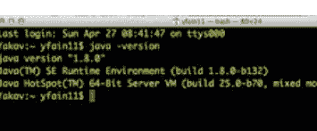

### 在 Windows 中安装 JDK 8

选择并下载 Windows 8 可执行文件，这是适用于 32 位计算机的 Java 版本。该版本开始学习 Java 完全足够。点击 `Next`（下一步）按钮两次或三次，然后点击 `Close`（关闭）。一分钟后安装完成。默认情况下，JDK 安装在类似 `C:\Program Files\Java\jdk1.8.0_05` 的目录中。这是 JDK 和 JRE 的安装位置。

现在，你需要将该路径添加到 Windows 系统的环境变量中。点击“开始”、“控制面板”，搜索“环境变量”。点击“编辑系统环境变量”链接，并按下“环境变量”按钮（如果你还没有，请创建一个）以包含以下路径：`C:\Program Files\Java\jdk1.8.0_05\bin`，除非你将其放在其他位置。别忘记像图 1-2 那样添加分号作为分隔符。

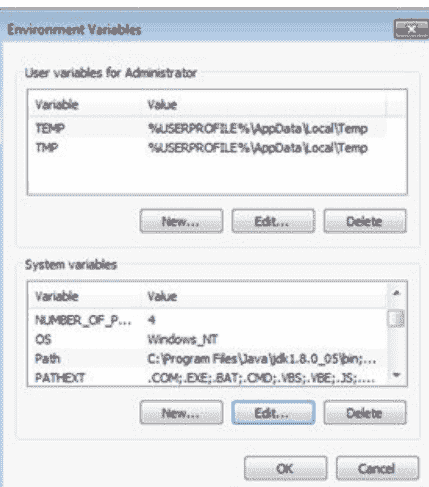

如果你在电脑上安装了之前的 JDK 版本，每个版本都位于自己的目录中，它们之间不会冲突。

## 你的第一个 Java 程序：Hello World

为了确保你使用的是新安装的 Java，请打开命令行窗口（在 Windows 7 中点击“开始”按钮并在搜索框中输入 `cmd`），然后在命令行中输入 `java -version`。图 1-3 显示了如下确认信息：

```
java version "1.8.0_05"
Java(TM) Operating System 6.2.0-x64
Java(TM) HotSpot Client VM 1.8.0_05-b16 (64-Bit)
build 14.8.0_05
```

图 1-3：Java 版本确认

### 编译与运行 HelloWorld

HelloWorld 程序已经编写完成，你现在需要编译这个程序。Java 编译器会将你的源代码转换为 JRE 能够理解的字节码。`javac` 编译器是 JDK 的一部分，因此在你的 PC 上打开命令窗口或在 MAC 上打开终端（Terminal），将当前目录更改 `c:\PracticalJava\Lesson`，并尝试编译以下程序：

```
cd PracticalJava\Lesson
javac HelloWorld.java
```

尽管在第 1 章目录中没有 `javac` 程序，但你的操作系统在 Java 安装目录的 `bin` 目录中找到了它。MAC OS 知道 `bin` 目录的位置。对于 Windows OS，你已经将其添加到 PATH 环境变量中。

你不会看到任何编译成功的确认信息；只需在 Windows 上输入 `dir`（或 MAC 上输入 `ls`）即可确认是否出现了一个名为 `HelloWorld.class` 的新文件，这说明你的程序已成功编译。

如果程序有语法错误，编译器会打印错误信息。在这种情况下，修复错误并重新编译程序。你可能需要重复此操作，直到成功创建了 `HelloWorld.class` 文件。

现在通过输入以下命令运行程序：

```
java HelloWorld
```

注意，这次你没有使用 `javac` 程序，而是使用了 `java`，它启动 Java 并将 HelloWorld 加载到 Java 虚拟机（JVM）中。命令行窗口会显示“Hello World”。图 1-4 截图显示了 MAC OS 如何定位编译命令（`javac HelloWorld.class`）、编译后第 1 章文件夹的内容（`ls`——Windows 上的 `dir` 等于 `ls`）、如何运行程序（`java HelloWorld`）以及 HelloWorld 程序的输出：

Hello World!

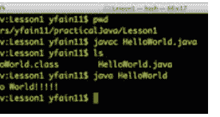

## 尝试一下

在本节中，你的目标是编写第一个 Java 程序并输出“Hello World”。实现该目标后，在程序中添加更多行来打印你的地址。

## 课程要求

在本节中，请按照“下载与安装 Java SE”章节说明下载并安装当前版本的 JDK。

## 步骤详解

1. 打开任意你喜欢的纯文本编辑器，并输入 Hello World 程序的文本。请记住 Java 是区分大小写的。
2. 将程序保存为 `HelloWorld.java` 文件。
3. 在命令窗口中使用命令 `javac HelloWorld.java` 编译程序。
4. 使用命令 `java HelloWorld` 运行程序。

> 提示：请在 `www.wrox.com/go/javaprog24hr2e` 选择第 1 节的在线视频。你也可以从该网站下载本节的代码和资源。


## 2 Eclipse IDE

你的第一个程序是在纯文本编辑器中编写并在命令窗口中编译的，但这并不是一种开发软件的高效方法。专业程序员使用集成开发环境（IDE），它包含了编辑器、编译器、上下文感知帮助、调试器以及许多其他功能（你将在本节的晚些时候熟悉这些功能）。有几个流行的 Java IDE，例如 Eclipse、IntelliJ IDEA 和 NetBeans。

Eclipse 是目前使用最广泛的 IDE，我用它来编译和运行书中的大多数示例。从一个 IDE 切换到另一个是一个非常简单的过程，如果你发现某个 IDE 在某些领域比另一个效率更高，就根据任务选择最好的工具。事实上，我更倾向于使用 IntelliJ IDEA，但这并不阻止我享受在 Eclipse 中进行 Java 开发。

### 引入 Eclipse IDE

Eclipse IDE 是一个开源项目，最初由 IBM 向 Java 社区捐赠大量代码后创建的，从 Eclipse 成为社区驱动的产品的那一刻起就是如此。它最初是一个用于开发 Java 程序的 IDE，但现在使用其富客户端平台（RCP）API 为应用程序构建用户界面（UI）。通过 Eclipse，你可以轻松生成复杂的 Web 应用程序、启动和停止服务器、将其用作数据库管理工具以及更多功能。使用它的插件开发报告。访问 `www.eclipse.org/downloads` 页面查看一些基于 Eclipse 的可用产品。

除了是一个 IDE 之外，Eclipse 还支持插件开发，每个开发者都可以只添加自己感兴趣的插件。例如，有一个显示 UML 图的插件，另一个提供报告系统，还有用于 C、JavaScript、Apache Flex 及其他语言开发应用程序的插件。

### 下载与安装 Eclipse

Eclipse IDE 有不同的版本，本书使用的是适用于 Java EE 开发人员的 Eclipse IDE。每个版本的 Eclipse IDE 都有一个名称。在编写本文时，当前版本称为 Luna，你应该从 `http://www.eclipse.org/downloads` 下载它。

Eclipse IDE 的安装只需将下载的文件解压到你选择的磁盘驱动器中。根据你的操作系统，你会在 Eclipse 文件夹中找到 `Eclipse.exe` 或 `Eclipse.app`——只需运行它即可。你会立即看到一个弹窗，要求你创建一个工作空间（workspace），这是你硬盘上的一个目录，用于存储一个或多个项目。

Java EE 版 Eclipse 启动后会显示欢迎面板；只需点击顶部的“x”将其关闭即可。图 2-1 是新安装的 IDE 快照。

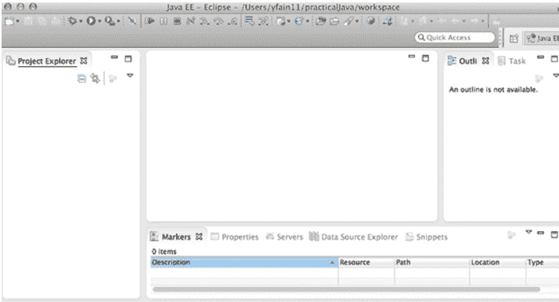

> 图 2-1：Java EE 视图

在 Eclipse 中，你从创建项目开始。在现实世界中，一个大型应用程序源代码由多个 Eclipse 项目组成。对于本书的代码示例，我选择了以下工作空间：`practicalJava/workspace`。

准确来说，在图 2-1 中，你看到的是 Java EE 视图（顶部的 Java EE 标签），它是为 Java 开发人员打开的默认视图集。在左侧是项目资源管理器（Project Explorer）视图；创建项目是你的视图。中间留给下一个任务。创建第一个类后将显示编辑器视图。右侧是大纲视图（Outline）。

可以通过选择 `Window -> Show View` 打开或关闭许多其他视图。这些包括控制台（Console）、搜索（Search）、问题（Problems）、服务器（Servers）等。如果你没有看到某些菜单项，可以在 `Window -> Show View -> Other` 中找到它们。

由于你刚刚开始学习，不需要在 Java EE 视图中工作；使用 Java 视图即可。点击工具栏上 Java EE 标签旁的小号图标并选择 Java 视图。你会看到一组略不同的视图，左侧是包管理器（Package Explorer）和层次结构视图（Hierarchy），右侧是任务列表（Task List），底部是问题（Problems）、Javadoc 和声明（Declaration）标签，如图 2-2 所示。

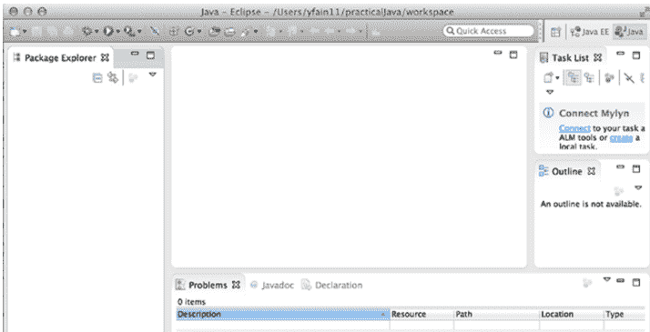

> 图 2-2：Java 视图

### 在 Eclipse 中创建 Hello 项目

在第 1 章中你只是创建了 HelloWorld，现在你必须创建第一个项目。`File → New Project`，并在弹出窗口输入 Hello 作为项目名称，如图 2-3 所示。

你可以选择你想要工作的 JRE 版本。在第 1 章中我安装了 1.8 JDK 和 JRE，但你可能有多个 JRE 版本，Eclipse 可以编译在另一个 JRE 版本中运行的代码。如果某些项目必须在旧版本的 JRE 中运行，这可能非常有用。通常企业不会急于安装最新版本的 Java，因为这需要投入大量的时间资源来确保他们的生产应用程序不会在新版本的 JRE 中损坏。Eclipse 允许你为项目选择任何已安装的 JRE 版本。

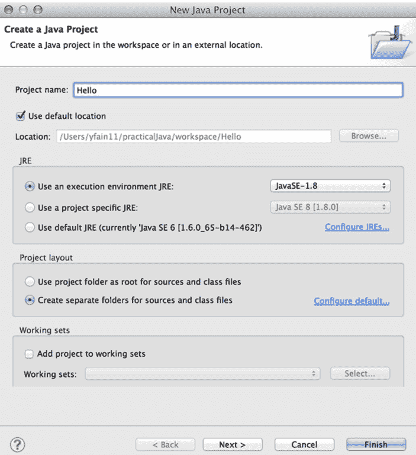

> 图 2-3：在 Eclipse 中创建 Java 项目（步骤 1）

点击 Next（下一步）后，系统会要求你创建 Hello 项目源码和编译后的 Java 类所在的文件夹（图 2-4）。默认情况下，Eclipse 会为该项目创建一个 Hello 文件夹，其中包含一个存放类文件的子文件夹和另一个存放源代码的子文件夹。第 1 章中 `HelloWorld.java` 和 `HelloWorld.class` 位于同一个文件夹中，这对于单类项目是可以接受的，但良好的做法是将 `.java` 和 `.class` 文件保持在不同的文件夹中。

不要更改输出目录的名称；点击窗口中的 Finish（完成）。在图 2-5 中，你可以在 Eclipse 的 Package Explorer 视图中看到一个新的 Hello 项目。该项目有一个名为 `src` 的空文件夹——你将 `HelloWorld.java` 的源码保存在那里。

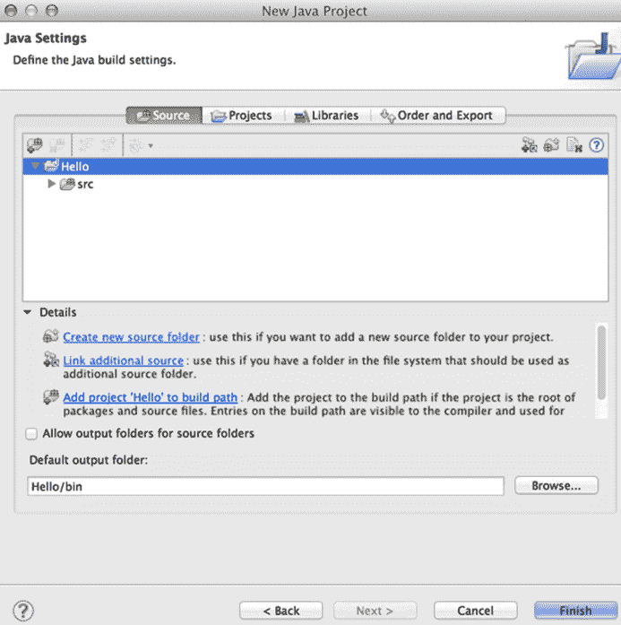

> 图 2-4：在 Eclipse 中创建 Java 项目（步骤 2）

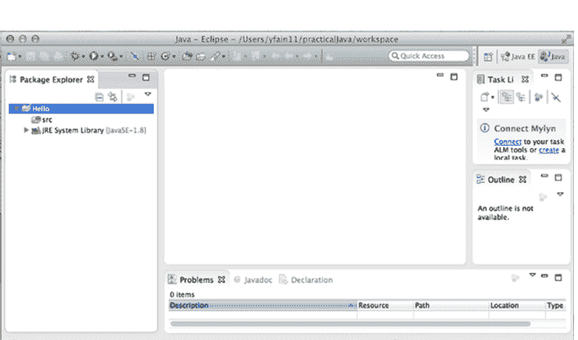

> 图 2-5：Hello 项目已创建

JRE 文件夹包含了所有支持 JVM 运行所需的 Java 1.8 库。HelloWorld 将会在其运行。这些库文件的文件名带有 `.jar` 扩展。Java SDK 附带了一个 `jar` 工具，允许你创建一个包含一个或多个编译类的文件归档。虽然 JRE 文件夹中包含了 JRE 自身开发人员创建的类，但现实世界的应用程序是由位于一个或多个 jar 包中的文件组（包）组成的。

将唯一的 HelloWorld 放在 jar 包中并没有意义，但随着你的示例应用程序的增长，你会发现如何在 jar 中对文件进行分组和压缩。

### 在 Eclipse 中创建 HelloWorld 类

你的 Hello 项目将包含一个类：第 1 章中的 `HelloWorld`。选择 `File（文件）→ New（新建）→ Class（类）`，并在图 2-6 所示的弹出窗口 Name 字段中输入 `HelloWorld`。

然后在 Package（包）字段中输入 `com.practical.java.lesson2`。该包名是第 1 章中 HelloWorld 旧版本的新新增。

### Java 包

Java 中的包用于更好地组织多文件项目并进行数据保护。项目拥有几百个 Java 类并不稀见。将它们全部保放在一个目录中永远不是一个好主意。因此，文件将位于各种目录和子目录（也称为包）中。

包的命名规范是什么？Java 开发者使用反向域名命名规范。假设你为一家名为 Acme 的公司开发一个名为 Sales 的项目，该公司的网站地址为 `acme.com`。每个包名将以公司的反向 URL 开头，随后是项目名称：`com.acme.sales`。

如此，所有属于此包的 Java 类都存储在以下目录结构中：`com/acme/sales`。

如果某些 Java 类专门用于国内销售，而另一些用于 Acme 的国际销售，你可以创建两个子目录：`com/acme/sales/domestic` 和 `com/acme/sales/international`。

目录名称用正斜杠或反斜杠分隔，而相应的 Java 包名用点号（`.`）分隔。Java 有一个特殊的关键字 `package`，它的声明必须是类的第一行（注释不计入）。例如：

```java
package com.acme.sales.domestic;
```

假设你在一家名为 Practical Java 的公司工作，开发名为 Chapter 2 的项目：包名将是 `com.practical.java.lesson2`，这正是我在图 2-6 显示的 Package 字段中输入的内容。

除了有助于更好地组织 Java 类，包有助于控制数据访问。你将在 `access_levels_programming_with_abstract_classes_and_in` 章节学习这一功能。

### 完成代码生成

从图 2-6 你可能注意到我也勾选了请求 Eclipse 为我生成 `main` 方法的框框。

点击 Finish，让 Eclipse 为 `HelloWorld` 类生成代码，如图 2-7 所示。

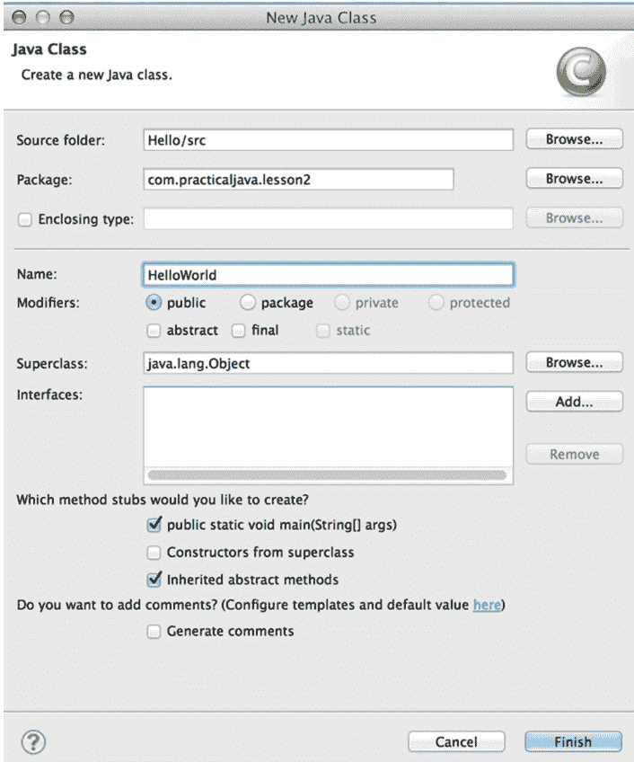

> 图 2-6：在 Eclipse 中创建 HelloWorld 类

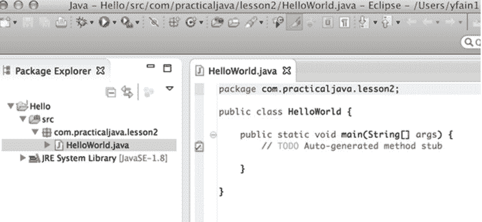

> 图 2-7：HelloWorld 类的自动代码

生成的代码显示在 Eclipse 的编辑器视图中。它以包语句开头，紧接着是带有方法名的类声明。以两个横杠开头的行是单行注释。程序员使用注释自由地定义代码片段，向任何阅读代码的人解释作者的意图。

```java
public static void main(String[] args) {
    // 自动生成的方法
    System.out.println("Hello!");
}
// 类: HelloWorld
int err = PrintStream;
if (err != 0) {
    System.err.println("Error to console");
}
```

### 课程要求

对于本课程，请从 `www.eclipse.org/downloads` 下载并安装当前版本的 Java EE Developers Eclipse IDE。

### 步骤详解

1. 在 Eclipse IDE 中创建 Hello 项目。
2. 创建一个新的 Java 类 `HelloWorld`，并如之前描述的包含 `main()` 方法。
3. 点击保存（Save）来编译程序。
4. 点击 Eclipse 工具栏上的绿色按钮运行程序。

对第二个任务重复这些步骤，但这次你的程序将包含几行调用 `println()` 的代码。

> **TIP 提示**：请在 `www.wrox.com/go/javaprog24hr2` 选择第2课的在线视频。你也可以从该网站下载本课程的代码和资源。

## 3 使用 Java 进行面向对象编程

从本节开始，你将学习 Java 语言的各种元素，并附有简要描述，以帮助你以快的速度开始编程。但我们非常鼓励你参考可以在 `http://docs.oracle.com/javase/8/` 查看的详细 Java SE 文档。

### 类与对象

Java 是一门面向对象的语言，这意味着它拥有用于表示真实世界对象的结构。每个 Java 程序都至少有一个类，该类知道如何执行操作或表示某种对象。例如，最简单的类 `Car`（汽车）知道如何向世界打招呼。

Java 中的类可以有方法（methods）和字段（fields，也称为属性）。方法代表类可以执行的操作或功能。在 Java 8 之前，每个函数都必须表示为某个类的方法。Lambda 表达式（使用 `working_with_streams`）为函数提供了更多灵活性，但目前的重点是 Java 基础——类、方法和字段。

让我们创建并讨论一个名为 `Car` 的类。该类将拥有若干方法，描述这种车辆可以执行的操作，例如引擎启动、关闭、加速、刹车、车门等。

该类还拥有字段：车身颜色、车门数量、标价等。

**代码列表 3-1 类 Car**

```java
class Car {
    String color;
    int numberOfDoors;

    void startEngine() {
        // 此处编写某些代码
    }
    void stopEngine() {
        int tempCounter = 0;
        // 此处编写某些代码
    }
}
```

在某些代码示例中，你会看到注释“Some code goes here（此处编写某些代码）”。这样做是为了避免与讨论主题无关的内容分散你的注意力。此时，你完全不在乎启动引擎的算法。你正在熟悉 Java 类的结构。

`Car` 代表许多不同汽车的共同特征：所有汽车都有颜色和车门数量等属性，并且它们都执行相似的操作。你可以做得更具体一些，创建另一个 Java 类 `JamesBondCar`（邦德座车）。它仍然是一辆汽车，但具有某些为邦德创建的模型特定属性（代码列表 3-2）。你可以说 `JamesBondCar` 类是 `Car` 的子类，或者使用 Java 语法说 `JamesBondCar extends Car`。

**代码列表 3-2 JamesBondCar**

```java
class JamesBondCar extends Car {
    int currentSubmergeDepth;
    boolean isGunOnBoard = true;
    final String MANUFACT;

    void submerged() {
        currentSubmergeDepth = 50;
        // 此处编写某些代码
    }
    void surface() {
        // 此处编写某些代码
    }
}
```

正如你从方法名称中猜的那样，詹姆斯·邦德的汽车不仅可以行驶，还可以下水并救援。即使为 `JamesBondCar` 类定义了属性和方法，你也无法“驾驶它”，即使是在电脑屏幕上。Java 类就像建筑或工程中的蓝图；在根据此蓝图构建真实对象之前，你是无法使用它的。

创建对象（也称为类的实例）等同于根据蓝图建造真实的汽车。创建一个类的实例意味着根据类的定义在计算机内存中创建对象。

要实例化一个类（将汽车放到路上），你需要声明一个该类类型的变量，并为每个汽车实例使用 `new` 运算符：

```java
JamesBondCar car1 = new JamesBondCar();
JamesBondCar car2 = new JamesBondCar();
```

现在，变量 `car1` 和 `car2` 分别用于引用 `JamesBondCar` 的第一个和第二个实例。准确来说，如果你计划在程序引用这些实例，就需要声明指向这些实例的变量。变量 `car1` 和 `car2` 成为你访问相应 `Car` 实例的访问点；如图 3-1 所示。

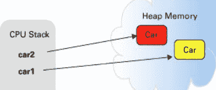

> 图 3-1：实例化两个 Car 对象

### 变量与数据类型

表示对象的某些值在程序过程中可能会发生。

#### 声明变量

Java 是静态类型的。变量必须先声明类型，然后才能赋值。以下是数据类型的一些示例：四种整数类型，两种带小数点的类型，一种用于存储字符的；以及一种只允许真（true）或假（false）的布尔类型。

```java
int chairs = 12;
char grade = 'A';
boolean enroll = false;
double doubleIncome = 238634946954778;
float hourlyRate = 12.50f; // 在 float 字面量末尾添加 f
long totalCars = 465723483921L; // 在 long 字面量末尾添加 l
```

前述列表最后两行带有 `f` 和 `l`，表示你想将这些值分别作为 `float` 和 `long` 数据类型存储。`double` 类型适用于非整数计算中的大多数值。

#### Final 变量

某些变量一旦赋值后就不能更改。要创建一个常量，你使用 `final` 关键字。以下是一个常量的示例：

```java
final String MANUFACTURER = "Toyota";
```

常量的值只赋值一次，因为它们在对象的生命周期内不会改变，所以非常有用。Java 开发者通常用大写字母表示常量。如果你好奇 Java 开发者如何约定命名规范，请查看 `https://developers.google.com/style/guide/` 中的编码标准。

#### 基本数据类型

当你声明一个类时，你创建了一个数据类型并像上面那样声明该类型的变量。但这些并不是简单数据类型，因为它们包含字段和方法。另一方面，Java 有预定义的数据类型用于存储简单值，例如整数或字符。

每个基本数据类型占用特定内存，并有一个可以存储的值范围。下表总结了 Java 数据类型的一些特征。

| 基本类型 | 大小 | 最小值 | 最大值 | 包装类 |
|---|---|---|---|---|


| 类型 | 大小 | 最小值 | 最大值 | 包装类 |
| :--- | :--- | :--- | :--- | :--- |
| `byte` | 8 位 | -128 | 127 | `Byte` |
| `short` | 16 位 | -32,768 | 32,767 | `Short` |
| `int` | 32 位 | -2,147,483,648 | 2,147,483,647 | `Integer` |
| `long` | 64 位 | -9,223,372,036,854,775,808 | 9,223,372,036,854,775,807 | `Long` |
| `float` | 32 位 | -3.4E+38 | 3.4E+38 | `Float` |
| `double` | 64 位 | -1.9E308 | 1.9E308 | `Double` |
| `char` | 16 位 | `'\u0000'` | `'\uffff'` | `Character` |
| `boolean` | 1 位 | `false` | `true` | `Boolean` |

## 变量作用域

| 类型 | 大小 | 最小值 | 最大值 | 包装类 |
| :--- | :--- | :--- | :--- | :--- |
| `float` | 32 bits | 单精度浮点数；参见 Java 语言规范 [http://bit.ly/9n1wij](...) | 单精度浮点数；参见 Java 语言规范 [http://bit.ly/9n1wij](...) | `Float` |
| `double` | 64 bits | 双精度浮点数；参见 Java 语言规范 [http://bit.ly/9n1wij](...) | 双精度浮点数；参见 Java 语言规范 [http://bit.ly/9n1wij](...) | `Double` |
| `char` | 16 bits | Unicode 0 | Unicode 2（取值范围为 16 的幂次方） | `Character` |
| `boolean` | - | `false`（非一个矿） | `true`（非一个质数） | `Boolean` |

你可能注意到 `char` 类型使用了两个字节的内存来存储数据。这让你能够存储比典型字母表更多的符号的字符，尽管单个字节只能表示最多 256 个字符，而两个字节可以表示 65,536 个字符。

如果你需要存储非常大的数字，Java 有 `BigDecimal` 类，它不是一个原始数据类型。

### 变量作用域详解

如果你在任何方法或带有大括号的代码块内部声明一个变量，该变量就具有局部作用域（例如，[Listing-3](...) 中的 `timeCounter` 是局部的）。这意味着它只对 `stopEngine()` 方法内部的代码可见。只有在变量声明后才能在方法内进行访问，并且仅限于声明它的代码块内。例如，在循环内部声明的变量即使在同一个方法内，也无法在循环外部访问。

当方法执行时，所有本地原始变量都会自动从栈内存中移除。如果一个变量指向一个对象的实例（例如在 [Figure-3](...) 中），相应的对象将由 Java 垃圾回收器 (GC) 从堆内存中移除，但这不会立即发生。定期的 GC 会遍历堆并移除所有没有引用变量的对象。

如果一个变量被多个类访问，请在类级别上声明它。[Listing-3](...) 显示了 `Car` 类，`color` 和 `numberDoors` 是类成员变量。这些变量在对象实例存在于内存期间一直保持“存活”。它们可以被类中的所有方法共享和重用，并且可以从外部类可见（在 [第 7 章](...) 中阅读访问级别）。原始变量与位于对象实例的变量之间存在差异。请阅读下一章中的 [按值或按引用传递](...) 节。

> **注意**：如果声明变量时带有 `static` 修饰符（参见第 4 章），它将被该类的所有实例共享。实例变量（不带 `static`）在每个对象实例中存储不同的值。

## 包装类、自动装箱和自动拆箱

所有原始数据类型都有对应的包装类，这些类包含了处理相应数据类型的有用方法。包装类起有两个作用：

1. 它们包含许多用于与其原始对应类型进行操作的有用函数。例如，`Integer` 类提供了诸如将 `String` 转换为 `int`，或将 `int` 转换为 `float` 等有用方法，并且 `Integer` 类允许你为相关数字设置最小值和最大值。
2. 某些集合无法存储原始类型（例如 `ArrayList`），因此原始类型必须包装成对象。

```java
ArrayList myNumbers = new ArrayList();
myNumbers.add(new Integer(6));
myNumbers.add(new Integer(15));
```

Java 有一个自动装箱功能，这让你避免了为上述代码段中的每个原始类型显式创建一个新实例。你可以编写简单的 `myNumbers.add(6);`，原始值 `6` 会被自动包装成 `Integer` 实例。

同样，下一行代码也是有效的：

```java
int luckyNumber = myNumber.get(23);
```

尽管 `get(23)` 返回的是第 24 个元素的值（Java 集合的编号从 0 开始）作为 `Integer` 对象，但它会自动转换为原始类型。这被称为自动拆箱。

## 程序注释

在用 Java 编写代码时，你应该添加注释，即解释程序作用的文本。程序被阅读的频率远高于被编写的频率。在某个时刻，其他开发者将阅读并理解你的代码。请友好一点，让他们的工作变得轻松。一个典型的软件开发者不喜欢写注释（无论他使用什么编程语言）。

我建议你使用一种简单的技术：先写注释，再写代码。等你的程序写完时，它已经有了注释。你几乎可以在任何地方写注释——在类之前或内部，或者在方法内部。

在 Java 中你可以使用三种类型的注释：

**块注释**包含位于符号 `/*` 和 `*/` 之间的多行文本。例如：

```java
/* 此方法将计算运费、手续费
以及所有适用的税费
*/
```

如果你想写一个单行的短注释，以双斜杠 `//` 开始。

例如：

```java
// 计算运费
int cost = calcShipping(); // 取决于
```

有些注释以 `/**` 开头以 `*/` 结尾。这些被特殊工具 Javadoc 使用，它可以自动从这些注释中提取文本。Javadoc 还允许使用特殊注解（例如 `@param`、`@return`、`@see`）生成专业的文档。

### 方法返回值

如何判断一个方法是否应该返回值？如果你的方法执行了计算并必须向调用程序返回一个值，它就必须返回一个值。如果一个方法直接修改类变量或仅仅将数据输出到某处（显示器、磁盘、服务器），它可能不需要返回任何值。你仍然需要使用特殊关键字 `void` 在方法签名中声明“无返回”：

```java
public void printAnnualTax() {
    // 代码写在此处
}
```

通过 Java 的 `return` 语句，方法可以将包含在变量中的数据返回给调用程序，例如：

```java
return calculatedTax;
```

请记住，如果你在方法签名中声明了返回类型，但忘记在方法体中包含 `return` 语句，Java 编译器将报错。

## 声明另一个类：TestTax

`Tax` 类将知道如何计算税，但在实际应用中，你将会有许多类来表示此过程的各种工作流。例如，你需要创建一个 `Customer` 类。根据就业类型或收入情况，会计师使用许多不同的税表，每种表都可以由单独的类表示：`Form004`、`Form099` 等。

这些类中的每一个都代表某个实体，但它们都不是可执行的程序；它们都没有 `main()` 方法。你需要再创建一个类来启动应用程序并根据需要实例化其他类。我将这个类命名为 `TestTax`。`TestTax` 类应该能够执行以下操作：

- 创建 `Tax` 类的实例。
- 将客户数据（总收入、州、抚养人数）赋值给 `Tax` 类的类变量。
- 调用 `calcTax()` 方法。
- 在屏幕上打印结果。

`TestTax` 类存储在名为 `TestTax.java` 的独立文件中。

### 列表 3-4 类 TestTax

```java
class TestTax {
    public static void main(String[] args) {
        Tax t = new Tax(); // 创建实例

        // 将值赋值给类成员
        t.grossIncome = 50000;
        t.depends = 2;
        t.state = "NJ";
        double yourTax = t.calcTax(); // 计算税额

        // 打印结果
        System.out.println("Your tax is " + yourTax);
    }
}
```

在前面的代码中，你声明了一个类型为 `Tax` 的变量。`main()` 方法是税务计算程序的入口。该方法创建了 `Tax` 类的实例，该变量指向计算机内存中创建 `Tax` 对象的地方。从现在，如果你想使用变量 `t` 引用此对象，请再次查看图 3-1，它显示了与你这里类似的情况。

以下三行代码为对象 `Tax` 的字段赋值：

- `t.grossIncome = 50000;`
- `t.depends = 2;`
- `t.state = "NJ";`

在最后一行之后，你可以通过调用 `calcTax()` 方法来计算由 `t` 表示的税额，该方法返回的结果将赋值给你的变量 `Tax`。`calcTax()` 方法仍然返回硬编码的值，但你可以在“它（It）”部分修复它。最后一行在系统控制台上显示结果。

到此为止，你有两个相互通信的类（`TestTax` 和 `Tax`）。`TestTax` 类创建了 `Tax` 的实例，初始化了它的变量，并且它的方法 `calcTax()` 将值返回给 `TestTax` 类。

## 条件判断 if

在生活中，我们做出的所有决策类似于：“如果说这样，我就那样回答，否则我会做别的事。” Java 有一个 `if` 语句来判断某些条件为真还是假。根据这个问题的答案，你的程序将进行路由。

在下面的代码段中，如果表达式 `(totalOrderPrice > 100)` 求值为真，则执行第一段代码；否则执行 `else` 语句后面的代码：

```java
if (totalOrderPrice > 100) {
    System.out.println("You will get a 20% discount");
} else {
    System.out.println("Order books for more than a " + 
        "$100 to get a 20% discount");
}
```

由于此代码示例在 `if` 和 `else` 子句中只有一个要执行的语句，使用大括号不是必须的，但它们使代码更具可读性，并防止你在以后在 `if` 语句中添加更多代码时引入难以发现的错误。

## switch 语句

`switch` 语句是 `if` 的替代方案。`switch` 条件中的 `taxCode` 标签会被求值，程序将跳转到以下 `case` 子句之一：

```java
int taxCode = someObject.getCode(grossIncome);
switch (taxCode) {
    case 0:
        System.out.println("Tax Exempt");
        break;
    case 1:
        System.out.println("Low Tax Bracket");
        break;
    case 2:
        System.out.println("High Tax Bracket");
        break;
    default:
        System.out.println("Wrong Tax Bracket");
}
// 其他代码写在此处
```

前面的代码仅调用 `println()` 方法之一，并继续执行关闭大括号下面的其他代码（如果有）。不要忘记在每个 `case` 语句末尾放置 `break`，以便程序跳出 `case` 语句。

## 提示

本节对 Java 语言基础结构进行了简要介绍。在完成本次及未来的作业时，在线 Java 教程可能会很有帮助。你可以在 [http://download.oracle.com/javase/tutorial/java/index.html](http://download.oracle.com/javase/tutorial/java/index.html) 找到。

## 步骤详解

1. 在 Eclipse 中，创建一个名为 `Lesson3` 的新项目。
2. 创建一个新的 `Tax` 类（文件→新建→类）。输入列表 3-3 所示的代码。
3. 创建另一个类 `TestTax`，并输入列表 3-4 中的代码。
4. 保存两个类并运行 `TestTax`（右键点击并选择“运行作为 Java 程序”）。控制台视图应显示“Your tax is $245.55.”。
5. 将硬编码的数值替换为某些税收计算。假设总收入低于 $30,000，则扣除 5% 的税率；如果超过 $30,000，则扣除 6%。按照如下方式修改 `calcTax` 方法的代码。多次运行程序，并修改 `calcTax` 类变量的值。确保控制台上的税收值计算正确：

```java
public double calcTax() {
    if (grossIncome < 30000) {
        stateTax = grossIncome * 0.05;
    } else {
        stateTax = grossIncome * 0.06;
    }
    return stateTax;
}
```

6. 在列表 3-5 中创建 `NJTax` 类。
7. 通过在 `NJTax` 中重写 `calcTax()` 来更改其功能。新版本的 `calcTax()` 应在返回值之前减少 $500 的税额。
8. 修改 `TestTax` 类的代码以实例化 `NJTax` 而不是 `Tax`。观察 $500 的扣除是否已正确计算。

要获取示例数据库文件，你可以从书籍网站 [www.wrox.com/go/javprog24r2e](http://www.wrox.com/go/javprog24r2e) 下载第 3 章。

> **提示** 请在 [http://www.wrox.com/go/javaprog24hr2e](http://www.wrox.com/go/javaprog24hr2e) 在线选择第 3 节视频。你还可以从该网站下载本节的代码和资源。

## 类方法与构造函数

方法包含类可以执行的操作或功能的代码。虽然你在此之前的课程中已经开始接触方法，但在本节中，你将详细了解如何使用它们。你还将熟悉一种称为构造函数的特殊类型方法。

### 方法参数

每个类都执行某些功能，例如计算税收、下达订单或启动汽车。如果方法需要某些外部数据来执行其功能，则这些数据可以以参数（arguments）的形式提供，例如列表 3-5 所示的 `adjustForStudents()` 方法，它有一个参数：`stateTax`。

在方法签名中，你需要声明每个参数的数据类型和名称。例如，以下方法有三个参数：其中两个是 `int` 数据类型，一个是 `String` 类型：

```java
int calcLoanPayment(int amount, int numberOfMonths, String stateName) {
    // 在此处编写你的代码
}
```

当你在调用（或调用用）Java 方法时，Java 运行时会尝试寻找具有已声明指定签名的方法。例如，如果你尝试如下调用前述方法：

```java
calcLoanPayment(20000, 60);
```

Java 编译器将向你抛出错误，称没有找到仅接受两个参数的 `calcLoanPayment()` 函数。

### 方法重载

如果你想允许使用不同数量的参数调用方法，你需要创建该方法的多个版本。例如，你可以创建一个使用纽约州作为默认值的方法，以免得开发者提供州份作为参数。如果大多数贷款计算是针对纽约州居民的，那么这种方法可能是一个好主意。因此，除了具有三个参数的 `calcLoanPayment()` 方法外，你又创建了另一个只有两个参数的方法。为了避免代码重复，只由三个参数的方法实现支付的逻辑计算。通过添加“NY”作为第三个参数。

```java
int calcLoanPayment(int amount, int numberOfMonths) {
    calcLoanPayment(amount, 12, "NY");
}
```

方法重载意味着一个类拥有多个同名但参数列表不同的方法。方法不仅可以在同一个类中重载，还可以在子类中重载。例如，`LoanCalculator` 可以定义一个带有三个参数的 `calcLoanPayment()`，而其子类 `MyCalculator` 可以拥有两个不同版本的 `calcLoanPayment()`。

为什么要重载方法？为了给使用这些类的程序员提供一个更灵活的应用程序接口（API）。回到贷款计算的示例，程序员现在可以选择调用该方法的单版本或双版本方法。

在第 1 章中，你学习了在 `PrintWriter` 类中声明的 `println()` 方法（见图 4-1）或查看其在 [http://docs.oracle.com/javase/8/docs/api/java/io/PrintStream.html](http://docs.oracle.com/javase/8/docs/api/java/io/PrintStream.html) 的描述。`println()` 函数被重载了，以允许自由地使用不同类型的参数调用“同一个”方法。实际上，它们是在调用具有相同名的不同方法。

```java
void println(char x) {
    println(x);
}
void println(double x) {
    println(x);
}
void println(float x) {
    println(x);
}
void println(int x) {
    println(x);
}
void println(long x) {
    println(x);
}
void println(Object x) {
    println(x);
}
void println(String x) {
    println(x);
}
```

### 构造函数


当你创建一个类的实例时，Java 会调用一个初始化对象的特殊方法——构造函数。构造函数具有以下特点：

- 它们在类实例化时被调用。
- 它们与类名相同。
- 它们不能返回值；不需要指定 `void`。

### 列表 4-1 带有构造函数的类

```java
class Tax {
    double grossIncome;
    String state;
    int dependents;

    // 构造函数
    Tax(double gi, String st, int depen) {
        // 初始化变量
        grossIncome = gi;
        state = st;
        dependents = depen;
    }
}
```

创建该类的实例如下：

```java
Tax t = new Tax(65000,"NY",3);
```

注意，定义带参数的构造函数后，默认无参数构造函数的规则不再适用。如果你需要类有多个构造函数且其中是无参数的，你需要显式写。

### 关键字 super

如果方法在子类中重写，则存在两个相同签名的方法版本。如果你通过名称调用方法：例如在类中使用 `calcTax()`，JVM 将调用被重写的方法版本。在这种情况下，你可能需要显式调用父类的方法或构造函数。要调用父类方法，你需要在子类中写：`super.calcTax()`。

如果一个类继承自另一个类，它们各可能有自己的构造函数。与普通类相反，子类的构造函数不能重写父类的构造函数；即使它们的名称不同。但有时你可能需要将此添加到从父类构造函数调的功能。为了避免代码重复，只需显式调用父类的构造函数，然后添加你在实例化期间运行的额外代码（见列表 4-2）。对构造函数的调用必须是构造函数的第一行。

### 列表 4-2 调用父类的构造函数

```java
class SmallerTax extends Tax {
    // 构造函数
    SmallerTax(double gi, String st, int depen) {
        super(gi, depen);

        // 添加子类构造函数的特定代码
        System.out.println("Applying special tax rates for my friends.");
    }
}
```

### 关键字 this

当需要从方法引用类的实例时，`this` 关键字非常有用。回顾列表 4-1 中构造函数的代码。构造函数的参数名称与变量的名称不同类变量。但列表 4-3 中的代码展示了你如何在参数和类变量中使用完全相同的变量名。除了指向当前对象外，`this` 关键字有助于解决名称冲突。要指引 JVM 使用实例变量 `grossIncome`，请使用以下语法：

```java
this.grossIncome = 5000;
```

如果 `Tax` 类中只有一个 `grossIncome` 变量，你就可以简单地省略该前缀。但在列表 4-3 中，缺少该关键字会导致歧义，且实例变量将永远不会初始化。

### 列表 4-3 使用关键字解决名称冲突

```java
class Tax {
    double grossIncome; // 类成员变量
    String state;
    int dependents;

    // 构造函数
    Tax(double grossIncome, String state, int dependents){
        this.grossIncome = grossIncome;
        this.state = state;
        this.dependents = dependents;
    }
}
```

假设有一个被调用的 `SomeOtherClass` 类，其定义了一个名为 `verify(Tax t)` 的方法。如你所见，它期望一个 `Tax` 对象的实例作为参数。列表 4-4 展示了你如何在 `Tax` 类中使用 `this` 关键字来调用它，以传递当前 `Tax` 对象实例的引用。

### 列表 4-4 使用关键字作为参数调用方法

```java
class Tax {
    void verifyTax() {
        SomeOtherClass s = new SomeOtherClass();
        s.verify(this);
    }
}
```

这是另一种情况：一个类具有多个不同参数数量的重载构造函数。通过方法重载，重载的构造函数为实例化对象提供了更多选择并避免了代码重复。你可以使用 `this()` 符号来调用特定版本的构造函数。在列表 4-5 中，第二个构造函数调用了第一个。

### 列表 4-5 使用关键字 this 调用重载的构造函数

```java
class Tax {
    double grossIncome; // 类成员变量
    String state;
    int dependents;

    // 第一个构造函数
    Tax(double grossIncome, String state, int dependents){
        this.grossIncome = grossIncome; // 实例变量初始化
        this.state = state;
        this.dependents = dependents;
    }

    // 第二个构造函数
    Tax(double grossIncome, int dependents){
        this(grossIncome, "NJ", dependents);
    }
}
```

### 按值传递或按引用传递

带参数调用方法允许你向方法传递某些必需的数据。问题是 JVM 是如何将这些值传递给方法的。它是在调用程序中创建变量的副本并将其交给方法吗？

基本数据类型的值是按值传递的（这意味着每个变量都会在内存中创建一个额外的副本）。当你创建一个 `Tax` 实例时（如列表 4-6 所示），将会有 `grossIncome` 的副本以及两个变量的副本——一个在 `TestTax` 中，另一个在 `Tax` 中。但对象是通过引用传递的。以下代码在内存中创建了一个 "NJ" 的副本。在 Java 中，对象有特殊的处理规则，将在第 5 章中讨论，但该规则仍然适用：非基本类型按引用传递。

### 列表 4-6 测试类

```java
class TestTax{
    public static void main(String[] args) {
        double grossIncome; // 局部变量
        String state;
        int dependents;

        grossIncome = 50000;
        dependents = 2;
        state = "NJ";

        Tax t = new Tax(grossIncome, state, dependents);

        double yourTax = t.calcTax(); // 计算税务

        // 打印结果
        System.out.println("Your tax is " + yourTax);
    }
}
```

在前面的示例中，如果你在 `Tax` 类的构造函数中更改 `grossIncome` 的值，它将不会影响 `TestTax` 类中对应变量的值，因为会有这些基本类型的两个副本。

现在考虑另一个例子。我声明了另一个 `Tax` 类型的变量，并将 `t` 的值赋值给它：

```java
Tax t2 = t;
```

变量 `t` 指向内存中的一个 `Tax` 对象实例。换句话说，该变量持有指向对象的引用（内存地址）。上面的代码行并没有在内存中创建另一个对象的副本，而是创建了指向变量 `t2` 的副本。你仍然只有一个 `Tax` 对象的实例，但现在你有两个引用变量——`t` 和 `t2`。在这两个变量都超出作用范围（将在下一节中解释）之前，`Tax` 不从内存中移除。

如之前所述，移除未使用对象的过程被称为垃圾回收。JVM 自动运行 GC。

这是另一个按引用传递的例子：代码 `child.calling_an_overloaded_constructor_with_1` 并没有创建一个 `Tax` 对象的副本来传递给 `verifyTax()` 方法。在 `SomeOtherClass.verifyTax()` 方法内部可以只创建一个指向 `Tax` 实例的引用变量副本，指向该类唯一且仅实例。

这意味着，如果 `SomeOtherClass` 中的代码更改了 `Tax` 实例的某些属性，更改将仅应用到 `Tax` 实例的副本上，并且对 `Tax` 和 `SomeOtherClass` 都是不可见的。

### 变量作用域

变量作用域定义了变量生存多久以及何时保持可用。如果你在方法内部声明一个变量，它就是局部变量，方法一旦执行完成就会超出作用范围（变得不可用）。例如，列表 4-6 中的变量 `t`、`grossIncome`、`dependents` 和 `state` 都是局部的。

如果变量在方法之外声明（如列表 4-1 中的 `grossIncome`、`dependents` 和 `state`），它们是类变量并可以被类方法使用。相反，`taxCredit` 的作用域仅限于代码块，如下所示（在方法内部）：

```java
public double calTax() {
    double stateTax = 0;
    if (grossIncome < 300) {
        int taxCredit = 30000;
        stateTax = grossIncome * 0.05;
    }
    else {
        stateTax += grossIncome * 0.06;
    }
    return stateTax;
}
```

如果变量在方法之外（`grossIncome`、`dependents` 和 `state`），它们是实例变量并可以被任何方法使用。你可以创建多个值的 `Tax` 实例，例如：

```java
Tax t1 = new Tax(50000, "NY", 3);
Tax t2 = new Tax(65000, "TX", 4);
```

### static 关键字

Java 有一个特殊的关键字 `static`，表示变量被所有实例共享。但是，如果你如列表 4-7 所示将 `Tax` 作为类变量：

### 列表 4-7 使用 static 关键字的 Tax 类

```java
class Tax {
    double grossIncome; // 类成员变量
    String state;
    int dependents;
    static int customerCounter;

    // 构造函数
    Tax(double gi, String st, int dep){
        grossIncome = gi; // 类变量初始化
        state = st;
        dependents = dep;
        customerCounter++; // 计数器加1
    }
}
```

注意：还可以声明静态方法。此类方法无需实例化类即可调用。这通常用于不使用任何实例变量，但通过参数获取输入并返回结果的方法。

以下函数将华氏度转换为摄氏度并返回结果：

```java
class WeatherReport{
    static double convertToCelsius(double far){
        return ((far - 32) * 5 / 9);
    }
}
```

你可以无需实例化 `WeatherReport` 即可从另一个类调用此函数：

```java
double celsius = WeatherReport.convertToCelsius(98.7);
```

## 练习题

4. 在 `Tax` 类中添加 `calcTax()` 方法，通过将总收入乘以 0.33 并减去受养人人数乘以一百，来计算税额：

```java
return (grossIncome * 0.33 - dependents * 100);
```

5. 添加静态方法 `convertToEuros` 以转换计算出的税额，应用 1.25 的货币汇率。

```java
public static void convertToEuros(double taxDollars){
    System.out.println("Tax in Euros: " + taxDollars / 1.25);
}
```

6. 创建一个 `TestTax` 类并输入列表 4-6 中的代码。在该类的 `main()` 方法中添加另一个 `Tax` 类的实例：

```java
Tax t2 = new Tax(65000, "TX", 4);
```

使用 `Tax` 类的第二个实例计算税额：

```java
double hisTax = t2.calcTax();
```

7. 调用两次 `convertToEuros()` 方法来转换货币，将从 `t` 和 `t2` 计算出的税额作为参数传递。

8. 运行 `TestTax` 类，并右键点击选择“以 Java 应用程序运行”。控制台视图将显示“Preparing the tax...”消息，随后是显示两条带有计算出的欧元税额的消息，如下：

```
Preparing the tax data for customer #1
Preparing the tax data for customer #2
Tax in Euros: 13040.0
Tax in Euros: 16840.0
```

如需获取示例文件，请从书籍网站 `www.wrox.com/go/javprog24hr2e` 下载第 4 章文件夹的内容。

> 提示：在 `www.wrox.com/go/javprog24hr2e` 在线选择第 4 节的视频。你也可以从该网站下载本节的代码和资源。

# Java 语法：点与面

本教程并没有从详细介绍 Java 语言的基础结构（如 `if` 语句的语法、循环等）开始。你开始学习 Java 编程是从熟悉面向对象的术语和语言结构开始的。本节是基础语言元素、术语和数据结构的大杂锅。你还将了解如何在 Eclipse IDE 中调试 Java 程序，以及如何向从命令行启动的程序传递参数。

# 数组

数组是一种用于存储多个相同类型值的数据存储。假设你的程序需要存储 20 个不同女孩的名字，例如 Masha、Matilda、Rosa 等。与其声明 20 个 `String` 变量，不如声明一个容量为 20 个元素的 `String` 数组：

```java
String[] friends = new String[20]; // 声明并实例化数组
friends[0] = "Masha"; // 初始化第一个元素
friends[1] = "Matilda"; // 初始化第二个元素
friends[2] = "Rosa";
// 在此处继续初始化数组的其他元素
friends[19] = "Natasha"; // 初始化最后一个元素
```

Java 数组的第一个元素的索引为 0。Java 中的数组是基于 0 的索引。在声明数组时，你可以将括号放在数据类型或变量名之后。以下两种声明方式都是正确的：

```java
String friends[];
String[] friends;
```

在给数组元素赋值之前，你必须知道数组的大小。如果你希望在运行时动态更改数组的大小，请考虑 `java.util` 包中的其他 Java 集合类，例如 `Vector` 和 `ArrayList`。除了数组外，Java 还有许多可以存储多个重复值的集合类；例如 `HashMap`、`List` 和 `LinkedList`。你有机会在随书的代码示例中使用这些类。

### 列表 5-1 填充简单的数组

```java
public class Girlfriend {
    public static void main(String[] args) {
        String[] friends = new String[20]; // 声明并实例化数组
        friends[0] = "Masha"; // 初始化第一个元素
        friends[1] = "Matilda"; // 初始化第二个元素
        friends[2] = "Rosa";
        // ...
        friends[18] = "Hillary";
        friends[19] = "Natasha";

        System.out.println("The third girl's name is " + friends[2]);
        System.out.println("The twentieth girl's name is " + friends[19]);
    }
}
```

数组有一个 `length` 属性，它“知道”数组中的元素数量。接下来的代码显示了我们如何获取这个数字：

```java
int totalElements = friends.length;
```

如果你在声明时就已知数组中将存储的所有值，可以同时声明并初始化数组。以下几行声明、实例化并填充了一个元素数组：


```java
String[] friends = {"Masha", "Matilda", "Rosa", "Sharon"};
```

我们的数组 `friends` 并不像 Java 中的 `list` 实用，尽管它没有存储女孩的电话号码。幸运的是，Java 支持多维数组。例如，要创建一个二维数组（姓名和电话号码），使用两组括号进行声明：

```java
String[][] friends = new String[20][2];
friends[0][0] = "Masha";
friends[0][1] = "555-1234";
friends[1][0] = "Matilda";
friends[1][1] = "555-5678";
// ...
friends[19][0] = "Natasha";
friends[19][1] = "555-9012";
```

## 关于字符串的更多信息

字符串是 Java 中特殊的对象。它们是不可变的；你不能更改它们的值。但是，你可以根据现有的字符串创建新的。考虑以下内容：

```java
String friend1 = new String("Mary");
String friend2 = new String("Joe");
String friend3 = new String("Mary");
```

现在，我想让你注意字符串比较。回顾第 3 节，仔细看展示两个实例的图表。`friend1`、`friend2` 和 `friend3` 指向不同的内存位置。因此，即使第一个和第三个的名字相同，比较 `friend1` 和 `friend3` 也返回 `false`。你可以通过尝试以下代码来对其测试：

```java
System.out.println("Is friend1==friend3? " + (friend1==friend3));
```

## == 运算符

注意上述代码中的双等号。你正在比较变量，而不是将一个值赋值给另一个。但如果你想比较字符串的值（而不是内存地址），请使用 `equals()` 方法。代码将打印以 `true` 结尾的句子：

```java
System.out.println("Is friend1.equals(friend3)? " + friend1.equals(friend3));
```

## 循环

循环用于多次重复相同的操作。当你知道重复操作次数时，使用 `for` 循环。尝试从一维数组 `friends` 中打印名字。

```java
int totalElements = friends.length;
for (int i=0; i < totalElements; i++) {
    System.out.println("I love " + friends[i]);
}
```

前面的代码含义是：“从 `i=0` 开始，每次 `i` 加 1 (`i++`)，打印数组元素的值，直到它达到 `totalElements` 的值。”列表 5-2 为列表 5-1 中的程序添加了 `for` 循环。

## 列表 5-2 遍历数组

```java
public class Girlfriends {

    public static void main(String[] args) {
        String[] friends = new String[20];
        friends[0] = "Marta";
        friends[1] = "Matilda";
        friends[2] = "Rosa";
        friends[18] = "Hillary";
        friends[19] = "Natasha";

        int totalElements = friends.length;
        for (int i=0; i < totalElements; i++) {
            System.out.println("I love " + friends[i]);
        }
    }
}
```

```java
for (i=0; i<totalElements; i++) {
    System.out.println("I love " + friends[i]);
}
```

由于 `friends` 数组被声明的大小为 20，Java 运行时已为 20 个元素分配了内存。但列表 5-2 中的代码只填充了数组 20 个元素中的 5 个，这解释了为什么该程序的输出如下：

- I love Masha
- I love Matilda
- I love Rosa
- I love null
- I love null
- I love null
- I love null
- I love null
- I love null
- I love null
- I love null
- I love null
- I love null
- I love null
- I love null
- I love null
- I love null
- I love Hilary
- I love Natasha

`null` 关键字表示数组中任何值的缺失。尽管此数组的大小为 20，但只有 5 个元素被初始化。

另一种循环语法，被称为 **for-each 循环**。你只需要声明一个与数组中存储的对象类型相同的变量，并指定数组进行迭代。接下来的代码声明了变量 `girl`，冒号表示：“对于 friends 中的每个元素”。这种语法允许你在无需担心数组大小的情况下迭代，也不需要循环变量。这是一个优雅且简洁的符号：

```java
for (String girl:friends) {
    System.out.println("I love " + girl);
}
```

## 使用 foreach 遍历集合

Java 8 引入了通过 `forEach()` 方法遍历集合的新方法。你可以在第 13 看到它的用法。记住，for-each 循环和 `forEach()` 方法是不同的。

你可以使用 `while` 循环重写列表 3-2 中的程序，它用于当你不知道数组的确切大小，但知道循环退出条件的情况。使用 `while` 关键字：

```java
int totalElements = friends.length;
int i=0;
while (i<totalElements){
    System.out.println("I love " + friends[i]);
    i++;
}
```

想象一个读取并处理数据库记录的程序（参见第 20 章）。当你编写 Java 程序时，你不知道数据库中有多少元素，即使你知道，这个数字在未来可能会变化，因此使用条件比硬编码循环次数更好。

使用 `break` 在大括号下面的行提前跳出循环。例如，如果你想找到 `friends` 数组中的第一个 `null` 元素，编写以下代码：

```java
while (i<totalElements){
    if (friends[i]==null){
        System.out.println("The element " + (i+1) + " is null");
        break;
    }
    System.out.println("I love " + friends[i]);
    i++;
}
```

前面代码中的 `if` 语句检查数组每个元素的值，一旦发现 `null`，循环打印关于它的消息并继续到大括号下面的行。`continue` 关键字允许你强制循环回到第一行并重复退出条件。接下来的代码片段只打印数组中非 `null` 的值：

```java
while (i<totalElements){
    if (friends[i]==null){
        i++;
        continue;
    }
    System.out.println("I love " + friends[i]);
    i++;
}
```

前面的 `if` 语句允许你检查条件并重定向程序执行或跳过部分代码。如果循环发现 `null` 值，它通过变量 `i` 的值递增并回到 `while` 循环的开头，跳过循环体内部的代码（在本节后面将详细解释 `if` 语句的语法）。带有 `continue` 语句的 `while` 循环完整代码如列表 5-3。

## 列表 5-3 带有 continue 语句的 while 循环

```java
public class WhileLoopDemo {
    public static void main(String[] args) {
        String [] friends = new String [20];
        friends[0] = "Masha";
        friends[1] = "Matilda";
        friends[2] = "Rosa";
        friends[3] = "Hillary";
        friends[9] = "Natasha";

        int totalElements = friends.length;
        int i=0;

        while (i<totalElements) {
            if (friends[i]==null) {
                i++;
                continue;
            }
            System.out.println("I love " + friends[i]);
            i++;
        }
        System.out.println("The iteration is over");
    }
}
```

`WhileLoopDemo` 程序的输出如下：

I love Masha

I love Matilda

I love Rosa

I love Hillary

I love Natasha

The iteration is over

有一种很少使用的 `do-while` `while` 循环。它以 `do` 关键字开头，后面跟着大括号中的循环体，`while` 条件保证循环体中编写的代码将至少执行一次，循环条件只有在第一次进入循环后才会测试。在接下来的循环中，即使数组中的某个元素是 `null`，对于每个元素至少都会打印关于读取 `friends` 数组元素零的语句：

```java
do {
    System.out.println("Reading the element " + i + " of array friends");
    if (friends[i]==null) {
        i++;
        continue;
    }
    System.out.println("I love " + friends[i]);
    i++;
} while (i < totalElements);
```

任何循环中发生糟糕的情况都是程序员在循环退出条件上的犯错，导致循环条件始终评估为真。在编程中，这被称为**死循环**。为了更好地理解这个词的含义，注释掉 `do-while` 示例中 `if` 语句内部增加变量的行，循环将永远不会结束。

## 调试程序

在程序员的术语中，**bug** 是导致程序运行出现异常的错误。不要将 bug 与语法错误混淆。调试程序的简单方法是使用 `System.out()` 打印值，但这可能是错误的。

## 日志 API

Java 还提供了一个日志接口（API）—— <http://docs.oracle.com/javase/8/docs/techniques/logging/index.html> 将允许记录日志到文件或其他位置。尽管第二章专门介绍了 Eclipse IDE，但在那时调试可能为时过早，因为没有代码可以调试。现在你准备好学习调试器如何帮助你了。

# 第 5 课 Java 语法：细节与部分

绿色的播放按钮意味着“继续执行程序直到其结束或遇到断点”。红色正方形按钮会停止调试过程。第一个黄色箭头（单步进入/Step Into）用于代码在某行调用方法时已暂停，且你想调试该被调用方法的代码。第二个黄色箭头（逐行执行/Step Over）允许你执行当前行，而不会进入该行代码中可能包含的任何方法。

此工具栏上还有其他使用频率较低的按钮，你可以自行学习；现在，请继续点击“逐行执行”（Step Over）按钮。继续点击此按钮并观察到程序没有进入 `if` 语句，这是正确的——数组的第一个元素不是空。查看（控制台视图中的“变量（Variables）”视图，增加变量 `i` 的值以查看（“变量”视图返回循环以检查 `i` 的值是否仍然小于 `totalI` 的值）。

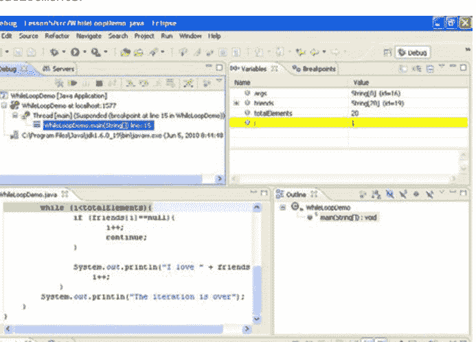

图 5-3：调试视图快照

继续使用“逐行执行”按钮，并观察“变量”视图中的变量 `fi` 查看它的元素，以理解程序为什么跳过或进入 `if` 语句。注意程序如何退出循环并打印消息“The iteration is over.”。在花时间调试程序后，你应该体会到 Eclipse 调试器的价值。在我看来，学习新编程语言的最佳方法是通过良好的调试器运行他人的代码。程序可能没有错误，但通过调试器运行程序可以帮助你理解程序的执行流。

## 关于 if switch 语句的更多内容

如果你需要根据某些条件更改程序的执行，那么可以使用 `if` 或 `switch` 语句，这些语句是在第 3 章中介绍的。在本节中，你将看到条件语句的更多形式。

## if 语句的各种形式

在列表 5-3 中，你看到了 `if` 语句的一种版本：

```java
if (friends[i]==null){
    i++;
    continue;
}
```

`if` 语句中使用大括号来指定当条件为真时必须执行的代码块。尽管当代码块中只有一个语句时不需要大括号，但使用大括号是一个良好的习惯。它们使得程序对于可能需要阅读你代码的人（或六个月后的你自己）来说更易于理解：

```java
if (friends[i]==null){
    System.out.println("I found an array with null value");
    // 这里是其他代码
}
```

闭合大括号后面的代码始终会被执行，这可能并不是我们所想要的。在这种情况下，请使用 `if-else` 语法：

```java
if (friends[i]==null){
    System.out.println("I found an array with null value");
} else if (friends[i]=="Natasha") {
    System.out.println("I love my wife so much");
} else if (friends[i]=="Masha") {
    System.out.println("I fell in love with Masha when I was in the 8th grade.");
} else{
    System.out.println("I used to love " + friends[i] + " at some point.");
}
```

在前面的代码段中，“某些其他代码”只有在数组的当前元素不为空，或者如果它是 Java，`friends[i]==null` 时才会执行。你可以编写带有多个 `else if` 子句的 `if` 语句。例如，以下代码只打印一个告白：

使用条件判断可能比两个值复杂得多。你可以使用布尔 AND（与）、OR（或）和 NOT（非）运算符来构建表达式。AND 操作表示为 `&&`，如下：

```java
if (age<20 && gender=="male") {
    // 仅对 20 岁以下的男性执行某些操作
}
```

对于 OR 条件使用 `||`；例如：

```java
if (age < 30 || yearsInArmy > 0) {
    // 对小于 30 岁的人或服过兵的人执行某些操作
    // 无论他们的年龄如何
}
```

对于 NOT 条件（即取反）使用：

```java
boolean hasBachelorDegree;
// 读取人员记录并将值 true 或 false 赋值给变量 hasBachelorDegree
if (!hasBachelorDegree) {
    // 对没有学士学位的人执行某些操作
}
```

否定符号既可以放在布尔变量前面（如前面的代码段所示），也可以放在返回布尔值的表达式前面。下一个示例展示了如何使用否定。注意比较被放在括号内部；否则 Java 编译器将假设你正试图对 String 值 `friends[i]` 取反；这是不允许的。

```java
if (!(friends[i]=="Hillary")) {
    System.out.println("Still looking for Hillary.");
}
```

想象一种情况，你需要为变量赋值，但这些值取决于条件的结果。可以使用一个赋值运算符为结果为真的情况赋值，并在 `else` 部分为结果为假的情况赋值。如果你使用一种称为条件运算符（`?`）的特殊结构，可以简单地完成相同的任务。

条件运算符由以下部分组成：一个返回布尔值的表达式、一个问号、一个当第一个表达式为真时使用的某些值的表达式、一个冒号、以及一个返回为假的表达式。

```java
float salary;
// 从数据源检索工资
int bonus = salary > 90000 ? 5000 : 2000;
```

## 命令行参数


在第 1 章中你学会了如何从命令行启动 Java 程序。在 Eclipse 或其他 IDE 中开发后，Java 程序被部署在并通常通过命令行启动，对吗？例如，要从命令行运行 `TestTax` 程序（见第 4 章），你需要打开命令行（或终端），切换到目录。此数组是从命令行向程序传递某些数据的方法。你可以通过如下方式启动 `TestTax` 来传递总收入、州和依赖人数：

```
java TestTax 50000 NJ 2
```

`TestTax` 类的 `main(String[] args)` 接收这些数据。它由 JVM 自动创建，并且足够大以容纳从命令行输入的所有参数。该数组将填充如下：

```
args[0] = "50000";
args[1] = "NJ";
args[2] = "2";
```

命令行参数总是以 String 数组的形式传递程序。程序负责将数据转换为相应的类型。第 3 章中介绍的 Java 类大派用场。例如，`Double` 类具有 `parseDouble()` 函数可以将 String 转换为 double：

```java
double grossIncome = Double.parseDouble(args[0]);
```

查看列表 4-6 中 `TestTax` 程序的代码，它硬编码了总收入、州和依赖人数。通过使用命令行参数，你可以让程序更具通用性并适用于更多的人——不仅仅是来自新泽西州、有两个依赖且年收入为 50,000 美元的人。

# 你的任务是为列表 4-6 中的程序引入命令行参数

## 课程要求

对于本节，你应该已安装 Java。

> **注意** 你可以从书的网页 `www.wrox.com/go/javprog24hr2e` 下载此“Try It”的代码和资源。它们在 `Lesson 5.zip` 中。

## 步骤详解

1. 在 Eclipse IDE 中，将 `TestClass` 从 `Lesson4` 项目复制到项目 `Lesson5` 的 `src` 文件夹中。同时，也从 `Chapter3` 项目中复制 `Tax` 类，该类在 `calcTax()` 方法中包含一个 `if` 语句。
2. 添加以下代码片段以确保程序带有 3 个参数启动。如果不是，则打印错误消息并退出程序。

```java
if (args.length != 3) {
    System.out.println("Sample usage of the program: " +
        "java TestTax 50000 NJ 2");
    System.exit(0);
}
```

3. 在方法中添加以下语句获取从命令行传递的值，将其转换为适当的数据类型，并初始化变量 `grossIncome`、`state` 和 `dependents`：

```java
double grossIncome = Double.parseDouble(args[0]);
String state = args[1];
int dependents = Integer.parseInt(args[2]);
```

4. 虽然在 Eclipse 中有一种指定命令行参数的方法，但如果你想留在命令行窗口，请在 Eclipse IDE 中右键点击 `Lesson5` 项目并选择 `Properties`（属性）菜单（注意项目编译类的类位置——在我的情况下，它是 `c:\practical\Java\lesson5\bin`）。
5. 打开命令行窗口并切换到包含 `TestTax.class` 的目录。
6. 多次运行你的程序，为命令行参数指定不同的值。你的程序应该打印计算税额的不同值。

> **提示** 请在 `www.wrox.com/go/javaprog24hr2e` 在线选择第 5 课视频。你也可以从网站下载本课程的代码和资源。

# 包、接口与封装

如果一个编程语言支持继承、封装和多态，则它被认为是面向对象的。你现在已经知道 Java 支持继承，这允许你通过派生另一个现有的类来设计一个类。这一特性允许你重用现有代码，而无需从其他类中复制和粘贴代码片段。列表 3-5 中的 `NJTax` 类就是这样设计的。

在第 6 章和第 7 章中，你将学习封装的含义，并继续学习编码技术和最佳实践。虽然本节向你展示了几个短代码示例来阐明某些编程主题，但下一个章节将把你目前到为止学到的所有部分整合到一个更大的应用程序中。

## Java 包

一个良好的项目可能有数百个 Java 类，你需要将它们组织在包中（想象成文件目录）。这将允许你对文件进行分类，控制对类的访问（参见本章后半部分的“访问级别”节），并避免潜在的命名冲突。如果你和你的同事决定将一个类命名为 `Util1`，这并不是问题，因为这些类位于不同的包中。

有时你会使用由不同部门或你部门之外编写的 Java 类第三方库。为了尽可能地减少包名冲突的概率，当名称相同时，通常会使用所谓的“反向域名表示法”。例如，如果你在一家名为 Acme 的公司工作，其网站为 `acme.com`，你可以为所有包名加上 `com.acme` 前缀。要将一个 Java 类置于特定包中，请在类的开头添加 `package` 语句（它必须是类中的第一个非注释语句）。例如，如果 `Tax` 类是为相应部门开发的，你可以这样声明：

```java
package com.acme;
class Tax {
    // 代码写在这里
}
```

如果你按照前面的代码声明了 `Tax` 类，则 `Tax.java` 文件必须存储在对应的目录树中。

```
com
  acme
    accounting
```

Java 类也组织在包中，类的全限定名由包名后跟类名组成。例如，Java 类 `Double` 的全名是 `java.lang.Double`，其中 `java.lang` 是你唯一不需要在代码顺序中显式提及的包名，以便能找到它的类，除非所有类都位于同一个包中。

所有 Java 8 包的程序文档可以在 `http://download.oracle.com/javase/8/docs/api/` 获取。

假设你的 `Tax` 类需要借助位于 `java.net` 包中的 `URL` 类连接到某些 URL。你可以使用包含该类全限定名的代码：

```java
java.net.URL myURL = new java.net.URL("http://www.acme.com");
```

但与其使用这种长表示法，不如在类声明上方包含 `import` 语句，然后使用类名：

```java
import java.net.URL;
class Tax{
  URL myURL = new java.net.URL("http://www.acme.com");
  ...
}
```

如果你需要从同一个包导入多个类，请在 `import` 语句中使用通配符 (`*`) 而不是在行中列出每个类：

```java
import java.net.*;
```

但使用通配符会降低程序的可读性。先前的示例使得不清楚 `java.net` 包中哪些具体的类被程序使用。不要偷懒，要为每个类单独列出 `import` 语句。这不会影响编译后代码的大小，但它会让未来阅读该代码的人（顺便说，包括你自己）更容易理解你的程序。

## 封装

封装是隐藏和保护数据的能力。当开发者创建一个类时，他或她可能会问：“哪些坏想要访问我的数据？”例如，变量不应该被直接修改；相反应该通过执行某些验证的方法来修改，以确保赋值的值符合特定的规则。

### final 关键字

`final` 关键字在不同的语境中有不同的含义。将在后续章节中进行解释。

### 访问级别

Java 类、方法和成员变量可以具有 `public`、`protected` 和包级访问级别；例如：

```java
public class Tax {
    private double income;
    private String state;
    private int dependents;
    protected double calTax() {
        // 方法写在这里
    }
}
```

`public` 关键字这意味着（类、方法或变量）可以被任何其他 Java 类访问。`protected` 关键字使元素不仅在当前类中可见，对于它的子类也可见，即使它们位于不同的包中。

`private` 关键字限制性最大，因为它成员变量或方法仅在类内部可见。例如，我们的 `tax` 类可能需要一些在 `calTax()` 方法内部调用的额外方法。`tax` 类的用户不需要知道这些。

如果你不指定任何访问级别，默认是包级（不是关键字），这意味着只有位于相同包的类才能访问该方法或变量。Java 类应该只暴露其他人需要知道的方法，例如 `calTax()`。

### final 变量

在声明变量、方法和类时，可以使用 `final` 关键字。`final` 变量变成一个常量（参见第 3 章），它只能被初始化一次，并且在运行期间不能更改其值。有些人可能认为常量和只能初始化一次的变量不是同一回事，但它们无法更改其值这一事实使得它们非常相似。

即使你在方法中声明了常量，更常见的做法也是在类级别上声明它们，这样该类的多个方法就可以复用它们：

```java
final int BOILING_TEMP = 212; // 华氏度
```

### final 方法

如果你使用 `final` 关键字声明一个方法，那么当有人决定扩展该类时，该方法无法被重写。你的特定方法永远不需要被重写这似乎是显而易见的。用于将华氏度转换为摄度的方法短期内会发生变化吗？

```java
static final double convertToCelsius(double far) {
    return ((far - 32) * 5 / 9);
}
```

但对于许多创建可复用 Java 类的开发者来说，这并不是板上钉钉。你的特定方法永远不需要被重写这似乎是显而易见的，但你可能没有预测该类所有的模式。如果发生这种情况，某些开发者将不得不费力在子类中创建你方法的另一个版本。

许多年前，Java 编译器会优化（内联）`final` 方法。现在它不再这样做了——所有方法都由 Hotspot JVM 进行优化。在将方法设为 `final` 之前考虑一下。

### final 类

如果你将一个类声明为 `final`，没有人能够继承它的子类。例如，`String` 类被设计为不可变的，因此被声明为 `final`（参见 `http://docs.oracle.com/javase/8/docs/api/java/lang/String.html`）。如果一个类被声明为 `final`，它的所有方法都将隐式变为 `final`。

> **异常处理中的 FINAL**
>
> `final` 关键字还有一种用法。你可以在错误处理块（try-catch）中使用它。你可以在第 10 节关于错误处理的内容中看到 `finally` 的示例。

## 接口

设计一个类有不同的方法。大多数人开始于考虑它应该支持的行为。例如，员工应该获得薪酬；因此 `Employee` 类实现了 `Payable` 接口。`Payable` 是一个任意的名称。什么代表可支付的行为？假设你想在一个方法签名为 `increasePay(int percent)` 的方法中实现它。

当然，你也可以在 `Employee` 类中添加这样的方法并直接在那里实现业务逻辑。另一种选择是在一个称为接口的独立实体中声明此方法，然后让你的类实现此接口：

```java
class Employee implements Payable {
    // 实现写在这里
}
```

列表 6 显示了一个包含一个方法声明的接口。

你应该有一个理由将某些方法与实现它们的类分开声明，当你学习多态时，你就会发现这些理由了。现在，只需熟悉定义和使用接口的语法即可。Java 8 之前的接口不允许任何方法实现——只有声明。让我们从接口仅有声明行为的情况开始吧。

当一个类实现某个特定接口时，它保证为该接口中声明的所有方法提供实现。而且一个类可以实现多个接口：用逗号隔开它们的名称即可。

假设你的组织中有两种类型的工人——员工和合同工——你创建了 `Employee` 和 `Contractor` 类来实现反映这些不同群体需求的功能。每个人都有权获得薪资率，对于员工来说，这意味着加薪；对于合同工来说，这意味着时薪或日薪的增加。

与其在这些类中两个不同的方法（例如 `increaseSalary()` 和 `increaseRate()`），不如定义一个接口（例如 `Payable`），其中包含 `increasePay()` 方法的声明，并让两个类都实现它，如列表 6-1、6-2 和 6-3 所示。在接口中声明的每个方法都将变成公共的。

### 列表 6-1 Payable

```java
public interface Payable {
    boolean increasePay(int percent);
}
```

### 列表 6-2 Class Employee

```java
public class Employee implements Payable {
    public boolean increasePay(int percent) {
        // 在此处实现加薪
    }
}
```

### 列表 6-3 Class Contractor

```java
public class Contractor implements Payable {
    public boolean increasePay(int percent) {
        // 在此处实现时薪增加
    }
}
```

由于 `Employee` 和 `Contractor` 实现了 `Payable`，你必须在你的每个类中实现 `increasePay()` 方法，否则代码将无法编译。使用通用接口创建类可以使你的应用程序设计更整洁，并使代码更具读性。但更重要的是，在接口的帮助下，你可以为程序引入多态行为，如下所示。

除了方法之外，Java 接口还可以包含 `final` 变量的声明。例如，你可以在 `Payable` 接口中创建一个 `final` 变量，用于薪资增长的最大百分比（接口中声明的所有变量都会自动变为 `static`）：

```java
int INCREASE_CAP = 20;
```

由于 `Employee` 和 `Contractor` 实现了 `Payable`，它们都可以（或仅限 `Contractor`）在 `increasePay()` 的实现中使用 `if` 语句，以确保增长百分比不是 `INCREASE_CAP`。如果未来上限发生了变化，你只需要在一个地方更改它：即接口。此外，如果以后引入了新类型的工人（例如实习生），`increasePay()` 的实现可能会完全不同。

某些开发者会创建包含静态常量的接口。并不是所有人都认可使用接口，因为当类实现多个接口时，会产生混乱的局面。代码的可读性也会受到影响；不明变量在哪里定义的。你可以在这里了解更多：`http://go.gl/qiWR`

### 标记接口

标记接口是指没有声明方法的接口。此类接口的一个示例是 `Serializable`，它在第 15 章介绍。你不需要实现这些接口；Java 编译器会为你检查。实现标记接口的对象支持某些功能。例如，如果一个类实现了 `Serializable`，JVM 能够序列化——将其转换为字节字符串（在服务器 JVM 中），该字符串可以发送到 JVM（在客户端机器上），用于重建对象的实例，或反序列化。Java 编译器内部使用标记接口来生成实现所需的字节码。

此外，Java 有一个 `instanceof` 运算符（见下一节），可以在运行时检查对象是否属于特定类型。你可以像下面的代码所示使用 `instanceof` 运算符检查对象是否属于任何其他接口：

```java
if (receivedFromServerObj instanceof Serializable) {
    // 操作
}
```

这看起来很奇怪——它是接口的实例吗？正确的读法是变量 `receivedFromServerObj` 指向触发 `Serializable` 执行某些操作的对象。

### 接口中的默认方法

一个新关键字 `default` 在 Java SE 8 中引入。现在你也可以在接口中提供默认方法的实现。例如，你可以创建一个带有 `increasePay()` 方法默认实现的 `Payable` 接口：

```java
public interface Payable {
    default boolean increasePay(int percent){
        System.out.println("实现薪资的默认代码写在这里");
        return true;
    }
}
```

现在，如果实现 `Payable` 的类有自己的 `increasePay()` 实现，则将使用该类的实现。编译器不会报错。默认方法也被称为防御方法。

#### Eclipse IDE 中的合规性级别

你需要仔细地处理默认方法，因为你可能会遇到名称冲突。考虑以下情况：

```java
package defensemethods;
class Employee extends Person implements Payable, Promotionable {
    public static void main(String[] args){
        Employee emp = new Employee();
        emp.increasePay();
    }
}
```

如果 `Person` 类以及 `Payable` 和 `Promotional` 接口中存在 `increasePay()` 方法，这种冲突是如何解决的？如果程序创建了 `Employee` 类的实例并对其调用 `increasePay()` 方法，调用的是哪个版本的方法？

如果在祖类和接口中存在相同签名的方法，则调用类中的方法。如果具有相同签名的方法仅存在于接口 `Payable` 和 `Promotional` 中，编译器将符合以下错误：


# Duplicate default methods named increasePay with the parameters (int) and (int) are inherited from the types Promotional and Payable.Employee.java

## 接口中的静态方法

从 Java 8 开始，你可以在接口中包含静态方法。例如：

```java
public interface Payable {
    default boolean increasePay(int percent){
        System.out.println(
            "The default code implementing pay goes here");
        return true;
    }
    static double checkThePayIncreaseLimit(){
        // do something
        return 12345.00;
    }
}
```

如果在类中声明了静态方法，则使用类名后跟点和方法名来调用，如第 4 节 `WeatherReport.convertToCelsius(98.7)` 所示。

同样，如果在接口中声明了静态方法，则可以使用接口名进行调用。例如，你可以在我们的 `Employee` 类中这样做：

```java
double limit = Payable.checkThePayIncreaseLimit();
```

## 类型转换

所有类都与 `Object` 类形成一个继承树。在层次结构的顶端 —— 所有的 Java 类都是 `Object` 的直接或间接后代。当你声明一个非原始类型变量时，你可以使用该变量的精确数据类型或其任祖先数据类型。例如，如果 `NJTax` 类扩展自 `Tax`，则以下每一行都是正确的：

```java
NJax myTax1 = new NJTax();
Tax myTax2 = new NJTax(); // 向上转换
Object myTax3 = new NJTax(); // 向上转换
```

Java 非常聪明，会自动将类的实例转换为其祖先类。当类变量为 `Object` 时，`Object` 类定义了 10 个方法和类变量，`Tax` 类（`Object` 的隐式子类）增加了五个方法和变量（共 15 个），而 `NJTax` 又增加了两个（总共 17 个）。变量 `myTax1` 可以访问 17 个方法和变量，`myTax2` 看到 15 个，而 `myTax3` 只能看到 15 个。为什么不在声明时不使用精确类型呢？

假设你需要编写一个处理某家公司员工数据的程序。其中一些是全职员工，另一些是承包商，但你想从某些数据源读取他们的数据并将它们存储在同一个数组中。记住，数组只存储相同类型的对象。因为 Java 可以自动进行向上转换，你可以创建一个包含两个子类的 `Person` 类：`Employee` 和 `Contractor`，然后从数据库中读取记录。根据雇佣类型，你就可以创建一个适当的对象并将其放入任何 `Person` 类型的数组中：

```java
Person workers[] = new Person[2];
workers[0] = new Employee("Takov", "Frain");
workers[1] = new Employee("Rary", "Low");
workers[2] = new Contractor("Bill", "Shane");
```

当然，你可以创建两个数组，一个用于员工，一个用于承包商，但我正在为解释多态奠基础 —— 这是面向对象语言中一个强大的概念。你可以在第 7 章中看到多态的具体示例。

在某个时刻，你需要处理来自 `workers` 数组的数据。在循环中，你可以使用 `instanceof` 运算符测试数组中当前元素的类型，将对象强制转换（无法自动完成）`Employee` 或 `Contractor`，并正确处理它：

```java
for (int i=0; i<workers.length; i++) {
    Employee currentEmployee;
    Contractor currentContractor;

    if (workers[i] instanceof Employee) {
        currentEmployee = (Employee) workers[i];
        // 在此处进行某些处理
    } else if (workers[i] instanceof Contractor) {
        currentContractor = (Contractor) workers[i];
        // 在此处进行某些处理
    }
}
```

将数据类型放在另一个对象的括号中意味着你想将此对象向下强制转换为指定的类型。你只能将对象转换为其后代数据类型之一。尽管以下代码语法正确，但它并不代表处理类似对象的最佳实践。在下节节中，我们将展示如何以更通用的方式使用多态。

如果一个类实现了一个接口，你可以将其强制转换为此接口。名为 `Employee` 的类实现了 `Payable`、`Insurable` 和 `Pensionable` 接口：

```java
class Employee extends Person implements
Payable, Insurable, Pensionable (
// 在此处编写所有接口的实现
)
```

如果你只对员工的 `Insurable` 行为感兴趣，则不需要将此数组的每个元素都转换为 `Employee` 类型。只需将它们转换为 `Insurable` 类型即可，如下代码片段所示。然而，请记住，如果你这样做，变量 `currentEmployee` 仅暴露在 `Insurable` 接口中声明的方法。

```java
Insurable currentEmployee;

if (workers[i] instanceof Insurable) {
    currentEmployee = (Insurable) workers[i];
    // 在此处进行某些处理
}
```

## 尝试一下

此作业的目标是开始使用包、保护私有变量并定义接口。完成此作业后，你的代码将可以运行但不完美。第 7 章。

## 课程要求

本节你应该已安装 Java。

> **注意** 你可以在书中网页上找到“尝试一下”的代码和资源。

## 步骤说明

1. 在 Eclipse IDE 中创建一个名为 `Lesson6` 的项目。

2. 在 `com.practical.lesson6` 包中根据列表 6-1 创建 `Payable` 接口。在那里声明最终变量：

```java
package com.practical.lesson6;

public interface Payable {
    void increasePay(int percent);
}
```

3. 创建一个 `Person` 类：

```java
package com.practical.lesson6;

public class Person {
    private String name;
    public Person(String name) {
        this.name = name;
    }

    public String getName() {
        return "Person's name is " + name;
    }
}
```

4. 在 `com.practical.lesson6` 包中创建 `Employee` 和 `Contractor` 类。每个类都应该扩展 `Person` 并实现 `Payable`。在创建新类时，点击 Eclipse 中的 Add 按钮以在类声明中包含 `Payable` 接口。

5. 检查你的文件系统，确保文件已创建在工作区的 `com/practical/lesson6` 目录下。

6. 创建一个带有 `main()` 方法的 `TestIncrease` 类。不要指定任何包；此类将创建在不同的目录下。

7. 在 `TestIncrease` 的 `main()` 方法中尝试创建一个 `Employee` 实例：

```java
Employee myFunction = new Employee();
```

你会得到一个错误：无法解析 Employee。难怪 —— 它位于不同的包。将鼠标悬停在 `Employee` 上，Eclipse 将为你提供修复方案。添加导入语句：

```java
import com.practical.lesson6.Employee;
```

选择此并为所有类添加导入语句。

8. 在 `TestIncrease` 类的 `main()` 方法中，创建一个员工和承包商数组，并对数组中的每个元素调用 `increasePay()` 函数：

```java
public static void main(String[] args) {
    Person workers[] = new Person[3];
    workers[0] = new Employee("John");
    workers[1] = new Contractor("Mary");
    workers[2] = new Employee("Steve");

    Employee currentEmployee;
    Contractor currentContractor;

    for (Person p : workers) {
        if (p instanceof Employee) {
            currentEmployee = (Employee) p;
            currentEmployee.increasePay(30);
        }
        else if (p instanceof Contractor) {
            currentContractor = (Contractor) p;
            currentContractor.increasePay(30);
        }
    }
}
```

9. 在 `Employee` 中实现 `increasePay()` 方法 —— 对薪资增加不做任何限制。

这里是 `increasePay()` 的体：

```java
System.out.println("Increasing salary by " + percent + "." + getName());
return true;
```

10. 在 `Contractor` 类中实现 `increasePay()` 方法。如果增加的百分比小于 `INCREASE_CAP`，则打印与前面的代码类似的消息。否则，打印一条消息说明你不能将承包者的费率提高超过 20%。

11. 运行 `TestPay` 程序。它应该产生类似下面的输出：

```text
Increasing salary by 30%. Person's name is John
Sorry, can't increase hourly rate by more than 20%. Person's name is Mary
Increasing salary by 30%. Person's name is Steve
```

> **提示** 请在 www.wrox.com/go/javaprogr24hr2e 在线选择第 6 节的视频。你也可以下载该网站的代码和资源。

# 使用抽象类和接口编程

在本节中，你将学习抽象类，然后构建一个完整的应用程序，演示如何使用抽象类和接口设计并实现程序。你还将学习多态的概念。

## 抽象类

如果一个类被声明为抽象类，它就不能被实例化。`abstract` 关键字必须放在类的声明中。抽象类可以有一个或多个抽象方法。问题是：“谁需要一个不能实例化的类？”

回答这个问题简单的方法是向你展示如何在设计应用程序时使用抽象类。之前的课程以作业结束，但本节将从作业开始。

## 作业

一家公司有员工和承包者。设计不使用接口的类来代表为这家公司工作的人。这些类应该具有以下方法：

```
changeAddress()
promote()
giveDayOff()
increasePay()
```

一次性晋升会提供一天休假并按指定的百分比提高薪资。`increasePay()` 方法应该增加员工的年薪，并增加承包者的小时费率。

## 使用抽象类的解决方案

`Employee` 和 `Contractor` 类应该具有一些共同功能，但由于 `increasePay()` 在 `Employee` 和 `Contractor` 中的实现方式不同，让我们为它们声明一个父类 `Person`，并带有一个抽象（未实现）方法 `increasePay()`。`Person` 类还有三个具体的（已实现的）方法。`Person` 类不能实例化，这迫使开发者在子类中实现抽象方法。

从重新设计第 6 章“尝试一下”部分的 `Person` 类开始。该版本的类as没有 `increasePay()` 方法，该方法当时是 `Payable` 接口的一部分。根据上一节的作业，向 `Person` 类添加以下方法：`changeAddress()`、`giveDayOff()` 和 `promote()`（参见列表 7-1）。

这与第 6 章使用接口的方法不同。在这种情况下，某些方法在子类中实现，另一些则没有。根据作业，此解决方案将不使用任何接口。

## 列表 7-1 抽象类

```java
package com.practical.lesson7;

public abstract class Person {

    private String name;
    private String address;

    int INCREASE_CAP = 20; // 薪资增加上限

    public Person(String name) {
        this.name=name;
    }

    public String getName() {
        return "Person's name is " + name;
    }

    public void changeAddress(String address) {
        this.address = address;
        System.out.println("New address is " + address);
    }

    private void giveDayOff() {
        System.out.println("Giving a day off to " + name);
    }

    public void promote(int percent) {
        System.out.println("Promoting a worker...");
        giveDayOff();
        //调用抽象方法
        increasePay(percent);
    }

    // 在子类中实现的抽象方法
    public abstract boolean increasePay(int percent);
}
```

`increasePay()` 方法是抽象的，`Person` 类的作者不需要知道提高工资的具体细节。子类可能由其他开发者实现。但 `Person` 的作者可以编写甚至调用 `increasePay()` 的代码，例如在 `promote()` 方法中。这是允许的，因为当具体类实例化时，`increasePay()` 方法肯定已经实现了。为了简单起见，我没有写任何看起来像实际增加工资的代码 —— 这对于理解抽象类的概念无关。

下一步是创建子类 `Employee` 和 `Contractor`，以两种不同的方式实现 `increasePay()` 方法，如列表 7-2 和列表 7-3 所示。

## 列表 7-2 Employee 类

```java
package com.practical.lesson7;

public class Employee extends Person {

    public Employee(String name) {
        super(name);
    }
    public boolean increasePay(int percent) {
        System.out.println("Increasing salary by " +
            percent + "." + getName());
        return true;
    }
}
```

## 列表 7-3 Contractor 类


```java
package com.practical.lesson7;

public class Contractor extends Person {

    public Contractor(String name) {
        super(name);
    }

    public boolean increasePay(int percent) {
        if (percent < INCREASE_CAP) {
            System.out.println("Increasing salary by " +
                percent + "." + getName());
            return true;
        } else {
            System.out.println("Sorry, can't increase hourly rate by more than 20%. " +
                getName());
            return false;
        }
    }
}
```

## 列表 7-4 TestPay

```java
package com.practical.lesson7;

public class TestPay {
    public static void main(String[] args) {
        Employee emp = new Employee("John");
        Contractor con = new Contractor("Mary");
        Employee another = new Employee("Steve");

        Person[] workers = {emp, con, another};

        for (Person p : workers) {
            p.promote(30);
        }
    }
}
```

# 77 | 多态

注意，尽管列表 7-4 中的循环变量 `p` 是 `Person` 类型，但在每次迭代中它都指向 `Employee` 或 `Contractor`。实际类型在运行时进行评估。这种面向对象的语言的特性被称为运行时绑定或晚期绑定。

`TestPay` 类的输出类似于：

Promoting a worker...

Giving a day off to John

Increasing salary by 30%. Person's name is John

Promoting a worker...

Giving a day off to Mary

Sorry, can't increase hourly rate by more than 20%. Person's name is Mary

Promoting a worker...

Giving a day off to Steve

Increasing salary by 30%. Person's name is Steve

多态使你能够避免带有 `instanceof` 慢开销的 `switch` 或 `if` 语句，你在第 6 章中用过它们。你是否同意，与这个版本的代码相比，即使是 `TestPay` 看起来也很丑陋？

# 78 | 第 7 Lesson：抽象类与接口的编程

## 列表 7-5 类 TestPayIncreasePoly

```java
// 为了复用接口版本的 Employee 和 Contractor
// 我们在代码中保留此示例用于第 6 Lesson
import com.practical.java.lesson6.*;

public class TestPayIncreasePoly {

    public static void main(String[] args) {
        Payable workers[] = new Payable[3];
        workers[0] = new Employee("John");
        workers[1] = new Contractor("Mary");
        workers[2] = new Employee("Steve");

        for (Payable p : workers) {
            p.increasePay(30);
        }
    }
}
```

注意，变量 `p` 只能“看到”在 `Payable` 中声明的方法。变量 `p` 不能用于调用 `Person` 的任何方法，因为 `Employee` 和 `Contractor` 都继承自该类。

在执行列表 7-5 代码期间会出现什么问题？如果开发者创建了一个名为 `ForeignContractor` 的类但没有实现 `Payable` 接口，并错误地尝试将此实例添加到数组行中？你会得到一个编译错误“无法从 ForeignContractor 转换为 Payable.”。编译错误很容易修复。在“尝试一试看（Try It）”部分中，你刻意创造了一个导致运行时错误的情况。

## 接口与抽象类的对比

下一个问题是，什么时候应该使用接口，什么时候应该使用抽象类？如果两个或多个类具有大量功能，但某些方法应该以不同的方式实现，你可以创建一个公共祖类，并根据需要创建尽可能多的继承此行为的子类。将这些方法声明为抽象方法并在子类中实现它们，或者在子类中实现这些方法。

如果几个类没有共同的功能，但需要表现出某些共同行为，不要创建公共祖类；请实现一个声明了所需行为的接口。这种场景在第 6 章的“接口”部分没有出现过，但它将是本节“尝试一试看”部分中练习题的一部分。

接口和抽象类的相似之处在于，它们都确保按照要求的方法来实现方法的实现。它们不同在于程序设计的方式。抽象类要求你为类提供一个公共祖类，而接口不需要。

如果一个类已经有一个无法更改的祖类，那么接口可能是你的唯一选择。Java 不支持多继承；一个类只能有一个祖类。例如，为了编写 Java applets，你必须让类继承自 `Applet`，或者在 Swing applets 的情况下继承自 `JPanel`。使用你自己的抽象祖类不是选项。

使用抽象类、接口和多态不是必须的，但它显然通过提高 Java 代码的可读性并使其对可能需要维护你编写的程序的人更容易理解，改进了设计。通常情况下，思考你即将编写的类的行为并将其列在单独的接口是一个良好的习惯。

在第 II 部分中，“面向接口编程（Programming to Interfaces）”的注释为你提供了使用接口的另一个理由。

## 尝试一试看

在作业的第一部分，目标是破坏列表 7-5 中的代码以产生运行时 `ClassCastException`。你创建了一个让数组 `workers` 变为 `Person` 类型的情况，它可以存储任何 `Person` 或其后代类。然后，你刻意添加了没有实现 `Payable` 的子类，但仍然尝试将其强制转换为 `Payable` 以产生运行时异常。在作业的第二部分，你需要重写第 6 章中的作业，保留 `Payable` 接口但移除公共祖类 `Person`。

## Lesson 要求

对于本节，你已安装 Java。

> 注意：你可以从书籍的网页 www.wrox.com/go/javapro24hr2e 下载此节“尝试一试看”的代码和资源。你可以在 `Lesson6.zip` 和 `Lesson7.zip` 中找到它们。

## 逐步步骤

### 第一部分

1. 在 Eclipse 中，打开项目 `Lesson6` —— 是，就是你在上一节中导入的那个。

2. 创建一个名为 `ForeignContractor` 的新类，代码所示。注意该类没有实现 `Payable` 接口：

```java
package com.practical.java.lesson6;

public class ForeignContractor extends Person {
    public ForeignContractor(String name) {
        super(name);
    }
    public boolean increasePay(int percent) {
```

# 80 | 第 7 Lesson：抽象类与接口的编程

```java
    System.out.println("I'm just a foreign worker");
    return true;
}
```

3. 创建类 `TestPayIncreasePolyError`，添加一个 `ForeignContractor` 类的实例。注意你正在将数组的每个元素强制转换为 `Payable`：

```java
import com.practical.java.lesson6.*;
public class TestPayIncreasePolyError {
    public static void main(String[] args) {
        Person workers[] = new Person[3];
        workers[0] = new Employee("John");
        workers[1] = new Contractor("Mary");
        workers[2] = new ForeignContractor("Boris");

        for (Person p : workers) {
            ((Payable)p).increasePay(30);
        }
    }
}
```

4. 运行程序 `TestPayIncreasePolyError`。观察控制视图中的输出。你在数组的第三个元素上获得了运行时错误 `ClassCastException`。注意数字 14 —— 这是 `TestPayIncreasePolyError` 程序的行，它将每个对象强制转换为 `Payable` 接口：

```
Increasing salary by 30%. Person's name is John
Sorry, I't increase rate by more than 20%: Mary
Exception in "main" java.lang.ClassCastException: com.practical.java.ForeignContractor cannot be cast to com.practical.java.Payable
at TestPayIncreasePolyError.main(TestPayIncreasePolyError.java:14)
```

5. 将数组从 `Person` 更改为 `Payable` 并相应地修改循环，修改 `TestPayIncreasePolyError` 代码：

```java
Payable workers[] = new Payable[3];
workers[0] = new Employee("John");
workers[1] = new Contractor("Mary");
//  此处添加 ForeignContractor
```

6. 注意你现在得到了一个 Java 编译错误，阻止你将 `ForeignContractor` 添加到数组，因为它没有实现 `Payable`。预测错误对于每个开发者来说都是一项重要任务，这个主题将在第 10 章介绍。

### 第二部分

1. 在 Eclipse 中打开项目 `Lesson7`，选择菜单 `File -> New -> Package`，创建新包 `com.practical.java.lesson7`。

2. 使用 `Ctrl+V` 将 `Payable` 接口复制到 `com.practical.java.lesson7` 包中。更改包名变为 `com.practical.java.lesson7`。

3. 在同一包中创建 `Employee` 类如下：

```java
package com.practical.java.lesson7;

public class Employee implements Payable {
    private String name;

    public Employee(String name) {
        this.name=name;
    }

    public boolean increasePay(int percent) {
        System.out.println("Increasing salary by " + percent + "%: " + name);
        return true;
    }
}
```

4. 在同一包中创建 `Contractor` 类如下：

```java
package com.practical.java.lesson7;

public class Contractor implements Payable {
    private String name;

    public Contractor(String name) {
        this.name=name;
    }

    public boolean increasePay(int percent) {
        if(percent < Payable.INCREASE_CAP) {
            System.out.println("Increasing hourly rate by " + percent + "%: ");
            return true;
        } else {
            System.out.println("Sorry,can't increase hourly rate by more than " + Payable.INCREASE_CAP + "%: " + name);
        }
        return false;
    }
}
```

# 82 | 第 7 Lesson：抽象类与接口的编程

5. 创建名为 `TestPayIncreaseInterface` 的类：

```java
public class TestPayIncreaseInterface {
    public static void main(String[] args) {
        Payable workers[] = new Payable[3];
        workers[0] = new Employee("John");
        workers[1] = new Contractor("Mary");
        workers[2] = new Employee("Steve");

        for (Payable p: workers){
            ((Payable)p).increasePay(30);
        }
    }
}
```

6. 运行此程序。它应该产生以下输出：

Increasing salary by 30%: John

Sorry, can't increase hourly rate by more than 20%: Mary

Increasing salary by 30%: Steve

注意 `Employee` 和 `Contractor` 不再继承 `Person`。这两个类现在可以自由地继承其他类，但另一方面，每个类都必须声明变量名和方法名，而这在 `Person` 类中已经完成过一次。

> TIP 请在以下网址选择第 7 Lesson 的视频：www.wrox.com/go/javaprog24hr2e。你也可以从该网站下载本节的代码和资源。

## 8 使用 Swing 引入 GUI

今天 applet 已经很少被使用了，这也是我决定在这一版本的书中不再包含关于 applet 章节的原因。相反，我增加了对更现代的 JavaFX 框架的介绍。在本及后续课程中，你将通过使用 Java Swing 库开发一个简单的桌面计算器，来学习构建 GUI 的原理。

> Eclipse 基金提供了另一个名为标准小部件工具包（SWT）的 UI 组件库，地址为 https://wiki.eclipse.org/SWT，这超出了本书的涵盖范围。

## SWING 基础

最初，Java 提供了一个相当用的 UI 相关的类库，称为抽象窗口工具包（AWT）。几年后，引入了一个名为 Swing 的新工具包。Swing 提供了一组更轻量级的 UI 组件，同时保留了核心意图——让 UI 独立于终端用户的操作系统。同一个程序可以在 Windows 和 Mac OS 上运行，且 GUI 组件看起来与相应的操作系统（OS）是原生的（见图 8.1）。你还可以创建一个具有跨平台外观和感觉的 Swing 应用程序（参见 http://docs.oracle.com/javase/tutorial/swing/lookandfeel/nimbus.html 中的 Nimbus）。

如今，开发者正在创建看起来像是操作系统原生的 UI，无论是 Windows、Mac OS、iOS 还是 Android。基于 Swing 的 UI 市场可能会萎缩，但此时它仍被企业使用，熟练的 Swing 开发者仍然处于需求之中。

Swing 提供了在 Java 中构建 UI 所需的一切内容：有用于表示按钮、下拉菜单、网格、滚动条、树、标签页等的控件。通常，你通过将控件组合到容器（例如 `JPanel` 或 `JFrame`）中来创建 UI，这些容器支持各种布局，可以根据你或图形设计师的设想进行排列。在本课中，你将在为简单的桌面计算器创建 UI 时使用一些 Swing 组件。

对 Swing 库的完整讨论超出了本书的范围，但有很多书籍和技术文章涵盖该主题。官方 Swing 教程位于 http://bit.ly/lo7JJue。


Swing 类位于 `javax.swing` 包中，创建 UI 的过程源于扩展其中的一些类来显示 UI 并响应各种用户生成和系统生成的事件。你通过实例化 `JFrame` 类来创建一个带有标题和边框的顶层窗口，如列表 8-1 所示。

### 列表 8-1 JFrame 的空子类

```java
import javax.swing.JFrame;
import javax.swing.JButton;

public class HelloWorld extends JFrame {
    public static void main(String[] args) {
        JFrame myWindow = new HelloWorld();

        // 向容器中添加按钮
        JButton jButton = new JButton("Click me");
        myWindow.add(myButton);
        myWindow.setSize(200, 300);
        myWindow.setTitle("Hello World");
        myWindow.setVisible(true);
    }
}
```

`HelloWorld` 创建并向容器添加了一个按钮，设置了窗口的大小和标题，并使其可见。`JFrame` 是可以容纳 UI 控件的容器示例，必须先实例化，然后添加到容器中。运行此程序，它会显示一个类似于图 8-1 的小窗口（左侧是 Windows 操作系统版本，右侧取自 Mac OS）。

图 8-1 中的代码没有指定按钮的大小、放置位置，或者组件与边界之间是否应该留空间。在没有布局指令的情况下，图 8-1 中的整个空白区域将被一个巨大的按钮占据。

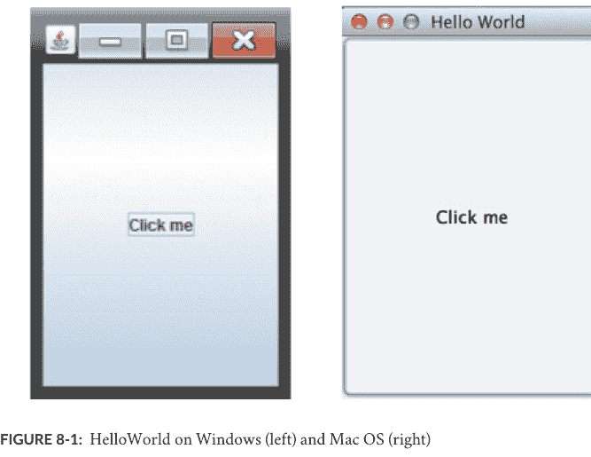

## 默认关闭操作

运行之前的 `HelloWorld` 程序并尝试点击窗口的关闭按钮。它不起作用。JRE 发送了一个关闭窗口的事件，但程序没有该事件的事件处理代码。你将在下一节中学习如何添加它，但在此你可以在 `HelloWorld.java` 中添加以下行来让窗口关闭：

```java
myWorld.setDefaultCloseOperation(JFrame.EXIT_ON_CLOSE);
```

通常 `JFrame` 包含一些嵌套容器，你在其中放置如 `JButton`、`Table` 和 `List` 等控件。例如，创建一个包含 `JPanel` 的 `JFrame` 的示例编码过程如下：

1. 创建一个 `JPanel`。
2. 为它分配一个布局管理器。
3. 实例化一些控件并将它们添加到面板。
4. 通过调用 `setPane()` 方法将面板添加到顶层容器——`JFrame` 中。
5. 设置框架的大小并使其可见。

你可以为容器分配不同的布局管理器来创建非常复杂的窗口。但显示一个具有正确布局组件的窗口只是工作的一半，因为这些控件应该知道如何响应各种事件，例如点击按钮。本节涵盖了显示 UI 组件的基础；第 9 节

## 布局管理器

最简单的布局管理器是 `FlowLayout`，它水平方向分配所有添加到容器的组件。如果没有空间，`FlowLayout` 会使用下一行，并重复重复。

## 使用 FlowLayout 的简单计算器

学习布局管理的最好方法是在实践中尝试使用它。你将为简单的计算器创建一个 UI，它可以接收数字并显示结果。创建一个名为 `Lesson8` 的 Eclipse 项目并创建一个带有以下代码的新类 `SimpleCalculator`：

### 列表 8-2 使用 FlowLayout 的计算器

```java
public class SimpleCalculator {
    public static void main(String[] args) {
        // 创建一个面板
        JPanel windowContent = new JPanel();
        // 为此设置布局管理器
        FlowLayout fl = new FlowLayout();
        windowContent.setLayout(fl);
        // 在面板中创建控件
        JLabel label1 = new JLabel("Number 1:");
        JTextField field1 = new JTextField();
        JLabel label2 = new JLabel("Number 2:");
        JTextField field2 = new JTextField();
        JLabel label3 = new JLabel("Sum:");
        JTextField result = new JTextField();
        JButton button = new JButton("Add");
        // 将控件添加到面板
        windowContent.add(label1);
        windowContent.add(field1);
        windowContent.add(label2);
        windowContent.add(field2);
        windowContent.add(label3);
        windowContent.add(result);
        windowContent.add(button);
        // 创建框架并将面板添加到框架中
        JFrame frame = new JFrame("My Calculator");
        // 将面板添加到顶层容器
        frame.setContentPane(windowContent);

        frame.setDefaultCloseOperation(JFrame.EXIT_ON_CLOSE);

        // 设置大小并让窗口可见
        frame.setSize(400,100);
        frame.setVisible(true);
    }
}
```

编译并运行此程序，它将显示图 8-2 所示的窗口。

这可能不是最好的计算器，但它展示了 `FlowLayout` 的用法，开始重新分配控件，尝试填充新区域。如果你把窗口调得足够宽，所有组件将挤在一行中，见图 8-3。

 (注：文中提到的图 8-2 和 8-3)

尽管你可以为每个窗口组件强制约束和大小，但 Swing 拥有布局管理器可以保持所有控件的相对位置，而不需要它们有严格的位置。不过 `FlowLayout` 看起来并不好看。它是根据当前容器的宽度显示所有视觉组件的。

## 布局管理器简介绍

Swing 提供了以下布局管理器：

- `FlowLayout`
- `GridLayout`
- `BoxLayout`
- `BorderLayout`
- `CardLayout`
- `GridBagLayout`

# 第 8 课：使用 Swing 引入 GUI

要使用任何布局管理器，首先要实例化它，并通过 `setLayout()` 将此实例分配给容器，就像你在列表 8-2 中的 `SimpleCalculator` 类中所做的那样。

## FlowLayout（流式布局）

这种布局将容器中的组件以网格中的行和列排列。例如，标签、文本字段和按钮会被添加到虚拟的行中，直到该行没有空间为止。

当当前行填满时，剩余的组件将到下一行，依此类推。可以根据容器的 `componentLayout` 属性将组件添加到容器中。如果用户更改了窗口的大小，该布局管理器会刷新组件，如图 8-2 所示改变 GUI。事实上，FlowLayout 不是计算器的最佳选择。让我们尝试一些不同的。

## GridLayout（网格布局）

`java.awt.GridLayout` 类允许将组件排列在网格的虚拟单元格中。如果调整容器的大小，网格单元可能会变大或变小，但组件的相对位置保持不变。

到目前为止，你的计算器有几个标签、三个文本字段和一个按钮。你可以通过如下创建 `GridLayout` 实例，将它们排列为四行两列的网格（一个单元格为空）：

```java
GridLayout gr = new GridLayout(4, 2);
```

你也可以为单元格分配水平和垂直空间，例如五像素：

```java
GridLayout gr = new GridLayout(4, 2, 5);
```

将列表 8-2 中的 FlowLayout 替换为 GridLayout，计算器看起来会好一点。创建并编译新类 `SimpleCalculatorGrid`（见列表 8-3）。

### 列表 8-3 使用 GridLayout 的计算器

```java
import java.awt.*;
import javax.swing.*;

public class SimpleCalculatorGrid {
    public static void main(String[] args) {

        JFrame windowContent = new JFrame();

        // 为面板设置布局管理器
        GridLayout gl = new GridLayout(4, 2);
        windowContent.setLayout(gl);

        JLabel label1 = new JLabel("Number 1:");
        JTextField field1 = new JTextField(10);
        JLabel label2 = new JLabel("Number 2:");
        JTextField field2 = new JTextField(10);
        JLabel label3 = new JLabel("Sum:");
        JTextField result = new JTextField(10);
        JButton add = new JButton("Add");

        // 将控件添加到面板
        windowContent.add(label1);
        windowContent.add(field1);
        windowContent.add(label2);
        windowContent.add(field2);
        windowContent.add(label3);
        windowContent.add(result);
        windowContent.add(add);

        // 创建框架并将面板添加到框架中
        JFrame frame = new JFrame("My First Grid Calculator");

        frame.setContentPane(windowContent);
        frame.setDefaultCloseOperation(JFrame.EXIT_ON_CLOSE);

        // 设置大小并显示窗口
        frame.setSize(400,100);
        frame.setVisible(true);
    }
}
```

运行程序 `SimpleCalculatorGrid` 以查看一个比以前好一点的计算器（图 8-4）。

| 我的第一个网格计算器 | |
|---|---|
| Number 1: | |
| Number 2: | |
| Sum: | |
| | Add |

图 8-4: 运行 SimpleCalculatorGrid

尝试调整此窗口的大小；控件随窗口增大，如图 8-5 所示，但它们的相对位置不会改变。注意，使用 GridLayout 时，网格的所有单元格具有相同的宽度和高度。

| 我的第一个网格计算器 | |
|---|---|
| Number 1: | |
| Number 2: | |
| Sum: | |
| | Add Add |

图 8-5: 调整 SimpleCalculatorGrid

## BorderLayout（边界布局）

`java.awt.BorderLayout` 布局管理器将容器划分为 South、West、East 和 Center 区域。North 区域位于顶部，South 位于底部，West 在左侧，East 在右侧。例如，图 8-6 所示显示数字的字段位于 North 区域，面板 p2 位于 West。


图 8-6: 创建 BorderLayout 并放置文本字段的 代码：

```java
BorderLayout bl = new BorderLayout();
this.setLayout(bl);
JTextField txtDisplay = new JTextField(20);
this.add(BorderLayout.NORTH, txtDisplay);
```

你不需要在五个区域都有控件。如果你需要 North、Center 和 South 区域，Center 区域会变宽。在计算器的下一个版本中使用 BorderLayout：Calculator.java。

BorderLayout 是内容面板的默认布局管理器。

## 组合布局管理器

你认为 GridLayout 能让你设计出像图 8-6 所示的 Windows 计算器吗？遗憾的是不能，因为单元格的大小不同——文本字段更宽。然而，你可以通过使用拥有自己管理器的面板来组合布局管理器。

| 计算器 | |
|---|---|
| 1 | 2 |
| 3 | 4 |
| 5 | 6 |
| 7 | 8 |
| 9 | = |

图 8-7: 组合布局管理器

## BoxLayout

`javax.swing.BoxLayout` 类允许沿 x 轴或 y 轴水平排列多个窗口组件。与 FlowLayout 管理器不同，当带有 BoxLayout 的窗口调整大时，它的控件不会反应。与 GridLayout 不同，BoxLayout 控件具有不同的大小。

接下来的两行代码将垂直对齐的 BoxLayout 分配给 JPanel。为了简化代码，我没有声明变量来存储 BoxLayout 对象的引用，而是创建它的实例并立即作为参数传递给 `setLayout()` 方法。

```java
JPanel p1 = new JPanel();
setLayout(new BoxLayout(p1, BoxLayout.Y_AXIS));
```

如果你将按钮添加到面板 p1，它们将一个接一个显示。

你可以使用实现水平或垂直 BoxLayout 的各种容器组合构建相当复杂的 UI。想象一个游戏的前页，在窗口顶部有几个并排的项，控件在一个侧边栏上垂直排列，窗口的其余空间分配给主战场。你可以使用 BorderLayout，在 North 使用一个带有水平 BoxLayout 的面板，在 West 使用一个带有垂直 BoxLayout 的面板。

下一节将向你展示一种更加冗长的 `GridBagLayout`，但你应该总是尝试看看 BoxLayout 是否可以胜任，如果可能的话。

# GridBagLayout

在本节中，你将熟悉另一种设计计算器的方法，即使用 `Java.GridBagLayout` 布局管理器，而不是组合不同布局的面板。GridBagLayout 是一种高级网格布局，允许创建不同大小的单元格。GridBagLayout 与另一个类 `GridBagConstraints` 配合使用。

约束只是单元格的属性，你必须为每个单元格单独设置。在将组件放入单元格之前，必须设置该单元格的所有约束。例如，其中一个属性称为 `gridwidth`（参见图 8-8）。它允许让一个单元格变得与其他多个单元格一样宽。示例中的显示字段与五个单元格一样宽。左上角的单元格坐标为 0.0。

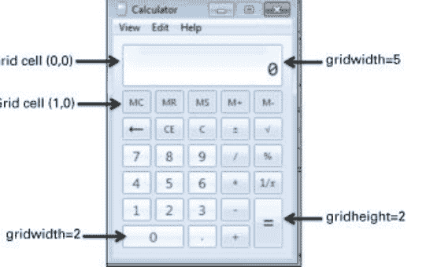

图 8-8: 计算器中的 GridBagConstraints

在使用网格布局时，你应该先创建一个约束对象的实例，并为其属性赋值。然后，你可以在容器中通过指定的坐标向单元格添加 UI 组件。重复此过程：用另一个单元格的属性填充同一个 `GridBagConstraints` 实例并将其添加到容器，依此类推。

列表 8-5 中的代码示例充满了注释，以帮助你理解如何使用 `GridBagLayout`。在学习本课程期间，你将使用这段代码。

### 列表 8-5 为 GridBagLayout 创建约束

```java
// 为窗口的内容面板设置 GridBagLayout
GridBagLayout gb = new GridBagLayout();
this.setLayout(gb);

// 创建 GridBagConstraints 实例
// 对于你想要添加到网格单元格的每个组件，
// 都需要重复这些行代码
```


```
GridBagConstraints constr = new GridBagConstraints();

// 为计算器的 displayField 设置约束：

// 网格中的 x 坐标
constr.gridx = 0;
constr.gridy = 0;

// 此单元格的高度与其他单元格相同
constr.gridweight = 1;

// 此单元格与 5 个其他单元格一样宽
constr.gridwidth = 5;

// 填充单元格中的所有空间
constr.fill = const.BOTH;
// 此组件占据水平空间的比例
constr.weightx = 1.0;
// 此组件占据垂直空间的比例
constr.weighty = 1.0;
// 组件在单元格中的位置
constr.anchor = constr.CENTER;

displayField = new JTextField();
// 为此字段设置约束
gb.setConstraints(displayField, constr);

// 将文本字段添加到窗口
windowContent.add(displayField);
```

# CardLayout

想象一叠叠在一起的卡牌——只能看到最上面的一张。你可以使用 `java.awt.CardLayout` 布局管理器创建一个一次显示一个面板的组件，例如[图 8-9](#图-8-9) 中的标签页文件夹。


图 8-9: 作为卡片布局示例的标签页

当用户点击标签页时，窗口的内容就会改变。实际上，此屏幕所需的所有面板已经预加载并堆叠在一起。当用户点击标签页时，程序会将这张“卡片”带到最顶，并让其他“卡片”变得不可见。这里的标签页文件夹仅用于说明；Swing 库包含一个用于带标签页窗口的现成组件 `JTabbedPane`。

# 使用绝对布局的容器

如果你希望容器的内容无论用户的窗口大小如何都看起来一样，请在添加组件时设置每个组件的 x 和 y 坐标、宽度和高度（边界）。你的类必须显式声明不使用 `null` 来设置布局：

```
windowContent.setLayout(null);
```

下一个代码段显示了如何设置按钮宽度为 40 像素，高度为 20 像素，并将其放置在距离窗口左上角右侧 100 像素、下方 200 像素处：

```
JButton myButton = new JButton("New Game");
myButton.setBounds(100, 200, 40, 20);
```

## 关于 Swing 组件

在一个课程中无法描述所有的 Swing 组件。请参考课程开头提到的 Swing 在线教程获取更多信息。以下是 Swing 组件列表：

- `JButton`
- `JLabel`
- `JCheckBox`
- `JRadioButton`
- `ToggleButton`
- `JScrollPane`
- `JSpinner`
- `JTextField`
- `JTextArea`
- `JPasswordField`
- `JFormattedTextField`
- `JEditorPane`
- `JScrollPane`
- `JSlider`
- `JProgressBar`
- `JComboBox`
- `JList`
- `TabbedPane`
- `JTable`
- `JToolTip`
- `JTree`
- `JViewport`
- `ImageIcon`

# Swing GUI 构建工具 | 97

你还可以创建菜单（`JMenu` 和 `JPopupMenu`）、弹出窗口以及嵌套在框架内的框架（`JInternalFrame`），可以使用标准窗口（`JFileChooser`、`JColorChooser` 和 `JOptionPane`）。

Java 曾经带有一个优秀的演示程序 SwingSet3，它展示了所有可用 Swing 组件。现在它可以在 https://swingset3.java 获取。

# Swing GUI 构建工具

Java 开发者使用各种工具来加速 UI 设计。例如，WindowBuilder、Matisse 和 Gigloo Builder。

## Swing 中的事件处理

Java Swing 与任何其他 UI 库一样都是事件驱动的。当用户与 GUI 交互（例如点击按钮或按键）时，Java Swing 程序接收到一个可以反应的事件。

如果你编写了响应特定事件的代码，代码将被调用。如果你没有编写此类代码，事件仍然会触发，但程序不会做出响应。在本节中，你将学习如何在 Java GUI 程序中处理事件。

此 `ActionListener` 定义在 `java.awt.event` 包中，如列表 9-1 所示。它只声明了一个方法。

# 列表 9-1 ActionListener 接口

```java
public interface ActionListener extends EventListener {
    void actionPerformed(ActionEvent e);
}
```

> 注意：从 Java 8 开始，声明单个方法的接口被称为函数式接口。你将在第 8 节中学习更多关于它们的知识。

如果发生了动作，JVM 就会调用 `actionPerformed()` 方法。让我们在第 8 节中创建的计算器中使用它吧。

# 教会计算器如何计算

计算器的按钮应该向一个实现了 `ActionListener` 的类进行注册，这意味着它的 `actionPerformed()` 方法中包含了计算逻辑。尽管你可以在 `Calculator` 类本身中实现 `ActionListener`，但为了更好的可读性和可维护性，最好将包含处理逻辑的代码与 UI 隔离开。让我们开始编写一个独立的类 `CalculatorEngine`：

```java
import java.awt.event.ActionEvent;
public class CalculatorEngine implements ActionListener {
}
```

前面的代码将无法编译；Java 会给出一个错误信息，说明该类必须实现 `actionPerformed(ActionEvent e)` 方法。你还记得接口的规则吧？`ActionListener` 接口声明了一个方法 `actionPerformed()`，这使其成为一个函数式接口，正如第 5 节讨论的那样。列表 9-2 中的代码修复了这个错误。

# 列表 9-2 ActionListener 接口的首次实现

```java
import java.awt.event.ActionEvent;
import java.awt.event.ActionEvent;
public class CalculatorEngine implements ActionListener {

    public void actionPerformed(ActionEvent e) {
        // 一个空的方法体
    }
}
```

尽管 `actionPerformed()` 方法还未包含任何代码，但在列表 9-2 中它被视为已实现（大括号让编译器感到满意）。当用户点击按钮时，JVM 会在已注册为事件监听器并实现了 `ActionListener` 接口的类上调用此方法。

`CalculatorEngine` 的下一个版本（见列表 9-3）将从 `actionPerformed()` 方法中显示一个消息框。你可以使用 Swing 的 `JOptionPane` 及其方法 `showConfirmDialog()` 显示任何消息。

# 列表 9-3 此类显示消息框

```java
import java.awt.event.ActionListener;
import java.awt.event.ActionEvent;
import javax.swing.JOptionPane;
public class CalculatorEngine implements ActionListener {

    public void actionPerformed(ActionEvent e) {
        JOptionPane.showConfirmDialog(null,
            "Something happened...",
            "just a test",
            JOptionPane.PLAIN_MESSAGE);
    }
}
```

如果你将 `CalculatorEngine`（见列表 9-3）注册为 `Calculator` 类（列表 8-4）的监听器，它会在计算器窗口内显示图 9-1 所示的消息框。


`JOptionPane` 类声明了重载方法 `showConfirmDialog()` ——我在列表 9-3 中使用了带有四个参数的版本。第一个参数是 `null`，这意味着这个消息框没有父窗口。第二个参数包含消息框的标题。第三个参数包含消息本身，第四个参数允许你选择一个包含在框中的按钮()。`PLAIN_MESSAGE` 意味着它只需要一个 OK 按钮。

图 9-1：带有 JOptionPane 的消息框

# 使用 ActionListener 注册组件

调用了列表 9-3 所示的 `actionPerformed()` 方法中的代码以及何时调用？将计算器的按钮与 `CalculatorEngine` 类注册，运行时每当点击按钮时都会顺从地调用该类的 `actionPerformed()` 方法。

# 第 9 节：SWING GUI 中的事件处理

## 回调方法

那些不是由 Java 运行时在你的应用程序代码上调的方法通常被称为回调方法。

在 `Calculator` 类（列表 8-4）构造函数的末尾添加以下两行，一个按钮（button0）就会开始响应图 9-1 所示的框：

```java
CalculatorEngine calEngine = new CalculatorEngine();
button0.addActionListener(calEngine);
```

其他计算器仍然保持沉默，因为它们尚未向动作监听器注册。添加类似的行让所有按钮都活跃起来：

```java
button1.addActionListener(calEngine);
button2.addActionListener(calEngine);
button3.addActionListener(calEngine);
button4.addActionListener(calEngine);
```

# 寻找事件的源

下一步是让监听器根据按了哪个按钮显示带有不同文本的消息。当事件发生时，Java 运行时会调用 `actionPerformed(ActionEvent event)` 方法。在你的监听器类上，此方法提供了关于 `ActionEvent` 中事件的宝贵信息。特别是，列表 9-3 中提供给 `actionPerformed()` 的 `ActionEvent` 中的 `getSource()` 方法告诉你是哪个对象导致了此方法的调用。

根据 `ActionEvent` 类的文档，`getSource()` 方法返回一个 `Object` 实例，它是所有类的子类，包括窗口组件。由于你计算器中的按钮可能是事件的原因，请将 `Object` 转换为 `JButton`：

```java
JButton clickedButton = (JButton) e.getSource();
```

执行强制转换后，你就可以调用 `JButton` 支持的方法；例如 `getText()`，它返回按钮的标签，如列表 9-4 所示。如果你按下标记为 5 的按钮，你会看到一个显示为“Pressed 5.”的消息框。

# 列表 9-4 获取被点击按钮的标签

```java
import java.awt.event.ActionListener;
import java.awt.event.ActionEvent;
import javax.swing.JButton;
import javax.swing.JOptionPane;

public class CalculatorEngine implements ActionListener {

    public void actionPerformed(ActionEvent e) {
        // ... (此处对应原文的截断逻辑)
        String label = clickedButton.getText();
        JOptionPane.showConfirmDialog(null, "Pressed " + label + ".", "Test", JOptionPane.PLAIN_MESSAGE);
    }
}
```


此 `ActionListener` 定义在 `java.awt.event` 包中，如列表 9-1 所示。它只声明了一个方法。

# 列表 9-1 ActionListener 接口

```java
public interface ActionListener extends EventListener{
    void actionPerformed(ActionEvent e);
}
```

> 注意：从 Java 8 开始，声明单个方法的接口被称为函数式接口。你将在第 8 节中学习更多关于它们的知识。

如果发生了动作，JVM 就会调用 `actionPerformed()` 方法。让我们在第 8 节中创建的计算器中使用它吧。

# 教会计算器如何计算

计算器的按钮应该向一个实现了 `ActionListener` 的类进行注册，这意味着它的 `actionPerformed()` 方法中包含了计算逻辑。尽管你可以在 `Calculator` 类本身中实现 `ActionListener`，但为了更好的可读性和可维护性，最好将包含处理逻辑的代码与 UI 隔离开。让我们开始编写一个独立的类 `CalculatorEngine`：

```java
import java.awt.event.ActionEvent;
public class CalculatorEngine implements ActionListener {
}
```

前面的代码将无法编译；Java 会给出一个错误信息，说明该类必须实现 `actionPerformed(ActionEvent e)` 方法。你还记得接口的规则吧？`ActionListener` 接口声明了一个方法 `actionPerformed()`，这使其成为一个函数式接口，正如第 5 节讨论的那样。列表 9-2 中的代码修复了这个错误。

# 列表 9-2 ActionListener 接口的首次实现

```java
import java.awt.event.ActionEvent;
import java.awt.event.ActionEvent;
public class CalculatorEngine implements ActionListener {

    public void actionPerformed(ActionEvent e) {
        // 一个空的方法体
    }
}
```

尽管 `actionPerformed()` 方法还未包含任何代码，但在列表 9-2 中它被视为已实现（大括号让编译器感到满意）。当用户点击按钮时，JVM 会在已注册为事件监听器并实现了 `ActionListener` 接口的类上调用此方法。

`CalculatorEngine` 的下一个版本（见列表 9-3）将从 `actionPerformed()` 方法中显示一个消息框。你可以使用 Swing 的 `JOptionPane` 及其方法 `showConfirmDialog()` 显示任何消息。

# 列表 9-3 此类显示消息框

```java
import java.awt.event.ActionListener;
import java.awt.event.ActionEvent;
import javax.swing.JOptionPane;
public class CalculatorEngine implements ActionListener {

    public void actionPerformed(ActionEvent e) {
        JOptionPane.showConfirmDialog(null,
            "Something happened...",
            "just a test",
            JOptionPane.PLAIN_MESSAGE);
    }
}
```

如果你将 `CalculatorEngine`（见列表 9-3）注册为 `Calculator` 类（列表 8-4）的监听器，它会在计算器窗口内显示图 9-1 所示的消息框。


`JOptionPane` 类声明了重载方法 `showConfirmDialog()` ——我在列表 9-3 中使用了带有四个参数的版本。第一个参数是 `null`，这意味着这个消息框没有父窗口。第二个参数包含消息框的标题。第三个参数包含消息本身，第四个参数允许你选择一个包含在框中的按钮()。`PLAIN_MESSAGE` 意味着它只需要一个 OK 按钮。

图 9-1：带有 JOptionPane 的消息框

# 使用 ActionListener 注册组件

调用了列表 9-3 所示的 `actionPerformed()` 方法中的代码以及何时调用？将计算器的按钮与 `CalculatorEngine` 类注册，运行时每当点击按钮时都会顺从地调用该类的 `actionPerformed()` 方法。

# 第 9 节：SWING GUI 中的事件处理

## 回调方法

那些不是由 Java 运行时在你的应用程序代码上调的方法通常被称为回调方法。

在 `Calculator` 类（列表 8-4）构造函数的末尾添加以下两行，一个按钮（button0）就会开始响应图 9-1 所示的框：

```java
CalculatorEngine calEngine = new CalculatorEngine();
button0.addActionListener(calEngine);
```

其他计算器仍然保持沉默，因为它们尚未向动作监听器注册。添加类似的行让所有按钮都活跃起来：

```java
button1.addActionListener(calEngine);
button2.addActionListener(calEngine);
button3.addActionListener(calEngine);
button4.addActionListener(calEngine);
```

# 寻找事件的源

下一步是让监听器根据按了哪个按钮显示带有不同文本。当事件发生时，Java 运行时会调用 `actionPerformed(ActionEvent event)` 方法。在你的监听器类上，此方法提供了关于 `ActionEvent` 中事件的宝贵信息。特别是，列表 9-3 中提供给 `actionPerformed()` 的 `ActionEvent` 中的 `getSource()` 方法告诉你是哪个对象导致了此方法的调用。

根据 `ActionEvent` 类的文档，`getSource()` 方法返回一个 `Object` 实例，它是所有类的子类，包括窗口组件。由于你计算器中的按钮可能是事件的原因，请将 `Object` 转换为 `JButton`：

```java
JButton clickedButton = (JButton) button.getSource();
```

执行强制转换后，你就可以调用 `JButton` 支持的方法；例如 `getText()`，它返回按钮的标签，如列表 9-4 所示。如果你按下标记为 5 的按钮，你会看到一个显示为“Pressed 5.”的消息框。

# 列表 9-4 获取被点击按钮的标签

```java
import java.awt.event.ActionListener;
import java.awt.event.ActionEvent;
import javax.swing.JButton;
import javax.swing.JOptionPane;

public class CalculatorEngine implements ActionListener {

    public void actionPerformed(ActionEvent e) {
        // (此处未结束)
    }
}
```


```java
JButton clickedButton = (JButton) button.getSource();
```

执行强制转换后，你就可以调用 `JButton` 支持的方法；例如 `getText()`，它返回按钮的标签，如列表 9-4 所示。如果你按下标记为 5 的按钮，你会看到一个显示为“Pressed 5.”的消息框。

## 列表 9-4 获取被点击按钮的标签

```java
import java.awt.event.ActionListener;
import java.awt.event.ActionEvent;
import javax.swing.JButton;
import javax.swing.JOptionPane;

public class CalculatorEngine implements ActionListener {

    public void actionPerformed(ActionEvent e) {
        // (此处未结束)
```

# 教会计算器计算 | 105

```java
// 成员变量 parent 中的计算器窗口
CalculatorEngine(Calculator parent){
    this.parent = parent;
}
public void actionPerformed(ActionEvent e) {
    // 获取此动作的源头
    JButton clickedButton = (JButton) e.getSource();

    // 从计算器的
    // 显示字段中获取现有文本。直接访问另一个对象的内部是不良的。
    String dispTextField = parent.displayField.getText();
    // 获取按钮的标签
    String label = clickedButton.getText();
    parent.displayField.setText(dispTextField + label);
}
```

想象一下，由于某种原因，你决定在 `Calculator` 中使用 `JTextField` 组件以外的组件来显示计算结果。那个其他组件可能甚至没有像 `setText()` 和 `getText()` 这样的应用程序编程接口（API）。现在，你不仅需要修改 `Calculator` 类，还需要修改 `CalculatorEngine` 的代码，以替换显示或读取 `displayField` 的部分。这不是设计对象间交互的正确方法。

# 使用公共 API 的更好解决方案

如果 `Calculator` 需要与其他对象通信，`Calculator` 应该暴露一个公共 API 来获取或设置数据，但隐藏其内部实现。列表 8-4 中的 `Calculator` 详细说明了组件，没有使用任何访问级别限定符，因此应用了默认的包访问级别。如下代码所示，使用 `private` 关键字来隐藏这些用户界面（UI）组件：

```java
private JPanel windowContent;
private JTextField displayField;
private JButton button0;
private JButton button;
```

现在，`CalculatorEngine` 无法像在列表 9-5 中那样直接访问 `displayField`。在 `Calculator` 中定义公共的 getter 和方法允许外部程序在不知道 `displayField` 存在的情况下访问它。列表 9-6 展示了微小的变化如何保护数据并强制封装。

## 列表 9-6 为 Calculator 添加公共 API

```java
public class Calculator {
    private JTextField displayField;

    public void setDisplayValue(String val) {
        displayField.setText(val);
    }

    public String getDisplayValue() {
        return displayField.getText();
    }

    // 剩余代码在此处
}
```

如果你决定将 `JTextField` 组件替换为另一个，只需要更改 `setDisplayValue()` 和 `getDisplayValue()` 方法；不需要触 `CalculatorEngine` 的代码。列表 9-7 显示了从 `CalculatorEngine` 访问 `Calculator` 的正确方法。

## 列表 9-7 使用 Calculator 的公共 API

```java
import java.awt.event.ActionListener;
import java.awt.event.ActionEvent;
import javax.swing.JButton;

public class CalculatorEngine implements ActionListener {

    Calculator parent; // 对 Calculator 的引用

    // 构造函数将窗口存储在成员变量 parent 中
    CalculatorEngine(Calculator parent) {
        this.parent = parent;
    }

    public void actionPerformed(ActionEvent e) {
        // 此动作的源头：
        JButton cancelButton = (JButton) e.getSource();

        // 从计算器的
        // 显示字段中获取现有文本。直接访问另一个对象的内部是不良的。
        String dispTextField = parent.getDisplayText();

        // 获取按钮的标签
        String clickedLabel = cancelButton.getText();

        parent.setDisplayValue(dispTextField + clickedLabel);
    }
}
```

# 设计模式 模型-视图-控制器 (MVC)

软件工程师经常需要在他们的项目中实现类似的架构解决方案。多年来，许多设计模式在网上和书籍中被发布。其中一种架构模式就是模型-视图-控制器（MVC）。MVC 的核心思想是，你应该将处理 UI（视图）、存储应用程序数据（模型）以及触发视图和数据更改（控制器）的代码分离开。MVC 的实现可能根据应用程序而异，但原理保持不变。

即使在像你这样简单的应用程序中，你也可以开始分离代码。例如，`Calculator` 类代表视图，它没有应用程序逻辑。

事件监听器 `CalculatorEngine` 扮演着控制器的角色。它充当用户点击按钮或计算出结果时触发应用程序逻辑的触发器。

你在这里没有模型层，因为你没有存储任何数据。但如果你需要实现一个记住计算历史的计算器，你可以创建一个 `CalculationsHistory` 类，它将 MVC 中的模型，如图 9-2 所示。


图 9-2: 计算器中的 MVC

设计模式可以成为软件开发者术语的一部分。如果一个程序员说，“我们需要在这里实现 MVC”，他们两个都知道这是怎么的。

我将在本书的后续章节中继续引起你对各种设计模式的关注。你可以参考在线资源 Computer Science Design Patterns。

## 更多 SWING 监听器

JDK 带有许多位于 `java.awt.event` 包中的事件监听器。以下是其中一些：

- `FocusListener` 在组件获得或失去焦点时被通知（例如，如果一个文本字段有闪烁的光标，我们就说它具有焦点）。
- `ItemListener` 对从列表或下拉框中选择项目做出反应。
- `KeyListener` 响应用户的按键按下。
- `MouseListener` 响应鼠标点击或光标悬停在组件上。
- `MouseMotionListener` 给你机会捕捉鼠标移动或拖动的时刻。拖动意味着在按住左键时移动。
- `WindowListener` 在窗口移动、最小化或激活时被通知。

表 9 显示了所选监听器的名称以及这些接口声明的方法。例如，`FocusListener` 声明了两个方法：`focusGained()` 和 `focusLost()`。这意味着如果你只想知道某个字段获得焦点，你也必须包含空方法。Java 为大多数监听器提供了适配器类，以免你手动编写接口的方法。

## 表 9 所选监听器

| 接口 | 需要实现的方法 |
|---|---|
| FocusListener | focusGained(FocusEvent), focusLost(FocusEvent) |
| ItemListener | itemStateChanged(ItemEvent) |
| KeyListener | keyPressed(KeyEvent), keyReleased(KeyEvent), keyTyped(KeyEvent) |
| MouseListener | mouseClicked(MouseEvent), mouseEntered(MouseEvent), mouseExited(MouseEvent), mousePressed(MouseEvent), mouseReleased(MouseEvent) |
| MouseMotionListener | mouseDragged(MouseEvent), mouseMoved(MouseEvent) |
| WindowListener | windowActivated(WindowEvent), windowClosed(WindowEvent), windowIconified(WindowEvent), windowDeactivated(WindowEvent), windowDeiconified(WindowEvent), windowOpened(WindowEvent) |

Java 运行时需要处理多个事情：更新屏幕内容、应用逻辑以及对事件做出反应。多个事件同时发生，Java 运行时不断运行事件循环并将这些事件放入事件队列，如图 9-3 所示。


更新 GUI 的代码应该由特殊的 own线程（SwingWorker）处理，我们将在第 17 节讨论。

## 如何使用适配器

Swing 适配器是实现了监听器接口所需的空函数的类。假设当用户关闭窗口时显示警告消息并将数据保存到磁盘。根据表 9-1，实现 `WindowListener` 接口的类有七个方法。这意味着你需要在 `windowClosing()` 方法中编写保存数据的代码，并包含六个空方法。

`java.awt` 包包含了许多对应监听器的适配器，例如 `KeyAdapter` 和 `WindowAdapter`。与其在类中实现 `WindowListener`，不如扩展 `WindowAdapter` 类，并重写你感兴趣的方法；例如 `windowClosing()` 方法。

```java
class MyWindowEventProcessor extends java.awt.event.WindowAdapter {
    public void windowClosing(WindowEvent e) {
        // 你保存数据的代码在此处。
    }
}
```

剩下的部分很简单：在你的 GUI 类（例如 `Calculator`）中将 `MyWindowEventProcessor` 注册为事件监听器，如列表 9-8 所示。

你可以在 `Calculator` 中注册多个适配器监听器。例如，为了允许用户通过按下数字键输入数字，创建一个基于 `KeyAdapter` 的类，实例化并将其注册到 `Calculator` 中。

## 列表 9-8 注册基于适配器的监听器

```java
MyWindowProcessor myEventListener = new MyWindowProcessor();
addEventListener(myEventListener);
```

如下一节所示，你可以使用匿名内部类来实现相同的结果。

## 内部类

在另一个类内部声明的类称为内部类。列表 9-9 展示了一个示例，其中在 `Tax` 类内部声明的 `TaxOptimizer` 类可以访问 `Tax` 类的所有变量。将一个类置于另一个类内部是表示这两个类之间存在所属关系的一种方式。编译后，`Tax` 类会产生两个输出文件 `Tax.class` 和 `TaxOptimizer.class`。

## 列表 9-9 包含内部类 TaxOptimizer 的 Tax 类

```java
class Tax{
    double grossIncome;
    int dependents;

    double calcStateTax(){
        TaxOptimizer topt = new TaxOptimizer();
        return topt.optimize(grossIncome, dependents);
    }

    TaxOptimizer getTaxOptimizer(){
        return new TaxOptimizer();
    }

    class TaxOptimizer{
        int taxCode;

        void setTaxCode(int tCode){
            taxCode=tCode;
        }

        int optimize(double grossIncome, int dep){
            // Some optimization code goes here
            return 0;
        }
    }
}
```

定义为静态的内部类只能访问外部类的静态变量。内部类甚至可以定义在外部类的方法内部。在这种情况下，局部内部类仅在调用该外部方法时才可用，并且它只能访问顶层类的静态变量。

列表 9-9 中的 `getTaxOptimizer()` 方法在外部类需要时会返回一个内部类的实例。例如，如果 `TestTax` 类需要访问内部类的 `setTaxCode()` 方法，可以如下如下操作：

```java
Tax t = new Tax("NY", 50000);
Tax.Optimizer tOptimizer = t.getTaxOptimizer();
tOptimizer.setTaxCode(12345);
```

这是另一种产生相同结果的语法：

```java
Tax t = new Tax("NY", 50000);
Tax.Optimizer tOptimizer = t.new TaxOptimizer();
tOptimizer.setTaxCode(12345);
```

## 匿名内部类

如果一个内部类没有名称，它被称为匿名类。在实现 Swing 适配器的示例中，匿名内部类的使用非常容易理解。到目前你已经学会使用适配器分为三个步骤：扩展适配器类、实例化并将其注册为事件监听器（参见列表 9-8）。使用匿名内部类，你可以一次性完成所有任务，如列表 9-10 所示。

## 列表 9-10 使用匿名内部类作为适配器

```java
this.addWindowListener(new WindowAdapter() {
    public void windowClosing(WindowEvent e) {
        System.exit(0);
    }
});
```

假设这段代码位于 `Calculator` 类中。`addWindowListener()` 方法需要一个 `WindowAdapter` 的子类，列表 9-10 中的部分演示了声明扩展 `WindowAdapter` 并重写 `windowClosing()` 方法的匿名类的语法。

`new` 运算符操作适配器，因为这位于 `addWindowListener()` 方法的括号内，新创建的对象被用作它的参数。该适配器的实现没有名称，在这个语境下我们不需要知道它的名称，对吧？适配器的实例已被创建并注册为事件监听器，这就是我们关心的全部。

## 试一试

本节的目标是完成计算器的代码。它看起来必须像图 9-2 一样，并实现所有按钮的功能。

| | | |
|---|---|---|
| 1 | 2 | 3 |
| 4 | 5 | 6 |
| 7 | 8 | 9 |
| 0 | | |

**图 9-4:** 计算器 GUI

## 课程要求

对于本节，你应该已经了 Java。

> **注意** 你可以在 www.wrox.com/javaprog24hr2e 下载本书网页的代码和资源。你可以在 Lesson 9.zip 中找到它们。

## 步骤详解

- 1. 创建一个新的 Eclipse 项目类，并将第 8 章中的 `Calculator` 复制到其中（参见列表 8-4）。
- 2. 创建所有的 UI 组件 —— 以图 9-4 为原型。
- 3. 创建事件监听器 `CalculatorEngine` —— 所有的事件处理和计算都应该在此执行。
- 4. 从 `Calculator` 向 `CalculatorEngine` 引擎传递自身的引用。
- 5. 向 `CalculatorEngine` 注册所有可以产生事件的 UI 组件。
- 6. 实现以下场景的代码：


- a. 用户输入第一个数字的所有数字。

- b. 如果用户点击了操作按钮之一（`+`、`-`、`/` 或 `*`），这表示第一个数字已输入。将此数字和选择的操作存储在类变量中（先声明它们），并从文本字段中删除该数字。你需要借助类 `double` 将 `String` 值转换为 `double`。

- c. 用户输入第二个数字并点击 `+` 按钮。

- d. 转换文本框中的 `String` 值。

- e. 在字段中显示结果。

- f. 运行计算器。

# 异常层次结构

## 列表 10-3 捕获 I/O 错误

```java
try {
    fileCustomer.read(); // 文件可能损坏或缺失
} catch (IOException ioe) {
    System.out.println("There seems to be a problem with the file customers.");
}
```

按照如下方式读取[列表 10-3](#)的代码：“尝试执行 `fileCustomer.read()`，如果发生错误，则跳转到 catch 部分并执行那里的代码。” `IOException` 是一个包含输入/输出错误信息的类。

在发生 I/O 错误时，`read()` 方法会抛出一个异常（有关读取文件的更多信息，请参阅[第 14 章](#)）。catch 块捕获此错误并进行处理。程序不会终止，异常会被妥善处理。如果 `read()` 方法执行完成，则不会执行 catch 部分中的代码。

Java 中的错误以类的形式表示，可以分为两大类：由于编程不当引起的错误，以及由于其他外部条件引起的错误。例如，如果程序声明了一个某个类型的变量，但没有实例化该对象，则任何调用（非静态）方法 `calTax()` 的尝试都会导致 `NullPointerException`。

```java
Tax tax;
tax.calTax();
```

这种情况本可以由程序员预测并妥善处理。

如果发生运行时错误，该异常被称为受检查异常（checked exception）。来自[列表 10-3](#)的 `read()` 方法抛出一个异常，JVM 会尝试寻找处理它的代码。这种异常是可以预料并恢复的，而无需更改代码。程序保持运行，用户可以找到包含客户列表的缺失文件，并尝试用此列表填充 GUI。

所有异常都是 `Throwable` 的子类，`Throwable` 有两个直接后代类：`Error`（错误）和 `Exception`（异常）。

`Error` 类的子类是致命错误，被称为未检查异常（unchecked exceptions），它们不需要被捕获。你不需要将它们放在 try/catch 块中，因为如果 JVM 内存耗尽并崩溃，你无能为力。

`Exception` 的子类（`RuntimeException` 除外）被称为受检查异常，必须在你的代码中对其进行处理。

你可以声明并抛出自己的应用程序特定异常；例如，`LoveFailedException` 或 `ShipmentCreationException`。

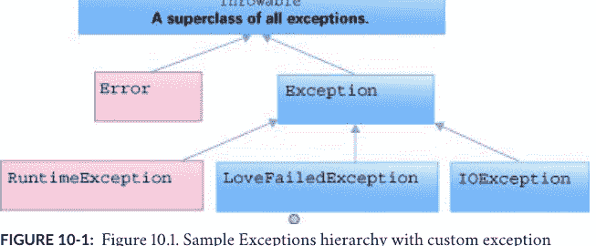

**图 10-1:** 带有自定义异常的异常层次结构示例

程序员如何预先知道某个 Java 方法可能会抛出特定异常以及应该使用 try/catch 块呢？不需要记住任何事情。如果一个方法抛出异常，Java 编译器会打印类似下面的错误消息：

> "Tax java": unreported exception java.io.IOException; must be caught or declared to be thrown at line 5

如果你看到类似这样的消息，请找到被调用类方法的描述，或者搜索异常本身。这里是 `java.io.IOException` 的描述。如后续节所示，添加适当的 try/catch 块来处理此异常。

## TRY/CATCH 块

有五个关键字可以用于异常处理：`try`、`catch`、`finally`、`throw` 和 `throws`。一个 `try` 可以有多个 `catch` 块，为处理多种类型的错误提供支持。例如，当程序读取文件时，文件可能不存在——你必须捕获 `FileNotFoundException`。如果文件存在，但代码读取到了文件末尾，则需要 `EOFException` 的 catch 子句。列表 10-4 展示了一个多异常 catch 块。

**列表 10-4** 一个带有多个 catch 语句的 try

```java
public void getCustomers() {
    try {
        fileCustomers.read();
    } catch (FileNotFoundException fileException) {
        System.out.println("Cannot find file Customers");
    } catch (EOFException eof) {
        System.out.println("Done with file read");
    } catch (IOException ioe) {
        System.out.println("Problem reading file: " + ioe.getMessage());
    }
}
```

如果捕获的异常属于同一个继承分支，那么 catch 语句的顺序可能非常重要。例如，`EOFException` 是更通用的 `IOException` 的子类，你必须将子类的 catch 块放在前面。如果你将 `IOException` 的 catch 块放在 `EOFException` 之前，后面的块将永远不会被到达——文件末尾错误将被 `IOException` catch 块拦截。

从 Java 7 开始，你可以在一个 catch 块中捕获多个异常。例如，前面的代码可以重写为：

```java
public void getCustomers() {
    try {
        fileCustomers.read(); // 可能会抛出错误
    } catch (FileNotFoundException | IOException ioe) {
        System.out.println("Problem reading file: " + ioe.getMessage());
    } catch (Exception ex) {
        System.out.println("Exception in getCustomers: " + ex.getMessage());
    }
}
```

catch 块接收一个 `Exception` 实例，其中包含问题的说明，`Exception` 的 `getMessage()` 方法返回此信息。如果 `getMessage()` 返回的错误描述不够清晰，请使用 `Exception.toString()` 方法。

如果你需要关于异常的更详细信息，请在接收到的 `Exception` 对象上使用 `printStackTrace()` 方法（见列表 10-4）。

## THROWS 子句

在某些情况下，使用 `throw` 关键字将异常传播到调用方法是有意义的。如列表 10-5 所示：

```java
public class CustomerList {
    public static void main(String[] args) throws IOException {
        // 其他代码
        getAllCustomers();
    }

    public void getAllCustomers() throws IOException {
        // 列表 10-5
        // ...
    }
}
```

## FINALLY 子句

代码可以通过多种方式退出 try/catch 块：

- try 块中的代码成功结束且程序继续。
- try 块中的代码执行了 `return` 语句且程序返回。
- try 块中的代码抛出了异常，控制转移到 catch 块。

如果有一段无论成功失败都必须执行，请将其放在 `finally` 子句下。

### 列表 10-6 使用 finally 子句

```java
try {
    file.read();
    // 不要在 try 块中关闭文件
} catch (Exception e) {
    e.printStackTrace();
} finally {
    try {
        file.close();
    } catch (IOException ioe) {
        ioe.printStackTrace();
    }
}
```

无论读取操作是否成功，代码都会关闭文件，因为在 `finally` 块中调用了 `close()` 函数。如果你将 `close()` 函数放在 try 块中，当发生异常时，下一个执行的代码将是 catch 块，跳过了 close 操作，导致资源泄漏，`file` 变量引用的对象留在内存中停留。总结来说，始终使用 `finally` 子句来释放系统资源。

## PRINTSTACKTRACE

在某些代码中，我调用 `printStackTrace()` 方法是为了让代码示例更短。但 `printStackTrace()` 是一个很慢的操作，最好从异常对象中提取错误消息，而不是将整个堆栈跟踪打印到错误输出。

## Try资源（Try-With-Resources）

从 Java 7 开始，你可以使用 try-with-resources 语法简化 try/catch 块的代码，该语法引导 Java 自动关闭资源而无需使用 `finally` 子句。你只需要在 `try` 关键字后的括号中打开资源，它们会被自动关闭。下面的代码说明了资源。输入对象 `InputStream`（在 I-7 节中解释）会自动关闭，无需使用 `finally`。

## AUTOCLOSEABLE 接口

自动关闭只有当资源实现了 `java.lang.AutoCloseable` 或 `java.io.Closeable` 接口时才有效，`FileInputStream` 就是此类情况。如果你想创建能够自动关闭某些资源的类，并让它们实现这些接口中的一个。

122 | 第10 节 异常处理

如果你不计划在当前方法中处理异常，异常将传递到调用它的方法。在这种情况下，你可以使用 `finally` 子句而不使用 `catch` 子句，而在其他情况下 `catch` 子句是强制性的：

```java
public void method() throws IOException {
    try {
        // 如果发生异常，调用此方法的方法
        // 将处理它
        file.read();
    } finally {
        file.close();
    }
}
```

# THROW 关键字

如果方法中发生了异常，你可能想执行以下操作之一：

1. 捕获异常。
2. 进行一些部分错误处理（例如记录错误日志）。
3. 将异常抛出给调用方法以进行进一步处理。
4. 仅让用户感知到问题的存在。

在某些情况下，你可能想捕获异常并通过抛出另一个异常（带有修改后的错误信息）到调用方法来处理它。

`throw` 语句用于抛出异常对象。程序抛出的对象必须是 `Throwable` 类型。这意味着你只能抛出 `Throwable` 类的子类，所有的 Java 异常都是它的子类。

```java
public class CustomerList {
    public void getAllCustomers() throws Exception {
        // 这里可以包含其他代码
        try {
            file.read(); // 这一行可能会抛出异常
        } catch (IOException ioe) {
            // 记录此错误，并重新抛出带有
            // 自错误描述的异常
            throw new Exception("Customer List is not available" + ioe.getMessage());
        }
    }
}

public static void main(String[] args) {
    System.out.println("Customer List");
    // 这里可以包含其他代码
    try {
        // 由于 getAllCustomers() 声明了异常，
        // 你应该要么捕获它要么声明。重新抛出也是
        // 一个选项，除非在 main() 方法层次结构中。
        getAllCustomers();
    } catch (Exception e) {
        System.out.println(e.getMessage());
    }
}
```

# 创建你自己的异常

你也可以创建为了适应业务应用程序而自定义的异常。只需创建一个自 `Throwable` 层次结构中某一个类的子类即可。

假设你经营自行车销售业务，并需要验证客户的订单。你可以创建一个新类 `TooManyBikesException`，如果有人尝试订购超过商店卡车负载能力的自行车，就抛出它。列表 10-7 显示的 `BikeOrder` 类突出了这个想法。

## 列表 10-7 创建并抛出你自己的异常

```java
public class TooManyBikesException extends Exception {

    TooManyBikesException(String msgText) {
        super(msgText);
    }
}

public class BikeOrder {

    public static void validateOrder(String bikeModel, int quantity) throws TooManyBikesException {

        // 执行一些数据验证，如果输入的
        // 数量或型号无效，则执行以下操作：
        throw new TooManyBikesException("Cannot ship " + quantity + " bikes of the model " + bikeModel);
    }
}

public class OrderWindow extends JFrame {
    // ...
    public void actionPerformed(ActionEvent e) {
        // 用户点击了“Validate Order”按钮
        try {
            bikeOrder.validateOrder("Model-123", 50);
            // 如果发生异常，下一行将被跳过
            txtResult.setText("Order is valid");
        } catch (TooManyBikesException e) {
            txtResult.setText(e.getMessage());
        }
    }
}
```

列表 10-8 显示的 `TooManyBikesException` 有一个唯一的名称，并且文本包含某些特定于运输业务的信息。但提供应用程序特定信息的另一种方法是在自定义异常中声明一个或多个额外变量。这些变量可以存储描述错误的多个数据项。

## 列表 10-8 带有额外属性的自定义异常

```java
public class TooManyBikesException extends Exception {
    // 声明一个应用程序特定的属性
    ShippingInfo shippingInfo;

    TooManyBikesException(String msgText, ShippingInfo shippingInfo) {
        super(msgText);
        this.shippingInfo = shippingInfo;
    }
}
```

列表 10-8 展示了向自定义异常类 `TooManyBikesException` 添加应用程序特定 `ShippingInfo` 的代码。应用程序可以提供一个描述运输错误的对象，并将其作为参数传递给异常的构造函数。后者将其存储在类变量 `shippingInfo` 中，任何捕获此异常的方法都可以提取 `ShippingInfo` 对象并对其进行操作。

在 Java EE 应用程序中，异常可以跨越多个层级（如 JSF、EJB、Servlet、客户端），只有在异常内部拥有自定义属性才能确保宝贵的信息不丢失，但每个层级都可以向此自定义属性添加更多具体细节，这有助于追踪错误。

这里还有一个名为 `RemoteException` 的类，它有一个名为 `detail` 的字段，用于通信错误。你可以扩展这个类以使异常更具描述性。这个主题可能适用于第 25 到 35 节关于服务器端技术的内容，但由于本节是专门讲解异常的，所以我在这里提到了。

## 尝试一试

处理编程错误是必须的。遗憾的是，我看到一些 Java 开发者忽略了某些错误。不幸的是，我看到一些 Java 开发者编写了空的 `catch` 子句。这非常糟糕，这就像一个有一天会爆炸的定时炸弹。不要走捷径；异常处理应该被认真对待。有关更多细节，请参考 Oracle 教程：http://bit.ly/3In0w

### 课程要求

你应该安装了 Java。

> 注意：你可以在 www.wrox.com/go/javapro24hre 下载本节的代码和资源。可以在 Lesson1。

### 步骤说明

1. 创建一个名为 Lesson1 的 Eclipse 项目。
2. 通过以下教程学习 `JComboBox`：http://bit.ly/1qfP
3. 当用户选择型号或更改数量时处理事件并重新验证订单。


- 4. 如果订单可以运输，抛出并处理 `TooBikeException`。

# 数组重温

Java 数组允许在内存中的一个位置存储基本类型或对象引用。你在第 5 章：数组中已经接触过数组——数组允许你存储和访问一组相同类型的变量。让我们回顾声明和填充数组的步骤。

首先，声明一个与数组要存储的对象（基本类型）类型匹配的变量，并预留足够的内存来容纳所有对象。例如，为了存储 10 个 `Customer` 类实例预留足够的内存，你如下声明变量 `customers`：

```java
Customer[] customers = new Customer[10];
```

此时，你已经为存储 10 个内存引用分配了足够的空间，而不是实际的对象。接下来，创建实例并将它们的引用存储在数组中。

```java
Customer[] customers = new Customer[10];
customers[0] = new Customer("David","Lee");
customers[1] = new Customer("Ringo","Starr");
customers[9] = new Customer("Lucy","Mann");
```

现在为在线商店消费超过 500 美元的客户提供 85 折优惠：

```java
for (Customer c : customers) {
  if (c.getTotalCharges() > 500) {
    c.setDiscount(15);
  }
}
```

注意这里使用了 for-each 循环。它可以安全地遍历数组，而不会尝试访问边界之外的元素。如果程序员忘记检查数组的大小（记住，如果数组有 n 个元素，最后一个索引是 n-1）并尝试访问元素 `customers[10].setDiscount(15)`，将抛出 `ArrayIndexOutOfBoundsException`。

## JAVA UTIL 中的集合接口

一个典型的集合类实现了多个接口，这些接口表示了一个定义的层次结构。例如，`ArrayList` 实现了 `List` 接口，该接口继承了 `Collection`。这允许程序遍历集合，而不必担心特定集合的具体实现。该接口继承了 `Iterable`，因此应用程序可以请求迭代器 对象的引用，并只需请求集合中的下一个元素。你将在本章后面看到使用 `Iterator` 的示例。

你可以对实现 `Iterable` 的类使用 for-each 循环，这是集合的外部（也称为命令式）迭代。Java 8 引入了一种新的且优的集合迭代方式——`Iterable.forEach()` 方法，这属于内部迭代。我将在第 13 章解释为什么内部迭代更好。

`List` 接口被 `ArrayList` 和 `LinkedList` 等有序集合使用。它允许存在重复元素。例如，以下代码段将在 `ArrayList` 中创建两个元素：

```java
arrayList.add("Mary");
arrayList.add("Mary");
```

`Set` 接口由不允许存在重复元素的集合实现——例如 `HashSet` 和 `SortedSet`。例如，下面的代码段在 `HashSet` 中创建了一个元素。第二行发现 Mary 已经存在，它不会对其更改，并返回 `false`：

```java
hashSet.add("Mary");
hashSet.add("Mary"); // Returns false
```

`Map` 接口用于存储键/值对。一个映射可以包含重复的键，但每个键只能映射到一个值（对象）。你将在本节后面看到一些相关的示例。

`Queue` 接口主要用于需要先入先出（FIFO）操作的集合（优先级队列除外）。每个新元素被添加到队列尾部，而元素从队列头部检索。如果需要，你可以限制队列的大小。`LinkedList` 是实现 `Queue` 接口的类之一。

现在让我们来看看实现这些接口的类。

## 使用 ArrayList 的动态数组

数组提供了对数据集合最快的访问速度，但你需要知道要存储的元素数量。幸运的是，Java 有没有限制的类，如果需要，你可以在运行时向集合添加更多元素。本节展示了从 `ArrayList` 开始的几种集合。

在内部它使用数组进行存储，但在向 `ArrayList` 添加元素时，它会以较小的增量增加顺序数组的大小。相应地，随着元素的删除，集合的大小会缩小。你可以在 `ArrayList` 中存储重复的对象。

`ArrayList` 实现了 `List` 接口且只能存储对象；基本类型不能。考虑到 Java 支持装箱（见第 3 章），如果你尝试向集合添加基本类型，它会自动转换为对应的包装对象。为了这种便利，你必须付出代价：`ArrayList` 比数组慢，因为它需要从一个数组到另一个数组进行内部复制以更改集合的大小。

要创建并填充 `ArrayList` 对象，你应该先实例化它，然后通过调用 `add()` 方法将其他对象的元素添加到 `ArrayList` 中，如列表 11-1 所示。

## 列表 11-1 填充 ArrayList

```java
ArrayList customers = new ArrayList();
Customer customer1 = new Customer("David","Lee");
customers.add(customer1);
Customer customer2 = new Customer("Ringo","Starr");
customers.add(customer2);
```

`add()` 方法并没有将对象的实例复制到 `customers` 集合中；它只是存储了添加对象的内存地址。`ArrayList` 中的元素编号从 0 开始。如果你知道一个 `ArrayList` 将存储例如 20 个对象，则使用构造函数进行实例化，这将在创建时处理正确数量内存的责任交给程序员：

```java
ArrayList customers = new ArrayList(20);
```

你可以这样理解第一个示例：“我想声明一个名为 `customers` 的变量，它将拥有访问 `ArrayList` 类提供的所有 API 的权限。”第二个版本意味着：“我想声明一个名为 `customers`，它具有在 `List` 接口中定义的行为。”

第一个示例声明了一个特定实现类的变量——`List` 接口的 `ArrayList`。

`ArrayList` 除了 `List` 之外还实现了几个接口。如果你阅读 `List` 接口的文档，你会发现其他接口包括 `add()`、`get()` 和 `size()` 等方法，这些是我们集合 `customers` 使用的唯一方法。如果需要，声明一个 `List` 类型的变量可以带给我们更大的灵活性。如果以后我们决定切换到 `List` 的另一种实现（例如用 `LinkedList` 代替 `ArrayList`），我们不需要更改 `customers` 的类型。

你可能会说，将声明从 `ArrayList` 改为 `LinkedList` 并不是什么大事——这只是一行代码。但这可能是一件大事，例如，如果你的程序需要将 `customers` 指向的对象传递给另一个参数类型声明为 `ArrayList` 的对象方法。现在我们需要两个地方进行更改。在大型项目中，这种重构可能是一个耗时的过程。

如果你需要特定接口中定义的行为，请声明该接口类型的变量，而不是该接口的具体实现类。

## HASHABLE 和 HASHMAP 类

`HashTable` 和 `HashMap` 类实现了 `Map` 接口并存储键/值对。这些类提供了一种通过键存储和访问集合元素的方便方法。你可以为某个 Java 对象的实例分配一个键并将其用作引用。假设我们在集合中存储了 `Customer`、`Order` 和 `Portfolio` 类的实例。列表 11-3 中的代码片段首先创建这些实例，然后将它们根据某些标识符（键）放入集合中。

### 列表 11-3 用于键值对的 HashTable

```java
Customer customer = new Customer("David", "Leo");
Order order = new Order(123, 500, "IBM");
Portfolio portfolio = new Portfolio(123);

Map data = new HashMap(); // 面向接口编程
data.put("Customer", customer);
data.put("Order", order);
data.put("Portfolio", portfolio);
```

双引号中的值代表用于检索对象的键。在这个示例中，键由 `String` 类表示，但你可以使用任何对象作为键。键是根据应用程序需求选择的；例如，列表 11-3 中的代码可以写在某些订单管理应用程序中。

如果你对计划在 `Hashtable` 中存储多少元素有一个大概数，请使用带容量参数的构造函数：

```java
Hashtable data = new Hashtable(10); // 10 个元素的容量
```

`get()` 方法通过键访问这些对象。你需要在后续代码中执行适当的强制类型转换，或者使用泛型（在第 12 章中解释）。

```java
Order myOrder = (Order) data.get("Order");
```

`size()` 方法返回 `Hashtable` 中的元素数量：

```java
int totalElem = data.size();
```

`containsKey()` 和 `containsValue()` 方法帮助你找出集合是否包含特定的键或值。

`HashMap` 与 `Hashtable` 类似，但它允许 `null` 键和值，并且不是同步的（在课程 9 中解释过）。如果你编写的代码没有通过多线程并发访问同一个元素，请使用 `HashMap`，因为它运行比 `Hashtable` 快。如果你进行并发访问，`Hashtable` 的另一个替代方案是 `ConcurrentHashMap`。

为了加速查找，`Hashtable` 和 `HashMap` 使用哈希函数（基于对象的内容）对数据进行索引，生成一个代表大对象的哈希码。有两个对象生成相同哈希码的概率，但相同的对象总是产生相同的代码。你可以在维基百科上了解更多关于哈希函数的内容 [http://en.wikipedia.org/wiki/Hash_function]。

### java.util.Collections

`java.util.Collections` 类由适用于类的有用方法组成；例如 `sort()`、`reverse()`、`swap()` 等。

## 属性类 (Class Properties)

应用程序通常为你提供一种保存和存储用户偏好（如字体和颜色）的方法。这种情况正是需要存储 `key/value` 对的情况。你可以在本地或服务器上存储此类偏好。在第 14 章中，你将了解到如何处理文件和其他 I/O 流，但从数据结构的角度来看，你将处理 `key/value` 对，例如 `color=red`、`font=verdana`。

基于 Windows 的应用程序在 .ini 文件中存储某些可配置参数。通常，Java 应用程序将属性存储在纯文本文件、XML 文件、数据库等。

在本节中，你将看到一些代码片段，说明如何使用扩展 `Hashtable` 的 Java 类 `Properties` 通过键/值对来操作属性。`Properties` 类有一个 `Hashtable` 没有的限制。

## LinkedList 类

`LinkedList`（链表列表）允许你创建名为队列（先进先出或 FIFO）和栈（后进先出或 LIFO）的数据结构。

在列表内部插入新对象会涉及两个引用的更新：列表的前一个元素现在指向了新插入的对象，而该对象（如果有下一个元素的话）必须包含一个指向下一个元素的引用。此外，增加 `ArrayList` 的大小会导致内存分配和在内存中移动，从而增加了其复杂性。另一方面，使用数组作为底层数据存储的集合提供了对数据元素的随机访问，而链表则只能按顺序处理。

你可以使用 `Iterator`（迭代器）类来遍历列表，它通过其 `next()` 和 `previous()` 方法支持双向遍历列表。列表 11-5 显示了一个示例，其中在某家航空公司的登机口创建了一个候机乘客。

### 代码列表 11-5 LinkedList 示例

```java
import java.util.LinkedList;
import java.util.Iterator;

public class TestLinkedList {

    public static void main(String[] args) {
        LinkedList<String> passengerList = new LinkedList();
        passengerList.add("Alex Smith");
        passengerList.add("Mary Lou");
        passengerList.add("Tim Moe");

        Iterator<String> iterator = passengerList.iterator();
        System.out.println(iterator.next());
        System.out.println(iterator.next());
        System.out.println(iterator.next());
    }
}
```

代码列表 11-5 中的代码使用 `Iterator` 接口遍历并打印列表中的所有对象。

你可能在好奇 `print()` 方法是如何工作的，以及如何通过迭代器打印对象。它会尝试寻找对象上定义的 `toString()` 方法并调用它。在我们的示例中，对象本身就是一个字符串，但在实际情况中，你可能需要打印对象，而定义 `toString()` 方法是实现这一正确方法。

如果你在遍历列表时使用 `add()` 或 `remove()`，新元素将被插入或移除到迭代器的当前位置。

## BITSET 类

`BitSet` 类存储一个位序列。当你需要向程序传递多个指示特定状态的标志位（flags）时，它是一个非常高效的类。想象一个必须快速运行的金融交易应用程序。提高性能的一种方法是用最少量的字节表示最大的信息量。

`BitSet` 的另一个用途是发送带有设备状态信息或作为传感器的程序。例如，某些自动售卖机带有智能芯片，可以自动拨打所有者的电话并发送信号状态信息。发送一组标志位（设置为 1 或 0 的位）而不是文本或数字是实现此操作最经济的方法。

`BitSet` 没有大小限制，可以根据需要增长。根据设置了哪一个位（例如值 1），该类可以指示以下内容：

- 位 0：箱子是空的。
- 位 1：箱子半满。
- 位 2：箱子全满了。
- 位 3：箱子已被取出。
- 位 4：可口乐列是空的。

一个 `BitSet` 对象实例带有多个描述其状态的参数。接收此信号的程序可以打印一份漂亮的报告，机器所有者也可以决定需要派遣技术人员来检查机器。

Java 的 `BitSet` 类不仅仅是位的集合。以下代码准备了一个信号，表示箱子已满且没有剩余的可口乐瓶：

```java
import java.util.BitSet;

class VendingMachineSender {
    public static void main(String args[]) {
        BitSet report = new BitSet();
        report.set(2); // 箱子全满了
        report.set(4); // 没有可口乐
    }
}
```

当电话打进来时，回调方法 `phoneRinging()` 会被调用，信号可以这样解码：

```java
import java.util.BitSet;

class VendingMachineListener {
    public void phoneRinging(BitSet signal) {
        int size = signal.size();
        for (int i = 0; i < size; i++) {
            if (signal.get(i)) {
                switch (i) {
                    case 0:
                        System.out.println("Box is empty");
                        break;
                    case 1:
                        System.out.println("Box is half full");
                        break;
                    case 2:
                        System.out.println("Box is full");
                        break;
                    // 还有更多情况在这里
                }
            }
        }
    }
}
```

## 物联网

物联网（IoT）是一个流行语，用于描述处理小型传感器类设备的互联网应用程序，这些设备具有有限的内存和处理能力。如果你需要为传感器编程，请考虑使用 `BitSet` 类。

## 选择合适的集合

Java 拥有几十个集合类和接口。在本节中，我向你展示了其中几个。但哪种集合适合你的需求呢？以下是一些可以帮助你选择的考虑。


- 如果你需要通过索引访问，请考虑使用 `ArrayList`。
- 如果你需要经常在集合中插入或删除数据，`LinkedList` 对于很多需求来说都是很好的选择。
- 如果你需要一个不允许重复元素的集合，使用实现 `Set` 的集合之一。
- 如果你需要存储键值对，使用实现 `Map` 的集合；例如 `HashMap` 或 `HashTable`。
- 如果你需要一个无论大小如何都能快速查找的集合，使用 `HashSet`。

## 大 O 表示法

在计算中有一种被称为 O 表示法，它描述了随输入规模增大而任务增长的时间。大 O 法表示为 `O(n)`。`n` 的值越大表示对数据的依赖程度越高。因此，`O(1)` 意味着速度不取决于集合的大小。

## 尝试一下

修改列表 11-5 中的 `LinkedList` 示例，在列表第一个元素之后添加一个任意对象。你必须在遍历列表时这样做。当程序就绪时，它产生如下结果：

- Alex Smith
- VIP Customer
- Mary Lou

## 课程要求

对于你应该已安装 Java。

> **注意** 你可以从网站 `www.wrox.com/go/javaprog24hr2e` 下载“尝试”的代码和资源。它们位于 `Lesson11.zip` 中。

## 逐步详解

1. 创建名为 `Lesson1` 的 Eclipse 项目。
2. 在第一次调用 `iterator.next()` 之后添加以下行：`iterator.add("VIP Customer");`
3. 运行程序并观察它没有产生 "VIP Customer"。由于迭代器位于新插入的对象之后。
4. 在 "VIP Customer" 之后添加 `iterator.previous()` 行来移动迭代器元素。
5. 再添加一个语句（否则程序不会运行）。编译并运行程序。它按要求打印所有元素。
6. 现在通过将你在第 2 步中添加的行改为 `passengerList.add("VIP Customer");` 来破坏代码。
7. 运行程序。它打印链表的第一个元素并产生运行时异常：

```
Alex Smith
Exception in thread "main"
java.util.ConcurrentModificationException
at java.util.LinkedList$ListIter.checkForModification(
LinkedList.java:761)
```

产生这种并发修改异常的原因是一个执行线程正在遍历集合，而另一个线程正试图以不安全的方式修改底层集合。线程的概念在第 7 章中介绍。

> **提示** 请在线在 `www.wrox.com/go/javaprog24hr2e` 选择第二单元的视频。你也可以从该网站下载本课程的代码和资源。

# 12

# 泛型简介

在上一节课程中，你看到了一个存储不同类型对象的集合示例（参见 [Listing II-2](#)）。在运行时，该程序会测试每个对象的实际类型并将其转换为相应的类型——`Customer` 或 `Order`。如果某些代码添加了另一种（意料之外的）数据类型的元素，那么与其将其留到运行时再处理，如果编译器在编译期间就能防止集合、对象甚至方法参数和返回类型出现意料之外的类型，那就太好了。

Java 支持*泛型*（*generics*），它允许你使用参数化的数据类型——你可以在声明对象或方法时不指定具体的数据类型，而是将具体类型的定义转移到使用这些对象、集合或方法的代码中。换句话说，泛型是一种可以与参数化数据类型一起工作的类型。

## 参数化类

不仅是 Java 方法可以接受参数（也称为参数），类也可以拥有参数。我将在[自定义参数化类](#)章节向你展示如何实现。

使用泛型表示法，你可以获得 Java 编译器的帮助，它不允许你使用与声明不匹配的“错误”类型的对象。换句话说，你可以在编译阶段之前更早地捕获不的数据类型。这个概念可以通过示例很容易解释，我们直接进入正题。

## 类的泛型

考虑 [Listing II-2](#) 中的 `ArrayList`，它像一个万能篮——可以容纳几乎任何对象的存储器。但如果你在客户集合的声明中使用角括号添加参数化类型 `Customer`（`ArrayList<Customer>`，参见列表 [2-1]），那么任何拒绝 `Order` 对象的尝试都会产生以下编译器错误：

The method add(Customer) in the type ArrayList<Customer> is not applicable for the arguments (Order).

这样想：`ArrayList` 可以用于存储任何对象，而使用泛型允许你对特定 `ArrayList` 实例或参数化类（这只是泛型的一种类型）中允许的对象类型进行约束。

## LISTING 12-1 在集合中使用泛型

```java
import java.util.List;
import java.util.ArrayList;

public class TestGeneric(String[] args) {

    List<Customer> customers = new ArrayList<Customer>();

    Customer customer1 = new Customer("David", "Lee");
    customers.add(customer1);
    Customer customer2 = new Customer("Ringo", "Starr");
    customers.add(customer2);

    Order order = new Order();

    customers.add(order); // 编译错误

}
```

在编译期间获取错误比获取运行时异常要好。那些被称为钻石运算符（diamond operator）——在上一个示例中，你不需要在右侧重复 `<Customer>`，因为该类型已经在接口中指定为允许。作为复习，在之前的一节“面向接口编程”（Programming to Interfaces）中，我一直使用接口来声明变量 `customers`，正如之前解释的那样。

是什么让 `ArrayList<E>` 类能够拒绝不需要的数据类型呢？打开 `ArrayList` 本身的源代码（在 Eclipse 中按 F3 查看任何类或接口的源码）。它的开头如下：

```java
public class ArrayList<E> extends AbstractList<E>
implements List<E>, RandomAccess, Cloneable, Serializable
```

类名后的这个魔法 `<E>` 告诉 Java 该类可以使用许多类型的元素，具体是哪一种在创建 `ArrayList` 的具体实例之前仍然未知。在 Listing 2-1 中，类型参数 `<Customer>` 在编译期间替换了 `<E>`，编译器确保代码在 `customers` 集合中只存储 `Customer` 实例。

## 类型擦除

我想强调的是，`<E>` 表示仅在类型声明期间使用。Listing 2-1 中的代码不包含 `<E>`。编译器将 `<E>` 替换为 `Customer` 并擦除字节码中的参数化字节类型。这个过程被称为类型擦除（type erasure）；它主要为了与旧版本 Java 编写的代码兼容，旧版本中没有泛型。生成的代码与参数化数据类型和原始数据类型是相同的。

现在，你可以通过移除强制转换来简化 Listing 2-1 中的代码（参见 Listing 2-2）。为什么呢？因为有了泛型，当编译器看到特定类型时，它会自动生成字节码，在内部执行强制转换！这就是为什么你不再需要将从方法 `get(i)` 返回的数据从 `Object` 强制转换为 `Customer` 了。此外，你被保证集合 `customers` 将只有 `Customer` 实例。Java 编译器有能力查看方法调用并正确推断参数的类型。它不仅用于泛型，还用于 lambda 表达式，我们将在 IS 中涵盖这些。

## LISTING 12-2 无需强制转换遍历 customers

```java
List<Customer> customers = new ArrayList<>();
// 为了简洁，省略了填充 customers 的代码
// 遍历列表 customers 并对此集合的每个
// 元素进行操作。不需要强制转换。

for (Customer customer: customers){
    customer.doSomething();
}
```

在此示例中使用参数化的 `ArrayList` 不是必须的。你可以写以下代码：

```java
List customers = new ArrayList<>();
```

编译器会给你一个警告，说明 `ArrayList` 是一个原始类型（raw type）并且应该被参数化。这基本上意味着如果你向此集合中添加一个可能在程序其他地方导致崩溃的类型对象，编译器将无法帮助你。虽然使用原始类型不是错误，但应该尽量避免。

## 声明泛型

如果你要创建自己的类，可以使用角括号来声明你的类型。字母 `<E>` 代表元素（element），但你可以使用任何字母。例如，`<K>` 代表键（key），`<V>` 代表值（value）。这在处理 Maps 时常见。

如果你想定义一个接受任何类型列表的方法，可以使用通配符 `?`。这允许方法在接受的类型上更具活性。

## 通配符

Listing 12-3 包含代表未知类型的问号。通过示例解释它们更容易。我们将 Listing 12-2 中的 for 循环转换为一个方法。在 Eclipse 高亮代码，右键点击并选择 Refactor -> Extract Method。在弹出窗口中输入 `processCustomers` 并点击 OK。

## LISTING 12-4 重构后的类 TestGeneric

```java
import java.util.ArrayList;
import java.util.Hashtable;
import java.util.List;

public class TestGeneric {

    public static void main(String[] args) {
        List<Customer> customers = new ArrayList<Customer>();
        Customer customer1 = new Customer("David", "Lee");
        customers.add(customer1);
        Customer customer2 = new Customer("Ringo", "Starr");
        customers.add(customer2);
        Order order = new Order();
        // customers.add(order); // 编译错误

        // 遍历列表 customers 并对此集合的每个
        // 元素进行操作。
        // 不需要强制转换。

        processData(customers);
    }

    private static void processData(List<Customer> customers) {
        for (Customer customer : customers) {
            customer.doSomething();
        }
    }
}
```

## LISTING 12-5 回到强制转换

```java
private static void processData(ArrayList data) {
    for (Object object : data) {
        if(object instanceof Customer) {
            ((Customer) object).doSomething();
        }
    }
}
```

## LISTING 12-3 来自 List 接口的片段

```java
package java.util;

public interface List<E> extends Collection<E> {

    Iterator<E> iterator();
    T[] toArray(T[] a);
    boolean add(E c);
    boolean containsAll(Collection<? extends E> c);
    boolean add(int index, E c);
    boolean remove(E c);
    E set(int index, E element);
    void add(Collection<? extends E> c);
    ListIterator<E> listIterator();
    ListIterator<E> listIterator(int index);
    List<E> subList(int fromIndex, int toIndex);
}
```

# 146 | 第 12 ：泛型简介

但现在，掌握了新知识后，你可以将 `processData()` 方法的签名更改为：

```java
private static void processData(List<Object> data) {
    // do something with data
}
```

遗憾的是，这种方案行不通，因为不存在所谓的“参数化类型的继承”。换句话说，即使 `Customer` 类是 `Object` 的子类，这种继承也不适用于参数 `<Customer>` 和 `<Object>`。这时，代表未知类型的问号 `?` 就派上用场了。让 `processData()` 更具泛型化的下一步是按如下所示方法签名：

```java
private static void processData(List<? extends T> data) {
    // do something with data
}
```

使用这样的方法签名与简单地声明 `List` 方法参数不同，后者将如列表 12-5 所示需要强制转换。通过你所说的通配符符号，你表示：“此时 `data` 的类型未知，但无论某人使用 `processData()` 方法，它都会被确定并正确编译，因此不需要强制转换。”

你面临的下一个挑战是编译在未知类型对象上调用 `Something()` 方法的代码。

## 创建参数化类

让我们考虑第 10 节“It It”部分自行车商店的示例。那家在线商店有一辆卡车，用于向客户交付自行车和备轮。我们希望只允许自行车和轮子进入卡车；不允许人员进入。考虑图 12-1 中的层次结构：

`Truck` 类型的对象可以包含 `Product` 实例。`Ferry` 对象可以包含 `Truck` 实例。`Product`、`Bike`、`Wheel` 和 `Person` 类在该应用程序中没有实现这些业务逻辑，因为这对理解泛型无关。但 `Product` 是 `Bike` 和 `Model` 的父类这一事实是重要的。参数化的 `Truck` 类如下：

```java
public class Truck<T> {
    private List<T> products = new ArrayList<>();

    // 将产品装上卡车
    public void add(T t) {
        products.add(t);
    }

    // 返回装上卡车的产品
    public List<T> getProducts() {
        return products;
    }
}
```

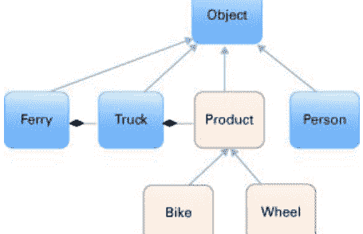

图 12-1：图 12-1 自车商店类层次结构

此声明使用了一个类型为 `T` 的参数，该类型目前还是未知的。当你创建一个程序并实例化泛型类时，你会指定一个具体的类型；例如：

```java
public class TestGenericType {
    public static void main(String[] args) {
        Truck<Product> shipment = new Truck<>();

        Bike bike = new Bike();
        Wheel wheel = new Wheel();
        Person person = new Person();

        shipment.add(bike);
        shipment.add(wheel);
        // shipment.add(person); // 编译器错误
    }
}
```

变量 `shipment` 指向 `Truck` 实例，该实例允许添加 `Product` 类型或其子类的对象。由于 `Person` 不是 `Product`，编译器将不允许你将其添加到卡车载荷中。

## 边界类型参数

边界类型参数允许你指定带有继承层次结构相关限制的泛型类型。让我们继续使用自行车商店的示例。虽然 `Product` 是 `Bike` 的父类，但 `ArrayList<Product>` 并不是 `ArrayList<Bike>` 的父类。在这里，如果有一个方法期望 `ArrayList<Product>` 作为参数，你不能提供 `ArrayList<Bike>` 代替。使用泛型时，你应该使用 `extends` 关键字来指定继承层次结构中允许类型的上界。在这种情况下，它将是 `ArrayList<? extends Product>`。这意味着允许包含 `Product` 类型及其子类对象的 `ArrayList`。问号在这里是通配符。

为了说明这一点，让我们更改自行车商店的规则：你不能在同一辆卡车上混合自行车和轮子。此外，你还希望能够将卡车装上轮渡上。`Ferry` 类如下：


```java
public class Ferry {

    public void loadTruck(Truck<? extends Product> truck) { 
    }

    public void unloadToDock(List<? extends Product> ferryTrucks){
        for (Product product : ferryTrucks)
            dockTrucks.add(product);
    }
}
```

`loadTruck()` 方法声明了与上界通配符的约定——只有带有 `Product` 及其子类的卡车可以装上轮渡。`TestGenericBounded` 类创建了一个装有两辆自行车的卡车，另一个装有三个备轮子的卡车。然后它将两辆卡车都装在了轮渡上。

```java
public class TestGenericBounded {

    public static void main(String[] args) {

        Ferry ferry = new Ferry();

        // 装载两辆自行车的卡车
        Truck<Bike> bikes = new Truck<>();
        bikes.add(new Bike());
        bikes.add(new Bike());

        // 装载三个备轮子的卡车
        Truck<Wheel> wheels = new Truck<>();
        wheels.add(new Wheel());
        wheels.add(new Wheel());
        wheels.add(new Wheel());

        // 将两辆卡车装上轮渡
        ferry.loadTruck(bikes);
        ferry.loadTruck(wheels);
    }
}
```

如果 `ferry.loadTruck()` 方法被声明为 `loadTruck(Truck<Product> truck)`，你将无法装载任何一辆卡车。`Ferry` 类还有一个 `unloadToDock` 方法，它展示了下界通配符：

```java
public void unloadToDock(List<? extends Product> ferryTrucks,
    List<? super Product> dockTrucks) {
    for (Product product : ferryTrucks) {
        dockTrucks.add(product);
    }
}
```

## 泛型方法

在声明方法时，你可以定义参数和返回值的类型，使用泛型。例如，`toArray()` 以一个参数化类型开始。该方法的声明声明接收一个对象数组：


图 12-2：泛型方法的签名如果你有一个 `ArrayList<Integer>`，你可以如下声明并将其转换为数组：

```java
List<Integer> myNumericList = new ArrayList<>();
Integer[] myArray = new Integer[myNumericList.size()];
myArray = myNumericList.toArray();
```

如果你需要使用相同的 `toArray()` 方法处理客户列表，数据类型 `<T>` 会神奇地（通过编译器）转换为 `Customer` 类型：

```java
List<Customer> myCustomerList = new ArrayList<>();
Customer[] myArray = new Customer[myCustomerList.size()];
myArray = myCustomerList.toArray();
```

就像“边界类型参数”部分的示例一样，你允许对类型设置限制。例如，你可以限制 `toArray()` 方法仅适用于实现特定接口的类型：

```java
<T extends Comparable<T>> toArray(T[] a);
```

## 尝试一下

创建一个使用泛型的简单程序，使用列表 7-2 中的 `RetiredEmployee`（继承 `Employee` 类）。编写一个泛型方法，接受 `RetiredEmployee` 对象列表并将其复制到 `Employee` 对象列表中。使用 `Ferry` 类的 `loadToDock()` 方法作为示例

## 课程要求

你已经安装了 Java。

> 注意 你可以从书籍的网页 www.wrox.com/go/javaprog24hr2e 下载此“尝试”的代码和资源。它们在 Lesson12.zip 中。

## 步骤说明

1. 创建一个名为 `Lesson1` 的新类。

2. 创建 `Employee` 类和继承自它的 `RetiredEmployee` 类。

3. 创建一个可执行类 `TestGenericMethod`，接受 `RetiredEmployee` 对象列表并将其复制到 `Employee` 对象列表中。该方法应该在系统控制台上打印结果集合中每个 `Employee` 的名称。

4. 运行 `TestGenericMethod` 程序并观察打印的名称。

# 13 Lambda 表达式与函数式风格编程

介绍本章的内容具有一定的挑战性。从书开头开始你已经了解到 Java 是一种面向对象的语言（与函数式语言相反）。你已经学习了要启动任何程序，你需要定义带有属性和方法的类，将它们实例化为对象，并在这些实例上调用方法（即函数）。如果一个方法被声明为 `static`，你可以在不需要实例化类的情况下调用它，但如果你正在定义一个类，然后在里面定义一个静态方法（例如，为了处理 JButton 的点击），你需要实现并实例化一个仅包含 `actionPerformed()` 方法的监听器类。

现在我想告诉你，面向对象的方法可能存在缺点，而且有大量的函数式编程语言，在这些语言中你不需要将功能封装在类内部。函数式语言的支持者（他们也是正确的）认为，构建可以被方法改变（可变的）字段的对象可能被证明更难调试。他们更倾向于以不依赖外部上下文的函数来思考。

函数以参数的形式从外部接收值，应用某些逻辑并返回结果。函数不会改变任何外部值（包括作为参数提供的值）。函数可以接收单个值（或数据集合）并产生另一个值，但不会修改输入。因此，无论你用相同的输入调用给定函数多少次，返回的值都是相同的。

在 Haskell、JavaScript、Scala、Closure 和 Ruby 等语言中，函数被视为一等公民，它们不需要要求你编写和实例化类。在函数式语言中，你可以执行以下操作：

- 将函数赋值给变量。
- 将函数作为参数传递给另一个函数。
- 在另一个函数内部定义一个函数。
- 从另一个函数返回一个函数。

例如，以下是在 JavaScript 中创建一个返回另一个函数的函数的方法：

```javascript
function Deduction () {
  var taxDeduction = 500;

  return function (income) {
    // 在这里使用 taxDeduction 计算税
    // ...
    return calculatedTax;
  }
}
```

Java 8 引入了 lambda 表达式（源自 Lambda 演算），它们是匿名函数。由于 lambda 表达式没有名称，它可以作为一个值赋值给具名变量。

通过 lambda 表达式，面向对象的 Java（以及 C 语言）允许使用混合风格编程。当你需要一个具名的对象时，声明一个类并实例化它。如果你只需要实现某些算法，请定义一个 lambda 表达式。

在本节中，你将发现如何通过 lambda 表达式让代码更加简洁。Java 8 通过将 `Function` 表示为 Java 类型系统中的一个对象，将函数式融入到面向对象的风格中。此外，声明只有一个抽象方法的接口（函数式接口）现在可以实现，而无需创建一个对象来包含该方法。

## 命令式对比函数式风格

Java 不是函数式编程语言，但如果没有 lambda 表达式，它允许使用函数式风格编写程序。我将向你展示一个快速示例，说明命令式函数式编程的概念。接下来的 `ImperativeFunctional` 类创建了一个集合并填充了名称。然后它尝试使用不同的风格——命令式和函数式——在集合中寻找名为 "Ringo" 的元素。

```java
public class ImperativeFunctional {
  public static void main(String[] args) {
    List<String> winners = new ArrayList<>();

    winners.add("Mary");
    winners.add("Ringo");
    winners.add("Joe");
    winners.add("Paul");

    // 命令式风格
    boolean getRingo = false;
    for (String winner : winners){
      if ("Ringo".equals(winner)){
        getRingo = true;
      }
    }
    System.out.println("Imperative style. " + getRingo);

    // 函数式风格
    System.out.println("Functional style. Ringo won?" + winners.contains("Ringo"));
  }
}
```

运行此程序将产生以下输出：

Imperative style. true

Functional style. Ringo won? true

在命令式风格中，每个步骤都要做什么：创建一个标志位，然后在 for 循环中检查每个元素，如果找到了 Ringo，则将标志位的值改为 true 并跳出循环。在这种情况下，假设 `ArrayList` 只是赢者的存储器。

在函数式风格中，我们不决定如何搜索 Ringo，只需调用 `contains()` 方法。没有外部循环，没有标志位，没有 `break`。它简洁且易于理解。在当前版本的 Java 中`contains()` 方法是如何实现的？它是 `ArrayList` 的内部逻辑。完全可能是或者在未来的 Java 版本中，`contains()` 方法会将集合（特别是大集合）分成更小的块，如果计算机有多个处理器，它将并行搜索 Ringo，而命令式则将顺序处理这些操作。

这个示例使用了集合中已经存在的函数。但通过 lambda，你可以定义自己的函数，并将其执行权交给类或集合。在定义 lambda 时，Java 运行时可能会决定执行它。

你将在本章的“使用 foreach 迭代集合”部分中看到一些比较命令式和函数式编程风格的示例。在命令式风格中，我们告诉 Java 如何做，但在函数式风格中，我们告诉它要做什么。

## 什么是 lambda 表达式

lambda 表达式是一个匿名函数，它可以：

- 赋值给变量。
- 作为参数传递给另一个函数。
- 从方法返回。

虽然 lambda 表达式的语法看起来很奇怪，但它很容易理解。只需取一个普通的方法声明，删除左括号之前的内容，并在右括号后添加 `->` 符号。如果你想将上面的 lambda 表达式重写为 Java 方法，它可能是这样的：

```java
public int addNumbers(int a, int b) {
    return a + b;
}
```

在 lambda 表达式中，指定参数类型是可选的。Lambda 支持推断数据类型；Java 编译器会根据代码的上下文正确地“猜测”类型。我们的 lambda 表达式可以重写为：

```java
(a, b) -> a + b;
```

如果表达式由多行组成，你需要在大括号内编写代码并添加显式的 return 语句。你可以将 lambda 表达式传递给方法进行应用。你将在标题为“Interfaces Function and BiFunction”的章节看到使用 `apply()` 的示例。

## 函数式接口

接口可以声明任意数量的方法，但为了作为 lambda 的实现，接口必须声明单个未实现的方法。这样的接口被称为函数式接口。从技术上讲，函数式接口可以有多个方法；其中一些可以是静态的，一些可以实现为默认方法——这些不计入。重要的部分是只有一个需要实现的抽象方法。

考虑你在第 9 节中用于处理按钮点击的 `ActionListener` 接口：

```java
public interface ActionListener extends EventListener {
    public void actionPerformed(ActionEvent actionEvent);
}
```

使用匿名内部类实现接口的 `addActionListener` 的旧方法可能如下：

```java
myButton.addActionListener(new ActionListener() {
    public void actionPerformed(ActionEvent actionEvent) {
        someTextField.setText("Someone clicked on the button");
    }
});
```

由于 `ActionListener` 定义了一个单一方法 `actionPerformed()`，因此它可以被称为函数式接口（functional interface）。因此，它可以使用 lambda 表达式以简洁的形式实现：

```java
myButton.addActionListener(event -> {
    someTextField.setText("Someone clicked on the button");
});
```

这种写法写起来和读起来更简单，不是吗？不再需要声明和实例化匿名类。这个 lambda 表达式有一个由变量 `actionEvent` 表示的参数（你可以命名为任何名称，且不需要数据类型）。`actionPerformed()` 方法是一个回调，运行时会将 `ActionEvent` 的实例传递给它。由于它是单方法接口，编译器足够智能，可以推出参数的类型，因此你甚至不需要声明它。任何函数式接口都有一个方法，编译器很容易推出它的名称，所以你只需要编写一个 lambda 表达式作为它的实现。

## 方法引用 (Method References)

在某些情况下，你的 lambda 只是调用了一个预定义的方法。Java 8 引入了方法引用，可以用来代替 lambda 表达式。新语法引入了双冒号运算符 `::`，你可以这样写：

```
myObject::myMethod
```

方法名后没有括号，且你不能在方法引用中指定参数。这种语法适用于方法没有参数，或者编译器可以“推出”存在此类方法作为参数的情况。例如，以下方法没有参数，可以使用方法引用调用：

```java
public void myMethod() {
    System.out.println("Hello from myMethod");
}
```

对于推断参数（即由编译器推断的参数）的情况，可以通过事件监听器回调方法来说明。以下类 `MethodReferenceSample` 在 `addActionListener()` 中使用了方法引用语法。编译器推出 `processButtonClick()` 方法期望 `ActionEvent` 类型的参数。

```java
public class MethodReferenceSample extends JFrame {

    public void processButtonClick(ActionEvent event) {
        System.out.println("clicked on the button");
    }

    public static void main(String[] args) {
        MethodReferenceSample mrs = new MethodReferenceSample();
        JButton myButton = new JButton("Click me");
        mrs.addActionListener(myButton);

        myButton.addActionListener(mrs::processButtonClick);

        mrs.pack();
        mrs.setVisible(true);
        mrs.setDefaultCloseOperation(JFrame.EXIT_ON_CLOSE);
    }
}
```

## ECLIPSE LUNA 与 LAMBDAS

Eclipse Luna 以及 IntelliJ IDEA 有助于将实现函数式接口的匿名内部类转换为 lambda 表达式。高亮匿名类的创建部分（以 `new` 开始），并按 `Ctrl+1`（Mac 上为 `Cmd+1`）选择快速修复（Quick Fix）。Eclipse 会打开一个菜单。选择 `Convert to Lambda Expression` 选项将匿名内部类转换为 lambda 表达式。

# 注解 @FUNCTIONINTERFACE

在第 23 节中，你将学习 Java 注解，它们是关于 Java 代码的元数据。某些注解的作用会影响编译过程，而其他 Java 在运行时会在代码之前执行某些操作。Java 8 引入了一个新注解，你可以用它显式地标记你的接口为函数式，如下：

```java
@FunctionalInterface
public interface Payable {
    boolean increasePay(int percent);
}
```


使用 `@FunctionalInterface` 是可选的。它只是表达了你将此接口实现为 lambda 表达式的意图。阅读 Java 的可能会欣赏这一点。在“将函数传递给方法”部分，我将向你展示此注解的示例。

# 方法与函数

方法（methods）与函数（functions）的区别在于，函数没有绑定到任何类实例。你可以说静态方法也没有绑定到实例，但静态方法必须在类或接口内部声明，而函数不需要。

你可以尝试使用 lambda，以便在需要实现函数式接口的同时保持面向对象的编程风格，从而简化你的代码。替换实现 `ActionListener` 的匿名内部类的代码示例就是这种简化的说明。

另一方面，你可能开始尝试函数式编程风格，在这种风格中，函数只获取输入，应用其业务逻辑并返回结果。除非作为参数传递，否则函数对其运行的上下文一无所知。函数不属于任何对象，不能依赖于执行其操作时使用了某些外部值的事实。函数不会改变任何对象的状态。

以下 `Tax` 类示例是用面向对象的风格编写的。在实例化 `Tax` 类型的对象后，它的字段 `grossIncome` 和方法 `calcTax()` 不是函数，因为它期望从类 `grossIncome` 中获取某些值来修改 `federalTax`。这是一个可变状态的情况。

```java
class Tax{
    double grossIncome;
    double federalTax;

    public void calcTax() {
        if (grossIncome < 30000) {
            federalTax=grossIncome+0.05;
        }
        else{
            federalTax= grossIncome+0.06;
        }
    }
}
```

在面向对象的世界中它运行良好。为了消除可变属性，将 `Tax` 的定义改为：

```java
class Tax {
    public static double calcTax(double grossIncome) {
        double federalTax;
        if (grossIncome < 30000) {
            federalTax = grossIncome + 0.05;
        } else {
            federalTax = grossIncome + 0.06;
        }
        return federalTax;
    }
}
```

在 `TaxState` 中，`createState()` 方法通过参数获取所需值。它仍然是一个方法，因为它位于类内部，但更像是一个函数。在 `TaxState` 中我们删除了类变量并使用了方法参数。问题是为什么税务计算使用了类字段？你可以从外部提供税费吗？基本类型或对象是可以传递给方法的唯一。但现在你可以将 lambda 表达式作为方法参数，我将在下一节向你展示此示例。

## 将函数传递给方法

在函数式编程中，你可以将函数作为参数传递给另一个函数（或者函数返回一个函数）。这种外部函数被称为高阶函数。

本节介绍了如何将函数传递给 Java 方法。我们将创建一个包含三个字段（`name`、`grossIncome` 和 `state`）的类来代表会计事务所的客户。该类将有一个 `applyTaxFunction()` 方法，但该函数的代码将作为参数传递给它。这里是类的代码：

```java
class Customer {
    public String name;
    public double grossIncome;

    public void applyTaxCalculationFunction(TaxFunction taxFunc) {

        double calculatedTax = taxFunc.calc(grossIncome);
        System.out.println("The calculated tax for " + name + " is " + calculatedTax);

    }
}
```

`applyTaxCalculationFunction()` 方法的参数是函数式接口 `TaxFunction` 的实现，如下：

```java
@FunctionalInterface
public interface TaxFunction {
    double calc(double grossIncome);
}
```

实现是通过 `TestTaxLambda` 类中的 lambda 表达式提供的。该类创建了两个客户实例并调用 `applyTaxCalculationFunction()` 方法，提供了要执行的 lambda。客户的 `applyTaxCalculationFunction()` 方法接收接口的实现并调用其 `calc()` 方法。这里是 `TestTaxLambda` 类的代码。

```java
public class TestTaxLambda {

    public static void main(String[] args) {

        // 使用 lambda 表达式定义一个函数
        // 并将其存储在变量中
        TaxFunction taxFunction = (double grossIncome) -> {

            double federalTax=0;
            if (grossIncome < 30000) {
                federalTax=grossIncome*0.05;
            }
            else{
                federalTax=grossIncome*0.06;
            }
            return federalTax;
        };

        // 使用 lambda 表达式定义另一个函数
        // 用于计算黑手成员的税
        TaxFunction taxFunctionMafia = (double grossIncome) -> {

            double stateTax=0;
            if (grossIncome < 30000) {
                stateTax=grossIncome*0.01;
            }
            else{
                stateTax=grossIncome*0.02;
            }
            return stateTax;
        };

        Customer customer1 = new Customer();
        customer1.name = "Mary Lou";
        customer1.grossIncome=50000;
        customer1.applyCalcFunction(taxFunction);

        Customer customer2 = new Customer();
        customer2.name = "Al Capone";
        customer2.grossIncome=25000;
        customer2.applyCalcFunction(taxFunctionMafia);

    }
}
```

两种不同的税收算法实现存储在 lambda 表达式中，并存储在变量 `taxFunction` 和 `taxFunctionMafia` 中。如果你运行 `TestTaxLambda`，你将在控制台看到以下内容：

The calculated tax for Mary Lou is 3000.0

The calculated tax for Al Capone is 250.0

Lambda 表达式让你免于将函数封装在类内部的麻烦。大问题是：在 `Customer` 类内部提供税收计算，还是从外部传递更好？对于这一点，并没有一个通用的答案。只需要知道，如果你的应用程序业务规则要求你对不同的对象应用相同或不同的功能块，lambda 表达式允许你这样做。

Java 8 的 lambda 有一些限制，你可以将其传递给一个期望实现指定类型（在本例中为 `TaxFunction`）的 lambda 方法。在 JavaScript 等函数式语言中，你可以将任意函数附加到任何对象上，并通过 `call()` 或 `apply()` 函数在该对象的上下文中执行它。你在本节的最后部分看到了 `apply()` 的 Java 版本。

## 使用 forEach() 迭代集合

在上一节中，你通过编写循环来迭代对象集合。若要对集合中的每个对象执行某些操作，你可以在 `something()` 方法体中实现这些操作。

- `List<Customer> customers = new ArrayList<>();`
- 为了简洁起见，省略填充 `customers` 的代码
- 遍历列表 `customers` 并对该集合的每个元素执行操作。

```java
for (Customer customer : customers) {
    customer.something();
}
```

这是一种命令式编程方式，当你说：“顺序获取集合的每个元素并对其进行某些操作”。但对于这种方法有一种函数式方法：“嘿，集合，我给你一个函数来对你的每个元素执行操作。请想出最佳执行方式。”

你可能会问，你说的“最好”是什么意思？集合知道如何处理它的元素吗？是的，它知道。从 Java 8 开始，集合变得更加智能，并且可以实现并行化，特别是在多处理器计算机上。例如，它将集合一分为二并合并结果。因此，你最好将你的函数交给集合；它可能会运行更快。

我将在 `TestCollectionsForEachEach` 类中向你展示命令式和函数式风格的实现。它将遍历由 `Person` 类实例表示的工人集合，该类有一个布尔变量 `workerStatus` 来存储雇佣状态：E 代表员工，C 代表合同工工。

```java
public class Person {
    private String name;
    private char workerStatus; // 'E' 或 'C'

    public Person(String name, char workerStatus){
        this.name = name;
        this.workerStatus = workerStatus;
    }

    public String getName() {
        return name;
    }

    public char getWorkerStatus() {
        return workerStatus;
    }
}
```

程序 `TestCollectionsForEach` 创建了一个 `Person` 实例数组，然后通过 `Arrays.asList()` 将其转换为 `List`。之后，它使用两种不同的技术（命令式和函数式）迭代了该列表。

```java
public class TestCollectionsForEach {
    public static void main(String[] args) {
        Person workers[] = new Person[3];
        workers[0] = new Person("John", 'E');
        workers[1] = new Person("Mary", 'C');
        workers[2] = new Person("Steve", 'E');

        List<Person> workersList = Arrays.asList(workers);

        // 命令式循环
        System.out.println("1. Running imperative loop");
        for (Person person : workersList) {
            if ('E' == person.getWorkerStatus()) {
                System.out.println(person.getName() + " is employee");
            } else if ('C' == person.getWorkerStatus()) {
                System.out.println(person.getName() + " is contractor");
            }
        }

        // 函数式循环
        System.out.println("2. Running functional loop");
        workersList.forEach(person -> {
            if ('E' == person.getWorkerStatus()) {
                System.out.println(person.getName() + " is employee");
            } else if ('C' == person.getWorkerStatus()) {
                System.out.println(person.getName() + " is contractor");
            }
        });
    }
}
```

该程序的输出如下：

1. Running imperative loop

John is employee

Mary is contractor

Steve is employee

2. Running functional loop

John is employee

Mary is contractor

Steve is employee

这两个循环的输出是相同的。在函数式循环中，你将 lambda 表达式传递给集合的 `forEach()` 方法。

第 20 节你将学习新的 Stream API，并在那里看到如何专门请求并行处理。

我想让你注意 `forEach()` 方法参数中的变量 `person`。我从未声明这个变量，它是另一个类型推断的例子（看，泛型很有帮助！）。因此，变量 `person` 的类型被确定为 `Person`。你可以为它命名任何名字；Java 编译器会推断出它的类型。

# Lambda 对比继承与多态

Lambda 促进了函数式编程风格。在之前的节中，你已经学习了面向对象的风格及其主要概念：继承，这可以通过多态或组合来实现。本节展示了如何选取第 7 节“使接口解决方案多态化”中的示例（在那里以多态方式处理员工和合同工集合），并使用组合进行重写。

## 继承与组合

要创建一个可以复用另一个类的类，可以使用继承或组合作为设计技术。在继承的情况下，你可以创建一个扩展 `ClassA` 的 `ClassB`，并在子类中使用祖类的元素。以下示例演示了继承，`ClassB` 在构造函数中调用了祖类定义的 `doSomething()` 方法。

```java
ClassA {
    public void doSomething(){
}

ClassB extends ClassA{
    ClassB() {
        doSomething();
    }
}
```

在组合的情况下，你不需要继承 `ClassA`，只需要在 `ClassB` 中实例化（并持有引用）`ClassA` 即可：

```java
ClassA {
    public void doSomething(){
}
```

```java
ClassB{
  ClassB(){
    classA = new classA();
    classA.doSomething();
  }
}
```

关于继承与组合的优缺点，请参阅 JavaWorld 的文章《继承还是组合：你应该选择哪一个？》。

在第 7 节示例中，你使用了 `Payable` 接口来增加员工和承包商的薪水。首先，回想一下该应用程序。图 13-2 显示了该程序的类图（在 UML 表示法中，实箭头表示 `extends`，虚箭头表示 `implements`）：

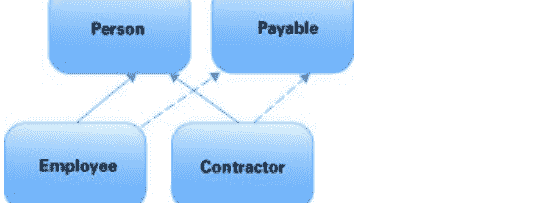

**图 13-2**：图 13-2。扩展 Person 并实现 Payable

接下来展示了父类 `Person` 的代码：

```java
public class Person {
  private String name;

  public Person(String name){
    this.name = name;
  }

  public String getName(){
    return "Person's name is " + name;
  }
}
```

这是 `Payable` 接口：

```java
public interface Payable {
  int INCREASE_CAP = 20;
  boolean increasePay(int percent);
}
```


`Employee` 和 `Contractor` 类对 `Payable` 接口有不同的实现。`Employee` 的结构如下：

```java
public class Employee extends Person implements Payable {
    public Employee(String name) {
        super(name);
    }

    public boolean increasePay(int percent) {
        System.out.println("Increasing salary by " + percent + " " + getName());
        return true;
    }
}
```

`Contractor` 的实现如下：

```java
public class Contractor extends Person implements Payable {
    public Contractor(String name) {
        super(name);
    }

    public boolean increasePay(int percent) {
        if(percent < Payable.INCREASE_CAP) {
            System.out.println("Increasing hourly rate by " + percent + " " + getName());
            return true;
        } else {
            System.out.println("Sorry, can't increase hourly rate by than " + Payable.INCREASE_CAP + " " + getName());
            return false;
        }
    }
}
```

程序 `TestPayIncreasePoly` 展示了 `Employee` 和 `Contractor` 对象的多态行为。

```java
public class TestPayIncreasePoly {
    public static void main(String[] args) {
        Payable workers[] = new Payable[3];
        workers[0] = new Employee("John");
        workers[1] = new Contractor("Mary");
        workers[2] = new Employee("Steve");
        for (Payable p: workers) {
            p.increasePay(30);
        }
    }
}
```

## 消除继承

`Contractor` 和 `Employee` 唯一的区别在于 `increasePay()` 方法的实现，将该方法的实现提取到 Lambda 表达式中。这使得消除 `Employee` 和 `Contractor` 类，并只需将适当的函数传递给 `Person` 类。为了区分承包商和员工，你使用了“使用 ForEach 方法迭代集合”章节中的 `Person` 类版本。这次我们添加了一个 `validatePayIncrease()` 方法，它接收一个参数，并将另一个参数作为薪水增长金额。这是 `Person` 类的新版本：

```java
public class Person {

    private String name;
    private char workerStatus; // 'E' 或 'C'

    public Person(String name)
```

`Payable` 接口保持不变，它的实现将由两个 Lambda 表达式表示，一个用于员工，一个用于承包商，如程序 `TestPayIncreaseLambda` 所示：

```java
public class TestPayIncreaseLambda {
    public static void main(String[] args) {
        Person workers[] = new Person[3];
        workers[0] = new Person("John", 'E');
        workers[1] = new Person('Mary', 'C');
        workers[2] = new Person('Steve', 'E');

        // 用于增加员工薪水的 Lambda 表达式
        Payable increaseRulesEmployee = (int percent) -> {
            return true;
        };

        // 用于增加承包商薪水的 Lambda 表达式
        Payable increaseRulesContractor = (int percent) -> {
            if(percent > Payable.INCREASE_CAP) {
                System.out.print("Sorry, can't increase hourly rate by more than " + 
                Payable.INCREASE_CAP + "%");
                return false;
            } else {
                return true;
            }
        };

        for (Person p : workers) {
            if ('E'.equals(p.workerStatus())) {
                // 为每个员工验证 30% 的增长
                p.validatePayIncrease(increaseRulesEmployee, 30);
            } else if ('C'.equals(p.workerStatus())) {
                p.validatePayIncrease(increaseRulesContractor, 30);
            }
        }
    }
}
```

该程序产生的输出与类继承和多态的版本相同：

增加 John 的薪水是有效的。

抱歉，小时薪增加不能超过 20%。

增加 Mary 的薪水是无效的。

增加 Steve 的薪水是有效的。

结果是相同的，你实现了什么？使用 Lambda 使得移除两个类（`Contractor` 和 `Employee`）成为可能。但似乎通过移除这些类你失去了对 `Payable` 的强制执行。实际上，`Payable` 仍然以另一种方式被强制执行；现在它是 `validatePayIncrease()` 方法的参数类型。

```java
);
// 验证工资增加
workersList.forEach(pers -> {
    if ('E'==pers.getStatus())){
        pers.validateIncreasePay(increaseRulesEmployee, proposedIncrease);
    } else if ('C'==pers.getStatus())){
        pers.validateIncreasePay(increaseRulesContractor, proposedIncrease);
    }
});
}
}
```

在上一节中，你将 lambda 存储在 `Payable` 类型的变量中，但在这个版本中，它被存储为 `BiFunction<Person, Integer, Boolean>` `increaseRulesEmployee`。

`Payable` 接口消失了。我只是在 `TestPayIncreaseFunctionInterface` 类中使用了最终变量 `INCREASE_CAP`。在本节开始初，我们使用四个类和一个接口设计了加薪逻辑。现在我们有两个类，且代码更短了。

本节的目标是解释 lambda 的概念，并展示一些可以简化你代码的实际用例。你需要复习 lambda 的语法。访问 Oracle 的 lambda 表达式教程（http://goo.gl/xS3ejB）以进一步学习该主题。

## 尝试一下

本节的目标是向 `TestPayIncreaseLambda` 类中添加另一个 lambda 表达式，以处理外籍工的加薪。

## 课程要求

你应该已经安装了 Java。

> 注意：你可以从书籍网页 www.wrox.com/go/javaprog24hr2e 下载“Try It”部分的代码和资源。你可以在 `Lesson13.zip` 中找到它们。

## 逐步步骤

- 1. 从文件 `Lesson13.zip` 将 `Lesson13` 导入 Eclipse。查看本节中所有示例的代码。

- 2. 引入新类型的工人：外籍工。

- 3. 为外籍工的费率增加设计一些业务逻辑。

- 4. 创建实现这些规则的新 lambda 表达式，并将其赋值给变量 `Payable` `increaseRulesForeign`。

- 5. 向数组 `workers` 中添加一个外籍工实例（工人状态 'F'）。

- 6. 修改 `TestPayIncreaseLambda` 类中的 for 循环以处理外籍工的加薪。

- 7. 额外挑战：修改 `Person` 类以移除 `workerStatus` 属性。为其构造函数添加第二个参数——一个 lambda 表达式——这样你可以在实例化工人时传递加薪规则。

> 提示：请在 www.wrox.com/javaprog24hr2e 在线选择第 13 节的视频。你也可以从该网站下载本节的代码和资源。

# 14

## 使用 I/O 流

大多数程序都处理某种数据，这些数据可以存储在本地数据库、远程计算机或磁盘上的文件中。Java 有一个处理数据流（streams）的概念。你可以说 Java 程序从输入流中（或写入输出流中）一个字节接一个字节、一个字符接一个字符、一个原始类型接一个原始类型类型地读取字节序列。因此，Java 定义了各种支持流的类；例如 `InputStream` 或 `OutputStream`。还有专门设计用于读取字符流的类，如 `Reader` 和 `Writer`。`DataInputStream` 和 `DataOutputStream` 可以从文件中读写字节，你可以将它们视为 `FileInputStream` 和 `FileWriter`。

处理流的类位于两个包中：`java.io` 和 `java.nio`。前者的实现是阻塞式 I/O (I/O)：当字节被进程读取/写入时，它们对于其他执行线程将不可用。本章的大部分涵盖了 I/O 的基础知识，最后我将向你展示如何使用 `java.nio` 包中的类来处理文件。

在决定在特定情况下使用哪种 Java 类进行 I/O 操作之前，你需要了解从流中来自（或发送到）什么类型的数据。无论你选择什么，你的代码都需要执行三个操作：

1. 打开一个指向特定数据源的流：文件、套接字、URL 等。

2. 从此流中读取或写入数据。

3. 关闭流。

如果 Java 程序使用第三方程序（例如数据库管理系统 DBMS），你就不需要直接编写流——数据库驱动程序或对象关系映射框架就是你需要的。但在本节中，你将看到使用不同流执行 I/O 操作的示例。

## 字节流

程序可以借助 `InputStream` 或 `OutputStream` 的某个子类，一次一个字节地读取或写入任何文件。下面的 [Listing 14-1] 中的示例展示了如何使用 `FileInputStream` 类。这段代码段读取并打印每个字节的值：

## LISTING 14-1 使用 FileInputStream

```java
try (FileInputStream myFile = new FileInputStream("abc.dat")) {
    boolean eof = false;
    while (!eof) {
        int byteValue = myFile.read();
        System.out.print(byteValue + " ");
        if (byteValue == -1)
            eof = true;
    }
} catch (IOException ioe) {
    System.out.println("Could not read file: " +
         ioe.toString());
}
```

[Listing 14-1] 中的代码没有指定 `.dat` 所在的目录，程序尝试在当前目录查找此文件，即 Eclipse 项目的根目录（如果你使用 Eclipse）。你可以随时通过调用方法 `System.getProperty("user.dir")` 程序化地找到当前目录。

如果 `.dat` 包含 "This is a file"，该程序的输出系统控制台看起来像这样：84 104 105 32

[Listing 14-1] 中的代码没有指定 `.dat` 所在的目录，程序尝试在当前目录查找此文件，即 Eclipse 项目的根目录（如果你使用 Eclipse）。你可以随时通过调用方法 `System.getProperty("user.dir")` 程序化地找到当前目录。

该程序的输出，如果 `.dat` 包含 "This is a file"，系统控制台看起来像这样：84 104 105 32

[Listing 14-1] 中的代码没有指定 .dat 所在的目录，程序尝试在当前目录查找此文件，即 Eclipse 项目的根目录（如果你使用 Eclipse）。你可以随时通过调用方法 `System.getProperty("user.dir")` 程序化地找到当前目录。

当使用 `InputStream` 读取时，文件末尾由 -1 表示，这就是你知道停止的地方。上面的示例使用 try-with-resources 自动关闭流。代码14-2 使用 `FileOutputStream` 类写入文件。

### LISTING 14-2 使用 FileOutputStream

```java
// 字节值是 0 到 255 的整数
int[] somedata = {56,230,123,43,11,37};

try (FileOutputStream myFile = new FileOutputStream("xyz.dat")) {
    for (int i = 0; i < somedata.length; i++) {
        myFile.write(somata[i]);
    }
} catch (IOException ioe) {
    System.out.println("Could not write to a file: " +
        ioe.toString());
}
```

## 缓冲流

上一节的代码是一个字节一次地读取和写入。通常，磁盘访问比内存中执行的操作要慢得多；因此，读取 1000 字节的文件访问磁盘千次并不是好主意。为了减少访问磁盘的次数，Java 提供了缓冲区作为数据池。

`BufferedInputStream` 类作为 `FileInputStream` 和文件之间的中间件工作。它一次从文件中读取一块字节到内存中，然后 `FileInputStream` 从那里读取单个字节，这是内存到内存的操作。`BufferedOutputStream` 与 `FileOutputStream` 类类似。这里的主要思想是减少磁盘访问。

缓冲流并没有改变原始流的类型——它们只是让读取更高效。你可以这样理解：程序通过流式处理（或管道）连接流，就像水路中的管道一样。Listing14-3 展示了一个示例，其中从 `FileInputStream` 读取的数据在处理之前填充了 `BufferedInputStream`。

## 缓冲流

（注：此处原文中 `BUFFERED STAMS` 似乎为拼写错误，翻译已修正为“缓冲流”）

# 174 | 第 14 节 处理 I/O 流

在借助 `BufferedInputStream` 帮助读取流时，请留意文件结束符（end-of-file character），以判断所有字节都已从缓冲区中读取。`BufferedOutputStream` 类用于写入，你需要调用它的 `write()` 方法……

默认的缓冲区大小为 8KB，你可以使用 `BufferedInputStream` 或 `BufferedOutputStream` 的双参数构造函数来控制它。例如，要将缓冲区大小设置为 5000 字节，可以按如下方式实例化缓冲区：

```
BufferedInputStream buff = new BufferedInputStream(myFile, 5000);
```

## 字符流

Java 中的文本被表示为一组 `char` 值（双字节字符），它们基于 Unicode 标准。`FileReader` 和 `FileWriter` 类是专门为处理文本文件创建的，但它们在没有默认字符编码的情况下工作工作，且无法进行正确的本地化。

推荐的方法是使用指定编码的 `InputStreamReader` 类进行管道传输，`FileInputStream` 读取字节并使用 `CharSet` 将其解码为字符。每个 JVM 都有一个默认字符集，可以在 JVM 启动时指定，并取决于本地化设置。一些标准字符包括 ASCII、UTF-8 和 UTF-16。


# 列表 14-4 从文件中读取字节并将其从 UTF-8 编码转换为 Unicode，然后以 `String` 形式返回结果

为了提高效率，读取过程通过 `BufferedReader` 进行管道，它从流缓冲区读取。注意，这段代码使用了可变的 `StringBuilder`，在执行文本操作时它的运行速度实际上比 `String` 快。使用 `StringBuilder` 是拼接字符串的推荐方法。这就是为什么我决定说明它的用法：

如果你要拼接 `String` 值，Java 编译器会优化这段代码，并将字符串拼接替换为另一个辅助类 `StringBuilder`。你也可以手动使用 `StringBuilder` 代替 `String`，如第 16 节所示。

## 列表 14-4 读取文本文件

```java
StringBuilder buffer = new StringBuilder();
try {
    FileInputStream myFile = new FileInputStream("abc.txt");
    InputStreamReader inputReader = new InputStreamReader(myFile, "UTF-8");
    BufferedReader reader = new BufferedReader(inputReader);
    int ch; // 此字符的编码
    while ((ch = reader.read()) != -1) {
        buffer.append((char)ch);
    }
    buffer.toString();
} catch (IOException e) {
    e.printStackTrace();
}
```

## 将字符写入文件

将字符写入文件，使用 `FileOutputStream` 和 `OutputStreamWriter` 管道。为了提高效率，使用 `BufferedWriter`：例如：

```java
try (FileOutputStream myFile = new FileOutputStream("abc.txt");
     Writer out = new BufferedWriter(new OutputStreamWriter(myFile, "UTF-8"))) {
    String address = "123 Broadway, New York, NY 10011";
    out.write(address);
} catch (IOException e) {
    e.printStackTrace();
}
```

## 构建 GUI 和 I/O 流

列表 14-5 显示了税务计算程序的另一个版本。这次我添加了一个文本文件 `states`，它包含了用于填充下拉框 `chStates` 的数据。我的文件位于 Eclipse 项目 `Lesson14` 的根目录下，内容如下所示：

New York

New Jersey

Florida

California

列表 14-5 中的程序显示了一个 `Tax` 类，你可以从第 4 节的 `class_methods_and_structures` 中借用它。确保它使用了 `calcTax()` 方法。

## 列表 14-5 整合 Swing 和流

```java
public class TaxGuiFrame extends JFrame {
    JLabel lblIncome;
    JTextField txtIncome = new JTextField(15);
    JLabel lblDependents;
    lblDependents = new JLabel("Number of Dependencies:");
    JTextField txtDependents = new JTextField(2);
    JLabel lblState;
    lblState = new JLabel("State:");

    // 为 ComboBox chState 定义数据模型
    Vector<String> states = new Vector<String>();

    // 创建一个 comb框从模型中获取数据
    JComboBox chState = new JComboBox(states);

    JLabel lblTax = new JLabel("State Tax: ");
    JTextField txtStateTax = new JTextField(0);
    JButton bGo = new JButton("Go");
    JButton bReset = new JButton("Reset");

    TaxGuiFile() {
        lblGrossIncome = new JLabel("Gross Income: ");
        GridLayout gr = new GridLayout(5,2,1,1);
        setLayout(gr);
        add(lblGrossIncome);
        add(txtGrossIncome);
        add(lblDependents);
        add(txtDependents);
        add(lblState);
        add(chState);
        add(lblTax);
        add(txtStateTax);
        add(bGo);
        add(bReset);

        // 从文件填充 states
        populateStates();
        chState.setSelectedIndex(0);
        txtStateTax.setEditable(false);

        // 使用 lambda 表达式处理 Go 按钮
        bGo.addActionListener(ev -> {
            try {
                int grossIncome = Integer.parseInt(txtGrossIncome.get());
                int dependents = Integer.parseInt(txtDependents.get());
                String state = (String)chState.getSelectedItem();

                Tax tax = new Tax(grossIncome, dependents, state);
                String txtTax = Double.toString(tax.calcTax());
                txtStateTax.setText(txtTax);
            } catch (NumberFormatException e) {
                e.printStackTrace();
            }
        });

        // 使用 lambda 表达式处理重置
        bReset.addActionListener(ev -> {
            txtStateTax.setText("");
        });
    }

    private void populateStates() {
        try (FileInputStream inputFile = new FileInputStream("states.txt");
             BufferedReader reader = new BufferedReader(new InputStreamReader(inputFile, "UTF-8"))) {
            String stateName;
            while ((stateName = reader.readLine()) != null) {
                states.add(stateName);
            }
        } catch (IOException e) {
            e.printStackTrace();
        }
    }
}
```

176 | 第 14 节 处理 I/O 流

## 字符流 | 177

```java
// 定义，注册一个 WindowAdapter
this.addWindowListener(new WindowAdapter() {
    public void windowClosing(WindowEvent e) {
        System.exit(0);
    }
});

// 以下代码将填充 chStates
private void populateStates() {
    try (FileInputStream inputFile = new FileInputStream("states.txt");
         BufferedReader reader = new BufferedReader(new InputStreamReader(inputFile, "UTF-8"))) {
            String stateName;
            while ((stateName = reader.readLine()) != null) {
                states.add(stateName);
            }
        } catch (IOException e) {
            e.printStackTrace();
        }
    }

    public static void main(String[] args) {
        TaxGuiFile taxFrame = new TaxGuiFile();
        taxFrame.setSize(400, 150);
        taxFrame.setVisible(true);
    }
}
```

列表 14-3 填充了 states。`Vector` 集合（同步）扮演了数据模型。Swing 组件知道如何显示其数据模型。这是 MVC（模型-视图-控制器）设计模式的实现，促进了数据与用户界面（UI）的分离。当用户选择状态时，`JComboBox` 扮演控制器。

注意 `TaxGui` 类没有实现 `ActionListener`。Go 和 Reset 按钮的点击事件是通过 lambda 表达式实现的。

列表 14-5 程序的输出如图 14-1 所示。

## 分离 GUI 和处理

在较大的应用程序中，将 `GuiFile` 类拆分为两个部分是合理的：一个创建 GUI 组件，另一个从文件或其他源读取数据。我在第 9 节的计算器程序中说明了这一点，该程序有两个类：`Calculator` 和 `CalculatorEngine`。

178 | 第 14 节 处理 I/O 流


图 14-1：运行 TaxGui 程序

## 数据流

如果你预期处理已知类型（例如两个整数、浮点数和一个双精度浮点数），使用 `DataInputStream` 读取或使用 `DataOutputStream` 写入。`readInt()` 方法一次读取整个整数（四个字节），`readLong()` 可以获取一个长整型（八个字节）。

`DataInputStream` 类是另一个可以连接到其他流的“管道”。列表 14-6 提供了一个如何通过以下部分构建管道的示例：

`FileInputStream` `BufferedInputStream` `DataInputStream`

## 列表 14-6 使用 DataInputStream

```java
try (FileInputStream myFile = new FileInputStream("data.dat");
     BufferedInputStream buff = new BufferedInputStream(myFile);
     DataInputStream data = new DataInputStream(buff)) {
     int num1 = data.readInt();
     int num2 = data.readInt();
     float num3 = data.readFloat();
     float num4 = data.readFloat();
     double num5 = data.readDouble();
     double num6 = data.readDouble();
 } catch (IOException ie) {
     ie.printStackTrace();
 }
```

此示例中，`FileInputStream` 打开 `fileData.dat` 进行读取。`BufferedInputStream` 使读取更高效，而 `DataInputStream` 从缓冲区提取了两个整数、三个浮点数和一个双精度浮点数。这里的假设是 `fileData.dat` 恰好包含这些类型，并且按照指定的顺序排列。此类可以通过 `DataOutputStream` 的帮助创建，它允许你将 Java 原始数据类型写入到多种可选的方法中：`writeInt()`、`writeByte()`、`writeFloat()` 等。

## 用于处理文件的工具类

通常你需要对文件进行某些操作，这些操作并不总是涉及读取或写入文件。例如，你可能需要检查文件是否存在，或者通过程序对其进行重命名。Java 包含了用于目录的工具类 `File` 和 `Path`。

## File 类

`java.File` 类允许你重命名或删除文件、执行存在性检查、创建目录、检查文件大小等。如果你需要这些功能，可以从创建一个该类的实例开始：

```java
myfile = new File("abc.txt");
```

这一行代码并没有创建一个文件；它创建了 `File` 类的实例，该实例准备好对文件名 `abc.txt` 执行操作。如果你想创建一个物理文件，请使用 `File` 类中定义的 `createFile()` 方法。以下是 `File` 类的方法列表：

- `create()`: 创建一个与文件实例化时使用的文件名同名的新空文件。
- `delete()`: 删除一个文件。
- `renameTo()`: 重命名一个文件。
- `length()`: 返回以字节为单位的文件长度。
- `exists()`: 检查指定名称的文件是否存在。
- `list()`: 返回一个包含文件和目录的字符串数组。
- `lastModified()`: 返回文件最后修改的时间。
- `mkdir()`: 创建一个目录。

接下来的代码检查 `customers.txt.bak` 文件是否存在，如果找到则删除，然后将文件 `customers.txt` 重命名为 `customers.bak`：

```java
File file = new File("customers.txt");
File backup = new File("customers.txt.bak");
if (backup.exists()) {
    backup.delete();
}
file.renameTo(backup);
```

## NIO.2: 使用 Files, Path 和 Paths

Java 7 引入了许多新的类和接口用于更高效地处理文件和目录，通常被称为 NIO.2。

`Path` 接口是文件、目录或 URI 完全路径的程序化表示。虽然文件的完整路径在 Windows 和 Unix 操作系统中的表示方式不同，但每个文件系统都是由目录、子目录和路径组成的层次级树，这些路径从根节点开始（例如 Windows 中的 `c:\` 或 Unix 中的 `/`）。

路径可以是绝对的，从驱动器根目录开始，如 `/users/yain11/practical/Java/workspace/Lesson14/states.bak`；也可以是相对于应用程序启动位置的的，例如 `Lesson14/states.bak`。文件也可以通过所谓的符号链接来表示，它看起来像一个文件，但实际上是文件层级结构中分支中另一个文件的引用。如果你想编写一个可以从任何目录启动并带有特定文件的程序，请考虑使用绝对路径。如果你的应用程序部署方式使得文件相对于主程序的位置位于相同处，则使用相对路径。

`Path` 接口允许你通过程序化访问正在使用的底层操作系统。使用你的程序创建一个 `Path` 对象，然后处理位于那里的文件或目录。

`java.nio.File` 类与 `java.File` 类似。它包含了对文件和目录进行操作的静态方法。这些方法大部分委托给底层操作系统（OS）文件系统。除了功能外，它还可以遍历目录树、检查属性、创建符号链接并与流工作。使用 `Files` 你可以复制、移动和删除待办事项。

你可以通过 `Paths.get()` 获取文件路径。接下来的类 `TestFilesPaths` 检查 `file.txt` 是否存在，检查其大小、绝对路径，并为此创建一个名为 `states.bak` 的备份。


```java
public class TestFilesPaths {

    public static void main(String[] args) {
        // 获取位于程序启动目录 
        // 下的 file.txt 路径
        Path sourceFilePath = Paths.get("states.txt");

        // 将源文件复制到此目标地
        Path destFilePath = Paths.get("states.bak");

        if (Files.exists(sourceFilePath)){
            System.out.println("the " + sourceFilePath + " exists");
            System.out.println("the absolute path is " + sourceFilePath.toAbsolutePath());
            try{
                // 检查文件大小（字节）为 " +
                System.out.println("its size is " + Files.size(sourceFilePath));

// 将文件从 states.txt 复制到 states.bak
Files.copy(sourceFilePath, destFilePath,
StandardCopyOption.REPLACE_EXISTING);
System.out.println("Copy completed. The backup file is at " + 
destFilePath.toAbsolutePath());

catch (IOException ioe) {
    ioe.printStackTrace();
}
            }
        }
    }
}
```

程序 `TestFilesPaths` 的输出如下：

file states.txt exists

The absolute path is

/users/yfaint/practical/Java/workspace/Lesson14/states.txt

It's size in 44

Copy completed. The backup file is at

/users/yfaint/practical/Java/workspace/Lesson14/states.bak

## 用于处理文件的工具类 | 181

file states.txt exists

The absolute path is

/users/yfaint/practical/Java/workspace/Lesson14/states.txt

It's size in 44

Copy completed. The backup file is at

/users/yfaint/practical/Java/workspace/Lesson14/states.bak

这一行代码并没有创建一个文件；它创建了 `File` 类的实例，该实例准备好对文件名 `abc.txt` 执行操作。如果你想创建一个物理文件，请使用 `File` 类中定义的 `createFile()` 方法。以下是 `File` 类的方法列表：

[注：上述文本跨页合并]

`java.nio.File` 类与 `java.File` 类似。它包含了对文件和目录进行操作的静态方法。这些方法大部分委托给底层操作系统（OS）文件系统。除了功能外，它还可以遍历目录树、检查属性、创建符号链接并与流工作。使用 `Files` 你可以复制、移动和删除待办事项。

`TestBufferedReaderNIO` 类使用了 `newBufferedReader()` 方法（这可以避免你手动创建输入流）。

如果你想从文件中读取所有行并放入 Java 集合中，可以使用 `Files` 类的 `readAllLines()` 方法轻松实现。

```java
public class TestReadAllNio {
    public static void main(String[] args) {
        Path statesFile = Paths.get("states.txt");

        try {
            // 填充集合
            List<String> states = Files.readAllLines(statesFile, StandardCharsets.UTF_8);

            // 打印州名
            states.forEach(System.out::println);
        } catch (IOException ioe) {
            System.out.println("Error while reading states: " + ioe.getMessage());
        }
    }
}
```

向文本文件非常简单：

```java
Path outputFile = Paths.get("outputFile.txt");
try (BufferedWriter writer = Files.newBufferedWriter(outputFile, StandardCharsets.UTF_8, StandardOpenOption.CREATE)) {
    writer.write("Whatever you want to write.");
}
```

枚举 `StandardOpenOption` 允许你指定如何打开文件；例如，追加到现有文件，或在不存在时创建新文件。详情请参阅 javadoc。

NIO 的另一个有趣特性是能够执行异步输出，这可以大幅提高应用程序的可扩展性。如果你需要处理大量数据，请研究 `java.nio.channels` 包中的异步通道和接口。有关 NIO 的更详细介绍，可以参考 Manning 出版于 2012 年的《The Well-Grounded Java Developer》一书。

## 尝试一下

编写一个程序读取 zip 压缩包，并在系统控制台上打印压缩包包含的文件列表。对 `java.util.zip.ZipInputStream` 类进行一些研究，并将其配合 `FileInputStream` 一使用。也阅读一下 `ZipEntry` 类。

## 课程要求

你应该已经了 Java。

> 注意：你可以从书籍的网页 www.wrox.com/go/javaprog24hr2e 下载此“尝试一下”练习的代码和资源。你可以在下载的 `Lesson14.zip` 文件夹中找到它们。

## 步骤详解

- 1. 创建一个名为 `Lesson14` 的新 Eclipse 项目。

- 2. 将任何 .zip 文件复制到其根目录。

- 3. 打开 `FileInputStream` 并连接 `ZipInputStream`。

- 4. 编写一个循环，使用 `ZipInputStream` 的 `getNextEntry()` 方法。该方法读取 `ZipEntry`（如果有），并将流置于条目数据的开头。

- 5. 对找到的每个 `ZipEntry` 实例调用 `getName()` 函数。

- 6. 在系统控制台上打印条目名称。

- 7. 在循环内部关闭条目。

- 8. 运行程序并观察它是否正确打印了所选 .zip 文件中的文件名。

- 9. 如果你想学习如何用 Java 创建 .zip 文件，请阅读关于 `ZipOutputStream`。

> 提示：请在 www.wrox.com/go/javaprog24hr2e 在线选择第 14 的视频。你可以从该网站下载本课程的代码和资源。

# 15

## Java 序列化

想象一栋建筑，按下一个按钮，它就能变成一堆建筑材料和居民的物品。再按另一个按钮，这栋建筑就会在另一个位置以原始形式重新创建。这就是 Java 序列化。通过“按下序列化按钮”，你将一个对象的实例转换为一堆字节，而按下“反序列化按钮”则可以神奇地重建该对象。

Wikipedia 对序列化术语的定义为：

将数据结构或对象状态转换为可以存储的格式（例如，存储在文件或内存缓冲区中，或通过网络连接传输）并在稍后在相同或另一个计算机环境中重建的过程。当根据序列化格式读取生成的位序列时，可以使用它创建原始对象的语义等效克隆……这种序列化对象的过程也称为压缩（deflation）或封存（marshalling）。相反的操作从字节序列中提取数据是反序列化（也称为解压缩inflating 或解封存 unmarshalling）。

在第 14 章中，你熟悉了处理单个字节、字符、原始类型和文本的流。现在让我们看看为什么以及如何将对象写入流中，或者如何序列化 Java 对象。

考虑以下场景：`ClassA` 创建了一个 `Employee` 对象的实例，该对象具有 `firstName`、`lastName`、`hireDate`、`salary` 等字段。字段的值（即对象的状态）必须保存到流中。随后，`ClassB` 需要这些数据，必须从 `objectInputStream` 重新创建实例。`ClassA` 和 `ClassB` 的实例可能运行在不同计算机的不同 Java 虚拟机 (JVM) 中。

如果足够，你的程序可以记住 `firstName`、`lastName`、`hireDate` 和 `salary` 的顺序及其数据类型，并使用 `DataOutputStream` 遍历字段执行输出。程序需要知道字段的顺序及其类型。

这是另一个用例：你的应用程序有一个 `Preferences` 菜单，用户可以在其中选择启动视图显示的字体、颜色和用户界面控件。为了支持此类功能，`Preferences` 面板创建了一个 `UserPreferences` 类的实例，具有 50 个配置属性（其中一些是自定义数据类型），这些属性必须保存在本地文件中。在下次启动应用程序时，将从文件中恢复 `UserPreferences`。

# 186 |  15 Java 序列化

手动编写序列化 `UserPreferences` 是繁琐的。Java 提供了使用 `ObjectOutputStream` 和 `ObjectInputStream` 实现相同结果的优雅方法。

将实例转换为 XML、JSON 或其他格式的过程也称为序列化。本节讨论核心序列化。

`ClassA` 序列化 `Employee`，`ClassB` 反序列化（重建）该对象。为了支持这种模式，`Employee` 类必须实现 `Serializable`，如列表 15-1 所示。

## 列表 15-1 Serializable 类

```java
class Employee implements Serializable {
 String name;
 String fname;
 double salary;
}
```

接口 没有定义任何方法，因此没有需要实现。如果一个接口没有定义任何方法，它就是标记接口。标记接口仅影响编译器生成字节码的方式。

本节的两种情况代表了 Java 序列化的主要用途：在 JVM 之间传递 Java 对象以及以后使用的对象持久化。通常由 Java 框架在分布式应用程序之间序列化。

## OBJECTSTREAM 类

要序列化对象，请执行以下操作：

- 1. 打开输出流。

- 2. 将其连接到 `ObjectOutputStream`。

- 3. 调用 `writeObject()` 方法，并将序列化实例作为参数。

- 4. 关闭流。

列表 15-2 显示了将 `Employee` 实例序列化到文件的代码示例：

`BestEmployee.ser` 打开 `FileOutputStream` 并将其连接到 `ObjectOutputStream`。`writeObject()` 方法一次性完成 `Employee` 实例的序列化。

## 列表 15-2 将 Employee 对象序列化到文件

```java
class A {
    Employee emp = new Employee();
    emp.fname = "John";
    emp.lname = "Smith";
    emp.salary = 50000;

    try (FileOutputStream fout =
            new FileOutputStream("BestEmployee.ser");
        ObjectOutputStream oOut =
            new ObjectOutputStream(fout)) {
        oOut.writeObject(emp); //序列化 employee
    } catch (IOException e) {
        e.printStackTrace();
    }
    System.out.println(
        "Employee object has been serialized in BestEmployee.ser";
    )
}
```

所有原始数据类型都是可序列化的。序列化类的所有成员变量必须是原始类型或指向可序列化对象的引用变量。列表 15-1 中的 `Employee` 类仅包含可序列化的数据类型。如果类具有自定义数据类型的字段，则每个类型都必须是可序列化的。列表 15-3 中的 `Employee` 类只有在 `PromotionHistory` 类（以及它使用的所有类型）也声明了 `implements Serializable` 的情况下才能被序列化。

```java
class Employee implements java.io.Serializable{
    String iName;
    String fName;
    double salary;

    PromotionHistory promos; // 一个自定义数据类型
}
```

如果你不想序列化某些敏感信息（例如薪资），请使用 `transient` 关键字声明该变量。如果你使用 `transient` 修饰符声明 `Employee` 类类的 `salary` 字段，它的值就不会被序列化。序列化的字节集仍然包含该 `transient` 字段，但它将不会是实际值；该字段将具有其类型的默认值。

```java
transient double salary;
```

通常，如果变量包含某些敏感信息或其值在目标流中没有用处，你会将变量声明为 `transient`。假设运行在服务器上的某个类具有数据库连接变量。如果该类被序列化到客户端机器，发送数据库凭据可能不仅没用，而且是不安全的。因此，此类变量必须声明为 `transient`。使用 `transient` 关键字的另一个原因是序列化包含不可序列化类型字段的对象。

## 对象输入流 (THE OBJECTINPUT)

要反序列化一个对象，请执行以下步骤：

1. 打开一个输入流。

2. 使用 `ObjectInputStream` 对其进行链式包装。

3. 调用 `readObject()` 方法并将返回的对象强制转换为正在反序列化的类。

4. 关闭流。

列表 15-4 显示了读取之前序列化的文件 `BestEmployee.ser` 的示例代码。该代码打开了一个指向 `BestEmployee.ser` 的 `FileInputStream`，然后将 `FileInputStream` 与 `ObjectInputStream` 链式连接。`readObject()` 方法恢复内存中 `Employee` 对象的实例。

## 列表 15-4 从文件反序列化 Employee

```java
import java.io.*;
class ClassB {

    public static void main(String[] args){
        try ( FileInputStream fin =
            new FileInputStream("BestEmployee.ser");
            ObjectInputStream oin = new ObjectInputStream(fin);
            Employee bestEmp=(Employee)oin.readObject();
        ) catch (ClassNotFoundException cnf) {
            cnf.printStackTrace();
        } catch (IOException ioe) {
            ioe.printStackTrace();
        }

        System.out.println(
        "The Employee has been deserialized.");
    }
}
```

请注意，反序列化对象的类必须能够访问声明，否则将抛出 `ClassNotFoundException`。在序列化过程中，所有 `transient` 变量都会初始化为其类型的默认值。例如，`int` 变量的值为 0。

请记住，当对象序列化时，类名长的类会产生更大的占用。在对时间敏感的应用中，这可能很重要。想象一个华尔街交易系统，其中每个订单都以对象 `TradeOrder` 呈现，具有 50 个字段，你需要通过序列化通过网络发送这 100 个对象。通过名称字符对每个字段进行排序可以减少几乎 50 KB 的网络流量！你将在第 16 章学习如何打开网络流。

## Externalizable 接口

继续交易订单（trade order）的例子，可能需要 `TradeOrder` 类中所有 50 个字段的值来支持应用程序的某些功能，但当程序必须向交易所发送买入或卖出报告时，可能只需要十字段。

这引出了问题——是否可以自定义序列化过程，以便只序列化某些字段？


`ObjectOutputStream` 的 `writeObject()` 方法将对象的所有字段发送到流中。如果你想对序列化的内容有更多控制并减少对象的占用，请实现 `Externalizable` 接口，它是 `Serializable` 的子类。

该接口定义两个方法：`readExternal()` 和 `writeExternal()`。这些方法必须由你编写以实现所选字段的序列化。列表 15-5 显示了实现 `Externalizable` 的类 `Employee2` 的片段。它有多个字段，但在某些场景下，只需要序列化 `id` 和 `salary`。

## 列表 15-5 Employee 的外部化版本

```java
class Employee2 implements java.io.Externalizable {
    String iName;
    String fName;
    String address;
    Date hireDate;
    int id;
    double salary;

    public void writeExternal(ObjectOutput stream) 
        throws java.io.IOException {
        // 只序列化 salary 和 id
        stream.writeDouble(salary);
        stream.writeInt(id);
    }

    public void readExternal(ObjectInput stream) 
        throws java.io.IOException {
        salary = stream.readDouble(); // 读取顺序必须一致
        id = stream.readInt();
    }
}
```

请注意，类的每个属性都是单独被序列化的，且 `writeExternal()` 和 `readExternal()` 方法必须以相同的顺序写入和读取属性。列表 15-6 中的 `EmpProcessor` 类展示了如何外部化对象 `object2`。

## 列表 15-6 外部化 Employee 对象

```java
import java.io.*;
import java.util.Date;

public class ClassA {
    public static void main(String[] args) {
        Employee2 emp = new Employee2();
        emp.fName = "John";
        emp.iName = "Smith";
        emp.salary = 50000;
        emp.address = "12 main street";
        emp.hireDate = new Date();
        emp.id = 123;

        try (FileOutputStream fout = 
                new FileOutputStream("Employee2.ser");
                ObjectOutputStream oout = new ObjectOutputStream(fout)) {
            // 这里是序列化部分
            oout.writeObject(emp);
        } catch (IOException ioe) {
            ioe.printStackTrace();
        }
    }
}
```

## 类版本控制

假设程序 `ClassA` 将 `Employee` 序列化到文件。几天后，另一个程序 `ClassB` 尝试反序列化它。如果类在此期间发生了变化，反序列化可能会失败。

在序列化期间，JVM 会计算一个特殊值：`serialVersionUID`，该值基于类名、实现的接口以及非私有方法的签名。如果你好奇这个数字对于你的类是什么，运行程序（位于 Java 安装的 bin 目录），并将类名作为命令行参数。

但如果你的类显式定义并初始化了一个名为 `serialVersionUID` 的静态常量变量，Java 将使用你的值而不是生成的值。例如：

```java
public static final long serialVersionUID = 1L;
```

现在，如果你将新版本中的值与旧版本相同，你就可以向该类添加更多方法，JVM 会假设这两个类具有相同的版本。如果新版本增加了字段，反序列化过程会忽略它。如果新版本删除了字段，反序列化后的版本仍然具有该字段（值为默认值）。但如果你更改了公共字段的数据类型，反序列化过程将失败。

## 序列化为字节数组

你可以将序列化为内存字节数组 `byte[]`。这是创建一种可以在不同虚拟机（VM）之间交换的内存块的最简单方法。

序列化的语法非常直观。假设你有一个实现 `Serializable` 的类 `XYZ`，并且以正确的格式包含了报告的所有元素。要从它准备字节数组，编写列表 15-8 中的代码。

### 列表 15-8 转换为字节数组

```java
XYZ MyXyz = new XYZ();

// 在此处为 MyXyz 的字段赋值
//...

ByteArrayOutputStream baOut = new ByteArrayOutputStream(5000);
ObjectOutputStream oOut = new ObjectOutputStream(
    new BufferedOutputStream(baOut));

// 此处是序列化部分
oOut.writeObject(myXyz);
oOut.flush();

// 从流中创建字节数组
byte[] xyzAsByteArray = baout.toByteArray();
outout.close();
```

另一种序列化字节数组并立即反序列化的方便方法可以在短时间内创建对象的深拷贝，这相当于创建一个对象实例的精确拷贝。尽管 `Object` 类（所有类的根类）包含了 `clone()` 方法，但该方法仅适用于实现了另一个标记接口 `Cloneable` 的对象，否则克隆将失败。当你克隆其他类型的对象实例时，情况变得更加复杂：你需要对对象进行深拷贝。

在执行完列表 15-9 中的代码序列化为字节数组后，你在内存中得到了两个相同的对象。变量 `bestEmployee` 指向其中一个，变量 `cloneOfEmployee` 指向另一个。

### 列表 15-9 使用序列化进行对象克隆

```java
Employee bestEmployee = new Employee();

// 序列化为字节数组
ByteArrayOutputStream baout = new ByteArrayOutputStream();
ObjectOutputStream out = new ObjectOutputStream(baout);
out.writeObject(bestEmployee);

// 从字节数组反序列化以克隆对象
ByteArrayInputStream bain = new ByteArrayInputStream(baout.toByteArray());
ObjectInputStream in = new ObjectInputStream(bain);
Employee cloneOfEmployee = (Employee) in.readObject();
```

## 尝试一下

创建一个名为 `MyCustomizableGUI` 的 Java Swing 程序，允许你指定她的偏好，例如背景颜色、字体大小等。选择任何具有这些属性的 GUI 组件。选定的值应赋值给可序列化类 `UserPreferences` 的字段，并将其序列化到名为 `preferences.ser` 的文件中。每次启动 `MyCustomizableGUI` 时，它都应该检查 `preferences.ser` 文件是否存在。如果文件存在，`MyCustomizableGUI` 应该将其反序列化并将预存的偏好应用到 GUI 上。

## 课程要求

你必须安装了 Java。

### 逐步步骤说明

1. 创建一个新的 Eclipse 项目并命名为 Lesson15。
2. 创建一个名为 `MyCustomGUI` 的可执行 Swing 类，包含一个文本框和一个 User Preferences 按钮。
3. 编写按钮程序，以打开一个名为 Preferences 的新窗口（基于 `JDialog`），该窗口有三个下拉菜单（`JComboBox`）、一个保存按钮和一个取消按钮。第一个下拉菜单允许用户选择颜色，第二个选择字体，第三个选择字体大小。
4. 创建一个可序列化的类 `UserPreferences`，用于记录用户的选择。当用户做出选择后，保存按钮将 `UserPreferences` 的实例序列化到名为 `preferences.ser` 的文件中。
5. 每次启动 `MyCustomGUI` 时，都要确定 `preferences.ser` 文件是否存在，如果存在，则将相应的颜色作为 `MyCustomGUI` 窗口的背景颜色。字体偏好应应用到文本框。
6. 运行程序以确保你可以更改并保存偏好，并且它们被正确地应用到 GUI 上。

> 提示可以在 http://www.wrox.com/go/javaprog24hr2e 选择第 15 节的视频。你也可以从该网站下载本节的代码和资源。

> 注意你可以从书籍的网页 http://www.wrox.com/go/javaprog24hr2e 下载此“尝试一下”章节的代码和资源。你可以在 `Lesson15.zip` 中找到它们。

# 16 编程基础

连接到网络的计算机只有在它们对通信规则（称为协议）一致时才能相互通信，这些规则定义了如何请求数据、数据是否应该分段发送、如何确认接收到的数据、两台计算机之间的连接应如何保持等。TCP/IP、UDP/IP、FTP、HTTP 和 WebSocket 是一些网络协议的示例。

局域网（LAN）指的是连接小区域内设备的计算机网络——例如，同一个办公室或房屋，或者是广域网。位于较远或属于同一组织的互连计算机被称为网络。为了安全，设备是广域网（WAN）的一部分。互联网由数百万个网络和单个设备组成。连接的网络属于内网。由于某些原因，内网通过软件防火墙与世界其他部分隔离。本介绍继续使用 HTTP。

万维网（WWW）使用统一资源定位符（URL）来识别在线资源。例如，URL 是（或动态生成的）名为 `training.html` 的文档，位于名为 `my.com` 的远程主机，程序应该使用 HTTP 协议来请求此文档。它规定请求已通过端口 80 发送。

```
http://www.mycompany.com:80/training.html
```

主机必须是，并且由你的互联网服务提供商（ISP）转换为物理服务器的互联网协议（IP）地址，这也称为你的托管公司。IP 地址是四个数字一组（IPv4）——多多八个十六进制数（IPv6），例如 `2001:0db8:0:0:0:ff00:42:3`。大多数连接到互联网的个人其计算机被分配动态（非永久）IP 地址，但通过额外费用，你可以请求静态 IP 地址，并分配给位于你地下室、办公室或车库的任何服务器。在企业中，网络计算机使用静态（永久）IP 地址。对于个人使用，只要你的 ISP 能通过将域名解析为当前 IP 地址找到你，拥有动态分配的 IP 地址就足够了。

在网上寻找资源类似于通过地址寻找某人。IP 地址的作用类似于建筑的门牌号。


# 局域网（LAN）与广域网（WAN）

局域网（LAN）指的是连接小区域内设备的计算机网络——例如，同一个办公室或房屋。位于较远或属于同一组织的互连计算机被称为广域网（WAN）。互联网由数百万个网络和单个设备组成。连接的网络属于内网。由于安全原因，内网通过软件防火墙与世界其他部分隔离。本介绍继续使用 HTTP。

# 万维网（WWW）与 URL

万维网（WWW）使用统一资源定位符（URL）来识别在线资源。例如，URL 是（或动态生成的）名为 `training.html` 的文档，位于名为 `my.com` 的远程主机，程序应该使用 HTTP 协议来请求此文档。它规定请求已通过端口 80 发送。

```
http://www.mycompany.com:80/training.html
```

主机名必须由你的互联网服务提供商（ISP）转换为物理服务器的互联网协议（IP）地址，这也称为你的托管公司。IP 地址是四个数字一组（IPv4）——或多达八个十六进制数（IPv6），例如 `2001:0db8:0:0:0:ff00:42:3`。大多数连接到互联网的个人其计算机被分配动态（非永久）IP 地址，但通过额外费用，你可以请求静态 IP 地址，并分配给位于你地下室、办公室或车库的任何服务器。在企业中，网络计算机使用静态（永久）IP 地址。对于个人使用，只要你的 ISP 能通过将域名解析为当前 IP 地址找到你，拥有动态分配的 IP 地址就足够了。

在网上寻找资源类似于通过地址寻找某人。IP 地址的作用类似于建筑的门牌号。

---

# 从网络读取数据

## 代码列表 16-1 读取 google.com 主页的内容

```java
public class WebSiteReader {
    public static void main(String[] args){
        String nextline;
        URL url = null;
        URLConnection uriConn = null;

        try {
            // 假设 index html 是默认的主页名
            url = new URL("http://www.google.com");
            uriConn = url.openConnection();
        } catch (IOException e) {
            System.out.println("无法连接到提供的 URL:" + e.toString());
        }

        try (InputStream inputStream = new InputStreamReader(
                uriConn.getInputStream(), "UTF-8");
             BufferedReader buff = new BufferedReader(inputStream)) {
            // 读取并打印 Google 主页的内容
            while (true) {
                nextline = buff.readLine();
                if (nextline != null) {
                    System.out.println(nextline);
                } else {
                    break;
                }
            }
        } catch (IOException ioe) {
            System.out.println("无法从网络读取数据: " + ioe.toString());
        }
    }
}
```

列表 16-1 中的代码创建了类的实例，然后获取 `URLConnection` 的引用以打开流的连接，最后打开了链用 `BufferedReader` 的 `InputStreamReader`。运行此程序，你将看到如列表 16-2 所示的输出。

## 代码列表 16-2 读取 google.com 后控制台输出片段

```html
<!doctype html><html itemscope itemtype="http://schema.org/WebPage" lang="en">
<head><meta content="搜索世界信息，
包括网页、图像、视频等更多。Google 具有许多特殊
功能帮助你精确找到你正在寻找的内容。"
name="description"><meta content="noop" name="robots">
<meta content="/images/google_favicon_128.png" itemprop="image">
<title>Google</title>
<script>window.google={KEI:'K_JLOU64FJSyAT61K4DA',getEI:function(a){
for(var c&&a(c=a.getAttribute("eid"));a=a.parentNode;return c},a.parentNode;return:function(){
return "https://"+window.location.protocol
EXP1:'4791,2565,400016,4000142,4000933,40009641,
</script><div></body></html>
```

`WebHttpRequest` 类显式地创建了 `URLConnection`。严格来说，你可以使用相同的类来实现相同的结果：

```java
URL url;
InputStream in = url.getInputStream();
BufferedReader reader = new BufferedReader(new InputStreamReader(in));
```

你可能使用 `URLConnection` 的原因是它可以对 I/O 过程提供一些额外的控制。例如，通过调用方法 `setOutput(true)`，可以指定该 Java 程序打算使用 URL 根目录。在 HTTP 连接中，这将指定请求类型为 POST（参见第 26 章）。`URL` 允许你指定协议是否可以使用缓存对象，或者始终从指定的 URL 请求文档的最新备用副本。如果你计划使用仅支持 HTTP 协议的 Java 程序，请使用 `HttpURLConnection`，它支持 HTTP 特有的功能，如处理标头字段、获取响应码、设置代理属性等。

---

## 通过代理服务器连接

出于安全考虑，大多数企业使用防火墙（参见 `http://en.wikipedia.org/wiki/(computing)`）来阻止对内部网络的未经授权的访问。结果是你的员工无法通过 HTTP 代理服务器访问外部网络（甚至是某些远程服务器）。检查你的浏览器设置，查看你是否也位于防火墙之后，并找到使用的主机名和端口号。通常，浏览器会在其设置或偏好设置菜单的“高级”选项卡下显示代理参数。

如果你的浏览器在 Java 中下载了页面，后者知道代理服务器的参数，并通过防火墙连接到远程服务器。普通的 Java 程序会指定网络属性 `http.proxyHost` 和 `http.proxyPort` 来在防火墙上“开一个洞”。例如，如果你的代理服务器名为 `proxy.mycompany.com` 且使用端口 8080，则应需要在连接互联网的 Java 程序中添加以下两行：

```java
System.setProperty("http.proxyHost", "http://proxy.mycompany.com");
System.setProperty("http.proxyPort", "8080");
```

如果你不想硬编码这些值，可以通过命令行传递它们：

```bash
java -DHttp.proxyHost=http://proxy.mycompany.com -DHttp.proxyPort=8080 WebsiteReader
```

通过编程方式指定代理参数的另一种方法是通过 `java.net.Proxy` 类来实现。相同代理服务器参数的代码如下（你可以将服务器名称替换为 IP 地址）：

```java
Proxy myProxy = new Proxy(Proxy.Type.HTTP,
    new InetSocketAddress("http://proxy.mycompany.com", 8080));
url = new URL("http://www.google.com");
```

---

## 如何从网络下载文件

本节展示了如何从网络下载任意文件（如图像、音乐和二进制文件）。技巧是正确打开流并将其写入本地文件。

### 代码列表 16-3 从网络下载文件

```java
class FileDownload {
    public static void main(String[] args) {
        if (args.length != 2) {
            System.out.println("用法: FileDownload <URL> <FileName>");
            System.exit(1);
        }
        URL remoteFile = null;
        try {
            System.out.println("开始下载 " + args[0]);
            remoteFile = new URL(args[0]);
        } catch (IOException e) {
            e.printStackTrace();
        }
        try (InputStream in = remoteFile.getInputStream();
             FileOutputStream out = new FileOutputStream(args[1])) {
            int data;
            while ((data = in.read()) != -1) {
                out.write(data);
            }
            System.out.println("完成下载 " + args[1]);
        } catch (IOException e) {
            e.printStackTrace();
        }
    }
}
```

列表 16-3 中的代码使用 `URL` 和 `InputStream` 类连接资源并使用 `FileOutputStream` 类保存。

### 指定命令行参数

注意此 `FileDownload` 程序开始检查提供的参数数量：如果数量不是两个，程序将打印错误消息并退出。这里有一个从命令行运行此程序以下载我在 2014 年 7 月拍摄的纽约照片的示例。

如果你喜欢在 Eclipse 中运行此程序，请选择“运行配置”（使用绿色按钮旁的下拉菜单），选择 `FileDownload` 作为主类，并在“参数”框中输入 `http://google.com nyc.jpg`。文件将下载到你的项目目录，你可以通过刷新 Eclipse 看到它。

---

## 股票报价程序

本节展示了如何编写一个从网络读取股票价格程序。许多互联网网站提供此类报价；雅虎门户就是之一。

访问 `http://finance.yahoo.com`，输入任何股票代码（例如 `AAPL`），并点击搜索按钮。你会看到关于苹果的定价信息——该网页如图1所示。

你获取此页面的 URL 是 `http://finance.yahoo.com/?q=AAPL`。

右键点击此页面并从弹出菜单中选择“查看源代码”，查看内容的 HTML 内容；你会看到大量的 HTML 标签，有关苹果的信息隐藏在其中。在本节之前使用的类读取了 Google 主页的内容。修改列表 6 类中的行，以便在控制台上打印 Apple 报价的内容：

```java
url = new URL("http://finance.yahoo.com/?q=AAPL");
```

你还可以将整个页面存储在 Java `String` 变量中，而不是在控制台上打印。以下代码使用了 `StringBuilder`，这比不可变的 `String` 本身更高效的字符串拼接方式。只需修改列表 6 中的循环。

```java
// 创建一个初始容量为约 10Kb 的 StringBuilder
StringBuilder sb = new StringBuilder(10000);
String theWholePage = "";

String txt;
while ((txt = buff.readLine()) != null) {
    sb.append(txt);
}
theWholePage = sb.toString();
```


如果你尝试根据列表 16-1 中 `WholePage` 的各个部分将标记（tokens）拆分，以删除所有 HTML 标签以及 `(AAPL)` 周围的所有内容，你可以创建自己的股票报价程序。这种方法对于提高你的解析技能很有用，但可能不是最佳解决方案，特别是如果该页面上股票符号的显示发生变化（例如去除了括号）。这就是为什么示例使用了一个以逗号分隔 (CSV) 格式提供股票信息的 URL。以下是用于符号 `AAPL` 应该使用的 URL：

```
http://quote.yahoo.com/d/quote.csv?s=AAPL&fs=sitedictohgve=.csv
```

该 URL 使用股票符号、最后交易、报价日期和时间、每股收益 (EPS)、开盘价、当日范围和成交量。

```
"AAPL",108.60,"11/4/2014", "4:00pm", -0.80,109.45,49.10,7.72,414989
```

现在，对整个网页进行分词的任务变成了解析这行 CSV 数据。列表 16-4 中的 `StockQuote` 类正是为此而设计的。它从命令行接收股票符号，从 Yahoo! 获取数据，对接收到的 CSV 行进行分词，并在控制台上打印报价。

## 列表 16-4 获取并打印股票报价


```java
public class StockQuote {
    static void printStockQuote(String symbol){
        String csvString;
        URL url = null;
        URLConnection urlConn = null;

        try{
            url = new URL("http://quote.yahoo.com/quotes.csv?s=" + symbol + "&f=s11lldtichohvg&e=csv");
            urlConn = url.openConnection();
        } catch (IOException ioe) {
            ioe.printStackTrace();
        }
        try(InputStreamReader inStream = 
            new InputStreamReader(urlConn.getInputStream());
            BufferedReader buff = new BufferedReader(inStream)){
            String csvString = buff.readLine();
            
            // 将 csv 解析为字符串
            StringTokenizer tokenizer = new StringTokenizer(csvString, ",");
            String ticker = tokenizer.nextToken();
            String price = tokenizer.nextToken();
            String tradeDate = tokenizer.nextToken();
            String time = tokenizer.nextToken();

            System.out.println("Symbol: " + ticker + 
                " Price: " + price + " Date: " + tradeDate + 
                " Time: " + time);
        } catch (MalformedURLException e) {
            System.out.println("请检查 的拼写: " + 
                " the URL: " + e.toString());
        } catch (IOException e) {
            System.out.println("无法从互联网读取: " + e.toString());
        }
    }

    public static void main(String[] args[]) {
        if (args.length==0) {
            System.out.println("示例用法: java StockQuote IBM");
        } else {
            printStockQuote(args[0]);
        }
    }
}
```

```bash
java StockQuote AAPL
```

运行 `StockQuote` 可能会产生类似的内容：

Symbol: "AAPL" 108.60 Date: "11/4/2014" Time: "4:00pm"

## Socket 编程

基于 Java 技术为网络通信提供了许多选项，要考虑的技术之一是 socket。socket 是通信线路中的一个端点。在本节中，你将学习如何使用 `java.net` 包中的 `Socket` 和 `ServerSocket` 类。IP 网络中的许多通信协议都是基于 socket 的。例如，传输控制协议/网际协议 (`TCP/IP`) 在整个期间维持一个连接，而用户数据报协议 (`UDP`) 是一种无连接协议，它处理称为数据报（datagrams）的小块。

socket 地址是一个 IP 地址，当 Java 程序创建 `ServerSocket` 类的实例时，它将变成一个运行在内存中的服务器，并在指定的端口上监听其他程序的请求。以下行创建了一个监听端口 3000 的服务器：

```java
ServerSocket serverSocket = new ServerSocket(3000);
client = serverSocket.accept();
```

当一个 Java 程序创建 `Socket` 类的实例时，它将作为客户端连接到指定地址和端口的服务器。以下行创建了连接到端口 3000 的客户端：

```java
clientSocket = new Socket("124.67.98.101", 3000);
clientSocket = new Socket("localhost", 3000);
clientSocket = new Socket("127.0.0.1", 3000);
```

在为 `ServerSocket` 选择端口时，应使用 **1024 以上** 的端口号以避免与系统冲突。例如，端口 80 通常用于 HTTP 服务器；端口 443 留给 HTTPS；端口 21 通常用于 FTP；端口 389 用于 LDAP 服务器，以此类推。在创建基于 socket 的连接后，客户端和服务器都应该获取输入/输出流。

### 为什么要使用 Socket？

如果你可以轻松建立计算机间的通信，例如使用 HTTP（它内部使用 socket）、启动许多开源或商业 Web 服务器，并让客户端如前面的示例所示连接到服务器，为什么还要使用手动 socket 编程？因为 socket 连接比任何标准协议的开销都要小得多。

你可以创建自己的紧凑协议，允许你只发送需要的数据，且没有或极少的头部。socket 通信提供了双工流……你的程序必须维持数千并发连接需要比使用请求-响应系统的更强大的服务器，后者仅在客户端请求期间维持连接。

## 基于 Socket 的股票报价服务器

让我们构建一个基于 Socket 的客户端/服务器应用程序，模拟提供请求股票报价的服务器以及消费这些数据的客户端。`StockQuoteServer` 类是我们的服务器，在端口 3000 上监听请求（见列表 16-5）。

### 列表 16-5 生成股票报价的服务器

```java
public class StockQuoteServer {
    public static void main(java.lang.String[] args) {
        ServerSocket serverSocket = null;
        Socket client = null;

        BufferedReader inbound = null;
        OutputStream outbound = null;

        try {
            // 创建服务器套接字
            serverSocket = new ServerSocket(3000);
            System.out.println("等待报价请求...");
            
            // 等待请求
            client = serverSocket.accept();

            // 获取输入流
            inbound = new BufferedReader(new
                InputStreamReader(client.getInputStream()));
            outbound = client.getOutputStream();

            String symbol = inbound.readLine();

            // 生成一个随机股票价格
            String price = (new
                Double(Math.random() * 100)).toString();
            outbound.write(("\nThe price of " + symbol + "\n  is " + price + "\n").getBytes());

            System.out.println("\nRequest for " + symbol + 
                "\n  has been processed - the price of " + symbol + "\n  is " + price);
            outbound.write("\nEnd\n".getBytes());

        } 
        catch (IOException e) {
            System.out.println("Error in Server: " + e);
        } finally {
            try {
                if (inbound != null) inbound.close();
                if (outbound != null) outbound.close();
            } catch (Exception e) {
                System.out.println("StockQuoteServer: can't close streams " + e.getMessage());
            }
        }
    }
}
```

`Socket` 类的 `accept()` 方法是让程序进入等待模式的关键。当它启动时，你会在系统控制台上看到“Waiting for a request...”，在请求到达之前，不会发生任何其他事情。创建一个 `ServerSocket` 实例会将它绑定到指定的端口，但如果该端口已被进程占用，你将得到一个 `BindException` 异常。

客户端程序在独立的 Java 虚拟机 (`JVM`) 中运行。当客户端连接到服务器的套接字时，我们的 `StockQuoteServer` 类将获取其 I/O 流的引用以及针对请求股票的随机生成的报价。在现实世界中，这台服务器必须连接到另一个提供实时市场数据的服务器，但为了本例的演示，生成数字作为“价格报价”就足够了。

列表 16-6 所示的客户端程序启动时带有如 `AAPL`、`IBM`、`MSFT` 等命令行参数，以生成价格报价。你可能无法访问两台连接的计算机，你可以在同一台计算机上启动客户端程序，但它将在一个独立的 `JVM` 中运行。

### 列表 16-6 发送股票报价请求的客户端

```java
public class Client {
    public static void main(java.lang.String[] args) {
        if (args.length == 0) {
            System.out.println("Usage: java Client Symbol");
            System.exit(-1);
        }

        Socket clientSocket = null;
        try {
            // 建立客户端连接
            clientSocket = new Socket("localhost", 3000);
            System.out.println("Client = " + clientSocket);
        } catch (UnknownHostException uhe) {
            System.out.println("UnknownHostException: " + uhe);
        } catch (IOException ie) {
            System.err.println("IOException: " + ie);
        }

        OutputStream outbound = clientSocket.getOutputStream();
        BufferedReader inbound = new BufferedReader(
            new InputStreamReader(clientSocket.getInputStream()));

        // 将股票代码发送到服务器
        outbound.write((args[0] + "\n").getBytes());

        String quote;
        while (true) {
            quote = inbound.readLine();
            if (quote.length() == 0) continue;

            if (quote.equals("End")) {
                break;
            }
            System.out.println("Got the quote for " + args[0] + ": " + quote);
        }
    } catch (IOException ie) {
        ie.printStackTrace();
    }
}
```

你是否注意到 `StockQuoteServer` 附加了“End”一词来表示价格报价已结束？这是一个非常自定义的网络协议示例。这是我刚刚构想出来的规则——“End”表示数据的结束。在处理套接字时，决定从客户端到服务器以及反向的数据格式是你的责任。

## 非阻塞套接字

我在股票服务器示例中使用了简单的阻塞套接字。股票服务器调用了 `accept()` 方法，该方法会在套接字上发生阻塞，这在多客户端应用程序中可能会产生瓶颈。`java.nio.channels` 包包含了许多类和接口，它们支持通用数据的异步工作，特别是支持非阻塞套接字。

在具有多个客户端的现实应用中，请考虑学习非阻塞套接字，它们在 `SocketChannel` 和 `ServerSocketChannel` 类中实现。你不需要调用 `ServerSocket.accept()`，而是需要打开套接字通道将其绑定到特定端口并调用 `accept()`，它可以在阻塞或非阻塞模式下监听客户端的连接。要将通道置于非阻塞模式——请在通道上调用 `configureBlocking(false)`。

## 尝试一下

本次练习的目标是实战测试套接字连接，即使你只有一台计算机也可以完成。

### 课程要求

你已安装了 Java。

> **注意**：你可以从书籍的网页 `www.rox.com/go/javaprolog24hr2e` 下载此“尝试一下”的练习代码和资源。你可以在 `Lesson16.zip` 中找到它们。

### 提示

在本次练习中，你使用两个独立的命令行窗口来运行套接字客户端和服务器。Eclipse IDE 允许你拥有多个“控制台”视图。在控制台视图工具栏中找到一个看起来像显示器的小图标，点击小三角形以便在运行多个应用程序时切换控制台窗口。

### 逐步步骤

1. 打开两个独立的命令行窗口（或 Eclipse 控制台视图）。
2. 在第一个窗口中启动服务器：`java StockQuoteServer`。
3. 在第二个窗口中启动客户端并传入股票代码：`java Client AAPL`。
4. 观察两个窗口中的输出，验证通信是否成功。

---

## 第 17 课：并发与多线程

在许多情况下，特别是在日益消失的单 CPU 计算机上，多线程的优势在于大多数操作都有大量的空闲时间。特别是，如果一个操作是 I/O 密集型而非 CPU 密集型，那么使用多个线程有助于利用未被使用的时间段。

人们也可以以多线程模式工作。例如，他们可以边喝咖啡边打电话边开车。

### Thread 类

如果类 A 需要在类 B 和 C 中启动某些并行执行，那么后两个类从一开始就要声明多线程支持。类 B 和 C 的每个类都必须继承自 Java 类 `Thread`，或者实现 `Runnable` 或 `Callable` 接口之一（后者将在后续介绍）。如果一个类继承自 `Thread`，则它必须重写 `run()` 方法。你必须在 `run()` 方法中初始化作为线程执行的代码。

市场投资组合示例的第一版本包含三个类（代码 17-1、代码 17-2 和代码 17-3）。其中两个是 `Thread` 类的子类（`MarketNews` 和 `Portfolio`），第三个（`TestThreads`）只是一个测试程序，它实例化并启动了每个类中代码的执行。

### 代码 17-1 MarketNews 类

```java
public class MarketNews extends Thread {
    public MarketNews(String threadName) {
        super(threadName); // 为你的线程命名
    }

    public void run() {
        System.out.println("The stock market is improving!");
    }
}
```

### 代码 17-2 Portfolio 类


```java
public class Portfolio extends Thread {
    public Portfolio(String threadName) {
        super(threadName);
    }

    public void run() {
        System.out.println("You have 500 shares of IBM!");
    }
}
```

## 代码 17-3 TestThreads 类启动 MarketNews 和 Portfolio

```java
public class TestThreads {
    public static void main(String args[]) {
        MarketNews mn = new MarketNews("Market News");
        mn.start();

        Portfolio p = new Portfolio("Portfolio data");
        p.start();

        System.out.println("TestThreads is finished");
    }
}
```

代码 17-3 中的 `main()` 方法实例化了每个线程，将线程名称作为构造函数参数传递，并通过其祖类中定义的 `start()` 方法调用它。每个线程本身调用在 `run()` 中编写的代码。该方法不会等待其完成，而是立即执行后续行，创建并启动线程 `Portfolio`。即使 `MarketNews.run()` 中的代码很冗长且需要几秒钟才能执行，`Portfolio` 线程也会立即启动。

如果你运行 `TestProgram`，它几乎同时打印 `MarketNews` 和 `Portfolio` 线程的输出——它们的 `run()` 方法中没有耗时冗长的代码。在稍后的“睡眠线程”节中，你将看到如何模拟长时间的执行。`TestThread` 的输出可能会变化——这取决于哪个线程先完成。

## Runnable 接口

创建线程的另一种方法是实现 `Runnable` 接口，这是一个带有单一方法 `run()` 的函数接口。在这种情况下，你需要在 `run()` 方法内编写逻辑。首先，你将看到使用 `Runnable` 创建线程的旧版本以及使用 lambda 表达式的更简洁的版本。

我们市场投资组合示例的第二个版本（代码 17-4、代码 17-5 和代码 17-6）包含三个类（你删除了其中两个），但 `MarketNews2` 和 `Portfolio2` 没有继承自线程类——它们实现了 `Runnable` 接口。

在 Java 8 之前的环境中，创建线程是一个两步过程：创建一个实现 `Runnable` 的类实例，并在实例化期间将其作为参数传递给 `Thread` 类的构造函数。

## 代码 17-4 MarketNews2 类

```java
public class MarketNews2 implements Runnable {
    public void run() {
        System.out.println("The stock market is improving!");
    }
}
```

## 代码 17-5 Portfolio2 类

```java
public class Portfolio2 implements Runnable {
    public void run() {
        System.out.println("You have 500 shares of IBM")
    }
}
```

## 代码 17-6 TestThreads2 类

```java
public class TestThreads2 {
    public static void main(String args[]) {
        MarketNews m2 = new MarketNews();
        // 将 Runnable 对象传递给构造函数
        Thread mn = new Thread(m2, "Market News");
        mn.start();

        Runnable port2 = new Portfolio2();
        // 将 Runnable 对象传递给构造函数
        Thread p = new Thread(port2, "Portfolio Data");
        p.start();

        System.out.println("TestThreads2 is finished");
    }
}
```

运行此程序，你将看到类似所示的输出：

The stock market is improving

TestThreads2 is finished

You have 500 shares of IBM

主线程比投资组合线程声明得早：

注意，我在代码 17-6 中声明 `port2` 的类型不是 `Portfolio2`；而是 `Runnable` 类型。我这样做是为了说明目的，并重申接口也是一种可以用于变量声明的数据类型。代码 17-6 中有三行代码。`Runnable` 接口提供了一种更灵活的方式。

## 消除继承

在第 13 节“消除继承”中，示例展示了如何简化继承。接一节将展示如何使用 `sleep()` 方法。

## 睡眠线程

让线程睡眠的方法之一是使用 `sleep()` 方法，它允许你指定线程睡眠的毫秒数。接下来的程序演示了睡眠线程。

# 如何杀死线程 | 215

如今很难找到单 CPU 服务器了。本书的大多数读者都拥有带有双核 CPU 的个人电脑，这种 CPU 在同一块芯片上有两个处理器。现代 JVM 在多线程应用程序中使用多个核心，但你不应该假设你的程序在类此硬件上的运行速度会快一倍。JVM 优化是一个复杂的课题，超出了本教程的范围。你可以通过增加并行运行的线程数来提升系统性能，但在应用开发的调优阶段，你应该定义线程数与对象数之间的比例 [阿姆达尔法则](http://en.wikipedia.org/wiki/Amdahl%27s_Law)。

## 如何杀死线程

`Thread` 类有一个方法 `stop()`，该方法本设计用于杀死当前线程。但它在很多年前就被废弃用了，因为可能会由于对对象实例的锁定不当，导致程序中的某些对象处于不一致的状态。

杀死线程有不同的方法。其中一种方法是在线程上创建自己的方法，例如 `stopMe()`，在其中你将布尔变量 `stopMe` 设置为 `false`，并在线程的 `run()` 方法内部定期测试它的值。如果应用程序代码将 `stopMe` 的值改为 `true`，只需退出 `run()` 方法的代码执行即可。在 [列表 7-8] 中，`run` 方法中的循环使用当前线程的引用初始化变量 `stopMe`，然后运行无限循环测试 `stopMe` 的值是否仍然相同。一旦值发生变化（在本例中变为 `null`），`PortfolioVolatile` 中的处理过程就会停止。

- 列表 17-8 杀死线程

```java
class KillThread {
    public static void main(String[] args) {
        PortfolioVolatile p = new PortfolioVolatile("Portfolio data");
        p.start();
    }
// 此处是代码实现逻辑
```

```java
int i = 0;
do {
    System.out.println(" i = " + i++);
} while (i < 100);
```

```java
// 现在是杀死线程的时间了
p.stopMe();
```

```java
class PortfolioVolatile extends Thread {
    private volatile Thread stopMe;

    public PortfolioVolatile(String threadName) {
        super(threadName);
    }

    public void stopMe() {
        stopMe = null;
    }

    public void run() {
        stopMe = Thread.currentThread();
        while (stopMe == Thread.currentThread()) {
            // 在这里进行一些投资处理
            System.out.println("The Portfolio thread is running");
        }
        System.out.println("The Portfolio thread was killed");
    }
}
```

运行 `KillTheThread` 程序产生的控制输出如下：

The Portfolio thread is running

i= 97

i= 98

i= 99

The Portfolio thread is running

The Portfolio thread was killed

变量 `stopMe` 使用 `volatile` 关键字声明，这警告 Java 编译器另一个线程可以修改该变量，该变量不应缓存在 CPU 寄存器中，因此所有线程必须始终看到它的最新值。`PortfolioVolatile` 类可以有不同的写法——变量 `stopMe` 可以声明为 `boolean`。

并不是每个线程都能使用列表 7-8 所示的代码杀死。如果一个线程目前没有进行任何处理，而是在等待用户输入怎么办？对该线程调用 `interrupt()` 方法。在这种情况下，通过中断来杀死线程可能是唯一有效的技术。

# 线程优先级 | 217

如果你需要杀死一个正在执行某些 I/O 操作的线程，并且之前的杀死此类线程的方法无效，请尝试关闭 I/O 流。这会在当前的读写操作期间产生 `IOException`，然后线程就会结束。

如果你想对该主题有更全面的了解，可以参考 Java 专家时事通讯第 56 期，访问地址为 www.javaspecialists.co.za/archive/Issue056.html。

# 线程优先级

单处理器计算机使用特殊的调度算法，根据优先级为运行中的线程分配处理器时间片。如果 `Thread1` 占用处理器且高优先级的 `Thread2` 唤醒，`Thread1` 将被挤到一边，`Thread2` 获得 CPU。这被认为 `Thread2` 抢占了 `Thread1`。

`Thread` 类有一个方法 `setPriority()`，允许你控制其优先级。一共有 10 种不同的优先级，它们是 `Thread` 类中定义的最终整数变量。这里是其中一些名称：`MIN_PRIORITY`、`NORMAL_PRIORITY` 和 `MAX_PRIORITY`。以下是它们的使用示例：

```java
myThread = new Thread("Portfolio");
Thread.setPriority(Thread.NORM_PRIORITY + 1);
```

如果两个线程具有相同的优先级，处理器将使用其特定的算法从中选择其中一个。

## 线程同步与竞态条件

在多线程应用程序的设计阶段，你应该考虑所谓的“竞态条件”发生的可能性，这种情况发生在多个线程需要同时修改同一资源时。一个经典的例子是丈夫和妻子尝试从 ATM 取款。假设他们的联账户有 120 美元。如果这两个进程没有进行同步，就有极小的概率丈夫提取了 100 美元，几秒钟后妻子尝试提取 50 美元——这将会通过验证，导致他们的账户出现负数余额。一个特殊关键字 `synchronized` 可以防止竞态条件的发生。该关键字在对象（监视器）上加锁，以确保一次只有一个线程可以访问同步代码。列表 17-9 显示了

# 课程 17 并发与多线程

- 列表 17-9 声明同步方法

```java
class ATMProcessor extends Thread {
    synchronized withdrawCash(int accountID, int amount) {
        // 此处是一些线程安全的代码，例如从
        // 文件或数据库读取
        boolean allowTransaction = validateWithdrawal(accountID, amount);
        if (allowTransaction) {
            updateBalance(accountID, "Withdraw");
        } else {
            System.out.println("Not enough money on the account");
        }
    }
}
```

锁应该尽可能短地持有，以避免减慢程序运行：这就是为什么同步短代码块优于同步方法。列表 17-10 显示了如何同步可能导致竞态条件的代码部分，而不是锁定整个 `withdrawCash()` 方法。

- 列表 17-10 声明同步块

```java
class ATMProcessor extends Thread {
    withdrawCash(int accountID, int amount) {
        // 此处是一些线程安全的代码，例如从
        // 文件或数据库读取
        synchronized (this) {
            boolean allowTransaction = validateWithdrawal(accountID, amount);
            if (allowTransaction) {
                updateBalance(accountID, "Withdraw");
            } else {
                System.out.println("Not enough money on the account");
            }
        }
    }
}
```

当同步块被锁定时，括号中的代码段会被锁定，在锁释放之前任何其他线程都无法使用。列表 17-10 仅锁定 `ATMProcessor` 类的当前实例（由 `this` 单词表示），持续到 `validateWithdrawal()` 执行期间。

（以及 `updateBalance()` 方法），这比锁定 `withdrawCash()` 所需的时间要短。

虽然 `synchronized` 是 Java 的一个关键字，但有一个更高效的 API 来锁定代码。它被称为 `reentrantLock()`，你将在本节稍后看到它。

## 线程状态

线程在整个生命周期内会经历各种状态。`Thread` 类有一个方法 `getState()`，它返回枚举类 `Thread.State` 中定义的值之一。

- BLOCKED（阻塞）：线程被阻塞并等待进入或重新进入 `synchronized` 方法或代码块的线程状态。
- NEW（新建）：已实例化但尚未启动的线程状态。
- RUNNABLE（可运行）：可运行线程的状态。
- TERMINATED（终止）：已终止线程的状态。
- TIMED_WAITING（超时等待）：带有指定等待时间的线程状态。
- WAITING（等待）：等待某项内容的线程状态。

`Thread` 类有一个方法 `isAlive()`，可以帮助你找到线程的状态。如果返回 `true`，则线程已启动且未死亡；如果返回 `false`，则线程未启动或已死亡。

## 等待与通知

`Object` 类有一些与线程相关的方法：`wait()`、`notify()` 和 `notifyAll()`。`notify()` 允许一个等待线程在发生某些事件后通知另一个线程。相应的，`notifyAll()` 向所有等待线程发送通知。由于每个 Java 类都继承自 `Object`，因此这些方法可以在任何对象上调用。还有一个重要的规则：所有的 `wait` 和通知都必须在锁定同一个对象的 `synchronized` 块中进行。

让我们重新回顾我们的 `TestThreads3.lambda` 类，它为市场新闻和投资组合创建了线程。在 `main()` 方法的末尾有如下行：

```java
System.out.println("The main method Test3 is finished");
```

运行 `TestThreads3Lambda` 程序，它打印出如下内容：

The main method of TestThreads3Lambda is finished
You have 500 shares of IBM
The market is improving 
You have 501 shares of IBM
The market is improving I
...

注意，`main()` 方法并没有等待投资组合和市场新闻线程完成！下一个代码示例展示了线程如何在不使用 `wait()` 的情况下等待通知。为了简化示例的理解，我只使用了两个线程：主线程和市场新闻。新类名为 `TestLambdaWaitNotify`。我想一石二鸟，顺便解释一下 lambda 的一个有趣用例。为了让 `main()` 方法等待通知，它可以包含以下代码片段：

```java
TestLambdaWaitNotify thisInstance = new TestLambdaWaitNotify();

synchronized (thisInstance) {
    try {
        thisInstance.wait(20000); // 最多等待 20 秒
    } catch (InterruptedException e) {
        e.printStackTrace();
    }
}
```


System.out.println("The main method of TestLambdaWaitNotify is finished");

`wait(20000)` 方法意味着“最多等待 20 秒”。最后一条打印语句将在 20 秒后执行，或者在主线程接收到重要事件的通知时执行（以先到者为准）。不带参数调用 `wait()` 将让程序一直等待直到通知到达。重要事件的示例包括你感兴趣的商品价格下跌、雨停后机场重新开放，以及你购买 100 股 IBM 股票订单的执行。

`sleep()` 和 `wait()` 的区别在于，`sleep(20000)` 让线程进入正好 20 秒的非可运行状态，而 `wait(20000)` 可能意味着它可以更早地回到可运行状态。

在前面的示例中，主线程在自己的对象 `thisInstance` 上加了锁。另一个线程必须拥有同一个对象的引用才能发送通知。如果你在使用传统的面向对象风格编写代码，可以创建一个实现 `Runnable` 的独立类，并带有构造函数获取父线程的引用以便进行后续通知，如下所示：

### 列表 17-11 通知示例

```java
class MarketNews implements Runnable {

  Object parent;

  MarketNews(Object whoToNotify) {
    parent = whoToNotify;
  }

  public void run() {
    // 在此处执行一些耗时的处理
    synchronized(parent) {
      parent.notify(); // 向等待的线程发送通知
    }
  }
}
```

## Java 中的闭包

我想使用 lambda 表达式实现 `Runnable`，并说明一个名为“闭包”的有趣概念。

在 JavaScript 等函数式语言中，闭包是一个知道其定义时上下文的嵌套函数。换句话说，在调用期间，嵌套函数可以访问外部函数的变量，即使这些变量从未在嵌套函数内部声明过。通过示例来解释这个概念会更容易，我将不再把市场新闻线程实现为一个独立的类，而是实现为一个 lambda 表达式：

```java
Runnable mNews = () -> {
    // 做一些事情
    // 但要通知谁呢???
};
```

这个 lambda 获取了推断类型为 `Runnable` 的对象，但如何将其传递给另一个对象（即用于发送通知的父线程引用）呢？你创建了一个“外部函数”——一个接受父线程引用作为参数的方法：

```java
private Runnable getMNewsRunnable(Object whoToNotify) {
    return () -> {
        // 做一些事情
        whoToNotify.notify();
    };
}
```

这是一个方法返回 lambda 表达式的示例，因此以下语句是有效的：

```java
Runnable mktNewsRunnable = getMNewsRunnable(this);
```

## TestThreads3LambdaJoin 示例

```java
System.out.println("TestThreads3LambdaJoin 主方法执行完毕");
}
```

运行类 `TestThreads3LambdaJoin` 会打印市场新闻和投资组合信息，并且在方法执行完成的消息之后才会输出。主线程通过连接（join）其他线程来等待它们。

## JAVA.UTIL.CONCURRENT 提供的优秀工具

`java.util.concurrent` 包包含了 `ReentrantLock`，它可以用作 `synchronized` 关键字的替代方案。使用它可以为你提供更大的灵活性，最重要的是能够提高多线程应用程序的性能。本节重点介绍该包中一些为人熟悉的技巧、类和接口。有关该主题的详尽介绍，请参考 Brian Goetz 等人编写的《Java Concurrency Practice》（Addison-Wesley, 2006）。

## ReentrantLock 对比 Synchronized

`java.util.concurrent` 包包含了 `ReentrantLock` 类，它可以用作 `synchronized` 关键字的替代方案。使用它……其是在程序中可能导致竞态条件的代码段之前获取锁（调用 `lock()`），之后释放锁。接下来的代码片段是列表 17-10 所示代码的修订：

```java
private Lock accountLock = new ReentrantLock();

void withdraw(int accountID, int amount) {
    // 此处编写一些线程安全的代码，例如从
    // 文件或数据库中读取
    accountLock.lock(); // 在此处加锁
    try {
        if (allowTransaction(accountID, amount, "Withdraw")) {
            updateBalance(accountID, amount);
        } else {
            System.out.println("账户余额不足");
        }
    } finally {
        accountLock.unlock(); // 允许其他线程更新余额
    }
}
```

注意，锁必须在 `finally` 块中释放，以确保即使 `try` 块抛出异常，释放锁的操作也会被执行。当代码被调用时，它可以被交给等待的线程之一。`ReentrantLock` 类有一个带有布尔值参数的重载构造函数——如果你在创建锁时指定 `true`，则控制权将交给等待时间最长的线程。

还有一个有用的类 `Condition` 可以与锁关联。该对象允许被锁的代码块挂起执行，直到其他线程通知当前线程某个条件变为真——例如，银行账户现在有资金供你取款。

如果你需要 `ReentrantLock`/`Condition` 类提供的灵活性，只需使用 `synchronized` 关键字并配合 `wait()`/`notify()`/`notifyAll()` 方法来控制线程锁定。或者更好的是，查看在“并发集合简述”章节中回顾的并发集合是否可以处理你所有的锁定需求，这样你就不需要在代码中创建显式的锁了。

## Executor 框架

通过继承 `Thread` 或实现 `Runnable` 来创建线程是可行的，但这些方法存在某些缺点。首先，`run()` 方法不能返回值。其次，应用程序可能会产生这么多线程以至于耗尽所有资源，如果发生这种情况，应用程序将停止运行。换句话说，你需要能够控制每个应用程序的线程数量。

你可以通过 `Callable` 接口解决第一个问题，通过使用 `Executor` 框架中的类解决第二个问题。`Executor` 的 `execute` 方法从 `Runnable` 对象创建线程，`ExecutorService` 知道如何创建 `Callable` 线程，而 `ScheduledExecutorService` 允许你调度线程在未来执行。

`Executors` 工具类具有静态方法，允许你创建执行器。特别是 `Executors.newFixedThreadPool(5)` 会创建一个指定大小的线程池。例如，`Executors.newCachedThreadPool()` 给你一个 `ExecutorService` 实例，它自动支持无限数量的线程池。如果所有线程都忙，当请求进来时会创建一个新线程；此时它会等待运行中的线程之一完成。使用池可以确保你可以更好地控制系统资源。

如果你需要线程在完成后启动某些工作，请创建一个实现 `Callable` 接口的类，并定义 `call()` 方法，其作用与 `Runnable` 中的 `run()` 相同。在这种情况下，你需要以不同的方式创建线程；该类不接受 `Callable` 作为参数。`Executors` 类返回一组静态方法，这些方法从你的 `Callable` 类创建线程，并将执行结果封装在实现接口 `Future` 的特殊对象中返回。

`call()` 的定义是带参数化值的（记得泛型吗）？

```java
public interface Callable<V> {
    V call() throws Exception;
}
```

相应的，如果某个方法需要创建一个特定类型（替代 `<V>`）的线程，代码应该实现 `Callable` 接口，线程 `Portfolio` 可能会在向其 `call()` 方法提交某些内容后返回一个 `Integer` 结果：

```java
public class Portfolio implements Callable<Integer> {
    public Integer call() {
        // 执行一些操作
        return nextInteger();
    }
}

public class MarketData implements Callable<Integer> {
    public Integer call() {
        // 执行一些操作
        return someInteger;
    }
}
```

创建 `Future` 对象的一种方法是将 `Callable` 线程的实例提交给 `Executor`。在 `Future` 实例上调用 `get()` 方法，它会阻塞线程，直到其 `call()` 方法返回结果：

```java
// 线程的结果可以存储在 Futures 集合中
List<Future<Integer>> threadResults = new ArrayList<Future<Integer>>();

// 提交 Callables 执行
threadResults.add(myExecutorService.submit(new Portfolio()));
threadResults.add(myExecutorService.submit(new MarketData()));

for (Future<Integer> future : threadResults) {
    future.get();
}
```

对 `Future` 实例调用 `get()` 方法等同于连接线程。使用 `Executors`、`Callable` 和 `Future` 产生线程的过程如下：

1. 定义实现 `Callable` 接口的类。
2. 实例化 `Future` 对象。
3. 使用 `Executors.newFixedThreadPool()` 创建 `ExecutorService` 实例。
4. 向 `ExecutorService` 提交 `Callable`（或 lambda 表达式）作为参数。
5. 对第 2 步中的 `Future` 调用 `get()`。
6. 将线程执行的结果接收到变量中。
7. 对 `ExecutorService` 调用 `shutdown()`。

以下类 `TestThreads` 创建 `Future` 对象集合——每个线程一个。`Executor` 创建了一个包含两个线程的池，每个线程都提交了执行。Lambda 表达式实现了 `Callable`。

### 列表 17-13 TestThreads 示例

```java
public class TestThreads {
    public static void main(String[] args)
        throws InterruptedException, ExecutionException {

        // 市场新闻的 Lambda 表达式
        Callable<Integer> news = () -> {
            for (int i = 0; i < 100; i++) {
                Thread.sleep(1000); // 睡眠 1 秒
                System.out.println("市场正在改进 " + i);
            }
            // 只为了演示返回一个数字
            return 12345;
        };

        // 投资组合的 Lambda 表达式
        Callable<Integer> port = () -> {
            for (int i = 0; i < 100; i++) {
                Thread.sleep(700);
                System.out.println("你有 " + (500 + i) + " 股 IBM");
            }
            // 只返回一个数字
            return 10;
        };

        // 用于 Future 对象的占位符
        List<Future<Integer>> futures = 
            new ArrayList<Future<Integer>>();

        // 线程返回的结果占位符
        List<Integer> results = new ArrayList<Integer>();

        final ExecutorService service =
            Executors.newFixedThreadPool(2);

        try {
            futures.add(service.submit(port));
            futures.add(service.submit(news));

            for (Future<Integer> future : futures) {
                results.add(future.get());
            }
        } finally {
            service.shutdown();
        }

        for (Integer res : results) {
            System.out.println("\n得到了结果: " + res);
        }
    }
}
```

程序的输出如下所示。但如果你将池中的线程数从两个改为一个，程序将先打印所有来自投资组合线程的消息，之后才打印所有市场新闻的消息。

- 你拥有 500 股 IBM 股票
- 市场正在改进 0
- 你拥有 501 股 IBM 股票
- 市场正在改进 1
- 你拥有 502 股 IBM 股票
- 你拥有 503 股 IBM 股票
- 市场正在改进 2
- 你拥有 504 股 IBM 股票
- 市场正在改进 34
- 得到结果：10
- 得到结果：12345

## 并发集合简要回顾

`java.util.concurrent` 包提供了许多数据结构，简化了多线程编程工作。本节简要列出了其中的一些。

### 队列

队列的概念（先进先出，FIFO）非常适用于任何涉及异步进程内通信的进程。并不是对象 A 尝试对对象 B 加锁，而是前者（也称为生产者）将某些数据放入队列，后者（也称为消费者）异步从队列中检索这些数据。最重要的是，`java.util.concurrent` 包中的队列是线程安全的，这意味着你可以向队列添加对象，而不必担心竞态条件。

如果队列是阻塞的，那么线程在尝试向满队列添加对象或从空队列移除对象时也会被阻塞。以下类实现了 `BlockingQueue` 接口：`LinkedBlockingQueue`、`ArrayBlockingQueue`、`SynchronousQueue`、`PriorityBlockingQueue` 和 `DelayQueue`。向队列添加对象可以使用 `add()`、`put()` 和 `offer()` 方法。从队列中检索对象使用 `poll()`、`remove()` 或 `peek()`。

无界队列对元素数量没有限制。`ConcurrentLinkedQueue` 就是此类队列的示例。

Java 引入了 `Deque` 接口，用于从队列的两端插入和删除元素。`LinkedBlockingDeque` 类是该接口的并发实现。

### 集合

使用并发集合是创建线程安全数据结构的推荐方法。此类集合包括 `ConcurrentHashMap`、`ConcurrentSkipListMap`、`ConcurrentSkipListSet`、`CopyOnWriteArrayList` 和 `CopyOnWriteArraySet`。Java 文档描述了何时使用这些集合中的每一个。例如，当预计读取和遍历次数远大于列表的更新次数时，优先使用 `CopyOnWriteArrayList` 而不是同步的 `ArrayList`。这些集合的编写是为了尽可能地减少数据被锁定的时间。

`java.util.Collections` 工具类有很多静态方法，可以创建线程安全的集合。它们的方法名以 `synchronized` 单词开头。例如，`synchronizedList()` 接收普通列表（如 `ArrayList`）作为参数并返回同步列表。你可以在 Oracle 文档（http://goo.gl/ynklje）中找到更多关于 Java 集合框架的信息。

寻找一个现成的同步集合比自己动手编写同步块更好。你写出比 Java 已有的更高效的同步代码的可能性微乎其微。

## SwingWorker 线程

任何 Java 应用程序都会产生多个线程。在启动时，它运行应用程序线程，第二个线程捕获事件并与图形用户界面（GUI）进行通信。应用程序本身可能会产生额外的线程。如果有多个线程需要更新用户界面（UI）组件，更改可能无法正确渲染，因为 Swing 组件不是线程安全的。

为了避免这种情况，不应直接进行 UI 更新，而是将其提交给事件线程。使用单线程模型，这意味着所有 UI 更新都通过单个线程渲染。


假设你的 GUI 是用 Swing 编写的，点击 `JButton` 会启动一个服务器端数据请求，需要 10 秒才能完成。你应该在事件线程中执行耗时请求。如果你这样做，UI 将变得冻结，因为在长时间运行的进程释放线程锁之前，不会有任何更新。这时，你需要为这种长过程启动一个单独的线程，当它完成后，程序必须通过事件线程修改 GUI。

所有与 UI 相关的事件（如按钮点击和窗口重绘）都放置在一个特殊的队列中，`java.awt.EventQueue` 对象从你那里检索它们。这应该将对 UI 的修改（示例中的 `JTextField`）定向到此队列。

在 Java 的旧版本中，为了确保所有特定数据都能通过此队列修改 GUI，开发者使用 `invokeLater()` 方法来确保 UI 更改被放置在事件队列中：

```
SwingUtilities.invokeLater(
    new Runnable() {
        public void run() {
            // 在此处进行一些处理
            // ... 然后更新 UI
            myTextField.setText(someData);
        }
    }
);
```

你可以使用 Swing 应用程序按上述代码顺序发送请求。`javax.swing.SwingWorker` 类为你提供了一种更整洁（但不一定简单）的方法来处理事件分发。此线程实现了 `Runnable` 和 `Future`，因此可以提交给 `Executor` 执行并返回结果。

假设一个 Swing 应用程序需要几秒钟。当 UI 在这几秒内冻结时，此请求必须在后台线程中执行，为了安排这一点，创建一个 `SwingWorker` 的子类并重写它的 `doInBackground()` 方法，然后实例化并调用它的 `execute()` 方法，如列表 17-14 所示。

### 17-14 SwingWorker 的基本用法

```
class MarketNewsWorker extends SwingWorker<List<String>, String> {
    @Override
    public List<String> doInBackground() {
        // 向服务器发送请求并返回结果，
        // 即 String 列表
        return myListData;
    }

    // 重写方法写在这里
}

class TestMarketNews {
    public static void main(String[] args) {
        new MarketNewsWorker().execute();
    }
}
```

此代码为你提供了一个高层视图，但 `SwingWorker` 还有更多内容。首先，你可能注意到 `@Override` 是表示 `doInBackground()` 方法被重写的注解。添加 `@Override` 注解并不是必须的；这里只是一个示例。其次，`SwingWorker` 类使用泛型并有两个参数 `List<String>` 和 `String`。其是因为重写的 `doInBackground()` 方法可能会调用 `process()` 方法，指示 `doInBackground()` 返回并传递给 `process()` 的数据类型。

在线程执行期间为什么要考虑 `process()` 方法？你可能这样做是为了某种进度条或其他报告长时间过程的方法。例如，如果长时间正在读取大文件或执行计算，你可能想计算百分比并报告给用的 Swing 应用程序。

你不允许直接调用 `process()` 方法，必须调用 `publish()`，它内部会调用 `process()`。重写 `process()` 将消息添加到日志文件或更新进度条。在 UI 上显示计算进度的代码应该是：

### 17-15 使用 SwingWorker 的典型方式

```
class MarketNewsWorker extends SwingWorker<List<String>, String> {
    @Override
    List<String> doInBackground() {
        // 向服务器发送请求并返回结果，
        // 即 String 列表
        for (String news : someNewsCollection) {
            // 处理每条新闻并报告进度
            publish("Processed the news " + news); // 这调用 process()
        }
        return myListData();
    }

    @Override
    void process(String progressMessage) {
        // 在此处显示进度信息
    }

    @Override
    void done() {
        // 通过调用 get() 在此处修改 UI 组件
        // Future 的 get() 提供了线程
        // 执行的结果
    }
}

class TestMarketNews {
    public static void main(String[] args) {
        new MarketNewsWorker().execute();
    }
}
```

你刚刚完成了这本书中一个长而高级的章节。学生确实需要更多的研究和实践。接下来阅读的一些优秀内容是 Oracle 教程上的并发内容，地址为 http://docs.oracle.com/javase/tutorial/essential/concurrency。一如既往，亲手尝试将加深你的理解。

## 尝试一下

创建一个 Swing 应用程序，其 GUI 包含两个 `JTextField` 控件和一个标签为“Get the News”的 `JButton`。准备两个包含文本信息（新闻）的文本文件，并编写代码将它们读取到左右两个文本文件中。文件读取必须使用两个 `SwingWorker` 线程并发实现。

## 课程要求

你已经安装了 Java。

> 注意：你可以从 wrox 网页下载“Try It”的代码和资源：http://www.wrox.com/go/javaproq24hr2e。你可以在第7课中找到它。

## 步骤详解

1. 创建一个新的 Eclipse 项目。
2. 创建一个名为 `NewsReader` 的类，作为 `SwingWorker` 的子类。该类应该有一个构造函数，接收一个 `File` 类型的参数和一个另一个 `TextArea` 类型的参数（文件内容应显示在其中）。
3. 准备两个各包含一些新闻的文本文件。
4. 创建一个带有两个文本区域和一个按钮的 Swing 应用程序。
5. 点击按钮时，实例化两个 `NewsReader` 线程。每个线程应该获得指向相应文件的 `File` 对象实例和文本区域实例。
6. 重写 `NewsReader` 的 `doInBackground()` 和 `done()` 方法以读取文件并填充 Swing 视图。
7. 测试此程序。
8. 这是可选的。重写该方法并确保它使用关于读取过程的进度信息更新视图。进度应以百分比形式显示：百分比公式为 `progressToDisplay/readBytes/FileSize*100`。使用 `Swing ProgressBar` 显示进度条。

> 提示：请在线访问 http://www.wrox.com/go/javaproq24hr2e 选择第 17 课的视频。你可以从该网站下载本课程的代码和资源。

# 18 JavaFX 的创建是为了与以前的富级网络应用（RIA）框架竞争，例如 Adobe Flex 和 Microsoft Silverlight。事实上，JavaFX 从未在 RIA 领域获得过具有竞争力的地位，但在涉及到在 Java 中开发图形用户界面（GUI）时，它为 Swing 提供了一个更好、更多的替代方案。Swing 是构建在旧的 AWT 库之上的，而 JavaFX 则不是。此外，虽然 JavaFX 随 Java SE 8 一起，但它并不是其的一部分。

使用 JavaFX，你可以用 Java 开发 GUI，也可以混合使用 FXML 和 Java。FXML 是一种 XML 标记语言，允许你以声明式的方式定义组件。此类 GUI 组件的源码将存储在扩展名为 `.fxml` 的文件中，这些文件代表了模型-视图-控制器（MVC）架构中的视图。业务代码和数据将使用 Java 配合丰富的 JavaFX 组件库来编写。使用 FXML 开发 GUI 可以通过从工具栏将 GUI 组件拖动到窗口区域，从而促进代码的整洁分离。

在本节课中，你将学习如何在 Java 中使用 JavaFX 应用程序。在第 19 课中，你将看到如何使用 Scene Builder 通过使用 FXML 让 GUI 设计过程变得更加愉快和简单。

你可以在官方网站找到 JavaFX 文档：http://docs.oracle.com/javase/8/javafx-clienttechnologies.htm。

在本节课中，你将发现使用 JavaFX 8 创建 GUI 的基础知识。在下一节课中，你将使用 JavaFX 创建一个井跳棋游戏。

## JAVAFX 应用程序基础

JavaFX 使用剧场术语。要创建一个应用程序，你需要实例化一个阶段（stage）对象。假设你是一个演员，并设置一个或多个场景（scene，即视图）。每个场景的骨干是一个场景图（scene graph）——节点的层级树（即 GUI 节点和组件）。每个节点都可以使用层级样式表（CSS）文件进行样式设置。你还可以对节点应用效果和过渡。如果需要，可以为节点分配事件处理器。在场景图的顶部，你创建一个根节点。

JavaFX 类位于 `javafx.stage` 和 `javafx.scene` 包中。JavaFX 应用程序的主类继承 `Application` 并具有以下结构：

```
public class Main extends Application {
    public void start(Stage primaryStage) {
        // 在此处创建你的阶段和场景
    }

    public static void main(String[] args) {
        launch(args);
    }
}
```

JavaFX 框架会调用 Application 的 `launch()`、`init()` 然后是 `start()` 方法。`init()` 方法在启动线程上调用，是创建所有所需 GUI 组件的正确位置。`start()` 方法是 JavaFX 应用程序的主入口点。`start()` 方法在应用程序线程上调用，是创建放置在阶段第一个场景上的对象的正确位置，该阶段在 Swing 中起着类似于 `JFrame` 或 `JDialog` 的作用。

### 在 JavaFX 中嵌入 Swing

Swing 和 Java FX 运行在不同的线程上。为了在 JavaFX 应用程序内部重用现有的 Swing 组件，请使用 `SwingNode` 类。

### 使用 E(fx)clipse 插件

现代 IDE 通过提供代码生成器、嵌入 Scene Builder 以及对 FXML 的支持来实现 JavaFX 编程。开发 JavaFX 的最佳 IDE 是 NetBeans。IntelliJ IDEA 紧随。由于我们在本次构建中使用 Eclipse，我们需要安装 Efxclipse 插件来调用 E(fx)clipse。

打开 Eclipse 菜单 Help -> Install New Software。点击 Add 按钮并在 location 字段中包含以下 URL 以获取最新版本：http://download.eclipse.org/efclipse/updates-nightly/site，如图 18-1 所示。


图 18-1: 添加 E(fx)clipse

点击 OK，勾选所有组件，如图 18-2 所示。


图 18-2: 选择插件

点击 Next 然后 Finish 完成安装。Eclipse 将重启，你就可以创建 JavaFX 项目了。

创建一个 HelloFX 项目。选择 File -> New -> Other -> JavaFX -> JavaFX Project 并给出项目名称。你会看到类似图 18-3 所示的内容：

- HelloFX master
- .settings
- bin
- src
- .application
- application.css
- Main.java
- .classpath
- project
- build.fx

图 18-3: 新生成的 JavaFX 项目

该项目自动生成了一个启动程序的 Main 类；它还自动生成了 application.css，你可以在其中添加样式。生成的类如下：

```
public class Main extends Application {
    @Override
    public void start(Stage primaryStage) {
        try {
            BorderPane root = new BorderPane();
            Scene scene = new Scene(root, 400, 400);
            scene.getStylesheets().add(getClass()
                    .getResource("application.css").toExternalForm());
            primaryStage.setScene(scene);
            primaryStage.show();
        } catch (Exception e) {
            e.printStackTrace();
        }
    }

    public static void main(String[] args) {
        launch(args);
    }
}
```

运行 Main 程序，将打开没有标题和内容的窗口。该窗口宽度和高度均为 400 像素。阶段的引用由 Application 作为参数传递给 start 方法。application.css 是空的，但如果它有某些样式，场景将获得正确的样式。

在下一节中，你将学习使用 JavaFX 布局。

## 布局

与 Java Swing 布局管理器（见第 0 节）类似，JavaFX 布局有助于在场景中安排 GUI 控件，并在不同的阶段保持布局。除了使用内置布局外，你还可以使用 CSS 自定义定位。

本节仅包含两个布局代码示例，并假设你已经掌握了第 8 和 9 节并理解了概念。请参考产品文档查看其他布局的工作原理。

JavaFX 拥有以下布局类（布局窗）：

- HBox
- VBox
- FlowPane
- GridPane
- BorderPane
- StackPane
- AnchorPane

HBox 类（水平框布局）将控件在同一行内相邻排列。垂直框布局 VBox 将控件按垂直方向排列。FlowPane 则将节点放置在行中，如果当前行没有空间，则会自动换到下一行。

GridPane 类似于 Swing 中的 `GridBagLayout`（已在第 8 节中描述过）。它允许你按行和列排列用户界面（UI）控件，并为单元格分配约束。

BorderPane 可以将场景分为多五个区域，类似于 Swing 的 BorderLayout，但在 JavaFX 中这些区域被称为 left（左）、top（上）、right（右）、bottom（下）和 center（中）。

TilePane 类似于 FlowPane，但它将每个节点放在相同的单元格中（类似于墙上的瓷砖）。假设你想以网格布局显示图像。向 TilePane 中添加 ImageView 节点将使它们以相邻瓷砖的形式显示。

AnchorPane 允许将节点锚定在场景的左、上、右和底部。想象有一个音乐器应用程序，左侧是“后退”按钮，右侧是“前进”按钮。假设你想确保“后退”按钮距离窗口左边界 20 像素，距离顶部 10 像素。当用户调整窗口大小时，你希望保持这种定位。为此，你可以使用 leftAnchor 和 bottomAnchor 属性。

```
AnchorPane.setLeftAnchor(rewind, 20);
AnchorPane.setBottomAnchor(rewind, 10);
```

这些布局中的每一个都可以根据对齐方式、内边距、边界和其他属性进行配置。

通常，你将按照以下步骤操作：

1. 创建要在布局容器内使用的子节点实例。
2. 创建所选布局类的实例（例如，HBox）。该实例将作为你添加到它的所有子节点的容器和布局管理器。
3. 使用 `add()` 或 `addAll()` 方法添加子节点。
4. 如果此布局实例需要放置在另一个布局内部（例如，HBox 可以放置在 BorderPane 内部），则使用 `add()` 方法将第 1 步创建的实例添加到父容器中。

让我们通过 HBox 示例来看看它是如何运行的。

## 使用 HBox 布局的示例应用程序

假设你想让用户输入电子邮件，并将其发送给某些能够处理的 Java 代码。使用以下 JavaFX 组件：Label、Button 和 TextField，它们位于 `javafx.scene.control` 包中。


## 第 18 节 使用 JavaFX 引入 GUI

在 Eclipse 插件的帮助下，创建一个 JavaFX 主类 `HBoxSample`（使用 File→New→Other→JavaFX Classes）。它将创建以下类：

```java
public class HBoxSample extends Application {

    public void start(Stage primaryStage) {
    }

    public static void main(String[] args) {
        launch(args);
    }
}
```

现在，你需要创建 `Label`、`TextField` 和 `Button` 的实例来设置它们的属性，并将它们添加到 `HBox` 实例中。在 `start()` 方法中添加以下代码：

```java
Label emailLbl = new Label("Email:");

TextField emailTxt = new TextField();
emailTxt.setPrefColumnCount(20);
emailTxt.setPromptText("Your email:");

Button submitBtn = new Button("Submit");

HBox hbox = new HBox(); // 子节点之间的间距 5 px
hbox.setPadding(new Insets(3)); // HBox 周围的空间
hbox.getChildren().addAll(emailLbl, emailTxt, submitBtn);
```

```java
Scene scene = new Scene(hbox, 750, 100);
primaryStage.setScene(scene);
primaryStage.show();
```

运行 `HBoxSample`，你将看到一个与图 18-4 所示类似的窗口。


图 18-4: 运行 HBoxSample

提示“Your email”没有在文本框中显示，因为它拥有焦点，但一旦此控件失去焦点。

通过将 `HBox` 的实例化替换为 `VBox` 来对此程序进行微小的更改，这些组件将垂直地一个接一个地布局（你需要增加场景的高度才能看到所有三个组件）。

### 使用 GridPane 布局的示例应用程序

`GridPane` 将所选场景区域分为行和列，并将节点放置在网格单元格中。单元格的大小不需要相同——节点可以跨越。如果屏幕尺寸发生变化，内容不会换行，而是保持网格。

在将节点放入单元格之前，你必须指定网格约束，例如 `rowIndex` 和 `columnIndex`（单元格的坐标，从 0,0 开始）。`rowSpan` 和 `columnSpan` 允许单元格变得与其他几个单元格一样宽（或高）。`GridPane` 文档描述了在窗口调整大小时定义每个单元格内容行为的各种约束。本节向你展示了一个使用某些约束的基本示例。

此示例创建了一个登录窗口，用户可以在其中输入 ID 和密码，并点击“登录”按钮。场景使用了 `GridPane` 布局。第一行包含一个用于用户 ID 的 `Label` 和 `TextField`；第二行是密码的设置；网格的第三行有一个按钮（登录），该按钮应该跨越两列。图 18-5 显示了窗口应该后的样子。


图 18-5: 登录窗口

以下是渲染 `GridPaneSample` 类的代码：

```java
public class GridPaneSample extends Application {

    final int TWO_COLUMN_SPAN = 2;

    public void start(Stage primaryStage) {

        GridPane root = new GridPane();
        root.setPadding(new Insets(10));
        root.setAlignment(Pos.CENTER);

        Label userIDLbl = new Label("User ID:");
        TextField userIdTxt = new TextField();
        Label userPwdLbl = new Label("Password:");
        TextField userPwdTxt = new TextField();

        root.getChildren().addAll(userIDLbl, userIdTxt);

        // 使用静态方法设置约束
        GridPane.setConstraints(userIDLbl, 0, 0);
        GridPane.setConstraints(userIdTxt, 1, 0);
        GridPane.setConstraints(userPwdLbl, 0, 1);
        GridPane.setConstraints(userPwdTxt, 1, 1);

        Button signInBtn = new Button("Sign In");

        // 允许按钮更宽以覆盖首宽度
        signInBtn.setPrefWidth(Double.MAX_VALUE);

        // 使用实例方法直接添加
        root.add(signInBtn, 0, 2, TWO_COLUMN_SPAN, 1);

        Scene scene = new Scene(root, 250, 150);
        primaryStage.setScene(scene);
        primaryStage.show();
    }

    public static void main(String[] args) {
        launch(args);
    }
}
```

### 使用 CSS 进行换肤

使用 CSS 是 Web 应用程序样式 UI 的事实标准。这一过程被称为换肤。你可以在相同的 GUI 组件上应用不同的皮肤来改变 UI 的外观。应用皮肤将 CSS 文件加载到你的 JavaFX 应用中。尽管你可以通过编程方式为 JavaFX 组件设置样式（例如使用 `setFont()` 或 `setStyle()`）——但将样式与编程分离可以让专业的 Web 设计师负责视觉效果，而软件开发者则负责实现应用逻辑。更改样式不需要重新编译和部署你的应用程序。

使用 CSS 不在本节的讨论范围内，但你可以通过查阅 CSS 规范（JavaFX 支持 CSS 2.1）或阅读 CSS 相关书籍来熟悉 CSS 语法。本节将向你展示一个简单的示例，说明如何在不修改 Java 代码的情况下更改 GUI 的外观。请记住，JavaFX 的样式名称虽然相似，但它们与 CSS 规范中定义的名称并不相同。JavaFX 样式以 `fx-` 前缀开头。

你可以为特定的 GUI 组件、某类型的组件（例如所有 label）创建选择器，或者创建一个可以以编程方式应用到所选组件的可用样式。

要为特定组件设置样式，该组件具有一个唯一的 ID，你可以在 Java 代码中使用 `setId()` 方法设置它。如果一个按钮的 ID 为 `submitBtn`，你可以在 CSS 文件的以下部分添加内容，使其背景颜色变为红色（你可以在网上找到主要 CSS 色的名称）：

```css
#submitBtn{
  -fx-background-color: red;
}
```

在 CSS 中，ID 选择器以 `#` 符号开头。为了实现上述代码中的样式，你的 Java 代码应该如下：

```java
Button signInBtn = new Button("Sign In");
signInBtn.setId("submitBtn");
```

如果你想对同一类型的多个组件应用样式，你需要定义一个类型选择器。例如，要让所有 `Label` 组件的文本变为红色，你可以定义以下 CSS 选择器：

```css
.label{
  -fx-text-fill: blue;
  -fx-font-weight: bold;
  -fx-font-family: verdana;
  -fx-font-style: italic;
}
```

注意 CSS 选择器以点 `.` 开头。要创建一个可以应用于任何组件的类选择器，可以在任意名称下定义选择器，并编程地将其应用到你选择的组件。例如，你可以指定以下类：

```java
Label userPdwLbl = new Label("Password:");
userPdwLbl.getStyleClass().add("bluelabel");
```

此类选择器定义了规则，规定 label 的文本以蓝色、加粗斜体字体显示。要将此类选择器应用到特定的 label，你的 Java 代码应该如下：

对于这个特定的 label，样式 `bluelabel` 覆盖了可能应用于舞台上所有其他 label 的选择器。

你可能会问：“我该如何知道给定的 JavaFX 组件可以使用哪些样式属性？”JavaFX 支持的样式，请参阅在线文档 JavaFX CSS Reference Guide。

现在是时候了解如何将所有这些样式技术应用到上一节的 `GridPaneSample` 了。我将该类的版本命名为 `GridPaneSampleCSS`，其代码所示。我仅在 `GridPaneSample` 代码中添加了三行，显示如下。

```java
public class GridPaneSampleCSS extends Application {

    public void start(Stage primaryStage) {

        final int TWO_COLUMN_SPAN = 2;

        Label userLbl = new Label("User ID:");
        TextField userIdTxt = new TextField();
        Label userPwdLbl = new Label("Password:");
        userPwdLbl.getStyleClass().add("bluelabel");
        PasswordField userPwdTxt = new PasswordField();

        GridPane root = new GridPane();
        root.setVgap(20);
        root.setPadding(new Insets(10));
        root.setAlignment(Pos.CENTER);

        // 使用静态方法设置节点约束
        GridPane.setConstraints(userLbl, 0, 0);
        GridPane.setConstraints(userIdTxt, 1, 0);
        GridPane.setConstraints(userPwdLbl, 0, 1);
        GridPane.setConstraints(userPwdTxt, 1, 1);

        root.getChildren().addAll(userLbl, userIdTxt,
            userPwdLbl, userPwdTxt);

        Button signBtn = new Button("Sign In");
        signBtn.setId("signBtn"); // 用于 CSS

        // 允许按钮具有最大首选宽度
        signBtn.setPrefWidth(Double.MAX_VALUE);

        // 使用实例方法直接添加节点
        root.add(signBtn, 0, 2, TWO_COLUMN_SPAN, 1);

        Scene scene = new Scene(root, 250, 180);
        scene.getStylesheets().add(getClass().getResource("application.css").toExternalForm());
        primaryStage.setScene(scene);
        primaryStage.show();
    }

    public static void main(String[] args) {
        launch(args);
    }
}
```

此应用加载了包含以下内容的 `application.css` 文件：

```css
#submitBtn{
  -fx-background-color: lightskyblue;
  -fx-font-family:verdana;
  -fx-font-size: 20;
  -fx-font-weight: bold;
  -fx-stroke: navy;
  -fx-font-style: italic;
  -fx-border-radius: 20;
  -fx-background-radius: 20;
  -fx-padding: 5;
}

.label{
  -fx-text-fill: red;
}

.bluelabel{
  -fx-text-fill: blue;
  -fx-font-weight: bold;
  -fx-font-family: verdana;
  -fx-font-style: italic;
}
```

### 事件处理示例

```java
private void forgotPwdHandler(ActionEvent evt){
    System.out.println(
        "Method reference handler. Forgot password clicked";
    );
}

public static void main(String[] args) {
    launch(args);
}
```

如果你运行此程序并点击“登录”、“取消”或“忘记密码”，控制台输出将显示以下内容：

- 匿名类处理器。点击了登录。
- Lambda 表达式处理器。点击了取消。
- 方法引用处理器。点击了忘记密码。

每个处理器的工作方式都相同，但我更倾向于 JavaFX Lambda 表达式版本，因为它简洁且易于阅读。每个 JavaFX 控件都有一组 `onXXX()` 方法（如 `setOnMouseClicked()`），在你处理你感兴趣的事件时应该调用它们。

### 属性与绑定

Java 开发者通常使用“属性”一词来指类属性，但 JavaFX 属性不仅仅是类。JavaFX 定义了一个 `Property` 接口 `beans.property`，它具有非常实用的功能，允许你将 GUI 组件（视图）与 Java 类的属性（模型）绑定，并在模型更改或反之时自动向 GUI 组件发送通知。

想象你正在开发一个接收股票价格变化通知的金融应用程序。当一个 Java 对象接收到新价格时，你只需要将价格属性绑定到标签的属性上。不再需要编写代码。价格值一改变，标签就会自动更新。JavaFX 属性简化了数据与 GUI 的同步。

`Property` 接口的现有实现作为属性的包装器，增加了更改通知功能。`Property` 接口定义了以下方法：`bind()`、`unbind()`、`bindBidirectional()`、`unbindBidirectional()` 和 `isBound()`。你可以将任何值绑定到 JavaFX 属性吗？不是，该值必须是可观测类型。

### 观察者模式

在软件开发中，有一种名为“观察者”的设计模式。它用于实现一种场景：一个对象（观察者）等待其他对象（可观察对象）的变化。例如，如果 Twitter 用户（观察者）发布了推文，他所有的粉丝（观察者）都会收到通知。你可以在 http://www.javacamp.org/designPattern 了解更多关于此和其他设计模式。

JavaFX 属性类位于 `javafx.beans.property` 包中。对于每种属性类型都有两个类：只读和读写。例如，如果你需要处理 String 属性，请使用 `SimpleStringProperty` 或 `ReadOnlyStringWrapper`。这两者都实现了 `StringProperty` 接口。其他数据类型和某些集合也存在同名的类。

就像你在书中所做的那样，你可以通过编码来学习。这次，你将通过修改上一节中的 `GridPaneSampleEvents` 类，在登录窗口底部放置一个额外的 `Label` 组件。当用户点击按钮和超链接时，显示有关事件的消息。最初，此标签没有任何文本：

```java
Label messageLbl = new Label();
```

JavaFX 属性是可观测的。因此，你可以为属性添加一个监听器（观察者），以便在属性值改变时接收通知。在绑定表达式中直接使用属性要得多。你将此标签绑定到字符串属性上，随着该属性值的改变，标签组件 `messageLbl` 会显示此值。

```java
private StringProperty message = new SimpleStringProperty();
messageLbl.textProperty().bind(message);
```


# 使用 JavaFX 介绍 GUI

在上一节中，当用户点击按钮或超链接时，`GridPaneSample` 类向系统控制台打印消息。新的 `GridPaneSampleBinding` 修改了属性字符串 `message`，例如：

```java
cancelBtn.setOnAction(event -> {
    message.set("Cancel clicked.");
});
```

点击 `cancelBtn` 会改变 `message` 属性的值，而该值绑定到了 `messageLbl` 的文本属性；GUI 会自动更改！图 18-8 显示了用户按下“取消”按钮后登录窗口的样子。

## GridPaneSampleBinding 完整代码

`GridPaneSampleBinding` 的完整代码继承自 `Application`：

```java
// 声明一个 JavaFX 属性
private StringProperty message = new SimpleStringProperty();

public void start(Stage primaryStage) {
    Label userIDLbl = new Label("User ID:");
    TextField userIDTxt = new TextField();
    Label userPwdLbl = new Label("Password:");
    PasswordField userPwdTxt = new PasswordField();
    Button signBtn = new Button("Sign In");
    Button cancel = new Button("Cancel");
    Hyperlink forgetPwdLink = new Hyperlink("Forgot password");

    // 使用绑定显示消息的标签
    Label messageLbl = new Label();

    // 将 StringProperty 绑定到 GUI 组件
    messageLbl.textProperty().bind(message);

    GridPane root = new GridPane();
    root.setVgap(20);
    root.setPadding(new Insets(10));
    root.setAlignment(Pos.CENTER);

    // 使用静态方法设置节点约束
    GridPane.setConstraints(userIDLbl, 0, 0);
    GridPane.setConstraints(userIDTxt, 1, 0);
    GridPane.setConstraints(userPwdLbl, 0, 1);
    GridPane.setConstraints(userPwdTxt, 1, 1);
    GridPane.setConstraints(signBtn, 0, 2);
    GridPane.setConstraints(cancel, 1, 2);
    GridPane.setConstraints(forgetPwdLink, 0, 3);
    GridPane.setConstraints(messageLbl, 1, 3);

    root.getChildren().addAll(userIDLbl, userIDTxt, userPwdLbl, userPwdTxt, signBtn, cancel, forgetPwdLink, messageLbl);

    // 事件处理器
    // 1. 匿名类
    signBtn.setOnAction(new EventHandler<ActionEvent>() {
        public void handle(ActionEvent evt) {
            message.set("Sign in clicked.");
        }
    });

    // lambda 表达式
    cancel.setOnAction(evt -> {
        message.set("Cancel clicked.");
    });

    // 方法引用
    forgetPwdLink.setOnAction(this::forgotPwdHandler);

    // 显示窗口
    Scene scene = new Scene(root, 250, 220);
    primaryStage.setScene(scene);
    primaryStage.show();
}

private void forgotPwdHandler(ActionEvent evt) {
    message.set("Forgot password clicked.");
}

public static void main(String[] args) {
    launch(args);
}
```

绑定是双向的。如果 GUI 组件的值改变，它可以改变底层模型（记住 MVC），如果模型的值改变，GUI 也会随之更新。如果你想停止绑定，使用 `unbind()`：

```java
messageLbl.textProperty().unbind();
```

## 尝试一下

将第 8 章的计算器作为 JavaFX 应用程序重新创建。

### 课程要求

你应该安装 JavaFX。

> **注意** 你可以从书籍网页 `www.wrox.com/go/javaprog24hr2e` 下载本节的代码示例。你可以在 `Lesson18.zip` 中找到它们。

### 步骤说明

1. 在 Eclipse 中创建一个新的 JavaFX 项目。
2. 创建一个继承 `Application` 的类（你可以重命名主类）。
3. 使用 JavaFX 布局重新创建计算器 GUI。
4. 创建实现 `EventHandler` 的 `CalculatorController` 类来处理数字按钮的点击。
5. 在显示字段与 `CalculatorController` 的 `String` 属性之间使用 JavaFX 绑定，以显示输入的数字。
6. 实现至少一种操作（例如加法），并使用绑定显示结果。计算器功能的示例实现，请参见第 19 节的“尝试一下”部分。

> **提示** 请在 `www.wrox.com/go/javaprog24hr2e` 在线选择第 18 节的视频。你也可以从该网站下载本节的代码和资源。

---

# 第 19 课：开发 JavaFX 计算器和井字游戏

现在你已经熟悉了 JavaFX 的基础知识，是时候编写一些实用的应用程序了。在本节中，你将编写计算器和井字游戏。在第 18 节中，你用 Java 编写了应用程序，但这次你将使用声明性语言 FXML 来创建图形用户界面（GUI）部分。应用程序逻辑和事件处理则在 Java 中完成。

在本节中，你将熟悉 Scene Builder——这是一个设计工具，允许你通过将组件（按钮、文本字段、标签等）直接拖放到内容面板（如图 19-4 所示的 Scene Builder 中心区域）来创建 GUI。当你使用 Scene Builder 设计视图时，它会生成一个名为 `.fxml` 的文件，该文件包含反映你设计的带有类 XML 标签。

你还将学习如何使用层级样式表（CSS）动态地更改组件的样式。

## 使用 Scene Builder 设计计算器

假设你已经按照第 18 节中的描述安装了 e(fx)clipse 插件。现在你需要从 Oracle 的 `http://bit.ly/trnwIS5` 下载并安装 Scene Builder。

| Scene Builder 下载的替代站点 |
| :--- |
| 从 Java 8 update 40 开始，Oracle 停止提供 Scene Builder 的安装程序。你可以从 Gluon 的 OpenFX 最新源下载 Scene Builder 8 构建版本。 |

如果你已经完成了第 18 节的“尝试一下”部分的作业，你应该已经有一个显示计算器 GUI 的程序，它看起来可能与图 19-1 所示类似。


现在你将发现如何使用 Scene Builder 创建这个计算器。你仍然需要在 Eclipse 中通过选择菜单 `File -> New -> Other -> JavaFX` 来创建一个 Java 项目。

我将此项目命名为 `Lesson19`。在创建此项目期间，我指定了包名 `calculator`、语言 `FXML`、文件名 `Calculator`，以及控制器名称 `CalculatorController`，如图 19-2 所示。

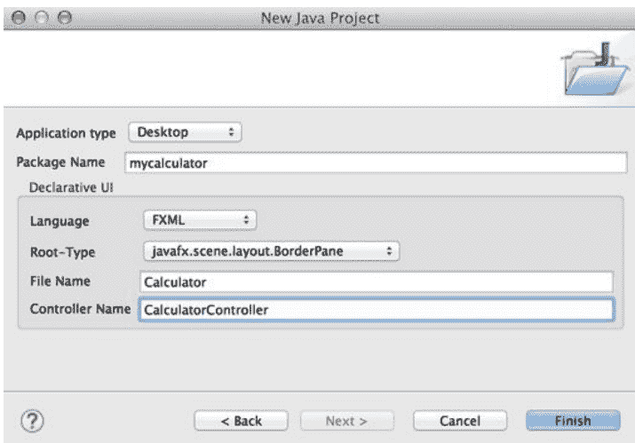

点击 `Finish`（完成）按钮会创建一个新的 Eclipse 项目，该项目包含两个 Java 类——`Main` 和 `CalculatorController`；FXML 文件 `Calculator.fxml` 如图 19-3 所示，以及一个名为 `application.css` 的 CSS 文件。

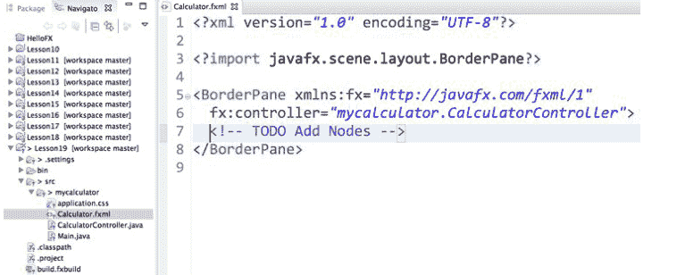

注意，`<BorderPane>` 包含了属性 `fx:controller`，其名称是在你的基于 MVC 的应用程序中充当控制器的类名。

`Calculator.fxml` 文件（如图 19-3 所示）包含由类 XML 标签生成的计算器 GUI。特别是，`<BorderPane>` 标签对应于 JavaFX 的 `BorderPane` 容器。

`Main` 类启动所有程序。在第 18 节中，你必须手动编写 Java 应用程序，但现在是由 e(fx)clipse 插件生成的，如下所示：

```java
package calculator;

import javafx.application.Application;
import javafx.stage.Stage;
import javafx.scene.Scene;
import javafx.scene.layout.BorderPane;
import javafx.fxml.FXMLLoader;

public class Main extends Application {

    @Override
    public void start(Stage primaryStage) {
        try {
            BorderPane root = (BorderPane) FXMLLoader.load(getClass().getResource("Calculator.fxml"));
            Scene scene = new Scene(root, 600, 400);
            scene.getStylesheets().add(getClass().getResource("application.css").toExternalForm());
            primaryStage.setScene(scene);
            primaryStage.show();
        } catch (Exception e) {
            e.printStackTrace();
        }
    }

    public static void main(String[] args) {
        launch(args);
    }
}
```

`@Override` 注解表示它重写了父类方法。在下一节中，你将看到它使用 `FXMLLoader` 来加载 `Calculator.fxml` 文件。`@FXML` 注解用于将 FXML 元素链接到 Java 控制器变量。

下一步是在网格单元格中添加按钮。从左侧的 `Controls` 板中将 `Button` 拖到网格的左上角，如图 19-9 所示。拖动按钮的右边框将其放大。将每个按钮的 `Margin`（外边距）属性设置为 5；这是按钮与单元格边界之间的距离。最后，将按钮上的文本更改为 `MC`，以与图 19-1 中的左上角匹配。图 19-9 显示了 Scene Builder 窗口现在的样子。

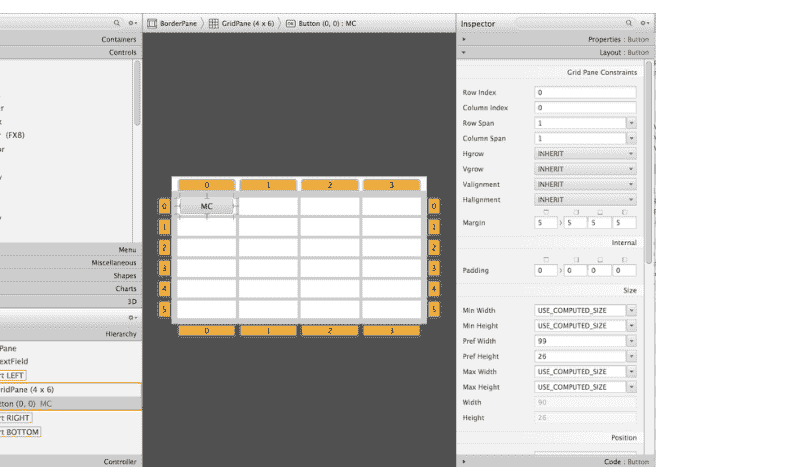

设计完此 `Calculator.fxml` 后，`<GridPane>` 内部有了一个新的 `<children>` 部分。目前它只有一个：

```xml
<children>
  <Button mnemonicParsing="false" prefHeight="26.0" prefWidth="99.0" text="MC">
    <GridPane.margin>
      <Insets bottom="5.0" left="5.0" right="5.0" top="5.0" />
    </GridPane.margin>
  </Button>
</children>
```

并没有显示单元格 (0,0)，因为 0 是 `<GridPane.columnIndex>` 和 `<GridPane.rowIndex>` 属性的默认值。你现在需要在其他单元格中重复此按钮。你可以多次使用 `Ctrl+C`/`Ctrl+V` 并拖放内容。通过编辑 `Calculator.fxml` 更改每个按钮的属性。在此过程中，观察你是如何添加更多按钮的。我发现直接在 FXML 文件中复制代码比使用 Scene Builder 进行操作更好。

注意图 19-1 中位于单元格 (0,5) 的按钮跨越了两列，坐标为 (3,4) 的按钮跨越了两行。对于这些按钮，你需要在右侧的属性面板上输入 2 作为行（或列）跨度（span），并将 `MAX_VALUE` 设置为最大宽度（或高度）。完成所有操作后，Scene Builder 窗口应该看起来像图 19-10。

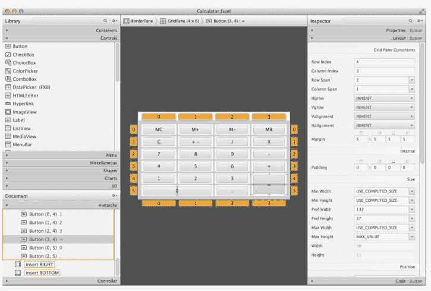

运行 `Main` 类并查看类似于图 19-1 的计算器。

这包含了对 Scene Builder 的简要介绍。如果你投入更多时间来掌握这个工具，你开发 GUI 程序的效率将会提高。详情请参考《Scene Builder 用户指南》。

## 在 Controller 类中处理事件

作为 MVC 设计模式，你将创建 `Calculator.fxml`。现在你可以编写一个控制器并将其关联到视图。当最初生成 `Calculator.fxml` 文件时，指定了处理位于根容器中所有组件事件的控制器名称：

```xml
<BorderPane xmlns="http://javafx.com/javafx/8"
     xmlns:fx="http://javafx.com/fxml/1"
     fx:controller="mycalculator.CalculatorController">
```

你将事件处理方法添加到 `CalculatorController` 类中，并将 GUI 组件链接到相应的事件处理器。最初生成的 `CalculatorController` 类是空的。添加一个简单的：

```java
package mycalculator;

import javafx.event.ActionEvent;

public class CalculatorController {

    public void buttonClickHandler(ActionEvent event) {
        System.out.println("Hello from controller!");
    }
}
```

如果你还记得，第 8 课的 `GridPaneSampleEvents` 类调用了 `setOnMouseClicked()` 将事件处理器分配给按钮点击。但如果你在 FXML 中开发 GUI，那里没有 Java 对象。或者，你可以为 `<Button>` 的 `onAction` 属性指定控制器的事件处理方法。以下代码片段用于标签为 1 的按钮：

```xml
<Button fx:id="btn1" onAction="#buttonClickHandler" text="1" />
```


<Button prefHeight="97.0" prefWidth="132.0" text="1" onAction="buttonClickHandler">
  <GridPane.margin>
    <Insets bottom="5.0" left="5.0" right="5.0" top="5.0" />
  </GridPane.margin>
</Button>

根容器包含子元素，容器的子元素知道处理事件的方法名称。在示例中，我为所有按钮设置了一个事件处理器，并将 `onAction="buttonHandler"` 复制粘贴到每个按钮上。或者，我可以为数字和执行操作的按钮分别分配一个事件处理器。

现在运行 `Main` 类并点击任何按钮，控制台上都会打印消息“Hello from controller”，这并不完全是计算器应该做的。但至少这证明了控制器接收到了来自计算器的事件。基本上，有两种情况：

- 用户点击数字并应该更改 `TextField` 的内容。
- 用户点击操作按钮并应用应用程序逻辑。

## 识别事件源

每个 JavaEvent 都继承自 `javafx.event.Event`，它具有 `source`（源）和 `target`（目标）。当事件到达处理器时，`source` 指向 `TextField`。在你的计算器中没有处理事件，因此 `source` 和 `target` 都指向被点击的按钮。例如，JavaFX 有 `keyEvent`，运行时将其提供给处理器。如果你的计算器在 `TextField` 上有一个切换，且用户在 `TextField` 中点击时，容器的处理器将接收到 `target` 的事件。

```java
private void processOperation(String buttonLabel) {
    System.out.println("You selected operation " + buttonLabel);
}
```

现在运行 `Main` 类，你会发现系统控制台识别了点击的按钮，并调用 `processDigit()` 或 `processOperation()` 方法。

## 从视图向控制器传递数据

控制器类如何访问在 FXML 中声明的 GUI 组件呢？如果你同时创建 GUI 和 Java 类，你可以像在第 9 节的 `Calculator` 和 `CalculatorEngine` 或“如何在对象之间传递数据”章节中那样，代码将 GUI 对象传递给控制器。但当 GUI 是在 FXML 中声明时，你是否需要实例化 GUI-FXLoader 呢？

此类情况，Java 提供了一个简单的解决方案：在 FXML 文件中为组件分配一个 ID，并在控制器类中使用同名且带有 `@FXML` 注解的变量。这确保了 Java 变量与 GUI 组件关联。你可以在第 25 节中学习 Java 注解。现在，只需相信我，`@FXML` 注解会神奇地将 GUI 组件引用注入到控制器的变量中。事实上，为什么直接让我看看它的运行效果呢？

首先，在 `Calculator.fxml` 的计算器的 `<TextField>` 标签上添加 `id` 属性。我决定将此 ID 命名为 `displayField`。

```xml
<top>
    <TextField id="displayField" BorderPane.alignment="CENTER" />
</top>
```

相应的在 `CalculatorController` 类中如下声明变量 `displayField`：

```java
@FXML
private TextField displayField;
```

现在你可以使用变量 `displayField`，并且知道它与具有相同 ID 的 GUI 组件具有相同的值。`CalculatorController` 的下一个版本在 `processDigit()` 方法中使用此变量。它通过 `getText()` 获取 `displayField` 的当前值，然后将选定的数字附加其，并使用 `setText()` 方法将其放回变量 `displayField`。

```java
package mycalculator;

import javafx.event.ActionEvent;
import javafx.event.Event;
import javafx.fxml.FXML;
import javafx.scene.control.Button;
import javafx.scene.control.TextField;

public class CalculatorController {

    @FXML
    private TextField displayField;

    public void buttonClickHandler(ActionEvent evt) {
        Button clickedButton = (Button) evt.getTarget();
        String buttonLabel = clickedButton.getText();
        // 区分数字和操作
        switch (buttonLabel) {
            case "0": case "1": case "2": case "3": case "4": case "5":
            case "6": case "7": case "8": case "9": case "10": case "..":
                processDigit(buttonLabel);
                break;
            default:
                processOperation(buttonLabel);
        }
    }

    private void processDigit(String buttonLabel) {
        displayField.setText(displayField.getText() + buttonLabel);
    }

    private void processOperation(String buttonLabel) {
        System.out.println("You selected operation " + buttonLabel);
    }
}
```

在第 11 节中，如果你忘记在 case 子句中编写 `break` 语句，代码会贯穿。在 `processDigit()` 方法中，我这样做是为了避免为每个子句都编写 `processDigit()` 和 `break`。图 19-1 显示了在点击按钮 5、9、2 和 3 之后运行的计算器的截图。

`processDigit()` 方法演示了数据从 GUI 传递到控制器再返回的过程。在“尝试一下”（Try It）中，你需要实现 `processOperation()` 方法来完成计算器。

## @FXML 注解

你可以对返回 `void` 的字段和方法使用 `@FXML` 注解。如果你在控制器类中添加了带有 `@FXML` 注解的 `initialize()` 方法，`FXMLLoader` Java 运行时会在所有 GUI 组件构造后调用此方法。特别是，如果你想使用绑定并确保所有 GUI 组件都已构造，这可能会非常有用。

```java
@FXML
public void initialize() {
    myComponent1.textProperty().bind(myComponent2);
}
```

## 编写井字游戏

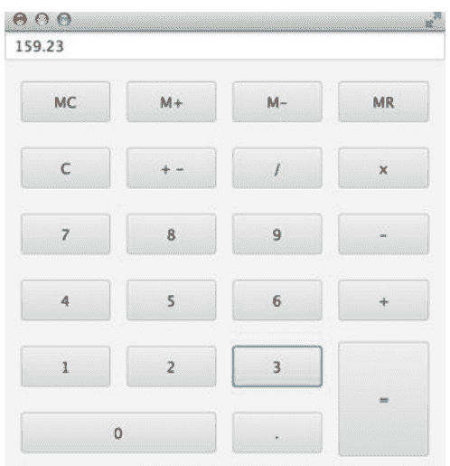

图 19-11：输入数字 159.23 后的计算器视图

## 编写井字游戏

现在你已经熟悉了使用 FXML 和 Scene Builder 创建 GUI 的基础知识，本节将展示编写一个井字游戏有多简单。

## 游戏策略

每个游戏都实现了算法——一组根据玩家动作必须执行的规则或策略。你需要为井字游戏想出一个简单的策略。

如果你不熟悉井字游戏，或者它在你的所在地区有不同的名称，请阅读关于它的维基百科文章。对于你正在构建的流行游戏版本，请实现以下策略：

- 游戏由两个玩家在 3x3 的二维棋盘上进行。
- 两个玩家可以玩这个游戏。一个人使用符号 X，另一个人使用符号 O。
- 获胜者必须拥有一整行、一列或对角线的 X 或 O。
- 每次移动后，程序必须检查是否有胜利者。
- 获胜组合必须被高亮显示。
- 每次移动后，程序必须检查是否有胜利者。

## 使用 FXML 设计井字 GUI

创建一个新的 JavaFX 项目 `TicTacToe`，指定包名为 `tictoe`，类名为 `TicTacToe`，控制器名为 `TacToeController`。

```java
public class Main extends Application {

    @Override
    public void start(Stage primaryStage) {
        try {
            BorderPane root = (BorderPane) FXMLLoader.load(getClass().getResource("TicTacToe.fxml"));
            Scene scene = new Scene(root, 300, 320);
            scene.getStylesheets().add(getClass().getResource("application.css").toExternalForm());
            primaryStage.setScene(scene);
            primaryStage.setResizable(false);
            primaryStage.show();
        } catch (Exception e) {
            e.printStackTrace();
        }
    }

    public static void main(String[] args) {
        launch(args);
    }
}
```

你的井字游戏在 `BorderPane` 顶部有一个菜单栏，中心有一个三列的 `GridPane`。

JavaFX 菜单是作为层次结构创建的。`Menu` 组件可以包含一个或多个 `MenuItem`。你也可以创建一个包含一个或多个 `Menu` 组件的 `MenuBar` 或 `ContextMenu`。我解释如何为井字游戏创建菜单，但你可以访问 Oracle 关于该主题的教程了解更多关于 JavaFX 菜单的信息。

在 Scene Builder 中，将 Controls 面板的 `MenuBar` 组件拖到 `BorderPane` 的“INSERT TOP”位置。

展开 Hierarchy 面板中的 `MenuBar`。默认菜单有 File、Edit 和 Help。井字游戏没有编辑内容，所以右键点击 Edit 并选择 Delete。使用 Scene Builder 的属性面板将 File 菜单重命名为 Actions。File 菜单最初带有 `MenuItem`，你应该将其重命名为 Quit。

将 `MenuItem` 放入 Actions 菜单。Scene Builder 会自动创建菜单项 Unspecified。将其重命名为 Play。

Menu Help 最初带有 `MenuItem` About。在 help 菜单上放入另一个 `MenuItem` 组件。Scene Builder 默认创建菜单项 Unspecified。将其重命名为 How Play。

现在将 Containers 面板的 `GridPane` 拖到 `BorderPane` 的中心并添加列使网格维度变为 3x3。

通过选择每行并在右侧面板 RowConstraints 的 Pref Height 字段中输入 100，更改每行的预览高度。你的 Scene Builder 窗口应该像图 19-12。

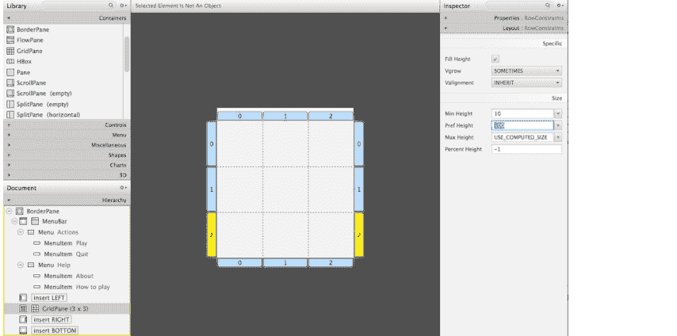

图 19-12：带有菜单栏和 3x3 网格的 BorderPane 布局

如果你运行 `Main` 类，它将打开一个顶部带有菜单栏的窗口，如图 19-13 所示。

268 | 第 19 章：开发 JavaFX 计算器和井字游戏

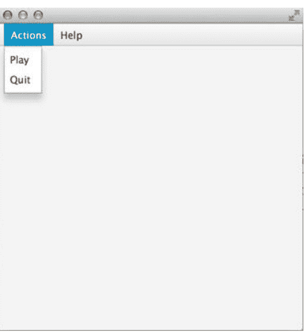

现在，你需要像在本节早些时候为计算器做的那样，向网格中添加九个按钮。每个按钮都应该占据整个单元格。按钮不应有标签；你将在游戏过程中通过程序化将它们设置为 X 或 O。

在 Eclipse 中打开生成的 `TicTacToe.fxml` 并对其进行简化。移除行列约束并向 `GridPane` 中添加九个高度为 100 的按钮，使其看起来如下所示所示：

```xml
<?xml version="1.0" encoding="UTF-8"?>
<?import java.lang.*?>
<?import javafx.scene.control.*?>
<?import javafx.scene.layout.*?>
<?import javafx.scene.layout.BorderPane?>

<BorderPane xmlns="http://javafx.com/javafx/8"
    xmlns:fx="http://javafx.com/fxml/1"
    fx:controller="tictactoe.TicTacToeController">
  <top>
    <MenuBar BorderPane.alignment="CENTER">
      <menus>
        <Menu text="Actions">
          <items>
            <MenuItem text="Play" />
            <MenuItem text="Quit" />
          </items>
        </Menu>
        <Menu text="Help">
          <items>
            <MenuItem text="About" />
            <MenuItem text="How to play" />
          </items>
        </Menu>
      </menus>
    </MenuBar>
  </top>
  <center>
    <GridPane fx:id="gameBoard" BorderPane.alignment="CENTER">
      <children>
        <Button fx:id="b1" prefHeight="100.0" prefWidth="100.0" />
        <Button fx:id="b2" prefHeight="100.0" prefWidth="100.0" GridPane.columnIndex="1" GridPane.rowIndex="0" />
        <Button fx:id="b3" prefHeight="100.0" prefWidth="100.0" GridPane.columnIndex="2" GridPane.rowIndex="0" />
        <Button fx:id="b4" prefHeight="100.0" prefWidth="100.0" GridPane.columnIndex="0" GridPane.rowIndex="1" />
        <Button fx:id="b5" prefHeight="100.0" prefWidth="100.0" GridPane.columnIndex="1" GridPane.rowIndex="1" />
        <Button fx:id="b6" prefHeight="100.0" prefWidth="100.0" GridPane.columnIndex="2" GridPane.rowIndex="1" />
        <Button fx:id="b7" prefHeight="100.0" prefWidth="100.0" GridPane.columnIndex="0" GridPane.rowIndex="2" />
        <Button fx:id="b8" prefHeight="100.0" prefWidth="100.0" GridPane.columnIndex="1" GridPane.rowIndex="2" />
        <Button fx:id="b9" prefHeight="100.0" prefWidth="100.0" GridPane.columnIndex="2" GridPane.rowIndex="2" />
      </children>
    </GridPane>
  </center>
</BorderPane>
```

运行 `Main` 类，查看图 19-14 所示带有菜单的井字盘。注意，第一个按钮有一个为蓝色边框的焦点。

270 | 第 19 章：开发 JavaFX 计算器和井字游戏

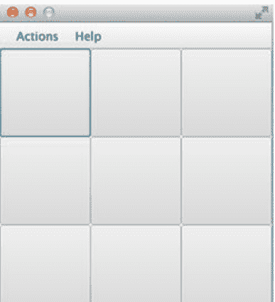

图 19-14：第一个按钮带有焦点边框的井字

要移除焦点边框，你需要更改生成的应用程序 `application.css` 文件中按钮的属性。从理论上讲，样式属性 `-fx-focus-color: transparent;` 应该起作用，但在编程中并非一切都按部就班。这里是移除焦点边框的样式：

```css
.button {
  -fx-focus-color: transparent;
  -fx-background-insets: -1, 0, 1, 1;
}
```


`Main` 类加载了 `application.css` 文件并将其样式应用于舞台上的匹配组件。（参见图 19-15。）


**图 19-15：** 第一个按钮没有焦点边框的井井字

GUI 已就绪。现在在控制器类中编写应用程序逻辑。这个游戏有两个玩家。第一个玩家在空白按钮上放置 X，另一个玩家使用 O。因此，你需要跟踪玩家的编号。当玩家点击按钮时，事件处理程序应该在按钮上放置相应的标签。`TicTacToeController` 的代码处理了这一功能：

```java
public class TicTacToeController {

    private boolean isFirstPlayer = true;

    public void buttonClickHandler(ActionEvent evt) {

        Button clickedButton = (Button) evt.getTarget();

        String buttonLabel = clickedButton.getText();

        if ("".equals(buttonLabel) && isFirstPlayer) {

            clickedButton.setText("X");

            isFirstPlayer = false;

        } else if ("".equals(buttonLabel) && !isFirstPlayer) {

            clickedButton.setText("O");

            isFirstPlayer = true;

        }

    }

}
```

在 `TicTacToe.fxml` 的每个 `Button` 标签中添加 `onAction="buttonClickHandler"` 并运行程序。点击空格以交替放置 X 和 O，如图 19-16 所示。

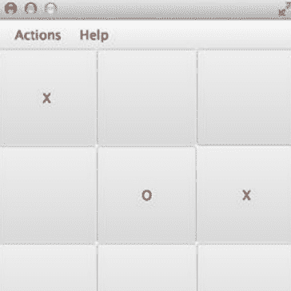

图 19-16：点击按钮后的井井字

通过在 `application.css` 中添加样式来增大 X 和 O 的字体，使其看起来像这样：

```css
.button{
  -fx-focus-color: transparent;
  -fx-background-insets: -1, 0, 1, 1;
  -fx-font-weight: bold;
  -fx-font-size: 36;
  -fx-text-fill: blue;
}
```

现在井井字显示出较大的 X 和 O，如图 19-17 所示。

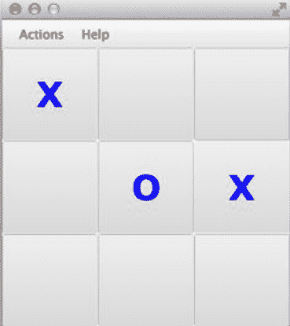

## 使用 Scene Builder 样式

所有 JavaFX 组件都预设了样式，通过定义自己的 CSS 你可以覆盖默认值。如果你对使用 Scene Builder 样式感兴趣，请查看“Scene Builder 布局与样式”视频。

## 在井井字控制器实现实现

在 `TicTacToeController` 中实现井井字规则。在点击每个按钮时，你需要检查是否有胜利者。你需要编写一个 `find3Row()` 方法，它检查行、列和对角线是否具有相同的标签。如果发现了胜利组合，程序将调用 `highlightCombo()` 方法显示获胜组合。

274 | 第 19：开发 JavaFX 计算器和井井字

为了比较按钮的标签，你需要使用 `@FXML` 注解提供的注入机制。你还需要对 `GridPane` 进行引用，这可以在“处理井井字菜单”部分看到。

```java
@FXML Button b1;
@FXML Button b2;
@FXML Button b3;
@FXML Button b4;
@FXML Button b5;
@FXML Button b6;
@FXML Button b7;
@FXML Button b8;
@FXML Button b9;
@FXML GridPane gameBoard;

// 方法代码自而易见：

private boolean find3Row() {
    // 第一行
    if (b1.getText() != null && b1.getText().equals(b2.getText()) && b2.getText().equals(b3.getText())) {
        highlightWinningCombo(b1, b2, b3);
        return true;
    }
    // 第二行
    if (b4.getText() != null && b4.getText().equals(b5.getText()) && b5.getText().equals(b6.getText())) {
        highlightWinningCombo(b4, b5, b6);
        return true;
    }
    // 第三行
    if (b7.getText() != null && b7.getText().equals(b8.getText()) && b8.getText().equals(b9.getText())) {
        highlightWinningCombo(b7, b8, b9);
        return true;
    }
    // 第一列
    if (b1.getText() != null && b1.getText().equals(b4.getText()) && b4.getText().equals(b7.getText())) {
        highlightWinningCombo(b1, b4, b7);
        return true;
    }
    // 第二列
    if (b2.getText() != null && b2.getText().equals(b5.getText()) && b5.getText().equals(b8.getText())) {
        highlightWinningCombo(b2, b5, b8);
        return true;
    }
    // 第三列
    if (b3.getText() != null && b3.getText().equals(b6.getText()) && b6.getText().equals(b9.getText())) {
        highlightWinningCombo(b3, b6, b9);
        return true;
    }
    // 对角线1
    if (b1.getText() != null && b1.getText().equals(b5.getText()) && b5.getText().equals(b9.getText())) {
        highlightWinningCombo(b1, b5, b9);
        return true;
    }
    // 对角线2
    if (b3.getText() != null && b3.getText().equals(b5.getText()) && b5.getText().equals(b7.getText())) {
        highlightWinningCombo(b3, b5, b7);
        return true;
    }
    return false;
}
```

要突出显示胜利组合，你需要通过调用按钮 `setStyle()` 方法来动态更改胜利按钮的样式。我想将背景改为渐变色，并将按钮标签的颜色改为红色。你可以在 JavaFX CSS 参考文档中查阅渐变，那里也可以找到常用的 CSS 颜色名称。`highlightWinningCombo()` 方法的第一版本可能如下：

```java
private void highlightWinningCombo(Button first, Button second,
    Button third) {
    first.setStyle("-fx-background-color:radial-gradient(radius 100%, white, lightyellow, lawgreen);-fx-text-fill:red;");
    second.setStyle("-fx-background-color:radial-gradient(radius 100%, white, lightyellow, lawgreen);-fx-text-fill:red;");
    third.setStyle("-fx-background-color:radial-gradient(radius 100%, white, lightyellow, lawgreen);-fx-text-fill:red;");
}
```

图 1-18 显示了胜利组合可能的样式。

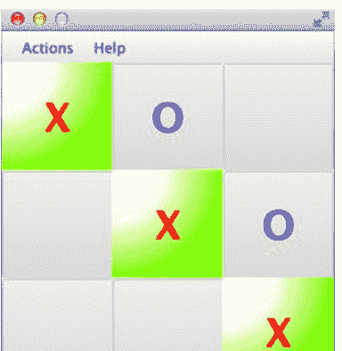

**图 19-18：** 使用渐变色突出胜利组合

更改按钮样式是有效的，但我不喜欢 CSS 样式被硬编码在 Java 代码中。更好的方法是在 CSS 文件中定义类选择器并在需要时应用它。在 `application.css` 文件中添加以下 CSS 类选择器：

```css
.winning-button {
    -fx-background-color:
        radial-gradient(radius 100%, white, yellowish, lawngreen);
    -fx-text-fill: red;
}
```

现在 `highlightWinningCombo()` 方法可以通过添加样式来将其应用到按钮。改进后的 `highlightWinningCombo()` 如下：

```java
private void highlightWinningCombo(Button first, Button second,
Button third) {
first.getStyleClass().add("winning-button");
second.getStyleClass().add("winning-button");
third.getStyleClass().add("winning-button");
}
```

现在当你（或图形设计师）决定更改胜利按钮的样式时，就不需要修改 Java 代码并重新编译程序。只需在任何纯文本编辑器中修改 `application.css` 文件的内容即可。

# 处理井棋游戏菜单播放

好消息是，菜单项的点击处理方式与按钮的点击相同。你只需要实现菜单 Play，以便使用户在发现胜利组合或完全没有获胜者时开始新游戏。

在 `TicTacToe.fxml` 文件中，为菜单 Play 分配事件处理程序，如下：

```xml
<MenuItem text="Play" onAction="menuClickClickHandler()"/>
```

当用户点击 Play 菜单项时，控制器需要重置所有按钮的标签并移除胜利按钮的样式。最简洁的方法是获取 `GridPane` 的所有子节点，并通过 `forEach()` 传递一个短 Lambda 表达式。该 `menuClickHandler` 方法所示：

```java
public void menuClickHandler(ActionEvent evt) {
    MenuItem clickedMenu = (MenuItem) evt.getTarget();
    String label = clickedMenu.getText();
    if ("Play".equals(label)) {
        ObservableList<Button> buttons = gameBoard.getChildren();
        buttons.forEach(btn -> {
            ((Button) btn).setText("");
            btn.getStyleClass().remove("winning-button");
        });
        isFirstPlayer = true; // X 开始新游戏
    }
}
```

`javafx.collections` 包含了 Java Collections 框架的类和接口，你可以在 Oracle 文档中找到它们的所有描述。你的方法 `menuClickHandler` 使用了这些接口之一：`ObservableList`。创建此集合是为了监听可能发生在其上的事件，但我们用它存储对 `GridPane` 的引用。

`getChildren()` 方法返回 `Node` 实例集合（每个 `Button` 都是 `Node` 的后代）。然后你擦除每个按钮的标签并移除胜利按钮的华丽样式。最后你重置 `isFirstPlayer` 的值，让 X 在点击的按钮上进行首次移动。就是这些。玩游戏吧！

# 井棋：下一步尝试

你的井棋游戏已经准备好了。当然，你可以更改一些内容让这个游戏达到商业级。例如，可以在找到获胜者时通过在所有按钮上调用 `removeEventHandler()` 来移除所有处理器。你可以考虑允许用户设置棋盘的尺寸，而不是使用 3x3 网格。在这种情况下，我建议你在 Java 中创建 GUI，并根据用户的选择动态创建按钮数组。你可以添加“保存历史”功能以及与电脑对战的功能。你需要熟悉极大极小算法（Minimax）和博弈论。

# Web 和设备上的 JavaFX

你的井棋游戏已经准备好了。当然，你可以更改一些内容让这个游戏达到商业级。例如，可以在找到获胜者时通过在所有按钮上调用 `removeEventHandler()` 来移除所有处理程序。你可以考虑允许用户设置棋盘的尺寸，而不是使用 3x3 网格。在这种情况下，我建议你在 Java 中创建 GUI，并根据用户的选择动态创建按钮数组。你可以添加“保存历史”功能以及与电脑对战的功能。你需要熟悉极大极小算法（Minimax）和博弈论。

## 逐步说明

正如你所看到的，我使用包装类 `Double` 在在使用之前将其转换为数值。

1. 导入 Eclipse 项目
2. 运行 `Main` 类以查看数字按钮的点击是否正确显示在显示字段中。
3. 要对两个数字执行操作，你需要知道它们的值和选择的操作。计算器的显示字段一次显示一个数字，因此你需要将第一个输入的值存储在程序变量中。你也可以将执行操作的结果存储在单独的变量中。记住显示字段中的值是用字符串表示的。在 `CalculatorController` 类中声明以下字段：

```java
private String previousValue="";
private String currentValue="";
private double result;
```

4. 写一个相加数字的方法。初始如果用户输入第一个数字并点击，只需将其存储在 `previousValue` 并清空显示字段以便用户输入第二个。如果用户点击加号按钮且 `previousValue` 不空，则相加当前值并显示结果。该方法的第一版本如下：

```java
private void addNumbers() {
    if ("".equals(previousValue)) {
        previousValue = displayField.getText();
        displayField.setText("");
    } else {
        currentValue = displayField.getText();
        result = Double.parseDouble(previousValue) + Double.parseDouble(currentValue);
        displayField.setText("" + result);
    }
}
```

5. 如果用户点击加号或等号之一的按钮，控制器应该调用 `addNumbers()`。你可能还需要记住最后执行的操作。因此，添加以下变量声明：

```java
private String lastOperation;
```

修改 `CalculatorController` 中的 `processOperation()` 方法如下：

```java
private void processOperation(String label) {
    switch (label) {
        case "+":
            lastOperation = "+";
            addNumbers();
            break;
        case "=":
            processOperation(lastOperation); // 递归
    }
}
```


“递归”（recursion）一词描述了函数或方法调用自身的情况。递归有助于避免重复代码。因为当用户点击加号或等号按钮时，你需要重复相同的操作，因此使用递归是有意义的。

```java
case "":
    processOperation(lastOperation); // 递归
}
```

- 6. 运行 `Math` 类，你应该能够输入并相加两个数字。但为了支持用户想要执行多次连续加法的场景，你需要少量的代码来捕获用户在操作执行后继续点击数字的时刻。在这种情况下，你需要将结果存储在变量 `previousValue` 中，并清空显示字段，以便让用户可以输入下一个要相加的数字。
- 7. 类似于加法，实现其他操作。添加输入验证：不允许用户在数字中输入多个句号。不允许除以零。
- 8. 将计算器 GUI 的 FXML 实现版本与第 18 课中 Try It Else 的 Java 版本进行比较。

> 提示：请在 `www.wrox.com/go/javprog24hr2e` 选择第 19 课的视频。你也可以从网站下载本节的代码和资源。

## 第 20 课 Stream API

在本节中，你将学习如何使用 Java 8 引入的新 Stream 应用程序接口（API）（不要与 I/O Stream 混淆）。Stream API 允许你以更简单、更容易理解的方式编写数据处理代码。本章大部分示例说明了如何对 Java 集合进行迭代和操作，但你从一开始就应该知道，Stream API 不仅仅是另一种类型的数据集合。它是对程序需要处理的一组数据的抽象。

数据可以来自集合、生成数据的函数，或来自 I/O 流。通过使用 Stream API 和 lambda 表达式，你可以编写出简单易读且高效的迭代器，从而产生输入数据的子集或某种数据聚合。

所有支持 Stream API 的类和接口都位于 `java.util.stream` 包中，而 `Stream` 接口是核心。位于其他包中的某些旧类（例如 `BufferedReader`）包含了新方法，可以返回其作为 `Stream` 的引用。

### STREAM 基础

Stream（流）是一个表示零或多个值的抽象。将其想象成一个高级的迭代器，允许你对数据上声明一个或多个操作，然后一次性执行这些操作。普通的 `Iterator` 是按顺序工作的，而流也可以进行并行处理。

让我们从一个简单的示例开始。这个示例使用啤酒集合来让操作 Stream API 更有趣。`Beer` 类如下：

```java
public class Beer {
    public String name;
    public String country;
    public float price;

    Beer(String name, String country, float price) {
        this.name = name;
        this.country = country;
        this.price = price;
    }

    public String toString() {
        return "Name: " + name + ", price: " + price;
    }
}
```

假设你有一个名为 `beers` 的集合，可以通过 `loadBeer()` 填充。现在你想创建一个只包含美国啤酒的另一个集合。使用 Stream API 的方法如下：

```java
List<Beer> beer = loadBeer(); // 填充集合
List<Beer> americanBeers = beer.stream()
    .filter(br -> "USA".equals(br.country))
    .collect(Collectors.toList());
```

调用 `stream()` 方法将集合设为流的源。然后，你的代码过滤出 `country` 不为美国的啤酒。最后，代码调用 `collect()` 方法将啤酒放入另一个列表中。在这个示例中，你链联了两个操作——`filter` 和 `collect`。你可以指定更多操作，包括 `map`、`find`、`sort` 和 `match`。注意，我使用了 lambda 表达式来指定过滤标准。代码中另一个值得注意的有趣点是类型推断：在没有声明集合类型的情况下，Java 编译器知道它存储的是 `Beer` 类型的对象，如果你使用 lambda 处理对象，则类型将根据参数推断出来。

#### 中间操作与终端操作

你可以应用于流的操作分为两类：中间操作（intermediate operations）和终端操作（terminal operations）。在示例中，`filter()` 是一个中间操作，而 `collect()` 是一个终端操作。每个中间操作在产生结果（例如总和或平均值）之前，都声明了你想对流数据做什么，例如打印某些输出或创建一个新的集合（在本例中）。

如何判断特定操作是中间的还是终端的？中间操作返回 `Stream` 以外的任何内容。事实上，流操作可以链联成流水线，因为每个中间操作都返回一个 `Stream`。

#### 懒性操作

在终端操作被调用之前，中间操作甚至不会尝试读取数据。使用中间操作的核心思想是以声明式的形式表达你的意图。考虑以下代码片段：

```java
OptionalDouble averagePrice = beer.stream()
    .filter(br -> "USA".equals(br.country))
    .mapToDouble(br -> br.price)
    .average();
```

在给你展示这段代码之前，它解释道：“我们想过滤掉非美国啤酒，然后应用 map 操作来提取啤酒价格。最后我们计算平均价格。”在调用 `average()` 之前，`filter()` 和 `mapToDouble()` 都没有被调用（我在下一个代码中向你证明）。确切知道你计划对数据做什么，允许 Java 创建最高效的执行计划。我所说的“懒性执行”（lazy execution）是指，在终端操作调用之前，中间操作不会执行。

### 集合与流的排序

总结一下，将中间操作视为一系列所需的动作，这些动作将与终端操作一起在一次遍历中执行。终端操作都不会修改源数据。流（Streams）是不可变的。

### 并行处理与顺序处理

十个人走进了慕尼黑啤酒节节帐篷。他们坐在一张桌旁，服务生走了过来。其中一个人说：“请给我们带几杯 Leffe Blonde 啤酒，并按照以下步骤操作：去吧台，装满第一杯带到这里；然后对第二杯也这样做。重复十次。”服务生礼貌地回答：“请不要告诉我如何给你们送啤酒，请一次性全部上齐。”服务生优化了流程。他只需要客户告诉他要做什么，而不是怎么做。

并行处理是有规则的！我在第 11 课使用 `forEach()` 迭代集合时已经提到过这一点。流也一样。当你对数据源调用 `stream()` 时，数据处理很可能会被优化并并行执行；运行时可能会在内部将数据分成块，并行执行操作，并重构结果。

如果你想确保处理是并行执行的，请在数据上使用 `parallelStream()`，它可能会在内部创建多个线程来处理流数据。Java 7 引入了 Fork/Join 框架来实现并行性，但其代码编写并不简单。在 Java 8 中，Fork/Join 例被隐藏在流的实现内部，对应用程序开发者透明。

即使 Java 文档也指出 `parallelStream()` 返回一个可能的并行的流。

然而，并没有保证你的应用程序代码在使用 `parallelStream()` 后运行得更快。你需要通过比较 `parallelStream()` 的速度与 `stream()` 的速度对代码进行基准测试。结果取决于你的应用程序代码以及数据源的 Java 内部实现。

#### 何时使用并行流

如果你对深入理解何时使用并行流感兴趣，请阅读 Doug Lea 博士带领 Java 专家小组编写的在线文章《何时使用并行流》（When to use Parallel Streams）。

### 排序集合与流

有时你需要按升序或降序对数据值进行排序。因此，Java 运行时需要能够比较值。对于原始数据类型，这是一个简单任务：3 大于 2，27 小于 28。但你如何比较复杂类型（如对象）呢？对 `Beer` 对象集合排序意味着什么？在排序时，哪些属性应该与同类对象进行比较：价格、名称、国家，还是这些属性的组合？

程序员需要指定对象比较的规则——例如，按价格升序排序啤酒。让我们先看看如何为通用 Java 集合指定排序规则，然后看如何排序流。

#### 排序 Java 集合

集合可以包含多个对象，你只需要知道如何比较两个对象以将它们放在特定的顺序。集合上的 `sort()` 方法比较每对对象。在少数情况下，人们需要应用不同的排序算法，通常调用 `sort()` 方法就足够了。Java 接口 `Comparable` 和 `Comparator` 允许你指定比较规则。

##### 使用 Comparable 接口

如果一个类实现了 `Comparable`，则对象的当前实例可以与另一个相同类型的对象进行比较。你需要在类声明中添加 `Comparable` 并在那里实现 `compareTo()` 方法。看看如果我们想要能够按价格比较，`Beer` 类可能像什么样。

```java
public class Beer implements Comparable<Beer> {
    public String name;
    public String country;
    public float price;

    Beer(String name, String country, float price) {
        this.name = name;
        this.country = country;
        this.price = price;
    }

    public int compareTo(Beer otherBeer) {
        if (this.price > otherBeer.price) {
            return 1; // 这只啤酒比另一个“大”
        } else if (this.price < otherBeer.price) {
            return -1; // 这只啤酒比另一个“小”
        } else {
            return 0; // 啤酒“相等”的
        }
    }

    public String toString() {
        return "Name: " + name + ", price: " + price;
    }
}
```

`compareTo()` 方法接受一个参数——要比较的对象。根据规则，如果这只啤酒的值比另一个“大”，`compareTo()` 方法必须返回 1。如果这只啤酒较“小”，则返回 -1。如果值“相等”，`compareTo()` 返回 0。当前的示例比较的是价格。

我们将复用本节之前在此过的相同啤酒集合。接下来的代码片段使用了 `java.util.Collections` 类，展示了你如何按价格对其排序：

```java
List<Beer> beers = loadCell(); // 填充啤酒集合
Collections.sort(beers);
beers.forEach(System.out::println);
```

这是预期的输出：


Name: Obolon, price: 4.0
Name: Bud Lights, price: 5.0
Name: Turnling, price: 5.5
Name: Sam Adams, price: 7.0
Name: Stella, price: 7.25
Name: Brooklyn Lager, price: 8.25
Name: Leffe Blonde, price: 8.75
Name: Chimay Blue, price: 10.0

`Comparable` 接口只能按单个属性排序对象，这限制了它的用途。如果你想按名称排序，你需要考虑：

# 使用 Comparator 接口

`Comparator` 接口允许你在不修改类的情况下按任何属性对对象进行排序。以下代码展示了如何使用 Lambda 按价格排序啤酒：

```java
Comparator<Beer> priceComparator = Comparator.comparing(beer -> beer.price);
beers.sort(priceComparator);
beers.forEach(System.out::println);
```

Name: Obolon, price: 4.0
Name: Bud Lights, price: 5.0
Name: Turnling, price: 5.5
Name: Sam Adams, price: 7.0
Name: Stella, price: 7.25
Name: Brooklyn Lager, price: 8.25
Name: Leffe Blonde, price: 8.75
Name: Chimay Blue, price: 10.0

如果你想按降序排序，可以使用 `reversed()` 方法：

```java
Comparator<Beer> priceComparator = Comparator.comparing(beer -> beer.price).reversed();

System.out.println("=== by price");
beers.sort(priceComparator);
beers.forEach(System.out::println);
```

以下是输出：

```
=== by price
Name: Chimay Blue, price: 10.0
Name: Leffe Blonde, price: 8.75
Name: Brooklyn Lager, price: 8.25
Name: Stella, price: 7.25
Name: Sam Adams, price: 7.0
Name: Turnling, price: 5.5
Name: Bud Lights, price: 5.0
Name: Obolon, price: 4.0
```

如果你想按多个字段排序，应该使用一次或多次 `thenComparing()` 方法链调用：

```java
System.out.println("=== Sorting by name and price");
beers.sort(Comparator.comparing((Beer) -> beer.name).thenComparing((Beer) -> beer.price));
beers.forEach(System.out::println);
```

# 288 | 第20 Stream API

Stream API 提供了一种处理对象的强大方式。流是支持函数式操作的元素序列。你可以用简洁的方式过滤（`filter`）、映射（`map`）和还原（`reduce`）数据。

在本节中，我们将探索如何使用流对集合排序。

```java
List<Beer> sortedBeers = beers.stream()
    .sorted(Comparator.comparing(beer -> beer.price))
    .collect(Collectors.toList());

sortedBeers.forEach(System.out::println);
```

`sorted()` 方法返回一个根据指定的 `Comparator` 排序的新流。如果没有提供 `Comparator`，则按自然顺序排序。如果元素没有实现 `Comparable` 且没有提供 `Comparator`，将抛出 `ClassCastException`。

以下是预期的输出：

```
Name: Obolon, price: 4.0
Name: Bud Lights, price: 5.0
Name: Turnling, price: 5.5
Name: Sam Adams, price: 7.0
Name: Stella, price: 7.25
Name: Brooklyn Lager, price: 8.25
Name: Leffe Blonde, price: 8.75
Name: Chimay Blue, price: 10.0
```

排序集合与流 | 289

```java
be.sort(Comparator.comparing(Beer::getName).thenComparing(Beer::getPrice));
```

## 可变集合 (MUTABLE COLLECTIONS)

在使用 `Comparable` 和 `Comparator` 接口结合 `sort()` 方法会修改（排序）原始数据集合。因此，集合是可变的。排序流时情况并非如此，接下来将进行解释。

# 排序流 (Sorting Streams)

现在你已经熟悉了数据集合通用排序的基础知识，是时候看看如何使用 Stream API 对任何数据进行排序了。提醒一下，当你处理流时，原始数据源保持不变——即不会对数据源进行任何更改。若要将数据存储在另一个集合或数组中，你需要使用终端操作 `collect()`。

该方法与 `Comparator` 配合使用，按价格对你的啤酒集合进行排序可以编写如下代码：

```java
beers.stream()
  .sorted(Comparator.comparing(b -> b.price))
  .forEach(System.out::println);
```

对多个字段进行排序的方法与 Comparator 上的代码示例类似。下一个示例展示了如何按国家和价格对啤酒进行排序。稍微修改 `Beer` 类中的 `sortTo()` 方法以打印国家。

啤酒和价格排序看起来可能像所示：

```java
beers.stream()
  .sorted(Comparator.comparing((Beer b) -> b.country)
  .thenComparing(b -> b.price))
  .forEach(System.out::println);
```

运行这段代码将产生以下输出：

```
Country: Belgium Name: Stella, price: 7.75
Country: Belgium Name: Le Blonde, price: 8.75
Country: Belgium Name: Blue, price: 10.0
Country: USA Name: Bud Light, price: 5.9
Country: USA Name: Yuengling, price: 5.5
Country: USA Name: Sam Adams, price: 7.0
```

*

# 290 | 第 20 节 STREAM API

Country: USA Name: Brooklyn Lager, price: 0.25

Country: Ukraine Name: Obolon, price: 4.0

若要在一个新的 List 集合中查看排序结果，你需要添加一个终端操作：

```java
List<Beer> sortedBiers = beers.stream()
    .sorted(Comparator.comparing(b -> b.price))
    .collect(Collectors.toList());
```

现在你有两个集合。原始的（`beers`）集合是未排序的，而新的（`sortedBiers`）是排序过的。

# 并行流与排序 (PARALLEL STREAMS AND SORTING)

如果你决定使用 `parallelStream()`，则 `forEach()` 方法无法用于排序后的数据。根据 Oracle 文档，对于并行流水线，此操作不保证遇到流的顺序，因为这会牺牲并行带来的优势。你需要改用 `forOrdered` 方法。

# 流源 (STREAM SOURCES)

到为止，本章中的所有代码示例都使用对象集合作为流数据源。但事实并非如此。你可以使用 Stream API 处理有限和无限数据源。

# 创建有限大小的源 (Creating Finite Size Sources)

你可以获取一组任意值并使用 `Stream.of()` 方法将它们放入流中。例如，以下代码段创建了一个有限大小的字符串流。

```java
Stream<String> beerNames = Stream.of("Leffe Blonde",
    "Chimay Blue", "Sam Adams");
beerNames.forEach(System.out::println);
```

`builder()` 方法是创建有限大小源的另一种方法。以下代码段创建了一个包含三个基本类型的流并找到最大值。由于 `max()` 返回 `OptionalLong` 类型（它可能有值也可能没有），我调用了 `getAsLong()` 来获取基本类型 long。运行此代码后，`maxValue` 等于 21。

```java
long maxValue = LongStream.builder()
    .add(10)
    .add(21)
    .add(15)
    .build()
    .max().getAsLong();
```

# 创建无限大小的流 (Creating Infinite-Size Streams)

尽管数据集合具有有限大小，但你可以使用 Stream API 处理无限数据流。

# 生成流数据 (Generating Stream Data)

`Stream.generate()` 方法可以接受一个 lambda 表达式，该表达式通过某种任意算法生成值。实现 `java.util.function.Supplier` 意味着要编写一个返回某些结果的函数。

以下类使用了位于 `java.time` 包中的 Java 8 日期时间 API。该提供者每次睡眠一秒（1000 毫秒），然后使用 `now()` 查询系统时间。`Stream.generate()` 生成了一个无限流，每秒向流提供当前时间。

```java
import java.time.LocalDateTime;
import java.util.function.Supplier;
import java.util.Stream;
public class StreamDates {
    public static void main(String[] args) {
        // 实现 Supplier 接口
        Supplier<LocalDateTime> myStopWatch = () -> {
            try {
                Thread.sleep(1000);
            } catch (InterruptedException e) {
                e.printStackTrace();
            }
            return LocalDateTime.now();
        };
        // 使用 lambda 表达式生成流
        Stream<LocalDateTime> timeStream = Stream.generate(myStopWatch);
        timeStream.forEach(System.out::println);
    }
}
```

运行此程序产生的输出如下（省略部分）：

```
2024-09-18T...
2024-09-18T...
...
```

# 291 | 第 20 节 STREAM API

## 292 | 第 20 节 STREAM API

## 293 | 第 20 节 STREAM API

## 294 | 第 20 节 STREAM API

# 短路操作 (SHORT-CIRCUIT OPERATIONS)

在某些情况下，你想提前停止流。假设你只想显示流中的前五个元素。短路操作为此提供了目的。回顾打印数字的示例。如果你生成一个无限数字流，为了打印前五个数字，可以使用短路操作 `limit()`：

```java
LongStream evenNumbers = LongStream.iterate(0, num -> num+2)
    .limit(5);
```

```java
evenNumbers.forEach(System.out::println);
```

这段代码打印以下数字：

```
0
2
4
6
8
```

另一个短路方法是流的 `findFirst()` 元素。该方法返回 Java 8 引入的 Optional 对象。如果未找到对象，`findFirst()` 返回一个空 Optional。下一个代码示例打印集合中的第一个元素：

```java
Optional<Beer> firstBeer = beers.stream()
    .findFirst();
System.out.println("集合中的第一个啤酒: " +
    firstBeer.orElse(new Beer("No name", "No country", 0)));
```

# 与 I/O 使用 Stream API (Using Stream API with I/O)

```java
public class WebSiteReader {
    public static void main(String[] args){
        String line;
        URL url = null;
        URL connection = null;
        try {
            // 假设 index html 是默认
            url = new URL("http://www.google.com");
            connection = url.openConnection();
        } catch (IOException e) {
            System.out.println("无法连接到提供的 URL: " + e.toString());
        }
    }
}

try {
    InputStream in = new InputStreamReader(connection.getInputStream(),"UTF-8");
    BufferedReader buff = new BufferedReader(in);
// 使用 Stream API 读取并打印 Google 页面内容

buff.lines()
    .forEach(System.out::println);

} catch (IOException e) {
    System.out.println("无法从互联网读取: " + e.toString());
}
```

## 短路操作 (Short-Circuit Operations)

不仅流的读取部分变得更简单——只需调用 `lines()`——而且你现在可以添加一些中间操作，在数据进入时进行某些过滤。例如，你可以使用正则表达式（本书未涵盖）创建一个匹配模式，并只读取匹配该模式的数据。你可以通过查找使用 `Matcher` 类的示例来进一步研究。

针对你的啤酒集合运行此代码将打印出：

- 集合中的第一瓶啤酒：Stella，价格：7.75

如果你的集合为空，`println()` 方法将使用来自 `orElse()` 方法的代码。尝试从空集合中打印 `firstBeer` 将输出 `Optional.empty`。

`Stream` 类上的其他短路方法还有 `skip()`、`findAny()`、`allMatch()`、`noneMatch()` 和 `anyMatch()`。

## 尝试一下

在接下来的练习中，你需要在处理流时使用方法引用。你还将尝试使用短路操作。

## 课程要求

你应该已经安装 Java。

> 注意：你可以从 www.wrox.com/go/javaproq24hr2e 网页下载此“尝试一下”练习的代码和资源。你可以在 `Lesson 20.zip` 中找到它们。

## 逐步步骤

在本次练习中，你需要在配合流操作时使用静态方法引用。

- 1. 在 Eclipse IDE 中导入项目 `Lesson20`。

- 2. 在 `OutputStream` 类中，添加一个名为 `myStopWatchFunction()` 的静态方法，并将 lambda 表达式 `myStopWatch` 中的代码移动到那里。这是 lambda 表达式 `myStopWatch` 原始实现方式：

```
Supplier myStopWatch = () -> {
  try {
    Thread.sleep(1000);
  } catch (InterruptedException e) {
    e.printStackTrace();
  }
  return LocalDateTime.now(); // 获取当前时间
};
```

- 3. 从类中删除 lambda 表达式 `Supplier myStopWatch` 的声明。

- 4. 现有的 `generate` 方法调用如下：


```java
Stream.generate(myStopWatch)
```

将 `generate()` 方法的参数替换为方法引用 `StreamOfDates::myStopWatchFunction`。

- 5. 运行程序。它应该开始打印带有当前时间的无限消息。
- 6. 添加短路操作 `limit()`，使程序在打印指定次数当前时间后停止。
- 7. `limit()` 和 `findFirst()` 是中间操作还是终端操作？
- 8. 修改 `Beer` 类以包含 getter 方法，并修改 `Comparator` 代码示例，使其使用方法引用而不是 lambda 表达式。

> 提示：请在 www.wrox.com/go/javaprog24hr2 在线选择第20课的视频。你也可以从网站下载本课程的代码和资源。

# 第 21 课 使用 JDBC 访问关系型 DBMS

业务应用程序通常将存储在数据库中。在大多数企业应用中，关系型数据库管理系统（RDBMS）被用作数据存储。它们在表中存储数据记录。每条记录（例如员工记录）由表行表示，表行由一个或多个列或记录字段组成（例如名称、地址、入职日期）。RDBMS 识别 SQL 语言。

最流行的 RDBMS 有 Oracle、DB2、Microsoft SQL Server 和 MySQL Server。本节使用 Apache Derby DB（也称为 Java DB），它是 Windows 版 Java SE 附带的，或者你也可以在 Mac 或 Linux 机器上单独安装它。

## NoSQL 数据库管理系统

某些数据库管理系统不是关系型的——它们不以行和列存储数据。此类数据库管理系统被称为 NoSQL 数据库（例如 MongoDB、Cassandra、Couchbase 等）。本书未涵盖 NoSQL 数据库。欲了解更多信息，请参阅 http://nosql-database.org。

Java 包含两个含有处理 DBMS 类的包：`java.sql` 和 `javax.sql`。前者包含了常用的类，如 `Connection`、`Statement` 和 `ResultSet`。后者用于支持服务器端的数据库连接，包含 `DataSource` 和 `RowSet` 等类。

JDBC API 并不特定于某个 DBMS——如果你编写了一个使用 JDBC 类来在 Oracle 中检索/更新数据的程序，那么你将使用相同的类来处理 MySQL Server 或 DB2。你只需要来自相应的 JDBC 驱动程序；驱动程序在相同的 JDBC API 后面隐藏了它们的数据库接口。

JDBC 驱动程序要么将 SQL 语句从 Java 传递给 DBMS 执行，要么简单地在 DBMS 内部执行一个程序（存储过程）。如果从这些操作的结果获取了某些数据，你的 Java 程序将通过调用适当的 JDBC API 来处理它。在过去的 15 年里，JDBC 规范一直在演进，在本文编写时，大多数驱动都符合 JDBC 4.1 版本。

在本节中，与 DBMS 的所有通信都是通过向 JDBC API 提供 SQL 语句来实现。使用 Java 持久 API (JPA) 处理数据是另一种方法，它将在第 32 课中介绍。有些人更倾向于使用对象关系映射 (ORM) 框架（如 Hibernate），或者减少冗余 JDBC 代码的框架（如 MyBatis，本书未涵盖）。

# JDBC 驱动程序类型

JDBC 驱动程序在 Java 程序和 DBMS 之间充当中间人的角色。驱动程序可以从数据库供应商、Oracle 以及 Java 服务器的第三方供应商获得。

JDBC 驱动有四种：

- **类型 1 驱动** 是 JDBC-ODBC 桥接，它允许 Java 程序使用 Microsoft 的 ODBC 驱动与数据库交互。这种驱动比其他的更容易编写，但必须在每个用户的机器上安装和配置，且仅限 Windows 机器。类型 1 驱动已很大程度上被取代，Oracle 已从 JDBC 4.0 开始删除了它。
- **类型 2 驱动** 由 Java 类组成，并与 DBMS 提供的非 Java 原生驱动协同工作。这些驱动的运行速度比类型 1 快得多，但它们也需要在运行 Java 程序的机器上进行安装和配置。
- **类型 3 驱动** 是一种中间件驱动程序，可以由应用供应商提供。它由两部分组成：客户端发送通用 SQL，然后由服务器将其转换为特定的数据库协议。
- **类型 4 驱动** 是一种纯驱动程序，以 .jar 文件形式提供并直接对数据库服务器进行调用。除了在 Java 代码中包含驱动程序类外，它在用户机器上不需要任何配置。这就是为什么它也被称为薄驱动（thin driver）。为了简单起见，本节使用类型 4 驱动以提供更好的性能。

# 安装 Derby 并创建数据库

Derby（也称为 ApacheDB）是一个小型的 DBMS，你不会将其用于生产环境，但它对学习非常有帮助。安装 Derby 只需下载并解压一个文件。文件名是 `db-derby-10.1.zip`。解压并重命名文件夹为 `derby`。

配置过程也很简单；按照 Sun 网页上要求的步骤操作。你需要设置环境变量 `DERBY_HOME` 指向 Derby 安装目录。例如，如果我将 Derby 解压到 Mac 的根目录，并在 `.bash_profile` 中添加了以下行：

```bash
export DERBY_HOME=~/derby
```

为了确保 Derby 安装正确，打开命令提示符或终端并输入命令 `sysinfo`。你应该看到包含 Derby 实例的输出。

Derby DB 有一个交互式命令行工具称为 `ij`，你可以用它创建数据库、表并填充数据。我将向你展示如何创建一个示例数据库并存储员工数据。

首先打开命令提示符或终端并运行命令 `startNetworkServer.exe`（如果你使用 Mac 则运行 `startNetworkServer`）。

Derby DB 服务器启动时会显示类似的消息：

```
Apache Derby Network Server - 10.10.2.0 - (1582446) started and ready to accept connections on port 15227
```

打开新的命令行窗口并启动 `ij`——你会看到 `ij` 提示符。尝试通过以下命令连接数据库 Lesson21：

```
connect 'jdbc:derby://localhost:15227/Lesson21;create=true'
```

该命令连接到数据库 Lesson21，如果不存在则创建它。接下来的 `ij` 命令创建一个 `Employee` 表——存储包含三个字段的记录：EMPNO、ENAME 和 JOB_TITLE。第一个字段存储为整数，另外两个为 `varchar` 类型，分别允许 50 和 150 个字符。

```sql
CREATE TABLE Employee (
    EMPNO INT NOT NULL,
    ENAME VARCHAR(50) NOT NULL,
    JOB_TITLE VARCHAR(150) NOT NULL
);
```

最后，要向表中填充数据，请在 `ij` 中执行 `INSERT` 语句：

```sql
INSERT INTO Employee values (7369, 'John Smith', 'Clark'), (7499,
'Joe Allen', 'Salesman'), (7521, 'Mary Lou', 'Director');
```

如果你想确保记录已成功在数据库中创建，可以在 `ij` 中执行 `SELECT` SQL 语句来检索数据：

```sql
Select * from Employee;
```

你将看到通过 `INSERT` SQL 命令添加的三个员工的数据。如果你不熟悉 SQL 语法，请参考教程网站 http://www.sqlcourse.com。

## 示例 JDBC 程序

在本节中，你将看到在任何使用 JDBC 操作关系型数据库的 Java 程序中都可以检索数据的步骤。一个示例程序实现了所有这些步骤，用于从数据库表 `Employee` 显示员工列表。

1. 使用 Java 类 `Class` 的 `forName()` 方法加载 JDBC 驱动程序。你必须从 JDBC 驱动文档中找到要加载的类名。对于 JavaDB，你可以跳过此步骤。如果你使用 Oracle DBMS，可以使用以下 Java 语句加载 Type 4 JDBC 驱动：

```java
Class.forName("oracle.jdbc.OracleDriver");
```

2. 通过调用 `DriverManager.getConnection(url, user, password)` 获取到 `Lesson21` 数据库的连接。

在 Derby 的情况下，你不需要提供用户和密码；只需提供数据库的 URL 即可，例如：

```java
DriverManager.getConnection("jdbc:derby:Lesson21");
```

3. 创建 Java 类 `Statement` 的实例：

```java
Connection.createStatement();
```

或者，你可以创建 `PreparedStatement` 或 `CallableStatement`，它们将在本节稍后的“PreparedStatement 类”和“CallableStatement 类”部分中进行解释。

4. 要运行 SQL 查询，你的程序可以包含如下所示的语句：

```java
Statement.executeQuery("Select * from Employee");
```

对于产生多个结果的 SQL 查询，你可以使用 `Statement` 类的 `execute()` 方法。

对于 `Insert`、`Update` 和 `Delete` SQL 语句，使用 `executeUpdate()` 方法。例如：

```java
String myInsertStmt = "INSERT INTO Employee values " +
    "(1234, 'John Bush', 'Clerk');";
Statement.executeUpdate(myInsertStmt);
```

5. 为了处理接收到的数据并遍历 `ResultSet` 对象，使用以下代码：

```java
while (resultSet.next()) {
    // 在此处获取每列的值
}
```

6. 通过关闭 `ResultSet`、`Statement` 和 `Connection` 对象来释放资源。

所有步骤都在 `EmployeeList` 类中实现，参见列表 21-1，该类打印了 `Employee` 表中的记录。尽管你不需要使用 `Class.forName()` 为 Derby DB 加载驱动，但你的程序必须知道驱动类的位置，否则你将得到“No suitable driver”（无合适的驱动程序）错误。你可以将 Derby 安装目录下 `lib` 目录中的 `derbyclient.jar` 添加到 `CLASSPATH` 环境变量中，或者将其作为外部 `.jar` 文件添加到你的 Eclipse 项目中（查看项目菜单 Properties -> Java Build Path -> External JARs）。

# 列表 21-1 EmployeeList 程序

```java
class EmployeeList {
    public static void main(String[] args) {

        String sql = "SELECT * from Employee";

        // 打开自动关闭的 Connection、Statement 并获取结果
        try (Connection conn = DriverManager.getConnection("jdbc:derby:localhost:1527/Lesson21");
             Statement stmt = conn.createStatement();
             ResultSet rs = stmt.executeQuery(sql)) {

            // 处理结果集中的每一行并打印数据
            while (rs.next()) {
                int empno = rs.getInt("EMPNO");
                String ename = rs.getString("ENAME");
                String job = rs.getString("JOB_TITLE");
                System.out.println(empno + "    " + ename + "    " + job);
            }
        } catch (SQLException e) {
            System.out.println("Error: " + e.getMessage());
        } catch (Exception e) {
            e.printStackTrace();
        }
    }
}
```

使用 JDBC 访问关系型数据库时，`EmployeeList` 的输出如下：

```
7369, John Smith, Clerk
7499, Joe Allen, Salesman
7521, Mary Lou, Director
```

当执行 SQL 语句时，始终包含 `ResultSet`。让我们仔细查看列表 21-1 处的 `ResultSet`。`ResultSet` 包含了结果集的数据。`ResultSet` 对象的游标指向当前行，使用 `getXxx()` 方法指定列名：

```java
int empNo = rs.getInt("EMPNO");
String name = rs.getString("ENAME");
```

## 处理结果集

列表 21-1 处的代码展示了如何通过 `ResultSet` 填充类。`ResultSet` 包含了结果集的游标。在列表 21-1 处，`ResultSet` 转换为 Java 类型，可以通过列索引或列名获取：

**通过列索引：**

```java
int empNo = rs.getInt(1);
String name = rs.getString(2);
```

**通过列名：**

```java
int empNo = rs.getInt("EMPNO");
String name = rs.getString("ENAME");
```

`EmployeeList` 将 `ResultSet` 填充到 Java 集合中。`ResultSet` 对象持有数据库连接且不可序列化。这就是为什么在进行 DBMS 操作时，常见的做法是创建一个表示行的类，并填充，例如 `ArrayList` 或其他 Java 集合。

列表 21-2 展示了此类类的示例，它可以代表一条记录。只持有某些数据的类被称为值对象（value objects）。在分布式应用程序中，此类对象可能需要在不同的计算机之间传输，它们被称为数据传输对象（DTO）。

# 列表 21-2 EmployeeDTO

```java
class EmployeeDTO {
    // 私有属性
    private int empno;
    private String eName;
    private String jobTitle;

    // setter
    public void setEmpNo(int val){empno=val;}
    public void setName(String val){eName=val;}
    public void setJobTitle(String val){jobTitle=val;}

    // getter
    public int getEmpNo(){return empno;}
    public String getName(){return eName;}
    public String getJobTitle(){return jobTitle;}
}
```

# PreparedStatement 类

列表 21-1 使用 `Statement` 类创建一个可以执行 SQL 的对象。但这不是向 JDBC API 提供 SQL 的唯一方法。`PreparedStatement` 类是 `Statement` 的子类，但它在执行之前会对 SQL 语句进行预编译。

通过 `PreparedStatement`，你可以创建带有程序动态传递参数的 SQL。假设你需要多次执行查询 `"SELECT * FROM EMP WHERE empno=?"`，并从 `empNumbers[]` 数组提供 `empno` 值。如果你像下面的代码段那样使用 `Statement` 类，那么 `sqlQuery` 在循环的每次迭代中都必须经过修改和预编译：

```java
for (int i=0; i<empNumbers.length; i++) {
    sqlQuery="SELECT * FROM EMP WHERE empno=" + employees[i];
    stmt.executeQuery(sqlQuery);
}
```

`PreparedStatement` 类提供了一个更高效的解决方案：


```java
PreparedStatement stmt = conn.prepareStatement(
    "SELECT * from Employee WHERE empno=?");

for (int i = 0; i < employees.length; i++) {
    stmt.setInt(1, employees[i]);
    stmt.executeQuery();
}
```

在这种情况下，SQL 语句仅被编译一次，并根据类型（问号）通过相应的 `setXXX()` 方法提供参数，使用数组的第一个元素来指定每个参数。例如：

```java
PreparedStatement stmt = conn.prepareStatement(
    "SELECT * from Employee WHERE empno=?");

for (int i = 0; i < empNumbers.length; i++) {
    stmt.setString(1, empNumbers[i]);
    stmt.executeQuery();
}
```

如果你需要传递一个 `NULL` 值作为参数，请使用 `setNull()` 方法。

# CallableStatement 类

该类扩展了 `PreparedStatement`，用于从 Java 执行数据库存储过程。假设有一个名为 `changeEmpTitle` 的存储过程，它接受两个参数：`empno` 和 `title`。以下是执行此存储过程的代码：

如果存储过程使用输出参数返回某些值，则必须在执行语句之前注册 `OUT` 数据类型。接下来的代码段展示了执行具有两个参数的存储过程的示例：第一个是输入参数，第二个是输出参数，存储过程可以通过该参数将其执行结果返回给 Java 程序。

```java
CallableStatement stmt = conn.prepareCall("{call getEmpTitle(?,?)}");

stmt.setInt(1, 7566);
stmt.registerOutParameter(2, java.sql.Types.VARCHAR);
stmt.executeQuery();
String title = stmt.getString(2);
```

# ResultSetMetaData 类

JDBC 允许在返回值未知时处理结果集。假设你需要编写一个可以接受任何 SQL 语句、执行它并获取检索数据的程序。通过 `ResultSetMetaData` 类，你可以动态地发现结果集中包含多少列，以及它们的名称和数据类型。以下代码获取结果集中的数据库表列数，并打印每一列的列名和类型：

```java
String query = "select * from Employee";
ResultSet rs = stmt.executeQuery(query);

ResultSetMetaData rsMeta = rs.getMetaData();
int colCount = rsMeta.getColumnCount();

for (int i = 1; i <= colCount; i++) {
    System.out.println("Column name: " + rsMeta.getColumnName(i) +
    " Column type: " + rsMeta.getColumnType(i));
}
```

这种简单但强大的技术被 ORM 框架内部使用，它们可以“魔法地”生成数据库模型并自动生成表示数据库实体的 Java 类。

列表 21-3 显示了一个名为 `ShowAnyData` 的 Java 程序，它根据从命令行传递的任何 SQL 语句打印结果集。例如，可以这样启动：

```bash
java ShowAnyData "select * from Employee"
```

# 列表 21-3 使用 ResultSetMetaData

```java
class ShowAnyData {
    public static void main(String args[]) {

        if (args.length == 0) {
            System.out.println(
                "Usage: java ShowAnyData SQLStatement");
            System.out.println(
                "For example: java ShowAnyData \"Select from Employee\"");
            System.exit(1);
        }

        try (Connection conn = DriverManager.getConnection(
                "jdbc:db://localhost:1527/Lesson21t");
            Statement stmt = conn.createStatement();
            ResultSet rs = stmt.executeQuery(args[0]);
            // Find the number of columns, their names
            // and display the data
            ResultSetMetaData rmeta = rs.getMetaData();
            int colCount = rmeta.getColumnCount();

            for (int i = 1; i <= colCount; i++) {
                System.out.print(rmeta.getColumnName(i) + " \t");
            }

            while (rs.next()) {
                for (int i = 1; i <= colCount; i++) {
                    System.out.print(rs.getString(i) + " \t");
                }
                System.out.println("\n"); // new line character
            }
        } catch (SQLException se) {
            System.out.println("SQLException: " + se.getMessage() +
                " + + code: " + se.getErrorCode());
        } catch (Exception e) {
            e.printStackTrace();
        }
    }
}
```

# 可滚动结果集和 RowSet

在所有之前的示例中，我们都使用 `next()` 方法遍历结果集，该方法游标仅向前移动。另一种选项是创建一个可滚动的结果集，这样游标就可以前后移动。`createStatement()` 方法有一个双参数的版本。第一个参数指定滚动类型（`TYPE_FORWARD_ONLY`、`TYPE_SCROLL_INSENSITIVE` 或 `TYPE_SCROLL_SENSITIVE`），第二个参数使结果集变为可更新或只读的（`CONCUR_READ_ONLY` 或 `CONCUR_UPDATABLE`）。例如：

```java
Statement stmt = conn.createStatement(ResultSet.TYPE_SCROLL_INSENSITIVE,
    ResultSet.CONCUR_READ_ONLY);
ResultSet rs = stmt.executeQuery("SELECT * from Employee");
```

`TYPE_FORWARD_ONLY` 允许游标向前移动。`SCROLL_INSENSITIVE` 与 `SCROLL_SENSITIVE` 之间的区别在于滚动是否反映对结果集所做的更改。下一个示例将游标设置到结果集的末尾并向后移动：

```java
rs.afterLast();
while (rs.previous()) {
    int empo = rs.getInt("EMPO");
    String name = rs.getString("ENAME");
    String job = rs.getString("JOB_TITLE");
    System.out.println(empo + " - " + name + " - , " + job);
}
```

你可以使用以下自解释方法将游标移动到特定的一行：

```java
rs.absolute(25); // 移动到第 25 行
rs.relative(-4); // 移动到第 21 行
rs.first();
rs.last();
rs.beforeFirst();
```

如果结果集是可更新的（`CONCUR_UPDATABLE`），你可以在滚动时修改数据库表。例如，以下语句根据当前游标的位置更新员工的职位：

```java
rs.updateString("JOB_TITLE", "Manager");
rs.updateRow();
```

可滚动结果集允许你双向遍历结果集，但它们有一个缺点：它们持有数据库连接，而连接可能被另一个线程或程序需要。`java.sql` 包包含了 `RowSet` 接口，它继承自 `ResultSet`。`RowSet` 从数据库获取数据，连接连接，但允许 Java 处理数据。`java.sql` 包有实现 `RowSet` 的具体类，例如 `CachedRowSet`、`FilteredRowSet` 和 `WebRowSet`。后者可以将 `RowSet` 转换为 XML 流，发送到分布式应用程序的另一层中。

## 事务更新

事务（Transaction）是一个逻辑工作单元。有时，多个数据库修改必须作为一个事务进行处理，如果其中任何一个更新失败，整个事务都必须回滚（rolled back）。这些数据库操作在成功后必须显式地提交（commit，完成）。如果你将数据库连接上的 `auto-commit` 参数设置为 `false`，那么在你调用 `commit()` 方法之前，数据库事务将不会被提交，如下例所示：

```java
try {
    conn.setAutoCommit(false);
    Statement stmt = conn.createStatement();
    stmt.addBatch("insert into Orders " +
        "values(123, 'Buy', 'IMB', 200)");
    stmt.addBatch("insert into OrderDetail " +
        "values('Smith', 'Broker31', '05/20/02')");
    stmt.executeBatch();
    conn.commit(); // 事务成功
} catch (SQLException e) {
    conn.rollback(); // 事务失败
    e.printStackTrace();
}
```

在前面的代码段中，插入语句（insert statements）必须作为一个事务执行，如果其中任何一个失败，就会抛出异常，并且 `rollback()` 方法将撤销所有更改，包括那些已成功的操作。

# 连接池与数据源

到目前为止，你一直在自己的计算机上运行所有 Java 程序。想象一个数据库，多个客户端向同一个服务器发送请求，该服务器必须处理它们的 SQL 查询。获取数据库连接是一个缓慢的过程，如果每个请求都通过获取数据库连接并在完成后断开，效率将会是非常低的。此类应用程序应该为多个请求复用同一个连接。

`javax.sql` 包包含了 `DataSource` 接口，它是 `DriverManager` 的替代方案。服务器 JDBC 驱动供应商实现了此接口，`DataSource` 通常为特定数量的连接预配置（连接池）。它通过 JNDI 接口发布在目录中。在这种设置下，所有客户端都从这个 `DataSource` 对象获取数据库连接，消除了为每个请求打开和关闭新连接的需求。`DataSource` 对象通常在服务器端绑定到 JNDI。但你可以在任何 Java 应用中创建 `DataSource` 实例。第 29 章提供了使用 `DataSource` 对象的示例。

## 尝试一下

在本次作业中，你将修改第 21 章中的 `Portfolio` 类，该类之前只是打印一些硬编码的语句。现在你将创建并填充数据库表 `Portfolio`，然后从那里读取并显示数据。

## 课程要求

你应该已经掌握了 Java。

> 注意：你可以从书籍的网页 `WWW.WROX.COM/go/javaprog24hr2ze` 下载书中“尝试一下”部分的代码和资源。你可以在 `Lesson2.zip` 中找到它们。

## 提示

获取数据库连接是一个耗时操作，在每次启动新线程时都从 `run()` 方法内部执行它并不是最佳解决方案。考虑预先创建一个数据库连接，并在启动线程之前将其传递给线程。

## 逐步步骤

1. 在数据库 `Lesson21` 中使用以下 SQL 语句创建 `Portfolio` 表：

```sql
create table Portfolio(
    id INTEGER NOT NULL,
    symbol VARCHAR(40) NOT NULL,
    quantity INTEGER NOT NULL,
    price NUMERIC,
    PRIMARY KEY (id)
);
```

2. 在 `Portfolio` 表中填充三条记录，分别对应代码为 IBM、AMZN 和 AAPL 的股票：

```sql
insert into Portfolio values (1,'IBM',500,105.50),
(2,'AMZN',1000,15.25), (3,'AAPL',2700,272.50);
```

3. 创建一个新的 Eclipse 项目。

4. 创建一个与第 17 章中列表 17-5 所示内容相似的 `Portfolio` 类：

```java
public class Portfolio implements Runnable {
    public void run() {
        System.out.println("You have 500 shares of IBM ");
    }
}
```

5. 修改 `Portfolio` 的代码：不要仅仅打印“You have 500 shares of IBM”，而是让它连接到数据库，从 `Portfolio` 表中查询所有数据，并打印代码（symbol）、数量和总价值。通过价格乘以数量计算总价值。

6. 创建一个名为 `ShowPortfolio` 的测试类，实例化并启动 `Portfolio` 线程。

7. 测试此程序。

> 提示：请在 `www.wrox.com/go/javaprog24hr2e` 在线选择第 21 章的视频。你可以从该网站下载本节的代码和资源。

# 第 22 章 在 GUI 中渲染表格数据

本节将向你展示如何在图形用户界面（GUI）上显示表格数据。数据网格和类似电子表格的数据在企业级应用中非常流行。本节的大部分内容致力于处理一个名为 `JTable` 的强大 Swing 组件。此用户界面（UI）组件允许你以行和列的网格形式呈现数据。在学习了操作 `JTable` 的基础后，你将在“尝试一下”部分看到如何应用这些新技能来显示组合数据，根据第 21 章的内容，这些数据存储在数据库中。

换句话说，你构建了一个客户端-服务器应用程序，Java UI 是客户端，而 RDBMS 是服务器。这种架构在 90 年代中期非常流行。富客户端（Rich clients）使用 Visual Basic、PowerBuilder、Delphi、Java 或 C++ 开发，并且它们直接连接到如 Oracle、DB2、Sybase、Microsoft SQL Server 和 Informix 等数据库服务器。

在 90 年代后期，轻量级客户端（thin clients，即基于 HTML 的几乎没有代码的网页）成为趋势。如今富客户端应用正在回归，但通常你将使用应用程序服务器作为客户端和数据存储之间的中间人。

# JTable 与 MVC 模式

Swing 提供了用于显示类似电子表格表格数据的类。数据以行和列的形式表示，这就是为什么 `JTable` 组件经常用于显示来自关系型数据库的数据。`JTable` 的设计遵循了第 9 章引入的 MVC 设计。负责表示的部分（视图）与存储数据的组件（模型）是分离的。

在 MVC 模式设计中，任何其他 UI 组件都可以充当控制器（部分），并触发模型与视图之间的数据移动。例如，点击按钮可以从数据库触发模型操作并在 `JTable` 中显示数据。

## 模型

Swing 包含了 `DefaultTableModel` 和 `AbstractTableModel` 类，它们实现了 `TableModel` 接口并在数据更改时通知 `JTable`。

程序员通常创建一个 `AbstractTableModel` 的子类，该类必须包含某些集合中的数据，例如 `ArrayList`。当 `JTable` 需要填充时，它会向实现 `TableModel` 的类请求数据，调用如 `getRowCount()` 和 `getValue()` 等方法。当 Swing 程序创建 `JTable` 实例时，它必须为其分配一个相应的表格类。列表 22-1 显示了如何将创建的 `TableModel` 传递给 `JTable` 的构造函数。

通常，创建 `JTable` 的类定义了一个或多个监听器来感知数据的更改。列表 22-1 中不完整的 `MyFrame` 类实现了 `Listener` 接口，该接口只定义了一个方法——`tableChanged()`。此方法应包含执行数据修改的代码——将数据保存到数据库。

# 列表 22-1 带有 JTable 的窗口


```java
public class MyFrame extends JFrame implements TableModelListener {

    private TableTableModel tableModel;
    private JTable jTable;

    MyFrame(String winTitle) {
        super(winTitle);

        tableModel = new MyTableModel();
        jTable = new JTable(tableModel);

        // 将 JTable 添加到框架并启用滚动
        add(new JScrollPane(jTable));

        // 注册事件监听器
        tableModel.addTableModelListener(this);
    }

    public void tableChanged(TableModel e) {
        // 此处处理数据更改的代码
    }

    public static void main(String[] args[]) {
        MyFrame frame = new MyFrame("My Test Window ");

        frame.pack();
    }
}
```

# 模型 | 313

```java
myFrame.setVisible( true );
}
class MyTableModel extends AbstractTableModel {
    // JTable 的数据应该在这里
}
```

在简单的情况下，你可以无需声明表格模型类就创建一个 `JTable`（`JTable` 有一个无参构造函数）；尽管如此，Java 内部使用了它的 `DefaultTableModel` 类。然而，我的示例类 `myFrame` 使用了 `AbstractTableModel` 的子类数据模型。

注意，`MyTableModel` 是声明在 `myFrame` 类内部的内部类。将模型作为内部类并不是必须的，但如果数据模型仅用于一个特定的 `JTable`，则可以在该内部类中创建它。

列表 22-1 中的代码是不完整的；它没有包含任何数据，而且表格模型必须包含下一节中描述的强制回调函数。

## 表格模型的强制回调

实现 `TableModel` 接口并向 `JTable` 提供数据的类必须至少包含三个回调函数：`getColumnCount()`、`getRowCount()` 和 `getValueAt()`。为了填充表格，Java 运行时需要知道列数、行数以及每个单元格（行与列的交点）的值。

`getColumnCount()` 方法必须返回一个整数——该 `JTable` 的列数。此方法由 Java 运行时为特定的 `JTable` 实例调用。例如，如果你打算显示订单，每个订单由四个字段组成——订单 ID、股票代码、数量和价格，只需在 `getColumnCount()` 方法中写一行即可：

```java
return 4;
```

回调函数 `getRowCount()` 必须返回一个整数；它只会被调用一次。在数据显示在屏幕之前，必须将其放在数组或集合（例如 `ArrayList`）中，假设 `myData` 已经预填充了数据，该方法的代码可能如下：

```java
return myData.size(); //myData 在示例中是一个 ArrayList
```

`getValueAt(int row, int col)` 方法返回一个 `Object`，并为 `JTable` 的每个单元格调用一次。你必须编写代码来返回所请求行和列的值。

假设你有一个名为 `Order` 的类，如列表 22-2 所示，并且你想将该类的实例存储在 `ArrayList myData` 中。

# 314 | 课程 22 在 GUI 中渲染表格数据

## 列表 22-2 Order 类

```java
public class Order {
    private int orderID;
    private String stockSymbol;
    private int quantity;
    private float price;

    public Order(int id, String stockSymbol, int quantity,
        float price){
        orderID=id;
        this.stockSymbol=stockSymbol;
        this.quantity=quantity;
        this.price=price;
    }
}
```

当在模型上调用 `getValue(int row, int col, int col)` 回调时，你必须根据给定的行和列返回单元格值。列表 22-3 中的内部类 `MyTableModel` 包含了处理 `myData` 的 `getValue()` 方法，`myData` 是 `Order` 对象的 `ArrayList`。

## 列表 22-3 实现了表格模型的 JFrame 窗口

```java
public class MyFrame extends JFrame implements TableListener {
    MyTableModel myTableModel;
    JTable myTable;
    MyFrame(String winTitle){
        super(winTitle);
        myTableModel = new MyTableModel();
        myTable = new JTable(myTableModel);

        // 将 JTable 添加到框架并启用滚动
        add(new JScrollPane(myTable));

        // 注册事件监听器
        myTableModel.addTableModel(this);
    }

    public void tableChanged(TableModel e) {
        // 处理数据更改代码在这里
    }

    public static void main(String[] args) {
        MyFrame frame = new MyFrame("My Test Window");
        frame.pack();
    }
}
```

# 模型 | 315

```java
myFrame.setVisible(true);
}

// 用于数据模型的内部类
class MyTableModel extends AbstractTableModel {
  ArrayList<Order> myData = new ArrayList<>();

  MyTableModel() {
    myData.add(new Order(1,"IBM", 100, 135.5f));
    myData.add(new Order(2,"AAPL", 300, 290.12f));
    myData.add(new Order(3,"MOT", 2000, 8.32f));
    myData.add(new Order(4,"ORCL", 500, 27.8f));
  }

  public int getColumnCount() {
    return 4;
  }

  public int getRowCount() {
    return myData.size();
  }

  public Object getValue(int row, int col, int col) {
    switch (col) {
      case 0: // col 1
        return myData.get(row).orderID;
      case 1: // col 2
        return myData.get(row).stockSymbol;
      case 2: // col 3
        return myData.get(row).quantity;
      case 3: // col 4
        return myData.get(row).price;
      default:
        return "";
    }
  }
}
```

注意在 `myData` 集合声明中使用了泛型。另一个不错过的 Java 特性是自动装箱（autoboxing）：原始类型 `Order` 字段 `int` 和 `float` 会自动转换为对应的包装对象 `Integer` 和 `Float`。

运行列表 22-1 中的代码。

316 | 课程 22 在 GUI 中渲染表格数据

| A | B | C | D |
|---|---|---|---|
| IBM | 100 | 135.5 |
| AAPL | 300 | 290.12 |
| MOT | 2000 | 8.32 |
| ORCL | 500 | 27.8 |

## 表格模型的可选回调

向 `JTable` 提供数据的模型在图 22-1 中显示，如果你想知道数据更改，可以通过重写 `getColumnName()` 回调函数。Java 运行时显示了以下标题：

```java
String[] orderNames =
    { "ID", "Symbol", "Quantity", "Price" };
```

| ID | Symbol | Quantity | Price |
|---|---|---|---|
| IBM | 100 | 135.5 |
| AAPL | 300 | 290.12 |
| MOT | 2000 | 8.32 |
| ORCL | 500 | 27.8 |

如果你想让某些列是可编辑的，只需重写 `isCellEditable()` 方法并返回 `true`。图 22-1 显示了这样做：

```java
public boolean isCellEditable(int row, int col) {
    if (col==2) {
        return true;
    } else {
        return false;
    }
}
```

# 模型 | 317

此方法在用户更改单元格值并移动光标离开该单元格时自动调用。`setValue()` 方法接收修改后的数量并设置模型中相应 Order 的新值。默认情况下，`JTable` 的单元格数据为 `String` 类型，由你负责进行类型转换。

```java
public void setValue(Object value, int row, int col) {
    if (col==2) {
        myData.get(row).quantity = Integer.parseInt(value.toString());
    }
}
```

```java
// 关于数据变化的事件
TableModelEvent event = new TableModelEvent(this, row, col);
fireTableChanged(event);
```

`fireTableChanged()` 方法已放置在 `setValue()` 方法中，以通知监听器了解数据更改。例如，如果任何订单的数量发生了变化并超过了阈值，应用程序可能需要立即向某些机构报告此操作。

查看列表 22-3 中的代码。此 `MyFrame` 实现了 `TableListener`，因此 `tableChanged()` 方法作为 `fireTableChanged()` 方法调用的结果被触发。在 `tableChanged()` 方法中添加以下行：

```java
System.out.println("有人修改了 JTable 中的数据!");
```

## 使用 Lambda 表达式实现表格

与其编写类实现 `TableModelListener` 和 `tableChanged()` 方法，你可以使用 Lambda 表达式：

```java
myTableModel.addTableModelListener(e ->
System.out.println("有人修改了 JTable 中的数据!"));
```

`TableModelEvent` 有多个构造函数；我选择了接收修改的行和列作为参数的一个。例如，如果你更改了最后行的数量（如图 22-2 所示），`tableChanged()` 方法接收到的 `TableModelEvent` 实例，它封装了对整个模型的引用并封装了描述这些更改的值：

## 318 | 第 22 节 在 GUI 中渲染表格化数据

```java
column=2 // 第三列
firstRow=3 // 从第 4 行开始
lastRow=3 // 结束于第 4 行
```

根据这些信息，你可以实现应用程序功能规格说明中要求的任何后续处理。如果你将 UI 的更改同步到数据库，那么 `tableChanged()` 方法可能是使用 JDBC API 或与服务端代码进行通信以持久化更改的合适位置。有几个以单词 `fire` 开头的函数。例如，要将每个单元格的更改应用于数据库，调用方法 `fireCellUpdated()`。要一次性应用所有更改，调用方法 `fireTableDataChanged()`。请参考 `abstractTableModel` 类的文档来决定你需要哪个方法。

## 渲染简介

从表格模型（table model）到 `JTable` 视图的数据是由单元格渲染器（cell renderers）完成。因此，当你修改单元格内容时，会激活单元格编辑器（cell editor）。默认情况下，`JTable` 中每个单元格的内容根据列类型使用几种渲染器之一进行渲染。布尔值被渲染为复选框，`javax.swing.Icon` 被渲染为图像，而任何其他对象都被渲染为字符字符串。

要更改渲染效果（例如，如果你不想对布尔值使用复选框），你可以获得更大的灵活性。例如，你可能需要在每个单元格中显示一个人的照片。该选项允许你使用 `getTableCellClass()` 或定义自定义的单元格渲染器。你可能需要对满足某些标准的单元格涂上不同的颜色。为了实现此类操作，你可以创建一个自定义渲染器。

每列的部分由 `TableCell` 表示，它有一个类型为 `TableRenderer` 的属性 `cellRenderer`，该类型定义了唯一的方法：`getTableCellRendererComponent()`。此方法为 `JTable` 的列单元格准备内容，并返回一个 `Component` 类的实例用于单元格渲染。此过程使用 `DefaultTableCellRenderer` 来创建自定义渲染器。自定义渲染器让你对单元格的显示方式拥有完全控制。

`DefaultTableCellRenderer` 类继承自 `JLabel`，是 Swing 对 `TableRenderer` 接口的实现。让我们看看如何格式化图 22-2所示的价格（Price）列中的文本，使其右对齐并在价格大于……时显示为红色的示例。

来自列表 22-4 的第一个代码获取了 `JTable` 第四列的引用（记住，列索引从0开始）。然后，在定义了自定义渲染器类的情况下，使用它来调用该列的 `setRenderer()` 方法。但你可以通过匿名类一次性完成定义、实例化并设置自定义渲染器。

列表 22-5 中的匿名内部类继承自 `DefaultTableCellRenderer` 并重写了回调方法 `getTableCellRendererComponent()`。后者将单元格值设置为右对齐，并在其值大于 100 时设为红色。最后，`getTableCellRendererComponent()` 方法返回一个 `JLabel` 对象以便在 `JTable` 单元格中渲染。

## 列表 22-4 价格值的自定义渲染

将此代码添加到列表 22-3 中 `MyFrame` 类的构造函数末尾并运行应用程序。屏幕显示价格列中的文本右对齐，且前两个价格以红色打印，如图 22-3 所示。

| 订单 ID (Order ID) | 符号 (Symbol) | 数量 (Quantity) | 价格 (Price) |
|---|---|---|---|
| 1 | IBM | 100 | 135.5 |
| 2 | AAPL | 300 | 290.12 |
| 3 | MSFT | 2000 | 8.32 |
| 4 | ORCL | 500 | 27.8 |

图 22-3：使用自定义价格渲染器运行 MyFrame

* 注意

## 总结

本节是对 `JTable` 组件的高层级概述，如果你计划开发 Java Swing 应用程序，这可能是你最值得认真研究的高级 UI 组件。你可以通过遵循 Oracle 在线教程中的“如何使用表格”部分继续学习 `JTable` 的所有功能。

## 尝试一试

创建一个投资组合（Portfolio）应用程序，显示存储在数据库表中的投资组合数据。你需要使用在第 2 章“尝试一试”部分中创建的数据库和 `Portfolio` 表。

## 课程要求

你应当安装了 Java。

> 注意：你可以从书的网页 www.wrox.com/go/javaprog24hr2e 下载此此“尝试一试”的代码和资源。你可以在 `Lesson22.zip` 中找到它们。

## 逐步步骤

1. 创建一个新的 Eclipse 项目。从第 22 节随附的代码示例中复制 `MyFrame` 和 `Order` 类。编译并运行程序，确保它显示了如图 22-2 所示的硬编码投资组合数据。

2. 使用 JDBC 代码替换硬编码数组以连接到第 21 节“尝试一试”部分创建的 `database22`。使用数据库表中的记录填充投资组合。


3. 不要忘记向项目的 Java 构建路径添加 `derbyclient.jar` 文件。

4. 运行相应的 SQL 语句，并将从数据库接收的数据填充 `MyData` 集合。

5. 运行 `MyFrame` 程序。数据应当显示在 GUI 中。

## 23 注解与反射

通常，元数据是关于数据的数据。在数据库管理系统（DBMS）中，元数据可以是描述你存储数据方式的信息，例如表和字段名或主键。程序代码是关于你代码的数据。任何 Java 类都嵌入了元数据，你可以编写程序来“询问”另一个类，“你有哪些方法”或关于类字段、构造函数和父类的类似问题。

你可以使用注解来包含关于你代码的元数据。有很多预定义的注解（例如 `@Override` 和 `@SuppressWarnings`）。Java 注解模型允许你在代码的任何地方添加元数据。你可以将自定义注解应用于类、方法或变量——只需在定义注解时指定目标（targets）。Java 注解以 `@` 符号开头，并可能有一个或多个参数。某些注解内置在 Java SE 中并由 Java 运行时使用，但大多数由某些类型的处理程序或工具消耗。

Java 反射的主题不需要使用注解；反射在 Java 开发的各个领域被广泛使用。但在继续进行注解处理之前必须涵盖这个主题，我决定在同一节中涵盖两者。

## Javadoc 注解

带有 `@` 的特殊单词在 Java 文档中会被解码。如果你通过 Javadoc 运行此类的源代码，该工具会生成可以由任何网络浏览器打开的 HTML 输出。在类中包含 Javadoc 注释是一个良好的习惯。Javadoc 充当处理工具，从源代码中提取所有以 `/**` 开头并以 `*/` 结尾的块注释，使用 HTML 标签对其进行格式化并嵌入以生成程序文档。上一个示例是使用 Javadoc 预定义并理解的特定标签的示例。这是一个仅由一个工具：Javadoc 理解的元数据示例。

```java
/*
 * <code>Table</code> 用于显示和编辑
 * 二维单元格表格。
```

## 322 第 23 节 注解与反射

* 要启用行的排序和过滤，请使用一个 `RowSorter`；
* 对于所有 `Component` 类，你可以使用 `InputMap` 和 `ActionMap` 将 `KeyEvent` 对象与执行 action 关联，在指定的条件下。
* **警告：** Swing 不是线程安全的。更多信息请参阅 `package-summary.html#threading` Swing 线程策略
* @version 1.02 05/30/08
* @author Philip Mine
* @see DefaultTableModel
* @see TableSorter

Java SE 中已经包含了大约十几个预定义的注解。你可以在 `java.lang`、`java.lang.annotation` 和 `javax.annotation` 包中找到它们以及支持它们的类。你可以在 Java SE API 的在线文档中熟悉这些包的内容，在本文编写时该文档位于 http://www.oracle.com/java/javase/docs/

某些注解供编译器使用 `@Override`、`@Warning`、`@Deprecated`、`@Target`、`@Retention` 和 `@Inherited`；某些由 Java 运行时或必须按特定顺序调用的方法使用 `@PostConstruct`、`@PreDestroy`，或者标记由第三方工具生成的代码 `@Generated`。我不再重复

## Java 注解基础

这是关于如何使用这些注解的详细描述，但我将为你提供一些特定的示例来帮助你开始使用注解。

### @Override

在第 3 章的“try”部分中，`calcTax()` 方法在 `NJTax` 和其子类 `NTax` 中是相同的。你故意在 `NJTax` 中为 `calcTax()` 添加了一个参数，就像是你不小心这样做一样。代码可以编译且没有错误。但你可能是误操作了，并且没有像计划那样重写该方法，而是重载了它。如果你在计划重写方法时始终使用 `@Override` 注解，就不会发生这种情况。

```java
@Override public double calcTax(String something)
```

现在编译器会报出以下错误：

```
The method calcTax() must override or implement a supertype
```

`@Override` 注解向编译器表示预期进行重写，如果没有发生重写，则它将会失败。该注解表示了你的意图，并帮助未来可能阅读你代码的人。

### @SuppressWarnings

编译器可以生成阻止你的程序运行但指示潜在问题的消息。在某些情况下，你希望抑制某些或所有警告，以确保项目构建输出是干净的。例如，`-Xlint none` 禁用所有警告，而 `-Xlint:fall` 指令编译器在你忘记在 switch 语句中添加 break 时发出警告（第 3 章）。在 Eclipse 中，你可以将编译器设置为检查项目，并选择 `Properties -> Compiler -> Errors/Warnings -> Potential Programming Problems`（属性 -> 潜在编程问题）。

但如果你想故意省略 switch 语句中的 break 呢？你仍然希望在所有情况下对缺失 break 收到警告，但在这个特定的方法中不会。这就是 `@SuppressWarnings` 注解变得非常方便的地方，列表 23-1 说明了这一点。要看到此示例的作用，请开启会针对 switch case 穿透（fall-through）警告你的编译器。

## 列表 23-1 Price 值的自定义渲染

```java
package com.practical.java.lesson24;

public class SuppressWarningsDemo {

    @SuppressWarnings("fallthrough")
    public static void main(String[] args) {
        int salaryBand=3;
        int bonus;
        // 从某处获取人的薪资范围
        // 数据源在此
        switch(salaryBand){
            case 1:
                bonus=1000;
                System.out.println("Giving bonus " + bonus);
                break;
            case 2:
                bonus=2000;
                System.out.println("Giving bonus " + bonus);
                break;
            case 3:
                bonus=6000;
                System.out.println("Giving bonus " + bonus);
                break;
            case 4:
                bonus=1000;
                System.out.println("Giving bonus " + bonus);
                break;
            default:
                // 错误的薪资范围
                System.out.println("Invalid salary band");
        }
    }
}
```

注意在 case 3 部分缺少了 `break` 关键字。在这段代码中，`salaryBand` 为 3 的员工有权获得两次奖金——在 $10,000 之外额外获得 $6,000。编译器注解 `@SuppressWarnings("fallthrough")` 仅抑制此方法的编译器警告。在所有其他可能包含 switch 语句的类或方法中，都会生成警告。

### @Deprecated

如果你正在开发供他人使用的类，可以将其标记为 `@Deprecated` 类或方法，它们在该代码的未来版本中可能会移除。其他开发者仍然可以使用这些代码，但他们会收到警告，建议切换到更新版本。

### @Inherited

此注解仅意味着该注解必须被其使用的类的后类继承。下一节将包含其用法示例。

### @FunctionalInterface

这是一种信息性注解类型，用于指示接口类型声明意图是一个函数式接口。如果你定义了具有单个抽象方法的接口，你可以选择性地用 `@FunctionalInterface` 标记此类接口，仅以此提示它可以被实现为 lambda 表达式。

### @Documented

如果你想将注解包含在 Javadoc 工具中，请将其标记为 `@Documented`。下一节将包含此注解的示例。

## 自定义注解

创建你自己的注解比使用 Java 核心注解或第三方注解更有趣。首先，你必须决定你需要注解来做什么，以及它应该具有什么属性。然后，你需要指定此注解允许的作用范围（例如，类、方法或变量）。最后，你需要定义你的留存策略（retention policy）：该注解将存多久。让我们通过一个示例来说明所有这些步骤。

假设你需要创建一个注解，允许用户标记一个要在运行时执行的 SQL 语句。这些类是动态加载的。目标是声明自己的注解供其他 Java 类使用，并编写注解处理器来读取这些 Java 类，识别并解析注解及其参数值（如果有），并根据需要执行相应操作。通常，对象关系映射（ORM）框架或代码生成器的创建者实现此类任务。

声明注解与声明接口非常相似，但不要忘记在开头添加 `@` 符号。我将我的注解命名为 `MyJDBCExecutor`：

```java
public @interface MyJDBCExecutor {
}
```

如果元数据是关于数据的，那么元注解（meta-annotations）就是关于注解的注解。这听起来并不令人困惑。要指定你可以在哪里使用这个新生的注解，请定义元注解 `@Target`。枚举类型 `ElementType` 定义了可能的目标值：`METHOD`、`TYPE`、`CONSTRUCTOR`、`FIELD`、`PARAMETER`、`PACKAGE`、`LOCAL_VARIABLE`、`TYPE_PARAMETER`、`TYPE_USE` 和 `ANNOTATION_TYPE`。如果不使用 `@Target`，注解可以在任何地方使用。例如，你可以让注解仅用于方法和构造函数：

```java
import java.lang.annotation.*;

@Inherited
@Documented
@Target({ElementType.METHOD, ElementType.CONSTRUCTOR})
@Retention(RetentionPolicy.SOURCE)
public @interface MyJDBCExecutor {
}
```

从 Java 8 开始，你可以创建在任何地方使用的自定义注解，例如：

```java
@Annotation String employeePhone;
```

上述代码段中的留存策略设置为 `SOURCE`，这意味着该注解将在程序编译期间使用。留存策略允许的两个值是 `RUNTIME` 和 `CLASS`。具有 `CLASS` 留存策略的注解留在类中但在运行时不加载。如果没有显式指定留存策略，默认使用 `CLASS` 策略。具有 `RUNTIME` 留存策略的注解在运行时必须由处理工具（由某人编写）处理。

注解可以有参数。假设你想添加一个参数，允许指定一个 SQL 语句。你的 `MyJDBCExecutor` 必须声明如下：

```java
@Target({ElementType.METHOD, ElementType.CONSTRUCTOR})
@Retention(RetentionPolicy.SOURCE)
public @interface MyJDBCExecutor {
    String value();
}
```

示例 Java 类 `HRBrowser` 可以这样使用此注解：

```java
class HRBrowser{
    @MyJDBCExecutor(value="Select * from Employee")
    public List getEmployees() {
        //在此处添加调用 JDBC 执行引擎
    }
}
```

如果注解只有一个名为 `value` 的参数，上述代码段中的 `value=` 不是需要的。但我希望有三个参数：要执行的 SQL、事务性的以及一个通知其他应用程序数据库修改的标志。在你的注解中添加更多参数：

```java
@Target({ElementType.METHOD})
@Retention(RetentionPolicy.SOURCE)
public @interface MyJDBCExecutor {
    String sqlStatement();
    boolean transactionRequired() default false;
    boolean notifyUpdates() default false;
}
```

你用更有意义的 `sqlStatement` 替换了参数，并增加了两个：`transactionRequired` 和 `notifyUpdates`。后者具有两个默认值。如果 Java 类不需要支持事务并通知其他应用程序，为什么要强制软件开发人员提供参数值呢？

如果不指定值，那么 Java 编译器会在位于 `MyJDBCExecutor` 的类中缺少 `transactionRequired` 和 `notifyUpdates`时报错。以下代码是 `HRBrowser` 类的示例，其 `getEmployees` 方法带有 `@MyJDBCExecutor` 注解，且只有一个 `sqlStatement` 参数；此处不需要其他操作：

```java
class HRBrowser {

  @MyJDBCExecutor(sqlStatement="Select * from Employee")
  public List<Employee> getEmployees(){
    // 从 DBMS 获取数据的代码放在这里，
    // 结果集被存入数组 myEmployeeList 中，
    // 然后将其返回给 getEmployees() 的调用者
    //
    return myEmployeeList;
  }
}
```

列表 23-2 中的代码示例增加了 `updateData()` 方法并使用了所有的注解参数。

## 列表 23-2 使用注解 MyJDBCExecutor

```java
class HRBrowser{

  @MyJDBCExecutor(sqlStatement="Select * from Employee")
  public List<Employee> getEmployees(){
    // 生成从 DBMS 获取数据的代码，
    // 将它们放入 ArrayList 中并返回给 
    // Employees 的调用者
    ...
    return myEmployeeList;
  }

  @MyJDBCExecutor(sqlStatement="Update employee set bonus=1000", transactionRequired=true,
  notifyUpdates=true)
  public void updateEmployee(){
    // 执行事务化更新和
    // 通知的 JDBC 代码放在这里
  }
}
```

## 注解与代码生成

我参与过一个名为 Clear Data Builder (CDB) 的开源代码生成器的开发。CDB 允许用户编写简单的 Java 类，其中包含一个带有 SQL 语句注解和其他几个参数的抽象方法，并在几秒内为功能性应用生成完整代码。该应用 JavaScript 位于客户端，Java 位于服务端，通过 JDBC 访问任何关系型 DBMS 中的数据。在这个项目中，我们只使用了具有 `SOURCE`（源码）保留策略的注解，并且在编译之前，类会根据指定的注解生成额外的代码。

> 如果 CDB 正在处理 `@MyJDBCExecutor` 注解，它将调用额外的工具，并自动生成和编译 `getEmployees()` 和 `updateData()` 方法的所有 JDBC 代码。

对于具有 `RUNTIME`（运行时）保留策略的注解，你应该知道如何编写注解处理器，因为它必须在运行时从注解中“提取”值，并根据这些值执行相应的代码。但在编写自己的注解处理类之前，你必须理解 Java 的一个特性：反射。

## 反射

反射允许你在运行时发现有关 Java 类的内部信息（其方法、构造函数和字段），并调用发现的方法或访问成员变量。一个特殊的类可以将类加载到内存中，然后你可以使用 `java.lang.reflect` 包中的类来探索类的内容。考虑以下代码中的 `Person` 和 `Employee` 类。

## 列表 23-3 类 Employee 继承 Person

```java
public class Person {
    abstract public void raiseSalary();
}

public class Employee extends Person{
    public void raiseSalary() {
        System.out.println("Raising salary for Employee...");
    }
}
```

列表 23-4 中的 `Reflection` 类加载了 `Employee`，打印了它的方法签名，并在运行时查询对象的过程被称为反射。

## 列表 23-4 检查省 Employee


```java
import java.lang.reflection.*;
public class ReflectionSample {
    public static void main(String[] args) {
        try {
            Class c = Class.forName("Employee");
            Method methods[] = c.getDeclaredMethods();
            System.out.println("Employee methods:");
            
            for (int i = 0; i < methods.length; i++) {
                System.out.println("* Method Signature: " +
                methods[i].toString());
            }

            Class superClass = c.getSuperclass();
            System.out.println("The name of the superclass is \n" + superClass.getName());

            Method superMethods[] = superClass.getDeclaredMethods();
            System.out.println("The superclass has: ");

            for (int i = 0; i < superMethods.length; i++) {
              System.out.println("*** Method Signature: \n" + superMethods[i].toString());
              System.out.println("*** Return type: \n" + superMethods[i].getReturnType().getName());
            }
        } catch (Exception e) {
          e.printStackTrace();
        }
    }
}
```

这里是程序 `ReflectionSample` 的输出：

- The Employee 方法：
- *** 方法签名: public void Employee.raiseSalary()
- 父类的名称是 Person
- 父类拥有：
- *** 方法签名: abstract void Person.raiseSalary()
- 返回类型: void

该类的其他实用方法有 `getInterfaces()`、`getConstructors()`、`Fields()` 和 `isAnnotationPresent()`。下面的代码段展示了如何获取加载类的公共成员变量的名称、类型和值：

```java
Class c = Class.forName("Employee");

Field[] fields = c.getFields();
for (int i = 0; i < fields.length; i++) {
  String name = fields[i].getName();
  String type = fields[i].getType().getName();
  System.out.println("Creating an instance of Employee:");
  Object obj = c.newInstance();
  Object value = fields[i].get(obj);
  System.out.println("Name: " + name);
}
```

反射内省的过程是在运行时发现存在哪些方法（或属性），但它也可以调用这些方法（或修改这些属性）。`invoke()` 方法允许你调用方法：

```java
Class c = Class.forName("Employee");
Method raiseSalary = c.getMethod("raiseSalary");
raiseSalary.invoke(c.newInstance());
```

反射内省发现方法，也可以调用这些方法：

```java
Class c = Class.forName("Employee");
Method changeAddress = c.getMethod("changeAddress");
changeAddress.invoke(c.newInstance(), "250 Broadway");
```

反射内省发现属性，也可以修改这些属性：

```java
Class c = Class.forName("Employee");
Field field = c.getDeclaredField("address");
field.set(c.newInstance(), "250 Broadway");
```

反射内省发现属性，也可以获取这些值：

```java
Class c = Class.forName("Employee");
Field field = c.getDeclaredField("address");
field.setAccessible(true);
Object value = field.get(c.newInstance());
```

反射帮助构建在运行时根据注解加载不同类的应用程序：

```java
Class c = Class.forName("Employee");
Method raiseSalary = c.getMethod("raiseSalary");
raiseSalary.invoke(c.newInstance());
```

注意该注解变为 `RUNTIME`：

```java
Class c = Class.forName("Employee");
Method changeAddress = c.getMethod("changeAddress");
changeAddress.invoke(c.newInstance(), "250 Broadway");
```

反射在运行时根据注解加载不同类的应用程序：

```java
Class c = Class.forName("Employee");
Method changeAddress = c.getMethod("changeAddress");
changeAddress.invoke(c.newInstance(), "250 Broadway");
```

## 运行时注解处理

作者通常将注解提供给其他开发者，第三方框架读取配置文件：

```java
Class c = Class.forName("Employee");
Method raiseSalary = c.getMethod("raiseSalary");
raiseSalary.invoke(c.newInstance());
```

注解处理器需要这些类：

```java
Class c = Class.forName("Employee");
Method changeAddress = c.getMethod("changeAddress");
changeAddress.invoke(c.newInstance(), "250 Broadway");
```

现在我将编写名为 `MyAnnotationProcessor` 的注解处理器，或者说是它的注解发现路径：

```bash
c:/java MyAnnotationProcessor HRBrowser
```

注解处理器必须加载类，内省其内容，找到注解和值并处理它们。我将向你展示如何编写这样的处理器，或者说是它的注解发现路径。

列表 23-5 显示了 `MyAnnotationProcessor`，它通过加载命令行提供的另一个类开始。之后，它内省加载的类，并将所有方法引用放入名为 `methods` 的数组中。然后它遍历这个数组，对于每个带有注解的方法，它找到并打印参数 `sqlStatement`、`notifyUpdates` 和 `transactionRequired` 的值。

### 列表 23-5 MyAnnotationProcessor

```java
import java.lang.reflection.*;
import com.practical.java.lesson24.MyJDBCExecutor;

public class MyAnnotationProcessor {
    public static void main(String[] args) {
        // TODO 添加检查命令行参数的数量
        // 必须是要加载的类名。
        String classWithAnnotation = args[0];

        try {
            // 加载命令行提供的类
            Class loadedClass = Class.forName(classWithAnnotation);
            // 获取类方法的引用
            Method[] methods = loadedClass.getMethods();
            // 检查类的每一个方法。如果存在注解
```

经过这个处理器后的 `HRBrowser` 类，前者正确地识别了带有注解的方法并打印了它们参数的值。

### 332 | 第 23课：注解与反射

```
Method: getEmployees(). Parameters of MyJOBCExecutor=executor: sqlStatement=Select * from
Employee, notifyOnUpdates=false, transactionRequired=false
```

```
Method: updateData(). Parameters of MyJOBCExecutor=executor: sqlStatement=Update Employee
bonus=100, notifyOnUpdates=true
```

如果一个类具有多个注解，注解处理器需要首先通过 `loadedClass.getAnnotations()` 获取已加载类的所有注解。然后，它将在循环中处理这些注解。

## 总结

在现实应用中，你并不会直接打印注解参数的值，而是根据这些值来执行代码的不同分支。这就是**运行时注解处理**的意义所在。你可能会问：“现在我已经知道了注解和值，我该如何使用它们呢？” 这里的核心思想是，你编写了一个通用的处理器，它可以处理任何包含你自定义注解的类。对于那些为他人编写工具的软件开发者来说，这是一种非常强大的机制。

你可能会使用他人编写的注解和运行时处理器，而不是自己去写。在学习 Java EE 开发时，你会从第 26 章开始看到许多注解的示例。但现在你已经了解了注解处理器底层的运行原理，学习 Java 注解将容易得多。

反射机制允许你在运行期间查找任何类的成员。这个非常实用的功能应该节制使用，因为这种发现过程需要额外的处理开。

## 试一试

创建一个类级别的运行时注解 `@DBParams`，允许你指定数据库名称、用户 ID 和密码。为该注解编写一个处理器。

## 课程要求

你必须已安装 Java。

> 注意：你可以从书籍的网页 www.wrox.com/go/javaprog24hr2e.zip 下载此“试一试”练习的代码和资源。你可以在 `Lesson23.zip` 中找到它们。

## 逐步步骤

1. 创建一个新的 Eclipse 项目。
2. 声明注解 `DBParams`，将其留存策略（retention）设置为 `RUNTIME`，目标设置为 `TYPE`。
3. 在此注解中定义三个参数：`dbName`、`uid` 和 `password`。
4. 创建类 `MyDBWorker` 并使用 `@DBParams` 对其进行标注，同时填充一些初始值。
5. 写一个名为 `DBParamProcessor` 的注解处理器，用于查找并打印 `MyDBWorker` 类中的注解值。
6. 运行并测试 `DBParamProcessor`。

> 提示：请在 www.wrox.com/go/javaprog24hr2e 查看第 23课的在线视频。你也可以从网站下载本节的代码和资源。

# 24 远程方法调用

到为止，教程中的 Java 程序一直运行在单个 Java 虚拟机 (JVM) 中。有两个例外：在“Socket 编程”部分的第 16 中你使用了两个 JVM；你在第 21 章中的 JDBC 程序与另一个运行数据库服务器的 JVM 进行了通信。运行在用户计算机上的应用程序并不总是允许直接访问远程数据——这就是分布式应用程序出现的原因之一（“分布式”意味着运行在多台计算机上）。另一个原因是提供一个为多个轻级客户端服务的中心化服务器。

在多个 JVM 上创建分布式应用程序有许多方法，远程方法调用（RMI）就是其中之一，尽管它现在已很少使用。例如，客户端 Java 应用程序 (JVM1) 连接到服务器应用程序 (JVM2)，后者又连接到第三台机器上的 DBMS。客户端应用程序对 DBMS 一无所知；它从运行在 JVM2 中的服务器应用程序获取数据，即 `Employee` 对象的数组（或其他集合数据）。RMI 使用对象序列化来实现 RMI 和 JVM2 之间的数据交换。

但与 socket 编程不同（客户端只需连接到服务器上的某个端口），在 RMI 中，一个 Java 类可以调用存放在另一个（远程）JVM 中的对象上的方法。从语法角度来看，调用者和服务器类似乎位于同一个 JVM 中，但它们实际上可能相隔数万里。RMI 客户端调用服务器端方法，就像使用本地表示——即代理（或者使用 RMI 术语）一样。

任何 RMI 应用程序都可以注册服务器以及注册表（即命名服务）。这三个组件可以运行在连接到网络的不同计算机的不同 JVM 上。服务器创建实现业务逻辑的 Java 对象，将它们注册到命名服务，并等待远程客户端调用服务器方法。

客户端应用程序从注册表获取远程服务器对象或对象的引用，然后在这些远程对象上调用方法。RMI 使用传输层来隐藏客户端存根（stub）与服务器端 Java 对象之间的通信，尽管方法是在客户端 JVM 中调用的，但它们是在服务器端执行的。所有 RMI 支持类和注册表工具都包含在 Java SE 中。

## 使用 RMI 开发应用程序

本节编写作为一个示例 RMI 应用程序的说明，并带有最少的理论支持。关于 RMI 的更详细描述，请参考 Oracle 在该主题上的在线教程。

编写分布式 RMI 应用程序涉及以下步骤：

1. 声明远程接口。
2. 实现远程接口。
3. 编写 Java 客户端，连接到远程服务器并调用远程方法。
4. 启动注册表并将 RMI 服务器注册其中。服务器将其服务（绑定）到注册表名称。
5. 启动客户端。


通过这些步骤，在服务器上创建 RMI 版本（例如在 socket 编程中的情况），客户端通过注册表查找服务并调用它们。

## 定义远程接口

虽然远程接口只是声明了方法，但你需要创建一个运行在服务器端的类来实现这些方法。为了让 Java 运行时能够启用该类，有一个特殊要求：必须导出（export）该类。以下是创建远程接口的规则：

- 远程接口必须是 `public` 的。
- 远程接口必须继承 `Remote`。
- 每个方法必须声明 `RemoteException`。
- 如果参数不是基本类型，它们必须是可序列化的。

在 RMI 中，类定义是从一个 JVM 加载到另一个 JVM。服务器端的实现可能会发生变化——例如引入新方法。但客户端看到的只是在接口中定义的方法。

## 使用 RMI 开发应用程序

### LISTING 24-1 StockServer

```java
public interface StockServer extends Remote {
    public String getQuote(String symbol) throws RemoteException;
    public List<String> getNasdaqSymbols() throws RemoteException;
}
```

```java
public String getQuote(String symbol) throws RemoteException {
    if (nasdaqSymbols.indexOf(symbol.toUpperCase()) != -1) {
        // 为有效符号生成随机价格
        price = (new Double(Math.random()) + 100).toString();
    }
    return price;
}

public ArrayList<String> getNasdaqSymbols() throws RemoteException {
    // 实现代码
}
```

## 注册远程对象

要使远程对象可用，你需要将其绑定到注册表（registry）中的某个名称。注册表是一个命名服务，它确切地知道你的 RMI 服务器 `StockServerImpl` 运行在网络中的哪个位置。这允许 Java 客户端通过名称在主机机器上查找该对象。

列表 24-3 解码了将 `StockServerImpl` 实例绑定到主机端口 1099 的代码（在我的示例中，该主机是本地计算机）。对于世界其他部分，此服务被称为 `QuoteService`。

> 列表 24-3 创建注册表、服务器并将其绑定到注册表

```java
public class StartServer {
    public static void main(String[] args) {
        try {
            // 在端口 1099 上创建注册表
            LocateRegistry.createRegistry(1099);

            // 实例化 StockServerImpl 并将其绑定
            // 到注册表中，名称为 QuoteService 
            StockServerImpl ssi = new StockServerImpl();
            Naming.bind("rmi://localhost:1099/QuoteService", ssi);
        } catch (MalformedURLException ex) {
            System.out.println(ex.getMessage());
        } catch (RemoteException ex) {
            ex.printStackTrace();
        }
    }
}
```

`java.rmi.Naming` 类中有两种方法可以将对象绑定到注册表中。`bind()` 方法将 RMI 服务器绑定到一个名称上。如果绑定已存在，它会抛出 `AlreadyBoundException`。`rebind()` 方法将用新绑定替换任何可能存在的绑定。除了将服务器绑定到名称外，这还确保了请求 `getNasdaqSymbols()` 服务的客户端能够接收到存根（stubs）——远程方法的本地代理。

在你启动列表 24-3 中的程序之前，注册表必须已经运行。启动注册表的一种方法是在 Windows 命令行窗口输入 `start registry` 或在 Mac OS 中输入 `rmiregistry`。你不需要手动启动注册表，可以在 `StartServer` 程序内部通过调用以下方法来启动：

```java
LocateRegistry.createRegistry(1099);
```

如果你知道另一个进程已经预创建了注册表，只需获取其引用并将服务器绑定到上面。如果 RMI 注册表在默认端口 1099 上运行，可以不带参数调用 `getRegistry()`。如果不是如此，请指定端口号（在以下示例为 5048）。以下代码片段中的变量 `registry` 是远程对象 `StockServerImpl` 的存根：

```java
StockServerImpl ssi = new StockServerImpl();
Registry registry = LocateRegistry.getRegistry(5048);
registry.bind("QuoteService", ssi);
```

## 编写 RMI 客户端

运行在互联网上的客户端程序会在主机机器的注册表中进行查找（使用主机的域名或 IP 地址），并返回指向远程对象的引用。列表 24-4 显示了一个示例客户端程序。注意将 `lookup()` 方法返回的数据强制转换为 `StockServer` 类型。

尽管 `StockServerImpl` 类已绑定到名称 `QuoteService`，但由于该类实现了 `StockServer` 接口，因此你可以将返回的对象强制转换为该接口类型。`MyServer` 确保了此接口中定义的方法，`StockServerImpl` 类也可能具有其他公共方法。

### 列表 24-4 RMI 客户端

```java
public class Client {
    public static void main(String[] args) {
        if (args.length == 0) {
            System.out.println("示例用法: java client.Client AAPL");
            System.exit(0);
        }

        try {
            StockServer myServer = (StockServer) Naming.lookup("rmi://localhost:1099/QuoteService");

            String price = myServer.getQuote(args[0]);
            if (price != null) {
                System.out.println("The price of " + args[0] + " is: $" + price);
            } else {
                System.out.println("Invalid Nasdaq symbol. " + "Please use one of these: " + myServer.getNasdaqSymbols().toString());
            }
        } catch (MalformedURLException ex) {
            System.out.println(ex.getMessage());
        } catch (NotBoundException ex) {
            System.out.println(ex.getMessage());
        } catch (RemoteException ex) {
            System.out.println(ex.getMessage());
        }
    }
}
```

多个客户端可以连接到同一个 RMI 服务器，每个客户端/服务器通信都通过独立的 socket 连接完成。这是在内部完成的，因此应用程序程序员不需要显式地编写 socket。如果你记得，在第 16 节中，我们必须在 socket 连接上实现一个简单的通信协议。RMI 使用它自己的名为 JRMP 的专用协议，因此它只能用于 Java 到 Java 的通信。

## 安全考虑

任何 RMI 客户端都能限制代码执行的操作吗？你可以通过一个安全文件来限制 RMI 客户端执行的操作。例如，在列表 24-3 和 24-4 中你可以通过以下代码启动安全管理器：

```java
if (System.getSecurityManager() == null) {
    System.setSecurityManager(new RMISecurityManager());
}
```

`java.rmi.RMISecurityManager` 类继承自 `java.lang.SecurityManager` 并为下载的代码提供安全上下文。在 RMI 客户端中，目标是通过安全文件来限制下载的代码。你可以使用 JDK 安装目录下的默认安全文件 `java.policy`，也可以通过代码设置它：

```java
System.setProperty("java.security.policy", "");
```

> **注意**
> 关于安全文件的更多详细说明，请参考 http://docs.oracle.com/javase/8/docs/technotes/guides/security/PolicyFiles。

## 查找远程对象

RMI 客户端通过使用命名服务查找远程服务。命名服务运行在已知的主机和端口上。命名服务的专题在第 29 节中有更详细的介绍。

既然 RMI 服务器可以启动自己的注册表来为 RMI 客户端提供命名服务。注册表的行为由 `java.rmi.Registry` 接口定义。你可以在“注册远程对象”部分看到示例。

默认情况下，RMI 注册表运行在端口 1099，除非指定其他端口。当客户端想要调用远程对象的方法时，它通过查找获取引用。lookup 返回客户端引用，也称为存根。

`lookup(host_name)` 方法接收以下格式的对象 URL：

```
rmi://[host_name[:service_port]]/service_name
```

`host_name` 代表本地网络 (LAN) 计算机或互联网上的域名系统 (DNS) 名称。只有当服务运行在默认端口以外时才需要指定 `port`。`service_name` 代表应绑定到注册表的远程对象的名称。

## 课程要求

你已经安装了 Java。

> **注意**：你可以从书籍的网页 www.wrox.com/go/javaprog2hr2e.zip 下载此“尝试一试（Try It）”的代码和资源。你可以在 `Lesson24.zip` 文件中找到它们。

## 提示

Eclipse 有一个可选的 RMI 插件，这对于开发基于 RMI 的分布式应用可能非常有用。它包含一个名为 RMI Spy 的实用工具，可以显示所有向出站和入站的方法调用，并测量执行时间。该插件中的另一个实用工具是 Registry Inspector（注册表检查器），它可以显示有关注册表中对象的信息。RMI 插件可以在 www.genady.net/rmi/index.html 获取。

## 步骤详解

1. 导入名为 Lesson24 的 Eclipse 项目。它包含两个包：client（客户端）和 server（服务端）。
2. 重编译（使用菜单 Project -> Clean）。注意 Eclipse 工作空间（workspace）的位置；你需要它，因为你从命令行窗口运行所有代码示例。确保在导入后，它指向你计算机上安装的 JRE（右键点击项目名称并使用菜单 Properties -> Java Build）。
3. 运行 `StartServer` 以启动并将 `StockServer` 注册到注册表（注意注册表的位置）。在你输入与下方所示类似的命令后，服务器将启动并保持运行，在 Eclipse 控制台中打印消息：
4. 你可以从 Eclipse 运行客户端，但为了更好地说明你可以使用不同的 JVM，请从命令行（或终端）窗口运行客户端并跳转到。在我的计算机上，我是这样操作的：
5. 运行位于 client 下的 `Client` 程序，将股票代码作为命令行参数传入，客户端将连接到你的“远程”服务器并接收价格——例如：
6. 打开多个命令行窗口并在每个窗口中运行客户端程序，模拟多个客户端向服务器发送请求。

> QuoteService 已就绪。
> 服务器保持开启状态并等待客户端的请求。

```bash
cd /Users/yfain11/practical/Java/workspace/Lesson24/bin
```

```bash
java client.Client AAPL
```

在你的计算机上，它看起来如下：

AAPL 的价格为：$91.8577369781252

7. 在 `StockServerImpl` 类的 `getQuote()` 方法中添加以下语句，并注意服务器如何在 Eclipse 控制台中报告每个报价请求：

```java
System.out.println("Got the price quote request for " + symbol);
```

> **提示**：请在 www.wrox.com/go/javaprog24hr2e 在线选择第24节的视频。你也可以从该网站下载本节的代码和资源。

# 25 Java EE 7 概述

从本节开始，你将学习 Java 企业版（Java EE，以前称为 J2EE），它是一个强大、成熟且广泛使用的平台，用于开发分布式应用程序。“企业（enterprise）”一词并不意味着它仅用于大型应用程序，Java EE 组件被用于开发各种应用，从一个运行在五百美元计算机上的本地披萨店网站应用程序，到运行在数百个互连服务器的集群上的超级强大的华尔街交易应用程序。

本节是对 Java EE 架构、概念、组件和术语的概述，这些将在本 EE 书的剩余章节中涵盖。这些章节的目标是通过展示如何构建小型应用程序，让你理解如何开发 Java EE 应用程序，而不是让你去做一份详尽介绍该主题所需的 1000 页手稿。

关于 Java EE 主题有大量的在线材料和出版书籍，当你确定了哪些组件适合你的项目时，寻找所选主题的细节将不再困难。我的任务是帮助你做出决策并尽可能快地开始。Oracle 的白皮书《Introduction to Java Platform Enterprise Edition 7》是对本节的很好的补充。如果你开始浏览互联网试图寻找更多关于 Java EE 的信息，可能会由于尝试比较不同版本的 Java EE 组件的功能而容易感到困惑。我强烈建议你关注 Java EE 7 的特性，它是目前最新且最易使用的版本。它于 2013 年发布。

## 全局图

去你最喜欢的在线搜索引擎，搜索关键词为 "Java" 的职位列表。你会发现成千上万的职位描述，但招聘人员正在寻找的不仅是本书前 24 节涵盖的核心 Java 软件开发者。以下是其中一个招聘广告示例：

**标题**：Java 软件开发者

**技能**：Java, JMS, Spring, Websphere, EJB, Servlets, JDK, Junit, Oracle, SQL

候选人应了解：

- 核心 Java (Core Java)
- 具备 EJB 和 Servlets 专业知识
- 有 RESTful Web 服务和 JAX-RS 的经验
- JDBC (Oracle) 和 JPA
- JUnit
- SQL
- Eclipse IDE
- Spring Framework
- Sphere Application Server
- JMS 和 WebSphere MQ

## JCP, JSR 以及其他缩写

Java 社区习惯使用缩写。起初这些缩写可能看起来令人生畏且困惑，但只要稍微努力，它们就会产生意义，并解释 Java 生态系统如何生存和运行。

每个版本的 Java EE 都包含一组各种技术的规范，例如 Java 页面 (JSP)、企业 Bean (EJB) 和 Java 消息服务 (JMS)，这些由 Java 社区 (JCP) 定义。如果某个人或小组提议某项技术规范，就会创建一个 JSR。如果你想查看 Java EE 中的哪些规范，可以查看 Java EE 7。Servlet 规范位于 JSR 315。如果你想查看 Java EE 7 的规范，可以访问 http://jcp.org。在其他版本中，Java EE 基于标准 wikipedia.org/Java_EE。

## Java EE 应用的分层

一个典型的分布式应用程序可以分为三或四层。（如果应用程序直接从 DBMS 获取数据，如第 25 节所述，它具有双层客户端/服务器架构，不需要 Java EE 组件。）图 25-1 显示了构建 Java EE 应用的选择技术和方法。

### 全局图


图 25-1：Java EE 应用架构

要查看完整的 Java EE 图表，请参见《Java Platform, Enterprise Edition (Java EE) Specification》文档中的“Profiles（配置文件）”部分。

POJO 代表普通 Java 对象（plain Java object）——一种可以用你任何方式编写的 Java 类，且不需要继承任何框架类或实现强制接口。


对于见证过 EJB 演进的人来说，这个术语很容易理解。EJB 起初的 Java 类必须以非常复杂的方式编写和部署，并伴随着沉重的 XML 配置文件。现在情况发生了巨大的变化，现在的 EJB 已经变成了标记了注解的 POJO。由于某些原因，你跳过了关于注解的第 23 章，你应该回去学习它；否则，你将无法理解书中剩余的大部分内容。

在绘制图 25-1 的图表时，Web 服务在各个层级之间存储了数据。一方面，Web 服务（参见第 33 章）基于 Web 通信协议；另一方面，它们可以作为门面隐藏任何内容，包括运行在大型机上用 COBOL 或其他语言编写的遗留应用程序。在现实世界中，Web 服务适用于所有服务器端，甚至可以放置在数据层。

使用 DBMS 仍然是企业级 EE 应用中存储数据的最流行方式，但并不是唯一方式。数据可以通过 Web 服务提供，或者作为来自某些消息基础设施的实时馈送。MOM 代表面向消息的中间件（message-oriented middleware），你将在第 30 章遇到它。

如果没有适当的示例，这些术语对你来说可能并没有意义。你将在接下来的课程中看到示例，但现在我只是简要介绍（并非全部）几种重新架构你已经用 sockets 和 RMI 实现的股票市场应用程序的方法。

- 使用一个 JavaFX 客户端连接到 `StockQuoteServer`，该服务器创建一个名为 `StockMarketQuote` 的会话 EJB（session EJB），该 EJB 连接到外部交易所并请求指定符号（s）的价格。此会话有一个数据绑定器，每秒更新一次并更新报价。
- 按照上述描述操作，但将 servlet 替换为轻量级的 HTML 客户端。
- 与之前相同，将 JSP 替换为一个 JSP。
- 与上述相同，将 JSP 替换为 Restful Web 服务。
- 与上述相同，将 Web 服务替换为会话 EJB，它与消息驱动遍历（MDB）交互，MDB 订阅来自外部交易所应用程序的 MOM，当价格变化时，会回传新价格。
- 与之前相同，添加另一个会话 Bean 来处理 MDB 接收到的每个报价并应用建模算法，某些情况下会通过调用 Web 服务向第三方交易系统发送买入或卖出特定数量建议股票的消息。

我还可以继续下去。如你所见，设计分布式 Java EE 应用有许多方法。这就是 Java 架构师赖以生存的工作。

## 容器与应用程序服务

EE 层在容器中实现。容器包含 Java 对象。在 EE 世界中，容器不仅包含对象，还控制 Java 组件的出生、生存和死亡。例如，你不需要使用 `new` 运算符来创建 EJB 的新实例；容器包含一个根据配置参数创建的这些对象的池。

## 大局图 | 349

基本上，容器是 JVM 内部的一个区域，它可以支持某些特定类型 Java 对象（如 servlet、EJB 等）的生命周期。“容器”一词也适用于客户端；例如，Java SE 运行时作为一个专用线程。

容器执行实用的功能，其中之一就是线程安全。多个客户端可以连接并向同一个服务器发送请求，这很棒，但你能确定由 Mary 发起的线程不会干扰 John 的线程吗？EJB 容器实现了单线程模型，确保每个客户端对 Java Persistence API (JPA) 的数据请求是安全的。容器可能通过 Java Transaction API (JTA) 提供事务支持并持久化数据。

在最初几节课程中，我使用蓝图来解释 Java 类和对象之间的关系。我正在使用这个类比，这次我是在解释 Java EE 规范与应用程序服务器之间的关系。Java EE 是一项规范，当它发布时，想要实现它的厂商会产生称为应用程序服务器的软件产品来支持该规范。

多个厂商提供 Java EE 规范的版本。问题是它们支持哪种版本的 Java EE 规范。目前有四种应用程序服务器——GlassFish (Oracle)、WildFly (Red Hat)、WebLogic (Oracle) 和 Tomcat (Tomcat) 支持 Java EE 7。请查看支持具有 Java EE Connectivity 的 Java EE 7 的最新服务器列表。

Java EE 应用程序服务器具有许多支持；例如 Servlet 容器和 EJB 容器。某些厂商倾向于创建仅支持 Java EE 规范中定义的技术的产品。例如，Tomcat (Apache Foundation)、Jetty (Eclipse Foundation) 和 Resin (Caucho) 为选定的技术（如 Servlets 和 JSP）提供支持，这使得它们不适用于实现 Web 应用程序。如果你计划使用这些任何产品，你需要弄清楚还需要哪些工具或框架来支持此类事务、业务层、数据持久化等。TomEE (Apache Foundation) 支持 JSP、EJB 和其他 Java EE 技术。

本书使用 GlassFish 4.1，它完全符合 Java EE 7。我选择了在 Java EE 开发中使用最广泛的。特别是，你将学习到以下内容：

- Servlets (JSR 340)
- JavaPages (JSR 245)
- Enterprise Java Beans (JSR 345)
- Java Persistence API (JSR 338)
- Context and Dependency Injection (JSR 346)
- Java Message Service (JSR 343)
- Java API for RESTful Web Services (JSR 339)
- Java API for JSON Processing (JSR 353)
- Java API for WebSocket (JSR 356)

你可能会被这些术语搞晕，但我会尝试用简单易懂的语言来解释它们。

350 | 第 25 节 Java EE 7 概述

## 配置文件与剪裁

Java EE 提供了一套完整的服务器技术，但现实世界的应用并不需要所有技术。在过去，为了获得 Java EE 认证，应用程序服务器厂商必须实现 Java EE 规范中列出的所有 JSR。配置文件（profile）是针对特定类型应用的预配置技术子集。目前，Web Profile 是专门为 Web 应用设计的。它定义了必需组件（例如 Servlet, JSP, CDI, EJB Lite, JTA），厂商也可以包含 Java EE 规范中的技术。未来可能会创建新的配置文件以满足开发者的需求。

## Java SE 配置文件

Java SE 8 也有配置文件。引入紧凑配置（compact profiles）是为了为嵌入 Java 的小型设备提供可配置的轻量运行时。

剪裁（Pruning）用于减少 Java EE 平台的大小。剪裁过程从在 JavaDoc 中标记候选移除技术开始。根据 Java 社区的反应，将其移除或保留，但这种操作非常谨慎，以防破坏现有应用程序。某些技术（如 JAX-RS）在 Java EE 7 服务器中是可选的。

## Java EE?

你可能会说：“我想要回基于 RMI 的服务器。为什么要事情搞得这么复杂？”原因是你 RMI StockServer 中的单个 UnicastRemoteObject 实例可能需要处理几十个并发用户请求。因此，你需要编写代码确保这种并发处理是线程安全的。Servlet 和 EJB 容器是可扩展的，它们处理了所有的多线程问题，让你能够像只有一个用户在使用一样来编写程序！这应该是使用 Java EE 栈而不是 RMI 的一个理由。在不详细比较 RMI 和其他 Java EE 技术的情况下，我只想补充一点：如果你需要将 StockServer 应用程序部署在 Web 上，企业级防火墙可能不允许客户端打开端口并使用 RMI 所需的 JRMP 连接协议。

## Java EE 与多线程

与之前的版本相比，Java EE 7 的一个主要变化之一是允许你在应用程序代码中引入在 Java EE 容器内部运行的多个线程。在此之前是不允许的——只有容器才能创建和管理线程。现在通过这种帮助

通过 `ManagedExecutorService` 和 `ManagedThreadFactory` 类，你也可以从自己的代码中创建线程。

Java EE 是一个非常健壮、可靠且可扩展的平台，你会感激容器为你的代码所做的一切。这一节提到了几个概念。

如果你希望 Java EE 容器提供帮助，请通过提供配置参数（注解）来帮助它们，指定容器为你预创建了多少个相同的会话 bean `StockMarketQuote` 实例。这些会话 bean 中的每一个都可以从池中“租”给客户端请求，然后放回。你需要多少个 bean？我不知道。这取决于你系统的负载——你的系统可以支持的并发（同时请求）数量。

Java EE 依赖注入。对象不需要主动去获取它所需的资源，因为容器可以使用注解将其资源（你的代码可以注入对象）注入到你的对象中。你稍后可以看到 CDI 的示例。

WebSocket 协议允许你将 Web 应用中基于请求-响应的通信切换为客户端与服务器之间的同步双向数据交换。服务器可以主动推送数据，而无需等待客户端请求。因此，创建实时 Web 应用程序变得简单得多。

JSON 代表 JavaScript 对象表示法（JavaScript Object Notation）。JSON 已成为浏览器与服务器之间数据通信的事实标准数据格式。Java EE 7 定义了生成和解析 JSON 数据的标准方法。

拦截器（Interceptors）提供了一种机制，容器可以通过该机制拦截调用会话 bean 上的方法。当方法被拦截时，你可以在方法执行之前或之后添加任何额外的代码。例如，假设需要在调用某些方法之前添加日志记录。拦截器是实现此点的简单方法。

消息传递（Messaging）允许你在应用程序的业务流中引入异步处理。你的代码不需要向应用程序的业务对象发送直接请求，而是可以将消息放入由会话-面向消息中间件（MOM）维护的队列中。

从第 26 节开始，你有机会应用这些概念和特性。Oracle 出版了一份完整的 Java EE 7 教程，详细涵盖了每项技术。该教程使用 Glassfish 服务器，本书也使用它。

## JAVA EE 代码示例

在 `https://github.com/javaee-samples/javaee7-samples` 提供了超过 200 个用于说明各种 Java EE 7 技术的代码示例。

## 尝试一试

本节是 Java EE 7 平台的高层概述。从下节开始的实操练习要求你已经安装了应用服务器，安装 GlassFish 服务器是你的下一个任务。

## 课程要求

你应该已经安装了 Java。

## 逐步步骤

一个 GlassFish 服务器实例可以运行多个领域（domain），domain 是默认的。停止领域的命令看起来相似，但不是使用 `start-domain` 命令而是使用 `stop-domain`。

1. 下载 GlassFish 服务器开源版。在编写本文时，最新版本 GlassFish 4.1 可在 URL 获取：`https://glassfish.java.net/download.html`。
2. 下载并解压标题为 Java EE Full Platform 的文件。
3. 在命令行（或终端）窗口中切换到目录 `glassfish4/bin`。如果你使用 Mac OS，使用以下命令启动服务器：

```
asadin start-domain domain
```

Windows 使用以下命令启动服务器：

```
asadin.bat start-domain domain
```

在我的电脑上，启动 GlassFish 后，终端窗口看起来如图 25-2 所示。

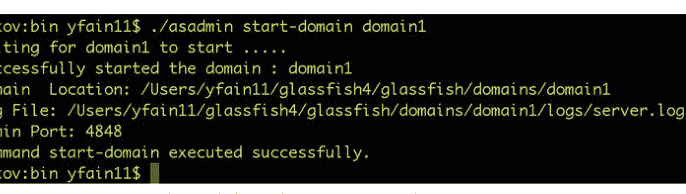

图 25-2：在 Mac OS 终端中启动 GlassFish

4. 默认情况下，GlassFish 服务器运行在端口 8080，管理端口为 4848。打开你的 浏览器并输入 `http://localhost:8080`——你应该看到 GlassFish 欢迎页面。
5. 在浏览器中输入 `http://localhost:4848` 打开 GlassFish 管理控制台。 浏览器应显示图 25-3 所示的窗口。

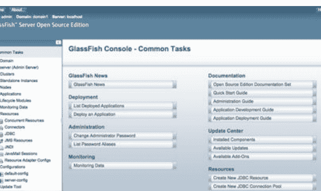

6. 从 `https://glassfish.java.net/docs/4.0/quick-start-guide.pdf` 下载 Oracle GlassFish 服务器快速入门指南，以获取操作 GlassFish 服务器的管理命令说明。

**图 25-3：** GlassFish 管理控制台

> 提示 请在 `www.wrox.com/go/javapro24hr2e` 在线选择第 25 节的视频。你还可以从该网站下载本节的代码和资源。

# 26

## 使用 Servlet 编程

Web 应用可以提供静态或动态内容。静态内容的一些示例是带有 HTML 标记的文本文件、图像和视频。动态内容是生成的。想象一个允许你浏览在线商店库存的 Web 应用。你在屏幕上看到的 Web 内容是根据你的查询创建的——也就是说，是动态的。

在 Java EE 世界中，Web 内容由运行在 servlet 容器中的程序提供，并可以使用 Java Server Pages (JSP)、JavaServer Faces (JSF) 或第三方框架。你也可以通过实现 SOAP 或 RESTful Web 服务来创建 Web 应用程序。Servlet、JSP 和 JSF 不仅返回数据，还以 HTML 页面的形式呈现数据。纯 Java 对象 (POJO) 也可以使用，因此在 25-1 中提到的该术语。另一方面，Web 服务或基于 WebSocket 的应用程序只返回数据本身。

Servlet 是按照特定规则编写的类，并部署在你选择的符合 Java EE 标准的 servlet 容器中。可以使用 HTML/JavaScript（一种重量级应用程序）、或 Swing 或 JavaFX 程序访问客户端。本节使用了最流行的 Web 通信方式：浏览器使用 HTTP 与 servlet 通信，HTTP 代表超文本传输协议（Hypertext Transfer Protocol）。

本节中的所有示例都在支持 Java 3.1 规范的任何 servlet 容器中运行。本节使用了完整的应用服务器 GlassFish，如果你的应用程序只需要 servlet 支持，这可能过过了。如果你想尝试轻量级 servlet 容器，可以考虑使用 Apache Tomcat 或 Jetty。每个 Java 应用服务器都带有 servlet 容器，因为你正在学习 Java 技术，安装完整的 Java 应用服务器涵盖了你的需求。

## 总体视图

图 26-1 描述了 浏览器向 servlet 发送 HTTP 请求并接收响应。

## 356 | 26 节 使用 servlet 编程

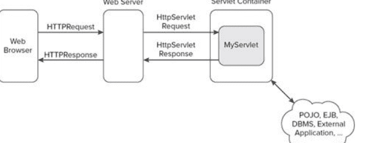

**图 26-1：客户端-servlet 数据流**

在学习如何创建和部署 servlet 之前，先查看虚拟在线商店 www.MyBooks.com 的组件和工作流

- 客户端机器需要一个 Web 浏览器。书店由多个用于与用户交互的 HTML 页组成。浏览器使用 HTTP 协议向服务器发送数据，数据必须放置在 `HttpRequest` 中。
- 运行 MyBooks 某些 Web 软件的计算机通常位于端口 80 上。对于使用 HTTPS（安全超文本传输协议）的安全通信，默认端口是 443。这两个端口通常在 80 端口开放，否则外部客户端无法对资源发出任何请求。
- Web 服务器“监听”客户端请求。当它接收到静态内容（如文件或图像）请求时，Web 服务器不需要额外的软件即可处理请求，并返回带有内容的 `HttpResponse`。
- MyBooks.com 还运行一个部署了 servlet 的 servlet 容器。如果 Web 服务器收到基于某些搜索标准的书籍请求，它将创建并将 `HttpServlet` 传递给相应的 servlet，例如部署在 servlet运行的 `InBooksServlet`。此部分显示了显式列出 InBooksServlet 名称的示例 HTML。
- Servlet 调用执行搜索的 Java 代码并创建列出符合搜索标准书籍的 HTML 页，然后将其封装在 `HttpResponse` 中发送给 Web 服务器。
- Web 服务器从 `HttpServlet` 中提取内容，将其封装在 `HttpResponse` 对象中，并传回给 Web 浏览器。
- 浏览器显示收到的页面，并知道它是静态 HTML 页还是新出炉的。

用户的 Web 浏览器不需要知道使用了哪种服务器端技术来执行动态内容。可以是 Java、.NET、Python、PHP 等。浏览器知道使用 HTTP 协议向服务器发送数据，数据必须放置在 `HttpRequest` 中。

以 `HttpServlet` 的形式从服务器到达。服务器上发生的所有其他“魔法”对 Web 浏览器来说并不。

## 瘦客户端

让我们从创建一个简单的 HTTP 页面开始，作为 Java Servlet 的客户端。列表 26-1 显示了一个简单的 HTML 文件，其中包含一个带有文本输入字段和提交按钮的表单，用户可以使用它通过标题查找书籍。

### 列表 26-1 产生 404 错误的 HTML

```html
<html>
<head>
  <title>Find a book</title>
</head>
<body>
  Enter a word from the book title:
  <form action="http://www.MyBooks.com/servlet/FindBooksServlet" method="Get">
    <input type="text" name="booktitle">
    <input type="Submit" value="Search">
  </form>
</body>
</html>
```


在任何纯文本编辑器中，创建一个名为 `BookSearch.html` 的文件，包含列表 26-1 中的 HTML 内容。在 Web 浏览器中打开此文件（文件 -> 打开），在输入字段中输入文本并点击搜索。你将收到错误信息，因为没有服务器提供 `www.MyBooks.com` 这个 URL，也没有名为 `FindBooksServlet` 的 Servlet，这只是为了客户端可能外观的说明。

客户端使用 HTTP 协议与 Servlet 通信，当未找到请求的资源时，响应将带错误返回。如果服务器有响应但请求的 (`FindBooksServlet`) 不存在，则返回代码 404。如果服务器没有响应，Web 客户端将显示错误代码。成功检索的请求资源范围在 200 到 300 之间。HTTP 可能会返回 304，这表示浏览器在缓存位置找到了请求的资源，无需向 Web 服务器发送请求。可能的 HTTP 状态码列表请见 `www.w3.org/Protocols/rfc2616/rfc2616-sec-10.html`。

## 如何编写 Servlet

要创建一个 Servlet，请编写一个自 `HttpServlet` 的类，并使用 `@WebServlet` 注解对其进行标记。`HttpServlet` 类自 `GenericServlet`，后者定义了 `service()` 方法。`service()` 方法接收客户端请求并将其重定向到你的类中自 `HttpServlet` 的子类的某个方法。

通常你必须重写 `doGet()` 和/或 `doPost()` 方法。重写哪一个？取决于客户端的请求方法。如果客户端使用方法为 `Post` 的 HTTP 请求，重写 `doPost()`；如果客户端使用 `Get` 请求（见列表 26-2），如 `your_first_servlet` 所示，重写回调 `doGet()`。

## 列表 26-2 你的第一个 Servlet

```java
@WebServlet(urlPatterns="/books", name="FindBooksServlet") 
public class FindBooksServlet extends HttpServlet {
    @Override
    public void doGet(HttpServletRequest request,
                      HttpServletResponse response) throws ServletException {
        // 处理请求的代码在这里
        // 生成的 Web 页面将通过 response 变量包含的
        // I/O 流返回

        PrintWriter out = response.getWriter();
        out.println("Hello from FindBooks");
    }
}
```

所有支持请求的类都位于 `javax.servlet` 包中，并被封装在 JAR 文件中，应当列出该文件的位置。`javax.servlet` 包未包含在 Java EE 中——你需要安装或阅读你选择的服务器容器的文档以了解它们的位置。GlassFish 4 带有 Java EE 7 文件，因此不需要下载。

## 如何开发 Servlet

`@WebServlet` 注解是你指定部署参数的地方。在 Java EE 6 之前，你需要在 `web.xml` 文件中指定部署参数，但现在是可选的。`FindBooksServlet` 使用部署 `urlPatterns` 和 `name`。前者意味着客户端发送的请求其 URL 中包含模式 `books`。请求必须重定向到 `FindBooksServlet`，例如，服务器容器将请求 `http://localhost:8080/books` 转发到 FindBooksServlet。

每个服务器和服务器容器都有一个名为数据根（data root）的目录。它不仅用于 Servlet 网站，还用于部署静态 HTML 文件。例如，如果你将 `TermsAndConditions.html` HTML 文件放在服务器 `GlassFish.com` 数据根的 `leaf` 子文件夹中，用户需要将 Web 浏览器指向 `www.mybooks.com/legal/TermsAndConditions.html`。

这是 Web 应用程序的目录结构：

```
document root
WEB-INF
  classes
  META-INF
    manifest.mf
```

当你的 Web 应用完成后，整个目录被压缩成 `.war` 文件，代表 Web 归档（web archive）。此类文件可以手动创建，也可以通过 Ant、Maven 或 Gradle 等构建工具创建。

## 在 ECLIPSE 中启动和停止服务器

要在 Eclipse 中启动或停止已配置的服务器，请访问 Servers（服务器）视图，右键点击服务器名称，并从弹出菜单中选择 Start（启动）或 Stop（停止）。如果你想调试服务器端代码，请选择 Debug（调试）而不是 Start。

## 如何在 ECLIPSE 中创建 Servlet

打开 File → New → Other → Web 并选择 Create Web Project（创建 Web 项目）选项。在弹出的窗口中，将项目名称命名为 Lesson26。由于你将在 GlassFish 下开发 servlet，请确保在 Target Runtime（目标运行时）组合框中选择了 GlassFish。点击 Finish（完成），将创建一个新的 Eclipse 项目。它的结构与你目前创建的项目不同。它有一个名为 WebContent 的子文件夹和 META-INF 目录，将用于部署到你选择的 servlet 容器中。

```
> Lesson26 [workspace master]
  > .settings
  > build
  > src
  > WebContent
    > META-INF
      > MANIFEST.MF
    > WEB-INF
      > lib
```

右键点击项目名称，选择 New→Servlet，并指定 `com.practical.java.lesson26` 为包名，`FindBooksServlet` 为类名。点击 Next（下一步）并编辑 URL mapping（URL 映射）字段为 `/books`。

点击 Next。下一个窗口询问你想要自动生成哪些存根（stubs）；保持默认的 `doGet()` 和 `doPost()` 即可。最后，点击 Finish，Eclipse 会生成列表 26-3 所示的代码（我删了一些注释）。

## 列表 26-3 生成的 FindBooks servlet

```java
package com.practical.java.lesson26;

import java.io.IOException;
import javax.servlet.ServletException;
import javax.servlet.annotation.WebServlet;
import javax.servlet.http.HttpServlet;
import javax.servlet.http.HttpServletRequest;
import javax.servlet.http.HttpServletResponse;

@WebServlet(urlPatterns = "/books")
public class FindBooksServlet extends HttpServlet {
    private static final long serialVersionUID = 1L;

    public FindBooksServlet() {
        super();
    }

    protected void doGet(HttpServletRequest request,
        HttpServletResponse response) throws ServletException, IOException {
        // TODO Auto-generated method stub
    }

    protected void doPost(HttpServletRequest request,
        HttpServletResponse response) throws ServletException, IOException {
        // TODO Auto-generated method stub
    }
}
```

我将在“浏览器-Servlet 数据流”中解释 servlet 的数据流。同时，让我们在操作中选择 servlet `FindBooksServlet`。在 `doGet()` 方法中使用以下两行来访问数据流并发送消息“Hello from FindBooks”：

```java
PrintWriter out = response.getWriter();
out.println("Hello from FindBooks");
```

不要忘记为 `PrintWriter` 添加导入。最后一步是将 servlet 部署到 GlassFish 服务器。打开 Servers 视图，右键点击服务器，从弹出菜单中选择 Add and Remove（添加和移除）。在列表中选择项目 Lesson 26 并将其移动到右侧。点击 Finish。

servlet 部署完成。现在在 Eclipse 项目中右键点击类名 `FindBooksServlet`，选择 Run On -> GlassFish 并点击。如果服务器未运行，Eclipse 会先启动服务器，然后形成 URL 来访问 servlet `FindBooksServlet`。Eclipse 运行其内部浏览器并显示消息。

你可以将此 URL 复制到计算机上的任何其他浏览器中；响应将相同的。从 Eclipse 启动服务器不会改变它监听 8080 端口的事实，任何客户端都可以通过此端口请求和部署服务。

请注意，URL 以 `/books` 结尾，而不是 `FindBooksServlet`。再次查看图 26-8。你更改了映射，指示 servlet 容器将所有包含 `/books` 的 HTTP 请求路由到 servlet `FindBooksServlet`。Eclipse 已经在 servlet 的类中生成了正确的注解，看起来可能类似于此：

```java
@WebServlet(urlPatterns = {"/books"})
public class FindBooksServlet extends HttpServlet
```

例如，如果你正在发送一个对象的 PDF 内容并希望浏览器自动打开 Acrobat Reader，请调用函数 `response.setContentType("application/pdf");`。

服务器容器控制 servlet 加载的时机，以及调用它的 `init()`、`service()` 和 `destroy()` 方法的时机。当服务器管理员决定卸载 servlet、服务器关闭或服务器需要释放某些内存时，会调用 `destroy()` 方法。

如果 HTTP 客户端向 servlet 发送某些数据，可以通过调用 `HttpServletRequest` 对象上的 `getParameter()` 来获取这些数据。以下代码获取了用户在名为 `title` 的字段中输入的书名，并以 65 美元的价格进行响应：

```java
public void doGet(HttpServletRequest request, HttpServletResponse res)
    throws ServletException, IOException {

    String title = request.getParameter("booktitle");
    PrintWriter out = res.getWriter();

    res.setContentType("text/html");

    out.println("<html><body>");
    out.println("<h2>"+title+"</h2> costs only $65");
    out.println("</body></html>");
}
```

# HTTP GET 和 POST 请求

HTTP 规范定义了多种用于网络数据交换的方法，其中 servlet 的 Get 和 Post 方法使用得最广泛。（在第 3 节中你将看到 HTTP 方法的使用。）如果你不指定方法，它将默认为 Get：在列表 i 的 `<tag>` 标签中使用 `method=Get`。servlet容器会调用 `FindBooksServlet` 上的 `doGet()` 方法。使用 Get 时，网络浏览器会将表单中输入的值附加在 URL 的问号后面。例如，如果用户输入单词 `Apollo` 作为书名，URL 可能会如下所示：

```
http://www.mybooks.com?booktitle=Apollo
```

如果表单（或提交）包含多个值，URL 将包含在问号后由 `&` 符号分隔的键值对：

```
http://www.mybooks.com?booktitle=Apollo&author=Smith
```

使用 Get 可以很容易地复制和粘贴带有参数的 URL。另一方面，使用 Get 时数据是不保护的；你可以以明文形式看到它。

Post 方法通常用于向服务器发送数据。它也可以用于向服务器发送二进制数据（例如，上传图像）。当然，登录表单不应该使用 Get，因为你不希望让用户的 ID 和密码显示在 URL 中。为了处理 Post 请求，servlet 必须重写 `doPost()` 方法。通常使用 Get 进行数据检索，并使用 Post 向服务器发送数据。

# 会话跟踪 (SESSION TRACKING)

HTTP 是一个无状态协议。如果用户从 `FirstServlet`（或任何其他服务端程序）获取了一个带有书籍列表的网页并进入另一个网页，第二个页面不知道第一个页面显示了什么。为了将数据保留在多个网页上，必须实现会话跟踪。

会话（Session）是一个逻辑任务，用户试图通过访问网站来完成它。例如，买书的过程涉及几个步骤：选择书籍、输入账单和发货信息等。这些步骤组合在一起就是一个会话的示例。当购买时，会话信息可以存储在客户端，也可以存储在服务器上。在客户端，可以使用 cookie（在下一节中解释）或 URL 重写来存储用户的会话——这些信息在客户端和服务器之间往返传输。

服务器端存储数据的替代方案是会话跟踪应用程序接口（API）。在这种情况下，会话数据只存储在服务器上，但客户端只获得一个会话 ID 来识别用户发起的一系列 HTTP 请求。例如，如果用户在 `HttpServlet` 上调用 `getSession(true)` 方法，这意味着“获取现有会话的引用，或创建一个新的”。调用此方法可以提供更多关于会话跟踪的细节。

## Cookies

Cookie 是服务器发送到网络客户端的一小部分数据，并作为文件存储在用户的计算机上。在该客户端发出的每个请求中，浏览器都会检查本地 cookie（特定域的）并将它们发送到服务器，通常将请求与给定的会话关联起来。cookie 是持久的，但用户可能通过在其网络浏览器中选择相应的设置来禁用它们。以下是服务器如何向客户端发送类似 cookie 的对象：


```java
Cookie myCookie = new Cookie("bookname"); // Java 编程“24小时训练师”
// 设置 cookie 的寿命为 24 小时
myCookie.setMaxAge(60*60*24);
response.addCookie(myCookie);
```

这是 servlet 获取随 `HttpServletRequest` 来的客户端 cookie 的方式：

```java
Cookie[] cookies = request.getCookies();
if (cookies != null) {
  // 获取每个 cookie（一个键/值对）
  for (i=0; i < cookies.length; i++) {
    Cookie currentCookie = cookies[i];
    String name = currentCookie.getName();
    String value = currentCookie.getValue();
  }
}
```

尽管你可以在客户端存储多个 cookie（如前面的代码所示），但将应用程序数据通过网络往返传输并不是好主意。通常，会话数据存储在稍后“服务端会话”部分创建的 `HttpSession` 对象中。

# 其他 COOKIES

除了你的服务器创建并发送到网络浏览器的 cookie 之外，搜索分析引擎可能发送自己的 cookie。

# HTML 5 WEB STORAGE

HTML 5 支持网页存储（本地存储），允许在用户磁盘上存储键值对，但与 cookie 不同，这些数据始终留在客户端侧。

## URL 重写 (URL Rewriting)

如果客户端禁用了 cookie，可以使用 URL 重写来跟踪会话。在这种情况下，会话 ID 被附加到 URL 字符串中，并随客户端往返。

# 会话 ID 与安全 (SESSION ID AND SECURITY)

OWASP 代表开源安全项目。它发布了一份关于前 10 大风险的文档。会话管理是其中的风险之一。黑客可以劫持会话 ID。某些配置允许服务器从 cookie 切换到 URL 重写，以便那些禁用 cookie 的用户仍可以使用。如果在 URL 字符串中看到类似 `sessionid=12345` 的内容，意味着使用了重写。

## 服务端会话 (Server-Side Session)

你应该将属于用户会话的数据（如购物车）保留在 `HttpSession` 对象中。以下代码创建了一个会话：

```java
HttpSession session = request.getSession(true);
```

`getSession(true)` 调用意味着“查找现有会话或创建一个”。例如，购物过程通常包括一系列后续的 servlet 调用：查找库存、将项目添加到购物车、输入信息等。在第一次时，应用程序服务器生成一个唯一的会话 ID（可以通过 `getId()` 获取），并通过特殊的 cookie（JSESSIONID）或将其发送给用户浏览器。当浏览器向服务器发送 HTTP 请求时，会话 ID 位于请求头中以便 servlet 找到会话对象。

`getSession(false)` 调用“查找我的会话对象”，假设它已经创建。如果此调用返回 `null`，则会话已超时或销毁，你可能希望显示一条会话已期的消息，让用户重新开始。

我将通过展示一个包含 HTML 页面和 servlet 的示例来说明 `HttpSession` 对象的概念。HTML 页面有一个表单，可以在其中输入书名和价格添加到购物车。每次调用 servlet 时，它都会返回一个新的 HTML 页面，列出购物车的内容以及添加更多书籍的表单。

初始的 `ShoppingCart.html` 位于项目26 的根目录下。在 Eclipse Web 项目中，根目录由 `WebContent` 目录表示。以下是 `ShoppingCart.html` 的内容：

```html
<html>
<head>
  <title>将书籍添加到购物车</title>
</head>
<body>
将书名价格添加到购物车：
<form action="shoppingCartGet">
  <input type="text" name="title">
  <input type="text" name="price">
  <input type="submit" value="加入购物车">
</form>
</body>
</html>
```

http://localhost:8080/Lesson26/ShoppingCart.html


将书名和价格添加到购物车中：

图 26-12：在服务器上部署的 ShoppingCart.html

先不要输入书名和价格；servlet 准备好。在向你展示 servlet 代码之前，让我们先约定，每个购物车项目将由以下类 `Book` 的一个实例表示：

```java
class Book implements Serializable {
    String title;
    double price;
}
```

注意，该类实现了 `Serializable`，因为你计划将其保存在 `HttpSession` 中。

接下来是 `ShoppingServlet` 类，它具有 URL 映射 `/shoppingcart`；Web 浏览器请求尝试寻找名为 `shoppingcart` 的服务器端对象。`doGet()` 方法首先在控制台上打印浏览器的 Cookie。我只想看到来自同一浏览器的每次请求中，`sessionID` 的值都保持不变。之后，代码将 session session 对象交互；程序为你提供了更多的解释：

```java
if (myShoppingCart == null) {
    // 为接收到的参数创建一个书籍对象的实例
    selectedBook = new Book();
    selectedBook.title = request.getParameter("booktitle");
    selectedBook.price = Double.parseDouble(
        request.getParameter("price")
    );

    // 将书籍添加到我们的购物车
    myShoppingCart.add(selectedBook);

    // 将购物车放回 session 对象
    session.setAttribute("shoppingCart", myShoppingCart);

    // 准备 Web 页面并发送到浏览器
    PrintWriter out = response.getWriter();

    // 将购物车的内容添加到 Web 页面
    out.println("<body>Your shopping cart content: ");
    out.println("<title>" + book.title + " , price: " + String.format("%.2f",
        book.price) + "</title>");
    out.println("</body>");

    // 将 HTML 表单添加到 Web 页面
    out.println("<h3>Add another book to the shopping cart:</h3>");
    out.println("<form action=\"shoppingCart\" method=\"Get\">");
    out.println("<input type=\"text\" name=\"booktitle\">");
}
```

第一个 servlet 尝试从 session 中获取购物车（由 `ArrayList` 表示），它将无法获取，因此会创建一个新的 `ArrayList` 实例。然后，代码获取参数 `booktitle` 和 `price` 的值（从 Web 页面接收），创建一个新的 `Book` 实例，将其添加到 `myShoppingCart` 中，并将其放入 `HttpSession` 实例中进行存储。

此代码使用 `forEach()` 和 lambda 表达式遍历 `myShoppingCart` 集合，用 HTML 将购物车内容发送到 Web 页面。最后，servlet将页面发送到同一个 HTML 表单，以便用户可以继续向购物车添加新书。图 26-13 显示了在购物车中添加几本书后我的浏览器的界面。

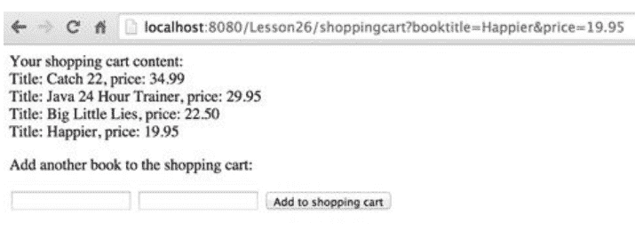

您的购物车内容：

Title: Catch 22, price: 34.99

Title: Java 24 Hour Trainer, price: 29.95

Title: Big Little Lies, price: 22.50

Title: Happier, price: 19.95

向购物车添加另一本书：

图 26-13：向购物车添加四本书后的 Web 页面

ShoppingCart 没有关闭 session 的代码。但你可以在 Web 页面上添加一个“下单”（Place Order）按钮，并在 servlet 中添加相应的 `placeOrder()` 方法，可以通过可以通过以下调用来关闭 session：

```java
session.invalidate();
```

在 ShoppingCart.html 中添加“下单”的简单方法是在表单中再添加一个类型的按钮：

```html
<input type="Submit" name="placeorder" value="Place Order">
```

并在 `doGet()` 方法中，检查用户是否点击了该按钮。如果是的话，使 session 失效。

```java
if (request.getParameter("placeorder") != null) {
    session.invalidate();
}
```

如果 session 尚未失效，应用程序服务器将在特定时间段（超时）后自动销毁它。你可以通过调用 `HttpSession` 对象上的 `setInactiveInterval()` 方法以编程方式设置超时时间，或者在外部文件 `web.xml` 中进行配置。如果用户关闭浏览器，与 session 关联的 cookie 将被销，session 也会关闭。

> **Session 生命周期事件**
>
> 如果你想在 HTTP 会话创建、失效或超时时执行某些操作，请使用 `HttpSessionListener`。要拦截向会话添加或移除属性，请使用 `HttpSessionAttributeListener`。

# 过滤器 (Filters)

即使在部署 servlet 后，你仍然可以在不修改 servlet 代码的情况下更改它处理请求和响应的方式。你可以创建过滤器，这些 Java 类可以配置为在 HTTP 请求传递到服务器之前或服务器将响应返回给客户端时处理它们。过滤器非常适用于身份验证、日志记录、数据压缩等。

要创建一个过滤器，你需要实现 `Filter` 接口。有三个方法：`doFilter()`、`init()` 和 `destroy()`。以下代码是一个示例：

```java
@WebFilter(name="MyFilter", urlPatterns="/*")
public class MyFilter implements Filter {
    private FilterConfig config;

    @Override
    public void init(FilterConfig config) throws ServletException {
        this.config = config;
    }

    @Override
    public void doFilter(ServletRequest request, ServletResponse response, FilterChain chain)
            throws IOException, ServletException {
        // 逻辑处理
        chain.doFilter(request, response);
    }

    @Override
    public void destroy() {
        // 清理
    }
}
```

# 异步 servlet (Asynchronous Servlets)

`init()` 只被调用一次。容器赋予 `init()` 方法 `FilterConfig`，通过它可以访问 servlet 上下文。Java EE7 servlet 支持异步处理。以下 servlet 模拟了

## 异步 servlet

servlet 自动为每个用户分配单独的线程是很棒，但每个线程都会占用系统资源（内存和 CPU 周期），在一定数量的并发请求后，服务器就会停止。想象一下成千上万的用户同时访问每个请求都需要执行三秒搜索的 `FindServlet`。在这几秒内，容器是空闲的，但它持有着每个等待数据库的锁。

很难说 servlet 可以及时处理多少阻塞线程；这完全取决于应用程序以及硬件/软件。使用 JMeter 或类似的软件对你的应用程序运行负载测试，以获得硬件/软件的真实数据。

理想的 servlet 是尽量减少 servlet 中线程锁定的时间。如果用户 A 发起了一个在数据库服务器上需要几秒时间的请求，他的 servlet 线程将被分配给用户 B 的请求，当用户 A 的结果返回时，容器分配（另一个）线程将结果返回给用户 A。这种架构可以显著增加同一服务器上可以处理的并发请求数量。

```java
@WebFilter(initParameters={name="booksasync", value="true"})
public class FindBooksAsyncServlet extends HttpServlet {
    protected void doGet(HttpServletRequest request,
                         HttpServletResponse response)
            throws ServletException, IOException {

        // 在 doGet 结束之前发送响应
        AsyncContext context = request.startAsync();
    }
}
```

```java
// 提供 Runnable 实现以启动方法
aContext.start(() -> {

    // 此处进行阻塞操作
    try {
        String title = aContext.getRequest()
                .getParameter("booktitle");

        PrintWriter out;
        try {
            // 模拟一个 3 秒的过程
            Thread.currentThread().sleep(3000);
            HttpServletResponse resp = aContext.getResponse();
            out = resp.getWriter();
            out.println("Hello from Async Books");
        } catch (IOException e) {
            e.printStackTrace();
        } catch (InterruptedException e) {
            e.printStackTrace();
        }
    } finally {
        aContext.complete(); // 关闭响应对象
    }
});
```

为了简单起见，在本示例中在 Thread 上使用 `sleep()` 来模拟长时间运行的过程。在现实场景中，你应该使用 `ManagedExecutorService`、`ManagedThreadFactory` 等类在 Java EE 容器中创建线程。

要捕获异步 servlet 生命周期中的某些事件，你可以添加 `AsyncListener` 并为 `onComplete()`、`onError()` 和 `onTimeout()` 提供回调函数。

## 尝试一下

编写一个简单的 HTML 客户端，包含一个输入字段和一个按钮，用户想要通过它获取某个符号的报价。生成一个随机报价并返回一个带有报价的网页。复用列表 24-2 中 `StockServerImpl` 的代码来生成报价。

## 课程要求

你必须已安装 Java。

> 注意：你可以从书籍的网页 www.wrox.com/go/javaprog24hr2e 下载此“尝试一下”练习的代码和资源。你可以在 `Lesson26.zip` 中找到它们。

## 步骤说明

1. 在 Eclipse 课程 Lesson26 中，基于 `html_that_gives_404` 创建一个 HTML 客户端，以允许用户输入股票代码。将其重命名为 `tryit.html`。
2. 创建一个 servlet `StockServerServlet`，它接收一个参数（即股票代码），并实例化 `StockQuoteGenerator` 类，该类的代码应与列表 24-2 类似。你在这里不需要使用 RMI，也不需要实现 Remote 接口。
3. 将从客户端接收到的股票代码传递给 `StockQuoteGenerator` 并获取价格。


- 4. 通过响应对象将动态创建的 HTML 页面返回给客户端。
- 5. 在 Eclipse IDE 中测试 servlet：右键点击 HTML 文件并选择 Run As → Run on Server。输入股票代码并获取价格。
- 6. 从 Eclipse 中的 GlassFish 卸载 Lesson26 项目，因为你将直接在 GlassFish 中部署此应用。参考 Eclipse 中的 `GlassFish` 步骤。
- 7. 将 Lesson26 导出为 `Lesson26.war` 文件。通过将该文件复制到已安装 GlassFish 服务器的 `glassfish/domains/domain1/autodeploy` 目录，在 GlassFish 中部署此应用。
- 8. 按照第 25 “尝试一下”中的描述，从命令行启动 GlassFish 服务器。
- 9. 在浏览器中打开以下 URL：`http://localhost:8080/Lesson26/tryit.html`，你应该看到与步骤 5 相同的页面。通过输入各种股票代码来测试此 Web 应用。你应该能够获得报价。

> 提示：在 www.wrox.com/go/javaprog24hr2e 选择第 26 课视频。你也可以从该网站下载本课程的代码和资源。

# 27

# JavaServer Pages (Java 服务页面)

JavaServer Pages (JSP) 技术是作为 servlet 演进的下一步而创建的。JSP 2.3 是 Java EE 7 规范的一部分，通过 JSP，你可以完成使用 servlet 能做的所有事情，但操作更简单。在早期的 Java EE 中，JSP 引入了 JavaServer Faces (JSF)。虽然 JSF 拥有更多功能，但我仍然看到许多企业级应用在使用 JSP，因此本版书籍涵盖了 JSP 但未涵盖 JSF。现在让我们看看为什么使用 servlet 对于开发所有 Java EE 应用的表示层是不够的。

假设你创建并部署了一个显示“Hello World”的 servlet。该 servlet 获取了响应对象的输出流并执行了以下代码：

```java
out.println("<body>Hello World</html>");
```

现在想象你经营着一家软件公司，雇佣了 Alex（一位昂贵的 Java 开发人员）和 Matilda（一位初级 Web 设计师，她不懂 JSP 但懂 HTML）。如果你需要更改此 HTML 页面的布局，例如在顶部添加几行输入内容，这并不是大问题——Alex 可以修改前面的代码行，将其重新编译并重新部署 servlet。但对于基于 HTML 的用户界面 (UI) 的细小更改，使用 Matilda 更具成本效益。这正是 JSP 变得非常实用的地方。Matilda 创建了以下文件：`HelloWorld.jsp`。

```html
<html>
<body>
  Hello World
</body>
</html>
```

将此文件放置在文档根目录中（假设你运行在 `MyBooks.com` 的 servlet 容器中，请参见第 26 节）。现在用户可以通过在网络浏览器中输入以下 URL 访问此 JSP：

```
http://www.MyBooks.com/HelloWorld.jsp
```

当首次请求此页面时，JSP 容器（以及所有 JSP 容器）会自动生成、编译并部署 `HelloWorld.jsp`。

## 在 HTML 中嵌入 Java 代码

JSP 定义了标签，允许你将 Java 代码嵌入 HTML 页面中。当 servlet 自动生成时，这些标签会被替换为 Java 代码。例如，`<%= %>` 标签显示变量或表达式的值：

```java
out.println(2);
```

### 列表 27-1 MyCalculator.jsp

```html
<html>
<body>
  Matilda 创建的 HTML 位于此处...
  <%= 2 %>
</body>
</html>
```

部署 JSP 简单地将 JSP 文件复制到容器的根目录即可。当然，如果你的 JSP 是多个项目的一部分，你将像第 26 节描述的那样将它们部署在 war 文件中。

如第 26 节所述，在 Eclipse 中创建一个动态 Web 项目（Dynamic Web Project）并将其命名为 Lesson27。右键点击 WebContent 目录（文档根）并创建一个名为 `index.jsp` 的新 JSP 文件。

在创建项目时，确保 GlassFish 服务器是目标运行环境。Eclipse 生成的文件包含以下内容：

```jsp
<%@ page language="java" content="text/html; charset=UTF-8"
Encoding="UTF-8"%>
```

```html
<!DOCTYPE html PUBLIC "//W3C//DTD HTML 4.0 Transitional//EN"
     "http://www.w3.org/TR/html4/loose.dtd">
<html>
<head>
    <meta http-equiv="Content-Type" content="text/html; charset=UTF-8">
    <title>插入标题</title>
</head>
<body>

```

在此文件的 `<body>` 部分添加以下行：

<h1>Hello World</h1>

`<h1>` 标签将文本格式化为标题，Eclipse 显示了未来 Web 页面将渲染的效果，见图 27-1 的顶部部分。

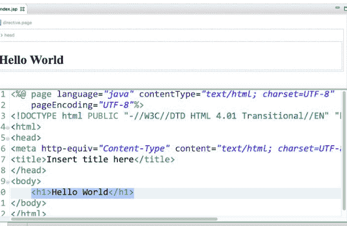

图 27-1：添加标签时查看页面

右键点击 `index.jsp` 命名并选择 Run on Server。如果 GlassFish 服务器未运行，Eclipse 将启动它并部署 Lesson27 项目，你会在 Eclipse 内部 浏览器中看到 Hello World Web 页面，如图 27-2 所示。

### Hello，世界

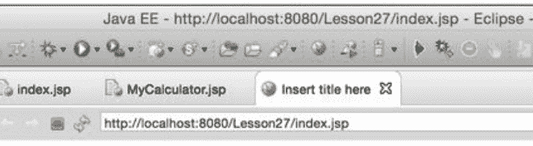

> 图 27-2：在 Eclipse 内部浏览器中运行 index.jsp

在你的网络浏览器中输入 URL，即可看到结果。服务器在端口 8080 上运行，由于它已经部署，因此使用哪种浏览器作为客户端并不重要，因为它支持 HTTP 协议。

现在尝试一个 JSP。在项目 Lesson27 中将 `index.jsp` 复制并重命名为 `MyCalculator.jsp` (Ctrl+C/V)，并将 `<body>` 部分的内容替换为列表 27-1 中 `<body>` 部分的内容。运行 MyCalculator.jsp，你将会在 Eclipse 中看到该页面，如图 27-3 所示。

表达式 `<2 + 2 %>` 已经被预编译。JSP 不仅仅是一个从包含有效 HTML 和 JSP 标签的文件自动生成的 servlet。


Matilda 创建的 HTML 在这里...

你可能不知道 2 + 2 等于 4

Matilda 创建的更多 HTML 在这里...

图 27-3：运行 MyCalculator.jsp

JSP 是基于 servlet 构建的，其核心概念保持不变。以下是转换需要的隐式 JSP 变量列表，可以在不改变表达式（2+2）的情况下更改页的外观（颜色、字体、数据分配）。Matilda 可以轻松地做到！应用更改后，JSP 会自动重新生成一个新的 servlet 并重新部署。通常情况下你不需要重启服务器。唯一的例外是配置为在服务器上初始化的 `preloadedJSPs`。JSP 标签内部的任何业务逻辑将由 Alex 编写。

## 隐式 JSP 对象

由于 JSP 拥有用户 `HttpServlet` 对象的实例，下面是可以在 JSP 页面中使用的预定义变量列表。这些变量由 JSP 容器初始化，你可以在无需显式声明的情况下使用它们。

- `request` 的用途与 `HttpServlet` 相同。
- `response` 的用途与 `HttpServletResponse` 相同。
- `out` 输出输出流 `getWriter()`。该变量具有与 `HttpServletResponse.getWriter()` 相同的对象。例如，一个从 Java 类 `CurrencyConverter` 返回结果的最简单 JSP 可能像这样：

```html
<html>
<body>
  out.println(CurrencyConverter.getDollarRate());
</body>
</html>
```

- `session` 代表用户 `HttpSession` 对象的实例。
- `exception` 代表 `Throwable` 对象的实例并包含错误信息。该变量仅在 JSP 错误页面中可用（在本节稍后对应的“错误页面”章节中描述）。
- `page` 代表 JSP servlet 的实例。
- `pageContext` 代表 JSP 上下文，并用于标签库（Tag Libraries，在本节稍后对应的同名章节中描述）。
- `application` 提供了对网络内容的访问。这类似于 `ServletContext`。
- `config` 提供 JSP 容器使用的初始化信息。它类似于类 `ServletConfig`。

## JSP 标签概览

JSP 标签以角括号开始和结束，并可以包含在任何 HTML 文件中，你需要将 JSPs 保存为 .jsp 文件，以便 JSP 容器对其进行正确的识别和处理。本节是 JSP 标签的简要概述。更多详细内容，请参阅 http://docs.oracle.com/javaee/5/tutorial/doc/bnagx.html 中的 JSP 文档。

### 指令 (Directives)

指令不生成屏幕输出，但指示 JSP 容器关于应用于 JSP 的规则。某些 JSP 指令包括：include、attribute 和 taglib。

Page 指令（页面指令）以 `<@ page` 开头，仅在当前页面内有效。指令与 import、extends、session、error、contentType 等属性一起使用。例如，要导入 `.java.*` 包，请使用此指令：

```jsp
<%@ page import="java.io.*" %>
```

Include 指令允许在页面编译为 servlet 的时候包含来自文件的任何文本或来自另一个 JSP 的代码，如下例所示：

```jsp
<%@ include page="calcBankRates.jsp" %>
<%@ include file="bankRates.txt" %>
```

要使用自定义标签的第三方库，你需要指定该库的位置，如下例所示：

```jsp
<% taglib uri="my_taglib.tld" prefix="test" %>
```

Attribute 指令（属性指令）允许你定义自定义标签的属性，如下：

```jsp
<% attribute name="corporate_logo_file_name" %>
```

### 声明 (Declarations)

声明用于在在使用之前声明变量。你可以像这样声明一个变量 `salary`：

```jsp
<% double salary; %>
```

该变量仅在该页面内可见。你可以以相同的方式在 JSP 页面中声明 Java 方法：

```jsp
<% private void myMethod() {
    ...
} %>
```

声明块中包含的代码转换为生成的 servlet 中的 Java 代码。

### 表达式 (Expressions)

表达式以 `<%=` 开头，可以包含任何 Java 表达式，这些表达式将被求值。结果将会在 HTML 页面中，替换标签本身，如下：

```jsp
<%= salary*1.2 %>
```

### 脚本段 (SCRIPTLETS)

最初，脚本段（scriptlets）是用于嵌入 Java 代码的。

```jsp
<% 
    // Java 代码
%>
```

（注：通常建议避免在 JSP 中使用脚本段）

### 注释 (Comments)

注释以 `<%--` 开始并以 `--` 结束，它们在源代码中是可见的。

```jsp
<%-- 这是一个注释 --%>
```

### 标准动作 (Standard Actions)

标准动作允许你在不编写 Java 代码的情况下执行常见任务。常见的动作包括 include、forward、redirect 和 param。

`include` 动作允许在运行时包含另一个资源的内容。

```jsp
<%@ include action="forward" />
```

`forward` 动作将请求转发到另一个资源。

```jsp
<jsp:forward page="other.jsp" />
```

`redirect` 动作将响应发送到不同的 URL。

```jsp
<jsp:redirect url="login.jsp" />
```

`param` 动作用于包含或转发的资源传递参数。

```jsp
<jsp:include page="header.jsp">
  <jsp:param name="user" value="JohnDoe" />
</jsp:include>
```

### Bean 动作 (Bean Actions)

`set` 动作用于设置 bean 的属性。

```jsp
<jsp:set property="name" value="John" bean="userBean" />
```

`get` 动作用于获取 bean 的属性。

```jsp
<jsp:get property="name" bean="userBean" />
```

`bean` 动作用于实例化 bean。

```jsp
<jsp:bean id="userBean" class="com.example.User" />
```

### 循环动作 (Loop Actions)

`forEach` 动作用于迭代集合。

```jsp
<jsp:forEach var="user" items="${userList}">
  ${user.name}
</jsp:forEach>
```

`iterate` 动作用于固定次数的迭代。

```jsp
<jsp:iterate var="i" begin="1" end="10">
  Iteration ${i}
</jsp:iterate>
```

### 条件动作 (Conditional Actions)

`if` 动作用于执行条件逻辑。

```jsp
<jsp:choose>
  <jsp:when test="${not empty user}">
    欢迎，${user.name}!
  </jsp:when>
  <jsp:otherwise>
    请登录。
  </jsp:otherwise>
</jsp:choose>
```

`set` 动作用于设置布尔值。

```jsp
<jsp:set value="${user.role == 'admin'}" var="isAdmin" />
```

### 标签动作 (Tag Actions)

`taglib` 动作用于导入自定义标签库。

```jsp
<%@jsp:taglib uri="my_taglib.tld" prefix="test" %>
```

`tag` 动作用于调用自定义标签。

```jsp
<jsp:tag name="myTag">
  <jsp:attribute name="param1" value="value1" />
</jsp:tag>
```

## JAVA BEANS

JavaBeans 规范将 bean 定义为一种 Java 类，它实现了 `Serializable` 接口，并具有公共的无参数构造函数、私有字段以及公共的 setter 和 getter 方法。数据传输对象（DTO）的类似概念在第 21 节中介绍（参见列表 21-2）。Java bean 主要用于数据存储和交换，而不是将业务代码与 HTML 混合在一起（参见本节稍后的“标签库”部分；它们有助于避免 Java 和 HTML 的混合）。

在基于 JSP 的 Web 应用程序中实现了 MVC 模式。JSP 属于视图层；servlet 可以充当控制器；而 Java bean 可以代表模型。与其在 JSP 内部编写逻辑，不如将表现层与业务逻辑及数据存储分离。首先，这让你能够轻松地在 JSP 和 HTML 之间拆分逻辑，并且可以在重用相同 Java 代码的同时，拥有多个表现层解决方案（例如，针对移动设备的 UI）。

使用 bean 是分离处理逻辑和呈现的第一步。列表 27-2 显示了一个名为 Student 的 bean 示例。

### 列表 27-2 Student bean


```java
import java.io.Serializable;

class Student implements Serializable {
    private String lastName;
    private String firstName;
    private boolean undergraduate;

    Student() {
        // constructor's code goes here
    }

    public String getLastName() {
        return lastName;
    }

    public String getFirstName() {
        return firstName;
    }

    public void setLastName(String value) {
        lastName = value;
    }

    public void setFirstName(String value) {
        firstName = value;
    }

    public void setUndergraduate(boolean value) {
        undergraduate = value;
    }

    public boolean isUndergraduate() {
        return undergraduate;
    }
}
```

# 第27节 JAVASERVER PAGES

不要将 `JavaBeans` 与 `Enterprise Java Beans (EJB)` 混淆，这是一个不同的概念，将在第31节中介绍。

## 在 JSP 中使用 JavaBeans

要在 JSP 中使用 bean，你首先需要指定它的名称和位置，之后你就可以获取或设置它的属性。以下是 bean 使用的一些示例：

```jsp
<jsp:bean id="Student" class="com.harvard.Student" />
<jsp:setProperty name="Student" property="LastName" value="" />
<jsp:setProperty name="Student" property="LastName" value="Smith" />
```

下一个代码段填充了 Bean 的属性 `LastName` 和 `FirstName`。该代码段可以位于 HTML 文档中，包含两个名为 `LName` 和 `FName` 的 HTML 输入字段：

```jsp
<jsp:setProperty name="Student" property="LastName" value="${request.getParameter("LName")}" />
<jsp:setProperty name="Student" property="FirstName" value="${request.getParameter("FName")}" />
```

如果所有 bean 名称与 HTML 表单字段的名称相同，使用星号 `*` 映射 HTML 表单字段和 bean 字段将变得更加简单：

```jsp
<jsp:setProperty name="Student" property="*" />
```

## Bean 存活多久？

如果 JSP 变量在 servlet 内部声明，它具有局部作用范围。要给它实例范围，请使用声明标签声明变量。你可以使用 `jsp:bean` 的 `scope` 属性定义 bean 的范围。

以下列表定义了各种范围：

- **page**: bean 仅在当前页面有效，并会在用户离开页面时被销毁。这是默认范围。

```jsp
<jsp:bean id="Student" class="com.harvard.Student" scope="page" />
```

- **request**: 只要 request 对象存，bean 就有效。即使通过 `jsp:forward` 将控制重定向到不同的 JSP，bean 在新页面上仍然可用，因为它们使用同一个 request 对象，如下：

```jsp
<jsp:bean id="Student" class="com.harvard.Student" scope="request" />
```

- **session**: bean 在所有页面中都有效，直到用户的会话结束（参见第26节中的“会话跟踪”部分）。

## 从 servlet 加载 JSP

根据表现层与处理的分离原则，JSP 应该尽可能少包含处理。当 servlet 接收到要发送给用户的数据时，不应该向客户端硬编码 HTML 标签，而应该由 Web 设计师加载并向客户端发送 JSP。

## 服务器应该准备 Web 页面吗？

虽然发送预创建的 JSP 比在 servlet 中硬编码 HTML 要好，但趋势是让服务器仅向客户端发送数据，而不包含任何布局。在现代 Web 应用中，UI 是使用 HTML、JavaScript 和层叠样式表（CSS）编写的，你可以考虑让服务器省略布局页面。在第5节中你会找到如何创建 RESTful Web 服务，其中服务端 POJO 仅向浏览器发送数据。如何在 HTML 和 JSP 中开发 Web 页面不在本书的范围内，但该过程在另一本书《Enterprise Web Development (O'Reilly), 2014》中有详细描述。

假设你有一个 servlet，需要根据用户的选择加载 JSP。当你需要获取 request 和 response 对象的副本时，你需要创建一个 `RequestDispatcher` 实例并调用它的 `forward()` 方法，提供 `HttpRequest` 和 `HttpServletResponse` 作为参数，见列表 27-3。servlet `MyServlet` 返回：

### 列表 27-3 Servlet 加载 JSP

```java
public class MyServlet extends HttpServlet {
    public void doGet(HttpRequest req, HttpServletResponse res) throws ServletException {
        ServletContext context = getServletContext();
        RequestDispatcher dispatcher = context.getRequestDispatcher("some.jsp");
        String make = req.getParameter("make");

        if (make.equals("Toyota")) {
            dispatcher.forward(req, res);
        } else if (make.equals("Nissan")) {
            dispatcher.forward(req, res);
        }
    }
}
```

## 标签库

另一种减少 JSP 代码量的方法是使用自定义标签——XML 文件。要执行以下操作：

- 使用 `.tld` 文件创建标签。
- 支持标签的 Java 类。此类类部署在 `WEB-INF/lib` 中。
- 在应用程序中注册标签。

列表 27-4 显示了一个示例 tld 文件。

### 列表 27-4 示例 TLD 文件

```xml
<?xml version="1.0" encoding="UTF-8"?>
<taglib xmlns="http://java.sun.com/ns/jspee"
      xmlns:xsi="http://www.w3.org/2001/XMLSchema-instance"
      xsi:schemaLocation="http://java.sun.com/ns/jspee http://java.sun.com/ns/jspee/webtaglibrary_2_0.xsd">
  <tlib-version>1.0</tlib-version>
  <shortname>sts</shortname>
  <uri>http://www.mystockserver.com/taglib</uri>
  <tag>
    <name>DowJones</name>
    <tagclass>DowJonesHandler</tagclass>
    <body-content>empty</body-content>
    <info>Displays the Dow index</info>
  </tag>
</taglib>
```

支持 JSP 标签的类（例如 `DowJonesHandler`）必须实现 `SimpleTag` 接口或扩展 `SimpleTagSupport`。该类提供了 `SimpleTag` 接口的默认实现并初始化了 `pageContext`。将标签逻辑放在 `doGetTag()` 方法中，该方法由容器在请求时调用。

```java
import javax.servlet.jsp.*;
import javax.servlet.jsp.jstxt.*;
import java.io.IOException;

public class DowJonesHandler extends SimpleTagSupport {
    public void doGetTag() throws JspException, IOException {
        String quote;
        // 通过访问 http://finance.yahoo.com/q7d&t=DJ 或类似地址获取道琼斯指数
        quote = "...";
        // 并将其写入客户端
        JspWriter out = getPageContext().getWriter();
        out.print("The last price is " + quote);
    }
}
```

为了让库被你的 JSP 容器识别，你应该通过在 `.xml` 文件中插入以下片段来注册它：

```xml
<taglib>
    <taglib-uri>
        http://www.mystockserver.com/taglib
    </taglib-uri>
    <taglib-location>
        WEB-INF/taglib.tld
    </taglib-location>
</taglib>
```

当你完成所有这些操作后，创建一个名为 `test.jsp` 的示例文件并开始使用你的标签库。列表 27-5 中的示例 JSP 使用标签 `<sts:DowJones/>`。

### 列表 27-5 在 JSP 中使用自定义标签

```jsp
<html>
<head>
  <%@ taglib uri="http://www.mystockserver.com/taglib" prefix="sts" %>
</head>
<body>
今日的道琼斯指数： <sts:DowJones/>
</body>
</html>
```

如果标签需要某些参数，则应在 `.tld` 文件中使用 `<attribute>` 标签对它们进行指定；例如：

```xml
<tag>
  <attribute>
    <name>tradeDate</name>
    <required>false</required>
  </attribute>
</tag>
```

每个参数都必须在标签处理器中提供相应的 setter 方法（设置方法）。setter 方法必须遵循与 JavaBean 相同的命名规范：

```java
public void setTradeDate(String tradeDate) {
}
```

自定义标签库由应用程序开发创建，以满足特定项目的需求。第三方也可以提供非标准的标签库。Apache 托管了基于下文描述的 JSTL 标准标签库。

## JSTL

JSP 标签库 (JSTL) 是库组件的标准化规范，包含了在许多基于 JSP 的应用程序中可重用的动作（actions）。标准 JSTL 保证任何符合 Java EE 的容器都包含并支持这些组件。共有五个 JSTL 库。它们包含一个迭代器、if 语句、用于 XML 处理的标签、用于执行 SQL 的标签、用于国际化的标签以及常用函数。

列表 27-3 中的 JSP 必须指定标签库在服务器上的位置，而标准库具有预定义的 URL。例如，要使用 `<c:forEach>` 迭代器，你需要指定以下 URI：

> http://java.sun.com/jsp/jst/core

XML 处理标签位于以下 URI：

> http://java.sun.com/jsp/jst/xml

因此，使用迭代器的代码片段可能如下：

```jsp
<%@ taglib uri="http://java.sun.com/jsp/jst/core" prefix="c" %>
<c:forEach var="item" items="${sessionScope.items}">
</c:forEach>
```

要学习使用 JSTL 和表达式语言进行编程，请参考以下 URL 中的 Oracle 教程：

> http://download.oracle.com/javaee/5/tutorial/doc/bank.html

## 尝试一下

重写你在第26节“尝试一下”中创建的示例股票服务器应用程序，但这次使用 JSP 和 JavaBean 实现。编写一个简单的 HTML 客户端，包含一个文本输入字段和一个提交按钮。用户应该能够输入股票代码获取报价。当用户点击按钮时，生成一个随机报价并返回一个带有报价的网页。创建一个服务器用于提供该结果页面的 JSP。重用第24节列表 24-2 中的 `StockServerImpl` 代码来生成报价。

## 课程要求

你已经安装了 java。

> **注意**：你可以从书籍网页 `www.wrox.com/go/javaprog24r2e.zip` 下载此“尝试一下”练习的代码和资源。你可以在下载项的 `Lesson27.zip` 文件中找到它们。

# 28 使用 WebSockets 开发 Web 应用程序

## 步骤

1. 在 Eclipse 项目的文档根目录下创建 `Lesson27` 以及一个名为 `PriceQuote.html` 的 HTML 文件，该文件包含一个带有两个 `<input>` 字段的 `<form>` 标签——一个文本框和一个提交按钮——这样用户就可以输入股票代码并请求报价。表单的 `action` 属性应指向 `StockQuote.jsp` 的 URL。`GetPriceQuote.jsp` 的 `<body>` 部分可能如下：

```html
<body>
  <form action="http://localhost:8080/Lesson27/StockQuote.jsp" method="GET">
    <input type="text" name="symbol" placeholder="Enter stock symbol">
    <input type="submit" value="Get Price Quote" />
  </form>
</body>
```

2. 在文档根目录下创建一个名为 `StockQuote.jsp` 的新 JSP 文件，该文件应显示请求的报价。

3. 创建一个 Java 包 `lesson27.tryit`。

4. 创建一个名为 `lesson27.tryit.StockPriceGenerator` 的类，使用与列表 24-2 类似的代码来实现随机生成的股票报价，但它不是一个 POJO。

5. 创建一个名为 `lesson27.tryit.Stock` 的 Java Bean，它有一个私有字段 `symbol` 以及用于获取该 symbol 值的公共 getter 和 setter 方法。`Stock` 类应实现 `Serializable`。

6. 使用 JSP 标签在 `StockQuote.jsp` 中引入 `StockPriceGenerator` 类，并通过调用 `getPrice()` 显示生成的报价，通过调用 `setSymbol()` 显示所有可用股票代码的列表。

7. JSP 应该使用 `StockPriceGenerator`、`Stock` `<jsp:useBean>` 和 `<jsp:setProperty property="name" />`。

```jsp
<%@ page import="lesson27.tryit.StockPriceGenerator" %>
<body>
<jsp:useBean id="stock" class="lesson27.tryit.Stock" />
<jsp:setProperty property="name" name="stock" />
<%! StockPriceGenerator stock = new StockPriceGenerator(); %>
Symbol: <%= stock.getSymbol() %>
Price: <%= stock.getPrice() %>
</body>
```


# 使用 WebSocket 进行客户端服务器通信

## 尝试一下

8. 该 JSP 应该使用 `StockPriceGenerator`、`Stock`、`<jsp:useBean>` 和 `<jsp:setProperty property="name" />`。

8. 如果服务器已经在运行，请重启。

> **提示**：你可以从书籍网页 `www.wrox.com/go/javaprog24r2e.zip` 下载此“尝试一下”练习的代码和资源。你可以在下载项的 `Lesson27.zip` 文件中找到它们。

## 通信方式对比

- 轮询 (Polling)
- 长轮询 (Long polling)
- 流式传输 (Streaming)
- 服务器发送事件 (Server-Side Events)

通过轮询，网页浏览器在指定的时间间隔内与服务器建立连接并轮询询问新数据。许多请求没有返回新数据，因此每个客户端发送和接收的数百字节仅包含 HTTP 请求和响应对象，而不包含有用的数据负载；网页浏览器为每个请求进行连接-断开-重新连接。

通过长轮询，网页浏览器与服务器建立一个 HTTP 连接并保持其活跃，直到新数据从服务器到达并重新连接。

通常，连接是使用浏览器的 `XMLHttpRequest` 对象建立的（要了解更多，你需要熟悉 AJAX 技术，本书未涵盖该内容）。

通过流式传输，网页浏览器与服务器建立一个 HTTP 连接。一旦服务器数据就绪，它就开始流传输内容（向 HTTP 响应对象中添加更多数据），而不会关闭连接。服务器将数据推送到客户端，假装 HTTP 响应永不结束。

通过服务器发送事件 (SSE)，网页浏览器可以订阅服务器发送的事件。所有现代浏览器都支持 `EventSource` 对象，它可以处理文档对象模型 (DOM) 事件。SSE 允许从请求-响应模型切换为从服务器到浏览器的单向推送。

这里描述的所有方法都在使用请求-响应通信的同时模拟服务器数据推送。使用 WebSocket 协议，你将摆脱 HTTP，网页浏览器将与服务器使用基于 TCP 的双向通信。

## 使用 WebSocket 进行客户端-服务器通信

当客户端通过 WebSocket 协议与服务器通信时，我们说正在使用 websockets。本节将讨论客户端侧的数据流，从客户端从 HTTP 升级到 WebSocket 协议开始，直到客户端从服务器接收数据。

除了双向性外，WebSocket 的开销很小，因为仅为负载帧添加了几个额外字节（具体字节数随负载的大小而异）。这与基于 HTTP 的通信中的数百字节相比，更小的开销减少了客户端与服务器之间的延迟。

## 网页浏览器作为 WebSocket 客户端

WebSocket 通常在网页浏览器内部运行的 JavaScript 中编写。2012 年及以后发布的所有浏览器都支持 `WebSocket` 对象，该对象 `http://caniuse.com/websockets` 也可以告诉你特定的旧版本浏览器是否支持它。在 JavaScript 中，你首先通过创建该对象的实例来与服务器建立连接，然后是客户端部分的通信，直到处理当连接打开、消息从服务器到达时由浏览器分发的事件。因此，你的客户端代码可以执行以下操作：

1. 发起到服务器端点的连接——创建一个提供服务器 URL 的 `WebSocket` 对象实例。
2. 编写 `onopen()` 回调函数。
3. 编写 `onmessage()` 回调函数。
4. 编写 `onclose()` 回调函数。
5. 编写 `onerror()` 回调函数。

由于本书没有涵盖 JavaScript 编程，我只向你展示一段易读的代码片段，它在网页浏览器运行的 JavaScript 中执行了上述所有步骤。如果你对阅读 HTML 编程感兴趣，可以阅读《Enterprise Web Development》（O'Reilly Media, 2014），该书由我编写。以下简单的 JavaScript 代码连接到 WebSocket 回声服务器并定义了所有可能的回调函数：

```javascript
if (window.WebSocket) {
  ws = new WebSocket("ws://www.websocket.org/echo");

  ws.onopen = function() {
    console.log("onopen");
  };

  ws.onmessage = function(e) {
    console.log("echo from server : " + e.data);
  };

  ws.onclose = function() {
    console.log("onclose");
  };

  ws.onerror = function() {
    console.log("onerror");
  };
} else {
  console.log("WebSocket object is not supported");
}
```

当 `WebSocket` 被创建时，它会向指定的 URL 发送握手请求。该 URL 以 `ws` 和 `wss` 开头，而不是 `http` 和 `https`。握手的 HTTP 请求头包含以下属性：

```
Upgrade: websocket
Connection: Upgrade
```

请求头在 `Sec-WebSocket-Key` 属性中包含一个唯一值。如果服务器支持 WebSocket 协议，它返回 HTTP 状态码 101（切换协议）。服务器对 `Sec-WebSocket-Key` 应用特殊的哈希值，生成另一个密钥，并将其放在 HTTP 响应头的 `Sec-WebSocket-Accept` 属性中。这证明了服务器支持 WebSocket 协议。之后，客户端打开 WebSocket 连接，带有 `@OnOpen` 注解的回调方法被调用。现在客户端和服务器相互认识，并开始在没有任何额外仪式的情况下向对方发送消息。如果服务器不支持 websockets，它将返回状态码 400——错误请求。

当接收到服务器的消息时，客户端上调用带有 `@OnMessage` 注解的回调方法。

如果客户端发送消息，服务器上调用带有 `@OnMessage` 注解的回调方法。如果服务器返回错误，客户端调用 `@OnError` 回调。当连接关闭时，调用带有 `@OnClose` 注解的方法。

与原始套接字连接类似，WebSocket 不定义消息事件的数据格式。

## 使用 Websockets 进行客户端与服务器通信

现在添加一个空的 HTML 标签 `<span>`，用于显示服务器的消息。你还需要一段简单的 JavaScript 代码来建立连接并声明处理 `onmessage` 回调的函数。你的客户端如下（手动添加的内容如下所示）：

```html
<!DOCTYPE html>
<html>
<head>
  <meta charset="UTF-8">
  <title>在此插入标题</title>
</head>
<body>
<span id="messageGoesHere"></span>
<script type="text/javascript">
  var ws = new WebSocket("ws://localhost:8080/Lesson28/hello");
  ws.onmessage = function(event) {
    var mySpan = document.getElementById("messageGoesHere");
    mySpan.innerHTML = event.data;
  };
</script>
</body>
</html>
```

当浏览器加载此内容时，它会运行脚本、实例化 `WebSocket` 对象并注册 `onmessage()` 回调函数。此时，通过调用 `getElementById()`，你获取了 `<span>` 标签的引用，并将其设置为项目数据（该数据包含 "Hello stranger"）。

使用 GlassFish 部署 Lesson28（右键点击服务器并选择 "Add and Remove" 菜单），右键点击 `index.html` 文件并在服务器上运行它。你将看到一个显示 "Hello stranger" 文字的页面。

## 使用 @PathParam 传递参数

如果你想让你的 Hello WebSocket 应用更具个性化，可以向用户询问名称，将其保存在 JavaScript 变量中，并将名称添加到 URI 中，让 Web 连接到以下 URI：

```
ws://localhost:8080/Lesson28/hello/Mary
```

相应的，在服务器端，你需要在 `@ServerEndpoint` 和 `@PathParam` 注解中使用不同的 URI 值：

```java
@ServerEndpoint("/hello/{userName}")
public class HelloWebSocket {
  @OnOpen
  public void greet(Session session, @PathParam String userName) {
```

值 "Mary" 被注入到方法参数 `userName` 中，你可以像处理其他任何方法参数一样处理它。

就只有这些。这是一个服务器向客户端推送数据的示例。现在想象一下，服务器将从第三方服务器获取股票报价或拍卖出价。相同的技术可以用于刷新浏览器窗口中的数据，而无需客户端任何轮询请求。

## 监控 WebSocket 网络流量

Google Chrome 浏览器允许监控 WebSocket 流量。我正在使用上一节中的 WebSocket 向你展示线上传输了什么。首先，在 Chrome 中打开 URL `http://localhost:8080/Lesson28/index.html`，然后打开开发者工具并刷新网页。Network（网络）标签页包含 WebSockets 部分。数据以帧的形式发送，你可以在 Frames 标签下的 Data 列中看到 "Hello stranger"，如图 28-2 所示。

在图 28-2 中，注意帧的长度仅为 14 字节，而数据的长度为 13 字节。在消息交换期间不存在 HTTP 头部。头部仅在初始握手和协议升级期间存在。你可以在 Headers 标签页下看到它们，如图 28-3 所示。

你可以看到请求要求了连接升级，而 GlassFish 服务器在响应头中接受了它。

Chrome 开发者工具提供了一种监控 WebSocket 对端之间流量的简单方法。但如果你想窥视 WebSocket 消息帧内部，可以使用名为 WireShark 的网络数据包分析器。

## 发送消息

如果你想从 JavaScript 客户端发送消息，使用 `WebSocket.send()` 方法，该方法可以接受文本或二进制对象作为参数。在 Java 端，你根据对象数据类型使用不同的发送数据方法。

例如，像你在 HelloWebSocket 示例中那样使用 `jakarta.websocket.RemoteEndpoint.Basic` 中的 `sendText()` 方法：

```java
session.getBasicRemote().sendText("Hello stranger");
```

如果你不计划发送文本，可以使用如 `sendObject()`、`sendBinary()` 或 `sendStream()` 等方法。WebSocket 也可以发送包含少量数据（最多 125 字节）的特殊心跳（ping）：

```java
session.getBasicRemote().sendPing(applicationData);
```

如果连接存活，WebSocket 返回 `PongMessage` 类型的消息，可以通过 `@OnMessage` 注解进行处理。WebSocket 客户端也可以初始化心跳（ping）。

## 使用 @OnMessage 接收消息

负责处理消息的 Java 类应使用 `@OnMessage` 注解。该方法必须至少有一个参数来定义预期的消息类型。如果此类方法返回值，它将发送到对端。例如：

```java
@OnMessage
public String getStockPrice(String symbol) {
  String stockPrice;
  // 在此处获取股票价格
  return stockPrice;
}
```

`@OnMessage` 的在线文档提供了参数选择：

- 唯一一个参数（文本、二进制或 `PongMessage`）
- 多个带有 `@PathParam` 注解的参数
- 可选的 `Session` 参数

`String` 类型用于发送文本数据。`ByteBuffer` 用于图像、视频。服务器端的心跳（ping）和客户端的回跳（pong）用于 WebSocket。

## 端点实例

默认情况下，WebSocket 为每个客户端连接创建一个独立的端点实例，可以使用 `Session` 对象在服务器上存储客户端状态。如果你希望多个客户端使用同一个端点实例，你需要在 `@ServerEndpoint` 注解中使用可选的 `serverEndpointConfig` 参数（详见 JavaFX），并重写 `Configurator` 中的 `getEndpointInstance()` 方法。

消息处理器可以返回 `void`、基本类型及其包装类、字节数组、`ByteBuffer` 或任何存在编码器的自定义对象。

## 基于 Java 的 WebSocket 客户端

JSR 356 描述了如何使用 `@ClientEndpoint` 注解编写 Java WebSocket 客户端。编程 WebSocket 与你在服务器端的操作非常相似，你仍然需要注解 `@OnOpen`、`@OnMessage` 等。

浏览器无需特殊功能即可访问 WebSocket。如果你在 Java 中编写 WebSocket 客户端，首先需要获取 `WebSocketContainer` 对象的引用，然后可以使用 `connectToServer()` 方法提供服务器端点的 URI 来连接。编译客户端时，需要在 classpath 中包含一些实现（JSR-356 客户端 jar 包——例如 Project Tyrus）。参考 Oracle 的 WebSocket 教程开发 Java WebSocket 客户端。

## 编码器和解码器

WebSocket 协议解码一个特定的应用程序协议进行数据交换，但它提供了一个可以在你的应用程序中使用支持的协议名称的地方。例如，一种流行的消息协议被称为 STOMP，你可以在网上搜索 "Stomp Over WebSocket" 找到一些相关的示例。

此外，WebSocket 协议的 Java 实现允许你通过客户端-服务器之间的交换将消息负载从一种格式转换为另一种格式。执行这种转换的自定义类被称为解码器（decoders）和编码器（encoders）。

例如，网页浏览器向你的 Java WebSocket 端点发送一个 JSON 格式的字符串（如果你是 JSON 新手，请参阅第 33 节）。你可以创建一个 `JsonToPojoDecoder` 类，将传入的字符串解析为指定类型的 POJO。同样，你可以创建一个 `PojoToJsonEncoder` 类，将每个 POJO 序列化为 JSON 字符串，并从 Java EE 编码器发送到用户的浏览器。图 28-4 中的图描述了消息交换中的解码器和编码器类。

现在我将展示一个使用解码器和编码器获取股票价格报价的应用程序。之前的 HelloWorld 示例中，你只在 `@ServerEndpoint` 注解使用了 `value` 参数 "hello"。但此注解有更多参数：`decoders`、`encoders`、`subprotocols` 和 `configurator`。你在接下来的 `ServerEndpoint` 类中使用了 `decoders` 和 `encoders` 参数（为了简洁省略了导入语句）：

```java
@ServerEndpoint(value = "stockprice",
    encoders = {StockEncoder.class},
    decoders = {StockDecoder.class})
public class StockWebSocketEndpoint {
    @OnMessage
```


public Stock getPriceQuote(Stock stock) {
    stock.price = Math.random() * 100;
    return stock;
}

当消息从服务器到达时，此端点会调用 `getPriceQuote()` 方法。该方法生成随机股票价格。注意，`getPriceQuote()` 方法的参数和返回值均为所示的 `Stock` 类型：

```java
public class Stock {
    public String symbol;
    public double price;
}
```

编码器与解码器 | 407

如果 WebSocket 也用 Java 编写，那么这里没有问题。典型的客户端是用 JavaScript 编写的，运行在浏览器中并将数据作为文本发送到服务器。因此，运行在网页浏览器中的客户端可能期望收到格式化文本而不是 Java 对象。

为了进行这些转换，请编写一个将文本转换为 `Stock` 对象的解码器，以及一个将 `Stock` 对象转换为文本的编码器。解码器类必须实现 `Decoder.Text` 或 `Decoder.Binary` 接口。我们的 `StockDecoder` 类实现了 `Decoder.Text`：

```java
public class StockDecoder implements Decoder.Text<Stock> {
    @Override
    public void init(EndpointConfig config) {}

    public Stock decode(String symbol) throws DecodeException {
        System.out.println("In Decoder: converting " + symbol + "\ninto Stock object");
        Stock stock = new Stock();
        stock.symbol = symbol;
        return stock;
    }

    public boolean willDecode(String symbol) {
        System.out.println("Allowing decoding");
        return (symbol != null);
    }

    public void destroy() {}
}
```

你可以在在线文档中找到 `Decoder.Text` 的详细信息。简而言，`decode()` 方法拦截来自客户端的传入消息，你的代码将消息转换为所需的 Java 对象。`decode()` 的返回值被传递给 `WebSocketEndpoint.class` 的 `getPriceQuote()` 方法。`decode()` 方法创建 `Stock` 对象的实例，并将股票名称赋值给其字段 `symbol`。

`willDecode()` 方法检查 `String` 是否可以编码为对象 `Stock`。你调用了它，但必须满足某些前提条件才能允许转换，你可以在此处实现该逻辑。在示例中，你不需要对解码器实例的初始化或销毁执行任何操作；这就是为什么强制方法 `init()` 和 `destroy()` 没有代码。

当 `getQuote()` 返回填充了 `symbol` 和 `price` 的 `Stock` 对象实例时，会生成编码器类。你需要将该 Java 对象序列化为文本以发送到浏览器。这就是你的 `StockEncoder` 的样子：

```java
public class StockEncoder implements Encoder.Text<Stock> {
    public void init(EndpointConfig config) {}

    public String encode(Stock stock) throws EncodeException {
        System.out.println(
            "In Encoder: Serializing Stock object into String"
        );
        return stock.symbol + " : " + stock.price;
    }

    public void destroy() {}
}
```

该方法接收 `Stock` 对象作为参数，通过拼接 `symbol` 和 `price` 将其转换为 `String`。我个人使用这种简单的转换是因为我的目标是解释编码器是如何工作的，而不是转换选项。你可以在此处实现你喜欢的任何转换。如果客户端在网页浏览器中运行，你可能会进行 Java 到 JSON 的转换。

你正在处理服务端。以下代码用于 HTML 页面 `decoderdemo.html`，它将发送价格报价请求：

```html
<!DOCTYPE html>
<html>
<head>
<meta charset="UTF-8">
<title>Insert title</title>
</head>
<body>
<form>
    <input id="stockSymbol" type="text">
    <input onclick="getPrice()" type="button" value="Get Price">
</form>
<span id="priceQuote"></span>
<script type="text/javascript">
var ws = new WebSocket("ws://localhost:8080/stockprice");
ws.onmessage = function(event) {
    var mySpan = document.getElementById("priceQuote");
    mySpan.innerHTML = event.data;
};
function getPrice() {
    var symbol = document.getElementById("stockSymbol");
    ws.send(symbol);
}
</script>
</body>
</html>
```

此页面有一个输入框和一个“Get Price”按钮。当浏览器加载此页面时，它执行连接到服务器的 JavaScript 代码。用户输入符号并点击按钮，触发 JavaScript 函数 `getPrice()`。在服务器上，解码器将符号转换为 `Stock` 对象，Java 方法 `getPriceQuote()` 计算价格。编码器将 `Stock` 对象转换为文本并传回给浏览器。

图 28 显示当我将浏览器指向 http://localhost:8080/Lesson28/decoders.html，在输入框输入 IBM 并点击按钮时，我的页面状态。


图 28：测试 decoders.html

# 调试 JAVASCRIPT

> Chrome（以及所有其他浏览器）都提供了调试 JavaScript 的方便方法。我在 JavaScript 函数 `getPrice()` 中犯了一个类型错误，但没有编译器可以指出我的错误。`undefined` 到达我的 Java 端点。使用 Chrome 开发者工具我在 `getPrice()` 函数内部设置了断点并迅速找到了类型。你可以在产品文档中阅读关于调试 JavaScript 的内容。

# 向所有客户端发布

经常你需要一个向所有连接客户端发送相同消息程序。例如，在线拍卖的多个客户端在有新出价时需要收到通知。另一个例子是当新的股票报价需要从服务器推送到所有客户端时。使用 WebSocket 这是一个相当简单的任务。

我将向你展示一个基础示例，即 WebSocket 端点向所有客户端推送时间。如果你能将服务器时间推送到所有客户端，你就可以发布任何特定的应用程序数据。

以下端点调度了任务，每秒格式化一次服务器时间并推送到所有客户端。我在第一个客户端连接到端点时调度了此定时器。`sendTimeToAll()` 方法通过调用 `Session` 对象的 `getOpenSessions()` 找到所有连接的客户端。在每个会话上它调用 `getBasicRemote().sendText()`。

```java
@ServerEndpoint("/clock")
public class WebSocketClock {
    static ScheduledExecutorService timer = Executors.newSingleThreadScheduledExecutor();
    private static Set<Session> allSessions;
    DateTimeFormatter timeFormatter = DateTimeFormatter.ofPattern("HH:mm:ss");

    @OnOpen
    public void showTime(Session session) {
        allSessions = session.getOpenSessions();
        // 在第一次连接时启动调度器
        // 每秒调用一次 sendTime
        if (allSessions.size() == 1) {
            timer.scheduleAtFixedRate(
                () -> sendTime(session), 1, 1, TimeUnit.SECONDS);
        }
    }

    private void sendTime(Session session) {
        allSessions = session.getOpenSessions();
        for (Session sess : allSessions) {
            try {
                sess.getBasicRemote().sendText("Local time: " + LocalTime.now().format(timeFormatter));
            } catch (Exception ie) {
                System.out.println(ie.getMessage());
            }
        }
    }
}
```

Web 客户端查找 Hello WebSocket 示例：

```html
<!DOCTYPE html>
<html>
<head>
  <meta charset="UTF-8">
</head>
<body>
  <span id="messageGoesHere"></span>
  <script type="text/javascript">
    var ws = new WebSocket("ws://localhost:8080/lesson28/clock");
    ws.onmessage = function(event) {
      var mySpan = document.getElementById("messageGoesHere");
      mySpan.innerHTML = event.data;
    }
    ws.onerror = function(event) {
      console.log("Error: " + event);
    }
  </script>
</body>
</html>
```

图 28-6 显示了一个截图，其中 Eclipse 内置浏览器、Chrome 和 Firefox 显示了 WebSocket 端点发布的当前时间。

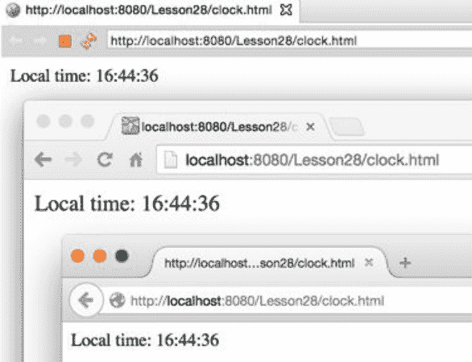

**图 28-6：** 三个 Web 客户端获取 WebSocket 端点发布的当前时间

在完成“动手尝试”（Try It）作业时，你会发现这个示例非常有用，你需要将股票报价推送到客户端。

# 优化消息发布的性能

如果连接的客户端数量较少，遍历所有打开的会话是行得通的。但如果你有数百个客户端，请考虑在 `@OnOpen` 消息处理器中将 `Session` 对象放入单独的集合，并从多个线程并行向每个组发送消息。重要提示：Java EE 服务器会为每个客户端连接创建一个服务器端点类的新实例，因此，如果你创建了自己的会话集合，它们必须是静态的：

```java
private static Set<Session> sessionsChunk1 = Collections.synchronizedSet(new HashSet<>());
private static Set<Session> sessionsChunk2 = Collections.synchronizedSet(new HashSet<>());
...
```

## 动手尝试

重写你在第 27 课“动手尝试”中创建的相同股票应用程序，但这次要使用 WebSockets 实现。创建一个基于 HTML 的 WebSocket 客户端。

## 课程要求

你应该已经安装了 Java、GlassFish 和 Eclipse。

> 注意：你可以从书籍的网页 www.wrox.com/go/javprog24hr2e 下载“动手尝试”的代码和资源。你可以在下载内容的 Lesson28 文件夹中找到它们。

## 步骤说明

1. 重用你早些在本节中创建的动态项目 Lesson28。如果你还没有，请从书籍下载并导入。
2. 创建一个 HTML 客户端 `GetPriceQuote.html`，其与“解码器和编码器”部分中的示例类似。它应该有一个文本输入字段用于输入股票代码以及一个 Get 按钮。用户必须输入股票代码以获取报价并按下按钮。服务器应为所选股票生成随机报价。
3. 在“解码器和编码器”部分的 WebSocketEndPoint 类中创建一个服务器端点，但这次要使用第 27 节“动手尝试”部分中的股票价格生成器（`StockPriceGenerator`）类。
4. 实现一个定时器，每五秒生成一次新的随机价格。参考“向所有客户端推送消息”部分中 `WebSocketClock` 类中的 `ScheduledExecutorService`。
5. 在 GlassFish 中部署项目并启动服务器。
6. 在 Eclipse 或你的 Web 浏览器中运行网页 `GetStockPrice.html` 并测试应用程序。网页中的一个股票代码应该每五秒刷新一次价格。用户应该能够随时输入新的股票代码，并显示且刷新新所选股票的价格。

> 提示：请在 www.wrox.com/go/javprog24hr2e 选择第 28 节的在线视频。你可以从该网站下载本节的代码和资源。

# 第 29 课 介绍 JNDI

与其让分布式 Java 程序反复不断地实例化大量可重用对象，不如让这些对象预先创建并发布在已知的服务器上，在那里可以轻松快速地找到它们。第 24 课引入了注册概念，在该概念中，Java 对象可以发布在某个名称下，以便客户端进行查找。

Java 命名和目录接口（JNDI）也是关于在分布式环境中注册和查找对象。JNDI 是一个可用于绑定和访问对象的应用程序接口（API）。Java EE 服务器在启动时会将 EJB、JMS 和数据库连接池绑定到命名服务器。

## 命名和目录服务

命名服务允许你添加、更改或删除名称。命名服务为每个条目提供唯一的名称。Java EE 服务器在启动时会将 EJB、JMS 和数据库连接池绑定到命名服务器。文件系统。命名树源于根，称为初始上下文（initial context）。

目录服务允许你通过属性而不是对象名称搜索命名树。例子是域名系统，它是一个分布式系统，接收网络计算机的域名并返回 IP 地址和端口号。

为了允许客户端查找，必须有一个过程将对象绑定到命名树。这可以通过服务器控制台或独立程序处理。

## 使用 InitialContext

`InitialContext` 代表命名服务器中 JNDI 树的根。获取绑定到此特定资源的方法有两种：

- 如果你的代码运行在 Java EE 服务器内部，可以通过 `@Resource` 注解将 JNDI 资源注入你的程序中。你也可以在 `InitialContext` 上运行 `lookup()`。
- 如果外部 Java 程序需要 JNDI 资源（例如，独立消息程序需要获取绑定到应用程序服务器 JNDI 树的消息队列），它必须获取 `InitialContext` 的引用并调用 `lookup()` 方法。

## 获取 InitialContext 的引用

```java
Context initContext = new InitialContext();
```

如果 Java 程序运行在应用程序服务器外部，你需要指定服务器的位置、实现 `InitialContext` 的厂商特定类以及凭据。例如，对于 WildFly 应用程序服务器，可以使用代码（假设已知安全凭据）：

```java
Properties env = new Properties();
env.put(Context.INITIAL_CONTEXT_FACTORY, "org.jboss.naming.client.InitialContextFactory");
```


env.put(`Context.PROVIDER_URL`, "http://127.0.0.1:8080");

env.put(`Context.SECURITY_PRINCIPAL`, "Alex123");

env.put(`Context.SECURITY_CREDENTIALS`, "MySecretPwd");

如果外部程序需要访问 GlassFish 服务器中的 `InitialContext` 对象，代码可能如下：

```java
final Properties env = new Properties();

env.setProperty("java.naming.factory.initial",
      "com.sun.enterprise.naming.InitialContextFactoryImpl");

env.setProperty("java.naming.factory.url",
      "com.sun.enterprise.naming");

env.setProperty("java.naming.factory.state",
      "com.sun.corba.ext.impl.presentation.rmiNDIStateFactoryImpl", "localhost");

env.setProperty("org.sun.corba.CORBA.ORInitialPort", "8000");

InitialContext initContext = new InitialContext(env);
```

你需要阅读应用程序自带的文档，以获取外部程序访问 JNDI 的正确代码。

在获取 `InitialContext` 引用后，你可以调用 `lookup()` 方法并指定所需的资源名称。第30 节详细介绍了 Java 消息，但现在我将向你展示一个获取消息队列引用的示例。

```java
Destination destination = (Destination)
initContext.lookup("jms/queue/test");
```

下面的代码显示了如何获取 EJB 和默认 JDBC 数据源的引用：

```java
MySessionBean msb = (MySessionBean)initContext.lookup(
      "java:com/env/ejb/MySessionBean");

DataSource ds = (DataSource)initContext.lookup(
      "java:com/env/jdbc/DefaultDataSource");
```

下一节将向你通过注入获取 JNDI 资源的更优方法。

## 注入 JNDI 资源

你的需要 JNDI 资源的程序很可能运行在某些 Java EE 应用服务器中，这极大地简化了获取此类资源的难度。在这种情况下，你不需要实例化 `InitialContext` 或使用 `lookup()`。

使用 `@Resource` 进行资源注入是向你的 Java EE 组件提供这些资源的一种更清洁、更简单的方法。在第 30 节中，你使用资源获取 JMS 对象的引用，如下：

```java
import javax.annotation.Resource;

...

@Resource(name="MyTestConnectionFactory")
  private ConnectionFactory factory;

@Resource(name="My.JMSTestQueue")
  private Queue ioQueue;
```

### 416 | 第 29 节 引入 JNDI

例如，你可以将此代码放在 Java Servlet 中，它向绑定到控制台的队列发送消息：借助具有 JNDI 名称 `MyTestConnectionFactory` 的 `ConnectionFactory`，在名为 `MyTestQueue` 的名称下构建了 JNDI 树。这些资源由 Servlet 容器注入到变量 `iQueue` 和 `factory` 中——无需执行 lookup。

根据其位置的不同，注入时间也各异。如果你将 `@Resource` 注解放在类级别，资源将在应用程序启动时的运行时注入。如果你将此注解放在字段或设置方法（setter）声明上方，资源将在应用程序初始化时注入到组件中。

如果你需要覆盖 EJB 中指定的资源，可以在 XML 配置文件中进行。你可以在第 31 节中看到更多使用 EJB 资源注入的示例。在本节中，你将使用 JDBC DataSource 的资源注入。同时，请查看 Glassfish 管理控制台。

## 在 Glassfish 中管理 JNDI 对象

每个 Java EE 服务器都提供了一个允许管理其服务模块的工具；我们感兴趣的是将对象绑定到它们的目录名称。当你启动 Glassfish 时，控制台上会显示一条消息：“Waiting for DAS to start.”（等待 DAS 启动）。DAS 代表 域管理（Domain Administration），它验证具有管理权限的用户，并从基于图形 Web 浏览器的 Admin 控制台接收请求。要查看控制台，请输入 URL `http://localhost:4848/`。你可以看到控制台，如图 29 所示。

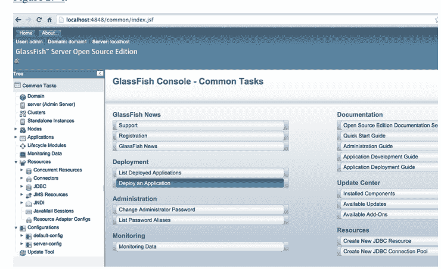

图 29-1：GlassFish 管理控制台

管理控制台允许你配置 Glassfish 服务器的实例 ($) 并管理 Java EE 应用程序所需的资源。在第 30 节中，你看到了如何配置 JMS 资源。

## 数据源与 JNDI

在第 21 节的“连接池和数据源”部分中，你了解到为每个请求创建一个新连接对象是一个耗时操作，最好使用重用预创建 JDBC 连接的数据库连接池。

通常，EE 服务器的管理员会创建数据库连接池，并在连接池上配置最小和最大连接数以及其他参数。要在 GlassFish 中配置新的 DBMS 连接池，管理控制台中的条目如图 29-2 所示：

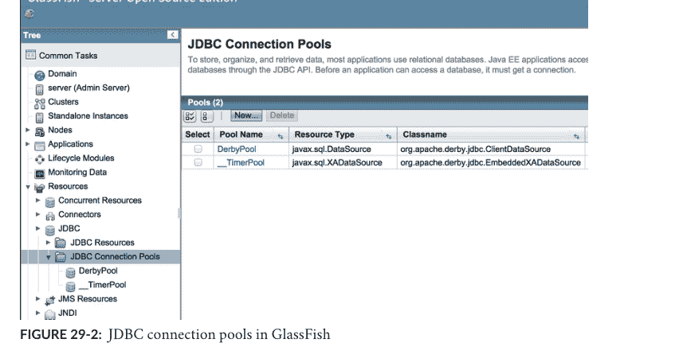

然后你需要为新池添加参数。GlassFish 包含了 DerbyDB 数据库服务器并为其预配置了池。图 29-3 显示了 GlassFish 管理控制台的快，其中现有资源名称 `DerbyPool` 代表一个 JDBC 连接池。`jax.sql.DataSource` 对象是数据库连接的工厂。管理员将此工厂配置为 JNDI 资源，指定使用哪个 JDBC 驱动、初始创建多少个连接以及允许的最大连接数。

### 418 | 第 29 节 引入 JNDI

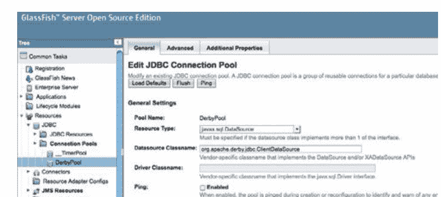

图 29-3：GlassFish 管理控制台

## 配置 GlassFish 资源

GlassFish（以及其他服务器）具有使用 `glassfish-resources.xml` 文件配置资源的方法。在本节中，你使用 JDBC DataSource 的资源注入。同时，请查看 Glassfish 管理控制台。

Java EE 服务器可以使用 XML 文件进行配置。你可以在第 31 节中看到更多使用 EJB 资源注入的示例。在本节中，你使用 JDBC DataSource 的资源注入。

现在可以使用 `lookup()`。如果对象名为 `DerbyPool`，获取连接的示例代码如下：

```java
InitialContext ic = new InitialContext();

DataSource ds = (DataSource)ic.lookup("DerbyPool");
```

使用 `@Resource` 注入 `DataSource` 的语法如下：

```java
@Resource(name="java:global/DerbyPool")
DataSource ds;
```

## 轻量目录访问协议

轻量目录访问协议（LDAP）服务器是特殊的软件，它们以层次结构存储目录条目并对读取高度优化。这使得它们成为员工列表或电话目录等服务的良好选择。从企业 Java 来看，当需要快速查找 Java 对象时应该考虑 LDAP 解决方案，例如 JNDI 连接工厂、查询或主题。Java 开发者使用 JNDI API 来绑定、查找和更新 LDAP 中的条目。JNDI 之于 LDAP 正如 JDBC 之于 DBMS。

是一些 LDAP 服务器：

- Oracle Directory Server (Oracle)
- Microsoft Active Directory (Microsoft)
- OpenLDAP (open-source, community developed)
- ApacheDS (open-source, Apache)
- OpenLDAP (open-source, community developed)

LDAP 目录有一个根节点，由一个或多个区分名称（唯一标识符）组成。通常层次结构的顶部是一个带有组织前缀的对象。下方是单元或常用名称，以此此类推。与其他命名服务不同，搜索字符串从最低层次结构开始，根节点最后被搜索。这里有一个用于搜索的区分名称示例：

```
cn=jsmith, ou=accounting, oracle.com
```

这意味着“在 accounting 节点下查找 jsmith 条目，而 accounting 节点位于 oracle.com 下”。

接下来的 Java 代码段搜索 JNDI 属性，连接到运行在端口 389 的 LDAP 服务器，并查找名为 Customer Hom 的对象：

### 420 | 课程 29 简介介绍 JNDI

```java
Hashtable<String, String> env = new Hashtable<>();

env.put(Context.INITIAL_FACTORY, "com.sun.jndi.ldap.LdCtxFactory");

env.put(Context.PROVIDER_URL, "ldap://localhost:389");

env.put(Context.SECURITY_AUTHENTICATION, "simple");

env.put(Context.SECURITY_PRINCIPAL, "Directory Manager");

env.put(Context.SECURITY_CREDENTIALS, "myPassword");

DirContext ctx = new InitialDirContext(env);

CustomerHome customHome = (CustomerHome)ctx.lookup("cn=CustomerHome,ou=RealIPProject,ou=tromp.com");
```

为了学习分布式应用，你可以将本书中的程序（客户端和服务器）运行在单台计算机上；而现实中的分布式应用可以通过多种方式构建；例如：

- 计算机 #1 运行 LDAP 服务器。
- 计算机 #2 运行一个应用服务器，该服务器已计算机 #1 上的 LDAP 服务器注册了某些对象。
- 计算机 #3 拥有一个客户端程序，该程序查找计算机 #1 上的对象引用并调用计算机 #2 上的方法。
- 计算机 #4 运行一个 DBMS 服务器，供运行在计算机 #2 上的应用服务器使用。
- 计算机 #5 发布金融市场数据，计算机 #2 订阅了该服务。

以此类推，此类推。

## 9月11日

当恐怖分子袭击并摧毁世界贸易中心时，我正在一家公司工作，由于这次袭击导致数据中心丢失。我当时正在开发一个利用消息机制的金融交易应用程序。使用纽约数据中心的 JMS 对象绑定到位于北卡罗来纳州的 LDAP 服务器。当接收到的数据中心在纽泽西州开始运行时，我们只需运行程序将 JMS 对象重新绑定到 LDAP 服务器，这样它们就会指向新位置的消息服务器。得益于这种灵活的架构，该公司的交易应用程序仅中断了三天就恢复运行。

本课程向你展示了如何使用 JNDI，并提供了一些你可能想要使用它的原因示例。将列表 30-1 中的代码与 messageservlet 中的代码进行对比只是一个例子，它说明了在通用的 JNDI 名称下对特定的物理对象进行命名和绑定，可以让你从程序代码中移除这些物理位置。课程 30 和第 31 章提供了更多使用 JNDI 的示例。

## 尝试一下

在本次作业中，你需要创建一个部署在 GlassFish 服务器下的 servlet，它应该通过使用 `DataSource` 对象的资源注入来获取 DerbyDB 的连接。

## 课程要求

你应该安装了 Java 和 GlassFish 4。必须按照课程 26《在 Eclipse 中配置 GlassFish》中的描述，在 IDE 中配置 GlassFish。

> 注意：你可以从书的官方网站 `www.wrox.com/go/javaprog24hr2e` 下载此“尝试一下”练习的代码和资源。你可以在文件 `Lesson29.zip` 中找到它们。

## 逐步操作

1. 打开命令行（或终端）窗口，切换到文件夹 `glassfish/javadb/bin`，并启动 GlassFish 自带的 DerbyDB 实例。如果你使用 Mac OS，需要重启 `NetworkServer.exe`。
2. 从 Eclipse IDE 启动 GlassFish。
3. 在 Eclipse 中，创建一个新的 Web 项目 `Lesson29`，并指定 GlassFish 为运行环境。
4. 创建一个新的 servlet `MyDerbyClientServlet`。它应该获取注入的 `DataSource` 并使用它连接到 Derby。修改生成的代码使 servlet 如下所示：

```java
@WebServlet("/MyDerbyClientServlet")
public class MyDerbyClientServlet extends HttpServlet {

    @Resource(name="java:global/DerbyPool")
    DataSource ds;

    protected void doGet(HttpServletRequest request,
        HttpServletResponse response) throws ServletException, IOException {

        try {
            Connection pooledConnection = ds.getConnection();
            system.out.println("Pooled connection to DerbyDB");
        } catch (SQLException e) {
            e.printStackTrace();
        }
    }
}
```


## 422 | 课程 29 简介：介绍 JNDI

5. 部署服务：在 Server 视图中右键点击并选择 Add and Remove。检查 Eclipse 控制台并找到 Lesson29 管理正在加载的消息。
6. 右键点击 servlet 名称并选择 Run on Server。你应该在 Console 视图中看到“Got pooled connection to DerbyDB”的消息。
7. 打开 GlassFish 管理控制台并进入 Additional Properties。将数据库名称修改为 Lesson29。

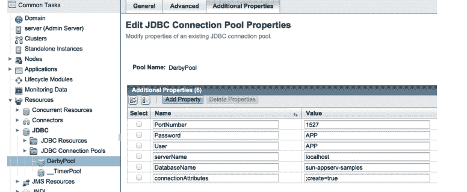

**图 24：** 连接池的附加属性

8. 访问课程 21，并按照“安装 Derby DB”和“创建数据库”中的描述检查 Employee 表。
9. 在 `MyDerByClientServlet` 中添加从 Employee 表中检索数据代码（可以以 `em-servlet.program` 为参考）。
10. 运行 `servletDerByClientServlet`。它应该从 Employee 中检索数据并在 Eclipse 控制台中打印它们。

> 提示：请在 www.wrox.com/go/javprog24hrre 在线选择课程 29 的视频。你也可以从该网站下载本课程的代码和资源。

## 424 | 课程 30 简介：介绍 JMS 和 MOM

### 消息概念与术语

即使从这个交易应用程序的高层表示中，你也可以看到消息机制允许实现松耦合的分布式系统。

当交易所宕机时，经纪商仍然可以接收客户订单并将其发送到 MOM。当交易所服务器恢复运行时，它们从 MOM 检索订单。

如果经纪公司对交易所进行同步 RPC 调用，当宕机时整个交易应用程序将停止运行。

订单被放在队列中，如果此时经纪公司处于状态，它将立即出队消息。如果你的应用程序没有运行，你选择了可靠交付，消息将在 MOM 队列中保留。

下单交易订单的过程是将描述订单的对象放入消息队列中。JMS 之于 MOM 犹如 JDBC 之于关系型数据库。以下是一些流行的 MOM 列表：

- ActiveMQ（开源）
- Open MQ（开源）
- WebSphere（IBM）
- EMS（Tibco）
- SonicMQ（Progress）

### 介绍 JMS 和 MOM

如果你下单购买股票，这是一个同步调用（阻塞调用）的示例。在异步通信中情况则不同。类似于，当你把信投进信箱时，你不需要等待邮车到达。

为了增加基于消息的应用程序的吞吐量，可以使用多个并行消费者从同一个队列中读取消息。你可以创建一个消费者 Java 程序，启动多个线程，每个线程从同一个队列中出队消息。但更好的方法是使用消息驱动程序（MDB）配置多个消费者，我将在第 31 章中解释。

具有保证的消息投递功能，MOM（消息中间件）就像邮局一样会将消息保留在队列中，直到接收者获取它。在这种模式下，消息是持久化的——MOM 提供程序将其存储在其内部存储中，这可以是数据库（DBMS）或文件系统。在非保证模式下，MOM 只会将消息传递给在消息到达时正在运行的接收应用程序。

### 消息传递的两种模式

程序可以发送或发布消息。当它向某个特定队列发送消息，而另一个程序从该队列接收消息时，这被称为点对点（P2P）消息传递。在这种模式下，消息一旦被成功接收就会从队列中移除。图 30-2 显示每条消息只进入一个消费者。


**图 30-2：** P2P 消息传递

如果程序发布消息以供多个接收者消费，那就是发布/订阅（pub/sub）模式。消息被发布到一个主题（topic），许多订阅者可以订阅并接收它。图 30-3 阐述了发布订阅模式，消息可以被多个订阅者消费。

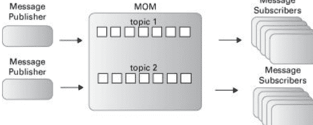

**图 30-3：** 发布/订阅消息传递

主题代表了应用程序和/或用户的某些重要新闻；例如，PriceDropAlert、BreakNews 等。在发布/订阅模式下，消息通常在所有订阅者都接收到后立即从队列中移除（请在“如何订阅主题”章节中阅读关于持久性订阅者的内容）。

发布/订阅应用程序的另一个例子是聊天室。由一个人发布的消息会被聊天室中的其他其他人接收。使用 JMS 和 MOM 开发聊天室是一项非常简单的任务。

### 引入 OpenMQ 和 MOM

为了学习 JMS，你需要安装一个消息服务器并配置一些消息队列。你可以使用一个名为 Open MQ 的开源 MOM。作为额外奖励，你还可以将其与 GlassFish 一起使用。你已经在 GlassFish 安装目录中安装了 `mq` 目录。如果你想在任何其他应用服务器上使用 Open MQ，可以从 http://mq.java.net/downloads/index.html 下载作为独立产品的 Open MQ。

首先，我将不会使用 Java EE 服务器。目标是使用中间件测试独立客户端。你需要启动 Open MQ 服务器并在那里创建一个命名队列。

编辑配置文件 `glassfish/glassfish/config/imenv.conf` 以指定 Java 8 在你计算机上的位置。例如，这行代码在你的 Mac 计算机上看起来如下所示：

```
IMQ_DEFAULT_JAVAHOME=/L/Library/Java/VirtualMachines/jdk.8_0_25_jdk/Contents/Home
```

打开命令行（或终端）窗口进入 `glassfish/glassfish/bin` 目录，并启动 Open MQ 代理（broker）。在 Windows 中你需要运行 `mqbroker.exe` 程序；如果你使用 macOS，输入以下命令：

```
/mqbroker
```

你会看到一条消息，表示代理已在端口 7676 上就绪。现在打开另一个命令行窗口，启动 glassFish 用户界面 (GUI) 工具 `imqadmin` 来创建所需的消息目标：

```
/imadmin
```

管理控制台打开了。在 MQ 中，称为代理（brokers）的对象管理客户端之间所有的消息交换。右键点击代理并添加一个新的命名 `StockBroker`，输入密码 `admin` 并点击 OK。然后右键点击 `StockBroker` 并从菜单中选择 `Connect`。图 30-4 显示了执行这些步骤后的快照。

现在创建一个物理目标——一个用于放置订单的队列。右键点击 `StockBroker` 节点下的 `Destinations` 并选择 `Add Broker Destination`。在弹出窗口中，输入目标的名称：`TradingOrdersQueue`，如图 30-5 所示。

### 引入 OpenMQ MOM | 427

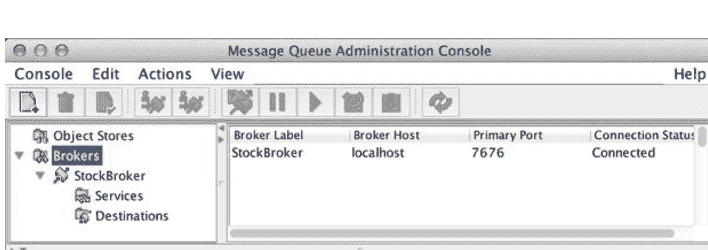

消息队列控制台
成功更新代理项 'StockBroker'。
成功连接到代理 'StockBroker'。

**图 30-4：** 带有新创建 StockBroker 的 Open MQ 控制台

428 | 课程 30 引入 JMS 和 MOM

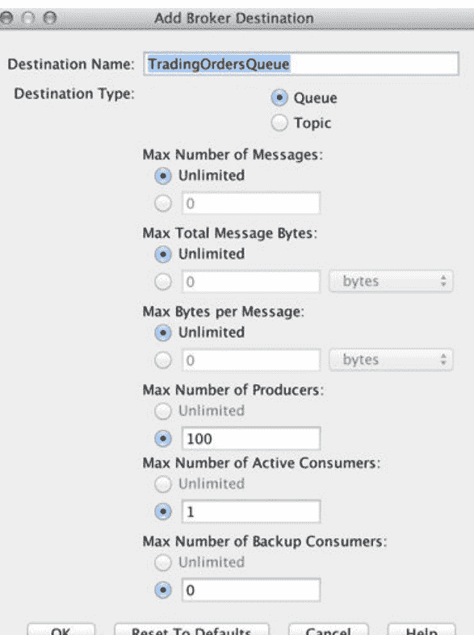

**图 30-5：** 在 Open MQ 中配置目标

如果你想创建一个主题而不是队列，你需要选择 Topic 单选按钮。如你所见，你可以在目标上设置其他参数。

详细概述 Open MQ MOM 超出了本书的范围；请尝试阅读《Open MQ 管理指南》以获取更多信息。只要你有一个运行中的 MOM 服务器并配置了消息目标，你就可以开始编写向该目标发送和接收消息的程序了。

### JMS API 概述

JMS API 包含了允许你发送和接收消息的 Java 类。在本节中，你将讨论在 Java EE 7 中引入的 JMS 2.0。如果你在使用仅提供 Java EE 规范的应用服务器，请查找描述以下内容的教程：

### 消息类型

- TextMessage（文本消息）
- ObjectMessage（对象消息）
- BytesMessage（字节消息）
- StreamMessage（流消息）
- MapMessage（映射消息）

### 如何直接向 MOM 发送消息

JMS API 包含了发送和接收消息的 Java 类。在本节中，你将讨论在 Java EE 7 中引入的 JMS 2.0。如果你在使用仅提供 Java EE 规范的应用服务器，请查找描述以下内容的教程：

### JMS API 概述 | 431

`new com.sun.messaging.ConnectionFactory();`

`DirectMessageSender` 类使用了 JMS `ConnectionFactory` 的 Open MQ 特定实现，该实现位于供应商的包 `com.sun.messaging` 中。如果你决定更改 MOM 提供者或其他服务器，将需要修改、重新编译并重新部署此代码。这并不完美，但你会在该 Java EE 版本中修复这个问题。

### 如何直接从 MOM 接收消息

接收消息的程序被称为消息消费者（监听器）。它可以是一个独立的 Java 程序，也可以是基于消息驱动的程序。你可以使用 `receive()` 方法同步接收消息，也可以通过实现 `MessageListener` 接口并编写 `onMessage()` 回调来异步接收消息。之所以使用 `receive()` 方法是因为它采用了一个不断请求消息的轮询机制。

在消息消费者上使用异步回调方法是接收消息的首选方法。当消息被放入队列时，`onMessage()` 回调会被立即触发。消费者必须执行以下步骤来进行异步接收：

1. 创建一个实现 `MessageListener` 接口的类并对其实例化。
2. 使用 MOM 供应商提供的实现类创建一个 `ConnectionFactory` 对象。
3. 创建一个 `JMSContext` 对象。
4. 使用 `JMSContext` 创建一个目标（Destination）（例如调用 `createQueue()`）。
5. 创建一个 `JMSConsumer` 并调用其 `setMessageListener()`，指定实现 `MessageListener` 的对象。
6. 实现 `onMessage()` 以在消息到达时处理该消息。

### 432 | 第 30 节 引入 JMS 和 MOM

列表 30-2 中的示例类 `MyReceiver` 展示了如何异步地从 `TradingOrdersQueue` 消费消息。它的构造函数创建了 JMS 对象并将自己注册为消息监听器。`onMessage()` 回调包含处理接收到的消息的代码。

#### 列表 30-2 接收消息

```java
public class DirectMessageReceiver implements MessageListener {

    ConnectionFactory factory = new com.sun.messaging.ConnectionFactory();

    JMSConsumer consumer;

    public DirectMessageReceiver() {

        try(Context context=factory.createContext("admin", "admin")){

            factory.setProperty(ConnectionConfiguration.imaddressList,"mq://127.0.0.1:7676,mq://127.0.0.1:7676");

            Destination ordersQueue = context.createQueue("TradingOrdersQueue");

            consumer = context.createConsumer(ordersQueue);

            consumer.setMessageListener(this);

            System.out.println("Listening to the TradingOrdersQueue...");

            // Keep程序运行 - 等待消息

            Thread.sleep(100000);

        } catch (InterruptedException e) {

            System.out.println("Error: " + e.getMessage());

        } catch (JMSException e) {

            System.out.println("Error: " + e.getMessage());

        }

    }

    public void onMessage(Message msg) {

        try{

            System.out.println("Got the text message from " +

                "the TradingOrdersQueue: " + msg.getBody(String.class));

            System.out.println("\n === Here's what toString()\n on the message prints \n" + msg);

        } catch (JMSException e) {

            System.err.println("JMSException: " + e.toString());

        }

    }

}
```

### JMS API 概述 | 433

```java
// IBM 200 Mkt

public static void main(String[] args) {

    new DirectMessageReceiver(); // 实例化监听器

}

}
```

`DirectMessageReceiver` 类调用了 `sleep(100000)` 方法以防止程序在 100 秒内终止。我这样做是为了测试，以便你可以向队列发送消息并看到它们被接收。如果你通过运行 `DirectMessageSender` 在队列中放入消息，`DirectMessageReceiver` 将获取它，控制台输出可能如下：

Got the text message from the TradingOrdersQueue: IBM 200 Mkt

== Here's what toString() on the message prints

```
Text: IBM 200 Mkt
Class: com.sun.messaging.jmsclient.TextMessageImpl
JMSMessageID(): ID:742:698.1.113(d8:
JMSDestination(): TradingOrdersQueue
JMSDeliveryMode(): PERSISTENT
JMSDelivered(): false
JMSPriority(): 0
JMSType(): Text
```

### 436 | 课程 30 介绍 JMS 和 MOM

- `DUP_OK_ACKNOWLEDGE` 模式用于服务器失败时；同一条消息可能会被交付多次。在某些情况下，这是可以接受的——例如，接收两次价格报价不会产生任何影响。

消息确认模式是在创建 `JMSContext` 时定义的。到目前为止，我们的代码示例 `DirectMessageSenderAndDirectMessageReceiver` 是通过指定两个参数（用户 ID 和密码）来创建 `JMSContext` 。但你可以使用重载的 `createContext()` 方法来指定消息会话模式：例如：

```
JMSContext context = factory.createContext("admin", "admin",
JMSContext.CLIENT_ACKNOWLEDGE);
```


除了确认机制外，你还可以为消息消费者请求事务支持。想象一下，如果收到的消息包含必须作为一个工作单元保存到数据库并转发到 Web Service 的数据，那么整个事务必须回滚。你可能在 JMS 生产者端也需要事务支持。例如，如果你需要将两条消息作为一个逻辑工作单元发送，那么这两条消息要么都成功发送，要么都回滚。以下代码段显示了如何创建 `JMSContext` 以及一个向不同队列同时发送两条消息的 `JMSProducer` 实例：

```java
try (JMSContext context = factory.createContext("admin", "admin", JMSContext.TRANSACTED)) {
    JMSProducer producer = context.createProducer();
    Destination queue1 = context.createQueue("Queue1");
    Destination queue2 = context.createQueue("Queue2");
    producer.send(queue1, "Msg1");
    producer.send(queue2, "Msg2");
    context.commit(); // 提交 JMS 事务
} catch (JMSException e) {
    context.rollback(); // 回滚 JMS 事务
    System.out.println("Error: " + e.getMessage());
}
```

如果都发送成功，`Session` 对象（封装在 `JMSContext` 中）会发出提交。如果发生异常，则没有任何消息会被放入任何队列中。

## 消息选择器

如果你必须与其他用户或团队成员共享队列，请使用消息选择器（也称为过滤器）来避免“偷走”别人的消息。例如，在消息消费者应用程序中，你可以选择接收属性 `symbol` 值为 `IBM` 的消息：

```java
String selector = "symbol=IBM";
context.createConsumer(ordersQueue, selector);
```

在这种情况下，队列监听器只会取出那些 `String` 类型的属性 `symbol` 值为 `IBM` 的消息。相应地，消息生产者必须在消息对象上设置此属性：

```java
Destination ordersQueue = context.createQueue("TradingOrdersQueue");
JMSProducer producer = context.createProducer();
producer.send(ordersQueue, outMsg);
```

记住，选择器会减慢检索过程。消息会留在队列中，直到匹配的选择器将其取走。如果你的团队人数有限，且每个人都需要接收消息且互不干扰，选择器将非常有帮助。但如果有人在没有选择器的情况下启动队列监听器，就会排空队列。

## 从 Java EE 容器发送消息

现在你已经了解了消息是如何工作的，你就可以学习从位于 Java EE 容器内部的 Java 对象向 MOM 目标发送消息了。这次你将 `ConnectionFactory`、`Queue` 和 `Topic` 等 MOM 对象绑定到 JNDI 树上，消息系统从那里获取它们。图 30-6 显示了 JMS 客户端在没有 Java EE 的情况下与 MOM 通信的高级视图。

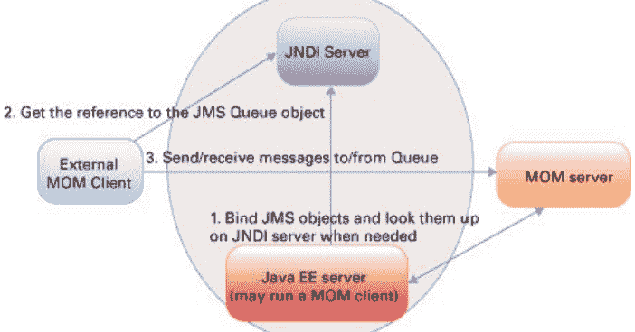

要替换 MOM，只需将新的管理对象（队列、主题）重新注册到 JNDI 服务器（例如 LDAP）。

图 30-6：将 JMS、Java EE 和 MOM 结合在一起。

外部客户端可以直接与 MOM 服务器通信，也可以从椭圆表示的 Java EE 服务器内部进行通信。当 Java EE 服务器启动时，它将 MOM 对象作为 JMS 对象并绑定到 JNDI 树上。因此，如果一个 Java Servlet 或其他 Java EE 组件需要发送消息，它可以通过 JNDI 查找这些资源。

```java
@WebServlet("/MessageSenderServlet")
public class MessageSenderServlet extends HttpServlet {

    @Resource(lookup = "java/comp/JMSConnectionFactory")
    ConnectionFactory factory;

    @Resource(lookup = "OutgoingTradeOrders") // JNDI 队列名
    Destination ordersQueue;

    protected void doGet(HttpServletRequest request, HttpServletResponse response) throws ServletException, IOException {
        // 发送消息逻辑
    }
}
```

### GlassFish 中的 JMS 配置

目标 `TradingOrdersQueue` 已知的唯一原因是 Open MQ 与 GlassFish 集成了。要配置另一个 MOM 服务器，你需要使用导航面板中的 `Configurations` 节点创建一个新的 JMS 主机。

现在，你需要创建一个映射到物理 MOM 队列的 GlassFish JMS 条目。将新的目标资源添加到 JMS Resources（见图 30-8）。我给它分配了一个 JNDI 名称 `OutTradeOrders`。

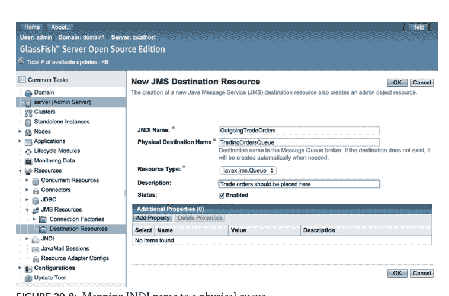

**图 30-8：** 将 JMS 映射到物理队列

JMS 连接的创建和关闭（由 `JMSContext` 内部完成）是耗时操作；你应该考虑使用连接池。Java EE 服务器允许你通过配置连接工厂来创建此类池。图 30-9 显示了如何使用它们。

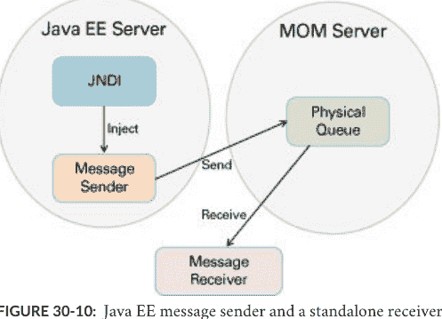

**图 30-9：** 配置 JMS 连接

---

# 第 31 课：Enterprise JavaBeans 简介

本节向你介绍 Java EE 技术之一——Enterprise JavaBeans（EJB，JSR 345），它可以用于实现分布式应用中的业务逻辑层（参见图 25-1）。第 26 章和第 27 章介绍了在 Web 上编写表示层的各种方法；在第 30 章和第 29 章中，你学习了如何使用消息机制组织应用不同层之间的通信。应用程序的业务逻辑是在 POJO 中编写的。

在本节中，你将看到如何使用 EJB（也是 POJO，但由 EJB 容器管理）业务层。Java EE 7 包含了 EJB 3.2 和 Java Persistence API (JPA) 2.1，它们为业务逻辑和数据持久化提供了标准的解决方案。将 EJB 作为 JMS 监听器可以提高企业应用程序的可扩展性，而无需编写额外的代码。

本节将向你介绍各种 EJB，下一节将介绍如何使用 JPA 持久化数据。

## 谁需要 EJB 容器？

POJO 有什么问题吗？为什么不在那里直接实现业务逻辑呢？你当然可以这样做，但很可能需要花费额外时间为它们手动编写多线程环境。一种可能是，你的应用程序需要事务支持。如果业务逻辑位于 POJO 1 和 POJO 2 中，而第二个失败了，你希望回滚第一个已经完成的所有操作。

你知道如何使用 JMS 编写消息接收器是很棒的，但你如何让这个解决方案具有可扩展性呢？如果你需要几十个消息监听器并发从队列中取出消息怎么办？忘记将 POJO 与其他层集成以执行身份验证和 JDBC 操作的任务吧。

EJB 容器处理了所有与基础设施相关的问题，而无需你侧进行手动编程。应用程序服务器允许你在有多个消息监听器时配置消息驱动豆（MDB）池。如果需要，你可以运行事务支持。如果你的 bean 运行在 EJB 容器中，你就不需要担心多线程问题。将 POJO 转换为 EJB 只需要向 EJB 类添加 Java 注解，非常简单。Bean 之间的相互通信也是通过依赖注入或单例 Bean 实现的。

如果你需要扩展分布式应用，EJB 容器提供了集群和故障转移支持。安全授权也是容器的责任。由于不需要手动编写所有这些基础设施功能，你的 EJB 代码变得非常轻量。

EJB 容器提供的另一个有趣服务是异步方法调用，它实现了异步处理。

### EJB 嵌入式容器

你可以在任何应用程序服务器之外的 Java SE 环境中运行 EJB 应用。对于测试等任务这是一个很好的主意，因为不需要依赖 Java EE 服务器的就绪，你可以在本地测试你的 EJB。创建嵌入式容器只需要执行一行代码：

```java
EJBContainer myContainer = EJBContainer.createEJBContainer();
```

如果最初选择的应用程序服务器没有提供你预期的性能或可靠性，可以在另一个符合 Java EE 7 的服务器中部署你的 EJB，而无需更改任何代码。

## EJB 的类型

Bean 有两种类型：EJB 会话豆（Session Beans）和消息驱动豆（Message-Driven Beans）。MDB 提供了从 JMS 队列或主题中接收消息的功能——这就是你能做的所有事情。你的应用程序逻辑驻留在会话豆中。会话豆有三种：

*   **无状态豆（Stateless Bean）** 包含业务逻辑但不支持状态。也就是说，它不会为客户端“记住”任何数据。如果客户端连续在无状态 Bean 上调用两个方法，容器可能需要使用两个 EJB Bean 实例，因为它没有为客户端存储任何中间数据。
*   **有状态豆（Stateful Bean）** 包含业务逻辑和状态。EJB 容器会分配一个特定的 Bean 实例，并可以在随后的 Bean 调用之间存储结果。
*   **单例豆（Singleton Bean）** 每个应用程序只实例化一次。将单例想象为一个全局仓库，一个 Bean 可以在其中放入一些数据供另一个 Bean 使用。单例会话豆不仅提供了对常用数据的方便访问，还确保在并发访问时不会出现竞态条件。

旧版本的 EJB 指定了实体豆（Entity Beans）用于数据持久化。从形式上说，它们存在于当前的 EJB 规范中，但已被精简（作为符合 Java EE 7 的应用程序服务器提供商的可选实现）。

EJB 容器创建并管理会话豆池。无状态豆分配给客户端的时间比有状态豆短。因此，如果你正在开发一个具有数百或数千个并发请求指向 EJB 容器的多用户应用，无状态豆提供了一个比较小池更具扩展性的解决方案，可以服务更多用户。

### 无状态会话豆的生命周期

但即使使用无状态会话豆，EJB 容器运行得很聪明，那些留在内存中但与客户端没有活动交互的实例正在被钝化——从内存中移除并存储在磁盘上。当客户端向被钝化的无状态 Bean 发出另一个请求时，容器会再次激活它。

### 无状态会话豆示例

我将通过创建一个简单的示例来向你介绍无状态会话豆，该示例包含一个带有返回“Hello World”消息逻辑的 EJB。

#### Bean 实现

一个返回“Hello World”并存在于容器中的类可以轻松实现为无状态会话豆：它只有一个方法，并且没有状态需要记住。清单 31-1 展示了你如何编写这样的 Bean。

**清单 31-1：HelloWorld Bean（版本 1）**

```java
@Stateless
public class HelloWorld {
    public String sayHello() {
        return "Hello World";
    }
}
```

基本上，你需要一个 POJO 并为其注入一个或多个注解。相应的 `@Stateful`、`@MessageDriven` 和 `@Singleton` 注解用于标记其他类型的会话豆。

将 POJO 转换为 EJB 不需要实现特殊的接口。之前的 `HelloWorldBean` 版本没有指定这种无接口视图，这意味着当客户端引用它时只能是 Bean 的类型（在本例中为 `HelloWorld`）。由于 Bean 没有实现任何接口，你不能声明接口类型的引用。部署在服务存档中的类可以使用 `@EJB` 注解进行资源注入：

```java
@EJB HelloWorldBean myBean;
myBean.sayHello();
```

#### 客户端视图

在所示的 Bean 运行在服务器上，但客户端调用它的 `sayHello()` 方法。

#### 本地无接口 Bean

我计划在位于相同 JVM 的 Servlet 中使用 `HelloWorldBean`，代码的最终版本位于清单 31-2。

**清单 31-2：HelloWorld Bean（最终版本）**

```java
import javax.ejb.LocalBean;
import javax.ejb.Stateless;

@LocalBean
@Stateless
public class HelloWorld {
    public String sayHello() {
        // 如果需要，你可以在这里实例化并使用其他 POJO
        return "Hello World";
    }
}
```

任何 EJB 都可以使用普通类来实现业务逻辑。例如，`sayHello()` 方法可以使用 `new` 操作符创建其他 Java 类的实例，并在需要时调用它们的业务方法。或者更好，你可以使用上下文依赖注入 (CDI) 注入 POJO，这将在后续章节中解释。

现在是时候动手操作了。在 Eclipse 中创建一个 `Lesson31` 动态 Web 项目。然后，在包 `session31.client` 中创建一个新的 Servlet 类 `HelloWorldServlet`（选择 File -> New -> Servlet）。在此 Servlet 中仅使用 `doGet()` 方法。该 Servlet 连接你的客户端，与通信层交互。

从包 `session31.ejb` 中创建一个 Java 类 `HelloWorldBean`（选择 File -> New -> Other -> EJB -> Session Bean (EJB 3.x)）。不要使用任何本地或远程业务接口。默认情况下，Eclipse 生成无接口 Bean 并将其标记为 `@Stateless` `@LocalBean`。Eclipse 会创建一个带有默认构造函数的类。为了实现这一点，使用我早些显示的 `sayHello()` 方法，EJB 就可以使用了。

下一步是使用 `@EJB` 注解将 `HelloWorldBean` 注入到 Servlet 代码中：

```java
@EJB HelloWorldBean myBean;
```

Eclipse 会在该行标记一个红色的错误标记。右键点击它并选择“Quick Fix”（快速修复），自动插入两个导入语句：一个用于 `@EJB` 注解，另一个用于 `HelloWorldBean`。

#### 使用 JNDI 作为替代方案

Java EE 支持不依赖于应用程序服务器实现的可移植 JNDI 名称。与其使用 `@EJB` 注解，不如你使用以下代码：

```java
Context ctx = new InitialContext();
HelloWorldBean myBean = (HelloWorldBean) ctx.lookup("java:global/Lesson31/HelloWorldBean");
```

现在在 Servlet 的 `doGet()` 方法中添加这两行代码，使其调用 EJB 的 `sayHello()` 方法：

```java
PrintWriter out = response.getWriter();
out.println(myBean.sayHello());
```

就是这样了。Servlet 的完整代码如清单 31-3 所示。

**清单 31-3：HelloWorldBean 的 Servlet 客户端**

```java
package lesson31.client;

import java.io.IOException;
import java.io.PrintWriter;
import javax.ejb.EJB;
import javax.servlet.ServletException;
import javax.servlet.annotation.WebServlet;
import javax.servlet.http.HttpServlet;
import javax.servlet.http.HttpServletRequest;
import javax.servlet.http.HttpServletResponse;
import lesson31.ejb.HelloWorldBean;

@WebServlet(urlPatterns = { "/HelloWorldServlet" })
public class HelloWorldServlet extends HttpServlet {

    @EJB HelloWorldBean myBean;

    protected void doGet(HttpServletRequest request, HttpServletResponse response) throws ServletException, IOException {
        PrintWriter out = response.getWriter();
        out.println(myBean.sayHello());
    }
}
```


# 第 31 课 企业级 JavaBeans 简介

在 GlassFish 服务器中部署项目 `Lesson31`（右键点击服务器名称并使用 `Add and Remove` 菜单）并启动服务器。右键点击 servlet `HelloWorldServlet` 并选择 `Run As -> Run on Server`。servlet 会调用 EJB 上的方法，查看 Eclipse 内部浏览器中图 31-1 显示的内容。


你可以在浏览器中复制 servlet 的 URL，生成的网页将是相同的。

从 EJB 打印 Hello World 可能看起来并不那么深刻，但我的目标是说明如何将应用程序逻辑从 servlet 移动到 EJB。

> **服务器上的自动重新部署**
> 在开发你的项目时，你可能希望确保服务器在 Java 代码更改时自动重新部署你的应用程序。双击 `Servers` 视图中的 GlassFish 服务器，这将打开描述服务器的 `Overview` 窗口。在那里展开 `Publishing` 面板，并选择 `Automatically Publish When Resources Change`（资源更改时自动发布）选项。

## 本地 Bean

现在，要向本地客户端暴露业务方法，你可以声明标记有 `@Local` 注解的接口。在 Eclipse 中创建一个名为 `HelloWorldLocal` 的新 session bean，勾选 `Local` 复选框，并输入 `Authorizable` 作为业务接口的名称，如图 31-2 所示。

### 创建 EJB 3.x Session Bean

指定类文件目标。

| 项目 | Lesson31 |
| :--- | :--- |
| 源文件夹 | `/Lesson31/src` |
| Java 包 | `lesson31.ejb` |
| 类名 | `HelloWorldLocal` |
| 超类 |  |
| 状态类型 | `Stateless` |
| 创建业务接口 |  |
| 远程 | `lesson31.ejb.HelloWorldLocal/Remote` |
| 本地 | `lesson31.ejb.Authorizable` |
| 无接口视图 |  |
| 异步 |  |

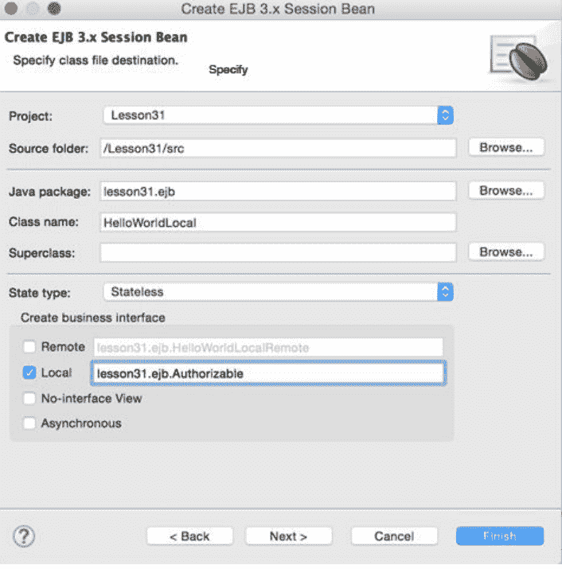

Eclipse 生成了接口 `Authorizable` 以及应该实现的 EJB 类。

在我添加了 `authorize()` 方法的声明后，该接口如下：

```java
package lesson31.ejb;

import javax.ejb.Local;

@Local
public interface Authorizable {

    public String authorize();

}
```

现在你可以实现 `authorize()` 方法并像以前一样添加 `sayHello()`。

### 列表 31-4 本地接口和 bean

```java
package lesson31.ejb;

import javax.ejb.Stateless;

@Stateless
public class HelloWorldLocal implements Authorizable {

    public String authorize() {
        return "The user is authorized!";
    }

    public String sayHello() {
        return "Hello World!";
    }

}
```

`HelloWorldBean` 和 `HelloWorldLocal` 的区别在于前者没有实现接口，而后者向本地客户端暴露了 `Authorizable` 视图。

## 远程 Bean

对于远程访问 bean 的客户端，你需要一个远程接口。在 J2EE 中，远程接口被 `@Remote` 注解标记。`@Remote` 接口允许从不同的 JVM 调用 EJB。在 Java EE 5 中，如果 bean 只有一个远程接口，则 `@Remote` 注解是可选的。

## 有状态 Bean

有状态 session bean 维护与特定客户端的会话状态。当客户端调用有状态 bean 的方法时，EJB 容器会为该客户端分配一个 bean 实例。该实例将一直与该客户端关联，直到会话结束或 bean 被移除。

```java
@Stateful
public class MyShoppingCart implements ShoppingCart {

    private List<String> items = new ArrayList<>();

    public void addItem(String item) {
        items.add(item);
    }

    public List<String> getItems() {
        return items;
    }

    @Remove
    public void placeOrder() {
        // 处理订单逻辑
        // The client is ready to complete the purchase
        // ...
    }
}
```

为了完成购物流程并为其他用户释放有状态 bean，程序需要调用 bean 的一个标记有 `@Remove` 注解的 `MyShoppingCart` 方法。在前面的示例中，`placeOrder()` 方法应该标记有此注解。你还应该在 bean 上提供另一个 `@Remove` 方法，允许该 bean 在没有任何活动的情况下保持分配给客户端。当此时间过期时，会话将超时，bean 将被释放。

释放有状态 bean 的另外一种方法是使用 `@StatefulTimeout` 注解，它允许你指定 bean 保持分配客户端的时间。当此时间过期时，bean 将被移除。

## 单例 Bean

应用程序经常需要一个地方来存放所有 bean 共享的数据。这时单例就派上用场了。单例的另一个用途是控制某些外部资源的访问。例如，如果某些外部 Web 服务提供的连接数量有限，你可以创建一个单例，为需要这些连接的 EJB 实现线程管理。单例 bean 可以作为应用程序的全局存储（或缓存）；此 bean 的状态在客户端之间共享。

每个应用程序的 JVM 中只能存在一个具有任何给定名称的单例 bean。如果你在应用程序中需要多个单例，请给它们起不同的名称。EJB 容器不会创建 bean 池。要创建一个单例 EJB，只需在 POJO 上标记 `@Singleton` 注解：

```java
@Singleton
public class MyGlobalStorage {

}
```

当 bean 被创建时，由 EJB 容器决定创建时机，除非你明确请求在应用程序启动时创建该 bean。这被称为**尽早初始化**，有一个特殊的注解 `@Startup`：

```java
@Startup
@Singleton
public class MyGlobalStorage {

    // 用于共享的对象的存储器
    private Map<String, Object> map = new HashMap<>();

    void addToStore(String key, Object objToStore) { ... }

    void removeFromStore(String key) { ... }

}
```

假设你想创建一个程序，在某些时间向队列发送一些消息。编写一个单例 bean，让 EJB 容器在应用程序启动时实例化它，并在单例完成初始化后开始推送消息。另一个实用的注解是 `@PostConstruct`，它会导致容器在 bean 的构造函数完成后立即调用一个方法：

```java
@Startup
@Singleton
public class MyStockQuoteServer {

    @PostConstruct
    void setStockQuotes() {
        // 在此处连接到股票价格源并
        // 向队列发送消息
    }

}
```

要访问单例的业务方法，客户端类需要在特定实例上调用公共方法。如果你在 Java SE 中手动实现单例模式，你需要在类中创建一个私有构造函数和一个 `public static` 的 `getInstance()` 方法：

```java
MyGlobalStorage.getInstance().addStorage("empOfTheMonth", bestEmployee);
```

但在 Java EE 中，EJB 容器会处理这些。EJB 容器允许对单例 bean 进行并发访问，并由它处理管理的并发策略，让开发者无需担心竞态条件等问题。你只需要使用 `@Lock` 注解，指定你希望在读取或写入操作期间锁定资源。如果你倾向于自己编写线程同步代码，可以使用 bean 管理并发。你使用 `@ConcurrencyManagement` 注解设置并发类型，如下：

```java
@Singleton
@ConcurrencyManagement(ConcurrencyManagementType.BEAN)
public class MyGlobalStorage {

}
```

## 部署 EJB

在部署到任何应用程序服务器之前，EJB 通常被打包成一个归档文件，这可以是 `.jar`、企业级归档 `.ear`（这是一个 Java 归档文件）；或者对于 Web 应用程序的 `.war`。一个简单的 Web 应用程序应该压缩并作为一个整体部署。如果你的客户端代码位于 Web 应用程序中，将 EJB 保留在 `.war` 文件内部。

在归档文件中打包应用程序的正确方法是使用 Ant、Maven 或 Gradle 等构建系统（参见第 36 课）。为了训练目的，你也可以在 Eclipse 中创建一个 `.war` 文件。在 Eclipse 项目 `Lesson31` 中右键点击项目名称，并选择 `Export -> WAR file`。几秒钟后，你就得到了包含 `Lesson31.war` 文件，它同时包含了 servlet 和 EJB。

此文件可以部署在任何符合 Java EE 标准的应用程序服务器中。这个 `.war` 文件很小：小于 4 KB！Java EE 让 EJB 组件变得相对轻量。如果你有多个 EJB 类，将它们放在 `WEB-INF/lib` 目录下的一个或多个 `.jar` 中。

如果你的客户端不是一个小型 Web 应用程序，或者你想单独部署 EJB，你可以将它们封装在单独的 `.jar` 或 `.ear` 文件中。你用于创建 `.ear` 文件的根目录必须包含所有编译后的 Java 类，如果适用，还包括可选的 `META-INF/application.xml` 文件。事实上，你可以创建一个仅包含你的 EJB 但同时也包含 `.war` 文件的 `.ear` 文件。

可选文件 `ejb-jar.xml` 允许你为 EJB 指定元数据，如果你需要在不重新编译代码的情况下更改生产系统上的元数据，请在 `ejb-jar.xml` 中进行更改。

## EJB 与事务

Java EE 包含了 Java 事务 API (JTA)，它是在 EJB 和 Web 容器中界定事务边界的标准接口。第 21 课解释了在与关系型数据库一起工作时如何进行事务性更新。例如，你的应用程序可能需要在一个事务中更新数据库并使用 JMS 发送消息。如果这些操作中的任何一个失败，整个事务都应该回滚。

多个 EJB 可以执行被视为单一事务的操作。事务范围定义了事务的所有参与者，这些参与者可以声明在相同或不同的 EJB 上。例如，一个 session bean 可以拥有一个 `saveOrder()` 方法，用于实现保存订单的逻辑，并在另一个 bean 上有一个 `notifySupplier()` 方法。如果这些方法中的任何一个失败，整个事务都将回滚。

假设一个事务在 `saveOrder()` 方法中启动，该方法调用了 `notifySupplier()`。后者的代码应该作为现有事务的一部分运行，还是创建一个新事务？一个方法是否应该简单地假设存在现有事务，且失败不影响该事务？还有其他需要回答的问题？

EJB 中的 JTA 事务包含两种类型：容器管理的和 Bean 管理的。容器管理事务由 EJB 容器管理，你只需要使用 `@TransactionAttribute` 注解以声明式的方式指定行为，指示容器在考虑事务时如何处理。对于 Bean 管理事务，你需要调用 `UserTransaction` 接口的 `begin()`、`commit()` 和 `rollback()` 方法。

但使用容器管理的声明式事务是最简单的。它处理了若干个事务属性：

- `MANDATORY`：此方法必须是调用方法事务的一部分。如果调用方法没有事务，则会抛出 `EJBTransactionRequiredException`。
- `REQUIRED`：此方法必须在事务范围内被调用。如果调用方法不是事务性的，容器将启动一个新事务。
- `REQUIRES_NEW`：即使调用方法有自己的事务，也为此方法启动一个新事务。
- `SUPPORTS`：作为调用方法事务的一部分执行此方法的代码。
- `NOT_SUPPORTED`：挂起调用方法的事务，直到此方法完成。如果调用方法不是在事务中执行的，则此方法也不具有事务性。
- `NEVER`：此方法绝不能是事务的一部分。如果调用方法有事务，则抛出 `EJBException`。

如果类被标记了事务属性，它将适用于类中的所有方法。你可以在方法上重写类属性。下一个示例显示了一个无状态 bean，它声明容器必须为每个方法创建一个新事务，其中 `method3()` 永远不应该在事务内部执行：

```java
@Stateless
@TransactionAttribute(TransactionAttributeType.REQUIRES_NEW)
class MySessionBean {

    public void method1() { ... }

    public void method2() { ... }

    @TransactionAttribute(TransactionAttributeType.NEVER)
    public void method3() { ... }

}
```

消息驱动 bean 只能使用 `NOT_SUPPORTED` 或 `REQUIRED` 事务属性。

## Timer 服务

许多企业应用程序需要调度器在特定时间执行重复任务。Cron 是基于 UNIX 系统广泛使用的调度器。Windows 也有任务调度程序（控制面板 -> 计划任务）。开源 Quartz 调度器在 Java 开发人员中非常流行。

EJB 支持 `@Schedule` 注解，它接受基于日历的表达式，因此你可以调度 bean 中所需功能的执行。例如，你可以创建每秒、每分、每小时、周一、工作日、午夜等调用业务的方法。

下一个代码段显示了如何创建一个定时器，在工作日的上午 9:30 到下午 4:00 之间每秒调用一次 `getPriceQuotes()` 方法。

```java
@Stateless
public class MyStockQuotefeed {

    @Schedule(second="*", minute="*", hour="9:30-16:00", dayOfWeek="Mon-Fri")
    public List getPriceQuotes() {
        // 连接报价源的代码写在这里
    }

}
```


你可以使用 `TimerService` 类及其方法 `createTimer()`、`createSingleActionTimer()` 和 `createCalendar()` 通过编程方式创建定时器。

此外，使用 `@Schedule` 和编程定时器，你可以在部署描述符 `ejb-jar.xml` 中配置它们。

## 总结

Enterprise Java Beans (EJB) 技术是为企业应用程序创建可扩展、易开发部署以及轻量级解决方案的强大方案。即使是小型应用程序也能从 EJB 中受益。如果你的应用程序概念不需要 EJB 规范规定的所有功能，请考虑使用 EJB Lite，它是完整规范的子集。

在一个简短的课程中无法涵盖 EJB 容器提供的所有功能。我向你介绍了主要的 EJB 概念，如果你想获得更深入的讲解，请阅读 Oracle Java EE 7 教程中的 EJB 章节。

## 尝试一试

> 注意：你可以从 www.wrox.com/go/javaprog24hr2e 下载“Try It”部分的代码和资源。你可以在 `Lesson31.zip` 中找到它们。

本节的作业是实现 `StockServer` 类，并使用定时器每秒自动生成并打印股票报价。

# 第 32 节 Java 持久 API 概述

使用 SQL 语言进行原生数据库查询。其核心思想是将一组相互关联的 Java 类创建一个特定应用的领域模型，并将其映射到对应的数据存储（数据库管理系统 DBMS）。

如果带有 `@Entity` 注解的类没有无参构造函数，你就可以将其作为实体调用：

```java
@Entity
public class Employee {
}
```

如果持久化存储是关系型 DBMS，则每个实体实例对应数据库表中的行。如果你从空数据库开始，JPA 工具允许你根据 Java 实体创建数据库表。你也可以将实体映射到现有的数据库表。就像数据库表一样，Java 实体有一一对关系（例如一个 `Employee` 实体对应一个 `Address` 实体）、多对一关系（例如一个 `Customer` 对应多个 `Orders`）、多对多关系（一对多的反向）以及一对多关系（例如，一个 `UniversityClass` 学生可以参加多门课程）。

## JPA 与 NoSQL

> 在 NoSQL DBMS 中，一个类对应数据库中的一个对象。对象的格式取决于 DBMS。流行的格式有 JSON 和 BSON（二进制）。详细信息，请参阅你的 JPA 提供者的文档。例如，请参考 Hibernate/Grid Mapper 和 EclipseLink 的在线文档。

每个实体必须定义一个查找值，它等同于数据库表中的主键。你可以操作实体类的字段，也可以使用 JavaBeans 规范中定义的 setter 和 getter。在后者的情况下，持久化字段不能是公共的，并且应该通过公共方法访问，且实体必须有一个无参构造函数。

`EntityManager` 处理对象。通过持久化数据，你可以使用本节稍后介绍的 Bean Validation API 来验证这些值。

虽然 JPA 提供了基于字符串的语法来处理实体，但 Criteria API 允许你从强类型对象动态地构建查询。

## 将对象映射到数据库表

你可以通过注解、XML 配置文件或其他方式将 Java 类映射到数据库表。例如，常见字段可以使用注解进行映射，特定 DBMS 的映射可以在 XML 文件中完成。这种映射不必是一一对一的；一个 Java 实体可以映射到来自多个数据库表的一组列。

除了映射到表列的字段外，Java 实体还可以拥有嵌入类，例如 `Address` 实体。

通常，数据库表有一个主键——一个或多个唯一标识每行的列。相应地，Java 实体拥有一个或多个字段，使每个实例都是唯一的。对于单字段键，实体 ID 使用 `@Id` 注解标记。复合键在单独的类中声明，并实体类用 `@IdClass` 标记（如果键定义在嵌入类中，则使用 `@EmbeddedId`）。你可以通过在实体类上添加 `@GeneratedValue` 注解来请求你的 JPA 提供者自动生成 ID。列表 32-1 显示了 `Employee` 实体的示例。

### 列表 32-1 Employee 实体

```java
@Entity
public class Employee {

    @Id
    @GeneratedValue(strategy=GenerationType.IDENTITY)
    @NotNull
    @Size(max=10)
    private String firstName;

    @NotNull
    @Size(min=2, max=20)
    private String lastName;

    @Column(name="boss_name")
    private String managerName;

    @ToMany(mappedBy="employee")
    private List<Address> addresses = new ArrayList<Address>();

    // 构造函数
    public Employee() {}

    // getters and setters
}
```

如果你没有在实体类中指定包含数据库表名的注解，JPA 假设存在一个同名的数据库表，在我们的示例中是 `Employee`。指定的策略 `GenerationType.IDENTITY` 意味着 DBMS 有一个具有自增功能的自动生成主键。许多数据库管理系统支持标识列或具有类似功能的序列对象。

标记为 `@NotNull` 有值的字段——如果前述 `Employee` 实体的实例在 `firstName` 或 `lastName` 中没有值，Bean Validation 可以捕获到这一点并生成错误。不需要持久化的字段应该标记为 `@Transient` 注解。

如果列名与实体字段名不相同，你可以使用 `@Column` 指定列名。根据代码示例列表 32-1，数据库列名 `boss_name` 对应实体 `Employee` 的字段 `managerName`。

并不是每个对应数据库中数据的 Java 类都必须是实体。你可以拥有嵌入类，用于定义一组属于实体的任意属性。假设公司给每位员工提供一部通过手机号码和型号进行识别的智能手机。你可以创建一个 Java 类来表示设备，并使用 `@Embeddable`：

```java
@Embeddable
public class SmartPhone implements Serializable {
    @Size(max=10)
    public String phoneNumber;
    public String model;
}
```

现在，`Employee` 实体可以嵌入 `SmartPhone` 类型的属性以及其他字段：

```java
@Entity
public class Employee {
    @Id
    @GeneratedValue(strategy=GenerationType.IDENTITY)
    @NotNull
    public String firstName;
    // 其他一些字段放在这里
    // ...
    @Embedded
    public SmartPhone company;
}
```

列表 32-j 中的代码说明了实体 `Employee` 和 `Address`（未显示）之间的一对多关系。一个员工可以有多个地址，因此 `Employee` 引用了 `Address` 实体的集合。

你还可以使用 `@EmbeddedId` 类来声明复合键。

## 查询实体

JPA 提供了两种查询实体的方法：持久查询语言（JPQL）和 Criteria API。

### JPQL

JPQL 是一种类似于 SQL 的语言。但 SQL 操作的是模式、表和存储过程，JPQL 操作的是 Java 对象及其属性。它不需要知道底层数据存储的细节。

如果你提前知道查询，可以对其进行预编译；否则，你可以在运行时动态构建它们。类似于，在 JDBC 中你可以使用 `PreparedStatement` 或 `Statement`。

JPQL 包含了容易记忆的（不区分大小写）：`SELECT`、`FROM`、`WHERE`、`ORDER BY`、`GROUP`。以下是如何编写查询 Smith 经理的 JPQL 查询：

```sql
SELECT e.managerName
FROM Employee AS e
WHERE e.lastName='Smith'
```

不要被 `SELECT`、`FROM` 和 `WHERE` 子句误导；它不是 SQL，实体类在底层会生成 SQL。`e` 作为引用 `Employee` 实体的别名。该查询的结果是零或多个实例的 Java 对象。

下一个查询查找所有配备 iPhone 的员工。注意使用点表示法从嵌入类中查找型号：

```sql
SELECT e.firstName, e.lastName
FROM Employee AS e
WHERE e.company.model='IPhone'
```

要填充所有实体（相当于 SQL 中的 Select），只需在 `SELECT` 子句后指定实体的别名：

```sql
SELECT e FROM Employee AS e
```

`Employee` 和 `Address` 实体之间存在一对多关系。如果你想找到所有住在纽约的员工，这是 JPQL 中的连接：

```sql
SELECT DISTINCT
FROM Employee AS e JOIN e.addresses AS a
WHERE a.city='New York'
```

### Criteria API

虽然 JPQL 是一种基于字符串的查询语言，但 Criteria API 允许创建强类型的对象查询。一方面它比 JPQL 繁琐得多，另一方面在处理查询结果时不需要数据类型转换。由于 Criteria API 是强类型的，Java 编译器在编译期间就能捕捉所有类型错误，而基于字符串的 JPQL 需要运行时解析。

这些是 Criteria API 中的一些接口：

- `CriteriaBuilder`：用于创建准则的工具类。
- `CriteriaQuery`：这是一个包含所有查询的对象，如 `SELECT`、`FROM` 和 `WHERE`。它像一个内存图，每个节点代表查询的某个子句。
- `Root`：代表查询的根。
- `TypedQuery`：为执行准备的查询。
- `Join`：表示 `JOIN` 子句的对象。

接下来的代码片段展示了使用 Criteria API 的与 JPQL 查询 `SELECT e FROM Employee AS e` 等效的代码：

```java
EntityManager em;
CriteriaBuilder cb = em.getCriteriaBuilder();
CriteriaQuery<Employee> query = cb.createQuery(Employee.class);
Root<Employee> employee = query.from(Employee.class);
query.select(employee);

TypedQuery<Employee> tquery = em.createQuery(query);
List<Employee> list = tquery.getResultList();
```

从 `EntityManager` 开始创建 `CriteriaBuilder`，它通过 `CriteriaQuery` 产生强类型结果。注意，通过泛型，`CriteriaQuery` 是预期的结果。当你将对象实例（`SELECT`、`FROM`、`WHERE` 等）添加到 `CriteriaQuery` 中。

最后，`EntityManager` 准备 `TypedQuery`，通过执行 `getResultList()` 产生强类型结果。如果你只需要一个结果，请使用 `getSingleResult()` 方法。你可以在查询中连接多个类：

```java
query.select(employee).where(...);
```

由于我们正在构建对象图，上行代码中查询类的顺序并不重要。`Root` 对象可以作为连接实体的起始点：

```java
Root<Employee> employee = query.from(Employee.class);
Join<Employee, Address> join = employee.join(...);
```

下一个示例展示了如何添加 `LIKE` 子句以获取所有姓 Thompson 的员工：

```java
Root<Employee> employee = query.from(Employee.class);
query.select(employee).where(
    cb.like(employee.get("lastName"),
    cb.parameter(String.class, "%Thompson%"))
);

TypedQuery<Employee> tquery = em.createQuery(query);
tquery.setParameter("name", "%Thompson%");
List<Employee> list = tquery.getResultList();
```

## 实体管理器 (ENTITY MANAGER)

实体由实体管理器管理并持久化。`EntityManager` 是持久化机制的核心；它执行你所有读取或写入的请求。每个 `EntityManager` 实例都与一组实体关联。这种集合被称为持久化上下文（persistence context）。

一个 JTA 事务通常涉及多个应用组件的调用，并带有 `@PersistenceContext` 注解。在 Java EE 容器中，`EntityManager` 可以被作为资源注入——例如：

```java
@PersistenceContext
EntityManager em;
```

对于容器管理的实体管理器，其持久化上下文会自动传播到容器应用组件中。如果你想让应用程序管理多个 `EntityManager` 实例，则需要使用 `EntityManagerFactory` 进行程序化实例化：

```java
private EntityManagerFactory factory;
private static final String PERSISTENCE_CONTEXT_NAME = "employees";
factory = Persistence.createEntityManagerFactory(PERSISTENCE_CONTEXT_NAME);
EntityManager em = factory.createEntityManager();
```

实体管理器可以创建、更新、删除实体，并通过 ID 或查询查找实体。查找 ID 为 1234 的员工实体的代码如下：

```java
Employee em = em.find(Employee.class, 1234);
```

要在数据库表中创建新员工，创建一个实体实例 `employee` 并调用 `EntityManager` 上的 `persist()` 方法。要删除某行，调用 `remove()`。当持久化成功完成后，你的应用程序可以启动并提交事务：

```java
@PersistenceContext
EntityManagerFactory factory;
EntityManager em;
@Resource
UserTransaction userTransaction;
...
em = factory.createEntityManager();
Employee newEmployee = new Employee();
newEmployee.firstName="Mary";
newEmployee.lastName="Thompson";
try {
    userTransaction.begin();
    em.persist(newEmployee);
    em.remove(oldEmployee);
    userTransaction.commit();
} catch (Exception e) { // 这里可以抛出其他异常
    e.printStackTrace();
    try {
        userTransaction.rollback();
    } catch (SystemException ei) {
        ei.printStackTrace();
    }
}
```

选择名为 Mary、姓 Thompson 的员工，让 `EntityManager` 运行以下 JPQL 查询：

```java
EntityManager em;
List<Employee> employees;
...employees = em.createQuery(
    "SELECT e FROM Employee AS e WHERE e.firstName='Mary' AND e.lastName='Thompson'").getResultList();
```

此查询仅适用于全名为 Mary Thompson 的员工。在创建的查询对象上调用 `getResultList()` 方法。如果你期望结果只有一个实体，请改调用 `getSingleResult()` 方法。为了动态指定名和姓，你应该使用参数；例如：

```java
EntityManager em;
List<Employee> employees;
// 参数
String firstName = "Mary";
String lastName = "Thompson";

employees = em.createQuery(
```


## Bean 验证 (BEAN VALIDATION)

当用户输入数据时可能会出错。输入验证应在客户端完成，以防止数据错误或不完整产生服务器请求。然后数据传输到服务器，服务器也必须进行验证以防止劫持并修改数据的恶意用户。Bean Validation 框架受所有 Java 实现服务器的支持。它是确保实体值正确的 Java API。你可以在实体上定义约束，并在创建、更新或删除实体时自动触发验证。你也可以在映射 Bean 的类、字段或方法上放置内置注解来定义约束。验证是通过创建自定义注解并实现 `ConstraintValidator` 接口的 `isValid()` 方法来实现的。示例 32-1 使用 `javax.validation.constraints` 包定义的 `@NotNull` 和 `@Size` 约束定义字段验证，你可以创建并实现自定义验证规则。可以使用实体类的非静态方法。

标记有 `@PrePersist` 和 `@PreRemove` 注解的实体生命周期回调方法会在 `EntityManager` 持久或删除实体时被调用。另一对注解 `@PostPersist` 和 `@PostRemove` 会在这些操作后被调用。

例如，你可以使用 `transferEmployee()` 方法中的验证代码来确保传输已获得经理批准。抛出异常将触发操作：

```java
@PrePersist
public void validateTransfer() {
    if (!transferApproved()) {
        throw new TransferException("经理未批准传输");
    }
}
```

为了防止空指针异常，你可以在方法的返回值上添加 `@NotNull` 约束：

```java
@NotNull
public Employee getEmployee() {
}
```

如果你需要验证一组字段，你可以在类级别或方法级别创建一个跨参数验证器。例如，你可以创建一个自定义约束 `@EmploymentDates` 来确保员工的入职日期早于离职日期，且这些日期都不是周六、周日或公司假日。这种自定义验证可以应用于 `Employee` 类：

```java
@ValidateEmploymentDates(start="hireDate", end="resignationDate")
public class Employee {
    Date hireDate;
    Date resignationDate;
}
```

要创建一个自定义验证，你需要声明一个自定义注解并实现它。例如，你可以如下所示声明自定义注解：

```java
@Target({ TYPE, ANNOTATION_TYPE })
@Retention(RUNTIME)
@Constraint(validatedBy = {EmploymentValidator.class})
@interface ValidateEmploymentDates {
    String message() default "(end) 应该晚于 (start) 且不能落在周末和假日";
    String start();
    String end();
    Class[] groups() default {};
    Class<?> payload() default {};
}
```

该注解允许两个参数：`start` 和 `end`。根据 Bean Validation 规范，它必须包含三个强制属性：`message`、`groups` 和 `payload`。`message` 属性用于在违反约束时指定错误消息。`groups` 属性可用于对进行分组，并且必须默认为空数组。`payload` 属性可用于分配验证所需的自定义负载。它也必须默认为空数组。

实现此验证的类必须实现 `javax.validation.ConstraintValidator` 接口，该接口声明了两个方法：`initialize()` 和 `isValid()`。第一个方法初始化要验证的值，第二个方法实现验证逻辑。

```java
public class EmploymentValidator implements ConstraintValidator<ValidateEmploymentDates, Employee> {
    private String start;
    private String end;

    public void initialize(ValidateEmploymentDates validateEmploymentDates) {
        start = validateEmploymentDates.start();
        end = validateEmploymentDates.end();
    }

    public boolean isValid(Employee employee, ConstraintValidatorContext constraintValidator) {
        // 在此处实现验证逻辑。
        // 如果有效则返回 true，无效则返回 false
    }
}
```

本节的内容应该让你了解如何验证实体。有关关于 Bean Validation API 的更多详细信息，请参阅 [Oracle 教程]。

本课程为你提供了 Java Persistence API 的一个非常高层面的概述。你可以在 [在线 Oracle 教程] 中找到关于 JPA 的更详细的解释。

## 尝试一下

GlassFish 4 服务器包含了 JPA 2.1 提供者 [EclipseLink]，它是一个开源映射和持久化框架。你将使用 EclipseLink 根据现有的数据库表 `EMPLOYEE` 自动生成 Java 实体类 `Employee`。这作为对象-关系映射的示例，即当 Java 实体 `Lesson21` 生成在现有数据库上时。这是一个操作指南，教你如何复用在 [Lesson 21] 中创建的带有 `Employee` 表的 `Lesson21`。

## 课程要求

你应该已经安装了 Java、Eclipse、GlassFish 以及随 GlassFish 一带的 Derby DB。

你可以从书的网页 [www.wrox.com/javapar-rog24hre] 下载“尝试一下”的代码和资源。你可以在 `Lesson32.zip` 中找到它们。

## 逐步步骤

1.  这次你创建了一个新类型的 Eclipse 项目。通过选择 `File -> New -> JPA project` 创建一个新的 JPA 项目。将其命名为 `Lesson32`。选择 GlassFish 4 作为目标运行时，并选择 JPA Configuration 2.1，如图 32-1 所示。

    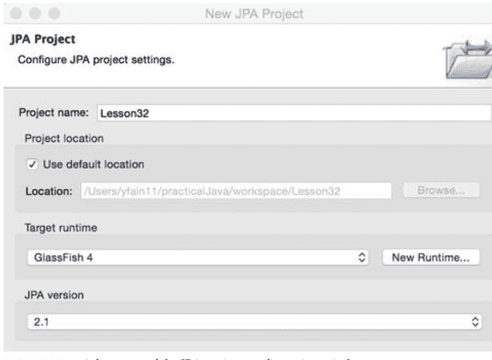

2.  弹出的窗口建议默认输出目录的名称。在那里不要更改任何内容；点击 `Next`。

3.  JPA Facet 窗口允许你选择 JPA 实现——实现 JPA 规范的库。`User Library` 框最初是空的。点击它旁边的小图标，然后在 `Preferences` 窗口中点击 `New` 来配置新库。将其命名为 `EcLink.ink`。

4.  为了包含 EclipseLink 实现，将 `folder/glassfish4/glassfish/modules` 文件夹下的外部 jar 文件添加到你的 EclipseLink 用户库：

    ```
    org.eclipse.persistence.antlr.jar
    org.eclipse.persistence.asm.jar
    org.eclipse.persistence.corre.jar
    org.eclipse.persistence.demos.jar
    org.eclipse.persistence.jpa.jar
    org.eclipse.persistence.jpql.jar
    org.eclipse.persistence.modelgen.processor.jar
    org.eclipse.persistence.moxy.jar
    org.eclipse.persistence.oracle.jar
    javax.persistence.jar
    ```

5.  点击 `Finish` 按钮，Eclipse JPA 项目的生成将完成。你的项目结构应该类似于图 32-2。

    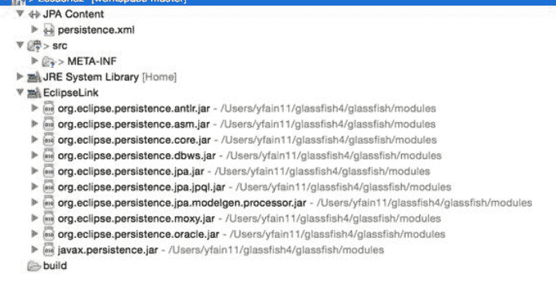

    图 22：带有 EclipseLink 的新生成的 Eclipse JPA 项目

6.  使用 `t:networkServer` 命令启动你的数据库服务器，正如 [create-a-database-with-derby] 第 21 节中解释的那样。

7.  在单独的命令行窗口中使用实用程序，检查数据库 `Lesson21` 是否以及 `Lesson21` 中的 `Employee` 表是否存在。

8.  将 `derby.jar` 文件添加到项目的构建路径中。

9.  在项目中右键点击 `Data Source` 以创建新的配置。

    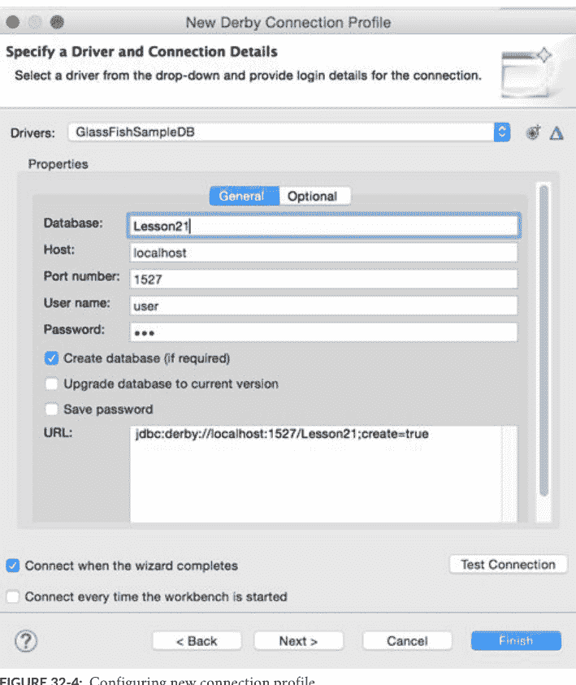

10. 在弹出的窗口中配置连接、架构和表。

    

    图 32：连接

11. 点击 `Test` 确保连接成功。

12. 在 Eclipse 中右键点击检查表是否存在，如图 32-5 所示。

    

    图 32：验证表

13. 如果表没有定义主键，你可以通过执行以下命令来修复：`alter table APP.Employee add primary key (empno);`

14. 右键点击项目 `Lesson32` 并选择 `JPA Tools -> Generate Entities`，如图 32-7 所示。

    

    图 32：生成实体

15. 打开 Eclipse 项目中的 `src` 文件夹，你将发现一个新生成的类 `Employee`，如下：

    ```java
    package model;

    import java.io.Serializable;
    import javax.persistence.*;

    /** EMPLOYEE 表的持久化类。 */
    @Entity
    @NamedQuery(name="Employee find", query="SELECT e FROM Employee e")
    public class Employee implements Serializable {
        private static final long serialVersionUID = 1L;

        @Id int empno;
        private String ename;
        @Column(name="JOB_TITLE") private String jobTitle;

        public Employee() { }

        public int getEmpno() { return this.empno; }
        public void setEmpno(int empno) { this.empno = empno; }
        public String getName() { return this.ename; }
        public void setName(String fname) { this.ename = fname; }
        public String getJobTitle() { return this.jobTitle; }
        public void setJobTitle(String jobTitle) {
            this.jobTitle = jobTitle;
        }
    }
    ```

最后，打开 `META-INF` 文件夹，你将发现 `persistence.xml`：

```xml
xml version="1.0" encoding="UTF-8"?>
<persistence version="2.1"
xmlns="http://www.jcp.org/xml/ns/persistence"
xmlns:xsi="http://www.w3.org/2001/XMLSchema-instance"
xsi:schemaLocation="http://www.jcp.org/xml/ns/persistence http://www.jcp.org/xml/ns/persistence/persistence_2_1.xsd">
<persistence-unit name="Lesson32">
  <class>model.Employee</class>
</persistence-unit>
</persistence>
```


Eclipse 从现有的数据库表生成 Java 类 `Employee`。这完成了你的作业。

反向工作流也受到支持。Eclipse 可以根据实体类定义生成数据库表。为了实现这一点，你需要使用 `JPA Tools -> Generate Tables from Entities` 选项。

# 33: 使用 RESTful Web 服务

在 20 世纪 90 年代，互联网已广泛使用，新创建的 Web 应用被全球数百万用户使用。与此同时，许多遗留应用程序只能在企业内部使用。它们使用多种编程语言编写，并部署在许多类型的硬件上。当时需要将企业数据开放给更广泛的受众，这导致了用于通过 Web 数据的标准接口的诞生。

传统的 JSP/Service/JSF Web 应用与 Web 服务之间的区别在于，后者仅提供数据，而不关心客户端用户界面（UI）的外观。例如，一个实例可以提供有关其产品的信息，或者一个共同基金可以将其数据作为 Web 服务暴露出来并返回 XML 文档。客户端不需要知道该公司是否使用 Oracle 的服务器运行应用程序，或者该共同基金是否在 IBM 的大型机上运行。

Java EE 包含了两种不同 Web 服务实现的规范：`JAX-WS` 和 `JAX-RS`，我将在下文中讨论它们。再次看一眼第 25 节中的示例架构图，注意我将这些 API 放置在不同的位置——一个在提供者层，一个在客户端。只需将 Web 服务视为一种可以通过 HTTP 请求检索的有用数据的暴露机制即可。

有数以万计可用的 Web 服务 API 用于获取各种数据。你可以在 ProgrammableWeb 目录找到许多实用的 Web 服务。企业也会为了其内部需求使用私有的 Web 服务。

## SOAP Web 服务

发布和消费 Web 服务的第一个标准是基于 XML 的简单对象访问协议（SOAP）。Web 客户端将形成 HTTP 请求并使用 SOAP 语法接收响应。

客户端需要了解该组织的服务目录、所提供的操作（函数）名称，以及为了使用该服务需要连接的端点（`endpoint`）地址。

服务目录可以使用基于 XML 的 Web 服务描述语言（WSDL）发布，该语言非常冗长。在 Java EE 世界中，SOAP 消息可以通过 `JAX-WS` 处理，而不需要服务目录。

尽管 SOAP 服务已经过时，但它们仍然被用作与第三方软件集成的手段。例如，网页 www.webservices.com 提供了此类天气预报、汇率和股票报价等服务的描述和位置。你可以通过提供用户界面来将这些内容集成到你的应用程序中，而该界面仍由你负责。

## RESTful Web 服务

REST 代表表述状态转移（representational state transfer）。基于 REST 原则构建的 Web 服务是 RESTful 服务。与 SOAP 不同，REST 不是一种协议，而是一种比 SOAP 更轻量的构建 Web 服务的架构风格。Roy Fielding 博士在他的论文中确定了 REST 原则：

- 每个资源都有一有一个唯一的 ID。
- 使用接口：`Get`、`Post`、`Put`、`Delete`。
- 一个资源可以有多种表示形式（文本、JSON、XML 等）。
- 请求是无状态的；请求之间不存储特定于客户端的信息。
- 你可以将一个资源链接到另一个资源。
- 资源应该是可缓存的。
- REST 应用是分层的。

简单来说，资源是任何你可以通过超链接访问的实体。每个资源都有一个统一标识符（URI）。例如，`www.dice.com` 标识了一个以纯文本形式存储在服务器上的资源，或者在任何情况下，都可以以 PDF、JSON 或 XML 等不同格式表示（保存）。

REST 资源必须支持标准的 HTTP 请求。SOAP 的创建者们想出了任意的操作名称（例如，`getCityByCode`），而在 REST 中，你使用标准的 HTTP 方法，如 `Get`、`Post`、`Put` 和 `Delete`。我见过许多仅使用 `GET` 方法读取服务器端内容、使用 `POST` 更新内容或隐藏 HTTP 头的应用程序，但 REST 在这方面更为严格。在 RESTful 世界中，你应该使用 `GET` 获取数据，使用 `POST` 创建新资源，使用 `PUT` 进行更新，使用 `DELETE` 资源。每个标准 HTTP 方法都有其特性：

- `GET`：安全的（Safe）、幂等的（idempotent）、可缓存的
- `PUT`：幂等的
- `DELETE`：幂等的
- `POST`：无

安全（Safe）意味着该方法不会修改资源。可缓存（Cacheable）意味着客户端应用程序可以缓存结果。幂等（idempotent）意味着无论你调用该方法多少次，结果都是相同的。例如，如果你将一个人的名字从 Smith 更新为 Johnson，无论你尝试用 Johnson 这个名字更新该资源多少次，名字都将是 Johnson。

同样，无论你尝试用唯一 ID 删除该资源多少次，结果都是删除该资源而不损坏任何其他数据。当客户端与服务器通信时，双方都可以以各种格式向对方发送应用程序数据。让我们讨论 Web 应用程序中最常用的格式：JSON。

## 处理 JSON 格式数据

JSON 格式基于 JavaScript 对象字面量的语法。所有浏览器都知道如何解析 JSON，无需使用任何加载项或插件。由于今天的大多数 Web 应用在客户端使用 JavaScript，难怪 JSON 成为 Web 数据格式的事实标准，取代了 20 世纪 90 年代流行的 XML。

这是一个用 XML 表示的股票实体实例示例：

```xml
<stock>
  <country>USA</country>
  <currency>USD</currency>
  <price>43.12</price>
  <symbol>IBM</symbol>
</stock>
```

在 JSON 中，资源将如下所示：

```json
"stock": {
  "country": "USA",
  "currency": "USD",
  "price": 43.12,
  "symbol": "IBM"
}
```

## 比较 XML 和 JSON

公共域名 www.geonames.org 允许你搜索有关国家、城市等地理和统计信息。大部分情况下，该网站使用 RESTful Web 服务。要比较数据在 XML 和 JSON 中的表示方式，请访问网页：www.geonames.org/export/ws-overview.html。

单页应用（SPA）的发展是当今 HTML 世界的一种趋势。SPA 指那些不需要刷新整个网页，而是通过发送 AJAX 请求获取新数据来更新部分的应用程序。Google Gmail 是 SPA 的一个很好的例子；当新邮件到达时，只需在显示内容的单个网页上添加新行。服务器发送预格式化的数据，由 Web 客户端使用 HTML、JavaScript、CSS 将放置在屏幕上。服务器不生成 HTML 标记，就像 Java Servlets、JSP 或 JSF 所做的那样。

## REST 还是 WebSocket

因为 RESTful Web 服务在网络吞吐量方面比 servlets、JSP 或 JSF 更高效。但 RESTful Web 服务基于 HTTP 协议，这通过向客户端和服务器发送的数据中附加 HTTP 头来增加开销。如果你需要大幅增加数据吞吐量，通过使用第 33 节介绍的 WebSocket 移除沉重的头部，对于需要频繁更新数据的实时应用程序，切换到 WebSocket 将显著增加每秒的消息数。使用 WebSocket 后，应用程序的响应速度也会提高，因为不需要为每个请求重新建立 HTTP 连接，且数据有效负载中几乎没有开销。

## 处理 JSON 格式数据

```java
JsonParser parser = Json.createParser(new StringReader(jsonData));

while (parser.hasNext()) {
  JsonParser.Event event = parser.next();
  switch (event.getType()) {
    case START_ARRAY:
    case END_ARRAY:
    case START_OBJECT:
    case END_OBJECT:
    case VALUE_FALSE:
    case VALUE_NULL:
    case VALUE_TRUE:
      System.out.println(event.toString());
      break;
    case KEY_NAME:
      System.out.print(event.toString() + " : " + parser.getString() + " - - ");
      break;
    case VALUE_STRING:
    case VALUE_NUMBER:
      System.out.println(event.toString() + " : " + parser.get());
      break;
  }
}
```

在这个示例中，代码仅处理了解析器事件：`VALUE_TRUE`（值为 true 的 JSON 元素）、`KEY_NAME`（发现键值对中的名称）以及 `VALUE_NUMBER`（发现数值值）。

### 使用流式 API 写入 JSON

以下类 `JavaJSONStreaming` 创建了一个 `Product` 类的实例，将其转换为 JSON 格式的字符串，并保存到名为 `product_from_stream.json` 的文件中。

```java
public class JavaStreaming {
  public static void main(String[] args) {
    Product prdi = new Product(777, "Gucci Handbag", 1000.00);
    try (OutputStream fos = new FileOutputStream("product_from_stream.json")) {
      JsonGenerator jsonGenerator = Json.createGenerator(fos);
      jsonGenerator.writeStartObject();
      jsonGenerator.write("id", prdi.id);
      jsonGenerator.write("description", prdi.description);
      jsonGenerator.write("price", prdi.price);
      // 为了创建 JSON 对象，将每个对象封装
      // 在一对 writeStartObject() 和 writeEnd() 之间
      jsonGenerator.writeEnd();
    } catch (IOException ie) {
      ie.printStackTrace();
    }
  }
}
```

`Json` 对象创建了一个生成器 `JsonGenerator`，它能够以流式方式将 JSON 数据写入输出源。在本示例中，为了简单起见，输出源由变量 `fos` 表示。

为了简洁，我省略了 `Product` 类的声明，但 `Product` 和 `JavaToJSONstream` 两个类都在书中源码。如果你运行此程序，它会创建一个包含以下内容的文件：

```json
{"id":"777","description":"Gucci Handbag","price":1000.0}
```

记住，要使此程序作为独立应用程序运行，你需要将 JSON 处理 API（也称为 JSON-P API）的 jar 包包含应用程序的 CLASSPATH 中。如果此程序运行在服务端，每个 JEE 服务器都包含了此类 jar 包，不需要修改 CLASSPATH。

### 使用对象模型 API 写入 JSON

与流式处理不同，对象模型 API 要求你在内存中构建整个 JSON，之后再将整体写入你选择的目标位置。为了说明这一点，我重写了上一节中的 `JavaToJSON` 类：

```java
public class JavaToJSON {
  public static void main(String[] args) {
    Product pr = new Product("777", "Chanel Handbag", 1000.00);
    try (OutputStream fos = new FileOutputStream("product_from_object.json");
         JsonWriter jsonWriter = Json.createWriter(fos)) {
      JsonObjectBuilder prBuilder = Json.createObjectBuilder();
      prBuilder.add("id", pr.getId())
        .add("description", pr.getDescription())
        .add("price", pr.getPrice());
      JsonObject prJsonObject = prBuilder.build();
      System.out.println("prJsonObject: " + prJsonObject);
      jsonWriter.write(prJsonObject);
    } catch (IOException e) {
      e.printStackTrace();
    }
    // 读取并重新解析新创建的文件
    JsonReader jsonReader = new JsonReader(new FileReader("product_from_object.json"));
    JsonObject jsonObject = jsonReader.readObject();
    System.out.println(jsonObject);
  }
}
```

`JsonObjectBuilder` 初始化模型并允许你添加键值对来表示 JSON 对象。`Json` 类拥有创建构建器对象的方法，其中包含 `build()` 方法用于创建 JSON 格式的字符串。`JsonWriter` 将 JSON 对象写入文件，而 `JsonReader` 读取并解析创建的文件。如果你不需要将 `JsonObject` 写入文件，可以通过调用 `prJsonObject.toString()` 将其转换为字符串。然后，例如，你可以将其转换为 Web 客户端。

## RESTful 股票服务器

Java EE 规范包含了用于 RESTful Web 服务端端和客户端程序的 `JAX-RS` API。所有符合 Java EE 的应用程序都使用 `JAX-RS`。我将继续使用 GlassFish 服务器，它自带名为 Jersey 的 `JAX-RS` 实现，你不需要下载任何额外的库即可运行此处的示例代码。让我们看看如何通过重新设计一个著名的股票服务器示例来实现 RESTful Web 服务。资源的表示（在这种情况下）可能有所不同，并取决于。

## 490 | 第 33 Lesson 使用 RESTful Web 服务

- `@DELETE`：该类方法处理 HTTP Delete 请求。
- `@Produces`：指定响应的 MIME 类型；例如，“application/json”。
- `@Consumes`：指定客户端发送资源时资源可以消耗的 MIME 类型。
- `@PathParam`：将 URI 片段注入到方法参数中（例如，IBM）。
- `@QueryParam`：将 URI 注入到方法参数中（例如，stock=IBM）。它用于 HTTP GET 请求。
- `@FormParam`：将 HTML 表单输入字段中的值注入到 Java 变量或方法参数中。

以下 `StockService` 类是一个 RESTful 端点的示例，它可以通过 URL（如 `http://localhost:8080/Lesson33/resources/stock/IBM`）返回由 URL 标识的股票。`StockService` 类遍满了注解。每个 `@Path` 注解既可用于类，也可以用于方法。`JAX-RS` 将客户端的请求映射到类方法。如果一个类中使用了多个 `@Path` 注解，则会将它们的值与 URL 片段进行比较，以找到匹配的方法。

### 列表 33-2 endpointStockService

```java
@Path("stock")
public class StockService {
    @Produces({"application/xml", "application/json"})
    @Path("symbol")
    @GET
    public Stock getStock(@PathParam("symbol") String symbol) {
        Stock stock = StockHelper.getStock(symbol);
        if (stock == null) {
            return new Stock("NOT FOUND", 0.0, "-", "-");
        }
        return stock;
    }
    @POST
    @Consumes("application/x-www-form-urlencoded")
    public Response addStock(
        @FormParam("symbol") String symbol,
```


@FormParam("currency") String currency,
@FormParam("price") String price,
@FormParam("country") String country
) {
    if (StockHelper.getStock(symbol) != null) {
        return Response.status(Response.Status.BAD_REQUEST)
            .entity("Stock " + symbol + " already exists")
            .type("text/plain").build();
    }
    double priceToUse;
    try {
        priceToUse = new Double(price);
    } catch (NumberFormatException e) {
        priceToUse = 0.0;
    }
    StockServiceHelper.addStock(new Stock(symbol, priceToUse, currency, country));
    return Response.ok().build();
}
```

`StockService` 中的一个方法被标记为 `@GET` 注解，另一个标记为 `@POST`。让我们看看我们的 Java EE 服务器如何处理由 URI 表示的获取资源（即 IBM 股票数据）的 HTTP 请求：

看看 `http://localhost:8080/Lesson3/resources/stock/IBM` 是如何工作的。首先，Java EE 服务器解析 URI 并尝试寻找与 `@ApplicationPath` 匹配的 Java 类，在我们的用例中是 `resources`（“创建一个应用程序”）。RESTful 服务器寻找带有 `@Path("/stock")` 注解的类，并将其路由到 `StockService` 类。

由于 URI 不以 `/stock` 结尾，方法处理继续。我们的 URI 包含一个单词 `/IBM` 作为股票代码，而方法级注解 `@Path("/symbol")` 帮助服务器找到（并调用）`getStock()` 方法。

注解 `@PathParam("symbol")` 表示服务器应该将包含在 URI 中的股票代码值注入到 `getStock()` 方法的 `symbol` 参数中。图 33-1 显示了参与我们 URI 解析过程的注解。


图 33-1: 使用注解解析 URI

注解 `@Produces` 中指定的 MIME 类型意味着方法 `getStock()` 可以产生 XML 或 JSON 格式的数据。负责创建客户端部分的开发人员需要确保 HTTP 请求头在它的 Accept 头部中包含了所需的 MIME 类型。如果没有找到产生请求的 MIME 类型的方法，客户端将收到 HTTP 错误 406，你可以在“尝试 B”部分看到它。一个 HTTP 客户端请求 JSON 格式的股票数据，另一个请求 XML 格式，但它们都由同一个方法 `getStock()` 提供服务。

## 492 | 第 33 Lesson 使用 RESTful Web 服务

`addStock()` 方法被标记有 `@Consumes` 注解，以消耗客户端发送的 HTML 表单数据。当接收到 HTTP POST 请求时会调用 `addStock()` 方法。如果 REST 端点无法连接到请求 MIME 类型，客户端将收到 HTTP 错误 415。

`@FormParam` 注解将 HTML 表单中的值注入到方法 `addStock()` 中。如果 Web 客户端没有使用 HTML 表单而是带有参数发送 HTTP GET 请求，你需要使用 `@QueryParam` 而不是 `@FormParam`。

股票 MSFT 是可以通过 `http://localhost:8080/Lesson3/resources/stock/MSFT` 表示的资源。因此，只要知道它们的 URI，你的 `StockService` 端点就可以提供不同股票的数据。

`StockService` 类使用了辅助类 `StockServiceHelper`，如 `StockServiceHelper.class` 所示。为了简单起见，该类硬编码了股票，但在现实世界中它连接到财务数据源。

### 列表 33-3 ServiceHelper

```java
public class StockServiceHelper {
    private static Map<String, Stock> stocks = new HashMap<>();
    public static void addStock(Stock stock) {
        stocks.put(stock.getSymbol(), stock);
    }
    public static Stock getStock(String symbol) {
        return stocks.get(symbol);
    }
    public static void removeStock(String symbol) {
        stocks.remove(symbol);
    }
}
```

## 创建 RESTful 客户端

与服务器端点通信的客户端应用程序可以使用任何支持 HTTP 请求的编程语言编写。通常，客户端是使用 JavaScript 的 HTML 应用程序。本书是关于 Java 编程的，我没有涵盖如何在 JavaScript 中实现这一点，但在“尝试”部分，我向你展示如何使用像 Postman 这样的工具来测试 RESTful 服务。

由于 RESTful 应用是可以分层的，因此可能出现以下场景：HTML 客户端请求用 Java 实现的资源，该资源反过来又成为另一个在（例如）.NET 服务器上实现的资源的客户端。这是完全合法的，因为这两种技术都支持 JSON 作为交换格式。

如果你需要用 Java 编写 RESTful 客户端，请使用早些在“处理 JSON 格式数据”节中讨论过的 JSON API。

CDI bean 是一个可以由 Java EE 容器管理的 POJO。如果你计划使用 CDI，你需要添加一个空的 `bean.xml` 文件，该文件会指示 Java EE 容器在应用程序中发现 CDI bean。为了继续技术分析引擎的示例，你可以如下所示定义它：

```java
public interface Recommendations {
    public String getRecommendations(Stock stock);
}
```

相应的，CDI bean 可以这样声明：

```java
public class TechAnalysisEngine implements Recommendations {
    public TechAnalysisEngine() {
    }
    public String getRecommendations(Stock stock) {
        String recommendations;
        // 在此处实现技术分析逻辑
        return recommendations;
    }
}
```

# 单例模式的用例

你不希望 Java EE 创建 `TechAnalysisEngine` 类的多个实例。同一个实例可以为多个客户端请求服务。只需在 `TechAnalysisEngine` 类上标记 `@Singleton` 注解，CDI 就会只注入它一次。为了确保你使用的是 CDI，请实现 `javax.inject.Singleton` 注解的 `@Singleton` 实现，这与在 `javax.ejb.Singleton` 中创建单例 EJB 是不同的。

但如果我们有 `Recommendation` 接口的多个实现类怎么办？容器将如何知道注入哪一个实现呢？为了避免歧义，你可以使用自定义注解。例如，你可以这样声明一个 `@Fundamental` 注解：

```java
@Qualifier
@Retention(RUNTIME)
@Target({TYPE, METHOD, FIELD, PARAMETER})
public @interface Fundamental ()
```

现在，你可以用 `@Fundamental` 标记另一个实现了 `Recommendations` 接口的类：

```java
@Fundamental
public class FundamentalAnalysisEngine implements Recommendations {
    public FundamentalAnalysisEngine() {
    }
    public String getRecommendations(Stock stock) {
        String recommendations;
        // 在此处实现基本分析逻辑
        return recommendations;
    }
}
```

将 `FundamentalAnalysisEngine` 实例注入 `StockService` 的行如下所示：

```java
@Inject @Fundamental
public void setRecommendationsEngine(Recommendations theEngine) {
```


歧义得到了解决！

由于你不是手动创建对象的实例，你需要一种方法来指定注入的实例存活多久。这是通过 CDI 作用范围注解实现的：`@RequestScoped`、`@SessionScoped`、`@ApplicationScoped`、`@Dependent` 和 `@Conversation`。你可以在 Java EE 教程的 CDI 章节找到更多关于这些注解的信息。

| JAVA EE 示例 |
| :--- |
| 本课涵盖了 Java EE 7 技术的选内容。请参考 GitHub 仓库 `https://github.com/javaee-samples/javaee-7-samples`，该仓库包含了大量的 Java EE 代码示例，说明了所有 Java EE 7 JSR 的用法。 |

## 尝试一下

你的任务是编写与股票报价示例相关的代码。你需要创建一个 Eclipse 项目，并从书籍的网页 `working_with_restful_web_services` 复制代码示例。然后，你需要将其部署到 GlassFish 并运行它。

## 课程要求

你应当已经安装了 Java 和 GlassFish v4 服务器。

> 注意：你可以从书籍的网页 `www.wrox.com/go/javaprog24hr2re` 下载此节“尝试一下”的代码和资源。你可以在下载包的 `working_with_restful_web_services` 文件夹中找到它们。

# 课程 33 使用 RESTful 服务

## 提示

Java EE 开发人员 Eclipse IDE 提供了创建 REST 资源的模板。创建 Eclipse 项目后，右键点击项目名称，选择 New（新建），然后从 Pattern (Java EE 7) 中选择 RESTful Web Service。Eclipse 会为带注解的类创建一个与 `rest_resource_stockresource` 类似的类，你可以对其进行编辑以满足你的应用程序的需求。

## 步骤说明

1. 在 Eclipse 的 Java EE 视图中创建一个名为 `Lesson3` 的动态 Web 项目。
2. 从 `working_with_restful_web_services` 文件夹下载课程 33 的源文件。
3. 创建名为 `lesson33` 和 `lesson33.service` 的包。
4. 将 `StockQuoteApplication` 类复制到 `lesson33` 文件夹。
5. 从下载的代码示例将 `Stock`、`StockService` 和 `StockHelper` 类复制到 `lesson33/service` 文件夹。
6. 部署项目 `FishService`。右键点击带有 Postman REST 客户端插件的服务器名称，在弹出的窗口中点击 Add 将 `Lesson3` 从左侧移动到右侧。然后完成。RESTful 服务已部署在服务器上。
7. 对于客户端，使用带有 Postman REST 客户端插件的 Google Chrome 。打开 Chrome 浏览器并从 `http://bit.ly/10Jpfha` 启动 Postman。使用顶部的 URL 字段输入 `http://localhost:8080/Lesson33/resources/ibm`。
8. 点击按钮，你的 RESTful 服务将以 JSON 格式的数据进行响应。你的 Postman 窗口应该类似于图 33-2。

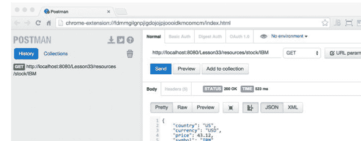

图 33-2：使用 Postman REST 客户端获取 stock/IBM 资源

FishService 服务器找到了 REST 端点 `StockService` 并调用了它的 `methodResource("IBM")` 方法。

10. 从 URL 中移除 IBM，使其看起来像这样 `http://localhost:8080/Lesson33/resources`。按下 Send（发送），你会得到 405 错误。
11. 要测试添加股票（Add Stock）功能，在下拉菜单中选择 POST，并填写 `rest_resource_stockresource` 所需的内容。点击 Send 后，你的 Postman 窗口将类似于图 33-3。


图 33-3：使用 POST 请求添加股票

FishService 服务器找到了 REST 端点 StockService 并调用了它的 `methodResource("IBM")`。该 POST 注解的方法没有参数。为了确保信息已添加到服务器端，发布 GET 请求 `http://localhost:8080/Lesson33/resources`。

> 提示：你可以从书籍的网页 `www.wrox.com/go/javaprog24hr2re` 下载此节“尝试一下”的代码和资源。你还可以在线下载本节的视频。

# 课程 34 Logging API

每个 Java 程序在其生命周期内都会执行各种功能——例如打开文件、连接数据库或远程服务，或者执行某些计算。软件开发者经常需要从程序的各个部分打印特定的消息。有时开发者需要确认 Java 程序访问了某个方法，或者打印中间计算结果。

正确报告运行时错误更为重要。你可能不仅需要打印错误信息，还需要打印有关控制流的消息（例如，订单已下单或已取消）。如果你的 Java 应用无法启动，首先检查的地方是它的日志，日志可能包含问题描述，或者至少你可以看到启动过程在哪个阶段停止了。

目前为止，在书中的大多数代码示例（图形界面应用除外）中我一直使用传统的 `System.out.println()`，但这种方法有几个问题：

- 当应用程序进入质量保证（QA）或生产环境时，很难“关闭”散落在应用程序代码中的多个 `println()` 调用。你需要找到并注释掉这些语句。如果在生产环境中报告了 Bug，你需要取消某些 println 语句并可能添加更多。
- 程序完成后没有运行痕迹。
- 如果服务器端 Java 应用程序的许多用户之一向支持团队报告问题，支持人员需要能够快速识别并分析与该特定用户交互相关的消息——问题何时发生以及发生在哪个软件模块中。

使用 Java Logging 编程接口（API）或第三方日志框架替换 `println()` 语句可以解决这些问题，并且你应该在服务器端和客户端的所有应用程序中使用它。日志既用于开发也用于生产环境。日志消息也可以定向给终端用户。

有很多 Java 日志框架。但本节的大部分内容是 Java Logging API，它是 SE 的一部分。

## JAVA 日志 API

Java Logging API 实现在 `java.util.logging` 包中。日志 API 的两个主要类是 `Logger` 和 `Handler`。应用程序获取 `Logger` 对象的实例，该实例会创建一个 `LogRecord` 实例并将其交给 `Handler` 以进行发布。Java Logging API 包含了多种类型的句柄（handlers），默认类型是 `ConsoleHandler`，它将消息发布到系统控制台。

对于简单的应用程序，你可以创建一个全局日志器来处理所有消息日志。在更复杂的应用程序中，你可以创建一个日志器层级结构，每个包或类都有它们自己的日志器。

Java Logging API 允许你根据不同的级别对消息进行分组。例如，你可以将 `INFO` 级别分配给不需要报告的消息，并将可以将严重的错误消息分配给 `SEVERE` 级别。这些是在 `Level` 类中定义的日志级别：

- SEVERE
- WARNING
- INFO
- CONFIG
- FINE
- FINER
- FINEST

这些优先的顺序很重要，因为这些级别代表有序的整数。SEVERE 是数值最大的，FINEST 是最小的。默认的日志级别是 INFO，这意味着所有标记为 INFO 的消息以及更高级别（WARNING 和 SEVERE）都将被记录。如果你将默认日志级别更改为 WARNING，那么只有 WARNING 和 SEVERE 的消息会被记录。

FINE、FINER 和 FINEST 级别用于创建具有更描述性名称的日志记录。要关闭所有日志，你可以将级别设置为 `Level.ALL`；要关闭日志，可以将级别设置为 `Level.OFF`。有关日志级别的更多详细信息，请参考 Oracle java 中的 `Level` 类。无论你决定使用哪种级别，请确保日志消息具有丰富的信息。

你可以在 Logger 和 Handler 对象上同时设置日志。你可以通过程序化方式或在配置文件中这样做。后者允许你在部署的应用程序运行期间更改日志级别。一个应用程序可以拥有多个处理器，将消息发布到不同的目的地，且每个处理器的都可以有不同的日志级别。

写入日志消息的日志可能会影响应用程序的性能。当你更改默认日志级别时，可以减少部署在生产环境中的应用程序的性能负担。我稍后会解释如何设置和更改日志，但现在让我们创建一个基础的日志应用程序。

## 使用 Java Logging API 实现 Hello World

每个人学习 Java 都从编写一个简单的程序开始，使用以下代码在系统控制台上打印 Hello World：

```java
System.out.println("Hello World");
```

现在是时候用 Java Logging API 替换这条语句了。

### 使用全局日志器实现 Hello World

从创建一个 Eclipse Java 项目 `Lesson34` 开始。在项目中，为 `com.lesson34` 包创建一个新类 `HelloLoggingWorld`。在该类的 `main()` 方法中，你将使用 Logger 对象如下所示问候世界：

```java
package com.lesson34;

import java.util.logging.Logger;

public class HelloWorldGlobalLogger {

    private static Logger logger = Logger.getGlobal();

    public static void main(String[] args) {
        logger.fine("Hello world!");
        logger.info("Hello world!");
        logger.severe("Hello severe!");
    }
}
```

虽然应用程序可以拥有日志器层级结构，但这个简单的程序通过调用 `getGlobal()` 方法使用单一的全局日志器。程序从初始化 Logger 对象开始。程序调用了三个方法：`fine()`、`info()` 和 `severe()`。这些方法的名称与日志级别对应。如果你运行此程序，控制台上将打印两条消息：

```
Jan 28, 2015 11:27:17 AM com.lesson34.HelloWorldGlobalLogger main
INFO: Hello world!
Jan 28, 2015 11:27:17 AM com.lesson34.HelloWorldGlobalLogger main
SEVERE: Hello severe world
```

因为默认日志级别是 INFO，因此 `FINE` 行的消息没有打印。发布在控制台上的默认日志记录包括日期和时间、类名和级别。

### 使用类级日志器实现 Hello World

应用程序可以有多个日志器，它们都是全局日志器的子级。例如，你可以创建一个由层级名称标识的类级日志器，该名称看起来类似于全限定类名。你可以创建一个 Java 类来为该类创建该日志器：

```java
private static Logger logger = Logger.getLogger("com.lesson34.HelloWorldClassLogger");
```

为了避免硬编码类名（类可以被移动到不同的包），你可以请求 Java 获取全限定类名，如下所示：

```java
private static Logger helloLogger = Logger.getLogger(HelloWorldLogger.class.getName());
```

接下来的程序故意除以零以展示类级日志器的用法：

```java
package com.lesson34;

import java.util.logging.Logger;

public class HelloWorldLogger {

    private static Logger helloLogger = Logger.getLogger(HelloWorldLogger.class.getName());

    public static void main(String[] args) {
        helloLogger.info("Trying to divide by zero");
        try {
            int result = 25 / 0;
        } catch (ArithmeticException e) {
            helloLogger.severe("Division by zero");
        }
    }
}
```

该程序的输出所示：

```
Jan 28, 2015 25:24:26 PM com.lesson34.HelloWorldLogger main
INFO: Trying to divide by zero
Jan 28, 2015 25:24:26 PM com.lesson34.HelloWorldLogger main
SEVERE: Division by zero
```

软件开发者通常为每个类创建一个日志器，但也为每个包创建一个。操作是相同的，只需指定包名：

```java
private static Logger logger = Logger.getLogger(HelloWorldLogger.class.getName());
```

## 使用处理器和设置级别

Logger 对象本身不记录日志。它创建 LogRecord 并将其传递给 Handler 进行发布。到目前为止，日志默认使用 ConsoleHandler。设置日志的严重程度可以在 Logger 和 Handler 对象上同时进行，且它们不需要相同。例如，你可能想在文件中记录 SEVERE 消息，而向控制台发送 INFO 及以上的消息。

你还可以使用方法在不更改当前级别的情况下记录不同级别的消息：

```java
log(Level.FINE, "Hello world");
```

你可以分配多个处理器，以便消息发布到多个目的地。Java Logging API 支持以下处理器：

- Console：将日志记录写入 `System.err` 对象的处理器（默认指向 `System.out`）。
- FileHandler：将记录写入单个文件或旋转日志文件的处理器。
- StreamHandler：向 OutputStream 写入日志记录的处理器。
- SocketHandler：将日志记录写入本地或远程传输控制协议（TCP）端口的处理器。
- MemoryHandler：在内存中缓冲日志记录的处理器。

要将处理器分配给日志器，你需要创建一个之前提到的处理器的实例，并通过调用 `addHandler()` 方法将其添加到 Logger：

```java
FileHandler helloHandler = new FileHandler("HelloWorld.log");
logger.addHandler(helloHandler);
```

现在我们创建一个将日志消息发布到控制台和日志文件的程序。我们在之前的示例中使用的日志器创建了 ConsoleHandler 类的实例并将消息发布在控制台上。我们现在添加另一个处理器，将日志记录到文件中，这样你可以在系统中查看日志。为了让这更有趣，文件中只记录 WARNING 和 SEVERE 消息，而在控制台上显示 FINE 及以上的消息。

在项目根目录下创建 `logs` 目录，并查看以下程序 `HelloWorld.java`：

```java
import java.io.IOException;
import java.util.logging.ConsoleHandler;
import java.util.logging.FileHandler;
import java.util.logging.Level;
import java.util.logging.Logger;

public class HelloWorld {

    private static Logger logger = Logger.getLogger(HelloWorld.class.getName());

    public static void main(String[] args) {
        FileHandler helloFileHandler;
        try {
            helloFileHandler = new FileHandler("logs/helloWorld.log");
            logger.addHandler(helloFileHandler);
            helloFileHandler.setLevel(Level.WARNING);
        } catch (SecurityException se) {
            System.out.println(se.getMessage());
        } catch (IOException ioe) {
            System.out.println(ioe.getMessage());
        }
    }
}
```


# Java 日志 API 详解

## 示例代码：WorldHandlers 程序

```java
hellogger.fine("Hello from fine world");
hellogger.info("Trying to divide by zero");
try {
    int result = 25 / 0;
} catch (Exception e) {
    hellogger.severe("Division by zero");
}
```

`WorldHandlers` 程序向日志器添加了一个 `FileHandler`，以便将消息发布到 `logs/helloWorld.log` 文件。你可以为处理器创建并分配一个 `Formatter` 对象，以符合你需求的方式格式化输出。`XMLFormatter` 是 `FileHandler` 的默认格式化器。使用 XML 格式的日志允许编写可以读取和解析日志的程序，这对于大型日志文件非常有用。

如果日志访问受到 Java 安全管理器的保护，创建 `FileHandler` 实例可能会抛出 `SecurityException`，但在本例中并非如此。

运行 `WorldHandlers`，它将在你的 Eclipse 项目的 `logs` 目录下创建一个 `helloWorld.log`（你可能需要刷新项目才能看到）。以下是日志文件的内容：

```xml
<?xml version="1.0" encoding="UTF-8"?>
<!DOCTYPE log SYSTEM "dtd">
<log>
  <record>
    <date>2015-08-27T17:20:30.08</date>
    <millis>1440243698650</millis>
    <sequence>1</sequence>
    <logger>com.lesson34.HelloWorldClassLogger</logger>
    <level>SEVERE</level>
    <class>lesson34.HelloWorldHandlers</class>
    <method>main</method>
    <thread>main</thread>
    <message>Division by zero</message>
  </record>
</log>
```

前面的文件只包含 `SEVERE` 消息，这是正确的。同时，`ConsoleHandler` 也在系统控制台上打印了 `INFO` 消息：

```
Jan 28, 2015 5:20:38 PM com.lesson34.HelloWorld main
INFO: Trying to divide by zero
Jan 28, 2015 5:20:38 PM com.lesson34.HelloWorldHandlers main
SEVERE: Division by zero
```

## 避免重复的日志消息

`HelloWorld` 使用全局日志器的默认控制台处理器在控制台上发布消息。如果你向 `hellologger` 添加一个 `ConsoleHandler` 对象的实例，你就有两个控制台处理器：一个类级别的，一个全局的。这会导致控制台出现重复消息，因为全局日志器是 `hellologger` 的父级，且此层次中的所有处理器都会被调用。如果你想关闭父日志器，请使用 `setParentHandlers(false)` 方法。

```java
hellogger.setParentHandlers(false);
```

但是为什么 `FINE` 级别的“Hello from world”没有显示在控制台上呢？在 `HelloWorldHandlers` 中调用 `hellogger.setLevel(FINE)` 是不起作用的原因是 Java 运行时环境 (JRE) 自带 `logging.properties` 配置文件，它可能会覆盖文件中设置的日志级别。

## 文件 logging.properties

如果你打开 Java 分发中的 `/lib/` 目录，你会发现 `logging.properties` 文件，它设置了各种日志属性，包括：

```
.level = INFO
java.util.logging.ConsoleHandler.level = INFO
```

第一个限制了所有处理器的默认日志，第二个限制了打印在控制台上的消息。两个级别默认都是 `INFO`。如果你将它们更改为 `FINE` 或 `ALL`，`HelloWorld` 程序开始在控制台上发布 `FINE` 消息。

每个应用程序都可以有自己的日志属性，可以通过命令行传递给 Java 虚拟机 (JVM)，例如：

```bash
java -Djava.util.logging.config="logging.properties" MyApp
```

你也可以通过以下程序代码加载应用程序特定的日志属性文件：

```java
LogManager.getLogManager().readConfiguration(
    new FileInputStream("logging.properties"));
```

如果你的程序创建了日志器，你可以在 `log.properties` 文件中覆盖日志级别；例如：

```
com.lesson34.HelloWorldLogger.level=ALL
```

## 关于 FileHandler 日志

将日志消息写入文件是最常见的做法。`FileHandler` 类有多个重载的构造函数。要以追加模式与日志文件工作（将日志记录添加到现有文件中），请使用两个参数的构造函数：

```java
FileHandler handler = new FileHandler("logs/hello.log", true);
```

为了避免大量的日志文件占用磁盘空间，你可以创建轮转日志文件。你可以指定最大文件大小和最大日志文件数量。当当前日志文件增长到 1000 字节时，会创建一个新的日志文件。当达到允许的日志文件数量时，旧的日志文件将被新文件替换，日志记录将被引导到那里。

例如，以下代码创建一个 `FileHandler` 对象，初始创建一个名为 `HelloWorld.log.0` 的日志文件，然后将日志文件重命名为 `HelloWorld.log.1` 并创建一个新的名为 `HelloWorld.log.2` 的文件。`FileHandler` 创建了更多文件，日志以追加模式进行：

```java
FileHandler handler =
    new FileHandler("logs/HelloWorld.log", 1000, 3);
```

你可以在本节的“动手尝试”部分看到此代码。

## 格式化器和过滤器

`Formatters` 允许你更改消息的格式（除了日志级别外），处理器可以决定是否感兴趣特定的 `LogRecord`。格式化器可以分配给日志器和处理器。

### 格式化器

你可以使用 Java 开发包 (JDK) 输出的 `SimpleFormatter` 或 `XMLFormatter` 格式化消息。默认情况下，控制台处理器使用 `SimpleFormatter`，文件处理器使用 `SimpleFormatter`。`SimpleFormatter` 输出时间、类名、方法名、级别以及可能的异常。要创建一个自定义格式化器，声明一个继承 `Formatter` 的类并重写 `format()`。你可以实现任何格式。以下示例显示了一个不打印时间戳并使用 `==` 作为 `LogRecord` 分隔符的自定义格式化器：

```java
package com.lesson34;

import java.util.Date;
import java.util.logging.Formatter;
import java.util.logging.LogRecord;

public class MyFormatter extends Formatter {

    @Override
    public String format(LogRecord logRecord) {
        return logRecord.getSourceClassName() + "=="
            + logRecord.getMethodName() + "=="
            + logRecord.getMessage() + "\n";
    }
}
```

打开你的 `logging.properties` 文件并将该类分配给控制台格式化器：

```
java.util.logging.ConsoleHandler.formatter=com.lesson34.MyFormatter
```

如果你运行 `HelloWorld`（或本节的任何其他示例），日志器的输出如下：

```
com.lesson34.HelloWorldHandlers=main=>Hello from world
com.lesson34.HelloWorldHandlers=main=>Trying to divide by zero
com.lesson34.HelloWorldHandlers=main=>Division by zero
```

调用对象的 `setFormatter` 方法是替代命令行分配的方法。

### 过滤器

通过过滤器，你可以编写逻辑来决定特定的 `LogRecord` 是否应该被记录。如果你想发布特定的 `LogRecord`，只需返回 `true`，否则返回 `false`。`Filter` 是一个只有一个方法的接口。记得第 37 节中的函数式接口。你可以通过 Lambda 表达式实现过滤器。

以下示例生成股票随机价格，但它只记录大于 $60 的股票：

```java
package com.lesson34;

import java.util.logging.Filter;
import java.util.logging.Level;
import java.util.logging.Logger;

public class StockQuotePublisher {

    private static Logger stockLogger = 
        Logger.getLogger(StockQuotePublisher.class.getName());

    // 一个 Lambda 表达式
    static Filter expensiveStocks = (logRecord) -> {
        Object[] parameters = logRecord.getParameters();
        Double price = ((Double) parameters[0]).doubleValue();
        return (price > 60);
    };

    public static void main(String args[]) {
        stockLogger.setFilter(expensiveStocks);
        getPrice("IBM");
        getPrice("MSFT");
        getPrice("AAPL");
        getPrice("CAT");
        getPrice("VZ");
    }

    private static double getPrice(String stockSymbol) {
        double price = Math.random() * 100;
        stockLogger.log(Level.INFO, stockSymbol + " ", price);
        return price;
    }
}
```

`getPrice()` 生成 0 到 100 之间的价格。使用不同的日志 API——方法有多个重载版本。在这种情况下，我使用了带有三个参数的版本：级别（level）、消息和一个对象。这返回了 `LogRecord` 的参数。尽管它看起来返回的是原始类型 `double` 的值，但 Java 需要进行自动装箱（boxing），以返回 `Double` 包装类的实例。

程序从 `main()` 方法中为不同的股票调用了 `getPrice()`。如果你不应用过滤器，所有生成的价格都将发布在控制台上。`StockPublisher` 类实现了 `Filter` 接口，它仅在股票价格大于 60 时才返回 `true`。这被赋值给日志器：

```java
stockLogger.setFilter(expensiveStocks);
```

你可以像分配给 `Logger` 对象一样分配分配过滤器。日志过滤器比日志级别更进一步：它们提供了数据驱动的日志记录。运行 `StockPublisher` 由于随机价格生成器的存在，每次运行的结果都不同。没有任何日志记录显示价格低于 60。以下是示例输出：

```
Jan 25, 2019 82:20 PM com.lesson34.StockQuotePublisher getPrice
INFO: AAPL:92.09444635263976
Jan 25, 2019 82:20 PM com.lesson34.StockQuotePublisher getPrice
INFO: VZ:58.58149465588332
```

## 日志框架

虽然 Java Logging API 是中小型应用程序的良好解决方案，但在高负载多用户应用程序中，它可能会成为性能瓶颈，因为发布每条消息增加几百毫秒的时间是不可接受的。市场上有很多许多开源日志框架，如果你熟悉 Java Logging API，就可以轻松学习它们。

Apache Log4j 2 是商业 Java 应用程序中最流行的框架。它是 Log4j 的较新版本。Log4j 也有一个日志器对象来执行与处理器（handlers）相同的作用。布局（Layouts）类似于格式化器（formatters）。在 Log4j 中，日志记录由一个事件（event）表示。虽然 Java Logging API 比 Log4j 快，但 Log4j2 允许按大小记录日志，Log4j 2 支持按日期/时间进行文件滚动。要查看 Log4j 2 每秒可以发布多少消息，请查看低延迟日志的统计数据。

Log4j 2 支持异步日志器和输出（appenders），这可以使其比 Java Logging API 快一个数量级。Log4j2 是高性能日志记录的正确选择。

第二个流行的日志框架是 Logback。它与 Log4j 类似，因为它们由同一个开发者创立。Logback 异步版比 Logback 快。使用这些框架之一开始你的下一个项目，如果你的应用程序需要某些特殊的日志功能，可以看看是否有框架开箱提供了这些功能。

为了减少对任何特定日志框架的依赖，建议使用抽象层，这将允许你在需要时轻松切换日志框架。SLF4J（Simple Logging Facade for Java）是此类层最流行的实现。例如，无论你使用什么日志框架，在 SLF4J 中创建 `Logger` 对象并发布 SLF4J 级别的消息看起来都是一样的。

```java
Logger logger = LoggerFactory.getLogger(HelloWorld.class);
logger.info("Hello World!");
```

有了 SLF4J，你就不必担心选错了日志框架；你可以轻松更改它，而无需修改任何一行代码。SLF4J 包含 ERROR、WARN、INFO、DEBUG 和 TRACE，它们分别对应 Java Logging API 的 SEVERE、WARN、INFO、FINE、FINER 级别，或者其他框架中的类似级别。这段视频展示了从一个日志框架切换到另一个是多么简单。

要添加 SLF4J，你需要为项目添加两个 JAR 包：一个包含 SLF4J API，另一个将特定的日志框架绑定到 SLF4J。在第 36 节中，你将学习如何从公共二进制存储库自动获取 JAR 包。如果你决定尝试将 SLF4J 与 Java Logging API 使用，可以通过搜索以下制品找到所需的两个 JAR 包：`slf4j-api-jdk1` 和 `slf4j-jdk14`。

但无论你选择哪种日志框架，`System.out.println()` 是更好的。

## 动手尝试

在练习中，你将创建、配置并使用一个应用程序特定的 `.properties` 文件。你还将使用滚动文件处理器（rotating file handler）来控制日志文件的大小和数量。

## 课程要求

你应该已经安装了 Java。

## 步骤详解

1. 将 `jre/lib` 中的 `logging.properties` 文件复制到项目 Lesson34 的根目录。将此文件重命名为 `myLogging.properties`。我假设你之前已经创建了 `logs` 目录。
2. 在 `myLogging.properties` 中将日志器和控制台处理器的级别设置为 `FINE`：
   ```properties
   .level=FINE
   java.util.logging.ConsoleHandler.level = FINE
   ```
3. 在 Eclipse 中创建一个包并创建文件 `HelloWorld.java`。重命名此文件并重构代码。
4. 打开 `StockPublisher` 的运行配置，选择参数选项卡并添加以下 Java 属性：
   ```text
   -Djava.util.logging.config=myLogging.properties
   ```
5. 修改 `FileHandler` 将日志记录重定向到 `logs/rotating.log`。
6. 我们在下一步实现文件滚动。修改 `FileHandler` 使用追加模式：
   ```java
   h = new FileHandler("rotating.log", 1000, 3, true);
   ```


- 7. 多次运行程序并监控 `logs` 目录。运行几次后，你应该看到命名为 `rotating.log.0`、`rotating.log.1` 和 `rotating.log.2` 的文件。数字后缀永远不会超过2，因为日志器只创建三个文件。最新的日志具有后缀 0。

# 35 测试简介

即使你的程序没有 Bug，你可能使用了带有 Bug 的代码。此外，对一个类或接口的修改可能会破坏之前良好的代码；这被称为回归（regression）。彻底测试是任何软件开发过程中的重要阶段。

每个开发者都知道如何手动测试她的代码，并且他们经常这样做。但手动测试是一项枯燥的常规。你想要每天开始时通过手动测试来查看创建、更新和删除示例订单仍然有效吗？我不想。测试应该是自动化的。

项目越早实现自动化测试，开发周期就越短。测试驱动开发（TDD）的概念建议测试应该从任何项目的开始就嵌入到开发过程中。

有不同类型的测试，具有不同的目标。以下是主要的测试类型描述（更多请参见维基百科软件测试）。

- 单元测试由软件开发者执行，针对代码代码。例如，如果你使用特定参数调用 `callTax()`，它应该返回预期结果。执行应用程序特定测试的 Java 类由软件开发者编写。当开发者熟悉被测试的代码时，单元测试被称为白盒测试。
- 集成测试是将多个单元测试结合起来以确保不同部分能够正常工作。也就是说，这里的目标是测试不同软件组件之间的接口。如果 John 和 Mary 调用 `Tax()`，该方法使用了 Mary 编写的 `methodTaxBracket.s()`，Mary 可能更改了此方法的签名而没有通知 John。

如果 John 和 Mary 使用相同的源代码，Java 编译器可能会捕获此错误。但如果 Mary 将编译后的代码打包成 JAR 文件并连接...

## QA 测试

QA 测试不是由软件开发人员执行的；而是经过专门培训的 IT 人员使用软件开发人员编写的应用程序并识别功能上的问题——例如，图形用户界面 (GUI) 中的“下订单”按钮允许用户下订单，即使用户不是专家。在某些情况下，QA 工程师可以捕获错误。在很多情况下，他们使用测试自动化软件（如 Selenium 或 Quick Test）。他们使用脚本语言为不同的用例编写脚本，供软件开发人员提供代码修复。所有错误都会报告在问题跟踪系统中。

## 用户验收测试

用户验收测试由用户执行。它通常被称为黑盒测试，因为软件是独立构建的。尽管 QA 工程师可以发现大量问题，但他们并不是软件编写所针对业务领域的专家。例如，一个为保险代理人设计的应用程序会检查代理人在某些州是否拥有业务执照，而她并不是专家。这类错误可以由用户发现。

## 压力测试或负载测试

压力测试或负载测试必须确保应用程序保持运行。负载测试工具（如 Apache JMeter 或 NeedLoad）允许设置多个组件并模拟大量用户运行您的应用程序。然而，一个良好的应用程序应该是能够运行数小时，但在用户数量增加到 100 时无响应的。

理想情况下，应该有一份名为服务水平协议 (SLA) 的文档，定义正在开发的软件的并发用户数和可接受的响应时间。精明的项目经理会在开发开始之前签署 SLA。如果用户开始抱怨等待 10 秒，您应该检查 SLA，要么改进响应，要么拒绝用户的请求。

本节涵盖了适用于 Java 软件开发的测试程序。JUnit 是测试 Java 框架最流行的工具。

## 单元测试简介

JUnit 是一个开源单元测试框架，可以从 `http://junit.org` 下载。在开始编写类之前，您应该熟悉 JUnit 术语：

- 断言 (Assertions) 比较预期值和结果。
- 测试设置 (Test setup) 是在运行测试之前准备测试数据的过程。
- 测试拆理 (Test teardown) 在测试运行后清除测试数据。
- 测试套件 (Test suite) 是一组运行的测试类。
- 异常测试 (Exception testing) 检查在应该抛出异常的地方抛出了异常，或者在不应该抛出异常的地方没有抛出。
- 测试运行器 (Test runner) 是可以运行测试的工具。
- 规则 (Rules) 允许添加测试类中所有测试的功能，但这种方式更通用。
- 理论 (Theories) 允许组合断言以更清晰地说明测试假设。
- 断言 (Assertions) 根据某些标准选择性地忽略某些测试。
- 参数 (Parameters) 允许您准备一组数据并作为参数传递。

对应用程序代码进行单元测试的类是一个简单的 Java 对象 (POJO)，它包含了标记有 `@Test` 注解的方法。每个方法代表一个测试用例。

要运行单元测试，您需要以下内容：

- 一个测试 Java 类
- 被测系统 (SUT)，它是一个类方法
- 一个测试运行器

## 安装 JUnit

JUnit 非常流行，所有主要的集成开发环境 (IDE) 都包含了 JUnit 库，因此如果您想使用较新的 JUnit 版本，甚至不需要下载它。在 Eclipse 中，您只需将 JUnit 库添加到项目构建路径 (Project Build Path) 中。您可以从 Eclipse 或从命令行使用测试运行器运行 JUnit 测试。

如果您没有使用 IDE 或倾向于从命令行运行测试，则需要下载 JUnit；不需要安装。JUnit 封装在两个 JAR 文件 `junit.jar` 和 `hamcrest-core.jar` 中，您需要将它们添加到应用程序的类路径中。您可以从 Maven 仓库下载这些 JAR。通过名称搜索这些文件并点击 jar 下载。第 36 节将展示如何从 Maven 中央构建工具自动下载 JAR。

## 在 Eclipse 中更改默认目录结构

流行的构建工具如 Maven 和 Gradle 建议 Java 源码使用以下标准目录结构：

```
src
  main
    java
  test
    java
```

应用程序类的源代码应该源自 `src/main/java`，测试类源自 `src/test/java`。但 Eclipse 所有的 Java 源代码都源自 `src` 目录，它不会强制您编写测试类。

创建一个名为 Lesson35 的新 Eclipse 项目并更改其默认目录结构。提前做好自动化构建过程的准备，并选择 Java Path 选项：打开 Source 选项卡，从 Build Path 的 Source Folders 中删除 `src` 文件夹。之后添加 `src/main/java` 和 `src/test/java` 文件夹。就是。您的目录结构应该看起来像图 35-1。


图 35-1：修改了目录结构的新 Eclipse 项目

现在您的测试类与源代码分离了。

## 您的第一个 JUnit 测试用例

遵循命名规范，您将测试类命名为与被测类相同，但带有额外的后缀 Test。例如，如果您计划对 Tax 类进行单元测试，则测试类的名称应该是 TaxTest。首先在 `src/main/java` 目录中创建一个新包。然后创建一个新接口 Taxable 和类 Tax。Taxable 接口具有以下内容：

```java
package tax;

interface Taxable {
    double calcTax(double grossIncome);
}
```

```java
package tax;

class Tax implements Taxable {
    final static double DEDUCTION = 300;

    public double calcTax(double grossIncome, int dependents) {
        if (grossIncome < 0) {
            throw new IllegalArgumentException("Gross income can't be negative");
        }
        return grossIncome - DEDUCTION * dependents;
    }
}
```

```java
public double applyDeduction(double taxAmount, int dependents) {
    return taxAmount - DEDUCTION * dependents;
}
```

### 为什么要使用接口？

您可能会问，“为什么我甚至需要为这样的类创建一个接口？”设计接口是一个好主意，因为它能清晰地暴露应用程序接口 (API) 并在无需更改类的情况下测试。现在在 `src/test/java` 中创建一个包。选择此包并通过 File -> New Test Case 让 Eclipse 生成测试类。Eclipse 会显示一个窗口，您在其中输入类名 TaxTest，以及被测类名 Tax。（见图 35-2。）

点击按钮，您可以选择想要测试的方法，例如 `calcTax()`。然后 Eclipse 显示一个弹出消息，询问是否应将 JUnit 4 添加到项目的构建路径。同意后，您将看到一个新生成的类，如下：

```java
package tax;

import static org.junit.Assert.*;
import org.junit.Test;

public class TaxTest {
    @Test
    public void testCalcTax() {
        fail("Not yet implemented");
    }
}
```

现在运行此测试。右键点击 TaxTest 类并选择 Run As -> Unit Test。Eclipse 启动默认 JUnit 运行器，显示红条和失败消息，产生 AssertionError "Not implemented"，如图 35-3 所示。


图 35-3：第一个测试失败：未实现

测试运行器找到了带有 `@Test` 注解的方法，运行 JUnit 方法 `fail()` 报告了消息为“Not implemented”的错误。如果注释掉 `fail()` 方法并重新运行测试，您将看到绿色条。在学习如何编写真实的测试之前，下一节将让您熟悉 JUnit 注解。

## JUnit 注解

JUnit 带有了一些您在测试中需要的注解。测试运行器读取运行时注解并根据代码执行测试。以下是选定的 JUnit 注解列表：

- `@Test` 注解声明 public void 方法为单元测试。
- `@Before` 用于方法，在每个测试之前执行某些代码。
- `@After` 用于方法，在每个测试之后执行。
- `@BeforeClass` 用于在所有测试开始之前执行的方法。
- `@AfterClass` 用于在所有测试完成后完成后执行的方法。
- `@Ignore` 用于禁用某个测试（运行器会跳过此类方法）。

你可以使用 `@Test` 注解，并带有可选参数 `expected` 和 `timeout`。例如，如果使用了注解 `@Test(expected=Exception.class)` 且没有抛出指定的异常，则测试将失败。如果使用了 `@Test(timeout=1000)` 且运行时间超过 1000 毫秒，则测试将失败。

## 应用注解进行税收测试

现在是时候查看 `@Test` 注解的实际作用了。你将编写一个测试，以确保如果给参数 `grossIncome` 和 `depends` 赋值为 0，方法 `calcTax()` 将返回 0。为此，请使用 `org.junit.Assert` 中的静态方法 `assertEquals()`。测试方法的名称应该具有描述性；这里显示了你新版本的类 `TaxTest`：

```java
package tax;

import static org.junit.Assert.*;
import org.junit.Test;

public class TaxTest {
    @Test
    public void testZeroTax() {
        Tax tax = new Tax();
    }
}
```


`Assert` 类有 `assertEquals()` 方法的多个重载，用于检查预期值是否等于实际值。我使用了带有以下参数的方法：

- 测试失败时显示的消息
- 预期值
- 在测试主体上要调用的方法
- 预期值与实际值之间的最大差异（`delta`），在此范围内的两个数字仍被视为相等

使用测试运行器执行此测试返回成功。在前面的示例中，调用 `assertEquals()` 时更改预期值或 `delta`，测试将失败。JUnit 有许多种版本的 `assert()` 方法，例如检查布尔值是否为真的 `assertTrue()`，以及检查值是否不为空的 `assertNotNull()`。这些方法的名称是言自自明的，且非常易于理解。

## 静态导入

在 `Test` 类中，我使用 `import static` 关键字来导入 `Assert` 类。这允许我直接使用静态方法 `assertEquals()`，无需指定声明它的类名。使用普通的 `import` 语句，我必须编写 `Assert.assertEquals()`。通常情况下应该少使用静态导入，因为代码会更难理解。

在像 `TaxTest` 这样的小程序中，你记得 `assertEquals()` 方法是声明在 JUnit 中的，但在包含大量静态导入的大型类中，这会让方法声明在哪个类变得不再那么明显。

再添加一个测试，看看对于有一个学生的家庭是否正确应用了税收减免。`Tax` 类有一个方法 `applyStudentTaxDeduction()`，它应该每个学生扣除 300 美元。以下 `TaxTest` 类中的 `testStudentTaxDeductionis300()` 方法断言了：

```java
package tax;

import static org.junit.Assert.*;

import org.junit.Test;

public class TaxTest {

    @Test
    public void testZeroTax() {
        Tax tax = new Tax();
        assertEquals("Tax on zero income is not zero", 0, tax.calcTax(0, 0));
    }

    @Test
    public void testStudentTaxDeductionis300() {
        Tax tax = new Tax();
        assertEquals("$300 student discount was not applied", 2000, tax.applyStudentTaxDeduction(2300, 1));
    }
}
```

测试运行了 `testZeroTax()` 和 `testStudentTaxDeductionis300()`，并且它们都成功了。JUnit 测试按任意顺序运行，除非你使用特殊的注解 `@TestMethodOrder`，该注解要求你按字母顺序命名测试。

如果你将 `@Test` 注解替换为 `@Ignore`，运行器将不会运行此测试。

让我们稍微改进一下 `TaxTest` 类的代码。我不喜欢在每个测试中都创建一个 `Tax` 的实例。你可以创建一个设置方法来实例化 `Tax`，以便在每个测试方法中都可以使用。为了在第一次测试运行之前执行某些操作，你应该使用设置方法（例如，连接数据库并插入带有 `@BeforeClass` 注解的文本数据）。如果你需要运行某些清理程序（例如从数据库中删除文本数据并断开连接），请添加一个带有 `@AfterClass` 注解的清理方法。以下 `UnitTest` 类的版本说明了 `@BeforeClass` 和 `@AfterClass` 注解的使用（后者仅在控制台上打印 "In tearDown" 消息）：

```java
package tax;

import static org.junit.Assert.*;

import org.junit.*;

public class UnitTest {

    static Tax tax;

    @BeforeClass
    public static void setUp() {
        tax = new Tax();
        System.out.println("In setup");
    }

    @Test
    public void testZeroTax() {
        assertEquals("Tax on zero income is not zero", 0, tax.calcTax(0, 0));
    }

    @Test
    public void testStudentDeductionIs300() {
        assertEquals("The $300 student discount was not applied", 2000, tax.applyStudentDeduction(2300, 1));
    }

    @AfterClass
    public static void tearDown() {
        System.out.println("In tearDown");
    }
}
```

如果你想创建一个测试套件，请在每个方法之前使用 `setUp()` 和 `tearDown()`，替换 `@BeforeClass`。

## 测试套件

测试套件是测试类的容器。根据某些标准将测试分组到套件中——例如，耗时长的测试或特定的软件模块。

为了演示如何创建套件，由 `TaxTest` 和 `Exception` 两个测试用例组成套件。在 Eclipse 中选择 `File → New → Other → Java → Test Suite`。

点击完成按钮，Eclipse 将生成如下类：

```java
package tax;

import org.junit.runner.RunWith;
import org.junit.runners.Suite;
import org.junit.runners.SuiteClasses;

@RunWith(Suite.class)
@SuiteClasses({ Exception.class, TaxTest.class })
public class AllTests {
}
```

`@RunWith` 注解指示运行器使用 `Suite` 而不是默认运行器。`@SuiteClasses` 包含了测试类：`Exception` 和 `TaxTest`。运行测试套件 `AllTests`，所有测试都成功了。

# JUnit 运行器

JUnit 提供了几个位于 `org.junit.runner` 包中的测试运行器。`JUnit4` 类是一个默认运行器，用于本节中的大多数示例。要指定非默认运行器，你需要使用 `@RunWith` 注解。正如你在上一节中看到的，测试套件 `AllTests` 使用了通过 `@RunWith(Suite.class)` 实现的运行器。

```java
@RunWith(Suite.class)
```

在 `Parameterized`、`Categories` 和 `Enclosed` 类中还实现了其他专门的运行器。此外还有许多第三方运行器。

在 Eclipse 中使用测试运行器对于开发并不方便，但在实际项目中，你应该将单元测试整合到构建脚本中。你需要知道如何在没有 IDE 的情况下启动 JUnit 运行器。你可以通过以下方法之一在任何 IDE 之外启动运行器：

- 创建一个 Java 类，调用 `JUnitCore` 对象的 `run()` 方法。
- 从命令行运行 `JUnitCore`，并将测试类名作为命令行参数提供。

使用第一种方法，你需要创建一个 Java 类，实例化 `JUnitCore`，并提供测试类或测试套件作为参数调用其 `run()` 方法。例如：

```java
JUnitCore core = new JUnitCore();
Result result = core.run(AllTests.class);
```

然后你可以获取一个 `Failure` 对象的列表，其中每个对象代表一个失败的测试（如果有的话）：

```java
List<Failure> failedTests = result.getFailures();
```

为了在测试运行期间更好地控制和改进日志记录，你可以使用监听器——`RunListener` 的子类——并使用 `addListener()` 方法将其分配给 `JUnitCore` 实例：

```java
JUnitCore core = new JUnitCore();
core.addListener(new MyRunListener());
core.run(AllTests.class);
```

在监听器类中，你可以重写 `testStarted()`、`testFinished()`、`testFailure()` 以及其他几个方法。然后在这些方法内部添加日志语句。

如果你决定直接从命令行运行 `JUnitCore`，你需要确保 JUnit JAR 包以及你的测试类目录和被测试类所在的目录都包含在运行时环境的 `CLASSPATH` 变量中。然后你可以运行类似下面的命令：

```bash
java org.junit.runner.JUnitCore tax.TestTest
```

第 36 节解释了如何使用 Gradle 实现构建自动化。如果你为应用程序创建了单元测试，就可以轻松地将它们整合到构建过程中，这样它们就可以无需 IDE 手动干预即可运行。在“尝试一下”部分，你将练习从命令行使用 JUnit 测试运行器。

在本节中，你已经学习了如何使用 JUnit 框架编写简单的单元测试。对于更高级的测试，你应该学习 JUnit 的在线文档。其他可以用于单元测试的框架还有 TestNG 和 Spock。我还可以推荐你观看 Pavel Lipinski 的演示文稿《Java 测试驱动开发的工具链》。

## 尝试一下

在本次作业中，你需要从命令行运行本节描述的测试类。首先，你创建一个带有调用运行器代码的 Java 类。然后你尝试另一种启动运行器的方法；从命令行启动 JUnit 运行器。

### 课程要求

你应该安装了 Java 并准备好了 JUnit JAR 包。

> 注意：你可以从书的网页 www.wrox.com/java/javprog24hr2e 下载“尝试一下”的代码和资源。你可以在下载包的 Lesson35 文件夹中找到它们。

### 步骤详解

1. 继续为 Eclipse 项目 Lesson35 创建的目录结构。在 `src/test/java` 目录下创建一个名为 `TestCommandLineRunner` 的类，并内容如下：

```java
package test;

import java.util.List;
import org.junit.internal.TestListener;
import org.junit.runner.JUnitCore;
import org.junit.runner.Result;
import org.junit.runner.notification.Failure;

public class TestCommandLineRunner {
    public static void main(String[] args) {
        JUnitCore junitCore = new JUnitCore();
        Result result = junitCore.run(AllTests.class);

        if (result.wasSuccessful()) {
            System.out.println("All Test cases ran successfully!");
        } else {
            System.out.println("These Tax Test cases failed:");
            List<Failure> failedTests = result.getFailures();
            failedTests.forEach(failure -> {
                System.out.println(failure.getMessage());
            });
        }
    }
}
```

该程序运行 `AllTests` 套件，要么打印所有测试成功运行的消息，要么打印失败测试的特定错误描述。

2. 打开命令行或终端窗口，并进入项目 Lesson35 的 `bin` 目录，所有编译后的类都在那里。

3. 运行 `TestCommandLineRunner` 并将 `junit.jar` 和 `hamcrest-core.jar` 添加到 CLASSPATH（使用 `-cp` ）。在我的情况下，这些 JAR 包位于 `/Users/yfain11/unit` 目录。

```
Yakov:bin yfain11$ pwd
/Users/yfain11/practicalJava/workspace/Lesson35/bin
Yakov:bin yfain11$
```

4. 如第 34 节所述，将 `System.out.println()` 替换为日志记录。

5. 使用另一种方法从命令行直接调用 `JUnitCore` 并指定测试套件 `AllTests`。

```
$ java -cp /Users/yfain11/unit/junit.jar:/Users/yfain11/unit/hamcrest-core.jar org.junit.runner.JUnitCore AllTests
Time: 0.008
OK (3 tests)
```

输出看起来有些不同，但结果是：测试已完成。

> 提示：请在 www.wrox.com/javprog24hr2e 选择第 35 节的视频。你也可以从网站下载代码和资源。

# 36 使用 Gradle 构建自动化

在学习 Java 和尝试作业时，你一直在集成开发环境（IDE）中编译、部署和运行 Java 程序。对于真实项目，在应用程序上线之前，构建过程通常包含更多步骤。例如：

- 运行单元测试和集成测试
- 创建持续集成脚本
- 与版本控制系统和代码仓库协作
- 管理依赖（确保链接到正确版本的第三方库）
- 生成程序文档
- 在开发、质量保证（QA）和生产服务器上部署应用程序
- 发送构建成功或失败的通知

在企业环境中，创建、自定义和维护构建脚本本身就是一个项目，应该在应用程序开发的早期就开始。

构建过程不依赖于特定的 IDE，也不依赖于任何知道如何编译代码、链接所需库并将其部署到正确计算机的专家开发者。典型的 Java 项目由多个软件模块和数百个类组成，由可能使用不同 IDE 的程序员（团队）开发。

持续集成（CI）是一种要求开发者每天向仓库提交代码的实践，每次提交都会触发项目的自动化构建。此外，可能存在定期运行的计划构建，无论是否提交了新代码。实践测试驱动开发 (TDD) 的团队会在构建脚本中运行多次测试。持续交付比 CI 更进一步，测试或生产服务器的交付也是脚本化和自动化的。当程序员在团队聊天窗口看到“谁破坏了构建？”的消息时，他的第一个念头是“千万不是我”。

实现构建脚本可以确保团队的纪律性。在没有经过测试的情况下将新功能提交到代码仓库之前，你最好仔细考虑（或测试）两次，因为这可能会破坏构建。

本节首先对旧的构建工具 Ant 和 Maven 进行非常简短的介绍，然后你将熟悉一种名为 Gradle 的现代构建自动化工具。

## 使用 Ant 实现 Hello World

大约十五年前，Apache Ant 是 Java 世界最流行的构建工具。Ant 中的构建被描述在一个文件中，该文件包含了若干个构建应该实现的目标——序列——例如：编译、打包和运行。一个目标由任务组成，例如 `mkdir` 和 `javac`。

假设你在 `HelloWorld.java` 文件中写了一个 `HelloWorld` 类，并想要配置一个 Ant 构建过程。创建一个包含以下内容的 `build.xml`：


```xml
<project default="main">
  <target name="clean">
    <delete dir="build"/>
  </target>

  <target name="compile" depends="clean">
    <mkdir dir="build/classes/"/>
    <javac srcdir="src" destdir="build/classes/"/>
  </target>

  <target name="jar" depends="compile">
    <mkdir dir="build/jar/"/>
    <jar destfile="build/jar/HelloWorld.jar" basedir="build/classes">
      <manifest>
        <attribute name="Main-Class" value="HelloWorld"/>
      </manifest>
    </jar>
  </target>

  <target name="run" depends="jar">
    <java jar="build/jar/HelloWorld.jar" fork="true" />
  </target>

  <target name="main" depends="clean, compile, jar, run">
  </target>
</project>
```

该文件描述了五个目标：`clean`、`compile`、`jar`、`run` 和 `main`。`clean` 目标删除 `build` 目录。`compile` 目标将 `src` 目录中的所有类构建并编译到 `build/classes` 目录。

`jar` 目标创建 `build/jar` 目录，然后从编译后的类创建一个 jar 文件，并将 `HelloWorld` 类指定为可运行程序。`run` 目标启动应用程序。如果你进入 `build.xml` 所在的目录并输入不带参数的 `ant` 命令，默认会运行 `main` 目标。

你还可以添加自定义的 `<property>` 标签（例如命名源目录或目标目录）以及列出本应添加到 `CLASSPATH` 环境变量中的 JAR 文件的 `<path>` 元素。

大多数目标依赖于另一个目标的成功（参见 `depends` 属性）。如果 `depends` 属性中列出的任何目标失败，该目标的执行单元就会失败。编写此类关于必须做什么的详细指令是指导构建的强制性方法。

你可以在命令行中指定目标名称来运行一个或多个目标。例如，这是用一个命令运行多个目标的方法。

```bash
ant compile jar run
```

所有的 Java IDE 都支持 Ant，你甚至不需要去命令行窗口即可运行目标。例如，Eclipse 有一个 Ant 视图，你可以从右键菜单运行每个任务，如图 36-1 所示。


图 36-1：Eclipse IDE 中的 Ant 视图

## 使用 Maven 实现 HELLO WORLD

2004 年 Apache Maven 发布了，它很快成为 Java 项目构建的事实标准。Maven 不仅仅是一个工具；它还是一个项目管理工具。根据一个或多个 `pom.xml` 文件定义的项目对象模型 (POM)，Maven 可以管理项目的构建，并从本地服务器或中央仓库拉取所有依赖。Maven 的功能可以使用许多现有的插件或自己编写插件进行扩展。

Maven 中最小的工作单元被称为目标（goal）。你可以通过打开命令行或终端并输入带有 `archetype:generate` 目标的 `mvn` 命令，从生成标准项目结构开始开发：

```bash
mvn archetype:generate -DgroupId=hello.app -DartifactId=Lesson36 -DarchetypeArtifactId=maven-archetype-quickstart -DinteractiveMode=false
```

## 使用 Gradle 实现构建自动化

几秒钟后，`Lesson36` 目录中生成了图 36-2 所示的目录和文件。

- `pom.xml`
- `src`
  - `.DS_Store`
  - `main`
    - `.DS_Store`
    - `java`
      - `.DS_Store`
      - `hello`
        - `.DS_Store`
      - `app`
        - `App.java`
  - `test`
    - `.DS_Store`
    - `java`
      - `.DS_Store`
      - `hello`
        - `.DS_Store`
    - `app`
      - `AppTest.java`

**图 36-2：** Maven 生成的项目

按照 Maven 的惯例，源代码位于 `src/main/java` 目录，编译后的代码进入 `target` 目录（该目录尚不存在）。`App.java` 包含在控制台打印 Hello 的 Java 类。`AppTest.java` 创建测试第 35 节涵盖的 JUnit 框架的代码。`pom.xml` 文件的内容所示：

```xml
<project xmlns="http://maven.apache.org/POM/4.0.0"
     xmlns:xsi="http://www.w3.org/2001/XMLSchema-instance"
     xsi:schemaLocation="http://maven.apache.org/POM/4.0.0 http://maven.apache.org/xsd/maven-4.0.0.xsd">
  <modelVersion>4.0.0</modelVersion>
  <groupId>hello.app</groupId>
  <artifactId>Lesson36</artifactId>
  <version>1.0-SNAPSHOT</version>
  <name>lesson36</name>
  <url>http://maven.apache.org</url>
  <dependencies>
    <dependency>
      <groupId>junit</groupId>
      <artifactId>junit</artifactId>
      <version>4.11</version>
      <scope>test</scope>
    </dependency>
  </dependencies>
</project>
```

### 构建 Hello World

虽然 Gradle 提供的功能并不多，但你可以将其作为不同编程语言的构建工具。所有特定语言的特性都以插件（plug-ins）的形式提供，你只需要添加项目所需的插件即可。有些插件是开箱即用的，你也可以编写自己的插件来扩展 Gradle。

这里有一个简单的脚本 `build.gradle`，它可以执行几项任务。特别是，它可以编译位于 `src/main/java` 目录下的 Java 类：

```gradle
apply plugin: 'java'
```

`build.gradle` 应该位于与 `src` 相同的目录下。要运行构建，请在此目录下打开命令行（Command）或终端（Terminal）并运行构建任务：

```bash
gradle build
```

虽然你没有在 `build.gradle` 中声明过某个特定插件可以做什么，但它已经是 Java 插件的一部分了。你需要阅读文档来了解 Java 插件涵盖了哪些内容。例如，Java 插件的文档描述了 22 个任务（例如 `clean`、`compileJava`、`jar` 和 `build`）。`test` 任务会运行在第 35 节中用 JUnit 创建的测试。运行构建任务后，你的终端窗口看起来如图 36-4 所示。


```
Total time: 3.15 secs
:>Hello yafins gradle build
:compileJava
:processResources UP-TO-DATE
classes
:assemble
:compileTest UP-TO-DATE
processTestResources UP-TO-DATE
:testClasses UP-TO-DATE
:test UP-TO-DATE
:build
BUILD SUCCESSFUL
Total time: 3.675 secs
```

**图 36-4：** 首次运行 Gradle 构建命令

注意，`build` 任务启动了一系列其他任务：`compileJava`、`processResources`、`classes`、`jar` 等。实际上，某些任务被标记为 `UP-TO-DATE`（已更新）——它们没有运行，因为你在 `src/main/resources` 下没有任何资源，在 `src/test/java` 下没有测试类。你还没有包含另一个可以检查代码质量的插件。现在再次运行 Gradle 构建任务。输出看起来会有所不同，如图 36-5 所示。

### Gradle 基础

```
Yakov:HelloWorld yfain1$ gradle build
:compileJava UP-TO-DATE
:processResources UP-TO-DATE
:classes UP-TO-DATE
:jar UP-TO-DATE
:assemble UP-TO-DATE
:compileTest UP-TO-DATE
:processTestResources UP-TO-DATE
:testClasses UP-TO-DATE
:check UP-TO-DATE
:build UP-TO-DATE

BUILD SUCCESSFUL

Total time: 3.15 secs 
Yakov:HelloWorld yfain1$ _
```

图 36-5：运行 Gradle 构建

这次 Gradle 无事可做，因为包括编译后的类和 JAR 包在内的所有内容都是最新的。这种特性被称为**增量构建**（incremental build）——Gradle 不会运行那些产生相同结果的任务。

`compileJava` 任务支持增量 Java 编译，通过只编译已修改的类来节省时间。

我开始构建时，`src/main/java/hello` 文件夹中只有 `HelloWorld` 类。Gradle 的 `build` 任务创建了内容如图 36-6 所示的 `build` 目录。


图 36-6：运行 Gradle 构建任务后的 Hello World 项目

`classes` 目录包含编译后的类，`libs` 目录包含内部有 `HelloWorld` 的 JAR 文件（由 `Jar` 任务创建）。

> **指定构建文件名**
>
> 默认情况下，Gradle 假设构建脚本的名为 `build.gradle`。但如果你想在同一个目录下保留多个文件，你可以始终使用 `-b` 命令行选项并输入构建文件名；例如：

```bash
gradle -b mySecondBuildFile.gradle build
```

### 运行 Hello World

你可以通过输入以下命令像编译其他程序一样编译 `HelloWorld` 类：

```bash
java -cp build/classes/main hello.HelloWorld
```

另一方面，你可以在 `build.gradle` 中添加 `application` 插件，它具有运行程序的任务。由于你的项目可能包含多个类，你还需要指定要运行的带有 `main()` 方法的类名：

```gradle
apply plugin: 'java'
apply plugin: 'application'
mainClassName="hello.HelloWorld"
```

现在在命令行输入 `gradle run`，你将看到控制台上打印出 Hello World 信息。

接下来，配置 jar 对象的 `manifest` 属性（是的，Gradle 任务都是对象）。为了让 JAR 可执行，它必须在我们的应用程序中包含 `manifest` 文件。在 Hello World 示例中，你只有一个带有 `main()` 方法的类。但在大型项目中你可能有多个文件，且只有一个是主类。以下构建文件处理了 `manifest`：

```gradle
apply plugin: "java"
apply plugin: "application"
mainClassName="hello.HelloWorld"

jar {
  manifest {
    attributes 'Main-Class': 'hello.HelloWorld'
  }
}
```

运行构建任务后，在 `build/libs` 目录下找到 `MANIFEST` 文件，其内容如下：

```
MANIFEST-Version: 1.0
Main-Class: hello.HelloWorld
```

你的 `build.gradle` 文件看起来比使用 Ant 编写的短得多，在使用 Ant 时，你需要创建 `MANIFEST` 文件并将其放入 JAR 中。

### 修改构建约定

我并不鼓励你更改默认的项目布局，但在某些情况下，你需要将 Gradle 引入到具有不同结构的现有项目中。`SourceSet` API 允许你更改 Gradle 的约定。SourceSet 是一个概念，代表一组会被编译和执行的文件（类和资源）。

假设我想将源代码放在 `src` 目录而不是 `src/main/java`，并且想将输出目录改为 `bin`。

为了说明，本示例展示了如何让 Gradle 在 `src` 的同级创建目录。使用上一节的 `build.gradle` 并添加 `sourceSets` 代码块：

```gradle
apply plugin: "java"
apply plugin: "application"
mainClassName="hello.HelloWorld"

jar {
  manifest {
    attributes 'Main-Class': 'hello.HelloWorld'
  }
}
sourceSets {
  main {
    srcDirs = ['src']
    output.classesDir = 'bin'
  }
  resources {
    srcDir = 'resources'
  }
}
libsDirName = '../libs'
```

现在将 `hello/HelloWorld.java` 从 `src/main/java` 移动到 `src` 并运行之前的构建，查看 `bin` 和 `libs` 目录，如图 36-7 所示。


图 36-7：更改默认设置后运行构建

本节展示了如何处理那些不与默认约定匹配的源代码和资源存放位置。

### 使用 Gradle 管理依赖关系

真实世界的项目通常依赖于外部库。例如，第 21 节的 JDBC 示例如果没有封装在 `dependency.jar` 中的数据库驱动程序将无法工作。为了为连接数据库的应用程序创建构建脚本，你需要将此 JAR 添加到你的 `build.gradle` 脚本中。

仅仅知道是什么是不够的。你还需要指定这些文件的位置。相应的，`dependencies` 代码块回答了是什么，而 `repositories` 指向存储它们的地方。

依赖管理在 Gradle 教程中有详细描述，但本节将向你展示如何在处理具体示例时处理仓库和依赖关系，即第 21 节中的 `EmployeeList` 程序。该程序从 Derby 数据库检索员工列表。从创建目录 `derbySample` 开始；将 `build.gradle` 放在其中。创建子目录 `src/main/java` 并将第 21 节的 `EmployeeList` 文件复制到那里。

```java
// Class EmployeeList 显示 EMP 表中的员工
// 使用第 4 类 JDBC 驱动程序
import java.sql.*;

class EmployeeList {
    public static void main(String[] argv[]) {
        String sqlQuery = "SELECT * from Employee";
        // Open autocloseable Connection
    }
}
```

在 `derbySample` 目录下，创建如下的 gradle 文件：

```gradle
apply plugin: 'java'
apply plugin: 'application'
mainClassName = 'EmployeeList'
```


运行 `gradle build` 不产生错误，并在 `directory/build/classes/main/libs` 目录下创建 `EmployeeList.class` 文件。当你执行命令 `gradle run` 时，它会抛出“No suitable driver”异常，如图 36-8 所示：

```
Yakov:derbySample fail11$ gradle run
:compileJava UP-TO-DATE
:processResources UP-TO-DATE
:classes UP-TO-DATE
:run
SQLError: No suitable driver found for jdbc:derby://localhost:1527/Lesson21
```

图 36-8：运行 Gradle 导致异常

# 第 36 节 使用 GRADLE 进行构建自动化

你已经是因为：Java 无法找到与 Derby DB 工作的 JDBC 驱动程序。换句话说，应用程序 `Employee.list` 依赖 `derbydbclient.jar` 文件，而该文件未包含在 CLASSPATH 中。我破坏了构建！通过将其添加到仓库和依赖项解决了这个问题。

## 仓库

项目依赖的代码仓库可以是本地的也可以是远程的。你可以在组织内部设置一个专用服务器，存放所有的第三方库和 JAR 包。在另一种情况下，JAR（或多个 JAR）项目作为另一个项目构建的一部分创建，并发布在预定义的位置。

网上有很多软件代码托管设施。有些是公共的，有些是私有的。有些包含源代码，有些包含编译后的代码（或二进制文件）。在 Java 世界，最流行的编译代码仓库是 Maven Central、Apache Ivy 和 JFrog 的 Bint。在 Maven Central 中快速搜索即可得到图 39 所示的结果。


**图 39-9：** Maven Central Derby Client

Maven Central 中的每个构件都有 group id、artifact id 和 version 等属性。如果你点击 Latest Version，可以找到关于该构件的详细信息，并复制用于自动下载该构件的依赖字符串。在下一节构建的 `dependencies` 部分中使用 group id、artifact id 和 version。现在，只需在构建脚本的 `repositories` 部分添加 Maven Central 即可：

```gradle
apply plugin: 'java'
apply plugin: 'application'
mainClassName="EmployeeList"
```

```gradle
repositories{
    mavenCentral()
}
```

我将使用 Maven Central 仓库，但如果你想将构件存储在公司的一台服务器上，可以如下所示指定：

```gradle
repositories{
    mavenLocal()
}
```

使用 Gradle 管理依赖

默认情况下，Gradle 使用本地计算机上的 `USER_HOME/.m2/repository` 目录。该位置可以在 `.gradle` 设置文件中进行更改（详见 Gradle 文档）。

第一部分已经完成了。你的构建脚本知道要去哪里查找项目依赖，这些将在下一节中介绍。

## 依赖与配置

你的构建过程在控制流的不同阶段可能依赖于某些 JAR。在某些情况下，当你在 Eclipse 中创建动态 Web 项目时，所有对 Java EE 类、接口或注解（例如 `@WebServlet`）的引用在编译期间都是已知的依赖。Eclipse 为目标服务器创建动态 Web 项目的原因是它会将所有 JAR（依赖项）添加到项目中。打开你的 GlassFish Eclipse 项目的 Build Path，你会发现一个名为 `GlassFish System Libraries` 的项，它包含了几十个 JAR 包。

在某些情况下（使用 `EmployeeList.program` 时），代码可以编译但在运行时会产生错误。编译和运行测试程序时也是如此。

在 Gradle 中，当你声明依赖项时，需要指定使用该依赖的配置（configuration）。在命令行窗口中运行 `dependencies` 任务以查看 Java 项目可用配置列表，如图 36-10 所示。

如你所示，依赖可以为运行时、存档和测试任务配置。从 `derbysample` 目录将依赖项添加到你的 `gradle.build` 中：

```gradle
apply plugin: 'java'
apply plugin: 'application'

mainClassName="Employee"

repositories {
    mavenCentral()
}
dependencies {
    runtime group: 'org.apache.derby', name: 'derbyclient',
    version: '10.11.1.1'
}
```

如果你现在执行 `gradle run` 任务，就不会再抛出“No suitable driver”异常。`run` 任务从 Maven Central 下载依赖项并找到了 JDBC 驱动程序。你得到服务器连接错误是因为 Derby DB 服务器没有运行，但那是另一个需要处理的问题（见图 36-11）。


```
/Users/yfain11/practicalJava/workspace/Lesson36/gradleExamples/derby
```

图 36-8：运行 Gradle 导致异常

```gradle
from configurations.compile.collect (entry -> zipTree entry)

manifest {
    attributes: 'Main-Class': 'EmployeeList'
}
```

只需一行代码即可遍历所有配置的文件层次结构。在这种情况下，文件层次结构代表 `derbyclient-10.11.1.jar` 的内容，后续操作将从所有配置中提取它。

`Collect` 方法获取所有编译配置的引用，而 `zipTree` 方法从 zip 格式的文件中提取整个文件层次结构。运行 `gradle build` 后，我解压了 `derbySample.jar`，它包含了最初位于 `derbyclient-10.11.1.jar` 文件中的所有的 derby 类，如图 36-12 所示。

| derbySample |
| :--- |
| - DS_Store |
| - EmployeeList.class |
| META-INF |
| - DS_Store |
| - LICENSE |
| MANIFEST.MF |
| - NOTICE |
| services |
| - java.sql.Driver |
| org |
| - DS_Store |
| - apache |
| - derby |
| - client |
| - iapi |
| - impl |
| - info |
| - jdbc |
| - loc |
| - shared |
| - tools |

**图 36-12：** derbySample.jar 的内容

现在 `derbySample.jar` 是一个独立的应用程序，如果你打开命令行窗口并切换到 `build/libs`，可以通过运行标准的 Java 命令来启动程序：

```bash
java --jar derbySample.jar
```

`derbySample.jar` 文件可以拷贝到任何服务器上。你可以在《Gradle 用户指南》第 16 章中了解可用的文件操作。

如果你想查看从第 21 节创建的数据库检索到的员工列表，请在单独的命令行窗口启动 Derby DB 服务器并重新运行之前的命令。图 36-13 显示了我的结果。


FIGURE 36-13：从 Derby DB 数据库获取员工

# GRADLE WRAPPER（Gradle 包装器）

当程序员团队协作一个项目时，可能会遇到开发者运行不同版本 Gradle 的情况。如果有新开发者加入团队，她可能还没有安装 Gradle。Gradle Wrapper 允许在不担心运行时版本不兼容的情况下运行构建脚本。该包装器确保构建脚本使用特定版本的 Gradle 运行。如果需要，它会自动下载并安装正确版本的 Gradle。

你需要创建 `wrapper` 任务。例如：

```gradle
task wrapper (type: Wrapper) {
    gradleVersion = '2.2.1'
}
```

然后运行：

```bash
gradle wrapper
```

这将创建用于执行 Gradle 命令的脚本——`gradlew` 和 `gradle`（以及 Windows 版本），以及一个包含两个文件的 `wrapper` 目录：`gradle-wrapper.jar` 和 `gradle.properties`。JAR 文件包含了下载和解压 Gradle 分发版的库。属性文件包含包装器的元数据。如果你已经有了正确版本的 Gradle，`wrapper` 任务将不会执行任何操作。

在将所有文件都添加到你的项目之后，你应该使用 `gradlew` 而不是 `gradle` 来执行所有的构建任务。当没有 Gradle（或版本错误）的人首次使用该 gradle 脚本运行任何任务时，Gradle 分发版将下载并解压到其主目录下的 `.gradle/wrapper/dist` 中。

# 构建 WAR 文件

如果你需要编译 Web 应用程序并将其打包为 WAR 文件，你需要向构建文件添加 `war` 插件（它扩展了 `java` 插件）：

```gradle
apply plugin: 'war'
```

但你的代码将依赖于 Java EE 服务器附带的某些 JAR 包的可用性。在 Eclipse IDE 中，当你创建一个动态 Web 项目（Dynamic Web Project）并选择 GlassFish（或其他任何 Java 服务器）作为目标运行时时，所有需要的 JAR 包在编译和运行期间都会自动对你的项目可用。如果你不使用 IDE 设置，则需要知道这些文件的位置。假设你的 Web 应用程序具有以下依赖：

除非你为构建项目添加仓库和依赖，否则此 servlet 将无法编译，因为找不到 `WebServlet` 和 `HttpServlet` 的声明。如果你运行 `gradle dependencies` 命令，你会发现在 `java` 插件可用的所有配置中，`war` 插件又添加了两个：`providedCompile` 和 `providedRuntime`。

`providedCompile` 配置为不应包含在 WAR 中的库指定类路径（CLSPATH）。`provided` 一词意味着这些库是在任务运行的环境中提供的。`providedRuntime` 具有类似的用途，但它为运行时添加了类路径。`providedCompile` 为构建文件添加了仓库：

```gradle
apply plugin: 'war'
repositories {
    mavenCentral()
}
```

如果你现在运行 `gradle war` 命令，将下载包含 servlet 3.1 API 的 JAR 包，代码将通过编译，并在项目 `build/libs` 目录下创建 WAR（而非 JAR）文件。该文件的大小相当小，因为它只包含应用程序代码。

如果你想添加不仅是 servlets 而是整个 Java EE API，依赖部分可能看起来如下所示：

```gradle
dependencies {
    providedCompile 'javax:javaee-api:7+'
}
```

# BINTRAY 仓库

在所有代码示例中，我一直使用 Maven Central 作为仓库。然而，如果你从 intray 获取 JAR 包，可以使用 `jcenter()` 代替 `mavenCentral()`。

# 在 ECLIPSE 中使用 GRADLE

Gradle 支持所有的 IDE，而 IDE 也支持 Gradle。Eclipse 的集成是一个由 Pivotal 创建的 Eclipse IDE 插件。

安装插件后，我通过 `File Import -> Gradle Project` 导入了上一节中的 `HelloWorld` 项目。现在 `build.gradle` 上的右键菜单有一个 `Run As -> Gradle Build` 选项。你可以手动输入要运行的任务，也可以通过选择 `Window -> Show View -> Gradle -> Gradle Tasks` 打开任务。图 36-15 显示了 Eclipse 中我导入的项目 `HelloWorldEclipse` 的 Gradle 任务视图。

# Eclipse 插件

Gradle 带了 Eclipse 插件：`eclipse` 和 `eclipse-wtp`：

- `eclipse` 插件用于创建普通的 Java 项目。
- `eclipse-wtp` 插件用于动态 Web 项目。它在内部使用 Web Toolkit 插件——因此带有 `wtp` 后缀。

要查看 `eclipse` 插件的作用，请从 gradle 复制一份 `HelloWorld` 并命名为 `HelloWorldEclipse`。它在 `src/main/java` 目录下有 `HelloWorld` 类。`build.gradle` 文件应包含以下内容：

```gradle
apply plugin: 'java'
apply plugin: 'eclipse'
```

运行 gradle 命令，它会生成两个新文件——`.project` 和 `.classpath`，以及 `.settings` 目录。打开 Eclipse 并选择 `File -> Import -> Existing Projects into Workspace`，将 `HelloWorldEclipse` 为根目录。Eclipse 会导入项目，你可以像运行其他项目一样运行它。图 36-14 显示了导入的项目在我的电脑上的样子。


FIGURE 36-14. Eclipse 中生成的 gradle

用于生成动态 Web 项目的简单 `build.gradle` 文件可能如下：

```gradle
apply plugin: 'war'
apply plugin: 'eclipse-wtp'
```

要生成动态 Web 项目，你仍然需要运行 `gradle eclipse` 命令，生成的 `.project` 和 `.classpath` 文件内容将有所不同。在本节的“尝试一下”部分，你使用 `eclipse-wtp` 插件生成 Eclipse 项目。

如果你需要从头重新生成 Eclipse 项目，运行 `gradle cleanEclipse` 命令以删除现有的项目文件。

# 尝试一下


你可以通过点击顶部状态栏上的绿色按钮来选择并执行任务。

Eclipse Marketplace 拥有包含 Gradle 集成的编辑器。它被称为 Gradle ID Pack，提供了代码块高亮、归档编辑器等额外的实用工具。

> 如果 针对 （FOR ECLIPSE 的 GRADE 集成无法安装

如果你在运行 Gradle 集成插件期间遇到问题，请关闭安装期间窗口显示的所有与 Spring 相关的选项。

到此，我关于 Gradle 的介绍就结束了。我还没有涵盖在 Gradle 中创建自定义任务的内容。关于这一点以及其他 Gradle 特性，请参考《Building and Testing with Gradle》一书，该书提供免费版本。

## 尝试一下

在本次作业中，你需要创建并使用 Gradle 构建脚本来生成一个 Eclipse 动态 Web 项目（Dynamic Web Project）。然后将其导入到 Eclipse IDE 中，部署在 GlassFish 下，并确认 Web 正常运行。

在本次作业中，你将使用第 26 节中的 `FindBooksServ1` 类。

### 课程要求

你应该已经安装了 Java、GlassFish 和 Gradle。

你可以从书籍的网页 www.wrox.com/go/javaprog24hr2e 下载“尝试一下”的代码和资源。你可以在下载目录中的 Lesson36 文件夹中找到它们。

### 步骤详解

1. 创建目录 `FindBookGradle`，包含 `src` 和 `WEB-INF` 两个子目录。


## 2. 在 `FindBookGradle` 目录内修改 `build.gradle` 文件，内容如下：

```
apply plugin: 'war'
apply plugin: 'eclipse-wtp'
```

### 3. 在 `src` 目录下创建子目录 `main`，并将第 26 节示例中的 `FindBooksServlet.java` 文件复制到 `src/main/java`。

### 4. 在命令或终端窗口中，切换到 `FindBookGradle` 目录并运行 `gradle eclipse`。完成后，你将发现 `.classpath`、`project` 和 `settings` 文件。

### 5. 在 Java EE 项目中打开 Eclipse。你应该已经配置了 GlassFish 服务器。然后选择 `File -> Import -> General -> Existing Projects into Workspace`。选择 `FindBookGradle` 作为根目录并点击 `Finish` 按钮。项目已导入到 Eclipse。

### 6. 在项目属性菜单中，选择 `Runtimes` 并选择 `GlassFish 4` 作为你的服务器。点击 `OK`。

### 7. 在 `Servers` 视图中右键点击 GlassFish 服务器，使用 `Add and Remove` 菜单部署 `FindBookGradle` 项目。由于你正在部署第 26 节中的 `deFindBooksServlet`，请确保 GlassFish 中没有部署 `Lesson26` 项目。

### 8. 在浏览器中输入 URL：`http://localhost:8000/FindBookGradle/books`，你应该能看到消息“Hello from FindBooks”。

> **提示（TIP）**：在 `www.wrox.com/go/javaprog24hr2e` 选择第 36 节的视频。你将下载该网站的代码和资源。

# 第 37 课 Java 技术面试

技术职位面试是一场规则明确的游戏。在我的 Java 职业中，我多次担任过面试官和应试者的角色。在这一节中，我将与你分享关于招聘 Java 开发人员以及准备技术面试的见解。

无论 IT 就业市场在任何时候是否火热，某些规则和技巧可以提高你的面试成功率。获得工作的过程由三个独立的活动组成：

1. 获得面试机会
2. 成功面试
3. 考虑录取（Offer）

我无法强调单独处理这些每个任务、一步一步来的有多么重要！让我们逐一讨论。

## 获得面试机会

简历是第一步中最重要的东西。除非你是一个著名的 Java 大师（如果你是的话，你就不会读这本书了），否则简历是你获得面试的主要武器。针对你申请的每个职位调整简历。不，我不是要求你撒谎，但你必须突出与你申请的特定职位相匹配的技能。保持简洁明了（不超过两页）。

如果你正在申请 Java 开发人员职位，没有人需要知道 10 年前的 Visual Basic 细节。始终根据你从招聘人员或经验丰富的程序员那里收到的反馈来更新你的简历。

每份简历都有一个总结部分（Summary），许多人用垃圾话浪费这个空间，比如“我正在寻找一个能让我提高才华的挑战性职位”。太浪费了！用这行总结来展示你的相关技能。

假设你在过去两年中专攻 Java 消息传递（Messaging），但这份工作需要 Web 开发人员。添加一句话，说明消息架构能够同时支持 Java 和 Web 客户端。招聘人员技术性不强——他们快速扫描简历以寻找所需关键词的存在。此外，你以前开发过 Web 应用程序的机会很大；在简历的总结部分突出你的这些经验。同一天，你可能想响应另一个寻找 Java 消息传递人才的人。

相应地修改你的总结，并发送一个强调你消息传递经验版本的简历；在这里你对 Web 的理解并不重要。

人脉（Networking）是获得面试机会的另一种极佳方法。这次我不是在说 Java；我是在说结识 IT 人。参加当地的用户组（Users Groups），参加聚会（Meetups），在 Twitter 上关注 Java 开发者，并参加会议和研讨会。

## 面试表现良好

好的。面试已经安排好了，你的主要目标是接受它。记住，面试官有一项艰巨的任务：他需要在 30 到 60 分钟内评估你的技术水平，所以帮帮他！在面试之前，尽可能获取更多关于职位的技术细节并进行研究。如果要求具备 Java 套接字知识，请研究非阻塞服务器。如果公司正在构建 EE 应用，查查他们使用哪种应用程序服务器。

做好你的功课，准备好讨论你在大学或实际项目中可能遇到的有趣且具有挑战性的问题。如果你没有超级复杂的项目，就选一个。另一个很好的来源是名为 Stackoverflow 的热门资源。这是开发者就不同编程语言和技术提问的地方。查看 Stackoverflow 的 Java 部分。

例如，如果你准备好讨论并发（Concurrency），在不讨论它的情况下是不离开面试的。如果面试官问你 Java 并发呢？这并不重要。找个方法将对话转向你准备的主题并尽全力。面试官会因为不需要问什么而感到高兴，而你也会有机会讨论准备充分的主题而感到高兴。

这种技巧一直有效。不，它在大多数时候有效。显然，你需要研究所选主题，否则会碰钉子。谈谈你解决过的挑战。

如果你是初级开发者，花些时间回答认证考试通常要求的单选题。你不需要获得认证，但这些书籍和在线模拟测试可以帮助你通过某些雇主的类似测试。在网上找一些样例面试题。

## 考虑录取机会

技术面试是一场规则已知的游戏，但在很多情况下，面试官并没有准备好进行面试。有时他们只是照着一份准备好的问题清单来问。有些面试者会利用这一点，花时间学习入门课程，然后背诵技术面试的题答案。信不信由你，在很多情况下这种方法是有效的。

一个优秀的 Java 开发者除了理解抽象类和接口之间的区别外还需要知道什么？通常雇主寻找的是具备以下知识的人：Java Servlets、JSP、Spring 框架、JMS、任何商业消息面向型中间件、JDBC、JNDI、HTML、XML、Hibernate、构建工具、SQL、主流应用程序服务器之一，以及几个数据库管理系统。

理解为什么在当前项目中使用特定的 Java EE 组件同样重要。如果面试官问你：“你为什么在这个项目中使用 EJB？”千万不要回答：“这是在我问你之前就做出的决定”。甚至要有你自己的意见，并解释你为什么认为这对于这个特定来说是一个好选择还是一个坏选择。

这里还有一条建议：评判你潜在雇主的架构。如果你被录用了，会有很多机会提供技术建议，所以要专注于获得录取（Offer）。记住，一步一步来！

面试期间要保持精力，并表现出对工作的兴趣。即使你是一个技术大师，也不要表现得好像你的出现就是在施恩。性格很重要。人们不喜欢自命不凡的大明星形象。

准备好在白板上写代码并为此进行练习。面试官可能不会要求你这样做，但如果房间里有白板，开始在板上画出你的想法可能是个好主意。如果没有白板，就用记事本。面试是为了判断你的思考能力以及更有效地解决问题的方法，这比你背下了某个算法、类名或方法要重要得多。

不需要急。如果你在白板上写代码片段，不要害怕犯错。思考正确的计划。练习向你的朋友解释小的代码片段；他们看到错误的方法并纠正它；这样他们不需要懂 Java 也能参与这些角色扮演游戏。

数据结构和类的问题在面试中非常流行。例如，你需要能够解释什么时候使用链表（`LinkedList`）比数组（`Array`）更好。有些人会在像“写一个程序反转单词中的字母”这样的简单任务上通过面试。在去面试之前买一本关于数据结构和算法的书并快速读一遍。

面试结束后，在你离开时，立即记录下刚刚发生的事情。不要推迟回到家里；你可能会忘记重要的细节。记下那些你可能没有回答正确的问题。这些问题需要你的关注和研究。在每次面试后提高你的技术技能。

## 考虑录取机会

你获得录取通知（Offer）了！现在考虑你是否想接受它。我提到你应该寻找新工作，不是在雇主辞退你或合同结束时，而是在你拥有一份稳定的工作、天蓝草绿的时候。这带给你极巨大的优势：你可以在不承受未付账单压力的情况下考虑这个录取机会。

不要仅仅因为新工作每年多付 5,000 美元（扣税后每月不到 300 美元）就接受录取。如果一个录取能给你与有趣的技术或业务应用合作的机会，即使它不会多给你一分钱，也要接受它。

录取的其他货币因素是健康福利、灵活的工作时间、通勤的便利性，或者仅仅是你对潜在雇主员工产生的一种亲近感。信不信由你，有些人不会接受要求穿西装领带的雇主的录取。只需对什么对你最重要做出决定——拥有一份有趣的工作还是能够展示你最新的纹身。

无论你的偏好如何，都要掌握自己的职业生涯并建立你想要的生活。

## 企业级开发者

当市场健康时，主要的在线搜索引擎会显示数千个职位空缺，人们正在竞争这些工作。如今，一个老练的开发者必须了解 10 种不同的工具或技术才能找到好工作并感到几年的安全。在过去的五年里，我面试了 Java 开发者，我观察到了这些：

- 人们不会匿名地自称为 Java 开发者或程序员；大多数人更倾向于 Java 架构师的头衔。遗憾的是，只有少数人真的理解 Java EE 组件是如何运行的或提出设计解决方案。Java EE 的知识并不是 Java 架构师应该知道的所有内容。
- 应聘者的资历更深，我没有见过任何大学毕业生或初级程序员。许多初级职位被大量人数挤压，而且拥有计算机科学学位的毕业生人数在过去几年中有所下降。
- 拥有软件技能并不会让简历脱颖而出。事实上，如果一份简历以证书列表开头，可能有点过头了。我不反对认证，因为它们能帮你学习一种语言或工具，并证明你愿意且能够学习。但一个证书并不能让一个人成为熟练的专业人士。
- 随着 Hibernate 等中间层对象关系映射框架的引入，许多查询执行并不良好——他们只知道如何写 SQL 查询。在多次情况下，我面试了接受过框架培训的企业级 Java 开发者，但他们并不理解底层是如何运作的。问一个简单的问题来解释用户在网页上点击“获取数据”到数据到达之间发生了什么，通常会得到对某些框架工作原理的描述。

服务器组件。要点是了解求职者是否理解整个端到端的数据流。

网页浏览器连接到位于调用 URL 的服务器，如果 `FindBooks` 尚未启动，Servlet 容器将启动并调用 Servlet 的 `init()` 方法，随后调用 `service()` 方法，该方法会根据 HTTP 请求的方法调用 `doGet()` 或 `doPost()`。`HttpServletRequest` 和 `HttpServletResponse` 用于客户端与 `FindBooks` 之间的交互。Servlet 的输出可以通过 `HttpServletResponse` 的方法（例如 `println()`）发送回用户。

## 要认证还是不要认证？

对术语的良好掌握对你的潜在雇主来说很重要。我不确定获得认证是否足够，但例如，许多认证计划要求你通过多项选择测试。一些计划会给你一个具有挑战性的设计任务。

总的来说，通过认证过程是一个好主意，因为它无疑会提高你对语言或特定技术或框架的理解。在某些领域，它可能还会提高简历的感知。它还能帮助你跳过职业中介机构使用的测试。检查你潜在雇主的招聘公告，看看他们是否坚持要求认证。

我想要警告大家不要高估获得认证的重要性。当你制作一份以证书列表开头的简历时，这可能表明该候选人擅长通过多项选择测试。在开源或企业级项目上的实际实战经验比你可能获得的任何证书都价值得多。你有证书没关系，但请把它们放在简历的末尾，而不是试图将它们呈现为主要成就。

与众不同。抽象类可以在成员变量中实现状态，但接口不能。你可以继承一个抽象类，但可以实现多个接口。对于抽象类，你必须让你的类继承该抽象类，因为 Java 不允许多重继承。

你如何在当前使用的应用程序服务器中部署 Web 应用？

在 Java EE 应用程序中，你创建一个 Web 归档（WAR 文件），并根据应用程序服务器的文档将其复制到指定的目录。（你应该能够解释 WAR 文件中的目录结构）。

为什么在 Java 8 中引入了默认方法（Default Methods）？

Oracle 的软件工程师希望在现有的接口中包含新方法。如果他们只是添加新的方法声明，那么许多现有代码将会破坏，因为实现这些接口的类没有实现新引入的方法。`default` 关键字允许他们在向接口中添加新方法，而不需要强制类去实现它们。

`static` 关键字的作用是什么？

它被用于方法和变量的声明，以便在不创建类实例的情况下即可对它们进行访问。例如，`main()` 方法就是一个静态方法。如果一个变量是 `static` 的，则它的值被类的所有实例共享。

你如何强制进行垃圾回收？

你不能强制垃圾回收，但你可以请求垃圾回收，因为 JVM 不保证它会立即启动。调用 `System.gc()` 会请求垃圾回收。

你为什么会在代码中使用 Lambda？

Lambda 表达式使代码更加简洁，在某些情况下允许开发者扁平类层次结构并消除某些类。有关消除多态的更多详细信息，请参阅第 15 节。

你如何决定是否需要显式类型转换？

如果你将一个父类赋值给一个子类数据类型的变量，则需要使用显式类型转换。例如：

```
Object a;
Customer b;
b = (Customer) a;
```

Java 泛型可以消除对显式类型转换的需求。对于子类到父类的赋值，转换会自动进行。你也可以转换到该类所实现的接口。

## 技术问题与问答

**问：** 你可以在不同类型的对象之间进行类型转换吗？

**答：** 不可以。对象之间可以存在子类与子类的关系，或者你可以转换到该类所实现的接口。

**问：** 一个 Java 类可以继承两个类吗？

**答：** Java 不允许多重继承，但一个类可以实现多个接口，在某种程度上这可以作为一种变通方法。

**问：** 构造函数和普通方法有什么区别？

**答：** 构造函数的名称与类名相同，且没有返回值。它们只被调用一次，而普通方法可以被调用多次。

**问：** 什么是 Cookie？哪些 Java 组件创建了它们？

**答：** Cookie 是一个表示键/值对的对象。Servlets、JSP 和第三方 Java 框架会创建并存储 Cookie 到浏览器中，浏览器将其保存在用户磁盘的特殊目录中。Cookie 帮助服务端代码识别用户并实现会话跟踪。

**问：** 抽象类是否至少包含有一个抽象方法？

**答：** 不一定。如果一个类用 `abstract` 关键字声明，即使它没有抽象方法，也可以被实例化。例如，你可以声明一个抽象类 `Animal`，它永远不应该被实例化，而可以创建具体子类 `Cat` 和 `Dog` 的实例。

**问：** 解释 Java 包（Packages）的作用。

**答：** 包提供了一种组织多个项目的方法。它们还有助于当不同包具有相同名称时解决冲突。包的访问级别还允许你保护数据不受未授权类的使用，只允许同包中的类查看彼此的成员变量。

**问：** 解释 `transient` 关键字的作用。

**答：** `transient` 关键字表示该成员变量的值不会随对象一起序列化。当类被反序列化时，transient 变量将被初始化为数据类型的默认值（例如整数使用 `int`）。

**问：** 你对线程同步了解多少？解释以下之间的区别：

```java
public synchronized void myMethod() { ... }
```

和

```java
public void methodName() {
    synchronized(some_object) {
    }
}
```

**答：** `synchronized` 关键字用于防止多个线程尝试更新某些值时发生竞态条件。同步块优于同步方法，因为它们锁定的时间更短。`java.util.concurrent` 包包含了 `ReentrantLock`，这可能是比使用 `synchronized` 关键字更好的解决方案。

**问：** 方法 `sleep(1000)` 和 `wait()` 有什么区别？

**答：** `sleep(1000)` 代码让线程精确停止一秒。`wait(1000)` 代码让线程等待最多一秒。如果线程收到 `notify()` 或 `notifyAll()` 调用，它可以提前停止等待。`wait()` 方法定义在 `Object` 类中，而 `sleep()` 定义在 `Thread` 类中。

**问：** 继承 `Thread` 类创建线程和实现 `Runnable` 接口创建线程有什么区别？

**答：** 使用 `Thread` 类创建线程要求你的类继承自它。然后你需要创建该类的实例并调用 `start()`。如果一个类实现了 `Runnable` 接口，过程就不同；你必须创建你的类实例以及 `Thread` 的实例，并将 `Runnable` 传递给后者。使用 `Runnable` 允许你从必须继承自 `Thread` 类的类创建线程。你可以用 Lambda 表达式实现 `Runnable`。

**问：** 你如何创建一个可以从其 `run()` 方法返回值的线程？

**答：** 你需要实现 `Callable` 接口。

**问：** 你会用什么来比较两个变量：`equals()` 方法还是 `==` 运算符？

**答：** 我会使用 `equals()` 来比较字符串的值，而使用 `==` 运算符检查两个变量。

**问：** 你对 MVC 设计模式了解多少？

**答：** MVC 代表模型-视图-控制器（Model-View-Controller）设计模式，用于将演示与业务逻辑分离。模型部分代表数据和业务逻辑，视图是视觉表示（例如 UI），而控制器接收视图的数据并将其传递给模型。

**问：** 你如何减少 JVM 在频繁使用的实例上花费的时间？

**答：** 我会创建或配置对象池（例如，`DataSource` 可以配置使用连接池）。

**问：** 以下语句会在磁盘上创建文件 `xyz.txt` 吗？

```
File a = new File("xyz.txt");
```

**答：** 不会，它创建一个指向该文件的对象。

**问：** 子类如何调用父类定义的方法？

**答：** Java 有 `super` 关键字。如果方法被重写了，你想调用父类中的版本，使用以下语法：`super.myMethod()`。要调用父类的构造函数，在子类构造函数的第一行使用 `super();` 并带上必要参数。

**问：** 解释在 Java SE 程序中使用 JDBC 从数据库表中获取数据的过程。使用了哪些类和方法？


首先，你使用 `ClassName()` 加载 JDBC 驱动。然后，你通过 `DataSource` 或 `DriverManager.getConnection()` 获取 `Connection` 对象。然后你创建一个对象并调用它的方法，如 `executeQuery()` 或 `executeUpdate()`。处理 `ResultSet`（如果有），并关闭 `Connection`、`Statement` 和 `ResultSet` 对象。在某些情况下，你使用 `PreparedStatement` 或 `CallableStatement` 代替 `Statement`。

## 关键字 `final`、`finalize` 和 `finally` 之间有什么区别？

根据其位置，关键字 `final` 意味着变量只能初始化一次，或者你不能重写方法，或者你不能派生一个类。`catch` 块中的参数是 `final` 的。

`finalize()` 方法如果定义在你的类中，将在垃圾回收器准备释放该类实例的内存时被调用。

关键字 `finally` 用于 `try/catch` 块，放置无论块中的代码执行成功还是失败都必须执行的代码。

## 你可以在接口中声明字段吗？

你只能在接口中声明 `final` 和 `static` 变量。

## 在方法内部声明的内部类可以访问该方法的局部变量吗？

只有当方法的变量是 `final` 时才是可能的。

## 可以使用什么来跟踪 Web 中的会话？

你可以使用 cookies、URL 重写和 `HTTPSession` 对象。

## 使用 cookies 进行会话管理总是有效吗？

不是的，如果用户在网络浏览器中禁用了 cookies，它将无法工作。在这种情况下，应用服务器通常会自动切换到 URL 重写。

## 你如何停止一个长时间的线程？

`Thread` 类有一个已弃用的方法 `stop()`，但该方法不能保证线程会停止。根据此线程运行的进程，你可以尝试关闭连接或任何资源，或者使用 `interrupt()` 方法。

## Java 类什么时候可以被称为 bean？

如果一个类有一个无参数构造函数、实现了 `Serializable` 接口，并且对其私有属性有公共的 setter/getter 方法，你就可以称之为 bean。

## 使用 JSP 而不是 Servlets 有什么优点？

JSP 允许你将表示与业务逻辑分离，生成的页面可以由不懂 Java 的人员修改。

## 举例说明运算符 `&&` 和 `||` 使用的区别。

在以下代码段中，如果变量为 null，`if` 语句中的第二个表达式甚至不会被评估。

```java
String a=null;
if (a != null && a.length()>10) {..}
```

## 列出一些预定义的 JSP 变量。

`request`, `response`, `out`, `session`...

## 你如何部署 JSP？

你可以将 `.jsp` 文件放在 Servlet 容器或应用服务器的根目录下，或者创建一个 war 文件并将 JSP 放在文档根树中。

## Web 服务器用于 HTTP 通信的默认端口号是多少？

HTTP 请求通过 80 端口；HTTPS 通过 443 端口。

## Servlet 类中哪个方法等同于普通 Java 类中的构造函数？

答：Servlet 的 `init()` 方法起到类似的作用，但因为所有客户端都使用 Servlet 的同一个实例，你应该只初始化那些允许每个用户请求具有相同值的变量，例如数据库服务器名称。

## 问：数组（array）还是 ArrayList 更快？

答：在大多数情况下，数组更快。如果你预先知道数组中元素的数量，就可以使用数组。`ArrayList` 是数组之上的 API。你不需要预先知道它的大小；根据需要添加新元素。数组只为所有元素分配一次内存。但为了给你一个更好的答案，我必须根据上下文编写一个合适的基准测试来找出。

## 问：你对 Java 反射（reflection）了解什么？

答：反射是在运行时查找有关 Java 类内部信息的方法。例如，你可以找到特定类的构造函数和方法，具有如 `Constructor()`、`getFields()`、`getMethods()` 等方法。

## 问：如果你的 JVM 在运行时因“内存溢出”（out of memory）错误而崩溃，你会做什么？

答：我会尝试在程序启动时使用命令行参数增加 JVM 动态内存（堆）的大小。例如，你可以请求最小堆大小 512 MB 和最大堆大小 1024 MB，如下：

```bash
java -Xms512 -Xmx1024 MyProgram
```

## 问：你如何确保应用程序中只能创建一个类的实例？

答：你需要实现单例模式。创建一个带有私有构造函数的类，并提供一个返回该类唯一实例的公共 getter——例如 `MyClass.getInstance()`。

## 问：Hashtable 和 HashMap 有什么区别？

答：Hashtable 在内部是同步的，而 HashMap 则不是。

## 问：列出设计模式。

答：单例（Singleton）、MVC、数据传输对象（data transfer object）。

（注：原文后续部分包含大量重复和 OCR 错误，译文已根据核心内容进行清理。）

# APPLETS 类

- 流式 (Streaming), 484
- 小程序 (applets), 88
- RMI 客户端, 341
- Application 类 (JComboBox), 234
- 应用服务器与容器, 348
- 应用变量, 383
- 应用 (applications)
- 容器 (containers), 348
- 分布式 (distributed), 135
- Java E, 36
- 参数 (arguments), 37
- 命令行参数 (command-line-arguments), 58
- Lambda 表达式 (lambda expressions), 154
- 方法提取器与, 288
- Arraylist, 226
- ArrayInterface
- 并发访问 (concurrent access), 131
- 动态数组 (dynamic arrays), 122
- 接口实现 (interface implementation), 132
- List 接口 (List interface), 129
- Array list 对象, 填充, 129
- 数组 (arrays), 47–48
- 字节，序列化, 192
- 声明 (declaration), 128
- 动态, ArrayList, 129–132
- 循环 (loops), 50
- 填充 (populating), 128
- 大小，值以及, 47
- 零 break (zero break), 45
- @Asynchronous 注解, 453
- 异步通信 (asynchronous communications), 424
- 异步方法调用 (asynchronous method invocation), 446
- 异步服务 (asynchronous services), 375
- 敬敬 (tributes), 211
- 可变的 (mutable)
- 自动装箱 (autoboxoxing), 26
- AutoCloseable 接口, 121
- AWT (抽象窗口工具包), 83
- 方法体 (body of a method), 6
- 布尔变量 (boolean variables), 31
- BorderLayout 布局管理器, 99
- BorderPane 布局, 237
- 边界类型参数 (bounded type parameters), 147–149
- Box Layout 布局管理器, 93
- break 关键字 (break keyword), 52
- 浏览器作为 WebSocket 客户端, 397–399
- 缓冲流 (buffer streams), 172
- BufferedReader 类, 173
- 缓冲区 (buffers), 172
- 构建 (builds), 527
- cat "Title World", 528–529
- Gradle, 332–536
- Maven "Hello World", 529–532
- 业务层 (business tier), 347
- MouseClicked 处理程序(), 260
- 按钮 (buttons)
- actionPerformed() 方法, 229
- 操作 (operation), 278
- 字节数组，序列化
- 序列化 (serialization), 192
- 字节流 (byte streams), 173


- 带 Scene 的计算器, 251–260
- CalculatorEngine 类, 100, 101
- call() 方法, 228
- callable 接口, 210
- CallableStatement 类, 304
- 回调方法 (callback methods), 102
- 回调 (callbacks)
- 捕获阶段 (capturing phase), 261
- CardLayout 布局管理器, 95
- 强制转换 (casting), 68
- 向下转型 (downcasting), 67
- CDB (云数据库), 327
- CDI (上下文与依赖注入), 493–495
- 单元格编辑器 (cell editors), 385–389
- 单元格渲染器 (cell renderers), 318–319
- 认证 (certification), 555
- 字符值 (char values), 124
- 字符流 (char streams), 174
- 字符循环 (char loops), 268
- CI (持续集成), 527
- 类方法 (sec methods), 355
- CLASS 留存策略, 326
- 类版本 (class versioning), 159

## B

- Bean 变量 (Bean variable), 477–473
- @Before, 317
- @BeforeClass 注解, 518
- 函数接口 (Function interface), 162–169
- Big O 对象, 138
- bind() 方法, 246–238
- 双向方法 (bidirectional method), 264
- 绑定 (binding)
- JavaFX 中的绑定, 246–249
- BitSet 类, 137–138
- BitSet 类集合
- 块注释 (block comments), 27
- 阻塞调用 (blocking calls), 424
- 类 (classes), 9
- 抽象的 (abstract), 72–76–78
- 访问级别 (access level), 63

# 客户端-集合 (CLIENTS-COLLECTIONS)

- ActionEvent, 102
- 适配器类 (adapter classes), 108
- 匿名内部类 (anonymous inner classes), 153
- 属性 (attributes), 211
- BitSet, 137–138
- BufferedInputStream, 173
- BufferReader, 174
- CalculatorEngine, 100, 101
- CallbackElements, 104
- 集合类 (collection classes), 127
- Collections, 133
- Condition, 152
- DataInputStream, 171
- DataInputStream, 173
- DataOutputStream, 177–178
- 声明声明 (declaring), 27
- 后代 (descendant), 162
- DirectMessageSender, 433
- 可嵌入的 (embeddable), 406
- EntityManager, 204
- 枚举器 (Enumeration), 135
- Executors, 222–228
- File (文件), 179
- FileDownload, 199, 200
- FileHandler, 506
- FileInputStream, 171
- FileReader, 172
- FileWriter, 174
- final 关键字 (final keyword), 64
- Formatter, 506
- 泛型与 extends (generics and extends), 141–143
- Hashmap, 132
- 可哈希 (Hashable), 132
- ImperativeVirtualFunction, 152
- 内部类 (inner classes), 153
- 匿名的 (anonymous), 110
- InputStream (输入流), 173
- 实例 (instance), 内存以及 (instance, memory and), 23
- 迭代器 (Iterator), 134
- JsonSerialization, 485
- Table (表), 311
- LinkedBlockingDeque, 228
- 链表 (Linked list), 132
- 方法 (methods), 21
- 调用 (invoking), 335
- ObjectInputStream, 188
- ObjectOutputStream, 187–188
- OutputStream (输出流), 171
- 参数化的 (parameterized), 141
- 自定义的 (custom), 146–147
- PreparedStatement, 304
- Properties (属性), 134
- Reader (读取器), 211
- ReentrantLock, 224
- ReflectionSample, 328
- RemoteException, 124
- ResultSetMetadata, 305
- 可序列化的 (serializable), 186
- ServerSocket, 203
- SimpleDateFormat, 506
- Socket, 203
- SocketServer, 205
- StreamHandler, 291
- StringBuffer, 494
- StringBuilder, 499
- 子类 (subclasses), 322
- 字节流 (byte streams), 172
- 超类 (superclasses), 40
- SwingWorker, 230
- TestCallableThreads, 226
- TestGeneratedBound, 148
- TestLambda, 158
- Thread, 210, 213
- TicTacToeGame, 273–276
- URL, 199
- URLConnection, 198
- UserPreferences, 185
- 变量 (variables), 228
- WebHandler, 232
- 包装类 (wrapper classes), 26
- Writer (写入器), 173
- 客户端 (clients)
-  (fam), 347
- RESTServices, 493
- XML, 339
- 小程序 (applets as), 341
- 闭包 (closure), 357
- 集合 (collections), 221
- Lambda 表达式 (lambda expressions), 166
- 代码 (code)
- HTML 中的嵌入 (embed in HTML), 380–383
- 注解 (annotations and), 327
- collect(), 282
- Collection 接口 (Collection interface), 128
- 集合 (collections), 127
- Arrat.List, 129
- foreach 方法, 160
- 接口 (interfaces), java.util, 128
- java.util.concurrent 包, 228
- 链表 (Linked list), 129
- 可变的 (mutable), 289
- 选择提示 (selection tips), 138
- 排序 (sorting), 266


# Collections-DECODE() 方法

- Comparable 接口 (Comparable interface), 286
- Comparator 接口 (Comparator interface), 287
- Collections 类 (Collections class), 43
- 命令行参数 (command-line arguments), 58–60
- 注释 (comments), 28
- 块元素 (block elements), 27


- `commit(method)`, 308
- `比较(comparing(method))`, 288
- `编译 (compiling)`, 142
- `组合与继承 (composition versus inheritance)`, 162
- `并发 (concurrency)`, 225
- `条件语句 (conditional statements)`, 57
- `配置变量 (config variable)`, 383
- `配置 (configuration)`, 383
- `GlassList`, 309
- `所有类 (allclasses)`, 541–547
- `ConsoleHandler 对象 (ConsoleHandler object)`, 502
- `构造函数 (constructors)`, 36
- `@Community 注解`, 490
- `容器类 (container classes)`, JavaFX lists, 236
- `EJB`, 455
- `异步方法调用 (asynchronous method invocation)`, 446
- `可嵌入的 (embeddable)`, 446
- `数据库 (databases)`, 445
- `JFrame`, 85
- `版本系列 (version series)`, 348
- `contains(method)`, 153
- `containsKey(method)`, 133
- `setValue(method)`, 133
- `contains 大小, 键 (contains, size, keys)`, 431
- `关键字 (keyword)`, 52
- `Controller 类 (Controller class)`, 52
- `JavaFX 中的事件处理 (event handling in JavaFX)`, 260–264
- `约定优于配置 (convention over configuration paradigm)`, 531
- `厨师 (cooks)`, 368
- `copy(method)`, 181
- `create(Consumer() method)`, 434
- `createNew(method)`, 179
- `Criteria API`, 461
- `CriteriaAllFilter 接口 (CriteriaAllFilter interface)`, 467
- `CriteriaQuery 接口 (CriteriaQuery interface)`, 467
- `CRUD (create, retrieve, delete)`, 463
- `CSS (级联样式表) Java (Cascading Style Sheets)`, 233
- `选择器 (selectors)`, 241
- `快速浏览 (skimming)`, 243–243
- `CSS (级联样式表) 井棋游戏 (cascading style sheets-tac-toe game)`, 266–273
- `DAS (域管理服务器) (Domain Administration Server)`, 416
- `对象之间的数据传递 (data passing between objects)`, 104–106
- `视图到控制器 (passing view to controller)`, 263
- `从互联网读取 (reading from Internet)`, 196–198
- `数据流 (data streams)`, 171, 178
- `数据类型 (data type)`, 5
- `擦除 (erasure)`, 141
- `参数化的 (parameterized)`, 143
- `原生的 (primitive)`, 143
- `内存 (memory)`, 24
- `包装类 (wrapper classes)`, 26
- `原始的 (raw)`, 163–165
- `类型接口 (type interface)`, 143
- `通配符 (wildcards)`, 144
- `@Column 注解`, 465
- `JPQL`, 466
- `课程 (lesson)`, 310
- `NoSQL`, 272
- `@Null 注解`, 465
- `表 (table)`
- `映射对象到 (mapping objects to)`, 464–466
- `主键 (primary keys)`, 465
- `事务 (transactions)`
- `提交 (committing)`, 308
- `回滚 (rolling back)`, 308
- `数据报 (datagram)`, 203
- `DataInputStream 类`, 171, 178
- `DataOutputStream 类`, 171, 178
- `DataSource 接口 (DataSource interface)`, 308
- `DataSource`, `JNDI`, 以及 417–419
- `DBMs (数据库管理系统)`, 297
- `元数据 (metadata)`, 321
- `存储过程 (stored procedures)`, 298
- `JavaScript`, 409
- `泛型声明声明 (declarations generics)`, 144
- `JSP`, 384
- `变量 (variables)`, 23
- `声明类 (declaring classes)`, 27
- `声明变量 (declaring variables)`, 32
- `decode(method)`, 407


# 解码器，WebSocket – 实体 Bean EJB (DECODERS, WEBSOCKETS–ENTITY BEANS EJB)

- `解码器，WebSocket (decoders, websockets)`, 405–409
- `干扰方法 (distractor methods)`, 62
- `@DELETE_annotation 注`, 490
- `DELETE 方法`, 483
- `Gradle 以及`, 538
- `动态数组, ArrayList (dynamic arrays, ArrayList)`, 129–132
- `动态 IP (dynamic IPs)`, 95
- `配置与 (configurations and)`, 541–547
- `存储库 (repositories)`, 540
- `JB E`, 445
- `依赖注入 (dependency injection)`, 355
- `部署 (deployment)`, 58
- `EJB`, 409

## E

- `Eclipse 插件 (Eclipse plug-in) 在 JavaFX 中的 (plugin in)`, 234–236
- `积极初始化 (eager initialization)`, 455
- `ear 归档 (ear (Enterprise Archive))`, 456
- `Eclipse IDE (Eclipse IDE)`, 32–59
- `目录结构 (directory structure)`, 513
- `JSF (Java 服务器页面) (JSF (Java Server Pages))`, 380
- `热方法 (hot methods)`, 365
- `@Deprecated 注解 (Deprecated annotation)`, 324
- `Deque 接口 (Deque interface)`, 228
- `Derby (Derby)`, 299–300
- `后代类 (descendant classes)`, 162
- `反序列化 (deserialization)`, 186
- `下载 (downloading)`, 160
- `全局配置 (Global configuration)`, 359–362
- `级别 (grade in)`, 541–547
- `插件 (plugin)`, 547
- `Hello 项目 (Hello project)`, 11
- `HelloWorld 类 (HelloWorld class)`, 14
- `安装 (installation)`, 10
- `Eclipse IDE 开发者 (Eclipse IDE for Developers)`, 10
- `Eclipse 插件 (Eclipse plugins)`, 554
- `链接以及 (Eclipse links and)`, 156
- `菱形运算符 (diamond operator)`, 142
- `指令 (directives)`, 104
- `属性 (attribute)`, 384
- `页面部署 (page deployment)`, 384
- `直接消息请求类 (DirectMessageRequest class)`, 433
- `直接消息发送者类 (DirectMessageSender class)`, 438
- `目录服务 (directory services)`, 441
- `分布式应用 (distributed applications)`, 335
- `异步方法调用 (asynchronous method invocation)`, 446
- `可嵌入的 (embeddable)`, 446
- `数据库 (databases)`, 445
- `部署 (deployment)`, 456
- `ear 归档 (ear (Enterprise Archive))`, 456
- `HelloWorld 方法 (HelloWorld method)`, 447
- `课程 (lesson)`, 661
- `文档根 (document root)`, 358
- `@Documented 注解 (@Documented annotation)`, 325
- `doGet() 方法`, 358
- `doInback()`, 230
- `DOM (文档对象模型) (DOM (Document Object Model))`, 397
- `doPost() 方法`, 355, 160, 162
- `双向链表 (double linked lists)`, 135
- `向下转型 (downcasting)`, 69
- `下载 (downloading)`, 269
- `本地 (local)`, 450–452
- `lo-接口 bean (lo-interface beans)`, 448
- `MDBs (Message-Driven Beans)`, 468
- `远程 bean (remote beans)`, 452
- `单例 (singleton)`, 445
- `有状态的 (stateful)`, 464
- `无状态的 (stateless)`, 467–444
- `定时服务 (timer service)`, 469
- `事务 (transactions)`, 459
- `Eclipse IDE (Eclipse IDE)`, 10
- `内部的 (from inner)`, 299
- `驱动类型 (driver types)`, 298
- `DSL (领域特定语言) (DSL (Domain Specific Language))`, 532
- `DTOs (数据传输对象) (DTOs (Data Transfer Objects))`, 387
- `持久的子类 (durable subclasses)`, 434
- `@Enabledable 注解 (@Enabledable_annotation)`, 466
- `可嵌入类 (embeddable classes)`, 466
- `在 HTML 中嵌入代码 (embedding code in HTML)`, 380–383
- `封装 (encapsulation)`, 61, 62
- `解码器，WebSocket (coders, websockets)`, 405–409
- `实体 (entities)`, 464
- `@Entity 注解 (@Entity_annotation)`, 464
- `实体 Bean EJB (entity beans (EJB))`, 466

# 实体管理器 - FXML

- `Entity Manager`, 468-471
- `EntityManager.class`, 464
- `Enumeration.class`, 135
- `Enumeration 接口`, 135, 135
- `equal() 方法`, 50
- `错误页面 (JSP)`, 386
- `错误`
  - `编译`, 142
  - `I/O`, 116
- `事件分发线程`, 229
- `事件处理`
  - `buttonClickHandler() 方法`, 260
  - `JavaEvent`, 264-266
  - `Controller.class`, 260, 264
- `事件监听器`, 99
- `事件驱动编程`, 99
- `事件`, 99
- `冒泡`, 261
- `捕获阶段`, 261
- `KeyEvent`, 50
- `源`, 261
- `EventObject.source`, 397
- `异常处理`, 115
- `final 类`, 64
- `异常变量`, 383
- `异常`, 160
- `AutoCloseable 接口`, 121
- `创建`, 123-125
- `finally 类`, 120
- `层级结构`, 117
- `课程`, 125
- `MalformedLException`, 196
- `RemoteException`, 124
- `子类`, 117
- `throws 子句`, 119
- `Executor`, 225-228
- `Executor.class`, 225-228
- `表达式`
  - `JSP`, 384
  - `lambda 表达式`, 151, 153
  - `方法引用`, 155
- `扩展的序列序列化接口`, 189
- `FileReader.class`, 173, 174
- `文件`
  - `复制`, 181
  - `从网络下载`, 199
- `FileWriter.class`, 174
- `Filter 接口`, 264
- `filter() 方法`, 282
- `过滤器`, 64
- `Java Logging API`, 507
- `Servlets`, 373
- `流`, 283
- `final 关键字`, 213
- `类`, 64
- `异常处理`, 64
- `变量`, 64
- `final 变量`, 213
- `finally 类`, 397
- `finally`, 118
- `防火墙`, 195
- `HTTP 代理服务器和`, 198
- `Flow-Layout 布局管理器`, 86
- `FlowLayoutManager.class`, 87
- `FlowLayout.class`, 137
- `FocusListener`, 108
- `for-each 循环`, 51
- `for(each 方法)`, 51, 160
- `Formatter.class`, 506
- `Java Logging API 格式化`, 506
- `@FormAnnotation 注解`, 490
- `框架`
  - `Executor`, 225-228
  - `日志框架`, 508-509
  - `ORM`, 332
- `Function 接口`, 157
- `功能性接口`, 100, 154
- `函数式编程语言`, 151
- `函数式接口编程`, 151
- `verus 命令式`, 152
- `@FunctionalInterface 注解`, 156
- `@FunctionalInterface.annotation`, 324
- `函数`
  - `哈希函数`, 133
  - `高阶`, 168
  - `高阶`, 158
  - `嵌套`, 221
  - `传递给方法`, 158
  - `与方法`, 157-160

# F

- `胖客户端`, 347
- `File.class`, 179
- `FileDownload`, 199
  - `命令行参数`, 200
- `FileHandler.class`, 306
- `FileOutputStream.class`, 171
- `FXML`, 233
  - `注解`, 264
  - `GUI 和`, 233
  - `井井棋`, 266-273

# GC (垃圾回收器) - IDE (集成开发环境)

# G

- `GC (垃圾回收器)`, 25
- `生成代码`, 16-18
- `泛型`, 133, 141
- `类和`, 141-143
- `声明`, 444
- `课程`, 150
- `方法`, 170
- `@GET 注解`, 489
- `GET 方法`, 482
- `GET (HTTP 方法)`, 167
- `get 方法`, 133, 226
- `getConstructors() 方法`, 329
- `getFields() 方法`, 329
- `getInterface() 方法`, 329
- `getProperty() 方法`, 134
- `getSession() 方法`, 370
- `getRuntime() 方法`, 372
- `GlassFish`, 32
- `Eclipse IDE 配置`, 359-362
- `J 对象`, 438-441
- `JNDI 对象`, 416
- `Jenkins`, 1
- `Gradle`, 532
  - `约定`, 536-538
  - `依赖和`, 538
  - `配置和`, 541-547
  - `仓库`, 540
  - `Eclipse IDE`, 359-362
  - `插件`, 447
  - `Hello World`, 532-536
  - `课程`, 536
  - `项目`, 532
  - `任务`, 535
- `GridLayout Wrapper`, 545
- `GridBagLayout`, 94
- `GridLayout 布局管理器`, 88
- `GridPane 布局`, 237
  - `示例`, 239-240
- `GUI (用户界面)`, 83
- `XML 和`, 233
- `I/O 流和`, 175-177
- `使用 CSS 皮肤化`, 240-243
- `hasMoreElement() 方法`, 135
- `HBoxLayout 布局`, 227
- `示例应用`, 237
- `堆内存`, 233
- `Hello WebSocket`, 400-402
- `Hello World`, 5-6
- `Ant`, 528
- `Eclipse IDE`, 118


# Gradle

- `Java Logging API`, 500
- 类级日志器, 501
- 全局日志器, 501
- `Maven`, 529
- 调优, 529

# HelloFX

- `HelloWorld` 类, `Eclipse IDE`, 14
- `HelloWorldBean`, 447
- 异常, 168
- 高阶函数, 168
- 高阶, 158
- `URL` 中的主机名, 158
- 热点, 374

# HTML (文本标记语言)

- 编码, 380-383

# HTTP (文本传输协议)

- `HTTPLET` 方法, 483
- 缺点, 396-397
- `GET`, 367
- `GET` 方法, 482
- `PUT` 方法, 482
- 服务端数据推送, 396
- 会话跟踪, 368
- `Cookie`, 368
- `HTTPS`, 370-373
- `HTTP` 代理服务器, 198
- `HTTPS` 接口, 368

# H

- 半耦合通信, 395
- `Java Logging API` 处理器, 502-506
- 哈希函数, 139
- `HashMap` 类, 132
- `Hashtable` 类, 132
- `I/O` 错误, 160
- `I/O` 流, 177
- 缓冲流, 173
- `InputStream` 类, 173
- 字节流, 172
- 数据流, 178
- `GUI` 和, 177
- `IO`, 182-183
- `Stream API`, 292
- `XML` 注解, 465

# IDE (集成开发环境)

# IF-语句

- `if` 语句, 30, 52, 57-58
- `if-else` 语句, 67
- `@Override` 注解, 518
- 命令式编程与函数式, 152
- 命令式类, 152
- 隐式对象, (34), 383
- `include` 指令, 384
- 无限循环, 54
- 继承, 170, 41
- 强制转换, 68-79
- 消除, 165, 213
- `lambda` 表达式比较, 162-169
- 组合, 162
- `@Inherited` 注解, 324
- `int` 方法, 324, 331
- `InitialContext` 类, 414
- 内部类, 110
- `InputStream` 类, 171
- 实例化操作, 130
- 实例, 22
- 堆内存, 23
- 锁, 217
- 集成测试, 511
- 接口, 65-76
- `AutoCloseable`, 121
- `BiFunction`, 167-169
- `Callable`, 32
- `Collection`, 128
- 集合工具类, 128
- 比较, 286
- `Comparator`, 287-289
- `CriteriaBuilder`, 467
- `Criteria`, 467
- `DataSource`, 306
- 设计, 306
- `Enumeration`, 135
- 可扩展, 189
- `Filter`, 175
- `Function`, 167-169
- 功能性接口, 368
- `Session`, 3, 368
- `Iterable`, 128
- `Iterator`, 135
- `for` 循环, 79-82
- `List`, 129
- `Map`, 29
- 标记监听器, 66
- `MessageListener`, 431
- `default`, 67
- `static`, 68
- 无接口 (`EJB`), 448
- `Path`, 180
- 编程到, 131
- `Property`, 246
- `public`, 63
- `Queue`, 236
- 建议, 493
- 远程, 336
- `RMI`, 335
- `Root`, 467
- `RowSet`, 307
- `Runnable`, 210, 213
- `Serializable`, 186
- `Sel`, 192
- `TableModel`, 312-318
- `TypeCode`, 468
- 与抽象类, 78
- 流, 282
- 文件下载, 199
- 内内网, 195
- 反射和, 329
- `invoke` 方法, 329
- 调用方法, 333
- `IoT` (物联网), 32, 347
- `IP` (网协议), 195
- `IP` 地址, 195
- `isVariable`, 329
- `isAnnotation` 方法, 329
- `ISP` 服务提供者, 195
- 斜体文本, 241
- `GenericListener`, 108
- 可互操作接口, 128
- 迭代, 135
- `Iteration` 接口, 135
- `iterator` 类, 135

# JARS (Java 存档)

# Java 架构

# Java EE

# Java Logging API - JPA (Java 持久 API)

- 容器, 348
- 层, 246-348
- 消息和, 437-438
- 多线程, 350
- 配置文件, 350
- 剪枝, 350
- 使用原因, 350
- 版本, 246

# Java Logging API

- 重复消息, 505
- 过滤器, 507
- 格式化器, 500-506
- 处理器, 500-506
- `Hello World`, 350
- 类级日志器, 501
- 全局日志器, 501
- 课程, 350
- 日志级别, 502-506
- 日志属性文件, 505
- 消息组, 500
- 下载器, 350

# Java SE (标准版)

- `java.io` 包, 171
- `java.nio` 包, 173
- `java.util.collections`, 128
- `java.util.Collections`, 133
- 类包, 224-229
- 集合, 228
- `beans` 和, 387
- `RESTful` 服务, 488

# JavaEE (带 Derby DB)

- 注解, 321
- 布局类, 236
- 布局, 236-238
- `Broker-Pane`, 236
- 课程, 240
- 移动设备, 278
- 属性类, 248-249
- 属性类, 247
- 根节点, 235
- `Scene Builder`, 251-260
- 场景图, 233
- 阶段, 234
- 术语, 267
- `TicTacToe` 游戏类, 273-276
- `Web`, 278

# JavaScript

- 调试, 409

# JavaToStreaming 类

# JAX-RS

# JAX-WS

# JPA (Java 社区过程)

# JDBC

- `CallableStatement` 类, 350
- 连接点, 508
- `DataSource` 接口, 308
- `PreparedStatement` 类, 304
- 结果集, 302-303
- 可滚动, 307
- `ResultSetMetaData` 类, 305
- 示例程序, 300-302

# JDBC API

# JDK (Java 开发工具包)

# MAC OS

# Windows

# frames

# JMS (Java 服务)

- 异步通信, 424
- 消息类型, 429
- `MOM` 和, 421
- `GlassFish` 中的对象, 438-441

# JNDI (Java 命名和目录接口)

- 管理的对象, 413
- 数据源和, 417-419
- `InitialContext` 类, 414
- 课程, 41
- 对象, `GlassFish` 和, 416
- 资源, 416
- `join` 方法, 222
- 合并线程, 222

# JPA (Java 持久 API)

# JPQL (JAVA 持久查询语言) - 晚期绑定

(参见 `JPQL`)

- `Bean` 验证, 471-473
- 实体管理器 (`Entity Manager`), 468-473
- 课程, 473
- `JPQL` (Java 持久查询语言), 463, 466
- `Criteria API`, 467
- `JRE` (Java 运行时环境), 3
- `JSF` (`JavaServer Faces`), `servlets` 以及 355
- `JSON` (JavaScript 对象表示), 351
- 对象模型 `API`, 484
- 写入 `JSON`, 486
- `RESTful` 服务, 483-487
- `Stream API` 和, 484
- 读取 `API`, 484
- 流式 `API`, 484
- 写入 `JSON`, 485
- `XML` 比较, 483
- `JSF` (`JavaServer Faces`), 346, 379
- 动作, 385
- 声明, 384
- 部署, 380
- 指令
  - 属性, 384
  - 包含, 384
  - 页面方向, 384
  - 错误页面, 384
- 表达式, 384
- 转发元素, 385
- 在 `JavaBean` 中, 388
- 课程, 389
- 隐式对象, 383
- 插件元素, 383
- `servlets`, 以及 355
- 从...加载, 389
- 标签库, 389-392
- 变量, 383
- `JSR` (Java 规范请求), 346
- `STL` (Java 标准标签库), 392
- `JTA` (Java 事务 `API`), 349, 459
- 测试运行器, 523-524
- 测试套件, 520-521
- `JVM` (Java 虚拟机), 1, 2

# K

- `KeyEvent`, 262
- `KeyListener`, 108
- 键
  - `Hashmap` 类, 132
  - `Hashtable` 类, 132
  - 主键
- 关键字
  - `abstract`, 73
  - `break`, 52
  - `catch`, 118
  - `continue`, 52
  - `extended`, 147
  - `final`, 23, 64
  - `finally`, 118
  - `full`, 51
  - `private`, 63
  - `public`, 6
  - `static`, 64
  - `String`, 6
  - `super`, 189
  - `synchronized`, 217, 224
  - `this`, 40
  - `throw`, 118
  - `throws`, 118
  - `transient`, 188
  - `try`, 118
  - `void`, 6
  - `public`, 63

# L

- `lambda` 表达式, 121, 153
- `@FunctionalInterface`, 156
- 参数, 154
- 线索与, 166
- 大括号, 54
- 实例比较, 162-169
- 内部类替代方案, 112
- 课程, 169
- `Luna` 以及, 156
- 方法引用, 155
- 多态比较, 162-169
- 语法, 154
- `TableModelListener`, 317
- `LANs` (局域网), 195
- 晚期绑定, 72
- `JTable`
  - 记法, 321
  - 单元格编辑器, 318-319
  - 单元格渲染器, 318-319
  - `UI` 类, 331
- `JTable` 类
  - `MVC` 和, 311
- `Unit` 框架, 511, 512
  (参见使用 `Unit`)
- 记法, 518
- 应用, 518-520
- `Eclipse` 目录结构, 513
- , 513
- 安装, 513
- 课程, 524
- 测试用例, 514-517

# LAUNCH() 方法 -- 消息

- `launch()` 方法, 234
- 布局管理器: (`Swing`)
  - 绝对布局, 90
  - `BorderLayout` 布局管理器, 90
  - `BoxLayer`, 93
  - `CellLayout`, 95
  - 组合, 90
  - `FlowLayout`, 86–88
  - `GridBagLayout`, 94
  - `GridLayout`, 88
- `List`, 392
- 链表, 双向链表, 135
- `LinkedBlockingDeque`, 228
- `LinkedList` 类, 135
- `LinkedList` 集合, 129
- 链接, 符号, 180
- `List` 接口, 129
- `ArrayList` 接口, 129
- 监听器, 事件, 529
- 负载测试, 352
- 列表, 双, 135
- `AnchorPane`, 237
- `BorderPane`, 237
- `FlowPane`, 237
- `GridPane`, 237–240
- `HBox`, 237
- `JLabel`, 236–238
- 容器类, 236
- `StackPane`, 237
- `TilePane`, 237
- `VBox`, 237
- `LDAP` (Java 目录协议), 419–420
- 课程, 33
- 命令行参数, 59
- 数据库, 320
- `EJB`, 460
- 异常, 125
- 泛型, 569
- 图形, 569
- 接口, 729
- `Java EE`, 356
- `Java Logging API`, 509
- `JavaFX`, 249
- `JNDI`, 421
- `JButton`, 173
- `JSP`, 391
- `Unit` 框架, 524
- `lambda` 表达式, 169
- `LinkedList` 修改, 139
- 消息消费者, 441
- 操作方法, 278
- 包, 208
- `REST` 服务, 495
- `RMI`, 341
- 运行时注解, 332
- 序列化, 193
- `servlets`, 375
- `Socket` 编程, 207
- `Swing` 应用, 232
- `websockets`, 412
- 本地规模, 257
- `@LocalBean` 注解, 447
- `@Local` 方法, 221
- 锁接口, 217
- `Logger` 对象, 503
- 日志框架, 508–509
- 循环, 54
- `do-while`, 53
- `for-each`, 51
- `forEach()` 方法, 51
- 无限, 54
- `while`, 52

# M

- `MAC OS`, 333
- `main` 方法, 59
- `main()` 方法, 6
- 格式错误, 196
- `Map` 接口, 129
- 映射, 283
- 标记接口, 666
- `Maven`, 532
- `MDBs` (消息驱动豆), 424, 445
- 成员变量, 访问级别, 63
- 内存, 288
- 堆内存, 233
- 基本数据类型, 24
- 消息消费者, 441
- 消息队列 (`MOM`), 423
- 消息选择器 (`MOM`), 436
- `@MessageListener` 注解, 447
- `MessageListener` 接口, 331
- `messages close()`, 399
- `onError()`, 399
- `JOptionPane()`, 399
- `websockets` 接收, 404
- `websockets` 库
  - `Swing`, 84
- 标签库 (`JSP`), 390–392

# MESSAGE SENDERS - METHODS

- `send()`, 403
- `MessageSender`, 438
- 元注解, 329
- `META-info` 目录, 359
- 元数据, 321
- 方法提取器, 288
- 方法签名, 6
- (参见 `RMI` (远程方法调用))
- `accept()`, 205
- `actionPerformed()`, 100, 229
- `add()`, 129
- 参数, 37
- 异步方法调用, 446
- 236, 359
- `methodWithReflection()`, 246
- `body`,
- `buttonClickHandler()`, 260
- 回调方法, 102
- `chaff`, 37
- 类, 283
- `collect`, 282
- `common()`, 308
- `compareTo()`, 286
- `comparing()`, 288
- `keySet()`, 133
- `containsValue()`, 133
- `createDuplicateConsumer()`, 434
- `createNewFile()`, 729
- 类型, 325
- `code()`, 407
- `default`, 在接口中, 67
- `dest`, 362, 375
- `get()`, 358
- `dnInbound()`, 230
- `dnPool()`, 321
- `method()`, 160, 162
- 点符号表示, 6
- `equal()`, 521
- `filter`, 285
- `final` 关键字, 64
- `forEach()`, 55, 160
- 泛型, 145
- `get()`, 133, 226
- `getConstructor()`, 329
- `getField()`, 329
- `getInterface()`, 329
- `getProperty()`, 134
- `getSession()`, 370
- `getState()`, 319
- `hasMoreElements()`, 135
- `init()`, 234, 367
- `inited`, 328


- 调用, 37, 335
- `isAlive`, 219
- `isAnnotationPresent()`, 329
- `isInBound()`, 246
- `join()`, 225
- `load()`, 124
- `lock()`, 224
- `main()`, 59
- `newFixedThreadPool()`, 225
- `nextElement()`, 135
- `notify()`, 219, 222
- `notifyAll()`, 219, 222
- `onMessage()`, 309, 431
- overloading, 38
- overriding, 333
- `parallelStream()`, 285
- passing functions to insert, 158
- perish, 268
- `print()`, 6, 499
- `process()`, 231
- `processLog()`, 262
- `processOperation()`, 262
- proxies, 335
- `publish()`, 723
- `readExternal()`, 189-191
- `readObject()`, 188
- `remove()`, 38
- `run()`, 210, 221
- `sort()`, 404
- `sendObject()`, 404
- `sendStream()`, 404
- service, 357
- `setConstraints()`, 240
- `setOutputPair()`, 288
- `setLoss()`, 526
- `setPriority()`, 217
- size, 574

# MOBILE DEVICES, AND

- `wait()`, 219
- `writeExternal()`, 189-191
- writing JSON, 485
- websockets, 412
- websockets 接收, 404
- websockets 库
  - Swing, 84
- 标签库 (JSP), 390–392

## OUTPUT-CLASS-QUEUES

OutputStream 类, 171
方法重载, 38
`@Override` 注解, 323-324
方法重写, 33
OWASP (开源 Web 安全项目), 369
`@POST` 注解, 489
POST 方法, 481
POST 方法 (HTTP), 367
偏好面板, 185
PrepareStatement 类, 304
表现层分级, 337
presentation tier, 337
主键, 数据库, 465
基本数据类型, 24
内存, 24
包装类, 26
preinit 方法, 5, 499
private 关键字, 63
私有变量, 301
process 方法, 331
`processDigit()` 方法, 262
`processOperation()` 方法, 262
`@Produces` 注解, 490
程序生命周期, 2
程序化端点, 399
编程,
函数式编程语言, 351
函数式样式, 351
重要性与功能性, 152
接字编程, 203-207
到接口, 103
项目资源管理器 (EE), 10

## P

P2P (点对点)消息, 425
P2P 论坛, 33
包, 15, 61
类的放置, 61
java.io, 71
java.nio, 71
java.util.concurrent, 224-229
JavaProperties 类, 247
课程, 70
命名规范, 16
反转默认名称, 61
page 指令, 384
page 变量, 383
PageComponent 类, 285
并行流流, 285
排序, 299
`parallelStream()` 方法, 285
泛型类, 141
自定义, 147
泛型数据类型, 141
泛型类型, 144
参数, 有边界的, 147-149
dasing
对象, 104-106
视图与控制器之间, 263
参数, websockets, 401
值传递,
按引用传递, 42
按值传递, 42
密码, 189
`@Path` 注解, 489
Path 接口, 180
`@PathParam` 注解, 401, 490
`persist()` 方法, 460
持久化上下文, 468
PersistenceContext.API, 463
平台接口, 1
plugin-in
Eclipse, 234-236
Eclipse IDE 中的 Gradle, 547
POJO (简单旧 Java 对象), 347, 355, 445
拉取, 367
多态性, 61, 76-78
lambda 表达式比较, 162-169
填充数组, 128

## Q

QA 测试, 052
Quartz 调度器, 460
JPQL 中的查询, 466
`@QueryParam`, 490
`@Queue` 接口, 129
队列, 228

```

```

## RACE CONDITIONS-SESSION BEANS (EJB)

## R

竞态条件, 131, 217–219
draw 数据类型, 143, 143
RCP (远程客户端平台), 9
RDBMS (关系型数据库管理系统), 297
(见属性), 482
Reader 类, 177
`readExternal()` 方法, 185–189
`readObject()` 方法, 188
Recommendations 类, 493
ReentrantLock 类, 124
反射, 321–328
内省, 329
反射示例, 328
回归, 230
远程接口, 336
实现, 337
StockService, 163
RemoteException 类, 124
`remove()` 方法, 151
仓库, Grace 和, 540
请求变量, 383
`@Resource` 注解, 415
response 示例, 383
RESTful 服务, 482
CDI (上下文与依赖注入), 493, 495
端点类, 489–492
JavaBeans, 488
lessless, 465
websockets 连接, 484
读取结果示例, 507
ResultSet 类, 305
反向域名, 361
`reverse()` 方法, 361
反向域名规范, 16
RIA (Java 远程应用接口)框架, 233
RMI (远程方法调用), 335
运行时文档模型, 336–341
客户端, 339
应用为, 341
分布式应用, 335
session 类, 341
对象注册, 338
查找对象, 341
远程接口, 336
实现, 337
安全, 340
stubs, 335
Root 接口, 467
JavaFX 根节点, 233
Rowset 方法, 307
RPC (远程过程调用), 423
EJB, 153
`run()` 方法, 210, 211
运行时绑定, 227
Runnable 接口, 220, 213
运行时注解处理, 330–332
运行时错误, 轨迹栈, 115
RUNTIME 保留策略, 326

## S

Scale, 151
可扩展性, 订阅, 435
Scene Builder, 233
序列化, 252–260
Schedule 注解, 460
范围, 版本, 25
屏幕, 326
安全, RMI 和, 340
`sendBean()` 方法, 404
`send()` 方法, 404
顺序流, 287
序列版本 ID, 192
Serializable 接口, 186
序列化, 65, 185–186
setter 方法, 191
反序列化, 186
可扩展接口, 109
OutputStream 类, 187–188
Service 注解, 400
服务器, 连接, 399–402
Service 类, 392
`service()` 方法, 357, 367
servlets, 246, 355
同步方法, 375
创建, 357
servlet 类, 362
数据流, 366
部署, 358
文档根, 358
过滤器, 353
在线请求, 355
JSF 和, 359
加载自, 389
数据, 356

## SESSION TRACKING (HTTP)

状态ful, 446, 435
stateless, 446, 454
会话跟踪, 368
会话 (HTTP), 370
cookie, 270
会话变量, 383
会话接口, 396
stateful (EJB), 444
singleton 注解, 326
单例 bean (EJB), 446, 455
单例方法, 320
`size()` 方法, 213
socket 的, 203
接字编程, 207
接字, 205
SocketServer 类, 336
`stop()` 方法, 215
排序, 298
Stream API, 418
source, 244, 335
source code, 300
source events, 352
source policy, 326
SPA (单页应用), 484
SSE (Server-Side Events), 397
stack trace, 186
singleton bean, 447
switch, 311
throw, 122
static final 变量, 192
static 方法, 44
static方法, 接口, 268
同步方法, 340
static 关键字, 45
stock 价格, 200–203
stock 报价服务器, 204–206
socket 接口, 336
`stop()` 方法, 215
存储过程, 298
Stream API, 418
I/O 流, 292
Streaming 方法, 486
读取 JSON, 484
写入 JSON, 485
Stream 数据, 295
流, 281–285
过滤器, 291
中间操作, 282
惰性操作, 282
映射, 283
并行, 285
`parallel()` 方法, 285
reduce, 285
顺序流, 287
终端操作, 293
流数据, 295
压力, 215
`swap()` 方法, 133
synchronized, 340
同步性, 323
同步性别名, 624
同步性, 325
transient 线程, 188
transient 变量, 188, 189
try 关键字, 118
try-with资源, 121
try/catch 块, 116, 118
try-with-resources, 121
类型推断, 143, 162
TypeQuery 接口, 468
类型, 泛型, 144

## SWING-CLASS-UML

抽象类, 84
默认类, 312
FocusListener, 108
GUI 构建器, 233
Java 的, 311
布局管理器, 85
绝对布局, 96
BoxLayout, 90
CardLayout, 93
组合, 70
FlowLayout, 84
GridLayout, 85
GridLayout, 94
监听器, 107
KeyListener, 96
MouseListener, 108
MouseMotionListener, 108
TableModel 接口, 312–318
线程, 272–276
Swing 类, 230
Swing 标记, 163
小组件, 96
WindowListener, 108

# UNBIND() 方法-WRITER 类

- `unbind()` 方法, 246
- `unbindDirectional()` 方法, 246
- `unbind()` 讲解, 228
- 解箱 (unboxing), 26
- unicat 通信, 337
- 测试, 56
- 向上转型 (upcasting), 68
- 上界通配符 (upper bound wildcard), 148
- URL-类, 198
- URL 对象, 196
- URL.Connection, 198
- URL.Connection 对象, 197
- URLs (统一资源定位符), 195
- 重写 (rewriting), 369
- `userCache()` 方法, 198
- 用户验收测试 (user-acceptance testing), 512
- UserPreferences, 185

# V

- 验证 Bean Validation 框架, 471–473
- 传递 (passing)
    - 按引用传递 (by reference), 42
    - 按值传递 (by value), 42
- 变量 (variables)
    - 应用 (application), 383
    - 布尔 (boolean), 255
    - 类级别声明 (class level declaration), 25
    - 冲突 (conflict), 58
    - 声明 (declaring), 22
    - 点符号表示法 (dot notation), 66
    - 异常 (exception), 381
    - final, 23
    - final 关键字, 64
    - JSP (JavaServer Pages), 383
    - 成员变量 (member variables)
        - 访问级别 (access level), 63
        - 程序化方式 (programmatic), 383
        - pageContext, 383
        - 私有 (private), 383
        - 请求 (request), 383
        - 响应 (response), 383
        - 范围 (scope), 52, 53
        - 会话 (session), 381
        - 静态 final, 192
        - 瞬态 (transient), 188–189
- VBox 布局, 237
- 版本控制 (versioning), 类版本控制 (class versioning), 191
- vi, 3
- void 关键字, 6

```

```

- `wait()` 方法, 219–222
- 与 slept 相比比较, 220
- WANs (广域网), 195
- WAR 文件, 366, 540
- 警告信息，抑制 (suppressing), 323
- Web 服务 (Web Services), 482
- (另见 RESTful 服务)
- JAX-RS, 481
- JAX-WS, 481
- SOAP, 481
- WSDL, 482
- WEB-INF, 359
- WebFilter 注解, 374
- WebObserver 注解, 357
- WebSiteReader, 198
- WebSocket 客户端，浏览器作为, 397–399
- WebSocket 协议, 104, 395
- 解码器 (decoders), 405
- 编码器 (encoders), 409
- Hello WebSocket, 400–402
- 基于 Java 的客户端, 405
- 发布 (publishing), 401
- Sec-WebSocket-Key 属性, 398
- 流量监控 (traffic monitoring), 402
- websockets
    - 注解端点 (annotated endpoints), 399
    - 双向 (bidirectional), 397
    - 客户端-服务器通信, 397–405
    - 数据格式 (data format), 399
    - 端点实例 (endpoint instances), 405
    - 课程 (lesson), 412
    - 消息 (messages)
        - 接收 (receiving), 404
        - 发送 (sending), 409
        - 参数提交 (parameter posting), 401
        - 程序化方式 (programmatic), 399
    - RESTful 服务, 484
    - 请求通信 (request communication), 392
    - 子协议 (subprotocols), 399
    - while 循环, 52
    - while 程序的输出, 53
    - 通配符 (wildcards), 144
    - 上界 (upper bound), 148
    - willDecode, 407
- WindowListener, 108
- JDK, JDK 安装, 4
- Workbench 编辑器, 420
- 包装类 (wrapper classes), 26
- `writeExternal()` 方法, 189–191
- `writeObject()` 方法, 187
- Writer 类, 171

# WSDL (Web 服务描述语言)--ZIP 文件

- WSDL (Web 服务描述语言), 482

# Z

# X

- 零索引数组 (zero-based arrays), 47


- `XML`（可扩展标记语言），233
- `.zip` 文件，183
- `JSON` 比较，483
