# Java 编程24 小时训练营，第 2 版

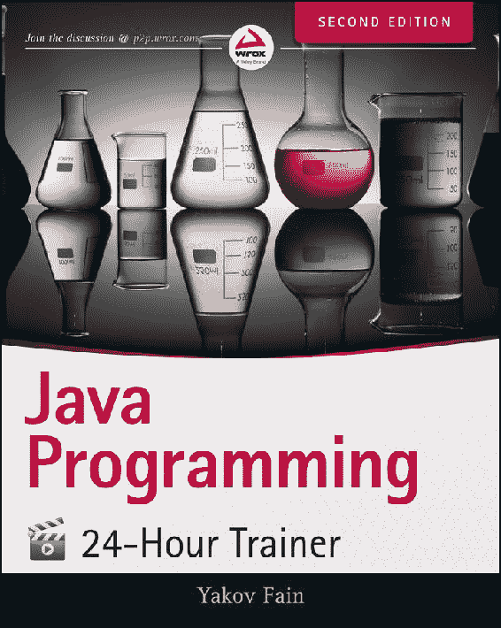

1. 图 1-1：在 MAC OS 中检查 Java 版本
2. 图 1-2：将 Java 位置添加到 Windows 的 `Path` 变量
3. 图 1-3：在 Windows 中检查 Java 版本
4. 图 1-4：编译并运行 HelloWorld
5. 图 2-1：Eclipse IDE 工作区中的 Java EE 视图
6. 图 2-2：Eclipse IDE 工作区中的 Java 视图
7. 图 2-3：在 Eclipse 中创建 Java 项目（步骤 1）
8. 图 2-4：在 Eclipse 中创建 Java 项目（步骤 2）
9. 图 2-5：已创建的 Hello 项目
10. 图 2-6：在 Eclipse 中创建 HelloWorld 类
11. 图 2-7：HelloWorld 类的自动生成代码
12. 图 2-8：控制台中的程序输出
13. 图 2-9：Ctrl-Space 显示上下文敏感建议
14. 图 3-1：实例化对象
15. 图 4-1：PrintStream 类的 JavaDoc
16. 图 5-1：调试器在断点处暂停
17. 图 5-2：调试选项卡
18. 图 5-3：调试快照
19. 图 8-1：Windows（左）和 Mac OS（右）
20. 图 8-2：运行 SimpleCalculator 类
21. 图 8-3：调整 SimpleCalculator 窗口
22. 图 8-4：运行 SimpleCalculatorGrid
23. 图 8-5：调整 SimpleCalculatorGrid
24. 图 8-6：Windows 7 计算器
25. 图 8-7：组合布局的计算器
26. 图 8-8：计算器中的 GridBagConstraints
27. 图 8-9：作为卡片布局的文件夹
28. 图 9-1：带 JOptionPane 的消息框
29. 图 9-2：计算器中的 MVC
30. 图 9-3：GUI 事件循环
31. 图 9-4：计算器 GUI
32. 图 10-1：带有自定义异常的异常层次结构
33. 图 11-1：核心集合接口
34. 图 12-1：自行车商店类层次结构
35. 图 12-2：泛型方法的签名
36. 图 13-1：Lambda 表达式的部分
37. 图 13-2：继承 Person 并实现 Payable
38. 图 14-1：运行 TaxGuiFile 程序
39. 图 16-1：2014 年 11 月的苹果股票
40. 图 18-1：添加 E(fx)clipse 插件的位置
41. 图 18-2：选择安装的插件组件
42. 图 18-3：新生成的 JavaFX 项目
43. 图 18-4：运行 HBoxSample
44. 图 18-5：登录窗口
45. 图 18-6：样式化的登录窗口
46. 图 18-7：带有事件处理器的登录窗口
47. 图 18-8：运行中的绑定
48. 图 19-1：计算器
49. 图 19-2：在 Eclipse 中配置新的 JavaFX 项目
50. 图 19-3：生成的项目 Lesson19
51. 图 19-4：Scene Builder 中的 Calculator.fxml
52. 图 19-5：TextField 控制器放置在 TOP 区域
53. 图 19-6：将 GridPane 添加到 CENTER 区域
54. 图 19-7：TextField 下方的 4x6 GridPane
55. 图 19-8：设置 GridPane 的 Hgap、Vgap 和 Padding 属性
56. 图 19-9：添加到左上角网格单元的 MC 按钮
57. 图 19-10：网格中的所有按钮
58. 图 19-11：输入数字 159.23 后计算器视图
59. 图 19-12：带有菜单栏和 3x3 网格的 BorderPane 布局
60. 图 19-13：带有菜单栏和空网格的 TicTacToe
61. 图 19-14：第一个按钮带有焦点边框的 TicTacToe
62. 图 19-15：第一个按钮没有焦点边框的 TicTacToe
63. 图 19-16：点击按钮三次后的游戏状态
64. 图 19-17：带有样式化按钮标签的 TicTacToe
65. 图 19-18：使用渐变色突出获胜组合
66. 图 22-1：没有列标题的运行 MyFrame
67. 图 22-2：带有列标题的运行 MyFrame
68. 图 22-3：使用自定义价格渲染器的运行 MyFrame
69. 图 24-1
70. 图 25-1：Java 应用程序架构设计
71. 图 25-2：在 Mac OS 终端启动 GlassFish
72. 图 25-3：GlassFish 管理控制台
73. 图 26-1：示例客户端-servlet 流
74. 图 26-2：在 Eclipse 中切换到 Java EE 视图
75. 图 26-3：在 Eclipse 中配置新服务器
76. 图 26-4：下载服务器
77. 图 26-5：从 Marketplace 安装适用于 Luna 的 GlassFish Tools
78. 图 26-6：在 Eclipse 中配置 GlassFish
79. 图 26-7：在 Eclipse 中配置的三个服务器
80. 图 26-8：动态 Web 项目
81. 图 26-9：更改 servlet 的 URL
82. 图 26-10：在 Eclipse 浏览器中运行 servlet
83. 图 26-11：从 servlet 更改网页的呈现方式
84. 图 26-12：部署在服务器上的 ShoppingCart.html
85. 图 26-13：向购物车添加四本书后的网页
86. 图 27-1：当您添加标签时查看页面
87. 图 27-2：在 Eclipse 浏览器中运行 index.jsp
88. 图 27-3：运行 MyCalculator.jsp
89. 图 27-4：运行 GetPriceQuote.html
90. 图 28-1：Chrome 浏览器中的 AJAX 请求
91. 图 28-2：监控 WebSocket 帧
92. 图 28-3：HTTP 握手
93. 图 28-4：消息交换中的编码器和解码器
94. 图 28-5：测试 decoders.html
95. 图 28-6：三个客户端通过 WebSocket 端点获取当前时间
96. 图 29-1：GlassFish 管理控制台
97. 图 29-2：GlassFish 中的 JDBC 连接池
98. 图 29-3：DerbyPool 配置为 8 到 32 个连接
99. 图 29-4：连接池的额外属性
100. 图 30-1：经纪公司通过 MOM 与股票交易所通信
101. 图 30-2：P2P 消息
102. 图 30-3：发布/订阅消息
103. 图 30-4：带有新创建 StockBroker 的 Open MQ 控制台
104. 图 30-5：在 Open MQ 中配置目的地
105. 图 30-6：将 JMS、Java EE 和 MOM 结合在一起
106. 图 30-7：GlassFish 中的物理目的地
107. 图 30-8：将 JNDI 名称映射到物理队列
108. 图 30-9：配置 JMS 工厂
109. 图 30-10：Java EE 消息发送者和独立接收者
110. 图 31-1：运行 servlet，一个 EJB 客户端
111. 图 31-2：创建一个带有业务接口的 EJB
112. 图 32-1：JPA 项目窗口的片段
113. 图 32-2：带有 EclipseLink 支持的新生成的 Eclipse 项目
114. 图 32-3：数据源视图
115. 图 32-4：配置新的连接配置
116. 图 32-5：验证连接池
117. 图 32-6：对数据采样
118. 图 32-7：生成实体
119. 图 33-1：带有注解的 URI
120. 图 33-2：使用 Postman 获取股票资源
121. 图 33-3：使用 POST 请求添加股票
122. 图 35-1：修改后的 Eclipse 项目结构
123. 图 35-2：在 Eclipse 中创建 JUnit 用例
124. 图 35-3：尚未实现的测试
125. 图 35-4：在 Eclipse 中创建测试套件
126. 图 35-5：在 Eclipse 中运行测试套件
127. 图 35-6：Mac OS 上运行 CommandLineRunner
128. 图 35-7：直接调用 org.junit.runner.JUnitCore
129. 图 36-1：Eclipse 中的 Ant 视图
130. 图 36-2：Maven 生成的项目
131. 图 36-3：运行 package 阶段后的目标目录
132. 图 36-4：首次运行 Gradle 命令
133. 图 36-5：再次运行 Gradle 构建
134. 图 36-6：运行 Gradle 任务后的 Hello World 项目
135. 图 36-7：更改 Gradle 默认值后运行构建
136. 图 36-8：运行 Gradle 导致异常
137. 图 36-9：Maven 中央的 Derby Client
138. 图 36-10：运行 Gradle 依赖显示可用配置
139. 图 36-11：Gradle 的 run 任务下载依赖 derbyclient-10.11.1.1.jar
140. 图 36-12：derbySample.jar 的内容
141. 图 36-13：从 Derby DB 数据库获取员工
142. 图 36-14：Eclipse 中 Gradle 生成的项目
143. 图 36-15：Eclipse IDE 中的 Gradle 任务视图

# 引言

感谢你考虑通过我的书籍第二版来学习 Java。这本书看起来可能很厚，但考虑到涵盖的主题数量，它已经相当薄了，而且附带了制作精良且实用的视频。

我非常喜欢 Wiley 出版社的这个 `24-Hour Trainer` 系列丛。这并不是说你可以在 24 小时内学会这些书中涵盖的软件。

它的意思是拥有一位 24 小时都在你身边的培训师。该系列中的每本书都配有一套视频，包含了最少的理论知识，帮助你开始接触一个全新的领域。

本书提供了超过六小时的 Java 编程录屏演示（screencasts），以有助于学习的方式展示了现代概念、技术和手段，促进对开发过程有更好的理解。

软件开发人员通常被分为初级、中级和高级开发者。如果你掌握了书中的所有材料，请放心，你已经达到了中级 Java 开发者的技术水平。我经常为工作的公司进行技术面试，如果中级职位的候选人能展示出对书中涵盖的所有主题的理解，我将非常乐意。

## 本书适合读者

本书适用于任何想学习如何使用 Java 语言进行编程的人。不要求之前的编程经验。

* 本教程可供寻找使用语言某些特性的简单工作示例的 Java 开发者。
* 熟练的 Java 开发者在准备技术面试时也可以此本书作为复习资料。
* 本教程适用于有兴趣从从业人士那里学习的大学学生，该从业人士从事企业级软件开发已超过 25 年。
* 大学教授可能会欣赏每节课结束时都有一个 `Try It`（尝试一试）部分——这是为每节课准备的作业。书中也提供了这些作业的解决方案。

本书是一本教程，但不是学术意义上的。它由从业者编写，并为从业者服务。

## 本书涵盖内容

要成为 Java 开发者，一个人不仅需要知道这种编程语言的核心语法，还需要了解一套被称为 `Java EE`（企业版）的服务器端技术。本书涵盖了这两者。在编写时，核心 Java 的最新版本是 `8`，`Java EE` 的最新版本是 `7`。这些都是书中涵盖的版本。

Java 是一种通用语言——你可以编写在用户计算机上独立运行的应用程序，也可以连接到远程服务器的应用程序。你还可以编写仅运行在服务器上的应用程序。你可以使用 Java 编写手机应用程序和编写游戏。我们生活在物联网（IoT）时代，Java 可以嵌入汽车或家用电器内部的传感器中。

本书的大部分涵盖了可以同时用于用户计算机和服务器的 Java 编程语法和技术。有九节课专门用于运行在服务器上的 Java 程序所使用的 `Java EE` 技术。最后一节课专门为那些有兴趣申请 Java 软件开发工作的人准备 Java 技术面试的流程。

## 本书的结构

本书是一本教程。每节课都会引导你如何使用 Java 语言的某些元素和技术，或者介绍服务器端的 `Java EE` 技术。`Try It` 部分作为课程中解释材料的延续。书中附带的录屏演示通常会说明如何完成 `Try It` 部分的作业。

你可以选择阅读课程，然后尝试运行示例并完成课程作业；或者你可以阅读课程、观看视频，然后尝试自己完成作业。

课程简短且直击要点。目标是快速解释材料，以便你尽早开始实践。某些读者可能觉得对某些主题需要更多解释；鼓励你进行一些额外的研究。关于任何与 Java 相关的主题都有大量的在线材料可用，但书中提供的材料范围绝对有助于你理解应该关注什么以及寻找什么。

## 使用本书需要什么

为了运行书中的示例并完成作业，你不需要购买任何软件——这里使用的是免费的软件。前两节课将解释如何安装 `Java Development Kit`（Java 开发工具包）和 `Eclipse Integrated Development Environment`（`IDE`），这就是你入门所需的全部内容。在`第 21 节`中，你下载一个名为 `Derby DB` 的开源数据库管理系统。在`第 25 节`中，你安装 Java 应用服务器 `GlassFish`，它用于解释`第 25 节`到`第 33 节`中涵盖的 `Java EE`（服务器端）技术。最后，在`第 36 节`中，你安装 `Gradle`——专业 Java 开发者使用的现代构建自动化工具。当你需要下载某些软件时，书中和/或录屏演示中提供了详细说明。

从硬件角度来看，你可以使用运行 `Windows` 的 PC，也可以使用运行 `Mac` 的 Apple 计算机。`Linux` 用户也可以运行所有的示例。你的电脑应至少有 `2GB` 内存以运行代码。

## 如何阅读本书

本书是一本教程，我们在每节课中假设你已经熟悉了之前的材料。如果你是 Java 新手，我强烈建议按顺序阅读本书。通常，除最后一节外，每节课都有相应的视频录屏，向你展示如何完成课程 `Try It` 部分的作业、运行代码示例或简单的配置软件。理想情况下，你应该自己完成 `Try It` 部分的所有作业，仅在遇到困难或不理解指令时使用视频。但如果你更喜欢通过跟随导师来学习，先看视频也可以。任何方法都可以。

Java 是一种多平台语言，例如为 `Microsoft Windows` 编写的程序在 `Mac OS X`或`Linux` 计算机上的运行方式应该是相同的。我正在使用 `Mac`，但我也有特殊的软件让我运行 `Microsoft Windows`。在书中使用开源的 `Eclipse Integrated Development Environment`，它在所有主要平台上都存在且看起来非常相似。因此，无论你使用哪种操作系统，都可以运行书中的所有代码示例。

## 约定

为了帮助你充分利用文本并跟踪进度，我在书中中使用了一些约定。

对于文中的样式：

* 我们在引入新术语和重要词汇时对其进行*高亮显示*。
* 我们在文中显示文件名、URL 和代码如下所示：`persistence.properties`。
* 我们以如下形式展示代码：

```
大多数代码示例我们使用无高亮的等宽字体。
```

当你学习本书中的各个示例时，你可以选择手动输入所有代码，也可以使用随书附带的源代码文件。书中使用的所有源代码均可以在书籍的页面 [`www.wrox.com`](http://www.wrox.com) 处下载。

进入该网站后，只需点击书籍详情页上的 `Download Code` 链接即可获取该书的所有源代码。

下载代码后，只需使用你喜欢的压缩工具对其进行解压即可。或者，你也可以前往 Wrox 代码下载主页 [`www.wrox.com/dynamic/books/download.aspx`](http://www.wrox.com/dynamic/books/download.aspx) 查看此书以及所有其他 Wrox 书籍的可用代码。

## 勘误表 (Errata)

Wiley 出版社和 Wrox 尽力确保文本或代码中没有错误。然而，没有人是完美的，错误在所难免。如果你在我们的某本书中发现了错误（例如拼写错误或错误的代码段），我们将非常感谢你的反馈。通过提交勘误，你可能会为其他读者节省数小时的困扰时间，同时也将帮助我们提供更高质量的信息。

要找到这本书的勘误页，请访问 [`www.wrox.com`](http://www.wrox.com) 并使用 `Search` 框或标题列表找到该书标题。然后，在书籍详情页上点击 `Book Errata` 链接。在该页面上，你可以查看所有提交给该书并由 Wrox 编辑发布的勘误。在 [`www.wrox.com/misc-pages/booklist.shtml`](http://www.wrox.com/misc-pages/booklist.shtml) 也可以找到完整的书籍列表，其中包含每本书勘误页的链接。

如果你在书籍勘误页面没有发现“你的”的错误，请访问 [`www.wrox.com/contact/techsupport.shtml`](http://www.wrox.com/contact/techsupport.shtml) 并填写该表格向我们发送你发现的错误。我们将检查这些信息，并在适当的情况下在书籍的勘误页发布消息，并在书籍的后续版本中修复问题。


## P2P.Wrox.Com

如需与作者和同行讨论，请加入 [`p2p.wrox.com`](http://p2p.wrox.com) 的 P2P 论坛。这些论坛是一个基于 Web 的系统，供你发布与 Wrox 书籍及相关技术的消息，并与其他读者和技术用户进行互动。论坛提供了订阅功能，当论坛上有新帖子发布时，可以通过电子邮件向你发送你感兴趣的主题。Wrox 的作者、编辑、其他行业专家以及你的读者都活跃在这些论坛中。

在 [`p2p.wrox.com`](http://p2p.wrox.com) 上，你会发现许多不同的论坛，它们不仅在你阅读本书时有帮助，还能帮你开发自己的应用程序。要加入论坛，请遵循以下步骤：

1. 访问 [`p2p.wrox.com`](http://p2p.wrox.com) 并点击 `Register` 链接。
2. 阅读使用条款并点击 `Agree`。
3. 填写加入所需的各种信息以及你希望提供的任何可选信息，并点击 `Submit`。
4. 你将收到一封电子邮件，其中包含了如何验证你的账户并完成加入流程的信息。

加入后，你可以发布新消息并回复其他用户发布的消息。你可以随时在网页上阅读消息。如果你希望通过电子邮件接收来自特定论坛的新消息，请点击论坛列表中论坛名称旁边的 `Subscribe to this Forum` 图标。

有关更多关于如何使用 Wrox P2P 的信息，请务必阅读 P2P FAQ，以获取有关论坛软件如何工作的以及针对 P2P 和 Wrox 书籍常见问题的解答。要阅读 FAQ，请点击任何 P2P 页面上的 `FAQ` 链接。

# 第 1 节：Java Java

在过去的二十年里，Java 一直保持着作为最流行编程语言之一的地位，适用于从游戏编程到创建任务关键型应用程序（例如用于华尔街交易或控制火星漫路器的程序）。当前的流行排行榜请参阅 [`http://www.tiobe.com/index.php/content/paperinfo/tpci/index.html`](http://www.tiobe.com/index.php/content/paperinfo/tpci/index.html) 中的 Tiobe Index。在本节中，你将学习一些非常基本的 Java 术语。你还将下载并安装 Java 开发包 (`JDK`) 并编译你的第一个程序。

## 为什么要学习 Java？

Java 编程语言最初由 Sun Microsystems 的 James Gosling 于 1995 年创建（该公司于 2010 年被 Oracle 公司收购）。其目标是提供一个比 C++ 更简单且平台无关的替代方案。Java 程序在 Java 虚拟机 (`JVM`) 中运行，从应用程序程序员的角度来看，它在每个平台上都是相同的。你稍后将在“Java 程序的生命周期”部分中了解到 `平台无关性` 的含义。现在，让我们看看为什么 Java 可以成为你的首选语言的一些原因。

Java 是一种通用编程语言，用于所有行业中几乎任何类型的应用程序。如果你掌握了它，你获得开发者工作的机会将比专攻领域特定语言更高。

世界上有超过九百万 Java 开发者，大多数人都准备好通过博客和文章分享知识。如果你在解决 Java 问题时遇到困难，极有可能在互联网上找到解决方案。

由于 Java 开发者群体庞大，大中企业都喜欢使用 Java 开发新项目——如果你出于某种原因离开该项目，寻找另一个 Java 程序员来接手并不困难。如果项目是用强大但不太流行的语言（如 Scala）开发的，情况就大不同了。为了提高你的价值和就业竞争力，你不仅需要掌握语言语法，还需要掌握需求要求的 Java 技术栈。

Java 不仅是开源的，而且成千上万的开源项目是用 Java 开发的。加入这些项目是熟悉项目开发流程并在没有任何编程经验的情况下获得第一工作的最佳方式。

Java 语言是面向对象的 (`OO`)，这让你能够轻松将程序构造与现实世界中的对象联系起来（更多请见第 3 章至第 7 章）。另一方面，最近引入的 lambda 表达式（参见第 14 章）允许你以函数风格编写 Java。

IT 世界正在变化，人们经常在同一个项目中使用多种语言。Java 不是运行在 `JVM` 上的唯一语言。Scala、Groovy、Clojure、JavaScript 等语言也运行在 `JVM` 上。因此，熟悉 `JVM` 为在相同的操作系统环境中成为多语言程序员打开了大门。

部署在 `JVM` 中的服务器端应用程序扩展性良好。处理成千上万用户的请求可以通过将任务分到集群中廉价服务器之间来实现并行处理。

Java 作为一种开发平台相比其他环境具有许多优势，这使其成为许多项目的正确选择，你将在阅读本书、观看附带 DVD 的屏幕演示以及在计算机上部署书中的所有代码示例时亲身体验这一点。

## 设定目标

这本简练教程的目标是为你提供关于目前现实世界中使用的大多数 Java 语言元素、技术和技术的足够信息。书的前 25 节关于 Java 标准版（Java Standard Edition），其余部分关于 Java 企业版（Java Enterprise Edition）——它涵盖了服务器端 Java 技术，而这也是 Java 在企业界大放异彩的地方。

某些课程的简短可能会让你怀疑，当有整本书专门介绍同一个主题时，仅用 10 页来解释一个主题是否真的可行。我的方法是涵盖足够让你理解概念、重要术语和最佳实践的内容。DVD 上的预录屏幕演示可以帮助你独立练习课程中解释的技术。

网上上有许多额外材料可以帮助你更深入地学习任何特定主题。但只需使用本书附带的材料，你就能获得关于 Java 的实用且有效的知识。

本书的目标不仅是让你熟悉 Java 语言的语法，更是为了让你掌握实用的 Java 技能，使能够独立开发或在大型项目中作为团队成员开发业务应用程序。

## Java 程序的生命周期

编程语言有多种类型。在某些语言中，你编写程序的文本（即源代码）并可以直接执行该程序。这些是解释型语言（例如，`JavaScript`）。

但 Java 要求你的程序源代码先进行编译。它被转换为由 Java 虚拟机（`JVM`）运行的字节码，虚拟机可以使用即时编译（`JIT`）编译器将某些部分转换为特定平台的机器码。

程序不仅会由 Java 编译器检查语法错误，在编译完成后（部署阶段），还可以将其他 Java 代码库添加（链接）到你的程序中。有许多现成的可重用组件库可用，其中绝大多数是免费的。

在本节中，你将从编写一个非常基本的 Java 程序开始，在你的计算机显示器上输出“Hello World”字样。

从技术上讲，你可以使用任何喜欢的纯文本编辑器（记事本、TextEdit、Sublime Text、`vi` 等）编写 Java 程序的源代码，但要编译你的程序，你需要 Java 开发包（`JDK`）包含的额外工具和代码库。

## JDK 和 JRE

如果你计划使用特定的计算机来开发 Java 程序，你需要下载并安装 `JDK`。如果你计划仅用这台计算机运行在其他地方编译好的 Java 程序，你只需要 Java 运行环境（`JRE`）。

如果你在机器上安装了 `JDK`，它包含了 `JRE`。

Java 的平台无关性源于你的 Java 程序不知道自己在哪种操作系统（OS）或哪种硬件上执行。它在预安装的 `JRE` 内部运行。

你需要熟悉另外两个术语：`Java SE`（标准版）和 `Java EE`（企业版）。后者包含了你从第 25 节开始将学习的服务器端技术。

### 在 Windows 中安装 JDK 8

选择并下载 Windows x86 可执行文件，这是适用于 32 位计算机的 Java 版本。此版本完全适合开始学习 Java。运行此文件，点击两三次“下一步”按钮，然后点击“关闭”。大约一分钟后安装完成。默认情况下，`JDK` 安装在类似 `c:\Program Files\Java\jdk1.8.0_05` 的目录中。这是 `JDK` 和 `JRE` 安装的地方。

现在你需要将 Java 安装目录下的 `bin` 文件夹添加到 Windows 系统的环境变量 `PATH` 中。点击“开始”、“控制面板”并搜索环境变量。点击“编辑系统环境变量”链接并按下“环境变量”按钮。编辑系统变量 `PATH`（如果没有，则创建一个），以包含 `c:\Program Files\Java\jdk1.8.0_05\bin` 的路径，除非你的路径位于不同的位置。不要忘记添加分号作为分隔符，如图 1-2 所示。

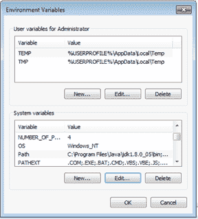

**图 1-2:** 添加 Java 路径

如果你在计算机上安装了旧版本的 `JDK`，它们各位于自己的目录中。为了确保你使用的是新安装的 Java，打开命令行窗口（在 Windows 7 中只需点击开始按钮并在搜索框中输入 `cmd`）并输入 `java -version`。图 1-3 显示我拥有 1.8.05。

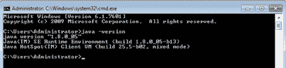

## 第一个程序

历史上，学习新语言时编写的第一个程序是 Hello World 程序。如果你能写出一个在显示器上输出 Hello World 的程序，证明你已正确安装了编译器和运行环境，且程序没有语法错误。

要开始编写 Java 程序，可以使用任何纯文本编辑器。包含 Java 代码的文件必须以 `.java` 结尾的文件保存。

创建一个目录 `c:\PracticalJava\Lesson1`，并将你创建的程序保存为 `HelloWorld.java`（如果你使用记事本，请在“保存类型”下拉菜单中选择“所有文件”，以避免自动附加 .txt 后缀）。

记住 Java 是一种大小写敏感语言，这意味着如果你将程序命名为 `HelloWorld`（大写 H 和大写 W），不要尝试运行 `helloworld`。你的前十几个语法错误可能由于大小写不当引起。

以下是对 HelloWorld 程序中使用的某些术语和语言元素的简短解释。

第一个程序包含一个类，`HelloWorld`。让 Java 类和它的文件名相同（此规则可能存在例外，但在这个简单的程序中没有）。在编写 Java 程序时，你会创建类，它们通常代表现实生活中的对象。你可以在第 3 节中学习更多关于类的知识。

`HelloWorld` 类包含一个方法，即 `main()`。Java 类中的方法代表了类可以执行的函数（动作）。一个 Java 类可以有多个方法，但如果其中一个方法被命名为 `main()` 且具有与我们类中相同的方法签名（声明行），那么这个 Java 类就是可执行的。如果一个类没有 `main()` 方法，它可以被其他类调用，但你无法将其作为程序来运行。以下是 `main()` 方法的方法签名（类似于标题）：

```
public static void main(String[] args)
```

该方法签名包含了访问级别（`public`）、用法说明（`static`）、返回值类型（`void`）、方法名（`main`）以及参数列表（`String[] args`）。

- 关键字 `public` 意味着 `main()` 方法可以被任何其他 Java 类访问。
- 关键字 `static` 意味着你不需要创建该类的实例就可以使用此方法。
- 关键字 `void` 意味着 `main()` 方法不会向调用它的程序返回任何值。
- 关键字 `String[] args` 告诉你该方法将接收一个字符串数组作为参数（你可以从命令行向此方法传递外部数据）。

`main()` 方法是你的程序的起点。你可以用 Java SE 编写一个由多个类组成的程序，但至少要有一个类拥有 `main` 方法。一个 Java 类可以有多个方法。例如，`Employee` 类可以拥有 `updateAddress()`、`raiseSalary()`、`changeName()` 等方法。

`main()` 方法的主体包含以下行代码：

```
System.out.println("Hello World!!!!!");
```

前面的 `println()` 方法用于在系统控制台（命令行窗口）上打印数据。Java 方法名后面总是跟着括号。

这里的 `System` 代表另一个 Java 类。

点符号表示法（如 `System.out`）意味着变量 `out` 定义在 `System` 类内部。

`out.println()` 告诉你有一个由名为 `out` 的变量表示的对象，它有一个名为 `println()` 的方法。

你将使用这种点表示法来引用类方法或变量。

这些解释听起来可能太短且不充分，事实也如此。请稍等，我会在随后的章节中介绍更详细的细节。

### 编译并运行 Hello World

HelloWorld 程序已经写好了，现在你需要编译这个程序。Java 编译器是一个将你的源代码转换为 JRE 能够理解的所谓字节码的程序。`javac` 编译器是 JDK 的一部分，因此在你的 PC 上打开命令行窗口或在 MAC 上打开 Terminal，切换当前目录到 `c:\PracticalJava\Lesson1`，并尝试编译以下程序：

```
cd PracticalJava\Lesson1
javac HelloWorld.java
```

尽管在当前目录下没有 `javac` 程序，但你的操作系统在 Java 安装的 `bin` 目录中找到了它。MAC OS 知道 `bin` 目录的位置。在 Windows 操作系统中，你已将其添加到 PATH 环境变量中。

你不会看到任何编译成功的确认；只需在 Windows 上输入 `dir`（或 MAC OS 上输入 `ls`）即可确认已创建一个名为 `HelloWorld.class` 的新文件。这证明了你的程序已成功编译。

如果程序有语法错误，编译器会打印错误信息。在这种情况下，修复错误并重新编译程序。你可能需要多次尝试，直到 `HelloWorld.class` 文件被成功创建。

现在通过输入以下命令运行程序：

```
java HelloWorld
```

注意，这次你没有使用 `javac` 程序，而是使用了 `java`，它启动 Java 运行时并将 HelloWorld 程序加载到 Java 虚拟机（`JVM`）中。命令行窗口会显示“Hello World”。图 1-4 是一张截图，显示了在 MAC OS 中编译命令（`javac HelloWorld.java`）、编译后第 1 章文件夹的内容（`ls`——Windows 中的 `dir` 等同于 `ls`）、如何运行程序（`java HelloWorld`）以及 HelloWorld 程序的输出（Hello World!!!!!）。

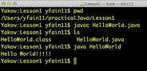

**图 1-4:** 编译并运行 HelloWorld

### 尝试一下

在本节中，你的目标是编写第一个 Java 程序，输出“Hello World”单词。实现这一目标后，为该程序添加更多行来打印你的地址。

### 课程要求

对于本节，请按照“下载和安装 Java SE”章节中的说明下载并安装当前版本的 JDK。

### 步骤详解

1. 打开你喜欢的任何纯文本编辑器并输入 Hello World 程序的文本。记住 Java 是区分大小写的。
2. 将程序保存为文件 `HelloWorld.java`。
3. 在命令行窗口中使用命令 `javac HelloWorld.java` 编译程序。
4. 使用命令 `java HelloWorld` 运行程序。

# 第 2 课

## Eclipse IDE

你的第一个 Java 程序是在文本编辑器中编写并从命令行窗口编译的，但这不是一种开发软件的高效方法。专业程序员使用集成开发环境（IDE），它包含了编辑器、编译器、上下文相关帮助、调试器等许多功能（你稍后会熟悉这些功能）。有多个 Java IDE，例如 Eclipse、IntelliJ IDEA 和 NetBeans。

Eclipse 是迄今为止使用最广泛的 IDE，我用它来编译和运行书中的大部分示例。但在 IDE 之间切换是一个非常简单的过程，如果你发现某些领域某个 IDE 让你效率更高，就用最好的那个。事实上，我更喜欢 IntelliJ IDEA，但这并不阻止我在 Eclipse 中进行 Java 开发。

### 介绍 Eclipse IDE

Eclipse IDE 是一个开源产品，最初由 IBM 向 Java 社区捐赠大量代码创建的，从那时起 Eclipse 成为一个社区驱动的产品。它最初是一个开发 Java 程序的 IDE，但现在已成为用于构建成千上万工具和插件的开发平台。有些人正在使用其丰富客户端平台（RCP）API 来开发应用程序的用户界面（UI）。通过 Eclipse，你可以轻松生成和部署 Web 应用程序、启动和停止服务器、将其作为数据库管理工具等。有些人使用它的插件开发报告。访问 [`www.eclipse.org/downloads`](http://www.eclipse.org/downloads) 下载页面查看一些基于 Eclipse 的产品。

除了作为 IDE，Eclipse 还支持插件开发，每个开发者都可以添加自己感兴趣的插件。例如，有一个用于显示 UML 图的插件，另一个提供报告系统，还有用于开发 C、JavaScript 等语言的插件。

### 下载和安装 Eclipse

有多个版本的 Eclipse IDE，本书使用的是 `Eclipse IDE for Java EE Developers`。每个版本的 Eclipse IDE 都有一个名称。在本书期间，当前版本称为 Luna，你应该从 [`www.eclipse.org/downloads`](http://www.eclipse.org/downloads) 下载它。


安装 Eclipse IDE 只是将下载的文件解压到你选择的磁盘驱动器。根据你的操作系统，你在 Eclipse 文件夹中找到 `Eclipse.exe` 或 `Eclipse.app` 文件——只需运行此程序。你会立即看到一个弹出窗口，要求你选择一个 `workspace`（工作空间），这是硬盘上用于存储一个或多个 `projects`（项目）的目录。

Java EE Eclipse IDE 启动后会显示欢迎（Welcome）面板；只需点击欢迎标签页上的小“x”即可将其关闭。图 2-1 显示了新安装的 Eclipse IDE `workbench`（工作区）的截图。

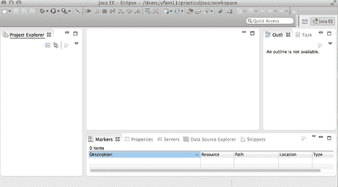

**图 2-1:** Eclipse IDE 工作区中的 Java EE 视图（perspective）

在 Eclipse 中，你从创建项目开始。在现实世界中，一个中等应用的源代码可能由多个 Eclipse 项目组成。

为了本书的代码示例，我选择了以下工作空间目录：`practicalJava/workspace`。准确来说，在图 2-1 中你看到的是 Java EE `perspective`（视图，注意顶部的 Java EE 标签页），它是为 Java EE 开发者打开的一系列 `views`（视图）集合。在左侧你可以看到 `Project Explorer`（项目资源管理器）视图；你的下一个任务是创建一个 `Hello` 项目。中间区域预留给 `code editor`（代码编辑器）。在你创建第一个 Java 类后，就可以在那里输入 Java 代码。`Outline`（大纲）视图位于右侧；你将看到类、方法和变量名称（参见第 3 章）。

还有许多其他视图可以通过选择 `Window`（窗口）→ `Show View`（显示视图）自行打开和关闭。这些包括 `Console`（控制台）、`Search`（搜索）、`Servers`（服务器）等。如果你没有看到其中某些项，可以在 `Window` → `Show View` → `Other`（其他）中找到它们。

由于你刚刚开始学习这门语言，不需要在 Java EE `perspective` 中工作；使用 `Java` `perspective` 即可。点击 Java EE 标签页旁工具栏上带有加号的小图标，并选择 `Java` `perspective`。你会看到一组稍不同的视图，左侧有 `Package Explorer`（包资源管理器）和 `Hierarchy`（层级）视图，右侧有 `Task`（任务），底部有 `Problems`（问题）和 `Javadoc` 标签页，如图 2-2 所示。

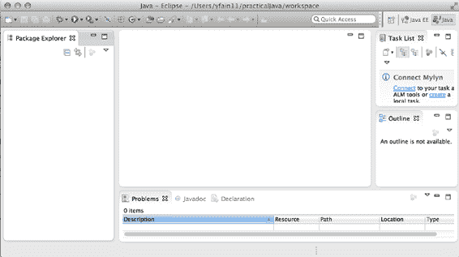

**图 2-2:** Eclipse 工作区中的 Java 视图

## 在 Eclipse 中创建 Hello 项目

在第 1 章中你只是创建了 `HelloWorld` 类，但在 Eclipse 中你必须先创建项目。选择 `File`（文件）→ `New`（新建）→ `Java Project`（Java 项目），并在弹出窗口中输入 `Hello` 作为项目名称，如图 2-3 所示。

你可以选择你想要工作的 `JRE` 版本。在第 1 章中我安装了 1.8 版本的 `JDK` 和 `JRE`，但你可能有多个版本的 `JRE`，且 Eclipse 可以编译将在另一个版本 `JRE` 中运行的代码。如果你的某些项目必须在旧版本的 `JRE` 上运行，这可能会很有用。通常，企业不会急于安装最新版本的 Java，因为这需要大量的时间和资源来确保它们的生产应用程序在新版本的 `JRE` 中不会损坏。Eclipse 允许为项目选择任何已安装的 `JRE` 版本。

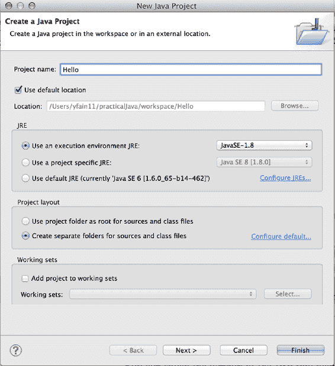

**图 2-3:** 创建 Java 项目（步骤 1）

点击 `Next`（下一步）后，系统会要求你指定创建 `Hello` 项目的源代码和编译后的 Java 类所在的文件夹（参见图 2-4）。默认情况下，Eclipse 为该项目创建一个 `Hello` 文件夹，其中包含一个用于存放编译后类文件的 `bin` 子文件夹和一个用于存放源代码的 `src` 子文件夹。在第 1 章中，`HelloWorld.java` 和 `HelloWorld.class` 都在同一个文件夹中，这对于单类项目是可以接受的，但良好的做法是将 `.java` 和 `.class` 文件放在不同的文件夹中。

不要更改输出目录的名称；只需点击该窗口上的 `Finish`（完成）。在图 2-5 中，你可以在 Eclipse 的 `Package Explorer` 视图中看到新项目 `Hello`。该项目有一个名为 `src` 的空文件夹——你将在该处保存 `HelloWorld.java` 的源代码。

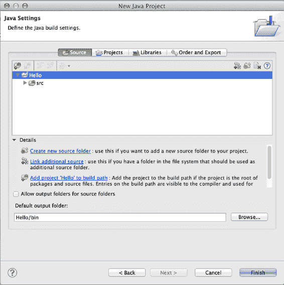

**图 2-4:** 创建 Java 项目（步骤 2）

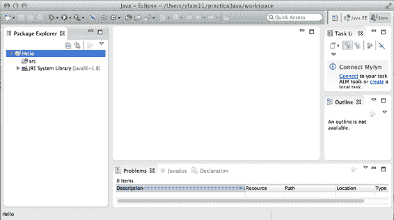

**图 2-5:** 项目 Hello 已创建

`JRE` 文件夹包含了所有所需的 Java 1.8 库，这些库支持运行 `HelloWorld` 的 `JVM`（Java 虚拟机）。这些库文件的文件名以 `.jar` 结尾。Java SDK 随带了一个工具，允许你创建包含一个或多个类的归包。虽然 `HelloWorld` 运行在 `JVM` 中，但 `JRE` 文件夹本身包含了开发者创建的一个或多个类的集合（包）。虽然 `HelloWorld` 一个，但随着应用程序增长，你会发现如何将文件分组 `jar`。

## 在 Eclipse 中创建 HelloWorld 类

在第 1 章中你只需创建了 `HelloWorld` 类，但在 Eclipse 中必须先创建项目。选择 `File` → `New` → `Class`，在弹出窗口的 `Name` 字段中输入 `HelloWorld`，并输入一个包名，如图 2-6 所示。

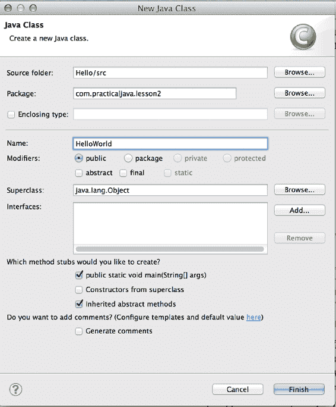

**图 2-6:** 在 Eclipse 中创建 HelloWorld 类

## Java 包

Java 包用于更好地组织多文件项目并进行数据保护。项目包含几百个 Java 类是很常的。将它们都放在一个目录中绝不是好主意。因此，文件将位于不同的目录和子目录中（称为包）。

包的命名规范是什么？Java 开发者使用反向域名规范。假设你正在为名为 Acme 的公司开发一个名为 Sales 的项目，每个包名都以公司的反向域名开头，然后是项目名称：`com.acme.sales`。相应的，属于此包的所有 Java 类都存储在以下目录结构中：`com/acme/sales`。

如果某些类用于国内销售，而另一些用于国际销售，你可以创建两个子目录：`com/acme/sales/domestic` 和 `com/acme/sales/international`。

由于目录名称使用正斜杠分隔，而相应的 Java 包名使用点分隔。Java 有一个特殊的关键字 `package`，它的声明必须是类的第一行（程序注释不计入）。例如：

```
package com.acme.sales.domestic;
```

假设你在 Practical Java 公司工作名为第 2 章的项目；包名将是 `com.practicaljava.lesson2`，这正是我在图 2-6 所示的 Package 字段中输入的。

除了有助于更好地组织 Java 类外，包有助于控制数据访问。你将在访问级别章节中学习此特性。

## 完成代码生成

点击 Finish 后，Eclipse 就会立即为 `HelloWorld` 类生成初始代码，如图 2-7 所示。

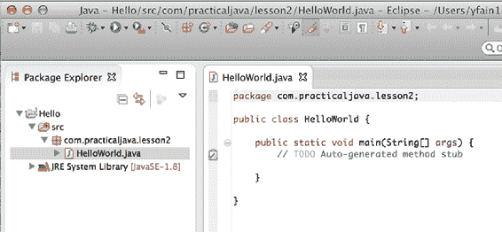

**图 2-7:** `HelloWorld` 类的自动生成代码

生成的代码显示在 Eclipse 的编辑器视图中。它以 `package` 语句开头，接下来是带有方法名的类声明。以双斜杠开头的行是单行注释。程序员使用注释以自由的形式描述代码片段，向任何阅读代码的人解释作者的意图。编译器会忽略这些注释。

将光标置于 `TODO` 注释下方，输入 `sysout`，然后按 `Ctrl+Space`；Eclipse 会将此缩写转换为 `System.out.println();`。从编码的第一秒钟起，Eclipse 就能让你的工作效率更高！Eclipse IDE 拥有许多实用的热键组合，可以让你减少手动打字量。

只需在括号之间添加“Hello World!!!!!”，然后通过点击工具栏上的小磁盘图标或使用 `Ctrl+S` 组合键来保存代码即可。

默认情况下，保存代码会调用 Java 编译器。如果你没有任何语法错误，Eclipse 会在 Hello 项目的 `bin` 目录中创建 `HelloWorld.class`。如果出现编译错误，Eclipse 会在问题行前显示一个小红色圆点。

现在，你可以通过点击工具栏上的绿色播放按钮来运行程序。程序的输出显示在 Eclipse 工作区下方的控制台（Console）视图面板，如图 2-8 所示。

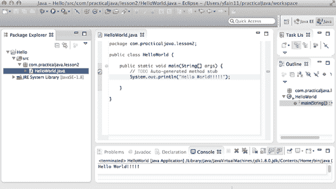

**图 2-8:** 程序的输出显示在控制台视图

当你输入时，Eclipse 会显示上下文相关的帮助，建议一组可能的值，这最大限度地减少了猜测和打字错误。你可以按 `Ctrl+Space` 尝试上下文帮助。在某些情况下，Eclipse 不会有任何建议，但有时它会非常有用。例如，将光标置于 `System` 后面点之后并按 `Ctrl+Space`。你会看到 `System` 类内部可用的方法列表。从列表中选择 `out` 将显示该对象的在线帮助内容。

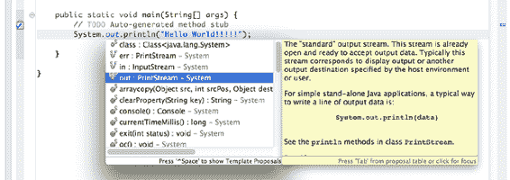

**图 2-9:** Ctrl-Space 显示上下文相关的建议和帮助

在第 3 章中，我将解释如何使用 Eclipse IDE 的调试器。在第 25 章中，我将向你展示如何从 Eclipse 启动 Java 服务器。在第 26 章中，你将在 Eclipse IDE 创建 Web 项目。本书的格式没有空间详细介绍 Eclipse 的所有功能。下一节包含了帮助你更好地熟悉 Eclipse 的额外在线资源。

### 补充材料

`http://www.eclipse.org/documentation/` 上的网页包含了全面的 Eclipse 文档。在那里选择最新版本的 Eclipse，并遵循“工作区用户指南”下的“入门”部分。

我还可以向你推荐 Lars Vogel 编写的在线 Eclipse IDE 教程。可以在 `http://www.vogella.com/tutorials/Eclipse/article.html` 获取。Lars Vogel 还发布了一份实用的 Eclipse 快捷键列表，可以提高你的效率。可以在 `http://www.vogella.com/tutorials/EclipseShortcuts/article.html` 获取。

你也可以在 Youtube 上观看 luv2code 制作的 Eclipse IDE 教程。地址为 http://bit.ly/1uTYOR2。

### 尝试一下

在本节中，你的第一个任务是在 Eclipse IDE 中编写、编译并运行 `HelloWorld`。

第二个任务是创建一个名为 `Sale` 的新 Eclipse 项目，其中包含一个 Java 类 `FriendsAndFamily`。该类也应该有一个 `main()` 方法。在 `main()` 方法内部包含几行 `System.out.println()` 代码，宣布你喜爱的商店正在对选定商品进行 7 折优惠。输出打折商品的名称。

现在，你的 Eclipse 项目包含两个带有 `main()` 方法的类。当你点击绿色按钮时会运行哪个程序？点击你想要运行的类，然后按绿色按钮。如果没有选择任何类，则上一次点击绿色按钮运行的类将再次运行。

### 课程要求

对于本节，请从 `www.eclipse.org/downloads` 下载并安装适用于 Java EE 开发的当前版本 Eclipse IDE。

### 步骤说明

1. 在 Eclipse IDE 中创建 Hello 项目。

2. 创建一个新的 Java 类 `HelloWorld`，并如前所述带有 `main()` 方法。

3. 点击“保存”（Save）编译程序。

4. 点击 Eclipse 工具栏上的绿色按钮运行程序。

对第二个任务重复这些步骤，但这次你的程序将会有几行调用 `println()` 代码。

# 第 3 章

## 使用 Java 进行面向对象编程

从本节开始，你将学习 Java 语言的不同元素，并配有简要描述，以便你以最短的时间上手。但我们非常鼓励你参考 `http://docs.oracle.com/javase/` 提供的丰富 Java 文档。

## 类与对象

Java 是一门面向对象的语言，这意味着它具有表示现实世界对象的构造结构。每个 Java 程序至少有一个知道如何做什么类。例如，最简单的类 `HelloWorld` 知道如何问候。

Java 类可以包含方法和字段（也称为属性）。方法代表类可以执行的操作或函数。在 Java 8 之前，每个函数都必须表示为方法。但现在的重点是 Java 基础：类、方法和字段。

让我们创建一个并讨论名为 `Car` 的类。该类将包含描述该类型车辆可以执行的方法，例如启动引擎、关闭、加速、刹车、锁门等。

该类还应该包含一些字段：车身颜色、门数、建议售价等。

在某些代码示例中，你会看到注释“此处有某些代码”。我这样做是为了避免你被与主题无关的内容分散。在此时，你完全不需要关心引擎的算法。你正在熟悉 Java 类的结构。

`Car` 代表许多不同汽车的共同特征：所有汽车都有颜色和门数等属性，并且它们都执行相似的操作。你可以更具体地创建一个名为 `JamesBondCar` 的 Java 类。它仍然是一辆汽车，但具有专为詹姆斯·邦设计的属性（参见列表 3-2）。你可以说 `JamesBondCar` 类是 `Car` 的子类，或者使用 Java 语法表示为 `JamesBondCar extends Car`。

从方法名称可以推断，詹姆斯·邦的汽车不仅能行驶，还能潜下水面。

根据类创建对象（也称为实例）等同于根据蓝图建造真实的汽车。类的实例意味着根据类的定义在计算机内存中创建对象。

要实例化一个类（将一辆车放到路上），你需要声明该类类型的 `variable`（变量），并为每一辆新汽车的实例使用 `new` 操作符：

```
JamesBondCar car1 = new JamesBondCar();
JamesBondCar car2 = new JamesBondCar();
```

现在，变量 `car1` 和 `car2` 可以分别用于引用 `JamesBondCar` 的第一个和第二个实例。准确地说，如果你计划在程序中引用这些实例，则需要声明指向实例的变量。变量 `car1` 和 `car2` 成为你访问相应 `Car` 实例的访问点，如图 3-1 所示。

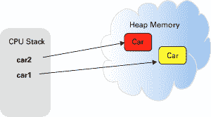

**图 3-1:** 实例化两个 `Car` 对象

`new JamesBondCar()` 语句在 `heap memory`（堆内存）中创建了该类的实例。在现实世界中，你可以根据相同的规格创建许多汽车。尽管它们都代表同一个类，但它们的属性可能有不同的值——有些是红色的，有些是黄色的；有些有两个门，而另一些有四个门，以此此类推。

## 变量与数据类型

表示对象的某些值会在程序的生命周期内发生变化（变量），而某些则保持不变（常量）。本节将更深入地介绍这两个类型的用法。

### 声明变量

Java 是一门静态类型语言：程序的 `variable` 必须先声明（赋予名称和数据类型），然后你可以在声明时或稍后在类方法的任意一个方法中为它们赋值。例如，变量 `isGunOnBoard` 已经在其代码列表 3-2 声明期间进行了初始化，而 `currentSubmergeDepth` 则在 `submerge()` 方法中获取了它的值。

代码列表 3-1 中的 `Car` 类定义了一个 `String` 类型的 `variable` `color`，用于表示文本值；例如，“Red”、“Blue”等。

### final 变量

为了存储从不改变的值，你需要声明一个 `final variable`（或常量）；只需在声明行中添加 `final` 关键字，如代码列表 3-2 所示：

```
final String MANUFACTURER = "J.B. Limited";
```

Java 开发者通常用大写命名 final 变量。如果你好奇 Java 开发者是如何达成命名规范的，可以查看其中一个编码标准指南。例如，Google 在各种语言的 [`https://code.google.com/p/google-styleguide/`](https://code.google.com/p/google-styleguide/) 上发布了编码标准。

常量的值只能赋值一次，而且由于你正在创建一个特定汽车的实例，它的制造商是已知的，在该对象的生命周期内不能更改。如前所示，声明一个 `final` 变量并立即初始化它。

### 原生数据类型

当你声明一个类时，你创建了一个新的数据类型，并可以像在 `Car` 类中看到的那样声明该类型的变量。但这些并不是简单的数据类型，因为它们可以包含描述该类型对象的字段和方法。另一方面，Java 具有预定义的数据类型用于存储简单值，例如整数或字符。

Java 中有八种 `primitive`（原生）数据类型：四种用于整数值；两种用于带小数的值；一种用于存储单个字符；一种用于布尔数据，其值只允许为 `true` 或 `false`。以下是变量声明和初始化的一些示例：


## 原生数据类型

```java
int chairs = 12;
char grade = 'A';
boolean cancelJob = false;
double nationalIncome = 23863494965745.78;
float hourlyRate = 12.50f;   // 在 float 字面量末尾添加 f
                             // literals
long totalCars = 4637283648392l; // 在 long 字面量末尾添加 l
                                   // long literals
```

前述列表中最后两个字面量以字母 `f` 和 `l` 结尾，表示你想将这些数据分别存储为 `float` 和 `long` 数据类型。`double` 数据类型符合非整数计算的大多数需求。

每个原生数据类型占用固定数量的内存，并有一个其可以存储的值范围。下表总结了 Java 数据类型的一些特征。

| Primitive Type（原生类型） | Size（大小） | Min Value（最小值） | Max Value（最大值） | Wrapper Class（包装类） |
| :--- | :--- | :--- | :--- | :--- |
| `byte` | 8 bits | `-128` | `127` | `Byte` |
| `short` | 16 bits | `-32,768` | `32,767` | `Short` |
| `int` | 32 bits | `-2,147,483,648` | `2,147,483,647` | `Integer` |
| `long` | 64 bits | `-9,223,372,036,854,775,808` | `9,223,372,036,854,775,807` | `Long` |
| `float` | 32 bits | `-3.4E38` | `3.4E38` | `Float` |
| `double` | 64 bits | `-1.8E308` | `1.8E308` | `Double` |
| `char` | 16 bits | `0` | `65,535` | `Character` |
| `boolean` | - | `false` | `true` | `Boolean` |

你注意到 `char` 数据类型使用两个字节来存储数据了吗？这允许你存储更多的字符集，因为单个字节只能表示 256 个不同的字符。如果你需要存储非常大的数字，Java 有 `BigDecimal` 类，但它不是原生类型。

## 变量作用域

如果你在任何方法或大括号围绕的代码块内声明变量，该变量具有局部作用域（例如，代码列表 3-1 中的 `tempCounter` 是局部的）。这意味着它只对方法内部可见。局部变量在声明后，仅在其声明的块内可访问。例如，声明在 `for` 循环中的变量即使在同一个方法的外部也是不可访问的。

当方法执行完成时，所有局部原生变量会自动从栈内存中移除。如果一个变量指向一个实例（例如，图 3-1 中的 `car1`），相应的对象实例将由 Java 的`垃圾回收器`从堆内存中移除，但不会立即发生。

如果一个变量需要被类中的多个方法访问，请在类级水平上声明它。代码列表 3-1 显示了 `Car` 类，其中 `color` 和 `numberOfDoors` 是*类*变量或成员变量。这些变量在 `Car` 对象存在于内存中期间一直“存”。它们可以被类中的所有方法共享和重用，甚至可以从外部类可见（在第 7 章 中访问权限）。传递原生变量和指向对象实例的变量之间存在一些差异。请阅读下一章中的按值或按引用传递节。

## 包装、自动装箱和拆箱

所有原生数据类型都有对应的*包装类*，这些包装类包含了处理相应数据类型的有用方法。包装类有两个用途：

1. 它们包含了许多用于与其原始类型进行操作的有用函数。例如，`Integer` 类提供了许多实用方法，如将 `String` 转换为 `int`，或将 `int` 转换为 `float` 等。`Integer` 类还允许你设置相关数字的最小值和最大值。
2. 某些 Java 集合无法存储原始类型（例如 `ArrayList`），因此必须将原始类型包装成对象。例如：

```java
ArrayList myLotteryNumbers = new ArrayList();
myLotteryNumbers.add(new Integer(6));
myLotteryNumbers.add(new Integer(15));
```

Java 有一种名为“自动装箱”（autoboxing）的特性，它让你无需再像像前面的代码段那样为每个原始类型显式创建新实例。你只需要编写 `myLotteryNumbers.add(6);`，原始值 `6` 就会自动包装成 `Integer` 类的实例。

同样地，下一行也是有效的：

```java
int luckyNumber = myLotteryNumber.get(23);
```

尽管 `get(23)` 返回的是第 24 个元素（Java 集合的索引从零开始）的 `Integer` 对象值，但该对象会自动转换为原始类型。这被称为“自动拆箱”（unboxing）。

## 程序注释

在编写 Java 代码时，你应该添加注释，即解释程序作用的文本。程序的阅读频率远高于其编写频率。在未来的某个时刻，其他软件开发者将阅读并尝试理解你的代码。请友好一点，让他们的工作变得轻松些。典型的软件开发者不喜欢写注释（无论他们使用哪种编程语言）。

我建议你使用一种简单的技巧：先写注释，再写代码。等你的程序编写完时，它已经有了注释。你几乎可以在任何地方写注释——类之前或类内部，或者方法内部。

在 Java 中，你可以使用三种类型的注释：

*   **块注释**包含位于符号 `/*` 和 `*/` 之间的多行文本。例如：

    ```java
    /* 此方法将计算运费、手续费 
        以及所有适用的税费
    */
    ```

    编译器会忽略注释中的文本，你可以随心所欲内容。

*   如果你想写一行适合单行的短注释，请以两个正斜杠（`//`）开头该行。你也可以在行尾放置带有两个正斜杠的注释。

    例如：

    ```java
    // 计算运费
    int cost = calcShippingCost();  // 取决于国家
    ```

*   某些注释以 `/**` 开头并以 `*/` 结尾。这些注释由特殊工具 javadoc 使用，它可以自动从这些注释中提取文本并创建程序文档。Javadoc 还允许使用特殊注解（例如 `@param`、`@return`、`@see`），从而生成看起来专业的程序文档。为了直观感受 javadoc 可以生成的内容，请阅读 Oracle 关于编写 javadoc 注释的白皮书：[`http://goo.gl/imDMU`](http://goo.gl/imDMU)。

## 第一个实用的程序

是时候编写一个比打印“Hello World”更有用的程序了。这个程序模拟了州税的计算。其目标是向你展示 Java 类是如何相互通信的、方法是如何调用的，以及变量是如何被使用的。

首先，你需要决定为当前任务需要编写哪些 Java 类。然后考虑这些类应该具备哪些属性（类变量）和方法（行为）。

### 声明税收类

因为你计划计算税费，不需要火箭科学家也能发现你需要定义一个名为 `Tax` 的类。从类名和花括号开始——这是你能创建的最简单的类：

```java
class Tax{
}
```

该类需要什么数据来执行税收计算？你确实需要知道某人在纳税年度的总收入。总收入是该类属性的理想候选者。Java 中的属性用变量（`variables`）表示。选择一种数值数据类型。总收入并不总是整数，所以使用 `double` 数据类型，因为它是一个带有小数点的数字。你可以用 `float` 代替，但使用 `double` 可以让你准备好处理更大的收入：

```java
class Tax{
      double grossIncome;
}
```

你还需要知道这个人住在哪个州；税收规则随州而异。以下是美国几个州的缩写：NY, NJ, CT。使用 `String` 数据类型来存储文本数据：

```java
class Tax{
       double grossIncome;
       String state;
 }
```

再为纳税人的受抚养人数添加一个属性。`Integer` 在这里完全适用——人不可能有两个半个抚养人口：

```java
class Tax{
       double grossIncome;
       String state;
       int  dependents;
}
```

### 为税收类添加方法

变量存储数据，方法执行操作。现在是执行操作的时间了。第一个方法 `calcTax()` 根据总收入、受抚养人数和州的值来计算州税：

`calcTax()` 方法签名告诉了我们以下信息：

*   任何外部类都可以访问此方法（`public`）。
*   此方法返回一个 `double` 类型的值。
*   方法的名称是 `calcTax`。

方法名后的空括号意味着它没有任何参数，换句话说，它不需要来自 `Tax` 的任何值。事实上，这个版本的 `calcTax()` 甚至没有使用类变量。它只是返回一个硬编码的值 234.55。

如何决定一个方法是否应该返回值？如果你的方法执行某些计算并必须向调用程序返回一个值，它就必须返回。如果方法直接修改类变量或仅将数据输出到某地方（显示器、磁盘、服务器），它可能不需要返回任何值。你仍然需要通过特殊关键字 `void` 在方法签名中声明“无返回”：

```java
public void printAnnualReturn() {
    // 代码在这里
}
```

通过 Java 的 `return` 语句，方法可以将变量中的数据返回给调用程序，例如：

```java
return calculatedTax;
```

请记住，如果你在方法签名中声明了返回类型，但在方法体中忘记包含 `return` 语句，Java 编译器会报错。

### 声明另一个类：TestTax

`Tax` 将知道如何计算税，但在实际应用程序中，会有许多表示此过程各种工作流的类。例如，你可能需要创建一个名为 `Customer` 的类。根据就业或收入类型，会计师使用许多表格来报税，每个表单都可以由单独的类表示：`Form1040`、`Form1099` 等。

这些类中的每一个都代表一个实体，但没有一个是可执行的程序；也就是说，它们都没有 `main()` 方法。你需要再创建一个类来启动应用程序并在需要时实例化其他类。我将这个类命名为 `TestTax`。`TestTax` 类应该执行以下操作：

*   创建 `Tax` 类的实例。
*   将客户数据（总收入、州、抚养人数）分配给 `Tax` 类的类变量。
*   调用 `calcTax()` 方法。
*   将结果打印到屏幕上。

`TestTax` 类存储在单独文件 `TestTax.java` 中。

在前面的代码中，你声明了一个类型为 `Tax` 的变量 `t`。`main()` 方法是税务计算程序的入口点。该方法创建了 `Tax` 类的实例，变量 `t` 指向你计算机内存中创建 `Tax` 对象的区域。从现在起，如果你想引用这个对象，请使用变量 `t`。再看一眼图 3-1，它展示了与你此处类似的处情境。

接下来的三行代码为 `Tax` 对象的字段赋予了值：

```java
t.grossIncome = 50000;
t.dependents = 2;
t.state = "NJ";
```

之后，你可以通过调用 `calcTax()` 方法来计算由 `t` 表示的对象的税费，该方法返回的结果将赋值给变量 `yourTax`。`calcTax()` 方法仍然返回硬编码的值，但你将在本节的“试一试”部分中修复此问题。最后一行只是在系统控制台上显示结果。

到目前为止，你已经有两个类在相互通信（`TestTax` 和 `Tax`）。`TestTax` 类创建了 `Tax` 的实例，初始化了它的变量并调用了它的方法 `calcTax()`，该方法将值返回给 `TestTax` 类。

### 条件语句 if

在现实生活中，我们不断做决定：“如果她说这个，我就用那个回答，否则我就做别的事。” Java 有一个 `if` 语句可以判断某些条件是 `true` 还是 `false`。根据这个问题的答案，你的程序的执行路径将进行路由。

在下面的代码段中，如果条件表达式（`totalOrderPrice > 100`）求值为 `true`，则执行第一个大括号之间的代码；否则执行 `else` 语句之后的代码：

```java
if (totalOrderPrice > 100){
    System.out.println("You’ll get a 20% discount");
}
else{
    System.out.println("Order books for more than a" +
                       " $100 to get a 20% discount");
}
```

由于这段代码示例在 `if` 和 `else` 子句中只有一个要执行的语句，使用大括号不是必须的，但它们使代码更具可读性，并在你以后如果需要在 `if` 语句中添加更多代码时，防止你引入难以发现的错误。

### switch 语句

`switch` 语句是 `if` 的替代方案。switch 条件中的 case 标签（`taxCode`）会被求值，程序将进入以下 `case` 子句之一：

```java
int taxCode = someObject.getTaxCode(grossIncome);
switch (taxCode){
   case 0:
     System.out.println("Tax Exempt");
     break;
   case 1:
     System.out.println("Low Tax Bracket");
     break;
   case 2:
     System.out.println("High Tax Bracket");
     break;
   default:
     System.out.println("Wrong Tax Bracket");
}
// 其他代码写在这里
```

前面的代码仅调用了 `println()` 方法之一，并继续执行关闭大括号之后的其他代码（如果有的话）。不要忘记在每个 `case` 语句末尾加上 `break`，以便程序在处理完一个 case 后跳出 `switch` 语句；否则代码会“穿透”并打印出多行，即使 `taxCode` 只能有一个值。例如，下面的代码即使在 `taxCode` 值为零的情况下也会打印“Tax Exempt”和“Low Tax Bracket”：

```java
switch (taxCode){
   case 0:
     System.out.println("Tax Exempt");
   case 1:
     System.out.println("Low Tax Bracket");
   case 2:
     System.out.println("High Tax Bracket");
   default:
     System.out.println("Wrong Tax Bracket");
}
```

从 Java 7 开始，你可以使用 `String` 值：

```java
switch (taxState){
   case "NY":
     System.out.println("Taxing by NY");
     break;
   case "CA":
     System.out.println("Taxing by CA");
     break;
   case "FL":
     System.out.println("Taxing by FL");
     break;
   default:
     System.out.println("Wrong state");
}
```

### 继承

在面向对象的语言中，*继承*意味着基于现有的类定义新类的能力。想象 `Tax` 类有 20 个方法。大部分方法对所有州都有效，但其中一个方法对新泽西州无效。与其在父类中修改该方法，不如你可以在子类中创建另一个。特殊关键字 `extends` 用于指示一个类继承自另一个类：

```java
class NJTax extends Tax{
}
```

`NJTax` 类拥有 `Tax` 的所有特征，除非这些特征是私有访问的。在这种设置下，`Tax` 类称为*父类*，`NJTax` 称为*子类*。你也可以分别使用*祖类*和*后代*术语。

### 方法重写

面向对象编程的另一个重要术语是*方法重写*。想象 `Tax` 类有 20 个方法。大部分对所有州都有效，但有一个对新泽西州无效。与其在父类中修改该方法，你可以在子类中创建一个相同名称和参数列表的方法（称为*签名*）。如果子类拥有具有相同签名的方法，它将重写（抑制）其祖类的对应方法。

方法重写在以下情况下非常有用：

*   父类的源码不可用，但你仍然需要更改功能。
*   方法的原始版本在某些情况下仍然有效，你想保持其完好。
*   你使用方法重写来实现多态，这将在第 7 章中解释。

你可以在“试一试”部分尝试方法重写。在第 4 章中你将学习方法重载，它是完全不同的概念。

### 试一试

在本节中，你将在 Eclipse 中创建本节描述的税务计算应用程序，然后修改它，用某些计算替换 `calcTax()` 方法返回的硬编码值。完成后，你将类类 类并重写 `calcTax()`。

### 课程要求

学习本节你必须安装了 Eclipse IDE。

### 补充材料

Java 垃圾收集 [`http://www.oracle.com/webfolder/technetwork/tutorials/obe/java/gc01/index.html`](http://www.oracle.com/webfolder/technetwork/tutorials/obe/java/gc01/index.html)


本课程仅对 Java 语言的基本结构进行了简要介绍。在完成本课程及未来的作业时，在线 Java 教程可能会有所帮助。你可以在 [`http://download.oracle.com/javase/tutorial/java/index.html`](http://download.oracle.com/javase/tutorial/java/index.html) 找到它。

### 步骤说明

1. 在 Eclipse 中，创建一个名为 `Lesson3` 的新项目。
2. 创建一个新的 `Tax` 类（文件→新建→类）。输入 列表 3-3 所示的代码。
3. 创建另一个类 `TestTax`，并输入 列表 3-4 中的代码。
4. 保存两个类并运行 `TestTax`（右键点击并选择 运行方式→Java 应用程序）。控制台视图应显示“Your tax is $234.55.”。
5. 将硬编码值的返回替换为某些税收计算。假设如果总收入低于 $30,000，则扣除 5% 的州税；如果超过 $30,000，则扣除 6%。修改方法 `calcTax()` 代码如下。运行程序几次，修改 `Tax` 类中类变量的值。确保控制台上的税值计算正确：

```
public double calcTax() {
  double stateTax=0;
  if (grossIncome < 30000) {
    stateTax=grossIncome*0.05;
  }
  else{
    stateTax= grossIncome*0.06;
  }
  return stateTax;
}
```

6. 创建 列表 3-5 所示的 `NJTax` 类。
7. 通过在 `NJTax` 中重写 `calcTax()` 来更改其功能。新版本的 `calcTax()` 应该在返回值之前减少 $500 的税额。
8. 修改 `TestTax` 类的代码以实例化 `NJTax` 而不是 `Tax`。观察 $500 的扣除是否已正确计算。

要获取示例数据库文件，你可以从书籍网站 [`www.wrox.com/go/javaprog24hr2e`](http://www.wrox.com/go/javaprog24hr2e) 下载第 3 章。

# 第 4 课：类方法与构造函数

方法包含类可以执行的操作或功能的代码。虽然你在此之前的课程中已经开始接触方法，但在本节中，你将详细了解如何使用它们。你还将熟悉一种称为构造函数的特殊类型方法。

## 方法参数

每个类方法都会执行某些功能，例如计算税费、下订单或启动汽车。如果方法需要某些外部数据来执行其功能，这些数据可以以参数（arguments）的形式提供，如 列表 3-5 所示的 `adjustForStudents()` 方法，它包含一个参数：`stateTax`。

在方法签名中，你需要声明每个参数的数据类型和名称。例如，以下方法有三个参数：其中两个是 `int` 类型，一个是 `String` 类型：

```
int calcLoanPayment(int amount, int numberOfMonths, String state){
  // 在此处编写代码
}
```

当你调用（或触发）一个方法时，Java 运行时会尝试寻找与指定签名匹配的方法。例如，如果你尝试这样调用前面的方法：

```
calcLoanPayment(20000, 60);
```

Java 编译器将给出一个错误，声称没有找到仅接受两个参数的 `calcLoanPayment()` 函数。

## 方法重载

如果你想允许使用不同数量的参数调用方法，则需要创建该方法的多个版本。例如，你可以创建一个方法，该方法使用纽约州作为默认值，以避免开发者提供州份作为参数。如果大多数贷款计算都是为纽约人做的，那么这种方法可能是一个好主意。因此，除了带有三个参数的 `calcLoanPayment()` 方法外，你又创建了一个只有两个参数的方法。为了避免代码重复，只有带有三个参数的方法实现了计算还款的逻辑。带有两个参数的方法只需调用它，并将“NY”作为第三个参数加入。

```
int calcLoanPayment(int amount, int numberOfMonths){
  calcLoanPayment(amount, 12, “NY”);
}
```

方法重载意味着一个类中有多个同名但参数列表不同的方法。方法不仅可以在同一个类中重载，还可以在子类中被重载。例如，`LoanCalulator` 类可以定义一个带有三个参数的 `calcLoanPayment()` 方法，而其子类 `MyLoanCalculator` 可以拥有一个带有两个参数的 `calcLoanPayment()` 版本。

为什么要在类中重载方法？为了给使用这些类的程序员提供一个更灵活的应用程序编程接口（API）。回到贷款计算的示例，程序员现在可以选择调用该方法的三个参数版本或两个参数版本。

## 构造函数

当程序创建一个类的实例时，Java 会调用该类的构造函数——这是一种特殊方法，仅在用 `new` 构建实例时调用一次：

```
Tax t = new Tax();
```

上一个代码段中的空括号意味着此代码调用了无参数构造函数。如果你没有在类中声明构造函数，Java 会为你创建一个默认的无参数构造函数。

构造函数具有以下特征：

- 在实例化类时被调用。
- 它们必须与所属的类同名。
- 它们不能返回值，你不需要指定 `void` 关键字作为返回值。

通常构造函数代码很少。你在那里为类变量分配初始值。在下一个代码段中，定义了一个三参数的构造函数：

创建该类的实例可以像这样：

```
Tax t = new Tax(65000,”NJ”,3);
```

注意类变量初始化的区别：在这里你通过构造函数的参数在类实例化期间传递值，而在列表 3-4 中，需要四行代码来创建 `Tax` 实例并初始化变量。但在上一个代码段中，你一举两得：实例化了 `Tax` 并通过构造函数初始化了变量。

注意，在定义了带参数的构造函数后，自动创建默认无参数构造函数的规则不再适用。如果你需要一个类拥有多个构造函数，且其中一个是无参数的构造函数，那么你必须显式地编写一个无参数构造函数。

上一个代码段声明了变量 `t`，它指向内存中 `Tax` 对象的实例。要引用此实例的特定字段或调用其方法，你需要使用点符号表示法——引用变量名后跟一个点以及字段名或方法名。例如：

```
public static void main(){
...
Tax t = new Tax(65000,”NJ”,3);
t.dependents = 4; // 将抚养人数从 3 更改为 4
...
}
```

如果一个方法在子类中被重写，则存在两个具有相同签名的方法版本。如果你直接通过名称调用方法；例如调用第 3 章中 `NJTax` 类中的 `calcTax()`，JVM 将调用该方法的重写版本。某些情况下，你可能需要调用祖类的方法版本。`super` 关键字允许你显式地调用祖先类中的方法或构造函数。例如，要调用祖类方法 `calcTax()`，只需在子类中编写 `super.calcTax();` 即可：

如果一个类继承自另一个类，它们每个都可能有一个显式定义的构造函数。与普通类方法不同，子类的构造函数不能重写父类的构造函数；它们的名称甚至不同。但有时，你可能需要在子类的构造函数中添加某些必须在祖类构造函数代码之后调用的功能。为了避免代码重复，只需添加对父类构造函数的显式调用，随后是你想在实例化子类期间想要运行的额外代码（参见列表 4-2）。对父类构造函数的调用必须是构造函数中的第一行。

## this 关键字

当你需要从类方法引用类的实例时，`this` 关键字非常有用。回顾列表 4-1 中的构造函数代码。构造函数参数的名称与类变量的名称不同。但列表 4-3 中的代码展示了如何在参数和类变量中使用相同的变量名。除了指向当前对象外，`this` 关键字有助于解决命名冲突。要指示 JVM 使用实例变量 `grossIncome`，请使用以下语法：

```
 this.grossIncome = 50000;
```

如果 `Tax` 类中只有一个 `grossIncome` 变量，你就可以简单地省略 `this` 前缀。但在列表 4-3 中，缺少 `this` 关键字会导致歧义，且实例变量永远不会被初始化。

考虑一个名为 `SomeOtherClass` 的类，其定义了一个方法 `verifyTax(Tax t)`。如你所见，它期望一个 `Tax` 对象的实例作为参数。列表 4-4 展示了你如何从 `Tax` 类使用 `this` 关键字传递指向当前 `Tax` 对象实例的引用。

这里是另一个用例：一个类有多个具有不同数量的重载构造函数。与方法重载一样，重载构造函数为实例化对象提供了更多选择，并有助于避免代码重复。你可以使用 `this()` 符号来调用特定版本的构造函数。在列表 4-5 中，第二个构造函数调用了第一个。

## 值传递或引用传递

带参数调用方法允许你向方法传递某些所需数据。问题是 JVM 是如何将这些值传递给方法的。它是在调用程序中创建一个变量的副本并将其交给方法吗？

基本类型值是通过值传递的（这意味着为每个变量在内存中创建了一个额外的副本）。如果你像列表 4-6 那样创建一个 `Tax` 实例，将会有两个 `grossIncome` 副本和两个 `dependents` 变量副本——一个在 `TestTax` 中，另一个在 `Tax` 中。但对象是通过引用传递的。以下代码在内存中只创建了一个“NJ”副本。在 Java 中，String 对象有特殊的处理规则，将在第 5 章中讨论，但规则仍然适用：非基本类型是通过引用传递的。

在前面的示例中，如果你在 `Tax` 类构造函数中更改 `grossIncome` 或 `dependents` 的值，将不会影响 `TestTax` 类对应变量的值，因为这些基本类型有两个副本。

现在考虑另一个示例。我正在声明另一个 `Tax` 类型的变量并将 `t` 的值赋值给它：

```
 Tax   t2 = t;
```

变量 `t` 指向内存中的一个 `Tax` 对象实例。换句话说，变量 `t` 持有指向对象的引用（内存中的地址）。上面的代码行没有在内存中创建另一个 `Tax` 对象的副本，而是将其地址复制到变量 `t2` 中。你仍然只有一个 `Tax` 对象实例，但现在你有两个引用变量——`t` 和 `t2`——指向它。在这两个变量都超出作用范围（这将在下一节中解释）之前，`Tax` 对象不会从内存中移除。

正如我之前提到的，从内存中移除未用对象的过程被称为垃圾回收。JVM 自动运行 GC。

这里是另一个引用传递的示例：列表 4-5 中的代码没有创建指向 `Tax` 实例的 `Tax` 实例副本。这意味着如果 `SomeOtherClass` 中的代码更改了 `Tax` 实例的属性，这些更改将应用于该实例。

## 变量作用域

变量作用域定义了变量生存多久以及何时可用。在方法内部声明一个变量，它就是局部变量，方法结束就会超出作用范围（变得不可用）。例如，列表 4-6 中的 `t`、`grossIncome`、`dependents` 和 `state` 是局部的。

如果变量定义在在大括号的代码块内，其作用域仅限于该块。例如，以下代码：

```
 public double calcTax() {
      double stateTax=0;
      if (grossIncome < 30000) {
        int taxCredit = 300;
        stateTax=grossIncome*0.05 - taxCredit;
      }
      else{
        stateTax=grossIncome*0.06;
      }
        return stateTax;
}
```

如果在方法之外声明变量（如列表 4-1 中的 `grossIncome`、`dependents` 和 `state`），它们是类变量，可以被该类的任何方法使用。另一方面，列表 4-1 中的 `grossIncome`、`dependents` 和 `state` 也是实例变量，存储特定实例的数据。

你可以创建多个 `Tax` 类实例，每个实例的实例变量值不同。例如，以下代码行创建了两个 `Tax` 实例，其 `grossIncome`、`dependents` 和 `state` 具有不同的值（这些实例变量在构造函数中初始化）：

```
 Tax   t1 = new Tax(50000, "NY”, 3 );
Tax   t2 = new Tax(65000, "TX”, 4 );
```

## static 关键字

Java 有一个特殊的关键字 `static`，表示类变量被同类类的所有实例共享。如果 `Tax` 类声明 `static double grossIncome;`，那么该变量的值将被 `Tax` 类的所有实例共享，这在税收计算场景中是不符合的。

此外，在创建两个实例（`t1` 和 `t2`）之后，如前面的代码所示，变量的第一个值（`50000`）会被第二个值（`65000`）覆盖。

但是，如果你在 `Tax` 类中引入一个类变量来统计其实例的数量（例如计算过税费的客户数量），那么该变量必须声明为 `static`，这样每个实例在创建时都可以对其唯一版本递增，如 Listing 4-7 所示。

你还可以使用 `static` 修饰符声明方法。此类方法无需先实例化类即可调用。这通常用于不使用任何实例变量的工具方法，这些方法通过参数获取输入并返回结果。

以下函数将华氏度转换为摄氏度并返回结果：

```
 class WeatherReport{
      static double convertToCelsius(double far){
           return ((far - 32) * 5 / 9);
    }
}
```

你可以从另一个类调用此函数，而无需先实例化 `WeatherReport`：

```
 double centigrees=WeatherReport.convertToCelsius(98.7);
```

注意，由于你从未实例化过 `WeatherReport` 类，因此没有指向任何对象的引用变量。你只需要使用类名后跟点和方法名即可。

Java 8 在接口中引入了静态方法，这在 Lesson 6 中有所介绍。

## Try 尝试

在本节中，你将创建另一个版本的 `Tax` 类，包含一个三参数的构造函数，并添加一个工具函数将税值从美元转换为欧元，假设美元兑欧元的汇率为 1.25。

### 课程要求

对于本节，你应该安装 Eclipse IDE。

### 步骤说明

1. 在 Eclipse IDE 中，创建一个名为 `Lesson4` 的新项目。
2. 创建名为 `Tax` 的新类（File → New → Class）。输入 Listing 4-7 所示的代码。
3. 在 `Tax` 类的构造函数的最后一行添加以下语句：

   ```
     System.out.println("Preparing the tax data for customer #” +
     customerCounter);
   ```

4. 在 `Tax` 类中添加 `calcTax()` 方法，通过将总收入乘以 0.33 并减去抚养人数乘以一百的结果来计算税费：

   ```
     return (grossIncome*0.33 - dependents*100);
   ```

5. 为 `Tax` 添加 `static` 函数将计算出的税费转换为欧元，应用 1.25 的货币转换率。

   ```
     public static void convertToEuros(double taxInDollars){
        System.out.println("Tax in Euros: " + taxInDollars/1.25);
    }
   ```

6. 创建一个 `TestTax` 类并输入 Listing 4-6 中的代码。在该类的 `main()` 方法中添加一行来创建另一个 `Tax` 类的实例：

   ```
     Tax   t2 = new Tax(65000, "TX”, 4 );
   ```

   使用 `Tax` 类的第二个实例计算税费：

   ```
     double hisTax = t2.calcTax();
   ```

7. 两次调用 `convertToEuros()` 方法进行货币转换，将 `t` 和 `t2` 计算出的税费作为参数传递。
8. 运行 `TestTax` 类（右键点击并选择 Run As → Java Application）。控制台视图应显示两条“Preparing the tax...”消息，随后是两条带有计算出的欧元税费的消息，如下所示：

   Preparing the tax data for customer #1

   Preparing the tax data for customer #2

   Tax in Euros: 13040.0

   Tax in Euros: 16840.0

要获取示例文件，请从书籍网站下载 Chapter 4 文件夹的内容，地址为[`www.wrox.com/go/javaprog24hr2e`](http://www.wrox.com/go/javaprog24hr2e)。

# 第 5 节：Java 语法：细节

本教程并没有从详细介绍 Java 语言的基础结构（如 `if` 语句、循环等）开始。你通过熟悉面向对象的术语和语言结构开始学习 Java 编程。本节是基础语言元素、术语和数据结构的杂锦。你还将了解如何在 Eclipse IDE 中调试 Java 程序，以及如何向命令行启动的程序传递参数。

## 数组

`array`（数组）是一种用于存储相同类型多个值的数据存储。假设你的程序必须存储 20 个不同女孩的名字，例如 Masha、Matilda、Rosa 等。与其声明 20 个不同的 `String` 变量，不如声明一个容量可以存储 20 个元素的 `String` 数组：


```
String[] friends = new String[20]; // 并实例化数组
friends[0] = "Masha";                 // 初始化第一个元素
friends[1] = "Matilda";               // 初始化第二个元素
friends[2] = "Rosa";
// 在此处继续初始化数组的其他元素
friends[19] = "Natasha";               // 初始化最后一个元素
```

Java 中数组的第一个元素索引始终为 `0`。Java 中的数组是基于零索引的。在声明数组时，你可以将括号放在类型后面，也可以放在变量名后面。以下两种声明都是正确的：

```
String friends[];
String[] friends;
```

在赋值值之前，你必须知道数组的大小。数组有一个 `length` 属性可以知道数组中的元素数量。下一行显示了如何获取这个数量：

```
int totalElements = friends.length;
```

如果你在声明时就知道所有要存储在数组中的值，可以同时声明并初始化数组。以下行声明、实例化并填充了数组：

```
String[] friends = {"Masha", "Matilda", "Rosa", "Sharon"};
```

在运行期间，如果你想要动态更改数组的大小，请考虑使用 `java.util` 包中的类，如 `Vector` 和 `ArrayList`。除了数组，Java 许多可以存储相关值的类；例如 `HashMap`、`List` 和 `LinkedList`。你有机会在书中看到它们。Listing 5-1 包含了填充数组的代码。

我们的 `friends` 数组并不像手机中的联系人列表那样实用——尽管它没有存储电话号码。幸运的是，Java 支持多维数组。例如，为了创建一个二维数组（姓名和电话号码），使用两组括号声明：

```
String friends[][] = new String[20][2];
friends[0][0] = "Masha";
friends[0][1] = "732 111-2222";
friends[1][0] = "Matilda";
friends[1][1] = "718 111-2222";
...
friends[19][0] = "Sharon";
friends[19][1] = "212 111-2222"
```

### 更多关于 String

`String` 是 Java 中的特殊对象。它们存储在字符串池中以便重复使用。它们是不可变的；你无法更改已初始化的 `String` 值。然而，这并不意味着你不能基于现有创建新的 `String`。考虑以下代码示例：

```
String bestFriend = "Mary";    
bestFriend = bestFriend + " Smith";
String greeting = "Hello " + bestFriend;
```

第一行在字符串池中创建一个值为“Mary”的节点。第二行并没有修改第一个，而是创建一个值为“Mary Smith”的新节点。第三行在池中又创建一个另一个值为“Hello Mary Smith”的节点。

程序可能由数百个类组成，如果任何其他类需要这三个值中的任何一个 `String`，将从池中获取。

如果你的程序需要对字符串进行大量的操作，请考虑使用 `StringBuffer` 类，它是可变的。例如：

```
StringBuffer sbf = new StringBuffer();
sbf.append("Mary");
sbf.append(" Smith");
String fullName = sbf.toString();  // 回 String
```

创建一个创建文本数据的可变对象的方法是 `StringBuilder` 类。它基于数组并具有容量能力。例如，你可以为 50 个字符分配内存，并如下所示填充其中的 10 个字符：

```
StringBuilder sbld = new StringBuilder(50);
sbld.append("Mary");
sbld.append(" Smith");
String fullName = sbld.toString(); // 转换回 String
```

`StringBuilder` 拥有许多方便的方法，例如在字符序列的特定位置插入字符或删除一个或多个字符的方法。更多示例，请参阅 Oracle 的教程：[`http://docs.oracle.com/javase/tutorial/java/data/buffers.html`](http://docs.oracle.com/javase/tutorial/java/data/buffers.html)。

你是否注意到，尽管 `String` 是一个对象（而不是基本数据类型），但我并没有使用 `new` 算符来实例化这些对象？你也可以像实例化普通对象一样实例化字符串。例如：

```
String friend1 = new String("Mary");
String friend2 = new String("Joe");
String friend3 = new String("Mary");
```

现在，我想引起你对 `String` 比较的注意。回到第 3 节的开头，再次查看说明汽车两个实例的图。变量 `car1` 和 `car2` 指向不同的内存地址。同样，变量 `friend1`、`friend2` 和 `friend3` 指向三个不同的内存位置，存储在这些变量中的值是两个不同对象的地址。因此，尽管第一个和第三个朋友的名字相同，比较 `friend1` 和 `friend3` 也会返回 `false`。你可以尝试运行以下行代码来测试：

```
System.out.println("Is friend1==friend3? " + (friend1==friend3));
```

但如果你想比较字符串的值（而不是内存地址），请使用 `equals()` 方法。以下代码将打印出以 `true` 结尾的句子：

```
System.out.println("Is friend1.equals(friend3)? " + 
                                       (friend1.equals(friend3))); 
```

## 循环

`循环` 用于多次重复相同的操作。当你预先知道重复某个操作的次数时，使用 `for` 循环。尝试打印来自一维数组 `friends` 的名字。

```
int totalElements = friends.length;
for (int i=0; i < totalElements; i++){
   System.out.println("I love " + friends[i]);
}
```

前面的代码含义是：“从 `i=0` 开始，打印数组 `friends` 中元素 `i` 的值，每次将 `i` 增一（`i++`），直到 `i` 等于 `totalElements` 的值。”列表 5-2 为列表 5-1 所示的程序添加了一个 `for` 循环。

由于 `friends` 数组声明的大小为 `20`，Java 运行时已经为 20 个元素分配了内存。但列表 5-2 中的代码只填充了数组的 20 个元素中的 5 个，这解释了为什么该程序的输出如下所示：

```
I love Masha
I love Matilda
I love Rosa
I love null
I love null
I love null
I love null
I love null
I love null
I love null
I love null
I love null
I love null
I love null
I love null
I love Hillary
I love Natasha
```

关键字 `null` 表示对象中不存在任何值。尽管此数组的大小为 `20`，但只初始化五个元素。

`for` 循环还有另一种语法，被称为 `for-each` 循环。你只需要声明一个与数组中存储的对象类型相同的变量，并指定要迭代的数组。以下代码段声明了变量 `girl`，冒号表示“在”。将此循环的条件表达式读作“对于 `friends` 中的每个元素”。这种语法允许你无需检查数组的大小，也不需要增加任何循环变量。这是一种优雅且简洁的循环表示法：

```
for (String girl : friends){
    System.out.println("I love " + girl);
}
```

你可以使用 `while` 循环重写列表 5-2 中的程序，`while` 循环用于不知道数组确切大小但知道退出循环条件的情形。使用关键字 `while`：

```
int totalElements = friends.length;
int i=0;
while (i<totalElements){
   System.out.println("I love " + friends[i]);
       i++;    // 等于 i=i+1;
}
```

设想一个从数据库读取并处理记录的程序（参见第 21 章 (参见[working_databases_using_jdbc])).当你编写 Java 程序时，你不知道数组中有多少元素，即使你知道，这个数字未来也可能发生，因此带有条件的循环比使用硬编码数字更好。使用 `break` 关键字在下方提前跳出循环。例如，如果你想找到 `friends` 数组中的第一个 `null` 元素，编写如下代码：

```
while (i<totalElements){
       if (friends[i]==null){
          System.out.println("The element " + (i+1) + " is null");
          break;
       }
      System.out.println("I love " + friends[i]);
      i++;
} // 循环的结束括号
```

前面代码中的 `if` 语句检查每个元素的值，允许你执行或跳过循环的一部分。在这种情况下，如果循环遇到 `null` 值，它会将 `i` 的值增一并回到 `while` 循环开头，跳过循环体内的其余代码。（在本节的稍后部分，有一个章节将详细介绍各种 `if` 语句的语法。）带有 `continue` 语句的用于说明 `while` 循环的程序完整代码，如文所示的列表 5-3。

`WhileLoopDemo` 程序的输出在此处：

```
I love Masha
I love Matilda
I love Rosa
I love Hillary
I love Natasha
The iteration is over
```

关键字 `continue` 允许你强制循环返回第一行并重新测试循环条件。以下代码片段仅打印数组中不为 `null` 的值：

```
while (i<totalElements){
    if (friends[i]==null){
        i++;
        continue;
    }
    System.out.println("I love " + friends[i]);
    i++;
}
System.println("The iteration is over");
```

`while` 循环还有一个极少使用的 `do-while` 版本。它以 `do` 关键字开头，随后跟着大括号括的循环体，`while` 条件位于最后。这种循环语法保证了循环体中编写的代码至少执行一次，因为循环条件只有在第一次进入循环后才会进行测试。在下面的循环中，即使数组中的每个元素都是 `null`，至少也会打印出读取 `friends` 数组中第 0 个元素的语句：

```
do {
   System.out.println("Reading the element" + i +" of array friends");
    if (friends[i]==null){
       i++;
       continue;
    }
    System.out.println("I love " + friends[i]);
    i++;

} while (i<totalElements);
```

在任何循环中可能发生的最糟糕的情况就是程序员在循环退出条件上犯了错误，导致循环条件始终评估为 `true`。在编程中，这被称为 `infinite loop`（死循环）。为了更好地理解这个术语的含义，请注释掉 `do-while` 示例中 `if` 语句内部增加变量 `i` 值的行，这样除非你强制停止它或电脑没电，否则程序将永远不会。原因显而易见：如果程序进入了仅有 `continue` 语句的代码块，变量 `i` 的值将永远不会增加，循环执行条件 `i<totalElements` 将永远为真。

## 调试 Java 程序

在程序员的术语中，`bug`（错误）是指导致程序以意想不到的方式运行的错误。不要将 `bug` 与代码中的语法错误（syntax error）混淆。后者会在你启动程序之前被 Java 编译器捕，而 `bug` 则是你的运行时敌人。`debug`（调试）程序就是识别并修复代码中的运行时错误。

调试程序最简单的方法是使用 `System.out.println()` 或类似方法打印“可疑变量”的值。你可能认为某个变量在执行期间会获得特定值，但你可能是错的，从运行程序中打印它的值可能会揭示为什么你的代码会产生意外的结果。

你会发现自己经常使用 IDE 自带的调试器。

尽管 第 2 章 专门介绍了 Eclipse IDE，但在那时解释调试可能有点为得早了，因为当时没有多少 Java 代码需要调试。现在你已经准备好学习 Eclipse 调试器如何帮助你了。

让我们通过使用 Eclipse 调试器运行 `WhileLoopDemo` 程序，来看看 Listing 5-3 中的 `while` 循环是如何工作的。首先，从这本书的网站下载 `Lesson5.zip` 并将其导入 Eclipse。打开 `WhileLoopDemo` 类的源代码，在你希望程序暂停执行的代码行设置断点，这样就可以开始观察程序的内部运行了。

我想在程序进入 `while` 循环之前暂停它，因此在以下行上设置断点：

```
while (i<totalElements){...}
```

双击编辑器视图左侧的蓝色竖条——你应该能看到那里有一个小点的图像。这一行变成了一个断点，如果程序运行到设置了断点的代码，Eclipse IDE 将切换到调试视图（Debug perspective）并暂停程序，高亮即将执行的行。

要在调试器中运行 `WhileLoopDemo`，请在包管理器（Package Explorer）中右键点击此程序的名称，选择“Debug Java Application”（调试 Java ）菜单选项。

第一次运行时，你会看到一个警告，提示 Eclipse 想要切换到调试视图；同意即可。图 5-1 显示了程序到达断点时调试视图的样子。

注意编辑器视图中圆点旁边的小箭头；它向你显示将执行执行的代码。变量视图（Variables view）显示了此时程序变量的值。变量 `i` 等于 `0`；`totalElements` 的值为 `20`。如果你点击变量 `friends` 旁的小加号，就可以看到这个数组的内容。

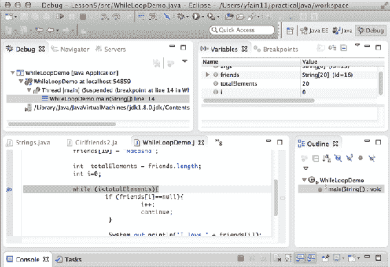

**图 5-1:** 调试器在断点处暂停

现在尝试逐步执行此程序，观察变量 `i` 值的变化。你可以通过点击调试视图工具栏上的按钮来控制程序的执行（参见 图 5-2）。


**图 5-2:** 调试视图选项卡

绿色播放按钮意味着“继续执行程序直到其结束或遇到另一个断点”。红色正方形按钮停止调试过程。第一个弯曲黄色箭头（Step Into，单入）用于代码暂停在调用方法的行上，且你想调试被调用的方法代码。第二个弯曲箭头（Step Over，跳过）允许你执行当前行，而不进入该行代码中可能被调用的任何方法。

此工具栏上还有其他不那么常用的按钮，你可以自行研究；现在，点击 Step Over 按钮进入循环。持续点击此按钮并观察程序没有进入 `if` 语句，这是正确的——`friends` 数组的第一个元素不是 `null`。然后 `if` 在控制台视图打印“I love Masha”，将变量 `i` 的值加到 `1`（参见 图 5-3 中的变量视图），并返回循环条件检查 `i` 的值是否仍小于 `totalElements` 的值。

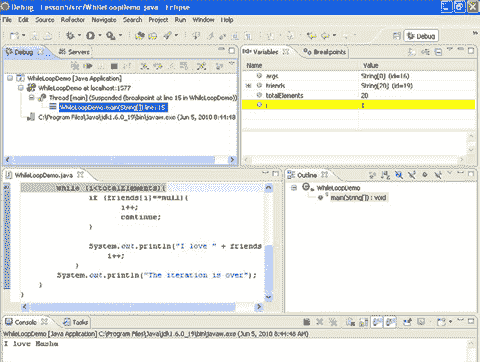

**图 5-3:** 快

## 关于 if 和 switch 语句

如果你需要根据特定条件更改程序的执行，可以使用 `if` 或 `switch` 语句，后者在 第 3 章 中引入。在本节中你将看到条件语句的不同形式。

### if 语句的形式

在 Listing 5-3 中，你看到了 `if` 语句的一种形式：

```
if (friends[i]==null){
    i++;
    continue;
}
```

`if` 语句必须使用大括号来指定如果条件为真时执行的代码块。虽然当代码只有一个语句时不需要大括号，但使用大括号被认为是一种良好的习惯。它们让可能阅读代码的人（或六个月后的你）更容易理解程序：

```
if (friends[i]==null){
    System.out.println("I found an array element with null value");
}
// 其他代码
```

闭大括号后面的代码始终会被执行，这可能并不是所愿的。在这种情况下使用 `if-else` 语法：

```
if (friends[i]==null){
    System.out.println("I found an array element with null value");
} else{
    // 其他代码
}
```


在前面的代码段中，“其他代码”只有在数组元素不是 `null` 时（或者用 Java 的说法是 `friends[i] != null`）才会执行。你可以编写一个带有多个 `else` 子句的 `if` 语句。例如，以下代码只打印一次告白：

```java
if (friends[i] == null) {
    System.out.println("I found an array element with null value");
} else if (friends[i] == "Natasha") {
    System.out.println("I love my wife so much!");
} else if (friends[i] == "Masha") {
    System.out.println("I fell in love with Masha when I was in the 8th grade.");
} else {
    System.out.println("我曾经爱过 " + friends[i]);
}
```

使用条件语句可以比比较两个值要复杂得多。你可以使用 `boolean` AND、OR 和 NOT 运算符来构建表达式。AND 操作表示为 `&&`，如下：

```java
if (age < 20 && gender == "male") {
    // do something only for males under 20 years old
}
```

对于 OR 条件，使用 `||`；例如：

```java
if (age < 30 || yearsInArmy > 0) {
    // do something with people younger than 30 or those who served
    // in the army regardless of their age
}
```

对于 NOT 条件（也称为否定），请使用 `!` 符号：

```java
boolean hasBachelorDegree;
// Read the person record and assign the value true or false
// to the variable hasBachelorDegree
if (!hasBachelorDegree) {
    // do something with people without bachelor degree
}
```

否定符号可以放在 `boolean` 变量的前面（如前面的代码段所示），也可以放在返回 `boolean` 的表达式的前面。下一个代码示例展示了如何使用否定。请注意，比较表达式必须放在括号内；否则，Java 编译器会假设你正试图否定一个名为 `friends[i]` 的 `String` 值，这是不被允许的。

```java
if (!(friends[i] == "Hillary")) {
    System.out.println("Still looking for Hillary.");
}
```

想象一种情况：你需要给一个变量赋值，但该值取决于某个条件的结果。要用一种冗长的方式给变量赋值，可以使用普通的 `if` 语句并测试某些条件，为 `true` 的结果写一个赋值运算符，并在 `else` 部分为 `false` 的结果再写另一个。但如果你使用一种称为 `conditional operator`（条件运算符，符号为 `?`）的特殊结构，就可以更简单地完成相同的任务。

条件运算符由以下部分组成：一个返回 `boolean` 的表达式、一个问号、一个当第一个表达式结果为 `true` 时返回某个值的表达式、一个冒号，以及一个当第一个表达式返回 `false` 时使用的值的表达式。这听起来很复杂，但其实不然。下面的代码示例展示了当一个人的工资大于 $90,000 时，如何发放 3,000 美元的奖金，否则仅发放 2,000 美元：

```java
float salary;
// Retrieve the salary of the person from some data source here
int bonus = salary > 90000 ? 3000 : 2000;
```

## 命令行参数

在第 1 章中，你学习了如何从命令行启动 Java 程序。在 Eclipse 或其他 IDE 中开发完成后，Java 程序会被部署到生产环境中并从命令行启动——通常你会得到一个可以点击的运行启动程序的图标，但在底层，操作系统执行的是一条启动你程序的命令。你不能指望一个会计安装了 Eclipse 来运行税务计算程序，对吧？例如，要从命令行窗口运行 `TestTax` 程序（参见第 4 节），你需要打开命令行（或终端）窗口，将 Eclipse 工作空间中的目录更改到 `Lesson4`，并输入以下内容：

```
java TestTax
```

只有拥有 `main` 方法的 Java 类才能作为独立程序运行，该方法接收一个 `String` 数组作为参数。该数组是用于在程序启动期间从命令行向你的程序传递某些数据的手段。例如，你可以通过如下方式从命令行启动程序，将总收入、州和受抚养人数传递给 `TestTax`：

```
java TestTax 50000 NJ 2
```

`TestTax` 类的 `main(String[] args)` 方法接收这些数据作为一个 `String` 数组，我将其命名为 `args`。该数组由 JVM 自动创建，它足够大容纳从命令行输入的所有参数。该数组将按如下填充：

```
args[0] = "50000";
args[1] = "NJ";
args[2] = "2";
```

命令行参数始终作为 `String` 数组传递给程序。将数据转换为适当的数据类型是程序员的责任。在第 3 章中引入的 Java 包装类非常有用。例如，包装类 `Double` 具有 `parseDouble` 函数，可以将 `String` 转换为 `double`：

```java
double grossIncome = Double.parseDouble(args[0]);
```

查看 Listing 4-6 中的 `TestTax` 程序代码，该程序硬编码了总收入、州和受抚养人数的值。通过使用命令行参数，你可以让程序更具通用性并供更多人使用——而不仅仅是来自新泽西州有两个受抚养且年收入为 $50,000 的人。

你将在“尝试一下”（Try It）部分完成此作业。

## 尝试一下 (Try It)

你的作业是向 Listing 4-6 中的程序引入命令行参数。

### 课程要求

对于本节，你应该已安装 Java。

### 步骤说明

1. 在 Eclipse IDE 中，将 Lesson4 项目中的 `TestTax` 类复制到 Lesson5 项目的 `src` 文件夹中。同时，从第 3 章 项目中复制带有 `if` 语句的 `Tax` 类。

2. 移除硬编码的 `grossIncome`、`state` 和 `dependents` 值。

3. 添加以下代码片段以确保程序启动时带有三个参数。如果没有，则打印错误信息并退出。

```java
if (args.length != 3) {
    System.out.println("Sample usage of the program: java TestTax 50000 NJ 2");
    System.exit(0);
}
```

4. 在 `main()` 方法中添加以下语句，从命令行获取值、转换为相应类型并初始化 `grossIncome`、`state` 和 `dependents`：

```java
double grossIncome = Double.parseDouble(args[0]);
String state = args[1];
int dependents = Integer.parseInt(args[2]);
```

5. 虽然 Eclipse 支持指定命令行参数，但我希望你在命令行中完成剩余工作。在 Eclipse 中右键点击 Lesson5 项目并选择属性（注意路径，在我的情况下是 `c:\practicalJava\workspace\Lesson5\bin`）。

6. 打开命令行窗口并切换到包含 `TestTax.class` 的目录。

7. 使用不同的命令行参数多次运行程序。程序应该输出不同的计算结果。

# 第 6 节

## 包、接口与封装

如果一个编程语言支持*继承*、*封装*和*多态*，那么它被认为是面向对象的。你现在已经知道 Java 支持继承，这允许你通过派生现有类来设计新类。这种特性允许你复用现有代码，而无需复制粘贴。Listing 3-5 中的 `NJTax` 类就是这样设计的。

在[第 6 章](#ch06.xhtml_packages__interfaces_and_encaps)和[第 7 章](#ch07.xhtml_programming_with_abstract_classes_and_in)中，你将学习什么是封装，并继续学习编码技术和最佳实践。

一个较大的项目可能有许多 Java 类，你需要将它们组织在*包*中（类似于目录）。这允许你对文件进行分类、控制类的访问（参见本章稍后的“访问权限”），并避免潜在的命名冲突：如果你和你的同事不巧将一个类命名为 `Util`，只要这些类位于不同的包中，就没有问题。

有时，你可能会使用由其他部门甚至公司外部编写的 Java 类第三方库。为了尽可能的减少包名冲突的概率，通常会使用所谓的*反向域名*表示法。例如，如果你在一家名为 `Acme` 的公司工作，该公司的网站为 `acme.com`，你可以为所有包名加上 `com.acme` 作为前缀。要将一个 Java 类置于特定的包中，请在类的开头添加 `package` 语句（它必须是类中第一个非注释语句）。例如，如果为会计部门开发了 `Tax` 类，你可以如下声明它：

```java
package com.acme.accounting;
class Tax {
    // the code goes here
}
```

如果你像前面的代码那样声明了 `Tax` 类，那么文件 `Tax.java` 必须存储在对应的目录树中：

```
com
  acme
     accounting
```

Java 类也组织在包中，一个类的完全限定名由包名后跟类名组成。例如，Java 类 `Double` 的全名是 `java.lang.Double`，其中 `java.lang` 是包名。事实上，`java.lang` 是你唯一不需要在代码中显式提到的包名，以便能够找到它的类，除非所有类都位于同一个包中。

所有 Java 8 包的程序文档可以在 `http://download.oracle.com/javase/8/docs/api/` 找到。

假设你的 `Tax` 类需要借助位于 `java.net` 包中的 `URL` 类来连接某个 URL。你可以编写包含该第二个类的完全限定名的代码：

```java
java.net.URL myURL = new java.net.URL("http://www.acme.com");
```

但是，与其使用这种较长的表示法，不如在类声明正上方包含 `import` 语句，然后直接使用类名：

```java
import java.net.URL;
class Tax {
    URL myURL = new URL("http://www.acme.com");
    ...
}
```

如果你需要从同一个包导入多个类，请在 `import` 语句中使用通配符（`*`），而不是分行列出每个类：

```java
import java.net.*;
```

但使用通配符会降低程序的程序可读性。前面的代码示例并不能清楚程序中使用了 `java.net` 包中的哪些具体类。不要偷懒，请为每个类单独列出导入语句。这不会影响编译后代码的大小，但它会让未来的阅读者（顺便说一句，也包括你自己）更容易理解你的程序。

## 封装 (Encapsulation)

封装是隐藏和保护存储在 Java 对象中的数据的能力。你可能会问：“谁是想要非法访问我数据的坏人？”这并不是关乎坏人的问题。当开发者创建一个 Java 类时，他或她规划了其他类对该代码的某些使用模式。例如，变量 `grossIncome` 不应该被直接修改；相反，它应该通过执行某些验证程序的方法来修改，以确保所赋值的值符合特定的应用程序规则。

Java 开发者可能会决定“隐藏” 20 个变量中的 15 个，以便其他类无法无法访问它们。想象一下汽车中有多少个部件，这些部件可以执行多少个功能。司机需要了解所有这些部分吗？显然不需要。司机需要知道如何启动和停止汽车、发出转弯信号、打开窗户、开启雨刮器以及几十个其他简单操作，在编程术语中，这些可以被称为汽车的*公共接口*（public interface）。Java 有特殊的关键字来控制程序中的哪些元素应该是公开的，哪些不应该是的。

### 访问级别 (Access Levels)

Java 类、方法和成员变量可以有 `public`、`private`、`protected` 和 `package` 访问级别；例如：

```java
public class Tax {
    private double grossIncome;
    private String state;
    private int dependents;
    protected double calcTax() {
        // the method code goes here
    }
}
```

`public` 关键字意味着该元素（类、方法或变量）可以从任何其他 Java 类访问。`protected` 关键字使该元素不仅在当前类中“可见”，对它的子类也可见，即使它们位于不同的包中。

`private` 关键字是限制性最大的一个，因为它使成员变量或方法仅在该类内部可访问。例如，我们的 `Tax` 类可能需要一些额外的方法，这些方法可以在 `calcTax()` 方法内部调用。`Tax` 类的用户不需要知道这些方法，它们应该被声明为 `private`。

如果你没有指定任何访问级别，默认是*包级*（package，这不是一个关键字），这意味着只有位于相同包中的类才能访问此方法或变量。Java 类应该只暴露外部必须知道的方法，例如 `calcTax()`。

如果你不确定给方法或变量赋予什么种访问级别，就将它们都设为 `private`；随着你后续的开发，如果其他类需要访问它们，你始终可以将访问级别更改为限制较少的级别。这将保护你应用程序的所有内部细节不被误用。

## final 关键字

`final` 关键字根据上下文有不同的含义。将在接下来的章节中解释。

### final 变量 (final Variables)

在声明变量、方法和类时可以使用 `final` 关键字。`final` 变量变成一个常量，只能初始化一次且在运行时不能更改其值。有些人可能会争论常量和赋值一次的变量不是一个东西，但无法更改值的事实使得它们非常相似。

尽管你可以在方法内部声明常量，但更常见的做法是在类级别上声明它们，以便被类中的多个方法重用：

```java
final int BOILING_TEMP = 212; // 华氏度
```

### final 方法 (final Methods)

如果你用 `final` 关键字声明类方法，那么当有人决定扩展该类时，该方法无法被重写。在目前，你可能认为某个特定方法永远不需要被重写。华氏度转摄氏度的公式在短期内改变的可能性有多大？

```java
static final double convertToCelsius(double far) {
    return ((far - 32) * 5 / 9);
}
```

许多情况下，开发者会创建可重用的 Java 类库，将非本质的功能固定。尽管在你看来某个特定方法永远不需要被重写，但你可能没有预测到该类的所有使用模式。如果发生这种情况，其他开发者将不得不费力才能在子类中创建你方法的另一个版本。

许多年前 Java 编译器会优化（内联）final 方法。现在不再那样了——所有方法都由 Hotspot JVM 进行优化。在将方法变为 `final` 之前，请仔细考虑。

### final 类 (final Classes)

如果你将一个类声明为 `final`，则没有人能够对其进行子类化。例如，`String` 类被创建为不可变的，因此它被声明为 `final`（参见 [`http://docs.oracle.com/javase/8/docs/api/java/lang/String.html`](http://docs.oracle.com/javase/8/docs/api/java/lang/String.html)）。如果一个类被声明为 `final`，它的所有方法都将隐式地变为 `final`。

## 接口

设计类有不同的方法。大多数人首先考虑它应该支持的行为。例如，一个员工应该获得薪水；因此 `Employee` 类应该实现 `Payable` 接口。`Payable` 这个名字是任意的。什么代表了可支付的行为？假设你想在一个签名为 `boolean increasePay(int percent)` 的方法中实现它。

当然，你可以直接将此类方法添加到 `Employee` 类中，并在那里直接实现业务逻辑。另一种选择是在名为接口的独立实体中声明此方法，然后让你的类实现该接口：

```java
class Employee implements Payable {
    // the implementation goes here
}
```

Listing 6-1 显示了一个包含一个方法声明的接口。

你应该有理由将某些方法与实现它们的类分开声明，当你在下一节中学习多态时，你会看到这些原因。现在，只需熟悉定义和使用接口的语法即可。Java 8 之前的接口不允许有任何方法实现——只有声明。让我们从接口仅声明行为的情况开始吧。

当一个类声明它实现了某个接口时，*它保证*会为该接口中声明的所有方法提供实现。一个类可以实现多个接口：只需用逗号隔开它们的名称即可。


假设你的组织中有两种类型的工作者——员工和合同工——你创建了 `Employee` 和 `Contractor` 类来实现反映这些不同群体特性的功能。每个人都有权加薪，尽管对于员工来说这意味着薪资的增加，而对于合同工来说则是时薪或日薪的增加。

与其在这些类中创建两个不同的方法（例如 `increateSalary()` 和 `increaseRate()`），不如定义一个名为 `Payable` 的接口，其中包含方法 `increasePay()` 的声明，并让两个类都实现它，如 Listing 6-1、Listing 6-2 和 Listing 6-3 所示。接口中声明的每个方法都会自动变为 `public`。

由于 `Employee` 和 `Contractor` 都包含了 `implements Payable` 子句，你必须在每个类中实现 `increasePay()` 方法，否则你的代码将无法编译。使用通用接口创建类可以使应用程序的设计更加清晰，使代码更易读。但更重要的是，通过接口，你可以为程序引入多态行为，这在第 7 章中所示。

除了方法签名外，Java 接口还可以包含 `final` 变量的声明。例如，你可以在 `Payable` 接口中创建一个用于最高调薪百分比的 final 变量（接口中声明的所有变量自动变为 `public static final`）：

```
int INCREASE_CAP = 20;
```

由于 `Employee` 和 `Contractor` 类都实现了 `Payable`，它们都可以在 `increasePay()` 的实现中包含 `if` 语句，以确保提供的百分比增长小于 `INCREASE_CAP`。如果未来上限发生变化，你只需要在一个地方更改——`Payable` 接口。此外，如果以后引入了新类型的工作者（例如 `ForeignContractor`），`increasePay()` 的实现可能会完全不同。

一些软件开发者创建仅包含 `final` 变量的 Java 接口，存储重要的应用程序常量。实现此类接口将使这些常量在实现接口的类可用。并不是所有人都同意这种接口的使用方式，因为当实现带有静态常量接口的类暴露一组新的公共 API（那些 `final` 变量）而不是仅仅在内部使用这些值时，可能会导致混乱的局面。代码的可读性也会损害；无法立即看出某个变量是在哪里声明的，特别是当存在多个继承层且类实现多个接口时。你可以在 [`http://goo.gl/WBQm9d`](http://goo.gl/WBQm9d)了解更多关于这种“常量接口反模式”（Constant Interface Antipattern）的信息。

### 标记接口

标记接口是不声明任何方法的接口。这种接口的一个例子是 `Serializable`，它在第 15 章中介绍。你不需要为这些接口编写任何实现；Java 编译器会为你处理。实现标记接口的类对象支持某些功能。例如，如果一个类实现了 `Serializable`，JVM 就能将其*序列化*——在（服务器的 JVM 中）将其转换为字节字符串，使得该字符串可以发送到另一个 JVM。

此外，Java 有一个 `instanceof` 运算符（参见下一节），可以在运行时检查对象是否属于特定类型。你可以像下面的代码所示，使用 `instanceof` 运算符来检查对象是否实现了标记接口或其他任何类型：

```java
if (receivedObj instanceof Serializable) {
    // do something
}
```

这看起来可能很奇怪——它是接口的实例吗？正确的读法是，变量 `receivedObj` 指向了触发 `Serializable` 执行某些操作的对象。

### 接口中的默认方法

Java SE 8 引入了一个新关键字 `default`。现在你也可以在接口中提供默认方法的实现。例如，你可以创建一个带有 `increasePay()` 方法默认实现的接口 `Payable`：

```
public interface Payable {
  default boolean increasePay(int percent){
    System.out.println("实现薪资增长的默认代码将在此处");
    return true;
  };
}
```

现在，如果实现 `Payable` 的类没有自己的 `increasePay()` 实现，则将使用默认方法的实现。编译器不会报错。默认方法也被称为*防御方法*（defender methods）。

你需要小心处理默认方法，因为有时你可能会遇到名称冲突。考虑以下情况：

```
package defendermethods;
class Employee extends Person implements Payable, Promotionable{
  public static void main(String[] args){
    Employee emp = new Employee();
    emp.increasePay(10);
  }
}
```

如果在 `Person` 类以及 `Payable`, `Promotionable` 接口中都存在 `increasePay()` 方法怎么办？这种冲突是如何解决的？如果程序创建一个 `Employee` 类的实例并在上面调用 `increasePay()` 方法，将调用哪一个版本的方法？

如果父类和接口中存在具有相同签名的方法，则调用类中的那一个。如果具有相同签名的方法（defender methods）仅存在于 `Payable` 和 `Promotionable` 接口中，编译器将抛出以下错误：

```
Duplicate default methods named increasePay with the parameters (int) and (int) are inherited from the types Promotionable and Payable Employee.java
```

### 接口中的静态方法

从 Java 8 开始，你可以在接口中包含静态方法。例如：

```java
 public interface Payable {
     default boolean increasePay(int percent){
        System.out.println(
          "The default code implementing pay increase goes here");
        return true;
     };

     static double checkThePayIncreaseLimit(){
        // do something
        return 12345.00;
     }
}
```

如果在类中声明了静态方法，则通过类名后接点号和方法名来调用，如 第 4 节 所示：`WeatherReport.convertToCelsius(98.7)`。

相应的，如果接口中声明了静态方法，类可以使用接口名来调用它。例如，在我们的 `Employee` 类中可以这样操作：

```java
 double limit = Payable.checkThePayIncreaseLimit();
```

## 类型转换（Casting）

所有的 Java 类形成一个继承树，`Object` 类位于层次结构的顶部——所有的 Java 类都是 `Object` 的直接或间接后代。当你声明一个非原始变量时，可以使用该变量的精确数据类型或其任何一个祖类数据类型。例如，如果 `NJTax` 类 自 `Tax`，以下每一行都是正确的：

```java
 NJTax myTax1   = new NJTax();
Tax myTax2     = new NJTax();  // 向上转型
Object myTax3  = new NJTax();  // 向上转型
```

Java 足够智能可以直接将类的实例转换为其祖类。当变量的类型比对象实例更泛化时，就被称为类型转换。假设 `Object` 类定义了 10 个方法和类变量，`Tax` 类（`Object` 的隐式子类）增加了五个方法和变量（共 15 个），而 `NJTax` 又增加了两个（总计 17 个）。变量 `myTax1` 可以访问所有 17 个方法和变量，`myTax2` 只能看到 15 个，而 `myTax3` 只有 10 个。为什么不在变量声明中始终使用精确的类型呢？

假设你需要编写一个处理某家公司员工数据的程序。其中一些是全职员工，另一些是承包工，但你想从某个数据源读取他们的数据并将它们存储在同一个数组中。记住，数组只能存储相同类型的对象。因为 Java 可以自动对对象进行向上转型，你可以创建一个名为 `Person` 的类，并包含两个子类 `Employee` 和 `Contractor`，然后从数据库读取记录。根据用佣类型，你可以创建一个适当的对象实例并将其放入 `Person` 类型的数组中：

```java
 Person workers[] = new Person [20];
workers[0] = new Employee("Yakov", "Fain");
workers[1] = new Employee("Mary", "Lou");
workers[2] = new Contractor("Bill", "Shaw");
...
```

当然，你可以创建两个独立的数组，一个用于员工，一个用于承包工，但我在这里为解释多态奠定基础——多态是面向对象语言中一个强大的概念。你可以在第 7 章看到多态的具体示例。

在某处，你需要处理来自 `workers` 数组的数据。在循环中，你可以测试当前元素的数据类型。通过 `instanceof` 运算符测试 `workers` 数组中当前元素的数据类型，并进行向下转换：

```java
 for (int i = 0; i < workers.length; i++){
     if (workers[i] instanceof Employee){
          Employee e = (Employee) workers[i];
     } else if (workers[i] instanceof Contractor){
          Contractor c = (Contractor) workers[i];
     }
 }
```

# 第 7 章：使用抽象类和接口编程

在本节中，你将学习`抽象类`，然后将构建一个完整的应用程序，演示如何使用抽象类和接口进行设计和实现。你还将学习`多态`的概念。

## 练习题


## 8. 在 `TestPayIncrease` 类的 `main()` 方法中，创建一个包含员工和承包者的数组，并为数组中的每个元素调用 `increasePay()` 函数：

```java
public static void main(String[] args) {
    Person workers[] = new Person[3];
    workers[0] = new Employee("John");
    workers[1] = new Contractor("Mary");
    workers[2] = new Employee("Steve");
    Employee currentEmployee;
    Contractor currentContractor;
    for (Person p : workers) {
        if (p instanceof Employee) {
            currentEmployee = (Employee) p;
            currentEmployee.increasePay(30);
        } else if (p instanceof Contractor) {
            currentContractor = (Contractor) p;
            currentContractor.increasePay(30);
        }
    }
}
```

## 9. 在 `Employee` 类中实现 `increasePay()` 方法——不要对加薪设置任何限制。这里是 `increasePay()` 的方法体：

```java
System.out.println("Increasing salary by " + percent + "%. " + getName());
return true;
```

## 10. 在 `Contractor` 类中实现 `increasePay()` 方法。如果增加的百分比小于 `INCREASE_CAP`，则打印一条与上述代码类似的消息。否则，打印一条消息，说明你不能将承包者的费率提高超过 20%。

## 11. 运行 `TestPayIncrease` 程序。它应该产生类似下面的输出：

```
Increasing salary by 30%. Person's name is John
Sorry, can't increase hourly rate by more than 20%. Person's name is Mary
Increasing salary by 30%. Person's name is Steve
```

## 抽象类

如果一个类被声明为 `abstract`（抽象），它就不能被实例化。`abstract` 关键字必须放在类的声明中。抽象类可以包含一个或多个抽象方法。问题：“谁需要一个不能实例化的类呢？”

最简单的方法是通过展示你如何在设计应用程序时使用抽象类来回答这个问题。之前的课程以作业结束，但本节从作业开始。

### 业任务

一家公司有员工和承包者。设计相应的类（不使用接口）来代表在该公司工作的人。这些类应该具有以下方法：

```
changeAddress()
promote()
giveDayOff()
increasePay()
```

一次性晋升意味着给一天假并按指定的百分比提高工资。`increasePay()` 方法应该增加员工的年薪，并增加承包者的时薪费率。

### 使用抽象类的解决方案

`Employee` 和 `Contractor` 类应该具有某些功能，但由于 `increasePay()` 在 `Employee` 和 `Contractor` 中的实现方式有所不同，让我们为它们声明一个父类 `Person`，并包含一个抽象的（未实现的）方法 `increasePay()`。`Person` 类还拥有三个具体的（已实现的）方法。抽象类 `Person` 不能实例化，这一事实迫使你（开发者）在它的子类中实现抽象方法。

从重新设计 `Listing 7-1` 中“试运行”部分的 `Person` 类开始。这与 `第 6 章` 中使用接口的方法不同在这种情况下，某些方法在父类中实现，而某些则没有。根据作业要求，此解决方案将不包含任何接口。`increasePay()` 方法是抽象的，`Person` 类的作者不需要知道工资实现的细节。子类甚至可以由其他开发者编写。但 `Person` 的作者可以编写甚至调用 `increasePay()` 的代码，例如在 `promote()` 方法中。这是允许的，因为当具体类被实例化时，`increasePay()` 方法肯定已经实现了。为了简单起见，我没有写任何看起来像实际加薪的代码。

下一步是创建子类 `Employee` 和 `Contractor`，以两种不同的方式实现 `increasePay()` 方法，如 `Listing 7-2` 和 `Listing 7-3` 所示。编写子类的程序员被迫按照抽象类中声明的函数签名来编写 `increasePay()` 的实现。如果他们声明了一个名称不同或参数列表不同的加薪方法，他们的类将仍然保持为抽象类。因此，他们没有选择，必须遵守抽象类中设定的规则。

`Listing 7-4` 中的 `TestPayIncrease` 类展示了如何使用 `Employee` 和 `Contractor` 类来晋升员工。将之前的 `TestPayIncrease` 类与 `第 6 章`“试运行”部分的代码进行比较。你更喜欢哪一个？我更喜欢这个版本；它表现出了多态行为，将在后面解释。

## 多态

通过例子可以更容易理解多态。让我们从不同的角度观察 `Person`、`Employee` 和 `Contractor` 类。`Listing 7-4` 中的代码填充了一个数组，用硬编码的名称混合了 `Employee` 和 `Contractor` 类的实例。在现实生活中，关于员工的数据通常来自外部数据源。例如，程序可以从数据库获取一个人的工作状态并实例化相应的具体类。之前的 `TestPayIncrease` 类提供额外的假期，并尝试将每个员工的工资或费率增加 30%。

注意，尽管在 `Listing 7-4` 中循环变量 `p` 的类型是祖先类型 `Person`，但在每次迭代中它实际上指向 `Employee` 或 `Contractor` 实例。实际的对象类型只会在运行时进行评估。面向对象语言的这一特性被称为`运行时绑定`（run-time binding）或`晚绑定`（late binding）。

`TestPayIncrease` 类的输出如下：

```
Promoting a worker...
Giving a day off to John
Increasing salary by 30%. Person's name is John
Promoting a worker...
Giving a day off to Mary
Sorry, can't increase hourly rate by more than 20%. Person's name is Mary
Promoting a worker...
Giving a day off to Steve
Increasing salary by 30%. Person's name is Steve
```

`Employee` 和 `Contractor` 类都继承自同一个基类 `Person`。与其根据员工类型拥有不同的增加员工报酬的方法，不如为 `increasePay()` 方法赋予多态行为，它会根据对象的类型应用不同的业务逻辑。

你对 `workers` 数组中的每个对象调用同一个方法 `promote()`，但由于实际对象类型在运行时进行评估，薪资将根据该特定对象的 `increasePay()` 方法实现得到正确提高。这就是多态的体现。

即使你添加了某些继承自 `Person` 类的其他类型的工人，`TestPayIncrease` 类中的 `for` 循环仍然保持不变。例如，为了添加一种新类别的工人——外籍承包商——你必须创建一个名为 `ForeignContractor` 的类，该类派生自 `Person` 类，并在该类中实现另一个版本的 `increasePay()` 方法。`TestPayIncrease` 类在运行时持续评估 `Person` 类的后代的实际类型，并调用 `increasePay()` 方法的相应实现。

多态性使你能够避免使用 `switch` 或 `if` 语句以及速度较慢的 `instanceof` 运算符，你在第 6 章中使用了这种运算符。你是否同意，尽管来自第 6 节的 `TestPayIncrease` 产生相同的结果，但与这个版本的类相比，它的代码看起来非常丑陋？第 6 节版本 `TestPayIncrease` 中的代码运行速度比多态版本慢，而且每当添加一种新类型的工人时，都必须修改其 `if` 语句。

### 使接口解决方案多态化

在讨论了作业解决方案的抽象类版本后，是时候将第 6 章中的接口版本修改为多态解决方案了。注意，数组 `workers` 已声明为 `Payable` 类型。它由 `Employee` 和 `Contractor` 类型的对象填充，这些类型实现了 `Payable` 接口。

你不仅消除了使用 `instanceof` 的需要，甚至不需要强制类型转换为 `Payable`。数组的类型是 `Payable`，你只使用 `Payable` 中定义的行为（即 `increasePay()` 方法），而无需过多担心当前工人是员工还是承包商（参见列表 7-5）。

注意，变量 `p` 只能“看到”在 `Payable` 中声明的方法。无论 `Employee` 和 `Contractor` 是否都继承自该类，变量 `p` 都无法用于调用 `Person` 类中的任何方法。

在执行列表 7-5 的代码期间可能会出现什么问题？如果开发者创建了一个名为 `ForeignContractor` 的类但没有实现 `Payable` 接口，并错误地尝试将其实例添加到数组 `workers` 中怎么办？你会得到编译时错误“无法从 `ForeignContractor` 转换为 `Payable`”。编译错误很容易修复。在“尝试一试”（Try It）部分中，你刻意创建了一个导致运行时类型转换错误的情况。

### 接口与抽象类

下一个问题是：“你什么时候应该使用接口，什么时候应该使用抽象类？”如果两个或多个类有许多共同功能，但某些方法应该有不同的实现，你可以创建一个共同的抽象祖类，并根据需要创建尽可能继承这种共同行为的子类。将这些方法为抽象，以便子类以不同的方式实现它们，并在子类中实现这些方法。

如果几个类没有共同功能，但需要表现出某些共同行为，不要创建共同祖类；让它们实现一个声明了所需行为的接口。这种情况在第 6 章的“接口”部分中没有出现，但它将成为本节“尝试一试”部分中实践练习的一部分。

接口和抽象类的相似之处在于，它们确保根据所需的方法签名来实现所需的方法。但它们的区别在程序设计上有所不同。抽象类要求为类提供一个共同的祖类，而接口不需要。

如果一个类已经有了一个无法更改的祖类，接口可能是你的唯一选择。Java 不支持多继承；一个类只能有一个祖类。例如，为了编写 Java Applet，你必须让你的类继承自 `Applet` 类，或者在 Swing Applet 的情况下继承自 `JApplet`。在这里使用你自己的抽象祖类并不是选项。

虽然使用抽象类、接口和多态不是强制的，但它们确实能通过让 Java 代码更具可读性和易于理解来改进设计，方便其他可能需要维护你编写程序的其他人。总的来说，仔细考虑正要写的类的行为并将其列在单独的接口中是一个好习惯。

在第 11 节中，我在标题为“面向接口编程”的笔记中为你提供了使用接口的另一个理由。

### 尝试一试

在作业的第一部分，你的目标是破坏列表 7-5 的代码以产生运行时错误 `ClassCastException`。你创建了一个情况，使得数组 `workers` 的类型为 `Person`，它可以存储任何 `Person` 或其后代。然后，你刻意添加一个没有实现 `Payable` 的子类，但仍尝试将其转换为 `Payable` 以产生运行时异常。在作业的第二部分，你需要重写第 6 章的作业，保留 `Payable` 接口但移除共同祖类 `Person`。

## 课程要求

对于本节，你应该已经安装了 Java。

### 逐步说明

#### 第一部分

1. 在 Eclipse 中，打开 Lesson6 项目 —— 是，就是之前导入的那个。

2. 创建一个名为 `ForeignContractor` 的新类，如下代码所示。注意该类没有实现 `Payable` 接口：

```java
package com.practicaljava.lesson6;
public class ForeignContractor extends Person {
    public ForeignContractor(String name) {
        super(name);
    }
    public boolean increasePay(int percent) {
        System.out.println("I'm foreign worker");
        return true;
    }
}
```

3. 创建 `TestPayError` 类，添加 `ForeignContractor` 类的实例。注意你将数组的每个元素转换为 `Payable`：

```java
import com.practicaljava.lesson6.*;
public class TestPayError {
    public static void main(String[] args) {
        Person workers[] = new Person[3];
        workers[0] = new Employee("John");
        workers[1] = new Contractor("Mary");
        workers[2] = new ForeignContractor("Boris");
        for (Person p : workers) {
            ((Payable) p).increasePay(30);
        }
    }
}
```

4. 运行程序 `TestPayError`。观察控制台视图输出。你在数组的第三个元素处遇到了运行时错误 `java.lang.ClassCastException`。注意数字 `14` —— 这是 `TestPayError` 程序的行号，它将每个对象转换为 `Payable` 接口：

```
Increasing salary by 30%. Person's name is John
Sorry, can't increase hourly rate by more than 20%. Person's name is Mary
Exception in thread "main" java.lang.ClassCastException:
com.practicaljava.lesson6.ForeignContractor cannot be cast to
com.practicaljava.lesson6.Payable
         at TestPayError.main(TestPayError.java:14)
```

5. 修改 `TestPayError` 的代码，将数组类型从 `Person` 更改为 `Payable` 并相应更改循环变量的类型：

```java
Payable workers[] = new Payable[3];
workers[0] = new Employee("John");
workers[1] = new Contractor("Mary");
workers[2] = new ForeignContractor("Boris");
for (Payable p : workers) {
    p.increasePay(30);
}
```

6. 注意到，你现在遇到了一个 Java 编译器错误，导致你甚至无法将 `ForeignContractor` 实例添加到数组中，因为它没有实现 `Payable` 接口。预测并防止运行时错误是软件开发人员的非常重要的任务，这个主题在第 10 章中会有详细介绍。

#### 第二部分

1. 在 Eclipse 中打开 `Lesson7` 项目，选择菜单 `File（文件）` → `New（新建）` → `Package（包）`，并创建新包 `com.practicaljava.lesson7.tryit`。

2. 使用 `Ctrl+C`/`Ctrl+V` 从 Eclipse 项目 `Lesson6` 中将 `Payable` 接口复制到 `com.practicaljava.lesson7.tryit` 包中。将包名更改为 `com.practicaljava.lesson7.tryit`。

3. 在同一个包中按照如下所示创建 `Employee` 类：


```java
package com.practicaljava.lesson7.tryit;
public class Employee implements Payable{
       private String name;
       public Employee(String name){
          this.name=name;
       }
       public boolean increasePay(int percent) {
         System.out.println("Increasing salary by " + percent
             + "%: " + name);
         return true;
       }
}
```

4. 在同一个包中按照如下所示创建 `Contractor` 类：

```java
package com.practicaljava.lesson7.tryit;
public class Contractor implements Payable {
    private String name;
    public Contractor(String name){
          this.name=name;
    }
    public boolean increasePay(int percent) {
      if(percent < Payable.INCREASE_CAP){
        System.out.println("Increasing hourly rate by " +
                          percent + "%. ");
        return true;
      } else {
        System.out.println(
          "Sorry,can't increase hourly rate by more than " 
            + Payable.INCREASE_CAP + "%: " + name);
        return false;
      }
    }
}
```

5. 创建名为 `TestPayIncreaseInterface` 的类：

```java
public class TestPayIncreaseInterface {
     public static void main(String[] args) {
       Payable workers[] = new Payable [3];
             workers[0] = new Employee("John");
             workers[1] = new Contractor("Mary");
             workers[2] = new Employee("Steve");
             for (Payable p: workers){
                      ((Payable)p).increasePay(30);
             }
     }
}
```

6. 运行此程序。它应该产生以下输出：

```
Increasing salary by 30%: John
Sorry, can't increase hourly rate by more than 20%: Mary
Increasing salary by 30%: Steve
```

注意，`Employee` 和 `Contractor` 都不再继承 `Person`。现在这两个类都可以自由扩展任何其他类，但另一方面，它们都必须声明变量名和 `getName()` 方法，而这以前在 `Person` 类中只写过一次。

# 第 8 课：使用 Swing 引入 GUI

如今，人们习惯了使用具有丰富用户界面的应用程序。`JavaFX` 是 Oracle 开发此类应用程序的最新平台。第 11 和第 12 节将为你介绍 `JavaFX`。`JavaFX` 是 Java Swing 之上的一个层——这是一个组件库，多年来它一直被用于构建桌面应用程序的图形用户界面（GUI），以及一种名为 applets 的网络程序（在浏览器 Java 运行时插件中运行的 GUI 程序）。

今天 Java applets 很少被使用，这就是为什么我决定在这一版本的书中不包含关于 applet 的章节。相反，我添加了对更现代的 `JavaFX` 框架的介绍。在本节和接下来的课程中，你将在使用 Java Swing 库开发简单的桌面计算器时，学习构建 GUI 的原理。

# 第 9 课：Swing GUI 中的事件处理

Java Swing 与任何其他 UI 库一样，是`事件驱动`的。当用户与 GUI 程序进行交互时（例如点击按钮或按下按键），Java Swing 程序会接收一个 `event`（事件），该事件可以触发适当的反应。

## 事件监听器简介

Java Swing 与任何其他 UI 库一样，是`事件驱动`的。当用户与 GUI 程序进行交互时（例如点击按钮或按下按键），Java Swing 程序会接收一个 `event`（事件），该事件可以触发适当的反应。

## 教计算器进行计算

计算器的按钮应该自己注册到实现了 `ActionListener` 的类中，这意味着它的 `actionPerformed()` 方法包含了计算逻辑。尽管你可以在 `Calculator` 类本身中实现 `ActionListener`，但为了更好的可读性和可维护性，最好将 UI 代码与处理逻辑代码分开。让我们开始编写一个单独类 `CalculatorEngine`：

```java
import java.awt.event.ActionListener;
public class CalculatorEngine implements ActionListener {

}
```

之前的类将无法编译；Java 会给出错误信息，说明该类必须实现 `actionPerformed(ActionEvent e)` 方法。你记得接口的规则吗？`ActionListener` 接口声明了一个方法 `actionPerformed()`，这使得它成为函数式接口，如列表 9-2 所示，这可以修复此错误。

即使 `actionPerformed()` 方法不包含任何代码，它在列表 9-2 中也被视为已实现。当用户点击按钮时，JVM 会在注册为事件监听器的类实例上调用此方法。

如果你将 Listing 9-3 中的 `CalculatorEngineMsg` 类作为 Listing 8-4 中 `Calculator` 类的监听器，当用户点击计算器窗口内部时，它会显示图 9-1 所示的消息对话框。

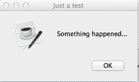

**图 9-1:** 带有 `JOptionPane` 的消息对话框

`JOptionPane` 类声明了几个名为 `showConfirmDialog()` 的重载方法——我在 Listing 9-3 中使用了带有四个参数的版本。第一个参数是 `null`，这意味着此消息框没有父窗口。第二个参数包含消息框的标题。第三个参数包含消息本身，第四个参数允许你选择包含在框中的按钮；`PLAIN_MESSAGE` 意味着只需要 OK 按钮。

### 使用 `ActionListener` 注册组件

哪个程序在何时调用了 Listing 9-3 中所示的 `actionPerformed()` 方法中的代码？将计算器的按钮注册到 `CalculatorEngine` 类，然后 Java 运行时在每次点击任何按钮时都会顺从地调用该类的 `actionPerformed()` 方法。

在 `Calculator` 类的构造函数（Listing 8-4）的末尾添加以下两行，一个按钮（0 号）就开始响应来自图 9-1 中对话框的点击：

```java
CalculatorEngine calcEngine = new CalculatorEngine();
button0.addActionListener(calcEngine);
```

其他计算器按钮保持静默，因为它们尚未注册到动作监听器。继续添加类似的行来让所有按钮都活跃起来：

```java
button1.addActionListener(calcEngine);
button2.addActionListener(calcEngine);
button3.addActionListener(calcEngine);
button4.addActionListener(calcEngine);
```

### 寻找事件的源

下一步是让监听器变得智能一点：它必须根据按了哪个按钮显示带有不同文本的消息对话框。当动作事件发生时，Java 运行时会调用你监听器类上的 `actionPerformed(ActionEvent)` 方法，该方法在参数 `ActionEvent` 中提供了关于该事件的宝贵信息。特别是，Listing 9-3 中提供给 `actionPerformed()` 的 `ActionEvent` 对象中的 `getSource()` 方法可以你是哪个对象导致了此方法的调用。

但根据 Java `ActionEvent` 类的文档，`getSource()` 方法返回一个 `Object` 类型的实例，它是所有 Java 类（包括窗口组件）的父类。由于你计算器中的按钮可能是动作事件的唯一原因，将返回的 `Object` 强制转换为 `JButton` 类型：

```java
JButton clickedButton = (JButton) evt.getSource();
```

只有在从 `Object` 强制转换到 `JButton` 之后，你才能调用 `JButton` 支持的方法；例如 `getText()`，它返回按钮的标签，如 Listing 9-4 所示。如果你按下标记为 5 的按钮，你会看到一个显示为“你按下了 5”的消息对话框。

如果窗口事件不仅由按钮产生，还由其他组件产生呢？那么不要将每个随 `ActionEvent` 到的对象都强制转换为 `JButton`。使用名为 `instanceof` 的运算符来执行正确的强制转换。下一个示例首先确定什么类型的对象引起了事件，然后将其强制转换为 `JButton` 或 `JTextField`：

```java
public void actionPerformed(ActionEvent evt){
   JTextField myDisplayField=null;
   JButton clickedButton=null;
   Object eventSource = evt.getSource();
   if (eventSource instanceof JButton){
       clickedButton = (JButton) eventSource;
   } else if (eventSource instanceof JTextField){
       myDisplayField = (JTextField)eventSource;
   }
}
```

考虑执行算术运算的按钮。我们的计算器必须为每个按钮执行不同的代码：

```java
public void actionPerformed(ActionEvent e){
     Object src = e.getSource();
     if (src == buttonPlus){
        // 在此处调用加数字的方法
     } else if (src == buttonMinus){
       // 在此处调用减数字的方法 
     }else if (src == buttonDivide){
      // 在此处调用除数字的方法
     } else if (src == buttonMultiply){
     // 在此处调用乘数字的方法
     }
}
```

### 如何在对象之间传递数据

当你点击真实计算器上的数字按钮时，它不会显示消息对话框，而是在顶部的文本字段中显示该数字。这里有一个新挑战：你能够从另一个类——`CalculatorEngine`——中定义的 `actionPerformed()` 方法访问 `Calculator` 对象的属性 `displayField`。换句话说，两个对象需要通信。有不同的方法进行安排；例如，在 `CalculatorEngine` 类中，你可以声明一个私有变量来存储对 `Calculator` 的引用。下一个版本的 `Calculator` 接收 `Calculator` 类型的参数。

`Calculator` 对象实例化 `CalculatorEngine` 并传递 `this`：

```java
CalculatorEngine calcEngine = new Calculator(this);
```

`this` 引用包含了计算器的的位置。`CalculatorEngine` 可以将其存储在自己的变量 `parent` 中，并最终从 `actionPerformed()` 方法中使用它访问计算器的 `displayField`。

#### 注意，糟糕的做法！

以下代码中的变量 `parent` 充当 `CalculatorEngine` 到 `Calculator` 的桥梁。从 `CalculatorEngine` 访问 `Calculator` 的 `displayField` 的简单方法是：

```java
parent.displayField.getText();
...
parent.displayField.setText(dispFieldText + clickedButtonLabel);
```

这些行取自 Listing 9-5 中的代码示例。代码可以工作，但它违反了面向对象编程的原则之一：封装。问题在于 `CalculatorEngine` 的代码了解另一个对象的内部细节。引擎“知道” `Calculator` 中有一个名为 `displayField` 的字段，代码直接获取并设置它的值。

#### 使用公共 API 的更好解决方案

如果 `Calculator` 需要与其他对象通信，它应该暴露公共 API 来获取或设置数据，但隐藏其内部细节。Listing 8-4 中的 `Calculator` 类在声明组件时没有使用任何访问限定符，因此应用了默认包访问级别。如下代码所示，通过 `private` 关键字隐藏这些用户界面（UI）组件：

```java
private JPanel windowContent;
private JTextField displayField;
private JButton button0;
private JButton button1;
...
```

现在 `CalculatorEngine` 无法像 Listing 9-5 中那样直接访问 `displayField` 了。在 `Calculator` 中定义公共 *getter* 和 *setter* 方法允许外部在不知道其存在的情况下访问 `displayField`。Listing 9-6 展示了微小的变化如何保护数据并强制封装。

现在，如果你决定用另一个组件替换 `JTextField` 控件，只需要修改 `setDisplayValue()` 和 `getDisplayValue()` 方法即可；`CalculatorEngine` 的代码不需要变动。Listing 9-7 显示了从 `CalculatorEngine` 访问 `Calculator` 的正确方式。

## 设计模式：模型-视图-控制器 (MVC)

软件工程师经常需要在他们的项目中实现类似的架构解决方案。多年来，许多设计模式在网上和书籍中被出版出来。其中一种架构模式就是模型-视图-控制器（MVC）。MVC 的核心思想是，你应该将处理 UI（视图）、存储应用程序数据（模型）以及触发视图和数据变化（控制器）的代码隔离开来。MVC 的实现方式可能根据应用程序而异，但其原理保持不变。

即使在像你的计算器这样简单的应用程序中，你也可以开始分离代码。例如，`Calculator` 类表示 `view`，它只负责 UI，不包含应用程序逻辑。

事件监听器 `CalculatorEngine` 充当控制器的角色。它作为用户点击按钮时触发应用程序逻辑，或在结果计算出来后更新视图的触发器。

这里没有模型层，因为你没有存储任何数据。但如果你需要实现一个能够记住计算历史的计算器，你可以创建一个 `CalculationsHistory` 类，它将作为 MVC 中的模型，如图 9-2 所示。

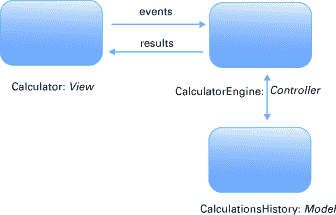

**图 9-2:** 计算器中的 MVC

设计模式已成为软件开发者的术语的一部分。如果一个程序员说：“我们需要在这里实现 MVC”，两个人都知道这是怎么回事。

在本书的后续章节中，我将继续引导你关注各种设计模式。同时，你可以参考在线资源[计算机科学设计模式](http://en.wikibooks.org/wiki/Computer_Science_Design_Patterns)。

## 更多 Swing 监听器

JDK 自带有许多位于 `java.awt.event` 包中的[事件监听器](http://docs.oracle.com/javase/tutorial/uiswing/events/api.html)。以下是其中一些常用的：


*   `FocusListener` 在小部件获得或失去焦点时被通知（例如，如果一个文本字段有一个闪闪烁的光标，我们就说它拥有焦点）。
*   `ItemListener` 对从列表（list）或下拉框（drop-down box）中选择项目做出反应。
*   `KeyListener` 响应用户的按键输入。
*   `MouseListener` 响应鼠标点击或光标悬停在小部件上。
*   `MouseMotionListener` 告诉鼠标是否正在移动或拖动。`drag`（拖动）意味着住左键的同时移动鼠标。
*   `WindowListener` 让你有机会捕获用户打开、关闭、最小化或激活窗口的时刻。

表 9-1 显示了可选监听器接口的名称以及在接口中声明的方法。例如，`FocusListener` 声明了两个方法：`focusGained()` 和 `focusLost()`。这意味着即使你的类只关心知道特定字段何时获得焦点，你也必须包含空方法 `focusLost()`。Java 为大多数事件监听器提供了特殊的 `adapter classes`（适配器类），以避免你必须手动编写监听器接口强制要求编写的空方法。

| 接口 (Interface) | 需要实现的方法 |
| :--- | :--- |
| `FocusListener` | `focusGained(FocusEvent)`<br>`focusLost(FocusEvent)` |
| `ItemListener` | `itemStateChanged(ItemEvent)` |
| `KeyListener` | `keyPressed(KeyEvent)`<br>`keyReleased(KeyEvent)`<br>`keyTyped(KeyEvent)` |
| `MouseListener` | `mouseClicked(MouseEvent)`<br>`mouseEntered(MouseEvent)`<br>`mouseExited(MouseEvent)`<br>`mousePressed(MouseEvent)`<br>`mouseReleased(MouseEvent)` |
| `MouseMotionListener` | `mouseDragged(MouseEvent)`<br>`mouseMoved(MouseEvent)` |
| `WindowListener` | `windowActivated(WindowEvent)`<br>`windowClosed(WindowEvent)`<br>`windowClosing(WindowEvent)`<br>`windowDeactivated(WindowEvent)`<br>`windowDeiconified(WindowEvent)`<br>`windowIconified(WindowEvent)`<br>`windowOpened(WindowEvent)` |

**表 9-1:** 选的 Swing 监听器

Java 运行时需要处理许多事情：更新屏幕内容、应用处理逻辑和数据以及对事件做出反应。

多个事件可能同时发生，Java 运行时不断运行 GUI 事件循环，将这些事件放入事件队列，如图 9-3 所示。

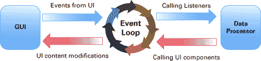

**图 9-3:** GUI 事件循环

更新 GUI 的代码应该由特殊的工作线程（`SwingWorker`）处理，我们将在第 17 节中讨论。

## 如何使用适配器 (Adapters)

Swing 适配器是实现了监听器接口所要求的空函数的类。假设你需要在用户关闭窗口时显示警告消息并在磁盘上保存某些数据。根据表 9-1，你可以使用适配器来避免实现所有方法。

`java.awt.event` 包为大多数监听器接口提供了适配器类。例如，`WindowAdapter` 允许你只重写你感兴趣的方法。

```
window.addWindowListener(new WindowAdapter() {
    public void windowClosing(WindowEvent e) {
        System.out.println("Window is closing");
    }
});
```

## 内部类

在类内部声明的类被称为内部类。代码列表 9-9 展示了在 `Calculator` 类内部声明的 `CalculationsHistory` 类示例。`CalculationsHistory` 类是一个成员内部类，它可以访问 `Calculator` 类的所有变量。将一个类放在另一个类内部只是表示它们所属的关系。编译后，`Calculator` 类文件产生两个输出文件：`Calculator.class` 和 `Calculator$CalculationsHistory.class`。

定义为 `static` 的内部类只能访问类的静态变量。内部类甚至可以定义在外部方法的内部。在这种情况下，这种局部内部类仅在外部方法调用时可用，并且它只能访问顶层类的静态变量。

`getCalculationsHistory()` 方法返回一个内部类的实例，如果外部类需要它的话。例如，如果 `TestCalculator` 类需要访问内部类的 `addEntry()` 方法，它可以这样操作：

```
Calculator calc = new Calculator();
Calculator.CalculationsHistory history = calc.getCalculationsHistory();
history.addEntry("2 + 2 = 4");
```

如果一个内部类没有名称，它被称为 `anonymous`（匿名类）。在实现 Swing 适配器的示例中，匿名内部类的用法非常容易理解。到目前，你已经了解到使用适配器是一个三步骤的过程：扩展适配器类、实例化它，并将其注册为事件监听器（参见 Listing 9-8）。使用匿名内部类，你可以一次性完成所有三个步骤，如 Listing 9-10 所示。

假设这段代码放置在 `Calculator` 类中。`addWindowListener()` 方法需要 `WindowAdapter` 的子类，而 Listing 9-10 中的加粗部分演示了声明扩展 `WindowAdapter` 并重写 `windowClosing()` 方法的匿名类的语法。

`new` 运算符实例化了适配器，因为此操作是在 `addWindowListener()` 方法的括号内完成的，所以新的对象被用作它的参数。这个适配器的实现没有名称，而在这种语文中，我们不需要知道它的名称，对吧？适配器的实例已经创建并注册为事件监听器，这已经足够了。

### 尝试一下

本节的目标是完成计算器的代码。它必须看起来像 Figure 9-2 所示，并实现所有按钮的功能。

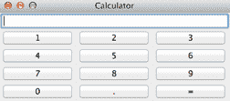

**Figure 9-4:** 计算器 GUI

### 课程要求

对于本节，你应该已安装 Java。

### 步骤说明

1. 创建一个名为 `Lesson9` 的新 Eclipse 项目，并从 Listing 8-4 复制 `Calculator`。
2. 创建所有缺失的 UI 组件——使用 Figure 9-4 作为原型。
3. 创建事件监听器 `CalculatorEngine` ——所有的事件处理和计算都应该在那里执行。
4. 从 `Calculator` 向 `CalculatorEngine` 传递它自身的引用。
5. 向 `CalculatorEngine` 注册所有可以生成事件的 GUI 组件。
6. 实现以下场景的代码：
    1. 用户输入第一个数字的所有数字。
    2. 如果用户点击了其中一个操作按钮 (+、-、`/` 或 `*`)），这表示第一个数字已输入。将此数字和选择的操作存储在类变量中（先声明它们），并从显示文本框中删除该数字。你需要借助 `Double` 类将 `String` 值转换为 `double`。
    3. 用户输入第二个数字并点击 `=` 按钮。
    4. 将文本框中的 `String` 值转换为数值类型 `double`，以便能够存储带小数点的数字。使用此值和步骤 b 中存储在数值变量中的数字执行选定的操作。
    5. 在显示字段中显示结果并将此值存储在步骤 b 中使用的变量中，供以后计算。
    6. 运行计算器。如果运行正常，展示给你的朋友看。

# 第 10 章 错误处理

## 错误处理

随着你对 Java 语法的越来越熟悉，修复编译错误将变得轻而易举。但你也应该确保你的程序能够处理无论你对语言本身的熟练程度如何可能发生的运行时错误。

假设你有一个 Java 程序，它从生产环境中的文件中读取客户数据。如果这个文件损坏了会发生什么？程序会带有一个可怕的极客风格错误消息而崩溃，还是会保持运行并显示一条友好的消息，例如“文件 `Customers` 似乎出现问题。请确保文件未损坏？”在 Java 世界中，错误处理被称为 `exception handling`（异常处理），这是本节的主题。异常是一个可能会停止程序执行的运行时错误。

## 堆栈跟踪

当 Java 应用程序运行时，JVM 会执行许多内部和特定于应用程序的方法调用。如果发生了程序未处理的运行时错误，程序将打印出 `stack trace`（堆栈跟踪），它在调用栈中反映了导致此错误的系列倒霉事件序列。堆栈跟踪帮助软件开发人员追踪导致错误的程序工作流。

为了说明堆栈跟踪可能的样子，请考虑 Listing 10-1 所示的程序，它故意执行除以零的操作。

Listing 10-2 描述了该程序的输出，它追踪了在错误发生之前程序堆栈中发生了什么。从最后一行向上读取输出。它显示程序正在执行方法 `main()`、构造函数的 `init()` 和 `divideByZero()`。行号 14、4 和 9 分别指示了这些方法在程序的何处被调用。之后，抛出了 `ArithmeticException`——第 9 行的代码尝试除以零。在 Eclipse IDE 中开启行号有助于你定位有问题的代码。

执行任何 Java 程序都意味着运行多个线程。

## Java 异常

在许多编程语言中，错误处理取决于程序员的自觉意愿。Java 强制你对某些错误包含错误处理；否则程序甚至无法编译。

假设你需要编写一段代码来读取包含客户的文件。很容易预见到，除非代码包含错误处理，否则你可能会看到堆栈跟踪而不是客户列表。

如下所示读取 Listing 10-3 中的代码：“尝试执行 `fileCustomer.read()`，如果发生错误，则跳转到 `catch` 部分并执行其中的代码。” `IOException` 是一个包含输入输出错误信息的类。

在 I/O 错误的情况下，`read()` 方法抛出一个异常（有关读取文件的更多信息请参阅 第 14 章）。`catch` 块捕获此错误并处理它。程序不会终止，此异常被视为已处理。如果 `read()` 方法成功完成，则不执行 `catch` 中的代码。

## 异常层次

Java 中的错误以类的形式表示，分为两大类：由于编程引起的错误和由于外部条件抛出的错误。例如，如果程序声明了一个类型为 `Tax` 的变量，但该对象从未被实例化，任何调用（非静态）方法 `calcTax()` 的尝试都会导致 `NullPointerException`：

```
Tax tax;
tax.calcTax();
```

这种情况程序员可以预测并适当处理。

所有异常都是 `Throwable` 的子类，`Throwable` 有两个直接后代：`Error` 和 `Exception`。

`Error` 类的子类是致命错误，被称为未检查异常，并且不需要被捕获。你不需要将它们放在 `try/catch` 块中，因为如果例如 JVM 耗尽了内存并崩溃，你通常也无能为力。

`Exception` 的子类（排除 `RuntimeException`）被称为受检异常，必须在代码中进行处理。

你可以声明并抛出自己的应用程序特定异常；例如，`LoveFailedException` 或 `ShipmentCreationException`。

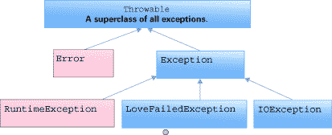

**图 10-1:** 图 10.1 带有自定义异常的异常层级示例。

程序员如何能提前知道某个 Java 方法可能会抛出特定的异常，从而应该使用 `try/catch` 块呢？不需要记忆任何内容。如果一个方法抛出了异常，Java 编译器会打印出类似下面这样的错误信息：

```
"Tax.java":  unreported exception: java.io.IOException; must be 
caught or declared to be thrown at line 57
```

如果你看到这样的消息，请找到被调用的类方法的描述，或者搜索异常本身的文档。例如，这里是 [java.io.IOException](http://docs.oracle.com/javase/8/docs/api/java/io/IOException.html) 的描述。按照后续章节的解释，添加适当的 try/catch 块来处理此异常。

## Try/Catch 块

Java 有五个可以用于异常处理的关键字：`try`、`catch`、`finally`、`throw` 和 `throws`。一个 `try` 块可以有多个 `catch` 块，为对多种类型的错误提供处理。例如，当程序尝试读取文件时，文件可能不存在——你必须捕获 `FileNotFoundException`。如果文件存在，但代码尝试读取到文件末尾之后，则需要针对 `EOFException` 的 `catch` 子句。列表 10-4 展示了一个多 `catch` 块。

如果被捕获的异常属于同一个继承分支，那么 `catch` 语句的顺序可能很重要。例如，`EOFException` 类是更通用的 `IOException` 的子类，你必须将子类的 `catch` 块放在前面。如果你将 `IOException` 的 `catch` 块放在 `EOFException` 之前，后者块将永远不会被执行——文件末尾错误将被 `IOException` 的 `catch` 块拦截。

从 Java 7 开始，你可以在一个 `catch` 块中捕获多个异常。例如，前面的代码可以重写为如下：

```
public void getCustomers() {
    try {
        fileCustomers.read();  // may throw an error
    } catch(FileNotFoundException | EOFException | IOException ioe) {
        System.out.println("Problem reading file" + ioe.getMessage());
    } catch (Exception ex) {
        System.out.println("Exception in getCustomers:" + 
                            ex.getMessage());
    }
}
```

`catch` 块接收一个 `Exception` 对象的实例，该对象包含对问题的简短说明，`Exception` 对象的 `getMessage()` 方法返回此信息。如果 `getMessage()` 返回的错误描述不够清晰，请尝试使用 `Exception.toString()` 方法。

如果你需要关于异常的更详细信息，请接收到的 `Exception` 对象上使用 `printStackTrace()` 方法（参见 列表 10-6）。如本节前面的“堆栈跟踪”节所述，它会打印导致此异常的所有内部方法调用。

## 使用 throws 子句

在某些情况下，不在异常发生的方法中处理异常，而在调用方法中处理更有意义。让我们再次使用读取文件的相同代码示例。由于 `read()` 方法可能会抛出 `IOException`，你应该要么处理它，要么声明调用它的方法可能会抛出它。后者在 列表 10-5 中完成。

在 列表 10-5 中，`IOException` 从 `getAllCustomers()` 方法传播到 `main()` 方法，并在那里得到了处理。

## 使用 finally 子句

代码可以通过几种方式退出 `try/catch` 块：

* `try` 块中的代码成功结束，程序继续。
* `try` 块中的代码运行到 `return` 语句，程序控制返回调用方法。
* `try` 块中的代码抛出异常，控制进入 `catch` 块。

如你所见，在某些情况下只有 `try` 块的代码有效；在某些情况下，无论 `try` 块执行成功与否都必须执行的代码被放在 `finally` 下。

## The throw 关键字

如果方法中发生了异常，你可能想执行以下操作之一：

1. 捕获异常。
2. 进行一些部分处理（例如错误日志）。
3. 将异常抛出给调用方法。
4. 让用户意识到问题。

在某些情况下，你可能想捕获异常并通过抛出另一个异常（修改后的错误）来处理它。`throw` 语句用于抛出异常对象。程序抛出的对象必须是 `Throwable`。

```
public class CustomerList {
    public void getAllCustomers() throws Exception {
        try {
            fileCustomers.read(); // this may throw an error
        } catch (IOException ioe) {
            // Log this error here, and rethrow another exception
            // with a custom description
            throw new Exception ("Customer List is not available"+
```


```java
ioe.getMessage());

    }

}

public static void main(String[] args) {

    System.out.println("Customer List");

    // some other code can go here

    try {

        // Since the getAllCustomers() declares an exception,

        // you should either handle. Rethrowing is also an

        // option unless you are in the main() method.

        getAllCustomers();

    } catch (Exception e) {

        System.out.println(e.getMessage());

    }

}

}
```

## 创建自定义异常

你还可以根据业务应用程序创建自定义异常。只需创建一个 `Throwable` 层次类的子类。

假设你经营自行车业务并需要验证客户的订单。你可以创建一个新类 `TooManyBikesException`，如果有人尝试订购超过商店能容纳的数量，则抛出它。列表 10-7 中所示 `BikeOrder` 类强调了这一思想。

列表 10-8 所示 `TooManyBikesException` 有一个唯一的名称，且文本包含了一些特定于业务的信息。但提供应用程序特定信息的另一种方法是在自定义异常中声明一个或多个额外变量。这些变量可以存储错误情况的多条数据。

列表 10-8 展示了向自定义异常 `TooManyBikesException` 添加应用程序特定对象 `ShippingErrorInfo` 的代码。应用程序可以准备描述运输错误的对象，并将其作为参数传递给构造函数。后者将其存储在类变量 `shippingInfo` 中，任何捕获此异常的方法都可以提取 `ShippingErrorInfo` 对象并采取相应的行动。

在分布式 Java EE 应用中，异常可以跨越多个层级（如 JMS、EJB、Servlet、Swing 客户端）传递。不仅在异常对象内部包含自定义属性可以确保重要信息不丢失，而且每一层都可以向此自定义属性添加更多具体的细节，这有助于追踪错误。

还有一个名为 `RemoteException` 的类，它包含一个名为 `detail` 的字段，用于报告通信错误。你可以扩展这个类来增强远程异常的可描述性。这个主题可能更适合第 25 到 35 节关于服务器端技术的课程，但因为本节是专门讲解异常的，所以我在这里提到了它。

处理编程错误是必不可少的。遗憾的是，我见过某些 Java 开发者是如何悄悄忽略错误的。从字面上说，他们会写一个空的 `catch` 句。这是所能做的的最糟糕的事情。它就像一颗定时炸弹，总有一天会让程序崩溃，而寻找这些炸弹通常是一个耗时的过程。不要走捷径；应该认真对待异常处理。有关 Java 异常的更多细节，请参阅 Oracle 的教程：[`bit.ly/1nO3wIO`](http://bit.ly/1nO3wIO)。

### 尝试一下

创建一个用于下单自行车订单的 Swing 应用。它必须包含一个包含多种自行车型号的下拉列表 (`JComboBox`)、用于输入数量的 `JTextField` 以及用于验证订单的 `JButton`。

编写几种自行车型号和数量的组合，使其抛出异常。使用 Listing 10-7 中的代码片段作为示例。验证应该在用户点击验证订单的按钮时开始。

### 课程要求

你已经安装了 Java。

### 步骤说明

1. 按照以下教程学习如何使用 `JComboBox`：[`bit.ly/1qfPjbs`](http://bit.ly/1qfPjbs)。
2. 每当用户选择新的自行车型号或更改订单数量时，处理事件并重新验证订单。
3. 如果订单无法发货，抛出并处理 `TooManyBikesException`。

# 第 11 节：集合简介

到目前为止，你只接触了一种存储对象集合的方法——使用 Java 数组。数组对于存储来说很好，但当你需要动态添加、删除或遍历数据时，它们就显得不从心。在 `java.util` 包中有许多类和接口，当某些对象（集合）的多个实例必须共同位于内存时，它们非常有用。本节向你介绍了其中几个。

你可以在 `java.util.concurrent` 包中找到更多集合，但你将在熟悉多线程概念后，在 `digging_deeper_into_concurrent_execution` 中再回顾它们。位于 `java.util` 和 `java.util.concurrent` 的集合类和接口通常称为 Java 集合框架（Java Collection Framework）。

集合类实现不同的接口，本节涵盖了其中几个。图 11-1 中的图片取自 Oracle [e Java 文档](http://bit.ly/1kV9EAh%20)。它描绘了顶层核心集合接口。

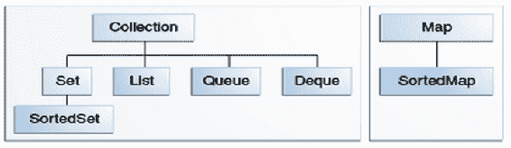

**图 11-1:** 图 11-1。核心集合接口

Java 8 在集合数据操作方面引入了重大的改进，我在本节以及 第 20 节 中也重点强调了这些变化。

## 重温数组

Java 集合类允许在内存的某一处存储基本数据类型或对象引用。你已经在 第 5 章 中学习过数组：数组允许你存储和访问一组相同类型的变量。让我们回顾一下声明和填充数组遵循的步骤。

首先，声明一个与数组中将存储的对象（或基本类型）类型匹配的变量，并预留足够的内存来容纳所有对象。例如，为了预留足够存储 10 个 `Customer` 类实例的内存，你可以如下声明变量 `customers`：

```java
Customer customers[] = new Customers[10];
```

此时，你已经为存储 10 个内存引用分配了足够的空间，而不是为了实际的对象。接下来，创建对象的实例并将它们的引用存储在数组中。

```java
Customer[] customers = new Customer[10];

customers[0] = new Customer("David","Lee");

customers[1] = new Customer("Ringo","Starr");

...

customers[9] = new Customer("Lucy","Mann");
```

现在，为在网上商店消费超过 500 美元的所有提供 15% 的折扣：

```java
for (Customer c : customers) {

    if (c.getTotalCharges() > 500) {

        c.setDiscount(15);

    }

}
```

注意这里对 `for-each` 循环的使用。它可以安全地遍历此数组。

## 来自 java.util 的集合接口

典型的集合类实现多个接口。例如，`ArrayList` 实现了 `List` 接口，该接口扩展了 `Collection`。`Collection` 接口扩展了 `Iterable`，因此应用程序可以请求 `Iterator` 对象。你将在本章后面的部分看到使用 `Iterator` 的示例。

你可以对实现 `Iterable` 的类使用 for-each 循环，这属于外部（命令式的）迭代。但 Java 8 引入了一种新的、更优的集合迭代方式，即 `forEach()`，这属于内部迭代。我将在 第 13 节 中解释为什么内部迭代更好。

`List` 接口被 `ArrayList` 和 `LinkedList` 等有序集合使用。它允许重复元素。例如，以下代码片段将在 `ArrayList` 中创建两个元素：

```java
myArrayList.add("Mary");

myArrayList.add("Mary");
```

`Set` 接口由不允许重复元素的集合实现——例如 `HashSet` 和 `SortedSet`。例如，以下代码片段在 `HashSet` 中创建了一个元素。第二行发现 Mary 已经存在，不会对其更改，并返回 `false`：

```java
myHashSet.add("Mary");

myHashSet.add("Mary"); // 返回 false
```

`Map` 接口用于存储键值对。map 不能包含重复键，且每个键只能映射到一个值（对象）。你将在本节后面看到一些相关的代码示例。

`Queue` 接口主要用于需要先进先出（FIFO）操作的集合（所谓的*优先级队列*除外）。每个新元素都被添加到队列尾，并从队列头提取元素。如果有需要，你可以限制队列的大小。`LinkedList` 是实现 `Queue` 接口的类之一。

## 使用 ArrayList 实现动态数组

数组提供了对数据集合最快的访问，但你必须预先知道存储在那里的元素数量。幸运的是，Java 有没有这种限制的类，你可以在运行时向集合中添加更多元素。本节将向你展示从 `ArrayList` 开始的几个集合类。

在内部，该集合使用一个数组进行存储，但当你不断向 `ArrayList` 中添加元素时，它会（通过较小的增量）增加底层数组的大小。相应地，随着元素的删除，该集合的大小也会随之缩小。你可以在 `ArrayList` 中存储重复的对象。

`ArrayList` 实现了 `List` 接口，并且只能存储对象；不允许基本类型（primitives）。尽管如此，请记住 Java 支持自动装箱（请参阅第 3 章），如果你尝试向集合中添加基本类型，它会被自动转换为对应的包装对象。你必须为这种便利付出代价；`ArrayList` 比数组慢一点，因为它需要进行从一个数组到另一个数组的内部复制来更改集合的大小。

要创建并填充一个 `ArrayList` 对象，你应该首先实例化它，然后通过调用 `add()` 方法将其他对象的实例添加到 `ArrayList` 中，如 列表 11-1 所示。

```java
ArrayList customers = new ArrayList(20);
```

你仍然可以添加超过 20 个元素，但 JVM 会根据需要分配额外的内存。`get()` 方法用于从 `ArrayList` 中提取特定元素。由于 `ArrayList` 是任何类型对象的泛型存储，`get()` 方法返回 `Object` 数据类型的元素。提供适当的强制转换是程序员的责任，例如：

```java
Customer theBestCustomer = (Customer) customers.get(1);
```

为了说明如果没有正确进行强制转换可能会发生运行时错误，请从列表 11-1 向你的 `customers` 集合中添加另一个类型的对象：

```java
Order order = new Order(123, 500, "IBM");

customers.add(order);
```

Java 编译器不会报错，因为 `ArrayList` 可以存储任何对象。此时，你已经在 `customers` 中拥有了元素——两个客户和一个订单。以下代码在循环的第三次迭代时抛出 `IllegalCastException`：

```java
int totalElem = customers.size(); // 元素数量

for (int i = 0; i < totalElem; i++) {

    Customer currentCustomer = (Customer) customers.get(i);

    currentCustomer.doSomething();

}
```

列表 11-2 展示了 `instanceof` 操作符如何帮助你避免这种异常。在使用 `instanceof` 之前，看看你是否可以找到更优雅的解决方案，正如你在第 7 章的多态节中学过的那样。在第 12 中你将学习如何使用泛型，它可以允许移除 `instanceof` 并在编译期间控制哪些对象可以添加到集合中。

在面向接口编程节中，我将向你展示变量 `customers` 的声明需要哪些更改。

## Hashtable 和 Hashmap 类

`Hashtable` 和 `HashMap` 类实现了 `Map` 接口并存储键/值对。这些类提供了一种通过键存储和访问集合元素的方便方法。你可以将键分配给某个 Java 对象的实例，并将其作为引用。假设你需要在同一个集合中存储 `Customer`、`Order` 和 `Portfolio` 类的实例。列表 11-3 中的代码片段首先创建这些实例，然后将它们放在某些标识符（键）下的集合中。

双引号中的值代表了用于检索对象的键。在这个例中，键由 Java 类 `String` 表示，但你可以使用任何对象作为键。键是根据应用程序需求选择的；例如，列表 11-3 中的代码可以写在某些订单管理应用程序中。

如果你对计划在 `Hashtable` 中存储的元素数量心中数，请使用带有容量参数的构造函数：

```java
Hashtable data = new Hashtable(10); // 10 个元素的容量
```

`get()` 方法通过键访问这些对象。你需要像下面的代码所示执行正确的强制转换，或者使用泛型（在第 12 章中解释）：

```java
Order myOrder = (Order) data.get("Order");
```

`size()` 方法返回 `Hashtable` 中的元素数量：

```java
int totalElem = data.size();
```

`containsKey()` 和 `containsValue()` 方法帮助你找出集合是否包含特定的键或值。

`HashMap` 类与 `Hashtable` 类似，但它允许 `null` 作为键或值，并且不是同步的（在第 19 中解释）。如果你编写的代码不需要在多线程的情况下并发访问同一元素，请使用 `HashMap`，因为它的执行速度比 `Hashtable` 快。如果你确实并发访问，`Hashtable` 的其他替代方案是 `ConcurrentHashMap`。

为了加快查找速度，`HashMap` 和 `Hashtable` 通过应用哈希函数索引数据，该函数根据内容生成哈希值。存在极小概率不同对象生成相同的哈希值，但相同对象总是产生相同的哈希值。你可以在维基百科上了解更多关于[哈希函数](https://en.wikipedia.org/wiki/Hash_function)的内容。

### Properties 类

通常桌面应用程序提供了一种指定和存储字体、颜色等偏好的方法。这正是需要键值对的场景。你可以将此类偏好存储在本地或远程服务器上。在第 14 章中你会学习处理文件和其他 I/O 流，但从数据结构的角度来看，你处理的是键值对集合，例如 `color=red, font=verdana`。Windows 应用程序通常将配置参数存储在 `.ini` 文件中。通常 Java 程序将属性存储在纯文本文件、XML 文件、数据库表等。

在本节中，你看到了继承 `Hashtable` 的 `Properties` 类如何使用键值对操作属性。`Properties` 类有一个 `Hashtable` 没有的限制。例如，如果你需要编写一个发送电子邮件的程序，你可以从 `mailman.properties` 文件存储邮件服务器的 URL 以及发件人/收件人地址，其内容如下：

```properties
SmtpServer=mail.xyz.com

to=abc@xyz.com

cc=mary@xyz.com

from=yakov@xyz.com
```

要将此文件加载到 `Properties` 对象中，只需在该文件上定义输入 I/O 流（参见列表 11-4）。将文件加载到 `Properties` 对象后，可以使用 `getProperty()` 方法获取单个属性。

Java 没有全局变量，但作为变通方案，你可以通过将这些属性转换为系统属性，使它们对应用程序中的任何类可用：

```java
System.setProperties(properties);
```

请记住，上述行也会替换现有的系统属性，你可能这样做，也可能不想。现在你可以从应用程序中的任何其他类获取这些值；例如：

```java
String mailServer = System.getProperty("SmtpServer");
```

如果你决定将属性存储在 XML 文件中，`Properties` 类提供了 `loadFromXML()` 方法来读取属性，以及 `storeToXML()` 方法将它们存储为简单的 XML 格式。

在学习 Java 命名和目录接口 (JNDI) 时，你可以在第 29 中使用 `Properties` 类的实例示例。

## 枚举类与迭代器

通常情况下，枚举（enumerations）是彼此相关的项目集合。例如，运输选项或冰淇淋口味——此类枚举由 Java 关键字 `enum` 支持（参见第 17 章）。但由于我们讨论的是集合，*enumeration* 一词的含义有所不同。如果一个集合对象实现了 `Enumeration` 接口，你就可以顺序遍历它的元素，而无需知道总数。你只需要获取所有元素的枚举并使用 `hasMoreElements()` 和 `nextElement()` 方法。例如，为了处理 `ArrayList` `customers` 的所有元素，可以这样操作：

```java
Enumeration enumCustomers = Collections.enumeration(customers);

while (enumCustomer.hasMoreElements()) {

    Customer currentCustomer = (Customer) enumCustomer.nextElement());

    currentCustomer.doSomething();

}
```

你也可以获取 `Hashtable` 的键或元素的枚举。例如：


## Hashtable 与 Enumeration

```java
Hashtable customerData = new Hashtable();

// 获取键
Enumeration enumKeys = customerData.keys();

while (enumKeys.hasMoreElements()) {
    // 对键进行处理
}

// 获取元素
Enumeration enumElements = customerData.elements();
// 对客户对象进行处理
```

`Iterator` 接口是加强版的 `Enumeration`。它也提供了一种顺序处理集合元素的标准方法。两者之间的主要区别在于，`Enumeration` 是遍历集合的只读方式，而 `Iterator` 拥有一个名为 `remove()` 的方法，允许你删除集合中不需要的元素。`Enumeration` 被认为是遗留接口，你应该使用 `Iterator`。例如，你可以按照如下方式遍历 `ArrayList` `customers`：

```java
Iterator iCust = customers.iterator();

while (iCust.hasNext()) {
    System.out.println(iCust.next());
}
```

## LinkedList 类

Java 集合类在检索和插入对象的方式上有所不同。如果你需要处理一个顺序对象列表，并且经常向列表中插入（或从列表中删除）对象，那么名为 *linked list*（链表）的数据结构会非常合适。

链表存储元素的方式使得每个元素都包含指向下一个元素的引用。*双向链表*还包含指向下一个和上一个元素的引用。Java 包含了双向链类 `LinkedList`，它允许你创建名为*队列*（先进先出 FIFO）和*栈*（后进先出 LIFO）的数据结构。

在列表中插入新对象仅取决于对两个引用的简单更新：列表的上一个元素必须指向新插入的对象，而该对象又必须包含对下一个元素（如果有）的引用。将其与为了增加 `ArrayList` 大小而进行大量内存分配和对象在内存中移动的复杂度相比，你就会体会链表带来的价值。另一方面，使用数组作为底层数据存储的集合提供了对数据元素的随机访问，而链表只能进行顺序处理。

你可以使用 `ListIterator` 类来导航列表，该类通过其方法 `next()` 和 `previous()` 支持双向遍历列表。列表 11-5 向你展示了一个示例，其中在某家航空公司的登机口创建了一个候机名单。

列表 11-5 中的代码使用 `ListIterator` 接口遍历并打印列表中的所有对象，这允许程序双向遍历列表。

你可能很好奇 `println()` 方法知道如何打印迭代器返回的对象。它会尝试寻找对象上定义的 `toString()` 方法并调用它。在我们的示例中，对象本身就是一个字符串，但在实际应用中，你可能需要打印对象，而定义 `toString()` 方法是实现此点的正确方法。

如果你在遍历列表时使用 `add()` 或 `remove()`，新元素将插入或移除到迭代器的当前位置。

## BitSet 类

`BitSet` 类存储一个位序列。当你需要向程序传递一组指示特定条件的标志位（flags）时，这是一个非常高效的类。考虑一个必须极快的金融交易应用程序。提高性能的一种方法是用最少量的字节表示最大的信息。

`BitSet` 的另一个用例是发送有关某些设备状态或作为传感器信号的程序。例如，某些自动售卖机带有智能芯片，可以自动拨打所有者的电话并发送包含状态信息的信号。发送一组标志位（设置为 `1` 或 `0` 的位）而不是文本或数字是最经济的方法。

`BitSet` 类没有大小限制，并可以根据需要增长。根据设置了哪个位（例如，值为 `1`），该类可以指示以下内容：

* **Bit 0**: 投币箱为空。
* **Bit 1**: 投币箱半满。
* **Bit 2**: 投币箱满了。
* **Bit 3**: 投币箱已被取出。
* **Bit 4**: 可乐瓶为空。

一个 `BitSet` 实例携带描述状态的多个参数。接收此信号的程序可以打印一份报告，机器所有者据此判断是否需要派遣技术人员检查。

Java `BitSet` 类就是一个位集合。以下代码准备了一个信号，表示投币箱满了且没有可乐瓶：

```java
import java.util.BitSet;

class VendingMachineSender {
    public static void main(String args[]) {
        BitSet report = new BitSet();
        report.set(2);   // 满了
        report.set(4);   // 可乐
    }
}
```

当电话打进来时，回调方法 `phoneRinging()` 被调用，信号可以这样解码：

```java
import java.util.BitSet;

class VendingMachineListener {
    public void phoneRinging(BitSet signal) {
        int size = signal.size();
        for (int i = 0; i < size; i++) {
            if (signal.get(i)) {
                switch (i) {
                    case 0:
                        System.out.println("为空");
                        break;
                    case 1:
                        System.out.println("半满");
                        break;
                    case 2:
                        System.out.println("满了");
                        break;
                    // 还有更多情况
                }
            }
        }
    }
}
```

## 选择正确的集合

Java 有几十个集合类和接口。在本节中，我只展示了其中几个。但哪种集合适合你的需求？以下是一些可以帮助你选择的考虑因素。

* 如果你需要通过索引访问数据，考虑使用 `ArrayList`。
* 如果你需要经常在集合中插入或删除数据，`LinkedList` 是一个不错的选择。
* 如果你需要一个不允许重复元素的集合，请使用实现 `Set` 接口的集合之一。快速访问使用 `HashSet`。对于排序集合使用 `TreeSet`。
* 对于存储键/值对，使用实现 `Map` 接口的集合；例如 `HashMap` 或 `Hashtable`。

这些建议适用于不需要多个线程并发访问数据的情况（参见[第 17 Lesson](https://atlas.oreilly.com/wiley/java-programming-24hr-trainer/editor/master/ch11.xhtml#introduction_to_multi-threading)）。Java 在 `java.util.concurrent` 包中内置了许多[并发集合](http://docs.oracle.com/javase/tutorial/essential/concurrency/collections.html)，这些集合专门用于并发数据访问。Oracle 的[集合教程](http://docs.oracle.com/javase/tutorial/collections/) 和 Java 集合类 API 是为你的应用程序寻找合适集合的良好资源。

### 尝试一下

修改列表 11-5 中的 `LinkedList` 示例，在列表第一个元素之后添加一个任意对象（例如 VIP 客户）。你必须在遍历列表时执行此操作。当程序就绪后，它应该打印以下内容：

```
Alex Smith
VIP Customer
Mary Lou
Sim Monk
```

### 课程要求

你应该已经安装了 Java。

### 步骤详解

1. 创建一个新的名为 `Lesson11` 的 Eclipse 项目。
2. 在第一次调用 `iterator.next()` 之后，添加以下行：`iterator.add("VIP Customer")`。
3. 运行程序并观察到并没有打印“VIP Customer”。这是因为迭代器已经定位在新插入对象的之后。
4. 在“VIP Customer”之后直接添加 `iterator.previous()` 行，将迭代器向后移动一个元素。
5. 再多添加一个打印语句（否则程序将无法到达 Sim Monk）。编译并运行程序。它按要求打印了所有四个元素。
6. 现在，通过将你在步骤 2 中添加的行改为 `passengerList.add("VIP Customer")` 来破坏代码。
7. 运行程序。它打印了链表的第一个元素，然后产生一个运行时异常：

```
Alex Smith
Exception in thread "main"
     java.util.ConcurrentModificationException
         at java.util.LinkedList$ListItr.checkForComodification(
              LinkedList.java:761)
         at java.util.LinkedList$ListItr.next(LinkedList.java:696)
         at TestLinkedList.main(TestLinkedList.java:20)
```

产生此并发修改异常的原因是一个执行线程正在遍历集合，同时另一个线程正试图以不安全的方式修改底层集合。线程的概念在第 17 章中介绍。

# Lesson 12

## 泛型简介

在上节课程中，你看到了一个存储不同类型对象的集合示例（参见列表 11-2）。在运行时，该程序会测试每个对象的实际类型并将其强制转换为相应的类型——`Customer` 或 `Order`。如果某些代码添加了另一种（非预期的）数据类型的元素，这将导致类型转换错误 `ClassCastException`。与其将其留到运行时，如果在编译期间由编译器防止在集合、对象甚至方法参数和返回类型中使用意外的类型，那就太好了。

Java 支持泛型（Generics），它允许你使用参数化数据类型——你可以在声明对象、集合或方法时不指定具体的类型，而是将具体类型的定义转移到使用这些对象、集合或方法的代码中。换句话说，泛型是一种可以与参数化数据类型工作的类型。

通过使用泛型符号，你可以获得 Java 编译器的帮助，它不允许你使用与声明不匹配的“错误”类型对象。换句话说，你可以在编译阶段更早地捕获不当的数据类型。通过例子更容易解释，我们直接进入正题。

## 泛型与类

考虑列表 11-2 中的 `ArrayList`，它像一个百宝箱式的存储器，可以容纳几乎任何对象。但如果你在 `customers` 集合的声明中使用括号添加参数化类型 `Customer`（`ArrayList<Customer>`，参见列表 12-1），则任何在该处放置 `Order` 对象的操作都会产生以下编译错误：

```
The method add(Customer) in the type ArrayList<Customer> is not 
applicable for the arguments (Order).
```

这样想：`ArrayList` 可以用于存储任何对象，而使用泛型允许你对 `ArrayList` 特定实例中允许的对象类型加上限制。这是一个参数化类的示例，这只是泛型的用途之一。

在编译期间获取错误比在运行时获取类型转换异常要好。注意前一个示例中的空括号。它们被称为钻石运算符（diamond operator）——你不需要在右侧重复 `<Customer>`，因为该类型已经在左侧指定过了。作为复习，正如上节课程在“面向接口编程”部分中解释的那样，我一直使用 `List` 接口来声明变量 `customers`。是什么让 `ArrayList` 类能够拒绝不需要的数据类型？打开 `ArrayList` 本身的源码（在 Eclipse 中按 F3 可以显示任何类或接口的源码，如果可用的话）。它的开头如下：

```java
public class ArrayList<E> extends AbstractList<E>
    implements List<E>, RandomAccess, Serializable
```

类名后面的魔法 `<E>` 告诉 Java 编译器该类可以使用某些元素，但具体的类型在创建 `ArrayList` 实例之前是未知的。在列表 12-1 中，类型参数 `<Customer>` 替换了 `<E>`，编译器确保 `customers` 集合只存储 `Customer` 对象。

现在你可以通过移除类型转换来简化列表 11-2 中的代码（参见列表 12-2）。为什么？因为有了泛型，当编译器看到特定类型时，它会自动生成字节码！这就是为什么你不再需要将 `get(i)` 方法返回的 `Object` 转换为 `Customer`。此外，你可以保证 `customers` 集合将拥有 `Customer` 实例。Java 编译器能够查看方法调用并推断类型。这被称为[类型推断](https://docs.oracle.com/javase/tutorial/java/generics/genInference.html)。它不仅用于泛型，还用于 Lambda 表达式，将在第 13 Lesson 中介绍。

## 通配符

Listing 12-3 包含了代表未知类型的问号。用例子来解释它们会更简单。让我们将 Listing 12-2 中的 `for` 循环转换为一个方法。在 Eclipse 中，高亮 `for` 循环的代码，右键点击并选择 Refactor（重构）→ Extract Method（提取方法）。在弹出的窗口中输入方法名 `processCustomers` 并点击 OK。

如果你想让 `processData()` 方法更具通用性和实用性，使其不仅适用于 `Customer` 对象的集合，也适用于其他集合，该怎么办？如果不使用泛型，你将不得不使用 `instanceof` 并编写与 Listing 12-5 类似的代码。

但现在，有了这些新知识，你可以尝试将 `processData()` 方法的签名更改如下：

```java
private static void processData(List<Object> data) {
    // do something with data
}
```

遗憾的是，这个方案行不通，因为不存在所谓的参数化类型继承。换句话说，尽管 `Customer` 类是 `Object` 的子类，这种继承也不适用于参数 `<Customer>` 和 `<Object>`。这时，代表未知类型的问号就派上用场了。让 `processData()` 更具通用性的下一步是将方法签名更改如下所示：

```java
private static void processData(List<?> data) {
    // do something with data
}
```

使用这种方法签名与简单地将方法参数 `data` 声明为 `List` 类型不同，后者需要强制类型转换，如 Listing 12-5 所示。使用通配符表示法，你是在说：“此时 `data` 的类型未知，但每当某些代码使用 `processData()` 方法时，它的类型就会被识别并正确编译，因此不需要强制转换。”

你面临的下一个挑战是编译对未知类型对象调用 `doSomething()` 方法的代码。

## 创建自定义参数化类

让我们考虑一下第 10 课中“尝试一下”部分的自行车商店示例。那家在线商店有一辆用于向客户交付自行车和备用轮的卡车。我们希望只允许自行车和轮子进入卡车；不允许人员进入。考虑图 12-1 中的类层次结构：

`Truck` 类型的对象可以包含 `Product` 实例。`Ferry` 对象可以包含 `Truck` 实例。`Product`、`Bike`、`Wheel` 和 `Person` 类在这个小型应用程序中没有实现任何业务逻辑，因为这对理解泛型类型无关。但 `Product` 是 `Bike` 和 `Wheel` 的父类的事实是重要的。参数化类 `Truck` 如下：

```java
public class Truck<T> {
    private List<T> products = new ArrayList<>();

    // load the product on the truck
    public void add(T t) {
        products.add(t);
    }

    // Return products loaded on the truck
    public List<T> getProducts() {
        return products;
    }
}
```

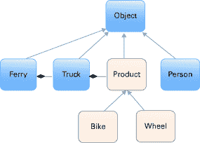

**Figure 12-1:** 自行车商店类层次结构

此声明使用了一个类型为 `T` 的参数，该类型目前尚未知。当你创建一个实例化 `Truck` 的程序时，你会指定一个具体的类型；例如：

```java
public class TestGenericType {
    public static void main(String[] args) {
        Truck<Product> shipment = new Truck<>();
        Bike bike = new Bike();
        Wheel wheel = new Wheel();
        Person person = new Person();
    }
}
```


```java
shipment.add(bike);

shipment.add(wheel);

// shipment.add(person); // Compiler error

}
}
```

在声明方法时，你可以预先定义参数和返回值的数据类型，也可以使用泛型。例如，来自列表 12-3 的 `toArray()` 方法从声明一个新的参数化类型（在这种情况下为 `<T>`）开始，它必须放在方法签名中返回类型之前的角括号内。方法声明了一个新类型这一事实本身使其成为了泛型。以下 `toArray()` 方法的声明接收一个类型为 `T` 的对象数组并返回一个 `T` 对象的数组：

```java
<T> T[] toArray(T[] a);
```

图 12-2 详细解释了上述行代码。

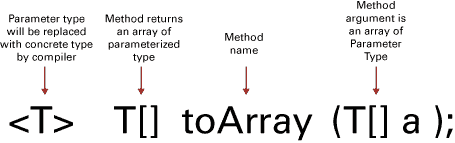

**图 12-2:** 泛型方法的签名

如果你有一个整数的 `ArrayList`，你可以按照如下方式声明它并将其转换为数组：

```java
List<Integer> myNumericList = new ArrayList<>();

...

Integer myNumericArray[] = new Integer[myNumericList.size()];

myNumericArray = myNumericList.toArray();
```

如果你需要对客户列表使用相同的 `toArray()` 方法，数据类型 `<T>` 会通过（编译器）魔法式地转换为 `Customer` 类型：

```java
List<Customer> myCustomerList = new ArrayList<Customer>();

...

Customer myCustomerArray[] = new Customer[myCustomerList.size()];

myCustomerArray = myCustomerList.toArray();
```

正如在 ??? 章节中的示例一样，你被允许对类型设置限制条件。例如，你可以限制 `toArray()` 方法仅与实现了 `Comparable` 接口的类型工作：

```java
<T extends Comparable> T[] toArray(T[] a);
```

### 尝试一下

创建一个简单的程序，使用 `RetiredEmployee` 类（继承自 `Employee` 类）源自列表 7-2 方法作为示例。

### 课程要求

你应该已经了 Java。

### 逐步步骤

1. 创建一个名为 `Lesson12` 的新 Eclipse 项目。
2. 创建类 `Employee`，然后创建继承 `Employee` 的 `RetiredEmployee`。
3. 创建一个可执行的 Java 类 `TestGenericMethod`，它接收 `RetiredEmployee` 对象的 `List` 并将其复制到 `Employee` 对象的 `List`。该方法应该在系统控制台上打印结果集中每个 `Employee` 的名称。
4. 运行 `TestGenericMethod` 程序并观察打印的名称。

# 第 13 章 Lambda 表达式与函数式编程

介绍本章的内容具有一定的挑战性。从本书的开始你已经了解到 Java 是一种面向对象的语言（与函数式语言相反）。你学习了为了启动任何程序，你需要定义带有属性和方法的类，将它们实例化为对象，并在这些实例上调用方法（即函数）。如果一个方法被声明为 `static`，你可以在不需要实例化类的情况下调用它，但你仍然需要先定义类，然后在类内部定义一个静态方法。例如，为了处理对 Swing `JButton` 的点击，你需要实现并实例化一个仅包含一个方法 `actionPerformed()` 的监听器类。

现在我需要告诉你，面向对象的方法可能有一些缺点，并且存在大量的[函数式编程语言](http://en.wikipedia.org/wiki/List_of_programming_languages_by_type#Functional_languages)，在这些语言中你不需要将功能封装在类内部。函数式语言的支持者说（而且是正确的），创建可以被方法代码改变（变异）字段的对象可能会出错且更难调试。他们倾向于以不依赖于外部上下文的函数来思考。

函数以参数的形式接收来自外部世界的值，应用某些业务逻辑并返回结果。函数不会改变任何外部值（包括作为参数提供的值）。函数可以接收单个值（或数据集合）并产生另一个值，但不会修改输入。因此，无论你用相同的输入调用任何给定函数多少次，返回的值都是相同的。

在 Haskell、JavaScript、Scala、Closure 和 Ruby 等语言中，函数被视为一等公民，它们不需要你编写和实例化类。在函数式语言中，你可以执行以下操作：

* 将函数赋值给变量。
* 将函数作为参数传递给另一个函数。
* 在另一个函数内部定义一个函数。
* 从另一个函数返回一个函数。

例如，这是你在 JavaScript 中创建一个返回另一个函数的函数的方法：

```javascript
function () {
    var taxDeduction = 500;
    return function (income) {
        // 在此处实现计算 taxDeduction
        // ...
        return income - taxDeduction;
    }
}
```

Java 8 引入了[lambda 表达式](https://en.wikipedia.org/wiki/Lambda_calculus)，它们是匿名函数。由于 lambda 表达式没有名称，它可以被赋值为一个值。

通过 lambda 表达式，面向对象的 Java（以及 C#）允许混合风格编程。当你需要一个带有状态的对象时，声明类并实例化。如果你只需要实现某种算法，定义一个 lambda 表达式。

在本节中你发现如何通过 lambda 表达式让你的 Java 代码更加简洁。Java 8 将函数式融合到了面向对象的风格中。

## 命令式与函数式风格

Java 不是函数式编程语言，即使没有 lambda 表达式，它也允许编写函数式风格的程序。我将为你展示一个快速示例，说明*命令式*与*函数式*编程风格的概念。以下类 `ImperativeVsFunctional` 创建了一个集合 `winners` 并填充名称。然后它尝试使用两种不同的风格——命令式和函数式来查找集合是否包含冠军“Ringo”。

```java
public class ImperativeVsFunctional {
    public static void main(String[] args) {
        List<String> winners = new ArrayList<>();
        winners.add("Mary");
        winners.add("Ringo");
        winners.add("Joe");
        winners.add("Paul");

        // 命令式风格
        boolean gotRingo = false;
        for (String winner : winners) {
            if ("Ringo".equals(winner)) {
                gotRingo = true;
                System.out.println("Imperative style. Ringo won?" + gotRingo);
                break;
            }
        }

        // 函数式风格
        System.out.println("Functional style. Ringo won?" + winners.contains("Ringo"));
    }
}
```

运行此程序将产生以下输出：

```
Imperative style. Ringo won? true
Functional style. Ringo won? true
```

在命令式风格中，程序规定了做什么：创建一个标记，然后在 for 循环中检查每个元素的值，如果找到了 Ringo，则将标记的值改为 true 并跳出循环。在这种情况下，我们假设 `ArrayList` 只是冠军名称的存储。

在函数式风格中，我们不规定*如何*去寻找 Ringo，只需调用 `contains()` 方法即可。没有外部循环，没有可变标志，没有 `break` 语句。它短小、简洁且易于理解。在 Java 的当前版本中 `contains()` 方法是如何实现的呢？它是 `ArrayList` 的内部业务逻辑。完全有可能在 Java 的当前版本或未来版本中，`contains()` 方法会将集合（尤其是大型集合）拆分为更小的块，并且如果计算机有多个处理器，它将对 Ringo 进行并行搜索，而命令式版本将始终按顺序处理此集合。

这个示例使用了集合中已经存在的函数。但通过 Lambda 表达式，你可以定义自己的函数，并将其交给类或集合进行执行。同样，取决于你的 Lambda 表达式执行了什么，Java 运行运行时可能会决定并行执行它。

你将在本章稍后的“使用 foreach 遍历集合”部分中看到比较命令式和函数式编程风格的示例。在命令式风格中，我们告诉 Java *如何*做某事，而在函数式中，我们告诉 Java 我们*想要*做什么。在关于 Stream API 的第 20 节中，你将看到更多声明式和函数式风格的代码示例。现在让我们学习 Lambda 表达式的语法。

### 什么是 Lambda 表达式

Lambda 表达式是一个匿名函数，你可以对其：

* 赋值给变量。
* 作为参数传递给另一个函数。
* 从方法返回。

如果说在 Java 早期版本中只有对象和基本类型可以表示值，那么从 Java 8 开始，函数也可以是值。在第 9 节中，你学习了作为方法包装器的匿名内部类。Lambda 表达式可以消除对这种包装器的需求。例如，考虑以下 Lambda 表达式（为了简洁起见，我们称其为 *lambdas*）：

```java
(int a, int b) -> a + b;
```

假设有一个接口声明了一个单抽象方法，该方法接收两个 `int` 参数并返回一个 `int` 值。上述代码中的 Lambda 是一个接收两个 `int` 参数 `a` 和 `b` 的匿名函数。参数放置在括号内，类似于 Java 方法。实际上，如果 Lambda 表达式只有一个参数，甚至这些括号都是不需要的。在 `->` 符号（也称为箭头标记）的右侧，你看到的是 Lambda 表达式的体。在这种情况下，它只是一个计算并返回参数之和的单行代码。如果 Lambda 的体如上例所示是一个单行表达式，则不需要编写 `return` 语句。Lambda 表达式的结果是隐式返回的。

虽然 Lambda 表达式的语法看起来很寻常，但它其实很容易理解。只需取一个普通的 Java 方法声明，删除左括号之前的所有内容，并在右括号后添加 `->` 符号。因此，如果你想将上述 Lambda 表达式重写为 Java 方法，它可能像这样：

```java
public int addNumbers(int a, int b) {
    return a + b;
}
```

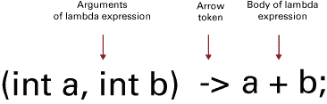

**图 13-1：** Lambda 表达式的组成部分

在 Lambda 表达式中，指定参数类型是可选的。Lambda 支持推断类型；Java 编译器会根据你代码的上下文正确“猜测”类型。因此，我们的 Lambda 表达式可以重写为：

```java
(a, b) -> a + b;
```

如果 Lambda 表达式包含几行代码，你需要将代码放在大括号内，并添加 `return` 语句。

### 函数式接口

Java 接口可以声明任意数量的方法，但作为 Lambda 表达式，它必须只有一个抽象方法。这种接口被称为*函数式接口*。技术上，函数式接口可以有多个方法，但抽象方法只能有一个。

考虑在第 9 节中用于处理按钮点击的 `ActionListener` 接口：

```java
public interface ActionListener {
    void actionPerformed(ActionEvent e);
}
```

使用匿名内部类实现这种接口的老方法如下：

```java
myButton.addActionListener(new ActionListener() {
    public void actionPerformed(ActionEvent actionEvent) {
        someTextField.setText("Someone clicked the button");
    }
});
```

因为 `ActionListener` 定义了单一方法 `actionPerformed()`，它可以被称为*函数式接口*。因此，可以用简洁的形式表示：

```java
myButton.addActionListener(actionEvent -> {
    someTextField.setText("Someone clicked the button");
});
```

这样写和读起来要简单得多，不是吗？不需要声明和实例化匿名类。这个 Lambda 表达式由变量 `actionEvent` 表示参数（你可以给它起任何名称，不需要数据类型）。`actionPerformed()` 是一个回调，Java 运行时会将 `ActionEvent` 实例传递给它。

### 方法引用

在某些情况下，你的 Lambda 表达式只是调用一个预定义的方法。Java 8 引入了可以替代 Lambda 表达式的方法引用。新语法引入了双冒号运算符 `::`，你可以这样写：

```java
myObject::myMethod
```

方法名后没有括号，你无法在方法引用中指定参数。因此，这种语法适用于方法没有参数，或者编译器可以“推断”出该方法期望的参数的情况。例如，以下方法没有参数，可以使用方法引用语法调用：

```java
public void myMethod() {
    System.out.println("Hello from myMethod");
}
```


推断参数的情况（由编译器推断）可以通过事件监听器回调方法来说。以下类 `MethodReferenceSample` 在 `addActionListener()` 中使用了方法引用。编译器识别出 `processButtonClick()` 方法期望 `ActionEvent` 类型的参数。

```java
public class MethodReferenceSample extends JFrame {

    public void processButtonClick(ActionEvent actionEvent) {
        System.out.println("Someone clicked on the button");
    }

    public static void main(String args[]) {
        MethodReferenceSample mrs = new MethodReferenceSample();
        JButton myButton = new JButton("Click me");
        mrs.add(myButton);
        myButton.addActionListener(mrs::processButtonClick);
        mrs.pack();
        mrs.setVisible(true);
        mrs.setDefaultCloseOperation(JFrame.EXIT_ON_CLOSE);
    }
}
```

使用注解 `@FunctionalInterface` 是可选的。它只是表明你想要用 lambda 表达式来实现此接口的意图。阅读代码的人可能会感谢这个提示。在“将函数传递给方法”章节中，我将向你展示使用该注解的示例。

## 方法与函数

方法（methods）和函数（functions）之间的区别在于，函数没有绑定到任何类实例。你可以说静态方法也没有绑定到实例，但静态方法必须在类或接口内部声明，而函数不需要。

你可以尝试在需要实现函数式接口的同时保持面向对象的编程风格的地方，使用 lambda 来简化代码。替换实现 `ActionListener` 的匿名内部类的代码示例就是这种简化的插例。

另一方面，你可能开始尝试函数式编程风格，在这种风格下，函数只接收一些输入，应用其业务逻辑并返回结果。函数并不知道它所运行的上下文，除非它是作为参数传递给它的。函数不属于任何对象，因此它不能依赖于执行操作时可以使用某些外部值。函数不会改变任何对象的状态。

接下来的 `Tax` 类示例是使用面向对象的风格编写的。在实例化 `Tax` 对象后，它的字段 `grossIncome` 和方法 `calcTax()` 不是函数，因为它期望从类变量 `grossIncome` 获取某些值来修改 `federalTax`。这是一个带有可变状态的情况。

```java
class Tax {
    double grossIncome;
    double federalTax;

    public void calcTax() {
        if (grossIncome < 30000) {
            federalTax = grossIncome * 0.05;
        } else {
            federalTax = grossIncome * 0.06;
        }
    }
}
```

在面向对象的世界中这是完全没问题的，因为对象是那里的宇宙中心。为了消除可变属性（`grossIncome` 和 `federalTax`），将此类的定义改为：

```java
class TaxNoState {
    public static double calcTax(double grossIncome) {
        double federalTax = 0;
        if (grossIncome < 30000) {
            federalTax = grossIncome * 0.05;
        } else {
            federalTax = grossIncome * 0.06;
        }
        return federalTax;
    }
}
```

在 `TaxNoState` 中，方法 `calculateStateTax()` 通过其参数获取所需的值。它仍然是一个方法，因为它位于类内部，但更接近函数。在应用业务逻辑后，`calculateStateTax()` 返回计算出的 `federalTax`。返回给谁？这与函数无关。注意，我在方法声明中使用了 `static` 关键字，以消除与 `TaxNoState` 类特定实例的任何绑定。毕竟，如果 Mary 和 Joe 的收入相同，税收计算应该以相同的方式进行。

在 `TaxNoState` 类中，我们删除了类变量并转而使用方法参数。问题是，为什么一个不使用任何类字段的税收计算逻辑必须存在于类方法内部？你能提供从外部计算税收的代码吗？在 Java 8 之前，基本类型或对象是你可以传递给方法的唯一值。但现在你也可以将 lambda 表达式作为方法参数传递，我将在下一节中为你提供一个示例。

### 将函数传递给方法

在函数式编程中，你可以将一个函数作为参数传递给另一个函数（或函数可以返回一个函数）。这种外部函数被称为*高阶函数*（higher-order functions）。

本节向你展示如何将函数传递给 Java 方法。我们将创建一个包含三个字段的类：`name`、`grossIncome` 和 `state`，代表某个会计事务所的客户。该类将有一个方法 `applyTaxCalculationFunction()`，但该方法的代码将作为参数提供给该方法。以下是 `Customer` 类的代码：

```java
public class Customer {
    public String name;
    public double grossIncome;

    public void applyTaxCalcFunction(TaxFunction taxFunc) {
        double calculatedTax = taxFunc.calcTax(grossIncome);
        System.out.println("The calculated tax for " + name + " is " + calculatedTax);
    }
}
```

方法 `applyTaxCalcFunction()` 的参数是函数接口 `TaxFunction` 的实现，所示：

```java
@FunctionalInterface
public interface TaxFunction {
    double calcTax(double grossIncome);
}
```

该接口的实现是由 `TestLambda` 类中的 lambda 表达式提供的。该类创建了两个客户实例，并在提供执行的 lambda 的情况下调用了 `applyTaxCalculationFunction()` 方法。客户的方法 `applyTaxCalculationFunction()` 接收该接口的实现并调用它的方法 `calcTax()`。以下是 `TestLambda` 类的代码：

```java
public class TestLambda {
    public static void main(String[] args) {
        // 定义一个函数作为 lambda 表达式
        // 并将其存储在变量中
        TaxFunction taxFunction = (double grossIncome) -> {
            double federalTax = 0;
            if (grossIncome < 30000) {
                federalTax = grossIncome * 0.05;
            } else {
                federalTax = grossIncome * 0.06;
            }
            return federalTax;
        };

        // 定义另一个函数作为 lambda 表达式
        // 用于为黑手成员计算税收
        TaxFunction taxFunctionMafia = (double grossIncome) -> {
            double stateTax = 0;
            if (grossIncome < 30000) {
                stateTax = grossIncome * 0.01;
            } else {
                stateTax = grossIncome * 0.02;
            }
            return stateTax;
        };

        Customer customer1 = new Customer();
        customer1.name = "Mary Lou";
        customer1.grossIncome = 50000;
        customer1.applyTaxCalcFunction(taxFunction);

        Customer customer2 = new Customer();
        customer2.name = "Al Capone";
        customer2.grossIncome = 25000;
        customer2.applyTaxCalcFunction(taxFunctionMafia);
    }
}
```

两种不同税收计算算法的实现存储在 lambda 表达式中，存储在变量 `taxFunction` 和 `taxFunctionMafia` 中。如果你运行 `TestTaxLambda`，你将在控制台上看到以下输出：

```
The calculated tax for Mary Lou is 3000.0
The calculated tax for Al Capone is 250.0
```

Lambda 表达式让你免去了将函数封装在类中的需要。大问题是：在 `Customer` 类内部提供税收计算函数更好，还是从外部传递更好？这没有通用的答案。只需知道，如果应用程序的业务规则要求你对不同的对象应用相同或不同的功能部分，lambda 表达式允许你做到这一点。

Java 8 的 lambda 仍然有一些限制，你可以将它传递给期望实现指定类型（在本例中 `TaxFunction`）接口的 lambda 方法。在 JavaScript 等函数式语言中，可以将任意函数附加到任何对象，并使用 `call()` 或 `apply()` 函数在对象的范围内执行。你在本节的最后一部分看到了 Java 版本的 `apply()`。

## 使用 forEach() 迭代集合

在上一节中，你通过编写循环来迭代对象集合。要对集合中的每个对象执行某些操作，你可以在循环体中调用的 `doSomething()` 方法中实现这些操作：

```java
List<Customer> customers = new ArrayList<>();
// 为了简洁，省略了填充 customers 的代码
// 遍历 customers 列表并对集合中的每个
// 元素执行某些操作。
for (Customer customer : customers) {
    customer.doSomething();
}
```

这是一种*命令式*的编程方式，你会说：“我想按顺序获取集合的每个元素，并对其进行某些操作。”但对于这项任务，还有一种*函数式*的方法：“嘿，集合，我会给你一个函数来应用到你的每个元素上。请找出执行该操作的最优方式。”

你可能会说：“你说的‘最佳方式’是什么意思？集合真的比我更清楚如何处理处理它的元素吗？”是的，它确实知道。从 Java 8 开始，集合变得更加智能，并且可以并行化执行，特别是在多处理器计算机上。例如，它可能会在内部将集合一分为二，并对每个部分并行应用 `doSomething()`，然后将结果合并回去。因此，你最好将你的函数交给集合；处理完成可能会更快。

我将在下方的 `TestCollectionsForEach` 类中向你展示命令式和函数式风格的实现。它将遍历由 `Person` 类实例表示的工人集合，该类有一个 `boolean` 变量 `workerStatus` 来存储就业状态：`E` 表示员工，`C` 表示承包工。

```java
public class Person {
    private String name;
    private char workerStatus; // 'E' or 'C'

    public Person(String name, char workerStatus) {
        this.name = name;
        this.workerStatus = workerStatus;
    }

    public String getName() {
        return name;
    }

    public char getWorkerStatus() {
        return workerStatus;
    }
}
```

程序 `TestCollectionsForEach` 创建了一个 `Person` 实例的数组，然后使用 `Arrays.asList()` 将其转换为 `List`。之后，它使用两种不同的技术遍历该列表：命令式和函数式。

```java
public class TestCollectionsForEach {
    public static void main(String[] args) {
        Person workers[] = new Person[3];
        workers[0] = new Person("John", 'E');
        workers[1] = new Person("Mary", 'C');
        workers[2] = new Person("Steve", 'E');
        List<Person> workersList = Arrays.asList(workers);

        // 命令式循环
        System.out.println("1. Running imperative loop");
        for (Person person : workersList) {
            if ('E' == person.getWorkerStatus()) {
                System.out.println(person.getName() + " is employee");
            } else if ('C' == person.getWorkerStatus()) {
                System.out.println(person.getName() + " is contractor");
            }
        }

        // 函数式循环
        System.out.println("2. Running functional loop");
        workersList.forEach(person -> {
            if ('E' == person.getWorkerStatus()) {
                System.out.println(person.getName() + " is employee");
            } else if ('C' == person.getWorkerStatus()) {
                System.out.println(person.getName() + " is contractor");
            }
        });
    }
}
```

该程序的输出所示：

```
1. Running imperative loop
John is employee
Mary is contractor
Steve is employee
2. Running functional loop
John is employee
Mary is contractor
Steve is employee
```


这两个循环的输出是相同的。在函数式循环中，你向集合的 `forEach()` 方法传递了一个 lambda 表达式。在第 20 节中，你将学习到 Stream API，并看到如何专门地请求并行处理。我想引起你注意 `forEach()` 方法参数中的变量 `person`。我从未声明过这个变量，那么它的类型是什么呢？它是类型推断的另一个例子。Java 足够智能，可以看到 lambda 表达式被应用到 `Person` 类的集合上（看，泛型是有用的！）。因此，变量 `person` 将被类型为 `Person`。你可以为这个变量起任何名称；Java 编译器都会推导出它的类型。

## Lambda 与继承和多态的区别

Lambda 表达式促进了函数式的编程风格。在之前的课程中，你已经学习了面向对象的风格及其主要概念：继承，它可以通过多态或组合来实现。本节将向你展示如何取第 7 节中“使接口多态化”章节中的示例（即你以多态方式处理员工集合的方法），并使用 lambda 重写它。

在第 7 节的示例中，你使用了 `Payable` 接口来增加员工和承包工的薪水。首先，回顾一下那个应用程序。图 13-2 显示了该程序的类图（在 UML 中，实线表示继承，虚线表示实现）：

### 扩展 Person 并实现 Payable

接下来是超类 `Person` 的代码：

```java
public class Person {

    private String name;

    public Person(String name) {
        this.name = name;
    }

    public String getName() {
        return "Person's name is " + name;
    }
}
```

这是 `Payable` 接口：

```java
public interface Payable {

    int INCREASE_CAP = 20;

    boolean increasePay(int percent);
}
```

`Employee` 和 `Contractor` 类对 `Payable` 接口有不同的实现。以下是 `Employee` 的样子：

```java
public class Employee extends Person implements Payable {

    public Employee(String name) {
        super(name);
    }

    public boolean increasePay(int percent) {
        System.out.println("Increasing salary by " + percent + "%. " + getName());
        return true;
    }
}
```

`Contractor` 类如下：

```java
public class Contractor extends Person implements Payable {

    public Contractor(String name) {
        super(name);
    }

    public boolean increasePay(int percent) {
        if (percent < Payable.INCREASE_CAP) {
            System.out.println("Increasing hourly rate by " + percent + "%. " + getName());
            return true;
        } else {
            System.out.println("Sorry, can't increase hourly rate by more than " + Payable.INCREASE_CAP + "%. " + getName());
            return false;
        }
    }
}
```

程序 `TestIncreasePoly` 展示了 `Employee` 和 `Contractor` 对象的多态行为。

```java
public class TestPayInceasePoly {

    public static void main(String[] args) {
        Payable workers[] = new Payable[3];
        workers[0] = new Employee("John");
        workers[1] = new Contractor("Mary");
        workers[2] = new Employee("Steve");

        for (Payable p : workers) {
            p.increasePay(30);
        }
    }
}
```

## 消除继承

`Contractor` 和 `Employee` 之间的唯一区别在于 `increasePay()` 方法的实现，即将该方法的实现提取到 lambda 表达式中。这使你能够消除 `Employee` 和 `Contractor` 类，并简单将适当的函数传递给 `Person` 类。为了区分外包人员和员工，你使用了使用 forEach() 方法迭代集合 章节中的 `Person` 类版本。但这次添加了一个 `validatePayIncrease()` 方法，该方法接受 lambda 表达式作为一个参数，并将加薪金额作为另一个参数。这是 `Person` 类的新版本：

```java
public class Person {

    private String name;
    private char workerStatus;  // 'E' or 'C'

    public Person(String name, char workerStatus) {
        this.name = name;
        this.workerStatus = workerStatus;
    }

    public String getName() {
        return name;
    }

    public char getWorkerStatus() {
        return workerStatus;
    }

    public boolean validatePayIncrease(Payable increaseFunction, int percent) {
        boolean isIncreaseValid = increaseFunction.increasePay(percent);
        System.out.println(" Increasing pay for " + name + " is " + (isIncreaseValid ? "valid." : "not valid."));
        return isIncreaseValid;
    }
}
```

`Payable` 接口保持不变，它的实现将由两个 lambda 表达式表示——一个用于员工，另一个用于外包人员，如程序 `TestPayIncreaseLambda` 所示：

```java
public class TestPayIncreaseLambda {

    public static void main(String[] args) {
        Person workers[] = new Person[3];
        workers[0] = new Person("John", 'E');
        workers[1] = new Person("Mary", 'C');
        workers[2] = new Person("Steve", 'E');

        // 增加员工薪水的 lambda 表达式
        Payable increaseRulesEmployee = (int percent) -> {
            return true;
        };

        // 增加外包人员薪水的 lambda 表达式
        Payable increaseRulesContractor = (int percent) -> {
            if (percent > Payable.INCREASE_CAP) {
                System.out.print(" Sorry, can't increase hourly rate by more than " + Payable.INCREASE_CAP + "%. ");
                return false;
            } else {
                return true;
            }
        };

        for (Person p : workers) {
            if ('E' == p.getWorkerStatus()) {
                // 为每个员工验证 30% 的加薪
                p.validatePayIncrease(increaseRulesEmployee, 30);
            } else if ('C' == p.getWorkerStatus()) {
                p.validatePayIncrease(increaseRulesContractor, 30);
            }
        }
    }
}
```

运行此程序产生的输出与继承版本的输出相同：

```
Increasing pay for John is valid.
Sorry, can't increase hourly rate by more than 20%.
Increasing pay for Mary is not valid.
Increasing pay for Steve is valid.
```

结果是相同的，那么你实现了什么？使用 lambda 使得移除两个类：`Contractor` 和 `Employee` 成为可能。这是好事。但似乎通过删除这些类，你失去了实现 `Payable` 接口的严格约束。实际上，你并没有！对 `Payable` 类型的使用仍然以不同的方式强制执行；现在它是 `validatePayIncrease()` 方法中的参数类型。如果引入了新类型的工人（例如，外籍工人），你只需要在 `TestPayIncreaseLambda` 类中添加另一个实现外籍工人业务规则的 lambda 表达式即可。

### Function 和 BiFunction

另一方面，即使是 `Payable` 接口也可以从加薪示例中消除。重新复一下消除继承 章节中的 `Person` 类。它有一个 `validatePay` 方法，其中第一个参数被严格类型化为 `Payable`。但 Java 8 允许向方法传递任何任意函数。Java 中有一个新包 `java.util.function`，它为函数式编程等提供了许多实用的接口。例如，`Function` 接口有如下声明：

```java
@FunctionalInterface
public interface Function<T, R>
```

如你所见，它使用了泛型。该接口有两个参数：`T` 用于类型，`R` 用于接口 `Function` 中声明的 `apply()` 方法的返回值类型。使用 `T` 作为类型 `R` 作为返回值类型已成为 Java 的惯例，因此你也应该在代码中使用这些字母。你可以将此类函数的代码传递给类方法，并将此函数应用于提供的参数。

`BiFunction` 接口声明了两个参数（`T` 和 `U`）和一个返回值（`R`）：

```java
@FunctionalInterface
public interface BiFunction<T, U, R>
```

相应的，`BiFunction` 接口声明了一个方法 `apply(T, U)`。让我们看看是否可以在使用本节所学技术构建的加薪示例中使用它。

首先，看看 `Person` 类的新版本。注意 `validatePayIncrease()` 方法参数的变化：

```java
public class Person {

    private String name;
    private char workerStatus;  // 'E' or 'C'

    public Person(String name, char workerStatus) {
        this.name = name;
        this.workerStatus = workerStatus;
    }

    public String getName() {
        return name;
    }

    public char getWorkerStatus() {
        return workerStatus;
    }

    public boolean validatePayIncrease(BiFunction<Person, Integer, Boolean> func, int percent) {
        boolean isIncreaseValid = func.apply(this, percent);
        System.out.println(" Increasing pay is " + (isIncreaseValid ? "valid." : "not valid."));
        return isIncreaseValid;
    }
}
```

`validatePayIncrease()` 方法有两个参数：一个用于应用的 `BiFunction` 和一个待验证的建议加薪百分比。反之，`BiFunction` 声明了两个参数——一个 `Person` 类型，另一个 `Integer` 类型——以及一个 `Boolean` 返回类型。当 `BiFunction` 的实际实现传递给 `validatePayIncrease()` 方法时，它使用 `apply()` 方法调用它。关键字 `this` 代表 `Person` 的当前实例，而 `percent` 是建议的增加金额。

再次，高阶函数（higher order function）术语是指既接受函数作为参数又返回函数的函数（或方法）。也就是说，高阶函数作用于其他函数。

声明外包人员和员工的 lambda 并验证工人列表的程序 `TestPayIncreaseFunctionInterface` 所示：

```java
public class TestPayIncreaseFunctionInterface {

    public static void main(String[] args) {
        final int INCREASE_CAP = 20;  // 加薪百分比上限 %
        int proposedIncrease = 30;  // 百分比

        Person workers[] = new Person[3];
        workers[0] = new Person("John", 'E');
        workers[1] = new Person("Mary", 'C');
        workers[2] = new Person("Steve", 'E');

        List<Person> workersList = Arrays.asList(workers);

        // 定义带有两个参数 Person 和百分比的函数
        // 返回 Boolean
        // 用于增加员工薪资的 Lambda 表达式
        BiFunction<Person, Integer, Boolean> increaseRulesEmployee = (pers, percent) -> {
            System.out.print(" Increasing pay for " + pers.getName() + " is valid");
            return true; // 允许员工任何形式的加薪
        };

        // 用于增加合同工薪资的 Lambda 表达式
        BiFunction<Person, Integer, Boolean> increaseRulesContractor = (pers, percent) -> {
            if (percent > INCREASE_CAP) {
                System.out.print(
```


" Sorry, can't increase hourly rate by more than " +

                              INCREASE_CAP + "%. for " + pers.getName());

               return false;

          } else {   

               return true;

          }

      };

      // 验证加薪

      workersList.forEach(pers -> {

             if ('E'==pers.getWorkerStatus()){

               pers.validateIncreasePay(increaseRulesEmployee,

                                            proposedIncrease);

             } else if ('C'==pers.getWorkerStatus()){

                 pers.validateIncreasePay(increaseRulesContractor,

                                            proposedIncrease);

             }

      });       

  }

}

```

在上一节中，你将 lambda 存储在 `Payable` 类型的变量中，但在这一版本中它被存储为 `BiFunction`；例如：

```
BiFunction <Person, Integer, Boolean> increaseRulesEmployee 
```

`Payable` 接口消失了。我只是将最终变量 `INCREASE_CAP` 移动到了 `TestPayIncreaseFunctionInterface` 类中。在本节开始时，我们使用四个类和一个接口设计了加薪应用程序。现在我们只有两个类，代码也变得更短了。

本节的目标是解释 lambda 的概念，并展示一些可以简化你代码的实际用例。我不想重复 lambda 的所有语法细节。请访问 Oracle 关于 lambda 表达式的教程（[`goo.gl/xS3ejB`](http://goo.gl/xS3ejB)）进一步学习该主题。

### 尝试一下

本节的目标是向 `TestPayIncreaseLambda` 类中添加另一个 lambda 表达式，以处理外国员工的加薪。

### 课程要求

你必须安装了 Java。

### 步骤说明

1. 从 `Lesson13.zip` 文件向 Eclipse 导入项目 `Lesson13`。
2. 引入新类型：foreign（外国）。
3. 为外国员工编写一些逻辑。
4. 创建一个新的 lambda 表达式并将其赋值给 `increaseRulesForeign`。
5. 向 `workers` 中添加一个 `'F'` 实例。
6. 额外挑战：修改 `Person` 类以移除 `workerStatus` 属性。

# 第 14 课：处理 I/O

大多数程序都处理数据，数据可以存储在文件、套接字、URL 等。无论你选择哪种，都需要执行三个操作：

1. 打开一个指向文件、套接字或 URL 的流。
2. 从该流中读取或写入数据。
3. 关闭流。

在决定使用哪个类之前，你需要了解有两个包：`java.io` 和 `java.nio`。前者涵盖阻塞 I/O，后者提供了性能更好的非阻塞 I/O。Java 将流定义为两种类型：字节流和字符流。

## 字节流

程序分别可以通过 `InputStream` 和 `OutputStream` 分别每次读取或写入一个字节。`Listing 14-1` 中的后续示例展示了如何使用 `FileInputStream` 读取名为 `abc.dat` 的文件。

由于 `Listing 14-1` 中的代码没有指定 `abc.dat` 所在的目录，程序将尝试在当前目录（即 Eclipse 项目的根目录）中查找。在任何时候，你都可以通过调用 `System.getProperty("user.dir")` 轻松找到当前目录。

该程序的输出将是一系列数字，代表文件中所在字符的代码。例如，如果 `abc.dat` 包含文本 *This is a test file*，系统控制台上的输出将如下：

```
84 104 105 115 32 105 115 32 97 32 116 101 115 14 32 102 105 108 101 -1
```

当你使用 `FileInputStream` 进行读取时，文件末尾用 -1 表示，这就是你知道何时停止的方法。`Listing 14-1` 中的代码检查 `-1` 并将 `boolean` 变量 `eof` 设置为 `false` 以结束循环。

注意，上面的示例通过 `try-with-resources` 自动关闭流，这在 `Lesson 10` 中解释过。

`Listing 14-2` 中的代码片段使用 `FileOutputStream` 写入名为 `xyz.dat` 的文件。

## 缓冲流

上一节的代码是每次读取或写入一个字节。通常，磁盘访问的速度远慢于在内存中执行的处理；这就是为什么为了读取 1000 字节的文件而访问 1000 次磁盘并不是一个好主意。为了减少访问磁盘的次数，Java 引入了缓冲区（buffers），它们作为数据的储水池。

`BufferedInputStream` 类充当 `FileInputStream` 和文件本身之间的中间人。它一次性从文件中读取大块的字节到内存中，然后由 `FileInputStream` 对象从内存中读取单个字节，这属于内存到内存的操作。`BufferedOutputStream` 与 `FileOutputStream` 类的工作原理类似。此处的核心思想是尽可能地减少磁盘访问。

缓冲流并没有改变原始流的类型——它们只是让读取变得高效。可以这样想：程序通过执行流链（或流管道）来连接流，正就像水路系统中的管道连接在一起一样。代码列表 14-3 展示了一个示例，其中读取一个文件使得来自 `FileInputStream` 的数据在处理之前填充到 `BufferedInputStream` 中。

在 `BufferedInputStream` 的帮助下读取流时，请留意文件结束符，以确认所有字节都已从缓冲区中读取。`BufferedOutputStream` 类用于写入，你需要调用它的 `write()` 方法。

默认缓冲区大小为 8Kb，但你可以使用 `BufferedInputStream` 或 `BufferedOutputStream` 的双参数构造函数来控制它。例如，要将缓冲区大小设置为 5,000 字节，可以如下所示实例化缓冲流：

```
BufferedInputStream buff = new BufferedInputStream(myFile, 5000);
```

## 字符流

Java 中的文本表示为一组 `char` 值（双字节字符），这些值基于 Unicode 标准。Java 类 `FileReader` 和 `FileWriter` 是专门设计为处理文本文件而创建的，但它们只与默认字符编码一起，并且无法正确处理本地化。

推荐的方法是将指定编码的 `InputStreamReader` 类与 `FileInputStream` 结合。`InputStreamReader` 类读取字节并使用指定的 `CharSet` 将其解码为字符。每个 JVM 都有一个默认的 `charset`，它可以在 JVM 启动时指定并取决于本地设置。一些标准字符集包括 US-ASCII、UTF-8 和 UTF-16。

代码列表 14-4 从文本文件中读取字节，并将它们从 UTF-8 编码转换为 Unicode，最后以 `String` 形式返回结果。为了效率，读取过程通过 `BufferedReader` 进行管道连接，它从流中读取文本并缓冲字符。注意，此代码使用了可变的 `StringBuffer`，在执行文本操作时，它通常比 `String` 运行更快。使用可变的 `StringBuffer` 是拼接字符串的推荐方法。这就是我决定说明它的用的原因。

如果你要拼接普通的 `String` 值，Java 编译器无论如何都会优化这段代码并将 `String` 拼接替换为另一个辅助类 `StringBuilder`。你也可以手动使用 `StringBuilder` 代替 `StringBuffer`，如第 16 课所示。

```
Writer out = new BufferedWriter(
                         new OutputStreamWriter(myFile, "UTF8")) {

  String myAddress = "123 Broadway, New York, NY 10011";
  out.write(myAddress);
} catch(IOException e){
       e.printStackTrace();
}
```

## 结合 GUI 和 I/O 流

代码列表 14-5 显示了税务计算程序的另一个版本。这次我添加了一个文本文件 `states.txt`，其中包含了用于填充下拉框 `chStates` 的州。我的文件位于 Eclipse 项目 Lesson14 的根目录下，内容如下：

```
New York
New Jersey
Florida
California
```

代码列表 14-5 中的程序需要一个 `Tax` 的类，你可以从第 4 课 类方法和构造函数 中借用它。确保它拥有 `calcTax()` 方法。

代码列表 14-5 中的代码读取 `states.txt` 文件的内容并填充到一个集合——一个包含州的 `Vector`。`Vector` 集合（它类似于 `ArrayList` 但它是同步的）在组合框状态中充当数据模型。我使用了接收数据模型作为参数的 `JComboBox` 构造函数。这个 Swing 组件知道如何显示其数据模型的内容。

这是 `MVC（模型-视图-控制器）` 设计模式实现的示例，它促进了数据与用户界面（UI）的分离。`JComboBox` 扮演视图（View），`Vector` 是模型（Model），而当用户选择特定州且视图必须更新时，用户充当控制器（Controller）。

注意 `TaxGuiFile` 类没有实现 `ActionListener` 接口。Go 和 Reset 按钮的点击事件处理是通过 lambda 表达式实现的。代码列表 14-5 程序的输出如图 14-5 所示。

## 数据流

如果你期望处理流，请使用 `DataInputStream` 读取或使用 `DataOutputStream` 写入。`BufferedInputStream` 使读取更高效 `DataOutputStream` 允许你写入原始数据类型。

```
FileInputStream -> BufferedInputStream -> DataInputStream
```

在此示例中，`FileInputStream` 打开文件，`BufferedInputStream` 提取整数、浮点数和双精度浮点数。它有多种方法可供选择：`writeInt()`、`writeByte()`、`writeFloat()` 等。

## 文件工具类

通常你需要对文件进行一些不仅仅是读写的操作。Java 包含了 `File`、`Files` 和 `Path` 工具类，它们会非常有用。

### File 类

`java.io.File` 允许你重命名或删除文件、执行性检查、创建目录、检查文件大小等。如果你需要这些，从创建一个该类的实例开始：

```
File myFile = new File("abc.txt");
```

此代码并没有创建文件，它只是在内存中创建一个 `File` 类实例，准备操作名为 `abc.txt` 的文件。如果你想创建一个物理文件，请使用 `File` 类定义的 `createNewFile()` 方法。

*   `createNewFile()`：根据实例化时使用的文件名创建一个空文件。仅当同名文件不存在时创建新文件。
*   `delete()`：删除文件或目录。
*   `renameTo()`：重命名文件。
*   `length()`：返回文件的长度（字节）。
*   `exists()`：测试指定名称的文件是否存在。
*   `list()`：返回一个包含文件和目录的字符串数组。
*   `lastModified()`：返回文件的最后修改时间。
*   `mkDir()`：创建一个目录。

接下来的代码段检查文件 `customers.txt.bak` 是否存在，如果存在则删除，然后将文件 `customers.txt` 重命名为 `customers.txt.bak`：

```
File file = new File("customers.txt");
File backup = new File("customers.txt.bak");
if (backup.exists()){
       backup.delete();
}
file.renameTo(backup);
```

### NIO.2: 使用 Files, Path 和 Paths

Java 7 引入了许多新的类和接口，用于更高效地处理文件和目录，这些通常被称为 [NIO.2](http://docs.oracle.com/javase/tutorial/essential/io/fileio.html)。

`Path` 接口是文件、目录或 [URI](http://en.wikipedia.org/wiki/Uniform_resource_identifier)完整路径的程序化表示。虽然 Windows 和 Unix 操作系统对文件完整路径的表示方式不同，但每个文件系统都是由目录、子目录和文件组成的层次树结构，并从某个根节点开始（例如 Windows 中的 `c:\` 或 Unix 中的 `/`）。

路径可以是绝对路径，即从驱动器根目录开始，例如 `/Users/yfain11/practicalJava/workspace/Lesson14/states.bak`；也可以是相对路径，即从启动应用程序的目录开始，例如 `Lesson14/states.bak`。文件也可以通过所谓的符号链接来表示，它看起来像一个文件，但实际上是对文件层次结构另一个分支中文件的引用。如果你想编写一个可以从任何目录启动并处理特定文件的程序，请考虑使用绝对路径。如果你的应用程序的部署方式使得文件始终位于主程序位置的相对位置，则使用相对路径。

`Path` 接口允许你根据所使用的底层操作系统程序化地表示完整路径。首先，你的程序应该创建一个 `Path` 对象，然后处理位于该路径的文件或目录。

`java.nio.file.Files` 类与 `java.io.File` 类相似，因为它包含了对文件和目录进行操作的静态方法。这些方法中的都将处理工作委托给底层的操作系统（OS）文件系统。除了 `File` 类的功能外，`Files` 类还可以遍历目录树、检查文件的属性（例如读/写权限）、判断文件是否为符号链接以及处理流。使用 `Files` 类你还可以复制、移动和删除文件。

你可以使用 `Paths.get()` 方法获取文件路径。接下来的类 `TestFilesPaths` 会检查文件 `states.txt` 是否存在，然后检查其大小，输出绝对路径，并创建一个名为 `states.bak` 的文件备份副本。

```
public class TestFilesPaths {
  public static void main(String[] args) {
   // 获取程序启动目录下的 states.txt 文件路径
   // this program was launched from    
   Path sourceFilePath = Paths.get("states.txt");

   // 将源文件拷贝到此目标位置
   Path destFilePath = Paths.get("states.bak");

   if (Files.exists(sourceFilePath)){
      System.out.println("The file  " + sourceFilePath + " exists");
      System.out.println("The absolute path is " + 
                                  sourceFilePath.toAbsolutePath());
       try{
          // 检查文件大小（字节）
          System.out.println("It's size is " + 
                                     Files.size(sourceFilePath));

          // 将文件从 states.txt 拷贝到 states.bak
          Files.copy(sourceFilePath, destFilePath, 
                              StandardCopyOption.REPLACE_EXISTING);
          System.out.println(
                 "Copy completed. The backup file is at " + 
                                  destFilePath.toAbsolutePath()); 

        } catch(IOException ioe){
             ioe.printStackTrace();
        }   
   }
  }
}
```


程序 `TestFilesPaths` 的输出如下：

```
The file states.txt exists
The absolute path is 
/Users/yfain11/practicalJava/workspace/Lesson14/states.txt
It's size is 41
Copy completed. The backup file is at
/Users/yfain11/practicalJava/workspace/Lesson14/states.bak
```

`Files` 程序还可以打开和写入操作。

```java
public class TestReadAllNio {
    public static void main(String[] args) {
        Path statesFile = Paths.get("states.txt");
        try {
            // Populate the collection
            List<String> states = Files.readAllLines(statesFile, 
                                         StandardCharsets.UTF_8);

            // Print state names
            states.forEach(System.out::println); 

        } catch (IOException ioe) {
            System.out.println("Error while reading states.txt: " 
                                             + ioe.getMessage());
        }
  }
}
```

向文本文件写入也很简单：

```java
Path myOutputFile = Paths.get("someOutputFile.txt"); 
try (BufferedWriter writer = Files.newBufferedWriter(myOutputFile, 
            StandardCharsets.UTF_8, StandardOpenOption.CREATE)) {
    writer.write("Whatever you want to write");
}
```

枚举 `StandardOpenOption` 允许你指定打开文件的方式；例如：追加到现有文件、如果文件不存在则创建新文件等。详细信息请参阅 [javadoc](https://docs.oracle.com/javase/8/docs/api/java/nio/file/StandardOpenOption.html)。

NIO 的另一个有趣特性是可以执行异步输入/输出操作，这可以显著提高应用程序的可扩展性。如果你需要处理大量数据，请研究位于 `java.nio.channels` 包中的异步类和接口。有关 NIO 的更多详细介绍，可以阅读 Manning 于 2012 年出版的《The Well-Grounded Java Developer》。

### 尝试一下

编写一个程序读取 `.zip` 归档文件并在系统控制台上打印该压缩包中包含的文件列表。对 `java.util.zip.ZipInputStream` 类进行一些研究，并结合 `FileInputStream` 使用它。也了解一下 `ZipEntry` 类。

### 课程要求

你必须安装了 Java。

### 步骤说明

1.  创建一个名为 `Lesson14` 的新 Eclipse 项目。

2.  将任何 `.zip` 文件复制到项目的根目录。

3.  打开 `FileInputStream` 并将其连接到 `ZipInputStream`。

4.  编写一个循环，使用 `ZipInputStream` 的 `getNextEntry()` 方法。该方法读取 `ZipEntry`（如果存在），并将流置于条目数据的开头。

5.  对找到的每个 `ZipEntry` 实例调用 `getName()` 方法。

6.  在系统控制台上打印条目名称。

7.  在循环内部关闭条目。

8.  运行程序并观察它是否正确打印了来自所选 `.zip` 文件的文件名。

9.  如果你想学习如何用 Java 创建 `.zip` 文件，请阅读 `ZipOutputStream` 类。

# 第 15 节

## Java 序列化

想象有一栋建筑，只需按下按钮，它就能变成一堆建筑材料和居民的物品。再按下另一个按钮，这栋建筑就会在另一个地方按原样重新重建。这就是 Java 序列化的含义。通过“按下序列化按钮”，你将一个对象的实例转换为一堆字节；通过“按下反序列化按钮”，就能神奇地重建该对象。

Wikipedia 将 *serialization*（序列化）术语定义为：

> 将数据结构或对象状态转换为可以存储（例如存储在文件或内存缓冲区中，或通过网络连接链路传输）并在稍后在相同或另一个计算机环境中重新构造的过程。当根据序列化格式重新读取生成的位序列时，可以使用它创建原始对象的语义相同克隆……这种序列化对象的过程也称为对象的解压缩（deflating）或封送（marshalling）。相反的操作是从字节序列中提取数据结构，即反序列化（也称为膨胀/inflating 或解封包/unmarshalling）。

在第 14 节中，你已经熟悉了处理单个字节、字符、Java 原生类型和文本的流。现在你明白了为什么以及如何将对象写入流，或者如何序列化 Java 对象。

考虑以下场景：`ClassA` 创建了一个对象 `Employee`，该对象具有 `firstName`、`lastName`、`address`、`hireDate`、`salary` 等字段。这些字段的值（即对象的状态）必须保存在流中。随后，需要这些数据的 `ClassB` 必须以某种方式在内存中重新创建 `Employee` 对象的实例。`ClassA` 和 `ClassB` 的实例可能运行在不同计算机的不同虚拟机（JVM）上。

果然，`ClassA` 序列化了 `Employee` 对象，而 `ClassB` 反序列化（重建）了该对象。为了支持这种模式，`Employee` 类*必须是可序列化的*——也就是说，它必须实现 `Serializable` 接口，如列表 15-1 所示。

`Serializable` 接口没有定义任何方法，因此 `Employee` 类没有需要实现的内容。如果一个接口没有声明任何方法，它被称为*标记接口*（marker interface）。标记接口仅影响编译器生成字节码的方式。

本节描述的两个用例代表了 Java 序列化的主要用途：在不同 JVM 之间分发 Java 对象以及为了未来重用的对象持久化。通常，各种 Java 框架内部实现序列化，以便在运行在多个服务器和客户端的分布式应用的层之间传递对象。

某些 Java 框架使用序列化来加载或卸载对象以释放 JVM 内存（这些分别被称为对象的钝化/passivation 和激活/activation）。在书的后续章节中，你将学习 RMI 和 EJB，它们大量使用了序列化。但在常规业务应用开发中，你可能也会序列化和反序列化特定的应用程序对象。这归根底是对流进行读取和写入，分别是 `java.io.ObjectInputStream` 和 `java.io.ObjectOutputStream`。

## ObjectOutputStream 类

要序列化对象，执行以下操作：

1.  打开输出流。

2.  将其链接到 `ObjectOutputStream`。

3.  调用 `writeObject()` 方法，并将 `Serializable` 对象的实例作为参数。

4.  关闭流。

Listing 15-2 显示了一个将 `Employee` 对象的实例序列化到文件 `c:\practicalJava\BestEmployee.ser` 的示例。该代码首先打开 `FileOutputStream`，然后将其与 `ObjectOutputStream` 链起来。`writeObject()` 方法一次性完成 `Employee` 实例的序列化。

所有 Java 原生数据类型都是可序列化的。可序列化类的所有成员变量必须是 Java 原生类型或指向同样可序列化对象的引用变量。来自 Listing 15-1 的 `Employee` 类仅包含可序列化的数据类型。但如果一个类具有自定义数据类型的字段，则每个字段都必须是可序列化的。来自 Listing 15-3 的 `Employee` 类只有在 `PromotionHistory` 类（以及它使用的所有数据类型）声明了 `implements Serializable` 的情况下才能被序列化。

如果你不想序列化某些敏感信息（例如工资），请使用 `transient` 关键字声明该变量。如果你在 `Employee` 类中使用 `transient` 修饰符声明 `salary` 字段，它的值将不会被序列化。序列化的字节集仍然包含该 `transient` 字段，但它不会是实际值；该字段将具有其类型的默认值。

```java
transient double salary;
```

通常，如果一个变量包含某些敏感信息或者其值在目标流中没有用，你就会将其声明为 `transient`。假设一个运行在服务器上的 Java 类具有数据库连接变量。如果此类类被序列化到客户端机器，发送数据库凭据可能不仅没用，而且是不安全的。因此，此类变量必须声明为 `transient`。使用 `transient` 关键字的另一个原因是序列化一个包含不可序列化类型字段的对象。

## ObjectInputStream 类

若要反序列化一个对象，请执行以下步骤：

1. 打开输入流。

2. 将其与 `ObjectInputStream` 链起来。

3. 调用 `readObject()` 方法并将返回的对象强制转换为正在被反序列化的类。

4. 关闭流。

Listing 15-4 显示了一个读取之前序列化的文件 `BestEmployee.ser` 的示例。该代码打开了一个指向 `BestEmployee.ser` 的 `FileInputStream`，然后将 `FileInputStream` 与 `ObjectInputStream` 链起来。`readObject()` 方法在内存中恢复 `Employee` 对象的实例。

请注意，反序列化对象的类必须能够访问其声明，否则将抛出 `ClassNotFoundException`。在反序列化过程中，所有 `transient` 变量都会用其类型的默认值初始化。例如，`int` 变量的值为 `0`。

请记住，名称较长的类变量在对象序列化时会产生更大的占用。在对时间敏感的应用中，这可能很重要。想象一个华尔街交易系统，其中每个订单都以具有 50 个字段的对象 `TradeOrder` 呈现，而你需要发送 1,000 个。使用 `transient` 关键字的另一个原因是序列化一个包含不可序列化类型字段的对象。

## Externalizable 接口

继续之前的示例，`Externalizable` 接口对序列化内容提供了更多控制。要使用它，类必须实现两个方法：`writeExternal()` 和 `readExternal()`。这些方法负责手动写入和读取对象的状态。

Listing 15-5 显示了如何对 `Employee` 进行外部化。通过使用 `Externalizable`，你可以决定将哪些字段包含在序列化流中，从而减少占用。

Listing 15-6 显示了 `Employee2` 如何实现 `Externalizable`。`Externalizable` 接口允许对该过程进行更多控制。

Listing 15-7 显示了如何在内存中重建 `Employee2`。

## 类版本控制

想象一个程序 `ClassA` 将来自 Listing 15-1 的 `Employee` 对象序列化到 Mary 电脑上的文件。两天后，Mary 启动了另一个程序 `ClassB`，该程序提供其新版本的下载。升级后，`ClassB` 开始产生错误，这是由于新升级包含了一个具有不同类型的属性导致的。

在序列化期间，JVM 会计算一个特殊值：序列化版本 ID（serial version ID），它基于可序列化对象的属性、类名、实现的接口以及非私有方法的签名。如果你好奇这个数字对于你的类看起来像什么样，可以运行 `serialver` 程序（它位于 Java 安装的 `bin` 目录中），并将你的类名作为命令行参数提供。

但如果你的类显式定义并初始化了一个名为 `serialVersionUID` 的 `static final` 变量，Java 将使用你的值而不是尝试生成一个。

## 序列化为字节数组

你也可以将对象序列化为内存中的字节数组——`byte[]`。这可能是创建一种可以在不同虚拟机（VM）之间交换的内存块（memory blob）最简单的方法。

这种序列化的语法非常直观。假设你有一个名为 `XYZ` 的类，它实现了 `Serializable` 接口并以正确的格式包含了报告的所有元素。要从它准备一个字节数组，请编写列表 15-8 中的代码。

将序列化为字节数组的另一个方便用途是`对象克隆`，即创建对象实例完全副本。尽管所有类的根类 `Object` 包含了 `clone()` 方法，但它仅对实现了另一个标记接口 `Cloneable` 的对象有效；否则克隆将失败。当一个对象包含其他对象的实例时，情况可能会变得复杂：你需要对对象进行`深拷贝`。

通过将序列化为字节数组并立即进行反序列化，可以瞬间创建对象的深拷贝。执行完列表 15-9 中的代码后，你将在内存中获得两个相同的对象。变量 `bestEmployee` 指向其中一个，变量 `cloneOfBestEmployee` 指向另一个。

### 尝试一下

创建一个名为 `MyCustomizableGUI` 的 Java Swing 程序，允许用户指定其偏好，例如背景颜色、字体族和大小。选择任何具有这些属性的 GUI 组件。选中的值应分配给可序列化类 `UserPreferences` 的字段，并序列化到文件 `preferences.ser` 中。每次启动 `MyCustomizableGUI` 时，它都应该检查文件 `preferences.ser` 是否存在。如果文件存在，`MyCustomizableGUI` 应该将其反序列化并将之前保存的偏好应用到 GUI。

### 课程要求

你应该已经安装了 Java。

### 步骤说明

1.  创建一个新的 Eclipse 项目并命名为 `Lesson15`。

2.  创建一个可执行的 Swing 类 `MyCustomizableGUI`，带有一个文本字段和一个用户偏好按钮。

3.  编写按钮程序以打开一个新的名为 Preferences 的窗口（基于 `JDialog`），该窗口应有三个下拉菜单（`JComboBox`）、一个保存按钮和一个取消按钮。第一个下拉菜单允许用户选择颜色，第二个选择字体，第三个选择字体大小。

4.  创建一个可序列化的类 `UserPreferences`，用于记录用户的选择。当用户做出选择后，点击保存按钮必须将 `UserPreferences` 实例序列化到名为 `preferences.ser` 的文件中。

5.  每次启动 `MyCustomizableGUI` 时，它必须确定文件 `preferences.ser` 是否存在，如果存在则进行反序列化，并将相应的颜色作为窗口 `MyCustomizableGUI` 的背景颜色。字体偏好应应用到文本字段。

6.  运行程序以确保你可以更改并保存偏好，并且它们已正确应用到 GUI 上。

# 第 16 节

## 网络编程基础

连接到网络的计算机只有在同意通信规则时才能相互通信，这些规则被称为`协议`，它们定义了如何请求数据、数据是否应该分段发送、如何确认接收到的数据、两台计算机之间的连接是否保持开启等。TCP/IP、UDP/IP、FTP、HTTP 和 WebSocket 都是网络协议的一些示例。

`局域网 (LAN)` 指连接较小区域内设备的计算机网络——例如，同一个办公室或房屋或一个机架。位置较远或属于不同公司的互连计算机属于`广域网 (WAN)`。互联网由数百万个网络和单个设备组成。属于同一组织的互连网络被称为`内网`。出于安全考虑，内网通过称为`防火墙`的特殊软件与世界上其他部分隔离开。本节介绍使用 HTTP 协议和套接字的网络。

万维网 (WWW) 使用`统一资源定位符 (URL)` 来识别在线资源。例如，以下 URL 表示在名为 `mycompany.com` 的远程主机上有一个（或将动态生成一个）名为 `training.html` 的文档，且程序应使用 HTTP 协议请求该文档。它还声明该请求必须通过端口 80 发送。

```
http://www.mycompany.com:80/training.html
```

主机名必须是唯一的，它由你的互联网服务提供商（ISP，也称为你的托管公司）自动转换为物理服务器的互联网协议（IP）地址。IP 地址是一组四个数字（IPv4）例如 `122.65.98.11`，或者多八个十六进制数（IPv6）例如 `2001:cdba:0000:0000:0000:0000:3257:9652`。大多数连接到互联网的个人其计算机都被分配了动态（非`永久`）IP 地址，但通过支付额外费用，你可以请求静态 IP 地址并将其分配到位于你地下室、办公室或车库的任何服务器。企业内部的网络计算机通常获得静态（永久）IP 地址。对于个人使用，只要你的 ISP 能通过将域名解析为当前 IP 地址找到你的服务器，拥有动态分配的 IP 地址就足够了。


# 网络编程基础

在网上寻找资源与通过地址寻找某相似。IP 地址的作用类似于建筑的门牌号，而端口相当于该建筑中的公寓号。许多人住在同一栋建筑里，就像许多程序运行在同一台服务器上。端口只是分配给运行在计算机上的服务器程序的唯一数字。

存在多种 Java 技术用于提供网络计算机之间的数据交换。Java 在 `java.net` 包中提供了网络编程的类。

## 从互联网读取数据

你在第 14 节中学习过，为了读取本地文件流，程序必须知道文件的位置——例如 `c:\training.html`。读取远程文件也是如此——唯一的区别在于你通过网络打开流。考虑使用 HTTP 协议读取远程数据。Java 有一个类 `java.net.URL`，可以帮助你连接到互联网上的远程计算机并访问那里的资源，只要它不受公共保护。首先，创建你资源的 `URL` 实例：

```java
try {
  URL xyz = new URL("http://www.xyz.com:80/training.html");
    ...
}
catch (MalformedURLException murle) {
      murle.printStackTrace();
}
```

如果指定了无效的 URL，将抛出 `MalformedURLException`——例如，如果你输入 `htp` 而不是 `http` 或包含了额外的空格。如果抛出 `MalformedURLException`，并不表示远程机器有问题，只需检查 URL 的“拼写”即可。

创建 `URL` 对象不会与远程计算机建立连接；你仍然需要打开流并读取它。按照以下步骤通过 HTTP 连接从互联网读取文件：

1. 创建 `URL` 类的实例。
2. 创建 `URLConnection` 类的实例并使用第 1 步中的 `URL` 打开连接。
3. 通过调用 `URLConnection.getInputStream()` 方法获取该对象的输入流引用。
4. 从流中读取数据。使用缓冲读取器来加速读取过程。

当通过网络使用流时，你必须像读取本地文件时那样处理可能的 I/O 异常。你正尝试连接的服务器必须处于运行状态，并且，如果你使用基于 HTTP 的协议，则必须有一个特殊的软件——Web 服务器——在服务器上“监听”指定的端口。默认情况下，Web 服务器监听端口 80 上的所有 HTTP 请求，以及指向端口 443 的安全 HTTPS 请求。

代码列表 16-1 中的程序从 `google.com` 读取已存在或生成的文件 `index.html` 的内容，并将其内容打印在系统控制台上。要测试此程序，你的计算机必须连接到互联网。

代码列表 16-1 中的代码创建了 `URL` 类的实例，然后获取 `URLConnection` 实例的引用以打开流的连接，最后打开 `InputStreamReader`，并将其与 `BufferedReader` 链起来。运行此程序，你将看到代码列表 16-2 所示所示输出。

`WebSiteReader` 类显式地创建了 `URLConnection` 对象。严格来说，你可以仅使用 `URL` 类来实现相同的结果：

```java
URL url = new URL("http://www.google.com");
InputStream in = url.openStream();
BufferedReader buff = new BufferedReader(new InputStreamReader(in));
```

你可能考虑使用 `URLConnection` 类的原因是它可以对 I/O 过程提供一些额外的控制。例如，通过调用它的方法 `setDoOutput(true)`，你指定了该 Java 程序也打算写入远程 URL。在 HTTP 连接的情况下，这也会隐式地将请求类型设置为 `POST`（参见第 26 章）。`URLConnection` 的 `useCaches()` 方法还允许你指定协议是否可以使用缓存对象，或者应该始终向指定的 URL 请求文档的最新副本。通常，如果你计划编写仅使用 HTTP 协议的 Java 程序，请使用 `HttpURLConnection` 类，它支持 HTTP 特有功能，例如处理头部字段、获取 HTTP 响应码、设置请求属性等。

## 通过 HTTP 代理服务器连接

出于安全考虑，大多数企业使用防火墙（参见 [http://en.wikipedia.org/wiki/Firewall_%28computing%29](http://en.wikipedia.org/wiki/Firewall_%28computing%29)）来阻止对内部网络的未经授权访问。因此，他们的员工无法直接访问外部互联网（甚至是某些内部服务器），而是通过 HTTP 代理服务器访问。检查你的浏览器的设置，查看你是否也处于防火墙之后，如果是，请找到代理服务器的主机和端口号。通常，Web 浏览器在其设置或首选项菜单的“高级”选项卡下存储代理参数。

如果你的浏览器下载了包含 Java Applet 的页面，后者会知道代理服务器的参数，并可以通过防火墙向远程服务器发送请求。但普通的 Java 应用程序应该指定[网络属性](http://docs.oracle.com/javase/8/docs/api/java/net/doc-files/net-properties.html) `http.proxyHost` 和 `http.proxyPort` 来在防火墙上“钻一个洞”。例如，如果你的代理服务器名称为 `proxy.mycompany.com` 且运行在端口 8080 上，则需要在连接互联网的 Java 程序中添加以下两行：

```java
System.setProperty("http.proxyHost", "http://proxy.mycompany.com");
System.setProperty("http.proxyPort", "8080");
```

如果你不想硬编码这些值，可以从命令行将它们传递给程序：

```bash
java -Dhttp.proxyHost=http://proxy.mycompany.com -Dhttp.proxyPort=8080 WebSiteReader
```

通过程序指定代理参数的另一种方法是通过 `java.net.Proxy` 类来实现。相同代理服务器参数的代码如下（你可以将服务器名称替换为 IP 地址）：

```java
Proxy myProxy = new Proxy(Proxy.Type.HTTP,
        new InetSocketAddress("http://proxy.mycompany.com", 8080));
url = new URL("http://www.google.com/index.html");
urlConn = url.openConnection(myProxy);
```

## 如何从互联网下载文件

将 `URL` 类与写文件的技术相结合，你就应该能够从互联网下载几乎任何未受保护的文件（如图像、音乐和二进制文件）。诀窍在于正确打开文件流。代码列表 16-3 显示了 Java 类 `FileDownload` 的代码，它将 URL 和目标（本地）文件名作为命令行参数，连接到该资源并将其下载到本地文件中。

### 为 FileDownload 指定命令行参数

注意此 `FileDownload` 程序在初始时如何检查提供的命令行参数数量的：如果数量不是两个，程序将打印错误信息并退出。以下是如何从命令行运行此程序的示例。

```bash
java FileDownload http://myflex.org/yf.jpg
```

如果你喜欢在 Eclipse 中运行此程序，请选择运行配置（绿色按钮），选择 `FileDownload` 作为主类，并在“参数”框中输入 `http://myflex.org/yf.jpg`。文件将被下载到你的项目中，你可以通过刷新查看它。

## 股票报价程序

本节向你展示如何编写一个从互联网读取股票报价的程序。有很多网站提供此类报价；雅虎是其中之一。访问 [http://finance.yahoo.com](http://finance.yahoo.com)，输入股票代码并点击搜索按钮。你会看到苹果公司的定价信息——该页面的片段所示图 16-1。

可以直接访问此页面的 URL [http://finance.yahoo.com/q?s=AAPL](http://finance.yahoo.com/q?s=AAPL)。

右键点击此网页并从弹出菜单中选择“源代码”（或类似选项）查看此页面的 HTML 内容；你会看到大量的 HTML 标签，AAPL 的信息隐藏在其中。你之前使用的 `WebSiteReader` 类读取的是 Google 。修改代码列表 16-1 中的行，使其苹果股票报价页的内容打印在系统控制台上：

```java
url = new URL("http://finance.yahoo.com/q?s=AAPL");
```

你也可以将整个页面存储在 Java `String` 变量中，而不是在控制台上打印行。在下面的代码段中，我使用了 `StringBuilder` 类，它是比 `String` 类本身更高效的字符串拼接方法。只需修改代码列表 16-1 中的 `while` 循环：

```java
// 创建一个初始容量为 ~10Kb 的 StringBuilder 实例
StringBuilder sb = new StringBuilder(10000);
String theWholePage;
String txt;
while ((txt = buff.readLine()) != null) {
    sb.append(txt);
}
theWholePage = sb.toString();
```


**图 16-1:** 图 16-1。2014 年 11 月的苹果股票

如果你对 `theWholePage` 添加了一些智能分词处理（如 Listing 16-4 所示，根据指定的标记将其分成部分），以删除所有 HTML 标签以及除 (AAPL) 碎片以外的所有内容，你就可以创建一个自己的小型股票报价程序。虽然这种方法对于提高你的解析能力很有帮助，但它可能不是最佳解决方案，特别是当 Yahoo! 更改该页面股票代码的显示方式时（例如移除括号）。这就是为什么示例使用了另一个 URL，它以更整洁的 `逗号分隔值 (CSV)` 格式提供股票报价。以下是符号 AAPL 应该使用的 URL：

```
http://quote.yahoo.com/d/quotes.csv?s=AAPL&f=sl1d1t1c1ohgv&e=.csv
```

该 URL 生成的字符串包含股票代码、最后成交价、报价日期和时间、每股收益 (EPS)、开盘价、日内范围和成交量。

```
"AAPL",108.60,"11/4/2014","4:00pm",-0.80,109.45,109.49,107.72,414989
```

现在，对整个网页进行分词的任务变成了解析这一简短的 CSV 行。Listing 16-4 中的 `StockQuote` 类正是这样做的：它从命令行接受股票代码，从 Yahoo! 获取数据，对接收到的 CSV 行进行分词，并在控制台上打印报价。

如果你已经学习了本书中所有之前的课程，阅读并理解 Listing 16-4 中的代码对你来说应该是轻而易举。测试 `StockQuote` 程序。在 Eclipse 的运行配置（Run Configurations）窗口中输入 AAPL 或另一个股票代码作为参数，或者如下从命令行运行它：

```bash
java StockQuote AAPL
```

运行 `StockQuote` 可能会产生类似的内容：

```
Symbol: "AAPL" Price: 108.60 Date: "11/4/2014" Time: "4:00pm"
```

## Socket 编程

基于 Java 的技术为网络通信提供了许多选项，要考虑的技术之一是[套接字 (sockets)](http://docs.oracle.com/javase/tutorial/networking/sockets/definition.html)。套接字是通信链路中的`一个端`。在本节中你将学习如何使用来自 `java.net` 包的 Java 类 `Socket` 和 `ServerSocket`。IP 网络中的许多通信协议都是基于套接字的。例如，`传输控制协议/网际协议 (TCP/IP)` 在整个通信期间保持套接字连接，而`用户数据报协议 (UDP)` 是一种无连接协议，它以称为 `datagrams` (数据报) 的小数据块发送数据。

套接字地址是一对：IP 地址和端口。当 Java 程序创建 `ServerSocket` 类的实例时，该实例将变成一个运行在内存中的服务器，并在指定的端口上监听其他程序的请求。以下几行代码创建了一个监听 3000 端口的服务器：

```java
ServerSocket serverSocket = new ServerSocket(3000);
client = serverSocket.accept();
```

客户端程序应该创建一个客户端套接字——`Socket` 类的实例——指向运行 `ServerSocket` 的计算机/端口。客户端程序也可以使用主机名或 IP 地址连接到服务器；例如：

```java
clientSocket = new Socket("124.67.98.101", 3000);
clientSocket = new Socket("localhost", 3000);
clientSocket = new Socket("127.0.0.1", 3000);
```

在决定为 `ServerSocket` 使用哪个端口号时，请避免使用 1024 以下的端口号，以避免与其他系统程序发生冲突。例如，80 端口通常用于 HTTP 服务器；443 端口预留给 HTTPS；21 端口通常用于 FTP 通信；389 端口用于 LDAP 服务器，依此类推。在创建基于套接字的连接后，客户端和服务器都应该获取其输入/输出流的引用并使用它们进行数据交换。

### 为什么使用套接字？

如果你可以轻松地通过 HTTP（它内部使用套接字）建立计算机间的通信，或者启动许多开源或商业 Web 服务器之一，并让客户端像本节前面的示例程序所示连接到服务器，为什么要使用手动套接字编程呢？因为套接字连接的开销比任何标准协议都要小得多。

你可以创建自己的非常紧凑的协议，允许只发送你需要的数据，且没有或极少头部。套接字通信提供全双工字节流，数据在两个方向同时传输，这与基于请求-响应模型的协议不同。想想金融交易系统：在那里速度就是王，同时向上发送数据的能力可以节省毫秒，而这至关重要。

与超文本传输协议 (HTTP) 相比，HTTP 用于基于请求-响应的通信，并以 HTTP 请求和响应头的形式为数据增加了数百毫秒的开销。为了降低这种开销，创建并标准化了 [WebSocket](http://en.wikipedia.org/wiki/WebSocket)。本书未涵盖 WebSocket。

### 使用套接字的股票服务器

让我们构建一个基于套接字的客户端/服务器应用程序，模拟提供虚假报价的服务器和使用报价的客户端。`StockQuoteServer` 类监听端口 3000（参见 Listing 16-5）。

`ServerSocket` 类的 `accept()` 方法是让程序进入等待模式的方法。一旦它启动，你会在系统控制台上看到“Waiting for a quote...”，在客户端请求之前什么都不会发生。创建 `ServerSocket` 实例将其绑定到指定的端口，但如果此端口已被另一个进程占用，将得到 `BindException`。

客户端程序在独立的 Java 虚拟机 (JVM) 中运行。当客户端连接到服务器时，我们的 `StockQuoteServer` 类获取 I/O 流的引用并发送请求股票的随机报价。在现实世界中，服务器必须连接到提供实时市场数据的服务器，但对于本示例，生成随机数作为“报价”就足够了。

Listing 16-6 显示的客户端程序需要使用命令行参数（如 AAPL、IBM、MSFT 等）启动以产生报价。由于你可能无法访问两个连接的计算机，你可以在同一台机器上启动 `Client` 程序，但它将在独立的 JVM 中运行。

### 尝试一下

本练习的目标是即使你只有一台计算机，也能测试实际运行的套接字通信。

#### 课程要求

你应该已安装 Java。

#### 提示

在本练习中，你使用两个独立的命令行窗口来运行套接字客户端和服务器。Eclipse IDE 允许你有多个控制台视图。在控制台视图工具栏中找到像显示器的小图标，并点击它旁边的小三角形以便在运行多个应用程序之间切换控制台视图。

#### 步骤说明

```bash
java sockets.StockQuoteServer
java sockets.Client IBM
```

1. 从随书的 `Lesson16.zip` 导入 Eclipse 项目。
2. 尽管你可以在 Eclipse 中运行这两个程序，但在单独的命令行窗口中运行它们会更容易观察整个过程。打开两个命令行窗口，并想象它们属于不同的计算机。
3. 在每个命令行窗口中，进入位于 Eclipse 工作空间 `Lesson16` 目录下的 `bin` 目录。在其中一个命令行窗口中启动 `StockQuoteServer`，在另一个窗口中启动 `Client`。注意，这些类位于名为 `sockets` 的包中。
4. 观察服务器生成价格，并且客户端和服务器在各自的控制台上打印出相同的价格。通过在不同的命令行窗口启动客户端和服务器，你实际上是在启动两个独立的 JVM，从而模拟了计算机之间的网络通信。
5. 再打开几个命令行窗口并在其中启动 `Client` 程序，同时提供不同的股票代码作为参数。观察到同一个服务器可以处理多个客户端的请求。如果你可以访问真实的网络，且每台计算机都安装了 Java 运行环境，请在不同的计算机上运行客户端和服务器程序——只需将 `Client` 类中的 `localhost` 替换为服务器计算机的网络名称或 IP 地址即可。

# 第 17 课：并发与多线程


# 开发实现并发处理的 Java 应用

开发实现并发处理的 Java 应用让你在构建高可用、可扩展且响应迅速的应用程序时具有强大的能力和灵活性，这些程序能够处理数千种各种并发请求。

到目前为止，你创建的是顺序执行代码的 Java 程序。但 Java 的主要威力在于它并行事务的能力，或者正如人们所说的，运行`多个执行线程`。一如既往，通过实际案例是理解这一特性的最佳方法。

让我们讨论一个在同一个窗口中显示市场新闻和用户股票投资组合信息的程序。市场新闻源来自远程计算机，而投资组合数据则从数据库检索，并可能位于你组织的本地服务器上。

假设获取市场新闻需要三秒，获取投资组合数据只需要一秒。如果你顺序运行这两个任务（一个接一个），你需要四秒钟来完成工作。

但市场新闻并不依赖你的投资组合数据，这两个任务可以并行运行。它们运行在不同的计算机上并使用不同的处理器。如果你能实现并行处理，总时间应该少于四秒（在案例中接近三秒——即较长任务完成所需的时间）。

Java 程序可以启动多个并行运行的执行线程。即使你的计算机上只有一个处理器，并行运行某些任务可能是一个好主意。想象一个浏览器，它允许你同时下载文件并进行页面浏览。浏览器对任何网站维持多个连接，并可以同时下载多个资源（文本、图像、视频、音乐）。任何浏览器都以多线程模式工作。

如果这些任务是顺序执行的，浏览器窗口将在下载完成之前一直冻结。在多处理器计算机上，并行线程可以运行在不同的 CPU 上。在单处理器计算机上，线程轮流获取处理器的“时间切片”。因为线程之间 CPU 周期的切换非常快，用户不会注意到每个线程执行中的微小延迟，浏览体验会感觉很流畅。

在许多情况下，特别是在日益消失的单 CPU 计算机上，多线程的优势是因为大多数操作都有大量的空闲时间。特别是，如果某个操作是 I/O 密集而非 CPU 密集，那么使用`多个线程`有助于利用那些原本未使用的空档。

人们也可以以多线程模式工作。例如，他们可以边开车边喝咖啡。

## Thread 类

如果类 `A` 需要在类 `B` 和 `C` 中启动某些并行执行，那么后两个类必须从一开始就声明多线程支持。类 `B` 和 `C` 中的每个类必须继承自 Java 类 `Thread`，或者实现以下接口之一：`Runnable` 或 `Callable`（后者在 Callable 中介绍）。如果一个类继承自 `Thread` 类，它就必须重写 `run()` 方法。

市场投资组合示例的版本包含三个类（参见 [Listing 17-1]、[Listing 17-2] 和 [Listing 17-3]）。其中两个是 `Thread` 类的子类（`MarketNews` 和 `Portfolio`），第三个（`TestThreads`）只是一个实例化它们的测试程序。你必须在 `run()` 方法中初始化必须作为线程运行的代码。

[Listing 17-3] 中的 `main()` 方法实例化每个线程，将线程名称作为构造函数参数传递，然后调用在其祖先类中声明的 `start()` 方法。每个线程本身会在内部调用你在 `run()` 方法中编写的代码。调用 `mn.start()` 后，程序 `TestThread` 不会等待其完成，而是立即执行随后的行，创建并启动线程 `Portfolio`。即使 `MarketNews.run()` 中的代码很长且需要几秒钟执行，`Portfolio` 线程也会立即启动。

如果你运行 `TestThread` 程序，它几乎同时打印来自 `MarketNews` 和 `Portfolio` 线程的输出——它们的 `run()` 方法中没有冗长耗时的代码。稍后，在 [“Sleeping Threads”] 部分中，你将看到如何模拟长时间的执行。`TestThread` 程序的输出可能会不同——这取决于哪个线程先完成。

## Runnable 接口

创建线程的另一种方法是实现 `Runnable` 接口，这是一个带有方法 `run()` 的函数式接口。在这种情况下，你的类也必须在 `run()` 方法中包含业务逻辑。首先，你将看到使用 `Runnable` 创建线程的老版本，然后是使用 Lambda 表达式更简洁的版本。

我们市场投资组合示例的第二个版本（Listing 17-4、[Listing 17-5] 和 [Listing 17-6]）同样有三个类（你很快就会删掉其中两个），但 `MarketNews2` 和 `Portfolio2` 并没有继承自 `Thread` 类——它们实现了 `Runnable` 接口。

在 Java 8 之前的环境中，创建线程是一个两步过程：创建一个实现 `Runnable` 的类的实例，然后在实例化时将其作为参数传递给 `Thread` 类的构造函数。

运行此程序，你将看到类似下方的输出：

```
The stock market is improving!
TestThreads2 is finished
You have 500 shares of IBM
```

主线程比投资组合线程更早结束！

请注意，我在 Listing 17-6 中声明变量 `port2` 的类型不是 `Portfolio2`；而是 `Runnable` 类型。这样做是为了说明演示，并重申一个事实：接口也是一种可以用于变量声明的数据类型。在 Listing 17-6 中，需要三行代码来实例化并启动线程。`Runnable` 接口提供了一种更灵活的线程使用方式，因为它允许类继承任何其他类，同时拥有线程的所有特性。

## 消除继承

在消除继承章节的第 13 节中，我演示了如何通过引入 Lambda 表达式来简化继承层级。让我们再做一次。`Portfolio2` 和 `MarketNews2` 类的区别在于函数式接口 `run()` 方法的实现。你可以通过直接表达式将函数式接口 `Runnable`（即 `run()` 方法）的实现传递给 `Thread` 对象的构造函数，从而轻松地去掉这两个类。

```java
public class TestThreads2Lambda {
    public static void main(String args[]){

      Thread mn = new Thread(()-> System.out.println( 
                  "The stock market is improving!"),"Market News");
      mn.start();

      Thread p = new Thread(() -> System.out.println( 
                  "You have 500 shares of IBM"),"Portfolio Data");
      p.start();
      System.out.println("TestThreads2Lambda is finished");
    }
}
```

不再需要 `MarketNews2` 和 `Portfolio2` 类！这个示例非常简单，因为 `run()` 的两种实现只是打印了一条简单的消息。你也可以传递多行的 Lambda 表达式；只需不要忘记在大括号中声明该表达式。下一节将包含一个示例。

## 睡眠线程

让处理器可供其他线程的方法之一是使用 `Thread` 的 `sleep()` 方法，它允许你以毫秒（以及纳秒）指定线程需要睡眠的时间。下一个程序演示了睡眠线程。`TestThreads3Lambdas` 类声明了两个 Lambda 表达式来处理市场数据和投资组合线程。市场新闻函数在每次输出关于市场改进的消息后，让自己睡眠一千毫秒（一秒）。

当市场新闻线程进入睡眠时，投资组合获取 CPU 并打印它的消息，然后在每次循环迭代中睡眠 700 毫秒。每秒钟市场新闻线程都会醒来执行它的工作。投资组合线程的睡眠时间较短。

程序 `TestThreads3Lambda` 从两个线程生成关于市场和投资组合的混合控制台输出——即使在单处理器机器上，线程也在交替运行。

如果你需要在线程睡眠时间结束之前“唤醒”它，请使用 `interrupt()` 方法。只需在启动市场新闻线程后，直接在 `TestThreads3Lambda` 类中添加 `mn.interrupt()`。这会触发 `InterruptedException`，市场新闻线程将醒来并从 `sleep()` 方法调用下面的操作符继续执行。`Thread` 类有一个 `interrupted()` 方法，如果当前线程被中断，该方法返回 `true`。`TestThreads3Lambda` 的输出可能如下：

```
The main method of TestThreads3Lambda is finished
You have 500 shares of IBM
The market is improving 0
You have 501 shares of IBM
The market is improving 1
You have 502 shares of IBM
You have 503 shares of IBM
The market is improving 2
You have 504 shares of IBM
The market is improving 3
You have 505 shares of IBM
The market is improving 4
You have 506 shares of IBM
The market is improving 5
You have 507 shares of IBM
The market is improving 6
You have 508 shares of IBM
The market is improving 7
You have 509 shares of IBM
The market is improving 8
The market is improving 9
```

如今，寻找一台单 CPU 服务器已经很难了。本书的大多数读者拥有带有双核 CPU 的个人电脑，这种 CPU 在同一个芯片上有两个处理器。现代 JVM 使用多核来用于多线程应用程序，但你不应该假设你的程序在这样的硬件上运行速度会快一倍。JVM 优化是一个复杂的课题，超出了本教程的范围。你可以通过增加并行运行线程的数量来提高系统性能，但在应用开发的性能调优阶段，你应该定义线程数量与处理器数量之间的正确比例（请参阅 [`http://en.wikipedia.org/wiki/Amdahl's_law`](http://en.wikipedia.org/wiki/Amdahl's_law) 中的阿姆达尔法则）。

## 如何杀死线程

`Thread` 类有一个方法 `stop()`，本应该知道如何杀死当前线程。但它在多年前就被弃用了，因为它可能会导致你程序中的某些对象处于[不一致状态](https://docs.oracle.com/javase/8/docs/api/java/lang/Thread.html#stop--)。

杀死线程有不同的方法。其中一种涉及创建自己的 `boolean` 变量，例如 `stopMe`，并设置为 `false`。在 Listing 17-8 中，`run()` 方法中的循环测试 `stopMe` 是否保持不变。一旦它发生变化（在本例中设置为 `true`），`PortfolioVolatile` 的处理就会停止。

运行 `KillTheThread` 产生的控制台输出可能如下：

```
The Portfolio thread is running
i= 97
i= 98
i= 99
The Portfolio thread is running
The Portfolio thread was killed
```

变量 `stopMe` 使用 `volatile` 关键字声明，这警告 Java 编译器另一个线程可以修改它，并且该变量不应缓存在 CPU 寄存器中，因此所有线程都必须看到最新值。`PortfolioVolatile` 类可以用不同的方式编写——变量 `stopMe` 可以声明为 `boolean`。

并不是每个线程都可以用 Listing 17-8](#ch17.xhtml_list-c017-006)所示的代码杀死。如果线程当前没有进行任何处理，而在等待用户输入怎么办？对该线程调用 `interrupt()` 方法。在这种情况下，通过中断杀死线程可能是唯一需要的技术。

如果你需要杀死一个正在执行阻塞 I/O 操作的线程，且之前的杀死方法无效，请尝试关闭 I/O 流。这会在当前读写期间引发 `IOException`，线程将结束。

## 线程优先级

单处理器计算机使用特殊的调度算法，根据优先级为运行中的线程分配处理器时间片。如果 `Thread1` 正在使用处理器，且高优先级的 `Thread2` 醒来，`Thread1` 将被推开，`Thread2` 获取 CPU。这说 `Thread2` 抢占了 `Thread1`。

`Thread` 类有一个方法 `setPriority()`，允许你控制它的优先级。共有 10 种不同的优先级，它们是 `Thread` 类中定义的 `final integer` 变量。其中一些是命名常量 `MIN_PRIORITY`、`NORM_PRIORITY` 和 `MAX_PRIORITY`。以下是它们的用法示例：

```
Thread myThread = new Thread("Portfolio");
myThread.setPriority(Thread.NORM_PRIORITY + 1);
```

如果两个相同优先级的线程需要处理器，将根据计算机操作系统的特定算法将其交给其中一个。

## 线程同步与竞态条件

在多线程应用程序的设计阶段，你应该考虑所谓的“竞态条件”（`race condition`）的可能性，当多个线程需要同时（`concurrently`）修改同一个程序资源时，就会发生这种情况。经典的例子是夫妻俩试图在*同时*从不同的 ATM 机提取现金。

假设他们联名账户的余额为 120 美元。如果有一个 `Thread` 类负责银行账户余额的验证和更新，那么存在极小的概率：如果验证同时开始，它可能会批准丈夫提取 100 美元，妻子提取 50 美元，因为每个验证的金额都小于总额。稍过之后，丈夫的线程提取了 100 美元，几秒钟后妻子的线程尝试提取 50 美元——它通过了验证，对吧？除非这两个过程被同步，否则这对夫妇总共可以提取 150 美元，导致账户出现负余额。这就是 `race condition` 的一个例子。

特殊的关键字 `synchronized` 可以防止竞态条件的发生。该关键字会在对象实例上放置一个锁（`the monitor`，监控器），确保一次只有一个线程可以访问同步代码。代码列表 17-9 中的代码锁定了整个 `withdrawCash()` 方法，因此在当前（持有锁的）线程完成 `withdrawCash()` 的执行之前，任何其他线程都无法访问指定的代码部分。在这个示例中，验证和余额更新每次只能由一个线程执行。

锁应该尽可能在短时间内放置，以避免减慢程序：这就是为什么同步短代码块比同步整个方法更好。代码列表 17-10 展示了如何仅同步可能导致竞态条件的代码部分，而不是锁定整个 `withdrawCash()` 方法。

当执行 `synchronized` 块时，括号中的代码段会被锁定，在锁释放之前任何其他线程都无法使用。代码列表 17-10 锁定了 `ATMProcessor` 类的当前实例（由 `this` 关键字表示），仅在 `validateWithdrawal()` 和 `updateBalance()` 方法执行期间锁定，这持续时间比锁定 `withdrawCash()` 需要的时间短。

虽然 `synchronized` 是 Java 关键字，但有一个更高效的 API 来锁定代码。它被称为 `reentrantLock()`，你将在本节后面的部分看到它。

## 线程状态

线程在生命周期内会经历各种状态。`Thread` 类有一个方法 `getState()`，它返回枚举 `Thread.State` 中定义的值之一。

*   `BLOCKED`：线程被阻塞并等待进入或重新进入同步方法或代码块的线程状态。
*   `NEW`：已实例化但尚未启动的线程状态。
*   `RUNNABLE`：可运行线程的状态。
*   `TERMINATED`：已终止线程的状态。
*   `TIMED_WAITING`：具有指定等待时间的等待线程的状态。
*   `WAITING`：等待线程的状态。

`Thread` 类有一个方法 `isAlive()`，它可以帮助你找到线程的状态。如果它返回 `true`，说明线程已启动且尚未死亡。如果返回 `false`，则该线程是新的或已经死亡。

## 等待与通知 (Wait and Notify)

`Object` 类也有与线程相关的方法：`wait()`、`notify()` 和 `notifyAll()`。`notify()` 方法允许一个等待线程通知另一个线程某些重要事件。相应的，`notifyAll()` 向所有等待线程发送通知。由于每个 Java 类都继承自 `Object` 类，因此这些方法可以在任何对象上调用。还有另一个重要的规则：等待和通知都必须在持有*同一对象*锁的 `synchronized` 块中完成。

让我们重新回顾 `TestThreads3Lambda` 类，它为市场新闻和投资组合生成线程。在 `main()` 方法的末尾有这样一行：

```
System.out.println("The main method TestThreads3 is finished");
```

运行程序 `TestThreads3Lambda`，它打印如下内容：

```
The main method of TestThreads3Lambda is finished
You have 500 shares of IBM
The market is improving 0
You have 501 shares of IBM
The market is improving 1
...
```


注意，`main()` 方法并没有等待投资组合和市场新闻线程的完成！下一个代码示例向你展示一个线程如何使用 `wait()` 等待另一个线程的通知。为了简化理解，我使用了两个线程：主线程和市场新闻线程。新类名为 `TestWaitNotify`。为了让 `main()` 方法等待通知，它可以包含以下代码：

```java
TestWaitNotify thisInstance = new TestWaitNotify();
synchronized (thisInstance) {
    try {
        thisInstance.wait(20000);  // 等待 20 秒
    } catch (InterruptedException e) {
        e.printStackTrace();
    }
}

System.out.println(
    "The main method of TestWaitNotify is finished");
```

`wait(20000)` 方法意味着“最多等待 20 秒”。最后的 `println` 语句将在 20 秒后或当主线程收到通知时执行。不带参数调用 `wait()` 将使程序等待直到通知到达。重要事件的例子包括你感兴趣的拍卖价格下跌、冰雨后机场重新开放，以及你购买 100 股 IBM 股票的订单执行。

`sleep()` 和 `wait()` 的区别在于，调用 `sleep(20000)` 使线程处于不可运行状态正好 20 秒，而 `wait(20000)` 可能意味着它可以更早回到可运行状态。

注意在前面的示例中，主线程在它自己的实例上放置了锁——`thisInstance`。另一个线程必须接收同一个对象的引用才能发送通知。如果你使用传统的面向对象风格编写代码，可以创建一个实现 `Runnable` 的独立类，并通过构造函数获取父线程的引用以进行进一步通知，所示：

### Java 中的闭包

在像 JavaScript 这样的函数式语言中，闭包是知道其定义上下文的嵌套函数。换句话说，在调用期间，嵌套函数可以访问外部函数的变量，即使这些变量从未在嵌套函数内部声明过。通过示例更容易解释这个概念，我将不再作为独立的类来实现市场新闻线程，而是使用一个 lambda 表达式：

```java
Runnable mNews = () -> {
    // 做一些事情
    // 但通知谁呢？？
};
```

这个 lambda 表达式获取推断类型 `Runnable` 的对象，但如何将其传递给另一个对象（即用于发送通知的父线程引用）呢？你需要创建一个“外部函数”——一个将父线程引用作为参数的方法：

```java
private Runnable getMktNewsRunnable(
    Object whoToNotify) {
    return () -> {
        // Do something
        whoToNotify.notify();
    };
}
```

这是一个方法返回 lambda 表达式的示例，因此以下语句是有效的：

```java
Runnable mktNewsRunnable = getMktNewsRunnable(this);
```

该变量的值就是方法 `getMktNewsRunnable()` 返回的代码。需要注意的是，这段代码直接使用了外部方法中的变量 `whoToNotify`，尽管它并没有在 lambda 表达式内部声明！因此，内部函数“记住”了在它被创建时，邻域内有一个名为 `whoToNotify` 的人。这就是闭包（closures）概念的本质，即它们会记住自己被声明时的上下文。

来自外部作用域的变量被推断为 `final` 且是不可变的；你无法修改它们。尽管我从未将变量 `whoToNotify` 声明为 `final`，但它已经是 `final`。

以下是类 `TestLambdaWaitNotify` 的完整版本，它使用 lambda 创建线程，并在该线程完成处理时获取通知。

```java
public class TestLambdaWaitNotify {
    private static Runnable getMktNewsRunnable(Object whoToNotify) {
        // returning a closure
        return () -> {
            try {
                for (int i = 0; i < 10; i++) {
                    Thread.sleep(1000);  // sleep for 1 second
                    System.out.println("The market is improving " + i);
                }

                synchronized (whoToNotify) {
                    whoToNotify.notify(); // send notification to parent
                }
            } catch (InterruptedException e) {
                System.out.println(Thread.currentThread().getName()
                    + e.toString());
            }
        };
    }

    public static void main(String args[]) {

        TestLambdaWaitNotify thisInstance = new TestLambdaWaitNotify();

        Runnable mktNewsRunnable = getMktNewsRunnable(thisInstance);
        Thread marketNews = new Thread(mktNewsRunnable, "");
        marketNews.start();

        synchronized (thisInstance) {
            try {
                thisInstance.wait(20000);  // wait for up to 20 sec
            } catch (InterruptedException e) {
                e.printStackTrace();
            }
        }

        System.out.println(
            "The main method of TestLambdaWaitNotify is finished");
    }
}
```

现在，在市场新闻内部的循环结束后，会打印出主方法结束的消息。希望这耗时于 20 秒。你可以移除这个时间间隔并直接调用 `wait()`，以确保即使在慢电脑上，主线程也会等待需要的时间。

## Joining Threads

现在让我们考虑一种场景：你需要启动多个线程，并且只有在所有线程完成后才继续程序执行。你可能有多个线程需要等待对方完成。`Thread` 类有一个方法 `join()`，你可以在这种情况下使用它。

重新查看 Listing 17-7 所示的 `TestThreads3Lambda` 程序。如果你想确保 `main` 方法已完成，可以使用 `join()`。

如果你需要线程在完成后完成后返回某些数据，可以创建一个实现 `Callable` 接口的类，并定义一个 `call()` 方法，该方法的作用类似于 `Runnable` 中的 `run()` 方法。在这种情况下，你需要以不同的方式创建线程；`Thread` 类不接受 `Callable` 对象作为参数。`Executors` 类就派上了用场：它提供了许多静态方法，可以从你的 `Callable` 类创建线程，并将其执行结果封装在实现 `Future` 接口的特殊对象中返回。

`call()` 方法的定义带有一个参数化值（还记得泛型吗？）：

```java
public interface Callable<V> {
    V call() throws Exception;
}
```

因此，如果某个方法需要使用 `Callable` 创建线程，代码应该用特定的数据类型代替 `<V>` 来实例化 `Callable` 线程。例如，`Portfolio` 线程可以在其 `call()` 方法中的某些处理后返回一个 `Integer` 结果：

```java
public class Portfolio implements Callable<Integer> {
    public Integer call() {
        // Perform some actions
        return someInteger;
    }
}

public class MarketData implements Callable<Integer> {
    public Integer call() {
        // Perform some actions
        return someInteger;
    }
}
```

创建 `Future` 对象的一种方法是将 `Callable` 线程的实例提交给 `Executor`。在 `Future` 实例上调用 `get()` 函数，它会阻塞线程，直到其 `call()` 方法返回结果：

```java
// 线程的结果可以存储在 Futures 集合中
List<Future<Integer>> threadResults =
    new ArrayList<Future<Integer>>();
// 提交 Callables 进行执行
threadResults.add(myExecutorService.submit(new Portfolio()));
threadResults.add(myExecutorService.submit(new MarketData()));
for (Future<Integer> future : threadResults) {
    future.get();
}
```

在多个 `Future` 对象实例上调用 `get()` 方法等同于合并线程（joining threads）。

使用 `Executors`、`Callable` 和 `Future` 产生线程的过程如下：

1. 声明并实例化实现 `Callable` 接口的类，并在其 `call()` 方法中编写业务逻辑。或者，你可以使用 lambda 表达式，因为 `Callable` 是一个函数式接口。
2. 创建 `Future` 对象的实例。
3. 使用 `Executors.newFixedThreadPool()` 创建 `ExecutorService` 实例。
4. 在 `ExecutorService` 上调用 `submit()` 函数，提供 `Callable` 对象实例（或 lambda 表达式）作为参数。
5. 在步骤 2 的 `Future` 对象上调用 `get()` 函数。该函数会等待线程返回结果（或抛出异常）。
6. 将线程执行的结果接收到步骤 1 中使用的数据类型的变量中。
7. 在步骤 3 的 `ExecutorService` 上调用 `shutdown()` 函数。

以下类 `TestCallableThreads` 创建了一个 `Future` 对象集合——每个线程一个。`Executors` 创建了一个包含两个线程的池，并且每个线程都被提交执行执行。`get()` 方法等待每个线程的完成，每个 `call()` 方法的结果都存储在结果集合中。Lambda 表达式实现了 `Callable`。

该程序的输出如所示。但如果你将池中的线程数从两个改为一个，程序将先打印 portfolio 线程的所有消息，之后才打印 market news 线程的所有消息。

```
You have 500 shares of IBM
The market is improving 0
You have 501 shares of IBM
The market is improving 1
You have 502 shares of IBM
You have 503 shares of IBM
The market is improving 2
You have 504 shares of IBM
The market is improving 3
The market is improving 4
Got the result: 10
Got the result: 12345
```

### 并发集合简要回顾

`java.util.concurrent` 包提供了许多数据结构，可以简化多线程编程。本节简要列出了其中一些。

### 队列 (Queues)

`队列`（先进先出或 FIFO）的概念适用于任何涉及异步对象内部间通信的进程。对象 `A` 不需要尝试对对象 `B` 加直接锁，而是前者（也称为生产者）可以将一些数据对象放入队列中，而后者（也称为消费者）异步地从队列中检索（`dequeues`）这些对象。最重要的是，`java.util.concurrent` 包中的队列是**线程安全的**，这意味着你可以向队列中添加对象而不必担心竞态条件。

如果队列是阻塞的，那么线程在尝试向满队列添加对象或从空队列移除对象时也会被阻塞。以下类实现了 `BlockingQueue` 接口：`LinkedBlockingQueue`、`ArrayBlockingQueue`、`SynchronousQueue`、`PriorityBlockingQueue` 和 `DelayQueue`。要向队列添加对象，可以使用 `add()`、`put()` 和 `offer()` 等方法。从队列中检索对象可以使用 `poll()`、`remove()`、`take()` 或 `peek()`。

无界（`Unbound`）队列对元素数量没有限制。`ConcurrentLinkedQueue` 就是此类队列的示例。

Java 引入了 `Deque` 接口用于从队列的两端插入和删除元素。`LinkedDeque` 是此的并发实现。

### 集合 (Collections)

使用并发集合是创建线程安全数据结构的推荐方法。这些集合包括 `ConcurrentHashMap`、`ConcurrentSkipListMap`、`ConcurrentSkipListSet`、`CopyOnWriteArrayList` 和 `CopyOnWriteArraySet`。Java 文档描述了何时使用这些集合。例如，当预期读取和遍历次数远大于列表更新次数时，`CopyOnWriteArrayList` 优于同步的 `ArrayList`。

工具类 `java.util.Collections` 具有许多创建线程安全集合的静态方法。它们的方法名以 `synchronized` 开头。例如，`synchronizedList()` 取一个普通的 `List`（如 `ArrayList`）作为参数并使其变为线程安全。你可以在 Oracle 文档的 [`http://goo.gl/yknUje`](http://goo.gl/yknUje) 中了解更多关于 Java 集合框架的信息。

找到一个现成的同步集合比自己手写 `synchronized` 块更好。你编写的同步代码比 Java 中已有的代码更多的概率微乎其微。

## SwingWorker Thread

任何 Java Swing 应用程序都会产生若干线程。至少它运行主应用程序线程，第二个线程捕获系统事件，第三个线程与图形用户界面 (GUI) 通信。应用程序本身可能会产生额外的线程。但如果有多个线程需要更新用户界面 (UI) 组件，更改可能无法正确渲染，因为为了减少影响性能的锁的数量，Swing 组件并未被设置为线程安全的。

为了避免这个问题，UI 更新不应直接进行，而应提交给*事件派发线程*（event dispatch thread）。Swing 使用单线程模型，这意味着所有的 UI 更新都是通过单个线程渲染的。

假设你的 GUI 应用程序是用 Java Swing 编写的，点击 `JButton` 会启动一个大约需要 10 秒完成的服务器端数据请求。你不应该在事件派发线程中执行耗时请求。如果你这样做，UI 将冻结，因为在长时间运行的进程释放线程锁之前，无法进行任何更新。因此，你需要为这样的长时间过程启动一个独立的线程，并在其完成后，程序必须通过事件派发线程修改 GUI。

例如，如果按钮点击的结果需要更新一个 `JTextField`，你可以在按钮的 `actionPerformed()` 方法中创建一个新线程，并在该线程的 `run()` 方法内部更新文本字段。只要没有与应用程序中运行的其他线程发生冲突，这种方法在大多数情况下都是可行的。

所有与 UI 相关的 Swing 事件（例如按钮点击和窗口重绘）都放置在一个特殊的队列中，而 `java.awt.EventQueue` 对象负责从该队列中提取这些事件。你应该将对 UI 的修改（我们示例中的 `JTextField`）重定向到这个队列中执行。

在旧版本的 Java 中，为了确保所有特定于应用程序的数据都能通过该队列修改 GUI，开发者使用 `invokeLater()` 方法来确保 UI 更改被放入 `EventQueue` 中：

```java
SwingUtilities.invokeLater(
    new Runnable() {
        public void run() {
            // Do some processing here
            //... and then update the UI
            myTextField.setText(someData);
        }
    }
);
```


你可以使用 lambda 来使上述代码更短。`javax.swing.SwingWorker` 类为你提供了一种更整洁（但不一定更简单）的方法来处理事件分发线程。该线程类实现了 `Runnable` 和 `Future`，因此可以提交给 `Executor` 执行并返回结果。

假设一个 Swing 需要向服务器发送请求以获取市场新闻，这可能需要几秒钟。为了不让 UI 在这几秒内冻结，该请求必须在后台线程中执行，并在结果就绪后更新 UI。为了实现这一点，请创建一个 `SwingWorker` 的子类并重写它的 `doInBackground()` 方法，然后实例化它并调用它的 `execute()` 方法，如 Listing 17-14 所示。

这段代码为你提供了一个高层面的概述，但使用 `SwingWorker` 执行线程还有更多细节。首先，你可能注意到了未知的语法元素 `@Override`，这是一个 Java 注解，表示 `doInBackground()` 方法正在被重写。在这里添加 `@Override` 注解并不是必须的；它只是注解的一个示例。你可以在第 23 章 中学习关于注解的知识。

其次，`MarketNewsWorker` 类使用了泛型并有两个参数，`<List<String>` 和 `String>`。之所以这样做是因为被重写的方法 `doInBackground()` 可能会调用 `SwingWorker` 的 `process()` 方法，并在完成后调用它的 `done()` 方法；这就是更新 UI 的地方。两个参数分别表示由 `doInBackground()` 返回的数据类型以及传递给 `process()` 的数据类型。

为什么你可能会考虑在线程执行期间调用 `process()` 方法呢？你可能是为了支持某种进度条或其他报告长时间运行进程进度的手段。例如，如果一个长时间运行线程正在读取大文件或执行某些耗时计算，你可能想计算完成百分比并报告给调用的 Swing 应用程序。

你不允许直接调用 `process()` 方法，而是必须调用名为 `publish()` 的方法，该方法内部会调用 `process()`。重写 `process()` 以向日志文件添加一些消息或更新进度条。在 UI 上显示计算结果的代码应该写在 `done()` 方法中。

Listing 17-15 向你展示了使用 `SwingWorker` 编程的典型方法。我特意省略了细节，这样你就有本课的课后作业要做了。

你刚刚完成了这本书中一个相当长且高级的章节。这个主题确实需要更多的研究和练习。接下来阅读的一些不错内容是 Oracle Java 教程中关于并发的章节，地址位于 `http://docs.oracle.com/javase/tutorial/essential/concurrency`。一如既往，亲手尝试将加深你的理解。

## 试一

创建一个 Swing 应用程序，其 GUI 由两个 `JTextArea` 控件和一个标签为“Get the News”的 `JButton` 组成。准备两个包含文本信息（新闻）的文本文件，并编写代码将它们分别读取到左、右文本区域。文件读取必须使用两个 `SwingWorker` 线程并发实现。

### 课程要求

你应该已安装 Java。

### 步骤说明

1. 创建一个新的 Eclipse 项目。
2. 创建一个名为 `NewsReader` 的类，作为 `SwingWorker` 的子类。该类应该有一个构造函数，接收一个 `File` 类型的参数和另一个 `JTextArea` 类型的参数（文件内容应显示在那里）。
3. 准备两个包含新闻的文本文件。
4. 创建一个具有两个文本区域和一个按钮的 Swing 应用程序。
5. 点击按钮时实例化两个 `NewsReader` 线程。每个线程都应该获得指向对应新闻文件的 `File` 对象实例以及相应的文本区域实例。
6. 重写 `NewsReader` 的方法 `doInBackground()` 和 `done()` 以读取文件并填充 Swing 视图。
7. 测试此程序。
8. 这一步是可选的。重写 `process()` 方法并确保它使用读取过程的进度信息更新视图。进度应以百分比显示：百分比公式为 `readBytes/FileSize*100`。使用 Swing 的 `JProgressBar` 显示进度条。

# 第 18 课

## JavaFX 简介

JavaFX 的创建是为了竞争曾经流行的富网络应用（RIA）框架，如 Adobe Flex 和 Microsoft Silverlight。事实上，JavaFX 并没有在 RIA 领域获得竞争力，但在开发 Java 图形界面（GUI）方面，它为 Swing 提供了一个更好、更现代的替代方案。Swing 是构建在旧 AWT 库之上的，而 JavaFX 并非如此。此外，虽然 JavaFX 包含在 Java SE 中，但它并不是其的一部分。

使用 JavaFX，你既可以用 Java 开发 GUI，也可以结合 FXML 和 Java。FXML 是一种基于 XML 的标记语言，允许你以声明式的方式定义 GUI 组件。此类 GUI 定义源存储在扩展名为 `.fxml` 的文本文件中，它们代表模型-视图-控制器（MVC）架构中的视图。业务代码和数据访问仍使用 Java 编写。使用 FXML 开发 GUI 有助于 MVC 层之间代码的清晰分离。JavaFX 提供了一个名为 Scene Builder 的设计工具，允许通过工具栏拖放 GUI 组件到窗口区域进行设计。

在本课中，你将学习如何用 Java 编写应用程序。在第 19 课 中，你将看到如何使用 FXML 使 GUI 设计变得更加愉快简单。

你可以在以下 Oracle 网站找到 JavaFX 文档：`http://docs.oracle.com/javase/8/javase-clienttechnologies.htm`。

JavaFX 使用剧场术语。要创建一个应用程序，你首先需要实例化一个 `stage`（舞台）对象。想象你是一个导演，需要设置一个或多个 `scenes`（场景，可以理解为视图）。每个场景的核心是一个[场景图](http://docs.oracle.com/javafx/2/architecture/jfxpub-architecture.htm#A1106328)—由 GUI `nodes`（节点，可以理解为 GUI 容器和组件）组成的分级树。每个节点可以使用层叠样式表（CSS）文件进行样式设置。你还可以对节点应用效果和过渡动画。如有需要，你可以为节点分配事件处理器。在场景图的顶部，你创建一个 `root node`（根节点）。

JavaFX 类位于 `javafx.stage` 和 `javafx.scene` 包中。JavaFX 应用程序的主类继承自 `Application` 并具有以下结构：

```java
public class Main extends Application {
    public void start(Stage primaryStage) {
        // 在此处创建你的舞台和场景
    }

    public static void main(String[] args) {
        launch(args);
    }
}
```

JavaFX 框架会调用 `Application` 的 `launch()`、`init()` 方法，然后是 `start()`。`init()` 方法在启动线程上调用，是创建所有所需 GUI 组件的正确位置。`start()` 方法是 JavaFX 应用程序的主入口点。`start()` 方法在应用程序线程上调用，是创建放置在舞台第一个场景上的对象的正确位置，它起与 Swing 中的 `JFrame` 或 `JDialog` 类似的作用。

### 使用 E(fx)clipse 插件

现代 IDE 通过提供代码生成器、嵌入的 Scene Builder 以及对 FXML 的良好支持来加速 JavaFX 编程。开发 JavaFX 应用程序的最佳 IDE 是 [NetBeans](https://netbeans.org/features/java-on-client/javafx.html)。[IntelliJ IDEA](http://blog.jetbrains.com/idea/2014/11/intellij-idea-14-is-released/) 随其后。由于我们在本书中使用了 Eclipse IDE，我们需要安装一个名为 [E(fx)clipse](https://www.eclipse.org/efxclipse/index.html) 的 Eclipse 插件。

打开 Eclipse 菜单 Help（帮助）→ Install New Software（安装新软件）。点击 Add 按钮并在 location 字段输入以下 URL 以获取最新版本：[`http://download.eclipse.org/efxclipse/updates-nightly/site/`](http://download.eclipse.org/efxclipse/updates-nightly/site/)，如图 18-1 所示。

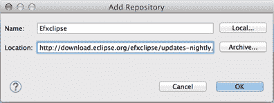

**图 18-1:** 添加 E(fx)clipse 插件的地址

点击 OK，并勾选如图 18-2 所示的所有组件。

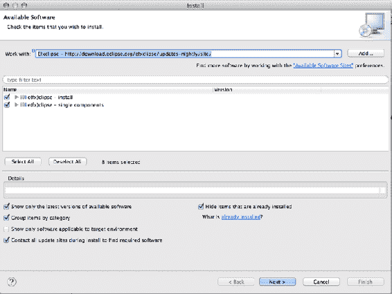

**图 18-2:** 选择要安装的插件组件

点击 Next（下一步）然后点击 Finish（完成）完成安装。Eclipse 将重启，你就可以准备好创建 JavaFX 项目了。

创建一个 HelloFX 项目。选择 File（文件）→New（新建）→Other（其他）→JavaFX→JavaFX Project 并为项目命名为 HelloFX。你会看到一个如图 18-3 所示内容的新项目。

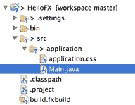

**图 18-3:** 新生成的 JavaFX 项目

该项目自动生成了一个用于启动应用程序的 `Main` 类；它还自动生成了空文件 `application.css`，你可以在其中添加样式。生成的 `Main` 类看起来如下：

```java
public class Main extends Application {
    @Override
    public void start(Stage primaryStage) {
        try {
            BorderPane root = new BorderPane();
            Scene scene = new Scene(root,400,400);
            scene.getStylesheets().add(getClass()
                .getResource("application.css").toExternalForm());
            primaryStage.setScene(scene);
            primaryStage.show();
        } catch(Exception e) {
            e.printStackTrace();
        }
    }

    public static void main(String[] args) {
        launch(args);
    }
}
```

运行 `Main` 程序，将打开一个没有标题且没有内容的窗口。该窗口的宽度和高度均为 400 像素。对舞台的引用由 `Application` 作为参数传递给 `start()` 方法。之后，代码将 `BorderPane` 布局（参见布局 章节）分配给根节点，并使用此空节点创建一个 400 x 400 的场景。自动生成的文件 `application.css` 是空的，但如果它定义了一些样式，

## 布局

与 Swing 布局管理器（#ch18.xhtml_fxlayouts）类似，JavaFX 也有助于构建场景的布局。在接下来的章节中，你将修改此代码来使用它们。

JavaFX 有以下布局类：

*   `HBox`
*   `VBox`
*   `FlowPane`
*   `GridPane`
*   `BorderPane`
*   `StackPane`
*   `AnchorPane`

`HBox` 类（水平框）将控件在同一行内排列。垂直框 `VBox` 将控件垂直排列。`FlowPane` 将节点在行内排列，如果空间不足则会换到下一行。`GridPane` 类似于 Swing 的 GridBagLayout，它允许在行和列中安排用户界面控件并为每个单元格分配约束。`BorderPane` 可以将场景分为五个区域，类似于 Swing 的 BorderLayout，但在 JavaFX 中这些区域被称为 `left`、`top`、`right`、`bottom` 和 `center`。`TilePane` 布局类似于 `FlowPane`，但它将每个节点放在大小相同的单元格中（就像墙上的瓷砖）。`StackPane` 类似于 Swing 的 `CardLayout`，一次只显示一个节点并覆盖其他节点。`AnchorPane` 允许你将节点锚定在场景的左侧、顶部、右侧和底部。想象一个音乐播放器应用程序，左侧有一个倒退按钮，右侧有一个快进按钮。假设你想确保倒退按钮始终距离左侧 20 像素，距离底部 10 像素。即使用户缩放窗口，也要保持这种位置。为此，你可以使用 `leftAnchor` 和 `bottomAnchor` 属性。例如：

```java
AnchorPane.setLeftAnchor(rewindBtn, 20);
AnchorPane.setBottomAnchor(rewindBtn, 10);
```

这些布局都可以根据对齐方式、内边距、外边距等属性进行配置。通常对任何布局都会遵循以下步骤：

1. 创建要在布局内使用的子节点实例。
2. 创建所选布局类的实例（例如 `HBox`）。该实例作为你添加的所有子节点的容器和布局管理器。
3. 使用 `add()` 或 `addAll()` 方法将子节点添加到容器中。
4. 如果此布局实例需要在另一个布局中使用（例如 `HBox` 可以放置在 `BorderPane` 中），则使用 `add()` 方法将步骤 1 创建的实例添加到父级容器中。

让我们通过 `HBox` 示例来看看它是如何工作的。

### 使用 HBox 布局的示例应用程序

假设你需要要求用户输入其电子邮件地址，并将其发送到某些知道如何处理它的 Java 代码。本示例使用了以下 JavaFX 组件：`Label`、`Button` 和 `TextField`，它们位于 `javafx.scene.control` 包中。

借助 E(fx)clipse 插件，创建一个新的 JavaFX 主类 `HBoxSample`（使用 File→New→Other→JavaFX→Classes）。它会创建以下类：

```java
public class HBoxSample extends Application {
    public void start(Stage primaryStage) {
    }
    public static void main(String[] args) {
        launch(args);
    }
}
```

现在，你需要创建 `Label`、`TextField` 和 `Button` 的实例，设置它们的属性，并将它们添加到 `HBox` 实例中。在 `start()` 方法中添加以下代码：

```java
Label emailLbl = new Label("Email:");

TextField emailTxt = new TextField();
emailTxt.setPrefColumnCount(20);
emailTxt.setPromptText("Your email");     

Button submitBtn = new Button("Submit");

HBox emailBox = new HBox(5);  // 之间的间距 5 px
emailBox.setPadding(new Insets(3));  // HBox 周围的空间
emailBox.getChildren().addAll(emailLbl, emailTxt, submitBtn);

Scene scene = new Scene(emailBox,750,100);
primaryStage.setScene(scene);
primaryStage.show();
```

运行 `HBoxSample` 程序，你会看到一个与图 18-4 所示所示的窗口。

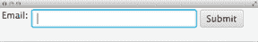

**图 18-4:** 运行 HBoxSample

提示符“Your email”没有显示在文本框中，因为它拥有焦点，但一旦该控件失去焦点，你就能看到它。

对此程序进行微调，将 `HBox` 的实例化替换为 `VBox`，这些组件将垂直一个接一个地布局（你需要增加场景的高度才能看到所有三个组件）。

## 使用 GridPane 布局的示例应用程序

`GridPane` 将选定的场景区域划分为行和列，并将放置在网格单元中。单元的大小不需要相同——节点可以跨越。如果屏幕尺寸发生变化，内容不会换行并保持网格状态。


# JavaFX GridPane 布局与 CSS 样式

在将节点放入单元之前，你必须指定网格约束，例如 `rowIndex` 和 `columnIndex`（单元的坐标，从 0,0 开始）。`rowSpan` 和 `columnSpan` 允许使单元变得与其他几个单元一样宽（或一样高）。`GridPane` [文档](http://docs.oracle.com/javase/8/javafx/api/javafx/scene/layout/GridPane.html) 描述了许多各种约束，这些约束可以在窗口缩放时定义每个单元格内容的行为。本节向你展示了一个使用某些约束的示例。

此示例创建了一个登录窗口，用户可以在其中输入 ID 和密码，然后点击登录（Sign In）按钮。场景使用了 `GridPane` 布局。第一行包含一个用于用户 ID 的 `Label` 和 `TextField`；第二行是密码的设置；网格的第三行有一个按钮（登录），该按钮应该跨越两列。下方的图 18-5 显示了窗口应该有的样子。

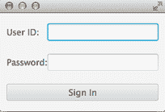

**图 18-5:** 登录窗口

以下是渲染此窗口的 `GridPaneSample` 类的代码：

```java
public class GridPaneSample extends Application {
    public void start(Stage primaryStage) {

        final int TWO_COLUMN_SPAN = 2;

        Label userIdLbl = new Label("User ID:");
        TextField userIdTxt = new TextField();
        Label userPwdLbl = new Label("Password:");
        PasswordField userPwdTxt = new PasswordField();
        GridPane root = new GridPane();
        root.setVgap(20);
        root.setPadding(new Insets(10));
        root.setAlignment(Pos.CENTER);

        // 使用静态方法设置节点约束
        GridPane.setConstraints(userIdLbl, 0, 0);
        GridPane.setConstraints(userIdTxt, 1, 0);
        GridPane.setConstraints(userPwdLbl, 0, 1);
        GridPane.setConstraints(userPwdTxt, 1, 1);
        root.getChildren().addAll(userIdLbl, userIdTxt,
                                  userPwdLbl, userPwdTxt);

        Button signInBtn = new Button("Sign In");

        // 允许按钮更宽以覆盖首选宽度
        signInBtn.setPrefWidth(Double.MAX_VALUE);

        // 允许按钮更宽以覆盖首选宽度
        root.add(signInBtn, 0, 2, TWO_COLUMN_SPAN, 1);

        Scene scene = new Scene(root, 250, 150);
        primaryStage.setScene(scene);
        primaryStage.show();
    }

    public static void main(String[] args) {
        launch(args);
    }
}
```

## CSS 样式应用

在 CSS 中，ID 类型选择器以 `#` 号开头。为了让前面的代码中的样式生效，你的 Java 代码应该像如下：

```java
Button signInBtn = new Button("Sign In");
signInBtn.setId("submitBtn");
```

对应的 CSS 样式：

```css
#submitBtn {
    -fx-background-color: red;
}
```

如果你想对同种类型的多个组件应用样式，你需要定义一个 `type selector`（类型选择器）。例如，为了让所有 `Label` 组件的文本颜色变为红色，你可以定义以下 CSS 类型选择器：

```css
.label {
    -fx-text-fill: red;
}
```

注意，CSS 类型选择器以点 `.` 开头。要创建一个可以应用于任何组件的 CSS `class selector`（类选择器），请在任意名称下定义该选择器，并程序化地将其应用于你选择的组件上。例如，你可以指定以下类选择器：

```css
.bluelabel {
    -fx-text-fill: blue;
    -fx-font-weight: bold;
    -fx-font-family: verdana;
    -fx-font-style: italic;
}
```

此类选择器定义了规则，使标签文本以蓝色**加粗**的 verdana 字体和*斜体样式*显示。要将此类选择器应用于特定的标签，你的 Java 代码应该像如下：

```java
Label userPwdLbl = new Label("Password:");
userPwdLbl.getStyleClass().add("bluelabel");
```

对于这个特定的标签，`bluelabel` 样式覆盖了可能应用于舞台上所有其他标签的类型选择器。

你可能会问：“我如何知道对于给定的 JavaFX 组件可以使用哪些样式属性？”对于 JavaFX 支持的样式，请参考标题为“[JavaFX CSS Reference Guide](http://docs.oracle.com/javase/8/javafx/api/javafx/scene/doc-files/cssref.html)”的在线文档。

## GridPaneSampleCSS 完整示例

现在是时候发现如何将所有这些样式技术应用到上一节的 `GridPaneSample` 了。我将该类的新版本命名为 `GridPaneSampleCSS`，其代码显示所示。我在 `GridPaneSample` 代码中只添加了三行关键代码。

```java
public class GridPaneSampleCSS extends Application {
    public void start(Stage primaryStage) {

        final int TWO_COLUMN_SPAN = 2;

        Label userIdLbl = new Label("User ID:");
        TextField userIdTxt = new TextField();
        Label userPwdLbl = new Label("Password:");
        userPwdLbl.getStyleClass().add("bluelabel");
        PasswordField userPwdTxt = new PasswordField();
        GridPane root = new GridPane();
        root.setVgap(20);
        root.setPadding(new Insets(10));
        root.setAlignment(Pos.CENTER);

        // 使用静态方法设置节点约束
        GridPane.setConstraints(userIdLbl, 0, 0);
        GridPane.setConstraints(userIdTxt, 1, 0);
        GridPane.setConstraints(userPwdLbl, 0, 1);
        GridPane.setConstraints(userPwdTxt, 1, 1);
        root.getChildren().addAll(userIdLbl, userIdTxt,
                                  userPwdLbl, userPwdTxt);

        Button signInBtn = new Button("Sign In");
        signInBtn.setId("submitBtn");  // 用于 CSS

        // 允许按钮更宽以覆盖首选宽度
        signInBtn.setPrefWidth(Double.MAX_VALUE);
        // 使用实例方法直接添加节点
        root.add(signInBtn, 0, 2, TWO_COLUMN_SPAN, 1);

        Scene scene = new Scene(root, 250, 180);
        scene.getStylesheets().add(getClass()
                  .getResource("application.css").toExternalForm());
        primaryStage.setScene(scene);
        primaryStage.show();
    }

    public static void main(String[] args) {
        launch(args);
    }
}
```

该应用程序加载了包含以下内容的 `application.css` 文件：

```css
#submitBtn {
    -fx-background-color: red;
}

.label {
    -fx-text-fill: red;
}

.bluelabel {
    -fx-text-fill: blue;
    -fx-font-weight: bold;
    -fx-font-family: verdana;
    -fx-font-style: italic;
}
```

# 事件处理

与 Swing 框架类似，JavaFX 应用程序也是事件驱动的。在 JavaFX 中，事件由 `javafx.event.Event` 实例表示。根据你如何构建应用程序，可以在 Java 或 FXML 中分配事件处理器。但无论如何，处理事件的代码始终用 Java 编写。在为你的应用程序编写事件处理器之前，你需要决定哪些事件是重要的且必须处理的。例如，没有必要为登录标签编写事件处理器。但我们确实需要处理登录和取消按钮点击。如果用户 ID 由电子邮件表示，我们需要拦截并处理文本框失去焦点的时刻。在本节中，我将向你展示如何处理按钮点击。关于处理 JavaFX 事件的详细介绍，请阅读 [Oracle 教程](http://docs.oracle.com/javafx/2/events/jfxpub-events)。

你可以使用以下技术来处理事件：

- 创建一个匿名类实例并重写其 `handle()` 回调方法。将其传递给特定事件的事件处理器。
- 使用 Lambda 表达式。
- 使用 Java 方法引用。

此示例创建了登录窗口的另一个版本，但这次窗口具有登录、取消按钮以及“忘记密码”超链接。这些控件都使用不同的方式来处理点击事件。新的登录窗口看起来像图 18-7 所示。


```java
public class GridPaneSampleEvents extends Application {
    public void start(Stage primaryStage) {

        Label userIdLbl = new Label("User ID:");
        TextField userIdTxt = new TextField();
        Label userPwdLbl = new Label("Password:");
        PasswordField userPwdTxt = new PasswordField();
        Button signInBtn = new Button("Sign In");
        Button cancelBtn = new Button("Cancel");
        Hyperlink forgotPwdLink = new Hyperlink("Forgot password");
        GridPane root = new GridPane();
        root.setVgap(20);
        root.setPadding(new Insets(10));
        root.setAlignment(Pos.CENTER);

        // Using static methods for setting node constraints 
        GridPane.setConstraints(userIdLbl, 0, 0);
        GridPane.setConstraints(userIdTxt, 1, 0);
        GridPane.setConstraints(userPwdLbl, 0, 1);
        GridPane.setConstraints(userPwdTxt, 1, 1);
        GridPane.setConstraints(signInBtn, 0, 2);
        // Cancel button: span 1, right aligned
        GridPane.setConstraints(cancelBtn, 1, 2, 1, 1, HPos.RIGHT, VPos.CENTER);
        GridPane.setConstraints(forgotPwdLink, 0, 3, 2, 1);
        root.getChildren().addAll(userIdLbl, userIdTxt, userPwdLbl, userPwdTxt, signInBtn, cancelBtn, forgotPwdLink);

        // Event handlers

        // 1. Anonymous class 
        signInBtn.setOnAction(new EventHandler<ActionEvent>() {
            public void handle(ActionEvent evt) {
                System.out.println("Anonymous class handler. Sign in clicked.");
            }
        });

        // lambda expression
        cancelBtn.setOnAction(evt -> System.out.println("Lambda handler. Cancel clicked."));

        // method reference
        forgotPwdLink.setOnAction(this::forgotPwdHandler);

        // Show the window
        Scene scene = new Scene(root, 250, 200);
        primaryStage.setScene(scene);
        primaryStage.show();
    }

    private void forgotPwdHandler(ActionEvent evt) {
        System.out.println("Method reference handler. Forgot password clicked");
    }

    public static void main(String[] args) {
        launch(args);
    }
}
```

如果你运行此程序并点击“登录”（`Sign In`）、“取消”（`Cancel`）或“忘记密码”（`Forgot Password`），控制台输出如下：

```
Anonymous class handler. Sign in clicked.
Lambda handler. Cancel clicked.
Method reference handler. Forgot password clicked.
```

虽然每个事件处理程序的功能相同，但我更偏于 `lambda` 表达式版本，因为它简洁且易读。每个 JavaFX GUI 控件都有。

## 属性与绑定

尽管开发者经常随口使用“属性”（properties）一词，但 JavaFX 属性不仅仅是字段。JavaFX 定义了 `javafx.beans.property.Property`，它对于[绑定](https://docs.oracle.com/javafx/2/api/binding.html)组件非常有用。

想象你正在开发一个价格（`price`）会不断变化的金融应用程序。JavaFX 属性简化了数据与 GUI 的同步。当 `price` 改变时，`Label` 组件会自动更新。无需编写代码。

`Property` 接口声明了以下方法：`bind()`、`unbind()`、`bindBidirectional()`、`unbindBidirectional()` 和 `isBound()`。

你可以将任何值绑定到 JavaFX 属性上吗？不能——该值必须是 `ObservableValue` 类型。JavaFX 属性类位于 `javafx.beans.property` 包中。对于每种属性类型，都有两个类：只读和读写。例如，如果你需要处理一个 `String` 属性，可以使用 `SimpleStringProperty`（读写）或 `ReadOnlyStringWrapper`（只读）。这两者都实现了 `StringProperty` 接口。同样，其他数据类型和集合也存在对应的命名的类。

正如你在书中所做的那样，你可以通过编写代码来学习。这一次，我们将通过修改上一节中的 `GridPaneSampleEvents` 类，在登录窗口的底部添加一个额外的 `Label` 组件。它将在用户点击按钮和超链接时显示有关事件的消息。初始状态下，该标签没有任何文本：

```java
Label messageLbl = new Label();
```

JavaFX 属性是可观察的（observables）。因此，你可以为属性添加一个监听器（观察者以便在属性更改时接收通知）。但在绑定表达式中直接使用属性简单得多。你将此标签 `bind`（绑定）到字符串属性，一旦该属性的值发生变化，标签组件 `messageLbl` 就会显示该值。

```java
private StringProperty message = new SimpleStringProperty();
messageLbl.textProperty().bind(message);
```

在上一节中，`GridPaneSampleEvents` 类仅仅在系统控制台上打印消息。而新的类 `GridPaneSampleBinding` 则改而修改属性 `message`，例如：

```java
cancelBtn.setOnAction(evt -> message.set("Cancel clicked."));
```

点击 `cancelBtn` 会改变 `message` 属性的值，而该属性已绑定到 `messageLbl` 的文本属性；GUI 会自动变化！下方的图 18-8 显示了用户点击“取消”按钮后登录窗口的样子。

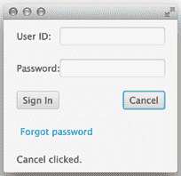

**[图 18-8]:** 运行中的绑定

`GridPaneSampleBinding` 类的完整代码所示：

```java
public class GridPaneSampleBinding extends Application {
    // Declaring a JavaFX property
    private StringProperty message = new SimpleStringProperty();

    public void start(Stage primaryStage) {

        Label userIdLbl = new Label("User ID:");
        TextField userIdTxt = new TextField();
        Label userPwdLbl = new Label("Password:");
        PasswordField userPwdTxt = new PasswordField();
        Button signInBtn = new Button("Sign In");
        Button cancelBtn = new Button("Cancel");
        Hyperlink forgotPwdLink = new Hyperlink("Forgot password");

        // A label to display messages using binding
        Label messageLbl = new Label();
        // binding the StringProperty to a GUI component
        messageLbl.textProperty().bind(message);

        GridPane root = new GridPane();
        root.setVgap(20);
        root.setPadding(new Insets(10));
        root.setAlignment(Pos.CENTER);

        // Using static methods for setting node constraints 
        GridPane.setConstraints(userIdLbl, 0, 0);
        GridPane.setConstraints(userIdTxt, 1, 0);
        GridPane.setConstraints(userPwdLbl, 0, 1);
        GridPane.setConstraints(userPwdTxt, 1, 1);
        GridPane.setConstraints(signInBtn, 0, 2);

        // Cancel button: span 1, right aligned
        GridPane.setConstraints(cancelBtn, 1, 2, 1, 1, HPos.RIGHT, VPos.CENTER);
        GridPane.setConstraints(forgotPwdLink, 0, 3, 2, 1);

        // Message label: span 2
        GridPane.setConstraints(messageLbl, 0, 4, 2, 1);
        root.getChildren().addAll(userIdLbl, userIdTxt, userPwdLbl, userPwdTxt, signInBtn, cancelBtn, forgotPwdLink, messageLbl);

        // event handlers
        // 1. Anonymous class 
        signInBtn.setOnAction(new EventHandler<ActionEvent>() {
            public void handle(ActionEvent evt) {
                message.set("Sign in clicked.");
            }
        });

        // lambda expression
        cancelBtn.setOnAction(evt -> message.set("Cancel clicked."));

        // method reference
        forgotPwdLink.setOnAction(this::forgotPwdHandler);

        // Show the window
        Scene scene = new Scene(root, 250, 220);
        primaryStage.setScene(scene);
        primaryStage.show();
    }

    private void forgotPwdHandler(ActionEvent evt) {
        message.set("Forgot password");
    }

    public static void main(String[] args) {
        launch(args);
    }
}
```

绑定可以是双向的。如果 GUI 组件的值发生变化，它可以更改底层模型的值；反之，如果模型的值发生变化，GUI 也会随之更新。如果你想随时停止绑定，可以使用 `unbind()` 方法——例如：

```java
messageLbl.textProperty().unbind();
```

我尝试在这门入门课程中尽可能包含更多的信息，以便你能够开始完成作业。在第 19 节中，你将在开发游戏时应用所有这些技术。

### 尝试一试

将第 8 章中的计算器重新创建一个 JavaFX 应用程序。

### 课程要求

你应该已经安装 Java。

### 步骤说明

1. 在 Eclipse 中创建一个新的 JavaFX 项目。
2. 创建一个继承 `Application` 的类 `Calculator`（你可以重命名 `Main` 类）。
3. 使用 JavaFX 布局重新创建 `Calculator` GUI。
4. 创建实现 `EventHandler` 的类 `CalculatorController` 来处理按钮的点击事件。
5. 使用 `Calculator` 的显示字段与 `CalculatorController` 的 `String` 属性之间的 JavaFX 绑定，以显示输入的数字。
6. 实现至少一种操作（例如，加法）并使用绑定显示结果。查看第 19 节的“尝试一试”部分获取计算器功能的示例实现。

# 第 19 节：开发 JavaFX 计算器和井字棋

现在你已经熟悉了 JavaFX 的基础知识，是时候编写一些实际应用程序了。在这一节中，你将编写计算器和井字棋游戏。在第 18 节中你用 Java 编写了应用程序，但这次你使用声明式语言——FXML 创建图形用户界面（GUI）部分。应用程序逻辑和事件处理保留在 Java 中。

在这一节中，你将熟悉 Scene Builder——这是一种设计工具，允许你通过将组件（按钮、文本字段、标签等）拖放到内容面板（如图 19-4 所示的 Scene Builder 中心区域）来创建 GUI。当你使用 Scene Builder 设计视图时，它会生成一个名为 `.fxml` 的文件，其中包含了你设计的类 XML 标签。你还将看到如何使用层叠样式表（CSS）动态更改组件的样式。

## 使用 Scene Builder 设计计算器

我假设你已经按照第 18 节中的描述安装了 javafx 插件。现在你需要从 Oracle 的 `http://bit.ly/1rn1S5` 下载并安装 Scene Builder。如果你已经完成了第 18 节“尝试一试”部分的作业，你应该已经有一个显示计算器 GUI 的程序，它可能与图 19-1 显示的相似。


**图 19-1：** 计算器

现在你将了解如何使用 Scene Builder 创建计算器。你仍然通过在 Eclipse 中选择 `File → New → Other → JavaFX` 来开始项目。


# 我将此项目命名为 Lesson19

在创建此项目时，指定了包名 `mycalculator`、语言 FXML、文件名 `Calculator` 以及控制器名称 `CalculatorController`，如图 19-2 所示。

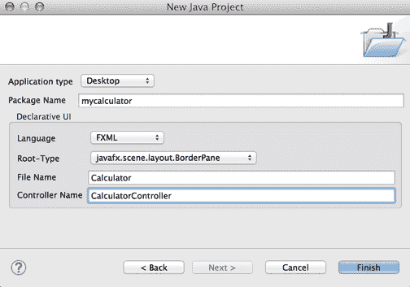

**图 19-2：在 Eclipse 中配置 JavaFX 项目**

点击 `Finish` 按钮将创建一个 Eclipse 项目，其中包含两个 Java 类——`Main` 和 `CalculatorController`、 19-3 所示的 FXML 文件 `Calculator.fxml` 以及名为 `application.css` 的 CSS 文件。

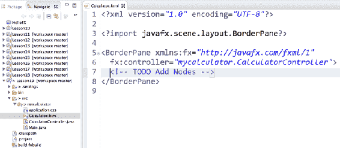

**图 19-3：生成的项目 Lesson19**

注意 `<BorderPane>` 包含了属性 `fx:controller`，其值是在你的 MVC 应用程序中充当控制器的类名。`Calculator.fxml` 文件（如图 19-3 所示）包含了反映你设计的类标签。特别是 `<BorderPane>` 标签对应 JavaFX 的 `BorderLayout` 容器。

`Main` 类启动应用程序。在第 18 节你需要手动编写 Java 应用程序，但现在它由 E(fx)clipse 插件生成，如下：

这段代码中有一个你可能熟悉的新元素——注解 `@Override`，它表示方法 `start()` 重写了其父类的对应版本。我在第 23 节中解释了注解。在下一节中，你将看到如何在 Scene Builder 中设计 GUI，并将其保存为 `.fxml` 文件。你的 `Main` 类使用 `FXMLLoader` 类加载它，并根据 FXML 内容在内存中创建一个 Java 对象。

生成的项目包含一个空文件 `application.css`，这是使用 CSS 自定义 GUI 外观的正确位置。

根据 MVC 设计模式，`CalculatorController` 类是你在 Java 中编写事件处理程序方法的地方。目前它是空的。你将使用声明式语言（FXML）创建 GUI 与使用 Java 编写的应用程序逻辑隔离开来。

## 使用 Scene Builder 设计计算器 GUI

`Calculator.fxml` 文件的内容由 Scene Builder 生成。右键点击其名称，并使用菜单“Open → Other → Scene Builder”。它看起来像图 19-4。

中间部分被称为内容面板（Content Panel）。从左侧面板中，将 GUI 控件和容器拖放到内容面板上。在左下角你可以看到 GUI 组件的层级结构，目前它只有 `BorderPane`。现在在 `BorderPane` 的 `TOP` 区域放置一个 `TextField`，并在 `CENTER` 区域放置带有 `Button` 控件的 `GridPane`。

打开左侧的 Controls 面板，选择一个 `TextField`，并将其拖到 Hierarchy 面板中的 `insert TOP` 行。Scene Builder 看起来像图 19-5。

保存（`Ctrl+S`）当前设计后，在 Eclipse 中打开 `Calculator.fxml` 文件。你会看到 Scene Builder 在 `<BorderPane>` 内部生成了 `<top>` 标签：

```xml
<BorderPane xmlns:fx="http://javafx.com/fxml/1" 
            xmlns="http://javafx.com/javafx/8" 
            fx:controller="mycalculator.CalculatorController">
  <top>
      <TextField BorderPane.alignment="CENTER" />
  </top>
</BorderPane>
```

现在在左侧的 Containers 面板中选择 `GridPane`，将其拖放到 Hierarchy 面板中的 `insert CENTER` 行。Scene Builder 看起来像图 19-6。

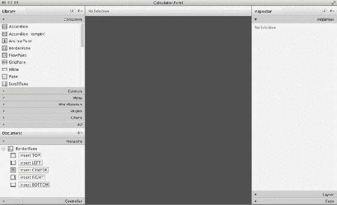

**图 19-4:** Scene Builder 中的 Calculator.fxml

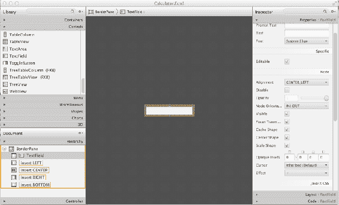

**图 19-5:** TextField 控件被放置在 TOP 区域

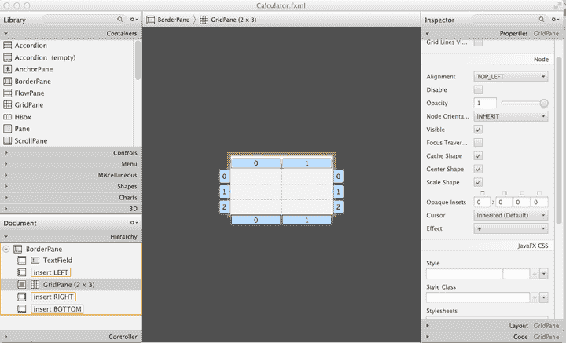

**图 19-6:** 将 GridPane 添加到 CENTER

保存设计后，`Calculator.fxml` 文件包含了新内容：

```xml
<BorderPane xmlns:fx="http://javafx.com/fxml/1" 
      xmlns="http://javafx.com/javafx/8" 
      fx:controller="mycalculator.CalculatorController">
  <top>
      <TextField BorderPane.alignment="CENTER" />
  </top>
  <center>
      <GridPane BorderPane.alignment="CENTER">
        <columnConstraints>
          <ColumnConstraints hgrow="SOMETIMES" minWidth="10.0" 
                               prefWidth="100.0" />
          <ColumnConstraints hgrow="SOMETIMES" minWidth="10.0" 
                               prefWidth="100.0" />
        </columnConstraints>
        <rowConstraints>
          <RowConstraints minHeight="10.0" prefHeight="30.0" 
                               vgrow="SOMETIMES" />
          <RowConstraints minHeight="10.0" prefHeight="30.0" 
                               vgrow="SOMETIMES" />
          <RowConstraints minHeight="10.0" prefHeight="30.0" 
                               vgrow="SOMETIMES" />
        </rowConstraints>
      </GridPane>
  </center>
</BorderPane>
```

在第 18 节的 `GridPaneSample` 类中，你通过调用方法来指定 `GridPane` 的所有属性，但现在它们由 FXML 属性表示。默认创建的 `GridPane` 容器两列三行，因此你看到两个 `<ColumnConstraints>` 标签和三个 `<RowConstraints>` 。图 19-6 中带有数字的小标签对应于网格的行和列数。图 19-1 中显示的计算器有四列的按钮。要添加更多行和列，你需要右键点击网格并继续选择 `Add Rows` 或 `Add Column`，直到看到如图 19-7 所示的 4x6 网格。

保存设计后，`Calculator.fxml` 文件包含了 4x6 网格的 FXML 标签。接下来，在 Scene Builder 中添加了 10 像素的内边距（padding），以便网格与窗口边界之间有空间，并添加水平和垂直间隙以便单元格之间有空间。这是通过在右侧的 `Properties` 面板中填充 `Padding`、`Hgap` 和 `Vgap` 值实现的，如图 19-8 所示。

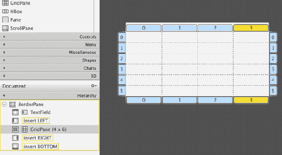

**图 19-7:** TextField 下方的 4x6 GridPane

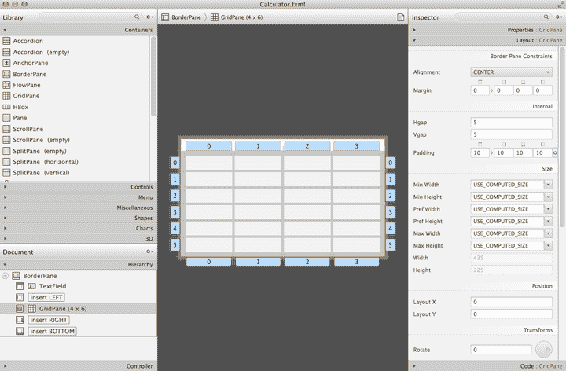

**图 19-8:** 设置 GridPane 的 Hgap、Vgap 和 Padding

下一步是在网格单元格中添加按钮。从左侧的 `Controls` 面板将一个 `Button` 拖放到网格的左上单元格中，如图 19-9 所示。拖动按钮的右边界使其变大。将按钮每个侧的 `Margin` 属性设置为 5；这是按钮与边界之间的距离。最后，将按钮上的文本更改为 `MC` 以匹配图 19-1 中的左上按钮。图 19-9 显示了 Scene Builder 窗口现在的样子。

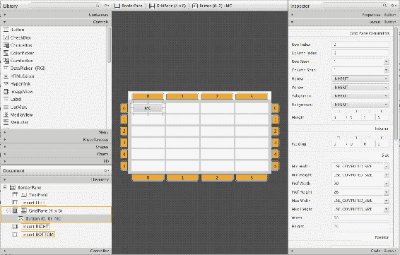

**图 19-9:** 添加到左上单元格的 MC 按钮

在 `Calculator.fxml` 中保存此设计后，`<GridPane>` 内部有一个新的 `<children>` 部分。目前它只有一个按钮：

```xml
<children>
  <Button mnemonicParsing="false" prefHeight="26.0" 
                                       prefWidth="99.0" text="MC">
    <GridPane.margin>
      <Insets bottom="5.0" left="5.0" right="5.0" top="5.0" />
    </GridPane.margin>
  </Button>
</children>
```

没有 (0,0) 单元格的指示，因为 0 是 `GridPane.columnIndex` 和 `GridPane.rowIndex` 属性的默认值。现在你需要在其他单元格中复制此按钮。你可以多次使用 `Ctrl+C`/`Ctrl+V`，然后将按钮拖放到其他单元格中。为每个按钮设置适当的文本。在在此过程中，观察随着你添加更多按钮，`Calculator.fxml` 内容是如何变化的。我发现直接在 FXML 文件中复制粘贴代码比使用 Scene Builder 进行批量复制更快。

注意，在图 19-1 中，位于 (0,5) 单元格的按钮跨越了两列，坐标为 (3,4) 的按钮跨越了两行。对于这些按钮，你需要在右侧的 `Properties` 面板中输入 2 作为行（或列）跨度，并选择 `MAX_VALUE` 作为最大宽度（或高度）。完成所有这些后，Scene Builder 的窗口应该像图 19-10。

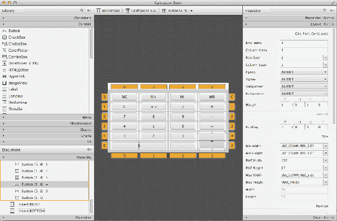

**图 19-10:** 网格中的所有按钮

运行 `Main` 类，你会看到计算器像图 19-1。

这里对 Scene Builder 的简要介绍此结束。如果你投入更多时间来掌握这个工具，你开发 GUI 应用程序的效率将会提高。详情请参阅 [Scene Builder 用户指南](https://docs.oracle.com/javase/8/scene-builder-2/user-guide/)。

## 在控制器类中处理事件

根据 MVC 设计模式，你已经创建了视图 `Calculator.fxml`。现在你可以编写一个控制器并将其挂到视图上。当最初生成 `Calculator.fxml` 文件时，它包含了将处理位于根容器中所有组件事件的控制器名称：

```xml
<BorderPane xmlns="http://javafx.com/javafx/8" 
      xmlns:fx="http://javafx.com/fxml/1" 
      fx:controller="mycalculator.CalculatorController">
```

你将事件处理方法添加到 `CalculatorController` 类中，并将 GUI 组件链接到相应的事件处理程序。起初，生成的 `CalculatorController` 类是空的。添加一个简单的事件处理方法 `buttonClickHandler()`：

```java
package mycalculator;
import javafx.event.ActionEvent;
public class CalculatorController {

  public void buttonClickHandler(ActionEvent evt){
   System.out.println("Hello from controller!");
  }   
}
```

如果你还记得，第 18 Lesson 中的 `GridPaneSampleEvents` 类调用了 `Button` 对象的 `setOnAction()` 方法来将事件处理程序分配给按钮点击。但如果你在 FXML 中开发 GUI，那里没有 Java 对象。相反，你使用 `<Button>` 属性 `onAction` 将控制器的 `buttonClickHandler()` 赋值为计算器按钮的事件处理程序。以下代码段针对标签为 `1` 的按钮。

```xml
<Button prefHeight="37.0" prefWidth="132.0"
     text="1" onAction="#buttonClickHandler" GridPane.rowIndex="4">
   <GridPane.margin>
      <Insets bottom="5.0" left="5.0" right="5.0" top="5.0" />
    </GridPane.margin>
</Button>
```

根容器知道它的控制器，而容器的子元素知道处理事件的控制器方法名称。在计算器的示例中，我为所有按钮设置了一个事件处理程序，并将 `onAction="#buttonClickHandler"` 复制粘贴到每个按钮。或者，我可以为数字按钮分配一个事件处理程序，并为执行操作的按钮分配另一个。

现在运行 `Main` 类并点击任何按钮，控制台上都会打印消息“Hello from controller”，这并不完全是计算器应该执行的。但至少这证明了控制器接收了来自视图的事件。下一步是让控制器能够将数据传回给视图。

基本上，点击计算器按钮有两种用例：

1. 用户点击了数字按钮，事件处理程序应该从 `TextField` 控件获取当前值，拼接被点击按钮的标签，并将 `TextField` 设置为新值。
2. 用户点击了操作按钮，事件处理程序必须识别所选的操作并应用相应的业务逻辑。

你将在本节的“试一试”（Try It）部分作为作业完整实现计算器的所有逻辑，但我会向你解释如何识别点击了哪个按钮，以及如何将数据从控制器发送到视图。

### 识别事件源

每个 JavaFX 事件都继承自 [javafx.event.Event](https://docs.oracle.com/javase/8/javafx/api/javafx/event/Event.html)，它具有如 `source` 和 `target` 等字段。`source` 存储事件最初发生对象的引用。`target` 定义了处理事件的对象。如果用户点击组件且程序正处于该组件的事件处理程序内部，则 `source` 和 `target` 都指向同一个对象。

但每个事件都会通过组件所在的容器进行传输。这是一个*捕获阶段*（capturing phase）。然后事件到达目标，事件处理程序对其进行处理，然后事件会*冒泡*（bubbles up）回根容器。但容器也可能有事件处理程序，因此在事件传输到目标的过程中，它可能会被容器的处理器处理，在这种情况下，`target` 的值与 `source` 不相同。

例如，JavaFX 拥有 `KeyEvent`，运行时将其提供给键盘事件处理程序。如果你的计算器在 `BorderPane` 和嵌套的 `TextField` 上都有键盘事件处理程序，且用户在焦点位于 `TextField` 时点击了键，那么容器的事件处理程序接收到的 `KeyEvent` 对象中 `target` 指向 `TextField`，而 `source` 指向 `BorderPane`。当事件对象到达 `TextField` 的事件处理程序时，`KeyEvent` 的 `source` 和 `target` 都指向 `TextField`。

在你的计算器中，你并不处理容器事件，因此 `source` 和 `target` 都指向被点击的按钮。因此，检查 `ActionEvent.source` 的值可以获得特定按钮的引用，通过调用按钮上的 `getText()` 方法，你可以找到它的标签并采取相应的行动。

```java
package mycalculator;
import javafx.event.ActionEvent;
import javafx.scene.control.Button;
public class CalculatorController {

  public void buttonClickHandler(ActionEvent evt){

   Button clickedButton = (Button) evt.getTarget();
   System.out.println("You clicked on " + clickedButton.getText());
  }   
}
```

现在让我们使用 `switch` 语句分离操作和数字按钮的处理。所有数字和句号按钮应该改变计算器 `TextField` 的内容。私有方法 `processDigit()` 将负责。所有操作按钮应该根据所选的操作应用逻辑。私有方法 `processOperation()` 将负责这一点。


```java
public class CalculatorController {

  public void buttonClickHandler(ActionEvent evt) {

    Button clickedButton = (Button) evt.getTarget();
    String buttonLabel = clickedButton.getText();

    // 区分数字和操作
    switch (buttonLabel) {
      case "0":
      case "1":
      case "2":
      case "3":
      case "4":
      case "5":
      case "6":
      case "7":
      case "8":
      case "9":
      case "10":
      case ".":
        processDigit(buttonLabel);
        break;
      default:
        processOperation(buttonLabel);
    }
  }

  private void processDigit(String buttonLabel) {
    System.out.println("You clicked on " + buttonLabel);
  }

  private void processOperation(String buttonLabel) {
    System.out.println("You selected operation " + buttonLabel);
  }
}
```

现在运行 `Main` 类，你会发现系统控制台正确识别了点击的按钮并调用了 `processDigit()` 或 `processOperation()` 方法。

### 从视图向控制器以及反向传递数据

控制器类如何访问在 FXML 中声明的 GUI 组件？如果你作为 Java 类同时创建 GUI 和控制器，你就会编写代码将 GUI 对象传递给控制器，就像你在 第 9 Lesson 中“如何在对象之间传递数据”部分中所对 `Calculator` 和 `CalclulatorEngine` 做的那样。但当 GUI 在 FXML 中声明时，你并不实例化 GUI——而是由 `FXMLLoader` 来完成。

对于此类情况，JavaFX 提供了一个简单的解决方案：在 FXML 文件中为组件分配一个 ID，并在控制器类中使用具有相同名称并带有 `@FXML` 注解的变量。这确保了 Java 变量与 GUI 组件相关联。你可以在第 23 节中学习 Java 注解。现在，只需相信我，`@FXML` 注解会魔术般将 GUI 组件的引用注入到控制器的变量中。事实上，既然你可以轻松地看到它的运行效果，何何相信我呢？

首先，在 `Calculator.fxml` 中为计算器的 `<TextField>` 标签添加 `fx:id` 属性。我将此 ID 命名为 `displayField`。

```xml
<top>
  <TextField fx:id="displayField" BorderPane.alignment="CENTER" />
</top>
```

相应的，在 `CalculatorController` 类中如下声明变量 `displayField`：

```java
@FXML
private TextField displayField;
```

现在你就可以使用变量 `displayField` 了，并且知道它的值始终与具有相同 ID 的 GUI 组件相同。`CalculatorController` 的下一个版本在 `processDigit()` 方法中使用该变量。首先，它通过 `getText()` 获取 `displayField` 的当前值，然后将选定的数字附加其，并使用 `setText()` 方法将其放回变量 `displayField`。

```java
package mycalculator;

import javafx.event.ActionEvent;
import javafx.fxml.FXML;
import javafx.scene.control.Button;
import javafx.scene.control.TextField;

public class CalculatorController {

  @FXML
  private TextField displayField;

  public void buttonClickHandler(ActionEvent evt) {

    Button clickedButton = (Button) evt.getTarget();
    String buttonLabel = clickedButton.getText();

    // 区分数字和操作
    switch (buttonLabel) {
      case "0":
      case "1":
      case "2":
      case "3":
      case "4":
      case "5":
      case "6":
      case "7":
      case "8":
      case "9":
      case "10":
      case ".":
        processDigit(buttonLabel);
        break;
      default:
        processOperation(buttonLabel);
    }
  }

  private void processDigit(String buttonLabel) {

    displayField.setText(displayField.getText() + buttonLabel);
  }

  private void processOperation(String buttonLabel) {
    System.out.println("You selected operation " + buttonLabel);
  }
}
```

在第 3 节中，我提到过如果你忘记在 `case` 子句中编写 `break` 语句，代码将会穿透。在 `processDigit()` 方法中，我故意这样做是为了避免为每个子句都编写 `processDigit()` 和 `break`。图 19-11 显示了我在点击按钮 1、5、9、.、2 和 3 后运行的计算器的截图。

`processDigit()` 方法演示了数据从 GUI 传递到控制器再传回的过程。在“尝试一试（Try It）”部分中，你需要实现 `processOperation()` 方法来完成计算器。

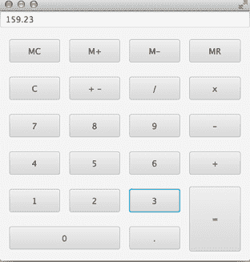

**图 19-11:** 输入数字 159.23 后的计算器视图

## 编写井棋游戏

现在你已经熟悉了使用 FXML 和 Scene Builder 创建 GUI 的基础知识，本节将向你展示编写一个井棋游戏是多么简单。

### 游戏策略

每个游戏都实现某些算法——一套根据玩家动作必须执行的规则或策略。你需要为井棋游戏设计一个简单的算法。

如果你不熟悉井棋游戏，或者它在你所在的地区有不同的名称，请阅读关于该游戏的[维基百科文章](http://en.wikipedia.org/wiki/Tic-tac-toe)。对于你正在构建的流行游戏版本，请实现以下策略：

* 游戏由两个玩家在 3x3 的二维棋盘上进行。
* 两个玩家可以玩这个游戏。一人使用符号 X，另一人使用符号 O。
* 获胜者必须有一整行、一列或对角线的 X 或 O。
* 每次移动后，程序必须检查是否有胜者。
* 获胜组合必须突出显示。
* 在找到胜者或没有空格剩余后，玩家可以选择操作（Actions）→ 游戏（Play）。

### 使用 FXML 和 CSS 设计井棋 GUI

创建一个名为 `TicTacToe` 的新 FXML 项目。选择语言 FXML，指定包名 `tictoe`、类名 `TicTacToe` 以及控制器名称为 `TacToeController`。

### 主类

在生成的 `Main` 类中进行两处更改：设置场景大小为 300x 320 并禁用调整大小。

```java
public class Main extends Application {
  @Override
  public void start(Stage primaryStage) {
    try {
      BorderPane root = (BorderPane) FXMLLoader.load(getClass().getResource("TicTacToe.fxml"));
      Scene scene = new Scene(root, 300, 320);
      scene.getStylesheets().add(getClass().getResource("application.css"));
      primaryStage.setScene(scene);
      primaryStage.setResizable(false);
      primaryStage.show();
    } catch (Exception e) {
      e.printStackTrace();
    }
  }

  public static void main(String[] args) {
    launch(args);
  }
}
```

你的井棋游戏将在 `BorderPane` 的 `Top` 区域有一个 `MenuBar`。在 Scene Builder 中，从控件面板将 `MenuBar` 组件拖到“插入（Insert）”行上。在层次结构面板展开 `MenuBar`。它拥有默认的 `File`、`Edit` 和 `Help` 菜单。井棋没有可以编辑，所以右键点击 `Edit` 并选择删除（Delete）。使用属性面板将 `File` 菜单重命名为 `Actions`。`File` 菜单创建了一个 `Close` 项，你应该将其重命名为 `Quit`。在 `Actions` 菜单上投放另一个 `MenuItem`。Scene Builder 会自动创建一个未指定的项。将其重命名为 `Play`。

`Help` 菜单最初创建了 `About` 项。将另一个 `MenuItem` 组件拖到 `Help` 菜单上。Scene Builder 默认创建一个未指定的项。将其重命名为 `How to Play`。

现在，从容器面板中将一个 `GridPane` 拖到 `BorderPane` 的中心，并添加列以将网格维度更改为 3x3。通过选择行并在右侧名为 `Layout: RowConstraints` 的面板中的 `Pref Height` 字段中输入 100，将每行的首选高度更改为 100。你的 Scene Builder 窗口应该像图 19-12 所示。

如果你运行 `Main` 类，它将打开一个带有顶部菜单的窗口，如图 19-13 所示。

现在你需要在网格中添加九个按钮，就像你在本节之前为计算器添加那样。每个按钮应占据整个单元格。按钮不应有标签；你在游戏期间通过编程将它们设置为 `X` 或 `O`。

在 Eclipse 中打开生成的文件 `TicTacToe.fxml` 并对其进行精简。移除行和列约束，并在 `GridPane` 中添加九个首选宽度和高度为 100 的按钮，使其看起来如下代码所示：

```xml
<?xml version="1.0" encoding="UTF-8"?>
<?import java.lang.*?>
<?import javafx.scene.control.*?>
<?import javafx.scene.layout.*?>
<?import javafx.scene.layout.BorderPane?>
<BorderPane xmlns="http://javafx.com/javafx/8"
           xmlns:fx="http://javafx.com/fxml/1"
           fx:controller="tictactoe.TicTacToeController">
  <top>
      <MenuBar BorderPane.alignment="CENTER">
        <menus>
          <Menu text="Actions">
            <items>
              <MenuItem text="Play" />
              <MenuItem text="Quit" />
            </items>
          </Menu>
          <Menu text="Help">
            <items>
              <MenuItem text="About" />
              <MenuItem text="How to play" />
            </items>
          </Menu>
        </menus>
      </MenuBar>
  </top>
  <center>
      <GridPane fx:id="gameBoard" BorderPane.alignment="CENTER">
        <children>
          <Button fx:id="b1" prefHeight="100.0" prefWidth="100.0" />
          <Button fx:id="b2" prefHeight="100.0" prefWidth="100.0"
                             GridPane.columnIndex="1" />
          <Button fx:id="b3" prefHeight="100.0" prefWidth="100.0"
                             GridPane.columnIndex="2" />
          <Button fx:id="b4" prefHeight="100.0" prefWidth="100.0"
                             GridPane.rowIndex="1" />
          <Button fx:id="b5" prefHeight="100.0" prefWidth="100.0"
                  GridPane.columnIndex="1" GridPane.rowIndex="1" />
          <Button fx:id="b6" prefHeight="100.0" prefWidth="100.0"
                  GridPane.columnIndex="2" GridPane.rowIndex="1" />
          <Button fx:id="b7" prefHeight="100.0" prefWidth="100.0"
                             GridPane.rowIndex="2" />
          <Button fx:id="b8" prefHeight="100.0" prefWidth="100.0"
                  GridPane.columnIndex="1" GridPane.rowIndex="2" />
          <Button fx:id="b9" prefHeight="100.0" prefWidth="100.0"
                  GridPane.columnIndex="2" GridPane.rowIndex="2" />
        </children>
      </GridPane>
  </center>
</BorderPane>
```

运行 `Main` 类，你将看到带有顶部菜单的井棋棋盘，如图 19-14 所示。注意第一个按钮有一个渲染为蓝色边框的焦点。


**图 19-14:** 第一个按钮带有焦点边框的井棋

要移除焦点边框，你需要更改空 `application.css` 文件中按钮的属性。理论上说，样式 `-fx-focus-color: transparent;` 应该生效，但在编程中并非总是按照教科书来。这里是移除焦点边框的样式：

```css
.button {
  -fx-focus-color: transparent;
  -fx-background-insets: -1, 0, 1;
}
```

`Main` 类加载文件 `application.css` 并将其样式应用于匹配的组件上。（参见图 19-15）。


**图 19-15:** 第一个按钮没有焦点边框的井棋

GUI 已经就绪。现在在控制器中编写应用程序逻辑。这个游戏中有两个玩家。第一个玩家在空按钮上放置 X，另一个玩家使用 O。因此，你需要跟踪玩家的编号。当玩家点击按钮时，事件处理器应该在按钮上放置相应的标签。`TicTacToeController` 的代码处理了这一点：


```java
public class TicTacToeController {
    private boolean isFirstPlayer = true;

    public void buttonClickHandler(ActionEvent evt) {
        Button clickedButton = (Button) evt.getTarget();
        String buttonLabel = clickedButton.getText();

        if ("".equals(buttonLabel) && isFirstPlayer) {
            clickedButton.setText("X");
            isFirstPlayer = false;
        } else if ("".equals(buttonLabel) && !isFirstPlayer) {
            clickedButton.setText("O");
            isFirstPlayer = true;
        }
    }
}
```

在 `TicTacToe.fxml` 的每个 `Button` 标签中添加 `onAction="#buttonClickHandler"` 并运行 `Main` 程序。开始点击空方格，程序将交替在它们上放置 X 和 O，如图 19-16 所示。

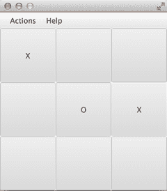

**图 19-16:** 按钮被点击三次后的游戏状态

通过向 `application.css` 文件添加字体样式属性增加字母 X 和 O 的大小，使其看起来像这样：

```css
.button {
    -fx-focus-color: transparent;
    -fx-background-insets: -1, 0, 1;
    -fx-font-weight: bold;
    -fx-font-size: 36;
    -fx-text-fill: blue;
}
```

现在，井棋窗口显示大号加粗的蓝色 X 和 O，如图 19-17 所示。

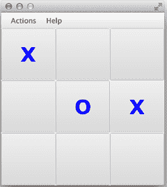

**图 19-17:** 带有样式按钮标签的井棋

井棋游戏的 FXML 和 CSS 文件已就绪，`TicTacToeController` 类知道如何正确设置玩家的按钮标签。现在是在控制器中编写 Java 代码以实现游戏规则了。

### 在控制器中实现游戏策略

要在 `TicTacToeController` 类中实现游戏规则。每次点击按钮时，你需要检查是否有胜利者。如果有，程序应该高亮获胜组合。

你将编写一个 `find3InARow()` 方法，检查棋盘上的每一行、每一列和每个对角线是否具有相同的标签。`find3InARow()` 方法由 `buttonClickHandler()` 调用。如果找到了获胜组合，程序将调用 `highlightWinningCombo()` 以不同的样式显示该组合。

为了比较按钮的标签，你需要获取 `Button` 对象的引用，你可以通过 `@FXML` 注解提供的注入机制获取它们。你还需要获取所有按钮的容器 `GridPane` 的引用。你可以在“处理井棋菜单播放”章节中看到它的用法。

```java
@FXML Button b1;
@FXML Button b2;
@FXML Button b3;
@FXML Button b4;
@FXML Button b5;
@FXML Button b6;
@FXML Button b7;
@FXML Button b8;
@FXML Button b9;
@FXML GridPane gameBoard;
```

`find3InARow()` 方法的代码如下所示且自而易懂：

```java
private boolean find3InARow() {
    // Row 1
    if ("" != b1.getText() && b1.getText() == b2.getText()
            && b2.getText() == b3.getText()) {
        highlightWinningCombo(b1, b2, b3);
        return true;
    }
    // Row 2
    if ("" != b4.getText() && b4.getText() == b5.getText()
            && b5.getText() == b6.getText()) {
        highlightWinningCombo(b4, b5, b6);
        return true;
    }
    // Row 3
    if ("" != b7.getText() && b7.getText() == b8.getText()
            && b8.getText() == b9.getText()) {
        highlightWinningCombo(b7, b8, b9);
        return true;
    }
    // Column 1
    if ("" != b1.getText() && b1.getText() == b4.getText()
            && b4.getText() == b7.getText()) {
        highlightWinningCombo(b1, b4, b7);
        return true;
    }
    // Column 2
    if ("" != b2.getText() && b2.getText() == b5.getText()
            && b5.getText() == b8.getText()) {
        highlightWinningCombo(b2, b5, b8);
        return true;
    }
    // Column 3
    if ("" != b3.getText() && b3.getText() == b6.getText()
            && b6.getText() == b9.getText()) {
        highlightWinningCombo(b3, b6, b9);
        return true;
    }
    // Diagonal 1
    if ("" != b1.getText() && b1.getText() == b5.getText()
            && b5.getText() == b9.getText()) {
        highlightWinningCombo(b1, b5, b9);
        return true;
    }
    // Diagonal 2
    if ("" != b3.getText() && b3.getText() == b5.getText()
            && b5.getText() == b7.getText()) {
        highlightWinningCombo(b3, b5, b7);
        return true;
    }
    return false;
}
```

要突出显示胜利组合，你通过调用它们上的 `setStyle()` 方法来动态更改胜利按钮的样式。我想将背景更改为渐变色，并将按钮标签颜色改为红色。你可以在 [JavaFX CSS 参考](https://docs.oracle.com/javase/8/javafx/scene/doc-files/cssref.html) 中阅读关于渐变的知识，并在[常用的 CSS 名称](https://docs.oracle.com/javafx/2/api/scene/doc-files/cssref.xhtml#color) 中找到这些名称。`highlightWinningCombo()` 的第一个版本可能如下：

```java
private void highlightWinningCombo(Button first, Button second,
                                   Button third) {
    first.setStyle("-fx-background-color: radial-gradient(radius 100%, white, lightyellow, green); -fx-text-fill: red;");
    second.setStyle("-fx-background-color: radial-gradient(radius 100%, white, lightyellow, green); -fx-text-fill: red;");
    third.setStyle("-fx-background-color: radial-gradient(radius 100%, white, lightyellow, green); -fx-text-fill: red;");
}
```

[图 19-18] 显示了胜利组合可能的样子。


### 使用渐变色突出显示胜利组合

更改按钮样式是可行的，但我不喜欢 CSS 样式被硬编码在 Java 代码中的做法。更好的方法是在 CSS 文件中定义一个类并在需要时应用它。在 `application.css` 文件中添加以下 CSS 选择器：

```css
.winning-button {
    -fx-background-color: radial-gradient(radius 100%, white, lightyellow, green);
    -fx-text-fill: red;
}
```

现在 `highlightWinningCombo()` 方法可以通过根据需要添加 `winning-button` 样式来将此样式应用于按钮。改进版本的 `highlightWinningCombo()` 看起来如下：

```java
private void highlightWinningCombo(Button first, Button second,
                                   Button third) {
    first.getStyleClass().add("winning-button");
    second.getStyleClass().add("winning-button");
    third.getStyleClass().add("winning-button");
}
```

现在，如果你（或图形设计师）决定更改胜利按钮的样式，无需修改 Java 代码并重新编译程序。只需在任何文本编辑器中修改 `application.css` 文件的内容即可。

### 处理井字游戏菜单播放

好消息是，菜单项点击的处理方式与按钮点击相同。你只需要实现菜单 Play，以便用户在发现胜利组合或完全没有获胜者时开始一场新游戏。

在 `TicTacToe.fxml` 文件中，为菜单 Play 分配事件处理器，如下：

```xml
<MenuItem text="Play" onAction="#menuClickHandler"/>
```

当用户点击 Play 菜单项时，控制器需要重置所有按钮的标签并移除胜利按钮的样式。最简洁的方法是获取 `GridPane` 的所有子节点并调用 `forEach()` 传递一个短的 Lambda 表达式。

`menuClickHandler()` 方法的内容如下：

```java
public void menuClickHandler(ActionEvent evt) {
    MenuItem clickedMenu = (MenuItem) evt.getTarget();
    String menuLabel = clickedMenu.getText();

    if ("Play".equals(menuLabel)) {
        ObservableList<Node> buttons = gameBoard.getChildren();

        buttons.forEach(btn -> {
            ((Button) btn).setText("");
            btn.getStyleClass().remove("winning-button");
        });
        isFirstPlayer = true; // 新游戏从 X 开始
    }
}
```

包 `javafx.collections` 包含了 [JavaFX Collection API](https://docs.oracle.com/javase/8/javafx/collections-tutorial/collections.htm) 中的类和接口，它是 Java 集合框架的扩展，你可以在 [Oracle 文档](https://docs.oracle.com/javase/8/javafx/api/javafx/collections/package-summary.html) 中找到所有这些内容的描述。

JavaFX 可以在网络浏览器中运行，前提是用户的计算机安装了 JavaFX 运行时。有一个[部署工具包](http://docs.oracle.com/javafx/2/deployment/deployment_toolkit.htm)可以自动检测用户是否拥有此类运行时，并在必要时进行安装。遗憾的是，检测和安装过程并不简单，因此对于面向消费者的应用程序来说，在浏览器中使用 JavaFX 应用程序并不是一个好主意。这在受控环境中是可行的，例如在组织内部，可以在用户的桌面上安装所需的 Java 运行时。

如果你在想是否可以使用 JavaFX 编写智能手机应用程序，Oracle 并没有为移动平台提供 JavaFX 库，但这是可以实现的。

要为 iOS 开发 JavaFX 应用，你需要安装并学习一些额外的软件，即 [RoboVM](http://www.robovm.com/)，这是一个软件开发工具包（SDK），可以将 Java 字节码转换为原生设备代码，就像是用 C 语言编写的一样。

还有一个名为 [JavaFXPorts](http://javafxports.org/page/home) 的社区网站，那里的人们提供了在 iOS 和 Android 设备上部署 JavaFX 程序的解决方案。

### 尝试一下

下一个作业的目标是为在本节之前创建的计算器项目实现操作按钮的应用逻辑。当用户点击其中一个操作按钮时，`CalculatorController` 中的 `displayField` 变量已经有了一些值。我写了仅针对实现加法操作的逐步说明，你需要以类似的方式实现其他操作。

### 课程要求

你应该安装了带有 E(fx)clipse 插件的 Eclipse。

### 逐步步骤

如你所见，我使用包装类 `Double` 在用于加法之前将 `String` 转换为数值。

1. 导入 Eclipse 项目 `Lesson19`。

2. 运行 `mycalculator` 包中的 `Main` 类，查看点击数字按钮是否已正确显示在显示字段中。

3. 要对两个数字执行操作，你需要知道它们的值和所选的操作。计算器的显示字段一次只显示一个数字，因此你需要将输入的第一个值存储在程序变量中。你也可以将操作的结果存储在单独变量中。请记住，显示字段中的值是由字符字符串表示的。在 `CalculatorController` 类中声明以下字段：

```java
private String previousValue = "";
private String currentValue = "";
private double result;
```

4. 编写一个相加两个数字的方法。初始情况下，如果用户输入第一个数字并点击加号按钮，你只需要将输入的值存储在 `previousValue` 中并清理显示字段，以便用户输入第二个。如果用户点击加号且 `previousValue` 不为空，则对当前值和之前的值求和并显示结果。方法的版本可能如下：

```java
private void addNumbers() {
    if ("".equals(previousValue)) {
        previousValue = displayField.getText();
        displayField.setText("");
    } else {
        currentValue = displayField.getText();
        result = Double.parseDouble(previousValue) + Double.parseDouble(currentValue);
        displayField.setText("" + result);
    }
}
```

5. 如果用户点击了加号或等号按钮，控制器应该调用 `addNumbers()` 方法。你可能还需要记住最后执行的操作。因此，添加以下变量：

```java
private String lastOperation;
```

修改 `CalculatorController` 中的 `processOperation()` 如下：


```java
private void processOperation(String buttonLabel) {
    switch (buttonLabel) {
        case "+":
            lastOperation = "+";
            addNumbers();
            break;
        case "=":
            processOperation(lastOperation); // 递归
    }
}
```

[递归](https://en.wikipedia.org/wiki/Recursion_(computer_science)) 一词描述了函数或方法调用自身的情况。递归有助于避免代码重复。因为你想在用户点击加号或等号按钮时重复相同的动作，使用递归是有意义的。

6. 运行 `Main` 类，你应该能够输入并两个两个数字。但为了支持用户想要连续相加的场景，你需要添加更多代码来捕捉用户在操作执行后继续输入数字的情况。在这种情况下，你需要将 `result` 值存储在变量 `previousValue` 中，并清理显示字段，以便用户输入下一个要相加的数字。

7. 类似加法实现其他操作。添加输入验证：不允许用户在数字中输入超过一个小数点。不允许除以零。

8. 比较计算器 GUI 的 FXML 实现与第 18 节中的 Java 版本。

# 第 20 节：Stream API

在这一节中，你将学习如何使用 Java 8 引入的新 Stream 应用程序编程接口（API）（不要与 I/O Streams 混淆）。Stream API 允许你以更简单、更易理解的方式编写数据处理。本章中的大多数示例说明了对 Java 集合中的数据进行迭代和操作，但你从一开始就应该知道 Stream API 并不是另一种数据集合。它是对程序需要处理的一组数据的抽象。

数据可以来自集合、某些生成数据的函数，或来自 I/O 流。使用 Stream API 和 lambda 表达式，你可以编写易读且高效的迭代器，产生输入数据的子集或某种数据聚合。

## Stream 基础

Stream 是表示零或多个值的抽象。可以将其想象成一个高级迭代器，它允许你对数据声明一个或多个操作，然后一次性执行这些操作。但是，普通的 Java `Iterator` 是顺序工作的，而流也可以并行处理。

让我们从一个简单的示例开始。本章使用啤酒集合来让使用 Stream API 更有趣。`Beer` 类所示：

```java
public class Beer {
    public String name;
    public String country;
    public float price;

    Beer(String name, String country, float price) {
        this.name = name;
        this.country = country;
        this.price = price;
    }

    public String toString() {
        return "Name: " + name + ", price: " + price;
    }
}
```

假设你有一个名为 `beers` 的集合，可以通过 `loadCellar()` 方法填充。现在你想创建一个仅包含美国啤酒的集合。这是使用 Stream API 的方法：

```java
List<Beer> beers = loadCellar(); // 填充啤酒集合
List<Beer> americanBeers = new ArrayList<>();
americanBeers = beers.stream()
                     .filter(brr -> "USA".equals(brr.country))
                     .collect(Collectors.toList());
```

调用 `stream()` 方法会将 `beers` 集合设置为流的源。然后，你的代码会过滤掉所有国家不是美国的啤酒对象。最后，代码调用 `collect()` 方法将过滤后的啤酒放入另一个列表中：`americanBeers`。在这个示例中，我只链式调用了两个操作——`filter` 和 `collect`。但你可以指定更多的操作，包括 `map`、`reduce`、`find`、`sort` 和 `match`。

注意，我使用了 lambda 表达式来指定过滤标准。前面的代码中另一个值得注意的点是类型推断；变量 `brr` 从未被声明过。因为我在声明 `beers` 集合时使用了泛型，Java 编译器知道它存储的是 `Beer` 类型的对象，如果我们使用 lambda 来处理这些对象，那么 `Beer` 就被假设为参数类型。

## 中间操作和终端操作

你可以应用于流（stream）的操作两类：*中间操作*（intermediate）和*终端操作*（terminal）。你可以指定多个中间操作，并在末尾只指定一个终端操作。在示例中，`filter()` 是一个中间操作，而 `collect()` 是一个终端操作。

每个中间操作在应用终端操作之前，都声明了你想对流数据进行*什么*操作。终端操作会产生一个具体的的结果，例如总和或平均值、打印某些输出，或者一个新的集合（如本示例所示）。

如何判断某个特定操作是中间的还是终端的？中间操作总是返回一个 `Stream`，而终端操作返回 `Stream` 以外的任何内容（包括 `void`）。事实上，流操作可以链成一条流水线，因为每个中间操作都返回一个 `Stream`。

### 懒性操作

在调用终端操作之前，中间操作甚至不会尝试读取数据。使用中间操作的核心思想是以声明式的形式表达你的意图。考虑以下代码段：

```java
OptionalDouble averagePrice = beers.stream()
                .filter(brr -> "USA".equals(brr.country))
                .mapToDouble(brrr -> brrr.price)
                .average();
```

我稍后会详细解释这段代码，但它揭示了意图：“我们要过滤掉非美国的啤酒，然后应用 map 操作提取啤酒价格。最后，我们计算平均啤酒价格。”在调用 `average()` 方法之前，`filter()` 或 `mapToDouble()` 都没有被调用（我会在下一个代码示例向你证明这一点）。但提前知道你计划对数据做什么，允许 Java 为执行此代码创建最高效的计划。我所说的懒性执行是指 `mapToDouble()` 不会在那些不是产自美国的啤酒上执行。

在给你提供中间操作在调用终端操作之前不会被调用的证明之前，你应该理解 `filter`、`map` 和 `reduce` 术的含义。假设你熟悉关系型数据库的基础知识，这里的解释使用了 SQL 语句的类比。

*   **Filter**：选择符合标准的对象。这就像在 SQL 语句中使用带有 `where` 子句的 `select *`。结果集合的大小可能比原始的小，但结果对象包含所有属性（即列）。

*   **Map**：仅选择对象的属性子集，而不进行过滤。这就像在 SQL 查询中不带 `where` 子句的情况下选择特定列，例如 `select price from beers`。Map 根据对流中每个元素应用指定函数的结果创建一个新流。结果流的大小与原始流相同。

*   **Reduce**：聚合数据。相关的 SQL 示例将是 `select count(*)` 或 `select sum(price)`。

现在让我们来看看中间操作不访问数据的证明。在 `LazyStreamsDemo` 类中，我将不会对流操作进行链式调用：

```java
public class LazyStreamsDemo {
    // 填充啤酒集合
    static List<Beer> loadCellar() {
        List<Beer> beerStock = new ArrayList<>();
        beerStock.add(new Beer("Stella", "Belgium", 7.75f));
        beerStock.add(new Beer("Sam Adams", "USA", 7.00f));
        beerStock.add(new Beer("Obolon", "Ukraine", 4.00f));
        beerStock.add(new Beer("Bud Light", "USA", 5.00f));
        beerStock.add(new Beer("Yuengling", "USA", 5.50f));
        beerStock.add(new Beer("Leffe Blonde", "Belgium", 8.75f));
        beerStock.add(new Beer("Chimay Blue", "Belgium", 10.00f));
        return beerStock;
    }

    public static void main(String[] args) {
        List<Beer> beers = loadCellar();
        // 中间操作
        Stream<Beer> americanBeers = beers.stream()
                .filter(brr -> {
                    System.out.println("Inside filter: " + brr.country);
                    return "USA".equals(brr.country);
                })
                // 第二中间操作
                .mapToDouble(brrr -> {
                    System.out.println("Inside mapToDouble: " + brrr.name + ": " + brrr.price);
                    return brrr.price;
                });
        // 注释的终端操作
        // System.out.println("The average beer price is " + americanBeers.average().getAsDouble());
    }
}
```

前面的程序从啤酒创建了流，然后应用了两个中间操作：`filter()` 和 `mapToDouble()`。第一个过滤掉非美国的啤酒，第二个执行 map 操作以只保留其他字段。`LazyStreamsDemo` 类有一个终端操作，本应该计算啤酒的平均值，但我故意将其注释掉了。

注意，每个中间操作都有一个 `println()` 语句。如果你按现状运行 `LazyStreamsDemo` 程序，你在系统控制台上看不到任何输出。在指定终端操作之前，中间操作不会被调用！现在取消 `LazyStreamsDemo` 最后两行的注释并重新运行。这次你会看到大量的输出：

```
Inside filter: Belgium
Inside filter: USA
Inside mapToDouble: Sam Adams: 7.0
Inside filter: Ukraine
Inside filter: USA
Inside mapToDouble: Bud Light: 5.0
Inside filter: USA
Inside mapToDouble: Yuengling: 5.5
Inside filter: Belgium
Inside filter: USA
Inside mapToDouble: Brooklyn Lager: 8.25
The average beer price is 6.4375
```

`mapToDouble()` 操作适用于适用于啤酒。注意 `mapToDouble()` 返回的是类型为 `DoubleStream` 的流。它是一种处理原始 `double` 值的特殊流。我们用它来计算 `double` 类型啤酒价格的平均值。还有 `IntegerStream` 和 `LongStream` 分别处理 `int` 和 `long` 数据类型。

总结来说，将中间操作视为一份待办清单，这些操作将与终端操作一起执行。无论是中间操作还是终端操作都不能修改源数据。流是不可变的。

十个人走进一间十月啤酒节帐篷。他们坐在一张桌旁，服务生走了过来。其中一个人说：“请给我们带十杯乐菲白啤啤酒（Leffe Blonde），并按照以下步骤操作：去吧台，装满第一杯带到这里；然后回来对第二杯进行同样的操作。重复十次。”服务生礼貌地回答：“请不要教我怎么上你们的啤酒。”他来到有十个啤酒水头的吧台，同时装满了所有十杯，并一次性全部带了过来。服务生优化了这个过程。他只需要客户告诉他*要做什么*，而不是*该怎么做*。

并行处理规则！在描述如何在第 13 节中使用 `forEach()` 方法迭代集合时，我已经提到过这一点。这同样适用于流（streams）。当你对数据源上调用 `stream()` 方法时，数据处理可能会被优化并并行执行；Java 运行时可能会在内部将数据拆分成块，并行执行操作并重构结果。

如果你想确保处理是并行执行的，请在数据上使用 `parallelStream()` 方法，它可能会在内部创建多个线程来处理流数据。Java 7 引入了 Fork/Join 框架来实现并行性，但代码编写并不简单。在 Java 8 中，Fork/Join 机制被隐藏在流实现内部，对应用程序开发者透明。

然而，无法保证你的应用程序代码使用 `parallelStream()` 会更快。你需要通过比较 `parallelStream()` 的速度与 `stream()` 的速度对代码进行基准测试。结果取决于你的应用程序代码以及数据源的 Java 内部。Java 文档甚至说明 `parallelStream()` 返回的是[一个可能的并行流](http://docs.oracle.com/javase/8/api/java/util/Collection.xhtml#stream--)。

## 排序集合和流

有时你需要按照升序或降序对数据值进行排序。因此 Java 运行时需要能够比较值。对于原始数据类型，这是一个简单任务：3 大于 2，27 小于 28。但如何比较对象等复杂数据类型呢？排序 `Beer` 对象集合意味着什么？应该比较 `Beer` 的哪些属性来对啤酒进行顺序排序：价格、名称、国家，还是这些属性的组合？

程序员需要指定对象比较的规则——例如，按价格升序排序啤酒。让我们先看看如何为通用 Java 集合指定排序规则，然后如何排序流。

## 排序 Java 集合

集合可以包含多个对象，但你只需要知道如何比较两个对象并将它们放在特定的顺序上。这时集合上的 `sort()` 方法会比较每对对象。在少数情况下，人们需要应用不同的排序算法，但调用 `sort()` 方法可能就是你需要的。Java 接口 `Comparable` 和 `Comparator` 允许你指定比较规则。

### 使用 Comparable 接口

如果一个类实现了 `Comparable` 接口，程序就可以比较对象的当前实例与另一个相同类型的对象。你需要在类声明中添加 `implements Comparable` 并在那里实现 `compareTo()` 方法。看看如果我们能够按价格比较啤酒，`Beer` 类可能看起来如下。

```java
public class Beer implements Comparable<Beer> {
    public String name;
    public String country;
    public float price;

    Beer(String name, String country, float price) {
        this.name = name;
        this.country = country;
        this.price = price;
    }

    public int compareTo(Beer otherBeer) {
        if (this.price > otherBeer.price) {
            return 1; // 这只啤酒比另一个“大”
        } else if (this.price < otherBeer.price) {
            return -1; // 这只啤酒比另一个“小”
        } else {
            return 0; // 啤酒是“相等”的
        }
    }

    public String toString() {
        return "Name: " + name + ", price: " + price;
    }
}
```

`compareTo()` 方法接受一个参数——要与之比较的对象。如果根据我们的规则，这只啤酒的值比另一个“大”，则 `compareTo()` 方法必须返回 1。如果啤酒“相等”，则 `compareTo()` 返回 0。如果啤酒“小”，`compareTo()` 返回 -1。如果啤酒“大”，`compareTo()` 返回 1。

以下代码显示了如何使用 `Comparable` 接口和 `Collections` 按价格排序啤酒：

```java
List<Beer> beers = loadCellar(); // 加载啤酒集合
Collections.sort(beers);
beers.forEach(System.out::println);
```


# Java Stream API 排序与短路操作

## 按价格升序排序示例

```
Name: Obolon, price: 4.0
Name: Bud Light, price: 5.0
Name: Yuengling, price: 5.5
Name: Sam Adams, price: 7.0
Name: Stella, price: 7.75
Name: Brooklyn Lager, price: 8.25
Name: Leffe Blonde, price: 8.75
Name: Chimay Blue, price: 10.0
```

`Comparable` 接口只能按单个属性排序。如果你想按名称和价格排序，你需要另一个使用 `Comparator` 的解决方案。

## 使用 Comparator 接口

`Comparator` 接口是一个只有一个抽象方法的函数接口：`compare()`。在 Java 8 中，你甚至不需要创建一个单独的类；可以使用 Lambda 表达式。例如 `price`：

```java
List<Beer> beers = loadCellar(); // 加载啤酒集合
System.out.println("=== 按价格升序排序");
beers.sort(Comparator.comparing(beer -> beer.price));
beers.forEach(System.out::println);
```

在你的啤酒集合上运行此代码可以正确按价格升序排序。它输出以下内容：

```
=== 按价格升序排序
Name: Obolon, price: 4.0
Name: Bud Light, price: 5.0
Name: Yuengling, price: 5.5
Name: Sam Adams, price: 7.0
Name: Stella, price: 7.75
Name: Brooklyn Lager, price: 8.25
Name: Leffe Blonde, price: 8.75
Name: Chimay Blue, price: 10.0
```

`reversed()` 方法允许按降序排序，例如：

```java
Comparator<Beer> priceComparator = 
                      Comparator.comparing(beer -> beer.price);
System.out.println("=== 按价格降序排序");
beers.sort(priceComparator.reversed());
beers.forEach(System.out::println);
```

上述代码段的输出如下：

```
=== 按价格排序
Chimay Blue, price: 10.0
Leffe Blonde, price: 8.75
Brooklyn Lager, price: 8.25
Stella, price: 7.75
Sam Adams, price: 7.0
Yuengling, price: 5.5
Bud Light, price: 5.0
Obolon, price: 4.0
```

如果你想按多个字段进行排序，应该使用方法链调用，并调用一次或多次 `thenComparing()`。下面的代码展示了如何按名称和价格对啤酒进行排序：

```java
System.out.println("=== 按名称和价格排序");
beers.sort(Comparator.comparing((Beer beer) -> beer.name)
    .thenComparing(beer -> beer.price));
``` 

`comparing()` 方法期望一个方法提取器（extractor）作为参数。方法提取器（一个 getter 方法）返回一个应用于比较的字段。前面的代码使用了 lambda 表达式而不是提取器，这要求你在进行方法链调用时需要指定类型。这就是为什么这个示例使用了显式类型转换 `(Beer beer)`。

如果我在 `Beer` 类中有对应的 getter 方法，我就可以使用引用而不需要类型转换了：

```java
beers.sort(Comparator.comparing(Beer::getName)
    .thenComparing(Beer::getPrice));
```

## 排序流 (Streams)

现在你已经熟悉了集合排序的基础，是时候看看如何使用 Stream API 对任何数据源进行排序了。提醒一下，当你处理流时，原始数据源是保持不变的——不会对数据源进行任何更改。要将排序后的数据存储另一个另一个集合或数组，你需要使用终端操作 `collect()`。

`sorted` 方法与 `Comparator` 配合工作，要按价格对啤酒集合排序，只需编写如下代码：

```java
beers.stream()
   .sorted(Comparator.comparing(b -> b.price))
   .forEach(System.out::println);
```

按多个字段排序的方法与 `Comparator` 部分中的代码示例类似。下一个示例展示了如何按国家和价格对啤酒排序。稍微修改 `Beer` 类的 `toString()` 方法以打印国家：

```java
public String toString() {
  return "Country: " + country + 
         " Name: " + name + ", price: " + price;
}
```

这是按啤酒国家和价格排序的写法：

```java
beers.stream()
    .sorted(Comparator.comparing((Beer b) -> b.country)
    .thenComparing(b -> b.price))
    .forEach(System.out::println);
```

运行这段代码段会产生以下输出：

```
Country: Belgium, Name: Stella, price: 7.75
Country: Belgium, Name: Leffe Blonde, price: 8.75
Country: Belgium, Name: Chimay Blue, price: 10.0
Country: USA, Name: Bud Light, price: 5.0
Country: USA, Name: Yuengling, price: 5.5
Country: USA, Name: Sam Adams, price: 7.0
Country: USA, Name: Brooklyn Lager, price: 8.25
Country: Ukraine, Name: Obolon, price: 4.0
```

要将流排序的结果存储一个新的 `List` 集合中，你需要添加一个终端操作：

```java
List<Beer> sortedBeers = beers.stream()
    .sorted(Comparator.comparing(b -> b.price))
    .collect(Collectors.toList());
```

现在你有两个集合。原始的 (`beers`) 集合是未排序的，而新的 (`sortedBeers`) 是已排序的。

## 其他流源

到为止，本章中的所有代码示例都使用对象集合作为流的数据源。但事实并非如此。你可以使用 Stream API 处理有限和无限数据源。

### 创建有限大小的流

你可以使用 `Stream.of()` 方法将一组任意值转换为流。例如，下面的代码段创建并打印了一个有限大小的字符串流：

```java
Stream<String> beerNames = Stream.of("Leffe Blonde", "Chimay Blue", "Sam Adams");
beerNames.forEach(System.out::println);
```

`builder()` 方法是另一种创建有限大小流的方法。接下来的代码段创建了一个包含三个基本类型的流并找到了最大值。由于 `max()` 返回的是 `OptionalLong` 类型（它可能有值，也可能没有），我调用了 `getAsLong()` 来获取原始类型 `long`。运行这段代码后，`maxValue` 等于 21。

```java
long maxValue = LongStream.builder()
    .add(10)
    .add(21)
    .add(15)
    .build()
    .max().getAsLong();
```

### 创建无限大小的流

虽然集合的大小是有限的，但你可以使用 Stream API 处理无限数据流。

#### 生成流数据

`Stream.generate()` 方法可以接受一个通过某种算法生成值的 lambda 表达式。这个 lambda 必须是函数接口 `java.util.function.Supplier` 的实现。实现 `Supplier` 在于编写一个返回某些结果的函数。下面的类 `StreamOfDates` 使用了 `LocalDateTime` 类，它是 [Java 8 日期时间 API](https://docs.oracle.com/javase/tutorial/datetime/) 的一部分，位于包 [java.time](https://docs.oracle.com/javase/8/docs/api/java/time/package-summary.html) 中。

```java
import java.time.LocalDateTime;
import java.util.function.Supplier;
import java.util.stream.Stream;

public class StreamOfDates {

  public static void main(String[] args) {
    // 实现 Supplier 
    Supplier<LocalDateTime> myStopWatch = () -> {
      try {
        Thread.sleep(1000);
      } catch (InterruptedException e) {
        e.printStackTrace();
      }
      return LocalDateTime.now(); // 获取当前时间
    };

    // 使用 lambda 表达式生成流
    Stream<LocalDateTime> timeStream = Stream.generate(myStopWatch);

    timeStream.forEach(System.out::println);
  }
}
```

运行此程序会产生如下输出（不包含省略号）：

```
2014-09-18T17:41:36.017
2014-09-18T17:41:37.026
2014-09-18T17:41:38.027
2014-09-18T17:41:39.028
2014-09-18T17:41:40.029
...
```

你可以在短路操作章节中查看如何停止无限流。

另一种生成无限流的方法是 `iterate()` 方法，它需要一个生成下一个值的规则。

```java
LongStream evenNumbers = LongStream.iterate(0, num -> num+2);
evenNumbers.forEach(System.out::println);
```

前面的代码打印偶数，但由于它们生成速度极快，你可能需要限制生成值的数量（参见短路操作）以看到预期结果。

### 在 I/O 流中使用 Stream API

从 Java 8 开始，某些用于处理 I/O 流的类包含了新方法，允许使用 Stream API 处理数据。例如，`java.io.BufferedReader` 类有一个新方法 [lines()](https://docs.oracle.com/javase/8/docs/api/java/io/BufferedReader.xhtml#method.summary)，它返回一个 `Stream`，其元素是从该 `BufferedReader` 对象中读取的行。与其他数据源一样，该流是延迟填充的——也就是说，只在终端操作期间进行读取。

你可以通过重写第 16 节中的 `WebSiteReader` 类来看到它的运行效果。该类负责读取并打印网页 `www.google.com` 的内容。该类的新版本被称为 `WebSiteReaderStream`。

```java
public class WebSiteReaderStream {
  public static void main(String args[]){
      String nextLine;
      URL url = null;
      URLConnection urlConn = null;
      try
      {
        // 假设 index.html 是默认首页名  
          url  = new URL("http://www.google.com" );
          urlConn = url.openConnection();
      } catch( IOException e){
           System.out.println(
                   "Can't connect to the provided URL:" + 
                                                                           e.toString() );
      } 

      try( InputStreamReader inStream = new InputStreamReader( 
              urlConn.getInputStream(), "UTF8");
             BufferedReader buff  = 
                            new BufferedReader(inStream);){   

      // 使用 Stream API 读取并打印 Google 首页的内容
      //        

      buff.lines()
              .forEach(System.out::println);  

      } catch(IOException  e1){
      System.out.println("Can't read from the Internet: "+ 
                                          e1.toString() ); 
    }
 }
}
```

流的读取部分不仅变得更简单——只需调用 `lines()`——而且你现在可以添加一些中间操作，在数据迁入时执行某些过滤。例如，你可以使用[正则表达式](http://docs.oracle.com/javase/tutorial/essential/regex/)（本书未涵盖该内容）创建一个匹配模式，并只读取符合该模式的数据。你可以通过查找使用 Java 类 [Matcher](http://docs.oracle.com/javase/8/docs/api/java/util/regex/Matcher.html) 的示例来进一步研究。

## 短路操作

在某些情况下，你希望提前停止流处理。假设你只想显示流中的前五个元素。短路操作正为此此目的。回回到打印偶数的示例。通过它，你生成了一个无限的偶数流。要只打印前五个数，你使用短路操作 `limit()`：

```java
LongStream evenNumbers = LongStream
                     .iterate(0, num -> num+2)
                     .limit(5);

evenNumbers.forEach(System.out::println);
```

此代码打印出以下五个数字：

```
0
2
4
6
8
```

另一个短路方法是流的 `findFirst()` 元素。该方法返回一个 `Optional` 类型的对象，该类型是在 Java 8 中引入的。它允许在未找到请求对象时避免 `NullPointerException`。如果未找到请求的值，方法 `findFirst()` 将返回一个空的 `Optional` 对象。下一个代码示例打印了啤酒集合中的第一个元素：

```java
Optional<Beer> firstBeer = beers.stream()
                  .findFirst();

System.out.println("The first beer in collection: " + 
                firstBeer.orElse(new Beer("No name","No country",)));
```

在你的集合上运行此代码输出：

```
The first beer in collection: Stella, price: 75
```

如果未找到请求的值，方法 `findFirst()` 将返回一个空的 `Optional` 对象。`Stream` 上的其他短路方法是 `skip()`、`findAny()`、`allMatch()`、`noneMatch()` 和 `anyMatch()`。


```java
LongStream evenNumbers = LongStream
                     .iterate(0, num -> num + 2)
                     .limit(5);

evenNumbers.forEach(System.out::println);
```

此代码打印出以下五个数字：

```
0
2
4
6
8
```

另一个短路方法是流的 `findFirst()` 元素。该方法返回一个 `Optional` 类型的对象，该类型是在 Java 8 中引入的。它允许在未找到请求对象时避免 `NullPointerException`。如果未找到请求的值，方法 `findFirst()` 将返回一个空的 `Optional` 对象。下一个代码示例打印了啤酒集合中的第一个元素：

```java
Optional<Beer> firstBeer = beers.stream()
                  .findFirst();

System.out.println("The first beer in collection: " + 
                firstBeer.orElse(new Beer("No name", "No country")));
```

在你的集合上运行此代码输出：

```
The first beer in collection: Stella, price: 75
```

# 第 21 节 使用 JDBC 操作关系型数据库

应用程序通常将数据存储在数据库中。在大多数企业应用中，使用关系型数据库管理系统（RDBMS）。每条记录（例如员工）都由表表示。RDBMS 理解 SQL 语言。

流行的 RDBMS 有 Oracle、DB2、Sybase、Microsoft SQL Server 和 MySQL。本节使用 [Apache Derby](http://db.apache.org/derby/)（也称为 Java DB），它是随 Windows 一起提供的，你可以在 Mac 或 Linux 上单独安装。

Java 包含了两个用于操作 DBMS 的包：`java.sql` 和 `javax.sql`。前者包含了常用的类 `Connection`、`Statement` 和 `ResultSet`。后者用于支持服务器端的数据库连接，包含 `DataSource` 和 `RowSet`。

JDBC API 并不是特定于 DBMS 的——如果你编写程序使用 JDBC 类在 Oracle 中检索/更新数据，你也将使用相同的类操作 MySQL 或 DB2。

JDBC 驱动要么将 SQL 语句传递给 DBMS 执行，要么执行存储在 DBMS 内部的程序（称为*存储过程*）。如果通过这些操作检索了某些数据，你的 Java 程序将通过相应的 JDBC API 来处理。在本节中，所有与 DBMS 的通信都是通过提供 SQL 语句来实现。另一种处理数据的方法是使用 Java 持久 API（JPA），它在第 32 节中有所介绍。有些人倾向于使用对象关系映射（ORM）框架，例如 Hibernate，或者减少常规 JDBC 编程的框架，如 [MyBatis](http://mybatis.github.io/mybatis-3/)；这些框架本书并未涵盖。

## 尝试一下

1. 导入项目。

2. 在 `Stream` 类中添加一个静态方法：

    ```java
    Supplier<LocalDateTime> stopWatch = () -> {
        try {
            return LocalDateTime.now();
        } catch (InterruptedException e) {
            Thread.sleep(1000);
            e.printStackTrace();
        }
    };
    ```

3. 移除 `generate()` 的参数：

    ```java
    Stream.generate()
    ```

4. 将 `generate()` 的参数替换为：

    ```java
    Stream.generate(stopWatch)
    ```

5. 运行程序。

*   Type 1 驱动是一种 JDBC-ODBC 桥，允许 Java 程序使用微软的 ODBC 驱动程序与数据库交互。ODBC 驱动的缺点是它们比其他驱动慢，必须在每个用户的机器上安装和配置，并且只能在 Windows 机器上运行。Type 1 JDBC 驱动程序最近很少使用，Oracle 已经从 Java 8 运行时删除了它。

*   Type 2 驱动程序由 Java 类组成，这些类与 DBMS 厂商提供的非 Java 原生驱动协同工作。这些驱动程序的运行速度比 Type 1 快得多，但它们也需要在运行 Java 程序的机器上安装和配置。

*   Type 3 驱动被称为`中间件驱动`，可以由应用服务器供应商提供。它由两部分组成：`client` 部分执行与 DBMS 无关的 SQL 调用，由驱动程序的 `server` 部分翻译为特定的 DBMS 协议。

*   Type 4 驱动是纯 Java 驱动程序，通常以 `.jar` 文件形式存在，并对数据库服务器进行直接调用。除了在 Java 代码中包含主驱动类名外，它在客户端机器上不需要任何配置。这就是为什么它也被称为`薄驱动`的原因。例如，Java applet 可以与这种驱动程序打包，并可以随 applet 本身自动下载到用户的机器上。

为了简单起见，本课程使用 Type 4 JDBC 驱动，但许多生产系统可以部署 Type 3 驱动以提供更好的性能。

## 安装 Derby DB 并创建数据库

Derby DB（也称为 JavaDB）是一个小型 DBMS，你不会将其用于严肃生产系统，但它非常适合学习 JDBC 或用于许多小型系统。如果你使用 Windows OS，它已随 Java SDK 一起安装在类似于下面的文件夹中：`c:\Program Files\Java\jdk1.8.0_25\db`。数字反映了 Java 的主次版本。

修改系统变量 `PATH`，使其以以下路径开头：`c:\Program Files\Java\jdk1.8.0_25\db\bin;`

如果你在 Windows 以外的操作系统工作，请从 [`db.apache.org/derby`](http://db.apache.org/derby) 下载并安装 Derby DB。Derby DB 有完善的文档，如果你还没有机会接触关系型 DBMS，请下载并阅读“Getting Started with Derby”手册。Derby DB 的安装只需下载并解压一个文件。在编写此时，文件名为 `db-derby-10.10.2.0-bin.zip`。解压并将文件夹重命名为 `derby`。

配置过程也很简单；请在 Swinburne 大学的网页 [`goo.gl/Q5a01N`](http://goo.gl/Q5a01N) 上查看你所在操作系统所需的步骤。你需要设置环境变量 `DERBY_HOME` 指向你的 Derby DB 安装目录。例如，我将 Derby 解压到 Mac OS 电脑的根目录下，并在 `.bash_profile` 文件中添加了以下两行：

```
export PATH=~/derby/bin:$PATH
export DERBY_HOME=~/derby
```

为了确保你的 Derby DB 安装正确，打开命令或终端窗口并输入命令 `sysinfo`。你应该能看到描述 Derby DB 安装的输出。

Derby DB 有一个名为 `ij` 的交互式命令行实用，你可以用它创建数据库和表并向其中填充数据等。我将向你展示如何创建一个示例数据库和一个存储员工数据的表。

首先打开命令或终端窗口并发布命令 `startNetworkServer.exe`（如果你使用 Mac OS 则使用 `startNetworkServer`）。

Derby DB 服务器启动时会显示类似下面的消息：

```
Apache Derby Network Server - 10.10.2.0 - (1582446) started and ready to
accept connections on port 1527
```

打开另一个命令窗口并启动 `ij`——你会看到 `ij>` 提示符。现在尝试通过以下命令连接到数据库 Lesson21：

```
connect 'jdbc:derby://localhost:1527/Lesson21;create=true';
```

此命令尝试连接到数据库 Lesson21，如果未找到该数据库则创建它。接下来的 `ij` 命令创建一个数据库表——Employee，用于存储包含三个字段的记录：`EMPNO`、`ENAME` 和 `JOB_TITLE`。第一个字段作为整数存储，另外两个作为简单文本（`varchar`），分别允许 50 和 150 个字符。

```
CREATE TABLE Employee (
    EMPNO int NOT NULL,
    ENAME varchar (50) NOT NULL,
    JOB_TITLE varchar (150) NOT NULL
);
```

最后，为了向表中填充一些数据，在 `ij` 中执行 `INSERT` 命令：

```
INSERT INTO Employee values (7369,'John Smith', 'Clerk'), (7499,
'Joe Allen','Salesman'), (7521,'Mary Lou','Director');
```

如果你想确保记录已成功创建，在 `ij` 实用程序中执行 `SELECT` 语句来检索：

```
Select * from Employee;
```

## 示例程序

在本节中，你将看到在任何 Java 程序中使用 JDBC 获取数据所需的步骤。一个示例程序实现了所有这些步骤以显示员工列表。

1. 使用 `Class` 的 `forName()` 方法加载 JDBC 驱动程序。你必须从 JDBC 驱动程序的文档中找到类名。对于 JavaDB，你可以跳过此步。如果你与 Oracle DBMS 工作，可以使用以下 Java 语句加载 Type 4 驱动：

```
Class.forName("oracle.jdbc.driver.OracleDriver");
```

2. 通过调用

```
DriverManager.getConnection(url, user, password);
```

获取到数据库 Lesson21 的数据库连接。对于 Derby DB，你不需要提供用户和密码；只需提供数据库的 URL ，例如：

```
DriverManager.getConnection("jdbc:derby:Lesson21");
```

3. 创建 Java 类 `Statement` 的实例：

```
Connection.createStatement();
```

作为替代方案，你可以创建 `PreparedStatement` 或 `CallableStatement`，它们将在本节稍后的 PreparedStatement 类 和 CallableStatement 类 部分中解释。

4. 要运行 SQL `Select` 查询，你的程序可以包含类似下面的语句：

```
Statement.executeQuery("Select * from Employee");
```

对于产生多个结果的 SQL 查询，你可以使用 `Statement` 的 `execute()` 方法。

对于 `Insert`、`Update` 和 `Delete` SQL 语句，使用 `updateQuery()` 方法。例如：

```
String myInsertStmt = "INSERT INTO Employee values " + 
                     "(1234,'John Bush', 'Clerk')";
Statement.updateQuery(myInsertStmt);
```

5. 为了处理接收到的数据，循环遍历 `ResultSet` 对象，使用以下内容：

```
while (ResultSet.next()) {
  //在此处获取每列的值
}
```

6. 通过关闭 `ResultSet`、`Statement` 和 `Connection` 对象来释放系统资源。

所有这些步骤都在 `EmployeeList` 类中实现，如列表 21-1 所示，该类打印 `Employee` 表中的记录。尽管你不需要使用 `Class.forName()` 显式加载 Derby DB 的驱动程序，但程序必须知道驱动类的位置，否则你将得到“No suitable driver”（无合适的驱动程序）错误。你可以将 Derby 安装目录下 `lib` 目录中的 `derbyclient.jar` 添加到 `CLASSPATH` 环境变量中，或者将其作为外部 `.jar` 添加到你的 Eclipse 项目中（参见项目菜单 `Properties` → `Java Build Panel` → `Add External JARs`）。

`EmployeeList` 程序的输出如下：

```
7369, John Smith, CLERK
7499, Joe Allen, SALESMAN
7521, Mary Lou, Director
```

当你执行任何 SQL 语句时，务必包含错误处理代码。捕获 `SQLException` 是获取错误信息的正确方法。请注意列表 21-1 中的代码调用了 `getErrorCode()` 方法从 `SQLException` 对象中提取特定的数据库错误代码。

## 处理结果集

让我们仔细查看列表 21-1 中的代码。在执行 `rs = stmt.executeQuery(sqlQuery)` 后，如果内存中存在结果集，游标 `rs` 将位于第一条记录（行）之前。每行包含 SQL `Select` 语句中指定的相同数量的字段（列）。每个值都根据字段的数据类型通过适当的方法进行提取。这些方法的名称是不言自明的的：`rs.getString()`、`rs.getInt()` 等。如果你知道结果中某列的名称，请将其作为方法参数：

```
int empNo = rs.getInt("EMPNO");
String eName = rs.getString("ENAME");
```

如果你不知道列名，可以指定列在结果集中相对位置（从 1 开始）：

```
int empNo = rs.getInt(1);
String eName = rs.getString(2);
```

你还可以借助本节稍后介绍的 `ResultSetMetaData` 类查询数据库表以确定列名及其类型。JDBC 驱动程序会自动将数据从数据库类型转换为对应的 Java 类型：例如，Derby 的 `varchar` 变成 Java 的 `String`。

`EmployeeList` 类只是在循环中打印检索的数据。你也可以将结果集数据放在 Java 集合对象中以便进一步处理。`ResultSet` 对象持有数据库连接并且不是可序列化的。这就是为什么在对 DBMS 进行服务器端操作时，通常的做法是创建一个表示结果集中某行的类，并用其实例填充例如 `ArrayList` 或其他 Java 集合。

列表 21-2 展示了此类类的示例，它可以代表一个员工记录。仅持有某些数据值的类通常被称为*值对象（value objects）*。因为在分布式应用程序中，此类对象可能需要在不同的计算机之间传输，它们也被称为*数据传输对象（DTOs）*。

`EmployeeDTO` 声明了私有变量来存储数据，但对这些数据的访问通过公共的 `setters` 和 `getters` 完成，这些方法允许外部代码设置和获取适当的值。当某些代码需要获取或修改 `EmployeeDTO` 类的属性时，需要应用某些特定的应用程序逻辑，这种技术就会非常有用。

例如，你可以在 setter 放置一些授权代码，以确保外部对象有足够的权限更改 `jobTitle` 属性。如果将来获取此类授权的业务逻辑发生变化，你只需要修改 setter 内部的代码，而外部代码保持不变。

下一个代码段显示了如何在处理 SQL `Select` 语句检索的结果集的同时，准备 `EmployeeDTO` 对象的集合。

```java
// 为员工集合创建一个对象
ArrayList<EmployeeDTO> employees = new ArrayList<>();
// 处理 ResultSet 并填充集合
while (rs.next()){
  EmployeeDTO currentEmp = new EmployeeDTO();
  currentEmp.setEmpNo(rs.getInt("EMPNO"));
  currentEmp.setEName(rs.getString("ENAME"));
  currentEmp.setJobTitle(rs.getString("JOB_TITLE"));
  employees.add(currentEmp);
}
```

如果这段代码部署在服务器的 JVM 上，并且你需要将数据发送到运行着（例如 Swing 客户端）的另一台计算机，你可以考虑在这里应用 Java 序列化将员工集合发送到前端。但要确保 `EmployeeDTO` 类实现了 `Serializable` 接口。对于 Web 客户端，考虑将 `EmployeeDTO` 序列化为 JSON 数据格式，见第 33 节使用 `Statement` 类创建一个可以执行 SQL 的对象。但这不是向 JDBC API 传递 SQL 的唯一方法。`PreparedStatement` 类是 `Statement` 的子类，它会预编译 SQL 语句。

使用 `PreparedStatement`，你可以创建带有动态参数的 SQL。例如：


```java
PreparedStatement stmt = conn.prepareStatement("SELECT * from Employee WHERE empno?");
for (int i=0; i<employees.length; i++){
  stmt.setInt(1,employees[i]);
  stmt.executeQuery();
}
```

在这种情况下，SQL 语句只编译一次并根据数据类型由相应的 `setXXX()` 方法提供。SQL 语句可能有多个参数（问号），setter 的第一个参数允许你指定每个参数的编号。例如：

```java
PreparedStatement stmt = conn.prepareStatement("SELECT * from Employee WHERE empno=? and ename=?");
for (int i=0; i<empNumbers.length; i++){
  stmt.setInt(1,empNumbers[i]);
  stmt.setString(2,empNames[i]);
  stmt.executeQuery();
}
```

如果你需要传递 `NULL` 值，请使用 `setNull()` 方法。

## CallableStatement 类

该类扩展了 `PreparedStatement`，用于执行数据库存储过程。假设有一个名为 `changeEmpTitle` 的存储过程，它接受两个参数：`empno` 和 `title`。以下是执行该存储过程的代码：

```java
CallableStatement stmt = conn.prepareCall("{call changeEmpTitle(?,?)}");
stmt.setInt(1,7566);
stmt.setString(2,"Salesman");
stmt.executeUpdate();
```

如果存储过程使用输出参数返回某些值，在执行语句之前必须注册每个 `OUT` 数据类型。下一个代码段显示执行具有两个参数的存储过程的示例：第一个是输入参数，第二个是输出参数，存储过程可以通过它将执行结果返回给 Java 程序：

```java
CallableStatement stmt = conn.prepareCall("{call getEmpTitle(?,?) }");
stmt.setInt(1, 7566);
stmt.registerOutParameter(2,java.sql.Types.VARCHAR);
stmt.executeQuery();
String title=stmt.getString(2);
```

JDBC 允许你在返回值数量未知时处理结果集。想象你正在编写一个程序，它能够接受任何 SQL `Select` 语句，执行它并显示检索到的数据。通过 `ResultSetMetaData` 类，你可以动态地找出结果集中包含多少列，以及这些列的名称和数据类型。以下代码片段获取了结果集中数据库表列的数，并对每一列列识别并打印了其列名和类型：

```java
String sqlQuery = "select * from Employee";
ResultSet rs = stmt.executeQuery(query);
ResultSetMetaData rsMeta = rs.getMetaData();
int colCount = rsMeta.getColumnCount();
for (int i = 1; i <= colCount; i++) {
  System.out.println(
      " Column name: " + rsMeta.getColumnName(i) +
      " Column type: " + rsMeta.getColumnTypeName(i));
}
```

这种简单而强大的技术被 ORM 框架内部使用，这些框架可以“魔术般”生成数据库模型，并自动生成代表数据库实体的 Java 类。

Listing 21-3 显示了一个名为 `ShowAnyData` 的 Java 程序，它可以根据从命令行传递的任何 SQL `Select` 语句打印结果集。例如，可以这样启动它：

```
java ShowAnyData "Select * from Employee"
```

`ShowAnyData` 程序的输出与 Listing 21-1 所示的 `EmployeeList` 相同。但只要你指定了有效的数据库和表名，`ShowAnyData` 程序就可以执行任何 SQL SELECT 语句。注意，`ShowAnyData` 中的代码首先确保你已经传递了命令行参数。如果你从命令行运行此程序，请不要忘记用双引号包含 SQL 语句。在 Eclipse 中，你可以通过选择 `Run Configuration` 面板中的 `Arguments` 选项卡来指定命令行参数。

## 可滚动结果集与 Rowset

在之前所有的示例中，代码都使用 `next()` 方法来遍历结果集，而该方法只允许光标向前移动。另一个选项是创建一个可滚动的结果集，这样在需要时光标就可以前后移动。`createStatement()` 方法有一个双参数版本。第一个参数指定滚动的类型（`TYPE_FORWARD_ONLY`、`TYPE_SCROLL_INSENSITIVE` 或 `TYPE_SCROLL_SENSITIVE`），第二个参数使结果集变为可更新或只读的（`CONCUR_READ_ONLY` 或 `CONCUR_UPDATABLE`）。例如：

```java
Statement stmt = con.createStatement(
ResultSet.TYPE_SCROLL_INSENSITIVE, ResultSet.CONCUR_READ_ONLY);
ResultSet rs = stmt.executeQuery("SELECT * from Employee");
```

`TYPE_FORWARD_ONLY` 参数仅允许光标向前移动。`TYPE_SCROLL_INSENSITIVE` 和 `TYPE_SCROLL_SENSITIVE` 的区别在于滚动是否反映对结果集所做的更改。下一个示例将光标设置在结果集的末尾并将其向后移动：

```java
rs.afterLast();
while (rs.previous()){
 int empNo = rs.getInt("EMPNO");
 String eName = rs.getString("ENAME");
 String job = rs.getString("JOB_TITLE");
 System.out.println(""+ empNo + ", " + eName + ", " + job);
}
```

你也可以使用以下自解释方法将光标移动到特定行：

```java
rs.absolute(25); // 将光标移动到第 25 行
rs.relative(-4); // 将光标移动到第 21 行
rs.first();
rs.last();
rs.beforeFirst();
```

如果结果集是可更新的（`CONCUR_UPDATABLE`），则你可以在滚动时修改底层数据库表。例如，以下语句根据当前光标的位置更新员工的职位名称：

```java
rs.updateString("JOB_TITLE","Manager");
rs.updateRow();
```

可滚动结果集允许你双向遍历结果集，但它们也有一个缺点：它们持有数据库连接，而该连接可能被另一个线程或程序需要。`javax.sql` 包包含了继承自 `ResultSet` 的 `RowSet` 接口。`RowSet` 从数据库获取数据然后断开连接，但仍然允许 Java 处理这些数据。`javax.sql.rowset` 包有几个实现 `RowSet` 的具体类，例如 `CachedRowSet`、`FilteredRowSet` 和 `WebRowSet`。后者可以将 `RowSet` 转换为 XML 流，以便发送到分布式应用程序的另一层。

## 事务更新

事务是一个逻辑工作单元。有时，多个数据库修改必须作为一个事务进行处理，如果其中一个更新失败，则整个事务都必须被 `rolled back`（回滚）。这些数据库操作必须在成功时显式地 `committed`（提交）。如果你将数据库连接上的自动提交参数设置为 `false`，则在代码显式调用 `commit()` 方法之前，数据库事务不会提交，如下例所示：

```java
try{
  conn.setAutoCommit(false);
  Statement stmt = con.createStatement();
  stmt.addBatch("insert into Orders " +
              "values(123, 'Buy','IBM',200)");
  stmt.addBatch("insert into OrderDetail " +
              "values('Smith','Broker131','05/02')");
  stmt.executeBatch();
  conn.commit(); // 成功
}catch(SQLException e){
  conn.rollback(); // 失败
  e.printStackTrace();
}
```

在上述代码中，两个插入语句必须作为一个事务执行，如果其中任何一个失败，都会抛出异常并执行 `rollback()`。

## 连接池与 DataSource

到目前为止，你一直在自己的计算机上运行示例程序。但想象一个分布式应用程序，多个客户端向同一个服务器发送请求，服务器必须处理这些查询。由于获取数据库连接是一个缓慢的过程，为每个请求都开启并关闭连接是非常低效的。此类应用程序应该复用连接。`javax.sql` 包包含了 `DriverManager` 的替代接口 `DataSource`。数据库驱动供应商实现了该接口，`DataSource` 通常被配置为特定数量的连接（即*连接池*）。它通过目录发布。在这种设置下，所有客户端都从该 `DataSource` 获取数据库连接，不再需要为每个请求打开新连接。`DataSource` 对象通常在服务器端绑定到 JNDI。但你可以在任何 Java 应用程序中创建 `DataSource` 实例。第 29 章 `方法内部执行并不是最佳解决方案。考虑提前创建数据库连接并将其传递给线程。

### 步骤

1.  在数据库 Lesson21 中使用以下 SQL 语句创建表 `Portfolio`：

    ```sql
    create table Portfolio(
    id INTEGER NOT NULL,
    symbol VARCHAR(10) NOT NULL,
    quantity INTEGER NOT NULL,
    price NUMERIC NOT NULL, PRIMARY KEY (id)
    );
    ```

2.  向 `Portfolio` 表填充三条记录，分别对应以 IBM、AMZN 和 AAPL 交易的股票：

    ```sql
    insert into Portfolio values (1,'IBM',500,105.50),
    (2,'AMZN',1000,15.25),(3,'AAPL',2000,272.50);
    ```

3.  创建一个新的 Eclipse 项目。

4.  创建一个名为 `Portfolio` 的类，其与第 17 章中代码列表 17-5 所示的类类似：

    ```java
    public class Portfolio implements Runnable {
       public void run() {
          System.out.println( "You have 500 shares of IBM ");
       }
    }
    ```

5.  修改 `Portfolio` 类的代码：不要仅仅是打印“You have 500 shares of IBM”，而是让它连接到数据库，从 `Portfolio` 表查询所有数据，并打印符号（symbol）、数量和总值。通过价格乘以数量来计算总值。

6.  创建一个名为 `ShowMyPortfolio` 的测试类，该类负责实例化并启动 `Portfolio` 线程。

7.  测试此程序。

# 第 22 章 在 GUI 中渲染表格数据

本节将向你展示如何在图形用户界面（GUI）上显示表格数据。数据格和类电子表格数据在企业级应用中非常流行。本节的大部分专注于处理一个名为 `JTable` 的强大 Swing 组件。这个用户界面（UI）组件允许你以行和列的网格形式展示数据。在学习使用 `JTable` 的基础之后，你将看到如何使用 JavaFX `TableView` 控件显示表格数据。在“尝试一下”部分，你将应用这些新技能来显示在第 21 章中存储在数据库中的组合数据。

换句话说，你构建了一个客户端-服务器应用程序，其中 Java GUI 是客户端，RDBMS 是服务器。这种架构在 20 世纪 90 年代中期非常流行。富客户端使用 Visual Basic、PowerBuilder、Delphi、Java 或 C++ 开发，并且它们直接连接到 Oracle、DB2、Sybase、Microsoft SQL Server 和 Informix 等数据库服务器。

在 90 年代后期，瘦客户端（外观简单的基于 HTML 的网页，几乎没有实现业务逻辑的代码）成为了趋势。如今，具有丰富 UI 的应用程序正在回升，但通常你会使用一个应用程序服务器作为客户端和数据存储之间的中间人。我将从第 25 章开始描述这种中间人，但你的 UI 技能需要包含编写数据格的能力。

## JTable 与 MVC 范式

Swing 类 `JTable` 是一个强大的 UI 组件，用于显示像电子表格之类的表格数据。数据以行和列的形式表示；这就是为什么 `JTable` 组件经常用于显示来自关系型数据库的数据，因为数据库存储数据的方式类似。`JTable` 的设计是根据第 9 章中引入的 `MVC` 设计模式的。负责呈现（或视图 View）的组件与存储该呈现数据的（或模型 Model）的组件分离开来。

`JTable` 负责网格的可视部分（MVC 中的 V 部分），但必须存储在实现 `TableModel` 接口的另一个 Java 类中（M 部分）。任何其他 UI 组件都可以充当控制器（C 部分），并启动某些操作将数据从模型移动到视图或反之亦然。例如，点击 `JButton` 可以触发从数据库填充表格模型，并在 `JTable` 中显示数据。

## 模型

Swing 包含了 `DefaultTableModel` 和 `AbstractTableModel` 类，它们实现了 `TableModel` 接口，并拥有在数据发生变化时通知 `JTable` 的方法。

程序员通常创建一个 `AbstractTableModel` 的子类来创建模型，该类必须包含在某些集合（例如 `ArrayList`）中的数据。当 `JTable` 需要填充数据时，它会向实现 `TableModel` 的类请求数据，调用诸如 `getColumnCount()` 和 `getValueAt()` 这样的回调方法。当 Swing 程序创建 `JTable` 实例时，它必须为它分配相应的表格模型类。代码列表 22-1 展示了如何将 `MyTableModel` 类（由你创建）传递给 `JTable` 的构造函数。

通常，创建 `JTable` 的 UI 类会定义一个或多个事件监听器，当表格数据发生任何变化时会通知它们。代码列表 22-1 中不完整的类 `MyFrame` 实现了 `TableModelListener` 接口，该接口只定义了一个方法——`tableChanged()`。该方法应该包含执行数据修改的代码——例如将数据保存到数据库的代码。

在非常简单的情况下，你可以在不声明表格模型类的情况下创建 `JTable`（`JTable` 有一个无参构造函数），但 Java 内部仍然使用它的 `DefaultTableModel` 类。然而，我的示例类 `MyFrame` 使用了 `AbstractTableModel` 子类的数据模型。

注意，`MyTableModel` 类是声明在 `MyFrame` 类内部的内部类。将模型作为内部类不是必须的，但如果使用了模型，它可以放在内部类中。

### 表格模型的强制性回调

实现 `TableModel` 接口并向 `JTable` 提供数据的类必须包含至少三个回调：`getColumnCount()`、`getRowCount()` 和 `getValueAt()`。

`getColumnCount()` 方法必须返回一个整数——`JTable` 的列数。该方法由 `JTable` 实例调用一次。例如，如果你计划显示订单，每个订单包含四个字段——订单 ID、股票符号、数量和价格——只需在 `getColumnCount()` 方法中放入

```java
return 4;
```

`getRowCount()` 回调方法必须返回一个整数；它也会被调用一次。在显示屏幕之前，必须将数据放入数组或数据集合（例如 `ArrayList`）中，该方法的代码如下：

```java
return myData.size(); //myData 是 ArrayList
```

`getValueAt(int row, int col)` 方法返回一个 `Object`，每个单元格被调用一次。你需要编写返回请求的行和列的代码。

假设你有一个类 `Order`，如代码列表 22-2 所示，并且你想将该类的实例存储在 `ArrayList` `myData` 中。

每当模型调用回调 `getValueAt(int row, int col)` 时，你需要根据给定的行和列返回单元格值。代码列表 22-3 中的 `MyTableModel` 包含了处理 `myData` 的 `getValueAt()` 方法，`myData` 是 `Order` 对象的 `ArrayList`。


注意在声明 `myData` 集合时使用的泛型。这里另一个错过的 Java 特性是自动装箱（autobox）；`Order` 的原始字段 `int` 和 `float` 会自动转换为对应的包装对象 `Integer` 和 `Float`。

运行代码列表 22-3 中的程序将显示图 22-1 所示的窗口（我在 Mac OS 上运行的）。

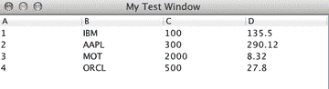

**图 22-1:** 在没有列标题的情况下运行 MyFrame

### 表格模型的可选回调

图 22-1 所示的 `JTable` 没有显示正确的列标题；自动生成的 A、B、C 和 D 并不符合要求。你可以通过重写表格模型类中的 `getColumnName()` 方法来轻松修复此问题。如果存在此回调函数，它会被调用（每列调用一次）以渲染列标题。将以下代码添加到 `MyTableModel` 类中，窗口的看起来就会像图 22-2 所示的那样。

```
String[] orderColNames = 
                   { "Order ID", "Symbol", "Quantity", "Price"};
public String getColumnName(int col) {
     return orderColNames[col];
 }
```

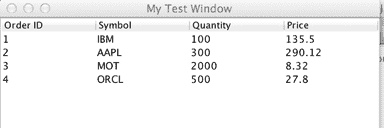

**图 22-2:** 运行带有列标题的 MyFrame

如果你想让某些列或单元格变得可编辑，只需重写 `isCellEditable()` 方法，并在可编辑列的回调中返回 `true`。以下是让你的 `JTable` 的第三列（列索引从 0 开始）可编辑的方法：

```
public boolean isCellEditable(int row, int col) {
  if (col ==2){
      return true;
  } else {
    return false;
  }
}
```

如果你的表格有可编辑的列，你需要重写 `setValueAt(Object value, int row, int col)` 方法，并包含将数据从 UI 组件——`JTable`——复制到其模型对象相应字段的代码。当用户更改表格单元格中的值并按 Enter 或 Tab 键移出该单元格，或点击另一个单元格时，该方法会被调用。

以下方法 `setValueAt()` 接收修改后的订单数量，并为模型中相应 `Order` 的 `quantity` 字段设置新值。默认情况下，`JTable` 单元格中显示的所有数据均为 `String` 数据类型，由你负责进行适当的类型转换。

```
public void setValueAt(Object value, int row, int col){
  if (col== 2){
   myData.get(row).quantity=(Integer.valueOf(value.toString()));
  }
  //通知监听器数据变化
   TableModelEvent event = new TableModelEvent(this, row, row, col);
   fireTableChanged(event);
}
```

`fireTableChanged()` 方法被放置在 `setValueAt()` 方法中，用于通知任何想要了解数据变化的监听器。例如，如果任何订单的数量发生了变化并超过了某个阈值，应用程序可能需要立即执行某些操作向某些机构报告此情况。

查看列表 22-3 中的代码。`MyFrame` 类实现了 `TableModelListener`，因此由于 `fireTableChanged()` 方法的调用触发了 `tableChanged()` 方法。向类中添加以下行：

```
System.out.println("Someone modified the table!");
```

现在运行程序并查看控制台中的输出。图 22-1 所示的 `JTable` 没有显示正确的列标题；自动生成的 A、B、C 和 D 并不符合要求。你可以通过重写表格模型类中的 `getColumnName()` 方法来轻松修复此问题。如果存在此回调函数，它会被调用（每列调用一次）以渲染列标题。

创建一个投资组合（Portfolio）应用程序，显示存储在数据库表中的投资组合数据。你需要使用数据库以及在第 21 章“尝试一下”部分中创建的 `Portfolio` 表。

### 课程要求

你已经安装了 Java。

### 步骤详解

1. 创建一个新的 Eclipse 项目。从附带书籍的第 22 节代码示例中复制类 `MyFrame` 和 `Order`。编译并运行程序，以确保它显示了硬编码的投资组合数据，如图 22-2 所示。

2. 将硬编码的表格模型 `ArrayCollection myData` 替换为 JDBC 代码，以连接到第 21 节“尝试一下部分](ch21.xhtml_try_it-id00076)创建的数据库 Lesson21。使用数据库表 `Portfolio` 中的记录来填充订单。

   不要忘记将 `derbyclient.jar` 文件添加到项目的 Java 构建路径中。

3. 运行适当的 SQL `Select` 语句，用从数据库接收的数据填充 `myData` 集合。

4. 运行 `MyFrame` 程序。数据应该显示在 GUI 中。

# 第 23 节

## 注解与反射

通常情况下，*元数据*是关于数据的数据。在数据库管理系统（DBMS）的背景下，元数据可以是描述存储数据方式的信息，例如表名、字段名或主键。程序代码元数据是关于代码的数据。任何 Java 类都嵌入了它的元数据，你可以编写一个程序来“询问”另一个类：“你有哪些方法？”或者关于类字段、构造函数和祖类的类似问题。

你可以使用注解（annotations）来包含关于代码的元数据。有许多预定义的注解（例如 `@Override` 和 `@SuppressWarning`）。Java 注解模型允许你在代码的任何地方添加自定义元数据。你可以将自定义注解应用于类、方法或变量——只需在定义注解时指定允许的*目标*（targets*）。Java 注解以 `@` 符号开头，并可能可选带有一个或多个参数。某些注解内置在 Java SE 中并被 `javac` 编译器使用，但大多数注解由某种处理程序或工具消耗。

Java 反射（reflection）的主题不需要使用注解；反射广泛应用于 Java 开发的各个领域。但由于在进行注解处理之前必须涵盖这个主题，我决定在同一节中涵盖这两个主题。

## Javadoc 注解

如果你查看过任何 Java 类的源代码，就可以很容易地识别出类、接口、变量和方法的 Javadoc 风格注释。这些注释可能包含特殊格式的单词，称为“标签”。这些标签是特殊的注解。它们也以 `@` 符号开头，并帮助[Javadoc 工具](http://www.oracle.com/technetwork/java/javase/documentation/index-137868.html)生成具有标准化外观的在线文档。

在 Eclipse 中，你可以选择任何 Java 类并按 F3 打开该类的源代码。由于上一节是关于使用 `JTable` 的，请打开该类的源代码。在代码的顶部，你会发现与后续内容相似的描述（为了简洁，我删除了大部分文本）：

```
 /**
 * <code>JTable</code> 被用于显示和编辑普通的 
 * 二维单元格表格。
 * 要启用行的排序和过滤，请使用
 * {@code RowSorter}。
 *  对于所有的 <code>JComponent</code> 类，你可以使用
 * {@link InputMap} 和 {@link ActionMap} 将
 * {@link Action} 对象与 {@link KeyStroke} 关联，
 * 并在指定的条件下执行该操作。
 * <p>
 * <strong>警告：strong> Swing 不是线程安全的。更多
 * 信息请参见<a
 * href="package-summary.html#threading">Swing 的线程
 * 策略</a>
 * <p>
 *
 * @version 1.292 05/30/08
 * @author Philip Milne
 * @author Shannon Hickey (printing support)
 * @see javax.swing.table.DefaultTableModel
 * @see javax.swing.table.TableRowSorter
 */
```

用 `@` 符号标记的特殊单词是 Javadoc 元数据，描述了链接、版本、作者以及 Java 文档中可以查看的相关类。如果你通过 Javadoc 工具运行此类的源代码，该工具将生成可以使用任何网络浏览器打开的 HTML 输出。在类中包含 Javadoc 注释是一个良好的做法。

Javadoc 充当处理工具，从源代码中提取所有以 `/**` 开头并以 `*/` 结束的注释块。然后使用 HTML 标签和嵌入注解对这些文本进行格式化，以生成程序文档。前面的文本是预定义且 Javadoc 理解的特定标签的使用示例。这是一个仅由 Javadoc 理解的元数据示例。

但 Java 允许你声明自己的自定义注解，并定义自己的处理规则，这些规则可以引导程序的执行，并产生配置文件、额外的代码、部署描述符等。无论你的目标是什么，当你创建注解时，也需要创建或使用*注解处理器*（annotation processor）来获得预期的输出。从第 26 节开始，你将学习 Java EE 定义的注解。在本节中，你将熟悉 Java SE 注解，你将在项目中使用。

## Java 注解基础

Java SE 已经包含了十几个预定义的注解。你可以在 `java.lang`、`java.lang.annotation` 和 `javax.annotation` 包中找到它们及其支持类。你可以在 Java SE 的最新在线文档中熟悉这些内容，编写时它们位于 [`goo.gl/sVZ8I`](http://goo.gl/sVZ8I)。

某些注解被编译器使用（`@Override`、`@SuppressWarning`、`@Deprecated`、`@Target`、`@Retention`、`@Documented`、`@Inherited`）；某些由 Java SE 运行时第三方运行时使用，指示按特定顺序调用的方法（`@PostConstruct`、`@PreDestroy`），或者标记由第三方工具生成的代码（`@Generated`）。我不重复如何使用这些注解的详细描述，但我将提供精选示例来帮助你开始使用注解。

### @Override

在第 3 章“尝试一下”部分，你重写了 `NJTax` 类中的 `public double calcTax()` 方法。`calcTax()` 方法签名在 `NJTax` 及其父类 `Tax` 中是相同的。现在，故意地在 `NJTax` 中为 `calcTax()` 添加一个参数，就好像是不小心那样做。代码编译通过，没有任何错误。但你可能这样做犯了错误，并且没有如计划那样重写方法，而是重载了它。如果你在计划重写方法时都使用 `@Override` 注解，这种情况就不会发生：

```
@Override public double calcTax(String something)
```

现在编译器会报错并显示以下错误：

```
类型 NJTax 的方法 calcTax(String) 未重写或实现父类方法
```

`@Override` 注解向编译器表示预期重写，如果没有发生重写，则它必须失败。该注解指示了你的意图，并帮助未来阅读你代码的人。

### @SuppressWarning

编译器可以生成警告信息，这些信息不会阻止程序的运行，但指示了潜在的问题。不过，在某些情况下，你可能抑制某些或所有警告，以便项目构建的输出看起来整洁。例如，`-Xlint:none` 会禁用所有警告，而 `-Xlint:fallthrough` 则告诉编译器，如果你忘记在 `switch` 语句中添加 `break` 语句时发出警告（参见第 5 章）。在 Eclipse IDE 中，要设置编译器选项，你需要右键点击项目并选择 Properties（属性）→ Java Compiler → Errors/Warnings → Potential Programming Problems（潜在编程问题）。

但如果你故意在 `switch` 语句中省略 `break` 关键字呢？你可能仍然希望在所有其他情况下对缺失 `break` 收到警告，但在这个特定方法中不会。这时 `@SuppressWarnings` 注解就变得非常有用，Listing 23-1 说明了这一点。要查看此示例的效果，请开启编译器中关于 `switch` `case` 穿透的警告选项。

注意，`case 3` 部分缺少了 `break` 关键字。在代码代码中这是故意的：`salaryBand` 3 中的所有员工都有权获得两次奖金——在 $10,000 之外还有 $6,000。编译器的注解 `@SuppressWarnings("fallthrough")` 仅对此方法抑制编译器警告。在所有可能包含 `switch` 语句的其他类或方法中，仍会生成警告。

### @Deprecated

如果你正在开发将由他人使用的类，请将代码中未来版本中可能被删除的任何类或方法标记为 `@Deprecated`。其他开发者仍然可以使用这些代码，但他们会收到警告，强烈建议切换到新版本。

### @Inherited

此注解仅意味着该注解必须被使用它的类的后类继承。下一节将包含其用法的示例。

### @FunctionalInterface

这是一种信息性注解类型，用于指示接口类型声明意图是一个函数式接口。如果你以后定义具有单个抽象方法的接口，可以可选地将此类接口标记为 `@FunctionalInterface`，仅为了提示该接口可以实现为 lambda 表达式。

### @Documented

如果你希望将注解包含在 Javadoc 工具中，请将其标记为 `@Documented`。下一节将包含此注解的示例。

## 自定义注解

创建你自己的注解比使用 Java 核心注解或第三方注解更有趣。首先，你需要决定需要注解来做什么，以及它应该具有哪些属性。然后，你需要指定此注解允许的目标（例如，类、方法或变量）。最后，你必须定义你的留存策略（retention policy）：该注解将存在多久以及存在何处。让我们通过一个示例来说说明所有步骤。

假设你需要创建一个注解，允许用户在类方法上标记一个要在运行时执行的 SQL 语句。这些类是动态加载的。目标是声明你自己的注解供其他 Java 类使用，并编写注解处理器，该处理器负责读取这些 Java 类，识别并解析注解及其参数值（如果有的话），并根据需要执行相应的操作。通常，对象关系映射（ORM）框架或代码生成器的创建者需要实现此类任务。

声明注解与声明接口非常相似，但不要忘记在开头添加 `@` 符号。我将我的注解命名为 `MyJDBCExecutor`：

```java
public @interface MyJDBCExecutor{
}
```

如果说元数据是关于数据的数据，那么元注解（meta-annotations）就是关于注解的注解。这听起来并没有那么混乱。要指定你可以在哪里使用这个新注解，请定义元注解 `@Target`。枚举 `ElementType` 定义了可能的目标值：`METHOD`、`TYPE`、`CONSTRUCTOR`、`FIELD`、`PARAMETER`、`PACKAGE`、`LOCAL_VARIABLE`、`TYPE_PARAMETER`、`TYPE_USE` 和 `ANNOTATION_TYPE`。如果不使用 `@Target`，注解可以使用可以使用。例如，你可以只允许在方法和构造函数中使用注解：

```java
import java.lang.annotation.*;
@Inherited
@Documented
@Target({ ElementType.METHOD, ElementType.CONSTRUCTOR })
@Retention(RetentionPolicy.SOURCE)
public @interface MyJDBCExecutor {
}
```

从 Java 8 开始，你可以创建可以在任何声明类型的地方使用的自定义注解，例如：

```java
@MyAnnotation String employeePhone;
```

上述代码片段中的留存策略被设置为 `SOURCE`，这意味着该注解仅在程序编译期间用于处理。留存策略的另外两个允许值是 `RUNTIME` 和 `CLASS`。

具有 `CLASS` 留存策略的注解保留在编译后的类中，但在运行时不加载。如果没有显式指定留存策略，则默认使用 `CLASS` 留存策略。

具有 `RUNTIME` 留存策略的注解在编译代码运行时必须由自定义处理工具处理（有人得编写它）。

注解可以有参数。假设你想添加一个参数，允许你指定一个要处理的 SQL 语句。你的注解 `MyJDBCExecutor` 必须如下声明：

```java
@Target({ ElementType.METHOD, ElementType.CONSTRUCTOR })
@Retention(RetentionPolicy.SOURCE)
public @interface MyJDBCExecutor {
   String value();
}
```

一个示例 Java 类 `HRBrowser` 可以这样使用它：

```java
class HRBrowser{
  @MyJDBCExecutor (value="Select * from Employee")
  public List getEmployees(){
      // 此处调用某些 JDBC 执行引擎
  }
```

如果注解只有一个名为 `value` 的参数，那么上述代码片段中的 `value=` 部分不是必须的。但我希望此注解具有三个参数：要执行的 SQL、事务支持以及通知其他用户数据库修改的标志。向你的注解添加更多参数：


```java
@Target({ ElementType.METHOD })
@Retention(RetentionPolicy.SOURCE)
public @interface MyJDBCExecutor {
    String sqlStatement();
    boolean transactionRequired() default false;
    boolean notifyOnUpdates() default false;
}
```

你将参数 `value` 替换为更有意义的 `sqlStatement`，并增加了两个：`transactionRequired` 和 `notifyOnUpdates`。后者有两个默认值。如果 Java 类不需要支持事务并通知应用程序更新，为什么要强制软件开发者提供这些参数的值呢？

如果不指定默认值，那么当使用 `@MyJDBCExecutor` 的类缺少 `transactionRequired` 和 `notifyOnUpdates` 值时，Java 编译器将生成编译错误。以下代码是 `HRBrowser` 类的一个示例，其 `getEmployees()` 方法标记了 `@MyJDBCExecutor`，且只有一个 `sqlStatement` 参数；这里不需要其他操作：

```java
class HRBrowser {
    @MyJDBCExecutor(sqlStatement = "Select * from Employee")
    public List<Employee> getEmployees() {
        // 此处从 DBMS 获取数据的代码
        // 结果集存放在 ArrayList myEmployeeList 中
        // 返回给 getEmployees() 的调用者
        // ...
        return myEmployeeList;
    }
}
```

Listing 23-2 中的代码示例添加了 `updateData()` 方法并使用了所有的注解参数。

对于具有 `RUNTIME` 留存策略的注解，你应该了解如何编写注解处理器，因为它必须在运行时“提取”注解中的值，并根据这些值来执行相应的代码。但在你编写自己的注解处理类之前，有一个 Java 特性——`reflection`（反射）是你必须理解的。

# 反射 (Reflection)

反射允许你能够在运行时获取 Java 类的内部结构信息（其方法、构造函数和字段），并调用发现的方法或访问公共成员变量。一个名为 `Class` 的特殊类可以将类加载到内存中，然后你就可以使用来自 `java.lang.reflect` 包的类来探索该类的内容。考虑以下代码中的 `Person` 和 `Employee` 类。

Listing 23-4 中的 `ReflectionSample` 类加载了 `Employee` 类，打印了它的方法签名，并找到了它的父类和方法。这种在运行时查询对象内容的过程被称为 `introspection`（内省）。

以下是程序 `ReflectionSample` 的输出：

```
The Employee methods:
*** Method Signature:public void Employee.raiseSalary()
The name of the superclass is Person
The superclass has:
*** Method Signature:public abstract void Person.raiseSalary()
      Return type: void
```

`Class` 类的其他实用方法包括 `getInterfaces()`、`getConstructors()`、`getFields()` 和 `isAnnotationPresent()`。下面的代码段显示了如何获取加载类的公共成员变量的名称、类型和值：

```java
Class c = Class.forName("Employee");
Field[] fields = c.getFields();
for (int i = 0; i < fields.length; i++) {
    String name = fields[i].getName();
    String type = fields[i].getType().getName();
    System.out.println("Creating an instance of Employee");
    Object obj = c.newInstance();
    Object value = fields[i].get(obj);
    System.out.println("Field Name: " + name + ", Type: "
            + type + " Value: " + value.toString());
}
```

反射过程使用内省在运行时发现有哪些方法（或属性），但它也可以调用这些方法（或修改这些属性）。`invoke()` 方法允许你调用在运行时发现的方法：

```java
Class c = Class.forName("Employee");
Method raiseSalary = c.getMethod("raiseSalary", null);
raiseSalary.invoke(c.newInstance(), null);
```

注意，`forName()` 方法加载了类，而 `newInstance()` 创建了 `Employee` 的实例。`invoke()` 方法的第一个参数代表对象 `Employee` 的实例，`null` 表示该方法没有参数。通过反射，参数是以对象数组的形式提供的。你可以通过调用 `Method.getParameterTypes()` 方法来发现方法参数是什么，或者自己创建并填充它们。在 `Employee` 类中添加以下方法：

```java
public void changeAddress(String newAddress) {
    System.out.println("The new address is " + newAddress);
}
```

注意 `public` 修饰符：为了正确的内省，它是必要的。否则，下面的代码段将抛出 `NoSuchMethodException`。`ReflectionSample` 类可以如下方式调用 `changeAddress()`：

```java
Class c = Class.forName("Employee");
Class parameterTypes[] = new Class[] { String.class };
Method myMethod = c.getMethod("changeAddress", parameterTypes);
Object arguments[] = new Object[1];
arguments[0] = "25 Broadway";
myMethod.invoke(c.newInstance(), arguments);
```

反射有助于构建动态的组件化应用程序，这些应用程序可以根据某些业务逻辑加载不同的类并在运行时调用该逻辑。许多第三方 Java 框架读取配置文件，然后实例化并使用所需的对象。

# 运行时注解处理 (Run-Time Annotation Processing)

自定义运行时注解的作者通常会同处理工具一起提供给其他开发者。开发者将注解添加到他们的类中并进行编译，而处理工具在运行时消耗这些类。为了说明这一概念，我重用了 Listing 23-2 中的代码示例，但这次请假设 `@MyJDBCExecutor` 变为具有 `RUNTIME` 留存策略的注解，并且不需要为编译时生成额外的源代码。假设此注解被用在 `HRBrowser` 中，另一个类必须分析注解参数并据此路由执行。

现在我将编写一个名为 `MyJDBCAnnotationProcessor` 的注解处理器类，而 Listing 23-2 中的 `HRBrowser` 类可以作为该处理器的命令行参数：

```
c:/>java MyJDBCAnnotationProcessor HRBrowser
```

`MyJDBCAnnotationProcessor` 类必须加载 `HRBrowser` 类，内省其内容，找到注解及其值，并据此进行处理。我将向你展示如何编写这样的处理器，或者说是它的注解发现部分。

Listing 23-5 显示了 `MyJDBCAnnotationProcessor`，它首先加载另一个在命令行中提供的类。之后，它内省其内容，找到注解及其值，并据此进行处理。

# 总结 (Summary)

在现实应用中，你不会简单地打印注解的值，而是根据这些值执行不同的代码分支。这就是运行时注解处理的意义。你可能会问：“好了，现在我知道注解和它们的值了，我对它们做什么呢？”核心思想是你编写了一个通用处理器，它可以处理包含你注解的类。对于所有为他人创建工具的软件开发者来说，这是一个强大的机制。

你可能会使用他人编写的注解和运行时处理器，而不是自己编写的。从 第 26 章 开始，你将在很多使用注解的示例，同时学习 Java EE 开发。但现在你已经知道了注解处理器内部发生了什么，学习 Java EE 注解将变得简单得多。反射机制允许你能够在运行时获取任何类的成员。这种好用的特性应该谨慎使用，因为这种发现需要额外的处理时间。

## 试运行 (Try It)

创建一个名为 `@DBParams` 的类级运行时注解，允许你指定数据库名称、用户 ID 和密码。为该注解编写一个处理器。

### 课程要求 (Lesson Requirements)

你应该已经安装了 Java。

### 步骤 (Step-by-Step)

1. 创建一个新的 Eclipse 项目。
2. 在此处声明注解 `DBParams`，留存策略为 `RUNTIME`，目标为 `TYPE`。
3. 在注解中定义三个参数：`dbName`、`uid` 和 `password`。
4. 创建类 `MyDBWorker` 并使用 `@DBParms` 对其进行注解，其中填充一些初始值。
5. 编写一个名为 `DBParamProcessor` 的注解处理器类，用于查找并打印 `MyDBWorker` 类中的注解值。
6. 运行并测试 `DBParamProcessor`。

# 第 24 节：远程方法调用 (RMI)

到为止，本教程中的大多数 Java 程序运行在单个 Java 虚拟机 (JVM) 中。这里有两个例外：在第 16 节的“接字编程”部分中，你使用了两个 JVM，而且来自第 21 节的 JDBC 程序与另一个运行数据库服务器的 JVM 通信。运行在用户计算机上的应用程序并不总是被允许直接访问远程数据的——这就是*分布式 Java 应用程序*出现的原因之一。（分布式意味着应用程序的部分运行在多台计算机上。）另一个原因是为了提供一个为多个轻量级客户端服务的集中式服务器。

有很多方法可以创建运行在多个 JVM 上的 Java 分布式应用程序，远程方法调用 (RMI) 就是其中之一，尽管它现在很少被使用。例如，客户端 Java 应用程序 (JVM1) 连接到服务器 Java 应用程序 (JVM2)，后者连接到运行在第三台计算机上的 DBMS。客户端应用程序对 DBMS 一无所知；它从运行在 JVM2 中的服务器应用程序获取数据，即一个包含 `Employee` 对象的 `ArrayList`（或其他数据集合）。RMI 使用对象序列化进行 JVM1 和 JVM2 之间的数据交换。

但与接字编程不同（客户端只需连接到服务器上的某个端口），在 RMI 中，一个 Java 类可以*调用*存在另一个（远程）JVM 中的 Java 对象的*方法*。虽然从语法角度来看，调用者和服务器类似乎位于同一个 JVM 中，但它们可能相隔数千英里。RMI 客户端不会拥有服务器端方法的副本；它只有该方法的本地表示——*代理* (proxy)，或者使用 RMI 术语来说就是*存根* (stub)。

任何 RMI 应用程序都由 RMI 服务器、客户端和*注册表*（registry，即命名服务）组成。这三个组件可以运行在连接到不同网络计算机的三个不同 JVM 上。RMI 服务器创建实现业务逻辑的 Java 对象，将它们注册到命名服务中，并等待远程客户端调用服务器的方法。

客户端应用程序从注册表获取远程服务器对象或对象的引用，然后在这这些远程对象上调用方法。RMI 使用传输层来隐藏客户端存根与服务器端 Java 对象之间的通信，尽管方法是在客户端的 JVM 中被调用的，但它们是在服务器的 JVM 上执行的。所有 RMI 支持类和注册表工具都包含在 Java SE 中。

## 使用 RMI 开发应用程序

本节作为示例 RMI 应用程序的说明，仅包含最少的理论。关于 RMI 的更详细描述，请参考该主题的 [Oracle 在线教程](http://docs.oracle.com/javase/tutorial/rmi/)。

编写分布式 RMI 应用程序涉及以下步骤：

1. 定义远程接口。
2. 实现远程接口。
3. 编写连接到远程服务器并调用远程方法的 Java 客户端。
4. 启动注册表并将其注册 RMI 服务器。服务器将其服务关联（绑定）到注册表名称。
5. 启动服务器和客户端应用程序。客户端通过名称查找服务并调用它们。

让我们通过开发股票报价服务器的 RMI 版本（参见其在接字编程中的接字版本）来执行每一个步骤，该服务器为客户端提供指定股票的价格报价。之前的某些步骤可以合并——例如，创建一个注册表并将服务绑定到它。`java.rmi` 包包含了后续代码示例中使用的所有 RMI 支持类。

### 定义远程接口

你计划部署在服务器侧的 Java 类必须实现*远程接口*，这些接口声明了要由 RMI 客户端远程调用的业务方法。客户端代码看起来像是在调用本地方法，但这些调用通过 RMI 协议重定向到远程服务器。以下是创建远程接口的规则：

* 远程接口必须声明公共方法，以允许客户端执行远程方法调用。
* 远程接口必须扩展 `java.rmi.Remote`。
* 每个方法都必须声明 `java.rmi.RemoteException`。
* 如果方法参数不是基本类型，则它们应该是可序列化的对象，以便在网络中传输。

在 RMI 中，服务器端层的开发始于回答问题：“哪些业务方法必须暴露给客户端应用程序，它们的签名应该是什么？”当你知道答案后，定义声明这些方法的远程接口以及实现它们的类。让我们看看如何将此规则应用于提供股票价格服务的服务器。

列表 24-1 显示了 `StockServer` 远程接口的代码，该接口将在服务器上实现，但*也必须存在于客户端*。此接口声明了两个业务方法：`getQuote()` 和 `getNasdaqSymbols()`。第一个方法为指定的符号生成随机价格报价，第二个方法返回有效符号列表。

在 RMI 中，类定义从一个 JVM 动态加载到另一个 JVM。位于服务器端的类实现可能会更改——例如，可能会向实现引入新方法。但客户端看到的只有扩展 `Remote` 的接口定义的存根。在我们的示例中，为了让 RMI 客户端可以使用更多的服务器端方法，你需要将它们添加到 `StockServer` 接口并在客户端和服务器端使其。

### 实现远程接口

虽然远程接口只是声明了方法，但你需要创建一个运行在服务器端并提供这些方法实现的类。有一个特殊要求，是将此类类*导出*到 Java RMI 运行时，以便该类能够接收远程调用。这与 `ServerSocket` 情况中的绑定端口类似（参见列表 16-5），但在 Java RMI 的情况下，服务器还会创建一个存根——一个用于客户端的伪类，包含远程接口中每个实现方法的代理。

一个 RMI 客户端与一个服务器通信。这被称为单播 (unicast)，区别于多播 (multicast) 或广播 (broadcast)。导出 RMI 服务器实例最简单的方法是让它继承自 `java.rmi.server.UnicastRemoteObject`，如列表 24-2 所示。如果你的服务器必须继承另一个类，可以通过调用 `UnicastRemoteObject.export()` 来显式导出服务器对象。

列表 24-2 显示了 `StockServerImpl` 实现，该类处理客户端请求。该类为 `ArrayList nasdaqSymbols` 中的股票生成随机价格报价。

### 注册远程对象

为了让远程对象对客户端可用，你需要将其绑定到注册表中的某个名称，该命名服务知道你的 RMI 服务器 `StockServerImpl` 具体运行在网络中的位置。这允许 Java 客户端通过名称在主机上查找对象。

Listing 24-3 描述了将 `StockServerImpl` 实例绑定到主机 1099 端口的代码，在示例中该主机是本地计算机。对于世界其他部分来说，此服务器被称为 `QuoteService`。

在 `java.rmi.Naming` 类中有两个方法可以在注册表中绑定一个对象。`bind()` 方法将 RMI 服务器绑定到一个名称。如果该绑定已存在，它会抛出 `AlreadyBoundException` 异常。`rebind()` 方法会替换任何现有的绑定。除了将服务器绑定到名称外，它还确保请求 `getQuotes()` 或 `NasdaqSymbols()` 等服务的客户端接收到它们的存根——远程方法的本地代理。

在启动 Listing 24-3 中的程序之前，注册表必须运行。启动注册表的一种方法是在 Windows 窗口中输入 `start rmiregistry` 或在 Mac 上输入 `rmiregistry`。与其手动启动注册表，你可以在 `StartServer` 程序内部调用以下方法启动它：

```java
LocateRegistry.createRegistry(1099);
```


如果你知道另一个进程已经创建了注册表，只需获取其引用并将服务器绑定到它。如果 RMI 注册表运行在默认端口 1099，则无参数调用 `getRegistry()` 方法。如果不是，请指定端口（示例中的 5048）。以下代码中的变量 `registry` 是远程对象 `StockServer` 的存根：

```
StockServerImpl ssi = new StockServer();
Registry registry = LocateRegistry.getRegistry(5048);
registry.bind("QuoteService", ssi);
```

### 编写 RMI 客户端

运行在互联网任何地方的客户端程序在主机注册表中查找（使用主机域名或 IP 地址）远程对象的引用。Listing 24-4 显示了一个客户端程序。注意 `lookup()` 方法返回的数据转换为 `StockServer` 类型。尽管 `StockServerImpl` 类已绑定到 `QuoteService` 名称，但由于该类实现了 `StockServer` 接口，你可以对它进行转换。变量 `myServer` 只能看到该接口中定义的方法，而 `StockServerImpl` 类可能还有其他公共方法。

多个客户端可以连接到同一个 RMI 服务器，但每个客户端/服务器的通信是通过独立的 socket 完成的。这是在内部完成的，因此应用程序程序员不需要显式编写 socket。如果你记得，在第 16 节 中我们在 socket 连接示例中发明了简单的通信协议。RMI 使用了自己的专用协议 [JRMP](http://en.wikipedia.org/wiki/Java_Remote_Method_Protocol)，因此它只能用于 Java 之间的通信。

### 安全考虑

任何 RMI 客户端都可以限制远程加载的代码执行的操作吗？服务器可以限制访问吗？你可以指定包含访问限制的安全文件。例如，在 Listing 24-3 的代码和 Listing 24-4 中，你可以使用以下代码启动 `main()` 方法：

```
if (System.getSecurityManager() == null) {
    System.setSecurityManager(new RMISecurityManager());
}
```

`java.rmi.RMISecurityManager` 类扩展了 `java.lang.SecurityManager` 并提供了 RMI 应用执行的安全上下文。在 RMI 客户端中，目标是防止远程加载的存根通过远程方法调用下载不安全的代码。

RMI 客户端使用一个定义安全策略的文件。你可以使用默认的安全文件 `java.policy`，它位于你的 JDK 或 JRE 安装目录下的 `lib/security`。默认策略文件赋予代码所有权限，但你可以创建自己的文件，并通过命令行参数或在代码中设置安全之前提供它：

```
System.setProperty("java.security.policy", "mypolicyfile");
```

有关安全策略文件的更详细描述，请参考文档 [`http://docs.oracle.com/javase/8/docs/technotes/guides/security/PolicyFiles.html`](http://docs.oracle.com/javase/8/docs/technotes/guides/security/PolicyFiles.html)。

Java Applet 也可以作为 RMI 客户端，但它们不需要 RMI 安全管理器。对它们的唯一限制是只能连接到部署它们的相同主机上运行的 RMI 服务器。

### 查找远程对象

RMI 客户端通过使用*命名服务*或*目录服务*来查找远程服务。命名服务运行在已知的主机和端口号上。命名和目录服务的主题在第 29 节中有更详细的介绍。

到为止已经你知道 RMI 服务器可以启动自己的注册表，为 RMI 客户端提供命名服务。注册表的行为由接口 `java.rmi.Registry` 定义，你在“注册远程对象”中看到了绑定注册表的示例。默认情况下，RMI 注册表运行在端口 1099，除非指定了另一个端口号。当客户端想要调用远程对象上的方法时，它通过查找名称获取引用。`lookup()` 方法向客户端返回一个引用，也称为存根。它接受以下格式的 URL：

```
rmi://<host_name>[:<name_service_port>]/service_name
```

`host_name` 代表局域网 (LAN) 主机名称或互联网上的域名系统 (DNS) 名称。`name_service_port` 仅当命名服务运行在默认端口以外时需要指定。`service_name` 代表应该绑定的远程对象名称。图 24-1 展示了 RMI 应用的架构。在“尝试一下”部分，你为示例服务实现了这种架构。


### 尝试一下

在练习中，你的目标是启动并测试分布式应用程序的所有部分，并且你在同一主机上运行这些部分。

### 课程要求

你应该已经安装了 Java。

### 提示

有一个用于 Eclipse 的 RMI 插件，对于开发基于 RMI 的分布式应用可能很有用。它包含一个名为 RMI Spy 的有用工具，可以显示所有的输出和输入调用并测量执行时间。该插件中的另一个有用工具是 Registry Inspector，它可以显示注册表中对象的信息。该 RMI 插件可以通过 `www.genady.net/rmi/index.html` 获取。

### 步骤说明

1.  导入名为 `Lesson24` 的 Eclipse 项目。它有两个包：`client` 和 `server`。

2.  重新构建项目（使用菜单 Project → Clean）。注意 Eclipse 工作区的位置；因为你需要从命令行窗口运行所有代码示例。确保在导入项目后，它指向你计算机上安装的 JRE（右键点击项目名称并使用菜单 Properties → Java Build Path）。

3.  运行程序 `StartServer` 以启动并向注册表注册 `StockServer`（注意：这里使用 `LocateRegistry` 创建了注册表）。当你输入了类似下面所示的命令后，服务器将启动并绑定到注册表，在 Eclipse 控制台中打印出以下消息：

```
<QuoteService> server is ready.
```

服务器将保持运行状态，等待客户端的请求。

4.  你也可以从 Eclipse 中运行客户端，但为了更好地阐说明你使用了不同的 JVM 这一事实，请从命令行窗口运行客户端。打开一个命令行（或终端）窗口，并进入你 Eclipse 工作空间中 `Lesson24` 项目的 `bin` 目录。在我的电脑上，我是这样操作的：

`cd /Users/yfain11/practicalJava/workspace/Lesson24/bin`

5.  运行位于 `client` 包中的 `Client` 程序，并将股票代码作为命令行参数传递它，然后 `Client` 将连接到你的“远程”服务器并接收价格报价——例如：

```
java client.Client AAPL
```

在我的电脑上，输出如下：

`The price of AAPL is: $91.85776369781252`

6.  打开多个命令行窗口并在每个窗口中运行客户端程序，模拟多个客户端向同一个服务器发送请求。

7.  在 `StockServerImpl` 类的 `getQuote()` 方法中添加以下语句，并服务器如何在 Eclipse 控制台中报告每个报价请求的：

`System.out.println("Got the price quote request for " + symbol);`

# 第 25 课：Java EE 7 概述

从本节开始，你将学习 Java 企业级版（Java EE，以前称为 J2EE），这是一个强大、成熟且广泛用于分布式应用程序开发的平台。`enterprise`（企业）一词并不意味着它仅用于大型应用程序。Java EE 组件被用于开发各种类型的程序，从运行在五百美元电脑上的本地披萨店网站应用程序，到运行在由数百台互连服务器组成的 `cluster` 上的超级华尔街交易应用程序。

本节是对 Java EE 架构、概念、组件和术语的概述，这些内容将在本书的后续章节中详细介绍。这些章节的目标是让你理解如何开展 Java EE 应用的开发，通过向你展示如何构建小型应用程序，而不是让你去读详尽涵盖该主题所需的 1000 页手稿。

关于 Java EE 主题的在线材料和书籍丰富，当你确定了哪些组件适合你的项目后，寻找所选主题的材料并不困难。我的任务是帮助你做出决策，并让你以最快的方式入门。Oracle 的白皮书 [[Introduction to Java Platform Enterprise Edition 7](http://www.oracle.com/technetwork/java/javaee/javaee7-whitepaper-1956203.pdf)] 是本节的很好的补充。如果你开始浏览互联网寻找更多关于 Java EE 的信息，可能会因为比较不同版本的 Java EE 组件的功能而感到困惑。我强烈建议你关注 Java EE 7 的特性，它是目前最新且最易于使用的平台。它于 2013 年发布。

## 全局观

去你最喜欢的在线招聘搜索引擎，搜索关键词为 `Java` 的职位列表。你会发现成千上万份职位描述，但招聘人员寻找的是不仅了解本书前 24 节所涵盖的核心 Java 的软件开发人员。以下是其中招聘招聘的示例：

**职位**：Java 软件开发人员

**技能**：Java, JMS, Spring, Websphere MQ, EJB, Servlets, JDK, JUnit, Oracle, SQL

候选人应具备：

* 核心 Java
* 精通 EJB 和 Servlets
* 具有 RESTful Web Services 和 JAX-RS 经验
* JDBC (Oracle) 和 JPA
* JUnit
* SQL
* Eclipse IDE
* Spring Framework
* WebSphere Application Server
* JMS 和 WebSphere MQ

在这个技能列表中，你认出了多少项？你了解核心 Java（也称为 Java SE）、JDBC、Eclipse，希望你了解 SQL。学习完剩余章节后，你将理解大多数其他技能是什么、为什么需要它们，以及它们是如何结合在一起的。你也将拥有那里列出的许多流行术语的技术知识。

### JCP、JSR 以及其他缩写

Java 社区习惯于使用许多缩写。起初，这些缩写听起来可能令人敬畏且困惑，但只要稍微努力，它们就会变得非常有意义，并解释 Java 生态系统的生存和运行方式。

每个版本的 Java EE 都包含了一组针对各种技术的规范，例如 Servlets、JavaServer Pages (JSP)、Enterprise Java Beans (EJB) 和 Java Messaging Service (JMS)。这些每种规范都由一个名为 Java Process (JCP) 的组织定义。如果一个人或一组人决定为某些未来技术提出规范，他们就会创建一个 Java Specification Request (JSR) 并组成一个专家小组来编写该规范。JSR 是有编号的。例如，Servlets 3.1 的规范在 JSR340 中描述。

如果你决定熟悉任何 JSR，请访问网站 [`http://jcp.org`](http://jcp.org)。Java EE 和 Java SE 都实现了多个 JSR。换句话说，Java EE 是基于标准的。如果你想查看哪些 JSR 被包含在 Java EE 7 中，可以访问 [`http://en.wikipedia.org/wiki/Java_EE_version_history#Java_EE_7_.28June_12.2C_2013`](http://en.wikipedia.org/wiki/Java_EE_version_history#Java_EE_7_.28June_12.2C_2013)。本书没有涵盖所有的 JSR，但解释了一些主要的。最重要的是，本书试图向你展示如何构建使用 Java EE 7 平台的 Java 应用。

### Java 应用的分层

典型的分布式 Java 应用程序可以分为三或四层。（如果应用程序直接从 DBMS 获取数据，如 第 21 节 所述，它采用双层客户端-服务器架构，不需要 Java EE 组件。）图 25-1 显示了构建包含 Java EE 层或级的分布式应用程序的选技术和方法。

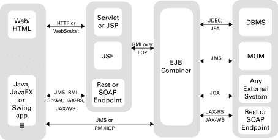

**图 25-1**：客户端层可以在用户的桌面、笔记本电脑、手机或其他任何嵌入 JRE 或可以与 Web 服务器上的 Java 连接的设备上实现。连接多个设备被称为[物联网](http://en.wikipedia.org/wiki/Internet_of_Things) (IoT)，它们可以利用嵌入 Java 的小型传感器和使用 Java EE 技术的服务器。你可以创建一个独立的 Java 应用程序、applet 或瘦客户端（在 Web 浏览器中运行的 HTML/JavaScript 文件）作为客户端。`thin`（瘦）一词是指客户端端没有进行任何业务处理（输入验证外），因此服务器必须努力处理所有客户端的所有应用程序逻辑，而 Java EE 在服务器端表现出色。

如果你正在构建一个 Web 应用程序，Web 层（也称为 `presentation tier`）就会进入用场。你可以选择 JSP、JavaServer Face (JSF)、`Servlets` 或 Web Services。这些组件负责你的瘦客户端客户端的外观。`Java Swing` 和 `JavaFX` 通常被用作与服务器端应用程序配合的 `fat clients`。这里的 `fat`（胖）一词指的是客户端可以包含某些业务逻辑，从而减轻服务器的负载。任何非图形用户界面（GUI）Java 应用程序都可以作为通过一个或多个 Java EE 技术创建的服务器端程序的客户端。

应用程序的业务逻辑部署在 `business tier`（业务层）中，在 Java EE 世界中由 `EJBs` 表示。过去 `EJBs` 是相当沉重的组件，诸如 `Spring` 这样的第三方框架成为了实现业务层的流行替代方案。但 Java EE 在这一领域重新夺回了市场份额，因为它是一种基于 POJO 和注解的轻量级技术，融合了第三方框架的许多特性。`POJO` 代表 `plain old Java object`（普通 Java 对象）——一种可以以你喜欢的任何方式编写的 Java 类，不需要继承任何框架类或实现强制接口。

见证 `EJBs` 演变的人很容易理解这个术语，这种演变始于必须以特定的复杂方式编写和部署的 Java 类，并伴随着沉重的 XML 配置文件。情况发生了巨大变化，现在 `EJBs` 已经变成了带有注解的 `POJOs`。如果你出于某些原因跳过了关于注解的第 23 章，你应该回去学习它；否则你将无法理解书中剩余的大部分内容。

在绘制图 25-1 的图表时，我在各个层之间移动了若干次 Web Services 框。一方面，Web Services（参见第 33 章）基于 Web 通信协议；另一方面，它们可以作为面层隐藏任何内容，包括用 COBOL 或语言在大型机上编写的整个遗留应用程序。在现实世界中，Web Services 跨越了所有服务器层，甚至可以放在数据层中一个独立的框里。

使用 `DBMSes` 仍然是企业 Java EE 应用程序存储数据最流行的方法，但并不是唯一的方法。数据可以由外部 Web 服务提供，或者作为某些消息基础设施的实时馈传入。`MOM` 代表 `message-oriented middleware`（面向消息中间件），你将在第 30 章中了解它是什么。

如果没有实际示例，所有这些新术语对你来说可能意义不大。你将在后续课程中看到示例，但目前，我只是简要讨论一下已经看到的通过 sockets 和 `RMI` 实现的股票市场应用程序的几种（并非全部）重构方式。

*   拥有一个 `JavaFX` 客户端连接到 `StockQuoteServlet`，它创建了被称为 `StockMarketQuote` 的 `session EJB`（会话 EJB），该会话连接到外部交易所软件并请求指定符号的报价。该会话 Bean 有一个定时器，每秒更新并向客户端发送报价。
*   按照上一个项目符号描述的操作，但将 `JavaFX` 应用程序替换为瘦 HTML 客户端。
*   与之前相同，但将 `Servlet` 替换为 `JSP`。
*   与之前相同，但将 `JSP` 替换为 `JSF`。
*   与上方相同，但将 `JSF` 替换为 RESTFul Web Service。
*   与上方相同，但将 `HTTP` 替换为 `WebSocket` 协议。
*   与之前相同，但将 Web Service 替换为 `session EJB`，它与消息驱动 Bean (`MDB`) 交互，该 MDB 通过 `MOM` 订阅外部交易所应用程序，该程序仅在价格变化时才回传新价格。
*   与之前相同，但添加另一个会话 Bean，它将处理由 `MDB` 接收到的每个报价并应用建模算法，并在特定条件下调用 Web Service 向第三方交易系统发送买入或卖出特定数量建议股票的消息。

我还可以继续下去。如你所见，设计分布式 Java EE 应用程序有许多方法。这就是 Java 架构师赖以生存的工作。

## 容器与应用程序服务器


# Java EE 层实现

Java EE 层实现在 `containers`（容器）中。容器包含 Java 对象。在 Java EE 世界中，容器不仅包含，还控制 Java 组件的出生、生存和死亡。例如，你不需要使用 `new` 操作符来创建新的 `EJB` 实例；容器根据配置参数创建它们的池。基本上，容器是 `JVM` 内部的一个区域，可以支持某些类型 Java 对象的生命，例如 `servlet`、`EJB` 等。`container` 一词也适用于客户端；例如，`Java SE` 运行时作为 Java 客户端应用程序的容器。

容器执行实用的功能，其中之一就是线程安全。多个客户端连接并向同一服务器发送请求是很棒的，但你能确定 Mary 启动的线程不会干扰 John 的线程吗？`EJB` 容器实现了单线程模型，确保每个客户端的请求都在专用线程中运行。容器可以提供 Java 事务 API (`JTA`) 的事务支持，并通过 Java 持久 API (`JPA`) 为数据持久化。

在前几节中我使用了蓝类比来解释 Java 类和对象的关系。我再次使用这个类比，但这次是解释 Java EE 规范与应用程序服务器之间的关系。Java EE 是一个规范，当它发布时，想要在其软件中实现它的供应商会创建支持该规范的应用程序服务器。

多个供应商提供 Java EE 应用程序服务器的不同版本。问题是它们支持哪个版本的 Java EE 规范。目前四个应用程序服务器——`GlassFish` (Oracle)、`WildFly` (Red Hat)、`WebLogic` (Oracle) 和 `Tmax JEUS` (TMaxSoft)——支持 Java EE 7。要查看支持 Java EE 7 的最新列表，请访问 [Java EE Compatibility](http://www.oracle.com/technetwork/java/javaee/overview/compatibility-136984.html) 网页。

Java EE 应用程序服务器支持多个容器；例如 Servlet 容器和 EJB 容器。某些供应商倾向于创建支持 Java EE 规范中某些技术的产品。例如，`Tomcat` (Apache Foundation)、`Jetty` (Eclipse Foundation) 和 `Resin` (Caucho) 支持选择的技术（如 `Servlets` 和 JSP），这使得它们适用于实现 Web 应用程序，但如果你计划基于这些产品创建 Web 应用程序，你需要确定还需要哪些工具或框架来支持事务、业务层、数据持久化等。`TomEE` (Apache Foundation) 支持 Servlet、JSP、EJB 以及其他 Java 技术。

本书使用 Oracle 的 `GlassFish` 4.1，它完全符合 Java EE 7。我选择了当今 Java EE 开发中最广泛使用的技术。特别是你将学习以下内容：

*   Java Servlets (JSR 340)
*   JavaServer Pages (JSR 245)
*   Enterprise Java Beans (JSR 345)
*   Java Persistence API (JSR 338)
*   Context and Dependency Injection (JSR 346)
*   Java Message Service (JSR 343)
*   Java API for RESTful Web Services (JSR 339)
*   Java API for JSON Processing (JSR 353)
*   Java API for WebSocket (JSR 356)

你可能会被这些术语搞得不知所措，但我尝试用易懂的语言来解释它们。

## 配置文件与修剪

尽管 Java EE 提供了全栈的服务器技术，但大多数现实世界的应用并不需要所有技术。在过去，为了获得 Java EE 认证，应用服务器供应商必须实现 Java EE 规范中列出的所有 JSR。但大多数应用并没有使用完整 [Java EE 规范](https://jcp.org/en/jsr/detail?id=342) 中包含的所有技术。这就是“配置（profile）”概念的由来。配置是一个预配置的 Java 技术子集，旨在解决特定类型的应用程序。目前，除了完整配置外，还有 [Web Profile](https://java.net/downloads/javaee-spec/WebProfile.pdf)，它专门为 Web 应用程序而设计。Web Profile 定义了所需的组件（例如 `Servlets`、`JSF`、`JSP`、`CDI`、`EJB Lite`、`JPA`、`JTA`），但供应商也可以包含完整 Java EE 规范中的技术。未来，可能会创建新的配置以满足开发者的特定需求。

`Pruning`（修剪）是缩小 Java EE 平台规模的方法。修剪过程从在 JavaDoc 中标记待移除的技术开始。然后，根据 Java 社区的反应，这些技术将是从未来的规范中移除还是保留。移除过程由应用服务器供应商定义，但其执行得非常谨慎，以确保现有应用程序不会崩溃。某些技术（如 `JAXR 1.0`）在 Java EE 7 服务器中是可选的。

## 为什么选择 Java EE？

你可能会说：“我想要回基于 RMI 的股票服务器应用。为什么要把事情变得这么复杂？”原因是，你的 RMI `StockServer` 中的 `UnicastRemoteObject` 实例可能需要处理成上万个并发用户请求。正如此，你需要编写代码确保这种并发处理是线程安全的。

Servlet 和 EJB 容器是可扩展的，它们会处理所有的多线程问题，让你在编写应用程序代码时就像该程序是唯一用户一样！单此就应该是使用 Java EE 栈而不是 RMI 的一个好理由。在不详细比较 RMI 和其他 Java EE 技术的情况下，我只需补充一点：如果你需要在 Web 上部署你的 `StockServer` 应用程序，企业防火墙可能不允许客户端打开某些端口并使用 RMI 所需的 JRMP 通信协议。

Java EE 是一个非常健壮、可靠且可扩展的平台，你会体会它的容器为你的代码所做的。这一节提到了几个概念。

如果你想让 Java EE 容器帮助你，请通过提供配置参数（注解）来帮助它们，指定你希望 EJB 容器为你预创建多少个相同的会话 bean `StockMarketQuote` 实例。这些会话 bean 中的每一个都可能从池中“租”给客户端请求，然后放回。你需要多少个 bean？我不知道。这取决于你系统的负载——即你的系统必须支持的对价格报价的并发（同时）请求数量。

Java EE 实现了 `dependency injection`（依赖注入）。对象不需要主动去获取它所需的资源，因为容器可以使用注解将其资源（你的代码也可以注入应用对象）到你的对象中。

`JSON` 代表 JavaScript 对象表示。`Interceptors`（拦截器）提供了一种容器拦截方法的机制。`WebSocket` 允许实时通信。`CDI` 代表上下文和依赖注入。

### 尝试一下

你应该安装了 Java EE。

### 要求

你应该安装了 Java。

### 步骤说明

1.  下载 GlassFish 开源版。在本文写作时，最新版本 GlassFish 4 可以在以下 URL 获取：[`https://glassfish.net/download`](https://glassfish.net/download)。

2.  下载并解压 Java EE Full Platform 文件。

3.  在命令行（或终端）中切换到 `glassfish4/bin` 目录。如果你使用 Mac OS，使用以下命令启动服务器：

    ```
    ./asadmin start-domain domain1
    ```

    Windows 用户使用以下命令启动服务器：

    ```
    asadmin.bat start-domain domain1
    ```

    在我的电脑上，启动 GlassFish 后，终端窗口看起来像图 25-2。

4.  默认情况下，GlassFish 服务器运行在端口 8080 上，服务器管理端口为 4848。打开 Web 浏览器并输入 [`http://localhost:8080`](http://localhost:8080)——你应该能看到 GlassFish 的欢迎页。

5.  在浏览器中输入 [`http://localhost:4848`](http://localhost:4848) 打开 GlassFish 管理控制台。Web 浏览器应该显示图 25-3 所示窗口。

6.  从 [`https://glassfish.java.net/docs/4.0/quick-start-guide.pdf`](https://glassfish.java.net/docs/4.0/quick-start-guide.pdf) 下载 Oracle GlassFish Server 快速入门指南，获取用于操作 GlassFish 服务器的管理命令描述。

# 第 26 章 使用 Servlets 编程

Web 应用程序可以提供静态或动态内容。静态内容的示例包括带有 HTML 标记的文本文件、图像和视频。动态内容是即时生成的。想象一个让你浏览在线商店库存的 Web 应用程序。你在屏幕上看到的内容是根据你的查询创建的——也就是说，是动态生成的。

在 Java EE 世界中，Web 内容可以通过运行在容器中的程序提供，容器中部署了 servlets、Java Server Pages (JSP)、JavaServer Faces (JSF) 或第三方框架。你也可以通过实现 SOAP 或 RESTful Web 服务来创建 Web 应用程序。你还可以利用 WebSocket 协议基于纯 Java 对象（POJO）创建 Web 应用程序。Servlets、JSP 和 JSF 不仅返回数据，还将数据呈现为格式化的 HTML 页面，因此被称为“表现层”（参见图 25-1）。相反，Web 服务或基于 WebSocket 的应用仅返回数据（参见第 33 章）。

Servlet 是按照特定规则编写的 Java 类，部署在你选择的符合 Java EE 标准的 servlet 容器中。客户端可以是轻量级的 HTML/JavaScript、重量级的 applet，或者是 Swing 或 JavaFX 程序。本节使用了最流行的 Web 通信方式：Web 浏览器使用 HTTP（超文本传输协议）与 servlet 通通信。

本节中的所有示例都可以在任何支持 Servlet 3.1 规范的 servlet 容器中运行。本节使用了完整的应用服务器 GlassFish，如果你的应用程序只需要 servlet 支持，这可能大材小用。如果你想尝试轻量级的 servlet 容器，可以考虑使用 [Apache Tomcat](http://tomcat.apache.org/) 或 [Jetty](http://www.eclipse.org/jetty/)。但每个 Java EE 应用服务器都带有一个 servlet 容器，由于你将学习多种 Java EE 技术，安装一个功能全 Java EE 应用服务器可以涵盖后续所有的章节。

## 宏观视图

图 26-1 描述了一个 Web 浏览器向名为 `MyServlet` 的 servlet 发送 HTTP 请求并接收 `MyServlet` 发回的 HTTP 响应。

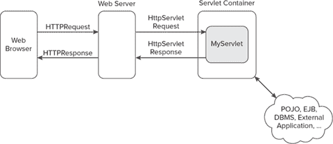

**图 26-1:** 示例客户端-servlet 数据流

在学习如何创建和部署 servlet 之前，先看看一个虚拟在线商店 `www.MyBooks.com` 的组件和工作流，该商店使用 Java servlets 开发和部署。

*   客户端机器只需要一个 Web 浏览器。书店由多个与用户交互的 HTML 页面组成。Web 浏览器以 `HttpRequest` 对象的格式向名为 `MyBooks.com` 的服务器发送用户请求。

*   托管 `MyBooks.com` 的计算机必须运行某些 Web 服务器软件，通常运行在 80 端口。对于使用 HTTPS（安全超文本传输协议）的安全性级通信，默认端口是 443。这两个端口在任何 Web 服务器上通常都是开启的，否则外部客户端甚至无法向部署在该服务器下的资源发送任何请求。

*   Web 服务器“监听”用户的请求。如果 Web 服务器接收到对静态 HTML 内容的简单请求（如文件或图像），Web 服务器将在无需参与额外软件的情况下处理该请求，并返回包含所请求静态内容的 `HttpResponse`。

*   网站 `MyBooks.com` 还运行着一个部署了 servlet 的 servlet 容器。如果 Web 服务器接收到根据某些搜索标准查找书籍的用户请求，它将创建并将 `HttpServletRequest` 传递给相应的 servlet（例如 `FindBooksServlet`），该 servlet 应部署并运行在 servlet 容器中。下一节将显示包含表单的示例 HTML，表单显式地列出了 `FindBooksServlet` 名称。

*   servlet 调用执行搜索的 Java 代码，并动态创建一个列出符合请求搜索标准的书籍的 HTML 页面，并将其封装在 `HttpServletResponse` 中发送给 Web 服务器。

*   Web 服务器从 `HttpServletResponse` 中提取内容，将其封装在 `HttpResponse` 对象中，并发送回用户的 Web 浏览器。

*   用户的浏览器显示接收到的页面，而无需它是静态 HTML 页面还是新鲜生成的。

用户的 Web 浏览器不需要知道使用了哪种服务端技术来准备动态内容。它可能是 Java、.NET、Python、PHP 等。浏览器只知道若要使用 HTTP 协议向服务器发送数据，必须将数据置于 `HttpRequest` 中。Web 浏览器还知道如何以 `HttpResponse` 的形式显示来自服务器的内容。服务器上发生的所有其他魔法操作对 Web 浏览器来说都不感兴趣。

## 瘦客户端

让我们从创建一个简单的 HTTP 页面开始，它可以作为 Java servlet 的客户端。列表 26-1 显示了一个简单的 HTML 文件，其中包含一个带有文本输入字段和提交按钮的表单，用户可以使用它来查找书籍。

在任何纯文本编辑器中，创建一个名为 `BookSearch.html` 的文件，其中包含列表 26-1 中的 HTML。在浏览器中打开此文件（文件 → 打开），在输入字段中输入任何文本并点击搜索。你会收到错误消息，因为 URL `www.MyBooks.com` 后面没有服务器，在该地址也没有名为 `FindBooksServlet` 的 servlet。

## 如何编写 Servlet

要创建一个 servlet，编写一个继承自 `HttpServlet` 的类，并用 `@WebServlet` 注解对其进行标记。`HttpServlet` 类继承自 `GenericServlet`，后者定义了 `service()` 方法。`service()` 方法接收响应并将其重定向到你的类中自自 `HttpServlet` 的方法。通常你需要重写 `doGet()` 和/或 `doPost()` 方法。重写哪一个？取决于客户端请求方法。如果客户端使用 `Post` 方法的 HTTP 请求，则重写 `doPost()`；如果客户端使用 `Get` 请求（参见列表 26-1），则重写回调 `doGet()`，如 your_first_servlet 所示。

所有支持 servlet 的类位于 `javax.servlet` 包中，并封装在 JAR 文件中，该文件的位置应列在 `CLASSPATH` 环境变量中。`javax.servlet` 包不包含在 Java SE 中——你需要安装 [Java EE 7 SDK](http://www.oracle.com/technetwork/java/javaee/downloads/index.html) 或阅读你所选择的 servlet 容器的文档以确定它们的位置。GlassFish 4 带有 Java EE 7 文件，因此不需要单独下载。

如果你正确部署了 `FindBooksServlet`，列表 26-1 获得的响应将是一个包含“Hello from FindBooks.”文本的 Web 页面。

## 如何部署 Servlet

`@WebServlet` 注解是你指定 servlet 部署参数的地方。在 Java EE 6 之前，你需要在 `web.xml` 文件中指定部署参数，但现在这是可选的。`FindBooksServlet` 使用了部署参数 `urlPatterns` 和 `name`。前者用于将部署在服务器上的 servlet 之一与 URL 匹配。值 `/books` 表示每当客户端发送的 URL 包含 `books` 模式的请求时，该请求必须重定向到 `FindBooksServlet`。例如，servlet 容器将请求 [`http://localhost:8080/books`](http://localhost:8080/books) 转发到 `FindBooksServlet`。

每个 Web 服务器和 servlet 容器都有一个名为文档根目录（document root）的目录。它不仅用于基于 servlet 的网站，还用于部署静态 HTML 文件。例如，如果你将 `TermsAndConditions.html` HTML 文件放在服务器 `MyBooks.com` 文档根目录的 `legal` 子目录下，用户需要将 Web 浏览器指向 `www.mybooks.com/legal/TermsAndConditions.html`。

你可以阅读你所选择的服务器文档来查找文档根目录的位置。在 GlassFish 应用服务器中，默认文档根目录是目录 `/glassfish/domains/domain1/docroot`。在 Apache Tomcat 中，它是 `webapps` 目录。如果你计划创建一个 servlet，它的部署目录也位于文档根目录中，但在 `WEB-INF` 和 `META-INF` 子目录下。


`WEB-INF` 具有 `classes` 和 `lib` 子目录，并可能包含可选文件 `web.xml`。它可能需要用于配置过滤器；否则，你可以使用 Java 注解指定所有部署参数。但如果你同时使用注解和 `web.xml`，则该文件中的值将覆盖注解中对应的值。这允许在不需要重新编译 servlet 的情况下更改部署参数。`WEB-INF` 目录可能包含某些特定于容器的文件。

`META-INF` 目录可能包含关于此 Web 程序的元数据文件，例如 `manifest.mf` 或特定于第三方框架或应用服务器的数据。例如，Apache Tomcat 使用一个名为 `context.xml` 的文件，你可以在其中指定 JDBC 驱动程序的信息。

这是部署在文档根目录中的应用程序目录结构示例：

```
document root dir
     WEB-INF
      classes
       com
         practicaljava
           lesson26
             FindBooksServlet.class
      lib
META-INF
    manifest.mf
```

`com.practicaljava.lesson26.FindBooksServlet` 类被编译到 `classes` 目录。如果你有一些第三方 JAR 文件，请将它们添加到 `lib` 目录。

当你的 Web 应用完成后，它很可能包含多个文件，通常整个目录结构被部署为一个扩展名为 `.war` 的压缩文件，代表 web archive（网络存档）。此类文件可以手动创建、通过你的集成开发环境（IDE）插件创建或通过 Ant、Maven 或 Gradle 等构建工具之一创建。在本节稍后的部分，你将看到如何使用用于 Java EE 开发者的 Eclipse 创建 war 文件。第 36 章将关于使用 Gradle 进行自动化构建，你将看到如何自动化创建 `.war` 文件。

## 在 Eclipse IDE 中配置 Glassfish

在 第 25 章的“尝试一下”部分中，你从命令行窗口启动并停止了 GlassFish 服务器。然而，当你不需要离开 IDE 时，开发和部署 Web 应用要方便得多。用于 Java EE 的 Eclipse 非常适合项目开发。它支持多种 Java EE 应用服务器。在本节中，你将配置 GlassFish 服务器，以便在 Eclipse 内部完成所有工作。

如果你的 GlassFish 实例仍在运行，请从命令行停止它。在 Eclipse 中，点击工具栏右上角的 Java EE 按钮切换到 Java EE 透视视图，如图 26-2 所示。


**图 26-2: 切换到 Java EE 透视图**

再次点击“下一步”。下一个窗口询问你想要自动生成哪些方法的存根（stubs）；保留默认的 `doGet()` 和 `doPost()`。最后，点击“完成”，Eclipse 就会生成列表 26-3 所示的代码（我只是删除了部分注释）。

我在“浏览器-Servlet 数据流”一节中解释了 servlet 的数据流。同时，让我们来看看 servlet `FindBooksServlet` 的运行。在 `doGet()` 方法中添加以下两行，以获取输出流并发送消息“Hello from FindBooks”：

```
PrintWriter out = response.getWriter();
out.println("Hello from FindBooks");
```

别忘记为 `PrintWriter` 添加导入语句。最后一步是在 GlassFish 服务器上部署 servlet。打开“服务器（Servers）”视图，右键点击服务器，并在弹出菜单中选择“添加和移除”。在左侧面板中选择项目 `Lesson26` 并将其添加到右侧。点击“完成”。

servlet 部署完成了。现在在 Eclipse 项目中右键点击类名 `FindBooksServlet`，选择运行在服务器上 → GlassFish，并点击完成。如果服务器没有运行，Eclipse 会先启动服务器，然后形成 URL 来访问 servlet `FindBooks`。Eclipse 运行其内置浏览器并显示图 26-10 所示的消息。

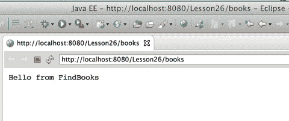

**图 26-10: 在 Eclipse 内部浏览器中运行 servlet**

你可以将此 URL 复制到计算机上的任何其他浏览器中；响应将相同的。从 Eclipse 内部启动服务器并没有改变它监听 8080 端口的事实，任何客户端都可以通过此端口请求并部署 servlet。

请注意 URL 以 `/books` 结尾而不是 `FindBooksServlet`。再次查看图 26-8。你更改了 URL 映射，指示 servlet 容器将所有包含 `/books` 的 HTTP 请求路由到 servlet `FindBooksServlet`。Eclipse 已经在 servlet 类中生成了正确的注解，它可能类似于下面这个：

```
@WebServlet(urlPatterns = {"/books"}) 
public class FindBooksServlet extends HttpServlet
```

Servlets 属于表示层，因此让我们稍微更改网页的呈现方式。将 `doGet()` 方法的代码替换为以下三行，将在黄色背景和页眉 `<H2>` 样式下显示输出：

```
PrintWriter out = response.getWriter();
out.println("<html><body bgcolor=yellow>");
out.println("<h2>Hello from FindBooks</h2>");
```

浏览器渲染此 HTML 页面，如图 26-11 所示。


**图 26-11: 从 servlet 更改网页的呈现方式**

尽管，在 servlet 中嵌入 HTML 标记有一些缺点。每当呈现方式发生变化时，你就需要重新编译 Java 代码。在 Java 中嵌入 HTML 还有其他缺点，将在下一节的开头进行介绍。

### 将 Web 应用部署为 WAR

现实世界的 Web 应用程序可能由多个文件组成，如果将所有文件放在一个归档文件中，并将该文件放置在 servlet 容器的文档根目录下进行部署，将会更简单。通常，你会创建构建脚本来编译所有需要的文件，将它们归档为 WAR 文件，并将此文件复制到部署目录。你将在第 36 章熟悉名为 `Gradle` 的构建工具。

但如果你想通过 Eclipse 快速创建 WAR 文件，只需右键点击项目名称并选择菜单 导出（Export）→ Web → WAR 文件。

在几秒钟内，你就得到了 `Lesson26.war`，这是一个你可以部署在任何符合 Java EE 标准容器中的文件。资深软件开发人员不会喜欢这种构建 WAR 的方式；他们会认为预先创建构建脚本是正确的做法。不过，由于你只是迈了服务器端开发的第一步，使用 IDE 提供的便利功能是合理的。

### 浏览器-Servlet 数据流

一个 servlet 可以为多个用户服务，所以让我们复习客户端-servlet 通信的整个过程。普通的 Java Servlet 运行在容器中，容器会自动为每个客户端请求创建一个新线程，而不需要你进行任何线程编程。这听起来很棒，如果用户数量有限的话可以良好运行。在后面关于异步 servlet 的章节中，你将看到一种更可扩展的线程复用方法，但现在你可以关注传统的单线程模型——每个用户一个线程。

网页可能包含 HTML 表单、链接或 JavaScript 代码，这些代码可以向 Web 服务器发送 HTTP 请求（例如，`Get` 或 `Post`）。当第一个用户的请求命中 `FindBooksServlet` 时，容器会检查此 servlet 是否正在运行。如果不是，容器将加载并实例化它并调用 `init()`。即使你没有重写该方法，它也存在于基类中。

然后容器调用 servlet 基类的 `service()` 方法，将请求重定向到 `doGet()`、`doPost()` 或类似的 `doXXX()`，传入 `HttpServletRequest` 和 `HttpServletResponse` 参数。代码可以通过对 servlet 提供的 `HttpServletRequest` 对象的 `getParameter()` 方法获取来自网页的数据。在获取参数后，在业务层（或作为 EJB）处理它。通过获取 `PrintWriter` 对象的引用将结果返回给客户端；对于非文本结果，使用 `OutputStream` 而不是 `PrintWriter`。别忘记通过调用 `setContentType()` 设置内容类型（MIME 类型）。例如，如果你发送包含 PDF 的对象并希望浏览器打开 Acrobat Reader，调用函数 `response.setContentType("application/pdf");`。

容器控制 servlet 加载何时调用 `init()`、`service()` 和 `destroy()` 方法。当服务器管理员决定卸载 servlet、服务器关闭或服务器需要释放内存时，会调用 `destroy()` 方法。

如果 HTTP 客户端向 servlet 发送了某些数据，可以通过 `getParameter()` 获取它们。以下代码获取用户在名为 `booktitle` 的字段中输入的书名，并响应 65 元的价格：

```
public void doGet(HttpServletRequest req, HttpServletResponse res)
                    throws ServletException, IOException {
 String title = req.getParameter("booktitle");
 PrintWriter out = res.getWriter();
 res.setContentType("text/html");
 out.println("<html><body>");
 out.println("<h2>the book "+title+" costs only $65</h2>");
 out.println("</body></html>");
}
```

### HTTP Get 和 Post 请求

HTTP 规范定义了在 Web 上进行数据交换的多种方法，但在使用 servlet 时，`Get` 和 `Post` 方法是最广泛使用的方法。（在第 33 节中你看到了其他 HTTP 方法的使用。）如果你没有指定方法，默认使用 `Get`。因为我在列表 26-1 的 `<form>` 标签中使用了 `method=Get`，servlet 容器会调用 `FindBooksServlet` 的 `doGet()` 方法。对于 `Get`，Web 浏览器会将表单中输入的值附加到 URL 最后的问号后面。例如，如果用户在书名处输入单词 `Apollo`，URL 看起来像这样：

```
http://www.mybooks.com?booktitle=Apollo
```

如果表单（或脚本）提交了多个值，URL 将在问号后面包含几个由 `&` 符号分隔的键/值对：

```
http://www.mybooks.com?booktitle=Apollo&author=Smith
```

使用 `Get` 方法可以很容易地复制、粘贴或书签带有参数的 URL。另一方面，使用 `Get` 时数据是不受保护的；你可以以明文形式看到它。

`Post` 方法通常用于向服务器发送数据。它也可能用于向服务器发送二进制数据（例如，上传图像）。当然，登录表单不应该使用 `Get`，因为你不希望用户的 ID 和密码显示在 URL 中。为了处理 `Post` 请求，servlet 必须重写 `doPost()` 方法。通常使用 `Get` 进行数据检索，并使用 `Post` 向服务器发送数据。

## 会话跟踪 (Session Tracking)

HTTP 是一个**无状态**（`stateless`）协议。如果用户从 `FindBooksServlet`（或其他任何服务器端程序）获取了一个包含书籍列表的网页，然后又访问另一个网页，那么第二个页面并不知道第一个页面显示了或选择了什么。为了将数据持久化到多个网页，必须实现**会话跟踪**（`session tracking`）。

会话是一个逻辑任务，用户试图通过访问网站来完成。例如，购买书籍的过程可能涉及多个步骤：选择书籍、输入账单和运输信息等。这些步骤组合在一起就是一个会话的示例。当提交订单时，会话结束。

会话信息可以存储在客户端，也可以存储在服务器端。在客户端，用户的会话数据可以使用 `cookies`（在下一节介绍）或 URL 重写来存储——这些信息作为 URL 的一部分在客户端和服务器之间传输。

服务器端存储会话数据的替代方案是会话跟踪应用程序接口（API），它在 `HttpSession` 接口中提供了许多方法。在这种情况下，会话数据仅存储在服务器上，但客户端只获得一个会话 ID 来标识同一用户的一系列 HTTP 请求。要在服务器上创建会话，请调用 `HttpServletRequest` 对象上的 `getSession(true)` 方法，这意味着“获取现有会话的引用，或创建一个新会话”。不带参数调用此方法将为您返回现有会话的引用或 `null`。接下来的章节将提供更多关于会话跟踪的细节。

### Cookies

Cookie 是 servlet 可以发送到 Web 客户端的一小段数据，作为文件存储在用户的计算机上。从该客户端发出的每个后续请求中，浏览器都会检查本地未过期的 cookies（特定域名的），并将它们发送到服务器，从而将请求与给定的会话唯一关联。Cookies 是持久的，但用户可以通过在其 Web 浏览器中选择相应的设置来禁用它们。以下是 servlet 如何向客户端发送与业务相关的 `Cookie`：

```
Cookie myCookie = new Cookie("bookName",
                               "Java Programming 24-hour trainer");
// 设置 cookie 的生存时间为 24 小小时
myCookie.setMaxAge(60*60*24);
response.addCookie(myCookie);
```

这是 servlet 如何获取随 `HttpServletRequest` 到达的客户端 cookies 的：

```
Cookie[] cookies = request.getCookies();
```

```
if (cookies != null){
 // 获取每个 cookie（一个键/值对）
 for (i=0; i < cookies.length; i++){
   Cookie currentCookie = cookie[i];
   String name = currentCookie.getName();
   String value = currentCookie.getValue();
 }
}
```

尽管你可以在客户端存储多个 cookies（如前面的代码所示），但通过网络往返传输应用程序数据并不是一个好主意。通常会话数据存储在章节 服务器端 HttpSession 中的 `HttpSession` 对象中。

### URL 重写 (URL Rewriting)

如果客户端禁用了 cookies，可以使用 URL 重写来跟踪用户的会话。在这种情况下，会话 ID 和其他所需的会话数据附加到 URL 字符串中，并在每次客户端/服务器通信中往返传输。如果你在任何网站的 URL 字符串中注意到类似 `jsessionid=12345` 的内容，意味着使用了 URL 重写。

### 服务器端 HttpSession

你应该将属于用户会话的数据（例如购物车）保存在 servlet 容器的 `HttpSession` 对象中，容器会为每个客户端创建一个这样的对象。servlet 可以在那里存储任何 `Serializable` 对象。下行代码创建了一个会话对象（或找到一个之前创建的会话）：

```
HttpSession mySession = request.getSession(true);
```

`getSession(true)` 调用意味着“查找此客户端的会话对象，如果未找到则创建一个新的”。例如，购物过程通常由多个随后的 servlet 调用组成（列出库存、向购物车添加物品、输入运输信息等）。在开启符合会话开启业务流程的第一个 servlet 请求中，应该使用 `getSession(true)` 方法调用。在此时，应用服务器生成一个唯一的会话 ID，并使用特殊的 cookie `JSESSIONID` 或 URL 重写发送给用户浏览器。`getSession(false)` 调用意味着“查找会话”。如果返回 `null`，则会话已过期或销毁。


我将通过展示一个包含 HTML 页面和 servlet 的示例来说明 `HttpSession` 的概念。初始文件 `ShoppingCart.html` 位于项目的根目录——`WebContent`。以下是 `ShoppingCart.html` 的内容：

```html
<html>
<head>
<title>将添加到购物车</title>
</head>
<body>
  将书籍标题和价格添加到购物车：
  <form action="shoppingcart" method="Get">
    <input type="Text" name="booktitle">
    <input type="Text" name="price">
    <input type="Submit" value="添加到购物车">
  </form>
</body>
</html>
```

由于此文件部署在与 servlet 相同的 Web 应用（即 Lesson26）中，表单的 action 参数不包含 servlet 的完整 URL；只需要模式——`shoppingcart`即可，假设 servlet 被注释为 `@WebServlet("/shoppingcart")`。在 Eclipse 中，右键点击 `ShoppingCart.html` 文件并选择在服务器上运行。将构造如下 URL（参见图 26-12):

```
http://localhost:8080/Lesson26/ShoppingCart.html
```

先不要输入书籍标题和价格；servlet 还没有准备好。在向你展示 servlet 代码之前，让我们先约定每个购物车项目将作为下面类 `Book` 的一个实例来表示：

```java
class Book implements Serializable {
  String title;
  double price;
}
```

注意 `Book` 类实现了 `Serializable` 接口是因为你计划将其存储在 `HttpSession` 对象中。

接下来是 `ShoppingCartServlet` 类，它具有 URL 映射 `/shoppingcart`； 浏览器的请求会尝试寻找名为 `shoppingcart` 的服务器端对象。`doGet()` 方法首先在系统控制台上打印浏览器的 cookie 信息。我只是想让你看到，从同一个浏览器发出的每次请求，cookie `JSESSIONID` 的值都保持不变。之后，代码将与 session 对象交互；程序注释为你提供了进一步的解释：

```java
@WebServlet("/shoppingcart")
public class ShoppingCartServlet extends HttpServlet {
   protected void doGet(HttpServletRequest request, 
                      HttpServletResponse response) 
                   throws ServletException, IOException {
       Cookie[] cookies = request.getCookies();

       for (int i=0; i < cookies.length; i++){
              Cookie currentCookie = cookies[i];
              String name = currentCookie.getName();
              String value = currentCookie.getValue();

              System.out.println("Received the cookie " 
                                          + name + "=" + value);
             }

       // Get or create a session object
       HttpSession session = request.getSession(true);

       // Try to get the shopping cart
       ArrayList<Book> myShoppingCart=(ArrayList<Book>) 
                        session.getAttribute("shoppingCart");
       if (myShoppingCart == null){ 
            // This is the first call – instantiate the shopping cart
            myShoppingCart = new ArrayList<>();
       }
       // create an instance of a book object for received params
       Book selectedBook = new Book();
       selectedBook.title=request.getParameter("booktitle");
       selectedBook.price = Double.parseDouble(
                                   request.getParameter("price"));
       // Add the book to our shopping cart
       myShoppingCart.add(selectedBook);
       // Put the shopping cart back into the session object
       session.setAttribute("shoppingCart", myShoppingCart);

       // Prepare the Web page and send it to the browser
       PrintWriter out = response.getWriter();
       // Add the content of the shopping cart to the Web page
       out.println("<body>Your shopping cart content:");
       myShoppingCart.forEach(book -> 
              out.printf("<br>Title: %s, price: %.2f", 
                         book.title, book.price)   
           );

       //Add the HTML form to the Web page 
       out.println("<p>Add another book to the shopping cart:");
        out.println("<form action=shoppingcart method=Get>");
        out.println("<input type=Text name=booktitle>");
        out.println("<input type=Text name=price>");
        out.println(
               "<input type=Submit value='Add to shopping cart'>");
        out.println("</form>");
        out.println("</body>");
    }
}
```

## 过滤器

这些操作都不依赖于 servlet 实现的业务逻辑。此外，你可以创建过滤器并应用于 servlet。过滤器类部署在 `WEB-INF/classes` 中——这是其他编译类所在的地方。

容器为过滤器提供请求和响应对象。你可以检查客户端传递的参数（例如检查 ID/密码），进行身份验证，如果用户无效，可以调用 `response.getWriter()` 向用户发送“You don’t belong here”（你不属于）的消息，而无需将控制权交给 servlet。

`destroy()` 方法在容器移除过滤器之前会被调用一次；如果过滤器创建了某些资源，例如数据库管理系统（DBMS）连接，请在 `destroy()` 方法中关闭它们。

要创建一个过滤器，请编写一个实现 `Filter` 接口并带有 `@WebFilter` 注解的类。该接口中有三个方法：`doFilter()`、`init()` 和 `destroy()`。为了允许过滤器链，你需要实现 `FilterChain` 接口。以下代码是一个过滤器类示例，可用于两个 servlet：`FindBooksServlet` 和 `ShoppingCartServlet`：

```java
@WebFilter(servletNames={"/FindBooksServlet",
/ShoppingCartServlet"})
public class MyAuthenticationFilter implements Filter {
     FilterConfig config;
      @Override
      public void doFilter(ServletRequest request, 
                 ServletResponse response, FilterChain chain)
                           throws IOException, ServletException {
      // user authentication code goes here
      //Call the next filter, if need be
      chain.doFilter(request, response);
     }
     @Override
     public void init(FilterConfig filterConfig) 
                           throws ServletException {
       this.config = filterConfig;
     }
     @Override
     public void destroy() {
       // Clean up system resources here
     }
}
```

即使在 servlet 部署后，也可以更改其处理请求和响应的方式而无需修改 servlet 代码。过滤器适用于添加功能，如身份验证、日志、加密、数据压缩、图像转换等。

如果需要在将数据发送到客户端之前对其进行压缩和加密怎么办？编写两个独立的过滤器并将它们链起来，以便它们都应用于同一个 servlet。你可以通过调用 `setMaxInactiveInterval()` 设置 `HttpSession` 对象的超时时间。如果 session 没有显式失效，应用程序服务器会使其失效。

`init()` 方法仅在过滤器对象实例化期间被调用一次。servlet 容器为 `init()` 方法提供 `FilterConfig` 对象的实例，通过它可以访问 servlet 上下文和初始化参数，如果这些参数在 `@WebFilter` 注解（或 `web.xml` 文件）中已指定；例如：

```java
@WebFilter(servletNames={"/FindBooksServlet", 
                        "/ShoppingCartServlet"},
           initParams={@WebInitParam(name="community", 
                                      value="adults")})
```

要将多个过滤器分配给同一个 servlet，请在 `web.xml` 文件中按照你希望的链顺序对它们进行配置。这样当你调用 `chain.doFilter()` 时，容器就知道下一个要调用哪个过滤器。

## 异步 Servlet

Servlet 自动为每个用户的请求创建并分配单独的线程这很棒，但每个线程都会占用系统资源（包括内存字节和 `CPU` 周期），在并发请求达到一定数量后，服务器将直接停止响应。想象一下，如果有成千上万的用户同时访问 `FindBooksServlet`，它必须为每个请求执行耗时三秒的 DBMS 搜索。在这三秒内，容器处于空闲状态，但它持有着每个线程的锁，什么都不做，只是等待 DBMS 查询的结果（该查询在另一台服务器上运行！）。

很难说特定的 servlet 容器可以及时处理多少个并发阻塞线程；这完全取决于业务应用程序和服务器硬件/软件。考虑使用 [JMeter](http://jmeter.apache.org/) 或类似的软件对你的应用程序运行负载测试，以获取你的硬件/软件组合的真实数据。我见过一种情况，服务器在数千个并发请求中的某一个之后就开始故障。

异步 Servlet 的思想是通过重用 servlet 容器中的线程来减少线程锁定时间。如果用户 A 发出的在 DBMS 服务器上需要三秒的请求，他的 servlet 容器线程将被分配给用户 B 的请求，当用户 A 的结果从 DBMS 返回时，容器将分配此（或其他）线程将结果返回给用户 A。这种架构可以大幅增加同一服务器上可以处理的并发请求数。

Java EE 7 包含了 Servlet 3.1，它支持异步处理。在 `doGet()` 或 `doPost()` 中，你可以实例化 `AsyncContext` 对象，它会创建一个异步工作线程，并在保留客户端请求和响应对象的同时不锁定客户端的线程。例如，下面的 servlet 模拟了一个三秒的阻塞过程，该过程在单独的线程中运行：

```java
@WebServlet(urlPatterns = {"/booksasync"}, asyncSupported=true)
public class FindBooksAsyncServlet extends HttpServlet {
   protected void doGet(HttpServletRequest request, 
                        HttpServletResponse response) 
               throws ServletException, IOException{
   // doGet 结束时不发送响应
   AsyncContext aContext = request.startAsync();   
    // 为 start 方法提供 Runnable 实现
    aContext.start(() ->{

         // 此处进行阻塞操作
         try{
             String title = aContext.getRequest()
                                  .getParameter("booktitle");
             PrintWriter out;
             try {
                // 模拟一个 3 秒的过程
                 Thread.currentThread().sleep(3000); 
                 HttpServletResponse resp = 
                    (HttpServletResponse) aContext.getResponse();
                 out = resp.getWriter();
                 out.println("Hello from Async FindBooks");
             } catch (IOException e) {
                 e.printStackTrace();
             }
       }catch( InterruptedException e){
             e.printStackTrace();
       }finally{
             aContext.complete(); // 关闭响应对象      
       }
    });
}
```

## 尝试一下

### 要求

你应该安装了 Java。

### 步骤详解

1. 在 Eclipse 项目 Lesson26 中创建一个包含一个输入字段的 HTML 客户端。将其命名为 `tryit.html`。

2. 创建一个名为 `StockServer` 的 servlet，接收一个参数：股票代码。

3. 将从客户端接收到的股票代码传递给 `StockGenerator`。

4. 将动态生成的 HTML 页面返回给客户端。

5. 在 Eclipse IDE 中测试 servlet：右键点击 HTML 文件并选择 Run on Server。输入股票代码并获取价格。

6. 从 Eclipse 中卸载 26 项目，因为你将需要直接在 GlassFish 中部署此应用程序。在 Eclipse 中停止 GlassFish。

7. 将 Lesson26 项目导出为 `Lesson26.war` 文件。通过将其复制到 GlassFish 服务器的 `glassfish/domains/domain1/autodeploy` 目录在 GlassFish 中部署此 Web 应用程序。

8. 按照第 25 章描述的方法，从命令行启动 GlassFish 服务器。


9. 在浏览器中打开以下 URL：`http://localhost:8080/Lesson26/tryit.html`。你应该能看到与第 5 步相同的 Web 页面。通过输入各种股票代码测试此 Web 应用程序。你应该获取价格报价。

# 第 27 节

## JavaServer Pages

JavaServer Pages (JSP) 技术是作为 servlet 演进的下一步创建的。JSP 2.3 是 Java EE 7 规范的一部分，通过 JSP 你可以完成 servlet 能做的所有事情，但更加容易。在早期的 Java EE 规范中，JSP 是唯一的标准 Web 框架。但从 Java EE 4 开始引入了另一个 Web 框架：JavaServlet Faces (JSF)。虽然 JSF 的功能比 JSP 多，但我仍然看到更多使用 JSP 的企业应用，因此本版涵盖了 JSP 而不是 JSF。现在让我们看看为什么使用 servlet 对于开发所有 Java EE Web 应用程序的层是不够的。

假设你创建并部署了一个显示“Hello World”的 servlet。该 servlet 获取了响应对象的输出流并执行以下代码行：

```
out.println("<html><body>Hello World </body></html>");
```

现在想象一下你经营着一家软件公司，雇佣了 Alex（一位价格昂贵的 Java 开发人员）和 Matilda（一位初级 Web 设计师，她不会 Java 但懂 HTML）。如果你需要更改此 HTML 页面的布局，例如在顶部添加几行空行，该怎么办？这并不是什么大问题——Alex 可以修改前面的代码，重新编译并重新部署 servlet。但对于对基于 HTML 的用户界面（UI）进行细微更改，使用 Matilda 会更具成本效益。这正是 JSP 变得非常得手的地方。让 Matilda 创建以下文本文件 `HelloWorld.jsp`：

```
<html>
<body>
  Hello World
</body>
</html>
```

将此文件放置在你运行的 servlet 容器的文档根目录中（参见第 26 章），该容器运行在例如 `MyBooks.com` 上。现在，用户可以通过在浏览器中输入以下 URL 来访问此 JSP：

```
http://www.MyBooks.com/HelloWorld.jsp
```

当第一次请求此页面时，JSP 容器（所有的 servlet 容器也支持 JSP）会根据 `HelloWorld.jsp` 文件的内容自动生成、编译并部署一个 servlet。后续对此 JSP 的所有调用处理速度将快得多，因为 servlet `HelloWorld` 已经部署、加载到内存中并在运行。事实上，JSP 以及 servlet 都可以预加载，这样即使是第一个用户的请求也能得到快速响应。你可能认为可以通过创建 `HelloWorld.html` 来创建一个简单的网页，而无需所有这些额外的代码生成。只要你的页面是静态的且不使用任何动态更改的外部数据，这就是成立的。记住，HTML 不是一种编程语言，而是一种标记语言——它甚至无法计算 2 加于 2，但 JSP 可以（参见代码列表 27-1 中的 `MyCalculator.jsp`）。

## 在 HTML 中嵌入 Java 代码

JSP 定义了标签，允许你将 Java 代码嵌入到 HTML 页面中。当 servlet 在后台自动生成时，这些 Java 代码也将作为该 servlet 的一部分被包含并执行。JSP 标签包含在尖角括号中：例如，`<%=...%%>` 标签显示变量或表达式的值：`<%=2+2%>`。在 JSP 引擎执行的 servlet 生成过程中，这些标签会被替换为常规的 Java 代码。例如，标签 `<%=2+2%>` 会被 JSP 容器自动替换为以下 Java 语句：

```
out.println(2+2);
```

代码列表 27-1 显示了名为 `MyCalculator.jsp` 的二加二计算器的内容。`<br>` 是用于插入换行的 HTML 标签。请注意，程序员 Alex 只需要编写 JSP 标签内部的表达式；其余部分由 Matilda 完成。将此任务分离视为设计师-开发者工作流的一个示例。

部署任何 JSP 都只是将 JSP 文件复制到你的 JSP 容器的文档根目录下的简单操作。当然，如果你的 JSPs 是多文件项目的一部分，你很可能会将它们部署在一个 war 文件中，正如第 26 章所描述的。

正如第 26 节所描述的，在 Eclipse 中创建一个 Dynamic Web Project 并将其命名为 `Lesson27`。右键点击 `WebContent` 目录（文档根），并选择菜单 `File` → `New` → `Other` → `Web` → `JSP file` 创建名为 `index.jsp` 的新 JSP 文件。

在创建项目时，确保选择 GlassFish 服务器作为目标运行时间（Target run time）。Eclipse 生成的文件包含以下内容：

```
<%@ page language="java" contentType="text/html; charset=UTF-8"
    pageEncoding="UTF-8"%>
<!DOCTYPE html PUBLIC "-//W3C//DTD HTML 4.01 Transitional//EN" 
                          "http://www.w3.org/TR/html4/loose.dtd">
<html>
<head>
<meta http-equiv="Content-Type" content="text/html; charset=UTF-8">
<title>Insert title here</title>
</head>
<body>
</body>
</html>
```

在该文件的 `<body>` 部分添加以下行：

```
<h1><h1> World</h1></h1>
```

`<h1>` 标签将文本格式化为标题，Eclipse 会向你展示未来的网页将如何渲染（参见图 27-1 的顶部部分）。

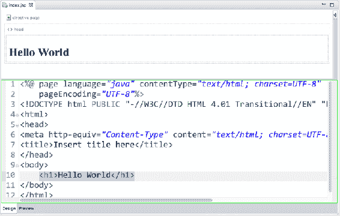

**图 27-1:** 在添加标签时查看页面

右键点击 `index.jsp` 名称并选择 `Run on Server`。如果 GlassFish 服务器未运行，Eclipse 将启动它并部署 `Lesson27` 项目，你会在 Eclipse 内部 Web 浏览器中看到 Hello World 网页，如图 27-2 所示。


**图 27-2:** 在添加标签时查看页面

右键点击 `index.jsp` 名称并选择 `Run on Server`。如果 GlassFish 服务器未运行，Eclipse 将启动它并部署 `Lesson27` 项目，你会在 Eclipse 内部 Web 浏览器中看到 Hello World 网页

## 隐式 JSP 对象

由于 JSP 是构建在 servlet 之上的，核心概念保持不变。以下是可以在 JSP 中使用的预定义变量列表。这些变量由 JSP 容器初始化，无需显式声明即可使用。

*   `request` 的用法与 `HttpServletRequest` 相同。
*   `response` 的用法与 `HttpServletResponse` 相同。
*   `out` 代表输出写入流 `JspWriter`。该变量指向与 servlet 中 `HttpServletResponse.getWriter()` 相同的。例如，返回 `CurrencyConverter` 类结果的最简单 JSP 可能如下：

```
<html>
  <body>
     <% out.println(CurrencyConverter.getDollarRate()); %>
  </body>
</html>
```

*   `session` 代表用户 `HTTPSession` 对象的实例。
*   `exception` 代表 `Throwable` 对象的实例并包含错误信息。该变量仅从 JSP 错误页面可用（后文将在错误页面节描述）。
*   `page` 代表 JSP servlet 的实例。
*   `pageContext` 代表 JSP 上下文并用于标签库。
*   `application` 提供对 Web 上下文的。其用法与 `ServletContext`。
*   `config` 提供 JSP 容器使用的初始化信息。其用法与 `ServletConfig` 类类似。

每个 JSP 标签都以角括号开头和结束，可以包含在任何 HTML 文件中，但你需要将 JSP 保存为 `.jsp` 文件，以便 JSP 容器对其进行正确的识别和处理。本节将介绍 JSP 标签的简要概述。有关更多详细内容，请参考 JSP 文档：`http://docs.oracle.com/javaee/5/tutorial/doc/bnagx.html`。

## 指令 (Directives)

指令不产生屏幕输出，但会指示 JSP 容器应用于 JSP 的规则。某些 JSP 指令包括 `page`、`include`、`attribute` 和 `taglib`。

页面指令以 `<@ page` 开头，且仅在当前页面内有效。指令用于 `import`、`extends`、`session`、`errorPage`、`contentType` 等属性。例如，要导入 `java.io` 包，请使用此指令：

```
<%@ page import="java.io.*" %>
```

包含指令允许在页面编译为 servlet 时，从文件包含任何文本或从另一个 JSP 包含任何代码，如下例：

```
<%@ jsp:include page="calcBankRates.jsp" %>
<%@ include file="bankRates.txt" %>
```

使用自定义标签的第三方库，你需要指定该库的位置，如下例：

```
<%@ taglib uri="my_taglib.tld" prefix="test" %>
```

`attribute` 指令允许你定义自定义标签的属性，如下：

```
<%@ attribute name="corporate_logo_file_name" %>
```

## 声明 (Declarations)

声明用于在使用变量之前对其进行声明。你可以像这样声明变量 `salary`：

```
<%! double salary; %>
```

变量 `salary` 仅在该页面内部可见。你也可以以相同的方式在 JSP 页面中声明 Java 方法：

```
<%! private void myMethod(){
        ...
 }%>
```

声明块中的代码将转换为生成的 servlet 中的 Java 代码。

## 表达式 (Expressions)

表达式以 `<%=` 开头，可以包含任何会被求值的 Java 表达式。结果将显示在 HTML 页面中，并替换标签本身，如下：

```
<%= salary*1.2 %>
```

## 脚本段 (Scriptlets)

最初创建脚本段是为了给 JSP 开发者提供一个放置任何有效 Java 代码的地方，以便包含在生成的 servlet 的 `_jspService()` 方法中，这等同于 servlet 的 `service()` 方法；例如，脚本段可能像这样：

```
<% lastName = "Smith"; %>
```

随着 JSP 标准标签库 (JSTL) 和表达式语言 (EL) 的创建，现在不再需要使用脚本段，但这种语法仍然有效。

尽管指令、声明、表达式和脚本段可以在 JSP 内部 Java 代码中混合，但这不是好主意。JSP 的创建是为了避免将 HTML 嵌入 Java 代码中，你也应该避免将 Java 嵌入 HTML 中。你可以在标签库章节查看如何避免将 Java 嵌入 HTML。Stack Overflow 上的[此线程](http://stackoverflow.com/questions/9416049/removing-java-code-from-jsp-pages)对如何从 JSP 中移除 Java 代码提供了几个很好的建议。

## 注释 (Comments)

以 `<%--` 开头并以 `--%>` 结束的注释在 JSP 源文件中可见，但不会包含在生成的 HTML 页面中：

```
<%-- Some comments --%>
```

如果你想在生成的网页中保留注释，请使用普通的 HTML 注释符号：

```
<!-- Some comments -->
```

## 标准动作 (Standard Actions)

虽然 `include` 指令在编译时添加被包含页的内容，但 `jsp:include` 元素在运行时执行此操作：

```
<jsp:include page "header.jsp" />
```

`forward` 元素允许程序流从当前 JSP 重定向到另一个 JSP，同时保留 `request` 和 `response` 对象。重定向的另一种方法是在 Java 代码中使用 `response.sendRedirect(someURL)`，但在这种情况下会创建新的 `request` 和 `response` 对象，这将强制浏览器向服务器发送新请求：

```
<jsp:forward page = "someOther.jsp" />
```

`plugin` 元素确保你的 JSP 包含一个 applet 或 Java bean（后文在“Java Beans”章节中描述）。在运行时，浏览器会将此标签替换为 HTML 标签 `<object>` 或 `<embed>` 之一，以便将所需的 Java 类嵌入到网页中：

```
<jsp:plugin type=applet code="PriceQuotes.class" >
```

嵌套标签 `<jsp:param>` 用于向 applet 或 bean 传递参数：

```
<jsp:plugin type=applet code="Login.class">
  <jsp:params>
    <jsp:param name="userID" value="SCOTT" />
    <jsp:param name="password" value="TIGER" />
  </jsp:params>
</jsp:plugin>
```

虽然可以创建嵌入 Java 插件的网页，但这种做法并不推荐。如今人们使用各种网络浏览器和设备，用户在其设备上安装正确版本 JRE 的概率微乎其微。

## 错误页面 (Error Pages)

假设你有一个名为 `calcTax.jsp` 的 JSP，包含可能抛出异常的代码。与其用栈跟踪输出恐吓用户，不如准备一个友好的 `taxErrors.jsp` 用普通语言解释问题。

`calcTax.jsp` 可能包含一个 HTML `<form>` 标签，用户在其中输入总收入和家属人数。计算税务的请求被发送到服务器的 CalcTax 类，该类在处理过程中可能会抛出异常。在 `calcTax.jsp` 中包含异常时必须显示的错误页面名称：

```
<html>
   这里是计算税务和其他 HTML 内容
         ...
      <%@ page errorPage=taxErrors.jsp %>
</html>
```

接下来是错误页面 `taxErrors.jsp`，它演示了如何使用 JSP 变量 `exception` 以用户友的方式显示错误，并为技术支持团队提供更多技术描述：

```
<html>
<body>
  遗憾，我们在计算税务时遇到了问题。
  我们正在处理此问题 - 请在 10 分钟后重试。
  如果问题仍然，请联系我们获奖的技术支持团队 (212) 555-2222，并向他们提供以下信息：
<br>
<%=exception.toString()}>
</body>
</html>
```

## Java Beans

JavaBeans 规范将 bean 定义为实现 `Serializable` 接口并具有公共无参构造函数、私有字段以及公共 setter 和 getter 方法的 Java 类。数据传输对象 (DTO) 的类似概念在列表 21-2 中引入。Java bean 主要用于数据存储和交换。在 JSP 中，它们有助于避免混合 Java 和 HTML（参见后文的“标签库”章节）。

考虑在基于 JSP 的应用程序中实现的 MVC 模式。JSP 属于视图层；servlet 可以充当控制器；而 Java bean 可以表示模型。不要在 JSP 中编写业务逻辑，将演示与业务逻辑处理和数据存储分离。首先，这使得 Alex 和 Matilda 之间更容易分工；其次，你能够拥有多个演示解决方案（例如，针对移动设备的不同 UI），同时复用相同的 Java 代码。

使用 Java beans 是分离处理逻辑与表现层的第一步。Listing 27-2 显示了一个名为 `Student` 的 bean 示例。

不要将 JavaBeans 与 Enterprise Java Beans (EJB) 混淆，后者是一个不同的概念，在第 31 章中有所介绍。

### 在 JSP 中使用 JavaBeans

要在 JSP 中使用 bean，首先需要指定它的名称和位置，之后你就可以设置或获取它的属性。以下是 bean 的的一些示例：


```jsp
<jsp:useBean id="Student" class="com.harvard.Student" />
<jsp:getProperty name="Student" property="LastName" />
<jsp:setProperty name="Student" property="LastName" value="Smith"/>
```

接下来的代码段填充了 `Student` bean 的属性 `LastName` 和 `FirstName`。该代码段可以位于 HTML 文档的 `<form>` 标签中，该标签包含两个名为 `LName` 和 `FName` 的 HTML 文本输入字段：

```jsp
<jsp:setProperty name="Student" property="LastName" 
                 value="<%= request.getParameter("LName") %>" />
<jsp:setProperty name="Student" property="FirstName" 
                 value="<%=request.getParameter("FName") %>" />
```

如果所有 bean 属性名称与 HTML 表单字段名称相同，则使用星号符号映射 HTML 表单字段和 bean 字段将变得更加简单：

```jsp
<jsp:setProperty name="Student" property="*" />
```

### Bean 的生存周期多久？

如果 JSP 变量在脚本段（scriptlet）内部声明，它具有局部作用域。要赋予它实例作用域，请使用 `tag` 声明变量。你可以使用 `jsp:useBean` 标签的 `scope` 属性定义 bean 的作用域。列表定义了不同的作用域：

* `page`: bean 仅在当前页面可用，并在用户离开页面时立即销毁。这是默认作用域。例如：

```jsp
<jsp:useBean id="Student" class="com.harvard.Student" 
             scope="page" />
```

* `request`: 只要 `request` 对象存活，bean 就会一直存在。即使通过 `jsp:forward` 标签将控制权重定向到不同的 JSP，该 bean 在新页面上仍然可用，因为它使用了相同的 `request` 对象，如下：

```jsp
<jsp:useBean id="Student" class="com.harvard.Student" 
             scope="request" />
```

* `session`: bean 在所有页面都可用，直到用户的会话（session）结束（参见第 26 章中的“会话跟踪（Session Tracking）”章节）。

```jsp
<jsp:useBean id="Student" class="com.harvard.Student" 
             scope="session" />
```

* `application`: bean 对所有用户和所有页面都——这是一个全局 bean。

```jsp
<jsp:useBean id="Student" class="com.harward.Student" 
             scope="application" />
```

## 从 Servlet 加载 JSP

为了表现层与处理层的分离，JSP 应该尽量减少处理。当 servlet 接收到要发送给用户的数据时，它应该向客户端发送硬编码的 HTML 标签，而是加载并向客户端发送 JSP 页面。JSP 应由网页设计师进行布局。

假设你有一个 servlet，需要根据用户在 HTML 窗口中的选择加载 JSP。如果你不需要获取 `request` 和 `response` 实例的新副本，你需要创建一个 `RequestDispatcher` 类的实例并调用其方法 `forward()`，同时提供 `HttpServletRequest` 和 `HttpServletResponse` 作为参数，如 Listing 27-3 所示。servlet `MyServlet` 返回到网络浏览器，返回显示丰田经销商数据的 JSP 或显示日产车辆数据的 JSP。

在某些情况下，当前 servlet 执行与用户的所有交互，只需要加载另一个 servlet 或 JSP 的代码。为此，请使用 `include()` 方法代替 `forward()`：

```java
requestDisp.include(req,res);
```

由于这种重定向发生在服务器端，初始 URL 仍然显示在网络浏览器的地址栏中。要提供新 URL（例如允许用户书签标记生成的页面），请使用 `response.sendRedirect("/some_new_URL")`。

## 标签库

另一种减少 JSP 中代码量的方法是使用包含自定义和可重用标签的标签库——可以是自己的原始库，也可以是他人创建的库。每个自定义标签看起来与普通标签相似，但在底层，它可以由程序员编写的 Java 类（或多个类）支持，以提供所需的功能。

如果你想创建供 JSP 使用的自定义自定义标签，必须执行以下操作：

* 创建标签库描述符（tag library descriptor）——一个扩展名为 `.tld` 的 XML 文件。它必须部署在 `WEB-INF/tags` 目录下。
* 创建提供支持标签业务逻辑的 Java 类。此类类通常以 jar 包的形式部署在 `WEB-INF/` 中。
* 在 Web 应用程序中注册标签库。

JSP 标准标签库 (JSTL) 是一种库组件的标准化规范，包含了可以在许多基于 JSP 的应用程序中重用的操作组件。标准 JSTL 保证了任何符合 Java EE 规范的 JSP 容器将包含并支持这些组件。共有五个 JSTL 库。它们包含一个迭代器、`if` 语句、用于 XML 处理的标签、执行 SQL 的标签、用于国际化的标签以及常用函数。

与 Listing 27-3 中的 JSP（必须指定标签库在服务器上的位置）不同，标准化的库具有预定义的 URL。例如，若要使用 `forEach` 迭代器，您需要指定以下 URI：[`http://java.sun.com/jsp/jstl/core`](http://java.sun.com/jsp/jstl/core)。XML 处理标签位于以下 URI：[`http://java.sun.com/jsp/jstl/xml`](http://java.sun.com/jsp/jstl/xml) 。因此，使用该迭代器的代码片段可能如下：

```xml
<%@ taglib uri="http://java.sun.com/jsp/jstl/core" prefix="c" %>
<c:forEach var="item" items="${sessionScope.cart.items}">
     ...
</c:forEach>
```

若要学习使用 JSTL 和表达式语言编程，请参考以下 URL 中的 Oracle 教程：[`http://download.oracle.com/javaee/5/tutorial/doc/bnake.html`](http://download.oracle.com/javaee/5/tutorial/doc/bnake.html) 。

## 尝试一下 (Try It)

重写你在 Lesson 24 的 Listing 24-2 “尝试一下”中创建的示例股票服务器应用程序，用于生成价格报价。

### 课程要求

您应该已安装 Java。

### 步骤说明

1. 在 Eclipse 项目 `Lesson27` 的文档根目录下创建一个名为 `GetPriceQuote.html` 的 HTML 文件，该文件应包含一个 `<form>` 标签，带有两个 `<input>` 字段——一个文本框和一个提交按钮——以便用户输入股票代码并发送价格报价请求。表单的 `action` 属性应指向 `StockQuote.jsp` 的 URL。`GetPriceQuote.html` 的 `<body>` 部分可能如下：

```html
<body>
  <form action=http://localhost:8080/Lesson27/StockQuote.jsp method=Get>
      <input type="text" name="symbol" placeholder="Enter stock symbol"> 
      <input type="submit" value="Get Price Quote">
  </form>
</body>
```

2. 在文档根目录下创建一个名为 `StockQuote.jsp` 的新 JSP 文件，该文件应该显示请求的价格报价。
3. 创建一个 Java 包 `lesson27.tryit`。
4. 创建一个名为 `lesson27.tryit.StockPriceGenerator` 的类，用于为指定的股票实现随机生成的股票报价，代码与 Lesson 24 中 Listing 24-2 显示所示类似，但它必须是一个 POJO。
5. 创建一个 Java Bean `lesson27.tryit.Stock`，它应该有一个私有字段 `symbol` 以及用于获取和设置符号值的公共 getter 和 setter 方法。`Stock` 类应实现 `Serializable`。
6. 使用 JSP 标签在 `StockQuote.jsp` 中引入 `StockPriceGenerator` Java 类，并通过调用 `getNasdaqSymbols()` 显示由其方法 `getQuote()` 生成的价格报价以及所有可用股票代码的列表。
7. 该 JSP 应该使用 `StockPriceGenerator`、`Stock`、`<jsp:useBean>` 和 `<jsp:setProperty>`。例如：

```jsp
<%@page import="lesson27.tryit.StockPriceGenerator"%>
...
<body>
  <jsp:useBean id="stock" class="lesson27.tryit.Stock" />
  <jsp:setProperty property="*" name="stock" />
  <%!StockPriceGenerator stockServer=new StockPriceGenerator();%>

  Symbol: <%=stock.getSymbol()%>
  Price: <%=stockServer.getPrice(stock.getSymbol())%>
</body>
```

8. 如果 GlassFish 服务器已经在运行，请重启它。从 Eclipse 和您的网络浏览器运行并测试 `GetPriceQuote.html`。图 27-3 显示了它在我 Eclipse 内部浏览器中的外观。

    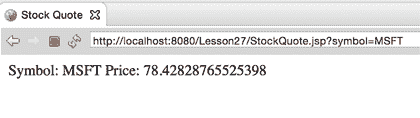

    **图 27-3:** 运行 GetPrice.html

# 第 28 节

使用 WebSockets 开发 Web 应用程序

## HTTP 的缺点

当你在页面上不断刷新数据（例如新邮件或股票价格变化）时，浏览器实际上会向服务器发送请求，“你有什么可以给我吗？”如果有新数据，浏览器会刷新指定的页面。访问访问活跃股票](https://www.google.com/finance?q=AAPL) 的 Google Finance 页面，在交易时间内，服务器会*推送*最新数据。要查看它，请打开 Chrome 浏览器的开发者工具面板（查看 → 开发者工具）。然后选择网络标签页并点击 XHR 标签，你可以在那里看到浏览器发出的 AJAX](https://developer.mozilla.org/en-US/docs/AJAX) 请求。在图 28-1 中，你可以看到我在监控苹果价格时的屏幕截图。


**图 28-1](#ch28.xhtml_fig-c028-001):** 在浏览器中监控 AJAX 请求

注意右侧这些 HTTP GET 和 POST 请求的大小。浏览器以 HTTP 请求的形式向实际数据添加数百字节，服务器对响应也会添加 HTTP Header。此外，某些轮询请求可能不需要，因为价格没有变化！

与 Servlet 不同，JSF 使用请求-响应模型。浏览器建立连接，然后服务器响应；这被称为全双工。想象一条汽车只能向一个方向行驶的桥。与 HTTP 相，[WebSocket](https://en.wikipedia.org/wiki/WebSocket) 是一条双向道，数据可以在两个方向传输。客户端不需要发起；服务器可以在需要时推送。

WebSocket 相比 HTTP 的另一个重要优势是它对数据几乎没有额外开销。以下列表包含可以从 WebSocket 中受益的 Web 应用程序：

* 实时交易/拍卖
* 聊天通知
* 多人游戏

WebSocket 协议](https://tools.ietf.org/html/rfc6455) 由开放标准组织互联网工程任务组 (IETF) 标准化，并被 HTML5 和 Java EE 7 (JSR 356) 支持。除了 Java EE 应用外，Apache Tomcat 8 和 Jetty 9 等容器容器也支持 websocket。与 HTTP/HTTPS 类似，WebSocket 协议使用标准端口 80 进行请求，使用端口 443 进行安全连接。所有符合 HTML5 的浏览器都原生支持 WebSocket。

由于 HTTP 不支持真正的服务器端数据推送，软件开发人员想出了几种黑科技方案来模拟推送。在 WebSocket 协议创建之前，人们使用以下黑科技在不需要用户点击或触摸图形化用户界面（GUI）控件（如按钮、链接等）的情况下更新网页上的数据：

* 轮询 (Polling)
* 长轮询 (Long polling)
* 流式 (Streaming)
* 服务端事件 (Server-Side Events)

通过轮询，Web 浏览器在指定的时间间隔内与服务器建立连接并询问服务器是否有新数据。许多请求可能没有返回新数据，因此每个客户端发送和接收的数百字节仅包含 HTTP 请求和响应对象，而不包含任何有用的数据负载。在轮询过程中，Web 浏览器为每个请求与服务器进行连接-断开-重新连接。

通过长轮询，Web 浏览器与服务器建立一个 HTTP 连接并保持活跃，直到新数据从服务器传回，然后重新连接。

通常，使用浏览器的 `XmlHttpRequest` 对象建立连接（如需更多信息，你需要熟悉 [AJAX 技术](http://en.wikipedia.org/wiki/Ajax_%28programming%29)，本书未涵盖该内容）。

通过流式传输，Web 浏览器与服务器建立一个 HTTP 连接。一旦服务器准备好数据，就开始流传输内容（向 HTTP 响应对象中添加更多数据），而不关闭连接。服务器将数据推送到客户端，假装 HTTP 响应永不结束。

通过[服务端事件](http://dev.w3.org/html5/eventsource/) (SSE)，Web 浏览器可以订阅服务器发送的事件。所有现代浏览器都支持 `EventSource` 对象，它可以处理文档对象模型（DOM）事件。SSE 允许从请求-响应模型切换为从服务器到浏览器的单向数据推送。

这里描述的所有方法都是使用基于请求-响应的 HTTP 来模拟服务端数据推送。使用 WebSocket 协议，你将摆离 HTTP，Web 浏览器将与服务器进行基于 TCP 的双向通信。

## 使用 WebSocket 进行客户端服务器通信


当客户端通过 WebSocket 协议与服务器通信时，我们称它们在使用 `websockets`。本节将讨论整个客户端服务器数据流，从客户端请求将 HTTP 升级到 WebSocket 协议，到客户端从服务器接收数据。

除了双向通信外，websockets 几乎没有开销，因为仅为负载帧（framing）增加了几个额外的字节（具体字节数取决于负载的大小）。这与基于 HTTP 通信中的数百字节相比，更小的开销减少了客户端与服务器之间的延迟。

### Web 浏览器作为 WebSocket 客户端

WebSocket 客户端通常用运行在 Web 浏览器内部的 JavaScript 编写。2012 年及以后发布的所有 Web 浏览器都支持 `WebSocket` 对象，网站 [`caniuse.com/websockets`](http://caniuse.com/websockets) 也可以告诉你特定的旧版本 Web 浏览器是否支持它。在 JavaScript 中，你通过创建该对象的实例来与服务器建立连接，然后客户端的通信部分转变为处理浏览器在连接打开、消息从服务器到达时分派的事件。因此，你的客户端代码可以执行以下操作：

1. 发起到服务器端点的连接——创建一个提供服务器 URL 的 `WebSocket` 对象的实例
2. 编写一个 `onOpen()` 回调函数
3. 编写一个 `onMessage()` 回调函数
4. 编写一个 `onClose()` 回调函数
5. 编写一个 `onError()` 回调函数

由于本书没有涵盖 JavaScript 编程，在这里我仅向你展示一个易读的代码片段，它在 Web 浏览器中运行 JavaScript 执行所有上述步骤。如果你对阅读更多 HTML5 编程感兴趣，可以阅读 [*Enterprise Web Development*](http://www.amazon.com/Enterprise-Web-Development-Building-Applications/dp/1449356818)（O’Reilly Media, 2014），由我合著。以下示例 JavaScript 代码连接到 WebSocket 回显服务器并定义所有可能的回调函数：

```javascript
if (window.WebSocket) {   
    ws = new WebSocket("ws://www.websocket.org/echo"); 

    ws.onopen = function() {
        console.log("onopen");
    };  

    ws.onmessage = function(e) {
        console.log("echo from server : " + e.data); 
    };
    ws.onclose = function() { 
        console.log("onclose");
    };
    ws.onerror = function() {
        console.log("onerror");  
    };
} else {
    console.log("WebSocket object is not supported");
}
```

当创建 `WebSocket` 的新实例时，它会向指定的 URL 服务器发送握手请求。URL 以 `ws` 和 `wss` 开头，而不是 `http` 和 `https`。握手包含以下：

```
Upgrade: websocket
Connection: Upgrade
```

请求头还包含 `Sec-WebSocket-Key` 中的一个唯一值。如果服务器支持 WebSocket 协议，它将返回状态码 101（切换协议）。HTTP 响应头中的 `Sec-WebSocket-Accept` 属性证明服务器支持 WebSocket 协议。之后，客户端与服务器建立 WebSocket 连接。如果服务器不支持 websockets，它将返回状态码 400——错误请求。

当接收到服务器消息时，客户端上标记有 `@OnMessage` 的回调方法将被调用。

如果客户端发送消息，服务器上标记有 `@OnMessage` 的回调方法将被调用。如果服务器返回错误，则会在客户端上调用 `@OnError` 回调。当连接关闭时，会调用 `@OnClose` 注解的方法。

与原始套接类似，websockets 不定义消息的数据格式。使用何种*子协议*（subprotocol）是应用程序的责任，当客户端实例化 `WebSocket` 对象时，它可以向构造函数传递一个可选的子协议参数，此时握手将包含额外的属性 `Sec-WebSocket-Protocol`。

要从 JavaScript 发送消息，可以使用重载方法 `send()`，它可以接收字符串或二进制数据（`Blob` 或 `ArrayBuffer`）。当客户端接收消息时，可以在 JavaScript 中进行如下类型检查：

```javascript
webSocket.onmessage = function(messageEvent) { 
    if (typeof messageEvent.data === "string"){ 
        console.log("Received text data: " + messageEvent.data);
    } else if (messageEvent.data instanceof Blob){ 
        console.log("Received blob data")
    } else if (messageEvent.data instanceof ArrayBuffer){
        console.log("Received ArrayBuffer data")
    }
};
```

服务端 WebSocket 端点部署在 Web 模块的 `.war` 文件中。不需要其他配置。在第 36 Lesson 中，你将看到如何使用 Gradle 自动化部署。

使用 WebSocket 时，客户端和服务器是对等节点，可以相互独立地发起消息交换。因此，它们需要知道对方的存在。当服务端回调方法被调用时，它会获取一个 `Session` 对象，你可以使用它来获取对端（即客户端）的引用，并在无需接收任何特殊请求的情况下向其发送消息。下一节将演示如何进行这种服务端数据推送。

## Hello WebSocket 示例

让我们创建一个 Hello World 风格的 WebSocket 应用程序。我不会创建一个客户端请求而服务器 响应的示例。我想让服务器先向客户端发送消息。在 Java 端，我只使用了一个被 `@OnOpen` 注解的回调方法 `greetTheClient()`，它会在客户端连接时立即在服务器上被调用。端点类将使用 `@ServerEndPoint` 注解。

在 Eclipse 中，创建一个名为 `Lesson28` 的动态 Web 项目，目标运行时选择 GlassFish。然后创建一个所示的 Java 类 `HelloWebSocket`：

```java
import java.io.IOException;
import javax.websocket.OnOpen;
import javax.websocket.server.ServerEndpoint;
import javax.websocket.Session;

@ServerEndpoint("/hello")
public class HelloWebSocket {   
    @OnOpen   
    public void greetTheClient(Session session){   
        try { 
            session.getBasicRemote().sendText("Hello stranger");
        } catch (IOException ioe) { 
            System.out.println(ioe.getMessage()); 
        }   
    }
}
```

当客户端连接到此 WebSocket 端点时，回调方法 `greetTheClient()` 被调用，代表对端之间对话的 `Session` 对象被作为参数传递。`getBasicRemote()` 方法返回客户端端点的引用，而 `sendText()` 向该客户端发送文本消息。客户端没有发送特殊的数据请求；服务器在连接打开时就会立即发送“Hello stranger”消息。

现在，让我们创建一个简单的 HTML 客户端，用于接收并显示服务器的消息。在 Eclipse 中，右键点击文档根文件夹 `WebContent`，并使用 `File → New → Other → HTML File` 菜单在此处创建一个 HTML 文件 `index.html`。当你看到 Select HTML Template 弹出窗口时，只需选择模板 New HTML File (5) 即可。Eclipse 会创建一个包含以下 HTML 内容的新文件：

```html
<!DOCTYPE html>
<html>
<head>
    <meta charset="UTF-8">
    <title>Insert title here</title>
</head>
<body>
</body>
</html>
```

现在，添加一个空的 HTML 标签 `<span>`，用于显示服务器的消息。你还需要一段简单的 JavaScript 代码来打开连接并声明处理 `onmessage` 回调的函数。你的客户端看起来应该是这样的（**手动添加的内容已加粗显示**）：

```html
<!DOCTYPE html>
<html>
<head>
    <meta charset="UTF-8">
    <title>Insert title here</title>
</head>
<body>
    <span id="messageGoesHere"></span>

    <script type="text/javascript">
        var ws = new WebSocket("ws://localhost:8080/Lesson28/hello"); 

        ws.onmessage = function(event) {
            var mySpan = document.getElementById("messageGoesHere");
            mySpan.innerHTML = event.data; 
        };
    </script>
</body>
</html>
```

当浏览器加载此文件时，它会运行脚本、实例化 `WebSocket` 对象并注册 `onmessage()` 回调函数。你通过调用 `getElementById()` 获取对 `<span>` 标签的引用，并将其内容设置为负载 `event.data`，其中包含“Hello stranger”。

在 GlassFish 下部署项目 `Lesson28`（右键点击服务器并选择“Add and Remove”菜单），右键点击 `index.html` 文件并在服务器上运行它。你会看到一个带有文本 `Hello stranger` 的网页。

全部就是这些。这是一个服务端向客户端推送数据的示例。现在想象一下服务器正在从第三方服务器获取股票报价或拍卖报价。相同的技术可以用于刷新浏览器窗口中的数据，而无需客户端任何轮询请求。

## 监控 WebSocket 网络流量

Google Chrome 浏览器允许监控 WebSocket 流量。我将使用上一节的 `HelloWebSocket` 示例向你展示线上传输了什么。首先，在 Chrome 中打开 URL [`http://localhost:8080/Lesson28/index.html`](http://localhost:8080/Lesson28/index.html)，然后打开开发者工具并刷新网页。Network 选项卡包含 WebSockets 区域。数据以称为 `frames*` 的块形式发送，你可以在 Data 列中看到“Hello stranger”。

### 发送消息

如果你想从 JavaScript 客户端发送消息，只需使用 `WebSocket.send()`，它可以接受文本或二进制对象作为参数。在 Java 端，你根据对象数据类型使用不同的发送方法。例如，像你在 `HelloWebSocket` 示例中所做的，使用 `javax.websocket.RemoteEndpoint.Basic` 中的 `sendText()` 方法：

```java
session.getBasicRemote().sendText("Hello stranger");
```

`getBasicRemote()` 方法返回 `RemoteEndpoint.Basic` 对象的实例，它会对端执行阻塞调用。对于发送异步非阻塞消息，请用 `RemoteBasic.Async`，你可以通过调用 `Session` 对象的 `getAsyncRemote()` 获取它。

如果你不发送文本，请使用 `sendObject()`、`sendBinary()` 或 `sendStream()` 等方法。发送方和接收方应确保发送消息的数据类型相同。

服务器还可以发送一种称为 ping* 的特殊控制消息来检查连接是否存活。ping 可以包含少量的（最多 125 字节）应用程序数据，但通常它只是用于标识 ping 的控制字：

```java
session.getBasicRemote().sendPing(ByteBuffer applicationData);
```

如果连接存活，浏览器会返回一个类型为 `PongMessage` 的 `pong`，可以通过服务端端点被 `@OnMessage` 注解的方法进行处理。

然而，客户端无法发起 ping。你需要手动编写一些 ping 计数器，如果在指定的时间范围内没有收到来自服务器的 ping，客户端应该重新连接。

### 使用 @OnMessage 接收消息

Java 类中负责处理消息的方法应该带有 `@OnMessage` 注解。该方法必须至少有一个定义预期消息类型的参数。

如果此类方法返回一个值，它将作为消息发送给对端，并应该像处理其他 WebSocket 消息一样在那里处理。例如，以下消息处理器接收一个 `String` 消息并返回一个 `String`，作为消息发送给对端：

```java
@OnMessage
public String getStockPrice(String symbol){
    String stockPrice;
    // 获取股票价格的代码在此处
    return stockPrice;
}
```

`@OnMessage` 注解的[在线文档](https://javaee-spec.java.net/nonav/javadocs/javax/websocket/OnMessage.html) 提供了参数选择：

* 恰好一个参数（文本、二进制或 `PongMessage`）
* 0 到 `n` 个 `String` 或 Java 原始类型，并对端点使用 [`PathParam`](https://javaee-spec.java.net/nonav/javadocs/javax/websocket/server/PathParam.html "javax.websocket.server 中的注解") 注解进行标记
* 一个可选的 `Session` 参数

`String` 类型参数用于发送文本数据，`ByteBuffer` 用于任何类似二进制的数据，如图像、视频或 BLOB。服务器端的 ping 和客户端（`PongMessage`）在 WebSocket 中用于心跳——以保持客户端与服务器的连接。

你的端点类可以声明最多三个带有 `@OnMessage` 注解的消息处理器：每种消息类型（文本、二进制和 pong）各一个。

可选的参数 `Session`（你在 `HelloWebSocket` 示例中配合 `@OnOpen`了它）适用于服务器需要执行操作的情况，例如向特定客户端发送消息、获取与客户端请求相关的参数（例如用户偏好），或关闭当前会话。

消息处理器可以返回 `void`、原始类型及其包装类、字节数组 `byte[]`、`ByteBuffer` 或你已存在编码器的自定义对象（在下一节中介绍）。

### 编码器与解码器

WebSocket 协议没有定义用于数据交换的应用特定协议，但它提供了一个可以指定一个支持的[子协议名称](https://www.iana.org/assignments/websocket.xml#subprotocol-name) 的位置，这些名称可以在应用程序中使用。例如，流行的消息协议之一被称为 [STOMP](http://stomp.github.io/)，你可以通过搜索“Stomp Over WebSocket”找到一些相关的示例。

此外，WebSocket 协议的 Java 实现允许你在客户端与服务器的数据交换期间将消息负载从一种格式转换为另一种格式。执行此转换的自定义类被称为解码器（decoders）和编码器（encoders）。

例如，网页浏览器向你的 WebSocket 端点发送一个 JSON 格式的字符串（如果你不熟悉 JSON，请参见第 3 ）。你可以创建一个 `JsonToDecoder` 类来解析传入的字符串并转换为指定类型的 POJO。同样，你可以创建一个 `PojoToJsonEncoder` 类，从 Java 服务器将每个 POJO 序列化为 JSON 字符串发送到用户的浏览器。图 28-4 中的图表描述了消息交换中的解码器类和编码器类。


**图 28-4:** 消息交换中的编码器和解码器


现在我将展示一个使用解码器和编码器获取股票报价的示例应用程序。在之前的 `HelloWebSocket` 示例中，你只在 `@ServerEndpoint` 注解使用了参数 `value` "/hello"`。但此注解还有四个可选参数：`decoders`、`encoders`、`subprotocols` 和 `configurator`。你在接下来所示 `StockServerEndpoint` 类中使用了 `decoders` 和 `encoders` 参数（为了简洁起见省略了导入语句）：

```java
@ServerEndpoint(value = "/stockprice",
            encoders = {StockEncoder.class},
            decoders = {StockDecoder.class})
public class StocksocketEndpoint {

   @OnMessage
   public Stock getPriceQuote(Stock stock){
     stock.price = Math.random()*100;
     return stock;
   }
}
```

当消息从对端到达时，此端点会调用 `getPriceQuote()` 方法。该方法生成一个随机股票价格。注意，`getPriceQuote()` 方法的参数和返回值都是 Java 类型 `Stock`，所示：

```java
public class Stock {
   public String symbol;
   public double price;
}
```

如果 WebSocket 客户端也是用 Java 编写的，那么这里没有问题。但典型的客户端是用 JavaScript 编写的，运行在浏览器中并将数据作为文本发送到服务器。因此，运行在网络浏览器中的客户端可能期望接收格式化文本数据，而不是 Java 对象。

为了完成这些数据转换，请编写一个解码器将文本转换为 `Stock` 对象，以及一个编码器将 `Stock` 对象转换为文本。解码器类必须实现 `Decoder.Text` 或 `Decoder.Binary` 接口。我们的类 `StockDecoder` 实现了 `Decoder.Text`：

```java
public class StockDecoder implements Decoder.Text<Stock>{
   @Override
   public void init(EndpointConfig config) {}
   public Stock decode(String symbol) throws DecodeException {
       System.out.println("In Decoder: converting " + symbol + 
                          "into Stock object");
       Stock stock = new Stock();
       stock.symbol=symbol;      
       return stock;
   }
    public boolean willDecode(String symbol) {
        System.out.println("Allowing decoding");
        return (symbol != null);
    }
   public void destroy() {}
}
```

你可以在[在线文档](http://docs.oracle.com/javaee/7/api/javax/websocket/Decoder.Text.html)中找到 `Decoder.Text` 的详情。简单来说，`decode()` 方法拦截来自客户端的传入消息，你的代码将消息转换为所需的 Java 对象。`decode()` 方法创建 `Stock` 对象的实例并将接收到的名称赋值给字段 `symbol`。`willDecode()` 方法检查给定的 `String` 是否可以编码为 `Stock`。如果需要某些先决条件，你可以在此处实现该逻辑。当 `getPriceQuote()` 方法返回填充了 `symbol` 和 `price` 的 `Stock` 对象实例时，编码器类会被调用。你需要将 Java 对象序列化为文本发送到浏览器。你的 `StockEncoder` 类如下所示：

```java
public class StockEncoder implements Encoder.Text<Stock>{
   public void init(EndpointConfig config) {}
   public String encode(Stock stock) throws EncodeException {
       System.out.println(
             "In Encoder: Serializing Stock object into String");

       return stock.symbol + ": " + stock.price;
   }
   public void destroy() {}
}
```

你已经完成了服务器端的编码。该代码是用于发送股票报价请求的 HTML 页面 `decodersdemo.html`。

```html
<!DOCTYPE html>
<html
<head>
<meta charset="UTF-8">
<title>在此插入标题</title>
</head>
<body>
  <form>
    <input id="stockSymbol" type="text">
    <input onClick= "getPriceQuote()" type="button" 
                                     value="Get Price">
  </form>

  <span id="priceQuote"></span>

  <script type="text/javascript">
    var ws = new WebSocket(
                       "ws://localhost:8080/Lesson28/stockprice"); 

    ws.onmessage = function(event) {
      var mySpan = document.getElementById("priceQuote");
      mySpan.innerHTML=event.data; 
    };

    function getPriceQuote(){
        var symbol = document.getElementById("stockSymbol");
        ws.send(symbol.value);
    }

</script>
</body>
</html>
```

此网页包含一个输入字段和一个“获取价格”（Get Price）按钮。当浏览器加载此页面时，它会执行 JavaScript 代码，连接到服务器端点 `ws://localhost:8080/Lesson28/stockprice`。用户输入股票代码并点击按钮，这将调用 JavaScript 函数 `getPriceQuote()`，该函数将输入的代码发送到 WebSocket 服务器进行处理。

在服务器端，解码器将代码转换为 `Stock` 对象，Java 方法 `getPriceQuote()` 填充其价格字段。编码器将 `Stock` 对象转换为文本并将其发送回浏览器。

图 28-5 显示了当我将浏览器指向 `http://localhost:8080/Lesson28/decodersdemo.html`、在输入字段中输入 IBM 并点击“获取价格”按钮时，我的网页显示的内容。


**图 28-5:** 测试 decodersdemo.html

### 发布到所有客户端

你经常需要编写一个程序，向所有连接的客户端发布相同的消息。例如，当产品有新的出价时，必须通知在线拍卖的多个客户端。另一个例子是当需要从服务器向所有连接的客户端推送新的股票报价时。使用 WebSockets 这是一个非常简单的任务。

我将为你展示一个基础示例，即 WebSocket 端点将服务器时间推送到所有连接的客户端。如果你可以将服务器时间发布到所有连接的客户端，你就可以发布任何特定应用程序的数据。

以下端点 `WebSocketClock` 调度任务，每秒获取并格式化一次服务器时间，并将时间发布到所有连接的客户端。我在第一个客户端连接到端点时调度了一次此定时器。`sendTimeToAll()` 方法通过调用 `Session` 对象的 `getOpenSessions()` 来找到所有连接的客户端。然后它在每个会话上调用 `getBasicRemote().sendText()`。

```java
@ServerEndpoint("/clock")
public class WebSocketClock { 
  static ScheduledExecutorService timer = 
        Executors.newSingleThreadScheduledExecutor(); 
  private static Set<Session> allSessions; 
  DateTimeFormatter timeFormatter = 
          DateTimeFormatter.ofPattern("HH:mm:ss");
  @OnOpen   
  public void showTime(Session session){
     allSessions = session.getOpenSessions();
     // 在第一次连接时启动调度器
     // 每秒调用 sendTimeToAll   
     if (allSessions.size()==1){   
       timer.scheduleAtFixedRate(
            () -> sendTimeToAll(session),1,1,TimeUnit.SECONDS);    
     }
     }       
  private void sendTimeToAll(Session session){       
    allSessions = session.getOpenSessions();
     for (Session sess: allSessions){           
       try{   
         sess.getBasicRemote().sendText("Local time: " + 
             LocalTime.now().format(timeFormatter));
          } catch (IOException ioe) {         
             System.out.println(ioe.getMessage());         
          }   
     }   
  }
}
```

每个 Java EE 应用程序服务器都带有一个管理员控制台，允许你管理 JNDI 树中的对象。本节将向你介绍 JNDI 概念，并让你看到如何使用 JNDI 来发布（以及查找）`administered objects`（即由服务器管理员配置的对象）。受管理对象的某些示例包括数据库连接池和消息队列（在第 30 节中解释）。

## 命名与目录服务

`naming service`（命名服务）允许你对某些命名层次结构中存在的对象添加、更改或删除名称，以便其他 Java 类可以查找它们以找到位置。再举一个类比：在图书馆中，你在目录中找到书的物理位置名称，然后去书架上取书。命名服务为每个注册到（*绑定到*）该服务的每个条目提供一个唯一的名称。每个命名服务都有一个或多个 `contexts`（上下文）——可以将其想象成文件系统中的目录和子目录，任何带有子节点的目录树都是一个上下文。命名树源于根节点，该节点也被称为 `initial context`（初始上下文，类似于磁盘上的根目录）。

`directory service`（目录服务）允许你通过对象属性而不是对象名称来搜索命名树。一个例子是域名系统（DNS），它是一个分布式命名系统，通过获取网络计算机或服务的域名，并返回该资源的 IP 地址和端口号。

为了允许客户端进行查找，必须有一个过程初始将对象绑定到命名树上。这可以通过服务器管理控制台或独立程序来处理（例如，该程序将员工姓名绑定到某个组织的目录服务器）。Java EE 服务器在启动期间会将 `EJB`、`Servlets`、`JMS` 和数据库连接池等对象绑定到它们的命名服务器。

所有支持 JNDI 的类和接口都位于 Java EE SDK 附带的 `javax.naming` 包中。

## 使用 InitialContext 类

`InitialContext` 类表示命名服务器中 JNDI 树的根节点。get 方法可以获取绑定到该树的特定资源的引用：

*   如果你的 Java 代码运行在 Java EE 服务器内部，可以使用 `@Resource` 注解将 JNDI 资源 `inject`（注入）到你的程序中。你的程序也可以在 `InitialContext` 对象上运行 `lookup()`。

*   如果外部 Java 程序需要 JNDI 资源（例如，一个独立的消息程序需要获取绑定到应用程序服务器 JNDI 树的消息队列的引用），它必须获取 `InitialContext` 的引用，然后调用 `lookup()` 方法。

### 获取 InitialContext 的引用

只有当你计划使用 `lookup()` 而不是资源注入时，才需要显式实例化 `InitialContext`（资源注入将在下一节中解释）。如果 Java 程序运行在应用程序服务器内部，实例化 `InitialContext` 对象只需要一行代码：

```java
Context initContext = new InitialContext();
```

如果 Java 程序运行在应用程序服务器外部，你需要指定服务器的位置、实现 `InitialContext` 的厂商特定类的名称以及访问凭据。例如，对于 WildFly 应用程序服务器（假设你已知安全凭据），可以使用以下代码：

```java
final Properties env = new Properties(); 
env.put(Context.INITIAL_CONTEXT_FACTORY,
       "org.jboss.naming.remote.client.InitialContextFactory"); 
env.put(Context.PROVIDER_URL, "http-remoting://127.0.0.1:8080"); 
env.put(Context.SECURITY_PRINCIPAL, "Alex123"); 
env.put(Context.SECURITY_CREDENTIALS, "MySecretPwd");

Context initContext = new InitialContext(env);
```

如果外部程序需要访问 GlassFish 服务器中的 `InitialContext` 对象，代码可能如下：

```java
final Properties env = new Properties(); 
env.setProperty("java.naming.factory.initial",
           "com.sun.enterprise.naming.SerialInitContextFactory"); 
env.setProperty("java.naming.factory.url.pkgs",
           "com.sun.enterprise.naming"); 
env.setProperty("java.naming.factory.state", 
   "com.sun.corba.ee.impl.presentation.rmi.JNDIStateFactoryImpl"); 
env.setProperty("org.omg.CORBA.ORBInitialHost", "localhost"); 
env.setProperty("org.omg.CORBA.ORBInitialPort", "8080"); 
InitialContext initContext = new InitialContext(env);
```

你需要阅读应用程序服务器附带的文档，以获取从外部程序访问 JNDI 的正确代码。

接收到 `InitialContext` 的引用后，你可以调用 `lookup()` 方法并指定所需资源的名称。[第 30 节 详细解释了 Java 消息传递，但现在我将向你展示获取名为 `test` 的消息队列引用的示例：

```java
Destination destination = (Destination)
                      initContext.lookup("jms/queue/test");
```

接下来的代码示例了如何获取 EJB 和默认数据源的引用：

```java
MySessionBean msb = (MySessionBean) initContext.lookup("java:env/mySessionBean");

DataSource ds = (DataSource) initContext.lookup("java:env/jdbc");
```

### 注入 JNDI 资源


# 大多数需要 JNDI 的 Java 程序运行在 Java EE 服务器内部

大多数需要 JNDI 的 Java 程序运行在 Java EE 服务器内部，这极大简化了资源的获取——无需实例化 `InitialContext`。使用 `@Resource` 注解进行资源注入是向组件提供资源的一种更简单的方法。在第 30 节中，你使用资源获取 JMS 对象，如下所示：

```
import javax.annotation.Resource;
...
@Resource(name="TestConnectionFactory")
private ConnectionFactory factory;
@Resource(name="MySTestQueue")
private Queue ioQueue;
```

例如，你可以将此代码放在 Java Servlet 中，它通过具有 JNDI 名称 `TestConnectionFactory` 的 `ConnectionFactory` 向绑定到 JNDI 树的 `MySTestQueue` 发送消息。这些资源由 Servlet 容器注入到变量 `ioQueue` 和 `factory` 中，无需手动查找。

注入的时间取决于位置。如果你将 `@Resource` 注解放在类级别，则会在运行时查找时进行注入。如果你将此注解放在字段或 setter 方法定义上方，则会在组件初始化时进行注入。

如果你需要覆盖注解中指定的资源，可以在 XML 配置文件中进行。你可以在第 31 章中看到更多使用 EJB 资源注入的示例。在本节后面，你将使用 JDBC `DataSource` 的资源注入。同时，请查看 GlassFish 管理控制台。

## 在 GlassFish 中管理 JNDI 对象

每个 Java EE 应用程序服务器都提供一个工具来管理其服务模块；我们感兴趣的是将对象绑定到目录名称。当你启动 GlassFish 时，控制台上会显示一条消息：“Waiting for DAS to start...” DAS 代表域管理服务器，它负责验证具有管理权限的用户，并响应来自图形化 Web 管理控制台的请求。要使用控制台，请在浏览器中输入以下 URL：[`http://localhost:4848/`](http://localhost:4848/)。你可以看到控制台，如图 29-1 所示。


**图 29-1:** GlassFish 管理控制台

管理控制台允许你配置 GlassFish 服务器的实例，并管理适用于 Java EE 应用程序的各种资源。在第 30 节中，你将看到如何配置 JMS 资源。

## 数据源和 JNDI

在第 21 节的“连接池和数据源”部分中，你将了解到为每个请求创建一个新的连接对象是一个耗时操作，因此使用复用预创建的 JDBC 连接的数据库连接池更好。

通常，Java EE 服务器的管理员会预先创建数据库连接池，并在连接池上配置最小和最大连接数以及其他参数。要在 GlassFish 中配置新的 DBMS 连接池，请使用管理控制台中的“JDBC Connection Pools”项（参见图 29-2）并点击“New”（新建）按钮。


**图 29-2：** GlassFish 中的 JDBC 连接池

然后你需要为新池添加参数。GlassFish 包含了 DerbyDB 数据库服务器，并为其预配置了一个池。图 29-3 显示了 GlassFish 管理控制台的快照，其中名为 `DerbyPool` 的现有资源代表一个 JDBC 连接池。`javax.sql.DataSource` 对象是数据库连接的工厂。管理员将此工厂配置为 JNDI 资源，指定使用何种 JDBC 驱动程序、初始创建多少个连接以及允许的最大连接数。


**图 29-3:** DerbyPool 配置为拥有 8 到 32 个连接

需要 JDBC 连接的 Java 程序通过其 JNDI 名称（在本例中为 `DerbyPool`）访问连接池，并对该资源调用 `getConnection()`。如果有空闲连接，Java 类将立即获得一个 `Connection` 对象的实例，该对象内部实现了 `PooledConnection`。如果有许多用户正在并发请求，所有连接可能都会被占用，在其中一个忙碌的连接返回之前会有短暂的延迟。`Connection` 是可关闭的，并在关闭时返回连接池。返回到连接池的连接不会被销毁；而是由服务器保留。

你可以通过 JNDI 查找 `DataSource` 对象，或者将其注入到 Java 代码中。在第 21 节中，你使用的是独立的 Java 程序，调用 `DriverManager.getConnection()` 获取 `Connection` 对象。如果配置的 `DataSource` 名称为 `DerbyPool`，则获取池化连接的示例代码如下：

```
InitialContext ic = new InitialContext();
DataSource ds = (DataSource) ic.lookup("DerbyPool");
Connection myConnection = ds.getConnection();
// 第 21 节中的 JDBC 处理在此处
```

使用 `@Resource` 语法注入 `DataSource` 如下：

```
@Resource(name="java:global/DerbyPool")
DataSource ds;
```

你有机会在尝试节中使用 `DataSource`。

## 轻量级目录协议

轻量级目录协议（LDAP）服务器是存储层次树结构条目的特殊软件，并对读取进行了高度优化。这使得它们成为员工列表或电话目录服务的良好选择。从企业的角度来看，当需要快速查找某些 Java 对象（如 JMS 连接工厂、队列或主题）时，应该考虑 LDAP。Java 开发人员使用 JNDI API 来绑定、查找和更新。以下是一些流行的 LDAP 服务器：

* Oracle Directory Server（Oracle）
* Microsoft Active Directory（Microsoft）
* OpenLDAP（开源）
* ApacheDS（开源）
* OpenDJ（开源）

LDAP 目录树有一个根条目，由一个或多个区分名称组成。通常，层次结构的顶层是前缀为 `o`（organization）的对象。其下方是前缀为 `ou`（organizational unit）的对象，`cn` 代表普通名称，以此类推。

## 尝试：使用 DataSource 连接 DerbyDB

1. 打开命令行（或终端）窗口，切换到 `glassfish/javadb/bin` 文件夹并启动 GlassFish 自带的 DerbyDB 实例。你需要运行 `startNetworkServer.exe`（如果你使用 Mac OS，则运行 `startNetworkServer`）。
2. 从 Eclipse IDE 启动 GlassFish。
3. 在 Eclipse 中，创建一个名为 `Lesson29` 的新 Dynamic Web Project，并指定 GlassFish 为目标运行时。
4. 创建一个名为 `MyDerbyClientServlet` 的新 Servlet。该 Servlet 应该注入 `DataSource` 并使用它连接 DerbyDB。修改生成的代码使 servlet 如下所示：

```
@WebServlet("/MyDerbyClientServlet")
public class MyDerbyClientServlet extends HttpServlet {
  @Resource(name="java:global/DerbyPool")
  DataSource ds; 
  protected void doGet(HttpServletRequest request,
                      HttpServletResponse response) 
                       throws ServletException, IOException {

     try {
        Connection myPooledConnection = ds.getConnection();
      System.out.println("Got pooled connection to DerbyDB");

     } catch (SQLException e) {
      e.printStackTrace();
     }
  }
}
```

5. 部署 servlet：在 Server 视图中右键点击 GlassFish 并选择 Add and Remove。检查 Eclipse 控制台，找到 `Lesson29` 应用程序已加载的消息。
6. 右键点击 servlet 名称并选择 Run on Server。你应该在 Console 视图中看到“Got pooled connection to DerbyDB”的消息。
7. 打开 GlassFish 管理控制台，进入 `DerbyPool` 的 Additional Properties（额外属性）选项卡。将数据库名称修改为 `Lesson29`。


**图 29-4：** 连接池的额外属性

8. 回到第 21 节，根据“Installing Derby DB”和“Creating a Database”中的描述创建 `Employee` 表。
9. 在 `MyDerbyClientServlet` 中添加从 `Employee` 表中检索数据的代码（以 `employeelist_program` 为参考）。
10. 运行 servlet `MyDerbyClientServlet`。它应该从 `Employee` 中检索数据并在 Eclipse Console 视图中打印它们。

# 第 30 节：介绍 JMS 和 MOM

人们通过电子邮件、即时消息、Twitter、Facebook 等向对方发送消息。人们也可以通过发送普通邮件等更传统的方法进行通信。你只需要将信投进信箱，剩下的由 USPS、FedEx、UPS 和 DHL 等邮政服务提供和物流公司处理。

应用程序可以使用称为面向消息中间件（MOM）的专用服务器相互发送消息，其扮演的作用类似于递送服务。程序使用 Java Messaging Service（JMS）应用程序接口（API）将消息“投进”消息队列（想象成邮箱），消息会被投递到另一个从该队列中读取消息的应用程序。简而言，JMS 是用于处理 MOM 服务器的 API。

尽管 JMS 是 Java EE 规范的一部分，但你可以在 `Java SE` 应用程序中使用它，而不需要任何 Java 应用程序服务器——只需为程序提供一个包含 JMS 类的 `.jar` 文件即可。本节将向你展示如何编写独立的 Java 客户端以及运行在 Java EE 服务器内部的客户端。这些客户端通过 MOM 提供者通过 JMS API 发送和接收应用程序。在第 31 节中，你将学习消息驱动豆带来的价值。

## 消息传递概念和术语

你已经学习了分布式 Java 应用程序中数据交换的几种方法：直接 socket 通信、RMI 和基于 HTTP 的交互。但它们都是基于远程过程调用（RPC）或请求/响应模型。MOM 允许你构建异步通信的分布式系统。

JMS 本身并不是消息的传输层。JMS 之于 MOM 犹如 JDBC 之于关系型 DBMS。Java 应用程序可以使用任何 MOM 提供者对应的相同的 JMS 类。以下是一些流行的 MOM 软件列表：

* WebSphere MQ (IBM)
* EMS (Tibco Software)
* SonicMQ (Progress Software)
* ActiveMQ (开源，Apache)
* Open MQ (开源，Oracle)

如果你通过在远程机器上调用 `placeOrder()` 方法来下单购买某些股票，那就是同步或阻塞调用（也称为远程过程调用）的一个示例。在 `placeOrder()` 方法中的代码完成或抛出错误之前，调用程序无法继续执行。

对于异步通信，情况则不同。你可以下单，但不需要等待其执行。同样，当你把信件投进信箱时，你不需要等待邮件车到达收件人处。这也适用于电子邮件——按下发送按钮并继续处理其他事情，而无需等待你的消息被投递。你电子邮件的接收者在你发送消息时也不必在线；他们可以以后再读。

下单交易订单的过程归结为将描述你订单的 Java 对象放入你的 MOM 提供者的某个消息队列中。下单后，程序可以继续其执行，而无需等待订单的处理。多个用户可以向同一个队列下单。图 30-1 显示了交易应用程序如何通过 MOM 下单（接收执行）。


**图 30-1：** 经纪公司通过 MOM 与交易所通信

程序可以发送或发布消息。当一个程序向特定队列发送消息，而另一个程序从该队列接收该消息时，这被称为点对点 (P2P) 消息传递。在这种模式下，消息一旦被成功接收，就会从队列中移除。图 30-2 显示每条消息只发给一个消费者。


**图 30-2:** P2P 消息传递

如果一个程序发布消息以供多个接收者消费，那就是发布/订阅 (pub/sub) 模式。消息被发布到特定的主题上，许多订阅者可以订阅该主题以接收它。图 30-3 阐述了发布/订阅模式，其中一条消息可以被多个订阅者消费。


**图 30-3:** 发布/订阅消息传递

主题代表了应用程序和/或用户的某些重要新闻；例如，`PriceDropAlert`、`BreakingNews` 等。在发布/订阅模式下，消息通常在所有订阅者都接收到后就会从队列中移除（请在如何订阅主题章节中阅读关于持久订阅者的内容）。

发布/订阅应用的另一个很好的例子是聊天室。由一个人发布的消息会由聊天室内的其他人员接收。使用 JMS 和 MOM 开发聊天室是一项相当简单的任务。

## 介绍 OpenMQ MOM


要学习 JMS，你需要安装一个消息服务器并在那里配置一些消息队列。你可以使用一个名为 Open MQ 的开源 MOM 供应者。作为额外奖励，它附带了 GlassFish。你已经在 GlassFish 安装的 `mq` 目录中安装了它。如果你想在任何其他应用程序服务器上使用 Open MQ，可以从 [`mq.java.net/downloads/index.html`](https://mq.java.net/downloads/index.html) 下载 Open MQ 作为独立产品。

首先，我不会使用 Java EE 服务器。目标是测试独立的 Java 客户端直接与 Open MQ 通信，而不通过中间人。你需要启动 Open MQ 服务器并在那里创建一个命名队列。

编辑配置文件 `glassfish4/glassfish/mq/etc/imqenv.conf` 以指定 Java 8 在你计算机上的位置。例如，这行配置在我的 Mac 计算机上显示如下：

```
IMQ_DEFAULT_JAVAHOME=/Library/Java/JavaVirtualMachines/jdk1.8.0_25.jdk/Contents/Home
```

打开命令行（或终端）窗口进入 `glassfish4/mq/bin` 目录并启动 Open MQ 代理（broker）。在 Windows 中，你需要运行 `imqbrokerd.exe` 程序。如果你使用 Mac OS，输入以下命令：

```
./imqbrokerd
```

你会看到一条消息，通知你代理已在端口 7676 就绪。现在打开另一个命令行窗口，切换到 `glassfish4/mq/bin` 目录，并启动管理图形用户界面 (GUI) 工具 `imqadmin` 来创建所需的消息目的地：

```
./imqadmin
```

管理控制台打开了。在 Open MQ 中，有称为 brokers 的应用程序负责管理客户端之间所有的消息交换。因此，你配置一个管理股票交易相关消息的代理。右键点击 `Brokers` 节点并添加名为 `StockBroker` 的新代理，输入密码 `admin` 并点击 OK。然后右键点击 `StockBroker` 并从菜单中选择 Connect to Broker。图 30-4 显示了执行这些步骤后我的屏幕快照。

现在，创建一个物理目的地——一个用于放置交易订单的队列。右键点击 `StockBroker` 节点下的 `Destinations` 并选择 Add Broker Destination。在弹出窗口中，输入目的地的名称：`TradingOrdersQueue`，如图 30-5 所示。


**图 30-4:** 新创建 StockBroker 的 Open MQ 控制台


**图 30-5:** 在 Open MQ 中配置目的地

如果你想创建一个主题而不是队列，只需选择 Topic 单选框。如你所见，在目的地还可以设置一些其他参数。

包含 Open MQ MOM 的详细概述超出了本书的范围；请尝试阅读 [Open MQ 管理指南](https://glassfish.java.net/docs/4.0/mq-admin-guide.pdf) 以获取更多信息。只要你有一个 MOM 服务器，你就可以。

## JMS API 概述

JMS API 包含了允许你发送和接收消息的类和接口。在 2.0 中此列表变短了：

* `JMSContext` 是创建 `Session` 的对象。
* `Destination` 是一个队列或主题。
* `JMSProducer` 是一个向目的地发送消息的接口。
* `JMSConsumer` 是一个从目的地检索消息的接口。
* `Message` 是所有消息的根接口。它由头部和主体组成。

### 消息类型

每条消息都包含头部和主体。头部包含消息标识（唯一消息 ID、目的地、类型等）。可选属性可以由程序设置，以标记消息特定的应用程序数据；例如 `UrgentOrder`。

可选主体包含要交付的消息。以下是可以放入消息体的 JMS 消息类型。所有这些接口都继承自 `javax.jms.Message`：

* `TextMessage` 是包含任何 `String` 的对象。
* `ObjectMessage` 可以持有任何 `Serializable` Java 对象。
* `BytesMessage` 持有字节数组。
* `StreamMessage` 具有 Java 原型流。
* `MapMessage` 包含任何键值对；例如，`id=123`。

通常，消息生产者创建上述类型之一的对象，用应用程序数据对其初始化，然后将其发送到 MOM 队列或主题。唯一的例外是 `String` 消息，它们可以直接发送，无需封装在 `TextMessage` 中。消费者应用程序通过调用 `Message.getBody()` 方法提取[消息主体](http://docs.oracle.com/javaee/7/api/javax/jms/Message.xhtml#getBody(java.lang.Class))来获取指定类型的内容；例如：

```
msg.getBody(String.class); // msg 是接收到的消息的引用
```

如果你需要发送一个例如 `Order` 类型的对象（必须实现 `Serializable`），消息生产者需要将其封装在 `ObjectMessage` 中——例如：

```
Order order = new Order();
ObjectMessage objMsg = context.createObjectMessage(order);
```

那么在消息接收器上调用 `getBody()` 将如下所示：

```
Order receivedOrder = msg.getBody(Order.class);
```

### 如何直接向 MOM 发送消息

本节及后续章节将向你展示 Java SE 客户端如何在不使用任何 Java EE 服务器作为中间节点的情况下，直接与 MOM 通信。这种模式并不常用，但它将帮助你理解 Java EE 和 JNDI 在消息传递方面带来的优势。在看到这些简单示例后，你可以使用 JNDI 为 Java EE 服务器重写它们。

为了发送和接收消息，应该在 MOM 中预先配置队列（queues）或主题（topics），并且在程序开始发送消息之前必须知道它们的名称。我使用了 *should*（应该）一词，因为即使你没有预先配置队列，某些 MOM Provider（包括 Open MQ）也可能会在内存中创建一个临时队列，该队列会在服务器重启时被销毁。

在现实世界中，MOM 服务器管理员负责管理队列和其他消息构件，但为了训练目的，你已经在上一节中通过 `TradingOrdersQueue` 队列完成了这一操作。

要直接向 MOM 提供者发送消息，程序必须执行以下步骤：

1. 在 Java 类中，使用 MOM 厂商提供的实现类创建一个 `ConnectionFactory` 对象。
2. 创建一个 `JMSContext` 对象。
3. 使用 `JMSContext` 创建一个 `Destination`（例如调用 `createQueue()`）。
4. 创建一个 `JMSProducer` 对象。
5. 创建一个 `Message` 对象并向其中放入一些数据。
6. 在 `JMSProducer` 上调用 `send()` 方法，并将 `Destination` 和 `Message` 作为参数。

Listing 30-1 显示了 `DirectMessageSender` 类，它实现了上述所有步骤，但创建 Message 实例除外——对于字符串来说并不是必须的。此代码向队列 `TradingOrdersQueue` 发送消息。

`DirectMessageSender` 类使用了 Open MQ 特有的 JMS `ConnectionFactory` 实现，该实现位于厂商的包 `com.sun.messaging` 中。如果你决定更改 MOM 提供者或服务器地址，你需要修改、重新编译并部署此代码。这并不理想，但你将在该客户端的 Java EE 版本中解决这个问题。

### 如何直接从 MOM 接收消息

接收消息的程序被称为 *message consumer*（消息消费者，监听器）。它可以是一个独立的 Java 程序，也可以是一个消息驱动 Bean（message-driven bean）。你可以使用 `receive()` 方法同步接收消息，也可以通过实现 `MessageListener` 接口并编写回调 `onMessage()` 来异步接收消息。`receive()` 方法很少被使用，因为它涉及到一种不断提问消息的轮询机制。

在消息消费者上使用异步回调方法 `onMessage()` 是接收消息的首选方式。当消息被放入队列时，回调方法 `onMessage()` 会立即被调用。消费者类必须执行以下步骤来异步接收消息：

1. 创建一个实现 `MessageListener` 接口的类并对其实例化。
2. 使用 MOM 厂商提供的实现类创建一个 `ConnectionFactory` 对象。
3. 创建一个 `JMSContext` 对象。
4. 使用 `JMSContext` 创建一个 `Destination`（例如调用 `createQueue()`）。
5. 创建一个 `JMSConsumer` 对象并在其上调用 `setMessageListener()`，指定实现 `MessageListener` 的对象。
6. 实现 `onMessage()` 以处理到达的消息。

Listing 30-2 中的示例类 `MyReceiver` 显示了如何异步从 `TradingOrdersQueue` 消费消息。它的构造函数创建 JMS 对象并将自身注册为消息监听器。回调 `onMessage()` 包含了处理接收消息的代码。

`DirectMessageReceiver` 类调用 `sleep(100000)` 方法以防止程序终止 100 秒。我这样做是为了测试，以便你可以向队列发送消息并看到它们正在被接收。如果你通过运行 `DirectMessageSender` 在队列中放置消息，`DirectMessageReceiver` 就会获取它，并在控制台上产生可能如下所示的内容：

```
Got the text message from the TradingOrdersQueue: IBM 200 Mkt
=== Here's what toString() on the message prints
Text:     IBM 200 Mkt
Class:             com.sun.messaging.jmq.jmsclient.TextMessageImpl
getJMSMessageID():     ID:7-192.168.1.113(d8:86:af:a3:e1:8d)-62948-
                        1412631694897
getJMSTimestamp():     1412631694897
getJMSCorrelationID():
JMSReplyTo:
JMSDestination:  TradingOrdersQueue
JMSDeliveryMode(): PERSISTENT
JMSRedelivered(): false
JMSType(): 0
JMSExpiration(): 0
JMSDeliveryTime(): 0
JMSPriority(): 4
Properties: {JMSXDeliveryCount=1}
```

参数 `String.class` 意味着“将消息体转换为类型 `String`”。

`DirectMessageReceiver` 类使用了 JMS `ConnectionFactory` 的特定实现，它位于包 `com.sun.messaging`。如果你决定更改 MOM 提供者或服务器地址，你需要修改、重新编译并部署此代码。这并不理想，但你将在该客户端的 Java EE 版本中解决这个问题。

### 如何发布消息

程序发布消息到主题，这些主题应该由系统管理员预先创建。在 Open MQ 的情况下，你需要在图 30-5 所示的窗口中选择 Topic。消息发布与消息发送非常相似，但程序应该创建一个 `Topic` 而不是 `Queue`；Listing 30-3 显示了如何更改 `DirectMessageSender` 向名为 `PriceQuoteTopic` 的主题发布文本消息：

多个订阅者可以接收相同的消息。

### 如何订阅主题

订阅者可以是 *durable*（持久的）或 *non-durable*（非持久的）。持久订阅者保证能接收消息；它们在消息到达时不必处于活跃状态。非持久订阅者只接收它们活跃时进来的消息。对于非持久订阅，一旦所有活跃订阅者都确认，MOM 就会从内部存储中删除消息。对于持久订阅，MOM 会保留消息直到交付给所有订阅者。

某些应用程序不需要持久订阅。例如，如果订阅者错过了一秒前发布的股票价格也没关系。但如果经纪公司必须向多个金融欺诈组织报告可疑交易，则需要此类订阅是持久的。

如果你将 `DirectMessageRetriever` 改为非持久的主题订阅者，以下微调即可起作用：

持久订阅者通过调用 `createDurableConsumer()` 创建，并且每个持久订阅者必须具有唯一的客户端 ID。每个持久订阅都由主题名称、订阅者名称和客户端 ID 的组合来标识。这就是你如何创建一个名为 `FraudPreventionUnit` 的持久订阅者：

出于扩展性考虑，同一个订阅可以由多个并行工作的独立消费者共享（例如，运行在不同的 JVM 上）。在这种情况下，必须创建一个 *shared consumer*（共享消费者）（它可以是持久的或非持久的）。例如，你可以创建一个共享持久订阅者，如 Listing 30-6 所示：

应用程序可以随时通过调用 `JMSContext` 对象上的 `unsubscribe()` 方法来取消对主题的订阅，例如：

```
context.unsubscribe("FraudPreventionUnit");
```

## 消息确认与事务支持

当消息成功送达时，MOM（消息队列系统）会将其从队列中移除。但“成功送达”意味着什么呢？是指消息传递给 `onMessage()` 方法吗？但如果 `onMessage()` 中的代码由于某些错误失败了，你希望消息留在队列中！

JMS API 有一个消息会话（messaging session）的概念，你可以在其中指定 `acknowledgment modes`（确认模式）或请求事务支持，以便让应用程序控制队列或主题中移除消息的控制。

有三种确认模式：

* `AUTO_ACKNOWLEDGE` 模式在 `onMessage()` 方法成功完成后立即发送回确认。这是默认的确认模式。
* `CLIENT_ACKNOWLEDGE` 模式要求通过在消息接收代码中调用 `acknowledge()` 方法进行显式确认。
* `DUP_OK_ACKNOWLEDGE` 模式用于服务器故障的情况；同一消息可能会被交付多次。在某些用例中这是可以接受的——例如，接收两次报价并无害。


# 消息确认模式

消息确认模式在创建 `JMSContext` 时定义。到目前为止，我们的代码示例 `DirectMessageSender` 和 `DirectMessageReceiver` 通过指定两个参数（用户 ID 和密码）创建了 `JMSContext` 对象。但你也可以使用重载的 `createContext()` 方法来指定消息会话模式；例如：

```
JMSContext context = factory.createContext("admin","admin", 
                           JMSContext.CLIENT_ACKNOWLEDGE);
```

作为确认的替代方案，你可以为消息消费者请求事务支持。想象一下收到的消息包含必须作为一个工作单元保存到数据库并转发到 Web Service 的数据，除非这两个操作都成功，否则整个事务必须回滚。你可能在 JMS 生产者端也需要事务支持。例如，如果你需要将两条消息作为一个逻辑工作单元发送——要么两条消息都成功发送，要么回滚事务。以下代码段显示了如何创建 `JMSContext` 和 `JMSProducer` 对象，并在不同队列中发送两条消息作为同一个事务。

```
try (JMSContext context = factory.createContext("admin","admin",
                                        JMSContext.TRANSACTED)) {

    JMSProducer producer = context.createProducer();
    Destination queue1 = context.createQueue("Queue1");
    Destination queue2 = context.createQueue("Queue2");       

    producer.send(queue1, "Msg1");
    producer.send(queue2, "Msg2");

    context.commit(); // 提交 JMS 事务
} catch (JMSException e) { 
    context.rollback(); // 回滚 JMS 事务
    System.out.println("Error: " + e.getMessage());
}
```

如果两个发送顺利通过，`Session` 对象（封装在 `JMSContext` 内部）会提交。如果抛出异常，则没有消息被放入任何队列中。

# 消息选择器

如果你必须与其他应用程序或团队其他开发者共享队列，请使用 `message selectors`（消息选择器，也称为过滤器）来避免“偷”别人的消息。例如，在消息消费者应用程序中，你可以选择接收属性 `symbol` 值为 `IBM` 的消息：

```
String selector = "symbol=IBM";
Context.createConsumer(ordersQueue, selector);
```

在这种情况下，队列监听器仅从队列中取出具有值为 `IBM` 的字符串属性 `symbol` 的消息。因此，消息生产者在消息对象上设置此属性：

```
TextMessage outMsg = context.createTextMessage(); 
outMsg.setText("IBM 200 Mkt"); 
outMsg.setStringProperty("symbol", "IBM");
Destination ordersQueue = context.createQueue("TradingOrdersQueue");  
JMSProducer producer = context.createProducer();
producer.send(ordersQueue, outMsg);
```

记住，消息选择器会减慢检索过程。消息一直留在队列中，直到具有匹配选择器的监听器将其取出。如果你的团队队列数量有限，且每个人都需要在不干扰其他的情况下接收消息，那么选择器将非常有帮助。但如果有人在没有选择器的情况下启动了队列监听器，它就会清空队列。

# 从 Java EE 容器发送消息

现在你已经了解消息是如何工作的，你可以看到如何从运行在 Java EE 容器内部的 Java 对象向 MOM 目标发送消息了。这次我们将 `ConnectionFactory`、`Queue` 和 `Topic` 等 MOM 对象绑定到 JNDI 树，Java 消息客户端从那里获取它们。图 30-6 显示了 JMS 客户端在有或无 Java EE 的情况下与 MOM 通信的高层图。


**图 30-6:** 将 JMS、Java EE 和 MOM 结合在一起

外部客户端可以直接与 MOM 通信，也可以从椭圆表示的 Java EE 服务器内部进行通信。当 Java EE 启动时，它会将 MOM 对象绑定到 JNDI 树。因此，如果部署在 Java EE 中的 Java Servlet 或其他对象需要向 MOM 发送消息，它使用 `lookup()` 获取引用。

```
@WebServlet("/MessageSender")
public class MessageSender extends HttpServlet {

    @Resource(lookup="java:comp/DefaultJMSFactory")
    ConnectionFactory factory;

    @Resource(lookup = "OutgoingOrders") // JNDI 队列名
    Destination ordersQueue;

    protected void doGet(HttpServletRequest request, 
                       HttpServletResponse response) throws ServletException, IOException {

        try (JMSContext context = factory.createContext("admin","admin")) {

            JMSProducer producer = context.createProducer();

            // 市场价购买 200 股 IBM 的消息
            producer.send(ordersQueue, "IBM 200 Mkt");

            System.out.println("Placed an order to purchase 200" +
            "shares of IBM to OutgoingOrders");
        }
    }
}
```

为了让 `MessageSenderServlet` 工作，你需要使用 Java EE 服务器的控制台配置 JMS 对象。在这个示例中，我使用了 JNDI 队列名 `OutgoingOrders`，它将映射到物理队列名 `TradingOrdersQueue`。在下一节中，我将向你展示如何在 GlassFish 中进行。

# 在 GlassFish 中管理 JMS 对象

配置 JMS 对象是将 JNDI 名称映射到物理 MOM 对象。假设 Open MQ 和 GlassFish 服务器已运行，通过访问 http://localhost:4848 打开 GlassFish 管理控制台。左侧导航树中有一个 JMS Resources 节点。点击服务器节点，你会看到一个添加 JMS 物理目的的选项，如图 30-7 所示。


之所以知道目标 `TradingOrdersQueue` 是因为 Open MQ 与 GlassFish 集成了。要配置另一个 MOM 服务器，你需要通过导航面板中的 Configurations 节点创建一个新的 JMS 主机。

现在，你需要创建一个映射到物理 MOM 队列的 GlassFish JMS 条目。将新的目标资源添加到 JMS Resources（参见图 30-8）。我为它指定了一个 JNDI 名称 `OutgoingTradeOrders`。


**图 30-8:** 将 JNDI 名称映射到物理队列

JMS 连接的创建和关闭（由 `JMSContext` 在内部完成）是耗时操作；你理应考虑使用 JMS 连接池。Java EE 服务器允许你通过配置连接工厂来自动创建此类池。图 30-9 显示了如何配置连接工厂以使用池化连接。我将其设置为在 GlassFish 服务器启动时创建 20 个 JMS 连接，随着用户数量的增加，池的大小将增长到 100 个连接的最大值。


**图 30-9:** 配置 JMS 连接工厂

现在，你可以在 GlassFish 中创建、部署并运行 servlet `MessageSenderServlet`。按照第 26 章介绍的方法在 Eclipse 中进行。创建一个 Eclipse 动态 Web 项目，并指定 GlassFish 为目标运行环境。然后使用本节之前所示的代码创建一个 servlet `MessageSenderServlet`。最后，通过右键菜单中的“添加和移除”（Add and Remove）功能在 GlassFish 服务器上部署此 Eclipse 项目并运行。

第 31 章 向你展示了如何使用消息驱动豆（message-driven beans）从队列或主题检索消息。“试一试”部分包含了关于如何使用独立消息接收者的说明。

# 试一试

目标是使用独立消息接收者 `DirectMessageReceiver` 来检索 Java servlet 发送的消息。测试图 30-10 中描述的消息场景。


**图 30-10:** Java EE 消息发送者和独立接收者

## 课程要求

你应当已经安装了适用于 Java EE 开发者的 Eclipse 以及 GlassFish 4.1（它带有 Open MQ）。

## 提示

Open MQ 独立启动时，其 `imqbrokerd` 运行端口与 GlassFish 启动的嵌入式 Open MQ 不同。

## 步骤说明

1. 停止独立启动的 Open MQ 服务器和 GlassFish。
2. 打开 `glassfish/domains/domain1/config/domain.xml` 文件，并将系统变量 `JMS_PROVIDER_PORT` 的值更改为 7676。默认情况下，GlassFish 在端口 27676 上嵌入式 Open MQ 服务器，但我们的 `DirectMessageReceiver` 使用硬编码的 7676 作为端口值。
3. 重启 GlassFish。现在它会在端口 7676 上启动嵌入式 JMS 提供者。
4. 确保在 GlassFish 中配置了 `OutgoingTradeOrders`，如图 30-8 所示。
5. 按照之前的说明运行 `MessageSenderServlet`。它将把消息发送到 GlassFish JNDI 树中名为 `OutgoingTradeOrders` 的队列。
6. 运行 `DirectMessageReceiver`。它会在控制台上打印消息“Listening to the TestQueue”，然后从名为 `TradingOrdersQueue` 的物理队列中检索并打印消息。
7. 修改 `DirectMessageReceiver` 的代码，使其不再包含 Open MQ 服务器的硬编码值。
8. 自学 `QueueBrowser` 类的用法，并编写一个程序来打印队列内容而不出队列消息。

# 第 31 章 企业豆 (Enterprise JavaBeans) 简介

本节向你介绍了 Java EE 技术之一——企业豆（[JSR 345](http://download.oracle.com/otndocs/jcp/ejb-3_2-fr-spec/index.html)），它可以用于实现分布式应用中的业务层（参见第 25 章中的图 25-1）。第 26 章和第 27 章关于在 Web 上编程表示层的各种方法；在第 30 章和第 29 章中，你学习了如何使用消息组织应用程序不同层之间的通信。应用程序业务逻辑是用 POJO 编写的。

在本节中，你将看到如何用 EJB 编写业务层，EJB 也是 POJO，但由 EJB 容器管理。Java EE 7 包含了 EJB 3.2。本节介绍了各种类型的 EJB，而下一节将关于数据持久化。

## 谁需要 EJB？

POJO 有什么问题吗？为什么不实现业务逻辑？如果你需要对分布式应用进行扩展，EJB 容器提供了集群和故障转移功能。安全授权也是容器的责任。由于不需要手动编写这些功能，EJB 的代码变得非常轻量。

EJB 容器提供的另一项服务是*异步方法调用*，它实现了异步处理。

EJB 支持[嵌入式容器](https://docs.oracle.com/javaee/7/tutorial/ejb-embedded.htm#GKCQZ)。你可以在任何应用程序之外的 Java SE 环境中运行 EJB。对于测试等任务这是一个很好的主意，因为不需要依赖 Java EE 服务器的就绪状态；你可以在本地测试 EJB。创建嵌入式容器只需执行一行代码：

```
EJBContainer myContainer = EJBContainer.createEJBContainer();
```

如果最初选择的应用服务器没有达到预期的性能或可靠性，可以在另一个符合 Java EE 7 的服务器上部署 EJB，无需修改任何代码。

## EJB 的类型

EJB 有两种主要类型：会话豆（session beans）和消息驱动豆（message-driven beans）。MDB 专门用于从 JMS 队列或主题检索消息——这是它们能做的全部。应用程序业务逻辑位于会话豆中。

*   **无状态**会话豆（stateless session bean）是指包含业务逻辑但不支持状态。换句话说，它不会“记住”任何特定于客户端的数据。如果同一个客户端连续调用无状态豆 `FindBooks` 的两个方法，容器可能会使用两个独立的 `FindBooks` 豆实例，因为它不存储任何特定于客户端的中间数据。

*   **有状态**会话豆（stateful session bean）是包含业务逻辑和状态的豆。EJB 容器会为客户端分配一个特定的 session bean 实例，并在随后的方法调用之间存储结果。

*   **单例**会话豆（singleton session bean）每个应用程序只实例化一次。可以将单例 bean 视为一个全局仓库，其中一个 bean 可以存入一些数据供另一个 bean 使用。单例 session bean 不仅提供了方便访问公共数据的方式，还确保了在并发访问时没有竞态条件。

旧版本的 EJB 规范定义了用于持久化的 `entity beans`（实体豆）。从形式上说，它们仍然存在于当前的 EJB 规范中，但已被精简（变为符合 `Java EE 7` 标准的应用服务器供应商的可选实现）。

EJB 容器会创建并维护 session bean 池。无状态 bean 实例分配给客户端的时间远比有状态 bean 短。因此，如果你正在开发一个每有成百或上千个并发请求发送到 EJB 容器的多用户应用程序，无状态 bean 提供了一个更具扩展性的解决方案，因为较小的池可以服务更多的用户请求。

但即使对于有状态的 session bean，EJB 容器也十分智能，那些留在内存中但与客户端没有活动交互的实例会被 `passivated`（钝化）——从内存中移除并存储在磁盘上。当客户端对被钝化的有状态 bean 发出另一个请求时，容器会再次将其 `activate`（激活）。

### 无状态 Session Bean (Stateless Session Beans)

我将通过创建一个包含返回消息“Hello World”的业务逻辑的 EJB 简单示例来向你介绍无状态 session bean。

#### Bean (The Bean)

一个位于容器中且仅返回“Hello World”的类可以很容易实现为无状态 session bean：它只有一个方法，并且没有需要记忆的状态。Listing 31-1 向你展示了如何编写这样一个 bean。

基本上，你只需要创建一个 POJO 并使用一个或多个 Java 注解对其进行标记即可。为了将 POJO 转换为 EJB，不需要实现任何特殊的接口。相应地，这里有 `@Stateful`、`@MessageDriven` 和 `@Singleton` 注解来标记其他类型的 session bean。

之前的 `HelloWorldBean` 版本没有指定客户端如何访问这个所谓的“no interface view”（无接口视图）bean，这意味着当客户端获取 bean 的引用时，它只能是 bean 的数据类型（在本例中为 `HelloWorldBean`）。你不能声明接口类型的引用变量，因为该 bean 没有实现任何接口。部署在同一个归档文件中的类可以使用 resource injection 方法：

```
@EJB HelloWorldBean myBean;
myBean.sayHello();
```

### 客户端视图 (The Client’s View)


# EJB 核心概念与实践

Listing 31-1 中所示 bean 运行在服务器上，但调用 `sayHello()` 方法的客户端可以在同一个 Java 虚拟机 (JVM) 中（例如 servlet 或另一个 bean），也可以在另一个 JVM 中（例如独立的 Java SE 或部署在另一个容器中的 Java EE 类）。Bean 可能实现也可能不实现接口。如果 `HelloWorldBean` 仅供在相同 JVM 中的客户端使用，你可以为它标记一个可选的 `@LocalBean` 注解，表示它是无接口 bean。如果 `HelloWorldBean` 除了无接口视图外还可以暴露给其他客户端，则必须显式使用 `@LocalBean` 标记 bean。

如果你只想向本地客户端暴露某些业务方法，可以创建一个业务接口，在其中声明这些方法，让你的 bean 实现它们，并用 `@Local` 注解标记该 bean。`@Local` 注解可以用于业务接口，也可以用于 session bean 本身。

如果你想向远程客户端暴露某些方法，创建一个接口，在其中声明业务方法，在 bean 中实现它们，并将其标记为 `@Remote`。

## 本地无接口 Bean (Local No-Interface Beans)

我计划从运行在相同 JVM 中的 servlet 使用 `HelloWorldBean`，因此代码的最终版本看起来如 Listing 31-2 所示。

任何 EJB 都可以使用普通的 Java 类来实现业务逻辑：例如，`sayHello()` 方法可以使用 `new` 运算符创建其他 Java 类的实例，并在需要时调用它们的业务方法。或者更好，你可以使用上下文依赖注入 (CDI) 来实例化 POJO，这在 Lesson 33 中有解释。

现在是时候动手操作了。在 Eclipse 中创建一个名为 `Lesson31` 的新动态 Web 项目。然后于 `lesson31.client` 包中创建一个新的 servlet 类 `HelloWorldServlet`（选择 File → New → Servlet）。你在这个 servlet 中仅使用 `doGet()` 方法。该 servlet 将成为你的客户端，与 EJB 通信。

接下来，通过选择 File → New → Other → EJB → Session Bean (EJB 3.x)，在 `lesson31.ejb` 包中创建一个名为 `HelloWorldBean` 的 Java 类。不要选择任何本地或远程业务接口。默认情况下，Eclipse 会生成一个无接口视图的 bean，并将其标记为 `@Stateless` 和 `@LocalBean`。Eclipse 会创建一个带有默认构造函数的类。向该类中添加之前在 Listing 31-1 中所示的 `sayHello()` 方法。

下一步是使用 `@EJB` 注解将 `HelloWorldBean` 注入到 servlet 中：

```java
@EJB HelloWorldBean myBean;
```

Eclipse 会将此行标记为红色错误。右键点击它并选择 Quick Fix 以自动插入导入语句：一个用于 `@EJB`，另一个用于 `HelloWorldBean`。

使用 JNDI 仍然是将 bean 注入到客户端的替代方案。除了 `@EJB` 注解，你可以使用（但我们不会使用）以下代码：

```java
Context ctx = new InitialContext();
HelloWorldBean myBean = (HelloWorldBean) ctx.lookup("java:global/Lesson31/HelloWorldBean");
```

现在在 servlet 的 `doGet()` 方法中添加以下两行，使其调用 `sayHello()` 方法：

```java
PrintWriter out = response.getWriter();
out.println(myBean.sayHello());
```

就是这样了。servlet 的完整代码在 Listing 31-3 中。

在 GlassFish 服务器上部署项目 `Lesson31`（右键点击服务器名称并使用 Add and Remove 菜单）并启动服务器。右键点击 servlet `HelloWorldServlet` 并选择 Run As → Run on Server。servlet 调用 EJB 上的方法，你会在 Eclipse 内部网络浏览器中看到 Figure 31-1 显示的内容。

你可以将 servlet 的 URL 复制到网络浏览器中，生成的网页是相同的。

从 EJB 打印 Hello World 可能看起来并不厉害，但我的目标是说明如何将应用程序逻辑从 servlet 移动到 EJB。

## 本地 Bean (Local Beans)

现在为了向本地客户端暴露业务方法，你可以声明带有 `@Local` 注解的接口。在 Eclipse 中创建一个名为 `HelloWorldLocal` 的新 session bean，勾选 Local 复选框，并输入 `Authorizable` 作为业务接口名称，如 Figure 31-2 所示。

Eclipse 会生成 `Authorizable` 接口以及应该实现它的 EJB 类。

在我添加了 `authorize()` 方法的声明后，该接口如下：

```java
package lesson31.ejb;
import javax.ejb.Local;
@Local
public interface Authorizable {
   public String authorize();
}
```

现在你可以像以前一样实现 `authorize()` 方法并添加 `sayHello()` 方法。

`HelloWorldBean` 和 `HelloWorldLocal` 之间的区别在于，前者没有实现任何接口，而后者实现了。因此，后者向本地客户端暴露了 `Authorizable` 视图。

## 远程 Bean (Remote Beans)

对于可能从远程访问 Bean 的客户端（例如，通过独立的 Java 程序通过 JNDI 查找），你可以只暴露你希望让远程客户端看到的接口。声明一个标记有 `@Remote` 的接口，并让你的 Bean 类实现该接口。

一个 EJB 可以同时实现远程和本地接口，你也可以为远程和本地客户端暴露不同的方法。例如，下面的 Bean `HelloWorldLocalRemote` 仅向运行在不同 JVM 中的客户端暴露 `sayHello()` 方法。

客户端通过执行 JNDI 查找来寻找远程 Bean。由于远程客户端运行在不同的 JVM 中，远程方法的所有参数必须是可序列化的。

## 异步方法与并发 (Asynchronous Methods and Concurrency)

无状态 Bean（stateless beans）中还有一个我希望你注意的特征：*异步方法*。假设 `sayHello()` 是一个执行耗时计算的长运行方法，你希望调用它并继续其他操作，而无需等待它完成。在 Core Java 应用中，你会启动一个线程，该线程最终返回一个 `Future` 对象，如第 17 节所示。

在 Java EE 7 之前，从 Java EE 容器中创建和启动线程是不安全的，因为容器会为你处理所有的多线程问题。因此，引入异步方法是为了启动并行进程并释放 EJB 以处理其他客户端的请求。

只需将 Bean 方法标记为 `@Asynchronous` 注解，并让它返回类型为 `javax.ejb.AsyncResult` 的对象，它是 `Future` 接口的实现：

```java
@Asynchronous
public Future<String> modelStockPrices(){
    // 此处进行一些耗时计算
    //...
   return new AsyncResult<String>("The best stock to buy is...");
}
```

客户端调用 `modelStockPrices()` 后将执行其他代码，而无需等待 `modelStockPrices()` 完成。在某个点，它会通过执行阻塞调用 `get()` 来请求 `Future`，如下代码段所示：

```java
//异步调用
Future<String> myFutureStockToBuy = myBean.modelStockPrices();
// 此处立即执行某些其他代码，无需
// 等待 modelStockPrices() 完成
// 稍后，客户端代码执行阻塞调用并开始
// 等待 modelStockPrices 的结果
String stockRecommendations = myFutureStockToBuy.get();
```

如果客户端需要启动 EJB 上启动多个方法并在并行线程中运行，你也可以使用异步方法。这些方法甚至不需要返回值；例如，一个方法正在生成大型 PDF 文件，另一个方法根据今天的订单准备发货。在这种情况下，你甚至不需要处理返回的值；只需将方法声明为异步并从客户端调用它们（发后即不管/fire and forget）。它们会立即启动并并行运行。此类异步方法需要返回 `void` 而不是 `<Future>`。

Java EE 7 规范包含了 [JSR 236](https://jcp.org/en/jsr/detail?id=236)（并发工具类），它允许从应用程序代码中创建线程。这些线程由 Java EE 容器控制，因此你的应用程序保持线程安全。在 Java EE 代码中，你可以使用 `javax.enterprise.concurrent.ManagedExecutorService`，它是 Java SE `ExecutorService` 的对等类。你可以使用标准资源注入获取 `ManagedExecutorService` 的引用：

```java
@Resource(lookup="java:comp/DefaultManagedExecutorService")
ManagedExecutorService myExecutor;
```

同样支持 JNDI 查找。在获取 `ManagedExecutorService` 实例引用后，你可以执行一个任务——实现 `Runnable` 或 `Callable` 接口的类；例如：

```java
myExecutor.execute(new Runnable(...));
Future future = myExecutor.submit(new Callable(...));
```

其余的线程处理通过借助 [Java EE 并发工具类](https://docs.oracle.com/javaee/7/tutorial/concurrency-utilities.htm#GKJIQ8) 以类似于 Executor 框架例程的方式完成。

## 有状态会话 Bean (Stateful Session Beans)

虽然无状态会话 Bean 仅在方法执行期间提供给客户端，但有状态 Bean 分配给客户端的时间更长。它们拥有状态；它们会记住之前方法执行的结果。例如，你可以使用有状态 Bean 实现购物车功能，允许用户在浏览公司目录时向购物车添加多个商品。当客户端结束会话时，该有状态 Bean 可以被分配给另一个客户端。

假设你有一个名为 `MyShoppingCart` 的有状态 EJB。客户端应用程序使用 JNDI 查找此 Bean（或通过注入获取）并对方法 `addItem()` 进行首次调用。然后用户继续浏览并向购物车添加另一个商品。接着用户决定完成购买并调用方法 `placeOrder()`。所有这些调用都在 `MyShoppingCart` 的同一个实例上完成的：

```java
MyShoppingCart myCart = (MyShoppingCart)
               .lookup("java:global/OnlineStore/MyShoppingCart");
// 客户端浏览目录并找到了第一个
// 商品
// ...
myCart.addItem(myFirstItem);
// 客户端继续浏览目录并找到了第二个
// 商品
...
myCart.addItem(mySecondItem);
// 客户端准备完成购买
// ...
myCart.placeOrder();
```

为了完成购物过程并释放有状态 Bean 给其他用户，程序需要调用标记有 `@Remove` 注解的 `MyShoppingCart` 方法。在前面的示例中，`placeOrder()` 方法应该标记为此。你还可以在 Bean 上提供另一个 `@Remove` 方法允许客户端取消订单并释放 Bean。

释放有状态 Bean 的另一种方法是使用 `@StatefulTimeout` 注解，它允许你指定 Bean 在没有活动的情况下可以分配多久。当这段时间到期，会话超时，Bean 被释放。

### 单例 Bean (Singleton Beans)

通常情况下应用程序需要一个地方来存放所有 Bean 共享的数据。这时单例 Bean 就派上用场了。单例的另一个用例是控制对外部资源的访问。例如，如果某些外部 Web 服务的连接有限，你可以创建一个单例为需要这些连接的 Bean 实现限流。单例 Bean 可以作为应用程序的全局存储（或缓存）；此 Bean 的状态在客户端之间共享。

每个 JVM 每个应用程序只能存在一个具名的单例 Bean。如果应用程序中需要多个单例，请给它们起不同的名称。EJB 容器不会创建单例 Bean 的池。只需将 POJO 标记为 `@Singleton` 注解即可创建单例 EJB：

```java
@Singleton
public class MyGlobalStorage {
...
}
```

单例 Bean 何时创建？这由 EJB 容器决定，除非你特别请求在应用程序启动时创建此 Bean。这被称为*预急初始化*（Eager Initialization），并且有一个特殊的注解 `@Startup` 用于它。

```java
@Startup
@Singleton
public class MyGlobalStorage {
    // 一个用于共享对象的存储器
   private Map<String, Object> = new HashMap<>();
    addToStorage(String key, Object objToStore){...}
    removeFromStorage(String key){...}
}
```

假设你想创建一个程序，在特定时间向队列发送某些消息。编写一个单例 Bean，请求 EJB 容器在应用程序启动时实例化它，并在单例构造完成后立即开始推送消息。另一个非常有用的注解是 `@PostConstruct`，它导致容器在 Bean 的构造函数执行后立即调用某个方法：

```java
@Startup
@Singleton
public class MyStockQuoteServer {
...
@PostConstruct
void sendPriceQuotes(){
   // 连接到股票价格馈送并
   // 向队列发送消息的代码将写在这里
 }
}
```

若要访问单例的业务方法，客户端 Java 类需要调用特定单例的公共静态方法 `getInstance()`，如下代码段所示。如果你在 Java SE 中手动实现单例设计模式，你需要在类中声明一个私有构造函数和一个公共静态的 `getInstance()` 方法：

```java
MyGlobalStorage.getInstance()
              .addToStorage("emplOfTheMonth", bestEmployee);
```

但在 Java EE 中，EJB 容器会处理这些事情。EJB 容器允许对单例 Bean 进行并发访问，并且默认它应用了 `container-managed concurrency`（容器托管并发）策略，让开发者无需担心竞态条件等问题。你只需要使用 `@Lock` 注解，指定你希望在读或写操作期间锁定资源。如果你倾向于自己编写线程同步代码，请切换到 `bean-managed concurrency`（Bean 托管并发）。你使用 `@ConcurrencyManagement` 注解来设置并发类型，如下：

```java
@Singleton
@ConcurrencyManagement(ConcurrencyManagementType.BEAN)
public class MyGlobalStorage {
...
}
```

## 部署 EJB

[Deploying EJB](https://example.com/deploy)

在部署到任何应用程序服务器之前，EJBs 通常被打包成一个归档文件，可以是 jar 包；一个 `Enterprise Archive` (ear)，即以 `.ear` 文件命名的 Java 归档；或者是 Web 应用程序的 `.war`。即使是简单的 Web 应用程序也应该被压缩并部署为一个文件。如果你的客户端代码位于 Web 应用程序中，将 EJB 保留在 `.war` 文件内部也是方便的。

使用 Ant、Maven 或 Gradle 等构建自动化系统在归档文件中打包应用程序是正确的方法。但为了训练目的，你也可以在 Eclipse 中创建 `.war` 文件。在 Eclipse 项目 Lesson31 中右键点击 Deployment Descriptor 部分，并选择 Export → WAR file。几秒钟后，你就会获得包含 servlet 和 EJB 的 `Lesson31.war` 文件。

该文件可以部署在任何符合 Java EE 标准的应用程序服务器中。这个 `.war` 文件很小：小于 4 KB！Java EE 使 EJB 组件变得非常轻量。如果你有多个 EJB 类，请将它们放在 `WEB-INF/lib` 目录下的一个或多个 jar 包中。


如果你的客户端不是小型 Web 应用程序，或者你想单独部署 EJBs，可以将它们封装在单独的 `.jar` 或 `.ear` 文件中。你用于创建 `.ear` 文件的根目录必须包含所有编译后的 Java 类，以及（如果适用）可选的 `ejb-jar.xml` 文件。事实上，你可以创建一个不仅包含你的 EJBs，还包含 `.war` 文件的 `.ear` 文件。

可选的配置文件 `ejb-jar.xml` 允许你指定 EJB 的元数据，如果你需要在生产系统中无需重新编译代码更改元数据，请在 `ejb-jar.xml` 中进行更改。它们会覆盖通过注解指定的值。对于独立应用程序，该文件存储在应用程序服务器的目录 `META-INF` 中。如果 EJBs 与 Web 应用一起打包在 `.war` 文件中，则 `ejb-jar.xml` 必须位于 `WEB-INF` 目录。

## 消息驱动豆

MDBs（消息驱动豆，Message-driven beans）只执行一个功能：通过 JMS API 从队列和主题（topics）检索消息。客户端永远不需要查找它们或调用它们的方法。客户端只需要向队列投放消息或将其发布到主题，在这些位置监听消息的 MDB 就会被自动调用。

MDB 必须实现 `MessageListener` 接口。所有配置参数都可以在 `@MessageDriven` 注解的参数中指定，如下例所示。

当消息出现在名为 `testQueue` 的队列中时，EJB 容器从池中选取一个 MDB 并调用其回调方法 `onMessage()`，将队列中的消息作为参数传递。与独立的消息接收器不同，使用 MDB 容器为你提供了极佳的免费福利：分布式事务处理、自动池化、接收器与其他豆的共同定位，以及在部署描述符简单分配队列或主题给接收器。此外，你可以通过在部署描述符中指定池大小来轻松配置接收器的数量。

你可以使用任何客户端向队列发送消息。它可以是独立客户端、servlet、EJB 等。

## EJB 与事务

[Transactions](https://example.com/transactions) Java EE 规范包含了 Java Transaction API (JTA)，这是一种在 EJB 和 Web 容器中界定事务的标准接口。一个逻辑工作单元可能包括更新数据库之外的操作。例如，你的应用程序可能需要在一个事务中更新数据库并发送消息。如果这些操作中的任何一个失败，整个事务都应该回滚。

多个 EJB 可以执行被视为单一事务的操作。`transaction scope`（事务范围）术语定义了事务的所有参与者，这些可以在相同或不同的 EJBs 上声明。例如，一个会话豆有一个方法 `saveOrder()`，它实现保存订单的逻辑并调用另一个豆的 `notifySupplier()` 方法。如果这些方法中的任何一个失败，整个事务都应该回滚。

假设事务在 `saveOrder()` 方法中启动，该方法调用了 `notifySupplier()`。后者的代码应该是现有事务的一部分还是创建一个新事务？应该简单地忽略现有事务且其失败不影响事务？还有其他问题需要回答。

EJB 容器中的 JTA 事务有两种类型：`container-managed`（容器托管）和 `bean-managed`（Bean 托管）。容器托管事务由 EJB 容器管理，你只需要通过 `@TransactionAttribute` 注解以声明的方式指定事务行为，该注解指示 EJB 容器何时认为事务是成功的。对于 Bean 托管事务，你需要调用 `UserTransaction` 接口的 `begin()`、`commit()` 和 `rollback()` 方法。

但使用容器托管声明式事务要简单得多。`TransactionAttributeType` 枚举声明了一些事务属性：

- `MANDATORY`（强制）：该方法必须是调用方法事务的一部分。如果调用方法没有事务，则抛出 `EJBTransactionRequired` 异常。
- `REQUIRED`（需要）：该方法必须在事务范围内调用。如果调用方法不是事务的，容器将创建一个新事务。
- `REQUIRES_NEW`：即使调用方法已有自己的事务，也始终为此方法启动一个新事务。
- `SUPPORTS`：作为调用方法事务的一部分执行此方法的代码。
- `NOT_SUPPORTED`：挂起调用方法的事务，直到此方法执行完毕。如果此方法的调用方法不是在事务中执行的，则此方法也将不具有事务性。
- `NEVER`：此方法绝不能是事务的一部分。如果调用方法具有事务，则会抛出 `EJBException`。

如果类上标注了事务属性，则它将适用于该类中的所有方法。你可以在方法级别覆盖类属性。接下来的示例显示了一个无状态豆（stateless bean），它声明容器为每个方法创建一个新事务，但 `method3()` 除外，该方法永远不会在事务内部执行：

```java
@Stateless
@TransactionAttribute(TransactionAttributeType.REQUIRES_NEW)
class MySessionBean {
  public void method1(){...}

  public void method2(){...}

  @TransactionAttribute(TransactionAttributeType.NEVER)
  public void method3(){...}
}
```

消息驱动豆（Message-driven bean）只能使用 `NOT_SUPPORTED` 或 `REQUIRED` 事务属性。

## 定时服务

许多企业级应用需要使用调度器在特定时间执行某些重复任务。Cron 是基于 UNIX 的应用程序广泛使用的调度器。Windows 也有一个任务调度器（控制面板 → 计划任务）。开源 Quartz Scheduler 在 Java 开发者中也很流行。

EJB 支持 `@Schedule` 注解，它接受基于日历的表达式，因此你可以调度 bean 中所需功能的执行。例如，你可以创建每秒、每分钟、每小时、周一、工作日、午夜等调用某些业务方法的表达式。

接下来的代码段显示了如何创建一个定时器，它在工作日的上午 9:30 到下午 4:00 之间每秒调用一次 `getPriceQuotes()` 方法：

```java
@Stateless
public class MyStockQuoteFeed {
    @Schedule(second="*", minute="*", hour="9:30-16:00",
              dayOfWeek="Mon-Fri")
    public List getPriceQuotes(){
        // 连接到报价源的代码在这里
        ...
    }
}
```

你还可以使用 `TimeService` 类及其方法 `createTimer()`、`createSingleActionTimer()`、`createIntervalTimer()` 和 `createCalendarTimer()` 通过编程方式创建定时器。

除了使用 `@Schedule` 和编程定时器外，你还可以在部署描述符 `ejb-jar.xml` 中配置定时器。

## 总结

Enterprise Java Beans（EJB）技术是一项强大的解决方案，为企业级应用提供了可扩展、易开发和部署以及轻量级的解决方案。即使是小规模的应用也可以从 EJB 中受益。如果你的应用程序不需要 EJB 规范规定的所有功能，请考虑使用 EJB Lite，它是完整规范的子集。

在一个简短的课程中无法涵盖 EJB 容器提供的所有功能。我已经向你介绍了主要的 EJB 概念，但如果你想获得更深入的介绍，请阅读 Oracle Java EE 7 教程中的[EJB 章节](https://docs.oracle.com/javaee/7/tutorial/partentbeans.htm#BNBLR)。

### 尝试一下

本节课程的作业是将 `StockServer` 类实现为 EJB，并使用定时器每秒自动生成并打印股票报价。新报价应通过 JMS API 发送到 `testQueue` 并由消息驱动豆消费。复用列表 24-2 中示例股票服务器应用程序的 `StockServerImpl` 代码来生成报价。

### 课程要求

你应该已经了 Java 和 GlassFish。

### 提示

如果你想将股票价格推送到终端用户，可以考虑创建一个 JMS 主题（例如 `PriceQuotes`），`getQuote()` 方法向该主题发布最新价格。Java 客户端应该订阅此主题以每秒获取一次报价。

### 步骤说明

1. 在 Eclipse 项目 Lesson31 中，创建一个新的无状态会话 bean `StockServerBean`，它包含方法 `getQuote()`。该豆的初始版本可能如下：

```java
@Stateless
public class StockServerBean {
  private String price=null;
  private List<String> nasdaqSymbols = new ArrayList<>();
  public StockServerBean(){
    // 定义一些硬编码的 NASDAQ 符号
    nasdaqSymbols.add("AAPL");
    nasdaqSymbols.add("MSFT");
    nasdaqSymbols.add("YHOO");
    nasdaqSymbols.add("AMZN");
  }
  public void getQuote(String symbol){
    if(nasdaqSymbols.indexOf(symbol.toUpperCase()) != -1) {
        // 为有效符号生成随机价格
        price = (new Double(Math.random()*100)).toString();
    }
    System.out.println("The price of "+ symbol + " is " + price);
  }
}
```

2. 使用 `@Schedule` 注解让 `getQuote()` 方法每秒调用一次。

3. 将方法 `getQuote()` 中的 `println()` 语句替换为发送带有生成报价的文本消息到队列 `JMSTestQueue` 的代码，该队列配置在第 29 章。

4. 创建一个名为 `PriceConsumer` 的 MDB，从 `JMSTestQueue` 获取并打印消息。

5. 在 GlassFish 中部署此应用并进行测试。

# 第 32 课

## Java Persistence API 概述

在上一节课中，你学习了各种类型的 Enterprise Java Beans，并编写了应用程序的业务逻辑。现在是时候讨论数据持久化了。如果在线商店允许用户使用会话 bean 下单，应该有一个机制来保存数据。通常数据持久化在关系或 NoSQL DBMS 中。

Java Persistence API (JPA) 定义了将 Java 类映射到关系数据库的标准方法。这个过程被称为*对象关系映射 (ORM)*。JPA 允许你使用 Java 对象而非 SQL 来操作 DBMS。所有的 SQL 查询都由实现 JPA 的库在底层生成。JPA 最流行的实现是 [Hibernate](http://hibernate.org/)，还有一个名为 [EclipseLink](http://eclipse.org/eclipselink) 的参考实现。你在本节的“尝试一下”部分使用了 EclipseLink。

本节简要介绍了由 Java EE 7 服务器实现的标准 JPA 2.1。你还将熟悉 Bean Validation 框架提供的数据验证过程。

## 全景

如果标记了 `@Entity` 注解的 Java 类没有无参数构造函数，你可以称其为*实体 (entity)*：

```java
@Entity
public class Employee{
 ...
}
```

如果持久化存储是一个关系型数据库管理系统（DBMS），则每个实体实例对应数据库表中的某行。如果你从空数据库开始，JPA 工具允许你根据 Java 实体创建数据库表。你也可以将 Java 实体映射到现有的数据库表。就像数据库表一样，Java 实体可以有一一对一关系（例如一个 `Employee` 实体对应一个 `OfficeAddress` 实体）、一对多关系（例如一个 `Customer` 对应多个 `Orders`）、多对一关系（一对多关系的反方向）以及多对多关系（例如，一个 `UniversityClass` 有许多选课的 `Student`，但每个 `Student` 可以修读多门课程）。

每个实体类必须定义一个包含唯一值的字段，这等同于数据库表中的主键。你可以直接操作实体类的字段，也可以使用 [JavaBeans 规范](http://www.oracle.com/technetwork/java/javase/overview/spec-136004.html) 中定义的 setter 和 getter。在后一种情况下，持久化字段不能是 `public` 的且应该通过 `public` 方法访问，并且实体类必须有一个无参构造函数。

`EntityManager` 类处理对象。在持久化数据之前，你可以使用本课程稍后（#ch32.xhtml_bean_validation）所示的 Bean Validation API 来验证值。

虽然 JPQL 提供了基于字符串的类 SQL 语法来处理实体，但 Criteria API 允许你从强类型对象动态构建查询。

## 将对象映射到数据库表

你可以通过注解、XML 配置文件或两者将 Java 类映射到数据库表。例如，常用字段可以使用注解进行映射，而针对特定 DBMS 的映射可以在 XML 文件中完成。这并非一一对一映射；一个 Java 实体可以映射到来自多个数据库表的列集。

除了拥有映射到表列的字段外，Java 实体还可以拥有嵌入类（embeddable classes），例如 `Employee` 实体中的 `Address`。

通常，数据库表有一个*主键*——即一个或多个唯一标识每一行的列。因此，Java 实体必须有一个或多个字段，以确保每个实例都是唯一的。对于单字段键，实体 ID 使用 `@Id` 注解标记。复合键在单独的类中声明，并使用 `@IdClass` 标记实体类（如果键定义在嵌入类中，则使用 `@EmbeddedId`）。你可以通过向实体类添加 `@GeneratedValue` 注解来请求你的 JPA 提供者自动生成 ID。列表 32-1 显示了一个 `Employee` 实体的示例。

如果你没有在实体类中指定包含数据库表名的注解，JPA 会假设存在一个与实体类同名的数据库表，在我们的示例就是 `Employee`。指定的策略 `GenerationType.IDENTITY` 意味着 DBMS 具有自增的自动生成主键。许多数据库管理系统支持标识列或具有类似功能的序列对象（sequence）。

必须有值的字段被标记为 `@NotNull`。如果上述 `Employee` 实体的实例在 `firstName` 或 `lastName` 字段中没有值，Bean Validation 可以捕获这一点并生成错误。不需要持久化的实体字段应该标记为 `@Transient` 注解。

如果表列名与实体字段名不相同，你可以使用 `@Column` 指定列名。根据代码示例 列表 32-1，数据库列名 `boss_name` 对应于实体 `Employee` 的字段 `managerName`。

并不是每个对应数据库中某些数据的 Java 类都必须是实体。你可以拥有嵌入类，用于定义属于某个实体的一组任意属性。假设公司给每位员工提供一部通过手机号和型号识别的智能手机。你可以创建一个 Java 类来表示此类设备，并将其标记为 `@Embeddable`：

```java
@Embeddable
public class SmartPhone implements Serializable{
   @Size(max=10)
   public String phoneNumber;
   public String model;
}
```

现在，`Employee` 实体可以嵌入同 `SmartPhone` 类型的属性以及其他字段：

```java
@Entity
public class Employee{
  @Id
  @GeneratedValue(strategy=GenerationType.IDENTITY)
  @NotNull
  public String firstName;
  // 此处有其他一些字段
  // ...
  @Embedded
  public SmartPhone companyPhone;
}
```

列表 32-1 中的代码说明了实体 `Employee` 和 `Address`（未显示）之间一对多关系的映射。一个员工可以有多个地址，因此 `Employee` 引用了一个 `Address` 实体的集合。

你也可以使用 `@Embeddable` 类为实体类声明复合主键。

## 查询实体

JPA 提供了两种查询实体的方法：Java 持久查询语言 (JPQL) 和 Criteria API。

### JPQL

JPQL 是一种类似于 SQL 的查询语言。但 SQL 是在模式、表和存储过程等 DBMS 对象上操作，而 JPQL 则操作领域模型中的 Java 对象及其属性。应用程序不需要知道底层存储的细节。如果你提前知道查询，可以对其进行预编译；否则，可以动态构建它们。同样，在 JDBC 中，你可以使用 `PreparedStatement` 或 `Statement`。

JPQL 包含了容易记忆的（不区分大小写的）关键字 `SELECT`、`FROM`、`WHERE`、`ORDER BY`、`GROUP BY` 等。以下是如何编写查询姓名为 Smith 的 JPQL：


不要被 `SELECT`、`FROM` 和 `WHERE` 子句误导；它不是 SQL，而是查询 Java 类，这在底层会生成 SQL。`e` 在此处用作 `Employee` 实体的别名。查询结果可以是零或多个实例的 Java 对象。

```sql
SELECT e.managerName
FROM Employee AS e
WHERE lastName='Smith'
```

下一个查询查找被公司发放 iPhone 的员工。注意使用点符号查找嵌入类中的模型：

```sql
SELECT e.firstName, e.lastName
FROM Employee AS e
WHERE e.companyPhone.model='iPhone'
```

要填充某些实体的所有字段（相当于 SQL 中的 `SELECT *`），只需在 `SELECT` 子句后指定实体别名：

```sql
SELECT e FROM Employee AS e
```

`Employee` 和 `Address` 实体有一对多关系。如果你想找到纽约的所有员工，这是用 JPQL 写的连接：

```sql
SELECT DISTINCT e
FROM Employee AS e JOIN e.addresses as a
WHERE a.city='New York'
```

### Criteria API

虽然 JPQL 是基于字符串的查询语言，但 Criteria API 允许创建强类型的对象查询。一方面它比 JPQL 更冗长，但另一方面在处理查询结果时不需要进行类型转换。由于 Criteria API 是强类型的，Java 编译器会在编译期间捕捉所有类型相关的错误，而基于字符串的 JPQL 需要在运行时解析。

这些是 Criteria API 中的一些核心接口：

- `CriteriaBuilder`：用于创建标准查询的工具类。
- `CriteriaQuery`：这是一个包含查询所有部分的对象，如 `SELECT`、`FROM` 和 `WHERE`。它像一个内存图，其中每个节点代表查询的某个子句。
- `Root`：代表查询的根。
- `TypedQuery`：准备执行的查询。
- `Join`：表示 `JOIN` 子句的对象。

下一个代码片段展示了使用 Criteria API 编写的 JPQL 查询 `SELECT e FROM Employee AS e` 的等效实现：

```java
EntityManager em;
...
CriteriaBuilder cb = em.getCriteriaBuilder();
CriteriaQuery<Employee> crQuery = cb.createQuery(Employee.class);
Root<Employee> employee = crQuery.from(Employee.class);
crQuery.select(employee);
TypedQuery<Employee> tQuery = em.createQuery(crQuery);
List<Employee> employees = tQuery.getResultList();
```

首先请求 `EntityManager` 创建 `CriteriaBuilder`，由它反过来创建 `CriteriaQuery` 实例。注意，通过泛型，`CriteriaQuery` 是根据预期结果进行类型化的。之后，你将所需的对象实例（`SELECT`、`FROM`、`WHERE` 等）添加到 `CriteriaQuery` 中。

最后，`EntityManager` 准备好可执行的 `TypedQuery`，通过执行 `getResultList()` 产生强类型结果。如果你期望返回一条记录，请使用 `getSingleResult()` 方法。你可以在查询中链调用多个子句：

```java
crQuery.select(employee).where(...).orderBy(...);
```

由于我们正在构建对象图，因此上一行中查询类的顺序并不重要。`Root` 对象可以作为连接实体的起点：

```java
Root<Employee> employee = crQuery.from(Employee.class);
Join<Employee, Address> empJoin = employee.join(...);
```

接下来的示例展示了如何添加 `LIKE` 子句来获取所有姓为 Thompson 的员工：

```java
Root<Employee> employee = crQuery.from(Employee.class);
crQuery.select(employee).where(
           cb.like(employee.get("lastName")),
           cb.parameter(String.class, "lname"));
TypedQuery<Employee> tQuery = em.createQuery(crQuery);
tQuery.setParameter("lname", "%Thompson%");
List<Employee> employees = tQuery.getResultList();
```

### Entity Manager

实体由实体管理器 `javax.persistence.EntityManager` 管理，它是持久化机制的核心；它执行你所有从数据库读取或写入的 JPA 请求。通常，每个 `EntityManager` 实例都与一组实体关联。这样的集合被称为*持久化上下文*（persistence context）。

一个 JTA 事务通常涉及多个应用组件的调用，并带有 `@PersistenceContext` 注解。在 Java EE 容器中，`EntityManager` 可以作为资源注入——例如：

```java
@PersistenceContext
EntityManager em;
```

对于由容器管理的实体管理器，其持久化上下文会自动由容器传播到应用组件。如果你希望你的应用程序管理多个 `EntityManager` 实例，则需要使用 `EntityManagerFactory` 对其进行编程实例化：

```java
private EntityManagerFactory factory;
private static final String PERSISTENCE_CONTEXT_NAME = "employees";
...
factory = Persistence.createEntityManagerFactory(PERSISTENCE_CONTEXT_NAME);
EntityManager em = factory.createEntityManager();
```

实体管理器可以创建、更新、删除实体，并通过 ID 或查询查找实体。查找 ID 为 `1234` 的 `Employee` 实体的代码如下：

```java
Employee employee = em.find(Employee.class, 1234);
```

要在 `Employee` 数据库表中创建新行，需要创建实体 `Employee` 的实例，并在 `EntityManager` 上调用 `persist()` 方法。要删除一行，请调用 `remove()`。当持久化成功完成时，你的应用程序可以显式地开始并提交事务：

```java
@PersistenceContext
EntityManagerFactory factory;
EntityManager em;
@Resource
UserTransaction userTransaction;
...
em = factory.createEntityManager();
Employee newEmployee = new Employee();
newEmployee.firstName = "Mary";
newEmployee.lastName = "Thompson";
...
try {
    userTransaction.begin();
    em.persist(newEmployee);
    em.remove(oldEmployee);
    userTransaction.commit();
} catch (SystemException e) { // 此处可以抛出其他异常
    e.printStackTrace();
    try {
        userTransaction.rollback();
    } catch (SystemException e1) {
        e1.printStackTrace();
    }
}
```

要查询 `firstName` 为 Mary 且 `lastName` 为 Thompson 的员工经理姓名，请 `EntityManager` 运行以下 JPQL 查询：

```java
EntityManager em;
List employees;
...employees = em.createQuery(
"SELECT e.managerName FROM Employee AS e WHERE e.firstName='Mary' "
      + " AND e.lastName='Thompson'").getResultList();
```

此静态查询仅适用于全名为 Mary Thompson 的员工。注意，`getResultList()` 方法是在创建的查询对象上调用的。如果你期望返回一个实体作为结果，请调用 `getSingleResult()` 方法。要动态指定名和姓，你应该使用参数；例如：

```java
EntityManager em;
List<Employee> employees;
// 参数
String firstName = "Mary";
String lastName = "Thompson";
...
employees = em.createQuery(
"SELECT e.managerName FROM Employee AS e WHERE " +
  "e.firstName= :fname AND lastName= :lname")
   .setParameter("lname", lastName)
   .setParameter("fname", firstName)
   .getResultList();
```

`EntityManager` 实例管理一个*持久化单元*（persistence unit）——这是一组在 `persistence.xml` 中指定的类，该文件位于部署的 EJB 的 `META-INF` 目录下。`persistence.xml` 文件指定了 `WEB-INF/lib` 下 `.jar` 的名称。

`<persistence-unit>` 元素必须指定一个对于持久化单元唯一的名称。持久化单元中的所有类都必须与 `<jta-data-source>` 定义的数据存储一起工作，该数据源必须在 Java EE 服务器中预配置为 JNDI 资源；例如：

```xml
<persistence>
    <persistence-unit name="EmployeeManagement">
        <description>该单元管理 Acme 员工</description>
        <jta-data-source>jdbc/HRDatabase</jta-data-source>
        <jar-file>MyEmployeeApp.jar</jar-file>
        <class>lesson32.Employee</class>
        <class>lesson32.Address</class>
    </persistence-unit>
</persistence>
```

## Bean Validation

当用户输入数据时可能会出错。输入验证也可以应该在客户端进行，以防止在数据错误或不完整时不向服务器请求。

然后数据传输到服务器，服务器在处理或持久化数据之前也必须验证。想象用户在表单输入数据，客户端验证通过后向服务器发送了 HTTP 请求。你应该在服务器端重新验证数据，以防止可能在途中劫持并修改数据的恶意用户。

随后，在持久化数据之前需要进行数据验证。Bean Validation 框架由所有符合 Java EE 的服务器支持。它是一个确保实体值正确的 Java API。你可以在实体上声明约束，并在准备创建、更新或删除实体时自动触发验证。标准的 Bean 验证通过在托管 Bean 的类、字段或方法上放置[内置注解](https://docs.oracle.com/javaee/7/tutorial/bean-validation001.htm#GKAGK) 来完成。自定义 Bean 验证则通过声明自定义注解并实现 `ConstraintValidator` 接口的 `isValid()` 方法来完成。

代码示例 Listing 32-1 使用 `javax.validation.constraints` 包中内置约束 `@NotNull` 和 `@Size` 声明了字段验证，你也可以创建并实现自定义验证规则。你可以对实体类的非静态方法进行验证。

标记有 `@PrePersist` 和 `@PreRemove` 注解的实体生命周期回调方法会在 `EntityManager` 持久化或移除该实体之前调用。相应地，另一对注解 `@PostPersist` 和 `@PostRemove` 会在这些操作之后被调用。

例如，你可以将验证代码放在 `transferEmployee()` 方法中，以确保该转调已获得员工经理的批准。抛出异常将使该操作失效：

```java
@PrePersist
public void validateTransfer() {
   if (!transferApproved()) {
     throw new TransferException("Manager didn't approve transfer");
  }
}
```

为了防止出现 `NullPointerException`，你可以为方法的返回值添加 `@NotNull` 约束：

```java
@NotNull 
public Employee getEmployee() {
 ... 
}
```

如果你需要验证一组字段，可以在构造函数或方法级别上创建跨参数验证。例如，你可以创建一个自定义约束 `@EmploymentDates`，确保员工的入职日期早于离职日期，且这些日期中没有一个是周六、周日或公司节假日。这种自定义验证可以应用到 `Employee` 类：

```java
@ValidateEmploymentDates(start="hireDate", end="resignationDate")  
public class Employee {
  Date hireDate;
  Date resignationDate;
  ... 
}
```

要创建自定义验证，你需要声明自定义注解并实现它。例如，你可以按照如下方式声明自定义注解：

```java
@Target({ TYPE, ANNOTATION_TYPE }) 
@Retention(RUNTIME) 
@Constraint(validatedBy = {EmploymentDatesValidator.class}) 
@Documented 
public @interface ValidateEmploymentDates { 
   String message() default "{end} should be later than {start} 
                    and can't fall on weekends and holidays"; 
   String start(); 
   String end(); 
   Class[] groups() default {}; 
   Class[] payload() default {}; 
}
```

该注解允许两个参数：`start` 和 `end`。根据 Bean Validation 规范，它必须包含三个强制属性：`message`、`groups` 和 `payload`。`message` 属性用于在违反约束时指定错误消息。`groups` 属性可用于分组约束，并必须默认为空数组。`payload` 属性用于分配验证所需的自定义负载。它也必须默认为空数组。

实现此验证的类必须实现 `javax.validation.ConstraintValidator` 接口，该接口声明了两个方法：`initialize()` 和 `isValid()`。第一个方法初始化要验证的值，第二个方法实现验证逻辑：

```java
public class EmploymentDatesValidator implements
           ConstraintValidator<ValidateEmploymentDates, Employee> {
  private String start; 
  private String end; 
  public void initialize(ValidateEmploymentDates validateEmpDates) { 
   start = validateEmpDates.start(); 
   end = validateEmpDates.end(); 
  } 

  public boolean isValid(Employee employee, 
          ConstraintValidatorContext constraintValidatorContext) {
     // 在此处实现验证逻辑。 
     // 如果有效返回 true，无效返回 false
  } 
}
```


本节的内容应该让你对如何验证实体有一个初步了解。有关 Bean Validation API 的更多细节，请参考 [Oracle 教程](https://docs.oracle.com/javaee/7/tutorial/partbeanvalidation.htm#sthref1322)。

本课程为你提供了 Java Persistence API 的一个非常高层面的概述。你可以在 [Oracle 在线教程](https://docs.oracle.com/javaee/7/tutorial/partpersist.htm#BNBPY) 中找到更详细的 JPA 解释。

### 试一试

GlassFish 4 服务器包含了 JPA 2.1 提供者 [EclipseLink](http://eclipse.org/eclipselink) 的二进制文件，这是一个开源映射和持久化框架。你将使用 `EclipseLink` 根据现有的数据库表 `EMPLOYEE` 自动生成 Java 实体类 `Employee`。这作为对象关系映射的一个示例，即根据现有数据库生成 Java 实体。在练习过程中，你将重用名为 `Lesson21` 的数据库，其中包含一个 `Employee` 表，该表是在 Lesson 21 中创建的。

### 课程要求

你应该已经安装了 Java、Eclipse、GlassFish 以及随 GlassFish 一带的 Derby DB。

*你可以从书籍的网页 [www.wrox.com/go/javaprog24hr2e](http://www.wrox.com/go/javaprog24hr2e) 下载此“试一试”章节的代码和资源。你可以在 `Lesson32.zip` 中找到它们。*

### 步骤详解

1. 这次你创建一个新类型的 Eclipse 项目。通过选择 `File` → `New` → `JPA project` 创建一个新的 JPA 项目。将其命名为 `Lesson32`。选择 GlassFish 4 作为目标以及 JPA 2.1，如图 32-1 所示。

2. 会弹出一个显示默认文件夹的窗口。不要更改任何内容；点击 Next。

3. JPA Facet 窗口允许你选择 JPA 实现库。`User Library` 框最初为空。点击其旁的小图标，然后在 Preferences 窗口中点击 `New` 配置一个新库。

4. 为了包含完整的 `EclipseLink` 实现，将 `glassfish4/glassfish/modules` 文件夹下的外部 jar 添加到你的 `EclipseLink` 用户库：

```
org.eclipse.persistence.antlr.jar
org.eclipse.persistence.asm.jar
org.eclipse.persistence.core.jar
org.eclipse.persistence.dbws.jar
org.eclipse.persistence.jpa.jar
org.eclipse.persistence.jpql.jar
org.eclipse.persistence.modelgen.processor.jar
org.eclipse.persistence.moxy.jar
org.eclipse.persistence.oracle.jar
javax.persistence.jar
```

5. 点击 `Finish` 按钮，Eclipse 项目的生成完成。你的项目结构应该类似于图 32-2。

6. 按照 `creating_a_database_with_derby` 中的说明，使用 `startNetworkServer` 命令启动你的 Derby 数据库服务器。

7. 在另一个命令行窗口中使用 `ij` 工具检查 `Lesson21` 数据库是否存在，以及 `Employee` 表（在 Lesson 21 中创建）是否仍在。如果不在，请重新创建并填充数据。

8. 将 `derby/lib/derbyclient.jar` 文件添加到 Eclipse 项目的构建路径（右键点击项目 `Lesson32`，选择 `Properties` → `Java Build Path` → `Libraries` → `Add External Jars`）。

9. 在项目的 `Data Source Explorer` 视图中，右键点击 `Database Connections`（见[图 32-3](#ch32.xhtml_list-c032-003)）并创建一个新的连接配置。

10. 在弹出窗口中，配置你的新连接以到你在第 21 章中创建的数据库 `Lesson21`。默认用户 ID 为 `user`，密码为 `sys`。（参见图 32-4）。

    

    **图 32-4:** 配置新的连接配置文件

11. 点击 `Test Connection` 以确保连接成功。

12. 使用 `Data Source Explorer` 视图，使用新配置的配置连接到数据库，并确认 `APP` 架构下存在 `Employee` 表，如图图 32-5 所示。

    

    **图 32-5:** 验证表 Employee 是否存在

13. 你可以在 Eclipse 中查看数据，如图图 32-6 所示；右键点击 `Employee` 表并选择 `Data` → `Sample Contents`。

    

    **图 32-6:** 从表中对数据采样

14. JPA 要求数据库表必须有主键，但我们的 `Employee` 表没有定义主键。你需要通过将列 `empno` 设置为主键来修复此。你可以通过命令行使用 `ij` 工具（参见 `working_with_databases_using_jdbc`）并执行以下命令来完成：

```
alter table APP.Employee add primary key (empno);
```

15. 右键点击项目名称 `Lesson32` 并选择 `JPA Tools` → `Generate Entities from Tables`。在弹出窗口中，选择连接、架构 `APP` 和表 `Employee`，然后点击 `Finish`，如图图 32-7 所示。

    **图 32-7:** 从现有表生成实体

16. 打开 Eclipse 项目中的 `src` 文件夹，你将在其中找到一个新生成的名为 `Employee` 的类，如下：

```java
package model;
import java.io.Serializable;import javax.persistence.*;
/** 
* The persistent class for the EMPLOYEE database table. 
 * 
*/
@Entity
@NamedQuery(name="Employee.findAll",
              query="SELECT e FROM Employee e")
public class Employee implements Serializable { 
  private static final long serialVersionUID = 1L;
  @Id private int empno;
  private String ename;
  @Column(name="JOB_TITLE") private String jobTitle;
  public Employee() { }
  public int getEmpno() { return this.empno; }
  public void setEmpno(int empno) { this.empno = empno; }
  public String getEname() { return this.ename; }
  public void setEname(String ename) { this.ename = ename; }
  public String getJobTitle() { return this.jobTitle; }
  public void setJobTitle(String jobTitle) { 
  this.jobTitle = jobTitle; }
}
```

最后，打开 `META-INF` 文件夹，你将在其中找到 `persistence.xml` 文件：

```xml
<?xml version="1.0" encoding="UTF-8"?>
<persistence version="2.1" 
  xmlns="http://xmlns.jcp.org/xml/ns/persistence" 
  xmlns:xsi="http://www.w3.org/2001/XMLSchema-instance" 
  xsi:schemaLocation="http://xmlns.jcp.org/xml/ns/persistence 
  http://xmlns.jcp.org/xml/ns/persistence/persistence_2_1.xsd">

  <persistence-unit name="Lesson32">
    <class>model.Employee</class>
  </persistence-unit>
</persistence>
```

Eclipse 已从现有数据库表生成了 Java 实体类 `Employee`。这完成了你的任务。

同时也支持反向工作流。Eclipse 可以根据实体类定义生成数据库表。要实现这一点，请使用 `JPA Tools` → `Generate Entities from Tables`。

# RESTful Web Services

## 使用 REST

RESTful Web Services 构建构建服务的流行方式。它们轻量级、快速且易于使用。

简单来说，`resource` 是任何你可以通过超链接访问的资源。每个资源都有一个统一资源标识符 (URI)。例如，`www.dice.com/yakovsresume` 标识了服务器 `dice.com` 上一个带有 Yakov 简历的唯一资源。该简历可能以纯文本格式作为文件存储在服务器上，也可能位于数据库中并需要通过 `JDBC` 查询来检索，但在任何情况下，它都可以以 `PDF`、`XML` 或 `JSON` 等不同格式表示（提供）。

REST 资源必须支持标准的无状态 HTTP 请求。如果在 SOAP 中，创建者必须为支持的操作想出任意名称（例如，`getCityByZipCode`），而在 REST 中，你使用的是标准的 HTTP 方法，如 `GET`、`POST`、`PUT` 和 `DELETE`。

我见过许多 Web 应用仅使用 HTTP 方法 `GET` 来读取服务器端内容，并使用 `POST` 来更新内容或在 HTTP 请求头中隐藏 HTTP 参数，但 REST 在这方面更为严格。在 RESTful 世界中，你应该使用 `GET` 获取数据，使用 `POST` 创建新资源，使用 `PUT` 更新，并使用 `DELETE` 删除资源。

每种标准 HTTP 方法都具有某些特性：

* `GET`: 安全的 (Safe)、等等的 (Idempotent)、可缓存的 (Cacheable)
* `PUT`: 等等的
* `DELETE`: 等等的
* `POST`: 以上均不是

`Safe` 意味着该方法不会修改资源。`Cacheable` 意味着客户端应用程序可以缓存结果。`Idempotent` 意味着无论你调用该方法多少次，结果都是相同的。例如，如果你将一个人的名字从 Smith 更新为 Johnson，无论你尝试用 Johnson 这个名字更新该人的资源多少次，其姓氏将仍然是 Smith。

同样，无论你尝试使用唯一 ID 删除该资源多少次，结果都只是删除该资源，而不会损坏任何其他数据。

当客户端与服务器通信时，双方都可以向对方发送各种格式的应用数据。让我们讨论一下 Web 应用中最常用的格式：`JSON`。

## 处理 JSON 格式数据

JSON 格式基于 JavaScript 对象字面量的语法。所有的浏览器都知道如何解析 JSON，而无需使用任何加载项或插件。由于今天的大多数 Web 应用在客户端使用 JavaScript，难怪 `JSON` 成为 Web 上数据格式的事实标准方式，取代了 1990 年代流行的 `XML`。

以下是一个 `Stock` 实体实例如何在 XML 中表示的示例：

```xml
<stock>
  <country>USA</country>
  <currency>USD</currency>
  <price>43.12</price>
  <symbol>IBM</symbol>
</stock>
```

在 JSON 中，相同的资源将如下所示：

```json
"stock": { 
  "country": "USA", 
  "currency": "USD", 
  "price": 43.12, 
  "symbol": "IBM" 
}
```

单页应用 (SPA) 的开发是今天 HTML5 世界的一种趋势。SPA 指的是那些不会刷新整个网页，而是通过发送 [AJAX](http://en.wikipedia.org/wiki/Ajax_(programming)) 请求获取新数据来更新网页的应用。Google 的 GMail 客户端是 SPA 的良好示例；当新邮件到达时，仅会在显示收件箱内容的单个网页上添加新行。服务器只发送预格式数据，Web 客户端使用 HTML、JavaScript 和 CSS 将其放在屏幕上。服务器不生成 HTML 标记，由 Java Servlets、JSP 或 JSF 完成。

SPA 需要在客户端和服务器之间使用某种数据格式。由于 `JSON` 的流行，`Java EE` 规范在 `JSR 353` 中标准化了它的处理。通常，Java 应用服务器会在独立的 jar 中实现 JSON 处理规范，因此你也可以将其用于独立的 Java SE 应用程序。例如，`GlassFish` 自带一个文件 `glassfish4/glassfish/modules/javax.json.jar`，你可以将其添加到任何独立应用程序中。

`javax.json` 包包含了支持两种 Java 生成 JSON 的类：

* **对象模型 API (Object Model API)**：使用此 API，你的 Java 代码首先在内存中创建一个表示 JSON 数据的对象树，然后将其发送到 I/O 流。
* **流式 API (Streaming API)**：这是一个事件驱动 API，在发现 JSON 对象的开始或结束，或者在数据加载中发现键或值时分发事件。流式 API 将输出生成到指定的流中（例如，文件或网络连接）。

虽然你可以创建一个解析或生成 JSON 的 Java 客户端应用程序，但通常 JSON 由 [Web 浏览器](https://developer.mozilla.org/en-US/docs/Web/JavaScript/Reference/Global) 中的 JavaScript 生成或消费。本课程包含了服务器端解析 JSON 的示例。有关关于客户端和服务器端 JSON 的完整内容，请参考 [JSON 教程](https://docs.oracle.com/javaee/json)。

### 使用流式 API 读取 JSON

以下代码展示了如何构建使用流式 API 读取 JSON。解析器在解析 JSON 字符串时会分发事件，你应该处理你感兴趣的事件：

```java
JsonParser parser = Json.createParser(new StringReader(jsonData));
while (parser.hasNext()) {
    JsonParser.Event event = parser.next();
    switch (event) {
        case START_ARRAY:
        case END_ARRAY:
        case START_OBJECT:
        case END_OBJECT:
        case FALSE:
        case NULL:
        case TRUE:
            System.out.println(event.toString());
            break;
        case KEY_NAME:
            System.out.println(event.toString() + " " + parser.getString());
            break;
        case STRING:
            System.out.println(event.toString() + " " + parser.getString());
            break;
        case NUMBER:
            System.out.println(event.toString() + " " + parser.getInt());
            break;
    }
}
```

### 使用流式 API 写入 JSON

以下类——`JavaToJSONStreaming` 创建了一个 `Product` 类的实例，将其转换为 JSON 格式的字符串，并将其保存到名为 `product_from_stream.json` 的文件中：


## Java 到 JSON 流式处理

```java
public class JavaToJSONStreaming {
  public static void main(String[] args) {
    Product prd1 = new Product(777, "Gucci Handbag", 1000.00);
    try (OutputStream fos = new FileOutputStream("product_from_stream.json");
         JsonGenerator jsonGenerator = Json.createGenerator(fos)) {
      jsonGenerator.writeStartObject();
      jsonGenerator.write("id", prd1.id);
      jsonGenerator.write("description", prd1.description);
      jsonGenerator.write("price", prd1.price);
      // 创建嵌套的 JSON 对象，将每个对象
      // 封装在一对 writeStartObject() 和 writeEnd() 之间
      jsonGenerator.writeEnd();
    } catch (IOException ioe) {
      ioe.printStackTrace();
    }
  }
}
```

`Json` 对象创建一个 `JsonGenerator`，它以流式方式将 JSON 数据写入输出源。在示例中，输出源是由变量 `fos` 表示的文件。为了简洁，我省略了 `Product` 类的声明，但 `Product` 和 `JavaToJSONStreaming` 两个类都随代码示例提供。如果你运行此程序，它将创建一个内容如下的文件：

```json
{"id":777,"description":"Gucci Handbag","price":1000.0}
```

请记住，要使此程序作为独立应用程序运行，你需要将实现 JSON 处理 API（也称为 JSON-P API）的 jar 包包含在你的应用程序的 `CLASSPATH` 中。如果此程序运行在服务器端，每个 Java EE 服务器都已包含此类 jar，因此不需要修改 `CLASSPATH`。

## 使用对象模型 API 写入 JSON

与流式处理不同，对象模型 API 要求你在内存中构建整个 JSON 对象，只有在之后才将其全部写入你选择的目标位置。为了说明这一点，我重写了上一节中的 `JavaToJSONStreaming` 类：

```java
public class JavaToJSONObject {
  public static void main(String[] args) {
    Product prd1 = new Product(777, "Chanel Handbag", 1000.00);
    try (OutputStream fos = new FileOutputStream("product_from_object.json");
         JsonWriter jsonWriter = Json.createWriter(fos)) {
      JsonObjectBuilder prdBuilder = Json.createObjectBuilder();
      prdBuilder.add("id", prd1.id)
                .add("description", prd1.description)
                .add("price", prd1.price);
      JsonObject prdJsonObject = prdBuilder.build();
      System.out.println("prdJsonObject: " + prdJsonObject);
      // Read and parse the newly created file back
      JsonReader jsonReader = Json.createReader(new FileReader("product_from_object.json"));
      JsonObject jsonObject = jsonReader.readObject();
      System.out.println(jsonObject);
    } catch (IOException e) {
      e.printStackTrace();
    }
  }
}
```

`JsonObjectBuilder` 初始化模型并允许你添加键值对来表示 JSON 对象。`Json` 类拥有创建构建器对象的方法，其中包含 `build()` 方法用于创建 JSON 格式的字符串。`JsonWriter` 将 JSON 对象写入文件，而 `JsonReader` 则读取并解析新创建的文件。如果你不需要将 `JsonObject` 写入文件，可以通过调用 `prdJsonObject.toString()` 将其转换为 `String`。然后，你可以将此 `String` 发送到 Web 客户端。

## RESTful 股票服务器

Java EE 规范包含了用于创建 RESTful Web 服务端和客户端程序的 JAX-RS API。所有符合 Java EE 标准的应用服务器都实现了 JAX-RS。我将继续使用 GlassFish 服务器，它带有名为 Jersey 的 JAX-RS 实现，你不需要下载任何额外的库即可运行本节的示例代码。让我们通过重新设计熟悉的股票服务器示例来实现 RESTful Web 服务。资源（在本例中为股票）的表示可以不同，取决于媒体类型。

使用 JAX-RS 开发 RESTful 非常简单：

1. 创建一个扩展 `javax.ws.rs.core.Application` 的小型 Java 类，用于向 Java EE 服务器注册应用程序。
2. 创建并正确注解 REST 端点（这是一个 POJO）。
3. 定义一个 Java Bean，它将被转换为 XML、JSON 或其他格式，以便与客户端应用程序进行通信。
4. 创建任意数量实现应用程序逻辑的辅助类。

接下来的章节将向你展示如何实现。

### 创建应用程序

同一个 Java EE 服务器可以托管多个 RESTful Web 服务。为了帮助服务器将客户端请求路由到正确的应用程序，每个应用程序都应该映射到特定的 URL 模式。在旧版本的 Java EE 中，这只能通过向名为 `web.xml` 的文件添加配置来实现。现在不再需要了。只需创建一个扩展 `javax.ws.rs.core.Application` 的类，并用 `@ApplicationPath` 注解标记它，包含一个标识你应用程序的 URL 段。你的应用程序类 `StockQuoteApplication` 看起来如下：

```java
package lesson33;
import javax.ws.rs.ApplicationPath;
import javax.ws.rs.core.Application;

@ApplicationPath("resources")
public class StockQuoteApplication extends Application {
}
```

`StockQuoteApplication` 类扩展了 `Application` 并标记为 `@ApplicationPath("resources")`。这允许服务器将请求路由到 `/resources` 路径。

### 创建 Java Bean

JAX-RS 规范提供了将 Java Bean 转换为各种格式的方法。

```java
public class Stock {
    private int id;
    private String description;
    private double price;

    public Stock(int id, String description, double price) {
        this.id = id;
        this.description = description;
        this.price = price;
    }
    // Getters and setters...
}
```

`Stock` Bean 是表示股票的数据模型。当客户端请求股票信息时，JAX-RS 运行时会将此 Bean 转换为 JSON 或 XML。

### 创建端点服务

端点类是处理 HTTP 请求的入口点。

```java
@Path("/stocks")
public class StockResource {
    @GET
    @Produces(MediaType.APPLICATION_JSON)
    public Stock getStock(@PathParam("id") int id) {
        // Logic to fetch stock
        return new Stock(id, "Example Stock", 1000.00);
    }
}
```

`StockResource` 类使用 `@Path("/stocks")` 定义基础 URL。`@GET` 方法处理 GET 请求，`@Produces(MediaType.APPLICATION_JSON)` 确保响应为 JSON 格式。`@PathParam("id")` 从 URL 中提取 ID。

以下 `StockService` 类是一个 RESTful 端点的示例，它可以返回通过 URI 标识的股票，例如 `http://localhost:8080/Lesson33/resources/stock/IBM`。`StockService` 类中散布着各种注解。首先是 `@Path` 注解，它可以用于类，也可以用于方法。JAX-RS 将客户端的请求映射到类方法。如果一个类中使用了多个 `@Path` 注解，它们的值将与 URL 路径段进行比较，以找到匹配的方法。

`StockService` 中的其中一个方法标记了 `@GET` 注解，另一个方法标记了 `@POST` 注解。其中某一个方法会被自动调用以处理相应的 HTTP 请求。

让我们看看我们的 Java EE 服务器如何路由 HTTP `GET` 请求以获取资源——即 IBM 的股票数据——该资源由以下 URI 表示：`http://localhost:8080/Lesson33/resources/stock/IBM`。首先，Java EE 服务器解析 URI，并尝试寻找与 `@ApplicationPath` 的值匹配的 Java 类，在我们的案例中该值是 `resources`（请参见“创建应用程序”章节）。然后，RESTful 服务器寻找带有 `@Path("/stock")` 注解的类，并将此请求路由到 `StockService` 类。

由于 URI 不以 `/stock` 结尾，匹配过程将继续。我们的 URI 在 `stock` 单词之后有一个股票代码（`/IBM`），而方法级注解 `@Path("{symbol}")` 帮助服务器找到（并调用）匹配的方法：`getStock()`。

`@PathParam("symbol")` 注解表示服务器应该将 URI 中包含的股票代码值注入到方法 `getStock()` 的 `symb` 参数中。[图 33-1] 显示了参与我们 URI 解析过程的注解。


**[图 33-1]:** 使用注解解析 URI

在 `@Produces` 注解中指定的 MIME 类型意味着方法 `getStock()` 可以以 XML 或 JSON 格式生成数据。负责创建客户端部分的软件开发人员需要确保客户端 HTTP 请求的标头在其 `Accept` 头中包含所需的 MIME 格式。如果未找到生成请求的 MIME 类型内容的方法，客户端将收到 HTTP 406 错误，你可以在“尝试一下”部分看到该错误运行。一个 HTTP 客户端可能请求 JSON 格式的股票数据，另一个则请求 XML 格式，但它们都由同一个方法 `getStock()` 服务。

`addStock()` 方法标记了 `@Consumes` 注解，用于消费客户端发送的 HTML 表单数据。当接收到 HTTP `POST` 请求时会调用 `addStock()` 方法。如果 REST 端点无法消费请求的 MIME 类型，客户端将收到 HTTP 415 错误。

`@FormParam` 注解将 HTML 表单输入的值注入到方法 `addStock()` 中。如果 Web 客户端没有使用 HTML 表单而是发送带有参数的 HTTP `GET` 请求，你需要使用 `@QueryParam` 代替 `@FormParam`。

股票 MSFT 被视为另一个资源，可以通过 URI `http://localhost:8080/Lesson33/resources/stock/MSFT` 表示。因此，只要你知道它们的 URI，你的 `StockService` 端点就可以提供不同股票的数据。

`StockService` 类使用了辅助类 `StockServiceHelper`（在 stockservicehelper_class 中所示）。为了简单起见，该类有两个硬编码的股票，但在现实世界中，它将连接到其中一个金融数据馈。该类使用静态初始化器，在第一次引用 `StockService` 时调用 `generateStocks()` 方法。

### 创建 RESTful 客户端

与服务端端点通信的客户端应用程序可以使用任何编程语言编写。客户端应用程序可以使用支持 HTTP 请求的任何编程语言。通常，RESTful 客户端是 JavaScript 应用，但在“尝试一下”章节中，我将展示如何使用名为 Postman 的工具来测试 JavaScript 服务。由于 RESTful 应用可以是分层的，在 JavaScript 中这样做是可能的。

## 上下文与依赖注入

CDI Bean 是由 Java EE 服务器托管的 POJO。如果你计划使用 CDI，需要添加一个空的 `bean.xml` 文件，以指示 Java EE 容器发现 CDI Bean。

当你的 Java 代码运行时，它可能需要实例。以下示例使用 `@Inject` 注解注入方法，该注解可以放在字段、构造函数或方法之前：

```java
@Path("/stock")
public class StockService {

  Recommendations theEngine;
  @Inject
  public void setRecommendationsEngine(Recommendations theEngine){
    this.theEngine = theEngine;
  }

  @Produces({"application/xml","application/json"})
  @Path("{symbol}")
  @GET public Stock getStock(@PathParam("symbol") String symbol) {
    Stock stock = StockServiceHelper.getStock(symbol);
    String tradeRecommendations = theEngine.getRecommendations(stock);
  }
}
```

如果有多个类实现了 `Recommendation` 接口怎么办？容器如何知道注入哪一个实现？为了避免歧义，你应该使用自定义的限定符注解。例如，你可以这样声明一个 `@Fundamental` 注解：

```java
@Qualifier
@Retention(RUNTIME)
@Target({TYPE, METHOD, FIELD, PARAMETER})
public @interface Fundamental {}
```

现在你可以用 `@Fundamental` 注解另一个也实现了 `Recommendations` 接口的类：

```java
@Fundamental
public class FundamentalAnalysisEngine implements Recommendations{

  public FundamentalAnalysisEngine(){
  }
  public String getRecommendations(Stock stock){
    String recommendations;
    // 在此处实现基本面分析逻辑
    return recommendations;
  }
}
```

为了继续技术引擎的示例，你可以这样定义它：

```java
public interface Recommendations {
   public String getRecommendations (Stock stock); 
}
```

相应地，CDI Bean 可以声明如下：

```java
public class TechAnalysisEngine implements Recommendations{

  public TechAnalysisEngine(){
  }
  public String getRecommendations(Stock stock){
    String recommendations;
    // 在此处实现技术分析逻辑
    return recommendations;
  }
}
```

将 `FundamentalAnalysisEngine` 类实例注入到 `StockService` 的代码如下：


```java
@Inject @Fundamental
public void setRecommendationsEngine(Recommendations theEngine) {
    ...
}
```

歧义已经解决了！

因为你不需要手动创建对象的实例，所以你需要一种方法来指定注入实例的生命周期。这是通过 CDI 作用域注解实现的：`@RequestScoped`、`@SessionScoped`、`@ApplicationScoped`、`@Dependent` 和 `@ConversationScoped`。你可以在 Java EE Tutorial 的 [CDI 章节](https://docs.oracle.com/javaee/7/tutorial/partcdi.htm#GJBNR) 中找到关于这些注解的更多细节。

### 尝试一下

你的任务是让与股票报价示例相关的代码运行起来。你需要创建一个 Eclipse 项目，并从书籍网页上的 [*working_with_restful_web_services*](https://atlas.oreilly.com/wiley/java-programming-24hr-trainer/editor/master/ch33.xhtml#working_with_restful_web_services) 复制代码样本。然后，你需要将此项目部署到 GlassFish 中并运行。

### 课程要求

你应该已经了解 Java 和 GlassFish v4 服务器。

### 注意事项

你可以从书籍网页上的 [`www.wrox.com/go/javaprog24hr2e`](http://www.wrox.com/go/javaprog24hr2e) 下载此“尝试一下”的代码和资源。你可以在下载包中的 `working_with_restful_web_services` 文件夹中找到它们。

### 提示

适用于 Java EE 开发者的 Eclipse IDE 有一个创建 REST 资源的模板。创建 Eclipse 项目后，右键点击项目名称，选择 New（新建），然后从 Pattern (Java EE 7) 中选择 RESTful Web Service。Eclipse 会为你创建一个与 `rest_resource_stockresource` 中的类类似的注解类，你可以对其进行编辑以满足应用程序的需求。

### 步骤详解

1. 在 Eclipse 的 Java EE 视图中创建一个名为 `Lesson33` 的动态 Web 项目。

2. 从 [*working_with_restful_web_services*](https://atlas.oreilly.com/wiley/java-programming-24hr-trainer/editor/master/ch33.xhtml#working_with_restful_web_services) 文件夹下载 Lesson 33 的源文件。

3. 创建名为 `lesson33` 和 `lesson33.service` 的包。

4. 将类 `StockQuoteApplication` 复制到 `lesson33` 文件夹。

5. 将下载的代码样本中的类 `Stock`、`StockService` 和 `StockServiceHelper` 复制到 `lesson33/service` 文件夹。

6. 在 GlassFish 下部署项目 `Lesson33`。右键点击服务器名称，选择 Add and Remove（添加和移除），在弹出窗口中点击 Add（添加）将 `Lesson33` 从左框移动到右框。然后点击 Finish（完成）。RESTful 服务已部署在服务器上。

7. 对于客户端，使用带有 Postman REST Client 插件的 Google Chrome 浏览器。打开 Chrome 浏览器并从 [`bit.ly/18JpMha`](http://bit.ly/18JpMha) 启动 Postman。

8. 在顶部的 URL 字段中输入以下 URL：[`http://localhost:8080/Lesson33/resources/IBM`](http://localhost:8080/Lesson33/resources/IBM)。

9. 点击 Send（发送）按钮，你的 RESTful 服务将以 JSON 格式的数据响应。你的 Postman 窗口应该类似于 图 33-2。

   **图 33-2:** 使用 Postman REST Client 获取股票/IBM 资源

   GlassFish 服务器找到了 REST 端点 `StockService` 并调用了其上的 `getResource("IBM")` 方法。

10. 从 URL 中删除 IBM，使其看起来像这样：[`http://localhost:8080/Lesson33/resources`](http://localhost:8080/Lesson33/resources)。按下 Send，你会得到 405 错误，因为来自 [rest_resource_stockresource](https://atlas.oreilly.com/wiley/java-programming-24hr-trainer/editor/master/ch33.xhtml#rest_resource_stockresource) 的 `StockService` 端点没有不需要参数的 `@GET` 注解方法。

11. 要测试添加新股票的功能，在方法下拉菜单中选择 POST，选择 `x-www-form-urlencoded` 标签，点击 URL Params 按钮，并填写来自 rest_resource_stockresource 中 `StockService` 的 `addStock()` 方法所需的参数。

# 课程 34

## Java Logging API

每个 Java 程序在其生命周期内都会执行各种功能——打开文件、连接数据库或执行某些计算。通常，开发者需要从程序的各个部分打印消息。对错误进行适当报告甚至更为重要。你可能不仅想打印错误，还想打印程序的控制流。到为止，在本书的大多数代码样本（图形用户界面应用除外）中一直使用可靠的 `System.out.println()`，但这种方法存在几个问题：

1. 当应用程序进入质量保证（QA）或生产环境时，很难“关闭”多个信息调用。你需要找到并注释掉散落在应用程序代码中的这些语句。

2. 程序运行完成后，没有发生过什么的痕迹。

3. 如果服务器端 Java 应用程序的多个用户之一向支持团队报告问题，支持人员需要能够快速识别并分析与该特定用户相关的消息——问题何时发生的，以及在哪个模块中发生的。

将 `println()` 语句替换为 Java 应用程序接口（API）或第三方日志框架可以解决这些问题，并且你应该在所有应用程序中使用它。Java Logging API 包含了多种类型的处理器（handlers），默认的处理器是 `ConsoleHandler`，它在系统控制台上发布发布消息。

对于简单的应用程序，你可以创建一个*全局日志器*来处理所有消息日志。在更复杂的应用程序中，你可以创建一个日志器层次结构，每个包或类都有自己的日志器。

Java Logging API 允许你通过不同的级别对消息进行分组。例如，你可以将 `INFO` 级别分配给不报告错误的消息，并将 `SEVERE` 级别分配给严重的错误消息。这些是在 `Level` 类中定义的日志级别：

1. `SEVERE` 

2. `WARNING`

3. `INFO`

4. `CONFIG`

5. `FINE`

6. `FINER`

7. `FINEST`

这些级别的顺序非常重要，因为这些级别代表了有序的整数。`SEVERE` 是最大值，而 `FINEST` 是最小值。默认日志级别是 `INFO`，这意味着所有标记为 `INFO` 以及更高级别（`WARNING` 和 `SEVERE`）的日志消息将被记录。如果你将默认日志级别更改为 `WARNING`，那么只有 `WARNING` 和 `SEVERE` 级别的消息会被记录。

`FINE`、`FINER` 和 `FINEST` 级别用于创建具有更描述性消息的日志记录。要开启所有日志级别，请将级别设置为 `Level.ALL`;要关闭日志，请将级别设置为 `Level.OFF`。有关日志级别的更多详细信息，请参阅 `Level` 类的 [Oracle javadoc](http://docs.oracle.com/javase/8/docs/api/java/util/logging/Level.html)。无论你决定使用哪种级别，请确保日志消息具有丰富的信息量。

你可以在 `Logger` 和 `Handler` 对象上设置日志级别。你可以通过编程方式或在配置文件中进行。后者允许你在部署的应用程序运行时更改默认级别。一个日志器对象可以拥有多个句柄，用于向不同的目的地发布消息，且每个句柄都可以可以有不同的日志级别。

写入大量的日志消息可能会影响应用程序的性能。当你更改默认日志级别时，可以最大限度地减少生产环境中部署的应用程序的性能负担。我稍后会解释如何设置和更改日志级别，但现在让我们创建一个非常基础的日志应用程序。

## 使用 Java Logging API 实现 Hello World

每个人学习 Java 都从编写一个简单的程序开始，使用以下语句在系统控制台上打印 `Hello World`：

```
System.out.println("Hello World");
```

现在该用 Java Logging API 替换此语句了。

### 使用全局日志器实现 Hello World

从创建一个名为 `Lesson34` 的 Eclipse Java 项目开始。在其中，在 `com.lesson34` 包中创建一个新类 `HelloLoggingWorld`。在该类的 `main()` 方法中，你将使用 `Logger` 对象如下问候世界：

```java
package com.lesson34;
import java.util.logging.Logger;
public class HelloWorldGlobalLogger {

    private static Logger logger = Logger.getGlobal();
    public static void main(String[] args) {
        logger.fine("Hello fine world!");
        logger.info("Hello info world!");
        logger.severe("Hello severe world!");
    }
}
```

虽然应用程序可以拥有日志器层次结构，但这个简单的程序使用了通过调用 `getGlobal()` 方法获得的单个全局日志器。程序从用 `Logger` 对象初始化 `logger` 变量开始。然后程序在该日志器上调用了三个方法：`fine()`、`info()` 和 `severe()`。方法的名称对应于日志级别。但如果你运行此程序，系统控制台上只打印了两个消息：

```
Jan 28, 2015 11:27:17 AM com.lesson34.HelloWorldGlobalLogger main
INFO: Hello info world!
Jan 28, 2015 11:27:17 AM com.lesson34.HelloWorldGlobalLogger main
SEVERE: Hello severe world
```

因为默认日志级别是 `INFO`，所以 `FINE` 级别的消息没有打印。默认情况下，发布在控制台上的日志记录包含日期和时间、类名、级别和消息。

### 使用类级日志器实现 Hello World

应用程序可以拥有多个日志器，它们都是全局日志器的子级。例如，你可以创建一个由层级化名称标识的类级日志器，该名称看起来类似于全限定类名。你可以创建一个 Java 类，专门为该类创建日志器：

```java
private static Logger logger = Logger.getLogger("com.lesson34.HelloWorldClassLogger");
```

为了避免硬编码类名（类名可以移动到不同的包），你可以让 Java 获取全限定类名，如下所示：

```java
private static Logger helloLogger = Logger.getLogger("com.lesson34.HelloWorldClassLogger");
```

接下来的程序展示了类级日志器的用法：

```java
package com.lesson34;
import java.util.logging.Logger;
public class HelloWorldClassLogger {
    private static Logger helloLogger = Logger.getLogger("com.lesson34.HelloWorldClassLogger");

    public static void main(String[] args) {
        try {
            int result = 25 / 0;
            helloLogger.info("Trying to divide");
        } catch (ArithmeticException e) {
            helloLogger.severe("Division by zero");
        }
    }
}
```

该程序的输出所示：

```
Jan 28, 2015 11:27:17 AM com.lesson34.HelloWorldClassLogger main
INFO: Trying to divide
Jan 28, 2015 11:27:17 AM com.lesson34.HelloWorldClassLogger main
SEVERE: Division by zero
```

软件开发者通常不仅为每个类创建一个日志器，还为每个包创建一个日志器。但过程是相同的；只需指定包名：

```java
Logger.getLogger().getName()
```

## 使用 Handler 和设置日志级别

`Logger` 对象本身并不记录消息。它创建一个 `LogRecord` 并将其传递给 `Handler` 进行发布。到目前，代码示例中的日志消息都发送到了控制台，因为 Java Logging API 默认使用 `ConsoleHandler`。是一个打印日志消息的 ConsoleHandler。

要设置日志级别，你需要调用 `setLevel()`；例如，设置 `FINE` 日志级别需要调用 `setLevel(Level.FINE)`。你可以在日志器和处理器上设置日志消息的严重级别，它们不需要相同。例如，你可能只想在文件中记录 `SEVERE` 消息，同时向控制台发送 `INFO` 及更高级别的消息。

你还可以使用 `log()` 方法在不更改当前级别的情况下以不同的日志级别记录消息：

```java
log(Level.FINE, "Hello fine world");
```

你可以为 `Logger` 对象分配一个或多个 handler，以便将日志消息发布到多个目的地。Java Logging API 支持以下 handler：

*   `ConsoleHandler`：将日志记录写入 `System.err` 对象的 handler（默认指向与 `System.out` 相同的设备）。

*   `FileHandler`：将日志记录写入单个文件或一组循环日志文件的 handler。

*   `StreamHandler`：将日志记录写入 `OutputStream` 的 handler。

*   `SocketHandler`：将日志记录写入本地或远程传输控制协议 (TCP) 端口的 handler。

*   `MemoryHandler`：在内存中缓冲日志记录的 handler。

要为日志器对象分配 handler(s)，你需要创建之前列表 handler 之一的实例，并通过调用 `addHandler()` 方法将其添加到 `Logger` 对象：

```java
FileHandler helloFileHandler;
helloFileHandler = new FileHandler("helloWorld.log");
helloLogger.addHandler(helloFileHandler);
```

现在再写一个小型程序，在控制台和日志文件中发布日志消息。你在之前的示例中使用的日志记录器在内部创建了一个 `ConsoleHandler` 类的实例，该实例在系统控制台上发布消息。现在，你正在添加另一个处理器 `FileHandler` 用来将日志消息写入文件，这样你既可以在系统控制台中看到日志，也可以在文件中看到日志。为了让这个示例更有趣，请仅在文件中发布 `WARNING` 和 `SEVERE` 消息，并让控制台获取 `FINE` 及以上级别的消息。

在你的 Eclipse 项目根目录下创建一个名为 `logs` 的目录，并查看以下程序 `HelloWorldHandlers` 是否正确地在日志文件和系统控制台中发布了消息：


```java
package com.lesson34;
import java.io.IOException;
import java.util.logging.ConsoleHandler;
import java.util.logging.FileHandler;
import java.util.logging.Level;
import java.util.logging.Logger;
public class HelloWorldHandlers {

    private static Logger helloLogger =           
             Logger.getLogger(HelloWorldClassLogger.class.getName());

    public static void main(String[] args) {

        FileHandler helloFileHandler;
        try {
            helloFileHandler = new FileHandler("logs/helloWorld.log");
            helloLogger.addHandler(helloFileHandler);
            helloFileHandler.setLevel(Level.WARNING);
        } catch (SecurityException se) {
            System.out.println(se.getMessage());
        } catch (IOException ioe) {
            System.out.println(ioe.getMessage());
        }

        helloLogger.fine("Hello from fine world");
        helloLogger.info("Trying to divide by zero");
        try{
             int result = 25/0;
        } catch(Exception e){
             helloLogger.severe("Division by zero");   
        }
    }
}
```

## 程序 `HelloWorldHandlers` 为日志记录器添加了一个 `FileHandler`，将消息发布到文件 `logs/helloWorld.log`。

你可以为处理器创建并分配一个 `Formatter` 对象，以符合你需求的方式格式化输出。`XMLFormatter` 是 `FileHandler` 的默认格式器。使用 XML 格式的日志文件允许编写可以读取和解析日志文件的程序，这对于大型日志文件非常有用。

创建 `FileHandler` 实例时，如果日志文件的访问受到 [Java Security Manager](http://docs.oracle.com/javase/tutorial/essential/environment/security.html) 的保护，可能会抛出 `SecurityException`，但在我们的示例中并非如此。

运行 `HelloWorldHandlers`，它会在你的 Eclipse 项目的 `logs` 目录中创建一个 `helloWorld.log` 文件（你可能需要刷新项目视图才能看到）。以下是该日志文件的内容：

```xml
<?xml version="1.0" encoding="UTF-8" standalone="no"?>
<!DOCTYPE log SYSTEM "logger.dtd">
<log>
<record>
  <date>2015-01-28T17:20:38</date>
  <millis>1422483638650</millis>
  <sequence>1</sequence>
  <logger>com.lesson34.HelloWorldClassLogger</logger>
  <level>SEVERE</level>
  <class>com.lesson34.HelloWorldHandlers</class>
  <method>main</method>
  <thread>1</thread>
  <message>Division by zero</message>
</record>
</log>
```

前面的文件只包含 `SEVERE` 消息，这是正确的。同时，`ConsoleHandler` 也在系统控制台上打印了 `INFO` 消息：

```
Jan 28, 2015 5:20:38 PM com.lesson34.HelloWorldHandlers main
INFO: Trying to divide by zero
Jan 28, 2015 5:20:38 PM com.lesson34.HelloWorldHandlers main
SEVERE: Division by zero
```

但为什么 `FINE` 消息“Hello from fine world”没有显示呢？`ConsoleHandler` 的默认级别为 `INFO`，而 `FileHandler` 被设置为 `WARNING`。任何低于这些级别的消息都会被过滤掉。

## 格式器与过滤器

格式器（Formatters）允许你更改日志消息的格式和过滤器（除了日志级别之外），这样处理器就可以判断是否对特定的 `LogRecord` 感兴趣。你可以将格式器分配给日志处理器。过滤器可以分配给日志记录器和处理器。

### 格式器

你可以使用 Java 开发工具包（JDK）自带的 `SimpleFormatter` 或 `XMLFormatter` 类来格式化日志消息，也可以创建自己的自定义格式器。默认情况下，控制台处理器使用 `SimpleFormatter`，文件处理器使用 `XMLFormatter`。

`SimpleFormatter` 输出时间戳、类名、方法名、级别、日志消息以及可能的异常。`XMLFormatter` 以 XML 结构的形式输出消息，正如你在日志处理器章节中看到的 XML 格式消息那样。

要创建一个自定义格式器，请声明一个继承自抽象类 `Formatter` 的类并重写它的 `format()` 方法。你可以实现任何喜欢的格式化。只需准备一个包含所需内容的 `String` 并让 `format()` 方法返回它。下面的示例显示了一个简单的自定义格式器，它不打印时间戳，并使用符号 `==>` 作为 `LogRecord` 字段之间的分隔符：

```java
package com.lesson34;
import java.util.Date;
import java.util.logging.Formatter;
import java.util.logging.LogRecord;

public class MyFormatter extends Formatter {

    @Override
    public String format(LogRecord logRecord) {
        return logRecord.getSourceClassName()+"==>"
                + logRecord.getSourceMethodName()+"==>"
                + logRecord.getMessage()+"\n";
    }
}
```

打开你的 `logging.properties` 文件，并将此类分配为控制台处理器的格式化器：

```
java.util.logging.ConsoleHandler.formatter=com.lesson34.MyFormatter
```

现在，如果你运行 `HelloWorldHandlers`（本课程中的任何其他示例），日志器的输出应该如下所示：

```
com.lesson34.HelloWorldHandlers==>main==>Hello from the fine world
com.lesson34.HelloWorldHandlers==>main==>Trying to divide by zero
com.lesson34.HelloWorldHandlers==>main==>Division by zero
```

在处理器对象上调用 `setFormatter()` 方法是从命令行为处理器指定格式化器的替代方案。

### 过滤器

通过过滤器，你可以编写应用程序逻辑来决定特定的 `LogRecord` 是否应该被记录。如果你不想发布特定的 `LogRecord`，只需返回 `false`，它就不会被发布。否则，返回 `true`。`Filter` 是一个带有一个单一方法 `isLoggable()` 的接口。还记得第 13 节中的函数式接口吗？你可以使用 lambda 表达式来实现过滤器。

以下示例生成了股票的随机价格，但只记录大于 60 美元的价格：

```java
package com.lesson34;
import java.util.logging.Filter;
import java.util.logging.Level;
import java.util.logging.Logger;
public class StockQuotePublisher {

   private static Logger stockLogger =           
             Logger.getLogger(StockQuotePublisher.class.getName());

  // 一个 lambda 表达式
  static Filter expensiveStocks = (logRecord) -> {
       Object[] parameters = logRecord.getParameters();
       double price = ((Double)parameters[0]).doubleValue();
       return ( price > 60) ? true: false;           
   };

   public static void main(String args[]){
     stockLogger.setFilter(expensiveStocks);

     getPrice("IBM");
     getPrice("MSFT");
     getPrice("AAPL");
     getPrice("CAT");
     getPrice("VZ");
   }
   private static double getPrice(String stockSymbol){

     double price = Math.random()*100;
     stockLogger.log(Level.INFO, stockSymbol + ":"
                                 + price);
     return price;
}
```

`getPrice()` 方法生成 0 到 100 之间的价格。该方法使用不同的日志 API——`log()` 方法——来记录消息，该方法有多个重载版本。在这种情况下，我使用了带有三个参数的版本：`level`、`message` 和一个对象。最后一个参数可以是任何对象；它被视为 `LogRecord` 的参数。尽管看起来你是在记录基本类型 `double` 的价格值，但 Java 知道需要一个对象并使用自动装箱（autoboxing）来创建 `Double` 包装类的实例。

程序从 `main()` 方法为五种不同的股票调用了 `getPrice()`。如果你没有应用过滤器，所有生成的价格都会发布在控制台上。但类 `StockQuotePublisher` 声明了一个 lambda 表达式 `expensiveStocks`，它实现了函数式接口 `Filter`，只有当股票价格大于 60 时才返回 `true`。该过滤器被分配给日志器：

```
stockLogger.setFilter(expensiveStocks);
```

你可以像为 `Logger` 对象分配过滤器一样，为 `Handler` 分配过滤器。日志过滤器比日志级别更进一步：它们提供了数据驱动的日志记录。由于随机生成，运行 `StockQuotePublisher` 每次的结果都不同。但发布的任何日志记录都没有显示低于 60 的价格。以下是一个示例输出：

```
Jan 29, 2015 8:29:29 PM com.lesson34.StockQuotePublisher getPrice
INFO: AAPL:92.0944632063976
Jan 29, 2015 8:29:29 PM com.lesson34.StockQuotePublisher getPrice
INFO: VZ:85.5814946556032
```

## 日志框架

虽然 Java Logging API 是中小型应用程序的良好解决方案，但在高负载多用户应用程序中，它可能会成为性能瓶颈，因为发布每条消息增加几百毫秒是不可接受的。市场上有许多开源日志框架，如果你熟悉 Java Logging API，可以轻松学习它们。

[Apache Log4J 2](http://logging.apache.org/log4j/2.x/) 是商业化 Java 应用中最流行的框架。它是 Log4J 的较新版本。Log4J 也有 logger 对象。Appenders 扮演着与 handlers 相同的角色。`Layouts` 与 formatters 类似。Log4J 中的日志记录由一个日志事件表示。而 Java Logging API 仅允许按大小进行文件滚动，但 Log4J 支持按日期/时间进行文件滚动。

但 Log4J 2 还支持异步日志器和 appender，这可以使其比 Java Logging API 快一个数量级。要查看 Log4J 2 每秒可以发布多少消息，请参阅[低延迟日志](http://logging.apache.org/log4j/2.x/manual/async.xhtml#Performance)。

第二个日志框架是 [Logback](http://logback.qos.ch/reasonsToSwitch.html)。它由同一个开发者创立，与 Log4J 类似。Logback 比 Log4J 快，但 Log4J 2 的异步日志更快。在你的下一个项目中使用这些框架之一，如果应用程序需要某些特殊的日志功能，请查看是否有框架开箱即用可用。

为了减少对特定日志框架的依赖，建议使用抽象层，以便在需要时轻松切换日志框架。[SL4J](http://www.slf4j.org/) 是此类层最流行的实现。Simple Logging Facade for Java 允许将日志 API 与特定实现解耦。例如，无论你使用哪种日志框架，创建 `Logger` 对象并发布 `INFO` 级别的消息在 SL4J 中看起来都是一样的：

```
Logger logger = LoggerFactory.getLogger(HelloWorld.class);
logger.info("Hello World");
```

有了 SL4J，你不必担心选错了日志框架；你可以在不修改任何代码的情况下轻松切换。[SL4J 的日志级别](https://www.youtube.com/watch?v=tMLEbGJ2z7I) 级别包括 `ERROR`、`WARN`、`INFO`、`DEBUG` 和 `TRACE`，它们对应于 Java Logging API 的 `SEVERE`、`WARNING`、`INFO`、`FINE`、`FINER` 级别或其他框架中的相应级别。观看[这段视频](https://www.youtube.com/watch?v=tMLEbGJ2z7I&hd=1;)了解在不同日志框架之间切换有多简单。

要添加 SL4J，需要在项目中添加两个 JAR 包：一个包含 SL4J API，另一个将特定的日志框架绑定到 SL4J。在第 36 节中，你将学习如何从公共二进制仓库自动获取所需的 JAR。

## 尝试一下

在练习中，你将创建、配置并使用应用程序特定的 `logging.properties` 文件。你还将使用旋转文件处理器来控制日志文件的大小和数量。

## 课程要求

你应该已经安装了 Java。

## 步骤说明

1. 将 `jre/lib` 目录下的 `logging.properties` 文件复制到项目 `Lesson34` 的根目录下。将该文件重命名为 `myLogging.properties`。假设你之前已经创建了 `logs` 目录。

2. 在 `myLogging.properties` 中将日志器和控制台处理程序的级别设置为 `FINE`：

```
.level= FINE
java.util.logging.ConsoleHandler.level = FINE
```

3. 在 Eclipse 中创建一个名为 `tryit` 的包，并将 `HelloWorldHandlers.java` 文件拷贝到那里。重命名该文件并重构代码以使用类名 `RotatingFilesLogger`。

4. 打开 `RotatingFilesLogger` 类的运行配置（Run Configurations）窗口，选择 `Arguments` 选项卡，并在 `VM Arguments` 文本字段中添加以下 JRE 属性：

```
-Djava.util.logging.config.file="myLogging.properties"
```

5. 修改 `RotatingFilesLogger` 中的行，将日志记录重定向到文件 `logs/rotating.log`。


## 6. 运行 `RotatingFilesLogger` 程序

无论 JRE 全局 `logging.properties` 文件中的设置如何，它都应该向 Eclipse 控制台视图发布 `FINE`、`INFO` 和 `SEVERE` 消息。此版本的程序还会在 `logs` 目录下创建一个日志文件 `rotating.log`。我们将在下一步中实现文件轮转。

## 7. 修改创建 `FileHandler` 的行，使用追加模式下的旋转文件构造函数

```
helloFileHandler = new FileHandler("logs/rotating.log", 1000, 3, true);
```

## 8. 运行程序几次并监控 `logs` 目录的内容

运行几次后，你应该能看到命名为 `rotating.log.0`、`rotating.log.1` 和 `rotating.log.2` 的文件。数字后缀永远不会大于 2，因为日志器只创建和轮转三个日志文件。最新的日志文件后缀始终为 0。

# 第 35 节 使用 JUnit 框架进行单元测试介绍

软件开发者并不是完美的，bug 总是会发生。即使你的程序没有 bug，你可能也使用了别人带有 bug 的代码。此外，对一个类或接口的修改可能会破坏另一个类中之前运行良好的代码；这被称为**回归**（*regression*）。彻底的测试是任何软件开发项目的重要阶段。

每个开发者都知道如何手动测试自己的代码，而且他们确实这样做。定期。但手动测试是一项相当无聊的日常工作。你希望每天都从手动测试开始，检查创建、更新和删除示例购买订单是否仍然有效吗？我不想。测试应该是自动化的。

项目团队越早实施自动化测试流程，开发周期就会越短。**测试驱动开发**（*test-driven development* [TDD](http://en.wikipedia.org/wiki/Test-driven_development)）的概念认为，测试应该从任何新项目的开始阶段就嵌入到软件开发过程中。

有不同类型的测试流程，它们有不同的目标。以下是主要测试类型的描述（更多信息请参见维基百科文章[软件测试](http://en.wikipedia.org/wiki/Software_testing)）：

*   **单元测试**（Unit testing）由软件开发者执行，针对较小的代码段。例如，如果你用特定的参数调用方法 `calcTax()`，它应该返回预期的结果。执行特定单元测试的 Java 类是由软件开发者编写的。有时单元测试被称为**白盒测试**（*white-box testing*），因为开发者对被测试的代码熟悉。

*   **集成测试**（Integration testing）是将多个单元测试结合起来，以确保不同的代码段之间能够正常工作。换句话说，这里的目标是测试不同软件组件之间的接口。如果 John 写了方法 `calcTax()`，而该方法使用了 Mary 写的 `getTaxBrackets()` 方法，那么 Mary 可能在没有通知 John 的情况下更改了该方法的签名。

*   如果 John 和 Mary 使用同一份源代码，Java 编译器可能会捕获此错误。但如果 Mary 将编译后的代码封装在 JAR 中，John 将其添加到运行时 `CLASSPATH` 变量中呢？应用程序将会崩溃。集成测试确保所有软件部分都能良好工作。集成测试是由软件开发者编写的。

*   **QA 测试**（QA testing）不由软件开发者执行；相反，经过专门培训的 IT 人员使用软件开发者编写的应用程序并识别功能上的问题——例如，图形用户界面（GUI）中的“下单”按钮允许用户在未输入收货地址的情况下进行订单。

*   在某些情况下，QA 工程师手动测试软件，但在许多情况下，他们使用[测试自动化软件](http://www.wikipedia.org/wiki/Test_automation)（如 [Selenium](http://docs.seleniumhq.org/) 或 [QuickTest Pro](http://www8.hp.com/us/en/software-solutions/unified-functional-automated-testing/index.html)）。他们使用脚本语言为不同的用例编写脚本。所有错误都记录在问题跟踪系统中（如 [Redmine](http://www.redmine.org/) 或 [JIRA](https://www.atlassian.com/software/jira)），并分配给软件开发者以提供代码修复。

*   **用户验收测试**（User-acceptance testing）由最终用户执行。它通常被称为**黑盒测试**（*black-box testing*），因为用户不知道软件是如何构建的。尽管 QA 工程师可以发现大量的可用性问题，但他们不是业务领域的专家。例如，保险代理人的应用程序应该检查代理人是否拥有某些州的执照且执照未过期。

*   **压力测试或负载测试**（Stress or load testing）必须确保在大量用户同时使用时应用程序仍保持运行。负载测试工具（如 [Apache JMeter](http://en.wikipedia.org/wiki/Apache_Jmeter) 或 [NeoLoad](http://www.neotys.com/product/overview-neoload.html)）使得模拟大量用户操作应用程序成为可能。如果应用程序对于 10 个用户良好，但在增加到 100 个时无响应，它有多好？

理想情况下，应该有一个名为服务水平协议（SLA）的书面文档，定义并发用户数和接受的响应时间。精明的项目经理会在软件开发开始与用户签署 SLA。如果用户抱怨 10 秒，你应该检查 SLA 并改进响应或拒绝用户的请求。

本节仅涵盖适用于 Java 开发软件的单元测试程序。JUnit 是最流行的 Java 测试框架，可以在 [`junit.org`](http://junit.org/) 下载。

在开始编写测试类之前，你应该熟悉 JUnit 术语：

*   **断言**（Assertions）比较预期结果和接收结果。
*   **测试设置**（Test setup）是在运行测试之前准备测试数据的过程。
*   **测试清理**（Test teardown）意味着测试运行后清除测试数据。
*   **测试套件**（Test suite）是一组一起运行的测试类。
*   **异常测试**（Exceptions testing）检查在应该抛出异常的地方是否抛出异常或没有抛出。
*   **测试运行器**（Test runner）是可以运行测试的工具。
*   **规则**（Rules）允许为测试类中的所有测试添加功能，但这种方式更通用。
*   **理论**（Theories）允许组合断言以更清晰地说明测试假设。
*   **假设**（Assumptions）根据某些标准选择性地忽略某些测试。
*   **参数**允许你准备一组数据并将其作为参数传递给测试。

对应用程序代码进行单元测试的类是一个简单的旧 Java 对象（POJO），它包含了标记有 `@Test` 注解的方法。每个方法代表一个测试用例。

要运行单元测试，你需要以下内容：

*   一个测试 Java 类
*   被测系统（SUT），它是一个类方法
*   一个测试运行器（test runner）

### 安装 JUnit

JUnit 非常流行，所有主要的集成开发环境（IDE）都内置了 JUnit 库，因此，除非你想使用较新版本的 JUnit，否则你甚至不需要下载它。在 Eclipse 中，你只需要将 JUnit 库添加到项目构建路径（Project Build Path）中。你可以直接在 Eclipse 中运行 JUnit 测试，也可以通过使用测试运行器从命令行运行。

如果你没有使用 IDE 或更倾向于从命令行运行测试，则需要下载 JUnit；不需要安装。JUnit 封装在两个 JAR 文件 `junit.jar` 和 `hamcrest-core.jar` 中，你需要将它们添加到应用程序的 `CLASSPATH` 中。你可以从 [Maven 中央仓库](http://search.maven.org/) 下载这些 JAR 包。通过名称搜索这些文件并点击 jar 链接下载。[第 36 课](https://atlas.oreilly.com/wiley/java-programming-24hr-trainer/editor/master/ch35.xhtml#gradle) 将为你展示如何使用构建工具从 Maven 中央自动下载所需的 JAR 包。

### 修改 Eclipse 中的默认目录结构

Maven 和 Gradle 等流行的构建工具建议 Java 源码使用以下标准目录结构：

```
src
 main
  java
 test
  java
```

应用程序类的源代码源自 `src/main/java`，测试类源自 `src/test/java`。但 Eclipse 所有的 Java 源码都源自 `src` 目录，并且不会强制你编写测试类。如果你创建一个新的 Eclipse 项目，请提前更改目录结构，为未来自动化构建过程做好准备。

创建一个名为 `Lesson35` 的新 Eclipse Java 项目并更改其默认目录结构。打开项目属性并选择 Java Build Path 选项。打开 Source 选项卡，从 Build Path 字段的 Source Folders 中移除 `src` 文件夹。之后添加文件夹 `src/main/java` 和 `src/test/java`。这样完成了。你的项目目录结构应该是图 35-1。


**图 35-1:** 修改了目录结构的全新 Eclipse 项目

现在，你的测试类已与应用程序源代码分离。

### 你的第一个 JUnit 测试用例

按照标准的命名规范，将测试类命名为与 `test` 目录下的类名相同，但要加上额外的 `Test` 后缀。例如，如果你计划对 `Tax` 类进行单元测试，那么测试类的名称应该是 `TaxTest`。首先在 `src/main/java` 目录下创建一个新包 `tax`。然后在该处创建一个新接口 `Taxable` 和类 `Tax`。`Taxable` 接口包含以下内容：

```
package tax;

interface Taxable {
  double calcTax(double grossIncome, int dependents) throws IllegalArgumentException;
  double applyStudentDeduction(double taxAmount, int numOfStudents);
}
```

类 `Tax` 实现 `Taxable` 的方式如下：

```
package tax;

class Tax implements Taxable {

   final static double STUDENT_DEDUCTION = 300.00;

   public double calcTax(double grossIncome, int dependents) throws IllegalArgumentException { 

      if (grossIncome < 0) {
         throw new IllegalArgumentException("Gross income can't be negative");
      }

      return (grossIncome * 0.33 - dependents * 100);
    }

   public double applyStudentDeduction(double taxAmount, int numOfStudents) {

      return taxAmount - STUDENT_DEDUCTION * numOfStudents; 
     }   
}
```

现在在 `src/test/java` 内部创建一个包 `tax`。选择此包并通过菜单 File → New → JUnit Test Case 让 Eclipse 生成一个测试类。

Eclipse 会显示一个窗口，你在其中输入类名 `TaxTest` 以及被测类名 `tax.Tax`。（参见图 35-2。）


**图 35-2:** 在 Eclipse 中创建新的 JUnit 测试用例

点击 Next 按钮，你可以从 `Tax` 类中选择你想要测试的方法，例如 `calcTax()`。然后 Eclipse 会弹出一个消息框，询问是否将 JUnit 4 添加到项目的构建路径中。同意此操作，你将看到一个新生成的类，如下所示：

```
package tax;
import static org.junit.Assert.*;
import org.junit.Test;
public class TaxTest {
   @Test
   public void testCalcTax() {
       fail("Not yet implemented");
   }
}
```

现在运行此测试。右键点击 `TaxTest` 类并选择 Run As → Unit Test。测试运行器启动，显示一个红条，并产生带有“Not implemented”消息的 `AssertionError`，如图 35-3 所示。


**图 35-3:** 测试失败

测试运行器找到了标记为 `@Test` 的方法并运行了它。如果你注释掉 `fail()` 方法并重新运行测试，它通过通过，你会看到绿条。在学习编写真实的测试之前，下一节将熟悉 JUnit 注解。

### JUnit 注解

JUnit 提供了一些测试类所需的注解。测试运行器读取这些运行时注解并根据你的代码执行测试。以下是选定的注解列表：

*   `@Test` 注解声明 `public void` 方法为单元测试。
*   `@Before` 用于在每个测试之前执行某些代码。
*   `@After` 用于在每个测试之后执行某些代码。
*   `@BeforeClass` 用于在第一个测试开始之前执行某个方法。
*   `@AfterClass` 用于在最后一个测试完成后执行某个方法。
*   `@Ignore` 禁用测试（测试运行器会跳过此类方法）。

你可以在 `@Test` 注解中使用可选参数 `expected` 和 `timeout`。例如，`@Test(expected=Exception.class)` 如果没有抛出指定的异常，则测试失败。`@Test(timeout=1000)` 如果运行时间超过 1000 毫秒，则测试失败。

### 应用注解测试 Tax

现在是时候查看 `@Test` 注解的作用了。你将编写一个测试，以确保给 `grossIncome` 和 `dependents` 参数分配零值时，`calcTax()` 方法返回零。为此，你使用了 `org.junit.Assert` 类中的 `static` 方法 `assertEquals()`。测试方法的名称应该具有描述性；将其称为 `testZeroTax()`。你的 `TaxTest` 类的新版本如下：

```
package tax;
import static org.junit.Assert.*;
import org.junit.Test;
public class TaxTest {
   @Test
   public void testZeroTax() {
      Tax tax = new Tax();
      assertEquals("Tax on zero income is not zero", 0, tax.calcTax(0, 0), 0 );
   }
}
```

`Assert` 类有多个重载的 `assertEquals()` 方法，该方法检查期望值是否等于实际值。我使用了具有以下四个参数的方法：

*   测试失败时要显示的消息
*   期望值
*   在测试主体上调用的方法
*   `expected` 和 `actual` 之间的最大差异（delta），在此范围内的两个数字仍被认为是相等

使用测试运行器执行此测试将返回成功。在先前的示例中，当调用 `assertEquals()` 时更改预期值或 delta，测试将失败。JUnit 有许多种形式的 `assert()` 方法，例如 `assertTrue()` 检查布尔值是否为真，而 `assertNotNull()` 检查值是否不为空。这些方法的名称自言自懂，非常容易理解。

再添加一个测试用例，检查对于有一个学生的家庭是否正确应用了税收扣除。`class` 类有一个方法 `applyStudentDeduction()`，它应该每个学生扣除 300 美。以下类 `TaxTest` 中的方法 `testOneStudentTaxDeductionIs300()` 断言了这一点：


```java
package tax;
import static org.junit.Assert.*;
import org.junit.Test;
public class TaxTest {
   @Test
   public void testZeroTax() {
        Tax tax = new Tax();

        assertEquals("Tax on zero income is not zero", 0, 
                              tax.calcTax(0, 0),0 ); 
   }

   @Test
   public void testOneStudentTaxDeductionIs300(){
        Tax tax = new Tax();

        assertEquals("The $300 student discount was not applied", 
                      2000, tax.applyStudentDeduction(2300, 1), 0);
   }
}
```

测试运行器运行了 `testZeroTax()` 和 `testOneStudentTaxDeductionIs300()`，并且它们都成功了。默认情况下，JUnit 以任意顺序运行测试，除非你使用特殊的注解 `@FixOrder`，该注解要求你按照[字母顺序](https://junit.org/FixMethodOrder) 命名测试方法。如果你将其中一个 `@Test` 注解替换为 `@Ignore`，则测试运行器将不会运行该测试。

让我们稍微改进一下 `TestTax` 类的代码。我不喜欢在每个方法中都创建一个 `Tax` 的新实例。你可以创建一个设置方法来实例化 `Tax`，使其在每个方法中都可用。要在第一次测试运行之前执行某些操作，你应该使用带有 `@BeforeClass` 的设置方法（例如，连接数据库并插入测试数据）。如果你需要运行某些清理程序（例如，从数据库中删除测试数据），请添加一个带有 `@AfterClass` 的拆卸方法。以下 `TestTax` 类的版本说明了 `@BeforeClass` 和 `@AfterClass` 的用法（后者仅在控制台上打印“In tearDown”消息）：

```java
package tax;
import static org.junit.Assert.*;
import org.junit.*;
public class TaxTest {
   static Tax tax;

   @BeforeClass
   public static void setUp(){
       tax = new Tax();
       System.out.println("In setUp");
   }
   @Test
   public void testZeroTax() {
        assertEquals("Tax on zero income is not zero", 0, 
                      tax.calcTax(0, 0),0 ); 
   }

   @Test
   public void testOneStudentTaxDeductionIs300(){
      assertEquals("The $300 student discount was not applied", 
                    2000, tax.applyStudentDeduction(2300, 1), 0);
   }

   @AfterClass
   public static void tearDown(){
       System.out.println("In tearDown");
   }
}
```

如果你想创建一个在调用每个测试方法之前调用 `setUp()` 和 `tearDown()` 的测试类，请将 `@BeforeClass` 和 `@AfterClass` 分别替换为 `@Before` 和 `@After`。虽然 `@BeforeClass` 和 `@AfterClass` 注解只能用于静态方法，但 `@Before` 和 `@After` 没有限制。

### 测试套件

测试套件是测试运行器共同执行的测试类的容器。在大型应用程序中，测试用例根据某些标准分组为套件——例如长时间运行测试，或应该检查应用程序特定软件模块的测试。

为了演示如何创建测试套件，请在 `TaxTest` 相同的目录下创建第二个 JUnit 测试用例。将此类命名为 `TaxExceptionTest`；它有一个测试方法，用于检查当 `Tax.calcTax()` 方法获取负数作为 `grossIncome` 时是否抛出异常：

```java
package tax;
import static org.junit.Assert.*;
import org.junit.Test;
public class TaxExceptionTest {
   @Test(expected=IllegalArgumentException.class)
   public void testForNegativeGrossIncome() {
      Tax tax = new Tax();
      tax.calcTax(-100, 2);
      fail("grossIncome in calcTax() can't be negative.");   
   }
}
```

当 `calcTax()` 在获取 `grossIncome` 为负数时抛出 `IllegalArgumentException` 时，测试 `TaxExceptionTest` 被认为是成功的。如果你想看到它失败，请注释掉 `calcTax()` 方法中的 `throw` 语句。在这个示例中，我使用了 `IllegalArgumentException`，它是包含在 Java SE 中的。你也可以对自定义异常使用相同的机制。

现在创建一个由两个测试用例 `TaxTest` 和 `TaxExceptionTest` 组成的测试套件。在 Eclipse 中，选择 File → New → Other → Java → JUnit → JUnit Test。

### JUnit 测试运行器

JUnit 自带了几个位于 `org.junit.runner` 包的[测试运行器](https://github.com/junit-team/wiki/Test-runners) 类。`JUnit4` 类是一个默认运行器，用于本课程中的大多数示例。要指定非默认运行器，你需要使用 `@RunWith` 注解。正如你在上一节中看到的，测试套件 `AllClasses` 使用了由 `Suite` 类实现的运行器：

```java
@RunWith(Suite.class)
```

还有其他在 `Parameterized`、`Categories` 和 `Enclose` 中实现的特殊运行器。也有一些第三方运行器。

在 Eclipse 中使用测试运行器对于开发很方便，但在实际项目中，你应该将单元测试集成到构建脚本中。因此，你需要知道如何在没有 IDE 的情况下启动 运行器。你可以使用以下方法在 IDE 之外启动运行器：

*   创建一个 Java 类来调用 `JUnitCore` 对象的 `run()` 方法。
*   从命令行运行 `JUnitCore` 并提供测试类的名称作为命令行参数。

使用第一种方法，你需要创建一个 Java 类，实例化 `JUnitCore` 并调用它的 `run()` 方法，提供测试类或测试套件作为参数。例如：

```java
JUnitCore junitCore = new JUnitCore();
Result result = junitCore.run(AllTests.class);
```

```java
JUnitCore junitCore= new JUnitCore();
jUnitCore.addListener(new MyRunListener());
jUnitCore.run(AllTests.class);
```

在监听器类中，你可以重写 `testStarted()`、`testFinished()`、`testFailure()` 以及其他几个方法。然后在这些方法内部添加日志记录语句。

如果你决定直接从命令行运行 `JUnitCore`，你需要确保将 JUnit JAR 包以及你的测试类目录和被测类目录都包含在运行时环境的 `CLASSPATH` 变量中。然后，你可以运行类似下面所示的命令：

```
java org.junit.runner.JUnitCore tax.TaxTest 
```

第 36 节解释了如何使用 Gradle 实现构建自动化。如果你已经为你的应用程序编写了单元测试，可以轻松地将它们整合到构建过程中，这样它们就可以无需通过 IDE 的人工干预即可运行。在“尝试一试”部分，你将练习从命令行使用 JUnit 单元测试运行器。

在本节课程中，你学习了如何使用 JUnit 框架编写简单的单元测试。为了编写更高级的测试，你应该学习 JUnit [在线文档](https://github.com/junit-team/junit/wiki)。其他可用于单元测试的流行框架还有 [TestNG](http://testng.org/doc/index.html) 和 [Spock](https://code.google.com/p/spock/)。我还可以向你推荐 Pawel Lipinski 的演讲《[Java 测试驱动开发工具](http://www.java-tv.com/2015/02/09/tooling-for-java-test-driven-development/) 》。

### 尝试一试

在本次作业中，你需要从命令行运行本节描述的测试类。首先，你创建一个包含调用测试运行器代码的 Java 类。然后你尝试另一种启动测试运行器的方法；直接从命令行启动 `JUnitCore` 运行器。

### 课程要求

你应该已经安装了 Java 并准备好了 JUnit 的 JAR 包。

### 步骤详解

1.  继续使用为 Eclipse 项目 Lesson 35 创建的目录结构。在 `src/test/java/tax` 目录下创建一个名为 `TaxCommanLineRunner` 的类，代码如下： 

    ```java
     package tax;
    import java.util.List;
    import org.junit.internal.TextListener;
    import org.junit.runner.JUnitCore;
    import org.junit.runner.Result;
    import org.junit.runner.notification.Failure;
    public class TaxCommandLineRunner {
        public static void main(String[] args) {

          JUnitCore junitCore = new JUnitCore();

          Result result = junitCore.run(AllTests.class);

          if (result.wasSuccessful()){

            System.out.println(
                         "All Tax Test cases ran successfully");   
          } else{

            System.out.println("These Tax Test cases failed:");
            List<Failure> failedTests = result.getFailures();
            failedTests.forEach(failure ->
                      System.out.println(failure.getMessage()));   
          }
      }
    }
    ```

    该程序运行 `AllTests` 测试套，并打印所有测试均成功运行的消息，或者打印失败测试的特定错误描述。

2.  打开命令行或终端窗口，切换到 Lesson 35 项目的 `bin` 目录，所有编译后的类都位于那里。

3.  运行 `TestCommandLineRunner`，并将 `junit.jar` 和 `hamcrest-core.jar` JAR 包添加到 `CLASSPATH` 中（使用 `-cp` 选项）。在我的情况下，这些 JAR 包位于 `/Users/yfain11/junit` 目录，图 35-6 显示了我如何在终端窗口中启动测试运行器。

    

    **图 35-6:** 在 Mac OS 上运行 TaxCommandLineRunner

4.  按照第 34 节 中的解释，将 `System.out.println()` 调用替换为日志记录。

5.  使用另一种方法调用 `JUnitCore`。直接从命令行或终端窗口运行它，并指定测试套件 `AllTests` 作为命令行参数进行指定。我这样做了，如图 35-7 所示。

    

    `org.junit.runner.JUnitCore` 的输出看起来有点不同：`AllTests`

# 第 36 节：使用 Gradle 实现构建自动化

在学习 Java 并尝试完成作业时，你一直在集成开发环境 (IDE) 中进行编译、部署和运行。构建过程通常包括：

*   运行单元测试和集成测试
*   为持续集成创建脚本
*   与版本控制系统协作
*   管理依赖关系
*   生成程序文档
*   将应用程序部署在开发、质量保证 (QA) 和生产服务器上
*   发送关于构建成功或失败的通知电子邮件

在企业级环境中，创建和维护构建脚本本身就是一个项目，应该尽早开始。一个典型的企业项目由多个软件模块和数百个类组成，并由一个（或多个）团队开发，他们可能使用不同的 IDE。[持续集成](http://en.wikipedia.org/wiki/Continuous_integration) (CI) 是一种实践，要求开发者每天将代码提交到代码仓库，每次提交都可能触发项目的新自动化构建。此外，无论是否提交了新代码，还可能有定期的构建。实践[测试驱动开发](http://en.wikipedia.org/wiki/Test-driven_development) (TDD) 的团队会将多个测试纳入构建脚本中，以便获取报告并尽早处理问题。[持续交付](http://en.wikipedia.org/wiki/Continuous_delivery) 实践比 CI 更进一步；软件到测试或生产服务器的交付也是脚本化和自动化的。当程序员在团队聊天窗口看到“谁搞坏了构建？”的消息时，他的第一个想法是“最好不是我”。

实现构建脚本可以提高团队的纪律。在没有测试的情况下将新功能提交到代码仓库之前，最好想两次（或测试两次），因为可能会破坏构建。本节将从对旧构建工具 Ant 和 Maven 的简要介绍开始，然后你将熟悉现代构建自动化工具 [Gradle](https://www.gradle.org/)。

## Ant 中的 Hello World

大约十五年前，Apache Ant](http://ant.apache.org/) 是 Java 世界最流行的构建工具。Ant 中的构建描述在一个文件中，该文件包含若干让构建实现序列的`目标 (targets)`，例如 `compile`、`jar` 和 `run`。一个目标由`任务 (tasks)` 组成，如 `mkdir` 和 `javac`。

假设你写了一个 `HelloWorld` 类，将其保存在 `HelloWorld.java` 文件中，并想要配置 Ant 构建过程。创建一个内容如下 `build.xml` 文件：

```xml
 <project default="main"> 
  <target name="clean"> 
    <delete dir="build"/> 
  </target> 

   <target name="compile" depends="clean"> 
     <mkdir dir="build/classes"/> 
     <javac srcdir="src" destdir="build/classes"/> 
  </target> 
  <target name="jar"  depends="compile"> 
      <mkdir dir="build/jar"/> 
      <jar destfile="build/jar/HelloWorld.jar" 
                             basedir="build/classes"> 
        <manifest> 
          <attribute name="Main-Class" value="HelloWorld"/> 
        </manifest> 
      </jar> 
  </target> 
  <target name="run" depends="jar"> 
    <java jar="build/jar/HelloWorld.jar" fork="true" /> 
  </target> 

  <target name="main" depends="clean, compile, jar, run">
  </target>     
</project>
```


此文件描述了五个目标：`clean`、`compile`、`jar`、`run` 和 `main`。`clean` 任务删除 `build` 目录。`compile` 目标包含两个任务：创建 `build` 目录，并将位于 `src` 目录下的所有类编译到 `build/classes` 目录。

`jar` 目标创建一个 `build/jar` 目录，然后从编译后的类中创建一个 jar 文件，并将 `HelloWorld` 类指定为可运行程序。`run` 目标启动应用程序。如果你进入 `build.xml` 所在的目录并不带任何参数地输入 `ant` 命令，`main` 目标将默认运行。

你还可以添加自定义的 `<property>` 标签（例如为源目录或目标目录命名）以及 `<path>` 元素，用于列出其他本应添加到 `CLASSPATH` 环境变量中的 JAR 文件。

大多数目标都依赖于另一个目标的成功（参见 `depends` 属性）。如果 `depends` 属性中列出的任何目标失败，则该目标的执行单元将失败。编写此类关于必须做什么的详细指令被称为描述构建的*命令式方法*（imperative way）。

可以通过在命令行中指定名称来运行一个或多个目标。例如，这是用一个命令运行多个目标的方法：

```bash
ant clean compile jar run
```

所有的 Java IDE 都支持 Ant，你甚至不需要进入命令行窗口即可运行目标。例如，Eclipse 有一个 Ant 视图，你可以从右键菜单运行每项任务，如图 36-1 所示。


**图 36-1:** Eclipse IDE 中的 Ant 视图

## Maven 中的 Hello World

2004 年 [Apache Maven](http://maven.apache.org/) 发布，它并迅速成为 Java 项目构建的事实标准。Maven 不仅仅是一个构建工具；它还是一个项目管理工具。基于一个或多个 `pom.xml` 文件定义的项目对象模型（POM），Maven 可以管理项目的构建过程，并从本地服务器或[中央仓库](http://search.maven.org/) 获取所有依赖项。Maven 的功能可以使用许多现有的插件或你自己编写的插件进行扩展。

Maven 中最小的工作单元被称为*一个目标*（a goal）。你可以通过打开命令行或终端窗口并输入带有 `archetype:generate` 目标的 `mvn` 命令，通过生成标准项目结构来开始开发：

```bash
mvn archetype:generate -DgroupId=hello.app -DartifactId=Lesson36 
-DarchetypeArtifactId=maven-archetype-quickstart 
-DinteractiveMode=false
```

在几秒钟内，图 36-2 所示的目录和文件将在 `Lesson36` 目录中生成。


**图 36-2:** Maven 生成的项目

根据 Maven 的约定，源代码位于 `src/main/java` 目录，编译后的代码进入 `target` 目录（该目录尚不存在）。

## Gradle 简介

Gradle 的核心概念是 `projects`（项目）和 `tasks`（任务）。默认情况下，构建脚本所在的目录名称即为项目名称。每个构建由多个任务组成。任务相当于 Ant 中的 target（目标）。一个任务由 `actions`（动作）组成。Gradle 可能会并行运行某些任务或完全不运行。例如，如果源代码没有发生变化，Gradle 将不会运行 `compile` 任务。

安装 Gradle 是一个非常简单的过程，可以在这些[安装指南](https://gradle.org/docs/current/userguide/installation.html)中找到。只需下载并解压包含最新版本 Gradle 的包，并将 Gradle 的 `bin` 目录添加到计算机的 `PATH` 环境变量中。

Gradle 提供了 HTML 和 PDF 格式的用户指南，你可以在 Gradle 安装目录的 `docs/userguide` 中找到它们。此外，在 `docs/javadoc` 目录下还有针对 Gradle API 的 javadoc。在里面你可以找到接口 `Project`、`Task`、`Action` 以及许多其他接口的描述。

与 Maven 类似，Gradle 使用了关于默认项目目录布局的约定（它可以被自定义）。因为我们将创建一个 Java 构建，Java 源文件的默认位置是 `src/main/java` 目录。`src/main/resources` 目录是所有项目资源的默认位置，这些资源通常会被打包在包含编译后的 Java 类的 JAR 文件中。默认情况下，构建输出位于名为 `build` 的目录。

下一节将通过展示如何编译和运行一个 `HelloWorld` 类来让你熟悉 Gradle，该类应该在系统控制台上打印 Hello World。

### Gradle 中的 Hello World

在这个示例中，你将把 `HelloWorld` 类放置在 `hello` 包中。首先创建一个目录 `src/main/java/hello`，并将文件 `HelloWorld.java` 保存在那里。

### 构建 Hello World

尽管 Gradle 核心并没有很多功能，但你可以将其作为不同编程语言的构建工具。所有特定语言特性都通过插件（plug-ins）提供，你只需要添加项目所需的插件。某些插件是开箱即用的，你通过编写自己的插件来扩展 Gradle。

这里有一个简单的脚本 `build.gradle`，它可以执行多个任务。特别地，它可以编译位于 `src/main/java` 目录下的 Java 类：

```groovy
apply plugin: 'java'
```

`build.gradle` 文件应该位于与 `src` 相同的目录下。要运行构建，请在该目录下打开命令窗口或终端（Terminal）窗口并运行 `build` 任务：

```bash
gradle build
```

虽然你从没有在 `build.gradle` 中声明过 `build` 任务，但它已经是 Java 插件的一部分。你需要阅读文档来了解特定插件能为你做什么。例如，`java` 插件的[文档](http://www.gradle.org/docs/current/userguide/java_plugin.html) 描述了 22 个任务（例如 `clean`、`compileJava`、`jar` 和 `build`）。`test` 任务运行在第 35 节中通过 JUnit 创建的测试。在运行构建任务后，我的终端窗口如图 36-4 所示。


**图 36-4:** 首次运行 Gradle 构建命令

请注意 `build` 任务启动了一系列其他任务：`compileJava`、`processResources`、`classes`、`jar` 等。实际上，某些任务被标记为 UP-TO-DATE（已更新）——它们没有运行，因为你在 `src/main/resources` 下没有任何资源，在 `src/test/java` 下也没有测试类。你还没有包含另一个检查代码质量的插件。再次运行 Gradle 构建任务。输出看起来略有不同，如图 36-5 所示。


**图 36-5:** 再次运行 Gradle 构建

这次 Gradle 无事可做，因为包括编译后的类和 JAR 在内的一切都是最新的。这种特性被称为*增量构建*（incremental build）——Gradle 不会运行那些产生相同结果的任务。

`compileJava` 任务支持增量 Java 编译，通过只编译已修改的类来节省时间。

我在 `src/main/java/hello` 文件夹中只有 `HelloWorld` 类时开始构建。Gradle 的 `build` 任务创建了 `build` 目录，内容如图 36-6 所示。


**图 36-6:** `build` 目录包含类，`lib` 目录包含 JAR。

### 运行 Hello World

你可以通过输入以下命令运行 `HelloWorld` 类：

```bash
java -cp build/classes hello.HelloWorld
```

如果你想查看 Gradle 在 JAR 内部创建的 manifest 内容，访问 `build/tmp/jar` 目录，你会发现一个内容如下的 `MANIFEST.MF` 文件：

```
Manifest-Version: 1.0
Main-Class: hello.HelloWorld
```

为了使 JAR 可执行，配置 jar 的 manifest 属性：

```groovy
apply plugin: 'java'
apply plugin: 'application'
mainClassName="hello.HelloWorld"
jar {
  manifest {
    attributes 'Main-Class': 'hello.HelloWorld'
  }
}
```

现在你可以用以下命令运行应用程序：

```bash
java -jar HelloWorld.jar
```

### 修改 Gradle 约定

开发者可能习惯某些项目布局，这些布局并不一定符合 Gradle 的默认约定。本节将向你展示如何更改关于源码和资源位置以及输出文件的约定。

假设我想将 Java 源代码放在 `src` 目录，而不是默认的 `src/main/java`。我想将额外的资源文件放在 `resources` 目录，而不是 `src/main/resources`。我还想将输出目录从 `build` 改为 `bin`。

[SourceSet API](http://www.gradle.org/docs/current/dsl/org.gradle.api.tasks.SourceSet.html) 允许你更改 Java 项目的 Gradle 约定。源集是 Java 插件的概念，代表一组一起编译和执行的文件（类和资源）。Java 插件定义了两个标准源集：`main` 和 `test`。因为你还没有编写任何测试类，你只需重新定义 `main` 源集的目录即可。

为了说明目的，此示例还向你展示了如何使用 `libsDirName` 属性让 Gradle 创建 `libs` 目录作为 `src` 和 `bin` 的兄弟目录。使用相同的 `HelloWorld` 示例来尝试这种操作。我使用了上一节中的 `build.gradle` 并向其添加了一个 `sourceSets` 代码块：

```groovy
apply plugin: 'java'
apply plugin: 'application'
mainClassName="hello.HelloWorld"
jar {
  manifest {
    attributes 'Main-Class': 'hello.HelloWorld'
  }
}
sourceSets{
   main{
      java{
        srcDirs=['src']
        output.classesDir='bin'
      }
     resources {
       srcDir  'resources'
    }
   }
}
libsDirName='../libs'
```

现在，将 `hello/HelloWorld.java` 从 `src/main/java` 移动到 `src` 并运行之前的构建，即可看到 `bin` 和 `libs` 目录与 `src` 处于同一级，如图 36-7 所示。


**图 36-7:** 在更改 Gradle 默认设置后运行构建

我并不是在鼓励你更改默认的项目布局，但在某些情况下，你需要在具有不同目录结构的现有项目中引入 Gradle，因此拥有这种灵活性是有帮助的。

### 使用 Gradle 管理依赖

现实世界中的 Java 项目通常依赖于外部库。例如，第 21 节中的 JDBC 示例如果没有在 `derbyclient.jar` 文件中封装 Derby DB 驱动程序将无法运行。因此，为了创建一个与 Derby DB 配合的应用程序构建脚本，你需要将此 JAR 添加到 `build.gradle` 脚本中。

但仅仅知道需要添加*什么* JAR 文件是不够的。你还需要指定这些文件位于*何处*。因此，`dependencies` 代码块回答了“什么”的问题，而 `repositories` 指向这些文件存储的“何处”。

依赖管理在[Gradle 教程](http://www.gradle.org/docs/current/userguide/artifact_dependencies_tutorial.html)中有非常详细的描述，但本节将向你展示如何在处理具体示例（即第 21 节中的 `EmployeeList` 程序）时处理仓库和依赖。该程序从 Derby DB 数据库中检索员工列表。首先创建一个目录 `derbySample`；将 `build.gradle` 放在其中。然后创建子目录 `src/main/java`，并将第 21 节中的 `EmployeeList.java` 文件复制到那里：

```java
// Class EmployeeList 显示来自 EMP 表的员工 
// 使用类型为 4 的 JDBC 驱动程序
import java.sql.*;
class EmployeeList {
  public static void main(String argv[]) {

    String sqlQuery = "SELECT * from Employee"; 
    // 打开可自动关闭的 Connection、Statement 
    // 并获取结果集
    try (Connection conn = DriverManager.getConnection( 
                       "jdbc:derby://localhost:1527/Lesson21");
         Statement stmt = conn.createStatement(); 
         ResultSet rs = stmt.executeQuery(sqlQuery); ) { 
        // 处理结果集 - 打印员工
        while (rs.next()){ 
          int empNo = rs.getInt("EMPNO");
          String eName = rs.getString("ENAME");
          String job = rs.getString("JOB_TITLE");
          System.out.println(""+ empNo + ", " + eName + ", " + job );
       }
    } catch( SQLException se ) {
        System.out.println ("SQLError: " + se.getMessage ()
              + " code: " + se.getErrorCode ());
    } catch( Exception e ) {
        System.out.println(e.getMessage());  
    } 
  }
}
```

在 `derbySample` 目录中，创建一个如下所示 `build.gradle` 文件：

```groovy
apply plugin: 'java'
apply plugin: 'application'
mainClassName="EmployeeList"
```

运行任务 `gradle build` 不会产生错误，并在 `build/classes/main` 目录下创建 `EmployeeList.class` 文件，在 `build/libs` 目录下创建 `derbySample.jar`。但当我执行命令 `gradle run` 时，它给出了运行时异常“No suitable driver（没有合适的驱动程序）”，如图 36-8 所示。


**图 36-8:** 运行 Gradle 导致异常

你知道原因：Java 无法找到与 Derby DB 工作所需的 JDBC 驱动程序。也就是说，应用程序 `EmployeeList` 依赖于文件 `derbyclient.jar`。因为它没有包含在 `CLASSPATH` 中。我破坏了构建！让我们通过添加仓库和依赖来修复它。

#### 仓库

项目所依赖的代码仓库可以是本地的，也可以是远程的。你可以在组织内部有一个专用服务器，存放所有的第三方和自制 JAR 包。


为了说明目的，此示例还向你展示了如何使用 `libsDirName` 属性让 Gradle 创建 `libs` 目录作为 `src` 和 `bin` 的兄弟目录。使用相同的 `HelloWorld` 示例来尝试这种操作。我使用了上一节中的 `build.gradle` 并向其添加了一个 `sourceSets` 代码块：

```
apply plugin: 'java'
apply plugin: 'application'
mainClassName="hello.HelloWorld"
jar {
  manifest {
    attributes 'Main-Class': 'hello.HelloWorld'
  }
}
sourceSets{
   main{
      java{
        srcDirs=['src']
        output.classesDir='bin'
      }
     resources {
       srcDir  'resources'
    }
   }
}
libsDirName='../libs'
```

现在，将 `hello/HelloWorld.java` 从 `src/main/java` 移动到 `src` 并运行之前的构建，即可看到 `bin` 和 `libs` 目录与 `src` 处于同一级，如图 36-7 所示。


**图 36-7:** 在更改 Gradle 默认设置后运行构建

我并不是在鼓励你更改默认的项目布局，但在某些情况下，你需要在具有不同目录结构的现有项目中引入 Gradle，因此拥有这种灵活性是有帮助的。

### 使用 Gradle 管理依赖

现实世界中的 Java 项目通常依赖于外部库。例如，第 21 节中的 JDBC 示例如果没有在 `derbyclient.jar` 文件中封装 Derby DB 驱动程序将无法运行。因此，为了创建一个与 Derby DB 配合的应用程序构建脚本，你需要将此 JAR 添加到 `build.gradle` 脚本中。

但仅仅知道需要添加*什么* JAR 文件是不够的。你还需要指定这些文件位于*何处*。因此，`dependencies` 代码块回答了“什么”的问题，而 `repositories` 指向这些文件存储的“何处”。

依赖管理在 [Gradle 教程](http://www.gradle.org/docs/current/userguide/artifact_dependencies_tutorial.html) 中有非常详细的描述，但本节将向你展示如何在处理具体示例（即第 21 节中的 `EmployeeList` 程序）时处理仓库和依赖。该程序从 Derby DB 数据库中检索员工列表。首先创建一个目录 `derbySample`；将 `build.gradle` 放在其中。然后创建子目录 `src/main/java`，并将第 21 节中的 `EmployeeList.java` 文件复制到那里：

```java
// Class EmployeeList 显示来自 EMP 表的员工 
// 使用类型为 4 的 JDBC 驱动程序
import java.sql.*;
class EmployeeList {
  public static void main(String argv[]) {

  String sqlQuery = "SELECT * from Employee"; 
  // 打开可自动关闭的 Connection、Statement 
  // 并获取结果集
  try (Connection conn = DriverManager.getConnection( 
                         "jdbc:derby://localhost:1527/Lesson21");
       Statement stmt = conn.createStatement(); 
       ResultSet rs = stmt.executeQuery(sqlQuery); ) { 
      // 处理结果集 - 打印员工
      while (rs.next()){ 
        int empNo = rs.getInt("EMPNO");
          String eName = rs.getString("ENAME");
      String job = rs.getString("JOB_TITLE");
        System.out.println(""+ empNo + ", " + eName + ", " + job );
     }
  } catch( SQLException se ) {
      System.out.println ("SQLError: " + se.getMessage ()
            + " code: " + se.getErrorCode ());
  } catch( Exception e ) {
      System.out.println(e.getMessage());  
  } 
}
}
```

在 `derbySample` 目录中，创建一个如下所示 `gradle.build` 文件：

```
apply plugin: 'java'
apply plugin: 'application'
mainClassName="EmployeeList"
```

运行任务 `gradle build` 不会产生错误，并在 `build/classes/main` 目录下创建 `EmployeeList.class` 文件，在 `build/libs` 目录下创建 `derbySample.jar`。但当我执行命令 `gradle run` 时，它给出了运行时异常“No suitable driver（没有合适的驱动程序）”，如图 36-8 所示。


**图 36-8:** 运行 Gradle 导致异常

你知道原因：Java 无法找到与 Derby DB 工作所需的 JDBC 驱动程序。也就是说，应用程序 `EmployeeList` 依赖于文件 `derbyclient.jar.`因为它没有包含在 `CLASSPATH` 中。我破坏了构建！让我们通过添加仓库和依赖来修复它。

如你所见，依赖项[可以配置](http://www.gradle.org/docs/current/userguide/java_plugin.xhtml#tab:configurations)用于编译、运行、归档和测试任务。从 `derbySample` 目录向你的 `gradle.build` 添加 `dependencies` 部分：

```
apply plugin: 'java'
apply plugin: 'application'
mainClassName="EmployeeList"
repositories{   
  mavenCentral() 
}
dependencies {
  runtime group: 'org.apache.derby', name: 'derbyclient', 
                 version: '10.11.1.1'
}
```

如果你现在执行 `gradle run` 任务，就不会抛出“No suitable driver”（没有合适的驱动程序）异常。`run`任务从 Maven Central 下载依赖并找到了 JDBC 驱动。你得到服务器连接错误是因为 Derby DB 服务器没有运行，但这是另一个需要解决的问题（参见图 36-11）。


**图 36-10:** 运行 Gradle dependencies 显示了可用的配置


**图 36-11:** Gradle 的 run 任务下载了依赖 derbyclient-10.11.1.1.jar

声明相同依赖的更短方式如下：

```
dependencies {
  runtime 'org.apache.derby:derbyclient:10.11.1.1'
}
```

如果你不需要特地地请求 10.11.1.1 版本，你可以请求任何大于 10 的 `derbyclient.jar` 版本：

```
dependencies {
   runtime 'org.apache.derby:derbyclient:10+'
}
```

Gradle 会缓存下载的产物，并将它们存储在你家目录下的 `.gradle` 目录中。在我的电脑上，我在以下目录找到了下载的文件 `derbyclient-10.11.1.1.jar`：

```
/Users/yfain11/.gradle/caches/modules-2/files-2.1/org.apache.derby
```

如果你能够打印电脑上缓存的运行时产物的确切位置，可以在你的 `gradle.build` 文件中添加 `showMeCache` 任务（名称可以不同）：

```
task showMeCache << {
  configurations.runtime.each { println it }
}
```

运行 `gradle showMeCache` 会打印 derbyclient JAR 的位置。同样，打印编译配置缓存内容的任务可能看起来像这样：

```
task showMeCache << {
  configurations.compile.each { println it }
}
```

### 将依赖项打包到 JAR 内部

知道依赖项缓存在 `.gradle` 目录中，对于你想在开发期间知道它们的位置是有帮助的，但如果你在另一台电脑上部署 `debrySample.jar`，`derbyclient` JAR 不会在那里。此时，`derbySample.jar` 仅包含一个文件：`EmployeeList.class`。它甚至没有一个让此 JAR 可执行的清单文件（manifest）。你可以自定义并向构建脚本添加 `jar` 任务，以便将 `derbyclient-10.11.1.1.jar` 包在 `derbySample.jar` 内部。

到为止，你将 Derby 作为一个 `runtime` 依赖。但在运行应用程序之前，`derbySample.jar` 就已经了。因此，在编译配置中更早地指定你的依赖。这样`build`任务会在项目编译期间下载它。你还需要自定义 `jar` 部分将依赖项拷贝到输出 jar 内部。我是这样做的：

```
apply plugin: 'java'
apply plugin: 'application'
mainClassName="EmployeeList"
repositories{   
  mavenCentral() 
}
dependencies {
   compile 'org.apache.derby:derbyclient:10+'
}
jar {
   from configurations.compile.collect {entry -> zipTree entry}
   manifest {attributes 'Main-Class': 'EmployeeList'
  }
}
```

只需要一行代码即可遍历所有 `compile` 配置的文件层级结构。在这种情况下，文件层级代表了 `derbyclient-10.11.1.1.jar` 的内容，后续操作提取了它的所有内容：

```
from configurations.compile.collect {zipTree it}
```

`collect` 方法获取所有编译配置的引用，`zipTree` 方法从 zip 格式的文件中提取整个文件层级。然后，`jar`任务将这些文件层级包含在输出的 JAR 内部。运行 `gradle build` 后，我解压了 `derbySample.jar`。它包含了最初位于 `derbyclient-10.11.1.1.jar` 文件中所有的 derby 类，如图 36-11 所示。


**图 36-10:** 运行 Gradle dependencies 显示了可用的配置


**图 36-11:** Gradle 的 run 任务下载了依赖 derbyclient-10.11.1.1.jar

### 构建 WAR

如果你需要编译一个 Web 应用并将其打包为 WAR 文件，你需要在构建文件中添加 `war` 插件（它扩展了 `java` 插件）：

```
apply plugin: 'war'
```

但你的代码依赖于随 Java 服务器提供的某些 JAR。在 Eclipse IDE 中，当你创建一个动态 Web 项目并选择 GlassFish（或其他服务器）作为目标运行时，所有所需的 JAR 变得可用。但 Gradle 不使用 IDE 设置，它需要知道这些文件在哪里。假设你的应用程序有如下 servlet：

```java
import javax.servlet.*;
import javax.servlet.annotation.*;
@WebServlet("/books")
public class FindBooksServlet extends HttpServlet {
   // servlet 代码
}
```

除非你在构建脚本中添加仓库和依赖部分，否则此 servlet 将编译，因为找不到 `@WebServlet` 注解和 `HttpServlet` 类。如果你运行 `gradle dependencies` 命令，你会发现除了 `java` 插件提供的所有配置外，`war` 插件又增加了两个：`providedCompile` 和 `providedRuntime`。

`providedCompile` 配置用于指定不包含在 WAR 文件中的额外 `CLASSPATH`。“provided”意味着这些库是由任务运行的环境提供的。`providedRuntime` 有类似的用途，但它为运行时添加 `CLASSPATH`。在构建文件中添加 `providedCompile` 和仓库：

```
apply plugin: 'war'
repositories {
   mavenCentral()
}
dependencies {
   providedCompile 'javax.servlet:javax.servlet-api:3.1+'
}
```

如果你现在运行 `gradle war` 命令，servlet 3.1 API 的 JAR 将下载，代码通过编译，并在项目的 `build/libs` 目录下创建 WAR（而非 JAR）文件。此文件的大小很小，因为它只包含应用程序代码。

如果你想添加不仅是 servlet 而是整个 Java EE API，依赖部分可以像所示：

```
dependencies {
   providedCompile 'javax:javaee-api:7+'
}
```

## 在 Eclipse IDE 中使用 Gradle

Gradle 支持所有主流 Java IDE。每个 IDE 都有自己专有的项目结构，这取决于项目类型。例如，当你在 Eclipse 中创建一个动态 Web 项目（Dynamic Web Project）时，它 own 某些目录（例如 `WebContent` 和 `WEB-INF`），而这些目录在普通的 Java 项目中不会创建。要向 Java `CLASSPATH` 添加 JAR 包，你需要打开项目属性并使用 Project Build Path 窗口添加所需的文件。

将 项目结构存储在 `.project`、`.classpath` 文件以及可选的目录 `.settings` 中。如果一个 zip 文件或目录包含 Eclipse 项目文件，你可以通过选择 File → Import → General → Existing Project into Workspace 来创建一个 Eclipse 项目。

Gradle 的创建者以 Eclipse 插件的形式添加了对 Eclipse 项目的支持，这将在下一节中介绍。

### Gradle Eclipse 插件

Gradle 带有两个 [Eclipse 插件](http://www.gradle.org/docs/current/userguide/eclipse_plugin.html)：`eclipse` 和 `eclipse-wtp`：

*   `eclipse` 插件用于创建普通的 Eclipse Java 项目。
*   `eclipse-wtp` 插件用于创建动态 Web 项目。它在内部使用了来自 [Web Toolkit Platform](https://www.eclipse.org/webtools/) 的设置——因此带有 wtp 后缀。如果你决定使用 `eclipse-wtp`，它也支持 `eclipse` 插件中的所有任务。

要查看 `eclipse` 插件的运行效果，请从 hellogradle 复制 `HelloWorld` 目录并将其命名为 `HelloWorldEclipse`。在 `src/main/java/hello` 目录下有一个 `HelloWorld` 类。`build.gradle` 文件应以下内容：

```
apply plugin: 'java'
apply plugin: 'eclipse'
```


运行 `gradle eclipse` 命令，它会生成两个新文件——`.classpath` 和 `.project` 以及目录 `.settings`。打开 Eclipse 并选择 File → Import → General → Existing Projects into Workspace，并将 `HelloWorldEclipse` 指定为根目录。Eclipse 会导入该项目，你可以像运行其他项目一样运行它。图 36-14 显示了导入的项目在我的电脑上的样子。


**图 36-14:** Eclipse 中生成的 Gradle 项目

用于生成 Eclipse 动态 Web 项目的简单 `build.gradle` 文件如下：

```
apply plugin: 'war'
apply plugin: 'eclipse-wtp'
```

`war` [插件](http://www.gradle.org/docs/current/userguide/war_plugin.html) 扩展了 `java` 插件并增加了对 Web 应用部署 WAR 文件的支持。

要生成 Eclipse 动态 Web 项目，你仍然需要运行 `gradle eclipse` 命令，但生成的 `.project` 和 `.classpath` 文件内容会有不同。在本节的“尝试一下”部分，你将使用 `eclipse-wtp` 插件生成、导入并部署 Eclipse 项目。

如果你需要从头重新生成 Eclipse 项目文件，运行 `gradle cleanEclipse` 命令以删除现有项目文件。

### Eclipse IDE 和 Gradle

Gradle 支持 IDE，IDE 也支持 Gradle。[Gradle Integration for Eclipse](http://marketplace.eclipse.org/content/gradle-integration-eclipse-44) 是由 Pivotal 创建的 Eclipse IDE 插件。它允许创建和导入 Gradle 项目，你可以直接从 Eclipse IDE 中运行构建。

安装插件后，我通过 File → Import → Gradle → Gradle Project 导入了上一节中的 `HelloWorldEclipse` 项目。`build.gradle` 上的右键菜单现在有一个 Run As → Gradle Build 选项。你可以手动输入要运行的任务，或者通过选择 Window → Show View → Gradle → Gradle Tasks 打开任务视图。图 36-15 显示了 Eclipse 中我导入的项目 `HelloWorldEclipse` 的 Gradle 任务视图。


**图 36-15:** Eclipse IDE 中的 Gradle 任务视图

你可以通过点击顶部状态栏上的绿色播放按钮来选择并执行任务。

Eclipse Marketplace 还有另一个包含 Gradle 集成的产品。它被称为 [Gradle ID Pack](http://marketplace.eclipse.org/content/gradle-ide-pack)，并提供了代码块高亮、归档编辑器等更多额外工具。

这就是我对 Gradle 介绍的结束。我还没有涵盖在 Gradle 中创建自定义任务的话题。关于此或其他 Gradle 功能，请参阅 *Building and Testing* 一书。

## 简历准备

简历是第一步中最重要的东西。除非你是一个知名的 `Java` 大师（如果你是的话，你就不会看这本书了），否则简历就是你获得面试的主要武器。请针对你申请的每个职位调整简历。不，我不是要求你撒谎，但你必须突出与你所申请的特定职位描述相匹配的技能。确保简历简洁明了（不要超过两页）。

如果你正在申请 `Java` 开发人员的职位，没有人需要知道 10 年前那个 `Visual Basic` 项目的细节。始终根据从招聘人员或更有经验的程序员那里获得的反馈来更新你的简历。

每份简历都有一个总结部分，很多人在这个空间上浪费了些垃圾信息，比如“我正在寻找一个具有挑战性的职位，能让我提高自己的才华。”真是太浪费时间了！请用这一行总结来展示你的相关技能。

假设你在过去两年里专门从事 `Java` 消息传递，但这个职位公告需要 Web 开发人员。增加一句话，说明消息架构能够同时支持 `Java` 和 Web 客户端。招聘人员的技术并不高——他们通过快速扫描简历来寻找所需关键词的存在。此外，你可能以前开发过 Web 应用；在简历的总结部分突出你的 Web 经验。同一天，你可能在回复另一则寻找熟悉 `Java` 消息传递者的广告。

相应地修改你的总结部分，并发送一个强调你消息传递经验的简历版本；在这里你对 Web 原理的理解并不重要。现在的职位要求更加复杂，如果你“仅”具备 10 项所需技能中的 8 项，招聘公司甚至不想将你的简历提交给客户。阅读要求并突出你拥有的所有相关技能。不要偷懒；在简历上下下功夫。

人脉是获得面试的另一个绝佳途径。这次我不是在说 `Java` 网络；我是在说结识其他可能招聘或认识正在招聘人员的 IT 人员。参加当地的 `Java` 用户组会议，加入在线[聚会](http://www.meetup.com/)，在 Twitter 上关注 `Java` 开发人员，参加专业会议和研讨会。

## 在面试中表现良好

好了。面试已经安排，现在你的首要目标是脱颖而出。记住，你的面试官承担着一项艰巨的任务：他需要在 30 到 60 分钟内评估你的技术能力，所以请帮帮他！在面试之前，尝试从招聘人员那里获取尽可能关于职位的技术细节。如果你申请的职位需要 `Java` socket 知识，请研究非阻塞 socket 操作。如果公司正在构建 `Java EE` 应用，查清楚他们使用哪种应用程序服务器并进行预读。

做好功课，准备一个简短演讲，介绍你在大学或现实世界项目中经历过的一些有趣且具有挑战性的技术问题。如果你没有超级复杂的项目，就从多个在线程序员论坛中挑一个主题并进行研究。另一个 `Java` 技巧和窍门的绝佳来源是名为 Stackoverflow 的热门在线资源。软件开发人员在这里回答不同编程语言和技术的问题。查看 Stackoverflow 上的[Java 部分](http://stackoverflow.com/questions/tagged/java)。

例如，如果你准备了一个关于并发集合的演讲，在没有谈论这个之前是不允许离开面试的。但如果面试官不问你 `Java` 并发呢？这其实并不重要。找个方法将对话转移到准备过的话题上并尽力而为。面试官会很高兴，因为他不需要思考下一步问什么，而你也会高兴，因为你有机会讨论一个准备充分的话题。

这种技术会一直有效吗？不。但它大多数时候会有效。显然，你需要充分研究所选的主题，否则会碰钉子。你必须谈论你解决过的技术挑战。你需要记住，你的面试官面临着在仅 30 分钟内弄清你技术能力的挑战性任务。所以，你需要帮助他们。掌握主动。

如果你是一个初级开发者，花些时间回答通常认证考试所需的单项选择计算机测试。你不需要获得认证，但这些书籍和在线模拟测试将帮助你通过某些招聘机构提供的类似测试。在网上找一些面试真题。

技术面试是一场有已知规则的游戏，但在很多情况下，面试官并没有准备好来主持面试。有时他们只是按照一份准备好的问题列表来提问。一些面试者利用这一点，只花一些时间学习入门课程，然后背诵技术面试的问题和答案。信不信由你，在很多情况下这是有效的。

一个优秀的企业级 `Java` 开发者除了理解抽象类和接口的区别外还需要知道什么？通常雇主寻找的是具备以下知识的人：`Java Servlets`、`JSP`、`Spring` 框架、`JMS`、任何商业消息面向型中间件、`JDBC`、`JNDI`、`HTML`、`XML`、`Hibernate`、构建工具、`SQL`、主流应用程序服务器之一以及几个关系数据库管理系统。

理解为什么在当前项目中使用特定的 `Java EE` 组件同样重要。如果面试官问你：“你为什么在这个项目中使用 `EJB`？”，请不要回答：“那个决定是在我加入项目之前做出的”。即使是，也要有你自己的意见，并解释为什么你认为对于这个特定项目来说这是一个好选择或坏选择。

这里另一个建议：不要批评你潜在雇主的应用架构。如果你被录用了，会有很多机会提供技术建议，所以只需专注于获得录取。记住，一步一步来！

面试期间要保持精力充沛并表现出对工作的兴趣。即使你是一个技术大师，也不要表现得好像你的出现就是在给面试官一种恩惠。性格很重要。人们不喜欢自命不凡的人。

准备好在白板上写代码并练习这项技能。面试官可能不会要求你这样做，但如果房间里有板，在板上演示你的想法可能是一个好主意。如果没有白板，使用你自己的笔记本。通常，面试官试图判断你的思考和解决问题的方法有多好，而不是你对算法、类名或方法参数的记忆有多有效。

不需要匆忙。练习向你的朋友或亲戚解释短小的代码片段；他们不需要知道 `Java` 也能参与这些角色扮演。

数据结构和集合的问题在面试中非常流行。例如，你需要能够解释什么时候使用 `LinkedList` 比使用 `ArrayList` 更好。有些人会在诸如“写一个程序来反转单词中的字母”之类的简单任务上通过面试。买一本关于数据结构和算法的书，并在去面试之前快速翻一遍。

面试结束后，只要你一离开大楼，就记录下刚刚发生的事情。不要推迟到回家再做；你可能会忘记重要的细节。记下笔记，去处理你可能没有回答正确的问题。这些问题需要你的关注和研究。在每次面试后提高你的技术能力。

你获得了一个录取（offer）！现在请仔细考虑是否接受它。我是否提到过，寻找新工作不应该在雇主决定辞退你或合同结束时，而是在你拥有一份稳定工作、天高云淡、草绿油的时候？这会带给你巨大的优势：你可以在没有未付账单压力的情况下考虑这个录取。

不要仅仅因为新工作每年多付 5000 美元就接受录取，这在税后每月还不到 300 美元。如果一个录取能给你接触有趣技术或业务应用的机会，即使它不会多付你一分钱，也应该接受它。

录取的其他非货币因素还包括医疗福利、灵活的工作时间、通勤的便利性，或者仅仅是你与潜在雇主员工之间产生的亲近感。信不信由你，有些人不会接受那些要求你穿西装领带的雇主的录取。只需决定什么对你来说更重要——是有一份有趣的工作，还是能够展示你最新的纹身。

无论你的偏好如何，都要掌握自己的职业生涯，并按照你想要积极构建它。

## 面试企业级开发者

当就业市场健康时，主要的在线职位搜索引擎会显示成千上万的空缺，人们在竞争这些工作。如今，一个经验丰富的开发者必须了解大约 10 种不同的工具或技术才能找到好工作，并在几年内感到相对安全。在过去的几年里，我面试了大量的 Java 开发者，以下是我的发现：

*   人们不再自称为 Java 开发者或程序分析师了；大多数人更倾向于使用 `Java architect` 这个头衔。遗憾的是，只有少数人真正理解 `Java EE` 组件是如何运作的并能提供设计解决方案。当然，对 `Java EE` 的知识并不是 `Java architect` 应该知道的全部。
*   申请人的资历更高，我几乎看不到任何大学毕业生或初级程序员。许多初级职位正在被外包，计算机科学学位毕业人数在过去几年里有所下降。
*   拥有软件认证并不能让简历脱颖而出。事实上，如果一份简历以认证列表开头，它很可能是一个初学者的简历。我不反对认证，因为它们能帮助你学习一种语言或工具，并证明你愿意并且能够学习。但证书并不能让一个人成为熟练的专业人士。
*   随着 `Hibernate` 等中间层对象关系映射框架的引入，许多人甚至懒得学习数据库管理系统是如何工作的，或者如何编写性能良好的 `SQL` 查询语句——他们只是将 `Java` 类映射到数据库表。
*   我多次面试过接受过某些框架培训的企业级 Java 开发者，但他们并不理解底层原理。一个简单的问题，详细解释用户在网页上点击 `Get Data` 按钮到数据到达之间发生了什么，通常会导致对某个 Web 框架如何实现的描述。但如果没有框架，只是一个网页和一个 `servlet` 呢？没有多少程序员可以描述这样的数据流。
*   在经济低迷时期，请准备好通过至少四次面试才能录用。回想 1999 年，两次良好的面试就够了；在 2001 年，甚至获得面试都非常困难，更不用说找工作了！
*   今天，大部分开发工作是在印度完成的。尽管海外开发者的时薪较低，但总开发成本并不低，遗憾的是，西方的招聘经理印象中当地候选人在费率上也必须具有竞争力。作为英语母语者不足以让你收取高薪。始终保持技术上的前沿性，否则海外更有动力的人会把你甩在脑后。

良好了解潜在雇主的业务术语也同样重要。我不确定硅谷或欧洲的情况如何，但在纽约，仅仅成为一个技术人员可能不足以让你获得一份高级职位工作。当然，在 `Google` 或 `Microsoft` 面试是个特例。

例如，如果你正在一家金融经纪商公司申请 `Java` 职位，并且不知道什么是卖空（short sale），这可能是一个导致失败的致命因素。如果你是一名高级开发者，你应该能够快速上手：尽力从你的招聘人员那里获取尽可能关于业务的细节。做好功课，你就能获得工作！招聘人员正急切地寻找优秀的程序员，而你可以成为其中之一。

## 要认证还是不要认证？

任何认证计划对于供应商来说都是一项生意，其目的是为了销售发放证书的培训。`Oracle` 也不例外；你可以找到各种认证计划来评估你的 `Java` 技能。以下网站提供了 `Java SE` 和 `EE` 技术的各种认证计划：[`http://education.oracle.com/pls/web_prod-plq-dad/db_pages.getpage?page_id=651#5`](http://education.oracle.com/pls/web_prod-plq-dad/db_pages.getpage?page_id=651#5)。

虽然大多数认证计划要求你通过多选题计算机测试，但其中某些（例如针对 `Java EE` 架构师的）会给你一个具有挑战性的设计和编程任务。

总的来说，我认为准备自己并通过认证流程是一个好主意，因为这绝对会提高你对 `Java` 语言或特定企业技术或框架的理解。在某些领域，它也可能提高你简历的感知度。它还将帮助你通过计算机筛选测试。只需查看潜在雇主的职位公告，看看他们是否坚持要求证书。

我还想警告你不要高估获得认证的重要性。在开源或企业项目上工作的实战经验比你拥有的任何证书都价值得多。有证书没关系，但请把它们放在简历的末尾，而不是试图将其作为主要成就。

## 技术问题与解答

为面试提供技术问题列表是一项风险很大的业务。经验丰富的 Java 开发者对于什么公平、什么不公平有不同的看法。但对于刚完成 Java 教程的初级开发者来说，为准备 Java 面试提供一些指导绝对受益匪浅。

以下是针对 Java 相关主题的建议技术面试问题和预期答案。本节包含的问题是我在各个项目中遇到并回答的问题。这绝不是可能问题的完整列表，但它确实让你对面试内容有个预期。这些问题的很多答案可以在此书中找到，但有些需要额外的研究。

**Q:** 接口和抽象类的区别是什么？

**A:** 在 `Java 8` 之前，我会回答抽象类可以包含方法体中的代码，而这在接口中是不允许的。但随着接口中引入 `default` 和 `static` 方法，答案应该是不同的。抽象类可以在成员变量中实现状态，但接口不能。你可以扩展一个抽象类，但实现多个接口。对于抽象类，你必须继承该抽象类，因为 Java 不允许多继承。

**Q:** 你如何在你使用的应用程序服务器中部署 Web 应用程序？

**A:**

在大多数 Java EE 应用服务器中，你需要创建一个 Web 存档（war 文件），并根据应用服务器的文档将其拷贝到指定的目录。（你应该能够解释 war 文件中的目录结构。）

### Q: 为什么在 Java 8 中引入了默认方法（defender methods）？

**A:**

Oracle 的软件工程师希望在现有的接口中包含新方法。如果他们只是添加新的方法声明，许多现有代码将会崩溃，因为实现这些接口的类没有实现新引入的方法。`default` 关键字允许他们在接口中添加新方法，而不会强制现有类去实现它们。

### Q: `static` 关键字的用途是什么？

**A:**

它被用于方法和变量的声明，以便在不创建类实例的情况下使用它们。例如，`main()` 方法就是一个 `static` 方法。如果一个变量是 `static` 的，则它的值由该类的所有实例所共享。

### Q: 你如何强制执行垃圾回收？

**A:**

你无法强制执行垃圾回收，但你可以请求执行它，因为 `JVM` 不保证会立即启动。调用 `System.gc()` 会请求 Java 进行垃圾回收。

### Q: 为什么要在代码中使用 lambda 表达式？

**A:**

Lambda 表达式使得代码更加简洁，在某些情况下允许开发者扁平化类层次结构并消除某些类。更多详细信息请参阅第 13 节中关于消除多态的内容。

### Q: 你如何决定是否需要显式类型转换？

**A:**

如果你将一个父类对象赋值给子类数据类型的变量，则需要使用显式类型转换。例如：

```
Object a;
Customer b;
b = (Customer) a;
```

Java 泛型可以消除对显式类型转换的需求。对于子类到父类的赋值，转换将自动完成。你也可以转换为一个类所实现的接口。

### Q: 你可以在不同类型的对象之间进行类型转换吗？

**A:**

不可以，不能这样做。对象可以具有父类-子类的关系，或者你可以转换为该类所实现的接口。

### Q: 一个 Java 类可以继承两个类吗？

**A:**

不可以，Java 不允许多重继承，但一个类可以实现多个接口，在某种程度上这可以作为一种通用方案。

### Q: 构造函数和普通方法之间有什么区别？

**A:**

构造函数的名称必须与类名相同，且不能返回值。它们只被调用一次，而普通方法可以被调用多次。

### Q: 什么是 cookie？哪些 Java 组件会创建它们？

**A:**


# Cookie 是一个表示键/值对的对象

`Servlets`、`JSP` 和第三方 Java 框架可以创建 Cookie 并发送到浏览器，浏览器将其保存在用户磁盘的特殊目录中。Cookie 有助于服务器端代码识别用户并实现会话跟踪。

## Q: 每个抽象类都至少有一个抽象方法吗？

**A:**

不一定。如果一个类用 `abstract` 关键字声明，即使它没有抽象方法，也可以被实例化。例如，你可以声明一个抽象类 `Animal`，它永远不应该被实例化，但可以创建其具体子类 `Cat` 和 `Dog` 的实例。

## Q: 解释一下 Java 包的作用。

**A:**

包提供了一种组织多文件项目的方法。它们还有助于当不同包拥有同名类时解决命名冲突。包的访问级别还允许你保护数据不被授权的类使用，只允许同一包中的类查看彼此的成员变量。

## Q: 解释 `transient` 关键字的用法。

**A:**

`transient` 关键字表示成员变量的值不需要与对象一起序列化。当类被反序列化时，`transient` 变量将初始化为变量数据类型的默认值（例如整数初始化为 `0`）。

## Q: 你对线程同步了解什么？解释一下：

```java
public void synchronized myMethod() { ... }
```

与

```java
public void myMethod() {
    ...
    synchronized (some_object) {... }
}
```

**A:**

`synchronized` 关键字用于防止在多个线程尝试更新某些值时发生竞态条件。同步块（synchronized blocks）比同步方法更好，因为它们加锁的时间更短。`java.util.concurrent` 包包含 `ReentrantLock` 类，这可能是比使用 `synchronized` 关键字更好的解决方案。

## Q: `sleep()` 和 `wait()` 方法之间有什么区别？

**A:**

`sleep(1000)` 代码让线程恰好挂起一秒。`wait(1000)` 代码让线程最多等待一秒。如果线程收到 `notify()` 或 `notifyAll()` 调用，它可以提前停止等待。`wait()` 方法定义在 `Object` 类中，而 `sleep()` 定义在 `Thread` 类中。

## Q: 继承 `Thread` 类创建线程和实现 `Runnable` 接口创建线程有什么区别？

**A:**

使用 `Thread` 类创建线程要求你的类继承自它。然后你需要创建该类的实例并调用它的 `start()` 方法。如果一个类实现了 `Runnable` 接口，过程就不同；你必须创建你的类实例和 `Thread` 实例，并将 `Runnable` 类传递给后者。使用 `Runnable` 允许你从 `Thread` 以外类创建线程。

## Q: 如何创建一个从 `run()` 方法返回值的线程？

**A:**

你需要实现 `Callable` 接口。

## Q: 比较两个 `String` 变量你会使用 `equals()` 方法还是 `==` 运算符？

**A:**

我会使用 `equals()` 方法比较 `String` 的值，使用 `==` 运算符检查变量是否指向同一个 `String` 对象。

## Q: 你对 MVC 设计模式了解什么？

**A:**

MVC 代表模型-视图-控制器设计模式，用于将演示模块与业务逻辑和数据分离。模型部分表示应用程序的数据和业务逻辑，视图是视觉表示（例如 UI），而控制器接收来自视图的数据并将其传递给模型，反之亦然。

## Q: 你如何减少 JVM 在创建常用对象实例上花费的时间？

**A:**

我会创建自己的对象池或配置现有的对象池（例如，`DataSource` 可以配置使用数据库连接的对象池）。

## Q: 下述语句会在磁盘上创建 `xyz.txt` 文件吗？

```java
File a = new File("xyz.txt");
```

**A:**

不会，它只是创建了一个指向该文件的对象。

## Q: 子类如何调用父类中定义的方法？

**A:**

Java 有 `super` 关键字。如果方法被重写了，但你想调用在父类中定义的版本，请使用以下语法：`super.myMethod()`。要调用父类的构造函数，在子类构造函数的第一行使用带有必要参数的 `super()`。

## Q: 函数式接口可以声明多个方法吗？

**A:**

可以，只要其中只有一个是抽象的。例如，除了抽象方法外，你可以在接口中拥有多个默认和静态方法。

## Q: 你需要为 `Customer` 类成员指定什么访问级别，以确保只有同一目录的类可以访问这些成员？

**A:**

你不需要指定任何访问级别。在这种情况下，Java 使用默认的包访问级别，这保证了 `Customer` 成员的可见性仅限于位于相同目录（包）中的类。

## Q: JNDI 的作用是什么？

**A:**

JNDI 是一个用于命名和目录服务器的 Java API。它用于在分布式应用中通过名称查找 Java 对象。例如，你可以使用 JNDI 获取 `DataSource` 或 `JMS` 对象的引用。

## Q: 你可以使用 Stream API 修改底层集合中的数据吗？

**A:**

不，不可以。底层数据集是不可变的。

## Q: 如果你需要捕获多个异常（例如 `FileNotFoundException` 和 `IOException`），`catch` 语句的顺序重要吗？

**A:**

重要的。`FileNotFoundException` 继承自 `IOException`。必须先捕获异常子类。

## Q: 请详细解释用户点击提交后，网页页面与名为 `FindBooks` 的 Servlet 之间的数据工作流。（在这个问题中，面试官可以用任何其他客户端-服务器组件替换网页和 Servlet。要点是判断求职者是否理解整个端到端的数据流。）

**A:**

网页浏览器连接到指定 URL 的服务器，如果 `FindBooks` 尚未启动，Servlet 容器将启动它，并调用 servlet 的 `init()` 方法，随后调用 `service()` 方法，该方法会根据 HTTP 请求的方法调用 `doGet()` 或 `doPost()`。`HTTPServletRequest` 和 `HTTPServletResponse` 对象用于客户端与 `FindBooks` 之间的交互。Servlet 的输出可以通过 `HTTPServletResponse` 的方法之一（例如 `println()`）发送回给用户。

## Q: 请解释在 Java SE 程序中使用 JDBC 从数据库表中获取数据的过程。需要用到使用哪些类和方法？

**A:**

首先，使用 `Class.forName()` 加载相应的 JDBC 驱动。之后，使用 `DataSource` 对象或 `DriverManager.getConnection()` 获取 `Connection` 对象。然后，创建一个 `Statement` 对象并调用它的方法之一，如 `executeQuery()` 或 `executeUpdate()`。处理 `ResultSet`（如果有的话），并关闭 `Connection`、`Statement` 和 `ResultSet` 对象。在某些情况下，使用 `PreparedStatement` 或 `CallableStatement` 代替 `Statement`。

## Q: Java 关键字 `final`、`finalize` 和 `finally` 之间有什么区别？

**A:**

根据其位置，关键字 `final` 意味着变量只能初始化一次，或者你不能重写方法，或者你不能为类创建子类。`catch` 块中的参数隐式地为 `final`。

如果在你的类中定义了 `finalize()` 方法，它会在垃圾回收器准备释放类实例所使用的内存时被调用。

关键字 `finally` 用于 `try/catch` 块中，用于放置无论 `try` 块中的代码执行成功与否必须执行的代码。

## Q: 你可以在接口中声明字段吗？

**A:**

你只能在接口中声明 `final` 和 `static` 变量。

## Q: 在方法内部定义的内部类可以访问该方法的局部变量吗？

**A:**

只有当方法的变量是 `final` 的情况下才可行。

## Q: 可以使用什么来跟踪 Web 应用中的会话？

**A:**

你可以使用 cookies、URL 重写和 `HTTPSession` 对象。

## Q: 使用 cookies 进行会话管理总是有效吗？

**A:**

不，如果用户在浏览器中禁用了 cookies，它将无效。在这种情况下，应用服务器通常会自动切换到 URL 重写。

## Q: 你如何停止一个长时间运行的线程？

**A:**

`Thread` 类有一个已弃用的方法 `stop()`，但该方法不能保证线程会停止。根据该线程运行的任务，你可以尝试关闭连接或打开流（如果有的话），或者使用 `interrupt()` 方法。

## Q: Java 类什么时候可以被称为一个 bean？

**A:**

如果一个类有一个无参数构造函数、实现了 `Serializable` 接口，并且对其私有属性有公共的 setter/getter 方法，你就可以称该类为 bean。

## Q: 使用 JSP 而不是 Servlets 有什么优势？

**A:**

JSP 允许你将表示层与业务逻辑分离，生成的网页可以由不懂 Java 的人员进行修改。

## Q: 请举例说明逻辑运算符 `&&` 和 `&` 使用上的区别。

**A:**

在下面的代码段中，如果变量 `a` 为 `null`，则 `if` 语句中的第二个表达式甚至被求值。如果在这里使用单个 am 符号，你会得到 `NullPointerException`。

```java
String a=null;
if (a != null && a.length()>10) {...}
```

## Q: 列举一些预定义的 JSP 变量。

**A:**

`request`、`response`、`out`、`session`……

## Q: 你如何部署 JSP？

**A:**

你可以将 `.jsp` 文件放在 Servlet 容器或应用服务器的文档根目录下，或者创建一个 war 文件并将 JSP 放在文档根。

## Q: Web 服务器用于 HTTP 通信的默认端口号是多少？

**A:**

HTTP 请求通过 80 端口；HTTPS 请求通过 443 端口。

## Q: Servlet 类中的哪个方法等同于 Java 中的构造函数？

**A:**

Servlet 的 `init()` 方法起类似的作用，因为所有客户端都使用同一个实例，例如数据库服务器。

## Q: 数组还是 `ArrayList` 更快？

**A:**

在大多数情况下，数组更快。如果你预先知道元素数量，可以使用数组。`ArrayList` 是数组之上的 API。你不需要预先知道它的大小；可以根据需要添加元素。

## Q: 你对 Java 反射了解多少？

**A:**

反射是在运行时查找 Java 类信息的一种方式。例如，你可以获取构造函数和方法签名。`Class` 类拥有 `getConstructor()`、`getFields()`、`getMethods()` 等方法。

## Q: 如果你的 Java 程序在运行时崩溃并出现“内存不足”错误，你会怎么办？

**A:**

我会尝试在启动时使用命令行增大动态内存（堆）的大小。例如，你可以这样请求最小堆大小为 512 MB，最大堆大小为 1024 MB：

## Q: 如何确保应用程序中某个类只有一个实例？

**A:**

你需要实现单例模式。创建一个具有私有构造函数的类，并提供一个公共 getter 方法返回该类的唯一实例——例如 `MyClass.getInstance()`。

## Q: `Hashtable` 和 `HashMap` 之间的主要区别是什么？

**A:**

`Hashtable` 类是内部同步的，而 `HashMap` 则不是。

## Q: 列举一些设计模式。

**A:**

单例（Singleton）、MVC、数据传输对象（DTO）、外观模式（Facade）……在准备回答此问题时，请参考维基百科上设计模式的文章：<https://en.wikipedia.org/wiki/Software_design_pattern#Classification_and_list>。

## Q: “无状态”（stateless）一词既用于描述 session EJB 也用于 HTTP 协议。在这两种情况下，“无状态”一词的含义是什么？

**A:**

HTTP 协议是基于页的，这意味着浏览器不会在请求之间保持连接，但在 EJB 的情况下，`stateless`（无状态）意味着会话豆不能用于存储特定客户端的状态。

## Q: Java 对象是通过值传递还是按引用传递的？

**A:**

对象是按引用传递的，但它们的引用变量是按值传递的。

## Q: Java 客户端如何访问消息驱动豆（MDB）？

**A:**

Java 客户端并不直接访问 MDB；它们只是将消息放入队列或发布到主题（topics）中，然后由 MDB 从那里检索它们。

# 结语

这本书就结束了。尽管对于涵盖的主题数量来说，它的体积相当较小，但我尝试涉及了大多数 Java 从业者必须知道的广泛话题。根据你的项目需求，你可能仍然需要对某些主题进行额外的研究，但至少现在你知道去哪里挖掘了。

我真心希望你将这本书放在手边，作为快速参考，或者在开始新的 Java 项目或进入职场市场时复习。无论你的动力是什么，都祝你阅读愉快。写这本书的过程我也觉得很快乐。你可以通过电子邮件向 `yakovfain@gmail.com` 发送评论和建议。感谢阅读我的书！

# Java® 编程 24 小时训练，第二版

Wiley Publishing, Inc 出版

10475 Crosspoint Boulevard

Indianapolis, IN 46256

<http://www.wiley.com>

版权所有 © 2015 由 Wiley Publishing, Inc., Indianapolis, Indiana

在加拿大同步出版

ISBN: 978-1-118-95145-3

ISBN: 978-1-118-95146-0 (ebk)

ISBN: 978-1-118-95157-6 (ebk)

本出版物的任何部分均不得以任何形式或通过任何手段（电子、机械、复印、录制、扫描或其他方式）进行复制、存储在检索系统中或传输，除非符合 1976 年《美国版权法》第 107 节或 108 节的规定，未经出版者的事先书面许可，或通过向版权许可中心支付相应的每份费用获得授权（地址：222 Rosewood Drive, Danvers, MA 01923, (978) 750-8400，传真 (978) 646-8600）。向出版者申请许可的请求应提交许可部门：John Wiley & Sons, Inc., 111 River Street, Hoboken, NJ 07030, (201) 748-6011，传真 (201) 748-6008，或在线访问 <http://www.wiley.com/go/permissions>。

**责任限制/免责声明：** 出版者和作者对本书内容的准确性或完整性不作任何陈述或保证，并特别否认所有保证，包括但不限于对特定用途适用性的保证。销售或促销材料不得创建或扩大任何保证。书中包含的建议和策略可能不适用于每种情况。本书的销售基于以下理解：出版者并未从事法律、会计或其他专业服务。如果需要专业协助，应寻求合格专业人员的服务。出版者和作者均不对由此产生的损害承担责任。书中提到某个机构或网站作为引文和/或进一步信息的潜在来源，并不意味着作者或出版者认可该机构或网站可能提供的信息或其可能做出的建议。此外，读者应注意，书中列出的互联网网站在本书编写与阅读之间之间可能已经发生了变化或消失。

有关我们其他产品和服务的通用信息，请联系我们的美国客户服务部门：(877) 762-2974，美国境外请拨 (317) 572-3993 或传真 (317) 572-4002。

Wiley 以多种印刷版和电子格式出版，并提供按需打印。本书标准印刷质版包含的某些材料可能未包含在电子书或按需打印中。如果本书提到了 CD 或 DVD 等您购买的版本未包含的媒体，可以在 <http://booksupport.wiley.com> 下载这些材料。有关更多关于 Wiley 产品的信息，请访问 <http://www.wiley.com>。

**美国国会图书馆号：** 2015930542

**商标：** Wiley、Wiley 标志、Wrox、Wrox 标志、Wrox Programmer to Programmer 以及相关的贸易装均为 John Wiley & Sons, Inc. 及/或其关联公司在美国及其他国家的商标或注册商标，未经书面许可不得使用。Java 是 Oracle, Inc. 的注册商标。所有其他商标均为其各自所有者的财产。Wiley Publishing, Inc. 与书中提到的任何产品或供应商均无关。

*纪念我的父母。*

# 致谢

- **主编辑**: Robert Elliott
- **项目编辑**: 
- **技术编辑**: Chád Darby, Rajesuwer P. Singavelu
- **制作经理**: 
- **文稿编辑**: 
- **内容开发与组装经理**: 
- **营销总监**: 
- **营销经理**: 
- **技术与战略总监**: 
- **业务经理**: 
- **副出版**: 
- **项目协调员**: 
- **校对员**: 
- **索引员**: 
- **封面设计师**: 


- **封面图片**: ©iStock.com/pointstudio

# 关于作者


**Yakov Fain** 在 Farata Systems 担任架构师，该公司提供企业应用开发领域的咨询服务。他编写了许多技术书籍和大量关于软件开发的文章。太阳公司授予了 Fain 先生“Java 冠军”（Java Champion）称号，全球仅有 150 人。他领导着 Princeton 用户组。Yakov 博客 `yakovfain.com`，他的 Twitter ID 为 `@yfain`。

## 关于技术编辑

**Chád (shod) Darby** 是 Java 开发世界的作者、讲师和演讲者。作为 Java 应用和架构的认可权威，他曾在全球软件开发会议（美国、英国、印度、意大利、俄罗斯和澳大利亚）上进行技术演讲。在十五年的专业架构师生涯中，他有机会为 Blue Cross/Blue Shield、Merck、Boeing、Red Hat 以及一些初创公司工作。

Chád 是多本书的作者，包括《Professional Java E-Commerce》（Wrox 出版）、《Beginning Java Networking》（Wrox 出版）以及《XML and Web Services Unleashed》（Sams 出版）。Chád 拥有太阳公司和 IBM 的 Java 认证。他拥有卡内基隆大学计算机科学学士学位。

通过访问 Chád 的博客 `www.luv2code.com` 和他的 YouTube 频道 `www.luv2code.com/youtube` 与他保持联系。

**Rajesuwer P. Singavelu** 自 90 年代后期以来一直从事 Java 和 Web 技术工作，为纽约市的金融服务行业创建分布式企业系统。在不写代码时，他喜欢与妻子 Rohini 以及两个孩子—— Hassini 和 Arvind 一起度过时光。他的兴趣在于使用 Appcelerator Titanium 进行跨平台移动开发，并且是 Titanium 认证专家（TCE）。他在常用的社交平台上 ID 为 `@rajesuwerps`。

`Martijn Verberg` 是 jClarity 的首席执行官，这是一家位于伦敦的性能分析和机器学习初创公司。他参与了各种 Java 和开源社区，并共同领导伦敦 Java 用户小组（LJC，JCP EC ）。Martijn 在 2012 年因对社区的贡献被评为 Java 冠军（Java Champion）。你可以经常看到他以“魔鬼开发者（Diabolical Developer）”的身份，在各大会议（如 Devoxx、JavaOne、OSCON 等）上就 Java、开源和软件开发进行演讲。

# 致谢

首先，我要感谢我的家人，感谢他们理解（再次）从家庭生活中抽调时间来写一本计算机书是可以接受的。

我还要感谢技术编辑 Rajesuwer P. Singaravelu 和 Martijn Verberg，他们提供了宝贵建议。

特别感谢 Chad Darby 为本书制作了极其出色的视频。

我特别感谢 Farata Systems 的业务伙伴和同事们。他们没有直接对这本书做出贡献，但与这些顶尖人士在同一个团队工作，让我日复一日地成为一名更好的程序员。

非常感谢 Wiley 的编辑们，感谢他们出色的编辑工作，并且没有因为我没能按时交付而埋骂我。

# Wiley 最终用户许可协议

访问 `www.wiley.com/go/eula` 获取 Wiley 电子书用户许可协议（EULA）。
