# JAVA 编程：综合课程书籍

## 主题专家

- Anjana Kakati Mahanta 教授，高豪提大学教授
- Pranhari Talukdar 教授（退休），高豪提大学教授
- Jyotrokash Goswami 博士，阿萨姆工程学院副教授

## 课程协调员

- Tapashi Kashyap Das 博士，KKHSOU 助教授
- Sruti Sruba Bharali 女士，KHSOU 助教授

## 致谢

## 贡献者

- Arabinda Saikia 先生，KKHSOU
- Tapashi Kashyap Das 博士，KKHSOU

## 编辑团队

| 内容 | 姓名 |
| :--- | :--- |
| 内容校对 | Minaksi Gogoi 博士，GIM |
| 语言 | Robin Goswami 教授（退休），棉花学院（Cotton College）退休教授 |
| 结构、格式与图形 | Sruti Sruba Bharali 女士，KKHSOU |

## 课程介绍

由于计算机无法理解人类语言，因此编程语言是为此目的而设计的。Java 是一种高级编程语言，最初由 Sun Microsystems 的 James Gosling 开发并于 1995 年发布。Java 最初由 Sun Microsystems 开发并于 1995 年作为 Sun Microsystems Java 平台的核心组件发布。该语言的语法大部分来源于 C 和 C++。具备 C 和 C++ 编程语言的先备知识有助于更快理解 Java。

Java 运行在多种平台上，例如 Windows、Mac OS 以及各种版本的 UNIX。本课程旨在向学习者介绍 Java 编程语言，并使他们能够这些概念来解决问题。编程是一种通过严谨练习才能发展的技能。因此，需要投入时间来更好地理解本课程。

本书分为两个部分：

- **第一部分**涉及 Java 编程语言的基本概念，如数据类型、运算符、决策语句如 `If`、`If-else`、`switch`、`break`、`continue` 等。类和数组也涵盖在这一部分。继承和多态等概念也涵盖在该部分。
- **第二部分**关注 Java 编程语言中一些最重要的概念：包和接口。本部分还讨论了 Applets、AWT 和 swings。本部分还讨论了异常处理和 I/O。

这些部分的每个单元都包含边框，帮助你了解一些困难、未见的术语。书中包含了一些“练习”，以帮助你应用思考。你可能会发现标记为“让我们知道”的框。这些框将为你提供一些有趣且相关的信息。此外，你会遇到“检查进度”问题。这些问题设计用于自检你的学习进度。在读完单元章节后立即解决这些框中的问题，并将你的答案与每个单元末提供的“检查进度答案”进行对比，将非常有帮助。

## 模块介绍

这是“Java 编程”课程的第一部分。完成此部分后，学习者将能够使用各种决策控制语句编写基础 Java 程序，并使用继承和多态等概念。

该部分包含以下六个单元：

- **第 1 单元**为我们提供了 Java 的概览。该单元还提供了 Java 与 C 编程语言的比较。该单元还介绍了 Java applets 和 Java script。
- **第 2 单元**向我们介绍了 Java 编程基础。该单元讨论了数据类型、类库、变量和运算符等概念。
- **第 3 单元**描述了不同的决策和控制语句。该单元讨论了不同类型的决策语句 `if`、`if-else`、`switch`、`for`、`while` 和 `do-while`。
- **第 4 单元**向我们介绍了类基础，如类、访问类成员等。该单元描述了声明对象、向方法传递参数等。
- **第 5 单元**涉及数组、字符串和向量。该单元讨论了创建和初始化数组等不同主题。该单元还涵盖了连同构造函数和拷贝构造函数的向量。
- **第 6 单元**向我们介绍了继承和多态。该单元描述了带有多态的不同类型的继承。

![img/2b1351df3659b7e3d160f4f9c5.png]

## 我们开始

# 第 1 单元：JAVA 简介

## 单元结构

### 1.1 学习目标

通过本单元后，你将能够：

- 描述 Java语言的基本的基本
- 描述 Java 环境
- 学习安装 Java SDK
- 创建并运行 Java

### 1.2 简介

今天软件开发者面临的最大挑战和最令人兴奋的机遇在于应对网络的力量。今天创建的大多数应用程序都会运行在连接到全球网络（即互联网）的机器上。

我们知道，到20世纪90年代中期，万网改变了在线世界。通过超文本系统，Web 用户可以选择并查看来自世界的信息。然而，虽然这种超文本系统赋予了用户对所选信息的高度选择性，但他们与这些信息的交互水平却很低。

### 1.3 JAVA 概览

Java 是由 James Gosling、Patrick Naughton、Chris Warth、Ed Frank 和 Mike Sheridan 在1991年在 Sun Microsystems 构想的。花费18个月开发出了第一个工作版本。Java 的最初目标是为消费电子设备创建一个平台独立的语言和操作系统。最初的意图是使用 C++，但随着工作向这一方向推进，Java 开发者意识到创建自己的语言比扩展 C++ 更有利。这种语言最初被称为“Oak”，但后来被命名为“Java”随着 1994 年 Web 技术的兴起而诞生。随后，Java 被用作名为 WebRunner 的 Web 浏览器基础。WebRunner 的成功演示使得 Java/HotJava 项目随之兴起。


1995 年初，HotJava、Java 以及 Java 的文档和源代码以 Alpha 版本的形式通过 Web 发布。最初，Java 托管在 SPARC Solaris 上，随后迁移到 Windows NT 上。1995 年秋季，Java Beta 1 通过 Sun 网站发布，Netscape 2.0 浏览器也引入了对 Java 支持。

**HotJava**：HotJava 是一个用 Java 编写的 Web 浏览器。HotJava 是一个支持 Java 的浏览器。这意味着 Java 可以执行 Web 上包含的 Java 小程序（applets）。为了实现这一点，HotJava 调用了 Java 运行时系统。Netscape 2.0 浏览器像 HotJava 一样，内置了一个 Java 运行时系统的副本。

Java Beta 1 的发布导致大量厂商许可了 Java 技术，并针对所有主流操作系统启动了 Java 可移植性工作。

1995 年发布了 Java Beta 2，Sun 和 Netscape 宣布了 JavaScript。Java 的成功变得不可避免，12 月初，微软和 IBM 均宣布了许可 Java 技术的意愿。

1996 年 1 月 23 日，Java 1.0 正式发布并可在网上下载。JavaScript 也被发布。Netscape 2.0 现在同时支持 Java 和 JavaScript。

## 1.4 JAVA 的基本特性

团队通过以下流行术语总结了 Java 的基本特性：

- **简单 (Simple)**：Java 的设计目标是让专业程序员易于学习并有效使用。假设你具有某些编程经验，你会发现掌握 Java 并不难。如果你已经理解了面向对象编程的基本概念，学习 Java 将更加简单。最棒的是，如果你是一位经验 C++ 程序员，转向 Java 只需要花费极少的精力。因为 Java 继承了 C/C++ 的语法以及 C++ 的许多面向对象特性，大多数程序员在学习 Java 时都不会遇到太大困难。

- **面向对象 (Object-oriented)**：Java 是一种真正的面向对象语言。Java 的许多面向对象概念继承自其基础语言 C++，但也借用了其他面向对象语言的许多概念。像大多数面向对象语言一样，Java 包含了一组类库，提供了基本数据类型、系统输入输出能力以及其他实用函数。这些基础类是 Java 开发包（JDK）的一部分，该包还包含支持网络、常用 Internet 协议和用户界面工具包函数的类。

- **健壮 (Robust)**：Java 是一种健壮的语言。Web 的多平台环境对程序提出了极高要求，因为程序必须在各种系统中可靠地执行。因此，在 Java 的设计中，创建健壮程序的能力被赋予高优先级。为了获得可靠性，Java 在几个领域限制了你的操作，迫使你在程序开发早期发现错误。同时，Java 让你无需担心许多最常见的编程错误原因。因为 Java 是一种强类型语言，它会在编译时检查你的代码。然而，它在运行时检查你的代码。

- **安全 (Secure)**：大多数用户不会从网上下载可执行程序，而下载的用户在执行前会扫描病毒。尽管如此，大多数用户仍然担心系统可能被病毒感染。除了病毒外，还有另一种必须防范的恶意程序。这类程序可以通过搜索你计算机本地文件系统的内容来收集隐私信息，如信用卡号、银行账户余额和密码。Java 通过在网络应用程序和你的计算机之间提供一个“防火墙”回答了这两个忧虑。当你使用兼容 Java 的 Web 浏览器时，你可以安全地下载 Java 小程序，而不必担心病毒感染或恶意意图。Java 通过将 Java 程序限制在 Java 执行环境中，并不允许其访问计算机的其他部分，实现了这种保护。

- **多线程 (Multithreaded)**：Java 的设计是为了满足创建交互式网络程序的现实需求。为了实现这一点，Java 支持多线程编程，允许你同时执行多项任务。

- **架构无关 (Architecture-neutral)**：Java 的设计是为了满足创建交互式网络程序的现实需求。为了实现这一点，Java 支持多线程编程，允许你同时执行多项任务。

- **可移植 (Portable)**：除了架构无关之外，Java 代码是可移植的。开发者的目标是“编写一次，随处运行”。

- **分布式 (Distributed)**：Java 是为分布式环境设计的，它处理 TCP/IP 协议。事实上，使用 URL 资源与访问文件没有区别。

- **动态 (Dynamic)**：Java 程序带有大量的运行时信息，用于验证和解析。这使得以安全且高效的方式链接代码成为可能。

## 1.5 C/C++ 与语言家族

C 语言是为了满足通用系统编程需求而开发的。它很快被广泛领域并获得广泛认可。C++ 是一种高级过程化语言，具有许多低级特性。这些特性有助于它变得多功能且高效。然而，许多这些特性使其带有晦涩和难以维护的声誉。C++ 扩展了 C 语言以提供面向对象的特性。该语言与 C 兼容，两种语言的代码可以很容易地互相使用。

## 1.6 Java 的平台独立性

我们已经熟悉如何编译 C 或 C++ 程序。对于大多数编程语言，你要么编译程序要么解释程序以便在计算机上运行。Java 编程语言的独特之处在于程序既被编译又被解释。这意味着 Java 结合了这些方法，成为了一个双阶段系统。

所有的源代码首先编写在以 `.java` 结尾的纯文本文件中。那些源文件随后由 `javac` 编译器编译成 `.class` 文件。通过编译器，你首先将程序翻译成称为 Java 字节码的中间代码。

# JAVA 简介

字节码不是机器指令，因此在第二阶段，Java 解释器会生成可以由运行 Java 程序的机器直接执行的机器码。解释器在计算机上解析并运行每个 Java 字节码指令。编译只发生一次；而解释在每次程序执行时都会进行。

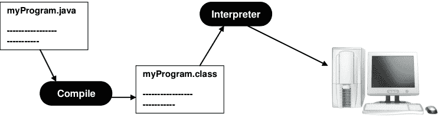

### 图 1.1 : 先编译后解释执行的 Java 程序

Java 字节码使得“编写一次，随处运行”成为可能。你可以在任何带有 Java 虚拟机（JVM）实现的平台上将你的程序编译成字节码。这意味着只要计算机安装了 Java 虚拟机，用 Java 编程语言编写的相同程序就可以在 Windows 2000、Unix 工作站或 iMac 上运行，如图 1.2 所示。

通常情况下，当你编译用 C 或 C++ 或大多数大多数其他语言编写的程序时，编译器会将你的程序翻译成机器码或处理器指令。这些指令特定于你计算机上运行的处理器——例如，如果你在 Pentium 系统上编译代码，生成的程序将只在其他 Pentium 系统上运行。如果你想在另一个系统上使用同一个程序，你必须回到源代码，获取该系统的编译器并重新编译你的代码。

> **Java 虚拟机 (JVM)**：Java 编译器产生一种名为字节码的中间代码，用于针对一个不存在的机器。这台机器被称为 JVM，它只存在于字节码内部。字节码也被称为虚拟机代码，它们不是真正的机器码。真正的机器码仅由 Java 解释器生成。

```java
class HelloWorld {
    public static void main(String[] args) {
        System.out.println("Hello World!");
    }
}
```

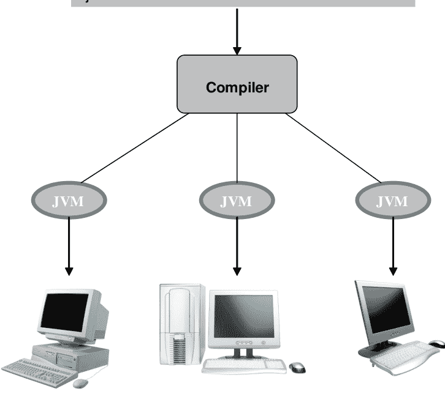

### 图 1.2 : 写一次即可在几乎任何平台上运行

## 1.7 JAVA 环境

Java 环境包含了大量的开发工具以及数百个类和方法。开发工具是称为 Java 开发工具包（JDK）的系统的一部分，而类和方法是 Java 标准库（JSL）的一部分，也称为应用程序接口（API）。

**Java 开发工具包**：Java 开发工具包包含了一组用于开发和运行 Java 程序的工具。

其中一些包括：

- Java 应用程序加载器。该工具是一个解释器，可以解释由 `javac` 编译器生成的类文件。
- 编译器，将源代码转换为 Java 字节码。
- 归档器，将相关的类库打包成单个的 JAR 文件。
- 文档生成器，从源代码注释中自动生成文档。
- Java 调试器。
- 进程状态，显示当前 Java 进程的信息。
- 类文件反汇编器。
- Appletviewer 工具可以在没有网络浏览器的情况下运行和调试 Java applet。
- C 头文件和存根生成器，用于编写本地方法。

应用程序编程接口（API）是软件程序实现的一种接口，用于与其他软件进行交互，类似于用户界面促进人与机之间的交互的方式。Java API 包含了分组在几个功能包中的数百个类和方法。最常用的包包括：

- 语言支持包
- 工具包
- 输入/输出包
- 网络包
- AWT（抽象窗口工具）包
- Applet 包

## 1.8 安装 JAVA SDK

Java 是一种编程语言，它允许编写可以在多种操作系统上运行的程序。只要安装了 Java 运行时环境，用 Java 编写的程序就可以在 Windows、UNIX、Linux 等系统上运行。

如果你初初只是想运行 Java 程序，请下载 Java 运行时环境，即 JRE。假设你想为 Java 开发应用程序，请下载 Java 开发工具包或 JDK。JDK 包含了 JRE，因此你不需要分别下载它们。

你可以通过此 URL `http://www.sun.com/javase/downloads/index.jsp` 从 Sun Microsystems 免费下载 JDK。

第一个下载页面看起来应该是图 1.3 顶部的页面。

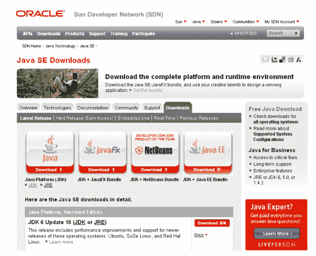

### 图 1.3 : JDK 下载页面

点击显示的 Download JDK 选项卡，这将 `jdk-6u18-windows-i86.exe` 文件保存到你的电脑。

下载完成后，要安装软件，请下载 .exe 文件，这将根据某些指令自动安装软件。

JDK 具有如图 1.4 所示的目录结构。

# JAVA 简介

# 第 1

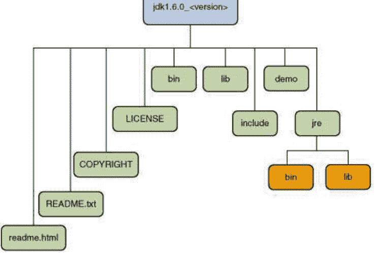

### 图 1.4 JDK 目录结构

要在命令行上编译 Java 程序，你将使用 `javac` 命令；要在命令行上运行编译后的程序，你将使用 `java` 命令。这些命令通过运行位于 C 盘 `jdk1.6.0_18` 文件夹下 `bin` 文件夹中的 `javac.exe` 和 `java.exe` 程序执行。为了你的操作系统（例如 Windows 或 Linux）能够运行这些程序，你必须告诉它它们的位置，即如果你想能够从任何目录方便地运行 JDK 可执行文件（`javac.exe`、`java.exe`、`javadoc.exe` 等），你可以设置 `PATH` 变量。

如果你不设置 `PATH` 变量，每次运行时都需要指定可执行文件的完整路径，如下所示：

```bash
C:"Program Files\Java\jdk1.6.0_18\bin\javac" MyClass.java
```

设置 PATH 变量的方法：

- 点击 开始 > 控制面板 > 系统（Windows XP）或 高级 > 环境变量。
- 将 JDK 安装的 bin 文件夹添加到用户变量和系统变量的 PATH 中。

# 第二单元：编程基础

## 2.1 学习目标

学习本单元后，你将能够：

- 定义标记
- 定义 Java 中的变量、常量数据类型
- 声明并定义变量
- 定义使用的各种运算符
- 使用控制语句

## 2.2 引言

上单元是一个介绍性单元，你已经熟悉了 Java 编程语言的面向对象特性。上单元还介绍了 JDK 的安装。

在本单元中，我们将讨论 Java 编程的基础，包括标记、变量、常量等。对于学习过 C/C++ 等语言的学习者来说，这可能是一个复习。通过增加与 Java 相关的新概念，我们将扩展讨论。不同的控制语句如 `if`、`if-else`、`while`、`for`、`break`、`continue` 等将在本单元中涵盖。

# 编程基础运算符包私有 第 2 单元

| protected | public | rest | return | short |
| :--- | :--- | :--- | :--- | :--- |


| static | super | switch | synchronized | this |
| threadsasafe | throw | throws | transient | true |
| try | var | void | volatile | while |

**标识符**（Identifiers）：Java 标识符用于为程序中的类、方法、变量、对象和标签命名。这些实际上是程序员设计的标记（tokens）。标识符的命名有一些规则，如下：

- 标识符名称可以由字母、数字、美元符号（`$`）和下划线（`_`）组成。
- 标识符名称不能以数字开头。
- 大写字母和小写字母是区分的。
- 标识符名称中不允许有空格。
- 它们可以是任意长度。

在编写 Java 程序时，程序员应该遵循以下命名规范：

- 所有局部变量和私有变量仅使用小写字母。如果需要，使用下划线连接单词。例如：`total_marks` `average`
- 当名称中使用多个单词时，第二个及随后的单词首字母要大写。例如：`Date of Birth`, `Total Marks`, `Student Name`
- 所有公共方法和接口变量的名称以小写字母开头。例如：`total`, `average`。
- 所有类和接口以大写字母开头。例如：`HelloJava` `员工` `ComplexNumber`
- 变量表示常量值的变量使用所有大写字母，如果需要，在单词之间使用下划线。例如：`PI` `RATE` `MAX_VALUE`

- **字面量**（Literals）：Java 中的字面量是字符序列，如数字、字母和其他字符，它们代表了要存储在变量中的常量值。
- **运算符**（Operators）：运算符是接收一个或多个参数并对其进行操作以产生结果的符号。我们将在 2.7 节中解释各种运算符。
- **分隔符**（Separators）：分隔符是用于指示代码组排列和划分的符号。Java 分隔符如下：
    - `{}` 大括号
    - `()` 圆括号
    - `[]` 方括号
    - `;` 分号
    - `,` 逗号
    - `.` 点号

## 2.4 变量

变量是一个标识符，表示一个可以存储数据的存储位置。特定程序中变量的值在程序执行期间可能会改变。

我们必须为程序中要使用的每个变量提供名称和类型。变量的名称必须是合法的标识符。变量的类型决定了它可以持有什么值以及可以对其执行什么操作。有效的变量名有：`sum`, `student_age`, `totalMarks` 等。变量的命名规则与标识符相同，已经在上一节中讨论过。变量名中不允许有空格。与 C、C++ 等语言一样，Java 中变量声明的通用语法如下：

```
type name ;
```

### 2.4.1 变量的作用域

除了显式赋予变量的名称和类型外，变量还有作用域。可以使用变量名称的代码段就是该变量的作用域。变量的作用域由变量声明的位置隐式决定，即声明相对于其他代码元素的位置。我们将在本节中学习更多关于 Java 变量的作用域。

Java 变量根据其作用域分为三类：局部变量、实例变量和类变量。

- **局部变量**是在方法内部声明并使用的变量。在方法定义外部无法使用，因此被称为局部变量。局部变量也可以声明在定义在左括号 `{` 和右括号 `}` 之间的程序块中。这些变量仅对程序可见。
- **实例变量**在实例化类对象时创建。每个对象可以取不同的值。
- **类变量**对于一个类来说是全局的，属于该类创建的所有对象的集合。每个类变量只保留一个内存位置。实例变量和类变量声明在类内部。


方法：方法是执行特定任务的子程序

## 2.5 常量

在程序运行时，可能会在不同时间给变量分配不同的值（因此称为*变量*，因为它包含的值可以发生变化），但在某些情况下，我们不希望发生这种情况。如果我们希望一个值保持固定，则使用常量。Java 中的**常量**是指在程序执行期间不改变的固定值。常量的声明方式与变量类似，但多了一个额外的关键字 **final**。常量必须在声明时赋予一个值。

因此，通用语法为：

`final type name = value ;`

这里是声明一些常量的示例：

`final double PI = 3.14159;`

`final int PASS = 200;`

Java 支持多种类型的常量，如整数常量、实数常量、字符常量、字符串常量。

- **整数常量**：整数常量是数字序列。例如，十进制常量：`1`, `2`, `3`；八进制：`025`；十六进制：`0X`。
- **实数常量**：实数常量是包含小数部分的数字。例如，`2.5`, `5.75`, `-2.358`。即带有小数点的数字序列是浮点类型。指数计数法：`1.54`。
- **字符常量**：字符常量包含单引号内的单个字符。例如 `'A'`, `'c'`。
- **字符串常量**：它是双引号之间的字符序列。例如：`"Hello"`, `"Java"`。

# 编程基础

# 第 2 单元

- **转义序列**：Java 支持一些序列
    - `\b` 退格
    - `\n` 换行
    - `\f` 馈页
    - `\r` 回车
    - `\t` 制表符
    - `\'` 单引号
    - `\"` 双引号
    - `\\` 反斜杠

## 2.6 数据类型

每个变量必须有一个数据类型。数据类型决定了变量可以包含什么以及对其执行的操作。基本类型也称为固有类型或内置类型。基本类型如图 2.1 所示

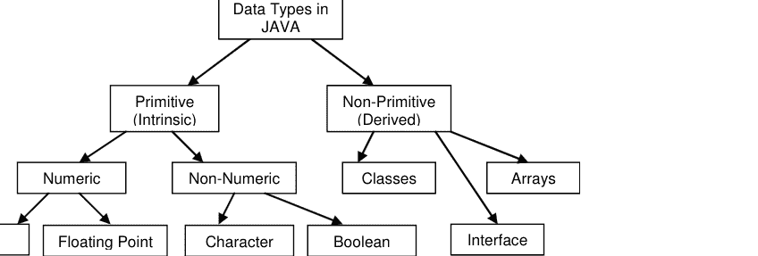

图 2.1：Java 数据类型

基本类型描述如下：

- **整数类型**：整数类型可以持有 `1`, `2`, `3` 等整数。Java 支持四种整数类型：`byte`, `short`, `int` 和 `long`。它不支持符号类型，因此所有 Java 值都是符号类型。这意味着它们可以是正的。同样，我们必须使用 `byte` 类型来存储数字而不是 `int`。这是因为较小的数据类型处理时间更短。我们可以在数字后加上 `'L'` 或 `'l'` 来指定长整数。建议使用 `'L'` 以免与数字 `'1'` 混淆。
- **浮点类型**：浮点类型可以持有包含小数部分的数字，如 `2.5`, `5.75`, `-2.358`。即带有小数点的数字序列是浮点类型。Java 中有两种浮点存储类型。它们是：**float**（单精度浮点）和 **double**（双精度浮点）。通常情况下，浮点数被处理为双精度数值。为了强制它们处于单精度模式，我们必须在数字后面加上 `'f'` 或 `'F'`。例如 `5.23F`, `2.25f`。
- **字符类型**：Java 提供了一种字符数据类型在内存中存储字符常量。它由关键字 `char` 表示。`char` 类型的大小为 2 字节。
- **布尔类型**：布尔类型只能取两个值：**true** 或 `false`。用于我们在程序执行期间测试特定条件。它由关键字 `boolean` 表示，并使用 1 字节存储。

所有八种基本数据类型的内存大小和范围在下表 2.2 中给出：

### 表 2.2 : 基本数据类型的大小和范围

| 类型 | 大小 | 最小值 | 最大值 |
| --- | --- | --- | --- |
| byte | 1 byte | -128 | 127 |
| short | 2 bytes | -32, 768 | 32, 767 |
| int | 4 bytes | -2, 147, 483, 648 | 2, 147, 483, 647 |
| long | 8 bytes | -9, 223, 372, 036, 854, 775, 808 | 9, 223, 372, 036, 775, 807 |
| float | 4 bytes | 3.4e-038 | 3.4e+038 |
| double | 8 bytes | | 1.7e+038 |
| char | 2 bytes | 单个 Unicode 字符 | |
| boolean | 1 byte | 一个布尔值（true 或 false） | |

除了八种基本类型外，JAVA 中还有三种**非基本**类型。它们也被称为*引用或或派生*类型。非基本类型包括**数组、类和接口**。与基本类型相比，非基本类型的值是指向变量所表示的值或一组值的引用（即内存地址）。这些内容将在后文中遇到它们时进行讨论。

## 课后自测

- Q1. 下列中哪些是合法的变量名？`char`, `float`, `anint`, `p`, `4`, `total-marks`, `total_matks`, `sum10digit`, `num2`, `MARKS`, `super` .
- Q2. Java 的八种基本类型是什么？
- Q3. 判断对错（true 或 false）：
   i) 常量的声明方式与变量相似，但多了一个保留关键字 `final`。
   ii) Boolean 使用 2 字节存储空间。
   iii) 数组是非基本类型的示例。
   iv) 标识符名称不能以数字开头。
   v) 变量名可以仅由字母和数字组成。


## 2.7 运算符与表达式

运算符是表达式中常用的特殊符号。运算符对一个、两个或三个操作数执行某种功能。需要一个操作数的运算符称为一元运算符。例如，`++` 是一个一元运算符，它将其操作数的值加 1。需要两个操作数的运算符称为二元运算符。例如，`=` 是二元运算符，将右侧的操作数的值赋予左侧的操作数。最后，三元运算符是需要三个操作数的运算符。

Java 编程语言有一个三元运算符 (`?:`)。表达式是 Java 中简单的语句形式，实际上实现了相同的操作。

许多 Java 运算符与其他编程语言中的运算符相似。Java 支持大多数 C++ 运算符。此外，它还支持一些特有的运算符。Java 中的运算符包括算术、赋值、递增递减、关系和逻辑运算。本节描述了所有这些操作。

**算术运算符**：Java 具有表 2.3 所示的用于基本算术的运算符。

| 运算符 | 含义 | 示例 |
| --- | --- | --- |
| `+` | 加法 | `2 + 3` |
| `-` | 减法 | `5 – 2` |
| `*` | 乘法 | `2 * 3` |
| `/` | 除法 | `14 / 4` |
| `%` | 取模 | `14 % 4` |

在表中，每个运算符接受两个操作数，分别位于运算符的两侧。整数除法得到整数。由于整数没有小数部分，任何余数都会被忽略。`14/3` 的结果是 3。取模（`%`）在操作数被整除后给出余数。例如，`14 % 4` 的结果是 2，因为 14 除以 4 三次余 2。下面是一个算术运算的示例程序：

### 程序 2.1 : OperatorDemo.java

```java
public class OperatorDemo {
    public static void main(String[] args) {
        int a = 5, b = 3;
        double x = 5.5, y = 5.2;
        System.out.println("Variable values :");
        System.out.println("a = " + a);
        System.out.println("b = " + b);
        System.out.println("x = " + x);
        System.out.println("y = " + y);
        System.out.println("\nAddition...");
        System.out.println("a + b = " + (a + b));
        System.out.println("\nSubtraction...");
        System.out.println("a - b = " + (a - b));
        System.out.println("\nMultiplication...");
        System.out.println("a * b = " + (a * b));
        System.out.println("\nDivision...");
        System.out.println("a / b = " + (a / b));
        System.out.println("\nModulus...");
        System.out.println("a % b = " + (a % b));
    }
}
```

上述程序的输出将为：


图 2.2 : 程序 2.1 的输出

**赋值运算符**：赋值运算符用于将表达式的值赋予变量。通常赋值运算符是 `=`。通用语法如下：

```java
sum = 0; // 将 0 赋值给变量
x = x + 1;
```

像 C++ 一样，Java 也支持赋值的简写形式。例如，`x = x + 1;` 可以写成 `x += 1;`。

**递增递减运算符**：一元递增递减运算符 `++` 和 `--` 有两种形式：前置和后置。它们递增（或递减）操作数，并返回一个用于较大表达式的值。在前置形式中，它们先修改操作数，然后产生新值；在后置形式中，它们产生操作数的原始值，但在后台修改操作数。例如，取两个表达式：

由于前置和后置的区别，这些表达式的结果非常不同。当我们使用后置运算符（`x++` 或 `x--`）时，`y` 获取的是 `x` 增加之前的值；使用前置运算符时，`y` 获取的是 `x` 增加之后的值。

```java
y = x++;
y = ++x;
```

**关系运算符**：Java 有几种用于测试相等和大小的表达式。所有这些表达式都返回一个布尔值（即 true 或 false）。表 2.4 显示了关系运算符：

| 运算符 | 含义 | 示例 |
| --- | --- | --- |
| `==` | 等于 | `x == 5` |
| `!=` | 不等于 | `x != 10` |
| `<` | 小于 | `x < 7` |
| `>` | 大于 | `x > 4` |
| `<=` | 小于等于 | `y <= 8` |
| `>=` | 大于等于 | `z >= 15` |

**逻辑运算符**：结果表达式（例如关系运算符）可以使用表示逻辑组合与、或、异或和逻辑非的运算符进行组合。

对于与运算，使用 `&&` 符号。只有当两个操作数都为真时，表达式为真；如果任一表达式为假，整个表达式为假。

对于或运算，使用 `||` 符号。当操作数中的一个或两个都为真时，或表达式为真；如果两个操作数都为假，表达式为假。

此外，还有异或运算符 `^`，它仅在两个操作数不同（一个真一个假，反之亦然）时返回真，否则返回假（即使两者都为真）。

对于非，使用带有单个表达式参数的 `!` 符号。非表达式的值是表达式的取反；如果 `x` 为真，则 `!x` 为假。

**位运算符**：位运算符用于对整数中的单个位进行操作。表 2.5 总结了 JAVA 编程语言中的位运算符。当操作数是布尔值时，位与运算符 `&` 执行的操作与逻辑与 (`&&`) 相同。然而，它总是评估两个操作数，并在两者都为真时返回真。同样，当操作数是布尔值时，位或运算符 `|` 执行的操作与逻辑或 (`||`) 相似。该运算符始终评估两个操作数，当至少有一个操作数为真时返回真。当操作数是数字时，`&` 和 `|` 执行位操作。

| 运算符 | 含义 |
|---|---|
| `&` | 位与 |
| `|` | 位或 |
| `^` | 位异或 |
| `<<` | 左移 |
| `>>` | 右移 |
| `>>>` | 无符号位右移 |
| `~` | 位取反 |
| `<<=` | 左移赋值 (`x = x << y`) |
| `>>=` | 右移赋值 (`x = x >> y`) |
| `>>>=` | 无符号位右移赋值 (`x = x >>> y`) |
| `&=` | 与赋值 (`x = x & y`) |
| `|=` | 或赋值 (`x = x | y`) |
| `^=` | 异或赋值 (`x = x ^ y`) |

移位运算符通过将其第一个操作数的位向右或向左移动对数据进行位操作。例如，如果 `op1` 和 `op2` 是操作数，那么语句

```
op1 << op2;
```

将 `op1` 的位向左移动 `op2` 距离；右侧用零填充。而 `op1 >> op2;` 将 `op1` 的位向右移动 `op2` 距离；左侧用最高位（符号位）填充。

```
op1 >>> op2;
```

将 `op1` 的位向右移动 `op2` 距离；左侧用 0 位填充。每个运算符都将左侧操作数的位移动到右侧操作数所指示的位数。移位操作发生在运算符本身指示的方向上。

例如，语句 `25 >> 1;` 将数字 25 的位向右移动一位。数字 25 的二进制表示为 11001。11001 向右移动一位的移位操作结果为 1100，即十进制的 12。

Java 编程语言还支持表 2.6 所示的运算符。

### 表 2.6：其他运算符

| 运算符 | 描述 |
| --- | --- |
| `?:` | 条件运算符（三元运算符） |
| `[]` | 用于声明数组、创建数组以及访问数组元素 |
| `.` | 用于形成限定名 |
| `(params )` | 界定逗号分隔的参数列表 |
| `(type )` | 将值强制（转换）为指定的类型 |
| `new` | 创建新对象或数组 |
| `instanceof` | 确定第一个操作数是否是第二个操作数的实例 |

## 2.8 JAVA 中的输入/输出

Java 拥有丰富的从键盘输入和向显示器输出的方法和类。`Scanner` 类可以从键盘输入整数数据以及字符串数据。程序 2:2 用于从键盘输入两个整数数据并计算这两个数字之和。


# Java 程序示例与基础概念

## 程序示例

### Program 2.2: 从键盘读取两个数并求和

```java
import java.util.Scanner;
class Add_number {
    public static void main(String args[]) {
        Scanner sc = new Scanner(System.in);
        System.out.println("Enter the first Number : ");
        int a = sc.nextInt();
        System.out.println("Enter the Second Number : ");
        int b = sc.nextInt();
        int c = a + b;
        System.out.println("The result of addition is " + c);
    }
}
```

在这里，`Scanner` 是一个类，`sc` 是一个对象，`a`、`b` 和 `c` 是整数变量，`nextInt()` 是 `Scanner` 类的一个预定义方法。

### Program 2.3: 从键盘读取一个字符串并显示它

```java
import java.util.Scanner;
class String_read {
    public static void main(String args[]) {
        Scanner sc = new Scanner(System.in);
        System.out.println("Enter the Name : ");
        String name = sc.next();
        System.out.println("Name :" + name);
    }
}
```

## 检查进度

### Q4. 判断对错：

- i) 逻辑异或（XOR）运算符仅在两个操作数不同时返回 true。
- ii) 逻辑与（AND）运算符仅在两个操作数测试均为 false 时返回 true。
- iii) `x += 7;` 的效果与 `x = x + 7;` 相同。
- iv) `&&` 是逻辑与运算符的符号，`&` 是位与运算符的符号。

### Q5. 当 `x = 5`，`y = 10` 且 `z = -6` 时，确定以下每个表达式的值：

- i) `x > y && x < z`
- ii) `x == z || y > x`
- iii) `x < y && x > z`

## 2.9 总结

- 在本单元中，我们讨论了 Java 中所有的基本数据类型、运算符以及它们在表达式中的用法。
- Java 变量根据作用域分为三类：局部变量、实例变量和类变量。
- 在 Java 中，常量的声明方式与变量相似，但多了一个关键字 `final`。

## 2.10 扩展阅读

1. Balagurusamy, E. (2007). *Programming With Java: A Primer 3E*.
2. Schildt, H. (2000). *C/++ Programmer's Reference*. McGraw-Hill, Inc..
3. Deitel, P., & Deitel, H. (2011). *Java How to program*. Prentice Hall Press.

## 2.11 检查进度答案

- 第 1 题答案：`anInt`, `p`, `total_marks`, `sum10digit`, `num2`, `MARKS`
- 第 2 题答案：八种 Java 基本数据类型是 `boolean`, `char`, `byte`, `short`, `int`, `long`, `float` 和 `double`。
- 第 3 题答案：(i) True; (ii) False; (iii) True; (iv) True; (v) False
- 第 4 题答案：(i) True; (ii) False; (iii) True

## 2.12 习题

### Q1. 
(a) 考虑以下代码：
```java
int x = 10;
```
执行后 `x` 的值是多少？

(b) 考虑以下代码：
```java
int i = 8;
```
执行后 `i` 的值是多少？

(c) 考虑以下代码：
```java
int i++;
```
执行后 `i` 的值是多少？

### Q2. 语句的类型有哪些？

### Q3. 命名规则是什么？

### Q4. 举例说明：

# 第 3 单元：控制语句

## 3.3.1 switch 语句

我们已经看到，当要在多个选项中选择一个时，我们可以设计程序语句来控制选择。然而，当选项数量增加时，程序将变得难以阅读和遵循。

与 C/C++ 一样，Java 有一种内置的多分支决策语句，被称为 `switch`。`switch` 语句为代码块提供了变量入口点。

```java
switch (expression) {
    case value: statements;
    break;
    case value: statements;
    break;
    ...
    default: statements; // 可选的默认部分
    break;
}
```

表达式会被求值，并与每个由 `case` 关键字前缀的值逐一比较。这些值必须是常量（即在编译时可以确定），类型可以是 `byte`、`char`、`short`、`int` 或 `long`。

## 3.3.2 循环

在循环中，一组语句会被反复执行，直到满足循环终止的某些条件。重复执行一个语句块的过程被称为循环。此时，我们应该记住 Java 不支持 `goto` 语句。像 C/C++ 一样，Java 也提供了三种不同的用于循环的控制语句。这些语句是：

- `while`
- `do-while`
- `for`

### while 和 do-while 语句

我们使用 `while` 语句在条件保持为真时持续执行代码块。`while` 语句的通用语法为：

```java
while (expression) {
    statement(s);
}
```

首先，`while` 语句评估表达式，该表达式必须返回一个布尔值。如果表达式返回 `true`，`while` 语句将执行 `while` 块中的语句。`while` 语句继续测试表达式并执行其代码块，直到表达式返回 `false`。

Java 编程语言提供了另一种与 `while` 语句相似的语句：`do-while` 语句。`do-while` 的通用语法为：

```java
do {
    statement(s);
} while (expression);
```

与 `do-while` 关联的块中的语句至少执行一次。`do-while` 不是在循环顶部评估表达式，而是在底部评估表达式。

**Program 3.1: Fibo.java** 展示了一个 `while` 循环程序：

```java
class Fibo {
    public static void main(String args[]) {
        System.out.println("0\n1");
        int n0 = 0, n1 = 1, n2 = 1;
        while (n2 < 50) {
            System.out.println(n2);
            n0 = n1;
            n2 = n1 + n0;
        }
        System.out.println(n2);
    }
}
```

上述程序的输出将是 0 到 50 之间的斐波那契数列（即 0 1 1 2 3 5 8 13 21 34）。

### for 语句

`for` 语句提供了一种遍历值范围的紧凑方法。`for` 语句的通用形式如下：

```java
for (initialization; termination_condition; increment) {
    statement(s);
}
```

- **初始化**：初始化循环的表达式。它在循环开始时执行一次。
- **终止条件**：决定何时终止循环。该条件在循环每次迭代的顶部进行评估。
- **增量**：在循环每次迭代后被调用的表达式。

所有这些组件都是可选的。事实上，为了编写无限循环，我们可以省略这三个表达式：

```java
for (;;) {
    // 无限循环
}
```

通常，`for` 用于遍历数组中的元素或字符串中的字符。以下程序段使用循环来计算 1 到 50 的总和：

```java
for (i = 1; i <= 50; i++) {
    sum = sum + i;
}
```

## 3.3.3 分支语句

Java 编程语言支持分支语句：

- `break` 语句
- `continue` 语句
- `return` 语句

### break 语句

在 Java 中，`break` 语句有两种形式：无标签和带标签的。我们之前已经见过与 `switch` 一起使用的无标签 `break` 语句。正如所指出的，无标签 `break` 会终止包含它的 `switch` 语句，控制流转移到 `switch` 紧随后的语句。它可以用于终止 `for`、`while` 或 `do-while` 循环。`break`（无标签）形式会导致立即跳出循环，到达其结束后的第一条语句。当循环内部遇到 `break` 语句时，循环将立即退出，程序继续执行循环后的紧随语句。当循环嵌套时，`break` 只会退出包含它的那个循环。这意味着 `break` 将只会退出单个循环。

### continue 语句

`continue` 语句会导致立即跳转到它所关闭的最内层循环的结束，跳过任何中间的语句。它的写法为：

```java
continue;
```

`continue` 不会导致退出循环。相反，它会立即启动下次迭代。我们可以使用 `continue` 语句跳过 `for`、`while` 或 `do-while` 循环的当前迭代。

# Java 模块 1 (BCA) 第 4 单元：类与对象

## 4.1 类的定义

类中最多可以有一个类被声明为 `public`。源文件的文件名必须与公共类的名称匹配。如果源代码文件中没有 `public` 类，则文件名可以任意命名。类定义的通用形式如下：

```java
class className {
    type instanceVariable1;
    type instanceVariable2;
    ...
    type instanceVariableN;
    type methodName1(parameterList) {
        // body of method
    }
    type methodName2(parameterList) {
        // body of method
    }
    ...
    type methodNameN(parameterList) {
        // body of method
    }
}
```

在这里，我们可以看到，类的大括号后面没有分号。但在 C++ 语言中，类定义以分号结束。在类内部定义的数据或变量被称为字段或实例变量，因为类的每个实例（即该类的每个对象）都包含这些变量的独立拷贝。因此，一个对象的数据是独立且唯一的，与其他对象的数据分开。方法用于操作类中包含的实例变量（数据项）。在类内部定义的方法和变量统称为类的成员。类可以包含三种类型的成员：字段、方法和构造函数。构造函数指定了如何创建对象。

Java 类不需要有 `main()` 方法。类的通用形式并没有指定 `main()` 方法。只有当该类是我们程序的起点时，我们才指定它。类的字段和方法出现在类声明的大括号内。

类的大括号 `{ }` 内部可以不包含任何内容。因此，我们可以在 Java 中拥有空类。空类无法做任何事情，因为它不包含属性。但可以创建此类类的对象。空类的结构如下：

```java
class className {
}
```

让我们考虑另一个类 `Triangle`，它有两个 `float` 类型的实例变量 `base` 和 `height`。

```java
class Triangle {
    float base;    // instance variable base
    float height;  // instance variable height
}
```

在创建 `Triangle` 类的对象之前，内存中还没有为 `base` 和 `height` 这两个变量创建存储空间。当创建 `Triangle` 类的对象时，将为这两个字段中的每一个分配内存。

## 4.3.2 为类添加方法

方法是一系列封装在一起的声明和可执行语句，像一个独立的微型程序。为了操作类内部的字段，我们必须向类中添加方法。方法包含局部变量声明以及在方法被调用时执行的其他 Java 语句。

方法的组成部分：
- 方法名，可以是任何有效的标识符
- 返回值（即方法返回的值的类型）
- 参数列表，出现在括号内
- 方法定义（即方法体）

一个 Java 应用程序必须包含一个 `main()` 方法，其语法如下：

```java
public static void main(String args[]) {
    // body;
}
```

`public`、`static` 等关键字的含义已经在第 1 单元中列出。`void` 表示 `main()` 方法不返回任何值。

在 Java 中，方法的定义（通常称为方法体）必须出现在方法声明其后的大括号内。例如，让我们在 `Triangle` 类中添加两个方法。

```java
class Triangle {
    float base, height;
    void readData(float b, float h) { // definition of method
        base = b;
        height = h;
    }
    float findArea() { // definition of another method
        float area = 0.5 * (base * height);
        return area;
    }
}
```

在上面的代码中，`Triangle` 类演示了如何向类添加方法。在上面的类中有两个方法：`readData()` 和 `findArea()`。`readData()` 方法的类型为 `void`，因为它不返回任何值。我们向方法传递了两个 `float` 类型的值，这些值被赋值给实例变量 `base` 和 `height`。`findArea()` 方法计算三角形的面积并返回结果。在这里，我们可以在 `readData()` 和 `findArea()` 方法内部使用 `base` 和 `height`。

让我们考虑另一个方法 `checkPrime()` 作为说明。以下程序测试了一个布尔方法，该方法检查其参数是否为质数。`main()` 方法打印那些 `checkPrime()` 返回为 `true` 的整数：

**Program 4.1: checkPrime.java**

```java
class checkPrime {
    public static void main(String[] args) {
        for (int i = 0; i < 50; i++) {
            if (isPrime(i)) {
                System.out.print(i + " ");
            }
        }
        System.out.println();
    }
    static boolean isPrime(int n) { // static method
        if (n < 2)
            return false;
        if (n == 2)
            return true;
        // ... 后续逻辑省略
    }
}
```

## 4.3.3 创建对象

重要的是，类声明创建一个模板；`new` 运算符创建一个实例。因此，每当我们创建一个对象时，`new` 运算符都会为该对象分配存储。要创建一个对象，我们将使用：

```java
Triangle t1 = new Triangle();
```

在这里，`new` 运算符也被实例化。`new` 运算符创建类的实例。上面的语句可以写为：

```java
Triangle t1;
t1 = new Triangle();
```

## 4.3.4 访问类成员

数据和方法在类外部无法直接访问。为此，我们需要使用点运算符 `.`。点运算符将对象名称与数据成员或方法连接起来。访问类成员的语法为：

```java
objectName.instanceVariableName;
objectName.methodName(parameterList);
```

例如，假设我们使用以下语句创建了 `t1` 对象：

```java
Triangle t1 = new Triangle();
```

现在，要将 `20.5` 赋值给 `t1` 的 `base` 变量，我们将使用以下语句：

```java
t1.base = 20.5;
```


该语句告诉编译器将 `t1` 对象内部的 `base` 拷贝赋值为 20.5。这是一个使用 `Triangle` 类的完整程序。

```java
// Program 4.2 : Area.java

class Triangle {
    double base, height;

    void readData(double b, double h) // definition of method
    {
        base = b;
        height = h;
    }

    double findArea() // definition of another method
    {
        double a = 0.5 * (base * height);
        return a;
    }
}

class Area // class with the main()
{
    public static void main(String args[])
    {
        double areal, area2;

        Triangle t1 = new Triangle();
        Triangle t2 = new Triangle();

        t1.base = 20.5;
        t1.height = 15.5;

        areal = t1.base * t1.height;

        t2.readData(30.0, 15.0);
        area2 = t2.findArea();

        System.out.println("*Area of the first triangle is =*areal");
        System.out.println("\nArea of the second triangle is =*area2");
    }
}
```

# Java 模块 1 (BCA) 第4单元 (证明 1)

## Java 中的第4单元类

命名为 `Area.java`。如果我们使用上述数据执行程序，输出将如下所示：

```
Command Prompt
C:\j2dk\4.1.01\bin>java Area
Area of the first triangle is = 31.7
Area of the second triangle is = 225.0
```

图 4.2：程序 4.2 的输出

如果我们将这两个类 `Triangle` 和 `Area` 分别写入到两个独立的文件，即 `Triangle.java` 和 `Area.java`，那么这两个文件应该保存在计算机的同一个文件夹中。编译 `Area.java` 程序之前，我们必须首先编译 `Triangle` 类：

```bash
javac Triangle.java
```

这将在相同文件夹中创建字节码文件 `Triangle.class`。现在，我们可以使用以下语句编译并执行 `Area.java` 文件：

```bash
javac Area.java
java Area
```

如果我们查看文件夹的内容，将发现四个文件：`Triangle` 的源码和字节码，以及 `Area` 的源码和字节码。以下语句

```java
t1 = new Triangle();
t2 = new Triangle();
```

将在内存中创建两个 `Triangle` 对象 `t1` 和 `t2`，它们为两个基底字段、两个高度字段、两个 `readData()` 方法和两个 `findArea()` 方法预留了内存。它们通过我们使用的引用来区分。每个字段都使用点运算符通过以下语句在两个对象中初始化：

```java
t1.base = 20.5;
t1.height = 15.5;
```

`Triangle` 引用 `t1` 指向 `Triangle` 对象，其基底为 20.5，高度为 15.5。`t2` 对象的基底和高度字段通过语句初始化为 30.0 和 15.0：

```java
t2.readData(30.0, 15.0);
```

要计算三角形 `t1` 的面积，我们可以使用以下语句中的任意一个：

```java
area1 = t1.height;
```

```java
area1 = t1.findArea();
```

同样，对于 `t2`，我们可以使用

```java
area2 = t2.base * t2.height;
```

```java
area2 = t2.findArea();
```

## 4.4 构造函数

在创建对象时对其进行初始化会更加简单简洁。Java 支持构造函数，允许对象在创建时进行自我初始化。本节简要介绍了构造函数以及在 Java 中如何对构造函数进行重载。

构造函数始终由 `new` 运算符调用。构造函数的声明与方法相似，不同之处构造函数没有返回类型。构造函数的名称必须与它声明所在的类名相同。它在创建新类实例时被调用，为该类提供了一个设置对象供使用的机会。构造函数像其他方法一样可以接受参数并可以重载，但不能被继承。例如，让我们考虑同一个 `Triangle` 类。我们可以用构造函数替换 `readData()` 方法。可以通过以下方式实现：

```java
// 程序 4.3 : TriangleArea.java

class Triangle
{
    double base, height;

    Triangle(double b, double h) // 带两个参数的构造函数
    {
        base = b;
        height = h;
    }

    double findArea() // findArea() 方法定义
    {
        double area = 0.5 * (base * height);
        return area;
    }
}

class TriangleArea // 带有 main() 方法的类
{
    public static void main(String args[]) {
        Triangle t1 = new Triangle(20.5, 15.5); // 调用构造函数
        double area1 = t1.findArea();
        System.out.println("Area of the triangle is " + area1);
    }
}
```

程序的输出将是：Area of the triangle is 31.7

`Triangle` 类包含构造函数。我们可以识别出构造函数，是因为它的声明使用了与类相同的名称且没有返回类型。`Triangle` 类中的构造函数接受两个参数。语句 `t1 = new Triangle(20.5, 15.5);` 提供了 20.5 和 15.5 作为这些参数的值。

### 4.4.1 默认构造函数和拷贝构造函数

一个类可能具有两种特殊的构造函数：默认构造函数和拷贝构造函数。默认构造函数是我们通过调用不带参数的构造函数创建对象时被调用的构造函数。它将实例变量初始化为默认值（数值类型为零，对象引用为 `null`，布尔类型为 `false`）。一个类中可能只有一个默认构造函数。

拷贝构造函数是一种构造函数，其唯一参数是与构造函数所属同类对象的引用。它被称为拷贝，是因为它用于复制该类的现有对象。让我们考虑另一个例子来说说明这些构造函数：

```java
// 程序 4.4 : CircleArea.java

class Circle
{
    double radius;

    Circle() // 默认构造函数
    {
        radius = 10.0;
    }

    Circle(Circle c) // 拷贝构造函数
    {
        radius = c.radius;
    }

    double findArea() // 面积计算
    {
        double area = 3.14 * radius * radius;
        return area;
    }
}

class CircleArea // 带有 main() 方法的类
{
    public static void main(String args[])
    {
        Circle p = new Circle(); // 调用默认构造函数
        Circle q = new Circle(p); // 调用拷贝构造函数
        double p_area = p.findArea();
        double q_area = q.findArea();
        System.out.println("Area of circle p = " + p_area);
        System.out.println("Area of circle q = " + q_area);
    }
}
```

上述程序的输出将是：


图 4.3：程序输出

`Circle p = new Circle();` 调用默认构造函数并创建一个半径为 10.0 的对象 `p`。语句 `Circle q = new Circle(p);` 调用拷贝构造函数并创建另一个半径为 10.0 的对象 `q`。在输出中可以看到 `p` 和 `q` 的字段是相同的，使用了默认值。

### 4.4.2 构造函数重载

构造函数重载意味着同一个类中存在多个构造函数。程序 4.5 是构造函数重载的示例，因为该程序具有多个构造函数。编译器根据传递给构造函数的参数来区分构造函数。让我们考虑下面的 `Rectangle` 类来演示构造函数重载。通过学习它，构造函数重载的概念将更加清晰。在示例程序 4.5 中，我们编写了具有不同类型的构造函数。

```java
// 程序 4.5 : ConstructorOverloading.java

class Rectangle
{
    int l, b;      // int 类型长和宽
    float p, q; // float 类型长和宽

    Rectangle(int x, int y) // 构造函数 1
    {
        l = x;
        b = y;
    }

    int first() { // 方法
        return (l * b);
    }

    Rectangle(int x) // 构造函数 2
    {
        l = x;
        b = x;
    }

    int second() { // 方法
        return (l * b);
    }

    Rectangle(float x) { // 构造函数 3
        p = x;
        q = x;
    }

    float third()
    {
        return (p * q);
    }

    Rectangle(float x, float y) // 构造函数 4
    {
        p = x;
        q = y;
    }

    float fourth() { // 方法
        return (p * q);
    }
}

class ConstructorOverloading {
    public static void main(String args[]) {
        Rectangle r1 = new Rectangle(2, 4);
        int area1 = r1.first();
        System.out.println("\nArea in first constructor: " + area1);

        Rectangle r2 = new Rectangle(5);
        int area2 = r2.second();
        System.out.println("\nArea in second constructor: " + area2);

        Rectangle r3 = new Rectangle(2.0);
        float area3 = r3.third();
        System.out.println("\nArea in third constructor: " + area3);

        Rectangle r4 = new Rectangle(3.0, 2.0);
        float area4 = r4.fourth();
        System.out.println("\nArea in fourth constructor: " + area4);
    }
}
```

输出将如下所示：


图 4.4：构造函数重载示例输出

构造函数还可以使用 `this` 和 `super` 关键字调用其他构造函数。我们在这里通过例子来讨论第一种情况。构造函数可以使用 `this()` 引用配合适当参数调用同类中的另一个重载构造函数，以选择所需的构造函数。如果一个构造函数调用另一个构造函数，它必须作为第一条语句执行：`this()` 调用同一类中的另一个构造函数。下面的程序段展示了 `this` 关键字的使用。

```java
class Triangle {
    double base, height;

    Triangle(double b, double h) {
        base = b;
        height = h;
    }

    Triangle(double b) {
        this(b, 20.50);
    }
}
```

在这里，`Triangle` 类有两个构造函数。第一个接受指定三角形底边和高度的参数。第二个构造函数仅接受底作为参数，并用默认值 20.50 作为高度调用第一个构造函数。这种方法的优点是单个构造函数可以调用其他构造函数。它必须作为第二个构造函数的第一条语句出现。需要记住，我们只能作为另一个构造函数的第一条语句调用第二个构造函数。

## 4.5 向方法传递参数

在 Java 中，我们可以将任何有效 Java 数据类型的参数传递到方法中，类似于 C、C++ 等其他编程语言中的函数。这包括简单数据类型如字符、整数、浮点数、双精度浮点数和布尔，以及所需的类型如数组、对象等。参数为方法范围之外的方法提供信息。Java 方法始终指定一个返回类型。返回的值可以是基本类型、引用类型或 void（表示无返回值）。

方法或构造函数的声明定义了该方法或构造函数的参数的数量和类型。

例如，让我们考虑以下这个计算矩形面积的方法：

```java
int computeArea(int width, int height)    // 方法头
{
    int area; // area 是局部变量
    area = width * height;
    return area;
}
```

在这里，第一个部分表示该方法返回一个整数。方法名称为 `computeArea`，它有两个参数——长度和宽度。方法体以左大括号 `{` 开始，以右大括号 `}` 结束。可以使用以下语法调用该方法：

```java
int a = r1.computeArea(16, 8);    // 方法调用
```

- **形式参数与实际参数**：用于定义方法的参数被称为形式参数。在上面的示例中，`width` 和 `height` 是形式参数。我们使用实际参数一术语指代方法调用中的变量。它们被称为“实际”的是因为它们决定了发送到方法的实际值。

- 让我们考虑当向方法传递参数时会发生什么。在 Java 中，所有基本数据类型（例如 `int`、`char`、`float`）都是按值传递的。引用类型（即任何对象，包括数组和字符串）通过引用使用。重要的区别在于，引用本身（指向这些对象的指针）实际上是基本类型，也是按值传递的。

- **按值传递 (Pass-by-Value)**：按值传递意味着当我们调用方法时，每个实际参数值的副本被传递到方法中。我们可以在方法内部更改副本，但这对实际参数不会产生任何影响。与许多其他语言不同，Java 没有改变实际参数值的值的机制。Java 有八种基本数据类型。让我们考虑以下示例来演示按值传递：

```java
// Program 4.6 : PassPrimitiveByValue.java

class PassPrimitiveByValue {
    public static void main(String[] args) {
        int p = 3;
        System.out.println("Before calling passValue, p = " + p);
        passValue(p); // call passValue() with p as argument
        System.out.println("\nafter calling passValue, p = " + p);
    }

    public static void passValue(int p) // passValue() definition
    {
        // change the value of parameter
        p = 10;
    }
}
```


# Java 模块1 (BCA) 第4单元

## 4.5 按值传递与按引用传递

当我们运行此程序时，输出将是：

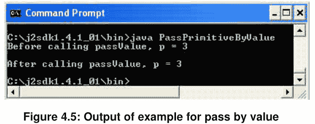

在这里，我们看到调用方法 `passValue()` 之前后的输出。当 Java 调用方法时，它会创建实际参数值的副本并将副本发送到方法中，它们在方法中成为形式参数的值。然后方法返回，这些副本被丢弃，而实际参数保持不变。

按值传递变量为程序员提供了一定的安全性。方法无法无意中修改其范围之外的变量。然而，我们通常希望方法能够修改其一个或多个参数。在 `passValue` 方法中，调用者希望方法通过其参数更改值。然而，方法无法修改其参数，而且，一个方法只能通过其返回值返回一个值。因此，有必要学习方法如何返回多个值，或者在它的范围之外产生影响（修改某些值）。

为了允许方法修改参数，我们必须传递一个对象。Java 中的对象也是按值传递的；但是，对象的值是一个引用。因此，效果是对象是按引用传递的。当按引用传递参数时，方法获取该对象的引用。对象的引用是该对象在内存中的地址。现在，方法内部的局部变量与调用者内部变量指向同一个内存位置。

例如，如果方法的参数是一个对象引用。我们可以以任何方式操作对象，但不能让引用指向不同的对象。

```java
// Program 4.7 : Record.java (demonstration of passing object to method)

class Record {
    int roll;
    String name;

    static void tryObject(Record r) { // parameter is an object reference
        r.roll = 1;
        r.name = "Anuj";
    }

    public static void main(String[] args) {
        Record obj = new Record(); // object obj of Record class
        obj.roll = 2;
        obj.name = "Rahul";

        System.out.println("Before calling tryObject(), the record is:" + obj.name);
        tryObject(obj); // method call
        System.out.println("After calling tryObject(), the record is:" + obj.name);
    }
}
```

输出中，我们看到调用 `tryObject()` 方法前后的不同记录。

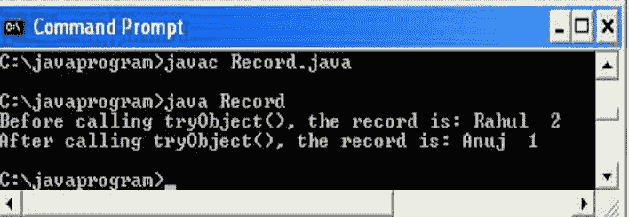

图 4.6：程序 4.7 的输出

第一个打印语句显示 "Rahul 2"。第二个打印语句显示 "Anuj 1"。因此，在这种情况下对象被更改。

`obj` 的引用是方法的参数，因此方法无法使用它更改引用；即，它不能让 `obj` 指向不同的 `Record`。但方法可以使用该引用对 `Record` 执行任何允许的操作。

在对象之外更改实例变量的值通常不是良好的编程风格。通常，对象应该有一个设置实例变量值的方法。

## 4.6 递归方法

Java 支持递归。递归是方法调用自身的过程。调用自身的方法被称为递归方法。

递归的一个合适示例是计算数字的阶乘。数字的阶乘是 1 到 N 之间所有数字的乘积，例如，4 的阶乘是 1x2x3x4，或 24。这里是使用递归方法计算阶乘的方法。

```java
// Program 4.8 : findFactorial.java

class findFactorial {
    public static void main(String[] args) {
        for (int i = 1; i <= 10; i++) {
            System.out.println("Factorial(" + i + ") = " + fact(i)); // method call
        }
    }

    static long fact(int n) { // method definition
        if (n < 2)
            return 1;
        return n * fact(n - 1); // Recursive call
    }
}
```

输出将显示 1 到 10 的阶乘，如下：

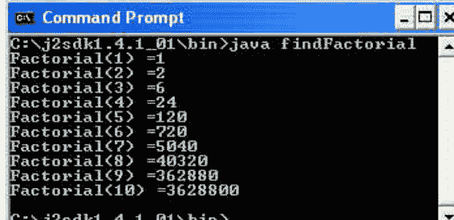

图 4.7：递归的演示

当 `fact()` 带参数为 1 调用时，函数返回 1；否则返回 `n * fact(n-1)` 的乘积。为了计算此值，`fact()` 被调用了 n-1 次。

## 检查进度

- **Q1 填空：**
  i) 在 Java 中，数据项被称为 __________。
  ii) __________ 被定义为类的实例。
  iii) Java 文件的命名范围应该是 __________。
  iv) 包含 `main()` 方法的类应该具有与 `.java` 后缀的文件名同名的 __________。
  v) Java 使用 __________ 操作符为对象分配存储空间。
  vi) __________ 操作符将对象的名称与实例变量或方法的名称连接起来。
  vii) 构造函数没有 __________。
  viii) __________ 调用同一类中的另一个构造函数。
  ix) 在 Java 中，所有原始数据类型都是方法的 __________。
  x) __________ 是用自身来定义某物的过程。
  xi) Java 中的对象也是通过 __________ 传递的。
  xii) 在按值传递的情况下，传递到方法的每个 __________ 的值的拷贝。
  xiii) 一个类只能有一个 __________ 默认构造函数。
  xiv) __________ 是一个复制现有对象的构造函数。
  xv) 构造函数用于 __________ 类的对象。

- **Q2.** 编写实现幂函数的方法定义：`static double Power(double x, int n)`。该方法应返回 x 的幂次方值。例如 `Power(2.0, -3)` 将返回 2^-3=0.125。

- **Q3.** 什么是构造函数签名？

## 4.8 修饰符

修饰符是用于修改这些定义以改变其含义的关键字。要使用修饰符，我们可以在类、方法或变量等的定义中包含其关键字。Java 语言具有许多多种修饰符，如表 4.1 所示。

表 4.1 中列出的某些修饰符用于在类、字段、方法、构造函数和局部变量定义中设置访问级别。这些被称为访问控制修饰符，包括：

- `private`：（仅对类可见）
- `public`：（对所有类可见）
- `protected`：（对包和所有子类可见）

如果未指定这三者中的任何（即默认值），则意味着（类、字段、构造函数或方法）具有包访问权限，这意味着它可以从相同包中的任何类进行访问。

- **private**: 私有访问修饰符是限制严格的访问级别。声明为 `private` 的变量、方法和构造函数只能在声明的类内部访问。类和接口不能是私有的。
- **public**: 声明为 `public` 的类、方法、构造函数、接口等可以从任何其他类访问。因此，在 `public` 类内部声明的方法和块可以从任何其他类访问。然而，如果我们尝试访问的 `public` 类位于不同的包中，该 `public` 类仍然需要导入。由于类的继承，类的所有 `public` 方法和变量都会被其子类继承。例如，应用程序的 `main()` 方法必须是 `public` 的。否则，它无法被 java 解释器（如 `java`）调用来运行该类。因此我们写道：

```java
public static void main(String[] arguments) {
    // 语句
}
```

- **protected**: 在父类中声明为 `protected` 的变量、方法和构造函数只能由其他包中的子类或受保护成员所属类所在包内的任何类访问。`protected` 访问修饰符不能应用于类和接口。方法和字段可以声明为 `protected`，但接口中的方法和字段不能声明为 `protected`。

为了实现其他功能，Java 提供了许多非访问修饰符，包括 `static`、`final`、`abstract`、`synchronized`、`volatile`。

- **static**: 修饰符 `static` 用于指定一个方法是类方法。没有它，该方法就是实例方法。实例方法是一种只有在绑定到类的对象时才能被调用的方法。类方法（也称为静态方法）是在可以在不绑定到类的任何特定对象的情况下被调用的方法。
- **final**: `final` 修饰符根据它修饰的实体类型具有不同的作用。如果它修饰一个类，则表示该类不能有子类。如果它修饰字段或局部变量，则意味着该变量必须初始化且不能更改（即它是一个常量）。

在课程描述不同程序时，我们将学习如何使用 `abstract`、`transient`、`volatile`、`native`、`synchronized` 等修饰符。

### 表 4.1：修饰符列表

| 修饰符类型 | 修饰符 | 含义 |
| :--- | :--- | :--- |
| **类修饰符** | `abstract` | 类不能实例化，即我们无法创建该类的对象。该类可以被扩展。 |
| | `final` | 类不能被扩展（继承）。 |
| | `public` | 它的成员可以从任何其他类访问（需导入）。 |
| | *(默认/包私有)* | 仅在同一包内可见。 |
| **字段修饰符** | `private` | 仅在自己的类内部访问。 |
| | `protected` | 仅在自己的类内部、同一包内及其子类访问。 |
| | `public` | 可以从所有类访问。 |
| | `final` | 一旦初始化不能更改（常量）。 |
| | `static` | 属于类而非实例。 |
| | `transient` | 序列化时忽略。 |
| | `volatile` | 保证线程可见性。 |
| **方法修饰符** | `abstract` | 无方法体，必须由子类实现。 |
| | `final` | 不能被重写。 |
| | `private` | 仅在自己的类内部访问。 |
| | `protected` | 仅在自己的类内部、同一包内及其子类访问。 |
| | `public` | 可以从所有类访问。 |
| | `static` | 属于类方法，无需实例调用。 |
| | `synchronized` | 线程同步。 |
| | `native` | 由本地代码实现。 |
| **构造函数修饰符** | `private` | 仅在自己的类内部访问（单例模式常用）。 |
| | `protected` | 仅在自己的类内部、同一包内及其子类访问。 |
| | `public` | 可以从所有类访问。 |
| **变量修饰符** (局部变量) | `final` | 一旦初始化不能更改。 |
| | *(无其他访问修饰符)* | 局部变量不能使用访问修饰符。 |

> *(注：原文表格内容存在重复与错误，已根据 Java 语言规范重构修正。)*

## 检查进度

- **Q4.** 公有和私有之间有什么区别？
- **Q5.** 类方法和实例方法之间有什么区别？

## 让我们总结

- Java 程序由类组织，类规定了对象的行为。
- 一个类可以包含方法、字段，其中一个具有特定形式的 `main` 方法：
  ```java
  public static void main(String[] args) {
      // 语句
  }
  ```
- 每个类必须保存在与类同名的文件中（后缀 `.java`）。
- 方法是声明和可执行语句的序列，执行某些任务，类似于 C/C++ 中的函数。
- 方法具有一些基本部分，如返回类型、方法名、参数列表（可选）、返回语句（如果方法有返回值）。如果返回类型为 `void` 则无需返回语句。
- 在 Java 中，我们可以向方法传递参数。方法调用中出现的参数是实际参数，方法定义中出现的参数称为形式参数。
- 原始类型（例如 `byte`、`short`、`int`、`long`、`char`、`float`、`double`、`boolean`）是按值传递给方法的。
- 对象的引用也可以作为参数传递给方法。
- 构造函数用于创建新对象。构造函数的名称必须与其所属的类名相同。它没有返回类型。构造函数通过 `this()` 关键字调用同一类中的另一个构造函数。
- 无参数的构造函数被称为默认构造函数。它是特殊的，如果类中没有其他构造函数，编译器会自动定义一个公共默认构造函数并将所有字段初始化为类型的默认值。
- 拷贝构造函数是一个唯一参数为所属类对象引用的构造函数。它通常用于复制类的现有对象。
- 当类中有多个构造函数时，被称为构造函数重载。所有构造函数的名称应与其所属的类相同，它们的类型和参数数量不同。
- 我们可以根据另一个类定义一个类。这被称为类继承。基类称为父类，派生类称为子类。父类也可以是另一个父类的子类。
- 子类构造函数体的第一条语句将调用父类的构造函数。如果没有这样做，编译器将插入对父类默认构造函数的调用。

## 4.9 扩展阅读

1. Balagurusamy, E. (2007). *Programming With Java: A Primer 3E*。
2. Schildt, H. (2000). *C/C++ Programmer's Reference*. McGraw-Hill, Inc..
3. Deitel, P., & Deitel, H. (2011). *Java How to program*. Prentice Hall Press.

## 4.10 练习答案

**第1 题答案：**
i) 字段; ii) 实例; iii) java; iv) 相同; v) new;
vi) 点; vii) 返回类型; viii) this(); ix) 按值传递;
x) 递归; xi) 按值; xii) 实际; xiii) 一个;
xiv) 拷贝; xv) 初始化

**第2 题答案：**
```java
static double power(double x, int n) {
    int i;
    double p = 1.0;
    for (i = 0; i < n; i++)
        p = p * x;
    for (i = 0; i < -n; i++)
        p = p / x;
    return p;
}
```

**第3 题答案：** 构造方法签名由构造方法的名称、参数数量和参数类型组成。当构造方法重载时，构造方法签名必须是唯一的。

**第4 题答案：** 公共（`public`）类成员可以从其他类的方法访问。私有（`private`）类成员只能从该类的方法中访问。

**第5 题答案：** 类方法被声明为静态（`static`）的，并使用类名调用。例如，`double p = Math.abs(q);` 调用了在 `Math` 类中定义的类方法 `abs()`。实例方法声明时不加 `static` 修饰符，并使用绑定的对象名称调用。例如，`double p = obj.nextDouble();` 调用了在 `Random` 类中定义的实例方法 `nextDouble()`，该方法绑定到该类的实例对象上。

---

# 第 5 单元：数组、字符串和向量

## 单元结构

- 5.1 学习目标
- 5.2 引言
- 5.3 数组
  - 5.3.1 声明数组变量
  - 5.3.2 创建数组
  - 5.3.3 初始化数组
- 5.4 二维数组
- 5.5 字符串
  - 5.5.1 方法
  - 5.5.2 StringBuffer
- 5.6 向量
- 5.7 总结
- 5.8 扩展阅读
- 5.9 练习答案
- 5.10 题

## 5.1 学习目标

在学习本单元后，你将能够：

- 为 Java 编程声明并初始化数组
- 使用 `arraycopy()` 方法
- 定义多维数组
- 描述字符串

## 5.2 引言

在上一个单元中，我们讨论了 Java 中的类和对象。数组是一种线性且同构的数据结构。在本单元中，我们将讨论数组以及在 Java 语言中如何声明和初始化数组。此外，本单元还涵盖了字符串和向量的概念。在下一个单元中，我们将探索与继承和多态相关的概念。

## 5.3 数组


# 数组、字符串与向量

## 第5单元 数组、字符串与向量

在基本数据类型中，每个标识符对应一个单一的值。当你需要处理一组相同类型的值时，数组是必不可少的。数组是存储在共同名称下的连续位置上的相关数据的集合。要引用数组中的特定元素，你可以使用数组名结合称为索引（`index`）的整数值。你已经熟悉了如何在 C/C++ 中声明数组。在 Java 中，它与 C++ 略有不同。创建一个数组有三个步骤：

a) 声明一个用于存放数组的变量
b) 创建内存位置
c) 将值放入内存位置

### 5.3.1 声明数组变量

在声明数组变量时，你并不强制创建数组本身。数组变量与数组本身是不同的。在 Java 中声明数组变量有两种方式：

```java
数据类型 arrayname[];
```

或

```java
数据类型[] arrayname;
```

例如：

```java
int[] sum;
float[] percentage;
int[] roll_number;
int[] primes;
```

记住，在这些声明中，没有为数组本身分配内存，也没有定义元素的数量。

### 5.3.2 创建数组

创建数组意味着为它分配内存。Java 允许我们使用以下语法创建数组：

```java
arrayname = new 类型[size];
```

例如：

```java
sum = new int[4];
percentage = new float[10];
roll_number = new float[15];
primes = new int[10];
```

关键字 `new` 表示正在为数组分配新内存，`int[4]` 指定你想为数组中的 4 个 `int` 类型变量提供容量。由于 `sum` 数组中的每个元素都是需要 4 字节的整数，整个数组将占用 16 字节，再加上 4 字节用于存储数组的引用。当像这样创建数组时，所有数组元素都被初始化为默认值。同样，对于 `percentage`、`roll_number` 和 `primes` 数组也会分配固定的大小。声明并创建的数组是一维数组，因为它的每个元素都是通过一个索引引用的。

### 5.3.3 初始化数组

在声明数组时，你可以用自己的值来初始化数组，并确定你将有多少个元素。紧随数组声明之后，只需添加等号以及花括号括起来的元素列表。

例如：

```java
int[] primes = {2, 3, 5, 7, 11, 13, 17};
```

这里，`primes` 是一个拥有 7 个元素的数组。数组的大小由值决定，因此不需要其他语句来定义。如果你只想显式设置某些数组元素，必须为所有元素指定值。

例如：

```java
int[] primes = new int[100];
primes[0] = 2;
primes[1] = 3;
```

第一个语句声明了一个 100 个元素的整数数组，它们都将被初始化为零。两个赋值语句设置了前元素的值。

你也可以用现有数组初始化数组。例如：

```java
int[] even = {4, 6, 8, 10};
int[] number = even;
```

这里，两个数组指向同一组元素，你可以通过任何一个变量名访问元素——例如 `even[2]` 指向 `number[2]`。

以下程序演示了一维数组的初始化：

**程序 5.1：计算数字列表的平均值。**

```java
class Average {
    public static void main(String args[]) {
        double nums[] = {50.1, 51.2, 52.3, 53.4, 54.5, 55.6, 56.7, 57.8, 58.9, 59.0};
        double result = 0;
        int i;
        for (i = 0; i < 10; i++)
            result = result + nums[i];
        System.out.println("Average is " + result / 10);
    }
}
```

输出：`Average is 54.95`

程序 2 和 3 演示了使用 `length` 对象计算给定数字列表中的最大值最小值。

**程序 5.2：从给定数字列表中找到最小值和最大值。**

```java
class FindNumber {
    public static void main(String[] args) {
        // 包含10个数字的数组
        int numbers[] = new int[] {12, 83, 50, 18, 22, 72, 41, 29, 43, 21};
        // 将数组的第一个元素赋值给最大值和最小值
        int smallest = numbers[0];
        int largest = numbers[0];
        for (int i = 1; i < numbers.length; i++)
            if (numbers[i] > largest)
                largest = numbers[i];
            else if (numbers[i] < smallest)
                smallest = numbers[i];
        System.out.println("*Largest Number is : " + largest);
        System.out.println("*Smallest Number is : " + smallest);
    }
}
```

输出：
`Largest Number is : 83`
`Smallest Number is : 12`

**程序 5.3：检查给定的数字是否为回文。**

```java
class Palindrome {
    public static void main(String[] args) {
        // 数字数组
        int numbers[] = new int[]{2332, 42, 11, 223, 24};
        // 遍历数字
        for (int i = 0; i < numbers.length; i++) {
            int number = numbers[i];
            int reversedNumber = 0;
            int temp = 0;
            // 反转数字
            while (number > 0) {
                temp = number % 10;
                number = number / 10;
                reversedNumber = reversedNumber * 10 + temp;
            }
            if (numbers[i] == reversedNumber)
                System.out.println(numbers[i] + " is a palindrome number");
            else
                System.out.println(numbers[i] + " is not a palindrome number");
        }
    }
}
```

输出：
```
2332 is a palindrome number
42 is not a palindrome number
11 is a palindrome number
223 is not a palindrome number
24 is not a palindrome number
```


**复用数组变量**：你可以使用数组变量在程序的不同点引用不同的数组。假设你之前声明并定义了变量 `primes`：

```java
int[] primes = new int[10]; // 分配一个包含10个整数元素的数组
```

这产生了一个包含 10 个元素的数组。可能你想让数组变量 `primes` 指向一个具有 50 个元素的更大的数组。你只需要：

```java
primes = new int[50]; // 分配一个包含50个整数元素的数组
```

现在变量 `primes` 指向一个新数组，其值类型与原始数组完全独立。当执行此语句时，之前的 10 个元素的数组将被丢弃，以及你可能存储在其中的所有数据值。变量 `primes` 现在只能用于引用新数组的元素。

> **回文（Palindrome）**：回文是指从正反两个方向读都相同的字符序列，即从左到右和从右到左都相同。例如：`madam`，`52125` 等。

## 5.4 二维数组

按行和列组织的表格是许多不同类型信息的非常有效手段。在 Java 中，我们用二维数组来表示表格。分配二维数组的通用语法为：

```java
type[][] arrayname = new type[rows][cols];
```

例如：

```java
int[][] matrix = new int[3][5];
```

这创建了一个 3 行 5 列的二维矩阵，可以存储 15 个整数值。我们已经熟悉 C 或 C++ 如何访问二维数组的元素。在 Java 中，也使用相同的技术。例如，要引用第三行第二列的元素，我们将其标记为：

```java
matrix[2][1]
```

我们也可以像下面所示初始化二维数组：

```java
int[][] matrix = {
    { 10, 5, -3, 9, 2 },
    { 1, 0, 4, 15, 6 },
    { -1, 7, 4, 9, 2 }
};
```

数组的维度数量没有限制。我们可以声明三维、四维及更高维的数组。然而，在面向对象的语言中，大于 2 维的数组并不常用。

图 5.1 展示了矩阵数组在内存中的表示：

| 列1 | 列2 | 列3 | 列4 | 列5 |
| --- | --- | --- | --- | --- |
| [0][0] | [0][1] | [0][2] | [0][3] | [0][4] |
| 行 0 | 10 | 5 | -3 | 9 | 2 |
| [1][0] | [1][1] | [1][2] | [1][3] | [1][4] |
| 行 1 | 1 | 0 | 14 | 5 | 6 |
| [2][0] | [2][1] | [2][2] | [2][3] | [2][4] |
| 行 2 | -1 | 7 | 4 | 9 | 2 |

图 5.1：矩阵数组的表示

以下程序演示了在 Java 编程中使用二维数组。程序 5.4 将简单地将初始化的元素列表作为输出。

**程序 5.4：以矩阵形式显示二维数组的元素。**

```java
class Matrix {
    public static void main(String[] args) {
        int mat[][] = {
            { 10, 5, -3, 9, 2 },
            { 1, 0, 14, 5, 6 },
            { -1, 7, 4, 9, 2 }
        };
        int i, j;
        for (i = 0; i < 3; i++) {
            for (j = 0; j < 5; j++) {
                System.out.print(mat[i][j] + " ");
            }
            System.out.println();
        }
    }
}
```

输出：
```
10, 5, -3, 9, 2
1, 0, 14, 5, 6
-1, 7, 4, 9, 2
```

多维数组实际上是数组的数组。这意味着我们可以创建长度不同的子数组。例如，下面的程序创建一个维度大小不等的二维数组，看起来像三角形。

**程序 5.5：以三角形形式显示二维数组的元素。**

```java
class TriangularArray {
    public static void main(String[] args) {
        int arr[][] = new int[4][];
        int i;
        for (i = 0; i < 4; i++) // 创建三角形数组
            arr[i] = new int[i + 1];
        int j, k = 0; // 分配元素
        for (i = 0; i < 4; i++)
            for (j = 0; j < i + 1; j++) {
                arr[i][j] = k;
                k++;
            }
        for (i = 0; i < 4; i++) // 显示元素
            for (j = 0; j < i + 1; j++)
                System.out.print(arr[i][j] + " ");
            System.out.println();
    }
}
```

输出：
```
0
1 2
3 4 5
6 7 8 9
```

## 进度

**Q1. 从下方选择正确答案：**

i) 关于数组的下列说法是正确的？
A. 数组是相同类型的变量组。
B. 元素通过索引定位。
C. 数组 c 的长度由表达式 `c.length()` 决定。
D. 数组 c 的第一个元素通过 `c[0]` 指定。
a) A, C, D.
b) A, B, D.
c) C, D.
d) A, B, D.

ii) 考虑下面的代码。下列哪个说法是不正确的？
```java
int g[];
g = new int[2];
```
a) 第一条语句声明了数组引用。
b) 第二条语句创建了数组。
c) `g` 是整数数组的引用。
d) `g[3]` 的值为 -1。

iii) 下列初始化列表哪个正确设置数组 n？
a) `int n[] = { 1, 2, 3, 4, 5 };`
b) `int n[] = { 1, 2, 3, 4, 5 };`
c) `int n[5] = { 1; 2; 3; 4; 5 };`
d) `int n = new int(1, 2, 3, 4, 5 );`

iv) 考虑以下 Java 程序：
```java
public class Test {
    public static void main(String args[]) {
        int a[] = { 99, 22, 11, 3, 11, 55, 44, 88, 2, -3 };
        int result = 0;
        for (int i = 0; i < a.length; i++) {
            if (a[i] > 30)
                result += a[i];
        }
        System.out.println("Result is: " + result);
    }
}
```
此 Java 程序的输出将是：
a) Result is: 280.
b) Result is: 154.
c) Result is: 286.
d) Result is: 332.

v) 下面哪个语句初始化数组 `items` 为 3 行 2 列？
a) `int items[][] = { 2, 4 }, { 6, 8 }, { 10, 12 };`
b) `int items[][] = { 2, 6, 10 }, { 4, 8, 12 };`
c) `int items[][] = { 2, 4 }, { 6, 8 }, { 10, 12 };`
d) `int items[][] = { 2, 6, 10 }, { 4, 8, 12 };`

vi) 26. 对于上一个问题中的数组，`items[1][0]` 返回值是多少？
a) 4
b) 8
c) 12
d) 6.

vii) 下列哪个语句创建一个 3 行的多维数组，其中第一行包含 1 个值，第二行包含 4 个项目，最后行包含 2 个项目？
a) `int items[][] = { 1, null, null, null }, { 2, 3, 4, 5 }, { 6, 7, null, null };`
b) `int items[][] = { { 1 }, { 2, 3, 4, 5 }, { 6, 7 } };`
c) `int items[][] = { { 1 }, { 2, 3, 4, 5 }, { 6, 7 }, {} };`
d) `int items[][] = { { 1 }, { 4, 2 } };`

## 5.5 字符串

字符串是字符序列。在 Java 中，字符串是 `String` 类的对象。`String` 和 `StringBuffer` 类是 Java 自带的标准类，它们专门设计为创建和处理字符串而设计。用双引号分隔的字符序列被称为字符串常量。Java 处理字符串常量的方式与其他计算机语言处理普通字符串的方式相同。`String` 类型的对象是**不可变**的，这意味着一旦创建了 `String` 对象，其内容就无法被修改。

由于 `String` 是一个类，我们可以创建一个实例和对象并给它命名。例如：

```java
String name;
name = new String("KKHHSOU");
```

与其他类不同，在 `String` 类中，显式使用 `new` 来创建实例或对象是可选的。因此，我们可以通过这种方式创建一个新的 `String` 对象：

```java
String name;
name = "KKHHSOU";
```

或者使用 `String name = "KKHHSOU";`

一旦你创建了 `String` 对象，你就可以任何允许字符串的地方使用它。例如，以下语句将显示 'KKHHSOU'：


## 5.5 字符串

字符串是字符序列。在 Java 中，字符串是 `String` 类的对象。`String` 和 `StringBuffer` 类是 Java 自带的标准类，它们专门设计为创建和处理字符串而设计。用双引号分隔的字符序列被称为字符串常量。Java 处理字符串常量的方式与其他计算机语言处理普通字符串的方式相同。`String` 类型的对象是**不可变的**，这意味着一旦创建了 `String` 对象，其内容就无法被修改。

由于 `String` 是一个类，我们可以创建一个实例和对象并给它命名。例如：

```java
String name;
name = new String("KKHHSOU");
```

与其他类不同，在 `String` 类中，显式使用 `new` 来创建实例或对象是可选的。因此，我们可以通过这种方式创建一个新的 `String` 对象：

```java
String name;
name = "KKHHSOU";
```

或者使用 `String name = "KKHHSOU";`

一旦你创建了 `String` 对象，你就可以在任何允许字符串的地方使用它。例如，以下语句将显示 'KKHHSOU'：

```java
System.out.println(name);
```

我们已经在使用 `String` 类下的 `length()` 方法来获取数组的长度。在需要查找字符串的长度时，我们也可以使用它。例如：

```java
int i = name.length();
```

Java 为 `String` 对象定义了一个运算符：`+`。它用于拼接两个字符串。

```java
String myString = "I" + " like " + "Java";
```

结果 `myString` 包含 "I like Java."。

下面的程序演示了上述概念：

// 程序 5.6：使用 + 运算符拼接两个字符串。

```java
class StringJoin {
    public static void main(String args[]) {
        String str1 = "Krishna Kanta Handique";
        String str2 = "State Open University";
        // str3 持有结果字符串
        String str3 = str1 + " " + str2;
        System.out.println("\nFirst String: " + str1);
        System.out.println("\nSecond String: " + str2);
        System.out.println("\nResultant String: " + str3);
    }
}
```

输出：
```text
First String : Krishna Kanta Handique
Second String : State Open University
Resultant String : Krishna Kanta Handique State Open University
```

### 5.5.1 字符串方法

`String` 类定义了许多方法，允许我们完成各种字符串操作任务。下表列出了一些常用的字符串方法。

| 方法调用 | 执行的任务 |
| :--- | :--- |
| `s2 = s1.toLowerCase();` | 将字符串 `s1` 转换为全小写 |
| `s2 = s1.toUpperCase();` | 将字符串 `s1` 转换为全大写 |
| `s2 = s1.replace('x', 'y');` | 将所有出现的 `x` 替换为 `y` |
| `s2 = s1.trim();` | 移除字符串 `s1` 首尾的空格 |
| `s1.equals(s2)` | 如果 `s1` 等于 `s2` 则返回 `true` |
| `s1.equalsIgnoreCase(s2)` | 如果 `s1` = `s2` 且忽略字符大小写则返回 `true` |
| `s1.length()` | 给出 `s1` 的长度 |
| `s1.charAt(n)` | 给出 `s1` 的第 `n` 个字符 |
| `s1.compareTo(s2)` | 如果 `s1` < `s2` 返回负数，`s1` > `s2` 返回正数，如果 `s1` 等于 `s2` 则返回零 |
| `s1.concat(s2)` | 拼接 `s1` 和 `s2` |
| `s1.substring(n)` | 给出从第 `n` 个字符开始的子字符串 |
| `s1.substring(n, m)` | 给出从第 `n` 个字符开始到 `m` 个（不包括 `m` 个）的子字符串 |

下面的程序演示了一些字符串方法的使用：

// 程序 5.7：给定如下字符串：
`BACHELOR OF COMPUTER APPLICATION FOURTH SEMESTER`

- 查找以下内容：
  - a) 它的长度，
  - b) 索引为 6 的字符
  - c) 将其转换为小写字母
  - d) 从 2 到 15 的子字符串
  - e) 子字符串的长度
  - f) 索引为 3 的字符

**解决方案：**

```java
class TestString {
    public static void main(String[] args) {
        String text = "BACHELOR OF COMPUTER APPLICATION FOURTH SEMESTER";
        System.out.println("\n\nThis string is :" + text);
        // 计算字符串的长度
        System.out.println("Length of the String is :" + text.length());
        // 查找索引 6 位置的字符
        System.out.println("The character at index 6 is :" + text.charAt(6));
        // 将字符串转换为小写字母
        System.out.println("The string in lowercase letter is :\" " + text.toLowerCase());
        // 查找主字符串的子字符串
        String sub = text.substring(2, 15);
        System.out.println("sub.substring(2, 15) : \" " + sub);
        // 子字符串的长度
        System.out.println("sub.length : \" " + sub.length());
        // 位置 3 的字符
        System.out.println("sub.charAt(3)");
    }
}
```

## 5.6 向量

你可以将向量视为一个可扩展的数组。在使用数组之前，你必须知道元素的最大数量以便对其进行声明。如果数组满了并且需要添加另一个元素，你需要声明一个更大的数组，复制所有元素并添加该元素。

向量隐藏了所有这些操作。向量也将其元素存储在数组中，但它会自动增加其容量，以确保之前所有的元素都能被存储。因此，当你预先不知道元素的数量时，请使用向量。向量是位于 `java.util` 包中的标准类。

Java 中数组和向量之间的主要区别在于向量是动态分配的。它们不是声明为包含某种类型的变量；每个向量存储一个指向其他对象的引用或指针的动态列表。由于向量存储的是对象的指针而不是对象本身，因此这些向量项可以是任何类型的对象。我们可以根据需要从列表中添加和删除对象。始终记住，我们不能直接在向量中存储简单数据类型（`int`、`float` 等）。

数组可以很容易实现为向量。向量的创建方式如下：

```java
Vector V = new Vector(); // 不带大小声明
```

```java
Vector V = new Vector(3); // 带大小声明
```

## StringBuilder 示例

```java
// Strings 的创建
StringBuilder strBuf = new StringBuilder("KKHSOU");
StringBuilder strBuf2 = new StringBuilder(40); // 容量为 40
StringBuilder strBuf3 = new StringBuilder(); // 默认容量 16
System.out.println("\n\nstrBuf : " + strBuf);
// 获取 StringBuilder 的容量
System.out.println("*strBuf capacity : " + strBuf.capacity());
System.out.println("*strBuf2 capacity : " + strBuf2.capacity());
System.out.println("*strBuf3 capacity : " + strBuf3.capacity());
// 获取 Buffer 的长度
System.out.println("*strBuf length : " + strBuf.length());
// 获取位置 2 处的字符
System.out.println("*strBuf charAt 2 : " + strBuf.charAt(2));
// 向 strBuf3 追加一个字符串
strBuf3.append("Fourth Semester BCA");
System.out.println("*strBuf3 when appended with a String : " + strBuf3.toString());
strBuf3.insert(16, 'M'); // 在位置 16 插入
System.out.println("*strBuf3 when M is inserted at 16 : " + strBuf3.toString());
strBuf3.delete(11, 14); // 删除从位置 11 开始到 14 的子字符串
System.out.println("*strBuf3 when deleted at 11 : " + strBuf3.toString());
strBuf3.reverse(); // 反转 strBuf3 的字符串常量
System.out.println("*Reversed strBuf3 : " + strBuf3);
strBuf2.setLength(12); // 将 strBuf2 的长度设置为 12
strBuf2.append("java programs"); // 向 strBuf2 追加字符串
System.out.println("*strBuf2 : " + strBuf2);
```

输出：

```
C:\WINDOWS\system32\cmd.exe

C:\JavaPrograms>javac Function_strbf.java

C:\JavaPrograms>java Function_strbf

strBuf capacity : 22
strBuf2 capacity : 40
strBuf3 capacity : 16
strBuf length : 6
strBuf charAt 2 : H
strBuf3 when appended with a String : Fourth Semester BCA
strBuf3 when M is inserted at 16 : Fourth Semester MBCA
strBuf3 when deleted at 11 : Fourth Sem
Reversed strBuf3 : ACBM retsemS htruof
strBuf2 : KKHSOUjava programs
C:\JavaPrograms>
```

图 5.4：程序 5.10 的输出


向量类支持许多用于操作所创建向量的方法。其中一些列在表 5.1 中：

### 表 5.1：向量类及方法

| 方法调用 | 执行的任务 |
| --- | --- |
| `v.addElement(item)` | 将指定的项添加到列表末尾 |
| `v.elementAt(n)` | 第 n 个对象的名称 |
| `v.size()` | 给出现有对象的数量 |
| `v.removeElement(item)` | 从列表中移除指定的项 |
| `v.removeAllElements()` | 移除列表中所有的元素 |
| `v.copyInto(array)` | 将所有项从列表复制到数组 |
| `v.insertElementAt(item, n)` | 在 n 位置插入该项。 |

**包装类**：向量无法处理如 `int`、`float`、`long`、`char` 和 `double` 等原始数据类型。可以使用 `java.lang` 包包含的包装类将原始数据类型转换为对象类型。表 5.2 显示了简单数据类型及其对应的包装类。

### 表 5.2：用于转换简单类型的包装类

| 简单类型 | 包装类 |
| --- | --- |
| `boolean` | `Boolean` |
| `char` | `Char` |
| `double` | `Double` |
| `float` | `Float` |
| `int` | `Int` |
| `long` | `Long` |

### 检查进度

**Q2. 填空：**

i) 数组用于声明其 ________。

ii) ________ 存储相同类型。

**Q3. 考虑以下字符串：**

```java
String strTest = "Programming in is";
```

a) `strTest.length()` 的值是多少？

b) `strTest.charAt(12)` 返回什么值？

c) ________

**Q4. 显示两种连接以下字符串以得到 "KKHSOU" 的方法：**

```java
String str1 = "KKH";
String str2 = "SOU";
```

**Q5. `String` 类和 `StringBuffer` 类之间的区别是什么？**

**Q6. 哪个包包含 `Vector`？**

## 5.7 字符串

* 字符串对象是不可变的。
* 使用 `length()` 方法获取字符串中的字符数量。
* `String` 类提供了连接、搜索和修改的方法——创建一个字符串对象。
* `StringBuffer` 对象是可以修改的字符串。
* 你可以更改 `StringBuffer` 的长度和容量。
* Java 不支持可变参数。这一功能可以通过 `java.util` 包中的向量类实现。

## 5.8 进一步阅读

1. Balagurusamy, E. (2007). *Programming With Java: A Primer 3E*。
2. Schild, H. (2000). *C/C++ Programmer's Reference*。McG-Hill, Inc.
3. Deitel, P., & Deitel, H. (2011). *Java How to program*。Prentice Hall Press.

## 5.9 检查进度的答案

| 题号 | 答案 |
| --- | --- |
| Q1 | i) b; ii) d; iii) a; iv) c; v) a; vi) d; vii) b |
| Q2 | i) `java.lang.String`; ii) array |
| Q3 | a) 26; b) i; c) `strTest.charAt(15)` |
| Q4 | `str1.concat(str2)` 和 `str1 + str2` |

**答案：** `String` 类的实例（对象）是不可变的：它们不能更改。`StringBuffer` 类的实例没有限制，即它们是可变的。

**Q6 答案：** `java.util` 包中的类。

## 5.10 模型习题

**Q1.** 什么是数组？

**Q2.** 写一个语句来声明并实例化一个存储学生在不同科目中分数的数组。根据你的情况做出假设。

**Q3.** 写一个两个矩阵相加的程序。

**Q4.** 写一个程序提取字符字符串的一部分并打印提取出的字符串。

**Q5.** 什么是向量？它与数组有什么不同？

**Q6.** `String` 类与 `StringBuffer` 有什么区别？

**Q7.** 写一个程序读取文本并统计特定单词出现的所有次数。

**Q8.** 写一个程序演示 `arraycopy()` 函数的用法。

---

# 第 6 单元：继承

## 单元结构

- 6.1 学习目标
- 6.2 引言
- 6.3 继承
  - 6.3.1 单继承
  - 6.3.2 多级继承
- 6.4 Final 关键字
- 6.5 抽象类与方法
- 6.6 静态成员
- 6.7 总结
- 6.8 扩展阅读
- 6.9 进度检查答案
- 6.10 题

### 6.1 学习目标

在学习完本单元后，你将能够：

- 定义 Java 中的继承
- 描述 Java 中不同类型的继承
- 描述抽象方法和抽象类
- 描述静态成员

### 6.2 引言

在上一个单元中，我们学习了数组、字符串和向量的概念。本单元的重点是继承和抽象类。继承是一种机制，一个对象可以获取父对象的所有属性和行为。通过使用继承，我们可以创建基于现有类的新类。当我们继承一个现有的类时，我们可以重用父类的方法和数据成员，也可以添加新的方法和数据成员。本单元还详细涵盖了抽象类和静态成员的概念。这是该模块的最后一个单元。因此，在下一个模块中，我们将探索与包、Java I/O、Applets 等更多内容相关的概念。

### 6.3 继承

可靠性是面向对象编程的重要特征之一，可以通过继承来实现。Java 支持继承的概念。通过使用继承，信息可以按照层次顺序变得易于管理。继承可以定义为一个对象获取另一个对象的属性的过程。当我们想要创建一个新类时，可以从现有类派生出新类。通过这样做，我们可以重用现有类的字段和方法，而无需重新编写它们。

从另一个类派生出的类被称为子类（也称为派生类、扩展类或子类）。子类继承其超类的所有成员（字段、方法和嵌套类）。子类所派生的那个类被称为超类（也称为基类或父类）。子类不能继承构造函数，但可以从子类中调用超类的构造函数。在 Java 中，继承是通过扩展过程实现的。要定义一个新类作为现有类的扩展，我们只需要在新类定义的头部使用 `extends` 子句。继承的概念被用于将事物从通用推向具体。

例如，当我们听到“vehicle”（车辆）这个词时，我们脑海中会出现一个形象，它从一个地方移动到另一个地方，用于旅行或运货，但这个词并没有指定它是两轮、三轮还是四轮，这是一个通用词。但“car”（汽车）这个词比 vehicle 提供了一个更具体的形象，即汽车有四个轮。这个例子说明 car 是具体的词，而 vehicle 是一般的。如果我们从技术角度考虑这个例子，vehicle 是超类（或基类或父类），而 car 是子类，因为每辆汽车都具有其父类（在本例中为 vehicle）的特征。现在，我们将描述继承的类型。

#### 6.3.1 单继承

当子类从其父类派生出来时，这种机制被称为单继承。在单继承的情况下，只有一个子类及其父类。它也被称为单级继承。

**程序 6.1**：显示单继承的程序

```java
class A // 超类 A
{
    int x;
    int y;
    int getValue(int p, int q)
    {
        x = p;
        y = q;
        return(0);
    }
    void Show() {
        System.out.println(x);
    }
}
class B extends A // 子类 B 继承了 A 的 getValue
{
    public static void main(String args[]) {
        A a = new A();
        a.getValue(5,10);
        a.Show();
    }
    void display() {
        System.out.println("I am in B");
    }
}
```

输出将只显示 5。`getValue()` 和 `Show()` 是超类 A 的成员。通过语句 `a.getValue(5,10);`，`getValue()` 是从类 A 继承的。由于类 A 的 `Show()` 方法只显示第一个参数，因此当在类 B 中通过语句 `a.Show()` 调用时，它只显示了一个值，尽管它接收了两个值 5 和 10。

#### 6.3.2 多级继承

这是继承的增强。当子类从父类派生出来时，这种机制被称为多级继承。派生类对于其父类（父类）被称为子类或子类。多级继承可以达到任何层级。

**程序 6.2**：显示多级继承的程序

```java
class A
{
    int x;
    int y;
    int get(int p, int q)
    {
        x = p;
        y = q;
        return(0);
    }
    void show() {
        System.out.println(x);
    }
}
class B extends A // 子类 B 继承自 A
{
    void Showb() {
        System.out.println("I am in B");
    }
}
class C extends B // 子类 C 继承自 B
{
    void Display() {
        System.out.println("I am in C");
    }
    public static void main(String[] args) {
        A a = new A();
        a.get(5,10);
        a.show();
    }
}
```

上述程序的输出将是 5。这里 `a` 是超类 A 的对象，它继承了 `get()` 和 `show()` 方法。子类 B 有方法 `Showb()`。类 C 是 B 的子类有一个方法 `Display()`。我们可以创建 B 和 C 类并使用这两个方法 `Showb()` 和 `Display()` 分别显示“I am in B”和“I am in C”。

将多个基类的特征继承到单个类的机制被称为多重继承。Java 不支持多重继承。但多重继承可以通过在类中实现多个接口来实现。

### 6.4 Final 关键字

`final` 关键字在不同的上下文中使用。下面描述了一些用法：

* **final 类**：有时出于安全考虑，我们可能防止类被进一步派生。如果我们在类声明前面写 `final` 关键字，那么该类就不能被继承，也就是说无法从该类创建子类。如下所示：

```java
final class A // A 不能被进一步扩展
{
//语句
}
```

* **final 方法**：我们可以用 `final` 关键字声明方法。声明为 `final` 的方法不能在子类中重写。声明 final 方法的主要原因是保证它不会被更改。为此，我们必须在访问修饰符之后、返回类型之前放置 `final` 关键字，如下：

```java
public final String convertText()
{
//语句
}
```

* **final 字段**：我们还可以声明字段为 `final`。这与将方法或类声明为 `final` 不是一回事。当一个字段被声明为 `final` 时，`final` 是一个不会且无法改变的常量。它可以被设置一次（例如在对象构造时，但之后不能再更改）。尝试更改它将产生编译时错误。

* **final 参数**：我们可以将方法参数声明为 `final`。这意味着该方法将不会直接修改这些参数。由于所有参数都是按值传递的，这并不是绝对要求的，但有时是有帮助的。

### 6.5 抽象类和方法

**抽象类**是具有至少一个**抽象方法**的类。抽象类不能实例化。**抽象方法**在类中并没有实际实现。它仅仅是在类中进行声明。该方法的主体会在该类的子类中实现。Java 允许通过 `abstract` 修饰符将声明的类和方法标记为抽象的。

让我们考虑以下示例来演示抽象类和方法。**程序 6.3** 定义了一个抽象类 `Shape` 和两个普通类 `Circle` 和 `Rectangle`。

```java
// Program 6.3 : 显示使用抽象类的程序
abstract class Shape                   // 抽象类
{
    abstract double Area();             // 抽象方法
    abstract double Circumference();   // 抽象方法
}
// 抽象类 Shape 有两个抽象方法：Area() 和
// Circumference()。作为抽象方法，它们仅通过
// 它们的原型进行声明。
class Circle extends Shape             // 派生类 Circle
{
    double radius;                     // 字段
    Circle(double radius)              // 构造函数
    {
        this.radius = radius;
    }
    double Circumference() // 方法
    {
        return 2 * 3.14 * radius;
    }
    double Area() // 方法
    {
        return 3.14 * radius * radius;
    }
}
// Circle 类有一个字段、一个构造函数和两个方法。
// 方法 Circumference() 和 Area() 实现了父类 Shape 中声明的
// 对应的抽象方法。

class Rectangle extends Shape // 派生类 Rectangle
{
    double length; // 用于指定长度的字段
    double breadth; // 用于指定宽度的字段
    Rectangle(double length, double breadth) // 构造函数
    {
        this.length = length;
        this.breadth = breadth;
    }
    double Area() // 方法
    {
        return length * breadth;
    }
    double Circumference() // 方法
    {
        return 2 * (length + breadth);
    }
}
// Rectangle 类有两个指定长度和宽度的字段，
// 一个构造函数和两个方法。两个方法 Circumference()
// 和 Area() 实现了父类中声明的对应的抽象方法。

class Demo
{
    public static void main(String[] args) {
        Rectangle r = new Rectangle(10.0, 6.0);
        Circle c = new Circle(4.0);
        System.out.println("The area of the rectangle is " + r.Area());
        System.out.println("The circumference of the rectangle is " + r.Circumference());
        System.out.println("The area of the circle is " + c.Area());
        System.out.println("The circumference of the circle is " + c.Circumference());
    }
}
```

输出将如下：

在程序中，在类中声明了抽象方法 `Area()`，是因为我们希望每个子类都拥有一个完整的方法来返回其实例的面积，并且我们希望所有这些方法具有相同的签名 `double Circumference()`。

抽象方法是一种没有实现的方法。它仅仅被声明，并将方法的主体留给子类来实现。

### 6.6 静态成员

静态成员可以在没有创建对象的情况下被使用。通常情况下，通过类名访问它们。静态方法与静态变量一样，属于类，而不是实例。静态方法可以访问类。

## 练习

**Q1.** `public` 方法和 `private` 方法之间有什么区别？

**Q2.** 静态方法和实例方法之间有什么区别？

**Q3.** 判断*对*或*错*：

i) 静态（类）方法绑定到类。

ii) 保护成员仅在所属类中访问。


iii) 私有成员仅在所属类中访问。

iv) 可以实例化抽象类。

v) 抽象方法是类的一部分。

vi) `final` 类不能被继承。

vii) 抽象类至少有一个抽象方法。

viii) 公方法对所有类都可见。

## 6.7 总结 (LET UP)

- 我们可以基于另一个类定义类。这被称为继承。基类称为*超类*，派生类称为*子类*。超类也可以是另一个超类的子类。

- 子类构造函数体的第一语句调用超类的构造函数。如果没有，编译器将插入对超类默认构造函数的调用。

- 修饰符是用于类、字段、方法、构造函数、局部变量的一些关键字。本单元描述了不同类型的修饰符，如 `public`、`private`、`protected`、`final`、`abstract`、`static` 等。

- 静态方法即使没有类对象也可以调用，但静态方法不能引用实例变量。

- 抽象方法没有定义体，使用 `abstract` 关键字声明。

- 抽象类是包含一个或多个抽象方法的类。它必须使用 `abstract` 属性定义。

### 6.8 扩展阅读 (FURTHER READINGS)

1) Balagurusamy, E. (2007). Programming With Java: A Primer 3E.

2) Schild, H. (2000). C/C++ Programmer's Reference. McGraw-Hill, Inc.

3) Deitel, P., & Deitel, H. (2011). Java How to program. Prentice Hall Press.

# Java 模块 1 (BCA) 单元-5 (证明 1)

## 单元 6

# 继承

调用在 `Random` 类中定义的类方法 `nextDouble()`，该方法绑定到该类的实例对象 `obj`。

第 3 题的答案：i) 正；ii) 正；iii) 正；iv) 错；v) 正；vi) 错；vii) 正；viii) 错


# 6.10 模拟习题

- Q1. 定义继承。它如何帮助我们快速创建新类？

- Q2. 讨论 Java 中提供的不同级别的访问保护。

- Q3. 什么是继承？请用一个合适的抽象类和抽象方法解释单继承。

- Q4. 什么是抽象类？请写一个显示抽象类和抽象方法的示例。

- Q5. 设计一个表示银行账户的类。包括以下数据成员：金额数字、存款人姓名、账户类型、账户余额。

方法：分配初始值

存款金额

检查余额后取款金额

显示存款人姓名和余额。

************

124

Java 编程（模块 1）

# Java 编程

第四学期 - IV

# 计算机应用学士

模块 - 2


# 克里希纳·坎塔·汉迪基州立开放大学

# 学科专家

Anjana Kakati Mahanta 教授，古哈提大学教授

Pranhari Talukdar 教授（退休），古哈提大学教授

Jyotiproshak Goswami 博士，阿萨姆工程学院副教授

课程协调员（（们）：Tapash Kashyap Das 博士，KKHSOU 助理

Sruti Sruba Bharali 女士，KKHSOU 助理

# 自学材料（SLM）编写团队

# 贡献者

- 7, 8, 9, 10, 11, 12

Pranjit Baruah 先生，KVK, Barpeta

# 编辑团队

内容：Minashi Gogoi 博士，GIMT

语言：Robin Goswami 教授，棉花学院退休教授

结构、格式与图形：Sruti Sruba Bharali 女士，KKHSOU

2019年1月

这本由克里希纳·坎塔·汉迪基州立开放大学编写的自学材料（SLM）根据知识共享 署名-非商业性-相同共享 4.0 许可（国际）提供：http://creativecommons.org/licenses/by-nc-sa/4.0/

由注册员代表克里希纳·坎塔·汉迪基州立大学打印并出版。

总部：Patgaon, Rani Gate, Guwahati - 781017；网站：www.khsou.in/web_new

城市办公室：Housefed Complex, Dispur, Guwahati - 781006

> 大学感谢新德里大学委员会（UGC）远程教育局为本学习材料的编制提供的财政支持。

# 目录

页码

单元 7 包与接口 129-145

包：定义包、理解类路径、导入包，接口：定义接口、实现异常、应用接口、接口中的变量

单元 8 异常处理 146-159

异常处理基础、异常类型、已捕获的异常。使用 `try` 和 `catch` 处理 Java 内置异常、自定义异常子类

单元 9 Java 中的 I/O 160-178

I/O 基础：流、流类、预定义流、读取控制台输入、写入控制台输出、读取和写入文件

单元 10 Applet 简介 179-200

Applet 与万维网、Applet 类、Applet 与 HTML、Applet 的周期、响应事件、使用窗口组件、添加音频和动画

单元 11 AWT 201-214

AWT 基础、AWT 组件、容器、事件处理、应用程序和菜单

单元 12 Swing 215-228

Swing：简介、Swing 组件、事件处理、在窗口中显示文本和图像、布局管理器。

# 模块导言

这是“Java 编程”课程的第二个模块。完成此模块后，学习者将能够使用不同的包和接口编写 Java 程序。学习者还将能够使用 Applet、AWT 和 Swing 编写 Java 程序。

该模块包含以下六个单元：

- 单元 7 向我们介绍了包和接口。该单元涵盖了定义和导入包的概念。该单元还介绍了定义接口以及如何应用接口。

- 单元 8 向我们介绍了异常处理。讨论了内置异常和用户自定义异常类等主题。

- 单元 9 向我们介绍了 Java 中的 I/O。讨论了流读取控制台输入、写入控制台输出、读取和写入文件。

- 单元 10 向我们介绍了 Applet。涵盖了 Applet 类、Applet 与 HTML、Applet 的周期、响应事件、使用窗口组件、添加音频和动画。

- 单元 11 处理 AWT。涉及 AWT 基础、组件、事件处理、应用程序和菜单。

- 单元 12 提供了 Swing 简介。涉及窗口显示文本和图像、布局管理器。

# 单元 7：包与接口

# 结构

- 7.1 学习目标

- 7.2 简介

- 7.3 包

- 7.3.1 内置包

- 7.3.2 自定义包

- 7.3.3 创建自己的包

- 7.4 理解类路径

- 7.4.1 设置类路径

- 7.5 导入包

- 7.6 接口

- 7.7 实现接口

- 7.8 接口中的变量

- 7.9 总结

- 7.10 阅读

- 7.11 进度检查

- 7.12 模拟习题

### 7.1 学习目标

通过本单元，你将能够：

- 描述包和接口

- 描述不同的

- 创建自己的包

- 使用类路径

- 定义并实现接口

### 7.2 简介

这是关于 Java 的第一个单元。我们学习了继承。

### 7.3 包

包是类、接口和子包的集合。Java 中有两种包：预定义的包或自定义包。让我们看看包的一些特性：

- 重用性：代码重用是软件行业最重要的需求之一。重用可以节省时间、精力并确保一致性。易于定位：在现实生活中可能会需要定义同名的文件。这会导致“冲突”。包是避免“冲突”的方法。

### 7.3.1 内置包

内置包是作为 JDK（Java 开发工具）的一部分提供的，用于简化 Java 编程任务。Java 核心包以 `java` 开头。例如：`java.lang.*`。我们在表中介绍了九个内置包。

# 表 7.1：某些内置包

| 包名 | 包描述 |

|--- |--- |

| `java.lang.*` | 每个 Java 程序导入的包。该包用于将数据转换为其他数据、在控制台显示结果等。 |

| `java.io.*` | 该包用于文件处理应用程序，例如以读取或写入模式打开文件、读取或写入数据等。 |

| `java.awt.*` | 该包用于开发图形用户界面（GUI），如按钮、复选框等。 |

| `java.awt.event.*` | 这是 `awt` 包的子包。用于为 GUI 组件提供功能。例如当按钮被点击或复选框被勾选时。 |

| `java.applet.*` | 该包用于开发浏览器型应用程序。Applet 是在浏览器中运行的 Java 程序。 |

| `java.net.*` | 该包用于开发客户端/服务器应用程序。 |

| `java.util.*` | 该包包含各种类和接口，可以提高应用程序的性能。 |

| `java.text.*` | 该包用于格式化日期和时间。 |

| `java.lang.reflect.*` | 它是 `lang` 包的子包。通常用于研究类或接口的运行时信息。 |

| `java.sql.*` | 该包用于对数据库执行各种操作。 |

### 7.3.2 用户自定义包

用户自定义包是由程序员开发的，用于简化 Java 编程任务，它将一组常用的类、接口和子包组合在一起。如果某个类或接口被许多 Java 程序员经常使用，那么该类或接口必须存放在包中。

创建包非常简单，只需在 Java 源文件的第一行包含 `package` 语句即可。包语句的一般形式如下：

```java
package <package name>;
```

以下语句创建了一个名为 `MyFirstPackage` 的包：

Java 使用文件系统目录来存储包。例如，任何声明为 `MyPackage` 部分的类的 `.class` 文件必须存储在名为 `MyPackage` 的目录中，且目录名称与包名完全匹配。

我们可以创建包的层级结构。多级包语句是：

```java
pack1[pack2[pack3.....packn]].
```

## 7.3.3 创建你自己的包

要创建一个类的包，你必须遵循三个基本步骤。下文进行了解释：

### a) 选择包名

第一步是给包命名。你为包选择的名称取决于你将如何使用这些类。包名的选择方式应该能够唯一标识你的工作。

Sun 推荐的包命名惯例之一是使用你的域名并反转元素。例如，`sun` 的包将使用 `com.sun.java` 的名称进行引用，而不仅仅是 `java`。按照惯例，包名倾向于以小写字母开头，以区分类名。因此，例如，在内置 `String` 类的全名 `java.lang.String` 中，从视觉上更容易将包名与类名分离。这种约定有助于减少冲突。

### b) 创建目录结构

创建包的第二步是在你的磁盘上创建一个与包名匹配的目录结构。如果你的包仅有一个名称（`mypackage`），你只需要为这一个名称创建一个目录。如果包名包含多个部分，你必须在目录内部创建子目录。对于包名 `kkh.edu.csc.eng.assam`，你需要创建一个 `kkh` 目录，然后在 `kkh` 内部创建一个 `edu` 目录，在 `edu` 内部创建一个 `csc` 目录，在 `eng` 内部创建一个 `assam` 目录。然后你的类和源文件就可以放入最内部的目录。

### c) 使用 package 将你的类添加到包中

最后一步是将 `package` 命令添加到源文件中，从而将类放入包中。`package` 命令表示“此类位于此包内部”，其用法如下：

```java
package myclasses;
package kkh.edu.csc.eng.assam;
package java.awt;
```

单个 `package` 命令（如果有的话）必须是源文件中的第一行代码，位于任何注释或空行之后，任何 `import` 语句之前。

如果你的类中没有 `package` 语句，则该类被包含在默认包中，可以被任何其他类使用。但一旦你使用包，应该确保你所有的类都属于某个包，以减少对类所属哪里产生混乱的概率。

## 7.4 理解 CLASSPATH（类路径）

一旦在机器上安装了 Java，就需要设置 `PATH` 环境变量以便从任何位置运行可执行文件（`java.exe`、`javac.exe` 等），而无需输入命令的完整路径。例如：

```
java TestClass.java
```

否则，你每次运行时都需要指定完整路径，例如 `C:\Java\jdk 17.0.0\bin\javac TestClass.java`

Java 运行时系统如何寻找我们创建的包？默认情况下，Java 运行时系统使用当前工作目录作为起点。因此，如果你的包在当前目录的子目录中，它将被找到。或者，你必须通过设置 `CLASSPATH` 来指定一个或多个目录路径。

# 第 7 章

# 包与接口

| 类 | 接口 | 接口 |

| --- | --- | --- |

| extends | implements | extends |

| class | class | class |

图 7.1：类与接口之间的关系

注意：最初，我们可以像创建新类一样创建接口，但文件名以 .java 结尾，并且与接口本身的名称相同（包括相同的大小写）。

## 7.7 实现接口

一旦定义了接口，一个或多个类就可以实现该接口。

如果一个类实现了多个接口，则用逗号分隔这些接口。如果一个类被用于实现两个声明相同方法的接口，那么任何一个接口的调用者都将使用该方法。

类使用 `implements` 关键字来实现接口。`implements` 关键字出现在类声明中，紧跟在 `extends` 部分之后。

程序 7.2：使用 `implements` 的程序。

```java
public class Mammal implements Animal {
    public void eat() {
        System.out.println("Mammal eats");
    }

    public void travel() {
        System.out.println("Mammal travels");
    }

    public int noOfLegs() {
        return 0;
    }

    public static void main(String args[]) {
        Mammal m = new Mammal();
        m.eat();
        m.travel();
    }
}
```

这将会产生以下结果：

mammal eats

mammal travels

# 示例2：

```java
interface MyInterface {
    public void method1();
    public void method2();
}
class XYZ implements MyInterface {
    public void method1() {
        System.out.println("implementation of method1");
    }
    public void method2() {
        System.out.println("implementation of method2");
    }
    public static void main(String arg[]) {
        MyInterface obj = new XYZ();
        obj.method1();
    }
}
```

# 输出：

implementation of method1

在实现接口期间，需要遵循一组规则：

Java 编程（第 2  ）

# 第 8 章：异常处理

## 单元结构

- 8.1 学习目标

- 8.2 引言

- 8.3 异常处理基础

- 8.4 异常类型

- 8.5 Try 和 Catch

- 8.6 Throw, Throws 和 Finally

- 8.7 Java 内置异常

- 8.8 自定义异常子类

- 8.9 总结

- 8.10 扩展阅读

- 8.11 进度检查答案

- 8.12 题

### 8.1 学习目标

在学习完本单元后，你将能够：

- 在 Java 编程语言中处理异常

- 描述不同类型的异常和异常层次结构

- 在编程中使用 `try`、`catch`、`throw`、`throws` 和 `finally` 关键字

- 使用自定义的异常子类

### 8.2 引言

在上一个单元中，我们学习了包和接口。在本单元中，我们将探索与异常处理相关的不同概念。异常处理与错误有关。计算机程序中有两种错误：系统错误和逻辑错误。语法错误是由程序员的打字错误引起的。相反，逻辑错误是由于对语言问题的理解不足而引起的。某些逻辑错误可以在程序执行过程中得到控制。

异常是 Java 程序执行期间出现的问题。程序的正常流程被中断，程序被终止。这在程序或应用程序中不是推荐的做法。这就是为什么需要处理异常。有一组内置异常类，它们位于 Java 的标准包 `java.lang` 下。Java 还支持定义的异常处理类，将在本单元稍后部分进行讨论。在下一个单元中，我们将探索与 Java 相关的不同问题。

### 8.3 异常处理基础

在 Java 程序执行期间会出现问题（一个事件）。当异常发生时，程序的正常流程被中断，程序异常终止。这不是推荐的做法，因此需要处理异常。异常可能由于多种原因发生。异常的情况包括：

- 除以 0

- 数组越界

- 内存不足

- 文件不存在

- 网络连接

- 无效数据

### 8.4 异常类型

异常分为三类：错误（Errors）、编译时异常（Compile exceptions）和运行时异常（Runtime exceptions）。

- 错误：某些错误是程序员无法控制的。它们通常被 Java 程序忽略。常见的错误包括 `MemoryError` 和 `StackOverflowError`。

- 编译时异常：这类异常在编译期间发生。这些异常需要处理。例如，编译器提示程序员处理。以下程序显示了编译时异常：


```java
import java.io.File;
import java.io.FileReader;
public class FileNotFoundExample {
    public static void main(String[] args) {
        File file = new File("file.txt");
        FileReader fr = new FileReader(file);
    }
}
```

如果 "file.txt" 不存在，编译上述程序将得到：

`FileNotFoundException.java:8: error: 未报告的异常 FileNotFoundException；必须捕获或抛出`

`fr = new FileReader(file);`

- 运行时异常：这类异常在运行时发生。这包括逻辑错误或 API 使用不当。运行时异常在编译时被忽略。例如：

```java
public class KhshDemo {
    public static void main(String[] args) {
        int[] num = {0, 1, 2, 3, 4};
        System.out.println(num[5]);
    }
}
```

在上面的程序声明了一个大小为 5 的数组，下一行尝试访问第 6 个元素，然后发生了异常。

输出：
```
Exception in thread "main"
java.lang.ArrayIndexOutOfBoundsException: 5
at KhshDemo.main(KhshDemo.java:5)
```

- 异常层次结构

所有异常类都是内置类 `Throwable` 的子类。除了异常类，还有另一个派自 `Throwable` 的子类 `Error`。如上述，错误是在严重故障时发生的异常情况，Java 程序不会处理它们。某些错误是 `OutOfMemoryError` 和 `StackOverflowError`。这些类用于用户程序应该捕获的异常状态。`Exception` 的另一个子类是 `RuntimeException`。这种类型的异常为你编写的程序自动定义，并在除以零和无效数组索引等情况下。

检查异常是我们在程序中可以预见并从中恢复的异常场景，例如 `FileNotFoundException`。我们应该捕获这种异常，向用户提供实用信息，并为了调试目的对其进行记录。`Exception` 是所有检查异常的父类，如果我们抛出一个检查异常，必须在同一个方法中捕获它，或者使用 `throws` 关键字将其传递给调用者。图 8.1 显示了异常的层次结构。

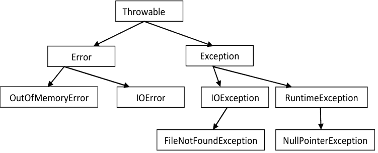

图 8.1：异常层次结构

## 第 8 单元：包与接口

### 检查你的进度

| Q1. 异常的各种类型有哪些？ |
|---|
| Q2. 异常发生在程序执行期间。 |
| Q3. 所有的异常类都是内置类的子类 |

## 8.5 TRY AND CATCH

`try` 和 `catch` 是用于异常处理的关键字。

- **try**: 如果你想监控代码的某部分以检查程序是否发生异常，则该代码必须包含在 `try` 块中。如果 `try` 块内部发生异常，该异常就会被抛出。
- **catch**: `catch` 块可以捕获从 `try` 块抛出的异常，并以某种逻辑方式对其进行处理。

使用 `try` 和 `catch` 关键字，方法可以检测并抛出异常。`try-catch` 块放置在可能产生异常的代码周围。`try-catch` 块中的代码被称为受保护代码，使用 `try-catch` 块的语法如下：

语法：

```java
try {
    // 受保护代码
} catch(ExceptionName e1) {
    // catch 块
}
```

可能发生异常的代码放在 `try` 块下。当发生异常时，将由与其关联的 `catch` 块处理。每个 `try` 块后面都应该紧跟一个 `catch` 块或 `finally` 块。一个 `try` 块可以有多个 `catch` 块。

程序 8.1：显示 try catch 块的程序。

```java
import java.io.*;
public class ExceptTest {
    public static void main(String args[]) {
        try {
            int a[] = new int[2];
            System.out.println("Access element three: " + a[3]);
        } catch (ArrayIndexOutOfBoundsException e) {
            System.out.println("Exception thrown: " + e);
        }
        System.out.println("Out of the block");
    }
}
```

### 输出

```
Exception thrown: java.lang.ArrayIndexOutOfBoundsException: 3
Out of the block
```

在上面的示例中，声明了一个包含 2 个元素的数组。代码尝试访问数组的第 4 个元素，这抛出了异常。

## 8.6 THROW, THROWS AND FINALLY

与 `try` 和 `catch` 类似，`throw`、`throws` 和 `finally` 都是关键字。

- **throw**: 系统生成的异常由 Java 运行时系统自动抛出。要手动抛出异常，使用 `throw` 关键字。只有 `Throwable` 类或其子类的对象可以被抛出。遇到 `throw` 语句时，执行停止，并检查最近的 `try` 块以查看其是否有匹配异常类型的 `catch` 语句。

语法：`throw Throwable/Instance`

### 程序 8.2：使用 throw 的程序

```java
class Test{
    static void avg() {
        try {
            throw new ArithmeticException("demo");
        } catch (ArithmeticException e) {
            System.out.println("Exception caught");
        }
    }
    public static void main(String args[]) {
        avg();
    }
}
```

在上面的示例中，`avg()` 方法将抛出一个 `ArithmeticException` 实例，该实例已使用 `catch` 语句成功处理。

- **throws**: 任何可能引起异常但其自身不处理这些异常的方法，必须列出其执行期间可能发生的所有异常，以便调用该方法的人能够预先了解需要处理的哪些异常。方法可以使用 `throws` 关键字来实现这一点。

语法：

```java
type method_name(parameter_list) throws exception_list {
    // 方法的定义
}
```

### 程序 8.3：使用 throws 关键字的程序

```java
class Test{
    static void check() throws ArithmeticException {
        System.out.println("Inside check function");
        throw new ArithmeticException("demo");
    }

    public static void main(String args[]) {
        try {
            check();
        }
        catch (ArithmeticException e) {
            System.out.println("caught" + e);
        }
    }
}
```

- **finally**: 任何在方法返回之前必须执行的代码都放在 `finally` 块中。`finally` 关键字用于创建一个跟在 `try` 块之后的代码块。无论是否发生异常，`finally` 块中的代码始终执行。使用 `finally` 块，让你运行任何你想要执行的清理类型语句，无论受保护代码中发生了什么。`finally` 块出现在 `catch` 块的末尾。

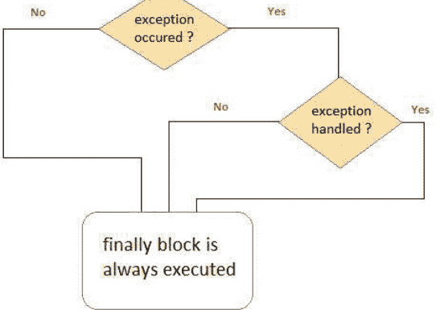

图 8.2：finally 块

### 程序 8.4：使用 finally 关键字的程序

```java
class ExceptionTest {
    public static void main(String[] args) {
        int a[] = new int[2];
        System.out.println("out of try");
        try {
            System.out.println("Access invalid element" + a[3]);
        }
        /* 上述语句将抛出异常 */
        finally {
            System.out.println("finally is executed.");
        }
    }
}
```

### 输出

```
Out of try
finally is executed.
Exception in thread main java.lang.ArrayIndexOutOfBoundsException:
```

## 8.7 Java 内置异常

大多数常见的错误由 Java 内置异常处理，但有时在开发 Java 应用程序时，我们需要创建并抛出自己的异常来处理特定情况。这些异常被称为自定义异常。要这样做，我们需要定义一个 `Exception` 的子类，它是 `Throwable` 的子类。下面给出了自定义异常的示例：

### 表 8.1：java.lang 中定义的非运行时异常

| 异常 | 说明 |
|---|---|
| 1. ArithmeticException | 如除零错误 |
| 2. ArrayIndexOutOfBoundsException | 数组索引越界 |
| 3. ArrayStoreException | 赋值给不兼容的数组元素 |
| 4. ClassCastException | 类型转换异常 |
| 5. EnumConstantNotPresentException | 使用未定义的枚举值 |
| 6. IllegalArgumentException | 调用方法的参数无效 |
| 7. IllegalMonitorStateException | 在未锁定的线程上等待 |
| 8. IllegalStateException | 环境或应用程序状态异常 |
| 9. IllegalThreadStateException | 请求与线程状态不兼容 |
| 10. IndexOutOfBoundsException | 某些索引越界 |
| 11. NegativeArraySizeException | 使用负数创建数组 |
| 12. NullPointerException | 空引用的使用无效 |
| 13. NumberFormatException | 字符串到数字格式转换无效 |
| 14. SecurityException | 违反安全 |
| 15. StringIndexOutOfBounds | 尝试访问字符串范围之外 |
| 16. TypeNotPresentException | 未找到类型 |
| 17. UnsupportedOperationException | 遇到了不支持的操作 |

### 表 8.2：java.lang 中定义的受检异常

| 序号 | 异常 | 说明 |
|---|---|---|
| 1. ClassNotFound | 未找到类 |
| 2. CloneNotSupportedException | 尝试克隆未实现 Cloneable 接口的对象 |
| 3. IllegalAccessException | 拒绝访问某个类 |
| 4. InstantiationException | 尝试创建抽象类或接口的实例 |
| 5. InterruptedException | 一个线程被另一个线程中断 |
| 6. NoSuchFieldException | 请求的字段不存在 |
| 7. NoSuchMethodException | 请求的方法不存在 |

### 程序 8.5：显示异常子类使用的程序

```java
class JavaException {
    public static void main(String args[] ) {
        try{
            throw new MyException(2);
            // throw is used to create a new exception and throw it.
        }
        catch (MyException e) {
            System.out.println(e) ;
        }
    }
}
class MyException extends Exception {
    int a;
    MyException(int b) {
        a=b;
    }
    public String toString() {
        return ("Exception Number = "+a);
    }
}
```

输出: `Exception Number = 2`

关键字 `throw` 用于创建一个新的异常并将其抛到 `catch` 块中。

### 检验学习


**Q4. 选择合适的选项：**

- i. 这些关键字中哪一个用于手动抛出异常？
  - a) try
  - b) finally
  - c) Throw
  - d) catch

- ii. 这些关键字中哪一个必须用于监控异常？
  - a) try
  - b) finally
  - c) Throw
  - d) catch

- iii. 这些关键字中哪一个不属于异常处理的一部分？
  - a) try
  - b) finally
  - c) thrown
  - d) catch

- iv. 这些类中哪一个与所有可以使用 catch 捕获的异常相关？
  - a) Error
  - b) Exception
  - c) RuntimeException
  - d) 以上所有

- v. 在不使用 catch 的情况下，哪一个处理异常？
  - a) 默认处理器
  - b) finally
  - c) throw handler
  - d) Java 运行时系统

- vi. 这些关键字中哪一个用于手动抛出异常？
  - a) try
  - b) finally
  - c) throw
  - d) catch

## 8.9 总结

- 异常是程序执行过程中产生的事件。
- 异常有三种，即：编译时异常、运行时异常和错误（error）。
- Java 的标准包 `java.lang` 定义了异常类。
- 所有异常类都是内置类 `Throwable` 的子类。
- `try` 块用于检查程序代码某部分的异常。
- `catch` 块用于捕获异常并处理它。
- `try-catch` 块中的代码是受保护的代码。
- `throw` 关键字用于手动抛出异常。
- `finally` 块下的代码在方法返回之前必须执行。

## 8.10 扩展阅读

- 1) The Complete Reference, Java 2, Tata McGraw-Hill Edition
- 2) www.java.sun.com

## 8.11 检验学习答案

- 第 1 题答案：编译时异常、运行时异常、错误
- 第 2 题答案：运行时异常
- 第 3 题答案：Throwable
- i. c) throw
- ii. a) try
- iii. c) thrown
- iv. b) exception
- v. a) default handler
- vi. c) throw

## 8.12 示例习题

- Q1. 用于管理异常处理的五个关键字是什么？
- Q2. 列出与显式抛出的异常相关的类？
- Q3. Java是如何处理异常的？
- Q4. 解释 Java 中的异常层次结构。
- Q5. `throws` 关键字的用途是什么？
- Q6. 写一个 Java 程序显示异常处理。

# 第 9 单元：Java 中的 I/O

## 单元结构

- 9.1 学习目标
- 9.2 引言
- 9.3 I/O 基础：流
- 9.4 流类
- 9.5 预定义流
- 9.6 读取控制台输入
- 9.7 输出控制台输出
- 9.8 文件读写
- 9.9 总结
- 9.10 扩展阅读
- 9.11 检验学习答案
- 9.12 示例习题

### 9.1 学习目标

在学习本单元后，你将能够：

- 描述 Java 中的 I/O 包
- 定义预定义流
- 使用控制台输入和输出
- 描述如何从文件和向读写数据

### 9.2 引言

在本单元中，我们将学习最重要的 I/O 包之一。我们将学习流和不同的流类。此外，还将学习如何从输入读取数据以及如何向输出设备写入数据。我们还将简要介绍 Java 中的文件处理。在下一个单元中，我们将学习 Java Applet。


# I/O 包与 Applet 简介

## 9.3 I/O 基础：流

I/O 包支持 Java 的基础 I/O（输入/输出）系统，包括文件 I/O。Java 程序通过流执行 I/O。流通过 Java I/O 系统连接到物理设备。Java 定义了两种类型的 I/O 流：字节流和字符流。在 Java 1.0 中，执行控制台输入的唯一方法是使用字节流。Java 2 推荐的读取控制台输入的方法是使用面向字符的流，这使得程序更容易国际化和维护。

Java 提供了许多类和方法来允许读写文件。在 Java 中，文件是面向字节的，Java 提供了从文件向文件读写字节的方法。

### 流的概念

流可以定义为数据的序列。流有两种类型：

- `InputStream`：用于从源读取数据。
- `OutputStream`：用于将数据写入目的地。

| 源 | 目的 |
| :--- | :--- |
| `InputStream` | 读取 |
| `OutputStream` | 写入 |

### 字节流与字符流

- **字节流**：处理 8 位字节数据，用于处理二进制数据（图像、音频等）。
- **字符流**：处理 16 位 Unicode 字符数据，用于处理文本数据。

### 标准流

- `System.in`：标准输入（用于从键盘读取数据）。
- `System.out`：标准输出（用于将数据显示到控制台上）。
- `System.err`：标准错误输出（用于在控制台上显示错误消息）。

### 文件 I/O 流示例

`OutputStream` 也继承自 `Object` 类。`java.io` 包提供的 `OutputStreams` 类的每一个子类都继承自此的。

有许多字节流类。为了演示字节流的工作原理，我们将重点关注文件 I/O 流，即 `FileInputStream` 和 `FileOutputStream`。其他类型的字节流使用方式相同，它们的主要区别在于构造方式。

我们将通过检查一个示例程序 `CopyBytes.java` 来解释 `FileInputStream` 和 `FileOutputStream`，该程序使用字节流一次一个字节地复制 `kkhsou.txt`，并将文件内容写入 `outagain.txt`。

```java
import java.io.FileInputStream;
import java.io.FileOutputStream;
import java.io.IOException;

public class CopyBytes {
    public static void main(String[] args) throws IOException {
        FileInputStream in = null;
        FileOutputStream out = null;
        try {
            in = new FileInputStream("kkhsou.txt");
            out = new FileOutputStream("outagain.txt");
            int c;
            // 此处省略后续读写逻辑
        } finally {
            if (in != null) in.close();
            if (out != null) out.close();
        }
    }
}
```

---

# 第 10 单元：Applet 简介

## 单元结构

- 10.1 学习目标
- 10.2 简介
- 10.3 Applet 与网页
- 10.4 Applet 类
  - 10.4.1 Applet 类的基本方法
- 10.5 Applet 与 HTML
- 10.6 Applet 的生命周期
- 10.7 响应事件
- 10.8 使用窗口组件
- 10.9 添加音频和动画
- 10.10 总结
- 10.11 进一步阅读
- 10.12 进度检查答案
- 10.13 模型

## 10.1 学习目标

通过本单元的学习，你将能够：

- 编写 Java Applet
- 描述 Applet 的生命周期
- 描述事件
- 在 Applet 中添加组件

## 10.2 简介

在之前的单元中，我们讨论了 Java 的输入/输出流。

今天，Java 已经成为网页不可或缺的一部分。在本单元中，我们将学习如何创建 Applet，以及在网页中嵌入它们。Applet 是由浏览器或 Applet 查看器加载的。

## 10.3 Applet 与网页

Applet 是一个在网页中运行的 Java 程序。Applet 包含了 HTML 标签来运行，由 Java 虚拟机（JVM）执行，包含了可以控制执行的方法。当用户返回包含 Applet 的 HTML 页面时，Applet 会被加载。

### Applet 的优点

- Applet 是跨平台的
- Applet 可以被浏览器支持
- Applet 能够访问 HTML 页面
- Applet 能够根据 HTML 进行操作
- Applet 能够与用户交互

### Applet 的缺点

- Applet 需要 Java 插件
- Applet 启动需要时间

## 10.4 Applet 类

`java.applet` 包包含了 `Applet` 类。`Applet` 是 `java.applet` 的子类。因此，`java.applet` 还定义了三个接口：`AppletContext`、`AppletStub` 和 `AudioClip`。

Applet 是由运行时环境构造的。Applet 包含一个单一的默认无参构造函数，通常不需要显式构造。Applet 为执行提供了必要的支持，例如启动和停止。它还提供了加载图像和播放音频片段的方法。

### 10.4.1 Applet 类的基本方法

- `void init()`：该方法在浏览器或 Applet 查看器加载 Applet 时调用一次。它执行 Applet 的初始化。
- `void start()`：该方法在 `init` 方法执行完成后，以及每当用户返回到 Applet 所在的 HTML 页面时被调用。
- `void paint(Graphics g)`：每当 Applet 需要重绘时，该方法就会自动调用。例如，如果用户用屏幕上打开的窗口覆盖了 Applet。
- `void stop()`：该方法在用户离开包含 Applet 的 HTML 页面时被调用。
- `void destroy()`：该方法在 Applet 从内存中移除时被调用。
- `void play(URL url)`：如果在指定位置找到音频片段，则进行播放。
- `void resize(Dimension dim)`：根据 `dim` 调整 Applet 的大小。

## 10.5 Applet 与 HTML

为了运行 Applet，首先需要一个网页。`<APPLET>` 标签提供了 Applet 的名称。

### 语法

```html
<APPLET CODE="继承 java.applet 的类名"
      CODEBASE="类文件的路径"
      HEIGHT="Applet 的最大高度（像素）"
      WIDTH="Applet 的最大宽度（像素）"
      VSPACE="Applet 与 HTML 之间的垂直间距"
      HSPACE="Applet 与 HTML 之间的水平间距"
      ALIGN="Applet 相对于页对齐方式"
      ALT="当浏览器无法运行 Java Applet 时显示的替代文本">
    <PARAM NAME="参数名" VALUE="参数值">
</APPLET>
```

### 示例：SimpleJavaApplet

```java
public void paint(Graphics g) {
    /** 此方法是我们的绘制方法。此方法将我们 applet 中的任何内容绘制到屏幕上。注意，我们向它传递了 Graphics 类的实例(g)。*/
    g.drawString("HELLO WORLD", 5, 25);
    /* drawString 是 Graphics 类的一个方法。我们有一个 Graphics 类的实例 - g。drawString 接收一个字符串和 x、y 坐标。*/
}
```

**simpleapplet.html**

```html
<html>
<head>
</head>
<body>
<APPLET CODE="SimpleJavaApplet.class" HEIGHT=250 WIDTH=250>
</APPLET>
</body>
</html>
```

这两个文件都需要保持在同一个目录下。HTML 代码告诉浏览器加载与此 HTML 文件位于同一目录下的、已编译的 Java Applet `SimpleJavaApplet.class`。它指定了 Applet 输出的宽度为 250 像素，高度为 250 像素。

### 运行 Applet 的工具

- a) Java Applet Viewer
- b) 启用 Java 的浏览器（如 IE 或 Firefox）

在运行程序之前，我们需要编译程序。

#### a) 使用 Java Applet Viewer

`appletviewer` 是 JDK 的一部分。编译并运行命令如下：

```
javac SimpleJavaApplet.java
appletviewer simpleapplet.html
```

#### b) 使用启用 Java 的浏览器

运行浏览器并转到 文件 -> 打开文件，选择文件 `simpleapplet.html` 并点击打开。Applet 将在浏览器上运行，并显示 "HELLO WORLD"。

### 本地 Applet 与远程 Applet

我们可以通过两种方式将 Applet 嵌入到 Web 页面中：

1. **本地 Applet**：编写自己的 Applet 并将其嵌入网页中。在本地开发并存储在本地系统的 Applet。
2. **远程 Applet**：从远程计算机系统下载 Applet 并将其嵌入网页中。远程 Applet 由他人开发并存储在连接到互联网的远程计算机上。为了定位和加载远程 Applet，我们必须知道 Applet 在网上的地址（URL），并且必须在 Applet 的 HTML 文档中指定为 `CODEBASE` 属性的值。

## 绘制形状示例

此程序演示如何绘制不同类型的形状，如线、圆和矩形。`java.awt.*` 包中的 `Graphics` 类中使用了不同类型的方法来绘制相应的形状。

### CircleLine.java

```java
// 程序 10.2：显示不同形状绘制的程序
import java.awt.*;
import java.applet.Applet;

public class CircleLine extends Applet {
    int x = 300, y = 100, r = 50;

    public void paint(Graphics g) {
        g.drawLine(3, 300, 200, 10);
        // 用于在 applet 中绘制线。
        g.drawString("Line", 100, 100);
        // 将给定字符串作为参数绘制
        g.drawOval(x - r, y - r, 100, 100);
        // 绘制圆
        g.drawString("Circle", 275, 100);
        // 将给定字符串作为参数绘制
        g.drawRect(400, 50, 200, 100); // 绘制矩形
        g.drawString("Rectangle", 450, 100);
        // 将给定字符串作为参数绘制
    }
}
```

### CircleLine.html

```html
<HTML>
<HEAD>
</HEAD>
<BODY>
<DIV ALIGN="CENTER">
<APPLET CODE="CircleLine.class" WIDTH="800" HEIGHT="500"></APPLET>
</DIV>
</BODY>
</HTML>
```

## 10.6 Applet 的生命周期

Applet 的生命周期包含以下四个核心阶段：

1. **`init()`**：Applet 初始化。在浏览器或 Applet 查看器加载 Applet 时调用一次。
2. **`start()`**：Applet 开始。在 `init` 方法执行完成后，以及每当用户返回到 Applet 所在的 HTML 页面时被调用。
3. **`stop()`**：Applet 停止。在用户离开包含 Applet 的 HTML 页面时被调用。
4. **`destroy()`**：Applet 销毁。在 Applet 从内存中移除时被调用。

> **图 10.7**：Applet 的生命周期（原文中为流程图，此处以列表形式呈现核心流程：初始化 -> 启动 -> [运行中 <-> 停止] -> 销毁）

## 检查进展

**Q1. 填空：**

i) 网页上的 **Applet**。
ii) **JVM** 用于 Applet。
iii) HTML 文档中的 **<APPLET> 标签**。

**Q2. 判断以下陈述的对或错：**

a) Applet 可以使用 Applet Viewer 运行。 **(对)**
b) 浏览器支持 Applet。 **(对)**
c) Applet 运行在 Linux 上。 **(对，Applet 是跨平台的)**


# Q3. 填空

i) `init()` 方法是 applet 首次加载到计算机内存中的。

ii) 当用户移动到另一个页面时，浏览器调用 `destroy()` 方法。

# 第 10 单元：事件处理

事件处理对于 GUI 编程至关重要。程序等待用户执行某些操作。用户通过 GUI 控制应用程序执行的操作顺序。

# 第 11 单元：AWT

## 单元结构

- 11.1 学习目标
- 11.2 简介
- 11.3 AWT 基础
- 11.4 AWT 组件
- 11.5 容器
- 11.6 事件处理
- 11.7 菜单
- 11.8 总结
- 11.9 扩展阅读
- 11.10 进度检查答案
- 11.11 习题

### 11.1 学习目标

学习完本单元后，你将能够：

- 描述 AWT 及其组件
- 描述事件处理
- 描述 Swing 及其组件
- 描述如何创建菜单

### 11.2 简介

在上一个单元中，我们详细学习了小程序（applets）。在本单元中，我们将学习 Java 的 AWT 包。AWT 是 Java 原始的平台无关窗口、图形和用户界面组件工具包。AWT 是 Java 基础类（JFC）的一部分——JFC 是为 Java 程序提供图形用户界面（GUI）的标准 API。在这里，我们将对不同的 AWT 组件以及 AWT 中的事件处理进行简要描述。最后，我们将学习 AWT 中的菜单。在下一个单元中，我们将学习与 Swing 相关的不同概念。

### 11.3 AWT 基础

AWT（抽象窗口工具包，Abstract Window Toolkit）是一种用于在 Java 中开发 GUI 或基于窗口的应用程序的 API。它包含了编写用于用户与不同窗口工具包交互的程序的所有类。我们可以使用 AWT 包来开发用户界面对象，如按钮、复选框、单选按钮和菜单等。`java.awt` 包为 AWT API 提供了类，如 `TextField`、`Label`、`TextArea`、`RadioButton`、`Checkbox`、`Choice` 和 `List`。

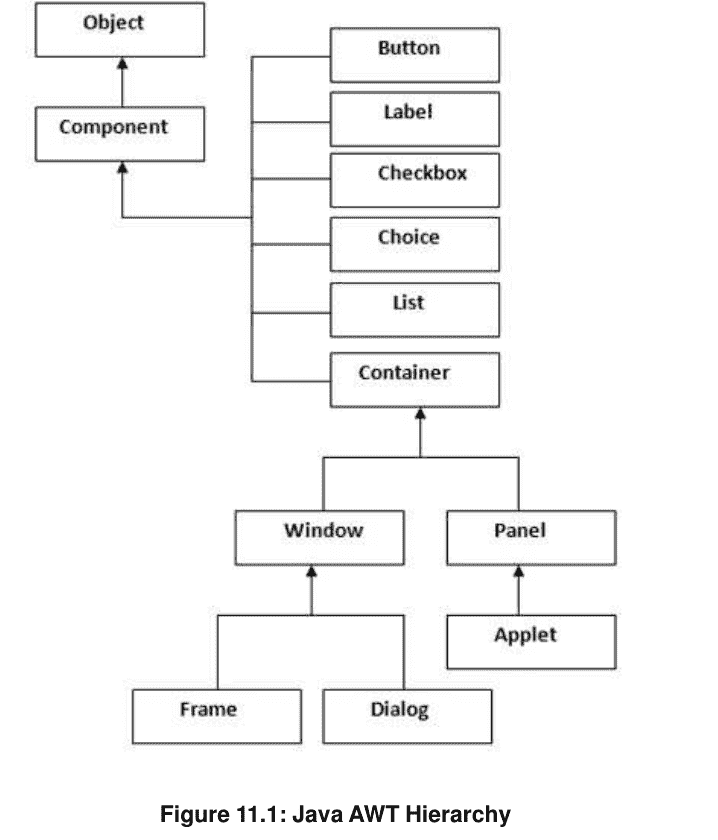

## 基础术语

**组件 (Component)**：组件是一种具有图形表示的对象，可以显示在屏幕上，并能与用户交互，如按钮、复选框、列表等。

**容器 (Container)**：容器对象是 AWT 中的组件，可以包含一个或多个组件，如按钮、文本框、标签等。扩展 `Container` 类的类被称为容器，例如 `Frame`、`Dialog` 和 `Panel`。

**窗口 (Window)**：窗口是显示在屏幕上的矩形区域。窗口在构造时必须定义 `frame`、`dialog` 或另一个窗口作为其所有者。

**面板 (Panel)**：Panel 是不包含标题栏和菜单栏的容器。Panel 提供了一个空间，应用程序可以在其中附加任何其他组件，包括其他面板。它可以包含按钮、文本框等组件。

**框架 (Frame)**：Frame 是包含标题栏、菜单栏、边框和可缩放角的容器。它可以包含按钮、文本框等其他组件。

### 11.4 AWT 组件

在本节中，我们将学习 Java AWT 包中提供的用于为程序开发用户界面的不同组件。以下是 Java AWT 的一些组件：

**标签 (Labels)**：这是 Java 抽象窗口工具包中最简单的组件。该组件通常用于显示应用程序中的文本或字符串，标签永远无法执行任何类型的操作。定义标签的语法如下：

```java
Label label_name = new Label("This is the label text");
```

上面的代码仅代表标签的文本。

```java
Label label_name = new Label("This is the label text.", Label.CENTER);
```

`Label.CENTER` 可以左对齐、右对齐或居中对齐。上面的声明使用了 `Label.CENTER` 使标签居中对齐。

**按钮 (Buttons)**：这是 Java 抽象窗口工具包的组件，用于触发我们应用程序所需的动作和其他事件。定义按钮的语法如下：

```java
Button button_name = new Button("This is the label of the button.");
```

我们可以通过 `Button.setText(String)` 和 `Button.getLabel()` 方法更改按钮的标签或获取标签文本。使用 `add(button_name)` 方法将按钮添加到其容器中。

**复选框 (Check Boxes)**：Java AWT 的此组件允许我们在应用程序中创建复选框。声明 `Checkbox` 的语法如下：

```java
Checkbox checkbox_name = new Checkbox("Optional check box 1", false);
```

上面的代码通过 `Checkbox()` 构造函数传递布尔值参数 `false` 和复选框标签，构造未选中的复选框。定义的 `Checkbox` 使用 `add(checkbox_name)` 方法添加到其容器中。我们可以使用 `setLabel(String)` 和 `getLabel()` 方法更改和获取复选框的标签。还可以使用 `Checkbox` 类提供的 `setState(boolean)` 和 `getState()` 方法设置和获取复选框的状态。

**单选按钮 (Radio Button)**：这是 Java AWT 包中 Checkbox 组件的特殊情况。它被用一组复选框，组名为 `CheckboxGroup`。`CheckboxGroup` 中只能选择一个。创建单选按钮的语法如下：

```java
CheckboxGroup chkgp = new CheckboxGroup();
add(new Checkbox("One", chkgp, false));
add(new Checkbox("Two", chkgp, false));
add(new Checkbox("Three", chkgp, false));
```

在代码中，我们创建了三个标签为 "One"、"Two" 和 "Three" 的选框。如果我们为复选框提到多个 `true` 值，我们的程序将取最后一个 `true` 并显示最后一个复选框为选中。

**文本区域 (Text Area)**：这是 Java AWT 包的文本容器组件。Text Area 包含纯文本。`TextArea` 可以声明如下：

```java
TextArea txtArea_name = new TextArea();
```

我们可以使用 `setEditable(boolean)` 方法使文本区域可编辑或不可编辑。如果我们传递布尔值参数 `false`，则文本区域将不可编辑，否则可编辑。文本区域默认处于编辑模式。使用 `TextArea` 类的 `setText(String)` 方法在文本区域中设置文本。

**文本字段 (Text Field)**：这也是 Java AWT 包的文本容器组件。该组件包含单行和有限的文本信息。声明如下：

```java
TextField txtfield = new TextField(20);
```

我们可以通过构造函数中指定数字来固定文本字段中的列数。在上面的代码中，我们将列数固定为 20。

如下例所示，按钮由单个标签表示。也就是说，示例中显示的标签可以通过点击鼠标按下。

```java
// Program 11.1 : 通过标签显示按钮的程序。
import java.awt.*;
import java.applet.Applet;

public class MyButton extends Applet {
    public void init() {
        Button button = new Button("SUBMIT");
        add(button);
    }
}
```

这里是 HTML 代码：

```html
<HTML>
<HEAD>
</HEAD>
<BODY>
<APPLET CODE="MyButton.class" WIDTH=300 HEIGHT=200>
</APPLET>
</BODY>
</HTML>
```

# 第 12 单元：SWINGS

## 单元结构

- 12.1 学习目标
- 12.2 简介
- 12.3 Java Swing
- 12.4 Swing 类层次结构
- 12.5 Swing 组件
- 12.6 事件处理
- 12.7 在窗口中显示文本和图像
- 12.8 布局管理器
- 12.9 总结
- 12.10 扩展阅读
- 12.11 进度检查答案
- 12.12 习题

### 12.1 学习目标

学习完本单元后，你将能够：

- 描述 Swing 及其组件
- 描述事件处理
- 在窗口中显示文本和图像
- 描述布局管理器

### 12.2 简介

在上一个单元中我们学习了 AWT。在本单元中，我们将讨论 Swing 及其组件。Swing 类层次结构、布局管理器以及如何处理事件等重要概念将在本单元中讨论。

### 12.3 JAVA Swing

Java Swing 是 Java 基础类（JFC）的一部分，用于创建基于窗口的应用程序。Java 基础类（JFC）是一组简化桌面开发的 GUI 组件。它构建在 AWT（抽象窗口工具包）之上。Java Swing 提供了多个平台无关的 API，用于用户与 GUI 组件之间的交互。Java 提供交互功能来设计 GUI 工具包或组件，如标签、按钮、文本框、复选框、组合框、面板和滑块等。所有 AWT 组件都可以由 Java Swing 处理。Java Swing 支持外观（look and feel）的插件。外观意味着像 `JFrame`、`JWindow`、`JDialog` 等组件的巨大变化，以便以多种类型的形式查看。

AWT 与 Swing 的区别：

Java AWT 和 Swing 之间有许多差异，如下。

表 12.1：AWT 与 SWING 的区别

| AWT | SWING |
|---|---|
| AWT 组件是平台相关的。 | Java Swing 组件是轻量级的。因为 Swing 组件位于 AWT 组件之上并执行工作 |
| 不支持插件式外观。 | 支持插件式外观。 |

### 12.4 SWING 类层次结构

在 Swing 中，表示 GUI 组件的类以字母 J 开头。示例包括 `JButton`、`JLabel` 和 `JSlider`。图 12.1 显示了 Java Swing 类层次结构。

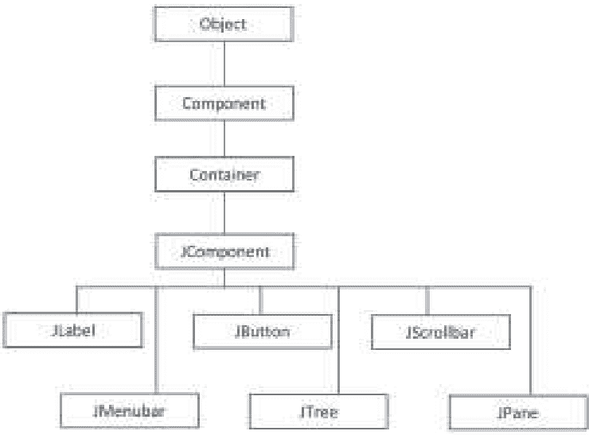

图 12.1：Java Swing 类层次结构

`JComponent` 类直接继承自 `Container`，是 Swing 大多数用户界面组件的根类。

**Component 类的常用方法：**

Component 类的方法在 Java Swing 中被广泛使用，给出如下：

1. `public void add(Component c)`：在另一个组件上添加组件。
2. `public void setSize(int width, int height)`：设置组件的大小。
3. `public void setLayout(LayoutManager m)`：为组件设置布局。
4. `public void setVisible(boolean b)`：设置组件的可见性。默认值为 `false`。

**SWING UI 元素：**

以下是使用 SWING 设计 GUI 时常用的控件列表。

- `JLabel`：`JLabel` 对象是用于在容器中放置文本的组件。
- `JButton`：创建一个带有标签的按钮。
- `JColorChooser`：`JColorChooser` 提供了一个控件面板，旨在允许用户操作和选择颜色。
- `JCheckBox`：`JCheckBox` 是一种图形化组件，可以处于 `true` 或 `false` 状态。
- `JRadioButton`：`JRadioButton` 类是一种图形化组件，可以在一组中处于开启 `true` 或关闭 `false` 状态。
- `JList`：`JList` 组件为用户提供一个可滚动的项目列表。
- `JComboBox`：`JComboBox` 组件为用户提供一个选择菜单。
- `JTextField`：`JTextField` 对象是一个允许编辑单行文本的文本组件。
- `JPasswordField`：`JPasswordField` 对象是专门用于密码录入的文本组件。
- `JTextArea`：`JTextArea` 对象是一个允许编辑多行文本的文本组件。
- `ImageIcon`：`ImageIcon` 控件是 `Icon` 接口的实现，用于从图像绘制图标。
- `JScrollBar`：滚动条控件代表一个滚动条组件，以便用户从值范围内进行选择。
- `JFileChooser`：`JFileChooser` 控件代表一个对话窗口，用户可以从中选择文件。
- `JProgressBar`：随着任务向完成进行，进度条会显示任务的完成百分比。

### 12.5 SWING 组件

Swing 中有很多用于构建 GUI 的组件。Swing 工具包包含许多用于构建 GUI 的组件。这些组件对于为 Java 提供交互性也有帮助。以下是 Swing 工具包中包含的一些组件：

1. 列表控件
2. 按钮
3. 标签
4. 树控件
5. 表格控件

所有 AWT 组件都可以由 Java Swing 工具包处理，它包含比简单组件包更多的组件。

**Text Field**：下面的示例显示了如何创建一个文本字段。Swing 文本字段由 `JComponent` 类封装，该类扩展了 `Container`。其子类 `JTextField` 允许编辑单行文本框。

```java
// 程序 12.1：显示如何创建文本字段的程序
import java.awt.*;
import javax.swing.*;

public class JTextFields extends JApplet {
    JTextField jtf;

    public void init() {
        // 获取内容面板
        Container contentPane = getContentPane();
        contentPane.setLayout(new FlowLayout());
        // 添加文本字段
        jtf = new JTextField(25);
        // 将文本框添加到内容面板
        contentPane.add(jtf);
    }
}
```

```html
<!-- JTextField.html -->
<html>
<applet code="JTextFields.class" height=200 width=320>
</applet>
</html>
```

输出：

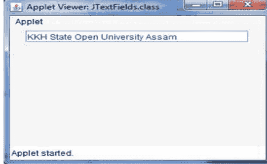

图 12.2：文本字段示例

**按钮**：Swing 按钮是 `AbstractButton` 类的子类，该类扩展了 `JComponent`。`JButton` 类提供了推按钮的功能。下面的示例显示了一个推按钮。

```java
// 程序 12.2：显示推按钮的程序
import java.awt.*;
import javax.swing.*;

public class JButtonDemo extends JApplet {
    public void init() {
        // 获取内容面板
        Container contentPane = getContentPane();
        contentPane.setLayout(new FlowLayout());
        // 添加按钮到内容面板
        JButton jb = new JButton("Button");
        contentPane.add(jb);
    }
}
```

```html
<!-- JButton.html -->
<html>
<applet code="JButtonDemo.class" height=200 width=320>
</applet>
</html>
```

输出：

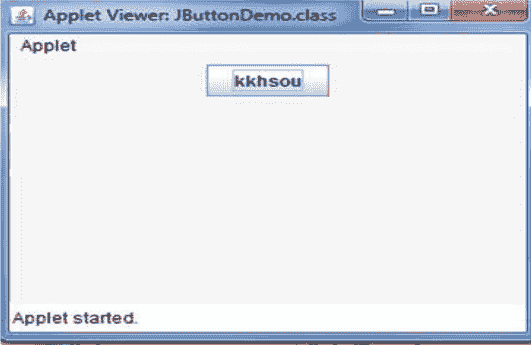

图 12.3：推按钮示例

**复选框**：`JCheckBox` 类是 `AbstractButton` 的实现，提供了复选框的功能。下面的示例显示了复选框。

```java
// 程序 12.3：使用复选框
import java.awt.*;
import javax.swing.*;

public class CheckBoxDemo extends JApplet {
    public void init() {
        // 获取内容面板
        Container contentPane = getContentPane();
        contentPane.setLayout(new FlowLayout());
        // 添加复选框到内容面板
        JCheckBox cb = new JCheckBox("CheckBox");
        contentPane.add(cb);
    }
}
```

```html
<!-- CheckBox.html -->
<html>
<applet code="CheckBoxDemo.class" height=200 width=320>
</applet>
</html>
```

输出：

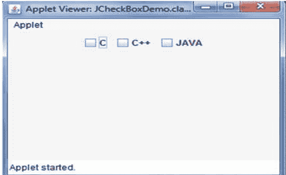

图 12.4：复选框输出

### 12.6 事件处理

事件是 GUI 的重要部分。Java Swing 中的事件处理主要由用户产生。在事件模型中，有三个参与者：

- 事件源
- 事件对象
- 事件监听器

事件源是状态改变的对象。它产生事件。对象将处理事件的任务委托给监听器。Java 使用以下步骤：


# Java 编程（分块 2）

## Swings

### 事件处理流程

1. 用户执行操作并生成了事件。
2. 自动创建有关源和事件的相关类对象。
3. 事件对象转发给注册的监听器。
4. 执行方法并返回。

### 事件分类

事件可以大致分为两类：

- **前景事件**——发生在用户与图形组件交互时，例如点击按钮、移动鼠标。
- **后台事件**——这些事件由其他手段产生，如网络连接、窗口管理器。

### 重要的事件类和接口

| 事件类 | 描述 | 监听器接口 |
|---|---|---|
| `ActionEvent` | 按钮按下、菜单项选中、双击时生成 | `ActionListener` |
| `MouseEvent` | 鼠标拖动、移动、按下或释放以及进入或退出组件时生成 | `MouseListener` |
| `KeyEvent` | 从键盘接收输入时生成 | `KeyListener` |
| `ItemEvent` | 复选框或列表项被点击时生成 | `ItemListener` |
| `TextEvent` | 文本区域或文本字段的值改变时生成 | `TextListener` |
| `MouseWheelEvent` | 鼠标轮移动时生成 | `MouseWheelListener` |
| `WindowEvent` | 窗口激活、取消、最小化、最大化、打开或关闭时生成 | `WindowListener` |
| `ComponentEvent` | 组件隐藏、移动、调整大小或设置为可见时生成 | `ComponentListener` |
| `ContainerEvent` | 组件从容器中添加或移除时生成 | `ContainerListener` |
| `FocusEvent` | 组件获得或失去键盘焦点时生成 | `FocusListener` |

## 12.7 显示文本和图像

下面的示例显示了如何创建一个包含文本和图像的标签。Applet 从获取其内容面板开始。然后为文件 `kkhsou_logo.jpg` 创建一个 `ImageIcon` 对象。`JLabel` 构造函数中的第一个参数是文本，第二个参数是 `ImageIcon` 对象，第三个参数是对齐方式。对齐有 `LEFT`、`RIGHT`、`CENTER`、`LEADING` 或 `TRAILING`。最后将标签添加到内容面板。

```java
// 程序 12.4：显示使用标签的程序
import java.awt.*;
import javax.swing.*;

public class LabelDemo extends JApplet {
    public void init() {
        // 获取内容面板
        Container contentPane = getContentPane();
        contentPane.setLayout(new FlowLayout());
        // 创建图标对象
        ImageIcon icon = new ImageIcon("kkhsou_logo.jpg");
        // 创建标签
        JLabel label = new JLabel("Logo Text", icon, JLabel.CENTER);
        // 将标签添加到内容面板
        contentPane.add(label);
    }
}
```

```java
public class JLabelDemo extends JApplet {
    public void init() {
        // Get content pane
        Container contentPane = getContentPane();
        // create icon
        ImageIcon ii = new ImageIcon("kkhsou_logo.jpg");
        // create label
        JLabel jl = new JLabel("KKH Open University", ii);
        // add label to the content pane
        contentPane.add(jl);
    }
}
```

### JLabelDemo.html

```html
<html>
<applet code="JLabelDemo.class" height=200 width=320>
</applet>
</html>
```

### 输出

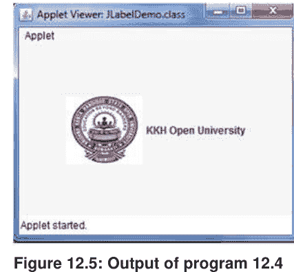

## 12.8 布局管理器

为了创建布局，我们使用布局管理器。布局管理器是现代 GUI 编程中最困难的部分之一。并不是非要使用布局管理器，但为了创建真正可移植、复杂的应用程序，我们需要布局管理器。没有布局管理器，我们可以使用绝对值来放置组件。

使用布局管理器涉及的一些常见任务包括：

- 设置布局管理器
- 向容器中添加组件
- 提供尺寸和对齐提示
- 在组件之间留出空间
- 设置容器的取向
- 选择布局管理器的提示
- 第三方布局管理器

Java 布局管理器类实现了 `LayoutManager` 接口。它用于确定容器内各个组件的位置和大小。组件可以提供尺寸和对齐提示，但容器的布局管理器对容器内组件的大小和位置具有最终决定权。

### 常用布局管理器

- **FlowLayout（流布局）**：这是 Java Swing 工具包中最简单的布局管理器。它主要与其他布局管理器结合使用。在计算其子组件大小时，流布局允许每个组件假设其自然（首选）尺寸。管理器按照它们添加的顺序将组件放入行中。如果它们无法放入一行，则将进入下一行。组件可以从左到右添加，反之亦然。管理器允许对组件进行对齐。

- **GridLayout（网格布局）**：`GridLayout` 布局管理器在矩形网格中布局组件。容器被划分为等大小的矩形。每个矩形中放置一个组件。

- **BorderLayout（边框布局）**：`BorderLayout` 管理器是一个非常实用的布局管理器。它将空间分为五个区域：北、西、南、东和中心。每个区域只能有一个组件。如果我们需要在某个区域放入更多组件，我们可以简单地放入一个带有我们选择的管理器的面板。N、W、S、E 区域的组件获得其首选尺寸。中心组件占据整个空间。

- **BoxLayout（框布局）**：`BoxLayout` 是一种强大的管理器，可用于创建复杂的布局。这种布局管理器将组件放入行中或一列中。它启用了嵌套，这是一项强大的功能，使得该管理器非常灵活。这意味着我们可以将一个框布局放入另一个框布局中。


## 检查进度

**Q1. 填空：**

i) `ActionEvent` 由像按钮、复选框等组件生成的事件。
ii) `ComponentEvent` 是一种低级事件，指示对象是否移动、改变以及其状态。
iii) `MouseEvent` 处理对象在鼠标操作期间产生的所有事件。
iv) 事件是任何 **GUI** 程序中的重要部分。
v) `GridLayout` 布局管理器在矩形网格中布局组件。
vi) `BoxLayout` 可用于创建复杂的布局。
vii) 布局管理器类实现了 `LayoutManager` 接口。


## 12.9 总结

- Java Swing 提供了多个平台无关的 API，用于用户与 GUI 组件之间的交互。
- Swing 工具包由许多用于构建 GUI 的组件组成。
- 所有 AWT 组件都可以由 Java Swing 处理。
- 事件主要由应用程序生成。但也可以通过其他方式生成，例如：互联网连接、窗口管理器、定时器。
- Java Swing 工具包中的事件处理非常强大且灵活。
- Java 使用事件委托模型。
- 布局管理器是现代 GUI 编程中最困难的部分之一。


## 12.10 扩展阅读

1. Schildt, H. (2007). *Java: The complete reference*. McGraw-Hill.
2. Deitel, P., & Deitel, H. (2011). *Java How to program*. Prentice Hall.
3. <http://www.oracle.com/technet/java/index.html>


## 12.11 检查进度答案

**第 1 题的答案：**
i) `ActionEvent`; ii) `ComponentEvent`;
iii) `MouseEvent`; iv) GUI;
v) `GridLayout`; vi) `BoxLayout`;
vii) `LayoutManager`


## 12.12 习题

- Q1. AWT 和 SWING 有什么区别？
- Q2. 简述三种布局管理器。
- Q3. 定义事件处理？
- Q4. 描述 Swing 类层次。
- Q5. 有哪些不同的 Swing 组件？
