# Java 编程：面向对象程序编码初学者指南

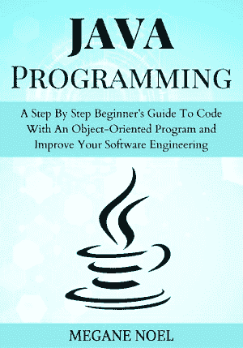

# 引言

Java 是一种在 Web 和计算机应用程序中广泛使用的编程语言。它是一个免费下载的解决方案，允许用户访问最新版本并部署更新。这种语言存在于大多数现代 Web 应用和计算机技术中。Java 的可扩展性使其适用于广泛的应用程序，包括手机等小型电子设备的应用，以及数据中心等的大规模操作软件。对 Java 部署日益增长的偏归源于其健壮的功能和强大的安全凭证。

Java 是由 Sun Micros 开发的一种编程语言，后来被 Oracle 公司收购。它被设计为在任何支持 Java 的操作系统上运行。这使得该语言非常流行，因为程序员只需要编写一次程序，程序就可以在无需更改代码的情况下运行在任何操作系统上。

世界上大多数的现代应用程序都是用 Java 语言编写的。大多数主程序的业务逻辑和服务器端组件都是用 Java 语言构建的。

在书中，你将学习编写像上面的程序，并学习帮助你开始编写应用程序的高级概念。

Java 的一些设计目标列如下：

- 该语言只需编写一次，并可以在任何操作系统上运行。
- 该语言应支持许多软件工程原理。
- 可移植性是一个重要因素。这就是为什么 Java 可以在 Windows、Linux 和 macOS 操作系统上运行。
- 对国际化的支持非常重要。
- Java 适用于编写托管系统和嵌入式系统的应用程序。

下面讨论的其他设计目标：

## 强类型

Java 是强类型的。每个定义的变量必须附加一个类型。你现在不需要理解整个程序，但让我们只看 2 行代码：

```java
int i = 5;
```

在这里，我们定义了一个用于存储值的变量。可以存储的值取决于其类型。在这个例子中，说 `i` 是 `int`（整数）类型的数值。

## 数组边界检查

在运行时，Java 会检查数组是否具有定义的数量。如果有人尝试访问边界之外的值，将抛出异常。你现在不需要理解整个程序，但让我们来看这几行：

```java
int[] array1 = new int[2];
array1[0] = 1;
array1[1] = 2;
array1[2] = 3;
```

通过这段代码，我们可以看到我们正在为数组赋值 3 个值。运行此程序时会报错，因为数组超过了最大限制。你会得到下面的运行时错误：`java.lang.ArrayIndexOutOfBoundsException: 2 at HelloWorld.main(HelloWorld:8)`

Java 的语法和函数与 C、C++ 等语言相似。如果你有编程经验，学习 Java 对你来说将非常容易。即使你是完全的新手，也可以放心，Java 的设计是于相对容易学习的。

大多数程序员发现学习 Java 比学习 C 或 C++ 容易。

Java 还被设计为平台无关。如之前所述，Java 代码首先编译成字节码，可以在任何带有 Java 虚拟机的机器上运行。通过 Java，你可以编写一次并到处运行。

## 为什么选择 Java？

当然，使用 Java 的关键原因之一是关注面向对象编程。面向对象或 OOP 编程是一种编程语言模型，它允许你围绕数据组织程序代码，而不是围绕函数和逻辑（即过程化编程）。这些“数据簇”被组织成“对象”，因此被称为面向对象编程。

这些对象由所谓的“类”组成，这里的类是指传统意义上的类：对象的类型，这允许程序员根据两个主要标准对它们进行分类：属性和方法。

这些对象是通过所谓的“类”创建的。在这里，“类”在传统意义上被理解为对象的类型，这允许程序员根据两个主要标准对它们进行“分类”：属性和方法。

类的属性是组成对象的原始数据：它们是对象的描述符，例如它的值以及组成对象的其他相关数据。

第二个标准是对象的“方法”。

为了更清楚地说明，让我们假设有一个“人类”（Human）类。这个类将具有身高、体重、性别和种族等属性。类还可能拥有如“跑步”、“行走”、“说话”等方法。这些理论组件构成了“人类”类，即对象的蓝图。

既然类已经定义好了，程序员如果他意愿意，就可以使用“人类”类作为蓝图创建一个对象。

他们可以调用“人类”类并“填充”它的属性，赋予它特定的身高、体重、性别和种族。此外，对象已经内置了如“跑步”、“行走”和“说话”等函数，因此在创建了一个对象（例如来自“人类”类的“Mike”）后，它已经拥有了跑步、行走和说话的功能，而不需要开发者重新编写这些特定函数，因为它们已经“固有”在创建的对象中了。

简而言之，这就是面向对象编程：一种编程方式，允许程序员利用预定义的类来使它们更容易被描述，并使用它们的内部或内置函数来处理它们。

假设读者不是编程完全完全新手，并且已经通过 C 或或其他过程化……语言接触过编程世界，那么下一个逻辑问题将是：为什么要使用面向对象编程呢？

嗯，它的主要优点之一是从长远来看可以为你节省时间。

过程化编程在处理简单的算法和程序时通常要快且简单得多；不需要构造和定义一个类并根据该类创建对象，程序员只需要声明必要的变量、编写函数并创建一个算法来解决需要处理的代码问题。

然而，当涉及到需要复杂解决方案的复杂程序时，这就是 OOP（面向对象编程）开始发光的地方，也是它开始展现实力的地方。

在许多程序中，会出现几个“对象”或数据簇需要组合在一起，并且开发者将以某种方式对待它们。这就是“类”本应该起的作用。

他们不需要为每条数据声明一组新变量，只需要取一个预定义的“类”并创建一个新的“对象”。让我们看看在实践中它是如何运作的。如果程序员用过程化的的方式编写一个国际象棋游戏，他必须手动描述每个兵——所有的 16 个兵、四个主教和四个车兵、两个皇后和两个国王。此外，他们还必须编写允许每个元素单独移动的函数。

然而，如果程序员使用面向对象编程而不是编写 16 个兵、四个主教、四个车兵、两个皇后、两个国王，他们只需要编写六个类：每个类用于描述棋盘上的一个棋子。程序员现在可以在每个类中包含移动函数，并用属性描述它们的位置：它是白皇的兵还是黑皇的兵，这一切都可以通过类的“属性”部分插入。程序员不需要制作三十个数据簇，只需要制作六个。现在这变得容易得多、更短了，而且更优雅。

### Java 标记 (Tokens)

Java 标记比其他整数小的值。这些数字将于 -3268 到 32767 之间。我使用的代码不会在 `short` 上运行，相反，我必须使用 `short` 函数来确保值保持在你设置的限制范围内。大值将存储在 `double` 值中，连同浮点值。如果我可以使用浮点数，就不不必使用 `Double`。因为我存储的是浮点变量，我必须在值的末尾加上字母。这个值应该是 `f`，因为它是一个浮点数。

在 Java 中，`Boolean` 指 `false` 或 `true`。使用保留关键字来判断它是真是假。因此，逻辑表达式类型将取这些值之一。用于演示的示例是：关于这个程序有几点注意。首先，`println()` 打印布尔值。其次，`Boolean` 值控制 `if` 语句的流。你不需要像这样写长路写布尔类型：

```
if (b == true)
```

像 `<` 这样的运算符显示的结果是一个逻辑值。这就是为什么表达式 `11 > 8` 返回 `true` 的原因之一。此外，`11 > 8` 外的第二个括号是重要的，因为 `+` 在 `>` 前面。

### 标识符 (Identifiers)

上述图表的顶层是标识符或名称。这个顶层是你赋予类的名称。该名称应该能够详细地标识并描述用户体验的对象类型。简单来说，名称或标识符应该标识该类。

### 运算符 (Operators)

Java 拥有一份大量的运算符列表。如果你好奇运算符是什么，你可以将其看作是告诉编译器执行逻辑或算术操作特定消息的符号。在 Java 中，你将与四类运算符交互。这四类包括：

- 逻辑运算符
- 位运算符
- 关系运算符
- 算术运算符

在其他语言中，Java 定义了额外的运算符列表。在学习 Java 编程语言或任何其他编程语言时，在开始之前你需要五个基本概念。这五个基本概念包括：

- 变量
- 数据结构
- 控制结构
- 语法

### 工具 (Tools)

这些每个概念都将以初级水平进行详细解释，以确保理解。分隔符不适用于高级抽象：其中许多程序使用了低级构造，这些构造主要用于低级抽象。这些编程语言的常用方法是关注机器——如何让计算机做什么，而不是这些功能如何帮助用户的问题。在低级抽象中，数据结构和算法是分开处理的，而在高级抽象中它们被作为一个整体处理。

### 字面量 (Literals)

提到 Java 中的字面量，我们指的是人类可以读取的常量值。我们可以说数字 200 是字面量。在大多数情况下，字面量可以是常量。字面量在程序中很重要。事实上，大多数 Java 程序都使用字面量。Java 字面量引用各种原始数据类型。正如之前提到的，我们将字符串常量封装在单引号中，例如 'c' 和 '%'。我们将字面量定义为没有小数部分的整数。例如，12 和 -30 是整数字面量。浮点字面量应该包含小数点加小数部分。12.389 是一个浮点字面量。Java 还允许对浮点字面量应用科学计数法。

### 备注 (Remarks)

当这种情况发生时，我们称之为灰色注释。在程序的目前的阶段，灰色注释是有争议的。

这意味着你可以使用注释功能来指定或解释你的代码想要实现的目标。

你可以通过输入两个斜杠后跟注释来实现这一点。这里是一个示例。

```java
// 在此行处输入你的注释
```

你可以通过以下任一方式拥有多行注释：

```java
// 我们将把
// 注释分成两个部分
```

或者

```java
/*
这个注释跨越了两个行
*/
```

如果你查看上上面的注释，你会发现它以 `/*` 开头，以 `*/` 结尾。

此外，如果你看上一张图片（图 8），你会注意到有些注释是以一个斜杠和两个星号（`/**`）开头，但以一个星号和一个斜杠结尾的；这被称为 Java 注释。

# 第 2 章：变量

## 什么是变量？

另一方面，变量是一个包含特定类型数据并被赋值或接收值的“对象”。它之所以被称为变量，是因为它包含的值可以根据它在代码中的用处、编码器如何声明它的值，甚至程序用户选择如何与其交互而发生变化。简而言之，变量是数据类型的内存单元。

访问变量允许开发者方便地标记和召回手头存储的值。

## Java 中的变量类型

Java 要求开发者使用声明（用于声明变量的代码行），并通过指定特定的数据类型和名称来定义它们。Java 处理变量有特定的方法，将变量定义为包含特定类型和值的信息的容器，这不像 python 等语言，后者只需要变量声明且变量可以动态更改其类型；Java 变量是静态的，在声明时保留其类型。

```java
int number = 20;
boolean flag = true;
String hello = "Hello world!";
```

声明语法在之前的示例中显示，其中变量类型在前，然后是变量名，最后是值。还要注意，声明语句可以在单行上包含多个声明，如下例所示：

```java
int number = 20, boolean completed = true, String hello = "Hello World!";
```

Java 变量可以先不赋值进行声明；在这些情况下，Java 决定为这些变量分配特定的默认值，例如：

```java
byte a;
short number;
boolean answer;
```

这将导致值分别为 0、0 和 false。更完整的默认值列表如下：所有数据类型 `byte`、`short`、`int` 和 `long` 将默认为 0，而数据类型 `float` 和 `double` 将默认为 0.0，`char` 将返回 `'\0'`，string 或任何其他对象将为空，所有的布尔值将从 false 开始。

在 Java 中，变量是静态声明的，这意味着开发者必须定义变量将包含的数据类型。为了说明这一点，如果我们想使用变量 `num` 来存储一个数字，必须先声明变量：`int num`，然后才能赋值如：

```java
num = 10;
```

这个过程通常被称为赋值语句，其中变量被赋予了程序员声明的值。然而，Java 和大多数编程语言的主要特征之一是在，像 `num = 10` 这样的赋值语句中，实际存储的值是等号右侧的值，即值 10，而 `num` 只是用于召回此存储值的标签。这就是为什么有些 Java 程序员倾向于使用“获取”（getting）值的术语而不是“赋值”（assigning），尽管大多数情况下它们可以互换，且在大多数情况下，它们的作用方式相同。

但是，应该记住，在给变量赋值后，必须执行函数，以便该变量内部的数据更改其类型。

### 变量命名

创建变量是一项简单的任务，特别是考虑到 Java 开发者倾向于根据数据类型或存储变量的目的来创建和命名它们。然而，命名这些变量有若干规则，否则 Java 将无法识别它们并显示错误消息。变量名的主要限制是它们不应以特殊字符（如下划线）或数字开头。然而，变量名可以由字母、数字甚至下划线等字符组成，只要下划线不在开头即可。你不能使用任何其他字符，如 `#` 或 `$`，因为这些特殊字符在 Java 中不同的用途，因此在变量名中不会被识别。

虽然这些是主要规则，但这里有一些变量命名的指南。变量名应该是描述性的，因为在较长的代码中，很难记住 `x` 是做什么用的。使用像 `number` 或 `output` 这样的变量名比使用 `X` 或 `y` 要容易记忆，并有助于避免误解。除了描述性之外，如果保持名称简短，变量也将更容易使用。虽然像 `accountDetails` 这样的变量名非常有描述性，但在程序中反复输入它会精疲力竭，而且较长的名称增加了拼写错误的概率，导致代码错误，导致运行时错误或代码无法按预期工作但在此过程中引入了 bug。应该注意的是，使用小写字母变量一直是一项惯例，尽管对大小写没有限制。

## 原生类型命名规范

当你将使用成员方法时，我们将回到 Java 命名规范。Java 编程中的方法执行操作，它们还接收调用者提供的任何参数，并可以将操作结果返回给调用者。以下是声明方法的语法：

```java
[访问控制修饰符] 返回类型 方法名([参数集])
// 方法体
......
```

在命名你编写的方法时，请记住以下规则。方法名始终是动词，更具体说是动词短语（这意味着你可以使用多个单词来命名它们）。方法名的第一个单词应该是小写的，而其余单词应采用驼峰格式。这里有一个例子：`writeMethodNamesThisWay()`。

现在你应该记住，动词用作方法名表示动作，而名词用作变量名表示特定属性。

遵循此 Java 构造的方法语法和命名规范，这里有一个用于计算圆面积的示例代码：

```java
public double calculationCircleArea() {
    return radius * radius * Math.PI;
}
```

### 在代码中使用构造函数

我们只涵盖了与面向对象编程的一些额外细节。正如之前提到的，构造函数看起来像方法，你完全可以将其认为并视为 Java 编程中的一种特殊方法。然而，构造函数在许多方面仍然与方法不同。构造函数的名称与类名相同。使用关键字或运算符 `new` 创建新的构造函数实例并对其初始化。这里有一个使用 "Employee" 类以及在代码中不同初始化方法的示例：

```java
Employee salary1 = new Employee();
Employee wage2 = new Employee(2.0);
Employee wage3 = new Employee(3.0, "regular");
```

构造函数也会隐式返回 `void` ——这意味着它没有返回类型。你不能在构造函数体内放置 `return` 语句，因为编译器将其标记为错误。调用构造函数的唯一方法是使用 `new` 语句。我们在上面的示例中已经涵盖了调用构造函数的几种方法。

最后一个区别是构造函数不能被继承。让我们回到上面给示例——第一行包含 `Employee()` —— 这是默认构造函数。如你所见，它没有参数。默认构造函数的作用仅仅是将成员变量初始化为指定的默认值。在上面的示例中，成员变量 `pirate1` 被初始化为默认的 `wage rate` 和 `employee status`。

### 构造函数也可以重载吗？

可以的。构造函数的行为也像方法，这意味着你可以像重载方法一样来重载构造函数。这里是一些构造函数重载的示例。我们使用 `Employee` 类并用各种参数对其进行重载。

```java
Employee()
Employee(int internal)
Employee(int r, String b)
```

### 如何初始化变量？

现在我们已经知道了如何声明变量，并且知道了我们可以使用的不同变量类型，下一步要学习的是如何在所谓的“表达式”中使用这些变量。表达式是 Java 中最常用的构建模块，通常旨在产生一个新值，尽管在某些情况下，表达式用于为变量赋值一个新值。通常，表达式由值、变量、运算符和方法调用等内容组成。某些表达式不产生结果，但会影响另一个变量。

一个例子是根据操作更改变量值的表达式：它没有新的输出值，也没有“赋值”新值，而是有一种所谓的“副作用”，导致变量的值发生变化。

在“Hello World”打印程序中，我们将原始值输入到 `print` 函数中，这也称为对输出进行“硬编码”。然而，在此时我们应该尝试结合所学的关于变量的知识。变量的工作方式与原始值相同，它们仅仅是引用之前之前存储的值，因此程序员可以简单地使用变量名代替值。为了演示这一点，让我们回想一下之前的“Hello World”程序：`print("Hello World"); input("press return to close this.");` 现在，我们不再硬编码字符串 "Hello World"，而是简单地将其声明并让程序显示它。它看起来应该是这样的：

```java
String str = "Hello World";
print(str);
input("press return to close this.");
```

这应该产生相同的结果。

# 第 3 章：Java 基础

## Java 工具包


# JDK 概述

JDK 提供了构建、测试和监控 Java 所需的工具。它允许开发者在 Java 操作期间访问软件组件并编译应用程序。例如，开发者需要一个基于 JDK 的环境来编写应用和实现方法。由于 JDK 更多地执行开发工具包 (SDK) 操作，因此很容易混淆这两者的范围和功能。虽然 JDK 特定于 Java 语言，但 SDK 有更广泛的应用范围。但 JDK 在开发环境中仍然作为 SDK 组件发挥工作。这意味着开发者仍然需要 SDK 来提供某些 JDK 领域不具备的具有广泛属性的工具。开发者文档、调试工具以及应用程序服务器是 SDK 为 Java 环境提供的一些关键工具。

JDK 的部署范围取决于所执行任务的性质、支持的版本以及所使用的 Java 版本。例如，Java 平台标准版 (Java SE) 开发工具包旨在用于 Java 标准版。Java 企业版 (Java EE) 和 Java 微型版 (Java ME) 平台是 JDK 的另外两个主要子集。这些 Java 版本的细节将在接下来的子主题中详细介绍。自 2007 年上传到 OpenJDK 门户以来，JDK 一直是一个免费平台。其开源状态使其易于协作，并允许开发者社区克隆、修改或为改进和更新贡献想法。

## Java SE

Java SE 支持各种桌面和服务器应用程序。支持在这些应用程序的开发环境中对 Java 编程语言进行测试和部署。近期 Java SE 发布的相关文档包括高级管理控制台功能和一组更新的 Java 部署规则。Java SE 13.0.1 是编写此书时 Java SE 对应的最新 JDK 版本。Java SE SDK 包含基本能力以及一组设计用于桌面应用程序的工具、库和实现技术。这些工具的范围非常广，从用于实现 Java 程序的对象的类和类型，到适用于开发具有网络能力和安全性的应用程序的高级类一有。开发者在创建应用程序时也可以使用此特定的 JDK 来简化访问或 GUI。Java EE 平台是一个通过 Java 世界成员的共同努力开发的开源产品。Java EE 与 Java SE 紧密相关，因为前者构建在后者之上。此特定软件集成了设计用于企业级的功能转换，新版本中的特性和增强通常反映了 Java 社区的投入、需求和请求。Java EE 实际上提供了二十种与 Java 编程兼容的实现。Java EE SDK 旨在用于构建大型业务应用程序。该版本包含了由客户端 API 提供的增强 REST API 能力、JSON 绑定、servlet 和安全性。该版本于 2019 年 12 月由 Oracle 公司发布，还包含了日期和时间 API 以及流 (`Streams`)。

## Java ME

Java ME 平台利用简单性、可移植性和动态性，为小型配件和小设备提供了一个全面的应用程序开发环境。Java ME 以其交互式且用户友好的导航界面，以及实现网络概念的内置能力而闻名。它与物联网 (IoT) 密切相关，对于创建设计用于嵌入式技术或连接设备的应用程序非常有用，这些设备可用于发明或实现未来的概念。Java ME 运行时环境的移植性和属性使其适用于可穿戴设备应用、手机、相机、传感器和打印机。

Java ME SDK 备有必要的工具，可在应用程序开发、功能测试和设备模拟实现期间在独立环境中使用。正如 Oracle 公司网站上公告的，截至 2019 年，此 JDK 非常适用于“连接受限设备配置 (CLDC)”和“连接设备配置 (CDC)”。这结果实现了一个单一且多功能的应用程序开发环境。

还有其他几种 Java ME 解决方案支持在应用程序中实现 Java 编程语言。`Java ME Embedded` 提供了一个集成了设备 IoT 能力的运行时环境，而嵌入式 `Java ME` 客户端则有助于运行和优化嵌入式程序功能的软件开发。`Java for Mobile` 则使用 CLDC 和 Java ME 开发工具栈为移动设备创建创新功能。

## Java 运行时

请记住，Java 应用程序要高效运行，必须满足某些条件。`JRE` 包含了创建这些必要条件的要素。这包括 `JVM` 及其相应的类文件和属性。虽然 `JRE` 作为 `JDK` 的一个组件运行，但它可以独立运行，特别是当任务仅限于运行而非创建应用程序指令时。

`JRE` 为 Java 编程生态系统中的各种程序提供了重要的操作属性。例如，如果一个程序在其上运行独立的 `JRE`，则该程序被认为是自包含的。这意味着程序对 `JRE` 的访问不依赖于其他程序。这种独立性使得程序能够与不同的操作系统保持兼容。

## Java 虚拟机

`JVM` 充当计算机程序中 Java 实现的规范。它是 Java 平台无关特性背后的驱动力。`JVM` 作为由其他程序执行的程序的地位强调了这一点。编写用于与 `JVM` 交互并运行运行的程序将其视为一台机器。由于原因，使用了类似的汇编、库和接口来编写 Java 程序，允许每个 `JVM` 实现都能针对特定的操作系统进行定制。这有助于将 Java 程序翻译或解释为本地操作系统上的运行时指令，从而消除了 Java 开发中对平台依赖的性。

作为一名开发者，你必须小心开发环境和应用程序对于网络攻击和其他威胁的脆弱性。`JVM` 提供了增强的安全功能来保护你免受此类威胁。坚固的安全基础源于字节码中内置的语法和结构。但这并不意味着 `JVM` 容的类数量受到限制。`JVM` 实际上接受不同的类，只要它们能够通过安全验证。因此，`JVM` 是软件开发的一种可行替代方案。

`JVM` 经常作为端口包含在各种应用程序和硬件安装中。它是使用 Oracle 或其他供应商指定的算法实现的。因此，`JVM` 提供了一个开放平台。事实上，`JVM` 包含一个运行时实例作为锚定其操作的主要属性。例如，创建一个 `JVM` 实例只需在命令行上编写指令，反而会运行 Java 类。Java 开发者必须熟悉 `JVM` 的关键领域，例如用于运行时操作的类加载器和数据段，以及负责执行的引擎。还有与性能相关的组件，如垃圾回收器和堆大小工具，它们在实现 `JVM` 时同样重要。`JVM` 与字节码之间存在着紧密的关系。

字节码基本上是包含在类文件中的 `JVM` 命令，连同其他包括符号表在内的信息。它们作为后台程序运行，负责促进 `JVM` 操作的解释和执行。字节码实际上是原生代码的替代品，因为 Java 不提供后者。`JVM` 寄存器的结构使得它包含反过来处理字节码流的方法——即 `JVM` 的指令集。换句话说，每个 Java 类都包含方法，而加载类的过程会为任何方法执行单条字节流。当程序开始运行时，激活方法会自动触发字节码。

字节码的另一个重要特性是即时编译 (JIT) 编译器，它在运行时操作期间运行以编译执行代码。此功能实际上在 `JVM` 生态系统中以 `HotSpot JIT` 编译器的形式存在。它与 Java 运行时操作并发执行代码，因为它具有在优化级别执行的能力以及调整指令增量流量的灵活性。以前，JIT 编译器需要频繁调优以消除冗余程序并刷新内存。调优是一个必要的程序，能为 JIT 编译器提供最佳性能。然而，较新版本 Java 的频繁更新了自动内存刷新机制，消除了定期调优的需求。

字节码可以是原始的、灵活的或基于栈的。根据 Vickers (1996)，有七种原始类型包括 `byte`、`char`、`double`、`float`、`int`、`long` 和 `short`。布尔类型也被广泛使用。每种类型旨在帮助程序员实现字节码可以操作的变量。这会将更大、更强大的类型分配给层次结构中的较高级，而较小的类型占据较低级。Java 操作码（opcodes）同样是类型的成员，因为它们在分类操作数方面的作用。这种作用确保了操作数保留其状态，从而消除了 `JVM` 中对操作数的识别。`JVM` 能够加速过程，因为它能够在采用多个为堆提供驻留代码的同时实现多任务处理。根据 Vickers (1996)，它可以是一个隐式常量值，来自常量池的操作数值。

# 第 4 章：Java 环境

## 在编辑器中编写程序

使用如记事本之类的简单编辑器来编写程序，或者你可以使用功能全集成开发环境 (IDE)。以下是适用于 Java 的一些流行的 IDE 列表，以及它们的一些基本功能。

### Eclipse

此 IDE 已经存在很长时间，在 Java 开发者社区中非常流行并广泛使用。该 IDE 的一些基本功能包括：

- 它是免费开源的。因此，有许多开发者仍在该 IDE 的开发做出贡献。
- 它可以开发 C++、Ruby、HTML5 和 PHP 等其他语言的应用程序。
- 它具有丰富的客户端平台。
- 提供重构代码的能力。
- 它可以帮助完成代码。
- 拥有大量的扩展和插件。
- 它还支持大多数源码版本控制系统。

### IntelliJ IDEA

这是另一个被 Java 开发者社区流行的 IDE。该 IDE 的一些核心功能包括：

- 社区版是免费开源的。付费版本提供了更多的功能，并允许开发者使用 Java 企业版构建企业应用程序。
- 提供了重构代码的能力。
- 它有助于完成代码。
- 它拥有广泛的扩展和插件。
- 它还支持大多数源代码版本控制系统。

### NetBeans

`NetBeans` 是一个非常推荐给 Java 初学者的 IDE。它是一个强大且快速的 IDE，支持所有 Java 平台以及移动应用程序。它可以在 Windows、Linux、macOS X 和 Solaris 等多种平台上运行。它还提供对 HTML5、C/C++ 和 PHP 等语言的支持。

## Java 优点

- Java 以编程简单性著称，具有用户友好的界面，便于学习、编写、部署和运行。
- Java 核心架构旨在便于开发环境中的集成和易于用性。
- Java 是平台无关且易于移植的，适用于多任务处理和各种应用程序。
- 面向对象的 Java 特性支持开发具有标准功能和可重新部署代码的程序。
- Java 的网络能力让程序员能够轻松为共享计算环境构建软件。
- Java、C++ 和 C 语言之间的紧密关系，使得任何了解另外两种语言的人都能轻松学习 Java。
- Java 的自动垃圾回收提供了持续的内存保护，因此开发者可以在编写代码时方便地关闭安全漏洞。
- Java 架构在实现多线程程序方面非常灵活性。
- 得益于通过接口或继承重新部署类的能力，Java 易于复用。

## Java 缺点

- 由于 Java 不是原生应用程序，与其他编程语言相比，它的运行速度较慢。
- Java 在处理和显示图形方面可能缺乏一致性。例如，基于 Java 的应用程序中图形用户界面（GUI）的通常外观与原生应用程序的 GUI 输出相比完全不同，且标准较低。
- Java 垃圾回收是一项管理内存性能的功能，当作为后台程序运行时可能会干扰速度和性能。

# 第 5 章：项与类

最后，我们将查看类和对象；Java 中的对象必须有存储在字段中的状态，以及由方法指示的行为。类就像一种地图，或者如果你愿意的话，可以看作是从它创建对象的计划。下面是该类：

```java
public class Dog {
    string breed;
    int age;
    Color of the string;
    void barking() {}
    invalid whine() {}
    invalid sleep() {}
}
```

类可以拥有以下任何类型的变量：

- **局部（Local）**：定义在构造函数、块或方法中。变量被声明，然后初始化，并在方法完成时销毁。
- **实例（Instance）**：定义在类中但方法之外。在类实例出现时初始化，并可以从任何构造函数、块或方法访问。
- **类（Class）**：声明在类内部，使用 `static` 关键字且在方法之外。

类可以有许多方法，数量取决于访问所有不同类型的值的需要。在我们的示例中，我们有了方法——`barking()`、`whine()` 和 `sleep()`。

## 构造函数

每个类都将有一个构造函数；如果你省略了它，编译器将构建一个。创建一个新对象时，必须至少调用一个构造函数。构造函数的名称必须与类名相同，构造函数的数量可以根据类的需要而定。以下是构造函数的样式：

```java
public class Puppy {
    public pup() {}
    public pup(string name) {} // 这个构造函数有一个参数 name。
}
```

## 对象创建

我们已经知道类是创建对象的蓝图的一种，因此无需说对象是从类中创建的。要创建一个新对象，我们需要 `new` 关键字。从类创建对象需要以下三个步骤：声明——变量必须使用对象的名称和类型声明。创建——使用 `new` 关键字创建对象。初始化——调用构造函数并初始化对象。

下一个示例显示了如何创建对象：

```java
public class Puppy {
    public pup(string name) {
        // 这个构造函数包含一个名为 name 的参数。
        System.out.println("The given name is:" + name);
    }
    public static void main(String [] args) {
        // 下一条语句将创建一个名为 myPuppy 的对象
        Puppy myPuppy = new Puppy("fluffy");
    }
}
```

运行它并看看发生了什么。

## 访问实例变量和方法

当我们想要访问实例变量和方法时，可以使用对象；此示例显示了如何访问实例变量：

```java
/* 首先我们创建一个对象 */
ObjectReference = new constructor ();
/* 现在我们这样调用变量 */
ObjectReference.variableName;
/* 现在这样调用类方法 */
ObjectReference.MethodName ();
```

然后我们就可以在类中看到这些实例变量和方法了：

```java
public class Puppy {
    int PuppyAge;
    public pup(string name) {
        // 这个构造函数包含一个名为 name 的参数。
        System.out.println("name is:" + name);
    }
    public void setAge(int age) {
        PuppyAge = age;
    }
    public int getAge() {
        System.out.println("Puppy age is:" + PuppyAge);
        return PuppyAge;
    }
    public static void main(String [] args) {
        /* 创建对象 */
        Puppy myPuppy = new Puppy("fluffy");
        /* 现在调用类方法设置狗狗的年龄 */
        myPuppy.setAge(2);
        /* 然后调用另一个类方法获取狗狗的年龄 */
        myPuppy.getAge();
        /* 这就是我们访问实例变量的方式 */
        System.out.println("Variable value:" + PuppyAge);
    }
}
```

## 导入语句

需要记住的一点是路径必须完全限定的，这包含了类名。否则，编译器将难以加载源代码和类。为了限定路径，我们需要使用 `import` 语句，在示例中我们可以看到将请求的类加载到我们选择的目录中：

接下来，我们需要创建两个类，一个 `Employee`，一个 `EmployeeTest`。为了实现，我们使用以下代码——记住 `Employee` 是类名且它是一个公共类。这样做并将文件命名为 `Employee.java`。还要注意这里有四个实例变量——age、name、designation 和 salary，还有一个定义清晰并接收参数的构造函数：

```java
public class Employee {
    String name;
    int age;
    string marking;
    double salary;
    // 这是名为 Employee 的类的构造函数
    public Employee(String name) {
        this.name = name;
    }
    // 将 Employee 的年龄赋值给变量 age。
    public void empAge(int empAge) {
        age = empAge;
    }
    // 将职位赋值给名为 designation 的变量。
    public void empDesignation(String empDesig) {
        designation = empDesig;
    }
    // 将薪水赋值给变量 salary。
    public void empSalary(double empSalary) {
        salary = empSalary;
    }
    // 打印员工数据
    public void printEmployee() {
        System.out.println("Name:" + name);
        System.out.println("Age:" + age);
        System.out.println("Tag:" + tag);
        System.out.println("Salary:" + salary);
    }
}
```


```java
/* Create two objects with constructor */
Employee empOne = new Employee("Bobby Bucket");
Employee empTwo = new Employee("Shelley Mary");

// Call methods for each of the created objects
empOne.age(28);
empOne.designation("Senior Developer");
empOne.salary(1500);
empOne.printEmployee();

empTwo.age(22);
empTwo.designation("Developer");
empTwo.salary(850);
empTwo.printEmployee();
```

现在编译这些类并运行 `EmployeeTest`；执行操作并查看结果。

你应该看到如下：

```
Exit
C: > javac Employee.java
C: > javac EmployeeTest.java
C: > java Employee
Name: Bobby Bucket
Age: 28
Appointment: Senior Developer
Salary: 1,850,000
Name: Shelley Mary
Age: 22
Designation: Programmer
Wage: 850.00
```

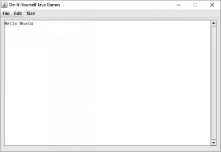

# 第 6 章：正确工作代码示例

传统上，每个第一个程序都会打印“Hello World”。第一个程序将向你展示如何创建、保存和运行程序。它还展示了所有 Java 程序中使用的基本结构。

这是一个由 Hello World 创建的窗口截图：

## 第 1 课 - Java 项目与包

程序首先通过 Java 项目组织，然后通过 Java 项目内部的包（packages）组织。你将为书中的每个程序创建一个 Java 项目。

包包含通常会被一起使用的程序文件。由于书中的程序很小，你创建的大多数 Java 项目将只有一个包。

在本节中，你将为你的第一个程序创建一个 Java 项目和一个包。

### 尝试一下

创建一个名为 Hello World 的你的第一个 Java 项目：

1. 如果 Eclipse 尚未打开：
   a. 双击你在桌面上创建的 Eclipse 快捷方式。
   b. 点击 OK 使用 Java 工作文件夹作为工作空间。

2. 在 Package Explorer（包管理器）面板中右键点击并选择 New / Java Project（新建 / Java 项目）。

3. 将项目命名为 `Java Hello World`，如果版本是 1.7 或更高，则选择 Use default JRE，然后如下所示点击 Next。如果默认 JRE 低于 1.7，则选择 Use JRE 1.7 or later。

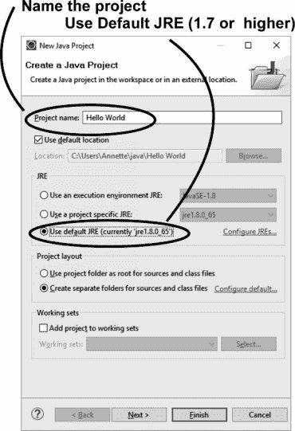

4. 点击 Libraries（库），然后如下所示点击 Add External JARs ...（添加外部 JAR 文件）。

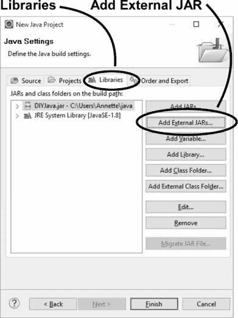

5. 搜索并选择你在 Java 工作文件夹中安装的 `DIYJava.jar` 文件，然后点击 Open。

6. 点击 Finish（完成）。

Package Explorer 面板现在包含一个项目（Hello World），并已添加一个 JAR 文件（`DIYJava.jar`），如下所示：

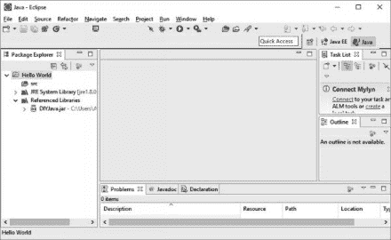

### 在 Hello World 项目中为 Hello World 创建包：

1. 右键点击 Hello World 项目并选择 New / Package（新建 / 包）。

2. 将包命名为 `thispackage.helloworld`。使用你自己的名字作为包名的一部分，例如 `thispackage.myname.helloworld`。

3. 点击 Finish。

Package Explorer 面板现在显示在 Hello World 项目中创建的包。

**关键点及更多：**

* 在 Package Explorer 中右键点击以创建 Java 项目和包。
* 为每个程序创建一个不同的 Java 项目。
* Eclipse 会在电脑上创建一个名称与 Java 项目同名的文件夹。为你的项目指定你想要的文件夹名称。
* 现在，你的 Java 文件夹中有一个名为 Hello World 的文件夹。
* 例如，像 Hello World 项目那样，将每个单词的首字母改为大写，并在单词之间留空格。
* 在你通过此书创建的 Java 项目中添加 `DIYJava.jar`。
* `DIYJava.jar` 是一个外部 JAR 文件。
* `DIYJava.jar` 使得编写在窗口显示文本的程序变得简单。
* 在 Java 项目中将程序文件组织成包。
* 将通常一起使用的程序文件放在一个包中。
* 由于你的程序很小，你的大多数程序将只有一个包。

**包名命名策略：**

* 确保你的包名与任何其他包名不同。
* Java 程序员使用他们的姓氏或公司名作为包名的第一部分。
* 使用全小写字母且不留空格。
* 在包名的不同类别之间使用点号。例如，如果包名指定了谁创建了包以及它的用途，请在创建者和用途之间加上点号。
* 确保你正在创建书中描述的 Java 项目时，你选择了 Use JDK-1.7 or later JRE 运行时选项。当你选择此项目创建选项时，Eclipse 将在所有未来的 Java 项目中默认使用此选项。
* Java 项目针对 Eclipse；包是为了 Java 的。
* 既然你正在使用 Eclipse，你将同时使用 Java 项目和包。如果你在没有 Eclipse 的情况下开发 Java 程序，可能只会使用包。

## 第 2 课 - 类、子类与程序

Java 程序由一个或多个类组成。类包含执行所需任务的实际程序语句。每个类都必须有不同的名称。例如，设计在窗口中运行的程序必须是某种类型的类。

在本节中，你将创建你的第一个类：在 `Window` 中运行的程序。

### 尝试一下

使用 `Window` 类创建你的第一个类：

1. 在 Package Explorer 面板中右键点击你的包并选择 New / Class（新建 / 类）。

2. 在如下所示的类名处输入 `HelloWorld`（提示："Hello" 和 "World" 之间没有空格）。

3. 如下所示输入 `Window` 作为类型，并点击 OK。

4. 你想要创建哪些方法？选择如下所示选项：
   a. `public static void main(String[] args)`
   b. Constructors（构造函数）。
   c. 无论是否选择第三选项抽象方法并不重要。

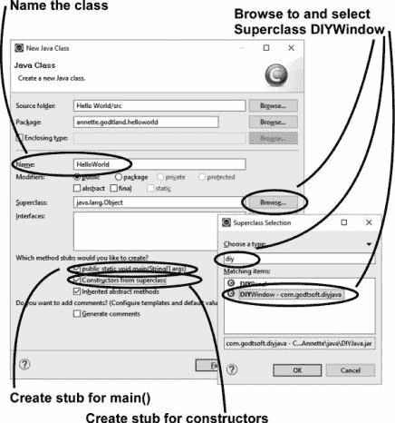

5. 点击 Finish 创建类。

Eclipse 将为 `HelloWorld` 类创建如下代码。如果你将阅读字体设置为较小，阅读这些代码可能会更容易。

```java
package thispackage.helloworld;

public class HelloWorld extends Window {

    public HelloWorld() {
        // TODO: generated constructor
    }

    public static void main(String[] args) {
        // TODO: generated method
    }

}
```

Eclipse 添加了你不需要的注释。注释是以 `//` 开头的行，或者是以 `/*` 开头并以 `*/` 结尾的组。

1. 从如下列表中 `(Code was removed from here)` 处移除自动生成的注释行。

```java
package thispackage.helloworld;

import com.godsoft.diyjava.Window;

public class HelloWorld extends Window {

    public HelloWorld() {
    }

    public static void main(String[] args) {

    }

}
```

从你为书中创建的任何类的代码中移除自动生成的注释。在后面的课程中，你将添加自己的注释。

点击任何 Completed 链接查看如何完成代码。然而，如果你在找到答案之前尝试自己完成代码，你会学更多。

以 `public static void main` 开始的代码块被称为 `main()`。以 `public HelloWorld()` 开始的代码块被称为构造函数。

现在添加你的第一行代码：

1. 按照此处所示所示向构造函数和 `main()` 方法中添加代码。代码更改在目录中始终以粗体显示。

```java
package thispackage.helloworld;

import com.godsoft.diyjava.Window;

public class HelloWorld extends Window {

    public HelloWorld() {
    }

    public static void main(String[] args) {
    }

}
```

```java
public class HelloWorld extends DIYWindow {

    public HelloWorld() {
        print("Hello world");
    }

    public static void main(String[] args) {
        new HelloWorld();
    }
}
```

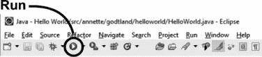

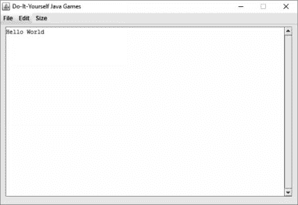

1. 按 `Ctrl-S` 保存程序。

2. 点击如图所示的运行（Run）按钮来运行程序：

发生了什么？

应该会弹出一个窗口显示“Hello World”，如图片所示：
1. 你需要对你的类进行什么修改来向你问好？

列表 1-4，来自 `HelloWorld.java`：

```java
public HelloWorld() {
    print("Hello

____________

");
}
```

1. 保存程序并运行它。

如果你犯了错误会发生什么？

1. 错误地输入单词 "print" 并保存程序。

列表 1-5，来自 `HelloWorld.java`：

```java
public HelloWorld() {
    print

    ttt

    ("Hello Annette");
}
```

发生了什么？

我看到了很多错误指示，如图像所示：

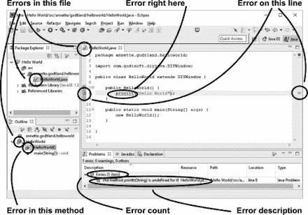

1. 双击 Eclipse Problems 面板中的错误数量，以显示找到的错误列表。

2. 双击 Problems 面板中的错误描述，将光标移动到错误行。

3. 将光标悬停在实际错误上（在上面的中显示 "Error here" 的地方）。Eclipse 将显示解决问题的方法列表，如下图所示。此 Eclipse 功能称为快速修复（Quick Fix）。

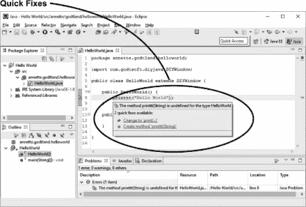

4. 点击名为 Change to "print (...)." 的快速修复。

此操作将为你修复该错误。

1. 保存你的更改。

所有错误指示都应该消失了。

现在打印更多内容：

1. 修改代码使你的程序输出以下内容：

Hello dear.

Take me to your leader.

列表 1-6，来自 `HelloWorld.java`：

```java
public HelloWorld() {
    print("________________________");
    print("_______________________");
}
```

在课程期间，除非遇到语法错误，否则请在每次更改代码后保存更改并运行程序。

他打印了正确的行吗？如果没有，请纠正代码并重试。

1. 你认为需要打印什么可以在两个句子之间插入一个空行，如下方截图所示。（提示：你不希望在这一行上打印任何内容。）

Hello dear.

Take me to your leader.

列表 1-7，来自 `HelloWorld.java`：

```java
public HelloWorld() {
    print("Hello Earthling.");
    print(___);
    print("Take me to your leader.");
}
```

### 关键点及更多

Java 程序由类组成。每个程序都需要在其其中一个类中包含一个 `main()` 方法。

`main()` 必须写成 `public static void main(String[] args)`。随后的课程将澄清这些单词的含义。

多个类通常被一起使用来创建一个程序。然而，书中的大多数程序都只有一个类。

每个类都必须有一个父类（super）。任何类都可以作为父类。你将在后的课程中创建你自己的父类。

具有相同父类的类被认为是相同类型。例如，你为书中的每个程序创建的 `main` 类将使用 `DIYWindow` 作为其父类。因此，书中的每个程序都是某种 `DIYWindow`。要创建类，请在 Package Explorer 面板中右键点击。类名可以包含数字、字母、下划线 `$`。类名中不能使用空格和点。类名不能以数字开头。类名通常大写字母开头。如果类名包含多个单词，每个单词的首字母大写，其余字母小写。类可以有一个或多个构造函数。类的构造函数与类名相同，且必须声明为 public。构造函数将在以后解释。使用 `new` 后接构造函数名和括号来调用。例如，`main()` 方法中的 `new HelloWorld()` 调用了 `HelloWorld` 构造函数。代码块包含在大括号 `{}` 中，每行代码以分号结束；任何 Java 程序都会首先运行 `main()` 方法。书书中所有程序的 `main()` 方法都会调用类的构造函数。因此，`main()` 方法将首先运行，然后是类的构造函数。大括号中的每个语句按它们在代码中出现的顺序逐个执行。代码之间的空行对代码的运行没有影响。添加空行是为了使代码更容易读。`print()` 语句将括号内的文本打印到窗口。每个 `print()` 语句都会另行打印。要打印空行，请使用空括号的 `print()`。`print()` 方法是 `DIYWindow` 的一部分，它位于 `DIYjar` 中。因此，你向项目添加了外部 JAR 文件 `DIYjar`，并选择 `DIYWindow` 作为 `HelloWorld` 类的父类。注释是以 `//` 开头的行或以 `/*` 开头并以 `*/` 结束的一组行。

# 第 章：面向对象编程

你之前学过 Java 是一种面向对象的编程语言。因此，它支持这种编程范式的基本原则。对象指的是真实的实体，如包、汽车、椅子或笔。面向对象的编程语言允许程序员设计使用对象和类的程序。它们提供并支持可以简化软件的功能。该范式中最重要的概念是：

### 对象

### 类

### 方法

### 继承

### 抽象

### 多态

### 封装

在现实世界中，你会遇到如人、狗、汽车等对象。它们具有状态和行为。例如，当你想到猫时，它的状态可能包括颜色，行为可能包括跑步、跳跃。

### 类

类是对象的蓝图或模板。类定义了该类型的对象将具有的状态和行为。例如，`Car` 类可能会定义状态如 `color` 和 `model`，以及行为 `drive()` 和 `brake()`。

### 方法

方法是定义在类中的函数。它们定义了对象可以做的事情。例如，`Dog` 类可能有一个打印声音的方法 `bark()`。方法可以接受参数作为输入并返回值。

### 继承

继承允许一个类（子类或子类）获取另一个类（父类或超类）的属性和方法。这促进了代码重用。例如，`SportsCar` 类可以继承自通用 `Vehicle` 类，获得它的状态和行为。

### 抽象

抽象隐藏复杂的实现细节并显示对象必要特征的过程。它允许程序员关注对象能做什么，而不是它是如何实现的。

### 多态

多态允许不同类的对象被视为公共父类的对象。例如，`Dog` 和 `Cat` 都可以是 `Animal` 的子类。当你对它们调用 `makeSound()` 方法时，每个都会以自己的方式做出反应。

### 封装

封装是将数据（变量）和操作该数据的方法封装在单个单元（类）中的做法，并限制对对象某些组件的直接访问。这通常通过使用访问修饰符（如 `private` 和 `public`）来实现。

带参数的构造函数带有参数的构造函数。它用于为特定对象提供值。

以下示例展示了两种类型的构造函数。第一个是默认构造函数，没有参数。第二个构造函数有一个参数，名为 name。

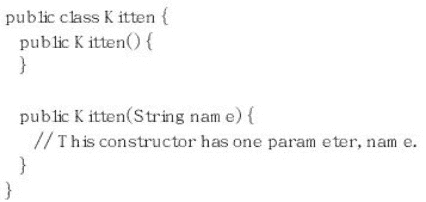

## 对象创建

类为对象提供了模板。对象基本上是从类创建的。你将使用关键字 `new` 来创建新对象。

要从类中创建一个新对象，请遵循以下步骤：

* **声明 (Declaration)**：指的是变量声明，在其中你必须输入变量名及其对象类型。
* **实例化 (Instance)**：要创建一个新对象，你将使用关键字 `new`。
* **初始化 (Initialization)**：在关键字 `new` 之后调用构造函数并初始化新对象。

以下示例展示了从类创建新对象所采取的不同步骤：

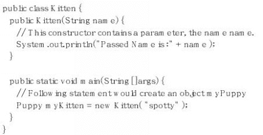

结果如下：

给定的名称为：spotty

## 如何访问实例方法和变量


你创建的对象用于访问实例方法和变量。要访问实例变量，请遵循以下步骤：首先，你需要创建一个对象：

```
ObjectName = New Constructor();
```

然后调用变量，例如：

```
ObjectName.VariableName;
```

调用类方法：

```
ObjectName.MethodName();
```

## Java 包

包只是接口和类的一种分组方式。Java 包作为类的容器。分组的典型依据是功能性。使用包有助于代码重用。当接口和类被分类后，你可以轻松地访问它们并在其他程序中使用。使用包有助于防止类和接口之间的命名冲突。

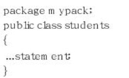

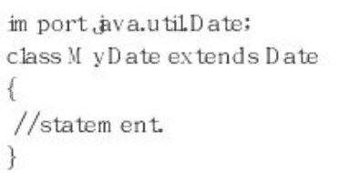

要创建一个包，请在包名之前使用 `package` 语句作为第一条语句。这是一个示例：

### 导入声明

你可以使用 `import` 关键字将包导入到源文件中。`import` 语句帮助编译器找到类或源代码的位置。

你可能只想从一个包中导入一个类。你可以使用点运算符 `.` 来指示包和类。例如：要导入一个包中的所有类，可以在点操作符后使用通配符 `*`。例如：


## 修饰符

修饰符是改变代码中定义含义的关键字。Java 提供了几种修饰符。

### 访问修饰符

访问修饰符定义了方法、变量、类和构造函数的访问级别。

- **Private (私有)**：仅类内部可用。当方法、变量、类或构造函数声明为 `private` 时，意味着它们只在类内部可用。然而，如果类有公共的 getter 方法，你可能在类外部访问私有变量。`private` 关键字表示最高限制。注意，你不能将接口和类声明为 `private`。

- **Public (公共)**：对所有人可见。定义为 `public` 的方法、接口、类等可以从其他类访问。类似于在公共类中定义的方法或字段，你可以访问该 Java 类。前提是它们在同一个包中。如果你想从另一个包访问公共类，将需要导入该类。根据类继承的概念，子类继承所有的公共变量和方法。应用程序的 `main()` 方法必须声明为 `public`，Java 解释器才能调用它来运行该类。

- **Protected (保护性)**：对所有子类和包可用。在父类中将方法、变量或构造函数声明为 `protected`，使其仅对同包中的类或另一个包中的子类可用。如果你允许子类使用辅助变量或方法并防止无关类使用它们，则使用这种访问方式。接口以及下面的字段不应声明为 `protected`，但接口外的字段和方法可以声明为 `protected`。类不应声明为 `protected`。

- **Default (默认)**：当未给出修饰符时适用——对包可用。未声明修饰符的方法或变量对包内的其他类可用。

下表总结了各种访问修饰符及其影响：

| 修饰符 | 类内部 | 包内部 | 子类（包） | 世界 |
| :--- | :--- | :--- | :--- | :--- |
| Private | Y | n | n | n |
| Public | Y | Y | Y | Y |
| Protected | Y | Y | Y | n |
| Default | Y | Y | n | n |

### 不可用的修饰符

被拒绝的修饰符可以访问 Java 中的各种功能。

### Final - 用于确定变量、方法和活动的实现

- **Final variables (final 变量)**：尾随变量只能显式初始化一次。一旦你将变量声明为 `final`，你将永远无法将其赋值给另一个对象。然而，请记住你仍然可以更改属性中存储的数据。这意味着虽然你可以更改对象的状态，但不能更改引用。`final` 修饰符通常与 `static` 结合使用，从常量创建一个类变量。

- **Final methods (final 方法)**：`final` 关键字用于防止方法被子类修改。

- **Final classes (final 类)**：`final` 修饰符用于防止其他类继承被声明为 `final` 的类的任何特性。

- **Static (静态)**：用于创建方法或变量。你可以使用此关键字创建一个独立于类实例的唯一变量（静态变量或类变量）。静态方法仅在考虑从变量中获取数据时进行识别并执行操作。你可以通过在类名后输入变量或方法名和点 (`.`) 来访问类方法和变量。

### Abstract (抽象) - 用于创建抽象方法或类

- **Abstract (抽象)**：当类被声明为 `abstract` 时，意味着你将无法实例化该类。类被声明为 `abstract` 的唯一理由是为了扩展它。你不能将类同时声明为 `final` 和 `abstract`，因为你不能扩展一个结束性的类。使用抽象方法的类必须声明为 `abstract` 类。这样做会导致编译错误。

- **Abstract method (抽象方法)**：由于它在声明时没有实现，抽象方法从子类派生其方法的主体。抽象方法不能声明为严格或确定的。除非它本身也是抽象类，否则扩展抽象类的类必须采纳父类的抽象方法。包含一个或多个抽象方法的类必须声明为抽象类。另一方面，抽象类不需要抽象方法。

示例：

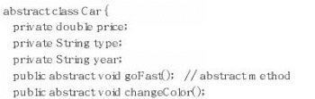

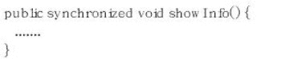

- **Synchronized (同步)**：`synchronized` 修饰符用于表示一次只有一个线程可以访问该方法。你可以与任何访问级别修饰符一起使用此关键字。

示例：

- **Volatile (易变的)**：此关键字用于表示访问 volatile 变量的线程应将其私有副本与内存中的主副本合并。结果是它将所有变量缓存副本与主内存同步。此修饰符只能用于定义私有或对象类型的实例变量。

示例：

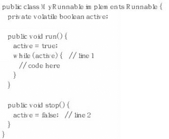


- **Transient (瞬态)**：`transient` 关键字用于告诉编译器在序列化包含标记变量的对象时跳过该实例变量。

## 决策结构

决策结构用于在条件为真时必须执行一组指令，而在条件被认为为假时必须执行另一组指令的情况。在 Java 中，有几种结构可以用于此类场景。这些结构包括：

### If 语句

该语句用于必须测试条件的情况，如果条件为真，则必须执行该语句后续的代码块。该结构的语法如下：

```
if (condition) {
//正体
}
```

下面是该结构的实现示例：

```java
public class ifDemo {
    public static void main(String args[]) {
        int i = 10;
        int j = 1;
        if (i > j) {
            System.out.print(i);
        }
    }
}
```

### Else 语句

该语句用于必须测试条件的情况，如果条件为真，则执行该语句之后的代码块，否则将执行 `else` 之后代码块。该结构的语法如下：

```
if (condition) {
//正体
} else {
//正体
}
```

下面是该结构的实现示例：

```java
public class ifElseDemo {
    public static void main(String args[]) {
        int i = 1;
        int j = 0;
        if (i > j) {
            System.out.print(i);
        } else {
            System.out.print(j);
        }
    }
}
```

### 嵌套 If 语句

该语句用于必须测试条件的情况，如果满足了条件，则执行该语句之后的块，否则将测试下一个条件。如果发现此条件为真，则执行与该条件对应的 `if` 语句的语句块。如果两个条件都不满足，则执行 `else` 之后的代码块。使用嵌套 `if` 语句可以测试许多条件。该结构的语法如下：

```
if (condition1) {
//正体
} else if (condition2) {
//正体
} else {
//正体
}
```

下面是该结构的实现示例：

```java
public class nestedIfDemo {
    public static void main(String args[]) {
        int i = 0;
        int j = 0;
        if (i > j) {
            System.out.print(i);
        } else if (j > i) {
            System.out.print(j);
        } else {
            System.out.print("Equal");
        }
    }
}
```

### Switch

如果你有一个变量，并且需要根据该变量的不同值执行不同的代码块，那么理想的结构是 `switch` 语句。该结构的语法如下：

```
switch (variable) {
    case <value1>:
        //正体
        break;
    case <value2>:
        //正体
        break;
    case <value3>:
        //正体
        break;
    default:
        //正体
        break;
}
```

下面是该结构的实现示例：

```java
public class switchDemo {
    public static void main(String args[]) {
        int i = 5;
        switch (i) {
            case 0:
                System.out.print(0);
                break;
            case 2:
                System.out.print(2);
                break;
            case 5:
                System.out.print(5);
                break;
            default:
                System.out.print(99);
                break;
        }
    }
}
```

### 三元运算符

Java 还支持条件运算符，也称为 `?:` 运算符。该运算符用于替代 `if else` 结构。其语法如下：`expression1 ? expression2 : expression3`，其中 `expression1` 是要测试的条件。如果条件为真，则执行 `expression2`，否则执行 `expression3`。

## 循环

有几种情况需要重复执行某组指令。例如，如果你想对一组数字进行排序，你必须多次扫描并重新排列该集合，以获得你想要的布局。这种执行流被称为循环。简单的循环是一种允许你多次执行某块代码的结构。Java 支持几种可以用于实现循环的结构。这些包括 `while` 循环、`for` 循环和 `do while` 循环。

`while` 循环不断迭代块，直到为 `while` 循环指定的条件为真。一旦该条件失败，循环就会停止。

`for` 循环允许程序员在同一个结构中操纵条件和循环变量。因此，你可以初始化一个循环变量，增加/减少它，并运行循环，直到该变量上的条件满足为止。

`do while` 循环与 `while` 循环类似。然而，在 `while` 循环中，条件是在执行块之前进行测试的。另一方面，在 `do while` 循环中先执行代码块，然后测试条件。如果条件为真，则重新初始化循环执行，否则循环终止。可以说，`do while` 循环一旦实现，至少会执行一次。

### 循环语句

有两个关键字专门与循环结合使用，它们也被称为控制语句，因为它们允许你将控制权从代码的一个部分转移到另一个部分。这些关键字是：

#### Break

该关键字用于循环内部，位于你想要结束循环的地方。

#### Continue

该关键字用于循环内部，位于你希望跳过循环剩余部分并跳转到下一次的地方。

为了帮助你理解循环是如何执行的，让我们使用三种循环类型来实现。

#### For 循环实现

```java
public class forDemo {
    public static void main(String args[]) {
        int[] numArray = {100, 300, 500, 700, 900};
        for (int i = 0; i < 5; i++) {
            System.out.print(numArray[i]);
            System.out.print(",");
        }
        System.out.print("\n");
    }
}
```

#### While 循环实现

```java
public class whileDemo {
    public static void main(String args[]) {
        int[] numArray = {100, 300, 500, 700, 900};
        int i = 0;
        while (i < 5) {
            System.out.print(numArray[i]);
            System.out.print(",");
            i++;
        }
        System.out.print("\n");
    }
}
```

#### Do While 循环实现

```java
public class doWhileDemo {
    public static void main(String args[]) {
        int[] numArray = {100, 300, 500, 700, 900};
        int i = 0;
        do {
            System.out.print(numArray[i]);
            System.out.print(",");
            i++;
        } while (i < 5);
        System.out.print("\n");
    }
}
```

### 增强型循环

Java 还支持用于数组元素的增强型循环。该循环的语法如下：

```
for (declaration : expression) {
    //正体
}
```

增强型循环的 `declaration` 部分用于声明变量。该变量应该是 "for" 局部的，并且必须与数组元素的类型相同。变量的当前值始终等于循环正在遍历的数组元素。`expression` 是数组或对返回数组的方法调用。

下面是增强型循环的实现示例：

```java
public class arrayDemo {
    public static void main(String args[]) {
        int[] numArray = {100, 300, 500, 700, 900};
        for (int i : numArray) {
            System.out.print(i);
            System.out.print(",");
        }
        System.out.print("\n");
    }
}
```

## 异常层次结构

Java 有一个内置类名为 `java.lang.Exception`，所有异常都属于该类。所有的异常类都是该类的子类。

此外，`Throwable` 类是 `Exception` 类的父类。

`Exception` 类有两个子类，分别是 `RuntimeException` 类和 `IOException` 类。以下是 Java 中作为 `Throwable` 类一部分已定义的方法列表。

```java
public String getMessage()
```

调用此方法时，该消息将返回对所遇异常的详细描述。

```java
public Throwable getCause()
```

此方法在被调用时，会返回一个包含异常原因的消息。

```java
public String toString()
```

此方法返回结合了类名的对异常的详细描述。

```java
public void printStackTrace()
```

通过调用此方法，可以将 `toString()` 方法的结果以及堆栈跟踪（stack trace）打印到标准 `System.err` 错误流。

```java
public StackTraceElement[] getStackTrace()
```

在某些场景下，你可能需要访问堆栈跟踪的不同元素。此方法返回一个数组，堆栈跟踪中的每个元素都被写入数组的不同元素中。数组的第一个元素包含堆栈跟踪的顶部元素，而堆栈跟踪的底部被写入数组的最后一个元素。

```java
public Throwable fillInStackTrace()
```

将堆栈跟踪中的先前信息附加到当前堆栈跟踪的内容上，并返回与数组相同。

## 捕获异常


捕获异常的标准方法是使用 `try` 和 `catch` 关键字以及它们的代码实现。这个 `try-catch` 块必须以这种方式实现：包含要抛出异常的代码。在这里也应该提到，旨在引发异常的代码被称为受保护代码。实现 `try-catch` 块的语法如下：

```java
try {
    /* 受保护代码 */
} catch (ExceptionName ex1) {
    /* 捕获代码 */
}
```

抛出异常的代码放置在 `try` 块中。如果抛出异常，则在 `catch` 块中实现处理异常的适当操作。每个 `try` 块必须包含一个 `catch` 块或结束块，这是至关重要的。

在 `catch` 语句中，你必须声明要抛出的异常。如果发生异常，执行流将转移到 `catch` 块。如果抛出的异常与 `catch` 块中定义的异常匹配，则执行 `catch` 块。

下面给出了 `try-catch` 块的示例实现。该代码实现了一个具有 2 个元素的数组。然而，代码尝试访问并不存在的第三个元素。结果是抛出了异常。

```java
import java.io.*;

public class DemoException {
    public static void main(String args[]) {
        try {
            int[] arr = new int[2];
            System.out.println("Access to third array element:" + arr[3]);
        } catch (ArrayIndexOutOfBoundsException ex) {
            System.out.println("Catching exception:" + ex);
        }
        System.out.println("reached outside of block");
    }
}
```

实现多个 `catch` 块可以处理许多异常。为了满足这一要求，允许使用多个 `catch` 块。此类实现的语法如下：

```java
try {
    /* 受保护代码 */
} catch (Type1 ex1) {
    /* 捕获 1 */
} catch (Type2 ex2) {
    /* 捕获 2 */
} catch (Type3 ex3) {
    /* 捕获 3 */
}
```

上面的语法说明了多个 `catch` 块的实现。然而，你可以实现任意数量的 `catch` 块。当这段代码执行时，首先执行受保护代码。如果发生异常，将尝试匹配第一个 `catch` 块以外的异常类型。但是，如果异常类型不匹配，则忽略 `catch1` 并尝试匹配第二个 `catch` 块的异常类型。哪个 `catch` 块与抛出的异常类型相同，就执行适当的 `catch` 块。

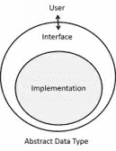

# 第 9 章：ADT、数据结构和 Java 集合

## 抽象数据类型 (ADT)

抽象数据类型（ADT）是对数据及其允许在其上进行的操作的逻辑描述。ADT 定义为用户视角下的数据。ADT 处理可能的值以及接口，而不关心数据结构的实际实现。例如，你想存储一些整数并找到它们的平均值。该数据结构的 ADT 支持两个函数：一个用于添加整数，另一个用于获取平均值。该数据结构的 ADT 并没有具体说明它将如何被实现。

## 数据结构

数据结构是数据的具体表示，被定义为数据程序员的视角。数据结构代表数据在内存中的存储方式。所有数据结构都有其优缺点。根据问题的类型，我们选择最适合它的数据结构。

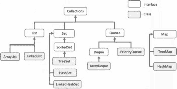

例如，我们可以将数据存储在数组、链表、栈、队列、树等。

**注意**：在本章中，我们将学习不同的数据结构及其 API，以便用户可以在不知道其内部实现的情况下使用它们。

## Java 集合框架

Java 语言提供了 Java 集合框架，这是一组高质量、高效且可重用的数据结构和算法。使用 Java 集合框架的优点如下：

1. 开发者不需要重复实现基础数据结构和算法。这节省了精力。
2. Java 集合框架经过良好测试，高质量，高性能。使用它们可以提高程序的质量。
3. 由于 Collections 实现了底层数据结构和算法，开发成本降低了。
4. 易于查看和理解使用集合框架的其他开发者编写的代码。集合框架文档齐全。

## 数组

数组表示相同类型元素的集合。

### ADT 操作

以下是数组 API：

1. 在 `k` 位置添加元素。可以在常数时间 `O(1)` 将值存储在数组的 `k` 位置。我们只需要 `arr[k]`。
2. 读取存储在 `k` 位置的值。访问数组中某个索引的值也是常数时间 `O(1)`。只需读取 `arr[k]` 中的值。
3. 将写入 `k` 位置的值替换为新值。时间复杂度：常数时间 `O(1)`。

示例：

```java
public class ArrayDemo {
    public static void main(String args[]) {
        int[] arr = new int[10];
        for (int i = 0; i < 10; i++) {
            arr[i] = i;
        }
    }
}
```

标准的 Java 数组有固定长度。有时我们不知道需要多少内存，因此我们创建一个更大的数组。因此，浪费了空间。如果数组已满且我们想向其添加更多值，我们需要创建一个足够空间的新数组，并将旧数组复制到新数组中。为了避免这种手动重新分配和复制，我们可以使用 Java 集合框架中的 `ArrayList` 或链表进行存储。

## ArrayList 在 Java 集合中的实现

Java 集合中的 `ArrayList<E>` 是实现 `List<E>` 接口的数据结构，这意味着它可以包含重复元素。`ArrayList` 实现为动态数组，可以根据需要增长或缩小。（当内部数组满时，会使用较大的数组并将旧数组值复制进去。）

示例：

```java
import java.util.ArrayList;

public class ArrayListDemo {
    public static void main(String[] args) {
        ArrayList<Integer> al = new ArrayList<Integer>();
        al.add(1); // add 1 to the end of the list
        al.add(2); // add 2 to the end of the list
        System.out.println("Array content:" + al);
        System.out.println("Array Size:" + al.size());
        System.out.println("Array IsEmpty:" + al.isEmpty());
        al.remove(al.size() - 1); // the last element of the array is removed.
        al.removeAll(al); // all array elements are removed.
        System.out.println("Array IsEmpty:" + al.isEmpty());
    }
}
```

输出：

```
Array content: [1, 2]
Array Size: 2
Array IsEmpty: false
Array IsEmpty: true
```

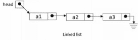

## 链表

链表通过动态数据结构连接，内存会在运行时进行分配。链表的概念不是关于连续存储数据。链表的节点包含一个指向列表中下一个项的链接。

在性能方面，链表比数组慢，因为链表项无法直接访问。当你提前不知道需要保留的项数时，链表是一种非常有用的数据结构。

链表有许多类型：线性、递归、双向、双向循环等。

### 链表 ADT 操作

以下是链表 API。

- `Insert(k)`：将 `k` 添加到列表开头。在列表开头插入一个项。只需创建一个新项并移动指针。使此新项成为列表的第一个项。此操作将耗费 `O(1)` 的固定时间。
- `Delete()`：删除列表顶部的项。删除列表开头的项。你只需要移动一个指针。此操作也需要常数 `O(1)` 时间。
- `PrintList()`：显示所有列表项。从第一个项开始，然后按照方向后续。此操作耗时 `O(N)` 时间。
- `Find(k)`：查找值为 `k` 的元素的位置。从第一个项开始并顺着指针移动，直到找到你想要的值或到达列表末尾。此操作耗时 `O(N)` 时间。注意：链表上不支持二分查找。
- `FindKth(k)`：查找位置为 `k` 的元素。从第一个元素开始，顺着链接移动直到你到达第 `k` 个元素。此操作耗时 `O(N)` 时间。
- `IsEmpty()`：检查列表中的项数是否为零。只需检查列表根指针，如果为 `null` 则列表为空，否则不为空。此操作耗时 `O(1)` 时间。

### Java Collections 中 LinkedList 的实现

Java Collections 中的 `LinkedList<E>` 是一种也实现了 `List<E>` 接口的数据结构。

示例：

```java
import java.util.LinkedList;

public class LinkedListDemo {
    public static void main(String[] args) {
        LinkedList<Integer> ll = new LinkedList<Integer>();
        ll.addFirst(2); // 2 added to the list
        ll.addLast(10); // 10 added to the end of the list.
        ll.addFirst(1); // 1 added to the first list.
        ll.addLast(11); // 11 added to the end of the list
        System.out.println("LinkedList Contents:" + ll);
        ll.removeFirst();
        ll.removeLast();
        System.out.println("LinkedList Contents:" + ll);
    }
}
```

输出：

```
LinkedList Contents: [1, 2, 10, 11]
LinkedList Contents: [2, 10]
```

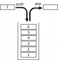

## 栈

栈是一种符合 LIFO（后进先出）策略的特殊数据结构。这意味着最后添加的将被最先删除。栈的不同用途包括：

1. 递归：递归调用是使用栈实现的。
2. 表达式的后序求值。
3. 回溯。
4. 树和图的深度搜索。
5. 十进制数转换为二进制等。

### 栈的 ADT 操作

- `Push(k)`：将值 `k` 压到栈顶。
- `Pop()`：从栈顶移除项并返回其值。
- `Top()`：返回栈顶元素的值。
- `Size()`：返回栈中项的数量。
- `IsEmpty()`：检查栈是否为空。如果栈为空则返回 `true`，否则返回 `false`。注意：所有栈操作均在 `O(1)` 时间内完成。

### Java Collection 中的栈实现

栈通过调用 `Stack<T>` 类的 `push` 和 `pop` 方法来实现。

示例：

```java
import java.util.Stack;

public class StackDemo {
    public static void main(String[] args) {
        Stack<Integer> stack = new Stack<Integer>();
        stack.push(1);
        stack.push(2);
        stack.push(3);
        System.out.println("Stack:" + stack);
        System.out.println("Stack Size:" + stack.size());
        System.out.println("Stack Pop:" + stack.pop());
        System.out.println("Top of stack:" + stack.peek());
        System.out.println("The stack is empty:" + stack.isEmpty());
    }
}
```

输出：

```
Stack: [1, 2, 3]
Stack size: 3
Stack Pop: 3
Top of stack: 2
The stack is empty: false
```

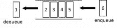

## 队列

队列是 FIFO（先进先出）结构。先进入队列的项将被最先删除。队列有以下应用：

1. 共享资源（例如打印机）
2. 多程序设计
3. 消息队列
4. 使用队列实现的 BFS 遍历。

### 队列的操作

- `add(k)`：将 `k` 添加到队列末尾。
- `remove()`：从队列头部移除项并返回其值。
- `peek()`：返回队列头部元素的值。
- `size()`：返回队列内部项的数量。
- `isEmpty()`：队列是否为空。如果为空返回 `true`，否则 `false`。注意：所有队列操作均在 `O(1)` 时间内完成。

### Collection 中的队列实现

`ArrayDeque<T>` 是双端队列的实现。如果我们使用 `add()`、`remove()` 和 `peek()` 它将表现像队列。（同样，如果我们使用 `push()`、`pop()` 和 `peek()`，它表现像栈。）

示例：

```java
import java.util.ArrayDeque;

public class QueueDemo {
    public static void main(String[] args) {
        ArrayDeque<Integer> queue = new ArrayDeque<Integer>();
        queue.add(1);
        queue.add(2);
        queue.add(3);
        System.out.println("Queue:" + queue);
        System.out.println("Queue Size:" + queue.size());
        System.out.println("Queue peek:" + queue.peek());
        System.out.println("Removing queue:" + queue.remove());
        System.out.println("Queue is empty:" + queue.isEmpty());
    }
}
```

输出：

```
Queue: [1, 2, 3]
Queue size: 3
Queue peek: 1
Removing queue: 1
Queue is empty: false
```

# 第 10 章：文件处理

本章涵盖了读取、写入、创建和打开文件的详细信息。你可以从多种文件 I/O 类和方法中选择。

## 读取文本文件

这种技术从字符输入流读取文本。缓存字符、数组和行以便高效读取。你可以指定缓冲区类型或使用标准类型。

因此，建议对任何它可以读取的读取器包装一个 `BufferedReader`（像 `FileReader` 和 `InputStreamReader` 这样的事务开销可能很大）。

例如：

```java
BufferedReader in = new BufferedReader(Reader in, int size)
```

`FileReader`：用于读取字符文档的便利类。该类的构造函数假设默认字符格式和默认字节缓冲区大小是合适的。

`Scanner`：一个简单的文本扫描器，使用正则表达式解析基本类型和字符串。扫描器使用分隔符模型将输入拆分为在定义上匹配空白符的标记。通过后续的单独技术，可以将生成的标记转换为不同类型的值。

```java
import java.io.*;
import java.util.Scanner;

public class ReadFromFileUsingScanner {
    public static void main(String[] args) throws Exception {
        // 文件路径现在设置为参数，以便进行扫描
        File file = new File("C:\\Users\\username\\Desktop\\example.txt");
        Scanner scanner = new Scanner(file);
        while (scanner.hasNextLine()) {
            System.out.println(scanner.nextLine());
        }
    }
}
```

使用 `Scanner` 类但不使用循环：


```java
import java.io.*;
import java.io.FileNotFoundException;
import java.util.Scanner;

public class example {
    public static void main(String[] args) throws FileNotFoundException {
        File example = new File("C:\\Users\\username\\Desktop\\example.txt");
        Scanner example1 = new Scanner(file);
        // 我们使用 [\\Z] 作为分隔符
        sc.useDelimiter("\\Z");
        System.out.println(example1.next());
    }
}
```

### 在 Java io 包中将文本文件读取为 String

```java
package io;
import java.nio.*; ;;

public class example {
    public static String example(String fileName) throws Exception {
        String example1 = "";
        example1 = new String(Files.readAllBytes(Paths.get(fileName)));
        return example1;
    }
    public static void main(String[] args) throws Exception {
        String example1 = example("C:\\Users\\username\\Desktop\\example.java");
        System.out.println(example1);
    }
}
```

### 保存到文本文件

你可以使用其中一个写入方法将字节或行写入文件。记录方法包括：

- `Write(Path, byte[], OpenOption...)`
- `Write(path, Iterable<CharacterSequence>, Character set, OpenOption...)`

### 移除删除文件

在 Java 中，`File` 类中有一个名为 `delete(file)` 的方法可以用来删除文件。用 java 保存的文件将被永久删除，而不会移动到回收站。使用 `java.io.File.delete` 会移除此抽象路径。`java.nio.file.deleteIfExists` 如果文件存在则会删除它。如果文件未打开，它也会删除列出的文件。

在任何软件项目中，错误都是客观事实。细致的规划、编程和测试有助于减少错误的普遍性，但随着新功能的引入和代码复杂性的增加，它们会变得尤为明显。幸运的是，错误比其他问题更容易发现。例如，编译时错误很快就能被识别；可以使用编译器代码来识别问题所在并立即修复。然而，运行时错误可能要困难得多；它们并不总是立即出现，一旦出现，可能在远离问题真实原因的地方。泛型通过在编译时工作以识别更多 bug 来帮助稳定软件。简而言之，泛型允许在定义类、接口和技术时为类型（类和对象）提供参数。就像方法声明中更熟悉的形式参数一样，类型参数为复用相同代码提供了独立的输出。区别在于，值是形式参数的输入，而类型是对类型参数的响应。使用泛型的代码比代码具有许多优势。通过使用泛型，开发者可以实现可以在不同类型集合上运行通用算法，算法是可以自定义的，并且安全且易于阅读。

## 泛型类型

泛型是一个带有参数化类型的类别或通用接口。可以通过修改简单的箱类来展示这一思想。考虑一个适用于任何对象的非泛型箱类别。你只需要提供两个技术：`set`（向箱中添加项目并接收它）、`retrieving`（获取）。由于它们的方法接受或返回对象，你可以传递任何内容，只要它不是基本类型即可。

在编译时无法检查该类是如何被使用的。一个软件可能会将一个整数放入箱中并期望从其推导出参数，而另一部分软件可能会在某行出错，导致运行时错误。通过括号（`<>`）添加的类型参数部分显示了类别的类型。指示参数（也称为因子）`T1`, `T2` 到 `T`。你通过将文件“字段”更改为“field `<T>`”生成泛型类型，以更新箱类别使用泛型。这代表一个类型为 `T` 的变量，可以在类内部任何地方使用。这会将所有对象转换为 `T`。任何指定的非基本类型都可以是类型变量：任何类、任何接口、任何数组以及任何其他变量。可以将相同的方法应用于泛型接口。按照惯例，类型标识符为单个字母。这与你已经理解的变量命名规范形成鲜明对比，而且很有道理：如果没有该惯例，很难区分变量与类或对象的普通名称。最常用的参数名是：

- `E`: Element（Java 集合框架广泛使用）
- `K`: key
- `N`: number
- `T`: Type
- `S, U, V, 等`: 第二、第三、第四种类型

你会在 JDK 和 API 中看到这些名称。

### 调用和创建泛型类型的实例

要在你的系统中引用字段的通用类别，你应该进行泛型调用，以产生一个具有特定值的 `T`，例如 Integer：

```
Box<Integer> integerBox;
```

你可能会认为泛型调用可以与普通的过程调用相比，但并不是向过程添加断言，而是将参数（在本例中为 Integer）移动字段本身。

许多设计者交叉使用“类型参数”和“类型语句”这两个词，但定义并不相同。在编码期间，提供参数以生成参数化类型。因此，`Foo<T>` 中的 `T` 是类型参数，而字符串 `Foo<String> f` 是类型冲突。使用这些词，该类遵循这一概念。就像任何其他变量语句一样，此软件并没有在箱中生成新项目。它只是声明 `integerBox` 将引用到一个“整数箱”，这正是 `Box<Integer>` 听起来的意思。泛型类型调用通常被称为参数化类型。

要实例化此类，像往常一样使用 `new` 关键字，但在类名和括号之间包含 `<Integer>`：

```
Box<Integer> integerBox = new Box<Integer>();
```

泛型技术是实现自身类型参数的技术。这与泛型类型声明相似，但类型参数的作用范围仅限于声明它的方法。除了泛型类构造函数外，还允许静态和非静态的泛型技术。

泛型技术的语法包括一个位于尖括号中的类型参数列表，它们出现在过程返回类型之前。对于静态泛型技术，类型参数段必须在方法返回类型之前。`Util` 类包含了 `Compare`，这是一种用于比较两个 `Pair` 元素的通用泛型技术。

```
Pair<Integer, String> ex1 = new Pair<>(49, "string1"); ownPair<Integer, String> ex2 = new Pair<>(64, "string2");
logical comparison = Util.<Integer, String>compare(ex1, ex2);
```

### 受限的类型参数

有时，你希望通过 form 语句限制参数化类型中可以使用的种类。例如，一个处理数字的技术可能只识别数值类型或其子类。这些边界参数的作用就在于此。显示类型参数的名称以指向定义的类型参数，包括 `extends` 关键字后跟一个上界，在本例中为 `Number`。注意，`extends` 在此上下文中通常表示“扩展”（如教程所示）或“实现”（如接口所示）。

#### 多个边界

类型参数可以有多个一个绑定。多边界变量是绑定中列出的所有类型的子类型。如果其中一个约束是类，请先指定这些类。例如：

```
class X { ... }
interface Y { ... }
interface Z { ... }
class R<T extends X & Y & Z> { ... }
```

如果没有先指定绑定 `X`，你将得到编译错误：

```
class R<T extends Y & X & Z> { ... } // 编译错误
```

# 第 11 章：集合

### 集合的函数化

当我们外部化代码时，我们揭示了每一步。这是命令式编程的标志。然而，函数式编程中反复出现的主题之一是相反的想法：内部化代码。内部化代码的工作是将细节隐藏在函数内部。然而，函数式编程进一步发展了这一理念，将日常编程中的微型模式转换为函数。例如，遍历数据（无论是通过迭代器、`for loop` 还是 `while loop`）都是这些微型模式之一。函数式编程正在改变我们思考它们的方式。

Java 的函数式努力如果不对其 `Collections` 库进行重构（即 `Collection`、`Map`、`List` 和 `Set` 接口）将是不完整的。这是因为集合被频繁迭代，而且它们是 Java 程序的基石。这是函数化努力的自然场所。

然而，进行任何重大更改（例如向 `Collection` 接口添加新方法）都会破坏所有 Java 8 之前程序的向后兼容性。这不仅包括扩展 `Collection` 接口自身的 JDK 层次结构，还包括任何开源或闭源库以及内部类。设计者从未、永远不会采用这种策略。但是变化是必要的；该库引入于 1998 年，软件行业已经老了。引入默认方法的动机是为了使库现代化和函数化。默认方法非常合适，子类可以继承或重写行为。与添加新方法不同，子类可以在无需重新编译的情况下自动接受默认方法。实现了即时兼容。默认方法本身很有用，但它们的存在对于库函数化是必不可少的。

函数式编程的第二个反复出现的主题是并行性。简单来说，函数式编程为并行性提供了更好的支持。作为结果，集合已经增强，可以在处理集合时使用多核。与流一起，集合是 Java 引入函数式并行的前沿。现在我们学习了 Java 的标准函数式接口，可以开始将这些知识应用于集合了。让我们看看 Java 8 中的库发生了什么变化。

#### Collection 接口

我们首先查看列表和集合可用的集合 接口中的新默认方法。这是 `forEach()` 方法：该方法遍历整个集合，允许消费者决定对每个项做什么。这是内部迭代的概念，也是声明式编程的体现。迭代的细节并未指定。这与外部迭代形成对比，在外部迭代中，迭代的细节以及对每个元素的操作都是在代码中指定的。

我们将通过三个电影黄金时代的喜剧滑稽演员——“三小士”的 Larry、Mo 和 Curly 来向你展示这些函数化集合的示例。首先，让我们打印集合的内容：

`forEach()` 方法有非常广泛的适用范围。这是遍历集合的一种方便得的方法，应该成为你的事实标准。然而，作为一种声明式结构，有些事情是你无法完成的。首先，你不能像在 while 循环那样更改局部变量的状态。算法需要从函数式的角度来思考。目前，只需知道 `forEach()` 非常适合不改变状态的迭代。

我们现在查看集合中的另一个新方法：`removeIf()` 方法将迭代、测试和删除过程内部化。你只需要说明删除条件是什么。使用熟悉的已函数化谓词接口，我们可以轻松地发现应该使用什么种 lambda。

为了替换列表的全部内容，我们可以使用 `replaceAll()`：`replaceAll()` 使用 Operator 作为函数式接口。`replaceIf()` 和 `replaceAll()` 对子类都可用，前提是基类必须支持，否则将抛出异常。

这些示例展示了函数式编程的紧凑性。大部分工作已由函数式完成。

#### Map 接口

使用列表作为 map 的值时，最大的问题之一是在添加、更新或删除项之前，总是需要检查 map 是否存在。首先，你需要提取列表，如果没有找到，则创建它。例如，假设我们有一个更新作为 map 实现的数据库的方法。map 的键是电影年份，其值是该年份电影的列表。Java 8 之前的代码看起来像这样：Java 8 通过这些默认方法提供了更好的替代方案：

在这种情况下，使用 `computeIfAbsent()` 方法就大材小用了，使用 `putIfAbsent()` 方法会更好：


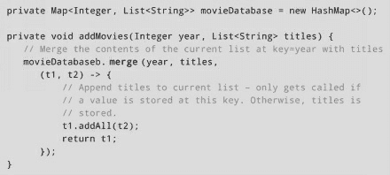
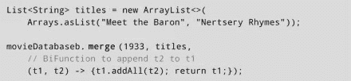

该方法不使用 lambda 表达式，并且期望提供值——它不会被求值。尽管没有使用 lambda，这仍然是一种函数式方法。这证明了你可以在不使用 lambda 的情况下用函数式表达代码。

如果你仍然需要提取数据，可以使用 `getOrDefault()` 方法这种更具函数式的方法：你也可以使用 `merge()` 方法作为替代方案。这使得检查列表的存在变得简单。在下例示例中，如果键（年份）在 map 中不存在，它将把值（标题）置于 map 中。如果它存在，则让 `BiFunction` 决定如何处理这两个列表：可以像这样使用：

`BiFunction` 也可以返回 `null` 值，告诉 `merge` 删除该键。结论是我们已经删除了通用的检查代码。

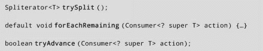

项目的存在，现在可以关注真正重要的事情了：定义如何构建列表以及如何向列表添加项目。`map` 接口已通过其他函数方法增强，如 `forEach()`、`replace()` 和 `replaceAll()`，并使用了相同的代码内部化原则。可以在附录找到找到列表。

## 分发器 (Distributor)

`Collections` 库仍然受到相同的并发访问限制。一如既往，你需要选择适合你的线程安全要求的 `Collections` 库类。这是因为上面显示的新方法仅仅是对相同底层数据结构的函数式抽象。这些方法在函数式编程中并不容易受到并行处理，因为它们仍然依赖于多线程变异集合并同步访问源数据的概念。

然而，有一个新的 Java 8 抽象是兼容的。它旨在用于数据的并行迭代。该思想体现在 `Splitter` 接口中。该接口的前提是对数据进行分区，并将部分传递给不同的线程。`Splitters` 可以从 `Collection` 接口获取，包括 `List` 和 `Set` 子接口。

`Splitter` 接口的主要元素是三个方法：`trySplit()` 方法将数据分为两部分。创建一个带有一半数据的新拆分器，并将另一半保留在原始实例中。它们每一个都可以分配给一个线程，反过来通过 `forEach()` 遍历分区数据。`next()` 方法是一个单变体，返回下一个项目，如果列表已耗尽则返回 `null`。拆分器本身不支持并行处理，但提供了一种执行该操作的抽象。这里是其概念：

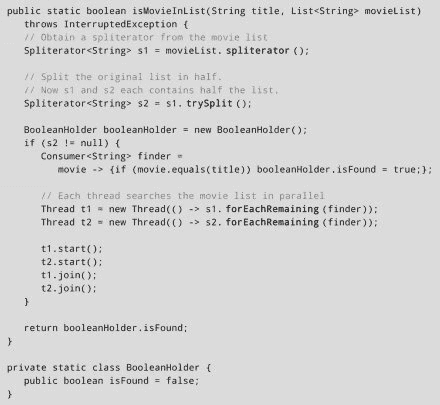

给定标题和移动列表，`isList()` 方法并行化搜索以确定其是否在列表中。如果找到，则将 `booleanholder` 中的标志设为 `true`。从列表中检索拆分器实例，将其对半，并将其中一半传递给每个线程。`Splitters` 也可以从其他集合类型以及 JDK 中的其他库获取。有许多设计实现处理各种特性，包括有限/无限、有序/无序、已排序/未排序以及可变/不可变。它们继承了其底层数据结构的特性。`Splitters` 是一种低层次的抽象，旨在对并行迭代提供更精确的控制。然而，API 缺乏实现函数式友好型算法所需的某些增强。在上面的示例中，我们需要在 `booleanholder` 中存储用于搜索的状态。

## 结语 (End)

我们对改进后的 Java 8 集合以及标准函数式接口的概述到此结束。由于为了支持函数概念对标准库进行了许多更改，预计外部 API 将发生重大变化。但最大的变化尚未到来。

### 关键点

- 新的 `java.util.function` 包包含一组函数式接口。
- 它们被分为四类，每类由一个原型表示：`Consumer`、`Function`、`Predicate` 和 `Provider`。
- 每个函数式接口家族都定义了专门用于类型和参数的变。
- 函数式接口还定义了允许函数式组合的方法。
- 多个不同的 lambda 可以组合成表现为一个整体的超函数（superfunctions）。
- `Collections` 库已重构并函数式化。这是通过在层次结构的顶层使用 `default` 方法实现的，从而确保了向后兼容。
- 集合、列表、集合和 map 中的新函数式方法设计时考虑了内部迭代。以 lambda 表达式和方法引用的形式的行为参数被传递给遍历集合并对每个元素执行的方法。
- 内部迭代是声明式编程的一种函数式形式。它减轻了开发者必须描述“如何”做什么的负担，并关注于“做什么”。`Splitters` 设计用于并行遍历集合。数据被分区，每个块被传递给不同的线程进行并行处理。

## 应用 (Application)

JDK 是 Java Development Kit，是编译 Java 程序所需的本质工具。与 JVM 一起，JDK 包含一个解释器或加载器、一个名为 `javac` 的编译器、一个存档 (JAR)、一个生成器以及成功所需的许多其他工具。JVM 是运行时。它是一个可以执行 Java 字节码的环境，用于实现 Java 虚拟机。

JVM 代表 Java Virtual Machine（Java 虚拟机）。JVM 是一个抽象机器，该规范为我们提供了一个可以执行字节码的 JVM。JVM 虚拟机必须符合以下条件：

- 规范：一份描述如何实现虚拟机的文档。
- 实现：满足虚拟机要求的程序。
- 规范：运行时环境的实例。
- 实例：当命令行显示时创建的虚拟机实例，用于编写 Java 命令和运行类。


这三者是密不可分的，并且都依赖于对方来发挥作用。在此，感谢你选择我的 Java 编程指南。正如你所见，它是一种简单而复杂的语言，有许多不同的方面需要学习。现在，你应该对 Java 编程的基本概念和如何使用它有了良好的理解。下一步就是练习。继续练习。我敦促你花时间学习这份指南；遵循教程，在完全理解其含义之前不要离开任何章节。为了帮助你，可以在网上找到一些非常有用的 Java 论坛，那里充满了准备好并乐意帮助和指点方向的人。还有许多在线课程，有免费的也有付费的，但它们都是有用的并可以帮助你的学习达到下一个水平。你喜欢这个指南吗？希望这正是你所需要的，甚至更多，能带你走通通梦想工作的正确道路！

希望你觉得我对计算机编程的介绍对你有所帮助。这是一个非常简单的开始，但应该让你对如何入门有一个初步的了解。

它还应该说明计算机编程并没有那么困难，而且可以非常有趣，尤其是当你开始看到结果出现在屏幕上，并看到——简而言之——计算机正在执行你给它的指令时！

如果你发现自己已经清楚了预期的内容，就可以转向你所选编程语言中更高级的编程学习了。这里有一个警告：不要尝试一次学习超过一种语言；否则你会发现自己陷入了困惑。在这个阶段，我给你的唯一建议就是不断练习……不断练习。你做得越多，学到的就越多，想学的也越越多。

# 目录

- 引言
- 第一章：Java 基础
- 第二章：变量
- 第三章：Java 基础
- 第四章：Java 环境
- 第五章：项与类
- 第六章：正确代码示例
- 第七章：面向对象编程
- 第八章：决策判断与循环控制
- 第九章：ADT、数据结构与 Java 集合
- 第十章：文件处理
- 第十一章：集合
- 应用
