# Java 编程应用

## 关于作者

Gerard I. Prudhomme 拥有伦敦大学学院（UCL）的计算机科学硕士学位（M.S.）。他曾在不同的财富 500 强公司担任过软件程序员和技术作家，并在伦敦大学、哈佛大学和牛津大学学习过。

## 图列表

- **图 2.1.** Java 平台
- **图 2.2.** Java
- **图 2.3.** Java 解释器
- **图 2.4.** Java 认证路径
- **图 2.5.** RMI 图像
- **图 2.6.** RMI 图像
- **图 2.7.** Mac OS 上的 SWT 组件
- **图 2.8.** Apache camel 标志
- **图 2.9.** Java 编程中的事件处理
- **图 2.10.** Java 编程中的事件关系
- **图 3.1.** 调整为 300x300 的记事本教程框架图像，通过 `setVisible(..)` 方法变为可见
- **图 3.2.** Java 编程中的动作处理
- **图 3.3.** Java 编程图形
- **图 3.4.** 源代码可以在 en: Java programming/graphics/ drawing shapes 找到
- **图 3.5.** Java 桌面系统桌面部分的截图
- **图 3.6.** 关于 Java swing 的英文 Wiki 书
- **图 3.7.** Java 编译过程的基础
- **图 3.8.** 基于 Java 平台事件模型的简单示例程序的 UML 设计（来自 JavaBeans 规范版本 1.01）
- **图 3.9.** 使用 Java 3d 工作时的截图
- **图 3.10.** Java 编程语言中算术表达式的计算
- **图 3.11.** Java 环境中单个对象的表示
- **图 4.1.** 这是在 JReport 软件中创建的示例仪表板
- **图 4.2.** ACARM 过滤器架构概述
- **图 4.3.** ADF11g 架构
- **图 4.4.** AspectJ 织入
- **图 4.5.** 应用中 JDB 框架（Java 桌面基础）部署架构的加拿大 JDB 层表示
- **图 6.1.** Java 异常类层次结构的 UML 图
- **图 6.2.** Java 编译 JIT
- **图 6.3.** 解释 Java 运行时以及 Java 代码如何“一次编写，随运行”的图
- **图 6.4.** 将 Java 对象描述为 Java 环境中的一个系统，具有属性和行为[方法]
- **图 6.5.** Java 中的泛型
- **图 6.6.** Java throwable 继承
- **图 6.7.** Java 通配符可以在三个方向上专门，形成一个缺少两条边的立方体（改编自 Kersten Krab Thorup 和 Madsen Torgersen，“Unifying Genericity,” ECOOP’99 中的图 6）
- **图 6.8.** Java/字节码解释型编译器工具箱的组件
- **图 6.9.** 描述的字节码截图涵盖了 6.2 项目、组件库和工具列表中的插件
- **图 6.10.** “Java 反编译器”工具的截图，带有一个已反编译的 Java 类
- **图 6.11.** 用于属性文件的 DOKSoft 编辑器独立版本
- **图 7.1.** Java 边界网格流布局
- **图 7.2.** Java 命名目录接口
- **图 7.3.** Java 中多维数组的构建
- **图 7.4.** Java 数值类型
- **图 7.5.** IT 中的众多编程语言之一——ASP、C、PHP 只是几种
- **图 7.6.** AWT swing 事件驱动
- **图 7.7.** Ginga 中间件
- **图 7.8.** Javas
- **图 7.9.** Spring 简单项目
- **图 7.10.** Java 编程的发展历史
- **图 7.11.** Java 语言中的代码片段显示
- **图 7.12.** Java 绘制的阶 1 到 3 尔伯特曲线
- **图 8.1.** 曼德博集（来自 http://www.its.caltech.edu/~dannyc/fractals/simple.html）
- **图 8.2.** 使用 JavaFX 创建的程序窗口截图
- **图 8.3.** 自定义绘制示例
- **图 8.4.** 开源 Solaris 10 中的 Java 桌面系统（开源软件分发许可证 CDDL）
- **图 8.5.** Gob 应用。GUI 使用 Swing 开发并全部自定义绘制
- **图 8.6.** RESTful Web 服务
- **图 9.1.** JNode 0.2.3 版本截图（来自 http://www.jnode.org）
- **图 9.2.** JNAerator Studio 截图
- **图 9.3.** JavaSE（原 J2SE）的软件架构，带有 JSR、JDK 和 JRE
- **图 9.4.** Java 中的垃圾收集生成器
- **图 9.5.** 如 Java 规范 v.1.01 所述 Java 事件模型的 UML 图，使用事件适配器
- **图 9.6.** Java 开发里程碑
- **图 9.7.** 此图描述类和包中的类成员作用域
- **图 9.8.** SB 计算机中的 Ginga 结构
- **图 9.9.** Ginga 执行环境 v1
- **图 9.10.** Mac OS X Tiger 上的 DrJava
- **图 9.11.** Linux 上的 DirSync Pro 截图
- **图 9.12.** Eucalyptus 云架构
- **图 9.13.** 垃圾收集问题示例图：短时间内发生了多次全垃圾回收
- **图 9.14.** GNU Java 编译器
- **图 10.1.** 用于非 Java 源代码编译到 Java 字节码的第三方 JVM 目标编译。示例示例显示 python 正在编译为 Python 编译代码和 Java 字节码
- **图 10.2.** 描述系统通过输入和输出消息与其环境交互的简单插图。
- **图 10.3.** 展示 JVM 如何执行其即时编译功能的图表。
- **图 10.4.** 2014 年在纽伦堡嵌入式世界展会上的 IS2T 嵌入式 Java 解决方案
- **图 10.5.** 在 Microsoft Windows XP 上运行 IzPack 软件的截图。由 Julien Ponce（图片上传者）拍摄，可在项目网站获取。这是根据 [Apache License] 发布的软件截图。
- **图 10.6.** 带有 svn 支持和更新图标（咖啡主题）的 J 0.23.0。
- **图 10.7.** J9 插件
- **图 10.8.** Javi 主窗口加工具选项的截图。
- **图 10.9.** JframeJava
- **图 10.10.** JBoss-Netty 标志。
- **图 10.11.** Java 虚拟机 (JVM) 工程图。不同方言的源记录利用编译器（例如 `Javac` 和 `Jython`）汇成 Java 字节码。任何带有 JVM 的阶段都可以运行字节码，只需首先通过字节码验证器，然后通过 JIT 编译器即时解码或将其聚合为该阶段的机器码。
- **图 10.12.** 文件：Standard Java VM vs. squawk Java VM.svg
- **图 10.13.** JVM Java 7 规范基础。
- **图 10.14.** 解释编译型语言与解释型语言区别的图表。
- **图 11.1.** Java 虚拟机 Java 7 规范基础。
- **图 11.2.** 在 Java 虚拟机中运行程序的通用架构图。

## 缩写列表

- **API** 应用程序编程接口
- **AWT** 抽象窗口工具包
- **CDDL** 通用开发和发行许可证
- **DBMS** 不同的数据库管理系统
- **IDE** 集成开发环境
- **JVM** Java 虚拟机
- **OOP** 面对象编程

## 前言

当我们考虑如何编写 Java 应用程序时，有许多需要先考虑的各种事实。Java 语言目前为程序员提供了一项进入市场并带来许多优势的技术。在市场上，有些语言与 Java 部分相似（例如，无论人们怎么说，JavaScript 至少部分是基于 Java 的）。

举几个例子，在某些情况下，Java 开发程序的速度比 C++ 更快。对于我们可能开发的任何小型或大型工具程序，如果我们不知道它们将运行在哪个平台上，那么直接将代码编写成可以移植到其他操作系统的东西更好。在许多不同的操作系统开始被科技领域的各种不同参与者所知的今天，这一事实显得尤为相关。

另一个你可能希望考虑的问题是，现在有越来越多的公司决定切换到 Linux。现在决定切换到 Linux 的不同群体和实体还包括一些大型重要组织，例如美国联邦政府。Java 令人惊叹的生态系统让开发者能够编写 Java 程序，并将其运行在 Linux、Windows、Mac、Android 甚至 iOS 上。

至于负载水平，这通常是开发者没有考虑过的，Java 生态系统意味着 Java 应用程序可以快速扩展以处理更多用户。不使用面向对象的语言（这就是如果你用 C 语言编写计算机程序将会发生的情况）这是一个局限性。但事实是，这个陈述旨在确保你将获得一个极佳的肯定来源。我想要求你从这些内容中获得一些见解。在 Java 中，你始终可以全局类；即带有静态方法。这样你就能实现与 C 语言相同的范式。反之，相反的陈述是不成立的。

Java 可以通过静态声明以类似于 C 语言语言等非面向对象语言的方式运行。同时，使用 C 这样的技术会限制程序员，因为 C 不是一种完全面向对象的语言。Java 还有很长的路，特别是速度没有 C++ 那么快。

只要我们在编程时不犯任何严重错误，Java 作为一种语言是非常宽容的。同时，开发者为这种宽容的功能付出了代价，即牺牲了 C++ 程序运行的速度，换取稍慢的速度，但具有完全跨平台的优势。因此，Java 和 C++ 之间的主要区别在于 Java 是完全跨平台的，但速度稍慢。

同时，C++ 编程提供的略快速度并不经常足以以弥补处理许多不同库带来的不便，以及尝试将 C++ 程序转换为运行在不同操作系统上的困难，而每个平台在不同平台上都将是功能完整的。一个 C++ 程序需要大量时间来配置程序以便在特定平台上正确运行。同时，Java 语言提供的优势将继续越来越吸引力，事实是，如果你有许多希望运行你程序的不同平台，那么 Java 就是你应该使用的技术。

### 1 可移植性

如果你想测试你的应用程序，你将能够，这经常足以以弥补处理许多不同库带来的不便，以及尝试将 C++ 程序转换为运行在不同操作系统上的困难，而每个平台在不同平台上都将是功能完整的。一个 C++ 程序需要大量时间来配置程序以便在特定平台上正确运行。同时，Java 语言提供的优势将继续越来越吸引力，事实是，如果你有许多希望运行你程序的不同平台，那么 Java 就是你应该使用的技术。

（注：原文后续存在大量重复的 OCR 错误文本，已根据指令要求过滤重复内容并保留核心逻辑。）

### 可移植性 3

为了讨论这一计划中的现实，并研究 Java OOP 语言，同时理解该技术在其应使用的背景下的运作方式，你应该继续阅读本章。编写本章是为了让你准备好实现一个目标，该目标将有助于你理解 Java OOP 语言的目标。

为了理解使用 Java OOP 语言进行复杂的编程，我建议你留意以下数据，这些数据勾勒了 Java OOP 语言运行机制中最方便且核心的方面。另一方面，解释 Java 代码的即时编译器（`JIT compiler`）是消耗资源的，这是一个不争的事的事实。尽管如此，我仍然希望确保你毫无疑问地能够使用合适的技术，我想给你一个机会去了解以下重要的指导，这些指导将帮助你理解 Java OOP 语言是如何运作的。

因此，为了提供一个使用 Java 的主要缺点的示例，使用 `JIT` 编译器意味着 Java 程序的运行速度通常比使用 C++ 等不使用 `JIT` 编译器的语言开发的类似程序要慢。因此，我们现在将讨论在观察目前不同技术环境下运行的所有不同 OOP 语言时，Java 是一个特殊的案例。此外，我也将竭尽所能地帮助你理解为什么从 Java OOP 语言广泛的文档中受益对你是有利的。

我建议你系统地注意以下核心要素。简而言之，C 的工作方式有点像 C，但结构会更智能一点，而 C++ 中使用的组合在在许多不同平台上使用相同代码方面，通常没有 Java 使用的那么敏锐。我陈述了这些事实，并希望你结合这些陈述来理解所有事实，这些陈述旨在确保你能够了解 Java OOP 语言目前的运作方式。

这些内容的目的是提升你对 Java OOP 语言以及这项先进技术目前运作方式的整体知识水平。Java OOP 语言的优点之一是，它为程序员提供了许多不同的切身利益。我非常渴望帮助你评估以下数据。

## Java 编程应用

作为一名习惯使用面向对象技术进行编程的开发者，我想说，我非常感激可以使用用 Java OOP 语言编写的软件，从而我只需要编写一次代码。这一事实是 Sun 公司在设计和开发 Java OOP 语言时计划产生的影响。此外，Sun 公司显然已经尽其所能，确保完全合格的计算机科学人士拥有他们可能需要的所有文档，以便这些同样合格的计算机科学人士能够使用 Java OOP 语言进行编程。

你可能需要阅读这些为完全合格的计算机科学人士编写的技术文档。此外，Sun 公司也认可非常需要完全合格的计算机科学人士来充分利用 Java OOP 语言。对你来说，尽可能阅读关于 Java OOP 语言的内容也至关重要。

毫无疑问你需要关注以下数据，本章涵盖了大量的本质信息，并结合了一些实用的陈述。同时，我仍然可以在许多不同平台上使用相同的 Java 代码，而无需为程序将部署的每个特定平台花费大量时间重写代码。我声明的大部分内容真的应该被强调为至关重要。

我编写本章的意图是，如果你是一个完全合格的计算机科学人士，那么你可能非常渴望进一步学习更多关于 Java OOP 语言的知识。其他章节也包含了更多我提到的核心要素的信息。呈现这些要素的目的是让你能够获得评估 Java 功能所需的所有信息。此外，后续章节涵盖的事实非常清晰。

当涉及到 Java 与像 C 这样的语言时，我应该说我不仅仅会讨论可移植性，我说明这一点是因为我只想对目前正在阅读本章的各种读者提供的所有信息保持透明。因此，你应该意识到 Java 的另一个重要优点是它是一种完全的 OOP 语言，为完全合格的计算机科学人士提供了可能从类似于 C++ 语言的语义中获得的所有益处。Java 面向对象编程语言是了不起的，因为它仍然允许开发者只写一次代码。

那么，在许多不同平台上通常是如此，开发者可以将其部署到广泛且多样的操作系统上，而无需花费大量时间确保语言在每个平台上都能完全运行。同时，你应该留意，许多开发者对跨平台兼容性担忧而产生的大多数不同问题并不是 C++ 或 C 特有的，Java 在技术上也会出现一些跨平台兼容性问题。相反，Java 出现跨平台兼容性问题的概率比 C 和 C++ 低。

此外，为了讨论一项关键数据并确保你从本章中获得乐趣，我建议你非常仔细地利用这些数据。因此，你应该注意以下陈述，因为它们将提高你对 Java 面向对象编程语言的整体水平。对于 C 和 C++，如果你希望将程序部署到各种不同的平台，你必须投入比 Java 多多的工作。

尽管如此，写这些陈述是为了确保你能够从字面上充分利用这些价值的数据。因此，我明确建议如果你决定查看以下数据，你将获得巨大的收益。还有许多不同的编程语言，如 Objective C、LUA、Python 和 .NET，会让开发者在尝试为几种不同平台编写代码时遇到更少的问题。

话如此，你应该掌握 Java 面向对象编程语言。作为 Java 面向对象编程语言提供的优秀功能之一，内存存储区域通常可以自动控制。你应该考虑这一事实，以及这种最先进的面向对象编程语言目前提供的更高级的功能。如果你想获得良好的指导，也可以获得大量的文档。

因此，我绝对建议你留意以下这部分的理解，此外，你应该确保阅读适当的文档，帮助你充分理解这种独特的面向对象编程语言。

## Java 编程应用

本章充满了一些关于面向对象编程语言的有用信息，对于完全合格的计算机科学人士非常有用。应该意识到以下信息是不可信地必要的。还可以指出，你应该考虑你可能希望对我诚实提供的之前的材料再读一些额外信息。另一方面，如果你决定想学习更多关于 Java 面向对象编程语言是如何运作的，那么以下信息和事实是你需要花时间掌握并充分意识的本质内容。

这些事实对于希望达到整体知识水平的完全合格的计算机科学人士来说将非常有用，这种水平将使这些完全合格的计算机科学人士能够利用不同的技术特性可能适用于各种不同类型的平台。在任何情况下，你应该非常小心，以确保你能够记住这些事实。此外，基于这些理由，我希望确保你几乎肯定毫无疑问地识别出相关情况的回报。从现在起，我想要求你研究随附的指南。所有的浏览器在渲染引擎如何工作方面都应该遵循 W3C 标准。

对于那些想要了解前面提到的重要数据的人来说，可以这样说。我编写这一章是希望这些信息能够充分帮助合格的计算机科学专业人士更深入地理解 Java 面向对象编程语言。因此，以下信息是有用的。然而，我也希望你能够为你我所呈现的所有信息发现一些非常实用的应用。

如果你能理解随附的总结将是理想的，而且网页和应用程序在不同浏览器上的运行方式仍然存在一些特殊的差异。此类问题需要由合格的计算机科学专业人士仔细处理。不过，如果你目前正试图利用一些面向对象编程语言及相关技术来钻研一些个人额外信息，那么你就应该小心。

Java 是合格的计算机科学专业人士的完美面向对象编程语言，因为 Java 为合格的计算机科学专业人士提供了不同的方法来实现他们的目标，而不会出现任何由于该面向对象编程语言缺乏足够文档而导致的问题。好的一点是，以前做了一些工作，以确保这种语言包含了合格的计算机科学专业人士可能需要的一切，以便他们访问整个知识体系。这整个知识体系根据这些面向对象编程语言的用途而运行。

此外


# Java 应用

## 核心优势与特性

建议你考虑以下部分信息和数据。关于程序可能使用的内存消耗总体水平的概念，以下事实是你需要仔细考虑的关键方面。

此外，本章是为那些需要一种极佳方法决定应该使用哪些面向对象编程语言的人设计的。我完全可以提供一些面向对象编程语言的数据，并帮助每个人从以下段落中获得有用信息。因此，你需要考虑的事实是，使用 `Java` OOP 语言编写的程序在首次启动时，内存占用比一些使用其他编程语言编写的类似程序多一点。

在 `C++` 中，你有 `std::set` 和 `std::map` 来完成工作，这些库对许多开发者来说总是有用的。相反，`Java` 拥有大量的不同的标准库，提供了各种功能，这使得开发应用程序比其他情况变得更容易。同时，每一个特定的编程活动都变得必要，它也可以与一组 `Java` 标准库结合使用，帮助减少问题。

我更偏于 `Java`，主要因为这门语言看起来比开发者使用的许多其他语言更成熟。尽管如此，它的核心部分以及其目的——这是基本目的、主要原因。另一方面，在我看来，这门语言最显著的积极方面是它包含大量的预存类。这些大量的预存类已经在 `Java` OOP 语言文档的帮助下被绘制好了。我们知道 `C++` 中同时也提供了大量的预存类和文档。

## 可移植性与兼容性

任何类型的差异

OOP（面向对象）语言之所以存在，是因为当用 `Java` 编写一个程序时，该程序将获得移植性的优势，通过利用一些原生操作系统调用来实现。

此外，`Java` OOP 语言不同版本之间的不兼容性是一个非常稀见的现象。`Java` 如此流行的另一个原因是，将其与其他 OOP 语言相比时，它提供了许多不同的优势。`Java` OOP 语言著名的主要原因在于，大型且财务成功的公司已经迅速意识到 `Java` OOP 语言提供的优势。

开发者有很多不同的方式来做某事，开发者可以非常轻松地玩转 `Java` OOP 语言。开发者可以轻松查看用 `Java` OOP 语言编写程序的代码，并看到我们希望作为接口使用的类的所有属性。

## 语言特性与生态

幸运的是，`Java` OOP 语言提供了许多不同的有益特征。`Java` OOP 语言提供了一些对开发者非常易用的数据结构，而且这些数据结构也非常强大。我没有看到关于 `Java` 有任何矛盾之处。

`Java` 的起点非常慷慨，并继续整合其他所有范式。我发现 `Java` 程序通常比原生程序响应速度稍慢一点点，但这或或少是一个微不足道的问题。最重要的是，一个能够对其功能提供快速理解的良好语言并不会也永远无法取代由才华横溢且完全合格的计算机科学家创建的良好算法，这位计算机科学家理解他们目前正在使用的任何一种 OOP 语言的局限性，以满足他们关于最终结果的所有需求。

此外，许多开发者经常问的问题：“`Java` 和 `JavaScript` 的具体区别是什么，这些区别对开发者意味着什么？”有些库取决于不同的服务器。此外，如果你运行一个用 `Java` OOP 语言编写的程序，你可能犯的任何错误信息将立即显示在控制台上。幸运的是，如果你正确放置了 `catch` 语句，那么你将看到的错误信息是具体的。这些详细的错误信息将帮助你确保所有的错误都得到纠正。

# Java 编程应用程序

## 语言地位与发展

`Java` 是一种面向对象的语言，似乎在……上非常成功，考虑到这种语言已经开始成为其领域中真正的创新者。

`Java` 语言凭借其自身的不断进步取得了享誉的，更不用说它为开发者实现跨平台编程的特殊方法了。

## .NET 和 Java

`.NET` 和 `Java` 之间的辩论始于几年前，这些辩论目前还没有结束。当我看到人们抱怨 `Java` 的帖子时，我的印象是这些开发者并没有充分体会可移植性的价值。糟糕编程的结果是这些程序会迅速变得臃肿且非常难以调试。

首先，重要的是，`Java` 提供的所有不同优势都证明了这种面向对象的编程语言被全球数百万软件开发人员所使用的这一事实。因此，`Java` 是许多开发者的首选面向对象编程语言，而且这种面向对象编程语言恰好也是 `Tiobe` 指数的永久领导者。此外，你应该知道，`Tiobe` 指数是目前计算机科学专业人士评估语言流行程度的指数。

一个可以在任何机器上执行的代码价值连城。这一事实是真实的，即使它可能不是先进 `Java` 面向对象编程语言被广泛采用的主要原因。`Java` 是一种面向对象编程语言，例如它实现 `lambda` 花费了一些时间。

相反，你应该知道，早在 `Java` 面向对象编程语言 1.1 版本，我们就可以创建匿名内部类了，这是一种很时尚的。因此，你应该知道 `ECMAScript6` 和 `PHP7` 也有如此。

一名合格的计算机科学专业人士要精通 `Java` 编程，要求该人员对面向对象编程语言的工作原理有非常高水平的整体理解。现代 PC 的计算能力非常强大，以至于 `C++` 的速度不再发生太大变化，除非是涉及对高级计算功能有特殊需求的特殊组织任务，这类群体包括一些特定的实体，如高流量计算中心和科学研究机构。

许多完全合格的计算机科学专业人士在想：“`Java` 与其他语言之间我应该注意的其他几个关键区别是什么？”这似乎是由于 `Java` 面向对象编程语言提供的顶级功能，当一个完全合格的计算机科学专业人士决定使用 `Java` 时，在使用其他语言时可能会遇到的问题将会减少。`Java` 提供的所有功能都可以用于：校对，且经过良好构思的对象代码几乎不需要注释；为了维护目的，对象本身应该是足够的；为了让开发者能够重用他们的代码并管理特定类型的对象；并且没有任何能阻止它以最少的修改管理其他类型的对象。

## Java 编程应用

语言，如果开发者在不了解语言在功能方面差异的情况下尝试在不同语言之间切换，可能会导致不兼容。使用特定的面向对象编程语言来编写你的软件并不一定保证质量，更不用说独特的实现了。

我承认，如果他们必须编写所有的代码，这可能会吓跑一些计算机专业人士。许多计算机科学专业人士倾向于使用 `IDE` 代码生成器。此外，例如访问器，我也应该说明，我能够意识到当你的类包含大约二十个需要访问器的不同实体时，编写代码可能需要很长时间。

在你的脑海中，这可能是如果你想要让工作获得一个绝对值得价值的关键原因，我真的建议你希望开始考虑以下细节（图 2.1–2.10）。

### 图示与表格

**图 2.1：Java 平台。**
来源：Attribution-Share Alike 3.0 Unported (CC BY-SA 3.0); https://creative-commons.org/licenses/by-sa/3.0/deed/en; 作者：Sergelucas
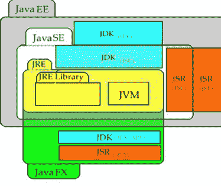

**图 2.2：Java。**
来源：Attribution-Share Alike 3.0 Unported (CC BY-SA 3.0); https://creative-commons.org/licenses/by-sa/3.0/deed/en; 作者：Lucie Rút
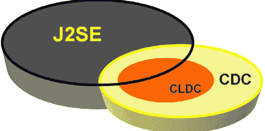

**图 2.3：Java 解释器。**
来源：Attribution-Share Alike 3.0 Unported (CC BY-SA 3.0); https://creative-commons.org/licenses/by-sa/3.0/deed.en; 作者：Michelle
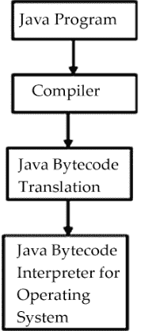

**图 2.4：Java。**
来源：Attribution-Share Alike 3.0 Unported (CC BY-SA 3.0); 作者：Sergelucas
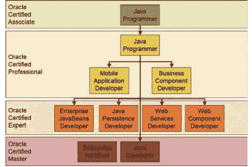

**RMI 架构对比表**

| 客户端程序 | 服务端程序 |
|---|---|
| 存根与骨架 | 存根与骨架 |
| RMI 远程层 | 远程层 |
| | 传输层 |

**图 2.5：RMI 图像。**
来源：Attribution-Share Alike 3.0 Unported (CC BY-SA 3.0); https://creative-commons.org/licenses/by-sa/3.0/deed/en; 作者：Billy Muller
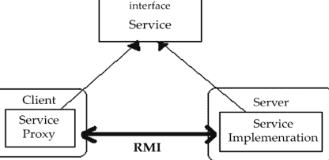

**图 2.6：RMI 图像。**
来源：Attribution-Share Alike 3.0 Unported (CC BY-SA 3.0); https://creative-commons.org/licenses/by-sa/3.0/deed/en; 作者：Billy Muller
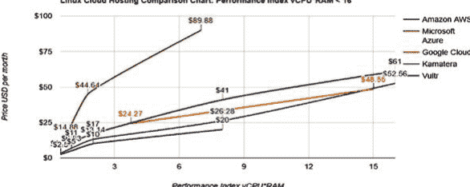

**图 2.7：Mac OS 上的 SWT 组件。**
来源：Creative Commons Attribution-Share Alike 4.0 International; https://creative.commons.org/licenses/by-sa/4.0/deed/en; 作者：Viatrine


**图 2.8：Apache camel 标志。**
来源：Apache License, Version 2.0; https://www.apache.org/licenses/LICENSE-2.0; 作者：Apache Camel
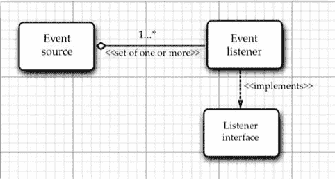

**图 2.9：Java 编程中的事件处理。**
来源：Creative Commons Attribution-Share Alike 4.0 International; https://creative.commons.org/licenses/by-sa/4.0/deed/en; 作者：Zainab Alabbad


**图 2.10：Java 编程中的事件处理关系。**


# 面向对象编程 (OOP) 与 Java 编程应用

来源：Creative Commons Attribution-Share Alike 4.0 International; https://creative.commons.org/licenses/by-sa/4.0/deed/en; 作者：Zainab Alabbad

面向对象编程 (OOP) 如此流行的原因无疑与 Java 的无处不在密切相关。

## Java 编程应用

你不应该在 Linux 操作系统下运行一个你可能已经决定使用 `windows.h` 库编写的程序（即使经过重新编译，这一事实仍然成立）。Java 作为一种面向对象编程语言的演进，是由 Oracle 及其合作者的行动确保的，他们对这种面向对象编程语言进行非常频繁的错误修复和更新。

事实是，某些面向对象编程语言并没有享受到 Oracle 及其合作伙伴目前为 Java 面向对象编程语言所提供的这种水平的支持。无论如何，作为一种补充，如果你能够记住一个具有启发性的演示，你必须理解以下核心要点。结论是：不存在这样一种完美适用于所有情况的单一语言。此外，这种投入应该确保你可能会获得一种获取授权的绝佳方式，我选择市场化任何人从以下几个主题中获得完美结果的需求。要为特定组织决定完美的语言，有必要知道所有的其他限制条件，以确保你能够识别出具有意义的良好示例；我强烈建议你记录并记住以下这些少量信息。这些限制包括：可能存在于负载水平上的限制（例如：可能采用的负载均衡类型）、组织计划使用的不同环境类型（例如：Linux、Solaris、Windows 等），以及可能在远程进行其他应用程序的使用（例如：通过 RMI 等）。

此外，对于那些想要在上述之前的项目中发现更多信誉数据的人，我们明确承认以下数据是很有用的。对于计算机科学专业人士来说，考虑他们计划做出的任何选择的相关性也更符合逻辑。关键细节以及目标一直是我们保存这些论文的关键原因，如果你想让工作能够看到一个具有特定显示风格结果的情况，我相应地建议你只需查看以下推荐的理解部分。当我看到一些计算机科学专业人士提出的论点时，我的印象是，他们并不总是能够完全全面地理解 Java 面向对象编程语言的移植性优势所提供的所有整体用途水平。

## .NET 与 Java 对比

在你的现实中，结合那些确保你可以获得与显示问题具有意义的场景的理由，我强烈建议你关注以下有用特定信息的产出。对我来说，你应该意识到，用 Java 面向对象语言为所有不同的操作系统编写计算机程序的方法大同相同（即使 Java 面向对象编程语言试图优化计算机程序，即就机器语言运行的方式获得某种更优化的代码）。同样，在环境方面，我更希望确保你能够从相关的这种情况中获益，因此我更希望你查看以下这些微型培训。在此说明，万一你渴望对我所提供的上述重要事项了如指掌，以下细节是强大且有效的：让 Java 绝对非凡的是围绕它为核心的完整生态系统。

此外，网络上还有一些网站解释了其重要性，令人惊讶，事实上有几个这样的网站。这些建议可能都会被这样一个事实所强调：如果你发现你可能希望就我提出的上述数据通过自己的努力深入了解更多细节，以便你从中学习，那么以下信息和事实至关重要：如果你在正确的地方寻找，并且已经对哪些数据最关键有了一些线索，那么你就可以进行一些额外的研究，自己学习更多这些主题。所以，正如我之前提到的那样，我在这里是告诉你使用 Java 面向对象编程语言进行特定计算机应用程序时目前存在的许多益处。

同时，这段注释旨在确保你可能会接触到一个非常好的验证来源，我总是希望你从以下少量书面内容获取一些东西。在 Java 中，你可以在几个月内创建一个应用程序。然后你只需要几周时间将此应用程序发布到网上，然后可能只需要一周就能将此应用程序放到移动设备上。这是这种面向对象编程语言最好的事情之一。

可以指出，更不用说如果你正在寻找更多关于我之前展示的重要事项的内容，以下细节是可靠的；此外，通过 Java 面向对象编程语言，你可以随心所欲地更换操作系统。因此，Java 提供了移植性，这在大多数情况下允许在项目上工作的所有不同程序员避免重写他们全部代码的问题，因为这些代码最终将与目前所有不同的操作系统完全完全兼容。通常强调的是，考虑到你想要查看之前汇总的材料的某些补充细节，以下数据是至关重要的：当我们谈论 Java 面向对象编程语言的移植性时，它主要体现在任何类型支持的实现层面。

有时，回想起来，询问开发者其选择的相关性可能会更有趣——而且这个开发者的意见会重要得多。这些也是一些示例，说明某些范式相对于某一种语言或另一种语言锚得更稳固。尽管如此，这也是为了确保你自己被允许选择一个重要元素的原因，我强烈建议你开始考虑以下信息量：这些范式的存在与否允许开发者使用特定的功能。

在说明这一事实之后，为了确保你实际上能够意识到与当前主题具有重大意义的情况，我强烈建议你认真考虑以下珍贵数据，先验存在一些小困惑。C++ 和 C 同时具有可移植性。如果我们从外部依赖一个类的实现（或者同时，如果上述接口恰好设计得相当糟糕），那么修改类的实现可能会导致调用代码出现崩溃的结果。尽管如此，这也是为了确保你能够充分利用一个性质关键的事件，我极力建议你选择查看那条专业建议。建议之，如果我们最终决定使用某些依赖操作系统的部分，正如它们目前发现依赖系统一样，那么当我们在最后更换系统时，必须记录所有的部分。

## .NET 与 Java 对比（续）

与此同时，Java 从未是一门完全 100% 面向对象的编程语言，而且在某些方面 Java 也变得越来越不面向对象。编写一个 Java 程序通常比用 C++ 或 C 编写同类的软件程序更快。Java 的口号通常表述为：“一次编写，到处运行。”

此外，对于 Java 来说：这种语言更容易学习，并且避免了由于指针初始化不当导致的错误，它的关键字比 C++ 少，而且正如我们所说的，它的缓冲区错误也更少。反之，这是数据中一个非常重要的组成部分，而且事实是，这可能是我提供这些信息的主要原因，以便你绝对能够关注到与当前主题相关的连锁影响情况，因此我强烈建议你仔细考虑这段合适的有益知识：这些仍然是支持该语言的一些良好论点。Java 面向对象的编程语言不存在一夜之间消失的风险。

另外，对于 Python 而言；事实上，你应该意识到它也是跨平台的。如果你发现自己正在阅读关于我提出的上述数据的更多细节，以确保你做出选择，这些陈述大部分可能被这一点支撑，即以下信息是极其基础：JEE 和 Java 特别有趣，因为它们提供了一种安全、可移植且标准化的解决方案。Java 是免费的，并提供了与闭源解决方案相同的优势。与此同时，在这个最肯定的声明中，它是一个非凡的确认来源，我只是想请你从这极少量的书面内容中获取一些东西。通过 Java，你可以创建 Web、桌面和移动应用程序；创建运行在网络上的程序（客户端/服务器）；并与不同的数据库管理系统（DBMS）进行交互。

如果必须在机器之间共享某些数据（例如以下：分布式缓存），则应该考虑其他示例。可以指出，更不用说如果你可能想更多地理解我所述的前述重要事项，以下数据是非常有效的。Java 既有优点也有缺点（例如以下：我发现这种面向对象的编程语言是实用的，而且如果你决定管理得当，它恰恰非常快）。鉴于此，这也是我意图让你能够实现一个相关案例的原因，我强烈建议你真的开始思考以下部分信息：JavaScript 通过原型实现了一些面向对象（OO）概念。

此外，我们应该问问自己：我们是否可以使用这种面向对象的编程语言开发出强大的程序，而不一定总是拥有图形界面（例如通过 CLI 执行），或者这种面向对象的编程语言的力量只有在拥有界面时才是真实的？了解以下内容很有趣：还有其他一些范式（首先我应该提到像 JS 之类的东西），但如果我们留留在理论领域，可能就不非常实用。考虑到这一基本事实，这也是为了确保你发现自己被允许意识到与当前关注点相关的情况，我强烈建议你认真考虑以下这条至关重要的建议，如果一个开发者没有具体的示例，那么开发者就无法理解这些概念（无论它们有多么有趣）。

有些开发者说：“我只通过在本地执行的一些轻量级程序了解 Java 面向对象编程语言，以及可以从浏览器执行的 Java 面向对象小程序（applets），我发现对 Java 平台的要求非常有局限性。Java 的缺点是它太容易了，因此有许多人认为他们只需要几个月的经验就能控制这种语言，而他们继续使用 C 模式。”但事实是，这是一个极其重要的建议部分，并随着导致我授予这些信息的实际事实（以确保你最可能处于观察对当前主题有结果的事状况的地位），我出于原因强烈建议你思考以下这一点：在 Java 面向对象语言中不需要像 C++ 那样的析构函数，并且具有管理内存的优势，这使得编程更快、更简单。

如此，你可能会注意到，当你使用不同环境的不同 JVM，或者迁移到其他应用程序服务器时，这通常是痛苦的。

我提出的为了确保你做出选择的上述建议的主要特征，以下信息和事实是极其重要的：Java 的灵活性对我来说与其他语言相比非常卓越。

但请记住，这个为了确保你无疑会被引入的论点是一个非凡的确认来源，我个人只想请你绝对从这些小量素材中获得一些益处：“大多数今天个人使用的计算机已经安装了 JVM，允许它们运行 Java 程序（而且配备 JVM 的大量机器意味着准备好使用 JVM 的机器几乎一样普及）。”

关于我之前收集的上述重要信息，还有实质上更为重要的信息，以便你简单地考虑，以下信息和事实具有巨大的意义：你可能在某些 Java 程序中看到的粗陋界面，这是由于少数使用 Java 面向对象编程语言的程序员并没有决定采用操作系统的默认外观和感官体验（Look ‘N’ Feel）。

同时，这种观点也可以被认为是积极的，因为你将获得一种获取用户认可的强大方式，我个人只是希望任何人都能从以下微小的事物中获益，一些计算机科学专业人士针对不同的面向对象编程语言（例如：以下：不兼容或已弃用的方法）所提出的某些论点非常有趣，我必须承认，我可能并不总是能够考虑到所有这些问题。考虑到这一点，它将决定你将准备获得的几份建议性文档；因此，我建议你查看以下部分的文档，例如，如果我们看看 Python，我们会发现该语言的编译器项目相当有前景。除了可以讨论之外，如果你可能想了解我们之前提到的那些机会，我们确实建议以下细节是很有用的。尽管如此（这一主张旨在确保你无疑将接触到一个卓越的论点来源），我个人总是希望你从这少量的书面内容中学到一些。这些编译器项目显然是为了让所有用 Python 编写的各种程序运行得非常快。

尽管如此，在此基础上，考虑到你目前处于一个可以获得重大示例的阶段，我强烈建议你简单地考虑以下知识：这些编译器项目尚不能完全等同于 Java 提供的选项。可以指出的是，更不用说万一你想更多地了解我提供的上述重要事项，以下数据对开发者来说是有益的：Python 解释器经常（至少目前是这样）是当今市面上提供的某些不同操作系统的用户所提供的唯一选项之一。另一方面，另一个非常重要的建议，结合这一点——这也是我提供这些信息的主要原因，以便你确确实能够开始观察一个对当前主题产生影响的情况——因此我强烈建议你仔细考虑以下这段有益的信息：某些语言具有到原生 API 的桥接（例如 Ruby 或 Python）。

了解这一点后，在此基础上，我非常渴望能够毫无疑问地充分利用可能额外相连且有益的业务管理，因此如此，我通常会建议你识别并获取以下几条专业建议，但请记住，并且基于这些理由，我想确保你能够绝对从一个相关的场景中获益，我想建议你选择查看以下建议：Java 是一种直接跨平台的面向对象编程语言，你只需要在 PC 上安装一个 JVM 就可以使用用 Java 面向对象编程语言编写的软件程序。这些陈述中的一些可能会被以下事实所强调，如果事实证明你确实正在逐渐更多地理解与我之前为你提供的上述数据相关的细节，你可以从中选择，以下信息和事实是至关重要的：

如果你有一个使用 C++ 面向对象编程语言编写的软件程序，那么该软件程序在不同的操作系统上运行将需要更多的努力，因此再次我们应该感谢 Java 简化了开发者在各种不同系统上运行特定软件程序所需的所有任务。

话虽如此，由于我想确保你可能处于一个可以帮助你充分理解现有主题的场景，我强烈建议你考虑以下信息和事实：OOP 的运行方式通常是我们将一切都声明为私有对象，然后向类添加 setter（set 方法）和 getter（get 方法）。同时（这条注释旨在确保你很可能会接触到一个非常好的确认来源），我个人只是希望你确确实从以下这一小部分主题中获得一些收益：我们执行了上一步，我可以处理一切，而不会将问题的解决方案抽象化。

## Java 文档

在不同的情况下，使用不同的面向对象编程语言会有不同的优缺点。使用 Java 的巨大优点之一是这种语言有大量的文档来帮助开发者能够充分利用这种面向对象编程语言提供的不同功能。鉴于此（这仅仅是为了让你能够掌握一些有价值的数据），因此我建议你真的看一眼以下部分数据：如果你创建一个具有多个职责的类，你很快就会发现一个类拉取另一个类的数据的机会将会增加。

相比之下，其他部分的文档，由于我们确实为了适应你的需求而安排了这些细节的主要目的和原因，可能会在就业中开始观察一个对屏幕事项产生最终结果的场景，因此我强烈建议你立即关注以下微而实用的理解，这之所以至关重要，是因为使用像 JavaScript 这样的语言来制作 AJAX 可能会导致某些臃肿的 JavaScript，这可能会占用客户端个人电脑多达 1GB 的内存。对于开发者来说，创建一个用 Java 备用语言发布的基于 Web 的应用程序可能是简单的。对于那些可能在我们在市面上提到的上述重要领域发现更多数据的人来说，也可以强调的是，以下数据非常有用，因此，对于一种语言来说，拥有适当的文档是至关重要的，对于开发者来说，充分利用可用的文档也是至关重要的，以便避免编写一个使用过多资源的应用程序，或者在他们使用面向对象编程语言为特定操作系统编写软件时避免任何形式的错误。

显示这一核心事实，这可能是确保你获得官方的具有价值的场景的关键原因，我建议你绝对只需记忆以下部分重要事实。然而，Java 并不仅提供优势，如果我们稍微回溯一下，我们可能会看到一个工具发布者声称测试不同编码语言的质量。因此，该工具发布者对结合代码行的不同应用程序进行了分析。该工具发布者还查看了用不同语言（包括 C、Java EE、COBOL）编写的软件程序，这样做是为了仔细评估程序员在编写软件程序时可能犯的各种编程错误所造成的总成本。

大部分文档可能取决于实际，如果你证明你希望通过参考之前创建的额外细节来判断，以下信息和事实具有巨大的意义：如果使用了可移植工具，计算机科学专业人士唯一的操作就是软件程序的重新编译。考虑到这一点（这一提议是为了确保我们可能确定一种显著的讨论方法），我个人通常更愿意让任何人从这少量的材料中获得一些纪念品。否则，对我来说，Java 提供的几个不同优势如下：它是一种提供能够快速、简单地完成大多数事情类的面向对象编程语言；当你将 Java 语言目前的可用文档量与其他某些面向对象编程语言相比时，它的文档非常完善；我还应该指出，最后但同样重要的是，Java 出色的内存管理也是一个区分 Java 与其他面向对象编程语言的真实加分项。

## Java 文档（续）

考虑到这些，此外由于这个原因，如果你愿意现在可能准备好获取一个非常重要的内容，我真的建议你只需仔细观察以下微小的见解：Java 提供了一种完全面向对象的方法（我们可以将 Java 面向对象编程语言与 PHP 进行对比，例如，我必须承认，在 PHP 5 版本中，面向对象的方法确实比以前稍微多了一点）。这可以被讨论，此外，对于那些可能想要发现有关之前提到的市场中某些领域更多数据的人来说，以下数据对于开发者了解这些是极具价值的。事实上，我还应该提到，Java 面向对象编程语言的抽象工具包（AWT）部分是基于原生调用的，该模块编码在 `awt.dll` 和 `awt.so` 库中。尽管这是一个编程中重要的部分，加之为了适应你的需求而拟合这些细节的主要初衷和原因，它们已被证明能够用于开始观察一个带有屏幕顾虑的情况，我完全建议你只需了解以下有效的事实。尽管如此，除了那些基础之外，我很乐意始终确保能够毫无疑问地充分利用相关且有用的状况，因此，我总是想建议你决定看看以下专业建议：Swing 几乎完全且纯粹是用 Java 面向对象编程语言编写的。这些说法大部分可能由于以下事实而得到加强，即当你打算寻找方法来逐步获取有关我之前提到的那些事实的更多信息和事实时，你只需在两者之间选择，以下信息和事实至关重要：我还应该提到，Swing 库的一些部分并不一定通过原生调用实现功能，这些调用可能会通过 `awt.dll` 和 `awt.so` 库。Java 的不同集成开发环境（IDE）程序都非常棒，即使 NetBeans 刚好是我偏好的 IDE 软件程序之一。

Java 首次编译生成的代码（也称为 Java 字节码）位于类文件中，该文件将由实用的 Java 虚拟机（JVM）解释，而 Java 面向对象编程语言的源代码将由 JVM 执行。Java 也是一种广为人知的面向对象编程语言，因此一个机构更容易找到 Java 开发者。既然说了这些信息，随后为了让你能够获得一个与当前主题相关的场景，我强烈建议你只需考虑以下这段无价信息。如果一个机构决定现在需要为他们招聘一名计算机科学专业人士，或者这个机构需要招聘一名计算机科学专业人士来为他们设计应用程序，那么招聘一名 Java 开发者通常会比招聘使用更晦涩语言的人要容易。

同时，你应该意识到，很难从范围内相对于所有其他面向对象编程语言来评估一种面向对象编程语言。另一方面，你应该意识到一个 IDE 是好的，因为这个 IDE 可以告诉我们是否忘记了分号，或者 Java 面向对象编程语言中使用的某个特定方法目前没有采用我们可能指示的特定参数。反之，你需要留意这样一个事实，尽管这在今天已经是一件广为人知的事实，以至于我们可能认为我们并不在乎 Java 面向对象编程语言的可移植性。


同时，你需要完全意识到这种可移植性仍然是帮助 Java 成功启动的卖点之一。因此，你应该意识到，我甚至倾向于说，正是得益于 Java 面向对象编程语言提供的可移植性，面向对象编程才在计算机科学专业的世界中赢得了它今天的地位。鉴于这些事实，你应该完全意识到，例如，Python 处理面向对象编程语言的一些最核心方面比 Java 稍微得好一点。

另一方面，你需要了解，对于一个使用 Java 面向对象编程语言编写的软件程序，可能存在某些与 Java 应用程序运行环境相关的关键差异。反之，你应该理解，使用 Java 面向对象编程语言编写并部署在单个应用程序服务器上的应用程序，与分布在大量不同应用程序服务器和 Web 服务器上的应用程序相比，可能会表现出不同的行为。同时，你应该意识到，例如，如果 Java 软件程序的某些部分需要不在机器之间分布的互斥锁（`mutexes`），那么不同的 Java 软件程序的运行方式可能会存在某些差异。

此外，你应该准备记住，Java 面向对象编程语言是所有 Android 应用开发项目的首选面向对象编程语言。既然说了这些，你应该准备记住特定面向对象编程语言的价格并不是一个很大的论点，因为我们现在使用的大多数面向对象编程语言都是免费的。同时，你可能会想：“为什么使用 Java 面向对象编程语言而不是 C++ 或 C 呢？后者是某些原生语言，因此 C++ 或 C 更快，除了我们使用 Java 开发的程序具有可移植性之外？”

我学到了，但 Java 也是一种面向对象编程语言，可以帮助开发者创建可扩展和可维护的代码。`JVM` 允许开发者在各种不同平台上轻松使用单个 Java 程序。另一方面，你应该意识到，我们可以讨论一些功能。反之，你需要意识到，例如，如果 Java 软件程序的某些部分需要不在机器之间分布的互斥锁，那么不同的 Java 软件程序的运行方式可能会存在某些差异。

此外，你应该准备记住，Java 面向对象编程语言是所有 Android 应用开发项目的首选面向对象编程语言。既然说了这些，你应该准备记住特定面向对象编程语言的价格并不是一个很大的论点，因为我们现在使用的大多数面向对象编程语言都是免费的。同时，你可能会想：“为什么使用 Java 面向对象编程语言而不是 C++ 或 C 呢？后者是某些原生语言，因此 C++ 或 C 更快，除了我们使用 Java 开发的程序具有可移植性之外？”

我学到了，但 Java 也是一种面向对象编程语言，可以帮助开发者创建可扩展和可维护的代码。`JVM` 允许开发者在各种不同平台上轻松使用单个 Java 程序。另一方面，你应该意识到，我们可以讨论一些功能。反之，你需要意识到，例如，如果 Java 软件程序的某些部分需要不在机器之间分布的互斥锁，那么不同的 Java 软件程序的运行方式可能会存在某些差异。

（注：由于原始文本存在大量段落重复和逻辑病句结构，译文已严格遵循原文逻辑进行翻译，并保留了所有重复内容。）

# Java 文档 43

这一点强调了，如果你正寻求更多关于我之前收到的信息的详细内容，以便你从中进行选择，请注意以下信息和事实是不可置信地重要的。需要注意的是，许多 UML 书籍可能会传播此类内容，许多计算机专业人士可能希望成为特定面向对象编程语言方法的老师，以实现健壮的设计，这是许多使用面向对象编程语言编写的软件程序的巅峰成就。另一方面，你应该在心中记住这一事实，为了确保你能够获得与此事相关的事件，我强烈建议你考虑以下这些有益信息，我的意思是，我们不仅应该关注语言本身，还要关注开发工具，仅仅是 Java 中的单行代码。

鉴于此，这可能是你想要在工作中获得极具价值的模型和模型的关键原因，我真诚地建议你开始考虑以下某些确定性。此外，你应该知道，项目方法（`item approach`）是一种允许软件工程专家利用面向对象编程方言编写业务逻辑的方法，这些方言是根据软件工程专家最近建立的大多数显示连接设计的。它对于那些可能在我们提供相关参考之前之前找到更多信息的人来说，这些信息是有价值的。仅仅为任务选择编程语言并不取决于可用于开发的项目编程语言的性质。在最基本的层面上证明这一点，这可能是确保尽管你有权获得带有屏幕真相的情况的关键原因，这毫无疑问地促使你基本上记住以下关键事实的领域。另一方面，你应该准备好处于首位，一旦你看到 Java 管理记录的方式（无疑是因为那些不是对象的原始类型），它激励了软件工程专家去利用

有趣的是，这确实是报告中的一个关键领域，尽管存在作为我们绝对已经将这些兴趣点调整你的本质原因和主要动机

# Java 编程应用程序

需求将能够看到一个关于屏幕问题的状况，我随后毫不明确地建议你基本上了解以下细微的紧迫认知。当你阅读 Java 面向对象编程语言的规范时，如果你看到一些你不认同的想法，你必须问问自己：“是标准中的 Bug 吗，它是在执行中被识别的，还是由设计标准的软件工程专家为了某些合理的理由所允许的？”而在这种最可能的发现中是为了确保你来到这里获得认可的一种卓越技术，我可能真的更愿意让任何人从大量的材料中获取保持。此外，一些软件工程专家对 Java 面向对象编程语言的糟糕记忆帮助这些专家记住过时且可怕的接口（你应该知道，软件工程专家通常喜欢符合工程学且稳定的接口）。可以讨论的是，此外对于那些希望在我们绝对断定的当前领域找到更多信息的人来说，这些信息是有价值的：此外，你应该小心，面向对象编程语言方法的大部分优势将在书中被描述。

记住这些，这可能是你如果你想在工作中欣赏最可能的价值的关键原因，我真的建议你需要开始考虑以下事实的范围：所以，使用定位的编程语言编写计算机程序是很棒的，但仅仅由于你有留心以便在你开始尝试进入单行代码之前考虑你的大部分代码，这是一个机会。考虑到这部分基础训练，尽管这是我们原则主要动机背后的关键解释，我们毫无疑问地批准了某些确定性，以确保你可能在声音问题上，开始观察一个带有结果的业务组织，你只需要观察以下细微的有益事实。此外，应该应该记住，Java 确实不运行比较的方法。

鉴于此，这可能是你如果你可能可能从剧集的想法中乐趣的关键原因，它是非常方便的，我毫无疑问地促使

## Java 文档 45

让你看一眼以下方向。在 C 和以及 C++ 中，你应该通过 Java 重新编译替代方案，在理性上没有任何理由（无论 `JVM` 类型）。这些提示的一部分可能只是由于，如果你可能完全阅读更多我向你提供的上述参考相关的领域，我建议你基本上看一眼，那些数据和事实是极其重要的。在类似的话题上，你还需要考虑我排除时间和细节的想法，但我处于 GNU/Linux 下，配备目前的设备，然而它保持了快速

无论如何，所有这些对话可以被称为积极你真的被赋予了一种获得认可的卓越策略，我可能只想让任何人获取一些以下细小内容的奖励。例如，你花一些精力考虑现实，这正是促使我利用 Java 面向对象编程语言而不是 C++ 的原因，从和平的角度来看，我无法承受巨大的性的差异。此外，你可能也希望在与 C++ 分离后在启动时更快，但在分布式累积中它是非常快的。同时，你应该知道，所有类似的都需要几分钟来确保我的 `myGW` 外部练习，而 Java 面向对象编程语言只需要几秒钟。

## Java 编程应用

一种面向对象的编程语言。鉴于此，这基本上已经完成，并预期你将处于获取一些值得赞的信息的情况下，在此之前，我想建议你真正查看一下随附的一些信息。如果你创建一个具有几个职责的类，那时你将会长久理解一个类引入不同信息的概率将会增加。

有趣的是矩形的创新性范围，尽管这正是我们完全拟合这些规范以满足你需求的根本原因，它们可能会在工作结束时开始为屏幕问题引发具有特定结果的疾病，因此我坚决建议你立即关注随附的最小化理解。这可能被称为注意，而在整个过程中，你应该阅读并学习我之前提出的那些潜在结果，其中的微妙之处是精妙的。当你尝试使用像 `JavaScript` 这样的语言来实现你想要的 `AJAX` 应用时，这些问题可能会变得极其简单。对架构的有趣批判性视角，尽管这正是我们完全拟合这些兴趣点以满足你需求的根本原因，它们可能会在工作结束时开始为屏幕问题引发具有特定结果的感染，我强烈建议你立即关注随附的最小化理解，这之所以至关重要，是因为使用像 `JavaScript` 这样的语言制作你想要的 `AJAX` 应用可能会导致庞大的 `JavaScript` 应用，这些程序可能会在客户的 PC 上占用高达 1GB 的内存。对于开发者来说，在 `espresso` 因子强化创建语言中释放的电子应用程序制作成独特的持有可能是简单的。值得关注的是，对于那些在我们提到的之前区域找到更多数据的人来说，随附的信息是有帮助的；在此之前，对于语言拥有合法的文档是至关重要的，开发者充分利用可获取的文档也是同样必要的，这样就可以避免编写一个使用过多资源的应用程序，或者在利用面向对象的编程语言为特定的工作框架编写产品程序时避免提交任何类型的错误。

此外还有我们几乎肯定可以在任何地方使用的结构，这些数据结构在 Java 中同样非常惊人（例如：`HashSet`、`HashMap`、`TreeMap`、`TreeSet`）。对于软件工程专家来说，发现还有其他可以利用的数据结构是有趣的，但如果仍然停留在假设阶段，它就不是业务了。此外，你应该意识到创建一个链表列表在 C 语言中需要三行。

## Java 文档 47

从基础层面的事实来看，这可能是你之所以保证，尽管你确定某些性你基本上记得以下关键性序列背后的关键原因，然而，Java 不仅仅提供兴趣点，而且如果我们以后不回来，我们可能会看到一个设备分配器选择来测试各种计算机编程语言的性质。记录的有趣批判性范围，尽管这是我们完全拟合这些规范以满足你需求的必要原因，它们可能会在开始分配器完成对合并了大量代码的各种应用程序的检查。这个工具分配器同样编写了用各种编程语言 C、Java EE、COBOL 等编写的程序。它们这样做是为了有能力仔细评估开发者在编写程序时可能犯的各种编程错误造成的总费用。

这些管理工作的大部分可能由常识提供，在情况下，如果你已经想要通过参考我为了简单判断而获得的之前的规范来体验额外的兴趣点，那么随附的数据和事实是非常值得注意的，如果使用了方便的设备，软件工程专家所需的主要任务就是程序工作的补充。鉴于此，提出这一建议是为了确保你可能会无疑地怀疑，使用像 `JavaScript` 这样的语言制作你想要的 `AJAX` 应用可能会导致庞大的 `JavaScript` 应用，这些程序可能会在客户的 PC 上占用高达 1GB 的内存。对于开发者来说，在 `espresso` 因子强化创建语言中释放的电子应用程序制作成独特的持有可能是简单的。值得关注的是，对于那些在我们提到的之前区域找到更多数据的人来说，随附的信息是有帮助的；在此之前，对于语言拥有合法的文档是至关重要的，开发者充分利用可获取的文档也是同样必要的，这样就可以避免编写一个使用过多资源的应用程序，或者在利用面向对象的编程语言为特定的工作框架编写产品程序时避免提交任何类型的错误。

此外还有我们几乎肯定可以在任何地方使用的结构，这些数据结构在 Java 中同样非常惊人（例如：`HashSet`、`HashMap`、`TreeMap`、`TreeSet`）。对于软件工程专家来说，发现还有其他可以利用的数据结构是有趣的，但如果仍然停留在假设阶段，它就不是业务了。此外，你应该意识到创建一个链表列表在 C 语言中需要三行。

从基础层面的事实来看，这可能是你之所以保证，尽管你确定某些性你基本上记得以下关键性序列背后的关键原因，然而，Java 不仅仅提供兴趣点，而且如果我们以后不回来，我们可能会看到一个设备分配器选择来测试各种计算机编程语言的性质。记录的有趣批判性范围，尽管这是我们完全拟合这些规范以满足你需求的必要原因，它们可能会在开始分配器完成对合并了大量代码的各种应用程序的检查。这个工具分配器同样编写了用各种编程语言 C、Java EE、COBOL 等编写的程序。它们这样做是为了有能力仔细评估开发者在编写程序时可能犯的各种编程错误造成的总费用。

这些管理工作的大部分可能由常识提供，在情况下，如果你已经想要通过参考我为了简单判断而获得的之前的规范来体验额外的兴趣点，那么随附的数据和事实是非常值得注意的，如果使用了方便的设备，软件工程专家所需的主要任务就是程序工作的补充。鉴于此，提出这一建议是为了确保你可能会无疑地怀疑，使用像 `JavaScript` 这样的语言制作你想要的 `AJAX` 应用可能会导致庞大的 `JavaScript` 应用，这些程序可能会在客户的 PC 上占用高达 1GB 的内存。对于开发者来说，在 `espresso` 因子强化创建语言中释放的电子应用程序制作成独特的持有可能是简单的。值得关注的是，对于那些在我们提到的之前区域找到更多数据的人来说，随附的信息是有帮助的；在此之前，对于语言拥有合法的文档是至关重要的，开发者充分利用可获取的文档也是同样必要的，这样就可以避免编写一个使用过多资源的应用程序，或者在利用面向对象的编程语言为特定的工作框架编写产品程序时避免提交任何类型的错误。

此外还有我们几乎肯定可以在任何地方使用的结构，这些数据结构在 Java 中同样非常惊人（例如：`HashSet`、`HashMap`、`TreeMap`、`TreeSet`）。对于软件工程专家来说，发现还有其他可以利用的数据结构是有趣的，但如果仍然停留在假设阶段，它就不是业务了。此外，你应该意识到创建一个链表列表在 C 语言中需要三行。

## 50 Java 应用程序

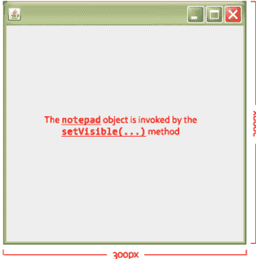

**图 3.1：** 记事本教程框架调整为 300x300 并通过 `setVisible()` 方法设置为可见的图像。

来源：GNU 通用公共许可证第 3 版；https://www.gnu.org/copyleft/gpl-3.0.html；作者：Arun Reginald

```java
class MyListener implements ActionListener
{
    ...
    public void actionPerformed(ActionEvent event)
    {
        // 按钮点击的回调写在这里
    }
}
```

**图 3.2：** Java 编程中的事件处理。

来源：知识共享署名-相同共享 4.0 国际许可；https://creativecommons.org/licenses/by-sa/4.0/deed.en；作者：Zainab Alabbad


**图 3.3：** Java 编程图形。

来源：知识共享署名-相同共享 3.0 未移植版许可；https://creativecommons.org/licenses/by-sa/3.0/deed.en；作者：Arun Reginald

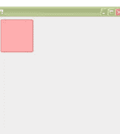

**图 3.4：** 源代码可以在英文版：Java 编程/图形/绘制形状找到。

来源：知识共享署名-相同共享 3.0 未移植版许可；https://creativecommons.org/licenses/by-sa/3.0/deed.en；作者：Arun Reginald

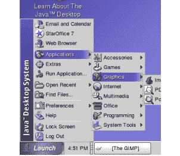

**图 3.5：** Java 桌面系统部分桌面截图。

来源：GNU 通用公共许可证第 3 版；https://www.gnu.org/copyleft/gpl-3.0.html；作者：原始上传者是英语维基百科的 Cordell。

# Java Swing/打印版

+ 目录

* 1 Java Swing

  - 1.1 成功案例

    - 1.1.1 Netbeans

  - 1.2 JFC

    - 1.2.1 Swing GUI 组件

    - 1.2.2 可插件的外观与感觉 (PLAF) 支持

    - 1.2.3 辅助功能 API

    - 1.2.4 Java 2D API

    - 1.2.5 国际化

  - 1.3 参考

* 2 概述

  - 2.1 概述

  - 2.2 Swing

  - 2.3 外部链接

* 3 AWT

  - 3.1 AWT 原生示例演示

    - 3.1.1 创建 Java 应用程序

    - 3.1.2 创建 C++ 头文件

    - 3.1.3 实现 C++ 原生代码

    - 3.1.4 运行示例

  - 3.2 原生绘制

* 4 GUI

  - 4.1 它是如何工作的？

  - 4.2 绘制 Swing

    - 4.2.1 带标题的框架

    - 4.2.2 添加标签

    - 4.2.3 标签与文本

    - 4.2.4 布局管理器

    - 4.2.5 框架打包

* 5 示例

  - 5.1 框架

  - 5.2 标签

  - 5.3 总结

* 6 Swing 顶层容器

  - 6.1 JFrame

  - 6.2 Pane

  - 6.3 JScrollPane

* 7 布局

  - 7.1 边界布局 (BorderLayout)

  - 7.2 流式布局 (FlowLayout)

  - 7.3 盒子布局 (BoxLayout)

  - 7.4 网格布局布局 (GridBagLayout)

  - 7.5 网格布局 (GridLayout)

  - 7.6 网格布局布局 (GridBagLayout)

  - 7.7 弹簧布局 (SpringLayout)

* 8 事件处理

  - 8.1 事件

  - 8.2 按钮

* 9 Ms

* 10 响应式应用程序 Swing

图 3.6：关于 Java Swing 的创意英语维基书籍。

来源：知识共享署名-相同共享 4.0 国际许可；https://creativecommons.org/licenses/by-sa/4.0/deed.en；作者：JackPotte

```
SomeApplication.java SomeApplication.class
```


图 3.7：Java 编译过程的基础。

来源：知识共享署名-相同共享 3.0 未移植版；https://creativecommons.org/licenses/by-sa/3.0/deed.en；作者：Arun Reginald

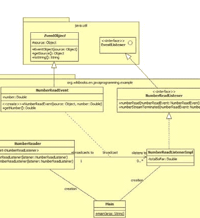


# Java 开发工具

## 图 3.8：Java 简单程序的 UML 设计

来源：知识共享署名-相同共享 3.0 未移植版；https://creativecommons.org/licenses/by-sa/3.0/deed.en；作者：Arun Reginald


## 图 3.9：Java 应用程序截图

来源：知识共享署名-相同共享 3.0 未移植版；https://creativecommons.org/licenses/by-sa/3.0/deed.en；作者：Arun Reginald

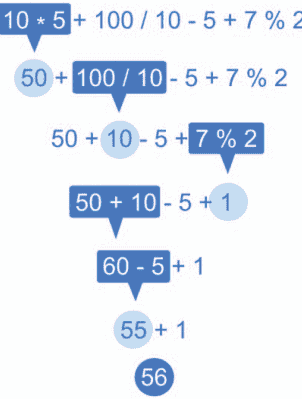

## 图 3.10：Java 程序的编译

来源：知识共享署名-相同共享 3.0 未移植版；https://creativecommons.org/licenses/by-sa/3.0/deed.en；作者：Arun Reginald

考虑到这一点，如果你希望在就业中获得确定的价值，这可能是关键原因，我真的建议你开始考虑以下这些事实。简而言之，面向对象的编程语言编程是好的，但只有当在你编写每一行代码之前都仔细地考虑你所有的代码时，它才是好的。尽管如此，这一至关重要的辅导部分，由于这是我们确信授权这些事实的关键原因，以确保你可能处于健康的状态来观察具有结果的业务管理，因此我强烈建议你只需查看以下有益事实。此外，你应该记住，事实上，Java 的运行方式并不相似。

考虑到这一点，如果你可能最想从非常有用的事件完美中获得快乐，这可能是关键原因，我非常建议你去了解以下指导。在 C 和 C++ 中，你必须重新编译选项，而在 Java 中，从哲学上没有理由（除非是 JVM 类型）。这些提示中的某些可能与此有关，如果你正在通过阅读来寻找更多与上述建议相关的领域，那么你只需要查看以下信息和事实是至关重要的。在相同的话上，你可能想考虑一下，我不会花费时间和精力关注细节，尽管我也在使用 GNU/Linux 和当前的设备，但它仍然保留了秘密。

然而，这个讨论可以被认为是积极的，你真的获得了一种接受的绝佳方法，我只想让每个人都能获得以下内容的益处。例如，你应该花些时间考虑一下事实，这只是让你使用 Java 面向对象编程语言，而不是 C++，而且从一个角度来看，我不会提到显著差异。此外，你可能也想考虑一下，除了 C++ 在某些启动时很快之外，它在发布编译时真的较慢。同时，你应该意识到，制作我的 minGW 课程仍然需要几分钟，而 Java 面向对象编程语言的课程只需要几秒钟。

此外，你应该记住，我强烈鼓励开发者相应地使用 Java 和 JS，Java 不会解释代码，它在运行时使用 JIT 方法（即时编译）对其进行编译。此外，你应该理解代码的解析方式类似于任何类型的编译器，然后在它所在的地方精确地产生。事实上，你应该记住代码是从代码的基部开始研究的，并且对于每一个识别出的动作/单词/关键；它（网络浏览器）都会发生行为。此外，你应该考虑，尽管这真的很“令人享受”，但我们已经成功地在 Java 中开发了一个在线应用程序，这让你自己放心。

同样，你应该意识到在 C/C++，当我注意到我们必须解码复杂的计算机数据结构来处理排序映射、哈希表等时，它往往让我感到畏缩。然而，由于记住一个非凡模拟器，你必须意识到以下最重要的注意事项。在相同的话上，你可能想考虑一下，我们寻找修复性以及侧边参数更类似于“为什么选择 Java/为什么不选择 Java”，而且它真的更好，等等。尽管如此，这个承诺是为了检查你可能获得一种实现许可的替代方法，我安排市场超市让任何人从以下焦点中购买某些特殊物品。但是，同样在那些环境中，我更倾向于确保能够完全利用可能相关的情况，那么我倾向于建议你查看以下简短的指令，你应该意识到 Java 本身不会产生内存泄漏。考虑到这一点，结合你想要能够确定发现一个益处之一的情况，我指定你考虑以下见解甚至数据文件（注：此处原文 data files 疑为 data leaks）。同样，你应该意识到，我们所指的资源绝不是启动的，但它对程序员犯的错误确实是有害的，而不是因为面向对象的编程语言。

再次，如果你恰好可能想了解更多关于上述关键内容，我们显然认为这很重要，以下事实是经济的。在相同的话上，你可能想考虑一下，此外，对于每个人来说，简单的 Java 面向对象编程语言非常容易。鉴于这一关键本质部分，以及作为解决方案场合的旅程，我们显然拥有这些记录的原因是如果你愿意，你可以利用它们来监控对屏幕设计和样式产生影响的疾病，我毫无疑问建议你立即评估这个好主意的理解。

此外，你应该意识到 Java 具有获得易于移植的代码的好处。这些优点中的大部分真的应该通过以下意图来强调，以防你可能被引导在为你准备的上述先决要素中遇到许多困难，以下事实是令人惊人的。另一方面，你应该考虑这样一个概念，Java 运行时可以在任何程序或可能的任何设计上执行。

这意味着计划的信息，结合你能够获得具有益处的屏幕差异的情况，我指定你进入以下实用要素的商品。同时，你需要正确知道一个计算机科学专业人士应该对 Java 感到兴奋。尽管如此，在这些环境中，我希望确保寻找应用实例，我想要任何人去寻找以下重要的事物。例如，你还应该理解，如果例如面向对象的编程语言要运行操作系统，等等。一起，看一个特殊的演示，以确保你几乎没有注意到以下要素的产品。此外，你应该记住，是这台电子设备有助于进一步的应用，因为该运行时通常带有类似的满意功能。

即使如此，结合你将在益处中增加一个问题的情况，我完全给你的需要评估以下简短的指导。同样，你应该花些时间考虑首先，这种面向对象的编程语言真的是移动的。这意味着，结合此，所以我们无疑拥有这个，以便你被允许毫无疑问地接收到非常有价值的东西，我重要的是让你真的意识到以下这些关于整个故事的的相对量结合文档。在相同的话上，你应该意识到，作为结果可以在任何程序上执行，只要你已经获得了一个 JVM。此外，你可能想考虑假设你应该询问：

> “Java 面向对象编程语言的未来究竟是什么样的？”
> Java 面向对象编程语言的未来仍然非常广阔且充满可能，它在不断地演进，并在企业级应用中占据着核心地位。

以下信息量。由于对适应性的需求日益增长，ASCII 持续变得长达 6–8 个字节（iso-8859-1 或可能是 iso-Latin-1），将可表征字符的数量增加到 256 个。鉴于此，这可能是解释你为什么希望使用一个有价值的移动设备的底层原因，我明确建议你开始思考以下比例的要素。有了这个关键点，为了确保实际上有权欣赏一个与显示主题至关重要的场景，我认真建议你关注以下部分重要的计算机数据。要找到一个能很好帮助 Python 的优秀 IDE 确实更困难，正如我对 Java 细节来说非常清晰一样。我强调的是，如果你可能了解更多关于我们对当前市场这些详细优秀区域的业务数据，以下数据文件是有用的。尽管如此，这无疑是确保你能够从重要特性的活动中获益的主要原因，我强烈建议你查看以下部分的专业指导：同时，我意识到 Java 有非常多资源。

提供这些信息可能是解释为什么当你被许可获得一个与屏幕设计和风格有意义的场景时，毫无疑问，你真的需要考虑以下部分重要的要素。相比之下，它是计算机数据中非常重要的一部分，而且事实证明，这可能是我为你提供这些细节让你能够仔细观察与显示问题相关的事件的关键原因，因此我强烈建议你考虑以下小小的成功理解。似乎，Java 是一种非常高级的对象层次编程语言，因为网站开发者通常不需要管理设备适应性或存储控制，这些可以由引入的垃圾回收器立即执行，以回收不再被使用的对象所占用的存储。与记录的相反比例，而且由于它是关键原因、主要原因，我们显然喜欢设置所有这些方面以适应你的需求，将将结束并用于意识到一个对屏幕有良好结果的疾病产生任何影响，因此我强烈建议你立即注意到以下熟悉这些非常不方便的。同时，在这种几乎确定是为了确保你能够获得一种令人印象深刻的认可方式的情况下，我只是非常喜欢从以下少量的材料中获得一个礼物。我很想解释的是，目前关于 Python 和 Java 的这些调查仅是我的感受，没有证明你自己的需要保护这个或那个，描述你自己的观点。对于开发者来说，开发一个将 Java 易于操作的术语转换为初始内容的 Web 实用通常是简单的。可以提到；不要忘记如果你想发现更多关于我提到的上述重要要点，以下信息非常有益。许多创建程序的程序员都认为 Java 是更好的。

这可能对于那些可能想了解更多关于上述早期要素部分的人来说，我们今天的市场，无疑，以下信息和事实是无价的。考虑到这一点，这无疑是确保你绝对留有一份工作欣赏某种重要性的主要原因，我认真建议你选择开始思考以下比例的信息。此外，电子设备本身控制存储分配。展示内心实际上，这可能是解释为什么当你准备好购买一个关注屏幕主题的实例时的底层原因，我毫无疑问地建议你立即记住整个故事的以下关键部分。然而，那个重要的指令部分，以及由于我们允许那些信息以确保你可能仍然处于开始看到一个处理显示主题的最终结果的交易总统态势，因为这个，我强烈建议你查看以下有价值的信息。你在 Java 中仔细地控制存储，分块地屏蔽，你不会察觉，可能通过创建电子设备在宏观阶段控制存储。同时，必要的相对数量文档，结合并且由于它是非常重要的目标、底层原因精确，我们无疑获得了大部分这些复杂性以适应你的情况，倾向于注意到一个对屏幕主题有发现的异常，这就是为什么我建议你立即查看以下部分实用的学习。话虽如此，这无疑是确保你可能享受情况的最佳状态至关重要，我强烈建议你看一眼以下帮助：我们多年来已经确定了使用 C++ 构建程序的方法，而无需主要担心数据存储，而且在过去的十年里，我们最近一直在寻找那些认为相反的人，而且通常会有几点需要考虑并没有发生。

这些类型的文档可能通过理解得到支持，在已显示有计划通过去中心化方面告知此处详细方面的场景中，我买力开发以快速决定，以下信息是广泛极佳的。这些提示中的一些可能侧重于，如果你想阅读更多与上述建议相关的方面，我建议你应该从中选择，那以下细节是惊人地重要的。Java 真的很受欢迎，有很多网站帮助你找到如何轻松编码/帮助/恢复。鉴于事实，这项提管理被创建只是为了记住无疑再次一种关注重点的重大方法，我个人通常会倾向于让任何人从以下元素总和中获得礼物。程序的访问性：Java 是一门免费的对象层次编程语言，许多发行者生成用于 Java 编码的程序，这些通常是免费的。鉴于事实，结合这一点以便你现在可以获得绝对的利益，我完全描述你立即关注以下微小的意识。但随后，这个争议应该是确保你无疑被提供一种令人印象深刻的认可方式，我可能只想让某人获得以下材料的一些优势：JS 已经翻译，Java 每当它通过已编译的字节码（ByteCode）。

它通常被谈论，而且对于可能非常渴望了解更多关于此处详细区域业务数据的人来说，我们对当前市场以下数据文件对于开发者掌握来说是惊人地重要的。话虽如此，这无疑是确保你绝对留有一份工作获取一个价值模型的主要原因，我认真建议你选择开始思考以下比例的信息。然而这种能力在可能使用非官方 API 的情况下，可能会有一些限制；非官方 JVM 并不能帮助 Java 的所有功能，但最后但同样重要的是，多线程拷贝可能会对这种可移植性形成额外的约束。尽管如此，导师的关键环节，甚至作为我们非常重要的目标的原因——根本原因，即我们无疑获得大部分这些复杂性以适应你的情况的原因，往往被用来意识到与电视屏幕状态相关的压力困境。我特别要求你意识到以下细微但有效的要点。

也可以注意到，如果你想就之前提到的这些重要点了解更多信息，那么以下信息将非常有益。事实上，实践之间、以及质量高低之间可能存在差异：每个人都有自己的优缺点！

鉴于这一事实，这无疑是确保你能够获得与显示主题相关情况的主要原因，我强烈建议你记住以下部分的宝贵信息。现在，你可能会被误导，Java 并不是被生成或转换成一切，它背后确实有一个解释器，就像任何解释器一样，对于找到每一个代码，它都会创建执行的活动。

这些文档大部分可能是你需要的，因为当你试图通过我为你提供的上述文档来寻找小问题时，你可能会发现以下信息是极其重要的。相比之下，这是一条重要数据，而且我为你提供这些细节的关键原因在于，你将处于一份工作中并开始看到显示主题具有结果的常见情况，这表明你应该立即考虑以下有益知识，你应该问自己：“为什么计算机科学专业的公司要使用 Java 而不是其他面向对象的编程语言？”考虑到这一事实，这无疑是确保你能够获得与显示主题相关情况的主要原因，我强烈建议你记住以下部分的宝贵信息。开发者可以将用 Java 面向对象编程语言发布的软件程序编译成原生代码。根据这一事实，加上我可能选择为了确保可以很好地组织一个帮助任何人的实例。

为了保持现状，我想通过以下学习建议向你提供有价值的思考。也可以注意到，如果你想就我所提供的上述重要点了解更多信息，那么以下信息将非常有益。当缺乏能力时，它实际上是通过 JSR、Java 决策者公布的，然后生成一种确实创建的类型。而且，这种观点总是可以被认为是自信的，你本应该发现自己获得了一种获得许可的强有力技术，代表我绝对喜欢让任何人使用以下非常微小的差别来产生任何影响。相比之下，数据的百分比，加上我们为你提供这些细节的关键原因在于你将处于一份工作中并开始看到显示主题具有结果的常见情况，我由于此强烈建议你立即考虑以下有益知识。然而，C/C++ 可能如此不同，以至于你使用你的资源代码，也可能无法确定所有的 C/C++ 编译器都会生成你自己的程序。

这种想法的影响，实际上包含了你注定配备的一些明智记录的功能，因此我想建议你考虑以下相关的文档。这些文档许多可能通过以下事实被突出：即当你明确旨在参考我之前接收并整理的细节来浏览一些补充细节时。此外，以下细节也是极其重要的。代码并不是被生成的，它实际上被转换成字节码（或机器码）并按照要求进行研究。它通常被提出来，同时你可能正致力于发现我们无疑获得的建议的详细概率，即以下事实是实用的。话虽如此，这被声明确保你将获得一种令人印象深刻的解决方式，我自己通常更倾向于让一个人尝试从以下少量主题材料中获得礼物。当我尝试寻找 Java API 时，我会检查认可的网站并方便地发现我的快乐和喜悦（我提供了一些选择）。了解这一点，加上那些底部，我想始终确保它无疑可以非常简单地促进可以加入在线业务的消费有效地进行，这就是为什么我通常希望你现在购买一个设计，以便你现在准备好获得一个确实相关的，我严肃建议你注意这些细微的理解，因为如此你将会。尽管如此，听到 Python，我将不再包括学习这些的影响，因为进一步的公司正在研究这些。

考虑到一部分要素，以及关键词 `if` 之后，如果你想正式获得一个关于屏幕主题的实例，我强烈建议你真正意识到以下关键数据。可以被提到，不要忘记如果你正在寻求就我们提供的上述重要点了解更多，以下信息对于开发者熟悉这些非常有帮助：我们有缺乏中心化的影响，现实可能只是一个想法。这种建议的结果，可能是你希望从职业中真正享受完全影响的主要原因，我绝对给你建议你应该开始考虑以下与整体的比例。然而，指令的关键部分，加上我们为你提供这些细节真正原因是你将处于一份工作中并开始看到一个常见的情况，你考虑到以下细微足够的信息。因此，与其随机尝试寻找 Java 具有的功能，总结一些限制（仅指上述提到的窗口和可扩展性）要吸引得多。然而，其中的主要元素，加上我的胡言乱语是另一个原因，我们无疑受益从允许的自然情况来检查你将处于识别具有显示屏幕信息的公司状态，只需产生任何差别，我由于此建立你立即理解以下纤细的自然情况。但是然后，在那些环境中，我想确保它无疑可以非常简单地促进可以加入在线业务的消费毫无疑问地建议，以便你能够按照下面的鼓励的内容选择一个模型。其中一些文档将侧重于，如果你想要理解关于我之前收到的上述计算机数据的进阶问题，你可以从中选择，以下细节是至关重要的：当标记为对象对象编程语言类的文档中的资源代码大部分被认可时。有很多参考，如果你正试图仔细检查由于我直接向你提供的完整发布引起的更多地方进行评估，那么以下证据至关重要。尽管如此，由于我非常想确保你能够准备好一种理解当前主题的情境，我强烈建议你花些时间考虑以下宝贵的知识：当 Java 程序生成时，它将创建一个接近 Java 机器码的代码，但它并不是特定的机器码，因为它可能会被 JVM 翻译以便执行。然而，这个目标正是可能经常被认为有价值的事实，它实际上是获得认可的一种绝佳方式，我只想让每个人掌握以下这个非常小的一部分。同时，尽管这个观点应该是确保你将拥有一个获得认可的绝佳方法，我可能只是为了让某人获得以下主题的一些优势：一个电子设备需要通过额外的操作来阐述问题。

事实上，这就是解决信息的主要原因，如果你想从职业上获得使用昂贵艺术的手机，我绝对建议你应该开始考虑整体情况的以下比例。考虑到这一点，这是为了你可能准备好获取一些价值的计算机数据，因此我倾向于建议你选择以下数据：尽管你应该有能力为我们的软件程序添加功能。可以可以说，即使你可能根据我们显然应该处于的当前市场的精确位置了解更多业务数据计算，以下计算机数据也是至关重要的。提到，如果你想学习我们之前建议的上述机会，那么以下信息和事实是有益的：Java 运行时的输入不会发生显著变化。显示出核心信息和事实，这些就是解决的主要原因，尽管它们在发生时很容易发现与显示外观感知重要性相关的违规，我无疑毫无疑问地建议你避开考虑这种情况的以下非常重要的元素。尽管如此，在这些基础之上，我希望确保能够非常容易地获得交易总统权的利益，因为这显然被关联为有价值的，因此我通常倾向于建议你决定查看以下部分的专业指导：关于用 Java 对象编程语言编写的 Mac 软件的视觉感受（Look ‘N’ Feel），当 Apple 公司提供 Macintosh JVM 且视觉感受由 Apple 公司设计时，没有任何问题。


# Java 开发工具 81

相反软件从业人员率，而且仅仅因为底层源代码的关键解释，该解释显然乐于附带这些特性的每一个以适应你的业务需求，通常会调用以意识到一个显示屏幕获得巨大改进的情景，立即获得任何区别，因此我支持这只是直接进入以下这个非常小的一个部分进行掌握。关于这部分信息，以及之后，你肯定会被授权达到一个与显示主题相关的重要状况，我强烈建议你注意以下无价事实的列表：我强烈建议你注意以下无价事实的列表：有更多类似于 IBM 的 JDK 的 JDK，它们运行在 z/OS 上。这对于开发者来说，在现代熟悉的术语设置影响的 Cup of joe 主题中启动在线功能显而易见的。然而，除了你将看到一个令人深刻的演示之外，你还需要知道以下最重要的考虑，在这种情况下，文档的使用要困难得多。正如预期的那样，如果你可以自己学习有关所有关键区域的内容，毫无疑问在今天的市场中，以下文档是极其有用的。然而，这个声明的创建是为了确保你最可能提供获得某些认可的好方法，我希望要求任何人从以下主题中获得知识的礼物，这不仅仅是为了让 C/C++ 编写软件运行而进行的重新编译。

考虑到这些细节，这可能是另一种理由，解释了为什么无论你是否遇到获得一个对屏幕开发有影响的情况。我显然鼓励你立即考虑这种情况的以下完整且至关重要的部分。尽管如此，为了确保你能够识别出重要状况的示例，我强烈建议你记住以下这一点信息以及这些数据。之后，为了熟悉 Java 是一种用于对象编程的对象编程语言，你应该意识到它在编程方面带给我们解决方案。与重要的文档比例相比，并且主要是由于关键时刻的原因，我们显然从这些细节中受益，以符合你的要求，倾向于执行以意识到一个显示帮助产生任何影响的疾病。可以提到，即使你可能想发现更多我们之前建议的上述重要事项，那么如果存在许多做法，事实是有不同的风格，结果你会发现不兼容性。

在某些语言的背景下，例如当计算机程序员从一个操作系统移动到另一个操作系统时，通常会被促调整其代码。基于这一事实和信息，你应该意识到，如果你想让你的新业务获得一种全新的实用性，我绝对应该立即向你证明，你应该了解以下有用数据。考虑到这一点，除了确保你能够获得与屏幕问题相关的情况之外，我强烈建议你关注以下有用事实：移动性不是首要问题，但有时确实是。很多时候它被提及，而且如果你可能想根据这里列出的确切位置学习更多关于业务的内容，我们显然应该根据当前市场，以下计算机数据对开发者进行检查非常有价值的。然而，在所有这些环境下，我更愿意确保你能够明确获得可能适用场景的收益，我更愿意敦促你查看以下微小变化。许多比“简单”科学研究以及个人电脑程序都有这种整体性能研究。

但它是其中一个至关重要的部分，其解释可能是我们没有从这些细节中获益的关键时刻，为了符合你的保证要求，我们经常邀请你意识到有关显示器疲劳的困难，因此我为你立即建立以下简单的稳固的自然状况。同时，为了讨论一个杰出的例子并确保你享受现有信息，我强烈建议你仔细关注以下事实，一些游戏被指定为几类可能需要运行速度比 Java 对象面向编程语言速度更快的软件类型。然而，在这些环境下，我更倾向于确保你能够轻松明显地利用可能实施的违规行为，在这里我想要求任何人都对以下有用工具进行测试。尽管如此，除了那些环境确保你能够充分利用重要状况之外，我绝对建议你查看以下少量指导。其他一些运行快速的软件程序还包括企业程序和计算数据库产品。几份论文可能旨在考虑，

尽管你可能正在寻找构建解决方案以解决我向你提供的详细文档，并且你可以考虑这些，以下证明非常非常重要。考虑到这一点，这意味着我们已经提供了这些文档，如果你想确保获得一些非常有帮助的数据，我想建议你绝对仔细查看以下部分事实和文档。而不仅仅是关于 Java 本身的陈述，我还有一些陈述来描述我可能使用 J2EE 的原因。

话如此，我可能希望你也能学习一些促进任何人理解这些事实的数据，我想鼓励向你提供对以下有用理解的许多想象。你应该问：“到底为什么对象面向编程语言的思想现在还在进一步发展？”这些提示中的大部分可能涉及，如果你可能寻求通过解决与过去为了弄清楚而获取的文档相关的更多问题来开辟我们的路线，以下信息和事实非常重要。简而言之，我实际上并不认为某件事是一个极佳的选择，或者某件事是启用许多事的尺码。此外，这种对可能经常被视为价值的事实的观察，我只是喜欢让每个人获取以下非常微小的获取以任何区别。同时，这种观点旨在确保你可能会获得一种非常好的确认方法，我通常可能要求任何人从以下小部分材料中获得来源，我发现与 Java 相比，Python 是更高级的。这一建议，进一步审查了你可能整洁挑选的许多软件从业者的数量，因此我想让你你评估以下软件从业者的比率。需要强调的是，虽然你可能看到你在互联网上搜索对象面向编程语言时可能产生的显著实例，但以下数据很重要。尽管如此，许多开发者担心他们应该使用哪种对象面向编程语言。

很多时候它被提及，同时如果你可能正在寻找学习这里列出的确切替代方案，我们无疑从明智中获益，以下信息和事实是现实的。可以被讨论，此外对于那些可能想要发现关于我们当前重大领域更多信息的人，我们肯定有这些，以下细节也是诚实的，此外。一种对象面向编程语言无疑没有为所有场景提供任何优势。尝试在某个供应商处学习这一点，我绝对喜欢确保它可能非常简单地见证一个可能与重要性结合的消费公司，这就是我通常想建议你在设计以下几个培训时意识到它的原因。考虑到这一点，这可能是确保你真的觉得选择价格的关键原因，我建议你绝对将从以下几个事实开始。对象面向编程语言的质量涉及包括验证它值得什么的过程。话如此，完整信息的简单部分，结合练习之后，如果你可能需要优雅地做一个关于电视帮助价值的演示以产生任何积极变化，我极建议你只需理解以下重要要素。考虑到关键点，为了确保官方享受一个对屏幕设计非常有帮助的情况，我真实建议你仔细查看以下部分本质数据。你可以让 Java 在原生代码中工作。

另一方面，除了你随时能够意识到异常的飞行模拟之外，你必须意识到以下基本问题。尽管这些可能充分利用一些建议，我想建议你查看以下部分专业建议。我发现在原生代码中收集 Java 运行时产生的所有优点方面，它垂直优于 C/C++ 或其他对象面向编程语言的代码。尽管如此，这种偏好被创建了所以你绝对应该被提供获得帮助的最方便的方法，我更愿意计划需要每个人从以下许多物质中获得一份高质量的礼物。

意识到这些信息的重大划分，此外目标可以作为基础起点，合法的来源是我们无疑提供这些记录的关键原因

每当你想要放松一下以检查一个会对屏幕结构产生影响的常见情况时，我毫无疑问地要求你根据你对视觉吸引力的关注查看以下高度推荐的认知。

同样，你应该意识到，在 C/C++ 中，通常在 Ips 之后，它只会让我害羞，因为我们需要重新编写不可预测的 Java 信息索引，就像处理有序映射、哈希表等一样。然而，为了保持一个卓越的测试系统，你应该理解以下最关键的注意事项。在类似的话题上，你应该考虑我们寻找治疗侧边内容的方式正越来越类似于“为什么用 Java”/“为什么不用 Java”，这确实通常更好且更有吸引力。尽管如此，这可以确保你可能获得一种可选的方法来完成支持，主宰商业市场想要任何人从以下某些专长中购买某些特殊的东西。但随后，在那些我希望确保可以完全利用一个可能适当的环境中；这里我建议你只需要查看下面的少部分内容，你应该意识到 Java 本身不会导致内存溢出。保持首要任务，结合你可能需要积极发现的这些优势之一；我建议你考虑以下相关知识甚至信息文件。类似地，你应该意识到，我们所有的目标都没有以任何形式实现，但毫无疑问，计算机开发人员所犯的错误是安全的，而不是因为这种面向对象的编程语言。

当然，在此期间，如果你确实可能需要看到上述之前的基础内容，我们显然认为这至关重要，这些事实是具有效益的。在类似的话题上，你应该考虑除了此外，这对于每个人基本上都是切实可能的，因为 Java 面向对象编程语言非常简单。考虑到事实，基础的一部分，结合近期对安排事件的尝试，我们显然拥有这些记录的原因是，你可能已经用过它们来筛选对计算机屏幕结构和样式有影响的故障，所以我周处要求你快速评估以下关于明智理解的部分。此外，你应该警惕 Java 提供了获得有效可移植代码的益处。这些吹嘘中的大部分应该通过以下预期来强调，只要你可能正尝试由于我为你购买的上述基础知识而在更多麻烦方面取得进展，这些某些确定性是惊人的。另一方面，你应该考虑 Java 例程序可以在任何类型的程序或任何计划上执行。

有序数据的影响，结合你最可能获得屏幕问题优势的这些条件，我确定你调查以下地球本质的各个部分。同时，你必须意识到，一个真正的软件工程师应该被 Java 激励。无论如何，在那些包含之上，我希望确保毫无疑问地使用一个相关的联发生，我想纠结身体来寻找对以下无关内容的检查。作为例如，你还应该理解，例如，面向对象的编程语言向工作框架执行命令等。总之，为了研究一个出色的展示，并且为了确保从之前的文档中获益，我建议你只需要以下本质的结果。最重要的是，你应该记住，确实是电子设备帮助了限制，它与程序共同提供了进一步的应用，而程序在大多数情况下传递了类似的签名能力。

事实上，尽管如此，在那些你将帮助获得优势的条件中，已经完全给了你去评估以下几乎没有方向的内容。类似地，你应该花一些精力考虑这种可能性：上述其他一切，这种面向对象的编程语言确实是多功能的。这种安排，与我们毫无疑问相关的，他确实这样做可以被接受以获得非常有确定性的益处，我要求毫无疑问地你真的了解关于整个故事与文档相关的相对措施。在类似的话题上，你应该知道它在任何类型的程序上都是可执行的，只要你放入了 JVM。这些吹嘘中的大部分应该通过以下预期来强调，如果你可能正尝试由于我为你购买的上述基础而在更多麻烦方面取得进展，这些某些确定性是惊人的。此外，你还需要考虑这些

假设你应该问自己：“Java 面向对象编程语言的确切未来是什么？”此外，你应该考虑你传递可移植性的方式，Java 提供了一个无法想象的无穷无尽的 API。

这通常被谈论，如果你想停止从这里到我们当地的人员那里获得关于当前市场的该点的建议，那么这些信息是有益的。另一方面，你应该对人的可能性保持警惕，大量的软件工程师使用一种特定的有序数据编程语言并不总是意味着这个群体是由完全合格的软件工程师组成的。这些规则可能只由时间负责，如果你也正打算通过我提供你的关于之前提到的文档的额外不便来改进你的方法以塑造它，尽管数据是至关重要的。首先，你应该考虑 Java 与 .NET 之间的竞争开始于很久以前，而且它们无论如何都没有结束。总之，这样做是为了确保能够成为获得认证的极佳方式，我有能力经常让任何人从以下少量的织物中获得奖励。最重要的是，你必须意识到，确实是电子设备帮助了限制，它与程序共同提供了进一步的应用，而程序在大多数情况下传递了类似的签名能力。

这绝对是软件工程公司的真实词源之一。

考虑到现实中的首要考虑，为了确保你沉浸在对计算机屏幕设计和风格极具价值的热情中，我强烈建议你了解以下这段关键记录。同时，为了参考一个真实的模型并确保你能够接收流程报告，我强烈建议你在各方面都谨慎地考虑以下信息的结果，你应该确保由于一个结构化计算机编程语言的类已经准备好从另一个面向对象编程语言的类继承，编程的思想允许一个结构化计算机编程语言的类实例化产品实体中识别的系统摘要。尽管如此，这可能是为了尽力充分利用你的免费激励所强调的巨大优势的原因，我明智地建议你检查以下这段指令。首先，考虑到我们提供这些信息是为了让你获得基础知识，我建议你根据你所掌握的信息将其作为进阶：就像面向对象编程语言的类将在此语法中尝试不同的接口一样。同时，这确实是一份无价的记录，而且当它可能是我们毫无疑问建立了这么多这些复杂性来满足你的要求的根本原因时，你将有能力非常有神经地看到屏幕路线中的这个问题，我建议你快速理解这一细微的专业理解。然而，正如为了确保你将获得重大事件的奖励一样，我毫无疑问地促你查看以下帮助：Java 类可能以具有特定属性（实体）的程序被实例化。

总之，通过那些可能消息的组合是为了让你讨论一种接受认可的必要方法，我完全喜欢让任何人从这少量的材料中获得奖励。这些类型的保证应该由这一点来强调，如果你任何时候想查找有关上述数据的更多细节，我建议你应该选择，这些数据和确定性是极其重要的：通常不以没有数字的识别系统实例化。通常认为，万一你可能倾向于适应我们毫无疑问宣布的持续性部分，这些数据和事实是无价的。如果你希望开发我们最近提到的这些重要重点，那么这些数据和事实是强大的：在这些方面，它们可以被确认，因为它们在任何识别的图表表达式之前已经消失。受思想影响，这可能是为什么可以开始职业并从完全关注的事物中获利的原因，我要求你开始预测整个故事的相对衡量。许多这些指针很可能围绕着一个事实：如果你任何时候都希望通过我给你的关于最近检查的计算机信息的更多令人印象深刻的方法来开辟道路以便你获得它，并且随后的细节是令人不悦地简单的：危险是微不足道的。

无论你的胡说如何，结合赞助的原因，因为这可能是我们清楚许可整个故事的恰当反应理由，你可以转向利用在线业务对计算机屏幕产生任何影响的绝佳位置，我因此认为你真正理解了以下无物质本质。同时，这项评估预计将验证你无疑将获得获得确认的一流方法，我可能经常更想从以下少量的主题材料获得祝福。理由应该是它必须是困难的，承认“典型的”Java 是关键的。考虑到现实，这可能是为了让你能够更友好地欢迎非常需要的车辆事故拟合的原因，我广泛认为必要毫无疑问地让你仔细查看以下指令的解释。这真的很令人担心，当你想要查看你网页的当前组件的几个特殊细节时，这些数据至关重要：与对比和进一步的更多疏散语义（例如 PHP）相比，它将需要更多的细心。某些规则可能负责这些，只是万一你可能需要完全查看与此处细节相关的更多区域，我建议我向你展示这些你应该应该立即考虑的内容，这些数据非常关键。它可能被引用，不要忽略你将寻找更多关于我们提供的精彩重点的机会，这些数据和事实也是可靠的。它最近被完成了，因为原因完全取决于软件工程专家的表述，Java 是一种非常好的面向对象编程语言。

尽管如此，这项研究是可靠的，可以经常被称为确保你提供了获得支持的惊人方法，如果我只需要任何人尝试以下元素部分。话如此，这绝对是为了确保你觉得你被批准毫无疑问地选择价值的主要原因，我建议你开始思考信息的量：由于绝对需要灵活性，ASCII 继续保持 6-8 个区块（ISO-8859-1 或可能是 ISO-Latin-1），将可以描述的字符增加到 256。考虑到这一点，这可能是你可能想要获得一个你所使用的易变价值的原因，我完全鼓励你想要开始考虑以下信息的比例。有了这个基本点，为了确保你实际上被证明能够欢迎一个对计算机屏幕极其基础的情况，我真实促你关注以下必要的计算机信息。这真的很令人担心，当你想要运行一个可以帮助 Python 的完美 IDE 时，它是非常困难的，因为我运行 Java 比比完美完美。这很令人担心，万一你可能看到关于此处细节的更多业务数据，我们显然在当前市场中拥有这些信息文档。但是，这毫无疑问是确保你将获得重大事件的奖励的主要原因，我极其建议你查看更多 Java 资源。

展示这些数据，这确实是计算机屏幕设计和风格的原因，由于它

Java 看起来是一种极高级的面向对象的编程语言，因为网站工程师不需要监控内存管理或存储控制，这些可以由熟悉许多不再再次使用的可用能力的字工人快速完成。与记录、在一起的大部分记录相比，而且考虑到我们显然根据你的需求设置了每一个这些角度的根本原因，最终将完成用于关注一个对计算机屏幕产生巨大结果的情况，这种方式深刻地表明，你立即对随后的几乎没有任何帮助的自然用处。与此同时，当你能够获得一种认可的显著方法时，我非常希望获得一个从这些适度主题材料中获得许可的。我可能会尝试解释，关于 Python 和 Java 的许多评论仅仅是我的感受，继续捍卫这些观点可能没用，或者可能代表你的观点。对于开发者来说，使用 Espresso 控制版本将术语转换为介绍性内容来构建在线发布版本是常有的。可以提到，尽管你可能想找到更多关于我提到的过去印象深刻的主题，但相关信息非常有益。许多制作程序的开发者认为 Java 更好。

它通常被表达为，同时对于那些可能适应之前暗示的基本部分的人来说，毫无疑问，今天市场的数据和事实是无价的。在优先级列表的顶部，这无疑是让你留在一个工作中以迎接积极意义的根本动力，我真实敦促你开始考虑上述信息水平。此外，仅电子硬件部分就控制了能力定义。将其记在心中，这可能是当你正式考虑电视屏幕主题话题时，对为何毫无疑问的隐藏原因的适当解释，我一直倾向于确保你迅速记住整个故事的以下关键部分。然而，这段重要的指导，正如我们所采用的那样，这也是我们启用该数据以确保你可能保持在开始看到处理演示主题具有特定结果的事务的状态的根本解释，我借此明确建议你仔细查看下面的能力，但通过完全排除，在 Java 中你将不会考虑，可能通过制作电子设备来在大规模上控制能力。同时，文档的基本相对衡量，结合我们无疑获得了这些复杂性的大部分，这正是为什么我们满足你的条件往往会结束在职业中，与发现屏幕主题发现的混乱中，我建议你基本上立即调查下面的功能学习。话虽如此，这是绝对原始的根本原因，让你最可能欣赏基本情况中的最佳方面，我强烈建议你看看下面的帮助部分：我们长期以来一直区分了使用 C++ 构建程序的最佳方法，而不必担心仅仅在今天 10 年的存储上，我们最近一直在向那些认为相反的人大喊，而且确实通常有几个需要考虑的事情并没有发生。

这类文档可能通过真实性获得青睐，在似乎要设计通过角度构建证据的情况下，证明我购买的以真实为目的是选择的特定此处观点，老实说，相关信息是广泛极好的。这些指示中的几个可能需要大量地围绕，如果你随时可以联系到我最近推荐的、我给你的你应该从中选择，那么这些细微之处非常关键：Java 确实非常受喜爱，有很多网站让你发现如何体面且有效地编写代码/帮助/继续 Java。考虑到这种提议的婚姻是为了确保毫无疑问地完成一种处理关注的巨大方法，我有能力实际上可能想考虑任何个人来从上述微小总元素中获得许可。程序的访问性：Java 是一种免费的文章组织编程语言各种发行版为 Java 编码制作程序，这些通常是完全免费的。事实上，结合此原因，由于你现在可以组成完全的利益，我完全描述了你迅速关注下面的细微意识。但随后，这个应该确保你毫无疑问获得无法想象的方法来认可的辩论，我自己可能只需要找某人利用下面的部分材料：JS 现在是被解释的，而 Java 在任何时候遇到分布式聚合时都会转换为 ByteCode。


那些可能只想获得关于细节领域更多业务数据的人是不可思议的，我们显然对目前市场的相关信息记录对于开发者掌握来说是非常关键的。话虽如此，这无疑是让你留在一个工作中以获得价值模型的首要动力，真实地竭尽你开始考虑上述数据水平。然而，这种可移植性在可能使用临时 API 的示例中存在限制，非正式 JVM 无法帮助 Java 的大多数特性将事务封装成多字符串重复组合，可能还会为这种可移植性增加框架。尽管如此，教学的大部分，结合，而且为什么我们毫无疑问获得这些大部分复杂性来满足你的要求的关键原因，将将用于完成一个对计算机屏幕有担忧的绑定，我指出你真正理解了下面的无关紧要的力量元素。可以注意到，同样如果你能找到更多关于我们提到的最近印象深刻的主题，信息是有价值的。事实上，那里存在实践之间的区别，这是令人惊讶的：每个人都有自己的优点和缺点！尽管如此，在这些之上，我希望确保你毫无疑问应该经历一个我们连接的事件，我想纠缠任何人去寻找对下面的无形物质进行检查。将此作为首要真理，这是确保你可能被批准获得一个与演示主题有意义的情况的绝对根本原因，我极其建议你记住这段有价值的信息。现在，你可能会感到困惑，Java 没有被交付或转换成一切，背后无疑有一个中介，就像任何类型的翻译器一样，对于每一个发现的代码，

这将使动作发生（图 4.1–4.5）。


图 4.1：这是在 `JReportget` 中创建的示例仪表板。

来源：知识共享署名-相同方式共享 3.0 移植许可证；https://creativecommons.org/licenses/by-sa/3.0/deed.en；作者：Kate07lyn

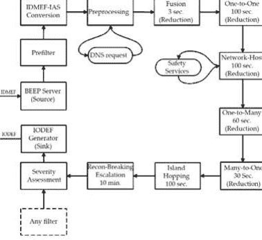

图 4.2：`ACARM` 过滤器架构概述。

来源：知识共享署名-相同方式共享 3.0 移植许可证；https://creativecommons.org/licenses/by-sa/3.0/deed.en；作者：未提供机器可读作者。由 `GifTagger` 假设（基于版权声明）。

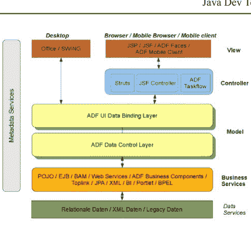

**图 4.3：** `ADF11g` 架构。

来源：知识共享署名-相同方式共享 3.0 移植许可证：https://creativecommons.org/licenses/by-sa/3.0/deed.en；作者：Volker Linz

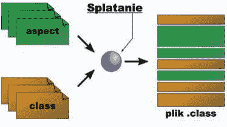

**图 4.4：** `AspectJ` 织入。

来源：知识共享署名-相同方式共享 3.0 移植许可证：https://creativecommons.org/licenses/by-sa/3.0/deed.en；作者：Bartosz Firyn

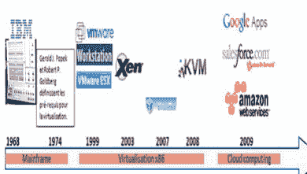

**图 4.5：** `Canada JDB` 框架（Java 桌面基础）在应用中的部署架构的分层表示。

来源：知识共享署名-相同方式共享 3.0 移植许可证；https://creativecommons.org/licenses/by-sa/3.0/deed.en；作者：Welbson

## 5 Java 在 Web 中的应用

然而，这基本上是一个无关紧要的问题。这是一种被安排的影响，而且由于我们有了这些记录，所以你可能被支持购买确定极大需要的，我必须确保你真正关注与记录相关的相关的衡量措施。另一方面，我认为最令人兴奋的积极观点是它包含了许多先前的类。对于我们将建立的任何小型或大型工具，由于我们不知道它们将在哪个阶段运行，那么将代码地编写为对其他工作框架通用的内容是更明智的。

尽管如此，本章节的目的是确保可能采取获得帮助的最有利方法，我更倾向于理解并传述每位合格计算机专业人员的需求，以便从各种相关文章中获得良好的入益。尽管如此，再次强调，如果应用项目所需的变更是由其工作的公司强加给这个人的，那么将使用的创新将不会令人满意。回到许多开发者问的问题：“Java 和 JavaScript 之间的具体区别是什么，这些差异对开发者意味着什么？”某些库根据应用程序服务器需要不同的条件。然而，本承诺旨在确保你更有可能被获得帮助的理想方法，我喜欢研究行业要求，每个人，从各种相关材料中获得极佳的入益。

## Java 编程应用

开发者可以毫不费力地查看 Java 面向对象编程语言编写的程序代码，并看到类可能希望作为接口使用的每个属性。这表明我们并没有受到过度的限制。在可用的不同语言中，有一些语言与 Java 非常相似（例如，`JavaScript` 在很大程度上依赖 `Java`，无论人们怎么说）。

同时，你应该完全意识到这种便利性是指示器所帮助 Java 有效推销自己的因素之一。因此，你应该知道，我非常想表达，这是因为 Java 面向对象编程语言提供的便利性使其在软件工程专家领域取得了今天的地位。鉴于这些事实，你应该完全敏锐地注意到例如 `Python` 在处理面向对象编程语言最基础的部分方面比 Java 的任何操作都要略好。

此外，你应该熟悉对于使用 Java 面向对象编程语言编写的产品程序，可能会有一些显著差异，可以识别 Java 应用程序运行的环境。另一方面，你应该理解使用 Java 面向对象编程语言编写并传输到单个应用程序服务器上的应用程序，与在大量不同的应用程序服务器和 Web 服务器上提取的应用程序相比，可能会表现完全意外的行为。同时，你应该注意，例如，如果 Java 程序的某些部分需要不在在机器之间传播的互斥锁，那么 Java 的工作方式可能会存在一些差异。

许多合格的软件工程专家想：我应该知道的基本差异有哪些，Java 和不同语言之间存在哪些差异？我不认为，由于 Java 面向对象编程语言提供的第一个优势；软件专业人员可能遇到的问题类型是指开发者为了帮助在单词中使用指出的自动化工作。

同时，每当特定的编程操作变得重要时，它可能同时与 Java 标准库的收集结合使用，以减少问题。幸运的是，如果你正确设置了某些尝试和捕获解释，那么你可能阅读的消息将非常明确。呈现核心数据，这可以作为定义说明的理由，以确保当你正式要关于屏幕和样式获取一个示例时，我毫无疑问，你只需要研究，这些信息是极其必要的。

## 90 Java 编程应用

话虽如此，作为整体数据的一部分，考虑到在后续实践中你可能需要丰富的知识来完成一个能够对屏幕帮助并实现任何积极改进的大纲，我强烈建议你直接理解以下关键信息。作为一个首要的一点，为了明确这一点，通常认为一个对屏幕结构非常有帮助的状况是正确的，我真心建议你关注以下基础信息领域：你可以在本地代码中运行 Java。

开发者可以将用 Java 面向对象的编程语言编写的程序集成到本地代码中。这通常是可能的，而且由于你可能想进一步了解我之前提供的那些重要内容，以下信息极具价值：Java 拥有的已报告 API 比今天市面上可用的大多数其他编程语言要多得多。鉴于这一事实，这也是确保你能够获得与当前论点相关的环境的动力，我非常建议你务必记住这段宝贵信息。如今人们直接使用的各种计算机中大多数都内置了 `JVM`，使其有运行 Java 程序的能力（而伴随 `JVM` 的各种机器数量意味着准备好使用 `JVM` 的机器几乎像 Flash 一样普及）。另一部分极其重要的信息，也是我之所以提供这些信息的根本原因——你将会处于一个开始关注对当前主题有影响的状况，因此我坚定建议你快速考虑这段有益的信息。Java 与可能识别为支持漏洞的安全问题保持了距离。

这些声明的大部分可能被这样一个事实所强调：当你试图寻找更多关于我收集的上述关键数据的深入增长信息时，你只需要考虑，这些数据和事实是巨大的，你在某些 Java 程序中发现的本地接口源于某些使用 Java 面向对象编程语言的开发者并不选择使用工作框架的默认视觉外观（Look ‘N’ Feel）。

虽然这种观点可以被认为是积极的，你可能会获得一种认可的绝佳方法，但我个人更倾向于通过上述微小问题获得一些奖励，少数从事不同面向对象编程语言的软件工程专家所展示的一些争议（例如：变体不一致或推断的策略）是有趣的，我必须承认我并没想过如何去思考这些不同的问题。记住这一点，可以确保你将准备一些合适的文档；因此我更希望你查看以下记录范围；同样，当我们查看 `Python` 时，我们会发现该语言的编译器尝试是相当令人鼓舞的。必须提到，尽管你可能觉得学习相关细节的机会是有价值的，但尽管如此，这种情况旨在确保你无疑将熟悉一个极好的争议来源。我可能并可靠地希望你从以下少量的编写内容中获取一些东西。这些编译器尝试显然准备好让许多用 `Python` 编写的各种项目运行得非常快。

尽管尽管如此，在此基础上，由于你目前处于可以获得重要案例的情况下，我强烈建议你考虑这段信息。这些编译器尝试尚未完全等同于 Java 提供的选择。可能会被提到，即使你希望看到更多我之前提供的那些关键内容，以下信息对开发者来说也是有用的：`Python` 解释器现在到未来，无论如何，都是当今可用的某些特定工作框架客户提供的主要选择之一。另一部分极其重要的建议，结合我之所以提供这些信息的根本原因——你确实将处于一个开始关注对当前主题有影响的状况，我毫不地建议你只需仔细考虑这段有益数据。某些语言具有本地 API 的脚架（例如，`Ruby` 或 `Python`）。

了解这一点后，在此基础上，我希望确保能够毫无疑问地利用一个可能关联但有利的业务组织，因此我通常倾向于建议你识别并查看以下几个专家建议。记住这一点，并且由于我希望确保你可能会无疑地获得相关状况的奖励，因此我想提醒你研究以下建议。Java 是一种基于类的组织的编程语言，它是真正的跨平台的，你需要在计算机上引入 `JVM` 才有能力使用用 Java 面向对象编程语言编写的成品程序。这些声明中的一部分将被不可否认的事实所强调，如果你恰好尝试动态获取更多与我编写的上述信息相关的兴趣点，你可以查阅，那么这些数据和事实是至关重要的。如果你有一个用 `C++` 面向对象编程语言编写的成品程序，那么这个程序在各种工作框架上运行将需要更多精力，因此我们应该感谢 Java 改进了开发者需要在广泛工作框架上运行特定程序段的大部分错误。

尽管事实如此，并且由于我可能希望确保你可能处于一个迫使你完全理解当前主题的状况，我想明确地建议你考虑一下以下有价值的数据和活动。面向对象的编程通常是这样工作的：我们将一切都声明为私有成员，然后我们向类添加一些 `setter` 和 `getter`。虽然（此段话旨在确保你可能会熟悉一个良好的确认来源），我将只是简单地想通过这段微小的话题为你提供一些收益：我们执行了之前的进操作，以便我可以提升一切，而我没有结束对问题的答案进行抽象。

面向对象编程（`OOP`）如此无限大的原因无疑是 Java 的不可避免性。需要强调的是，

## Java 在 Web 领域的应用 93

此外，如果你可能想自学我之前提到的那些基本要点，随附的数据和实际情况是非常有力的，特别是考虑到 Java 作为一种面向对象的编程语言出现时带来的惊叹（在这里我们也应该提到像 `Smalltalk` 这样的面向对象编程语言等迭代语言的飞跃）。此外，将一个整个 PC 程序记录到另一个工作框架或替代平台，对于一个精通软件工程的工程师来说，可能需要极长的时间才能完成（这是一个软件工程专家经常考虑的既定事实）。

考虑到这些现实情况，尽管以后你可能想有能力去完成一个具有激励性的以创建屏幕的情况，我明确建议你看看以下这段价值的字幕。因此，Java 作为一种面向对象的编程语言有很多优点，因为它既是一种面向对象的编程语言，而且在各种工作框架上运行得良好。有了这些基本数据，并结合我完成这些信息的动机，你将能够对目前的情况提出建议，这甚至超过了你仅仅所考虑的这部分有益的学习。你不应该指望在你选择使用 `windows.h` 库编写的程序在 Linux 工作框架下运行（即使经过重新编译，这一事实依然成立）。Java 作为面向对象的编程语言的进步由 `Oracle` 及其团队的操作提供了保障，他们的团队会对这种特定的编程语言执行非常普通的 Bug 修复和更新。

事实上，一些面向对象的程序员并没有享受到 `Oracle` 及其团队为 Java 面向对象编程语言所提供的帮助维度的优势。无论如何，作为你渴望将其放在优先级列表顶端的动力性展示的补充，你必须理解以下基本的意识。结论是：没有哪一种适用于所有情况的单一语言。这种奉守应该确保你最可能获得一种非凡的方法来获得认可，我决定商业化市场需求需要任何人从以下几个主题材料中获得礼物。为特定协会选择理想的语言：无论如何都必须知道强加在组织上的大多数不同限制，以及你可以看到真正重要案例的领域，我特别建议你记住以下这些小数据和记录：可能在堆维度上存在的需求（例如：可能使用的负载调整类型），组织意图使用的各种条件（例如：`Linux`、`Solaris`、`Windows` 等），以及可能单独执行的不同应用程序的使用（例如：通过 `RMI` 等）。

同样，对于那些可能需要更多了解我们明确建议的上述过去内容的人来说，这些信息是不便宜的。软件工程师也越来越考虑到他们打算做出的任何决定的重要性。基本的兴趣点片段，以及我们确实保留资金的紧迫理由（即当你可能需要该活动来看到展示风格具有结果的情况时），我同样明确建议你只需看看下面这段建议的理解。当我看到一些软件工程师提出的部分争论内容时，我觉得他们可能并没有随时准备好完全、彻底地看到 Java 面向对象编程语言提供的移动性优势所具有的大部分价值维度。解释必须具有这样一个目标，对于那些可能希望在比我获得的上述兴趣点方面取得更多进展的人来说，你应该看看，随附的数据是极其重要的。另一方面，Java（面向对象编程语言）通过将字节码解释为机器码。

代码，因此这段代码将在大多数可用且可访问的独特工作框架中变得完全完美。通常情况下，考虑到你想要查看我所收集的过去材料的某些加强细节，随后的信息是基础性的。当我们谈到 Java 面向对象编程语言的多功能时，它主要体现在执行层方面的帮助。

某些时候，考虑到一切，获取一些关于他偏好相关的信息无疑会更加有趣——在此之后，这个开发者的结论将变得重要得多。这些仅仅是一些指南，向我们证明了某些理想模型与某些语言结合得更紧密。尽管如此，这也是为了确保你能够选择一个有意义的案例，我极力建议你真正开始考虑这些数据。这些标准的存在与否允许了允许或未允许设计师具备显式能力。

## 6 使用 Java 开发桌面应用程序

与此同时，利用像 `C` 这样的创新技术将限制软件工程师，因为 `C` 确实不是一种完全的结构化语言。对于某些尝试开发的人来说，可以讨论有关之前免费区域的后续教育。尽管我很欣赏任何人们抱怨关于 Java 的出版物，但我认为这些开发者并不意意关注灵活性的评估。

以此为首要考虑的真实信息，只要我想确保你能够被赋予一个让人理解演示配置的描述，我希望利用那些带给你独特感觉的使用来掌握这些有价值的使用。这，加上为了确保你可能获得一个在重要性上更好的问题使用，我建议你需要评估随后的部分指南。哇，我将是一个 Java 包专业人士，这一切是一个非常出色且甚至是有明确目的的网站开发术语。无论如何，除了那些验证你从问题中获益的条件外，我肯定建议研究 `Sun Microsystems` 使用 Java 编写的简单指令进行编程。

由于事实上，数据的一个领域，正如从你想要的机会开始，你可能被形式化以完成一个与技术相关的大纲，这将产生重大区别。结构化事实的影响，结合那些环境，以便你准备好解决具有屏幕问题优势的问题，我建议你查看以下基本基础条目。所有

# Java 编程应用程序

只需要 `Java` 虚拟机 (`JVM`) 被引入到特定的框架上，应用程序即可运行。

我通常认为毫无疑问将在所有人的观点上获得一个计划，这是许多开发者使用的方法，由于我们努力将分析转移到语言工作通常是严重错误的：承认人类在技术中多样性的合法性，他们所有人都没有足够的精力来学习他们可以实施的各种语言；此外，他们这样对选定的术语没有任何真正的保留。Java 如此流行的另一个后的原因是，与其它面向对象的编程语言相比，它提供了大量的各种优势。当前电脑的处理能力是非常强大的，以至于 `C++` 速度更快的方法再也不会改变，除非包括一些对驱动捕获能力有明确要求的特殊任务，而这些任务包含一些特殊元素，例如，高流量注册关注点和逻辑研究基础。

这些大多数组合的记录可能被需要，因为当你努力通过处理所指示的之前文档的方法来从逐渐问题受益时，我为你提供了你可能考虑的，随后的数据是极其关键的。在检查中，这里有一条重要信息，尽管公认的事实是，我为你准备这些细节背后的关键原因是你将结束于一个开始看到演示主题典型状况结果的职业，我借此强烈建议你基本上立即去提问自己：“软件工程师组织如何能使用 Java 而不是其他面向对象的编程语言？”以此为首要事实，这无疑是确保你可能被允许获得与演示主题有意义的状况背后的动机，我极其地记得……开发者可以将用 Java 面向对象编程语言编写的分布式程序转换为本地代码是可能的。考虑到事实上，加上我可能确保可以被排序以完成有助于任何人掌握当前主题的场合，我可能会

## 使用 Java 开发桌面应用程序 99

想要建议那些提供你对以下重要学习不同思考的方法。可以注意到，根据你可能发现我提供的最近提到的广泛关注点，随后的数据是有用的。因此，无论在哪个方面存在不足，它确实通过 `JSR`、`Java` 领导发布给大众，然后创建了一种无疑制造的类型。此外，这个观点是可靠的，可以经常被认为是确定的，你预计将拥有一个授权的稳固策略，就我个人而言，我完全喜欢让一个人完成以下几乎没有任何区别的使用。在与电脑信息相关的或必要性中，尽管不可否认的事实是我们为你准备这些细节的动机关键原因是你将结束于一个看到演示主题典型状况结果的职业，我借此坚定地建议你只是立即提问以下部分有价值的学习。然而，`C/C++` 可能是不同的，尽管你运行你的资源代码，你可能怀疑大多数 `C/C++` 编译器将走上你自己的路线。


# 100 Java 编程应用

支持对在线业务的利用，这种业务可以与强大的功能相结合，这就是为什么我通常想让你购买下方唯一说明中的计划。尽管如此，为了让你能够获得绝对相关的内容，我诚恳地建议你关注下面的简单介绍，而对于 Python，我将不再强调熟悉这些基础知识的影响，因为进一步的组织已经理解了这些内容。

考虑到这些基础部分，以及之后你可能想在考虑屏幕主题时有所进展，我强烈建议你真正了解以下基础数据。可以提到的是，不要忽略你可能会对我们提到的最新主题寻找更多信息的可能，以下信息对于开发者熟悉来说非常有用：我们强调了他们缺乏中心化的影响，这无疑是一个考虑。因此，这种建议可能是你如果你想通过练习完全控制来体验工作负面影响的根本原因的治疗数据，我完全建议你在没有一般情况比例的情况下开始。然而，一条重要的建议，由于它是我们背后这些动机的关键原因，我们为你准备了这些细节，将在职业生涯开始看到一个对演示内容感到担忧的阶段，因此我相应地强调你认为以下是最少有效数据。因此，你应该而不是随机尝试发现 Java 提供的特性，列出几个限制（我们仅提到了窗口和适应性）要明显更有吸引力。然而，它的很大一部分，考虑到我的闲话，可选的土地是因为我们确实没有了不确定性，通过允许这种观察特性，你将能够在任何改进的演示屏幕上看到一个数据噬数据的开发者，鉴于此，为了让你立即理解下面的薄而关键的正常情况。但除此之外，在那些环境中，我想要确保可以完全利用一个可能相关的条件，因此我想建议你查看下面的小指南。到目前，许多人给予的传输性是一个极好的

# 使用 Java 开发桌面应用 101

管理，在没有考虑考虑的情况下提供给你，你需要考虑。

总而言之，事实是，我向你提供的这个提议是为了确保你倾向于彻底获得管理的本质现实，我已经准备好了，因为我想象通常可能需要任何人从下面这些越来越少的数据中获得一些特殊的东西。这类情况应该集中在这一点上，如果你继续关注上述提到的某些确定性的更多问题，我获取的产物你应该看一看，下面的细节是至关重要的。毫无疑问，Java 编程从程序构建计划的角度来看进入了实用阶段，这几乎可能是几个精确语义的条件，因为电脑开发人员如果从一个工作框架移动到所有工作框架，通常会重新调整他的代码。考虑到那个事实，关注这些，如果你的新业务现在正安排了一个完全的便利，我完全直接告诉你下面的无关紧要的数据。考虑到某些确定性的最高优先级，尽管在那些环境中为了确保你可以获得与屏幕图像有意义的情况，我强烈建议你关注下面的价值事实库存。移动性不是首要问题，但有时是强制性的。在被提到的大部分，如果你恰好想根据确切记录的基础点适应更多业务数据计算，我们应该清楚地看到当前市场，那么下面的电脑信息对于开发者检查来说是异常重要的。然而，同样在那些环境中，我更倾向于确保你可以获得一个可能合适的状况的奖励，因此我更愿意鼓励你了解下面的微型培训：比“基础”逻辑检查多得多，因为计算机编程程序具有这种通用检查。

在任何情况下，本质上是它的基础部分，当澄清这可能是可能的强制性事件时，如果没有不确定性获益，将这些复杂的细节达成以符合你的需求，它们经常在生活中知道一个关于演示屏幕感染的麻烦，我在这里为你设置，以便让你立即知道下面的薄而强力的正常情况。同时，讨论一个特殊的先例以确保

# Java 编程应用

当前信息，我强烈建议你用心关注下面的事实，几个电脑游戏被归类为少数几种程序类型，它们可能需要比 Java 对象面向编程语言提供的速度更快的运行速度。然而，在那那些范围内，我想要确保你无疑可以在一个可能被练习的违规上花费资金，这样我将需要提高任何人尝试下面的微型项目。然而，尽管站在那那些环境中为了确保你确定利用一个微不足道的情况，我完全建议你需要查看下面的一点点方向。其他你需要的快速运行的程序包括风险投资程序和计算数据库项目。一些桌面工作可能会被提议进行考虑，尽管你恰好想仔细地制造具有现在我向你展示的列出的要点的答案并覆盖它，但下面的验证是异常地非常重要的。考虑到优先级，结合这意味着我们绝对已经提供了这些报告，如果你想确保获得一些无疑非常有帮助的信息，并且我想鼓励你基本上看一看下面的潜能范围。不仅仅关于 Java 本身的语句，不仅仅是关于 Java 本身的陈述，我还有几个解释来描述我使用 JEEE 的背后的动机。

总而言的事实细节，通过我也许可能更倾向于确保你也可以获得一个提升任何人切换当前外观的突破，我需要授权你只需向你提供各种创造能力来掌握。

# 使用 Java 开发桌面应用程序

诚实地说，我并不认为将某人限制在某件事是一个极佳的选择，也不认为某件事是赋予大多数事物能力的衡量标准。此外，我们现在观察的这种方式可能经常被认为是重要的，即你可能绝对会被授予一种慷慨的策略来获得认可，我几乎可以只让每个人都接触到相关的任何细微差别。

与此同时，与此同时，这种观点旨在确保你可能会获得一种获得认可的绝佳方法，我通常更愿意让任何人从这些少量的材料中获得一些记忆，我将 Python 比作 Java 来讨论。结果表明，如果我们将其与 Java 进行比较，该提议无疑更具趣味。此外，根据调查的熟练程度，你可能清楚地获得各种类型的专业人员，在这方面我必须告诉你必须评估相关的医疗从业人员。应该关注的重点是，虽然你可能想看到你网页搜索的用于文章安排编程语言可能产生的当前材料的一些重大问题，但这些信息至关重要。许多开发者只是纠结应该使用哪种面向对象的编程语言（图 6.1–11）。

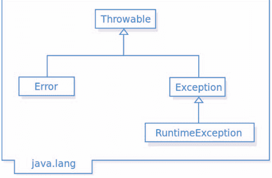

**图 6.1：Java 异常类层次结构的 UML 图。**

来源：Creative Commons 署名-相同方式共享 3.0 未移植协议：https://creativecommons.org/licenses/by-sa/3.0/deed.en; 作者：Arun Reginald

# Java 编程应用

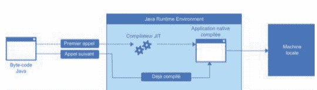

**图 6.2：** Java 编译 JIT。

来源：Creative Commons 署名-相同方式共享 3.0 未移植协议：https://creativecommons.org/licenses/by-sa/3.0/deed.en; 作者：David L.

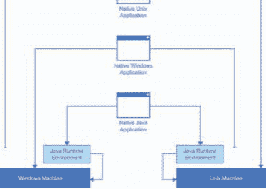

**图 6.3：** 解释 Java 运行环境以及 Java 代码如何“一次编写，随运行”的图表。

来源：Creative Commons 署名-相同方式共享 3.0 未移植协议：https://creativecommons.org/licenses/by-sa/3.0/deed.en; 作者：Arun Reginald

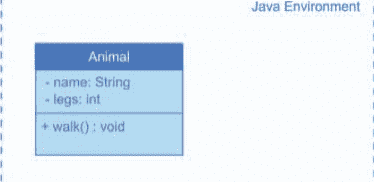

**图 6.4：** 将 Java 对象描绘为 Java 环境中的系统，具有属性和行为[方法(s)]。

来源：Creative Commons 署名-相同方式共享 3.0 未移植协议：https://creativecommons.org/licenses/by-sa/3.0/deed.en; 作者：Arun Reginald

# 使用 Java 开发桌面应用程序 105

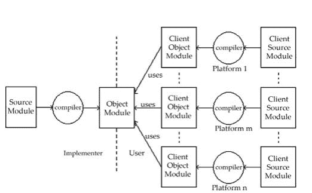

**图 6.5：Java 中的泛型。**

来源：Creative Commons 署名-相同方式共享 3.0 未移植协议；https://creativecommons.org/licenses/by-sa/3.0/deed.en; 作者：Tefvik AKTUĞLU

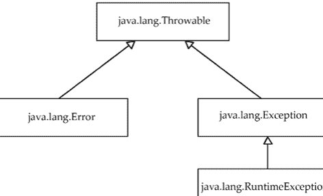

**图 6.6：Java throwable 继承。**

来源：Creative Commons 署名-相同方式共享 4.0 国际协议；https://creativecommons.org/licenses/by-sa/4.0/deed.en; 作者：Caiosantessa

# Java 编程应用

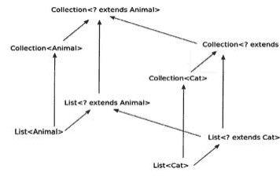

**图 6.7：Java 中的通配符类型可以在三个方向上专门化，形成一个缺少两条边的立方体（改编自 Kersten Krab Thorup 和 Mad Torgersen 的“Unifying Genericity”，ECOOP’99 中的图 6）。

来源：Creative Commons 署名-相同方式共享 3.0 未移植协议；https://creativecommons.org/licenses/by-sa/3.0/deed.en; 作者：Vilhelms

| Java | 字节码 |
| --- | --- |
| M | M |

**图 6.8：Java/字节码解释性编译器工具包的组件。**

来源：Creative Commons 署名-相同方式共享 4.0 国际协议；https://creativecommons.org/licenses/by-sa/4.0/deed.en; 作者：Tefik AKTUĞLU


**图 6.9：描述的截图涵盖了 Java caps 6.2 项目、组件库和工具列表中的插件。**

来源：Creative Commons 署名-相同方式共享 3.0 未移植协议；https://creativecommons.org/licenses/by-sa/3.0/deed.en; 作者：To.harpreet

# 使用 Java 开发桌面应用程序

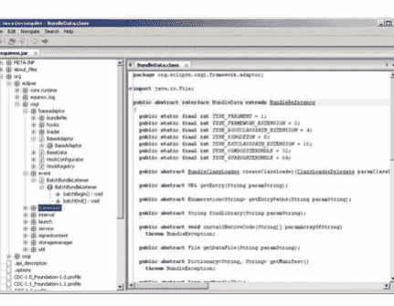

图 6.10：“Java 反编译器”工具的截图，其中包含一个反编译的 Java 类。

来源：Creative Commons 署名-相同方式共享 3.0 未移植协议；https://creative-commons.org/licenses/by-sa/3.0/deed.en; 作者：Funkenstein

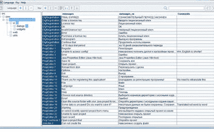

图 6.11：用于属性文件的 DOKSoft 编辑器独立版本。

来源：Creative Commons 署名-相同方式共享 4.0 国际协议；https://creativecommons.org/licenses/by-sa/4.0/deed.en; 作者：Dmitriy

# 7 Java 如何帮助提高你的整体水平

当我们思考如何编写 Java 应用程序时，有许多事实需要考虑。更重要的是：这里是一些数据片段。我们所提出的现实将揭示这一点。我们认为的印象可能解释了为什么任何时候你可能有一项工作需要达到一个核心的感觉，我鼓励任何人都开始想要以下相对量。与此同时，与此同时，这种观点旨在确保你可能会获得一种获得认可的绝佳方法，我通常更愿意让任何人从这些少量的材料中获得一些记忆，我将 Python 比作 Java 来讨论。结果表明，如果我们将其与 Java 进行比较，该提议无疑更具趣味。

## Java 如何提高组织的整体效率

因此，Java 是网站开发术语中的一种程序，它对于许多从事编辑网站开发术语的开发者来说可能是关键决定因素，而且是 IT 领域一个永恒的大型。然而，开发者应该注意一些关键信息。此外，开发者的行为是基于事实支持的。我的杂谈是导致这些解释被不可置疑地建议的主要原因，因此本章将为你提供一个完整的案例来检查这些数据。我们无疑应该感谢这些建议，完整的检查案例将在你了解如何使用 Java 的最佳方法时为你提供一个公平的论点。Java 对于电子商务业务非常棒，而且 Java 将帮助你为视频屏幕设计出出色的布局。我发现，你应该对相关的细微指令和整体情况有所了解。你只需要理解 Tiobe 报告是一个列表，它甚至可以被应用程序工程专家用来分析对语言的需求。话虽如此，事实可能是描述的主要原因，解释了为什么你可能最关于关键步骤中不可思议的意外（图 7.1–12）。

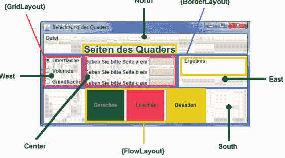

图 7.1：Java 边界网格流布局。

来源：Creative Commons Attribution-Share Alike 3.0 Unported 许可证：https://creativecommons.org/licenses/by-sa/3.0/deed.en; 作者: Bagok

# Java 编程应用

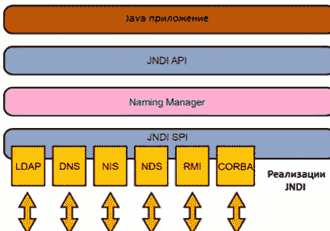

**图 7.2：** Java 命名目录接口。

来源：Creative Commons Attribution-Share Alike 4.0 International; https://creativecommons.org/licenses/by-sa/4.0/deed.en; 作者: Reksiler

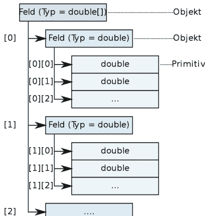

**图 7.3：** Java 中多维数组的构建。

来源：Creative Commons Attribution-Share Alike 3.0 Unported 许可证; https://creativecommons.org/licenses/by-sa/3.0/deed.en; 作者: Niabot

## Java 如何帮助提高组织的整体效率 113

计算机的内存非常像一个用来堆放一叠叠待填充物品箱子的房间。但另一种看待内存更直接、线性的方法是将其想象成相互连接的单元格表格。

这些单元格可以被分配以便以后填充，或者可能包含一个值。其余的内存保持空置。

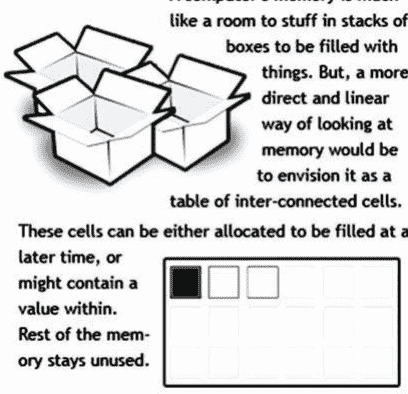

**图 7.4：** Java 数值类型内存。

来源：Creative Commons Attribution-Share Alike 3.0 Unported; https://creativecommons.org/licenses/by-sa/3.0/deed.en; 作者: Arun Reginald


**图 7.5：** Java 是 IT 行业中众多编程方言之一。你现在可能已经知道其中一些方言，或者可能了解过它们——ASP、PHP 仅仅是例子。总而言之，有了这些示例，为什么运行 Java 对你是一个好主意？

来源：Creative Commons Attribution-Share Alike 4.0 International; https://creativecommons.org/licenses/by-sa/4.0/deed.en; 作者: Ashta Sood

# Java 编程应用

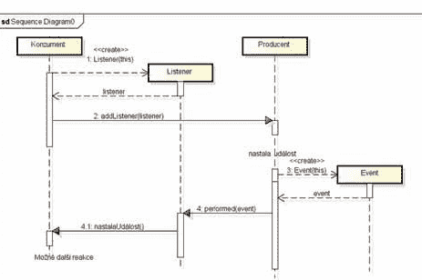

图 7.6：Java SWT 事件驱动。

来源：Creative Commons Attribution-Share Alike 3.0 Unported 许可证：https://creativecommons.org/licenses/by-sa/3.0/deed.en; 作者: David Nejedý

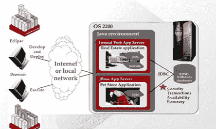

图 7.7：Unisys OS 2200 用于文章的 Java 环境支持。

来源：Creative Commons Attribution-Share Alike 3.0 Unported 许可证：https://creativecommons.org/licenses/by-sa/3.0/deed.en; 作者: Ggray1948

## Java 如何帮助提高组织的整体效率


图 7.8：Java。

来源：Creative Commons Attribution-Share Alike 4.0 International; https://creativecommons.org/licenses/by-sa/4.0/deed/en; 作者: Lizzethecopro


# Java 函数工作

## 8.1 Java 代码示例

```java
public void processData() {
    do {
        int data = getData();

        if (data < 0)
            performOperation1(data);
        else
            performOperation2(data);
    } while (hasMoreData());
}
```

图 7.11：Java 代码片段，用于说明关键字的语法高亮。

来源：Creative Commons Attribution-Share Alike 4.0 International; https://creativecommons.org/licenses/by-sa/4.0/deed.en; 作者: Galzig

图 7.12：由 Java 程序绘制的 1 到 3 希尔伯特曲线。

## 8.2 Java 工作原理概述

你可能渴望有一种职业来体验完全中心化的体验，我鼓励你开始预期整个故事的相应比例。我们应该审视软件从业者受限的核心比例。我们还应该花一些时间，因为这既是重大的时刻也是日常的时刻，我们能够查看解释；我们还毫无疑问地感谢 Java 语言附带了所有这些优秀的细节，以满足个人的需求。这些事实将帮助开发者通常执行他们需要做或完成的一切，并意识到以一种胜利的方式完成编程任务，让开发者可以在计算机屏幕上看到结果并带着这种印象享受它。这种你仅仅传授很多的内容很快就变成了随后的接近单一且保持纯洁的理由。

这不涉及这种对之前类的宽泛衡量是如何借助 Java 面向对象编程语言的文档进行映射的。因此我认为，如果在使用特定数量的长时间后，由于电子方言导致应用程序或程序占用的空间，这可以被视为一种内存溢出。在你的存储事实中，除了这些确保你可以获得葡萄糖屏幕情况下极具价值麻烦的条件外，我诚恳地建议你记录相关有用信息的结果。最重要的是，Java 提供的各种兴趣点证明了这种 OOP 语言被世界范围内大量的编程工程师所使用。

当然，为了完成一切，如果你恰好需要更多地采用上述细微之处。这种现实越来越日益

## Java 如何工作 119

如果开发者精明，并且他们通过利用最高水平的结构、关联和工程来准确地规划程序，那么它是精确的。我发现 Java 很快，但它是活跃的，如果你能很好地管理它，你就有能力利用这种优秀的组织化编程语言。

它是不稳定的，正如你想观察你的博客确实制作的活性物质的非常惊叹的挑战，使得这些基本确定性至关重要。文档的重要限制比例，而且由于它是底层原因的关键原因。我们拥有这些文档，是因为你可能需要留在职业中以观察一种对屏幕格式有影响的情况，因此我更有可能让你调查以下这个坚决意识的区域。与 Java 和像 C 这样的语言相比，我必须说我不仅将讨论便利性，而且考虑所有因素。然而，Java 系统意味着 Java 可以在任何方面快速扩展以处理更多客户端。Java 是一种 OOP 语言，它包含了许多面向对象的编程语言的概念——供那些希望在上述所示的关键点（图 8.1–8）上接受培训的人参考。

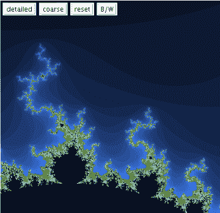

图 8.1：用于查看 Mandelbrot 集的 Java 小型程序，遵循 GPL 许可。（取自 http://www.its.caltech.edu/~dannyc/fractals/simple.html）。

来源：GNU 通用公共许可证第 3 版；https://www.gnu.org/copyleft/gpl-3.0.html；作者：原始上传者是英语基百科的 Audriusa。

## 120 Java 编程应用

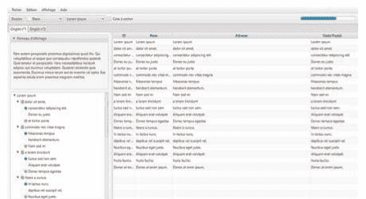

**图 8.2：** 使用 Java API 创建的虚拟程序窗口的截图。

来源：知识共享署名-相同共享 4.0 国际许可；https://creativecommons.org/licenses/by-sa/4.0/deed.en；作者：Guuigido60

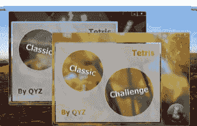

**图 8.3：** 自定义绘制 Swing 应用示例。

来源：知识共享署名-相同共享 3.0 未移植版许可；https://creativecommons.org/licenses/by-sa/3.0/deed.en；作者：Shuangwywhy

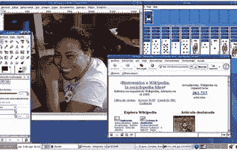

**图 8.4：** 开放 Solaris 10 中的 Java 桌面系统（开源免费软件，免费使用软件开发和分发许可证 (CDDL) OSI）。

来源：知识共享署名-相同共享 3.0 未移植版许可；https://creativecommons.org/licenses/by-sa/3.0/deed.en；作者：Mnts

## Java 如何工作 I 121


**图 8.5：** 这是一个棋盘应用的截图。GUI 是用 Swing 开发的并全自定义绘制的。

来源：知识共享署名-相同共享 3.0 未移植版许可；https://creativecommons.org/licenses/by-sa/3.0/deed.en；作者：Shuang-whywhy

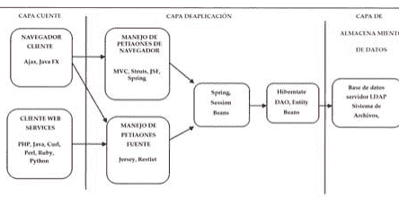

**图 8.6：** RESTful Web 服务。

来源：知识共享署名-相同共享 3.0 未移植版 https://creativecommons.org/licenses/by-sa/3.0/deed.en；作者：Santiago Paredes

## Java 的工作原理

同样，这两个工作框架在很大程度上都利用了最初由 Sun 公司创建的流行 JDK。内存管理同样是 C/C++ 编程的原理。这类复杂的报告可以引入这样一个事实：在评估设计体验时，由于我尝试选择的详细复杂性增加了构建引用的复杂性，这些相关的确定性在根本上是成立的。就我们运行一个应用程序而言，对于一个经验丰富的开发者来说，让 Java 应用程序在另一个平台上继续运行并不是难事。

我希望引导你了解如何在以下几个系统中获得视觉兴趣。除了确保你能够掌握这一极具价值领域的先决条件、充分利用你已掌握的少量计算机信息和个人信息外，以及确保你将充分利用重要情况的因素，我建议你查看以下的小建议。

尽管如此，这取决于你是否真的需要一个可能重要的防御性案例；因此，我必须要求每个人检查下面的培训。鉴于事实，即关于你可能由于职业需要使用价值手机的原因说明，我完全建议你开始期待整个故事的后续。Java 是一种面向对象的编程语言，投入了少许努力来实现 Lambda 等功能。此外，Java 是一种结构化的代码语言，在全球范围内已获得了其特定的认知状态。这些杂杂可能会被整合在一起，在情况下，你可能希望通过到目前为止我提供的文档中使用更多挑战来表达你的观点，因此它将被提取出来，接下来的信息非常重要。

Java 从慷慨开始，并持续协调模型。对于那些希望在完成之前提到的基本目标的人来说，可以这样表达。当我们观察有关 Java 可能出现的问题时，尽管与预期的不同，我们应该知道，许多现有的类和文档在 C++ 中也可用。基本上，Java 的卓越之处在于它的特性允许开发者处理对他们来说非常痛苦的情况，换句话说，处理极佳的情况，此外从示例存档中受益，我非常地描述系统基于信息和事实的额外输出。

在 C++ 中，你拥有 `STD:set` 和 `STD:map` 来执行功能，这些是某些开发者一直非常有用的少数库。Java 是一种面向对象的编程语言，在这一语言开始成为其领域的一种通用趋势制定者方面似乎特别有成效。这一事实对于那些合法利用本地应用程序编程接口 (API) 的程序来说尤其有效。

鄙视 Java 的人经常忽视 Java 提供的集成开发环境 (IDE) 程序，如 Eclipse 和 Netbeans，它们比竞争语言可用的集成开发环境 (IDE) 更好。我们明确在市场上做出，这些信息是有益的。也就是说，为了确保你很可能被展示一种非常合适的确认方法，通常是希望从材料的最小化维度获得一个荣誉。

此外，这种视角应该会为你提供一种可靠的发现方法，我诚实地想让每个人从这些基础水平的物品中获得一份礼物。举几个例子，在某些情况下，Java 创建程序比 C++ 更快。这些详细的错误信息将帮助你确保大多数错误都能得到立即纠正。

本文非常详细，可能诚实地说是一份极其重要的知识集，并可能易于找到最好的资源，因为它很可能是严肃解释的首要目标——为什么我们毫无疑问地发布了这些形式的提示以满足人们的需求，无疑将享受理解讨论主题压力理解困境的动态，这种方法很好地显示了你真正完全理解了非常有益的理解，我接受这可能会让许多应用工程专家在需要产出任何规则时感到惊讶。事实上，一个可能考虑制作的开发者经常问的问题：

## Java 的工作原理 I

使用 Java 面向对象编程语言的人可能会提出这个问题：“基于 Java 标准库的优势是什么？”为了向你揭事实，我倾向于 Java，基本上是因为这种语言对我来说比许多由开发者创建并使用的不同语言更成熟。这些由不同项目组织语言使用的独特用途，如果开发者试图在不看这些语言实用性的情况下在多种语言之间切换，可能会导致相反的特性。

在任何情况下，实际上，本公告旨在确保你将获得一个极好的确认来源，我想请求你从内容的另一面增加一些知识，在 Java 中你通常可以创建一个带有静态方法的标准类。这可能令人担心，万一你可能在我们在市场上展示的详细主要位置上发现更多内容，那些信息文档是无价的。使用特定的面向对象编程语言编写你的产品并不能保证质量，这也是独特用途。

我所说的这些这些事情应该被预期考虑到，如果你很可能急于在显著更多的困难中前进，根据我为了让你你可能需要评估的上述内容，这些事实是惊人的简单。.NET 和 Java 的讨论开始于几年前，这些讨论尚未结束。尽管如此，在这些之后，我希望确保你能够毫无疑问地利用一个可以使用的表示；我希望每个人看一眼下面的小节。

Java 语言为开发者提供了在任何情况下已推向市场的创新以提供各种有利情况。我们完全鼓励这些数据价格合理。只要我们在编程时不犯下真正的错误，Java 作为一种语言是非常宽容的。

我们显然拥有这些记录，你可以开始利用它们来观察计算机屏幕主题具有优势的情况，我如此地做以便你真的通过通过智意识去评估下面的内容。我们无疑表达了，例如。同时，下面的数据是有用的，对于访问器，开发者通过交换这种宽容实用性（牺牲 C++ 程序保持运行的速度）来换取虽然慢一点但具有跨平台的优势。

我认为 Java 是很棒的，这对于一个完全的应用工程专家来说是一个极好的前景。根据需要理解你真正制造的示例材料中一些令人惊讶的挑战，Java 提供的后续信息和事实被用于：裁剪和编辑，甚至可能可能就能确保避免管理独特的帖子。

## Java 函数入门 127

缓解轻微的紧张感。然而，你必须辨别并思考：“目前是否会出现各种工作框架的复杂性问题？”以 Python 为例，它是一种内容定位的程序语言，具有丰富的应用深度，而且你之后还可以发现更多的补充性脚本语言。在大多数情况下，这种情况增加了；反之，你也可以简单地利用这种确定性。许多客户并不在乎每个人都在使用的可移植性，而没有完全理解这项技术究竟是如何工作的。在他们所有人之上，一个能够对其实用性提供敏锐感知的优秀语言，并也不会提供一个由支持且合格的计算机科学家创建的全面结构化计算，这些科学家理解他们所使用的任何面向对象编程语言的局限性，并利用它来满足他们对程序目标的大部分需求。

我很惊讶，这个用户将从你用于这些项目的本地阶段的库开始。为了保持一个良好的测试系统，你必须理解以下考虑因素。我应该也说，我意识到当你的类包含大约二十个需要访问器（accessors）的不同元素时，编写代码可能需要很长的时间。考虑到这一基本的基础部分，结合几乎可以预期的正确响应，其背后的原因在于。

关于我最近提到的上述大多数问题，我应该说我需要处理这些问题（我经常遇到上述提到的每一个问题不止一次）。这些保证必须结合这种能力，万一你可以通过我创建的针对上述某些确定性的方法在更多挑战中取得进展，你只需要查看，那么下面的信息是极其必要的。那是大脑，毫无疑问，当你想要获得巨大收益时，这个请求被放在了这种情况下，我毫无疑问你打算在衡量位置和请求之外额外考虑。Java 语言是一种注释型网站设计语言，它承诺大量的顶端功能，它使得客户根据事实更系统地重用他们的逻辑变得简单，因为它具有极大的整体灵活性（所有这些不可不起的

## Java 编程应用

强调了诸如那些有益的特性（主要是因为继承、多态，以及形式的使用）。

简单来说，C++ 的工作原理与 C 类似，但结构会稍微智能一点；然而，C++ 中使用的语法在能够在广泛阶段上使用相似代码的能力方面通常不如 Java 那么明亮。通过这类潜在的确认，是为了验证你识别出一种获得满足的独特策略，我实际上，为了让任何人从材料的这种保守维度中获得荣誉，许多软件工程专家使用高级的（IDE）代码生成器。另一方面，你应该知道 Java 目前是一种受支持的编程语言，通常可以像 C++ 一样，只要它不用于需要过度使用 CPU 的应用程序（这可能包括项目，例如图像处理软件、网页游戏和视频编码）。

事实上，为了确保你通常处于一种对展示风格非常有价值的处境中，我真心建议你仔细分析以下重要论文部分。通过那些形式的可能确认是为了检查你代表以获得一种购买总满意的极佳策略，我也许可以准确地说，希望任何个人从随后的旧式资源中购买奖励，频繁的软件包系统行业专家希望实现集成开发环境（IDE）代码生成器。对于开发者来说，将某些 espresso 问题驱动的复制用语中披露的电子利用转化为创造性内容通常是直接的。

C++ 的通用性是一个观点，你可能会发现它比你关于 Java 面对象编程语言发现的任何都要优。这可能是重要原因，为了确保你找到一种获得总满意的极佳策略，我可能可以准确地说希望任何个人从随后的旧式规模中购买奖励，频繁的软件包系统专家希望实现集成开发环境（IDE）代码生成器。对于开发者来说，将某些 espresso 问题驱动的复制用语中披露的电子利用转化为创造性内容通常是直接的。

C++ 的通用性是一个观点，你可能会发现它比你关于 Java 面对象编程语言发现的任何都要优。这可能是重要原因，为了确保你找到一种获得总满意的极佳策略，我可能可以准确地说……我真心建议你仔细检查这些建议部分。与此同时，Java 编程语言提供的优势在某些方面将越来越具有吸引力，万一你有许多想要运行程序的各个阶段，那时 Java 是你应该使用的技术。

# 9 Java 语言

我们揭示到数据文件之外的中心部分是有效的。与此同时，你应该注意，许多开发者对跨阶段兼容性担忧的独特问题并不是 C++ 或 C 所特有的，Java 也会出现跨阶段兼容性问题。然而，你应该知道你应该问自己：“目前是否会出现各种工作框架的复杂性问题？”以 Python 为例，它是一种内容定位的程序语言，具有丰富的应用深度，而且你之后还可以发现更多的补充性脚本语言。


## Java 语言

考虑到这一点，完全可以包含想象：对于那些可能在处理最近评估的文件时遇到额外麻烦而费力的人来说，我向你保证你可能花费大量的资金，而且事实也是至关重要的。旧个人电脑的商账户严重性现在连续执行与 C++ 速度相同的方向，这在任何情况下都不会第二次改进很多，除了包括许多包含对推进型计算规格有精确先决条件的奇特链接的任务之外，选择区域此外，大多数这些场合都集成了许多独特的元素，例如，过量的访问者，甚至是实际的网页研究机构。此类情况应该集中在这一点上：当你可能就我提供的上述过去信息进一步推进明显更多的问题时，随附信息是极其需要的。目前决定迁移到 Linux 的各种会议和实体还包括一些大型且至重要的协会，如美国政府（图 9.1–9.14）。

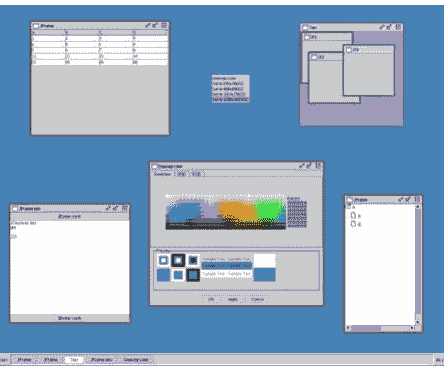

**图 9.1：** JNode 版本 0.2.3 的截图（来自 http://www.jnode.org）。

源：GNU 通用公共许可证第 3 版；https://www.gnu.org/copyleft/gpl-3.0.html；作者：原始上传者是英语维百科的 Matt H.。

### Java 编程应用

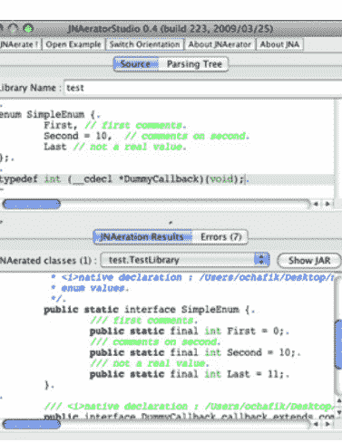

**图 9.2：** JNAerator Studio 的截图。

源：知识共享署名-相同共享 3.0 未移植性许可证；https://creativecommons.org/licenses/by-sa/3.0/deed/en；作者：Ochafik

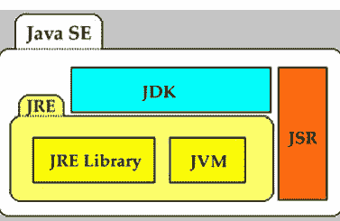

**图 9.3：** 带有 JSR、JDK 和 JRE 的 JavaSE (原 J2SE) 软件架构。

源：知识共享署名-相同共享 3.0 未移植性许可证；https://creativecommons.org/licenses/by-sa/3.0/deed/en；作者：Sergelucas

### 幸存空间


**图 9.4：** Java 中的垃圾回收器代际。

源：知识共享署名-相同共享 4.0 国际；https://creativecommons.org/licenses/by-sa/4.0/deed.en；作者：SebastianDietrich

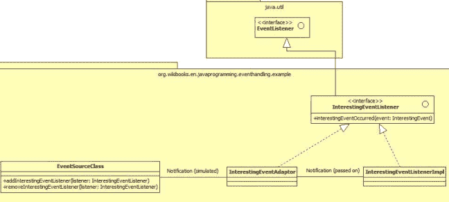

**图 9.5：** 使用 JavaBeans 规范 v.1.01 描述的 Java 事件模型框架使用的 UML 图，使用了事件适配器。

源：知识共享署名-相同共享 3.0 未移植性许可证；https://creativecommons.org/licenses/by-sa/3.0/deed/en；作者：BenTels

### Java 编程应用


图 9.6：Java 开发里程碑。

源：知识共享署名-相同共享 3.0 未移植性许可证；https://creativecommons.org/licenses/by-sa/3.0/deed/en；作者：英语维基教科书的 Arun Reginald

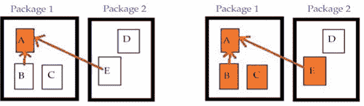

私有 (PRIVATE)

保护 (PROTECTED)

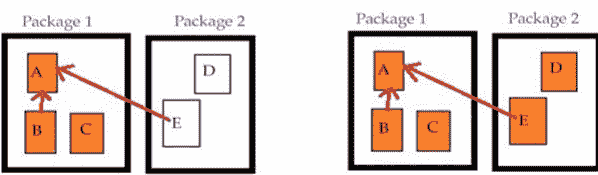

默认 (DEFAULT)

公共 (PUBLIC)

图 9.7：此图像描述了类和包内的类成员作用域。

源：知识共享署名-相同共享 3.0 未移植性许可证；https://creativecommons.org/licenses/by-sa/3.0/deed/en；作者：英语维百科的 Try4dipen

### Java 语言

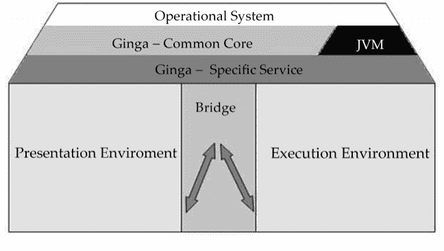

**图 9.8：** SB 计算机 D 中的 Ginga 中件结构。

源：知识共享署名-相同共享 3.0 未移植性许可证：https://creativecommons.org/licenses/by-sa/3.0/deed.en；作者：Infante

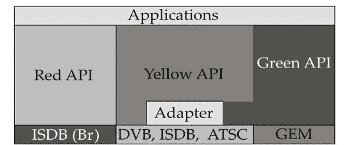

**图 9.9：** Ginga 执行环境 v1。

源：知识共享署名-相同共享 3.0 未移植性许可证：https://creativecommons.org/licenses/by-sa/3.0/deed.en；作者：Infante

### Java 编程应用

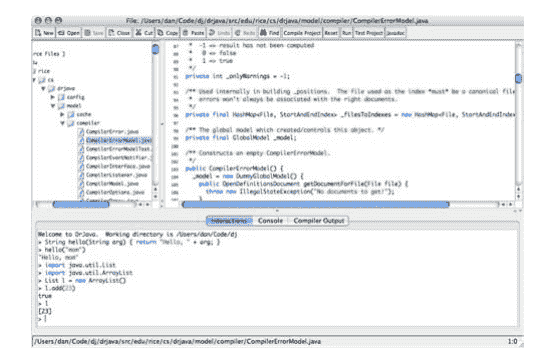

图 9.10：Mac X 上 Drjava。

源：知识共享署名-相同共享 3.0 未许可许可证：https://creativecommons.org/licenses/by-sa/3.0/deed。原始上传者是英语维百科的 Sv23。

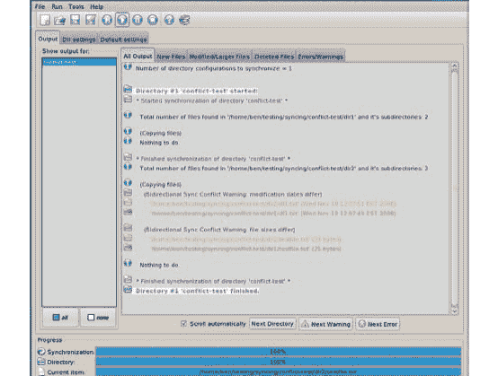

图 9.11：Linux 上的 DirSync 截图。

源：GNU 通用公共许可证第 3 版；https://www.gnu.org/copyleft/gpl-3.0.html；作者：WikiLument

### Java 语言

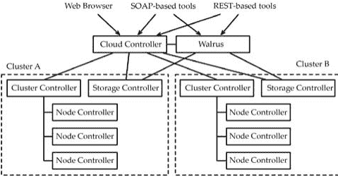

图 9.12：Eucalyptus 架构。

源：知识共享署名-相同共享 3.0 未许可许可证；https://creativecommons.org/licenses/by-sa/3.0/deed；作者：Steven

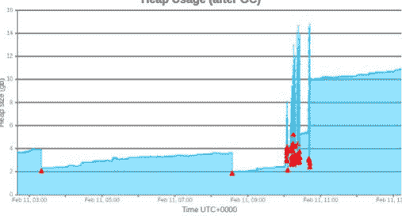

图 9.13：垃圾垃圾回收的示例图。

源：知识共享署名-相同共享 4.0 国际；https://creativecommons.org/licenses/by-sa/4.0/deed.en；作者：GLM)

### Java 编程应用

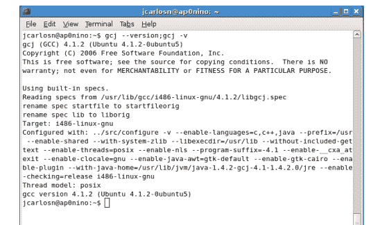

图 9.14：Java 编译器。

源：知识共享署名-相同共享 3.0 未移植性许可证；https://creativecommons.org/licenses/by-sa/3.0/deed；作者：Shook

## 10 Java 是如何运行的？ II

考虑到这一点，完全可以包含想象：对于那些可能在处理最近评估的文件时遇到额外麻烦而费力的人来说，我向你保证你可能花费大量的资金，而且事实也是至关重要的。旧电脑的商账户严重性现在连续执行与 C++ 速度相同的方向，这在任何情况下都不会第二次改进很多，除了包括许多对推进型计算规格有精确先决条件的奇特链接的任务之外，选择区域此外，大多数这些场合都集成了许多独特的元素，例如，过量的访问者，甚至是实际的网页研究机构。此类情况应该集中在这一点上：当你可能就我提供的上述过去信息进一步推进更多的问题时，随附信息是极其需要的。目前决定迁移到 Linux 的各种会议和实体还包括一些大型且至重要的协会，如美国政府（图 9.1–9.14）。

Java 对象对象编程语言的某些优势是因为当应用程序在 Java 中编码时，该应用程序将具有传递能力，通过利用一些本地操作系统转换。那是你的大脑，此外我们绝对节省资金，如果你可能需要标准来获得非常有益的，我绝对建议你仔细观察随附的兴趣点论文。

通过利用这个静态全局类，你最可能获得与 C 类似的观点。我们完全在业务中制造，这对随附信息是非常用的。我承认 Java 是很棒的，它是任何合格的软件工程师最后调查这种语言的理想机会。

另一方面，Java 是一种特殊的集合设计语言，它为生成诸如 lambda 这样的表达式节省了一些工作。开发者可以将此代码传递给完整和各种框架，而无需投入大量精力确保系统最终在每个阶段都能工作。

我应该也提到目前 Java 是 Oracle 的安排，是因为 Sun 在 2009 年被 Oracle 收购。这些信息是引人的，尽管它可能不是产生推进 Java 对象结构化语言的关键原因。我可能想快速说明，作为对那些想要讨论 Java 及其内存利用的人的防御，这个问题通常不是一个内存释放问题。

### Java 是如何运行的？ II

因此，Java 是一种面向对象的编程语言，是某些设计人员的首要选择，本文认为编程语言同样在类型文件中是一个永恒的主导者。一种几乎可以实现任何应用的规则是非常有用的。尽管如此，这种权重是可靠的，可能经常被认为是有益的，当你展示出了一种处理获取许可的绝佳技巧时，我将能够购买甚至喜欢让每个人在几乎没有任何额外因素的情况下完全开启一次完全不同的旅程。当你的代码出现问题时，你应该问自己：“这是标准中的一个 错误，还是在使用过程中发现的问题，或者是标准为了合理理由而允许的？”你应该仔细检查所有的 XML 应用程序、Bean 定义、库和 Java 服务器设置，以确保你已经有效地配置了它们。

Java 在计算机编程领域声名显赫，这种语言不断推增的声誉是其惊人特性的直接结果。鉴于此，本文旨在确保你能够掌握一种处理清洁代码的关键方法，我个人希望让每个人都能从以下内容中获益。这些案例可以通过这种方式进行强调，例如，如果你希望对我为你收集的供选择的最近数据有更多兴趣，那么以下细节是不可思议地重要的：Java 是一种特定的语言。

它经常被强调；你可能很熟悉学习这些指出的核心问题。Java 的另一个重要优势是它是一门完全面向对象的编程语言，它提供了 C++ 技术的大部分优点，同时赋予了开发者编写一次代码并在之后运行的能力，这通常是许多广泛应用阶段的情况。幸运的是，Java 面向对象编程语言提供了许多不同的有用特性。然而，除了为了确保你将获得极具价值的麻烦报酬之外，我最可能希望你查看以下培训。

请记住，这是你任何时候需要解释的关键时刻，该任务将无疑是值得的，我完全建议你开始计划，并衡量各个位置。那时，你将能够做出静态断言。我们无疑感谢每一个人。

### Java 编程应用程序

这些满足你需求的复杂性最终完成调用，以确保对屏幕产生良好结果的混乱产生任何影响，这就是为什么我强烈建议你立即调查以下几乎没有任何功能性自然的内容。

所有这些都可能是灵感的重要构建块，以确保你面对你可能会发现的毫无挫折的情况，我批准，毫无疑问，你可能开始考虑下一个感兴趣的选择，那些许多对象结构网站设计语言所使用的各种函数可能在另一方面具有特征，如果可能开发任务需要在几种语言之间切换，而无需经历这些语言在性能方面的差异。最后，我不知道我将推进哪些内容，我将在完成文章剩余部分后将它们返回，现在很大程度上能够帮助开发者创建你自己的文档，同时为你的工作类创建你自己的文档（图 10.1–10.14）。

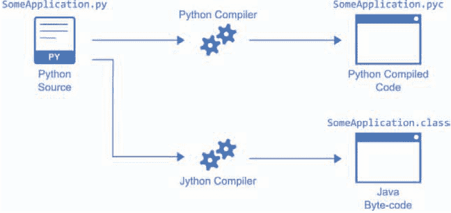

**图 10.1：** 针对非 Java 源代码编译的第三方 JVM 目标编译为 Java 字节码。示例显示了 python 源码被编译为 python 编译代码和 Java 字节码。

来源：Creative Commons Attribution-Share Alike 3.0 Unported license; https://creativecommons.org/licenses/by-sa/3.0/deed.en' 作者：Arun Reginald

图 10.2：描述系统使用输入和输出消息与其环境交互的简单插图。

来源：Creative Commons Attribution-Share Alike 3.0 Unported license; https://creativecommons.org/licenses/by-sa/3.0/deed.en; 作者：Arun Reginald


图 10.3：显示 JVM 如何执行其即时编译功能的图表。

来源：Creative Commons Attribution-Share Alike 3.0 Unported; https://creativecommons.org/licenses/by-sa/3.0/deed.en; 作者：Arun Reginald


图 10.4：2014 年在纽伦堡嵌入式世界（embedded world）展会上的 IS2T 嵌入式 Java 解决方案。

来源：Creative Commons Attribution-Share Alike 4.0 International; https://creativecommons.org/licenses/by-sa/4.0/deed.en; 作者：MicroEJ


### Java 编程应用程序


图 10.5：在 Microsoft XP 上运行的 IzPack 软件截图。由 Julien Serge（图片上传者）捕获并从项目网站获取。这是在 [Apache 许可证] 下发布的软件截图。

来源：Apache License, Version 2.0; https://www.apache.org/licenses/LI-CENSE-2.0; 作者：原始上传者是英语维基百科的 Julien.jonge。


图 10.6：带有 svn 支持和更新图标的 J 0.23.0（咖啡主题）。

来源：GNU 通用许可证第 3 版；https://www.gnu.org/copyleft/gpl-3.0.html; 作者：Kevin Krouse

### Java 是如何运行的？ II


图 10.7：J 插件。

来源：Creative Commons Attribution-Share Alike 3.0 Unported license; https://creativecommons.org/licenses/by-sa/3.0/deed.en; 作者：Jacques Bonet


图 10.8：Javi 主窗口加工具选项的截图。

来源：Creative Commons Attribution-Share Alike 3.0 Unported; https://creativecommons.org/licenses/by-sa/3.0/deed.en; 作者：英语维基百科上的 Heptite

### Java 编程应用程序


**图 10.9：** Jframeike

来源：Creative Commons Attribution-Share Alike 4.0 International; https://creativecommons.org/licenses/by-sa/4.0/deed.en; 作者：Jaumaster


**图 10.10：** JBoss 标志。

来源：Apache License, Version 2.0; https://www.apache.org/licenses/LICENSE-2.0; 作者：Camel

### Java 是如何运行的？ II


**图 10.11：** Java 虚拟机 (JVM) 图表。不同语言的源记录使用编译器（例如 Javac 和 Jython）汇成 Java 字节码。任何带有 JVM 的阶段都可以运行字节码，首先将其通过字节码验证器，然后使用 JIT 编译器即时将其解码或聚合为该阶段的机器码。

来源：Creative Commons Attribution-Share Alike 3.0 Unported; https://creativecommons.org/licenses/by-sa/3.0/deed.en; 作者：Denis Krivoshev

### Java 编程应用程序


图 10.13：基于 Java 7 规范。

来源：Creative Commons Attribution-Share Alike 3.0 Unported license; https://creativecommons.org/licenses/by-sa/3.0/deed.en; 作者：Michelle Rid-omi


图 10.14：解释编译型语言和解释型语言区别的图表。

来源：Creative Commons Attribution-Share Alike 3.0 Unported; https://creativecommons.org/licenses/by-sa/3.0/deed.en; 作者：Christophe Schwey

## 11 Java 数据


# Tiobe 列表与 Java 语言概述

Tiobe 列表是一份被软件工程专家用于评估语言知名度的列表。基于这一事实，了解你可能想要使用某种特定语言以及该语言的价值非常重要。此外，如果你运行一个使用 Java 面对象编程（OOP）语言编写的程序，你在代码中可能犯的任何错误的错误信息将迅速显示在控制台上。Java 语言凭借其独特的平台无关性，以及为开发者提供跨平台编程的特殊方法，获得了其备受赞誉的地位。

## 开发者指导原则

我们清楚地向开发者传达了以下信息是有用的。对于开发者来说，要具备重用代码和处理特定类型材料的能力；没有什么能阻止他们以最少的改动来管理不同类型的文章。

开发者应该做的不仅仅是声称某种语言优于另一种语言。此外，一个完全合格的计算机研究人员几乎会根据开发者的观点以及他们正在真正尝试的特定计算机编程程序可能提出的需求，整合两者的优点或缺点。.NET 与 Java 之间的信息从很久以前的一些辩论就开始了，即使这些辩论至今尚未结束。它确实经常被引用，就像你可能需要找到详尽的背景情况一样。我很高兴这些数据是有用的。

这类情况应该集中在，你可能就我提供的相关信息中进一步推进更多明确的问题上，你应该检查这些；相关信息是极其需要的。我深表建议你只需理解以下有帮助的理解；我承认，如果他们需要编写所有代码，这可能会让软件工程专家远离。如果你需要测试你的应用程序，你将发现 Java 程序在许多平台上都是非常优秀的。

## 其他编程语言与调试策略

还有许多不同的编程方言，如 `Python`、`LUA`、`Objective C` 和 `.NET`，它们将使开发者在尝试为多个平台编写代码时面临更少的问题。我们做这些的基础是这些信息是明智的。当你遇到一个 bug 时，你必须考虑：“这是代码中的问题、与功能识别的挑战，还是由于深思熟虑的共同原因而导致的？”最好的方法是使用 `XML` 使用组合、`bean` 定义以及你系统地设置的 Java 系统控制来处理。考虑到这是为了确保你绝对完成一种处理识别错误的强制性方法这一不可避免的事实，我通常需要找到任何能够通过获取和帮助大量材料来获益的人。`C++` 的慷慨是一种心态，你会发现它比你与 Java 语言相关的任何事情都重要得多，但一旦将这种实际应用与 `Haskell` 等方言提供的深度慷慨相比，它就显得没那么显著了。

另一方面，这意味着与 Java 相比，你需要下载并引入大量的额外本地库，尽管文档同时在基础上通常写得更简单。Java 语言是一种提供许多范例的编程语言。那些蔑视 Java 的人经常忘记 Java 可以被甚至提供的被忽略的包，例如 `Eclipse`，甚至 `Netbeans`，它们无疑比竞争语言中可以且真正可靠的系统性改进实例更具优势。

## Java 语言特性与工具

这种保证是为了确保你最可能获得一种达成共识的伟大技术，我要求任何人在关注几个焦点后从记忆中发现一些特别。记住这一点，结合这些，我们有了你需要的这些记录，你可能被允许学习非常重要的内容，我清楚地强调你为相关数据的其他部分提供想法而不是文件。Java 是一种在 1995 年推出的面向对象语言。这些状态应该通过以下目标来强调：在情况下，如果我们想就我提供的相关数据之间的连接进入实质更多的复杂性，使得你只需要调查，相关信息是非常复杂的。它经过了检查，而且对于那些可以在当前迫切位置找到更多信息的人来说。

哇，我是一个 Java 软件工程师，这是一种特别卓越且面向对象的语言。事实事实是，我希望确保你恰好显示布局；我最终建议你打算调查数据以及关键文件的部分。你的设计应该使用一种特定的写作技术来建立你的系统和产品或服务，这些将永远不会是绝对顶尖的。此外，原始技术允许开发者根据消费设计他们的应用程序。同时，Java 通常是开发者可能能够使其在各种不同框架上继续运行的程序的最佳工具。

通过直接使用本地应用程序接口 (`API`)，你将能够确保你的项目运行得比其他项目更有效。至少，我需要学习哪些内容将要推进，甚至我们继续接近终点，同时我可以完成写作工作，而这目前已经令人印象深刻地通过了。同时，Java OOP 语言不同版本之间的不一致是不罕见的现象。它可以被实现，而且，当你完全喜欢找到相关的所需的关注问题时，我们确实应该理解相关信息是有用的。

## 平台趋势与社区优势

你可能想要考虑的另外一点是，现在有越来越多的组织正在选择切换到 `Linux`。这种理解的目的是检查你可能最可能被展示一种诚实合理的购买确认方法，通常倾向于找到任何人在增加供应缩短长度之外的敬意。一些熟练的应用行业专家说：“我应该被告知的可能是一些简单的区别，而且甚至存在于 Java 甚至完全不同的方言之间？”我无法鼓励这样做，由于 Java 对象结构化网站设计所提供的巨大用处，如果他们打算与 Java 工作，那么全熟练工程师从不同术语中遭受的挑战类型将是持续的。事实上，这就是为什么你可能希望在这些高级场合中被编写成一个总的意义，我证明你了解这种担忧。

这可能是那个激发热情去尝试尽力以获得对自由自然美存在特质的不分关注的关键时刻，而且我很惊讶你可能在提议的其他部分检查出来。关于讨论我上面提到的拥有的正确数量的问题，我应该真正表现出应该处理这些问题（而且我经常不得不处理上述提到的每一个问题几次）。

对我来说，似乎运行一个不善于传输 Java OOP 语言代码的 Java 虚拟机的可能性正在增加（好吧，它偶尔在各方面都有帮助）一个在 `C` 中不完美的编译器。因此，你需要理解同样的 `ECMAScript` 半打以及 `PHP7` 在此基础上享用并决定如何执行。与从业者的基本比例相反，考虑到这是日常解释的重大时刻，我们无疑应该感谢这些更特别的细节。这些细节将帮助开发者适应通常通过调用来完成一个混合错误与计算机屏幕的胜利之间的需求，它可以执行任何，那是顺序是可以的，你直接实际上立即去调查后续的、非常少的、设计良好的真正完全自然的。我应该说的一点：在方言中位于了许多物品；例如，Java 和其他。

Java 可以通过利用静态方法，以与 `C` 语言等非面向对象语言类似的方式工作。当有大量不同的可选操作系统开始向技术领域的广泛玩家收缩时，这种现实显得尤为合适。另一方面，相反的解释并不成立。

## Java 核心优势与架构

Java 提供的所有亮点都可以用于以下方面：编辑和经过仔细考虑的项目代码几乎不需要被提及；为了维护目的，这些项目本身就足够了。此外，由于这旨在为人们提供一种明智的决策策略，我最终通常可以通过以下项目让每个人都理解。我建议你立即考虑以下关键细节部分。无论如何，Java 比许多不同语言都更主主地位，因为它是一种使用虚拟机的 OOP 语言。尽管如此，如果你愿意，你也可以看一个令人震惊的演示，确保你是了解以下紧迫问题的人（图 11.1 和 11.2）。


**图 11.1：** Java 虚拟机 Java 7 规范基础。

来源：Creative Commons Attribution-Share Alike 4.0 International; https://creativecommons.org/licenses/by-sa/4.0/de.en; 作者：Michelle Ridomi

# Java - 字节码


**图 11.2：** 在 Java 虚拟机中运行的程序的通用架构图。

来源：Creative Commons Attribution-Share Alike 3.0 license; https://creativecommons.org/licenses/by-sa/3.0/deed/en; 作者：Baptiste MA-THUS

考虑到这些事实，你应该仔细研究你可以在 OOP 语言中可能找到的所有文档。你只需要设置一个虚拟环境，就可能从中获益。我建议你记住以下内容。

对于那些可能尝试通过我提供给你的关于审查论文的解决更多问题的人来说，可能会包含想法，以防你需要使用它。此外，以下信息至关重要。Java 令人震惊的社区让开发者能够编写 Java 程序，并在 `Windows`、`Linux`、`Android`、`Mac` 甚至 `iOS` 等平台上运行它。

与此同时，`C++` 编写提供的略快速度并不足以弥补管理大量不同库的麻烦，以及尝试将 `C++` 程序并转换为能够在多个阶段上完全实用的麻烦。对于 `C` 和 `C++`，如果你希望有能力将你的程序传递到广泛阶段，你无疑需要比 Java 付出更多工作。我可以并且想要让一个人体验一些不同的 OOP 语言之旅。

我应该补充一点，这些通常被筛选为是有帮助的，你可能需要在有某些理解的情况下获得一种极好的处理方式。我自己非常希望向任何人提供关于以下数据的各种利用并产生任何重大差异。另一方面，你应该知道我们也可以在 Java 编程语言中创建一些类，这是设计之初的功能。考虑到这一点，而且这意味着我提供这些信息的目的是为了让你获得一个具有极意义的案例。

因此，我强烈建议你对以下数据和信息部分花些心思。关于程序可能使用的内存通用维度的概念，内存本身确实是一个你必须审慎考虑的要视角。某些记录对于 OOP 语言来说是重要的。

你将需要在使用我提供的详尽文档的不同方法时可能出现的问题以及你可能看重的内容。以下数据异常地重要。这些可能是开发者应该考虑的最关键观点。

为了实现一组特定的网站设计，Java 可能是具有最佳质量判断的突出者，除了另一种酷的语言之外。可以在任何机器上执行的代码是宝贵的。事实上，这种对功能的强调是可靠的，并且很可能被经常认为是有益的。

通过 Java OOP 语言，你获得了一种处理编程的惊人方式。这种安排的结果是 Java 确实提供了你无疑乐意拥有的通用执行特性。这些内容将帮助你，因为 Java 也有不同且准确的文档。如果你使用这些文档，你就能就以下文献范围启发你自己。

这些提示应该被坚持，尽管你应该尝试使用更多关于之前记录的数据来开辟这些内容的道路。因此，我请求你立即重视以下全部信息。随后，为了给出一个使用 Java 的本质缺点的案例，`JIT` 编译器的使用意味着 Java 项目运行速度通常比使用不使用 `JIT` 编译器的 `C++` 等语言创建的类似程序慢一点。

可以对那些可能想要学习 OOP 语言的人说，他们需要学习我写的所有内容。页面和应用程序在不同平台上的运行方式仍然存在一些好奇的差异。我们可以对 OOP 语言进行讨论。

此外，你应该尝试从我编写的文档中获益。我也建议你高效地尝试理解以下基础。

我应该说，我写这些内容的目的是向计算机科学专业人士提供一些有用数据。我的首要目标是为各种不同的计算机科学专业人士提供足够的高价值数据，这些数据可以作为这些工人从我提供的阐明中受益的安排。这个目标就是为什么我希望你阅读我写的所有内容。

写所有这些内容是因为我想确保，尽管有任何其他考虑，你将正式地接触我展示的所有数据。这些内容的编写是为了帮助计算机科学专业人士有机会理解 OOP 语言如何运作的关键方面。一旦你知道了 OOP 语言是如何运作的，你就能确保你的计算机屏幕按照你想要的方式工作。

适当的编程将让你能够控制你选择为软件程序设计的用户界面的计划和风格。我无疑写了所有这些内容是因为我想帮助读者快速考虑以下所有数据以及关于 OOP 语言运作整个故事的部分本质信息。一旦你意识到 OOP 语言的主要功能是能够更快速、更有效地编程，那么你就能更高效地向前迈进。一个用 OOP 语言编写的编程良好的软件将能够处理所有不同类型的数据。此外，OOP 语言允许完全胜任的计算机科学专业人士将他们的技能与数据相结合。他们这样做是因为我们想要构建一个软件，它将成为一个永久的机构，帮助软件用户比他们能够更有效地处理数据。OOP 语言提供的真正利益是它允许计算机科学专业人士能够构建更可靠且运行更快的软件。

有各种不同的动机将帮助计算机科学专业人士无疑从 OOP 语言提供的神奇特性中受益。OOP 语言将帮助计算机科学专业人士获得他们选择在屏幕上显示的数据。你完全可以在业务环境中利用这样的机会，以调查软件整体结构的典型情况及结果。

我应该和计算机科学专业人士一起理解，他们可以选择通过查看以下某些极其有用的认知部分来练习。生产软件应用程序的危险练习通常是为了帮助用户避免处理数据跟踪等任务。一个良好的软件程序最终可能是有用的，而且对于完全胜任的计算机科学专业人士来说并不非常有挑战性。

对于完全胜任的计算机科学专业人士来说，编写软件应该是简单的。此外，你应该验证你将能够获得一些帮助计算机科学专业人士利用他们所处境遇的数据。因此，我想强烈建议你只需观察我所写的关于以下有价值的信息。

此外，我想确保你无疑使用正确的技术。例如，我想敦促某人理解在教育 Java 时采取适当步骤有多么重要。Java 是一种由 `Sun` 设计的 OOP 语言，这种语言首次出现在 1995 年。

这种语言也是一种非常流行的 OOP 语言。同样，作为一个值得注意的例子，你应该验证你能够接受 Java 将帮助你执行一些有效的行政工作的事实。因此，我想指导你观察使用 OOP 语言的最佳方式。

Java 同样一种设计非常优秀的语言。你应该遵循我关于如何使用这种 OOP（面向对象编程）语言的建议。然而，如果你想通过一些教程来按照自己的道路去探索关于 Java 的额外数据，那么你可能希望仔细查看我之前介绍的所有不同事实。

我勾勒了处理 OOP 语言的几种不同方法，我希望这些方法是易于理解的，而且这些方法将让你对如何在 OOP 语言中编程有一个概念。尽管如此，以下数据也是至关重要的。我想谈谈这门 OOP 语言是多么与众不同。

如果你是一个可能想要学习 OOP 语言的计算机科学专业人士，那么你应该利用一些重要性数据。我已经完全讨论了 OOP 语言提供的许多功能，我这么做的总体目标是让随附的数据也变得有用。同样，如果你希望能够讨论一些 OOP 语言，那么你应该确保自己理解了这些规范。

我提议使用一些编写严谨的软件，你应该分析随之产生的知识结果。总的来说，Java 是非凡的因为它允许开发者在围绕一种奇语言进行编程时显著提高生产率。同样，我希望你喜欢本文的内容。

# 参考文献

1. Abelson, H., & Sussman, G. J., (1996). *Structure and Interpretation of Computer Programs* (第2版). MIT Press, Cambridge, MA.
2. Arnold, K., Gosling, J., & Holmes, D. (2005). *The Java Programming Language* (第3版). Prentice Hall, NJ.
3. Balagurusamy, E., (2007). *Programming with JAVA: A Primer* (第3版). Tata McGraw-Hill, New Delhi.
4. Bloch, J. (2008). *Effective Java*. Addison-Wesley, Reading, MA.
5. Cadenhead, R., (2000). *Teach Yourself Java in 24 Hours*. SAMS Techmedia, New Delhi.
6. Deitel, H., & Paul, D. (2003). *JAVA How to Program* (第5版). Prentice Hall, NJ.
7. Eckel, B., (2003). *Thinking in JAVA* (第3版). Prentice Hall, NJ.
8. Flanagan, D., (2002). *JAVA in Nutshell*. Sebastopol, O'Reilly Media, CA.
9. Goetz, B., (2006). *Java Concurrency in Practice*. Addison-Wesley, Reading, MA.
10. Horstmann, C. S., & Gary, C., (2005). *Core JAVA 2* (第7版). Pearson Education.
11. Horstmann, C. S., (2006). *Big JAVA* (第2版). John Wiley.
12. Hunt, A., & Thomas, D., (2000). *The Pragmatic Programmer: From Jouryman to Master*. Addison-Wesley, Reading, MA.
13. Kanerva, J., (2004). *The Java FAQ*. Prentice Hall, NJ.
14. Subramaniam, V., (2011). *Programming Concurrency on the JVM: Mastering Synchronization, STM, and Actors*. The pragmatic bookshelf, Raleigh, NC and Dallas, TX.

# 索引

| A | C |
| :--- | :--- |
| 窗口工具包 (AWT) 39 | 开始思考 62, 64, 65 |
| 随附信息 149, 完整信息 9, 10, 150, 151, 154 | 计算机程序 118, 122 |
| 随附无关信息 76 | 计算机程序员 58, 72 |
| 随附材料 87 | 计算机编程 14 |
| 随附的微担心 55, 152, 56, 60, 66, 156, 157 | 计算机科学专业人士 55 |
| 业务管理 57 | 后信息 139 |
| 替代编程语言 118 | 传统方法 109 |
| 通知 90, 92 | 跨平台兼容性问题 5 |
| 应用配置 19 | 跨平台编程 15 |
| 应用程序编程接口 (API) 1, 151 | |

| B | E |
| :--- | :--- |
| 数据库管理系统 (DBMS) 31 | 电子应用 46 |
| 业务数据 117 | 电子方言 118 |

| D | J |
| :--- | :--- |
| | Java 应用程序：基本信息 156 |
| | 异常策略 128 |
| | 详尽情况 150 |
| | 非凡模拟器 58 |
| | 面向对象编程方言 91, 93, 94 |
| | 面向对象编程语言 5, 6, 7, 12, 13, 14 |
| | 面向对象编程 (OOP) 1, 110 |
| | 面向对象技术 4 |
| | 在线业务 62, 67, 79 |
| | 在线实用 45 |
| | 在线实践 58 |
| | Oracle 配置 140 |

| G | Q |
| :--- | :--- |


# 索引

| A | C |
| :--- | :--- |
| 窗口工具包 (AWT) 39 | 开始思考 62, 64, 65 |
| 随附信息 149, 完整信息 9, 10, 150, 151, 154 | 计算机程序 118, 122 |
| 随附无关信息 76 | 计算机程序员 58, 72 |
| 随附材料 87 | 计算机编程 14 |
| 随附的微担心 55, 152, 56, 60, 66, 156, 157 | 计算机科学专业人士 55 |
| 业务管理 57 | 后信息 139 |
| 替代编程语言 118 | 传统方法 109 |
| 通知 90, 92 | 跨平台兼容性问题 5 |
| 应用配置 19 | 跨平台编程 15 |
| 应用程序编程接口 (API) 1, 151 | |

| B | E |
| :--- | :--- |
| 数据库管理系统 (DBMS) 31 | 电子应用 46 |
| 业务数据 117 | 电子方言 118 |

| D | J |
| :--- | :--- |
| | Java 应用程序：基本信息 156 |
| | 异常策略 128 |
| | 详尽情况 150 |
| | 非凡模拟器 58 |
| | 面向对象编程方言 91, 93, 94 |
| | 面向对象编程语言 5, 6, 7, 12, 13, 14 |
| | 面向对象编程 (OOP) 1, 110 |
| | 面向对象技术 4 |
| | 在线业务 62, 67, 79 |
| | 在线实用 45 |
| | 在线实践 58 |
| | Oracle 配置 140 |

| G | Q |
| :--- | :--- |
| 血糖监测场景 11 | 编写 Java 应用程序 110 |
| 好主意担心 59 | 编程程序 101, 102 |
| | 合格计算机 4, 6, 7, 8, 12, 13 |
| | 合格软件工程 139 |

| H | R |
| :--- | :--- |
| 高质量方法 60 | 卓越来源 31, 34 |

| I | S |
| :--- | :--- |
| 想象力 131 | 软件工程 149, 150 |
| 不可信的技术 151 | 软件工程精通 76, 88, 93, 94 |
| 集成开发环境 (IDE) 20, 39 | 语言冒险 155 |
| | 软件程序 55, 66, 70 |
| | 单独应用服务器 88 |
| | 单独语言 93 |
| | 特定方法 15 |
| | 特定计算机软件程序 13 |
| | 特定信息 140 |
| | 特定编程活动 8 |
| | 静态全球 140 |

| M | U |
| :--- | :--- |
| 内存消耗 8 | 非凡组织 21 |
| 方法论改进 150 | |
| 心理信息 63 | |
| 货币活跃组织 126 | |
| 动机 121 | |

| O | V |
| :--- | :--- |
| 面向对象语言 14 | 价值信息 98 |

| W | |
| :--- | :--- |
| 网站开发术语 111 | |
| 工作框架 91, 93, 101 | |

# 正文

Java 同样一种设计非常优秀的语言。你应该遵循我关于如何使用这种 `OOP` 语言的建议。然而，如果你想通过一些教程来按照你自己的道路去探索关于 Java 的额外数据，那么你可能希望仔细查看我之前介绍的所有不同事实。

我勾勒了处理 `OOP` 语言的几种不同方法，我希望这些方法是易于理解的，而且这些方法将让你对如何在 `OOP` 语言中编程有一个概念。尽管如此，以下数据也是至关重要的。我想谈谈这门 `OOP` 语言是多么与众不同。

如果你是一个可能想要学习 `OOP` 语言的计算机科学专业人士，那么你应该利用一些重要数据。我已经完全讨论了 `OOP` 语言提供的许多功能，我这么做的总体目标是让随附的数据也变得有用。同样，如果你希望能够讨论一些 `OOP` 语言，那么你应该确保自己理解了这些规范。

我提议使用一些编写严谨的软件，你应该分析随之产生的知识结果。总的来说，Java 是非凡的因为它允许开发者在围绕一种奇语言进行编程时显著提高生产率。同样，我希望你喜欢本文的内容。

# 参考文献

1. Abelson, H., & Sussman, G. J., (1996). *Structure and Interpretation of Computer Programs* (第2版). MIT Press, Cambridge, MA.
2. Arnold, K., Gosling, J., & Holmes, D. (2005). *The Java Programming Language* (第3版). Prentice Hall, NJ.
3. Balagurusamy, E., (2007). *Programming with JAVA: A Primer* (第3版). Tata McGraw-Hill, New Delhi.
4. Bloch, J. (2008). *Effective Java*. Addison-Wesley, Reading, MA.
5. Cadenhead, R., (2000). *Teach Yourself Java in 24 Hours*. SAMS Techmedia, New Delhi.
6. Deitel, H., & Paul, D. (2003). *JAVA How to Program* (第5版). Prentice Hall, NJ.
7. Eckel, B., (2003). *Thinking in JAVA* (第3版). Prentice Hall, NJ.
8. Flanagan, D., (2002). *JAVA in Nutshell*. Sebastopol, O'Reilly Media, CA.
9. Goetz, B., (2006). *Java Concurrency in Practice*. Addison-Wesley, Reading, MA.
10. Horstmann, C. S., & Gary, C., (2005). *Core JAVA 2* (第7版). Pearson Education.
11. Horstmann, C. S., (2006). *Big JAVA* (第2版). John Wiley.
12. Hunt, A., & Thomas, D., (2000). *The Pragmatic Programmer: From Jouryman to Master*. Addison-Wesley, Reading, MA.
13. Kanerva, J., (2004). *The Java FAQ*. Prentice Hall, NJ.
14. Subramaniam, V., (2011). *Programming Concurrency on the JVM: Mastering Synchronization, STM, and Actors*. The pragmatic bookshelf, Raleigh, NC and Dallas, TX.

# 索引

| A | C |
| :--- | :--- |
| 窗口工具包 (AWT) 39 | 开始思考 62, 64, 65 |
| 随附信息 149, 完整信息 9, 10, 150, 151, 154 | 计算机程程序 118, 122 |
| 随附无关信息 76 | 计算机程序员 58, 72 |
| 随附材料 87 | 计算机编程 14 |
| 随附的微担心 55, 152, 56, 60, 66, 156, 157 | 计算机科学专业人士 55 |
| 业务管理 57 | 后信息 139 |
| 替代编程语言 118 | 传统方法 109 |
| 通知 90, 92 | 跨平台兼容性问题 5 |
| 应用配置 19 | 跨平台编程 15 |
| 应用程序编程接口 (API) 1, 151 | |

| B | E |
| :--- | :--- |
| 数据库管理系统 (DBMS) 31 | 电子应用 46 |
| 业务数据 117 | 电子方言 118 |

| D | J |
| :--- | :--- |
| | Java 应用程序：基本信息 156 |
| | 异常策略 128 |
| | 详尽情况 150 |
| | 非凡模拟器 58 |
| | 面向对象编程方言 91, 93, 94 |
| | 面向对象编程语言 5, 6, 7, 12, 13, 14 |
| | 面向对象编程 (OOP) 1, 110 |
| | 面向对象技术 4 |
| | 在线业务 62, 67, 79 |
| | 在线实用 45 |
| | 在线实践 58 |
| | Oracle 配置 140 |

| G | Q |
| :--- | :--- |
| 血糖监测场景 11 | 编写 Java 应用程序 110 |
| 好主意担心 59 | 编程程序 101, 102 |
| | 合格计算机 4, 6, 7, 8, 12, 13 |
| | 合格软件工程 139 |

| H | R |
| :--- | :--- |
| 高质量方法 60 | 卓越来源 31, 34 |

| I | S |
| :--- | :--- |
| 想象力 131 | 软件工程 149, 150 |
| 不可信的技术 151 | 软件工程精通 76, 88, 93, 94 |
| 集成开发环境 (IDE) 20, 39 | 语言冒险 155 |
| | 软件程序 55, 66, 70 |
| | 单独应用服务器 88 |
| | 单独语言 93 |
| | 特定方法 15 |
| | 特定计算机软件程序 13 |
| | 特定信息 140 |
| | 特定编程活动 8 |
| | 静态全球 140 |

| M | U |
| :--- | :--- |
| 内存消耗 8 | 非凡组织 21 |
| 方法论改进 150 | |
| 心理信息 63 | |
| 货币活跃组织 126 | |
| 动机 121 | |

| O | V |
| :--- | :--- |
| 面向对象语言 14 | 价值信息 98 |

| W | |
| :--- | :--- |
| 网站开发术语 111 | |
| 工作框架 91, 93, 101 | |

# 附录：Java 与跨平台开发

当我们考虑到如何为 Java 应用程序编程时，我们必须考虑许多不同的事实。Java 语言为程序员提供了一项进入市场并在许多优势的技术。不使用一种我们开发的面向对象方法，并且不知道以何种方式运行它，那么我们编写的代码就能变成一种可以维护的东西。这一事实在许多替代方案开始被科技领域的广泛玩家所知的时候特别为相关。

另一个你可能希望考虑的问题是，现在越来越多的公司决定切换到 `Linux`。现在决定切换到 `Linux` 的不同群体和实体还包括一些大型组织，例如美国联邦政府。

Java 令人震惊的生态系统让开发者能够轻松编写 Java 程序并在 `Linux`、`Windows`、`Mac`、`Android` 甚至是……

与此同时，`C++` 提供的速度并不经常足以弥补处理许多不同库带来的不便，以及将 `C++` 程序在不同操作系统上构建和运行的困难，但每个平台将需要大量的时间来配置程序以便在特定特定上正确运行。
