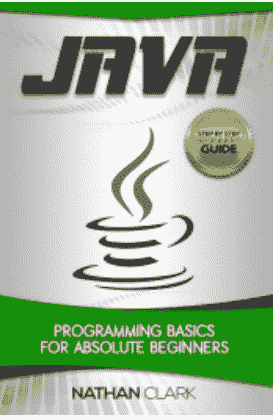
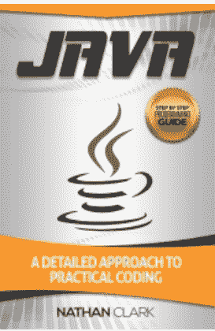
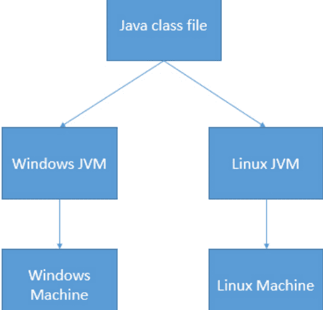

# Java：绝对初学者的编程基础（循序渐进 Java 书籍 1）






## 关于作者

# 引言

欢迎来到奇妙编程世界，书中包含的章节将让你对 Java 编程有一个基本的了解。到最后一个章节，你将能够使用 Java 独立创建一个完整的程序。

本系列书籍以及你的学习体验的一个重要方面是**在做中学习**。实践示例被证明是学习编程语言的最佳方式，这就是为什么我尽可能在指南中塞入了尽可能多的示例。我试图保持示例的核心内容相似，因此唯一的变量是讨论的主题。这使得更容易理解我们正在实现的内容。随着章节的不断进行，请记住跟随示例操作并尝试自己运行。

为了使用书中包含的信息，你必须有一台运行 Windows、Macintosh、Linux 或 UNIX 操作系统的计算机。你必须知道如何运行程序、复制文件、创建文件夹以及在菜单中导航。这些是使用 Java 编程的唯一要求。

感谢你对这种多功能语言的兴趣，让我们开始尽情享受吧！

# 1. 什么是 Java？

Java 是一种由 Sun Microsystems 构建的编程语言，后来由 Oracle 公司收购。它的设计旨在运行在任何支持 Java 的操作系统上。这就是为什么它如此受欢迎的原因，它可以一次编写，到处运行。

以下是一个 Java 示例。

```
at HelloWorld.main(HelloWorld.java:8)
```

# 2. Java 历史

Java 语言由 James Gosling 设计，于 1995 年 5 月首次面世。该编程语言经历了多个版本的发布，当前版本为版本 8。

2006 年，Java 发布了 Java 虚拟机（JVM）。Java 虚拟机用于在相关的操作系统上运行 Java 程序，并根据免费软件/开源发行条款提供。

以下是每个 Java 版本的发布日期和 .net 框架版本。

| 版本 | 发布日期 |
|---|---|
| JDK 1.0 | 1996年1月23日 |
| JDK 1.1 | 1997年2月19日 |
| J2SE 1.2 | 1998年12月8日 |
| J2SE 1.3 | 2000年5月8日 |
| J2SE 1.4 | 2002年2月6日 |
| J2SE 5.0 | 2004年9月30日 |
| Java SE 6 | 2006年12月11日 |
| Java SE 7 | 2011年7月28日 |

下面我们将详细介绍 Java 的各个版本以及每个版本引入的特性。

## JDK 1.1 - 支持以下内容：

- 对 AWT 事件模型的广泛重构。
- 语言中增加了内部类。
- JavaBeans。
- JDBC。
- RMI。
- 反射，仅支持内省检查。无法在运行时进行修改。
- 在 Microsoft Windows 平台上的由 Symantec 为 JavaSoft 开发的 JIT（即时编译）编译器。
- 源自 Taligent 的国际化和 Unicode 支持。

## J2SE 1.2 - 支持以下内容：

- `strictfp` 关键字。
- 将 Swing 图形 API 集成到核心类中。
- Sun 的 JVM 配备 JIT 编译器。
- Java 插件。
- Java IDL，一种用于 CORBA 互操作的 IDL 实现。
- 集合框架（Collections framework）。

## J2SE 1.3 - 支持以下内容：

- 包含 HotSpot JVM。
- RMI 被修改以支持对 CORBA 的可选兼容性。
- 核心库中包含 Java 命名和目录接口（JNDI）。
- Java 平台调试器架构（JPDA）。
- JavaScript。
- 合成代理类。

## J2SE 1.4 - 支持以下内容：

- 模仿 Perl 正则表达式的正则表达式。
- 异常链，允许异常封装原始的底层异常。
- 互联网协议版本 6 (IPv6) 支持。
- 非阻塞 IO。
- 日志 API。
- 用于读写 JPEG 和 PNG 等格式图片的 Image I/O API。
- 集成的 XML 解析器和 XSLT 处理器（JAXP）。
- 集成的安全和加密扩展（JCE, JSSE, JAAS）。
- 包含 Java Web Start。
- Preferences API (`java.util.prefs`)。

## J2SE 5.0 - 支持以下内容：

- 泛型（Generics），为集合提供了编译时（静态）类型安全，并消除了大部分大多数类型转换的需求。
- 元数据（Metadata），也称为注解（Annotations）。这允许为类和方法等语言结构标记附加数据，这些数据可以由感知数据的工具处理。
- 装箱/拆箱（Autoboxing/unboxing）。这允许原始类型（如 `int`）和原始类型包装类（如 `Integer`）之间的自动转换。
- 枚举（Enumerations）。这里 `enum` 关键字创建了一个类型安全的、有序的值列表。
- 可变参数（Varargs）。这是方法的最后一个参数，现在可以使用类型名后跟三个点来声明。
- 增强型 ‘for each’ 循环。`for` 循环语法扩展了特殊语法，用于遍历数组或 `Iterable`（如标准集合类）的每个成员。
- 改进了多线程 Java 程序的执行效率。新的 Java 内存模型解决了以前规范在复杂性、有效性和性能方面的问题。
- 静态导入（Static imports）。

## Java SE 6 - 支持以下内容：

- 脚本语言支持。引入了用于与脚本语言紧密集成的通用 API，以及内置的 Mozilla JavaScript Rhino 集成。
- 核心平台和 Swing 的性能大幅提升。
- 通过 JAX-WS 改进了 Web 服务支持。
- 支持 JDBC 4.0。
- Java 编译器 API。这是一个允许 Java 程序通过编程选择并调用 Java 编译程序的 API。
- 将 JAXB 升级到版本 2.0。
- 支持插件式注解。
- 许多 GUI 改进，包括在 API 中集成 SwingWorker、表格排序和过滤，以及真正的 Swing 双缓冲。
- JVM 改进，包括同步和编译器性能优化、新算法以及对现有垃圾收集算法的升级，以及应用程序启动性能。

## Java SE 7 - 支持以下内容：

- JVM 支持动态语言，引入了新的 `invokedynamic` 字节码。
- 压缩的 64 位指针。
- switch 语句中的字符串。
- try 语句中的自动资源管理。
- 改进了泛型实例创建的类型推断。
- 简化的可变参数方法声明。
- 二进制整数。

# 3. Java 特性

## 3.1 简单性

Java 被设计为易于学习和使用。它去除了 C++ 中复杂的特性，如指针、多重继承和操作符重载。

## 3.2 面向对象

这是任何编程语言的基本原理之一，在其中你可以定义类和对象。类是属性和方法的封装。类与真实世界的实体相关。下面是一个使用类的 Java 程序的简单示例。我们将在该系列的第二本书中看到更多内容。

**示例 7：以下程序用于展示一个关于类的简单 Java 示例。**

```java
class Student {
    // 封装 ID 属性
    private int ID;
    public void setID(int pID) {
        ID = pID;
    }
    public int getID() {
        return ID;
    }
}

public class HelloWorld {
    public static void main(String[] args) {
        Student stud = new Student();
        stud.setID(1);
        System.out.println("The ID of the student is " + stud.getID());
    }
}
```

## 3.3 数据封装支持

Java 具有封装其数据成员的能力，使其不会暴露给其他类。你可以拥有“getter”和“setter”方法，这些方法可以相应地获取和设置数据成员。下面是一个数据封装的示例。

**示例 8：以下程序用于展示一个关于数据封装的简单 Java 示例。**

```java
class Student {
    // 封装 ID 属性
    private int ID;
    public void setID(int pID) {
        ID = pID;
    }
    public int getID() {
        return ID;
    }
}

public class HelloWorld {
    public static void main(String[] args) {
        Student stud = new Student();
        stud.setID(1);
        System.out.println("The ID of the student is " + stud.getID());
    }
}
```

## 3.4 继承

Java 支持类继承其他类的属性和方法。这在很大程度上避免了重复开发类，并有助于更好地开发应用程序。下面是一个继承的示例。我们将在该系列的第二本书中详细介绍这一点。

**示例 9：以下程序用于展示一个关于继承的简单 Java 示例。**

```java
class Person {
    // 封装 ID 属性
    private int ID;
    public void setID(int pID) {
        ID = pID;
    }
    public int getID() {
        return ID;
    }
}

class Student extends Person {
    private String Name;
    public void setName(String pName) {
        Name = pName;
    }
    public String getName() {
        return Name;
    }
}

public class HelloWorld {
    public static void main(String[] args) {
        Student stud = new Student();
        stud.setID(1);
        stud.setName("UserA");
        System.out.println("The ID of the student is " + stud.getID());
        System.out.println("The name of the student is " + stud.getName());
    }
}
```

## 3.5 接口

接口是类必须遵守的契约。在接口中，你有函数定义，而在使用接口的类中，你为接口函数提供实现。下面是一个接口的示例。我们将在该系列的第二本书中详细介绍这一点。

**示例 10：以下程序用于展示一个关于接口的简单 Java 示例。**

```java
interface IStudent {
    // 只有函数是接口的一部分
    void Display();
}

class Student implements IStudent {
    // 封装 ID 属性
    private int ID;
    private String Name;
    public void setID(int pID) {
        ID = pID;
    }
    public int getID() {
        return ID;
    }
    public void setName(String pName) {
        Name = pName;
    }
    public String getName() {
        return Name;
    }
    public void Display() {
        System.out.println("The ID of the student is " + this.getID());
        System.out.println("The name of the student is " + this.getName());
    }
}

public class HelloWorld {
    public static void main(String[] args) {
        Student stud = new Student();
        stud.setID(1);
        stud.setName("UserA");
        stud.Display();
    }
}
```

## 3.6 多态

这是编译器在运行时确定需要调用的类的能力。例如，你可以让基类变量指向派生类的对象。下面是一个多态的示例。我们将在该系列的第二本书中详细介绍。

**示例 11：以下程序用于展示一个关于多态的简单 Java 示例。**

```java
class Person {
    // 封装 ID 属性
    private int ID;
    public void setID(int pID) {
        ID = pID;
    }
    public int getID() {
        return ID;
    }
    public void Display() {
        System.out.println("The ID of the person is " + this.getID());
    }
}

class Student extends Person {
    private String Name;
    public void setName(String pName) {
        Name = pName;
    }
    public String getName() {
        return Name;
    }
    @Override
    public void Display() {
        System.out.println("The ID of the student is " + this.getID());
        System.out.println("The name of the student is " + this.getName());
    }
}

public class HelloWorld {
    public static void main(String[] args) {
        Person person = new Student(); // 多态：父类引用指向子类对象
        person.setID(1);
        if (person instanceof Student) {
            ((Student) person).setName("UserA");
        }
        person.Display(); // 调用子类重写的方法
    }
}
```

# 4. Java 编译器

Java 编程语言由以下主要部分组成：

## 4.1 软件开发包 (SDK)

Java 开发包用于代码开发。它还包含一个名为 `javac` 的程序，即 Java 编译器。Java 编译器是一个独立的程序，用于处理 Java 代码并将其拆分为称为符号的小部分。

一旦 Java 编译器完成工作，它会将结果交给 Java 解释器。解释器将其转换为操作系统可以理解的文件。Java 开发包可以从以下网站下载：

http://www.oracle.com/technetwork/java/javase/downloads/jdk8-downloads-2133151.html

## 4.2 运行时环境

Java 运行时环境特定于操作系统，用于运行 Java 程序。接下来，让我们了解编译过程。

### 步骤 1

首先，你将编写 Java 程序并将其存储为 `.java` 扩展的文件。让我们看下面的示例：

```java
public class HelloWorld {
    public static void main(String[] args) {
        System.out.println("Hello World!");
    }
}
```

我们将其存储在名为 `HelloWorld.java` 的文件中。注意文件名必须与程序中的主 Java 类名匹配。

### 步骤 2

接下来，要编译程序，我们需要使用 Java 开发包中的 `javac` 命令。用于编译程序的命令如下：

```
javac HelloWorld.java
```

这将编译程序并创建一个名为 `HelloWorld.class` 的新类文件。

### 步骤 3

下一步是运行程序。这可以通过 Java 程序实现。因此我们只需运行以下命令：

```bash
java HelloWorld
```

该 Java 程序将在机器上运行。请注意，在运行 Java 程序时，我们没有提到任何扩展名。

## 4.3 理解 JRE

正如我们在前面的节中所看到的，Java 运行环境（JRE）用于运行 Java 应用程序。这是 Java 编程语言的一个重要方面。下面的图表从更好的视角展示了 Java 运行环境的工作原理。



编译器首先将 Java 程序编译为具有 `.class` 扩展名的文件。如果你想在 Windows 机器上执行 Java 程序，你需要在 Windows 机器上安装兼容的 Java 运行环境，然后运行 Java 程序。如果你想在 Linux 机器上执行 Java 程序，你需要为 Linux 安装特定的 Java 运行环境。

以下是各种操作系统的 Java 运行环境下载链接。

http://www.oracle.com/technetwork/java/javase/downloads/jre8-downloads-2133155.html

## 4.4 不同的 Java 版本

Java 有许多版本。下面简要讨论了不同版本及其含义：

- **Java 标准平台版（Java Standard Platform Edition – SE）**：这是 Java 核心平台。它提供了 Java 编程 API，即用于编译和运行 Java 程序的各种程序。在这里，你可以访问核心类，例如系统类、网络、安全、数据库访问和图形化用户界面。


- **Java 企业版（Java Enterprise Edition – EE）**：这主要用于开发和支持大规模应用程序。它主要针对需要在多层和多平台上开发应用程序的大型组织。在这里，你可以构建更具扩展性、可靠且安全的网络应用程序。

- **Java 微型版（Java Micro Edition – ME）**：这是 Java 编程语言的一个较小子集，用于为手机和平电脑等较小设备开发应用程序。

- **Java FX**：JavaFX 是一个使用轻级用户界面 API 创建丰富互联网应用程序的平台。该 API 可以利用高级图形处理器为终端用户创建更具吸引力的应用程序。

## 5. 构建你的环境

为了开始编写 Java 程序，你需要准备好以下内容。

### 5.1 安装 Java 开发工具包

Java 开发工具包（Java Development Kit，简称 `JDK`）用于开发基于 Java 的程序。`JDK` 包含了所有必要的支持代码，帮助开发 Java 应用程序。它由 Oracle 发布，Oracle 持续对开发者或终端用户报告的问题进行改进和修复。Java 开发工具包的链接见下方。

<http://www.oracle.com/technetwork/java/javase/downloads/jdk8-downloads-2133151.html>

一旦安装了 Java 开发工具包，下一步是确保其安装正确。实现此的最简单方法是执行以下命令。

```
java -version
```

下面是一个示例输出。它将显示系统中安装的 Java 版本。

```
java version "1.8.0_101"
Java(TM) SE Runtime Environment (build 1.8.0_101-b13)
Java HotSpot(TM) 64-Bit Server VM (build 25.101-b13, mixed mode)
```

### 5.2 在编辑器中编写程序

要编写程序，你可以使用简单的编辑器（如记事本），也可以使用功能齐全的集成开发环境（`IDE`）。下面是适用于 Java 的一些流行的 `IDE` 列表及其相关功能。

#### 5.2.1 Eclipse

这款 `IDE` 已经存在很久，在 Java 开发社区中非常流行并广泛使用。该 `IDE` 的一些核心功能包括：

- 它是免费且开源的。因此，许多开发者不断向该 `IDE` 贡献代码。
- 它可以用于开发 C++、Ruby、HTML 等语言。
- 它提供了强大的插件支持。
- 它支持代码重构。
- 它支持代码补全。
- 它支持代码版本控制。

Eclipse 的官方链接是 <www.eclipse.org>

#### 5.2.2 IntelliJ IDEA

这款 `IDE` 在 Java 开发社区中非常受欢迎。它的某些核心功能包括：

- 它是免费且开源的。
- 它可以用于开发各种 Java 应用程序。
- 它提供了强大的插件支持。
- 它支持代码重构。
- 它支持代码补全。
- 它支持代码版本控制。

IntelliJ IDEA 的官方链接是 <https://www.jetbrains.com/idea>

#### 5.2.3 NetBeans

这款 `IDE` 也用于开发 Java 应用程序。它的某些核心功能包括：

- 它是免费且开源的。
- 它提供了强大的插件支持。
- 它支持代码重构。
- 它支持代码补全。
- 它支持代码版本控制。

NetBeans 的官方链接是 <https://netbeans.org>

## 6. 你的第一个程序

让我们深入研究程序。我们在上一节中已经学习了如何进行设置。现在是编写你的第一个程序了。下面是代码。

**示例 14**：下面的程序用于演示简单的 Hello World 程序。

```java
// 这是一个 Java 类
public class Demo
{
    // 这是 Java 程序的入口点
    public static void main(String args[])
    {
        // 这里我们在控制台打印 Hello World
        System.out.println("Hello World");
    }
}
```

运行此程序，输出如下：

```
Hello World
```

现在我们将程序拆解为多个步骤以理解每条语句。

- `public class Demo`：该语句用于定义类。所有的 Java 代码必须位于类中。类的名称也应与文件名相同。
- `public static void main(String args[])`：这是 Java 程序的入口点。代码从此函数开始执行。这就是为什么它被称为主函数。该函数不返回任何值，因此它有 `void` 前缀。在调用 main java 程序时可以传递参数。这些参数将在 `args[]` 参数中可用。
- `// 这是一个 Java 类`：这是向程序添加注释的方法。注释用于文档目的并有助于未来的代码维护。
- `System.out.println("Hello World")`：最后，我们使用 `System.out.println` 函数在控制台打印 Hello World。

现在我们已经学会了如何编写第一个程序。让我们看另一个例子，但这次让我们看看使用变量。

**示例 15**：下面的程序用于演示你如何编写第二个程序。

```java
// 这是一个 Java 类
public class Demo
{
    // 这是 Java 程序的入口点
    public static void main(String args[])
    {
        // 初始化一个变量
        int i=5;

        // 显示变量
        System.out.println("The value of i is "+i);
    }
}
```

运行此程序，输出如下：

```
The value of i is 5
```

### i 的值为 5

让我们来看看我们在此程序中所做的更改。

1. `int i=5;`

   在这里，我们声明了一个名为 `i` 的变量，并给该变量赋值为 5。关于变量和数据类型有一有一个专门的章节，但为了掌握如何开始使用变量，你可以对上面的程序进行实验。

2. `System.out.println("The value of i is "+i);`

   现在我们正在尝试显示变量的值。我们仍然在使用 `System.out.println` 函数。在这里，我们将字符串 "The value of i is" 和变量 `i` 本身结合在一起。这可以通过 `+` 运算符来实现。

现在让我们来看一个与上面显示的程序类似的程序，但对程序进行了微小的更改。

#### 示例 16：以下程序用于演示你如何编写第三个程序。

```java
// 这是一个 Java 类
public class Demo
{
    // 这是 Java 程序的主入口点
    public static void main(String args[])
    {
        // 初始化变量
        int i=5;

        // 显示变量
        System.out.println("The value of i is "+i);

        // 我们将 i 的值加 1
        i=i+1;

        System.out.println("The value of i is "+i);
    }
}
```

通过此程序，输出如下：

```
The value of i is 5
The value of i is 6
```

让我们来看看我们在此程序中所做的更改。

- `i=i+1`

  在这里，我们仅仅是将 `i` 的值增加了 1。然后，我们将增加后的值重新赋值给 `i`。

太棒了，我们已经看过了前几个程序。现在你准备好在接下来的章节中学习更多高级的主题了。

# 7. 数据类型

数据类型在编程语言中用于存储不同类型的数据。例如，如果你想存储文本数据，你可能会使用 `string` 字符串数据类型。如果你想存储数字，可以使用 `number` 数字或 `integer` 整数数据类型。这取决于具体的编程语言以及定义了哪些数据类型。数据类型有助于使程序类型安全且没有错误。

现在让我们看看 Java 中提供的不同数据类型。

## 表 1：数据类型

| 数据类型 | 描述 | 范围 (位) |
| :--- | :--- | :--- |
| `byte` | 这是一个 8 位符号位补码整数 | -128 到 127 |
| `short` | 这是一个 16 位符号位补码整数 | -32,768 到 32,767 |
| `int` | 这是一个 32 位符号位补码整数 | -2,147,483,648 到 2,147,483,647 |
| `long` | 这是一个 64 位符号位补码整数 | -9223372036854775808 到 9223372036854775807 |
| `float` | 这是一个单精度 32 位 IEEE 754 浮点数 | -3.40282338 到 3.40282338 |
| `double` | 这是一个双精度 64 位 IEEE 754 浮点数 | -1.7976931486232e308 到 1.7976931486232e308 |
| `char` | 这是一个单 16 位 Unicode 字符 | 0 到 65,535 |
| `boolean` | 只有两个值：true 和 false | 8 |
| `string` | 用于定义字符序列 | N/A |

接下来，将通过 Java 程序详细讨论每种数据类型。记得尝试这些以更好地理解概念。

## 7.1 Byte 数据类型

这种数据类型用于定义范围从 -128 到 127 的整数。

### 示例 17：以下程序用于演示 byte 类型。

```java
// 这是一个 Java 类
public class Demo
{
    // 这是 Java 程序的主入口点
    public static void main(String args[])
    {
        // 初始化变量
        byte i=5;

        // 显示变量
        System.out.println("The value of i is "+i);
    }
}
```

通过此程序，输出如下：

```
byte 的值为 5
```

## 7.2 Short 数据类型

这种数据类型用于定义范围从 -32,768 到 32,767 的 16 位符号位补码整数。

### 示例 18：以下程序用于演示数据类型。

```java
// 这是一个 Java 类
public class Demo
{
    // 这是 Java 程序的主入口点
    public static void main(String args[])
    {
        // 初始化变量
        short i=5;
        short j=-6;

        // 显示变量
        System.out.println("The value of i is "+i);
        System.out.println("The value of j is "+j);
    }
}
```

通过此程序，输出如下：

```
i 的值为 5
j 的值为 -6
```

## 7.3 Int 数据类型

这种数据类型用于定义范围从 -2,147,483,648 到 2,147,483,647 的符号整数。

### 示例 19：以下程序用于演示数据类型。

```java
// 这是一个 Java 类
public class Demo
{
    // 这是 Java 程序的主入口点
    public static void main(String args[])
    {
        // 初始化变量
        int i=5;
        int j=-6;

        // 显示变量
        System.out.println("The value of i is "+i);
        System.out.println("The value of j is "+j);
    }
}
```

通过此程序，输出如下：

```
i 的值为 5
j 的值为 -6
```

## 7.4 Long 数据类型

这种数据类型用于定义 64 位符号位补码整数，范围从 -9223372036854775808 到 9223372036854775807。

### 示例 20：以下程序用于演示数据类型。

```java
// 这是一个 Java 类
public class Demo
{
    // 这是 Java 程序的主入口点
    public static void main(String args[])
    {
        // 初始化变量
        long i=1000000000;
        long j=-450000000;

        // 显示变量
        System.out.println("The value of i is "+i);
        System.out.println("The value of j is "+j);
    }
}
```

通过此程序，输出如下：

```
i 的值为 1000000000
j 的值为 -450000000
```

## 7.5 Float 数据类型

这种数据类型用于定义单精度浮点类型，范围从 -3.402823e38 到 3.402823e38。

### 示例 21：以下程序用于演示 float 数据类型。

```java
// 这是一个 Java 类
public class Demo
{
    // 这是 Java 程序的主入口点
    public static void main(String args[])
    {
        // 初始化变量
        float i=10.11F;
        float j=-45.44F;

        // 显示变量
        System.out.println("The value of i is "+i);
        System.out.println("The value of j is "+j);
    }
}
```

通过此程序，输出如下：

```
i 的值为 10.11
j 的值为 -45.44
```

## 7.6 Double 数据类型

这种数据类型用于定义双精度浮点类型，范围从 -1.79769314862332e-308 到 1.79769314862332e+308。

### 示例 22：以下程序用于演示 double 数据类型。

```java
// 这是一个 Java 类
public class Demo
{
    // 这是 Java 程序的主入口点
    public static void main(String args[])
    {
        // 初始化变量
        double i=10.111111111;
        double j=-45.44444444;

        // 显示变量
        System.out.println("The value of i is "+i);
        System.out.println("The value of j is "+j);
    }
}
```

通过此程序，输出如下：

```
i 的值为 10.111111111
j 的值为 -45.44444444
```

## 7.8 布尔数据类型

该数据类型用于定义布尔值，其值可以是真（`true`）或假（`false`）。

**示例 24**：以下程序用于展示布尔数据类型。

```java
// This is a Java class
public class Demo
{
    // This is the main entry point of the Java program
    public static void main(String args[])
    {
        // Initializing a variable
        boolean i = true;
        boolean j = false;

        // Displaying the variable
        System.out.println("The value of i is "+i);
        System.out.println("The value of j is "+j);
    }
}
```

通过此程序，输出如下：

```
The value of i is True
The value of j is False
```

## 7.9 字符串数据类型

该数据类型用于定义字符序列。

**示例 25**：以下程序用于展示字符串数据类型。

```java
// This is a Java class
public class Demo
{
    // This is the main entry point of the Java program
    public static void main(String args[])
    {
        // Initializing a variable
        String i = "Hello";
        String j = "World";

        // Displaying the variable
        System.out.println("The value of i is "+i);
        System.out.println("The value of j is "+j);
    }
}
```

通过此程序，输出如下：

```
The value of i is Hello
The value of j is World
```

## 7.10 字段的默认值

如果为各种数据类型的字段没有定义值，则它们会被分配默认值。我们将在该系列丛第二本书中介绍类时详细讨论字段，但对这一点有一个基本的了解是有好处。下表提供了各种数据类型的默认值。

**表 2：数据类型默认值**


# 数据类型默认值

| 数据类型 | 默认值 |
| --- | --- |
| byte | 0 |
| short | 0 |
| int | 0 |
| long | 0L |
| float | 0.0f |
| double | 0.0d |
| char | '\u0000' |
| string | null |
| boolean | false |

# 8. 变量

变量用于定义在程序过程中可以更改的值。你可以根据各种数据类型拥有不同类型的变量。让我们根据数据类型来看看我们可以创建的不同类型的变量。

## 8.1 字符变量

这些是用于存储字符的变量，它们可以在程序的任何时间进行更改。让我们来看字符变量的示例。

**示例 26**：以下程序用于展示字符变量。

```java
// This is a Java class
public class Demo
{
    // This is the main entry point of the Java program
    public static void main(String[] args)
    {
        // Initializing a variable
        char i='A';

        // Displaying the variable
        System.out.println("The value of i is "+i);
        i='B';

        System.out.println("The value of i is "+i);
    }
}
```

通过此程序，输出如下：

```text
The value of i is A
The value of i is B
```

## 8.2 整数变量

这些是用于存储整数的变量，它们可以在程序的任何时间进行更改。让我们来看整数变量的示例。

**示例 27**：以下程序用于展示整数变量。

```java
// This is a Java class
public class Demo
{
    // This is the main entry point of the Java program
    public static void main(String args[])
    {
        // Initializing a variable
        int i=5;

        // Displaying the variable
        System.out.println("The value of i is "+i);
        i=6;

        System.out.println("The value of i is "+i);
    }
}
```

通过此程序，输出如下：

```text
The value of i is 5
The value of i is 6
```

## 8.3 浮点数变量

这些变量用于存储浮点数，它们可以在程序的任何时间进行更改。让我们来看浮点数变量的示例。

**示例 28**：以下程序用于展示浮点数变量。

```java
// This is a Java class
public class Demo
{
    // This is the main entry point of the Java program
    public static void main(String args[])
    {
        // Initializing a variable
        float i=1.1F;

        // Displaying the variable
        System.out.println("The value of i is "+i);
        i=2.2F;
        System.out.println("The value of i is "+i);
    }
}
```

通过此程序，输出如下：

```text
The value of i is 1.1
The value of i is 2.2
```

## 8.4 Double 变量

这些变量用于存储双精度数字，它们可以在程序的任何时间进行更改。让我们来看 double 变量的示例。

**示例 29**：以下程序用于展示 double 变量。

```java
// This is a Java class
public class Demo
{
    // This is the main entry point of the Java program
    public static void main(String args[])
    {
        // Initializing a variable
        double i=1.111d;

        // Displaying the variable
        System.out.println("The value of i is "+i);
        i=2.222d;
        System.out.println("The value of i is "+i);
    }
}
```

通过此程序，输出如下：

```text
The value of i is 1.111
The value of i is 2.222
```

## 8.5 字符串变量

这些是用于存储字符串的变量，它们可以在程序的任何时间进行更改。让我们来看字符串变量的示例。

**示例 30**：以下程序用于展示字符串变量。

```java
// This is a Java class
public class Demo
{
    // This is the main entry point of the Java program
    public static void main(String args[])
    {
        // Initializing a variable
        String i = "Hello";

        // Displaying the variable
        System.out.println("The value of i is "+i);
        i = "World";
        System.out.println("The value of i is "+i);
    }
}
```

通过此程序，输出如下：

```text
The value of i is Hello
The value of i is World
```

## 8.6 布尔变量

这些是用于存储布尔值的变量，它们可以在程序的任何时间进行更改。让我们来看布尔变量的示例。

**示例 31**：以下程序用于展示布尔变量。

```java
// This is a Java class
public class Demo
{
    // This is the main entry point of the Java program
    public static void main(String[] args)
    {
        // Initializing a variable
        boolean i = true;

        // Displaying the variable
        System.out.println("The value of i is "+i);
        i = false;
        System.out.println("The value of i is "+i);
    }
}
```

通过此程序，输出如下：

```text
The value of i is true
The value of i is false
```

## 8.7 变量作用域

变量也有定义的作用域，这取决于它们在程序中的定义位置。让我们来看下面的代码块。

```java
public static void main(String args[])
{
    int a;
}
```

在这里，`a` 定义在 `main` 函数的开始，因此具有全局作用域。这意味着它可以在程序的任何地方使用。现在让我们来看另一个变量定义的示例。

```java
public static void main(String args[])
{
    // Inner Scope
    int a;
}
// Integer a cannot be used here
```

在上面的示例中，变量 `a` 现在限于第二个大括号，并且不能在内部作用域之外访问。整数 `a` 的作用域现在是第二个大括号内部代码块的私有。现在让我们来看使用特定作用域定义的变量示例。

**示例 32**：以下程序用于展示变量作用域。

```java
import java.io.Console;

// This is a Java class
public class Demo
{
  // This is the main entry point of the Java program
  public static void main(String args[]) {
  {
    int i=5; // Outer Scope
    System.out.println("The value of i is "+i);
    {
      int j=6; // Inner Scope
      System.out.println("The value of j is "+j);
    }
  }
}
}
```

通过此程序，输出如下：

```text
The value of i is 5
The value of j is 6
```

让我们来看同一个示例并尝试在程序中创建一个错误以确认我们对作用域变量的理解。

**示例 33**：以下程序用于展示使用变量作用域的错误方法。

```java
import java.io.Console;

// This is a Java class
public class Demo
{
  // This is the main entry point of the Java program
  public static void main(String args[]) {
  {
    int i=5; // Outer Scope
    System.out.println("The value of i is "+i);
  }
}
}
```

```java
int j=6; // Inner Scope
System.out.println("The value of j is "+j);
}
System.out.println("The value of j is "+j);
}
}
```

通过此程序，你实际上得到一个编译时错误。

```text
Error:(15, 49) java: cannot find symbol
symbol: variable j
location: class Demo
```

正如所示，程序中存在错误，因为我们正试图在定义 `j` 的作用范围之外使用它的值。

# 9. 常量

常量是一个值在程序运行过程中不会改变的标识符。例如，如果你定义了一个名为 `val` 的标识符，给它赋值为 5，并将其定义为常量值，那么你将无法更改该标识符的值。

在 Java 中，定义常量的语法如下所示：

```java
static final datatype identifier = value
```

其中：

- `static` 是一个关键字，意味着该变量不需要定义类的实例即可使用。
- `final` 关键字用于表示赋值给标识符的值在程序过程中不能更改。

现在让我们来看一个如何在程序中定义常量的示例。

### 示例 34：以下程序用于展示如何定义常量。

```java
// 这是一个 Java 类
public class Demo
{
    static final int i=5;

    // 这是 Java 程序的 main 入口
    public static void main(String args[])
    {
        System.out.println("The value of i is "+i);
    }
}
```

通过此程序，输出如下：

```text
The value of i is 5
```

现在我们来编写相同的程序，但这次尝试在程序过程中更改 `i` 的值。

### 示例 35：以下程序用于展示处理常量的错误方法。

```java
// 这是一个 Java 类
public class Demo
{
    static final int i=5;
    // 这是 Java 程序的 main 入口
    public static void main(String args[])
    {
        System.out.println("The value of i is "+i);
        i++;
    }
}
```

通过此程序，你将得到一个如下所示的编译时错误。

```text
Error:(10, 9) java: cannot assign a value to final variable
```

我们可以在程序中定义多个常量，也可以将它们与普通变量一起使用。让我们来看另一个使用常量的示例。

### 示例 36：以下程序用于展示常量的另一个示例。

```java
// 这是一个 Java 类
public class Demo
{
  static final int ValA=5;
  static final int ValB=5;
  // 这是 Java 程序的 main 入口
  public static void main(String args[])
  {
    int ValC=ValA+ValB;
    System.out.println("The value of ValC is "+ValC);
  }
}
```

在上述程序中，我们执行了以下步骤：

- 首先我们定义了两个常量 – `ValA` 和 `ValB`。
- 然后我们在一个操作中使用它们，并配合普通变量 `ValC`。我们只是在执行一个简单的加法操作。

通过此程序，输出如下：

```text
The value of ValC is 10
```

# 10. 运算符

Java 中提供了多种类型的运算符。这些运算符有助于对 Java 程序中定义的变量执行各种操作。让我们详细地查看每个运算符。

## 10.1 算术运算符

这些是用于处理数字的运算符。最常用的运算符如下所示，并带有一个它们在程序中运行的示例。

**表 3：算术运算符**

| 运算符 | 操作 |
| --- | --- |
| `+` | 用于两个操作数相加 |
| `-` | 用于减去一个操作数 |
| `*` | 用于两个操作数相乘 |
| `/` | 用于将一个操作数除以另一个 |
| `%` | 在除法运算符后给出百分比值（取模） |
| `++` | 用于将值加 1 |
| `--` | 用于将值减 1 |

**示例 37**：以下程序展示了我们可以如何使用算术运算符。

```java
// 这是一个 Java 类
public class Demo
{
    // 这是 Java 程序的 main 入口
    public static void main(String args[])
    {
        int i=4;
        int j=5;

        // 两个操作数的相加
        System.out.println("The addition of the two operands is " + (i+j));

        // 两个操作数的相减
        System.out.println("The subtraction of the two operands is " + (i - j));
        // 两个操作数的相乘
        System.out.println("The multiplication of the two operands is " + (i * j));
        // 两个操作数的相除
        System.out.println("The division of the two operands is " + (i / j));
        // 两个操作数的余数
        System.out.println("The remainder of the two operands is " + (i % j));
        // 操作数加 1
        System.out.println("Incrementing operand by one " + (i++));
        // 操作数减 1
        System.out.println("Decrementing operand by one " + (j--));
    }
}
```

通过此程序，输出如下：

```text
The addition of the two operands is 9
The subtraction of the two operands is -1
The multiplication of the two operands is 20
The division of the two operands is 0
The remainder of the two operands is 4
Incrementing operand by one 4
Decrementing operand by one 5
```

## 10.2 关系运算符

这些运算符用于根据操作数的值来确定条件的值。Java 中可能的关系运算符如下所示，所有它们都用在一个示例中。

**表 4：关系运算符**

| 运算符 | 操作 |
| --- | --- |
| `==` | 用于检查两个操作数是否相等 |


## 关系运算符

| 运算符 | 操作 |
| --- | --- |
| `!=` | 用于检查两个操作数是否不等 |
| `>` | 用于检查一个操作数是否大于另一个 |
| `<` | 用于检查一个操作数是否小于另一个 |
| `>=` | 用于检查一个操作数是否大于或等于另一个 |
| `<=` | 用于检查一个操作数是否小于或等于另一个 |

如果条件评估为真（`true`），则返回值 1，否则返回值 0。

### 示例 38：以下程序展示了我们可以如何使用关系运算符。

```java
// 这是一个 Java 类
public class Demo
{
    // 这是 Java 程序的 main 入口
    public static void main(String args[])
    {
        int i = 4;
        int j = 5;

        // 是否等于 j
        System.out.println("Is i equal to j " + (i == j));
        // i 是否不等于 j
        System.out.println("Is i not equal to j " + (i != j));
        // i 是否大于 j
        System.out.println("Is i greater than j " + (i > j));
        // i 是否小于 j
        System.out.println("Is i less than j " + (i < j));
        // i 是否大于或等于 j
        System.out.println("Is i greater or equal j " + (i >= j));
        // i 是否小于或等于 j
        System.out.println("Is i less or equal j " + (i <= j));
    }
}
```

通过此程序，输出如下：

```
Is i equal to j false
Is i not equal to j true
Is i greater than j false
Is i less than j true
Is i greater or equal j false
Is i less or equal j true
```

## 10.3 逻辑运算符 (Logical Operators)

这些运算符用于根据操作数的值确定条件的值，其中操作数为布尔值。Java 中可能的逻辑运算符如下所示。

### 表 5：逻辑运算符

| 运算符 | 操作 |
| --- | --- |
| `&&` | 逻辑与运算符 |
| `||` | 逻辑或运算符 |
| `!` | 逻辑非运算符 |

下面是根据操作数值生成的逻辑运算符（与）的表格，以及不同结果的示例。

### 表 5.1：逻辑运算符 - AND

| 操作数 A | 操作数 B | 结果 |
| --- | --- | --- |
| True | True | 1 |
| True | False | 0 |
| False | True | 0 |
| False | False | 0 |

### 示例 39：以下程序展示了如何使用逻辑运算符（逻辑与）。

```java
// 这是一个 Java 类
public class Demo
{
    // 这是 Java 程序的 main 入口
    public static void main(String[] args)
    {
        boolean i = true;
        boolean j = true;
        boolean k = false;

        // i AND j
        System.out.println("i AND j " + (i & j));

        // i AND k
        System.out.println("i AND k " + (i & k));

        // k AND i
        System.out.println("k AND i " + (k & i));

        // k AND k
        System.out.println("k AND k " + (k & k));
    }
}
```

通过此程序，输出如下：

```
i AND j true
i AND k false
k AND i false
k AND k false
```

下面是根据操作数值得到的 OR 运算符逻辑表，随后是一个示例。

### 表 5.2：逻辑运算符 - OR

| 操作数 A | 操作数 B | 结果 |
| --- | --- | --- |
| True | True | 1 |
| True | False | 1 |
| False | True | 1 |
| False | False | 0 |

### 示例 40：以下程序展示了如何使用逻辑运算符 OR 运算符。

```java
// This is a Java class
public class Demo
{
    // This is the main entry point of the Java program
    public static void main(String args[])
    {
        boolean i = true;
        boolean j = true;
        boolean k = false;

        // i OR j
        System.out.println("i OR j " + (i || j));

        // i OR k
        System.out.println("i OR k " + (i || k));

        // k OR i
        System.out.println("k OR i " + (k || i));

        // k OR k
        System.out.println("k OR k " + (k || k));
    }
}
```

通过此程序，输出如下：

```
i OR j true
i OR k true
k OR i true
k OR k false
```

最后是根据操作数值得到的 NOT 运算符逻辑表，以及一个展示不同结果的示例。

### 表 5.3：逻辑运算符 - NOT

| 操作数 A | 结果 |
| --- | --- |
| True | 0 |
| False | 1 |

### 示例 41：以下程序展示了如何使用逻辑运算符 NOT 运算符。

```java
// This is a Java class
public class Demo
{
    // This is the main entry point of the Java program
    public static void main(String args[])
    {
        boolean i = true;
        boolean j = false;

        // NOT i
        System.out.println("NOT i " + (!i));

        // NOT j
        System.out.println("NOT j " + (!j));
    }
}
```

通过此程序，输出如下：

```
NOT i false
NOT j true
```

## 10.4 赋值运算符

这些是用于使赋值操作更便利的运算符。Java 中可能的赋值运算符如下所示。

### 表 6：赋值运算符

| 运算符 | 操作 |
| --- | --- |
| `=` | 用于将操作的结果赋值给操作数 |
| `+=` | 用于一次性执行加法和赋值运算符 |
| `-=` | 用于一次性执行减法和赋值运算符 |
| `*=` | 用于一次性执行乘法和赋值运算符 |
| `/=` | 用于一次性执行除法和赋值运算符 |
| `%=` | 用于一次性执行取模和赋值运算符 |

现在让我们通过一个展示所有运算符的示例，详细查看如何实现这些运算符。

### 示例 42：以下程序展示了我们可以使用赋值运算符。

```java
// This is a Java class
public class Demo
{
    // This is the main entry point of the Java program
    public static void main(String args[])
    {
        int i = 5;
        int j = 10;

        // The value of i+j
        System.out.println("The value of i+j is " + (i + j));

        // The value of i+=j
        System.out.println("The value of i+=j is " + (i += j));

        // The value of i-=j
        System.out.println("The value of i-=j is " + (i -= j));

        // The value of i*=j
        System.out.println("The value of i*=j is " + (i *= j));

        // The value of i /=j
        System.out.println("The value of i /=j is " + (i /= j));

        // The value of i%=j
        System.out.println("The value of i%=j is " + (i %= j));
    }
}
```

通过此程序，输出如下：

```
The value of i+j is 15
The value of i+=j is 15
The value of i-=j is 5
The value of i*=j is 5
The value of i /=j is 5
The value of i%=j is 5
```

## 10.5 位运算符

这些是用于对操作数进行位操作的运算符。Java 中可能的位运算符如下所示，并带有示例。

### 表 7：位运算符

| 运算符 | 操作 |
| --- | --- |
| `&` | 如果操作数都为 1，结果为 1 |
| `\|` | 如果操作数中有一个为 1，结果为 1 |
| `^` | 如果操作数互不相同，结果为 1 |
| `<<` | 将操作数左移 |
| `>>` | 将操作数右移 |

### 示例 43：以下程序展示了我们可以使用位运算符的方式。

```java
// This is a Java class
public class Demo
{
    // This is the main entry point of the Java program
    public static void main(String args[])
    {
        int i = 5;
        int j = 10;

        // &
        System.out.println("i & j " + (i & j));

        // |
        System.out.println("i | j " + (i | j));

        // ^
        System.out.println("i ^ j " + (i ^ j));

        // <<
        System.out.println("i << j " + (i << j));

        // >>
        System.out.println("i >> j " + (i >> j));
    }
}
```

# 11. 类型转换

Java 语言允许在类型之间进行转换。类型分为隐式转换和显式转换。隐式转换是由编译器自动完成的。这些类型包括：

- `byte`
- `short`
- `int`
- `long`
- `float`
- `double`

在进行类型转换时始终要小心。隐式转换发生在：

- 将较小类型的变量转换为较大的类型
- 将 `char` 转换为 `int`、`long`、`float` 或 `double`
- 将 `int` 转换为 `long` 或 `double`

显式转换（也称为强制类型转换）是由程序员手动指定的。这通常发生在：

- `double` 转换为 `float`
- `float` 转换为 `long`
- `long` 转换为 `int`
- `int` 转换为 `short`
- `short` 转换为 `byte`
- `int` 转换为 `char`
- `float` 转换为 `char`

下面是一个隐式转换的示例：

```java
char i = 'a';
int j = i;
```

在上面的代码中，`i` 的值被赋值给 `j`。

显式转换示例如下：

### 示例 44：以下程序展示了显式转换。

```java
// This is a Java class
public class Demo
{
    // This is the main entry point of the Java program
    public static void main(String args[])
    {
        char i = 'a';
        int j = (int)i;

        System.out.println("The value of i is " + i);
        System.out.println("The value of j is " + j);
    }
}
```

通过此程序，输出如下：

```
The value of i is a
The value of j is 97
```

下面是一个关于浮点数隐式转换的示例：

```java
float i = 5.55f;
double j = i;
```

在上面的代码中，`i` 的值被赋值给 `j`。由于 `double` 的精度比 `float` 高，这种转换是隐式的。

```
The value of i is 5.55
The value of j is 5.550000190734863
```

下面是一个关于浮点数显式转换的示例：

```java
double i = 5.55;
float j = (float)i;
```

在上面的代码中，`i` 的值被赋值给 `j`。由于 `double` 的精度比 `float` 高，我们必须显式地进行类型转换。

```
The value of i is 5.55
The value of j is 5.55
```

### 示例 46：以下程序展示了非法的隐式类型转换。

```java
// This is a Java class
public class Demo
{
    // This is the main entry point of the Java program
    public static void main(String args[])
    {
        double i = 5.55;
        // Carrying out the type case operation
        float j = i;
    }
}
```

通过这个程序，你实际上会得到一个编译时错误。

```
Error:(9, 22) java: possible loss of precision
required: float
found: double
```

我们可以通过使用下面的转换类型来解决上述问题，这被称为显式转换（explicit conversion）。在这种情况下，我们明确地告诉编译器执行转换。让我们通过一个示例来看如何实现这一点。

### 示例 47：以下程序展示了数字的显式类型转换。

```java
// 这是一个 Java 类
public class Demo
{
    // 这是该 Java 程序的 main 入口
    public static void main(String args[])
    {
        double valA = 5.55;
        // 执行类型转换操作
        float valB = (float)valA;

        System.out.println("The value of valA is " + valA);
        System.out.println("The value of valB is " + valB);
    }
}
```

在上面的程序中，我们需要注意以下点：

- 在语句 `float valB = (float)valA` 中，我们现在显式地告诉编译器执行强制转换。这将强制 Java 编译器执行转换。

通过这个程序，输出结果如下：

```
The value of valA is 5.55
The value of valB is 5.55
```

# 12. 循环

循环的使用帮助我们遍历一组值。假设我们想遍历学生列表并显示他们的名字。循环可以帮助你轻松地遍历学生列表，并帮助单独访问每条记录。循环根据条件运行，并根据条件执行代码。这种工作方式的简单视图如下所示。

```
Loop(condition)
{
  // 执行代码
}
```

在上面的抽象代码段中，可以看到代码将根据循环语句中条件的求值来执行。有不同类型的循环语句，在本章中我们将详细介绍每种可选循环类型。

## 12.1 While 循环

while 循环的通用语法如下。

```
While(condition)
{
  // 执行代码
}
```


只要 `while` 循环中的条件为真，`while` 代码块中的代码就会继续执行。让我们来看 `while` 语句的示例。

### 示例 48：以下程序用于展示如何使用 while 循环。

```java
// 这是一个 Java 类
public class Demo
{
  // 这是该 Java 程序的 main 入口
  public static void main(String args[])
  {
    int i=0;
    while(i<4)
    {
      System.out.println("The value of i is " + i);
      i++;
    }
  }
}
```

关于上述程序的注意事项：

- 我们定义了一个整数 `i`，其初始值为 0。
- 在 `while` 循环中，我们指明了条件：只要 `i` 的值小于 4，就继续执行 `while` 代码块中的代码。
- 在 `while` 代码块中，我们显示了 `i` 的值并递增了 `i` 的值。

通过这个程序，输出结果如下：

```
The value of i is 0
The value of i is 1
The value of i is 2
The value of i is 3
```

## 12.2 Do-While 循环

`do-while` 循环的通用语法如下。

```
do
{
  执行代码
}
while(condition);
```

这里 `do-while` 循环和普通 `while` 循环的区别在于，条件是在代码块末尾进行测试的。这意味着你可以保证代码块至少执行一次。让我们来看 `do-while` 语句的示例。

### 示例 49：以下程序用于展示如何使用 do-while 循环。

```java
// 这是一个 Java 类
public class Demo
{
    // 这是该 Java 程序的 main 入口
    public static void main(String[] args)
    {
        int i=0;
        do
        {
            System.out.println("The value of i is "+ i);
            i++;
        }
        while(i<4);
    }
}
```

通过这个程序，输出结果如下：

```
The value of i is 0
The value of i is 1
The value of i is 2
The value of i is 3
```

## 12.3 For 循环

`for` 循环的通用语法如下。

```
for(initialization; condition; incrementer)
{
  // 执行代码
}
```

在 `for` 子句中，你可以一次性指定初始化、条件和递增器。让我们来看 `for` 语句的示例。

### 示例 50：以下程序用于展示如何使用 for 循环。

```java
// 这是一个 Java 类
public class Demo
{
  // 这是该 Java 程序的 main 入口
  public static void main(String args[])
  {
    for(int i=0; i<4; i++)
    {
      System.out.println("The value of i is " + i);
      int j=0;
      while(j<3)
      {
        System.out.println("The value of j is "+ j);
      }
    }
  }
}
```

关于上述程序的注意事项：

- 我们在 `for` 循环中初始化了 `i` 的值。
- 我们在 `for` 循环中测试 `i`。
- 我们在 `for` 循环中递增 `i` 的值。
- 在 `for` 循环内部，我们有一个嵌套循环。

通过这个程序，输出结果如下：

```
The value of i is 0
The value of j is 0
The value of j is 1
The value of j is 2
The value of i is 1
The value of j is 0
The value of j is 1
The value of j is 2
The value of i is 2
The value of j is 0
The value of j is 1
The value of j is 2
The value of i is 3
The value of j is 0
The value of j is 1
The value of j is 2
```

## 12.4 嵌套循环

我们还可以将循环嵌套。让我们来看嵌套循环的一些示例。

```java
// 这是一个 Java 类
public class Demo
{
    // 这是该 Java 程序的 main 入口
    public static void main(String[] args)
    {
        for(int i=0; i<3; i++)
        {
            System.out.println("The value of i is " + i);
            int j=0;
            while(j<3)
            {
                System.out.println("The value of j is "+ j);
                j++;
            }
        }
    }
}
```

通过这个程序，输出结果如下：

```
The value of i is 0
The value of j is 0
The value of j is 1
The value of j is 2
The value of i is 1
The value of j is 0
The value of j is 1
The value of j is 2
The value of i is 2
The value of j is 0
The value of j is 1
The value of j is 2
```

### 示例 51：以下程序用于展示如何使用嵌套循环。

```java
// 这是一个 Java 类
public class Demo
{
    // 这是该 Java 程序的 main 入口
    public static void main(String args[])
    {
        for(int i=0; i<3; i++)
        {
            System.out.println("The value of i is " + i);
            int j=0;
            while(j<3)
            {
                System.out.println("The value of j is "+ j);
                j++;
            }
        }
    }
}
```

通过这个程序，输出结果如下：

```
The value of i is 0
The value of j is 0
The value of j is 1
The value of j is 2
The value of i is 1
The value of j is 0
The value of j is 1
The value of j is 2
The value of i is 2
The value of j is 0
The value of j is 1
The value of j is 2
```

### 示例 52：以下程序用于展示如何使用嵌套循环。

```java
// 这是一个 Java 类
public class Demo
{
    // 这是该 Java 程序的 main 入口
    public static void main(String args[])
    {
        for(int i=0; i<3; i++)
        {
            System.out.println("The value of i is " + i);
            int j=0;
            while(j<3)
            {
                System.out.println("The value of j is "+ j);
                j++;
            }
        }
    }
}
```

通过这个程序，输出结果如下：

```
The value of i is 0
The value of j is 0
The value of j is 1
The value of j is 2
The value of i is 1
The value of j is 0
The value of j is 1
The value of j is 2
The value of i is 2
The value of j is 0
The value of j is 1
The value of j is 2
```

# 13. 判定

决策循环的使用帮助我们只在特定条件成立时才执行代码。假设我们想在学生数据库中搜索记录，并只为总分超过 90% 的学生发放奖学金，我们可以为此目的使用决策循环。

一个示例决策循环结构所示。

```
if(condition)
{
  // 执行代码
}
```

在上面的...

## 13.1 If 语句

在 `if` 语句中，只有当某个条件为真时，我们才有执行操作的机会。

`if` 语句的通用语法如下。

```
if(condition)
{
  // 执行代码
}
```

### 示例 53：以下程序用于展示如何使用 if 语句。

```java
// 这是一个 Java 类
public class Demo
{
  // 这是该 Java 程序的 main 入口
  public static void main(String args[])
  {
    int i = 4;
    if (i < 5)
    {
      System.out.println("The value of i is less than 5");
    }
  }
}
```

通过这个程序，输出结果如下：

```
The value of i is less than 5
```

## 13.2 If-Else 语句

在 `if-else` 语句中，当 `if` 条件不为真时，我们可以选择执行一个可选的语句。

`if-else` 语句的通用语法所示。

```java
if(condition)
{
    // Execute code
}
else
{
    // Execute code
}
```

### 示例 54：以下程序用于演示如何使用 if-else 语句。

```java
// This is a Java class
public class Demo
{
    // This is the main entry point of the Java program
    public static void main(String args[])
    {
        int i = 7;
        if (i < 5)
        {
            System.out.println("The value of i is less than 5");
        }
        else
        {
            System.out.println("The value of i is more than 5");
        }
    }
}
```

通过此程序，输出如下：

```
The value of i is more than 5
```

## 13.3 Switch 语句

`switch` 语句帮助我们一次性评估多个选项，然后根据这些不同的选项执行代码。

`switch` 语句的通用语法所示。

```java
switch(expression)
{
    case constant-expression :
        statement(s);
        break;

    case constant-expression :
        statement(s);
        break;

    default :
        statement(s);
}
```

在 `switch` 语句中，你可以针对多个表达式进行条件评估。对于每个匹配的表达式，你都可以有一个相应的语句来执行。一旦找到语句，`break` 语句可以帮助退出 `switch` 语句。你还可以设置一个 `default` 语句，如果没有任何一个表达式匹配 `switch` 语句中的条件，则执行该语句。

### 示例 55：以下程序用于演示如何使用 switch 语句。

```java
// This is a Java class
public class Demo
{
    // This is the main entry point of the Java program
    public static void main(String args[])
    {
        int i=4;
        switch (i)
        {
            case 1: System.out.println("The value of i is 1");
            break;
            case 2: System.out.println("The value of i is 2");
            break;
            case 3: System.out.println("The value of i is 3");
            break;
            case 4: System.out.println("The value of i is 4");
            break;
            default: System.out.println("The value of i is unknown");
            break;
        }
    }
}
```

关于上述程序的几点：

- 我们正在定义 `switch` 语句来评估 `i` 的值。
- 我们正在使用 `case` 语句定义 `i` 的不同的可能值。
- 我们最后定义了 `default` 语句，如果没有任何 `case` 语句匹配所需的表达式，则执行该语句。

通过此程序，输出如下：

```
The value of i is 4
```

## 13.4 嵌套语句

我们还可以在决策判断中使用嵌套语句。让我们来看一些嵌套语句的示例。

### 示例 56：以下程序展示了如何使用嵌套决策语句。

```java
// This is a Java class
public class Demo
{
    // This is the main entry point of the Java program
    public static void main(String args[])
    {
        int i=4;
        if (i > 0)
        {
            if (i == 4)
            {
                System.out.println("The value is 4");
            }
        }
    }
}
```

在上述程序中，我们使用了多个 `if` 语句。

通过此程序，输出如下：

```
The value is 4
```

让我们来看另一个使用嵌套决策语句的示例。

### 示例 57：以下程序展示了如何使用嵌套决策语句。

```java
// This is a Java class
public class Demo
{
    // This is the main entry point of the Java program
    public static void main(String[] args)
    {
        int i = 4;
        if (i > 0)
        {
            switch (i)
            {
                case 1:
                    System.out.println("The value of i is 1");
                    break;
                case 2:
                    System.out.println("The value of i is 2");
                    break;
                case 3:
                    System.out.println("The value of i is 3");
                    break;
                case 4:
                    System.out.println("The value of i is 4");
                    break;
                default:
                    System.out.println("The value of i is unknown");
                    break;
            }
        }
    }
}
```

通过此程序，输出如下：

```
The value of i is 4
```

# 结语


# 结语

你已经到达了 Step-By-Step Java 系列第一本书的结尾。如果你喜欢开始学习 Java，这种奇妙的语言还有很多可以学习和做的。请务必通过该系列的第二本书《Java: A Detailed Approach to Practical Coding》继续你的之旅。

Java 是一种用途广泛的编程语言。它实用、高效，而且容易修改。它将成为你未来编程生涯最大的资产和最好的参考。不要害怕尝试新事物。

祝你编程愉快！

## 关于作者

Nathan Clark 是一位拥有近 20 年软件行业经验的专家程序员。

他拥有麻省理工学院（MIT）的硕士学位，曾在美国的一些领先软件公司工作过，积累了丰富的软件设计和开发知识。

Nathan 和他的妻子 Sarah 在 2009 年创立了自己的开发公司，以便承担更具挑战性和创造性的项目。如今，他们为全球的高端客户提供服务。

Nathan 喜欢通过他的系列丛书分享编程知识，为客户开发创新的软件解决方案，并在空闲时间观看经典的科幻电影。
