# Java 编程训练营：Java 语言基础快速上手指南

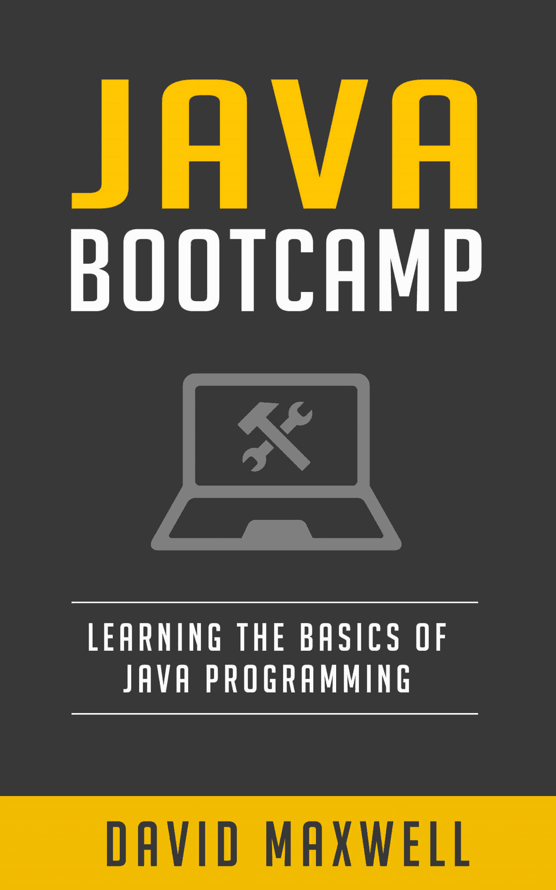

在 [KindleBookSpot.com](http://kindlebookspot.com) 获取更多免费和实惠书籍

# 赠送书籍

## 点击下方任何链接进入免费赠送书籍

* 赠送书籍：Scrum 训练营
* 赠送书籍：Python 训练营
* 赠送书籍：JavaScript 训练营
* 赠送书籍：C# 训练营
* 赠送书籍：黑客训练营
* 赠送书籍：Excel 训练营
* 赠送书籍：SEO 训练营
* 赠送书籍：SQL 训练营
* 赠送书籍：Python 学院
* 赠送书籍：JavaScript 学院
* 赠送书籍：Windows 10 学院
* 赠送书籍：被动收入任务
* 赠送书籍：14 天原始饮食计划
* 赠送书籍：14 天生酮饮食计划
* 赠送书籍：14 天地中海饮食计划
* 赠送书籍：14 天全食饮食计划
* 赠送书籍：14 天 DASH 饮食计划
* 赠送书籍：14 天纯素饮食计划
* 赠送书籍：14 天奶昔排毒
* 赠送书籍：14 天茶排毒
* 赠送书籍：14 天清理晚餐计划
* 赠送书籍：14 天精油计划
* 赠送书籍：生酮饮食挑战
* 赠送书籍：纯素饮食挑战
* 赠送书籍：全食饮食挑战
* 赠送书籍：10 天绿色奶昔排毒
* 赠送书籍：茶排毒挑战
* 赠送书籍：精油挑战
* 赠送书籍：慢锅食谱挑战
* 赠送书籍：原始饮食挑战

你需要一台至少配备 Intel Core2Duo 处理器的计算机，并至少拥有 1GB 内存。这些实际上是你今天能买到的大多数电脑中最基础、甚至更低配置。如果你可以在你的电脑上玩视频游戏，那么它的性能完全足够用于 Java 编程。

你的操作系统（OS）应该是 Windows XP、Windows 7、Windows 8 或 Linux。本书为上述平台提供了设置路径，尽管我们建议使用提供的链接进行在线编码，以便你立即开始。

如果你选择在计算机上安装 Java，则需要选择 `Java JDK8`。

你还需要获取微软记事本（Notepad）或其他文本编辑器。

## 本地环境

如果你想为你的 Java 编程创建一个本地环境设置，你需要前往此[链接](http://www.oracle.com/technetwork/java/javase/downloads/jdk8-downloads-2133151.html) 免费下载 Java，确保选择与你的操作系统兼容的版本。

在为你的操作系统选择了正确的 Java 后，按照指令正确下载 Java 并运行 `.exe` 文件，这将允许你在计算机上安装 Java。安装完成后，你需要为特定平台设置路径。

### Windows 路径

假设你已成功在计算机上安装了 Java，当你查看目录时，它看起来如下：

```
c:\Program Files\java\jdk
```

将光标指向“我的电脑”并点击它。打开后，右键点击它并选择“属性”（位于选项底部）。

在“高级”选项卡下，你会看到一个名为“环境变量”的按钮，你需要点击它。

接下来你需要修改 `Path` 变量。它需要包含 `Java.exe` 的路径。如果你当前的路径设置为：

`C:\WINDOWS\SYSTEM32`，你需要将路径更改为：

`C:\WINDOWS\SYSTEM32;c:\Program Files\java\jdk\bin`

### Linux, UNIX, Solaris, FreeBSD 路径

你需要设置环境变量 `PATH` 以正确指向 Java 二进制文件安装的位置。如果在设置路径时遇到困难，可以参考你的 shell 文档。

例如，如果你使用 `bash`，你需要添加 `export PATH=/path/to/java: $PATH`，它看起来如下：

```
.bashrc: export PATH=/path/to/java:$PATH
```

## 流行的 Java 编辑器

过去的编程语言不需要文本编辑器，与大多数现代编程语言不同，但 Java 编程需要使用文本编辑器。有几个复杂的 IDE（集成开发环境）可以用于你的 Java 编程。IDE 是一种程序员可以使用的、为软件创建或开发提供全面设施的软件应用程序。IDE 通常由构建自动化工具、调试器和文本编辑器组成。

以下是一些你可以使用的流行文本编辑器：

1. 记事本（Notepad）——如果你的电脑运行在 Windows 上，你可以使用内置的记事本编辑器编写代码。
2. Netbeans - 实际上你可以从此[链接](http://www.netbeans.org/index.html) 免费下载的 Java IDE。
3. Eclipse - 是另一个由 eclipse 开源社区创建的 Java IDE。你可以从此[链接](http://www.eclipse.org/) 免费下载。

一旦你一切准备就绪，我们就可以开始学习 Java 编程的基础知识，这将帮助你更接近实现独立创建 Java 程序的目标。

## 第 2 章：“Hello Java”，初次接触

“Hello”程序是编程初学者学习的第一课，出于许多种原因。该程序向你介绍了开始编写程序时首要需要做的几件事，以及你需要学习和使用的一些语法。

为了保持统一，我们将使用在线编码（之前已提供链接）作为示例。稍后你可以使用自己的 `Java.exe`。实际在线 Java 控制台会显示不同的字体颜色。只有当某个命令或字符/符号需要详细说明时，我们才会在示例中使用不同颜色的字体。

### Hello Java 基础语法

查看下面的示例程序，我们将逐行进行分析：

| 行号 | 代码 |
| :--- | :--- |
| 1 | `public class FirstProgram {` |
| 2 | |
| 3 | `/* 这是第一个示例.` |
| 4 | `* 我们将打印 'Hello Java' 作为输出` |
| 5 | `*/` |
| 6 | |
| 7 | `public static void main(String []args) {` |
| 8 | `System.out.println("Hello Java"); // prints Hello Java` |
| 9 | `}` |
| 10 | `}` |

顺便提一下，注意 `Hello` 和 `hello` 是不同的（大小写敏感）。第一行以 `public class` 开头。标识符 `FirstProgram` 应该大写。第七行包含方法名，所有方法名都应该用小写字母。`.println` 是告诉程序打印括号内内容的命令。命令末尾应该有一个分号（`;`）。`//` 符号是另一种注释，当你只需要进行单行注释时就使用该符号。确保每个起始括号都有对应的结束括号。在示例中，第 1 行的起始括号在第 10 行有结束括号。第 7 行的起始括号在第 9 行有结束括号。

这里另一个：

| 行号 | 代码 |
| :--- | :--- |
| 1 | `public class FirstName {` |
| 2 | `  public static void main(String []args) {` |
| 3 | `    System.out.println("Erika");` |
| 4 | `  }` |
| 5 | `}` |

它将产生如下结果：

| 输出 |
| :--- |
| Erika |

在本章中，你将学习你将处理的不同数据类型，以及如何给变量赋值。你还将学习不应该用作变量名的保留字。

## 整数 (int)

整数可以是正数或负数。零也被认为是一个整数。

在 Java 编程中，`int` 是 integer 的缩写，你稍后就会知道它的用法。如果你想打印整数，不需要将其括在引号中。

看下这个程序：

```java
public class IntPrinting {
    public static void main(String []args) {
        System.out.println(10);
    }
}
```

它将产生以下结果：

```
10
```

`int` 数据类型只能接受 -2,147,483,648 到 2,147,483,647 之间的值。

只要你遵循像示例中的正确语法，你放在 `System.out.println();` 括号内的任何数字都会被打印。

## 布尔值 (true 或 false)

布尔数据类型只能是 true（真）或 false（假）。它不会产生任何其他答案。你不需要将其放在引号中，因为程序将 true 和 false 识别布尔类型的合法值。

看这个示例程序：

```java
public class BooleanPrinting {
    public static void main(String []args) {
        System.out.println(true);
    }
}
```

它将产生以下结果：

```
True
```

尝试将括号内的 true 替换为 ‘me’，如下：

```java
public class BooleanPrinting {
    public static void main(String []args) {
        System.out.println(me);
    }
}
```

它将产生以下结果：

```
/tmp/java_FlX6ZW/BooleanPrinting.java:3: error: cannot find symbol
       System.out.println(me);
                            ^
  symbol:   variable me
  location: class BooleanPrinting
1 error
```

它不识别‘me’这个词因为它因为它字符串。打印字符串时，你需要将其写在引号内。

## 字符 (char)

字符或 char 数据类型表示单个字符。所有值必须括在单引号中；否则你将得到错误信息。

看下方的示例：

```java
public class BooleanPrinting {
    public static void main(String []args) {
        System.out.println('r');
    }
}
```

它将给出这个结果：

```
r
```

`int`、`boolean` 和 `char` 是 Java 的基本类型。你还会遇到更多它们。

## 使用变量

在 Java 编程中，你可以为变量存储值，其他语言也具有这种功能。在 Java 中使用变量时，你需要指定数据类型。以下是你不应该作为变量使用的 Java 保留字列表：

| abstract | assert | boolean | break | long |
| :--- | :--- | :--- | :--- | :--- |
| byte | case | catch | char | private |
| class | const | continue | default | short |
| do | double | else | enum | switch |
| extends | final | finally | float | native |
| for | goto | if | implements | new |
| import | instanceof | int | interface | package |
| transient | protected | return | super | |
| synchronized | static | strictfp | throws | this |
| volatile | while | try | throw | void |

记住你不应该以大写字母开头你的变量，尽管你可以像这样使用变量名：

`int myFavoriteNumber = 10;`

你需要在开头写 `int` 来识别数据类型，`myFavoriteNumber` 是变量名，而 `10` 是赋值给它的值。自己尝试一下：

1. `int mySampleNumber` 必须等于 6。
2. `boolean mySampleAnswer` 必须等于 true。
3. `char mySampleLetter` 必须等于 L。

按照指令要求给每个变量分配对应的值。当你运行程序时，你不会看到这些值。如果你想打印这些值，你需要在程序中添加 `System.out.println()`，确保写的是正确的，并且它应该是变量的真实值。仅此一次，你需要在你的程序中添加这些行：

```java
System.out.println(mySampleNumber);
System.out.println(mySampleAnswer);
System.out.println(mySampleLetter);
```

你将得到此输出：

```
6
true
L
```

现在你准备好了迎接更具挑战性但也更有成就感的课程了。

## 第 4 章：实用表格，随手备用

本章包含了你需要随手准备的不同表格，因为它们可以作为你学习 Java 时的快速参考。如果你能快速记住它们，那就好得多。

### Java 数值运算符

大多数编程语言对它们的数值运算符使用相同的符号。如果你已经熟悉了某种现代语言，那么你会发现 Java 的数值运算符符号大部分与你熟悉的编程语言的符号是相同的。

| 符号 | 运算符 | 示例 |
| :--- | :--- | :--- |
| + | 加法 | 8 + 7 |
| - | 减法 | 26 - 9 |
| * | 乘法 | 9*5 |
| / | 除法 | 81/3 |
| % | 余数 | 23%3 |

### Java 比较运算符（称为关系运算符）

如果你熟悉其他现代语言的比较运算符，那么记忆下面的表很容易。

| 运算符 | 符号 |
| :--- | :--- |
| 小于 | < |
| 小于等于 | <= |
| 大于 | > |
| 大于等于 | >= |
| 等于 | == |
| 不等于 | != |

### 布尔逻辑运算符

布尔逻辑运算符与比较运算符不同，使用它们时要小心。

| 运算符 | 符号 |
| :--- | :--- |
| 非 | ! |
| 与 | && |
| 或 | \|\| |
| 异或 | ^ |

### 不同的真值表

#### “非”的真值表

| A | !A |
| :--- | :--- |
| False | True |
| True | False |

#### “与”的真值表

| E1 | E2 | E1 && E2 |
| :--- | :--- | :--- |
| False | False | False |
| False | True | False |
| True | False | False |
| True | True | True |

*E1 表示表达式 1，E2 表示表达式 2，其余表格也是如此。*

#### “或”的真值表

| E1 | E2 | E1 \|\| E2 |
| :--- | :--- | :--- |
| False | False | False |
| False | True | True |
| True | False | True |
| True | True | True |

#### “异或”的真值表

| E1 | E2 | E1 ^ E2 |
| :--- | :--- | :--- |
| False | False | False |
| False | True | True |
| True | False | True |
| True | True | False |

是时候用 Java 的方式来学习数学了。你可以进行加、减、乘、除并获取余数。这并不难理解，一旦你开始编写自己的程序，你一定会喜欢这些数值运算符的。如果你还没有记住 Java 中不同数值运算符的符号，那么你随时随时回到第 4 章查看数值运算符表。

## 尝试 Java 加法

你可以创建一个像这样的程序：


```java
public class AdditionProgram {
    public static void main(String []args) {
        System.out.println(5 + 9);
    }
}
```

你也可以像这样使用变量：

```java
public class AdditionProgram {
    public static void main(String []args) {
        int a = 5;
        int b = 6;
        System.out.println(a + b);
    }
}
```

## 尝试 Java 减法和其他数学运算

以上面的示例为指南，创建一个用于减法、乘法、除法和余数（也称为模）的简单 Java 程序。你可以尝试自己练习，直到掌握它。练习得越多，你就会发现它的挑战性越小。到那时，你会发现操作 Java 变得更加自在。

## 比较运算符

比较运算符也被称为关系运算符。它们比较数据类型，并始终给你一个布尔值，即 `true`（真）或 `false`（假）。如果你还不熟悉该表格，那么在你开始使用关系运算符时可以回去查看。

比较运算符位于两个数据（称为操作数）之间。如果你打印这条语句：

```java
System.out.println(9<7);
```

你将得到一个 `false` 的答案。Java 程序在遇到带有关系运算符的语句时，会识别出它应该给出一个布尔答案。

等于 (`==`) 和不等于 (`!=`) 运算符也称为相等运算符。在 Java 编程中，程序员可以使用相等运算符来测试数据的相等性。程序员可以测试 `int`、`boolean` 或 `char` 数据类型的相等性。参考下面的示例：

```java
char sampleChar = 'L';
int sampleNum = 5;
System.out.println(sampleChar==sampleNum);
```

上面的示例将在屏幕上打印‘false’，因为变量 `sampleChar` 中的值与变量 `sampleNum` 持有的值不同。

## 一些尝试性的练习

现在你可以通过这个简单的编程练习来测试你学了多少。不要担心；如果你觉得有点挑战性，稍后会看到正确的代码。如果你看到错误消息，请阅读消息并尝试找出你犯的错误。有时，一个简单的拼写错误就会危害整个程序，除非你立即发现它。确保你正确使用了大小写。

1. 将 `this is my program` 声明为你的类；编写程序时确保编写正确。

2. 写一行单行注释，任何内容均可。

3. 给布尔变量 `isAnything` 赋值 `false`。

4. 给 `int` 变量 `isTooMuch` 赋值 `789`。

5. 将 `isTooMuch` 乘以 3 的值赋值 `int` 变量 `isMuchMuch`。

6. 打印值 `isAnything`、`isTooMuch` 和 `isMuchMuch`。

在查看答案之前，尝试自己编写给定的示例。你也可以尝试更多练习。

如果你完成了，可以查看下面的答案。你的结果是一样的吗？

```java
public class ThisIsMyProgram {
    // this is my single line comment
    public static void main(String []args) {
        boolean isAnything = false;
        int isTooMuch = 789;
        int isMuchMuch = isTooMuch * 3;
        System.out.println(isAnything);
        System.out.println(isTooMuch);
        System.out.println(isMuchMuch);
    }
}
```

## 第 6 章：选择语句

现在你已经了解了 Java 基础，让我们更上一层楼。你需要准备好学习控制流的介绍。

Java 控制语句调节 Java 程序的执行顺序。你需要理解的有有三个大类，它们是：

1. 选择语句 `if`、`if-else` 和 `switch`。

2. 循环语句 `while`、`do-while` 和 `for`。

3. 转移语句 `break`、`return`、`try-catch-finally`、`continue` 和 `assert`。

如果你想改变默认执行顺序，我们可以根据程序需要使用上述的任何语句。对于 Java 基础，我们将讨论选择语句和一些循环语句。

### 选择语句

此类类别包括：`if` 语句、`if-else` 语句和 `switch` 语句。

### 处理 if 语句

`if` 语句告诉计算机，只有当 `if` 语句内的表达式证明为真时，才执行特定的代码块。如果语句为假，则不会执行该代码块。假设没有其他可能由于特定条件触发执行的语句，程序将继续执行其余部分代码。

`if` 语句遵循以下语法：

```
if (<conditional expression>)
<statement action>
```

看下面的示例：

```java
public class SampleIfStatement {
    public static void main(String[] args) {
        int a = 20, b = 30;
        if (a > b) {
            System.out.println("a is greater than b");
        }
        if (a < b) {
            System.out.println("b is greater than a");
        }
    }
}
```

你认为这个程序会打印什么？

### 理解 if-else（或嵌套 if）语句

与 `if` 语句一样，`if-else` 语句也命令计算机仅在语句内的表达式为真时，才执行 `if` 语句下的特定代码块。如果语句为假，则接下来必须执行 `else` 语句，且仅当满足 `else` 选项的条件时。

`if` 语句遵循以下语法：

```
if (<conditional expression>) {
<statement action>
} else {
<statement action>
}
```

看一下示例程序：

```java
public class IfElseDemo {
    public static void main(String[] args) {
        int a = 20, b = 20;
        if (a > b) {
            System.out.println("a is greater than b");
        } else if (a < b){
            System.out.println("b is greater than a");
        } else {
            System.out.println("a is equal to b");
        }
    }
}
```

如果你尝试分析它：

第 4 行提供了程序运行所需的给定数据。

第 5 行包含一个条件：如果 `a` 大于 `b`，它将打印“a is greater than b”。如果你查看给定的数据，该语句为假，这会提示程序执行下一条语句，即 `else` 语句。

第 7 行提供了另一个选项或条件；遗憾的是，它仍然为假。

剩下的就是打印“a is equal to b”。

程序不会执行 `if` 或 `else-if` 语句下的语句，因为这两个语句都为假。然而，底部的 `else` 语句没有提供任何条件，它告诉程序打印“a is equal to b”，这在实际上是真实的。

尝试更改程序中的给定数据，并观察程序的响应。

## Switch 语句（分支语句）

`switch` 语句也被称为 `case` 语句，其中你为用户提供不同的选项，程序将执行它。`switch` 语句与 `if-else` 语句相似，它们都提供了选项，且程序将寻找第一个证明为真的选项。它将执行返回值为真的 `if-else` 选项下的语句。

`switch` 语句比 `if-else` 语句更有条理。如果以有规律的方式编码，维护程序也会更容易。如果你有许多选项需要展示，那么你应该使用 `switch` 语句。

以下是 `switch` 语句的语法：

```java
switch (<non-long integral expression>) {
    case 1: 
        <statement 1>
        break;
    case 2: 
        <statement 2>
        break;
    case n: 
        <statement 2>
        break;
    default: 
        <statement>
} // end of switch or case statement
```

看下方的示例程序：

```java
public class SwitchCaseStatementDemo {
    public static void main(String[] args) {
        int a = 10, b = 30, c = 20;
        int response = 0;
        if (a > b && a > c) {
            response = 1;
        } else if (b > a && b > c) {
            response = 2;
        } else if (c > a && c > b){
            response = 3;
        }
        switch (response) {
            case 1:
                System.out.println("a is the biggest number");
                break;
            case 2:
                System.out.println("b is the biggest number");
                break;
            case 3:
                System.out.println("c is the biggest number");
                break;
            default:
                System.out.println("Error encountered, try again");
        }
    }
}
```

你需要初始化 `int response`，这是你的 `switch` 语句所需要的。如果你删除了它，你的程序将无法运行。

你可以更改需要的数据并查看结果。你可以尝试更改每个 `if-else` 语句下的条件，并观察会发生什么。确保当你更改某些内容时，该更改与整个程序保持一致。否则，你的程序将无法运行或产生不同的结果。

## 循环语句

循环语句包括：`while` 语句、`do-while` 语句和 `for`。

### while 语句

`while` 语句告诉程序只要条件或语句保持为真，就继续执行下方的代码块。只有当语句变为假时，程序才会停止重复执行代码指令。

这是 `while` 循环的语法：

```java
while (<loop condition>)
<statements>
```

以下是示例程序：

```java
public class SampleWhileLoop {
    public static void main(String[] args) {
        int count = 1;
        System.out.println("Output Numbers 1 - 10");
        while (count != 11) {
            System.out.println(count++);
        }
    }
}
```

我们需要初始化 `int count` 为 1。在第 6 行，它仅意味着当 `count` 等于 1 时，它将不再打印。在第 7 行 `count++` 告诉程序将 `count` 加 1，因此在下一次循环中它将打印 2。它需要再次增加 `count`，在下一次循环中将打印 3，依此类推，并且当 `count` 等于 1 时才会停止打印。

### do-while 语句

`do-while` 循环或语句与 `while` 语句相似，不同在于程序在执行语句之前会先执行动作，然后再检查实际条件。这可以给程序提供更多控制，因为它确保了循环至少执行一次。

这是 `do-while` 语句的语法：

```java
do {
    <loop body>
while (<loop condition>);
```

以下是示例程序：

```java
public class SampleDoWhileStatement {
    public static void main(String[] args) {
        int sheep = 1;
        System.out.println("Output Numbers 1 - 10");
        do {
            System.out.println(sheep++);
        } while (sheep <= 10);
    }
}
```

### for 循环或语句

`for` 循环适用于需要执行特定次数某段代码块的任务或程序。它就像只要条件保持为真，就重复执行相同的过程。你需要初始化控制循环的计数器。

这是你需要遵循的语法：

```java
for (<initialization>; <loop condition>; <increment expression>)
<loop body>
```

这里是示例程序：

```java
public class SampleForLoop {
    public static void main(String[] args) {
        System.out.println("Output Numbers 1 - 10");
        for (int number = 1; number <= 10; number++) {
            System.out.println(number);
        }
    }
}
```

看第 5 行，你需要初始化计数器 `number`，设置条件 `number` 小于或等于 10，并使 `number` 加 1。下一个语句打印计数器 `number`，其初始值为 1。

当 `number` 变为 2 时，它仍然小于 10，计数器再次加 1。下一个语句将打印 2。整个循环将重复直到 `number` = 10。当计数器 `number` 变为 11 时，它不再满足计数器小于或等于 10 的后续条件。程序将不再执行剩余的语句。

## 总结

感谢感谢下载这本书！希望这本书能够帮助你理解创建 Java 程序所需的 Java 基础。下一步是继续练习你所学的知识，并在过程中学习更多的命令。

最后，如果你喜欢这本书，我想请你帮个忙，你是否愿意在 Amazon 上给这本书留个评价？我将不胜感激！

点击此处在亚马逊上为这本书发表评论！

同时，请务必订阅我的技术和编程新闻邮件，以获取您的免费书籍并学习更多编程的知识。[点击此处](http://kindlebookspot.com/join-our-tech-community/)。

感谢并祝你好运！

[点击此处获取使用 Bluehost 设置您的 Wordpress 站的分步说明。](http://www.passiveincomeassignment.com/2015/12/15/how-to-create-a-website-in-minutes/)

如果你还没有的话，请务必查看我的新网站：[KindleBookSpot.com](http://kindlebookspot.com)。这是我一直在努力的新项目，我真心希望它对我的读者是有价值的。我制作这个网站是因为我想给你们提供一种更简单的方法，在一个地方找到折扣价格的热门 Kindle 书籍。以下是关于我网站内容的详细信息：

*   畅销免费 Kindle 书单列表
*   折扣的小说和非虚构类书籍
*   每周一书
*   精选书籍
*   在我网站上推广你自己的书

这个网站不仅面向读者，也是新秀作家在成为畅销书之前推广新书的地方。所以，如果你想推广自己的书，请查看我的网站：[KindleBookSpot.com](http://kindlebookspot.com)。

我希望这个网站对你有所帮助，并希望在那里见到你！

[在 KindleBookSpot 订阅我们不断成长的社区，以便在优质书籍打折或免费时接收通知。](http://kindlebookspot.com)

# Python 学院

## 学习 Python 编程基础

我想感谢你并祝贺你下载了《在两周内学会 Python 编程基础》这本书。

这本书包含了关于如何在 `Python` 中编写和运行程序的经过验证的步骤和策略。书中有你可以作为指南的示例代码和程序。

这本书还包含了对该编程语言的介绍，包括简要历史和 `Python` 的基础知识。它还包含了对 `Python` 中特性的详细解释。

再次感谢下载这本书，希望你喜欢它！

## 第 1 章：Python 简介


如果你正在寻找一种以代码可读性为主要关注点的通用、高级编程语言，你应该考虑 `Python`。它的语法允许你用比其他编程语言（如 `C`、`C++` 和 `Java`）更少的代码行表达概念。它支持广泛的编程范式，因此涵盖了命令式、函数和面向对象的编程。此外，它具有全面的标准库、动态类型系统和自动内存管理。

你有许多解释器可以用来安装在不同的操作系统上；因此，你可以在各种系统上执行 `Python`。你甚至可以利用第三方应用程序。如果你不想安装解释器，可以将代码打包成独立的可执行程序，这样你就可以向不同环境有效分发基于 `Python` 的软件。

## Python 编程语言简史

`Python` 由 `Guido van Rossum` 在 20 世纪 80 年代后期开发。它最初只是一个圣诞项目。Van Rossum 想要为 `C` 和 `UNIX` 黑客将使用的脚本语言创建一个解释器。他的小项目最终升级到了 `Python 2.0`，并于 2000 年 10 月发布。这个新版本拥有完整的垃圾回收器和 `Unicode` 支持。`Python 3.0`（也称为 `Python 3000` 和 `py3k`）于 2008 年 12 月发布，其特性被回溯到了 `2.6` 和 `2.7` 版本。

## 为什么你应该使用 Python？

编程语言的存在是有原因的。例如，`Python` 的开发是为了让程序员能够创建高效且高产的代码。它的主要目标是帮助初学者轻松、快速地学习一种编程语言。由于学习时间更短，你可以创建更有用的应用程序，而这些应用用更晦涩、复杂的编程语言很难实现。

通过 `Python`，你在编写应用程序时还可以从更短的开发时间内获益。如前所述，`Python` 的代码行比 `C`、`C++` 和 `Java` 少。它的代码实际上短了五到十倍；因此，它更高效、更不复杂。你可以花费更少的时间来开发应用程序，而花费更多时间在对其进行调优和改进。

在检查 Bug 和错误时，你所使用的编程语言易于阅读和理解至关重要。如果编程语言太复杂，你在编写代码和检查程序时可能会遇到困难。使用 `Python`，代码更容易读和更容易写；因此，你可以轻松地解释代码并进行必要的更改。

此外，`Python` 还有许多其他用途。它是基于浏览器的脚本应用程序、创建极佳的用户界面和粗略的应用示例、与数据库交互、处理 `XML` 以及设计数学、工程和科学应用程序的理想选择。

## Python 与 C#、Java 和 Perl

你可能会发现将编程语言进行相互比较是一项主观任务。通常，它们的差异取决于个人喜好。尽管如此，有时这种比较是有科学数据支持的。无论如何，你必须记住，不存在一种全能的编程语言。作为程序员，你只需要找到一个最适合你目标或需求的语言即可。

### C#

如果你有 `Java` 背景，你可能会发现 `C#` 和 `Java` 非常相似。尽管如此，与 `Java` 相比，`C#` 仍然有自己的优缺点。微软声称，开发 `C#` 的主要目标是产生更好的 `C` 和 `C++`。然而，与 `C#` 相比，`Python` 具有更好的科学工程应用以及更好的跨平台支持。在 `C++` 方面它更具扩展性。它更容易学习和理解，并允许使用各种环境。它的代码也更简洁。

### Java

程序员将 `Java` 视为一种全能的编程语言。多年来，他们一直在寻找一种随处运行和编写的语言，并发现了 `Java` 可以在不同平台和环境中良好运行。尽管如此，`Python` 也是一种全能的编程语言。它与 `Java` 非常相似，只是代码更简洁，且更容易学习和理解。

### Perl

`PERL` 代表实用提取和报告语言。它是一种适用于从另一个数据库获取和处理数据的编程语言。相比之下，`Python` 比 `PERL` 更好，因为它更容易阅读、实现、学习和理解。它具有更好的 `Java` 集成和数据保护。它也有更少的平台偏见。

## 为什么 Python 是初学者的理想选择？

如果你刚刚开始编程，你可能考虑 `Python`。它对初学者来说是理想的，因为它具有一致且简单的语法以及丰富的标准库，允许你完成多个项目。涉及的任务不仅限于常见的四功能计算器和平衡检查程序。

当你习惯用 `Python` 编写代码时，你会发现编写实际应用实际上很容易。交互式解释器还允许你测试语言特性。在 `Python` 中，你可以专注于核心编程技能，如程序分解和数据类型设计，以及基础概念，如过程和循环。

如果你以前从未用过任何编程语言，请不要担心。即使是没有任何编程知识或经验的人，也可以轻松掌握 Python 编程语言的基础。

至于安装，Python 的安装非常简单。大多数 UNIX 和 Linux 发行版实际上已经将其包含在软件包中。如果你从惠普（HP）购买了 Windows 电脑，你可以直接使用 Python，因为它随系统预装了。

为了让你操作更方便，你应该学习如何使用文本编辑器以及集成开发环境（IDE）。阅读带有示例代码和程序的编程书籍也会对你有帮助。

关于版权，Python 的开发者允许程序员对源代码进行任何他们想做的操作，只要他们不要忘记包含版权声明即可。版权规则并不严格。你甚至可以销售二进制和源码形式的副本，以及涉及 Python 的产品。然而，如果你想使用其标志（logo），请确保你获得了许可。

Python 非常稳定。事实上，它的稳定性足够日常使用。你可以预计在六到十八个月内出一个新版本。开发者会发布错误修复版本，以确保新版本比之前的版本更好。

如果你想进行静态分析或搜索 bug，可以使用 `Pylint` 或 `PyChecker`。前者是一个检查模块是否遵守编码标准并允许自定义插件的工具。后者是一个在源码中发现 bug 的静态分析工具。

既然你已经学习了编程语言的基础知识，你可能仍然好奇 Python 是怎么命名的。Guido van Rossum 喜欢蛇吗？事实上，他喜欢的是名为《蒙提 Python 的飞行马戏团》（Monty Python’s Flying Circus）的电视节目，而不是爬行动物。

在 Python 开发期间，他正在读这部喜剧剧的脚本，认为 `Python` 是一个合适的名字，因为它短、独特且具有恰好处的神秘感。事实上，文档中允许并实际上鼓励引用该喜剧节目的内容。

# 第 2 章：语法

Python 具有简单且直观的语法。它甚至鼓励程序员在不使用准备好的样板代码的情况下编写程序。`print` 指令实际上是所有指令中最简单的。它打印行并包含换行符。你可能会注意到，在编程语言的新主版本中 `print` 指令有所不同。

Python 2.0 是更常用的版本，而 Python 3.0 支持最新特性且语义上更正确。无论如何，`print` 语句在 2.0 版本中不视为函数；因此，你可以在代码中不包含括号的情况下调用它。另一方面，`print` 语句在 3.0 版本中是函数；因此，如果你想调用它，必须使用括号。

## 交互模式编程

你可以在不同的模式下执行程序。如果你在调用解释器时不传递脚本文件作为参数，你将得到如下：

```
$ python

Python 2.4.3 ( #1, Nov 11 2010, 13:34:43 )
[GCC 4.1.2 20080704 ( Red Hat 4.1.2– 48 )] on linux2

Type“help”，“copyright”,“credits” or“license” for more information.

>>>
```

当你看到这个提示符时，可以输入所需的文本然后按回车。在这个例子中，我们将使用单词 `Monty Python and the Holy Grail`。

```
>>> print “Monty Python and the Holy Grail” ;
```

注意，如果你使用的是编程语言的更新版本，你需要在 `print` 语句中使用左右括号，如下所示：

```
>> print (“Monty Python and the Holy Grail” ) ;
```

无论你使用哪个版本，如果你运行上面所示示例代码，你将得到以下输出：

```
Monty Python and the Holy Grail
```

## 脚本模式编程

如果你在调用解释器时带有脚本参数，脚本将开始执行并持续运行直到完成。完成后，解释器将不再处于活动状态。考虑以下示例。示例程序写在脚本中并带有 `.py` 扩展名：

```
print “Monty Python’s Flying Circus”;
```

如果你在 `test.py` 文件中输入上述源代码并运行它：

```
$ python test.py
```

你将获得以下输出：

```
Monty Python’s Flying Circus
```

执行脚本的另一种方法是修改 `.py` 文件，例如：

```
#! /usr/bin/python

print “Monty Python’s Flying Circus”;
```

如果你这样运行它：

```
$ chmod +x test.py
$ ./test.py
```

你将得到以下输出：

```
Monty Python’s Flying Circus
```

## 标识符

标识符基本上用于确定函数、变量、模块、类以及任何其他对象。它以下划线 `_` 或字母开头。随后是数字、下划线、零或其他字母。作为程序员，可以自由使用任何字母或数字。你可以使用大写和小写字母。

然而，你不能在标识符中使用点符号和特殊字符，例如 `@`、`$` 和 `%`。此外，Python 是一种大小写敏感的编程语言。这意味着在代码中使用大写和小写字母时必须小心。例如，`wendy`、`Wendy` 和 `WENDY` 是相同的名称，但在 Python 中被视为三个不同的标识符。

### Python 标识符规则

在 Python 中编写程序时，你必须遵守以下规则：

*   类名必须以大写字母开头，而标识符其余部分必须以小写字母开头。
*   下划线开头的标识符是私有的。
*   双下划线开头的标识符是强私有的。
*   双下划线结尾的标识符是语言定义的特殊名称。

### 关键字

注意某些词不能作为常量、标识符名或变量。所有关键字都使用小写字母。以下是关键字表：

| And | Assert | Break | Class | Continue |
| def | del | elif | else | except |
| exec | finally | for | from | global |
| if | import | in | is | lambda |
| Not | or | pass | print | raise |
| return | try | while | with | yield |

## 缩进与行

Python 没有使用大括号来指示类定义和函数的块。同样，也不包含流程控制。如果你想标记此类代码块，必须使用行缩进。你可以调整空格，但要确保块中的所有语句都缩进。为了帮助你理解，考虑以下示例代码：

```python
if True:
    # 这显示了精确四个空格的缩进
    print “Correct”
else:
    print “Incorrect”
```

运行第一个示例会生成输出。然而，运行第二个会导致错误。为什么会发生这种情况？你必须记住，在 Python 中，块是通过缩进相同数量的连续行形成的。

```python
if True:
    print “Input”
    print “Correct”
else:
    print “Input”
    print “False”
```

### 缩进误区

关于 Python 缩进存在某些误区。以下是一些：

*   **每个源代码中都需要空白字符。**

    实际上，你并不非要在所有的源代码中使用空白符。空白并不一定具有重要性，尽管缩进是有。正如你所学到的，缩进是位于语句最左侧的空白。在其他任何地方，空白都没有那么重要，并且可以省略。你可以以你喜欢的任何方式使用它，甚至在程序的任何地方插入任意的空白或不包含任何内容的空行。

    此外，缩进的精确数量并不真正重要，但嵌套块的相对缩进非常重要。当你使用隐式或显式的续接行时，缩进级别实际上不会被识别。例如，你可以将一个列表跨越多行。缩进完全不重要。看下面的示例：

    ```python
    foo = [
                                ‘ a string ‘ ,
                                ‘ another string ‘ ,
                                  ‘ a short string ‘
    ]

    print foo
    ```

    如果你运行上述代码，你将得到以下输出：

    `[ ‘ a string ‘ , ‘ another string ‘ , ‘ a short string ‘ ]`

    这是另一个示例：

    ```python
    bar = ‘ look at this example ‘ \
                   ‘ of a long string ‘ \
                                  ‘ that is split ‘ \
                                  ‘ across multiple lines ‘

    print bar
    ```

    如果你运行上述代码，你将获得以下输出：

    `look at this example of a long string that is split across multiple lines`

*   **在你的程序中应该使用某种风格的缩进。**

    嗯，这一点既是正确的也是不正确的。你可以将内部块写在一行上而不进行缩进。你可以使用以下“if 语句”的任何一个版本，因为它们都是有效的并且产生相同的输出：

    ```python
    if 1 + 1 == 2 :
                  print “ foo”
                  print “ bar ”
                  w = 99
    if 1 + 1 == 2 :
                 print “foo” ; print “ bar “ ; w = 99

    if 1 + 1 == 2 : print “ foo “ ; print “ bar “ ; w = 99
    ```

    作为一名程序员，你可能希望将代码块写在单独的行，如第一个示例所示。然而，有时会有相似的 `if` 语句，你可以方便地将它们写在每一行。

    如果你决定将代码块写在单独的行，那么你必须遵循缩进规则。你必须使包含的块的缩进比 `if 语句` 多。

    结论是，在 Python 中你将被迫遵守这条规则，除非你选择让程序的结构变得更加复杂。编程语言不允许使用虚假缩进来混淆程序结构。

    记住，在 Python 编程语言中，块是通过缩进表示的；因此，缩进在每个程序中都是相同的。代码格式的一致性使得程序更容易阅读和理解。

*   **Python 中不能混合使用空格和制表符。**

    是的，这一点是正确的，即使对于用 C 语言编写的程序也是。你不能安全地混合空格和制表符。尽管这对你的编译器来说并没有巨大的区别，但在处理代码时可能会遇到困难。例如，如果你将一个 C 源代码移动到具有不同制表位的编辑器，将更容易引入 bug。

    再次，记住混合空格和制表符进行缩进是不理想的。你可以单独使用空格或制表符。此外，你可能想完全避免制表符。毕竟，制表符的语义并没有那么明确，在不同类型的编辑器和系统中可能会有不同的显示。

    制表符在复制和粘贴过程中，以及当源代码插入 Web 页面或任何其他类型的标记代码时，也经常被错误地转换或破坏。

*   **可以跳过缩进并改用关键字。**

    是的，你可以跳过缩进而只使用关键字。实际上有一些程序员倾向于使用 `endif` 而不是缩进来表示代码块的结束。

    嗯，这并不是 Python 中一个识别的关键字。该语言的早期版本带有一个工具可以转换……

*   **缩进如何？**

    缩进在每个程序中都是相同的。代码格式的一致性使得程序更容易阅读和理解。

### 多行语句

当你结束一个语句时，你可以使用新行，或者在想继续时使用续接符号 `\`。为了帮助你进一步理解这一点，请考虑以下示例：

```python
total = first_item \
               second_item \
                                  third_item
```

当你编写包含在括号（如 `{}`、`()` 和 `[]`）中的语句时，你不需要使用续接符号。例如，如果你想显示一年的月份，你可以简单地写：

```python
year = [‘January’ ,‘February’ ,‘March’ ,‘April’ ,‘May’ ,‘June’ ,‘July’ ,‘August’ ,‘September’ ,‘October’ ,‘November’ ,‘December’ ]
```

你允许在一行上写多个语句，或创建多个组作为 suite（块）。在涉及编写多个语句时，记住分号 `;` 的包含是关键的。分号允许你编写尽可能多的语句，只要它们不启动新的代码块。考虑以下示例：

```python
import sys ; y =‘bar’ ; sys.stdout.write(y +‘\n’)
```

那么什么是 suite 呢？嗯，它们是由代码块组成的语句组。复合或复杂的语句，如 `if`、`while`、`def` 和 `class` 需要一个 suite 和头部行。

那么什么是头部行呢？它们以关键字开始语句并以冒号 `:` 结束。此外，它们后面跟着组成 suite 的一行或多行。考虑以下示例：

```python
if expression :
    suite
elif expression :
    suite
else :
    suite
```

### 引号

作为一名程序员，在定义字符串字面量时允许使用单引号 `'`、双引号 `"` 以及三引号 `'''` 或 `"""`。尽管如此，请确保在字符串的开始和结束处使用相同类型的引号。通常，三引号用于跨越多行的字符串。看下面的示例：

```python
paragraph = “””你正在阅读一个包含多行和多个句子的段落示例。你是一个优秀的程序员。“””
```


# 当涉及到注释时

当涉及到注释时，你应该使用哈希符号（`#`）开头。然而，这个哈希符号不应该出现在字符串字面量中。此外，该符号之后直到行尾的字符都应该被包含在注释中。在 Python 中，解释器不会识别注释。为了帮助你进一步理解这一概念，请看以下示例：

```python
# This is the first comment

print“ Monty Python’s Flying Circus is a British sketch comedy series.” ;

# This is the second comment
```

如果你运行上面的示例，你将获得以下输出：

Monty Python’s Flying Circus is a British sketch comedy series.

你也可以在表达式或语句之后编写另一个注释，例如如下：

```python
name =“Wendy” # This is a sample comment
```

如果你想对多行进行注释，你也可以这样做。例如：

```python
# This is a sample comment.
# This one is also a comment.
# This is another comment.
# This comment is written by Wendy.
```

## 空行

这些行在 Python 编程语言中不被识别。尽管如此，它们非常类似于注释。它们包含了空白字符甚至注释。你必须在交互式解释器会中使用空行来结束多行语句。

# 第 3 章：数据类型

在 Python 中，输入数据根据不同的类别进行分类。分类的主要目的是帮助像你这样的程序员更高效地处理信息。这些类别充当数据存储位置，你每当运行 Python 平台时都可以访问它们。

## 变量

变量包含了被专门分配给它们的值。如果你正在为应用程序编写复杂的代码，你可能希望将信息存储在这些变量中。不要担心，因为你可以在需要时随时访问它们。你甚至可以使用它们来确保从终端用户那里收集的信息保持安全和可靠。

## 数字类型

Python 编程语言中的数字与你解决代数问题时使用的数字不同。在数学中，在数字末尾加上 `.0` 实际上没有任何意义。它不会改变数值的值。例如，`3` 和 `3.0` 是相同的。

但在 Python 中，`3` 和 `3.0` 是不同的数字。在程序处理它们之前，它们必须经过某些特定的数据处理方法。作为程序员，你必须学习不同的数值类型。

### 整数

所有的整数都是整数。包含小数点的数字不是整数；因此，`3` 是整数，而 `3.0` 不是。Python 中的整数其特征是数据类型 `int`。

请注意，整数有容量限制。如果你尝试处理超出允许限制的值，将产生一个错误。整数通常处理 `-9,223,372,036.854` 到 `9,223,372,036.854` 之间的数字。

`int` 变量带有一些有趣的特性。例如，二进制只使用 `0` 和 `1`，八进制使用 `0` 到 `7` 之间的数字，十进制具有与十制相似的属性，而十六进制使用字母 `A` 到 `F` 和数字 `0` 到 `9` 作为数字位符。

### 浮点数

在 Python 中，任何包含小数点的数字都被视为浮点数。小数点后的数字是 `0` 还是不是否并不重要。例如，`3.0`、`1.5` 和 `11.4` 都是浮点数。它们存储在 `float` 数据类型中。浮点数优于整数的一个巨大优势是它们拥有更大的存储空间；因此，它们能够存储非常小或大的值。

尽管如此，你不应该认为它们拥有无限的存储空间。仍然存在限制。尽管如此，它们可以包含低至`±2.2250738585072014× 10-308` 和高至 `1.7976931348623157× 10-308` 的值。使用浮点数分配值的方法。首先，你可以直接给它们赋值。其次，你可以使用科学计数法。记住，负指数产生分数值。

### 复数

这些数字由实数和虚数组成。通常，它们用于动态系统、量子力学、计算机图形、电气工程和流体力学。复数可以在 Python 和其他少数编程语言中处理。

### 布尔值

这是两个常量对象 `True` 和 `False`。它们代表真值。在数值上下文中使用时，它们作为 `0` 和 `1` Function。你可以使用 `bool` 函数为布尔值赋值，前提是该值可以被解释为真值。

### 字符串

它们是用双引号连接的字符组。考虑以下示例：

```python
TheString =“ Python got its name from a popular comedy show.“
```

如你在上面的示例代码所示，`Python got its name from a popular comedy show.` 这句话被赋值给变量 `TheString`。

计算机无法理解字母，只能理解数字。所以当你编写程序时，Python 根据代表字母的数字对其进行读取和解释。例如，在美国信息交换标准（ASCII）中，数字 `65` 代表字母 `A`。所以如果你输入

```python
ord (“ A“ )
```

你将得到输出

```
65
```

因为计算机无法理解字母，你必须将其转换为数字。

# 第 4 章：运算符

操作数通过运算符进行操作。Python 中有七种运算符。下表显示了这些运算符并提供了简要说明。

## 算术运算符

| 运算符 | 描述 |
| :--- | :--- |
| `+` | 加法。 |
| `-` | 从操作数中减去操作数。 |
| `*` | 乘法。 |
| `/` | 用第一个操作数除以第二个操作数。 |
| `%` | 用第一个操作数除以第二个操作数并返回余数。 |
| `**` | 对运算符执行指数运算。 |
| `//` | 除以操作数但消除小数点。 |

## 比较运算符或关系运算符

| 运算符 | 描述 |
| :--- | :--- |
| `==` | 如果两个操作数的值相等，则条件为真。 |
| `!=` | 如果两个操作数的值不相等，则条件为真。 |
| `<>` | 如果两个操作数的值不相等，则条件为真。 |
| `>` | 如果左操作数的值大于右操作数，则条件为真。 |
| `<` | 如果左操作数的值小于右操作数，则条件为真。 |
| `>=` | 如果左操作数的值大于等于右操作数，则条件为真。 |
| `<=` | 如果左操作数的值小于或等于右操作数，则条件为真。 |

## 赋值运算符

| 运算符 | 描述 |
| :--- | :--- |
| `=` | 将右操作数的值赋值给左操作数。 |
| `+=` | 将右操作数加到左操作数上，并将结果赋值给左操作数。 |
| `-=` | 从左操作数中减去右操作数，并将结果赋值给左操作数。 |
| `*=` | 将左操作数与右操作数相乘，并将结果赋值给左操作数。 |
| `/=` | 左操作数除以右操作数，并将结果赋值给左操作数。 |
| `%=` | 使用两个操作求模，并将结果赋值给左操作数。 |
| `**=` | 对运算符执行指数计算并将值赋值给左操作数。 |
| `//=` | 它对运算符执行地板除，并将结果赋值给左侧的操作数。 |

## 位运算运算符

| 运算符 | 描述 |
| :--- | :--- |
| `&` | 如果该位在两个操作数中都存在，则复制该位。 |
| `\|` | 如果该位在任一个操作数中存在，则复制该位。 |
| `^` | 如果该位在其中一个操作数中存在但不在在另一个中，则复制该位。 |
| `~` | 它会反转位。 |
| `<<` | 根据右操作数指定的位数，将左操作数的值向左移动。 |
| `>>` | 根据右操作数指定的位数，将左操作数的值向右移动。 |

## 逻辑运算符

| 运算符 | 描述 |
| :--- | :--- |
| `And` | 当两个操作数都为真时，该条件为真。 |
| `Or` | 如果其中一个操作数非零，则该条件为真。 |
| `Not` | 它反转操作数的逻辑状态。 |

## 成员运算符

| 运算符 | 描述 |
| :--- | :--- |
| `Is` | 如果运算符两边的变量指向同一个对象，则结果为真。否则，求值为为假。 |
| `Not in` | 如果在特定序列中没有找到变量，则结果为真。否则，求值为为假。 |

## 标识运算符

| 运算符 | 描述 |
| :--- | :--- |
| `Is` | 如果运算符两边的变量指向同一个对象，则结果为真。否则，求值为为假。 |
| `Is not` | 如果运算符两边的变量指向同一个对象，则结果为假。否则，求值为为真。 |

## 结论

再次感谢你下载本书！

我希望这本书能够帮助你学习 Python 编程语言。

下一步是应用你从书中中学到的知识。

最后，如果你喜欢这本书，我想请你帮个忙，你是否愿意在 Amazon 上为这本书留个评论？我将不胜感激！

[点击此处在 Amazon 上为本书留评！](https://www.amazon.com/review/create-review?ie=UTF8&asin=B01AA460HC&channel=detail-glance&nodeID=133140011&ref_=cm_cr_dp_wrt_summary&store=digital-text)

感谢，并祝你好运！

Scrum Bootcamp

# 学习 Scrum 编程基础

在 [KindleBookSpot.com](http://kindlebookspot.com) 获取更多免费和特价书籍

## 目录

- 引言
- 第 1 章：Scrum 与敏捷开发
- 第 2 章：Scrum 框架
- 第 3 章：事件
- 第 4 章：产物
- 第 5 章：用户故事
- 第 6 章：估算
- 结论

# 引言

我想感谢你的下载，并祝贺你下载了《在 2 周内学会 Scrum 编程基础》这本书。

本书包含了经过验证的步骤和策略，教你如何在短时间内掌握 Scrum 框架的基础知识。

本电子书旨在教你 Scrum 框架中使用的核心思想、概念和技术。为了帮助你理解“Scrum”，这些材料将解释“敏捷”开发的基础以及相关技术。

阅读本书后，你将能够使用 Scrum 来完成你的编程任务。你将在 14 天内成为一名高效的 Scrum 实践者。

# 再次感谢下载本书，希望你喜欢它！

# 第 1 章：Scrum 与敏捷开发

Scrum 是用于“敏捷”开发模型中的一种方法。在讨论 Scrum 到底是什么之前，让我们先定义敏捷。这样，你就能理解 Scrum 方法是如何运作的，以及你如何使用它来完成编程项目。

## 敏捷开发

基本上，敏捷是一种用于完成项目（例如软件产品）的重复和增进的开发策略。这种策略要求人们通力合作以快速完成项目。敏捷涉及一种时间限制的重复方法，并要求对任何变化做出快速且多才的响应。根据敏捷实践者的说法，这种策略是一个理论大纲，并没有指示团队应该做的任何特定活动。

Scrum 是敏捷开发使用的方法之一，它定义了完成任何给定项目必须执行的技术和流程。

**重要提示：** 敏捷及其方法（例如 Scrum）最初用于软件开发；因此，Scrum 不是一种编程语言或计算技术。它是一个帮助人们快速高效地完成项目的开发框架。然而，在本书中，你将学习如何使用 Scrum 来完成与编程相关的项目。

## 敏捷开发的主要原则

在使用敏捷开发时，你应该记住下面列出的原则：

- **关注细节** – 特别关注你项目的细节。通过这种方式，你可以获得优秀的项目设计和卓越的技术。
- **少即是多** – 敏捷开发框架强调简单性。在这里，你不需要通过无关紧要的技术/活动来增加项目的复杂。用最简单的方法解决与项目相关的问题。
- **沟通至关重要** – 为了确保卓越的质量，开发者（即负责项目的人）必须与业务人员（管理团队或客户）定期沟通。
- **交付客户满意度** – 总的来说，使用敏捷的人希望满足客户的需求。这些开发者使用持续的过程尽早完成项目并将其发送给客户。
- **必须接受变化** – 敏捷实践者在处理任何项目时必须欢迎变化（环境和项目方面）。这意味着你必须观察与项目相关的所有变化并进行必要的调整。
- **信任与动力** – 敏捷框架本质上是重复且复杂的；因此，它需要有动力。寻找可以信任的人，因为不可靠的员工会破坏你的项目。
- **灵活性是关键** – 团队必须适应变化的情况。如果你不适应环境的变化，你就无法成为高效的敏捷实践者。
- **产出是成功的衡量标准** – 只有当你拥有工作的产出时，你才能说你是成功的。简单性、生产力、成本效益以及所有“好东西”，如果你没有满足客户要求的产出，它们都是没用的。

## 结论

无数公司从敏捷开发实践中受益。这就是为什么敏捷框架现在被应用于不同行业和项目（例如编程）的主要原因。

敏捷框架提供了以下利益：

- 提高交付速度
- 降低风险和不确定性
- 通过关注客户需求提高 ROI（投资回报率）

# 第 2 章：Scrum 框架

## 什么是 Scrum？

软件开发者将 Scrum 定义为用于创建和改进复杂产品的框架。它不是生成新产品的方法或方法论；相反，它是一个用于实施不同方法和方法论的开发框架。Scrum 可以向你展示开发和管理策略的优缺点，从而提高你的整体效能。

## Scrum 框架涉及的流程

在使用 Scrum 时，你应该通过预设事件来标准化流程。每个事件都是时间限制的，这意味着它有一个特定的截止日期。你将在后的章节中学习更多关于“事件”的内容。

```
Sprint
```

Sprint（冲刺）是一个通常以周为单位的时间盒，它是 Scrum 的核心。基本上，`Sprint` 是一个用于产生产品增量的时间段。一旦上一个 `Sprint` 完成，一个新的 `Sprint` 就会开始。Sprint 包含以下元素：

* **Sprint Planning（冲刺计划）** – 参与项目的人员将决定在 `Sprint` 期间必须完成的任务。`Scrum Team` 的每位成员都必须参与这项协作活动。
* **Daily Meetings（每日会议）** – `Scrum Teams` 需要每天制定计划并共享更新。为了实现这一目标，每个团队每天必须举行一次 15 分钟的会议。
* **Sprint Review（冲刺评审）** – 此活动发生于 `Sprint` 结束时。在这里，`Scrum Team` 的成员会审查产品增量，并在必要时更新项目记录。
* **Sprint Retrospective（冲刺回顾）** – 它发生在下一个 `Sprint` 计划阶段之前。在这次活动中，`Scrum Team` 的成员会检查自己的表现并寻找改进方法。这使他们能够在下一次 `Sprint` 中获得更好的结果。

## Scrum 团队的成员

`Scrum Teams` 涉及三个主要角色，分别是：

* **“ScrumMaster”（也写为“Scrum Master”）** – 此人担任团队领袖角色。`ScrumMaster` 需要：
    * 确保 `Scrum` 框架和产生的流程高效运行。
    * 识别并消除影响团队生产力的障碍。
    * 组织并促进重要会议的召开。

* **Product Owner（产品负责人）** – 此人负责使团队效率和产品价值最大化。通常，产品负责人需要管理项目的待办列表（backlog）。项目待办列表管理涉及：
    * 清晰表达项目待办列表中的项目
    * 有效安排项目待办列表项以实现团队目标
    * 最大化团队表现的整体价值
    * 确保项目待办列表是清晰、透明且对所有团队成员可见的。此外，待办列表必须告知成员需要做什么或改进什么。
    * 确保每位成员都理解项目待办列表项。

产品负责人可以执行上述任务，也可以要求团队成员代为。无论什么情况下，产品负责人对这些任务负有全部责任。

产品负责人是一个，而不是一组人。此人可以在项目的待办列表中表达其他人的需求/愿望。然而，待办列表中的每个项目必须列在产品负责人的名下。

整个团队必须尊重产品负责人的决定。团队成员应该检查项目待办列表以了解更多产品负责人的决策。

* **Team（团队）** – 此术语指 `ScrumMaster` 和产品负责人之外的团队成员。通常，Scrum 团队的“团队”方面必须能够自我组织并执行不同的功能。这部分由测试人员、分析师、开发者和设计师组成。根据所涉及的项目，可以向团队添加其他成员（例如工程师和架构师）。

为了让“团队”保持高效，它的规模应该足够大以完成任务，同时足够小以保持灵活。“团队”的理想规模是五到九名成员（不包括 `ScrumMaster` 和产品负责人）。如果成员少于五人，人力可能不足以在指定的 `Sprint` 内内完成项目。然而，如果成员超过九人，团队将需要过度的协调。

## 结论

Scrum 是一种敏捷框架，它规定了角色、规则和任务以确保一致性。只要你遵循所有的 Scrum 开发规则，就可以将其用于任何项目或组织。

# 第 3 章：事件

敏捷实践者将 Scrum 视为一系列事件及其产生的“产物”。如前所述，Scrum 使用时间盒事件来管理项目。“时间盒”一词意味着每个事件都有一个预定的截止日期。这使得 `Scrum Team` 的成员能够看到他们完成项目的整体进展。最重要的 Scrum 事件是：

## Sprint（冲刺）

在这一活动中，`Scrum Team` 开发一个可运行的产品增量。通常，一个 `Sprint` 持续 1 个月或 2 周，这个时间段适用于项目中的所有 `Sprint`。时间段的一致性非常重要。如果团队成员需要适应不断变化的截止日期，将会导致混乱和效率低下。

### Goal of a Sprint（冲刺目标）

每次冲刺都有一个特定的目标。该目标告知团队成员增量的目的。团队在冲刺的计划阶段设定此目标。产品负责人和团队其他成员设定并明确冲刺的范围。当他们发现关于项目的新情况时，也会对冲刺进行调整。

### Sprint Planning（冲刺计划）

此阶段允许你设定在冲刺期间必须完成的活动。对于为期两周的冲刺，计划阶段通常持续四小时；对于为期一个月的冲刺，则持续八小时。`ScrumMaster` 负责确保会议召开以及所需人员出席。此外，`ScrumMaster` 必须主持会议以确保讨论的生产力和及时性。

通常，冲刺计划集中在以下问题：

* 在当前增量中应该完成什么？


* 在当前增量中可以完成什么？
* 整个团队如何实现冲刺目标？

此阶段需要以下输入：

* 项目待办列表
* 项目的最新增量
* Scrum 团队的预估容量
* Scrum 团队之前的表现

整个团队将讨论在当前冲刺内必须开发的特性/功能。产品负责人应该通过项目待办列表明确冲刺最重要的部分。团队成员选择将包含在待办列表中的项，因为他们知道自己在分配的时间盒内可以完成什么。任务是协作完成的，这种方法减少了重复工作。

在决定了要开发的功能后，团队必须决定如何将功能加入项目。为冲刺选择的待办列表及其实施策略被称为冲刺待办列表（Sprint backlog）。

冲刺内完成的任务在计划阶段进行估算。它们可能有不同的规模和复杂性。一旦冲刺计划完成，项目将被分为最长一天的任务。这种方法有助于 `ScrumMaster` 分配任务并检查项目进度。如果 `Scrum` 团队成员意识到任务太少（或太多），他们可以与 `ScrumMaster` 和产品负责人讨论进行必要的更改。

成员还可能请求他人（即不是当前 `Scrum Team` 的人员）协助计划阶段。非成员可以提供成本估算、技术建议或实用技巧。

#### Daily Meetings（每日会议）

这些会议持续 15 分钟。每天举行，以理解昨天完成的事情并制定今天的计划。一些 Scrum 实践者将这些会议称为“站会”（Stand Up）。

每日会议在相同的地点和时间进行。这样团队成员就可以减少会议的复杂性，并专注于要做什么。

在会议期间，`Scrum` 团队的每位成员必须回答以下问题：

* 他如何帮助 `Scrum` 团队实现目标？
* 他如何协助团队实现冲刺目标？
* 他是否注意到任何阻碍他或整个 `Scrum` 团队实现冲刺目标的障碍？

有些人认为召开每日站会是为了跟踪项目进度。然而，这是一个错误的假设。实际上，举行每日站会是为了规划项目必须完成的工作，而不仅仅是检查已完成了什么。

根据 Scrum 专家的说法，所有团队成员对每日站会的效率和有效性负责。这意味着每位成员都必须协助进行每日站会，尽管相关的管理任务由 `ScrumMaster` 执行。

以下是每日站会提供的益处：

- 这些会议改进了团队成员之间的沟通。
- 每日站会有助于识别与项目相关的问题。它们也有助于快速高效地解决问题。
- 它们促进并强调了快速决策。
- 它们提高了团队成员对项目相关的知识。

# 迭代评审 (Sprint Review)

`Scrum Team` 应该在每个迭代结束前举行此项活动。在此阶段，团队成员在发布项目增量之前应对进行评审（即发布给客户或进入下一个迭代会话）。在迭代评审期间，所有利益相关者（即对受项目影响或参与项目的人）都应该检查当前迭代完成了哪些工作。这些利益相关者将就下一次迭代会议中必须完成的内容给出建议。他们的建议将基于两个因素：

- 他们从迭代评审中的发现
- 在当前迭代期间对项目待办列表（project backlog）进行的更改

此阶段的目标是获取利益相关者的反馈并确保进度的持续性。

通常，迭代评审的持续取决于迭代的时间盒（time-box）。为期两周的迭代评审持续两小时。相反，为期一个月的迭代需要 4 小时的评审；因此，迭代上每花费一周就需要一小时的评审。

在迭代评审期间，`ScrumMaster` 应该：

- 确保会议召开。
- 告知团队成员关于迭代评审的目标/目的。
- 帮助成员关注重要话题。
- 确保会议及时结束。

在迭代评审期间会发生以下事件：

- `product owner` 邀请非成员参加评审（可选）。
- `product owner` 讨论项目待办列表。他/她将告知所有人已完成的待办列表事项。然后，他/她将列出在迭代内未完成的待办事项。
- 团队成员讨论迭代的积极方面、他们遇到的问题以及如何解决这些问题。
- 团队成员演示他们完成的工作。如果对项目增量有任何问题，他们也将予以回答。
- 整个小组（包括成员和非成员）决定下一次迭代中应该做什么；因此，评审阶段产生了对下一次迭代会议非常有用的重要输入。
- `Scrum team` 的成员检查与产品增量发布相关的方面（例如预算、时间表、市场、能力、潜力等）。

一旦迭代评审完成，`Scrum team` 将更新项目待办列表。这些更新定义了后续迭代将使用的待办事项。

# 迭代回顾 (Sprint Retrospective)

此阶段发生在下一次迭代计划阶段开始之前。为期两周的迭代回顾持续一小时，而为期一个月的迭代回顾则持续三小时。

基本上，迭代回顾的目标是：

- 利用从上一次迭代会收集的关于工具、人员、流程和关系方面的信息。
- 确定运行良好的待办事项。
- 识别迭代可以改进的领域。
- 创建一个改进项目效率和整体质量的计划。

Scrum 允许你回顾之前的表现；因此，它能帮助你提高后续迭代会话的效率。

# 第 4 章：产物 (Artifacts)

在 Scrum 中，“产物”为利益相关者和团队成员提供重要数据；因此，产物让你了解当前项目、已完成的任务以及项目涉及的。Scrum 框架涉及以下产物：

- 项目待办列表 (Project backlog)
- 迭代待办列表 (Sprint backlog)
- 增量 (Increment)
- 燃尽图 (Burn-Down chart)

上述列表显示了 Scrum 框架的强制产物。在某些情况下，Scrum 团队需要其他类型的产物。

让我们详细讨论这四个强制性产物：

## 项目待办列表 (Project Backlog)

基本上，该产物是一组 `Scrum team` 必须添加到产品中的功能/特性。它为团队提供了用于改进项目增量的信息。

项目待办列表规定了项目所需的函数、特性、修复、增强和需求。该列表中的事项具有以下属性：

- 价值 (Value)
- 顺序 (Order)
- 描述 (Description)
- 估算 (Estimate)

Scrum 实践者在引用上述任何属性时使用“用户故事”（user story）这一术语。通常，`product owner` 必须负责与项目待办列表相关的所有方面（例如内容、排序、可用性等）。

该产物随着项目的进展而演变。初始版本可能只包含最基础的需求。随着 `Scrum team` 获取更多项目信息，项目待办列表将进一步开发。`product owner` 必须定期更新此产物以保持其有效性。基本上，只要与其相关的产品存在，项目待办列表就会存在。

随着团队开发产品，项目待办列表会变成一个更大、更详细的列表。此外，技术、市场状况或业务需求的变化可能会影响项目待办列表。这就是许多人将此待办列表视为“活”输出的原因。

项目待办列表的精炼涉及向产物中的事项添加细节、估算和优先级。这是一个由 `product owner` 执行的持续过程。整个团队决定何时以及如何进行精炼。

重要说明：`product owner` 可以根据其情况随时更新项目待办列表。

通常，高优先级的待办事项比低优先级的更清晰、更明确。清晰的细节允许团队成员做出正确的估算。

此产物允许团队成员精炼需求，以便在后续迭代中使用。`Scrum team` 可以开发的待办事项被视为已准备好用于下一次迭代计划阶段。

## 迭代待办列表 (Sprint Backlog)

该产物是为迭代选择的项目待办事项与创建增量并实现迭代目标策略的结合。

这种待办列表规定了可以添加到下一个项目增量的功能。它还定义了将这些功能添加到产品的任务和活动。

随着新任务的产生，成员更新迭代待办列表。团队成员还会定期更新剩余任务。显然，每当添加或完成任务时，通知整个团队是非常重要的。团队还应该从列表中移除不必要的事项。

请记住，只有团队成员可以修改迭代待办列表。此外，此产物对所有团队成员可见且可访问。

## 增量 (Increment)

“增量”一词是指团队完成的项目待办事项。在结束迭代时，增量应该是一个可使用的产品。即使 `product owner` 现在不想发布，该产品也应该是可用的。

整个团队应该对什么被视为增量达成共识。这对于每个 Scrum 团队都有显著不同。然而，每个成员都必须清晰地理解“增量”对团队的意义。这使得成员能够确定项目的进度或完成情况。

关于增量的知识还允许成员识别出必须选择的待办列表项。每个冲刺会议（Sprint session）的目标是创建可用的产品增量。

通常情况下，每个 Scrum 团队都应该在一个冲刺内完成一个产品增量。由于增量是可用的产品，产品所有者可以直接将其推向市场。

一些 Scrum 团队将增量知识视为一项要求。这意味着增量知识包含在组织的标准、准指南或惯例中。如果增量知识不是强制性的，则 `ScrumMaster` 必须为项目定义合适的增量。

## 燃尽图 (The Burn-Down Chart)

在冲刺会议期间，团队成员可能会加总项目待办列表中剩余的任务数。Scrum 团队在每次每日会议中衡量剩余任务。这种方法允许团队确定他们实现目标的概率并管理进度。

`Burn-Down chart` 是一种用于跟踪团队已完成活动的技术。敏捷实践者已使用这种技术来衡量和管理团队的进度。

产品所有者在每次冲刺评审期间跟踪剩余任务。然后，他/她会将这些任务与之前冲刺的任务进行比较。这种方法有助于产品所有者评估团队完成分配任务的进度。

**重要提示：** 产品所有者必须与每个利益相关者共享这一产物。

## 结论

Scrum 涉及被称为“产物”的各种输出。在实施 Scrum 框架时，你必须生成并使用这些产物。通过这样做，你可以增加实现项目目标的概率。

## 第 5 章：用户故事 (The User Stories)

在“软件开发”行业中，产品功能发挥着重要作用。这些功能吸引消费者并鼓励他们购买或使用完成的产品。在通用术语中，产品功能被称为“需求”。软件生成项目的成功取决于精确获知用户需求并将其整合到完成的产品中。这意味着团队成员在启动任何项目之前，应该知道他们需要处理的需求或产品功能。

美国软件工程师肯特·贝克（Kent Beck）在 1999 年创造了“用户故事”这一术语。用户故事是从用户的角度叙述的，它告知软件开发人员终端用户的需求，而不是产品能为他/她做什么。开发视角从“以产品为中心”转变为“以用户为中心”。由于其有效性，用户故事成为使用任何“敏捷”框架的团队的标准需求。

涉及 Scrum 框架时，项目待办列表作为用户故事的集合。`ScrumMaster` 必须在冲刺计划阶段识别、优先排序并讨论这些用户故事。

在大多数情况下，Scrum 团队根据项目的用户故事制定估算和目标。

## 用户故事的结构 (The Structure of a User Story)

用户故事遵循以下格式：

作为一个<用户类型>，
我需要<完成一项任务>，
这样我就可以<获得目标/享受收益/得到某些>。

让我们分析用户故事是如何形成的。在这里，让我们假设一个银行客户想从 ATM 机取款。

### 用户故事——客户的 ATM 取款

作为一名客户，我需要从 ATM 机取款，这样我就可以在不用银行的情况下获得所需的现金。

## 验收标准 (The Acceptance Criteria)

用户故事涉及验收标准（即衡量用户故事有效性的测试）。验收标准帮助 Scrum 团队分析用户故事对当前项目的影响。

以下是上述用户故事的简单验收标准：

### 第一条验收标准：

**前提条件 (Given Information):**

* 客户信用良好。
* 借记/信用卡是可以接受的。
* 机器有足够的现金。

**状况 (Situation):**

* 客户需要钱。

**结果 (Then):**

* 确保正确账户了费用。
* 确保机器吐出的金额正确。
* 确保机器返回了客户的借记/信用卡。

### 第二条验收标准：

**前提条件 (Given Information):**

* 客户账户资金不足。
* 客户卡片是可以接受的。

**状况 (Situation):**

* 客户需要钱

**结果 (Then):**

* 在屏幕上显示拒绝信息。
* 确保机器没有取出任何钱。
* 确保机器返回了卡片。

## 如何编写用户故事 (How to Write a User Story)

由于项目待办列表持有用户故事，产品所有者负责管理项目的用户故事。然而，产品所有者并不是唯一可以写用户故事的人。基本上，任何团队成员都可以完成这项任务。这意味着 `ScrumMaster` 可以将这一责任分散给整个团队。

## 用户故事中的非功能性需求 (The Non-Functional Requirements in a User Story)

Scrum 团队可以将非功能性需求纳入用户故事中。在上面的示例中，非功能性需求是 ATM 机 24/7 可用。

## 如何管理用户故事 (How to Manage a User Story)

你应该使用项目待办列表来管理用户故事。通常，Scrum 团队根据其重要性安排用户故事。最重要的故事会被充分完善，而不重要的故事则会被最少处理。对于每个冲刺，产品所有者在冲刺待办列表中记录最重要（且最详细）的用户故事。在向任何待办列表添加用户故事时，产品所有者会检查其优先级：他/她将根据优先级将用户故事放在项目待办列表中。

**重要提示：** 团队成员可以根据自己的情况移除或重新调整用户故事的优先级。

## 用户故事提供的利益 (The Benefits Offered by User Stories)

* 用户故事帮助开发小组关注终端用户。这很重要，因为最终终端用户会在产品上市后购买并使用。因此，用户故事帮助 Scrum 团队与终端用户建立联系。
* 用户故事的结构帮助 Scrum 团队确定终端用户想要实现的目标/价值/收益。
* 验收标准是用户故事的一个重要方面，可以帮助 Scrum 团队客观地分析他们的项目。
* 团队成员在处理项目时可能会修改用户故事。例如，如果范围太大，他们可以将用户故事拆分为更小的。团队成员还可能更改用于项目的验收标准。
* 由于 Scrum 团队每次冲刺结束时向客户交付产品增量，他们可能会获得后续冲刺所需的反馈和建议。

## 结论

用户故事让你更接近项目的用户；因此，这些故事可以帮助你生成可用的产品并避免意外结果。

## 第 6 章：估算 (Estimation)

Scrum 团队应该在计划阶段进行估算。估算的目的是根据优先级和团队能力对用户故事进行分析。产品所有者确保高优先级的故事是易理解的、可用于估算的，并包含在项目待办列表中。

由于整个团队负责完成和交付项目增量，在选择用户故事时要格外小心。团队成员需要根据增量的目标大小和项目的整体努力做出决策。

# 估算使用的技术

在进行估算时，请关注每个用户故事的复杂/困难程度。以下是你可以用于评估用户故事难度或复杂性的量表：

- `数字数字 (The Numeric Sizing)`——这是一个从 1 到 10 的量表。
- `尺码 (Shirt Sizes)`——（S, XS, M, L, XL 等）
- `斐波那契数列 (The Fibonacci Sequence)`——在该量表中，你在前一个数字的基础上加上它。和将作为下一个数字。

## 扑克估算法

在这种方法中，你将通过玩类似扑克牌的游戏来得出估算。整个团队都可以帮助实施这种方法。通过`扑克估算 (Poker Estimation)`，你可以无需花费太多精力和生成可靠的估算。

这种方法需要多副扑牌。使用牌上打印的数字，遵循`斐波那契数列`。牌上的数字代表故事点（即用于衡量用户故事的数值）。

每个成员都应该有一副牌。你必须指定一名主持人——此人将阅读`用户故事 (User Story)`的描述/解释。产品所有将回答会议期间提出的任何问题。

团队成员（也称为“估算者”）应通过私自选择纸牌来表达他们的估算。估算者在所有人选择完牌之前应隐藏自己的牌牌。一旦所有人选择了纸牌，他们应该同时揭示他们的估算。

在第一轮中，估算可能会差异很大。每位估算者都应该解释他们的估算。确保不要问任何个人问题——团队成员应该专注于解释他们的意见/决定。

当用户解释他们的意见时，主持人应该做笔记。这些笔记可以帮助团队开发用户故事。一旦一轮完成，每个成员应该进行另一次估算。他们将隐藏自己的牌，直到所有人都做出选择。然后，他们将同时揭示牌。

重复此过程，直到你得到单一的估算结果。请记住，估算所需的轮数可能取决于你正在处理的用户故事。

## 扑克估算法中使用的方法

- `类比 (Analogy)`——这种方法要求你比较用户故事。基本上，你应该将当前的用户故事与你已经实现的故事进行比较。由于这种方法基于实际数据，它能产生准确的结果。
- `拆分 (Disaggregation)`——在在这种估算方法中，你将一个用户故事分成更小的故事。冲刺中使用的用户故事通常持续三到六天；因此，如果你遇到一个持续七天或以上的`用户故事`，你必须将其分为更小、更易管理的部分。作为额外奖励，这种方法可以帮助确保你有具有可比性的用户方法。
- `专家意见 (Expert Opinion)`——这种方法需要行业专家的反馈/建议。由于每个团队成员都紧密参与`Scrum 项目`，他们对该主题拥有足够的知识和经验；因此，他们可以被视为“专家”。
- 在这里，专家将根据他们的经验和知识提出意见/估算，而不是根据直觉。

## 结论

扑克法是一种有趣且高效的方法，你可以用它生成`Scrum` 估算。由于它允许人们分享和讨论他们的意见，团队将获得关于当前用户故事的更多信息。

感谢感谢下载这本书！希望这本书能够帮助你在短短两周内掌握`Scrum` 的基础知识。

下一步是使用这个开发框架来完成你的计算机程序。

最后，如果你喜欢这本书，我想请你帮个忙，你是否乐意在亚马逊上给这本书留个评价？将不胜感激！

[点击此处在亚马逊上为这本书留评价！](https://www.amazon.com/review/create-review?ie=UTF8&asin=B018VLTERY&channel=detail-glance&nodeID=133140011&ref_=cm_cr_dp_no_rvw_e&store=digital-text)

也别忘了订阅我的技术和编程新闻邮件，获取你的免费书籍并学习更多关于编程的知识。[点击此处](http://kindlebookspot.com/join-our-tech-community/)。

感谢并祝你好！


[点击此处获取使用 Bluehost 设置你的 Wordpress 站的逐步说明。](http://www.passiveincomeassignment.com/2015/12/15/how-to-create-a-website-in-minutes/)

# 10 天绿色奶昔排毒

## 减轻高达 15 磅的实证配方

底部免费报告附带额外内容

此外在 [KindleBookSpot.com](http://kindlebookspot.com) 还有更多免费和特价书籍

## 目录

- 引言
- 第一章：了解 10 天绿色奶昔排毒计划
- 第二章：一种有趣且健康的减肥方式
- 第三章：如何进行 10 天排毒
- 第四章：10 个有助于减肥的实证绿色奶昔配方
- 第五章：DIY 绿色奶昔配方
- 第六章：关于绿色奶昔的有用提示
- 第七章：绿色奶昔 + 健康生活 幸福长寿
- 结论

## 引言

我想感谢你并祝贺你下载了《10 天绿色奶昔排毒：减轻高达 15 磅的实证配方》。

这本书包含了关于如何减轻多余体重以及上更健康、更快乐生活的实证步骤和策略。

为什么当大多数人一想到健康和健身时，他们的第一直觉是感到沮丧并认为这是不可能的呢？虽然身体燃烧脂肪的能力会随着年龄增长而减慢，但这并不意味着你应该放弃健身目标。无论你处于生活的哪个阶段，你都可以做很多事情来改善身心健康，阅读这本书是通向想要的生活的第一步。

这本书旨在教你如何通过奶昔排毒开始过更健康的生活。这并不是为了帮助快速减肥的时尚饮食，但它鼓励你使用奶昔排毒做出更健康的生活选择并重塑生活。

### 这本书是给谁看的？

- 厌倦了无效减肥饮食的人。
- 想要利用能量增强力量的人。
- 想要做出更健康食物选择并恢复正常饮食习惯的人。
- ……以及更多！

所以你还在等什么？现在就开始阅读并在今天改变你的生活方式吧！

再次感谢下载这本书，希望你喜欢！

别忘记查看底部我最喜欢的饮食之一：

学习我如何使用三周饮食快速减掉顽固的多余脂肪。

前往底部获取更多信息，并接收你的免费报告和额外内容！

## 第一章：了解 10 天绿色奶昔排毒计划

一种新的减肥和变得健康的方法正在兴起。介绍：10 天绿色奶昔排毒。这种饮食计划旨在实现以下目标：

- 重塑味蕾。
- 通过增加代谢促进脂肪燃烧。
- 消除对甜食、加工和其他不健康食品的渴望。
- 节省金钱和时间。
- 为运动和其他剧烈活动提供额外的能量。
- 释放身体中的毒素和其他杂质。
- 有效减轻高达 15 磅的体重并收紧腰部余脂肪。

所有这些通过简单的进行 10 天的绿色奶昔清洁或排毒就可以实现。

### 绿色潮流！

当提到健康时，“绿色”是当下的潮流。如今，人们变得越来越注重健康。然而，许多人对于应该遵循哪种健康指南感到困惑。如果一个人仅仅根据互联网上的可用信息，他可能会迷失和困惑，而不是豁然开朗。

例如，你会看到一篇文章推崇咖啡的好处，而在另一篇文章中又会有饮用咖啡的危险。一篇文章会强调限制碳水化合物摄入的必要性，而另一篇则会推崇高碳饮食。

对于绿色食物来说，这不是问题。任何绿色的东西（无论是饮料、水果、坚果还是蔬菜）始终属于健康的范畴。各种研究和调查也证明了绿色（食物或饮料）如何成为减掉多余脂肪的最佳工具。它们热量低，而且大多数是释放脂肪物质的丰富来源。这些营养物质通过将身体的脂肪储存模式转化为脂肪溶解模式发挥作用。

以下是一些健康的绿色食品示例：

#### 绿色叶叶蔬菜

1. 羽衣甘蓝
2. 菠菜
3. 蒲英
4. 罗马生菜
5. 黄瓜
6. 芝麻菜
7. 青菜
8. 甜根叶
9. 胡萝卜叶
10. 羽甘蓝
11. 萝卜顶叶
12. 芥末菜
13. 芜菁叶
14. 水芹
15. 春笋
16. 生菜
17. 蒲英叶

#### 绿色水果

1. 鳄油果
2. 绿苹果
3. 绿葡萄
4. 奇异果
5. 绿芒果
6. 释番荔或糖苹果
7. 荔枝
8. 香蕉
9. 青柠檬
10. 芭乐
11. 梨

#### 绿色饮料

1. 绿茶
2. 绿色果汁
3. 绿色奶昔

#### 绿色坚果

1. 开心果
2. 南瓜子

#### 其他“绿色食物”

1. 海藻
2. 香草
3. 绿橄榄

减肥不需要昂贵、无聊或困难。通过 10 天的绿色奶昔排毒计划，减掉那些多余的脂肪和体重变得有趣而简单。拥抱绿色！拥抱健康！

## 第 2 章：一种有趣且健康的减肥方法

10 天绿色奶昔排毒确实是减肥和变得健康的既有趣又简单的方法。与其他减重计划不同，这种排毒更有可能被完成（因此，益处也是完整的），原因如下：

*   它不耗费时间。时间是许多人的头号敌人。即使这关乎他们的健康，他们也没有额外的时间来去做这些事。通过绿色奶昔排毒，每天只需要花 5-10 分钟就能做好全天的饮料。是的，就是这么简单。这里制作奶昔的 3 个基本步骤。

*   始终从液体成分开始。它可以是水、椰奶、现榨的水果汁、草本茶或杏仁奶。这可以防止搅拌机刀片被固体原料卡住。因此，混合原料会更容易也更快。

    *   加入基底。这些是能让奶昔变得非常奶油化的成分。例如原味酸奶、水果（如香蕉、芒果、梨和苹果）、坚果酱和奇亚籽胶。

    *   加入水果、蔬菜和可选的添加剂。添加剂包括以下任何一种：

        *   甜味剂
        *   盐
        *   香料
        *   蛋白粉
        *   其他超级食物（可可、亚麻籽、蜂粉、大麻籽、芦胶、玛咖和其他椰产品）

*   它非常好。许多饮食计划的失败是因为减肥者无法忍食物的味道。绿色奶昔排毒计划并非如此。人们实际上可以根据自己的口味调整成分。然而，要警告不要加入过多的糖（无论是通过甜味剂还是水果），否则重编程味蕾的目标将落空。

最初，在前 3 天允许 70% 水果和 30% 蔬菜的比例。水果的甜味将主导口感。之后，比例应该反过来。不过不用担心，到那时味蕾就已经调整好了。这个人最终会失去对甜食的渴望。

*   没有剥夺感。全天都在吃奶昔和零食。不会有饥饿感迫使减肥者再次转向精制碳水化合物和甜食。奶昔虽然量小，但很饱腹。因此，即使分量少于平时摄入量，人也会感到饱。饱腹感也比平时持续得更久。因此，人需要几个小时才会再次感到饥饿。这减少了减肥者的总食物摄入，导致体重减轻。

*   有额外的能量。这些富含营养的奶昔为个人提供了额外的能量，他将其用于运动和其他强度训练，反过来让他减肥得更快。这是怎么的？这些绿色奶昔的热量是完整的，没有导致体重增加的罪魁祸首——空热量。然而，对于那些对能量需求更高的人，可以在奶昔中加入肉类或蛋白粉。

*   它负担得起。对于这个计划，不需要昂贵的机器（当然，搅拌机除外）。水果蔬菜可以在任何杂货商店购买。偏好有机成分的人甚至可以建立自己的花园。这将节省更多钱。

通过这个计划，有可能节省数百甚至数千美元。每天一杯绿色奶昔的成本低于 `$10`。在 10 天内，总费用不到一百美元。没有其他减肥计划能声称拥有如此巨大的节省。

*   它增强了人的情绪。绿色奶昔的大部分成分促进“快乐”大脑化学物质的释放。例子包括`内啡肽`、`血清素`和`多巴胺`。它们还充当镇痛剂，缓解人的任何疼痛。人对自我感觉良好，因此在工作或学校中表现更好，与人的关系也更好。

*   它保护免受许多疾病侵害。充满毒素的身体无法按照设计运行。器官执行任务时也会遇到困难，导致身体脆弱易受疾病。绿色奶昔的成分充满了维生素、矿物质和电解质，所有这些都有助于保护和增强免疫系统。因此，人能够对抗病毒和细菌。

*   它让个人看起来更年轻。去除体内的杂质对皮肤有奇奇的效果。人们在一周内就能期待光泽美丽的皮肤。此外，头发变得更有光泽更光滑，增添了活力。所有这些效果会让个人看起来更年轻。

## 第三章：如何进行 10 天排毒

-   此人必须尽可能了解这项清洁计划的所有信息。他不能仅仅依靠道言。仅仅因为这个计划对他的朋友有效，并不意味着它也会自动适用于他。他可能患有某些医疗状况，导致无法进行此类计划。

-   必须使用生食材。优先使用有机食材。还应该交替使用的绿色蔬菜，以避免碱类物质的积累。

以下是进行 10 天绿色奶昔清洁的逐步步骤说明。

1.  **选择使用两种清洁计划中的哪一种。**

    * **全面清洁 (Full Cleanse)**——此人员被指示每天共摄入 60 盎司奶昔，分为三餐。这意味着在 10 天内，所有的餐点都将由绿色奶昔组成。

    * **改良版全面清洁 (Modified full cleanse)**——对于那些无法忍受全面清洁计划的人，可以选择每天只摄入 2 杯绿色奶昔和一份轻餐（最好在晚餐时间段），持续 10 天。减重效果可能没有全面清洁那么显著，但通过改良版全面清洁，预计仍可以减轻 5-10 磅。

    请注意，饮食者可以根据自己的喜好和能力在两种类型之间切换。

2.  **从常规饮食逐渐过渡到 10 天绿色奶昔清洁。** 如何操作？在计划的第一天，饮食者可以只喝一杯绿色奶昔，最好在早上。午餐和晚餐应仅为轻餐。第二天，他可以在早餐和午餐喝绿色奶昔，晚餐时间吃一份轻餐。第三天，他就可以按照上述说明开始全面清洁计划。

3.  **在完成 10 天排毒后，饮食者必须观察逐渐恢复进固食。** 如何操作？不能在第 11 天就直接吃沉重的固食。那可能会导致他恶心和腹胀。相反，他应该用一份轻餐代替一份绿色奶昔。第 12 天，他可以继续将 2 份奶昔餐替换为两份轻餐。第 13 天，他可以吃 3 顿固食但轻食。第 14 天，他现在可以回到之前的饮食习惯。

以下是在清洁计划期间和之后需要记住的其他重要事项。

-   他全天的饮水量必须超过 8 杯水。也鼓励喝草本茶。

-   如果他在两餐之间感到饥饿，可以吃以下作为零食：

    *   苹果
    *   芹菜
    *   黄瓜
    *   胡萝卜
    *   高蛋白食物，如煮蛋、无糖花生酱和一把生或无盐坚果。

-   最长清洁时间为 14 天。理想时间是 10 天。饮食者不应超过分配的天数。长期摄用纯泥也有许多医学上的劣势。如果需要再次清洁，他可以在常规饮食 1 到 2 个月后重复这一过程。

这些步骤简单易懂！此外，这项清洁计划在短短几周内实现饮食者的理想体重方面非常有效。

## 第 4 章：10 种经过验证的绿色奶昔配方，帮助减肥

以下绿色奶昔配方美味、廉价、易于制作，最重要的是，在 10 天内让人变得更苗条、更健康。

### 配方第 1 号 - 牛油果能量奶昔

**原料：**

* ½ 个中等大小的牛油果
* 1 杯水
* ½ 杯冷冻或新鲜蓝莓
* ½ 汤匙椰子油
* ½ 汤匙蜂蜜（可选）。你也可以用枫糖或或甜菊代替。其他人使用 ½ 根香蕉来增加甜味。
* 1 汤匙奇亚籽（也可以使用奇亚籽胶）
* ¼ 茶匙肉桂粉

先混合液体（水、椰子油），然后加入基底（香蕉、蜂蜜、奇亚籽或胶、肉桂粉）。当质地已经变得浓稠时，加入水果和剩余原料。立即享用。将多的奶昔放在冰箱中，以保持一整天的新鲜度。

### 配方第 2 号 - 三重绿色奶昔

这个配方使用了三种绿色植物——菠菜、绿茶和牛油果。这能有多强大，对吧？**原料：**

* ½ 个中等牛油果
* 1 杯绿茶
* 1 杯菠菜
* 1 杯熟透的芒果块
* ½ 汤匙椰子油
* 少许蜂蜜或枫糖（取决于对甜度的喜好。有时芒果就足以让奶昔尝起来很甜）。
* 一撮海盐

再次，混合并搅拌所有原料并冷藏享用。如果质地太浓，只需加一点水。如果没有芒果块，可以用葡萄代替。三重绿色奶昔是三倍美味、三倍强大。

### 配方第 3 号– 菠菜石榴-草莓绿色奶昔

这种奶昔会有两层。底部是粉红色的，上层是绿色的。它看起来很有力，味道极佳。

**底部原料如下：**

* 1 根冷冻小香蕉
* 1 杯草莓
* ½ 杯椰子水

将原料混合在一起并倒入高玻璃杯中。

**上层原料包括：**

* 1 杯菠菜
* 1 杯小香蕉
* ¼ 杯石榴籽
* ¼ 杯椰子水

在将这些原料打成奶昔后，立即将其倒在底部之上。冷藏后冷用。这是一种富含抗氧化剂的能量饮料，非常适合那些进行高强度训练的人。

### 配方第 4 号 - 羽衣甘蓝绿色奶昔

**原料包括：**

* 1 杯羽衣甘蓝
* ½ 杯牛奶
* 1½ 杯菠萝
* 1 根熟香蕉

可以用苹果代替香蕉。具有同样的健康益处。

### 配方第 5 号– 燃脂绿茶奶昔

**原料为：**

* ¾ 杯绿茶
* 2-3 汤匙柠檬汁
* 2 茶匙龙舌蜜
* 1/8 茶匙辣椒
* 1 个带皮梨
* 2 汤匙无糖酸奶
* 6-8 冰块

预计使用这种奶昔可以更快减肥。绿茶作为主要成分，已知能提高代谢从而增强燃脂能力。

### 配方第 6 号– 菠菜芒果组合奶昔

**在搅拌机中混合以下原料：**

* 2 杯菠菜叶或嫩菠菜
* 1 杯新鲜芒果块
* 1 根小香蕉
* ¾ 杯椰奶
* ½ 杯橙汁

**可选原料包括：**

* 1 汤匙椰子脂，提供蛋白质和更丰富的风味
* 1 汤匙亚麻籽——磨碎后提供蛋白质和 Omega 3 来源

一种清爽的奶昔，保证享受，同时有效减掉多余体重。

### 配方第 7 号– 健康美味绿色奶昔惊喜

**原料：**

* 1 杯无脂牛奶
* ½ 杯无脂酸奶
* 1 根小香蕉
* 2 杯新鲜菠菜
* 1 汤匙花生酱
* 冰块

这种奶昔最适合那些需要摄菠菜但讨厌它的味道的人。花生酱实际上有助于消除菠菜的独特味道。人们现在可以享受绿色蔬菜并变得更健康。

### 配方第 8 号 - 羽衣甘蓝奶昔惊喜

**原料包括：**

* 2 杯羽衣甘蓝
* 2 汤匙新鲜挤的柠檬汁
* 1 杯绿葡萄
* ½ 杯芒果

不要过度搅拌原料。如果没有羽衣甘蓝，可以使用菠菜代替。多加水使其质地不那么稠。冷藏后冷用。

### 配方第 9 号– 蛋白质绿色奶昔

**原料包括：**

* ¼ 杯冷冻芒果
* ½ 杯 红西柚汁
* 1 个大苹果（去核切块）
* 1 杯羽衣甘蓝
* 1 杯黄瓜
* ½ 杯 芹菜
* 3 汤匙大麻仁
* 1/8 杯 薄荷叶（新鲜）

**可选原料：**

* 冰块
* ½ 汤匙原生初榨椰子油

### 配方第 10 号 热带奇幻绿色奶昔

将所有原料搅拌至光滑。如果混合物太稠，请加入少量水。倒入杯中即可享用。这在剧烈运动后是一份极好的奶昔饮品。

这种奶昔让人感觉仿佛身处热带岛屿度假。在这一过程中，人还能减轻体重。

原料包括：

* 2 杯菠菜
* 1 杯冷冻芒果
* 1 杯冷冻菠萝
* 1 根成熟的香蕉
* 1 杯牛奶
* 1 茶匙香草提取物
* 根据口味添加甜味剂
* 1 杯喜欢的浆果（草莓、树莓、蓝莓）。这是可选的。

搅拌。倒入高玻璃杯。添上小雨伞装饰。坐下或躺下，让魔法开始。

如果这 10 个食谱不符合饮食者的味蕾，请不要灰心。下一章旨在帮助特定的饮食者在效果和口味上找到他们寻找的。继续读下去！

## 第 5 章：DIY 绿色奶昔食谱

不同的人有不同的需求和偏好。制作绿色奶昔也是如此。这个 10 天清理计划最大的优点在于，人们可以根据自己的需求和口味调整奶昔的原料。怎么做？DIY 绿色奶昔就是答案。

### 如何操作？

首先，饮食者必须评估以下情况：

* 身体需求。他是否在进行高强度训练？他是在工作还是学习？他是否需要比常常更多的能量？
* 目标。他想减轻多少体重？
* 口味偏好。他喜欢甜味还是咸味？
* 预算。这个计划分配了多少资金？

使用这 4 个因素，他现在可以规划他的绿色奶昔了。这是基础食谱。原料包括：

* 2 杯蔬菜
* 2 杯液体基底（水、椰子奶、杏仁奶或椰子水）
* 3 杯水果
* 添加物

按照制作奶昔的步骤进行混合和搅拌。原料可以是任何东西。饮食者只需要不断不断尝试，直到找到适合自己的东西。对于有创意的饮食者，他可以尝试数百种（甚至数千种）水果、蔬菜、液体基底和添加物的组合。仅凭这 4 种基础原料，他的做法没有任何限制。

### 口味测试

奶昔的主导味道取决于水果和添加物。如果饮食者想要更甜的，就应该使用芒果、葡萄、香蕉、枣、山竹、木瓜和柿子。对于添加物，他可以放入甜菊、枫糖浆或蜂蜜。

如果饮食者喜欢酸味，可以选择蔓越莓、柚子、柠檬、橘、石榴和西番茄。

### 更多能量，更多乐趣！

添加物在提供饮食者所需的热量、蛋白质和其他营养方面起着巨大作用。例如，如果他当天进行了高强度训练，他可能想添加蛋白粉或高蛋白水果，如牛油果和香蕉。他还可以混合瘦肉、鸡肉、鱼、大豆、豆腐和其他高蛋白食物。它们可以为后续剧烈的活动提供额外的能量。

实际上可以制作成千上万种食谱，让人变得健康、减肥并更有活力！

### DIY 绿色奶昔的推荐原料有哪些？

除了卓越的燃脂能力，这些原料还富含其他健康益处。一个 DIY 奶昔应该至少包含这些原料中的一种或两种。

1. **牛油果**——长期以来一直被认为是超级食物，因为它富含以下成分：

* 健康脂肪——对心脏有益
* 维生素 E
* 维生素 K
* 叶酸
* 维生素 B6
* 维生素 B5
* 钾
* 加上少量的镁、锌、铜、锰、铁以及维生素 B1、B2 和 B3。

仿佛这些还不够，牛油果也富含纤维。它们含有抗氧化营养素，如叶黄素和玉米黄质，这对眼睛健康都很重要。它们被认为可以减少白内障和视网膜黄斑变性的发生率。

2. **绿茶**。地球上最健康的饮料。含有维生素、矿物质、抗氧化剂和无数营养成分。以下是绿茶的 10 个益处：

* 它富含多酚。这些物质通过减少体内自由基的形成，保护细胞和分子免受损伤。
* 它含有抗氧化剂 `Epigallocatechin Gallate`（EGCG）。这种物质是绿茶具有强大药性的原因。已知具有治疗各种疾病的能力。
* 它含有适量的 `caffeine`（咖啡因），能让人保持警觉，而不会产生过量咖啡因带来的“焦虑感”。
* 它具有抗焦虑作用。绿茶中的 `L-theanine`（茶氨酸）会增加 γ-氨基酸 `GABA` 的活性，从而产生镇静效果。
* 由于脂肪酸的动员，它可以将运动性能提高高达 37%。
* 它降低乳腺癌、结直肠癌和前列腺癌的风险。
* 可以降低老年人患阿尔茨海默症和痴呆的风险。
* 绿茶由于其改善胰岛素敏感性和降低血糖的能力，患上糖尿病的概率降低了 42%。
* 由于循环更好，也可以预防心血管疾病。

3. **菠菜**。这是大力水在每场战斗中击败布鲁斯的秘诀。这并不意外，因为它含有许多可以对抗癌症、糖尿病、高血压和骨骼疾病的营养。。此外，它的热量低。


## 4. 石榴

石榴的健康益处也很多。这种水果富含纤维、蛋白质、维生素 C 和 K、叶酸和钾。它独特的物质被称为 `punicalins`（石榴素）和 `punic acid`（石榴酸），具有药用。它们可以减少炎症，从而保护个人免受百种炎症疾病的侵害。

## 5. 草莓

这种超级食物的健康益处包括：

* 抗癌特性
* 增强免疫系统
* 促进眼睛健康
* 预防心血管疾病
* 抗衰老

## 6. 羽衣蓝

被认为是地球上健康的食物之一。富含维生素 A、C、K 和 B6。含有镁、锰、铜、钙和钾。由于含有 `quercetin`（槲皮素）和 `kaempferol` 等抗氧化物质，它可以对抗癌症，有助于降低胆固醇，从而防止心血管疾病的发生。在健康方面，它是之王。

## 7. 香蕉

这种水果会引起内啡释放，让人更快乐。此外，它富含 `serotonin`（血清素），另一种情绪调节剂。人会感到轻盈和积极。作为复合碳水化合物，它为进行高强度训练的人提供能量。丰富的钾含量可以防止运动期间抽筋。

## 8. 芒果

富含维生素和矿物质。由于富含益生元膳纤维，对胃肠系统有益。它含有多酚抗氧化化合物，对对抗乳腺癌、结肠癌、前列腺癌和血液癌有效。

## 9. 酸奶

这种原料的高钙含量可以预防骨质疏松等骨骼疾病。此外，它被发现对使胃肠系统更健康有效。

## 10. 羽衣甘蓝

在降低胆固醇方面，没有什么能比得上羽衣甘蓝。因此，可以对心脏健康充满信心。许多人并不知道，羽衣甘蓝在对抗各种癌症方面也非常出色。它们含有 4 种特定的葡萄硫酸盐，即：`sinigrin`、`gluconasturtiian`、`glucoraphanin` 和 `glucotropaeolin`。这些物质可以减少导致癌症形成的炎症。

通过这些富含营养且燃脂的成分，人们可以确保健康、减少身体脂肪、减轻体重，并额外获得良好的心情。

# 第 6 章：绿色奶昔的实用技巧

制作绿色奶昔的简单步骤仍然可以改进。以下是一些关于制作更佳奶昔的实用贴士：

* 不要使用冰块，而是冷冻水果或蔬菜。它们更容易搅拌，而且奶昔的味道会更好。
* 剩余的奶昔应该一直存放在冰箱中。然而，如果当天不能喝完，最好将其冷冻。它们可以在改天被转化为冰块或冷冻甜点。
* 孩子和大人都会喜欢用剩余的奶昔做的冰淇棒。只需将它们放入纸杯中，然后在中间插一根棍，或者购买现成的冰棒模具。
* 使用时令水果或蔬菜。这将为节食者节省大量的资金。
* 不要忘记经常更换食材，尤其是蔬菜。除了可以消除对奶昔的厌倦感外，还能防止碱类物质积累。
* 增加风味！通过添加如 `cayenne pepper`（辣椒粉）、肉桂、姜、肉豆蔻和其他香料和草本，为绿色奶昔增添趣味。
* 使用 `coconut water` 作为冰块。这不仅能改善口感，还能为已经营养丰富的奶昔增加额外的营养。椰子以富含钾、镁和其他电解质而闻名。
* 添加滋补的全谷物。它们可以提供更多能量，而且含有许多营养成分。
* 剩余的奶昔可以加入烘焙食品中。这会让你的布朗尼更有趣、味道更丰富。不要害怕实验。先在小部分进行测试。如果实验成功，再为整个烘焙食品制作奶昔。
* 尽可能使用有机水果和蔬菜。
* 不要过度搅拌水果。有些人喜欢在奶昔中加入一些水果碎。
* 虽然液体是第一个倒进去的，但不要一次倒入所有。在过程中间加入剩余的液体。这会让搅拌过程不那么凌乱。
* 混合搭配。尝试你能想象到的所有组合。这没有限制。发挥创造力。
* 呈现也很重要。在食用奶昔之前，在杯边放一小块水果或进行一点装饰就能产生巨大的差异。
* 乐在其中！享受每一个时刻。毕竟，这关乎人的健康。与他人分享快乐。邀请朋友和亲人尝试你的新配方或发明。

制作绿色奶昔既有趣又简单！

# 第 7 章：绿色奶昔 + 健康生活方式，快乐长寿

绿色奶昔排毒被证明能帮助人在 10 天内减轻多达 15 磅。然而，它们不是能让人永远瘦的魔方或精灵。要保持理想体重，需要改变一个人的生活方式。

不健康的习惯通常是导致额外重量的元凶。因此，如果不采取行动来消除或减少这些习惯，减掉的体重会迅速反弹。这就是为什么 `yoyo 现象` 在节食者中很常见。一个月他们很瘦，下个月他们又增加了体重。这种循环不会停止。必须发生一些改变。

绿色奶昔可以是人们所渴望的永久减肥的起点。然而，还需要其他要求。请看以下内容：

* 停止过量饮酒。酒精中除了空热量外什么都没有。它含有零营养。此外，喝酒时往往倾向于吃不健康的食物。这增加了更多空热量。因此，酒精依赖者不仅营养不良，而且倾向于肥胖。此外，还有患肝脏疾病的危险。
* 另一个是吃太多甜食和加工食品。这将破坏绿色奶昔的目的。奶昔的目标是通过重编程味蕾让人变瘦。但摄入这些食物会让渴望回归（并不是所有人都知道，每喝一杯商业生产的 `frappe`（冰咖啡），等同于 2-3 小时的运动）。这真的值得吗？更不用说，高糖分让人更容易患上可怕的 `Diabetes`（糖尿病）。
* 休息和睡眠不足也会导致肥胖。早晨，人醒来时感到疲惫。倾向于吃得更多。然后他会觉得太累而无法运动。所以只会躺在床上或什么都不做。休息和睡眠的时间是细胞从天的压力中恢复的时间。是它们被充电和修复的时间。所以，如果一个人错过了那个时间，细胞就会耗损和损坏。它们将无法按设计运行。此外，缺乏睡眠会削弱免疫系统，让人更容易疾病。
* 缺乏运动。缺乏足够的体力活动对健康有害。运动可以改善血液循环。当人在运动时，大脑会释放良好的化学物质。活跃的人二氧化碳和氧气的交换良好。
* 戒烟。一支烟携带约 400 毒素进入身体。它是全球可预防疾病和死亡的主要原因。当人吸烟或吸入环境烟雾时，所有的系统都会受到影响。这会导致各种疾病，主要是呼吸和心血管领域。
* 管理压力。当面临挑战和困难时，会释放名为 `皮质醇` 的压力激素。当人知道如何处理问题时，对身体也有以下好处：
    * 良好的组织灌注。为所有器官和身体其他部分提供足够的含氧血。
    * 血管系统放松。动脉和静脉没有收缩，允许血液在管壁内顺畅流动。
    * 减少身体疼痛。防止乳酸的形成，因此减少了身体肌肉疼痛。
    * 减少肌肉紧张。当压力得到控制时，肌肉也会变得放松。

绿色奶昔可以帮助减肥，但为了维持理想体重，必须将其与健康的生活方式改变相结合。这样，长寿快乐的生活才能实现。

为绿色奶昔和健康干杯！

# 结论

再次感谢下载这本书！

我希望这本书能够让你获得更好的深度见解，了解如何利用奶昔排毒来获得你一直渴望的身体和生活方式。有了正确的信息和心态，恢复身体健康和提高生活质量永远不为太晚。通过充分理解奶昔排毒的工作原理以及它如何改善你的生活，你很快就能恢复体形。

完全放弃旧习惯可能并不容易，但请知道这是可能的。只要你制定一个帮助你走上正确轨道的行动计划，一切皆有可能。

确保立即应用你从这本书中学到的知识。你不需要做出巨大的改变。你只需要做些事情来启动过程，进行健康的奶昔排毒就足以帮助你获得一直想要的平坦肚子了。

最后，如果你喜欢这本书，我想请你帮个忙，你是否愿意好意在 Amazon 上为这本书留一个评价呢？我将不胜感激！

[点击此处在 Amazon 上为此书留评！](https://www.amazon.com/review/create-review?ie=UTF8&asin=B017TPTVDK&channel=detail-glance&nodeID=133140011&ref_=cm_cr_dp_wrt_summary&store=digital-text)

我希望尽可能接触更多的人，更多的评价将帮助我实现这一目标。感谢并祝你好运！

另外，请务必点赞我的 [Facebook](https://www.facebook.com/I-Love-Health-1036059223111611/timeline/?ref=hl) 页面，并加入关于健康和我最新书籍的各种讨论！

如果你喜欢这本书，请查看该系列中的下一本书……

但等一下，如果你还没有观看关于如何通过这个 3 周饮食计划来减肥的重要视频，你可能想看一看。[点击此处观看。](http://kindlebookspot.com/health-bonus/)

# 全食饮食挑战

## 30 天全食食谱

### 关于我最喜欢的饮食的额外信息

在 [KindleBookSpot.com](http://kindlebookspot.com) 获得更多免费和实惠书籍

## 目录

* 序言
* 第 1 章：全食饮食的益处
* 第 2 章：开始全食饮食
* 第 3 章：饮食计划（30 天指南）
* 第 4 章：全食早餐食谱
* 第 5 章：午餐时间食谱
* 第 6 章：晚餐食谱
* 第 7 章：全食零食
* 第 8 章：提示与技巧
* 结语

## 序言

感谢并祝贺你下载了《全食饮食挑战：30 天全食食谱》。

这本书包含了关于如何感觉更健康、增加能量以及过上快乐生活方式的经过证明步骤和策略。

为什么当大多数人想到健康和健身时，他们的直觉是感到沮丧，并表现得好像这个想法根本不存在一样？当然，我们不能都成为健身专家，但如果你真的认真恢复体形并感觉更好，那么有一些技术可以帮助你为了你一直想要的线条而努力。无论是减肥还是获得更多能量，改变饮食都是一个极好的开始。

虽然随着年龄的增长，身体的自然能量水平会变慢，但这意味着你不应该放弃健康目标。无论你处于人生的哪个阶段，仍然可以做很多事情来改善你的身体和心理健康，而阅读这本书是通往你一直想要的生活的第一步。

了解全食可以用来做什么，以及你将获得什么益处。这本书将引导你了解关于如何最好利用这种饮食并过上健康生活的所有知识。

### 本书将教你：

* 完全从零开始制作美味且营养丰富的餐点
* 得益于你摄入的广泛营养素，感到更有活力
* 享受让你感到饱腹的健康零食
* 以及更多内容！

所以你还在等什么呢？开始阅读，并从今天起改变你的生活方式吧！

再次感谢下载这本书，希望你喜欢它！

不要忘记查看底部我最喜欢的饮食之一，并学习我通过为期 3 周的饮食快速减掉顽固多余脂肪的策略。

# 第 1 章：全食饮食的益处

全食饮食是由极少或没有加工食品组成的饮食。我们都知道吃健康均衡的饮食有多么重要，但我们中许多人未能吃那些能为我们提供所需营养素的食物。

### 一种美味的吃法

许多人假设健康均衡的饮食就是吃像纸板一样的食物，并错过你喜爱的餐点。完全并非如此，你可能会对书中包含的一些食谱竟然如此美味而感到惊讶。只有当你享受各种美味的餐点时，全食饮食才会有效，而这本书将引导你走过健康饮食之旅。

### 额外能量

当你享受全食饮食时，你将比以前任何时候都有更多的能量。能量将来自你所食的食物，主要是因为你吃的是含有缓慢释放碳化合物的食物。此外，你可能会感到不那么疲劳、压力那么小，而且可能还会减轻。

# 第 2 章：开始全食饮食

全食饮食已被证明是一种非常美味的饮食，如果你愿意，它可以帮助你减肥并变得健康得多。有时，你可能会开始感到挣扎，但下面有一些实用的提示可以让你的生活变得轻松一点。

### 犯错

我们都会不时犯错，即使在我们开始新的饮食计划时也可能出错。你可能会无意中（或刻意地）吃了一些你以后后悔吃过的东西。如果发生这种情况，不要恐慌，尽快回到全食饮食即可。

### 寻找你可以从哪里采购原料

确保你的全食饮食尽可能成功的最佳方法之一，就是确切知道你可以从哪里采购原料。如果你足够幸运，附近有一售卖新鲜水果蔬菜和其他健康食品的商店，那么你就赢了一了。

在你开始全食饮食之前，请确保你只享受无糖的、全的、有机的乳制品。另外，如果可用，也选择草养的产品。

### 与朋友一起开始计划

虽然许多人尝试独自开始新的饮食计划，但那些与朋友或家人一起开始饮食的人通常会成功。这是因为他们有人可以交流经验。与他人一起经历这段旅程也可能让他们获得很多动力和奖励，这绝不是一件坏事。

### 奖励自己

现在和再次奖励自己是非常重要的。不要坚持只吃健康食物。这对你没有好处，因为你的身体也需要脂肪、糖分和盐。在每周末奖励自己，这样你就不会觉得错过了什么。或者，每天给自己一个非常小的奖赏，但尽量不要过度。

## 关键食物原料

### 全谷物

全谷物是全食饮食的重要部分。全谷物富含纤维以及多种维生素和矿物质。此外，它们可以帮助降低患上 2 型糖尿病的风险，甚至可以帮助降低你的胆固醇水平。

尽可能购买含有 100% 全谷物的食品，并 在烹饪或烘焙时使用全麦粉。这些食物会让你感到更饱腹，特别是因为它们比其他食物加工得少，甚至没有加工。

### 水果和蔬菜

水果和蔬菜充满了身体所需的各种营养素。如果你给身体提供正常运作所需的所有营养素，你的健康将会得到提高。此外，由于水果蔬菜中高水平的纤维，你可能也会减肥。

从当地的蔬菜店或市场购买，那里的食物比超市的新鲜且便宜。

# 第 3 章：饮食计划（30 天指南）

第 4 章包含了许多供你享用的食谱。所包含的食谱都是美味且营养丰富的食谱，将帮助全食饮食变得有趣。某些食谱需要花一些时间制作，而另一些只需要几分钟。

你还会发现，我在饮食计划中加入了一些非常容易制作零食和早餐食物（例如建议你将酸奶作为零食时间的一部分）。我特意加入这些，是因为它们虽然简单，但对你的健康也非常有益。简单来说，为了享受美味，你并不总是需要从头开始制作一道菜。一罐天然酸奶就可以是一个非常健康的零食，即使它是你已经在吃的东西。

## 一些建议

请看一看我添加到此书中的食谱。其中可能有些你看起来很顺眼，也可能有些你想要避开的。无论情况如何，请根据你的意愿随时修改食谱并按照你喜欢的频率进行烹饪。

你可能认为我添加了 30 个早餐食谱，接着是 30 个午餐食谱等等。事实上，我添加的食谱较少，因为我想让你有机会创造你自己的食谱，或者简单地多次享受同一顿餐。

你即将开始的全食物饮食是非常个性化的。这些食谱只是我加入书中的建议，但如何使用它们完全取决于你。某天你可能会做非常复杂的菜，第二天你可能就会选择从当地商店买一小袋切好的水果。无论你做什么，决定吃什么，请确保它是健康的，并享受它。

# 第 4 章：全食物早餐食谱

每天早上都享受一份美味且营养丰富的早餐。从你可能需要在前一天晚上准备的食物，到那些完全不需要花时间的食物。

### 香蕉树莓奶昔

**食材：（2 人份）**

* 1 根擦丝胡萝卜
* 三四杯树莓
* 1 根香蕉
* 半杯原味酸奶
* 半个橙子
* 四分之一杯燕麦
* 半杯牛奶

将所有食材放入搅拌机中，快速搅拌至光滑。倒入杯中即可享用。

### 红薯华夫

**食材：（4 人份）**

* 四分之一杯玉米淀粉
* 1 一半杯小麦糕面粉
* 半茶匙海盐
* 1 杯红薯泥
* 1 杯酪乳奶
* 2 汤匙红糖
* 四分之一茶匙肉豆蔻
* 2 个鸡蛋
* 4 汤匙融化的无盐黄油
* 喷雾油
* 2 茶匙泡打粉
* 半杯切丁火腿

预热你的华夫机，在碗中搅拌玉米淀粉、面粉、泡打粉、糖、肉豆蔻和盐。在另一个碗中，打蛋酪乳奶、鸡蛋、红薯泥和黄油。

现在将面粉混合物加入红薯混合物中。搅拌直到食材混合均匀。加入火腿并搅拌。

取喷雾油喷在华夫机上喷，然后用勺子将大约三分杯面糊倒入铁心中。按照制造商的说明烹饪。享用。

### 早餐马芬蛋糕

**食材：（可做 12 个）**

* 2 片全麦面包
* 4 盎司擦碎切达奶士
* 8 个鸡蛋
* 半 磅培根
* 半杯牛奶
* 盐和胡椒

预热烤箱至 350 华氏度，在马芬盘中放置 12 个马芬模具。将面包切成英寸大小的正块。在每个马芬模具底部放入几个方块。

取一个搅拌碗，搅拌鸡蛋和牛奶，然后用盐和胡椒调味。现在将蛋液平均分到每个马芬模具中。现在在顶部撒上奶士，然后加入培根。烤大约 15 分钟，或直到鸡蛋凝固。享用。

### 黄油吐司

**食材：（1 人份）**

* 2 片全麦面包
* 无盐黄油

像往常一样烤吐司，然后在顶部涂上你需要的数量的黄油。热吃或冷吃均可。

### 香蕉混合坚果谷物片

**食材：（2 人份）**

* 1 根香蕉
* 四分之一杯全食物混合坚果
* 半杯瑞士麦麦片
* 1 杯酸奶

将香蕉纵向切开，将每个半部分放入碗中。在每个碗中加入半杯酸奶，然后将混合坚果和瑞士麦片分分在两个碗中。享用。

### 豆腐蔬菜炒蛋

**食材：（供 3-4 人食用）**

* 1 包老豆腐
* 1 个西红柿，切成四份
* 2 杯菠菜叶
* 3 瓣大蒜
* 2 四分之一个黄椒
* 2 四分之一个红洋葱
* 八分之一茶匙海盐

将青椒、菠菜、大蒜、洋葱和菠菜放入食物处理器中，脉冲搅拌直到所有食材都切碎。

将混合物加入煎锅中，用中大火煎至微沸。现在加入豆腐、海盐并搅拌，确保用勺子切开大块豆腐。煮至几乎没有剩余液体，即可享用。

# 第 5 章：午餐食谱

这些午餐食谱可以装盒带去上班，也可以在家里享。在接下来的几天里吃掉剩余部分，以确保在最新鲜的时候享。

### 豆子意面汤

**食材：（3 人份）**

* 半个切切好的中等洋葱
* 1 瓣切末的大蒜
* 八分之一杯蔬菜高汤
* 半根切片的芹芹茎
* 半 汤匙橄榄油
* 半罐西红柿
* 半杯切片芹芹
* 半杯意面
* 八分之一茶匙海盐
* 半杯菠菜

将混合物放入锅中，中大火煎至微沸。现在加入豆腐、海盐并搅拌，确保大菜。。。放入锅中。

### 培根鸡肉杯

**食材：（3 人份）**

* 1 头罗马生菜叶
* 3 杯切丁鸡肉
* 2 汤匙牛奶
* 6 块煮好的培根
* 16 盎司樱桃番柿
* 半杯酸奶油
* 四分之一杯切碎青葱
* 2 汤匙莳
* 半茶匙盐
* 胡椒

将鸡肉、番柿和培根放入碗中混合。。将中中放入生菜菜中。

### 豆腐鲁比明治

**食材：（2 人份）**

* 2 片瑞士奶士
* 2 杯蔬菜高汤
* 1 一半 汤匙番酱
* 1 汤匙西抽酱
* 4 片黑麦面包
* 三分之一杯酸菜
* 八分之一杯酸菜酱
* 1 包切块豆腐豆腐
* 八分之一杯希腊酸奶
* 喷雾油

将西抽酱和高汤加入酱锅中煮沸，然后转中火，加入豆腐。

预热烤箱至 400 华氏度，将豆腐放入烤盘中烤至彻底加热，或约 15 分钟。将番酱、酸菜酱和酸奶放入小碗中搅拌。

现在取混合物，涂在每片面包的一侧。将豆腐放在面包上。现在取酸菜铺在豆腐上，然后加入奶士，以及另一片面包。

取一个煎锅并喷上油，放在中火上。现在将明治放入锅中，盖上一个厚重的盖子以便压扁明治。煎大约 3 分钟，直到面包变成金黄色。然后，翻面明治，煎那另一面。享用。

### 鸡肉凯撒沙拉

**食材：（2 人份）**

* 100 克切丁鸡肉
* 四分之一杯凯撒酱料
* 1 头切碎罗马生菜
* 1 罐鹰嘴豆


将所有食材放入碗中，拌匀即可。

# 第 6 章：晚餐食谱

以下晚餐食谱将让你在一天结束时感到非常饱足。第二天午餐可以享用剩下的，或者在晚上再吃一次。

## 鸡肉卷饼

### 食材（3 人份）

* 3 个大卷饼
* 半个切丁洋葱
* 三之四杯糙米
* 半杯玉米粒（最好是冷冻的）
* 1 杯撕丝鸡肉
* 1 茶匙菜籽油
* 半杯莎莎酱
* 1 种半杯菠菜叶
* 3 汤匙酸奶油

### 做法

将油加入大平底锅中，用中至大火加热。现在加入玉米和洋葱，炒至洋葱变色。将米饭和鸡肉加入锅中，炒至热透。

将混合物离火，然后拌入酸奶油和莎莎酱。打开卷饼，放入菠菜叶，将约三分之一杯的混合物成条状放在卷饼中间。现在将卷饼顶部向下折叠，底部向上折叠，然后卷起来。即可。

## 芹芹辣椒沙拉

### 配料（3 人份量）

* 4 根芹芹
* 1 汤匙柠檬汁
* 2 颗泡过的去核红枣
* 1/8 茶匙辣椒碎
* 1 汤匙柠檬皮屑
* 1/8 杯柠檬汁
* 1/4 杯切碎的欧芹
* 1 汤匙芝麻酱
* 1/8 茶匙海盐
* 适量新鲜薄荷叶
* 8-10 颗切碎并烤过的杏仁

### 做法

将红枣和它们泡过的浸水放入搅拌机中。现在加入芝麻酱、柠檬汁、盐和辣椒。搅拌至光滑。将搅拌好的配料放入碗中，加入剩余食材并上菜。

## 蔬菜烘烤面食

### 配料（4 人份量）

* 半磅面条
* 1 种半杯切碎的蔬菜
* 半 汤匙海盐
* 半罐切碎的番茄
* 半个南瓜，制泥
* 1/4 茶匙黑胡椒
* 一小撮混合香料
* 2 份半杯马苏里拉芝士

### 做法

将面条加入沸水的锅中并搅拌。煮约 8 分钟。同时，将烤箱预热至 350 华氏度。沥干面条放入耐热碗中，加入南瓜、番茄和蔬菜并搅拌。现在加入芝士，烘烤约 40 分钟，直到热透。即可。

## 番茄豆子辣椒汤

### 配料（3 人份量）

* 1 个小罐切碎的番茄
* 1 汤匙橄榄油
* 1 罐黑豆
* 半罐斑豆豆
* 半个切碎的甜甜椒
* 1 根切碎的芹芹
* 1 根切碎的红洋葱
* 2 瓣切碎的大蒜
* 2 撮撮盐
* 半 茶匙牛至香草
* 3/4 茶匙熏制红椒粉
* 1 汤匙辣椒粉
* 1 汤匙香菜碎
* 1 茶匙孜然粉
* 半片月桂叶
* 1 杯水
* 1 茶匙柠檬汁

### 做法

将橄榄油放入厚底锅或荷兰锅中加热，然后加入胡萝卜、洋葱、甜椒、芹芹和 1 撮撮盐，搅拌。炒至蔬菜变软或持续约 5 分钟。

现在加入红椒粉、辣椒粉、大蒜、牛至香草和孜然粉，搅拌。持续搅拌约 1 分钟。现在加入番茄、斑豆和黑豆、水和半片月桂叶。搅拌，然后偶尔搅拌慢煮约 15 到 20 分钟。加入香菜，搅拌，加入剩余的盐，再次搅拌后即可。

## 蔬菜墨西哥薄肉饼

### 配料（2 人份量）

* 2 个切片的甜甜椒
* 115 克切片蘑菇
* 1 根切片洋葱
* 1 根墨西哥萨拉诺辣椒
* 1 茶匙混合香料
* 1 汤匙融化的黄油
* 1 汤匙食用油
* 半个柠檬的汁
* 3 张卷饼

### 做法

在锅中用中至大火加热油，等油热后加入甜椒和洋葱。然后在一个小碗中，加入黄油、香料和柠檬汁搅拌。当甜椒变色时，加入香料混合物和蘑菇，搅拌。煮约 3 分钟，然后放在卷饼上或配卷饼食用。

## 慢炖锅牛肉蔬菜炖

### 配料（3-4 人份量）

* 半磅炖肉肉，切成块
* 750 克切块或切楔的土豆
* 一小撮盐
* 1 种半茶匙红酒醋
* 170 克切四分的蘑菇
* 3 瓣切片的大蒜
* 2 根切碎的胡萝卜
* 3/4 汤匙番茄酱
* 6 盎司珍珠洋葱
* 1 种半汤匙日式酱油
* 1/4 茶匙黑胡椒

### 做法

将土豆加入慢炖锅中，在平底锅中加入盐和牛肉。用中至大火煎，搅拌至肉类变色。牛肉煎好后，放在土豆上。现在在平底锅中煎蘑菇直到变色，将其加入慢炖锅中。

现在将洋葱、胡萝卜和大蒜放入慢炖锅中。将醋、番茄酱、日式酱油和胡椒放入碗中并打匀，然后倒入慢炖锅中。用低火慢煮约 8 小时，等牛肉软化后即可。

## 牛肉面

### 配料（3 人份量）

* 半磅牛肉末
* 半罐切碎的番茄
* 一一把蘑菇
* 半个绿甜椒
* 一小把玉米
* 1 根切碎的洋葱
* 半包面条
* 1 杯切碎芝士

### 做法

将土豆加入锅中，在平底锅中加入盐和牛肉。用中至大火煎，搅拌至肉类变色。当牛肉煎好后，放在土豆上。现在在锅中煎蘑菇直到变色，将其加入。调味

加入香料、甜椒、蘑菇、玉米，直到搅拌。现在放入面条，然后放入芝士。搅拌，确保所有的燕麦粉混合物都已吸收。用茶匙取 1 茶匙混合物放在烤盘上，确保饼错开。

## 烧烤鸡肉

### 配料（4 人份）

* 2 块鸡胸肉（切条，去骨）
* 4 块鸡大腿（切条，去骨）
* 1 种半汤匙红椒粉
* 3/4 汤匙盐
* 1/2 茶匙大蒜
* 2/3 杯烧烤酱
* 1/3 杯烧烤酱
* 1/8 茶匙辣椒粉

### 做法

将大蒜、辣椒粉、红椒粉和盐放入碗中搅拌。将混合物撒在鸡胸肉和大腿上，煎烤约 2 分钟。在锅中煎至刚好，然后放在烤架下。

烤 1 分钟，然后配烧烤酱食用。

# 第 7 章：全食零食

下面找到的食谱既美味又有营养，但不含多少脂肪。可以作为全食饮食的一部分，每天吃一两次。

## 红枣燕麦饼干

### 配料（制作 20 个）

* 半杯泡过的红枣
* 半杯红枣
* 1 杯燕麦
* 1/4 茶匙肉豆蔻
* 1/4 茶匙盐
* 1 茶匙肉桂粉
* 半杯腰果酱或花生酱
* 1 茶匙泡打粉
* 1 茶匙香草精

### 做法

打开烤箱并调至 350 华氏度。将 3/4 杯燕麦放入搅拌机中，脉冲至细碎。现在准备一个碗，加入肉桂粉、泡打粉、肉豆蔻、燕麦粉和盐，搅拌均匀。

在搅拌机中，加入泡过的红枣和约 1/4 杯浸水。现在搅拌红枣，然后加入香草精和酱搅拌。将红枣混合物、未泡过的红枣和剩余的燕麦加入燕麦混合物中。搅拌，确保所有的燕麦粉混合物都被吸收。

用茶匙取 1 茶匙混合物放在烤盘上，确保饼干之间留有空间。间隔 1 英寸即可。用勺背将混合物稍微压平，烤最多 12 分钟，直到饼干底部稍微变色。

转移到架子上冷却。即可。

## 一块水果

享受你喜欢的水果，但尽量不要一直吃同一种水果。水果的水种类越广，你获得的营养就越多。

水果可以新鲜吃、冷冻吃或干吃，但要注意任何添加剂、防腐剂、盐和糖。如果不确定，新鲜或冷冻总是最好的。

## 水果爆花混合物

### 配料（6 人份量）

* 2 和 3/4 杯干果
* 2 杯无盐爆米花

### 做法

将所有原料加入碗中，并按分量分装。将分装放在容器中，带去上班。

## 花生酱南瓜饼干

### 原料（制作 20 份）

* 1/4 杯螺旋燕麦
* 半杯无盐花生
* 一小撮盐
* 1/4 杯无糖可可粉
* 1/4 杯顺滑花生酱
* 半杯切碎枣
* 1 茶匙香草精
* 1/8 杯南瓜泥

### 做法

将烤箱预热至 375 华氏度。将燕麦和花生放入碗中混合。现在用脉冲搅拌直到原料混合成粗糙的混合物。加入盐和可可粉，再次搅拌至混合。

现在将花生酱和南瓜泥加入搅拌碗中，搅拌至融合。加入枣和香草精，再次混合。加入干性原料，缓慢搅拌，直到形成浓稠的面团。

取一勺面团，揉成球放在饼干上。重复此步骤，直到用完所有面团，每份之间保持约 1 英寸距离。用叉子压平混合物。现在将面团放入烤箱，烘烤约 10-12 分钟，直到变干。放凉后享用。

## 酸奶

一小罐或一盒酸奶可以是一个非常解馋的零食。确保你只吃没有添加或大部分糖的天然酸奶。为其加入一些小块水果，增加额外的特殊口感。

## 羽甘蓝片

### 原料

* 1 汤匙橄榄油
* 1/4 茶匙盐
* 4 杯压实的羽甘蓝叶

### 做法

将烤箱预热至 375 华氏度。修剪并洗净羽甘蓝，然后铺在烤盘上。现在取橄榄油，洒在叶子上。用手拌匀叶子，使油脂分布均匀。将叶子单层铺回烤盘上。

烤叶子约 5 分钟，然后翻面。现在再烤 5 分钟，直到叶子开始变褐变脆。从烤箱中取出，撒上盐拌匀。即可食用。

# 第 8 章：提示与技巧

开始一项新的健康饮食计划可能并不容易，但如果你能确保自己享受美味的餐食和零食，你就不会觉得在错失什么。书中包含的所有全食食谱将由于其所含的天然纤维来源而让你感到饱腹。

当然，我们欢迎你尝试自己的食谱，或者对书中的食谱进行一些修改。你摄取的食物种类越多样，你的身体获得的营养就越多。

### 水

请确保饮水充足，最好每天 8 杯。这可以帮助你减肥，因为它会让你更有饱腹感，也会让你感到压力减轻很多。

### 运动

如果你不想运动也可以，因为健康的健康的很可能会减肥。我不建议你同时开始新的运动计划和健康饮食计划。生活中的两个重大改变可能会让你感到压力太大，因此请先处理好饮食，然后温和、稳健地引入一些运动。

如果你已经在运动了，那么在你习惯了全食饮食之前，请不要增加额外的运动量。

### 你的减重

如果你是为了减肥而参加全食计划，那么你很可能会掉一些体重。当你第一次开始全食计划时，在前几周会掉很多体重，但一段时间后减重速度会放慢。这是正常现象，无需担心，只要你坚持吃健康的食物，这种情况就会持续下去。

### 如果你想再次执行该计划

全食饮食是一种非常可持续的饮食，会让你感觉健康得多。你可能一生都可以坚持全食饮食，因为它非常健康。如果你发现这种饮食很难，或者你想偶尔吃点其他食物，那么请确保你保持一种健康的饮食，但只包含几顿不健康的餐。

# 结论

感谢你下载这本书！我希望这本书能帮助你开始期待美味且营养丰富的全食饮食。

下一步是采购你需要的所有原料，这样你就可以开始烹饪了！

最后，如果你喜欢这本书，我想请你一个忙，是否乐意在 Amazon 上给这本书留个评价？将不胜感激！

[点击此处在 Amazon 上为这本书留评！](https://www.amazon.com/review/create-review?ie=UTF8&asin=B019TGB5XQ&channel=detail-glance&nodeID=133140011&ref_=cm_cr_dp_wrt_summary&store=digital-text)

我想尽可能接触更多人，更多的评价将帮助我实现这一目标。谢谢，祝你好运！

另外，记得点赞我的 [Facebook](https://www.facebook.com/I-Love-Health-1036059223111611/timeline/?ref=hl) 页面，并加入关于健康和我最新书籍的讨论吧！

如果你喜欢这本书，请查看该系列中的下一本书……

### 1. 玛芬

#### 食材

* `¼ cup` 苹果酱等于 1 个鸡蛋
* `50g` 素食羊奶士
* `50g` 橄榄
* 盐和胡椒

#### 做法

1. 将烤箱预热至 `300 F`。在玛芬模上涂油并撒粉。
2. 将面粉和泡打粉筛入大碗中。将油、牛奶和苹果酱混合均匀。拌入奶士和橄榄。用盐和胡椒调味并混合。
3. 盛入玛芬模中，烘烤 `15 minutes` 直到升起且颜色呈微褐色。

### 2. 芝士吐司

#### 食材

* `2 片` 厚面包
* `1 个` 小红洋葱，切碎
* `100g` 素食切达奶士
* `1 teaspoon` 颗粒芥末酱
* `4 tablespoon` 素食深色世啤啤酒
* 素食伍斯特酱

#### 做法

1. 将面包片烤好并冷却。
2. 将红洋葱、奶士、芥末酱、深色啤酒和伍斯特酱混合，堆放在烤好的吐司上。
3. 放在烤架模式下烤至金黄色。
4. 搭配一杯茶食用。

### 3. 血橙色胡萝卜沙拉

#### 食材

* `10 根` 中等胡萝卜，切片
* `3 个` 血橙子
* 一小撮糖
* `200ml` 橄榄油
* `50ml` 白红酒醋
* `100g` 软性素食羊奶士
* 洗净的水菜
* 适量盐和胡椒

#### 做法

1. 将胡萝卜纵向切片，尽量越薄越好。放入冷水中以保持脆度。备用。随后，在另一个碗中挤出橙子汁。
2. 制作酱料，将糖和果汁混合，直到果肉被压碎。倒入橄榄油和醋，用盐和胡椒调味。
3. 沥干胡萝卜，淋上血橙混合液。碎上羊奶士，最后在顶部点缀水菜。

### 4. 红扁豆汤

#### 食材

* `3 tablespoons` 橄榄油
* `1 瓣` 大蒜，去皮
* `1 个` 洋葱，去皮
* 适量盐和胡椒
* `1 teaspoon` 孜然粉
* `1 teaspoon` 香菜根粉
* `150g` 红扁豆
* `1 liter` 蔬菜汤
* `½个` 柠檬的汁
* `2 tablespoons` 切碎的欧芹

#### 做法

1. 在一个只大汤锅中加热橄榄油。加入大蒜、洋葱并用盐和胡椒调味。烹炒 `8 minutes` 直到洋葱呈微金黄色。
2. 加入孜然粉、香菜根粉、扁豆和蔬菜汤。煮沸后煮 `12 minutes` 直到扁豆变软。
3. 离火并挤入柠檬汁。撒上碎欧芹即可上菜。

### 5. 奶油酱汁芦笋水菜

#### 食材

* `1 瓣` 大蒜
* `2 tablespoons` 苹果醋
* `2 tablespoons` 全谷芥末酱
* `100ml` 酸奶油
* `15 根` 芦笋
* `2 束` 水菜
* `1 个` 红洋葱，切丝

#### 做法

1. 将大蒜、苹果醋、芥末酱和酸奶油混合在一起。备用。
2. 与此同时，在一个较大的平底锅中加热油，加入芦笋翻炒 `8 minutes` 直到变软。
3. 在大盘中摆好芦笋、水菜和洋葱丝。淋上酱汁。这道菜搭配面包食用更佳。

### 6. 红薯胡萝卜汤配腰果罗青酱

#### 食材

* `2 tablespoons` 橄榄油
* `2 个` 中等红薯，去皮并切块
* `5 根` 胡萝卜，去皮并切块
* `3 瓣` 大蒜，细切
* `1 个` 大洋葱，切块
* 新鲜根姜
* 适量盐和胡椒
* `1.2 liters` 蔬菜汤

#### 腰果罗青酱食材

* 平叶欧芹，细切
* 新鲜香菜叶，细切
* `1 根` 香茅，细切
* `1 瓣` 大大蒜，细切
* `100ml` 特级初榨橄榄油
* `1 tablespoon` 切碎的腰果
* `½个` 青柠檬的汁
* 适量盐和胡椒

#### 做法

1. 在一个大汤锅中加热橄榄油。加入红薯、胡萝卜、大蒜、洋葱、姜、盐和胡椒。加入汤并煮沸。继续煮直到所有蔬菜变软。
2. 制作罗青酱，在食物料理机中混合欧芹、香菜、香茅、大蒜、橄榄油、腰果、柠檬、盐和胡椒。搅拌至混合物变得光滑蓬松。
3. 上菜时，将汤倒入新鲜香菜中中。淋上一勺香菜腰果混合物。即可上菜。

### 7. 素食意面沙拉

#### 食材

* `7 ounces` 多谷意面
* `1 瓣` 大蒜，对半切
* `1 tablespoon` 亚麻籽油
* `2 个` 烤红辣椒
* `1 tablespoon` 意大利黑色醋
* `½ cup` 椰奶酸奶
* `¼ cup` 罗勒叶
* `4 cups` 婴儿芝麻菜
* `2 ounces` Tofutti 奶油奶士

#### 做法

1. 按照厂家说明准备意面。用冷水冲洗并沥干。
2. 与此同时，在食物料理机中将大蒜、油和辣椒打成泥。加入醋搅拌至光滑。加入酸奶点打至均匀。放入大碗中。

### 8. 素食早餐食谱

#### 烤芦笋奶士煎饼

##### 食材

* `12 根` 芦笋
* `1½ teaspoon` 蔬菜油
* 盐
* 胡椒
* `1 cup` 苹果酱
* `4 tablespoons` 橄榄油
* `150g` 软奶士

##### 做法

1. 将芦笋淋上蔬菜油、盐和胡椒。在烤箱（烤架模式）下烤 `3-4 minutes` 确保不要过火。
2. 用叉子搅拌苹果酱。
3. 在一个小煎锅中加热橄榄油。当煎饼半凝固时，放入煎饼。

#### 无小麦西菜花奶士

##### 食材

* `1 整颗` 西菜花
* `2 tablespoons` 枫糖
* `1 tablespoon` 橄榄油
* 适量盐和胡椒
* `350g` 酸奶油
* `50g` 素食格鲁耶奶士，碎
* `2 teaspoon` 德式芥末
* `1 tablespoon` 素食帕玛森奶士，碎
* `1 tablespoon` 新鲜小葱

##### 做法

1. 将烤箱预热至 `375 F`。将西菜花切成小朵并在碗中与枫糖和橄榄油混合。放入烤盘中烤 `15 minutes`。
2. 将酸奶油、格鲁耶奶士和芥末放入碗中，拌入烤好的西菜花。
3. 撒上帕玛森奶士并放回烤箱。再烤 `10 minutes`。撒上小葱即可上菜。

#### 菠菜吐司

##### 食材

* `250g` 杏仁粉
* `1½ teaspoon` 无麸质泡打粉
* `½ teaspoon` 凯尔盐
* `¼ teaspoon` 小苏打
* `2 束` 英国菠菜，焯水、沥干并去茎
* `60ml` 无添加剂椰奶
* `1 tablespoon` 苹果醋
* `1 teaspoon` 现榨柠檬汁
* `1 根` 香蕉 = 2 个鸡蛋（替代）
* 蔬菜油

##### 做法

1. 将烤箱预热至 `345 F`。在面包模上油并垫上烘焙纸。
2. 在大碗中混合面粉、泡打粉、盐和小苏打。在搅拌机中将菠菜叶与椰奶、醋、柠檬汁、香蕉和蔬菜油一起打碎。
3. 将混合物盛入面包模中，烘烤 `45 minutes`。取出后放在晾架上冷却。

* 2 根红洋葱
* 大蒜
* 80g 去皮杏仁
* 煮熟的鹰嘴豆，沥干
* 50g 葡萄干
* ½ 束香菜
* 2 汤匙柠檬汁
* 无盐黄油
* ¼ 杯苹果酱
* 30g 芝麻
* 石榴果籽
* 3 汤匙流稠的蜂蜜

### 制作方法

1. 预热烤箱至 375 F。在平底锅中煎香香菜和孜然籽。用研臼和捣杵将其捣碎磨粉，加入红椒粉、`cumin`、`cinnamon`、一半橄榄油和一小撮盐。
2. 将南瓜放入烤盘中，拌入香料油混合物。烤 25 分钟。
3. 与此同时，在一个大汤锅中加热剩余的橄榄油，放入红洋葱。炒至焦糖化。加入大蒜和杏仁炒 3 分钟。取出。加入鹰嘴豆、葡萄干和南瓜并压成泥状。加入香菜和柠檬汁，根据口味调味。
4. 铺一张饼皮，刷上融化的黄油，再铺另一层。盛入四分之一的南瓜馅，折叠两侧，卷起并扭成螺旋状。放在烤箱烤盘上。
5. 在顶部刷上苹果酱并撒上芝麻。烘烤 20 分钟，淋上蜂蜜和石榴果籽即可。

### 5. 番茄莎莎菠菜烘姆蛋

#### 配料

##### 烘姆蛋配料

* 1 汤匙特级初榨橄榄油
* 2 瓣大蒜，切末


* 1 个小洋葱，切末
* 1 包菠菜，解冻并充分沥干
* 2 根香蕉 = 代替鸡蛋
* 1/3 杯无脂牛奶
* ½ 杯碎低脂马马苏里拉奶士

##### 莎莎配料

* 4 个小西番茄，切碎
* 1 瓣大蒜，切末
* 2 根小葱，切末
* 1 汤匙新鲜柠檬汁
* 2 汤匙新鲜香菜，切末
* ¼ 茶匙盐
* 1/8 茶匙磨碎黑胡椒

#### 制作方法

1. 制作烘姆蛋：预热烤箱至 350 F。在不粘锅中加热油。加入大蒜和洋葱炒 3 分钟。放入菠菜并将火力调至小火。
2. 在碗中压碎香蕉，倒入牛奶，搅拌搅拌至起泡。将混合物倒入在菠菜上煮 5 分钟。撒上奶士，放入烤箱烘烤 8 分钟。
3. 制作莎莎：在大碗中，将西番茄、大蒜、小葱、新鲜柠檬汁、香菜、盐和胡椒混合均匀。淋在烘姆蛋上即可享。

### 6. 蜂蜜烤小包

#### 配料

* 300g 普通白小麦面粉
* 50g 糖
* 1.5g 速干酵母
* 200g 牛奶
* 6g 盐
* 植物油

##### 馅料

* 25g 干混合果皮
* 75g 葡萄干
* 橄榄油
* 50g 红糖

##### 糖衣

* 蜂蜜，融化状

#### 制作方法

1. 在大碗中放入面粉并挖一个洞。将糖和酵母放入洞中，倒入牛奶。盖好静置一小时。
2. 将食材汇聚成一个大面团并揉 10 分钟。加入油和盐，再揉 10 分钟。将面团放回碗中静置 30-45 分钟。
3. 与此同时，混合用于馅料的干果、黄油和糖。
4. 取面团刷上橄榄油。顶部撒上糖和水果混合物包裹。卷起面团形成紧凑的香肠状。切成 8 份，放入 450 F 的烤箱中烘烤。
5. 烘烤 15 分钟取出。顶部淋上融化的蜂蜜即可享。

### 7. 早餐花生燕麦粥

#### 配料

* ¼ 杯杏仁奶
* 1½ 汤匙花生酱
* ½ 杯水
* ¼ 杯 燕麦
* 1 汤匙 椰奶酸奶
* 1 茶匙花生，细碎

#### 制作方法

1. 将杏仁奶和花生酱搅拌打匀，混合至奶油状。加入水并搅拌直到混合物变得光滑。拌入燕麦。
2. 用保鲜膜覆盖，但留出一个小口让蒸汽排出。高火微波加热 1 分钟，直到呈奶油状。取出冷却 5 分钟。
3. 将混合物盛入碗中。顶部上椰奶酸奶和花生即可享。

# 第 3 章 – 素食午餐食谱

素食菜的妙处在于，它们是等待被发现并转化为精美、易于制作且健康的传统食物。例如，预烤胡萝卜可以带出其自然的甜味，这种甜味与素食奶士和香料完美平衡。而且，还有许多蔬菜等待被发现！

### 1. 烤番茄茄子煎

#### 配料

* 6 个牛西番茄
* 9 茶匙特级初榨橄榄油
* 1 个小洋葱，细碎
* 2 手抓罗勒叶
* 适量盐和胡椒
* 3 汤匙普通面粉
* 400g 小茄子，切圆片
* ¼ 杯苹果酱
* 200g 素食马苏里拉奶士

#### 制作方法

1. 预热烤箱至 400F。
2. 制作盖子：切掉西番茄顶部，留约四分之一的深度。取出籽，在空腔内加入一小撮盐，备用。
3. 加热橄榄油，煎洋葱。放入西番茄果肉，加入盐和胡椒。
4. 在另一个锅中加热橄榄油，放入番茄酱料和罗勒叶。将茄子圆片裹上面粉，刷上苹果酱。
5. 将茄子装入西番茄空腔中，淋番茄酱料，撒上马苏里拉奶士。将西番茄放入烤箱烤 25 分钟，淋上剩余的油即可。

### 2. 孜然味烤胡萝卜配奶士

#### 配料

* 1 茶匙孜然籽
* 1 汤匙香菜籽
* 1 茶匙黑洋葱籽
* 2 汤匙芝麻
* 4 汤匙花生油
* 1 kg 胡萝卜，切片
* 1 汤匙流稠蜂蜜
* 2 个绿辣椒，去籽切片
* 适量盐和胡椒
* 200g 奶士

##### 酱汁

* 柠檬汁
* 芝麻油
* 花生油

#### 制作方法

1. 预热烤箱至 200 F。在干平底锅中加入孜然籽和香菜籽。烤 1 分钟后捣碎。
2. 以同样的方法烤洋葱和芝麻。加入花生油、蜂蜜、辣椒，用盐和胡椒调味。
3. 放入盘中烤 40 分钟后冷却。
4. 将酱汁食材混合，加入胡萝卜中。拌匀即可。

### 3. 烘烤香料蔬菜

#### 配料

* 橄榄油
* 2 个红洋葱，去皮切片
* 2 瓣大蒜，去皮并捣成泥
* 海盐匙孜然粉
* 2 茶匙香菜粉
* ¼ 茶匙丁香粉
* ½ 茶匙肉蔻
* 1 茶匙红醋
* 1 茶匙牛至
* 400g 罐装碎番茄
* 1 汤匙糖
* 3 个红灯椒，切四份
* 3 个西葫芦，切片
* 2 个茄子，切片
* ¼ 杯苹果酱

#### 制作方法

1. 预热烤箱至 350 F。在一个大汤锅中用中小火加热橄榄油，加入洋葱。用盐和胡椒调味并炒至软。
2. 加入大蒜泥、孜然粉、香菜粉、丁香粉和香料。炒 1 分钟，倒入红醋、牛至、番茄和糖。炖。
3. 与此同时，在烤烤锅上加热少量油，分批煎红灯椒、西葫芦和茄子。转移到番茄酱中炖 10 分钟。
4. 将蔬菜放入烤箱烘烤 15 分钟。
5. 取出烤箱，加入苹果酱。用盐和胡椒调味。返回烤箱再烤 15 分钟即可。

### 4. 烤蔬菜

* 大洋葱，切碎
* 薄皮南瓜
* 莳茴，修剪
* 纽蘑菇
* 胡萝卜
* 欧洲芹根
* 4 瓣大蒜
* 4 汤匙橄榄油
* 盐和胡椒
* 8 个红枣，对半去籽
* 8 个黑橄榄，对半去籽
* 硬豆腐，切块

#### 制作方法

1. 将烤箱预热至 400 F。将南瓜、茴香、口蘑菇、胡萝卜和防根芹放入烤盘中。
2. 将大蒜加入蔬菜中，用勺加入油并洒在混合物中。用盐和黑胡椒调味。
3. 将混合物放入烤箱，搅拌并烘烤。20 分钟后，加入枣子、黑橄榄和豆腐。搅拌后送回烤箱。上菜。

### 5. 菠菜番茄鹰嘴豆咖喱

#### 配料

* 1 汤匙葵花油
* 1 瓣大蒜，切碎
* 1 个小洋葱，切碎
* 新鲜姜，切碎
* 1 汤匙 Bart Veerasamy Moglai 喱膏
* 400g 罐装切碎番茄
* 410g 罐装鹰豆
* 250g 菠菜，切碎
* 天然酸奶
* 4 汤匙新鲜香菜，切碎

#### 做法

1. 在中型汤锅中加热油，放入大蒜、洋葱和姜翻炒 5 分钟，直到变软并呈金黄色。
2. 混合喱膏并加入切碎的番茄。小火煮 5 分钟直到酱汁变稠。
3. 拌入鹰豆并中火煮 10 分钟。加入菠菜，小火煮至煮熟。
4. 盛入一勺酸奶，并淋上香菜。

### 6. 墨西哥千层饼

#### 配料

* 300 克蘑菇
* 1 个大大洋葱，去皮并切四份
* 2 瓣大蒜，压碎
* 1 根绿辣椒，去籽
* 1 个绿青椒，去籽
* ½ 茶匙肉桂粉
* 1 茶匙孜然粉
* 1 茶匙香菜籽粉
* 4 汤匙油
* 1 汤匙番茄酱膏
* 400g 罐装红腰豆
* 1 包墨西哥薄饼
* 500g 酸奶油 (crème fraiche)
* 50g 碎素奶士

#### 做法

1. 将烤箱预热至 445 F。
2. 在食物处理器中，将蘑菇、洋葱、大蒜、辣椒、青椒、肉桂、孜然、香菜籽粉和油混合，直到呈碎状。
3. 在大煎锅中用大火煎。直到混合物开始上色。加入番茄酱膏和豆子。用盐和黑胡椒调味。
4. 将一半混合物放入烤盘中并放入薄饼中。加入一些酸奶油，并用另一块薄饼覆盖。撒上奶士，放入烤箱烤 15 分钟。上菜。

### 7. 法式洋葱汤

#### 配料

* 2 汤匙特级初榨橄榄油
* 5 杯洋片洋葱
* 2 片月桂叶
* 1 茶匙干百香里
* 1/8 茶匙盐
* 5 杯蔬菜汤
* 2 杯水
* 2 片全麦面包，烤过并对半
* 4 茶匙磨亚麻籽
* Tofutti 奶士
* 黑胡椒粉

#### 做法

1. 用中火加热锅。加入油让其加热 1 分钟。加入洋葱、月桂叶、百香里和盐。搅拌并烹饪 10 分钟，直到洋葱均匀地变褐色。
2. 加入 `½ cup` 蔬菜汤并快速沸火煮 3 分钟。加入剩余的汤和水。小火慢煮 5 分钟。取出并丢弃月桂叶。
3. 将汤盛入大碗中，放上半片吐司。在每片吐司上撒 1 茶匙亚麻籽。顶部放上 Tofutti 奶士。
4. 在距离热源 6 英寸处将汤火烤 2 分钟，直到奶士起泡。注意不要烤焦奶士。用黑胡椒调味。

# 第 4 章 – 素食晚餐食谱

以下素食晚餐食谱看起来非常华丽，会让每个人都觉得你在厨房里苦干细作，而且让你的预算紧张。但事实是，你甚至可以使用剩下的蔬菜来做出一道全新的素食菜。

## 1. 烤蔬菜意大利烩饭派丁

### 配料

* 1 升蔬菜汤
* 一小撮藏红
* ¾ 杯油浸炭烤混合青椒
* 2 个红洋葱，切成段
* 1 根茄子，切成块
* 1 根西葫芦，切片
* 175g 樱桃番茄，对半切
* 2 瓣大蒜，切碎
* 1 根大葱，切碎
* 1 茶匙辣椒碎
* 250g 意大利烩米
* 100ml 素食白葡萄酒
* 175g 素食马苏里拉奶士片

### 做法

1. 将烤箱预热至 400 F。将蔬菜汤煮沸并加入藏红。滤掉青椒并保留油。
2. 在烤盘中，拌入洋葱、茄子和西葫芦。烤 20 分钟。取出加入樱桃番茄再烤 15 分钟。从烤箱取出并完全冷却。
3. 同时，翻炒大蒜、大葱和辣椒碎。加入米饭翻炒 2 分钟。加入白葡萄酒并煮沸。加入一勺蔬菜汤并继续搅拌直到液体被吸收。
4. 放入 350 F 的烤箱中。衬好一个吐司模具，将一半烩饭铺在模具底部。顶部铺上马苏里拉奶士和青椒。铺上蔬菜，最后用剩下的烩饭平表面。
5. 烤 40 分钟。从烤箱取出并上菜。

## 2. 蘑菇豆腐

### 配料

* 1 汤匙葵花油
* ½ 茶匙四川花椒
* 5 瓣大蒜，压碎
* 5cm 新鲜姜，擦末
* 1 茶匙辣椒碎
* 1 汤匙豆酱
* 250g 蘑菇
* 2 茶匙意大利香醋
* 1 汤匙酱油
* 400g 硬豆腐，切成块
* 1 茶匙芝麻油
* 葱花，切细

### 做法

1. 在炒锅中用大火加热油，加入四川花椒。立即拌入大蒜、姜和辣椒碎。
2. 转为中火，加入豆酱、醋和酱油。偶尔搅拌 5 分钟。
3. 用小火拌入豆腐。淋上一些芝麻油并撒上葱花。

## 3. 椰子豆子咖喱

### 配料

* 3 汤匙蔬菜油
* ¾ 茶匙芥末籽
* 10 片新鲜咖喱叶
* 1 个红洋葱，切细碎
* 6 瓣大蒜，切成末
* ½ 茶匙辣椒粉
* 2 茶匙香菜籽粉
* ½ 茶匙孜然粉
* ½ 茶匙姜黄粉
* 盐
* 7g 豆角
* 400g 罐装腰豆
* 60g 椰子乳霜
* 1 茶匙细砂糖
* 3 茶匙酸罗望酱

### 做法

1. 在大不粘汤锅中加热油，加入芥末籽。等停止停止后，立即加入咖喱叶和洋葱。炒到洋葱变透明。
2. 加入大蒜和磨好的香料，加少量水。煮 2 分钟。
3. 加入豆角和椰子乳。再加一杯水并煮沸。拌入糖和酸罗望酱。调整调味。

## 4. 烤坚果味绿蔬菜

### 配料

* 2 根绿青椒，切片去籽
* 2 根大葱，切碎
* 3 根西葫芦，切片
* 2 汤匙橄榄油
* 130g 绿色青酱

#### 顶层配料

* 1 汤匙橄榄油
* 25g 素食帕玛森风味奶士，碎
* 50g 去壳开心果
* 1 片全麦面包

### 做法

1. 将烤箱预热至 440 F。在碗中，将绿青椒、大葱和西葫芦放入油和青酱拌匀。
2. 将蔬菜放入烤箱中中，烤 30 分钟。
3. 制作顶料，在食物处理器中将油、奶士碎、开心果和面包混合。在蔬菜上撒上坚果碎，烤 10 分钟。

## 5. 库斯林与混合蔬菜

### 配料

#### 库斯林

* 500g 库斯林
* 1 茶匙海盐
* 600ml 水

#### 蔬菜炖

* 1.5 升蔬菜汤
* 6 瓣大蒜，拍碎
* 新鲜迷迭香
* 8 粒胡椒
* 2 片月桂叶
* 2 个甜红薯，切成长段
* 2 个洋葱，切四份
* 2 根胡萝卜，切成长段
* 1 根西瓜，切成长段
* 3 根大葱
* 3 根西芹
* 2 茶匙蜂蜜
* 3 个番茄，切四份
* 海盐和黑胡椒粉

### 做法

1. 将烤箱预热至 350 F。将库斯林放入烤箱中。将盐溶入热水中并倒在库斯林上。盖上并让库斯林吸收水分 10 分钟。
2. 与此同时，在一个大汤锅中放入高汤并煮沸。混合大蒜、迷迭香、辣椒粒、月桂叶和盐。加入土豆、胡萝卜、洋葱和牛髓，煮 5 分钟。之后，加入大葱和茎部翻炒均匀。
3. 盖盖煮 25 分钟。检查调味，然后拌入蜂蜜和西红柿。
4. 用叉子划开库斯库，涂抹油将颗粒拨起，让它们掉落回菜中以保持蓬松。在库斯库顶部点上黄油，放入预热好的烤箱中烘烤 20 分钟。
5. 堆成山状。取出蔬菜放在库斯库周围。将高汤倒入碗中，配上蔬菜和库斯库一同上菜。

# 第 4 章 – 素食甜点

没有什么比浓郁的布丁更棒了，自制的传统甜点总是最好的。以下这些令人垂涎的食谱绝对能满足你的甜食，而且让你完全察觉不到它们都是素食的。

## 1. 太石焦苹果布丁

### 配料

* 2 个大苹果，去核并切成 2 厘米方块
* 125g 自起面粉
* 200g 红糖
* ¼茶匙盐
* 1 茶匙香草提取液
* 1 汤匙橄榄油
* ¼杯苹果酱
* 200ml 牛奶
* 2 汤匙黄金糖浆
* 150ml 沸水

### 制作方法

1. 将烤箱预热至 350 华氏度（约 177 摄度）。将苹果放在烤具的底部。均匀地铺开。
2. 将面粉、一半的糖和盐混合均匀。与此同时，在另一个碗中，混合香草提取液、橄榄油、苹果酱和牛奶。融合两种混合物并快速搅拌，使其完全结合。之后，将混合物淋在苹果上。
3. 在装有沸水的汤锅中，倒入黄金糖浆和剩余的糖。搅拌至溶解。然后，均匀地倒入烤具中。撒上红糖，放入烤箱烘烤 30 分钟，或直到按压布丁表面时有轻微的回弹性即可。上菜。

## 2. 榛果杏仁糖

### 配料

* 100g 去皮杏仁
* 125g 烤过的榛果
* 1 汤匙橙花水
* ½茶匙粉碎豆蔻籽
* 300g 细砂糖

### 制作方法

1. 将杏仁和榛果磨碎至极细。加入花水和豆蔻籽。
2. 煮沸水和糖直到达到软球阶段。“软球阶段”是指糖滴入冷水中时反应状态的术语。
3. 与此同时，使用搅拌机将糖浆倒入磨碎的坚果中，搅拌至光滑的光泽。冷却后，用手揉面。当面团看起来发光时停止揉面。

## 3. 苹果核桃蛋糕

### 配料

#### 蛋糕部分

* 橄榄油
* 细砂糖
* ¼杯苹果酱
* 2 茶匙肉桂粉
* 250g 希腊酸奶
* 1 汤匙泡打粉
* 190g 面粉
* 3 个苹果，切成 1.5 厘米方块

#### 糖浆部分

* 150ml 水
* 75g 流动性蜂蜜
* 糖

### 制作方法

1. 将烤箱预热至 350 华氏度。使用活底模具并涂油。
2. 将黄油和糖混合。打入鸡蛋，然后拌入酸奶。加入肉桂粉、泡打粉和面粉。充分混合，然后加入苹果。
3. 将面糊倒入活底模具中烘烤 1 小时。取出烤箱，在制作糖浆时让冷却。
4. 制作糖浆，将所有原料混合并煮沸。慢煮直到酱汁变稠。
5. 将糖浆淋在蛋糕上浸泡 10 分钟，撒入核桃，并配上希腊酸奶食用。

## 4. 香蕉油炸饼

### 配料

* 植物油
* 100g 鹰鹰嘴豆粉
* ¼茶匙小苏打
* 150ml 水
* 2 根香蕉，切片

#### 糖浆部分

* 4 汤匙枫糖浆
* 2 汤匙水
* 豆蔻籽
* 一小撮干玫瑰花瓣
* 去皮开心果

### 制作方法

1. 在大锅中加热油。
2. 与此同时，在一个大碗中放入面粉和小苏打。加入水并充分搅拌匀。
3. 在小煎锅中加热枫糖浆、水、豆蔻籽、干玫瑰花瓣和去皮开心果，煮沸 2 分钟。
4. 将裹上面糊的香蕉放入油煎锅中，分批油炸至香蕉呈金黄褐色。
5. 淋上准备好的糖浆。上菜。

## 5. 大黄与柠檬奶油

### 配料

* 400g 大黄
* 150ml 素食白葡萄酒
* 100g 细砂糖
* 175g 柠檬酱 (lemon curd)
* 300ml 双脂奶油
* 15g 去皮开心果
* 8 颗糖渍杏仁

### 制作方法

1. 在小汤锅中放入大黄、酒和糖。慢火煮 10 分钟。离火让其完全冷却。
2. 将柠檬酱和奶油搅拌在一起。在杯中分层放入大黄和奶油，最后以奶油结尾。盖盖冷藏。
3. 上菜前，你可以。

# 结论

虽然随着年龄增长，你身体燃烧储存脂肪的自然能力可能会减慢，但这并不意味着你应该放弃健身目标。无论你正处于人生的哪个阶段，你仍然可以做很多来改善你的身体、心理和生理健康，而阅读这本书就是通向你一直想要的生活的第一步。

这本书旨在教你如何通过进行茶饮排毒来开始一种更健康、更绿色的生活方式。这并不是为了成为一种让你快速减肥的时尚饮食法，但它应该鼓励你利用茶水排毒来做出更健康的生活选择，并在过程中重置你的生活方式。

## 这本书是给谁看的？

* 针对那些厌倦了无效节食极端减肥法的人。
* 针对那些想要利用自己的能量来增强力量的人。
* 针对想要做出更健康食物选择并恢复正常饮食习惯的人。
* ……以及更多！

所以，你还在等什么？开始阅读吧，从今天起改变你的生活方式！

再次感谢你下载这本书，我希望你喜欢！

不要忘记查看文末我最喜欢的饮食方法之一：

学习我如何使用三周饮食法，快速减掉顽固多余脂肪的策略。

请前往底部获取更多信息，并领取你的免费报告和额外内容！

## 第 1 章 - 排毒茶如何帮助你

排毒在过去几年里获得了一个很不好的名声。虽然有无数的排毒产品声称是“唯一的减肥解决方案”，但我们现在都清楚，单纯的液体饮食本身并不起作用。你可能在开始时看到体重突然下降，但通常这也意味着营养和能量的减少。它可能帮助你开启减肥之旅，但在在此过程中也变得难以维持。

茶水排毒，或者像大多数名人喜欢的称呼是 `teatox`，是一种更健康的身体排毒方法。你不需要用液体饮料代替整顿正餐，只需要在你现有的、富含营养的饮食中加入几杯草本茶即可。这意味着即使在你尝试清除血液中积聚的所有有害毒素时，你仍然可以享用任何你想吃的水果蔬菜。

由于排毒茶很容易融入任何人的生活方式，难怪现在无数名人都对其神奇的效果深信不疑。茶到底有什么特性让它成为当今市场上最好的减肥解决方案？以下是茶如何帮助你开启更健康、更快乐的生活方式。

根据美国研究人员在 2013 年进行的一项研究，狂饮茶具有广泛的益处，几乎涵盖了人体的每个领域。从降低中风风险到提高精神表现，茶中富含儿茶素，即使在热量摄减少的情况下的情况下帮助帮助能量水平。这也许是饮茶者在生理和情感上应对得更好的主要原因。


由于排毒茶很容易融入任何人的生活方式，难怪现在无数名人都对其神奇的效果深信不疑。茶到底有什么特性让它成为当今市场上最好的减肥解决方案？以下是茶如何帮助你开启更健康、更快乐的生活方式。

根据美国研究人员在 2013 年进行的一项研究，狂饮茶具有广泛的益处，几乎涵盖了人体的每个领域。从降低中风风险到提高精神表现，茶中富含儿茶素，即使在热量摄入减少的情况下也能帮助提高能量水平。这也许是饮茶者在生理和情感上应对得更好的主要原因。

研究还证明，定期饮用现泡绿茶可以帮助降低某些前列腺、卵巢、子宫内膜和乳腺癌症的风险。即使对于已经确诊的人，绿茶也能产生积极影响。为什么呢？因为它含有大量的抗氧化剂来对抗自由基。体内的抗氧化剂越多，身体就越能应对来自内部的攻击元素。

## 绿茶可以降低你的糖尿病风险

虽然关于绿茶对人体血糖水平影响的研究还不多，但每天至少喝 `2` 杯可以帮助减少食欲并抑制对糖的渴望。事实上，喝绿茶可以帮助你减少碳水化合物和糖的摄入，从而降低患二型糖尿病的风险。

## 绿茶可以增强整体大脑功能

绿茶不仅具有镇静作用，对大脑功能也有积极影响。新研究表明，饮用绿茶是增强短期记忆和改善记忆功能的简单方法。虽然建议对绿茶对其他大脑功能的影响进行进一步测试，但它在可能帮助对抗阿尔茨海默症等记忆相关疾病方面展现了巨大的前景。

正如你所看到的，将绿茶作为主要的排毒剂，除了维持腰线外，还有许多其他好处。如果你想获得这些处，尝试每天平均喝 `3-10` 杯。再次强调，开始茶饮排毒后，你不需要完全剥夺自己的食物。只要你保持饮食健康，你很快就能看到体重和生活方式发生巨大的变化。

## 第三章 - 一日清毒

许多减肥者没有意识到的是，“cleanse”（清毒/排毒）这个词实际上是一个动词，而不是名词。如果你不做出过更健康生活方式的自觉决定，那么所有的努力都将是徒劳。你应该将这种排毒视为帮助你实现长期目标的手段，而不仅仅是一个短期的修复方案。虽然这个过程被称为“一日清毒”，但它的设计目的是帮助你开启一个希望成为长期的旅程。这关乎通过做出正确的决定来改变你目前生活方式的所有领域。

如果你是第一次尝试排毒计划，首先需要后退一步，真正理解你这么这么的动机。你是为了穿进那件婚纱而排毒，还是为了更健康而加入这个计划？虽然从技术上说，想进行茶饮排毒的动机没有对错，但动机决定了你如何应对它。如果你想在这段旅程中取得成功，你需要将你的动机建立在长期目标之上。

你还需要对整个过程保持耐心，特别是如果你想避免在鲁莽冲刺茶饮排毒时可能发生的剧烈副作用。如果你进展得太快，你的身体会让你器官过度工作，它们很有可能会罢工。草率的方法会导致你发作呕吐、长痘甚至头痛，因此最好的方法总是让你的身体遵循其自然过程。

短期计划只会让毒素在体内游动，而不能有效地将其排出。关键是让你的身体按照自己的节奏工作，并遵循一个帮助你实现长期减重目标的计划，即使这意味着你需要在此过程中培养出很强的自律性。

那么，我们到底如何进行这种一日清毒呢？既然排毒是让我们的身心回到最佳状态最有效的方法之一，那么在身体和心理健康之间找到完美的平衡至关重要。记住，这一天主要设计用于帮助你养成长期习惯。遗憾的是，其他的清毒法只注重排毒后秤上应该看到的数字，而不是关注你完成后的感受。这就是为什么，除了身体上的准备外，你还应该在心理上做好准备。

那么，我们开始吧？

第一步是储备新鲜柠檬汁。柠檬被认为是大良药，能够修复和修复身体的细胞。难怪在涉及到任何清毒时，柠檬在确保身体即使面对外部压力仍能正常运作方面起着巨大的作用。

### 在茶排毒的第一天早晨，先喝一杯温柠檬水增强肝脏排毒功能。不要用咖啡来唤醒你的系统，而是喝柠檬水来提供能量，且不会引起脱水。将 `half` 个柠檬挤入一杯温水中，将这种饮料变成你的每日晨间习惯。需要一点甜味？你可以根据口味随时加入蜂蜜。

接下来，准备一份绿色奶昔，它将为你提供身体维持一天所需的所有维生素和矿物质。只需将 `½` 颗菠菜、`½` 颗罗马罗马生菜、`3` 根西芹、`1` 个梨、`1` 根香蕉和 `1` 个苹果与 `2` 大杯水一起搅拌即可。将 `½` 个柠檬挤入奶昔中搅拌均匀后饮用。用这种绿色奶昔代替一天的所有主食，不仅能清洁你的系统，还能为身体提供排出毒素所需的纤维和酶。仅仅因为你正在排毒，并不意味着你应该剥夺大自然的馈赠。

用排毒茶代替你的晨间零食，这将帮助你对抗中午的渴望，并让你感到清爽。准备排毒茶，只需将一个生姜茶包在杯刚煮开的热水中浸泡 `2-3` 分钟，取决于你想让生姜味有多重。饮用前加入柠檬汁和少许辣椒粉。这 `3` 种成分共同作用分解体内的毒素，同时保护你的内脏免受感染。对于某些人来说，这可能需要时间适应，但可以通过淋一点蜂蜜来解决。

晚餐时间感到饥饿了？那么是时候为你准备一份由深色叶蔬菜和切片蔬菜组成的晚餐了。深色叶蔬菜加上脆的蔬菜将为你即将到来的夜晚提供大量的纤维。如果你想激活消化系统并燃烧更多热量，甚至可以加入一些辣椒粉。排毒期间，最好坚持吃生、有机蔬菜，这样在消化时就不会给胃带来过大压力。晚餐吃清淡点。

这一天的排毒并非一蹴而逸的方案，因此不要期望在结束后能掉几磅体重。这只是迈向正确方向的一步，帮助你将更多茶类排毒饮品融入饮食，并结束不健康的饮食习惯。请务必用尽最好的方式让自己适应这次排毒，并开始为自己的决定负责。毕竟，你很清楚自己需要走多远。遵循这些指南，你将在短短几周内看到最佳版本的自己绽放。

# 第 4 章 - 今天就尝试的茶类排毒配方

茶类排毒饮品开始看起来可能很吸引，但如果你每天都喝同一种茶，也可能变得单调。仅仅因为你急于减肥，并不意味着你应该每天都满足于同一种茶。如果你想探索不同的茶类排毒饮品，在为身体提供所需抗氧化剂的同时提升整体健康水平，那么这里是你今天需要尝试的一些茶饮配方。

## 绿茶奶昔

将绿茶、羽衣甘和苹果混合成一杯奶昔你会得到什么？一杯富含抗氧化剂和植物营养素的饮料。这款奶昔不仅好喝，还能在日常营养方面让你的身体保持顶佳状态。酸奶为这种水果蔬菜组合提供了顺滑且有趣的口感。只需一杯，你就能在几个小时内感觉极了。

### 有趣又美味的配料：

* 1 杯冷泡的绿茶
* ½ 个红苹果
* 1/3 杯嫩羽衣甘蓝
* 1 汤匙希腊酸奶
* ½ 汤匙有机蜂蜜
* 冰（可选）

### 制作方法：

将所有原料混合搅拌，直到得到浓稠的奶昔状。如果你想在不加酸奶的情况下获得奶油般的口感，可以尝试用 ½ 杯新鲜牛油果代替。这不仅能提供额外的纤维，还能在茶类排毒期间提供身体所需的钾。

## 能量增强奶昔

绿茶因咖啡因的另一个来源而闻名，所以如果你早晨需要快速提神，这是你在茶类排毒期间的完美饮料。这款能量奶昔的咖啡因含量是普通咖啡的一半，足以让你清醒，而不会引起咖啡冲击。此外，橙子和香蕉的组合是开启早晨的好方法。

### 有趣又美味的配料：

* 1 茶匙绿茶抹茶粉
* 1 杯椰子奶
* ½ 个橙子，去籽
* 1 个中等香蕉
* ½ 汤匙有机蜂蜜
* 冰（可选）

### 制作方法：

搅拌所有原料直到得到浓稠奶昔的质地。如果你觉得口感不够丰富，可以在混合物中加入半根香蕉。如果你想让这种饮料代替你的每日第一餐，还可以加入一汤匙蛋白粉。每天饮用，这款奶昔应该让你在午餐时间前都感到饱腹和满足。

## 热带排毒奶昔

木瓜和芒果等热带水果真的可以为这款奶昔增添风味。它们不仅含有大量的营养，其颜色也让这种饮料看起来非常漂亮。除了抗氧化剂，生姜茶是一种强效饮料，有助于增强你抵御感染和疾病的免疫力。如果你正在寻找一种令人兴奋的方式来排毒，尝试一下这款奶昔吧。

### 有趣又美味的配料：

* 1 杯冷泡的生姜茶
* 1 杯椰子奶
* ½ 杯木瓜，切块
* ½ 杯芒果，切块
* 1 个中等香蕉
* 冰（可选）

### 制作方法：

搅拌所有原料直到得到恰当的奶油质地。可以根据季节自由更换水果。如果你想享受最大的营养，请务一切机会选择新鲜水果。

## 果味浆果茶排毒奶昔

你是否在寻找比运动前能量饮料更新鲜、健康的替代品？制作这杯蒲公菊绿茶奶昔，你就可以为锻炼准备好了。浆果将为你的身体提供真正的能量，支撑你完成喜欢的任何活动。让它成为你美味的每日运动饮料，你将永远期待开始锻炼。

### 有趣又美味的配料：

* 1 杯冷泡的蒲公菊茶
* ½ 茶匙绿茶抹茶粉
* ¼ 杯覆莓果
* ¼ 杯覆莓果（注：原文重复）
* 1 汤匙希腊酸奶
* 冰（可选）

### 制作方法：

搅拌所有原料直到得到浓稠的奶油质地。如果你在意希腊酸奶的热量，一直可以使用低脂替代品。如果这个配方对你的口味来说太酸，可以加入一茶匙蜂蜜。

## 生姜茶香料调饮

谁能想到将生姜茶与一些香料混合，会产生一种帮助你减肥并增强免疫系统的健康补剂？这种饮料在大餐后饮用非常好，在流感季节来临时它也有奇效。当你的身体受到攻击时，让它回到正轨的唯一方法就是让它摄入能承受的所有营养。医生的医嘱！

### 有趣又美味的配料：

* 3 包生姜茶茶包
* ¼ 茶匙有机肉桂
* ¼ 茶匙姜黄
* 8 盎司近乎沸腾的纯净水
* 1 汤匙有机蜂蜜

### 制作方法：

将茶包浸泡在茶壶中，加入香料和蜂蜜。茶泡好后，取出茶包即可享用。如果你在寻找一种异域风味，可以尝试不同的香料。为了获得清爽的回味，在享用前挤半个柠檬进壶中。

## 绿色冰咖啡

想犒劳自己一种让你感觉像是在高端店里悠闲啜饮的饮料吗？那就制作这杯绿色冰咖啡，获得你每日的丰富茶味。抹茶粉含有同样的益处，省去了泡茶的繁琐过程。

### 有趣又美味的配料：

* 1 茶匙绿茶抹茶粉
* ½ 汤匙有机蜂蜜
* 1 杯椰子奶
* 冰（可选）

### 制作方法：

搅拌所有原料直到得到奶油泡沫口感。由于你只需要几种原料，你可以在任何时候享受它。绿色冰咖啡最好在夏天独自享用或与朋友一起分享你目前为止的减肥之旅。

## 绝佳开启果汁

绿茶通过三种高营养水果获得了水果冲击。菠萝增加了纤维，梨带来了甜味，而木瓜呢？它为这种饮料带来了独特的风格，同时提供了大量的维生素 C。当你感到虚弱或发烧时制作这种饮料，你很快就能恢复活力。谈论获得对抗自由基损害的最大保护。

### 有趣又美味的配料：

* 1 杯冷泡的绿茶
* ½ 杯菠萝块
* ½ 杯梨块
* ½ 杯木瓜块

### 制作方法：

搅拌所有原料直到得到果汁。确保搅拌直到所有的水果块都完全液化。可能需要一段时间才能达到那种质地，所以如果你时间紧，可以使用滤网滤掉果渣后再享用。

# 第 5 章 - 7 天平腹减肥计划

在短短 7 天内真的可能获得平坦的小肚子吗？虽然长期维持茶类排毒似乎是不可能的，但在 7 天内调整好状态会对你的身体产生巨大影响。尝试不要将这 7 天视为解决问题的快速方案，而是将其视为一个过渡阶段，帮助你做出更好的食物选择和更健康的生活方式决定。

这就是为什么这个计划的设计是为了让你向更健康的自己转变变得更容易接受。它的核心在于引入渐进式的变化，这样你的身体才不会陷入冲击中。你所做的就是严格执行这个计划，你将在短短 7 天内看到一个崭全新的自己。

## 周一

开始排毒的最佳方式是养成多喝水的习惯。身体经常会将口渴与饥饿混为一谈，所以如果你一直感到饥饿，那是你的身体在提醒你喝的水不够了。保持水分充足是排毒的关键元素，也是一种提升能量的安全且有效的方法，尤其是当你正在减少热量摄入时。饭前喝一杯水，饭后再喝一杯。这样，即使没有额外的食物摄入，你也会感到饱足。

## 周二

一旦你的身体得到了充分的水，下一步就是开始茶疗排毒。在前面的章节中读过的“1 天清洁法”在第二天执行应该会容易得多，因为你实际上已经通过喝大量水减少了食物摄入。这也是你停止沉溺于液体热量的完美时机。周二是你重新审视日常生活中饮品选择的一天。软饮料、果汁和酒精含有大量的糖，这些都是你身体并不需要的，所以请把在这一天戒掉这些习惯作为你的个人目标。

## 周三

即使这一天只吃水果蔬菜，也要让用餐时间具有仪式感。在进行过 1 天禁食后，你的身体可能还没有准备好消化蛋白质和脂肪，所以尽量不要太兴奋。坚持吃清蒸和调淡的蔬菜来填饱一天的胃。如果你发现自己渴望甜食，水果是极佳的选择。不要让茶疗排毒让你感到被剥夺，相反，要为吃健康饮食感到兴奋。无论你多忙，留出时间让自己坐下来、放松并享受你的餐点是非常重要的。如果你一直忙着吃饭，你可能会吃过多，因为你没有花时间真正咀嚼食物，让身体自己产生饱腹感。

## 周四

你有零食习惯吗？那么请把这一天专门用来消除那种“奖励”心态。仅仅因为你感到压力大或稍微运动了下，并不代表你有理由放纵自己巧克力和薯片等所有喜爱的零食。这些零食通常含有大量的热量和脂肪，所以用你能想到的所有美味来奖励自己，只会强化你脑海中“吃这些没关系”的想法。如果你想满足对甜味咸味的渴望，请寻找水果和坚果等健康的替代品。

## 周五

周五的任务是养成与健康生活方式相的新习惯。这包括纠正睡眠习惯并进入运动状态。研究表明，睡眠不足的人更容易过度进，所以如果你想停止渴望，你需要增加睡眠时间。尝试在固定的时间睡觉，避免在睡前玩电子设备。这足以为高质量的睡眠奠定基调。虽然并不是人都对运动感到兴奋，但你需要找到一种方法让自己做好心理准备。从晨走或晚步开始，或者如果你觉得很冒险，可以尝试做 10 分钟的 HIIT 初学者训练序列。重点在于从某处开始，并将其变成一种日常习惯。

## 周六

如果你遵循了时间表，现在你应该感觉健康了一点，饥饿感也减轻了一些。通过吃均衡的餐点来庆祝周末。你的餐点应该包含适量的碳水化合物、蛋白质和健康脂肪。如果少于这些，你注定几小时后就会感到饥饿。通过享用淡橄榄油汁的健康白鱼来满足你对肉类和脂肪的渴望。

## 周日

从今天起养成规划餐的习惯，以确保涵盖所有的营养需求。安排好用餐时间，避免跳餐。跳餐对减肥没有帮助；相反，它只会让你在下一餐时变得更加饥饿。当你的身体开始感到被剥夺时，你会倾向于吃更多来补偿跳掉的那一餐。

建立一个每天固定时间用餐的常规。如果你需要补充能量，可以在下午加入一些健康的零食，别忘了用一杯你喜欢的排毒茶结束晚餐。

## 结

再次感谢下载本书！

希望这本书能够帮助你更好地了解如何通过茶疗获得你一直渴望体和生活方式。有了正确的信息和心态，恢复健康为时不晚。通过充分理解茶疗原理以及它如何改善你的生活，你很快就能恢复状态。

完全放弃旧习惯可能不容易，但要知道这是可能的。只要你制定一个帮助你进入正轨的行动计划，一切皆有可能。

确保立即应用从书中中学到的知识。你不需要做出巨大的改变。你只需要做些事情来启动过程，进行健康的茶疗就足以帮助你获得一直想要的平腹。

最后，如果你喜欢这本书，我想请你一个忙，能否请你在亚马逊上为这本书留个评价？将不胜感激！

无需为了健康而让自己处于一种非常严苛的饮食计划中。`Paleo Diet` 将帮助你在短时间内改善健康。因为你将不再食用任何加工食品，你的健康将会得到改善，晚上会睡得更好，看起来也会变得更好。难怪现在越来越多的人都在享受 `14 Day Paleo Diet Plan`（14 天原始饮食计划）。

再次感谢下载这本书，希望你喜欢！

# 第 1 章：原始饮食计划的益处

现在越来越多的人转而原始饮食，仅仅是因为他们意识到这种饮食对你的身体有多有益。我们有太多的人吃了太多的加工食品，这些食品对我们的身体完全没有好处。

原始饮食被认为与几千年前、甚至百万年前穴穴人和女性所摄入的饮食相似。他们的饮食由肉类（包括鱼类）、新鲜水果和蔬菜组成。他们不消耗乳制品，也不摄入加工食品（其中包括谷物制品）。

## 你身体偏好的饮食

原始饮食简单来说就是你身体偏好的饮食，因为它包含了你身体保持健康所需的所有营养。我们的祖先不需要吃加工食品，我们也是如此。虽然我们可能经历了一定程度的进化，我们的生活可能与祖先的生活大不相同，但身体所需的营养仍然是非常相同的。

因为原始饮食是你身体偏好的饮食，这意味着它具有高度的可持续性。这意味着如果你愿意，你可以永久地切换到原始饮食，而不会对自己产生任何伤害。许多其他饮食在长期来看是不可持续的，它们应该只进行一段时间。

原始饮食与不同之处在于，它为你的身体提供了所需的所有营养，并将你变成一个健康的人，降低肥胖以及与饮食相关的疾病和状况的风险。

# 第 2 章：开始原始饮食计划

如果你是第一次尝试原始饮食计划，你可能会发现一些实用的建议。从我自己的经验来看，开始一项新的饮食计划可能会非常困难。这就是为什么我决定包含一些建议，让你的旅程轻松一点。

## 犯错

当我们开始一种新的饮食计划时，偶尔会犯错，这在我们每个人身上都会发生。如果你不小心吃了某些通常不属于原始饮食的内容，不要担心，尽快回到吃你应该吃的食物上。对于吃了不该吃的东西，你无能为力，只需尽力确保它不再发生，并将其视为一种经验即可。

## 寻找你可以采购食材的地方

在你开始这项饮食计划之前，你可以做的最好的事情之一，就是想好从哪里采购食材。如果你当地的商店不卖太多新鲜水果和蔬菜，你需要想办法从哪里获取它们。

去当地的市场转转，光顾附近的蔬菜店，或者去更远的地方售卖你寻找的食物的城镇。有些商店可能乐意将你需要的产品直接送到家门口，所以为什么不问问他们是否能提供帮助呢？

为了制作书中包含的一些食谱，你需要的许多原料可以用日常食材制成。没有什么花哨的食材是你买不到的。看看你需要的食物，列出一份你想买的所有配料清单，然后去购物吧！

## 和朋友一起开始计划

你可能在奇怪为什么我建议你和朋友一起开始这项计划。我建议你这样做是因为这会让饮食变得容易得多。有时候，有一个人可以交流心得会少很多麻烦。而且，你还会发现当情况变得困难时，你们可以互相激励。此外，如果你坚持执行计划，你们都可以出去奖励一下表现表现优异的自己，这永远不是一件坏事。

为什么不找一个愿意与你一起参加原始饮食计划的朋友甚至家人呢？如果没有人想加入你，那么我的建议是寻找在线原始饮食论坛。这些论坛被证明非常有用，因为它们充满了提示、技巧、食谱创意、激励技巧以及任何让人们坚持下去的要素。

不要独自执行计划，除非你绝对自己每天都能激励自己，即使在困难时期也是如此。

## 关键食物/食材

### 水果和蔬菜

尽可能新鲜，尝试从你的当地市场采购，因为它们会格外新鲜，价格可能便宜得多，而且你也在支持当地业务。

如果你必须吃加工的水果和蔬菜，请寻找那些添加糖极少或完全不含糖的品种。冷冻水果蔬菜通常和新鲜的一样好，但同样要注意任何添加糖。

### 乳制品

在执行原始计划时应避免乳制品。这是因为大多数乳制品都经过了加工，而且它们对你并不总是有益。


你知道吗，我们身体被设计来的唯一牛奶是母乳？我们不应该喝牛奶，因为我们无法对其进行消化。

如果你仍然想在饮食中加入牛奶，我建议你考虑喝豆奶，或者需要时喝杏仁奶或椰子奶。

我知道完全避开乳制品很难，但也有很好的替代品。

### 鸡蛋

如果你没有什么比吃鸡蛋更喜欢的了，那么你会很高兴知道可以坚持下去。鸡蛋是完全自然的，没有经过加工，对你非常有益。早餐吃一个鸡蛋，或者在一天中的任何时候。

# 第 3 章：饮食计划（14 天指南）

原始饮食计划可能是你遇到的最健康的饮食计划之一。充满了新鲜水果蔬菜，极少或没有加工食品，以及低脂肪饮食和零食。好消息是你可以享受这种饮食计划，同时食用许多自己制作的食物。

请查看下方列出的计划。该计划只是对你应该吃的建议，你不必遵循它。你将在后续章节找到大部分食谱。

请注意，虽然许多食谱完全不含加工食品，但也有一些包含。这是因为你们中的一些可能会发现，如果不使用包装食材，很难做出这些菜肴。

记住，那里有很多乳制品替代品，可以在需要时寻找并使用它们。

## 第一天

**早餐**：香蕉草莓奶昔

**零食**：苹果片

**午餐**：面条和内红豆汤

**零食**：一个水果或一个酸奶

**晚餐**：牛肉面

## 第二天

**早餐**：红薯松华夫饼

**零食**：苹果、香蕉和姜味马芬

**午餐**：鲭鱼沙拉

**零食**：一个水果或一个酸奶

**晚餐**：烧烤鸡肉

## 第三天

**早餐**：香蕉草莓奶昔

**零食**：苹果片

**午餐**：扁豆和鹰嘴豆汤

**零食**：一个水果或一个酸奶

**晚餐**：豆子番茄辣锅

## 第四天

**早餐**：蔬菜炒豆腐

**零食**：椰子、香蕉和巧克力奶昔

**午餐**：烤鸡卷饼

**零食**：一个水果或一个酸奶

**晚餐**：奖励自己任何你想吃的食物

## 第五天

**早餐**：一个水果，或两个

**零食**：水果沙拉

**午餐**：辣锅和芹菜沙拉

**零食**：一个水果或一个酸奶

**晚餐**：火鸡肉油桃汉堡

## 第六天

**早餐**：樱桃藜麦粥

**零食**：苹果、香蕉和姜味马芬

**午餐**：香菜和菠菜奶昔

**零食**：一个水果或一个酸奶

**晚餐**：蒸三文鱼西芦

## 第七天

**早餐**：香香蕉混合坚果

**零食**：椰子、香蕉和巧克力奶昔

**午餐**：梨和柿子沙拉

**零食**：一个水果或一个酸奶

**晚餐**：烤土豆配沙拉

## 第八天

**早餐**：红薯松华夫饼

**零食**：苹果、香蕉和姜味马芬

**午餐**：鲭鱼沙拉

**零食**：一个水果或一个酸奶

**晚餐**：烧烤鸡肉

## 第九天

**早餐**：香蕉草莓奶昔

**零食**：苹果片

**午餐**：扁豆和鹰嘴豆汤

**零食**：一个水果或一个酸奶

**晚餐**：豆子番茄辣锅

## 第十天

**早餐**：蔬菜炒豆腐

**零食**：椰子、香蕉和巧克力奶昔

**午餐**：烤鸡卷饼

**零食**：一个水果或一个酸奶

**晚餐**：奖励自己任何你想吃的食物

## 第十一天

**早餐**：一个水果，或两个

**零食**：水果沙拉

**午餐**：辣锅和芹菜沙拉

**零食**：一个水果或一个酸奶

**晚餐**：火鸡肉油桃汉堡

## 第十二天

**早餐**：樱桃藜麦粥

**零食**：苹果、香蕉和姜味马芬

**午餐**：香菜和菠菜奶昔

**零食**：一个水果或一个酸奶

**晚餐**：蒸三文鱼西芦

## 第十三天

**早餐**：橙子柠檬奶昔

**零食**：苹果片

**午餐**：面条和内红豆汤

**零食**：一个水果或一个酸奶

**晚餐**：牛肉面

## 第十四天

**早餐**：香香蕉混合坚果

**零食**：椰子、香蕉和巧克力奶昔

**午餐**：梨和柿子沙拉

**零食**：一个水果或一个酸奶

**晚餐**：烤土豆配沙拉

# 第 4 章：原始风早餐食谱

每天早上都享受美味且营养丰富的早餐。如果你早上时间比较紧迫，在前一天晚上准备好早餐会有很大帮助。

## 红薯松华夫饼

2 人份

配料：

- 4 汤匙玉米淀粉
- 4 汤匙红薯泥
- 6 汤匙小麦面粉
- 半茶匙盐
- 4 汤匙素食友好植物酪奶
- 2 汤匙红糖
- 1/4 茶匙肉豆蔻
- 2 茶匙泡打粉
- 2 个素食友好鸡蛋
- 4 汤匙素食友好黄油（融化）
- 118 克火腿

方法：

1. 开启华夫饼机并预热。现在击打玉米淀粉，加入泡打粉、盐、肉豆蔻并搅拌。将植物酪奶倒入另一个碗中。加入黄油、红薯泥和鸡蛋，并打匀。
2. 将面粉混合物加入红薯混合物中，搅拌。加入火腿再次搅拌。现在在华夫饼机上喷一些油，用勺子将约`80 mls`的混合物倒入机器中。
3. 烤至松华饼呈金黄色，即可上桌。

## 香蕉草莓奶昔

1 人份

配料：

- 1 根香蕉
- 1 杯豆奶或杏仁奶
- 一把草莓
- 1 汤匙枫糖浆
- 一小撮肉桂

方法：

将食材加入榨汁机或破壁机中，搅拌至光滑。倒入杯中即可上桌。

## 橙子柠檬奶昔

1 人份

配料：

- 1 汤匙柠檬汁
- 1 个橙子
- 半个柚子
- 1 汤匙蜂蜜
- 4 汤匙豆制基酸奶
- 240ml 豆奶

方法：

将食材放入搅拌机或榨汁机中，搅拌至光滑。倒入杯中即可上桌。

## 蔬菜炒豆腐

3 人份

配料：

- 一块`豆腐`（最好是硬豆腐）
- 3 把菠菜叶
- 1 个切四的番茄
- 3 瓣大蒜
- 半个红洋葱
- 半个灯椒（颜色均可）
- 一小撮盐

方法：

使用食物处理器，加入菠菜、洋葱、大蒜和辣椒。反复打碎食材直到细腻。取一个煎锅，加入混合物，中火火煎。等混合物开始煮沸，加入盐和豆腐，然后搅拌。烹饪食材直到液体几乎剩余。即可上桌。

## 樱桃藜麦粥

2 人份

配料：

- 2 汤匙藜麦
- 240ml 水
- 半茶匙香草提取物
- 1 汤匙蜂蜜
- 1/4 茶匙肉桂
- 一把无甜樱桃

方法：

将除蜂蜜外的所有食材放入锅中，置于中火。煮沸后转小火。慢煮约 15 分钟，或直到水完全吸收。此时藜麦应该是软的了。淋上蜂蜜，即可上桌。

## 混合坚果

1 人份

配料：

- 一把无糖混合坚果
- 1 根香蕉
- 半杯豆奶、杏仁奶或椰子奶（可选）

方法：

将香蕉切成小块并加入混合坚果中，搅拌均匀。

加入豆奶、杏仁奶或椰子奶再次搅拌。即可上桌。

## 一个水果，或两个

一个水果可以是一顿非常健康的早餐，尤其是如果你通常在这个时间点不吃的话。尝试选择一个或两个你喜欢的口味，以及一个你当天晚些时候不会再吃的。这样做可以确保你的身体获得尽可能多的营养。搭配一些新鲜的水果。

# 第 5 章：午餐时间食谱

这些午餐食谱可以带去上班，也可以在家里享用。让这些午餐食谱保持新鲜的。

## 鲭鱼沙拉

2 人份

配料：

- 3 盎司熏熏鲭鱼
- 60ml 素食友好植物酪奶
- 半瓣大蒜
- 半汤匙欧芹
- 半根芹菜
- 半个切碎的洋葱

方法：

将鲭鱼以外的食材放入碗中搅拌。当混合物光滑后，用叉子拌匀。加入鲭鱼，拌匀即可上桌。

## 烤鸡卷饼

3 人份

配料：

- 3 汤匙素食友好植物酪奶
- 1/4 茶匙盐
- 半汤匙醋
- 半茶匙黑胡椒
- 半只烤鸡
- 2 把切丝的红卷菜
- 一小撮辣椒粉
- 1 汤匙腌汁
- 3 张有机小麦薄饼

方法：

将黑胡椒、腌汁和植物酪奶放入碗中。在另一个碗中，加入盐、卷菜和辣椒粉。将鸡肉切成一口大小，加入植物酪奶中。现在将酱和卷菜装入薄饼中，卷好即可上桌。

## 辣锅和芹菜沙拉

3 人份

配料：

- 少许辣椒片
- 4 根切碎的芹菜
- 1 汤匙柠檬汁
- 1 汤匙柠檬皮
- 2 颗枣（浸泡去去）
- 芝麻酱
- 5 克碎欧芹
- 一小撮盐
- 10 颗烤杏仁
- 适量的新鲜薄荷

方法：

将枣和浸泡过的水放入搅拌机中。加入辣椒片、盐、柠檬汁和芝麻酱，搅拌。混合物光滑后，将食材倒入碗中，然后加入芹菜、柠檬皮、欧芹、杏仁和盐。搅拌。

## 面条和内红豆汤

3 人份

配料：

- 140 克内红豆，浸泡并沥干
- 半个中等洋葱，切碎
- 1 瓣蒜末
- 半根芹菜，切片
- 3 个切碎的番茄
- 半汤匙橄榄油
- 半根胡萝卜切片
- 半束羽甘蓝切片
- 125 克通心粉
- 调味

方法：

将芹菜、胡萝卜、洋葱和大蒜放入另一个锅中，炒至软（约 8-10 分钟）。沥干豆子，将它们加入锅中，加上番茄、盐和约`480 mls`的水。煮沸，加入面条煮至你喜好的稠度。加入羽甘蓝慢煮 5 分钟，即可上桌。

## 扁豆和鹰嘴豆汤

配料：

- 一把切碎的芹菜
- 1 茶匙末状的大蒜
- 1 罐沥干并冲洗过的鹰嘴豆
- 2 个切碎的西红柿
- 38 克扁豆
- 720ml 蔬菜汤

### 烹饪方法

在大锅中用中火至大火炒洋葱。现在加入芹菜和胡萝卜，再炒 5 分钟。加入大蒜和除汤汁以外的所有食材，炒 30-40 秒。现在加入高汤，煮约 1.5 小时，直到扁豆变软。即可装盘享。

## 香菜菠菜奶昔

份量：1 人份

### 配料

- 2 束香菜叶
- 114 克菠菜
- 半个红甜椒
- 1 个西红柿，最好是大大号的，切碎
- 半根芹菜茎，切碎
- 少许柠檬汁
- 半根胡萝卜，切碎
- 四分之一个小洋葱，切碎

### 烹饪方法

将所有食材加入榨汁机或搅拌机中，搅拌至光滑。即可装盘享。

## 梨和柿子沙拉

份量：2 人份

### 配料

- 1 个柿子，切片
- 1 个梨，切片
- 1 茶匙芥末
- 3 汤匙橄榄油
- 1 个头末状红洋葱
- 2 汤匙柠檬汁
- 1 茶匙末状大蒜
- 375 克菠菜
- 62 克核桃果仁

### 烹饪方法

将芥末、柠檬汁、油、红洋葱和大蒜放入碗中混合。现在加入柿子、梨、菠菜和核桃果仁并拌匀。即可装盘享。

# 第 6 章：晚餐食谱

以下晚餐食谱将让你在一天结束时感到非常饱足。

## 烤鸡肉

份量：2 人份

### 配料

- 1 块去骨鸡胸肉
- 2 块去骨鸡腿
- 1/4 茶匙大蒜
- 3/4 汤匙红椒粉
- 少许牛辣椒粉
- 150 克 烧烤酱

### 烹饪方法

去掉鸡肉皮并切成薄条。将红椒粉、大蒜、盐和辣椒粉放入碗中搅拌均匀。现在将混合物抹在鸡肉上，煎 2 分钟以锁住汁水。

在锅中煎鸡肉至几乎煮熟（约 10 分钟），然后再次放置在烤架下。在鸡肉上上烧烤酱，再煮 1 分钟，即可装盘享。

## 豆子番茄辣锅

份量：3 人份

### 配料

- 1 罐黑豆
- 1 罐切碎的西红柿
- 半罐斑豆豆
- 1 个红洋葱，切碎
- 1 根芹菜茎，切碎
- 半个甜椒，切碎
- 2 瓣大蒜，切碎
- 1 汤匙橄榄油
- 1 汤匙香菜
- 1 汤匙辣椒粉
- 1 茶匙孜然粉
- 1/2 茶匙牛至草
- 2 撮盐
- 1 茶匙柠檬汁
- 3/4 茶匙红椒粉
- 半片月桂叶
- 240ml 水

### 烹饪方法

使用荷兰锅，在锅底部倒入橄榄油并加热。加入洋葱、胡萝卜、芹菜、一小撮盐和辣椒。搅拌。煮 5 分钟。

加入红椒粉、大蒜、辣椒、牛至草和孜然粉并搅拌 1 分钟。加入斑豆豆、黑豆、西红柿、月桂叶和水，搅拌。煮至沸后偶尔搅拌。煮 15 分钟，然后加入香菜再次搅拌。撒入剩余的盐，搅拌即可装盘享。

## 火鸡肉油桃汉堡

制作数量：6-8 个

### 配料

- 500 克鸡肉肉糜
- 1 个洋葱，切碎
- 1 汤匙香菜
- 2 个油桃，切碎
- 28 克干西红柿，切碎
- 一把香菜，切碎
- 2 汤匙盐和胡椒

### 烹饪方法

炒洋葱直到变软。将所有食材放入大碗中彻底搅拌均匀。用手做成肉饼，捏成你喜好的形状，然后放入冰箱静置几小时。

等汉堡定型后，涂抹少许油，每面煎约 5 分钟，或直到煮熟。即可装盘享。

## 西葫芦蒸三文鱼

份量：2 人份

### 配料

- 2 块三文鱼鱼排
- 1 个小西葫芦，切片
- 半个切片柠檬
- 半个洋葱，切片
- 60ml 水
- 120ml 白葡萄酒
- 1/2 茶匙盐
- 少许磨粉胡椒

### 烹饪方法

取一个荷兰锅，将洋葱、西葫芦、柠檬、水和葡萄酒放入底部。现在给三文鱼调味。在荷兰锅的食材上方放置一个蒸锅架。用中火至大火加热直到液体开始沸腾。关火，将三文鱼放在蒸锅架上并盖好。蒸约 8 分钟，直到三文鱼煮熟。即可装盘享。

## 牛肉面

份量：3 人份

### 配料

- 250 克牛肉肉糜
- 半包面条
- 半个绿青椒，切碎
- 2 个西红柿，切碎
- 1 个洋葱，切碎
- 100 克磨碎奶士
- 175 克玉米
- 一把蘑菇
- 盐和胡椒调味用

### 烹饪方法

将牛肉放入荷兰锅中用小火煮。煮 8-10 分钟。加入青椒、西红柿、洋葱、盐和胡椒调味。放入面条、玉米、蘑菇并撒上磨碎奶士，搅拌。

放入牛肉煮熟，搅拌即可。

## 烤土豆配沙拉

份量：1 人份

### 配料

- 1 个土豆
- 1 个梨，切片
- 1/2 根黄瓜
- 菠菜
- 1/2 根芹菜茎，切碎
- 1 个西红柿，切碎
- 1/2 根胡萝卜，切碎
- 1/4 个小洋葱，切碎

### 烹饪方法

将土豆放入烤箱烤 1 小时，直到煮熟。撒上生菜即可。

# 第 7 章：生酮饮食零食

谁说不能享受一些美味的零食呢？

## 苹果香蕉玛芬包

制作数量：12 个

### 配料

- 200 克面粉
- 1 汤匙泡打粉
- 1 汤匙苹果醋
- 1 茶匙磨姜粉
- 1 茶匙肉桂粉
- 1/2 茶匙盐
- 175 克苹果，切片
- 150 克糖
- 180ml 牛奶
- 150 克捣碎香蕉

### 烹饪方法

预热烤箱至 400 度华氏，准备玛芬模具。将面粉、糖、泡打粉、盐、肉桂粉混合均匀。在大碗中加入牛奶、香蕉、苹果醋和姜。加入面粉混合物搅拌至均匀。

放入烤箱烤 15 分钟，直到完成。即可享。

## 苹果片

份量：2 人份

### 配料

- 4 个苹果，切片
- 少许南香料粉
- 少许肉桂粉

### 烹饪方法

将苹果片放在烤盘上，撒上肉桂粉。放入烤箱在 230 度华氏下烤 1 小时。翻转苹果片，在另一面撒上肉桂粉，在 200 度华氏下烤 1 小时。

现在关掉火，让苹果留在里面 1 到 2 小时，直到变脆。从烤箱中取出苹果，撒上南香料粉即可享。

## 椰子香蕉巧克力奶昔

份量：1 人份

### 配料

- 1 茶匙椰子丝
- 240ml 椰子水
- 1 茶匙可可粉
- 一把菠菜
- 1 个香蕉

### 烹饪方法

将所有食材加入榨汁机或搅拌机中，搅拌至完全混合。倒入杯中，即可享。

## 水果沙拉

份量：2 人份

### 配料

- 1 个香蕉
- 1 个苹果
- 4 个草莓
- 1/4 个瓜，切片
- 120ml 新鲜榨橙汁

### 烹饪方法

将所有水果放入碗中混合。淋上新鲜榨橙汁，再次搅拌。即可。

## 燕麦葡萄干饼干

制作数量：20 个

### 配料

- 90 克燕麦
- 300 克葡萄干
- 125 克花生酱替代品
- 1 茶匙香草精
- 1 茶匙泡打粉
- 1 茶匙肉桂粉
- 1/4 茶匙盐
- 1/4 茶匙肉豆蔻
- 60ml 水

### 烹饪方法

将烤箱调至 350 度华氏，将 60 克的燕麦放入食物处理器中，脉冲碎至细末。将肉豆蔻、肉桂、燕麦粉、泡打粉和盐放入碗中搅拌。

将 150 克葡萄干放入食物处理器中，加入 60 毫升水，打成泥。加入花生酱和香草，再次打成泥。现在加入剩下的葡萄干和燕麦，加入燕麦混合物中，搅拌均匀。

用茶勺取一些混合物放在饼干板上。饼干之间留出 1 英寸的距离，用勺背将其压平。烹饪约 12 分钟，直到饼干变色。现在将它们转移到冷却架上，冷却冷却即可食用。

# 第 8 章：提示与技巧

你可能会发现一些提示和技巧，能让你的原始饮食计划之旅变得稍微轻松一些。这些技巧将帮助你减肥，让你理解减肥的原理，并在你希望再次执行该计划时为你提供建议。

## 水

水是原始饮食计划以及（可以说，任何饮食计划中绝对不可或缺的一部分。水不仅能让你感到水分充足，还可以帮助加速减肥。这是因为它可以让你产生饱腹感，尽管如此，你应该确保不要摄入过多的水，因为这对你的健康不利。尽量坚持每天喝 8 杯水，并用它来保持水分。

## 运动

14 天原始饮食计划不仅能帮助你吃得更健康，而且一定会有所减轻。如果你计划在执行此计划期间运动，请务必坚持你常规的锻炼方案。

你可能会发现，在全新的饮食计划之外增加额外运动太困难了。我的建议是一次只尝试一件新事物。习惯吃原始饮食（如果你计划长期坚持下去），然后再增加更多运动。

## 你的减肥

你作为此计划的一部分所实现的任何减肥，很可能是因为你现在摄入的盐、糖和脂肪更少。这些通常隐藏在加工食品中，因为你摄入的较少（如果完全没摄入的话），你很可能会减轻。

当你开始减肥时，起初可能会减得很快，这取决于你平时吃什么。如果你长期坚持这个计划，每周减轻的重量将会减少。这完全是正常的，完全不需要担心。

如果你并不是为了通过原始饮食计划来减肥，而只是为了享受一种健康的饮食，那么你可能仍然减轻一点体重。并不是每个人都想减肥，有些人更倾向于先吃健康的均衡饮食，并将任何减肥视为次要考虑。

## 如果你想再次执行该计划

一旦你执行了 14 天的原始饮食计划，你无疑会感觉更好、看起来也更好。你很可能减轻了一些体重，但你可能更有精力，睡眠可能也更好。

原始饮食计划的伟大之处在于它在长期来看是完全可持续的。这是因为它非常健康的饮食，你的身体会喜欢，而且你不会错过任何营养。

我的建议是享受参与原始饮食计划，但不要忘记偶尔奖励一下自己。奖励自己会让你觉得得到了补偿，也能防止你感到无聊。

# 结论

再次感谢你下载这本书！

我希望这本书能够帮助你理解原始饮食计划是多么棒，以及它是如何帮助你改善健康和福祉的。

下一步是寻找你需要的原料，准备好享受一些非常美味且营养丰富的餐点。

最后，如果你喜欢这本书，我想请你帮个忙，你愿意在 Amazon 上给这本书留个评价吗？我将不胜感激！

点击此处在 Amazon 上为此书留评！

感谢，并祝你好运！

# 14 天慢炖锅计划

## 快速快捷的“丢入式”晚餐

关于我最喜欢的饮食的额外信息

以及更多来自 [KindleBookSpot.com](http://kindlebookspot.com) 的免费和特价书籍

# 目录

- 引言
- 第 1 章：慢炖锅概述
- 第 2 章：慢炖锅鸡肉菜谱
- 第 3 章：慢炖锅猪肉菜谱
- 第 4 章：慢炖锅牛肉菜谱
- 第 5 章：慢炖锅海鲜菜谱
- 第 6 章：慢炖锅蔬菜菜谱
- 第 7 章：慢炖锅甜点菜谱
- 结论

# 引言

如今生活比以前忙，时间过得飞快。总是想做更多，但因为缺乏时间而无法做到。这适用于日常活动和爱好，包括烹饪。

烹饪是现代世界大多数人倾向于放弃的——外卖和比萨外送似乎是微波食品包、方便面以及所有可以自动食用的食品一样受欢迎的选择。问题是，这些东西并不真正健康，会损害你的健康。

然而，传统的餐需要花费很长时间烹饪和大量的精力。例如，一道牛肉菜可能平均需要 2 小时来准备。好吧，你可能负担不起在只做晚餐时花费这么多时间。好消息是，现在你可以在休息甚至睡眠时烹饪美味健康的食物——多亏了慢炖锅（`crockpot`）！

这本书包含了如何准备快速、健康且美味的慢炖锅美食的证明步骤和策略。每一章都包含了易于遵循的菜谱，利用你喜欢的食材，如鸡肉、面食、猪肉、牛肉和蔬菜等。所有的菜谱都是健康的，适合想要维持平衡生活的人。菜谱提供了步骤说明和易于获取的食材，让烹饪变得简单且有趣。如何保持更多风味的额外提示也会提供。

这是一本将改变你与家人烹饪方式的慢炖锅菜谱书。现在你只需要把你想的东西丢进去而不必担心时间。感谢你下载《14 天慢炖锅计划：快速快捷的“丢入式”晚餐》。

我希望你喜欢！


# 第 1 章：慢炖锅概述

你可能好奇这些慢炖锅菜谱是怎么做的。基本上，“慢炖锅”一词指的是用于烹饪——更具体说是慢炖的电器器具的通用品牌或商标。它由三个部分组成：加热装置、玻璃盖和锅本身。

有了这种烹饪设备，令人垂涎的菜肴可以轻松完成，甚至在你休息时。你只需要等待，然后品尝慢炖美食。

慢炖锅是制作炖菜、汤和工作日快速晚餐的极佳选择。你可能无法相信，它还能做新鲜面包。这种烹饪工具利用湿热缓慢烹饪食物，使其可以在无人看管的情况下煮几个小时。通过这种方式，你可以像在普通锅中制作同样的食物。

那么，慢炖锅是如何烹饪食物的？

通常，慢炖锅由位于底部和侧面的加热元件组成。它释放湿热，在低热或华氏 170 到 260 度之间烹饪食物。

由于容器密封和直接加热产生的蒸汽会杀死细菌，并使烹饪非常有效。慢炖锅以能够软化肉类闻名。

所以无论你想做肉块、鸡肉肴还是汤，后续章节介绍的慢炖锅菜谱绝对适合你。

鸡肉质质丰富，是蛋白质的极佳来源。这里是一些你可以在家里尝试的出色慢食锅食谱，特别是在忙碌的工作日：

## 食谱 1：甜味大蒜鸡

这是一道简单的食谱，可以使用厨房里的常备食材烹制。它与烤蔬菜或糙米搭配最为完美。

**你将需要：**

- 4 块去皮鸡腿
- 5 汤匙蜂蜜
- 半杯番茄酱
- 半杯酱油
- 4 瓣末大蒜
- ½ 茶匙罗勒叶（干）

**准备方法：**

- 将除鸡肉以外的所有原料混合制成腌制料。
- 将鸡块放入慢食锅中，然后淋入混合物。确保肉类被裹匀。
- 烹煮 6 到 7 小时。享用！

**小贴士：** 你也可以用锡纸包住鸡块，这样煮得更均匀，肉质水分更充足。此外还更容易清理。

## 食谱 2：奶油蘑菇鸡肉面

这道菜准备非常简单，但味道就像大厨的手艺一样——细腻且顺滑。

**你将需要：**

- 4 块去皮鸡胸肉（去骨）
- 240 克切片香菇
- 240 克切片口蘑菇
- 半杯白葡萄酒
- 240 克奶油奶起士
- 300 克或一罐蘑菇奶油
- 1/3 杯黄油
- 250 克极细意大利面
- 切碎的葱段

**准备方法：**

- 烧水，根据包装说明煮面条。备用。
- 用油中火煎热锅，将鸡肉煎至金黄色（可选）。
- 在压力锅中混合蘑菇奶油、白葡萄酒、黄油和奶油奶起士，然后将鸡肉铺在上面。
- 低火慢炖 5 小时。
- 出锅后撒上新鲜的葱段。搭配煮好的面一起吃。享用！

## 食谱 3：清爽柠檬鸡

这是一道汁水充足且风味丰富的菜肴，你一定会想再吃一次。它最适合搭配糙米或面条。你甚至可以单独吃。

**你将需要：**

- 1 公斤鸡胸肉
- ¼ 杯柠檬汁
- 1/3 杯水
- 3 瓣末大蒜
- ¼ 杯黄油
- 一茶匙切碎的新鲜欧芹
- 一茶匙鸡粉
- 一小撮干牛里香粉
- 一小撮盐和胡椒

**准备方法：**

- 将盐、胡椒和干牛里香在碗中混合。然后直接涂抹在鸡肉上。
- 在平底锅中融黄油，将鸡肉煎 3 到 4 分钟。
- 将鸡肉放入慢食锅，接着加入水、鸡粉和柠檬汁。
- 低火慢炖 6 小时，或高火慢炖 3 小时。煮好后加入欧芹。享用！

## 食谱 4：慢食锅风味鸡肉

通过在慢食锅中慢炖，为你平常的鸡肉烧增添独特的风味。它最适合搭配全麦面包、炸/烤土豆食用。

**你将需要：**

- 冷冻鸡胸肉，去皮
- 1/ 杯红糖
- ½ 杯酸奶
- 350ml 烧烤酱
- 30ml 伍斯特酱

**准备方法：**

- 将冷冻鸡胸肉放入慢食锅。
- 将剩余原料在碗中混合，充分搅拌，然后淋在鸡肉上。
- 低火煮 6 到 7 小时，或高火煮 3 到 4 小时。

**小贴士：** 用铝箔垫锅内，可以使烹饪效率更高且方便清洗。

## 食谱 5：土豆豆炖肉

在这道食谱中，你将使用红薯，它比普通土豆更健康。花生酱也是中和辣味的原料之一。

**你将需要：**

- 240 克鸡胸肉，去皮去骨
- 4 块红薯（切块）
- 2 罐无盐红豆
- 2 杯切碎的青椒
- 一杯切丁番茄
- 半杯切碎的辣椒
- 500ml 低盐鸡汤
- 1 汤匙卡真烤粉
- 2 汤匙花生酱
- 3 瓣末大蒜

**准备方法：**

- 将土豆、豆子、青椒、番茄、辣椒、卡真烤粉、鸡汤和大蒜放入锅中。
- 加入鸡肉块，确保所有食材都被裹匀。
- 高火煮 6 小时，低火可长达 10 小时。
- 煮好后加入花生酱充分搅拌。上菜并享用！

# 第 3 章–慢食锅猪肉食谱

猪肉绝对是你餐点中的极佳补充。这里有一些以这种食材为特色的有趣慢食锅食谱：

### 食谱 1：嫩滑日烧猪肉

这是一道带有辣椒的猪肉日烧风味绝妙变体。全家人都会喜欢它。

**你将需要：**

- 1 公斤猪里脊
- 3 根红辣椒，切碎
- 1 个小洋葱，切碎
- 半杯日烧酱
- 1/3 杯红糖
- 5 瓣末大蒜
- 一杯鸡汤
- 2 汤匙橄榄油
- 一小撮黑胡椒

**准备方法：**

- 在锅中加热油，煎猪肉。确保各面都煎黄。
- 混合鸡汤、红糖和日烧酱。放入洋葱、辣椒、黑胡椒和大蒜。
- 将猪肉放入锅中，淋入酱汁包裹肉类。
- 煮 6 到 8 小时。

### 食谱 2：手撕肉

这是一道不可思议的猪肉食谱。

**你将需要：**

- 1 公斤猪里脊
- 2 杯青椒
- 4 杯水
- 半杯烟熏墨西哥辣椒酱
- 一杯柠檬汁
- 一把香菜
- 4 瓣大蒜

**准备方法：**

- 在慢食锅中加入一些水和半量的烟熏墨西哥辣椒酱，然后放入猪肉。
- 铺上青椒、香菜和柠檬汁。
- 低火慢 5 到 10 小时。

### 食谱 3：果香烤猪肉

这是一道像高级料理一样的猪肉食谱。在家里尝试一下。

**你将需要：**

- 1 公斤猪里脊
- 一罐蔓越莓酱
- 3 瓣末大蒜
- 1/3 杯蜂蜜
- 一小撮肉豆蔻
- 一茶匙柠檬皮
- 一小撮盐和胡椒

**准备方法：**

- 将猪里脊切成两半放入慢食锅中。用盐和胡椒调味。
- 混合其余原料并淋在上面。
- 高火煮 4 到 5 小时。

### 食谱 4：慢炖火腿汤

在忙碌的周中晚上回家，带上这道香料火腿蔬菜汤吧，它与玉米饼或米饭是绝配。

**你将需要：**

- 2 杯切丁猪火腿
- 1 杯胡萝卜
- 半杯洋葱，切碎
- 1½ 杯鹰嘴豆
- ½ 杯芹芹茎
- ¼ 杯番茄酱
- 400 ml 低盐鸡汤
- 一小撮罗勒粉
- 一小撮盐和胡椒
- 1 片月桂叶

**准备方法：**

- 将胡萝卜、鹰嘴豆、芹芹、洋葱、猪火腿和大蒜混合。
- 用胡椒、罗勒和月桂叶对一切调味。倒入鸡汤、番茄酱和水。
- 低火慢炖 10 到 11 小时。

### 食谱 5：慢食锅排骨

这是一道简单的经典的猪肉食谱，回到家几分钟后就能享用。

**你将需要：**

- 750 克 背脊排骨
- 500 ml 烧烤酱
- 1 个小洋葱，切碎
- 2 瓣末大蒜
- 半杯水
- 1 片月桂叶
- 一小撮盐和胡椒

**准备方法：**

- 在肉上撒上盐和胡椒。
- 在慢食锅中加入一些水和半量的烧烤酱，然后放入排骨。铺上大蒜、洋葱和月桂叶。
- 低火慢炖 8 小时，或高火慢炖 4 小时。
- 将烤箱预热至 190 摄氏度。
- 将排骨放入烤盘，淋上剩余的烧烤酱。
- 烘烤 10 至 15 分钟。配上烤土豆或米饭享。祝用餐愉快！

# 第 4 章 – 慢锅牛肉食谱

牛肉确实美味，但由于需要更多时间，烹饪起来困难。因此，这里有一些专门为忙碌人士设计的优质慢锅牛肉食谱：

## 食谱 1：亚洲风味牛肉蘑菇

这是一道带有亚洲风味的经典牛肉蘑菇。这是一道你应该尝试烹饪的美味香气菜肴。

**你需要：**

- 1 公斤牛肩肉或牛肋
- 一杯红酒
- 一杯鸡汤/牛肉汤
- 250 克口蘑菇
- 2 匙生抽
- 3 匙柠檬汁
- 2 匙姜，切薄
- 2 到 3 颗八角
- 1 个橙子
- 2 匙切碎洋葱
- 1 匙玉米淀
- 一少许盐和胡椒

**准备方法：**

- 将肉切成 1 英寸大小放入压力锅中。
- 在锅中混合橙子皮、洋葱、姜、柠檬汁、汤、酒、八角和生抽并煮沸。淋在肉上，煮 6 到 8 小时。
- 在锅中，用 ¾ 杯液体酱汁煮蘑菇。经常搅拌，让水分蒸发。煮 10 到 15 分钟。
- 将蘑菇加入肉中。撒上一些洋葱。用餐愉快！

## 食谱 2：青椒牛排

这是一道风味丰富的牛肉菜，最适合搭配面条或白饭食用。尝试一下，你一定会喜欢它。

**你需要：**

- 500 克牛肉里脊，切成 2 到 3 英寸厚
- 2 个青甜椒，切碎
- 450 克西红柿，切碎
- 1 个小洋葱，切碎
- 4 匙生抽
- 1 匙红糖
- 一少许盐
- 1 匙玉米淀
- 2 匙橄榄油

**准备方法：**

- 用盐调味肉类。
- 热锅，淋入油并将肉煎至金黄色。
- 将煎好的肉放入慢锅中。
- 将生抽、糖、盐和溶解在少量水玉米淀混合。淋在牛肉上。放入西红柿、洋葱和青甜椒。
- 低火慢 6 到 8 小时，或高火慢 4 小时。用餐愉快！

## 食谱 3：孜然风味丝牛肉

这是一道极佳的菜，最适合搭配暖和的卷饼或米饭。你也可以搭配奶酪或酸奶油食用，以增加风味。

**你需要：**

- 500 克牛侧腹
- 1 茶匙孜然粉
- 1 个切碎的洋葱
- 1 个青甜椒，切碎
- 2/3 杯西红柿酱
- 3 瓣大蒜，切末
- 一杯牛肉汤
- 1 匙橄榄油

**准备方法：**

- 热锅，将牛排四面煎黄 - 每面约 3 分钟。
- 将牛肉放入锅中；倒入番茄酱、甜椒、孜然、洋葱和橄榄油。
- 确保所有食材混合均匀。低火慢 10 小时，或高火慢 4 到 5 小时。
- 煮好后，用叉子将肉撕碎，配卷饼或米饭食用。你可以搭配酸奶油来获得额外的风味。

## 食谱 4：火辣牛肉辣椒酱

这是一道经典美食，带有一丝烟熏味。可以作为玉米片/塔饼酱食用，或淋在白饭上。

**你需要：**

- 500 克牛肩肉，肉末
- 250 克肉眼牛排，切成小方块
- 一杯切碎洋葱
- 一杯红腰豆
- 一罐烤西红柿
- 240 毫升西红柿酱
- 8 瓣大蒜，切末
- 1 茶匙辣椒粉
- 1 匙粉末孜然
- 3 杯低盐汤
- 1 匙橄榄油

**准备方法：**

- 热锅，加油，将肉末煎制 5 到 6 分钟。将煎好的肉放入慢锅中。
- 将切好的肉眼牛排煎制 7 到 8 分钟并加入锅中。
- 加入剩余食材并充分搅拌。煮 8 到 10 小时。上菜并享用！

**提示：** 你可以在这道菜上撒上碎奶酪、牛油果片或墨西哥辣椒以增加辣味。

## 食谱 5：烧烤牛胸肉

制作烧烤牛胸肉超级简单，你每晚都可以吃这道菜而无需流汗。

**你需要：**

- 1 公斤牛胸肉
- 1 个小洋葱，切碎
- 4 匙红糖
- 1 匙大蒜粉
- 2 匙伍斯特斯特汁
- 一杯西红柿酱
- 1 茶匙红椒粉
- 1 匙切末大蒜
- 1/3 杯苹果醋
- 一杯低盐汤
- 一少许盐和胡椒

**准备方法：**

- 在碗中混合红椒粉、大蒜粉、红糖，并涂抹在牛胸肉上。确保侧面都涂上。放入锅中。
- 在另一个碗中，混合苹果醋、伍斯特斯特汁、西红柿酱并充分搅拌。淋在肉上。
- 煮 6 到 8 小时。煮好后，将肉放在菜板上。静置 15 分钟。将肉切薄片并在顶部淋上酱汁。用餐愉快！

# 第 5 章 – 慢锅海鲜食谱

海鲜是让你脸上洋溢微笑的东西。

## 食谱 1：柠檬鱼片

这是一道美味鱼菜。这是一道你应该尝试烹饪的美味香气菜肴。

**你需要：**

- 300 克鱼片
- 1 个小洋葱，切碎
- 一杯芹菜
- 1 匙橄榄油
- 一少许盐

**准备方法：**

- 在锅中混合橙子皮、洋葱、姜、柠檬汁、汤、酒和生抽并煮沸。淋在肉上，煮 6 到 8 小时。
- 在锅中，用 ¾ 杯液体酱汁煮蘑菇。经常搅拌，让水分蒸发。煮 10 到 15 分钟。
- 将蘑菇加入肉中。撒上一些洋葱。用餐愉快！

## 食谱 2：浓郁青椒牛肉

这是一道风味丰富的牛肉菜，最适合搭配面条或白饭食用。尝试一下，你一定会喜欢它。

**你需要：**

- 400 克鱼片
- 1 个小洋葱，切碎
- 一杯
- 芹菜
- 一少许盐

**准备方法：**

- 用盐调味肉类。
- 热锅，淋入油并将肉煎至金黄色。
- 将煎好的肉放入慢锅中。
- 将生抽、糖、盐和溶解在少量水玉米淀混合。淋在牛肉上。放入西红柿、洋葱和青甜椒。
- 低火慢 6 到 8 小时，或高火慢 4 小时。用餐愉快！

## 食谱 3：孜然风味丝牛肉

这是一道极佳的菜，最适合搭配暖和的卷饼或米饭。你也可以搭配奶酪或酸奶油食用，以增加风味。

**你需要：**

- 500 克牛侧腹
- 1 茶匙孜然粉
- 1 个切碎的洋葱
- 1 个青甜椒，切碎
- 2/3 杯西红柿酱
- 3 瓣大蒜，切末
- 一杯牛肉汤
- 1 匙橄榄油

**准备方法：**

- 热锅，将牛排四面煎黄 - 每面约 3 分钟。
- 将牛肉放入锅中；倒入番茄酱、甜椒、孜然、洋葱和橄榄油。
- 确保所有食材混合均匀。低火慢 10 小时，或高火慢 4 到 5 小时。
- 煮好后，用叉子将肉撕碎，配卷饼或米饭食用。你可以搭配酸奶油来获得额外的风味。

## 食谱 4：火辣牛肉辣椒酱

这是一道经典美食，带有一丝烟熏味。可以作为玉米片/塔饼酱食用，或淋在白饭上。

**你需要：**

- 500 克牛肩肉，肉末
- 250 克肉眼牛排，切成小方块
- 一杯切碎洋葱
- 一杯红腰豆
- 一罐烤西红柿
- 240 毫升西红柿酱
- 8 瓣大蒜，切末
- 1 茶匙辣椒粉
- 1 匙粉末孜然
- 3 杯低盐汤
- 1 匙橄榄油

**准备方法：**

- 热锅，加油，将肉末煎制 5 到 6 分钟。将煎好的肉放入慢锅中。
- 将切好的肉眼牛排煎制 7 到 8 分钟并加入锅中。
- 加入剩余食材并充分搅拌。煮 8 到 10 小时。上菜并享用！

**提示：** 你可以在这道菜上撒上碎奶酪、牛油果片或墨西哥辣椒以增加辣味。

## 食谱 5：烧烤牛胸肉

制作烧烤牛胸肉超级简单，你每晚都可以吃这道菜而无需流汗。

**你需要：**

- 1 公斤牛胸肉
- 1 个小洋葱，切碎
- 4 匙红糖
- 1 匙大蒜粉
- 2 匙伍斯特斯特汁
- 一杯西红柿酱
- 1 茶匙红椒粉
- 1 匙切末大蒜
- 1/3 杯苹果醋
- 一杯低盐汤
- 一少许盐和胡椒

**准备方法：**

- 在碗中混合红椒粉、大蒜粉、红糖，并涂抹在牛胸肉上。确保侧面都涂上。放入锅中。
- 在另一个碗中，混合苹果醋、伍斯特斯特汁、西红柿酱并充分搅拌。淋在肉上。
- 煮 6 到 8 小时。煮好后，将肉放在菜板上。静置 15 分钟。将肉切薄片并在顶部淋上酱汁。用餐愉快！

# 第 5 章 – 慢锅海鲜食谱

海鲜是让你脸上洋溢微笑的东西。

## 食谱 1：柠檬鱼片

这是一道美味鱼菜。这是一道你应该尝试烹饪的美味香气菜肴。

**你需要：**

- 300 克鱼片
- 1 个小洋葱，切碎
- 一杯芹菜
- 1 匙橄榄油
- 一少许盐

**准备方法：**

- 在锅中混合橙子皮、洋葱、姜、柠檬汁、汤、酒和生抽并煮沸。淋在肉上，煮 6 到 8 小时。
- 在锅中，用 ¾ 杯液体酱汁煮蘑菇。经常搅拌，让水分蒸发。煮 10 到 15 分钟。
- 将蘑菇加入肉中。撒上一些洋葱。用餐愉快！

## 食谱 2：浓郁青椒牛肉

这是一道风味丰富的牛肉菜，最适合搭配面条或白饭食用。尝试一下，你一定会喜欢它。

**你需要：**

- 400 克鱼片
- 1 个小洋葱，切碎
- 一杯
- 芹菜
- 一少许盐

**准备方法：**

- 用盐调味肉类。
- 热锅，淋入油并将肉煎至金黄色。
- 将煎好的肉放入慢锅中。
- 将生抽、糖、盐和溶解在少量水玉米淀混合。淋在牛肉上。放入西红柿、洋葱和青甜椒。
- 低火慢 6 到 8 小时，或高火慢 4 小时。用餐愉快！

## 食谱 3：孜然风味丝牛肉

这是一道极佳的菜，最适合搭配暖和的卷饼或米饭。你也可以搭配奶酪或酸奶油食用，以增加风味。

**你需要：**

- 500 克牛侧腹
- 1 茶匙孜然粉
- 1 个切碎的洋葱
- 1 个青甜椒，切碎
- 2/3 杯西红柿酱
- 3 瓣大蒜，切末
- 一杯牛肉汤
- 1 匙橄榄油

**准备方法：**

- 热锅，将牛排四面煎黄 - 每面约 3 分钟。
- 将牛肉放入锅中；倒入番茄酱、甜椒、孜然、洋葱和橄榄油。
- 确保所有食材混合均匀。低火慢 10 小时，或高火慢 4 到 5 小时。
- 煮好后，用叉子将肉撕碎，配卷饼或米饭食用。你可以搭配酸奶油来获得额外的风味。

## 食谱 4：慢锅海鲜浓汤

这绝对是你吃过的最好的海鲜浓汤。而且最好的部分是，烹饪它。

**你需要：**

- 250 克虾
- 250 克蟹肉
- 150 克熏肠肠，切片
- 150 克培根，切丁
- 3 瓣大蒜，切末
- 半杯芹菜
- 一罐西红柿
- 一杯青甜椒
- 1 个小洋葱，切碎
- 半 茶匙百香粉
- 2½ 杯低盐鸡汤
- 一小把豆角，切碎
- 一杯奶油
- 一少许盐和胡椒

**准备方法：**

- 在锅中煎香培根和熏肠肠，将它们取出放入锅中。
- 在同一锅中煎炒大蒜、洋葱、芹菜和青椒。
- 将蔬菜转移到锅中，加入西红柿、汤、百香粉和少许盐。
- 低火慢 4 小时，高火慢 2 小时。加入海鲜、豆角和奶油。再煮 40 分钟。

## 食谱 5：奶酪金枪鱼面面

面条中的鱼绝对是健康美味的款待。尝试一下，尝尝味道如何。

**你需要：**

- 250 克金枪鱼肉，切块
- 1 个小洋葱，切碎
- 半杯切丝胡萝卜
- 半杯西红柿膏
- 1½ 杯西红柿酱

# 第 6 章 – 慢炖锅蔬菜食谱

蔬菜应该始终出现在你的餐食中。将烤得完美的土豆与热气腾腾、美味丰富的烧烤配在一起是一件乐事。或者，蔬菜本身也可以作为你晚餐的核心。这里有一些你可以用慢锅烹饪的蔬菜食谱：

## 基础食材

- 半茶匙干罗勒
- 一小撮盐和胡椒
- 1 根芹菜，碎
- 一茶匙糖

### 准备方法

- 将所有食材放入慢锅中。
- 盖上锅盖煮 6 到 7 小时。如果需要，可以加一点水来稀释酱汁。
- 淋在面条——意大利面、宽面等上。享用用！

## 食谱 1：奶油芝士玉米

这道玉米食谱是你烤肉菜肴的完美搭配。它非常好吃，你甚至可以单独吃。

### 你需要：

- 500 克玉米粒（冷冻）
- 半杯牛奶
- 半杯黄油
- 240 克奶油奶士
- 盐和胡椒
- 1 勺勺糖


### 准备方法

- 将所有食材在慢锅中混合。
- 盖上锅盖，用低火煮 4 到 6 小时，或高火煮 2 到 3 小时。
- 盛出并享用！

## 食谱 2：蔬菜炖

这是一道非常简单的蔬菜炖，可以节省你数小时的厨房时间。只需将所有食材混合，去做你的家务或休息一下，然后品尝它的美味。

### 你需要：

- 250 克黑豆，浸泡 6 到 8 小时
- 一杯生藜麦
- 一杯甜椒，切碎
- 1 个洋葱，切丁
- 4 瓣大蒜，压碎
- 2 到 3 块熏制辣椒（干）
- 2 罐小罐切块番茄
- 半茶匙肉桂粉
- 一把新鲜香菜，切碎
- 一小撮盐和胡椒

### 准备方法

- 除盐外，将所有食材放入慢炖锅中并充分搅拌。
- 低火煮 8 到 10 小时，或高火煮 4 到 6 小时。
- 煮好加入盐。撒上你喜欢的配料，如牛油果、香菜或柑橘角。享用！

**提示**：在最后加盐，因为盐可能会影响豆类的烹饪效果。

## 食谱 3：地中海风味蔬菜咖喱

这是一道风味浓郁的蔬菜咖喱，适合淋在北斯库小米上。

### 你需要：

- 3 杯土豆块
- 5 杯番茄，切块
- 一杯甜椒
- 1 个大洋葱，切碎
- 5 根秋葵，切成 1 英寸厚的厚片
- 2 到 3 汤匙咖喱粉
- 2 瓣大蒜，切末
- 半茶匙辣椒粉
- 一杯原味酸奶

### 准备方法

- 将所有食材放入锅中并充分搅拌。
- 低火煮 8 到 10 小时。
- 搭配热气腾腾的北斯库小米，顶部淋上酸奶、葡萄干或水果味酱。享用！

## 食谱 4：经典蔬菜辣椒锅

大家一定会喜欢这道经典的蔬菜辣椒锅食谱。它非常适合家庭晚餐，甚至适合在家举办派对。

### 你需要：

- 400 克红腰豆
- 400 克素食豆
- 一罐黑豆汤
- 400 克番茄泥
- 一罐整颗玉米粒
- 一杯绿青椒
- 1 个大洋葱，切碎
- 3 瓣大蒜，切末
- 3 根芹菜，切碎
- 1 勺罗勒（干）
- 1 勺牛至粉
- 1 勺辣椒粉
- 盐和胡椒

### 准备方法

- 将所有食材放入慢锅中，先不要放盐。
- 高火煮 2 小时或低火煮 4 小时。
- 煮好后用盐调味。享用！

## 食谱 5：慢炖锅洋蓟菜

这道洋蓟菜食谱在工作日的晚上非常完美。这道菜谱很容易做：

### 你需要：

- 4 到 5 颗洋蓟
- 3 汤匙柠檬汁
- 半汤匙盐

### 准备方法

- 彻底洗净洋蓟并去掉茎部。
- 切掉顶部约 1 英寸的部分，排列在慢炖锅中。
- 将柠檬汁和盐混合并淋在洋蓟上。
- 加入一些水，低火煮 8 小时，高火煮 3 到 4 小时。

**提示**：最好的做法是用叶子浸入融化的黄油中食用。用牙齿咬出叶片中多肉的部分。

# 第 6 章 慢炖锅甜点食谱

谁能想到你实际上可以用慢炖锅来制作诱人的甜点呢？来看看这些食谱吧：

## 食谱 1：慢炖锅桃子肉桂甜点

这道桃子甜点一定能满足对甜的渴望。你不会相信它是从慢炖锅里出来的。

### 你需要：

- 2 到 3 杯桃子片（冷冻）
- 1 茶匙香草提取物
- 1/3 杯红糖
- 一小撮肉桂
- 3 汤匙黄油（融化）
- 250 克白蛋糕混合粉
- 1 勺淀粉

### 准备方法

- 在锅底涂上一层黄油并摆好桃子。
- 将红糖和香草均匀地淋在桃子上。
- 加入蛋糕混合粉和肉桂粉。在顶部淋上融化的黄油。
- 让它煮一会儿。

## 食谱 2：慢炖锅巧克力蛋糕

巧克力蛋糕是用慢炖锅制作的经典美味。

### 你需要：

- 2 杯面粉
- 一杯可可粉
- 2 杯糖
- 2 茶匙泡打粉
- 2 茶匙小苏打
- 1 勺香草提取物
- 1½ 杯牛奶

### 准备方法

- 在碗中混合所有干食材。
- 在另一个碗中混合所有湿食材。
- 将面糊倒入锅中。用低火煮 3 到 4 小时。

## 食谱 3：香料坚果苹果惊喜

这道苹果甜点非常好吃，最好搭配冰淇淋。

### 你需要：

- 6 个苹果，切去核
- 1/3 杯红糖
- ½ 杯白糖
- 1/3 杯黄油
- 1 杯面粉
- 1 茶匙肉桂
- ½ 茶匙肉豆蔻
- 1 勺淀粉
- 一杯碎坚果
- 2 汤匙柠檬汁

### 准备方法

- 在碗中混合红糖、白糖、肉桂和肉豆蔻。
- 用叉子混合面粉和黄油。
- 将面糊倒入锅中。用低火煮 3 小时。享用！

## 食谱 4：美味南瓜蛋糕

这道食谱做出的蛋糕湿润诱人，旨在为每餐晚餐提供完美的结尾。

### 你需要：

- 1 包黄色蛋糕混合粉
- 一杯南瓜，煮熟
- 5 个鸡蛋
- 半杯水
- 3 汤匙黄油

### 蛋糕糖霜

- 120 克软化奶油奶酪
- ¼ 杯黄油
- 1½ 杯糖粉
- 半茶匙香草提取物

### 准备方法

- 将南瓜捣碎备用。
- 在碗中混合蛋糕混合粉、鸡蛋、植物油和水。快速搅拌 1 到 2 分钟。
- 将面糊倒入锅中，高火煮 2 小时。静置 10 到 15 分钟。
- 切成两层。
- 在另一个碗中，混合黄油、奶油奶酪和香草。搅拌至平滑均匀。缓慢加入糖粉。
- 抹在其中一层顶部，放上另一层。在顶部涂上糖霜。撒上碎坚果装饰。享用！

## 食谱 5：慢炖锅巧克力坚果糖果

这可能是你制作过的最好、最简单的甜点了。

### 你需要：

- 500 克烘烤坚果——核桃/花生/腰果
- 400 克巧克力豆
- 4 块巧克力棒

### 准备方法

- 将所有食材放入慢炖锅中。
- 用低火煮 3 小时。静置至少 30 分钟。
- 充分搅拌并倒在蜡纸或饼干盘上。用勺子均匀切分。
- 用木铲将其提起。享用！

# 结语

再次感谢下载本书！

希望这本书能够帮助你充分利用书中介绍的慢炖锅食谱。使用慢炖锅烹饪绝对对你的日常生活大有裨益。承认吧，你不想在炉灶旁守好几个小时，因为你有一堆事情要做——打扫房屋、洗衣服、接孩子、完成工作等等。

其实，当你知道如何毫不费力地烹饪，同时做出美味健康的餐食时，你就不需要太担心烹饪了。这就是慢炖锅烹饪的意义。

下一步是尝试本指南中的慢炖锅食谱，甚至可以尝试你自己创作的其他慢炖锅食谱。让家常菜肴为你的生活增添色彩。厨房里将再也不会有压力巨大的时刻了。

最后，如果你喜欢这本书，我想请你帮个忙，能麻烦你在 Amazon 上给这本书留个评价吗？我将不胜感激！

点击此处在 Amazon 上为这本书留评价！

谢谢你，祝你好运！

# Java 训练营

# 在 2 周内学习 Java 编程基础

在 [KindleBookSpot.com](http://kindlebookspot.com) 获取更多免费和实惠书籍

# 目录

- 引言
- 第 1 章：欢迎 Java 编程世界
- 第 2 章：“Hello Java”，初相
- 第 3 章：数据类型与变量
- 第 4 章：实用表格，随手可用
- 第 5 章：数学及其他
- 第 6 章：选择语句
- 结

# 引言

感谢并祝贺你下载了《在 2 周内学习 Java 编程基础》。

书中包含了在两周内学习 Java 编程基础的经过验证的步骤和策略。读完这本书后，你应该能够创建简单的程序，或者在学习过程中，通过编写程序来应用所学的内容。

在进入 Java 编程之前，具备基础计算机知识是非常重要的。如果你熟悉其他编程语言也会有很大帮助。你可以设计一个程序流并在不同的编程语言中使用它。这就像用英语写小说，然后将其翻译成不同的语言。然而，程序员之所以为设计的程序流选择特定的编程语言是有原因的。你可以说，每种编程语言都有独特的特征，能够满足程序员对预想输出结果的需求。

Java 有很多用途，学习它并不困难。在学习编程语言时，通过示例学习总是更容易的。预计在该教程中看到大量的示例程序，并预计你将自己做一些。我们会提供输出结果，这样你就知道自己做得是否正确。

书中还将提供基础的 Java 编程语法，以及你应该避免用作变量名的保留字列表。

你会为你选择这本书作为 Java 编程基础学习书籍而感到非常高兴的。

再次感谢下载这本书，希望你喜欢它！

# 第 1 章：欢迎 Java 编程世界

Java 被认为是一种高级编程语言，旨在用于创建强大、安全的应用程序。它运行在各种平台或操作系统上，如 Windows、Mac OS X、Linux 和多个版本的 UNIX。Java 是一种以灵活性、可维护性和可扩展性而闻名的编程语言。

首先，你需要在电脑上安装 Java，或者可以去[这里](https://www.compilejava.net/) 进行在线编码。正如本电子书引言所述，你需要具备基础计算机知识。如果你熟悉某种特定的编程语言或 Java，也会非常有帮助。

## Java 的一点历史

詹姆斯·高斯林（James Gosling）创立了太阳微系统公司（Sun Microsystems）。1991 年 6 月，高斯林启动了 Java 语言项目。它最初被称为 Oak，后来改为 Green。最后，它没有特殊原因被命名为 Java。Java 1.0 于 1995 年发布。目前的 Java 标准版是 Java SE8。

2007 年，Java 的核心代码作为免费开源软件发布，除了太阳微系统不拥有版权的一小部分代码外。

## Java 的若干优势

Java 是面向对象的，这意味着在 Java 世界中，一切都是对象。它可以轻松地进行扩展。

它还被认为是平台无关的，不像 C 和 C++ 等大多数编程语言。当你编译 Java 时，你并不是将其编译成特定平台的机器码，而是将其编译成字节码（`byte code`）。该字节码在网络上传输并由虚拟机进行解释。

Java 简单，易于学习。然而，对你最好对面向对象编程（OOP）概念有更深入的理解，这将让你更容易掌握 Java。面向对象编程相对于过程化编程的主要优势之一是它允许程序员创建不同的模块，即使添加了新类型的对象，这些模块也不需要修改。当你学习 Java 编程并增强 OOP 相关知识时，会有更深的理解。

Java 具有安全特性；它能够帮助你创建一个防篡改、无病毒的系统。

Java 编译器可以生成架构中性的对象文件格式。编译后的代码可以在带有 Java 运行时系统的许多处理器上执行。这使得 Java 具有可移植性。

Java 是动态的；许多程序员认为它实际上比 C++ 更动态。Java 可以有效地适应任何环境。Java 还有更多优势，当你学习 Java 编程并进一步了解 OOP 的魅力时，你会发现所有的优势。

## 开启 Java 编程世界之旅所需的物品

你需要一台由 Intel Core2uo 处理器驱动的电脑，并且至少有 1GB 内存。这些实际上是你今天可以买到的最基础、甚至更低的电脑配置。如果你的电脑可以玩游戏，那么运行 Java 就足够了。

你的操作系统（OS）应该是 Windows XP、Windows 7、Windows 8 或 Linux。本书提供了上述平台的设置路径，尽管建议使用提供的链接进行在线编码。

如果你选择在电脑上安装 Java，你需要选择 JDK8。你还需要记事本或其他编辑器。

## 本地环境

如果你想为 Java 编程创建一个本地环境，你需要访问此[链接](http://www.oracle.com/technetwork/java/javase/downloads/jdk8-downloads-213315.html) 免费下载 Java，确保选择与操作系统兼容的版本。

选择适合你操作系统的 Java 后，按照指令正确下载 Java 并运行 `.exe` 文件，这将允许你在电脑上安装 Java。安装完成后，你需要为特定平台设置路径。

### Windows 路径

假设你已在电脑上成功安装 Java，查看目录时如下：

`c:\Program Files\java\jdk`

将光标指向“我的电脑”并点击。打开后，右键点击它并选择“属性”（位于底部）。

在“高级”选项卡下，你会看到一个名为“环境变量”的按钮，点击它。

你需要修改 `Path` 变量。它需要包含 `Java.exe` 的路径。如果你当前的路径设置为：

`C:\WINDOWS\SYSTEM32`，你需要将路径改为：

`C:\WINDOWS\SYSTEM32;c:\Program Files\java\jdk\bin`

### Linux, UNIX, Solaris, FreeBSD 的路径

你需要设置环境变量 `PATH`，正确地指向 Java 二进制文件安装的位置。如果你在设置路径时遇到任何困难，可以参考你的 shell（终端）文档。

例如，如果你使用 `bash`，那么你需要添加 `export PATH=/path/to/java:$PATH`，它的显示形式如下：

```bash
.bashrc: export PATH=/path/to/java:$PATH
```

## 流行的 Java 编辑器

过去的编程语言不需要文本编辑器，与大多数现代编程语言不同，但在进行 Java 编程时你需要使用编辑器。有几个复杂的 IDE（集成开发环境）可供你 Java 编程。IDE 是一种为程序员提供软件创建或开发提供综合性设施的软件应用程序。IDE 通常由构建自动化工具、调试器和文本编辑器组成。

以下是一些你可以使用的最流行的文本编辑器：

1. **记事本 (Notepad)** – 如果你的电脑运行在 Windows 上，你可以使用内置的记事本编辑器来编写代码。
2. **Netbeans** - 它实际上是一个 Java IDE，你可以从这个[链接](http://www.netbeans.org/index.html) 免费下载。
3. **Eclipse** - 另一个由 eclipse 开源社区创建的 Java IDE。你可以从这个[链接](http://www.eclipse.org/) 免费下载。

一旦你准备就绪，我们就可以开始学习 Java 编程的基础知识了，这将帮助你更接近完全独立创建 Java 程序的目标。

## 第 2 章：“Hello Java”，初次接触

“Hello”程序是编程初学者学习的第一课，这出于许多方面的考虑。该程序向你介绍了开始编写程序时首要需要做的事情，以及你必须学习和使用的一些语法。

为了保持统一，示例将使用在线编码工具（之前已提供链接）。稍后你可以使用自己的 `Java.exe`。实际的在线 Java 控制台会显示不同的字体颜色。只有当某个命令或字符 `/` 符号需要进行详细说明时，我们才会在示例中使用不同颜色的字体。

## Hello Java，基础语法

看看下方的示例程序，我们将逐行进行分析：

```java
1 | public class FirstProgram {
2 |
3 |   /* 这是第一个示例。
4 |     * 我们将打印 'Hello Java' 作为输出
5 |     */
6 |
7 | public static void main(String []args) {
8 |       System.out.println("Hello Java"); // 输出 Hello Java
9 |     }
10| }
```

顺便说一下，极其重要的是记住 Java 是区分大小写的。在 Java 编程中，标识符 `Hello` 和 `hello` 是不一样的。确保正确定义所有内容，并在整个程序中一致地使用正确大小写的标识符。

第一行写有类名 `FirstProgram`；不要在构成类名的单词之间留空格。类名中包含的下一个单词的首字母应该大写。你的程序应该始终以 `public class`（全小写）开头，后紧跟类名。你看到类名末尾的黄色括号了吗？别忘记也包含它。它作为一个标记，表示之后的内容是你程序的代码。

你的程序文件名必须与你分配的类名相同。在保存文件名时，只需在文件名后添加 `.java` 即可。看看上面的示例。保存时，请写 `FirstProgram.java`。

第二行是空的，为了让代码更具读性。

第三行以 `/*` 开头，在第五行你有 `*/`。当你需要包含多行注释时会使用它们，编译器不会将其视为程序的一部分。你通常包含注释是为了简单解释一下程序，作为对你自己的某种提醒，或者帮助负责维护该程序的程序员。

第七行包含方法名，所有的方法名都应该写成小写。方法名的写法始终如下：

```java
public static void main(String []args) {
```

方法名末尾的括号提示程序执行括号括内的所有内容（在我们的示例中，右括号位于第 9 行）。

在示例中，第 8 行包含一个命令，告诉程序在屏幕上打印 `Hello Java`。命令末尾应该有一个冒号 `;`。`//` 符号另一种注释，当你需要编写单行注释时使用该符号。`.println` 是告诉程序打印括号内内容的命令。确保每个括号都有对应的右括号。在示例中，第 1 行的左括号在第 10 行有右括号。第 7 行的左括号在第 9 行有右括号。这里是另一个：

```java
1 | public class FirstName {
2 |   public static void main(String []args) {
3 |     System.out.println("Erika");
4 |   }
5 | }
```

它将产生结果：

`Erika`

此外，确保正确缩进以使代码更具读性。你将在下一章学习更多关于数据类型和变量的知识。

# 第 3 章：数据类型与变量

在本章中，你将学习要处理的不同数据类型，以及如何给变量赋值。你还将学习不应作为变量名的保留字。

## 整数 (int)

整数可以是正数或负数。`Zero` 也被整数。`int` 是 Java 编程中 integer 的缩写，你稍后会知道它的用法。如果你打印打印，不需要将其放在引号中。看看这个程序：

```java
1 | public class IntPrinting {
2 |   public static void main(String []args) {
3 |     System.out.println(10);
4 |   }
5 | }
```

它将产生结果：

`10`

`int` 数据类型只能接受 `-2147483648` 到 `2147483647` 之间的值。只要你遵循给定的示例语法，放在 `System.out.println()` 括号内的任何数字都会被打印。

## 布尔值 (true 或 false)


`boolean` 数据类型只能是 `true` 或 `false`。它不会产生其他答案。你不需要将其放在引号中，因为程序识别 `true` 和 `false` 为布尔值的合法值。看看示例程序：

```java
1 | public class BooleanPrinting {
2 |   public static void main(String []args) {
3 |     System.out.println(true);
4 |   }
5 | }
```

它将产生结果：

`True`

尝试将括号内的 `true` 替换为 `me`：

```java
1 | public class BooleanPrinting {
2 |   public static void main(String []args) {
3 |     System.out.println(me);
4 |   }
5 | }
```

它将产生结果：

```
/tmp/java_FlX6ZW/BooleanPrinting.java:3: error: cannot find symbol
System.out.println(me);
             ^
symbol: variable me
location: class BooleanPrinting
1 error
```

它无法识别 `me` 这个单词，因为它是一个字符串。在打印字符串时，你需要将其写在引号内。

## 字符 (char)

字符或 `char` 数据类型表示单个字符。所有值都必须包含在单引号中；否则你将收到错误信息。

看看下面的示例：

```java
1 public class BooleanPrinting {
2     public static void main(String []args) {
3         System.out.println('r');
4     }
5 }
```

它将给出以下结果：

```
r
```

`int`、`boolean` 和 `char` 是 Java 的基本数据类型。你以后会遇到更多这些类型。

## 使用变量

在 Java 编程中，你可以将值存储在变量中，其他编程语言也有这样的功能。在 Java 中使用变量时，你需要指定数据类型。

以下是你不应该作为变量使用的 Java 关键字列表：

| abstract | assert | boolean | break | long |
| :--- | :--- | :--- | :--- | :--- |
| byte | case | catch | char | private |
| class | const | continue | default | short |
| do | double | else | enum | switch |
| extends | final | finally | float | native |
| for | goto | if | implements | new |
| import | instanceof | int | interface | package |
| transient | protected | public | return | super |
| synchronized | static | strictfp | throws | this |
| volatile | while | try | throw | void |

记住你不应该用大写字母开始变量，尽管你可以在变量名中使用大写字母：

`int myFavoriteNumber = 10;`

你需要在开头写 `int` 来标识数据类型，`myFavoriteNumber` 是变量名，`10` 是赋值给它的值。

尝试一下：

1. `int` 变量 `mySampleNumber` 必须等于 6。
2. `boolean` 变量 `mySampleAnswer` 必须等于 `true`。
3. `char` 变量 `mySampleLetter` 必须等于 `L`。

只需按照指令为每个变量赋值。当你运行程序时，你不会看到值打印在屏幕上。如果你想打印这些值，那么你需要在程序中添加 `System.out.println()`，你会怎么做？提示——每个你需要打印的变量都必须有自己的 `System.out.println()`，确保写的是正确的，而且它不应该是变量的实际值。

就此这一次，你需要在程序中添加这些行：

```java
8     System.out.println(mySampleNumber);
9     System.out.println(mySampleAnswer);
10    System.out.println(mySampleLetter);
```

你将得到此输出：

```
6
true
L
```

现在你准备好迎接更具挑战性但也更充实的课程了。

## 第 4 章：实用表格，随手备用

本章包含了你需要随手备的不同表格，因为它们可以是你学习 Java 时的快速参考。如果你能快速记住它们，那会好得多。

### Java 数值运算符

大多数编程语言对它们的数值运算符使用相同的符号。如果你已经熟悉了某种现代编程语言，那么你会发现 Java 数值运算符的符号与你熟悉的编程语言大多相同。

| JAVA 数值运算符 | 符号 | 示例 |
| :--- | :--- | :--- |
| 加法 | + | 8 + 7 |
| 减法 | - | 2 - 9 |
| 乘法 | * | 9*5 |
| 除法 | / | 8/3 |
| 余数 | % | 2%3 |

#### Java 比较运算符（也称为关系运算符）

如果你熟悉其他编程语言的比较运算符，那么记忆下面的表格将很容易。

| JAVA 比较运算符 | 符号 |
| :--- | :--- |
| 小于 | < |
| 小于等于 | <= |
| 大于 | > |
| 大于等于 | >= |
| 等于 | == |
| 不等于 | != |

### 布尔逻辑运算符

布尔运算符与比较运算符不同，使用它们时要小心。

| 布尔逻辑运算符 | 符号 |
| :--- | :--- |
| 非 (NOT) | ! |
| 与 (AND) | && |
| 异或 (EXCLUSIVE OR) | ^ |

#### 真值表

| '非' 的真值表 | E1 | E2 |
| :--- | :--- | :--- |
| 假 | 真 | 假 |
| 真 | 假 | 真 |

| '与' 的真值表 | E1 | E2 |
| :--- | :--- | :--- |
| 假 | 假 | 假 |
| 真 | 假 | 假 |
| 真 | 真 | 真 |

| '或' 的真值表 | E1 | E2 |
| :--- | :--- | :--- |
| 假 | 真 | 真 |
| 真 | 假 | 真 |
| 真 | 真 | 真 |

| '异或' 的真值表 | E1 | E2 |
| :--- | :--- | :--- |
| 假 | 真 | 真 |
| 真 | 假 | 真 |
| 真 | 真 | 假 |

`E1` 表示表达式 1，`E2` 表示表达式 2，与其他情况相同。如果你能立即记住这些表格会更好，这样当你需要确认某些事情时就不需要查阅。后续章节将需要这些表格。

### 第 5 章：数学运算与其他事项

是时候用 Java 的方式来做数学运算了。你可以进行加、减、乘、除并获取余数（也称为模）。这并不难，一旦开始编写自己的程序，你就会很感激这些运算符。如果你还没有记住 Java 中不同运算符的符号，可以随时回到第 4 章查看运算符表格。

## 尝试 Java 加法

你可以创建一个这样的程序：

```java
1 public class AdditionProgram {
2     public static void main(String []args) {
3         System.out.println(5 + 9);
4     }
5 }
```

你也可以这样使用变量：

```java
1 public class AdditionProgram {
2     public static void main(String []args) {
3     
4         int a = 5;
5         int b = 6;
6         System.out.println(a + b);
7     
8     }
9 }
```

## 尝试 Java 减法和其他数学运算

以上面的示例为指南，创建一个用于减、乘除和余数的简单 Java 程序。你可以自己练习直到掌握它。练习得越多，你就发现它的挑战性越小。当这种情况发生时，你会发现操作 Java 变得更加舒适。

## 比较运算符

比较运算符也称为关系运算符。它们比较数据类型，并始终给你一个布尔值，即真或假。如果你还不熟悉该表格，在你开始处理关系运算符时可以回去查看。

比较运算符位于两个数据（操作数）之间。如果你打印这条语句：

```java
System.out.println(9<7);
```

你将得到 `false` 作为答案。Java 程序在遇到带有关系运算符的语句时，会识别出应该给出一个布尔答案。

等于 (`==`) 和不等于 (`!=`) 运算符也称为相等性运算符。在 Java 编程中，程序员可以使用相等运算符来测试数据的相等性。程序员可以测试 `int`、`boolean` 或 `char` 数据类型之间的相等性。请看下面的示例：

```java
char sampleChar = 'L';
int sampleNum = 5;
System.out.println(sampleChar==sampleNum);
```

上面的示例将在屏幕上打印‘false’，因为变量 `sampleChar` 中的值与变量 `sampleNum` 持有的值不同。

## 一些可以尝试的练习

现在你可以通过这个简单的编程练习来测试你学了多少内容。不要担心；如果你觉得有些挑战性，稍后会看到正确的代码。如果你看到错误信息，请阅读信息并尝试找出你犯的错误。有时候，一个简单的拼写错误就会危害整个程序，除非你立即发现它。请确保你正确使用了大写和小写。

1. 将‘this is my program’声明为你的类名；在编写程序时确保编写正确。
2. 写一个单行注释，内容均可。
3. 将值‘false’赋值给 boolean 变量 `isAnything`。
4. 将值‘789’赋值给 int 变量 `isTooMuch`。
5. 将 `isTooMuch` 乘以 3 的值赋值给 int 变量 `isMuchMuch`。
6. 打印 `isAnything`、`isTooMuch` 和 `isMuchMuch` 的值。

在看答案之前，尝试自己编写给定的示例。你也可以尝试更多练习。如果你完成了，可以查看下方的答案。你的结果一样吗？

```java
public class ThisIsMyProgram {
    // this is my single line comment
    public static void main(String []args) {
        boolean isAnything = false;
        int isTooMuch = 789;
        int isMuchMuch = isTooMuch * 3;
        System.out.println(isAnything);
        System.out.println(isTooMuch);
        System.out.println(isMuchMuch);
    }
}
```

既然你已经了解了 Java 基础，让我们更进阶。你需要准备好学习控制流。

## 第 6 章：选择语句

Java 控制语句调节 Java 程序的执行顺序。你需要理解的有三类大类，它们是：

1. 选择语句 `if`、`if-else` 和 `switch` 语句。
2. 循环语句 `while`、`do-while` 和 `for`。
3. 转移语句 `break`、`return`、`try-catch-finally`、`continue` 和 `assert`。

如果你想改变默认的执行顺序，可以使用上述提到的任何一种语句（取决于程序的需求）。对于 Java 基础，我们将讨论选择语句以及一些循环语句。

### 选择语句

该类别下包括：`if` 语句、`if-else` 语句和 `switch` 语句。

### 处理 if 语句

`if` 语句告诉计算机，只有当 `if` 语句内的表达式证明为真时，才执行特定的代码块。如果语句为假，则该代码块将不会执行。程序将继续执行程序中的其余代码，前提是没有其他可能由于某些特定条件而触发执行的选择语句。

`if` 语句遵循以下语法：

```
if (<conditional expression>)
<statement action>
```

看下方的示例：

```java
public class SampleIfStatement {
    public static void main(String[] args) {
        int a = 20, b = 30;
        if (a > b)
            System.out.println("a is greater than b");
        if (a < b)
            System.out.println("b is greater than a");
    }
}
```

你认为这个程序会打印什么？

### 理解 if-else（或嵌套 if）语句

与 `if` 语句一样，`if-else` 语句也命令计算机只有当语句内的表达式为真时才执行 `if` 语句下的特定代码块。如果语句为假，则必须执行 `else` 语句，且只有在满足 `else` 选项时才执行。

`if` 语句遵循以下语法：

```java
if (<conditional expression>) {
<statement action>
} else {
<statement action>
```

看这个示例程序：

```java
public class IfElseDemo {
    public static void main(String[] args) {
        int a = 20, b = 20;
        if (a > b) {
            System.out.println("a is greater than b");
        } else if (a < b){
            System.out.println("b is greater than a");
        } else {
            System.out.println("a is equal to b");
        }
    }
}
```

如果你尝试分析它：

第 4 行提供了程序运行所需的给定数据。

第 5 行有一个条件，如果 `a` 大于 `b`，它将打印“a is greater than b”。如果你看给定的数据，该语句为假，这促使程序执行下一个语句，即 `else` 语句。

第 7 行提供了另一个选项或条件；遗憾的是，它仍然为假。

剩下的就是打印“a is equal to b”。

程序不会执行 `if` 或 `else-if` 语句下的语句，因为这两个语句都是假的。然而，底部的 `else` 语句没有提供任何条件，并告诉程序打印“a is equal to b”，这实际上是真的。

在程序中使用给定的数据看看程序如何响应。

### Switch

`switch` 语句也称为 `case` 语句，你为用户提供不同的选项，程序将执行它。`switch` 语句类似于 `if-else` 语句，其中展示了选项，程序将寻找第一个证明为真的选项。它将执行返回真的 `if-else` 选项下的语句。`switch` 语句比 `if-else` 语句更有序。如果以有序的方式编码，维护程序更容易。如果你有很多选项要展示，就应该使用 `switch` 语句。

这里是 `switch` 语句的语法：

```
switch (<non-long integral expression>) {
  case 1:
    <statement 1>
    break;
  case 2:
    <statement 2>
    break;
  case n:
    <statement 2>
    break;
  default:
    <statement>
} // switch 或 case 语句结束
```

看示例程序：

```java
public class SwitchCaseStatementDemo {
    public static void main(String[] args) {
        int a = 10, b = 30, c = 20;
        int response = 0;
        if (a > b && a > c) {
            response = 1;
        } else if (b > a && b > c) {
            response = 2;
        } else if (c > a && c > b){
            response = 3;
        }
        switch (response) {
```


```java
case 1:
    System.out.println("a is the biggest number");
    break;
case 2:
    System.out.println("b is the biggest number");
    break;
case 3:
    System.out.println("c is the biggest number");
    break;
default:
    System.out.println("Error encountered, try again");
}
```

你需要初始化 `int response`，这是你的 `switch` 语句所需要的。如果你将其删掉，你的程序将无法运行。

你可以更改需要处理的数据并查看结果。你可以尝试更改每个 `if-else` 语句下的条件，看看会发生什么。请确保在更改某些内容时，该更改与整个程序保持一致。否则，你的程序将无法运行或产生不同的结果。

# 循环语句

循环语句包括：`while` 语句、`do-while` 语句和 `for`。

## while 语句

`while` 语句告诉程序在条件或语句保持真的情况下，继续执行下方的代码块。只有当语句变为假时，程序才会停止重复或执行代码指令。

这是 `while` 循环的语法：

```
while (<loop condition>)
<statements>
```

这里是示例程序：

```java
public class SampleWhileLoop {
    public static void main(String[] args) {
        int count = 1;
        System.out.println("Output Numbers 1 - 10");
        while (count != 11) {
            System.out.println(count++);
        }
    }
}
```

我们需要初始化 `int count` 为 `1`。在第 6 行中，它意味着当 `count` 已经等于 `11` 时，它将不再打印任何内容。在第 7 行 `count++` 告诉程序将 `count` 加 1，因此在下次循环中它将打印 `2`。它需要再次增加 `count`，并在下一次循环中将打印 `3`，依此类推，直到 `count` 等于 `11` 才会停止打印。

## do-while 语句

`do-while` 循环或语句与 `while` 语句相似，不同之处在于程序在执行语句之前会先给出一个实际的条件进行检查。这可以给程序提供更多控制，因为它确保了循环至少执行一次。

这是 `do-while` 语句的语法：

```
do
<loop body>
while (<loop condition>);
```

这里是示例程序：

```java
public class SampleDoWhileStatement {
    public static void main(String[] args) {
        int sheep = 1;
        System.out.println("Output Numbers 1 - 10");
        do {
            System.out.println(sheep++);
        } while (sheep <= 10);
    }
}
```

## for 循环或语句

`for` 循环适用于需要执行特定次数代码块的任务或程序。它就像只要条件保持为真，一直重复相同的过程。你需要初始化一个控制循环的计数器。

你需要遵循的语法如下：

```
for (<initialization>; <loop condition>; <increment expression>)
<loop body>
```

这里是示例程序：

```java
public class SampleForLoop {
    public static void main(String[] args) {
        System.out.println("Output Numbers 1 - 10");
        for (int number = 1; number <= 10; number++) {
            System.out.println(number);
        }
    }
}
```

看第 5 行，你需要初始化计数器 `number`，设置 `number` 必须小于或等于 `10` 的条件，并将 `number` 加 1。下一个语句打印计数器 `number`，它的初始值为 `1`。

当计数器 `number` 变为 `2` 时，它仍然小于 `10`，计数器加 1。下一个语句现在将打印 `2`。整个循环将重复，直到计数器 `number = 10`。计数器仍会递加 1，最后一条语句将打印 `10`。

一旦计数器 `number` 变为 `11`，它将不再满足计数器 `number` 应小于或等于 `10` 的下一个条件。程序将不再执行剩余的语句。

Java 学习既简单又有趣。继续进步，发现更多你可以用 Java 编程能做的奇妙事情。

# 结论

再次感谢你下载这本书！希望这本书能够帮助你理解轻松创建 Java 程序所必须的 Java 基础知识。下一步是继续练习你所学的知识，并在学习的过程中学习更多命令。

最后，如果你喜欢这本书，我想请你一个忙，你可以在 Amazon 上为这本书留个评价吗？不胜感激！

点击此处在 Amazon 上为这本书留评！

另外别忘了订阅我的技术和编程博客，获取你的免费书籍并学习更多关于编程的知识。谢谢，祝你好运！

***

# C# 训练营

## 两周内学会 C# 编程基础

### 目录

1. 引言
2. 第一章：C# - 基础信息
3. 第二章：C# 程序的基本结构
4. 第四章：C# 中不同的数据类型
5. 第五章：变量
6. 结论

### 引言

我想感谢并祝贺你下载《两周内学会 C# 编程基础》这本书。

本书包含了经过验证的步骤和策略，教你如何在 14 天内学习这种强大的编程语言。

本电子书为想要了解 C# 基础的人设计。基本上，它的目标是帮助你在短短两周内掌握这个主题。为了实现这一目标，本书包含了 C# 编程语言的重要方面。它没有冗长的引言或旁故事。本书将教你所需的知识，使你在学习两周后成为精通的 C# 用户。

在书中你将学习：

*   C# 基础
*   C# 程序结构
*   基础语法
*   以及更多！

再次感谢下载本书，希望你阅读愉快！

### 第一章：C# - 基础信息

C# 是一种高级、多功能且面向对象的编程语言。微软作为当今最大的公司之一，在其产品系列中开发了这种编程语言。为了证明 C# 是实用且可靠的，ISO（国际标准组织）和 ECMA（欧洲计算机制造商协会）已经批准了这种计算机语言。

根据微软的说法，这种 C# 语言是为 `CLI`（即通用语言体系）设计的。`CLI` 由运行时环境和可执行代码组成，允许在各种计算机架构和平台上使用高级编程语言。

以下是专业程序员使用 C# 的主要原因：

* C# 是一种面向对象的语言。
* C# 简单且易于学习。
* C# 是一种面向组件的语言。
* C# 是一种结构化编程语言。
* C# 是高级且多功能的语言。
* C# 可以生成出色的程序。
* C# 允许用户使用不同的计算机系统进行编译。

# C# 最强大的特性

C# 与旧的编程语言（如 `C`、`C++` 和 `Java`）具有一些相似之处。它拥有吸引全球百万程序员的优秀特性。在本节中，让我们讨论 C# 的最佳特性。请查看下面的列表：

* 索引器
* 程序集版本控制
* 布尔条件
* 条件编译
* Windows 集成集成
* 属性和事件
* 简单多线程

# C# 环境

本节将讨论 C# 的要求。如你所知，C# 是 `.Net` 框架的一部分。因此，在学习用这种语言可以做什么之前，你应该熟悉 `.Net`。

## 什么是 .Net？

这个框架是一个创新程序，允许用户编写各种应用程序。这些应用程序包括：

* Web 服务
* Web 应用程序
* Windows 应用程序

为 `.Net` 设计的程序也可以在平台上运行。基本上，该框架兼容以下编程语言：

* `C++`
* C#
* `Jscript`
* `COBOL`
* `Visual Basic`

.Net 由大量的代码集合组成。以下是你会遇到的一些代码：

* `LINQ`
* `ADO.NET`
* Windows Forms
* `ASP.Net`
* 通用类型系统

# C# 的集成开发环境

微软为 C# 程序员提供了各种工具（例如 Visual Web Developer）。你可以直接访问微软官网获取免费的编程工具。这意味着你不需要花费任何钱就可以创建许多计算机程序。如果你愿意，可以使用 `Notepad`（或其他文本编辑器）为你的应用程序创建源代码。然后，使用 `.Net` 内置编译器将代码编译成程序集。

## 如何使用 Mac 或 Linux 系统编写 C# 程序

确实，这个框架是为 Windows 计算机创建的。但是即使你使用其他系统（例如 Mac 或 Linux），仍然可以运行 `.NET` 框架。例如，你可以使用名为“Mono”的 .Net 变体。该变体预装了 C# 编译器，并兼容不同的操作系统。

# 第二章：C# 程序的 Basic 结构

本章将教你 C# 程序的 Basic 结构。这些信息可以帮助你实现目标（即在 2 周内掌握 C# 基础）。

## 编写你的第一个程序

C# 程序由这些部分组成：

* 类
* 注释
* 表达式和语句
* 命名空间声明
* 类属性
* Main 方法

分析下面的截图。这是一段简单的代码，用于打印这段短语：“Hello World”

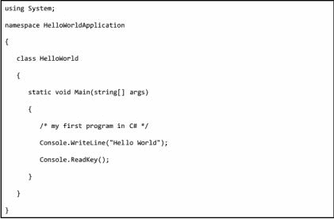

一旦你编译并执行了上述代码，你将得到这条语句：


现在，让我们分析这段简单代码的组成：

* `using System;` - “using”是一个可以将命名空间与程序连接的关键字。通常情况下，一个程序包含许多 `using` 语句。在这种情况下，`using` 被用于将 `System`（即一个命名空间）附加到程序上。
* `namespace` – 这是代码的第二行。基本上，一个命名空间是一组不同的类。在上面的示例中，`HelloWorldApplication`（一个命名空间）包含 `HelloWorld`（一个类）。
* `class` – 这一行被称为“类声明”。它表示 `HelloWorld` 持有程序所需的信息。通常情况下，类持有各种方法。但在这种情况下，该类包含单一方法（即“Main”）。
* `Main` – 该方法作为所有 C# 代码的入口点。`Main` 指定了它所所属类的功能。
* `/*…*/` - C# 编译器忽略这一行。如果你想在程序中添加一些注释，就应该使用它。
* `Console.WriteLine(“Hello World”);` - `Main` 使用这条语句来指定类的行为。
    * `WriteLine` - 该方法属于名为 `Console` 的类。`WriteLine` 让你的屏幕显示代码的消息（即 Hello, World）。
* `Console.ReadKey();` – 这一行是为 VS.NET（即 Visual Studio .NET）的用户设计的。如果你使用 VS.NET 启动程序，`Console.ReadKey()` 会阻止屏幕关闭。

这里是你应该记住的四点：

* 你不必使用类名作为程序的文件名。
* 程序的执行从 `Main` 开始。
* 每个语句和表达式都必须使用分号结束。
* C# 编程语言是区分大小写的。

## 如何编译和执行 C# 程序

### 使用 Visual Studio .NET

如果你使用 VS.NET，你需要采取的步骤如下：

1. 访问 Visual Studio。
2. 转到菜单栏并选择“File（文件）”。然后点击“New（新建）”。
3. 屏幕显示多个模板。寻找“C#”并选择 Windows。
4. 选择 Console Application。
5. 为项目命名并点击 OK。
6. 在代码编辑器中输入代码。
7. 按 F5 运行程序。

### 使用命令行

你也可以使用命令行来编译 C# 程序。这里是你需要做的：

1. 访问你喜欢的文本编辑器。
2. 输入上述代码。
3. 将文件保存到任何目录并命名为 `hw.cs`。
4. 访问计算机命令提示符并指定你选择的目录。
5. 输入 `csc hw.cs` 编译代码。
6. 如果你输入正确，你会看到一个可执行文件 `hw.exe`。
7. 输入 `hw` 运行程序。

# 第三章：基础语法

本章将讨论 C# 中使用的语法。仔细学习这些材料可以帮助你在 2 周内掌握这种语言。

## C# - 面向对象的语言

正如第一章提到的，C# 是面向对象的。这意味着每个程序由可以相互通信的对象组成。对象可以执行操作（称为方法）。

为了帮助你理解这个概念，让我们分析一个简单的对象：矩形。下面的截图显示了 `Rectangle` 类的代码。让我们在学习 C# 基本语法的同时分析这段代码：

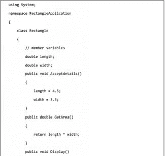

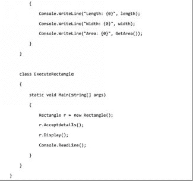

现在，让我们逐一讨论这段代码的各个：

* `using` – 所有 C# 代码都以这一行开始。“using”是一个可以将命名空间与 C# 程序连接的关键字。再次，一个程序可以包含多个 `using` 行。这意味着你可以在每个程序中包含多个命名空间。
* `class` – 你应该使用这个关键字来声明类。
* 注释 – 你应该使用这部分来解释你的代码。通常情况下，C# 编译器忽略这一部分。确保你的多行注释以 `/*` 开始并以 `*/` 结束。查看下面的示例：

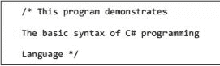

另一方面，对于单行注释使用两个斜杠（即 `//`）。查看下面的示例：

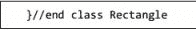

* 成员变量 – 这些是类的数据成员或属性。你应该使用变量来存储数据。对于当前的示例，名为 `Rectangle` 的类有 2 个成员变量：`width` 和 `length`。
* `member functions`（成员函数）——函数是执行特定任务的命令集合。通常情况下，你应该在类内部声明类的函数。在上面提供的程序中，`Rectangle` 拥有 3 个成员函数：`Display`、`GetArea` 和 `AcceptDetails`。

# C# 标识符

标识符（Identifiers）是用于确定类、函数、变量或程序员定义的任何项的名称。在 C# 语言中命名类时，你必须遵循以下规则：

*   每个名称应以字母开头。你可以使用字母、数字和下划线来继续命名。你不能用数字作为标识符的开头。
*   你选择的名称不能包含空格或特殊符号（例如 `?`、`+`、`%` 和 `*`）。但是，如前一条规则所述，在命名标识符时可以使用下划线。
*   你不能使用任何 C# 关键字作为标识符的名称。

## C# 语言的关键字

基本上，关键字（keyword）是指在 C# 语言中具有预定义功能的保留词。你不能在命名标识符时使用关键字。然而，如果你真的想这样做，可以在关键字的开头添加 `@` 符号。

在这个编程语言中，某些标识符（例如 `set`、`get` 等）具有特殊含义。程序员将这些标识符称为“上下文关键字”（contextual keywords）。

你将看到下面的两个表格。这些表格将向你展示 C# 语言中的上下文关键字和保留关键字。

### 上下文关键字

| `set` | `get` | `let` | `add` | `group` | `alias` | `from` |
| :--- | :--- | :--- | :--- | :--- | :--- | :--- |
| `select` | `partial (method` | `global` | `partial (type)` | `dynamic` | `orderby` | `descending` |
| `ascending` | `into` | `remove` | `join` | | | |

### 保留关键字

| `as` | `if` | `is` | `In` | `do` | `try` | `int` |
| :--- | :--- | :--- | :--- | :--- | :--- | :--- |
| `new` | `for` | `out` | `ref` | `goto` | `this` | `else` |
| `void` | `true` | `lock` | `char` | `byte` | `base` | `case` |
| `bool` | `long` | `null` | `uint` | `using` | `sbyte` | `catch` |
| `const` | `break` | `short` | `throw` | `ulong` | `while` | `event` |
| `class` | `float` | `false` | `fixed` | `decimal` | `abstract` | `checked` |
| `continue` | `delegate` | `explicit` | `internal` | `double` | `default` | `finally` |
| `in (as a generic modifier)` | `readonly` | `return` | `sealed` | `interface` | `implicit` | `static` |


| `virtual` | `switch` | `sizeof` | `namespace` | `params` | `foreach` | `protected` |
| `stackalloc` | `string` | `override` | `operator` | `unchecked` | `volatile` | `private` |
| `object` | `public` | `unsafe` | `extern` | `enum` | `typeof` | `ushort` |
| `out (as a generic modifier)` | `struct` | | | | | |

# 第 4 章：C# 中的不同数据类型

本章将讨论你在 C# 中会遇到的各种数据类型。请仔细学习本章。作为一个程序员，你将在代码和语句处理不同类型的数据。这意味着你应该对这些数据类型了如指掌。

在 C# 语言中，变量分为五类。让我们详细讨论每个类型：

## 值类型 (Value Type)

你可以直接给这种变量赋值。如果你需要使用它们，只需访问名为 `System.ValueType` 的类。这些变量在内部存储数据。这意味着它们不涉及第三方工具或机制。下面的列表将向你展示 C# 中可用的值类型：

*   `Int`
*   `long`
*   `char`
*   `bool`
*   `sbyte`
*   `double`
*   `decimal`
*   `byte`
*   `float`
*   `ushort`
*   `uint`
*   `short`
*   `ulong`

## 引用类型 (Reference Type)

属于这种类型的变量不直接存储数据。相反，它们指向存储数据的变量。这意味着如果你想指向文件目录或内存位置，就应该使用这种类型。

## 对象类型 (Object Type)

C# 用户认为此类是该语言中所有数据的核心类。“Object” 是 C# 中名为 `System.Object` 的类的别名。你可以使用 `object` 类型来存储其他类型的数据。然而，在赋值之前，你必须执行类型转换。

将值转换为对象的过程被称为装箱（boxing）。相反，将对象转换为值被称为拆箱（unboxing）。

## 动态类型 (Dynamic Type)

这种变量允许你存储任何值。使用动态变量时，类型检查在运行时进行。以下是你声明时需要使用的语法：

```
dynamic variableName = value;
```

“字面量”（literals）一词指的是固定或不可更改的值：在程序执行期间，你无法更改这些值。字面量也被称为常量。字面量可以任何基本数据类型的形式存在（例如：浮点数常量、整数常量、字符串常量、字符常量等）。此外，你还可以在 C# 语句中使用枚举常量字面量。

# 整数常量

整数常量可以是八进制、十进制或十六进制字面量。你应该使用前缀来指定基数（也称为进制）。请检查此列表：

*   使用 `0` 表示八进制字面量
*   使用 `0x` 或 `0X` 表示十六进制字面量
*   十进制字面量不需要前缀

整数字面量还可以有 `L` 和 `U` 后缀。`L` 用于长整数（long），而 `U` 用于无符号整数（unsigned）。这些后缀不区分大小写。

下面的列表将向你展示有效和无效的整数常量：

*   `131` – 有效
*   `312u` – 有效
*   `0xYoU` – 有效
*   `218` – 无效：数字 `8` 不是八进制。
*   `123UU` – 无效：你不能重复后缀。

这里是第二个示例列表。不过，这个列表将展示不同类型的整数常量：

*   `0123` – 八进制
*   `86` – 十进制
*   `0x5b` – 十六进制
*   `20` – int
*   `20u` – 无符号整数
*   `20l` – 长整数
*   `20ul` – 长无符号整数

# 浮点常量

浮点常量可能包含以下部分：

1.  一个小数点
2.  一个指数
3.  一个整数
4.  一个分数

以下是浮点常量的有效和无效示例：

*   `3.14` – 有效
*   `314-5L` – 有效
*   `310E` – 无效：指数不完整。
*   `310f` – 无效：该常量没有指数或小数点。
*   `.e44` – 无效–此常量缺少分数或整数。

在使用小数时，你应该包含指数、小数点或两者都包含。然而，当你使用指数数字时，你应该包含分数、整数或两者都包含。你应该使用“E”或“e”引入带符号的指数。

# 字符常量

你应该将字符常量放在单引号内。例如，你可以将 `'a'` 存储在普通的 `char` 类型变量中。通常情况下，字符常量可以以简单字符（例如 `'b'`）、通用字符（例如 `'\u03B0'`）或转义序列（例如 `'\t'`）的形式存在。

在 C# 语言中，某些字符由反斜杠引入将获得特殊含义。由于它们具有特殊含义，你可以将它们用于某些功能，如制表符（`\t`）或换行符（`\n`）。下面的列表将向你展示一些转义序列及其含义：

*   `\'` – 代表单引号字符。
*   `\"` – 代表双引号字符。
*   `\\` – 代表反斜杠字符。
*   `\?` – 代表问号。
*   `\a` – 代表蜂鸣或警报。
*   `\b` – 代表退格符。
*   `\n` – 代表换行符。
*   `\f` – 代表分页符。
*   `\t` – 代表水平制表符。
*   `\r` – 代表回车符。
*   `\ooo` – 代表具有 1-3 位数字的八进制。
*   `\v` – 代表垂直制表符。
*   `\xhh…` – 代表具有一个或多个数字的十六进制。

# 字符串常量

你应该使用双引号（即 `""` 或 `@""`）来包裹字符串常量。通常，字符串常量与字符常量相似：它们包含转义序列、通用字符和普通字符。

你可以使用字符串字面量将长行拆分为较短行。然后，你可以使用空格分隔这些短行。下面的列表将向你展示一些字符串常量：

*   `"hi, girl"`
*   `"hi, \ girl"`
*   `"hi," "g" "irl"`
*   `@"hi girl"`

重要提示：上述给出的字符串常量是完全相同的。它们将产生相同的结果：hi girl

# 如何定义字面量

你可以使用 `const`（即 C# 关键字）来定义常量。在定义常量时，你应该使用以下语法：

```
const type variableName = value;
```

# 第 7 章：C# 中的运算符

运算符决定了如何执行逻辑或数学操作。基本上，运算符是用于与 C# 编译器通信的符号。这种编程语言拥有一个强大的预装运算符集合。这些运算符分为六类，即：

*   关系运算符
*   赋值运算符
*   算术运算符
*   位运算符
*   逻辑运算符
*   其他运算符

让我们详细讨论每一类：

## 关系运算符

下表将向你展示 C# 语言中可用的关系运算符。让我们使用两个变量：`X = 2`；`Y = 4`。

*   `==` – 此运算符测试相等性。如果相等，则返回真值。
*   `>` – 此运算符检查操作数大小。如果大于，则返回真值。
*   `<` – 此运算符检查操作数大小。如果小于，则返回真值。
*   `!=` – 此运算符测试是否不相等。如果不相等，则返回真值。
*   `<=` – 此运算符检查操作数大小。如果小于或相等，则返回真值。
*   `>=` – 此运算符检查操作数大小。如果大于或相等，则返回真值。

## 赋值运算符

下面的列表显示了赋值运算符：

*   `=` – 赋值运算符可以将右操作数的值复制给左侧。例如：`Z = X`。
*   `+=` – 此运算符称为“加”。它可以将右操作数的值加到左操作数上，并将结果赋值给左侧。例如：`Z += X`。
*   `-=` – 此运算符称为“减”。它可以从左操作数中减去右操作数的值，并将结果赋值给左侧。例如：`Z -= X`。
*   `*=` – 此运算符称为“乘”。它可以将左操作数与右操作数相乘，并将结果赋值给左侧。例如：`Z *= X`。
*   `/=` – 此运算符称为“除”。它可以用左操作数除以右操作数，并将结果赋值给左侧。例如：`Z /= X`。
*   `%=` – 此运算符称为“取模”。它使用两个操作数取模，并将结果赋值给左侧。例如：`Z %= X`。
*   `<<=` – 此运算符称为“左移”。它根据右侧指定的位数将左操作数的值向左移动，然后将结果赋值给左侧。例如：`Z <<= 3`。
*   `>>=` – 此运算符称为“右移”。它根据右侧指定的位数将左操作数的值向右移动。检查此示例：`(X >>= 3)` 等于 `(X = X >> 3)`。

## 算术运算符

列表显示了 C# 语言中可用的算术运算符。为了帮助理解每个运算符，我们使用变量 X = 2 和 Y = 4。

*   `+` – 此运算符相加操作数（例如 `X + Y = 6`）。
*   `-` – 此运算符从第一个变量中减去第二个变量的值（例如 `Y - X = 2`）。
*   `*` – 此运算符将操作数相乘（例如 `X * Y = 8`）。
*   `/` – 此运算符使用分母除以分子（例如 `Y / X = 2`）。
*   `++` – 这被称为递增运算符。它将变量的值增加 1（例如 `X++ = 3`）。
*   `--` – 这被称为递减运算符。它将变量的值减少 1（例如 `Y-- = 3`）。

## 位运算符

你可以使用位运算符来对位（bits）进行操作。通过这一类运算符，你将能够执行逐位操作。下图包含了 `^`、`|` 和 `&` 的真值表。

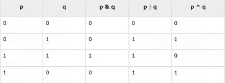

对于接下来的示例，假设 `X` 为 60，`Y` 为 13。让我们将它们转换为二进制元素：

```
X = 0011 1100
Y = 0000 1101
```

现在，让我们对这些变量进行位操作：

```
X | Y = 0011 1101
X & Y = 0000 1100
~X = 1100 0011
X ^ Y = 0011 0001
```

下面的列表显示了 C# 语言中可用的位运算符。让我们使用相同的值：`X = 60`；`Y = 13`。

*   `&` – 此二进制运算符被称为“与”（AND）。如果两个操作数具有相同的位，则该位将被复制到结果中。例如：`(X & Y) = 12`，即 `0000 1100`。
*   `|` – 此运算符被称为“或”（OR）。它会复制一个操作数中存在的位。例如：`(X | Y) = 61`，即 `0011 1101`。
*   `^` – 此二进制运算符被称为异或（XOR）。它复制仅存在于一个操作数中的位。因此，异或不会复制两个操作数中都存在的位。这是一个示例：`(X ^ Y) = 49`，即 `0011 0001`。
*   `~` – 这是一个一元运算符。在 C# 编程语言中使用时，它会“翻转”位。这是一个示例：`(~X) = -61`，即 `1100 0011`（补码形式）。
*   `>>` – 这被称为“右移运算符”。它根据右操作数指示的位，将左操作数的值向右移动。这是一个示例：`X >> 2 = 15`，即 `0000 1111`。
*   `<<` – 这被称为左移运算符。它根据右操作数指示的位，将左操作数的值向左移动。例如：`X << 2 = 240`，即 `1111 0000`。

## 逻辑运算符

下面的列表将向你展示 C# 中的逻辑运算符。让我们给 `X` 和 `Y` 分配布尔值。`X` 拥有“TRUE”，而 `Y` 拥有“False”。

*   `||` – 此运算符被称为“逻辑或”。如果其中一个操作数不等于零，则条件为真。例如：`(X || Y)` 为真。
*   `&&` – 此运算符被称为“逻辑与”。如果所有操作数都不等于零，则条件为真。例如：`(X && Y)` 为假。
*   `!` – 此运算符被称为“逻辑非”。你应该使用它来反转操作数的状态。如果条件为真，此运算符将变为假。`!(X || Y)` 为假。

## 杂项运算符

C# 编程语言支持其他运算符。以下是重要的运算符：

*   `sizeof()` – 此运算符可以识别任何数据类型的大小。例如，`sizeof(int)` 可以给你 4。
*   `typeof()` – 此运算符可以识别任何类的类型。例如：`typeof(StreamReader)`。
*   `&` – 你可以使用此运算符确定任何变量的地址。例如，`&x` 将给你名为“x”的变量地址。
*   `*` – 你可以使用此运算符创建指向任何变量的指针。例如：你可以使用 `*x` 创建一个指针，将其命名为“x”，并将其赋值给任何变量。
*   `?:` – 此运算符被称为“条件表达式”。它根据条件为任何变量赋值。例如：如果其条件为真，它可能会将 `X` 的值赋给变量。然而，如果条件为假，它将赋予 `Y` 的值。
*   `is` – 你可以使用此运算符来确定对象是否属于特定类型。这里有一个示例：`if (Gucci is Bag)` // 将检查名为 `Gucci` 的对象是否属于名为 `Bag` 的类。

# 第 8 章：C# 中的循环

在某些情况下，你必须执行多次代码块。然而，重复地输入相同的语句是无聊且耗时的。这意味着你应该找到一种快速简单地重复代码块的方法。如果你不知道如何实现这一点，本章将对你有很大帮助。

**重要提示**：语句通常按顺序执行。这意味着首先执行第一个语句，然后是下一个等。你在阅读本章时应该记住这个概念。与其他编程语言一样，C# 在执行方面提供了不同的控制结构。

## While 循环

当条件为真时，`while` 循环会重复执行语句或语句组。其语法如下：

```
while (condition) {
    // 语句块
}
```

## For 循环

`for` 循环用于执行特定次数的语句序列。其语法如下：

```
for (init; condition; increment) {
    // 语句块
}
```

## 嵌套循环

C# 编程语言允许你在循环内部放置循环。这意味着你可以在程序中组合不同类型的循环。你必须使用的语法取决于你想要作为“容器”的循环。

# 目录

- 引言
- 第 1 章：什么是 Python？
- 第 2 章：Python 的交互式模式
- 第 3 章：基础知识
- 第 4 章：序列
- 第 5 章：不同的数据类型
- 第 6 章：你将遇到的错误
- 结语

# 引言

我想感谢你，并祝贺你下载了《初学者 Python 编程》（Python Programming for Beginners）这本书。

本书包含了掌握 Python 编程语言基础元素的经过验证的步骤和策略。

本电子书将教你关于 Python 的重要信息。它将解释 Python 程序员正在使用的概念和想法。此外，它还为你提供了实际的代码和语句。这意味着你将了解 Python 语言的理论和实践方面。

在本书中你将学习到：

*   什么是 Python
*   如何使用 Python
*   常见的 Python 数据
*   以及更多内容！

再次感谢下载本书。希望你阅读愉快！

# 第 1 章：什么是 Python？

Python 是一种高级且结构化的编程语言。你可以使用它来完成各种编程任务。此外，Python 是一种开源语言：全球数以万计的计算机专家都在使用并改进它。一位名叫 Guido Van Rossum 的荷兰程序员在 90 年代初创建了 Python。他以一个名为《蒙提·派森的飞行马戏团》（Monty Python’s Flying Circus）的喜剧节目命名它。

计算机专家认为 Python 是一种强大的编程语言。系统管理员使用它开发不同类型的计算机软件。实际上，Python 极大帮助了 Linux 系统的改进。Linux 的大部分组件都是使用 Python 编写的。IT 也使用这种语言教授基础编程。这意味着 Python 是多功能、强大且易学习的。

在执行之前，这种编程语言会自动编译成字节码。系统将字节码保存在硬盘上。这意味着除非修改源代码，否则用户不需要执行编译。此外，Python 是一种动态类型编程语言，允许（但并不要求）面向对象的结构和特性。

与其他编程语言不同，Python 将空格视为其代码的重要部分。事实上，空格的意义是 Python 最显著的特征。Python 不使用块分隔符（C 语言使用的），而是使用缩进来指示代码块的起点和终点。

Python 的另一个酷之处是它适用于所有平台。你可以轻松地在 Linux、Macintosh 和 Windows 计算机上安装和使用 Python。这意味着使用这种语言编写的计算机程序具有极强的移植性：你可以在任何平台上使用它们。

# 第 2 章：Python 的交互式模式

Python 编程语言有两种不同的模式：

1.  **普通模式** —— 在此模式下，你将使用内置解释器运行脚本和完成的 Python 文件。
2.  **交互模式** —— 这是一个命令行程序，可以对你的每个语句提供即时反馈。该模式在执行存储在内存之前的语句时提供反馈。从技术上讲，交互模式在新的语句输入 Python 解释器时，单独和整体地评估语句。


# 交互模式

本章将重点介绍交互模式。要激活它，只需输入 `python` 而不添加任何参数。这是学习编程语言的极佳方法：你可以尝试各种语句和语法变化。输入 `python` 后，屏幕将显示类似下面的消息：

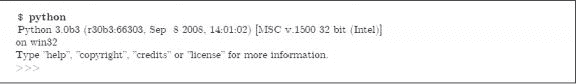

> **注意**：如果 Python 无法运行，请检查是否已添加到系统的 PATH 中。

# 第 3 章：基础知识

在本节中，你将学习 Python 语言的基础。接下来的页面将教你如何创建程序。

## 如何创建 Python 程序

通常，使用 Python 创建的程序是普通的文本文件。这意味着你可以用典型的文本编辑器对其进行编辑。使用你喜欢的编辑器：

## 你的第一个程序

没有经验的程序员通过编写“Hello, World!”程序开始他们的 Python 之旅。在这里，程序简单地输出“Hello, World!”然后自行关闭。尝试这个简单的练习：

1. 打开你喜欢的编辑器。
2. 创建一个文件并将其保存为 `hello.py`。在该文件中输入以下内容：

```
print("Hello, World!")
```

“Hello, World!”程序利用 `print()`，该函数将语句的参数发送到机器的终端。`print()` 函数在语句输出中添加一个换行符。因此，它会自动将光标转移到下一行。

> **注意**：对于 Python 版本 2，`print` 被视为语句而不是函数。这意味着你可以在不带括号的情况下使用它。在这种情况下，`print` 执行两件事：
>
> * 它将整行发送到终端
> * 它允许用户通过在最后一个字符后放置逗号来指示多行语句

你刚刚完成了自己的程序。现在，你准备好使用 Python 运行它了。注意，此过程取决于你正在使用的操作系统（OS）。

### 对于 Windows 计算机

1. 创建新文件夹。你应该只将此文件夹用于 Python 计算机程序。将 `hello.py` 文件保存在此文件夹中。对于这个练习，假设你将文件夹命名为 `C:\pythonfiles`
2. 启动菜单并选择“运行...”。
3. 在对话框中输入 `cmd` 打开系统的终端。
4. 输入 `cd C:\pythonfiles` 并按回车。此操作将 pythonfiles 文件夹设置为目录。
5. 通过输入 `hello.py` 运行程序。

### 对于 Mac 计算机

创建一个仅用于 Python 程序的文件夹。对于这个练习，将此文件夹命名为 `pythonfiles` 并将其保存在计算机的主目录（Home folder）中。

* 将 `hello.py` 程序保存到 `pythonfiles` 文件夹中。
* 访问电脑的“应用程序”部分，进入“实用工具”，并激活“终端”（Terminal）软件。
* 在对话框中输入 `cd pythonfiles` 并按回车。
* 输入 `python ./hello.py` 来运行 Hello, World! 程序。

### 对于 Linux 电脑

* 创建文件夹并命名为 `pythonfiles`。然后，将 `hello.py` 文件保存其中。
* 激活电脑的终端程序。按照以下指示操作：
    * 对于 KDE 用户–进入主菜单并选择“运行命令...”（Run Command...）。
    * 对于 GNOME 用户–进入主菜单，访问“应用程序”部分，打开“附件”，并选择“终端”（Terminal）。
* 输入 `cd ~/pythonpractice`。
* 输入 `python .hello.py` 运行程序。

## 结果

屏幕必须显示：

```
Hello, World!
```

就是这样。如果你的电脑屏幕显示了这条信息，说明你做得非常好。你距离成为出色的 Python 程序员又近了一步。

## Python 语言中的变量与字符串

本节将重点介绍字符串和变量。作为初学者，你应该知道这两种数据类型在 Python 语言中都起着巨大的作用。

### 变量

基本上，变量是存储可变化的值的对象。这意味着你可以将变量看作可以存放各种物品的盒子。记住，你可以使用变量来保存不同的内容。不过，现在让我们用它们来存储数字。查看下面的截图：

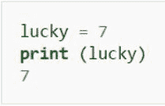

上面的代码生成了一个名为 `lucky` 的变量。随后，它将该变量赋值为一个数字（即 `7`）。如果你“询问”Python 存储在 `lucky` 中的数据，你将得到 `7` 作为响应。

你也可以修改变量内部的值。例如：

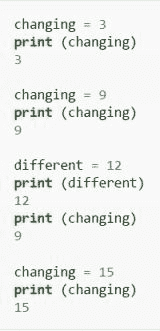

通过上述代码，你保存了一个名为 `changing` 的变量，给它分配了数字 `3`，并确认了第一条语句是正确的。随后，你将数字 `9` 赋值给该变量，并询问系统新的内容。Python 语言将 `3` 替换为了 `9`。

然后，你创建名为 `different` 的新变量。你为这个变量分配了数字 `12`。这意味着你现在有两个不同的变量，即：`changing` 和 `different`。这些变量持有不同的数据——为其中一个设置另一个值不会影响另一个。

Python 允许你将一个现有变量的值赋值给另一个变量。例如：

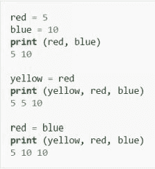

为了防止混淆，请记住变量名始终显示在赋值运算符（即 `=` 号）的左侧。相反，变量的值显示在运算符的右侧。这意味着对于每个变量，你都会先看到名称，然后是值。

起初，代码创建两个变量：`red` 和 `blue`。然后它为每个变量分配了不同的值：分别为 `5` 和 `10`。注意，你可以在 `print()` 函数上放置不同的参数，使其在单行中显示多个项目。结果所示，`red` 持有 `5`，而 `blue` 存储为 `10`。

然后代码创建了另一个变量并命名为 `yellow`。随后，代码指示 Python `yellow` 的值应该与 `red` 相同。因此，Python 将数字 `5` 分配给 `yellow`。

接下来，代码指示 Python `red` 的值必须改变，使其等于 `blue` 的值。`blue` 的值为 `10`，因此 Python 将该数字分配给 `red`（数字 `5` 被“丢弃”了）。在截图的最后部分，Python 显示了 `red`、`blue` 和 `yellow` 的值：分别为 `10`、`10`、`5`。

等等！代码告诉 Python `yellow` 的值必须等于 `red` 的值，不是吗？为什么截图显示 `yellow` 的值为 `5`，尽管 `red` 的值是 `10`？这很简单。代码指示 Python 语言 `yellow` 在编码时应该拥有 `red` 的值。一旦 Python 为后者分配了值，`red` 和 `yellow` 之间的连接就停止了。`yellow` 接收了 `5`——无论其原始源发生什么，`5` 都保持不变（除非给出新的语句）。

### 字符串

基本上，字符串是遵循特定排列的字符列表。

什么是“字符”？让我们这个概念与物理对象联系起来：键盘。任何你使用键盘输入的内容都被视为字符（例如：数字、字母、标点符号等）。

例如，`Birthday` 和 `Halloween` 是字符串。这些字符串由字母（即字符）组成。你也可以在字符串中添加空格：`good morning` 包含 12 个字符：`good` = 4，`space` = 1，`morning` = 7。目前，你可以在 Python 字符串中包含任意数量的字符。这意味着在使用的字符数量上没有限制。实际上，你甚至可以创建一个不包含任何字符的字符串（程序员称之为“空字符串”）。

通过 Python，你可以用三种方式声明字符串：

1. `'`– 使用单引号
2. `"`– 使用双引号
3. `"""`– 使用三引号

上面的程序创建了一个名为 `question` 的变量。然后，它将字符串 `"What did you have for lunch?"` 存储在该变量中。最后，它指示 Python 输出该字符串。

需要注意的是，你不应该给变量加上引号。通过省略引号，你是在告诉 Python 你正在将 `question` 用作变量使用，而不是一个字符串。如果你用引号包裹变量，Python 将其视为一个普通的字符串。它将输出 `"question"` 而不是 `"What did you have for lunch?"`。

## 如何组合字符串和数字

分析下方的截图：

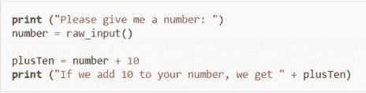

这段代码的设计目的是接收程序员输入的数字，将该数字加 10，并输出总和。然而，如果你运行它，将得到以下错误信息：

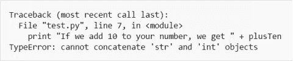

这里发生了什么？Python 并没有输出数字，而是显示了 `TypeError`。此信息意味着输入的信息存在问题。具体来说，Python 无法确定如何组合使用的两种类型的数据：字符串和整数。

例如，Python 假设 `number`（即变量）包含一个字符串，而不是一个数字。如果程序员输入 `"15,"`，Python 会认为该变量持有一个 2 个字符的字符串：`1` 和 `5`。你可以做什么来告诉 Python `15` 是一个数字？

此外，在请求答案时，你正在指示 Python 组合一个数字（即 `plusTen`）和一个字符串。这种编程语言不知道如何实现这一点。Python 只能组合两个字符串。你该如何让 Python 将数字视为字符串，以便将其与不同的字符串一起使用呢？

幸运的是，你有两个强大的函数可以调用：

1. `str()` – 此函数可以将数字转换为字符串。
2. `int()` – 此函数可以将字符串转换为数字。

使用这些函数时，你只需要将想要转换的字符串/数字放在括号内。如果你将此方法应用于之前给代码，你将得到以下结果：

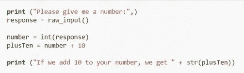

## 基本概念

Python 有 5 个基本概念，即：

1. **作用域 (Scope)** – 对于大型系统，你必须限制代码之间的关系。如果你想防止错误或不可预测的系统行为，这将非常重要。如果不限制代码对其他代码的影响，整个系统可能会变得混乱。

   你可以通过为每位程序员分配特定的名称组来控制代码的 `scope`。例如，一个程序员将使用国家名称，而另一个人将使用动物名称。这种技术可以帮助限制 Python 代码之间的连接。

2. **对象 (Objects)** – 与其他面向对象的语言类似，Python 使用代码和数据组。

   在 Python 中，你将使用 `Classes`（这种编程语言中使用一组模板）来创建（即实例化）对象。对象拥有 `attributes`，它们存储了构成对象的不同数据片段和代码。

   访问对象的属性非常简单：
   1. 输入对象的名称并在后面加一个点。
   2. 指定你想要访问的属性名称。

3. **命名空间 (Namespaces)** – Python 有一个预装的函数 `dir()`，它可以帮助你理解命名空间。在启动 Python 解释器后，你可以使用 `dir()` 显示默认或当前命名空间中的对象。查看下方的截图：

   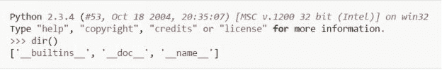

   你还可以使用 `dir()` 列出模块命名空间内的可用名称。在这个示例中，让我们对 `_builtins`（上方截图中的一个对象）使用 `type()`。此函数即 `type()` 允许我们了解对象的文件的类型。查看下方的截图：

   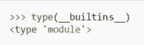

   图片显示 `_builtins_` 是一个模块。这意味着你可以使用 `dir()` 列出 `_builtins_` 内部的名称。你会得到这个结果：

   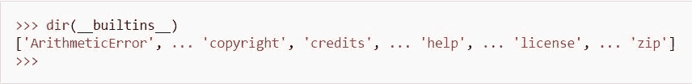

   这个概念很容易理解。基本上，命名空间是名称可以存在的地方。命名空间内的每个名称与命名空间之外的名称完全不同。计算机程序员将这种 `namespace layering` 称为 `scope`。通常情况下，如果名称有值，你应该将它们放在命名空间内。例如：

   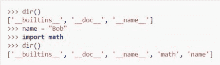

   上面的图片显示，你只需使用一个简单的语句（即 `import`）即可向任何命名空间添加名称。该代码使用 `import` 语句将 `math` 添加到活动命名空间中。如果你想知道那个对象是什么，可以运行此命令：

   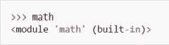

   它说 `math` 是一个模块。因此，它有自己的命名空间。你可以使用 `dir()` 函数显示 math 命名空间内部的名称：

   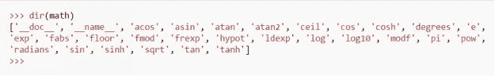

4. **大小写敏感 (Case Sensitivity)** – 变量始终对大小写敏感。这意味着 `"SMITH,"` `"Smith,"` 和 `"smith"` 是三个不同的变量。

5. **制表符和空格不要混合 (Tabs and Spaces Don’t Mix)** – 由于空白在 Python 中很重要，请记住制表符和空格不能混合。在缩进你的 Python 语句时保持一致。如果你使用空格缩进，请坚持使用该字符。这是许多初学者忘记的一个重要概念。

   虽然制表符和空格的外观相同，但 Python 解释器读取时，它们具有不同的含义。这意味着如果你混合使用它们，将会产生错误。

   > **注意**：如果你倾向于使用空格，请确保按下四次空格。

# 第 4 章：序列

序列作为基本结构之一，允许你方便高效地保存值。Python 支持三种类型的序列，即：列表、元组和字符串。让我们详细讨论每种序列：

## 列表 (Lists)

顾其名，列表是按照特定排列的值集合。你可以使用方括号创建列表。例如，你可以使用以下语句创建一个空列表：


你应该使用逗号来分隔值。这里有一个示例列表：


你可以在同一个列表中放置不同类型的值。例如，上面的列表包含数字和字母。

类似于字符串中的字符，你可以使用索引来访问列表项。访问列表项很简单：只需指定所属的列表名称。然后指定列表的项目编号。使用方括号包裹数字。这里有一个示例：


Python 还允许你输入负整数。这些数字从最后一个项开始倒计数。


你可以使用 `len()` 来确定列表中项目的数量。查看下图：


列表在某方面与典型的变量相似：它们允许你更改内部的项目。分析以下示例：


你还可以对字符串进行切片：


Python 提供了向任何列表添加项目的方法。然而，最简单的方法是：


要删除项目，你可以对列表应用 `del` 语句。这里有一个示例：


列表在删除项目后会自动修复。这意味着你不会看到编号之间出现任何间隙。

## 元组 (Tuples)

元组和列表相似，区别在于：元组是不可编辑的。创建元组后，你无法以任何方式对其更改。你不能扩展、编辑或删除元组内的元素。如果你忽略这种不可变性，你可以说列表和元组是相同的。

在声明元组时你应该使用逗号。有时，你必须使用括号来区分元组。这个过程类似于在同一行执行多次赋值。

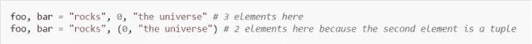

## 字符串 (Strings)

你已经学习过字符串。然而，将其作为 Python 序列来再次讨论是很有重要的。对于其他编程语言，你可以使用方括号（称为下标操作符）来访问字符串内部的字符元素。这种方法在 Python 中同样有效：

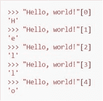

Python 使用此公式为索引分配数字：`0– n1`（`n` 代表字符串中字符的数量）。查看下方的截图：

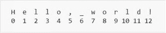

索引与其紧随其之前的字符对应（不，是与其紧随其后的字符对应）。对于负数索引，你应该向后计数：

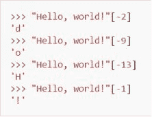

与其他编程语言不同，Python 允许你在方括号内放置最多 2 个数字。你可以使用冒号（即“:”）来实现。对于关注数值索引的序列，括号和冒号的组合会返回索引之间的部分。这种技术被称为“切片”（slicing）。如果你对字符串进行切片，将得到“子字符串”。分析下面的截图：

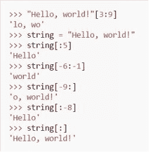

上述语句展示了一个重要的规则：

> “如果你省略一个数字，Python 将假设缺失的数字是该特定序列的开始或结束（取决于缺失数字的位置）。”

## 字典 (Dictionaries)

字典与列表相似。与元组不同，字典允许用户修改其内容。这意味着你可以添加、编辑和删除任何字典的元素。列表和字典的主要区别在于：字典不会将其元素绑定到任何数字上。

字典的元素有两个方面：(1) 键（key）和 (2) 值（value）。如果你调用字典的键，你将获得与特定键相关的值。程序员将列表视为特殊的字典，其中数字代表每个元素的键。

### 如何使用字典

在声明字典时应使用大括号。此外，在声明字典元素时，应使用以下格式：(1) 输入元素的键，(2) 添加冒号，以及 (3) 赋值值。这是一个示例：

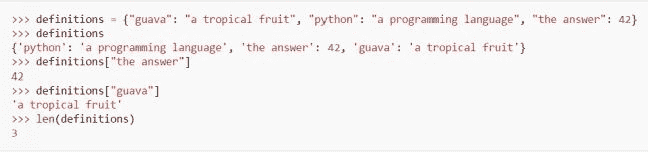

此外，向字典中添加元素非常简单容易。这就像添加普通变量一样：

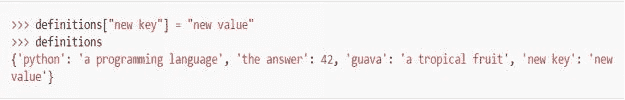

# 第 5 章：不同类型的数据

基本上，数据类型定义了对象的能力。在其他语言中，操作的有效性是通过确保对象无法存储在执行操作的地方来测试的。这种系统被称为静态类型。

然而，Python 使用了不同的方法。这种编程语言允许你将对象的数据类型存储在对象内部。Python 在你运行每个操作时都会检查该操作的有效性。程序员将这种系统称为动态类型。

本章重点介绍你可以与 Python 使用的不同数据。

## 标准类型

Python 拥有一套标准数据类型。这些类型预装在该编程语言中。让我们将这些类型分成若干小组。本节将使用 Python 官方文档中的层级系统：

### 数字类型 (The Numeric Types)

* `int`– 代表整数。对于 Python 2.x，`int` 等同于 C 语言的 longs。


* `long` – 代表长度无限制的长整数。你会在使用 Python 2.x 的系统中找到这种类型。
* `float` – 代表浮点数。`Float` 等同于 C 语言中的 doubles。
* `complex` – 这种类型由复数组成。

### 序列

* `list`
* `tuple`
* `byte` – 这是一个 0-255 范围内的数字序列。你会在使用 Python 3.x 的系统中找到 `bytes`。
* `byte array` – 这是 `bytes` 的可变版本。
* `str` – 代表“字符串”。Python 2.x 系统将字符串表示为 8 位项的序列。然而，Python 3.x 系统将它们表示为 Unicode 项的序列。

### 集合

* `set` – 这是一个无组织的不同对象组。
* `frozen set` – 这种类型是集合的不可变版本。

### 映射

* `dict` – 代表 Python 字典。程序员将这种类型称为“哈希映射”或“关联数组”。通常情况下，字典的每个元素都有相应的定义。

## 可变与不可变对象

在 Python 语言中，数据类型根据其内容的可变性进行分类。请记住，不可变数据类型防止你更改其内部的对象。这意味着你将成功地切片或重新分配可变数据的对象。然而，不可变对象将给你返回错误信息。

这里有一个你应该记住的重要原则：变量是对机器内存中对象的简单引用。假设你使用以下语句将对象和变量配对：

```
s = "123"
```

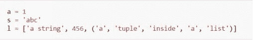

通过上述语句，你正在让变量（即 `1`、`a` 和 `s`）指向某些对象。Python 在机器内存中存储这种变量与对象之间的关系。因此，你可以随心所欲访问对象。

对于下一个示例，假设你使用以下代码执行重新赋值：

```
s = "abc"
```

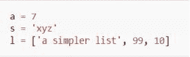

在这个新语句中，你将变量链接到了新对象。正如你之前学过的，`[1]` 是的，但 `a` 会产生错误。

## 如何创建定义类型的对象

* **字面量整数** – 通过以下方式输入：
    * 十进制数字 —— 直接输入。
    * 十六进制数字 —— 在前缀加上 `0X` 或 `0x` 来输入。
    * 八进制数字 —— 输入方法取决于你使用的 Python 版本：
        * 对于 Python 2.x —— 在前缀加上 `0` 来输入。
        * 对于 Python 3.x —— 在前缀加上 `0O` 或 `0o` 来输入。
* **浮点整数** – 直接输入。
* **长整数** – 通过两种方式输入：
    * 直接输入（视为长整数）。
    * 附加字母 `L`（视为长整数）。
    如果涉及短整数的计算溢出，它会自动转换为长整数。
* **复数** – 通过添加两个数字（即一个实数和一个虚数）来输入这种对象。然后通过附加字母 `j` 输入这些数字。这意味着 `11+2j` 和 `11j` 是复数。
* **字符串** – 使用单引号或三引号输入字符串。这两种类型的区别在于它们的界符和潜在长度。单引号字符串限制在单行。你可以使用成对的单引号或双引号输入单引号字符串。查看示例：

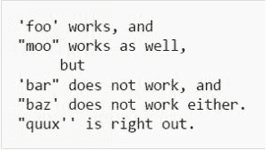

三引号字符串与单引号字符串类似，但它们可以跨越多个行。显然，它们的界符（即引号）应该匹配。你必须使用 3 个单引号或双引号输入这些字符串。这里是你的教学性截图：

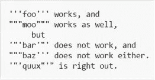

* **元组** – 你可以使用括号输入元组。在对象之间放置逗号来分隔它们。

```
t = (1, 2, 3)
```

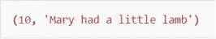

你可以通过在括号内并添加逗号来输入单个元素的元组。这是一个示例：

```
t = (1,)
```

* **列表** – 列表的工作与元组类似，但它们需要方括号：

```
l = [1, 2, 3]
```

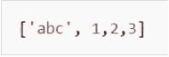

* **字典** – 你可以通过列出一些值对并使用冒号分隔每个对来创建“Python 字典”。使用逗号分隔字典条目。然后，使用大括号包含语句。查看下方的图片：

```
d = {"key": "value", "a": 1}
```


Python 使用 `None` 作为空指针的类比。在这方面，Python 与许多编程语言相似。实际上，`None` 本身并不是空引用或空指针——它是一个只有一个实例的对象。你可以将 `None` 作为函数的默认参数。在 Python 中，你必须使用 `is` 而不是 `==` 来将对象与 `None` 进行比较。

# 第 6 章：你将遇到的错误

Python 用户遇到三种错误：异常、逻辑错误和语法错误。

## 异常

当 Python 解释器无法执行某操作但知道应该做什么时，就会发生这些错误。一个很好的例子是你在离线时运行 Google 搜索：机器知道应该做什么，但无法完成。

## 逻辑错误

逻辑错误极难发现。而且，它们是你遇到的最常见的错误。受逻辑错误影响的 Program 程序仍然运行。然而，它们可能会崩溃或产生意外的结果。

你可以使用调试器来查找并解决程序中的逻辑错误。

## 语法错误

这可能是最基础的一种错误。当 Python 解释器无法理解代码时，就会发生语法错误。根据程序员的说法，大多数情况下语法错误是致命的——你无法执行包含此类错误的代码。

语法错误通常由拼写错误、错误的参数或错误的缩进引起。这意味着每当你遇到语法错误时，都应该检查代码中是否存在这些错误。

# 结

再次感谢你下载本书！

我希望这本书帮助你掌握 Python 的基础知识。

下一步是使用这种强大的计算机语言创建你自己的程序。

最后，如果你喜欢这本书，我想请你一个忙，你是否愿意在 Amazon 上为这本书留个评论呢？我将不胜感激！

[点击此处在 Amazon 上为此书留评！](https://www.amazon.com/review/create-review?ie=UTF8&asin=B018VLTERY&channel=detail-glance&nodeID=133140011&ref_=cm_cr_dp_no_rvw_e&store=digital-text)

另外，请确保订阅我的技术和编程博客，以获取免费书籍并学习更多关于编程的知识。[点击此处](http://kindlebookspot.com/join-our-tech-community/)。

感谢并祝你好运！

[点击此处获取 Bluehost 设置你的 Wordpress 站点的逐步指南。](http://www.passiveincomeassignment.com/2015/12/15/how-to-create-a-website-in-minutes/)

# JavaScript 训练营

## 在两周内学习 JavaScript 编程基础

在 [KindleBookSpot.com](http://kindlebookspot.com) 获取更多免费和优惠书籍

## 目录

* 引言
* 第 1 章：JavaScript 与代码
* 第 2 章：JavaScript 的不同方面
* 第 3 章：JavaScript 中的程序结构
* 第 4 章：关于 JavaScript 函数的更多信息
* 结

# 引言

我想感谢并祝贺你下载了《在两周内学习 JavaScript 编程基础》这本书。

本书包含了如何掌握这种强大语言基础的验证步骤和策略。

这本电子书将帮助你在两周内掌握 JavaScript 基础。为了实现这一点，它专注于这种编程语言中最重要的元素。在使用本书时，你不会读到任何无关的内容。这意味着你只需 14 天就能学到所需的内容，成为一名精通的 JavaScript 用户。

在书中你将学习：

* 什么是 JavaScript
* 如何使用 JavaScript
* 常见的 JavaScript 数据
* 以及更多内容！

再次感谢下载本书，我希望你喜欢它！

# 第 1 章：JavaScript 与代码

## JavaScript–通用信息

JavaScript 于 1995 年发布，作为向网页中添加程序的方法。那时，它专门用于一种名为 `Netscape Navigator` 的网络浏览器。由于 JavaScript 取得的成功，现在所有主流浏览器都支持它。这种语言允许程序员创建现代 Web 程序——你可以在无需为每个操作重新加载网页的情况下与程序进行交互。另一方面，传统网站也使用 JavaScript 提供不同类型的功能和交互性。

此时，你应该知道 JavaScript 与 `Java`（即今天领先的编程语言之一）没有关系。JavaScript 在其存在的第一年被称为 `Mocha` 和 `LiveScript`。然而，由于 `Java` 编程语言非常流行，JavaScript 的所有者决定采用它的名字。这是一种营销策略，旨在利用 `Java` 的人气。

## 代码–通用信息

代码是构成计算机程序和网络应用程序的文本。这本电子书包含大量代码，因此你应该熟悉它们。计算机专家声称，编写代码和阅读代码是成为程序员的重要方面。因此，你应该阅读并理解书中包含的代码。如果你只是扫一眼代码示例，你将剥夺自己极佳的学习机会。

初学者在分析代码时可能会遇到困难。然而，如果他们仔细阅读说明，他们将理解 JavaScript 是如何工作的。最好的办法是用 `JavaScript` 解释器尝试代码示例。这样，一旦代码被编译为程序，你就可以立即获得有关代码外观的反馈。

# 第 2 章：JavaScript 的不同方面

## 数据与位

数据构成了数字世界。如果你访问计算机内部的世界，你会看到这样一件事：数据。你可以读取、编辑和生成数据。每当你保存新数据时，它都会以位的形式存储。这就是为什么存储的数据看起来相似的原因。

在编程中，位是指任何具有两个值的实体（通常由 0 和 1 表示）。你可以将任何数据转换为位序列。这种过程被称为数据到位转换。

## 值

典型的计算机系统涉及数十亿个位。这意味着处理数据可能会很困惑。如果你想处理如此大量的信息，你需要将其分成小块。在 JavaScript 中，这些信息被称为值。尽管所有值都是由位组成的，但它们有不同的类型和功能。JavaScript 支持六种值类型，即：字符串、数字、函数、对象、未定义值布尔值。

生成值只需指示它的名称。这个过程简单快捷。你不需要收集材料或支付任何费用。只需给出名称，砰！你就拥有了。

本章将介绍 JavaScript 语言的基本元素（即运算符和值类型）。这些元素可以与 JavaScript 中的值交互。

现在，让我们谈谈不同的值类型。

## 数字

属于这种类型的值是……你猜对了：数值。在编写 JavaScript 应用程序时，你需要使用以下格式：

```
<number>
```

例如，假设你在 JavaScript 程序中输入了此值：`99`。这将在机器内存中为数字 `99` 创建位序列。

JavaScript 语言使用 `64` 位来存储每个数值。用 `64` 位可以创建的模式是有限的，因此用它们表示的数字也是有限的。对于 `x` 个十进制数字，你可以表示的数字等于 `10x`。同样，由于你有 `64` 位数字，你最多可以表示 `264` 个数值。

以前，计算机内存非常小，人们必须使用 8 位或 16 位的位组来表示数值。由于内存不足，用户在操作 `JavaScript` 时经常会遇到“数据溢出”。然而，现在即使是基础台式电脑也拥有大量的内存。这意味着你可以轻松使用 64 位序列——你再也不需要担心数据溢出的问题了。

数值也可以存储负整数。在这里，其中一个位表示数值的符号（可以是“+”或“-”）。此外，`JavaScript` 支持非整数（即小数）。为了实现这一点，某些位存储了数值中小数点的位置。

你可以使用句号来编写小数和分数。这里有一个示例：

```
99.99
```

另一方面，对于极大或极小的数字，你可以通过添加一个“e”来使用科学计数法。只需在它后面加上正确的指数即可。这是一个示例：

```
9.999e9 = 9.999 x 109
```

整数（也称为整数）的计算是 100%准确的。然而，分数的计算并不准确。例如，“pi”的值无法通过有限的小数精确表示。许多数值丢失了准确性，因为只有 64 位来保存它们。如果你想避免与分数相关的问题，你必须记住这些数字只是估计值。不要把它们视为精确的值。

### 算术运算

这是你对数值进行的操作。通常，算术运算（例如加法、除法、减法等）使用两个数值来生成一个新值。这里有一个用 `JavaScript` 语言编写的算术运算示例：

```
10 + 4 * 5
```

`*` 和 `+` 符号被称为“运算符”。`+` 符号代表加法，而 `*` 代表乘法。你可以通过在两个数值之间放置运算符来生成一个新的数值。需要注意的是，`JavaScript` 中的算术运算遵循运算符优先级（也称为运算顺序）。在这里，你应该按照此顺序执行操作：括号、指数、乘法/除法以及加法/减法。如果你在上面的示例中应用运算符优先级，10 将加到 `4 * 5` 的积上。

你可以使用括号来修改运算顺序。例如：

```
(10 + 4) * 5
```

在 `JavaScript` 语言中，`-` 符号代表减法，而 `/` 代表除法。你不需要担心运算符优先级。但是，如果你不确定，只需在代码中添加括号即可。

### 特殊数字

在使用 `JavaScript` 时，你会遇到三个被称为数字的值，尽管它们的表现并不如此。这些特殊值是：`Infinity`、`-Infinity` 和 `NaN`。`-Infinity` 和 `Infinity` 分别代表负无穷和无穷。通常，你不应该信任基于无穷的计算。这些计算在数学上是不可靠的。

相反，`NaN` 表示“不是数字”。当你执行产生不精确或无结果的算术运算时，就会得到这个特殊值。例如，如果你将零除以零（即 `0 / 0`），就会得到 `NaN`。

### 字符串

你应该使用字符串来表示文本信息。你应该使用引号（即单引号或双引号）来包裹你的字符串。查看以下示例：

```
'Five little monkeys'
"I'm riding a bicycle"
```

在创建字符串时，确保你的引号是一致的。如果你使用双引号开始了一行，请使用相同的符号结束该行。

通常，你可以使用引号包裹几乎任何内容。在对引号之间放置内容，`JavaScript` 语言就会将其转换为可用的字符串值。

### 如何“转义”字符

有时，你需要在语句中添加特殊字符。例如，在编写文本字符串时，你必须添加“换行符”（即按下回车键后得到的字符）。目前，`JavaScript` 要求程序员在引用文本中添加反斜杠。通过放置反斜杠，你是在告诉计算机下一个字符具有特殊功能或含义。这个过程被称为“字符转义”。

紧跟反斜杠后的引号将被视为行的一部分：它们不会终止字符串。如果你在反斜杠后放置 `n`，语句中将添加一个换行符。同样，由反斜杠引入的 `t` 将导致一个“制表符”字符（即你按下 Tab 键后得到的字符）。这里有一个简单的示例：

```
"I'm the first one\nYou are the last"
```

如果你执行上述字符串，将得到以下结果：

```
I'm the first one
You are the last
```

在某些情况下，你希望在代码中使用“普通的”反斜杠。你不希望它成为一个特殊工具。你可以通过在另一个反斜杠之前放置一个反斜杠来实现。也就是说，你正在转义一个反斜杠，以便将其转换为普通字符。分析以下示例：

```
"You should use \\t to add a tab character in your statements"
```

一旦编译并执行，该行将带给你：

```
You should use \t to add a tab character in your statements
```

字符串不是数字，所以你不能对它们执行数学运算。然而，你可以使用 `+` 对字符串进行拼接（即合并）。这里有一个示例：

```
"Jav" +"Sc" +"ript"
```

### 一元运算符

在本节中，你将学习非符号运算符。为了开始讨论，让我们来看看 `typeof`。这个运算符可以帮助你识别值的类型。查看以下示例：


上一节中的运算符需要两个值，而 `typeof` 需要一个。需要两个值的运算符是二元运算符。然而，处理单个值的运算符被称为一元运算符。

### 布尔值

通常，程序员需要区分两个选项的值，例如“开启”或“关闭”，“是”或“否”。为了这个目的，`JavaScript` 语言支持一种类型为 `Boolean` 的值（具有两个值：true 和 false）。

### 比较

你可以使用以下方法创建布尔值：


`<` 和 `>` 字符是用于表示“小于”和“大于”的常用符号。这两个符号都属于“二元运算符”。如果你在代码中应用它们，将得到一个显示为真的布尔值。你可以使用相同的方法比较字符串。


字符串按字母顺序排列。此外，小写字母比大写字母“更重要”。这意味着 `a > b` 是对的。`JavaScript` 在排列字符串时还包含了特殊字符（例如 `-`、`!` 等）。比较过程遵循 Unicode —— 它为你编程可能需要的每个字符分配数字。此功能非常有用，因为它允许你通过将字符串转换为数字序列来存储。在比较字符串值时，`JavaScript` 从左到右工作，它检查每个字符的数字序列。


在本节中，你将学习可以应用于 `Boolean` 值本身的各种不同操作。JavaScript 语言提供了三种运算符，即：`and`、`not` 和 `or`。你可以使用这些运算符对 `Boolean` 值进行逻辑处理。正如此，它们被称为“逻辑运算符”。

### a) and

`&&` 符号表示“与”。该运算符是二元运算符。此外，只有当你处理的两个值都为真（true）时，它才会提供“true”的结果。以下是一些示例：

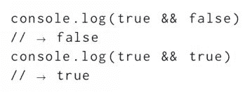

### b) or

如果你想使用 `or` 运算符，应该使用 `||` 符号。如果你处理的值中其中一个为真，“或”将带给你一个“true”的结果。请查看下方的图片：

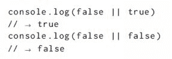

### c) not

你必须使用 `!`（即感叹号）来表示 `not` 运算符。这个逻辑运算符是单元元的：你可以将其用在单个值上。然而，“not”的独特之处在于它会反转你赋值给它的值。例如，`!false` 将给你 true，而 `!true` 将给你 false。

### 三元运算符

这个逻辑运算符作用于三个不同的值。它被称为条件运算符，要求你在脚本中使用 `?` 和 `:`。接下来的代码将向你展示如何如何使用它：

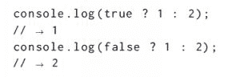

放置在 `?` 左侧的值决定了将选择剩余值中的哪一个。如果为“true”，则选择第一个选项。然而，如果它为 false，则选择第二个选项。

### 未定义值 (Undefined Values)

JavaScript 语言支持两个特殊值来表示缺少有用值。这两个特殊值是 `undefined` 和 `null`。虽然这两个被视为合法的值，但它们不携带任何信息。

通常，如果一个 JavaScript 操作无法生成有用的值，它会输出“undefined”，仅仅因为需要生成一个值。

根据专家介绍，`null` 和 `undefined` 之间的区别是 JavaScript 设计者的失误。这意味着这两个值在大多数情况下被认为是相等的。如果你必须处理这些值，只需将它们视为脚本中可交换的元素即可。

### 如何自动转换类型

你可能知道 JavaScript 接受任何应用，甚至是那些执行不常操作。下面列出的表达式将清晰地演示这一概念：

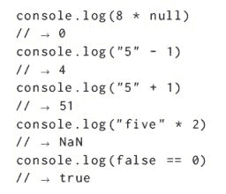

如果你将运算符应用于错误的值类型，JavaScript 将自动将该值转换为正确的类型。JavaScript 使用一组规则来执行此功能，这些规则有时是出意之外或不受欢迎的。程序员将这种自动过程称为“类型转换（type coercion）”。正如此，第一行中的 `null` 被转换为 0，而下一行的“5”被转换为 5（即字符串到数字的转换）。然而，第三行尝试使用 `+` 符号连接值，因此 1 变成了“1”（数字到字符串的转换）。

如果你将一个非数字值（“six”或 `undefined`）转换为数字，你将得到 `NaN` 作为结果。在 `NaN` 值上应用数学运算将产生更多的 `NaNs`，所以如果你在预料之外或不符合预期的情况下获得此值，请检查你的代码中是否存在多余的类型转换。

## 第 3 章：JavaScript 中的程序结构

本章将教你“实际编程”。你将使用的 JavaScript 命令将超出你迄为止所使用的名词和短语。仔细学习这些材料，因为它们将帮助你在两周内掌握 JavaScript 的基础。

### 语句和表达式

在上一一章中，你通过对现有值应用运算符来生成新值。似乎值的创建是 JavaScript 程序中最重要的部分。然而，这只是这门强大语言的一小部分。

创建值的代码部分被称为“表达式（expression）”。因此，任何你字面上编写的值（例如 99 或“ninety-nine”）都属于这一类。即使将它们括在括号中，表达式仍然被称为表达式。同样，即使你使用单元、二元或三元运算符，表达式仍然是表达式。

上面的段落强调了基于语言的编程界面的优势。表达式在任何人类语言中都充当子句——它们可以在内部包含其他表达式。这意味着你可以混合 JavaScript 表达式来描述复杂的计算。

如果表达式等同于子句，那么 JavaScript 语句（statements）等同于完整的句子。基本上，一个 JavaScript 程序只是语句的集合。

最基本的语句类型是一个值后跟一个分号。根据这一原理，我们可以创建这个简单的程序：

```
0;
false;
```

在 JavaScript 中，上述示例被视为一个完整的程序。尽管如此，它是毫无价值的。语句只有当它们执行影响其他事物的操作时才有用（例如在屏幕上显示某些字符、改进编程环境等）。上面显示的两个语句仅仅创建了两个值（即 0 和 false）。它们没有改变或改进任何东西。如果你执行此程序，将不会观察到任何显著的变化。

### 变量 (Variables)

JavaScript 程序如何保持自身？它们是如何存储东西的？你已经看到如何使用旧值创建新值。然而，该过程并没有修改预先的值。你还需要立即使用结果值，否则它们将消失。为了捕捉和持有值，JavaScript 提供了变量。

```
var example = 3 * 3;
```

在这个示例中，`var`（JavaScript 的关键字之一）指示该行将创建一个变量。关键字后面是变量名，如果你想赋值，则跟一个 `=` 号。该语句生成了一个名为 `example` 的变量，并用它存储 `3 * 3`。

一旦你定义了变量，就可以在未来的语句中使用它的名称。从该表达式获得的值与你创建时赋值的值相同。请查看以下示例：

```
var three = 3;
console.log(three * three);
// -> 9
```

命名变量时，可以使用任何不是关键字的单词（例如 `var`）。你可以在变量中包含数字，但不能使用数字作为开头。例如，`programming1` 是有效的，但 `1programming` 则。此外，命名变量时不能使用空格。在特殊字符方面，你可以使用美元符号（即 `$`）和下划线（即 `_`）。JavaScript 不允许在变量名中使用符号符号。

你可以更改给变量赋值。在 JavaScript 中，你只需对任何变量使用 `=` 号给它一个新的新值。

```
var taste = "bitter";
console.log(taste);
// -> bitter

taste = "sweet";
console.log(taste);
// -> sweet
```

通常，你应该将变量视为触而不是容器。变量抓住值，而不是包含它们。这意味着多个变量可以指向同一个值。

让我们分析一个简单的示例。你需要一个变量来记住约翰欠你多少钱。当他付给你 50 元时，你必须给现有变量分配一个新值。查看下面的几行：

```
var JohnnysDebt = 200;
JohnnysDebt = JohnnysDebt - 50;
console.log(JohnnysDebt);
// -> 150
```

如果你创建一个变量而不赋值，它将被视为是空的。如果你询问它所包含的值，它将带给你“undefined”。

JavaScript 允许你在一个 `var` 语句中包含多个变量。在使用此功能时，你应该使用逗号分隔变量。这是一个示例：

```
var three = 3, four = 4;
console.log(three + four);
// -> 7
```

### JavaScript 保留字 (Reserved Words in JavaScript)

如之前讨论过的，在命名变量时不能使用关键字。然而，还有其他单词你不能作为变量名，因为 JavaScript 已经为未来的开发保留了这些词。以下是该脚本语言中的一些保留字：

`in`, `do`, `let`, `if`, `new`, `try`, `with`, `case`, `void`, `while`, `false`, `yield`, `extends`, `delete`, `default`, `const`, `debugger`, `class`, `break`, `finally`, `null`, `private`, `return`, `import`, `protected`, `switch`, `super`, `interface`, `instanceof`, `throw`, `implements`

请记住，定义变量时不能使用上述单词。如果你忘记了这条简单的规则，在编写 JavaScript 程序时可能会遇到问题。

## JavaScript 环境

“环境”一词指的是活动值和变量的集合。基本上，在启动 JavaScript 程序时，环境不能为空。环境持有了与语言本身相关的变量，而且通常还拥有允许与计算机系统交互的变量。例如，在网页浏览器中，存在各种函数和变量，用于检查和影响当前网站，并从鼠标和键盘读取输入。

## 函数

默认的 JavaScript 环境涉及函数。函数是与值关联的计算机程序段。你可以应用这些值来激活所关联的程序。例如，在浏览器环境中，`alert`（即一个变量）包含一个显示对话框的函数。这里有一个示例：

```javascript
alert("You are not authorized to access this page!");
```

你可以通过在生成函数值的 JavaScript 表达式后放置圆括号来执行函数。通常，你会指定包含你所需函数的变量名。通过在括号内包围值，你正在将这些值赋值给函数内部的程序。对于上一个示例，“alert”使用赋值的字符串在生成的对话框中显示消息。程序员在引用赋值给函数的值时使用“参数”（arguments）一词。

## “console.log”

在尝试新的字符串或语句时，可以使用 `alert`。然而，由于它要求关闭生成的窗口，你可能会发现这样做既方便又耗时。正因如此，你可能想使用在本书前面的章节中见过的函数：`console.log`。几乎所有的 JavaScript 系统（例如 Node.js、网页浏览器等）都提供此函数，将参数传输到兼容文本的输出设备。

涉及到网页浏览器时，代码的输出会进入 JavaScript 的控制台。虽然浏览器的 GUI 部分通常是隐藏的，但你可以通过按下某些键来访问它（即对于 Windows ，按下 `F12`；对于 Mac ，按下 `Command-Option-I`）。如果你在查看此部分时遇到问题，可以运行设备内搜索“开发者工具”或“Web 控制台”。分析以下示例：

```javascript
var a = 99;
console.log("one hundred minus one is", a);
// -> one hundred minus one is 99
```

如之前讨论过的，命名变量时不能使用句号或逗号。然而，上面的示例中包含了这些。其原因是 `console.log` 并不是一个普通的变量。它是一个 JavaScript 表达式，用于从存储在 `console`（它是一个变量）中的值中收集日志（log）信息。

## 返回值

在屏幕上写入信息和显示对话框被称为“副作用”（side effects）。因为这些副作用，函数在 JavaScript 语言中非常重要。你也可以使用函数来生成值——在这种情况下，函数即使没有副作用也是有用的。例如，`Math.max`（一个 JavaScript 函数）接收无限数量的数值并指示最高的那一个。这里有一个示例：

```javascript
console.log(Math.max(1, 2, 3, 4, 5));
// -> 5
```

在 JavaScript 中，任何生成值的内容都被视为表达式。这意味着你可以在大型表达式执行函数调用。在下面的示例中，你将使用 `Math.min` 函数作为 `+` 运算符的输入：

```javascript
console.log(Math.min(1, 2) + 98);
// -> 99
```

## 第 4 章：关于 JavaScript 函数更多信息

在上一节中，你学习了如何创建和调用函数值。本章将帮助你进一步理解这个重要主题。根据专家程序员的说法，函数是你使用 JavaScript 主要工具。函数是强大的工具，可以帮助设计大型程序、减少冗余、命名子程序并为每个子程序提供安全的隔离。这意味着如果你想有效地使用 JavaScript，就必须掌握函数。本章将帮助你在两周内学会这种脚本语言。

许多人应用函数来定义新的词汇。这意味着你可以使用它们来创建单词并分配含义。

一个普通的英语母语者词汇量大约有 20,000 个单词。然而，编程语言通常没有那么多内置命令。这意味着编程中的词汇比人类语言中的词汇更精确。如果你想减少冗余，就必须将自己的单词加入 JavaScript 并创建你自己的词汇。

## 如何定义函数

定义函数就像定义普通变量。唯一的区别在于你正在赋值的值是一个函数。例如，下面的代码定义了一个名为“square”的变量。该变量指向一个函数，该函数生成任何赋值数字的平方。

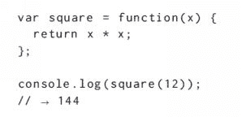

创建函数时，你应该用 `function` 关键字开始表达式。每个函数都有两个部分：(1) 函数体和 (2) 参数。函数体存储了你在调用时想要执行的 JavaScript 语句。此外，你应该始终用括号包围函数体（即使它只有一个语句）。

另一方面，参数是定义中列出的名称。函数可以有一个或多个参数。实际上，你甚至可以创建一个没有任何参数的函数。为了帮助你理解这个概念，让我们创建两个函数：`makeNoise` 和 `power`。

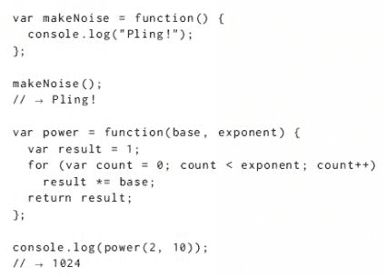

你可以看到，`makeNoise` 没有参数。同时，“power”有两个参数（即 `base` 和 `exponent`）。

## JavaScript 中的参数和作用域

函数的参数行为类似于普通变量，尽管它们的原始值来自程序员，而不是它们所关联的函数。

这是任何函数的一个重要属性：在函数内部创建的所有变量（甚至是参数）都是局部的。这意味着，例如 `power` 语句中的 `result` 在每次函数被调用时都会刷新。这些独立的重复操作不会相互影响。

重要的是，这种“局部性原则”仅适用于使用 `var` 定义的变量和参数。此外，你应该在函数体内定义变量和参数。定义在函数外的变量被称为全局变量，因为可以在整个 JavaScript 应用程序中可见并访问。如果没有对应的局部对应项，你可以在函数内部访问全局变量和参数。

下面的代码说明了这一概念。它声明并调用了两个给“x”赋值的函数。第一个函数将该变量定义为局部的。而第二个函数则不是。这意味着如果你在函数内部引用 `x`，你指向的是全局 `x`（如示例的第一行所示）。

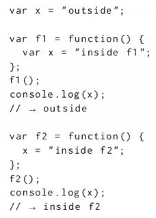

此功能可以帮助你防止不同函数之间意外的引用或交互。如果 `JavaScript` 允许你在整个程序中共享所有变量，你将不得不花费大量精力和精力确保名称不重复。重用变量名可能会对你的代码产生意想不到或不理想的影响。因此，它可能会破坏你正在编写的程序。

由于这种语言将局部变量视为仅存在于其各自函数内部，因此它可以将各个函数视为不同的独立世界。每当你编写单个函数时，`JavaScript` 不需要担心整个应用程序。

## 嵌套作用域

除了定义局部变量和全局变量之外，`JavaScript` 还使用其他方法来区分不同类型的函数。例如，你可以在现有函数内部创建函数。这种技术产生了多个级别的局部性。

例如，下面的函数包含了两个函数：

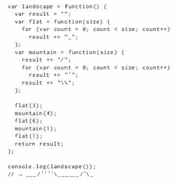

这两个函数（即 `flat` 和 `mountain`）都可以访问 `result` 变量，因为它们被放置在声明该变量的函数内部。然而，它们无法访问对方的变量。这意味着位于函数外部程序环境无法访问其包含的变量。

使用过其他语言的程序员可能会认为，他们可以使用大括号包裹代码块来创建新的局部环境。但在 `JavaScript` 中，只有函数可以生成新的作用域。

## 将函数作为普通值

通常，函数变量作为程序某些部分的名称。你不能修改现有的函数变量：一旦你定义了它们，它们就会阻止你执行任何后续修改。这种特性可能会导致关于名称及其所指函数之间的产生混淆。

显然，函数和变量是两个不同的东西。函数值可以执行普通值可以做的事情——你可以在复杂表达式中调用并使用它们。你可以更改函数值的位置，将其作为函数的参数传递等。同样，包含函数的变量仍然被视为普通变量。这意味着你可以给它们赋予新值。

### 声明

`JavaScript` 提供了一种快速简单的方法来声明函数。你只需要使用 `function` 关键字开始你的语句即可。例如：

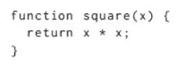

上面的语句被称为“声明”。它定义了一个名为 `square` 的变量，并赋予它一个特定的函数。这个例子很容易理解。然而，这种定义函数的方法有一个微妙之处：

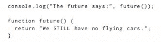

最后一个示例运行得完美，即使该函数被声明在赋值给它的代码下方。这段代码是有效的，因为声明忽略了从上到下的语句结构。你实际上可以将声明移动到作用域的顶部，以便局部代码可以访问它。此功能非常有用，因为它允许你以有意义的方式安排代码，而无需定义所有受影响的函数。

### 可选参数

`JavaScript` 语言接受下面的代码。调用时不会遇到任何问题。

```
alert("Hi", "Good Morning", "How are you?");
```

从官方来说，`alert` 函数只接受一个参数。然而，如果你使用上面的示例代码调用它，它不会报错。它只会接受第一个参数（即“Hi”）并忽略其余部分。

这种编程语言在考虑分配给函数的参数数量时是“开放心态”的。如果你分配了太多的参数，它会接受有效的参数并忽略其他的。然而，如果你的参数不够，`JavaScript` 将通过为适当的参数分配 `undefined` 来完成你的语句。

## 结论

再次感谢你下载这本书！

我希望这本书能够帮助你在两周内学会 `JavaScript` 的基础知识。

下一步是开始使用这种强大的脚本语言编写你自己的应用程序。

最后，如果你喜欢这本书，我想请你一个忙，你是否愿意在 Amazon 上为这本书留个评论？将不胜感激！


[点击此处在 Amazon 上为这本书留评！](https://www.amazon.com/review/create-review?ie=UTF8&asin=B019L4NETY&channel=detail-glance&nodeID=133140011&ref_=cm_cr_dp_no_rvw_e&store=digital-text)

别忘了订阅我的技术和编程新闻邮件，以获取你的免费书籍并学习更多编程的知识。[点击此处](http://kindlebookspot.com/join-our-tech-community/)。

谢谢，祝你好运！

[点击此处获取使用 Bluehost 设置你的 Wordpress 站的分步骤说明。](http://www.passiveincomeassignment.com/2015/12/15/how-to-create-a-website-in-minutes/)

# SEO 训练营

## 在两周内学习 SEO 基础

在 [KindleBookSpot.com](http://kindlebookspot.com) 获取更多免费和廉价书籍

# 目录

*   引言
*   第 1 章：什么是 SEO 以及为什么它对你的网站很重要？
*   第 2 章：搜索技术的局限性
*   第 3 章：你的目标用户：搜索营销策略的起点
*   第 4 章：选择关键词进行排名
*   第 5 章：用户体验影响你的排名
*   第 6 章：构建你网页的链接配置
*   结论

# 引言

我想感谢你并祝贺你下载了《在两周内学会 SEO 基础》这本书。书中包含了如何进入搜索引擎结果顶部的经过验证的步骤和策略。大多数业余营销人员都在寻找最快的排名方法。因为这个原因，很多人受到了搜索更新的影响。这本书为你提供了正确的排名方法。这些技术是由白帽 SEO 专业人士尝试并测试过的。使用这些技术，即使在大算法发布时你的流量也不会产生重大波动。

（提供关于书籍的任何额外信息。确保引言推销这本书，因为人们在 Amazon 或 Kindle 上预览时可以看到。你可以自己写，也可以请求你的书作者来写）。

再次感谢下载本书，希望你喜欢！

# 第 1 章：什么是 SEO 以及为什么它对你的网站很重要？

## 我在哪里/如何可以找到事物的名称？

有些人使用查询语句来寻找特定的现实世界事物或地点。一个人可能正在寻找纽约周边的二手车。他通过输入以下内容让搜索引擎查找所有发布的关于二手车的分类广告：

“纽约市二手汽车广告 (Second-hand cars in New York City classified ads)”

他发现结果太多，于是他将搜索范围缩小到：

“曼哈顿二手雷克斯 (Second-hand Lexus in Manhattan craigslist)”

## 什么、何时和哪里的问题

然而，大多数时候，人们使用搜索引擎来查找信息。例如，有些人使用搜索引擎为他们的学校作业寻找答案。许多人也会去搜索引擎查找与自己相关的时事新闻。与其查找电话簿，人们还发现通过互联网查找企业的地址和联系电话更快。

[公司名称]的网站是什么？

最后，人们使用搜索引擎访问网络上的特定区域。例如，有些人想访问他们当地报纸的网站。他们不知道确切的网址地址，所以他们要求 `google` 引导他们到达那里。

搜索引擎已成为发达国家大多数人答案的首要来源。`Google` 等搜索引擎的大多数用户信任算法编制的搜索结果。大多数人期望在顶部结果中找到查询的答案。如果前五个结果似乎没有他们问题的答案，人们倾向于认为他们在查询中使用的短语有问题。大多数人会完善他们的搜索，就像那个在纽约寻找二手雷克斯的人一样。

## 这对你的网站有什么影响？

如果你想让网站获得更多流量，你需要了解搜索引擎是如何工作的，并且你需要优化你的网页，以便它们被爬取、索引并显示在搜索结果页的顶部。

对于 SEO 来说，出现在搜索中是不够的。顶部结果的点击率超过了 18%。你的页面在搜索引擎结果页上的排名越靠后，点击次数就越少。

在智能手机时代，人们最初认为网站的普及将开始下降。普通人认为 App 将取代搜索。如果这真的发生了，到目前还没有出现。尽管在桌面电脑前花费的时间减少了，人们仍然在使用搜索来寻找他们需要的信息和想要的物品。针对手机屏幕优化的网站将获得来自移动搜索的大部分流量。

## 第 1 和第 2 天的活动：决定你网站的主题或利基市场

如果你的网站专注于一个主题，你的网站更容易获得排名。如果你已经有一个通用信息网站或博客，你可以根据已经拥有的热门帖子或内容来决定要追求的最佳主题。

在考虑网站的主题或利基市场时，你还应该考虑你建立它的个人目标。你从现在起创建的内容类型应该让你离目标更近。

# 第 2 章：搜索技术的局限性

搜索引擎是在网络上查找信息的最流行的工具。然而，即使搜索算法和页面爬取技术有了所有改进，这个工具仍然有很多局限性。例如，搜索引擎在爬取和索引网页后，无法直接判断网页是否对用户相关。它需要寻找更多线索，以知道某个页面是否应该出现在某些关键词的搜索结果顶部。

作为网站站长和搜索营销人员，你的工作是为搜索引擎提供所需的线索，将你放在顶部结果中。搜索引擎专家将这些线索称为 `排名因素 (ranking factors)`。排名因素是搜索引擎蜘蛛在访问你的网站时寻找的信息。它们在索引期间编制这些排名因素。网页在关键词搜索结果中的位置将取决于基于这些因素的排名分得分。

即使考虑到数百个排名因素，搜索引擎仍然有许多局限性。

## 搜索引擎的局限性是什么？

### 爬虫机器人依赖链接进行跳转

搜索引擎爬虫的目的是为整个可搜索的互联网制作虚拟地图，我们指的是普通人可以访问的互联网部分。为了从一个页面跳转到另一个页面，它们使用所爬取页面中的超链接。这些数字桥梁是一个重要的排名因素。

如果你的网站中有某些页面没有指向它的链接，你应该预料它将不会被索引，也不会出现在搜索结果页中。

### 它们无法爬取受在线表单保护的页面

网站要求访问者成为成员是很常见的。要成为成员，你需要填写会员表单。搜索引擎并不具备填写所有类型表单的程序。由于此，它们无法爬取站长专为展示给成员的任何信息。

### 它们专门用于文本内容

搜索引擎爬虫专门于从基于文本的网站收集信息。它们收集和组织非文本内容信息的能力受到严重限制。例如，爬虫机器人无法自行判断图片看起来什么样。它们在处理视频、音频、图像、Flash 和插件内容时也面临类似的挑战。

为了解决这个问题，搜索公司要求站长在这些内容中包含文本信息。没有这些额外信息，网页中的某些类型内容在排名时将不会被赋予太权重。

### 它们需要关键词匹配

当用户使用搜索引擎时，他们通常输入一个描述他们正在寻找的内容短语。搜索引擎算法已经进化，它们比以往任何时候都有能力在 90% 的时间内为你提供相关的网页。然而，如果用户没有使用术语，可能会遇到一些问题。数百万用户在搜索内容时使用不常用的术语。

这种局限性在刚接触英语的人中很常见。当他们不知道某个词时，他们可能会使用形容词来描述它。英语母语者知道他可能想表达什么，但搜索引擎并没有理解非母语者可能请求内容的程序。

当我们使用搜索 AI 不熟悉的语言细微差别时，这个问题也变得难以处理。例如，不同英语国家之间相同单词的拼写差异会影响你的搜索结果排名。如果如果你一直使用 `behaviour` 代替 `behavior`，搜索引擎可能会认为你的网页是为英国用户设计的。这将影响你在美国用户中的排名。

搜索营销的成功在很大程度上取决于你对所用语言的了解。例如，如果你针对特定的少数群体作为网站的潜在访问者，你应该了解他们使用语言的细微差别。了解他们的搜索行为也有帮助。

*   **专有名词与通用名称**

    由于对关键词的依赖，搜索引擎面临着在正确语境下阅读单词的挑战。当用户使用具有多种含义的关键词时，这一挑战变得更加困难。例如，流行文化一直在广泛使用“黑色（black）”这个词。歌曲、电影和品牌都包含了这个词。在搜索中输入这些词的人也可能指的是他们正在寻找的物品的颜色。因此，搜索引擎用户在搜索时倾向于使用更长的短语，以使结果更符合他们的特定需求。由于这种搜索行为，网站管理员开始针对长尾关键词。这些是人们在搜索时通常使用的短语，长度通常超过三个单词，并且指的是搜索者非常具体的需求。

搜索技术在不断变化。工程师们继续开发新形式的技术，以便 `A.I.` 能够克服这些局限性。正因为有了这些局限性，我们需要针对用户和搜索引擎优化我们的网页。

## 第 3 和第 4 天的活动

你应该花时间回顾本章讨论的搜索引擎局限性，并思考你的潜在访问者通过搜索引擎访问你网站时面临的困难。

你还应该花时间检查你的网站在搜索引擎结果页中的可见性。使用你所在行业或利基市场的通用关键词和短语。如果你无法在前三页找到你的网站，那么你需要做大量工作。如果你在前三页中但不在第一页，你的目标就是向上爬。无论你的位置如何，你都应该使用书中的策略和信息来提高你网站的排名。

# 第 3 章：你的目标用户：搜索营销策略的开始

在为网站制定搜索营销策略时，你需要开始考虑那些可能从你网站找到的信息中发现价值的人群。他们是那些在搜索结果页上看到你的网页时最可能点击它的人。搜索引擎桥起了你的网站内容与需要这些内容的人之间的鸿沟。

## 为你的目标搜索引擎用户建立画像

互联网用户每月进行数十亿搜索。然而，并非所有的搜索对你的网站都有价值。寻找你网站中类型信息的人数取决于你网站所属的行业或利基市场的流行程度。利基市场越热门，搜索者越多。然而，热门的利基市场也意味着竞争激烈。

为了脱而出，你需要了解你的理想访问者。你可以通过为你的网站创建一个理想访问者画像来实现。如果你已经有一个运行了一段时间的网站，你可能通过你使用的分析软件收集一些关于访问你网站的人群类型的信息。以下是你将需要的关于访问者的几类信息：

*   年龄
*   性别
*   语言
*   位置
*   共同兴趣

通过获取这些类型的信息，你将猜出人们在使用搜索引擎时最可能使用的词。根据你拥有的网站类型，你可能还需要一些额外信息。

## 你对访问者的目标

在创建了理想访问者画像后，你需要决定你希望这些人在到达你的网站时做什么。如果你在网站上销售某些东西，你可能需要调整设计，以确保用户可以从你的索引页面开始购买。

其他网站则希望他们的访问者填写表单、回答调查或注册会员。

设定目标还允许你精炼你所针对的关键词类型。例如，如果你在销售某些东西，你可能需要针对与购买相关的短语。某些营销人员只针对处于购买过程后期的人所使用的短语。

## 第 5 和第 6 天的活动：识别你的目标用户

下一个活动是识别你网站理想访问者的特征。理想访问者是指那些最可能完成你想要实现的目标的人。你应该说明这些人的共同点。除了第 3 章中提到的信息外，你还应该研究同样迎合同一目标市场需求的其他网站。你应该查看他们的设计和他们提供的内容类型。

# 第 4 章：选择关键词进行排名

现在你已经知道你的目标访问者是谁了，你需要选择他们在搜索你所提供的信息时会使用的正确关键词。

为了了解你的目标用户正在使用哪些关键词，你需要把自己放在目标用户的立场上。你需要利用你创建的画像中的信息来猜测你应该使用的正确语言类型。

你还需要提醒自己搜索引擎技术具有局限性。你需要确保你的关键词代表了你在页面上显示的内容类型，以及潜在访问者的意图。你的最终目标是提供潜在访问者需要的东西，并将他们转化为买家、订阅者、会员，或者至少是回访者。

大多数初级网站管理员认为他们应该只选择一个强关键词，并将其用于网站的所有页面。对于搜索引擎来说，这种策略看起来会非常像关键词堆砌（`keyword stuffing`）。

如果你想让你的网站成为该主题的主要信息来源，你需要目标是在与网站主题相关的多个关键词上获得良好排名。例如，如果你的网站是关于某个电视节的，你可能想在网站首页中针对它的标题。然后你应该创建与该节目相关的文章或页面，例如关于角色的页面。在该页面中，你可以使用此示例 `[TV show title] characters` 作为你的主关键词。

有免费和付费工具可以帮助你找到某些主题最常用的关键词。其中最流行的工具之一是 `Google Ad Keyword Planner`。

在规划关键词时，你还应该考虑以下因素：

*   你提供的产品或服务的名称：这包括服务的通用名称和品牌。一些考虑购买某些东西的人通常知道他们想要购买的品牌，因此你应该拥有直接回答这些品牌问题的网站内容。
*   与你的产品或服务相关的课题：你还应该提供与你的产品或服务相关主题的内容。例如，许多公司网站包含公司更新。这显示了网站的活跃。
*   季节性热门关键词：你还需要为预计会有高销量和流量的季节准备搜索营销活动。例如，对于零售网站，圣诞节、情人节和感恩节是大活动。在这个季节，人们倾向于在网上为线下购物寻找灵感。你应该利用人们在这些季节挥霍的习惯。

## 在构建网页时使用关键词

每当你创建一个博客文章或新网页时，你都需要考虑你将使用的目标关键词。你应该为你创建的每个页面或文章针对一个主关键词。你的关键词应该与你希望访问者执行的操作保持一致。如果你希望访问者购买某些物品，你的目标就是建立一个网页，针对那些具有购买意图的搜索者所使用的关键词。你也可以创建网页，针对正在研究特定产品的搜索者所使用的关键词。

当你知道要针对哪些关键词进行排名后，你的下一个目标是将它们策略性地放置在你的网页中。在这些位置放置关键词时，你必须确保它们出现得自然。你的首要目标是让人类访问者理解你的内容。用户体验始终比任何 SEO 策略都重要。考虑到这一点，你应该将关键词放置在网站的以下部分：

### URL 扩展名

如果你的域名已经包含了你想要排名的关键词，那将会有帮助。但大多数情况下，你需要在 URL 的后半部分插入关键词，以确保它包含在地址栏中。

### 标题标签 (Title Tag)

标题标签让爬虫了解你的页面的主题。通常情况下，你需要尽早在标题标签中加入关键词。这一策略的挑战在于，当你计划了一个富有创意的标题时。有时，将关键词放在标题标签的开头会让它听起来很生硬。如果是此类情况，你应该优先考虑用户体验。

### 页面顶部

你还应该在内容的第一段中包含关键词。长篇内容并不会被爬虫完全扫描。除了标题标签外，爬虫还会尝试通过前几段来判断你的内容是关于什么的。这就是为什么你需要在这些区域包含你的关键词。

### 页面文本内容

除了第一段外，你还应该在内容的各个部分添加 3-4 次关键词。在这种情况下，你可能需要对主关键词进行变体，使其听起来更自然，并避免让读者感到冗余。

### 图片的 Alt 属性 (Alt-attribute)

你还应该在图片的 `alt` 属性中添加你图片的句子或描述。这将有助于你的图片在搜索引擎的图片搜索功能中获得良好排名。你应该确保只包含与你的内容相关的图片。你应该尝试制作独特的图片和照片。这会让你的图片在图片搜索结果页中脱颖而出，并可能更高的点击率。

### 元描述 (Meta description)

上述的所有其他属性都会让网页在搜索引擎结果页中排名更得好。为了保持你的网页排名高位，你需要确保看到它的人会点击它进入你的页面。网页过期的点击率也是一个重要的排名因素。

两个重要因素会提高你在搜索引擎中的点击率。第一个是你的内容的标题，我们在本节的早些部分讨论过。第二个是标题下方的描述。大多数内容管理软件（`CMS`）默认会使用文本内容的第一部分作为描述。你应该检查你的 `CMS` 如何添加元描述，这样你就可以控制显示在搜索引擎结果页中标题下方的文本。你需要对不同的描述文案进行实验，以获得产生最高点击率的文案。

## 第 7 天和第 8 天的活动：进行关键词研究

当你已经有了一个网站和一个要追寻的主题时，你的下一个动作是寻找那些可以帮助你实现网站目标的关键词和短语。参考本章中的提示，以了解关键词在 SEO 中是如何运作的以及如何使用它们。除了流行的 `Google AdWords Keyword Planner` 之外，还有其他免费的在线工具可以在你为网站寻找最佳关键词时使用：

### Microsoft Bing Ads

这是 `Bing` 版本的关键词规划师。如果你的网站很大一部分流量来自 `Bing`，你也应该使用这个工具。

### Google Trends

`Google Trends` 为你提供了全球范围内使用的流行关键词。它们还允许你检查你国家现在和过去流行的内容。你还可以获得有关某些关键词和短语多年来流行程度波动的洞察。

# 第 5 章：用户体验影响你的排名

在上一章中，我们讨论了保持你的目标关键词与你的网页内容以及访问者的需求保持一致的重要性。

例如，如果你的网站专注于增肌健身设备，你应该针对人们在网上寻找该类型物品时使用的关键词。

当人们在搜索引擎结果页上点击你网页的链接时，他们有你需要满足的预期。在这一特定的例子中，如果你在正确的关键词上排名，访问者可能期望找到不同类型的加重训练工具。你也可以添加增加肌肉生长速度的食品补充剂。

假设你的访问者使用“增肌健身设备”这个短语进入你的网站，但当他们到达网站时，发现你关注的是瑜伽技巧，并且你只评价瑜伽相关产品。在这种情况下，你的访问者会对结果感到稍微失望，并可能点击移动设备或浏览器上的“返回”按钮。

这是一个糟糕用户体验的例子。搜索引擎试图避免将人们引导到错误的网站。它们还试图防止结构不佳的网站获得良好排名。为了确保只有特定主题的最佳网站才能获得搜索结果页的顶端，搜索引擎算法考虑了多个排名因素。检查你的网站是否符合以下有助于获得良好用户体验的排名因素：

## 关键词与主题的对齐

要考虑的第一个因素是你使用的关键词。当你的主题和主关键词不一致时，你的网页可能会在与你提供的内容不相关的关键词上排名。这将导致用户不满意。你甚至可能在未来的算法更新中受到惩罚。

## 入站链接质量 (Inbound link quality)

链接是搜索引擎的一个信号，表明网页内容是流行的。这让它们认为，未来可能对此感兴趣的人在与内容互动时会有良好的用户体验。

热门网站在建立链接方面具有显著优势。已经更多的人在关注它们的内容，它们在发布内容后，更容易获得来自其他优秀网站的链接。

## 导航结构 (Navigational structure)

你网站的导航也很重要。通常情况下，你应该确保访问者可以在三次或更少的点击内从首页到达所有页面。如果你在构建阶段没有规划网站的导航，你应该花时间列出你所有的网页，并确保它们可以从首页轻松访问。

## 用户参与度 (User Engagement)


当人们在点击搜索引擎结果页上的你的链接后立即点击返回按钮时，搜索引擎认为用户对他们的体验感到失望。这可能由于多种原因引起。例如，可能是因为某个网页加载内容太慢。也可能是因为他们看到网页中的内容不是他们需要的。然而，人们也可能因为不重要的原因点击返回。无论人们点击返回按钮的原因是什么，它都会影响你的页面在搜索引擎中的排名。

为了防止这种情况发生，你应该设计内容以保持读者的参与度。如果你主要使用文本内容，请写好你的第一段，以吸引人们并让他们不想点击返回。你还应该提供照片和图片，这样他们就不会只看到满屏的“文字墙”。如果你的页面上有视频，你需要确保它运行良好且加载快速。最后，你应该提供指向其他有趣内容的链接，以确保你的访问者在离开第一个页面后不会“跳出”或离开你的网站。

## 机器洞察

SEO 领域最重要的更新之一是 2011 年的熊猫算法（Panda）更新。Google 在其排名算法中引入了一个新部分，在 SEO 行业被称为机器学习。简而言之，该算法模拟了人类判断网站质量的方式。当更新发布时，许多老牌网站被新起的网站超越，因为新网站的设计和整体用户体验优于旧网站。然而，黑帽 SEO 从业者是这些更新的目标；但一些带有少量黑帽行为的高质量网站也受到了影响。

Google 的目标是清理其搜索结果，移除那些构建糟糕、提供用户体验不佳的网站。只要你保持高内容质量，并确保用户对你提供的内容满意，你就是安全的。通过遵循书中的提示，你将避免过去更新的某些负面影响，并可能避免未来更新的影响。

### 第 9-10 天活动：根据理想访问者的偏好设计你的网站

你应该确保你的网站在理想访问者眼中看起来很棒。你所有的内容都应该符合他们的需求和愿。最后，你应该测试网站的导航功能。你需要确保通过链接将相关内容的页面连接起来。如果你有人帮助你，你应该让他们在你的网站中寻找特定信息。然后向他们获取对你网站导航的反馈。

## 第 6 章：构建你网页的链接概谱（Link Profile）

搜索引擎将链接视为流行度指标。在熊猫更新之后，Google 仍然认为链接是有价值的，但在将其作为排名因素时变得更加严格了。

### 搜索引擎如何使用链接：

#### 确保你的链接与主主题相关

指向你网站的链接类型应该取决于你提供的内容类型。例如，如果你提供名人新闻，那么发布你链接的网站也应该与名人相关。这包括名人博客、论坛和其他名人新闻网站。

你还应该考虑网站的本地化。如果你的网站服务于特定城市的人口，那么与该城市相关的网站的链接比来自提供通用信息的网站的链接权重更高。

#### 热门网站权重更高。

在寻找链接来源时，你还应该考虑网站的流行度。来自《纽约时报》网站的链接权重比来自你朋友博客的链接高。搜索引擎认为这类网站是值得信任的。来自垃圾网站的链接对你的网页害处大于益处。

#### 使用锚文本（Anchor texts）时要小心。

在链接结构中，需要考虑的最因素是锚文本。这是链接代码中用户可以阅读并点击的部分。指向你网站的链接锚文本也应该与你的主题相关。然而，你应该确保指向你网页的锚文本看起来自然。如果它们都使用相同的锚文本，Google 可能会认为你正在操纵系统或使用黑帽方法建立链接。

#### 随时间缓慢建立链接。

如果你的网站是新的但你已经有了数百个链接，搜索引擎可能会认为你在使用这种方法。为了避免这种情况发生，你应该确保你雇用的 SEO 公司或专业人士不会无差别地构建指向你网站的链接。

#### 链接的价值随时间递减。

业余营销人员也认为，只要链接在线，它们的质量就会保持不变。然而，Google 已经将内容的新鲜度作为排名的一个重要因素。随着链接你的网站变得越来越不流行，你的排名也会下降。为了防止这种情况发生，你应该定期制作内容，以为你的链接概谱做出贡献。

### 第 11-13 天活动：

你需要花费大量时间来构建网站的链接概谱，但采取这些步骤将帮助你开始这一过程。你的第一个任务是找到那些拥有与你类似的网站的人。他们不应该提供垃圾内容，并且应该由声誉良好的公司或营销人员管理。

你的下一步是收集这些网站所有者的联系信息并开始与他们交流。做到此最好的方法之一是提议在他们的网站上发表投稿（Guest post）。大多数网站管理员都会欢迎在其网站上获得免费内容的机会。他们在给出发布许可之前会审核你的内容，所以你需要确保内容是高质量的。你需要 2 天来创作一份研究充分且优秀的内容，花费 1 天开始发送电子邮件。

在第 14 天，你应该回顾排名的改进情况，以及你可以做哪些其他任务来进一步提升。

## 结论

感谢你下载这本书！我希望这本书能够帮助你学习 SEO，并提高你在搜索引擎搜索结果页上的排名。

下一步是继续学习并实施 SEO 的最佳实践。这个行业仍在发展中。你需要保持对最新更新的关注，以保持你的网站在排名中的竞争力。

最后，如果你喜欢这本书，我想请你帮个忙，你愿意在 Amazon 上为这本书留个评论吗？我将不胜感激！

[点击此处在 Amazon 上为这本书留评！](https://www.amazon.com/review/create-review?ie=UTF8&asin=B01AAMZESA&channel=detail-glance&nodeID=13314001&ref_=cm_cr_dp_wrt_summary&store=digital-text)

还要订阅我的技术和编程新闻邮件，获取你的免费书籍并学习更多编程知识。[点击此处](http://kindlebookspot.com/join-our-tech-community/)。

感谢并祝运！

[点击此处获取使用 Bluehost 设置你的 Wordpress 网站的步骤说明。](http://www.passiveincomeassignment.com/2015/12/15/how-to-create-a-website-in-minutes/)

本电子书将教你 SQL 的基础知识，SQL 是一种用于关系型数据库的强大计算机语言。由于这是一本短书，它将侧重于 SQL 最重要的方面。它解释了该语言的基础、数据库系统的特性、你可以使用的命令，以及你可能应用于数据库的约束条件。基本上，你在这书中读到的所有内容设计都是为了帮助你在两周内学会 SQL。书中不包含任何无关信息。

如果你想成为一名精通 SQL 的用户，这封书就是你需要的。请仔细阅读这些材料并分析其中包含的语法。这样一来，你一定能掌握 SQL 计算机语言的基础。

感谢你下载本书，希望你读得愉快！

# 第 1 章：SQL – 基础信息

本书提供了一种独特的教学方法：它将帮助你在 2 周内学习 SQL 编程语言的基础知识。此外，它将为你提供示例，帮助你立即掌握这种语言。

基本上，SQL 是一种用于数据库的计算机语言。它涉及数据行、列修改和数据库的生成。

### SQL - 结构化查询语言

`SQL` 是一种你可以用来存储、操作和检索存储在关系型数据库内部信息的语言。

这被认为是 RDS（即关系型数据库系统）的标准计算机语言。现代数据库系统如 `MySQL`、`Oracle`、`Informix`、`Sybase` 和 `MS Access` 都使用 `SQL` 作为它们的标准语言。

### SQL 提供的主要优势

`SQL` 允许执行以下操作：

* 访问关系型数据库系统的信息。
* 为你要存储的信息添加描述。
* 定义并操作存储在数据库中的数据。
* 通过其内置库、预编译器和模块使用其他语言。
* 生成和删除表及数据库。
* 在数据库中生成、查看和存储函数。
* 为你的表和数据库对象分配访问权限。

### SQL 如何工作？

当你在关系型数据库管理系统上运行 `SQL` 命令时，系统会识别处理你请求的理想方式。然后，`SQL` 引擎将解释涉及的操作。

上述过程涉及不同的组件。这些是：优化引擎、查询调度器、`SQL` 查询引擎和经典查询引擎。

下图将向你展示 SQL 过程的基本架构：

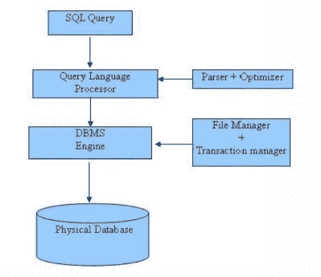

### 你可以在 SQL 中使用的命令

本书的这一部分将解释基础 `SQL` 命令。仔细学习这些材料，因为它们可以帮助你在 2 周内学会 `SQL`。

根据专家程序员，`SQL` 中的标准命令是 `SELECT`、`CREATE`、`UPDATE`、`DROP`、`DELETE` 和 `INSERT`。让我们根据行为对这些命令进行分类：

#### 数据定义语言（也称为 DDL）

* `CREATE` – 在数据库内部生成新对象或表。
* `ALTER` – 编辑数据库中的现有对象。
* `DROP` – 移除数据库对象。

#### 数据操作语言（也称为 DML）

* `INSERT` – 在数据库中生成一条新记录。
* `UPDATE` – 编辑数据库中的现有记录。
* `DELETE` – 移除现有数据库记录。

#### 数据控制语言（也称为 DCL）

* `GRANT` – 允许向某些数据库用户授予访问权限。
* `REVOKE` – 允许从某些用户处撤回访问权限。

#### 数据查询语言（也称为 DQL）

* `SELECT` – 允许你从数据库中检索记录。

# 第 2 章 – 关系型数据库管理系统的基本概念

`SQL` 是你可以用来与关系型数据库管理系统交互的语言。因此，你也应该理解这些数据库系统的基本特性。本章将解释 RDBMS 的基础知识，以便你能在 14 天内成功学习 `SQL`。

### 什么是数据库表？

在 RDBMS 中，信息保存在名为“表”的数据库对象内部。表是一组相关的数据库条目，由行和列组成。

你应该知道，表是关系型数据库系统中基础且最常见的信息存储形式。以下是一个数据库表的示例：

| ID | Name | 性别 | 州 |
| :--- | :--- | :--- | :--- |
| 1 | John | 男 | 纽约 |
| 2 | Mark | 男 | 佛罗里达 |
| 3 | Christian | 男 | 德克萨斯 |
| 4 | Paul | 男 | 伊利诺伊州 |
| 5 | James | 男 | 内华达州 |
| 6 | Peter | 男 | 阿肯色州 |
| 7 | Simon | 男 | 弗吉尼亚 |

#### 字段

每个数据库表都包含名为“字段”的较小部分。在上面的示例中，字段是：`ID`、`性别`、`Name` 和 `州`。

字段是表内部的列，用于保留有关每个数据库记录的特定信息。

#### 行

行，也称为“数据记录”，是存储在表中的单个数据库条目。例如，上面的表有七条记录。这里是一个示例记录：

| 1 | John | 男 | 纽约 |

基本上，记录是表内部的水平实体。

#### 列

列是表内部的垂直实体。它们包含与某个特定字段相关的信息。例如，`ID` 是上面示例中的列之一。它代表列出人员的身份标识。

| ID |
| :--- |
| 1 |
| 2 |
| 3 |
| 4 |
| 5 |
| 6 |
| 7 |

#### 空值

数据库表中的空值（Null values）是空白的。

你应该记住，`NULL` 值不同于零和空格。当用户没有输入任何值时，字段会获取 `NULL`。

### SQL 中的约束

在 SQL 中，约束是应用于某些列的规则。基本上，约束有助于你确保数据库的可靠性和准确性。

你可以在表格或列级别应用约束。因此，你可以在某些列或整个表上应用约束。

以下是 SQL 中常用的约束：

* `UNIQUE` – 该约束防止你的列出现数据冗余。例如，你可能需要防止具有相同的 ID。分析以下示例：


这段代码创建了一个名为 `CUSTOMERS` 的表并将其分为五列。`UNIQUE` 约束应用于 `AGE` 列，因此你不能输入两个相同的年龄。

如果你想对现有列应用此约束，可以使用以下语法：

```sql
ALTER TABLE (插入表名)
MODIFY (插入列名) (指定类型) NOT NULL UNIQUE;
```

* `DEFAULT` – 该约束允许你设置默认数据。然而，只有当 `INSERT INTO`（另一个 SQL 语句）没有特定值时你才能使用它。这里有一个示例：


这段代码生成了一个名为 `CUSTOMERS` 的表并将其分为 5 列。如所示，“5000.00”被标记为 `salary` 列的默认值。这意味着如果你在使用 `INSERT INTO` 命令时不添加任何值，该列将自动获得 5000.00。

要删除此约束，可以使用以下语法：

```sql
ALTER TABLE (插入表名)
ALTER COLUMN (插入列名) DROP DEFAULT;
```

* `NOT NULL` – 列可以包含 `NULL` 值。如果你不想在某些列中具有 `NULL` 值，然而你可以利用此约束。该约束将防止系统在你指定的列中输入 `NULL` 值。

重要提示：`NULL` 值表示未知信息。因此，它们不同于“没有信息”。

下面的截图显示了如何使用 SQL 应用 `NOT NULL` 约束：


上述代码生成了一个名为 `CUSTOMERS` 的表并创建了 5 列。你无法在 `ID`、`AGE` 和 `NAME` 列中输入 `NULL` 值，因为在这些列上应用了 `NOT NULL` 约束。

要在现有列上应用 `NOT NULL`，请使用以下语法：

```sql
ALTER TABLE (此处输入表名)
             MODIFY (此处输入列名) (指定值类型) NOT NULL;
```

* `CHECK` – 此约束可以检查你存储到表中的值。如果指定的条件为“假”，你将无法向记录中添加值。分析下述代码：

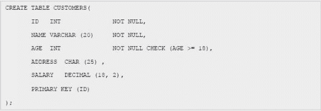

该代码创建了一个名为 `CUSTOMERS` 的表，并将其分为五列。`CHECK` 约束应用在 `AGE` 字段上。根据其条件（即 `>= 18`），你将无法添加年龄小于 18 岁的客户。

要在现有表上应用此约束，你应该使用以下语法：

```sql
ALTER TABLE (你想要修改的表名)
             MODIFY (你想要使用的列名) (指定值类型) NOT NULL CHECK (列名以及你想要应用的条件);
```

* `INDEX` – 你应该使用此约束来快速生成或检索数据。在创建索引时，你可以选择单列或一组列。活动索引在排序信息之前，会为每一行接收一个 `ROWID`。

如果你想提高数据库的可靠性和性能，良好的索引是必须的。然而，在创建索引时你必须格外小心。你应该选择在运行数据库搜索时用到的字段。下方的 SQL 语句创建了一个名为 `CUSTOMERS` 的表，并将其划分为 5 列：

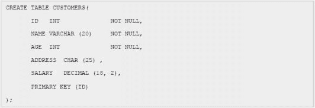

* `Primary Key`（主键）– 这是一个用于标识表内每条记录的字段。在创建主键时，你可以使用单个字段或组合多个字段。涉及多个字段的键被称为“复合键”。主键必须持有唯一值（即它们不接受重复值或 `NULL` 值）。

    * 如何在创建新表时分配主键 - 在你的新表中定义主键时，请使用以下语法：

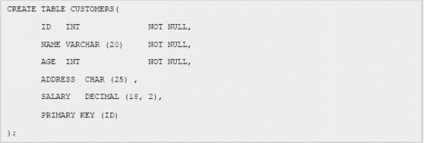

    * 如何为现有表分配主键– 这里有你应该使用的语法：

```sql
ALTER TABLE (此处插入表名) ADD PRIMARY KEY (此处指定列名);
```

重要提示：如果你将某列分配为主键，你必须确保它不接受 `NULL` 值。

* 如何删除主键 - 要禁用主键，你应该使用以下语法：

```sql
ALTER TABLE (表名) DROP PRIMARY KEY;
```

* `Foreign Key`（外键）– 此键允许你链接数据表。由于某些原因，某些程序员将外键称为“引用键”。

外键是其值与另一张表的主键相同的列。这意味着一个表的主键必须与另一个表的外键匹配。

为了帮助你理解这个概念，让我们使用两个示例表：`CUSTOMERS` 和 `ORDERS`。

`CUSTOMERS` 表：

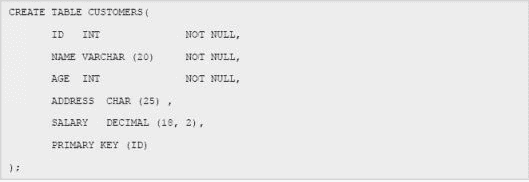

`ORDERS` 表：

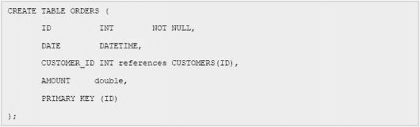

如果你想在现有表上分配外键，你应该使用以下语法：

```sql
ALTER TABLE (此处插入表名)
             ADD FOREIGN KEY (指定你想作为外键的列) REFERENCES (指定你想作为引用的表名) (第二个表的主键);
```

# 第 3 章：SQL 语句的语法

SQL 语言使用一套独特的规则，被称为“语法”。本章将教你 SQL 中用到的基础语法。请仔细学习这些材料，因为它们将帮助你在 2 周内掌握这门计算机语言。

每个 SQL 命令都以以下关键字之一开头：`USE`、`DROP`、`SHOW`、`ALTER`、`UPDATE`、`INSERT`、`SELECT`、`DELETE` 或 `CREATE`。此外，每个命令都以分号结束。

你应该知道 SQL 语句是不区分大小写的。这意味着在 SQL 命令方面，`DELETE` 和 `delete` 是等价的。但是，如果你正在使用 `MySQL`，你应该按照数据库中显示的名称来输入名称。

## 基础 SQL 命令的语法

### `SELECT` 语句


该语句包含以下子句：

* `DISTINCT` 子句 - 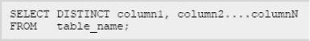
* `WHERE` 子句 - 
* `AND/OR` 子句 - 
* `IN` 子句 – 
* `BETWEEN` 子句 – 
* `LIKE` 子句 – 
* `ORDER BY` 子句 – 
* `GROUP BY` 子句 – 
* `COUNT` 子句 – 
* `HAVING` 子句 – 


# SQL 命令参考

## `CREATE TABLE` 命令


## `DROP TABLE` 命令


## `CREATE INDEX` 命令


## `DROP INDEX` 命令


## `DESC` 命令


## `TRUNCATE TABLE` 命令


## `ALTER TABLE` 命令


## `ALTER TABLE` 命令（重命名表）


## `INSERT INTO` 命令


## `UPDATE` 命令


## `DELETE` 命令


## `CREATE DATABASE` 命令


## `DROP DATABASE` 命令


## `USE` 命令


## `COMMIT` 命令


## `ROLLBACK` 命令


# 第 4 章：SQL 中的数据类型

在 SQL 语言中，数据类型是任何对象的特征。所有列、变量和表达式都涉及数据类型。

你在创建新表时应该指定数据类型。

这种计算机语言支持多种类型的数据。让我们将其分为六大类：

1.  **精确数值**

    

2.  **近似数值**

    

3.  **时间与日期**

4.  **字符字符串** – 这分为两个子类：

    1.  **Unicode 字符串**

        

    2.  **非 Unicode 字符串**

        

5.  **二进制**

    

6.  **杂项**

该类别涉及以下数据类型：

*   `timestamp` – 此数据类型存储一个随行更新而变化的唯一数字。你可以在数据库的任何部分访问此唯一数字。
*   `xml` – 此数据类型存储 XML（即可扩展标记语言）信息。你可以在列或变量中存入 XML 数据。
*   `table` – 此类型保存你的数据库查询结果，以便日后使用。
*   `cursor` – 此数据类型允许你对任何游标对象进行引用。
*   `sql_variant` – 这可以存储所有 SQL 兼容数据类型的值，但 `timestamp`、`text` 和 `next` 除外。
*   `unique identifier` – 此数据类型可以存储 GUID（即全局唯一标识符）。

# 第 5 章：SQL 语言中的运算符

运算符是你可用于 SQL 命令的保留字或字符。通常，运算符用于命令的 `WHERE` 部分，以执行操作（例如：比较、数学运算等）。

你可以使用运算符在 SQL 语句中指定条件。当你的命令涉及多个条件时，你可能可以使用运算符作为连接。

本章将讨论 SQL 支持的四种运算符：

*   逻辑运算符
*   算术运算符
*   比较运算符
*   可以使条件失效的运算符

## 逻辑运算符

这些是你可以在 SQL 计算机语言中使用的逻辑运算符：

*   `IN`：你可以使用此运算符将值与你指定的字面量值进行比较。
*   `OR`：该运算符在你的 SQL 命令的 `WHERE` 部分中组合各种条件。
*   `AND`：该运算符允许你在 SQL 命令的 `WHERE` 子句中包含多个条件。
*   `ALL`：该运算符将一个值与另一个值集内部的各个值进行比较。
*   `ANY`：该运算符使用一个条件来执行比较。
*   `LIKE`：该运算符使用通配符运算符将值与相似的值进行比较。
*   `UNIQUE`：该运算符检查你的条目的唯一性。为了实现这一点，`UNIQUE` 运算符会扫描整个表并搜索冗余数据。
*   `EXISTS`：该运算符搜索符合指定标准的行。
*   `BETWEEN`：该运算符搜索某个特定范围内的值。使用 `BETWEEN` 时，你应该指定最大值和最小值。
*   `IS NULL`：该运算符将值与 `NULL` 值进行比较。

## 算术运算符

为了帮助你理解这些运算符，让我们使用两个示例变量：`x = 1`；`y = 2`。

*   `+`：你应该使用此运算符执行加法。例如，`x + y = 3`。
*   `-`：你必须使用此运算符执行减法。它将从左操作数的值中减去右操作数的值。例如，`y - x = 1`。
*   `*`：在执行乘法时你应该使用此运算符。这里有一个例子：`x * y = 2`。
*   `/`：在执行除法时你应该使用此运算符。例如，`y / x = 2`。

## 比较运算符

假设 `x = 2` 且 `y = 4`。

*   `=`：该运算符检查两个值的相等性。如果两个值相等，则条件为真。例如：`(x = y)` 为假。
*   `!=`：该运算符检查两个值的相等性。如果两个值不相等，则条件为真。例如：`(y != x)` 为真。
*   `<>`：该运算符与 `!=` 相同。例如：`(x <> y)` 为真。
*   `>`：该运算符检查左操作数的值是否大于右操作数的值。如果是，则条件为真。例如：`(y > x)` 为真。
*   `<`：该运算符检查左操作数的值是否小于右操作数的值。如果是，则条件为真。例如：`(x < y)` 为真。
*   `>=`：该运算符检查左操作数的值是否大于或等于右操作数的值。如果是，则条件为真。例如：`(y >= x)` 为真。
*   `<=`：该运算符检查左操作数的值是否小于或等于右操作数的值。如果是，则条件为真。例如：`(x <= y)` 为真。

## 可以使条件失效的运算符

*   `NOT`：该运算符可以反转你与之配合使用的逻辑运算符的功能。例如：`NOT IN`、`NOT EXISTS`、`NOT BETWEEN` 等。

# 第 6 章：SQL 表达式

基本上，一个表达式是一组值、函数和运算符的组合。SQL 表达式可以帮助你评估数据库值。

在这个计算机语言中，表达式是一个你必须使用查询语言编写的公式。你也可以使用表达式来针对某些信息运行数据库查询。

## 语法

以下是 `SELECT` 命令的格式：


现在，让我们来谈谈 SQL 支持的表达式：

### 布尔表达式

这些表达式通过匹配单个值来检索数据。以下是布尔表达式的基本语法：


### 数值表达式

你可以使用这些表达式在你的数据库查询中进行数学运算。以下是你应该使用的语法：


### 日期表达式

这些表达式为你提供系统的时间和日期信息。

# 第 7 章：如何在你的数据库中使用 SQL

本章将教你如何在你自己的数据库上应用 SQL 命令。通过阅读这些材料，你将能够使用 SQL 计算机语言与关系型数据库进行交互。这些材料极其重要，因为它将帮助你在短短 2 周内掌握 SQL 的基础。

## 如何创建数据库

要创建一个新数据库，你应该使用 `CREATE DATABASE` 命令。以下是你应该遵循的语法：


**注意：** 关系型数据库管理系统需要唯一的数据库名称。

让我们使用 `CREATE DATABASE` 命令生成一个新的数据库。

```sql
CREATE DATABASE sample;
```

上面的命令创建了一个名为“sample”的单元数据库。

**注意：** 如果你没有管理员权限，将无法创建一个新数据库。

## 如何删除数据库

在 SQL 语言中，你使用 `DROP DATABASE` 命令来删除活动数据库。使用以下语法：

```sql
DROP DATABASE (插入你的数据库名称);
```

例如，假设你想删除一个名为“sample”的数据库。这是你需要使用的 SQL 命令：

```sql
DROP DATABASE sample;
```

**注意：** 使用此命令时你应该要非常小心。请记住，删除数据库涉及数据的永久丢失。

## 如何选择数据库

如果你拥有多个数据库，你必须确保你正在正确的数据库上执行操作。你应该利用 `USE` 命令。分析以下语法：

```sql
USE (插入数据库名称)
```

例如，要选择名为“sample”的数据库，请使用以下 SQL 命令：

```sql
USE sample
```

## 如何创建表

如果你正在创建一个新表，你应该为该表命名并定义它的列。你应该使用 `CREATE TABLE` 命令来完成此任务。以下是你应该遵循的语法：


基本上，`CREATE TABLE` 是一个告知系统你想要创建一个新表的关键字。你的表标识符或名称跟在 `CREATE TABLE` 命令之后。然后，创建一个列表定义你想要使用的列和数据类型。

## 如何从现有表创建新表

你可以通过结合两个命令：`SELECT` 和 `CREATE TABLE` 来复制现有表。

默认情况下，你将获得的表将具有旧表的列定义。然而，你也可以从旧表中选择某些列并丢弃其他列。这意味着你可以根据需要修改新表。

如果你成功使用此命令，新表将获得旧表的值。以下是你应该使用的语法：


例如，你想使用名为 `EMPLOYEES` 的表来生成一个新表（假设你称其为 `COMPENSATION`）。然后，你想复制 `EMPLOYEES` 表中的两个列：`NAME` 和 `SALARY`。为了完成此任务，你可以使用以下代码：

```sql
CREATE TABLE COMPENSATION AS
SELECT NAME, SALARY
FROM EMPLOYEES;
```

上面的代码创建一个名为 `COMPENSATION` 的新表，它包含 `NAME` 和 `SALARY` 两个列。此外，这些列将获得在旧表（即 `EMPLOYEES`）找到的值。

## 如何删除表

你可以使用 `DROP TABLE` 命令来删除表及其包含的所有信息（例如：数据、约束、索引等）。

**注意：** 使用此命令时你必须非常小心。请记住，这涉及存储信息的永久删除。如果你删除了错误的表，你的数据库将面临严重问题。

该命令的语法为：

```sql
DROP TABLE (在此处插入表名);
```

例如：

```sql
DROP TABLE sample
```

上面的命令从你的数据库中删除了名为“sample”的表。

## 如何添加新数据行

`INSERT INTO` 命令允许你向现有表添加新的数据行。该命令涉及两种语法：

### 第一种语法


如果你想向某些列添加数据，则应该使用这种语法。

### 第二种语法


如果你想为表的所有列添加值，则必须使用这种语法。这意味着你不需要标识你正在操作的列。但是，请确保值的顺序与表中现有列的顺序一致。

## 如何从表中检索数据

你可能可以使用 `SELECT` 命令从表中检索数据。在这里，SQL 将将搜索结果以一个新表的形式呈现出来。这些新表被称为“结果集”。

`SELECT` 命令的语法为：


在此语法中，`column1`、`column2` 等是你想要检索的字段。如果你想检索表内部的所有字段，可以使用这种语法：


### WHERE 子句

`WHERE` 是一个 SQL 子句，用于在从所选表中检索信息时指定条件。

如果满足你指定的条件，该子句将从你的表中检索特定值。通常情况下，你应该使用 `WHERE` 来过滤并检索你需要的记录。

你也可以在其他 SQL 命令（如 `DELETE` 和 `UPDATE`）中使用 `WHERE`。你将在以后学习这些命令。

你应该使用的语法是：


你可以使用逻辑运算符或比较运算符来为你的 `WHERE` 子句设置条件。

### 如何组合各种条件

SQL 允许你在数据库查询中组合不同的条件。你只需要在 SQL 命令中包含 `OR` 和 `AND` 运算符即可。SQL 用户将 `OR` 和 `AND` 称为连接操作符。

基本上，连接操作符允许你在单条 SQL 命令中执行多次比较。让我们先讨论 OR：

#### OR

你可能可以使用此操作符在命令的 `WHERE` 子句中组合各种条件。该操作符的语法为：


`N` 代表你可以使用 `OR` 组合的条件数量。只有在你指定的条件其中一个为真时，你的 SQL 语句才会执行执行操作。

#### AND

此操作符允许你将几个条件放在 SQL 命令的 `WHERE` 子句中。你应该使用的语法如下：


“N”代表你可以组合的条件数量。请记住，只有当所有条件都为真时，你的 SQL 命令才会执行操作。

## 如何修改现有记录

在 SQL 语言中，你可以使用 `UPDATE` 查询编辑现有记录。该查询应用于 `WHERE` 子句，允许你编辑数据行。你应该使用的语法如下：


## 如何删除记录

如果你想删除记录，可能可以使用 SQL 的 `DELETE` 查询。你可以将此查询与 `SELECT` 结合以删除某些行。另一方面，你可以使用 `DELETE` 作为独立查询来删除所有数据行。该查询的语法如下：

```sql
DELETE FROM the_table’s_name
WHERE [specify you condition/s];
```

如果你需要从表中删除所有记录，只需删除 `WHERE` 子句。因此，语法将是：

```sql
DELETE FROM the_table’s_name;
```

## 如何通过通配符操作符进行比较

在 SQL 中，你可以可以使用通配符操作符将一个值与相似的值进行比较。你只需要将这些操作符包含在 SQL 命令的 `LIKE` 子句中。以下你可以配合 `LIKE` 使用的通配符操作符：

*   下划线（即 `_`）
*   百分号（即 `%`）

如果你想表示单个字符或数字，则应该使用下划线。相反，如果你想表示 0、1 或多个字符，则必须使用百分号。你可以在 SQL 语句中组合这些通配符操作符。

通配符操作符的语法如下：


## 如何使用 TOP 子句

`TOP` 子句允许你从数据表中检索数量或百分比。

**注意：** 某些数据库不兼容此子句。例如，MySQL 使用 `LIMIT` 来检索记录。

带有 `TOP` 子句的 `SELECT` 命令语法为：


## 如何对数据排序

SQL 提供了 `ORDER BY` 子句，它根据你用作依据的列按降序或升序对数据进行排序。你应该使用的语法是：


你可以在此子句中包含多个列。但是，请确保你想要使用的所有列都在列列表中。

## 如何合并多个 SELECT 命令的结果

在 SQL 中，你可以合并多个 `SELECT` 命令的结果并防止冗余行。你只需要使用 `UNION` 子句即可。

要使用此子句，你的 `SELECT` 语句应该具有相同数量的选取列和列表达式。语句必须具有相同的数据类型和列排列。然而，语句不需要完全相同。


## 笛卡尔连接 (CARTESIAN JOIN)

此 JOIN 会检索你所使用的表记录集的笛卡尔积。由于如此，SQL 用户将其视为连接条件始终为真的内连接（INNER JOIN）。`CARTESIAN JOIN` 的语法如下：


# 结语

再次感谢你下载这本书！

希望这本书能够帮助你在仅用两周的时间学会 SQL 的基础知识。下一步是使用这种计算机语言来创建和管理你自己的数据库。

最后，如果你喜欢这本书，我想请你帮个忙，能否请你在 Amazon 上为这本书留个评价？我将不胜感激！

[点击此处在 Amazon 上为这本书留评！](https://www.amazon.com/review/create-review?ie=UTF8&asin=B019L5QXD2&channel=detail-glance&nodeID=133140011&ref_=cm_cr_dp_no_rvw_e&store=digital-text)

此外，请确保订阅我的技术和编程时事，以获取你的免费书籍并学习更多关于编程知识。[点击此处](http://kindlebookspot.com/join-our-tech-community/)。

感谢并祝你好运！

[点击此处获取使用 Bluehost 设置你的 Wordpress 站的分步说明。](http://www.passiveincomeassignment.com/2015/12/15/how-to-create-a-website-in-minutes/)

# 黑客训练营 (Hacking Bootcamp)

## 学习计算机黑客基础

在 [kindlebookspot.com](http://kindlebookspot.com) 获取更多折扣书籍

## 目录

*   导言
*   第 1 章：黑客——通用信息
*   第 2 章：编程技能
*   第 3 章：密码
*   第 5 章：渗透测试
*   结语

# 导言


我想感谢你，并祝贺你下载了《学习计算机黑客基础（安全、渗透测试、如何黑客）》这本书。

书中包含了关于如何攻击计算机网络的经过证明的步骤和策略。这本电子书将教你与黑客相关的基本思想和概念。它将解释经验丰富的黑客所使用的工具、方法和技术。通过阅读这些材料，你可以对你的目标网络进行侦察和软件攻击。

再次感谢下载这本书，希望你喜欢它！

# 第 1 章：黑客——通用信息

这本书可以帮助你成为一名伟大的计算机黑客。通过这些材料，你将能够：

* 像黑客一样思考——由于你将了解黑客攻击中使用的方法和技术，你可以攻击网络或保护自己免受他人侵害。
* 学习“伦理黑客”——你不需要使用你的技能来渗透网络或盗取数据。在 IT（即信息技术）世界中，你可以利用你的新技能帮助企业和组织防止黑客攻击；因此，你可以通过成为“好”黑客来赚钱。
* 给你的朋友和家人留下深刻印象——你可以向他人展示你的黑客能力。通过这种方式，你可以建立自己作为一名熟练程序员或计算机用户的声誉。

## 黑客——他们是谁？

黑客是那些喜欢玩计算机网络或电子系统的人。他们喜欢发现计算机是如何工作的。根据计算机专家的说法，黑客主要分为两类：

* **白帽黑客**——这类人被称为“好黑客”。白帽黑客将其技能用于合法目的。通常，他们会成为安全专家，保护公司和组织免受黑帽黑客的攻击（见下文）。
* **黑帽黑客**——这一类涉及将技能用于恶意/非法目的的黑客。这些黑客攻击网络、破坏网站并盗取机密信息。

**重要提示：** 这些术语源于西方电影，其中主角戴白色帽子，而反派戴黑色帽子。

## 计算机黑客的层级

在书的这部分，黑客根据其技能水平进行分类。请仔细学习这些材料，因为它可以帮助你衡量自己的进度。

* **新手黑客**——在这类中，你会发现一些并不不知道自己在做什么的初学者。这些黑客通常计算机技能很差。他们使用他人创建的程序和黑客工具，而不知道其原理。
* **中级黑客**——这些黑客熟悉计算机、操作系统和编程语言。通常，中级黑客知道计算机脚本是如何工作的。然而，和新手黑客一样，中级黑客并不创建自己的工具。
* **精英黑客**——这一类由经验丰富的黑客组成。通常情况下，精英黑客创建在攻击或防御计算机网络时有用的工具和程序。此外，精英黑客可以在不被捕获的情况下访问系统。所有黑客都想达到这个水平。

## 要求

你不可能一夜之间就成为精英黑客。要获得必要的技能，你必须耐心且执着。专注于你必须做的事情（例如：编写自己的程序、练习你的黑客技能、读更多书籍等）。通过投入时间和精力的，你可以快速达到精英水平。

黑客专家声称创造力很重要，特别是对于初学者来说。有了创造力，你可以轻松地找到问题的多个解决方案。你不需要担心资源或选择的限制。如果你足够创意，你一定能找到答案。你还应该有学习更多的欲望。黑客涉及随着时间推移而演变的复杂过程。你应该愿意花费几个、几天甚至几周的时间研究网络结构和攻击策略。如果你没有时间或耐心从事这项工作，那么你成为专家的机会微乎其微。

# 第 2 章：编程技能

要成为一名有效的黑客，你应该具备足够的编程技能。创建和操纵计算机程序的能力大有益处。这种能力可以帮你掩盖足迹或混淆安全专家。然而，如果你想成为一名伦理黑客，你可以使用你的技能创建防御性的计算机程序。

嗯，你确实可以在网上购买现成的程序和黑客工具。这意味着你可以在不编写任何程序的情况下执行黑客攻击或防御你的网络。然而，依赖他人创建的程序并不能帮助你成为伟大的黑客。任何人都可以购买和使用黑客程序——但创建一个这样的程序需要技能和知识。

每当你攻击、防御或测试网络时，你都应该理解与活动相关的一切内容。由于黑客攻击和系统测试涉及程序，编程技能可以帮助你在完成任务时获得有效性和准确性。

如果你知道如何编程，那么你将享受以下好处：

* 其他黑客会认为你是一个专家。
* 你可以根据你的特定需求专门创建程序。例如，如果你需要停止某种病毒，你可以创建自己的安全程序来实现你的目标。你不需要去网上尝试各种通常昂贵的防病毒软件了。
* 你将对自己的技能更有信心。就像从事任何其他努力一样，如果一个人信任自己的技能，黑客行为将变得容易且简单得多。

简单来说，不要依赖市场上的黑客程序。学习一些编程语言并掌握必要的技能。通过这样做，你将进入计算机和黑客的新世界。

如果你能先学习 `HTML` 那就太好了。`HTML`（即超文本标记语言）是一种构成你在网络上所看到的所有网站的编程语言。如果你计划攻击或建立一个网站，你必须知道如何使用 `HTML` 语言。大多数人说 `HTML` 简单且易于掌握。这意味着即使你以前从未编写过任何代码，也能轻松学会这门语言。

在掌握 `HTML` 之后，你应该学习 `C` 编程语言。`C` 是今天最流行的计算机语言。它构成了黑客使用的大多数工具的基础。它可以帮助你创建自己的病毒或防御程序。

## 学习计划

这是一份可以帮助你掌握任何编程语言的学习计划：

1. 购买一本关于你所选语言的“入门书籍”。在购买之前，先阅读其他书读者的评价。这样，你就不会在无用的材料上浪费时间和/或金钱。
2. 一旦你学会了如何使用这种语言，就必须定期练习它。
3. 几乎所有的编程书籍都包含练习和实践题。通过完成这些练习题来进一步磨炼你的技能。
4. 如果你遇到任何困难的内容，不要跳过或忽略它。尝试理解那个“东西”是如何工作的，以及它与编程和/或黑客攻击的关系。如果你跳过了复杂的概念，将学不到很多东西。
5. 寻找一个程序员在线论坛。大多数时候，经验丰富的程序员乐于帮助初学者。这意味着当学习过程中遇到问题时，你可以随时上网向“专业人士”提问。
6. 应用你所学。如果你能用这种语言创建自己的计算机程序，那就太好了。

# 第 3 章：密码

如今，密码是网络和网站的唯一保护形式。如果你拥有这条信息，你将获得者账户的完全访问权限。这就是为什么黑客使用各种工具和技术仅仅是为了获取密码。

## 密码破解——传统方法

以下列表显示了破解密码时使用的传统技术：

* **猜解** – 这种方法只对弱密码有效。例如，如果用户根据个人信息（如电话号码、出生日期、喜欢的动物等）创建密码，你可以通过尝试不同的可能性来轻松确定密码。如果黑客了解关于用户的几点信息，这种技术会变得更有效。
* **窥视视** – 在这里，你会在目标输入密码时从他的肩膀后面看。如果目标打字速度慢，这种方法可以给你极佳的结果。
* **社会工程学** – 在这种技术中，你利用目标的信任来获取所需的信息。例如，你可能会给目标打电话，假装你属于公司的 IT 部门。你可以告诉目标你需要密码，以便访问他的账户并进行一些重要的更新。

## 密码破解——现代技术

在本节中，你将学习用于破解密码的最新技术。

**重要提示：** 本节使用了一些你需要安装的计算机程序。

### 字典攻击

在这种方法中，你必须使用包含常用密码的文本文件。你将尝试每个密码以查看哪一个有效。这种方法简单又快捷。然而，你只能将其用于弱密码。为了帮助你理解这种技术，让我们来分析以下例子：

一个黑客使用 `Brutus`（即一种流行的密码破解程序）访问一个 `FTP`（即文件传输协议）服务器。

在讨论例子之前，让我们先谈谈 `FTP` 服务器。`FTP` 服务器允许你通过互联网发送或接收文件。如果黑客获得了某个网站 `FTP` 服务器的访问权限，他可能会操纵或删除该服务器内的文件。

现在，你准备好看例子了。我们开始：

1. 黑客访问 `FTP` 服务器的登录页面。


2. 然后，他启动 `Brutus` 来破解服务器密码。


3. 他指明服务器类型（即 `FTP`）和 IP 地址。
4. 他输入一个有效的用户名。
5. 他选择包含密码列表的文本文件。
6. 他点击“开始”按钮。`Brutus` 程序将连接到 `FTP` 服务器并尝试使用文件中的密码登录。如果过程成功，`Brutus` 将在它的“正向验证结果”部分显示正确的密码。这是一张截图：


**重要提示：** 顶尖黑客在使用此类类计算机程序时都会使用代理。基本上，代理通过从另一台计算机传输连接请求来隐藏你的 IP 地址。这非常重要，因为多次登录尝试会产生大量的电子“足迹”。

### 暴力破解法

IT 专家声称这种方法可以破解任何类型的密码。在这里，黑客尝试数字、字母和特殊符号的所有可能组合，直到他进入目标账户。这种方法的主要缺点是耗时。这是可以理解的——为了访问目标账户，你必须尝试成千上万可能的密码。

这种方法的速度取决于两个因素：

* 密码的复杂性
* 计算机的处理能力

在上一个示例使用的黑客工具 `Brutus` 也可以对服务器发起暴力破解。其工作原理如下：

1. 指定目标的 IP 地址和服务器类型。在“模式”部分，选择“暴力破解”并点击“范围”。下面的图像将作为你的指南：


2. 屏幕将向你显示一个对话框（如下）。使用此对话框配置暴力破解方法。显然，如果你对目标密码有些了解，你的工作将简单得多。


3. 点击“确定”按钮。`Brutus` 将通过尝试所有可能的密码登录服务器。你将在程序的 `GUI`（即图形用户界面）上看到结果。

### 网络钓鱼

在这种技术中，你通过欺骗受害者来窃取机密信息（如密码）。例如，一个黑客假装成银行代表向目标用户发送了一封邮件。邮件要求用户通过点击链接更改密码。当用户点击链接时，她看到了一个与实际银行相似的网站。然而，该网站只是一个副本。在那里输入的任何信息都将进入黑客的数据库或电子邮件账户。

**重要提示：** 顶尖黑客使用 `HTML` 创建看起来像官方的钓鱼网站。

以下是你创建钓鱼网站时需要做的事：

1. 选择你的目标 – 大多数黑客会模仿电子邮件提供商的网站。有两个原因：
    1. 用户经常登录电子邮件账户。这意味着黑客有很多机会欺骗他的目标。
    2. 电子邮件账户非常有用。大多数时候，电子邮件账户与其他账户（如银行账户）关联。因此，通过破解他的电子邮件账户，你就可以获得关于用户的大量信息。

2. 复制官方网页 – 启动 Mozilla Firefox（黑客推荐此浏览器，因为它安全且可定制）并访问实际网站的登录页面。在键盘上按下 `CTRL+S` 创建网页的本地副本。

3. 重命名文件 – 保存网页后，将其重命名为 `index.htm`。首页页是任何人访问网站时都会显示的第一个网页；因此，你希望目标用户相信他访问了真实网站的首页页。

4. 创建脚本 – 你应该创建一个计算机脚本来记录用户的登录信息。大多数黑客使用 `PHP` 脚本语言来完成此任务。下面的图片显示了一个记录登录凭据的基础 `PHP` 脚本。

启动 `Notepad`（记事本）并输入脚本。将文件保存为 `phish.php`。


5. 创建一个空的 `.txt` 文件并保存为 `list.txt`。

6. 将脚本添加到网页中 – 使用 `Notepad`（记事本）打开名为 `index.htm` 的文件。按下 `CTRL+F`，输入 `action` 并点击“查找下一个”。这是一个截图：


在脚本的 `form id` 部分寻找 `action`。你会发现那里有一个 URL ——将其删除并输入 `phish.php`。通过这样做，你是在指示表单将用户信息发送到你的 `PHP` 脚本而不是发送到 Google。

搜索显示 `method="post"` 的部分。将 `post` 替换为 `get`，使代码段变为 `method="get"`。

7. 保存文件并关闭。

8. 将 HTML 文件上传到网站托管主机 – 托管服务提供商将为你提供该伪造网页的 URL。你可以将该 URL 用于黑客攻击。

9. 如果你访问该网页，你会发现它看起来和官方 Gmail 登录页面完全一样。该网页将记录在其中输入的用户名和密码。它会将信息保存在空 `.txt` 文件旁边。

## 彩虹表 (Rainbow Tables)

基本上，彩虹表是每个可能的字符组合的哈希值的巨大列表。要获取哈希值，你必须通过运行算法转换密码（或字符组合）。这是一种单向加密：你无法使用哈希值来确定原始数据。大多数网站数据库使用 `MD5`（一种用于哈希的数学算法）来保护密码。

假设你注册了一个网站。你输入了所需的登录凭据（即用户名和密码）。一旦点击“提交”按钮，算法将处理密码并将哈希值存储在网站的数据库中。

由于无法通过哈希值确定密码，你可能想知道网络如何知道你的密码是正确还是错误的。很好，当你输入登录凭据时，系统通过算法运行这些信息。然后，它会将生成的哈希与网站数据库中保存的哈希值进行比较。如果哈希值匹配，你就能成功登录。

像 `MD5` 这样的数学算法可以从简单的密码生成复杂的字符串。例如，如果你使用 `MD5` 加密“cheese”，你会得到：`fea0f1f6fede90bd0a925b4194deac11`。

根据专家黑客的说法，这种方法比暴力破解法更有效。一旦你创建了彩虹表（即哈希值列表），你就可以快速破解密码。

## 如何防止这些密码破解技术？

### 社会工程学 (Social Engineering)

为了阻止“社会工程师”，你必须保持小心和专注。如果有人给你打电话，而你认为他在对你使用社会工程学策略，请问他一些证明其身份的问题。

**重要提示：** 一些精英黑客会研究他们的目标。这意味着他们可能会通过回答你的问题来“证明自己的身份”。因此，如果你仍然怀疑此人所说，你应该联系他声称所属的部门负责人，以获取更多信息。

### 窥视攻击 (Shoulder Surfing)

在输入登录凭据时，确保没有看到看到你在输入的内容。如果你看到可疑的人，靠近他并练习你的摔跤技巧。好吧，并不是真的。你只需要在输入信息时保持小心。

### 猜词 (Guessing)

为了防止这种攻击，不要使用与你的个人信息相关的密码。无论你对你的宠物或配偶有多深爱，都永远不要使用他们的名字作为密码。

### 字典攻击 (Dictionary Attack)

你可以轻松地保护自己免这种攻击——不要使用字典中找到密码。不，将字母替换为数字（例如 `banana` – `b4n4n4`）是不安全的。创建密码时，最好将字母、数字和特殊字符结合。

### 暴力破解法 (Brute-Force Approach)

为了防止这种技术，你应该使用包含大量数字和特殊符号的长密码。长而复杂的密码会给“暴力破解者”带来困难的问题。如果黑客在尝试几天后仍无法破解你的密码，他可能会寻找另一个目标。

### 钓鱼攻击 (Phishing)

为了保护自己免受这种技术，你只需要检查浏览器的地址栏。例如，如果你应该在 `www.facebook.com`，但地址栏显示了不同的 URL（例如 `www.pacebook.com`、`www.faccbook.com`、`www.focebook.com` 等），你就知道黑客正试图欺骗你。

### 彩虹表 (Rainbow Tables)

你可以通过创建长密码来防止这种技术。根据精英黑客的说法，为长密码生成哈希表涉及大量资源。

### “密码破解 (Password Crackers)”

以下是黑客在破解密码时使用的程序：

* `SolarWinds`
* `Can and Abel`
* `RainbowCrack`
* `THC Hydra`
* `John the Ripper`

# 第 4 章：如何攻击网络

在本章中将学习如何攻击网站和网络。仔细学习这些材料，因为它将教你有关黑客的重要思想和技术。

## 足迹扫描 (Footprinting)

“足迹扫描”一术是指收集有关计算机网络及其所属公司或组织的数据。这一过程是大多数黑客攻击的第一步。足迹扫描是必要的，因为黑客在进行攻击之前必须了解目标的一切。

以下是你扫描网站时需要采取的步骤：

1. 你应该研究网站使用的名称和电子邮件地址。如果你计划对目标执行社会工程学策略，这些数据将非常有用。
2. 获取网站的 IP 地址。要获取此信息，访问 `site(http://www.selfseo.com/find_ip_address_of_a_website.php)` 并输入目标 URL。然后，点击“Get IP”按钮。几秒后，屏幕将显示目标的 IP 地址。
3. Ping 目标服务器以检查其是否活跃。显然，你不想浪费时间攻击一个“死”目标。精英黑客使用 `www.just-ping.com` 完成此任务。基本上，从全球各地 ping 网站。

使用此工具时，只需将目标 URL 或 IP 地址输入文本框并点击“ping！”。这是一个截图：


网页将显示目标是否活跃。

4. 对网站执行 WHOIS 搜索。访问 `http://whois.domaintools.com` 并输入目标 URL。屏幕将显示关于拥有目标网站的人/公司/组织的大量数据。

**重要提示：** WHOIS 搜索为黑客提供了不同类型的信息，如姓名、地址和电话号码。

## 端口扫描 (Port Scanning)

这是黑客过程的第二阶段。在收集有关目标的信息后，你应该执行“端口扫描”。基本上，“端口扫描”是一个检测网络中存在的开放端口和监听设备的过程。这意味着你可以利用这一步骤识别目标的漏洞和防御系统。

以下练习将说明端口扫描的工作原理：

1. 从此站点下载 `Nmap`：[`nmap.org/download.html`](http://nmap.org/download.html)。然后，将程序安装到你的电脑中。

注意：此软件适用于 Windows 和 Macintosh 电脑。

2. 启动 `Nmap` 并输入目标的 URL。对于本次练习，让我们假设你想破解一个名为 [www.target-site.com](http://www.target-site.com) 的网站。


## 3. 寻找“Profile”（配置）部分并点击其下拉按钮

屏幕将向你显示几个扫描选项。大多数情况下，精英黑客会对他们的目标进行快速（且轻量）的扫描。全版本扫描可能会触发目标的防御系统，因此最好远离这些选项。这里是下拉菜单的截图：


## 4. 点击“Scan”（扫描）按钮并等待结果

这里是一个示例：


如你所见，`Nmap` 可以检测目标上存在的端口和服务项。

## 封纹抓取

在此阶段，你将获得有关目标端口和服务的更多信息。黑客使用 `telnet` 来完成此任务。下面的练习将帮助你理解这一阶段：

### 1. 访问终端或命令提示符

访问你电脑的终端（如果你是 Mac 用户）或命令提示符（如果你是 Windows 用户）。

> **重要提示**：如果你的操作系统是 Windows Vista，你必须手动安装 `telnet`。以下是你需要的操作：

1. 转到控制面板并点击“程序和功能”。
2. 点击“启用或关闭 Windows 功能”并选择“Telnet 客户端”。
3. 点击“确定”按钮。
4. 屏幕将向你显示一条确认消息。

### 2. 选择一个开放端口

选择一个开放端口。对于本次练习，让我们假设你选择了 21 端口（即 FTP 端口）。要确定目标使用的 FTP 软件，请使用以下语法：`telnet <目标的 URL> <你选择的端口号>`

对于目前的示例，你应该运行的命令是：

```
telnet www.target-site.com 21
```

### 3. 查看结果

你的电脑将确定所选端口的类型和版本。然后，它将在屏幕上显示信息。这里是一个示例：


## 寻找漏洞

现在你已经有了一些关于端口软件的信息，你可能开始寻找可用的“漏洞利用”（exploit，即用于破解计算机/网络的工具）。如果有可用的漏洞利用，你可能可以在目标服务上使用它并获得完全控制权。另一方面，如果没有可用的漏洞利用，你必须在不同的端口上尝试。

以下是黑客常用的漏洞数据库：

* `osvdb`
* `exploit-db`
* `SecurityFocus`

许多黑客在没有当前端口的漏洞利用时，会寻找另一个端口。然而，你不能假设所有的黑客都会这样做。某些黑客，特别是经验丰富的黑客，会分析目标端口，寻找漏洞并创建漏洞利用。计算机黑客将新发现的漏洞称为“0 日漏洞”（0-day）。这些漏洞提供以下优势：

* 没人知道如何修复该漏洞。这意味着在漏洞被发现和修复之前，你可能会破解无数网站。
* 发现者可能会以高价出售该漏洞。人们愿意花费数百（甚至数千）美元来获取新鲜漏洞。
* 发现网络漏洞并生成相应的漏洞利用表明你技术高超且知识丰富。其他黑客会将你视为专家。

## 最常见的黑客攻击

在讨论实际的网络渗透之前，让我们谈谈两种最流行的黑客攻击。

### DoS

这是“拒绝服务”（Denial-of-Service）的缩写。通过这种攻击，黑客想要关闭服务器。这意味着合法用户将无法访问网络或使用受影响的服务。大多数情况下，黑客通过向目标网络发送无尽的数据流来实现这一点。这种策略迫使网络消耗所有的可用资源。一旦资源被耗尽，没有任何人能够使用网络。

### 缓冲区溢出

黑客也将这种攻击称为“BoF”。缓冲区溢出攻击发生在当计算机程序尝试将大量数据保存到存储区域（也称为“缓冲区”）时。由于缓冲区的存储容量有限，多余的数据将进入其他区域。当发生这种情况时，黑客可能会用恶意代码淹没网络。

## 两种类型的漏洞利用

黑客将利用分为两类，即：

### 本地漏洞利用

这些利用要求黑客物理接触目标计算机。通常情况下，攻击者利用这种利用来提升他们在机器或网络上的访问权限。简单来说，你可以使用本地漏洞利用来获得对目标的管理员权限。

### 远程漏洞利用

这些利用与本地的类似。唯一的区别是，黑客可以在不物理接触目标的情况下运行远程漏洞利用；因此，与本地利用相比，远程利用更安全。

> **重要提示**：大多数情况下，黑客在攻击中会同时使用两种类型的漏洞利用。例如，你可能使用远程利用来获得普通权限。然后，你可以使用本地利用获得对目标的管理员访问。这种方法允许你完全控制一台机器或网络。

## 渗透

本节将教你黑客如何渗透他们的目标。

### 编程语言

在练习黑客技巧时，你会发现黑客使用不同的语言。以下列表显示了最流行的语言：

#### PHP

你会发现很多利用。使用这种语言编写利用时，必须以 `<?php` 开始并以 `?>` 结束。让我们假设你想对 FTP 服务器造成损害。这是攻击目标时需要采取步骤：

1. 安装 PHP 语言。你可以访问 [`www.wampserver.com/en/`](http://www.wampserver.com/en/) 来免费获取 PHP。
2. 从 Exploit-DB 复制 PHP 代码并粘贴到编辑器中。将文档保存为 `exploit.php`。
3. 修改代码输入目标的 IP 地址。将修改后的文件保存到 PHP 目录（即包含 `.exe` 文件的目录）。
4. 访问电脑的命令提示符。然后，运行 `cd` 命令（即切换目录）并指定 PHP 目录的位置。
5. 输入 `php exploit.php` 并按回车键。
6. 你的电脑会对目标发起 DoS 攻击。只有当你关闭命令提示符时，攻击才会停止。
7. 测试攻击的效果。访问目标网站并点击标签/按钮。如果攻击成功，网站将卡顿且加载时间异常。一段时间后，网站可能会完全离线。

#### Perl

这种语言像 PHP 一样简单。使用这种编程语言，你应该：

1. 访问此站点：[`www.activestate.com/activeperl`](http://www.activestate.com/activeperl)。然后，下载并安装正确版本的 Perl。
2. 寻找一个你可以使用的利用。对于本书，让我们假设你想使用此利用攻击 WinFTP 服务器：[`www.exploit-db.com/exploits/36861/`](https://www.exploit-db.com/exploits/36861/)。
3. 修改代码输入所需的信息（例如目标的 URL、你想攻击的端口等）。然后，将其复制到文本文件中并将文档保存为 `exploit.pl`。
4. 访问命令提示符。指定 Perl 文件的位置。
5. 输入 `perl exploit.pl` 来运行漏洞程序。该程序将针对你的目标发起 DoS 攻击。与之前的示例一样，该漏洞只有在你关闭命令提示符窗口后才会停止。

# 第 5 章：渗透测试

渗透测试是一种合法的尝试，旨在对计算机网络进行检测、探测和攻击。在大多数情况下，这种测试是由网络所有者发起的。他们希望黑客针对被测试的网络运行漏洞程序，以便他们可以衡量并改进防御能力。

在进行渗透测试时，你应该寻找目标中的漏洞并进行 POC（即概念证明）攻击。POC 攻击是一种设计用于证明已发现漏洞的黑客攻击。有效的渗透测试总是会对过程中发现发现的问题提供详细的修复建议。简单来说，渗透测试保护了网络和计算机免受未来黑客攻击的影响。

## 渗透测试的四步模型

黑客将渗透测试分为四个不同的步骤。这种方法有助于他们识别在过程的任何阶段需要做的事情。让我们来讨论每一个步骤：

### 侦察

在这一步中，黑客需要收集有关目标的信息。这有助于黑客识别他需要使用的工具和程序。如果黑客想要确保自己成功，他必须在侦察步骤花费大量时间。

### 扫描

这一步包含两个部分：

1. **端口扫描** – 你在之前的章节中学习过这个主题。基本上，端口扫描是检测目标中可用端口的过程。端口充当通信线——一旦你检测并控制了它，你就能与目标网络进行交互。
2. **漏洞扫描** – 在过程中，你将搜索网络中存在的漏洞。你将使用发现的端口（见上文）来访问并利用漏洞。

### 利用

由于你已经收集了有关目标的信息，扫描了网络端口并搜索了现有的漏洞，你现在准备好进行“实际黑客攻击”了。这一步涉及各种工具、代码和技术（某些已经在之前讨论过）。此阶段的主要目标是获得网络的管理员权限。

### 维持访问

这是四步模型的最后一部分。显然，建立目标的管理员权限是不够的。你必须维护该访问权限，以便能够对系统进行其他攻击并证明漏洞的存在。为了完成这项任务，白帽黑客使用后门程序和远程漏洞利用。

## 结论

再次感谢你下载这本书！

我希望这本书帮助你学习黑客攻击的基础知识。

下一步是练习你的黑客技巧并编写你自己的漏洞程序。通过这种方式，你很快就会成为精英黑客。

最后，如果你喜欢这本书，我想请你一个忙，你愿意在亚马逊上为这本书留个评论吗？我将不胜感激！

[点击此处在亚马逊上为本书留评！](http://kindlebookspot.com/join-our-tech-community/)

另外别忘了订阅我的技术和编程新闻邮件，获取你的免费书籍并学习更多编程的知识。[点击此处](http://kindlebookspot.com/join-our-tech-community/)。

谢谢并祝你好运！

[点击此处获取使用 Bluehost 设置 Wordpress 站点的分步说明。](http://www.passiveincomeassignment.com/2015/12/15/how-to-create-a-website-in-minutes/)

# Excel 训练营

## 学习 Microsoft Excel 基础

更多折扣书籍请访问 [kindlebookspot.com](http://kindlebookspot.com)

## 目录

- 第 1 章：Excel – 基础
- 第 2 章：处理数据
- 第 3 章：公式与函数
- 第 4 章：如何管理 Excel 文件
- 第 5 章：如何复制和移动数据
- 第 6 章：如何格式化单元格
- 结论

## 引言

我想感谢并祝贺你下载了《两周学会 Microsoft Excel 基础》这本书。

这本书包含了如何掌握与 MS Excel 相关的基础概念、技术和原则的经过的步骤和策略。

本电子书旨在教你 Excel 的基础，它是当世界上领先的电子表格程序。通过阅读这些材料，你将能够轻松使用任何版本的 Excel。此外，这本书不包含任何无关的主题。这意味着每一页都包含了有价值的信息，可以让你在短短 14 天内成为一名高效的 Excel 用户。

再次感谢你下载这本书，希望你喜欢它！

# 第 1 章：Excel – 基础

Excel 是一个非常优秀的电子表格程序，允许你创建包含图表和计算的表格。在使用此程序时，你的计算范围可以从简单的加法到复杂的函数和数学模型。

在本章中，你将学习 Excel 的基础知识。这些材料将教你与这个强大的电子表格应用程序相关的思想和原则。

### Excel – 一个 Windows 程序

微软是当今领先的软件制造商之一，创建 Excel 是其“Office 套件”的一部分。基本上，MS Excel（即 Microsoft Excel）是一个使用广为人知的 Windows 图形界面的程序。一旦激活，Excel 将位于一个独立的“窗口”中——即包含程序组件的大正方形框。

Windows 操作系统（例如 XP、Vista、7 等）具有内置功能，允许你自定义 Excel 窗口的外观。这些功能包括：

* **边界** – 当 Excel 窗口未最大化时，包裹该窗口的框。如果你将鼠标悬停在边界上，它将变成双头箭头——这个箭头允许你调整 Excel 窗口的大小。
* **标题栏** – 这是任何 Excel 窗口顶部的彩色区域。它显示你正在使用的程序名称。如果 Excel 窗口已最大化，标题栏还会显示当前工作簿的。

  你可以使用标题栏来移动 Excel 窗口。只需确保窗口未最大化。点击标题栏并将其拖到你喜欢的位置。

* **最大化按钮** – 工作簿时，Excel 将显示两个窗口：(1) 程序窗口和 (2) 工作簿窗口。你可以最大化这些窗口以充分利用屏幕空间。如果你让 Excel 程序覆盖整个屏幕，点击屏幕右上角的最大化按钮。要让工作簿填充 Excel 窗口，点击 Excel 程序内部的最大化按钮。
* **最小化按钮** – 此按钮允许你在不退出 MS Excel 的情况下使用其他程序。点击最小化按钮将 Excel 变为桌面任务栏上的小图标。这样做之后就可以访问所需的其他文件或程序。当你准备再次操作 Excel 时，点击任务栏上的 Excel 图标即可。工作簿窗口也有这个按钮。利用它管理多个工作簿。
* **还原按钮** – 只有在窗口最大化时才能使用此按钮。点击还原按钮（程序或工作簿窗口中的任一）后，窗口将缩小。这意味着你可以调整窗口的大小和位置。
* **关闭按钮** – 使用此按钮关闭窗口。

## 菜单与功能带

最新版本的 MS Excel 没有菜单。为了取代可点击菜单，Excel 使用功能带（Ribbons）向用户显示可用选项。本电子书基于 Excel 2010，因此你在阅读本手册时将使用功能带。

### 什么是功能带？

功能带是一个显示用户可用的各种命令的选项卡。

### 不同类型的功能带

以下列表列出了你在使用 Excel 时会遇到的三种功能带：

* `首页` – 此功能区带包含基础格式命令。

  

* `插入` – 此功能区带允许你向电子表格中插入不同的对象。

  

* `文件` – 这是 MS Excel 的主功能区。使用此功能区可以创建新工作簿、保存更改或打开现有文件。

  

## 使用功能区

功能区使用可点击的图标来显示选项和命令。将鼠标悬停在图标上，你将看到有关该特定命令或选项的帮助信息。显然，点击图标将使其效果应用于程序或活动工作簿。

某些图标带有下拉箭头——点击这些箭头将显示与该图标相关的额外选项。`Shapes`（形状）图标就是一个很好的例子：此图标允许你向工作簿中插入各种形状。这里有一张截图：


## 对话框

在每个功能区带的内部，图标被分为不同的“组”。这些组有名称，这意味着你只需阅读屏幕上的几个词就能轻松找到你需要的内容。某些组有一个箭头——此箭头被称为“对话框启动器”。点击此箭头将显示对话框。这里有一个示例：


# 第 2 章：数据操作

### 移动

由于 Excel 提供了广泛的工作区域，你必须知道如何将数据放置在不同的位置。你可以通过两种方式在 Excel 中移动：

* **使用鼠标** – 如果你处理的是短距离操作，此选项是理想的。只需点击要工作的单元格并开始输入。
* **使用键盘** – Excel 允许你使用键盘上的方向键。按下方向键直到到达你指定的单元格。在这种选项下，你可以在不使用鼠标的情况下向任何单元格输入数据。

### 滚动

与其他程序一样，MS Excel 有滚动条。你可以使用这些滚动条查看工作簿的不同部分。这里有一张截图：


滚动条需要你使用鼠标。你可以点击左/右或上/下箭头来查看某些单元格。或者，你可以拖动条以到达工作簿的某些部分。

### Excel 工作表

#### 如何在工作表之间移动

系统每次在生成新工作簿时都会创建三个工作表。这些工作表命名为“Sheet1”、“Sheet2”和“Sheet3”。如果你想向工作簿中添加新工作表，只需查看屏幕底部并点击“插入工作表”选项。这里有一张截图：


如你所见，工作表以标签的形式显示在程序底部。要访问特定工作表，只需点击其标签即可。

#### 如何在工作表内部移动

在 Excel 中，你可以按下键盘上的 `F5` 到达特定单元格。按下 `F5` 键会打开对话框，你可以在其中指定所需的单元格。

#### 如何输入数据

要向单元格输入数据，只需将光标置于目标单元格上并输入信息。Excel 允许在单个单元格中输入最多 32,000 个字符。

Excel 程序接受字母和数字。此外，这些程序以不同的对齐方式显示数据——字母左对齐；数字右对齐。然而，如果你需要，可以使用其他对齐方式。

#### 如何取消数据输入

在某些情况下，人们会在单元格中输入错误内容。Excel 允许你取消错误的输入，前提是你没有按下键盘上的 `Enter` 键。

要取消错误的输入，只需点击公式栏附近的“X”。这里有一张截图：


或者，你可以通过按下键盘上的 `Esc` 键来取消输入。

#### 如何修改未确认的输入

Excel 允许你编辑未确认的输入。如果你想对某项输入进行简单调整（例如：删除/替换字母），只需双击包含该内容的单元格。然后，按下退格键或输入正确的字符。

### 自动完成功能

Excel 提供了“自动完成”（AutoComplete）功能——这项功能允许你在输入数据时节省精力和精力。基本上，Excel 会记住你在工作簿中输入过的数据。然后，每当你在新单元格中打字时，它都会将这些输入内容作为建议。此过程与 Google 在你运行在线搜索时显示的建议相似。这里有一张截图：


#### 如何使用此功能

1. 高亮列中的下一个空白单元格。
2. 开始输入数据。MS Excel 将检查新输入是否与同一列中的任何项目相似。如果是，程序将自动完成输入。
3. 如果你想接受建议，按下 `Enter` 完成该过程。
4. 如果你需要输入新数据，只需忽略 Excel 的建议并继续打字。完成后按一下 `Enter`。

#### 如何从列表中选择

在某些情况下，Excel 会显示多个建议。每当用户处理相似的输入内容时，就会发生这种情况。从建议列表中选择既简单又容易。你可以通过两种方式实现：

* **使用键盘**：
  1. 使用方向键高亮正确的单元格


同时按下 `ALT` 和 `下` 方向键。此操作将显示一个可能的输入内容列表。

**使用鼠标：**

1. 右键点击单元格
2. 选择“从列表中选择”
3. 选择你需要的项目

> **注意：** 只有当输入是连续时，你才能使用自动完成。如果输入之间存在间隙，Excel 将禁用自动完成。

#### 如何禁用自动完成

在某些情况下，自动完成可能会让你困惑（或困扰）。如果你不喜欢看到这些建议，你需要这样做：

* 访问 `文件` 功能带并点击 `选项`
* 转到 `高级`
* 取消勾选 `启用单元格自动完成`

#### 如何编辑单元格

在 Excel 中，你有多种选项可以更改或删除数据。这些选项包括：

**输入覆盖高亮输入**

此功能适用于所有 Office 程序。它确保你输入的字符会替换高亮输入。例如，如果你高亮了“Apple”并输入了“Banana”，第一个输入将被替换。

此功能非常有用，特别是当你对存储的数据进行快速/简单的更改时。使用此功能需要执行的操作：

1. 使用鼠标或方向键高亮正确的单元格
2. 输入新数据（一旦开始打字，之前的输入将消失）
3. 按下 `Enter` 完成过程

**编辑模式**

有时不需要覆盖整个单词。例如，你只需要从输入中添加或删除字符。Excel 通过“编辑模式”解决这个问题——这种模式允许你快速编辑数据。你可以通过以下方法激活此模式：

* **在单元格内编辑：**
    1. 双击需要编辑的单元格。
    2. 使用方向键将光标置于正确位置。
    3. 进行必要的更改并按下 `Enter`。
* **通过公式栏编辑：**
    1. 高亮想要修改的单元格
    2. 一旦目标单元格的内容出现在公式栏中，点击公式栏。
    3. 编辑输入并按下 `Enter` 键。

| 特定单元格 | 点击该单元格或使用方向键。 |
| :--- | :--- |
| 一组单元格 | 点击起始单元格并拖动鼠标到该组中的最后一个单元格。 |
| 工作表中的所有单元格 | 点击名为“全选”的按钮 |
| 不连续的单元格 | 选择第一个单元格，按住 `CTRL` 键并选择剩余的单元格。 |
| 一长行单元格 | 选中该组的第一个单元格，按住 `Shift` 键，然后点击该组的最后一个单元格。 |
| 整行 | 点击行号（即屏幕左侧的数字）。 |
| 整列 | 点击列字母（即工作表顶部的字母）。 |
| 相邻的列/行 | 选择第一行/列，按住 `Shift` 键，然后点击最后一个行/列。 |
| 不相邻的行/列 | 选中第一行/列，按住 `CTRL` 键并点击剩余的行/列。 |

### 使用键盘

在选择单元格时，键盘提供了极佳的控制体验。以下是你可以在 Excel 中使用的按键：

| 要选择 | 你必须 |
| :--- | :--- |
| 相邻的两个单元格 | 选中第一个单元格，按住 `Shift` 键并按下相应的方向键。 |
| 从当前单元格到工作表边缘 | 按住 `CTRL` 和 `Shift` 键。然后按下正确的方向键。 |
| 整列 | 选中你要选择列中的任意单元格，按住 `CTRL` 键并击空格键。 |
| 整个工作表 | 按住 `CTRL` 和 `A` 键。 |
| 当前区域 | 按住 `CTRL` 键并击星号（来自键盘数字小键盘）。 |

## 如何清除数据、注释和格式

你必须清除单元格才能删除其内容。Excel 提供了多种清除单元格的方法——你应该使用哪种方法取决于你需要删除的内容。你可以使用键盘或 Excel 丝带删除单元格中的数据。这种方法简单又快捷，尽管它只能删除文本、日期、数字和公式。

**重要说明：** 删除已格式化单元格的内容会保留原有格式。这意味着你不需要在同一个单元格上重新应用格式。你只需输入新数据（如果有）即可。

### 清除单元格内容

* 选中你需要处理的单元格或多个单元格。
* 右键点击单元格或单元格组。
* 左键点击显示“清除内容”的选项。

这是一张截图：


### 清除格式

1. 选中正确的单元格/单元格。
2. 进入“首页”选项卡并点击“橡皮擦”图标。
3. 从下拉菜单中选择“清除格式”。

这是一张截图：


### 清除注释

1. 选中你需要处理的单元格。
2. 进入“首页”并点击“清除”选项（即丝带右侧部分的白色橡皮擦）。
3. 点击显示“清除注释”的选项。

下面的图片将作为参考指南：


## 第 3 章：公式和函数

### Excel 中的公式

在处理电子表格时，你必须对数值进行加、减、乘、除。这意味着每个电子表格程序都能够接受、引用和处理数值。然而，在 Excel 中，数学公式作用于单元格，而不是作用于数值本身。这是因为数值无论其类型如何，都容易发生变化。如果公式所需的数值发生了计划之外的更改，公式就会损坏。

* `AVERAGE`– 此函数允许你获取不同值的平均值。要激活此函数，你需要执行以下操作：
    1. 在空白单元格内输入等号。
    2. 输入 `AVERAGE` 并回车 `(`。
    3. 选择你需要处理的单元格。
    4. 添加 `)` 并按回车。

* `MAX`– 通过此函数，你可以轻松地从一组数值中找到最大值。要使用 `MAX` 函数，你必须：
    1. 选中一个空单元格并在其中输入等号。
    2. 输入 `MAX(`。
    3. 选中你正在处理的单元格。
    4. 输入 `)` 并按回车。

* `MIN`– 此函数与 `MAX` 完全相反。基本上，`MIN` 可以给你提供一组数值中的最小值。要使用 `MIN`，你需要执行以下操作：
    1. 在空单元格内输入 `=`。
    2. 输入 `MIN` 并打开一对括号。
    3. 选择你想要处理的单元格。
    4. 添加 `)` 并按回车键。

* `AUTOSUM`– 此函数允许你快速轻松地向电子表格输入公式。使用 `AUTOSUM`，你不需要记住任何 Excel 函数/公式的语法。要使用此函数，你必须：
    1. 选中行/列末尾的单元格。例如，如果你正在处理 `A1`、`A2`、`A3` 和 `A4`，你应该选中 `A5`。
    2. 点击名为 `FORMULAS` 的功能区并点击 `AUTOSUM`。Excel 将高亮整个行/列，并在空单元格中显示预装的函数。
    3. 如果 Excel 高亮了正确的单元格并提供了正确的函数，按回车键。如果自动化过程出现任何错误，请使用公式栏进行必要的更改。完成后，按回车。

这是一张截图：


## 如何使用其他函数

`SUM` 是 `AUTOSUM` 的默认函数。不过，你可以轻松地选择其他函数。一旦点击 `AUTOSUM` 按钮，Excel 将向你显示几个选项，如 `MIN`、`MAX`、`AVERAGE` 和 `COUNT NUMBERS`。然而，如果你对这些内置函数不满意，可以访问 Excel 的完整函数集。要查看这些函数，你必须：

1. 选中你想放置结果的单元格。
2. 访问名为 `FORMULAS` 的功能区并点击 `INSERT FUNCTION`。这是功能区上的第一个按钮。
3. 屏幕上会弹出一个对话框。在这里你有两个选项：

### 1. 第一种选项

1. 描述你想使用的函数或从下拉菜单中选择一个类别。
2. 对话框将显示几个函数。点击你想要使用的那个。
3. Excel 将描述该函数的工作原理。此外，它还会向你显示该函数的语法。
4. 如果你想了解更多关于该函数的信息，点击蓝色链接 `Help on this function`。
5. 当你准备好使用该函数时，点击 OK 按钮。
6. 将出现另一个对话框。然而，这一次会建议一组可以应用该函数的单元格。如果你想使用建议的单元格，只需按回车键。如果建议不正确，你可以手动选择合适的单元格并按回车。

### 2. 第二种选项

1. 点击名为 `Range Selector` 的按钮。此操作将为你提供一个较小的对话框。
2. 将鼠标拖过你想处理的单元格。
3. 再次点击 `Range Selector` 以返回到上一个对话框。

## 第 4 章：如何管理 Excel 文件

和大多数程序一样，Excel 允许你保存文件。这意味着你不需要在一个小时里完成你的项目或作业。你可以保存未完成的文件，并在以后回来查看它们。

根据计算机专家的说法，你应该经常保存文件。这种技术可以帮助你防止由系统崩溃或断电引起的问题。

### 如何保存文件

Excel 程序会自动为新文件命名。名称的格式为 `Bookn`，其中 `n` 代表从 1 开始的数字（例如 `Book1`、`Book2`、`Book3` 等）。在单个会话中每创建一个工作簿，该数字就会增加 1。

要保存新文件，你应该：

1. 点击名为 `SAVE` 的按钮。或者，你可以在键盘上按 `CTRL+S`。
2. Excel 将向你显示一个对话框。使用该对话框指定文件名和你想保存它的位置。
3. 在设置好正确的名称和位置后，点击 `SAVE` 按钮。

要保存现有文件上的更改，你必须：

1. 在键盘上按 `CTRL+S`。此操作将保存现有文件上的最新更改。按照一般规则，你应该每 10 分钟保存一次更改。这将帮助你确保所有重大修改都保存到电子表格文档中。显然，你不想反复做某些事情，特别是那些涉及复杂计算和处理的内容。

### 如何将工作簿另存为不同的文件

1. 点击名为 `FILE` 的功能区并点击 `SAVE AS`。
2. 你将看到一个对话框。使用该对话框指定文件名和你想保存它的位置。
3. 在设置好正确的名称和位置后，点击 `SAVE` 按钮。

### 如何创建新文件

1. 点击名为 `FILE` 的功能区并点击 `NEW`。屏幕将向你显示各种模板。
2. 选择你需要的模板。

> **重要提示：** 如果你想创建一个空白工作簿，可以按 `CTRL+N`。

## 第 5 章：如何复制和移动数据

某些情况下，你需要将信息传输到不同的文件。删除并重新输入条目可能很乏味，所以 Excel 提供了复制/移动功能。基本上，Microsoft 程序（如记事本、PowerPoint 等）都使用相同的函数：粘贴、剪切和复制。

### 如何移动条目

1. 选中你需要处理的单元格。
2. 访问 HOME 并点击 `CUT`。这个按钮上有一个剪刀。
3. Excel 将高亮你选中的单元格。
4. 点击你想传输数据的单元格。
5. 通过按回车键或点击 `PASTE` 来完成过程。

### 如何复制条目

1. 高亮你需要复制的单元格。
2. 进入 HOME 并点击名为 `COPY` 的按钮。
3. 点击你想粘贴数据的单元格。
4. 点击 `PASTE` 按钮（位于 HOME 功能区）或按回车键。

**使用鼠标拖放移动数据：**

1. 选择您想要操作的单元格。
2. 将鼠标悬停在单元格的边界上。
3. 一旦出现黑色十字，将鼠标拖向目标位置。你会看到屏幕上出现一些闪烁的线条——它们将显示在您松开鼠标后单元格将放置的位置。
4. 一旦您正确确定了闪烁线条的位置，即可释放鼠标左键。

**要复制数据，您必须：**

1. 突出显示您正在操作的单元格。
2. 将鼠标置于这些单元格的边界上。指针应该变成一个黑色十字。
3. 按住 `CTRL` 键，左键点击边界，并将单元格拖到目标位置。Excel 会在指针旁边显示一个黑色的“+”符号。该符号表示您正在复制数据而不是移动数据。
4. 在到达目标单元格后，释放鼠标左键和 `CTRL` 键。

# 第 6 章：如何格式化单元格

创建电子表格后，您可以对其进行格式化，以获得一个易读且专业的文档。Excel 提供了多种单元格格式化方法，其中将在在本章中讨论。为了帮助您在 2 周内掌握 Excel 基础知识，本电子书将讨论今天最流行的格式。

## HOME 选项卡

您可以通过点击 `HOME` 访问所有的格式选项。格式组（见下方的截图）包含了 Excel 中一些最实用的格式。


## 如何更改字体

1. 突出显示您想要操作的单元格。
2. 点击当前字体名称旁边的下拉箭头。Excel 将按字母顺序显示所有可用字体。
3. 选择您想使用的字体并点击它。突出显示的单元格内的字母和数字将反映此更改。

## 如何更改字体大小

1. 突出显示您需要格式化的单元格。
2. 点击 `Font Size`（字体大小）文本框。
3. 输入您偏好的字体大小。

> **重要提示：** 您可以点击 `Font Size` 菜单的下拉箭头。然后从列表中选择正确的字体大小。

## 如何应用**粗体**、*斜体*或下划线

1. 选择您想要格式化的单元格。
2. 根据您的需求点击 `B`、`U` 或 `I`。
    * `B`– 此选项使字符加粗。
    * `I`– 此选项使字符变为斜体。
    * `U` - 使用此选项为字符添加下划线。

# 结论


再次感谢下载本书！

我希望这本书能够帮助您在短短 2 周内掌握 Excel 的基础知识。

下一步是使用 MS Excel 创建您自己的电子表格和工作簿。

最后，如果您喜欢这本书，我想请您帮个忙，您愿意在 Amazon 上给这本书留评论吗？将不胜感激！

点击此处在 Amazon 上为本书留评！

请务必订阅我的技术和编程博客，以获取您的免费书籍并学习更多关于编程的。[点击此处](http://kindlebookspot.com/join-our-tech-community/)。

感谢并祝你好运！

[点击此处获取使用 Bluehost 设置 Wordpress 网站的逐步说明。](http://www.passiveincomeassignment.com/2015/12/15/how-to-create-a-website-in-minutes/)

# JavaScript 学院

## 从内到外彻底学习 JavaScript 的无压力方法

### 目录

- 引言
- 第 1 章：JavaScript 语言
- 第 2 章：JavaScript 语法
- 第 3 章：JavaScript 代码的放置
- 第 4 章：JavaScript 语言中的变量
- 第 5 章：JavaScript 运算符
- 第 6 章：条件语句
- 第 7 章：JavaScript 语言中的函数
- 结论

## 引言

我想感谢并祝贺您下载了《JavaScript 学院》（School of JavaScript）。

本书包含了掌握 JavaScript 语言基础知识的经过验证的步骤和策略。

本电子书是为想要快速简单地学习 JavaScript 的人编写的。通过关注 JavaScript 最重要的方面，本书将在几页内教教您需要的所有知识。如果您想了解 JavaScript 编程语言的基础知识，这是您唯一需要的书。

再次感谢下载本书，希望您喜欢它！

# 第 1 章：JavaScript 语言

## 基础信息

JavaScript 是当今最流行的编程语言之一。这种语言在现代网站和网页的开发中起着重要作用。它的特性和能力可以帮助您创建支持用户交互的动态网站。此外，JavaScript 是一种解释型计算机语言，具有强大的面向对象特征。

这种语言最初被称为“LiveScript”，但 NetScape（创建它的公司）将其名称改为 JavaScript，以利用 Java（另一种编程语言）享有的人气。必须指出，JavaScript 与 Java 语言没有关系。

## JavaScript 的客户端形式

根据计算机专家的说法，这种语言最流行的变体是客户端 JavaScript。网站开发人员在创建项目时使用这种变体。通常情况下，您可以通过两种不同的方式使用客户端 JavaScript：

* 将其包含在网页的代码中
* 将其保存在外部文件中

对于第二种选择，您将需要使用 HTML 文档来引用外部文件并将其链接到您的网站。

基本上，您在创建网页时不需要使用静态 HTML。您可以包含允许浏览器控制、用户交互的应用程序和程序。

客户端 JavaScript 比典型的 CGI（通用网关接口）服务器脚本具有许多优势。例如，您可以使用客户端 JavaScript 来判断用户是否提供了表单信息。

JavaScript 代码在用户提交表单时运行。然后系统将分析提交的信息。这种机制确保了 Web 服务器不会处理无效请求。因此，客户端 JavaScript 为您的网站提供了更好的安全性能。

这种编程语言还允许收集用户发发的隐式或显式操作（例如链接导航、按钮点击等）。

## JavaScript 提供的优势

以下是该语言提供的主要优势：

* 减少服务器交互——JavaScript 在将信息发送到服务器之前验证用户输入的信息。这意味着您可以从服务器过滤掉无效流量。
* 即时反馈——您的网站访问者将立即看到他们漏掉了字段或输入了错误数据。无需刷新页面即可看到错误消息。
* 提高网页交互性——通过 JavaScript，您可以生成响应鼠标和键盘输入的用户界面。
* 增强界面——通过这种语言，您可以轻松添加酷的界面项（例如滑块、拖放组件等），为您的网站访问者提供增强的界面。

## JavaScript 的缺点

就像生活的其他事情一样，JavaScript 也有它的缺点。主要的有：

* 这种语言没有多处理或多线程能力。
* 您无法将 JavaScript 用于网络网络的程序/应用程序。
* 您无法读取或编辑使用客户端 JavaScript 编写的文件。出于安全考虑，这些功能被禁用了。

# 第 2 章：JavaScript 语法

您可以通过将 JavaScript 语句放在网页的 `<script>` 标签中来实现这种语言。通常情况下，您可以将这些 `<script>` 放在网页的任何位置。然而，专业的网站开发人员通常会将这些标签放在页面的 `<head>` 标签内。

简单来说，`<script>` 标签指示浏览器将其包含的文本解释为脚本。以下是 JavaScript 的基本语法：


Script 标签接受以下属性：

* **Language（语言）** – 此属性指示正在使用的语言。然而，较新版本的 HTML 和 XHTML 不再支持此属性。
* **Type（类型）** – 这是现代网站和网页中使用的属性。你必须使用它来指示你正在使用的计算机语言。请确保其值为 `text/javascript`。

考虑到这些属性，JavaScript 的语法如下：


## 首次使用 JavaScript

在本节中，你将首次使用这种脚本语言。你将使用的代码设计用于在计算机屏幕上显示“Hello World”。如你所见，JavaScript 代码（见下截图）包含一个可选的 HTML 元素。该 HTML 注释允许你从不支持 JavaScript 语言的浏览器中保存代码。

符号 `//→` 结束了 HTML 注释。在 JavaScript 中，`//` 表示注释。这意味着你必须使用双斜杠来防止浏览器将 HTML 注释解释为你 JavaScript 语句的一部分。然后，你必须调用 `document.write` 函数将字符串写入你的 HTML 文件中。

**重要说明：** 你可以使用 `document.write` 函数写入 HTML 语句、文本内容或两者兼有。

以下是你必须输入到 JavaScript 编辑器中的代码：


如果编写和执行正确，上述代码将向你显示：Hello World!

### 空格与换行

这种脚本语言忽略程序内部的制表符、空格和换行符。这意味着你可以使用这些元素使你的 JavaScript 代码更易读、更易理解。

### 分号

与其他计算机语言（例如 `C++`）类似，JavaScript 要求你使用分号来结束简单语句。然而，如果你的语句是分行输入的，你就不需要添加分号。例如，下面的代码即使没有分号也能正常运行：


### JavaScript 语句的大小写敏感性

这种编程语言是区分大小写的。例如，“`WORD`”、“`Word`”和 `word` 在 JavaScript 中被视为三个不同的实体。这意味着在处理函数、关键字、变量和其他标识符时，你必须保持字母大小写的一致。

### JavaScript 注释

在 JavaScript 中创建注释时，你必须记住以下规则：

* 该语言忽略放置在 `//` 符号和行尾之间的所有文本。
* 你可以使用 `/*` 和 `*/` 来创建注释。通常，程序员在创建多行注释时会使用这些符号。
* JavaScript 还允许你在编写单行注释时使用 `<!—`（即 HTML 中用于开始注释的符号）。
* JavaScript 不识别 `→`（即 HTML 中用于结束注释的符号）。你必须使用 `//→` 代替。

## 第 3 章：JavaScript 代码的放置

你可以将 JavaScript 代码放置在 HTML 文件的任何部分。然而，在 HTML 文档中保留 JavaScript 代码的推荐区域是：

* 在 `<head></head>` 区域
* 在 `<body></body>` 区域
* 在文档的 `<head></head>` 和 `<body></body>` 区域
* 在外部文档内部

本章将讨论这些每一个区域。

### 将你的代码放置在 `<head></head>` 区域

如果你希望脚本在特定事件期间运行（例如，当用户点击按钮时），这是理想区域。下面的示例代码将向你如何在此区域保存代码。


如果输入正确，代码将向你显示：


### 将你的代码放置在 `<body></body>` 区域

通常，如果你希望代码在网页加载时产生内容，你应该将 JavaScript 代码放置在 `<body>` 部分。在这里，你不需要使用 JavaScript 定义任何函数。这是一个示例：


该代码生成了以下结果：


### 将代码放置在文档的 `<head></head>` 和 `<body></body>` 区域

你还可以将 JavaScript 代码放置在 HTML 文件的 `<head>` 和 `<body>` 区域。分析以下示例：


如果你正确输入了代码，打开 HTML 文件将给你这个：


### 将代码放置在外部文件中

在使用 JavaScript 时，你肯定会发现许多必须在不同网页上使用相同代码的情况。重复输入相同的代码可能是很无聊且耗时的。坦率地说，你可以直接将你的 JavaScript 代码保存在外部文件中。然后你只需要将该文件链接到需要相同代码的网页上。

在使用这种方法时，你应该使用 `<script>` 标签和 `src` 属性。查看下面的示例：


这种方法要求你在文本文件中编写 JavaScript 代码，并使用 `.js` 作为扩展名保存（例如 `example.js`）。

让我们尝试一个简单的练习。将下面的代码复制到文本文件中并保存为 `filename.js`。然后，在添加 `filename.js` 文件后使用 `sayHello` 函数。


## 第 4 章：JavaScript 中的变量

### JavaScript 中的不同数据类型

与其他编程语言类似，JavaScript 有它自己支持的类型。因此，你可以使用 JavaScript 表示某些值和信息。

该语言支持这些数据类型：

* 布尔值（即 `true` 或 `false`）
* 字符串（例如“This book is awesome.”）
* 数字（例如 1, 2, 3123）

JavaScript 还支持 `null` 和 `undefined`，这是描述单个值的两种类型。最后，这种语言使用一种名为对象的复杂类型。稍后我们会学习。

**重要说明：** JavaScript 将所有数字视为浮点数。

### 变量

作为 JavaScript 用户，你可以将变量视为容器：你可以在变量中放置不同类型的信息。要访问存储的数据，你只需要指定持有它的容器。

你必须在使用变量之前对其进行声明。在 JavaScript 中，声明变量时应使用 `var`。查看下面的示例：


上述代码声明了变量：`money` 和 `name`。

### 变量初始化

将数据保存变量的过程被称为变量初始化。大多数程序员在声明时进行初始化。然而，你可以只声明变量而不保存任何值：在你需要时将数据保存变量。

例如，你可以创建一个名为 `profit` 的变量而不输入任何值。

```javascript
var profit;
profit = 1000000.00;
```

JavaScript 被视为一种“无类型”计算机语言。这意味着 JavaScript 变量可以包含任何类型的数据。这比要求用户在创建变量时指定数据类型的语言来说是一个巨大的优势。

### 变量的作用域

变量的“作用域”是你在计算机程序中声明它的区域。JavaScript 支持以下作用域：

* **局部（Local）** – 局部变量仅在定义的函数内部可见。这意味着一个函数无法使用另一个函数的局部变量。
* **全局（Global）** – 全局变量对程序内的所有函数可用。这意味着你可以在代码的任何地方定义它们。

如果局部变量和全局变量具有相同的名称，则局部变量具有更高优先级。如果你使用现有全局变量的名称在本地声明变量，你将隐藏该全局变量。请分析下面的示例代码：


上述代码将向你显示此结果：Local。

## 变量的命名

在为变量选择名称时，你应该记住以下规则：

* 你不能使用任何 JavaScript 关键字（例如 `break`、`Boolean` 等）作为变量名。你将在稍后学习关于 JavaScript 关键字。
* 在命名变量时，可以使用字母、数字和下划线。但是，你不能用数字开头命名。例如，`sample1` 是合法的，但 `1sample` 则不是。
* 变量名是区分大小写的。这意味着 JavaScript 将 `SAMPLE`、`Sample` 和 `sample` 视为三个不同的变量。

## JavaScript 中的保留关键字

与其他编程语言类似，JavaScript 拥有一组具有特殊用途的词。你不能在命名对象、方法、函数、循环和变量时使用这些词。下表将显示 JavaScript 语言中所有的关键字。

| if | do | in | int |
|---|---|---|---|
| new | try | for | var |
| else | enum | this | long |
| byte | case | true | null |
| char | goto | void | with |
| break | throw | false | final |
| catch | float | class | const |
| while | short | super | switch |
| export | throws | typeof | public |
| return | delete | static | double |
| import | Instanceof | abstract | synchronized |
| Boolean | interface | extends | transient |
| finally | package | private | protected |
| function | volatile | continue | debugger |
| implements | | | |

## 第 5 章：JavaScript 运算符

JavaScript 语言支持以下类型的运算符：

* 逻辑运算符
* 比较运算符
* 赋值运算符
* 算术运算符
* 位运算符
* 杂运算符

让我们讨论每种类型的运算符：

### 逻辑运算符

JavaScript 支持这些逻辑运算符：

注意：假设 `x = 5` 且 `y = 10`。

* `&&` – 这被称为逻辑与（Logical AND）运算符。如果两个操作数都不等于零，则条件为真。例如：`(x && y)` 为真。
* `||` – 此运算符称为逻辑或（Logical OR）。如果至少有一个操作数不等于零，则条件为真。例如：`(x || y)` 为真。
* `!` – 程序员将此运算符称为逻辑非（Logical NOT）。该运算符会反转它所作用的运算符的结果。例如：`! (x && y)` 为假。

## 比较运算符

以下是你可以在 JavaScript 中使用的比较运算符：

注意：让我们使用以下变量：`x = 2; y = 4.`。

* `==` – 此运算符检查两个操作数的等性。如果值相等，则条件为真。例如：`(x == y)` 为假。
* `!=` – 使用此运算符，你可以检查操作数的值是否不等。如果值不相等，则条件为真。例如：`(x != y)` 为真。
* `>` – 在这里，你将检查左侧操作数的值是否大于右侧的值。如果是，则条件为真。例如：`(y > x)` 为真。
* `<` – 此运算符检查两个操作数的值。如果左侧操作数的值小于右侧操作数的值，则条件为真。例如：`(x < y)` 为真。
* `>=` - 你可以使用此运算符检查左侧操作数的值是否大于或等于右侧的值。如果是，则条件为真。例如：`(y >= x)` 为真。
* `<=` – 使用此运算符，你可以检查左侧操作数的值是否小于或等于右侧操作的值。如果是，则条件为真。例如：`(x <= y)` 为真。

### 赋值运算符

这些是你用来赋值的运算符：

* `=` – 这是简单赋值运算符。它将右侧操作数的值赋值给左侧操作数。例如：`(z = x + y)` 将 `x + y` 的值赋值给 `z`。
* `+=` – 此运算符被称为“加赋值”运算符。它将两个操作数的值相加并将结果赋予左侧操作数。例如：`(z += x)` 等于 `(z = z + x)`。
* `-=` – 程序员将其称为“减赋值”运算符。它从左侧操作数的值中减去右侧操作数的值。然后将差赋值给左侧操作数。例如：`(z -= x)` 等于 `(z = z - x)`。
* `*=` – 此运算符称为“乘赋值”。它将两个操作数的值相乘并将积赋予左侧操作数。例如：`(z *= x)` 等于 `(z = z * x)`。
* `/=` – 这被称为“除赋值”运算符。它将左侧操作数的值除以右侧操作数。
* `%=` – 这被称为“模赋值”运算符。它计算左侧操作数对右侧操作数的模并将结果赋予左侧操作数。

### 算术运算符


为了帮助理解这些如何工作，让我们使用 `x = 2; y = 4.`。

*   `+` – 你可以使用 `+` 运算符连接数值和字符串。例如：`x + y`。
*   `-` – 此运算符从第一个值中减去第二个值。例如：`y - x`。
*   `*` – 如果你想乘操作数，应该使用星号。例如：`x * y`。
*   `/` – 使用此运算符可以将左侧操作数除以右侧操作数。例如：`y / x`。
*   `++` – 此运算符允许给运算符加 1。例如：`x++`。
*   `--` – 此运算符从运算符减 1。例如：`x--`。

### 位运算符

该编程语言允许你在代码中执行位操作。以下你可以使用的运算符：

注意：让我们使用两个变量：`x = 2; y = 3.`。

*   `&` – 这被称为位与运算符。它对参数的所有位执行逻辑与操作。例如：`(x & y)` 为 2。
*   `|` – 程序员将此运算符称为位或运算符。它对参数的所有位执行逻辑或操作。例如：`(x | y)` 为 3。
*   `^` – 这被称为位异或（Logical XOR）运算符。它对参数的所有位执行逻辑异或操作。在异或中，只有一个操作数为真。例如：`(x ^ y)` 为 1。
*   `~` – 此运算符是“单元的”（即它作用于单个操作数）。被称为位非运算符，它反转操作数的位。例如：`(~y)` 为 -4。
*   `<<` – 此运算符称为左移。它根据右侧操作数的数字将左侧操作数的位向左移动。此外，它使用零填充新位。将值向左移动 1 位相当于乘以 2。因此，`(x << 1)` 为 4。
*   `>>` - 此运算符被称为右移。它根据右侧操作数的数字将左侧操作数的值向右移动。例如：`(x >> 1)` 为 1。

本书的这一章节将讨论两个不属于上述类别的实用运算符。这些运算符是：

* `?:` – 这被称为“条件运算符”。它检查一个表达式的值是真还是假。然后，它根据求值结果执行所分配的语句之一。

例如，如果条件为真，运算符将 `1` 赋值给该表达式。然而，如果条件为假，运算符将赋值 `2`。

* `typeof` – 这是一个一元运算符，这意味着你可以对单数一个操作数使用它。你可以用它来确定操作数的数据类型。如果操作数是字符串、布尔值或数字，该运算符将返回“string”、“boolean”或“number”。然后，它根据求值结果返回 true 或 false。

下表提供了关于 `typeof` 运算符的有用信息：

| 数据类型 | typeof 结果 |
| :--- | :--- |
| Object | “object” |
| Number | “number” |
| Boolean | “boolean” |
| Undefined | “undefined” |
| Null | “object” |
| Function | “function” |
| String | “string” |

# 第 6 章：条件语句

在使用 JavaScript 时，会有某些情况需要你从预定义的集合中选择一个。在这些情况下，你必须使用条件语句。条件语句允许你的程序做出适当判断并执行正确的流程。

这种编程语言提供了你可以在代码中使用的条件语句。本章将讨论三个最重要的条件语句：(1) `if` 语句，(2) `if… else` 语句以及 (3) `if… else if…` 语句。

让我们详细讨论这些语句：

## 条件语句的流程图

下面的图片显示了条件语句的基本流程图。


### if 语句

该语句是 JavaScript 中的基础条件语句。它帮助程序做出决策并执行其他语句。

`if` 语句的语法如下：


上述代码评估 JavaScript 表达式。如果求值结果为真，则将执行分配的语句。然而，如果结果为假，则不会执行任何分配的语句。在大多数情况下，你会在此语句中配合比较运算符。

### if… else 语句

该语句比上一个更复杂。这是因为 `if… else` 语句在条件执行语句方面提供了更好的控制。

这里是 `if… else` 语句的语法：


你可以使用上述语法来评估 JavaScript 表达式。如果结果为真，则执行放在 `if` 部分的语句。另一方面，如果结果为假，则执行 `else` 部分内部的语句。

### if… else if… 语句

基本上，这是 `if… else` 语句的增强形式。通过提供多个条件，它帮助你的程序做出正确的决策并执行正确的操作。

在创建 `if… else if…` 语句时，必须使用的语法如下：


## Switch-Case 语句

JavaScript 语言允许你根据单个值执行多个操作。这是通过 `switch` 语句实现的。`switch` 语句将表达式与一系列 `case` 表达式进行比较。当找到匹配项时，执行与该 `case` 关联的代码块。`break` 语句用于在找到匹配后退出 `switch` 块。如果没有找到匹配项，则执行 `default` 块。

`switch` 语句比多个 `if… else` 语句更具可读性。

`switch` 语句以其灵活性闻名。它允许你轻松处理不同的情况。

### 流程图

`switch` 语句评估一个表达式。然而，如果没有找到匹配项，系统控制将交给 `switch` 之后的语句。

这里是 `switch` 语句的流程图：


### 语法

`switch` 语句设计用于完成两件事：

* 提供一个表达式
* 提供 `case` 表达式

`switch` 语句将表达式与每个 `case` 值进行比较。如果找到匹配，则执行 `case` 之后的代码块。`break` 语句用于退出 `switch` 块。如果没有找到匹配项，则执行 `default` 块。

`switch` 语句的语法如下：


# 第 6 章：循环类型

在编写自己的程序时，你会遇到必须重复某些操作的情况。这些工具被称为循环，是本章的主题。

### While 循环

程序员认为这是最基础的循环。`while` 循环在表达式为真时执行代码块。一旦表达式变为假，循环就会结束。

这里是 `while` 循环的流程图：


### 语法

`while` 循环的语法如下：


在执行任何语句之前，`while` 循环会评估条件。这意味着如果表达式为假，则不会执行任何语句。

### Do… while 循环

`do… while` 循环与 `while` 循环相似。唯一的区别是它在执行语句后才评估表达式。如果求值结果为真，循环将再次执行。由于这一点，即使结果为假，`do… while` 循环也会运行一次。

典型的 `do… while` 循环流程图如下：


### 语法

`do… while` 循环的语法如下：


重要：语法末尾的分号是强制性的。确保你在所有的 `do… while` 循环中都加上了它。

### For 循环

这种循环以其紧凑性闻名。通常，`for` 循环包含以下部分：

* 循环初始化——这是你为计数器设置初始值的地方。JavaScript 解析器在运行循环之前执行此部分。
* 测试语句——循环的这部分评估分配的条件。如果分配条件为真，解释器将执行 `for` 循环内部的代码。然而，如果条件为假，系统控制将交给 `for` 循环之后的语句。
* 迭代语句——你可以使用此部分来增加或减少循环计数器。

JavaScript 允许你将所有这些部分放在一行。你只需要用分号分隔每个部分即可。

下面的图片显示了 `for` 循环的流程图：


### 语法

`for` 循环的语法如下：


为了帮助你处理此类情况，这种编程语言提供了两个强大的工具：`break` 语句和 `continue` 语句。让我们详细讨论一下这两个语句。

### Break 语句

该语句在上一章中引入，允许你提前退出任何循环。下面的图片将向你展示基础 `break` 语句的流程图。


注意：我们在讨论 switch 语句时你已经见过 `break` 语句是如何工作的。

### Continue 语句

`continue` 语句指示 JavaScript 解释器开始循环的下一次迭代，并忽略剩余的代码块。一旦系统遇到 `continue` 语句，程序流将跳转到表达式求值。如果条件仍然为真，`continue` 语句将开始下一次迭代。另一方面，如果条件变为假，程序控制将跳到循环之外。

# 第 7 章：JavaScript 语言中的函数

基本上，函数是可重用代码的集合，可以在程序的任何部分调用。这意味着你不需要多次编写相同的代码。函数帮助程序员创建模块化代码。它们还允许程序员将一个大型程序分成较小的函数。

就像任何其他编程语言一样，JavaScript 提供了可以通过函数帮助编写模块化代码的功能。你可能已经在本书提供的代码中见过诸如 `write()` 和 `alert()` 等函数。你可以反复使用这些函数，但它们在 JavaScript 中只写了一次。

这种语言还允许你编写自己的函数。本章将教你 JavaScript 函数的基础知识。

## 如何定义函数

你必须在使用函数之前对其进行定义。定义函数最流行的方法是使用 `function`（即 JavaScript 关键字）。在输入 `function` 后，指定你想要使用的名称和参数。然后，添加一个用大括号括起来的 JavaScript 语句块。

注意：你可以创建一个没有定义任何参数的函数。因此，参数列表可以是空的。

以下是你定义函数时必须使用的语法：


## 如何调用函数

在脚本中调用函数，只需要指定函数的名称。你可以使用下面的代码作为示例：


该代码将给你如下结果：


## 函数的参数

你目前看到的函数没有任何参数。然而，在唤用/调用函数时，你可以轻松地分配各种参数。你可以在函数内部捕获这些参数。一旦捕获，你就可以根据需要修改这些参数。

## Return 语句

JavaScript 允许你在函数中添加 `return` 语句。这个 return 语句是完全可选的，尽管你如果你想从你的函数中获取值，就必须使用它。通常情况下，你应该将 `return` 语句放在函数的最后部分。

例如，你可以向函数传递两个值。然后，你可以期望该函数将这些值相乘并在你调用的程序中显示结果。

## 嵌套函数

JavaScript 允许将一个函数放在另一个函数内部。这个过程被称为“嵌套函数”。根据一般规则，你不能在循环或条件语句内部包含函数定义。

下面的代码将教你如何嵌套自己的函数：


上面的代码给出了结果：


## 如何使用“Function()”创建函数

除了讨论过的 `function` 语句外，你还可以使用 `Function()`（即 JavaScript 构造函数）和 `new`（即 JavaScript 运算符）来创建函数。

要使用此构造函数，你必须使用以下语法：


这种语法可以包含任意数量的字符串参数。注意：`Function()` 不为函数指定名称。程序员将这些函数称为“匿名”函数。

# 结论

Windows 10 的另一个最新形态是 Cortana，它是一个虚拟助手，能够帮助你在电脑中搜索所需内容、查找文件、跟踪包裹、管理日历，甚至可以与你聊天——尤其是当你需要某方面的帮助时！

你只需在任务栏顶部的搜索栏中输入问题即可访问 Cortana。你也可以使用麦克风图标来操作——不过，最好直接搜索，因为并不是所有的手机（如果你也将 Windows 10 同步到了其他设备）都拥有清晰的麦克风/扬声器。

## 魔法词汇

你可以让 Cortana 在你每次说 `Hey, Cortana` 时对你做出回应。只需只需：

1. 选择 `Notebook` > `Settings`。
2. 你会看到一个显示 `Let Cortana respond when you say Hey, Cortana` 的设置。开启该选项。

## 它的功能

Cortana 能够帮助你处理很多事情，但以下是你可以期待的内容：

1. **询问 Cortana 天气状况。** 了解天气情况非常有帮助，因为它可以让你据此安排活动。只需询问（自选地点）的天气如何，Cortana 就能回答你。你也可以点击 Cortana 的 `Notebook`，点击 `Weather`，查看当天的安排！
2. **基于位置获取提醒。** 这意味着你可以在某个特定地点时让 Cortana 提醒你某事。例如，当你在杂货店想让它提醒你买猫粮时，你可以告诉 Cortana：`Remind me to buy cat food while at Park Avenue Grocery—或者类似的话`。只需确保你不要忘记说 `Remind Me`，因为这是这里的魔法短语。你也可以告诉 Cortana 编辑或关闭已创建的提醒，以避免混淆。
3. **让 Cortana 为你打开应用！** 最后，你可以通过说 `Open (desired app)` 让 Cortana 打开你需要的应用。例如，对 Cortana 说：`open Adobe Photoshop`。看，现在你可以完成你必须做的事——甚至不需要用手！
4. **让 Cortana 根据时间搜索媒体文件。** 如果你不知道从何处开始，或者一个页面上的信息太多，搜索可能会令你无从下手。这时，你可以让 Cortana 按文件类型或日期进行搜索。例如，对 Cortana 说：`search for music from 3 years ago`。确保你的电脑或 `OneDrive` 上有所需的文件——或者你也可以将 Cortana 连接到 `Edge`（详见第 7 章）来实现此功能。
5. **让 Cortana 为你唱歌！** 是的，Cortana 不仅仅提供信息，她也很有趣。你可以让她为你唱歌，她甚至用 Jen Taylor 的人声演唱！这样一来，你就不会感到害怕或觉得她如此机器人化。要让她唱歌，你可以使用以下命令：
   - `Sing me a lullaby.`
   - `Sing me a song.`
   - `What does the fox say?`
6. **通过告诉她你自己让她了解你的偏好。** 只需输入或说 `let me tell you about myself`，然后开始告诉她你的喜好、什么让你感到快乐，或者你想进一步了解的什么。

## 设置这些提醒

Cortana 还可以帮助你为正在发生的大事设置提醒。你只需进入搜索栏并输入你想被提醒的内容即可。例如：

1. `Wake me up at 6 on Saturday for the meeting.`
2. `Remind me of the Superbowl.`
3. `Change my 9am to 10:30.`

## 彩蛋

在彩蛋的帮助下，使用 Cortana 变得更加有趣！这些是你可以问或告诉 Cortana 的内容，它们会给出非常幽默且有趣的答案！以下是你应该尝试的：

1. `Do you like Google Now?`
2. `Can you dance?`
3. `Who’s better: You or Siri?`
4. `Are you awake?`
5. `I hate you.`

## 关闭 Cortana

如果你厌倦了 Cortana 或不再需要她的帮助，只需进入 `Settings`，然后选择 `turn Cortana off` 来关闭该功能。

# 第 3 章：使用开始菜单

许多用户反映 Windows 10 的开始菜单相当困惑，但并不是无法理解。这里你可以遵循的简单步骤来使用它！

1. 点击 `Start Menu`。这出现在屏幕的左侧。
2. 点击 `All Apps`。同样，这出现在屏幕左侧。你将看到电脑上安装的所有应用列表。
3. `Power` 按钮允许你休息或关闭 Windows。它位于屏幕的左侧列。
4. 要锁定电脑，只需右键点击你的账户名称，你将看到以下选项：`lock`、`change account picture`、`sign out`。选择 `lock`。
5. 要管理你在屏幕右侧看到的磁贴，只需右键点击磁贴，屏幕上会弹出一个菜单。选择 `Unpin from Start`、`Resize` 或 `Pin to Taskbar`。同时检查你是否。
6. 要锁定电脑，只需右键点击你的账户名称，你将看到以下选项：`lock`、`change account picture`、`sign out`。选择 `lock`。
7. 要管理你在屏幕右侧看到的磁贴，只需右键点击磁贴，屏幕上会弹出一个菜单。选择 `Unpin from Start`、`Resize` 或 `Pin to Taskbar`。同时检查你是否。

### 访问隐藏菜单

当然，你也可以根据自己的偏好对开始菜单进行个性化定制！

你也可以通过以下步骤在注册表中进行此调整：

1. 转到 `开始 > 所有应用 > Windows 系统 > 运行`。
2. 在对话框中输入 `regedit`，然后按 `回车`。
3. 在注册表编辑器中导航到 `HKEY_LOCAL_MACHINE > Software > Policies > Microsoft Windows > System`。
4. 现在，右键点击 `System`，然后点击 `新建 > DWORD (32 位) 值`。


5. 将名称更改为 `Disable Log-in Background Image`（不带空格）。

6. 右键点击 `Disable Log-in Background Image` 并选择 `修改`。

7. 在 `数值数据` 下输入 `1` 并点击 `确定`。

8. 同时按下 `Windows 键 + L`，这样当你登录时将看到一个纯色背景。

9. 如果需要，前往 `设置 > 个性化 > 背景` 来调整背景颜色。

# 第 4 章：管理设置

Windows 10 与其之前的版本相比，最大的区别之一在于启动电脑时，你不仅会看到“开始”菜单，还能看到“设置”菜单。这个菜单在一个新窗口中打开，带有大而易于触摸的图标。与 Windows 7 和 8 中隐藏在“Charm ”中的菜单不同，这个菜单会立即出现——这让你用起来更加舒适。

你可以在此菜单中找到的内容包括：

## 管理设备

“设置”菜单引入了一些你在使用此操作系统时可以使用设备。它还讨论了在使用此操作系统时可以与你的电脑连接的设备。以下是你可以进行的操作：

1. 首先，`自动播放` 允许你选择是否开启或关闭 `自动播放`。

2. `打字` 允许你选择是否想使用物理键盘或屏幕键盘。

3. `打印机和扫描仪` 允许你向电脑添加打印机。要执行此操作，只需点击 `设备和打印机 > 设备管理器 > 相关设置 > 添加打印机或扫描仪` 并按照屏幕上的指示进行操作。

4. `鼠标和触控板` 让你有机会配置 `鼠标和触控板` 设置。只需选择 `鼠标和触控板 > 相关设置 > 更多鼠标选项`。

5. 同时，`连接的设备` 关于除打印机或扫描仪以外的其他连接设备。

## 账户管理

除了你自己的账户，你还可以管理家成员的账户——只要他们连接了你自己的账户！

以下是你需要了解的：

1. `我的账户` 是你的主登录账户。它与微软云网络相关联。

2. `工作访问` 告知你 PC 或你的账户是否连接到另一个网络。

3. `同步我的设置` 允许你将此电脑与其他设备——以及家中的其他电脑——进行同步。这样，即使你不在家，也能轻松地控制它们。

4. `登录选项` 将询问你具体想以什么方式打开电脑。你可以使用普通的密码登录，也可以选择 `Windows Hello`，这将允许你使用生物识别进行登录。

5. `家庭和其他用户` 允许你为电脑添加更多管理员。要执行此操作，只需点击 `为选定的访问权限设置账户 > 选择账户 > 选择应用`。

## 自定义与个性化

若要自定义和个性化你的设置，只需执行以下操作：

1. `背景` 主要是你电脑的壁纸，并选择你希望照片如何适应你的屏幕。

2. `颜色` 是用于桌面、工具栏等的颜色。

3. `锁定屏幕` 是你屏幕锁定时看到的内容。点击 `图片`，你将看到最近使用的 5 张锁定屏幕图片，以及一个 `浏览` 按钮，供你从文件中选择照片。选择 `幻灯片` 将使照片幻灯片成为锁定屏幕。你还可以选择 `屏幕超时` 以及更多 `屏幕保护程序设置`。

4. `主题` 将帮助你选择想要使用的主题。前往 `经典主题设置 > 相关设置` 来执行此操作。

5. `开始` 帮助你开启或关闭应用程序和通知——以及更多。你将在下一章中学习更多内容。

## 更新与还原

万一出现问题或你收到有关更新的通知，你需要执行操作：

1. `激活` 关于你所拥有的 Windows 版本，并提供更改 `产品密钥` 的机会。

2. `高级选项` 将提供更多可选择的更新设置。

3. `备份` 为你提供备份设置的机会。

4. 点击 `检查更新` 即可手动检查更新。

5. `适用于开发人员` 全关于在 Windows 10 上制作应用和程序。

6. `恢复` 包含你可以用于修复电脑的选项，包括：`重置此电脑`、`返回到以前版本` 以及 `高级启动`。

7. 名为 `Windows 更新` 的选项卡包含更新 Windows 所需的所有内容。

8. 同时，`Windows Defender` 是你的云保护系统。

## 网络和互联网

如今谁能离开互联网呢？你可以在 Windows 10 中快速方便地调整你的互联网和网络设置——你可以这样操作：

1. `数据使用` 主要关于正在使用的带宽，且主要关于在 `Wi-Fi` 上工作的连接设备。

2. `VPN` 关于向你的电脑添加 `VPN 连接`。要调整此项，只需前往 `设置 > 网络 > 显示可用连接`。

3. `拨号和以太网` 是你旧的互联网设置。

4. `代理` 将允许你使用手动或自动 `代理`。你可以通过 `设置 > 网络` 执行此操作。

### 关闭 Wi-Fi 共享

为了确保你的 Wi-Fi 连接保持私密，你可以关闭 Wi-Fi！操作方法如下：

前往 `设置 > 网络和互联网`。

### 账户隐私化

如今，保持账户隐私非常重要。为了免受可能窃取你信息的人的影响，你需要保护好自己。这在 Windows 10 中非常简单。你可以尝试：

1. `账户信息、日历、联系人、邮件` 允许你是否与其他设备同步这些内容。

2. `位置` 基本上基于 `GPS`，并允许你是否让他看到你的位置。

3. `常规` 关于你是否希望你的名称出现在应用程序、照片和其他任何文件中。

4. `反馈` 选择你希望微软每天、每周、自动、总是或从向你反馈。

5. `语音、输入、打字` 主要关于你是否使用 `Cortana`。

6. `其他设备` 允许你同步 `Xbox One` 以及在那里找到的信息。

7. `麦克风` 提供开启或关闭麦克风的机会。

## 选择默认程序

你可以通过遵循以下指令更改默认程序和协议：

1. 打开 `设置 > 系统 > 默认应用`。

2. 更改你想要用于电子邮件、日历、地图、网络浏览器、视频播放器、照片查看器等的程序。

3. 若要设置单个文件类型，前往 `设置 > 系统 > 按文件类型选择默认应用`。

4. 若要为协议设置默认值，前往 `设置 > 系统 > 按协议选择默认应用`。

5. 若要更改默认程序，前往 `设置 > 系统 > 按应用设置默认 > 设置默认程序 > 将程序设置为默认程序 > 为此程序选择默认值`。

## 侧载应用

侧载很重要，因为它允许你安装 Windows 商店中未提供的应用程序。以下是操作方法：

1. 打开 `设置 > 更新和安全`。

2. 前往 `适用于开发者 > 侧载应用`。

3. 你现在将收到一条关于侧载具有危险性的警告。只需点击 `是` 表示你已了解相关风险。

## 管理弹出窗口

你也可以通过确保捕获弹出窗口来延迟截屏的快门速度。以下是操作方法：

1. 打开 `剪取工具`，然后点击 `延迟`。在 0 到 5 之间选择数字。

2. 点击 `新建` 旁边的选项选择你想要进行的 `剪取` 类型。从 `窗口`、`矩形`、`任意形状`、`全屏` 中选择。

3. 点击 `新建` 开始剪取。根据你之前的选择，你现在将 0 到 5 秒的缓冲时间。屏幕将冻结，你就可以捕捉所需的图像了。

4. 点击 `保存` 保存截图。

## 快速文件共享

1. 寻找你想共享的文件。

2. 在 `文件资源管理器` 中点击 `共享`。

3. 点击 `共享` 按钮。

4. 选择你想与哪个程序共享文件。

5. 通过前往 `设置 > 系统 > 共享实验室` 来配置选项。

# 第 6 章：使用 Microsoft Edge

Microsoft Edge 是 Windows 10 的主要网络浏览器。它是一个非常自定义且易于享受的浏览器。以下是你可以用它做的一些事情！

Microsoft Edge 阅读视图也是一项伟大的创新，因为它清除了所有可能阻碍你在网上完成心仪任务的干扰，特别是当与工作相关时！要使用此功能，只需点击 `Edge` 左上角的 `书签` 即可激活阅读视图！

## Edge 自定义

1. 点击 `菜单 > 设置 > 打开方式`。

2. 现在，你可以选择你的 `启动` 页面和标签页的样子了！

3. 你还可以自定义标签页。你需要做的是点击 `设置 > 在新标签页中打开`，然后从屏幕显示的列表中选择你想要的选项！

## 网页注释

Edge 的强大之处在于它允许你在网页上进行高亮、书写或绘图。这样，你就可以轻松保存并共享它，并按你想要的方式进行编辑！要此操作，只需点击页面顶部的 `笔` 和 `纸` 图标！

## 玩转网页

你也可以通过确保捕获弹出窗口来延迟截屏的快门速度。以下是操作方法：

1. 打开 `剪取工具`，然后点击 `延迟`。在 0 到 5 之间选择数字。

2. 点击 `新建` 旁边的选项选择你想要进行的 `剪取` 类型。从 `窗口`、`矩形`、`任意形状`、`全屏` 中选择。

3. 点击 `新建` 开始剪取。根据你之前的选择，你现在将 0 到 5 秒的缓冲时间。屏幕将冻结，你就可以捕捉所需的图像了。

4. 点击 `保存` 保存截图。

## 创建文章列表

在阅读视图下，你还可以创建一个想要阅读的文章列表。要执行此操作，只需：

1. 当你发现喜欢的文章时，点击 `星形图标`。

2. 导航到 `阅读列表`，然后点击 `添加`。

你还可以将网页/网站固定到 `开始菜单`。只需在浏览网页时点击 `固定到开始`，你就可以在 `开始菜单` 上固定该网站。

## 隐私浏览

在使用 `Edge` 时也可以进行隐私浏览。这样，无论你搜索或访问了什么，都不会出现在 `浏览器历史` 中。要执行此操作，只需点击 `在隐私窗口中浏览` 即可搞定！

## 光标浏览

这字面意思是你将能够使用键盘浏览网页——即使不使用鼠标！

执行此操作，只需按下 `F7` 然后确认屏幕上显示的提示！

## 与 Cortana 集成

在 `Edge` 上时你也可以使用 `Cortana`！只需将 `Cortana` 固定到 `Edge`，你就能更多地利用该功能了！

## 与 Flash 集成

在 Flash 集成的帮助下，你可以在 `Edge` 上观看高清视频。你还可以开启或关闭此功能。若要实现这一点，你可以：

1. 前往 `设置 > 高级设置 > 使用 Flash Player`。

2. 选择是否要启用它。

# 第 7 章：最大化利用 Windows 10

当然，为了更好地欣赏 Windows 10，你应该尝试最大化它的利用。

## 实时通知

由于 Windows 10 是操作系统，你可以期待实时通知。

1. 要选择你想要的通知，前往 `操作中心 > 显示通知`。

2. 要选择快速操作，前往 `设置 > 系统 > 通知和操作 > 选择你的快速操作`。

## 快速打开程序

1. 前往 `开始菜单 > 所有应用`。

2. 找到你想创建快捷方式的程序并右键点击。你会看到一个下拉菜单。选择 `打开位置`，然后跳过下一步。

3. 找到程序后，将其拖到桌面。右键点击并选择 `属性`。

4. 现在，属性窗口将打开。寻找 `快捷方式` 卡，然后选择你想与程序关联的快捷键（例如 `CTRL + ALT + [键]`）。

5. 点击确定。

6. 现在你可以使用快捷键打开此程序了！

## 快速访问功能

很多人说快速访问让 Windows 10 变得更容易管理——事实确实如此。你可以通过下方了解更多：

1. 要将文件添加到快速访问，只需导航到你想添加的文件，然后只需点击 `固定到快速访问`。

2. 要从快速访问中移除文件，前往该文件并点击 `取消固定到快速访问`。

3. 若要从快速访问中移除最近的文件和常用的文件夹，只需前往 `查看 > 选项 > 常规 > 隐私`。然后取消勾选 `显示最近的文件`。点击 `清除 > 清除资源管理器历史`。你也可以选择 `隐藏最近使用的项目`。

4. 若要更改资源管理器的打开方式，只需点击 `查看 > 选项 > 打开资源管理器 > 此电脑`。

## 贴靠辅助

这是 Windows 10 特有的功能！它可以帮助你将某个窗口固定到屏幕的一侧，这样你就不用花费大量时间移动它。

1. 若要使用鼠标固定窗口，点击其标题并拖向屏幕边缘。你将看到一个轮廓，显示窗口拖动后将出现的位置。

2. 若要使用键盘固定，只需按下 `Windows 键 + 左箭头`（或 `右箭头`）。

3. 要将其对齐到某个象限，只需按下 `Windows 键 + 上箭头`（或 `下箭头`），然后通过组合 `Windows 键` 和方向键来移动它。

## 同时使用多个桌面

是的，在运行 `Windows 10` 时，可以使用多个“桌面”。要实现这一点，请遵循以下说明操作：

1. 点击 `Task View` 添加桌面。按下 `Tab + Windows 键 > New Desktop`。

2. 现在，你有两个虚拟桌面了。要在它们之间切换，只需按下 `Windows 键 + CTRL + 左箭头` 或 `Windows 键 + CTRL + 右箭头`。

3. 要在桌面之间移动窗口，只需右键点击你想移动的窗口，然后选择你想将其移动到的位置。

要关闭桌面，只需点击 `X` 或按下 `Windows 键 + CTRL + F4`。

## 命令提示符快捷键

你也可以为 `Command Prompt` 使用键盘快捷键。操作方法如下：

前往 `开始菜单 > 所有应用 > Windows 系统 > Command Prompt`。

点击 `属性 > 选项 > 编辑选项 > 启用 CTRL 键快捷方式`。

现在，这里你可以使用的快捷键列表：

* `Shift + 上/下箭头`（将光标向上或向下移动一行并选择文本）
* `CTRL + V` 或 `Shift + Insert`（粘贴复制的文本）
* `CTRL + C` 或 `CTRL + Insert`（复制选中的文本到剪贴板）
* `CTRL + A`（选择当前行所有内容）
* `CTRL + Page Up/Down`（屏幕向上或向下滚动一页）
* `CTRL + 上/下箭头`（向上或向下移动一行）
* `CTRL + M`（进入标记模式）
* `CTRL + F`（在 `Command Prompt` 中打开查找窗口）
* `Alt + F4`（关闭命令提示符）
* `CTRL + Shift + Home/End`（将光标移动到缓冲区开头/结尾，然后选择文本以及输出的开头/结尾）
* `Shift + Home/End`（将光标移动到当前行的开头/结尾并选择文本）
* `Shift + Page Up/Down`（光标向上/向下移动屏幕并选择文本）
* `CTRL + Shift + 左/右箭头`（光标向左/右移动并选择文本）
* `Shift + 左/右箭头`（光标向左/右移动一个字符并选择文本）
* `上/下/左/右箭头`（在标记模式下；光标上、下、左、右移动）

## 其他快捷键

这里有更多对你非常有用的键盘快捷键！

1. `Windows 键 + 左箭头`（将窗口对齐到屏幕左侧）
2. `Windows 键 + 右箭头`（将窗口对齐到屏幕右侧）
3. `Windows 键 + 上/下箭头`（将窗口对齐到象限）
4. `Windows 键 + Tab`（任务视图）
5. `Windows 键 + CTRL + 左箭头`（返回上一个虚拟桌面）
6. `Windows 键 + CTRL + 右箭头`（进入下一个虚拟桌面）
7. `Windows 键 + CTRL + F4`（关闭当前虚拟桌面）
8. `Windows 键 + CTRL + D`（创建新虚拟桌面）

## 结论

再次感谢下载这本书！

我希望这本书能够帮助你理解 `Windows 10` 并学习如何使用它，而不会感到费力！

下一步是确保你遵循这里提到的步骤，每当你对使用 `Windows 10` 感到困惑时，都要本书。

最后，如果你喜欢这本书，我想请你一个忙，你愿意在 `Amazon` 上为这本书留评价吗？我将不胜感激！

[点击此处在 Amazon 上为这本书评价！](https://www.amazon.com/review/create-review?ie=UTF8&asin=B01AA58NH6&channel=detail-glance&nodeID=133140011&ref_=cm_cr_dp_wrt_summary&store=digital-text)

感谢你并祝你好运！

## 被动收入作业

### 如何通过我最喜欢的被动收入来源在线赚钱

[www.PassiveIncomeAssignment.com](http://www.passiveincomeassignment.com)

### 免费被动收入指南

## 目录

* 引言
* 第 1 章：Kindle 出
* 第 2 章：联盟营销
* 第 3 章：股票市场
* 第 4 章：博客
* 第 5 章：构建终极被动收入机器
* 结论

## 引言

嘿，感谢你下载这本书，《Passive Income Assignment - How To Make Money Online With My Favourite Passive Income Streams》。

### 关于我

我的名字叫 `Jon Webber`，我是 `The Passive Income Assignment` 博客的。我想向你介绍一下关于我的信息。

我是一个来自 `Vancouver` 的 22 岁男哥，我的梦想是在互联网上生活，主要通过被动收入。我是一个在线企业家、投资者和健身爱好者。我主要的爱好之一是教导他人，这就是我创建这个网站和这本书的原因。

我正处于财务自由之路的起点，我想与你分享我所采取的步骤，并希望你和我一起开启这段旅程。

这本书的目的是为你提供构建自己的被动收入机器所需的工具和知识。我希望你在追求财务独立的过程中发现它很有帮助且充满动力。


# Kindle 出版与被动收入策略指南

## 简介

你可能在想：“出版？我从哪里去弄书，因为我根本不是作家”。但如果我告诉你，完成本书是最简单、最快的一步呢？我们现在可以在一周内创作出一本书，而且费用非常低。即使是成熟的作者在使用这种策略，因为它为他们节省了大量时间。书写完后，我们拥有 100% 的所有权利，所以我们制作的一切都进入我们自己的口袋。

我正在快速建立我的书籍组合，我将向你概括所有成本是如何运作的。市场上有很多网站拥有作家团队，可以为你编写内容，你也可以雇佣自由职业者。写书的费用低至 30 美元，但我们希望确保书籍的高质量，因此我建议至少花费 40-50 美元。我们需要的唯一其他费用是制作封面，这只需要花费我们 5 美元。总的来说，我们每本书将花费 45-60 美元，大约一周内就能完成。

觉得这听起来好得不可思议？正如我所说，写作过程是最快、最简单的部分。你需要在一个有利的利基市场想出一个书名，然后将其发送给作家。他们将会完成所有的研究并创建你的书。因此，在一周内，你可以从一个想法变成你的书在 `Amazon` 上销售并为你产生利润。

我们对每本书的目标是每月产生 50-100 美元的利润。因此，通常需要一个月的时间来收支平衡，剩下的就是利润。只要 `Amazon` 还在经营，这种利润就会一直存在，而它将持续很长一段时间。所以想一下，如果你每本书能赚到 50-100 美元，你能赚多少钱呢？

## 我的目标

在接下来的这一年里，我计划创作 80 多本书，并让每本书每月至少为我赚取 50 美元。如果我只需要一个月就能收回初始投资，那么我每月将至少获得 4000 美元，完全是被动收入。这意味着你可能可以在一年内为自己创造六位数的收入。

我认识有些人拥有 200 多本书，这些都是将持续很长时间并为你赚取大量钱的资产。`kindle` 业务正在蓬勃发展，它短期内不会消失。这正在成为人们创造收入的一种非常流行的方式，所以现在是入场的良机。`kindle` 出版不仅为你创造了非常丰厚的收入，还通过联盟营销、其他产品或你的网站创造其他收入来源。

## Kindle 出版如何运作

我将与你分享创建书籍的准确流程，以及你如何学习同样的操作。有许多重要的策略可以让你的书在 `Amazon` 上获得高排名，我将向你展示如何做到：

`kindle` 出版的基本流程是：

*   研究有利的利基市场
*   使用适当关键词创建你的标题
*   外包你的书籍和封面
*   在 `Amazon` 上提升你的排名
*   为你的书定价
*   获取评论
*   编写你的描述

一旦你学会了完成书籍的逐步流程，就是时候扩大业务规模了。这意味着每周制作 1-5 本书。如果你每周制作 2 本，每月就是 8 本。这 8 本书每月将为你赚取 400 美元。明白思路了吗？

这种方法的妙之处在于，你实际上可以用极廉的价格外包 90% 的流程，这将允许你增加产量并增加收入。这个过程不需要熟悉计算机或营销的人。**任何**愿意学习这个简单流程的人都可以完成。我认识一些 60 多岁的人正在通过此赚大钱。我认识有些人通过这种相同的技术每月赚取 30,000 美元以上。所以，无论你的计划是每月赚几百美元还是几万美元，都可以相对容易地完成。

## 你如何通过 Kindle 赚更多钱

你从 `kindle` 赚到的钱非常棒，但它并未止于此。你还有很多方法可以通过你的书籍创造更多收入。

### 如何做到的？

首先，你的 `kindle` 书可以转换为不同的格式。这包括纸质装版（对你没有额外费用）以及有声书。这允许你接触到更多的人，从而增加你每月的收入。

另一种方法是通过你的书籍推广他人的产品。例如，如果你有一本关于某种饮食的书，你可以推广某些对他们更有益处的产品，你将获得佣金。这可以让你在几乎不需要付出任何努力的情况下获得巨额的回报。听起来很不错，对吧？

如果你有一个网站，你也可以在书中推广你的网站。例如，我那里有一些关于被动收入和在线赚钱的书。在这些书中，我推广了我的博客，这将增加流量并增加我的后端收入。

如果你没有动力开始做这个，我不知道还能说什么。基本上我的回答会是“为什么”？你可能在一家你不喜欢但薪水令人满意的工作中，那么为什么要继续下去呢？我正在给你一个改变生活的机会，去做你一直想做的事。

我写这些不是为了我自己的利益。我已经在我的道路上了，我的生活发生了巨大的变化。我想帮助你过上你一直梦想的生活，我知道 `Kindle Publishing` 可以实现。此的全部意义。访问我的网站 `Assignment` 并订阅我的免费被动收入指南，学习关于 kindle 出版的所有所需知识。

## 第二章：联盟营销

你对在睡眠时赚取可能的六位数收入感兴趣吗？如果是，联盟营销可能适合你。

联盟营销是指当你引导客户购买别人的产品或服务时获得佣金。这是一种极佳的产生收入的方式，因为它非常简单……

### 联盟营销赚钱的 3 个简单步骤

#### 1. 建立博客或网站以积累粉丝

我创建了一个关于如何制作自己的网站的逐步指南。点击[此处查看](http://www.passiveincomeassignment.com/2015/12/15/how-to-create-a-website-in-minutes/)。

这是通过联盟营销在线创造被动收入的第一个重要步骤。

很酷吧？

有时候，要在 `Google` 上让博客长期排名在前是非常难的，我发现通过 `YouTube` 视频评测产品并将其发布在你的博客上，排名要容易得多……

这是因为 `YouTube` 是由 `Google` 拥有的，其地位远高于一个新博客。这是一个利用来为你创造优势的强大工具。

联盟营销的另一种方法是创建一个资源页面，列出你所有喜欢的产品和力。你可以对其中每项做一些简短的评测，如果有人感兴趣，他们就可以点击链接跳转到公司页面。你可以[点击这里查看我是怎么做的](http://www.passiveincomeassignment.com/resources/)。

#### 2. 建立邮件列表以进行营销

我创建了一份关于如何创建和建立邮件列表的逐步指南。你可以[点击这里查看](http://www.passiveincomeassignment.com/2015/12/16/how-to-build-an-email-list/)。

在你设置好某种营销平台后，是时候开始建立你的邮件列表了。

这是其中非常重要大的一部分，在我看来，是必不可少的。一旦你有了列表，就是时候为你的订阅者提供极佳的免费内容，并且推荐很棒的产品了。

这是我在线赚钱的另一种方式。

在我的网站上，有一个订阅区域，让人们加入并接收这份被动收入指南，以及博客上没有提供的其他酷内容。一旦人们订阅，我就会收到他们的电子邮件地址。

要记住的第一点也是最重要的一点是，你**必须**专注于提供价值并建立信任。我通过发送尽可能多的高质量内容来实现。

然后，只有在那里，你才能开始向你的列表推广产品。

如果你现在就开始这样做，在他们信任你之前，大家都会直接取消订阅，因为没有人想要收到来自某个推销东西的人发的大量邮件。

但我怎么强调都不为过，请先提供尽可能多的免费内容。

这是一项极其强大的工具，因为如果有一个我非常喜欢的产品，并且我认为其他人也会喜欢，我可以轻松地将该信息发送给我的列表。我认为这是公平的，因为我花费了这么多时间来整理这些内容，让别人的生活变得更轻松。

这里有两个重要的部分需要记住……

*   你**必须**只推荐你相信并能让他人获益的产品，而不仅仅是为了赚钱。你必须始终将访问者放在优先，所以只推荐你感到非常放心的产品和服务。
*   不要对你的列表过度推广。你必须在价值和推广之间保持平衡。你需要给你的访问者提供足够的价值，使他们想要再次回来，而失去访问者的第一要方法就是向他们卖东西。

这里的教训是，建立列表最重要的部分是与你的访问者建立信任和关系。你必须像照顾自己一样甚至更贴切地照顾他们。

#### 3. 为你的网站引流

一旦你的网站上有了极佳的内容，是时候开始引入流量了。

你有许多方法可以实现这一点，例如 `SEO` 优化、关键词、广告和社交媒体。我最喜欢的为我的网站引流的方法之一是通过我的 Kindle 书籍。

我创建的每本书都能获得数百次下载，在每本书中，我都会向人们推广我的网站，所以这是一个进入大量人群的非常简单的方法。

例如，写一本关于如何交易廉价股（penny stocks）的书。这会让数百人看到，而且他们很可能会想要下一步的建议。

这就是我可以将他们引导到我的网站，并与他们分享我参加过的如何交易廉价股课程的地方。他们会很高兴，因为他们学到了更多，而我会很高兴，因为我收到了一小笔佣金。

我的 Kindle 书籍也可以用来建立我的列表。

人们加入我的列表是因为他们想要关于某些事情的内容和建议。这就是我可以向那些正在寻找这些内容的人推荐产品的地方。

再次，我强烈建议你进一步学习如何寻找利基市场（niches）以及建立你的联盟营销网站。

在 [PassiveIncomeAssignment](http://www.passiveincomeassignment.com/) 获取我的免费被动收入指南，学习关于联盟营销你需要知道的一切知识。

## 第 3 章：股市

正如你以前可能听过的，股市是一个许多人失去一切的地方，而且它只属于那些想要挥霍钱的富人。这完全是胡说八道，因为积累财富的第一大来源是通过股市。富人一定有理由把他们辛苦赚来的钱投入市场，所以现在不是你该遵循他们的脚印吗？

有些人亏得惨，而有些人发大财的原因是因为那些失败的人是没有经过教育的。他们要么太贪婪，要么完全不知道自己在做什么。他们最终在对公司一无所知或不知道如何看图表的情况下把钱投进去。这是成功与破产之间最大的区别。

你可能在想，“我没有足够的钱开始”，但如果我告诉你只需要几千块就可以开始呢？你愿意投资廉价的几千块来换取潜在的几万吗？

现在，在你盲目挥霍钱之前，理解成功赚钱的概念是非常重要的。这就是你的教育发挥作用的地方。你有两种自学的方法。第一种方法是看书和访问网站，第二种是找一个导师或在线课程，让成功的人教你如何做。

## 第 4 章：博客

我写博客已经一段时间了，它打开了我的眼界，让我看到博客是多么强大。我的目标是把我的网站经营成六位数的业务，我想与你分享我具体计划如何这样做。我将在后续的文章中分步分享关于如何做的更多详细信息，但现在，我想向你展示如何通过博客在线赚钱。只要记住，这**不是**一种暴富的方法。博客是一个漫长的过程，你需要投入精力和时间才能成功。如果你坚持下去，这可以产生足够让你过一辈子的钱。

### 你博客中最重要的部分

运营一个成功的博客有很多事情需要做。最重要的一点是，你需要能够为你的网站带来流量。如果没有访问者，就不可能产生收入。那么是什么让人们来到你的博客并通过你来购买商品呢？

首先，你**必须**创建对受众有价值的优质内容。这些内容应该是完全免费的，并为他们提供改变生活的信息。内容必须优秀，因为你需要每天保持稳定的访客流，并建立一个忠实的粉丝群体，让他们为了获取更多内容不断回来。这是建立博客中最困难且最耗时的过程。

请记住，只有当你创作了完全免费的史诗级内容，人们才会回来。在从他们那里获得回报之前，你需要先付出。你需要写一些激励人心、激励他们并改变他们生活的文字。一旦你制作了这些内容（一秒也不行），就可以开始分享和推广你的网站了。

现在我们将进入具体流程。

## 如何为你的网站获取流量

### 搜索引擎优化

为网站获取流量最重要的方法是通过 `SEO`。这意味着你的博客在 `Google` 上针对你的关键词排名靠前。当人们搜索你的关键词时，他们通常会点击前几个网站，因此你希望排在第一页。你的大部分流量将来自 `Google`。在你的博客上拥有大量高质量内容是非常重要的，因为 `Google` 会对此给予更高的排名。

### Youtube

在 `YouTube` 上制作高质量视频是获取网站流量的另一种极其强大的方法。`Google` 在其搜索引擎中给 `YouTube` 视频排名很高，因此你的视频会在两个网站上显示。在你所有的视频中都要带有回到博客的链接，这样如果他们喜欢你的视频，他们就会想要更多。

### 社交媒体

社交媒体是分享内容的绝佳方式，因为有这么多的人在使用。它还允许你直接针对对你的特定内容感兴趣的人进行营销。使用 `Facebook`、`Twitter`、`LinkedIn`、`Instagram` 和 `Pinterest` 分享你的所有内容将触及大量人群。

### 论坛

通过访问论坛，你可以与对你所在的领域感兴趣的人交流。发布带有你页面链接的有用内容将为你带来相当的流量。这唯一的问题是，你不想直接推销自己。先提供价值，再进行推广。

### 客座投稿

在与你相关的其他热门博客上撰写客座文章也可以为你带来大量线索。联系这些人，询问他们是否允许你在他们的网站上发布客座文章，以换取指向你博客的链接。

通过创建优质内容并使用这些技巧，你将接触到许多人并获得大量粉丝。坚持下去，你将获得成功。

## 如何通过博客赚钱

一旦你的博客获得了一定的粉丝群，就是时候开始赚钱了。你有许多方法可以实现这一点，我将从最重要的开始。

### 建立邮件列表

你博客的第一部分也是最重要的部分是你的 `Email list`（邮件列表）。这些是信任你的忠实的人，他们想要获取你发布的所有内容。要做到这一点，你需要一种获取他们联系方式（`Email address`）的方法。这允许你与他们进一步沟通，并直接向他们提供产品/信息。这建立了你与他们的关系，是从博客创造收入的关键步骤。

一旦人们加入了你的 `Email list`，你需要一种方法向他们发送直接消息。我使用 `Aweber` 来实现此功能。它允许你向一组人创建并发送 `Emails`。如果你只想向订阅者发送信息，或者只是通知他们新文章，这个资源将非常有帮助。

一旦建立了关系，你现在就可以推荐对他们有用的产品了。这会起作用，因为他们信任你并希望成功。这将非常有帮助，因为如果你拿出一个产品，你将有一群人立即购买它。

如果你想学习如何设置邮件列表，请查看我的分步指南[点击这里](http://www.passiveincomeassignment.com/2015/12/16/how-to-build-an-email-list/)。

### 联属营销

联盟营销——是指你推荐某种产品或服务，当有人购买它时，你会获得佣金。这只有在你的受众认识并信任你时才能使用。这就是为什么你需要先创建一个列表。

现在你的列表已经做好了，你可以向他们发送你认同并知道对你的列表有帮助的产品信息。不要只推荐随机的产品。有许多不同的产品为联盟营销人员提供向其粉丝营销的产品。我使用 `Clickbank`。一旦你找到一个与你的领域相关的产品，你就可以用独特的 `URL` 对其进行推广。

再次记住，首先是关于帮助你的受众，如果你能从中获利，那只是额外奖励。

### 广告

这是从博客赚钱最传统的形式之一。你可以找到提供此类服务的平台，或者有人可能会主动找你。基本上这一切就是在在你的网站上放一个链接或横幅，每当有人点击时，你就会获得报酬。金额取决于你广告的内容。

在你的网站上放置横幅可以为你带来收入，但重要的是不要让广告充斥页面。这会给用户带来负面体验，他们不会信任你，因为你所做的只是向他们推销。不要向受众过度推销产品。创建一个价值与推广之间的平衡比例。

### 创建你自己的产品

现在你已经建立了列表，是时候发现他们在寻找什么，以及你如何更好地服务他们了。你可以对他们进行调查，询问他们具体需要哪方面的帮助。这可以从教练、信息产品到书籍不等。

## 第五章：构建终极被动收入机器

你应该已经看过之前关于如何通过不同技术获取被动收入的章节。现在是时候将一切整合起来，构建终极被动收入机器了。我们将结合所有的盈利方法，每种方法将相辅相成。如果这种策略执行得当，它将为你一生产生收入。这需要时间，所以不要期望不付出任何努力就获得百万。

我将从最简单、最快的获取被动收入的方法开始，所以你想做的是从这里开始，一旦成功就移动到下一步，以此类推。在这篇文章中，我将提供关于做什么的通用指南。我创建了更多关于如何操作这些内容的详细文章，所以请在阅读后查看它们。我会在文中链接所有内容。让我们从 Kindle 出版开始。

### 第一步：Kindle Publishing

这将是我们的第一步，因为 Kindle 出版是在线赚钱最快、最简单的方法。你不需要成为作家也能做到这一点，因为 90% 创建这些书籍的人并不是作家。我们以后希望我们的 Kindle 书籍与我们的网站联系起来，所以如果你的博客是关于烹饪的，你就应该创建与烹饪相关的书籍。

一旦你制作了一系列相关的书籍，你不仅开始从版税中赚钱，还将利用书籍来推广你的博客，反之亦然。这种方法非常强大，因为通过在亚马逊上拥有书籍并利用他们提供的免费推广活动，你可以在几天内接触到成百上千的人。这些人如果喜欢你的书，就会访问你的博客，并可能成为你的客户。

### 第 2 步：创建博客/网站

现在你已经在某个利基领域有了一系列书籍，是时候创建你的网站或博客了。你起初的目标应该是为你的读者创建完全免费的优质内容。你希望先与他们建立关系以建立信任。一旦关系建立，你就可以开始推广产品并让你的博客变现了。一个例子就是通过你的博客推广你的 Kindle 书籍。

接下来你想做的事情是创建一个邮件列表。邮件列表是指人们订阅你的邮件列表，因为他们想从你那里获得更多。他们提供电子邮件地址，你为他们提供精彩的内容。这是你将拥有的最强大的资产，因为这些人已经信任你，基本上会购买你推给他们的任何东西。他们不仅会买你的书，还会买你推荐的产品。今天互联网上最成功的人说，金钱在列表中，所以不要忽视这一步。

### 第 3 步：联盟营销

现在你的博客上已经有了优质内容，并且拥有了一定的粉丝群，你现在可以开始作为联盟客推广他人的产品了。这意味着你向他们推荐某种产品或服务，如果他们进行了购买，你就会获得佣金。你应该只推荐与你的利基领域相关且你亲自尝试过的产品。**不要推荐任何你没有购买过的随机产品。** 这背后的核心理念是为他们提供实用的工具和资源，这些资源将在某些方面让他们受益。你的首要任务应该是帮助他们，赚钱应该放在后面。这对你们双方来说都是双赢的局面。

### 第 4 步：投资

现在的问题变成了“我该如何处理赚到的钱？”答案将取决于你的个人情况，但应该有一部分比例进入你的投资账户。有很多不同的投资资金的方式，这实际上取决于你的风险承受能力。主要的想法是利用长期的复利效应。阿尔伯特·爱因斯坦曾说，“复利是宇宙中最强大的力量”。

你需要确定每个月将收入的多少部分存入账户，但根据一般原则，至少应该是每月收入的 10%。显然，现在投入得越多越好，因为它会随着时间的推移而呈指数级增长。


你可以选择成为主动投资者或被动投资者。主动投资者意味着你积极买卖股票以获得资本利得。被动投资者意味着你进行长期投资并获得股息支付。无论你选择哪种方法都取决于你的兴趣，但你应该坚持一种方法。投资是积累财富的首要途径，在我看来它是必须的。

就是这样。这就是我正在用来构建我的被动收入机器的策略，以及我学习如何做这些事的。如果你愿意投入精力，这个过程相对简单。不要期望一夜暴富。这是一种长期的财富积累方法，非常值得投入时间和精力。

你不需要遵循这种完全相同的方法，只做其中一个也可以。我发现这是对我来说最好的策略，我想和你们分享这一点。通过我的 Kindle 书籍产生前期收入并推广我的博客，通过我的博客推广我的书籍并通过联盟产品产生收入，然后投资一定比例的股票，我相信这就是终极的被动收入机器，它将长期为我带来财富。现在轮到你做同样的事情了。

访问我的网站，确切了解你今天如何开始这些任何技术。`www.PassiveIncomeAssignment.com`

# 结论

正如我之前所说的，通过自信地应用我在书中所讨论的内容，我毫无疑问你将能够获得你一直想要的东西并过上高质量的生活。唯一阻碍你的是你自己，所以不要害怕去尝试并获得你想要的一切。

感谢阅读这本书。我衷心希望你从中获得了价值。祝愿你的旅程一切顺利，记住永远不要满足于现状，你比这值得多。

如果你从这本书中获得了价值，那么我想请你帮个忙。你是否愿意在亚马逊上为这本书留个评论？点击下方的链接进入亚马逊评论页面！

[点击此处跳转到亚马逊评论页面]

我想让这本书接触尽可能多的人，更多的评论将帮助我实现这一目标。

再次感谢并祝你好运！

## 赠送：别忘了！确保访问我的网站以获取你的免费被动收入指南。

这份指南将教你我如何做到每天 24 小时、每周 7 天获得被动收入，同时还能做任何我想做的事。我不仅会向你展示我是如何做到的，而且简单到任何人都可以这样做。

在我们开始之前，现在去领取你自己的免费指南吧。`www.PassiveIncomeAssignment.com/get-my-free-income-guide/`

- 精油完全指南
- 精油与芳疗法减肥完全指南
- 我最喜欢的饮食的额外信息
- 以及在 `KindleBookSpot.com` 获取更多免费和优惠书籍

# 目录

- 引言
- 第 1 章：芳疗法
- 第 2 章：如何使用精油
- 第 3 章：为什么要使用精油
- 第 4 章：配方
- 结论

本书旨在教你如何通过使用精油开始过更健康、更绿色的生活方式。这并不是为了帮助你快速减肥并让你感觉更健康的跟风行为，而是应该鼓励你使用精油做出更健康的生活选择，并在过程中重塑你的生活方式。

## 本书将教导你：

- 哪些精油对不同状况最有效
- 为什么你需要消除毒素
- 如何使用这些精油以及你将获得的健康益处
- 为什么你应该使用精油和芳疗法
- 如何从零开始制作自己的精油
- 以及更多内容！

所以你还在等什么呢？开始阅读，从今天起改变你的生活方式吧！

感谢你下载本书，希望你喜欢！

不要忘记查看底部我最喜欢的饮食法之一，学习我如何通过“三周饮食法”快速减掉顽固的脂肪的策略。

# 第一章：芳疗法

你在锻炼计划中是否经常感到疲劳和压力大？在体型没有看到明显改善后，你是否经常陷入抑郁和焦虑的陷阱？你是否渴望获得理想的体型，但目前的做法对你不起作用？如果是的话那么你不必再担心了，因为这本书将引导你了解一项令人兴奋的事物，它可以很大程度上减轻你的体重。

对我们大多数人来说，减肥是一项艰巨的任务。虽然大家都渴望拥有纤细苗条的身材，但只有少数人能坚持严格的饮食和运动计划。虽然运动和饮食对减肥至关重要，但它们有时需要大量的时间才能产生理想的效果。

对于我们大多数人来说，锻炼计划对身体似乎并不有效，我们的饮食也没有让脂肪得到显著减少。虽然许多人可能会坚持运动多年，但我们大多数人却失去了希望，放弃了变瘦的梦想。坚持严格的运动和饮食计划对我们大多数人来说压力很大，这导致许多人陷入抑郁和暴食症，离减肥的目标越来越远。

在这种情况下，你需要一些能够提升情绪、让你充满消除多余脂肪的决心和力量的东西。你需要东西来增强心理健康，这样你就能更好地控制欲望，无论运动看起来多么困难，都能坚持下去。这就是芳疗法的用武之地。它能增强你的能量，提升你的情绪，减轻压力并改善身心健康。当你精力充沛、充满动力且健康时，你才能专注于你的目标并获得理想的体型。

在我们继续介绍芳疗法如何帮助减轻体重之前，让我们先告诉你芳疗法到底是什么。芳疗法是一种使用受控精油来增强人的身体、心理和精神健康的技术。你可能在这里想，这本书是关于某些甜美且迷人的气味，就像某些香水一样，每当我们闻到它们时就会感觉更好。为了打破你的幻想，芳疗法并不是闻所有的好气味。只有某些精油的特定气味被认为对我们的健康和健身是有效的。

你们中可能有人听过祖父母提到过用油来治疗他们的疾病。因此，用油进行治疗并不是新鲜事，因为这些油在古代就已经治愈人们了。对于印度和罗马的人来说尤其如此，他们曾依赖使用某些精油来维持健康健身。好消息是，这些精油确实有效并能增强你的身体、心理和精神健康。当它们能治愈古代文明的人时，也能治愈你。

## 什么是精油？

现在你已经听过了某些精油的重要性，让我们来介绍一些以其治疗功效闻名的精油。正如我们之前提到的，并不是所有的油都能减轻你的压力或帮助你控制饥饿。只有“精油”（Essential Oil）对你的大脑产生像魔法一样的效果，消除你的焦虑和抑郁。

精油是所有从植物中提取的油，以其香气和治疗效果而闻名。由于它们是从植物中提取的，它们包含了提取自植物叶片和花朵中储存的愈合力量。你可能预期这些油像你在市场上看到的普通油一样。然而，与你的认为相反，这些油并不粘稠厚。事实上，其中一些像水一样透明，许多具有愉悦的颜色。

用油来确保健康的想法对你们大多数人来说似乎是荒谬的。你可能在想仅仅的油如何消除压力和焦虑并减少获得的热量。事实上，无论你信不信，研究表明这些精油的香气会刺激你大脑的某些部位，释放让你感觉良好且充满能量的化学物质。你还会开始感到冷静和放松，忧虑也会消失。那时，你就能专注于你的锻炼并动力继续饮食，无论这些饮食看起来多么徒劳。因此，请消除你对芳疗法的所有怀疑，与我们一起开启这段旅程，我们将告诉你如何使用某些精油获得巨大的健康益处。

## 芳疗法的益处

减肥不是你使用芳疗法所获得的唯一益处。这项技术提供许多益处。虽然你们中有些人可能使用芳疗法来治疗抑郁和焦虑，但许多人使用这种方法来消除身体和肌肉酸痛。芳疗法有治愈头痛、提升情绪和改善消化的能力，让你能以适当的方式进食。即使你经历失眠且通常入睡困难，这项技术也将确保你所有的忧虑和问题得到消除。

芳疗法也被认为对经期问题有效，因此女性可以从这种神奇的技术中大获益。简而言之，芳疗法以解决我们的许多身体、心理和精神问题而闻名，并能有效治疗你想消除的问题。因此，如果你经常头痛失眠，或者经常感到心情低落，是时候把你的资源投入这种廉价的疗愈方法了。

然而，为了进行芳疗，人必须了解在特定情况下有效的精油。因此，让我们看看一些足以增强你身心健康的油。

### 薰衣草油

薰衣草油是一种非常著名的精油，用于治疗抑郁、消除焦虑并缓解生活中的压力。

### 柠檬油

这种柑橘水果的芳疗法非常有益，因为它能帮助你在最压力巨大的情况下也保持放松。因此，在工作了一整天疲惫的工作后，用这种油进行一次治疗。

### 荷荷油

对列表中看到荷荷油感到惊讶吗？是的，它被用于头发相关产品，但在芳疗中也非常有效。

还有许多其他油，如牛油果油、茉莉油和薄荷油，它们提供上述所有的益处。然而，这并非全部。在进行治疗之前，人需要考虑各种因素，并且可以使用许多方法来获得你想要的结果。

想要探索这种疗愈疗法吗？请进入下一章了解更多关于它的使用方法和益处。下一章将告诉您应用芳香疗法的具体方法，让您能够轻松使用并看到健康和健身状况的改善。

# 第 2 章：如何使用精油

现在你已经了解了芳香疗法的益处，是时候带你介绍一下它的应用方法了。学习如何使用精油至关重要，因为这种技术可能会产生自身的风险和副作用。尽管如此，使用精油并不是一项艰巨的任务。它只需要细心、预防，以及对每种应用方法和可用精油有充分的知识。

因此，我们为你创建了一份小指南，帮助你精通芳香疗法艺术并将其融入日常生活。正如我们之前提到的，成为这项技术的初学者是完全可以接受的。你只需要遵循书中提到的所有指南，这样你就能克服忧虑，按照你想要的方式生活。

通常情况下，你有三种方法可以使用这些精油：嗅入法、外用和内服。每种方法取决于你所面临的问题以及你使用的精油。某些方法适用于所有疾病，而也有少数方法仅适用于特定问题。因此，你必须仔细阅读下面描述的每种方法，以分析最适合你的方法。

## 嗅入法 (Aromatically)

你可能经常在闻到某种味道后感到不适，或者在闻到雨味后感觉好。这是因为气味具有影响我们情绪、提升能量或让我们低落的力量。同样，精油的香气足以影响我们的大脑，释放良好的化学物质，并让我们充满动力和决心。当气味通过鼻子进入大脑处理情绪和感觉的部分时，这种情况就会发生。在那里，气味与大脑互动，从主垂体腺释放某些激素，从而改善我们的生理和心理健康。

气味与大脑的互动还会改善我们的血压和心率。除了与大脑的互动外，气味还会进入肺部并治疗其他生理疾病。因此，精油的香气是消除我们焦虑和担忧的有力工具，尤其是与体重相关的焦虑。

然而，并不是每种味道都有相同的效果。精油的香气与其他所有味道不同，因为它包含了提取精油的植物的益处。因此，香气将带给你与使用精油本身相同的益处。你还有其他方法可以吸入香气并体验其益处，第一种是直接吸入。

### 直接吸入

要通过嗅入法使用精油，一种方法是直接吸入油的香气。这种方法涉及将几滴精油滴在手上，并吸入油滴散发出的气味。你也可以将鼻子靠近油瓶口直接吸入香气。确保你不要反复打开和关闭瓶盖，因为暴露于空气会导致精油变质。你还必须注意在该方法中使用的精油。某些油如 `Oregano`（牛至）和 `Cinnamon`（肉桂）不适合直接吸入，因为它们必须先稀释。因此，当你计划直接吸入精油的香气时，请确保研究你是否可以使用浓度形式的精油。无论如何采取预防措施，如果你想快速缓解情绪困扰或呼吸系统问题，这种方法很有帮助。

### 扩香机 (Diffusers)

这是一种吸入精油香气的流行技术。它涉及将油放在电动扩香机中，然后将油扩散到空气中，让你可以吸入香气。这是一种安全的做法，因为它防止了油在接触空气后的氧化。

你必须确保你的扩香机是高质量的，以便扩散过程能够顺利进行。这意味着你的油不应该因热量而损坏，并且应该在空气中停留长时间。与直接吸入一样，确保你知道油是否可以直接在扩香机中使用，还是应该在使用前将其稀释或与其他油混合。

如果你担心扩香机的成本，你可以完全放下顾虑，因为这些扩香机在市场上价格便宜且容易获得。你还可以找到不同类型的扩香机，如 `mist diffusers`（水雾式）、`heat diffusers`（热扩散式）或 `passive diffusers`（无源扩散式）。去市场逛逛，选择一个完美符合你需求、要求和预算的。

### 通过棉球或手帕吸入

另一种吸入你喜欢的精油香气的方法是将 `2-4` 滴油滴在棉球或手帕上，并将布料或棉球靠近鼻子吸入气味。你也可以为此目的使用任何织物。

### 蒸汽吸入

你可能经历过吸入蒸汽来打开堵塞的鼻子或在美容时打开毛孔。如果在蒸汽中加入芳香油然后吸入气味会怎样？这种方法将无疑增强你的大脑活动，并带给你即时的冷静效果。你还会发现呼吸系统问题将通过这种吸入法得到解决。要这样吸入香气，向热水中加入几滴（通常是五滴）精油，然后用毛巾盖住头部吸入蒸汽。放松并缓慢呼吸几分钟以获得治愈。

虽然吸入气味的方法似乎是使用精油最简单，但它也有自己的优缺点。这种方法虽然看似无害，但如果过度吸入气味，会导致头痛、身体疼痛和其他严重问题。此外，你的身体会对某些油的气味产生负面反应。因此，确保你充分研究这些油，并吸入小比例且稀释过的油，看看你的身体是否适应。

## 外用 (Topically)

现在让我们来看另一种流行的精油使用方法。外用精油指的是油的外部使用，你可以按摩油或将其直接涂在皮肤上。不要陷入认为这种方法非常简单且可以在皮肤上涂抹任何数量油的误区中。正如我们在书开头提到的，芳香疗法是一项受控程序，你必须注意所用油的数量和类型。因此，在涂抹油之前，务必遵循每种技术中提到的指南。

### 按摩 (Massage)

你无法否定按摩的放松效果。当你从外部获得按摩时总是感觉良好，特别是在工作了一整天之后。因此，你可以想象如果用已知提供更多冷静效果的精油进行按摩，你将获得什么好处。

对于按摩，你通常需要将油与基础油混合，基础油通常是像 `almond oil`（杏仁油）或 `shea butter oil`（乳木果油）这样的普通油。通常你会在其中加入 `15` 滴你的油。这种按摩最棒的部分是，不需要专业服务就能获得治疗益处。你可以自己按摩，也可以让亲爱的人为你身体按摩。

虽然这种方法总能让你冷静下来并帮助你放松，但你必须确保精油适合你的皮肤。为了安全起见，请使用稀释后的油，并始终在皮肤小部位测试精油。如果你感到刺激、发红或疼痛，请完全停止使用该精油。

### 压缩

使用精油的另一种良好方法是在温水中加入几滴精油，然后将布浸入水中并将其敷在身体部位。你可以将湿巾敷在最需要缓解的区域。例如，为了消除头痛，可以将湿巾敷在额头上；如果你想缓解经痛，则将其敷在腹部。

### 芳香浴

在忙碌工作了一天之后，还有什么比浸在充满你喜爱的香气的浴水中更让人放松呢？这种技术无疑会带给你正能量，让你即使在办公室感到疲惫后也能继续你的锻炼。你的疲劳将会消失，你会立刻感到清爽并充满活力。

为了获得这些神奇的效果，请将几滴精油混合在基础油中，并在入浴前将其加入浴缸。在这里，同样要确保测试混合物是否适合你的皮肤。

吸入法通过香气起作用，而局部涂抹法通过皮肤吸收油起作用。我们的皮肤允许油分子渗透进体内，并通过血管到达器官。此时，油分子会与器官相互作用并解决你的问题。然而，这种技术需要大量的关注和事先研究，因为每种精油都有自己的风险和问题。例如，某些精油在阳光下可能是危险的，你在使用这些精油治疗后必须避免外出。同样，某些精油对你的朋友可能有效，但对你可能完全无效。因此，你必须始终了解你使用的精油的潜在危害以及你的肤质。

## 内服

精油的内服是指直接摄入精油。由于精油有时非常强，除非有专业人士在身边，否则不建议这种方法。口服需要极高的专业水平和芳香疗法知识，因此在没有咨询专家的情况下，必须避免在家里尝试。

作为预防措施，请少量多次口服稀释后的精油，因为高剂量的精油往往会损害身体而不是提供缓解。你必须确保你的精油对你所治疗的疾病是有效的，因为并不是所有的精油对你的头痛或抑郁都有效。提到这些预防措施的目的并不是为了吓唬你。只要你在家里操作之前咨询了治疗师，这种方法仍然是简单的。

因此你会发现，你有许多方法可以使用你的精油。每种方法都有自己的风险和注意事项，但它们对身体的益处是无尽的。每种方法都会以不同的方式有利于你的心理、生理和精神健康，并帮助你在短时间内克服痛苦和疾病。此时，不要匆忙在没有进行进一步研究的情况下就开始使用精油。为了了解针对你的问题最有效的配方，请读到书的最后，我们将让你了解一些神奇且有效的芳香疗法配方。

# 第三章：为什么你应该使用精油

精油是大自然送给人类的礼物。它们不仅对我们的身体，对我们的精神和心理健康也具有巨大的益处和优势。你在上一节中已经学习了如何使用精油。现在是时候学习如何将这些极有益的精油用于你的大脑和身体了。本章还将为你阐明为什么你应该始终优先选择精油而不是任何其他疗法的原因。

### 无副作用

在使用之前，你脑海中想出的第一个可能是精油可能的副作用。你可能会怀疑它的有效性，并可能担心产生任何不良反应。与你认为的相反，精油没有任何副作用。你可以安全地使用它们治疗疾病，而不必担心损害身体。虽然如果不在控制量的情况下使用精油可能会干扰你的身体，但那种干扰总是暂时的且无痛的。你可能只会感到头痛或头晕，但精油不会导致任何危险的情况。

精油是纯天然的，因此没有任何所有可能以任何方式伤害你的化学物质。相比之下，我们的人造药物很容易产生副作用，特别是那些用于治疗抑郁、焦虑和其他精神疾病的药物。因此，与其使用可能伤害身体的药物，使用提供同样更好缓解的天然精油不是更安全吗？

### 廉价

精油在出现任何问题时成为你首选的另一个原因是其相对成本。你可能会认为一瓶装满益处的油对你来说贵到无法负担。幸运的是，精油并非如此。一瓶你喜爱的精油在市场上可以用很便宜的价格买到，不会给你的预算造成任何负担。此外，如果你投资了一瓶精油，请准备好至少享受五年的它的益处。因为治疗一种疾病只需要几滴精油，一瓶油可以使用很长时间。它们难道不比你用来治愈自己的所有昂贵药物更好吗？

### 压力缓解器

无论你多么快乐和满意，压力永远不会离开你的生活。我们每个人都会因为日常生活中的微小事事感到压力，这是完全正常的。然而，问题始于压力持续且我们长期无法摆脱它时。这时，焦虑就会袭来，你会感到头痛、胃痛和恶心。你们的大多数人会生气，或者求助于烟草和酒精来暂时逃避焦虑的世界。如果你也经常感到压力且无法摆脱，你需要诉诸芳香疗法来即时缓解。

精油具有消除压力和焦虑的力量，让你能够快乐地完成所有工作并管理好生活。使用某些精油（如`薰衣草油`）可以在大脑因琐碎问题感到压力时与之互动并使其冷静。因此，请在你喜欢的水疗中心预约预约，享受一次良好的精油按摩。按摩将立即让你充满和平、宁静和和谐。你的压力将会消失，你会对任务和日常生活感到更加专注。

## 减肥

我们知道在派对上不吃那些美味佳肴，以及与爱人共进晚餐时点一些像沙拉那样难以充饱的食物是多么困难。我们理解清晨挪动双腿在公园跑步，然后在剩下的时间里在办公室保持专注是多么困难。对于所有希望看起来苗条、干练的人来说，遵循严格的运动和饮食计划是一项极其困难的任务。对于所有发现自己极难控制频繁进食诱惑的吃货爱好者来说，事实也是如此。你最终经常吃你喜欢的汉堡，体重在几周内就会飙升。

这就是芳香疗法对你产生极大益处的地方。它能够帮助你控制食欲，因此你会发现自己的诱惑会逐渐减少。众所周知，闻某些精油可以减轻食欲并产生饱腹感。因此，你不会那么想吃你喜欢的垃圾食品了，体重也能保持在范围内。反之，如果你在锻炼过程中容易疲劳，很少有运动的动力，那么吸入你喜爱的精油香气可以瞬间为你注入能量，让你发挥最大的运动潜力。简而言之，如果你想达到理想的体型，必须开始在日常生活中加入精油。

## 其他益处


芳香疗法不仅适用于抑郁、焦虑或减肥。这项神奇的技巧对你和你的身体处处有益。除了在压力巨大的情况下帮助你冷静下来外，这些精油还能帮助你获得良好的睡眠并消除失眠。通过吸入精油、用你喜爱的香气沐浴或进行良好的身体按摩就可以轻松实现。这些技术中的每一种都是如此舒缓，能帮助你在短时间内入睡。无论你晚上感到多么失眠，睡前进行一次良好的按摩都能带你进入梦幻世界，帮助你潜入宁静的睡眠世界。你会获得更好的睡眠，并在起床时为新的一天充满精动力。

芳香疗法也有许多健康益处。它能改善你的血压并增强体内血液循环。吸入香气还能改善你的呼吸系统。肺部的问题将得到解决，你能够正常呼吸。你还可以通过精油的帮助增强消化系统。吸入气味或直接将油涂在胃部上都会改善消化系统并增强肠道功能。

只有当你的身体、心理和精神健康都得到维持时，你才能有效地减肥。因此，请入手这些精油，并阅读下一章，以发现直接和间接减肥的方法。

## 第 4 章：配方

既然你已经了解了精油的益处，现在是时候将理论付诸实践了。你现在拥有了足够的芳香疗法知识，因此可以轻松地在家尝试这些技术。在家里进行芳香疗法并不是一项艰巨的任务；它只需要对精油进行控制使用，对每种技术都有充分的了解，并意识到过度使用的相关风险。

有很多配方供你选择，针对你的各种问题而设计。这些配方最棒的一点是它们也可以用于解决多个问题。例如，你为头痛制作的特定配方可能对治疗抑郁也有效。此外，对于同一个问题，你会发现许多治愈它的配方。例如，你可能会发现仅针对焦虑就有超过 10 种配方，针对血压的还有几个。无论你遵循哪种配方，请确保它来自正规来源，因为未经测试的配方可能对你正在解决的问题无效。

以下是某些对下文提到的每个问题都有效的配方：

### 消除疲劳

为了在忙碌了一天工作后仍感到清新，请在 15ml 的任何基础油中混合 6 滴`Grapefruit oil`、5 滴`Palmarosa oil`（马蹄香油）、和 4 滴 `Thyme oil`，并充分摇匀。用这种混合物进行按摩，看看它带来的神奇益处。你会立即感到神清气爽、精力充沛。

### 放松肌肉

如果你在运动后经常感到肌肉紧张酸痛，那么有必要放松肌肉以便你继续锻炼。为了做到这一点，请在 15ml 你任选的基础油中混合 4 滴`Lavender Oil`、5 滴`Niaouli oil`（斑叶叶油）、3 滴`Pine oil`（松油）和 3 滴 `Black Pepper oil`（黑椒油）。稍稍加热混合物并进行快速的放松按摩。你也可以自己将油按摩在受影响部位。只需确保在受影响的肌肉上涂抹油脂至少 15 分钟即可。

### 消除焦虑

有很多配方可以消除你的焦虑。你还可以通过多种方法使用精油。一种缓解焦虑的著名配方是使用 12 滴`Lavender oil` 和 8 滴`Clary Sage oil`（鼠尾草油）并充分混合。按照说明将混合物加入香薰机中，体验即刻的冷静与和平。或者，你也可以使用 9 滴`Lavender` 和 6 滴`Clary Sage`，将混合物加入浴缸中享受放松的沐浴。

### 摆脱抑郁

混合 4 滴`Lavender oil`、4 滴`Ylang Ylang oil`（依依兰油）和 12 滴`Grapefruit oil` 来制成混合物。在香薰机中使用这种混合物，吸入香气，与抑郁说再见。如果你更倾向于按摩，请将三种精油的量减半，并加入 1 盎司的基础油来享受放松的按摩。

### 失眠配方

使用精油将帮助你在晚上轻松入睡。你只需要将一些精油滴纸巾或棉球中，并将其放在枕头下。在持续吸入香气后你就会入睡。

制作这个配方，你只需要 5 滴`Clary Sage oil`（鼠尾草油）、5 滴`Bergamot oil`（佛手油）和 10 滴`Roman Chamomile oil`（罗马洋菊油）。将这三种油充分混合，并放在布上以享受宁静的睡眠。

### 减肥配方

虽然上述所有配方都会间接帮助你削减掉储存的多余脂肪，但这个特定的配方将帮助你直接控制体重。该配方将确保你的食欲得到控制，并且在任何时候都不会过度进食。

制作这种混合物，请在一茶匙粗盐中混合 30 滴`Grapefruit oil`、1 滴`Ylang Ylang oil` 和 4 滴`Lemon oil`。将混合物加入深色瓶中，并连续深吸三次气。休息片刻，然后再次吸入气 3 次。再次休息，最后重复一次该程序。

这是一个非常有效的配方，能很大程度上帮助你抑制饥饿感。因此，下次去餐厅或参加聚会时请随身携带吸入瓶。你也可以将吸入瓶放在办公桌上，在午餐休息前吸入。

享受上述配方，过上更快乐的生活！

## 结语

再次感谢你下载这本书！

我希望这本书能够帮助你理解精油是多地简单、愉快且有效。

下一步是开始尝试这些不同的精油，并体验它们附带的健康益处。

最后，如果你喜欢这本书，我想请你一个忙，你是否乐意在亚马逊上为这本书留个评价？将不胜感激！

现在是时候做出巨大的改变了！在过去的几年里，`US` 最好的减肥饮食让许多人的生活变得健康且快乐——这就是 DASH 饮食。

DASH（终止高血压的饮食方法）最初设计用于降低高血压的流行饮食计划，现在已被证明是一项促进减肥并产生长期效果的有效方案。通过增强大脑功能和降低胆固醇水平，结果无疑将是积极的——降低患心脏病、中风、甚至肾脏疾病和糖尿病等疾病的风险。

这个计划非常有效，像高血压 这样的健康状况可以在最快两周内得到预防。此外，它也有助于减肥！其结果有科学研究的支持，并得到了用户的证实。

毫无疑问，你对减肥很感兴趣——这就是你关注这本书的原因。不用担心，这本书可以帮助你减轻体重并实现你的目标。使用 DASH 饮食，效果会更好，而且见效非常快。

市面上有很多饮食计划，但大多数都无法提供持续的效果，而且难以坚持。DASH 则大不相同，因为它推广的是实际上易于遵循并能融入日常生活的饮食计划。

这本书将为你提供关于这一惊人饮食计划的正确知识，包括它的工作原理、优点，以及大量诱人的食谱，这些食谱将无疑让你的饮食习惯提升到一个水平。阅读完本指南后，你对正确饮食和变得更健康将有更好的视角。

接受减肥和维持健康生活方式的挑战吧。与 DASH 一一起！

感谢下载《14 天 DASH 减肥饮食——初学者完整 DASH 饮食食谱计划》

希望你喜欢！

# 第 1 章 – 概述：DASH 减肥饮食解决方案

在开始之前，了解 DASH 计划是什么以及它与其他计划有何不同至关重要。

## 什么是 DASH 饮食？

DASH 代表“终止高血压的饮食方法”（Dietary Approaches to Stop Hypertension）。它基本上是一项由`美国国家健康研究所`支持的饮食计划。它的制定目的是帮助控制和消除该国的高血压或“高血压症”。

这种饮食中包含什么？嗯，采取这种饮食的人被鼓励摄入更多的水果和蔬菜以及无脂或低脂乳制品。鱼类、禽肉、全谷物以及坚果也是允许的。然而，该饮食限制的内容包括：任何高脂肪食物、红肉、甜味食品和酒精饮料。

该计划的开发引发了受高血压困扰的`美国`居民的兴趣。因此，NIH 对随机受试进行了测试，并资助了各医院、研究机构和大学的研究，以确定这种饮食计划的可能性。结论是，DASH 饮食在降低血压和其他心血管疾病方面是有效的。

由于饮食的核心主要是正确的食物，因此它经历了不同的版本。现在有专门针对健康的 DASH 饮食、针对素食者的 DASH 饮食以及一种针对减肥的特定 DASH 饮食计划，本书将重点关注后者。

## DASH 研究：起源

正如前面提到的，DASH 代表“终止高血压的饮食方法”。这在美国已经开发了了 50 多年。该国高血压病例的增加促使政府拨付资金开发这种饮食。

在`1990 年代`，`美国`主要的健康机构和研究中心合作，开展了关于 DASH 规模最广泛的研究。该研究侧重于人们可以在超市或杂货店买到的食物，使这种饮食变得易于坚持。

以下是 DASH 研究过程的简单回顾：

基本上，该研究利用两个实验组和一个对照组进行，如下：

*   **第 1 组**：这一组被称为“蔬菜和水果”组。这个实验组摄入更多的蔬菜和水果，较少的零食和糖分类物品。

*   **第 2 组**：这个实验组被指示摄入大量的蔬菜、水果以及乳制品（低脂）。通过这种方式，受试者获得了更多的钾、镁和其他营养。这种饮食也富含蛋白质，因为禽肉和坚果也被高度鼓励。然而，被禁止的食物包括甜味食品/饮料和红肉。

*   **对照组**：这一组被指示像典型的美国人那样进食。基本上，这种饮食充满了脂肪和蛋白质，而镁、钾和其他钙等矿物质含量较低。

### 这项研究的结果是什么？

裁定是：饮食习惯对人有影响，特别是对患有各种程度高血压的人。在研究中，`组 1`的血压下降了，但没有`第 2 组`的人那么显著。事实上，第二组中没有高血压的个体也经历了血压下降。

## DASH 钠

这项研究是在 DASH 研究成功后进行的。其目的是确定在低盐饮食的情况下，DASH 饮食是否能进一步降低血压。研究的目的是研究低盐水平如何影响 DASH 饮食，以及饮食对不同钠摄入水平的反应。

研究参与者包括采用美国平均饮食的人和采取 DASH 饮食组。每个组的参与者被要求在不同的盐分水平下进行 30 天的饮食，包括：`每天 1500mg`、`每天 2400 mg` 和`每天 3000 mg`。

### 结果是什么？

结果是：对照组和采取 DASH 饮食的人在盐分水平降低时，血压都下降了。然而，当盐摄入量减少到`每天 1500 mg`时，下降最为显著。

根据这一结果，研究人员建议必须减少每天的盐量。根据`美国`的饮食指南，美国人每天应摄入`2300mg`，而高血压患者应仅摄入`1500 mg`。

## 用于减肥的 DASH 饮食

虽然 DASH 饮食最初是为了帮助治疗高血压，但研究也表明它是一个极佳的减肥饮食计划。这种饮食在促进内外健康的同时也促进了减肥。效果可以在 14 天内快速获得，且依靠大量的天然食物——无需挨饿！

这种饮食的重点是天然或真实的食物——这种饮食中没有防腐剂和添加剂的位置。它更多是水果和蔬菜，以及适量的蛋白质。根据这一原则，它被认为是最完美的减肥饮食计划。允许的食物既饱腹又悦口。而且是任何人都可以终身遵循的。它更像是一种具有巨大益处的常规饮食。

## 它是如何工作的 – 第 1 阶段和第 2 阶段

DASH 饮食分为两个阶段：

*   **第一阶段**：这是饮食计划的前 14 天。在这个阶段，重点是低碳水、低糖和高蛋白食物。谷物和水果暂时不允许。目标是重新调整代谢，并增强身体燃烧热量的天然能力。这有助于加速减肥。

*   **第二阶段**：在这个阶段重新引入全谷物、富含淀粉的蔬菜以及水果，以增强身体控制高血压和体重增加的能力。

坚持 DASH 饮食可以让任何人变得更健康、更强，而无需经历痛苦的节食。通过这种饮食，你实际上可以享受以下内容：

-   一日三餐，中间加点零食——不需要节制。

-   大量享受健康且饱腹的蔬菜，同时保持低热量摄入。

-   吃肉类，尤其是真正让你感到饱腹的瘦肉。

-   用无脂和低脂乳制品满足渴望。

-   用新鲜水果缓解对甜食的渴望。

-   吃脆美味的坚果和种子，它们有助于减肥和心脏健康。

最重要的是，通过遵循 DASH 规则，看到你的体重下降，健康状况提升。

# 第 2 章 – DASH 饮食基本指南

DASH 饮食计划非常简单，易于遵循。它利用日常食物，即在超市里很容易看到的食物。该饮食由来自各种食物组的物品计划组成。份量实际上取决于每日的热量需求，这些需求可以根据体力活动和年龄来计算。

对于本指南，基础热量需求范围在每天 1600 到 2600 卡路里之间：

## 全谷物

**理想份量：** 每天 6 到 8 份

全谷物是 DASH 减肥计划的基础。这类食物富含纤维和营养，同时低脂肪。然而，你应该只消耗“全”谷物，否则这种饮食将不起作用。理想情况下，你应该只吃天然且未经加工的谷物。

尽管消耗谷物会导致体重增加常见原因之一是添加了高乳脂或高钠的酱料。尽可能减少在谷物中添加脂肪和盐类调味。

**示例：** 1 份谷物包括：½ 杯燕麦片/糙米、一片全麦面饼、½ 杯全谷物面条或意面。

## 水果

**理想份量：** 每天 4 到 5 份

虽然水果不是 DASH 第一阶段的一部分，但它们是第二阶段的重要组成部分。大多数水果低脂，富含纤维以及镁、钾等营养元素，可以减少对甜食的渴望。

水果可以通过多种方式食用，但最好是新鲜的。因此，饭后吃 1 或 2 份水果完全无害。带皮食用水果也是理想的，以最大化纤维摄入。果汁形式的水果也可以接受，只要不含糖。

**示例：** 一份等同于半杯浆果、½ 杯无糖果汁或一个中等大小苹果或其他水果。

## 蔬菜

**理想份量：** 每天 4 到 5 份

在进行用于减肥的 DASH 饮食时，你将通过蔬菜获得大部分营养素。最佳选择是那些富含维生素、纤维和镁等营养的蔬菜。

不要把自己局限于主要是凯撒沙拉或其他蔬菜配菜。此外，不要把蔬菜看作难吃的，因为有很多蔬菜实际上可以成为主菜。在本书的后面，你将学习适合这种饮食的易烹饪蔬菜食谱。只需确保蔬菜中等熟，以带出独特的风味。

**示例：** 半杯黄瓜或胡萝卜的效果与 1 杯生菜（如生菜叶）一样。

## 蛋白质 – 鱼类和瘦肉

**理想份量：** 每天 2 份

无疑，肉类含有大量的蛋白质、维生素 B 以及铁。然而，它们也高胆固醇、脂肪，最重要的是高热量。尽管如此，瘦肉必须包含在饮食中。

但瘦肉不应该成为你餐食的中心，就像你和大多数人习惯的那样。一个很好的开始方法是将它们作为配菜，同时增加蔬菜的摄入。可能的话，避免炸肉，并坚持不使用过多脂肪的烹饪技巧，如烤、煮等。

**示例：** 鱼类和鸡肉、火鸡肉和其他禽肉都可以。2 份等同于 3 盎司或大约 3 个火柴盒大小的块。

## 乳制品

**理想份量：** 每天 2 到 3 份

乳制品在某些饮食计划中被禁止，但在 DASH 中不是。事实上，推荐食用奶酪、酸奶、开菲乳和牛奶。这些食品不仅有助于改善骨骼健康和消化，还有助于预防癌症。

在其他计划中，乳制品被认为对胃不好且脂肪高。然而，上述乳制品要么是无脂的，低脂。因此，你摄入的脂肪是健康的种类。低脂乳制品也有低钠和低热量含量。

**示例：** 一份乳制品等同于一杯酸奶、牛奶或 ¼ 杯奶酪。

## 豆类和坚果

**理想份量：** 每周 4 到 5 份

豆类、坚果和各种类型的种子富含蛋白质、纤维、营养素以及脂肪酸——欧米伽-3。它们还含有大量的植物化学物质，有助于身体避免心血管疾病。

将此类食物纳入饮食的最好方法是控制份量大小。例如，坚果很好吃，你可能在不经意间吃掉一把。好几手坚果也等同于高热量。减少热量的一种好方法是选择无盐品种。

**示例：** 一份等同于半杯煮豆、1/3 杯坚果或 2 到 3 汤匙种子。

## 糖 – 甜点

**理想份量：** 每天 5 份

DASH 饮食的美之处在于它没有剥夺你对生活的简单快乐。所以，不要忘记甜点，因为你被允许偶尔吃甜食。

虽然新鲜水果必须是你餐食的中心，但允许食用黑巧克力，因为它对心脏健康。其他可以满足你甜食渴望的东西包括高可可量的甜点、冰沙和糖果。你也可以摄入人工甜味剂，但要控制量，不要过度依赖。

**示例：** 一份等同于一汤匙果酱、½ 杯冰果或冰沙、一杯柠檬水饮料、3 到 4 小块黑巧克力和 8 到 10 颗糖果。

## 油和脂肪

**理想份量：** 每天 2 到 3 份

你应该知道，正确脂肪的益处大于坏处。健康的脂肪促进维生素吸收，帮助增强免疫系统并改善心血管健康。

强烈建议摄入不饱和脂肪，而不是与肥胖和心脏疾病相关的反式脂肪和饱和脂肪。将每日摄入控制在 6%。

**示例：** 一份等同于一汤匙蛋黄或 2 汤匙沙拉酱、1 汤匙油。

## 钠

**理想份量：** 每天 1500 到 2300 毫克

DASH 饮食在钠方面相当严格。重点是上述低钠食物。虽然 DASH 饮食允许达到标准水平，即每天 2300 毫克，但遵循较低的限额更好。为了获得最佳指导，建议与医生讨论你的钠摄入，特别是如果你有已知的心血管疾病时。

# 第 3 章 – DASH 饮食及其特征

在 DASH 饮食中不需要进行饥饿和剥夺性——它仅仅是一种更健康的饮食方式，让你体验长期的健康益处。事实上，它不是那种包含视频 CD 之类内容的饮食计划。

此外，这种饮食不仅鼓励健康的饮食习惯，而且符合这种饮食的食谱还提供了健康零食的建议——这有助于每个人避免加工食品和垃圾食品。DASH 整体是一种通过降低盐分摄入并增加维生素、矿物质和必需营养素的摄入来实现健康生活和饮食的整体方法。

为了帮助您更好地了解这种饮食法，请快速查看其特征：

## DASH 饮食富含纤维

这种饮食法通过增加蔬菜、水果以及各种全谷物的摄入，促进高纤维摄入的生活方式。通过这种方式，你可以在获得饱腹感的同时，帮助你的身体对抗高血压。

此外，增加纤维的摄入有助于调节血糖水平，也有助于减肥。

## DASH 饮食富含矿物质和维生素

身体所需的必需维生素和矿物质可以在蔬菜、水果和全谷物中找到。基本上，大多数全性食品和未加工食品都富含优质营养。

此外，大多数水果和蔬菜含有高量的钾和镁，这非常有助于维持血压在正常水平。

## 健康的脂肪

摄入优质脂肪是 DASH 饮食的关键——这种饮食法的目标是尽可能减少对坏脂肪的摄入。脂肪主要分为两类：坏脂肪和好脂肪。在垃圾食品、加工食品以及黄油和其他脂肪制品中找到饱和脂肪和反式脂肪被认为是“坏蛋”。

这些脂肪来源必须用健康的脂肪来源代替，例如来自鲑鱼、金枪鱼等鱼类的 omega 3 脂肪酸、种子、坚果，以及零脂或低脂乳制品和禽类等瘦肉。

## 减少盐摄入

平均而言，美国人每天的钠摄入量为 3500 毫克。DASH 饮食在盐分方面更为严格，因为研究证明减少盐摄入对降低血压和减轻有显著效果。

通过 DASH 饮食，个人每天允许摄入 1500 毫克到 2300 毫克的盐。应该遵循这一点以获得这种饮食的绝佳益处。

## DASH 对糖、咖啡因和酒精说“不”

如果你想成功地采用 DASH 饮食，大部分时间需要放弃糖。因此，请忘记过度饮用你最喜欢的碳酸饮料，或者吃掉你在超市货架上随手拿的加工糖果零食。这种饮食的核心在于做出更健康、饱腹且满意的选择。

此外，该饮食建议减少或完全消除咖啡因和酒精，因为这些东西营养价值很或没有，且含有大量的糖，可能导致高血压、糖尿病等疾病。

## 热量和钠摄入

DASH 饮食实际上并没有很多限制。其原则简单，食物选择非常容易获得。任何进行这种饮食的人每天最多可以采用 3100 卡路里，或者选择每天最低 1500 卡路里。


钠的情况也是如此——可以选择每天摄入 1500 毫克盐，也可以选择较高的 2300 毫克。当然，你每天需要摄入的钠和热量取决于某些因素，如下：年龄、当前体重、体力活动、任何现有状况（如高血压等）。

理想情况下，超重个人应选择较低的钠和热量摄入，体重处于正常范围内的人则反之。在患血压的情况下，低盐饮食至关重要。为了获得最佳建议，强烈建议咨询医生或营养师。

## 第 4 章 – DASH 饮食早餐创意

DASH 提倡适量的健康饮食。这让跳过早餐变得没有借口。这餐早餐能为你的一整天做好准备。本章将分享非常适合早餐的美味食物。

### 食谱 1：西兰花奶士煎蛋

这可以搭配一杯低脂牛奶或零脂牛奶、一片全麦吐司或你喜爱的蔬菜水果一起吃。

你需要：

- 4 个鸡蛋
- 1/3 杯切达芝士（低脂）
- 2 到 3 杯西兰花花蕾
- 1/3 杯帕玛森芝士（碎）
- 1 杯蛋蛋白
- 少许盐和胡椒调调味
- 1 汤橄榄油

制作方法：

- 将西兰花花蕾煮或蒸 4 到 6 分钟
- 将西兰花压碎成小块，然后用胡椒和盐调味。
- 热锅，淋入橄榄油。
- 将 4 个全蛋、那杯蛋蛋白和帕玛森芝士混合。
- 将蛋液淋在西兰花上并倒入煎锅中。
- 撒上切达芝士并双面翻煎。
- 烹饪 2-3 分钟即可享用。

### 食谱 2：豆腐辣椒惊喜

在 DASH 饮食的第一阶段，你需要储备蛋白质。豆腐是极佳的蛋白质来源，但与肉类不同，它健康得多。

你需要：

- 500 到 600 克老硬豆腐
- 2 到 3 瓣大蒜，切末
- 1 个大洋葱，切碎
- 1 个辣椒（波灯椒），切碎去籽
- 1 杯碎西红柿
- 1 到 2 汤匙柠檬汁
- 少许干牛至、孜然和辣椒粉
- 少许盐
- 1 汤橄榄油

制作方法：

- 用厨房纸吸干豆腐，在压碎前切成小块。
- 热锅并淋入橄榄油。加入洋葱、大蒜和胡椒。
- 烹炒 3 到 5 分钟后加入香料。将碎豆腐放入锅中，然后小火。
- 在间隙搅拌时让其煮熟。关火前，加入柠檬汁和西红柿。享用！

### 食谱 3：简单 DASH 金枪鱼沙拉

这是一道快速且无需烹饪的 DASH 食谱，一定能帮助你减肥。

你需要：

- 一罐低盐金枪鱼
- 2 汤匙蛋美酱
- 1 个鸡蛋，煮熟后切碎
- 一把生菜
- 半 杯切芹芹
- 半 杯樱桃西红柿

制作方法：

- 将金枪鱼和蛋美酱在一个碗中混合。
- 在盘子里放入生菜、西红柿和芹芹。
- 将金枪鱼混合物放在蔬菜上。享用！

### 食谱 4：健康法式吐司

这道食谱使用了全麦面包，最好搭配一杯低脂或零脂牛奶，以增加蛋白质和营养。

你需要：

- 4 片全麦吐司
- 半 杯低脂或零脂牛奶
- 1 个全蛋
- 1 汤匙糖
- 半 杯苹果泥
- 少许肉桂粉

制作方法：

- 将鸡蛋、牛奶、肉桂粉和苹果泥放入碗中。充分混合。
- 浸泡面包，确保完全吸收了蛋奶混合物。
- 在锅中涂抹黄油，将面包煎至金黄色。
- 趁热享用！

### 食谱 5：水果核桃煎饼

对于这种煎饼食谱，请忘记糖浆——用零脂酸奶代替。增加的蛋白质会让你整个上午都感到饱腹。

你需要：

- 1 根香蕉泥
- 3 个蛋蛋白
- 1 杯面粉（全麦）
- 1 杯无脂牛奶
- 2 汤匙核桃（切碎）
- 2 茶匙泡打粉
- 2 茶匙油
- 少许肉桂和盐

制作方法：

- 将蛋蛋白、香草、牛奶、油和香蕉放入碗中，搅拌至光滑。
- 在另一个碗中混合干料，倒入湿性料中。混合至没有干颗粒。
- 锅涂油，将大约四分之一的煎饼糊倒入锅中。等待边缘煮熟并观察泡沫。翻面。上桌并享用！

### 食谱 6：全麦风燕麦煎饼

煎饼确实美味，但可能含有大量的脂肪和添加剂。尝试这种更健康的版本。

你需要：

- 1 杯燕麦
- 半 杯通用面粉
- 半 杯全麦面粉
- 1 杯低脂牛奶或 0% 脂肪品种
- 2 个鸡蛋
- 1 汤匙植物油
- 1 汤匙糖粉
- 3 汤匙枫糖浆
- 少许盐

制作方法：

- 使用搅拌机打碎燕麦。然后将其与面粉、牛奶、盐、鸡蛋和植物油混合。
- 搅拌至所有食材混合均匀。
- 加热平锅并涂上烹饪喷雾。倒入约 ¼ 杯混合物，让其烹饪 1 到 2 分钟，或直到顶部开始冒泡。将另一面煎熟。
- 撒上糖粉和枫糖浆享用。祝胃得愉快！

### 食谱 7：奶香胡椒蛋

在这道食谱中，使用低脂或零脂牛奶对减少脂肪非常有帮助。

你需要：

- 3 个鸡蛋，已打散
- ¼ 杯牛奶
- ¼ 杯洋葱或青葱
- ½ 杯切碎的青椒
- ¼ 杯切丁西红柿
- 一小撮盐和黑胡椒
- 些许辣椒酱

制作方法：

- 加热锅锅并涂上烹饪喷雾。炒香洋葱、西红柿和青椒。炒至食材变软。备用。
- 在碗中将牛奶、鸡蛋、盐、黑胡椒和辣椒酱混合。倒入锅中，经常搅拌烹饪。
- 烹饪至蛋液凝固但保持湿润。关火并拌入蔬菜。享用！

## 第 5 章 – DASH 饮食午餐建议

在 DASH 饮食中，午午无疑是一次愉快的体验。不需要跳过午餐。这里是一些可以在家里轻松尝试的丰盛美味的午餐食谱。

### 食谱 1：芝士蘑菇绿卷

这是一道易做的美味且饱腹的食谱。只需确保使用全麦饼皮或皮塔饼即可。

你需要：

- 2 张全麦饼皮或皮塔口袋（8 英寸圆形）
- 2 到 3 杯切碎蘑菇（香菇或褐菇）
- 250 克芝麻菜或菠菜
- 半杯切丁西红柿
- 1 茶匙大蒜（切末）
- 半杯碎低脂马苏里拉奶士
- 1 汤橄榄油

制作方法：

- 加热锅，淋橄榄油。加入大蒜和蘑菇。炒至棕色。
- 在每张饼皮上层铺上蘑菇、芝士、西红柿和菠菜。卷起并放入加热的锅中。
- 加热卷直到芝士融化。出锅并对半切。享用！

### 食谱 2：美味火鸡香肠土豆

与其使用牛肉，在不牺牲味道和营养的情况下去除多余脂肪的最佳方法是使用瘦肉类。

你需要：

- 2 到 3 个带皮红皮土豆
- 250 克火鸡/鸡肉香肠
- 1 个大洋葱
- 3 汤匙橄榄油
- 1 茶匙碎孜然粉
- 1 茶匙碎百里香粉
- 一小撮盐和黑胡椒

制作方法：

- 加热锅并放一些油。加入洋葱和土豆，炒 10 到 12 分钟，直到西红柿变软。
- 将香肠切薄片并加入土豆混合物。你可以加入最多 1 汤匙以防粘。
- 盖盖煮 6 到 8 分钟，定期搅拌。
- 加入盐、黑胡椒和孜然粉。热吃并享用！

### 食谱 3：三文鱼皮塔卷

厌倦了普通的金枪鱼三明治吗？这是另一种富含 Omega 3 的食谱，可以在缩小腰线的同时让你的心脏健康。为了更健康的选择，请使用零脂酸奶和柠檬汁制作塔塔酱。

你需要：

- 1 杯三文鱼条
- 1 汤匙切丁洋葱
- 1 到 2 汤匙切丁青椒
- 2 到 3 片生菜叶
- 3 个皮塔饼（全麦）
- 1 茶匙刺菜豆
- 些许黑胡椒粉
- 3 汤匙零脂酸奶
- 1 汤匙柠檬汁
- 1 汤匙橄榄油

制作方法：

- 加热锅并加入橄榄油。放入三文鱼条烹饪 1 到 2 分钟。
- 混合煮好的三文鱼、洋葱、青椒和辣椒。
- 酱汁部分：在酸奶中淋入柠檬汁并搅拌。
- 在皮塔饼上切口。放入 1 片生菜和部分混合物。加入一些酱汁。享用！

### 食谱 4：DASH 西西兰花面

谁说在 DASH 饮食期间不能吃面？是的，你可以！对于这道食谱，使用全麦面条来为身体补充必要的纤维。

你需要：

- 400 克全麦面条
- 4 瓣大蒜末
- ½ 杯帕玛森芝士
- 6 到 7 杯西西兰花朵
- 2 到 3 汤匙橄榄油
- 一小撮盐和黑胡椒

制作方法：

- 在大锅中加水并放一小撮盐。加入西西兰花和面条煮约 10 分钟，或直到面条有弹性（al dente）。沥水并保留半杯面水以备后用。
- 将锅放回炉上。加入橄榄油并炒大蒜。关小火加入面条。搅拌均匀。
- 淋橄榄油并撒上帕玛森芝士。加入预留的面水并充分混合，然后撒上盐和黑胡椒。享用！

### 食谱 5：橙汁绿叶鸡肉

这是一道美味且健康的鸡肉食谱，带有柑橘香，并用牛油果变得更加丰富。

你需要：

- 2 到 3 个鸡胸肉
- 1 杯零脂酸奶
- 2 汤匙切丁洋葱
- 2 汤匙切碎香菜
- 一小撮盐和黑胡椒
- 2 个中等橙子，切段去皮
- 1 个牛油果，切片
- 1 汤匙蜂蜜
- 2 汤匙橙汁

制作方法：

- 混合所有食材，但留出鸡肉、橙子和牛油果。

### 食谱 6：风味鸡肉肉串

鸡肉是 DASH 饮食中受欢迎的蛋白质来源。尝试这道惊人的食谱并享用。

你需要：

- 500 克去骨鸡胸肉
- 1 汤匙芥末
- 1 汤匙柠檬汁
- 半杯零脂酸奶
- 3/4 茶喱喱粉
- 红或青椒块状
- 些许肉豆蔻
- 切块的白洋葱
- 盐

制作方法：

- 将鸡肉放入密封袋中。备用。
- 混合酸奶、肉豆蔻、咖喱粉、柠檬汁、胡椒和盐。将其淋在鸡肉上。
- 冷藏 2 到 6 小时。经常翻面以均匀入味。
- 预热你的烤箱。将鸡肉串在金属串签上。
- 每面烹饪 5 到 8 分钟。

### 食谱 7：意大利火鸡肉丸

火鸡是红肉的另一个绝佳替代品。你可以用这种瘦肉做出美味的味肴。

你需要：

- 500 克火鸡肉末
- 1 个大洋葱，切丁
- 半杯燕麦片
- 3 汤匙零脂牛奶
- 1 个青椒，切丁
- 1 个打散的鸡蛋
- 3 瓣大蒜末
- 些许盐和黑胡椒
- 些许罗勒叶/欧芹
- 1 汤匙克里奥尔调料粉

制作方法：

- 预热烤箱至 350 度华氏。在烤盘上涂不粘层。备用。
- 在碗中混合火鸡肉、燕麦、牛奶、鸡蛋、洋葱、辣椒、盐以及罗勒或任何你喜欢的意大利香料。
- 使用冰淇淋勺挤成肉丸并排列在盘中。
- 在 165 度华氏下烘烤 30 分钟。享用！

## 第 6 章 – DASH 饮食晚餐建议

晚餐时间用一份健康轻盈的食物总是很棒。如此，这里是一些你一定会喜欢的、易于准备的食谱：

### 食谱 1：鱼肉与甜椒

鱼类是 DASH 饮食允许的富含蛋白质食物之一——胆固醇和热量较低。

你需要：

- 250 克鱼排
- 1 杯切丁的黄/青椒
- 1 个切丁洋葱
- 1 杯切丁西红柿
- 1 到 2 杯蘑菇（香菇或褐菇）
- 2 汤匙橄榄油
- 些许干牛至香

制作方法：

- 将鱼切成大块，并用纸巾吸干。
- 加热锅，加入油并炒洋葱、青椒和蘑菇。炒 3 到 5 分钟。备用。
- 在锅中加入一些油，将鱼煎 7 到 10 分钟。当鱼肉容易剥落时，说明鱼已经熟了。
- 将煮好的蔬菜加入鱼和切丁的番茄中。再煮 1 分钟。享用！

### 食谱 2：罗勒香料味虾串

这是一道充满绝佳风味的菜肴。搭配全麦面条或糙米食用味道最好。

#### 你将需要：

- 300 克大号虾仁，已去虾和壳
- 半杯奶酪的帕玛森芝士
- 一杯切碎的新罗勒
- 3 汤橄榄油
- 1 瓣大蒜
- 少许盐和胡椒调味

#### 准备方法：

- 在食物处理器中将芝士、大蒜、罗勒、胡椒和盐混合。在搅拌时逐渐加入油。
- 将虾仁在青酱混合物中腌制。冷藏至少一小时。
- 将腌制好的虾仁穿在金属或木质签上。
- 放在烤架上，每面煎 3 到 5 分钟。享用！

### 食谱 3：酸爽鱼卷饼

用鱼肉做卷饼是一种与众不同但独特的享受这种喜爱的的方式。加入墨西哥辣椒和青汁让风味更丰富。

#### 你将需要：

- 250 克罗非鱼鱼片
- 2 到 3 个切碎的墨西哥辣椒，去籽
- 1 个洋葱，切碎的
- 1 到 2 杯切丁的番茄
- 1 杯切丝的卷心菜
- 3 汤青汁
- 半杯切碎的香菜
- 1 颗牛油果，切薄片
- 少许盐和胡椒
- 玉米卷饼
- 4 到 5 汤无脂酸奶

#### 准备方法：

- 热锅加油，煎炒大蒜和洋葱。加入罗非鱼，煎至鱼肉易剥落。
- 拌入香菜、番茄和辣椒，然后淋上青汁。之后用胡椒和盐调味。
- 加热卷饼，然后将煮好的鱼肉料盛在卷饼上。加入牛油果薄片、酸奶和卷心菜丝。享用！

### 食谱 4：健康菠菜意大利面

这是一道简单又健康的意大利面食谱，非常适合没有太多时间准备晚餐的人。

#### 你将需要：

- 350 克全麦意大利面
- 200 克婴儿菠菜
- 4 汤橄榄油
- 4 到 5 瓣切末的大蒜
- ½ 杯帕玛森芝士（磨碎末的）
- ½ 茶匙辣椒片
- 一小撮盐和胡椒

#### 准备方法：

- 在锅中加水加盐煮沸。放入意大利面，按照包装说明煮熟。沥干并保留一些面水以备后用。
- 在锅中热油，放入大蒜、辣椒片，煎至大蒜呈浅褐色。加入菠菜，煮 1 到 2 分钟。
- 加入面条和碎末的帕玛森芝士。享用！

### 食谱 5：番茄鸡肉饭填料

用低钠汤煮的米饭是你的 DASH 菜谱的极佳补充。

#### 你将需要：

- 1 块鸡胸
- 1 杯糙米/野生米
- 4 个大番茄
- 半杯帕玛森芝士（磨碎末的）
- 1 杯水和低钠蔬菜汤
- 1 到 2 汤新鲜罗勒
- 2 汤橄榄油

#### 准备方法：

- 根据包装说明，使用水和低钠汤煮好米饭。
- 将烤箱预热至 350 华氏度。然后，在鸡胸肉上划切。
- 与此同时，切开番茄顶部并取出籽。米饭煮好后，放入大蒜、鸡肉和罗勒，然后撒上大量的帕玛森芝士。淋上一些橄榄油。
- 在烤箱中烤 15 到 20 分钟。享用！

### 食谱 6：亚洲风味烤豆腐

豆腐的味道像肉一样，但要健康得多。尝试这道充满浓郁亚洲风味的菜谱吧。你一定会喜欢它的。

#### 你将需要：

- 1 块豆腐，切块
- 4 到 5 大蒜
- ½ 杯帕玛森芝士（磨碎末的）
- 1 杯水和低钠蔬菜汤
- 1 到 2 汤新鲜罗勒
- 2 汤橄榄油

#### 准备方法：

- 将烤箱预热至 350 华氏度。
- 在烤箱中烤 15 到 20 分钟。享用！

### 食谱 5：自制起士大蒜脆片

这是一种独特、美味且健康的零食，它将改变你吃薯片的方式。

你需要：

- 1 包云饺皮
- 3/4 杯低脂奶士（切碎状）
- 1 茶匙大蒜粉
- 半茶匙辣椒粉
- 1 汤匙涂刷的橄榄油

#### 制作方法：

- 在云饺皮上刷一些橄榄油。
- 将饺皮对角线切成两半，得到三角形的包装片。


- 将切好的饺皮放在烤盘中。放在备用。

- 在碗中，将辣椒粉、碎奶士和大蒜粉混合均匀。撒在饺皮上。

- 在 350 华氏度下烘烤 8 到 10 分钟，直到呈金黄色。冷却几分钟后。上菜并享用吧！

## 食谱 6：DASH 燕麦曲奇

曲饼确实非常好吃，但其中的脂肪对身体并不是那么有好处。这里有一个食谱可以让你吃到停不下来。

你需要：

- 1 杯轧制燕麦片
- 2 个鸡蛋（仅需蛋白）
- 1 杯面粉（多功能面粉）
- 半杯低钠低脂花生酱
- 半杯软性人造黄油或黄油（低脂）
- ½ 杯红糖
- 一小撮泡打粉
- 3 滴香草精

### 制作方法：

- 使用电动搅拌器将花生酱和软化的黄油或人造黄油混合——持续搅拌大约 30 到 40 秒。
- 混合泡打粉和糖。加入香草精和鸡蛋。搅拌至完全混合均匀。加入面粉，然后加入燕麦片。
- 用茶匙挖取面团。放在饼干板上，每个之间至少留出 2 到 3 英寸。
- 在 375 华氏度下烘烤 6 到 8 分钟。冷却几分钟。享用吧！

## 食谱 7：无罪恶感乳酪浆果

浆果是维生素和矿物质的极佳来源——它们也是抗氧化剂。你可以利用低脂酸奶和这些小浆果制作美味的零食。

你需要：

- 一杯浆果（蓝莓、草莓、树莓）
- 烤饼干棒
- 2 到 3 杯低脂味酸奶（芒果、香草等）

### 制作方法：

- 在碗中将浆果和酸奶混合。
- 盛入纸杯或冰棒模具中，然后用铝箔覆盖。
- 在中间戳一个小孔，插上烤饼干棒。
- 放入冷冻室冷冻几小时。享用吧！

## 第 8 章 – DASH 饮食甜点创意

### 食谱 1：热带水果串

这是一种美味且健康的甜点，可以平复你对甜的渴望。

你需要：

- 10 颗草莓
- 25 颗黑莓
- 1 杯 切块的菠萝
- 1 杯 切块的奇异果
- 串签
- 1 杯零脂酸奶
- 240 克零脂奶油奶酪
- 2 汤匙蜂蜜

### 制作方法：

- 简单地将水果串在签上。发挥你的创意。
- 将奶酪、蜂蜜和酸奶混合。蘸入水果并享用吧！

### 食谱 2：DASH 菠萝冰棒

这是一种清爽的甜点，一定能收紧你的腰线。

你需要：

- 2 杯 切块的菠萝
- 1/3 杯 菠萝汁
- 半杯淡味椰奶
- 2 茶匙糖

### 制作方法：

- 将菠萝切块并放入搅拌机中。加入菠萝汁并搅拌至光滑。
- 加入椰奶和糖，再搅拌一分钟。
- 将混合物转移到冰棒模具中，放入冰箱冷冻。享用吧！

### 食谱 3：甜瓜冰饮

这种饮品冷后食用最佳。你也可以使用西瓜或哈密瓜。

你需要：

- 2 到 3 杯 切块的哈密瓜
- 1 杯 橙汁
- 1 杯 零脂酸奶

### 制作方法：

- 将所有食材放入搅拌机中，点动至光滑。
- 放入冰箱冷藏至少 2 小时。享用吧！

### 食谱 4：浆果香蕉冰淇淋

香蕉是奶油的极佳替代品。期待更低的热量和脂肪带来的美味和奶油口感。

你需要：

- 3 根香蕉，切片
- 半杯 零脂牛奶
- 1 杯 冷冻蓝莓
- 1 汤匙 香草精

### 制作方法：

- 将切好的香蕉冷藏 6 到 8 小时。
- 冷后，放入搅拌机中，与香草精、牛奶一起，点动 2 到 3 分钟。
- 加入浆果，再次点动一分钟。享用吧！

### 食谱 5：免烤香蕉白巧克力饼

你不需要烤箱和厨师的大师技艺就能做出这种健康美味的甜点。

你需要：

- 120 克 白巧克力，切碎
- 250 克奶油奶酪
- 1 到 2 根香蕉，切片
- 全麦消化饼干底
- 3 汤匙 酸奶油
- 半杯 冷藏的奶油
- 1/3 杯糖
- 3 到 4 滴 香草精

### 制作方法：

- 将切碎的白巧克力放入碗中。放在有沸水的水锅上方。稍微融化时，彻底搅拌直至完全融化。
- 混合糖和奶酪，然后打发至均匀光滑。加入酸奶油。将冷藏的奶油打发至足够的硬度。小心地翻入巧克力混合物中。
- 铺上全麦消化饼干底。放入混合物。

### 食谱 6：甜瓜冰沙

冷藏后食用总是很棒。哈密瓜或甜瓜都是极佳的选择。它富含维生素 C。

你需要：

- 4 到 5 杯 切块的甜瓜
- 1 杯 冰
- 1/3 杯 鲜榨橙汁

### 制作方法：

- 将冰块放入搅拌机，与甜瓜和橙汁一起。搅拌 12 秒。

### 食谱 7：胡萝卜奶酪蛋糕

除了普通的巧克力，为什么不尝试胡萝卜做甜点呢？

你需要：

- 4 杯 胡萝卜
- 4 个大鸡蛋
- 一杯 奶酪
- 香草精味蛋糕粉
- ½ 杯 鲜橙汁
- 1/3 杯 葡萄干
- 1 汤匙 肉桂
- 半 杯 核桃
- 橙皮

### 制作方法：

- 预热烤箱至 350 华氏度。然后用植物油或任何防粘涂层涂抹模具。撒上面粉。备用。
- 在碗中混合蛋糕粉、鸡蛋、橙汁和肉桂粉。用电动搅拌器搅拌 50 秒或更久直到混合均匀。再搅拌一分钟以产生浓稠混合物。
- 缓慢翻入坚果、碎胡萝卜和葡萄干。将混合物倒入模具放入烤箱。
- 烘烤 30 到 40 分钟，直到蛋糕呈金黄色。通过轻轻按蛋糕测试。当它回弹时就好了。
- 从烤箱取出。冷却 10 到 15 分钟。用面包刀或平铲沿模具边缘运行，将蛋糕从模具取出并倒扣。冷却 20 分钟或更久。
- 与此同时，打发奶酪直到足够。加入一些柠檬皮以增强风味。
- 将蛋糕水平切开。在一层顶部涂抹奶酪霜。加入一些碎核桃。盖上另一层并做同样的操作。顶部撒一些橙皮。享用吧！

你应该学会用更健康的选择来平复你对甜食的渴望。与其吃那块罪恶的巧克力蛋糕，为什么不选择一个全麦玛芬，或者更好的——新鲜水果呢？你甚至可以开始尝试吃硬糖或坚果。

## 避免酒精和糖分

如果你真的想过得更健康、更有活力，你应该学会放弃糖分和酒精。这些东西味道确实很棒，但效果远不如一杯低脂或零脂牛奶，或者是不加糖的新鲜水果果汁。

## 阅读食品标签

在开始之前，你需要在你的储藏室里备满 DASH 饮食的食品。为此，你必须学会识别这些物品。仔细检查标签，确保你购买的产品是新鲜的、低脂肪、低钠和低热量的。例如，与其购买普通的白面包，不如选择全麦面包。与其吃白米，野生米、红米或糙米更为合适。

## 无需剥夺

在 DASH 饮食中，不需要经历饥饿，因为你可以在享受美食的同时变得健康并减轻体重。继续保持每天三顿正餐，并在期间穿插两顿或更多的小食即可。这就是这种饮食的美妙之处。通过 DASH 减轻体重，享受更健康的生活。

## 摄入大量的蔬菜

饮食中蔬菜和水果的常规分量只有半杯。为了让 DASH 饮食发挥作用，理想是将分量翻倍。所以，与其半杯，不如完整一杯。浆果是极佳的选择，至于蔬菜，尽可能选择新鲜的，但也允许冷冻蔬菜。大多数超市都有沙拉吧，并出售包装好的即食蔬菜，这减轻了你的负担。在如此便利的情况下，没有理由不吃蔬菜和水果。

## 其他蛋白质来源

在选择为身体提供必需蛋白质的食物时要明智。尽可能限制红肉。多吃一些瘦肉，如鱼类和禽类。此外，还有许多优质健康的蛋白质来源，如豆腐、豆浆、坚果和种子。这些可以帮助你在保持健康和缩小腰围的同时增加饱腹感。

## 当无法避免牛奶时

当然，牛奶确实是一种享受。你用它制作奶昔、烹饪、早咖啡等。在 DASH 饮食下，饮用牛奶并不是犯罪。只需确保你使用的是脱脂或低脂品种，就没有问题。

## 避免垃圾食品

DASH 饮食的目标之一是培养可以受用一生的健康饮食习惯。所以，学会如何丢弃垃圾食品。在这种情况下，垃圾意味着任何经过加工、包装、高盐、含咖啡因、含糖并被防腐剂轰炸的食物。因此，限制或忘记超市里的那些包装薯片、碳酸饮料和包装甜点。但不要太沮丧，你仍然可以吃这些，但要作为一种“奖励”。垃圾食品不应成为你日常饮食的一部分。

## 结论

再次感谢你下载这本书！

希望这本书能够帮助你获取更多关于极具可行性的 DASH 减肥饮食法的信息——包括该计划的核心内容、基本饮食指南，以及全天餐（包括小食和甜点）的简单食谱。

为心脏健康和过度脂肪而苦恼是一件困难的事情。有了这个革命性的饮食计划，你的忧虑可能瞬间就会消失。DASH 14 天计划无疑是开启生活方式和饮食模式改变的绝佳方式。

下一步是采用书中获得的知识来执行 DASH 计划。指南中提供的食谱易于准备、健康、低胆固醇且低热量。开启这一改变饮食和生活方式的新挑战吧！

拥抱 DASH，享受快乐与健康！

最后，如果你喜欢这本书，我想请你帮个忙，你是否愿意在亚马逊上为这本书留个评价？我将不胜感激！

[点击此处在亚马逊上为本书留评！](https://www.amazon.com/review/create-review?ie=UTF8&asin=B019TIAQPM&channel=detail-glance&nodeID=133140011&ref_=cm_cr_dp_no_rvw_e&store=digital-text)

感谢并祝你好运！

《14 天地中海饮食食谱》

《初学者全地中海饮食》

关于我最喜欢的饮食的额外信息

在 `KindleBookSpot.com` 还有更多免费和特价书籍

## 目录

- 引言
- 第 2 章：14 天计划食品清单
- 第 3 章：地中海早餐食谱
- 第 4 章：地中海午餐食谱
- 第 5 章：地中海晚餐食谱
- 第 6 章：地中海甜点食谱
- 结论

## 引言

感谢你并下载《地中海饮食：14 天地中海饮食食谱》这本书。

这本书包含了令人垂涎、易于制作的食谱，它们都是健康地中海饮食的一部分。

如果你对发现为什么地中海饮食值得尝试感兴趣，不要犹豫，一直读到最后一章。你将有机会发现有关这种饮食健康益处的宝贵信息，学习如何将其应用于健康的生活方式，并节省在厨房工作的时间。

这本书可以作为你地中海饮食的忠实指南，为你提供按照一天三顿正餐（即早餐、午餐和晚餐）分类的食谱。

## 地中海饮食：健康的替代方案

研究表明，居住在地中海地区的人的人预期寿命是最高的之一。这显然与他们的饮食有关，这种饮食被认为是现代西方饮食的健康替代方案。选择地中海饮食带来许多健康益处，首先是降低癌症和心脏病的风险。此外，通过转变为这种饮食模式，可以预防帕金森症或阿尔茨海默症等神经退行性疾病。

地中海饮食金字塔的基础是身体活动和社交烹饪。新鲜水果和蔬菜出现在每餐中，以及橄榄油和全谷物。建议鱼类和其他海鲜每周吃两次，而乳制品和葡萄酒应适量摄入。红肉和甜点位于金字塔的顶端。

如果你决定尝试这种饮食，你必须习惯于将新鲜水果蔬菜、全谷物、豆类和坚果作为基础食物。应该用更健康的橄榄油代替黄油，用香草和香料为菜肴调味（而不是用盐）。面包是地中海饮食不可或缺的一部分，但应该是全谷物制成的。通常情况下，蘸着橄榄油吃。

各种坚果是地中海饮食的一部分，因为它们含有健康的脂肪。然而，建议适量食用。正如你将亲眼看到的，目的并不是完全消除脂肪，而是将健康的脂肪整合到饮食中。

橄榄油仍然是健康单不饱和脂肪的主要来源，对整体健康有积极影响。研究表明，经常食用橄榄油可以降低坏低密度脂蛋白（LDL）胆固醇水平；此外，加工程度最低的特级橄榄油含有大量的健康抗氧化剂（具有防癌作用）。

菜籽油也是这种饮食方案的一部分，因为它含有健康的 Omega-3 脂肪酸，例如亚麻酸（也存在于坚果中）。通过食用此类油类，你将获得较低的甘油三酯水平，并降低血栓形成的风险。Omega-3 脂肪酸已知能预防心脏疾病，它们能使血管更强，并控制血压。这些健康的酸也存在于某些鱼类中，它们通常作为地中海饮食的一部分食用（鳟鱼、沙丁鱼、鲭鱼、秋刀鱼、鲑鱼、金枪鱼等）。

乳制品如鸡蛋、奶酪或酸奶，是健康地中海饮食的一部分。然而，与肉类一样，建议适量食用。至于红肉和甜点，正如所说，它们处于金字塔的顶端，这意味着它们的食用频率应该是最低的。

在地中海饮食涉及的饮料方面，鼓励适量饮酒（尤其是红酒），因为它已被证明可以降低心脏疾病的风险。对于女性，建议每日饮用量一杯，而男士每天可以享受两杯。水是这种饮食的基础饮料，建议全天饮用。

重要的是，要理解地中海饮食不仅关乎食物，更关乎你生活方式的改变。要与爱的人一起享受和准备食物，因为这种不断的互动确保了更长、更健康的生活。此外，身体活动与保持健康饮食同样重要，你应该随时寻找机会多增加活动。

如果你一直想减肥，应该考虑尝试这种特殊的饮食。它不仅能帮助你减肥，还能保证理想的体重管理。这种饮食可以帮助你对抗各种慢性疾病并降低哮喘发作的风险。它可以保护你免受糖尿病或抑郁症等严重疾病的侵害。此外，它还能保证生出一个更健康、更强壮宝宝。

地中海饮食并不复杂而且非常有趣。想象一下你将经常食用的蔬菜和水果的新鲜口感和美味风味吧。这一定会迫使你改变对肉类的看法，因为它鼓励少吃肉。另一方面，它会刺激你对海鲜的食欲，如贻贝、牡蛎或蛤蜊，尤其是当你发现它们对心脏和大脑都有健康益处时。

你可以采取一些简单的步骤来适应这种新饮食。例如，你可以每周开始烹饪一或两次全素餐。你有种种蔬菜可以选择，更不用说豆类和全谷物了。此外，由于可以使用广泛的香草和香料，地中海餐肴非常有风味。

还建议切换到全谷物，因为它们提供了许多健康益处。它们含有大量的营养，并且富含纤维，这意味着它们能确保较长时间的饱腹感。在推荐的全谷物中，你会找到不同类型的米、小麦仁麦、法罗小麦和大麦。此外，全麦粉可以用于制作各种菜肴，确保同样的健康益处。

至于甜点，这可能需要一些时间适应，但从长远来看对你有好处。将甜点留给特殊场合，用新鲜水果作为甜点。有很多美味的水果可以选择，如无花果、石榴、苹果或葡萄，提供健康的维生素和营养。

## 第 2 章：14 天饮食计划食品清单

如果你打算尝试地中海饮食两周，最好整理一下你的购物清单。在这一章中，我们针对每类食品提供了一些建议。这样一来，你将更容易组织你的购物清单并开启你的地中海美食之旅。

### 水果

非常推荐苹果，因为它们含有健康的抗氧化剂并富含纤维。牛油果被广泛使用，是脂肪和维生素 E 的良好来源。香蕉可以降低你的血压，而且它们富含纤维和钾。蓝莓最好在季节时购买，因其抗氧化特性而被推荐。其他地中海饮食中的水果包括：哈密瓜、樱桃、葡萄、奇异果、柑橘类、桃子、梨、菠萝、石榴、草莓和西瓜。

### 干果

干果通常是地中海饮食的一部分，但要适量食用，因为它们的热量很高。所有的它们都富含纤维并具有抗氧化特性。在推荐的选择中，有：苹果、杏干、椰枣、无花果、西梅干和葡萄干。干无花果也富含钙，并降低血压。葡萄干可以代替糖，并且富含铁。

### 谷物

食用大麦可以促进新陈代谢并降低胆固醇水平。推荐糙米，因为它具有抗炎特性并富含纤维。燕麦片是早餐的完美选择，富含钙并能刺激新陈代谢。藜麦是蛋白质丰富的来源，而且具有抗氧化特性。其他推荐的谷物包括：荞麦、小麦仁、库斯库斯、小米、麦片和斯佩尔特小麦。面条也可以食用，只要是“有弹性的（al dente）”。

### 海鲜

海鲜通常被包含在地中海饮食中，以新鲜形式食用。它是健康 Omega-3 脂肪酸的丰富来源，并提供了许多维生素和矿物质。由于这些积极特性，它们可以对抗慢性疾病。在最推荐的海鲜中，你可以找到：鲑鱼、虾、鳕鱼、扇贝、蛤蜊、金枪鱼和蟹。

### 健康油和脂肪

许多作为这种饮食一部分的沙拉和菜肴是用健康油做的，是脂肪的良好来源。如果你想确保它们的质量不变，应该考虑将它们存放在凉处。推荐的油有：特级橄榄油、牛油果油、菜籽油和葡萄籽油。

### 香草和香料

在许多地中海菜肴中，用香草和香料代替盐来增加风味。使用香草和香料的另一个优点是你不需要额外的脂肪。推荐的香草和香料有：大蒜、罗勒、香菜、欧芹、薄荷、孜然、香荽。

### 豆类

地中海饮食有很多豆类食谱，因为它们是蛋白质和纤维的良好来源。建议每周至少用豆类代替一次红肉餐。在指定的豆类中有：鹰豆、鹰嘴豆、白豆、黑豆、斑豆和扁豆。

### 乳制品

建议适量食用乳制品，因为热量摄入较高。加入饮食的制品包括：低脂牛奶、酸奶、各种奶酪和鸡蛋。

### 坚果和种子

地中海菜肴包含了各种坚果和种子，无论是主菜还是甜点都是如此。它们是蛋白质、纤维和健康脂肪的良好来源。然而，由于热量摄入较高，应该适量食用。推荐的坚果和种子中包括：核桃、杏仁、花生、松子、腰果、葵花籽和亚麻籽。

## 蔬菜

大多数地中海菜肴都能找到新鲜蔬菜，有助于控制体重。此外，它们还是维生素和矿物质的良好来源。推荐的蔬菜包括：西红柿（新鲜、罐装和酱）、西兰花、菠菜、青椒（红、绿）、蘑菇、豆角、茄子、西葫芦、南瓜、橄榄、洋葱和豌豆。

这些是你 14 天地中海饮食冒险的基础食品。在后续章节中，你将发现许多针对每日三餐的推荐食谱。每个食谱都列出了总时长、人数和食材，以便你做好准备。享受制作过程，并随时与朋友家人分享你的烹饪冒险，因为这正是生活的意义所在！

## 第 3 章：地中海早餐食谱

地中海早餐清淡却风味丰富且饱腹。在本章中，你将发现几种推荐的早餐建议，帮助你开启美好的一天。请务必尝试所有的做法，享受它们独特的味道！

### #1 地中海早餐三明治

**份量：** 4 人份

**总时长：** 25 min

**食材：** 多谷三明治片（4 张）、橄榄油（4 汤匙）、新鲜迷迭香（1 汤匙）、鸡蛋（4 个）、婴儿菠菜叶（2 杯）、西红柿（1 个）、菲塔奶酪（4 汤匙）、犹太盐（1/8 茶匙）、现磨黑胡椒（适量）

**制作方法：**

先将烤箱预热至 375ºF。切开三明治片并刷上橄榄油。然后放入烤箱中烤约 5 分钟，直到它们呈现出诱人的金黄色。在平锅中用橄榄油和新鲜迷迭香，中火将鸡蛋炒熟。将烤好的三明治片下半部分放在盘中。加入婴儿菠菜叶、西红柿片、一个鸡蛋和菲塔奶酪。用盐和胡椒调味。在顶部盖上三明治片的上半部分。上菜享用！

### #2 烤西红柿蛋白早餐三明治

**份量：** 4 人份

**总时长：** 30 min

**食材：** 黄油（1 茶匙）、蛋白（1/4 杯）、盐和胡椒（适量）、新鲜香草——欧芹、罗勒、迷迭香（各 1 茶匙）、全麦恰巴塔卷饼（1 个）、青酱（1 汤匙）、蒙特利杰克奶酪（1-2 片）、烤西红柿（1/2 杯；烤西红柿原料——葡萄西红柿（10 盎司）、特级初榨橄榄油（1 汤匙）、犹太盐和现磨黑胡椒（适量）。

**制作方法：**

先用橄榄油炒制蛋白。用盐和胡椒调味，然后加入上述新鲜香草。用烤面包机或烤箱烤热恰巴塔卷饼。恰巴塔烤好后，涂上青酱。将蛋白放在恰巴塔的下半部分，并加入奶酪。加入烤西红柿和卷饼的上半部分。西红柿可以在烤箱中加入橄榄油、盐和黑胡椒烤制。上菜享用！

### #3 早餐库斯库斯

**份量：** 4 人份

**总时长：** 25 min

**食材：** 低脂牛奶（3 杯）、肉桂棒（1 根）、全麦库斯库斯（1 杯）、干杏干（1/2 杯）、干黑醋栗（1/2 杯）、深色红糖（6 茶匙）、盐（1/4 茶匙）、黄油（4 汤匙）

**制作方法：**


先将牛奶和肉桂棒一起放入锅中，用中火加热。不要煮沸牛奶，只需加热约 3 分钟。离火后，加入以下食材：全麦库斯小米、干杏仁和干黑醋、四茶匙红糖和盐。确保盖住混合物，静静置 15 分钟。取出肉桂棒后，将混合物分装在碗中。顶部淋上融化的黄油和红糖。上菜享用！

### #4 菲塔奶士炒蛋

**份量：** 4 人份

**总时长：** 35 min

**食材：** 鸡蛋（6 个）、淡酸奶油（1/4 杯）、犹盐（1/4 茶匙）、现磨黑胡椒（适量）、蒜粉（1/4 茶匙）、罗勒（1/2 茶匙）、牛至（1/2 茶匙）、菲塔奶士（3/4 杯）、烤红椒（2 汤）、青葱（2 汤）、面粉饼（4 个）

**制作方法：**

先将鸡蛋与酸奶油、犹盐、现磨黑胡椒、蒜粉、罗勒和牛至混合均匀。倒入锅中均匀炒匀。然后加入烤红椒和青葱。好后，将它们放在面粉饼上，撒上碎的菲塔奶士。卷起面饼，上菜享用！

### #5 希腊酸奶隔层

**份量：** 8 人份

**总时长：** 1 小时

**食材：** 未煮的颗粒（1 杯）、水（12 杯）、橙花蜜（1/4 杯）、犹盐（1/4 茶匙）、希腊酸奶（4 杯）、新鲜浆果（2 杯）

**制作方法：**

颗粒应用水浸泡一晚。早晨滤干放入加入水的锅中，确保整个混合物沸腾。然后转小火让颗粒焖煮约 20 分钟。滤干，加入橙花蜜和盐。冷却后使用。取玻璃杯，加入第一层希腊酸奶。然后加入颗粒和浆果。重复层叠直到杯装满。上菜享用！

## 第 4 章：地中海午餐食谱

地中海饮食因其健康食材而闻名，包括了一些令人惊叹的午餐方案。这种午餐不需要复杂的食材，但最后的味道极佳。让我们来看看一些受欢迎的午餐食谱！

### #1 柠檬罗勒虾意面

**份量：** 4 人份

**总时长：** 15 min

**食材：** 水（3 夸脱）、意大利面（8 盎）、虾仁（1 磅）、新鲜罗勒（1/4 杯）、刺子（3 汤）、特级初榨橄榄油（2 汤）、新鲜柠檬汁（2 汤）、盐（1/2 茶匙）、婴儿菠菜（2 杯）

**制作方法：**

先烧水。水开后加入意面，煮煮约 8 分钟。然后将虾仁加入锅中煎约 3 分钟（此时面条应保持弹牙口感）。滤干并将混合物放入大碗中。加入新鲜罗勒、滤干的刺子、特级初榨橄榄油和柠檬汁。用婴儿菠菜作为底。将意面混合物铺在上方，上菜享用！

### #2 鸡肉串

**份量：** 4 人份

**总时长：** 15 min

**食材：** 菲塔奶士（1/2 杯）、希腊酸奶（1/2 杯）、新鲜莳萝（1 汤）、特级初榨橄榄油（1 汤）、蒜末（1 ¼茶匙）、干牛至（1/2 茶匙）、鸡胸肉（2 杯）、口袋饼（4 个）、冰生菜（1 杯）、黄瓜（1/2 杯）、小西红柿（1/2 杯）、红洋葱（1/4 杯）

**制作方法：**

先将菲塔奶士捏碎，与希腊酸奶、莳萝、特级初榨橄榄油和蒜末混合。确保食材混合均匀。取一个锅，用橄榄油炒蒜末和牛至。加入片鸡胸肉再煎两分钟。将口袋饼对半。将煎好的鸡胸肉放入饼中，加入酸奶混合物，再放上碎生菜、黄瓜和西红柿。上菜享用！

### #3 地中海金鱼沙拉

**份量：** 5 人份

**总时长：** 15 min

**食材：** 蔬菜汁（1/2 杯）、辣根芥末（4 汤）、金枪鱼（12 盎）、烤红椒（2/3 杯）、切碎芹菜（1/2 杯）、碎欧芹（4 汤）、去核卡拉马塔橄榄（2 汤）

**制作方法：**

首先准备沙拉的酱料。将蔬菜汁与山根芥芥末末混合并备用。充分沥干金枪鱼并放入碗中。然后，加入切好的烤红椒、西芹菜、欧芹和去核的卡拉马塔橄榄。拌匀。将酱料加入沙拉中再次混合，直到所有食材都均匀包裹。食用前冷藏。享用愉快！

### #4 酿番茄

**份量：** 4 人份

**总时长：** 25 min.

**食材：** 番茄（2）、大蒜面包丁（1/2 杯）、碎羊奶酪（1/4 杯）、去核的卡拉马塔橄榄（1/4 杯）、油醋（2 匙）、新鲜百荷或罗勒（2 匙）

**制作方法：**

首先预热烤箱。然后，将番茄切对半（横向切）。取出番茄果肉，保留果壳。确保将番茄果肉切碎并备用。取一个碗，混合以下食材：大蒜面包丁、碎羊奶酪、去核的卡拉马塔橄榄。将番茄果肉加入混合物中，加入油醋汁和新鲜百荷/罗勒。将番茄烤约 5 分钟。上菜享用！

### #5 地中海午餐碗

**份量：** 2 人份

**总时长：** 25 min.

**食材：** 鸡胸肉（8 oz.）、新鲜迷迭香梗（2 根）、新鲜牛至梗（2 根）、刺豆豆（1 匙）、柠檬（1 个）、形面（1/2 杯）、新鲜菠菜（3 杯）、烤红椒（1-2 个）、腌制朝鲜菊心（2-3 个）、混合味橄榄（5 个）、橄榄油（1 匙）、盐和胡椒（适量）

**制作方法：**

首先在鸡胸肉上裹上迷迭香、牛至和柠檬汁。用中火双面煎烤约 10 分钟，直到煮熟。离火静置 10 分钟。按照包装上的说明准备形面。准备完成后，沥干形面并淋上橄榄油。然后，用盐和胡椒调味。取一个碗，放入以下食材：新鲜菠菜、形面、鸡胸肉片、烤红椒、朝鲜菊心和混合味橄榄。将橄榄油与新鲜柠檬汁以及烤红椒、朝鲜菊心和混合橄榄的天然汁混合调制酱汁。

## 第 5 章：地中海晚餐食谱

如果你在地中海地区旅行，你会发现晚餐通常很清淡，且经常使用味道丰富的食材。本章包含了地中海晚餐食谱，让你可以在家里尝试属于自己的烹饪体验。

### #1 地中海鸡肉意大利面

**份量：** 4 人份

**总时长：** 30 min.

**食材：** 螺旋面（2 又半 杯）、油（1 匙）、鸡肉肠（3 根）、冷冻甜豌豆（1 又 1/4 杯）、罗勒青酱（3/4 杯）、意式混合奶酪丝丝（1 杯）、番茄（1 个）

**制作方法：**

首先按照包装上的说明煮面条。煮好后，沥干并用冷水冲洗。将鸡肉肠切成薄片并煎，直到变成诱人的金黄色。加入面条、冷冻甜豌豆和青酱。再煮 5 分钟，期间经常搅拌。在顶部撒上意式混合奶酪丝和碎番茄。再煮 3 分钟，直到奶酪完美融化。上菜享用！

### #2 叠层希腊沙拉

**份量：** 8 人份

**总时长：** 25 min.

**食材：** 酱料 - 冷冻菠菜（9 oz.）、希腊酸奶（5.3 oz.）、脱脂牛奶（2/3 杯）、蛋黄酱（1/4 杯）、柠檬胡椒粉（1 匙）、干莳勒（3/4 匙）；沙拉 - 沙拉蔬菜（8 杯）、鸡胸肉（2 杯）、樱桃番茄（1 磅）、黄瓜（1 个）、红洋葱（1/2 个）、碎菲塔奶（3/4 杯）、去核的卡拉马塔橄榄（1/4 杯）

**制作方法：**

首先按照包装上的说明煮好菠菜。用冷水冲洗并充分沥干，然后放入食物处理器中，加入制作酱料的其他食材（希腊酸奶、脱脂牛奶、蛋黄酱、柠檬胡椒粉、干莳勒）一起搅拌。搅拌至光滑酱料后备用。取一个大沙拉碗，放入第一层沙拉蔬菜。然后铺上第二鸡肉块，接着是番茄和黄瓜。重复分层，直到所有食材用完，最后用洋葱、黄瓜和剩下的沙拉蔬菜装饰。将酱料淋在沙拉上。然后，加入碎菲塔奶、卡拉马塔橄榄和剩下的洋葱。上菜享用！

### #3 薄荷黄瓜酱火肉汉堡

**份量：** 5 人份

**总时长：** 50 min.（准备 20 min，烹饪 30 min）

**食材：** 黄瓜酱 - 原味酸奶（1/2 杯）、黄瓜（1/2 杯）、新鲜薄荷（2 匙）、柠檬汁（1 匙）；汉堡 - 冷冻碎菠菜（9 oz.）、火鸡肉（1 又 1/4 磅）、原味酸奶（1/4 杯）、干牛至（1 匙）、大蒜盐（1/2 匙）、胡椒（1/4 匙）、番茄（1 个）、皮塔饼（5 个）

**制作方法：**

首先混合黄瓜酱的食材。完成后冷藏。按照包装上的说明煮好菠菜。完成后，挤出多余的水分。取另一个碗，将菠菜与火鸡肉、酸奶、牛至、大蒜盐和胡椒混合。然后，将混合物做成汉堡饼。煎烤汉堡饼直到其变成诱人的金黄色。将皮塔饼切半，在上面放番茄。加入黄瓜酱即可享用！

### #4 烤红薯猪里脊

**份量：** 3 人份

**总时长：** 50 min.（准备 15 min，烹饪 35 min）

**食材：** 蔬菜 - 橄榄油（1 匙）、意式调料（1 匙）、盐（1/4 匙）、大蒜（1 瓣）、红薯（2 个）、洋葱（1 个）；肉 - 猪里脊（1 磅）、橄榄油（1/2 匙）、意式调料（1 匙）、调味盐（1/4 匙）、帕玛奶酪（1 匙）、新鲜欧芹（1 匙）

**制作方法：**

首先预热烤箱至 425ºF。然后，将橄榄油与意式调料、盐和大蒜混合。将红薯切成块，洋洋碎。将红薯和洋葱与油混合。放入烤箱烤约 10 分钟。在猪里脊刷半匙橄榄油。取一个小碗，混合意式调料、调味盐和帕玛奶酪。在猪里脊裹上混合物，放入烤箱烤 20 分钟。完成后，切片并配红薯和洋葱食用。撒上欧芹装饰，即可！

### #5 菠菜帕玛奶酪派

**份量：** 6 人份

**总时长：** 58 min.（准备 15 min，烹饪 43 min）

**食材：** 黄油（1 匙）、青葱（4 根）、大蒜（2 瓣）、冷冻碎菠菜（10 oz.）、奶渣（1/2 杯）、面粉（1/2 杯）、牛奶（1 杯）、柠檬汁（1 匙）、胡椒（1/4 匙）、鸡蛋（3 个）、帕玛奶酪（3 匙）、肉豆蔻（1/4 匙）

**制作方法：**

首先预热烤箱至 350ºF。切碎青葱和大蒜，在平锅中用黄油中火翻炒。然后，加入菠菜并将混合物铺在派盘中。加入奶渣。在另一个碗中，加入以下食材：面粉、牛奶、柠檬汁、胡椒和鸡蛋。将混合物加入派盘中。然后，再撒上一些帕玛奶酪和肉豆蔻。烤约 35 分钟。食用前冷却。撒上切片的青葱装饰，上菜享用！

**原料：** 细砂糖（1 杯）、黄油（1/2 kg）、去皮杏仁（1 kg）、面粉（700 g）、蛋黄（1 个）、白兰（1/2 杯）、小苏打（1 tsp）；你还需要少量黄油涂抹锅以及一些细砂糖用于撒在饼干上

**制作方法：**

首先将烤箱预热至 180ºC。然后，将融化的黄油与细砂糖、蛋黄、面粉、小苏打、去皮杏仁和白兰混合。面糊准备好后，揉小球，并在中心压出一个凹槽。在锅上涂油，烘烤饼干直到它们变成诱人的金黄色。烤好后，在上面撒上细砂糖。冷却后再撒上第二层细砂糖。上桌享用吧！

### #2 南瓜希腊酸奶层

**制作份：** 6 人份

**总耗时：** 10 人份

**原料：** 南瓜泥（15 oz.）、低脂希腊酸奶（1 和¼杯）、马斯卡彭乳士（3-4 汤匙）、香草提取物（1 tsp.）、糖蜜（2 汤匙）、红糖（2 和½汤匙）、肉桂粉（2 tsp.）、肉豆蔻（1 小撮）、巧克力碎（装饰）、碎榛果/核桃（装饰）

**制作方法：**

首先在大碗中将南瓜泥与以下原料混合：希腊酸奶、马斯卡彭乳士、香草提取物、糖蜜、红糖、肉桂粉和肉豆蔻。充分混合直到口感光滑。将混合物冷一段时间。然后，将混合物放入单独的分层杯中。顶部淋上糖蜜、巧克力碎和碎榛果或核桃。上桌享用吧！

### #3 樱桃挞

**制作份：** 6-8 人份

**总耗时：** 1 小时 20 分钟。

**原料：** 普通面粉（8 oz.）、盐（1 小撮）、糖粉（2 tsp.）、玉米粉（1 oz.）、猪油（4 oz.）、人油（2 oz.）、蛋黄（1 个）、冷水（2 汤匙）

**制作方法：**

首先将烤箱预热至 400ºF。取一个碗，将普通面粉与盐、玉米粉和糖粉混合。将猪油和人油混合，加入上述混合物中。然后，向混合物加入蛋黄和冷水形成面团。将面团擀开并放在预先涂好油的派盘中。烘烤 15 分钟，然后从烤箱取出。将樱桃摆放在派壳中。将糖、鸡蛋、杏仁和杏仁精华混合，涂在樱桃上。再烘烤一小时或直到变成金黄色。上桌享用吧！

### #4 橙子香料水果汤

**制作份：** 6 人份

**总耗时：** 45 分钟。（需额外 6 小时冷却时间）

**原料：** 新鲜迷迭香（1 枝）、橙皮（适量）、整粒黑胡椒（1 tsp.）、橙汁（3 杯）、干杏仁（2 杯）、干酸樱桃（3/4 杯）、金黄葡萄干（3/4 杯）、干白葡萄酒（3/4 杯）、糖（3/4 杯）

**制作方法：**

首先用浸湿的奶酪布整理香料包。收集制作此包所需的迷迭香、橙皮和黑胡椒。取一个大锅，加入剩余原料。等待整个混合物沸腾。然后，开火让其慢煮约三十五分钟。食用前待冷却。取出香料包，上桌享用吧！

### #5 南瓜派

**制作份：** 6 人份

**总耗时：** 1 小时（30 分钟准备，30 分钟烹饪）

**原料：** 南瓜泥（15 oz.）、白糖（3/4 杯）、葡萄干（1 杯）、细粗麦粉（1 杯.）、肉桂粉（1/2 tsp.）、丁香粉（1/4 tsp.）、肉豆蔻粉（1/8.）、冷冻酥皮（2 片）、鸡蛋（1 个）

**制作方法：**

首先将烤箱预热至 350ºF。然后涂抹烤盘油。将南瓜泥放入煎锅中加热。一旦变浓稠，就可以加入以下原料：白糖、葡萄干、粗麦粉、肉桂粉、丁香粉和肉豆蔻。将原料充分混合并离火。取一片酥皮放在预先涂好油的烤盘上。然后铺上南瓜混合物，使其覆盖整个表面。将另一片酥皮盖在混合物上。然后，打一个鸡蛋刷在表面，这将确保它在烤箱中呈现诱人的金黄色。烘烤约三十到四十分钟。食用前待冷却。享用吧！

## 结论

再次感谢你下载这本书！

希望这本书能够帮助你减轻体重并重新建立身体平衡。

下一步是保持你所做出的健康选择，并重新在生活中发现快乐。

最后，如果你喜欢这本书，我想请你一个忙，你是否介意在 Amazon 上为此书留评价？我将不胜感激！

[点击此处在 Amazon 上为此书评价！](https://www.amazon.com/review/create-review?ie=UTF8&asin=B01A14BTI6&channel=detail-glance&nodeID=133140011&ref_=cm_cr_dp_wrt_summary&store=digital-text)

感谢你并祝你好运！

# 14 天生酮饮食计划

## 针对初者的生酮饮食

由于你不会摄入大量的碳水化合物，你的身体将首先燃烧脂肪，这意味着你将开始减轻体重。你多余的腹部脂肪会首先被烧掉，这可能会让你对自己的外表更加自信。

你也会开始感到精力充沛，并可能让你的生活变得更好。

# 第 2 章：开始生酮饮食计划

从我自己的经验中知道，开始任何饮食计划都不像你希望的那样容易，但下面有一些提示可以帮助事情变得简单一点。

请不要在假设生酮饮食轻而易举的情况下就开始它，它可能比你想象的要困难一些，但别担心，你会做到的。

## 犯错

开始一种新饮食并不总是容易的，而生酮饮食可能很难适应。这是因为你被要求远离碳水化合物和任何糖分。你偶尔可能会犯错，摄入比你意识到的更多的糖分，但尽量不要因此过度沮丧。你参与这个计划的时间越长，就会越习惯食用含有极少或不含碳水化合物的食物。

## 寻找你的食材来源

为了烹饪书中的食谱，所需的很多食材在大多数商店都能买到。这就是这种饮食的魅力所在，它不要求你吃任何难以获得的东西。

我知道有些食谱要求你使用替代奶（如豆奶或杏仁奶，偶尔还有椰子奶），但它们通常在许多商店都有售。如果你当地的杂货店不卖替代奶，你可能想去健康食品店，因为那里很可能有。如果你仍然遇到困难，可以转向互联网，因为有很多网站以合理的价格出售替代奶。

## 和朋友一起开始计划

如果你愿意，你可以和朋友一起开始这个计划。这是因为这比独自行动要容易。和朋友一起开始会容易得多，因为这可以让你获得食谱灵感，并培养动力。

话虽如此，如果你愿意，不必非和朋友一起开始，你也可以独自奋战。如果你选择这样做，你应该尽力保持动力，尤其是当你发现进展艰难时。

## 关键食品/食材

### 肉和奶士

在整个生酮计划期间，你会被要求吃很多肉和奶士。这是因为肉是很好的蛋白质来源，但你需要远离加工肉类，因为这些可能含有隐藏的碳水化合物。

好消息是，你每天都可以享受肉类，所以请尽管在饮食中加入更多，并享受它吧！

### 鱼

鱼也是极好的蛋白质来源，还含有非常健康的油脂。我必须强调，你需要远离裹炸和裹粉的鱼类，因为这些会含有大量的碳水化合物。尝试不要每周吃鱼超过三次，因为众某些鱼含有大量的汞。

### 乳制品

我知道完全远离乳制品是困难的，但有一些很棒且美味的替代品。我知道这些经过了某种程度的加工，但它们能确保你获得所需的钙以及其他非常有益的营养素。

### 水果和蔬菜

很多人认为在生酮饮食中不能吃水果和蔬菜。这是一个完全的误解，因为你需要消耗这些食物来获得能量。水果和蔬菜含有糖分，由于你不吃碳水化合物，你需要从其他地方获得能量。确保你只吃低糖的水果和蔬菜，以免最终增加体重。

### 酱料

面对现实吧，我们都经常想在餐中加入一些酱料。虽然这在生酮饮食中是完全允许的，但你应该确保不要摄入过多的碳水。好消息是，这种饮食允许使用油基酱料和蛋美酱，所以尽管吃吧！

# 第 3 章：生酮饮食计划（14 天指南）

下面你将找到一份 14 天的指南，它应该帮助你决定想吃什么。请注意，你制定自己的饮食计划是完全可以的。你看到的计划仅仅是一份指南，你可能会发现吃其他食物更符合你的口味。

### 第一天

- 早餐：奶油奶士松煎饼
- 零食：马蹄果
- 午餐：鸡肉培根沙拉
- 零食：奶士片
- 晚餐：烤三文鱼

### 第二天

- 早餐：草莓肉桂谷物
- 零食：三文鱼奶油奶士
- 午餐：低碳水肉饼
- 零食：剩余肉类
- 晚餐：墨西哥辣肠和椰菜花汤

### 第三天

- 早餐：培根面包
- 零食：奶士片
- 午餐：鸡汤
- 零食：猪皮结和青酱
- 晚餐：奶士洋葱咸派

### 第四天

- 早餐：柠檬蓝莓松芬
- 零食：猪皮结和青酱
- 午餐：香肠披萨
- 零食：马蹄果
- 晚餐：瑞典肉丸

### 第五天

- 早餐：菠菜蛋姆勒
- 零食：剩余肉类
- 午餐：任何你想吃的
- 零食：马蹄果
- 晚餐：鸡肉瓜达拉亚

### 第六天

- 早餐：培根、蛋和西兰花
- 零食：马蹄果
- 午餐：巧克力（注：此处原文可能指代某种菜或笔误，保留翻译）
- 晚餐：瑞典肉丸

### 第七天

- 早餐：培根、蛋和西兰花
- 零食：马蹄果
- 午餐：巧克力奶
- 晚餐：奶士洋葱咸派

### 第八天

- 早餐：奶油奶士松煎饼
- 零食：马蹄果
- 午餐：鸡肉培根沙拉
- 零食：剩余肉
- 晚餐：烤三文鱼

### 第九天

- 早餐：草莓肉桂谷物
- 零食：三文鱼奶油奶士
- 午餐：低碳水肉饼
- 零食：剩余肉
- 晚餐：墨西哥辣肠和椰菜花汤

### 第十天

- 早餐：培根面包
- 零食：奶士片
- 午餐：鸡汤
- 零食：马蹄果
- 晚餐：瑞典肉丸

### 第十一天

- 早餐：柠檬蓝莓松芬
- 零食：猪皮结和青酱
- 午餐：香肠披萨
- 零食：马蹄果
- 晚餐：瑞瑞肉肉丸

### 第十二天

- 早餐：菠菜蛋姆勒
- 零食：三文鱼奶油奶士
- 午餐：任何你想吃的
- 零食：马蹄果
- 晚餐：鸡肉瓜达拉亚

### 第十三天

- 早餐：培根、蛋和西兰花
- 零食：猪皮结和青酱
- 午餐：巧克力奶
- 零食：奶士片
- 晚餐：瑞典肉丸

### 第十四天

- 早餐：奶士奶士
- 零食：三文鱼奶油奶士
- 午餐：昨晚的剩余
- 零食：剩余肉
- 晚餐：奶士洋葱咸派

你可以看到，生酮饮食是多样化的，包含了许多美味食物。如果你想吃我建议的某些食物，请参考接下来的章节，你可以在那里找到食谱。

不要害怕根据你的想法修改食谱，但最重要的是，享受它们。

# 第 4 章：生酮早餐食谱


# 每天早上都享受美味且营养丰富的早餐

如果你早上时间很紧，在前一天晚上做好早餐会有很大帮助。

## 奶油奶士松煎饼

制作 2 份

### 食材

- 2 个鸡蛋
- 1 茶匙`甜菊`
- 2-3 汤匙`奶油`
- 半茶匙`肉桂`
- 1 汤匙`椰子粉`
- 一小片`黄油`
- `枫糖浆`

### 方法

```
将除黄油和枫糖浆以外的所有配料放入碗中，搅拌至均匀光滑。加热平锅或煎锅，加入黄油并用中高火融化。双面煎至金黄色。

离火，并淋上枫糖浆即可享用。
```

## 草莓肉桂谷物

制作 2 碗

### 食材

- 530 克片状椰子
- 2 颗草莓
- 200 毫升杏仁奶或豆奶
- 1 茶匙肉桂粉


将烤箱预热至 350 华氏度，并在饼干上垫纸。加入椰子片，烤约 2.5 分钟，然后稍微搅拌一下碎片，再烤 2.5 分钟，直到椰子开始微微变褐。

从烤箱中取出椰子，撒上肉桂粉。如果你想在椰子中加入糖或代糖，现在是最佳时机。

将椰子片盛入 2 个碗中，加入草莓和牛奶，即可享用。

## 培根面包

份量：3 份

### 配料：
- 1 包培根
- 3 个鸡蛋
- 100 克奶士，擦碎

### 制作方法：
将烤箱预热至 200 华氏度，将培根从中间切开，然后将每片切成两半。现在给饼干盘垫纸，将两片培根并排放在一起，然后在上方再放两片，这些片的方向要相反。如果你想玩得复杂一点，可以尝试将培根编织让它们固定住。

将培根煎约 20-25 分钟，直到达到你满意的程度。煎好后，将培根从烤箱取出，放在纸巾上让多余的油脂流出。放凉。

煎鸡蛋直到根据你的喜好煮熟，然后将其放在一旁。

取出一层培根，放在盘子里，然后放上一个煎蛋，顶部撒上一些奶士。在上面放另一层培根形成三明治。重复此过程，直到你有了 3 个三明治。即可享用。

## 柠檬蓝莓马芬蛋糕

份量：8 个

### 配料：
- 114 克蓝莓
- 1/4 茶匙柠檬皮屑
- 1/4 茶匙柠檬精
- 120 克 鲜奶油（重奶油）
- 1 个鸡蛋
- 100 克杏仁粉
- 一小撮盐
- 1/4 茶匙小苏打
- 2.5 份代甜味剂
- 28 克融化的黄油

### 制作方法：
将烤箱预热至 350 华氏度，并在马芬模具上垫纸。将面粉和奶油加入碗中搅拌，然后加入鸡蛋再次搅拌，直到完全混合均匀。

现在加入代甜味剂、黄油、柠檬皮屑、柠檬精和小苏打，并搅拌。拌入蓝莓，然后将混合物盛入马芬模具中，每个格只装半。

放入烤箱中烘烤约 20 分钟，直到马芬蛋糕呈金黄色。冷却后即可享用。

## 菠菜蛋姆蛋

份量：1 个大蛋姆蛋或 2 个小蛋姆蛋

### 配料：
- 1 个蛋黄
- 4 个蛋蛋白
- 一小把切碎菠菜
- 半个西红柿，切碎
- 2 汤匙豆奶或杏仁奶
- 一小撮香菜
- 1 汤匙碎洋葱
- 喷雾油

### 制作方法：
在锅里喷上食用油，然后翻炒蔬菜。将蛋黄、蛋蛋白和牛奶加入碗中并打散。

蔬菜炒好后，将它们从锅中取出放在一旁。再次向锅喷油，然后加入蛋液。

煎蛋直到根据你的喜好煮熟，然后将蔬菜盛在蛋的一侧。将蛋的另一侧折叠在蔬菜上，非常轻轻地将蛋姆蛋从锅中取出。即可享用。

## 培根、鸡蛋和西兰花

份量：2 人

### 配料：
- 4 个鸡蛋
- 8 片培根
- 1 汤匙黄油
- 80 克西兰花，切碎
- 1 根胡萝卜，薄片
- 半个洋葱，切碎
- 100 克擦碎奶士
- 50 克芹菜

### 制作方法：
在锅或平底锅中融化黄油，然后煎炸培根和蔬菜约 20 分钟，或直到蔬菜开始焦化。

将混合物均匀地铺在锅或平底锅的底部，然后切成四份。在每部分的中间挖一个洞，加入鸡蛋。煎蛋直到根据你的喜好煮熟，然后撒上奶士。让奶士融化，即可享用。

## 火腿、火鸡肉奶士煎饼

份量：4-5 个

### 配料：
- 4 个鸡蛋
- 2 茶匙甜菊糖
- 4-6 汤匙奶油
- 1 茶匙肉桂粉
- 2 汤匙椰子粉
- 4 片火鸡肉
- 200 克 瑞士奶士，擦碎
- 4 片火腿
- 1 片黄油
- 枫糖浆

### 制作方法：
将鸡蛋、甜菊糖、奶油、肉桂粉和椰子粉放入碗中，搅拌至混合光滑。加热锅或平底锅，加入黄油并用中大火将其融化。双面煎煎至呈金黄色。

移离热源，取出煎饼。

取 1 片火鸡肉放在盘子里，现在在火鸡肉上放上一片火腿，然后放在一个煎饼上，重复另外 3 次。在每个煎饼顶部加入约 50 克的奶士，然后置于中低火下，盖锅直到奶士完美融化。即可享用。

## 第 5 章：午餐食谱

这些午餐食谱可以装盒带去上班，也可以在家里享用。在接下来的几天内吃掉剩余部分，以确保口感最新鲜。

### 鸡肉培根沙拉

份量：4 人

### 配料：
- 1 个鸡胸，切碎
- 4 汤匙黄油
- 5 片培根
- 1 个西红柿，切碎
- 半茶匙盐
- 2 茶匙肉桂粉
- 2 茶匙柠檬汁
- 1 个蛋黄
- 56 克擦碎奶士
- 56 克蛋油
- 一罐蛋茄酱

### 制作方法：
（注：此处原文逻辑存在混乱，已按原文结构翻译）

### 香肠披萨

份量：1 份

### 配料：
- 3 个鸡蛋
- 200 克奶士，擦碎
- 2 茶匙 甜菊糖
- 蔬菜

将鸡蛋放入碗中，搅拌至混合均匀。

煎蛋直到根据你的喜好煮熟，然后将蔬菜盛在蛋的一侧。将蛋的另一侧折叠在蔬菜上，非常轻轻地将蛋姆蛋从锅中取出。即可享用。

（注：原文文本在此处似乎有大量重复和乱码字符，翻译已严格遵循“不要重复输出原文”原则并提取有效信息）

### 无碳水披萨

### 制作方法：
制作饼饼底：
将烤箱预热至 450 华氏度，并在饼干上垫纸。在平底锅中融化黄油，然后加入花菜和洋葱。用小火翻炒直到花菜炒熟。

向锅中加入水，然后盖上焖花菜直到其变软。等花菜冷却后，将其其中一半放入食物处理器中，搅拌至光滑。

现在将其放入碗中，加入奶士和香料搅拌均匀。

现在将混合物铺在饼干上。烘烤约 20 分钟，直到花菜边缘变焦。

制作配料：
将香肠切成小块。在酱锅中加入披萨酱，然后加入香肠。保持小火盖锅。

将烤箱调至火烤模式，将香肠混合物和酱料淋在饼底上，直到涂匀。现在加入奶士混合物，然后将披萨放回烤箱直到奶士开始变褐。切片即可享用。

### 鸡汤

份量：4-6 碗

### 配料：
- 650 克鸡肉
- 半个小洋葱，切碎
- 1 茶匙盐
- 半根胡萝卜，切碎
- 半根芹菜，切碎
- 1 瓣剥皮大蒜
- 1/2 茶匙欧芹
- 1/2 茶匙百里香
- 3 粒胡椒
- 1/2 叶月桂叶

### 制作方法：
将鸡肉放入锅或荷兰锅中。加入盐、洋葱、胡萝卜和芹菜，烤鸡肉约 45 分钟。鸡肉烤好后，从烤箱取出放在炉灶上。现在向鸡肉中加入水，以及大蒜、香料和香草。小火慢炖，然后撇掉浮沫。关火，放冷却。

冷却后，过滤汤汁，即可享用。

## 低碳水肉饼

份量：1 个大肉饼

### 配料：
- 800 克 牛肉末
- 5 瓣末大蒜
- 2 汤匙黄油
- 半 汤匙香菜
- 半 汤匙百里香
- 6 克欧芹碎
- 2 个鸡蛋
- 400 克香肠
- 225 克洋葱，切丁
- 120 克青椒，切丁
- 100 克杏仁粉
- 50 克奶酪帕玛森芝士
- 1 茶匙盐
- 半茶匙黑胡椒
- 半茶匙明胶
- 2 茶匙烧烤酱
- 2 茶匙芥末酱
- 60 毫升全脂鲜奶油

### 制作方法
将烤箱预热至华氏 350 度，并在大烤具上涂上一层黄油。将帕玛森芝士和面粉加入碗中充分搅拌。在平底锅或煎锅中加热黄油，然后加入洋葱、大蒜和辣椒翻炒。等变软后，使其冷却，然后放入食物加工机中。搅拌至细腻。

打蛋，加入烧烤酱、香草、胡椒、盐、芥末和鲜奶油。现在将明胶撒在食材表面，并静置约 5 分钟。加入洋葱，搅拌均匀。

将牛肉和香肠混合，然后放入大碗中，加入杏仁和鸡蛋混合物，再次混合。如果混合物变得粘稠，可以加入一些帕玛森芝士。现在将食材放入烤具中，确保每边留出约 1 英宽的空隙。将肉饼压平，烘烤一小时，或直到肉饼内部温度达到华氏 160 度。冷却后享用。

# 巧克力蛋白奶昔
份量：1 份

### 食料
- 28 克或 16 盎司杏仁奶或大豆牛奶
- 114 克或 4 盎司全脂鲜奶油
- 1 汤匙树莓糖
- 30 克蛋白粉

### 制作方法
将食材放入搅拌机或奶昔机中，搅拌至光滑。倒入杯中即可享用。

# 第 6 章：晚餐食谱
以下晚餐食谱将让你在一天结束时感到非常满足。

## 烘烤三文鱼
人数：2 人

### 食料
- 2 片三文鱼排
- 6 汤匙橄榄油
- 1 汤匙柠檬汁
- 1 汤匙欧芹碎
- 2 瓣大蒜，切末
- 1 茶匙香菜
- 1 茶匙盐
- 1 茶匙黑胡椒

### 制作方法
将胡椒、盐、大蒜、香菜、橄榄油、柠檬汁和欧芹加入碗中搅拌。现在在烤具中烹饪三文鱼，并在上方覆盖蒜香菜混合物。

在冰箱中腌制三文鱼约一小时，期间每 20 分钟翻面一次。将烤箱预热至华氏 375 度，用铝箔包裹三文鱼。淋上腌料，烹饪约 45 分钟，直到用叉子触时三文鱼肉片掉落。即可享用。

## 墨西哥香肠西菜花汤
人数：3 人

### 食料
- 半颗花椰花，切丁
- 半个洋葱，切丁
- 半根中等大小的墨西哥香肠，切丁
- 半根小葱，切丁
- 半根萝卜，切丁
- 一小撮盐
- 240 毫升鸡高汤
- 1 汤匙黄油

### 制作方法
用 1 汤匙黄油涂好汤碗，加入洋葱，用中大火煎至上色。加入花椰花，在不断翻炒的同时再煮 5 分钟。

向花椰花中加入鸡汤，并在碗上盖上盖子。现在加入一半的萝卜和半根香肠。煮至质地酥脆（约 10 分钟）。现在将半根香肠放入搅拌机中，搅拌至光滑。用盐调味，然后加入剩下的萝卜和香肠。即可享用。

## 瑞典肉丸
份量：30 个

### 食料
- 500 克瘦牛肉
- 1 汤匙黄油
- 1 个煮熟的鸡蛋
- 半茶匙黑胡椒
- 1.5 茶匙肉豆蔻
- 1.5 茶匙肉豆蔻
- 1.5 茶匙盐
- 200 克里里塔奶士
- 114 克瑞士奶士，刨丝

### 制作方法
在锅中加入黄油并加热，然后翻炒洋葱直到透明。烹煮约 10 分钟。现在将瑞士奶士放入搅拌机中，搅拌至像面包屑。

将鸡蛋和里里塔奶士加入混合碗中打匀。现在加入胡椒、盐和香料，再次混合。加入瑞士奶士和洋葱，再次混合。将牛肉放入碗中混合，直到所有食材都粘结在一起并变得粘稠。将混合物分成 30 个肉丸，揉成球。

将肉丸放入烤盘中，在华氏 350 度下烘烤约 20 分钟，或直到变褐色。即可享用。

## 瓜达拉哈亚鸡肉
人数：4 人

### 食料
- 4 块去骨鸡胸，切成 2 厘米片
- 3 瓣大蒜，末
- 2 汤匙黄油
- 6 个西红柿，切丁
- 4 根绿辣椒
- 114 克奶油奶士
- 60 毫升鸡汤
- 60 克淡发奶油
- 1 茶匙孜然
- 半茶匙辣椒粉
- 1 茶匙盐
- 半茶匙大蒜粉
- 莎莎酱（用于装饰）
- 酸奶油（用于装饰）
- 一把碎切达奶士（用于装饰）

### 制作方法
在平底锅中融化黄油，然后翻炒大蒜和洋葱直到变软。放入鸡肉，中火翻炒直到变软。

将奶油奶士撒在食材表面，静置约 5 分钟。加入所有香料，慢炖 10 分钟。

淋上装饰酱，即可享用。

## 奶士洋葱派
份量：1 个大派

### 食料
- 12 个鸡蛋
- 500 克切达奶士
- 2 汤匙黄油
- 480 毫升奶油
- 1 个洋葱，切丁
- 1 茶匙盐
- 2 茶匙百里香
- 1 茶匙胡椒

### 制作方法
将烤箱预热至华氏 350 度，并在大烤具上涂上一层黄油。将切达奶士加入碗中充分搅拌。搅拌至均匀。将混合物淋在奶士上。

放入烤箱烘烤 25 分钟，或直到派定型。

# 第 7 章：生酮饮食零食
将以下零食作为生酮计划的一部分，在享受美食的同时减肥。

## 马蹄形坚果
人数：1 份

### 食料
- 一把马蹄形坚果
- 一小片黄油

### 制作方法
在锅中融化黄油，加入坚果，不断翻炒。等坚果上色后离火。

## 三文鱼奶油奶士
人数：1 份

### 食料
- 150-200 克三文鱼
- 100 克奶油奶士

### 制作方法
将三文鱼切成薄片，放入碗中。拌入奶油奶士。

## 剩余肉类
人数：1 份

### 食料
- 剩余肉类
- 一小撮你喜欢的香料

### 制作方法
将剩余肉类切成薄片，放入碗中。撒上你喜欢的香料，即可享用。

## 奶士片
人数：1 份

### 食料
- 200 克碎奶士

### 制作方法
切一些无蜡烘焙纸，大小与微波炉转盘相同。现在将纸放在转盘上，堆起一小堆奶士。

开启微波炉高火加热约一半分钟，直到奶士变得酥脆。冷却后即可享用。

许多人在执行饮食计划时都会进行锻炼，但你不必这样做。只要只吃生酮饮食（`Ketogenic plan`）允许的食物，就能减轻很多体重。这意味着你不需要为了减肥而运动，因为体重会开始迅速下降。

## 你的减重

在进行这种饮食时，减轻多多体重是不可避免的。这是因为你摄入的糖分会少很多。虽然你起可能会掉很多体重，但减肥速度最终会减慢。这是因为你的身体会计算出它的理想体重，并缓慢稳定地带你达到那里。

记住，如果你瘦得太快，就会以同样的速度长回来。

## 如果你想再次执行该计划

我建议你一次参加生酮饮食不要超过两周。这是因为你需要摄入水果蔬菜以及这种饮食可能缺乏的其他营养素。

如果你真的想再次执行该计划，请执行两周，休息两周，然后再次开始执行两周。

## 结论

再次感谢你下载这本书！

我希望这本书能够帮助你理解生酮饮食是多么美味，同时也帮助了你减肥。

下一步是准备你所需的所有食材，这样你就可以享受一些美味的自制餐点了。

最后，如果你喜欢这本书，我想请你个忙，你愿意在亚马逊上为这本书留个评价吗？我将不胜感激！

[点击此处在亚马逊上为这本书留评！](https://www.amazon.com/review/create-review?ie=UTF8&asin=B01A14U2TI&channel=detail-glance&nodeID=133140011&ref_=cm_cr_dp_wrt_summary&store=digital-text&)

感谢，并祝你好运！

# 14 天绿色奶昔计划
减轻 15 磅并增加能量的初学者指南

## 关于我最喜欢的饮食的额外信息
在 [KindleBookSpot.com](http://kindlebookspot.com) 获取更多免费和实惠书籍

# 目录
- 第一章：奶昔的益处
- 第二章：开始奶昔计划
- 第三章：饮食计划（14 天指南）
- 第四章：绿色奶昔食谱
- 第五章：柑橘水果类奶昔食谱
- 第六章：甜味奶昔食谱
- 第七章：提示与技巧
- 结论

## 引言

我想感谢并祝贺你下载了这本书《14 天奶昔计划：减轻 15 磅并增加能量的初学者指南》。

为什么大多数人在一想到健康和健身时，第一直觉是感到沮丧，并表现得好像这个想法根本不存在一样？当然，我们不能都是健身专家，但如果你真的认真想要恢复体形并感觉更好，有一些技巧可以帮助你努力获得你一直想要的身体。无论是减肥还是增加能量，使用奶昔清洗都是一个极佳的开始。

虽然随着年龄增长，身体的自然能量水平会降低，但这并不意味着你应该放弃健康目标。无论你处于人生的哪个阶段，你仍然可以通过很多事情来改善你的身体和心理健康，而阅读这本书是通往一直想要的生活的第一步。

这本书旨在教你如何通过使用奶昔开始一种更健康、更绿色的生活方式。这并不是为了帮助你快速减肥并让你感觉更健康的跟风，但它应该鼓励你利用奶昔做出更健康的生活方式选择，并在过程中重塑你的生活方式。

书中包含了关于如何享受各种美味奶昔以帮助你减肥的经过证明的步骤和策略。

- 从零开始制作美味营养丰富的奶昔
- 在不饥饿的情况下减轻多达 15 磅
- 摄入更多身体所需的营养素
- 得益于你摄入的奶昔感到更有活力
- 以及更多！

再次感谢下载这本书，我希望你喜欢！

不要忘记查看底部我最喜欢的饮食之一，并学习我如何通过 3 周饮食快速消除顽固多余脂肪所使用的策略。

## 第一章：奶昔的益处

如果你添加了“正确”的成分，奶昔可以非常有营养价值且非常好喝。我的意思是，通过在你的奶昔中加入一些健康成分，你会发现减肥比你想象的要容易，而且你不会感到饥饿。

事实是，你可以在不节食减肥，而无需服用那些最近看起来非常流行的任何可疑减肥药。

装满美味的水果和蔬菜的奶昔为你的身体提供了保持健康所需的营养素，它们还能让你产生饱腹感。

许多奶昔都含有大量高纤维成分，正是这些成分阻止了那些渴望。这是因为它们比其他食物更有饱腹感，你很快就会发现自己饱了，不想再吃其他任何东西。如果你喝一杯水果蔬菜，你不仅会变饱，还会减肥，因为它们的脂肪含量非常低。

### 它们味道很好

奶昔通常味道很好，取决于你添加的成分，它们甚至可以味道极佳。好消息是有许多食谱可用，这让你能够满足自己的口味。你越喜欢一种奶昔，就越可能喝它。这意味着，如果这种奶昔对你有好处：高纤维、低脂肪，你更有可能减肥。

## 奶昔计划

奶昔计划是一个你肯定会喜欢的计划。有各种不同的食谱可用，你可以把它们带到办公室、家里或随身携带。查看一下并研究如何将其融入你的生活。在开始 14 天计划之前，我必须强调，如果你是新手，应该缓慢开始。

请不要犯急进的错误，直接用奶昔替换两顿餐。你可能会发现这很难坚持。相反，只需用奶昔替换其中一顿餐，你会发现这相对容易。我建议你早餐喝奶昔，午餐吃简单的食物，晚餐吃烹饪过的肴。你可能无法在早餐喝奶昔，并希望替换另一顿餐。无论你能够做到，出于什么原因，我希望这 14 天奶昔计划对你非常成功，但最重要的是你喜欢它。

### 额外能量！

由于你现在每天增加了更多的水果和蔬菜，你很快就会发现自己更有精力了。对于那些倾向于跳餐或不吃高营养食物的人来说尤其如此。你拥有的额外能量将直接来自你食用的优质食物（或饮料！）。水果蔬菜是很好的能量来源，不会像某些糖类那样让你感到精力下降。你可能需要一段时间来习惯定期摄入，但这会让你的感觉和看起来更好。

## 第二章：开始奶昔计划

### 有用的提示

当你开始奶昔计划遇到困难时，有一些实用的提示可以帮助你前进。

### 犯错

有时新的饮食计划很难坚持。我们人类会犯错，偶尔会吃一些之后后悔没吃的东西。处理错误的方法不是自责自备，而是尽快纠正它。

比方说，你早餐时不小心吃了一碗巧克力裹糖味谷物片。你可能会因为没有喝昨晚准备好的那杯果汁而感到内疚。别担心，午餐好好享受那杯果汁，晚上再恢复正常饮食即可。

## 尝试健康饮食

除了早餐喝果汁，或者在一天中任何你方便的时间喝，你可能想审视一下你目前的饮食。在进餐时，尽量确保它是相当健康的。营养素不仅对你的健康大有益处，如果你坚持健康饮食，更有可能减轻体重。

你会发现我在饮食计划中加入了一些餐食建议。如果你倾向于吃其他的食物，不必固守于这些餐食。请确保无论你吃的是我建议的食物还是其他食物，晚上都只食用有营养的晚餐。

## 寻找你食材的来源

在你决定全力以赴制作一周份的果汁之前，你需要考虑一下从哪里采购食材。许多人从超市购买水果蔬菜，但如果可以的话，我尽量避免这样做。我建议你从当地市场或蔬菜店购买食材。这是因为水果蔬菜不仅新鲜，而且可能更便宜。此外，你还将支持当地商家，这永远不是件坏事。

## 避免购买商店果汁

虽然有些商店买的果汁非常好喝，但它们通常糖分很高。你可能找到一些含糖不多的果汁，但它们通常很贵。通过从头制作果汁来省钱并减少糖分摄入吧。相信我，它们味道会更好。

## 与朋友一起开始计划

享受这 14 天果汁计划的最佳方法之一是带上一个朋友一起参与。你可能也想邀请家人加入。我之所以建议你这么做，是因为当你和别人一起开始一项新计划时，可以交流经验、互相提供建议，并在困难时期彼此提供动力。

## 奖励自己

每当我执行果汁计划时，每达到一个特定目标，我都会奖励自己。每周一次，我会奖励自己吃顿我喜欢的饭，无论它有多么不健康，而其他人则是去城里狂欢一个晚上。奖励自己是保持动力的绝佳方法，这意味着你的果汁计划更有可能成功。如果你付出了努力，你需要确保有某种奖励，不是吗？

## 关键食物/食材

除了减肥，你可能还想改善健康状况。你可以通过摄入含有多种维生素的各种水果蔬菜来实现。

下面你将看到维生素清单，以及含有这些维生素的一些水果蔬菜名称：

### 维生素 A：
- 水果：西柚、芒果、百香果、番柿
- 蔬菜：西兰花、胡萝卜、大葱、南瓜、菠菜、红薯

### 维生素 B1–硫胺：
- 水果：红枣、葡萄、芒果、橙子、菠萝、石榴
- 蔬菜：芦笋、秋葵、欧芹根、红薯

### 维生素 B2–核黄素：
- 水果：香蕉、葡萄、百香果、石榴
- 蔬菜：抱子蓝花、蘑菇、南瓜、瑞士甜根

### 维生素 B3–烟酸：
- 水果：牛油果、红枣、芒果、油桃、桃子
- 蔬菜：奶油南瓜、欧芹根、南瓜、红薯

### 维生素 B5–泛酸：
- 水果：牛油果、醋栗子、西柚、石榴、树莓
- 蔬菜：西兰花、抱子蓝花、欧芹根、土豆、红薯

### 维生素 B6–吡哆：
- 水果：香蕉、红枣、葡萄、芒果、菠萝、西瓜
- 蔬菜：西兰花、抱子蓝花、羽衣甘蓝、红薯

### 维生素 B9–叶酸：
- 水果：黑莓、番石榴、芒果、百香果、草莓
- 蔬菜：西兰花、抱子蓝花、秋葵、欧芹根、红薯

### 维生素 C：
- 水果：黑醋栗、奇异果、芒果、橙子、菠萝、草莓
- 蔬菜：西兰花、抱子蓝花、羽衣甘蓝、瑞士甜根

### 维生素 D：
- 水果：无
- 蔬菜：蘑菇

### 维生素 E：
- 水果：牛油果、蓝莓、越莓、奇异果、芒果、石榴、树莓
- 蔬菜：奶油南瓜、欧芹根、南瓜、瑞士甜根

### 维生素 K：
- 水果：黑莓、蓝莓、越莓、葡萄、芒果、石榴、番柿
- 蔬菜：芦笋、西兰花、黄瓜、羽衣甘蓝、大葱、菠菜、瑞士甜根

## 第三章：饮食计划（14 天指南）

下面你将看到我为你设计的 14 天果汁计划，旨在帮助你减肥。果汁不仅能帮助你减轻多达 15 磅体重，还能为你提供大量的能量。

这是因为水果蔬菜中充满了糖分，可以为你提供所需的能量补充，而不会让你感到精力枯竭。

### 第一天
- 早餐：清爽的黄瓜菠萝
- 午餐：一份果汁
- 晚餐：一份健康的晚餐

### 第二天
- 早餐：蓝莓果汁
- 午餐：一份果汁
- 晚餐：一份健康的晚餐

### 第三天
- 早餐：香蕉芒果果汁
- 午餐：一份果汁
- 晚餐：一份健康的晚餐

### 第四天
- 早餐：生姜草莓
- 午餐：一份果汁
- 晚餐：一份健康的晚餐

### 第五天
- 早餐：奇异果
- 午餐：一份果汁
- 晚餐：一份健康的晚餐

### 第六天
- 早餐：菠萝梨蔬菜
- 午餐：一份果汁
- 晚餐：一份健康的晚餐

### 第七天
- 早餐：黄瓜西瓜汁
- 午餐：一份果汁
- 晚餐：一份健康的晚餐

### 第八天
- 早餐：菠菜香蕉
- 午餐：一份果汁
- 晚餐：一份健康的晚餐

### 第九天
- 早餐：橙子
- 午餐：一份果汁
- 晚餐：一份健康的晚餐

### 第十天
- 早餐：水果果汁
- 午餐：一份果汁
- 晚餐：一份健康的晚餐

### 第十一天
- 早餐：清爽的黄瓜菠萝
- 午餐：一份果汁

### 第十二天
- 早餐：蓝莓果汁
- 午餐：一份果汁

### 第十三天
- 早餐：香蕉芒果果汁
- 午餐：一份果汁

### 第十四天
- 早餐：奇异果
- 午餐：一份果汁

## 饮食计划

**午餐**: 沙拉、意面或健康三明治
**加餐**: 剩余的奶昔或低卡路里零食
**晚餐**: 烤土豆配沙拉

### 第十二天
- **早餐**: 蓝莓和桃子
- **加餐**: 一个水果或酸奶
- **午餐**: 沙拉、意面或健康三明治
- **加餐**: 剩余的奶昔或低卡路里零食
- **晚餐**: 低脂千层面

### 第十三天
- **早餐**: 香蕉、芒果和奇异果
- **加餐**: 一个水果或酸奶
- **午餐**: 沙拉、意面或健康三明治
- **加餐**: 剩余的奶昔或低卡路里零食
- **晚餐**: 鸡肉沙拉或低脂意面

### 第十四天
- **早餐**: 绿荷和草莓
- **加餐**: 一个水果或酸奶
- **午餐**: 沙拉、意面或健康三明治
- **加餐**: 剩余的奶昔或低卡路里零食
- **晚餐**: 烤肉和蔬菜

## 祝贺与建议

恭喜你，你完成了奶昔计划的第十四天！你可能觉得精力更充沛了，睡眠也更好了。也许你的排便更顺畅，而且可能也减轻了一些体重！

既然你已经坚持了这么久，为什么不奖励自己一下呢？这不非要是与食物相关的奖励，任何能让你感觉良好的事物都可以！

如你所见，享受一些美味的奶昔有很大的空间。我的建议是在早晨制作奶昔，这样它们会很新鲜，但如果你没有时间，也可以一直在前一天晚上做好。尽快饮用任何剩余的奶昔。我喜欢在第二天上班时享用剩余，因为这能增加一点多样性，而且什么都不会浪费。

### 小建议
并不是每个人都喜欢吃早餐，有些人宁愿不吃，因为他们认为自己没有时间。跳过早餐的麻烦在于，它并不会像吃早餐那样加快你的新陈代谢。这意味着如果你跳过早餐，可能会增加体重。

尝试在醒来后吃点东西，即使只是一个水果。你的身体会感谢你的，你可能也会感觉更好，精力更充沛。

## 第四章：绿色奶昔食谱

绿色奶昔对你特别有利，因为它们通常含有很多非常健康的成分。我知道很多人尝试避免喝绿色奶昔，因为它们看起来可能并不总是那么诱人，但味道可能非常棒。

如果你不确定要不要喝绿色的东西，为什么不要尝试在你喜欢的奶昔中只加入 1 种绿色食材呢？这将帮助你习惯这种味道，同时确保你能从它们提供的营养中受益。

### 凉爽黄瓜奶昔
**配料**:
- 1 根完整的黄瓜
- 一根芹菜
- 半个柠檬（去皮）
- 4 根胡萝卜
- 1 个苹果

将所有食材放入榨汁机中，榨汁直到光滑。将奶昔倒入杯中即可享用。

### 菠菜香菜奶昔
**配料**:
- 1 个大西红柿
- 半大杯菠菜
- 半个甜灯椒
- 半根芹菜
- 2 枝香菜叶
- 四分之一个洋葱（最好是小的）
- 半根胡萝卜
- 少许柠檬汁

将所有食材放入榨汁机中，如果还有空间，就加水。榨汁食材直到光滑。将奶昔倒入杯中即可享用。

### 苹果小白菜奶昔
**配料**:
- 1 个苹果（去核）
- 2 棵小白菜
- 半个大青柠檬的汁
- 1 杯椰子水

榨汁食材直到光滑。将奶昔倒入杯中即可享用。

### 羽甘蓝、菠菜和椰子奶昔
**配料**:
- 一把羽甘蓝
- 一把菠菜
- 半杯椰子油
- 2 汤匙奇亚籽
- 1 个橘子
- 1 根香蕉
- 4 颗草莓

榨汁食材直到光滑。将奶昔倒入杯中即可享用。

### 胡萝卜黄瓜奶昔
**配料**:
- 2 根胡萝卜，切碎
- 半根黄瓜，切碎
- 四分之一杯糖
- 1 个去皮的橘子
- 半杯水
- 一茶匙柠檬汁

将胡萝卜、黄瓜、橘子和水放入榨汁机，榨汁直到光滑，然后加入糖和柠檬汁。再次榨汁，然后倒入杯中即可享用。

### 菠菜、大麻籽和香蕉奶昔
**配料**:
- 半杯菠菜
- 1 根切碎的香蕉
- 一茶匙大麻籽
- 1 根胡萝卜
- 5 茶匙南瓜籽
- 1 个橘子

榨汁食材直到光滑。将奶昔倒入杯中即可享用。

### 黄瓜辣椒奶昔
- 1 根黄瓜
- 一茶匙柠檬汁
- 3 片薄荷叶
- 半根辣椒

除了柠檬汁外，将其他食材榨汁直到光滑。将奶昔倒入杯中并加入柠檬汁，即可享用。

### 黄瓜菠萝蜜奶昔
**配料**:
- 四分之一根黄瓜
- 四分之一个柠檬
- 1 大片菠萝蜜
- 半个大红苹果

榨汁食材直到光滑。将奶昔倒入杯中即可享用。

### 黄瓜青柠檬和西瓜奶昔
- 2 根黄瓜
- 1 个青柠檬的汁
- 四分之一块西瓜

榨汁食材直到光滑。将奶昔倒入杯中即可享用。

## 第 5 章：柑橘奶昔食谱

如果你更喜欢柑橘味，可以尝试这些带有柑橘味道的奶昔。

### 橘子生姜奶昔
**配料**:
- 1 个橘子
- 一汤匙生姜末
- 1 汤匙枫糖
- 四分之一杯胡萝卜汁
- 1 杯牛奶

将食材榨汁直到光滑。将奶昔倒入杯中即可享用。

### 草莓香蕉奶昔
**配料**:
- 半杯草莓
- 1 根香蕉
- 1 杯牛奶
- 一小撮肉桂
- 1 汤匙枫糖

榨汁食材直到光滑。将奶昔倒入杯中即可享用。

### 桃子蓝莓奶昔
**配料**:
- 半杯桃子
- 半杯蓝莓
- 三之四杯牛奶

榨汁食材直到光滑。将奶昔倒入杯中即可享用。

### 莓果混合奶昔
**配料**:
- 一杯蓝莓
- 1 根香蕉
- 一小撮肉桂
- 一茶匙可可粉
- 半杯菠菜
- 半杯芒果
- 足量的牛奶

将固体食材榨汁直到光滑，然后加入牛奶，再次榨汁。将奶昔倒入杯中即可享用。

### 橘子柚菠菜奶昔
**配料**:
- 1 个橘子
- 四分之一个柚子
- 半杯菠菜
- 一把树莓
- 1 汤匙奇亚籽
- 3 颗草莓

榨汁食材直到光滑。将奶昔倒入杯中即可享用。

### 菠萝蜜西兰花和梨奶昔
**配料**:
- 半杯菠萝蜜
- 半杯西兰花
- 1 个梨
- 足量的水

榨汁食材直到光滑。将奶昔倒入杯中即可享用。

### 芒果奇异果和香蕉奶昔
**配料**:
- 一杯切块的芒果
- 1 颗奇异果（去皮）
- 1 根香蕉
- 2 杯无味酸奶
- 1 杯切块菠萝
- 一杯冰块

榨汁食材直到光滑。将奶昔倒入杯中即可享用。

### 奇异果香蕉能量增强奶昔
**配料**:
- 3 颗奇异果
- 1 根香蕉
- 一把菠菜
- 1 杯牛奶
- 一杯大麻籽
- 1 茶匙葵花籽

榨汁食材直到光滑。将奶昔倒入杯中即可享用。

### 蓝莓草莓香蕉奶昔
**配料**:
- 一杯蓝莓
- 4 颗草莓
- 1 根香蕉
- 一把菠菜
- 一杯牛奶
- 2 匙奇亚籽

将所有食材榨汁直到光滑。将奶昔倒入杯中即可享用。

# 草莓、薄荷和菠菜奶昔

### 配料：
- 5 颗草莓
- 一茶匙薄荷叶
- 1 杯菠菜
- 1 杯水
- 2 杯牛奶

将所有食材榨汁直到光滑。将奶昔倒入杯中即可享用。

上述的某些食谱可能比较浓稠，因此请确保在需要时添加额外的水或牛奶。或者，你也可能想要添加一些果汁，以提供额外的柑橘味，或者简单地确保你每天摄入更多种类的水果。

如果你发现你的柑橘味奶昔非常浓稠或有很多结块，请咀嚼这些结块，而不是直接吞下去。这将有助于你的身体产生较少的气体，还能让你感到饱腹的时间更长。

# 第 6 章：甜味奶昔食谱

如果你喜欢甜食，或者想犒劳自己，以下甜味奶昔食谱是理想选择。你在下方看到的这些食谱脂肪含量并不高，但它们对减重的帮助可能没有其他奶昔那么大。

如果你有喜欢甜食的小孩子，但他们的饮食并不如你所希望的那样，或者你想鼓励他们饮用奶昔，那么偶尔给他们提供甜味奶昔。逐渐给你的孩子提供甜度没那么高的奶昔，让他们习惯于食用美味且营养丰富的水果蔬菜。

## 巧克力、杏仁和菠菜奶昔

### 配料：
- 1 汤匙糖或无糖可可粉
- 1.5 杯杏仁奶
- 一小把菠菜
- 2 颗葡萄
- 2 颗草莓
- 1 根香蕉
- 1 匙亚麻油

将所有食材榨汁直到光滑。将奶昔倒入杯中即可享用。

## 巧克力香草味奶昔

### 配料：
- 15 至 20 克巧克力片或碎屑
- 1 汤匙香草精
- 半杯酸奶（最好是希腊酸奶）
- 1 汤匙大麻籽粉

将所有食材榨汁直到光滑。将奶昔倒入杯中即可享用。

## 花生酱香蕉奶昔

### 配料：
- 半杯花生酱
- 一茶匙可可粉
- 半杯脱脂牛奶

将所有食材榨汁直到光滑。将奶昔倒入杯中即可享用。

## 巧克力、甜菜根和草莓奶昔

### 配料：
- 2 茶匙可可粉
- 6 颗草莓
- 一小把菠菜
- 四分之一根甜菜根
- 1.5 杯牛奶

将所有食材榨汁直到光滑。将奶昔倒入杯中即可享用。

## 椰子、香蕉和巧克力奶昔

### 配料：
- 1 茶匙新鲜或干燥的椰子丝
- 1 根香蕉
- 1 茶匙可可粉
- 一小把菠菜
- 1 杯椰子水
- 8 颗杏仁

将所有食材榨汁直到光滑。将奶昔倒入杯中即可享用。

## 橙子和柠檬奶昔
- 1 个橙子
- 半个西柚
- 1 汤匙柠檬汁
- 半杯香草酸奶
- 半 汤匙奇亚籽
- 1 汤匙蜂蜜
- 1 杯牛奶

将所有食材榨汁直到光滑。将奶昔倒入杯中即可享用。

## 苹果肉桂味奶昔

### 配料：
- 1 个苹果
- 1 个梨
- 少许肉桂粉
- 1 杯牛奶

将所有食材榨汁直到光滑。将奶昔倒入杯中即可享用。

## 巧克力草莓味奶昔

### 配料：
- 1 茶匙可可粉
- 2 杯牛奶
- 4-6 颗草莓

将所有食材榨汁直到光滑。将奶昔倒入杯中即可享用。

请不要尝试尝试食谱点子。上面的食谱只是为了让你一个开始，但你可以根据喜好进行调整。从零制作你自己的奶昔，并尝试不同类型的牛奶、不同口味的酸奶以及你所想到的任何其他成分。

记住，组成甜味奶昔的某些成分可能非常高热量（例如花生酱）。这就是为什么不要经常食用它们非常重要。如果你决定经常喝甜味奶昔，请选择低热量和低脂肪的成分。这将让你更有可能减肥，这也是这个奶昔计划的目的。好消息是，市上有许多美味低热量低脂肪的产品，所以你在享受甜味奶昔时，没有理由在口味上妥协。

# 第 7 章：提示与技巧

开始一个新的饮食计划绝非容易，但不得不说，这个特定的计划可能是你遇到过的最简单的之一。在执行这个计划期间，完全没有理由感到饥饿。你摄取的果蔬菜中所含的纤维可能会让你感到饱腹。

如果你坚持这个计划，你将在两周内减轻最多 15 磅。此外，你会有更多的精力，皮肤也可能看起来更好。尽管这 14 天奶昔计划并不那么困难，但你可能需要一些提示和技巧来帮助你前进：

### 关于牛奶的说明
如果你像我一样乳糖不耐受，你可能不想喝牛奶。好消息是，现在有很多替代品。改用豆奶、杏仁奶、椰子奶或米浆。

### 水
请确保在计划期间保持水分充足。你摄取的果蔬菜中所含的纤维可能会让你感到饱腹。

如果你坚持这个计划，你将在两周内减轻最多 15 磅。此外，你会有更多的精力，皮肤也可能看起来更好。尽管这 14 天奶昔计划并不那么困难，但你可能需要一些提示和技巧来帮助你前进：

### 运动
你很可能在这个计划期间减肥，同时提高精力水平。但如果你在每天中加入运动，你会发现效果更有效。你不需要大量运动，事实上，为了达到减肥并不需要过度运动。只要知道，稍微运动有助于加速你正在寻找的减肥效果。

### 冷藏那些奶昔
你应该尽快冷藏你的奶昔。我知道有些人可能会带着它们去上班，它们在路途中可能会变温，但到达办公室后请将它们放入冰箱。

如果你有任何剩余，也请冷藏，并尽量尽快食用。书中所有的奶昔都可以保持 2 天的新鲜，但如果存放更久，它们可能会开始变质。

### 记录你自己制作的奶昔
虽然你可能乐意使用书中的食谱，但你可能也想过自己尝试。你能做的最好的事情之一，就是记录你自己制作的奶昔。你可能会发明出一个非常有营养且美味的食谱，如果你不把它记下来就太可惜了。记录下来，以便日后再次享受。

### 起初的大量减肥
每当任何人开始新的减肥或饮食计划时，他们往往会在短时间内减轻相当数量的体重。这是自然现象，但它是不可持续的。随着时间的推移，你减轻的体重不会像刚开始时那么多。你的减肥速度会减慢，但这并不意味着你不会继续减肥。

坚持这个计划，即使你看起来没有在继续减肥，因为它可能对你的身体很有好处。

有些人喜欢多次执行这项 14 天奶昔计划。虽然这是一种有效且愉快的减重方式，但你可能希望在几周后回到常规饮食模式。我必须补充的是，在这几周里，如果你之前摄入了大量的脂肪、糖和盐，那么你可能想要吃健康的均衡饮食，而不是回到旧的饮食习惯。

当你坚持了几周的健康均衡饮食后，可以再次尝试 14 天奶昔计划。

如果你决定坚持该计划超过 14 天，请确保你正在享用适当的餐食，并且你的饮食是健康的。

# 结论

再次感谢你下载这本书！

我希望这本书能够帮助你在短短 14 天内减轻体重并提高能量水平。

下一步是去购买食材，这样你就可以享受营养又美味的奶昔了。

最后，如果你喜欢这本书，我想请你帮个忙，你是否愿意在 Amazon 上为此书留一个评价呢？我将不胜感激！

[点击此处在 Amazon 上为此书留评！](https://www.amazon.com/review/create-review?ie=UTF8&asin=B0196OK29Y&channel=detail-glance&nodeID=133140011&ref_=cm_cr_dp_no_rvw_e&store=digital-text&)

感谢并祝你好运！

# 14 天一锅出晚餐食谱

## 快速简易的一锅出晚餐菜谱
## 关于我喜爱的饮食的额外信息
## 在 [KindleBookSpot.com](http://kindlebookspot.com) 获取更多免费和廉价书籍

# 目录

- 引言
- 第 1 天
- 鸡肉砂锅
- 第 2 天
- 俄罗斯杏桃鸡肉
- 第 3 天
- 莎莎酱鸡肉
- 第 4 天
- 红酒烩牛肉
- 第 5 天
- 芝士牛肉西兰花
- 第 6 天
- 牛仔鸡
- 第 7 天
- 通心饺烘烤
- 第 8 天
- 夏威夷鸡肉
- 第 9 天
- 墨西哥鸡肉千层面
- 第 10 天
- 乐事辣椒肉派
- 第 11 天
- 匈牙利炖肉
- 第 12 天
- 烤牛肉
- 第 13 天
- 黄金鸡面
- 第 14 天
- 牧场鸡
- 结论

# 引言

我们生活在一个忙碌的世界里，很少有时间在厨房里制作美味的食物。我们都渴望美味的居家晚餐，但遗憾的是，只有少数人能从忙碌的日程中抽出时间来准备耗时的菜肴。为了满足我们对垂涎欲滴的渴望，我们去昂贵的餐厅并支付高额费用。但即使是餐厅的味道在一段时间后也会变淡，你会开始渴望家常菜，对吧？

好了，当你的日程非常忙碌，没时间为家人准备好吃的时，请参考我们在书中提到的菜谱。这些菜谱都是“一锅出”（`dump dinner`）菜谱，这意味着你只需要把所有东西倒进锅里，让锅为你完成工作即可。在此期间，你可以去办公室、享受你喜欢的节目、睡个好觉、完成家务或简单地去购物。这些一锅出菜谱完全是救命菜，尤其是当你太疲累或太忙而无法在家里准备晚餐的时候。有了这些超级快速且超级简易的菜谱，你不需要做额外的苦力活，回到家就能有一顿为全家人烹饪的美味晚餐。听起来很兴奋，对吧？

所以翻开页看看我们为你准备了什么。我们为大家准备了一个 14 天的计划，这样你就不必担心每天为自己准备美味的晚餐了。每道菜都是独特的且充满风味，你会喜欢它们制作过程的简便。所以，唤醒你体内的创意厨师之魂，尝试我们提到的菜谱，用最少的精力享受垂涎欲滴的晚餐吧！

# 第 1 天

我们知道每天都要决定晚餐吃什么是多么有压力。我们也知道站在厨房里制作美味晚餐有多么困难。疲惫的身体下，要在工作中表现出色的同时还要做好晚餐往往变得极其困难。因此，对于第 1 天，我们为你推荐了一道简单又美味的菜谱，它不需要花费大量的时间精力。

## 鸡肉砂锅

我们为你提供的第一道菜谱是鸡肉砂锅。这是一道超级简易的菜，它的味道和美味程度会让你大为惊艳。鸡肉非常好做，涉及的食材你可以在家里轻松找到。这道菜需要米饭，混合鸡肉蛋黄酱和其他奶油类食材，这会让这道菜在晚餐时看起来非常有食欲。你只需要混合所有食材，将它们倒进烤箱烘烤 40 分钟即可完成。这道菜谱非常适合那些没有时间做晚餐但又想在家里吃点美味垂涎欲滴的东西的日子。

以下是制作这道简易菜肴所需的原料：

- 鸡肉浓汤：1 罐
- 煮好的鸡肉，最好是烤鸡肉：3 杯
- 煮好的米饭：3 杯
- 切杏仁：½ 杯
- 芹菜：3/4 根并切丁
- 蛋黄酱：½ 杯
- 玉米片：约 3/4
- 融化的黄油：2 汤匙

### 方法：

取一个大型烘烤盘，将上述所有食材倒进去。充分混合所有食材，并在撒上玉米片以增加酥脆感。你也可以在顶部加入黄油。这道菜谱非常适合那些没有时间做晚餐但又想在家里吃点美味垂涎欲滴的东西。

混合好食材后，只需将其放入预热好的烤箱（`350 degrees`）中即可。这道菜大约需要 40 分钟即可做好。根据你的喜好取出即可。听起来很简单，对吧？每当你想居家享受美味晚餐时就做这道菜。

第二天，我们推荐了另一道更简单的菜谱。这道简单的菜谱是俄罗斯杏桃鸡，它不仅垂涎欲滴且令人入味，制作起来也非常简单快捷。这道菜谱最棒的地方在于食材种类。你可能难以相信，只需四种食材就能做出美味的菜谱。少的食材和较短的烹饪时间让这道菜深受喜爱。这道菜深受想要美味晚餐但没有时间准备复杂菜品的女性喜爱。

## 俄罗斯杏桃鸡

和上一道菜谱一样，你只需要将所有食材充分混合，让锅完成工作。这是一道慢炖菜谱，因此锅需要 8 小时来完全煮熟鸡肉。这对于某些人来说可能觉得很长时间，但请在晚上开始制作这道菜，这样你深夜就能吃到美味晚餐。在此期间，你可以完成所有家务、外出购物、参加活动、做些办公工作或简单地睡一觉。

以下是制作这道超级简易菜所需的食材：

- 无骨鸡胸：约 2 磅
- 杏桃酱：1 罐或 12 盎司
- 洋葱：½ 个切碎
- 俄罗斯沙拉：1 瓶

### 方法：

制作这道菜，你需要在碗中将杏桃酱、俄罗斯沙拉和洋葱搅拌几分钟。下一步只需将鸡肉放入锅中，淋上杏桃混合物即可。这就是制作这道菜所需的所有步骤。食材放入锅内后，放松并完成 8 小时的家务，然后享受一顿热腾腾的晚餐。慢炖锅配合杏桃混合物会让鸡肉非常多汁且美味。鸡肉准备好后，你可以搭配米饭或土豆泥享用。如果你想让鸡肉更辣更好吃，也可以在杏桃混合物中加入一些香料。简而言之，这道菜是所有忙碌美食爱好者的必备。

虽然之前的食谱包含四种食材，但第三天的食谱更加简单快捷。这道菜是鸡肉莎莎酱（`chicken salsa`），只需要两种食材和一个压力锅。所以，如果你有极其忙碌的一天，大约 8 小时内无法进行任何额外工作，又非常渴望一顿美味的晚餐，只需在上班前做好这道菜，然后回来享受美味的莎莎酱配上美味的鸡肉即可。也不用担心准备时间，这道菜准备只需要不到十分钟，之后你只需要将其放入锅中即可。

## 鸡肉莎莎酱

我们都喜欢鸡肉，也喜欢莎莎酱。想象一下，如果将这两种美味的食材结合，会是一道多么完美的菜。这就是给你的鸡肉莎莎酱——它将鸡肉的多汁和莎莎酱的香气结合，创造出一道令人欲罢不能的菜肴。这道菜最棒的地方在于制作非常简单。你只需要在慢炖锅将食材混合在一起，晚餐就准备好了。

以下是制作这道超级简单菜所需的两种主要食材：

- 无骨鸡胸肉：4
- 你最喜欢的莎莎酱：2 杯

### 方法

制作方法也相当简单。你只需要将鸡肉放入锅中，用你最喜欢的莎莎酱完全覆盖。如果你很长时间没有空吃饭，可以在慢炖锅中烹饪 8 小时。否则，你可以使用普通的压力锅，大约需要 4 小时即可完全煮好。检查菜肴是否煮好的一种方法是看是否能轻松撕碎鸡肉。如果肉质变软到容易撕碎，就把鸡肉撕碎，加入香料、盐和胡椒，然后享受这顿美味的晚餐。你也可以将菜肴放在密封容器中冷冻，以便在完全无法做饭的日子使用。这道菜大约有 6 杯，也可以和其他许多墨西哥菜一起吃。所以，展现出你的创造力，用你喜爱的沙拉或配菜享受这道超级简单的食谱吧。

## 第 4 天

这次让我们换掉常规的鸡肉晚餐模式。第 4 天，我们为你带来了一道美味的牛肉餐，它不仅以味道好闻名，还以烹饪方便著称。这道食谱非常适合那些你需要出门很长时间，但回家后仍渴望有一顿完美晚餐的日子。这道菜是斯塔罗格纳牛肉（`Beef Stroganoff`），它不仅容易制作，而且牛肉与斯塔罗格纳酱的完美结合。这道菜最棒的部分是它需要的食材非常少，因此完全不需要费力。

## 斯塔罗格纳牛肉

斯塔罗格纳牛肉是一道容易制作的食谱，一旦制作并品尝你就会爱它。它有肉类的鲜美以及蛋面和酸奶油的奶油风味。食谱在压力锅上烹饪大约需要 4-5 小时，但你也可以一直低火并将烹饪时间增加到大约 7 小时。因此，如果你要出门大约 7 小时，你只需要在锅中混合下面提到的食材，回到家就能享用到煮得完美的斯塔罗格纳牛肉。让我们看看这道食谱需要哪些食材：

- 切成小块的炖肉：2 磅
- 洋葱汤包：1 包
- 蘑菇：1 罐
- 蘑菇奶油汤：1 罐或约 11 盎司
- 玉米粉：1-2 汤匙
- 姜汁汽水：12 盎司或 1 罐
- 酸奶油：8 盎司（适量即可）
- 蛋面：1 包

### 方法

要制作这道菜，你只需要将所有食材放入锅中（面条、酸奶油和淀粉除外），让锅发挥魔法。在烹饪时间前约 1 小时，你需要加入酸奶油和玉米粉，然后准备好面条以搭配斯塔罗格纳牛肉享用。所以你看，这道菜非常简单容易。准备时间非常短，你不需要做任何辛苦的工作就能为你和你的家人准备一顿美味的晚餐。

## 第 5 天

你是否喜欢尝试新菜系但忙得没时间尝试？你是否因为行程安排太紧，只在餐厅享受中餐和意大利菜，而在家里不是？如果是这样，你再也不需要出门去享受美味的中餐了。我们为你准备了一道非常简单的中餐食谱，只需花你几分钟就能准备好。这道菜是芝士牛肉西兰花（`Cheese Beef and Broccoli`），既令人垂涎欲滴又制作极快。

## 芝士牛肉西兰花

与书中到为止提到的所有食谱一样，这道食谱以准备简单闻名。你不需要在厨房里花费几个小时为家人准备一道精好的中餐，因为这道食谱只需要你将所有食材倒入锅中，让锅完成工作即可。你只需要在最后花一点时间对菜进行最后的润色。让我们看看怎么做。

制作这道菜，你需要以下食材：

- 牛肩肉：1 磅
- 牛肉汤：约 1 杯
- 酱油：½ 杯
- 芝麻油：1 汤匙
- 红糖：1/3 杯
- 蒜末：3 瓣
- 西兰花：2 杯
- 水：2 汤匙
- 玉米粉：2 汤匙
- 熟饭或炒饭：根据需要

### 方法

虽然食材列表看起来很长，但烹饪方法相当简单。第一步是在锅中加入牛肉汤、芝麻油、大蒜、红糖和酱油并搅拌。然后加入牛肉再次搅拌。下一步是将食材留在锅中慢炖约 6 小时，之后你需要加入水和玉米粉，然后让菜再煮半小时，以让酱汁完全煮好。最后加入西兰花，烹饪几分钟，最后配饭享受这道美味菜。这道菜在开始和结束只需要几分钟，中间的时间完全可以留给你放松并完成未竟的工作。

## 第 6 天

下一个食谱也相当简单。这是一道超级美味的菜，风味丰富且食材易得。这道菜被称为牛仔鸡（`Cowboy Chicken`），你会发现制作它是多么简单。这道食谱也适合那些忙碌 6 到 7 小时、没有时间在厨房为家人准备一顿好晚餐的日子。但有了牛仔鸡这样的食谱，你再也不用担心晚餐了。

## 牛仔鸡

这道食谱被称为“丢入即煮”食谱，因为你只需要将食材倒入锅中，让锅准备晚餐即可。这道食谱含有很多西南风味，所以如果你在家里尝试这顿晚餐，会有一些不同又美味的食物。看看下面的方法，用这道美味简单的食谱惊艳你的家人。

以下是制作这道菜所需的食材：

- 西南味辣椒鸡肉
- Ro-Tel 番茄：2 罐
- 黑豆：1 罐
- 墨西哥玉米：1 罐

### 方法

制作这道菜的方法极其简单且毫不痛苦。你只需要将四种食材放入锅中，让菜烹饪 6 小时即可。了！不需要准备，也不需要最后的润色。这道菜几乎不会占用你忙碌日程中的几分钟，你就能获得一顿轻松美味的晚餐。你和你的家人会喜欢这道菜的味道以及制作它的简便。只需在加入之前洗净并沥干豆类和番茄即可。

## 第 7 天

我们都喜欢每天享用美味的晚餐。但遗憾的是，我们大多数人总是忙于工作和其他家务，导致没有足够的时间在厨房里为家人准备一顿丰盛的晚餐。在日程紧凑的日子里，即使在厨房里花一个小时做点好吃的都是不可能的。但是，如果只需最少的精力和最短的时间就能享上一顿垂涎欲滴的晚餐，你难道不想吗？我们都希望每天都能有这样的晚餐，特别是在我们没有时间做饭的日子。我们介绍的下一道食谱以烹饪简单、味道佳闻名。你会喜欢这道菜在几分钟内就能准备好的，而不需要在厨房里花费几个小时。这道菜是`意大利饺烘焙（Tortellini Bake）`。

## 意大利饺烘焙

意大利饺焗基本上是一种美味的意面砂锅，深受大多数忙碌人的喜爱。它充满了丰富的味道，会让你一次又一次地制作并食用。这道菜大约供 6 人食用，几乎只需要 10 分钟的烹饪时间和 10 分钟的准备时间。因此，在 20 分钟内，你就能享上一顿美味的晚餐。让我们来看看在家里制作这道菜所需的食材：

- `意大利饺 Tortellini`：9 盎司或一包你喜欢的任何口味
- `帕玛森芝士 Parmesan cheese`：3 汤匙，奶酪
- `马苏里拉芝士 Mozzarella cheese`：约 1 半杯，丝状
- `意面酱 Spaghetti sauce`：约 2 杯
- `欧芹 Parsley`

### 方法

第一步是根据包装上的说明准备意大利饺。准备过程只需要 10 分钟。等意大利饺准备好后，你只需要在里面加入意面酱，然后将裹好酱的意大利饺放入烘焙盘。在意大利饺上撒满马苏里拉和帕玛森芝士以完全覆盖。将烤箱预热至 350 摄氏度，然后让意大利饺在箱内烘烤，直到芝士呈微棕色。菜出炉后，你可以在顶部撒一些欧芹。因此，在短短 20 分钟内，一道美味的菜就为你准备做好了。

## 第 8 天

对于第 8 天，让我们尝试一些不同的东西。到目前为止，你可能已经对目前介绍菜肴的相似性感到厌倦。因此，本章节重点介绍一种我们大多数人喜爱且仍然易于制作菜。本章节将介绍一道夏威夷菜，为我们所有的美食爱好者提供丰富多样的风味。这道菜和之前所有的菜一样，非常简单易于制作，几乎只占用你 15 分钟的时间。我们相信你一定会喜欢这道菜制作的简便以及它提供的丰富风味。这道菜是`夏威夷鸡肉`。

## 夏威夷鸡

夏威夷鸡基本上是一个慢炖食谱，意味着它大约需要 5 小时才能准备好。因此在此期间，你可以睡午觉、出去购物或简单地完成所有的任务。这道菜著名的地方在于它包含了多种食材，从菠萝到橙子，再到姜和酱油。味道的多样性不仅增加了菜的深度，还让这道菜看起来非常有吸引力。这道菜大约供 7 人食用，需要以下食材：

- `鸡胸肉 Chicken breasts`：约 6 块
- `橘子 Mandarin oranges`：1 罐或 15 盎司
- `菠萝片 Pineapple slices`：1 罐或 16 盎司
- `红糖 Brown sugar`：半杯
- `玉米淀粉 Corn starch`：1/4 杯
- `酱油 Soy sauce`：半杯
- `柠檬汁 Lemon juice`：1/4 杯
- `姜粉 Ground ginger`：约 1 茶匙

### 方法

要准备酱汁，你必须混合上述提到的所有食材（鸡肉、菠萝和橙子除外）。搅拌酱汁使食材充分混合。酱汁准备好后，将鸡肉放入锅中并将酱汁淋在上面。下一步是在顶部加入菠萝和橙子，让锅在低火上准备约 5 小时。5 小时后，锅里就会为你呈现出一顿美味的晚餐。你也可以将鸡肉配米饭吃，让晚餐更加丰盛。因此，你再也不需要去贵的餐厅享用像夏威夷鸡这样美味的菜肴了；只需 15 分钟的准备时间，在家就能轻松获得。

## 第 9 天

下一道食谱又是一道非常简单却美味的菜。这是你通常在家里享用的菜，但我们对食材进行了一小处改变向你介绍。这道菜最棒的地方在于你不需要费力精力就能制作。这道菜准备好只需要 30 分钟，期间你不需要做任何苦力活。这道菜也充满了味道和美味，会受到所有家庭成员喜爱，尤其是青少年。这道菜是`墨西哥鸡肉千层面`。

## 墨西哥鸡肉千层

墨西哥鸡肉千层基本上是另一种形式的鸡肉卷饼（`enchiladas`）。然而，这个版本的卷饼非常简单，而且比原版味道要好得多。该食谱仅涉及四个简单的步骤。你只需要将所有食材倒在一起，混合均匀，铺一层，然后烘烤。虽然下面的食材看起来很多，但这些食材会为整道菜带来非常美味的味道。让我们来看看食材有哪些：

- `鸡肉 Chicken`：3 或 4 杯，切碎并煮熟
- `Fiesta 纳乔芝士 Fiesta nacho cheese`：1 罐
- `鸡奶油汤 Cream of chicken soup`：1 罐
- `Ro-Tel 番茄`：1 罐
- `孜然 Cumin`：1 茶匙
- `香菜 Cilantro`：约 1/4 杯，切碎
- `玉米粒 Cornlets`：1 杯
- `黑豆 Black beans`：1 罐
- `墨西哥混合芝士 Mexican blend`：2 杯，丝状
- `腌渍辣椒片 Pickled jalapeno`：用于装饰
- `酸奶油 Sour cream`：用于装饰
- `柠檬角 Lime wedges`：用于装饰

### 方法

第一步是通过混合鸡肉、汤、芝士和番茄来准备馅料。下一步是将剩下的食材铺在烘焙盘中。如果你喜欢，可以发挥创意添加不同的食材。用铝箔覆盖菜，然后放入预热好的烤箱（350 华氏度）中烘烤 20 分钟。20 分钟后，取下铝箔，让菜再烤 10 分钟。因此，在 30 分钟的忙碌后，你就能得到一顿晚餐。

## 第 10 天

世界上有很多人认为牛肉菜很无味且不好吃。如果你属于这一类，请阅读第 10 天的菜，因为我们为你准备了一道非常美味的牛肉菜。这道菜有着丰富的风味，你会喜欢每一口。这道菜最棒的地方在于，当你懒得在厨房待着或没空做复杂的菜时，它是最好的选择。这道名为`玉米片辣椒派（Frito Chili Pie）`的菜将通过提供美味晚餐并节省你的时间来帮助完成任务。

`玉米片辣椒派` 是一种简单的牛肉食谱，含有许多食材来增加风味的深度。当你吃这道菜时，你会喜欢它如此简单却又美味的事。制作这道菜你不需要做任何苦力活，因为锅会在 8 小时内为你做好。期间，你可以做任何你想做的事，而无需担心为家人准备晚餐。你需要：

- `牛肉 Beef`：1.5 磅
- `番茄酱 Tomato sauce`：8 盎司
- `蒜瓣 Garlic cloves`：3 瓣，切末
- `Ro-Tel`：1 罐
- `番茄 Tomatoes`：15 盎司或 1 罐，切块
- `盐 Salt`：半茶匙
- `粉孜然 Ground cumin`：1 汤匙
- `牛至香 Oregano`：1 茶匙
- `辣椒粉 Chili powder`：1 或 2 汤匙
- `墨西哥辣椒烟熏酱 Chipotle Tabasco sauce`：1 汤匙
- `红豆 Kidney beans` 和 `腰豆 pinto beans`：各 1 罐或各 14 盎司
- `玉米粉 Cornmeal`：1/4 杯
- `水 Water`：半杯
- `玉米片 Fritos`：一包

### 方法

虽然配料清单相当长，但方法非常简单。第一步是在锅中煎煮牛肉直到变色，在滤出牛肉后加入大蒜。混合 2 分钟后，将食材移入慢炖锅，并加入除玉米粉、法力玉米片（`Fritos`）和水以外的所有食材。慢炖锅大约需要烹饪 8 小时，但在烹饪结束前 30 分钟，你可以向菜中加入水和玉米粉。菜做好后，用切达奶酪、法力玉米片和酸奶油等食材进行点缀。

# 第 11 天

在第 11 天，尝试一些传统且不同的做法。对于第 11 天，我们建议你尝试匈牙利牛肉汤（`Hungarian goulash`），这是一道为你家人准备既传统又美味的晚餐。这道菜含有许多传统风味，你的味蕾会喜欢这种对日常鸡肉牛肉晚餐的改变。这道菜最棒的部分是它大约需要 10 小时才能完成。因此在晚餐准备好之前，你有充足的时间完成所有的家务。一旦你尝试了这道菜，你一定会爱上它的。

## 匈牙利牛肉汤

匈牙利牛肉汤是一道老菜，以其美味和易于烹饪而闻名。这道菜有很多食材，但准备起来仍然非常简单。你只需要将所有食材倒入锅中，让锅在 10 小时内发挥魔法即可。这道菜最适合那些你超级忙且没有额外时间烹饪美味佳肴的日子。让我们来看看所需的食材：

- 炖肉用：2 磅，切块
- 大蒜瓣：1 瓣，应切末
- 切片洋葱：1 个
- 伍斯特酱汁：2 汤匙
- 番茄酱：半杯
- 红椒粉和盐：各 2 茶匙
- 红糖：1 汤匙
- 水：1 杯
- 面粉：半杯
- 芥末：1/2 茶匙，干粉

### 方法

第一步是将除洋葱和肉以外的所有食材混合成混合物。然后，你必须将肉、面粉和洋葱放入锅中，并将混合物倒在上面。最后一步只需盖上锅，在肉准备好之前放松 10 小时。10 小时后，用少量水化开面粉并加入肉中。再煮 15 分钟，你的菜就做好了。你可以搭配面条或米饭享这道菜。

# 第 12 天

在第 12 天，我们为你准备了最简单的食谱之一。这个食谱从字面上来说是“倒进去即走”（`dump-and-go`），因为你所做的是将所有食材倒入慢炖锅，让它用低火烹饪 6 到 8 小时。这道菜不仅容易制作，味道也很有吸引力。尽管是在慢炖锅中烹饪的，你也会喜欢这道菜提供的风味。这道菜是一道简单的烤牛肉，它会让你欲罢不能。

## 烤牛肉

这个烤牛肉食谱以其味道极好和易于烹饪而闻名。完成后，它会为你提供很多丰富的肉汁，所以你不应该期望这道菜是完全干燥无味的。你也可以搭配土豆泥享这道菜，因为土豆泥会进一步提升菜的味道。以下是制作这道菜所需的食材：

- 肩肉：4 磅
- 蘑菇奶油汤：1 罐
- 土豆奶油汤：2 罐
- 洋葱汤调料包：1 包
- 博士乐（`Dr. Pepper`）：2 杯
- 奶油里风调料：约 1 茶匙用于调味。

### 方法

方法极其简单。你只需要在慢炖锅中混合所有食材，然后忘记晚餐 6 到 8 小时。慢炖锅会以低火烹饪，当你结束了劳累的一天回到家里后，它将为你呈现一道令人垂涎欲滴的菜。

# 第 13 天

第 13 天的菜是金黄鸡面（`Golden Chicken with Noodles`）。这道菜以其味道和制作的简便而闻名。因此，我们将这道菜包含在书中，以便你在没有时间准备美味的家庭晚餐时可以随时制作。这道菜非常浓郁且美味，会让你回味无穷。

## 金黄鸡面

这道菜具有鸡肉的浓郁口感和许多不同的美味风味，在电压力锅中低火烹饪大约需要 7 小时。这道菜可以供你的 8 位家人或朋友食用，但准备工作几乎不需要 10 分钟。以下是制作这道菜所需的食材：

- 无皮鸡胸：8 块
- 鸡肉奶油汤：2 杯，浓缩
- 柠檬汁：1/4 杯
- 水：半杯
- 芥末：1 汤匙
- 胡萝卜：8 根，切片
- 蒜粉：1.5 茶匙
- 煮好的鸡蛋面：4 杯
- 欧芹：用于点缀

### 方法

除鸡胸肉、面条和欧芹外，将所有食材放入压力锅中。混合所有食材，然后将鸡肉加入。确保食材完全覆盖了鸡肉。下一步简单地就是让压力锅工作大约 7 到 8 小时。在此期间，你可以出去上班、在家里休息或简单地为自己去购物。一旦你回来，菜就可以享用了。在顶部撒上欧芹，并配面条和黄油豌豆一起食用。

# 第 14 天

所以电子书的最后一个食谱是牧场风鸡（`Ranch Chicken`）。这又是一道慢炖食谱，准备工作几乎只需要 5 分钟。

## 牧场风鸡

这道菜是一道慢炖食谱，准备工作几乎只需要 5 分钟。

- 鸡胸肉：1.25 磅
- 干塔可调料粉：2 汤匙
- 鸡汤：1.5 杯
- 干牧场调料粉：1 汤匙

### 方法

方法极其简单。你只需要将所有食材倒入慢炖锅中，让锅在 5 小时内完成。一旦鸡肉煮熟，将其撕碎并放入锅中 30 分钟。然后你的菜就做好了。

结语

所以我们为你和你的家人制定了一个为期 14 天的计划，免去你们每天准备美味晚餐的烦恼。请尝试书中提到的所有菜肴，因为它们都非常美味且超级易做。我们相信你和你的家人会喜欢这些菜的！

为什么当大多数人想到健康和健身时，他们的本能反应是感到沮丧，并表现得好像这个念头根本不存在一样？诚然，我们不能所有人都是健身专家，但如果你真的认真想要恢复体形并感觉更好，确实有一些技巧可以帮助你为了一直梦寐以求的而努力。无论是减肥还是获得更多精力，采用纯素饮食（`Vegan diet`）都是一个极好的开始。

虽然随着年龄的增长，身体的自然能量水平会降低，但这并不意味着你应该放弃健康目标。无论你处于人生的哪个阶段，你仍然可以做很多事情来改善生理和心理健康，而阅读这本书就是通向你一直想要的生活的第一步。

本书的设计目的是教你如何通过使用素食食品开始一种更健康、更绿色的生活方式。这并不是为了成为帮助你快速减肥并感觉更健康的时尚风，而是它应该鼓励你使用纯素食品来做出更健康的生活选择，并在过程中重塑你的生活方式。

本书包含了如何享受纯素饮食的证明步骤和策略，同时还能品尝各种美味的菜肴。书中还将向你展示：

* 从零开始制作各种美味菜肴
* 享受纯素饮食
* 为你的新饮食进行购物，确保储备所有所需物资
* 从饮食中获得大量营养
* 以及更多内容！

所以，你还在等什么？开始阅读，从今天起改变你的生活方式吧！

感谢你下载这本书，希望你喜欢！

不要忘记查看我在底部提供的最喜欢的饮食之一，并学习我如何通过 3 周饮食法快速减掉顽固的额外脂肪的策略。

# 第一章：坚持纯素主义的好处

现在许多人决定通过纯素主义来给生活带来巨大的改变。虽然坚持纯素主义在其他人看来可能有些受限，但这种饮食方式实际上是非常多样且营养丰富的。

坚持纯素主义的好消息是，它有很多好处，其中有些你可能甚至没有意识到：

### 对健康非常有益
人们决定成为纯素主义者的众多原因之一是因为这对你的健康非常有益。纯素饮食是以植物为基础的，我们都知道植物对我们非常好。低脂肪、富含多种维生素和矿物质以及蛋白质的饮食是保持我们健康的关键。

此外，纯素饮食可以帮助你抵御多种疾病和状况，例如：心脏病、癌症、肥胖、糖尿病等等。难怪越来越多的人决定坚持纯素主义！

### 对动物非常有益
我们都见过动物仅仅因为我们想吃肉而必须遭受的非必要痛苦。成为纯素主义者是你对这种痛苦说“不”的方式。当你不再购买肉类时，你就会影响当地和国际的肉类生产，这意味着为了餐桌而宰死的动物变少了。

### 对环境非常有益
很多人并不知道纯素生活方式实际上对环境非常好。这是因为有助于减少与饲养动物以及肉类包装相关的碳足迹。

你知道吗，如果世界上的一半的人变成纯素主义者，挨饿的人就会减少？这是因为牛和其他动物需要大量的土地来放牧。如果世界上的一半的人变成纯素主义者，那么饲养牛所需的土地就会减少。这意味着土地可以用于种植作物。通常一块地的作物养活的人比一块地的牲畜多得多。此外，如果你喜欢植物性饮食，由于供应更充足，食物通常会变得更加负担得起。

你可以看到，坚持纯素主义有很多好处。你不仅可以帮助确保每个人都有更多的食物，而且还将获得更多的精力、更好的皮肤，通常情况下也会健康得多。难怪越来越多的人正在采用纯素的生活方式。

你可能计划只坚持纯素饮食 14 天以帮助你排毒，并从各种纯素友好食品中获益。如果是这样，你还不需要考虑长期坚持纯素饮食，除非你绝对确定这是你想做的事情。我想鼓励你完全纯素化。如果由于某种原因你做不到，那么为什么不考虑每个月至少纯素一周呢，因为你会感受到这种益处，环境也是如此。

# 第二章：开始纯素饮食

开始新的饮食并不是容易的，但只要稍微努力，你就能享受其中。无论你开始哪种类型的饮食，你都需要付出努力尝试新食物，并在遇到困难时坚持下去。

好消息是，你可以让自己更容易地转换到纯素饮食。只要花一点时间和一点精力，你很快就会发现自己已经很享受纯素饮食，并开始因此感觉更好。

### 不要假设它会很轻松
不幸的是，任何剧烈的饮食改变都不会容易的，但只要有一点意志力，你就可以完全纯素化，或者确保你完美无损地完成 14 天纯素计划。在旅程中可能会犯一些错误，包括发现你准备的食物包含了奶酪、肉或其他产品。

### 弄清楚你能吃和不能吃什么
起初，你可能会觉得饮食非常受限，但事实是它并没有你想象的那么局限。当我刚开始纯素主义时，我以为会很痛苦，但事实是食物比你想象的要多。弄清楚你可以吃什么，以及你需要避开的食物。这需要一点时间来适应。当我开始纯素主义时，我会列出哪些食物是可以的。一段时间后，我不再需要看列表了，因为随着时间的推移，我知道哪些食物适合。

### 了解有哪些肉类和乳制品替代品
好消息是有许多美味的替代品。从当地的健康食品店到当地超市，到处都有纯素友好食品。你自然会有一些你喜欢的食物，也有你讨厌的，但这都是尝试错误的过程。找出你喜欢的纯素食物，并避开你真正不喜欢的。强迫自己吃难吃的东西对你没有任何好处。吃你喜欢的食物，你更有可能坚持纯素计划。

### 了解你从哪里可以采购食物
正如我上面提到的，你可以从健康食品店和超市采购食物。你也可以在网上找到纯素食品，甚至在专门的纯素商店或活动中。获取所需食物越容易，你就越容易适应纯素生活方式。

### 邀请某人加入你的旅程
即使你只计划坚持纯素饮食 14 天，理想情况下也应该邀请某人加入你的旅程。因为这会让你的旅程变得容易得多。你们可以交流心得，讨论你们的困难。你们还可以推荐烹饪方法，以及应该和不应该避免什么。

### 偶尔奖励自己

偶尔给自己一点奖励，是保持高水平动力的最佳方式。你给自己的奖励种类完全取决于你，但它应该是一个不会影响你素食饮食计划成功的奖励。去高档素食餐厅吃饭，看电影，尽情访问你最喜欢的地方，或者和朋友或家人聚聚，做些你们都喜欢的事情。

给自己设定一个目标（例如完成为期 14 天的素食计划），然后奖励自己。

## 学习从零开始烹饪美味佳肴

因为有这么多美味的佳肴等待着你去尝试，如果你不学习从零开始烹饪，你将会错过很多机会。虽然有预包装的素食餐，但它们通常很贵，而且营养可能没有你预期的那样。

学习从零开始烹饪，享受创造一些美味餐的过程，为你的身体提供所需的营养。

## 购物指南

并不是每个人都完全清楚素食主义者吃什么，他们很大程度上认为我们吃蔬菜、豆类和豆腐，但事实是，我们的饮食是非常多样化的。

### 琼胶
如果你做的菜肴需要明胶，请使用琼胶来代替，因为它是理想的替代品。

### 豆类
豆类是极佳的蛋白质来源，它们味道很好，而且可以具有肉类的口感。购买并使用各种豆类，并将它们作为饮食的一部分来享受。请确保如果你购买的是现成或预包装的豆类，它们仍然符合素食标准。

### 糙米
糙米比白米营养丰富得多，所以请使用它。

### 仿黄油抹酱
非氢化抹酱

### 库斯库斯
如果可以的话，选择全麦库斯库斯，因为它比普通的要营养丰富得多。

### 无奶奶士
你现在可以买许多不同品牌和口味的无奶奶士了。有片装（奶油奶士般的质地）、碎末状或调味的，你完全没有理由觉得自己错过了奶士。

### 鸡蛋替代品
鸡蛋替代品是一个很好的替代选择，而且味道也很好。你可以购买素食蛋黄，但很难找到，所以你现在可能需要坚持使用替代品。

### 水果蔬菜
素食饮食可以包含你喜欢的任何水果蔬菜。只需确保如果你购买的是处理过的水果蔬菜，它们是符合素食标准的即可。

### 奶
- 杏奶
- 米奶
- 大麻奶
- 大豆奶

### 营养酵母
营养酵母用于赋予食物类似奶士的质地。它不含胆固醇，非常适合用于奶士味的酱汁。

### 坚果
坚果的蛋白质含量极高，可以加入各种菜肴，也可以单独食用。如果你想念肉类的味道和口感，我推荐吃栗子，因为它们的口感非常像肉。

### 面条
面条有各种形状和大小，它是那种只需极少量配料就能做一顿饭的食物。如果你想更健康，请选择全麦面条或多谷面条。

### 藜麦
藜麦不仅味道好，而且蛋白质含量很高，可以加入各种菜肴中。

### 谷筋
这种由小麦面筋制成，可以煎炸或烘烤。面筋是极佳的蛋白质来源，如果你想让菜肴有嚼劲，它也很棒。

### 豆浆
豆浆有不同的口味，可以真是一份真正的享受。

### 天贝
这是一种基于大豆的肉类替代品，口感很厚且带有咸鲜的风味。它非常适合烧烤。

### 豆腐
豆腐可以加入各种菜肴中，由豆浆制成。它最好用作吸收其他配料味道的方法。

### 蔬菜汉堡
蔬菜汉堡可以是含肉汉堡的美味且营养丰富的替代品。蔬菜汉堡也可能高脂肪，所以买之前请务必检查脂肪含量。

还有许多其他符合素食的食物，但如果我把它们都列出来，清单将没完没了。你越深入探索素食世界，就会发现越多的食材和食物。不要害怕在网上和当地商店搜索其他配料，因为你可能会发现非常特别的东西。

## 关键食物和食材

看看我提到的营养素以及含有这些营养素的食物。这将帮助你完善购物清单，让你最终吃到各种多样的美味营养丰富的食物：

*请注意，你还可以吃许多种其他食物，但下面的列表显示的是那些营养特别丰富的食物。*

### 钙
- 杏仁
- 亚麻籽
- 大豆
- 西兰花
- 羽甘蓝
- 葵花籽
- 鹰嘴豆
- 小扁豆
- 天贝
- 榛果
- 红腰豆
- 含有硫酸钙的豆腐
- 强化早餐谷物
- 眉豆（眼壳豆）
- 强化非奶奶
- 秋葵
- 强化非奶酸奶
- 橙子
- 强化橙汁
- 斑豆
- 强化大豆制品
- 开心果
- 无花果
- 芝麻

### 铁
- 鹰嘴豆
- 眉豆（眼壳豆）
- 强化蔬菜汉堡
- 斑豆
- 强化大豆制品
- 藜麦
- 枸杞
- 葡萄干
- 红腰豆
- 大豆
- 小扁豆
- 豆腐

### Omega3
- 亚麻籽油
- 亚麻籽

### 蛋白质
- 豆类
- 天贝
- 小扁豆
- 豆腐
- 坚果
- 蔬菜
- 种子

### 维生素 B12
- 营养酵母
- 非奶奶
- 强化早餐谷物
- 素食 B12 补充剂
- 强化食品

### 维生素 D
- 素食 D 补充剂

## 第 3 章：饮食计划（14 天指南）

为了从你的饮食计划中获得最大的收益，你可能需要考虑给自己一点鼓励。如果你想通过素食减肥并改善健康，请查看以下建议：

### 水
保持水分非常重要，它不仅确保你的身体不会缺水，在其他方面也至关重要。充足的水会让你减轻压力，帮助排出毒素，你的皮肤也会变好。难以置信的是，充足的水还能改善睡眠。真的没有理由不每天喝 8 杯水。

### 运动
如果你想保持身材，运动是关键，而且由于素食饮食让你更有精力，你会更倾向于运动。不要认为你不摄入肉类和奶制品就不能运动。素食健身者可以运动，你也可以。

### 进餐时间
进餐要有规律，你不应该跳过任何餐，即使你不饿。总是吃点东西，因为它会启动你的代谢，这意味着你更有可能减肥。

另一个重要的点是，你不应该跳过早餐。不吃早餐的人更容易胖。这是因为早餐会启动代谢，并为你提供开始所需的能量。

下面你将找到关于在 14 天素食计划期间应该考虑食用的食物指南。这份指南只是建议，你可能会根据自己的需求和喜好进行调整。你应该做的最重要的事情之一就是享受素食，因为这样你更容易成功。

*请注意，某些菜肴的食谱可以在下一章找到。*

### 第一天
- 强化早餐谷物或芒果椰奶昔
- 零食：花生酱碧桃球
- 午餐：鹰嘴豆沙拉
- 零食：水果或素食酸奶
- 晚餐：鹰嘴豆菠菜咖喱

### 第二天
- 强化早餐谷物或蘑菇番茄饼
- 零食：水果
- 午餐：日式面
- 零食：水果或素食酸奶
- 晚餐：扁豆披萨

### 第三天
- 强化早餐谷物或素食酸奶加麦片
- 零食：混合坚果
- 午餐：菠菜沙拉
- 零食：一份水果或素食酸奶
- 晚餐：你喜欢的任何餐点（犒劳自己）

### 第四天
- 强化早餐麦片或配素食友好奶油奶士的贝果
- 零食：水果奶昔
- 午餐：墨西哥沙拉
- 零食：一份水果或素食酸奶
- 晚餐：烤土豆配素食友好鸡蛋和沙拉

### 第五天
- 强化早餐麦片或炒豆腐干
- 零食：杏仁蛋白棒
- 午餐：椰子豆汤
- 零食：一份水果或素食酸奶
- 晚餐：酿汁彩甜椒

### 第六天
- 强化早餐麦片或素食友好法式吐司
- 零食：种子混合露
- 午餐：酸子汁豆腐
- 零食：一份水果或素食酸奶
- 晚餐：蔬菜汉堡配沙拉

### 第七天
- 强化早餐麦片或加水果的牛奶酸奶
- 零食：一个苹果或橘子
- 午餐：蔬菜烤土豆
- 零食：一份水果或素食酸奶
- 晚餐：快速蔬菜意面

### 第八天
- 强化早餐麦片或芒果椰子奶昔
- 零食：花生酱碧果仁丸（能量球）
- 午餐：鹰嘴豆沙拉
- 零食：一份水果或素食酸奶
- 晚餐：鹰嘴豆菠菜咖喱

### 第九天
- 强化早餐麦片或蘑菇番煎饼
- 零食：水果
- 午餐：日式面条
- 零食：一份水果或素食酸奶
- 晚餐：扁豆千层

### 第十天
- 强化早餐麦片或配麦片的素食酸奶
- 零食：混合坚果
- 午餐：菠菜沙拉
- 零食：一份水果或素食酸奶
- 晚餐：你喜欢的任何餐点（犒劳自己）

## 第四章：早餐食谱

### 芒果椰子奶昔
原料：
- 200 ml 无乳椰子奶
- 1 根香蕉
- 1 汤匙磨碎亚麻籽
- 4 汤匙素食友好酸奶
- 1 汤匙葵花籽
- 1 汤匙南瓜子
- 120 克 冷冻或冷藏的芒果块

制作方法：
将所有原料放入奶昔机或搅拌机中，搅拌至光滑。光滑后，倒入杯中即可享用。

### 蘑菇番茄煎饼
原料：（制作 8 份）
- 140 克 自升筋面粉
- 400 ml 豆奶
- 一小撮盐
- 1 茶匙豆粉
- 2 汤匙 植物油
- 250 克 小蘑菇
- 2 汤匙 豆奶或奶油
- 250 克 切半的小西番茄
- 一小撮松子

制作方法：
筛出所有面粉并放入搅拌机中，然后加入豆奶。搅拌至混合物光滑。现在将约 3 汤匙混合物倒入煎锅中，煎至混合物中出现气泡。现在是时候翻面了，在另一面煎，直到呈现出漂亮的金黄色。

待混合物变褐色后，取出放在盘子中。现在对剩下的混合物重复此操作。

在煎饼冷却期间，将蘑菇放入煎锅中，煎至变软。现在加入番茄，烹饪约 2 分钟。加入豆奶或奶油以及松子，用小火煎至食材融合。

取 2 个盘子，每盘放 4 个煎饼，顶部加上蘑菇和番茄，即可享用。

### 素食友好法式吐司
原料：（供 3 人食用）
- 2 汤匙 面粉
- 1 杯 豆奶
- 1 汤匙 营养酵母
- 1 茶匙 香草精
- 1 茶匙 糖
- 6 片全麦面包
- 一小撮 肉豆蔻粉

制作方法：
除面包外，将所有原料加入碗中并混合均匀。现在将面包浸入混合物中直到裹匀。取一个平底锅或煎锅，将浸泡过的面包煎至单面金黄色，然后翻面重复此操作。即可享用。

### 炒豆腐
原料：（供 3 人食用）
- 2 茶匙 橄榄油
- 16 盎司 洗净切块的豆腐
- 半 茶匙 干洋葱碎
- 3 汤匙 营养酵母片
- 一小撮蘑菇
- 1 个 切片的小洋葱
- 1 瓣 大蒜
- 1 半 汤匙 生抽
- 现磨黑胡椒

制作方法：
在煎锅中用中火煎豆腐，不断搅拌煎至金黄色。加入洋葱和酵母，搅拌至豆腐均匀裹匀。现在加入橄榄油、蘑菇和大蒜，煎至蘑菇变软嫩。现在撒上生抽和白胡椒，搅拌均匀。即可享用。

## 第五章：午餐食谱

### 鹰嘴豆沙拉
原料：（供 5–6 人食用）
- 200 克 熟藜麦
- 1 根 切碎韭葱
- 50 克 松子
- 2 个柠檬汁
- 3 汤匙 橄榄油
- 400 克 鹰嘴豆
- 50 克 葡萄干
- 4 汤匙 欧芹
- 一把 生菜叶和红甜椒
- 1 根 切碎芹菜
- 1 个 切片萝卜

制作方法：
轻轻烘烤松子至呈金黄色，然后将所有原料在碗中混合。根据喜好调味，即可享用。

### 日式面条
原料：（供 2 人食用）
- 200 克 荞麦面
- 1 个 切成薄片的红甜椒
- 100 克 荷兰豆
- 2 汤匙 水
- 2 茶匙 烤芝麻粒
- 半个 切片黄瓜
- 2 汤匙 生抽
- 2 汤匙 米醋
- 2 汤匙 芝麻酱
- 1 汤匙 糖

制作方法：
将水和芝麻酱混合，然后加入生抽。现在加入米醋和糖再次搅拌，备用。

煮熟面条并分放在 2 个盘子或碗中。加入荷兰豆、黄瓜和甜椒，然后淋上酱汁。在顶部撒上芝麻，即可享用。

### 菠菜沙拉
原料：（供 4-5 人食用）
- 2 汤匙 米醋
- 2 汤匙 橄榄油
- 1 汤匙 烤芝麻油
- 2 汤匙 鲜榨橙汁
- 1 瓣 大蒜
- 1 汤匙 蜂蜜
- 1/4 汤匙 熏红椒粉
- 2 个 切碎的中等甜椒
- 半个 切片洋葱
- 一把 切碎的菠菜
- 半个 切片橙子
- 装饰用芝麻

制作方法：
将米醋、橄榄油、橙汁、蜂蜜、芝麻油、熏辣椒粉和大蒜放入搅拌机中，搅拌至食材融合。放在一边，然后将洋葱、菠菜、橙片、甜椒放入大碗中混合。

现在将橙味芝麻酱淋在食材上，并撒一些芝麻。

### 墨西哥沙拉
原料：（供 4 人食用）
- 1 茶匙 墨西哥调料
- 3 张 切碎的面粉饼
- 1 汤匙 橄榄油
- 1 把 碎冰生菜
- 200 克 切半的小西番茄
- 400 克 沥水的黑豆
- 1 个 柠檬汁
- 2 个 去皮并切块的牛油果
- 半小把 香菜叶

将墨西哥饼皮放入烘烤盘中，加入调料和橄榄油。在 200 C 下烘烤约 10 分钟，直到墨西哥饼皮变得酥脆。

现在，将豆子、生菜和西红柿放入碗中，加入柠檬汁和牛油果，拌匀即可。

墨西哥饼皮做好后，将它们放入碗中，加入剩余食材，再次拌匀。上菜。

## 椰奶豆汤

### 配料：（4 人份）
- 半把切成段的小葱（绿色部分和白色部分分开）
- 1 汤匙葵籽油
- 1 个切碎的红椒
- 1 茶匙干百里香
- 1 瓣切碎的大蒜
- 1 根切碎并捣成泥的辣椒
- 2 个柠檬的汁
- 1 茶匙印度肉豆蔻粉
- 1 茶匙咖喱粉
- 800 克椰奶
- 3 个切碎的番茄
- 1 块蔬菜高汤块
- 410 克红腰豆
- 410 克黑眼豆
- 410 克斑豆

### 做法：
在煎锅中加入葵籽油，然后加入辣椒、小葱的白色部分、大蒜和辣椒泥。炒约 5 分钟直到食材变软。现在加入香料、百里香和咖喱粉，再翻炒 1 分钟。加入番茄，烹煮 2 分钟。

现在将高汤块加入锅中，然后加入椰奶和所有的豆子。小火慢煮约 10 分钟。离火，加入柠檬汁和大部分小葱绿色部分。

将汤分盛在碗中，加入剩余的小葱绿色部分。上菜。

## 望梅露豆腐

### 配料：（4 人份）
- 2 汤匙素食黄油
- 2 包豆腐
- 2 瓣切碎的红洋葱
- 盐和胡椒调味
- 2 瓣切碎的大蒜
- 3 个切碎的番茄
- 1/4 杯水
- 1/4 杯番茄酱
- 2 汤匙红糖
- 2 汤匙芥末酱
- 3 汤匙糖蜜
- 1 茶匙卡宴辣椒
- 2 汤匙望梅露浓缩汁
- 1 汤匙红椒粉
- 1 汤匙辣椒粉
- 1 汤匙酱油

### 做法：
将每包豆腐切成四份并调味，放在备用。现在在煎锅中加入素食黄油，用中大火加热。加入大蒜和红洋葱，翻炒约 2 分钟。现在加入豆腐以外的所有剩余食材，烹煮约 15 分钟。

15 分钟后，将食材放入搅拌机中搅拌至质地光滑。现在将食材放回煎锅继续烹煮 15 分钟，然后冷却。

将混合物淋在豆腐上，将豆腐放入冰箱冷藏约 3 小时。3 小时后（如果你愿意可以腌久一点），从腌料中取出豆腐，双面煎烤直到豆腐出现焦痕。现在在豆腐双面刷上望梅露汁，上菜。

## 第 6 章：晚餐食谱

### 鹰嘴豆菠菜咖喱
### 配料：（6 人份）
- 2 瓣切碎的大蒜
- 100 克菠菜叶
- 1 个切碎的洋葱
- 6 个西红柿
- 1/2 茶匙油
- 1 1/4 英寸擦末生姜
- 1 茶匙碎孜然粉
- 1 茶匙姜黄粉
- 2 茶匙碎香菜粉
- 1 头切碎的西兰花
- 1 茶匙酵母提取物
- 一小撮辣椒碎
- 4 汤匙红扁豆
- 400 克鹰嘴豆
- 6 汤匙椰浆
- 1 个切对半的柠檬
- 1 汤匙切碎的腰果仁
- 1 汤匙烤过的芝麻

### 做法：
将大蒜、洋葱、西红柿和生姜放入搅拌机中，快速打成泥状。现在在大底锅中翻炒所有香料 2-3 秒，然后加入酵母提取物和泥状物。煮至食材冒泡，然后加入椰浆和扁豆。煮至软烂，加入西兰花，再煮 4 分钟。现在加入菠菜和鹰嘴豆，搅拌均匀。挤入柠檬汁，加入腰果和芝麻，再次搅拌。上菜。

### 扁豆千层面
### 配料：（4 人份）
- 1 根切碎的芹菜
- 1 汤匙橄榄油
- 1 个切碎的胡萝卜
- 1 个切碎的洋葱
- 1 瓣压碎的大蒜
- 1 汤匙玉米粉
- 800 克扁豆
- 2 个切碎的西兰花
- 1 茶匙蘑菇番茄酱
- 1 茶匙干牛至
- 2 汤匙豆奶
- 1 茶匙蔬菜高汤粉
- 9 片无蛋干千层意面片
- 一小撮肉豆蔻粉

### 做法：
将油、胡萝卜、洋葱和芹菜放入锅中烹煮约 15 分钟直到蔬菜变软。现在加入大蒜烹煮 2 分钟，然后拌入玉米粉和扁豆。加入 2 杯水、蘑菇番茄酱、西红柿、高汤和牛至，小火慢煮 15 分钟。

在上述食材烹煮的同时，另取一个锅煮西兰花约 10 分钟使其变软。滤掉水，加入豆奶和搅拌机中打好的泥。现在加入肉豆蔻粉，将混合物放入搅拌机中打碎，铺在千层意面片上。

将所有食材放入奶昔制作机或搅拌机中，搅拌至光滑。即可食用。

## 结

再次感谢你下载这本书！

希望这本书能够帮助你自己在短短 14 天内减轻体重并改善健康。

下一步是去购买食材，这样你就可以享受健康又美味的饮食了！

最后，如果你喜欢这书，我想请你帮个忙，你介意在 Amazon 上为这本书留一个评价吗？我将不胜感激！

[点击此处在 Amazon 上为此书留评！](https://www.amazon.com/review/create-review?ie=UTF8&asin=B0189VGJCY&channel=detail-glance&nodeID=133140011&ref_=cm_cr_dp_no_rvw_e&store=digital-text)

感谢并祝你好运！

# 14 天茶排毒计划
## 减轻高达 10 磅并过上健康生活的计划

## 关于我最喜欢的饮食的额外信息
在 [KindleBookSpot.com](http://kindlebookspot.com) 获取更多免费和特价书籍

## 目录
- 引言
- 第 1 章：茶的健康益处
- 第 2 章：开始茶排毒
- 第 3 章：14 天减脂计划
- 第 4 章：需要避免的事物
- 结

## 引言

我想感谢并祝贺你下载了这本书，“14 天茶排毒：14 天减轻高达 10 磅的计划”。

这本书包含了关于如何减掉多余体重并过上健康、更快乐生活的已实证步骤和策略。

为什么当大多数人想到健康和健身时，他们的直觉是感到沮丧，并表现得好像这个主想法根本不存在一样呢？诚然我们不能都成为健身专家，但如果你真的认真想要恢复体形，有很多技术可以帮助你努力获得一直想要的身材。无论是减肥还是获得更多精力，进行茶排毒都是开启健康生活方式最有效的方法之一。

虽然身体燃烧脂肪的自然能力会随着年龄的增长而减慢，但这并不意味着你应该放弃健身目标。无论你处于人生的哪个阶段，你仍然有很多很多事情可以改善你的生理和心理健康，而阅读这本书是通往一直想要的生活的第一步。

这本书旨在教你如何通过茶排毒开始过更健康、更绿色的生活方式。这并不是为了帮助你快速减肥的时尚饮食，但它应该鼓励你利用茶排毒做出更健康的生活选择，并在过程中重塑生活方式。

### 本书将教你：
- 哪些茶含有强大的抗氧化剂
- 为什么你的生活中需要抗氧化剂
- 除了茶排毒外，如何利用水、运动和健康饮食来促进减重
- 你应该避免什么
- 如何从零开始自制茶
- 以及更多内容！

所以你还在等什么？现在就开始阅读，从今天起改变你的生活方式吧！

再次感谢下载这本书，希望你喜欢！

不要忘记查看底部我最喜欢的饮食之一，并学习我在底部提到的 3 周饮食法中用来快速减掉顽固多余脂肪的策略。

## 第 1 章：茶的健康益处

### 什么是茶排毒？

茶排毒是一种特殊的排毒计划，通过帮助你利用茶的排毒力量来帮助减肥。我们的生活方式可能没有想象那么健康，由于我们摄入的食物以及呼吸的空气，化学物质会在体内积聚。

茶排毒可以帮助将化学物质和其他毒素排出你的系统，从而消除这些积聚。理想情况下，我们都应该每月排毒一次，但这并不总是容易，而且我们并不总是有足够的时间投入到计划中。好消息是，14 天茶排毒计划并不长，而且相对容易执行。

这个计划要求你喝绿茶以及其他健康的茶，这些茶不仅具有排毒益处，还有其他健康益处。使用这个计划可以帮助你在短短 14 天内减轻高达 10 磅，而无需忍饥饿。事实上，我们积极鼓励你继续进食，只需确保享受健康的均衡饮食并进行大量运动即可。

### 消除毒素

茶排毒的主要益处之一是它可以帮助消除毒素。毒素在我们毫无察觉的情况下在体内积累，它们因对健康的负面影响而闻名。癌症和其他疾病可能由毒素积聚引起。为了清洁你的身体，茶排毒可以帮助通过将毒素排出你的系统来消除积聚。

令人难以置信的是，排毒茶可以帮助预防癌症、糖尿病、心脏病。它还能帮助减轻压力。

### 每日饮茶

每天喝排毒茶可以帮助排出那些毒素，同时促进减肥。

- 如你所见，14 天茶排毒可以帮助你在短短 14 天内减轻高达 10 磅。
- 它还被认为有助于预防阿尔茨海默病和其他神经和退行性疾病。
- 你将消耗液体而非食物。这一小小的改变会对你的体重产生巨大影响。

令人难以置信的是，许多人无法区分饥饿和口渴的区别。这就是为什么我们鼓励你在感到饥饿时喝点水。

### 充足水分

摄入充足水分是茶排毒计划不可或缺的一部分。我们本来就应该多喝水，但现在尤为重要。每天喝八杯水。水是帮助排出那些毒素的理想选择，但也可以帮助减轻压力并促进良好的睡眠。此外，如果你便秘，喝水可以缓解这个问题。

确保你每天获得足够的水的好方法是在身边或附近放一杯水，这样你可以方便地获取。

### 茶的益处

我们已经提到了茶排毒计划的一些益处，但你可能还有兴趣知道还有很多：

- 补充水分
- 帮助增强免疫系统，让你不易感染感冒和流感
- 提高新陈代谢，这意味着你更快地燃烧脂肪和卡路里
- 由于茶的利尿作用和你摄入的额外液体，促进排便
- 强化牙釉质并防止口臭
- 让你减少患尿路感染
- 你可以享受一些好喝的茶，为你的一天增添些特别色彩

## 第 2 章：开始茶排毒

开始茶排毒可能不像你被认为的那样简单。这毕竟是一个需要大量奉献的清洁计划。

如果你不习惯大量饮水，可能会发现这个计划非常有挑战性。别担心！我准备了一些实用的建议，可以让你的茶排毒之旅变得轻松一些。

# 有帮助的小建议

## 什么时候喝茶
理想情况下，你应该在早餐前或随早餐喝一杯茶，午餐前或随午餐喝一杯，晚上吃饭时再喝一次。对你来说，喝比平时多的水可能很困难，因此请务必确保你只喝你喜欢的茶。这将确保你坚持下去，而这意味着你可能会减轻高达 10 磅（约 5 公斤）。

## 如何泡茶？
面对现实吧，并不是每个人都是茶爱好者。我们并不都懂得如何泡出一杯完美的茶，甚至是一杯好喝的茶。但别担心，这非常简单，过一段时间它就会变成你的本能。

1. 将两克你选择的茶叶放入滤盒中，并将滤盒放入杯中。或者，在杯中放入一个茶包。
2. 倒入一些热水，几乎装满杯子。
3. 让茶叶或茶包浸泡三到五分钟。
4. 从杯中取出滤盒或茶包。
5. 如果你喜欢，可以加一点蜂蜜或柠檬调味。
6. 热喝或冷饮享受这款茶。

## 与朋友一起排毒
这个计划可能并没有你想象的那么简单。你可能会发现多喝很多水是很困难的。也可能很难找到动力坚持下去，但这是你在这个过程中减肥和排毒的唯一途径。

邀请一个朋友加入你，这样你们就可以共同分享困难和收获。和朋友一起排毒不会让你感到孤立，还能给你一个交流经验的机会，而这永远不是坏事。

## 不要过分逼迫自己
偶尔过程会变得艰难，你会产生放弃的念头。虽然坚持下去很重要，但你应该确保不要过分逼迫自己。如果你感到挣扎，可以休息一两天，然后回到计划中。从你停止的地方继续，不要对自己太严苛。

开始一项新的排毒计划可能与你以前做过的任何事情都大不相同。会有你想放弃的时候，但请接受这些困难。也许偶尔给自己一个间歇，然后继续，直到你找到状态并习惯这个计划，这样才是最好的办法。

## 记录你的饮水时间
记录饮水时间是跟踪进度的好方法。会有你忘记喝水的时候，也可能有你单纯不想喝的时候。记录你喝了多少次茶，可能也包括了一些水，可以确保你知道自己在 `14 day` 计划中处于什么阶段。

## 我应该喝什么茶，什么时候喝？
市面上有一些茶排毒计划可以准确告诉你应该喝什么茶以及什么时候喝。其中许多计划告诉你只能喝特定品牌的茶。除非你愿意每个月支付订阅费购买那些喝起来不错、但排毒效果与其它天然排毒茶无异的茶，否则我建议你自己做主意。尝试每天至少喝 2 种不同的抗氧化茶，以获得其益处。关于哪些茶适合 `14 day` 茶排毒计划的详情，请参阅下方的购物指南。

如果你计划执行多次该计划，你可能想尝试不同的茶。这将帮助你了解市面上的选择，你更有可能发现一些效果良好或仅仅是极佳的茶。

# 购物指南
有些人非常乐于在混合成分并制作自制饮品之前，先集齐制作排毒茶所需的所有原料。这个过程可能相当困难，因为这意味着你需要购买各种盒装或袋装的茶叶，并准确知道每份需要多少种类的茶叶。

其他人则乐意直接购买茶叶并按照指示使用。这种方法要简单得多，因为几乎不涉及准备工作。泡茶没有对错之分，但如果你生活忙碌，或者担心自己可能无法坚持计划，那么请选择预包装茶。

## 漂白茶包
我想补充一点是，很多茶是经过漂白处理的茶包包装的。漂白茶包是白色的，而未漂白的茶包颜色较深。许多有机茶采用的是未漂白的茶包包装，如果你不喜欢使用经过化学物质漂白的茶包，请选择未漂白的。或者，你可能想寻找使用了名为 `TCF` 的无氯工艺的茶包。

## 我推荐的茶包括：

### 牛蒡茶 (Burdock Tea)
牛蒡几个世纪以来一直被净化血液的手段，是较为人知的抗氧化茶之一，但这并不意味着它无效。牛蒡是天然利尿剂，这意味着它会排出多余的水，同时帮助你的身体清除那些可怕的毒素。此外，这种味道很甜的茶还被认为可以增强免疫系统。

### 香菜茶 (Cilantro Tea)
香菜不仅味道极佳，也是一种很好的排毒剂。此外，你也可以将这种很棒的草本泡茶。

### 绿茶 (Green Tea)
绿茶可能是最为人知的抗氧化剂之一。我们都知道它对我们很有益处，但许多人不知道为什么。作为非常有效的抗氧化剂，绿茶还能帮助消除脂肪。刚开始时味道可能有点奇怪，但别担心，你会习惯的。尝试不同的绿茶品牌，有些味道会比其他的更浓。如果你难以接受味道，为什么不试试薄荷绿茶组合呢？

### 姜茶 (Ginger Tea)
除了味道好之外，姜茶在帮助排出水分方面也非常有效。此外，它还有助于消化、促进循环，并由于其微酸的味道在早上让你清醒。

### 奶蓟茶 (Milk Thistle Tea)
奶蓟茶对消化很有帮助，对肝脏排毒也非常有效。如果你有肝疾病，或者肝功能没有那么健康，你可能想尝试这种茶。在尝试这种茶之前请咨询医生，因为它可能与你正在服用的药物产生作用。

### 薄荷茶 (Mint Tea)
作为天然的食欲抑制剂，这种茶对缓解胃很有帮助，从而有助于消化。我个人每天喝两杯薄荷茶，无论是否在排毒，它都很好喝。市面上有许多薄荷茶，但我的建议是选择没有添加剂的茶。薄荷混合绿茶的味道特别好，你可以在一杯中获得两种茶的益处。

### 乌龙茶 (Oolong Tea)
乌龙茶的大致意思是“黑龙”，是一种美味的茶，可以帮助提高新陈代谢。代谢越快，你燃烧脂肪就越快。此外，乌龙茶还有助于缓解神经，这对于容易焦虑或压力大的人来说变得更有价值。

### 红豆茶 (Rooibos Tea)

这种茶被称为“红布芦茶”，风味极佳且不含咖啡因，有助于降低压力荷尔蒙，并减少 2 型糖尿病的风险。无论加不加牛奶饮，红布芦茶在浸泡约 5 分钟后味道更好。

### 白茶
白茶不仅是丰富的抗氧化剂来源，还能帮助分解脂肪。这使得白茶成为一种理想的饮用茶，而且它是你能找到的加工程度最低的茶之一，而这绝不是坏事。

# 在哪里采购茶叶
你当地的超市可能会提供你正考虑作为`14 天茶叶排毒计划`一部分的茶叶。通常，超市的种类仅限于绿茶，可能还有`Rooibos`（路布芦）或乌龙茶。在超市很难找到更多“异域”茶，所以你必须去其他地方寻找。你所在镇上的健康食品店会有更广泛的种类，如果你大量购买，他们甚至可以为你代购。此外，市场上还有相当多的在线食品商店和专业茶卖商，所以你应该能在那里买到茶。一些超市和药剂店也备有多种茶，如果你附近有的话，非常值得去一趟。

# 关键成分
当你开始排毒计划时，需要确保你的方法是正确的。这样做的麻烦在于，你可能会错过一些清除身体毒素的机会。在开始该计划之前，理想情况下你应该储备大量的茶叶。我建议你准备不同类型的茶。这个计划最重要的方面之一是饮用含有抗氧化特性的茶。茶的抗氧化性能越高，你的排毒就越成功。让我们来看看茶中会发现的一些关键成分：

## 黄酮类
黄酮类是你所饮用的任何茶中极其关键的部分。它们有助于减少血管收缩，从而改善血液循环。黄酮类还起到抗氧化剂的作用，尽管它们可能有轻微的抗炎特性。

## 多酚
多酚是一种抗氧化剂，有助于寻找那些可能损害细胞的自由基。好消息是，绿茶和黑茶中的多酚含量是任何水果或蔬菜的十倍。正如你所看到的，茶对健康非常有益，尤其是绿茶或黑茶。尝试多喝，这样你的排毒会更成功。

# 第三章：14 天减脂指南
作为茶叶排毒计划的一部分，你应该在早餐前或随早餐喝一杯茶，午餐前一杯，晚上再喝一杯。你可能决定每天都喝同一种茶，但理想情况下你应该增加一些多样性，以防止无味。

## 水
你在下方将找到推荐的 14 天减脂计划，它应该帮助你减轻多达十磅。你会发现这个计划鼓励你多喝水，因为水是天然的抗氧化剂，可以帮助保持肠道蠕动。

## 运动
该计划还涉及运动；你不需要比现在多做，只需要尝试更活跃一点。考虑步行或骑车上班或去商店，而不是开车。在有空时去散散步，参加健身课，或做任何让你流出微汗的事情。你越活跃，燃烧的热量就越多，这意味着你开始减轻体重。

**重要：** 如果你增加了运动量，你需要增加液体摄入量。确保不要让自己脱水；让水分进入身体，你会感觉更好。

你在下方看到的 14 天减脂计划指南要求你饮用特定类型的茶，但你不必完全遵循这个计划。选择你想要喝的茶吧，因为你可能不喜欢我建议的茶。该计划仅仅是一个指南，可以根据你的口味和生活方式进行调整。

## 用餐时间
如果你想减肥，你需要确保摄入健康的均衡饮食。采用低脂肪、低盐、低糖的饮食可以帮助你加速减肥。你不需要发疯并完全切断脂肪、糖和盐，你只需要理智。尝试每天至少吃 5 份水果和蔬菜。记住，你可以偶尔奖励自己，但只要确保不要太频繁，否则这可能会减慢你的减肥速度。你的晚餐应该是一顿包含碳水化合物、蛋白质和蔬菜的正餐。如果你愿意，甜点可以作为一种小奖励，但要注意分量。

### 第一天
- 醒来后喝一杯水
- 早餐前或随早餐喝一杯绿茶
- 吃健康零食时喝一杯水
- 午餐前或随午餐喝一杯姜茶
- 吃健康零食时喝一杯水
- 晚餐前或随晚餐喝一杯路布芦茶

### 第二天
- 醒来后喝一杯水
- 早餐前或随早餐喝一杯绿茶
- 吃健康零食时喝一杯水
- 午餐前或随午餐喝一杯姜茶
- 吃健康零食时喝一杯水
- 晚餐前或随晚餐喝一杯路布芦茶

### 第三天
- 醒来后喝一杯水
- 早餐前或随早餐喝一杯绿茶
- 吃健康零食时喝一杯水
- 午餐前或随午餐喝一杯薄荷茶
- 吃健康零食时喝一杯水
- 晚餐前或随晚餐喝一杯路布芦茶

### 第四天
- 醒来后喝一杯水
- 早餐前或随早餐喝一杯绿茶
- 吃健康零食时喝一杯水
- 午餐前或随午餐喝一杯薄荷茶
- 吃健康零食时喝一杯水
- 晚餐前或随晚餐喝一杯路布芦茶

### 第五天
- 醒来后喝一杯水
- 早餐前或随早餐喝一杯绿茶
- 吃健康零食时喝一杯水
- 午餐前或随午餐喝一杯牛蒡茶
- 吃健康零食时喝一杯水
- 晚餐前或随晚餐喝一杯路布芦茶

### 第六天
- 醒来后喝一杯水
- 早餐前或随早餐喝一杯绿茶
- 吃健康零食时喝一杯水
- 午餐前或随午餐喝一杯牛蒡茶
- 吃健康零食时喝一杯水
- 晚餐前或随晚餐喝一杯路布芦茶

### 第七天
- 醒来后喝一杯水
- 早餐前或随早餐喝一杯绿茶
- 吃健康零食时喝一杯水
- 午餐前或随午餐喝一杯姜茶
- 吃健康零食时喝一杯水
- 晚餐前或随晚餐喝一杯路布芦茶

### 第八天
- 醒来后喝一杯水
- 早餐前或随早餐喝一杯绿茶
- 吃健康零食时喝一杯水
- 午餐前或随午餐喝一杯白茶
- 吃健康零食时喝一杯水
- 晚餐前或随晚餐喝一杯乌龙茶

### 第九天
- 醒来后喝一杯水
- 早餐前或随早餐喝一杯绿茶
- 吃健康零食时喝一杯水
- 午餐前或随午餐喝一杯白茶
- 吃健康零食时喝一杯水
- 晚餐前或随晚餐喝一杯乌龙茶

### 第十天
- 醒来后喝一杯水
- 早餐前或随早餐喝一杯绿茶
- 吃健康零食时喝一杯水
- 午餐前或随午餐喝一杯香菜茶
- 吃健康零食时喝一杯水
- 晚餐前或随晚餐喝一杯乌龙茶

### 第十一天
- 醒来后喝一杯水
- 早餐前或随早餐喝一杯绿茶
- 在享用健康零食时喝水
- 午餐前或随午餐喝一杯香菜茶
- 在享用健康零食时喝水
- 晚餐前或随晚餐喝一杯乌龙茶

### 第十二天
- 醒后喝一杯水
- 早餐前或随早餐喝一杯绿茶
- 在享用健康零食时喝水
- 午餐前或随午餐喝一杯红草茶
- 在享用健康零食时喝水
- 晚餐前或随晚餐喝一杯乌龙茶

### 第十三天
- 醒后喝一杯水
- 早餐前或随早餐喝一杯绿茶
- 在享用健康零食时喝水
- 午餐前或随午餐喝一杯红草茶
- 在享用健康零食时喝水
- 晚餐前或随晚餐喝一杯乌龙茶

### 第十四天
- 醒后喝一杯水
- 早餐前或随早餐喝一杯绿茶
- 在享用健康零食时喝水
- 午餐前或随午餐喝一杯水飞蓟茶
- 在享用健康零食时喝水
- 晚餐前或随晚餐喝一杯乌龙茶
如果您在晚上想多喝水，请尽管喝。

## 概述
茶饮清洁计划是一种健康且可持续的方案，可以帮助你减肥。请记住，你确实需要健康的均衡饮食，并进行一些运动，才能获得充分的收益。

令人难以置信的是，由于你会摄入更多的液体，你会在不经意间开始减肥。某些液体（尤其是茶）可以让你产生饱腹感，让你不那么想吃那些不健康的零食。

## 第 4 章：需要避免的事
为了让你的 14 天茶饮清洁计划尽可能成功，你需要限制特定食物和饮料的摄入。应该避免高脂肪、高糖和高盐食品，或者至少尝试减少它们的摄入量。

以下是你需要避免的其他事项：

### 酒精
酒精充满了热量，这就是为什么你经常看到经常饮酒者有啤酒肚。为了帮助减肥，你应该考虑在计划期间从饮食中去除酒精。如果你真的很想喝一点，可以选择干白葡萄酒，因为它的酒精含量较低。

### 炸食品
虽然在执行计划期间奖励一下自己并没有错，但你应该尽量避免油炸食品。炸食品充满了脂肪，即使你已经滤掉了多余的油脂也是如此。

### 汽水
汽水含有大量的糖，在计划期间应该避免食用。无糖汽水含有 `aspartame`（也称为 `Amino sweet`），`aspartame` 会欺骗你的大脑让你以为自己饿了，导致你去吃那些不健康的零食。完全避免汽水，以免你在一次餐中摄入大量的热量。

### 糖
除非你确切知道能够消耗掉摄入的糖分，否则请尝试避免它。如果你不消耗掉糖分，它们会被转化为脂肪，而那是你最不希望看到的。

### 盐
我们都摄入了过多的盐，却没有意识到这对我们的身体有多坏。盐会导致水分滞留，而且升高血压也是众所周知的。将盐摄入量减半，每天不要超过 `6 grams`。我们的饮食中都需要一点盐，只要尽量不要吃太多。

如果你愿意，每个月都可以执行一次这个 14 天计划，只需确保保持健康的均衡饮食，并在不在计划期间坚持运动即可。这样，你的减肥效果会更加持久，你也不必太担心反弹。

## 第 5 章：食谱
你们中的一些可能想从零开始制作自己的茶，让我告诉你，没有什么比自己亲手调制的一杯美味茶更令人有满足了。虽然你可能无法获得制作每种茶所需的全部原料，但你能够找到一些。

### 姜茶
配料：（4 人份）
- 2 英寸生姜
- 4 杯水

方法
- 去掉生姜皮并切成薄片
- 在锅中烧开水，加入姜片
- 盖上锅盖，转小火至微沸
- 让水慢煮 15 到 20 分钟
- 滤入杯子或马克杯中
- 根据口味加入柠檬或蜂蜜

享用

### 薄荷茶
配料：（4 人份）
- 半杯薄荷叶
- 4 杯水
- 3 汤匙蜂蜜

方法
- 在锅中烧开水
- 加入薄荷叶并关火
- 浸泡约 5 分钟
- 将茶滤入杯子或马克杯中
- 将蜂蜜分入杯中

享用

### 绿姜荷茶
配料：（15 人份）
- 2 个橙子
- 2 英寸生姜
- 1 束薄荷
- 半杯绿茶叶

方法
- 去掉橙子皮，放在架子上
- 将生姜切成厚片，放在架子上
- 摘下薄荷的叶子，放在架子上
- 让橙子、生姜和薄荷在室温下干燥约 24 小时，或直到变脆
- 将干燥的原料碎成约 1 英寸的小块
- 在碗中混合这些碎片，储存在密封容器中
- 取 1 到 2 茶匙干原料放入滤茶袋中，放入杯中
- 向杯中倒入沸水，浸泡 3 到 5 分钟

享用

不要害怕尝试上述食谱，甚至可以创造你自己的配方。

# Crock-Pot：慢炖锅终极指南

## Crock-Pot 简介
`Crock-Pot` 无疑是市面上最著名的慢炖锅之一。在过去的几年里，越来越多的人尝试使用它，并在首次体验后便深深爱上了它。正如其名直观所示，慢炖锅允许人们在较低的温度下进行长时间烹饪。这种烹饪方法具有许多独特的优势，你将在下文中发现它们。

## 营养与健康益处
慢炖锅的主要优点之一是，人们可以准备出既美味又营养丰富的餐点。其核心优势在于食物在低温度下长时间烹饪，这使得食物能够保留营养成分。另一个优点是，蔬菜和肉类都在它们自身的原汁中烹饪，几乎或完全不需要油或黄油。食物在自己的汁水中烹饪的事实保证了食物的低脂肪含量。

当你决定让食物在 `crockpot` 中慢炖时，你就确保了所有健康矿物质和维生素的维持。这种烹饪方法不会流失任何营养，这种肯定在煎或煮时是无法实现的。再次强调，这是因为 `crockpot` 在低温度下运行，确保了食物在长时间内完成烹饪。事实上，所有借助慢炖锅准备的食物都充满了风味——许多人认为，其味道与在烤箱或炉台上烹饪的食物（通常被认为过度烹饪）相比是不可思议的。

## 便捷与节省时间
在没有足够时间使用其他方法烹饪的情况下，慢炖锅就像是救星。你唯一花费的时间花在切丁或切碎食材上，否则 `crockpot` 将代你处理好一切。通常情况下，你可以依靠 `crockpot` 进行全天烹饪，让食物在无人看管的情况下慢炖。唯一的例外是你的食谱需要牛奶或奶油，这些必须在烹饪的最后一小时加入。然而，一旦决定打开盖子，你就必须为整个烹饪过程额外增加至少 20 分钟。

## 全年适用
大多数人认为 `crockpot` 适合冬季，因为室外温度降低，需要温暖的食物。然而，如果你花时间思考，你会发现慢炖锅可以全年用于烹饪。想象一下自己在夏天烹饪，当食物在烤箱里烤时，你汗流如雨。慢炖锅让你在夏天也能准备美味的餐点，而无需使用烤箱，为你已经炎热的家里增加热量。

## 能源效率
人们通常担心烹饪过程中消耗了多少能量。然而，有了 `crockpot`，你再也不必担心这些，因为这种烹饪方法保证了能量消耗的减少。事实证明，慢炖锅实际上消耗的能量更少，特别是与电烤箱相比。如果你比较这两者的功率消耗和烹饪所需，你会发现慢炖锅绝对是更经济的替代方案。

## 易于清洗
烹饪时，实际上不可能不弄脏很多碗具并在事后受苦，因为我们还必须清洗它们。不过，有了 `crockpot`，你可以享受极其简单的清洗。除了清洗非常简单的锅本身外，你可能只需要洗一下在此过程中使用的菜板和刀。对于某些食谱，你可能还有一个额外的锅要洗，因为可以用它煎色。至于 `crockpot`，建议购买带有可拆卸陶瓷内胆的，因为它清洗起来容易得多。

## 便携性
你可能没有想过这一点，但 `crockpot` 可以很容易地从一个地方搬到另一个地方。所以，如果你正在旅行并想自己做饭，可以使用慢炖锅。如果你想把你的 `crock pot` 带到邻居的派对或任何其他地方也是如此。它重量轻、易于携带，并可以帮你准备美味的餐点。此外，你用 `crockpot` 煮的食物也可以方便运输，只要让它冷却并盖好即可。

## 处理硬肉
很多时候，由于肉质较硬且难煮会导致食谱失败。使用慢炖锅，你可以烹饪质地不嫩的肉块，而不必担心它们煮不熟。相反，你将获得一个惊喜，因为你会发现它们既嫩又多汁。许多人喜欢慢炖的过程，因为他们意识到食物几乎没有烧焦可能（始终在低温度下烹饪）。

## 实际应用
从实际角度来看，`crockpot` 可以帮助你利用烤箱或炉台进行额外的烹饪或烘焙。这在圣诞节或其他节日期间尤为有效，因为那时需要在短时间内为很多人准备大量的食物。

`crockpot` 可以帮助你为家人准备健康的餐点。这不仅是指食物在自己的原汁中烹饪。我们还在说 `crockpot` 中营造的环境确保了细菌微生物的灭杀比例远高于其他烹饪方法。

## 食谱的多样性
最后，但同样重要的是，还有一个值得考虑的重大优点，那就是多样性。慢炖锅可以用于惊人数量的食谱，烤肉、炖菜和各种汤类位列前茅。在接下来的章节中，你将发现一些美味且易做的慢炖锅食谱。准备好迎接这项挑战了吗？

# 第二章：慢炖锅早餐食谱

早餐是一天中最重要的的一餐，而 `crockpot` 是完美的工具，因为它可以帮助你准备开启一天的美食。在本章中，你将发现许多令人垂涎欲滴的早餐食谱，旨在带给你良好的开端。享受阅读，不要犹豫去尝试它们。并记住，许多食谱可以在一天晚上准备，这样你第二天早上就能准备好早餐。

## #1 早餐肉饼

时间：4 小时 30 分钟/8 小时 30 分钟（30 分钟准备，4/8 小时烹饪）

份量：8-10 人份

食材：冷冻土豆块（1 包——约 32 盎司）、培根（1 磅）、小洋葱（1 个）、切达奶士（8 盎司）、红椒（1/2）、绿椒（1/2）、鸡蛋（12 个）、牛奶（1 杯）、盐和胡椒（适量）。

做法：

将培根切小并放入锅中煎炒。如果你想节省更多时间，可以使用现成的培根。拿起你的慢炖锅，在底部加入一半土豆块。然后，按照特定顺序加入一半的食材：培根、洋葱、红椒和切达奶士。这是你需要加入剩余土豆块的时候。继续加入上述食材的另一半。将鸡蛋和牛奶搅拌并淋在肉饼上。用盐和胡椒调味。烹饪 4 小时（低火档）或 8 小时（保温档）。

## #2 苹果肉桂燕麦片

时间：5 小时 15 分钟（15 分钟准备，5 小时烹饪）

份量：10 人份

食材：钢切麦片（1 杯）、椰奶（1 ½ 杯）、水（1 ½ 杯）、苹果（2 个）、红糖（2 汤匙）、椰子油（1 汤匙）、肉桂（1 茶匙）、海盐（1/4 茶匙）；可选配料——肉桂红糖、碎坚果（杏仁、核桃、核桃）、新鲜水果（浆果、香蕉或苹果）。

做法：

首先在慢炖锅内喷上油，确保覆盖所有表面。加入燕麦、椰子奶、水、切块的苹果、红糖、肉桂粉、椰子油和海盐。确保混合均匀。用低火烹饪约 5 小时。食用前，让燕麦片冷却。加入喜爱的配料，装盘并享用吧！

# #3 早餐藜麦

耗时：3 小时 5 分。（5 分钟准备，3 小时烹饪）

份量：5 份

食材：`藜麦`（1 杯）、`杏仁奶`（3 杯）、`切碎的枣`（4 个）、`南瓜子`（1/4 杯）、`切块苹果`（1 个）、`肉桂`（2 茶匙）、`肉蔻`（1/4 茶匙）、`香草提取物`（1 茶匙）、`盐`（1/4 茶匙）

方法：

首先将`藜麦`与其他食材放入慢炖锅中。确保混合物烹饪约三小时，直到所有液体被吸收。你也可以隔夜烹饪，在低火上八小时，这样早上就能准备好，正好赶上早餐。享受吧！

# #4 肉桂卷

耗时：2 小时 30 分。（30 分钟准备，2 小时烹饪）

份量：10-12 份

食材：面团 – `温水`（1 又 ½ 杯）、`活性干酵母`（1 汤匙）、`蜂蜜`（2 汤匙）、`面粉`（3 又 ½ 杯）、`盐`（1 茶匙）；馅 – `黄油`（4 汤匙）、`糖`（1/2 杯）、`红糖`（1/4 杯）、`肉桂`（1 汤匙）；糖霜 – `黄油`（2 汤匙）、`奶油奶酪`（2 盎司）、`香草`（1 茶匙）、`糖粉`（3 杯）、`牛奶`（2-3 汤匙）。

方法：

首先将`温水`与`酵母`和`蜂蜜`混合在一个碗中。等待大约五分钟后加入`面粉`和`盐`。`面团`准备好后，从碗中取出并静置约十分钟使其发酵。取另一个碗，将`普通糖`与`红糖`和`肉桂`混合作为馅料。将`面团`切成段，在上面涂上`软化的黄油`并撒上`肉桂糖混合物`。揉成`肉桂卷`并放在一旁。给`慢炖锅`涂油，将`肉桂卷`放入。烹饪约两小时。在`肉桂卷`烹饪期间，通过将`软化的黄油`与`奶油奶酪`混合准备`糖霜`。加入`香草`并混合直到获得光滑的混合物。逐渐加入`糖`和`牛奶`，确保融入混合物中。将`糖霜`加入温热的肉桂卷上并享用吧！

# #5 蔬菜蛋饼

总耗时：2 小时 15 分。（15 分钟准备，2 小时烹饪）

份量：4-6 份

食材：`鸡蛋`（6 个）、`牛奶`（1/2 杯）、`盐`（1/4 茶匙）、`现磨胡椒`（适量）、`大蒜粉`（1/8 茶匙）、`辣椒粉`（1/8）、`西兰花`（1 杯）、`红甜椒`（1 个）、`黄洋葱`（1 个）、`大蒜瓣`（1 ）；配料（建议） – `新鲜欧芹`、`切碎番茄`或`碎切达芝士`。

方法：

首先在`慢炖锅`内涂油。取一个碗，将`鸡蛋`与`牛奶`、`大蒜粉`、`辣椒粉`、`盐`和胡椒搅拌均匀。将所得混合物备用。下一步，将`西兰花`、切片的`红甜椒`、切丁`洋葱`和大蒜放入`慢炖锅`中。将`鸡蛋混合物`也加入慢炖锅中。烹饪约两小时（高火）。如果你想用`切达芝士`作为装饰，确保撒在`蛋饼`上并放置几分钟使其融化。你也可以用`新鲜欧芹`或`番茄`装饰。装盘并享用吧！

# 第 3 章：慢炖锅午餐食谱

慢炖锅是准备美味午餐的完美工具，所以不要犹豫阅读这一章并尝试这里推荐的食谱。如果你是一个忙碌的家庭，慢炖锅绝对能派上用场，帮助你在处理其他事情的同时准备午餐。它在节日期间也很有用，全家人聚在一起享用你的名牌午餐时。对食谱进行测试总是最好的，所以请务必为节日带来的烹饪冒险做好准备。

# #1 鹰嘴豆蔬菜咖喱

耗时：6 小时 10 分。（10 分钟准备，6 小时烹饪）

份量：6 份

食材：`橄榄油`（1 汤匙）、`切丁洋葱`（1 ½ 杯）、`萝卜片`（1 杯）、`咖喱粉`（1 汤匙）、`红糖`（1 茶匙）、`新鲜生姜`（1 茶匙）、`大蒜`（2 瓣）、`萨拉诺辣椒`（1 个）、`鹰嘴豆`（3 杯）、`烤土豆`（1 又 ½ 杯）、`绿甜椒`（1 个）、`蔬菜汤`（1 杯）、`盐`（1/4 茶匙）。

方法：

先用`橄榄油`炒香`切丁洋葱`、`萝卜片`。加入`咖喱粉`、`红糖`、`姜末`、`大蒜`、`萨拉诺辣椒`、`鹰嘴豆`、`烤土豆`、`绿甜椒`、`蔬菜汤`和`盐`。混合均匀。
（注：原文中此部分的步骤描述较为杂乱，且部分食材与步骤对应关系不完整，此处按逻辑翻译）

# 第 4 章：慢炖锅晚餐食谱

当你下班回家时，最不想担心的就是晚餐了。不过，有了慢炖锅，你只需要在早上花几分钟时间为一顿丰盛的晚餐准备食材。在你工作或处理杂事时，慢炖锅会为你煮好晚餐。让我们来看看这些美味的慢炖晚餐食谱吧！

## #1 南瓜啤酒慢炖鸡肉

总耗时：8 小时 5 分钟。（5 分钟准备，8 小时烹饪）

份量：4 人份

食材：鸡胸肉（4 件）、安杜鲁香肠（2 根）、洋葱（1 个）、红椒（2 个）、切丁番茄（14 盎司）、青辣椒（4 盎司）、辣酱（2 汤匙）、辣椒粉（1 汤匙）、熏制红椒（1 茶匙）、干百里香（2 茶匙）、辣椒末（1/2 茶匙）、盐（1/4 茶匙）、胡椒（1/4 茶匙）、南瓜啤酒（12 盎司）、水（1/4 杯）、玉米粉（2 汤匙，加入水中混合）、糙米（配餐）。

制作方法：

先将切碎的洋葱放入慢炖锅中。然后按照特定顺序加入以下食材：切碎红椒、切四角的安杜鲁香肠、切丁番茄、切丁青辣椒、辣酱、辣椒粉、熏制红椒、干百里香、辣椒末、盐和胡椒。下一步，加入鸡胸肉和南瓜啤酒。烹煮约 8 小时（低火）。在饭做好前半小时，加入水调好的玉米粉并拌匀。搭配糙米一起享用，享受美味吧！

## #2 辣味土豆鸡

总耗时：4 小时 5 分钟。（5 分钟准备，4 小时烹饪）

份量：4 人份

食材：鸡胸肉（2 磅）、土豆（8 盎司）、胡萝卜（2 个）、洋葱（1 个）；酱汁——辣椒碎（3 汤匙）、辣椒酱（2 汤匙）、酱油（4 汤匙）、味淋（2 汤匙）、蜂蜜（2 汤匙）、芝麻油（1 汤匙）、大蒜瓣（4 瓣）、芝麻、青葱。

制作方法：

取一个碗，加入所有酱汁食材：辣椒碎、辣椒酱、酱油等。将鸡胸肉切成小块放入慢炖锅中，连同土豆、胡萝卜和洋葱。所有蔬菜都应切成大块。将酱汁淋在鸡肉和蔬菜上，确保混合均匀。烹煮约 4 小时（低火）。在享用前加入切碎的青葱。撒上芝麻装饰并配米享用。享受美味吧！

## #3 烤蒜番茄汤

总耗时：3 小时 35 分钟。（35 分钟准备，3 小时烹饪）

份量：6-8 人份

食材：罗马番茄（2.5 磅）、大蒜头（1 个）、橄榄油（1 汤匙）、黄洋葱（1 个）、罐头装番茄（14 盎司）、鸡高汤（1/2 杯）、盐（1 茶匙）、现磨黑胡椒（1/2 茶匙）、白砂糖（1 茶匙）、碎红辣椒（1/4 茶匙）、辣椒末（1/4 茶匙）、切碎新鲜罗勒（2 汤匙）、淡奶油（1/2 杯）、阿西亚戈芝士（4 盎司）、罗勒（2 汤匙）。

制作方法：

先将烤箱预热至 `400°F`。用铝箔纸包裹大蒜，放入烤箱烘烤（加入少量橄榄油，烤约 25 分钟）。将番茄放入沸水中（约 3 分钟）。在冷水下剥去番茄皮，去核后放入慢炖锅。将烤大蒜与其他食材一同加入（淡奶油、阿西亚戈芝士和罗勒除外）。烹煮约 3 小时（高火）。蔬菜准备好后，将其放入搅拌机中，加入淡奶油和芝士（你可以留一点芝士作为装饰）。将番茄汤倒入碗中，撒上芝士和罗勒装饰后享用。享受美味吧！

## #4 慢炖普罗旺斯蔬菜

总耗时：4 小时（10 分钟准备，3 小时 50 分钟烹饪）

份量：6-8 人份

食材：橄榄油（1/4 杯）、红洋葱（2 个）、土豆（3 个）、大蒜瓣（3 瓣）、茄子（2 个）、西葫芦（3 个）、甜椒（4 个）、番茄（3 个）、蘑菇（4 个）、白酒（1/4 杯）、新鲜百里香叶（2 汤匙）、意大利醋（3 汤匙）、犹太盐（适量）、新鲜黑胡椒（适量）、玉米粉（2 汤匙）。

制作方法：

先炒香切碎的洋葱、切块的土豆和蒜末。炒几分钟后转移到慢炖锅中。向锅中加入：茄子、西葫芦、各种甜椒、番茄、蘑菇、白酒和新鲜百里香叶。烹煮 3 小时半（低火）。此阶段结束后，将慢炖锅调至高火，加入意大利醋、犹太盐和新鲜黑胡椒。将玉米粉与水（`6 tbsp.`）混合后加入锅中。再烹煮 20 分钟（高火）。

## #5 千层面

总耗时：5 小时 30 分钟。（5 分钟准备，5 小时 25 分钟烹饪）

份量：5 人份

食材：牛肉末（1/2 磅）、意大利香肠（1/2 磅）、盐（1 和 ½ 茶匙）、胡椒（1/2 茶匙）、洋葱（1 个）、意大利调味粉（1 茶匙）、欧芹（2 汤匙）、蒜粉（2 茶匙）、伍斯特酱（2 汤匙）、番茄膏（6 盎司）、番茄酱（29 盎司）、白砂糖（2 汤匙）、水（2 ½ 杯）、千层面（8 盎司）、马苏里拉芝士（4 杯）、帕玛森芝士（1 杯）。

制作方法：

先用平锅煎炒牛肉末、意大利香肠和洋葱。加入以下食材：盐、胡椒、欧芹、蒜粉、意大利调味粉、伍斯特酱、番茄膏和水。混合均匀，煮约 20 分钟。在慢炖锅底部加入 `1/4` 的肉酱。在上方铺上 `1/3` 的千层面。将马苏里拉芝士和帕玛森芝士混合，铺在 `1/3` 的面上。重复上述步骤两次。将剩余的肉酱铺在最上面，撒上芝士（可选）。烹煮约 5 小时（低火）。

## #6 加勒比风味黑豆汤

总耗时：8 小时 15 分钟。（15 分钟准备，8 小时烹饪）

份量：8 人份

食材：橄榄油（1 汤匙）、碎红洋葱（2 杯）、切丁青椒（1 杯）、切丁红椒（1 杯）、辣椒（3 汤匙）、大蒜头（1 个）、番茄膏（1/4 杯）、蔬菜汤（4 杯）、干百里香（1 茶匙）、孜然粉（1 茶匙）、姜粉（1/2 茶匙）、香蔻粉（1/2 茶匙）、辣椒末（1/4 茶匙）、盐（1/8 茶匙）、黑豆（2 罐——15 盎司）、椰奶（1/2 杯）、新鲜香菜（1/2 杯）、柠檬（2 个，切四瓣）。

制作方法：

先用平锅炒香碎红洋葱。加入青椒、红椒和切碎的辣椒。炒几分钟后加入大蒜。加入番茄膏和一杯蔬菜汤。将整个混合物倒入慢炖锅。加入以下食材：三杯蔬菜汤、干百里香、孜然、姜粉、香蔻、辣椒末、盐和黑豆。烹煮约 8 小时（低火）。在汤做好前加入椰奶。撒上新鲜香菜装饰并配柠檬片享用。享受美味吧！

# 第 5 章：慢炖锅甜点食谱

我们都喜欢吃甜点，但有时确实没有时间去制作。不过，有了慢炖锅，你可以用非常简单愉快的方式准备各种甜点。阅读下文，发现这些美味的慢炖锅甜点食谱！

## #1 桃子派

总耗时：3 小时 30 分钟。（15 分钟准备，3 小时 15 分钟烹饪）

制作份：4-6 人份

原料：深红糖（6 oz）、片燕麦（3 and ½ oz）、面粉（4 oz）、泡打粉（1/2 tsp）、肉豆蔻粉（1/2 tsp）、肉桂粉（1/2 tsp）、犹太盐（1/4 tsp）、无盐黄油（1/4 cup）、冻桃子片（20 oz）。

制作方法：取一个大碗，混合以下原料：糖、燕麦、面粉、泡打粉、肉豆蔻、肉桂和犹太盐。在加入碗中之前，确保黄油已达到室温。充分混合原料，直到获得颗粒状质地。将桃子片加入混合物中。用少量黄油涂在慢炖器的内壁。将混合物放入慢锅中烹煮约三小时（低火）。上菜享用吧！

# #2 巧克力糖

总耗时：3 h 25 min。（5 min 准备，20 min 静置，3 h 烹饪）

制作数量：30-40 颗糖果

原料：盐味干烤花生（2 磅）、巧克力（4 oz）、半甜巧克力豆（2 cup）、白杏仁糖皮（2 and ½ 磅）。

制作方法：首先将盐味干烤花生放在慢炖器的底部。完成后，将巧克力同巧克力豆和白杏仁糖皮一起加入慢锅中。在低火下烹饪混合物约三小时，期间不要搅拌。等时间到后，用木勺搅拌，直到获得光滑的质地。用勺子将混合物放入独立的纸杯蛋糕内衬中。让混合物冷却，上菜并享用！

# #3 甜美多汁浆果甜点

总耗时：4 h 40 min。（20 min 准备，20 min 静置，4 h 烹饪）

制作份数：6-8 人份

原料：内馅——无盐黄油、玉米淀粉（1/4 cup）、柠檬汁（2 tbsp.）、冻混合浆果（5 and ½ cups）、白砂糖（2/3 cup）；饼干顶层——面粉（1 and ¼ cups）、白砂糖（3 tbsp.）、泡打粉（1 tsp.）、细盐（1 捏）、无盐黄油（4 tbsp.）、牛奶（3/4 cup）、肉桂粉（1/4 tsp.）；打发酸奶油顶层——淡奶油（1/2 cup）、酸奶油（1/4 cup）、糖粉（2 tbsp.）。

制作方法：首先涂油慢炖器的内壁。然后，将玉米淀粉与柠檬汁和两汤水混合。将所得混合物加入慢锅，连同混合浆果和糖。将面粉与两汤白砂糖、盐和泡打粉混合制成饼干顶层。加入黄油并混合，直到获得颗粒状质地。加入牛奶形成湿团。用勺子将面团加入慢锅中的浆果混合物中。将剩余的糖与肉桂混合并撒在面团上。煮 3-4 小时（高火）。食用前放凉。将淡奶油与酸奶油和糖粉混合制成顶层。上菜并享用！

# #4 胡萝卜蛋糕

总耗时：3 h 10 min。（45 min 准备，2.25 h 烹饪）

制作份数：12 人份

原料：糖（1 cup）、鸡蛋（2）、水（1/4 cup）、植物油（1/3 cup）、面粉（1 and ½ cups）、香草提取物（1 tsp.）、泡打粉（1 tsp.）、小苏打（1/2 tsp.）、肉桂（1 tsp.）、胡萝卜丝（1 cup）；顶层——奶油奶酪霜。

制作方法：首先去皮并擦胡萝卜丝。完成后备用。取一个碗加入以下原料：糖、鸡蛋、水和油。充分混合后，加入面粉同泡打粉、肉桂和小苏打。充分混合所有原料，然后加入胡萝卜丝。润慢炖器并将混合物放入。烹饪约两小时（低火）。当蛋糕中心变硬时即可蛋糕已做好。如果不确定，可以进行牙签测试。将牙签插入蛋糕，如果取出是干净的即可。食用前放凉。顶部覆盖奶油奶酪霜，上菜并享用！

# #5 巧克力布朗尼

总耗时：3 h 40 min。（10 min 准备，3 h 30 min 烹饪）

制作份数：11 人份

原料：细砂糖（125 g）、泡打粉（1 tsp.）、黑巧克力（110 g）、无盐黄油（60 g）、可可粉（30 g）、牛奶巧克力（110 g）、鸡蛋（3）、海盐（1 tsp.）、巧克力豆（125 g）、核桃（100 g）、普通面粉（160 g）。

制作方法：首先润慢锅底部并铺烘焙纸。取一个碗混合以下原料：面粉、可可粉、盐和泡打粉。在微波炉中融化黄油和巧克力（巧克力豆除外）。融化后，加入打发的鸡蛋和糖。加入面粉混合物以及碎核桃和巧克力豆。将所有食材放入慢锅中烹饪约三半小时。食用前放凉。

结语

再次感谢你下载这本书！

希望这本书能够帮助你减轻体重并重新建立身体平衡。

# 哪些食物应该是你的朋友，哪些不应该是

## 为什么你应该吃全食
## 如何完成 14 天挑战
## 早餐、午餐、晚餐和零食食谱
## 以及更多内容！

那么你还在等什么呢？开始阅读并从今天起改变你的生活方式吧！

感谢你下载这本书，希望你喜欢它！

不要忘记查看下方我最喜欢的饮食之一，并学习我如何通过 `3 week diet` 快速减掉顽固的非愿脂肪的策略。

# 第 1 章：你的全食饮食指南

### 什么是全食饮食？
全食饮食是一项通过消除不健康的食物来帮助你改善健康和减轻体重的计划。越来越多的人正受超重困扰，遭受代谢功能障碍的折磨，并感到精疲力竭。饮食在我们机能运作中起着巨大的作用，而这也是全食饮食的核心理念。当你剔除对身体有害的食物类（如糖、谷物或乳制品）时，你就迈出了通往健康和理想生活的第一步。

专家们对全食饮食的安排确保了成功。基本上，在简短的一段时间内，你将在饮食中剔除所有对你不利的食物。不再有激素功能障碍，不再有胃肠紊乱，不再有炎症。身体将愈合并恢复，代谢重新恢复正常运作。你会感到神清气爽、充满活力，并以自然的方式开始减肥。`whole 30 program`旨在改变你对食物的认知，帮助你发现健康的选择，并忘记坏习惯或渴望。

由于市上有这么多饮食法，问自己这种特定的饮食有何不同完全是正常的。只要想想它很容易遵循，因为它实际上是一种“剔除法饮食”。由于你必须从饮食中剔除某些食物类，因此不允许任何作弊或放纵。很快，在你还没意识到之前，你就开始享受食用全天然且简单的食物了。因为归根结底，这才是你应该为身体考虑的燃料。

### 开始
一位智者曾说，改变绝非易事。但这并不意味着你不能从中获得快乐。全食饮食背后的食物哲学鼓励简单饮食，但即使是最简单的餐食也能带来巨大的快乐。现在是激发灵感的最佳时机，让你的厨房创造力达到新的高度。不要把时间浪费在纠结那些不能吃的食物上，而是要开辟天地，探索新的食谱并变得精致。

正如你将在下一章节中看到的，建议你总是带着清单去购物。所以，当你开始走这条路时，请务必记住要坚持你的购物清单。务必在清单上添加大量的蔬菜，因为它们将成为许多餐点的一部分。当然，如果你看到任何特殊产品（例如某些漂亮的茄子或新品种的茶），你可以偏离清单一点点。记住，只针对那些你被允许拥有的物品。

考虑提前计划你的饮食，以减少屈服渴望的风险。这在蛋白质源上尤为有效，因为它们将帮助你应对计划初期的饥饿感。在冰箱里储备富蛋白食物，如野生鲑鱼、金枪鱼、牛肉或鸡蛋。确保你有足够的数量。至于准备工作，确保你的储藏室充满了香料和酱料，这些将帮助你度过最困难的时期。

智者良言：不要以受害者的心态执行整个饮食计划。相反，利用你现有的资源让这种改变尽可能愉快。不要花时间考虑那些你不被允许拥有的物品；相反，用允许的食物尝试新食谱。

### 为什么要选择全食？
食物是身体的燃料。它赋予我们生命，确保处于最佳健康状态。遗憾的是，由于我们生活消费主义时代，我们离简单清洁的食物越来越远。广告是强大的，它鼓励我们购买经过深度加工、充含添加剂和化学防腐剂的产品。我们摄入的食物并不健康，让我们感到精疲力竭，遭受疼痛折磨，并不断与肥胖作斗争。

在肥胖和消费主义时代，`whole 30 diet philosophy` 提议回到更简单的时代，那时食物是身体的燃料。它鼓励一个时期，让身体从之前使用的坏食物中恢复，让代谢恢复正常运作，让一个人真正经历一次改变。`whole 30` 并不仅仅是一项饮食，而是一种心态的转变；当一个人回到全天然且简单的食物时，变化不仅发生在生理层面，还发生在心理层面。

如果你厌倦了那些似乎无效的饮食，并且觉得是时候改变了，你应该选择 `whole 30`。在很短的时间内，你会发现你的胃肠健康有所改善，体重以自然的方式减轻。它将帮助你平衡激素水平，减少与错误饮食选择相关的炎症，并保证更高的能量水平。你的整体表现将得到提高，你会睡得更好，并且绝对会忘记深夜对食物的渴望。

# 第 2 章：需要了解的核心思想

### 需要避免的事
首先，你应该从饮食中剔除糖和所有含糖产品。这包括真糖和人工糖，因此你必须告别枫糖浆、龙舌兰蜜、蜂蜜、`Equal` 和 `stevia`（甜菊糖）。同样重要的是要检查你购买的每种产品的标签，因为它可能是隐藏的糖源。酒精也是禁止的，包括用于食物制作。尽管这听起来是显而易见的，你也应该从生活中戒烟（开启新的改变）。

另一个主要的禁止食物类是谷物。在这个类别中，你会发现：藜麦、米饭、玉米、燕麦、大麦、黑麦和小麦。这些只是例子，但你通常必须避免涉及谷物的所有物品。和糖一样，务必阅读各种产品的标签，因为小麦和其他谷物经常被包含在基础成分中。

豆类（如豆子、豌豆、小豆、鹰嘴豆和花生）也在禁名单上。由于你不允许食用花生，你可以理解为什么花生酱是不行的。同样适用于大豆及任何大豆衍生产品，如酱油或豆腐。记住大豆衍生产品经常被用作乳化剂，所以再次检查标签是否有大豆脂。

应避免乳制品，无论是来自牛、羊还是山羊。不允许使用奶油、奶酪或酸奶。该规则的唯一例外包括 `ghee` 和澄清油。你还需要拒绝 MSG（味精）、硫酸盐和卡拉胶，因为这些是经常包含在加工食品或饮料中的添加剂。作为一个一般原则，避免使用批准的原料准备对你有害的餐点。你欺骗的只有你自己，而且记住，煎饼还是煎饼。

### 关键词
这些是全食饮食计划应考虑的核心食材：

- `澄清油` 或 `ghee`——购买黄油并学习如何将其澄清。
- 果汁——在某些食谱中，它可以作为甜味剂。
- “荚”豆类——荷兰豆、甜豆角和青豆角
- `醋`——大多数形式都是接受的（白醋、意大利香醋、苹果醋等）
- `Salt`——尽管碘化盐含有糖，但它是允许的（无糖的唯一例外）
- `杏仁粉`——鱼类/肉类的裹粉，增稠剂
- `苹果酱`——推荐作为关键食材，前提是未加糖
- `牛肉或鸡肉汤`——自己自备，避免购买的
- `肉类`——鸡、牛肉
- `鱼类`——金枪鱼、三文鱼
- `蔬菜`——罐装或新鲜（首选）；包括南瓜或红薯
- `可可`——极佳的调料
- `椰子油`——也称为奶油椰
- `椰子`——可以作为零食，食用片或碎状；推荐有机椰子（无添加硫酸盐）
- `椰子奶`——最佳选择全脂（无添加硫酸盐）
- `椰子油`——最佳选择未精炼的
- `咖喱酱`——如果你热爱印度菜或亚洲菜，这是必备食材
- `鱼露`——避免含有糖的产品（需要阅读标签）
- `辣酱`——再次阅读标签，确保不含糖
- `牛肉干`——完美的零食，只要不含糖
- `芥末`——需要阅读标签（无糖或无淀粉）
- `坚果和种子`——美味的零食，生吃或烤均可
- `椰子奶油`——有机，无添加糖
- `橄榄`——可以罐装或新鲜，任何品种均可（无添加硫酸盐）
- `橄榄油`——基础食材，无论你想准备沙拉还是整道菜（你甚至可以用它做自制蛋黄酱）
- `干果`——不建议大量食用
- `西红柿`——各种菜肴的关键食材
- `腌菜`——只要标签上没有禁忌成分就是允许的

## 购物指南

购物清单的首要任务应该是动物蛋白，例如肉类、鱼和鸡蛋涵盖了你的营养需求。至于肉类，务必寻找草饲的或有机品种。买一些并保存在冷冻室以备后用。钱不够？寻找更便宜的替代品，如牛肉、羊肉或山羊。将鸡肉和猪肉放在第二。购买放养鸡蛋，因为它们不贵且是良好的蛋白质来源。至于肉类，始终选择瘦肉，并在烹饪前去脂去皮。拒绝加工肉，如培根或香肠，因为这些不是健康饮食的一部分。

处理好蛋白质后，准备蔬菜并确保充足。始终选择当地季节性的蔬菜，因为它们价格实惠且含有大量的营养。购买营养丰富的蔬菜是个好主意，因为能帮助你控制饥饿感。对于水果，规则相同：当地季节性。非季节水果通常昂贵，而且不够新鲜。如果你寻找廉价的替代品，可以考虑冷冻水果，如莓果。

最后一类要处理的是脂肪。将油、坚果和种子加入购物清单，记住产品贵并不意味着它健康。聪明购物，购买如罐装椰子奶或牛油果。两者都提供了足够的健康脂肪且全年供应。购买椰子油和橄榄油放在厨房里，别忘了酥油（ghee）。

## 外食

在饮食期间外出似乎是不可能的。然而，通过一些准备，你可以找到美味的选择。提前查看菜单，确保有符合你要求的菜。不要害怕询问员工关于食材和烹饪方法。通过积极主动，你可以在不损害目标的情况下享受社交。

## 第三章：14 天计划

### 概述

尽管该计划是为 30 天设计的，但前 14 天对于过渡至关重要。在此期间，随着身体适应新的饮食模式，你可能会遇到一些挑战。14 天计划旨在帮助你改变习惯并为长期成功奠定基础。

### 14 天计划（指南）

#### 第 1 天：迎接改变

在第一天，你可能会经历各种情绪。你可能会感到精力充沛，但也感到有些不知所措。理解这是过程的正常部分。从拥抱变化以及随而来的美好事物开始你的冒险。

#### 第 2-3 天：首次副作用出现

这几天你很有可能经历头痛、疼痛和酸痛，更不用说感到头脑空白。当你预期会感觉很好时，怎么会发生这种情况？嗯，因为你的身体习惯了富含糖和碳水化合物但几乎没有营养的食物。坦率地说，你的宿醉感直接受你摄入坏食物数量的影响。所以，不要关注那些糟糕的，放松心情过好的一天。确保保持水分充足并尝试通过体育锻炼补偿。

#### 第 4-5 天：易怒发作

早晨到来，太阳升起。你不再感到头脑空白，感觉这将是美好的一天，直到你下床。你突然感到烦躁，并意识到这种感觉将变得强烈。每个人看起来都很烦人，即使是微小的错误也会让你非常糟糕。别压力，这只是你的大脑在寻找它习惯的奖励。没有了糖和碳水化合物，大脑还不知道如何运作。所以，它让你感到烦躁、压力甚至焦虑。再次，放慢节奏，并确保你的家人原谅你。

#### 第 6-7 天：午睡时间

在这两天里，你会发现需要比平时更多的睡眠。无论你如何努力，你都会发现无法像你想那样运作。这是因为你的大脑以及身体其他部分已经依赖糖。别担心，确保为大脑提供必要的休息。这将使适应过程更容易。而且，好消息是，你已经完成了一半了！

#### 第 8-9 天：我怎么会体重增加？

当有人告诉你一种新的饮食计划时，你首先想到的是实际的体重减轻。所以，当你站在体重秤上时，你希望看到数字减少而不是增加。嗯，请记住，身体在适应新饮食时，增加几磅是正常的。你不再依赖劣质营养，可能除了轻微的体重增加外，还可能经历其他的“调整”症状，如腹胀、腹泻或便秘。别担心，这些症状很快就会消失，随着肠道炎症的消除和愈合过程开始。一旦你的身体开始高效地处理新食物，你也将开始减轻体重。

## 第 10-11 天——诱惑与放弃

在这两天里，时间过会变得很慢。由于饮食计划的新鲜感已经消失，你可能会想要放弃并回到糟糕的饮食习惯中。尽管你已经成功适应了新的生活节奏，但诱惑似乎越来越多地包围着你，让你感到既烦躁又不耐烦。好了，小蚂蚱，耐心是关键。不要放弃，始终考虑长期收益。如果你想健康并减掉多余的脂肪，请对诱惑说不，继续走这条路。

## 第 12-13 天——就快了

这些天是你感觉自己已经登上了珠穆拉玛峰。你已经征服了诱惑，大部分负面症状现在消失了。所以，像大多数人一样，你可能会想送自己一份礼物（尤其是现在你几乎被那些一直梦到的各种食物所折磨）。嗯，如果你是一个坚强的人，先不要急着庆祝。再等一两天，再好好庆祝。

## 第 14 天——终于到了

你从未想过会来的这一天到了。现在你有充分的理由庆祝了。你已经成功告别了富含糖分和碳水、毫无营养价值的食物。相反，你为生活迎来了健康的食物选择，成功避开了诱惑。你没有放弃，现在你要做的只是继续坚持下去。保持坚强，记住健康是你人生中最重要的财富。

# 第 4 章：早餐

早餐是全天中最重要的一餐，但遗憾的是，我们许多人已经习惯了吃错误的东西。当你与煎饼和贝果包说再见时，找不到替代品是很正常的。让我们来看看一些美味且营养密集的全食早餐食谱。

## #1 辣三文鱼蛋饼

**食材**：椰子油（1 tbsp）、青椒（1 个）、洋葱（1 个）、大蒜瓣（2 瓣）、樱桃番茄（1½杯）、孜然粉（1 tsp）、辣椒粉（1/2 tsp）、鸡蛋（6 个）、罐装野生三文鱼（1/2 杯）、香菜（2 tbsp）、盐和胡椒适量

**做法**：用平底锅中火炒切碎的青椒和洋葱；加入大蒜，然后加入孜然粉、辣椒粉、盐和胡椒。加入切半的番茄，然后加入野生三文鱼。倒入鸡蛋，加入盐和胡椒调味。将锅放入烤箱，在 350°F 下烤 15 分钟。撒上新鲜香菜即可享用！

## #2 红薯咸鲜派

**食材**：红薯（3 个）、椰子油（2 tbsp）、培根（3 片）、小葱（1 束）、鸡蛋（10 个）、盐（3/4 tsp）、肉豆蔻（1/4 tsp）

**做法**：先将烤箱预热至 400°F。将红薯切成块并与椰子油、盐混合。放入烤箱烤约 20 分钟。在红薯冷却时，用平底锅煎培根。冷却后切丁。用培根留下的油脂炒小葱。将烤箱温度降至 350°F，在盘中放入一半的红薯块、小葱和培根。再加一层，然后将打散的鸡蛋（加入肉豆蔻和盐）淋在上面。烤约 40 分钟或直到呈金黄色。即可享用！

## #3 绿橄榄金枪鱼饼

**食材**：冷过的烤红薯（1 杯）、煮熟的花菜（1/2 杯）、罐装金枪鱼（1/4 杯）、绿橄榄（12 颗）、海盐（适量）、椰子油（1 tbsp）

**做法**：将烤红薯压碎。将其他食材加入碗中并用海盐调味。做成大小均匀的饼，在平底锅中中火煎至金黄色。即可享用！

## #4 早餐沙拉

**食材**：橙子（1/2 个）、黑梅（1/2 个）、芹菜（1 根）、黄瓜（1/4 杯）、豆角（1/4 杯）、牛油果（1/2 个）、薄荷/欧芹（1 tbsp）、柠檬汁（1 个柠檬）、盐和胡椒适量

**做法**：将所有食材在碗中混合。加入现榨的柠檬汁，用盐和胡椒调味。即可享用！

## #5 早餐碗（墨西哥风）

**食材**：椰子油（1 tsp）、洋葱（1/2 个）、辣椒（1 杯）、猪肉末/鸡肉末（1/2 lb）、牛至草（1/2 tsp）、孜然粉（一撮）、牛油果（1 个）、莎莎（2-4 tbsp）、盐和胡椒适量

**做法**：先在平底锅中炒洋葱和辣椒。将牛油果压泥备用。加入猪肉或鸡肉，然后加入牛至草和孜然粉。用盐和胡椒调味。盛入碗中。加入压泥的牛油果和莎莎。

# 第 5 章：午餐

如果你想健康并减掉多余的脂肪，请对诱惑说不，继续走这条路。一旦你的身体开始高效地处理新食物，你也将开始减轻体重。

## #1 泰式鸡汤

**食材**：鸡胸肉（1 lb）、芝麻油（1 tsp）、洋葱（1 个）、辣椒（2 个）、西葫芦（2 个）、荷兰豆（6 oz）、泰式绿咖喱酱（2-3 tbsp）、椰奶（1 罐）、鱼露（1 tbsp）、干罗勒（1 tbsp）、柠檬汁（1/2 个）、新鲜香菜（适量）

**做法**：先用芝麻油在平底锅中炒香洋葱和辣椒。加入大蒜（注：原文漏大蒜，按逻辑补充），然后加入泰式绿咖喱酱。将椰奶倒入锅中，加入西葫芦、鱼露、干罗勒和鸡汤。煮熟即可。

## #2 羽衣甘蓝、橄榄金枪鱼沙拉

**食材**：金枪鱼（1 lb）、小羽衣甘蓝（8 杯）、红葱（1 个）、绿橄榄（1/3 杯）、柠檬汁（1 个柠檬）、新鲜香菜（一把）、特级冷榨橄榄油（1/4 杯）

**做法**：用橄榄油和柠檬汁腌制金枪鱼。将羽衣甘蓝、红葱、橄榄、新鲜香菜和橄榄油放入碗中。平底锅中煎金枪鱼约 5 分钟。配上沙拉即可享用！

## #3 烤咖喱鸡

**食材**：鸡腿（12 个）；咖喱酱：椰子油（2 tbsp）、洋葱（1/2 个）、孜然种子（1 tsp）、孜然粉（1 tsp）、香菜粉（1 tsp）、姜黄粉（1 tsp）、咖喱粉（1/2 tsp）、肉桂粉和肉豆蔻粉（少量）、水（4 tbsp）、番茄（1 个）、椰奶（4 tbsp）、大蒜（4 瓣）、生姜（1 块）、凯尔海盐（1 tsp）、新鲜香菜（1/4 杯）

**做法**：用椰子油炒洋葱约 5 分钟，然后加入孜然种子。种子透明后，加入孜然粉、香菜粉、姜黄粉、咖喱粉、肉桂和肉豆蔻。离火放凉。将番茄与椰奶、大蒜、生姜、盐和香菜一起搅拌。将洋葱和香料一同加入搅拌机。加水搅拌至顺滑。将鸡腿裹上酱料，放入烤箱烘烤。即可享用！

## #4 香菜鸡沙拉

**食材**：鸡肉（4 杯）、西葫芦（2 杯）、椰奶（1/3 杯）、干大蒜（1 tsp）、新鲜香菜（1/2 杯）、柠檬汁（1/2 个柠檬）、盐适量

**准备方法**：将除鸡肉以外的所有食材放入搅拌机中。将鸡肉切碎并加入混合物中。享用！

# #5 西葫芦番茄橄榄沙拉

**食材**：西葫芦（5 个）、海盐（2 茶匙）、橄榄油（1 汤匙）、白香醋（1 汤匙）、樱桃番茄（1 杯）、去核黑橄榄（1 杯）

**准备方法**：去西葫芦皮，在面条上撒上盐（控干多余的水分）。加入橄榄油和醋。然后加入切碎的番茄和橄榄。享用！

# 第 6 章：晚餐

在准备晚餐时，你希望确保它是轻盈、快速且简单的。在本章中，你将找到许多美味的全食物食谱，推荐用于健康的晚餐。让我们来看看吧。

# #1 泰式牛肉沙拉

**食材**：牛眼肉（1½磅）、香菇（16 个）、生姜（1 汤匙）、大蒜瓣（4 瓣）、红辣椒碎（1 茶匙）、黄油生菜（4 杯）、红灯椒（1 个）、红洋葱（1/2 个）、香菜（1/4 束）、罗勒叶（16 片）、鱼露（1/4 杯）、柠檬汁（2 汤匙）、椰子油（1/4 杯）、盐和椒适量

**准备方法**：取一个碗，将牛肉与香菇、生姜、大蒜和辣椒碎混合。调味后备用。取另一个碗，将生菜与灯椒、洋葱、新鲜香菜和罗勒叶混合。将第一份混合物放入锅中炒至牛肉全熟。向锅中加入鱼露。将所有食材放入另一个碗中。享用！

# #2 洋葱汤

**食材**：椰子油（2 汤匙）、洋葱（8 杯）、香醋（1 汤匙）、猪肉汤（6 杯）、盐（1 茶匙）、月桂叶（2 片）、新鲜百里香（2 枝）

**准备方法**：将洋葱放入锅中炒香。加入香醋和猪肉汤。取月桂叶和百里香加入锅中。用盐调味。将混合物放入压力锅中煮，然后搅拌成汤（确保先取出月桂叶和百里香）。享用！

# #3 三文鱼鳄梨莎莎

**食材**：三文鱼（2 磅）、孜然（1 茶匙）、熏红椒（1 茶匙）、洋葱粉（1 茶匙）、椰子油（1 汤匙）、盐和椒适量；鳄梨莎莎原料：鳄梨（2 个）、红洋葱（1 个）、墨西哥哈瓦辣椒（3 个）、柠檬汁（3 个柠檬）、橄榄油（2 汤匙）、新鲜香菜（2 汤匙）、盐和椒适量

**准备方法**：取一个碗，加入制作鳄梨莎莎的所有食材。然后，将碗放入冰箱。混合所有三文鱼用的香料并裹在鱼肉上。将三文鱼放入烤箱烘烤，配上鳄梨莎莎一同食用。享用！

# #4 腰果炒牛肉片

**食材**：草饲牛肉末（1½磅）、红灯椒（1 个）、洋葱（1 个）、水栗（1 罐）、生腰果（1/2 杯）、生姜（2 汤匙）、新鲜大蒜（1 汤匙）、椰子氨基酸（4 汤匙）、盐和椒适量

**准备方法**：炒牛肉直到变成棕色。加入生姜、大蒜和椰子氨基酸。然后加入红灯椒、洋葱和水栗。用盐和椒调味。加入烤过的腰果即可上。享用！

# #5 鳄梨 BLT 鸡蛋沙拉食谱

**食材**：鳄梨（1 个）、鸡蛋（6 个）、葡萄番茄（3/4 杯）、培根片（4 片）、葱花（1/2 杯）、蒜末（2 茶匙）、喜马拉雅海盐（1/2 茶匙）

**准备方法**：煮鸡蛋至煮熟。将培根煎至脆。将鸡蛋与鳄梨、大蒜和喜马拉雅盐混合。加入切块的培根、切半的番茄和碎葱。享用！

# 第 7 章：零食

全食物计划基于健康零食的理念，帮助你在两餐之间缓解饥饿。在本章中，你将找到关于健康零食的建议。务必查看所有建议并亲自尝试。

以下是你可以考虑的零食：

### Lara 棒
- 水果和坚果的混合物
- 用肉桂和肉豆蔻调味
- 无糖或人工成分
- 有多种选择（椰奶奶油派、香蕉面包、巧克力椰子软糖或腰果饼干）
- 避免含有花生的品种（不允许）

### 干果
- 推荐——干苹果片
- 用肉桂调味
- 可能也含有柠檬酸

### 混合坚果
- 口脆咸香的零食
- 避免用菜籽油/大豆油炒过的混合坚果（不允许）
- 混合物中不允许含有花生

### 奶昔
食材：冷冻莓、菠菜、羽衣甘蓝、亚麻籽、香蕉、杏仁奶
准备方法：将所有食材搅拌至光滑即可食用

### 苹果配肉桂和杏仁酱
- 切苹果片并在上面撒上肉桂
- 搭配一点杏仁酱食用
- 避免含有糖的杏仁酱（不允许）

### 鳄梨酱
食材：鳄梨、番茄、香料（牛至香）
准备方法：将所有食材混合搅拌并在食用前冷藏

### 肉桂苹果酱
- 推荐——无糖苹果酱品种
- 有助于减少对糖的渴望
- 可以加入坚果（额外的蛋白质来源）

### 橄榄
- 完美的零食，无论什么品种
- 推荐——填充橄榄

### 草饲牛肉干
- 避免那些含有人工色素的品种

### 马尔科纳杏仁
- 咸鲜美味的零食
- 避免用菜籽油烘烤过的（不允许）
- 你可以购买生的并加入海盐或香料

### 南瓜子
- 满足饥饿的完美零食
- 也可以将新鲜南瓜的种子放入烤箱烘烤。

# 结

再次感谢下载本书

几个世纪以来，人类一直使用精油来促进健康和改善生活质量。即使在今天，尽管拥有了所有的现代医疗技术和大量的药物，精油在促进缓解、放松以及对健康的其他积极影响方面依然非常有效。

了解精油如何用于特定用途。这本书将引导你了解关于如何最好地使用这些精油以及如何安全地使用它们的所有知识。

## 本书将教你：

- 什么是精油
- 为什么你应该使用精油
- 如何制作自己的精油
- 以及更多内容！

所以你还在等什么呢？开始阅读，从今天就开始改变你的生活方式吧！

感谢你下载这本书，希望你喜欢！

不要忘记查看我最喜欢的饮食法之一，并学习我如何通过底部的“三周饮食法”快速减掉顽固的讨厌脂肪的策略。

## 第一章 使用精油减肥

精油通常用于芳疗，以达到镇静、缓解压力和通常心情良好的效果。减肥是使用精油的众多益处之一，尽管大多数人并没有意识到这一点。如果方法得当并使用了正确的精油，精油可以帮助有效安全地减肥。

### 葡萄柚精油

这种油更常用作消毒剂和防腐剂。葡萄柚精油可以帮助减肥。它清爽、提神的甜甜香气有助于达到理想体重。它通过以下作用发挥作用：

- 抑制食欲
- 提高代谢率
- 增加能量
- 增加耐力
- 减少腹部脂肪堆积

葡萄柚精油之所以有助于减肥，因为它含有天然化合物。这些化合物有助于实现理想体重的各个步骤。其中一种化合物是 `nootkatones`（肉豆蔻酮）。这种天然化合物会刺激 `AMPK`，它是体内一种控制能量水平和代谢率的酶。当 `nootkatone` 激活 `AMPK` 时，骨骼肌、肝脏和大脑中的化学反应会加快。这种反应可以提高身体性能，增加耐力，减少体重增加并降低体脂。每周至少接触葡萄柚 3 次，每次间隔 15 分钟，研究显示可以减少食欲并加速减肥。

葡萄柚中另一种有助于减肥的化合物是 `limonene`（柠檬烯）。它能促进体内的脂肪分解。这一过程涉及身体脂肪和蛋白质的分解，从而有助于减肥。

### 柠檬精油

柠檬精油通过冷压柠檬皮获得。这种油具有一种清澈、清新的提神气味，并带有微偏酸的后调。

这是另一种可以帮助你减肥的精油。这一目标通过以下行动实现：

- 抑制体重增加
- 增加能量水平
- 改善情绪
- 缓解疼痛

柠檬精油含有化学化合物 `limonene`（柠檬烯）。它在体内具有非常强大的溶脂作用。如果与葡萄柚一起使用，将产生更多的脂肪燃烧和减肥效果。

情绪改善有助于减肥。除了改善负面情绪外，`norepinephrine`（去甲肾上腺素）的水平也会增加。这是一种压力激素，一种神经递质，在“战斗或逃跑”机制中起着重要作用。去甲肾上腺素水平的提高促进了脑组织的更好氧化。借此，认知功能得到了提高。

大脑的其他功能也得到了改善，例如更好的心率调节。这导致心率增加和血液流量改善。这些情况有助于肌肉工作得更好、更快。当肌肉功能更好时，更容易进行可以烧掉所有多余脂肪的运动。柠檬精油还有助于运动后的肌肉疲劳和酸痛。

### 薄荷精油

薄荷油的清凉清新使其成为古以来最喜爱的精油之一。这种油含有 `menthol`（薄荷醇）化合物，具有冷却和镇静的效果。

薄荷精油通过以下方式帮助身体：

- 减少食欲
- 改善消化
- 提升情绪
- 增加能量
- 增加精神敏锐度

薄荷精油含有高达 70% 的 `menthol`。几个世纪以来，这种油一直用于目的，特别是缓解消化系统问题（如消化不良）。它还可以放松肌肉并缓解酸痛和疼痛。如果与孜然油混合，薄荷油可以缓解胃肌肉。这种混合物可以减少胀气并改善胆汁流。这些有助于食物的消化和在胃肠道中的移动。食物更快地通过胃肠道。

这种精油对食欲具有天然的抑制作用。一项研究发现，仅吸入薄荷油的气味就能降低饥饿水平。消耗的热量也更少。该研究的参与者每 2 小时吸入一次薄荷油的气味。

### 肉桂精油

这种精油提取自肉桂树的叶和内皮，`Cinnamomum sp.`。肉桂精油的味道是温暖而甜的。

对身体的益处包括：

- 提高胰岛素敏感性
- 更好地调节血糖
- 减少炎症

肉桂油对 `insulin`（胰岛素）的影响对体重影响巨大。`insulin`是一种在调节血糖水平中起主要作用的激素。它将血液糖转化为各种组织使用的能量。或者，它可以将血液糖转化为脂肪储存在组织内。如果发生 `insulin sensitivity`（胰岛素敏感性下降），细胞会对 `insulin` 的作用产生抵抗。身体不再燃烧血液中的糖，而是错误地将大部分糖储存为脂肪。

体重随之增加，减肥尝试变得困难。胰岛素抵抗会导致血糖升高，从而引发更高的胰岛素产生。这两种情况都会恶化胰岛素抵抗，并增加患 2 型糖尿病的风险。肉桂提取物提高了细胞对 `insulin` 的敏感性，促进更好地调节血糖。身体利用、代谢和储存糖方式的改善有助于调节脂肪储存并促进更好的脂肪燃烧。

炎症在体重增加中也起着重要作用。急性炎症对身体是有益的。它保护身体免受进一步伤害。它也是感染的重要初始反应之一。慢性或持续炎症是对身体组织的威胁。为了保护自己，身体会对器官进行填充。这种填充是通过积累脂肪产生的。由于积累脂肪作为保护填充，任何燃烧它们的尝试（即运动和饮食减肥）都证明是不可能的。

除非炎症消失，否则身体不会轻易放弃保护。肉桂有助于这个问题。这种芳香精油可以抑制炎症分子的释放。这是减少炎症的一个重要步骤。一旦炎症消退，身体将更愿意排出脂肪。

 其他值得尝试的精油

除了上述精油外，还有更多值得尝试的精油。这些精油在促进减肥方面与上述的同样有效。

- 茴香
- 佛手柑
- 山檀
- 芹籽
- 丁香
- 橘子
- 柑橘
- 柠檬橘
- 姜根
- 留荷
- 尤加利
- 香藿
- 柏松
- 杜松果
- 月桂
- Laurel
- 迷迭香
- 茉莉
- 藿草
- Ototea
- 玫瑰天葵
- 薰衣草

## 如何使用精油减肥

安全使用与选择正确的精油同样重要。吸入是最常用的使用方法，也是风险最低的方法。某些精油直接涂在皮肤上可能会引起过敏反应。切勿摄入或加入食物中。

只要用基础油充分稀释精油，局部使用就是安全的。在涂抹于大面积皮肤之前，请先通过皮试测试检查是否有过敏反应。避免让涂有精油的皮肤暴露在阳光下。这在使用柑橘类精油时尤为重要。在涂抹油后 12 到 18 小时内避免阳光直射。

## 瘦脂按摩油
混合各 5 滴 `丝柏`、`柠檬`和`葡萄柚` 精油。用 1/4 杯 `杏仁油` 稀释。在大腿、上臂和腹部等部位进行按摩。

## 抗橘皮炎搓膏
混合 10 滴`葡萄柚` 精油和 5 滴`迷迭香` 精油。各加入 2 滴`生姜`、`薄荷`和`丝柏` 精油。用基础油（如`橄榄油`、`荷荷油`或`杏仁油`）稀释。

## 活肤浴
准备好热水。各加入 5 滴`生姜`、`檀香`、`葡萄柚`、`柠檬`和`橙` 精油。

## 抑制食欲扩散
将 40 滴`橘子` 精油与 20 滴`柠檬油`、12 滴`生姜油`和 12 滴`薄荷油`混合。将少量混合油加入扩香机中。

## 促进代谢浸泡
准备好热水。混合 2 汤匙`荷荷油`、各 10 滴`迷迭香`和`丝柏`油，以及 8 滴`葡萄柚`精油。将此油混合物加入水中。

## 缓解渴望膏
混合 1/2 杯`橄榄油`、80 滴`茴香` 精油、40 滴`佛手柑油`和 24 滴`广藿` 精油。用它来按摩腹部。

# 第二章：芳疗法中的精油使用
芳疗法最广为人知的是利用精油的香味来促进放松和缓解压力。精油调配也可用于缓解常见疾病。这些精油还用于促进整体健康和福祉。

### 按摩油
对于按摩油或身体油，精油总是要用基础油稀释。这些是其他草本或植物油，如`椰子油`或`荷荷油`。稀释对于避免直接在皮肤上使用精油时产生任何不良反应至关重要。虽然精油通常安全的，但某些可能含有对敏感人群产生刺激的化合物。

安全稀释指南包括：
- 适用于婴儿和幼儿的油：每盎司基础油加入 3-6 滴，产生 `0.5` 到 `1%` 的稀释浓度，这对于这些幼儿通常是安全的。
- 适用于成人的油：不同用途使用多种稀释浓度。常见的浓度为：
    - `2.5%` 稀释：每盎司基础油加入 15 滴选定的精油
    - `3%` 稀释：每盎司基础油加入 20 滴选定的精油
    - `5%` 稀释：每盎司基础油加入 30 滴选定的精油
    - `10%` 稀释：每盎司基础油加入 60 滴选定的精油

按摩油通常用于以下情况：
- 焦虑/压力
- 偏头痛
- 头痛
- 失眠
- 风湿性关节和关节炎（亚急性期）
- 缓解急性或慢性疼痛
- 慢性肌肉或关节酸痛
- 减轻炎症
- 缓解肌肉痉挛
- 增强免疫力
- 放松和舒缓神经系统
- 怀孕和分娩按摩
- 作为拉伤、扭伤和其他重复性运动损伤的治疗部分

### 面部乳液、霜和油
将精油加入基础的、无味的面部乳液和霜中以增强其效果。面部油可以通过混合精油和基础油（草本/植物油）制成。

面部皮肤比身体其他部位的皮肤薄且更敏感。确保使用温和油（包括精油和基础油）并正确稀释，以避免任何不良反应。安全稀释比例为：
- 针对敏感皮肤的成人：`0.5` 到 `1%` 稀释 = 每盎司基础油混合 3-6 滴精油
- 针对皮肤正常健康的成人：`1-2.5%` 稀释 = 每盎司基础油混合 6-15 滴精油

面部乳液、霜和油不仅用于面部。它们也可用于皮肤其他部位达到以下目的：
- 减缓皮肤衰老
- 促进伤口愈合
- 减少并改善疤痕外观
- 平衡皮脂产生
- 支持并增强皮肤中正常的免疫细胞功能
- 改善局部皮肤循环
- 促进皮肤排毒
- 改善肤色
- 舒缓和软化皮肤
- 与霜或花水/水一起时促进皮肤保湿

### 沐浴
为了获得健康、舒缓和放松的沐浴，精油在加入热水之前先加入分散剂中。通常，芳疗浴是通过将 2 到 12 滴精油混合在 1 茶匙全脂、蜂蜜或植物（基础）油中制成的。

芳疗浴非常适合：
- 减轻焦虑/压力
- 舒缓身体或心理疲劳
- 缓解肌肉疼痛、紧张和酸痛
- 增强淋巴循环
- 刺激更好的血液循环
- 减轻僵硬和疼痛
- 改善健康和肤色
- 支持皮肤排毒

### 蒸汽吸入
这是改善呼吸和免疫功能的较流行的芳疗方法之一。只需烧开水并加入 3 到 7 滴精油。用于此方法的最佳选择包括茶树油、`尤加利油`、`柠檬油`。

蒸汽吸入用于：
- 上呼吸道堵塞（感冒或流感）
- 鼻窦
- 增强呼吸功能

### 扩散
扩散使精油的芳香和疗力散在房间里。可以使用市售的扩香机。这种方法用于：
- 环境氛围
- 失眠和其他睡眠障碍
- 焦虑缓解
- 情绪增强
- 改善空气质量
- 提高警醒性
- 减少空气病原体

### 促进大脑清醒的精油混合
- 提高记忆力和注意力：混合各 5 滴没药、`迷迭香`、`柠檬`和`薄荷`。
- 增加精神警醒：混合各 2 滴`薄荷`和`橘子`。
- 缓解头痛：混合等量的`迷迭香`、`薰衣草`、`百里香`、`马郁兰`和`薄荷`。加入扩香机效果更好。

### 能量类精油混合
- 增加能量水平：混合等量的能量类精油（如`生姜`和`乳香`）与绿色草本油（如`迷迭香`、`薄荷`和`罗勒`）。
- 提神精神：混合 4 滴`橘子`精油和 4 滴`薄荷油`。将几滴混合物放在手帕或扩香机中吸入。
- 提高表现活力：混合各 2 滴`葡萄柚`和`薄荷`精油。
- 提升个人和环境整体能量：混合 8 滴`葡萄柚油`、4 滴`薰衣草油`、4 滴`柠檬精油`和 2 滴`罗勒`精油。

### 提升情绪的精油混合
- 改善聚会氛围：混合各 3 滴`薰衣草`和`佛手柑`精油，以及 2 滴`天竺葵`精油。
- 情绪愈合：混合各 2 滴`佛手柑`、`橘子`、`乳香`和`佛手柑`精油。将此油混合物加入扩香机。

### 支持免疫力的精油混合
- 清除鼻腔并促进健康的免疫反应：混合各 2 滴`柠檬`、`薄荷`和`薰衣草`精油。将此混合物放入扩香机。这种混合物在春和夏季效果最佳。
- 增强呼吸功能：混合各 1 滴`迷迭香`、`尤加利`、`薄荷`、`柠檬`和`青柠`精油。将其加入扩香机。这种混合物在感冒季节非常有帮助。
- 对抗感冒：混合 20 滴橙子油、各 10 滴杜松油、松油和尤加利精油。各加入 6 滴生姜油和玫瑰木油。最后，加入 4 滴生姜精油。当你感到身体不适或感冒初兆时，将几滴这种混合油加入香薰机中。

## 防止感冒流感
混合 5 滴薰衣草油、5 滴尤加利油、3 滴没药油和 2 滴月桂油。在整个流感季节在香薰机中使用这种混合油以预防生病。

## 缓解过敏症状
混合各 2 滴薰衣草、柠檬和薄荷油。在手帕上滴几滴这种混合油进行吸入，或配合香薰机使用。

## 促进睡眠和放松的精油配方

### 营造放松氛围
加入各 2 滴马栗、橙子和薰衣草精油。然后加入 1 滴罗马甘菊油和 1 滴德国甘菊油。将这种混合油加入香薰机。

### 营造舒缓氛围
混合 6 滴青柠油、6 滴佛手柑油和 6 滴葡萄柚精油。加入 4 滴生姜精油和 2 滴檀香精油。将这种混合油加入香薰机。

### 结束一天时的放松
混合 10 滴薰衣草精油和各 2-3 滴马鞭草油和玫瑰天葵精油。

### 助睡眠
混合各 1 滴以下精油：依兰、广藿、薰衣草和佛手柑。放入香薰机并在床边使用，以促进更快入睡。

## 第三章 使用精油缓解压力
缓解压力也是使用精油的主要益处之一。这些是方便的缓解措施，因为你可以随地携带。它们装在小容器里，却充满力量且有效。使用它们既快速又简单。只需在手帕或衣服上滴几滴，整天都能闻到缓解压力的香气。你可以将几滴加入香薰机，让你的工作场所、汽车或家里同时保持好闻和放松。你还可以使用一些精油进行更放松的按摩或镇静的沐浴。

精油的气味和分子可以触发控制情绪的大脑区域。它们能促进身体释放化学物质，从而促进放松、改善心情并产生冷静能量。用于缓解压力的精油分为 3 类：

### 影响压力情绪成分的精油
这些精油能促进身体的冷静和放松。包括：

**罗马甘菊油**用于烦躁；促进冷静。
用于缓解压力时，在手腕和脚踝上涂抹 2-4 滴油。这将促进身体内更好的能量流动以对抗压力。在手帕上滴几滴并在整天中呼吸。在香薰机中加入约 2-4 滴，让工作场所或家里闻起来放松且镇静。

**天竺葵**用于释放负面记忆；具有提神、放松的作用。
使用时，用偏好的基础油（荷荷巴油、杏仁油、橄榄油、椰子油等）按 `50:50` 的比例稀释。将 `2 to 4` 滴混合油涂在太阳穴和腹部。将相同数额滴在手帕上或掌心，吸入这种振奋的气味。在香薰机中加入几滴这种精油混合，让家里或工作空间闻起来放松且提神。

**薰衣草**用于缓解压力、挫败和愤怒。
用于缓解压力时，将 `2 to 4` 滴滴在手帕或香薰机中直接吸入其镇静的气味。

**马栗**，“快乐”草本；对健康神经系统具有支持功能。
使用前，用偏好的基础油稀释至 `50:50` 的浓度。然后通过将几滴稀释后的混合油滴入香薰机或手帕来直接吸入。

**柠檬香蜂草**用于释放内心的负面情绪
这是最昂贵的精油之一，仅次于玫瑰精油。蒸馏成本昂贵，因为使用了大量的植物部位，且只能获得极少精油。大约 3 吨柠檬香蜂草植物材料只能产生 1 磅精油。每磅纯净（治疗级）柠檬香蜂草油的成本可达约 `$15,000`。每 `5ml` 瓶的价格通常在 `$150-$250` 之间。
有些提供的价格便宜得多，每 `5 ml` 约 `$10`。在精油世界，高质量的油产生的益处最多，而优质油真的很昂贵。
使用柠檬香蜂草油缓解压力时，使用原油或不稀释。通过将几滴加入香薰机或手帕上直接吸入气味。

此类别的其他精油还包括以下。使用方法与之前讨论的此类精油相同：
- **岩兰**用于接地作用
- **佛手柑**用于冷静；提神
- **茉莉**用于放松；提神
- **橘子**用于冷静
- **橙子**用于喜悦和节奏；提升心神

### 支持压力物理成分的精油
这些油支持物理层面的成分，如肌肉紧张和酸痛、关节疼痛、心率加快、血压升高等。由于它们对改善受压力影响的物理方面有作用，这些精油也被视为补剂。这些精油是：

**百里香**
按 `20:80` 的稀释比例使用，其中 `1 part` 百里香精油稀释于 `4 parts` 植物油。涂在酸痛或紧张的肌肉上，或吸入其气味以振奋疲劳和压力巨大的肌肉。

**岩兰**
这种油具有木质和霉味的气味。使用时，直接涂在酸痛肌肉上。通过香薰机或简单加入手帕来吸入。

**薰衣草**
直接涂在疲劳和压力巨大的肌肉上。吸入其气味促进整体放松。

**广藿**
不稀释或原油使用。涂在酸痛肌肉上。吸入气味。

**黑胡椒**
按 `50:50` 稀释。涂在僵硬或酸痛的肌肉上。吸入也有放松肌肉。

### 影响恐惧的精油
影响恐惧的精油是让身体落地、与思想重新对齐的油。这让人保持当下，对时刻或现实更有感知。使用这些油时，遵循上述此类精油相同的指南。这些油包括：
- **柠檬**（`50:50` 稀释）
- **柠檬香蜂草**（不稀释）
- **岩兰**（不稀释）
- **玫瑰**（昂贵；不稀释）
- **依兰**（原油或不稀释）

还有压力的心理成分也可以受到精油的影响。这些油能平复增加日常压力的心理杂念。它还能释放减轻心神负担的负面因素。它促进思维清醒，有助于获得更大的注意力。用于此成分的精油包括：
**迷迭香**
按 `50:50` 稀释。在紧张部位涂抹 `2 to 4` 滴。通过将少量加入香薰机或手帕直接吸入。

**薄荷**
用法与迷迭香精油相同。

**柠檬**
用法与迷迭香精油相同。

**雪松**
原油使用。涂在结节、紧张的肌肉上、太阳穴、手腕和/或脚踝。通过加入香薰机或在手帕上滴几滴来吸入。

## 第四章 使用精油抗衰
使用油可以减缓衰老。某些油可以恢复皮肤的光泽，使其感觉更加柔软光滑。这些油甚至比市面上售的极昂贵的抗衰精华液还要有效。这可能是 DIY 的，但效果可以与那些昂贵的精华液媲美。

### 杏仁油

这是用于愈合和活肤皮肤调配的顶尖基础油之一。杏仁油含有丰富的 omega-6 伽-亚麻酸。涂抹在皮肤上时，它能产生许多益处。它具有活肤功效，能滋养并补水皮肤。这种基础油中的维生素 `A` 和 `E` 能够促进皮肤细胞再生，替换老旧和干燥的细胞。它们还能促进胶原蛋白产生，使皮肤保持弹性。`Collagen` 可以减少皱纹和细纹的出现。

皮肤很容易吸收杏仁油。它留下的感觉不腻，使其非常适合所有肤质。从油性皮肤到干燥或敏感皮肤，它都很安全且效果良好。这种油也是补水和愈合极干燥皮肤最推荐的天然油之一。

### 甜杏仁油
这种油富含维生素 `K` 和 `E`。这些维生素能促进皮肤细胞再生并维持弹性。它还能增强皮肤的血液循环。血液带来氧气和更多营养物质，使皮肤保持健康并看起来更年轻。血液还提供必要的水分以保持皮肤柔软。良好的血液循环意味着皮肤细胞的废物被排出并运送到适当的器官进行代谢。

甜杏仁油具有天然的阻光能力。这可以保护皮肤免受 `UV` 辐射引起的加速老化（光老化）。对于经常待在阳光下的人来说，这是非常推荐的油。

这种油没有气味。这使其成为完美的基础油，因为它不会干扰添加的精油气味。这对于不喜欢使用浓味精油的人来说也非常完美。

甜杏仁油质地轻盈。涂抹后皮肤不会留下很重的油腻感。它的稠度与橄榄油几乎相同。皮肤很容易且快速地吸收。

### 有机初榨椰子油
这种油充满了维生素 `E`，这是一种强效的抗氧化剂。它保护皮肤免受自由基引起的氧化损伤。氧化损伤是导致过早或加速老化的主要因素之一。它会导致皮肤干燥、起皱并更容易受到损伤。有机初榨椰子油中的维生素 `E` 在预防这些问题方面非常出色。由于这种能力，这种油是用于抗衰老精华的主要基础油之一。

除了抗氧化维生素 `E` 之外，椰子油还含有大量的中链甘油三酯，称为 `lauric acid`（月桂酸）。这是一种非常健康的化合物，可以帮助延缓皮肤衰老的迹象。它具有强大的抗菌特性，对皮肤很温和但对细菌很严厉。维生素 `E` 和 `lauric acid` 共同作用，在促进皮肤愈合的同时治疗或预防皮肤感染。

使用椰子油按摩皮肤的好处不仅限于老化。它还有助于预防或减少蜂窝纹的形成。椰子油增强了皮肤的外层——表皮。这种益处还导致纹纹的淡化并消除名为 `keratosis pilaris`（鸡皮肤）的状况。

椰子油具有天然的防晒特性。它可以保护皮肤免受暴露于有害 `UV` 射线时的损伤。它是全天然，100% 不含可能损害皮肤的人工化合物。

### 牛油果油
与之前讨论的油相比，这种油非常浓，但它是最健康的油之一。牛油果油富含植物甾醇，这种化合物能促进皮肤的 `collagen` 产生。`Collagen` 提高皮肤弹性，使其看起来柔软且更年轻。牛油果油也含有大量的维生素 `A` 和 `E`。这些维生素是促进皮肤健康和推缓皮肤老化迹象出现的最佳维生素之一。

牛油果油对于敏感或薄皮肤区域（如脸部）可能太厚了。仅在晚上或计划整天待在家里时使用这种油。涂抹在皮肤上可能会留下光亮、油腻的外观。

### 鳄梨油
这种油由约 80% 的脂肪酸组成。使用鳄梨油有助于促进更好的皮肤补水。这些脂肪酸有助于恢复皮肤弹性，并防止细纹和皱纹的出现。

### 玫瑰果籽油
它可以作为基础油使用，也可以作为辅助成分。玫瑰果籽油以含有任何植物油中最高浓度的天然维生素 `A` 而闻名。玫瑰果籽油中的维生素 `A` 是 `ATRA`（全反式甲酸）的形式。

`ATRA` 在减少皱纹深度和淡化细纹方面非常有效。它也是促进受损皮肤恢复的顶级油之一。`ATRA` 提高新皮肤细胞的生长速率，以替换干燥、受损和老的皮肤细胞。它还能促进皮肤深处 `collagen` 的产生。

玫瑰果籽油中大量发现的必需脂肪酸包括 `omega-6` 亚麻酸和 `omega-6` 亚油酸。这些必需脂肪酸支持并改善皮肤的外观、纹理和弹性。

与大多数其他护肤植物（精油）油相比，玫瑰果籽油要轻得多。这使其成为一种不会给皮肤带来油腻感和外观的理想油。

### 胡萝卜籽油
胡萝卜籽油富含胡萝卜素，具有良好的抗氧化性能。这增强了身体对抗阳光有害 `UV` 线的天然保护免疫反应。这种作用促进了对阳光损伤的极大保护。类胡萝卜素刺激皮肤细胞再生。它们还支持排毒过程，清除皮肤中的任何废物、脏垢和毒素。这些属性有助于胡萝卜籽油在促进皮肤健康方面的有效性。凭借这些属性，胡萝卜籽油还可以帮助治疗银屑病和湿疹等慢性皮肤问题。

### 天竺葵油
这种油在减少炎症性皮肤状况方面非常有效。它可以淡化色斑并帮助均匀肤色。天竺葵油促进皮肤下方的血液循环。良好的血流支持细胞快速再生。这对于淡化皱纹、疤痕和其他皮肤缺陷非常有帮助。

### 沙棘油
这种油富含维生素，可以有效逆转老化迹象。这种油能补水并滋润干燥皮肤。它还用于治疗痤疮。涂抹沙棘油可以减少湿疹和色素沉着等皮肤问题的可见度。

### 石榴油
石榴油的抗氧化含量非常高。这种油是对抗自由基引起的氧化损伤的佳选择，损伤会导致皱纹和色斑。抗氧化剂还能减缓皮肤老化过程。石榴油含有 `ellagic` 和 `punicic acids`，进一步滋养皮肤，增强弹性并加速细胞再生。这种油还用于舒缓受损、干燥、灼伤或刺激的皮肤，例如受银屑病或湿疹影响的皮肤。

### 檀香油

在使用`sandalwood oil`时，受刺激和受损的皮肤可以得到舒缓缓解。这种油还有助于淡化疤痕、皱纹和线条，从而实现光滑皮肤。

### 乳香油

每天使用`myrrh oil`可以获得看起来更年轻、健康的肤色。这种油还能让皮肤变得更加光滑和强韧。

### 迷迭香油

使用`rosemary oil`时，皮肤会收紧。这种油可以明显减少皱纹和纹路。

# 如何使用这些精油以获得抗衰老功效

这里有几个配方，可以帮助你了解如何使用这些精油并发挥它们的抗衰老效果。

## 紧致抗衰精华液

混合各`2` `tablespoons`的`甜杏仁油`和`玫瑰果籽油`。加入`10` `drops` `天竺葵油`和`丝松油`以及 `7` `drops` `乳香油`。早晚涂抹这种精华液，以获得更紧致的皮肤均匀肤色。

## 超级抗衰精华液

将`½` `cup`的`杏仁油`与各`10` `drops`的玫瑰果籽油、`檀香油`和`萝卜籽油`混合。然后加入各`5` `drops`的`乳香油`、`迷迭香油`、`乳香油`、`柠檬油`和`天竺葵油`。在晚上清洁后涂抹这种混合油。

## 抗氧化精华液

将`½` `cup`的`杏仁油`与各`20`至`25` `drops`的玫瑰果籽油和萝卜籽油结合。清洁皮肤后使用。

# 混合、储存和使用抗衰老油性混合物的技巧

### 混合指南

将指定的`carrier oil`测量量的一半倒入储存容器中（如小瓶）。加入其他`essential oils`，然后用剩余的`carrier oil`填满容器。

务必在瓶口顶部留出一点空间。这个空间将为油留出呼吸的空间。

避免用力动作，如快速搅拌或剧烈摇晃。这会破坏精油中脆弱的有机化合物。

### 储存指南

混合油类时使用玻璃或陶瓷工具。塑料是很好的，但绝不要让油及其混合物接触到`metal`。这可能会干扰精油的健康益处。

避免精油和混合物暴露在直接热或阳光下。这可能导致油更快氧化并容易变质。光照也可能改变精油的化学成分。最好使用琥珀色瓶。颜色越深越好。

### 使用指南

使用`essential oil blends`时，少量即是很大用。只需几滴`drops`即可达到理想效果。

在将油混合到任何混合物之前，请进行过敏测试。在手背或耳后滴几滴`drops`油。等待几小时，观察是否有刺激、灼热、疼痛、发红或瘙痒等负面反应。

# 结论

希望你喜欢阅读关于我的书《Essential Oils: A Beginner’s Guide To The Phenomenal Powers Of Essential Oils-Essential Oil Recipes For Weight Loss, Aromatherapy, Stress Relief And Anti-Aging》的内容。

我希望这本书能够帮助你理解这些油可以是多么简单、愉快且有效。

下一步是开始尝试这些不同的配方，并体验它们带来的健康益处。

最后，如果你喜欢这本书，我想请你一个忙，你愿意在`Amazon`上为这本书留评吗？我将不胜感激！

[点击此处在 Amazon 上为这本书留评！](https://www.amazon.com/review/create-review?ie=UTF8&asin=B018KZTXCC&channel=detail-glance&nodeID=133140011&ref_=cm_cr_dp_no_rvw_e&store=digital-text&)

感谢并祝你好运！

# 生酮饮食挑战：

现在就开始减肥！通过最大化减脂和健康生活改变生活的绝佳生酮饮食食谱

底部附带免费报告赠送内容

在 [KindleBookSpot.com](http://kindlebookspot.com) 还有更多免费和超值优惠的书籍

# 目录

- 导言
- 第一章：多给我吃点！
- 第二章：停下！……别吃那个
- 第三章：早餐组合
- 第四章：主菜
- 第五章：超级零食
- 结论

# 导言

如果你正在寻找减少脂肪来减轻体重的方法，你可能听过`Ketogenic diet`。生酮饮食是一种低碳水饮食，含有高量的蛋白质和大量的脂肪。这种饮食之所以有效，是因为它强迫你的身体燃烧脂肪产生能量，而不是来自碳水化合物的`glucose`。这是一种一定要尝试的饮食，我保证它将帮助你实现目标，并在过程中感觉极佳。

`Ketogenic diet`的工作原理是强迫身体将脂肪转化为能量，而不是使用碳水化合物作为能量。这为你的器官提供了运作能量，而且对它们的健康非常有好处。

很多人一直担心，如果你的身体消耗过多的脂肪来产生能量，低碳水饮食会导致`glucose levels`水平不足。这实际上是错误的，并在许多针对低碳水饮食的人群的研究中得到了证明。重要的是要理解，尽管你的身体会将`glucose`转化为脂肪，但反之则不然。然而，你的身体可以使用你摄取的蛋白质并将其转化为`glucose`，而你的身体需要`glucose`。

生酮饮食的主要益处之一是它让你饱腹感持续很久，这是人们避免不同饮食的主要原因之一。此外，生酮饮食导致碳水化合物摄入减少，从而产生更大的减肥效果。这是因为低碳水饮食有助于消除体内多余的水，从而增加肾脏排出钠的速度。

## 第一章：多给我吃点！

不同类别的食物构成了`Ketogenic Diet`的大部分。正确摄入这些食物分类对于获得生酮饮食的益处是非常重要的。

### 关于“净碳水化合物”

随着“低碳”饮食在过去几年流行，许多健康专业人士提出的问题是：“碳水化合物什么时候不是碳水化合物？”

食品制造商希望客户继续向他们购买产品，因此为了尝试向关注低碳的饮食者提供所有那些美味的含碳水食品，创造了一个新的碳水化合物类别。

食品制造商会调整标签，以突出产品中的“净碳水化合物”（`net carbs`），而这通常远低于食品实际标签上显示的数值。这里需要注意的是，任何 `FDA` 批准的食品标签上的内容都经过了 `FDA` 的审查并许可，但制造商在法律上仍然允许在食品标签正面放置误导性信息。

为了计算`净碳水化合物`，食品制造商会取碳水化合物的总数并减去纤维和糖醇。

答案很简单；这些碳水化合物被声称对血糖水平的影响很小。然而，一些医生警告说，并不是所有的纤维和糖醇都是这样起作用的。事实上，某些糖醇除了具有导泻作用并为本已经在控制的饮食增加热量外，尽管包装上是如此称，它们确实会升高血糖水平。

## 脂肪与油脂

多年来人们对脂肪一直存在误解，人们甚至付出了极端努力来完全避免脂肪。然而，生酮饮食的重点是为身体提供脂肪以供分解产生能量。

正因如此，这种饮食非常强调脂肪和油脂的摄入，以为身体提供这种燃料来源。同样重要的是，脂肪有不同的类型；有些是有益的，而另一些可能会产生健康风险。

### 饱和脂肪

饱和脂肪使你的免疫力保持在最佳水平，骨密度正常，并控制睾酮水平。长期以来，这类脂肪被归类为不应经常摄入的坏的“反式脂肪”之一。然而，研究表明它们对我们的健康非常必要；事实上，它们对身体的整体健康没有风险。

含有此类脂肪的食物包括肉类、鸡蛋和黄油，它们有助于改善`HDL/LDL`胆固醇水平。

### 多不饱和脂肪

多不饱和脂肪经过高度加工，对你的健康有害。研究表明，大多数心脏病疾病的病源是液体植物油和反式脂肪。例如，我们涂在面包上的大多数人造黄油含有这些加工植物油，因此限制其摄入可能是一个好主意。

人们不应将天然不饱和脂肪和加工的不饱和脂肪混淆。天然不饱和脂肪主要发现于脂肪性鱼类中，有助于改善`HDL/LDL`胆固醇水平。另一方面，加工的不饱和脂肪会恶化`HDL/LDL`胆固醇水平，因此会对你的健康构造成风险。

### 单不饱和脂肪

橄榄油和葵花油是此类别的的一些例子。这种脂肪已被广泛接受为健康的。研究表明，它们会导致更好的胰岛素抵抗水平和更好的`HDL/LDL`胆固醇水平，这对我们的整体健康有益。

### 反式脂肪

反式脂肪不属于脂肪油脂范畴，但值得提及，因为这些脂肪是化学修饰产生的。脂肪通过氢化过程来提高保质期，在这个过程中调整了脂肪分子中氢原子的位置。这已被证明对我们的身体非常有害。它可能导致`HDL/LDL`胆固醇水平升高，可能对你的健康造成巨大危险。

## 胆固醇与脂肪

胆固醇是存在于大多数人体组织中的化合物。它是细胞膜非常重要的组成部分；这些脂肪在你的血液中不断移动，当胆固醇颗粒相互碰撞并在主要动脉中形成肿块时，危险就产生了。这可能导致称为动脉粥样硬化的疾病，即动脉阻塞，这可能导致心脏发作等严重的健康风险。

除了脂肪之外，`HDL`、`LDL`和甘油三酯也是身体的重要组成部分。

### HDL

这些是高密度脂蛋白。它们通常被称为“好胆固醇”，负责将胆固醇从身体组织转移到肝脏进行分解。它们还通过从身体组织中去除不需要的胆固醇并减少血液中`LDL`的量，降低血管阻塞和心脏病的风险。

### LDL

这些是低密度脂蛋白。这是坏的胆固醇。`LDL`从肝脏获取加工的胆固醇并将其转移身体组织，增加血液中胆固醇的量以及患动脉硬化和心脏病的概率。

### 甘油三酯

当人食用脂肪食物时，脂肪会被消化并吸收到组织中。在组织中，脂肪以甘油三酯的形式存在，便于在组织和血液之间运输。

较低的`LDL`计数减少了胆固醇颗粒相互碰撞的机会，并将减少阻塞的风险。高甘油三酯水平可能需要增加`LDL`以便运输；这可能会增加聚集的风险并增加患心脏病的几率。

对于生酮饮食，你应该食用富含欧米 3 脂肪油，如三文鱼、金枪鱼和鳟鱼（仅举例）。此外，摄入饱和脂肪和单不饱和脂肪，如黄油、麦果仁、牛油果、蛋黄和椰子油。这些是优选，因为它们具有稳定的化学结构，对身体的炎症性较小。

你应该努力减少反式脂肪的摄入。这意味着避免使用氢化脂肪，因为它们含有高浓度的反式脂肪，对健康有害。简而言之，如果你喜欢炸炸，请选择非氢化的选项，如酥油（`ghee`）和椰子油。这确保了这些油的氧化降至最低，这意味着你将获得必需油而没有反式脂肪。

小心引起炎症的欧米 6 脂肪油。这可能需要观察任何坚果类或种子类产品的摄入。以下是生酮饮食食物列表，它们是脂肪和油脂极佳来源，以后不会给你带来问题：

- 牛油果
- 黄油
- 椰子油
- 橄榄油
- 鸡油
- 花生酱
- 非氢化猪油

## 蛋白质

蛋白质负责修复磨损细胞以及整体生长。我们的许多组织大部分是蛋白质；从皮肤到头发和指甲都是。蛋白质有助于血液中激素的产生和调节，这些激素控制各种身体功能。

对于生酮饮食，蛋白质摄入应该是充足的。它应该足以满足蛋白质需求，然而，你应该避免大量摄入蛋白质，因为这可能导致身体分解蛋白质产生能量。这意味着身体将分解自身的组织，并在过程中消耗自身。

生酮饮食有多种蛋白质来源，包括：

- 各种鱼类。

### 白肉与红肉

其他来源包括贝壳类，如生蚝、龙虾和蟹。全蛋、培根和香肠也是很好的蛋白质来源。

## 蔬菜

蔬菜在生酮饮食中极其重要。它们是维生素的重要来源，用于产生和维持健康的免疫系统以对抗疾病。选择任何生长在地面上的蔬菜。然而，某些蔬菜含有糖分，不应在生酮饮食中使用。对于这种饮食最好的蔬菜类型是营养丰富、碳水化合物低且通常是深色叶子的。它们包括菠菜和羽甘蓝或任何类似的蔬菜。以下可以作为生酮饮食的良好蔬菜：

- 菠菜
- 西兰花
- 豆角
- 黄瓜
- 蘑菇
- 圆叶菜
- 腌菜
- 菜花
- 芦笋

此外，洋葱、西红柿和大蒜可以包含在生酮饮食中。

## 乳制品

低碳饮食中还应该包含全脂乳制品。这些包括重奶油、硬奶酪和软奶酪、酸奶油和乡村奶油干奶酪。

## 饮品

采用生酮饮食的影响之一是你会变得非常脱水，因此除了咖啡和茶等液体外，摄入充足的水至关重要。注意不要喝任何含糖的液体，因为这些会破坏你的饮食计划；远离含糖饮料是上策。如果你想吃甜食，使用液体人工甜味剂也是可以的。甜味剂示例包括：

- 甜菊糖
- 三氯蔗糖
- 赤藓醇
- 木糖醇
- 罗汉果

## 香料

非常注意你在食物中使用的香料。某些香料的碳水化合物含量很高，因为它们大多与糖预混合；即使是普通的食盐通常也混合了粉糖，因此许多人考虑使用海盐。

以下是适合低碳饮食的香料列表：

- 海盐
- 黑胡椒
- 肉桂
- 辣椒粉
- 姜黄
- 欧芹
- 迷迭香
- 鼠尾草

## 第二章：停！…别吃那个

在生酮饮食中你应该避免的食物到底是什么？以下可以作为一个通用列表：

- **糖**：避免任何含有红糖、甘蔗糖、玉米糖、蜂蜜或蔗糖的东西。此外，避免水果，因为大多数水果含有高水平的果糖和蔗糖。简而言之，如果它是“甜的”，就别吃。
- **谷物**：包括小麦、米、高粱、大麦以及由这些谷物制成的产品如小麦粉、面条、煎饼、饼干和蛋糕。
- **玉米**：避免玉米饼、玉米片、爆米花和玉米粉。玉米可以作为其他产品的增稠剂或防腐剂，所以记得阅读标签。
- **淀粉**：避免土豆、红薯和山药。这也适用于它们的制品，如薯片、薯条和炸薯块。
- **包装加工食品**：这些食品大多数都含有大量小麦和糖，碳水化合物含量高。此外，避免罐装汤和炖菜，因为它们大多数含有隐藏的淀粉增稠剂。
- **水果**：任何种类的水果果糖含量都很高。浆果的碳水化合物最低；因此，如果你想在饮食中加入水果，一两颗浆果并无害。
- **豆类**：包括淀粉含量极高的豆类、花生和扁豆。
- **啤酒**：啤酒是谷物产品，碳水化合物含量高。如果你必须喝酒，请饮低碳啤酒。
- **非饮食汽水**：甜味汽水含有大量果糖和玉米糖，含有你应该避免的大量碳水化合物。
- **牛奶**：尤其是脱脂牛奶，因为它含有一种名为乳糖的糖。酸奶等发酵乳制品乳糖较少，因为发酵细菌会消耗所有的乳糖。如果你必须摄入乳制品，请选择发酵制品。

如果你计划开始生酮饮食，你应该计划做出牺牲，特别是如果你是一个美食爱好者。减少糖分摄入并避免淀粉食物将对饮食的成功大有帮助。

## 第三章：早餐组合

### 炒蛋

### 材料
- 1 汤匙无盐油
- 2 个大鸡蛋
- 一小撮盐和现磨黑胡椒

### 制作方法
1. 用叉子打散鸡蛋。
2. 使用煎锅，低火融化黄油。
3. 加入鸡蛋混合物。
4. 用柔性铲子轻轻将鸡蛋推向锅中心，让水分从边缘流出。用铲子移动鸡蛋的同时让它们煮熟，直到鸡蛋定型。这可能需要 2 到 3 分钟。
5. 用盐和黑胡椒调味；热食用。

### 花椰菜华夫饼

### 材料
- 2 个鸡蛋
- 1/4 杯马苏里拉奶士
- 1/4 杯切达奶士
- 1 杯 粗磨花椰菜
- 1 1/2 汤匙切碎的新鲜细葱
- 1/2 茶匙大蒜粉
- 1/4 茶匙洋葱粉
- 辣椒片
- 海盐
- 现磨黑胡椒

### 做法
1. 将花椰菜和奶士放入食物机中。脉冲至彻底混合。
2. 加入鸡蛋、细葱、大蒜粉和洋葱粉，以及各少许辣椒片、盐和黑胡椒。加工至混合。
3. 将混合物倒入华夫饼机中，煮至理想的脆度。
4. 将华夫饼放在盘子里，顶部点上酸奶、奶油奶士和/或碎培根。

### 猪肉贝果圈

### 材料
- 3 个洋葱，切碎
- 4 磅有机肉末瘦猪肉
- 2 汤匙黄油或培根油
- 1 1/2 杯番茄酱，不加糖
- 3 个大鸡蛋
- 2 茶匙海盐
- 2 茶匙红椒粉
- 1 茶匙现磨黑胡椒

### 做法
1. 将烤箱设为 400 华氏度预热。使用烘焙纸衬好 1 或 2 个烘烤盘。
2. 将不粘煎锅置于中火，融化黄油或加热培根油。拌洋葱并炒至透明。离火并置在一旁冷却至室温。
3. 在碗中，将猪肉末、番茄酱、鸡蛋、盐、黑胡椒、红椒粉和炒过的洋葱混合。
4. 将混合物分成 12 个球，然后按压每个球的中间并压平，使其像贝果圈。
5. 将猪肉贝果圈放在准备好的烘烤盘中，烘烤 40 分钟，或直到变硬。
6. 将烘烤盘放在铁丝架上稍稍冷却。热吃味道最好。

### 西兰花奶酪汤

### 材料
- 2 杯 西兰花朵
- 2 杯水
- 1/2 杯 软化的奶油奶士
- 1/2 杯 鸡汤
- 1/4 杯重奶油
- 1 茶匙盐
- 1 杯 切达奶士

### 做法
1. 蒸西兰花朵直到变软。
2. 在搅拌机中，将奶油奶士、鸡汤和水混合。搅拌至形成光滑的混合物。
3. 将此混合物倒入大汤锅，然后加入剩下的西兰花。煮沸。
4. 汤锅加热后，加入切达奶士，然后搅拌至融化。

### 粥

### 材料
- 1 1/2 汤匙 碎碧根果
- 1 汤匙 亚麻籽粉
- 1 1/2 汤匙 椰丝
- 1/3 杯沸水
- 一小撮盐
- 适量甜味剂（根据口味）
- 2 汤匙 重奶油
- 少许肉桂（可选）

### 做法
1. 将亚麻籽粉、椰丝和碧根果放入碗中，加入盐。
2. 加入沸水，搅拌至融合。
3. 静置一两分钟，然后加入甜味剂和奶油。

### 奇亚籽酸奶杯

### 材料
- 2 杯 全脂酸奶
- 4 汤匙 奇亚籽
- 1/2 茶匙 肉桂
- 1/2 杯 无糖杏仁奶
- 4 汤匙 杏仁

### 做法
1. 在碗中将杏仁奶、奇亚籽和酸奶混合。
2. 将一层混合物倒入两个杯中，每个杯加入一半的杏仁和肉桂。重复直到每个杯有 3 层。
3. 将杯子放入冰箱冷藏 12 分钟以浓稠。冷吃。

### 早餐砂锅

### 材料
- 4 个鸡蛋
- 1/2 磅 香肠
- 1/2 杯 奶酪状切达奶士
- 1 杯 重奶油
- 1/2 头 花椰菜，切碎
- 1/2 茶匙 干芥末
- 1/2 茶匙 海盐

### 做法
1. 将烤箱设为 350 华氏度预热。在砂锅上喷上不粘喷油。
2. 将不粘锅置于中火，煎香肠直到褐色并碎。保留剩余脂肪用于其他食谱。
3. 将香肠刮入碗中，加入切碎的花椰菜、重奶油、奶士、盐和芥末。
4. 在另一个碗中打鸡蛋，然后拌入香肠混合物中。
5. 将混合物倒入准备好的砂锅中。烘烤 25 分钟，或直到呈金黄色。

## 第四章：主菜

### 奶酪鸡块

### 材料
- 4 个鸡胸肉，自由饲养
- 2 杯 马苏里拉奶士
- 2 汤匙 猪皮
- 2 茶匙 干牛至草，分用
- 1/2 杯 亚麻籽粉
- 1 杯 帕玛森芝士
- 1 茶匙 海盐
- 1 茶匙 现磨黑胡椒
- 1/2 茶匙 辣椒碎
- 1/2 汤匙 大蒜粉
- 3 茶匙 红椒粉
- 2 个大鸡蛋
- 3 茶匙 鸡汤
- 1 杯 橄榄油，分用
- 2 杯无糖番茄酱
- 1 茶匙 蒜泥末

### 制作方法
- 在食物加工机或高功率搅拌机中，将猪皮、`flaxseed meal`、`parmes cheese`、2 汤匙牛至草、`salt`、`pepper`、辣椒碎、大蒜粉和红椒粉混合。加工至完全混合，然后转移到碗中。
- 使用肉质嫩化器将鸡胸肉捶至约 1/2 英寸厚。在两面撒上 `salt` 和 `pepper` 调味，然后切成一口大小的块备用。
- 在碗中打鸡蛋，然后搅拌入 `chicken broth`。备用。
- 将烤箱预热至 `400 degrees F`。在砂锅上喷上不粘烹饪喷剂。
- 将平锅置于中低火上，加入 1/2 杯 `olive oil`、番茄酱、蒜泥和剩下的牛至草。偶尔搅拌，烹煮 15 分钟。
- 将每块鸡胸肉浸入蛋液中，然后裹上芝士混合物。
- 在重底平底锅中，用中低火加热剩余的 `olive oil`。将鸡肉块煎至金黄色。放在纸巾上沥干油分。
- 将炸鸡块放入砂锅中，在顶部淋上酱。在所有食材上撒上马苏里拉芝士，然后烘烤 10 分钟，直到芝士融化。热享即可。

# 焦香三文鱼与青豆角

### 配料
- 2 片 阿拉斯加鲑鱼排，每片 6 盎司
- 2 汤匙 椰子油
- 2 汤匙 第戎芥末末，分用
- 1/2 汤匙 辣椒粉
- 1/2 汤匙 甜菊醇
- 1/2 茶匙 现磨黑胡椒
- 1/4 茶匙 干芥末
- 1/4 茶匙 孜然
- 1/4 茶匙 红椒粉
- 1/4 茶匙 海盐
- 肉桂

### 豆角配
- 1 1/2 汤匙 黄油
- 2 瓣大蒜，切末
- 1/2 汤匙 橄榄油
- 1/2 磅 青豆角
- 1/4 茶匙 海盐
- 一小撮 现磨黑胡椒

### 制作方法
- 将 `chilli powder`、`cumin`、`salt`、`paprika`、stevia、`black pepper` 和干芥末在碗中混合。加入少许 `cinnamon` 并拌匀。备用。
- 将不粘平锅置于中火上，加热 `coconut oil` 至少 3 分钟。
- 此同时，在每片鲑鱼排的两面涂上 `Dijon mustard`，然后在两面都压上 `chilli rub`。
- 将火调至中大火，在平锅中煎鲑鱼 2 分钟，然后翻面。将火调至中火，烹煮 8 分钟，直到鱼肉可以 easily 松分开。
- 此同时，将另一个平锅置于中火上，融化 `butter` 和 `olive oil`。炒香 `garlic` 1 分钟，然后拌入 `green beans` 并用 `salt` 和 `pepper` 调味。火调至中低火，盖上锅盖烹煮 8 分钟。偶尔搅拌以防焦。
- 将鲑鱼摆放在盘子里，将青豆角放在一侧。立即上菜。

# 鸡肉沙拉

### 配料
- 2 杯 婴儿菠菜
- 1/2 个 牛油果
- 1/2 块鸡胸肉
- 1 汤匙 辣椒酱 (Peri Peri Sauce)
- 1 片 低钠培根

### 制作方法
- 将锅加热至中火，烹煮 `bacon` 直至变褐且酥脆。
- 烹煮时将鸡胸肉切成等份。将鸡胸肉片放入 `bacon fat` 中，单面煎 1 分钟，然后翻面另一面煎约 5 分钟。在 5 分钟结束前，将 `avocado` 和 `bacon` 切成小块。
- 将 `avocado` 和 `spinach` 放入大碗中，然后加入 `peri peri sauce` 和培根。

# 姜汁牛肉排

### 配料
- 2 块西里脊排切成条
- 1 个 洋葱，切丁
- 1 汤匙 橄榄油
- 2 个小西红柿，切丁
- 1 瓣压碎的大蒜
- 3 汤匙 苹果醋
- 1 汤匙 姜粉
- 盐和黑胡椒

### 制作方法
- 在煎锅中放入 `oil`。热后放入 `steaks` 煎至金黄色。
- 在两面都煎好后，加入 `garlic`、`onion` 和 `tomatoes`。
- 在碗中混合 `ginger`、`salt`、`pepper` 和 `vinegar`，然后将混合物加入 `skillet`。
- 盖上 `skillet`，保持低火。焖至所有液体蒸发。

# 咖喱鸡

### 配料
- 3 磅 鸡腿肉
- 1 杯 水
- 7 盎司 帕尼奶酪 (paneer)
- 1/2 杯 浓奶油
- 1 杯 碎番茄
- 1 汤匙 橄榄油
- 4 汤匙 黄油
- 1 1/2 茶匙 蒜泥
- 2 茶匙 椰子奶
- 1/2 杯 椰子油
- 1 茶匙 香菜
- 1 茶匙 现磨黑胡椒
- 1/2 茶匙 蒜泥
- 1 茶匙 印度咖喱粉 (garam masala)
- 1 茶匙 红椒粉
- 1 茶匙 辣椒粉
- 1/2 汤匙 辣椒酱
- 1/2 汤匙 甜菊醇
- 1/2 汤匙 香菜粉
- 1/2 汤匙 盐
- 1/2 汤匙 柠檬汁

### 制作方法
- 将烤箱预热至 `375 degrees F`。
- 将鸡腿肉抹上 `olive oil`、`salt` 和 `pepper` 烤 25 分钟。
- 在锅中将 `butter` 融化，放入 `chicken thighs` 煎。
- 倒入 `water`。
- 放入 `paneer` 块，然后放入融化的 `butter`。
- 放入 `tomato paste`。
- 随后，加入 `crushed tomatoes`。
- 放入 `heavy cream`。
- 拌入 `garam masala`、`paprika`、`salt` 和 `cilantro`。
- 放入 `coconut oil`。
- 放入 `garlic`。
- 放入砂锅烘烤 10 分钟。

# 第五章：超级零食

### 杏仁酱脂肪炸弹

**材料**：
- 1/2 杯 杏仁酱
- 1/4 杯 椰子油
- 1 汤匙 可可粉
- 1 茶匙 甜菊糖
- 少许 海盐

**做法**：
将所有材料混合均匀，倒入模具冷冻 30 分钟即可。

### 奶酪脆片

**材料**：
- 2 杯 切达奶酪碎

**做法**：
烤箱预热至 400°F，在烤盘铺纸，将奶酪堆成小圆饼，烘烤 5-7 分钟至金黄酥脆。

### 牛油果巧克力慕斯

**材料**：
- 1 个成熟牛油果
- 2 汤匙 可可粉
- 1 汤匙 甜菊糖
- 1/4 杯 杏仁奶
- 1 茶匙 香草精

**做法**：
将所有材料放入搅拌机打至顺滑，冷藏 1 小时后食用。

### 培根卷芦笋

**材料**：
- 12 根芦笋
- 6 片培根
- 橄榄油、盐、胡椒

**做法**：
芦笋裹培根，刷油撒盐胡椒，烤箱 400°F 烤 15 分钟。

### 椰子柠檬能量球

**材料**：
- 1 杯 椰丝
- 1/4 杯 杏仁粉
- 2 汤匙 柠檬汁
- 1 汤匙 蜂蜜或糖浆
- 1 茶匙 柠檬皮屑

**做法**：
混合所有材料搓成球，冷藏定型。

# 结论

生酮饮食不仅是一种减重手段，更是一种可持续的生活方式。通过严格控制碳水摄入，增加优质脂肪和适量蛋白质，你将体验到稳定的能量水平、清晰的思维和持续的脂肪燃烧。本书提供的食谱涵盖了早餐、主菜、零食等各个环节，旨在让你在享受美食的同时轻松坚持生酮状态。

记住关键原则：
- 追踪你的宏量营养素（碳水 < 20-30g/天）
- 保持充足水分和电解质补充
- 选择天然、未加工的食材
- 倾听身体信号，调整饮食节奏

祝你在生酮之路上成功达成健康目标，收获理想体态！

最后，如果你喜欢这本书，我想请你帮个忙，你愿意在 Amazon 上为这本书留个评价吗？我将不胜感激！

[点击此处在 Amazon 上为这本书留评！](https://www.amazon.com/review/create-review?ie=UTF8&asin=B01A14U2TI&channel=detail-glance&nodeID=133140011&ref_=cm_cr_dp_wrt_summary&store=digital-text&)

感谢，并祝你好运！


# 原始饮食挑战

使用这套易于遵循的减肥计划和食谱立即瘦

底部包含额外内容并附免费报告

此外在 [KindleBookSpot.com](http://kindlebookspot.com) 还有更多免费和特价书籍

# 目录

- 引言
- 第一章：原始饮食……或者我应该叫它穴人饮食
- 第二章：惊人的食材
- 第三章：丰富的早餐
- 第四章：卓越的沙拉
- 第五章：巨无主菜
- 结论

## 引言

如果你正在寻找减肥、减脂和增加能量水平的方法，你来对地方了。原始饮食（Paleo diet）是一种低碳水饮食，含有大量的蛋白质和大量的蔬菜。这种饮食有时被称为“穴人饮食”，因为它基本上是穴人所吃过的所有东西。这种饮食之所以有效，是因为它强制你的身体燃烧脂肪产生能量，而不是利用碳化合物中的葡萄糖。这是一种必尝试的饮食，我保证它将帮助你实现目标，并在过程中让你感觉极好。

如果你的目标是减肥、维持体重并增加能量水平，你需要像穴人一样吃所有天然的、非加工的食物。穴人没有技术种植谷物或制作乳制品，我们为什么要吃它们呢？适应穴人饮食不仅能帮助你过上健康充实的生活，你还能减少脂肪，看起来像你一直想要的样子。

书中拥有味道极佳且易于制作的食谱，将开启你的健康生活之旅。我包含了我最喜欢的早餐、零食和晚餐食谱。有了这本书，你将毫无问题地实现你想要的任何健康目标，而且永远不需要跳餐或像小鸟一样进食。减肥从未是如此简单、又有趣！

原始饮食的主要益处之一是它能让你产生更持久的饱腹感，而这也是人们避开不同饮食的主要原因之一。这种饮食不仅让你感到饱腹，你摄入的食物还会帮助你燃烧掉不需要的脂肪，甚至不需要运动！

进行低碳水饮食将帮助你避免“坏”脂肪，这些脂肪倾向于附着在腹部器官上，是最难减掉的脂肪之一。这些脂肪还会对你的身体产生长期负面影响，因此**现在**消除它们极其重要。

我们现在现在开始原始饮食的之旅，我完全相信如果你开始了它，你将获得巨大的健康益处，并且对自己的感觉好得多。

不要忘记在底部查看我最喜欢的饮食之一：

学习我如何通过 3 周饮食法快速减掉顽固的多余脂肪的策略。

拉到底部获取更多信息，并接收你的免费报告和额外内容！

## 第一章：原始饮食……或者我应该叫它穴人饮食

长期以来，人们对这种饮食一直持怀疑态度，这是由于不理解它的本质。原始饮食的核心理念是只吃我们身体演化而来的适应食用的食物。这意味着所有未加工或未经过基因改造的天然食物。我们的身体显然还没有适应食用谷物、乳制品和加工食品。这从许多人对乳糖不耐受或无法消化谷物中看出。

由于人类食用肉类、蔬菜和水果已经如此久，很容易说我们的身体已经习惯了这些。事实恰恰相反，因为人类食用精制白面粉、高果糖和加工食品的时间相对短。

另一个证明我们身体尚未适应某些食物的例子是麸质。这是否意味着我们还没有适应？尝试这种饮食吧，我保证你再也不会回头了。

这里是关于饮食（碳水化合物）的其他误解。

### 我必须消除所有碳水！

消除碳水化合物是关于原始饮食的一个误解。虽然大多数人试图减少碳水的摄入量，但更重要的是减少特定类型的碳水。遵循原始饮食的人实际上从蔬菜、坚果和种子中获取足够的碳水，而不是营养不良的白谷物。

### 这会太难了

大多数人认为，不能吃谷物生活将变得难以想象。这在开始阶段是真的，但随着时间的推移，你会忘记它们的。你必须理解，谷物尤其是小麦是营养不良的，未来会导致健康问题。

食用过多谷物可能导致的一些健康问题是：肥胖、糖尿病、肠漏，甚至成瘾。这听起来是你可以放弃谷物吗？

### 我想吃多少脂肪对我会有好处？

这再次取决于质量而非数量。高质量脂肪可以大量食用而不会产生真正的健康问题。这并不适用于其他油脂。高质量动物脂肪、牛油果、椰油、橄榄油以及鸡蛋中的脂肪将为你提供优质营养和健康。

避免任何精制、加工和氢化的油，如葵花油、棉籽油或菜籽油。这些对身体是有毒的，因为它们含有高炎症性的 Omega 6 脂肪酸。

### 首先禁碳水……现在禁乳制品？

关于是否食用乳制品真的取决于你的个人选择。如果你乳糖不耐受，显然要避免乳制品，但你可以坚持选择无激素、草饲乳制品。不要吃太多乳制品很重要，所以不要把它成为每天饮食的一部分，特别是如果你想减肥的话。

## 第二章：惊人的食材

在这里我为你提供一份你需要的储备的食材清单。有些对你来说可能是新的，但很快不会：

- 冷冻汤底（鸡肉、牛肉或蔬菜）
- 干燥和新鲜香草及香料（我最喜欢的是牛至、姜黄和肉桂）
- 椰奶和椰奶油
- 椰子油、橄榄油、牛油果油
- 新鲜柠檬
- 新鲜大蒜和生姜
- 牛油果
- 第顿芥末末
- 蜂蜜
- 切碎番茄或番茄泥
- 希腊酸奶（蛋白质的良好来源）
- 一块 100% 黑巧克力（作为你的作弊零食）
- 大量的优质黄油

# 第 3 章：丰盛早餐餐

## 牛油果培根欧姆蛋

### 配料

- 3 片培根
- 2 汤匙碎红洋葱
- 1 个牛油果
- 1 汤匙碎新鲜香菜
- 适量的的辣酱
- 3 个鸡蛋

### 做法

将培根煎至酥脆。将牛油果对半切开去核。将果肉挖入碗中。将其压碎，但确保不要压得太细，因为食物需要一点质感。

在牛油果中加入香菜和洋葱。培根煎好后，取出并沥干水分，将其捏碎或压碎加入混合物中。轻轻搅拌整个混合物。将鸡蛋倒入碗中搅拌，制作两个欧姆蛋。在其中一个欧姆蛋中放入一半牛油果混合物。你可以根据口味加上辣酱。

## 西根末炒蛋

### 配料

- 3 片生培根
- 3 个鸡蛋
- 1 茶匙西根末

### 做法

将煎锅置于中火。将培根放入锅中。煎至酥脆，煎好后沥干并捏碎。将所有鸡蛋与西根末一起打匀。

留出一汤匙油来煎蛋。将鸡蛋倒入锅中，煎至几乎定型。

加入培根碎并搅拌。烹饪约 3 分钟后上菜。

## 土耳其炒蛋 (Menemen)

### 配料

- 1/2 个红洋葱，切丁
- 1 个中等番茄，切丁
- 1 汤匙橄榄油
- 1 瓣大蒜，压碎
- 1/4 茶匙孜然粉
- 1/2 茶匙黑胡椒
- 1/4 茶匙姜黄粉
- 1/4 茶匙辣椒片
- 2 个鸡蛋


- 1/4 茶匙盐
- 1 汤匙碎新鲜欧芹

### 做法

在煎锅中用中低火将橄榄油炒洋葱、青椒和番茄。压碎大蒜放入锅中搅拌。经常翻炒并继续烹饪。在蔬菜制作期间，将鸡蛋放入碗中打匀。当蔬菜快熟时，倒入鸡蛋并煎至定型。盛入盘中，撒上欧芹装饰后上菜。

## 菠菜培根烘烤蛋

### 配料

- 2 个大鸡蛋
- 1 包（3/4 杯装）嫩菠菜叶
- 4 汤匙重奶油
- 3 片苹果木熏培根

### 做法

将烤箱预热至 `4000F`（注：原文数值可能有误）。在大煎锅中用中火煎培根至酥脆。移至纸巾上沥干油。向锅中加入菠菜并撒上胡椒。中火翻炒 1 分钟，然后转移到滤网中，放在碗上方沥干。将培根捏碎。

取菠菜，然后撒上培根并确保分配均匀。用勺子压平并在中心挖一个洞。向洞中打入一个鸡蛋，确保蛋黄完整。在每个鸡蛋上淋 1 汤匙奶油，撒上盐和胡椒，烘烤至蛋白刚刚定型但蛋黄仍保持湿润即可上菜。

## 墨西哥香肠鸡蛋卷饼

### 配料

- 4 个大鸡蛋
- 4 根青葱，切片
- 1 杯碎切达奶士（草饲级）
- 4 张亚麻籽卷饼
- 辣酱或莎莎
- 3/4 杯新鲜墨西哥香肠
- 4 汤匙切碎新鲜香菜（分用）
- 酸奶油（可选）

### 做法

用橄榄油刷涂大号不粘锅，然后直接在电炉炉上煎烤卷饼，直到表面出现黑点，期间用夹子翻转。然后将卷饼单层铺在锅中，在每张饼上涂上 1/4 杯碎奶士并备用。在等号碗中打匀 2 汤匙香菜和鸡蛋，用胡椒和盐调味。在中号不粘锅中用中火煎香肠至熟，用勺背压碎培根并加入青葱翻炒。加入鸡蛋混合物并搅拌。煮至几乎定型后离火。

用大火在锅中煎卷饼直到底部酥脆。将鸡蛋混合物分在卷饼上，撒上剩余的香菜，将每张卷饼对折后上菜。

# 第 4 章：顶级沙拉

沙拉对于遵循石器饮食的人来说是非常棒的餐点，因为它们的可定制性很高。由于种类多样，它们永远不会无味，而且制作简单。以下是一些很棒的食谱。

## 蜂蜜芥末科布沙拉

### 配料

- 2 个水煮蛋，切四分之一
- 2 杯切碎混合生菜叶
- 1 杯煮熟切丁鸡胸肉
- 1/2 杯酥脆的培根碎
- 1/2 杯碎蓝奶士
- 1 个番茄，切丁
- 1/2 个洋葱，切丁
- 1/2 个黄瓜，切丁
- 酱汁：
- 2 茶匙第顿芥末末
- 2 茶匙蜂蜜
- 1 瓣大蒜，切末
- 盐和胡椒
- 1 汤匙细碎欧芹

### 做法

在一个大型浅碗中，先铺上混合生菜作为基底。然后将其他沙拉配料以条纹状铺在生菜上。最后，将酱汁原料混合在一起并打匀，然后以与条纹相反的方向淋在沙拉上，形成漂亮的网格状图案。你可以根据选择在上面撒上一些碎坚果以增加酥脆口感。

## 茴根牛油果沙拉

### 配料

- 1 个牛油果
- 1 根薄切的茴根球
- 1/2 个英式黄瓜，切成状
- 1 汤匙苹果醋
- 适量的的红椒粉
- 盐和胡椒
- 1 汤匙橄榄油
- 1 茶匙芝麻

### 做法

确保茴根球被切得越薄越好——可能的话使用切片器。只有非常嫩的部分才适合这种沙拉，所以如果你能买到幼茴根就更好。

将茴根与切碎的牛油果混合，用油、醋、盐、胡椒和红椒粉制作酱汁。沙拉可以在食用前腌制 `marinate` 一会儿。

在顶部撒上芝麻。

## 草莓菠菜沙拉

### 配料

- 1 把嫩菠菜叶
- 2 杯切极薄片的的草莓
- 2 块煮熟的鸡胸肉
- 1/2 杯酥脆碎的培根
- 1 汤匙蜂蜜
- 1 汤匙橄榄油
- 1 汤匙柠檬汁

### 做法

混合所有原料。立即食用以防沙拉变软。用三色花装饰看起来非常漂亮——是夏季烧烤的理想之选。

## 红洋葱木瓜沙拉

### 配料

- 1 个中等大小的橙肉木瓜，去籽
- 3/4 个切薄的红洋葱
- 1/2 杯碎菲塔奶士
- 黑胡椒和盐
- 1 汤匙现榨的柠檬汁
- 1 汤匙橄榄油

### 做法

将木瓜切成一口大小的块，然后加入薄切的红洋葱。撒上菲塔奶士。

用柠檬汁和橄榄油制作酱汁，根据口味加入盐和胡椒。这种沙拉可以在食用前静置片让味道融合。用几枝新鲜薄荷装饰也非常漂亮。

## 罗勒蓝莓烤牛肉沙拉

### 配料

- 1 杯新鲜蓝莓
- 1 块煮熟的西脊肉，薄切
- 2 把完整的罗勒叶
- 3 杯切碎的生菜
- 1 个切丁的苹果
- 盐和胡椒
- 1/4 杯希腊酸奶
- 1 汤匙橄榄油
- 1 汤匙柠檬汁
- 1/4 茶匙柠檬皮屑
- 1/2 杯切碎的核桃

### 做法

烤牛肉并切薄片，然后冷却。在碗中混合生菜、罗勒和蓝莓，与其他原料混合。尽量将原料切成大致相同的大小以获得均匀的沙拉。

混合酱汁原料（橄榄油、酸奶和柠檬汁）并淋在沙拉上。将切好的牛肉铺在沙拉上并立即食用。

## 罗勒杏仁鸡肉沙拉

### 配料

- 2 块煮熟并切片的的鸡胸肉
- 1/2 杯煎熟的培根碎
- 1 个切丁的番茄
- 1/2 个切丁的黄瓜
- 2 汤匙现制的罗勒酱
- 盐和胡椒
- 3 杯混合生菜叶
- 1 汤匙烤过的松子
- 3 汤匙片杏仁
- 1 汤匙蜂蜜
- 1 汤匙柠檬汁
- 1 汤匙橄榄油
- 1 汤匙切丁的洋葱
- 1 汤匙切丁的欧芹

### 做法

（原文未提供做法）

将鸡肉、培根、生菜叶、番茄和黄瓜混合在一起。用蜂蜜、橄榄油、柠檬汁、洋葱和欧芹制作酱料。搅拌均匀并加入沙拉中。将沙拉放在大托盘上，淋上新鲜的新罗勒青酱，然后撒上杏仁片。立即食用。

# 亚洲胡萝卜沙拉

### 配料

- 3 根擦丝胡萝卜

### 辛辣亚洲酱料

- 1 汤匙生抽
- 1 汤匙碎末香菜
- 1 汤匙碎末洋葱
- 1 汤匙碎末生姜
- 1 汤匙辣椒酱
- 1 汤匙芝麻
- 1 汤匙米醋
- 盐和黑胡椒（可选）

### 说明

将沙拉酱料原料搅拌均匀，然后淋在擦丝胡萝卜上。简单但非常、非常好。

# 第 5 章：巨兽主菜

## 姜油西兰花

### 配料

- 2 茶匙黑胡椒
- 2 瓣大蒜，切末
- 2 杯胡萝卜，薄片
- 2 茶匙现磨的生姜
- 1 汤匙亚麻籽粉
- 2 汤匙椰子油（分装用）
- 1 根大葱，切片
- 1/2 杯低钠鸡汤
- 1 磅小切里眼脊牛排，切片
- 2 颗西兰花头，切成小朵
- 1/2 茶匙辣椒碎
- 柠檬汁
- 1/4 茶匙海盐

### 做法

用中大火在锅中加热 1 汤匙椰子油和大蒜。加入牛排和海盐翻炒，然后将牛排从锅中取出盛出备用。滤掉锅中的汁水。

在另一个碗中将柠檬汁、生姜、黑胡椒、亚麻籽粉和辣椒碎混合。在锅中加入西兰花和胡萝卜，然后倒入液体原料并翻匀裹匀。

小火煮至西兰花变软。将牛肉放回锅中。加入大葱，煮至牛肉重新变热后享用。

## 牛肉蔬菜辣椒

### 配料

- 5 盎司瘦肉牛肉末
- 1 个中号番茄
- 1/2 汤匙干辣椒粉
- 2 瓣大蒜，切碎
- 1 汤匙越抽汁
- 2 汤匙胡椒
- 7 盎司罐装红腰豆
- 1 个中号洋葱
- 4 汤匙蘑菇
- 孜然、香菜和辣椒粉
- 6 汤匙芹芹

### 做法

煎炒牛肉末，确保倒掉多余的脂肪。加入 2 瓣切碎的大蒜煎一下，然后加入切碎的洋葱。加入剩余的切碎蔬菜多煮一会儿，然后加入一半去掉了细粉籽的干切碎辣椒。

各加入半茶匙孜然和香菜粉、热辣椒粉以及 1 汤匙越抽。

加入切碎的番茄和罐装红腰豆，根据需要加入盐和黑胡椒调味。煮 1 小时后热食用。

## 牛肉西葫芦

### 配料

- 2 杯水
- 1 磅牛肉末
- 2 个大西葫芦
- 1/2 茶匙咖喱粉
- 1 罐无盐番茄酱

### 做法

将牛肉末煎褐色并去除多余脂肪。将西葫芦切块煮至软软。将其与肉混合，加入水、香料和罐装番茄酱。

煮后转小火。静置几分钟使其入味，然后享用。

## 红酒汁牛排

### 配料

- 1 磅脊排、菲力牛或牛臀肉（菲力牛非常适合此食谱）
- 草饲黄油
- 1/2 杯红酒
- 2 瓣压碎的大蒜
- 1 茶匙新鲜碎末欧芹
- 盐和现磨黑胡椒

### 说明

准备肉类，两面进行调味。在煎锅中融化黄油。缓慢温柔地烹饪牛排会更嫩，但如果直接放入热锅中煎，可以产生“美拉德反应”，使肉变褐并让一切变得美味。

在黄油中四面煎香牛排，但不要过头。牛排在离锅后还会继续烹饪一会儿，所以目标是比你最终想要的熟度稍低一点。不要用叉子或刀反复戳刺牛排，因为这会浪费汁水并让肉变干。

在你对肉类满意后，或者大约 3 到 4 分钟后，快速取出并用锡纸包裹好，在此期间进行下一步。这样做是为了防止肉类变冷或变硬，并让它进一步熟化。

在同一个锅中，你现在会有焦化的黄油和牛排的汁水。如果不多，加一勺额外的黄油并融化。加入大蒜煎至香，但不要焦。

加入葡萄酒，用大火快速煮干酒精并不断搅拌。几分钟后，你应该得到一种粘稠的浓缩汁，可以淋在切好的牛排上——如果没有，继续加热搅拌直到酱汁变稠。

## 烤鸡

### 配料

- 1 只自由散养鸡，去除了内脏
- 2 汤匙黄油
- 4 瓣新鲜大蒜
- 你喜爱的香草
- 1/2 个新鲜柠檬
- 盐和胡椒
- 橄榄油

### 说明

制作烤鸡的方法有很多，但有时最简单的方法是最好的。记住在烤之前不要洗鸡，但一定要确保将皮肤擦干——这会让皮变脆。

预热烤箱至 350 华氏度（177 摄氏度）。

将鸡放入烤盘中。用锋利的刀在胸肉周围的皮肤上切 6 到 8 处小口。

在这些切口中塞入小块黄油、整瓣大蒜和香草。

最后，在整个鸡涂上橄榄油，并大量撒上盐和胡椒。

将鸡胸朝下放入锅中烤 1 小时，直到汁水变清（粉红色表示还没好）。

烤好后，让鸡静置 10 分钟再切开，然后搭配蔬菜和一杯白葡萄酒享用。

## 鸡汤

### 配料

适用于各种汤类和炖菜。

鸡架、胡萝卜、芹芹茎、月叶、黑粒椒、洋葱、苹果醋、你喜爱的香料。

### 说明

找一个大锅，让鸡架完全浸没在水中。

加入水、所有蔬菜、醋（有助于从骨中提取矿物质）和香料。煮沸后小火慢炖至少 2 小时，不超过 4 小时。

如有必要，如果蒸发过多可以在锅中加水。好且汤汁呈金色时，滤掉蔬菜和香料，丢弃骨头。它们应该非常脆弱，几乎就会散架。

鸡汤现在可以直接用于任何汤中（需要先加盐），冻在冰格盒中用于快速增味，或在冬季直接作为清澈的鸡汤饮用。如果你的汤不透明也不要担心。如果汤表面出现一层胶质层也不要惊——这说明你成功提取了营养，并获得了良好的汤头。

在一个小碗中混合酱油、蜂蜜和芝麻。蒸西兰花，放在一旁沥干水分，将鸡肉切成一口口的大小，并用橄榄油煎熟。将西兰花和鸡肉加入锅中，然后淋上酱汁。拌均匀后配上土豆食用。

# 结论

读到这里，我很清楚你已经有动力开启健康生活之旅了。生酮饮食是一个极佳的起点，我知道你将获得巨大的成效。这种饮食是减肥减脂的一种极其简单且高效的方法，能让你的身体变成一台健康的机器。你不仅会减轻，这种饮食还带来了许多其他健康益处。另一个处是它能提高你身体将脂肪转化为能量的能力，这将提升你的能量水平并让你感觉棒极了。我深信，如果你能根据我在书中讨论的内容采取行动，无论你的目标是什么，你将获得成功。

感谢阅读这本书。我希望你从中获得了价值，我坚信它能让你做出更健康的选择，以实现你的减肥目标。最后，如果你喜欢这本书，我想请你帮个忙，你介意在 Amazon 上给这本书留个评价吗？[点击此处在 Amazon 上留评！](https://www.amazon.com/review?ie=UTF8&asin=B013TOUVQ&channel=detail-glance&nodeID=13314001&ref_=cr_dp&store=digital-text) 我想尽可能接触更多的人，更多的评价将帮助我实现这一目标。感谢，祝你好运！另外，记得关注我的 [Facebook](https://www.facebook.com/I-Love-Health-1036592231161/timeline/?ref=hl) 并加入关于健康的讨论中！如果你喜欢这本书，可以看看系列中的下一本书……等一下，如果你还没有看关于如何通过这种饮食计划减肥的重要视频，你可能想看一看。[点击此处观看。](http://kindlebookspot.com/health-bonus/)

14 天生酮饮食计划 生酮饮食食谱 赠：喜爱饮食额外信息

以及在 `http://kindlebookspot.com` 获取更多免费和特价书籍

# 目录

- 序言
- 第一章：生酮饮食的益处
- 第二章：开始生酮饮食计划
- 第三章：生酮饮食计划（14 天指南）
- 第四章：生酮早餐食谱
- 第五章：午餐食谱
- 第六章：晚餐食谱
- 第七章：生酮零食
- 第八章：提示与技巧
- 结论

# 序言

## 序言

我想感谢并祝贺你下载了《14 天生酮饮食计划：我的生酮饮食食谱》一书。这本书将教你如何享受这种改变生活且极其受欢迎的饮食法，它已经帮助世界各地的人减轻了惊人的体重。书中包含了经过验证的步骤和策略，教你如何：

- 从零开始制作美味佳餐
- 明确哪些可以吃和不能吃
- 在吃你喜爱的食物的同时减肥
- 食用其他饮食要求你避开的各种食物
- 拥有比平时更多的能量
- 以及更多更多内容！

如果你想减肥，并不需要限制对美味食物的摄入。生酮饮食是一种确保体重不反弹的方法，同时让你享受你通常认为自己不能吃的各种餐点。让这本书引导你完成 14 天的生酮饮食计划，迈向不会让你感到饥饿的持续减肥。看着体重掉下来并且不再反弹。再次感谢你下载这本书，希望你喜欢！

# 第一章：生酮饮食的益处

由于参与者所获得的结果，生酮饮食变得越来越流行。因为它限制了碳水化合物的摄入量，体重会减轻，身体消耗的能量最终大于摄入的能量。市场上有很多饮食是不可持续的，坦率说是不健康的。这些饮食通常会严重限制你摄入的食物种类，而这会导致健康问题。

当你开始生酮饮食时，你会限制碳水的摄入，但会增加蛋白质的摄入量。这非常棒，这意味着你的身体将开始燃烧脂肪，你不会感到饥饿。

### 易于坚持

生酮饮食的美之处在于它非常容易坚持。你无疑会喜欢在减肥的同时享受许多美味的佳餐。你可以大量吃培根、奶酪和其他食物，同时看着体重下降，这似乎很奇怪。但事实是，这种饮食是有效的，而且效果很好。

### 如何在生酮饮食中减脂

当你开始生酮之旅时，你摄入的是不含许多碳水化合物的食物。当你摄入碳水化合物时，身体会先燃烧它们产生的能量，然后才会寻找燃烧你身上携带的任何脂肪。

由于你不会摄入很多碳水，你的身体会首先燃烧脂肪，这意味着你开始减肥。你身上多余的腹部脂肪会被首先烧掉，这可能会让你对自己的外表更有信心。你也会开始感到更有活力，并可能让你的生活变得更好。

# 第二章：开始生酮饮食计划

从我自己的经验来看，开始任何饮食都不如你希望的那么容易，但下面有一些提示可以让事情变得更容易。请不要假设生酮饮食会轻而易举，它可能比你想的要困难，但不要担心，你会成功的。

### 犯错

开始一种新饮食并不总是容易，生酮饮食可能很难入门。这是因为你被要求远离碳水化合物和任何糖分。你偶尔可能会犯错并摄入比想象中多的糖分，但不要因此感到沮丧。你越参与这个饮食计划，就越习惯食用含有少量或没有碳水化合物的食物。

### 了解哪里可以获取原料

为了制作书中的食谱，你很多原料在大多数商店都能买到。这就是这种饮食的美妙之处，它不需要你吃任何难以获得的东西。我知道有些食谱要求你使用替代奶（如豆奶或杏仁奶，偶尔还有椰子奶），但它们通常在各种商店都有售。如果你当地的超市不卖替代奶，你可能想去健康食品店看看，那里很可能卖。如果你仍然困惑，可以转向互联网，因为有很多网站以合理的价格出售替代奶。

# 鱼

鱼类也是极佳的蛋白质来源，含有一些非常健康的油脂。我必须强调，你需要远离炸鱼和裹粉的鱼，因为这些含有大量的碳水化合物。尝试每周不要吃超过三次鱼，因为已知鱼类含有大量的汞。

# 乳制品

我知道完全避开乳制品很困难，但也有一些很好且美味的替代品。我知道这些经过了某种程度的加工，但它们能确保你获得所需的钙以及其他非常有益的营养成分。

# 水果和蔬菜

许多人认为在生酮饮食中不能吃水果蔬菜。这完全是一个误解，因为你需要摄入这些食物来能量。水果蔬菜含有糖分，由于你不会摄入碳水化合物，你需要从其他地方获得能量。确保你只吃低糖的水果蔬菜，以免导致体重增加。

# 酱料

面对现实吧，我们都喜欢偶尔给餐点加一些酱料。虽然这在生酮饮食中完全可以接受，但你应该确保不要摄入过多的碳水。好消息是，这种饮食允许食用油基酱料和蛋奶酱，所以尽管情吃吧！

# 第 3 章：生酮饮食计划（14 天指南）

下面是一份 14 天指南，它应该帮助你决定想吃什么。请注意，制定自己的饮食计划是完全没问题的。你看到的下方计划仅仅是一个指南，你可能会发现吃其他食物更符合你的口味。

## 第一天

- **早餐**: 奶油奶士煎饼
- **零食**: 马加力坚果
- **午餐**: 鸡肉培根沙拉
- **零食**: 芝士片
- **晚餐**: 烤三文鱼

## 第二天

- **早餐**: 草莓肉桂麦片
- **零食**: 烤三文鱼配奶油奶士
- **午餐**: 低碳肉饼
- **零食**: 剩余肉类
- **晚餐**: 墨西哥腊肠意大利菜花汤

## 第三天

- **早餐**: 培根面包
- **零食**: 芝士片
- **午餐**: 鸡汤
- **零食**: 猪皮结青勒酱
- **晚餐**: 芝士洋葱咸饼

## 第四天

- **早餐**: 柠檬蓝莓玛芬
- **零食**: 猪皮结青勒酱
- **午餐**: 香肠披萨
- **零食**: 马加力坚果
- **晚餐**: 瑞典肉丸

## 第五天

- **早餐**: 菠菜欧姆蛋
- **零食**: 剩余肉类
- **午餐**: 随你意愿
- **零食**: 马加力坚果
- **晚餐**: 墨西哥瓜达利亚鸡肉

## 第六天

- **早餐**: 培根、鸡蛋和西兰花
- **零食**: 马加力坚果
- **午餐**: 巧克力蛋白昔
- **零食**: 芝士片
- **晚餐**: 剩余瑞典肉丸

## 第七天

- **早餐**: 火腿、火鸡芝士煎饼
- **零食**: 芝士片
- **午餐**: 昨晚的剩余
- **零食**: 猪皮结青勒酱
- **晚餐**: 芝士洋葱咸饼

## 第八天

- **早餐**: 奶油奶士煎饼
- **零食**: 马加力坚果
- **午餐**: 鸡肉培根沙拉
- **零食**: 剩余肉类
- **晚餐**: 烤三文鱼

## 第九天

- **早餐**: 草莓肉桂麦片
- **零食**: 芝士片
- **午餐**: 香肠披萨
- **零食**: 烤三文鱼配奶油奶士


- **晚餐**: 巧克力蛋白昔

## 第十天

- **早餐**: 培根面包
- **零食**: 剩余肉类
- **午餐**: 鸡汤
- **零食**: 马加力坚果
- **晚餐**: 瑞典肉丸

## 第十一天

- **早餐**: 柠檬蓝莓玛芬
- **零食**: 芝士片
- **午餐**: 低碳肉饼
- **零食**: 猪皮结青勒酱
- **晚餐**: 墨西哥腊肠意大利菜花汤

## 第十二天

- **早餐**: 菠菜欧姆蛋
- **零食**: 烤三文鱼配奶油奶士
- **午餐**: 随你意愿
- **零食**: 马加力坚果
- **晚餐**: 墨西哥瓜达利亚鸡肉

## 第十三天

- **早餐**: 培根、鸡蛋和西兰花
- **零食**: 猪皮结青勒酱
- **午餐**: 巧克力蛋白昔
- **零食**: 芝士片
- **晚餐**: 剩余瑞典肉丸

## 第十四天

- **早餐**: 火腿、火鸡芝士煎饼
- **零食**: 烤三文鱼配奶油奶士
- **午餐**: 昨晚的剩余
- **零食**: 剩余肉类
- **晚餐**: 芝士洋葱咸饼

如你所见，生酮饮食是非常多样化的，包含了许多美味食物。如果你想尝试我建议的一些餐，请参考接下来的几章，你可以在那里找到食谱。不要介意修改食谱，但最重要的是享受它们。

# 第 4 章：生酮早餐食谱

每天早上都享受一份美味且营养丰富的早餐。如果你早上时间有点紧迫，在前一天晚上做好早餐会有很大帮助。

## 奶油奶士煎饼

**份量**: 2 份

**食材**:

- 2 个鸡蛋
- 1 茶匙甜菊糖
- 2-3 汤匙奶油
- 半茶匙肉桂
- 1 汤匙椰子粉
- 一小片黄油
- 枫糖浆

**做法**:

将鸡蛋、甜菊糖、奶油、肉桂、椰子粉、小片黄油和枫糖浆放入碗中，搅拌均匀。在锅中加热黄油，倒入面糊，煎至金黄色。

## 草莓肉桂麦片

**份量**: 2 碗

**食材**:

- 530 克椰子片
- 2 个草莓
- 200ml 杏仁牛奶
- 1 茶匙肉桂

**做法**:

预热烤箱至 350 华氏度，准备烤盘。将椰子片放入碗中，加入草莓、牛奶和肉桂搅拌均匀。在锅中加热黄油，放入椰子片翻炒约 2.5 分钟。

## 培根面包

**份量**: 3 份

**食材**:

- 1 包培根
- 3 个鸡蛋
- 100 克芝士

**做法**:

预热烤箱至 200 华氏度，准备烤盘。将培根放入锅中切开，煎制 20-25 分钟直到熟透。取出培根，放在纸巾上吸去油脂。煎鸡蛋至熟，放在一旁备用。

## 柠檬蓝莓玛芬

**份量**: 8 份

**食材**:

- 114 克蓝莓
- 1/4 茶匙柠檬屑
- 1/4 茶匙柠檬风味精
- 120 克淡奶油
- 1 个鸡蛋
- 100 克杏仁粉
- 一小撮盐
- 1/4 茶匙小苏打
- 2.5 包甜菊糖
- 28 克融化黄油

**做法**:

预热烤箱至 350 华氏度，准备玛芬模。将面粉和奶油放入碗中搅拌，加入鸡蛋再次搅拌至均匀。加入甜菊糖、黄油、柠檬屑、柠檬风味精和小苏打，搅拌均匀。拌入蓝莓，将面糊倒入玛芬模中，每个填满半。放入烤箱烤约 20 分钟，直到玛芬呈金黄色。

## 菠菜欧姆蛋

**份量**: 1 个大号或 2 个小号

**食材**:

- 1 个蛋黄
- 4 个蛋蛋白
- 一小把切碎的菠菜
- 半个西红柿
- 2 汤匙豆奶或杏仁奶
- 一小撮香菜
- 1 汤匙切碎的洋葱
- 油

**做法**:

在锅中喷油，翻炒蔬菜。将蛋黄、蛋蛋白和牛奶加入碗中搅拌打。蔬菜炒好后，从锅中取出放在一旁。再次在锅中喷油，然后倒入蛋液。

# 第 5 章：午餐食谱

这些午餐食谱可以装盒带去上班，也可以在家里享用。请在接下来的几天内吃完剩余部分，以确保它们口感最新鲜。

## 培根、鸡蛋和西兰花

份量：2 人

### 配料：

- 4 个鸡蛋
- 8 片培根
- 1 匙黄油
- 80 克西兰花，切碎
- 1 根胡萝卜，薄片
- 半个洋葱，切碎
- 100 克碎奶士
- 50 克芹菜

### 做法：

在平底锅或锅中融化黄油，然后煎炸培根和蔬菜，煎约 20 分钟，直到蔬菜开始焦化。

将混合物均匀地铺在平底锅或锅的底部，然后切成四份。在每份的中间挖一个洞，加入鸡蛋。根据你的喜好烹饪鸡蛋直到煮熟，撒上奶士。让奶士融化，即可上菜。

## 火腿、火鸡和奶士煎饼

制作量：4-5 个

### 配料：

- 4 个鸡蛋
- 2 茶匙甜菊糖
- 4-6 匙奶油
- 1 茶匙肉桂粉
- 2 匙椰子粉
- 4 片火鸡肉
- 200 克瑞士奶士，切碎
- 4 片火腿
- 1 片黄油
- 枫糖（糖浆）

### 做法：

将鸡蛋、甜菊糖、奶油、肉桂粉和椰子粉放入碗中，搅拌至混合光滑。加热平底锅或煎锅，加入黄油并用中火至大火融化。正反两面煎至金棕色。

将煎饼从锅中取出，移离火。

取出 1 片火鸡肉放在盘子里，现在在火鸡肉上放上一片火腿，然后放在一个煎饼上，重复上述 3 次。在每份煎饼上撒上约 50 奶士，然后用中低火加热，盖上锅盖直到奶士完全融化。即可上菜。

## 鸡肉培根沙拉

份量：4 人

### 配料：

- 1 个未煮且切碎的鸡胸肉
- 4 匙黄油
- 5 片培根
- 1 个番红柿，切碎
- 半 茶匙盐
- 2 茶匙牛排调料
- 2 茶匙柠檬汁
- 1 个蛋黄
- 56 克碎奶士
- 56 克蛋美酱

### 做法：

取牛排调料撒在鸡肉上，与黄油一起在中火至大火上煎鸡肉。煎至鸡肉完全熟透。

现在将培根切成条，煎至酥脆，然后沥出油。加入剩余食材，翻炒几分钟后取出。现在将鸡肉和培根放入盘中，淋上剩下的食材，即可上菜。

## 香肠披萨

制作量：1 个

### 配料：

- 3 个鸡蛋
- 200 克碎奶士
- 2 茶匙意大利调料粉
- 1 匙橄榄油
- 1 头花椰菜，切碎
- 2 匙黄油
- 42 克切碎洋葱
- 60 ml 水
- 200 克碎马苏里拉奶士
- 60 克碎帕玛森奶士
- 1 茶匙茴香籽
- 500 克香肠
- 一罐低碳披萨酱

### 做法：

**制作饼底：**

预热烤箱至 450 华氏，并在烤盘上铺纸或涂油。在平底锅或锅中融化黄油，加入花椰菜和洋葱。用小火煎至花椰菜熟。

向锅中加水，盖上锅盖蒸花椰菜直到变软。现在将花椰菜转移到碗中冷却。将香肠放入锅中煎，然后切成小块。现在取出香肠，沥干脂肪，放在一旁。

花椰菜冷却后，取约一半放入食物机中搅拌至光滑。现在放入碗中，加入马苏里拉奶士、鸡蛋、帕玛森奶士和香料，搅拌均匀。

现在将混合物摊在烤盘上，摊平。烘烤约 20 分钟，直到花椰菜边缘变褐。

**制作配料：**

将香肠切成小块。在酱锅中加入披萨酱，然后加入香肠。盖盖保持煮沸。

将烤箱调至上火模式，将香肠混合物和酱淋在饼底上，摊开直到薄且均匀覆盖。现在加入奶士混合物，将披萨放回烤箱，直到奶士开始上色。切片上菜。

## 鸡汤

制作量：4-6 碗

### 配料：

- 650 克鸡肉
- 半个小洋葱，切碎
- 1 茶匙盐
- 半根胡萝卜，切碎
- 半根芹菜茎，切碎
- 1 瓣去皮大蒜
- 半 茶匙欧芹
- 半 茶匙百香里
- 3 粒胡椒
- 半片月桂叶

### 做法：

预热烤箱至 400 华氏，将鸡肉放入平底锅或荷兰锅中。加入盐、洋葱、胡萝卜和芹菜，烤鸡肉约 45 分钟。鸡肉熟后，从烤箱取出放在炉灶上。现在向鸡肉中加入一些水、大蒜、香料和香草。小火慢炖，然后撇掉任何浮沫。离火。

冷却后，滤出肉汤即可。

## 低碳肉饼

份量：1 块

### 配料：

- 800 克肉末
- 6 瓣大蒜，末
- 2 匙黄油
- 半 汤香菜
- 半 汤百香里
- 2 个鸡蛋
- 400 克香肠
- 225 克洋葱，切碎
- 120 克绿椒，切碎
- 奶士

### 做法：

预热烤箱至 350 华氏，并在烤具涂油。将奶士和面粉放入碗中充分搅拌。在平底锅或煎锅中加热黄油，加入洋葱和胡椒煎炒。变软后，冷却并放入食物机中。搅拌至细腻。

搅拌鸡蛋，加入烧烤酱、香料、胡椒、盐、芥末和奶油。

将肉末和香肠混合，放入大碗中，加入鸡蛋和其他混合物。如果混合物变得粘稠，加入一些奶士。现在将食材放入烤具中，边缘留出约 1 英寸。压平，烤一小时，直到肉饼达到 160 华氏。

## 巧克力蛋白奶昔

制作量：1 杯

### 配料：

- 28 克（16 盎司）杏仁奶或豆奶
- 114 克（4 盎司）奶油
- 一匙覆莓浆
- 30 克乳蛋白粉

### 做法：

将食材放入搅拌机或奶昔机中，搅拌至光滑。倒入杯中即可。

# 第 6 章：晚餐食谱

以下晚餐食谱将让你在一天结束时感到非常满足。

## 烤三文鱼

份量：2 人

### 配料：

- 2 片三文鱼柳
- 6 匙橄榄油
- 1 匙柠檬汁
- 1 匙欧芹
- 2 瓣大蒜，末
- 1 茶匙香菜
- 1 茶匙盐
- 1 茶匙黑椒

### 做法：

将黑椒、盐、大蒜、香菜、橄榄油、柠檬汁和欧芹放入碗中，搅拌。现在将三文鱼放入烤具，覆盖上大蒜香菜混合物。

在冰箱中腌制三文鱼约一小时，每 20 分钟翻面一次。预热烤箱至 375 华氏，用铝箔包裹三文鱼。淋上腌料，然后烤约 45 分钟，直到用叉子触碰三文鱼时会散。即可。

## 香肠花椰菜汤

份量：3 人

### 配料：

- 半颗花椰菜，切碎
- 半个洋葱，切碎
- 半根中等大小西班牙香肠，切碎
- 半根小葱，切碎
- 半根芜根，切碎
- 少许盐
- 240ml 鸡汤
- 1 匙黄油

在汤碗中涂上一汤匙黄油，加入洋葱，用中大火煎至呈棕色。加入菜花，边翻炒边再煮 5 分钟。

将鸡汤加入到菜花中，并在碗上盖上盖子。现在加入一半的芜根和一半的墨西哥肠。煮至酥脆（约 10 分钟）。现在将半部分墨西哥肠放入搅拌机中，搅拌至光滑。用盐调味，然后加入剩下的芜根和墨西哥肠。上菜。

## 瑞典肉丸

制作量：30 份

### 配料

- 500 克瘦牛肉
- 1 汤匙黄油
- 1 个煮鸡蛋
- 半茶匙黑胡椒
- 1 又半茶匙 肉香料
- 1 又半茶匙 肉豆蔻
- 1 又半茶匙 盐
- 200 克瑞里科塔奶士
- 114 克瑞士奶士，擦碎

### 做法

在锅中加入黄油并加热，然后翻炒洋葱直到透明。煮约 10 分钟。现在取出瑞士奶士放入搅拌机中，搅拌至呈面包屑状。

在混合碗中加入鸡蛋和瑞里科塔奶士，并打发。现在加入胡椒、盐和香料，再次混合。加入瑞士奶士和洋葱，再次混合一次。将牛肉放入碗中混合，直到所有食材都粘在一起并产生粘性。将混合物分成 30 个肉丸，揉成球状。

将肉丸放入烤盘中，用 350 华氏度（约 177°C）烤约 20 分钟，或直到上色。上菜。

## 瓜达拉亚鸡

份：4 人

### 配料

- 4 个去骨鸡胸，切成 2 厘米片
- 3 瓣末大蒜
- 2 汤匙黄油
- 6 个西红柿，切碎
- 4 个青辣椒
- 114 克 奶油奶士
- 60ml 鸡汤
- 60 克 鲜奶油
- 1 茶匙孜然
- 半茶匙 辣椒粉
- 1 茶匙 盐
- 半茶匙 大蒜粉
- 莎莎用于装饰
- 酸奶油用于装饰
- 一小撮擦碎切达奶士用于装饰

### 做法

在平底锅中融化黄油，然后翻炒大蒜洋葱直到变软。将鸡肉放入锅中，用中火煎至汁水出来。火力调至中低，加入辣椒和西红柿。加入所有香料，盖盖慢煮约 10 分钟。

现在加入奶油和奶油奶士，搅拌直到奶士融化。撒上装饰料。

## 奶士洋葱挞

制作量：1 个大

### 配料

- 12 个鸡蛋
- 500 克 切达奶士，擦碎
- 2 汤匙黄油
- 480 ml 鲜奶油
- 1 个洋葱，切碎
- 1 茶匙 盐
- 2 茶匙 百里香
- 1 茶匙 胡椒

### 做法

预热烤箱至 350 华氏度（约 177°C），然后在平底锅中加入黄油在中低火加热。加入洋葱翻炒至透明，然后冷却。

准备挞饼模，加入奶士，然后加入洋葱并抹平。现在将鸡蛋倒入混合碗，加入香料和奶油。搅拌直到混合物起泡。将混合物倒入奶士上并抹平。将挞饼放入烤箱烤约 25 分钟，或直到定型。冷却后上菜。

# 第 7 章：生酮饮食零食

在生酮饮食期间享受以下零食，在进食美味食物的同时减肥。

## 夏坚果

份：1 人

### 配料

- 一一把夏坚果
- 一小片黄油

### 做法

在锅中融化黄油，加入坚果，不断搅拌。待坚果上色。冷却后上菜。

## 三文鱼奶油奶士

份：1 人

### 配料

- 150-200 克 三文鱼
- 100 克 奶油奶士

### 做法

将三文鱼切片，放入碗中。加入奶油奶士并搅拌。上菜。

## 剩余肉

份：1 人

### 配料

- 剩余肉
- 一小撮你喜欢的香料

### 做法

将剩余肉切片，放入碗或锅中。撒上你喜欢的香料。上菜。

## 奶士片

份：1 人

### 配料

- 200 克 碎奶士

### 做法

将不粘烘焙纸切成与盘相同的大小，放入微波炉。现在加入奶士。开启微波炉高火运行约半分钟，或直到奶士变脆。冷却后上菜。

## 猪皮青酱

份：1 人

### 配料

- 10-15 片熟猪皮
- 60–80ml 罗勒青酱

### 做法

将一半罗勒青酱放在底部并抹平。将猪皮放在上面，然后把剩下的酱淋在猪皮上。搅拌上菜。

# 第 8 章：提示与技巧

以下是一些帮助你的生酮饮食计划变得更容易提示和技巧。

### 水

无论你在进行哪种饮食计划，保持水分充足都很重要。水对你非常有好处，不仅能帮助身体排毒，还能让你有饱腹感。每天 8 杯水。

### 运动

很多人在参与饮食时会运动，但你不需要。只要只吃生酮计划允许的食物，就会减肥。

### 你的减肥

在进行饮食期间，减肥是不可避免的。这是因为你的身体会计算出理想体重，它会平稳地带你到达那里。

### 如果你想再次进行计划

我建议你一次参加生酮饮食不要超过两周。因为你需要摄入水果和其他这种饮食可能缺乏的营养。

如果你真的想再次进行计划，请执行两周，休息两周，然后再执行两周。

# 结

再次感谢你下载这本书！

希望这本书能帮你理解生酮饮食有多么美味，同时也帮助你减肥。

下一步是准备你所需的所有食材，这样你就可以享受自制美食。

# Wordpress 训练营

## 学习 Wordpress 基础

我想感谢你并祝贺你下载了《两周内学会 WordPress 基础》。

这本书包含了关于如何开始使用 WordPress 构建你的博客或网站的经过的步骤和策略。

WordPress 是今天最流行的网站平台，主要因为它易于使用。即使没有 Web 设计和开发的先知识，你也可以自学使用 WordPress。

事实上，这本书的目标是教你在两周或更短时间内开始使用 WordPress。

在书中你将学习：

- 什么是 WordPress
- 如何使用 WordPress
- WordPress 常用功能
- 以及更多！

再次感谢下载这本书，希望你喜欢！

[点击此处获取使用 Bluehost 设置你的 Wordpress 站的分步说明](http://www.passiveincomeassignment.com/2015/12/15/how-to-create-a-website-in-minutes/)

# 第 1 章 – 为什么要学习 WordPress？

很多人认为 WordPress 只是另一个博客平台。这种误解是因为在过去 WordPress 确实是用于博客的。但多年来，WordPress 已经进化成为动态内容管理系统（CMS）。虽然你仍然可以使用这个 CMS 创建基础博客，但它现在允许你构建一个功能完备的网站。

WordPress 最好的地方在于它非常灵活且易于使用。这是 WordPress 成为如今最流行的内容管理系统（CMS）的主要原因。目前互联网上约 23% 的活跃网站是由 WordPress 驱动的。

由于其强大的功能，许多知名品牌使用 WordPress 来构建他们的网站，例如 eBay、《纽约时报》、迪士尼、Facebook、《时代杂志》、CNN、LinkedIn、索尼和谷歌。

## 让我们来了解一下为什么你应该学习并使用 WordPress

### WordPress 赋予你自由

基本上，WordPress 是一款免费软件。你有权以你任何需要的方式进行下载、安装、修改和使用它。你可以构建任何类型的网站。它还是一个开源平台，这意味着任何人都可以轻松获取源代码并进行研究、修改和实验。

全球范围内有数以百万计的人在使用 WordPress，每天都有新人在使用这款卓越的 CMS 创建网站。人们之所以能够轻松适应 WordPress，主要原因是因为它非常容易使用和学习。

### 你可以轻松管理 WordPress

WordPress 内置了更新程序，这让你能够通过 WordPress 内部的管理仪表板轻松更新插件和模板。如果有新版本的 WordPress 发布，它还会通知你，你只需几次鼠标点击即可完成更新。如果你设置了定期备份，所有内容都是安全的。

### 你可以通过主题和插件扩展 WordPress

值得注意的是，绝大多数使用 WordPress 的人既不是程序员也不是网页设计师。事实上，有成千上万的人员在没有任何网站设计基础知识的情况下开始使用 WordPress。

WordPress 之所以是一个充满活力的平台，主要原因在于你可以从数千个免费主题（网页模板）中进行选择，以提升网站的外观。因此，你可以根据网站的用途赋予其特定的设计和风格。你可以为任何需求找到相应的 WordPress 主题。你可以在第 2 章中了解更多相关信息。

WordPress 还提供了极佳的灵活性，可以通过插件进行扩展。与主题类似，你可以使用数千个插件来增强你的网站。这些插件可以增强 WordPress 的功能，并为你的网站添加一个全新的平台。你可以在第 2 章中了解更多关于插件的内容。

### WordPress 对 SEO 极其友好

WordPress 的开发使用了高质量且符合标准的代码，这些代码生成的语义化标记使你的网站对搜索引擎友好。WordPress 的设计和主题对搜索引擎非常友好，通过使用 SEO 插件，还可以使其对 SEO 更具吸引力。

### WordPress 可以整合各种类型的媒体


# WordPress 概述

WordPress 提供了一个动态平台，允许你使用不同的媒体类型。它内置的支持使你能够处理视频、音频和照片内容。它还支持嵌入功能，允许你嵌入来自 YouTube 和 Vimeo 等外部网站的视频。

## WordPress 提供可靠的安全功能

网络安全是 WordPress 的基础元素之一，因此你可以通过该平台安全地运行任何网站。但由于互联网的庞杂，这并不能完全保证。互联网上存在许多想要进入尽可能多网站的入侵者。好消息是，WordPress 提供了安全插件以防止任何形式的安全威胁。

## 使用 WordPress 的不同方式

你可以通过多种方式使用 WordPress。许多商业网站运行在 WordPress 上，并作为其销售产生的关键环节。你可以将 WordPress 用于以下用途：

- 博客（个人或商业）
- 在线游戏厅
- 内容管理系统
- 作品集
- 画廊
- 在线商店
- 会员门户
- 视频策展网站
- 评分网站
- 以及更多！

希望这一章回答了你关于为什么要使用 WordPress 的疑问。学习 WordPress 的最好方法就是开始使用它。在后续章节中，你每天可以学习 WordPress 的基础元素。

# 第 2 章 – 第一周：设置、仪表板、管理栏、设置、链接和图像

只要你每天能抽出一到两个小时坚持两周，WordPress 就很好学。你只需要非常基础的互联网技能，当然还有准确遵循指令的能力。你甚至不需要学习 HTML 或编程语言来创建你的网站。尽管编程和编码技能在未来会派用场，但对于开始使用 WordPress 并不是必须的。

全球数以百万计的人从零开始使用 WordPress。事实上，大多数 WordPress 用户甚至不知道如何设计网站或编写代码。

你已经读到这一章本身就是一个你愿意学习 WordPress 的好信号。那么，让我们开始吧。

## 第一周第 1 天 - 学习初始设置

第一步是学习如何安装和设置 WordPress。你需要在 `WordPress.org` 和 `WordPress.com` 之间做出选择。

如果你想建立个人博客，且没有打算从网站中盈利，那么选择 `WordPress.com` 是理想的。但如果你想成为一名专业的博主，那么使用自托管的 `WordPress.org` 更好。后者会产生一些费用，但对于创建自己的网站来说实际上是非常有效益的。

例如，假设你选择了 `WordPress.com`，并购买了自定义域名（每年 $17），选择了自定义设计（每年 $30），并支付了移除广告费用（每年 $29.97）。每年 $76.97 的总成本并不能提供完全的控制权。

如果你选择了 `WordPress.org`，你可以选择从 `Bluehost`（WordPress 推荐）购买主机，费用为每年 $47.4，且已包含一个免费域名。如果你选择其他网络托管公司，可能需要支付同样的价格，但无法获得域名。你可以从 `NameCheap` 或 `GoDaddy` 以仅 $10 的价格获得域名。每年 $57.4 的总成本将为你提供完全的控制权。

[点击此处获取 Bluehost 设置网站的步骤说明](http://www.passiveincome.com/2015/12/15/how-to-create-a-website-in-minutes/)

## 第一周第 2 天 - 仪表板基础

安装 WordPress 后，你就可以开始构建自定义网站或博客。然而，在发布任何内容之前，最好先熟悉仪表板基础。仪表板位于屏幕左侧，在你登录 `wp-admin` 账户后即可轻松看到。大多数用户将其称为网站的后端。

使用仪表板主页，你可以轻松访问网站内容并查看 WordPress 平台的其他区域。仪表板通过称为小部件的独立区块呈现信息。默认的 WordPress 小部件包括：`概览`、`快速草稿`、`活动` 和 `WordPress 新闻`。

`欢迎` 小部件显示了创建新网站时可以执行的顶部任务链接。

`At a Glance` 小部件提供了你网站页面、文章和评论数量的简览。每种内容类型都以链接形式显示，点击它们后即可跳转到特定区域，方便你轻松管理内容。

`QuickDraft` 小部件允许你轻松编写新的文本内容。你可以快速编写标题、添加媒体、输入内容、插入标签、保存草稿，或直接 `Publish`（发布）。

`Activity` 小部件显示最新的评论、已发布的和计划发布的文章。

`WordPress News` 小部件涵盖了 WordPress 官方博客的最新新闻、文章和公告。

你可以通过将鼠标光标悬停在标题栏上来展开、折叠和重新排列小部件。如果鼠标变成四箭头图标，你可以按住鼠标左键并将小部件拖到你想要移动的区域。这被称为拖放功能。

你还可以通过插件或特殊的程序代码添加新的小部件。

## 第一周第 3 天 - 管理工具栏 (Admin Bar)

`Admin Bar` 位于屏幕的最顶端。WordPress 标志位于仪表面板的最左侧。将鼠标悬停在标志上，你将看到有关 WordPress 特定信息的链接。如果你需要访问支持论坛或提供反馈，这些链接将对你有帮助。

你的站点名称位于标志右侧。你可以悬停在此处，将看到一个子菜单，用于访问网站的前端。下一个区域提供了评论的快速预览。

在左侧，你可以找到 `+ New`（新建）链接。一旦你悬停在该链接上，会出现一个子菜单，将你重定向到用户、页面、媒体和文章的 `Add New`（添加）界面。你也可以使用仪表面板左侧的导航来完成这些操作，但如果你想快速操作，这些链接会大有帮助。

你还可以在右侧区域看到显示“Howdy, your name”（你好，你的名字）文本的部分。你可以悬停在该区域以访问子菜单，用它退出网站或编辑个人资料。

### 管理工具栏的前端视图

如果你当前登录了你的 WordPress 网站，`Admin Bar` 将显示在你网站的前端页面上。尝试悬停在站点名称上并点击 `visit site`（访问站点），它将重定向到你网站的前端。

一旦你悬停在站点部分的标题上，就可以看到 `dashboard`（仪表面板）链接，它将带你回到仪表面板首页，以及跳转到头部、背景、菜单、小部件和主题的链接。请注意，这些部分在仪表面板左侧的导航窗中也可以找到。

### 如何关闭管理工具栏视图

`Admin Toolbar`（管理工具栏）通常很有用，但有时你可能想关闭它以便查看网站前端的全视图。请注意，`Admin Bar` 仅在你以管理员登录网站时才会显示。

如果你想关闭它，只需点击 `Edit my Profile`（编辑我的个人资料）功能。会出现一个屏幕，你可以在文本旁边找到一个复选框：`Show Toolbar when viewing site`（查看站点时显示工具栏）。你只需要取消勾选该框，滚动到页面底部并点击 `Update profile`（更新个人资料）来保存更改。

## 第一周第 4 和 5 天 – 探索 WordPress 设置

在仪表面板上，找到 `Settings`（设置）菜单并悬停在上。会出现一个子菜单，你可以在其中访问 WordPress 设置的多个选项：`General`（常规）、`Reading`（阅读）、`Writing`（写作）、`Media`（媒体）、`Discussion`（讨论）和 `Permalinks`（固定链接）。

### 常规设置 (General Settings)

为了探索，你可以先进入 `General Settings`。在此选项中你看到的第一个元素是 `Site Title`（站点标题）和 `Tagline`（标语）。确保这些文本与你的网站匹配，因为你的站点标题将用于 SEO。默认情况下，WordPress 将“just another WordPress site”显示为标语。你需要更改此标语来描述你的网站，因为它对你网站的 SEO 至关重要。

接下来是 `WordPress Address (URL)`（WordPress 地址 (URL)）。对于网站地址 URL，如果你希望你的网站主页与安装 WP 的目录分开，可以输入该 URL 地址。此时，最好不要触碰这些 URL。

然后，你还会看到 `Email Address`（电子邮件地址），你将将其用于管理目的，包括新用户通知。还有 `Membership`（会员）设置。WordPress 允许在线用户注册你的网站。如果会员对你的网站至关重要，这是一个非常有用的功能。

同时，`New User Default Role`（新用户默认角色）被设置为 `subscriber`（订阅者）。暂时不要动此设置，因为你可能会意外给任何注册你网站的人授予管理员权限。

然后是 `Timezone`（时区）。浏览列表以选择同一时区内的城市，并选择你偏好的日期格式。请注意，此格式将显示在你的文章中。更新这些设置后，不要忘记 `Save changes`（保存更改）。

### 阅读设置 (Reading Settings)

`Reading Settings` 显示影响内容显示的设置。在这里，你可以调整网站首页的显示方式——静态页面或你最新的博客文章。在构建几个页面后，你可以在此设置中列出这些页面，以便它们出现在前端。

下一个设置部分允许你控制 `RSS feeds`（RSS 馈）中的内容显示，包括显示的最大文章数以及你只想显示摘要还是全文。搜索引擎可见性是最后一部分。如果你希望搜索引擎不要索引你的网站，应该勾选 `Discourage search engines from indexing this site`（阻止搜索引擎索引此站点）。如果你仍处于开发阶段，不建议索引，这是一个很好的设置。

记得 `Save Changes`（保存更改）。

### 写作设置 (Writing Settings)

`Writing Settings` 影响网站的写作和发布。顶部部分允许你控制仪表面板内部编辑器，而其他部分允许你控制外部发布方法。

第一部分显示默认分类格式和文章格式的选项。你还会看到 `Press This` 书签，它允许你轻松撰写你在互联网上发现的内容。如果你想使用它，首先需要将屏幕上的链接拖到浏览器的书签栏。如果你在另一个网站上，只需点击该书签即可访问弹出窗口，通过你的博客分享内容。

同时，`Post via email`（通过电子邮件发布）设置允许你向网站发送带有文章内容的电子邮件。为了使用此设置，你需要使用 `POP3` 访问设置秘密邮件账户。最后部分用于更新服务。一旦你发布新文章，WordPress 将立即通知你更新。确保 `Save Changes`（保存更改）。

### 媒体设置 (Media Settings)

`Media Settings` 页面允许你为想要添加到文章中的图像设置最大尺寸。如果你希望图像具有相同尺寸或想为图像尺寸设置默认设置，这些设置将为你节省时间。

`Uploading files`（上传文件）选项允许你选择上传的文件是按月还是按年组织。确保 `Save Changes`（保存更改）。

### 讨论设置 (Discussion Settings)

`Discussion Settings` 允许你管理文章和页面的评论及链接。

第一部分是默认文章设置。第一个设置允许你管理创建到其他博客的链接。第二个设置允许你管理回链（trackbacks）和引用回（ping backs）。最后，第三个设置允许你的访客在新文章上发表评论。如果你不想访客对文章发表评论，可以取消勾选此框。

`Other comment settings`（其他评论设置）允许你选择访客发布评论的指南以及你如何管理评论。

在 `email me whenever`（每当...邮件我）部分，你可以选择在有人评论或评论被审核员处理时通过电子邮件接收通知。

“评论出现之前”部分将允许你管理已发布的评论。通过此功能，你可以选择是由管理员先批准评论，还是让评论自动发布。

在 `Comment Moderation`（评论审核）部分，你可以根据链接的数量来更改管理评论的方式。在框内，你可以包含 IP、电子邮件、名称、单词和 `URLs` 来过滤评论以进行审核。此功能结合评论黑名单一起使用，可以帮助你保护博客免受不当评论和垃圾邮件的扰。

还有头像设置。你可以开启在你的网站上发布评论的用户头像，为还没有头像的用户选择默认头像，或者根据他们的评分过滤其评论。

再次，请务必点击 `Save`（保存）更改。

### 永久链接设置 (Permalink Settings)

永久链接是指指向每个页面和博客文章（包括标签和分类存档）的永久 URL。通常，永久链接是用于链接到你内容的网页地址。它通过组合“permanent”（永久）和“link”（链接）而得名，因此称为 permalink。

WordPress 中的 `Permalink` 设置允许你管理永久链接的默认结构。你可以从常用设置中选择，也可以构建自定义的 URL。默认情况下，WordPress 使用带有问号和数字的 URL。你可能希望在此更改永久链接，以提高其向前兼容性、可用性和美观。

## 第一周第 6 天 – 创建 WordPress 文章

要创建你的第一篇文章，请在 `Dashboard`（仪表面板）左侧找到 `Posts`（文章）菜单。你可以点击展开它以访问子菜单，或者直接悬停在 `Posts` 链接上。

在 `Admin Bar`（管理栏）的 `+ New` 链接中，你也可以找到 `Add New Posts`（添加文章）页面。只需点击 `Add New` 进入 `Add New Post` 页面即可开始创建你的第一篇 WordPress 文章。

你可以在第一个框中输入文章的标题。

下方是文章编辑器或 `Post formatting`（文章格式化）部分，你可以在此处输入或粘贴文章内容。右侧有两个标签页，显示两种文章编辑的模式：`Text`（文本）和 `Visual`（可视化）。

`Text` 标签将允许你访问文章编辑器的纯文本 `HTML` 版本。你可以使用此模式编辑文章的 `HTML` 代码。如果你不熟悉 `HTML`，建议使用可视化模式。

`Visual` 标签非常适合熟悉 `WYSIWYG`（所见即所得）概念的开发者。它带有一个格式工具栏，提供不同的选项来格式化你的文章。如果你用过 Microsoft Word，这些图标中的很多看起来非常熟悉。

`Publish`（发布）框位于屏幕右侧列的顶部。如果你想保存文章，可以将其保存为草稿。`Preview`（预览）按钮允许你一眼看到文章发布后的实际外观。`Status`（状态）会让你知道文章当前是草稿、已保存、已发布，或者如果你安排了定时发布，则它处于待审核状态。

随后的链接允许你查看文章的可见性，或者查看网站访问者将看到的内容。`Publish` 行显示文章是立即发布还是在未来的某个日期发布。接下来的部分用于分配给你文章的标签和分类。稍后保存这节课程。

如果你想更改编辑器的屏幕选项，可以点击右上角的 `screen options`（屏幕选项）标签。这将展开链接，你将看到选项，它们将显示在屏幕的文章编辑器上。

在文章编辑器中，你可以直接拖放或调整这些框的布局，以更改它们在页面上的显示方式。

如果你在添加新文章方面需要帮助，可以点击右上角的 `Help`（帮助）标签。在这里，你可以轻松参考如何插入媒体、使用编辑器、添加文章标题的实用提示，以及自定义文章显示的指引。

## 第一周第 7 天 – 添加链接和图片

链接对于你内容的 SEO 至关重要，而图片是提高文章吸引力和可读性的理想选择。WordPress 让你轻松地将这两个元素添加到网站中。

### 添加链接

在页面编辑器或 WordPress 文章中，选择并高亮想要添加链接的文本。然后点击工具栏上的超链接按钮。这将显示一个框，你可以在其中输入链接的特定 `URL` 以及悬停在链接上时显示的标题。勾选此复选框允许你在新标签页中访问链接。

如果你喜欢链接到网站上的现有内容，只需点击展开此部分。通过它，你可以看到一个搜索栏来搜索你的网站，以及一个现有页面或文章列表。

选择列表中的某一项也会更改超链接。如果你的链接准备就绪，点击 `Add Link` 按钮。你选择的文本现在有了链接。如果你想删除链接，再次选择该文本并选择 `unlink`（取消链接）按钮。你会发现链接已被删除，文本恢复正常显示。

### 添加图片

在文章中选择插入图片的最佳位置。在文章编辑器工具栏的顶部，你会看到 `Add Media`（添加媒体）按钮。点击此按钮显示 `Insert Media`（插入媒体）框。

WordPress 存储 `media library`（媒体库）来保存所有的媒体文件，如视频和图片。在此框中，你可以选择上传新文件或使用媒体库中的现有文件。如果你想上传图片，点击 `Select files`（选择文件）按钮并找到你想使用的图片。

图片上传后，你会看到它已添加到媒体库。在框的右侧区域，你可以看到附件详情。在此部分，你可以看到 `Description`（描述）、`Alt text`（替代文本）、`Caption`（说明）。你还可以选择图片的对齐方式，如右、左或居中。

确保图片已勾选。点击“插入文章”按钮。现在你可以看到图片已插入文章中。

一旦点击图片，你将在顶部部分看到两个框。第一个是图片图标。当你点击此图标时，将出现另一个框，你可以在其中编辑所有图片详情。在此提示中，你可以根据百分比修改图片大小，也可以更改 `URL`、`caption`、`alt text` 和 `title`。你还可以选择图片链接或链接实际文件。

在选择高级设置标签时，你会看到图片的托管链接、属性和样式、`CSS Class` 以及以像素为单位的实际高宽。

接下来，返回图片。右上角的图标允许你从文章中删除图片。点击 `Add Media` 按钮，你会注意到相同的插入媒体框。在左侧，你会看到设置集和选择特色图片的选项。

特色图片会被某些主题使用。如果你的选择的主题有特色图片，请选择图片并返回文章编辑器。点击 `preview` 按钮检查图片是否已插入。

# 第 3 章 – 第二周

## 第二周第 1 天 – 分类与标签

你可以将文章组织到不同的分类中，例如主题或学科领域。例如，如果你正在写一篇文章，请考虑文章更广泛的主题。如果你计划未来关于该主题编写更多文章，将这些文章组织在一起是理想的。

### 添加新分类

如果你还没有添加分类，点击显示 `+ Add new category` 的链接。通过点击 `Add new category` 插入新分类。你会注意到新分类已包含在分类列表中。要将分类包含到文章，请点击分类旁的复选框。


另一种管理文章分类的方法是通过位于 `Dashboard` 菜单中的 `Posts > Categories` 链接进行导航。如果你点击 `Categories` 链接，就可以进入 `Categories` 页面。从该页面，你可以查看右侧显示的所有分类，你也可以在其中添加新条目。

### 分类描述

描述区域允许你添加有关与分类分类的文章的更多信息。某些 WordPress 主题会显示这些信息。

### 分类层级

与标签不同，分类可以嵌套成层级。例如，你可以有一个 `News`（新闻）分类，在其下方你可以包含 `World News`（国际新闻）和 `Sports News`（体育新闻）子分类。

### 分类别名

`Category Slugs` 是分类的链接友好版本。这通常是小写形式，仅包含数字、连字符和字母。

### 分类和标签之间有什么区别

将你的网站想象成一本书。分类类似于目录，而标签则像是索引部分。

### 第 2 周第 2 天 – 创建 WordPress 页面

创建新页的第一步是在 `Dashboard` 中找到 `Pages` 菜单。只需点击 `Add new` 选项。

你会发现页面编辑器与文章编辑器具有相同的界面。唯一的区别在于屏幕右侧区域可以找到的几个框。添加页面标题，例如 `Contact Us`（联系我们）。记住，如果你创建了固定链接（pretty permalinks），页面标题也将用作 `URL slug`。

在为页面添加内容后，你可以 `Publish` 页面编辑器的部分，这与你写文章时类似。如果你准备好发布，可以立即发布、安排在未来发布或进行排期。

`Page Attributes` 部分包含了你新页面的父级页面和模板。在 `Parent` 部分，你可以根据层级结构组织页面。例如，你可以创建这个新页面，并在其下方添加其他页面。请注意，对于你想要嵌套页面的层数没有限制。

`Template` 部分允许你为你的新页面包含一个模板。如果你的主题允许自定义页面模板，这是可以的。

`Order` 界面允许你按数字顺序组织页面。页面通常按字母顺序组织，但你可以通过在此框中提供一个数字来选择自己的安排方式。

先预览页面，如果无误，然后点击 `Publish`。

### 第 2 周第 3 天 – 应用 WordPress 模板

某些 WordPress 主题带有模板，这些模板可以更改网站前端页面的格式。通过页面模板，主题可以为页面的外观以及特定元素放置的位置提供一些灵活性。

添加页面模板的第一步是浏览 `Dashboard` 中的 `Pages` 菜单，并找到 `edit` 或 `add a new page` 链接。找到 `Page Attributes` 区域，你可以在那里可以看到可以使用模板下拉列表。根据 WordPress 主题的不同，你可以在下拉菜单中看到某些页面模板选项。

要查看模板将如何更改页面外观，请选择一个模板并预览，以检查它是否适用于该页面。

一旦你最终选择了想要使用的模板，就可以点击 `Publish`。

### 第 2 周第 4 天 – 安装插件

插件允许你为 WordPress 网站添加更多功能。安装插件非常简单。

第一步是登录网站 `Dashboard` 后，找到并展开 `Plugins` 菜单。寻找 `Installed Plugins` 页面，你可以在该页面看到已安装在网站上的插件列表。某些插件在安装 WordPress 时会自动安装，例如 `JetPack` 和 `Akismet`。

要添加新插件，只需点击 `Add New` 选项。从该页面，你可以选择从 `WP Plugin Directory` 浏览你想安装的插件。你也可以根据插件的发布日期、流行程度或你标记为收藏的插件进行筛选。

要开始上传插件，请遵循此命令流：`Choose file > locate your plugin zip file > Install Now > Activate`。

`Dashboard` 中 `Plugins` 下的最后一个菜单部分是 `Editor`，你可以通过修改单独的 `PHP` 文件来更改插件的某些元素。但记住，如果你进行了一些修改，插件更新将覆盖你的更改。如果你不懂 `PHP` 代码，请修改插件的 `PHP`。

### 第 2 周第 5 天 – 管理 WordPress 主题

管理 WordPress 主题的第一步是浏览 `Dashboard` 中的 `Appearance` 菜单。选择 `Manage Themes` 页面。

在上方，你可以看到 `Active theme` 以及 `Customize` 选项。当你点击此链接时，你可以看到预览窗口，允许你对 `Tagline`（标语）和 `Site Title`（站点标题）进行更改。

如果你返回 `Manage themes` 标签，你可以在活动主题下查看可用主题列表。这些主题已经安装在你的 `WP` 站点上。

如果你选择任何主题下方的 `Live Preview` 链接，你可以看到网站使用该主题后的外观预览。在预览中，你可以浏览不同的页面，查看主题如何处理模板、存档和文章。在预览窗口的左侧，你可以编辑主题的设置。这些设置将根据主题中所包含的功能类型而异。

务必点击左上角的 `Save & Activate` 按钮以接受新主题。

### 第 2 周第 6 天 – 创建自定义菜单

你可以创建一个自定义菜单，作为网站的导航菜单。`Menu` 功能允许你构建自己的自定义菜单，以替换你所选主题的默认菜单。

某些自定义菜单包含链接、分类、页面和其他类型的内容。你还可以为菜单项包含自定义导航标签以及包含其他属性。

通常情况下，设置的菜单数量没有限制。因此，如果你的主题包含多个位置，你可以选择为每个位置关联哪个自定义菜单。你还可以配合 Custom Menus 小部件使用自定义菜单。

#### 如何在 WP 网站创建自定义菜单

第一步是展开 `Dashboard` 左侧的 `Appearance` 菜单。点击 `Appearance` 中的 `Menus` 链接，这将激活菜单编辑器页面。提供你想要的菜单名称，并点击 `Create menu`。然后，你可以向左侧框中添加菜单项，如 `links`、`categories` 和 `pages`。

如果你想更改从此页面看到的菜单选项，只需展开 `Screen Options` 标签。然后添加其他菜单选项，如 `CSS classes`、`formats`、`tags` 和 `posts`。

一旦组织好菜单项，请确保点击 `Save Menu`。

### 第 2 周第 7 天 – 管理评论

在基于 WordPress 的站点上管理评论与处理页面和文章相似。

在 `Dashboard` 中，寻找 `Comments` 页面。你可以像自定义其他 WordPress 一样自定义此屏幕。黄色指示器表示评论需要审核。你可以通过 `Bulk Actions` 或悬停在操作链接上回复评论。

在 `Author` 列中，除了作者姓名、`blog URL`、`email address` 之外，还会显示评论者的 `IP address`。如果你点击此链接，将显示来自特定地址的所有评论。

在 `Comment` 列中，每条评论都包含关于 `Submitted on` 的信息，以及评论在网站上发布的时间日期。点击时间和日期链接将重定向到网站上的该条评论。当你悬停在评论上时，你会看到想对该评论做什么：`approve`、`reply`、`edit`、`trash` 或 `mark as spam`。

“回复”（`In Response To`）这一列包含三个元素。文本指的是帖子的名称（评论链接到该帖子），以及指向该特定条目编辑器的链接。

# 结论

再次感谢你下载这本书！

希望这本书能够帮助你学习 `WordPress` 的基础知识，到目前，你的网站或博客应该已经上线运行了。

下一步是学习高级 `WordPress` 技术，例如 `SEO`、安全防护，以及使用 `Java` 和 `Ajax` 来增强你的网站或博客。

# Python 学院

## 从内到外学习 Python 的无压力方法

### 目录

- 引言
- 第 1 章：Python 简介
- 第 2 章：语法
- 第 3 章：数据类型
- 第 4 章：运算符
- 结论

## “JavaScript Academy”预览

### 引言

我想感谢你并祝贺你下载了《在两周内学习 Python 编程基础》这本书。

这本书包含了如何在 `Python` 中编写和运行程序的经过验证的步骤和策略。书中包含了你可以作为指南的示例代码和程序。

书中还包含了对编程语言的介绍，包括简要历史和 `Python` 的基础。它还对 `Python` 中的各种特性进行了详细解释。

再次感谢下载这本书，希望你喜欢它！

# 第 1 章：Python 简介

如果你正在寻找一种通用的、以代码可读性为主要关注点的高级语言，你应该考虑 `Python`。它的语法允许你比 `C`、`C++` 和 `Java` 等其他编程语言更少的代码表达概念。它支持广泛的编程范式，涵盖了命令式、函数式和面向对象的编程。此外，它还拥有完善的标准库、动态类型系统和自动内存管理。

你有许多解释器可供安装在不同的操作系统上；因此，你完全可以在各种系统上执行 `Python`。你甚至可以利用第三方应用程序。如果你不想安装解释器，可以将代码打包成独立的可执行程序，这样你就可以高效地向不同环境分发基于 `Python` 的软件。

### Python 编程语言的简史

`Python` 由 `Guido van Rossum` 在 20 世纪 80 年代后期开发。它最初只是一个圣诞项目。Van Rossum 想为一种 `C` 和 `UNIX` 黑客使用的脚本语言编写一个解释器。他的小项目最终升级到了 `Python 2.0`，并于 2000 年 10 月发布。这个新版本包含了垃圾回收器和 Unicode 支持。`Python 3.0`（也称为 `Python 3000` 和 `py3k`）于 2008 年 12 月发布，其特性回到了 `2.6` 和 `2.7` 版本。

### 为什么要使用 Python？

编程语言的存在是有原因的。例如，`Python` 的开发是为了让程序员能够创建高效且高产的代码。它的主要目标是帮助初学者轻松快速地学习编程语言。由于学习时间更短，你可以创建更有用的应用程序，而这些应用用晦涩且复杂的编程语言很难实现。

通过 `Python`，你在编写应用程序时也可以从更短的开发时间中获益。如前所述，`Python` 的代码比 `C`、`C++` 和 `Java` 少。它的代码实际上短五到十倍；因此，它更高效、不复杂。你可以花费更少的时间来开发应用程序，而花更多的时间对它们进行调优和改进。

当涉及到检查 Bug 和错误时，你使用的编程语言易于阅读和理解至关重要。如果编程语言太复杂，你可能在编写和检查程序时遇到困难。使用 `Python`，代码更容易读、更容易写；因此，你可以轻松地解释代码并进行必要的更改。

此外，`Python` 还有许多其他用途。它是基于浏览器的脚本应用程序、创建优秀的用户界面和粗略的应用程序示例、与数据库交互、处理 `XML` 以及设计数学、工程和科学应用的理想选择。

### Python 对比 C#、Java 和 Perl

你可能会发现比较不同的编程语言是一项主观的任务。通常，它们的差异取决于个人偏好。尽管如此，有时这种比较是有科学数据支持的。无论如何，你必须记住，并不存在全能的编程语言。作为一名程序员，你只需要找到一种最适合你目标或需求的语言即可。

#### C#

如果你有 `Java` 背景，你可能会发现 `C#` 和 `Java` 非常相似。但尽管如此，与 `Java` 相比，`C#` 也有自己的优缺点。微软声称他们开发 `C#` 的主要目标是产生一个更好的 `C` 和 `C++` 版本。然而，与 `C#` 相比，`Python` 具有更好的科学和工程应用以及更好的多平台支持。在使用 `C`、`C++` 和 `Java` 时，它更具扩展性。它更容易学习和理解，并允许各种计算机环境。它的代码更简洁。

#### Java

程序员将 `Java` 视为一种一站式编程语言。多年来，他们寻找可以随处运行和编写的东西，并发现了 `Java`，它可以在不同的平台和计算机环境中良好运行。如此，`Python` 也是一种一站式编程语言。它与 `Java` 非常相似，不同之处代码更简洁且更容易学习和理解。它的开发速度快得多，并且改进了可以存储不同数据类型的容器或变量，这在运行应用程序时非常有用。

#### Perl

`PERL` 代表实用提取和报告语言（Practical Extraction and Report Language）。它是适用于从另一个数据库获取和处理数据的编程语言。相比之下，`Python` Better 于 `PERL`，因为它更容易阅读、实现、学习和理解。它有更好的 `Java` 集成和数据保护。它还具有较少的平台偏见。

### 为什么 Python 是初学者的理想选择

如果你刚开始编程，可能想考虑 `Python`。它对初学者是理想的，因为它具有一致且简单的语法以及丰富的标准库，允许你完成多个项目。涉及的任务不限于常见的四功能计算器和平衡检查程序。

当你习惯了用 `Python` 编写程序时，你会发现编写现实的应用程序其实很容易。交互式解释器还允许你测试语言特性。在 `Python` 中，你可以专注于核心编程技能，如程序拆分和数据类型设计，以及基础概念，包括过程和循环。

由于 `Python` 涉及到多个库和系统调用，你可以开发界面易编程的应用程序。你还可以完成应用程序编程接口（`API`）的任务。

如果你从未用过任何其他编程语言，请担心。即使是没有任何编程知识或经验的人，也能轻松掌握 `Python` 编程语言的基础知识。

关于版权，`Python` 的开发者允许程序员对源码进行任何想要的操作，只要他们不要忘记包含版权声明即可。版权规则并不严格。你甚至可以出售二进制和源码形式的副本，以及涉及 Python 使用的产品。然而，如果你想使用标志（logo），请确保你已获得许可。

`Python` 非常稳定。事实上，它稳定到足以日常使用。你可以预计在六到十八个月内有一个新版本。开发者会发布 bug 修复版本，以确保新版本比之前的版本更好。

如果你想进行静态分析或查找 bug，可以使用 `Pylint` 或 `PyChecker`。前者是一个检查模块是否遵守编码标准的工具，并允许自定义插件。后者是一个在源代码中寻找 bug 的静态分析工具。

既然你已经学习了这种编程语言的基础知识，你可能仍然好奇 `Python` 的名字是怎么来的。吉多·范·罗姆（Guido van Rossum）喜欢蛇吗？嗯，他实际上喜欢的是那部名为《蒙提 Python 的飞行马团》（Monty Python’s Flying Circus）的电视节目，而不是那种爬行动动物。

在 `Python` 开发期间，他正在读这部喜剧剧的剧本，并认为“Python”是一个很合适的名字，因为它简短、独特且具有恰当的神秘感。事实上，文档中允许并实际上鼓励对该喜剧节目进行引用（references）。

## 第 2 章：语法

`Python` 具有简单直观的语法。它甚至鼓励程序员在不使用预定义或模板代码的情况下编写程序。`print` 指令实际上是所有指令中最简单的。它打印行并包含换行符。你可能会注意到，`print` 指令在该编程语言的新主版本中有所不同。

`Python` 2.0 是更常用的版本，而 `Python` 3.0 支持最新特性且语义上更正确。无论如何，`print` 语句在 2.0 版本中不视为函数；因此，你可以在代码中不包含括号的情况下调用它。另一方面，`print` 语句在 3.0 版本中被视为函数；因此，如果你想调用它，必须使用括号。

### 交互模式编程

你可以在不同的模式下执行程序。如果你在调用解释器时没有传递脚本文件作为参数，你将得到这些：

```
$ python

Python 2.4.3 ( #1, Nov 11 2010, 13:34:43 )

[GCC 4.1.2 20080704 ( Red Hat 4.1.2 – 48 )] on linux2

Type “help”, “copyright”, “credits” or “license” for more information.

>>>
```

当你看到这个提示符时，可以输入你想要的文本然后按回车。在这个示例中，我们将使用“Monty Python and the Holy Grail”这些单词。

```
>>> print “Monty Python and the Holy Grail” ;
```

请注意，如果你使用的是该编程语言的较新版本，你需要在 `print` 语句中使用左右括号，如下所示：

```
>> print ( “Monty Python and the Holy Grail” ) ;
```

无论你使用的是哪个版本，如果你运行上面所示示例代码，你将得到以下输出：

```
Monty Python and the Holy Grail
```

### 脚本模式编程

如果你带有脚本参数调用解释器，脚本将开始执行并持续运行直到完成。完成后，解释器将不再处于活动状态。考虑以下示例。示例程序写在脚本中，并带有 `.py` 扩展：

```
print “Monty Python’s Flying Circus”;
```

如果你将上述源代码输入到 `test.py` 文件中并运行它：

```
$ python test. Py
```

你将获得以下输出：

```
Monty Python’s Flying Circus
```

执行脚本的另一种方法是修改 `.py` 文件，例如：

```
#! /usr /bin /python

print “Monty Python’s Flying Circus”;
```

如果你这样运行它：

```
$ chmod + x test.py
$ ./test.py
```

你得到以下输出：

```
Monty Python’s Flying Circus
```

## 标识符

标识符基本上用于确定函数、变量、模块、类以及任何其他对象。它以下划线（`_`）或字母开头。随后是数字、下划线、零或其他字母。作为程序员，可以使用任何字母或数字。你可以使用大写和小写字母。


然而，你不能在标识符中使用点符号和特殊字符，例如 `@`、`$` 和 `%`。此外，`Python` 是一种大小写敏感的编程语言。这意味着在代码中使用大写和小写字母时必须小心。例如，`wendy`、`Wendy` 和 `WENDY` 都是同一个名字，但在 `Python` 中它们被视为三个不同的标识符。

### Python 标识符规则

在 `Python` 中编写程序时，你必须遵守以下几条规则：

- 类名必须始终以大写字母开头，而其他标识符必须以小写字母开头。
- 如果标识符以一个前导下划线开头，则它是私有的。
- 如果标识符以两个前导下划线开头，则它是强私有性的。
- 如果标识符以两个后缀下划线结尾，则它是语言定义的特殊名称。

## 保留字

请注意，某些单词你不能作为 `Python` 中的常量、标识符名或变量使用。所有的关键字都使用小写字母编写。以下是该语言的保留字：

| And | Assert | Break | Class | Continue |
| :--- | :--- | :--- | :--- | :--- |
| def | del | elif | else | except |
| exec | finally | for | from | global |
| if | import | in | is | lambda |
| Not | or | pass | raise |
| return | try | while | with | yield |

## 缩进与行

`Python` 中没有用于指示代码块的大括号。同样，它不包含流控制。如果你想表示此类块，你必须使用缩进。为了帮助你理解这一点，考虑以下示例：

```
if True:
    print “Correct”
else:
    print “Input”

if True
    print “Input”
else:
    print “Correct”

print “False”
```

运行第一个示例会产生输出。然而，运行第二个会导致错误。为什么会发生这种情况？嗯，你必须记住在 `Python` 中，块是通过缩进相同数量的连续行形成的。

缩进仅仅是分组的方式。程序员用它来代替代码的大括号。制表符和空格都支持，但标准缩进要求代码具有相同数量的空格。通常使用四个空格。看以下示例：

```
w = 1
if w == 1 :
    # 这显示了四个空格的缩进
    print “ w is 1 .”
```

## 缩进误区

关于 `Python` 缩进存在某些误区。这里是其中一些：

**每段源代码中空白都是必要的。**

实际上，你不需要在所有的源代码中使用空白。空白并不一定是重要的，但缩进是。正如你所学到的，这是语句最左侧部分的空白。在其他任何地方，空白并不重要，可以省略。你可以以任何喜欢的方式使用它，甚至在程序的任何地方插入任意的空白或空行。

此外，缩进的精确数量并不重要，但嵌套块的相对缩进是重要的。当你使用隐式或显式延续行时，缩进级别实际上不会被识别。例如，你可以将列表跨越多行。此时缩进完全不重要。看以下示例：

```
foo = [
```

```python
‘ a string ‘ ,
‘ another string ‘ ,
‘ a short string ‘
]
print foo
```

如果你运行上述代码，你将得到以下输出：

`[ ‘ a string ‘ , ‘ another string ‘ , ‘ a short string ‘ ]`

这是另一个例子：

```python
bar = ‘ look at this example ‘ \
      ‘ of a long string ‘ \
      ‘ that is split ‘ \
      ‘ across multiple lines ‘

print bar
```

如果你运行上述代码，你将获得以下输出：

`look at this example of a long string that is split across multiple lines`

**在你的程序中，应该使用特定的缩进风格。**

嗯，这个说法既是对的也是错的。你可以将内部块写在一行并且不对其进行缩进。你可以使用以下“if 语句”的任何一个版本，因为它们都是合法的并且产生相同的输出：

```python
if 1 + 1 == 2 :
    print “ foo”
    print “ bar ”
    w = 99
if 1 + 1 == 2 :
    print “foo” ; print “ bar “ ; w = 99
if 1 + 1 == 2 : print “ foo “ ; print “ bar “ ; w = 99
```

作为一名程序员，你可能希望将你的代码块写在单独的行，如第一个示例所示。然而，有时会有一些相似的 if 语句，你可以方便地将它们写在每一行。

如果你决定将代码块写在单独的行，就必须遵循缩进规则。你必须使包含的块缩进比 `if statement` 多。

总之，在 Python 中你将被强制遵守这条规则，除非你选择让程序的结构变得复杂。该编程语言不允许使用伪缩进来混淆程序结构。

请记住，在 Python 语言中，块是通过缩进表示的；因此，每个程序中的缩进都是相同的。代码格式的一致使得程序更容易阅读和理解。

**在 Python 中不能混合使用空格和制表符。**

是的，这是真的，即使对于用 C 语言编写的程序也是如此。你不能安全地混合空格和制表符。尽管对于你的编译器来说可能没有巨大差异，但在处理代码时可能会遇到困难。例如，如果你将 C 源代码移动到一个具有不同制表位位的编辑器中，错误将更容易引入。

再次记住，在缩进时混合使用空格和制表符是不理想的。不过你可以单独使用空格或制表符。此外，你可能想完全避免使用制表符。毕竟，制表符的语义并没有那么明确，并且在不同类型的编辑器和系统上的显示可能不同。

制表符在复制粘贴操作期间，以及当源代码插入 Web 页面或任何其他标记代码时，也经常被错误地转换或破坏。

**跳过缩进并改用关键字是可能的。**

是的，你可以跳过缩进而只使用关键字。实际上有少数程序员倾向于使用 `endif` 而不是缩进来表示代码块的结束。

嗯，这在 Python 中并不是被认可的关键字。该编程语言的早期版本带有一个工具，可以将使用 `end` 关键字的代码转换为正确的缩进并移除该关键字。

这可以作为编译器的预处理器。然而，在该语言的最新版本中，该工具已被移除，很可能是因为它并不经常被使用。

### 编译器是如何解析缩进的？

解析实际上非常简单且定义明确。通常，缩进层级的变化会被标记（tokens）插入到流中。缩进层级使用词法分析器或分词器的栈进行存储。最初，栈中只有一个位于左侧的值 `0`。

每当一个嵌套块开始时，一个新的缩进层级会被推入栈中。随后 `indent` 标记会被插入流并传递给解析器。每当一个嵌套块结束时，层级从栈中弹出并插入 `dedent` 标记。

### 多行语句

当你想要让字符串跨多行时，可以使用反斜杠 `\`。为了帮助你理解，请考虑以下示例：

```python
total = first_line \
      second_line \
      third_line
```

### 引号

作为程序员，你被允许定义字符串字面量时使用单引号 `‘`、双引号 `“` 以及三引号 `'''` 或 `“”""`。同样，请确保在字符串的开头和结尾使用相同类型的引号。通常，三引号用于跨多行字符串。看下例示例：

```python
paragraph = """You are reading an example of a paragraph that consists multiple lines and sentences. You are an excellent programmer."""
```

### 注释

提到注释时，你应该使用井号符号 `#` 来开头。然而，这个井号不应该出现在字符串字面量中。此外，它之后直到行尾的字符都应包含在注释中。在 Python 中，解释器不识别注释。为了帮助进一步理解这个概念，请看下例：

```python
# This is the first comment
print “ Monty Python’s Flying Circus is a British sketch comedy series. ” # This is another comment own
```

如果你运行上面的示例，你将获得以下输出：

`Monty Python’s Flying Circus is a British sketch comedy series.`

你也可以在表达式或语句之后编写注释，例如：

```python
name = “Wendy” # This is a sample comment
```

如果你想对多行进行注释，也可以这样做。例如：

```python
# This is a sample comment.
# This one is also a comment.
# This is another comment.
# This comment is written by Wendy.
```

这些行在 Python 编程语言中是不被识别的。尽管如此，它们非常像注释。它们包含空白字符甚至注释。在交互式解释器会话，你必须使用空行来终止多行语句。

# 第 3 章：数据类型

在 Python 中，输入数据根据不同的类别进行排序。排序的首要目的是帮助像你这样的程序员更高效地处理信息。这些类别充当数据存储位置，你可以在运行 Python 平台时随时访问它们。

## 变量

变量包含了专门分配给它们的值。如果你正在编写复杂的应用程序代码，可能希望将信息存储在这些变量中。不要担心，因为你可以在需要随时访问它们。你甚至可以使用它们来确保从终端用户那里收集的信息保持安全可靠。

## 数字类型

Python 编程语言中的数字与你在代数中解决问题时使用的数字不同。在数学中，在数字末尾加上 `.0` 实际上没有任何意义。它不会改变它的值。例如，`3` 和 `3.0` 是相同的。

但在 Python 中，`3` 和 `3.0` 是不同的数字。在程序处理它们之前，它们必须经过某些数据处理方法。作为程序员，你必须学习不同的数字类型。

### 整数

所有整数都是整数。包含小数点的数字不是整数；因此，`3` 是整数，而 `3.0` 不是。Python 中的整数的特征是数据数据类型 `int`。

请注意，整数有容量限制。如果你尝试处理超出允许限制的值，将产生错误。整数通常处理 `-9,223,372,036.854` 到 `9,223,372,036.854` 之间的数字。

`int` 变量还有一些有趣的特性。例如，2 进制只使用 `0` 和 `1`，8 进制使用 `0` 到 `7` 的数字，10 进制具有与十进制系统类似的属性，16 进制使用字母 `A` 到 `F` 和数字 `0` 到 `9` 作为数字。

### 浮点数

在 Python 中，任何包含小数点的数字都被视为浮点数。小数点后的数字是否为 0 并不重要。例如，`3.0`、`1.5` 和 `11.4` 都是浮点数。它们存储在 `float` 数据类型中。浮点数相对于整数的一个巨大优势是它们拥有更大的存储空间；因此，它们能够存储非常小或大的值。

此外，你不应该认为它们具有无限的存储空间。仍然存在限制。尽管如此，它们包含的内容低至 `±2.2250738585072014 × 10-308`，高达 `1.7976931348623157 × 10-308`。使用浮点数分配值的方法。。首先，你可以直接赋值。其次，你可以使用科学计数法。记住，负指数会产生等效分数。

### 复数

这些数字由实数和虚数组成。通常，它们被用于动态系统、量子力学、计算机图形、电气工程和流体力学。复数可以在 Python 以及其他少数编程语言中处理。

### 布尔值

这是两个常量对象 `True` 和 `False`。它们代表真值。在数值上下文中使用时，它们充当 `0` 和 `1`。你可以使用函数 `bool` 为布尔值赋值，如果该值可以被解释为真值。

### 字符串

它们是用双引号连接的字符组。请考虑以下示例：

```
TheString = " Python got its name from a popular comedy show. "
```

如你在上面的示例代码所示，短语 `Python got its name from a popular comedy show.` 被赋值给变量 `TheString`。

计算机无法理解字母，只能理解数字。所以当你写一个程序时，Python 根据代表其字母的数字来读取和解释它。例如，在美国标准信息交换编码 (ASCII) 中，数字 `65` 代表字母 `A`。所以如果你输入

```
ord(" A ")
```

你将得到输出

```
65
```

因为计算机无法理解字母，你必须将字符串转换为数字。你可以使用 `int` 或 `float` 来此。在需要将数字转换为字符串的情况下，你可以使用 `str`。

# 第 4 章：运算符

操作数的值由运算符操作。Python 编程语言中使用了七种运算符。下面的表显示了这些运算符并对其功能进行了简要说明。

## 算术运算符

| 运算符 | 描述 |
| :--- | :--- |
| 加法 (`+` ) | 相加值。 |
| 减法 ( `-` ) | 从上一个操作数减去第二个操作数。 |
| 乘法 (`*` ) | 相乘值。 |
| 除法 ( `/` ) | 将第一个操作数除以第二个操作数。 |
| 取模 (`%` ) | 将第一个操作数除以第二个操作数并返回余数 |
| 幂 (`**` ) | 对运算符执行指数计算。 |
| 整除(`//` ) | 操作操作数但消除结果后的小数点。 |

## 比较运算符或关系运算符

| 运算符 | 描述 |
| :--- | :--- |
| `==` | 如果两个操作数相等。 |
| `!=` | 如果两个操作数不相等。 |
| `<>` | 如果两个操作数不相等。 |
| `>` | 如果第一个操作数大于第二个操作数。 |
| `<` | 如果第一个操作数小于第二个操作数。 |
| `>=` | 如果第一个操作数大于或等于第二个操作数。 |
| `<=` | 如果第一个操作数小于或等于第二个操作数。 |

## 赋值运算符

| 运算符 | 描述 |
| :--- | :--- |
| `=` | 将右操作数赋值给左操作数。 |
| `+=` | 将右操作数加到左操作数并将结果分配给左操作数。 |
| `-=` | 从左操作数减去右操作数并将结果分配给左操作数。 |
| `*=` | 将左操作数与右操作数相乘并将结果分配给左操作数。 |
| `/=` | 将左操作数除以右操作数并将结果分配给左操作数。 |
| `%=` | 使用两个操作数求模并将结果分配给左操作数。 |
| `**=` | 对运算符执行指数计算并赋值给左操作数。 |
| `//=` | 执行整除并赋值给左操作数。 |

## 位运算符

| 运算符 | 描述 |
| :--- | :--- |
| `&` | 如果位在两个操作数中都存在。 |
| `\|` | 如果位在任一操作数中存在。 |
| `^` | 如果位在一个操作数中存在但不在另一个中。 |
| `~` | 翻转位。 |
| `<<` | 根据右操作数分配的位数将左操作数的值向左移动。 |
| `>>` | 根据右操作数分配的位数将左操作数的值向右移动。 |

## 逻辑运算符

| 运算符 | 描述 |
| :--- | :--- |
| `And` | 如果两个操作数都为真，则条件为真。 |
| `Or` | 如果一个操作数非零，则条件为真。 |
| `Not` | 反转操作数的逻辑状态。 |

## 成员运算符

| 运算符 | 描述 |
| :--- | :--- |
| Is | 如果运算符两侧的变量指向同一个对象，则结果为真。否则，结果为假。 |
| Not in | 如果在特定序列中没有找到该变量，则结果为真。否则，结果为假。 |

## 身份标识运算符

| 运算符 | 描述 |
| :--- | :--- |
| Is | 如果运算符两侧的变量指向同一个对象，则结果为真。否则，结果为假。 |
| Is not | 如果运算符两侧的变量指向同一个对象，则结果为假。否则，结果为真。 |

## 结

再次感谢你下载本书！

希望这本书能够帮助你学习 Python 编程语言。

下一步是应用你从这本书中中学到的知识。


感谢你花时间阅读我的书。作为答谢之意，我想免费送你一本我的我的 #1 畅销书之一！


未来你还会收到许多精彩且免费的内容！！只需点击下方链接并输入你的姓名和电子邮件地址，即可立即获取你的免费内容！


点击此处 返回书籍！
