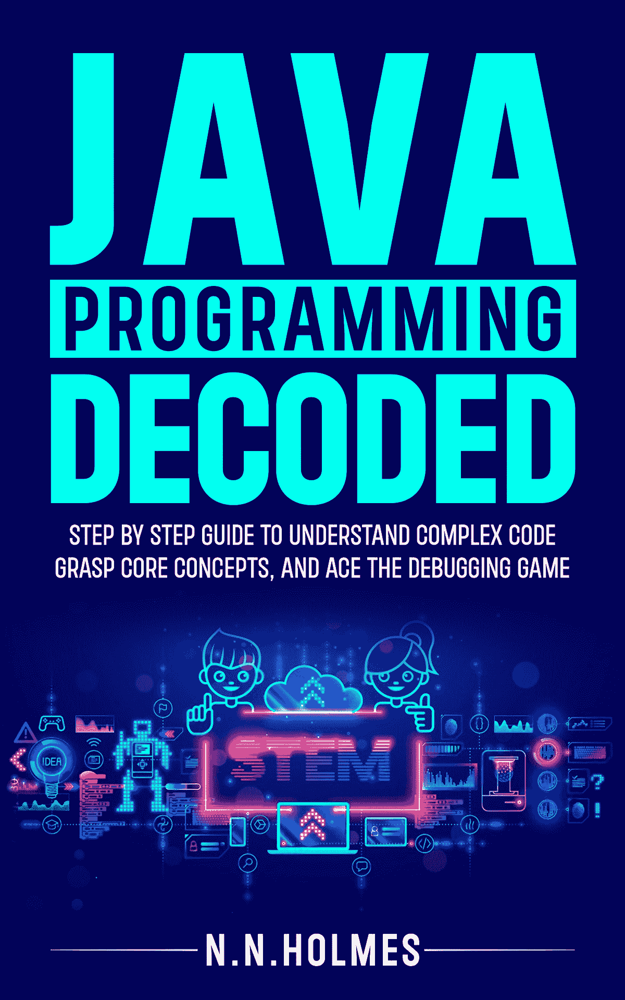
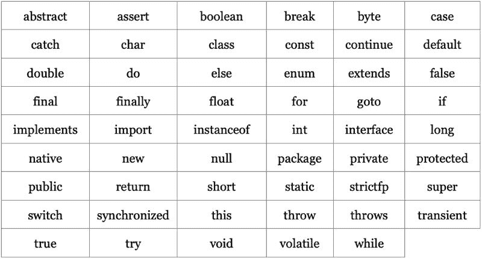
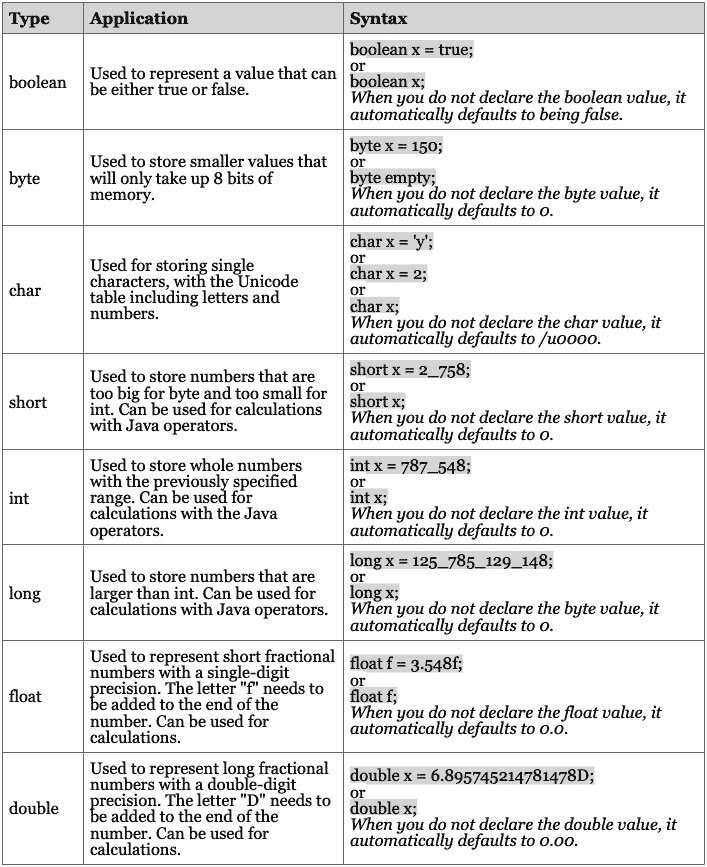
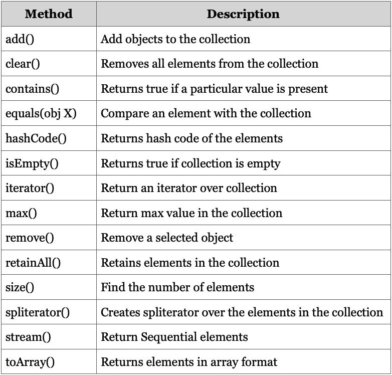
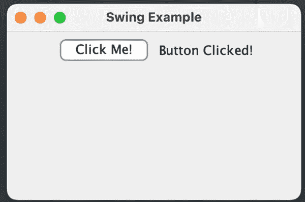

# Java 编程解码：逐步理解复杂代码、掌握核心概念并精通调试的指南



# 引言

想象你正坐在电脑前，睁大眼睛，心跳加速，看着火星漫游者安全地降落在红色星球上。这是一个数万公里外的奇迹，由地球上的一个科学家团队精心策划。你感受到的喜悦、宽慰和兴奋是溢于言表的。如果我告诉你，控制那个历史时刻的软件主要是用 Java 编写的呢？（Reuters, 2004）。

在瞬息万变的技术世界里，新信息的出现速度快到眨眼之间，有些人可能认为旧技术将过时。软件开发语言正处于这种争论的中心。随着使用 Python、Go、Kotlin 和 Rust 等新方言的开发者增加，许多人开始质疑 Java 这样几十年前的技术是否还有生存空间。

根据 JetBrains (2023) 对 2022 年的调查，Java 仍然是最流行的编程语言之一，在专业人员中的使用率约为 50%。对于 31% 的人来说，Java 是他们的主要编程语言，并在过去的 12 个月内使用过。对于 16% 的人来说，Java 是他们喜欢的编程语言，仅次于 Python。

然而，同一项研究还显示，大约 35% 的初级 Java 程序员在理解复杂代码和高效调试方面面临困难。这些数据强调了对全面资源的需求，而这正是我们本书的设计初衷。

这正是本书大显身手之处。它被开发为一个全面的指南，旨在帮助志向 Java 的开发者以及已经在领域深耕一段时间的人，通过它来解密编码的秘密。从理解语言的核心概念到学习如何高效地调试和测试你创建的程序，你作为职业 Java 开发者职业所需的所有信息，都可以在书中找到。

以下是阅读本书的一些益处：

*   **快速通道学习**：本书是一部通往 Java 编程知识顶层的快速电梯。它消除了在浩瀚碎片化在线资源中挣扎的必要性，提供了一个结构化且全面的学习历程。
*   **实用的代码示例**：书中充满了实用的代码示例，引导你理解并编写 Java 代码。这种实操方法将帮助你学得更快、更好。
*   **理解核心概念**：将复杂的 Java 编程术语和概念拆解为易于理解的部分。掌握构成 Java 编程基础的核心概念，巩固你的基础。
*   **揭秘调试**：对于初学者来说，调试可能是一项艰巨的任务。通过本指南，你将获得有效的调试策略，帮助你自信地处理错误并提高代码质量。
*   **进阶主题介绍**：通过对网络和图形用户界面（GUI）编程等高级 Java 主题的入门，超越基础知识。这将使你能够承担更复杂的项目并扩展你的技能。
*   **职业准备**：无论你是渴望在顶尖科技公司找到工作，还是考虑启动自己的应用，你从书中学到的技能都将显著增强你的作品集和就业能力。

除了上述提到的所有益处外，这本全面的指南采用了易于理解且通俗的语言，适用于不同水平的专业人士。从第一章开始，简单直观的代码编写方法将激励你继续学习和提升技能。随着阅读的深入，当你看到所学内容在提供的练习中得到实现时，无疑会感到动力继续下去。

如果你是编程世界的新手，且不确定这本书是否适合你，请放心，你将找到你寻找的信息。书中的概念不仅适用于开启旅程的初学者，也适用于想要回顾已知知识并增加知识储备的经验丰富的开发者。这段旅程的第一站将理解什么是 Java，以及你今天开始编码需要什么。

## 什么是 Java？

Java 是由 Sun Microsystems 在 1995 年创建的编程语言，目前版本为 `21`。然而，这并不是大多数开发者使用的版本，他们更倾向于 `Java 8`、`11` 或 `17`。Java 用于多种不同应用程序的开发，包括移动设备应用、医疗设备和网站。虽然名称相似，但不应将 Java 与 `JavaScript` 混淆。虽然两种技术都是开发语言，但它们唯一的相似之处仅在于这个名称。

Java 的主要特征之一是它是面向对象的语言，这意味着代码中不是仅仅使用逻辑和函数，而是围绕数据（或“对象”）设计，这些对象确立了程序需要发送的属性和消息。为了对比，可以说 Java 应用的语法和规则是基于在 `C` 和 `C++` 语言中观察到的规则。

Java 规则的核心前提是它允许开发者“编写一次，随处运行”。这一描述是该语言的基石，因为它的主要目标是成为一种可移植的语言，可以在设备之间轻松传输。此外，Java 的通用性使其能够与任何操作系统（`Android`、`Linux`、`iOS` 或 `Windows`）配合，并在需要时更改平台而无需调整代码。

由于 Java 已经存在了很久，初学者会发现另一个优势是其巨大的在线社区。然而，这个社区不仅限于相互支持的用户，还包含了库、仓库以及故障排除信息和文档，这些都能够实现高效的问题解决方法。从本质上说，当你开始学习 Java 时，你会发现你自己可以访问许多工具和资源，在开发和调试过程中提供帮助。

## 学习和开始使用 Java 的前提条件

虽然有些人说你必须至少具有一定的编程经验才能学习 Java，但这并非事实。虽然那些拥有这些经验的人在理解概念方面可能具有优势，并且对面向对象编程（`OOP`）的逻辑更熟悉，但这并不意味着作为初学者的你无法学习。事实上，许多人发现没有经验反而更容易学习 Java，因为他们没有先前的背景会让他们产生困扰。

另一个问题是需要强大的计算机来处理海量信息。虽然这无疑是一个优势，但对于学习 Java 来说是可选的。事实上，一些开发者的机器处理能力和内存也运行得良好。此外，虽然大多数专业人士使用集成开发环境（`IDE`），但你可以使用电脑上的记事本开始编写 Java 代码。

本书将教你如何设置和使用 Java `IDE`，这以后将帮助你调试并学习更高级的工具。然而，如果你无法在计算机上设置它，无需担心！你以后可以使用电脑的记事本开发和运行代码；唯一的区别是当你测试所编写的内容时，可能在调试和发现代码错误方面会有更多困难。

如果你准备好开始学习市场上最相关的编程语言之一的旅程，我鼓励你继续读下去！建议你在阅读时将电脑放在旁边，以练习代码以及正在教授的任何技术。我们将从对 Java 应用程序的简要介绍以及如何在你的计算机上设置不同的开发环境开始。因此，你将完全准备好编写你的第一行代码了！

# 第 1 章：Java 入门

如果你刚刚开始编程之旅，你可能对某些在结构中使用 Java 的数字应用程序感到好奇。你可能不会惊讶，因为它是如此流行的语言，`Amazon`、`Netflix`、`Spotify`、`Santander`、`Airbnb` 和 `Goldman Sachs` 等平台在其程序中使用 Java。事实上，根据 `Svet (2023)` 的研究，90% 的财富 500 强公司在开发新软件时将 Java 作为其首选编程语言。

在本章中，我们将探索编程开始背后的历史，以及 Java 如何成为计算机科学社区中如今如此重要的语言。此外，你将学习如何安装 Java 开发环境，设置好所需的一切，并正如所承诺的那样，编写你的第一行代码！

## 引言

为了理解编程，我希望你思考以下情况：假设你买了一件需要组装的家具。由于我们大多数人并不是该领域的专家，因此我们需要一份说明书来遵循必须执行的步骤，以实现所需的结果。这不仅适用于家具，也适用于任何你不具备所需知识来完成、需要指导以确保结果符合预期的任务，例如：烹饪、驾驶等。

同样的逻辑也适用于编程：除非你告诉计算机你想让它做什么以及如何做，否则它并不知道你想让它做什么，也不清楚如何执行。这就是编码的用武之地：它使用特定的语言或代码，根据特定的指令告诉程序或计算机它应该做什么。你可以使用这些代码来告诉计算机如何解决问题、处理信息以及执行其他若干任务。

然而，计算机通常无法“理解”人类语言。这意味着，例如，在创建软件时，你不能直接说“创建一个程序来为我求解数学方程”。计算机不会理解这句话，因为它们有一种特定的语言（或多种语言，称为方言）用于与它们进行通信。这些方言将通过将我们的语言转换为计算机能理解的语言，来“翻译”我们人类想要机器执行的操作。这些语言包括例如：`Python`、`Go`、`Rust`、`NodeJS`、`Elixir`、`C`、`C++` 以及 `Java`。

通过使用这些语言来指令和“编写”计算机，开发者可以告诉它们应该做什么。从简单的任务（如在计算机上打开文字处理软件）到让计算机在人工智能应用中模仿人类语言，都是通过编程语言实现的。几乎所有与使用计算机的操作涉及到编程语言。

现在，关键部分在本书中出现了：当你想要与计算机“通信”时，你将使用允许你实现此点的语言之一。你的语言选择取决于两点：1. 你熟悉的语言；2. 你需要做什么。在这种情况下，语言的选择将直接反映你的个人偏好、你最适应的程度，以及更重要的是，你想要活跃的市场。

诚然，某些语言被认为更容易学习，而另一些则更难。然而，由于每位读者都有自己的偏好，对它们进行分类是不负责任的。尽管如此，随着本章深入，我们将解释 `Java` 的主要特征以及它与其他可用语言的区别。

根据 Coursera (2023)，编程语言可以分为以下五类：

1. 脚本语言
2. 过程化编程语言
3. 逻辑编程语言
4. 函数式编程语言
5. OOP（面向对象）语言

这可能会引发问题：`Java` 属于哪一类？这是一个非常好的点。让我们来看看 `Java` 属于哪些类别，并开始探索它的特性。

## Java 概述

在面向对象的语言中，`Java` 以成为最重要的编程语言之一而闻名。当它在 1995 年发布时，`Java` “并没有革命性的元素，但其成功的关键在于以正确的方式结合这些元素，并从前者的优缺点中学习。微软后来利用 `Java` 的经验在开发 `C#` 时使用了这种方法”（Izydorczyk, 2022）。正如你所想象的，这种成功的方法引起了开发者市场的关注，许多人学习了如何使用它。

在谈论 `Java` 时，如果不提到它曾广为人知的“一次编写，随处运行”（WORA）这一之前的“格言”，将是不可能的，尽管这在现在已不再完全准确。这在当时是一个巨大的优势，意味着你可以在所有支持的平台上运行用 `Java` 开发的程序，而无需调整或重新编译代码。随着对技术可用性需求增加以及更多软件的发展，这成为了吸引许多人使用它以及公司实施它的另一个吸引点。

事实上，许多公司继续在程序中使用 `Java`，是因为了解它的开发者数量惊人，而且它具有可靠性。此外，该语言不断地进行更新和改进，这意味着它随着市场的变化而不断演变和适应。它为开发者提供的适应大多数情况的灵活性仍然是一个具有吸引力的属性，使得学习用 `Java` 编码成为技术市场上的一项有价值的技能。

最后，至关重要的是提到 `Java` 的“年龄”已成为它最重要的资产之一。“Java 鼓励解决方案的成熟，并拥有庞大的社区。很难找到没有与 Java 预集成的技术或未由外部库提供的功能”（Izydorczyk, 2022）。这意味着，即使你感兴趣于学习更“现代”的语言（如 `Kotlin`），拥有 `Java` 的基础知识也会让旅程变得更容易，其他方言也是如此。

现在你已经对 `Java` 的特性有了清晰的认识，是时候开始工作了。你需要做的第一件事是安装所谓的 Java 开发工具包（`JDK`），你需要它来编写代码。我们来看看它是什么以及执行这一过程的步骤吗？

## 安装 Java 开发工具包

要开始使用 `Java`，你需要将 `JDK` 下载到计算机中。回到我们构建家具的类比，`JDK` 类似于需要锤子和螺丝刀来组装零件。或者就像烹饪时的锅、炉子和勺子。从本质上说，`JDK` 将提供编写、编译和运行 `Java` 代码所需的工具。“Java 开发工具包（JDK）是 Java 编程使用的三个核心技术包之一，另外 JVM（Java 虚拟机）和 JRE（Java 运行环境）”（Tyson, 2022）。这三个技术部分可以描述为：

* `JDK`：用于开发软件或简单的编写、编译和执行代码，提供让程序在 `JRE` 和 `JVM` 中运行的工具。
* `JRE`：用于运行开发的代码，它是 JDK 的一部分，因为你需要运行代码。
* `JVM`：用于托管运行程序，并将给出的指令“翻译”成计算机可以理解和解释的语言，使其执行指令。

现在你已经了解了设置 Java 环境的关键组件，让我们来看看安装它们的步骤。

1. 访问 [Oracle.com](http://Oracle.com) 网站。
2. 在顶部选项卡下，在“Products”找到最后部分的“Hardware and Software”，并点击“Java”。
3. 点击“Download Java”按钮。
4. 在“Java downloads”部分，根据你使用的操作系统（Linux, macOS 或 Windows）选择 `JDK` 21 或 17。
5. 根据你计算机的规格和需求选择要下载的工具包。

> **注意**：在本书中指令将基于 Windows 操作系统。不过，你可以在网站提供的文档中找到任何不同操作系统的规格。

6. 确保你有 64 位的 Windows 平台以下载工具包。
7. 点击提供的列表中的链接开始下载。你需要根据你使用的 Windows 版本签署许可协议并在计算机上保存可执行文件（`.exe`）。
8. 一旦 `.exe` 文件保存到你的计算机上，双击打开它并开始安装程序。你需要选择你打算保存该程序的位置。（程序提供了一个分步操作的屏幕界面，将帮助你完成每项操作。）

一旦安装完成且文件已保存到计算机中，你将收到一条消息，告知你程序已正确下载。过程现在几乎完成了！你即将学习为什么是“几乎”完成而不是“完全”完成。

虽然仅使用 `JDK` 来编写和编译代码是完全可以的，但在你可能工作的任何公司中，这种方法不太可能会被使用。大多数（如果不是全部的话）Java 开发者都会使用 `IDE`。`IDE` 是那些编写代码和创建程序的人的极佳辅助，因为它允许在同一个地方执行多个不同的功能，例如编译、调试和测试。

通过使用 `IDE`，你不仅节省了时间，还让编码过程更加高效。简单来说，当你使用 `JDK` 而不是你选择的 `IDE` 来编写代码时，就像是用 `Notepad` 写书而不是用 `Word`。虽然两者完全可以接受，但你可能会同意，因为 `Word` 提供了所有工具，在其中进行操作会让过程变得更容易。

因此，在书中，你将获得使用 `IDE` 的选项，这是被高度推荐的。在这种情况下，Java 最受欢迎的前三个 `IDE` 是 `IntelliJ`、`Eclipse` 和 `VSCode`。你可以选择其中任何一个（以及许多其他）来进行编码过程。

## 安装 IDE

虽然每个 `IDE` 都有自己的安装过程，但在书中，我们将引导你完成下载 `Eclipse` 的逐步过程。以下是执行此过程应采取的步骤：

1. 前往 [eclipse.org](http://eclipse.org)。
2. 在页面顶部，点击“Download”按钮。
3. 点击“Download x86_64”。
4. 点击“Download”。
5. 带有 `.exe` 扩展名的 `Eclipse Installer` 程序将下载到你机器的“Downloads”（下载）文件夹中。
6. 双击图标开始安装 `IDE`。
7. 选择“Eclipse IDE for Java Developers”。
8. 安装 `IDE` 的文件夹将被预选。点击“INSTALL”。
9. 下载完成后，如果安装程序没有自动为你启动，且你已经遵循了分步操作，请启动 `IDE`。
10. 通过给它命名（由程序提示）为你的项目创建一个工作空间（workspace）。当你开始新项目时，可以创建一个新的工作空间。

现在你已经准备好编写你的第一个 Java 程序了！我们开始吗？

## 编写你的第一个 Java 程序

当有人学习如何编写代码时，第一个程序是“Hello World”并不稀奇。你的情况也是如此。你需要做的第一件事是在 `IDE` 中启动一个项目。为此，你必须前往 `File > New > Java Project`。一个窗口将打开，帮助你建立将创建的程序的细节。给它起你喜欢的名称，并且（这非常重要）不要更改屏幕上出现的任何其他配置。完成后，你点击“Finish”。

完成后，你将进入 `IDE` 的主界面，在那里，你可以在名为“Package Explorer”（包资源管理器）的标签页下看到你分配了名称的程序。接下来，你应该通过右键点击项目名称、选择 `New`，然后选择 `Package` 为此程序创建一个包。在这里，你不需要更改源文件夹，可以再次使用你喜欢的名称并点击“Finish”。

> **注意**：根据 Java 规范（我们稍后会讨论），包名应该与你使用代码的用途相似。

现在，你需要创建一个类（class），可以通过右键点击你创建的包（它应该显示在项目名称下方）来完成；然后点击 `New` 和 `Class`，我们可以为它命名，例如 `FirstProgram`。另一个对话框将出现，你将填写包名，并确保选中 `public static void main(String[] args)` 的复选框以及 `Inherited abstract methods`（继承的抽象方法）的框。点击“Finish”。

在工作空间中，你会看到新的信息，具体来说如下所示（在 `Eclipse` 中，你需要在包名下输入代码）：

```java
package <selected.name> // Eclipse 和下载的 IDE 必须的

public class <class.name> {

    public static void main (String[] args) {

    }

}
```

你将按照所示输入你的“Hello World”代码：

```java
class FirstProgram {
    public static void main(String[] args) {
        System.out.println("Hello, World!");
    }
}
```

搞定！你现在只需要点击顶部的绿色“Play”（播放）按钮，`IDE` 将运行你的代码。如果没有错误，你将看到屏幕底部出现 Hello World 字样作为你的输出。

现在，可以理解为虽然你成功地做到了，但你无法完全解释发生了什么。为了做到这一点，停下来研究语言的基础语法是非常重要的。这将使你能够无问题地创建更多程序和代码。为此，请继续阅读。

## 基础语法

你已经知道 Java 是一门面向对象的语言，但现在你将看到构成其运行的元素，也就是语法。三个基本元素构成了代码：


# Java 基础概念

## 1. Class（类）
对象的蓝图。例如，我们有 `bird`。可以假设所有的鸟都是鸟，尽管它们都有特定的特征。例如，所有的鸟都有羽毛和翅膀。在声明类名时，单词的首字母应该始终大写。如果你使用多个单词，应不带空格编写，例如 `BirdsProject`。

## 2. Method（方法）
用于描述特定对象具有的行为。这种方法必须在类内部描述。一个重要的特性是同一个类可以包含不同的方法。例如，鸟可以吃、洗澡、孵化、飞行，或者特定类允许的任何操作。在编写方法名时，第一个单词的首字母应该始终小写。如果你使用多个单词命名方法，再次需要不带空格使用，并且你需要将第二个单词的首字母大写，例如 `blueBirdFlying`。

## 3. Instance variables（实例变量）
赋予特定对象独特的特征。目前为止，我们一直在讨论鸟。但在这种情况下，我们将分配使这只鸟独特的属性。它是蓝色的，有黑喙，并且会唱歌。这些与其他所有特定特征在一起，构成了这只鸟的独特特质，使其成为其本身。

## 标识符命名规则
在 Java 中编写程序时，你必须为你编写的每一个内容命名（类、方法和变量），这意味着它们将拥有标识符。根据 Java 代码结构，这些标识符必须始终以 `A` 到 `Z` 的大写或小写字母、下划线（`_`）或美元符号（`$`）开头。标识符不能以其他任何数字或其他特殊字符开头。在这里，至关的一点是记住，如果你使用大写或小写，它们具有不同的含义。

## 主方法
最后，你有代码行 `public static void main (String[] args)`，这是让 Java 能够处理你要求它执行的操作。这行代码将出现在你在 Java 中编写的所有代码中。这是因为它将提供指令，在你的案例中，就是执行“打印” Hello World 代码的指令。

## 代码示例与注释
虽然在之前的代码中没有看到，但你可能会遇到如下所示的写法：

```java
/*这是你将要
* 使用的代码，如果你想在
*  程序中打印 Hello World
*/

//这里是包
package <selected.name>

//这是类
public class <ClassName> {

//这是主方法，命名为 "main"
public static void main (String[] args) {

//这是打印语句
System.out.println("Hello World");

}

}
```

你会发现，通过添加 `//` 符号或 `/*` 符号使用了代码指令。当你对正在创建的代码进行注释时，应该使用这些标准。在这种情况下，你将使用 `//` 用于单行注释代码，使用 `/*` 开始多行注释；下一行应该始终以 `*` 开头，在你写完后，应该用 `*/` 结束以表示注释结束。

## 缩进规范
你可能注意到的另一点是，上述代码有缩进，这意味着它们没有左对齐。虽然某些编程语言（如 Python）将缩进作为代码运行的强制条件，但 Java 并非如此。这意味着如果你不使用 IDE，可以在不进行缩进的情况下编写代码。尽管如此，你应该注意，使用 `Eclipse` 等 IDE 会自动对代码进行缩进。

## 编码最佳实践
最后，关于 Java 代码有两点非常重要：
1. 大多数经验丰富的开发者使用的类、方法和实例名称指的是它们将的功能。这使得代码更易理解、更整洁，让其他开发者能够理解语法背后的意图。
2. 许多开发者不喜欢在代码中使用注释。他们声称这会让代码变得“脏”，并增加理解的难度。

这些大部分信息可以在称为 Java 规范（Java conventions）的文档中找到。虽然这些不是决定你的代码能否运行的“规则”，但它们是大多数开发者使用的标准 Java 编码应用，以确保你的代码可以被任何需要的人阅读。在本节中解释所有的 Java 规范是没有意义的，因为会有一些你无法理解的元素。然而，为了确保你熟悉市场上的最佳实践，将在书中内容的各个处根据需要解释规范的应用。

## 预留字
你应该知道的最后一点（这对于在 Java 中编写代码至关重要）是，该语言拥有所谓的“预留字”（reserved words）。这些词在与代码配合时有特定的用途；因此，它们不能被用于命名变量、类或方法。随着时间的推移和你对 Java 经验的增加，你可能会记住此表中的术语，所以不需要担心！此外，你会发现在阅读过程中，许多预留字都将得到解释；因此，你会立即明白它们不应该被使用。如果你需要额外的帮助来记住它们，可以尝试打印或写出它们，以便在需要时方便查阅。

这里是 Java 53 个预留字的列表：



# 编译和运行 Java 程序

当我们进入章节的最后一部分时，你将学习如何编译和运行你创建的 Java 程序。虽然在使用 IDE 时这个过程是自动的，但重要的是你要知道，可以在不使用 IDE 的情况下执行这些操作和命令。此外，你将学习 Java 解释器（interpreter）和编译器（compiler）之间的区别，这是 Java 包中不可组成部分。

## 编译器与解释器
就像当你用 Java 编写代码时计算机不理解“人类”语言一样，代码还未准备好被机器理解。这是因为计算机只理解二进制语言，即它能听懂的“0”和“1”的分配。当你拥有 Java 编译器（`javac`）时，它将充当“翻译官”的角色，将你以代码格式编写的内容转换为机器语言。正如名称所示，解释器具有相同的功能：将代码转换为机器代码，以便机器知道它必须做什么。

但你可能会问，编译器和解释器是同一个东西吗？这是一个非常棒的问题。虽然它们的作用相似，但它们有一个根本区别：编译器会扫描整个代码，然后才进行翻译；而解释器会逐行执行并同时进行翻译。如果你的代码中有任何错误，解释器会在读取每行代码时捕获它们，而编译器将在完成扫描后才执行这一点。

正如你所想象的，这种差异会显著影响程序的性能和调试。如果你通过编译器运行代码，你将一次性看到所有需要修复的错误，这可能花费很长时间，因为一旦你想测试它，它就需要重新运行所有代码。这可能导致一个乏味的过程，特别是当代码量很大时。然而，如果是正确的，这会让软件运行得更快，因为它会读取并解释完整的命令。

解释器的行为具有完全相反的特征。如果你想象逐行运行代码，你会发现它使调试更快，因为你会在执行过程中“攻击”每一个问题，并且只有当它正常时才会移动到下一行。这意味着代码只有在出现错误时才会停止。另一方面，执行此程序可能需要更长时间，因为它会读取每一行唯一的代码来执行所需的操作。

当你使用 IDE 时，这个过程被嵌入在软件中，准确地告诉你问题所在并快速处理。此外，它可能帮助你解决不需要开发者干预即可解决的问题，或者告诉你在哪里需要添加更多代码。正如前面提到的，你应该学习如何在不使用 IDE 的情况下在计算机上编译代码。

## 命令行编译与运行步骤
要做到这一点，你必须确保安装了 `JDK`。然而，不是使用 IDE 的工作区输入你需要的内容，而是在计算机上打开记事本（Notepad）或类似的应用程序。现在，记住你将阅读的步骤指的是 `Windows OS`，但你可能使用的任何其他操作系统也可以采用类似的方法。

你将输入我们在上一节看到的代码：

```java
public class JavaProgram {

public static void main (String[] args) {

System.out.println("Hello World");

}

}
```

不要输入任何其他内容。然后，以与类相同的名称保存文件，这是 Java 规范中的一种良好做法。在这种情况下，文件将保存在你的计算机中并为 `JavaProgram.java`（扩展名为 `.java`），但当你建立路径时，你需要告诉 `CMD` 该文件所在的位置，例如桌面或特定文件夹。打开命令提示符 (`cmd`) 窗口并输入 `javac JavaProgram.java` 来编译代码。记住，你应该使用 `"javac"`，因为它是该语言的标准编译器。如果没有错误，你可以通过输入 `java JavaProgram` 并按回车键立即运行程序。`cmd` 带给你的输出无非 Hello World 莫属。

如果代码中有错误，它将被识别，你需要检查并查看可能犯的错误。另一方面，你也可能收到一条系统消息，显示 `'javac' 不是内部或外部命令、可运行程序或批处理文件`。这意味着计算机在设备上没有找到 Java（完整包）的路径，你需要向它显示它所需的路径。

这个过程被称为“设置路径”，执行起来相对简单。你将做的第一件事是找到 JDK 安装在电脑上的位置，并获取目录地址。你必须复制完整地址，然后通过在前面写入（在同一行）将其粘贴到命令行屏幕：`set path=(在此处粘贴地址)`。完成后，你就可以编译并运行代码来查看其效果。如你所见，这是一个相当辛苦的过程，可以通过使用 IDE 轻松修复，这就是为什么再次建议你在学习过程中使用它。

# 轮到你尝试了！

现在你已经对 Java 编码如何工作有了通的了解，轮到你尝试了！在 Eclipse 或任何在线 IDE 中，通过将 "Hello World" 替换为其他短语，练习提供代码中的打印语句。这些是你在为本次练习以及书籍剩余部分编写所有代码时应该使用的程序。

你可以尽情地尝试和练习，直到你觉得从心。你也可以尝试添加“错误”元素，例如从代码中去掉大括号，看看会发生什么。这一切都在于尝试和实验！

你现在已经迈入了进入激动编程世界的第一步，并编写了你的第一个 Java 程序。随着我们进入下一章，你将深入研究该语言的构建模块和基础基石：变量和数据类型。所以，请保持好奇心并继续探索！

# 第 2 章：变量与数据类型

现在你已经知道了 Java 语法以及类、方法和对象的应用，是时候仔细观察其他 Java 组件了。这些组件将帮助你编写代码，并确定需要做什么工作以及需要考虑的格式。由于这些原因，在本章中，你将学习 Java 中的变量、常量、原始数据类型和操作。

但你并没有认为你只会看而不做，对吧？嗯，当然不是。当你学习这些中的每一项时，你也将看到它们是如何运作的，以及如何（例如）在数据类型之间进行转换。在章节结束时，你将学习如何处理字符串、执行强制转换以及初始化变量。为了确保你已经理解了内容，你将在末尾进行一些练习，练习你的新技能并探索不同的编码可能性。

## 变量与常量
你首先需要理解的是，与其他语言一样，Java 也有可以被归类为变量或常量的项。在这种情况下，当你有一个变量时，信息可以根据它在程序中的用途而改变。然而，为了实现这一点，你必须声明它，例如：

```
data_type variable_name;
int x;
```

另一方面，当你有一个常量时，正如其名所示，值在整个程序执行过程中将保持相同。就像变量一样，你需要“告诉”程序你所采用的值是一个常量，以便它通过使用单词 `"final"` 识别出在整个代码过程中不会发生变化。这是声明常量的语法：

```
final int X = z;
```

正如你可能从上述代码中注意到的，变量中声明的 `"x"` 是小写的，而常量中的是大写的。这非常重要，因为正如你从上一章记得的，Java 会考虑代码中使用的字母大小写之间的差异。在这种情况下，在声明常量时，Java 规范规定在声明常量时，需要使用全大写，如果它由多个单词组成，你需要在它们之间使用下划线。

虽然 Java 只有一种声明常量的方法，但对于变量来说并非如此，因为该语言有三种不同的变量类型。它们是：

*   **类变量**，与类相关，通常使用所用类的 `static` 关键字进行声明。换句话说，这个变量将定义编写该特定类时的整个代码块。当使用 `static` 单词时，意味着在整个程序中，该特定变量只有一个副本，并且它不会改变。在这种情况下，变量并不一定需要声明。它们将自动引用默认值，我们将在下一节讨论它。

*   **实例变量**是非静态值，可以在你编写代码时发生变化。由于它们是可变的，你不应该在前面添加 `static` 术语。在这种情况下，为了容易记住实例变量是什么，你应该根据其所处的情况考虑其特征（或值）。这些变量声明在类内部、方法外部。你可以在声明实例变量之前使用 `"public"` 或 `"private"` 关键字来定义其可见性。

*   **局部变量**正如其名所示，是赋予程序中特定位置的状态。在这种情况下，它们将以简单的语法 `variable = value` 使用，无需使用任何特定的关键字。由于它们受限于特定位置，它们将仅引用代码的该部分而不会在其他地方使用。它们通常声明在方法内部，一旦使用就会被程序销毁。

这些是开发者为声明的对象编码和赋予状态的不同方式。

## 数据类型表
现在，我猜你一定在思考这些每一项应该在哪里以及如何使用，以及在声明它们时应该采用什么语法。为了简化识别过程并方便理解每种数据类型，这里有另一张表格包含了你需要知道的所有信息。



在这张表中，你会注意到某些示例语法中具有一些独特的特征：

*   在定义数据类型之后，你必须使用分号（`;`），以确保在运行代码时不会报错。
*   下划线字符 `_` 代表数字中的逗位分隔符，而小数点保持不变。
*   所有存储数字的数据类型都可以在 Java 中用于数学计算，尽管使用 `short`、`int` 和 `long` 进行计算与使用 `float` 和 `double` 相比存在存在的。
*   你需要使用的引号是直引号（`''` 或 `"`），而不是编译器可能无法识别的弯引号（`‘’` 或 `“”`）。

## 字符串
然而，在读完这张表后，你可能会想：如果我想存储一个句子，比如我们在第一个例子中那样的 Hello World，该如何操作呢？这些都是非常棒的问题，说明你一直在密切关注。做得好！在这种情况下，我们将使用 Java 中被称为“string”字符串的内容。

在字符串中，你可以声明文本，例如 "Hello World"，它必须放置在双引号之间以便被识别。在这里，函数名 `String` 的首字母应该大写。在这种情况下，语法如下：

```java
String greeting = "Hello World";
```

不过，我们现在不会深入讨论字符串的细节，因为这将在本章最后一节中讨论。在此期间，我想花点时间复习一下记忆：在声明变量的数据类型时，根据 Java 规范，它们应该尽可能接近它们的含义，例如：

```java
String name = "Sarah";
int age = 15;
float temperature = 45.9f;
```

## 变量声明与赋值
最后，在继续学习下一节之前，你还应该了解变量和数据类型的最后两个细节：

1.  可以先声明变量，稍后再定义它的值，例如：

```java
int year;
year = 2006;
```

2.  可以通过给变量分配新值来改变变量，例如：

```java
int year = 2006;
year = 2013;
```

在这种情况下，值被改变了，如果你要求程序打印 `year` 变量，你看到的输出将是 2013。记住，如果你想固定这个值，应该在语句开头添加 `final` ，这样它就无法被更改或覆盖，从而变成一个常量。在这种情况下，你只会改变变量的值，而不是改变它的类型。当你想要更改它所引用的数据类型时，必须求助于所谓的“强制转换”（casting），我们现在来讨论这一点。

## 类型转换与强制转换
如果你在 Java 中开发程序，你可能想要更改数据类型，例如从 `float` 转换为 `double`，以便使计算更精确或考虑更大的数字。在这种情况下，你需要使用所谓的类型转换（type conversion）或类型转换（casting），即从一种数据类型切换到另一种。根据 Badkar (2023) 的说法，如果你想实现以下目标，也可以发生这种情况：

*   对代码有更强的控制
*   优化程序的内存使用
*   防止数据丢失
*   将用户输入的文本输入转换为数字
*   使数据类型兼容以执行计算和操作。

在这种情况下，这种数据类型的更改可以通过两种方式进行：手动或自动，也称为显式和隐式。Java 目前在它的规则内支持 13 种数据转换，范围从数字的扩展和缩小到将 `char` 转换为 `int`。唯一不接受任何转换的数据类型是 `boolean`。

### 显式强制转换
在这种手动数据类型转换中，开发者将编写代码以确保转换的完成。这种类型转换的主要特征是它将用于缩短赋值给变量的值。在这种情况下，允许的转换如下：

`double → float → long → int → short → byte`

这意味着你可以，例如，将一个长小数转换为一个较短的小数，然后将这个较小的小数转换为一个 `int` 整数。当最后这次转换发生时，小数点将被丢弃，程序将只识别整数部分。这里有一个你可以考虑的关于这些转换的示例：

在第一个例子中，我们将使用完整的代码块将一个值为 2.2 的 `float` 转换为 `int`。

```java
class Main {
    public static void main(String[] args) {
        // 创建一个 float 类型的变量
        float data = 2.2f;
        System.out.println("The float value is " + data);
        // 将之前创建的 float 转换为 int
        int num = (int)data;
        System.out.println("The int value is " + num);
    }
}
```

在这种情况下，程序带给你的输出如下：

The float value is 2.2

The int value is 2

由于小数点将被丢弃，`int` 值将是 2。然而，取决于你所开发软件的使用，这种小数点的丢失可能会直接影响你获得的计算结果。由于这种原因，因为这种转换被认为是危险的，开发者必须手动执行更改 (Gupta, 2020)。

现在，如果你注意到了上述内容，可能会疑惑当你想要扩展或增加一个数字时是否也需要执行相同的步骤。简单的答案是“不需要”。对于从“较小”到“较大”数字的情况，编译器会自动完成过程，这被称为隐式强制转换。

### 隐式强制转换
隐式强制转换中所谓的数字“扩展”（widening）通常发生在目标类型比源类型大，或者数据类型兼容的情况下。这意味着，即使你尝试自动地将一个较大的数字转换为较小的数字，编译器也会产生错误，你需要修复代码行。了解这些允许的转换很重要，这样你的程序在编译时不会产生任何错误。让我们看看允许的转换：

`byte → short → int → long`


`char → int → float → double`

`int → double`

让我们通过一个完整的代码块示例来看这些转换：

```java
class Main {
    public static void main(String[] args) {
        // 创建一个 int 类型的变量
        int num = 15;
        System.out.println("The number is " + num);
        // 将之前创建的 int 转换为 double
        double decimal = num;
        System.out.println("The decimal value is " + decimal);
    }
}
```

在这种情况下，输出将：

The number is 15

The decimal value is 15.0

由于我们将一个较小的数字转换为一个较大的数字，这是自动完成的，不需要像显式语法示例中那样指定转换。

关于字符串，你应该了解的第一个且最本质的特性是它是不可变的，换句话说，它在创建后不能被更改。然而，这并不意味着你不能对其进行任何操作。事实上，你可以对字符串执行若干操作，我们现在就要看到。以下是 Challa (n.d.) 根据官方文档编制的列表，其中列出了 Java 中字符串的所有内置方法：

- `charAt()`：用于返回指定位置的字符。
- `concat()`：用于将一个字符串附加到另一个字符串的末尾。
- `equals()`：用于比较两个字符串并返回布尔值（true 或 false）。
- `indexOf()`：用于返回字符首次出现标识的位置。
- `length()`：用于识别字符串的长度。
- `substring()`：根据传递的参数索引值提取子字符串。
- `toLowerCase()`：用于将字符串中的所有字母转换为小写。
- `toUpperCase()`：用于将字符串中的所有字母转换为大写。

为了说明这些函数如何与字符串配合使用，我将使用一段代码来处理字符串，并要求编译器根据类似于 Challa 所采用的模型中请求的命令打印不同的输出。你准备好了吗？

```java
class Main {

  public static void main(String[] args) {
    String name = "Sarah";
    String surname = "Connor";
    String profession = "Hunter";
    boolean id = name.equals(profession);
    System.out.println("The letter in position 3 is: " + name.charAt(3));
    // 在这种情况下输出将是 The letter in position 3 is: a

    System.out.println(name.concat(surname));
    // 在这种情况下输出将是 SarahConnor

    System.out.println("Compare name and surname: " + id);
    // 在这种情况下输出将是 Compare name and surname: false

    System.out.println(name.indexOf('r'));
    // 在这种情况下输出将是 2

    System.out.println(profession.length());
    // 在这种情况下输出将是 6

    System.out.println(profession.toLowerCase());
    // 在这种情况下输出将是 hunter

    System.out.println(surname.toUpperCase());
    // 在这种情况下输出将是 CONNOR

    System.out.println(surname.substring(1, 3));
    // 在这种情况下输出将是 on

    System.out.println(name.substring(3));
    // 在这种情况下输出将是 ah
  }
}
```

现在你已经看到了代码的结果，关于输出，这里有一些必须考虑的注释：

- 当你请求打印 "r" 的索引位置时，程序的输出是 "2"。这是因为在 Java 中你从 0 开始计数而不是 1。因此，在这种情况下，“s”的索引为 0，“a”的索引为 1，“r”的索引为 2。
- 虽然拼接没有在单词之间添加空格，但在输出 `Compare name and surname: false` 中，你会注意到冒号和单词 "false" 之间有一个空格。这在 Java 中不是自动的，当你编写你想要的输出内容时，需要指示对该空格的需求。
- 拼接函数也可以用 `+` 运算符替换。在这种情况下，如果你想使用它，语法将是：

```java
System.out.println(name + " " + surname);
```

// 输出将是 Sarah Connor，因为你添加了空格

好了，关于 Java 中数据类型和变量的重要信息就这些了。你已经得到了关于它们主要特征以及如何使用的全面解释。这些信息至关重要，因为你将在后面的章节中编写代码时会用到它们。然而，现在轮到你了！你准备好自己尝试一些例子了吗？

## 轮到你尝试了！

下面是五个练习示例，你可以用来测试你是否已经掌握了内容。无论这些示例如何，我再次鼓励你花一点时间根据在本章中学学的信息来探索不同的代码可能性，包括编写错误的代码，以便你知道如果出错错误会变成什么样。

1. 创建一个字符串格式的新变量。
2. 将之前创建的字符串中的所有字母转换为大写字母。
3. 将值为 `458.96` 的 `double` 数据类型转换为 `int` 数据类型。
4. 将值为 `6` 的 `int` 数据类型转换为 `float` 数据类型。
5. 超级挑战：将一个值为 `56` 的 `int` 数据类型变量与一个值为 `897.69` 的 `double` 数据类型变量相加。

你已经成功地深入了 Java 的海洋！从理解 Java 的基本构建模块到处理字符串，你拓宽了自己的编程知识。但还有更多等待着发现。在下一章中，我们将探索 Java 运算符和控制语句。你准备好继续冒险了吗？

# 第三章：控制流

当你编写代码时，无论你使用什么种类型的语言，你可能都需要通过某些命令进行编程。我们经常看到的一个简单例子是，当我们需要登录一个请求密码的网站或应用时。在这种情况下，如果我们输入正确的选项，就可以登录。如果不是，我们就无法登录。这是一个 "if" 子句，是你在本章中将学习的内容之一。

为了帮助你熟悉 Java 中的控制流并学习开发条件语句，我们还将讨论循环结构、`break` 和 `continue` 语句以及逻辑运算符。

## 条件语句

条件语句正如你想象的，是一个条件。例如，如果下雨了，我会带伞；如果没有，我就不带。这两个关键字 `if`-`then` 是这些条件语句的保留关键字。它们用于创建程序需要执行的动作序列。在这种情况下，如果条件为真，那么这就是输出。如果不是（`else`），那么将会出现其他信息。`if-else` 条件可以用于 `float`、`char`、`int` 和 `boolean`，并且该语句可以由多个声明组成。然而，至关重要的是记住计算机将按照你编写代码的顺序执行。让我们来看例子。

假设你创建一个日程，让每一天代表一个特定的数字。在这种情况下，你可以告诉程序第 1 天等于（`==`）周一，第 2 天等于周二，第 3 天等于周三。如果在字段中放置了任何其他数字，输出应该是 "Other day"。代码看起来如下：

```java
public class Main {

  public static void main(String[] args) {
    int day = 3;
    String dayName;

    if (day == 1) {
      dayName = "Monday";
    } else if (day == 2) {
      dayName = "Tuesday";
    } else if (day == 3) {
      dayName = "Wednesday";
    } else {
      dayName = "Other day";
    }

    System.out.println("Using if-else: " + dayName);
  }
}
```

在这种情况下，我们确定了我们正在使用的 `int` 数字是 3；因此，程序的输出将是 `Using if-else: Wednesday`。如果你将语句 `int day = 3;` 替换为 `2`，例如，输出将是 `Tuesday`。尝试一下！

虽然这是一种让代码运行的简单高效的方法，但你必须记住，如果过度使用它或应用过多的语句，你的程序可能会变慢。此外，如果需要进行编辑，它也会使过程变得更加困难，因为每次更改都会涉及到多个变量。出于这个原因，Java 中可以使用另一个条件关键字，它允许你优化代码并提高速度，从而替换不同的 if-else 语句。这种条件被称为 `switch` 语句。

让我们看看 `switch` 语句是如何应用于上一个示例的：

```java
public class Main {
    public static void main(String[] args) {
        int day = 3;
        switch (day) {
            case 1:
                System.out.println("Monday");
                break;
            case 2:
                System.out.println("Tuesday");
                break;
            case 3:
                System.out.println("Wednesday");
                break;
            default:
                System.out.println("Other days of the week");
        }
    }
}
```

在这种情况下，如你所见，我们用 "cases" 和 "breaks" 替换了 if-else 语句，这使得程序能够同样地做出决策。程序将运行所有决策，直到结束或识别出 `break` 语句。在这种情况下，你用一个语句处理不同的决策（看 `{}` 的开启和关闭位置），使得编写、编辑和测试代码变得更加简单。另一方面，代码的逻辑将不会被测试，就像使用 if-else 时那样。

你看到的另一个区别是末尾有一个 `default` 关键字。如果任何条件不符合标准，则应该应用此值。这意味着如果你输入数字 1–3，你的输入与你在上一节中看到的相同。然而，如果数字与这些数字不同，输出将是 `Other days of the week`。

虽然这些语句将帮助你控制程序的逻辑，但你能想象一下如果你需要创建一个倒计时程序会发生什么吗？对于屏幕上应该显示的每个输出数字，你需要写多少行代码？如果我们谈论的是 10，那可能没那么困难，但如果我们使用计时器来计算某人执行特定任务的剩余时间呢？那无疑需要大量的代码行和时间。

尽管如此，你不必担心，因为 Java 有避免这种情况的解决方案。我们将在下一节中看到它们，它们被称为循环结构。当你编写这些语句时，它们将允许程序执行相同任务的特定次数迭代，或者直到条件为假。感兴趣吗？我敢打赌你感兴趣！让我们来看看吧！

## 循环结构

在 Java 中编写代码时，你有三个循环可以应用于你的程序：`for`、`while` 和 `do-while` 语句。这些语句允许开发者命令程序执行多次重复（迭代），直到找到一个使语句为假的条件，或者根据代码中请求并确定的特定次数执行。本节将探索每种类型的循环、应用它们的最佳时机以及每种情况应该使用的语法。

### For 循环

我们将看到的第一个循环是 `for` 循环。在这个循环中，你将精确地告诉程序你希望它运行的参数。由于这一特性的，大多数程序员在想要让程序执行特定次数的迭代时会使用 `for` 循环。在这种情况下，你将声明变量以及你将让它遵循的条件。

假设你正在创建一个计时器，它在测试开始前需要数到五。为此，你需要创建一个使用 `for` 循环的程序来在屏幕上显示数字。在这种情况下，你将使用以下代码：

```java
public class Main {
    public static void main(String[] args) {
        for (int i = 1; i <= 5; i++) {
            System.out.println(i);
        }
    }
}
```

如果你编写了这段代码并执行它，你会发现输出将是：

1

2

3

4

5

因为你要求程序从 1 数到 5，每次增一（`++`）。如果你将这些数字替换为 0 和 10，你的答案将是一个从 0 到 10 的数字列表。相反，如果你让列表每两个数字计数一次，那么信息将从 `i++` 变为 `i+=2`，或者每三个数字变为 `i+=3`，依此类推。

你应该知道，`for` 循环也可以减少数字，就像你正在执行倒计时一样。在这种情况下，语法不是 `int i = 1; i <= 5; i++`，而是 `int i = 10; i >= 0; i--`，输出将是一个从 10 到 0 逐个减少的数字列表。如果你每次减少两个，你也会从 `i--` 变为 `i-=2`，或者每三个变为 `i-=3`，依此类推。在这种情况下需要注意的一点是，你只有在使用 `int` 数据类型时才能这种循环。

但如果我想添加的迭代次数没有定义呢？这是一个非常好的问题！在这种情况下，我们将使用 `while` 循环，这是我们将看到的下一个循环。然而，在我们在此之前，我想让你在 IDE 中测试 `for` 循环代码看看是否理解了它。尝试使用不同的值并打印结果，以确保你掌握了。完成后，进入下一节。

### While 循环

`while` 循环与 `for` 循环不同，它在你没有预设的迭代次数时使用。因为它会将代码作为布尔函数进行处理，直到识别为假。假设你要求程序打印语句直到它小于等于 5。在这种情况下，代码如下：

```java
public class Main {
    public static void main(String[] args) {
        int i = 1;
        while (i <= 5) {
            System.out.println("While loop");
            i++;
        }
    }
}
```

如果你编写了这段代码并执行它，你会发现输出是：

While loop

While loop

While loop

While loop

While loop

在这种情况下，程序识别出应该打印语句 "While loop"，直到它小于等于 5，因此我们打印了五次。由于它达到了五，程序识别出现在为“假”，迭代停止。

正如我们在 `for` 循环示例中看到的，你会发现也可以将不同的迭代从 `i++` 变为 `i+=2`，或者每三个变为 `i+=3`，依此类推。再次，此 `while` 循环只能配合 `int` 数据类型用于增加或减少数量。

但如果我想同时对一个列表或一组语句执行迭代呢？这可能吗？当你想要执行一个将执行不同语句的循环时，你将使用 `do-while` 循环。让我们来看看它的特点和应用。

在下一个例子中，我们将设定一个极端条件。我们假设我们要查找的整数数量小于或等于零，且第一个数字是一。正如你所想象的，这应该产生一个错误，但并不会。你知道为什么吗？因为程序至少运行一次代码！因此，作为输出，你将得到……你能猜到吗？这里是供你检查的代码。

```java
public class Main {
    public static void main(String[] args) {
        int i = 1;
        do {
            System.out.println(i);
            i++;
        } while (i <= 0);
    }
}
```

如果你猜到在这种情况下输出是 `1`，那么你是正确的！这是因为你要求程序执行 `do-while` 循环，正因如此，它会返回 `1`。虽然这在“现实世界”中可能没有意义，但它是观察 `do-while` 循环如何工作的一种良好方法。你能想象如果将迭代次数设置为 `i+=2` 会发生什么吗？不，不是 `2`。对于你应用的所有其他更改，答案仍然是 `1`。

同样的原理也适用于递减函数。

如果我们把代码更改为：

```java
public class Main {
    public static void main(String[] args) {
        int i = 5;
        do {
            System.out.println(i);
            i += 2;
        } while (i <= 10);
    }
}
```

现在这意味着你的第一个数字将是 `5`，输出将是：

5

7

9

很不错，对吧？在我们进入下一节之前，我想回到我们早些时候见过的 `switch` 语句。如果你还记得，我们使用 `break` 关键字来离开 `switch` 条件并使其“跳转”到下一个。然而，你知道这个语句也可以帮助你停止循环吗？它们可以与条件判断 `if` 一起使用，在达到特定条件时停止循环语句。但我们先不要急于过早。


在继续之前，如果你还没有尝试，我希望你尝试一下在本节为止见过的代码。理解它们非常重要，因为随着书籍的深入，代码将变得越来越复杂，你需要理解基础才能理解接下来的内容。如果你已经尝试过了，让我们继续吧！还有很多内容要看。

## BREAK 和 CONTINUE 语句

当你使用 `break` 和 `continue` 语句时，你是在告诉程序在代码的某部分停止（`break`）或继续（`continue`）。这意味着如果你要求代码执行迭代，并在执行特定次数后添加 `break` 语句，程序将自动停止。如果你想程序跳过你请求执行的迭代之一，你将使用 `continue` 语句，例如从 0 数到 5 并跳过数字 3。

虽然我们之前看过 `break` 语句的例子，但我们将查看一个如何在 `switch` 语句之外使用的示例。之后，我们将更仔细地查看 `continue` 语句及其不同的用法。

### 示例 1：打印 0 到 100 的数字，并在计数达到 3 时跳出循环。

```java
public class Main {
    public static void main(String[] args) {
        for (int i = 0; i < 100; i++) {
            if (i == 3)
                break;
            System.out.println(i);
        }
        System.out.println("Loop Finalized");
    }
}
```

第一个示例的输出将是：

0
1
2
3

尽管最初编写的代码是打印 0–100 的数字，但你要求当 `i == 3` 时打破循环，正因如此，输出中只有 0–3 的数字。在这种情况下，`break` 语句配合条件 `if` 语句使用，后者规定了打破循环时应该发生什么。

### 示例 2：使用 `continue` 语句打印 1 到 10 之间的奇数。使用 `continue` 语句跳过偶数。

```java
public class Main {
    public static void main(String[] args) {
        for (int i = 1; i <= 10; i++) {
            if (i % 2 == 0) {
                continue;
            }
            System.out.println(i);
        }
    }
}
```

这个示例的输出将是：

1
3
5
7
9

考虑到你要求程序执行，这是正确的。同时，你可以用其他使用整数执行过程的条件替换该语句。

### 示例 3：计算五个正数的和。在这个例子中，不应考虑负数或 0 值，应该跳过它们。（在本例中，我们将使用数组来说明这个练习，尽管在下一章节中我们会更多地讨论它们。）

```java
public class Main {
    public static void main(String[] args) {
        int[] numbers = {5, 8, -2, 12, 4};
        int sum = 0;
        for (int i = 0; i < numbers.length; i++) {
            int num = numbers[i];
            if (num <= 0) {
                System.out.println("Skipping negative or zero value: " + num);
                continue;
            }
            sum += num;
        }
        System.out.println("Sum of positive numbers: " + sum);
    }
}
```

在这种情况下，输出将是：

Skipping negative or zero value: -2
Sum of positive numbers: 29

```java
for (int i = 0; i < rows; i++) {
    for (int j = 0; j < columns; j++) {
        System.out.print(matrix[i][j] + "\t");
    }
    System.out.println();
}
```

上述代码的输出将是：

1    2    3    4
5    6    7    8
9    10   11   12

如你所见，在上一个示例中，我们使用了 `for` 控制流来确定程序应该打印的内容。在类似的情况下，你将使用已经学过的其他控制流语句，以及我们尚未学习的语句，例如 `return` 语句。

为了快速回顾，这里是你目前为止学过的控制流语句：

- `if`
- `if-else`
- `switch`
- `for` 循环
- `while` 循环
- `do-while` 循环
- `continue`
- `break`

接下来，在本章的最后一节中，你将学习逻辑运算符。正如你将看到的，它们将不同的语句组合在一起，并可用于判断条件是否为真假。使用这些运算符将帮助你确定给程序的不同条件，并为代码做出更佳的决策。让我们进入下一节看看如何使用它们！

## 逻辑运算符简介

逻辑运算符可以以不同的形式出现。尽管如此，它们通常组合一个或多个条件语句来判断它们是为假、真，或者其中一个为真或为假。在阅读这一节时，请记住：“在使用 `AND` 运算符时，如果第一个条件为假，则不会求值第二个条件。而使用 `OR` 运算符时，如果第一个条件为真，则不会求值第二个条件”（Lenka, 2023）。

由于我们判断的是逻辑和条件，这些运算符通常与 `if` 或 `if-else` 语句一起使用。此外，很多我们可以添加布尔表达式（你可能记得它们是“是”或“否”的输入）来确定语句的条件。让我们来看每一个运算符以及它们是如何运作的。

### AND 运算符

`AND`（全大写）运算符由两个和符号符号（`&&`）表示。当你使用它时，你是在说如果两个条件都为真，那么程序就应该执行代码。如果其中一个或两个都为假，那么你将应用 `else`，结果可以是不执行。在下面的示例中，我们将看到一种“既晴朗又温暖”都为真的情况。如果这一点得到确认，系统应该打印“我们去海滩吧！”

代码应该这样写：

```java
public class Main {
    public static void main(String[] args) {
        boolean isSunny = true;
        boolean isWarm = true;
        if (isSunny && isWarm) {
            System.out.println("Let's go to the beach!");
        } else {
            System.out.println("Stay home.");
        }
    }
}
```

在这种情况下，由于两个条件都为真，你会看到输出是 `Let's go to the beach!`，这意味着输入已通过确认。如果你将语句 `boolean isSunny = true;` 替换为 `boolean isSunny = false;`，你能想象会发生什么吗？是的！你得对！程序的输出将是 `Stay home`，因为提供的输入是一个为假的陈述。同样的逻辑也可以应用于数字和数据类型，例如结构。

### OR 运算符

当你使用 `OR`（同样全大写）运算符时，它由两个分隔符号（`||`）表示，这意味着两个条件必须有一个为真。无论你有 2 个还是 100 个不同的条件，只要其中一个为真，结果就会为真。另一方面，如果所有条件都为假，那么这个逻辑运算符的结果将为假。

假设例如，你要去一家咖啡店想喝点东西。在这种情况下，如果你点咖啡，他们会有这种产品；但如果你要点茶，他们就不会有。这种情况下代码看起来像这样：

```java
public class Main {
    public static void main(String[] args) {
        boolean hasCoffee = true;
        boolean hasTea = false;
        if (hasCoffee || hasTea) {
            System.out.println("Enjoy your beverage!");
        } else {
            System.out.println("No drinks available.");
        }
    }
}
```

你能猜到在这种情况下输出会是什么吗？如果你猜的是 `Enjoy your beverage!`，那么你是正确的！这是因为根据既定条件，你想喝茶或咖啡；由于其中一种是可用的，你就可以享受你的饮料。如果两个语句都为真，将得到相同的输出，因为你至少可以享受一种饮料。

然而，如果布尔值 `hasCoffee = true;` 变成 `boolean hasCoffee = false;` 会发生什么？你能猜到输出会是什么吗？如果你说 `No drinks available.`，那么你是正确的！这是因为你只有喝茶或咖啡这一个选项；因此，由于这两个选项都没有，你就无法享受任何饮料。

### NOT 运算符

我们将讨论的最后一个运算符是 `NOT`（全大写），由感叹号（`!`）符号表示。与其他两个运算符不同，这个运算符在条件为假时会返回输出。“基本上，如果条件为假，操作返回真；而当条件为真时，操作返回假”（Lenka, 2023）。

在我们的示例中，我们将使用条件来判断是否带伞。代码看起来像这样：

```java
public class Main {
    public static void main(String[] args) {
        boolean isRaining = false;
        if (!isRaining) {
            System.out.println("No need for umbrella.");
        } else {
            System.out.println("Take an umbrella with you.");
        }
    }
}
```

在这种情况下，输出将是 `No need for umbrella.`，因为已经确定条件为假。因此，如果条件为假，你就不带伞。现在，用之前的运算符进行同样的练习：如果我们把 `boolean isRaining = false;` 改为 `boolean isRaining = true;` 会发生什么？

如果你说输出将是 `Take an umbrella with you.`，那么你是正确的！这正是条件为真时系统带来的结果。

你已经学习了所有的 Java 控制方法并可以编写程序做出决策。这是一个巨大的进步！为了测试你在本节中学到的知识，本章的最后部分将是一个你要面对的小练习。

## 轮到你来了！

在这项活动中，你将在发挥创造力的同时，加强对控制流结构的理解。你将创建一个漫画，反映学生的一天，每个面板展示一种不同的控制流。

### 指说明

想象学生典型的一天。他们必须做哪些决定？他们每天经历哪些流程？根据不同的决定，他们的一天可能会有哪些路径？对于这项活动，你需要纸张、铅笔或马克笔。在纸上，将页面分成几个区域——这些将是你的漫画面板。例如：

- **面板 1（决策）：** 学生决定是按闹钟还是起床。在这里你可以表示一个 `if-else` 决策。如果他们起床了，就吃早餐；否则，就会错过早餐并匆忙上学。

- **面板 2（循环）：** 展示学生在老师讲课时做笔记。这可以是一个 `while` 循环。当老师讲课时，学生一直在做笔记。

- **面板 3（分支）：** 展示学生在食堂决定午餐吃什么——披萨、汉堡还是沙拉。这可以代表一个 `switch-case` 场景，每种食物选项都是一个 `case`。

现在，请画出漫画，根据分镜脚本绘制每个分格。为每个格标记相应的控制流结构（`if-else`、`while` 循环和 `switch-case`）。完成漫画绘制后，对该活动进行反思：为每种控制流创建场景是容易还是困难？这项活动如何帮助你更好地理解控制流？

这里有一个分镜脚本示例：

- 第 1 格：闹钟响了。决策（If-Else）：如果学生按了闹钟按钮，他们就会错过上校的公交。否则，他们就准备就绪并上公交。
- 第 2 格：学生正在上数学课。循环（While）：当老师解释概念时，学生一直在做笔记。
- 第 3 格：午餐时间到了。分支（Switch-Case）：学生在不同的食物站之间进行选择——披萨站、汉堡站或沙拉站。

超级挑战：你能尝试在 Java 程序中编写这些代码，让它能为你做决定并给出输出吗？试一试吧！答案以及前一个后一个章节的内容位于本书的末尾。

恭喜你！你在掌握 Java 的道路上迈出了巨大的进步！从通过控制流引导程序运行到操作循环迭代，你正在逐渐掌握编写复杂代码的精髓。你是否开始觉得更加从容了？我希望如此！

接下来，我们将深入探索 Java 数组的世界。我之前提到过它们，现在是时候真正理解它们以及如何使用它们了。了解这些将成为你对 Java 理解的又一次大提升。准备好发现集合数据类型的力量了吗？让我们开始吧！

# 第 4 章：数组与集合

当你想要整理衣柜里的衣服时，你会怎么做？你是随手把所有衣服放在那里，还是每件物品都有自己的位置？它们是否有顺序之分？如果你保持衣柜整洁，那么你应该知道，在讨论数据时，逻辑也是一样的。随着我们每天处理的数据量增加，找到优化的存储方法并确保它们可以被轻松找到至关重要。

为了解决这个数据组织问题，Java 提供了两种解决方案，被称为数组和集合。本章将教你如何声明、初始化和访问数组，包括多维数组。由于你已经在之前的章节中看到过一些关于数组的信息，你可能会认出某些内容。尽管如此，在 IDE 中练习和编写代码对于确保你理解这一概念仍然非常重要。

此外，我们还将讨论集合，如 `ArrayList` 和 `LinkedList`，以及如何在 Java 程序中有效使用它们。你将看到使用和应用集合到代码中的不同方法，以及它们将如何让你的编码过程更快、更高效。如果你准备好学习下一节课，请继续阅读！你将发现一种组织和存储信息的全新方法。

## 数组简介

当我们谈论数组时，指的是存储在一个 Java 对象中的一组具有相同数据类型的值。这些单独的值被称为“元素”（element），它们的数量将用于决定数组的长度。数组可以存储大多数数据类型，包括字符串、整数、字节和布尔值。

首先，关于数组你需要知道的最重要点之一是，它们通常从索引 `0` 开始。这意味着如果你有一个包含 10 个元素的数组，最后一个元素的索引号是 `9` 而不是 `10`。这可能需要一点时间来适应，但我相信随着时间的推移练习，你会成为这方面的专家！

### 数组的声明与初始化

和其他大多数 Java 结构一样，你需要声明并初始化一个数组，以便 IDE 识别它为数组。要做到这一点，你需要提供类型和一个名称，并在方括号（`[]`）之后放置数组元素。你做的第一件事是根据它将包含的数据类型来声明数组。在这种情况下，可以是以下（Arrays, 2017）：

- `boolean[] anArrayOfBooleans;`
- `byte[] anArrayOfBytes;`
- `char[] anArrayOfChars;`
- `double[] anArrayOfDoubles;`
- `float[] anArrayOfFloats;`
- `int[] anArrayOfInts;`
- `long[] anArrayOfLongs;`
- `short[] anArrayOfShorts;`
- `String[] anArrayOfStrings;`

在这种情况下，你将声明你拥有的数组类型，加上括号，然后是数组名称。在之前的示例中，名称是以 "an" 开头的，只要是小写可以是任何单词，接下来的单词使用驼峰命名（单词之间没有空格，但每个单词的首字母大写）。虽然也可以将括号放在名称之后，但根据 Java 规范，不建议这样做。一旦设定，就可以说你的数组已经声明了。

下一步是初始化它；这将通过声明数组将包含多少个元素来完成，以便分配内存。然后你把值赋值给数组包含的元素。在代码中，看起来如下：

```java
public class Main {
    public static void main(String[] args) {
        // 声明数组
        String[] myTestArray;
        // 为你拥有的元素数量分配内存
        myTestArray = new String[5];
        // 初始化数组
        myTestArray = new String[]{"grapes", "apples", "bananas", "cherries", "oranges"};
    }
}
```

你现在有一个包含五个元素的字符串类型数组。你记得索引意味着什么吗？如果你说是四，你是正确的！在这种情况下：

0 = grapes
1 = apples
2 = bananas
3 = cherries
4 = oranges

为了节省空间，可以在同一行代码中声明、分配并初始化数组。在这种情况下，它看起来像：

```java
public class Main {
    public static void main(String[] args) {
        String[] myTestArray = {"grapes", "apples", "bananas", "cherries", "oranges"};
    }
}
```


通过这种方式输入信息，你可以为你创建的代码行节省空间。然而，虽然这个概念相当容易理解，但我可以想象你在问自己：如果我想访问字符串数组中的 `bananas` 元素该怎么办？我需要数数吗？这取决于情况。让我们进入下一节，了解如何实现以及如何访问数组元素。

### 访问与修改数组元素

当你识别数组中的特定元素时，必须使用它的索引号。在这种情况下，你将向程序提供查找的元素数字，例如：

```java
public class Main {
    public static void main(String[] args) {
        String[] myTestArray = {"grapes", "apples", "bananas", "cherries", "oranges"};
        System.out.println(myTestArray[3]);
    }
}
```

在这种情况下，你请求元素数字 3，输出将是 `cherries`。现在，假设你有这个数组并想要修改其中一个元素。假设你想把元素 `bananas` 替换为 `lemons`。这不需要重写整个代码也是可能的。你要做的是在代码中使用以下语句：

```java
public class Main {
    public static void main(String[] args) {
        String[] myTestArray = {"grapes", "apples", "bananas", "cherries", "oranges"};
        myTestArray[2] = "lemons";
        System.out.println(myTestArray[2]);
    }
}
```

你猜怎么着？输出现在将变成 `lemons`！这是因为在上面的代码中，当你添加了语句 `myTestArray[2] = "lemons";` 时，你是在告诉程序你想将 `myTestArray` 索引为 2 的替换为 `lemons`。因此，当你通过将打印语句从 `System.out.println(myTestArray[2]);` 改为 `System.out.println("The fruits I bought were: " + Arrays.toString(myTestArray));` 来打印新列表时，输出将是 `The fruits I bought were: [grapes, apples, lemons, cherries, oranges]`。

轮到你尝试了！使用上面的代码，看看使用不同的数据类型可以创建哪些选项。你可能还想尝试使用它们添加一些条件语句或循环语句，看看效果如何。如果你不确定，不用担心！在章节末尾，你将获得更多的练习来巩固内容。

## 多维数组

你知道数组的数组被称为什么吗？如果你猜到是多维数组，那么你是正确的！这种数组由位于同一个对象中的不同数组组成。根据你存储的数组数量，这些维度可以从第二维到“第 n 维”不等。例如，如果我们想创建一个二维数组，我们将使用以下代码进行声明：

```java
public class Main {
    public static void main(String[] args) {
        String[][] myTestArray = {{"grapes", "apples", "bananas"}, {"pineapple", "pear", "kiwi"}};
    }
}
```

我们的 `myTestArray` 现在有两个不同的数组，每个包含三个元素。这意味着我们正在讨论一个二行三列的矩阵或表格。如果你从这个角度来看，你就会理解为什么某些数据库以这种方式存储信息。这是因为你只需要一行代码就能获取你寻找的答案。假设我们要识别位于第二列和第二行的元素。代码看起来像这样：

```java
public class Main {
    public static void main(String[] args) {
        String[][] myTestArray = {{"grapes", "apples", "bananas"}, {"pineapple", "pear", "kiwi"}};
        String element = myTestArray[1][1];
        System.out.println("The element in the second column of the second row is: " + element);
    }
}
```

该示例的输出将是：`The element in the second column of the second row is pear`。你做对了吗？为了方便视觉化，信息是这样存储的：

```
grapes apples bananas
pineapple pear kiwi
```

这是否让识别变得更容易？现在，如果你创建一个三维数组或其他更多维度的数组，你就可以可视化这些信息。就像数组结构一样，只要所有数组包含相同的数据类型，你就可以在数组中使用之前提到的所有数据类型。

现在你已经掌握了数组的艺术，在下一节中，你将介绍集合的概念、它们可以做什么以及可以使用的不同类型。你会发现集合是组织信息的简单方法，不需要编写大量的代码，让你的代码更整易读。

## 集合简介

在 Java 中，当我们谈到分组在一个对象中的不同元素时，我们指的是集合（collection）。这是一种“能够存储一组元素并表现得像单个单元（如对象或元素组）的预定义架构”（Ravikiran, 2023）。这些集合为类和接口中的特定元素集设计了框架，允许用户在指定的元素组内进行排序、搜索、删除、更新和插入信息。

例如，如果你有一个列表的列表、队列的队列和一个集合的集合，你就有一个集合。我们可以说，代码中不同数据和元素越是“分组”，它们就越接近成为一个集合。在集合之后，层次结构中的下一步是可迭代的（iterable），但我们不会在本章中讨论它。

需要注意的是，Java 有两个接口：`collection` 和 `map` 接口。如果你使用其中任何一个，你都需要在 IDE 中导入不同的库。如果你将使用 `collection` 接口，需要下载的库是 `java.util.Collection`。另一方面，如果你关注 `map` 接口，你将需要引用 `java.util.Map`。

在使用这些不同接口之一时，除了程序中使用的“常规”词汇外，还可以使用其他操作。这些特殊函数被称为接口方法，根据 Ravikiran (2023) 的描述，包含以下元素及其描述：



现在你已经对可以在集合中使用的命令有了了解，让我们来看看开发者在创建程序时最常用的两种集合：`ArrayList` 和 `LinkedList`。正如你想象的，这些将用于帮助分组列表，你很快就会发现为什么。继续阅读以了解它们是如何工作的。

## ArrayList 和 LinkedList

使用 `ArrayList` 和 `LinkedList` 的用处在于，与数组不同，这些列表没有预设的固定限制。这意味着虽然数组有五个索引（这些索引不会改变），但两个不同的类 `ArrayList` 和 `LinkedList` 更加灵活。

让我们看看每个者的示例：

```java
import java.util.List;
import java.util.ArrayList;

public class Main {
    public static void main(String[] args) {
        List<Integer> numbers = new ArrayList<>();
        numbers.add(1);
        numbers.add(2);
        numbers.add(3);
        System.out.println("List: " + numbers);
        int number = numbers.get(2);
        System.out.println("Accessed Element: " + number);
        int removedNumber = numbers.remove(1);
        System.out.println("Removed Element: " + removedNumber);
    }
}
```

在这种情况下，输出将是：
```
List: [1, 2, 3]
Accessed Element: 3
Removed Element: 2
```

```java
import java.util.List;
import java.util.LinkedList;

public class Main {
    public static void main(String[] args) {
        List<Integer> numbers = new LinkedList<>();
        numbers.add(1);
        numbers.add(2);
        numbers.add(3);
        System.out.println("List: " + numbers);
        int number = numbers.get(2);
        System.out.println("Accessed Element: " + number);
        int index = numbers.indexOf(2);
        System.out.println("Position of 3 is " + index);
        int removedNumber = numbers.remove(0);
        System.out.println("Removed Element: " + removedNumber);
    }
}
```

在这种情况下，输出将是：
```
List: [1, 2, 3]
Accessed Element: 3
Position of 3 is 1
Removed Element: 1
```

从之前的示例中可以看出，这两个列表都具有相似的过程，但它们的操作方式不同。在 `ArrayList` 中，你会发现有一个更动态的数组，因为它没有连接到集合包含的其他列表。此外，与数组列表相比，访问列表的每个元素更加简单且易于管理。然而，由于它包含多个元素，从其中一个列表中删除或添加元素可能比使用 `LinkedList` 花费更多时间。

在 `LinkedList` 中，元素与下一个元素和上一个元素连接，这意味着它们是双向链接的。因此，添加和删除项目的速度更快，但检索列表元素的速度较慢。如果你将这两段代码都添加到你的 IDE 中，可能不会立即看到区别，但在处理大量元素时，这种差异是显而易见的。最后，你会发现这种类型集合的代码中，有一条语句读取为 `int index = numbers.indexOf(2);`。这种 `LinkedList` 特有的元素将让你能够更轻松、更快速地定位元素的索引。

## 由你来尝试！

为了检查你是否掌握了本章的内容，这里有七道涵盖其内容的练习题。你可以在书末找到这些题的答案。即使你全部做对了，我也鼓励你继续探索并更改变量，以帮助你记住目前所看到的内容。

1. 编写一个 `Java` 程序，使用整数数组创建一个整数数组，并在该数组内确定所有元素的和、最大值和最小值、对数组对数字进行升序排序，并计算元素的平均值。

2. 在 `Java` 中使用 `ArrayList` 创建一个字符串列表。在这个示例中，你应该使用该列表来添加、删除和更新元素，检查特定元素是否存在、查找长度，并使用 `for-each` 循环迭代并打印每个元素。

3. 创建一个整数数组并将其转换为 `ArrayList`。执行添加、删除和迭代等列表操作。

4. 创建一个二维数组（矩阵），并执行包括元素加法、减法、乘法、元素转置以及寻找方行列式的操作。超级挑战：在 `Java` 中使用 `LinkedList` 或 `ArrayDeque` 创建队列并执行操作（`enqueue`、`dequeue`），并创建一个栈并执行操作（`push`、`pop`）。

如果你的主意是在 `Java` 中处理数据，那么这无疑对你来说是最重要的章节之一，因为它们对于优化你的时间至关重要。在下一章中，我们将深入探讨 `Java` 的方法，并理解这些结构结构是如何帮助它的。如果你已经准备好发现 `Java` 的力量，请进入下一章，学习如何掌握 `Java` 中的方法。

# 第 5 章：精通 Java 方法

当我们盖房子时，为了让它立起来，它需要梁柱和结构来抵抗它可能面临的不同挑战。如果房子没有“脊梁”，它就无法立。在 `Java` 中，方法的工作方式也是类似的，因为它们提供了代码运行所需的组织结构。在本章中，你将学习该语言的核心概念，包括方法参数、返回值、它们的工作原理、称为方法重载的技术以及变量作用域。你会发现这些方法赋予了代码所需的灵活性，使其能够运行，甚至在需要时被重用。方法是执行动作的实体。如果你准备好学习更多关于 `Java` 方法以及如何使用它们，请继续阅读！你旅程最重要的部分之一就是开始。

## 方法简介

想一下一家酒店。里面有很多员工承担着不同的任务：接待、客房服务、维修、烹饪、清洁等。这些人中的每一个人都根据一组指令执行一项特定的任务，这些指令允许他们完成工作。这正是方法所做的事情。当你应用它时，你是在给代码提供所需的指令，让它只针对那个特定实例执行操作。在之前的示例中，你已经见过方法，但它们没有被命名。在下面的示例中，我们有如下拆解：

```java
// 建立类的名称
public class Main {
    // 建立名为 myMethod 的方法（应该使用驼峰命名法）
    // 不返回任何内容 (void)，并为逻辑提供参数
    // 在方法内部你可以使用 ints 和 strings 来创建你需要执行的动作
    public void myMethod(int parameter1, String parameter2) {
    }
}
```

在这种情况下，我们创建了一个不返回任何值的逻辑，但对于你将要看到的所有代码来说并不一定如此。在另一个示例中，我们可以创建 `volume` 方法，并在逻辑中确定我们想要应用程序返回一个特定的体积。例如，当你有一个像 Alexa 这样的虚拟助手时，你会要求它“增大音量”，它会做的获取当前音量（`current volume`）并加上请求的增量使其声音更大。同时，这个方法可以被重用，因为你将应用相同的逻辑来减少音量。在这种情况下，方法将有两个参数：`action`（即增大或减小音量）以及应该增加或减少多少。

这展示了方法的灵活性，允许你为不同的应用程序重用代码，使你的代码行具有可读性、多功能性和可重用性。然而，为了确定方法需要做什么，必须声明并调用它，以便它可以执行必要的动作。让我们看看在不同的 Java 编码示例中这将是什么样的。

## 方法的声明与调用

在 `Java` 中命名、声明和调用方法有特定的规则，这些规则不是强制性的，但应该作为最佳实践和 Java 规范的一部分使用。例如，在命名方法时，你应该根据你想执行的动作来命名。如果你想让程序管理应用程序的音量，例如它应该命名为 `volume`、`tone` 或其他让阅读代码的人易于理解的。例如，你不应该使用 `count`、`add` 甚至 `draw`，因为这些与方法将要执行的操作没有关系。

此外，当你命名一个方法且它包含多个单词时，你应该使用驼峰命名法，第一个单词的首字母小写，且最好是一个动词。之所以这样是因为，方法字面上是程序将执行的动作；因此，它本质上是一个动词。然而，重要的是，“方法声明的唯一元素是方法的返回类型、名称、一对括号 `()` 以及位于大括号 `{}` 之间的方法体”（Defining Methods, n.d.）。在命名和声明方法的结构中，你必须具备以下内容：

- 确定将使用哪些修饰符，例如 `private` 或 `public`，这将决定程序其他部分对该方法的访问权限。
- 代码应该返回的数据类型，例如 `integer`、`boolean` 或 `string`？如果不应该返回任何内容，则应该声明为 `void`。
- 方法的名称，指定它应该做什么。
- 你想为此代码使用的参数应该添加在方法名旁的括号内。即使没有参数，也应该使用空括号以确保代码正确。
- 检查代码中是否有异常。
- 声明方法内部需要的变量以及任何其他信息以及它应该做什么。这些信息应该写在代码中使用的左大括号和右大括号之间。

如果我们再次查看之前的代码，你会发现我们上面列出的几乎所有信息都是可用的。

```java
public class Main {
    public void myMethod(int parameter1, String parameter2) {
    }
}
```

在这种情况下，我们还没有调用该方法来让它执行想要的操作。要做到这一点，你需要调用该方法以便它可以被使用。“你可以通过使用方法名后跟圆括号和分号来调用方法”（Simplilearn, 2023）。在我们的示例中，它看起来像这样：

```java
public class Main {
    // 在大括号之间调用执行操作的代码
    static void myMethod() {
        System.out.println("This is me calling my method!");
    }

    public static void main(String args[]) {
        myMethod();
    }
}
```

在这种情况下，你会发现该方法包含两个我们还没有讨论过的元素，尽管你一直在使用它们：参数和返回值。让我们更更好地了解一下它们，以及它们在运行你的 Java 代码时的作用和应用。

## 理解方法参数和返回类型


假设我们回到酒店的例子。每个人都有被分配一项任务（方法），并在这些任务中，他们需要遵循规则和指南。这些就是 `Java` 方法的参数。如果你要求 `Java` 执行倒计时，你需要指定它是通过从原始数字中减少一、二或任何其他数量来实现的。如果你编写程序让它增加或减少音量，它必须能够根据参数理解“增加一定音调的音量”或“减少音量”的命令。

然而，如果你要编写让软件理解“增加”和“减少”音量，或者它应该“按一定音调增加或减少”，情况就完全不同了。就像在酒店里，前台可能处理来自散客的预订，而宾客服务部处理电话订单一样，准确指定你想让它执行的操作是非常重要的；因此，它提供的可能性越多越好。假设酒店的宾客服务部没有人接听并预订，这意味着任务应该被定向到其他地方，以便个人预订房间。在我们音量分析的代码中，它看起来像这样：

```java
public class Main {
    // 使用当前音量声明变量
    private static int currentVolume = 5;

    // 声明主方法
    public static void main(String[] args) {
        System.out.println(" Current volume: " + currentVolume);
        // 建立方法调用（volume）和参数（圆括号内部）
        volume("increase", 4);
        System.out.println(" Current volume: " + currentVolume);
        // 建立方法调用（volume）和参数（圆括号内部）
        volume("decrease", 2);
        System.out.println(" Current volume: " + currentVolume);
    }

    // 声明 Volume 方法
    public static void volume(String action, int quantity){
        // 使用 if-else 语句建立你想让执行的操作
        if ("increase".equals(action)){
            currentVolume = currentVolume + quantity;
        }else{
            currentVolume = currentVolume - quantity;
        }
    }
}
```

在这种情况下，你没有返回值，因为你正在处理一个 `void` 方法，并且为当前音量建立了固定参数，其值为 `5`。然而，在 `Java` 中，也可以让方法返回一个操作，为了实现这一点，你需要使用 `return` 关键字。在这种情况下，它将放置在函数声明之后，告诉系统你想要返回什么。

### 使用返回值

假设你正在编写一个程序，想要计算两个数字之和。在这种情况下，你需要使用支持此功能的数据类型。例如，我们不能使用 `string` 或 `boolean`，因为它们不会返回数字。另一方面，可以使用 `double`、`float`、`long` 和 `int`。虽然在上一个示例中你已经建立了变量，但在我们即将看到的使用 `return` 关键字的情况下，你可以确定“泛型”参数，这会使代码更具通用性。这里是一个示例：

```java
public class ReturnExample {
    // 为方法声明并编写参数
    public int add(int a, int b) {
        int c = a+b;
        return c;
    }

    public static void main(String args[]) {
        ReturnExample try = new ReturnExample();
        int add = try.add(5, 2);
        System.out.println("The sum of a and b is: " + add);
    }
}
```

在这种情况下，输出将是：The sum of a and b is `7`。在这种情况下，你可以根据圆括号内相加的内容为 `a` 和 `b` 声明不同的值。例如，如果你将 `int add = try.add(5, 2);` 改为 `int add = try.add(3, 2);`，答案现在将不同，结果为 `5`。这允许你对不同的函数重用相同的代码，带来代码的通用性和各种应用。

但你一定在问，是否可能有一个使用不同参数的方法？答案是肯定的，这就是方法重载。

## 方法重载

在编写代码时，可以在类中拥有多个具有相同名称但参数不同的方法。这种技术被称为方法重载，它允许通过改变参数的类型或类型来执行相同的任务（Great Learning Team, 2023）。

为了说明方法重载如何工作，让我们看看上一个节中的最后一个示例。在这种情况下，我们有了：

```java
public class ReturnExample {
    // 为方法声明并编写参数
    public int add(int a, int b) {
        int c = a+b;
        return c;
    }

    public static void main(String args[]) {
        ReturnExample try = new ReturnExample();
        int add = try.add(5, 2);
        System.out.println("The sum of a and b is: " + add);
    }
}
```

假设你正在处理一个程序，它不仅需要交付完整的整数结果，还需要处理带小数点的数字。虽然你可以为每个函数创建并声明方法，但当你使用方法重载时，你是在赋予系统通过同一个参数找到答案的可能性。如果我们创建 double 类型的答案，例如，代码如下：

```java
public class CalculateSum {
    public void line(int numberA, int numberB) {
        int sum = numberA + numberB;
        System.out.println("Using the integer calculation, the answer is: " +sum);
    }

    public void line(double numberA, double numberB) {
        double sum = numberA + numberB;
        System.out.println("Using the double calculation, the answer is: " +sum);
    }

    public static void main(String[] args) {
        CalculateSum calc = new CalculateSum();
        calc.line(4, 3);
        calc.line(4.3, 3.6);
    }
}
```

在这种情况下，方法的名称是 `line`，变量名为 `sum`。你为 `int` 和 `double` 之和都使用了 `line` 方法；因此，你正在重载该方法。在这种情况下，正如你所见，与其为同一个计算创建不同的方法和代码行，你只需要添加了两行额外的代码和变量来获取结果，使代码更具可读性。此示例的输出将是：

Using the integer calculation, the answer is: 7

Using the double calculation, the answer is: 7.9

另一种实现这种方法是增加函数中参数的数量。假设你想做的是首先获取 `numberA`，然后获取 `numberA` 和 `numberB` 的和。增加参数的数量也被被视为方法重载。在这种情况下，代码将如下：

```java
public class CalculateSum {
    public void line(int numberA) {
        int sum = numberA;
        System.out.println("Using the integer calculation, the answer is: " +sum);
    }

    public void line(int numberA, int numberB) {
        int sum = numberA + numberB;
        System.out.println("Using the int sum, the answer is: " +sum);
    }

    public static void main(String[] args) {
        CalculateSum calc = new CalculateSum();
        calc.line(4);
        calc.line(4,7);
    }
}
```

在这里，你再次重载了系统，输出应该是：

Using the integer calculation, the answer is: 4

Using the int sum, the answer is: 11

因此，当你执行方法重载时，重要的是你更改了参数的数量或它们的数据类型。否则，“如果我们只更改方法的返回类型，它就不是方法重载。参数的数量必须有差异”（Java Method Overloading, n.d.）。

正如你所看到的，当我们声明一个方法时，我们需要使用变量来确定数据的存储方式。这些变量将用于存储归属于数据的不同特征。在下一节中，我们将看到变量数据容器如何存储值以及可以应用的作用域。

## 变量的作用域

当你为数据的位置分配内存时，你正在使用一个变量。这意味着，当你说 `int a = 2` 时，你正在将变量 `a` 赋值为 `2`。这就像当我们输入字符串 "Hello Data" 时，存储的值是引号之间的字母或单词。当我们谈论变量的作用域时，我们指的是告诉编译器“关于程序中变量可以访问或使用的段落”的说明。“对于 Java 变量而言，程序员可以以词法或静态的方式对变量划定作用域”（Vats, 2021）。

变量具有不同的作用域和特征。例如，如果你有一个公共（public）变量，这意味着它在程序中的任何地方可用，这意味着你可以在代码的任何时候调用它。另一方面，如果你将其声明为“私有（private）”，这意味着它只在所属类的方法内部被访问。让我们根据 baeldung (2019) 来看 Java 中使用的各种变量作用域及其最佳应用：

*   **括号作用域 (Bracket scope)**：在大括号内声明的变量将决定它们的作用域。这意味着它们可以在类、方法之后声明，甚至可以仅为了自身声明。当在括号内输入一个变量，且它们不在上述提到的任何示例中时，这意味着它们只在括号内起作用。为了理解这一点，让我们来看一个例子：

```java
public class BracketScopeExample {
    public void mathOperationExample() {
        Integer sum = 0;
        {
            Integer number = 2;
            sum = sum + number;
        }
    }
}
```

这是一个示例，展示了当我们想要程序计算 5 的阶乘（5!）时如何应用它：

```java
public class RecursionExample {

    public static void main(String[] args) {
        int factorialResult = calculateFactorial(5);
        System.out.println("Factorial of 5 is: " + factorialResult);
    }

    public static int calculateFactorial(int n) {
        //在这里你定义将使用一个以"n"作为参数的整数
        // 在此类，基本情况检查 n 是否为 0 或 1，如果是，则阶乘为 1
        if (n == 0 || n == 1) {
            return 1;
        } else {
            // 递归调用计算阶乘
            return n * calculateFactorial(n - 1);
        }
    }
}
```

输出将是 5 的阶乘，即 5! = 5 x 4 x 3 x 2 x 1 = 120。然而如之前提到的，这是一个相当复杂的概念，你需要通过练习来确保它被正确应用。你可以尝试使用不同的方法，例如相加 1–10 的数字、确定指数值等。最重要的是你要练习。说起练习，轮你尝试了！我们要看看这一章关于方法的练习吗？

## 轮到你尝试！

创建一个 Java 程序，使用重载方法来计算圆和矩形的面积，其中 `main` 方法应用于演示这些方法的使用。为了确保获得正确的结果，你必须遵循以下要求：

*   创建一个名为 `AreaCalculator` 的类。

*   为每个形状的面积计算实现重载方法：圆和矩形。

*   使用以下公式进行面积计算：

    *   圆：`area = π × r × r`（其中 `r` 是半径）。

    *   矩形：`area = length × width`（其中 `length` 和 `width` 是边长）。

现在你已经理解方法是如何工作的，我们可以深入探索 Java 的核心以及它为什么成为一种独特的语言。在下一章中，我们将探索如何创建类和对象，以及 OOP 的原则。如果你准备好继续我们的冒险，让我们开启这段激的旅程，解码 Java 中 OOP 的奥秘吧！

# 第 6 章

# 面向对象编程

正如本书介绍中所提到的，Java 是一种 OOP 语言，这意味着它使用对象来决定我们正在构建的代码中会发生什么。在本章中，你将学习关于创建对象、类、它们的原则、特性以及封装、多态和继承等概念的所有知识。如果你准备好看到 Java 的“核心”并学习什么使其成为一种独特的学习和编程语言，请继续阅读！你即将将洞察它的内部运作以及不同的使用方法。

## OOP 简介

当开发者决定在编码中使用 OOP 时，他们正努力实现 DRY 原则，即“不要重复自己”（Don't repeat yourself）。这是因为当你创建并使用对象进行编码时，你使得代码更容易创建、修改、维护和调试，从而用更少的代码和更短的时间实现不同的用途。这些优势使得程序更容易执行，代码行具有清晰易懂的结构且更具可读性（Java 面向对象编程，2020）。

使用 OOP 的开发者会将这种技术应用于编程中的“真实世界实体，如继承、隐藏和多态。其主要目标是将操作数据的数据和函数结合在一起，使得代码的其他部分无法访问这些数据，该函数除外”（RishabhPrabhu，2023）。正如我们在方法中看到的，，你可以使用访问修饰符来确定 OOP 类的可用性（使用 `public`、`protected`、`private` 和 `default`），还可以通过提到你想让对象具有的不同操作。

为了更好地理解关注类和对象的 OOP 意味着什么，我们应该首先理解它们以及它们是如何相关的。这是 OOP 的两个主要特征，建立在封装、多态、抽象和继承的支柱之上。这六项共同支持 OOP 的存在，并使 Java 成为这种多功能且可复用的语言。尽管我们将在后续章节中学习这些支柱的每一个，但理解类和对象是什么至关重要的。你已经在之前的练习的各种应用中看到了它们，但除了第 1 章的初步解释外，我们还没有对这些每一个进行详细说明。但不要担心，时机到了，你即将学习更多关于它们的知识。进入下一节学习类和对象的细节、它们是如何相互相关的，以及在 Java 中编写代码时什么让它们如此特别。

## 类和对象

要理解对象和类是什么，你只需要观察四周：它们无处不在！这是因为类和对象是应用于我们软件的现实物品、概念和实体。当我们谈论软件开发时，我们必须考虑这些类和对象也有行为和状态，这正是它们在现实世界中的运作方式。“软件对象的状态存储在字段中，行为通过方法显示。因此，在软件开发中，方法对对象的内部状态操作，对象与对象之间的通信通过方法完成”（Java 对象和类，2019）。

一个让你容易理解的关联是，类是描述通用类别的“蓝图”，例如“学生”。在这种情况下，这是一种确定组的通用方法。接下来，我们可以描述它的行为和状态，可以是 `int age`、`int grade`、`double height` 和 `string loud`，这些都是描述“学生”类的特征。

这里是更多示例，将帮助你通过现实示例关联类和对象之间的区别：

*   **蔬菜类 (Vegetables)**
    *   对象：南瓜、西兰花

*   **摩托车类 (Motorcycles)**
    *   对象：铃木、本田、哈雷戴维森

*   **动物类 (Animals)**
    *   对象：大象、长颈鹿、犀牛、猴子

但同时，我们在这里拥有的这些对象也可以是类，例如（现在实现一个可能用到的数据类型示例）：

*   **胡萝卜类 (Carrot)**
    *   对象：`String color`、`double size`、`double weight`

*   **哈雷戴维森类 (Harley-Davidson)**
    *   对象：`String color`、`boolean wheels`、`int places`

*   **猴子类 (Monkey)**
    *   对象：`String color`、`boolean banana`、`double weight`


在所有这些类中，你可以观察到我们有一个描述其中包含对象的“通用”类，这使得动物，例如猴子成为动物类的一个对象。但猴子也可以是一个类，如果发生这种情况，重量，例如将是该类的一个对象。现在这些概念已经清晰了，我们可以进一步探索 Java 中类和对象的概念以及如何使用它们。

## Java 中的类

正如你所知，类是建立对象行为的蓝图。在这种情况下，必须创建类以关联代码中对象。例如，在下面的代码中，我们有一个名为 `School` 的类。

```java
public class School {
    String teachers;
    int grades;
    String subjects;
}
```

在类中创建的对象直接关联到已建立的主体“蓝图”。这意味着我们拥有对象：`teachers`、`grades` 和 `subjects`。在部分代码中，我们建立了 `public` 构造函数，正如你所知道的，它将允许代码的所有部分访问。

当你在 `Java` 中使用对象时，你正在创建与该类相关的特征的真实实体。在这种情况下，对象将需要一个状态（state），即它的属性；一个行为（behavior），将由方法表示；以及一个身份（identity），它将建立对象与另一个对象之间的关系。在身份方面，你应该记住每个对象都将具有唯一标识符和状态的唯一身份。如果我们以 `Cat` 类为例，我们可以说与它相关的对象是品种、`color`、`size` 和重量，而行为（方法）则是 `meow`（喵叫）、`purr`（呼噜）、`sleep`（睡觉）和 `eat`（吃）。

一旦某个类的对象被创建，我们就可以说它被实例化（instantiated）了，这意味着“所有实例都共享类的属性和行为。但这些属性的值（即状态）对于每个对象都是唯一的。一个类可以拥有任意数量的实例”（Miglani, 2023）。正如你在上一个 `Cat` 类示例中所看到的，它可以具有不同的特征，你指定的越详细，该类就越详尽。

然而，取决于你正在创建的代码，可能会有很多不同的对象；你创建的对象越多，阅读代码就越困难。在这种情况下，OOP（面向对象编程）中还有另一种技术被证明对开发者非常有用。这被称为数据封装（data encapsulation）。在本章接下来的章节中，我们将学习它是什么，并理解信息隐藏（information hiding）。

## 封装与信息隐藏

封装和数据隐藏是 `Java` 中强大的技术，它们允许不同的对象被归类到同一个类下。当你对特定类的数据进行封装时，你实际上是在保护它免受其他类的访问，从而使代码更安全。同时，当你对 `Java` 代码中的对象进行封装时，你可以隐藏信息并通俗地说它们成为“秘密”，这样它们就不会被代码的其他部分访问。当你同时使用这两个功能时，它会使你的代码更受保护且更高效，因为你能够将其划分为模块，并只修改这部分而不影响代码的其余部分。在本节中，我们将观察封装和信息隐藏增强你的代码并改进你的产品的不同方法。

### 封装

如果你理解类和对象的概念，封装可能就像散散步一样简单。这是因为“封装旨在保护数据免受外部干扰，并为访问和修改数据提供受控的接口”（Khan, 2023）。当这段代码受到控制时，就可以复用它并提供抽象类和对象，我们将在本章的后续部分看到更多内容。

当你对代码应用封装时，将需要使用所谓的访问修饰符（access modifiers），配合被称为 `getter` 和 `setter` 方法。在其中，你可以确定 `public`、`private`、`protected` 和 `default` 之间的修饰符。以下是每一项功能的简要说明：

*   `public`：使用此修饰符时，可以在整个代码中访问对象。
*   `private`：此修饰符将使对象仅在其所在的类内部可用。
*   `protected`：“这种封装允许你声明一个方法或变量可以被你当前类及其子类的子类访问（你不能在方法上使用此关键字）”（Khan, 2023）。
*   `default`：当你使用默认修饰符时，你是在建立所有非静态成员都是根据私有包所建立的可见性来定义的。

这里有一个如何使用 `public` 和 `private` 修饰符封装代码中对象的示例。在这个示例中，你有一个 `Person` 类，通过将 `name` 和 `age` 变量声明为 `private` 来封装它们，并提供 `public` 方法（`getName()`、`setName()`、`getAge()`、`setAge()`、`printDetails()`）来访问和修改这些变量。这有助于控制访问并应用验证逻辑，使得更安全、更模块化的编码成为可能。

```java
// Person.java 文件以便代码访问

public class Person {

    // 封装变量 (private)
    private String name;
    private int age;

    // 构造函数
    public Person(String name, int age) {
        this.name = name;
        this.age = age;
    }

    // 访问和修改封装变量的公共方法
    public String getName() {
        return name;
    }

    public void setName(String name) {
        this.name = name;
    }

    public int getAge() {
        return age;
    }

    public void setAge(int age) {
        // 此处可以添加验证逻辑
        if (age > 0) {
            this.age = age;
        } else {
            System.out.println("Invalid age");
        }
    }

    // 类的其他方法
    public void printDetails() {
        System.out.println("Name: " + name);
        System.out.println("Age: " + age);
    }
}
```

然而，当你执行封装（或数据打包）时，测试代码是非常关键的，以确保已建立正确的关系并在代码中访问了必要的元素。为了这一点，我们将执行所谓的“类测试（Class test）”，可以使用以下应用程序轻松完成：

### 类测试示例

```java
// 创建 EncapsulationExample 文件以运行代码
// 在此情况下，你需要先添加之前的代码

public class EncapsulationExample {
    public static void main(String[] args) {
        // 创建 Person 实例
        Person person = new Person("John", 25);

        // 使用公共方法访问并修改变量
        person.setName("Mary");
        person.setAge(30);

        // 使用公共方法打印信息
        person.printDetails();
    }
}
```

如果你在 IDE 中尝试此代码（按照指令添加），你会发现输出是：

Name: Mary

Age: 30

此输出显示了封装如何使受控的访问变得可能。

### 什么是信息隐藏？

当你出于安全目的需要隐藏对象（特别是对于可能被黑客攻击的代码）时，你可以使用信息隐藏的概念。这种技术仅在你拥有封装时使用，因为它限制了对数据的访问，正如封装允许的那样。在这种情况下，可以提到的示例是：

让我们声明一个 `BankAccount` 类，该类中有一个数据成员 `AcBalance`。在这里，账户余额是敏感信息。在这个示例中，我们允许外部应用程序检查余额，但可能不允许应用程序更改余额。因此，在这种情况下，我们通过将余额属性声明为私有来限制余额的变化。信息隐藏的主要优点是减少系统的复杂性。

（数据隐藏与封装的区别，n.d.）

为了看到如何应用信息隐藏，我们现在看一个清晰说明此点的示例。在这里，`Circle` 类隐藏了 `radius` 字段并提供了一个 `public` 方法（`getRadius()`）来访问它。

```java
// 创建类文件

public class Circle {
    private double radius;

    public Circle(double radius) {
        this.radius = radius;
    }

    // 获取半径的公共方法（数据隐藏）
    public double getRadius() {
        return radius;
    }
}
```

```java
// 创建新文件用于数据访问和类测试

public class DataHidingExample {

    public static void main(String[] args) {

        Circle circle = new Circle(5.0);

        // 通过公共方法访问半径

        double radius = circle.getRadius();

        System.out.println("Radius: " + radius);

    }

}
```

由于我们在本例中使用了公共（`public`）和私有（`private`）修饰符来隐藏信息，你可能对数据隐藏的使用和应用感到困惑。因此，我们应该看看这两者之间的区别，以及在编码时应该如何应用它们。当我们进入下一节时，你将发现这些概念是紧密相关的。

## 封装和数据隐藏有什么区别？

在即将看到的示例中，封装是通过将 `radius` 数据和 `calculateArea()` 方法捆绑在 `Circle` 类中来实现的。通过这个示例，你将看到数据隐藏是封装的一部分；因此，如果你应用了封装就可以实现数据隐藏，但如果不先对类中的代码对象进行封装，你就无法实现数据隐藏。

```java
public class Circle {

    private double radius;

    public Circle(double radius) {
        this.radius = radius;
    }

    // 计算面积的公共方法（封装）
    public double calculateArea() {
        return Math.PI * radius * radius;
    }

}

public class EncapsulationExample {

    public static void main(String[] args) {
        Circle circle = new Circle(5.0);

        // 通过封装的方法间接访问 radius
        double area = circle.calculateArea();

        System.out.println("Area: " + area);
    }

}
```

封装是一个更广泛的概念，它涉及到将数据（字段）和操作这些数据的方法捆绑到单个单元（类）中。虽然数据隐藏被用于保护数据和信息，但封装并不一定用于此目的，尽管它也可以这样做。它不仅涉及数据隐藏，还强调了将数据和方法封装在一起的概念。虽然它们都可以用于隐藏你代码的复杂性，但当你应用数据隐藏时，你更担心限制数据的使用，并应用特定的关键字来确保这种发生发生。

虽然这些都是可以通过实践和投入轻松实现的概念，但我们即将看到的后续项目也是 OOP（面向对象编程）的重要特征：继承和多态。这两个概念是帮助增加代码可复用性并使其在不同应用程序中更具通用性的特性。当我们进入下一节时，你将学习更多关于这些概念以及它们如何高效地应用到你的代码中。

## 继承与多态

继承和多态是 OOP 的重要概念，因为它们使代码更具活性。虽然使用继承将帮助你理解类和超类的概念，但多态将帮助你理解多一个方法和参数的应用。在本节中，我们将看到这两个概念在 Java 中如何使用以及它们的应用示例。

### 继承

继承，正如其名称所暗示的，是将类的特征传递给另一个类。在这种情况下，理解超类（父类或基类）和子类（子类或派生类）概念的区别是非常重要的。在看到下面的代码示例之前，让我们看看如何在现实示例中应用它。

假设我们有一个超类“Animal”（动物）。在这个超类中，我们有狗、猫、鸟、长颈鹿、大象等。虽然可以说所有动物都会吃东西，但也可以说只有动物的子类“dog”（狗）会叫。因此，可以假设在超类“Animal”下，我们有 `eat()` 方法，但也可以拥有子类 `dog`，它也是一种动物，但与 Animal 子类中的其他动物具有不同的特征。

如果你从分级组的角度考虑继承，你会发现这个概念相当简单。我们可以这样理解：

Animal → 吃东西 / 睡觉

dog → 叫

cat → 咕噜声

对于 dog，这里是这些信息在 Java 代码中的形式：

```java
// 基类（超类）

class Animal {

    String name;

    Animal(String name) {
        this.name = name;
    }

    void eat() {
        System.out.println(name + " is eating.");
    }

}

// 继承自 Animal 的派生类（子类）

class Dog extends Animal {

    Dog(String name) {
        // 调用超类的构造函数
        super(name);
    }

    void bark() {
        System.out.println(name + " is barking.");
    }

}

public class InheritanceExample {

    public static void main(String[] args) {
        // 创建子类的实例
        Dog myDog = new Dog("Buddy");

        // 访问超类的属性和方法
        System.out.println("Name: " + myDog.name);
        myDog.eat();

        // 访问子类特有的方法
        myDog.bark();
    }

}
```

正如你在上面的示例看到的，我们完全拥有解释中提到的内容。虽然超类“Animal”拥有 `eat()` 方法，且这个特征源自主类，但当我们有 `bark()` 方法时，它是 `dog` 类特有的。如果我们谈论“汽车打噜声”、“鸟鸣”以及所有其他由动物展示的、属于其类群特有的行为，情况也是一样。

上面的示例显示“Animal”是具有 `name` 属性和 `eat()` 方法的超类。在这种情况下，子类是“Dog”，它继承自“Animal”并引入了一个新方法 `bark()`。由于 `Dog` 类是 `Animal` 超类的子类，因此该类可以通过继承访问 `Animal` 类的属性和方法。当你拥有这种关系时，可以重用超类中定义的通用功能，同时也可以在子类中指定独特的方法；从而展示了开发软件时如何应用。

### 多态

还记得在继承中，我们说超类可以有两个子类吗？父类可能有两个或多个方法，例如 `eat()` 和 `sleep()`，这些方法可以应用于所有类。当这种情况发生时，你不仅在实现继承，它还提供了应用多态的可能性。当你给父类一个来自子类的属性时，你正在实现这种技术，因为这个词的词根意味着它有多种形式。当我们谈论多态时，有两种不同的应用方式。它们是编译时多态和运行时多态。在两种不同的方法应用中，你将看到一个使用方法重载（我们已经看过了），而另一个将应用我们现在要讨论的方法重写。以下是这两种不同技术的特征。

#### 编译时多态

这种方法被称为“静态”方法，因为正如名称所示，它只在程序编译时发生。在这种情况下，你所做的是重载方法，如之前所示。回顾一下，当你在代码中应用重载，你添加了具有不同参数的方法。在这种情况下代码如下：

```java
class MathOperations {

    int add(int a, int b) {
        return a + b;
    }

    // 通过向代码添加不同的参数（特征）来重载方法，从 int 到 double，但仍使用 add
    double add(double a, double b) {
        return a + b;
    }

}
```

“函数重载是实现多态的方式之一，但它取决于技术以及我们采用的是哪种多态。在 Java 中，我们在编译时实现函数重载”（Adware, 2022）。在这种情况下，并不一定涉及继承，这使得代码的灵活性较低，因为所有内容在编译时间到来时就会运行。

另一方面，我们还有运行时多态，它具有独特的特征，我们可以说这些特征几乎与编译时相反的。在进入下一节之前，你将学习它的特性以及它与我们刚刚看到的有什么不同。

#### 运行时多态

这种多态也被称为动态多态，它涉及继承。要应用这项技术，不需要方法重载，但你需要应用方法重写（method overriding），重写“意味着子类拥有与父类中声明的相同的方法。这意味着子类为其任一父类所提供的方法提供了具体的实现”（Adware, 2022）。这种执行速度比编译时慢，但它更加灵活。

以下是应用此特性的两个代码示例，你能够识别其中的区别以及继承的应用：

```java
class Animal {

    void makeSound() {
        System.out.println("Some generic sound");
    }

}

class Dog extends Animal {

    void makeSound() {
        System.out.println("Bark");
    }

}
```

对于接口，在这种不同的应用中，你将发现当你有一个 `void` 且内部没有任何动作的方法时，也可以应用运行时多态。

```java
interface Shape {

    void draw();

}
```


class Circle implements Shape {

  void draw() {

    System.out.println("Drawing a circle");

  }

}

从根本上说，当你拥有多态时，它允许对象采用不同的形式和行为。在下面的示例中，你会看到“Dog”类可以有一个返回“bark”的“sound()”方法，而“Cat”类也可以有一个返回“meow”的“sound()”方法。`Dog` 和 `Cat` 类是 `Animal` 的子类，并用特定的声音重写了 `makeSound` 方法。

```java
// 基类（超类）
class Animal {
  void makeSound() {
    System.out.println("Some generic animal sound.");
  }
}

// 派生类 1（子类）
class Dog extends Animal {
  @Override
  void makeSound() {
    System.out.println("Woof! Woof!");
  }
}

// 派生类 2（子类）
class Cat extends Animal {
  @Override
  void makeSound() {
    System.out.println("Meow! Meow!");
  }
}

public class PolymorphismAnimalExample {
  public static void main(String[] args) {
    // 创建不同子类的对象
    Animal myDog = new Dog();
    Animal myCat = new Cat();
    // 调用重写的方法，它根据实际对象类型而异
    myDog.makeSound(); // 输出: Woof! Woof!
    myCat.makeSound(); // 输出: Meow! Meow!
  }
}
```

如果你在本节中往回看，你会发现提到了接口。但你一定在问自己：什么是接口？它是如何使用的？这是一个非常好的问题，因为它是 Java 的一个重要特性，从 Java 8 版本开始进行了更详细的实现。根据这些信息，让我们来看看本章的最后一部分，在其中你将学习在创建类和测试你的知识之前相关的 Java 概念。

## 抽象类和接口

要理解抽象类和接口的应用，首先识别什么是普通的具体类很重要。它无非就是你目前为止看到的那些类，这些类具有代表特定对象行为的方法。然而，当你想要隐藏这种实现甚至是你所创建的代码的复杂性时，你可以应用两种称为抽象类和接口的方法（baeldung, 2022）。继续阅读以了解它们的主要特性和实现方法。

## 实现

当你应用抽象类时，你应该记住的最重要点是在类名之前使用 `abstract` 关键字。这些类将没有任何限制，当你有抽象方法时，该类也应该是抽象的。它的其中一个基本特性是，在创建对象时不需要使用 `new` 关键字，它将立即用匿名类覆盖该方法，尽管它只会扩展到一个类。同时，这并不意味着这些方法不需要声明或定义。在为抽象类和接口实现它们时，这是一种可以使用或也可以不使用的可能性（baeldung, 2022）。

相反，当你拥有一个接口时，它仅仅是你在代码中建立的、不执行任何动作的“合同”。在这里，主要的特征是使用 `interface` 关键字，这将有助于在子类中实现它。与抽象类不同，你的代码可以实现多个接口，这使得它在使用多重继承和具有不同层次结构的不同类时成为一个理想的解决方案。当我们使用接口时，我们想要了解如何将行为添加到对象中。

以下是如何使用继承实现抽象类和接口的示例：

```java
// 抽象类
abstract class Shape {
  // 抽象方法（由子类实现）
  abstract double calculateArea();
  // 具体方法
  void display() {
    System.out.println("This is a shape.");
  }
}

// 具体派生类 1
class Circle extends Shape {
  double radius;
  Circle(double radius) {
    this.radius = radius;
  }
  @Override
  double calculateArea() {
    return Math.PI * radius * radius;
  }
}

// 具体派生类 2
class Rectangle extends Shape {
  double length;
  double width;
  Rectangle(double length, double width) {
    this.length = length;
    this.width = width;
  }
  @Override
  double calculateArea() {
    return length * width;
  }
}

// 接口
interface Sound {
  void makeSound();
}

// 实现接口的类
class Dog implements Sound {
  @Override
  public void makeSound() {
    System.out.println("Woof! Woof!");
  }
}

// 实现多个接口的类
class Parrot implements Sound {
  @Override
  public void makeSound() {
    System.out.println("Squawk! Squawk!");
  }
}

public class AbstractClassInterfaceExample {
  public static void main(String[] args) {
    // 抽象类示例
    Shape circle = new Circle(5);
    circle.display();
    System.out.println("Area of Circle: " + circle.calculateArea());
    Shape rectangle = new Rectangle(4, 6);
    rectangle.display();
    System.out.println("Area of Rectangle: " + rectangle.calculateArea());
    // 接口示例
    Sound dog = new Dog();
    dog.makeSound();
    Sound parrot = new Parrot();
    parrot.makeSound();
  }
}
```

正如代码的设置方式所示，它允许抽象类和接口为层次结构中的相关类提供共同的行为和结构。当你将此代码添加到 IDE 时，获得的输出如下：

```
This is a shape.
Area of Circle: 78.53981633974483
This is a shape.
Area of Rectangle: 24.0
Woof! Woof!
Squawk! Squawk!
```

在这个示例中，你可以看到 `Shape` 是一个抽象类，包含一个抽象方法 `calculateArea()` 和一个具体方法 `display()`。同时，`Circle` 和 `Rectangle` 是 `Shape` 的具体类类实现了 `calculateArea()` 方法。在代码的第二部分，当我们谈论动物声音时，`Sound` 是一个拥有 `makeSound()` 方法的接口。在这种情况下，`Dog` 和 `Parrot` 是实现 `Sound` 接口的类。

当你创建一个对象时，你很可能会用它来做事情。毕竟，如果你不在代码中使用对象、方法，甚至类，那么创建它们是毫无意义的。这只会污染代码，并使其变得更难阅读和理解。因此，我们必须理解在编码期间如何处理工作和操作对象，并识别它们的最佳实践。

## 操作对象

在本节中，你将通过实践看到创建一个类和实例时应该做什么，以及如何让它们与对象进行交互。这是 Java 代码的核心，因为你正在建立这些内容来确定它的行为。然而，由于你已经看过了这些代码的不同应用和实现，我将花一点时间利用这个机会向你展示如何使用 lambda 操作不同的对象。

“Lambdas 允许程序员编写更短、更高效且更具功能的代码。它们有助于人们遍历对象集合并避免许多错误”（《操作对象》，2021 年）。尽管如此，在我们学习如何在 Java 中使用 lambdas 之前，让我们用两个例子来回顾类和实例是如何创建的。创建这个类和这些实例对于理解最后一个使用 lambda 的示例至关重要。请注意，如果你准备要将这些代码粘贴到你的 IDE 中，应该记得删除子标题，以便代码可以运行。

### 创建一个类

```java
// 定义一个简单的类
public class Car {
    // 字段（属性）
    String model;
    int year;
    // 构造函数
    public Car(String model, int year) {
        this.model = model;
        this.year = year;
    }
    // 显示信息的方法
    public void displayInfo() {
        System.out.println("Model: " + model);
        System.out.println("Year: " + year);
    }
}
```

### 创建实例

```java
public class ObjectInteractionExample1 {
    public static void main(String[] args) {
        // 创建 Car 类的实例
        Car car1 = new Car("Toyota Camry", 2022);
        Car car2 = new Car("Honda Accord", 2021);
    }
}
```

### 与对象交互

```java
public class ObjectInteractionExample2 {
    public static void main(String[] args) {
        // 创建 Car 类的实例
        Car car1 = new Car("Toyota Camry", 2022);
        Car car2 = new Car("Honda Accord", 2021);
        // 访问并修改对象属性
        // 显示 car1 的信息
        car1.displayInfo();
        // 显示 car2 的信息
        car2.displayInfo();
        // 修改 car1 的年份
        car1.year = 2023;
        // 显示更新后的信息
        car1.displayInfo();
    }
}
```

在这个示例中，我们创建了一个带有字段（`model` 和 `year`）、用于初始化对象的构造函数以及一个用于显示汽车信息的 `displayInfo` 方法的 `Car` 类。接下来我们使用 `new` 关键字创建两个 `Car` 类的实例（`car1` 和 `car2`）。最后，我们通过访问和修改它们的属性以及调用方法与对象进行交互。

阅读本章后，你现在已经知道了在 Java 中编写基础代码的所有不同方法和技术。是时候测试你的知识，看看你是否记住了到为止读到的内容。准备好测试你所学的内容了吗？

## 来测试你的知识吧！

1. 关于 Java 中的对象，以下哪项是正确的？
   a. 对象是方法的实例
   b. 对象是类的实例
   c. 对象是一个变量
   d. 对象是一个循环

2. Java 中抽象类的主要目的是什么？
   a. 直接创建对象
   b. 为其他类提供蓝图
   c. 隐藏信息
   d. 在没有对象的情况下执行代码

3. Java 中的多态通过什么实现：
   a. 继承
   b. 封装
   c. 接口
   d. 重载和重写

4. 在 Java 中，继承代表什么？
   a. 类实现多个接口的能力
   b. 类扩展另一个类的能力
   c. 创建多个对象的过程
   d. 方法接受多个参数的能力

5. Java 中的封装是什么？
   a. 将数据和操作该数据的数据封装成单个单元
   b. 通过将方法设为私有（private）来隐藏信息
   c. 创建类的多个实例
   d. 实现多继承

6. Java 中使用哪个关键字来实现方法重写？
   a. override
   b. extends
   c. implements
   d. super

7. Java 中接口（interface）的主要目的是什么？
   a. 定义实例变量
   b. 提供公共的方法实现
   c. 实现多继承
   d. 声明一组方法签名

8. 以下哪项是数据隐藏的示例？
   a. 将方法设为公共（public）
   b. 将方法设为私有（private）
   c. 使用 "static" 关键字
   d. 实现接口

9. Java 中用于强制类型转换的关键字是什么？
   a. cast
   b. to
   c. convert
   d. type

10. 哪个概念允许类具有相同名称但不同参数的方法？
    a. 继承
    b. 多态
    c. 封装
    d. 抽象

在通过面向对象（OOP）之旅了 Java 核心之后，你现在准备好处理更复杂的问题了。如你所知，你已经拥有 Java 的核心知识，并准备好提升你的水平。因此，在下一章节中，我们将学习关于异常处理的所有知识。

了解在发生错误时如何保持程序运行是所有开发人员的一项基本技能。在本章中，我们将重点介绍在 Java 中处理异常的重要性。你将学习如何有效地理解、捕获和管理这些错误，以确保你创建的程序在执行过程中按照计划运行。

此外，你还将学习如何在代码中应用 `try-catch` 和 `finally` 块，以帮助你处理错误并优化生产环境。准备好理解什么是异常、如何解决它们，并让你的程序流程达到最佳状态。你一定会会被震撼，也会给他人留下深刻印象。

# 异常（EXCEPT）

当异常发生时，我们谈论的是程序执行过程中发生的非预期事件。虽然这是正常现象，但意识到它们是非常重要的，以确保你的程序流程不受影响。异常可能发生在方法或对象中，开发者可以处理的主要异常有：

* 代码错误
* 设备故障
* 无效的用户输入
* 网络连接丢失
* 打开不可用的文件
* 物理限制（磁盘内存不足）（GeeksforGeeks, 2023a）

一个事件被命名为“异常”（exception）还是“错误”（error）之间的主要区别在于它是如何被解决。异常通常可以通过修改影响过程的某些内容来解决。另一方面，当你遇到错误时，这些错误通常无法帮助代码恢复，例如“Java 虚拟机（JVM）内存耗尽、内存泄漏、栈溢出错误、库不兼容、无限递归等。错误通常超出了程序员的控制范围，我们不应该尝试处理错误”（GeeksforGeeks, 2023a）。

无论你是否使用 IDE，通常代码中的错误都会被显示出来，你将能够识别出问题所在。有时，可能只是缺少了一个分号或其他开发者可以轻松管理的事务。为了帮助你解决不同的异常，语言提供了几种方法，例如应用 `try-and-catch` 或使用 `finally` 语句。你将在本章中学习到这两种者。

## 使用 TRY AND CATCH 处理异常

编码可能是一个复杂的过程，可能要求你创建一种处理异常的方法，以防你请求执行的操作产生错误。例如，如果你尝试将一个数字除以零，这将导致错误，因为这是不可能的。然而，如果你正在创建一个计算器，即使操作不被允许，你仍然可以请求执行它。

对于这些情况，你将使用 `try-and-catch` 语句：`try` 语句将用于告诉程序你想测试的内容，而 `catch` 语句将定义你想要执行的代码块。这两者都是成对出现，虽然你始终有一个 `try` 语句，但可以有一个或多个 `catch` 块。这是在 Java 中编码时处理异常的最简单方法。

以下是一个使用 `try-and-catch` 异常进行除以零时代码的工作示例：

```java
import java.util.Scanner;

public class ExceptionHandlingExample {
    public static void main(String[] args) {
        Scanner scanner = new Scanner(System.in);
        try {
            // Get input from the user
            System.out.print("Enter a number: ");
            int numerator = scanner.nextInt();
            System.out.print("Enter another number: ");
            int denominator = scanner.nextInt();
            // Perform division
            int result = divideNumbers(numerator, denominator);
```


// Display the result

System.out.println("Result: " + result);

} catch (ArithmeticException e) {

// Handle division by zero exception

System.out.println("Error: Division by zero is not allowed.");

} catch (Exception e) {

// Handle other exceptions

System.out.println("An error occurred: " + e.getMessage());

} finally {

// Close the scanner in the finally block to ensure it's always executed

scanner.close();

}

}

private static int divideNumbers(int numerator, int denominator) {

// Attempt to perform division

return numerator / denominator;

}

}

```

在这种情况下，输出将是：

### 无异常的执行
Enter a number: 9
Enter another number: 3
Result: 3

### 带异常的执行
Enter a number: 6
Enter another number: 0
Error: Division by zero is not allowed.

你可能已经注意到在上面显示的代码中，有一个我们还没有使用过的关键字：`finally`。在这种情况下，`finally` 不是必须的，但添加它将帮助你防止代码中出现更多异常。此外，你可以一起使用 `try` 和 `finally` 语句而不是 `catch`。但你可能想知道 `finally` 块是如何工作的，以及何时应该应用它。让我们进入下一节，看看你可以如何使用它以及不同的应用可能性。

## FINALLY 块

正如你所知的，`finally` 块可以在没有 `catch` 语句的情况下使用。当你想要让代码运行，无论是否发生异常，都应该使用此块。在与之前看到的类似的示例中，`finally` 块将在代码运行后用于关闭 `scanner`。此示例的代码如下，你可以看到它的差异：

```java
import java.util.Scanner;

public class ExceptionHandlingExample {

    public static void main(String[] args) {

        Scanner scanner = new Scanner(System.in);

        try {

            // Get input from the user

            System.out.print("Enter a number: ");

            int numerator = scanner.nextInt();

            System.out.print("Enter another number: ");

            int denominator = scanner.nextInt();

            // Perform division

            int result = divideNumbers(numerator, denominator);

            // Display the result

            System.out.println("Result: " + result);

        } catch (ArithmeticException e) {

            // Handle division by zero exception

            System.out.println("Error: Division by zero is not allowed.");

        } catch (Exception e) {

            // Handle other exceptions

            System.out.println("An error occurred: " + e.getMessage());

        } finally {

            // Close the scanner in the finally block to ensure it's always executed

            scanner.close();

            System.out.println("Scanner closed in the finally block.");

        }

    }

    private static int divideNumbers(int numerator, int denominator) {

        // Attempt to perform division

        return numerator / denominator;

    }

}
```

输出：
Enter a number: 6
Enter another number: 0
Error: Division by zero is not allowed.
Scanner closed in the finally block.

在这个示例中，`finally` 块被添加在最后，它关闭 `scanner` 并打印一条指示器已关闭的消息。无论 `try` 块中是否发生异常，`finally` 块中的代码都保证执行。

其中一些包括 `IllegalAccessException`，意味着未找到方法或方法不存在；以及 `RuntimeException`，当运行代码出现问题时。还有 `NullPointerException`，它会在方法尝试通过 `null` 异常访问对象时发生；以及 `NegativeArraySizeException`，它显示程序尝试创建一个大小为负整数的数组，这在 `Java` 中是不可能的。当你对代码应用异常时，它将使捕获错误和调试程序变得更容易，我们将在本书的最后一章中详细讨论这一点。

在我们运行代码之前，你应该了解的最后一点是可以抛出两种类型的异常：用于编译异常（受检查异常）和其他用于运行时异常（未检查异常）。受检查异常和未检查异常之间的主要区别在于，受检查异常需要在编译期间使用 `try-and-catch` 语句由代码捕获并处理，而运行时异常会在代码执行时发生。前者通常在缺少文件或网络问题时发生，而后者会在使用不良好的编码实践时发生（How to Throw Exceptions in Java, 2019）。

以下是一个在请求用户年龄输入的系统中，会抛出异常的示例：

```java
import java.util.Scanner;

public class ExceptionThrowingExample {

    public static void main(String[] args) {

        Scanner scanner = new Scanner(System.in);

        try {

            // 从用户获取输入

            System.out.print("Enter your age: ");

            int age = scanner.nextInt();

            // 检查年龄是否为负

            if (age < 0) {

                // 如果年龄为负则抛出异常

                throw new IllegalArgumentException("Age cannot be negative");

            }

            // 显示年龄

            System.out.println("Your age is: " + age);

        } catch (IllegalArgumentException e) {

            // 处理抛出的异常

            System.out.println("Error: " + e.getMessage());

        } catch (Exception e) {

            // 处理其他异常

            System.out.println("An error occurred: " + e.getMessage());

        } finally {

            // 在 finally 块中关闭扫描器以确保其始终执行

            scanner.close();

            System.out.println("Scanner closed in the finally block.");

        }

    }

}
```

这是一个可能的输入和输出示例：

```
Enter your age: -12
Error: Age cannot be negative
Scanner closed in the finally block.
```

在这个示例中，用户输入了一个负数年龄，因此代码抛出了带有定向错误信息的自定义异常（`IllegalArgumentException`）。在这里，我们还使用了 `catch` 块来处理此异常并打印错误信息。最后，`finally` 块确保了即使发生异常，扫描器始终被关闭。

虽然内置异常非常有用，但许多开发者在创建系统时更倾向于创建自己的异常。这是因为他们能够根据系统的需求以及可能出现的不同情况量身定制异常。在本章的最后一节中，我们将介绍什么是自定义异常以及如何创建它们。

## 创建自定义异常

自定义异常是通过扩展 `Exception` 类来创建的。正如你在下面的代码中所看到的，你将根据特定的业务需求甚至你想要处理的情况用你定义的名称声明异常类，但你需要将其从父类 `Exception` 扩展出来。当你这样做时，有几条规则必须记住：

1. 仅创建有用且有目的的异常。由于 `Java` 中的大多数异常类已经涵盖了开发者的需求，创建异常需要满足你所工作业务的特定需求，否则将从中获得任何收益。
2. 在创建异常时，你应该对其进行文档说明，解释你想让它做什么。只有这样做，其他人才能理解你为什么要创建它以及使用它的原因。
3. 必要时对代码进行注释以解释你的推理逻辑。你需要为你正在创建的异常提供信息，并设置你想要处理的异常的因和详细信息。
4. 将 `Java` 规范应用于异常中。这意味着使用驼峰命名法来命名你创建的类，并在结尾添加 "Exception" 单词。

考虑到这一点，让我们来看一个自定义的（或用户自定义）异常以及它是如何应用的。

```java
// 自定义异常类

class NegativeAgeException extends Exception {

    public NegativeAgeException(String message) {

        super(message);

    }

}

public class CustomExceptionExample {

    // 抛出自定义异常的方法

    public static void validateAge(int age) throws NegativeAgeException {

        if (age < 0) {

            // 如果年龄为负则抛出自定义异常

            throw new NegativeAgeException("Age cannot be negative");

        }

        // 如果年龄有效则处理其他逻辑

        System.out.println("Valid age: " + age);

    }

    public static void main(String[] args) {

        try {

            // 调用可能抛出自定义异常的方法

            validateAge(-5);

        } catch (NegativeAgeException e) {

            // 处理自定义异常

            System.out.println("Error: " + e.getMessage());

        }

    }

}
```

此情况的输出将是：`Error: Age cannot be negative.` 在示例中，我们创建了一个扩展 `Exception` 类的自定义异常类 `NegativeAgeException`。`validateAge` 方法在年龄为负时抛出此自定义异常。最后，为了确保应用异常，我们将在 `main` 方法中发生 `NegativeAgeException` 时捕获并处理它，从而使过程正常运行并保持程序流畅。

如前所述，当你在 Java 程序中想要处理文件时，有不同的选项可供选择。在本节中，我们将研究其中几个，并查看它们在代码中的表现。在处理不同的包（尤其是 `java.io`）时，根据 Minh (2019) 的说法，你可以选择以下内容等：

- `FileWriter`：这将允许类高效地写入单个字符、字符数组和字符字符串。它可以用于高效地写入文件并对你想添加到文件中进行编码。
- `FileReader`：这将允许程序读取文件，包括单个字符、字符数组、在跳过某些字符时进行读取以及关闭流。
- `InputStreamReader`：它将根据你想要使用的特定数据类型将字节转换为字符。
- `BufferedReader`：这会将内容放入缓冲区中以便高效地读取和流式处理，并提供读取整行文本的能力。
- `BufferedWriter`：用于使字符写入流在写入时高效，并允许程序记住你想让它执行的操作。

正如你所看到的，从 `java.io` 包中，你可以创建不同的类来编写并确定代码的行为。如果你正在寻找更多可以下载的包及其不同的功能，可以在本书的附录中找到。与此同时，让我们来看另一个使用这些不同包的代码示例。

```java
import java.io.FileWriter;
import java.io.FileReader;
import java.io.BufferedReader;
import java.io.BufferedWriter;
import java.io.IOException;

public class TextFileReadWriteExample {

    public static void main(String[] args) {

        // Specify the file path

        String filePath = "example.txt";

        // Write to the file

        writeToFile(filePath, "Hello, this is a sample text!");

        // Read from the file

        String content = readFromFile(filePath);

        System.out.println("Reading from the file:");

        System.out.println("-------------------------------");

        System.out.println(content);

        System.out.println("-------------------------------");

    }

    // Method to write to a file

    private static void writeToFile(String filePath, String content) {

        try (BufferedWriter writer = new BufferedWriter(new FileWriter(filePath))) {

            writer.write(content);

            System.out.println("Content written to the file.");

        } catch (IOException e) {

            System.out.println("An error occurred while writing the file.");

            e.printStackTrace();

        }

    }

    // Method to read from a file

    private static String readFromFile(String filePath) {

        StringBuilder content = new StringBuilder();
```


```java
try (BufferedReader reader = new BufferedReader(new FileReader(filePath))) {

    String line;

    while ((line = reader.readLine()) != null) {

        content.append(line);

    }

} catch (IOException e) {

    System.out.println("An error occurred while reading from the file.");

    e.printStackTrace();

}

return content.toString();

}
}
```

当你运行这段代码时，结果将如下：

```
Content written to the file.

Reading from the file:

-------------------------------

Hello, this is a sample text!

-------------------------------
```

正如你可能注意到的，我们使用了不同的包来使用读写功能以便更好地理解它们。让我们来看看它们在 Java 中是如何进行读写文件的，以及你在处理文件时可以使用哪些不同选项。

有时，我们创建的程序需要发送给某人或存储。当这种情况发生时，开发者需要创建替代方案以确保程序高效运行且不占用过多内存。这就是序列化的用处。它用于将对象的状态转换为字节流，使其更容易被传输。正如你想象的，当这种情况发生时，文件将变得不可读，因为它将由许多“0”和“1”组成；因此，需要将其转换回来，即反序列化，这也可以同一个包完成。

很多时候，这些文件被转换为 JSON 和 XML 数据，以便在保持人类可读的同时更易于解析。在这种情况下，开发者可以选择转换为这两种格式之一，或者转换为字节流以使过程更高效。由于我们仍然在讨论文件，你需要使用 `java.io` 包，特别是 `java.io.Serializable`。以下是如何在代码中处理这一过程的示例：

```java
import java.io.*;
import java.nio.*;

// 一个需要序列化的简单类
class Person implements Serializable {

    private static final long serialVersionUID = 1L;
    private String name;
    private int age;

    public Person(String name, int age) {
        this.name = name;
        this.age = age;
    }

    @Override
    public String toString() {
        return "Person{" +
        "name='" + name + '\'' +
        ", age=" + age +
        '}';
    }
}

public class SerializationExample {

    public static void main(String[] args) {
        // 创建 Person 类的实例
        Person person = new Person("John Doe", 30);

        // 将对象序列化到文件
        serializeObject(person, "person.ser");

        // 从文件反序列化对象
        Person deserializedPerson = (Person) deserializeObject("person.ser");

        // 显示反序列化的对象
        System.out.println("Deserialized Person: " + deserializedPerson);
    }

    // 将对象序列化到文件的方法
    private static void serializeObject(Object object, String filePath) {
        try (ObjectOutputStream oos = new ObjectOutputStream(new FileOutputStream(filePath))) {
            oos.writeObject(object);
            System.out.println("Object serialized to " + filePath);
        } catch (IOException e) {
            System.out.println("An error occurred during serialization.");
            e.printStackTrace();
        }
    }

    // 从文件反序列化对象的方法
    private static Object deserializeObject(String filePath) {
        try (ObjectInputStream ois = new ObjectInputStream(new FileInputStream(filePath))) {
            return ois.readObject();
        } catch (IOException | ClassNotFoundException e) {
            System.out.println("An error occurred during deserialization.");
            e.printStackTrace();
            return null;
        }
    }
}
```

在这种情况下，输出是：
`Object serialized to person.ser` 和
`Deserialized Person: Person{name='John Doe', age=30}.`

该示例展示了如何对文件进行序列化和反序列化以确保更快速的处理和传输。尽管这个过程需要注意（因为传输可能会导致安全问题，特别是处理机密数据时），你也可以使用加密方法和密码替代方案来保护文件。应用的不同方法包括用于读取对象的 `ObjectInputStream ois` 和用于写入对象的 `ObjectOutputStream oos`。

## 处理二进制文件

处理二进制文件是一种以机器能够理解且易于处理的方式来操作计算机中的文本，这可能是非常有益的。在这种情况下，我们将使用 `java.io` 包以及 `java.nio` 包，其中 `nio` 代表“new io”。由于这些文件较小，它们能够实现更快的处理，因此可以使用二进制图像和声音文件。在这种情况下，你处理的文件可能不仅是文本。

在本章的最后一个小节中，我们将查看一个关于如何同时使用 `.io` 和 `.nio` 扩展来处理二进制文件的示例。你会发现，对于后者，代码要小得多并且经过了优化——这就是为什么许多开发者在编码过程中正在迁移到它的原因。

```java
import java.io.*;

public class BinaryContentFileExample {

    public static void main(String[] args) {
        // 示例二进制内容
        byte[] binaryContent = {0x4A, 0x50, 0x47, 0x0D, 0x0A, 0x1A, 0x0A}; // 示例 JPEG 文件签名
        String filePath = "binarycontentfile.jpg";

        // 将二进制内容写入文件
        writeBinaryContent(binaryContent, filePath);

        // 从文件读取二进制内容
        byte[] readBinaryContent = readBinaryContent(filePath);

        // 显示读取的二进制内容
        System.out.println("Read binary content: " + bytesToHex(readBinaryContent));
    }

    // 将二进制内容写入文件的方法
    private static void writeBinaryContent(byte[] content, String filePath) {
        try (FileOutputStream fos = new FileOutputStream(filePath)) {
            fos.write(content);
            System.out.println("Binary content written to file.");
        } catch (IOException e) {
            System.out.println("An error occurred while writing binary content to the file.");
            e.printStackTrace();
        }
    }

    // 从文件读取二进制内容的方法
    private static byte[] readBinaryContent(String filePath) {
        try (FileInputStream fis = new FileInputStream(filePath)) {
            ByteArrayOutputStream buffer = new ByteArrayOutputStream();
            int bytesRead;
            byte[] data = new byte[1024];
            while ((bytesRead = fis.read(data, 0, data.length)) != -1) {
                buffer.write(data, 0, bytesRead);
            }
            return buffer.toByteArray();
        } catch (IOException e) {
            System.out.println("An error occurred while reading binary content.");
            e.printStackTrace();
            return null;
        }
    }

    // 将字节转换为十六进制的辅助性方法
    private static String bytesToHex(byte[] bytes) {
        StringBuilder hexStringBuilder = new StringBuilder();
        for (byte b : bytes) {
            hexStringBuilder.append(String.format("%02X ", b));
        }
        return hexStringBuilder.toString().trim();
    }
}
```

在你刚刚看到的示例中，我们表示了一个命名为 `binarycontentfile.jpg` 的 JPEG 文件（图像）的二进制内容。在这种情况下，我们对内容进行了序列化和反序列化以使其可读。我们调用了 `bytesToHex` 方法以十六进制格式显示内容。然而，这并不适用于所有图像。它取决于你处理的文件以及你想实现的目标。

### NIO

```java
import java.io.IOException;
import java.nio.file.*;

public class BinaryFileNIOExample {

    public static void main(String[] args) {
        // 示例数据
        byte[] dataToWrite = {0x48, 0x65, 0x6C, 0x6C, 0x6F}; // "Hello" 的十六进制表示
        Path filePath = Paths.get("binaryfile_nio.bin");

        // 使用 NIO 写入二进制文件
        writeBinaryFileNIO(dataToWrite, filePath);

        // 使用 NIO 从二进制文件读取
        byte[] readData = readBinaryFileNIO(filePath);

        // 显示读取的数据
        System.out.print("Read data: ");
        for (byte b : readData) {
            System.out.print((char) b);
        }
    }

    // 使用 NIO 将数据写入二进制文件
    private static void writeBinaryFileNIO(byte[] data, Path filePath) {
        try {
            Files.write(filePath, data, StandardOpenOption.CREATE, StandardOpenOption.WRITE);
            System.out.println("Data written to binary file using NIO.");
        } catch (IOException e) {
            System.out.println("An error occurred while writing to the binary file using NIO.");
            e.printStackTrace();
        }
    }

    // 使用 NIO 从二进制文件读取数据
    private static byte[] readBinaryFileNIO(Path filePath) {
        try {
            return Files.readAllBytes(filePath);
        } catch (IOException e) {
            System.out.println("An error occurred while reading from the binary file using NIO.");
            e.printStackTrace();
            return null;
        }
    }
}
```


这段第二个代码的输出是：
`Data written to binary file using NIO.`
`Read data: Hello`

在这个示例中，你将正在使用 `File.write` 写入二进制文件，并使用 `Files.readAllBytes` 读取内容。在这个示例中，如你所见，NIO 通过提供一种高效处理这些二进制文件的方法来帮助你。最终结果通常与使用 `java.io` 相同，但你会发现 `java.nio` 为处理字节提供了更好的工具和更通用的环境。

你现在已经拥有了在 Java 程序中读取、写入和操作文件的必要知识。这将帮助你创建更复杂的程序并与不同的文件进行工作。在接下来将看到的练习中，你将需要把所获得的所有知识付诸实践。你准备好尝试在 Java 中操作你自己的文件了吗？

## 轮到你尝试了！

在本节的练习中，你需要创建执行基本文件操作的程序。你将创建 I/O 和 NIO 程序来执行必要的动作。像往常一样练习答案可以在书的最后找到。

### 任务 1：基础文件操作

1. 创建文件：编写一个 Java 程序创建一个名为 `"file_io_challenge.txt"` 的新文本文件。
2. 写入文件：向文件中添加文本 `"Hello, File I/O Challenge!"`。
3. 读取文件：从文件中读取内容并将其打印到控制台。
4. 删除文件：删除你创建的文件。

### 任务 2：对象序列化

1. 创建对象：设计一个简单的 Java 类（例如带有 `name`、`age` 和 `grade` 字段的 `"Student"`）。
2. 序列化对象：编写代码将类的实例序列化并将其保存到名为 `"serialized_object.da"` 的文件中。
3. 反序列化对象：从序列化文件中读取并反序列化该对象。
4. 显示对象数据：打印反序列化对象的详细信息。

### 额外奖励：结合两个任务

1. 写入多个对象：扩展对象序列化任务，将该类的多个实例写入同一个文件。
2. 读取并显示所有对象：修改反序列化代码，从文件中读取所有对象并显示它们的详细信息。

拥有了这些关于文件 I/O 和对象序列化的新知识，你已经准备好在 Java 编程中承担更复杂的任务了。在下一章中，我们将探索 Java 最灵活且最常用的功能之一：应用程序编程接口 (APIs)！你会发现，尽管拥有了语言的所有构建模块和信息，API 也将帮助你加速开发过程，特别是对于开发者执行的特定任务。我们继续吗？

# 第 9 章：Java API 简介

开发者必须了解代码的基础组件，但有一件事他们必须学习以提高处理效率：API，它们是 `JDK` 的一部分，是预集成的 Java 包组件，有助于建立程序与软件平台及组件之间的通信通道。在本章中，我们将重点关注理解和使用 Java API，包括 `String`、`Date` 和时间、`Math` 和 `Random` API，以及 Java 集合框架。

## Java API 概述

API 简化了代码编写，因为它已经包含了开发者实现某些目的所需的类、接口和用户界面。正如你在本节中看到的，开发者可以根据特定需求使用不同的 API。此外，他们可以使用 API 将应用程序和开发的软件与网站、App 集成，甚至可能使用实时信息。这些通常是第三方服务，可以帮助将复杂问题转换为简单的代码，并构建让开发者生活更简单的程序。

谈到 API 时，最常用的架构风格是 `REST API`，以及 `Web API`、`JAX-RS`、`Facebook4J` 和 `Twitter4J`。这些 API 可以是私有的（公司为特定目的设计）、公共的（免费访问和使用）、复合的（通过聚合不同的 API 开发）、伙伴的（公司提供给其他企业），以及通过互联网访问的基于浏览器应用程序的 Web Java API（Java API, 2023）。由于解释不同的 Java API 几乎需要写一本新书，在本节中，我们将看到一些执行不同函数的 API。你会发现它们提供了一种高效且直观的一站式编码方法。

## 字符串 API 的使用

正如你所学到的，Java 中的字符串是不可变的；因此，每当你需要更改或管理它时，都会创建一个新字符串。当你拥有 `StringApi` 时，你将能够处理你创建的字符串，包括确定其长度、拼接以及你可能需要的其他操作。在我们即将看到的示例中，我们将使用 `"Hello, World!"` 字符串并查看可以执行的不同操作。

```java
import java.util.Arrays;

public class StringApiExample {

    public static void main(String[] args) {

        // 创建一个字符串
        String str1 = "Hello, World!";

        // 1. length(): 返回字符串的长度。
        int length = str1.length();
        System.out.println("1. Length: " + length);

        // 2. charAt(int index): 返回指定索引处的字符。
        char charAtIndex = str1.charAt(7);
        System.out.println("2. 索引 7 处的字符: " + charAtIndex);

        // 3. substring(int beginIndex): 从指定索引到结尾返回子字符串。
        String substring1 = str1.substring(7);
        System.out.println("3. 从索引 7 开始的子字符串: " + substring1);

        // 4. substring(int beginIndex, int endIndex): 返回指定范围内的子字符串。
        String substring2 = str1.substring(7, 12);
        System.out.println("4. 索引 7 到 12 的子字符串: " + substring2);

        // 5. concat(String str): 在末尾拼接指定的字符串。
        String concatenated = str1.concat(" Welcome!");
        System.out.println("5. 拼接后的字符串: " + concatenated);

        // 6. equals(Object obj): 与指定的对象进行比较。
        boolean isEqual = str1.equals("Hello, World!");
        System.out.println("6. 等于 'Hello, World!': " + isEqual);

        // 7. equalsIgnoreCase(String anotherString): 忽略大小写的比较。
        boolean isEqualIgnoreCase = str1.equalsIgnoreCase("hello, world!");
        System.out.println("7. 忽略大小写等于 'hello, world!': " + isEqualIgnoreCase);

        // 8. indexOf(String str): 返回指定字符串首次出现的索引。
        int indexOfSubstring = str1.indexOf("World");
        System.out.println("8. 'World' 的索引: " + indexOfSubstring);

        // 9. toLowerCase(): 将字符串转换为小写。
        String lowercase = str1.toLowerCase();
        System.out.println("9. 小写字符串: " + lowercase);

        // 10. toUpperCase(): 将字符串转换为大写。
        String uppercase = str1.toUpperCase();
        System.out.println("10. 大写字符串: " + uppercase);

        // 11. trim(): 去除首尾空格。
        String stringWithSpaces = " Hello, World! ";
        String trimmed = stringWithSpaces.trim();
        System.out.println("11. 去除空格后的字符串: '" + trimmed + "'");

        // 12. startsWith(String prefix): 检查字符串是否以指定的前缀开头。
        boolean startsWithHello = str1.startsWith("Hello");
        System.out.println("12. 以 'Hello' 开头: " + startsWithHello);

        // 13. endsWith(String suffix): 检查字符串是否以指定的后缀结尾。
        boolean endsWithWorld = str1.endsWith("World!");
        System.out.println("13. 以 'World!' 结尾: " + endsWithWorld);

        // 14. contains(CharSequence sequence): 检查字符串是否包含指定的序列。
        boolean containsHello = str1.contains("Hello");
        System.out.println("14. 包含 'Hello': " + containsHello);

        // 15. replace(char oldChar, char newChar): 替换字符出现项。
        String replacedString = str1.replace('o', 'X');
        System.out.println("15. 将 'o' 替换为 'X': " + replacedString);

        // 16. replace(CharSequence target, CharSequence replacement): 替换目标序列。
        String replacedSubstring = str1.replace("World", "Universe");
        System.out.println("16. Replaced 'World' with 'Universe': " + replacedSubstring);

        // 17. split(String regex): 根据正则表达式分割字符串。
        String[] splitArray = str1.split(",");
        System.out.println("17. Splitted String: " + Arrays.toString(splitArray));

        // 18. isEmpty(): 检查字符串是否为空。
        boolean isEmpty = str1.isEmpty();
        System.out.println("18. Is String empty: " + isEmpty);

        // 19. compareTo(String anotherString): 按照字典顺序比较两个字符串。
        int compareToResult = str1.compareTo("Hello, Java!");
        System.out.println("19. Compare To 'Hello, Java!': " + compareToResult);

        // 20. format(String format, Object... args): 使用指定的格式和参数对格式化字符串。
        String formattedString = String.format("Formatted String: %s, %d", "Hello", 2023);
        System.out.println("20. Formatted String: " + formattedString);
    }
}
```

```text
Output:
1. Length: 13
2. Character at index 7: W
3. Substring from index 7: World!
4. Substring from index 7 to 12: World
5. Concatenated String: Hello, World! Welcome!
6. String is equal to 'Hello, World!': true
7. String is equal to 'hello, world!' (ignore case): true
8. Index of 'World': 7
9. Lowercase String: hello, world!
10. Uppercase String: HELLO, WORLD!
11. Trimmed String: 'Hello, World!'
12. String starts with 'Hello': true
13. String ends with 'World!': true
14. String contains 'Hello': true
15. Replaced 'o' with 'X': HellX, WXrld!
16. Replaced 'World' with 'Universe': Hello, Universe!
17. Splitted String: [Hello, World!]
18. Is String empty: false
19. Compare To 'Hello, Java!': 13
20. Formatted String: Formatted String: Hello, 2023
```

## 使用日期和时间 API 操作日期和时间

就像有一个管理字符串的 API 一样，还有一个特定的 API 用于使用和管理处理日期和时间的代码。在下面的示例中，你将看到用于日期、时间以及日期和时间的不同包，你需要导入这些包来处理具有这些特征的代码。与之前的示例类似，你即将看到的代码包含解释每个函数作用的注释。

```java
import java.time.LocalDate;
import java.time.LocalTime;
import java.time.LocalDateTime;
import java.time.format.DateTimeFormatter;
import java.time.temporal.ChronoUnit;

public class DateTimeExample {

    public static void main(String[] args) {

        // LocalDate: 代表日期（年、月、日）
        LocalDate currentDate = LocalDate.now();
        System.out.println("Current Date: " + currentDate);

        // LocalTime: 代表时间（时、分、秒）
        LocalTime currentTime = LocalTime.now();
        System.out.println("Current Time: " + currentTime);

        // LocalDateTime: 同时代表日期时间
        LocalDateTime currentDateTime = LocalDateTime.now();
        System.out.println("Current Date and Time: " + currentDateTime);

        // 格式化和解析日期
        DateTimeFormatter formatter = DateTimeFormatter.ofPattern("yyyy-MM-dd HH:mm:ss");
        String formattedDateTime = currentDateTime.format(formatter);
        System.out.println("Formatted Date and Time: " + formattedDateTime);

        LocalDateTime parsedDateTime = LocalDateTime.parse("2023-10-25 15:30:00", formatter);
        System.out.println("Parsed Date and Time: " + parsedDateTime);

        // 加和减去时间
        LocalDateTime futureDateTime = currentDateTime.plus(1, ChronoUnit.HOURS);
        System.out.println("Future Date and Time (+1 hour): " + futureDateTime);

        LocalDateTime pastDateTime = currentDateTime.minus(2, ChronoUnit.DAYS);
        System.out.println("Past Date and Time (-2 days): " + pastDateTime);
    }
}
```


System.out.println("Past Date and Time (-2 days): " + pastDateTime);

// 比较日期

LocalDate date1 = LocalDate.of(2023, 10, 25);

LocalDate date2 = LocalDate.of(2023, 10, 27);

System.out.println("Is date1 before date2? " + date1.isBefore(date2));

System.out.println("Is date1 after date2? " + date1.isAfter(date2));

// 两个时间之间的时长

LocalTime startTime = LocalTime.of(10, 30);

LocalTime endTime = LocalTime.of(15, 45);

long hoursBetween = ChronoUnit.HOURS.between(startTime, endTime);

System.out.println("Hours between startTime and endTime: " + hoursBetween);

}

}

```

Output:
Current Date: 2023-11-13
Current Time: 12:07:43.309786
Current Date and Time: 2023-11-13
Formatted Date and Time: 2023-11-13 12:07:43
Parsed Date and Time: 2023-10-25T15:30
Future Date and Time (+1 hour): 2023-11-13T13:07
Past Date and Time (-2 days): 2023-11-11T12:07
Is date1 before date2? true
Is date1 after date2? false
Hours between startTime and endTime: 5

// 生成随机的高斯分布值

```java
double randomGaussian = random.nextGaussian();
System.out.println("Random Gaussian: " + randomGaussian);
```

// 打乱一个数组

```java
int[] arrayToShuffle = {1, 2, 3, 4, 5};
for (int i : random.ints(0, arrayToShuffle.length).distinct().limit(arrayToShuffle.length).toArray()) {
    System.out.print(arrayToShuffle[i] + " ");
}
System.out.println();
```

// 从数组中随机选取一个元素

```java
int[] arrayToPickFrom = {10, 20, 30, 40, 50};
int randomElement = arrayToPickFrom[random.nextInt(arrayToPickFrom.length)];
System.out.println("Randomly Picked Element: " + randomElement);
```

输出（随机）：
Random Integer: 1476683965
Random Integer in Range: 10
Random Double: 0.34985790961508445
Random Boolean: false
Random Gaussian: 0.6210980737587507
2 3 5 1 4
Randomly Picked Element: 40

如你所见，API 是让你的编码更快、更高效的极佳方法，它们的工作原理与 Java 集合类似。为了回顾 Java 框架集合的 set 以及它们如何在你的代码中使用，请继续阅读本章的最后几个节。你将看到如何使用集合来表示一组对象，并在编码时帮助你更独立地管理它们。

## Java 集合框架简介

“Java 集合框架提供了一系列接口和类，用于实现各种数据结构和算法”（Java Collections Framework, n.d.）。你已经看过了 `LinkedList` 的示例和 `ArrayList`，但还有其他几个接口可以使用。在本节中，你将看到集合中集合、列表和队列子接口的使用以及它们在代码中的应用。这些集合提供的主要优势是使代码更有组织、更高效，并且减少了代码行数。继续阅读以了解更多关于它们的信息！

```java
import java.util.*;

public class CollectionsExample {

    public static void main(String[] args) {

        // List 接口 (ArrayList)

        List<String> list = new ArrayList<>();

        list.add("Java");

        list.add("Python");

        list.add("C++");

        // List 最常用的五个方法

        System.out.println("List Methods:");

        System.out.println("1. Elements: " + list);

        System.out.println("2. Size: " + list.size());

        System.out.println("3. Get element at index 1: " + list.get(1));

        list.remove("Python");

        System.out.println("4. After removing 'Python': " + list);

        list.add(1, "JavaScript");

        System.out.println("5. After adding 'JavaScript' at index 1: " + list);

        System.out.println();

        // Set 接口 (HashSet)

        Set<Integer> set = new HashSet<>();

        set.add(10);

        set.add(20);

        set.add(30);

        // Set 最常用的五个方法

        System.out.println("Set Methods:");

        System.out.println("1. Elements: " + set);

        System.out.println("2. Size: " + set.size());

        System.out.println("3. Contains 20? " + set.contains(20));

        set.remove(10);

        System.out.println("4. After removing 10: " + set);

        set.add(40);

        System.out.println("5. After adding 40: " + set);

        System.out.println();

        // Map 接口 (HashMap)

        Map<String, Integer> map = new HashMap<>();

        map.put("One", 1);

        map.put("Two", 2);

        map.put("Three", 3);

        // Map 最常用的五个方法

        System.out.println("Map Methods:");

        System.out.println("1. Entries: " + map);

        System.out.println("2. Size: " + map.size());

        System.out.println("3. Value for key 'Two': " + map.get("Two"));

        map.remove("Three");

        System.out.println("4. After removing key 'Three': " + map);

        map.put("Four", 4);

        System.out.println("5. After adding key 'Four': " + map);

        System.out.println();

        // Queue 接口 (PriorityQueue)

        Queue<String> queue = new PriorityQueue<>();

        queue.add("Apple");

        queue.add("Banana");

        queue.add("Orange");

        // Queue 最常用的五个方法

        System.out.println("Queue Methods:");

        System.out.println("1. Elements: " + queue);

        System.out.println("2. Size: " + queue.size());

        System.out.println("3. Peek: " + queue.peek());

        queue.poll();

        System.out.println("4. After polling: " + queue);

    }

}
```

## 测试你的集合知识

1. 哪个 `String` 类方法用于连接两个字符串？
   a. `concat()`
   b. `append()`
   c. `merge()`
   d. `combine()`
   e. `join()`

2. 如何获取 Java 字符串的长度（数量）？
   a. `size()`
   b. `length()`
   c. `count()`
   d. `getSize()`
   e. `charCount()`

3. 哪个类用于表示日期和时间？
   a. `DateTime`
   b. `Timestamp`
   c. `Date`
   d. `Calendar`
   e. `TimeUnit`

4. 哪个 `Math` 类方法用于计算数字的绝对值？
   a. `abs()`
   b. `absolute()`
   c. `value()`
   d. `getAbsolute()`
   e. `absoluteValue()`

5. 如何使用 `Random` 类生成随机整数？
   a. `rand()`
   b. `nextInt()`
   c. `randomInt()`
   d. `generateInt()`
   e. `nextRandom()`

6. 集合框架中哪个接口扩展了 `Collection` 接口并表示不允许重复元素的集合？
   a. `Set`
   b. `List`
   c. `Map`
   d. `CollectionSet`
   e. `HashSet`

7. 在 `List` 接口中使用哪个方法来添加元素？
   a. `add()`
   b. `insert()`
   c. `put()`
   d. `addElement()`
   e. `append()`

8. 在 Java 中，使用什么语句在 `Map` 接口中创建一个 map？
   a. `Map<String, Integer> myMap = new HashMap<>();`
   b. `HashMap<String, Integer> myMap = new Map<>();`
   c. `Map<String, Integer> myMap = new TreeMap<>();`
   d. `HashMap<String, Integer> myMap = new HashMap<>();`
   e. `TreeMap<String, Integer> myMap = new TreeMap<>();`

9. Java 集合框架数据结构，“ArrayList”和“LinkedList”的主要区别是什么？
   a. `ArrayList` 支持随机访问，而 `LinkedList` 在插入和删除时更高效。
   b. `LinkedList` 支持随机访问，而 `ArrayList` 在插入和删除时更高效。
   c. 两者在性能上是相同的。
   d. `ArrayList` 仅适用于小型集合，而 `LinkedList` 适合大型数据集。
   e. 两者之间没有显著区别。

10. 哪个类实现了 Java 集合框架中的 `Deque` 接口？
    a. `ArrayList`
    b. `LinkedList`
    c. `ArrayDeque`
    d. `HashSet`
    e. `TreeSet`

那么，你进展得如何？一如既往，答案可以在书末找到。在继续学习之前，我鼓励你搜索其他 API，看看它们如何帮助你简化编码流程。这些是能够让你能够轻松创建复杂应用程序的构建模块。在下一章中，我们将深入探索 Java 图形界面的世界，让你能够用程序创建图像——你甚至有机会创建属于自己的图像。准备好了吗？

# 第 10 章：图形用户界面编程简介

在计算机拥有华丽的图像和界面之前，它们只有两种颜色，并显示数字和特定的形状。在图形用户界面（GUI）引入之前，并没有不同且友好的图形，而 GUI 改变了我们使用和消费技术的方式。在 Java 中，可以使用为此目的开发的框架和组件来创建这些不同的界面。

在本章中，你将接触 Java 中 GUI 的概念，以及 `Swing` 框架及其组件。你将学习如何创建 GUI 应用程序，了解事件处理，并对 `JavaFX` 进行简要介绍。虽然我们只用一章讨论这些主题（每个主题都有专门的书籍！），但你将能够掌握核心概念并开始开发自己的 GUI 应用程序。

## GUI 简介

具有显示器以便更易用户交互的程序通常会实现 `GUI`。这意味着它们拥有按钮、框架、窗口、标签和不同的图形项目，帮助你更好地使用程序。如果你正在学习使用 Java 开发，知道通过将代码应用到程序中来实现这一点是非常重要的。这些 GUI 将帮助用户理解需要做什么，以及如何在程序中执行这些操作。

举一个简单的例子，想一下计算器。当我们电脑上打开一个计算器时，我们看到一个与现实生活中类似的图像，这使得计算变得更加容易。你会看到数字按钮、屏幕、操作符信号等。这是以简单方式使用 GUI 的典型范例，这种方法也可以扩展到其他应用程序。

## SWING 框架与组件

Java 中最流行的 GUI 实现框架之一是 `javax.swing` 包，它为开发者提供了创建程序中所需“艺术”所需的必要工具。虽然你也可以使用 `java.awt` 包，但最好使用 `swing`，因为它与 `awt` 相比，用户界面几乎是其四倍，而后者目前被认为局限性。`Swing` 被于一组不同的 API，可以帮助你开发结构轻量且内存内存少的应用程序（Khurpaderushi143, 2023）。

在下面的示例中，你将看到如何使用 `java.swing` 创建一个简单的按钮应用程序，然后我们来看更复杂的函数。正如你所看到的，大多数类、对象和方法都以大字母 "J" 开头，这是 `Swing` 集合使用 GUI 的特征。注意，此示例无法在在线 IDE 中运行，因为它没有内置 GUI 界面。测试你的代码，请使用如 `Eclipse` 等 IDE。

```java
import javax.swing.*;
import java.awt.event.ActionEvent;
import java.awt.event.ActionListener;

public class SwingExample {

    public static void main(String[] args) {

        // 创建 JFrame

        JFrame frame = new JFrame("Swing Example");

        frame.setSize(300, 200);

        frame.setDefaultCloseOperation(JFrame.EXIT_ON_CLOSE);

        // 创建 JButton

        JButton button = new JButton("Click Me!");

        // 创建 JLabel

        JLabel label = new JLabel("Hello, Swing!");

        // 为按钮添加 ActionListener

        button.addActionListener(new ActionListener() {

            @Override

            public void actionPerformed(ActionEvent e) {

                label.setText("Button Clicked!");

            }

        });
```


// 设置布局管理器（默认使用 FlowLayout）

`frame.setLayout(new java.awt.FlowLayout())`;

// 将组件添加到框架中

`frame.add(button)`;

`frame.add(label)`;

// 设置框架可见性

`frame.setVisible(true)`;

}

}

```

此代码示例的输出如下：



如你所见，我们创建了一个带有名称和特定标签的按钮，以及一个框架和一个可以点击的按钮。如果你思考这个应用程序，你会发现为你的程序创建一个用户界面其实很简单。因此，在下一节中，我们将探索如何创建之前提到的示例：计算器。让我们来看看这个 GUI 应用程序如何使用，以及用 Java 编写需要什么。

## 创建 GUI 应用程序

如果我们创建一个简单的计算器，代码看起来如下：

```java
import javax.swing.*;
import java.awt.*;
import java.awt.event.ActionEvent;
import java.awt.event.ActionListener;

public class SimpleCalculator {

    public static void main(String[] args) {

        // 创建 JFrame
        JFrame frame = new JFrame("Simple Calculator");
        frame.setSize(300, 400);
        frame.setDefaultCloseOperation(JFrame.EXIT_ON_CLOSE);

        // 创建用于显示的 JTextArea
        JTextArea display = new JTextArea();
        display.setEditable(false);

        // 创建数字按钮
        JButton[] numberButtons = new JButton[10];
        for (int i = 0; i < 10; i++) {
            numberButtons[i] = new JButton(String.valueOf(i));
        }

        // 创建操作按钮
        JButton addButton = new JButton("+");
        JButton subtractButton = new JButton("-");
        JButton multiplyButton = new JButton("*");
        JButton divideButton = new JButton("/");
        JButton equalsButton = new JButton("=");

        // 设置布局管理器 (GridLayout)
        frame.setLayout(new GridLayout(5, 4));

        // 将组件添加到框架
        frame.add(display);
        for (JButton button : numberButtons) {
            frame.add(button);
        }
        frame.add(addButton);
        frame.add(subtractButton);
        frame.add(multiplyButton);
        frame.add(divideButton);
        frame.add(equalsButton);

        // 为数字按钮添加 ActionListener
        for (JButton button : numberButtons) {
            button.addActionListener(new ActionListener() {
                @Override
                public void actionPerformed(ActionEvent e) {
                    display.append(button.getText());
                }
            });
        }

        // 为操作按钮添加 ActionListener
        addButton.addActionListener(new OperationActionListener(display, "+"));
        subtractButton.addActionListener(new OperationActionListener(display, "-"));
        multiplyButton.addActionListener(new OperationActionListener(display, "*"));
        divideButton.addActionListener(new OperationActionListener(display, "/"));

        // 处理等号按钮
        equalsButton.addActionListener(new ActionListener() {
            @Override
            public void actionPerformed(ActionEvent e) {
                calculate(display);
            }
        });

        // 设置框架可见性
        frame.setVisible(true);
    }

    // 操作按钮的 ActionListener
    static class OperationActionListener implements ActionListener {
        private final JTextArea display;
        private final String operation;

        public OperationActionListener(JTextArea display, String operation) {
            this.display = display;
            this.operation = operation;
        }

        @Override
        public void actionPerformed(ActionEvent e) {
            display.append(" " + operation + " ");
        }
    }

    // 计算结果
    private static void calculate(JTextArea display) {
        String expression = display.getText();
        String[] operands = expression.split("\\s+");
        if (operands.length != 3) {
            JOptionPane.showMessageDialog(null, "表达式无效!", "Error", JOptionPane.ERROR_MESSAGE);
            return;
        }
        try {
            double num1 = Double.parseDouble(operands[0]);
            double num2 = Double.parseDouble(operands[2]);
            double result = 0;
            switch (operands[1]) {
                case "+":
                    result = num1 + num2;
                    break;
                case "-":
                    result = num1 - num2;
                    break;
                case "*":
                    result = num1 * num2;
                    break;
                case "/":
                    if (num2 != 0) {
                        result = num1 / num2;
                    } else {
                        JOptionPane.showMessageDialog(null, "不能除以零!", "Error", JOptionPane.ERROR_MESSAGE);
                        return;
                    }
                    break;
            }
            display.setText(String.valueOf(result));
        } catch (NumberFormatException e) {
            // 处理错误
        }
    }
}
```

```java
JOptionPane.showMessageDialog(null, "Invalid operation!", "Error", JOptionPane.ERROR_MESSAGE);
return;
}
display.setText(String.valueOf(result));
} catch (NumberFormatException ex) {
JOptionPane.showMessageDialog(null, "Invalid number format!", "Error", JOptionPane.ERROR_MESSAGE);
}
}
```

正如你所见，我们创建了具有计算器特征的按钮，并编写了代码来执行计算器的数学运算。虽然这是一个简单的计算器，但你可以使用类似的代码来创建图形化、财务或科学计算器。通过使用和实现这种技术，你将离创建面向最终用户的程序更近了一步。

## 事件处理与监听器接口

“任何使用 GUI（图形用户界面）的程序（例如为 Windows 编写的 Java ）都是事件驱动的。事件描述了任何对象的状态变化。例如按下按钮、输入字符、点击等。”（Event Handling in Java GUI, n.d.）。当我们谈论事件处理时，我们指的是事件（即对象状态的变化）、事件源（即产生事件的对象）以及监听器（即在事件发生时进行监听并接收通知的对象）。

这些事件将通过 `java.util`、`java.awt` 和 `java.awt.event` 包进行处理。为了管理这些事件，开发者需要实现接口类并与监听器注册。具体来说，如果 GUI 中的某个对象正在生成图像但没有监听器，将没有对象来让此事件发生；这就是它们的重要性所在。当你执行事件处理时，它们将控制事件如何发生以及在事件发生后应该发生什么。正如你在接下来的示例所示，这些事件类和监听器接口将紧随“event”和“listener”关键字。

```java
import javax.swing.*;
import java.awt.*;
import java.awt.event.ActionEvent;
import java.awt.event.ActionListener;

public class EventHandlingExample {

    public static void main(String[] args) {
        // 创建 JFrame
        JFrame frame = new JFrame("Event Handling Example");
        frame.setSize(300, 200);
        frame.setDefaultCloseOperation(JFrame.EXIT_ON_CLOSE);

        // 创建 JButton
        JButton button = new JButton("Click Me");

        // 将 ActionListener 添加到按钮
        button.addActionListener(new MyButtonListener());

        // 设置布局管理器（为了简单使用 FlowLayout）
        frame.setLayout(new FlowLayout());

        // 将按钮添加到框架
        frame.add(button);

        // 设置框架的可见性
        frame.setVisible(true);
    }

    // 自定义 ActionListener 实现
    static class MyButtonListener implements ActionListener {
        @Override
        public void actionPerformed(ActionEvent e) {
            // 处理按钮点击事件
            JOptionPane.showMessageDialog(null, "Button Clicked!", "Event Handling", JOptionPane.INFORMATION_MESSAGE);
        }
    }
}
```

## JAVAFX 简介

虽然 Java Swing 仍然是开发者最常用的包库之一，但将 JavaFX 应用于代码中的新选项已被市场接纳。这些通常更多应用于现代 GUI 应用程序，特别是那些可以在不同操作系统上运行的移动端和 Web 应用程序。它在开发时的主要目的是取代 Java Swing，因为它是一个由不同开发者共同创建的开源协作应用程序。

当你下载此 API 时，你会发现可以实现更多的类和函数，特别是在阅读产品文档时。由于这是一个刚刚开始实现的功能，我将该网址留在这里，以防你想探索一个更现代但使用得那么广泛的版本来将 GUI 应用到你的程序中。访问该程序的链接是 `openjfx.io`。

## 轮到你尝试了！

在练习章节中，你需要创建你自己的 GUI 软件。虽然有多种方法可以创建它，但在书的最后，你会找到一个帮助你灵感的示例。我鼓励你创建不同的 GUI 程序，比如我们看到的计算器，以练习在本章中学到的知识。一旦你完成，我们将深入更复杂的话题，探索高级 Java 概念并向成为精通的 Java 程序员迈进。我们将介绍网络方面的知识，以及它如何成为经验丰富的丰富的开发者创建程序的有用技术。

# 第 11 章：网络编程简介

当你在 Java 中编写代码时，你可能需要将其程序到网络中，因为许多程序都连接到服务器和互联网。网络编程指的是你可以通过 API 来管理和开发程序的各种工具，以及它们如何与网络相关。由于这种多功能应用的重要性，本章的重点是介绍 Java 网络编程，涵盖了 URL、套字（sockets）、创建客户端-服务器应用程序以及通过网络进行通信的基础等概念。

正是通过网络编程，像 Meta 和 X（原 Twitter）这样的大公司才能管理所有不同的交换信息。此外，Java 网络编程使程序能够连接到互联网，例如让你的公司软件实时收集信息，或让公司网页处理请求。如果你准备好学习网络编程的细微差别，并查看 Java 代码如何在客户端和网络端工作，请继续读下去！这是一个所有开发者都应该知道的高级 Java 主题。

## 网络编程简介

当软件中嵌入了网络编程时，就可以将应用程序连接到世界各地不同的计算机（只要它们可以访问互联网）。由于其健壮性和多功能性，Java 通常是公司和开发者选择网络计算机并使程序可用的语言。“Java 的最大秘密之一是编写程序比任何其他语言都容易”（Harold, 2000）。

对于这些类型的编码，你需要使用 `java.net` 包以及 `java.io`。前者用于特定的网络目的，后者正如你在之前的章节中所看到的，用于输入和输出。虽然本章仅涵盖网络编程的基础，但它将为你提供足够的知识，以便在需要时扩展。开始之前，让我们看看服务器端和客户端是如何编写代码的。

### 服务器

```java
import java.io.IOException;
import java.io.PrintWriter;
import java.net.ServerSocket;
import java.net.Socket;
import java.util.Scanner;

public class SimpleServer {

    public static void main(String[] args) {
```


final int PORT = 12345;

try {

    // 创建服务器套接字

    ServerSocket serverSocket = new ServerSocket(PORT);

    System.out.println("服务器正在监听端口 " + PORT);

    // 等待客户端连接

    Socket clientSocket = serverSocket.accept();

    System.out.println("客户端已连接");

    // 设置输入输出流

    Scanner clientInput = new Scanner(clientSocket.getInputStream());

    PrintWriter serverOutput = new PrintWriter(clientSocket.getOutputStream(), true);

    // 读取并打印来自客户端的消息

    while (true) {

        String clientMessage = clientInput.nextLine();

        System.out.println("客户端: " + clientMessage);

        // 向客户端发送回执

        serverOutput.println("服务器接收: " + clientMessage);

    }

} catch (IOException e) {

    e.printStackTrace();

}

}

}

```

### 客户端
```java

import java.io.IOException;

import java.io.PrintWriter;

import java.net.Socket;

import java.util.Scanner;

public class SimpleClient {

    public static void main(String[] args) {

        final String SERVER_IP = "127.0.0.1";

        final int SERVER_PORT = 12345;

        // 实现将在此处

    }

}

```


```java

try {

    // 连接到服务器

    Socket socket = new Socket(SERVER_IP, SERVER_PORT);

    System.out.println("Connected to server");

    // 设置输入和输出流

    Scanner userInput = new Scanner(System.in);

    Scanner serverInput = new Scanner(socket.getInputStream());

    PrintWriter clientOutput = new PrintWriter(socket.getOutputStream(), true);

    // 向服务器读取并发送消息

    while (true) {

        System.out.print("Enter a message for the server: ");

        String message = userInput.nextLine();

        // 将消息发送到服务器

        clientOutput.println(message);

        // 接收并打印服务器的响应

        String serverResponse = serverInput.nextLine();

        System.out.println("Server: " + serverResponse);

    }

} catch (IOException e) {

    e.printStackTrace();

}

}

```

在阅读此练习时，如果你不熟悉网络术语和概念，可能会感到很迷茫。这完全可以理解，尤其是当你是第一次处理这类问题时。因此，在下一节中，我们将学习更多关于操作 `URL` 和 `socket` 的知识，以及它们是什么以及它们在网络编程中的重要性。你准备好看到你的宇宙扩张并让你的程序走向全球了吗？

## 使用 URL 和 Socket

在 Java 中进行网络编程时，必须理解的两个重要概念是 `URL` 和 `socket`。`URL` 代表统一资源定位符（Uniform Resource Locator），它只是某个位置的互联网地址，而 `socket` 是双向通信的端点之一。这些 `socket` 使用一种名为 `TCP`（传输控制协议）的协议，它将启用两台计算机之间的通信。

为了让网络编程正常工作，`socket` 和 `URL` 必须被编写为能够接收信息。当你屏蔽某个网站的 IP 地址时，你实际上是在限制特定 `URL` 的 `socket` 之间的通信。在这种情况下，客户端和服务器将无法通信。然而，当你创建一个连接到多台计算机的程序时，必须建立良好的连接，以确保大多数（如果不是全部）用户都能访问它。

要编写这些 `socket` 和 `URL`，你需要使用 `java.net` 包，包括扩展 `ServerSocket` 类，该类将提供不同的方法、类和对象。在这种情况下，客户端网络和 `URL` 都必须使用特定的 `IP`（代表互联网协议）以及主机和客户端地址进行编程。所有这些内容都可以通过之前提到的 `java.net` 包访问。由于你可能需要进行输入和输出操作，因此 `java.io` 包对于数据的传递是至关重要的。

这里是一个详细的代码示例，其中在 `socket`、服务器和 IP 地址之间进行了通信。

```java

import java.io.BufferedReader;

import java.io.IOException;

import java.io.InputStreamReader;

import java.net.HttpURLConnection;

import java.net.URL;

public class SimpleHTTPClient {

    public static void main(String[] args) {

        try {

            // 创建 URL 对象

            URL url = new URL("https://www.google.com");

            // 打开与 URL 的连接

            HttpURLConnection connection = (HttpURLConnection) url.openConnection();

            // 设置请求方法

            connection.setRequestMethod("GET");

            // 获取响应状态码

            int responseCode = connection.getResponseCode();

            System.out.println("Response Code: " + responseCode);

            // 从服务器读取响应

            BufferedReader reader = new BufferedReader(new InputStreamReader(connection.getInputStream()));

            String line;

            StringBuilder response = new StringBuilder();

            while ((line = reader.readLine()) != null) {

                response.append(line);

            }

            reader.close();

            // 显示响应

            System.out.println("Response from Server:\n" + response.toString());

            // 断开连接

            connection.disconnect();

        } catch (IOException e) {

            e.printStackTrace();

        }

    }

}

```

输出：
Response Code: 200
Response from Server:
<!doctype html><html itemscope="" itemtype="http://schema.org/WebPage" lang="es"><head><...</body></html>

## 创建客户端-服务器应用程序

尽管创建一个客户端-服务器应用程序似乎很复杂，但这个过程其实简单，可以通过下载 `java.io` 和 `java.net` 包及其特定的类来实现。根据 Nishkarshgandhi (2023) 的说法，开始创建你自己的代码时应该遵循以下五个步骤：

1.  在服务器中实例化 `ServerSocket` 对象，并告知它通信发生的端口号。
2.  服务器将调用 `accept()` 方法并暂停，直到 `TCP` 之间建立连接。
3.  服务器将在客户端中实例化 `socket` 类的对象，并提供服务器地址和端口号进行连接。
4.  构造函数尝试连接到指定的服务器和端口号。如果通过验证，两个服务器将建立连接并开始交换信息。
5.  服务器根据客户端 `socket` 返回一个新 `socket` 的引用。
6.  关闭服务器和客户端端口之间的连接。

在下方的两个不同的代码块中，你能够理解服务器和客户端应该如何编写网络代码，以便这种通信能够正常工作。

### 服务器

```java

import java.io.IOException;

import java.io.ObjectInputStream;

import java.io.ObjectOutputStream;

import java.net.ServerSocket;

import java.net.Socket;

public class SimpleServer {

    public static void main(String[] args) {

        final int PORT = 12345;

        try {

            // 创建服务器 socket

            ServerSocket serverSocket = new ServerSocket(PORT);

            System.out.println("Server is listening on port " + PORT);

            // 等待客户端连接

            Socket clientSocket = serverSocket.accept();

            System.out.println("Client connected");

            // 设置对象输入输出流

            ObjectInputStream objectInput = new ObjectInputStream(clientSocket.getInputStream());

            ObjectOutputStream objectOutput = new ObjectOutputStream(clientSocket.getOutputStream());

            // 从客户端读取对象

            Object receivedObject = objectInput.readObject();

            System.out.println("Received from client: " + receivedObject);

            // 向客户端发送响应

            Object response = "Hello from server!";

            objectOutput.writeObject(response);

            // 关闭服务器 socket

            serverSocket.close();

        } catch (IOException | ClassNotFoundException e) {

            e.printStackTrace();

        }

    }

}

```

### 客户端

```java

import java.io.IOException;

import java.io.ObjectInputStream;

import java.io.ObjectOutputStream;

import java.net.Socket;

public class SimpleClient {

    public static void main(String[] args) {

        final String SERVER_IP = "127.0.0.1";

        final int SERVER_PORT = 12345;

        try {

            // 连接到服务器

            Socket socket = new Socket(SERVER_IP, SERVER_PORT);

            System.out.println("Connected to server");

            // 设置对象输入输出流

            ObjectOutputStream objectOutput = new ObjectOutputStream(socket.getOutputStream());

            ObjectInputStream objectInput = new ObjectInputStream(socket.getInputStream());

            // 向服务器发送对象

            Object message = "Hello from client!";

            objectOutput.writeObject(message);

            // 接收并打印来自服务器的对象

            Object receivedObject = objectInput.readObject();

            System.out.println("Received from server: " + receivedObject);

            // 关闭客户端 socket

            socket.close();

        } catch (IOException | ClassNotFoundException e) {

            e.printStackTrace();

        }

    }

}

```


## 跨网络通信

为了查看通过网络通信的不同选项，这里有另一个你可以使用的示例，用于建立客户端和服务器之间的这种连接。再次，我们将使用 `java.io` 和 `java.net` 包来执行代码，所有将采取的步骤将通过注释进行详细说明。这是编写此类通信的另一种方法，根据你正在处理的结构为你提供了更多多样化的可能性。

### 服务器

```java

import java.io.BufferedReader;

import java.io.IOException;

import java.io.InputStreamReader;

import java.io.PrintWriter;

import java.net.ServerSocket;

import java.net.Socket;

public class Server {

    public static void main(String[] args) {

        final int PORT = 8081;

        try {

            // 创建服务器套字

            ServerSocket serverSocket = new ServerSocket(PORT);

            System.out.println("Server listening on port " + PORT);

            // 等待客户端连接

            Socket clientSocket = serverSocket.accept();

            System.out.println("Client connected");

            // 设置输入和输出流


# 第 12 章：调试与测试

根据剑桥大学的一项研究，软件漏洞每年给经济造成 3120 亿美元的损失（剑桥 MBA 研究，2013 年）。想学习如何让自己和世界免于这笔开支吗？在本章中，你将学习编程过程的最后部分，即代码的测试和调试。你将看到 Java 中不同的调试工具和技术，并学习如何使用 `JUnit` 框架理解单元测试，以及如何编写有效的测试用例。如果你已经准备好开始这段旅程的最后部分，请继续读下去！我确定你会发现执行这些任务的不同方法会让你的生活变得简单得多。

## 调试简介

程序中的 bug 是代码在编译和运行时发生的错误。这可能是由于不同的原因引起的，通常情况下，即使你对代码应用了 `try-catch` 条件，也不会产生输出。寻找 bug 可能非常困难，特别是当我们谈论大量代码和细微差别时。如果你与一位资深开发者交流，你可能会听到他们花费了长时间才找到 bug 的故事。因此，理解用于调试和测试代码的各种工具至关重要：它将节省你大量的时间精力。

## 使用调试工具和技术

如果你使用 IDE 编写代码，你正在应用一种有助于调试代码的最佳实践，因为这些工具具有实现此功能的功能。例如，在 `Eclipse` 中，你能够添加断点和观察点，将代码拆分并部分运行。这将让你能够发现存在问题的代码块。`Eclipse` 还有一个观察和检查部分，允许你在调试时检查值，这是一个非常有用的功能，可以帮助你理解输出产生的原因（Java 错误调试，2019 年）。

如果使用 `IntelliJ` IDE，你也可以实施与 `Eclipse` 类似的工具。然而，如果你没有使用 IDE 编写代码，Monus (2020) 建议了可以在计算机上下载并使用的强大 Java 代码调试工具，包含了用于这些目的软件以及其他在线或开源 IDE。它们包括：

* `Java Discovery Protocol`
* `JDeveloper`
* `NetBeans`
* `Raygun 崩溃报告`
* `Rookout`
* Java 调试器 (`jdb`)
* `Visual Studio Code`

## 使用 JUnit 框架进行单元测试

当我们谈论单元测试时，基准是一个名为 `JUnit` 的程序。在这个开源框架中，开发者可以运行自动化测试，并在图表和其他统计中显示结果，从而使代码更可靠、无 bug。通过测试代码“单元”或小段代码，你将能够将其拆分为段段，使测试过程更高效（Gaba, 2023）。

## 编写测试用例

无论你采用何种测试代码的方法，都必须理解如何编写使这一过程行之有效的测试用例。当你创建一个测试用例时，理想情况下它应该包含“针对特定测试场景开发的测试步骤、测试数据、前置条件和后置条件，以验证任何需求。测试用例包含特定的变量或条件，测试工程师可以使用这些变量比较预期结果和实际结果”（Hamilton, 2023）。尽管如此，你编写的每个测试都应该有一个特定的目的，这意味着它取决于你试图识别的内容。在下面的代码中，你将看到一个代码测试的示例，并对每个步骤需要的操作进行解释。

```java
import org.junit.jupiter.api.*;
import static org.junit.jupiter.api.Assertions.assertEquals;
import static org.junit.jupiter.api.Assertions.assertThrows;

public class MathUtilsTest {

    private MathUtils mathUtils;

    @BeforeEach
    void setUp() {
        mathUtils = new MathUtils();
    }

    @Test
    @DisplayName("Test Addition")
    void testAddition() {
        assertEquals(4, mathUtils.add(2, 2), "Addition should work");
    }

    @Test
    @DisplayName("Test Subtraction")
    void testSubtraction() {
        assertEquals(2, mathUtils.subtract(4, 2), "Subtraction should work");
    }

    @Test
    @DisplayName("Test Multiplication")
    void testMultiplication() {
        assertEquals(6, mathUtils.multiply(2, 3), "Multiplication should work");
    }

    @Test
    @DisplayName("Test Division")
    void testDivision() {
        assertEquals(3, mathUtils.divide(9, 3), "Division should work");
    }

    @Test
    @DisplayName("Test Divide By Zero")
    void testDivideByZero() {
        ArithmeticException exception = assertThrows(ArithmeticException.class,
            () -> mathUtils.divide(5, 0), "Divide by zero should throw ArithmeticException");
        assertEquals("Cannot divide by zero", exception.getMessage(), "Exception message should be correct");
    }

    @AfterEach
    void tearDown() {
        // Release any resources used for testing
        mathUtils = null;
    }
}

class MathUtils {
    int add(int a, int b) {
        return a + b;
    }

    int subtract(int a, int b) {
        return a - b;
    }

    int multiply(int a, int b) {
        return a * b;
    }

    int divide(int a, int b) {
        if (b == 0) {
            throw new ArithmeticException("Cannot divide by zero");
        }
        return a / b;
    }
}
```


当你准备编写测试用例时，必须记住记录你正在操作的内容并为每个用例使用独特的技巧。代码也应该实现 100% 覆盖，并且必须考虑最终用户，毕竟他们将是使用这些代码的人。最后，你永远不要假设代码是易于理解或正确的；创建可复用且经过同行评审的代码对于确保最佳性能和高效运行的运行至关重要（Hamilton, 2023）。

## 来测试你的知识！

1. 调试器中断点（`breakpoint`）的目的是什么？
   a. 在特定点停止程序的执行
   b. 优化程序执行
   c. 打印调试语句
   d. 加快程序运行
   e. 创建新变量

2. 下列哪是开发期间使用调试器的优点？
   a. 它有助于更快地编写代码
   b. 它允许与团队成员实时协作
   c. 它有助于识别和修复代码中的错误
   d. 它自动生成代码文档
   e. 生成随机测试数据

3. JUnit 为 Java 开发者提供了什么？
   a. 集成开发环境 (IDE)
   b. 单元测试测试框架
   c. 调试工具
   d. 代码版本控制系统
   e. 图形设计工具

4. 在 JUnit 中，使用什么注解将方法标记为测试方法？
   a. `@Test`
   b. `@TestMethod`
   c. `@Unit`
   d. `@TestCase`
   e. `@RunTest`

5. JUnit 中 `assertEquals` 方法的目的是什么？
   a. 检查两个对象是否为同一个实例
   b. 验证条件是否为真
   c. 检查实际值是否等于预期值
   d. 比较对象的顺序
   e. 计算数字的平方根

6. 单元测试中模拟对象（`mock object`）的作用是什么？
   a. 模拟真实对象的行为
   b. 创建图形用户界面
   c. 生成随机测试数据
   d. 安全测试环境
   e. 定义新数据类型

7. 哪个 JUnit 注解用于在每个测试方法之前运行？
   a. `@BeforeEach`
   b. `@BeforeTest`
   c. `@Setup`
   d. `@Before`
   e. `@Initialize`

8. JUnit `@Ignore` 注解的目的是什么？
   a. 将测试方法标记为不执行
   b. 向其他开发者隐藏测试代码
   c. 增加测试方法的优先级
   d. 在断言失败时跳过测试
   e. 生成测试报告

9. JUnit 中测试用例失败的常见原因是什么？
   a. 代码中缺少注释
   b. 测试覆盖率不足
   c. 错误的断言或预期值
   d. 代码文档过量
   e. 未使用的变量

10. 开发者如何在 IntelliJ IDEA 等 IDE 中调试 Java 程序？
    a. 通过手动添加打印语句
    b. 通过使用断点并单步执行
    c. 仅依赖错误信息
    d. 通过编写独立的调试脚本

## 编程之门

你的编程之旅才刚刚开始，未来充满无限。在你离开之前，请花点时间帮助他人。只需分享你对这本书的诚实评价以及你的经验，就能帮助其他读者找到他们寻找的路。

### 结论

你现在已经释放了 Java 的全部力量，并准备好开始探索。通过你在书中学的技巧，你将能够从简单的程序探索到复杂的程序，例如集成网络。在整个过程中，你从安装 IDE 的基础学习到了调试和测试代码的最后阶段。

我们研究了类、方法、对象、接口、集合、GUI 以及开发者日常使用的许多功能。我鼓励你将这本书放在身边作为参考指南，随时回来解答疑问。此外，做笔记并回顾测试目前为止看到的所有代码将是一个极好的练习方法。

但你不应该仅限于此！创建你自己的代码并进行测试！编写大小不同的程序来测试书中的课程和内容。记住，练习成就，这对于你作为 Java 开发者的发展和成长至关重要。我现在的主要建议是继续学习！为了帮助你这一过程，你将在附录中看到书中使用的各种在线资源，帮助你探索更多领域。

如果你觉得这本书对你有帮助，并且能够帮助其他读者，我鼓励你留下评论并让其他人知道！最后，祝你在你的冒险中好运。编码愉快，下次见！

## 附录

### Java 关键字

在本节中你将找到 Java 关键字以及它们的简要解释：

*   `abstract`：用于声明抽象类或方法。

### Java 语言关键字

*   `assert`：用于调试和测试代码中的假设。
*   `boolean`：用于当只有两个值——真（`true`）或假（`false`）二可选时。
*   `break`：用于结束循环或 `switch` 语句。
*   `byte`：用于表示 8 位的整数。
*   `case`：程序员在 `switch` 语句中使用它列出每个实例。
*   `catch`：用于处理异常。
*   `char`：用于表示一个 Unicode 格式的 16 位的字符。
*   `class`：用于在 Java 中声明一个类。
*   `const`：用于定义常量。
*   `continue`：用于跳过循环的一部分，并进入下一次迭代的后续部分。
*   `default`：用于确定 `switch` 语句中的默认情况。
*   `do`：用于启动一个 `while` 循环。
*   `double`：用于表示具有 64 位精度的浮点数。
*   `else`：与 `if` 语句配合使用在条件语句中。
*   `enum`：用于声明一个枚举类型。
*   `extends`：用于表示一个类继承自之前声明的另一个类。
*   `final`：用于声明常量或防止重写和继承。
*   `finally`：用于处理异常并指定必须运行的代码块。
*   `float`：用于表示具有 32 位精度的浮点数。
*   `for`：用于启动一个 `for` 循环。
*   `goto`：虽然已不再使用，但它用于为未来使用预留代码。
*   `if`：用于启动一个 `if` 语句。
*   `implements`：用于表示实现特定接口的类。
*   `import`：用于在程序导入包或类。
*   `instanceof`：用于测试特定对象是否是接口或类的实例。
*   `int`：用于表示 32 位的整数。
*   `interface`：用于在 Java 中声明一个接口。
*   `long`：用于表示一个 64 位的整数。
*   `native`：用于表示该方法依赖于其他代码。
*   `new`：用于创建一个新的实例或对象。
*   `package`：用于在 Java 中声明一个包。
*   `private`：用于指定只能在声明它的类内部访问的方法或变量。
*   `protected`：用于指定变量或方法只能在其所在的包或子类中被访问。
*   `public`：用于指定方法或变量可以从任何其他类被访问。
*   `return`：用于退出方法并返回一个值。
*   `short`：用于表示一个 16 位的整数。
*   `static`：用于指定方法或变量属于类而不是类的实例。
*   `strictfp`：用于确保浮点数算术运算在所有平台上都能产生相同的结果。
*   `super`：用于引用直接父类对象。
*   `switch`：用于选择将要执行的代码块。
*   `synchronized`：用于指定方法一次只能被一个线程访问。
*   `this`：用于引用一个特定的对象。
*   `throw`：用于抛出一个表达式。
*   `throws`：用于表示该方法可能会抛出一个或多个异常。
*   `transient`：用于指定该变量不是对象状态的一部分。
*   `try`：用于指定一个应该尝试并处理异常的语句块。
*   `void`：用于指定方法没有返回值。
*   `volatile`：用于表示该变量可以被多个线程改变。
*   `while`：用于启动一个 `while` 循环。

(Java Language Keywords, n.d.; Java Keywords, n.d.)

### JAVA 标准库包

以下是一些你可能考虑查看的实用且流行的库包，以增强 Java 编码过程：

*   `java.applet`：用于创建 Java applet 类和用于嵌入网页的特殊应用程序。
*   `java.awt`：用于 GUI 和图像创建。
*   `java.beans`：用于提供可重用的组件，例如用于代码的类，专门用于 JavaBeans 架构。
*   `java.io`：用于文件或输入/输出操作。
*   `java.lang`：用于可以导入到 Java 程序中的主要内置类。
*   `java.lang.reflect`：用于访问类的字段、方法和构造函数的信息。
*   `java.math`：用于执行数学运算，包括提供额外的类。
*   `java.net`：用于使用套接字、URL 以及其他与网络相关的操作。
*   `java.nio`：作为 `java.io` 的替代方案，用于高性能操作和更高效的缓冲区处理。
*   `java.rmi`：用于远程方法调用，使用不同的 JVM。
*   `java.security`：用于在 Java 中实现安全功能，如随机数和密码学。
*   `java.sql`：用于将你的程序连接到数据库并与其交互。
*   `java.swing`：`java.awt` 的更高级版本。
*   `java.text`：用于处理文本格式的数据，包括格式化。
*   `java.util`：用于允许开发者使用集合、日期和时间类类和数据结构。
*   `java.util.concurrent`：用于并发编程，包含不同状态的类。
*   `java.xml`：用于处理 XML 文件。

### 在线资源

以下是一些可能帮助消除疑问的在线资源：

*   `Java documentation`
*   `Coursera`
*   `Baeldung`
*   `Tutorials Point`
*   `GeeksforGeeks`
*   `Stack Overflow`
*   `Programiz`
*   `Vogella`
*   `Java Ranch`
*   `Java Magazine`
*   `Official Java`

## 答案

### 第 2 章

以下是示例的答案：

#### 1. 创建一个字符串。

```java
String variableName = "Hello, World!";
System.out.println(variableName);
```

**输出：** Hello, World!

#### 2. 对于之前的字符串，将所有字母转换为大写。

```java
String variableName = "Hello, World!";
System.out.println(variableName);
String upperCaseString = variableName.toUpperCase();
System.out.println(upperCaseString);
```

**输出：** HELLO, WORLD!

#### 3. 将 double 类型的 458.96 转换为 int 类型。

```java
double variableName = 458.96;
int intValue = (int) variableName;
System.out.println(intValue);
```

**输出：** 458

#### 4. 将 int 类型的 6 转换为 float 类型。

```java
int intVariableName = 6;
float floatVariableName = (float) intVariableName;
System.out.println(floatVariableName);
```

**输出：** 6.0

#### 5. 超级：将 int 类型的变量 56 与 double 类型的变量 897.69 相加。

```java
int variableName = 56;
double variableName = 897.69;
double sum = variableName + variableName;
System.out.println(sum);
```

**输出：** 953.69

### 第 3 章

#### 面板 1（决策选择——if-else）

```java
public class WakeUp {
    public static void main(String[] args) {
        boolean isAlarmRinging = true;
        boolean isSnoozePressed = false;
        if (isAlarmRinging) {
            if (isSnoozePressed) {
                System.out.println("学生按了闹钟并错过了公交.");
            } else {
                System.out.println("学生起床并赶上了公交.");
            }
        } else {
            System.out.println("没有闹钟，不着急.");
        }
    }
}
```

在这个面板中，可以使用 `if-else` 决策语句来模拟学生按下闹钟或起床的决定。

#### 面板 2（循环——while）

```java
public class InClass {
    public static void main(String[] args) {
        boolean isTeacherExplaining = true;
        boolean isTakingNotes = false;
        while (isTeacherExplaining) {
            isTakingNotes = true;
            System.out.println("The student keeps taking notes.");
            // 当老师停止解释时停止记录笔记的额外逻辑。
        }
    }
}
```

在这个示例中，我们使用一个 `while` 循环来表示学生在老师解释期间持续做笔记的。只要老师在解释，循环就会继续，学生也会一直做笔记。

#### 面板 3 (分支—Switch-Case)

```java
public class LunchTime {
    public static void main(String[] args) {
        int lunchChoice = 2; // 1 代表披萨，2 代表汉堡，3 代表沙拉
        switch (lunchChoice) {
            case 1:
                System.out.println("The student chooses pizza for lunch.");
                break;
            case 2:
                System.out.println("The student selects a burger for lunch.");
                break;
            case 3:
                System.out.println("The student opts for a healthy salad.");
                break;
            default:
                System.out.println("Invalid lunch choice.");
        }
    }
}
```

在这个答案中，我们应用了 `switch-case` 语句来指示学生的午餐选择。变量 `lunchChoice` 存储与所选选项对应的值。根据该值，显示学生的午餐选择。

### 第 4 章

#### 1. 编写一个 Java 程序，使用整数数组创建一个整数数组，并在该数组中确定：所有元素的和、最大值和最小值、按升序排列数字，并计算元素的平均值。

```java
public class ArrayManipulation {
    public static void main(String[] args) {
        // 创建一个整数数组
        int[] arr = {5, 2, 9, 1, 3};
        // 找到数组中所有元素的和
        int sum = 0;
        for (int num : arr) {
            sum += num;
        }
        System.out.println("Sum: " + sum);
        // 找到数组中的最大值和最小值
        int max = Integer.MIN_VALUE;
        int min = Integer.MAX_VALUE;
        for (int num : arr) {
            if (num > max) {
                max = num;
            }
            if (num < min) {
                min = num;
            }
        }
        System.out.println("Max: " + max);
        System.out.println("Min: " + min);
        // 按升序排序数组
        Arrays.sort(arr);
        System.out.println("Sorted Array: " + Arrays.toString(arr));
        // 计算数组中元素的平均值
        double average = (double) sum / arr.length;
        System.out.println("Average: " + average);
    }
}
```

**输出：**

```
Sum: 20
Max: 9
Min: 1
Sorted Array: [1, 2, 3, 5, 9]
Average: 4.0
```


## 2. 在 Java 中使用 `ArrayList` 创建字符串列表

在这个示例中，你应该使用该列表来添加、删除和更新元素，检查特定元素是否存在，查找长度，并使用 for-each 循环进行迭代，最后打印每个元素。

```java
import java.util.ArrayList;

public class ListOperations {

    public static void main(String[] args) {

        // 创建一个字符串列表
        ArrayList<String> list = new ArrayList<>();

        list.add("Apple");
        list.add("Banana");
        list.add("Cherry");

        // 在列表中添加、删除和更新元素
        list.add("Date");
        list.remove(0);
        list.set(1, "Blueberry");

        // 检查特定元素是否存在于列表中
        boolean exists = list.contains("Banana");
        System.out.println("Contains Banana: " + exists);

        // 查找列表的长度
        int length = list.size();
        System.out.println("List Length: " + length);

        // 使用 for-each 循环遍历列表并打印每个元素
        for (String fruit : list) {
            System.out.println(fruit);
        }
    }
}
```

**输出：**
```
Contains Banana: true
List Length: 3
Banana
Blueberry
Date
```

## 3. 创建一个整数数组并将其转换为 `ArrayList`

执行列表操作，如添加、删除和遍历元素。

```java
import java.util.ArrayList;
import java.util.List;

public class ArrayToListConversion {

    public static void main(String[] args) {
        // 创建一个整数数组
        int[] intArray = {1, 2, 3, 4, 5};

        // 将数组转换为 ArrayList
        List<Integer> arrayList = new ArrayList<>();
        for (int value : intArray) {
            arrayList.add(value);
        }

        // 执行各种列表操作
        arrayList.add(6); // 添加元素
        arrayList.remove(2); // 删除元素
        for (int element : arrayList) {
            // 遍历元素
        }
    }
}
```

## 4. 创建一个二维数组（矩阵）并执行操作

包括相加、减法、乘法、转置矩阵以及计算矩阵的行列式。

## 5. 在 Java 中使用 `HashSet` 或 `TreeSet` 创建整数集合

并对其进行操作，如并集、交集、差集以及检查元素是否存在。

```java
import java.util.HashSet;
import java.util.Set;

public class SetOperations {

    public static void main(String[] args) {
        // 创建整数集合
        Set<Integer> set1 = new HashSet<>();
        set1.add(1);
        set1.add(2);
        set1.add(3);

        Set<Integer> set2 = new HashSet<>();
        set2.add(2);
        set2.add(3);
        set2.add(4);

        // 执行集合操作
        Set<Integer> union = new HashSet<>(set1);
        union.addAll(set2);
        System.out.println("Union: " + union);

        Set<Integer> intersection = new HashSet<>(set1);
        intersection.retainAll(set2);
        System.out.println("Intersection: " + intersection);

        Set<Integer> difference = new HashSet<>(set1);
        difference.removeAll(set2);
        System.out.println("Difference: " + difference);

        boolean exists = set1.contains(2);
        System.out.println("Element 2 exists in set1: " + exists);
    }
}
```

**输出：**
```
Union: [1, 2, 3, 4]
Intersection: [2, 3]
Difference: [1]
Element 2 exists in set1: true
```

## 6. 在 Java 中使用 `HashMap` 创建一个将名称与年龄关联的映射

创建完成后，你需要添加、删除或更新条目、获取特定名称的年龄、遍历并打印所有的键值对。

```java
import java.util.HashMap;
import java.util.Map;

public class MapOperations {

    public static void main(String[] args) {
        // 创建关联名称与年龄的映射
        Map<String, Integer> ageMap = new HashMap<>();
        ageMap.put("Alice", 25);
        ageMap.put("Bob", 30);
        ageMap.put("Charlie", 22);

        // 添加、删除或更新条目
        ageMap.put("David", 28);
        ageMap.remove("Charlie");
        ageMap.put("Alice", 26); // 更新 Alice 的年龄

        // 获取特定名称的年龄
        int ageOfBob = ageMap.get("Bob");
        System.out.println("Bob's age: " + ageOfBob);

        // 遍历映射并打印所有的键值对
        for (Map.Entry<String, Integer> entry : ageMap.entrySet()) {
            System.out.println(entry.getKey() + ": " + entry.getValue());
        }
    }
}
```

**输出：**
```
Bob's age: 30
Bob: 30
Alice: 26
David: 28
```

## 7. 在 Java 中使用 `LinkedList` 或 `ArrayDeque` 创建队列并执行操作（入队和出队），并创建一个栈并执行栈操作（推栈和弹出）

```java
import java.util.LinkedList;
import java.util.Queue;

public class QueueExample {

    public static void main(String[] args) {
        Queue<String> queue = new LinkedList<>();
        queue.add("First");
        queue.add("Second");
        String dequeued = queue.poll(); // 出队
        System.out.println(dequeued);
    }
}
```
**输出：** `First`

```java
import java.util.ArrayDeque;
import java.util.Deque;

public class StackExample {

    public static void main(String[] args) {
        Deque<String> stack = new ArrayDeque<>();
        stack.push("First");
        stack.push("Second");
        String popped = stack.pop(); // 弹出
        System.out.println(popped); // 输出: Second
    }
}
```
**输出：** `Second`

## 第 5 章

创建一个 Java 程序，使用重载方法来计算圆和矩形的面积，其中 `main` 方法应用于演示方法用法。

```java
public class AreaCalculator {

    // 计算圆面积的方法
    public static double calculateArea(double radius) {
        return Math.PI * radius * radius;
    }

    // 计算矩形面积的方法
    public static double calculateArea(double length, double width) {
        return length * width;
    }

    public static void main(String[] args) {
        // 使用示例
        double circleArea = AreaCalculator.calculateArea(5.0);
        double rectangleArea = AreaCalculator.calculateArea(4.0, 6.0);
        System.out.println("Circle area: " + circleArea);
        System.out.println("Rectangle area: " + rectangleArea);
    }
}
```
**输出：**
```
Circle area: 78.53981633974483
Rectangle area: 24.0
```

## 第 6 章

1. b. 对象是类的实例
2. b. 为其他类提供蓝图
3. d. 重载与重写
4. b. 类扩展另一个类的能力

```java
try {
    List<String> lines = Files.readAllLines(filePath);
    return String.join("\n", lines);
} catch (IOException e) {
    e.printStackTrace();
    return "";
}

private static void deleteFile(Path filePath) {
    try {
        Files.deleteIfExists(filePath);
    } catch (IOException e) {
        e.printStackTrace();
    }
}

// Task 2 - 使用 NIO 对象序列化
private static void serializeObject(Student student, Path filePath) {
    try (ObjectOutputStream oos = new ObjectOutputStream(Files.newOutputStream(filePath))) {
        oos.writeObject(student);
    } catch (IOException e) {
        e.printStackTrace();
    }
}

private static Student deserializeObject(Path filePath) {
    Student student = null;
    try (ObjectInputStream ois = new ObjectInputStream(Files.newInputStream(filePath))) {
        student = (Student) ois.readObject();
    } catch (IOException | ClassNotFoundException e) {
        e.printStackTrace();
    }
    return student;
}

// Student 类保持不变
class Student implements Serializable {
    String name;
    int age;
    char grade;

    public Student(String name, int age, char grade) {
        this.name = name;
        this.age = age;
        this.grade = grade;
    }

    @Override
    public String toString() {
        return "Student{name='" + name + "', age=" + age + ", grade=" + grade + '}';
    }
}
```

## 第 9 章

1. a. `concat()`
2. b. `length()`
3. c. `Date`
4. a. `abs()`
5. b. `nextInt()`
6. a. `Set`
7. a. `add()`
8. a. `Map<String, Integer> myMap = new HashMap<>();`
9. a. `ArrayList` 允许随机访问，而 `LinkedList` 在插入和删除时效率更高
10. c. `HashSet`

## 第 10 章

```java
import javax.swing.*;
import java.awt.*;
import java.awt.event.ActionEvent;
import java.awt.event.ActionListener;

public class FormSubmissionApp {

    public static void main(String[] args) {
        // 创建主框架
        JFrame frame = new JFrame("表单提交应用");
        frame.setDefaultCloseOperation(JFrame.EXIT_ON_CLOSE);
        frame.setSize(300, 200);

        // 创建并设置布局管理器
        JPanel panel = new JPanel();
        panel.setLayout(new GridLayout(3, 2));

        // 创建组件
        JLabel nameLabel = new JLabel("Name:");
        JTextField nameField = new JTextField();
        JLabel ageLabel = new JLabel("Age:");
        JTextField ageField = new JTextField();
        JButton submitButton = new JButton("Submit");

        // 将组件添加到面板
        panel.add(nameLabel);
        panel.add(nameField);
        panel.add(ageLabel);
        panel.add(ageField);
        panel.add(new JLabel()); // 用于间距的空标签
        panel.add(submitButton);

        // 为按钮添加监听器
```


```java
submitButton.addActionListener(new ActionListener() {

    @Override
    public void actionPerformed(ActionEvent e) {
        // 处理按钮点击
        String name = nameField.getText();
        String age = ageField.getText();
        System.out.println("Name: " + name);
        System.out.println("Age: " + age);
    }
});

// 将面板添加到框架
frame.add(panel);

// 设置框架可见性
frame.setVisible(true);

}
}
```

## 第 11 章

在查看答案之前，这里有一些你可能需要考虑的说明：

1. 编译代码：
   - 将服务器代码保存为名为 `ChatServer.java` 的文件。
   - 将客户端代码保存为名为 `ChatClient.java` 的文件。
   - 将客户端处理器代码保存为名为 `ClientHandler.java` 的文件。
   - 打开终端并使用 `javac` 命令分别编译服务器、客户端和客户端处理器类：
```bash
javac ChatServer.java
javac ChatClient.java
javac ClientHandler.java
```

2. 运行服务器：在同一个终端中，使用 `java` 命令运行服务器：
```bash
java ChatServer
```
服务器将开始在端口 8080 上监听。

3. 运行客户端：为每个客户端打开新的终端，并在每个终端中运行客户端：
```bash
java ChatClient
```
每个客户端都将连接到服务器。

4. 聊天：在客户端终端中输入消息，消息将广播给所有连接的客户端。

5. 终止：
   - 若要终止客户端，请在其终端中按下 `Ctrl+C`。
   - 若要终止服务器，请在其终端中按下 `Ctrl+C`。

### ChatServer
```java
import java.io.*;
import java.net.ServerSocket;
import java.net.Socket;
import java.util.HashSet;
import java.util.Set;

public class ChatServer {

    private static final int PORT = 8082;
    static Set<PrintWriter> clientWriters = new HashSet<>();

    public static void main(String[] args) {
        try {
            ServerSocket serverSocket = new ServerSocket(PORT);
            System.out.println("Server listening on port " + PORT);
            while (true) {
                Socket clientSocket = serverSocket.accept();
                PrintWriter writer = new PrintWriter(clientSocket.getOutputStream(), true);
                clientWriters.add(writer);
                Thread clientHandler = new ClientHandler(clientSocket, writer);
                clientHandler.start();
            }
        } catch (IOException e) {
            e.printStackTrace();
        }
    }

    public static void broadcastMessage(String message, PrintWriter sender) {
        for (PrintWriter writer : clientWriters) {
            if (writer != sender) {
                writer.println(message);
            }
        }
    }
}
```

### ClientHandler
```java
import java.io.*;
import java.net.Socket;

public class ClientHandler implements Runnable {

    private Socket clientSocket;
    private PrintWriter writer;

    public ClientHandler(Socket clientSocket, PrintWriter writer) {
        this.clientSocket = clientSocket;
        this.writer = writer;
    }

    @Override
    public void run() {
        try {
            BufferedReader in = new BufferedReader(new InputStreamReader(clientSocket.getInputStream()));
            String message;
            while ((message = in.readLine()) != null) {
                ChatServer.broadcastMessage(message, writer);
            }
        } catch (IOException e) {
            // 处理异常
            System.out.println("Client disconnected.");
            ChatServer.clientWriters.remove(writer);
        }
    }
}
```

### ChatClient
```java
import java.io.*;
import java.net.Socket;
import java.util.Scanner;

public class ChatClient {

    public static void main(String[] args) {
        try {
            Socket socket = new Socket("localhost", 8082);
            BufferedReader in = new BufferedReader(new InputStreamReader(socket.getInputStream()));
            PrintWriter writer = new PrintWriter(socket.getOutputStream(), true);
            Scanner scanner = new Scanner(System.in);

            Thread messageReceiver = new Thread(() -> {
                try {
                    String message;
                    while ((message = in.readLine()) != null) {
                        System.out.println(message);
                    }
                } catch (IOException e) {
                    e.printStackTrace();
                }
            });

            messageReceiver.start();

            // 读取用户输入并发送到服务器
            while (true) {
                String message = scanner.nextLine();
                writer.println(message);
            }
        } catch (IOException e) {
            e.printStackTrace();
        }
    }
}
```


# Java 学习资源与参考文献

- Badkar, A. (2023, 8 月 31 日). Java 中的类型转换：你需要了解的所有信息。Simplilearn. [`www.simplilearn.com/tutorials/java-tutorial/type-casting-in-java`](https://www.simplilearn.com/tutorials/java-tutorial/type-casting-in-java)
- baeldung. (2019, 1 月 22 日). Java 中的变量作用域。Baeldung. [`www.baeldung.com/java-variable-scope`](https://www.baeldung.com/java-variable-scope)
- baeldung. (2020, 10 月 10 日). Baeldung. Java `finally` 关键字指南。[`www.baeldung.com/java-finally-keyword`](https://www.baeldung.com/java-finally-keyword)
- baeldung. (2022, 10 月 20 日). Baeldung. Java 中使用接口与抽象类的区别。[`www.baeldung.com/java-interface-vs-abstract-class`](https://www.baeldung.com/java-interface-vs-abstract-class)
- Challa, A. (n.d.). 使用 Java 的字符串处理函数。Educative. [`www.educative.io/answers/string-handling-functions-using-java`](https://www.educative.io/answers/string-handling-functions-using-java)
- Chris, K. (2021, 9 月 9 日). Java 数组声明 – 如何用示例代码在 Java 中初始化数组。FreeCodeCamp. [`www.freecodecamp.org/news/java-array-declaration-how-to-initialize-an-array-in-java-with-example-code`](https://www.freecodecamp.org/news/java-array-declaration-how-to-initialize-an-array-in-java-with-example-code)
- Coursera. (2023, 7 月 24 日). 什么是编程？如何开始。Coursera. [`www.coursera.org/articles/what-is-programming`](https://www.coursera.org/articles/what-is-programming)
- Cyubahiro, P. (2022, 4 月 18 日). Java 面向对象编程 – 初学者指南。FreeCodeCamp. [`www.freecodecamp.org/news/object-oriented-programming-concepts-java`](https://www.freecodecamp.org/news/object-oriented-programming-concepts-java)
- 定义方法。(n.d.). Oracle. [`docs.oracle.com/javase/tutorial/java/javaOO/methods.html`](https://docs.oracle.com/javase/tutorial/java/javaOO/methods.html)
- Java 中编译时多态与运行时多态的区别。(n.d.). Unacademy. [`unacademy.com/content/gate-cse-it/difference-between-compile-time-and-run-time-polymorphism-in-java`](https://unacademy.com/content/gate-cse-it/difference-between-compile-time-and-run-time-polymorphism-in-java)
- 数据隐藏与封装的区别。(n.d.). Tutorials Point. [`www.tutorialspoint.com/difference-between-data-hiding-and-encapsulation`](https://www.tutorialspoint.com/difference-between-data-hiding-and-encapsulation)
- Java GUI 中的事件处理。(n.d.). Studytonight. [`www.studytonight.com/java/event-handling-in-java.php`](https://www.studytonight.com/java/event-handling-in-java.php)
- `finally` 块。(n.d.). Oracle. [`docs.oracle.com/javase/tutorial/essential/exceptions/finally.html`](https://docs.oracle.com/javase/tutorial/essential/exceptions/finally.html)
- Gaba, I. (2023, 2 月 14 日). 什么是 `JUnit`：最佳 Java 测试框架概述。Simplilearn. [`www.simplilearn.com/tutorials/java-tutorial/what-is-junit`](https://www.simplilearn.com/tutorials/java-tutorial/what-is-junit)
- GeeksforGeeks. (2023a, 8 月 7 日). Java 异常。GeeksforGeeks. [`www.geeksforgeeks.org/exceptions-in-java`](https://www.geeksforgeeks.org/exceptions-in-java)
- GeeksforGeeks. (2023b, 8 月 24 日). Java 中的 `ArrayList` 与 `LinkedList`。GeeksforGeeks. [`www.geeksforgeeks.org/arraylist-vs-linkedlist-java`](https://www.geeksforgeeks.org/arraylist-vs-linkedlist-java)
- Great Learning Team. (2023, 8 月 14 日). Java 方法重载示例。Great Learning. [`www.mygreatlearning.com/blog/method-overloading-in-java`](https://www.mygreatlearning.com/blog/method-overloading-in-java)
- Gupta, D. K. (2020, 7 月 16 日). Java 中的类型转换 | 类型转换示例。ScientechEasy.com. [`www.scientecheasy.com/2020/07/type-conversion`](https://www.scientecheasy.com/2020/07/type-conversion)
- Hamilton, T. (2023, 10 月 25 日). 如何编写测试用例。Guru99. [`www.guru99.com/test-case`](https://www.guru99.com/test-case)
- Harold, E. (2000). Java 网络编程。O'Reilly. [`www.oreilly.com/library/view/java-programming/9780596536/`](https://www.oreilly.com/library/view/java-programming/9780596536/)
- 如何调试 Java。(2019, 2 月 12 日). Rollbar. [`www.rollbar.com/guides/how-to-debug-java`](https://www.rollbar.com/guides/how-to-debug-java)
- 如何在 Java 中使用 lambda 操作。(2021, 11 月 23 日). Section. [`www.section.io/engineering-education/lambdas-to-manipulate-a-collection-of-objects`](https://www.section.io/engineering-education/lambdas-to-manipulate-a-collection-of-objects)
- 如何抛出异常。(n.d.). Oracle. [`docs.oracle.com/javase/tutorial/exceptions.html`](https://docs.oracle.com/javase/tutorial/exceptions.html)
- 如何在 Java 中抛出异常。(2019, 2 月 12 日). Rollbar. [`www.rollbar.com/guides/how-to-throw-exceptions-in-java`](https://www.rollbar.com/guides/how-to-throw-exceptions-in-java)
- Izydorczyk, A. (2022, 10 月 13 日). 为什么 Java 依然主导编程领域。Espeo Software. [`espeo.eu/blog/java-programming`](https://espeo.eu/blog/java-programming)
- Janssen, T. (2021, 12 月 17 日). 初学者 OOP 概念：什么是多态。Stackify. [`stackify.com/oop-concept-polymorphism`](https://stackify.com/oop-concept-polymorphism)
- Java - 基础语法。(n.d.). Tutorials Point. [`www.tutorialspoint.com/java/java_basic_syntax`](https://www.tutorialspoint.com/java/java_basic_syntax)
- Java - 类型。(2020). Tutorial Point. [`www.tutorialspoint.com/java/java_variable_types`](https://www.tutorialspoint.com/java/java_variable_types)
- Java API。(2023, 7 月 24 日). Wallarm. [`www.wallarm.com/what-is-java-api`](https://www.wallarm.com/what-is-java-api)
- Java 数组。(2019). Programiz. [`www.programiz.com/java-programming/arrays`](https://www.programiz.com/java-programming/arrays)
- Java 集合框架。(n.d.). Programiz. [`www.programiz.com/java-programming/collections`](https://www.programiz.com/java-programming/collections)
- Java Hello World 程序。(n.d.). Programiz. [`www.programiz.com/java-programming/hello-world`](https://www.programiz.com/java-programming/hello-world)
- Java 关键字。(n.d.). W3Schools. [`www.w3schools.com/java/java_ref_keywords.asp`](https://www.w3schools.com/java/java_ref_keywords.asp)
- Java 语言关键字。(n.d.). Oracle. [`docs.oracle.com/javase/tutorial/java/nutsandbolts/keywords.html`](https://docs.oracle.com/javase/tutorial/java/nutsandbolts/keywords.html)
- Java List。(n.d.). Programiz. [`www.programiz.com/java-programming/list`](https://www.programiz.com/java-programming/list)
- Java 方法重载（带示例）。(n.d.). Programiz. [`www.programiz.com/java-programming/method-overloading`](https://www.programiz.com/java-programming/method-overloading)
- Java 多维数组。(n.d.). W3Schools. [`www.w3schools.com/java/java_arrays_multi.asp`](https://www.w3schools.com/java/java_arrays_multi.asp)
- Java 对象和类。(2019). Tutorial Point. [`www.tutorialspoint.com/java/java_object_classes.htm`](https://www.tutorialspoint.com/java/java_object_classes.htm)
- Java OOP（面向对象编程）。(2020). W3Schools. [`www.w3schools.com/java/java_oop.asp`](https://www.w3schools.com/java/java_oop.asp)
- Java 递归。(n.d.). W3Schools. [`www.w3schools.com/java/java_recursion.asp`](https://www.w3schools.com/java/java_recursion.asp)
- Java 递归：递归方法（带示例）。(n.d.). Programiz. [`www.programiz.com/java-programming/recursion`](https://www.programiz.com/java-programming/recursion)

# Java 资源与教程

- Java `switch`。(n.d.). W3Schools. [`www.w3schools.com/java/java_switch.asp`](https://www.w3schools.com/java/java_switch.asp)
- 学习 Java 语言。(n.d.). Oracle. [`docs.oracle.com/javase/tutorial/java/`](https://docs.oracle.com/javase/tutorial/java/)
- Javin, Paul. “激励你自己的 20 条 Java 和编程格言。”Javarevisited: 一本关于 Java 编程教程、示例、设计模式、面试问答、FIX 协议、Tibco RV 消息传递、UNIX 和 Linux 命令、XML、SQL、MySQL、Oracle、JQuery、JavaScript、HTML、多线程、集合、错误与异常、调试、来自我经验的最佳实践和实用技巧。最后修改于 2023 年 5 月 5 日. [`javarevisited.blogspot.com/2018/08/20-java-quotes-to-learn-and-motivate-yourself.html`](https://javarevisited.blogspot.com/2018/08/20-java-quotes-to-learn-and-motivate-yourself.html)
- Khan, A. (2023, 6 月 1 日). 什么是 Java 中的封装？Intellipaat. [`intellipaat.com/blog/java-encapsulation`](https://intellipaat.com/blog/java-encapsulation)
- Khurpaderushi143. (2023, 3 月 29 日). Java `swing` 简介。GeeksforGeeks. [`www.geeksforgeeks.org/introduction-to-java-swing`](https://www.geeksforgeeks.org/introduction-to-java-swing)
- Lenka, C. (2023, 4 月 4 日). 带示例的 Java 逻辑运算符。GeeksforGeeks. [`www.geeksforgeeks.org/java-logical-operators-with-examples`](https://www.geeksforgeeks.org/java-logical-operators-with-examples)
- 方法声明。(n.d.). Whitman College. [`www.whitman.edu/mathematics/java_tutorial/java/javaOO/methoddecl.html`](https://www.whitman.edu/mathematics/java_tutorial/java/javaOO/methoddecl.html)
- Miglani, G. (2023, 9 月 22 日). Java 中的类和对象。GeeksforGeeks. [`www.geeksforgeeks.org/classes-objects-java`](https://www.geeksforgeeks.org/classes-objects-java)
- Minh, N. H. (2019, 7 月 18 日). 如何在 Java 中读写文本文件。CodeJava. [`www.codejava.net/java-se/file-io/how-to-read-and-write-text-file-in-java`](https://www.codejava.net/java-se/file-io/how-to-read-and-write-text-file-in-java)
- Monus, A. (2020, 1 月). 你应该知道的 6 个 Java 调试工具。Raygun Blog. [`raygun.com/blog/java-debugging-tools/`](https://raygun.com/blog/java-debugging-tools/)
- Java 中的嵌套循环（带示例）。(n.d.). Programiz. [`www.programiz.com/java-programming/nested-loop`](https://www.programiz.com/java-programming/nested-loop)
- Nishkarshgandhi. (2023, 2 月 28 日). Java 网络。GeeksforGeeks. [`www.geeksforgeeks.org/java-networking`](https://www.geeksforgeeks.org/java-networking)
- Nitsdheerendra. (2023, 4 月 5 日). Java 中抽象类和接口的区别。GeeksforGeeks. [`www.geeksforgeeks.org/difference-between-abstract-class-and-interface-in-java`](https://www.geeksforgeeks.org/difference-between-abstract-class-and-interface-in-java)
- 概览（`JavaFX` 21）。(n.d.). OpenJFX. [`openjfx.io/javadoc/21`](https://openjfx.io/javadoc/21)
- Praneethharsha10. (2023, 9 月 23 日). Java 中的多维数组。GeeksforGeeks. [`www.geeksforgeeks.org/multidimensional-arrays-in-java`](https://www.geeksforgeeks.org/multidimensional-arrays-in-java)
- raja. (2023, 11 月 23 日). Java 中返回类型的重要性。Tutorials Point. [`www.tutorialspoint.com/importance-of-return-type-in-java`](https://www.tutorialspoint.com/importance-of-return-type-in-java)
- Ravikiran A. S. (2023, 2 月 13 日). Java 集合以及如何实现它们？Simplilearn. [`www.simplilearn.com/tutorials/java-tutorial/java-collection`](https://www.simplilearn.com/tutorials/java-tutorial/java-collection)
- 剑桥 MBA 为科技公司 Undo 进行的研究发现，软件漏洞每年为行业带来 316 亿美元损失。(2013, 1 月 25 日). 剑桥学院. [`www.jbs.ac.uk/2013/research-by-tech-firm-undo-finds-software-bugs-cost-the-industry-316-billion-year`](https://www.jbs.ac.uk/2013/research-by-tech-firm-undo-finds-software-bugs-cost-the-industry-316-billion-year)
- Reuters (2004, 2 月 15 日). Java 运行。CNET. [`www.cnet.com/tech/java-runs`](https://www.cnet.com/tech/java-runs)
- RishabPrabhu. (2023, 7 月 21 日). Java 面向对象（`OOP`）概念。GeeksforGeeks. [`www.geeksforgeeks.org/object-oriented-programming-concept-in-java/`](https://www.geeksforgeeks.org/object-oriented-programming-concept-in-java/)
- Singh, C. (2013, 5 月 18 日). 如何编译和运行你的 Java 程序。Beginners Book. [`beginnersbook.com/2013/first-program`](https://beginnersbook.com/2013/first-program)
- Sedgewick, R. & Wayne, K. (2016). 计算机科学：跨学科方法（第一版）。Addison-Wesley Professional.
- 2022 年开发者生态系统。(2023). JetBrains. [`www.jetbrains.com/lp/devecystem-2022`](https://www.jetbrains.com/lp/devecystem-2022)
- Svet, O. (2023, 4 月 25 日). 使用 Java 的行业和案例。Computools. [`computools.com/top-industries-and-cases-for-java`](https://computools.com/top-industries-and-cases-for-java)
- Tyson, M. (2022, 9 月 23 日). 什么是 `JDK`？Java 开发工具包。InfoWorld. [`www.infoworld.com/article/329660/what-is-the-jdk-introduction-to-the-java-development-kit`](https://www.infoworld.com/article/329660/what-is-the-jdk-introduction-to-the-java-development-kit)
