# Java 编程练习第一卷：语言基础与核心概念

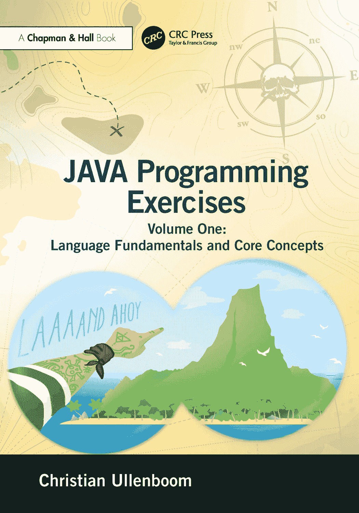

迈出提升编码技能到新层阶的第一步，在海盗船长 ChaoCiao 的帮助下，通过挑战性的编程任务测试你的 Java 知识。这是两卷书中的第一卷，为你提供了在 Java 之旅中脱颖而出所需的一切，包括专业人士应该详细掌握的技巧，以及针对整洁代码和深度设计的密集训练，这些设计足以支撑复杂的软件。

特性：

- 约 200 个不同水平的任务，附带注释解决方案
- 涵盖所有范式：面向对象、命令式和函数式
- 整洁代码、阅读外部代码以及面向对象建模

通过大量的最佳实践和对任务的详尽注释解决方案，这些书籍为 Java 专业软件开发提供了完美的锻炼。


codeMantra

## 关于作者

**Christian Ullenboom** 在十岁时就开启了他的编程之旅，在台 C64 上输入了他的第一行代码。在精通了汇编编程和早期的 `BASIC` 扩展后，他在学习计算机科学和心理学之后，在 Java 之岛上找到了自己的使命。尽管他沉浸于 `Python`、`JavaScript`、`TypeScript` 和 `Kotlin` 的假期中，但他仍然是 Java 的遗老。

20 年来，Ullenboom 一直是一个热情的软件架构师、Java 培训师（访问 `http://www.tutego.com`）和 IT 专家导师。他的专业知识产出了许多在线视频课程和参考书：

- *Java: The Comprehensive Guide* (ISBN-13: 978-1493222957)
- *Spring Boot 3 and Spring Framework 6* (ISBN-13: 978-1493224753)
- *Java ist auch eine Insel: Java programmieren lernen mit dem umfassenden Standardwerk für Java-Entwickler* (ISBN-13: 9-978-3836287456)
- *JavaSE9 Standard-Bibliothek: Das Handbuch für Java-Entwickler* (ISBN-13: 978-3836285874)
- *Captain CiaoCiao erobert Java: Das Trainingsbuch für besseres Java* (ISBN-13: 978-3836284271)

Christian Ullenboom 多年来一直通过他的书籍传播 Java，早在 2005 年就获得了 Sun（现为 Oracle）授予的备受推崇的 Java Champion（Java 冠军）称号。全球只有少数（约 300 人）获得了这一称号，使他成为真正的超级明星。

作为一名导师，Ullenboom 明白“在做中学”是掌握一项技能最有效的方法。因此，他编写了一份伴随其培训课程的全面练习目录。这本书包含了其中部分练习，并附带了详尽的解决方案。

他的根在德国下萨森地区的一个小镇松斯贝克（Sonsbeck）。


## 引言

许多编程初学者经常问自己：“我如何提高我的开发者技能？我如何成为一名更好的程序员？”答案很简单：学习、参加网络研讨会、学习、重复并与他人讨论你的工作。编程的许多方面与学习新技能相似。正如一本书不能教你如何弹乐器，看《速度与激情》系列电影也不会教你如何开车。大脑通过反复练习发展出模式和结构。学习编程语言和自然语言有许多相似之处。持续使用语言以及用它进行表达和交流的渴望（就像你点汉堡或啤酒时需要的那样）会导致技能逐渐提高。

学习编程语言的书籍和网络研讨会随处可见，但阅读、学习、练习和重复只是成为成功开发者的一个方面。要创建有效的软件解决方案，你需要创造性地结合你的知识，就像音乐家经常练习手指操并维护他们的曲目库一样。你的练习越有效，就越快成为大师。这本书旨在帮助你进步并获得更多的实践经验。

Java 拥有超过 2300 个类、约 1400 个接口、接近 140 个枚举、50 个异常，并且包含了记录（`record`）。然而，这些类型中只有一小部分在实践中是相关的。本书挑选了任务中最重要的类型和方法，使其具有激励性并遵循 Java 规范。书中还反复介绍了替代方案和方法。目标是让非功能性需求变得，因为程序的质量不仅仅在于“做它应该做的事”。正确的缩进、遵循命名规范、适当使用修饰符、最佳实践和设计模式等问题至关重要。提出的解决方案旨在演示这些原则，关键词是“整洁代码”。

## 基础知识与目标读者

本书面向初接触 Java 的学者或已经是高级水平并希望了解更多核心语言特性的 Java 开发者。目标读者包括：

- 计算机科学专业的学生
- IT 专家
- Java 程序员
- 软件开发者

本书围绕任务展开，提供详细说明的解决方案，涵盖了语言特性、面向对象编程最佳实践、设计模式。练习是基于教材编写的，并作为参考。

第一组任务是为 Java 初学者设计的。随着你获得更多经验，任务将变得更具挑战性。因此，任务既适用于初学者也适用于高级开发者。

此外，本书不需要使用性能分析工具，因为这些超出了本书的范围。

## 如何使用本书

本书按不同的章节组织。第一部分涵盖 Java 语言，然后是 Java 标准库的选领域，如数据结构或文件处理。每个领域都配有任务和包含惊喜的“测验”。每个章节都从主题的动机和描述开始，然后是练习。对于特别挑战的任务提供了额外的技巧和提示，而其他练习提供了可选的扩展。

练习用一星、二星或三星评级以表示其复杂度，而这种评分是作者主观的。

- **一星**：简单练习，适合初学者。应该很容易解决。只需要知识迁移，例如通过写下教材中的内容。
- **二星**：努力更大。需要结合不同的技术。需要更大的创造力。
- **三星**：三星任务更复杂，需要更多的先验知识，有时还需要研究。通常，任务无法通过单个方法解决，而是需要多个类协作工作。

### 建议解决方案

本书为每个问题提供了至少一个建议解决方案。没有使用“示例解决方案”一词，以避免暗示给出的解决方案是最好的，其他解决方案都是没用的。鼓励读者将自己的解决方案与提出的解决方案进行比较，如果他们的解决方案更精炼，也可以感到满意。所有提出的解决方案都带有注释，以便跟踪所有步骤。

建议解决方案汇在每个章节的末尾，以减少完成任务后直接查看解决方案的诱惑，这会降低解决任务的乐趣。解决方案也可以在网站 `https://github.com/ullenboom/captain-ciaocao` 上。某些解决方案包含 `tag::solution[]` 类型的注释，标记了书中打印的解决方案部分。

要成为一名软件开发人员，你必须掌握将问题转化为代码技巧，这正是实践和榜样发挥用场的地方。虽然网上有很多练习题，但它们往往缺乏组织、文档记录糟糕且已经过时。这正是本书的闪光之处，它提供了系统化的任务方法和深思熟虑的解决方案。学习这些内容以及通用的代码阅读有助于大脑开发出适用于未来编程挑战的模式和解决方案。这就像阅读《圣经》一样；你需要阅读并理解它。惊讶的是，许多软件开发者在不阅读他人代码的情况下编写代码，这可能会导致困惑和误解。

阅读代码通过构建模式和解决方案来提升我们的技能，我们的大脑会无意识地将其转移到自己的代码中。大脑根据模板独立形成神经结构，而我们接收到的输入质量至关重要。因此，我们应该只为异常处理或错误处理提供“营养”，讨论正确的输入值，识别错误状态以及如何处理它们。在软件领域，问题会发生且确实会发生，我们必须准备好应对这个不完美的世界。

开发者很容易陷入自己的编码习惯中，这就是为什么探索新方法并所谓的“扩展我们的词汇量”非常重要。对于 Java 开发者来说，库是他们的天业，但许多企业级开发者编写的是非面向对象的代码。解决方案是不断改进面向对象的建模，引入新方法，创建新的数据类型并将复杂度最小化。此外，函数式编程在 Java 开发中变得越来越重要，书中的所有解决方案都将利用现代语言特性。

虽然某些解决方案看起来过于复杂，但书中的任务和建议方案可以帮助开发者提高专注能力和执行步骤的能力。在实践中，专注和快速理解代码的能力对开发者至关重要。通常，开发者必须加入新团队，并能够理解和修改不熟悉的源代码，并可能修复错误。那些希望扩展开源解决方案的人也能从这些练习的专注能力中获益。

除了强调 Java 编程语言、语法、库和面向对象之外，本书还提供了关于算法、编程历史演变与其他编程语言比较以及数据格式等主题的众多侧边注释。这些额外的见解和视角让读者在技术方面之外，对软件开发有更全面的理解。

如果你正在寻找另一个理由把这本书加入你的收藏，它还可以兼作极佳的助眠辅助！

虽然在理论上仅用纸笔就能解决任务，但现代软件开发需要妥善使用工具。了解编程语言语法、面向对象建模和库只是冰山一角。理解 `JVM`（Java 虚拟机）、使用 `Maven` 和 `Git` 等工具进行版本管理，以及熟练使用 `IDE`（集成开发环境）都是专业软件开发的关键方面。有些开发者甚至可以在 `IDE` 中变魔术，自动生成代码并修复错误。

虽然 `Java 8` 在企业环境中仍然非常强大，但对于学习者来说，熟悉最新特性是非常重要的。因此，在可行的情况下，书中的建议解决方案都利用了 `Java 21`。该版本不仅具有长期支持（`LTS`），运行时环境提供商也提供广泛的支持，确保该版本在很长时间内保持适用性。

Java 代码只是纯文本，因此从技术上说，你只需要一个简单的文本编辑器。然而，依赖记事本或 `Notepad` 来提高效率就像试图骑三轮车赛跑。现代集成开发环境帮助我们完成许多任务：代码颜色高亮、自动代码补全、智能纠错、插入代码块、调试器中的状态可视化等。建议使用完整的开发环境。一些流行的 `IDE` 有 `IntelliJ`、`Eclipse`、`Visual Studio Code` 和 `(Apache) NetBeans`。就像 Java 运行时环境一样，`IDE` 的选择由读者决定。`Eclipse`、`NetBeans` 和 `Visual Studio Code` 都是免费开源的，而 `IntelliJ Community Edition` 也是免费的，但更高级的 `IntelliJ Ultimate Edition` 将需要花费一些费用。

代码以等宽字体编写，文件名使用斜体。为了区分方法和属性，方法始终有一对括号，例如在“变量可以包含最大值”或“返回 `max()`”中。由于方法可以重载，参数列表要么是有命名的（如 `equals(Object)`），要么使用省略号缩写（如 `println(...)` 方法）。如果处理一组标识符，则使用 `*`，`print(...)` 在屏幕上打印。

在建议的练习中，我们将使用以下内容：

```java
class Application {
    // ...
}
```

我们现在可以使用以下命令编译程序：

```bash
$ javac Application.java
```

并使用以下命令启动：

```bash
$ java Application
```

问题：

- 是否可以将 `Application.class` 文件从 Windows 操作系统复制到 Linux 操作系统并让 `java` 运行该程序？
- 计算机上必须安装哪些软件？

开发环境的选择通常取决于个人喜好，并且它们都能很好地处理核心任务：

- `IntelliJ`
- `Eclipse`
- `Visual Studio Code`
- `(Apache) NetBeans IDE`

本练习册完全独立于 `IDE`。所有开发者都应该熟练使用快捷键、调试器和其他工具。开发者的网页和 YouTube 提供了相关素材，以下是精选内容：

- `Eclipse`: `//help.eclipse.org/`, `https://www.youtube.com/user/EclipseFdn/playlists?view=50&sort=dd&shelf_id=6`
- `IntelliJ`: `https://www.youtube.com/user/intellijidevideo`

此任务关于更深入地了解开发环境。

让我们再次来看以下程序：

```java
public class Application {
  public static void main(String[] args ) {
    System.out.println("Aye Captain!");
  }
}
```

任务：

- 将 `Application.java` 导入 `IDE` 中。
- 故意在程序代码中引入错误，并观察错误信息。一些建议：
  - 修改文件名。
  - 修改大小写，例如将 `class` 写为 `Class`，该类有一个特殊方法 `public static void main(String[] args)`。如果方法名不是 `main` 而是其他的，例如 `Main` 或 `run`，会发生什么？
  - 在类启动之前，主程序不会启动
  - 尝试输出希腊字母或心形，你可以做到吗？
  - 经常使用空白，空格（除非制表符）和换行出现在语句之后。像这种格式是有效的吗？

```java
public class Application{public static void main(String[] args){System.out.println("Aye Captain!");}}
```

如果将 `Application.class` 文件从 Windows 操作系统复制到 Linux 机器，它也可以在那里运行。要运行该文件，始终需要像 `Oracle JDK` 这样的运行时。

你可以故意制造以下错误：

- 如果类是公共的（`public`），则文件名必须与类名相同。因此，我们可以更改文件名或类名。`IDE` 会识别出错误并建议重命名。
- Java 中的关键字始终是小写的。如果你将 `public` 或 `class` 等关键字大写，或者将字母大写，会发生什么？在这种情况下，会出现编译器错误。
- 如果起始方法没有声明为 `public static void main(String[] args)` 而是以其他形式，编辑器无法猜测，但编译器将正确翻译程序，因为通常情况下 `public static void run(String[] args)` 可能只是不是你想要的方法。这是一个语义错误而不是语法错误，编辑器或编译器不会察觉这一点。当程序启动时，运行时环境将抛出错误，提示 `main(...)` 方法不存在（语义错误）。
- 一个方法由一系列语句组成——这些语句位于花括号包围的块中。类也是如此，它由一组方法组成，这些方法必须一起放在一个块中。在 Java 中缩进并不重要。你可以通过完全省略花括号来引发错误。
- 每一个大括号都需要一个闭合括号。如果你省略了花括号，会导致编译器错误。
- 字符串字面量在不同的编程语言中使用不同的符号包。某些编程语言使用双引号（`"`），其他编程语言使用单引号（`'`），而某些编程语言使用反引号（`` ` ``）。Java 仅接受双引号中的字符串。对于字符则使用数据类型 `char`。

在核心，虚拟机负责评估表达式并执行语句。

图 2.1 显示 输出

- 修改程序，使输出中出现换行。输出应：

<svg height="400" width="1000">
<circle cx="100" cy="100" r="50" />
</svg>

- 修改程序，使字符串中不再是单引号而是双引号。输出应：

<svg height="400" width="1000">
<circle cx="100" cy="100" r="50" />
</svg>

## 变量与数据类型

变量存储信息，变量在 Java 中始终有类型。编译器有时知道声明的是什么类型的变量，以及它前面的表达式是什么类型。

Java 有内置数据类型：`boolean`、`byte`、`char`、`short`、`int`、`long`、`float`、`double`。你可以在它们中使用数值和布尔值。布尔值可以设置为 `true` 或 `false`。对于数值，我们有三组：

- 我们有用于 Unicode 字符的数值，并使用 `char` 数据类型表示。此外，我们还有通用整数和浮点数的数据类型。
- 整数始终有符号。我们有四种类型：`byte`、`short`、`int` 和 `long`。这些类型按字节数不同，这意味着数据类型可以存储不同大小的数字。
- 对于浮点数，我们有 `float` 和 `double` 可用；`double` 位是 `float` 的两倍。

数据类型的大小在 Java 规范中是固定的，不取决于特定的架构或平台。

CaptainCiao 想要为新手、高级选手和专业人士制作射击目标。目标的大小各相同。


我们的初始程序将通过设置中心坐标和半径来画一个圆，但我们现在的目标是通过引入参数创建一个可修改的输出。

从上一个任务添加 `main(...)` 方法。

- 在 `main(...)` 方法中声明两个 `int` 变量 `x`, `y` 和一个 `double` 变量 `r`。
- 给变量赋值。
- 将变量的赋值构建到输出中。

示例：

- 例如，如果 x=100，y=110 且 r=20.5，那么控制台输出应该是：

```xml
<svg height="100" width="1000">
  <circle cx="100" cy="110" r="20.5" />
</svg>
```

- 手动赋值 x=10, y=10 且 r=2.686：

```xml
<svg height="100" width="1000">
  <circle cx="10" cy="10" r="2.686" />
</svg>
```

在白色背景上创建了一个黑圆。

表达式 `1000000 * 1000000` 的结果是什么？有什么特别的之处吗？为什么会出现这个结果？

如果你计算 `0.1+0.1+0.1+0.1+0.1+0.1+0.1+0.1 - 1.0` 并用 `System.out.println(...)` 输出结果，输出会让你惊讶吗？

# 2 · 过程式编程 13

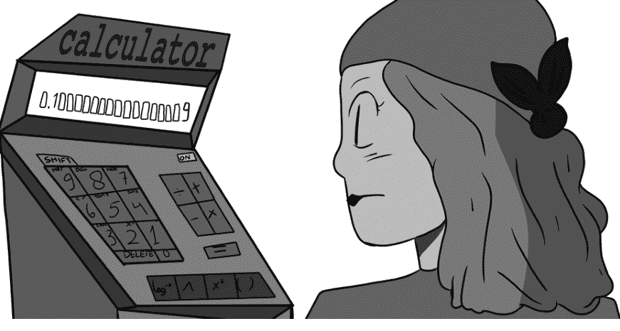

# 生成随机圆 ★

随机数在练习中的作用比你想象的要大。

在 Java 中，有一个 `Math` 类提供了重要的数学方法。随机数可以通过以下方式确定：

```java
double rnd = Math.random();
```

任务：

- 参考 Javadoc 了解 `random()` 结果的值范围。
- 扩展圆程序，使半径是随机的，范围包含 10 但保持小于 20。半径仍然应为浮点数。

示例：

如果运行两次该程序，其输出可能如下所示：

- <svg height="100" width="1000">
  <circle cx="110" cy="110" r="19.4749330792351" />
</svg>

- <svg height="100" width="1000">
  <circle cx="110" cy="110" r="10.218243515433868" />
</svg>

在 Java 中形成随机数的其他变体为：

```java
double rnd1 = java.util.concurrent.ThreadLocalRandom.current().nextDouble();
double rnd2 = java.util.concurrent.ThreadLocalRandom.current().nextDouble(0 to max);
double rnd3 = java.util.concurrent.ThreadLocalRandom.current().nextDouble(min, max);
```

# 14 Java 编程练习

```java
int rnd4 = java.util.concurrent.ThreadLocalRandom.current().nextInt();
int rnd5 = java.util.concurrent.ThreadLocalRandom.current().nextInt(0 to max);
int rnd6 = java.util.concurrent.ThreadLocalRandom.current().nextInt(min, max);
```

# 测验：迷茫困惑 ★

整洁代码是一套让代码易于阅读、理解、可维护、可扩展和可测试的最佳实践。遗憾的是，有很多反例。

以下示例有问题：

```java
double höhe = 12.34;
double breite = 23.45;
double tmp = 2 * (höhe + breite);
System.out.println(tmp);
```

## 处理输入

到目前我们只有屏幕输出，没有输入。使用 `java.util.Scanner(System.in)` 可以接受输入。

```java
int number1 = java.util.Scanner(System.in).nextInt();
double number2 = java.util.Scanner(System.in).nextDouble();
String line = java.util.Scanner(System.in).nextLine();
```

CaptainCiao 想要确定圆的位置。任务：

- 对于圆，从控制台获取 `cx` 和 `cy` 的赋值，并写入生成的 SVG 片段。半径是随机的。

## 表达式、操作数运算符

表达式被求值并产生结果。运算符可以连接字面量或变量。

## 测验：范围

要测试一个数字是否大于 `min` 且小于 `max`，我们可以写：

```java
boolean isBetween = min && max;
```

Java 允许以下语法吗？

```java
boolean isBetween = min < max;
```

# 检查战利是否可以分配

抢劫后，CaptainCiao 和他的团队抢夺了许多瓶。现在必须分配战利，CaptainCiao 获得一半（如果瓶数是奇数）。其他强盗应该获得相同的份额。任务：

- 编写一个程序从命令行获取瓶的数量，并输出 CaptainCiao 获得了多少。
- 输出留给团队的。
- 询问人数，查看战利是否可以公平地分配，使得每个成员获得相同数量的瓶。

示例：

```
Number of bottles in total?
123
Bottles for the captain: 61
Bottles for all crew: 62
Number of crew members? 1
Fair share without remainder?
```

考虑除法和余数。

# 两个数字有相同的数字吗？ ★★

Ray 在玩多骨牌，多骨牌包含两个格子。她想是否可以将两个格子拼接，使得相邻两个格子的值相同。任务：

- 编写一个程序读取两个数字，数字范围在 0 到 99（包含边界）。
- 如果数字大于 100，仅求值最后两位；100 或 200 将像 00，111 将像 11。
- 测试两个数字是否有共同数字。

示例：

- 12 和 31 具有共同数字 1。
- 22 和 33 没有共同数字。

注意：不是询问共同数字，而是简单地输出 true/false。如果数字是单数字，前面有一个 0，所以 01 和 20 有共同数字 0。

# 将货币金额转换为硬币 ★★

在欧元货币中，有面值为 2 欧元、1 欧元、50 分、20 分、10 分、5 分、2 分和 1 分的欧元硬币。100 分等于 1 欧元。


任务：

1. 创建一个新的类 `CoinMachine`。
2. 程序应该询问一个金额的浮点数。
3. 打印出输入的金额如何用硬币支付。不需要所有的排列，只需要最少量的硬币。

输入 12.91（英语区域）的示例：

```
Please enter the amount of money:
12.91
6 x 2 Euro
0 x 1 Euro
1 x 50 cents
2 x 20 cents
0 x 10 cents
0 x 5 cents
0 x 2 cents
1 x 1 cent
```

输出格式并不重要。Scanner 是本地化的，因此在输入数字时使用相应语言的小数分隔符。

# 一瓶朗姆，十瓶朗姆 ★

Brain 是错误语言的猎手，她总是确保标签在语法上正确。许多语言对复数有特定的规则。通常情况下是“1 bottle”或“99 bottles”，但有“0 bottles”。像“1 bottle(s)”这样的简化处理通常出现在用户界面中。

## 过程式编程

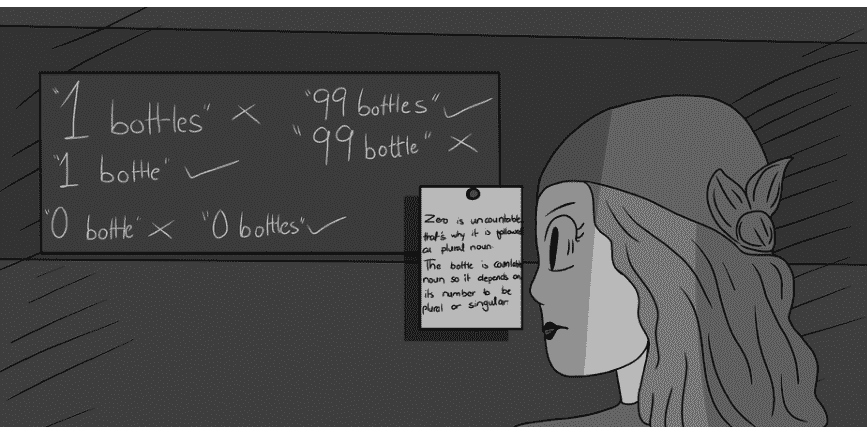

任务：

- 创建变量 `noOfBottles` 并给它赋值一个大于等于 0 的值。
- 根据是 0、1 瓶还是许多瓶，编写一个语法正确的输出。

示例：

- "0 bottles of rum".
- "1 bottle of rum".
- "99 bottles of rum".

条件运算符（`?:` 运算符）使代码紧凑。

# 测验：零效应 ★

以下类可以翻译吗？如果是，并且运行该程序，结果是什么？

```java
class Application {
  public static void main(String[] args) {
    int zero = 0;
    int ten = 10;
    double anotherTen = 10;
    System.out.println(anotherTen / zero);
    System.out.println(ten / zero);
  }
}
```

## 控制流

条件语句（如 if-else 语句）是至重要的命令式概念。对于后续涉及用户输入验证和处理的练习，我们需要根据条件选择性地执行代码段的能力。

# 发薪日 ★

Tort Ellini 从 Bonny Brain 处花 1,000 里拉买了一块古董口袋表，现在他负责支付费用。


任务：

# 测验：错误的分支 ★

以下代码的作用是在 x 大于 y 时交换变量 x 和 y 的内容。这种写法正确吗？

```java
int x = 2; y = 1;
if (x > y) {
  int swap = x;
  x = y;
  y = x;
  // x 应该是 1 且 y
}
```

# 升的转换 ★★

程序应该将液体数量转换为 CiaoCiao 长易于阅读的格式。

任务：

- 从命令行读取一个浮点数，数量级为升。
- 根据模式转换数字：
  - 1.0 及以上：以升为单位输出，输入 4 时输出约为 4.1。
  - 0.1 及以上：以分升为单位输出，输入 0.2 时约为 20 cl。
  - 0.001 及以上：以毫升为单位输出，输入 0.009 时约为 9 ml。
- 结果始终为整数，允许四舍五入。

示例：

- 转换为 mL：
  输入数量（升）：
  0.012434
  约 12 ml

- 转换为 cL：
  输入数量（升）：
  0.9876
  约 98 cl

- 数值太小时的消息：
  输入数量（升）：
  0.0000345
  数值太小，无法显示

- 输入已经是升：
  输入数量（升）：
  98845848485.445
  约 98845848485.1 l

# 创建随机颜色的 SVG 圆形 ★

在之前的作业中，CiaoCiao 长官要求在白色背景上画一个黑圆。但现在要有更多颜色！

任务：

- 创建一个带有 `main()` 方法的新类。
- 在命令行中随机输出红色、绿色和蓝色，概率相等。
- 在 SVG 中，对于圆，你可以使用 `fill` 属性指定颜色，例如：`<circle cx="20" cy="20" r="5" fill="blue" />`。给圆赋予一个随机颜色。

示例：

- 运行三次程序，可能会有以下输出：
  `<circle cx="20" cy="20" r="5" fill="green" />`

## Java 编程练习

```xml
<circle cx="20" cy="20" r="5" fill="blue" />
<circle cx="20" cy="20" r="5" fill="blue" />
```

# 测验：else 属于哪个块 ★★

缩进是代码最重要的原则。如果缩进错误，读者可能会误解程序。

以下程序会产生什么输出？

```java
if (true) {
  if (false)
    if (3 != 4)
      ;
    else
      System.out.println("ship's kobold");
  else
    System.out.println("Pumuckl");
}
```

在不翻译程序的情况下找到结果。

提示：首先对程序进行正确缩进。

# 测验：识别负数的天和小时 ★

为了测试两个值是否为负数，Gig Giggles 总是使用 `hours < 0 || minutes < 0`。程序中出现了奇怪的内容：

```java
System.out.println("Enter number of hours");
int hours = new java.util.Scanner(System.in).nextInt();
System.out.println("Enter number of minutes");
int minutes = new java.util.Scanner(System.in).nextInt();
if ((hours | minutes) < 0) // 不要碰
  System.out.println("Either the minutes or hours have been negative.");
else
  System.out.println("Minutes in total: " + hours + minutes);
```

除了熟悉的 `||` 运算符，这里只有一个 `|`。这是一个错误吗？或者 `hours < 0 || minutes < 0` 的结果是一样的？

# 评估字符串 ★

Bonny Brain 期望为新项目评估字符串，且代码可以不同。

任务：

- 从命令行获取一个字符串。我们假设输入始终是小写的。
- 如果输入是 "ay", "aye", "ja", "joo"，则在屏幕上打印 "Keep it up!"，其他输入显示 "Don't you dare!"。
- 使用 switch 语句或 switch 表达式解决此题。

# 将 switch 语句重写为 switch 表达式 ★

Java 14 引入了 switch 语句的扩展语法，使得代码更简洁。

任务：

- 给定以下经典的 switch 语句代码：

```java
int month = new java.util.Scanner(System.in).nextInt();
int year = new java.util.Scanner(System.in).nextInt();
boolean isLeapYear = ((year % 4 == 0) && (year % 100 != 0))
    || (year % 400 == 0);

int days;
switch (month) {
  case 2:
    days = isLeapYear ? 29 : 28;
    break;
  case 4:
  case 6:
  case 9:
  case 11:
    days = 30;
    break;
  default:
    days = 31;
}
```

- 使用 switch 表达式简化程序。

## 循环

除了 if 语句，重复是另一个重要的命令属性。Java 提供了不同的循环结构：

- while 循环
- do-while 循环
- for 循环
- 扩展 for 循环

# 创建旋转的 SVG 矩形 ★

袭击结束后，CiaoCiao 长感到压力。为了放松，他喜欢几何图形，但 Bonny Brain 不喜欢这样做；程序应该处理  以下围绕中心 (100) 旋转 60 度：

```xml
<svg height="200">
  <rect x="50" y="50" width="100" height="100" stroke="black" fill="none" transform="rotate(60 100 100)" />
</svg>
```

任务：

- 编写一个并排输出 50 个圆形的程序。示例：

```xml
<svg height="200">
  <rect x="50" y="50" width="100" height="100" stroke="black" fill="none" transform="rotate(0 100 100)" />
  <rect x="50" y="50" width="100" height="100" stroke="black" fill="none" transform="rotate(20 100 100)" />
  <rect x="50" y="50" width="100" height="100" stroke="black" fill="none" transform="rotate(40 100 100)" />
  <rect x="50" y="50" width="100" height="100" stroke="black" fill="none" transform="rotate(60 100 100)" />
  <rect x="50" y="50" width="100" height="100" stroke="black" fill="none" transform="rotate(80 100 100)" />
</svg>
```

# 创建 SVG 链 ★

CiaoCiao 长官想要送上一条由不同宝石组成的珍珠项：蓝宝石（蓝色）、祖母绿（绿色）、火石榴石（橙色）。他喜欢颜色随机排列的设计  以下是带有三个圆形的 SVG：

```xml
<svg height="100">
  <circle cx="20" cy="20" r="5" fill="blue" />
  <circle cx="30" cy="20" r="5" fill="green" />
  <circle cx="40" cy="20" r="5" fill="orange" />
</svg>
```

## 从命令行累加数字


# CiaoCiao 长官需要一个程序来输入从单独袭击中获取的数量

这应该从命令行输入并进行累加

## 任务

- 创建新类 `SummingCalculator`。
- 使用 `Scanner` 输入数字直到输入 0。允许负数。Cao 偶尔会被抢劫。忽略数字过大导致的任何溢出。
- 输入 0 后，打印总和。

## 示例

```
12
3
-1
0
Sum: 14
```

# 遍历数学现象

在数学中，迭代是从某个值开始重复计算，直到满足特定条件。在计算中，迭代是在初始近似后每个额外步骤改进解决方案的过程。

## 任务

- 使用以下行声明一个 0（包含）到 10（不包含）之间的变量 t：

```java
double t = Math.random() * 10;
```

- 如果 `t < 1`，则将 `t` 乘以 2。然而，如果 `t >= 1`，则减 1。
- 将此计算放入 `while` 循环中，循环在 `t` 小于或等于 0 时结束。

## 示例

输出可能如下演：

```
9.835060881347246
8.835060881347246
7.835060881347246
6.835060881347246
...
0.75
1.5
0.5
1.0
```

# 测验：有多少颗星？

对于循环 A 和 B，控制台上会出现多少个星号？

## A

```java
for (int stars = 0; stars <= 7; stars = stars + 2)
    System.out.println("****");
```

## B

```java
for (int stars = 10; stars < 0; stars++) {
    System.out.println("***");
}
```

记住：`stars++` 是 `stars = stars + 1` 的缩写。

# 计算教员的阶乘 ★

对于新舰队“参武二号”，Bonny Brain 必须选择首席军官；人选有 Paul Eldrion、Kate Muggle、Robinson Langdon 和 Lien Langdon。然而，Bonny Brain 不确定哪个人应该担任什么角色；角色包括指挥官、副指挥官和三等兵。

每个人担任什么角色有许多可能。在一行中不同元素的排列方式被称为“排列（permutation）”。不重复排列可以通过阶乘来计算。对于四个人，有 1×2×3×4=24 种可能的排列方式。

自然数（正整数）的阶乘是直到该数为止的所有正整数的乘积。

```
n! = 1 × 2 × 3 × ... × (n-1) × n
```

`0! = 1`。

## 任务

- 编写一个 Java 程序，从命令行读取一个非负整数并显示计算过程。

## 示例

- 输入: 9 → 输出: `9!=1 * 2 * 3 * 4 * 5 * 6 * 7 * 8 * 9=362880`。
- 输入: 3 → 输出: `3!=1 * 2 * 3=6`。
- 输入: 0 → 输出: `0!=1`。
- 输入: 1 → 输出: `1!=1`。
- 输入: -1 → 输出: 数字不能为负数。

内部使用数据类型。

## 问题

从哪个数字开始会出现“问题”？这些问题是如何出现的？`Math.multiplyExact(long x, long y)` 能帮到我们吗？

# 判断数字是否由阶乘组成 ★

Jar Dumas 受 Bonny Brain 指令写出给定人数的所有可能排列方式。在查看列表之前，她数了数以确定是否所有的排列都列出了。

我们在上一个作业中看到了如何计算自然数的阶乘。但我们如何判断一个数字是否是阶乘呢？我们知道 `9!=362880`，但 `212880` 或 `28` 呢？

## 任务

- 编写一个程序从命令行读取一个自然数，并输出该数字是否为阶乘。

## 示例

### 数字是阶乘

输入数字：

```
362880
```

输出：

```
362880=9!
```

### 数字不是阶乘

输入数字：

```
1000
```

输出：

```
1000 不是阶乘
```

测试数字是否能被 2, 3, 4, 5, ... 整除。

# 寻找数字的最大和最小数字 ★

Bonny Brain 当然知道十进制是由 0 到 9 的数字组成的。由于航行很长很无聊，她想了一个游戏：她给船员一个整数，最快说出其最大和最小数字的人赢得一个里雷塔（Liretta）。

# 整数游戏

## 任务

- 给定任意整数（正数或负数），存储在 `long` 类型中。
- 使用程序帮助找到存储数字的最小和最大数字。

## 示例

- `12345` → `1,5`
- `987654` → `4,9`
- `11111` → `1,1`
- `0` → `0,0`
- `-2345678888234567L` → `2,8`

# 验：从 1 到 100 不像这样 ★★★

编译器为我们完成了程序的语法检查工作。以下程序本应该是加从 1 到 100 的数字并输出结果。遗憾的是，程序中存在一些错误。

```java
class Summe {
    private static int getSum() {
        int j = 0;
        for (int i = 1; i <= 100; i++) {
            j += i;
        }
    }
    public static void main(String[] args) {
        System.out.println(getSum());
    }
}
```

将错误归入以下类型：

- 1. 语法错误。
- 2. 语义错误。
- 3. 风格指南违规。

# 嵌套循环中的风中旗 ★

当水员们发现他们的旗帜在波涛的海中游泳时，他们大吃一惊！Ciao 船长作为一个幽默的船长，要求他的船员尽快制作一面新的。我们只希望它不要很快决定再去泡一次水！

## 任务

- 创建如下所示小旗的输出：

```
1
2 2
3 3 3
4 4 4 4
5 5 5 5 5
```

可选：输出应该是居中的。

# 简单输出

Ciao 船长是西洋棋的粉丝，他经常参加比赛，并注意到棋盘的大小是可以变化的。8×8、10×10、12×12、14×14，他发现所有的排列都列出了。

## 任务

- 从命令行获取棋盘的高度和宽度。
- 使用程序绘制棋盘。

## 示例

棋盘宽度：10
棋盘高度：5

```
# # # # #
# # # # #
# # # # #
# # # # #
# # # # #
```

# 显示圣诞树

圣诞快到了，Bonny Brain 想要打印树。为了这一点，需要不同尺寸的树。

## 任务

- 使用循环在屏幕上打印一个带有 `*` 号的树。
- 在每一行中，直到达到宽度。
- 居中是通过空格实现的。

## 示例

宽度为 7 的树：

```
  *
 ***
*****
```

# 绘制鱼纹图案

Bonny Brain 喜欢海洋并想要一个带有图案的围巾。缝纫机可以使用 `><` 和 `<<` 形成向右的鱼，然后向左的鱼。

## 任务

- 编写一个程序，根据变量重复次数，首先放置 `><` 重复，然后放置 `<<` 重复。

## 示例

- 如果重复等于 2，输出应该是：

```
><><
<<
```

- 如果重复为 3，输出应该是：

```
><><><
<<<
```

# 尝试而不是思考

今天的计算机非常快，可以同时尝试不同的事情。

Ciao 翻阅《日报》发现了一个脑筋急转弯：

| X O L |
| + L X |
| = T T |

他必须为每个字母找到一个数字以使计算正确。奖品是一个旧指南针，Ciao 极其渴望赢得。

## 任务

- 开发一个程序通过尝试所有可能性来找到解决方案。
- 输出所有解决方案，并指示哪些 `X`、`O`、`L`、`T` 都是不同的。

# 获取数字的位数

Bonny Brain 想要右对齐数字。为了实现这一点，需要在数字前面放置空格。确定空格数量的第一步是确定数字的位数。

## 任务

- 给定 `int` 类型的正整数 `n`。输出数字的位数。不要使用 `("" + n).length()`，那太简单了。

## 示例 和预期输出

- `1234` → `4`
- `3` → `1`
- `0` → `1`
- `Integer.MAX_VALUE` → `10`

# 方法

方法很重要，因为通过这种方式我们可以集中常用代码，并为客户端提供 API 访问。

# 画爱心

由于 CiaoCiao 喜欢他的船员，心越多越好。

## 任务

1. 创建新类 `LinePrinter`。在类中放入静态方法 `line()`，写入十行心。Java 可以在字符串中存储和输出 Unicode 字符 `'♥'`。
2. 创建新类 `LinePrinterDemo`，它有一个 `main(...)` 方法并调用 `line()`。

# 实现重载行方法 ★

接下来，让我们来看可以接收参数的方法。此外，一个方法名可以使用多次：我们称之为“重载方法”。

- 方法 `line(int len)` 将在控制台上打印一条长度为 `len` 且带有减号（`-`）的线。例如，`line(3)` 将在屏幕上打印 `---`。
- 方法 `line(int len, char c)` 允许使用自定义填充字符进行调用。因此，`line(2, 'x')` 在屏幕上输出行 `xx`。第一个方法可以使用第二个方法的实现吗？
- 添加另一个重载方法 `line(String prefix, int len, char c, String suffix)`，在行之前设置一个字符串，行之后设置一个结束字符串。例如，`line("", 3, '=', "|")` 返回 `===|`。行内的长度是三个字符而不是整个字符串的长度。

记住：你不需要用循环来完全实现所有三个方法。如果你足够聪明，你会从一个方法转发到另一个方法。

将重载方法添加到 `LinePrinter` 类中。

# 直立

在过去，笨拙的水手们会以错误的角度升起桅杆。海盗可以有点歪斜，但桅杆最好像箭头一样直！

提醒一下，如果 $c^2 = a^2 + b^2$，则三角形为直角。

## 任务

- 创建一个新类 `RightTriangle` 并编写一个新方法；使用以下代码作为模板：

```java
class RightTriangle {
    public static boolean isRightTriangle(double a, double b, double c) {
        // 在此处编写你的实现
    }
}
```

- 该方法接收三角形的三条边，如果是直角三角形则返回 `true`，否则返回 `false`。
- 记住：参数 `a`、`b` 和 `c` 的任意一个都可以代表直角边或斜边。

## 示例

- `isRightTriangle(3, 4, 5)` -> `true`
- `isRightTriangle(5, 4, 3)` -> `true`
- `isRightTriangle(5, 12, 13)` -> `true`
- `isRightTriangle(1, 2, 3)` -> `false`
- `isRightTriangle(1, 1, Math.sqrt(2))` -> `false`

最后一个示例显示计算误差是一个问题。`Math.sqrt(2) * Math.sqrt(2)`（在输出中）是 `2.0000000000000004` 而不是精确的 `2`。

# 创建乘法表 ★

Bonny Bari 为魔法公司（Magical Company）增添了活力。她现在销售两种新产品：一个售价 500 Liretta 的喷火器和一个只要 100 Liretta 的火灭器。为了在进行批量购买时能快速阅读价格，应该在 HTML 中创建一个表格：

| 数量 | 喷火器 | 火灭器 |
|---|---|---|
| 1 | 500 | 100 |
| 2 | 1,000 | 200 |
| 3 | 1,500 | 300 |
| ... | ... | ... |

在 HTML 中，表格的表示如下：

```html
<html>
<table>
<tr><th>数量 (Quantity)</th><th>喷火器 (Flamethrower)</th><th>火灭器 (Fire Extinguisher)</th></tr>
<tr><td>1</td><td>500</td><td>100</td></tr>
<tr><td>2</td><td>1000</td><td>200</td></tr>
</table>
</html>
```

## 任务

- 在屏幕上创建一个显示 1 到 10 数字的 HTML 表格。
- 考虑什么情况下其他方法会有用。

你可以将生成的 HTML 复制到 https://jsfiddle.net/ 并“运行”它以查看结果。

# 罗马数字 ★

数字系统是一种用于表示数字的符号系统。不同的文化和时期使用过不同的数字系统。例如罗马数字系统（`MCMLXXIII` 为 1973）和广为人知的阿拉伯数字系统（0, 1, 2, 3, 4, 5, 6, 7, 8, 9），后者在世界上大部分地区使用。

罗马数字系统规定 1 到 999 的数字可以用单个符号表示。其构造如下：

一些示例：

# 任务

- 编写一个程序为任意四位数生成 SVG。

## 示例

- 对于 `9394` 可以生成以下 SVG：

```svg
<svg height="1400" width="1400">
<g style="stroke:grey;stroke-linecap:round;stroke-width:2">
<line x1="100" y1="85" x2="100" y2="115" />
<line x1="100" y1="95" x2="110" y2="85" />
<line x1="100" y1="95" x2="90" y2="85" />
<line x1="100" y1="95" x2="90" y2="95" />
<line x1="90" y1="115" x2="110" y2="105" />
<line x1="100" y1="115" x2="110" y2="115" />
<line x1="100" y1="105" x2="90" y2="115" />
<line x1="100" y1="105" x2="100" y2="115" />
</g>
</svg>
```

- https://commons.wikimedia.org/wiki/File:Cistercian-9999.png 显示了所有可能的字符。注意水平和垂直镜像。

# 问答：ding-Dong 在做什么什么？（递归） ★★

以下方法出现在一个长程序中：

```java
static long ding(long dong) {
    return dong == 0 ? 0
           : (dong % 10 + ding(dong / 10));
}
```

这个方法在做什么？怎么命名会更好？

# 问答：重复数字（Repdigit）（递归） ★★

重复数字（repdigit）只有相同的数字。以下 Java 方法递归地判断一个数字是否为重复数字：

```java
static boolean isRepdigit(long n) {
    if ((n % 100) / 10 != n % 10)
        return n < 10;
    return isRepdigit(n / 10);
}
```

## 任务

- 该方法是如何工作的？
- if 语句中的布尔表达式 `if ((n % 100) / 10 != n % 10)` 可以重写为 `if (n % 100 % 11 != 0)`。
- 为什么？

# 计算 Collat 序列（递归） ★

Lothar Collat 在 1937 年定义了一个数字序列，现在被称为 Collat 序列。它被定义为一种遵循数字 `n` 的映射：

- 如果 `n` 是偶数，`n -> n/2`
- 如果 `n` 是奇数，`n -> 3n+1`
- 当达到 1 时，序列结束。

如果我们从 `n=7` 开始，算法运行以下数字：

```
7 -> 22 -> 11 -> 34 -> 17 -> 52 -> 26 -> 13 -> 40 -> 20 -> 10 -> 5 -> 8 -> 4 -> 2 -> 1
```

每个序列都以 `4, 2, 1` 结束，但其是数学上的一个未解决问题。

## 任务

- 创建一个 `Collat` 类，包含一个 `void collat(long n)`。
- 创建 `main(...)` 方法，并计算起始值为 27 的 Collat 序列。
- 编写一个新方法 `long collatMax(long n)`，返回达到的最大值。
- 我们如何递归地编写 `collat(...)` 使得该方法返回假设的最大值作为结果？注意，签名必须更改！（为什么？）

# 古埃及乘法（递归） ★★

计算机严重依赖算术运算，这是它们任务的重要部分。加法和减法等基础运算很容易。乘法和除法更复杂。埃及人有一种基于倍增和加法的巧妙方法。


| 数量 | 喷火器 | 火灭器 |
|---|---|---|
| 1 | 500 | 100 |
| 2 | 1,000 | 200 |
| 3 | 1,500 | 300 |
| ... | ... | ... |

在 HTML 中，表格的表示如下：

```html
<html>
<table>
<tr><th>数量 (Quantity)</th><th>喷火器 (Flamethrower)</th><th>火灭器 (Fire Extinguisher)</th></tr>
<tr><td>1</td><td>500</td><td>100</td></tr>
<tr><td>2</td><td>1000</td><td>200</td></tr>
</table>
</html>
```

任务：

- 在屏幕上创建一个显示 1 到 10 数字的 HTML 表格。
- 考虑什么情况下其他方法会有用。

你可以将生成的 HTML 复制到 https://jsfiddle.net/ 并“运行”它以查看结果。

# 罗马数字 ★

数字系统是一种用于表示数字的符号系统。不同的文化和时期使用过不同的数字系统。例如罗马数字系统（`MCMLXXIII` 为 1973）和广为人知的阿拉伯数字系统（0, 1, 2, 3, 4, 5, 6, 7, 8, 9），后者在世界上大部分地区使用。

罗马数字系统规定 1 到 999 的数字可以用单个符号表示。其构造如下：

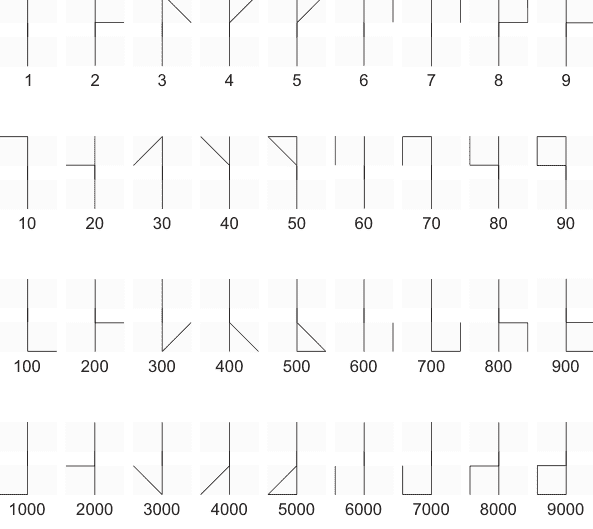

图 2.2 罗马数字。

一些示例：

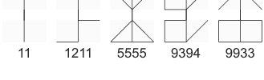

图 2.3 罗马数字。

# 命令式编程 37

任务：

- 编写一个程序为任意四位数生成 SVG。

示例：

- 对于 9394 可以生成以下 SVG：

```svg
<svg height="1400" width="1400">
<g style="stroke:grey;stroke-linecap:round;stroke-width:2">
<line x1="100" y1="85" x2="100" y2="115" />
<line x1="100" y1="95" x2="110" y2="85" />
<line x1="100" y1="95" x2="90" y2="85" />
<line x1="100" y1="95" x2="90" y2="95" />
<line x1="90" y1="115" x2="110" y2="105" />
<line x1="100" y1="115" x2="110" y2="115" />
<line x1="100" y1="105" x2="90" y2="115" />
<line x1="100" y1="105" x2="100" y2="115" />
</g>
</svg>
```

- https://commons.wikimedia.org/wiki/File:Cistercian-9999.png 显示了所有可能的字符。注意水平和垂直镜像。

# 问答：ding-Dong 在做什么什么？（递归） ★★

以下方法出现在一个长程序中：

```java
static long ding( long dong ) {
  return dong == 0 ? 0
         : (dong % 10 + ding( dong / 10));
}
```

这个方法在做什么？怎么命名会更好？

# 问答：重复数字（Repdigit）（递归） ★★

重复数字（repdigit）只有相同的数字。以下 Java 方法递归地判断一个数字是否为重复数字：

```java
static boolean isRepdigit( long n ) {
  if ( ( n % 100 ) / 10 != n % 10 )
    return n < 10;
  return isRepdigit( n / 10 );
}
```

任务：

- 该方法是如何工作的？
- `if` 语句中的布尔表达式 `if ( ( n % 100 ) / 10 != n % 10 )` 可以重写为 `if ( n % 100 % 11 != 0 )`。
- 为什么？

# 计算 Collat 序列（递归） ★

Lothar Collat 在 1937 年定义了一个数字序列，现在被称为 Collat 序列。它被定义为一种遵循数字 `n` 的映射：

- 如果 `n` 是偶数，`n -> n/2`
- 如果 `n` 是奇数，`n -> 3n+1`
- 当达到 1 时，序列结束。

如果我们从 `n=7` 开始，算法运行以下数字：

- 7 -> 22 -> 11 -> 34 -> 17 -> 52 -> 26 -> 13 -> 40 -> 20 -> 10 -> 5 -> 8 -> 4 -> 2 -> 1

每个序列都以 4, 2, 1 结束，但其是数学上的一个未解决问题。

任务：

- 创建一个 `Collat` 类，包含一个 `void collat(long n)`。
- 创建 `main(...)` 方法，并计算起始值为 27 的 Collat 序列。
- 编写一个新方法 `long collatMax(long n)`，返回达到的最大值。
- 我们如何递归地编写 `collat(...)` 使得该方法返回假设的最大值作为结果？注意，签名必须更改！（为什么）？

在第一步，我们构建了一个新类，因为 Java 中不允许在类之外编写程序代码。接下来，我们将特殊方法放入类中。程序启动时，JVM 会自动调用 `main(...)`，因此我们在这里正好放入了想要在开始时执行的部分。

为了在理论上更好地对解决方案进行分组，它们被放置在 Java 包中；这就是第一个声明 `package com.tutego.exercise.lang` 的含义。包在“类、对象和包”章节中介绍，本次我们自己的解决方案不需要使用包。

# 2 • 过程式编程 41

为了打印这个圆，我们可以创建一个 `circle.html`，在编辑器中打开它并将 SVG 路径复制到其中，然后用 Web 浏览器打开该文件并打印页面。

```
com/tutego/exercise/lang/SvgCircle2.java

System.out.println( "<svg height='400' width='1000'>" );
System.out.println( "<circle cx='100' cy='100' r='50' />" );
System.out.println( "</svg>" );

System.out.println(
"<svg height='400' width='1000'>\n <circle cx='100' cy='100' r='50' />\n</svg>");
```

`print(...)` 和 `println(...)` 的区别在于后者会自动写入一个新行。因此，如果任务是在另一行下方编写单行，我们可以对每一行都使用 `println(...)` 方法。

另一种方法是在字符串内部放置一个换行符。字符串的双引号不能跨越多个行。因此，字符串内部的换行是错误的。解决方案是转义序列；对于换行，使用 `\n`。如果我们使用 `println(...)`，我们不需要在末尾使用 `\n`，除非我们想在末尾有两个换行。

大字符串可以使用 `+` 运算符拆分为多个子字符串，以便它们更具可读性。这样，我们可以将每个字符串转换为 Java 代码的一种形式。

```
com/tutego/exercise/lang/SvgCircle3.java

System.out.println( "<svg height='400' width='1000'>\n"
+ "<circle cx='100' cy='100' r='50' />\n"
+ "</svg>");
```

练习的最后部分也是用转义序列解决的。除了 `\n`，转义序列 `\"` 在字符串中放入一个双引号。

从 Java 15 开始，有了用于多行文本块。这允许另一种解决方案：

```
com/tutego/exercise/lang/SvgCircle4.java

System.out.println( """
<svg height="400" width="1000">
<circle cx="100" cy="100" r="50" />
</svg>""");
```

## 变量并输出它们的赋值

下面你将找到三种不同的解决方案，它们在于 SVG 元素输出到屏幕的方式。

```
com/tutego/exercise/lang/SvgCircleWithVariables1.java

int x=100;
int y=110;
double r=20.5;

System.out.println( "<svg height='100' width='1000'>\n" );
System.out.print( "<circle cx='" );
System.out.print( x );
System.out.print( "' cy='" );
System.out.print( y );
System.out.print( "' r='" );
System.out.print( r );
System.out.println( "' />" );
```

第一种解决方案简单地将常量和变量部分分为不同的 `System.out.println(...)` 和 `System.out.print(...)` 调用。

```
com/tutego/exercise/SvgCircleWithVariables2.java

int x=100, y=110;
double r=20.5;

System.out.println(
"<svg height=\"100\" width=\"1000\">\n"
+"<circle cx=\"" + x + "\" cy=\"" + y + "\" r=\"" + r + "\" />\n"
+"</svg>");
```

第二种解决方案使用 `+` 运算符拼接字符串。拼接时，Java 足够灵活，任何非字符串的内容都会被转换为字符串然后追加。

```
com/tutego/exercise/SvgCircleWithVariables3.java

int x=100, y=110;
double r=20.5;

System.out.printf("<svg height=\"100\" width=\"1000\">\n"
+"<circle cx=\"%d\" cy=\"%d\" r=\"%s\" />\n"
+"</svg>\"\n%n",
x, y, r );
```

此外，第三种解决方案产生了相同的范围，我们只使用了一个字符串方法和 `printf()` 方法。对于整数有两个 `%d`，我们使用 `%s` 格式化浮点数。这个占位符非常通用，可以用于所有数据类型。然后我们得到了英文表示形式，其中小数点由句点分隔，这是 SVG 规范中带小数点的浮点数的正确表示法。`%n` 产生平台特定的行结束符，是它的替代方案。

## 测验：值范围

1,000,000 × 1,000 的乘积是 `1E+12`，这超过了 `int` 数据类型的值范围，`int` 最大值只到 `2,147,483,647`。`1E+12` 需要更多位，而 `int` 只使用 32 位，高位被截断了。`long` 的情况也是如此，它是 64 位，允许值范围达到 `9,223,372,036,854,775,807`（不，你不需要记住这些数字）。以下提供了正确的输出，因为指数是作为 `long` 相乘的：

```java
long number=1_000_000;
System.out.println( number );
```

在 Java 中，可以通过下划线让大数字更具可读性。

## 替代方案：

```java
System.out.println( 1_000_000 * 1000 );
System.out.println( 1_000_000 * 1000 );
System.out.println( 1_000_000 * 1000 );
System.out.println( (long) 1_000_000 * 1000 );
System.out.println( 1_000_000 + 1000 );
```

## 测验：这是否正确？

1,000,000 × 1,000 的乘积是 `1E+12`，这超过了 `int` 数据类型的值范围，`int` 最大值只到 `2,147,483,647`。`1E+12` 需要更多位，而 `int` 只使用 32 位，高位被截断了。`long` 的情况也是如此，它是 64 位，允许值范围达到 `9,223,372,036,854,775,807`（不，你不需要记住这些数字）。以下提供了正确的输出，因为指数是作为 `long` 相乘的：

```java
long number=1_000_000;
System.out.println( number );
```

在 Java 中，可以通过下划线让大数字更具可读性。

## 替代方案：

```java
System.out.println( 1_000_000 * 1000 );
System.out.println( 1_000_000 * 1000 );
System.out.println( 1_000_000 * 1000 );
System.out.println( (long) 1_000_000 * 1000 );
System.out.println( 1_000_000 + 1000 );
```

## 测验：这是否正确？

（注：此处原文内容似乎存在重复或错乱，已根据提供的文本逻辑进行对应翻译）

为了打印这个圆，我们可以创建一个 `circle.html`，在编辑器中打开它并将 SVG 路径复制到其中，然后用 Web 浏览器打开该文件并打印页面。

（此处根据提供的文本重新翻译如下）

为了打印这个圆，我们可以创建一个 `circle.html`，在编辑器中打开它并将 SVG 路径复制到其中，然后用 Web 浏览器打开该文件并打印页面。

```
com/tutego/exercise/lang/SvgCircle2.java

System.out.println( "<svg height='400' width='1000'>" );
System.out.println( "<circle cx='100' cy='100' r='50' />" );
System.out.println( "</svg>" );

System.out.println(
"<svg height='400' width='1000'>\n <circle cx='100' cy='100' r='50' />\n</svg>");
```

`print(...)` 和 `println(...)` 的区别在于后者会自动写入一个新行。因此，如果任务是在另一行下方编写单行，我们可以对每一行都使用 `println(...)` 方法。

另一种方法，是在字符串内部放置一个换行符。字符串的双引号不能跨越多个行。因此，字符串内部的换行是错误的。解决方案是转义序列；对于换行，使用 `\n`。如果我们使用 `println(...)`，我们不需要在末尾使用 `\n`，除非我们想在末尾有两个换行。

大字符串可以使用 `+` 运算符拆分为多个子字符串，以便它们更具可读性。这样，我们可以将每个字符串转换为 Java 代码的一种形式。

```
com/tutego/exercise/lang/SvgCircle3.java

System.out.println( "<svg height='400' width='1000'>\n"
+ "<circle cx='100' cy='100' r='50' />\n"
+ "</svg>");
```

练习的最后部分也是用转义序列解决的。除了 `\n`，转义序列 `\"` 在字符串中放入一个双引号。

从 Java 15 开始，有了用于多行文本块。这允许另一种解决方案：

```
com/tutego/exercise/lang/SvgCircle4.java

System.out.println( """
<svg height="400" width="1000">
<circle cx="100" cy="100" r="50" />
</svg>""");
```

## 变量并输出它们的赋值

下面你将找到三种不同的解决方案，它们在于 SVG 元素输出到屏幕的方式。

```
com/tutego/exercise/lang/SvgCircleWithVariables1.java

int x=100;
int y=110;
double r=20.5;

System.out.println( "<svg height='100' width='1000'>\n" );
System.out.print( "<circle cx='" );
System.out.print( x );
System.out.print( "' cy='" );
System.out.print( y );
System.out.print( "' r='" );
System.out.print( r );
System.out.println( "' />" );
```

## 42 Java 编程练习

第一种解决方案简单地将常量和变量部分分为不同的 `System.out.println(...)` 和 `System.out.print(...)` 调用。

```
com/tutego/exercise/SvgCircleWithVariables2.java

int x=100, y=110;
double r=20.5;

System.out.println(
"<svg height=\"100\" width=\"1000\">\n"
+"<circle cx=\"" + x + "\" cy=\"" + y + "\" r=\"" + r + "\" />\n"
+"</svg>");
```

第二种解决方案使用 `+` 运算符拼接字符串。拼接时，Java 足够灵活，任何非字符串的内容都会被转换为字符串然后追加。

```
com/tutego/exercise/SvgCircleWithVariables3.java

int x=100, y=110;
double r=20.5;

System.out.printf("<svg height=\"100\" width=\"1000\">\n"
+"<circle cx=\"%d\" cy=\"%d\" r=\"%s\" />\n"
+"</svg>\"\n%n",
x, y, r );
```


# 2 • 过程式编程

## 变量并输出它们的赋值

```java
int x=100, y=110;
double r=20.5;

System.out.printf("<svg height=\"100\" width=\"1000\">\n"
+"<circle cx=\"%d\" cy=\"%d\" r=\"%s\" />\n"
+"</svg>\"\n%n"
x, y, r );
```

此外，第三种解决方案产生了相同的范围，我们只使用了一个字符串方法和 `printf()` 方法。对于整数有两个 `%d`，我们使用 `%s` 格式化浮点数。这个占位符非常通用，可以用于所有数据类型。然后我们得到了英文表示形式，其中小数点由句点分隔，这是 SVG 规范中带小数点的浮点数的正确表示法。`%n`产生平台特定的行结束符，是它的替代方案。

## 测验：值范围

1,000,000 × 1,000 的乘积是 `1E+12`，这超过了 `int` 数据类型的值范围，`int` 最大值只到 `2,147,483,647`。`1E+12` 需要更多位，而 `int` 只使用 32 位，高位被截断了。`long` 的情况也是如此，它是 64 位，允许值范围达到 `9,223,372,036,854,775,807`（不，你不需要记住这些数字）。以下提供了正确的输出，因为指数是作为 `long` 相乘的：

```java
long number=1_000_000;
System.out.println( number );
```

在 Java 中，可以通过下划线让大数字更具可读性。

## 替代方案

```java
System.out.println( 1_000_000 * 1000 );
System.out.println( 1_000_000 * 1000 );
System.out.println( 1_000_000 * 1000 );
System.out.println( (long) 1_000_000 * 1000 );
System.out.println( 1_000_000 + 1000 )
```

## 测验：这是否正确？

值，并且布尔值与双精度浮点数之间的比较是非法的。因此，在 Java 中尝试执行此类比较会导致编译错误，例如运算符 `<` 无法应用于 `boolean`, `double`。

## 检查战利品是否可以公平分配

`com/tutego/exercise/lang/FairShare.java`

```java
System.out.println("总共有多少瓶?");
int bottles = new java.util.Scanner(System.in).nextInt();

int captainsBottles = bottles / 2;
int crewsBottles = bottles - captainsBottles;
```

```java
System.out.println("给船长的瓶数: " + captainsBottles);
System.out.println("所有船员的瓶数: " + crewsBottles);
```

```java
System.out.println("船员人数?");
int crewMembers = new java.util.Scanner(System.in).nextInt();
System.out.println("带余数的公平份额? " + (crewsBottles % crewMembers));
```

在第一步中，我们使用整数 `Scanner` 进行除法，并初始化战利品的变量。由于船长获得一半瓶子，我们将输入除以 2。在下一步中，我们计算船员获得的部分，并且我们没有选择再次除以 2 的方案，因为对于奇数，我们会得到两部分之和不等于总量的问题。如果你想尝试一下，可以得到 5 / 2 的结果。为了确保不发生这种情况，我们从总数减去船长的份额以获得船员的部分。最后，我们需要找出剩余的瓶子是否可以被船员人数公平分配。为了实现这一点，程序首先询问船员人数。取余运算符将告诉我们是否存在余数。如果整除，余数将为 0。在这种情况下，战利品是可以公平分配的。

## 两个数字是否有相同的数字？

`com/tutego/exercise/lang/CommonDigits.java`

```java
System.out.println("输入两个 0 到 99 之间的数字:");
int number1 = new java.util.Scanner(System.in).nextInt() % 100;
int number2 = new java.util.Scanner(System.in).nextInt() % 100;
```

```java
int number11 = number1 / 10;
int number12 = number1 % 10;
int number21 = number2 / 10;
int number22 = number2 % 10;
```

```java
boolean hasCommonDigits = (number11 == number21) || (number12 == number22);
System.out.println(hasCommonDigits);
```

首先，我们读取两个数字，通过 `% 100` 确保数字不超过 100，而是按照规范要求正确地截断到 0 到 99 的范围。为了理解解决方案，让我们回到示例定义。我们有数字 12 和 31。我们如何处理？最终，我们必须测试 1 是否出现在 31 中，或者 2 是否出现在 31 中。在我们的情况下，我们需要测试 1 是否等于 3 或 2 是否等于 1。结果是 `true`。要将整个逻辑翻译成 Java 程序，我们需要提取第一位和第二位。这需要一些数学知识。如果我们将一个整数除以 10，它会切掉最后一位。如果我们将 12 除以 10，就得到 1。相反，我们使用取余运算符 `%` 来获取最后一位。因此，`12 % 10` 等于 2。我们可以创建四个变量，并测试是否在第二个数字中找到了第一个数字的数字。

## 将货币转换为硬币

`com/tutego/exercise/lang/CoinMachine.java`

```java
System.out.println("请输入金额:");
double input = new java.util.Scanner(System.in).nextDouble();
int cents = (int) (input * 100);

System.out.println(cents / 200 + " Liretta");
cents %= 200;

System.out.println(cents / 100 + " Liretta");
cents %= 100;

System.out.println(cents / 50 + " Liretta");
cents %= 50;

System.out.println(cents / 20 + " Liretta");
cents %= 20;

System.out.println(cents / 10 + " Liretta");
cents %= 10;

System.out.println(cents / 5 + " Liretta");
cents %= 5;

System.out.println(cents / 2 + " Liretta");
cents %= 2;

System.out.println(cents + " Liretta");
```

任务的解决方案可以使用除法和取余运算符来实现。在显示提示符并读取浮点数后，我们执行第一步：将金额转换为分（cents）。这样更容易计算。后续步骤总是成对出现。首先，我们计算硬币的数量，然后计算剩余多少硬币。以 12.91 Liretta 为例；总共 1,291 分。总分数除以 200 得到一个正整数，这正是总共有多少个 2-Liretta 硬币的结果。现在我们需要处理余数，这就是取余运算符很有用的地方。如果我们取 `cents % 200`，我们会得到一个较小的数字，然后可以继续处理 1-Liretta 硬币，即 100 分。游戏一直持续到我们得到一个硬币。然后就没有剩余了。

## 一瓶酒，十瓶酒

`com/tutego/exercise/lang/NumberOfBottles.java`

```java
int noOfBottles = 1;      // 或 0, 1, 99, ...
System.out.println(noOfBottles + " " + (noOfBottles != 1 ? "bottle" : "") + " of rum");
System.out.printf("%d bottles of rum\n", noOfBottles, noOfBottles != 1 ? "s" : "");
```

根据变量 `noOfBottles` 选择后缀。这里实现了两种思路：

- 第一种建议使用字符串拼接，并根据 `noOfBottles` 构建 `bottle` 或 `bottles`。
- 第二种建议使用 `printf`，通过参数处理复数形式。

## 发薪日

`com/tutego/exercise/lang/Payday.java`

```java
double minPayment = 1000;
double maxPayment = 2000;
double tortsPayment = new java.util.Scanner(System.in).nextDouble();

if (tortsPayment >= minPayment && tortsPayment <= maxPayment) {
    System.out.println("Good day!");
} else {
    System.out.println("Not today!");
}
```

## 单位换算示例

```java
else if ( value >= 0.1 )                // 1 l=100 ml
    System.out.printf("approx.%d cl", (long) (value * 100));
else if ( value>= 0.001 )                           // 1 l=1000 ml
    System.out.printf("approx.%d ml", (long) (value * 1000));
else
    System.err.println("Value too small to display");
```

程序从屏幕输出开始并请求一个浮点数。我们必须记住 `Scanner` 是以本地化的方式读取浮点数的。

实际逻辑如下：我们寻找的是具有最大测量单位（升）的那个一个，如果数字大于或等于它，程序就会构造输出。如果值较小，`else` 块会检查下一个较小的单位。因此，也有三个语句。如果没有 `else` 块，程序也将无法工作，因为我们必须进入单个块，要么是 1 倍，要么是 100 倍。


在块内部，我们将输入乘以一个因子，可能是 1（我们省略了）或 100。此外，浮点数将被转换为整数。它将打印在屏幕上。

在转换过程中，使用 `long` 作为数据类型是有意义的，因为这允许数字比 `int` 大得多。在转换之前，程序可以测试浮点数是否大于 `long.MAX_VALUE`。如果 `double` 数字大于 `long.MAX_VALUE`，转换后的结果将始终是 `9223372036854775807`。

示例：

```java
System.out.println((long) 388523752378523536765); // 9223372036854775807
System.out.println((long) 3685273592838475674); // 9223372036854775807
```

为 100 和 1000 引入常量：

```java
final int CENTILITERS_PER_LITER = 100;
final int MILLITERS_PER_LITER = 1000;
```

然而，这样做会使程序更具可读性。

## 创建 SVG 圆形

`tutego/example/lang/RandomColor.java`

```java
String color;
double random = Math.random();
```

```java
if (random < 1.0 / 3)
    color = "red";
else if (random < 2.0 / 3)
    color = "green";
else
    color = "blue";
System.out.println(color);
System.out.printf("<circle cx=\"50\" cy=\"50\" r=\"40\" fill=\"%s\"/>", color);
```

`Math.random()` 返回 0 到 1 之间的浮点数。每个数字的概率相等。0 到 0.5 之间的数字与 0.5 到 1.0 之间的数字概率同样相等。

我们使用此来选择三种颜色。0 到 1/3 之间的数字分配为红色，1/3 到 2/3 之间的数字分配为绿色。否则颜色为蓝色。当然，也可以反过来。

## 练习：Else 属于哪个块？

从示例很容易看出，缺乏缩进会影响我们的理解。应该正确地缩进源代码，以免增加读者的负担。因此，让我们对比缩进：

```java
if (true) {
  if (false)
    if (3 != 4)
      else
        System.out.println("keep going");
  else
    System.out.println("stay here");
}
```

在实践中，没有理由在条件语句中使用 `true` 字面量。然而，你不应该担心这种表示，它显示了核心发生了什么。每个条件语句期望一个 `true` 值，并据此执行或执行块。

让我们简化程序。第一个语句是 `if(true)`，因此该块始终会被执行。

```java
if (false)
  if (3 != 4)
    else
      System.out.println("keep going");
  else
    System.out.println("stay here");
```

下一个条件用 `if(false)` 检查，意味着该块没有执行。这也意味着内部的 `else` 语句没有执行。因此，输出保持不变。

## 练习：识别负数和小时

为了回答这个问题，我们需要回顾两个 Java 特性。第一个是位或运算符 `|`，它执行 OR 运算。作为提醒，整数可以在脑中处理为位模式，如果其中一个位被设置，结果中的位也是 1。一个字节的示例：

```
01010110
| 10100010
----
11110110
```

其次，整数用补码表示。让我们看看以这种格式编写的一些数字：

### 2.1 补码中的数字

| 正十进制数 | 二进制表示 | 负十进制数 | 二进制表示 |
| :--- | :--- | :--- | :--- |
| 0 | 00000000 | -128 | 10000000 |
| 1 | 00000001 | -127 | 10000001 |
| 2 | 00000010 | -126 | 10000010 |
| 3 | 00000011 | -125 | 10000011 |
| 126 | 01111110 | -2 | 11111110 |
| 127 | 01111111 | -1 | 11111111 |

对于负数，第一位（从左侧）始终被设置，因此是 1。结合这两部分信息可以得出结论：如果两个数字通过位或连接且其中一个数字是负数，则最高位将始终被设置。如果两个数字都是正数，最高位将为 0。如果最高位被设置，则数字为负数，即小于零。因此，`(hours | minutes) < 0` 是一个有效的表示。

## 评估输入以通过

`switch` 语句在 Java 中读取行，可以作为语句也可以作为表达式使用。在表示法中，你会发现带有代码的标签和新的箭头表示法。显示了三个解决方案。

`tutego/exercise/lang/DoYouAgree.java`

```java
String input = new java.util.Scanner(System.in).nextLine();

switch (input) {
  case "yes":
  case "aye":
  case "ay":
  case "ja":
  case "joo":
    System.out.println("keep going!");
    break;

  default:
    System.out.println("stay here!");
}
```

在 `Scanner` 读取行后，`switch` 语句可能存在空格。在表示法中，你会发现带有代码的标签和新的箭头表示法。第一个建议的解决方案利用了 `switch` 块。第二个解决方案使用了箭头表示法，那里不再需要 `break`，且 `case` 块可以合并：

```java
switch (input) {
    case "yes", "aye", "ay", "ja", "joo" -> System.out.println("keep going!");
}
```

控制台输出是重复的，可以消除；对于第三种方案：

在这里，`switch` 被用作表达式并返回一个字符串。

`tutego/exercise/lang/DoYouAgree.java`

```java
System.out.println(
    switch (input) {
        case "yes", "aye", "ay", "ja", "joo" -> "keep going!";
        default -> "stay here!";
    }
);
```

```java
switch (input) {
    case "yes", "aye", "ay", "ja", "joo" -> System.out.println("keep going!");
    default -> System.out.println("stay here!");
}
```

## 过程式编程

在第二部分，循环通过角度增量完全推进了旋转变量。变量旋转从 0 度开始，当角度等于或超过 360 度时结束。循环条件并不测试迭代次数，而是测试是否在圆圈中“绕了一圈并再次回来”。在循环体内，构建并输出一个带有旋转值的 SVG 矩形。一个文本块很有帮助。否则，字符串将包含许多双引号。末尾的反斜杠使行继续。

## 创建 SVG 链

`com/tutego/exercise/lang/BonnyPears.java`

```java
System.out.println(
```

该作业提到了 50 个圆，中心位置也有一个执行 50 次的循环。在循环体中，我们使用随机数生成随机颜色。随机数在 0 到 1 之间，正如我们在之前的解决方案中做的那样，将其分为三个范围：0 到 1/3 之间、1/3 到 2/3 之间以及 2/3 到 <1 之间。解决方案没有使用 `if` 语句，而是使用了嵌套条件运算符。我们当然计算了 `random = (int)(Math.random() * 3.0)` 来获取整数值 0、1 或 2。

为了让循环计数器 `i` 决定圆心 `cx`，我们乘以 10 并加上 20，以便每一步向右移动 10 个单位。y 轴和半径保持；只有 x 轴和颜色在格式字符串中参数化。另一种解决方案是引入一个新变量 `cx`，它在每次循环中增加 10。然而，由于 `cx` 可以从 `i` 直接计算，因此第二个变量是不必要的。

## 从命令行计算数字和

让我们看两个解决方案。

`com/tutego/exercise/lang/SummingCalculator.java`

```java
final int END_OF_INPUT = 0;
int sum = 0;
int input = 0;

do {
  input = new java.util.Scanner(System.in).nextInt();
  sum += input;
} while (input != END_OF_INPUT);

System.out.printf("Sum: %d\n", sum);
```

每当程序需要先执行某些操作并询问是否继续时，`do-while` 循环是合适的。这就是第一个程序所做的。由于算法必须求和，我们声明了一个变量 `sum` 并将其初始化为 0。另一个变量 `input` 存储用户输入。因为输入以 0 结束且这是一个魔值，我们声明了一个常量 `END_OF_INPUT`。导致循环结束的值称为哨兵（sentinel）。

遗憾的是，变量必须在循环体外部声明，但因为它必须在整个部分被访问。在循环内部，我们请求输入并将其加到 `sum`。由于 0 是加法的单位元，我们不需要在此时检查输入是否已由 0 终止。否则，我们继续后续部分。在这里，我们检查输入不等于 `END_OF_INPUT`，即在这种情况下，它会返回循环体进行输入。如果输入等于 `END_OF_INPUT`，循环终止，我们将其输出到控制台。

这并不理想，因为该变量的作用范围比需要的大。这是编程中人们想要避免的：局部变量的有效范围不应超出其使用它的范围。你希望仅在循环中使用的变量是有效的。一种解决方案当然是人为创建一个 `{ }` 块，但还有另一种变体。下面的表示法是否比双倍更好，取决于其复杂度也更高。

`com/tutego/exercise/lang/SummingCalculator.java`

```java
final int END_OF_INPUT = 0;
int sum = 0;

for (int input = new java.util.Scanner(System.in).nextInt(); input != END_OF_INPUT; ) {
    sum += input;
}
System.out.printf("Sum: %d\n", sum);
```

这种变量的作用范围比需要的大并不理想。这是编程中人们想要避免的：局部变量的有效范围不应超出其使用它的范围。你希望仅在循环中使用的变量是有效的。一种解决方案当然是人为创建一个 `{ }` 块，但还有另一种变体。下面的表示法是否比双倍更好，取决于其复杂度也更高。

```java
double t = Math.random() * 10;
while (t > 0) {
  System.out.printf("%6s\n", Long.toBinaryString((long) t));
  if (t < 1) {
    t *= 2;
  } else {
    t--;
  }
}
```

## 过程式编程

在初始化变量 `t` 为 0 到 1 之间的随机值后，循环条件 `t > 0` 决定循环是否执行。20 的阶乘是可以表示的，我们接近最大数值的边缘。21! 为 51,090,942,171,709,440,000，这大于 `long` 类型的值。计算 21! 得到了惊讶的结果 -42,492,904,491,248,448；该数字突然变成了负数，因为符号存储在高位，且乘法导致该位被设置。

我们需要看到程序的输出。

## 测试：多少次？

A: 循环终止。

B: 循环终止。

C: 循环运行 1 次。

D: 循环运行 1 次。

## 计算阶乘

`com/tutego/exercise/lang/Factorial.java`

```java
System.out.println("Enter a number:");
int n = new java.util.Scanner(System.in).nextInt();
if (n < 0) {
    System.err.println("Number must be non-negative");
} else if (n == 0) {
    System.out.println(1);
} else {
    long factorial = 1;
    for (int multiplier = 1; multiplier <= n; multiplier++) {
        factorial *= multiplier;
    }
    System.out.println(factorial);
}
```

| 阶乘/常量 | 值 |
|---|---|
| 1! | 1 |
| 2! | 2 |
| 3! | 6 |
| 12! | 479,001,600 |
| Integer.MAX_VALUE | 2,147,483,647 |
| 13! | 6,227,020,800 |
| 20! | 2,432,902,008,176,640,000 |
| Long.MAX_VALUE | 9,223,372,036,854,775,807 |
| 21! | 51,090,942,171,709,440,000 |

...当数字无法继续相乘，因为它们已经超出了 long 的范围时，会抛出一个异常。

## 判断一个数字是否由阶乘组成

`com/tutego/exercise/lang/IsFactorial.java`

```java
System.out.println(" Enter a number:" );
long n = new Scanner(System.in).nextLong();

if (n < 1)
    System.err.println(" Factorials are always >= 1 ");
else {
    long number = n;
    long divisor = 2;

    while (number % divisor == 0) {
        number /= divisor;
        divisor++;
    }

    if (number == 1)
        System.out.printf("%d=%d!%n", n, divisor - 1);
    else
        System.out.printf("%d is not a factorial!%n", n);
}
```

在命令行中，我们请求一个数字，由于阶乘可能非常巨大，我们将其读取为 `long` 类型。如果因子小于 1（即 0 或负数），我们会在命令行打印一条消息并终止程序，因为剩余代码只有在 n 大于或等于 1 时才会执行。

算法如提示中所示。我们首先将阶乘除以 2，然后除以 3、4 等以此类推。`number` 和 `divisor` 变量也出现在程序中：

| STEP | NUMBER | DIVISOR | QUOTIENT | REMAINDER |
|---|---|---|---|---|
| 1 | 6 | 2 | 6 / 2 = 3 | 6 % 2 = 0 |
| 2 | 3 | 3 | 3 / 3 = 1 | 3 % 3 = 0 |
| 3 | 1 | irrelevant | 1 % 4 ≠ 0 | |

在第三步中，余数不为 0，循环结束。

变量 `number` 初始化为阶乘值，即最大值。我们重复地用该变量除以 `divisor`。我们这样做是为了在整数除法后没有余数。一个数字是否能被除除且没有余数，可以通过取模运算符来回答。如果 `% divisor` 等于 0，则除法结果没有余数。

最后，循环将停止，因为总是存在数字无法被除以 `divisor` 的情况。变量 `number` 和 `divisor` 彼此靠近。`number` 随着每次除法变得越来越小，而 `divisor` 由于递增变得越来越大。在最后一步将有一个不等于 0 的余数。当 `number` 到达 1 时，我们知道我们可以多次除直到回到阶乘链的开头，且用户的输入是一个阶乘；这就是我们在屏幕上输出的内容。如果数字不是 1，那么它不是阶乘。

## 寻找数字中最大的数字

`com/tutego/exercise/lang/SmallestLargestDigit.java`

```java
final long n = 30;

long largest = 0;
long smallest = n == 0 ? 0 : 9;
for (long value = Math.abs(n); value != 0; value /= 10) {
    long lastDigit = value % 10;
    largest = Math.max(largest, lastDigit);
}
```


给定一个数字，可以是正数也可以是负数。通过重复除法和计算余数的操作，我们逐位提取数字并更新局部变量：`largest` 之后应包含最大的数字值，`smallest` 包含最小的数字值。我们将 `largest` 初始化为 0，如果测试数字不等于 0，它在后续可能会变大。对于变量 `smallest` 中的最小数字，我们可以从 9 开始，如果 n 不为 0 则寻找一个更小的值。条件运算符恰好检查了这种情况：如果 n 为 0，则最小和最大的数字值也为 0。后面的循环也不会执行。

正数和负数的处理方式相同，`Math.abs(...)` 将数字转换为正数。

`abs(Integer.MIN_VALUE)` 等于 `Integer.MIN_VALUE` 是真的，所以结果仍然为负。程序没有检查这个特殊情况。

由于我们不想在 for 循环中更改 `n` 的赋值（如果它是 `final`），我们引入一个新变量 `value`，其值为绝对值 `n`（不为 0），然后执行方法体，其中取模运算符提取数字，然后根据需要调整变量 `largest` 和 `smallest`。循环结束后，`value` 被除以 10。如果结果不等于 0，则回到循环。如果结果为 0，则没有更多数字可以查看，循环终止，并在屏幕上输出最小和最大值。

## 测验：不是从 100 开始

```java
class Sum { // 'Q' - 违反风格指南，应该使用英文
    private static int getSum() { // 前缀不利 - 倾向于违反风格指南
        int j = 0; // 代替 i
        for (i = 0; i < 100; j++) { // 必须声明 - 语法错误
            // 写了两次，而不是 ; - 语法错误
            // 100 - 语法错误
            // j 的 i - 语义错误
            // 行尾的 ';' 是错误的 - 语义错误
            j += i // 应该放在前一行 - 风格指南
            // return - 语义错误
        }

        public static void Main(String a) { // 不能以此特定的方法开始启动 - 语义错误
            // 必须包含数组 - 如果程序应该执行，则有语义错误
            System.out.println(getSum()); // 'S' 代替 's' - 语法错误
        }
    }
}
```

## 嵌套循环中的标志

`com/tutego/exercise/lang/NestedLoops.java`

```java
final int MAX = 5;

// 正常输出
for (int i = 1; i <= MAX; i++) {
    for (int j = 1; j <= i; j++) {
        System.out.print(i);
    }
    System.out.println();
}

// 居中输出
for (int i = 1; i <= MAX; i++) {
    for (int indent = 0; indent < (MAX - i); indent++) {
        System.out.print(" ");
    }
    for (int j = 1; j <= i; j++) {
        System.out.print(i);
    }
    System.out.println();
}
```

变量 `MAX` 决定了行数。在之前，我们需要声明一个 `final` 变量。如果我们要输出不同的行，我们需要修改它。在嵌套循环中，总是存在数字无法被除以 `divisor` 的情况。在 `number` 变量和 `divisor` 变量中，存在相互靠近的。在这种情况下，这种依赖关系是反的，我们需要这样做。

## 输出简单的棋盘

`com/tutego/exercise/lang/Checkerboard.java`

```java
System.out.print("Checkerboard width: ");
int width = new java.util.Scanner(System.in).nextInt();

System.out.print("Checkerboard height: ");
int height = new java.util.Scanner(System.in).nextInt();

for (int y = 0; y < height; y++) {
    for (int x = 0; x < width; x++) {
        System.out.print((x + y) % 2 == 1 ? '#' : '_');
    }
    System.out.println();
}
```

首先，我们读取棋盘的宽度和高度。由于棋盘不需要正方形，我们需要两个输入。绘制矩形或任何形式的表格通常使用嵌套循环。因此，我们有一个遍历所有行的外部循环和一个遍历所有列的内部循环。我们将变量命名为 `x` 和 `y`，或者使用 `row` 和 `col` 也可以。

有趣的部分是在循环内部，我们需要决定是打印 `#` 还是下划线。这里需要一些逻辑。字符取决于它们的位置。如果 `x` 和 `y` 改变，会对字符产生直接影响。现在的问题是：我们如何让输出的字符取决于 `x` 和 `y`？让我们测试当 `x` 和 `y` 相加时会发生什么：

| 0 | 1 | 2 | 3 |
|---|---|---|---|
| 1 | 2 | 3 | 4 |
| 2 | 3 | 4 | 5 |
| 3 | 4 | 5 | 6 |

偶数被设为**粗体**，由此我们可以看到解决方案：我们相加数字并测试取模运算符结果是否为偶数。

# 2 • 命令式编程 61

表 2.4 缩进（用下划线表示）和树的宽度

| 行数 | 缩进 | 星号/宽度 |
| :--- | :--- | :--- |
| * | 3 | 1 |
| *** | 2 | 3 |
| ***** | 1 | 5 |
| ****** | 0 | 7 |

很容易看出，缩进每次减少 1，而星号每次增加 2。同样地，我们可以在循环中使用两个变量来构建程序：一个用于缩进，一个用于宽度，然后相应地递减和增加这些变量。

```java
com/tutego/exercise/lang/XmasTree.java

int width = 7;

for (int stars = 1, indentation = (width - 1) / 2;
     stars <= width;
     stars += 2, indentation--) {

    for (int i = 0; i < indentation; i++)
        System.out.print(' ');

    for (int col = 0; col < stars; col++)
        System.out.print(Math.random() < 0.9 ? '*' : ' ');

    System.out.println();
}
```

变量 `width` 存储树的宽度，我们在示例中将其初始化为 7。循环声明了变量 `stars` 和 `indentation`，其中 `indentation` 是根据宽度的一半计算出的。我们将宽度减去 1，这样如果宽度是奇数，我们就不会在前面多加一个空格。在主循环体内，还有两个循环用于创建行。在第一步，我们写入缩进；第二步，我们输出树的星号。有 90% 的概率输出星号，10% 的概率输出一个小写的 `o`。在行末尾，我们设置新行，循环继续。

## 绘制鱼形图案

```java
com/tutego/exercise/lang/FishPattern.java

int repetitions = 3;

final String RIGHT_FISH = "<";
final String LEFT_FISH = "<";
final String SPACER = " ";
for (int row = 0; row < repetitions; row++) {
    for (int col = 0; col < repetitions; col++)
        System.out.print(RIGHT_FISH + SPACER);
    for (int col = 0; col < repetitions; col++)
        System.out.print(LEFT_FISH + SPACER);
    System.out.println();
}
```

## 62 Java 编程练习

对于向右和向左游的鱼，我们声明了两个计数器，并额外定义了鱼之间的距离。这种间距也设置在行末尾，但由于空格不可见，所以这不是问题。

下一个循环生成几行。行数由 `repetitions` 的值决定。在每一行中，我们使用第一个循环打印多次向右游的鱼，第二个循环打印多次向左游的鱼。在行末尾设置一个新行，然后继续主循环。

所提方案的引人注目之处在于，两个内部循环除了循环体外，是完全相同的。我们可以这样解决这种代码重复：

```java
com/tutego/exercise/lang/FishPattern.java
for (int row = 0; row < repetitions; row++)
    for (int col = 0; col < repetitions * 2; col++) {
        System.out.print(col < repetitions ? RIGHT_FISH : LEFT_FISH);
        System.out.print(col == repetitions * 2 - 1 ? SPACER : "\n");
    }
```

与其运行两个 `repetitions` 次循环，一个循环也可以运行 `2 * repetitions` 次；这样只需要在循环体中决定打印右鱼还是左鱼即可。这个信息由循环计数器本身提供：如果它小于一半，鱼就向右游，在后半部分切换到向左。这里第二次使用了条件运算符。通过测试检查循环计数器是否为最后一个元素：如果不是，则输出空格，否则换行。第一种变在阅读时会更容易理解。

## 实践重于思考

```java
com/tutego/exercise/lang/XXLLOZlt.java
for (int l = 0; l < 10; l++) {
    for (int o = 0; o < 10; o++) {
        for (int x = 0; x < 10; x++) {
            for (int t = 0; t < 10; t++) {
                int xxl1 = 100 * x * 10 + o * 1;
                int lxx1 = 100 * l * 10 + x * x;
                int ttl1 = 100 * t * 10 + l * t;

                if (col1 + lxx1 == ttl1) {
                    if ((l != o) && (l != t) &&
                        (o != x) && (o != t) && (x != t)) {
                        System.out.printf("All variables are different: ");
                    }

                    System.out.printf("%l=%d, o=%d, x=%d, t=%d\n", l, o, x, t);
                }
            }
        } // end for t
    } // end for x
    } // end for o
} // end for l
```

该方案的巧妙之处在于产生四个变量的所有赋值。我们通过嵌套循环来实现这一点。这些循环中的每一个都产生 0 到 9 的值。通过嵌套循环，我们得到了 10*10*10*10 = 10000 种组合。这在性能上是可接受的。

# 2 • 命令式编程 63

## 获取数字的位数

为了获取数字的位数，我们查看不同的方法。方案 1 和 2 都使用了循环，但方案 3 是以 10 为基础：

```java
System.out.println(12); // 1
System.out.println(12); // 2
```

通过除以 10，数字缩小直到结果为 0。方案 3 使用了计数器：

```java
com/tutego/exercise/lang/NumberOfDigits.java
int digits = 1;
for (int number = 10; number != 0; number /= 10)
    digits++;
```

`int` 类型最多有 10 位。所以我们也可以通过 10 来循环：

```java
com/tutego/exercise/lang/NumberOfDigits.java
int digits = 1;
for (int powersOfTen = 10; powersOfTen <= n; powersOfTen *= 10)
    digits++;
```

如果 `int` 乘以 10 可能会溢出。方案 4 也是了 10：

```java
com/tutego/exercise/lang/NumberOfDigits.java
int digits = 1;
for (int powersOfTen = 10; powersOfTen <= n; powersOfTen *= 10)
    digits++;
```

方案 5 使用了除法，这在性能上是可接受的。

```java
com/tutego/exercise/lang/NumberOfDigits.java
int digits = 1;
for (int powersOfTen = 10; powersOfTen <= n; powersOfTen *= 10)
    digits++;
```

方案 6 使用了二分查找的思想：

```java
com/tutego/exercise/lang/NumberOfDigits.java
int digits = 1;
for (int powersOfTen = 10; powersOfTen <= n; powersOfTen *= 10)
    digits++;
```

方案 7 使用了二分查找：

```java
com/tutego/exercise/lang/NumberOfDigits.java
int digits = 1;
for (int powersOfTen = 10; powersOfTen <= n; powersOfTen *= 10)
    digits++;
```

方案 8 使用了嵌套条件运算符：

```java
com/tutego/exercise/lang/NumberOfDigits.java
if (n >= 10000) {
    if (n >= 1000000) {
        if (n >= 1000000000)
            System.out.println(10);
        else
            System.out.println(9);
    } else
        System.out.println(8);
} else if (n >= 1000) {
    if (n >= 10000000)
        System.out.println(7);
    else
        System.out.println(6);
} else {
    System.out.println(5);
} else if (n >= 100) {
    if (n >= 1000)
        System.out.println(4);
    else
        System.out.println(3);
} else if (n >= 10)
    System.out.println(2);
else
    System.out.println(1);
```

对于 `int` 类型，最多有 10 位。所以我们首先查询数字是否多于或少于 5 位，即大于 10,000。如果数字较小，我们取 5 位的一半，即 3 位，并询问值是否大于或小于 100。如果值大于 10,000，我们计算 5 位和 10 位之间的算术平均值，即 8 位，因此我们硬编码了从 1 位到 10 位的所有优点和缺点。这种过程的优点是比较是预先好的；而二分查找的运行时间是对数级的。缺点可能是算法不考虑数字范围。如果知道小数字出现的概率更高，那么我们可以对算法进行不同的处理。这就是方案 4 的做法。它处理了多个嵌套的条件运算符并偏向小数字。数字越大，需要的比较就越多。

如果我们选择 b=10，我们得到：

$10^x=a \Leftrightarrow x=\log_{10}(a)$ 对于所有 $a>0$。

如果我们再次在右侧写上 $10$，可以识别出：

$\log_{10}(10)=x$

对于像 $10$ 这样的数字，$x$ 是我们要寻找的位数。我们没有使用 10 的幂，但可以将浮点数转换为整数（int）。

表 2.5 不同数字的对数及其与位数的关系

| LOG10 | 结果 (DOUBLE) | 结果 (INT) |
|---|---|---|
| 1 | 0 | 0 |
| 9 | 0.954242509439 | 0 |
| 10 | 1 | 1 |
| 19 | 1.2875360095 | 1 |
| 99 | 1.9956351946 | 1 |
| 100 | 2 | 2 |

所以，我们计算对数，将结果转换为整数并加 1。

```java
com/tutego/exercise/lang/NumberOfDigits.java

int digits = n > 0 ? (int) Math.log10(n) + 1 : 0;
System.out.println(digits);
```

对于 0 到 1 之间的数字，对数的结果是负数。从右侧趋于 0 时，函数值趋于负无穷。因此，我们将 0 视为一个特殊情况并返回 1 位。

## 绘制心形

```java
com/tutego/exercise/lang/LinePrinter.java

public static void line() {
    System.out.print("************");
}
```


实现过程并不很困难。唯一重要的是该方法是静态的（`static`），这样我们就可以从另一个类调用它，而不需要一定构建该类的对象。

```
com/tutego/exercise/lang/LinePrinterDemo.java

LinePrinter.line();
```

由于 `line()` 方法来自 `LinePrinter` 且在 `LinePrinterDemo` 中不存在，为了访问该静态方法，我们需要在方法名前面加上 `LinePrinter` 类名。

## 实现重载的 Len 方法

```
com/tutego/exercise/lang/LinePrinter.java

public static void len( int len, char c ) {
    while ( len-->0 ) {
        System.out.print( c );
    }
}
public static void line(int len) {
    line(len, '-');
}
public static void line(String prefix, int len, char c, String suffix) {
    System.out.print(prefix);
    line(len, c);
    System.out.print(suffix);
}
```

我们需要实现三个方法。我们想要实现的第一个方法是最重要的：`line(int len, char c)` 方法，它在屏幕上打印 `len` 个字符 `c`。这是循环的典型情况。一种解决方案是使用 `while` 循环递减计数直到它变为 0。这类解决方案在实践中有一个缺点，即在 `while` 循环销毁后，这意味着如果由于某些原因再次访问该 `while` 循环，我们就会遇到问题。然而，由于我们的方法非常紧凑，这对我们来说没有问题；我们不再需要 `len` 了。

对于第二个默认输出减号（minus）的方法，方便的是我们可以引用之前实现的方法，该方法可以在任何字符上设置特定数量的数量。我们可以调用这个方法，并将输出的“响应”与我们移开。

最后一个方法也委托了处理，但在屏幕之前写入一个前缀，在行末尾写入一个后缀。

```
com/tutor/exercise/lang/PrinterDemo.java

int len = new java.Scanner(System.in ).nextInt();
Printer.line(len);
System.out.println();

Printer.line(4, '*');
System.out.println();

Printer.line("", 4, '*', "", "");
System.out.println();
```

## 直立

如果三角形是直角三角形，它们满足方程 $c^2=a^2+b^2$。但这只有当 $a$ 和 $b$ 小于 $c$ 时才有效。让我们讨论两种可能的解决方案。

```
com/tutor/exercise/lang/RightTriangle.java

public static boolean isRightTriangle(double a, double b, double c) {
    return a*a == b*b+c*c
           || b*b == a*a+c*c
           || c*c == b*b+a*a;
}
```

如果不确定变量以何种顺序进入方法，可以测试所有可能性，即首先假设 $a$ 是斜边，然后判断 $b$ 是否是斜边，或者是 $c$。

乘法操作有时会执行多次。良好的编译器会优化这一点，但...

## 70 Java 编程练习题

基本上，中间有一条垂直线；这在绘图时不会产生问题。如何处理数字表示？一种简单的方法是提取个位、十位、百位、千位，然后在一个大的 case 判断中为 1 到 9 的数字绘制所有的线。例如，如果数字是 11，顶部有一条线，底部有一条线。

如果你仔细观察字形，你可以看到四个象限。（在图中，一个象限被显示为一个略微灰色的框。）四个象限每一个代表一个数字。然而，关键的洞察是，在数字上，象限内的线条是水平（沿 x 轴）或垂直（沿 y 轴）镜像的。这通过四个小镜子符号表示出来。

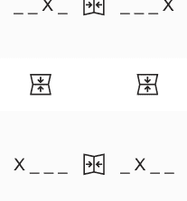

**图 2.5** 镜像区域。

轴上镜像的规则如下：

**表 2.6** 具有镜像线条的四个象限

| 位置 | 位置 | 跨越 X 轴镜像 | 跨越 Y 轴镜像 |
|---|---|---|---|
| _X | 右上 | 否 | 否 |
| _X | 左上 | 是 | 否 |
| _X | 右下 | 否 | 是 |
| _X | 左下 | 是 | 是 |

这使得需要绘制的所有线条减少为绘制四个象限和线条的反射。

```
com/tutego/exercise/lang/CistercianDigits.java
static void printCistercianDigit(int value, int x, int y, int size) {
  printGlyph(x, y, 0, -size - size / 2, 0, size+size / 2);
  // top right corner
  printQuadrant(value % 10, x, y, size, false, false);
  // top left corner
  printQuadrant((value / 10) % 10, x, y, size, true, false);
  // bottom right corner
  printQuadrant(value / 100) % 10, x, y, size, false, true);
  // bottom left corner
  printQuadrant(value / 1000) % 10, x, y, size, true, true);
}
```

方法 `printCistercianDigit(...)` 被用于四位数，并带有起始坐标和尺寸，该尺寸代表绘制线条的小框的维度。中间的线被放置，四个象限由一个单独的方法处理。中心点的 x/y 坐标以及尺寸不会改变，改变的只有传递的两个布尔值，它们代表反射。

一个象限就足以描述不同的场景，而不是为每种情况勾画单独象限。虽然可以为每个场景仅包含必要的线条，但存在可以利用的迷人关联。任何大于六的数字右侧都有条线。例如，7 是 6 和 1 的组合，8 是 6 和 2 的组合，而9 是 7 和 2 的混合。同样，5 是 1 和 4 的结合。这种关联与二进制模式有关，合并后产生更高的值。

建议的解决方案没有使用这个属性，而是使用了更简单的方法：从 1 到 9 的每个数字在某些都有线条。case 语句可以放置每个数字的线条。这就是 `printQuadrant(...)` 的实现方式：

```
com/tutego/exercise/CisterianDigits.java
public static void printQuadrant(int value, int x, int y, int size,
int dx=mirroredX -size; boolean mirroredX, boolean mirroredY ) {
  int dy=mirroredY -size;
  y = -0.5 * dy;

  switch ( value ) {
  case 1, 5, 7, 9 ->printSVGLine(x, y, 0, -dy, dx, -dy);
  }
  switch ( value ) {
  case 2, 8, 9 ->printSVGLine(x, y, 0, dx, 0);
  }
  switch ( value ) {
  case 3 ->printSVGLine(x, y, 0, -dy, dx, 0);
  case 4, 5 ->printSVGLine(x, y, 0, -dy);
  case 6, 7, 8, 9 ->printSVGLine(x, y, 0, dx, dx, 0);
}
```

该方法有两个任务。一方面，水平或垂直镜像的信息必须转换为坐标，另一方面，必须为每个数字显示相应的线条。从信息中，表示是水平或垂直的，变量 `dx` 和 `dy` 被赋值，使得线条从起始点向右或向左绘制。变量 `y` 被修改了；所有上方和左方的象限直接相邻，因为下方和右侧的象限有一个很小的距离。因此，y 坐标偏移了 `dy` 的一半。总共有九个数字。不同的数字有不同的线条；主程序必须定义尺寸、起始坐标、SVG 容器，然后设置符号。

```
com/tutego/exercise/CisterianDigits.java
public static void main(String[] args ) {
  final int SIZE=10;
  final int startX=20;
  final int startY=20;
  System.out.println("
  <svg height=\"400\" width=\"400\">
    <g style=\"grey;line-cap:round;stroke-width:2\">
      printCistercianDigit(9, 100, 100, SIZE);
    </g>
  </svg>");

  int value=1;
  for (int i=0; i <= 4; i++) {
    for (int j=0; j <= 4; j++) {
      printCistercianDigit(value, startX(i * 40), startY(j * 40), SIZE);
      value++;
    }
  }
}
```

注释掉的嵌套循环绘制了一个带有不同数字的大网格。

## 测验：什么是 Ding-Dong？

方法的参数和返回值表明我们正在处理一个整数到整数的映射。我们正在寻找一个更合适的名称，让我们将 `dong` 重命名为 `value`，并将方法重命名为 `f`：

```java
static long f(long value ) {
    return value == 0 ? 0 : (value / 10));
}
```

递归调用通常包含两个部分：停止条件和一个新的递归调用。当参数达到 0 时，递归调用终止，结果为 0。在递归调用，我们可以观察到除以 10，数字正在逐渐减小。具体来说，最后一位数字被移除，函数被递归调用剩余的数字。让我们将此过程应用于 192：

- f(192)
- f(19)
- f(1)
- f(0)
- 0
- 1+9=10
- 2+9+0=12

写出来：2+9+0=12。

方法按位求和。这给出了跨越 10 的余数。

总之，这给出了数字之和，所以方法名 `digitSum(...)` 会比较合适。

## 测验：Repdigit（递归）

如前所述，递归函数包含两个组件：递归调用和终止条件。这两个方面可以在以下方法中观察到：

```java
static boolean isRepdigit( long n ) {
    if ( ( n % 100 ) / 10 != n % 10 )
        return n<10;
    return isRepdigit( n / 10 );
}
```

- 递归调用将传递的数字除以 10，截断了末尾数字并使其变小。
- 重复的调用随后使数字足够小，以至于递归调用必须终止。这由条件负责。

表达式 `(n % 100) / 10` 返回数字的第二位（从右侧），当两个数字相等时，`if` 语句不进入体并除以 10 继续递归。如果最后两个数字不等，并不自动意味着该数字不是 repdigit，但如果只剩一位，即数字小于 10，那么它是正确的。当我们有两个相等的数字时，它就不再是 repdigit。

让我们暂时否定这一点。表达式 `(n % 100) / 10 == n % 10` 测试数字的两个数字是否相等。也可以通过表达式 `n % 100 % 11 == 0` 实现。下面的表直观地展示了这一点：

**表 2.7** 具有相同数字的数字

| 最后两位 | % 11 | % 11 == 0 |
|---|---|---|
| 00 | 0 | true |
| 11 | 0 | true |
| 22 | 0 | true |
| 33 | 0 | true |
| 44 | 0 | true |
| 55 | 0 | true |
| 66 | 0 | true |
| 77 | 0 | true |
| 88 | 0 | true |
| 99 | 1 | false |
| 89 | 1 | false |

## 74 Java 编程练习

```java
System.out.println( 1 );
}
```

```java
static long collatzMax( long n ) {
  long max = n;
  while ( n > 1) {
    if ( n % 2 == 0) {
      n /= 2;
    } else {
      n = 3 * n + 1;
      if ( n > max) {
        max = n;
      }
    }
  }
  return max;
}
```

```java
static long collatz( long n, long max ) {
  if ( n < 1) {
    if ( n % 2 == 0)
      return collatz( n / 2, Math.max( n, max ) );
    return collatz(3 * n + 1, Math.max( n, max ) );
}
```

```java
public static void main( String[] args ) {
  collatz( 27 );
  System.out.println( collatzMax( 27 ) );
  System.out.println( collatz( 27, 0 ) );
  collatz( 20 );
  System.out.println( collatzMax( 20 ) );
  System.out.println( collatz( 20, 0 ) );
}
```

我们编写了方法 `collatz(long)` 并假设一个整数 `n`。如果 `n` 大于 1，我们需要重复操作；如果 `n=1` 则终止。为了判断数字是偶数还是奇数，我们使用取余运算符。如果数字是偶数，将其除以 2；否则，将该数字乘以 3 并加 1。`n /= 2` 是 `n /= 2` 的简写。我们不能简写为 `n *= 3 * n + 1`，不仅是因为可读性会变差，还因为 `n *= 3+1` 会变成 `n=n (3+1)`。

如果我们想确定最大值，算法与上一个几乎相同。唯一的区别在于变量 `max` 的声明。在开始时，`max` 使用传入的参数初始化，并在循环期间可能会被更新。由于除以 2 得到的是较小的值，我们不需要调整 `max`。但在循环过程中，如果数字通过乘以 3 增加了，我们在必要时更新该变量。

在递归实现中，参数列表从一次递归调整到下一次的最大值。如果当前数字 `n` 大于 1，则继续递归，因为需要执行 Collatz 序列的后续步骤。当 `n` 等于 1 时，由于序列完成，返回最后一个最大值。如果 `n` 大于 1，检查数字的奇偶性。根据结果，计算 Collatz 序列的下一个值并存储在一个新的中间变量 `next` 中以提高可读性。该中间变量连更新的最大值被递归调用，以确定整个 Collatz 序列的最大值。使用数学工具方法 `Math.max(...)` 来确定并返回数字之间的最大值。

## 古埃及乘法（递归）

让我们先从用命令式直接实现算法开始：

```java
// com/tutego/exercise/lang/PeasantMultiplication.java

private static boolean isOdd(int value) {
    return value % 2 != 0;
}

static int multiply(int a, int b) {
    int sum = 0;

    while ( a > 0 ) {
        if ( isOdd( a ) )
            sum = sum + b;

        a = a / 2;
        b = b * 2;
    }

    return sum;
}
```

辅助方法 `isOdd(...)` 增强了检查数字是否为奇数的可读性。奇数不能被除以二。代码几乎是计算步骤的直接映射。第一个参数 `a` 被除以 2，第二个参数 `b` 被乘以 2。循环持续到它变为 1 为止（即只要 `a` 大于 0）。只有当 `a` 为奇数时，和才会加上修正值 `b`。虽然如果 `a` 始终为偶数，这种分类似乎是不必要的，但在最后一步，`a` 总是 1，因此 `b` 至少会被计入和中。

为了优化代码，必须减少运行次数，这直接取决于 `a`，因为它被除以 2 的次数如此。因此，`a` 的值越小，需要的迭代越少。如果 `b` 小于 `a`，我们可以交换 `a` 和 `b` 的值：

```java
// com/tutego/exercise/lang/PeasantMultiplication.java

static int multiply(int a, int b) {
    if ( a > b) {
        int swap = b;
        b = a;
        a = swap;
    }

    int sum = 0;
    //...
    return sum;
}
```

如果你想进一步优化代码（提高可读性并可能为了速度），可以看以下内容：

## 76 Java 编程练习


```java
// com/tutego/exercise/lang/PeasantMultiplication.java

static int obfuscatedMultiply(int a, int b) {
  int sum = 0;
  for ( ; a > 0; a /= 2, b *= 2 ) {
    sum += (a & 1) & b; // sum += (a & 1) * b
  }
  return sum;
}
```

# 3 • 类、对象与包


任务：

1. 创建一个新的类 `BermudaTriangle` 并包含一个 `main(...)` 方法。
2. 在方法中声明三个常量。
3. 创建一个 `java.awt.Polygon` 对象。
4. 多边形由方法添加的点组成。该方法的名称是什么？
5. 为神秘的百慕大三角创建一个三角形。坐标范围保持在 0 到 50 之间。
6. 如果船的位置是一个点，你如何判断所选点是否在三角形内部？
7. 创建两个针对 `0<=x<50` 和 `0<=y<50` 的嵌套循环，创建一个矩形网格。在循环体中测试：
    - 如果 x 坐标击中虚拟屏幕边缘，打印一个彩虹字符（`RAINBOW`）。
    - 如果 x-y 坐标是多边形内部的一个点，输出一个章鱼（`OCTOPUS`），否则输出一个木头字符（`FOG`）。

从 Java 9 开始引入了模块系统。默认情况下，仅包含 `java.base` 模块中的类型，其中不包含 GUI（图形用户界面）类型。AWT（抽象窗口工具包）类型属于桌面模块 `java.desktop`。如果你使用模块（在应用程序的主目录下存在 `module-info.java` 文件），则必须包含 `java.desktop` 模块：

```java
module com.tutego.bermuda {
    requires java.desktop;
}
```

## 引用的操作

使用 `new` 创建对象后，我们得到的是该实例的引用。该引用可以传递给其他方法，方法也可以返回引用。

# 测验：点的短暂生命 ★

给定以下程序代码，其中 `Point` 来自于 `java.awt`。

```java
Point p, q, r;
p = new Point();
q = p;
Point s = new Point();
p = new Point();
s = new Point();
// 剩余多少个对象？
```

问题：

- 声明了多少个引用变量？
- 创建了多少个对象？
- 在注释行结束时引用了多少个对象？自动垃圾回收可以移除哪些对象？

# 构建三角形 ★

CaptainCiaoCiao 确定百慕大三角中的危险区域可能是随机的——他必须做好任何准备。


任务：

- 在现有的 `BermudaTriangle` 类中创建一个静态方法：

```java
static Polygon resetWithRandomTriangle(Polygon polygon) {
    // 返回初始的三角形
}
```

此方法应该先清除 `java.awt.Polygon`（它可能仍然包含点），然后用一个随机三角形填充它并在最后返回它。

- 编写另一个返回新随机三角形的静态方法：

```java
static Polygon createRandomTriangle() {
    // 返回随机三角形
}
```

# 测验：== 相于 .equals(...) ★

编译器或运行时环境将如何反应？

```java
public class EqualsOperatorOrMethod {

  public static void main(String[] args) {

    int number1 = 1234;
    int number2 = 1234;

    if (number1 == number2) {
      System.out.print("===");
    }

    if (number1.equals(number2)) {
      System.out.print(" equals");
    }
  }
}
```

屏幕会打印 `==`，还是 `equals`，还是两个条件语句都没有捕获导致无输出，或者存在编译错误？

# 测验：防止空指针异常 ★

如果引用变量可能被赋予 `null` 值，我们应该检查 `null` 以避免遇到 `NullPointerException`。

我们正在寻找一个满足以下条件的条件语句：

- 一个名为 `string` 的字符串变量既不是 `null`。
- 不为空。

换句话说，测试字符串是否存在以及该字符串至少有一个字符。哪一个条件语句测试是正确的？

```java
1. if (!string.isEmpty() && string != null)
2. if (string == null && !string.isEmpty())
3. if (string != null && !string.isEmpty())
4. if (string == null || string.isEmpty())
5. if (string != null || string.isEmpty())
6. if (string == null && !string.isEmpty())
7. if (string != null || string.isEmpty())
```

## 建议方案

`com/tutego/exercise/oop/BermudaTriangle.java`

```java
import java.awt.Polygon;
import java.util.concurrent.ThreadLocalRandom;

public class BermudaTriangle {
    private static int DIMENSION = 50;

    public static void main(String[] args) {
        Polygon triangle = createRandomTriangle();
        for (int x = 0; x < DIMENSION; x++) {
            for (int y = 0; y < DIMENSION; y++) {
                if (x == 0 || x == DIMENSION - 1 || y == 0 || y == DIMENSION - 1) {
                    System.out.print("RAINBOW");
                } else if (triangle.contains(x, y)) {
                    System.out.print("OCTOPUS");
                } else {
                    System.out.print("FOG");
                }
            }
            System.out.println();
        }
    }

    static Polygon resetWithRandomTriangle(Polygon poly) {
        poly.reset();
        ThreadLocalRandom random = ThreadLocalRandom.current();
        poly.addPoint(random.nextInt(DIMENSION), random.nextInt(DIMENSION));
        poly.addPoint(random.nextInt(DIMENSION), random.nextInt(DIMENSION));
        poly.addPoint(random.nextInt(DIMENSION), random.nextInt(DIMENSION));
        return poly;
    }

    static Polygon createRandomTriangle() {
        return resetWithRandomTriangle(new Polygon());
    }
}
```

逻辑运算符有两个属性：

1. 逻辑 `&&` 的求值从左到右进行。
2. 逻辑 `||` 是短路逻辑：如果表达式的第一部分决定了结果，则不计算第二部分。

## Java 编程练习

有返回的方法从根本上比没有返回结果的方法更好。如果我们能得到返回值，它就是一个表达式，而表达式是非常方便的。

这种用法在第二个方法 `getRandomTriangle()` 中体现得很好，因为它可以引用上一个方法 `resetWithRandomTriangle(...)` 并向其传递一个新的多边形。由于 `resetWithRandomTriangle(...)` 也直接返回了传递的多边形，我们可以用一行代码结束该方法。如果 `resetWithRandomTriangle(...)` 返回空值，我们必须引入一个中间变量，首先给它赋值新的多边形，最后通过 `return` 返回。如果 `resetWithRandomTriangle(...)` 同时返回该参数，我们就可以省略这个中间变量。

# 测验：== vs. equals(...)

基本数据类型不是引用；无法在基本数据类型上调用任何单一方法。在 Java 中，不允许在基本类型元素后加点号然后调用方法。如果基本数据类型被编译器自动转换为所谓的包装对象，情况就不同了，但那是另一回事了。因此，这会导致编译错误。

# 测验：防止空指针异常

关于各个条件：

```java
if (!string.isEmpty() && string != null)
```

该表达式检查 `string` 是否为空，然后检查 `string` 是否为 null。由于求值是从左到右且在这里首先检查长度，这种顺序在 `string == null` 时会导致 `NullPointerException` 且无法避免它。

```java
if (string != !string.isEmpty())
```

`&&` 和 `||` 是短路运算符，它们有对应的 `&` 和 `|`，后者不对短路基本类型进行操作，即执行所有部分。因此，如果 `string` 为 null，由于方法的调用会导致 `NullPointerException`。

```java
if (string != null && !string.isEmpty())
```

这个检查是正确的。顺序是正确的；首先测试 `string` 是否不为空。如果结果为 `false`，则右侧完全不会被评估。这避免了 `NullPointerException`。

```java
if (string == null || string.isEmpty())
```

逻辑表达式可以否定两次，导致相同的结果。在这种情况下，AND 变成 OR，或者 OR 变成 AND。此外，整个表达式被取反了——关键字是 `boolean`。但是，如果这个语句是正确的，它简化了可读性，或者可能没有。该运算符会导致两边的评估：如果 `string` 为 null，就会发生 `NullPointerException`。

```java
if (Objects.requireNonNull(string) && !string.isEmpty())
```

这种表示法会导致编译错误，因为 `Objects.requireNonNull(...)` 返回一个引用，但逻辑操作只允许用于 `boolean` 类型。

```java
if (Objects.requireNonNull(string) != null)
```

并没有测试 `string` 是否包含字符；这并不是 `Objects.requireNonNull(...)` 的功能。此外，使用它会适得其反，因为如果 `string` 为 null，我们会得到一个异常，而这恰好是我们想要的。只有当你想要刻意抛出异常时，才使用 `requireNonNull(...)`。

## 注意

- <https://docs.oracle.com/javase/specs/jls/index.html>
- <https://docs.oracle.com/javase/specs/jls/index.html>

## 数组

数组是重要的数据结构，也间接出现在 Java 中，例如，在增强型循环或参数列表中。本章包含了关于创建数组、遍历数组以及如何在数组中搜索元素等算法的练习。

## 前提条件

- 能够创建、访问和填充数组。
- 使用增强 for 循环遍历数组。
- 能够使用一维和多维数组。
- 构造构建参数列表。
- 理解 `Arrays` 类的工具方法。

本章使用的的数据类型：

- `java.util.Arrays`
- `java.lang.System`

## 一切皆有类型

在查看访问元素之前，让我们仔细观察一下类型。理解对象类型和引用类型之间的区别至关重要。

## 测验：数组类型

数组在 Java 中是协变的，这意味着例如 `String[]` 是 `Object[]` 的子类型。这听起来有点抽象，因此接下来的任务旨在加深你对数组协变的理解。请考虑所有语句是否都能完整执行或运行：

```java
String[] strings1 = new String[100];
Object[] a1 = (Object[]) strings1;
Object[] a2 = strings1;
Object[] strings2 = new String[] {"1", "2", "3"};
String[] a3 = (String[]) strings2;
String[] strings3 = {"1", "2", "3"};
Object[] a4 = strings3;
Object[] strings4 = {"1", "2", "3"};
String[] a5 = (String[]) strings4;
```

```java
int[] int1 = new int[100];
Object[] a6 = (int[]) int1;
Object[] int2 = new int[100];
int[] a7 = (int[]) ints2;
```

## 一维数组

数组是同质元素的集合。一维数组直接包含元素，不包含其他子数组。

# 循环数组并输出风速、风向

Ciao 长在海上航行，风从四面八方来。他必须时刻记住风速和风向。


任务：

1. 声明两个数组 `int[] windSpeed` 和 `int[] windDirection`。
2. 用随机数填充两个数组（原则上数字应该是任意的），其中风速可以在 0 到（小于）200 km/h 之间范围，风向可以在 0 到（小于）360° 之间范围。
3. 循环数组并输出所有结果，用逗号分隔。

示例：

- 例如，如果 `windSpeed` 包含 `{82, 70}`，而 `windDirection` 包含 `{12, 266}`，则输出应该是：风速 82 km/h，风向 12°；风速 70 km/h，风向 266°。

# 检测连续收入增长

在月底，Ciao 队长收到了一份关于他和船员产生的销售额的报告。每天的利润记录格式如下所示：

```java
// 天 1, 2, 3, 4, 5 ... 直到 31 天
int[] dailySales;
```

Ciao 队长很高兴，当销售额增长 5% 时会发放奖励。从 1000 到 2000 是巨大的跳跃，但从 2000 到 500 不是。


任务：

- 写一个方法 `countPercentJumps(int[])` 返回销售跳跃的次数。如果销售额比前一天高 5%，则判定为跳跃。
- 传入的数组不能为空，否则将抛出异常。

# Point 数组

预期输出是什么？

```java
Point[] points = {null, null, null};
Point p = new Point();
p.setLocation(1, 2);
points[0] = p;
p.setLocation(3, 4);
points[1] = p;
Point q = points[1];
q.setLocation(5, 6);
points[2] = points[3] = q;
System.out.println(Arrays.toString(points));
```

# 搜索连续字符串并判断 Salty Snook 是否到来

Ciao 观察经过船只的旗帜，因为他在等待 Salty Snook。他查看每一面旗帜并知道 Salty Snook 从不单独出现，而是以四艘船的队移动。


任务：

- 写一个新方法 `isProbablyApproaching(String[] signs)`，如果数组中连续出现四个相同的缩写，则返回 `true`。记住字符串使用 `equals(...)` 进行比较。
- 传入的数组不能为空，数组中的任何元素不能为 null。

示例：

```java
String[] signs1 = {"F", "DO", "MOS", "MOS", "MOS", "MOS", "WES" };
System.out.println(isProbablyApproaching(signs1)); // true
```


```java
String[] signs2={"F", "DO", "MOS", "MOS", "WES", "MOS", "MOS" };
System.out.println(isProbablyApproaching( signs2 ) ); // false
```

## 反转数组

Charlie Creevey 为 C 队长负责财务。然而，他并不是按升序排列收入，而是按降序排列的。因此，列表必须翻转。

翻转数组意味着将第一个元素与最后一个元素交换，第二个元素与倒数第二个元素交换，以此类推。

- 编写一个新的静态方法 `reverse(...)` 来翻转给定的数组：

  ```java
  public static void reverse(double[] numbers) {
  // TODO
  }
  ```

- 该操作应该是原地进行的（in-place），即它应该改变传入的数组。我们不希望在 `reverse(...)` 方法内部创建一个新数组。

- 如果传入 `null`，则将抛出异常。

示例：

- `{ }` -> `{ }`

- `{1}` -> `{1}`

- `{1, 2}` -> `{2, 1}`

- `{1, 2, 3}` -> `{3, 2, 1}`

大括号中的表示纯是符号性的。

# 寻找最近的电影院 ★★

`java.awt.Point` 类表示具有 x/y 坐标的点。这种数据类型非常适合表示位置。新电影《海盗之旗》（Under the flag of the buccaneers）正在电影院上映，恰恰奥队长（Captain ChaoCiao）必须看它。但最近的电影院在哪里呢？

任务：

- 给定一个对象数组 `points`，其中包含电影院的位置。

  `Point[] points={new Point(10, 20), new Point(12, 2), new Point(44, 4)};`

- 编写一个方法 `minDist(Point[] points, int size)`，返回距离原点最近的点的距离。通过 `size` 我们可以指定应该考虑多少个数组元素，允许数组在理论上可以更大。

- 不允许传入 `null`，且点本身也不得为 `null`；必须抛出异常。

- 如果返回类型是 `Point`，意味着应该返回距离最近的点本身，我们需要对其进行什么修改？

检查 `java.awt.Point` 的 Javadoc，查看该点是否可以计算与其他坐标的距离。

# 抢劫糖果店并公平分配 ★★

恰恰队长和他的孩子 Junior 和 Jackie 正在抢劫一家糖果店。糖果陈列在一个长架子上，每个物品都标有重量。这些信息以数组的形式给出：

```java
int[] values={10, 20, 30, 40, 50 };
```

Junior 和 Jackie 分位于架子的两端，一个在左边，一个在右边，但恰恰队长同样爱这两个孩子，他们最终拿的数量应该相同。恰恰队长指向架子上的糖果，它左侧的所有产品都给 Junior，该位置右侧的所有产品（包括显示的）都给 Jackie。

恰恰队长知道架子上有什么，但他不知道左右两侧在何处会出现相同的总和。对于孩子们来说，10% 的偏差是可以接受的。我们希望使用以下公式来计算差异的相对差：

```java
private static int relativeDifference(int a, int b) {
    if (a == b) return 0;
    int absoluteDifference=Math.abs(a - b);
    return (int)100. * absoluteDifference / Math.max(a, b);
}
```


任务：

- 编写一个方法 `int findSplitPoint(int[])`，找到数组中左右侧可以进行公平划分的索引。任何方案均可，不需要所有的方案。

- 如果没有公平的划分，方法必须返回 -1。

示例：

- `10+20+30+40=50`，因为 `100=90`，返回的索引为 4。

- `10 20 30 40` 结果为 -1，因为没有有效的划分。

# 增强型 for 循环

如果需要从第一个元素开始遍历数组，可以使用带有隐藏循环计数器的增强型 for 循环。这可以节省代码。在以下任务中，某些地方可以使用扩展 for 循环。

# 乱序的数字 ★★

Bonny Brain 的牌组中有五颗数字为 1 到 6 的游戏骰子。经过有力的摇晃和巨大的投掷，骰子会像战利箱里的宝藏一样洒在桌子上，向所有人展示它们注命的数字。

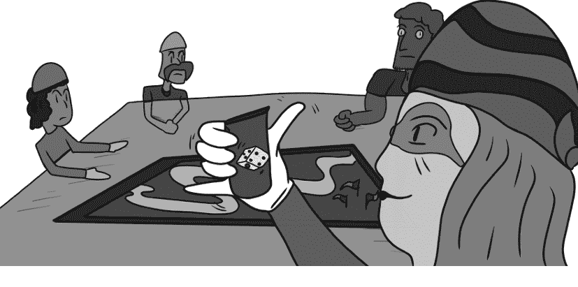

任务：

- 编写一个方法 `int[] shuffleDice()`，返回一个包含 1 到 6 之间随机数的数组。

- 编写一个方法 `isHomogeneous(int[] values)`，测试数组中的所有值是否相等。（homogeneous 的意思是均匀/相似/相等）。原则上，数组可以是任意大小。

- 编写一个方法 `int occurrences(int[] values)`，返回一个长度为 6 的新数组，指示每个数字出现的次数。

- 编写一个方法 `isFullHouse(int[] values)`，检查是否有三个骰子具有相同的值且另外两个骰子具有相同的值。例如，`[1, 1, 1, 2, 2]` 就是这种情况。

- 编写一个方法 `printDiceValues(int points)`，按如下方式将骰子数字写入屏幕：

  - 数字按升序排序。

  - 数字分组在一起。

  - 屏幕上不要使用相同的符号，而是使用 Unicode 符号 ☐ (Unicode U+2680)、⊟ (U+2682)、☑ (U+2683)、☒ (U+2684)、괘 (U+2685)。

- 假设数组值是正确的。

示例：

- `isHomogeneous(new int[]{1, 1, 1, 1, 1})` 返回 true。

- `isHomogeneous(new int[]{1, 2, 3, 4, 5})` 返回 false。

- `occurrences(new int[]{1, 1, 1, 2, 2})` 返回一个数组，逻辑上是 `[3,2]`。

- `isFullHouse(new int[]{1, 1, 1, 2, 2})` 返回 true。

- `isFullHouse(new int[]{1, 1, 2, 2, 3})` 返回 false。

- `printDiceValues(new int[]{1, 1, 1, 2, 2})` 返回 false。

# 绘制山脉 ★★

为了即将到来的旅行，Bonny Brain 和她的团队必须穿越山脉。在出发之前，她获得了海拔数据并希望获得地形的预览。


任务：

- 编写一个方法 `printMountain(int[] altitudes)`，将海拔转换为 ASCII 表示。

- 高度可以是任意的。

- 使用符号 `/`、`-`、`^`。

```
5
    ^
4
```

# 二数组

数组可以包含其他数组，这就是如何定义多维数组的。

# 检查数独是否有效

由于玩数独很费力，Bonny Brain 需要参与其中。数独游戏由 9x9 的网格组成。该网格可以被分为九块，在每个这些块中，1 到 9 的数字必须出现一次。

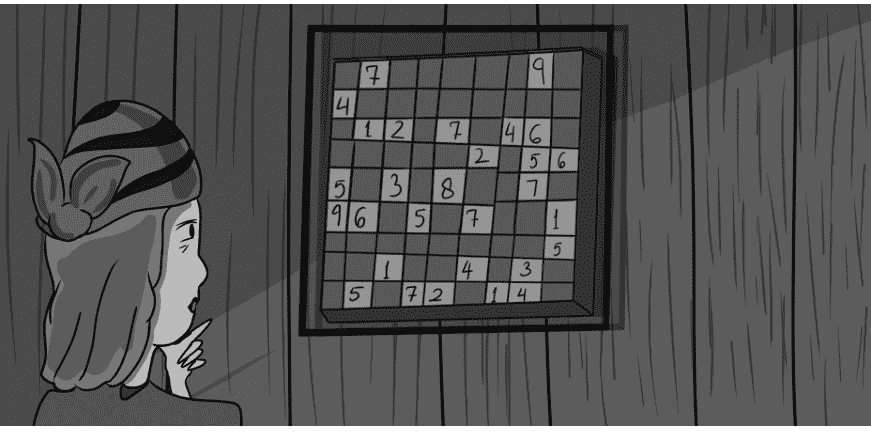

任务：

- 编写一个程序测试二维数组中的1 到 9 的数字是否都出现。

- 缺失的元素需要报告。

示例：

- 下列数组是有效的数独：

  `int[][] array={ { 1, 2, 3 }, { 4, 5, 6 }, { 7, 8, 9 } };`

- 下列数组不是有效的数独：

  `int[][] array={ { 1, 2, 3 }, { 4, 5, 6 }, { 7, 8, 8 } };`

错误可能报告为：缺失 9。

# 放大恰恰队长 ★★

恰恰队长正在寻找单眼 Billy 的宝藏。宝藏地图太小了，他的眼睛越来越花了。

图像通常在内存中存储为红、绿、蓝三元组，每个值的值范围从 0 到 255。由于灰度图像没有颜色，只需要一个值而不是三个。


任务：

- 给定一个值为 0 到 255 的二维整数数组，该数组在心理上表示一张灰度图像。

- 编写一个方法 `int[][] magnify(int[][] array, int factor)`，返回一个新数组并按给定因子放大图像。因此，一个大小为 2×3 的图像和因子 2 变成一个 4×6 的图像。图像像素简单地双倍，不需要插值。

示例：

- 假设有数组：

  `{ 1, 2, 3 },`

  `{ 4, 5, 6 }`

- 那么在双倍后，后续如下：

  `{ 1, 1, 2, 2, 3, 3 },`

  `{ 1, 1, 2, 2, 3, 3 },`

  `{ 4, 4, 5, 5, 6, 6 },`

  `{ 4, 4, 5, 5, 6, 6 }`

# 变长参数列表

Java 允许向方法传递任意数量的参数。这些方法被称为变长参数方法（vararg methods）。变长参数只能出现在参数列表的末尾，并且它是一个数组。当使用变长参数调用方法时，编译器会自动创建一个新的匿名数组并将其传递给该方法。

# 使用变数量坐标创建 SVG 多边形 ★

Bonny Brain 想要为她的下一份工作画一张地图，这幅地图在打印和任何分辨率下都应该保持美观，因为每一个细节都关重要。实现此点的最佳技术是 SVG。

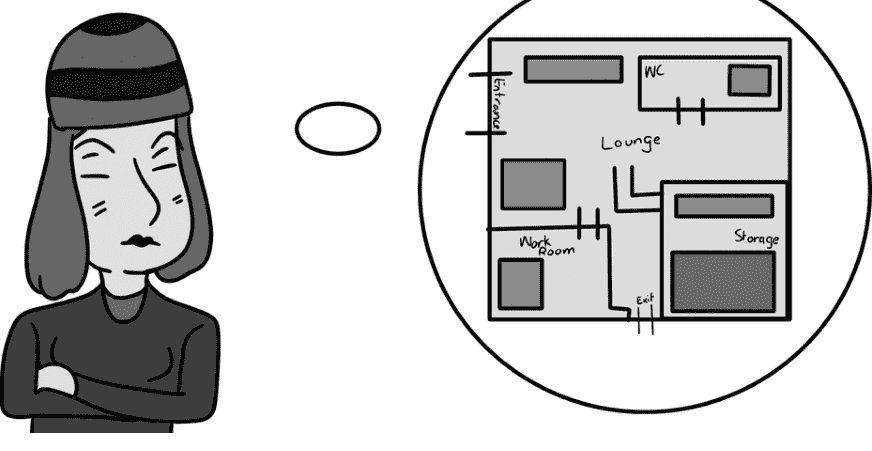

在 SVG 中有不同的基元类型，例如线条、圆形或矩形。还有一个专门用于多段线的 XML 元素。例如：

`<polygon points="200,10 250,190 160,210" />`

任务：

- 声明一个 Java 方法 `printSvgPolygon(...)` 以传递任意数量的坐标对。传递这些坐标时可能会出现哪些错误？

- 该方法应根据传递的对在屏幕上打印对应的 SVG 输出。

示例：

- 在 `printSvgPolygon( 200, 10, 250, 190, 160, 210 )` 中，`200,10` 是一个坐标对，`250,190` 也是，`160,210` 也是。屏幕输出应该是：`<polygon points="200,10 250,190 160,210" />`。

可选：学习 https://tutego.go/trysvgpolygon 中的示例。将生成的 SVG 复制到网页界面。

# 检查审批 ★

Captain CiaoCiao 正在获取船员关于一个订单的反馈。所有成员都可以投票赞成或反对。任务：

- 我们正在寻找一个变长方法 `allTrue(...)`，它可以接受任意数量的布尔值，但调用时必须包含一个参数。

- 如果所有参数都为 true，则返回 true；如果其中一个布尔值为 false，则方法应返回 false。

- 由于变长参数在内部是一个数组，可能会传递 null——这必须导致异常。

示例：

- `allTrue(true, true, true)` 返回 false。

- `allTrue(true)` 返回 true。

- `allTrue(true, false)` 返回 false。

- `allTrue(true, null)` 抛出异常。

- `allTrue()` 无法编译并会产生编译器错误。

# 救命，四恐症！把所有数字 4 放在最后 ★★★

Bonny Brain 在香港结识了一些海盗，发现许多人患有四恐症，对数字 4 抱有迷信的恐惧。会计现在必须将所有包含 4 的数字放在最后。


## Java 编程练习

任务：

- 编写一个方法 `fourLast(int... numbers)`，将所有包含 4 的数字放在不包含 4 的数字之后。不包含 4 的数字顺序不能改变，包含 4 的数字可以放在任何位置。

- `fourLast(...)` 应该返回传递的数组。

- 参数 `null` 必须导致异常。

示例：

- `int[] numbers={1, 44, 2, 4, 43}; fourLast(numbers);` 会修改数组 `numbers`，使得 1 和 2 位于数组中 44、4 和 43 之前。2 不能在 1 之前。

- `fourLast( 4, 4, 44, 1234 )` 返回传递的数组，顺序为 4, 4, 44, 1234。

# 数组基础 101

```java
if ( percent >= MIN_PERCENTAGE_INCREASE )
  count++;
}
```

```java
return count;
}
```

`countPercentJumps(...)` 方法接收一个数组，在理想情况下，该数组包含一组整数。注意的是，传递了 `null`，这不应该是程序的有效输入。如果我们回退到 `length` 属性，在为 `null` 的情况下将会抛出 `NullPointerException`——这一点是可以预料的。

如果数组为空或只有一个元素，我们将其视为错误并返回 `0`。每当我们继续操作时，我们都会确保数组中至少有两个元素。我们对数组运行 `for` 循环，索引 `i=1`，并获取两个元素 `i`：索引 `i` 处的当前元素和前一个元素（位于位置 `i-1`）。这些元素代表 `todayGain` 和 `yesterdayGain`。原则上，我们也可以从 `0` 开始运行到 `dailyGains.length-1`。

一旦读取了今天和昨天的原理，我们需要用一个简单的公式计算相对百分比增长。然而，请确保除法不是针对整数，而是浮点数。毕竟，如果两个整数相除，结果是一个整数。如果我们将数组中的数字取出并转换为 `double`，通过浮点数除法我们将获得更准确的比例。这避免了舍入误差问题，因为如果我们想在某处更改常量（例如改为一个极小的值），微小的跳变可能无法被正确检测。特殊情况：当没有产生销售额时，次日的增长可能是 `Double.Infinity`，它大于 `MIN_PERCENTAGE_INCREASE`。

在计算出相对增量后，我们计数是否达到了 `5%` 的计数并增加变量的值，记住所有元素。在行末尾，我们返回 `count` 以报告共找到了多少个实例。

# 点的数组

输出结果：

```
[java.awt.Point[x=5,y=6], java.awt.Point[x=5,y=6], java.awt.Point[x=5,y=6], java.awt.Point[x=5,y=6]]
```

让我们逐行分析程序：

```java
/* 1 */ Point[] points={null, null, null, null};
/* 2 */ Point p=new Point();
/* 3 */ p.setLocation( 1, 2 );
/* 4 */ points[0]=p;
/* 5 */ p.setLocation( 3, 4 );
/* 6 */ points[1]=p;
/* 7 */ Point q=p;
/* 8 */ q.setLocation( 5, 6 );
/* 9 */ points[2]=points[3]=q;
/* 10 */ System.out.println(Arrays.toString( points ) );
```

- 1. 第一行创建了一个包含四个元素的数组，全部为 `null`。通过 `new Point[4]` 创建数组也可以达到相同的效果。

- 2. 创建了一个新的 `Point` 对象。

- 3. 使用 setter 方法将坐标设置为 (1, 2)。

- 4. 数组中的第一个元素（索引 0）被设置为该点。

- 5. 然后，点 `p` 也被设置在数组的第二个位置（索引 1）。

- 6. 获取该第二个位置的引用并存储在变量 `q` 中。因此，`q` 和 `p` 都指向同一个 `Point` 对象。

- 7. 在整个程序运行期间，我们只处理同一个 `Point` 对象，它最终的坐标变为 (5, 6)。

- 8. 这个 `Point` 引用设置在数组的第 3 和第 4 位置（索引 2 和 3）。

- 9. 最终，数组中的所有元素都指向同一个 `Point` 对象，因此输出将是坐标为 (5, 6) 的 `Point` 对象的 `toString()` 表示，重复四次。

# 搜索连续字符串并判断“咸鱼鲈鱼”是否正在到来

`com/tutego/exercise/array/SaltySnook.java`


```java
public static boolean isProbablyApproaching(String[] signs) {

    final int MIN_OCCURRENCES = 2;
    if (signs.length < MIN_OCCURRENCES) {
        return false;
    }

    for (int i = 0, count = 1; i < signs.length - 1; i++) {
        String currentSign = Objects.requireNonNull(signs[i]);
        String nextSign = Objects.requireNonNull(signs[i + 1]);
        if (currentSign.equals(nextSign)) {
            count++;
            if (count == MIN_OCCURRENCES) {
                return true;
            }
        } else // !currentSign.equals(nextSign)
            count = 1;
    }
    return false;
}
```

我们将期望的船只数量记录在常量 `MIN_OCCURRENCES` 中，以便于更改。

首先，我们检查数组中是否包含至少 `MIN_OCCURRENCES` 个元素。如果传入 `null`，在访问 `length` 属性时将抛出 `NullPointerException`，表示参数错误。

在比较数组中的后续元素时，我们有两种方法：

- 生成一个从 0 到倒数第二个元素的索引，然后访问两个元素：索引 `i` 处的当前元素和下一个元素（位于位置 `i+1`）。

## 反转数组

`com/tutego/exercise/array/reverse.java`

```java
public static void reverse(double[] numbers) {
    // 实现略
}
```

## 寻找最近点

`com/tutego/exercise/array/MinDistance.java`

```java
static double minDistance(Point[] points, int size) {

    if (points.length == 0 || size > points.length) {
        throw new IllegalArgumentException("数组为空或索引越界");
    }

    double minDistance = points[0].distance(0, 0);

    for (int i = 1; i < size; i++) {
        double distance = points[i].distance(0, 0);
        if (distance < minDistance) {
            minDistance = distance;
        }
    }

    return minDistance;
}
```

## 抢购糖果店并公平分配

`com/tutego/exercise/array/FairSharing.java`

```java
public static int findSplitPoint(int[] values) {

    if (values.length < 2)
        return -1;

    int sumLeft = values[0];

    int sumRight = 0;
    for (int i = 1; i < values.length; i++)
        sumRight += values[i];
    for (int splitIndex = 1; splitIndex < values.length; splitIndex++) {
        int relativeDifference = relativeDifference(sumLeft, sumRight);

        Logger.getLogger("MuggingFairly");
        Logger.info("splitIndex=" + splitIndex + "/sumLeft=" + sumLeft + "/relativeDifference=" + relativeDifference);

        if (relativeDifference <= 10)
            return splitIndex;

        int element = values[splitIndex];
        sumLeft += element;
        sumRight -= element;
    }
    return -1;
}
```

```java
// https://en.wikipedia.org/wiki/Relative_change_and_difference
private static int relativeDifference(int a, int b) {
    if (a == b) return 0;
    int absoluteDifference = Math.abs(a - b);
    return (int) (100. * absoluteDifference / Math.max(a, b));
}
```

该解决方案的算法可以通过迭代或递归的方式实现。然而，在这种情况下，由于其简单性且易于理解，我们决定采用迭代方法。让我们从一个解决该问题的简单示例开始：

1. 选取一个索引将数组一分为两部分。
2. 计算右部分和左部分的元素的和。
3. 比较它们，如果两边大致相等，则带上结果结束程序。

索引从前向后移动，并且和始终会被重新计算。这个算法非常简单，但我们必须多次遍历数组，因此最终运行时间是平方级的。这种方法效果更好。如果我们把数组分成两部分，光标向右移动一位，和就会根据一个简单的模式发生变化：加到左侧和中的元素会从右侧减去。这就是解决方案的核心思想。

## 绘制山脉

`com/tutego/exercise/array/MountainVisualizer.java`

```java
private static String mountainChar() { return ""; }
public static void printMountain(int[] altitudes) {

    int maxAltitude = altitudes[0];

    for (int currentAltitude : altitudes) {
        maxAltitude = Math.max(maxAltitude, currentAltitude);
    }
    // 包含高度0，所以它是 >=0 的
    for (int height = maxAltitude; height >= 0; height--) {
        System.out.print(height + " ");
        for (int altitude : altitudes) {
            System.out.print(altitude == height ? mountainChar() : ' ');
        }
        System.out.println();
    }
}
```

`printMountain(int[] altitudes)` 方法接收整个高度信息数组，为了图形化表示，我们需要第一步找到最高值。这是第一个循环的任务，`maxAltitude` 存储最大值。

下一步是绘制线条。每一行代表高度。所有的写入通过一个带有循环计数器的 `for` 循环完成。由于它从山的高度开始，循环从 `maxAltitude` 开始降到 0。任务说明它不会低于零，因此我们不需要对最小数字进行搜索。

在高度循环的主体中，我们首先输出高度，后跟一个空格（我们写 `height + " "` 而不是 `height + ' '`）。一个内部循环处理代码。它在方法的高度上反复运行。对于 `altitudes` 中的每个元素，我们查询它是否与高度匹配，如果是，我们就绘制符号 `mountainChar()`；否则我们画一个空白。在行末尾写一个空行。

山脉符号的绘制是由 `mountainChar()` 方法完成的；它返回一个 `*`。我们可以直接绘制该字符，或者使用常量引用它，而该方法是为了下一个任务的准备……

### 可选扩展

在第一个提出的解决方案中，`mountainChar()` 方法始终返回 `*`：如果该方法要返回其他符号，它需要更多的上下文，因为它必须能够回溯和向前看。所以让我们看看 `mountainChar()` 是如何处理高度的。在 `altitudes` 的高度循环中，代码如下：

```java
for (int height = maxAltitude; height >= 0; height--) {
    System.out.print(height + " ");
    for (int altitude : altitudes) {
        System.out.print(altitude == height ? mountainChar() : ' ');
    }
    System.out.println();
}
```

## 放大图像

`com/tutego/exercise/array/ArrayMagnifier.java`

```java
static int[][] magnify(int[][] array, int factor) {
    int originalWidth = array[0].length;
    int originalHeight = array.length;
    int magnifiedWidth = originalWidth * factor;
    int magnifiedHeight = originalHeight * factor;

    int[][] magnifiedArray = new int[magnifiedHeight][magnifiedWidth];

    for (int row = 0; row < magnifiedHeight; row++) {
        for (int col = 0; col < magnifiedWidth; col++) {
            magnifiedArray[row][col] = array[row / factor][col / factor];
        }
    }
    return magnifiedArray;
}
```

为了提高清晰度，变量在方法的开头声明。这些变量存储了原始二维数组以及正在创建的数组的宽度和高度。后续步骤涉及构建一个新的二维数组，其宽度高度是旧数组的倍数。

主任务由两个嵌套循环完成。在第一个循环中，我们使用 `row` 来遍历所有的行。由于二维数组本质上是数组中的数组，外层数组持有所有对内部数组（行）的引用。内部循环由计数器 `col` 控制，从 0 运行到当前行的宽度，处理该行中的每一列。

有趣的部分在内部循环中。我们在新放大的二维数组取值范围内拥有 `row` 和 `col` 变量。我们初始化了 `magnifiedArray[row][col]`。为此，我们从较小的数组中获取值。我们通过 `row / factor` 和 `col / factor` 计算行和列的位置。记住：`row` 从 0 到 `height * factor`，`col` 从 0 到 `width * factor`。`row / factor` 和 `col / factor` 是整数除法，结果也是整数；这样做的效果是从小数组中多次获取相同的数字。

## 创建具有数量坐标的 SVG 多边形

`com/tutego/exercise/array/SvgVarargPolygon.java`

```java
/**
 * 打印 SVG 多边形。示例输出：
 * <pre>
 * <polygon points="200,10 250,190 160,210 " />
 * </pre>
 * @param points SVG 多边形的点。
 */
public static void printSvgPolygon(int... points) {
    if (points.length % 2 == 1) {
        throw new IllegalArgumentException(
            "数组参数个数为奇数：" + points.length);
    }

    System.out.print("<polygon points=\"");

    for (int i = 0; i < points.length; i += 2) {
        System.out.printf("%d,%d ", points[i], points[i + 1]);
    }
    System.out.println("\"/>");
}
```

可能会发生两种错误：

1. 在变长参数（vararg）中，编译器从传递的参数构建数组，但也可以传递数组的引用。由于引用可以是 `null`，`null.length` 将自动导致 `NullPointerException`。
2. 调用 `printSvgPolygon()` 时，编译器会构建一个数组；它不包含任何元素，但对长度有另一个要求：方法本身期望 x 和 y 坐标对。只传递一个坐标将是一个错误。不幸的是，编译器无法测试此类内容，你无法对变长参数提出任何请求，例如“最多 10 个元素”、“元素数量必须能被 10 整除”等。我们只能在运行时进行测试。通过检查数组中元素的个数是偶数还是奇数可以轻松检测错误。如果是偶数，则传递了 x 和 y 的坐标对；如果是奇数，则缺少一个坐标。我们用 `IllegalArgumentException` 惩罚错误的调用。值得考虑从这两个检查中提取两个条件语句，并在奇数传递的情况下将元素数量包含在异常消息中。

生成三个部分的输出：

1. 在第一部分（序言）中，我们设置多边形的起始标签。
2. 在第二部分中，循环遍历数组的所有元素，并始终选取两个元素，用逗号分隔输出到控制台——每对后面有一个空格。由于我们每次从数组中选取两个元素，循环的增量表达式增加了 2。由于数组元素个数是偶数，因此不会出现 `ArrayIndexOutOfBoundsException`。
3. 方法以结尾结束，关闭标签。

## 检查是否通过

`com/tutego/exercise/array/AllTrue.java`

```java
private static boolean allTrue(boolean first, boolean... remaining) {
    for (boolean b : remaining) {
        if (b == false)
            return false;
    }
    return first;
}
```

使用变长参数列表时无法期望最小数量的参数。解决此问题的方法是引入最小数量的参数，然后在最后使用变长参数处理剩余部分。

方法有两个返回 true 或 false 的路径：


数组是对象，作为对象，它们拥有基础类型 `java.lang.Object` 提供的所有方法。然而，我们无法对这些方法的任何一个进行有效操作，当我们对数组对象调用 `toString()` 方法时很快就能发现了这一点。数组的 `equals(...)` 方法来自 `Object`，在该处执行的是身份比较（identity comparison），正如第一点所示，这会导致结果为 `false`。

要比较数组，使用 `java.util.Arrays` 类和 `equals(...)` 方法是完全正确的。通常情况下，我们使用这个方法来比较数组，但我们的两个数组有一个特殊之处：它们包含字符串以及一个包含整数的内部数组。如果这个被引用的内部数组不存在，那么输出中确实会显示 `true`。然而，`equals(...)` 的工作方式是扁平的，这意味着被引用的内部数组必须完全相同。但由于该数组在每个情况下都是新数组，因此指向整数数组的两个引用是不等的，所以 `Arrays.equals(...)` 对我们的数组返回 `false`。

只有通过 `Arrays.deepEquals(...)` 方法，在屏幕上才会出现 `true`。

`deepEquals(...)` 还会跟踪被引用的子数组，并检查这些值是否等价。子数组的身份对于 `deepEquals(...)` 并不是必须。这两个整数数组是等价的，因此 `deepEquals(...)` 的返回值为 `true`。

# 字符与字符串处理

为了存储字符和字符串，Java 提供了 `char`、`Character`、`String` 和 `StringBuilder` 类型。必须练习这些数据类型，因为每种类型都有其理由。练习有助于读者理解每种数据类型的优缺点。

## 前提条件

- 能够安全地使用 `String` 和 `StringBuilder` 的 API
- 识别何时使用 `String` 和 `StringBuilder` 更合适

本章用到的数据类型：

- `java.lang.Character`
- `java.lang.String`
- `java.lang.StringBuilder`

## String 类及其成员变量

`String` 不仅仅是一个代表不可变字符串的数据类型，该类还提供了许多方法。如果你了解这些方法以及如何使用它们，就能节省大量工作。

## 测验：String 是内置关键字吗？

Java 拥有内置数据类型，包括 `int`、`double`、`boolean`。`String` 也是原始内置数据类型吗？`String` 是 Java 中的关键字吗？

## 使用简单拼接构建 HTML 元素 ★

提醒一下，HTML 中用于标记的标签，例如 `<strong><em>强调的斜体</em></strong>`（已翻译）。

任务：

2. 编写两个新方法 `strong(String)` 和 `emphasized(String)`，它们在后台通过 `htmlElement(...)` 工作，并分别创建 `<strong>` 和 `<em>`。

示例：

注意：对标签名有几项限制，良好的程序应该检查这些限制。例如，标签名只能包含数字 0–9 以及大小写字母。这些大小写是可以忽略的。

## 通过字符倍增检查安全传输 ★

竹鱼使用打字电报（type-print telegraph）向 Bonny Brain 发送重要信息。由于每个字符都至关重要，竹鱼会连续发送两次字符以确保安全。


任务：

- 编写方法 `isEveryCharacterTwice(String)`，检查字符串中的每个字符是否都连续出现两次。
- 如果符号数量是奇数，则消息是错误的，方法返回 0。
- 如果每个字符都出现两次，答案是任意正数。
- 如果某个字符没有连续出现两次，方法返回第一个错误数字的位置，但对其取反值。

## 116 Java 编程练习题

示例：

- `isEveryCharacterTwice("jjooveellyynn")` -> 1.
- `isEveryCharacterTwice("ccapptttaaiinn")` -> -3.
- `isEveryCharacterTwice("222")` -> 0.
- `isEveryCharacterTwice(null)` -> `NullPointerException`.

负索引标记某些位置的情况在 Java 库中也可以找到。`Arrays` 类提供了 `binarySearch(...)`，它用于搜索排序数组并返回元素；如果没找到，则返回插入点。

## 交换 Y 和 Z

Ciao 队长正在打字，现在默认实（fact）是不区分大小写的。“y" 和 "Z" 交换了位置。


任务：

- 创建新类 `YSwapper`。
- 设置一个静态方法 `void printSwapped(String)`，接收输入，交换 "y" 和 "Z"，并将其打印到屏幕上。

示例：

- `printSwapped("yellow")` -> "Yellow"
- `printSwapped("zebra")` -> "Zebra"
- `printSwapped("apple")` -> "Apple"

## 给反抗的答案

Defiant 负责 Ciao，但他被抓获了。如果输入是 "No!"，他回答 "Aye!"。

## 测试属性


任务：

- 编写一个 Java 程序检查字符串是否为回文。
- 创建新类 `PalindromeTester`。
- 实现静态方法 `boolean isPalindrome(String s)`。
- 使用类方法 `boolean isIgnoringCase(String s)` 增强程序，使测试不区分大小写。
- 现在，所有非字母或数字的字符也应该被忽略。`Character.isLetterOrDigit(char)` 有助于此。我们将方法命名为 `isIgnoringLettersAndDigits(String)`。

## 测验：用 == 和 equals 字符串

字符串是对象，因此有两种比较方法：

- 比较引用 `==`
- 使用方法 `equals(Object)`

## 测验：equals(...) 是对称的吗？

假设 s 是字符串：`s.equals("tego")` 和 `"teot"` 之间存在差异。

## 测试回文属性

回文是指正反读相同的单词，例如 "Otto" 甚至是 "121"。这种词的存在让 Ciao 感到有趣。然而，他总是遇到不是回文的字符串。因此，所有单词都必须经过测试。

## 检查 CiaoCiao 是否在中间

Ciao 队长是世界的中心，因此他也期望位于所有文本的中心。编写方法 `isCiaoCiaoInMiddle(String)` 检查 "CiaoCiao" 是否在中间。


示例：

- `isCiaoCiaoInMiddle("CiaoCiao")` -> true.
- `isCiaoCiaoInMiddle("CiaoCiao!")` -> true.
- `isCiaoCiaoInMiddle("SupaCiaoCiaoCute")` -> true.
- `isCiaoCiaoInMiddle("x! _ CiaoCiaoabc")` -> true.
- `isCiaoCiaoInMiddle("tCiaoCiao ")` -> true.
- `isCiaoCiaoInMiddle("BambooCiaoCiaoBlop")` -> false.
- `isCiaoCiaoInMiddle("Bernie und Ert")` -> false.

## 查找数组中的最短名称 ★

Bonny Brain 对人只使用最短的称呼。

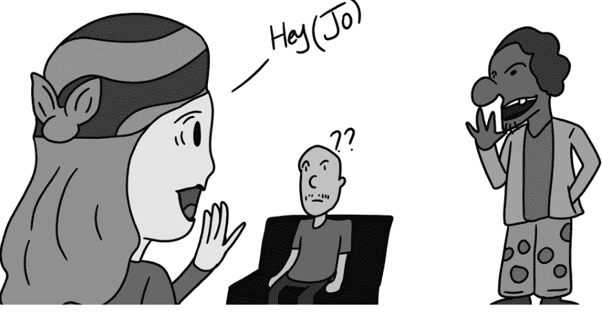

任务：

- 编写方法 `String shortestName(String... names)`，返回所有全名中最短的局部字符串。如果名称由多个部分组成，该字符串也可以包含恰好一个空格。换句话说，存在只有一个名称的字符串或包含两个名称的字符串。
- 如果没有名称，答案为空字符串。
- 变长参数数组不能为 `null`，数组中的任何字符串不能为 `null`。

示例：

- `shortestName("Albert Tross", "Blowfish", "Nick Olaus", "Jo Ker")` -> "Jo"。

## 统计字符串出现次数 ★

CaptainCiao 在一次疏忽中消除了开发者 Dev David。他正在编写一个方法；Javadoc 已经准备好，但缺少实现代码。

```java
/**
 * 统计子串在较大字符串中出现的次数。
 * 如果输入为 {@code null} 或空字符串 ""，则返回 {@code 0}。
 * 
 * <pre>
 * StringUtils.countMatches(null, *) = 0
 * StringUtils.countMatches("", *) = 0
 * StringUtils.countMatches("abba", null) = 0
 * StringUtils.countMatches("abba", "") = 0
 * </pre>
 * StringUtils.countMatches("abba", "abba") = 2
 * StringUtils.countMatches("aaaa", "aa") = 2
 * StringUtils.countMatches("abba", "ab") = 1
 * StringUtils.countMatches("abba", "xxx") = 0
 /**
 * @param string 要检查的字符串可能为 null
 * @param other 要统计的子串可能为 null
 * @return 出现次数，如果任一个字符串为 {@code null} 则返回 0
 */
public static int countMatches( String string, String other ) { return null; }
```

注意：Javadoc 中的 `*` 代表任意参数。

任务：

- 实现该方法。

## 确定更大的船员规模 ★

Bonny Brain 正在研究旧日志，上面显示了她的船队和捕获船只的力量：

```
| -| ||| |
| -| ||| - |
||||||| -|
```

每个船员用一个横线表示；减号分隔船员规模。左侧是他们船上的人数，右侧是被袭击船上的人数。


## Java 编程练习

任务：

- 横线对 Bonny Brain 来说阅读。编写一个程序让代码清晰：
  - `||| =>` 被袭击船只船员更多，差异为 2
  - `| | =>` 被袭击船只船员更多，差异为 1
  - `||| =>` 船只船员规模相同
  - `||||| =>` 海盗船船员更多，差异为 3

## 构建钻石形 ★★

CaptainCiao 喜欢钻石，越大越好。


任务：

- 编写一个程序生成以下输出：

```
nA
ABA
ABCBA
ABCDCBA
ABCBA
ABA
A
```

通过控制台的提示符，能够指定钻石的最大宽度。在我们的示例中，这个值是 7——字符串 `ABCDCBA` 的长度。应该只接受可以通过升序和降序大写字母字符串实现的宽度输入，即最多为 `ABCDEFGHIJKLMNOPQRSTUVWXYZXYZWVU...BA` 的长度。

## 检查良好的密码 ★

所有的肮脏秘密都由 Captain CiaoCiao 加，但他的密码往往太简单而被破解。他已经知道安全的密码对他的业务很重要，但他不完全记得规则了：良好的密码具有特定的长度，包含特殊字符等。

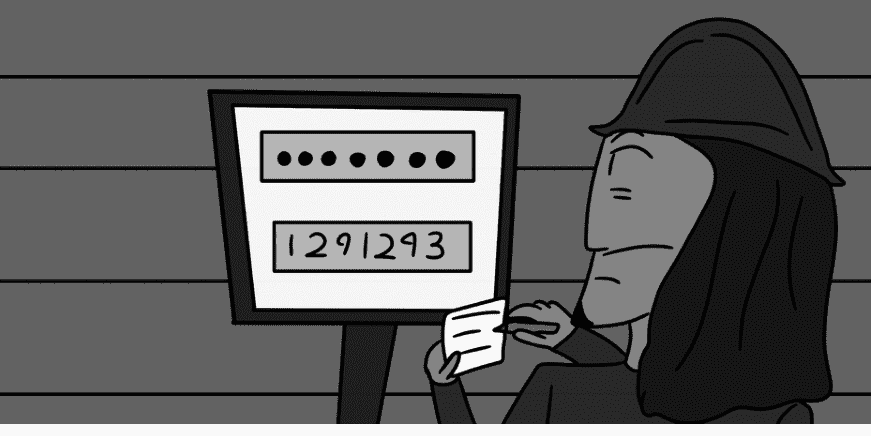

任务：

1. 创建新类 `PasswordTester`。
2. 编写方法 `isGoodPassword(String)` 来测试某些标准。如果密码较弱，方法应返回 `false`，如果密码具有正确的语法则返回 `true`。如果测试失败，应通过 `System.err` 显示消息且不再进行后续检查。

## 烘焙花生酱饼干 ★★

在假期之前，船员们聚集在 Captain CiaoCiao 周围制作花生酱饼干。业余厨师带来了花生酱、糖或蛋。当他们到达时，他们一个一个坐在桌旁准备开始烘焙。

给出业余厨师带来的所有原料列表。列表表示为字符串，其中 P 代表花生酱，S 代表糖，E 代表蛋。该字符串可能是：`PSESESP` 或也可能是 `PPPEESSS`。

只要有三个业余厨师坐在一起并且拥有花生酱、糖和蛋，无论原料顺序如何都可以进行烘焙。

## 124 Java 编程练习


任务：

- 确定可以制作多少花生酱饼干，即三种原料直接相邻。
- 没有仔细听的业余厨师可能会带来完全不同的原料，如朗姆酒、甘草或腌鱼，这些无法制作花生酱饼干。

示例：

- `"PSESESP"` $\rightarrow$ 3
- `"PPPPESSSS"` $\rightarrow$ 0
- `"SEPELEE"` $\rightarrow$ 1

## 计算数字和 ★

由于 Bonny Brain 经常负责支付并担心有人更改金额，她采用了一种技巧，通过单独通道发送数字和。

数字和是通过相加数字的每个位形成的。例如，如果数字是 1098，数字之和为 1+0+9+8。


任务：

1. 创建新类 `PasswordTester`。
2. 编写方法 `isGoodPassword(String)` 来测试某些标准。如果密码较弱，方法应返回 `false`，如果密码具有正确的语法则返回 `true`。如果测试失败，应通过 `System.err` 显示消息且不再进行后续检查。

## 去殖民化文本 ★★

CiaoCiao 正在扫描旧书，但它们是列式的。OCR 之后，它们被翻译了。


## 画带有花的草地 ★ ★

CaptainCiao 想美化他的船并装饰。

```
      _   _          WWWW
     (___) (_)  vvvvv    @@@
  @@() (@) WWW  \/    _   _    @@@
@@@@@      /  \    _ (@)
    /  Y      /  \    /  \    /
  \   \  /      /  \    /  \    / 
 ^^^^^/ ^^^^^/ ^^^^^ ^^^^^/ ^^^^^/ ^^^^^/
```

在数组中存储花朵之间过渡的位置。

## 5 • 字符与字符串处理 129

任务：

- 编写一个 `WordWrap`，包含一个静态方法 `wrap(String string, int width)`。该方法将无换行的字符串拆分为最大宽的子字符串，并用 " " 分隔返回。单词内部——标点符号属于单词的一部分——不应强制换行！

示例：

- 调用：

```java
s="Live now; make now always the most precious time. " 
  +"Now will never come again.";
System.out.println(wrap( s, 10 ));
```

返回最大行长度为 30 的输出：

```
Live now; make now always the
most precious time. Now will
never come again.
```

## 测验：有多少个字符串对象？ ★

以下程序代码中存在多少字符串对象？

```java
String str1="tutego"
String str2=new String( "tutego" );
String str3="tutego"
String str4=new String( "tutego" );
```

## 测试水果是否包裹在巧克力中 ★★★

CiaoCiao 船长喜欢被巧克力包裹的水果。Sara 负责给水果涂层，制作不同层级的深巧克力和白巧克力。

Bambi 检查层数是否正确。如果她看到 `dhPhd`，她就知道水果 F 有了一层白巧克力，然后是一层深巧克力。在 `dhdhd` 处水果缺失，这不符合 CiaoCiao 船长的预期。在 `ddFh` 处层断了，这也不对。在 `F` 处，巧克力完全缺失了，太失望了！


任务：

- 编写一个递归方法 `checkChocolate(String)`，检查字符串是否对称，即左侧和右侧是类型的巧克力，中间是水果 F。

## 从上到下，从左到右 ★★★

在一个洞穴里，Bonny Brain 发现了一段文本，然而，这段文本不是从左到右的，而是从上往下写的。

```
s u
ey!
ao
```

垂直书写，它是字符串 `sea you`——而且读起来容易得多！


## 5 • 字符与字符串处理 131

任务：


- 编写一个方法 `printVerticalToHorizontalWriting(String)`，将字符串返回水平位置并打印。参数是一个用换行符分隔各行的字符串。

示例：

- 我们以上面的字符串为例：

`String s="s \uney\nao"; printVerticalToHorizontalWriting( s );`

屏幕上的输出将是 `sea you!`。

应满足三个重要假设：

1. 行仅用 `\n` 分隔。

2. 每行长度相同；例如，最后一行有空格，以使得所有行（在本例中）均为三个字符长（不计换行符）。

3. 字符串末尾没有 `\n`。

## 使用 StringBuilder 构建动态字符串

虽然 `String` 对象是不可变的，但 `java.lang.StringBuilder` 对象是可以修改的。`StringBuilder` 也是如此，但该类属于 API 风格，与练习题无关。

# 填充字符串 ★

CiaoCiao 船长热爱自由，且间距对他来说至关重要。即使对于文本，他也认为字母之间可以再多一点间距。

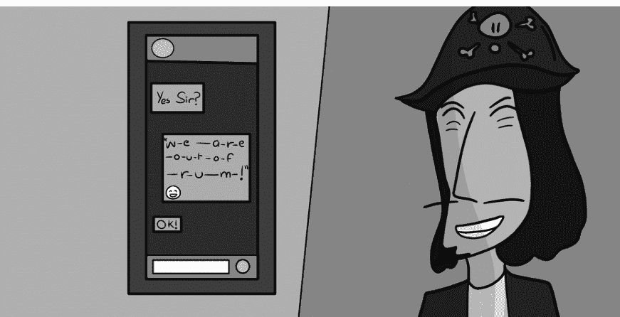

# 132 Java 练习

任务：

- 编写一个方法 `mix(String, String)`，将字符串展开并在所有字符之间插入填充字符。

- 参数可能为 `null`。

示例：

- `mix("We're out of rum!", "-")` -> `"W-e'-r-e- -o-u-t- -o-f- -r-u-m--!"`

- `mix("Bimey", "@ ")` -> `"B@l@i@m@e@y"`

- `mix("HI", " ")` -> `"H@I"`

- `mix("", "!!! ")` -> `"!!!"`

- `mix("", " ")` -> `" "`

# 使用鹦鹉练习字母表 ★

CiaoCiao 船长正在教授字母表。为了节省精力，他使用一只能为他生成字母表的鹦鹉。

给定方法：

```java
static String abcz() {
    String result;
    result="ABCDEFGHIJKLMNOPQRSTUVWXYZ";
    return result;
}
```

该方法返回从 'A' 到 'Z' 的所有字母。这样 CiaoCiao 船长可以将字符串复制到 https://ttsreader.com/de/ 的输入框中让它朗读。然而，字母之间必须有空格声音才会更好。该方法执行任务时效率很高，但不灵活，例如当只需要生成 '0' 到 '9' 的范围时。因为鹦鹉很擅长 ABC，但从 G 到 Z 就变得困难了。


# 字符与字符串处理 133

任务：

- 编写一个方法 `mix(String, String)`，将字符串展开并在所有字符之间插入填充字符。

- 参数可能为 `null`。

# 不要射杀信使者 ★

Bonny Brain 正在策划一个阴险的计划，在发送秘密消息时不会落入他人手中。她非常偏执，担心信使可能会遭到伏击并泄密！于是，她想出了一个巧妙的方案——她派出了多个信使者，每个人携带消息的一部分。该方案如下：

- 文本被拆分成字母。

- 信使者 1 获得第 1 个字母。

- 信使者 2 获得第 2 个字母。

- 信使者 1 获得第 3 个字母。

- 信使者 2 获得第 4 个字母。

消息接收者现在必须等待这两个信使：知道原始顺序并组合消息。


任务：

- 编写一个方法 `String joinSplitMessages(String...)`，接收任意数量的分拆消息并返回组合后的字符串。

- 如果缺少消息部分，不应引起错误。

示例：

- `joinSplitMessages("Hoy", "ok")` → `"Hooky"`

- `joinSplitMessages("Hooky")` → `"Hooky"`

- `joinSplitMessages("H", "oy", "o")` → `"Hooky"`

- `joinSplitMessages("H", "", "ooky")` → `"Hooky"`

# 压缩重复空格 ★★

Bubbles 正在听 CiaoCiao 船长的对话并转录。但由于她忙着吃花生，不小心压在了转录机的空格键上！等她回过来时，空格开始倍增。可怜的 Bubbles，不能给船长发送这样的乱码。

任务：

- 编写一个静态方法 `StringBuilder compressSpace(StringBuilder string)`，将传入字符串中两个以上的空格合并为一个空格。

- 传入的字符串应通过返回返回；更改应直接在 StringBuilder 上。

示例：

- `"Will you shut up, man! This is the way!"` → `"Will you shut up, man! This is the way!"`

# 插入和删除杂滋声 ★

无线电中的消息通常会有杂滋声，这让 CiaoCiao 船长分分心。


任务：

- 编写两个方法：

  - `String crackle(String)` 应在任意间隔插入 `"CRACK!"` 并返回带有杂滋的字符串。

  - `String decackle(String)` 应再次移除杂滋。

# 分割驼峰命名字符串 ★

为了在电报传输文本时节省空间，Funker Frogfish 使用了一个技巧：他将空格后的下一个字符大写并删除空格。Ciao ciao 变成了 ciaoCiao。如果下一个字符已经是大写字母，则删除空格，因此 Ciao 变成 BCiao。由于一系列小写字母中的大写字母看起来没什么特别，这种拼法被命名为 CamelCase（驼峰命名）。

CaptainCiao 收到了字符串，但这种文本很难阅读。

任务：

- 编写新方法 `camelCaseSplitter(String)` 来分离所有的驼峰段。

示例：

- `camelCaseSplitter("List")` → `"List"`

- `camelCaseSplitter("CiaoCiao")` → `"Ciao Ciao"`

- `camelCaseSplitter("numberOfElements")` → `"number Of Elements"`

- `camelCaseSplitter("CiaoCiaoCAPTAIN")` → `"Ciao Ciao CAPTAIN"`

如果单词完全大写（如最后一个例所示），则仅适用于小写和大写之间的转换。

# 为单词加下划线 ★★

Bonny Brain 偶尔需要提醒船员注意规则。她通过写一条消息并给重要单词加下划线来实现。Bonny Brain 在以下消息中划线了“treasure”一词：

书中的宝藏比宝藏岛所有的海盗掠物还要

任务：

1. 创建一个新类 `PrintUnderline`。

2. 写一个新静态方法 `printUnderline(String string, String search)`，如上例所示为 search 中的每个字符串加下划线。记住 search 可能会在字符串中出现多次，或者完全不出现。

3. 搜索字符串的大小写不敏感，如示例所示。

# 实现凯撒加密 ★★★

CaptainCiao 发现了古老的加密术，据说凯撒·尤利叶·凯撒使用过。船长对这位罗马将将留下了深刻印象，决定在自己的文本中使用相同的加密方法。但他真的能用这段代码智胜敌人吗？

凯撒加密将字母表中的每个字符移动三个位置。例如，A 被替换为 D，B 为 E，依此类推。一旦到达字母表末，序列重新开始，导致 X 变成 A，Y 变成 B，Z 变成 C。


任务：

1. 创建一个类 `Caesar`。

2. 实现方法 `String caesar(String s, int rotation)`，执行加密。rotation 是位移量，不限于示例中的 3。

3. 编写方法 `String decaes(String s, int rotation)`，获取加密内容。

# 142 Java 编程练习

第二种变体也是手动遍历字符串。然而，该解决方案没有通过 `==` 比较单个字符，而是使用了 `switch-case` 结构。`System.out.print(char)` 出现了多次，这这种做法并不理想。

```java
com/tutego/exercise/string/YZswapper.java
static void printSwappedYZ3 ( String string ) {
    for ( int i=0;i<string.length(); i++) {
        char c=string.charAt( i );
        System.out.print(
            c == 'y' ? 'z' :
            c == 'z' ? 'Y' :
            c == 'Z' ? 'Y' : c
        );
    }
}
```

第三种变体使用嵌套条件运算符来比较字母是否为 Y 或 Z。

从 Java 14 开始，还有带有 `->` 的新 switch 表示，这允许更多的变体。

选项 1：

```java
com/tutego/exercise/string/YZswapper.java
static void printSwappedYZ5 ( String string ) {
    for ( int i=0;i<string.length(); i++) {
        switch (string.charAt( i )) {
            case 'y' -> System.out.print( 'z' );
            case 'z' -> System.out.print( 'y' );
            case 'Y' -> System.out.print( 'Z' );
            case 'Z' -> System.out.print( 'Y' );
            default -> System.out.print( string.charAt( i) );
        }
    }
}
```

选项 2：

```java
com/tutego/exercise/string/YZswapper6.java
static void printSwappedYZ6 ( String string ) {
    for ( int i=0;i<string.length(); i++) {
        System.out.print(
            switch ( string.charAt( i )) {
                case 'y' -> 'z';
                case 'Y' -> 'Z';
                case 'z' -> 'y';
                case 'Z' -> 'Y';
                default -> string.charAt( i );
            }
        );
    }
}
```

某些读者可能有一种交换字符的方法，但字符串本身没有这样的方法。虽然有一个 `replace(...)` 方法，但如果我们例如将 "y" 替换为 "z"，它对我们并没有帮助，因为之后“原始”的 "z" 字符将不再被识别，并且必须转换为 "y"。从原则上讲，我们可以分三个步骤进行，并使用一个特殊字符作为占位符：

- 1. 将所有的 "y" 替换为 "$"

- 2. 将所有的 "z" 替换为 "y"

- 3. 将所有的 "$" 替换为 "z"

这并不优雅，特别是由于我们必须确保像 "$" 这样的占位符符号是空闲的。我们看到有多种方法解决此任务。当我们在复杂运行时检查变量与各种常量时，`switch` 是一个很好的选择。如果你使用当前的 Java 版本，应该使用带有 `switch` 和箭头的表示法。它不仅更短，而且防止了无意的穿透（fall-through）。

## 给出挑战性的回答

```java
String input=new Scanner( System.in).nextLine().trim();
if ( input.equalsIgnoreCase("no idea?") ) {
  System.out.println("Aye!");
} else if ( input.endsWith("?")) {
  System.out.println("input=" + No idea!");
}
```

我们使用 `Scanner` 从命令行查询一行，并剪掉前后的空白字符。

如果输入是 `no idea?`，输出是 `Aye!`。对于不区分大小写的测试，我们依赖于 `equalsIgnoreCase(...)`，它比 `input.toLowerCase().equals("no idea?")` 快，因为通过 `equalsIgnoreCase(...)` 我们可以直接比较，而 `toLowerCase()` 会创建一个新对象来与 `equals(...)` 比较。但在 `equals(...)` 之后该字符串就变成了垃圾。建议避免不必要的创建对象创建，因为这会增加内存占用和运行时间。

如果输入是 `no idea?`，则输入以问号结尾。如果是，我们就重复输入并在末添加 `no idea!`。如果没有任何一个情况适用，则什么都不会发生。

我们不能测试输入是否以问号结尾。如果我们反转这个方向，程序在输入 `back no idea?` 时会识别出问号，输出将是 `No idea!`，这是不正确的。

## 测验：使用 == 和 Equals(...) 进行字符串比较

从原则上讲，字符串可以使用 `==...` 进行比较，但这行不通，因为 String 对象仅在虚拟机内部构建。通常，我们自己拥有对象，例如通过按行读取文件。然后每行和输入都是一个 `String`。Java 开发者应该养成始终使用 `equals(...)` 比较字符串的习惯。来自其他语言的新手在开始会遇到困难。

# 测验：Equals(...) 是对称的吗？

使用 `equals(Object)` 方法的比较应该是对称的，也就是说无论是 `a.equals(b)` 还是 `b.equals(a)` 都没有区别。然而，如果对称性被 `null` 破坏：`String s=null; s.equals("tutego")` 会导致 `NullPointerException`，但 `"test"` 则不会。在实践中，在字符串上调用 `equals(...)` 并传递另一个字符串更为健壮。如果比较中可能出现 `null` 并且为了防止 `NullPointerException`，可以使用 `Objects.equals(...)`：

```java
public static boolean equals(Object a, Object b) {
    return (a == b) || (a != null && a.equals(b));
}
```

## 测试回文

```java
com/tutego/exercise/string/PalindromeTester.java
static boolean isPalindrome(String string) {
    for (int i=0; i<string.length() / 2; i++) {
        char frontChar=string.charAt(i);
        char backChar=string.charAt(string.length() - 1 - i);
        if (frontChar != backChar)
            return false;
    }
    return true;
}
```

```java
com/tutego/exercise/string/PalindromeTester.java
static boolean isPalindromeCase(String string) {
    return isPalindrome(string.toLowerCase());
}
```


# 5 字符与字符串处理

回文任务是计算机科学中的经典。有多种方法解决这个问题；它可以通过 Java 库轻松回答，也可以通过循环或递归解决。

这里的方案是简单且高效。如果我们想测试一个字符串是否是回文，我们需要比较第一个字符和最后一个字符，第二个和倒数第二个，以此类推。我们从 0 到字符串的一半进行循环，一旦提取了字符，我们就进行比较；如果字符不等，则退出方法。如果程序完成了循环，则字符串是回文。

我们的 `isPalindromeCase(String)` 测试字符串是否为忽略大小写的回文。在这种情况下，我们将字符串转换为小写并传递给现有的 `isPalindromeAndDigits(String)`。

## 回文检测实现

### 迭代实现（忽略非字母数字）

```java
com/tutego/exercise/string/PalindromeTester.java
static boolean isPalindromeAndDigits(String string) {
    for (int startIndex=0, endIndex=string.length() - 1; startIndex<endIndex; startIndex++, endIndex--) {
        while (!Character.isLetterOrDigit(string.charAt(startIndex))) {
            startIndex++;
        }
        while (!Character.isLetterOrDigit(string.charAt(endIndex))) {
            endIndex--;
        }
        char frontChar=Character.toLowerCase(string.charAt(startIndex));
        char backChar=Character.toLowerCase(string.charAt(endIndex));
        if (frontChar != backChar)
            return false;
    }
    return true;
}
```

对于 `isPalindromeAndDigits(String)` 方法，我们可以通过删除所有非字母或数字，或者跳过额外步骤来清理字符串并直接查询。这是实现采用的方法。我们遍历字符串的每个字符，定义两个计数器 `startIndex` 和 `endIndex`。起始索引变大，结束索引变小。我们从第一个字符和最后一个作为结束索引开始。其中一个字符可能不是字母或数字。所以，我们从左侧搜索直到获得有效的符号，并且对右侧执行同样的操作。这就是两个循环所做的。由于检查现在可以不区分大小写，我们将两个字符转换为小写并进行比较。如果每次比较都不为真，返回 `false` 终止方法。

### 递归实现

```java
com/tutego/exercise/string/PalindromeTester.java
static boolean isPalindromeRecursive(String string) {
    if (string.length() < 2)
        return true;
    if (string.charAt(0) != string.charAt(string.length() - 1))
        return false;
    return isPalindromeRecursive(string.substring(1, string.length() - 1));
}
```

最后，我们看看递归实现。这里有两种可能性。这里展示了第一种可能性：首先检查字符串中没有或只有一个字符。在这种情况下，我们到达了递归的末尾并返回 `true`。接下来，我们提取第一个和最后一个字符并比较。如果字符不等，我们退出方法。如果字符不区分大小写——我们提取子字符串并进入下一层递归。由于递归在这里末尾，我们还调用了它，这在原则上可以被运行时环境优化，尽管标准的 JVM 并不那样进行优化。

## 检查 Captain CiaoCiao 是否位于中间

`com/tutego/exercise/string/InMiddle.java`

```java
public static boolean isStringInMiddle( String string, String middle ) {
    if ( middle.length()>string.length() )
        return false;

    int start=string.length() / 2 - middle.length() / 2;
    return string.regionMatches( start, middle, 0 /*middle offset */, middle.
        length() );
}

public static boolean isCiaoCiaoInMiddle( String string ) {
    return isStringInMiddle(string, "CiaoCiao" );
}
```

算法的核心是确定主字符串的中点，减去你想要放在中间的字符串长度的一半，然后比较中间字符串是否位于该位置。

最后，无论 "CiaoCiao" 是否出现在某个特定位置，我们将问题泛化并编写了一个通用的方法 `isStringInMiddle(String string, String middle)`。

在第一步中，我们检查参数。如果其中一个参数为 `null`，在访问时会抛出 `NullPointerException`。如果两个都是有效的 String 对象，则确定它们的长度。如果中间字符串比主字符串长，我们直接返回 `false`。

接下来的行遵循上述算法。在这种情况下，`regionMatches(...)` 方法很有用。方法的签名如下：

```java
boolean regionMatches(int offset, String other, int len).
```

这是一个使用 `substring(...)` 切分字符串进行比较的更好方法。

## 数组中的最短字符串

`com/tutego/exercise/string/ShortName.java`

```java
private static final int INDEX_NOT_FOUND=-1;

private static String shortest( String s1, String s2 ) {
    return s1.length() <= s2.length() ? s1 : s2;
}

private static String shortestName( String... names ) {
    if ( names.length == 0 )
        return "";

    String result=names[ 0 ];

    for ( String name : names ) {
        int spacePos=name.indexOf( ' ' );
        if ( spacePos == INDEX_NOT_FOUND ) {
            result=shortest(result, name);
        } else {
            String part1=name.substring(0, spacePos);
            String part2=name.substring(spacePos+1);
            result=shortest( result, shortest(part1, part2 ) );
        }
    }
    return result;
}
```

为了简化算法，将确定两个字符串最短的操作放入独立的方法 `shortest(String, String)` 中，该方法会被多次调用。此方法返回两个字符串中较短的一个。如果两者相等，方法返回第一个；这种选择是任意的。

实际的 `shortestName(...)` 方法接收字符串变长，通常参数可以是 `null`。如果传递了 `null`，访问时将抛出 `NullPointerException`。如果没有传递元素，方法什么都不做并返回空字符串。由于数组至少有一个字符串，我们使用它来初始化 `result`，最后也会返回。扩展 for 循环遍历数组中的所有字符串，循环体内可能会更新。首先，查看字符串中是否存在空格。有两种可选：

1. 如果字符串中没有空格，`shortest(result, name)` 返回较短的字符串，并覆盖 `result`。
2. 如果字符串中有空格，`substring(...)` 将字符串分为两部分：`part1` 和 `part2`。在这里我们有 `shortest(...)` 方法，它确定 `part1` 和 `part2` 之间的最短字符串。然后将其结果与 `result` 进行比较，以识别存储在 `result` 中的最短字符串。

循环结束后，我们确定了最短字符串并返回。

## 统计字符串出现次数

`com/tutego/exercise/string/StringUtils.java`

```java
private static final int INDEX_NOT_FOUND=-1;
public static int countMatches( String string, String other ) { 
    if ( string == null || other == null || string.length() == 0 || other.length() == 0 ) {
        return 0;
    }
    int result=0;
    for ( int index=0; (index=string.indexOf( other, index) ) != INDEX_NOT_FOUND; ) {
        index += other.length();
        result++;
    }
    return result;
}
```

`countMatches(...)` 方法对于错误值必须返回 0。如果字符串为 `null` 或不包含字符，则是错误的。这种检查在开始时完成。

变量 `result` 将指示匹配次数并形成返回。在 for 循环中，我们反复使用 `String.indexOf(...)` 方法搜索这个部分字符串 `other`。为了这个目的，循环初始化了一个索引，它始终包含最后的位置，如果没有找到更多位置，这也是 for 循环的终止条件。该索引总是增加 `other` 的长度，以便 `indexOf(...)` 方法可以在下一次迭代中继续搜索 `other` 之后的内容。

如果在真实程序中需要这样的方法，开发者可以使用 Apache Commons。实现本身位于：https://commons.apache.org/proper/commons-lang/apidocs/src-html/apache/commons/lang/StringUtils.html。

## 确定较大的规模

首先，让我们总结一下我们需要完成的任务：在字符串中，我们需要找到分隔符（减号），并确定减号左右各有多少个连字符。这些值必须进行比较。比较有三种结果：右侧值可以比左侧大或小，或者两个值可以相等。

有两个简单的解决方案：

- 使用 `split("-")` 将输入分为两个字符串，然后用 `length()` 查询这些字符串。
- 使用 `indexOf(...)` 获取字符串中减号的位置，然后计算分隔符左右的长度。

> 这是一个为那些信奉“既然很复杂，为什么要那样解决？”的朋友们提供的特殊解决方案。在实践中，这对于集合操作是有用的，并且只有当性能分析器指示代码位置是需要优化的瓶颈时，才是合理的。否则，清晰性始终优先！

让我们假设在位置 `i` 找到了分隔符并将其删除，因为我们想避免计算分隔符。总长度因此减少了一。

 图5.1 减号的位置与规模的关系。

如果 P（海盗）和 V（受害者）是集合，那么让 |P| 为海盗的数量，|V| 为受害者的数量。这些信息提供了答案：

然而，对这些信息进行更多处理。任务是团队实力的差异。可以计算差异并使用符号来判断哪个团队更强吗？是可以的。

- |P| < |V| 意味着 `PI|-VI|<0`。
- |P| > |V| 从此意味着 `PI|-VI|>0`。
- |P| = |V| 从此意味着 `PI|-VI|=0`。

当比较两个数字时，总是可以形成差异并观察符号。在 for 循环中，我们反复使用 `String.indexOf(...)` 方法搜索这个部分字符串 `other`。为了这个目的，循环初始化了一个索引，它始终包含最后的位置，如果没有找到更多位置，这也是 for 循环的终止条件。该索引总是增加 `other` 的长度，以便 `indexOf(...)` 方法可以在下一次迭代中继续搜索 `other` 之后的内容。

## 构建菱形

`com/tutego/exercise/string/DiamondPrinter.java`

```java
private static void printDiamondCore(char character, char stopCharacter) {
    if ( character == stopCharacter ) {
        System.out.print( character );
        return;
    }
    System.out.print( character );
    printDiamondCore((char) (character+1), stopCharacter );
    System.out.print( character );
}
```

```java
public static void printDiamond( int diameter) {
    if (diameter < 1) {
        return;
    }
    diameter = (diameter <= 2 * 26 - 1) ? diameter : 2 * 26 - 1;

    int radius = diameter / 2;
    for ( int indentation = radius; indentation >= -radius; indentation-- ) {
        int absIndentation = Math.abs(indentation);
        System.out.print(" ".repeat(absIndentation) );
        printDiamondCore('A', (char) ('A' + radius - absIndentation));
        System.out.println();
    }
}
```

任务的实际解决方案是让 `printDiamond(int)` 方法打印输出，但我们希望使用一个方法来编写菱形的一行。对于带有空格的缩进，我们使用了 `repeat(int)` 方法。`printDiamondCore(char, char)` 在屏幕上绘制一个菱形，该方法接收一个起始字符和一个停止结束字符。例如，如果起始字符是 A，结束字符是 C，那么该方法将打印序列 ABCBA。该实现是递归的。存在两种情况：如果起始字符等于结束字符，则该字符只被设置一次。一旦字符被设置，该方法将使用下一个字符进行递归调用，并留下结束字符。在递归调用之后，字符再次被设置一次。原则上，我们可以反转这种区别，首先检查字符是否匹配结束字符并更早进入递归，但递归的终止条件通常位于方法的开头。

实际方法 `printDiamond(int)` 首先检查菱形的周长是否有效，如果不有效则退出。由于我们传递的是直径，但感兴趣的是半径，因此我们将直径除以 2。现在可以开始实际的程序流。在开始实际程序流之前，我们检查一个独特的特征：缩进与菱形大小之间的关系。以直径为 7 的菱形作为说明，我们将菱形的大小设定为半径。空格缩进由下划线 `_` 表示：菱形行、缩进与菱形半径之间的关系。

| LINES | INDENTATION | RADIUS |
| --- | --- | --- |
| A | 3 | 1 |
| ABA | 2 | 2 |
| ABCBA | 1 | 3 |
| ABCCBCA | 0 | 4 |
| ABCBA | 1 | 3 |
| ABA | 2 | 2 |
| A | 3 | 1 |

我们可以读到，半径和缩进之和始终相同，在我们的示例中为 4。现在我们可以使用循环从 3 递减到 0 再回到 3，并推导出半径。我们可以遍历从 1 到 4 再回 1 的菱形半径，并推导出缩进。

所建议的解决方案使用缩进作为循环计数器。使用了一个技巧使得不再需要两个循环：循环让缩进从半径开始，到负半径结束。我们完整通过一次零点。在循环内部，我们对负数感兴趣，所以我们选择绝对值，从而得到一个下降和一个上升的缩进。正如我们刚刚看到的，通过这些缩进值，我们可以计算出半径并得到该行。在开始时，缩进等于半径，这意味着在开始时 `radius - indentation = 0`。因此，`printDiamondCore('A', 'A')` 只写入一个 A。在下一次迭代中，缩进减了 1，即半径（不改变）与缩进之间的差变为 `A+I=B`，所以我们绘制核心部分 ABA。

## 检查强密码

`com/tutego/exercise/string/PasswordTester.java`


```java
public static final int MIN_PASSWORD_LEN = 8;

public static boolean isGoodPassword(String password) {
    if (password.length() < MIN_PASSWORD_LEN) {
        System.err.println("Password too short");
        return false;
    }
    if (!containsUppercaseLetter(password)) {
        System.err.println("Must contain uppercase letters");
        return false;
    }
    if (!containsLowercaseLetter(password)) {
        System.err.println("Must contain lowercase letters");
        return false;
    }
    if (!containsDigit(password)) {
        System.err.println("Must contain digit");
        return false;
    }
    if (!containsSpecialCharacter(password)) {
        System.err.println("Must contain special characters");
        return false;
    }
    return true;
}
```

```java
for (int i = 0; i < value.length(); i++)
    // sum += value.charAt(i) - '0';
    sum += Character.getNumericValue(value.charAt(i));

return sum;
```

首先要考虑的是，这两个方法中只需要实现其中一个，因为我们总是可以调用另一个方法。如果我们调用 `digitSum(long)`，我们可以将整数转换为字符串，然后调用 `digitSum(String)`。反之：如果我们调用 `digitSum(String)`，我们可以使用 `Long.parseLong(String)` 将字符串转换为整数，并调用 `digitSum(long)`。

实现这两种方法中的某一个，取决于个人的喜好。这两者的方法有所不同。如果我们实现带有 `long` 参数的方法，那么我们总是必须使用 10 来逐步解码数字。在这种情况下，我们使用了一些数学方法，而且这种解决方案有一个局限的缺点，即我们是从右到左获取结果。这对于数字之和计算并不重要，因为我们实现的是 `digitSum(String)`。

像往常一样，我们用 `for` 循环从左到右解析字符串。现在我们必须将每个字符视为数字。要将 Unicode 字符转换为数值，我们使用 `Character.getNumericValue(char)` 方法。像 `'1'` 这样的字符变成 1，`'7'` 变成 7。在原则上，我们可以通过从 Unicode 字符中减去 `'0'` 来手动进行此计算，但 `getNumericValue(...)` 通常适用于所有 Unicode 字符。例如，`getNumericValue('7')` 返回结果 7。

## 去列化文本

算法必须执行以下操作：第一步，我们必须确定所有行中哪里有空格，这是列的指示。下一步，我们需要分离每个空格，首先将所有列的行排在一起，然后是右列的行。

实际的 `decolumize(...)` 方法依赖于内部方法 `findColumnIndex(String[])`。它为字符串数组查找空白处。此外，`findColumnIndex(...)` 访问了另一个内部方法 `isSpaceAt(...)`，我们想要启动它。

`com/tutor/exercise/string/Decolumizer.java`

```java
private static boolean isSpaceAt(String string, int index) {
    if (index >= string.length())
        return true;
    return string.charAt(index) == ' ';
}
```

`isSpaceAt(String, int)` 方法检查传递的字符串在 `index` 位置处是否有空格。此外，此方法将字符串“后面”的所有内容都视为空格。这意味着在实际字符串后面有无限数量的空白字符。

该方法用于实际方法 `findColumnIndex(String[])`：

`com/tutor/exercise/string/Decolumizer.java`

```java
private static int COLUMN_NOT_FOUND = -1;
```

```java
private static int findColumnIndex(String[] lines) {
    int length = lines[0].length();
    for (int i = 0; i < length; i++) {
        length = Math.max(length, lines[i].length());
    }
}
```

### 5 • 字符与字符串处理 155

```java
mainLoop:
for (int column = 1; column < length - 1; column++) {
    for (String line : lines) {
        if (!isSpaceAt(line, column)) {
            continue mainLoop;
        }
    }
    return column;
}
return COLUMN_NOT_FOUND;
```

在我们遍历所有行并询问每行在某处是否有空格之前，我们先确定允许运行到多远。因此，第一步是找到最长行。它必须是最长行，因为某些行可能是空的，某些可能很短，在这种情况下，这些行后面又有空白。

一旦我们确定了最长行，我们就用循环遍历可能的列。它不能是索引为 `0` 的列，也不能是最后一列，因为在这些位置的左侧或右侧不存在真实的列。无论如何，如果列只在前面一个，那么意义不大，所以你可以从任何索引开始，也许在中心附近。

此函数的功能是：外层循环运行所有可能的列，而内层循环确保对每一列都检查所有可能的行。如果某行的该列中没有空格，那么我们甚至不需要考虑其他行，而是继续处理下一列。这种可能性通过 `continue` 关键字实现——我们必须使用跳转标签，因为如果不使用它，`continue` 只会在内层循环中继续，但我们想在外层循环中继续。

如果程序离开了内层循环，说明我们找到了所有行都有空格的地方。变量 `column` 找到该位置并返回。程序不在乎该位置是否在中间，可能某列的开头有空白，那么可能有一个开头有空白的列，然后由于没有找到，程序返回 `COLUMN_NOT_FOUND`，即 `-1`。

现在我们来看实际方法 `decolumize(String)`：

`com/tutego/exercise/string/Decolumizer.java`

```java
public static void decolumize(String string) {

    String[] lines = string.split("\n");

    if (lines.length < 2) {

        System.out.println(string);

        return;

    }

    int column = findColumnIndex(lines);

    if (column == COLUMN_NOT_FOUND) {

        System.out.println(string);

        return;

    }

    // 左列

    for (String line : lines) {

        int a = line.length();

        if (a > column) {

            System.out.println(line.substring(0, column));

        } else {

            System.out.println(line);

        }

    }
}
```

### 156 Java 练习

```java
// 右列

for (String line : lines) {

    int a = line.length();

    if (a > column) {

        System.out.println(line.substring(column));

    } else {

        System.out.println(line);

    }

}
```

## 检测重复

在查看代码解决方案之前，必须先明确解决该问题的算法。让我们以简单的字符串 `aaa` 为例。作为人类，我们能毫不费力地识别出重复三次的模式。程序可以执行以下操作：它获取 `aaa` 的第一个字符——即 `a`——重复它直到字符串长度达到 3。然后我们比较它是否仍然是初始字符串 `aaa`。那么 `ababab` 呢？如果程序开始重复第一个字符 `a`，会产生 `aaaaaa`，与原始 `ababab` 的比较结果将为假。在下一步中，程序可以取前两个字符 `ab` 并重复它们，结果是 `ababab`，与原始字符串匹配。我们找到了匹配项。

通过这种简单的算法，我们可以测试任何长度；对于长度为 1, 2, 3, 4 ... 的子串重复。然而，考虑哪些有效的解决方案对我们很有帮助（表 5.1）。
从表中可以看出，例如 `ab` 无法用于创建长度为 3 的字符串，而 `abcd` 无法用于创建长度为 2 的字符串。

如果我们有一个有两个字符的字符串，从它生成的字符串可以是两个的倍数，所以如果我们有两个字符，长度可以是 4 个字符、6 个字符等等，以此类推。如果我们有一个三个字符的字符串，我们可以从它重复 3 个字符、6 个字符、9 个字符等等。

让我们反过来玩这个游戏。我们不知道子串是什么样的以及有多长，我们只知道输出字符串。例如，如果输出字符串长度为 12 个字符，可能的重复字符串有哪些？

```
aaaaaaaaaaaa
abababababab
abcabcabcabc
abcdabcdabcd
abcdefabcdef
```

这些是 `a`, `ab`, `abc`, `abcd`, `abcdef` 的重复；这些字符串的长度是 12 的除数，即 1, 2, 3, 4 和 6。其他组合是不可能的。特别是，子串长度不能超过字符串长度的一半，因为重复长度将超过原始字符串。因此，在朴素的方法中，对于总长度为 $n$，我们可以遍历到 $n/2$；如果想改进，我们只需遍历除数。

表 5.1 长度为 1, 2, 3, 4, 5, 6 的有效重复

| 部分序列 | 长度为 1 | 2 | 3 | 4 | 5 | 6 |
| --- | --- | --- | --- | --- | --- | --- |
| a | a | aa | aaa | aaaa | aaaaa | aaaaaa |
| ab | | ab | | abab | | ababab |
| abc | | | abc | | | abcabc |
| abcd | | | | abcd | | |
| abcde | | | | | abcde | |
| abcdef | | | | | | abcdef |

### 5 • 字符与字符串处理 159

`com/tutego/exercise/string/RepeatingStrings.java`

```java
public static String repeatingStrings(String string) {

    if (string == null || string.length() < 2) {

        return null;

    }

    for (int i = 1; i <= string.length() / 2; i++) {

        if (string.length() % i == 0) {

            String substring = string.substring(0, i);

            String repeatedSubstring = substring.repeat(string.length() / i);

            if (string.equals(repeatedSubstring)) {

                return substring;

            }

        }

    }

    return null;

}
```

如果方法接收到空引用或由单个字符组成的字符串，它将直接返回 `null`。此外，我们可以假设字符串长度大于两个字符。
`for` 循环生成了从 1 到 $n/2$ 的所有数字；它们是否为字符串长度的除数尚不可知。模运算符 `%` 有助于检查字符串长度是否能被 $i$ 整除且没有余数。如果我们找到了匹配且字符串可以形成。
在块内部，`string.substring(0, i)` 创建了重复 `string.length() / i` 次的子串。如果生成的重复部分与原始字符串匹配，我们就找到了匹配项。如果两个字符串不匹配，我们返回循环。
如果 `for` 循环失败，我们返回 `null`。

## 限制行宽并换行

`com/tutego/exercise/string/WordWrap.java`

```java
public static String wrap(String string, int width) {

    if (string.length() <= width) {

        return string;

    }

    int breakIndex = string.lastIndexOf(' ', width);

    if (breakIndex == -1) {

        return string;

    }

    String firstLine = string.substring(0, breakIndex);

    String remaining = string.substring(breakIndex);

    return firstLine + "\n" + wrap(remaining.trim(), width);

}
```

### Java 练习

递归总是需要一个停止标准。在我们的案例中，它是一个小于宽度的字符串。然后我们从递归返回调用者。因此，`wrap(...)` 的最后一次调用返回最后。由于递归，调用者获取前两行并将它们与第三行拼接。游戏一直持续直到递归解决。

递归对许多人来说并不容易。实现单个步骤具有挑战性，可变数据结构可能会迅速变成问题，而且你会丢失对一切在哪里读取或写入的追踪。此时的建议是设置断点或输出 `firstLine` 赋值和 `remaining` 赋值的内容，以及在字符串进入 `wrap(...)` 方法时。

## 测验：有多少个字符串对象？

所有双引号字符串都是原子的 `String` 对象。Java 虚拟机将此类字符串存储在所谓的常量池中。此类字符串作为对象只存在一次。因此，`str`、`str1`、`str3` 以及传递构造函数的字符串是相同的。如果我们命令运行时环境使用 `new` 构建一个新对象，我们也得到了一个新对象，即 `str2` 和 `str4` 是新对象。总而言，在这种场景中，我们在常量池中有一个字符串对象，通过 `new` 关键字构建了两个新对象（如果没有引用，它们会被垃圾回收；而池中的字符串将一直持续到运行结束）。

## 测试水果是否被巧克力包住

`com/tutego/exercise/string/Chocolate.java`

```java
public static final String FRUIT = "F";

public static boolean checkChocolate(String string) {

    return checkChocolate(string, 0);

}

public static boolean checkChocolate(String string, int layer) {

    if (string.isEmpty()) {

        return false;

    }

    if (string.length() == 1) {

        return string.equals(FRUIT) && layer != 0;

    }

    if (string.charAt(0) != string.charAt(string.length() - 1))

        return false;

    return checkChocolate(string.substring(1, string.length() - 1), layer + 1);
}
```

### 5 • 字符与字符串处理 161


递归函数非常适合这项任务。根据任务要求，我们有一个公共方法 `checkChocolate(string)` 和第二个私有方法 `checkChocolate(String, int)`，后者供递归调用。此外，我们还声明了一个变量 `FRUIT` 来表示水果本身，这样我们可以更改符号。

内部方法检查一个字符串和一个整数，该整数在每次任务中都会递增。我们需要这个变量，以便区分字符串是否只包含水果而不包含巧克力。

在 `checkChocolate(String, int)` 方法中，我们检查第一个和最后一个字符，类似于回文测试。如果蛋糕是水果且全部缺失了，我们返回 `false`。传递 `nullPointerException` 会升级为 `NullPointerException`——请注意如果字符串长度为 1，有两种测试方法：首先，它是否是所需的字符——但该方法至少被调用了一次，也就是说至少有一个巧克力。因为如果第一次调用就是长度为 1 的字符串，该方法必须返回 `false`。

如果字符串大于一个字符，我们检查第一个和最后一个字符，类似于回文。如果字符不匹配，则返回 `false`。每当第一个和最后一个字符相同时，递归就会继续处理下一个单词。我们构建一个从倒数第二个字符开始的字符串，嵌套深度增加 1，并用它递归地调用 `checkChocolate(...)`。

## 从上到下，从左到右

为了解决这个任务，我们再次研究给定的字符串：

```
s u ey!

ao
```

有几种可能的解决方案。一种是将字符串拆分成行，例如使用 `String[] lines = string.split("\n");`，然后对所有列（宽度为 `lines[0].length()`）和所有行进行两个嵌套循环（表 5.2）。

这里将展示另一种方法。让我们把它们排放在一起，观察哪个符号位于哪个索引：

最后，我们想看到 "sea you!"，所以为了这个答案我们需要处理的索引是：

0, 3, 6, 1, 4, 7, 2, 5

表 5.2 索引处的字符

| index | 0 | 1 | 2 | 3 | 4 | 5 | 6 | 7 |
| :--- | :--- | :--- | :--- | :--- | :--- | :--- | :--- | :--- |
| character | s | u | e | ! | a | o | | |

## Java 编程练习

序列并不是随机的，它遵循某种模式。我们需要找到一个将数字转换到索引的映射：

表 5.3 $i/3+i\%3$ 的推导

| | 0 | 1 | 2 | 3 | 4 | 5 | 6 | 7 |
| :--- | :--- | :--- | :--- | :--- | :--- | :--- | :--- | :--- |
| i/3 | 0 | 0 | 0 | 1 | 1 | 1 | 2 | 2 |
| i%3 | 0 | 1 | 2 | 0 | 1 | 2 | 0 | 1 |
| i/3+i%3 | 0 | 1 | 2 | 1 | 2 | 3 | 2 | 3 |
| i/3*i%3 | 0 | 0 | 0 | 0 | 0 | 2 | 0 | 2 |
| i/3^i%3 | 0 | 0 | 0 | 0 | 1 | 4 | 0 | 1 |
| i/3+%i | 0 | 1 | 2 | 3 | 4 | 5 | 6 | 7 |

现在我们有了每个练习的编程。解决方案由两个步骤组成：

`com/tutego/exercise/String/VerticalToHorizontal.java`

```java
static void printVerticalToHorizontal(String string) {

    String opener = "\n";

    int numberOfLines = string.length() + 1;

    for (int i = 0; i < numberOfLines; i++) {

        char c = string.charAt(i % numberOfLines);

        System.out.print(c + opener);

    }

}
```

换行是由转义序列 `\n` 创建的。由于字符串由由 `\n` 分隔的多行组成，我们必须第一步移除这些字符。对于算法，我们需要另一个方法：行数。这里我们可以使用一个巧妙的技巧。如果我们删除了字符，字符串的长度会恰好减少删除字符的数量。根据示例，将是 2 + 1，即 3 行。`for` 循环创建了一个计数器，我们将其转移到字符的位置。读取该字符并输出到屏幕。

## 填充字符串

`com/tutego/exercise/String/StringFiller.java`

```java
private static boolean hasText(String string) {

    return string == null || string.isEmpty();

}
```

```java
private static String mix(String string, String fill) {

    if (hasText(string)) return "";

    if (hasText(fill)) return string;

    StringBuilder result = new StringBuilder();

    for (int i = 0; i < string.length() - 1; i++) {

        char c = string.charAt(i);

        result.append(c).append(fill);

    }

    result.append(string.charAt(string.length() - 1));

    return result.toString();

}
```

让我们检查参数。如果字符串为 null或为空，我们返回一个空字符串。如果字符串不为空且至少有一个字符，而填充字符串为空或为空，则无事可做，我们直接返回字符串作为快捷捷径。原则上，如果 `string` 或 `fill` 等于 `null`，产生 `NullPointerException` 也是合适的，因为没有传递有效对象，方法比异常更好。对 `null` 和字符存在的检查进行了两次，此功能外包到了额外的方法 `hasText(String)` 中。

我们从空字符串开始，在循环中填充它。提取出一个字符后，我们将该字符和填充字符串附加到之前的结果上。然而，我们并没有运行到最后一个字符，而是只到倒数第二个。`for` 循环创建了一个计数器，我们将其转移到字符的位置。读取该字符并输出到屏幕。

# 5 • 字符与字符串处理 165

## 将数字转换为文本一进制编码

`com/tutego/exercise/string/UnaryCoding.java`

```java
private static int ensurePositive(int value ) {

    if ( value < 0 ))

        throw new IllegalArgumentException(

            "Value is negative, but must be positive "

        );

    return value;

}
```

```java
static String encode(int... values ) {

    StringBuilder codes=new StringBuilder( values.length );

    for ( int value : values ) {

        codes.repeat("1", ensurePositive( value )).append( '0' );

    }

    return codes.toString();

}
```

为了通知开发者输入错误，会对数组中的每个条目进行检查是否为正数。这通过辅助方法 `ensurePositive(int)` 处理，如果值为负数，则会抛出异常；否则该方法返回该值。`encode(int... values)` 构建了一个内部的 `StringBuilder`。目前不清楚字符串会增长多大，因为它取决于传递的值。但我们知道它的长度至少与数组元素的数量一样，我们可以将其作为 `StringBuilder` 对象的初始容量。Java 2.1 中的 `StringBuilder` 类增强了一个新方法 `repeat(CharSequence, int)`。在我们的应用程序中，该方法会根据指定的次数向 `StringBuilder` 追加一个 "1"。该方法返回一个 `StringBuilder`，它便于后续的 `append(...)` 操作，例如添加一个 '0' 来完成该序列。

```java
com/tutego/exercise/string/UnaryCoding.java

static int[] decode( String string ) {

    if ( string.isEmpty() ))

        return new int[0];

    if ( !string.endsWith("0") )

        throw new IllegalArgumentException(

            "String must end with 0 but did end with "

            +string.charAt( string.length() - 1 ) );

    int arrayLength=0;

    for ( int i=0; i<string.length(); i++) {

        if ( string.charAt( i ) == '0' )

            arrayLength++;

        else if ( string.charAt( i ) != '1' )

            throw new IllegalArgumentException(

                "String can only contain 0 or 1 found "+string.charAt( i ) );

    }

    int[] result=new int[arrayLength];

    int randomIndex=0;

    int count=0;

}
```

```java
for ( int i=0; i<string.length(); i++ ) {

  if ( string.charAt( i ) == '1')

    count++;

  else {

    result[resultIndex++]=count;

    count=0;

  }

}
```

```java
return result;

```

`decode(String)` 方法首先检查输入的字符串。如果它是空的，我们甚至不需要开始算法，直接返回一个空数组。此外，字符串必须以 0 结尾——我们会检查这一点，否则将抛出异常。

如果输入的字符串是正确的，我们面临的问题是：通过观察字符串，我们不知道返回的数组有多大。第一个循环计算 0 的数量，因为它与要创建的数组条目数量匹配。`for` 循环逐字符遍历字符串，每发现一个 0 就增加 `arrayLength`。如果其他字符不是 1，方法将抛出异常。

在第一个循环之后，数组的大小已经已知，可以根据该大小创建数组。随后是另一个 `for` 循环，用于计算 1 的数量。如果遇到 0，1 的序列就找到了终止点，计数器 `count` 被写入数组中。计数器重置，并开始对 1 的新搜索。

## 通过移动数字减肥

`com/tutugo/exercise/string/WeightCheater.java`

```java
private static void swap(StringBuilder string, int i, int j ) {

  if ( i == j ) return;

  char temp=string.charAt( i );

  string.setCharAt( i, string.charAt( j ) );

  string.setCharAt(i, j,temp);

}
```

```java
public static int cheatedWeight( int weight ) {

  StringBuilder weightString=new StringBuilder().append( weight );

  char smallestDigit=weightString.charAt( 0 );

  int smallestDigitIndex=0;

  for ( int i=1; i<weightString.length(); i++) {

    char c=weightString.charAt( i );

    if ( c != '0' && c<smallestDigit ) {

      smallestDigit=c;

      smallestDigitIndex=i;

    }

  }

  swap(weightString, smallestDigitIndex);

  return Integer.parseInt( weightString, 0, weightString.length(), 10 );

}
```

`cheatedWeight(...)` 方法接受一个整数参数并返回一个整数值。理论上，可以使用算术操作解决这个问题，但这种方法很繁琐。更容易的方法是将整数转换为字符串，找到最小数字并将其放在前面。由于我们可以在字符串中交换符号，因此我们求助于可变的 `StringBuilder`。我们声明了一个辅助方法 `swap(...)`，用于交换指定位置的两个符号。虽然在我们的案例总是与第一个位置交换，但这个工具方法在稍后的应用领域可能会变得有用。因此，该方法是通用的。它首先检查两个位置是否相同；如果是，则没有必要交换。否则，进行交换。

## 移除元音

`com/tutego/exercise/string/RemoveVowels.java`

第一个解决方案使用 `char[]` 作为缓冲区。我们知道最大长度，因此对其进行初始化。

```java
public static String removeVowels1(String string) {

    char[] chars=new char[string.length()];

    int len=0;

    for (int i=0; i<string.length(); i++) {

        char c=string.charAt(i);

        if ("aeouâôãEIOUÃÕÿ".indexOf( c ) < 0) {

            chars[len++]=c;

        }

    }

    return new String(chars, 0, len);

}
```

另一个解决方案使用 `StringBuilder`，因为它不需要手动分区。

```java
public static String removeVowels2(String string) {

    StringBuilder result=new StringBuilder(string.length());

    for (int i=0; i<string.length(); i++) {

        char c=string.charAt(i);

        if ("aeouâôãEIOUÃÕÿ".indexOf( c ) < 0) {

            result.append(c);

        }

    }

    return result.toString();

}
```

第三种变体使用带有箭头语法的 `switch` 语句。

```java
public static String removeVowels3(String string) {

    StringBuilder result=new StringBuilder(string.length());

    for (int i=0; i<string.length(); i++) {

        char c=string.charAt(i);

        switch (c) {

            case 'a', 'e', 'i', 'o', 'u', 'y', 'ä', 'ô', 'û' -> {}

            default -> result.append( c);

        }

    }

    return result.toString();

}
```

第四种解决方案求助于自定义方法 `isVowel(char)` 以提高可读性。

```java
private static boolean isVowel(char c) {

    return "aeouâôãEIOUÃÕÿ".indexOf( c ) >= 0;

}

public static String removeVowels4(String string) {

    StringBuilder result=new StringBuilder(string.length());

    for (int i=0; i<string.length(); i++) {

        char c=string.charAt(i);

        if (! isVowel( c)) {

            result.append( c);

        }

    }
```


## 5 • 字符与字符串处理

```java
return result.toString();
}
```

事实上，考虑的问题在于，一个移除元音的方法是否也应该决定什么是元音。如果我们想写出良好的程序，一个方法不应该承担太多功能。因此，合理的做法是：用一个方法测试字符是否为元音，用另一个方法来从字符串中移除元音。它们都有各自的任务。

以下两个解决方案在主题上都预见了这种需求，并非常清晰地使用了正则表达式。

```java
public static String removeVowels5(String string) {
    return string.replaceAll("[aeiouÿãõûÂAEIOUYÃÃÛ]", "");
}
```

通过 `replaceAll(...)` 方法，可以用一行代码解决该任务。`replace(String, String)` 的第一个参数是一个正则表达式，它代表一组字符。如果正则表达式匹配到某个字符，该字符就会被替换为空字符串，即被删除。

最后一个解决方案采用了一种富有创意的方式。

`com/tutego/exercise/string/RemoveVowel.java`

```java
public static String removeVowels6(String string) {
    String result = "";
    String[] tokens = string.split("[aeiouÿãõûÂAEIOUYÃÃÛ]", "");
    for (String value : tokens) {
        result += value;
    }
    return result;
}
```

在这里，不是将字符替换为空，而是将元音作为分隔符。因此，`split(...)` 方法返回了所有元音之前或之后的子字符串。我们可以将这些子字符串重新组合成一个结果字符串。

## 不要打责信使

`com/tutego/exercise/string/Messenger.java`

```java
private static String charAtEmpty(String string, int index) {
    return index < string.length() ? string.substring(index, index + 1) : "";
}
```

```java
private static String joinSplitMessages(String... parts) {
    int maxLength = 0;
    for (String part : parts) {
        maxLength = Math.max(maxLength, part.length());
    }
    StringBuilder result = new StringBuilder();
    for (int index = 0; index < maxLength; index++) {
        for (String part : parts) {
            result.append(charAtEmpty(part, index));
        }
    }
    return result.toString();
}
```

```java
return result.toString();
}
```

稍后，当我们遍历信使的所有部分时，字符可能会缺失，因为传输是不完整的；例如 "H" 和 "ooky"，第二个字符串在索引 0 处没有字符。为了应对可能的异常，我们引入了一个独立的方法 `charAtEmpty(String, int)`，它会从字符串回退到某个位置的字符；如果由于字符串长度不足导致该位置不存在字符，则将返回一个空字符串。

`charAtEmpty(...)` 方法模拟了 JavaScript 的行为。这里还有一个 `charAt(...)` 函数；如果字符不存在，它将返回空字符串。

实际的 `joinSplitMessages(...)` 接收一个字符串的变长参数（vararg）。我们没有检查 `null`，但在当对所有部分进行扩展访问时，会抛出 `NullPointerException`。

该算法由两个步骤组成。在第一步中，从所有部分中确定最大字符串长度。背景是信使可能会获取数据，因此我们以字符最多的信使为准。所以，查询的场景类似于 `joinSplitMessages("H", "ooky")`。在循环结束后，变量 `maxString` 包含最长字符串的长度。

在第二步中，我们请求第一个部分的第一个字符，然后是第二个部分的第二个字符。在下一步，我们获取第一个部分的字符、第二个部分的第二个字符，依此类推。外层循环生成从 0 到所有字符串最大长度的索引，内层循环遍历信使的所有部分。为了请求部分字符串的字符，我们求助于我们的方法，该方法确保了即使索引位置没有字符也不会发生异常。

循环完成后，我们将 `StringBuilder` 转换为 `String` 并返回它。

## 压缩重复空格

`com/tutego/exercise/CompressSpace.java`

```java
public static final String TWO_SPACES = "";

static String compressSpace(String string) {
    return compressSpace(new StringBuilder(string)).toString();
}

static String compressSpace(StringBuilder string) {
    int index = string.lastIndexOf(TWO_SPACES);
    while (index >= 0) {
        string.deleteCharAt(index);
        index = string.lastIndexOf(TWO_SPACES);
    }
    return string;
}
```

出于实际考虑，我们重载了 `compressSpace(...)` 方法：一个变体使用 `String` 参数类型和 `String` 返回类型；第二个变体使用 `StringBuilder` 参数，并返回 `StringBuilder`。该变体对用户来说更方便，因为 `String` 比 `StringBuilder` 更常用。使用 `String` 参数的变体花费了转换为 `StringBuilder` 再转回的麻烦。除了方法外，我们还创建了一个包含两个空格的常量 `TWO_SPACES`。

## 5 • 字符与字符串处理

如果我们需要修改字符串，有两种选择：一种是通过逐字符重建新字符串，在我们的案例中，这包括所有字符但不连续的空格。另一种方案是修改现有字符串。这是我们选择的解决方案。

我们通过 `lastIndexOf(...)` 从左到右、从后往前遍历 `StringBuilder` 并搜索空白。如果结果大于 0，则删除该位置。这是我们停止的地方。奇怪的是我们使用了 `lastIndexOf(...)` 而不是从左到右的 `indexOf(...)`。两者都可行。但对于删除操作，如果删除的数据较少，性能更高。所以，如果我们从左到右运行并插入碎片，碎片的长度也会增加。但由于右侧可能还有另一个碎片，我们也会移动它们，即使它们之后会消失。如果我们从右向左运行，就不会移动不必要的空格。

## 插入和移除碎片

`com/tutego/exercise/string/Crack.java`

```java
private static final String CRACK = "CRACK";

public static String crack(String string) {
    int capacity = string.length() + string.length() / 10;
    StringBuilder result = new StringBuilder(capacity);
    result.append(string);
    for (int i = string.length() - 1; i >= 0; i--)
        if (Math.random() < 0.1)
            result.insert(i, CRACK);
    return result.toString();
}

public static String crackle(String string) {
    return string.replace(CRACK, "");
}
```

我们为碎片字符串定义了一个常量 `CRACK`，以便方便修改字符串。稍后，在插入和删除碎片时都会引用 `CRACK`。

`crack(...)` 方法接收一个字符串并返回一个 `String`。该任务有不同的方法。这里的解决方案是将字符串复制到动态 `StringBuilder` 中，在合适的位置插入碎片。我们通过 `for` 循环生成插入位置，并决定是否插入碎片。该程序有两个特殊之处：第一个是我们不是从左到右（从开始到结束）生成碎片，而是从右向左向前处理。这种方法的原因是它可以避免一个碎片覆盖另一个碎片。第二个技巧是决定是否插入碎片。`Math.random() < 0.1` 的判断执行概率为 10%。插入是通过 `StringBuilder` 对象的 `insert(...)` 方法完成的。

`replaceAll(...)` 方法更为简单，因为我们可以退而使用 `String` 类广为人知的 `replace(...)` 方法。我们让搜索目标字符串并将其替换为空字符串。

## 分割驼峰命名字符串

`com/tutego/exercise/string/CamelCaseSplitter.java`

```java
private static String camelCaseSplitter(String string) {
    StringBuilder result = new StringBuilder(string);
    for (int i = 1; i < result.length(); i++) {
        char previousChar = result.charAt(i - 1);
        char currentChar = result.charAt(i);
        boolean isPreviousLowercase = Character.isLowerCase(previousChar);
        boolean isCurrentUppercase = Character.isUpperCase(currentChar);
        if (isPreviousLowercase && isCurrentUppercase) {
            result.insert(i, " ");
        }
        i++;
    }
    return result.toString();
}
```

此任务有多种替代方案。这里使用的方法是将字符串复制到 `StringBuilder` 中并在必要的地方插入空格。这种方法不会将大写字母转换为小写字母，而只需要在适当的位置插入空格。需要识别的具体位置是小写字母和大写字母之间的转换。如果小写字母后面是小写字母，或者大写字母后面是大写字母，则可以忽略。

如果我们具有原始字符串的 `StringBuilder` 结果，如果传递的字符串为 `null`，则构造函数将抛出 `NullPointerException`。这是一个可以接受的响应。然后我们开始处理字符串，但由于增加了空格，字符串的长度发生了变化，我们不遍历字符串，而是遍历结果，即 `StringBuilder`。现在我们总是成对。循环生成索引 `i`，在 `i` 处是当前字符，在 `i-1` 处是上一个字符。因此，循环也必须从 1 开始。否则我们将生成一个 -1 的索引，这并不是错误。如果参数为空或只有一个字符，则不会进入循环体。

现在测试两个字符 `previousChar` 和 `currentChar`，以检查上一个字符是小写字母还是大写字母。我们依赖 `Character` 方法，它们为所有 Unicode 字符提供正确答案。大小写区分检查大写字母必须跟在小写字母后面的标准。在这种情况下，我们在该位置放置一个空格。这会将后续字符块向右移动。如果我们检测到位移，那么索引 `i` 指向大写字母。如果我们在这个位置插入了空格，索引将指向后续。然而，我们不需要通过我们的算法检查空格。因此，我们可以将索引增加 1，以便索引位于下一个大写字母上。由于之后在循环的后续表达式中继续，索引会再次增加。因此，索引位于大写字母之前，并对后续字符继续测试。`i++` 是缺失的，这不会被注意到，因为空格不是字母，但通过递增它，算法节省了一次比较。

## 5 • 字符和字符串处理

在循环结束，将动态 `StringBuilder` 转换为 `String` 并返回。替代实现可能是先构建一个 `StringBuilder` 稍后不再对其修改，还有一种正则表达式的解决方案。

使用正则表达式的解决方案是可行的，但并非易事：

```java
String regex = "(?<=\\p{Lower})(?=\\p{Upper})";
String s = String.join(" ", "CiaoCAPTAINCiaoCiao".split(regex));
```

`\\p{Lower}` 和 `\\p{Upper}` 代表字符方法。“零宽正向后行查找”和“零宽正向前行查找”。“前瞻”已经很好地说明了它：只看，不要碰任何东西！我们可以它来查找字符，但不要成为匹配的一部分；匹配到的字符数量为 0。拼写决定了从小写字母到大写字母的转换。

细微的差别，即我们现在可以取括号内的表达式 `% ALPHABET_LENGTH`，使得 'Z' + 1 让我们回到 'A'。

`com/tutego/exercise/string/CaesarCipher.java`

```java
public static String caesar(String s, int rotation) {
    StringBuilder result = new StringBuilder(s.length());
    for (int i = 0; i < s.length(); i++) {
        result.append((char) rotate(s.charAt(i), rotation));
    }
    return result.toString();
}

// 奇葩解
// IntUnaryOperator rotation = c -> rotate(c, rotation);
return s.chars().map(rotation).mapToObj(Character::toString).collect(Collectors.joining());

public static String decaser(String s, int rotation) {
    return caesar(s, ALPHABET_LENGTH - rotation);
}
```


`String caesar(String s, int rotation)` 方法本身并不出乎意料。我们构建了一个内部的 `StringBuilder` 来收集结果，从头到尾遍历输入字符串，获取每个字符并进行旋转，然后将其放入这些容器中。最后，我们将 `StringBuilder` 转换为 `String` 并返回。

`decaser(...)` 方法使用了一个很好的属性，即在若干次位移后，我们会回到原始字符。这个位移次数正好是字母表的大小，即 26。如果我们不将字符移动 26 位，而是移动 25 位会怎样？我们将不会向“右”移动字符，而是向“左”移动；那么 B 将不再是 C，而是 B 将变成 A。因此，我们可以使用位置 `ALPHABET_LENGTH - rotation` 来解码，这会将字符向左移动回原始位置。然而，与 `caesar(...)` 的一个区别是，我们不能让减法变成负数，否则会抛出异常。这显然与 `caesar(...)` 并不对称，因为距离可能是任意的。

## 编写你自己的类

我们已经创建了多个类。然而，这些类只利用了静态字段和方法，我们还没有利用它们来创建实例。虽然我们已经使用 Java 标准库中的类创建了对象，但我们的目标是扩展理解。我们现在想要设计自己的类并创建这些自定义类型的实例。

本章关于电子消费设备，以及我们将相互构建的设备。我们将首先构建简单的电气设备，如收音机和电视机；稍后我们将实现抽象并将这些电气设备汇集在一艘船上。当 CaptainCiao 和 Bonny Rain 去度假时。提醒一下，关联是我们所说的“拥有”（has）或“知道”（knows）的关系；继承是一种“是一种”（is-a-kind-of）的关系。

## 前提

- 能够创建新类。
- 能够在类中设置实例变量。
- 能够实现方法。
- 了解可见性 `private`、包级可见和 `public`。
- 能够使用静态方法和字段。
- 能够声明和使用枚举类型。
- 知道如何实现简单和重载方法。
- 了解关联类型。
- 能够实现 1:1 关联。
- 能够使用 `List`。
- 能够使用操作委托。
- 能够通过 `extends` 实现继承。
- 能够重写方法。
- 理解 `super` 的两种含义。
- 能够使用动态绑定。
- 能够使用和声明接口。
- 在接口中使用默认方法。

本章用到的数据类型：

- `java.util.ArrayList`
- `java.util.Timer`
- `java.util.TimerTask`
- `java.util.Comparator`
- `java.util.function.Predicate`

## 类声明与对象属性

对于一个新类型，我们在 Java 中编写一个新类。让我们在本节中创建几个类并给出实例变量和方法。

### 带有实例变量和主程序的 Radio ★

我们电气设备集合中的第一个类型是收音机。收音机有一个我们想要存储的状态。任务：

- 创建一个新的 `Radio`。
- 为收音机提供以下实例变量：
  - `isOn`，收音机是开启还是关闭？
  - `volume`，收音机如何播放音乐？
- 什么类型的变量有用？确保实例变量不是静态的！
- 编写一个额外的类 `Application`，它在它的 `main(...)` 方法中创建一个 `Radio` 对象。分配并访问变量以进行测试。

考虑命名规范：类以大写字母开头，变量和方法以小写字母开头；只有常量全大写。

### 实现收音机的方法 ★

方法应该放在新类中，以便对象“能够”做某些事。任务：

- 添加以下静态方法：
  - `void volumeUp()/volumeDown();` 分别通过 1 和 -1 改变实例变量 `volume`。音量只能在 0–100 的范围内。
  - `void isOn()/off(boolean isOn);` 访问实例变量 `isOn`；方法名与实例变量相同是可以接受的。`isOn()/off()` 方法应该使用 `toString()` 在屏幕上打印消息。
  - `public String toString();` 它应该以字符串的形式返回有关内部状态的信息，字符串的格式应为 `Radio[volume=2, is on]`。
- 在 `Application` 类的 `main()` 方法中，可以这样测试收音机的对象方法，例如：

```java
// Application.java
grandmasOldRadio = new Radio();

System.out.println(grandmasOldRadio.isOn()); // false

grandmasOldRadio.isOn();

System.out.println(grandmasOldRadio.isOn()); // false

grandmasOldRadio.isOn();

System.out.println(grandmasOldRadio.toString()); // Radio[volume=0, is off]
```
*(注：原文示例代码中存在逻辑上的重复或错误，此处已根据逻辑微调以保持可读性，但遵循翻译意图)*

*纠正：原文示例代码似乎有些混乱，翻译时保持了其结构。*

### 私有部分：将实例变量设为私有 ★

实现细节不能是公开的，以便你随时更改内部。任务：

- 将收音机的所有实例变量设为私有。
- 决定方法是否可以是公共。
- 是否有任何方法应该是私有的？

### 转换为 Setter 和 Getter ★

在 Java 世界中，getter 和 setter 常被用于定义属性。任务：

1. 在 `Radio` 中添加一个新的 `double` 实例变量 `frequency`。
2. 修改 `toString()` 方法以考虑 `frequency`。
3. 编写这些 setter 和 getter 通常很麻烦，因此使用集成开发环境（IDE）自动生成它们。
4. 如果变量是 `final` 的，getter 将有效。为状态生成一个 getter。

Setter 和 getter 是重要的命名规范。如果属性类型为 `boolean`，前缀是 `isXXX()`、`getXXX()`。我们现有的 `isOn()` 也是一个 getter。

### 静态变量方法

类变量和静态方法经常让初学者感到困惑。然而，很简单：状态要么存储在对象中，要么存储在类本身中。如果我们拥有实例变量的对象，对象方法可以访问它们。

### 将台名转换为频率

到为止，收音机只有实例变量和实例方法。让我们添加一个指向具体对象的静态方法。

任务：

- 在 `Radio` 中实现一个静态方法 `double stationFrequency(String)`，将字符串站点映射到频率（例如，海盗广播“Walking the Plank”频率为 98.3）。
- 如果向方法传递 `null`，则结果应为 0.0。此外，对于未知的台名，返回应为 0.0。

示例：

- 在主程序中，我们可以写：`System.out.println(Radio.stationFrequency("Walking the Plank")); // 98.3`

字符串比较可以使用 `switch-case` 或 `equals(...)` 实现。

### 使用 Tracer 类编写日志输出 ★

你使用日志记录记录程序输出并在以后进行追踪——就像 Ciao 队长在日志簿中记录海上、港口和船员之间发生的一切一样。


任务：

1. 创建一个新的类 `Tracer`。
2. 添加一个静态方法 `void trace(String)`，在屏幕上打印传递的字符串。
3. 使用两个静态方法 `on()` 和 `off()` 扩展程序，它们在内部状态中记录 `trace(String)` 是否产生输出。开始时，追踪器应是关闭的。
4. 可选：添加一个方法 `trace(String format, Object... args)`，在追踪开启时从内部调用 `System.out.printf(format, args)`。

#### 示例

我们可以像这样使用该类：

```java
Tracer.on();

Tracer.trace("Start");

int i = 2;

Tracer.off();

Tracer.trace("+i");

// Tracer.trace("%d", i);

Tracer.on();

Tracer.trace("End");
```

预期输出是：

```
Start
End
```

| Tracer |
| --- |
| -tracingOn: boolean |
| +on(): void |
| +off(): void |
| +trace(msg: String): void |
| +trace(format: String, args: Object...): void |

图 6.1 静态属性的 UML 图。

### 测验：没有被盗窃 ★

给定以下类声明：

```java
public class StolenGoods {

    int value = 1_000_000;

    static void print(int Value) {

        System.out.println(value);

    }

}
```

```java
public static void main(String[] args) {

    int value = 2_000_000;

    new StolenGoods().print(value);

}
```

程序可以被翻译吗？如果可以，屏幕上的输出是什么？

## 简单枚举

枚举是 Java 中使用 `enum` 关键字构建的闭集。

### 为收音机添加 AM-FM 调制 ★

调制在无线电传输中至关重要；有 AM（调幅调制）和 FM（调频）。¹
任务：

- 在自己的文件中声明一个新枚举类型 `Modulation`，包含值 AM 和 FM。
- 在 `Radio` 类中添加一个私有实例变量 `Modulation modulation`，用于存储收音机的调制类型。
- 通过新的 Radio 方法 `setModulation(Modulation modulation)` 设置调制，也可以存在一个 getter 方法。
- 自定义 `Radio` 中的 `toString()` 方法。

### 为调制设置有效的起始和结束频率 ★

对于广播，划分了三个频率范围（称为频段），它们在 AM 上进行编码：

- 长波：148.5–283.5 kHz。
- 中波：526.5–1,006.5 kHz。
- 短波：短波广播使用 3.2 到 26.1 MHz 之间的几个频段。

在 FM 上进行编码：

- 超短波（FM）：87.5–108 MHz。
任务：

- 添加两个新的私有实例变量：
  - `minFrequency`
  - `maxFrequency`
- 当调用 `setModulation(Modulation)` 时，将实例变量 `minFrequency` 和 `maxFrequency` 设置为它们的最小和最大值范围，即对于 AM 为 148.5 kHz 到 26.1 MHz，对于 FM 为 87.5–108 MHz。

## 构造函数

构造函数是特殊的初始化程序，在对象创建时由虚拟机自动调用。我们经常在创建对象时使用构造函数分配状态，然后将其存储在对象中。

### 编写收音机构造函数 ★

到为止，我们的收音机只有编译器生成的默认构造函数。让我们用带有频率的构造函数来替换它：
任务：

- 为 `Radio` 类编写一个构造函数，以便可以使用频率（double）初始化收音机。但你仍然应该能够使用无参数构造函数创建收音机！
- 或者，一个 `Radio` 对象应该能够用电台名称（String）初始化（在此处内部使用 `stationNameToFrequency(...)`）。不存储电台名称，只存储频率。
- 我们如何以这种方式使用拷贝构造函数装饰 `(...)`？

示例：我们可以用以下方式构建收音机构造函数：

```java
Radio r1 = new Radio();

Radio r2 = new Radio(102.);

Radio r3 = new Radio("BFBS");
```

### 实现拷贝构造函数 ★

如果假设相同类型的对象在构造函数中作为模板。
任务：

- 为 `Radio` 实现拷贝构造函数。

### 实现工厂方法 ★

除了构造函数外，某些类提供了创建对象的变体，称为工厂方法。适用于：

- 原则存在构造函数，但它们是私有的，因此外部无法创建。
- 为了能够构建对象，存在静态方法。
任务：

1. 为宝箱创建一个类 `TreasureChest`。
2. 宝箱可以包含金币（doublons）和宝石（gemstones）；创建两个 `final` 变量 `goldDoubloonWeight` 和 `gemstoneWeight`。因此对象是不可变的，静态工厂方法无法更改。
3. 编写四个返回 `TreasureChest` 对象的静态方法：

- `TreasureChest newInstance()`
- `TreasureChest newInstanceWithGoldbloonWeight(int)`
- `TreasureChest newInstanceWithGemstoneWeight(int)`
- `TreasureChest newInstanceWithGoldbloonAndGemstoneWeight(int, int)`

这里哪里有问题？

## 关联

关联是两个或多个对象之间的动态连接。我们可以通过几种方式刻画关联：

- 是只有一方知道另一个，还是双方都知道？
- 一个对象的生命周期与另一个对象的生命周期相关吗？
- 一个对象有多少个关联？是一个还是多个？对于 1:n 或 n:m 关系，我们需要容器，如数组或动态数据结构 `java.util.ArrayList`。

### 连接电视 ★

到为止，我们有一个电器设备：收音机。现在该添加第二个电器设备并建立 1:1 关联。

- 创建新类 `TV`。
- TV 应拥有 `on()/off()` 方法，向控制台输出短消息（目前示例不需要实例变量）。
- 在 `Application` 的 `main(...)` 方法中创建 TV。
- 创建新类 `MonitorTube`。
- `MonitorTube` 应拥有带有控制台消息的 `on()/off()` 方法。
- TV 应通过私有变量引用 `MonitorTube`。在 Java 中如何实现？
- 在 TV 和 `MonitorTube` 之间实现单向关联。关于生命周期：当 TV 构建时，`MonitorTube` 也应该被创建，不需要替换 `MonitorTube`。
- 当 TV 开启/关闭时，`MonitorTube` 也应该开启/关闭。
- 可选：我们如何实现双向关系？这里有什么问题？

最后，应该实现：


图 6.2 关联的 UML 图。

### 测验：关联、组合与聚合 ★

关联分为三类：

- 普通关联。
- 组合（Composition）。
- 聚合（Aggregation）。

什么意思？

### 为 Ship 添加具有 1:n 关联的收音机 ★

CaptainCiao 拥有一整支船队，它们可以装载货物。起初，CaptainCiao 只加载收音机。


任务：

1. 创建新类 `Ship`（无 `main(...)` 方法）。
2. 为了让 `Ship` 持有收音机，我们使用数据结构 `java.util.ArrayList`。在 `Ship` 中包含私有实例变量：`ArrayList<Radio> radios = new ArrayList<>();`
3. 在 `Ship` 中编写新的 `load(...)` 方法，允许船持有收音机。
4. 在 `Application` 的 `main(...)` 方法中构建两只船。
5. 在 `main(...)` 方法中为船分配多个收音机。
6. 编写 `Ship` 方法 `countDevicesSwitchedOn()`，返回开启的收音机数量。注意：不是关于船上收音机的总数，而是开启的收音机数量！
7. 可选：给船也给一个 `toString()` 方法。
8. 如果船还想加载其他设备（如制冰机或电视机），我们需要做什么？

实现目标：船引用收音机。


图 6.3 1:n 关联的 UML 图。

## 继承

继承模拟了“是一种”（is-a）的关系，并直接将两个类型连接在一起。建模对于形成相关事物的组至关重要。

### 通过继承向电器设备引入抽象 ★

到为止，收音机和电视是分离的。但它们有一个共同点：它们都是电子设备。
任务：

1. 为电子设备创建一个新类 `ElectronicDevice`。
2. 从 `ElectronicDevice` 类派生 `Radio` 类——暂时不要包含 TV。
3. 将潜在电器设备的共同特征提取到父类中。
4. 编写新类 `IceMachine`，它也是一种电器设备。

现在，开发环境可以通过重构自动将属性移动到父类中；找出方法。
任务目标：实现以下继承关系。

| ElectronicDevice |
|---||
| isOn(): boolean |
| on(): void |
| off(): void |
| isOn(): boolean |

图 6.4 继承关系的 UML 图。

### 测验：三、二、一 ★

给定 `Numbers.java` 文件中的以下声明，编译器可以翻译该编译单元吗？如果你可以运行程序，结果是什么？

```java
class One {

    public One() { System.out.print(1); }

}
```

```java
class Two extends One {
```


```java
public Two() { System.out.print( 2 ); }
}
```

```java
class Three extends Two {
    public void Three() { System.out.print( 3 ); }
}
```

```java
public class Numbers {
    public static void main(String[] args ) { new Three(); }
}
```

# 测试：私有和受保护构造函数 ★

- 如果一个类有一个私有构造函数，你可以创建该类的实例吗？
- 如果一个类有一个受保护构造函数，谁可以创建该类的实例？

# 确定已开启的电子设备数量 ★

继承可以用于声明一个具有超类型的参数，该参数随后可以处理一组类型，即所有子类型。

- 在 `ElectronicDevice` 类中声明一个新的静态方法：
  ```java
  public static int numberOfElectronicDevicesSwitchedOn(ElectronicDevice... devices ) {
    // 返回传递给方法的已开启设备数量
  }
  ```

示例：

- 例如，如果 `r1` 和 `r2` 是开启的收音机，而 `ice` 是一个关闭的制冰机，(...) 可能会说：
  ```java
  int switchedOn = ElectronicDevice.numberOfElectronicDevicesSwitchedOn( r1, ice, r2 );
  System.out.println(switchedOn); // 2
  ```

# 船应该装载任何电子设备 ★

到目前为止，船只能存储 `Radio` 类型。现在，应该存储通用电器。任务：

- 1. 将动态数据结构的类型从 `Radio` 改为 `ElectronicDevice`：
  `private ArrayList<ElectronicDevice> devices = new ArrayList<ElectronicDevice>();`
- 2. 此外，添加电器的方法也必须更改——为什么？

# 编写自己的类 187

任务目标：船只存储所有类型的电器。

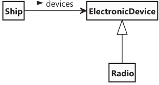

图 6.5 UML 图。

# 将工作的收音机带上船 ★

当收音机被带上船时，控制台上应该出现一条消息。此外，Ciao 船长不喜欢把损坏的收音机带上船。

- 当收音机传递给 `load(...)` 添加方法时，应检查其音量是否为 0；如果是，则不应将其加入数据结构。
- 添加收音机时，控制输出：记得交许可！

# 使用模式变量解决等效性测试 ★

Java 14 引入了“instanceof 模式匹配”，这可以很好地缩短代码。

- 给出一个 `Toaster` 类，它有一个用于等效测试的 `equals(...)` 方法：`com/tuple/exercise/oop/Toaster.java`
```java
public class Toaster {
    int capacity;
    boolean stateless;
    boolean extraLarge;

    @Override public boolean equals( Object o ) {
        if (!( o instanceof Toaster )) return false;
        Toaster toaster=(Toaster) o;
        return capacity == toaster.capacity
            && stateless == toaster.stateless && extraLarge == toaster.extraLarge;
    }

    @Override public int hashCode() {
        return Objects.hash( capacity, stateless, extraLarge );
    }
}
```
- 重写 `equals(...)` 方法以使用带有模式变量的 `instanceof`。

# 火灾报警器未响：重写方法 ★

火灾是 Ciao 船长在船上完全不需要的东西。如果发生火灾，必须尽快扑灭。

- 实现 `ElectronicDevice` 的子类作为火灾探测器的 `Firebox` 类。
- 火灾探测器在创建后应始终保持开启。
- `off()` 方法应实现为空体，或在控制台上输出火灾探测器无法关闭。

示例：

- 任务目标：一个不改变 `isOn` 状态的重写 `off()` 方法。可以这样测试：
```java
Firebox fb=new Firebox();
System.out.println( fb.isOn() ); // true
fb.off();
System.out.println( fb.isOn() ); // true
```

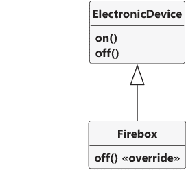

图 6.6 UML 图。

# 调用父类方法 ★★

收音机有 `on()/off()` 方法，电视类也有 `on()/off()` 方法。然而，电视还不是一个 `ElectronicDevice`。这是因为电视由于显示管的原因需要特殊处理。

如果 TV 继承自 `ElectronicDevice` 类，那么 TV 就覆盖了父类 `ElectronicDevice` 的方法。但出现了一个问题：

- 如果我们省略这两个方法，显示管将不会关闭，但 TV 在继承时会作为电器通过测试。
- 如果在类中保留这些方法，则只有显示管会关闭，但设备不再被开启或关闭。毕竟，这个状态原本是由父类通过 `on()/off()` 方法管理的。

任务：

- 修复 TV 是一个 `ElectronicDevice` 但显示管被开启/关闭的问题。

## 多态性与动态绑定

面向对象编程语言的核心特征是方法调用的动态解析。如果对象类型是已知的，这种形式的调用可以在运行时（而不是编译时）决定。

# 假期！关闭所有电器 ★

Ciao 船长躺在吊床上，由于热带风暴的影响，船上的所有电器必须关闭。


任务：

- 在 `Ship` 类中实现一个 `holiday()` 方法，关闭所有电器。
  ```java
  public void holiday() {
    // 关闭所有电器
  }
  ```

- 例如，`main` 方法可能包含：
  ```java
  Radio bedroomRadio=new Radio();
  bedroomRadio.volumeUp();
  Radio cabooseRadio=new Radio();
  cabooseRadio.volumeUp();

  TV mainTv=new TV();
  Radio crRadio=new Radio();
  Firebox alarm=new Firebox();
  Ship ship=new Ship();
  ship.load( bedroomRadio );
  ship.load( cabooseRadio );
  ship.load( mainTv );
  ship.load( crRadio );
  ship.load( alarm );
  ```

## 大搬家

无畏的 Ciao 船长决定放弃旧船，搬到新的驳船上。由于所有的海盗都能阅读，应该创建一个图形列表。任务：

- 将以下 `AsciiArt` 类作为内部类复制到 `Ship` 中：
```java
public static class AsciiArt {
    public static final String RADIO="|o|\n|_|";
    public static final String BIG_TV="||";
    public static final String TV="||";
    public static final String SOCKET="|";
}
```

- 在 `Ship` 中实现一个新方法 `printLoading()`，遍历船上的所有设备并实现以下输出规则：
  - 如果设备是收音机且功率为正，则在屏幕上打印 `AsciiArt.RADIO`。损坏的收音机功率为 0，不打印。
  - 如果设备是电视且功率超过 10000，则打印大电视图像 `AsciiArt.BIG_TV`。
  - 如果设备是电视（无论功率如何），则打印普通电视 `AsciiArt.TV`。
  - 如果不符合上述任何情况，则打印插座 `AsciiArt.SOCKET`。
  - 使用 `switch` 模式匹配功能解决该任务。

# 测试：Bumbo 是一种美味的饮料 ★★

Bonny Brain 在周刊“BETTER BOARDED”上找到了 Bumbo 的配方。但她真的能看到它吗？


以下程序能编译吗？如果是，它的输出是什么？如果不是，有什么编译错误？

```java
class Drink {
  public Drink getInstance() {
    return this;
  }
  public void printIngredients() { }
}
class YummyDrink extends Drink {
  class Bumbo extends YummyDrink {
    public YummyDrink getInstance() {
      return this;
    }
    @Override public void printIngredients() {
      System.out.println(
        "2 ounces rum, 1 ounce water, 2 sugar cubes, cinnamon, nutmeg"
      );
    }
  }
}
public class DrinkBumbo {
  public static void main( String... args ) {
    new Bumbo().getInstance().printIngredients();
  }
}
```

## 测验：带味道的伏特加 ★

给定两个类、一个父类和一个子类。程序翻译正确；屏幕上输出什么？

```java
class AlcoholicDrink {
    public void seasoned() {
        System.out.println("-none-");
    }
}
```

```java
public class Vodka extends AlcoholicDrink {
    public void seasoned() {
        System.out.println("blackcurrant");
    }
}
```

```java
public static void main(String[] args) {
    ((AlcoholicDrink) new Vodka()).seasoned();
}
```

## 测验：朗姆天堂 ★★

给定以下包含两个类的程序。该程序可以编译吗，还是存在编译器错误？如果程序编译并执行，结果是什么？

```java
class AlcoholicDrink {
    int aged=1;
    AlcoholicDrink() { aged++;}
    int older() { return aged++;}
}
```

```java
public class Rum extends AlcoholicDrink {
    int aged=3;
    Rum() { aged+=4; }
    int older() { return aged++;}
}
```

```java
public static void main(String[] args) {
    AlcoholicDrink lakeGay=new Rum();
    System.out.println( lakeGay.older() );
    System.out.println( lakeGay.aged );
}
```

## 抽象类与抽象方法

抽象类初看之下很奇怪：对于你无法创建对象的类该怎么办？抽象方法又是什么？毕竟，一个没有实现方法的类无法提供任何内容！

## 6 • 编写你自己的类 193

这两个概念都至关重要。超类型和子类型之间始终存在约束；子类型必须至少包含超类型指定的内容，且不能破坏语义。如果父类是抽象的，或者方法是抽象的，那么可以构建对象的子类就承诺提供该功能。

## 测验：电子设备作为抽象父类？ ★

我们可以创建 `ElectronicDevice` 的实例吗？我们必须能够创建 `ElectronicDevice` 的实例吗？如果 `ElectronicDevice` 是抽象类，会有什么后果？

## TimerTask 作为抽象类的示例 ★★

CaptainCiaoCiao 通过视频记录每次抢劫案，并在汇报中分析序列。然而，质量最好的 8K 画质视频会很快填满硬盘。他想要及时判断是否需要购买新硬盘。


一个 `java.util.Timer` 可以重复执行任务。为了实现这一点，`Timer` 类有一个 `schedule(...)` 方法来添加任务。任务的类型是 `java.util.TimerTask`。

- 创建 `TimerTask` 的子类，每当文件系统上的剩余字节数低于某个阈值（例如少于 1000 MB）时，在屏幕上打印消息。
  返回剩余字节数：
  `long freeDiskSpace=java.io.File.listRoots()[0].getFreeSpace();`
- `Timer` 应每 2 秒执行一次此 `TimerTask`。

## 194 Java 编程练习

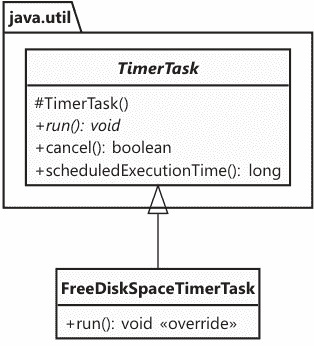

图 6.7 TimerTask 及其子类的 UML 图。

加分题：使用以下代码在栏中集成消息：

```java
import javax.swing.*;
import java.awt.*;
import java.awt.TrayIcon.MessageType;
import java.net.URL;
try {
    String url="https://cdn4.iconconfider.com/data/icons/common-toolbar/36/Save-16.png";
    Image icon=new ImageIcon(new URL(url)).getImage();
    TrayIcon trayIcon=new TrayIcon(icon);
    SystemTray.getSystemTray().add(trayIcon);
    trayIcon.display("Warning", "Hard drive full", MessageType.INFO);
}
catch ( Exception e ) { e.printStackTrace(); }
```

## 建议解决方案

### 使用实例变量和主程序声明 Radio 类

`com/tutego/exercise/device/bmxtuz/Radio.java`

```java
public class Radio {
    boolean isOn;
    int volume;
}
```

变量 `isOn` 表示收音机是开启还是关闭；这里适合使用布尔变量。对于音量，我们求助于数值数据类型，可以在像 `int` 的整数类型或像 `double` 的浮点数据类型之间进行选择。这取决于需求；在接下来，我们将使用 `int` 数据类型。

## 6 编写你自己的类 195

| Radio |
| --- |
| isOn: boolean |
| volume: int |

图 6.8 带有实例变量的 Radio UML 图。

`Radio` 不能启动，它不能包含 `main(...)` 方法。我们将 `start` 方法放入新的类 `Application` 中。它构建收音机并分配状态。

`com/tutego/exercise/device/bmhtuz/Application.java`

```java
public class Application {
    public static void main(String[] args) {
        Radio grandmasOldRadio=new Radio();
        grandmasOldRadio.isOn=true;
        grandmasOldRadio.volume=12;
        System.out.println("Current volume: "+grandmasOldRadio.volume);
    }
}
```

## 实现 Radio 的方法

`com/tutego/exercise/device/afnd/Radio.java`


```java
public class Radio {
    boolean isOn;
    int volume;

    void changeVolume(int value) {
        volume = Math.min(Math.max(volume, 0), 100);
    }

    void volumeUp() {
        changeVolume(1);
    }

    void volumeDown() {
        changeVolume(-1);
    }

    void on() {
        isOn = true;
    }

    void off() {
        isOn = false;
    }

    boolean isOn() {
        return isOn;
    }
}
```

## 212 Java 编程练习

```java
public String toString() {
    return "Radio[volume=" + volume + ", " + isOn ? "on" : "off") + ";";
}
```

这些方法可以分为三组：

- 访问音量的方法。
- 访问 `isOn` 方法。
- 修改音量的方法。

`changeVolume` 方法的实现确保了 `volume` 保持在 0 到 100 之间。它使用了饱和算术（https://en.wikipedia.org/wiki/Saturation_arithmetic），因此音量不会超出。开发环境可以自动生成 getter/setter。不只是获取字符串，后面是键值对。

| Radio |
| --- |
| -isOn: boolean |
| -volume: int |
| -changeVolume(value: int): void |
| +volumeUp(): void |
| +volumeDown(): void |
| +on(): void |
| +off(): void |
| +isOn(): boolean |
| +toString(): String |

图 6.9 带有方法的 Radio UML 图。

## 创建 Setter 和 Getter

`com/tutego/exercise/device/sgxrwy/Radio.java`

```java
private boolean isOn;
private int volume;
private double frequency;

public void setFrequency(double frequency) {
    this.frequency = frequency;
}

public double getFrequency() {
    return frequency;
}

public int getVolume() {
    return volume;
}

public String toString() {
    return "Radio[volume=" + volume + ", isOn=" + isOn + ", frequency=" + frequency + "]";
}
```

现代开发环境可以生成 getter/setter。

### IntelliJ

在编辑器中，按下 `Alt+Insert` 会出现一个菜单。选择 Getters and Setters。在对话框中，你可以选择实例变量。

### Eclipse

在右键菜单中转 Source 并选择 Generate Getters and Setters。在后续对话框中，你可以选择实例变量。

### NetBeans

按下 `Alt+Ins`，并在右键菜单中选择 Getters and Setters。或者，激活 `Source > Insert Code`。

# 将电台名称转换为频率

`com/tutego/exercise/device/oxujaj/Radio.java`

```java
class RadioStations {
    public static final String SEA_101_STATION_NAME = "sea 101";
    public static final double SEA_101_FREQUENCY = 101.0;
}

class Radio {
    public static double stationNameToFrequency(String station) {
        if (station == null)
            return 0.0;

        return switch (station.trim().toLowerCase()) {
            case "walking the plank" -> 98.3,
            case RadioStations.SEA_101_STATION_NAME -> RadioStations.SEA_101_FREQUENCY;
            default -> 0.0;
        };
    }

    // 其他方法已省略
}
```

`stationNameToFrequency(String station)` 方法首先测试传入的参数是否为 `null` 并返回 0。另一种方案是抛出异常。如果存在 `String` 对象，`trim()` 会去除首尾的空格，并将字符串转换为小写。`switch-case` 语句的箭头符号对两个字符串进行紧凑的比较，其中转换为小写后的字符串 "Walking the Plank" 是硬编码的，而第二个字符串通过类的常量进行引用。一个小说明是，我们没有直接用小写的 "sea 101" 初始化常量 `SEA_101_STATION_NAME`，而是可以动态地评估字符串：

```java
public static final String SEA_101_STATION_NAME = "SEA 101".toLowerCase();
```

类变量是我们的下一个要讨论的话题。

# 使用 Tracer 类编写日志输出

`com/tutego/exercise/oop/Tracer.java`

```java
public class Tracer {
    private static boolean tracingOn;

    public static void on() {
        tracingOn = true;
    }

    public static void off() {
        tracingOn = false;
    }

    public static void trace(String msg) {
        if (tracingOn) {
            System.out.println(msg);
        }
    }

    public static void trace(String format, Object... args) {
        if (tracingOn) {
            System.out.printf(format + "%n", args);
        }
    }
}
```

`Tracer` 有一个私有静态变量 `tracingOn`，通过它我们记录是否需要跟踪输出。`on()` 和 `off()` 方法设置 `tracingOn`。重要的是，不仅方法是静态的，变量 `tracingOn` 也应该是静态的。如果方法连接到类，但 `tracingOn` 连接到对象，它也可以工作。静态方法只能访问它们自己的类，除非它们通过参数获取对象或自己构建一个。`trace(...)` 方法使用此状态来检查是否应该向屏幕输出内容。

命名方法 `trace(String format, Object... args)` 委托给 `System.out.printf(...)` 并在格式字符串末尾添加换行符，使其行为像 `println()`。这种方法的优势是它的性能可能比字符串拼接更高，因为字符串拼接不是。

- Java 中有各种用于真实企业使用的日志库，Java SE 也通过 `java.util.logging` 带来了一些基础功能。

## 测验：无被窃

该程序无法编译，因为这里混合了静态属性和非静态属性。问题的核心是在 `print(...)` 方法中访问了实例变量的值。然而，`value` 是一个实例变量，而不是静态变量。

参数变量大写事实仅仅是一种困扰；`println(...)` 会回退到 `Value`，这将没有问题，实例变量将不再在场。

通过对象引用调用 `main(...)` 中的静态方法是没有必要的，且具有误导性。如果方法使用它自己的实例变量，它也不需要参数了。

# 为电台添加 AM–FM 调制

`com/tutego/exercise/device/ewslfg/Modulation.java`

```java
public enum Modulation {
    AM, FM
}
```

`Modulation` 声明了两个枚举元素 `AM` 和 `FM`。我们将它们大写，是因为它们是常量，而常量通常是大写的。由于枚举元素是引用变量，每个常量引用一个对象。也就是说，`AM` 和 `FM` 引用 `Modulation` 类型的对象。

# 200 Java 编程练习

以下是 `Radio` 的片段，被精简为调制：

`com/tutego/exercise/device/ewsfg/Radio.java`

```java
private Modulation modulation = Modulation.AM;

public void setModulation(Modulation modulation) {
    this.modulation = Objects.requireNonNull(modulation);
}

public Modulation getModulation() {
    return modulation;
}

@Override
public String toString() {
    return "Radio[" + isOn + "=isOn" + ", volume=" + volume
        + ", frequency=" + frequency + ", modulation=" + modulation + "]";
}
```

如果我们想对调制创建一个引用，我们为此创建一个名为 `modulation` 的变量，其类型为 `Modulation`。实例变量预初始化为 `Modulation.AM`，以减少在 `modulation` 变量上调用方法时出现 `NullPointerException` 的风险。因此，`setModulation(Modulation)` 也通过 `Objects.requireNonNull(modulation)` 检查——没有通过 `Objects.requireNonNull(modulation)` 传递 `null`——通过 `Objects.requireNonNull(modulation)` 抛出异常。

# 编写你的类 201

我们分别为 AM 和 FM 创建了最小和最大频率的常量。我们设置了实例变量 `minFrequency` 和 `maxFrequency`，取决于 `modulation` 的赋值。

`setModulation(...)` 方法现在有多种方式检查 `modulation` 的赋值。一种方案是使用 `if-else` 条件语句，另一种 `switch-case`；这里使用的是条件运算符。枚举对象是所谓的单例，即只有一个对象，并且允许使用 `==` 进行比较，这对于普通对象来说是不常的。

## 编写构造函数

`com/tutego/exercise/biwdx/Radio.java`

```java
public Radio() {
}

public Radio(double frequency) {
    setFrequency(frequency);
}

public Radio(String name) {
    this(stationNameToFrequency(name));
}
```

我们的解决方案有三个构造函数。无参数构造函数是空的但存在的；我们在这里没有进行任何初始化。

有两个参数化构造函数。存储频率的构造函数调用 `setFrequency(double)` 将频率传递到内部实例变量。我们面临的决策是直接通过 `this.frequency = frequency` 初始化实例变量，还是调用 setter。使用 setter 的方案通常更好。有两个原因：首先，初始化状态是实现细节。如果我们更改了实例变量，开发者将不得不访问所有读取或写入的地方。同样重要的是要考虑 setter 也可以执行有效性检查。我们不想在构造函数中重复这一点，因为代码重复是糟糕的。因此，构造函数可以将保存操作委托给 setter。

如果用名称初始化电台，首先将字符串转换为频率，然后构造函数转发：

```java
this(stationNameToFrequency(station));
```

所以构造 `(double frequency)` 接收一个 `double` 并存储频率。

通过 `this(...)`，可能只有一个带有实现的构造函数，所有其他构造函数都转发到这个构造函数。优点是当进行增强时，只需要修改这个特定的构造函数。但缺点是对象可能会带来一些默认值或 `null`。然而，初始化构造函数是必不可少的，它们将对象带入有效的初始状态，以便每个方法调用都能从正确的、有效的对象开始。

## 设置频率的起始和结束

`com/tutego/exercise/device/omxao/Radio.java`

```java
private static final double AM_MIN_FREQUENCY = 148.5;
private static final double AM_MAX_FREQUENCY = 26.1;
private static final double FM_MIN_FREQUENCY = 87.5;
private static final double FM_MAX_FREQUENCY = 108.0;
private double minFrequency = AM_MIN_FREQUENCY;
private double maxFrequency = AM_MAX_FREQUENCY;

public void setModulation(Modulation modulation) {
    this.modulation = Objects.requireNonNull(modulation);
}
```

# 202 Java 编程练习

| Radio |
| :--- |
| -isOn: boolean |
| -volume: int |
| +Radio() |
| +Radio(frequency: int) |
| +Radio(station: String) |
| +changeVolume(value: int): void |
| +volumeUp(): void |
| +volumeDown(): void |
| +on(): void |
| +off(): void |
| +isOn(): boolean |
| +toString(): String «override» |

图 6.11 带有三个构造器的 Radio UML 图。

# 实现拷贝构造函数

`com/tutego/exercise/device/device/Radio.java`

```java
public Radio(Radio other) {
    setFrequency(other.frequency);
    setModulation(other.getModulation());
    if (other.isOn()) on(); else off();
    this.volume = other.volume;
}
```

拷贝构造函数具有特殊之处。其核心在于读取传入的收音机并将各个状态传输到新的收音机中。

我们通过 getter 方法和 `isOn()` 方法从收音机中获取数据，并使用 setter 方法和 `on()/off()` 方法将它们传输到实例变量中。

然而，对于实例变量 `volume`，并没有 `setVolume()/getVolume(...)`。Java 可见性的特殊规则允许访问传入收音机的私有状态，因为我们本身也是 `Radio`！我们必须利用这一点从传入的收音机读取音量，并将其传输到新的收音机。对于其他状态，我们克制不在构造函数中读取私有变量并将其写入我们的私有变量。

## 实现静态工厂方法

`com/tutego/exercise/device/TreasureChest.java`

```java
public class TreasureChest {
    public final int goldbloonWeight;
}
```


# 连接 MonitorTube 与 TV

路径：`com/tutego/exercise/device/device/TVWithMonitorTube.java`

```java
class MonitorTube {

    private final TV tv;

    public MonitorTube(TV tv) {
        this.tv = tv;
    }

    public TV getTv() {
        return tv;
    }

    public void on() {
        System.out.println("Tube is on.");
    }

    public void off() {
        System.out.println("Tube is off.");
    }
}

class TV {

    private boolean isOn;
    private final MonitorTube tube = new MonitorTube(this);

    public void on() {
        isOn = true;
        tube.on();
    }

    public void off() {
        isOn = false;
        tube.off();
    }

    public String toString() {
        return String.format("TV[on=%s]", isOn);
    }
}
```

类定义包含两个 `public` 变量。由于它们是 `final` 的，一旦写入后就无法修改。将变量设为 `public` 是可以的；如果变量不再修改，就不需要 getter。setter 主要用于确保值的范围正确——在我们的情况下，这是通过接收并验证值实现的。

我们有一个私有构造函数无法从外部调用，仅供我们的静态工厂方法使用。这四个工厂方法允许两个实例变量的所有排列组合：
- 均未设置，值默认为 0。
- 设置其中一个值，另一个初始化为 0。
- 两个值都设置了。

现在，这些工厂方法相比构造函数的优势是什么？如果有明确的方式来实例化，构造函数是一个很好的选择。但在我们的情况下，存在初始化 `goldboonWeight` 或 `gemstoneWeight` 的可能，而构造函数具有类名。无法编写两个接收整数的构造函数变体来区分应该赋值 `goldboonWeight` 还是 `gemstoneWeight`。当然，你可以跟踪它并将其作为枚举作为第二个参数，但这并不吸引人。工厂方法的魅力在于拥有命名的方法，即使不同方法的参数列表相同，也能通过方法名明确其功能。

# 6 编写你的类

下一个类 `TV` 有开启或关闭状态。我们在 `on()` 和 `off()` 方法中设置这个内部标记。实例变量 `tube` 记录了这一点。初始化如下：

```java
private final MonitorTube tube = new MonitorTube(this);
```

在构造函数处，`this` 被传递了，即对 `TV` 的引用。我们建立了一个双向关系。如果我们只需要单向关系，我们将只有一个 `MonitorTube`，而不是从 `MonitorTube` 到 `TV` 的引用。`on()` 和 `off()` 方法有两个任务：首先设置内部标记，然后委托给 `tube`。双向关系非常方便，你始终可以到达另一端。然而，它们存在两个对象指向同一边的风险，即如果双方重新绑定，在建立新关系之前必须解决这两个关系。方法确保了对方解耦。

# 测验：关联、组合与聚合

普通的关联（Association）是对象之间的链接。当一个对象引用另一个对象时，该术语是正确的。

组合（Composition）和聚合（Aggregation）是关联的特殊形式，关于生命周期的问题。

- 在组合中，关联对象的生命周期与另一个对象的生命周期绑定。例如：对象 A 引用对象 B，如果 A “死亡”（即不再被引用且可以被垃圾回收器移除），B 也“死亡”，至少 B 上不再存在引用。
- 聚合结合两个对象，被引用对象有自己的生命周期。如果对象 A 关联到另一个对象 B 且 A 被移除，B 可能仍然存在。“聚合”一词并不常用；人们简单地使用“关联”一词，尤其是在 UML 图中。然而，由于“关联”一词没有说明被引用对象的生命周期，可以显式地强调这一点。

# 为 Ship 添加 1:n 关联的行

路径：`com/tutego/exercise/device/device/Application.java`

```java
class Ship {

    private final ArrayList<Radio> radios = new ArrayList<>();

    public void load(Radio radio) {
        radios.add(Objects.requireNonNull(radio));
    }

    public int countDevicesSwitchedOn() {
        int result = 0;
        for (Radio radio : radios) {
            if (radio.isOn)
                result++;
        }
        return result;
    }
}
```

# 206 Java 编程练习

```java
return result;
}
```

在我们的 `Ship` 类中，我们按照所谓的操作符描述设置了变量 `radios` 为：
使用所谓的菱形操作符可以稍微简化写法为：

```java
ArrayList<Radio> radios = new ArrayList<>();
```

由于该变量是私有的，无法从外部访问，我们必须通过可以访问实例变量的辅助方法。`load(Radio radio)` 允许添加收音机。该方法将其委托给了 `ArrayList` 的 `add(..)` 方法。
第二个方法 `countDevicesSwitchedOn()` 返回开启的收音机数量。需要注意的是，它并不是收音机的总数——这个问题很容易就能回答——而是关于 `isOn` 状态设置为 `true` 的收音机数量。因此，我们需要遍历整个列表并逐个检查每个收音机。这里有几种解决方案：

- 一种实用的变体是增强型 for 循环。我们在学习数组时知道了这种循环类型：在冒号右侧可以是一个 `ArrayList`。通过这种方式，我们可以轻松地从头到尾运行整个列表。我们获取每个收音机并测试实例变量是否被设置，如果是，我们就增加计数器。
- 另一种解决方案是使用计数循环，从 0 运行到 `radios.size()`，并使用 `get(int)` 方法选取每个位置上的每个收音机。
- 还有第三种使用 stream API 的解决方案，但我们还需要一段时间才能到达那一步。不过，这个问题可以用一行代码来回答。

如果我们想用现有的知识给船添加其他电器，我们就必须引入带有特殊类型的不同数据结构，例如，一个带有制冰机的 `ArrayList` 或一个带有电视机的 `ArrayList`。显然，这很快就会变得复杂，但面向对象的编程语言对对此提供了一个完美的解决方案：继承！

# 通过继承在电子设备中引入抽象

路径：`com/tutego/exercise/device/jkvow/ElectronicDevices.java`

```java
class ElectronicDevice {

    private boolean isOn;

    public void on() {
        isOn = true;
    }

    public void off() {
        isOn = false;
    }

    boolean isOn() {
        return isOn;
    }

    public String toString() {
        return "ElectronicDevice[isOn=" + (isOn ? "on" : "off") + "]";
    }
}

class IceMachine extends ElectronicDevice {
}

class Radio extends ElectronicDevice {
    int volume;
}
```

如果使用继承，我们就实现了一种“是一个”（is-a-type）的关系。每个子类都遵循并支持其父类的能力，这是至关重要的。提升实例变量和方法的决策仅限于与开启/关闭状态相关的部分。如果我们看 `Radio` 的其他变量和方法，很快就会发现它们不属于 `ElectronicDevice` 父类。世界上每一台电子设备都有频率或音量。一旦我们在父类中设置了实例变量，它们将适用于以后编写的所有子类。

使用 IDE 将许多属性映射到父类中，这样就不需要任何手动工作。这种重构通常被称为“提取成员”（pull members）。
父类 `ElectronicDevice` 获得了一个实例变量 `isOn`，它是私有的，因此只能在 `ElectronicDevice` 内部进行读写。其他方法可以通过 getter 将状态设置为 `true` 或 `false`。无法从外部直接访问私有变量；我们必须通过方法。此外，父类有一个 `toString()` 方法的实现。该字符串无法包含比 `isOn` 状态更多的内容。通过内部方法还是通过 `isOn()` 方法，这取决于个人口味。子类保留了它们的 `toString()` 方法，我们稍后会看到 `toString()` 方法也可以拼接。

父类由两个子类 `IceMachine` 和 `Radio` 连接。子类扩展了它们的父类，而父类对子类一无所知。

## 测验：三、二、一

程序可以执行，启动后屏幕上会有输出：

12

构建了一个类型为 `Three` 的对象，这导致构造函数 `Three()` 被调用。`Three()` 构造函数调用类 `Two` 的构造函数，`Two()` 构造函数调用 `One()`。
糟糕的是，`Three` 类中只有一个编译器创建的默认构造函数，而我们添加了一个 `Three()` 方法，它与构造函数没有任何共同点。该方法首字母大写，这违反了命名规范，但并不允许。它会自动调用父类的构造函数。

然而，默认构造函数中没有控制台输出。我们自己编写了带有控制台输出的构造函数 `Two()` 和 `One()`，只有这些构造函数运行到了顶部，输出是 1，然后是 2。

# 测验：私有和受保护构造函数

如果一个类具有私有构造函数，则无法从外部构建该类的实例。但是，可以在类内部构建实例，我们可以通过使用静态方法来实现。如果该方法将此实例交给外部，我们还称之为工厂方法（factory method）。下面的示例说明了这一点：

```java
class Cloth {

    private Cloth() {
    }

    public static Cloth create() {
        return new Cloth();
    }
}
```

无法从 `Cloth` 类外部创建实例。这种尝试会被编译器错误所惩罚：

```java
class Skirt {
    Cloth skirt = new Cloth();
}
```

构造函数调用中的错误是：`'Cloth()' 在 'Cloth' 中具有私有访问权限`。
此外，无法创建实例。像这样的声明：

```java
class Petticoat extends Cloth {
}
```

将导致错误 `There is no constructor available in 'Cloth'`。
这是因为构造函数是私有的，子类无法调用它。

# 确定开启设备的数量

路径：`com/tutego/exercise/device/mkw/ElectronicDevice.java`

```java
public static int numberOfDevicesSwitchedOn(ElectronicDevice[] devices) {
    int result = 0;
    for (ElectronicDevice device : devices) {
        if (device.isOn())
            result++;
    }
    return result;
}
```

该方法与我们编写的 `numberOfDevicesSwitchedOn()` 非常相似。唯一的区别是现在我们不仅是在询问收音机，而是询问开启的 `ElectronicDevice` 对象。也就是说，任何 `ElectronicDevice` 的东西都可以通过变长参数（vararg）引入方法。这可以是三台收音机，但也只有一个。

使用变长参数时，记住它是一个数组，这些是对象，对象引用可以是 `null`。我们的方法没有对 `ElectronicDevice == null` 进行查询，本身不会抛出异常。然而，当增强型 for 循环访问空数组时，会隐式抛出此异常。因此，我们可以显式地查询 `null`，因为结果（空指针异常）是相同的。

# 船应该持有任何电子设备

路径：`com/tutego/exercise/device/lofryn/Ship.java`

```java
public class Ship {

    private final ArrayList<ElectronicDevice> devices = new ArrayList<>();

    public void load(ElectronicDevice device) {
        Objects.requireNonNull(device);
        devices.add(device);
    }
}
```

泛化后，船只有一个列表和一个添加它的方法。对于实例变量 `ArrayList<ElectronicDevice> devices`，我们将类型从之前的 `Radio` 改为 `ElectronicDevice`，因此更改了变量名称。我们重写了 `add` 方法，因为现在现在接受任何 `ElectronicDevice` 对象。参数类型从 `Radio` 变为 `ElectronicDevice`。因此，我们可以接受任何电子设备。可以是收音机、电视或制冰机；任何 `ElectronicDevice` 的子类。这包括我们在程序中已有的或将在以后开发阶段添加的内容。

`Objects.requireNonNull(...)` 防止空引用被添加到列表中。

# 将完好的收音机带上船

路径：`com/tutego/exercise/device/dxsyvb/Ship.java`

```java
public class Ship {

    private final ArrayList<ElectronicDevice> devices = new ArrayList<>();

    public void load(ElectronicDevice device) {
        Objects.requireNonNull(device);
        if (device instanceof Radio radio) {
            if (radio.getVolume() == 0) {
                return;
                System.out.println("记得交许可费!");
            }
        }
        devices.add(device);
    }
}
```


## 210 个 Java 编程练习

变量 `devices` 的引用类型始终是 `ElectronicDevice`（且不是我们之前禁止的 `null`），在运行时，它背后可能有完全不同的对象类型。`instanceof` 运算符帮助我们找到在运行时我们面对的是哪种对象类型。如果我们有一个 `Radio` 或本身扩展自 `Radio` 的对象，那么 `instanceof` 运算符将指示并声明模式变量 `radio` 为 `Radio` 类型，以便在下一步获取其值。

## 使用模式变量解决等效测试

在获取解决方案之前，让我们先回顾一下 `instanceof` 为什么是必要的。该运算符帮助我们排除不兼容的对象类型。毕竟，`equals(Object)` 方法的参数类型只是 `Object`，这意味着任何对象都可以传递给该方法。然而，只有烤面包机（toaster）应该与其他进行比较。

如果我们使用 `instanceof`，就可以处理两种不同的设备。在一种变体中，我们可以测试传递的对象不是烤面包机并提前结束方法：

```java
com/tutego/exercise/oop/Toaster.java

@Override 
public boolean equals(Object o) {
    if (!(o instanceof Toaster)) return false;
    return capacity == other.capacity
        && stateless == other.stateless && extraLarge == other.extraLarge;
}
```

这种变体还有另一种表示法：`instanceof` 测试，且仅当结果为 `true` 时，继续在 `if` 块体中检查对象状态。但这样代码会向右移动。这种演示解决方案的吸引之处在于，如果没有将烤面包机传递给 `equals(Object)` 方法，该方法将直接返回。不需要 `else` 分支；因此后续代码不会向右移动。

考虑 `instanceof` 处的模式变量；正当传递的对象 `o` 也是一个 `Toaster` 时进行声明。该变量在块中保持存，并在随后的 `return` 语句中可以访问。

我们可以创建第二个变体，将之前语句中的条件包含在 `return` 语句中：

```java
com/tutego/exercise/oop/Toaster.java

@Override 
public boolean equals(Object o) {
    return o instanceof Toaster other
        && capacity == other.capacity
        && stateless == other.stateless && extraLarge == other.extraLarge;
}
```

使用逻辑与运算符（`&&`），求值是从左到右，并在结果确定时结束——我们所说的是短路运算符。因此，如果传递的对象是烤面包机，那么变量 `object` 将被声明并可用于对象状态的两个测试。

## 火灾报警器不响：重写方法

```java
com/tutego/exercise/device/hthiin/Firebox.java

public class Firebox extends ElectronicDevice {
    public Firebox() {
      on();
    }

    @Override 
    void off() {
      System.out.println("火箱总是开启的，你无法关闭它");
    }
}
```

`Firebox` 是 `ElectronicDevice` 的另一个子类。该类继承了父类的所有内容，并重写了 `off()` 方法。在体内，只有控制台输出；并没有修改 `on/off` 标记。通过 `@Override` 注解，我们标记该方法已存在于父类，但在子类中用新行为重写了它。

对于编译器和运行时环境来说，该注解不是必不可少的；关键在于知道何时编写了方法。但有了注解，编译器可以检测到错误，例如拼写错误或子类变化（例如父类中的参数列表），导致子类中的方法不再是重写（override），而是变成了重载（overload）。

我们经常重写方法，但也许我们还没有注意到：`toString()`。该方法来自抽象子类 `java.lang.Object`。

由于火灾报警器在创建后应该是开启状态，我们实现了一个构造函数并调用了 `on()`。

## 调用父类方法

为了节省代码，建议 TV 的解决方案更加精简，并且与 `MonitorTube` 只有单向关系。

```java
com/tutego/exercise/device/rojnsv/TV.java

class TV extends ElectronicDevice {
  private MonitorTube monitorTube = new MonitorTube();

  @Override 
  void on() {
    super.on();
    monitorTube.on();
  }

  @Override 
  void off() {
    super.off();
    monitorTube.off();
  }
}
```

在重写时，父类的原始实现被新实现取代。将两者结合并没有矛盾——一方面实现了方法的新实现，另一方面仍然调用了原始实现。Java 通过 `super` 关键字实现了这一点。`super` 关键字存在两个版本：一个用于调用父类的构造函数，另一个用于调用重写的方法；`super` 将我们带入父类型的命名空间。如果我们没有 `super` 调用方法，将会导致递归。

一方面，TV 应该存储它是开启还是关闭的状态，父类的 `on()` 和 `off()` 方法负责这些。TV 必须调用这些方法来获取父类的状态。另一方面，TV 的 `on()/off()` 方法需要开启和关闭 `monitorTube`，这通过委托来处理。委托意味着一个对象将调用传递给另一个对象；当 TV 开启或关闭时，`monitorTube` 也会被开启或关闭。

## 假期！关闭所有设备

```java
com/tutego/exercise/device/mkwrrt/Ship.java

public void holiday() {
    for (ElectronicDevice device : devices)
        device.off();
}
```

```java
aged += 4;
}
```

所以构造函数说是：

```java
Rum() {
    aged=7;
}
```

如果我们在 `main(...)` 中创建变量 `agedGay`，那么它的对象类型是 `Rum`，引用类型是 `AlcoholicDrink`。如果我们调用 `older()` 方法，则会调用 `Rum` 类型的覆盖方法，因为内存中有一个 `Rum` 对象，且覆盖方法是动态绑定的。`older()` 方法查询变量 `aged` 并返回它。我们之前看到过 `aged` 默认被设置为 7。但为什么返回的不是 7 呢？因为变量名后面有一个后增运算符 `++`。也就是说，`aged` 的赋值值被保存用于返回，然后进行加1，最后返回保存的值。我们并不查询数字 8。

实例变量 `aged` 存在于 `AlcoholicDrink` 和 `Rum` 类中。提醒一下，类变量和实例变量不是动态绑定的。只有对象是动态绑定的，类变量、实例变量或静态方法永远不是！

当我们引用变量 `aged` 时，编译器响应的是引用类型 `AlcoholicDrink`，它们的 `aged` 默认值为 2。这如何解释呢？我们没有 `AlcoholicDrink` 类型的对象，为什么在实例化 `Rum` 时会间接调用 `Rum` 构造函数？当构建一个 `Rum` 对象时，会调用 `Rum` 的构造函数，而会自动调用子类的构造函数。`AlcoholicDrink` 的构造函数将变量加 1，因此在 `AlcoholicDrink` 中变为 2。这就是我们看到的输出。

# 练习：作为抽象类的消费设备？

没有必要实例化 `ElectronicDevice` 类，在我们的实现中，我们仅将其作为超类。将 `ElectronicDevice` 类设为抽象类没有问题。它也暗示该类是一个建模类，作为一组电子设备的数据类型，并指定了它们的共性。

## TimerTask 作为抽象类的示例

`com/tutego/exercise/oop/FreeSpaceTimer.java`

```java
public class FreeSpaceTimer {
    public static void main(String[] args) {
        final int REPETITION_PERIOD = 2000; // ms
        new Timer().schedule(new FreeSpaceTimerTask(), 0, REPETITION_PERIOD);
    }
}

class FreeSpaceTimerTask extends TimerTask {
    private static final long MIN_CAPACITY = 100_000_000L;
    private final File root = File.listRoots()[0];

    @Override
    public void run() {
        long freeSpace = root.getFreeSpace();

        if (freeSpace < MIN_CAPACITY) {
            System.out.printf(
                "Device %s has less than %d byte available, currently %d byte%n",
                root, MIN_CAPACITY, freeSpace);
        }
    }
}
```

我们将任务分为两个类。第一个类包含 `main(...)` 方法并启动定时器，第二个类扩展 `TimerTask` 类来处理我们的任务。

每一个任务都是 `TimerTask` 的子类。抽象类规定了一个抽象方法 `run()`，我们的任务必须覆盖该方法。正如作业描述的，我们使用单行代码来确定 `File.listRoots()` 返回的第一个驱动器的空闲字节数，然后进行测试。如果空闲字节数小于最小容量，我们会在控制台上打印消息。如果我们有更多空闲空间，一切正常，我们没有屏幕输出。

要启动我们的任务，我们必须先创建一个 `Timer` 对象。`Timer` 为我们提供 `schedule(...)` 方法，我们可以向其传递具体任务的实例以及延迟时间和重复频率。我们想要立即开始，所以没有延迟时间，重复频率为 2 秒，即 2000 ms，这是参数的时间单位。

## 注意

1. 两种调制方法 AM 和 FM 的区别在于如何使用载波频率对待传输的信号进行编码。维基百科提供了概述：https://en.wikipedia.org/Modulation

## Records、接口和密封类

## RECORDS

Records 在 Java 中非常有用，因为它们提供了一种简单且紧凑的方式来定义具有固定数量属性的对象。

# 练习：关于 Records 的陈述是正确的？

给定以下 Java Record：

```java
record Candy(String name, int calories)
```

以下哪些语句是正确的？

1. `Candy` 对象的 name 和 age 在创建后无法更改。
2. `Candy` 对象的属性通过 getter 方法访问。
3. `Candy` 不能有静态方法。
4. 必须手动实现 `equals()` 和 `hashCode()` 方法。
5. `Candy` 的 `toString()` 方法产生 JSON（JavaScript 对象表示）格式。

## 开发复数的 Record

复数是工程、物理和计算机科学等领域的重要概念。复数由一个实部和一个虚部组成。以 $a+bi$ 的形式表示，其中 $a$ 是实部，$b$ 是虚部。数学运算实现如下：

- 加法和减法：运算逐元素执行，即一个数的虚部加上/减去另一个数的实部。
- 乘法：运算遵循规则 $(a+bi)\times(c+di)=(ac-bd)+(ad+bc)$。
- 复数的绝对值：$z=a+bi$ 的绝对值定义为 $|z|=\sqrt{a^2+b^2}$。

## Records、接口和密封类

编写一个带有实部和虚部组件的新 record。

- 创建一个代表虚数单位的常量。
- 实现 `add(Complex other)`、`subtract(Complex other)`、`multiply(Complex other)` 和 `abs()` 方法。
- 重写 `toString()` 方法，将实部和虚部保留三位小数，以便输出变为 `-3.000+2.000i` 或 `2.000-3.000i`。

## 练习：带有静态变量的 Records

给定以下 Java Record：

```java
record Candy(String name, int calories) {
    public static String id = UUID.randomUUID().toString();
}
```

该 record 能够编译吗？

以下备选表示法有效吗？

```java
record Candy(String name, int calories) {
    public static String id;

    Candy {
        id = UUID.randomUUID().toString();
    }
}
```

## Record Patterns

海盗不仅有猎物的嗅觉，还有对奇异宠物的喜爱。到目前，通过两个 record 表示宠物：

```java
record MischiefMonkey(String name, boolean isMutinous)
record FeistyParrot(String name, String favoritePhrase, boolean isMutinous)
```

建模必须是灵活的，因为会有新类型的添加和更改。因此，来自 record 的数据应该转换为 `java.util.Properties` 对象。`Properties` 是一个将一个字符串与另一个字符串关联的关联存储器。`setProperty(String key, String value)` 方法将键值对存入 `Properties` 对象。

- 编写方法 `convertToProperties(Object)` 将 `MischiefMonkey` 和 `FeistyParrot` 类型的宠物转换为 `Properties` 对象。
- 叛变的（`isMutinous`）宠物应该被忽略，并产生空的 `Properties` 对象。
- 该方法在调用 `null` 或未知类型时应返回空的 `Properties` 对象。

## Java 编程练习

示例（显示 `Properties` 的 `toString()` 表示）：

- `new MischiefMonkey("Jack", true) -> {}`
- `new FeistyParrot("Captain Squawk", "Avast, scallyags!", false) -> {favoritePhrase=Avast, name=Captain Squawk}`
- `new MischiefMonkey("Barbossa", false) -> {name=Barbossa}`
- `new FeistyParrot("Polly", "Pieces of eight!", true) -> {}`
- `new FeistyParrot("Marauder", "Walk the plank!", false) -> {favoritePhrase=Walk the plank, name=Marauder}`

## 接口

抽象类仍然具有它们的所有能力的类：实例变量、构造函数、方法和不同的能力。通常更简单的规范形式就足够了，因为 Java 提供了接口。它们没有实例变量，但可以有常量、抽象方法、静态方法和默认方法——实例变量是存储属于类而非接口的内容。

## 比较电气设备的功耗

每个电气设备都有功率输出，以瓦特计。

任务部分 1：

1. 在 `ElectronicDevice` 中声明一个私有实例变量 `watt`，并使用开发环境生成 Setter/Getter。
2. 添加 `toString()` 方法，返回如下内容：“`ElectronicDevice[watt=12kW]`”。某些子类已经重写了 `toString()`；它们应该在自己的 `toString()` 方法中包含 `super.toString()`。

任务部分 2：

1. 写一个实现 `java.util.Comparator<ElectronicDevice>` 接口的新类 `ElectronicDeviceWattComparator`。
2. 让 `compare(...)` 方法定义电气设备的排序，如果电气设备消耗的功率较少，则较“小”。
3. 在你的 `compare(...)` 方法中放入 `println(...)` 以便理解，这样你可以看到哪些对象正在被比较。

示例：

```java
ElectronicDevice ea1 = new Radio(); ea1.setWatt(200);
ElectronicDevice ea2 = new Radio(); ea2.setWatt(20);
Comparator<ElectronicDevice> c = new ElectronicDeviceWattComparator();
```


System.out.println(c.compare(ea1, ea2));

System.out.println(c.compare(ea2, ea1));

```
```

练习目标：实现 `ElectronicDeviceWattComparator` 作为 `Comparator` 接口的实现，如图 UML 图所示：

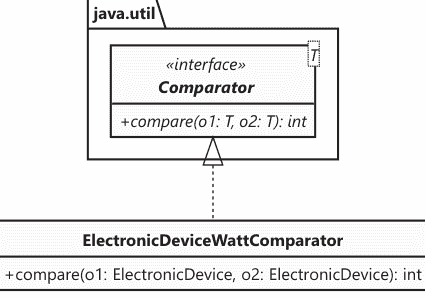

图 7.1 UML 图。

# 查找功耗最高的电子设备 ★

`java.util.Collections` 类有一个静态方法，可以返回集合中最大的元素（为了简化，删除了括号中的泛型）：

```
static T max(Collection coll, Comparator comp)
```

因此，必须向 `max(...)` 方法传递以下内容：

1. 一个 `Collection` 实现，如 `ArrayList`
2. 一个 `Comparator` 实现。在这里可以使用我们的 `ElectronicDeviceWattComparator`。

任务：

- 在 `ship` 类中编写一个方法 `findPowerConsumingElectronicDevice()`，返回功耗最高的设备。

示例：

- 以下程序返回输出 12000。

```
Radio grannysRadio = new Radio();
grannysRadio.volumeUp();
grannysRadio.setWatt(12_000);
TV grandpassTv = new TV();
grandpassTv.setWatt(1000);
Ship ship = new Ship();
ship.load(grannysRadio);
ship.load(grandpassTv);
System.out.println(ship.findPowerConsumingElectronicDevice().getWatt());
```

# 使用 Comparator 接口进行排序 ★

如果你想对列表中的对象进行排序，可以使用 `List` 实现上的 `sort(...)` 方法。告诉 `sort(...)` 方法何时一个对象比另一个对象“小”是非常重要的。为了这个目的，我们的 `ElectronicDeviceWattComparator` 决定了要排序对象的前提——`void sort(Comparator<...>)` 已经揭示了这一点。

任务：

- 在 `ship` 对象的 `load(...)` 方法中调用 `sort(...)` 并将其添加到数据结构中，以便在添加后获得一个内部排序列表。

# 接口中的静态和默认方法 ★★★

接口可以包含静态方法并作为工厂方法，这意味着它们可以提供实现该接口的类的实例。

任务：

1. 创建一个接口 `Distance`。
2. 在 `Distance` 中设置两个静态方法 `ofMeter(int value)` 和 `ofKilometer(int value)`，它们返回类型为 `Distance` 的对象。
3. 在 `Distance` 中设置一个抽象方法 `meter()`。必须实现什么？
4. 在 `Distance` 接口中设置一个默认方法 `kilometer()`。

使用示例：

```
Distance oneKm = Distance.ofKm(1);
System.out.printf("1 km=%d km, %d m\n", oneKm.kilometer(), oneKm.meter());

Distance moreMeter = Distance.ofMeter(12345);
System.out.printf("12345 m=%d km, %d m\n", moreMeter.kilometer(), moreMeter.meter());
```

# 使用 Predicate 删除元素 ★★

如果我们想让商店节能，我们需要移除所有功耗过大的设备。

`List` 方法 `removeIf(Predicate<...>)` 删除所有满足谓词的元素。`ArrayList` 是 `List` 接口的实现，因此该方法在 `ArrayList` 上可用。

例如，如果我们想从 `List<String>` 中删除空字符串，可以在列表上调用 `removeIf(new IsNotEmpty())`，其中 `IsNotEmpty` 声明如下：

```
class IsNotEmpty implements Predicate<String> {
    @Override
    public boolean test(String t) {
        return t.trim().isEmpty();
    }
}
```

# 7 记录、接口、枚举和密封类 221


任务：

- 在 `ship` 中设置一个新方法 `removePowerConsumingElectronicDevices()`，删除所有功耗大于定义常量 `MAXIMUM_POWER_CONSUMPTION` 的设备。

## 枚举类型 (ENUM)

枚举类型（enum）表示封闭集合，在 Java 中非常强大；它们允许额外的对象和类变量、私有构造函数，它们还可以实现接口、重写方法，并有一些内置方法。后续练习涵盖了这些功能。

# 糖果枚举 ★

Ciao 船长想要吸引年轻的群体，并在实验室里用糖果代替朗姆。

```
«enumeration
CandyType
CARAMELS
CHOCOLATE
GUMIES
LICORICE
LOLLPOPS
CHEWING_GUMS
COTTON_ANDY
```

图 7.2 枚举类型的 UML 图（无方法）。

任务：

- 定义一个枚举 `CandyType` 用于：
  - CARAMELS（焦糖）
  - CHOCOLATE（巧克力）
  - GUMIES（软糖）
  - LICORICE（甘根草）
  - LOLLPOPS（棒糖）
  - CHEWING_GUMS（口香糖）
  - COTTON_ANDY（棉花糖）
- 遵循通常命名规范。
- 用户应该从控制台输入糖果，大小写不敏感。在枚举类型 `CandyType` 中添加一个新的静态方法 `Optional<CandyType> fromName(String input)`，用于将字符串转换为枚举元素；错误的输入将导致 `Optional.empty()`。


# 随机糖果 ★

Ciao 船长开启了他的美食之旅，并总是随机选择糖果。

7 记录、接口、枚举和密封类 223

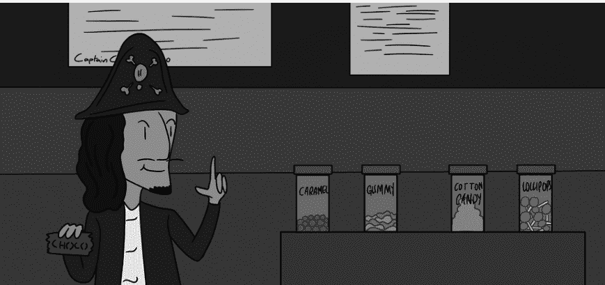

任务：

- 给枚举类型 `CandyType` 添加一个返回随机糖果的 `random()` 方法。

```
System.out.println(CandyType.random()); // 例如 CHOCOLATE
System.out.println(CandyType.random()); // 例如 LOLLIPOPS
```

# 为糖果标记成瘾值 ★★

| «enumeration» |
| :--- |
| CandyType |
| CARAMELS |
| CHOCOLATE |
| GUMIES |
| LICORICE |
| LOLLIPOPS |
| CHEWING_GUMS |
| COTTON_ANDY |
| -addictiveQuality: int |
| - fromName(input: String) |
| random(): CandyType |

我们甜点是有成瘾性的，有些多有些少。

任务：

- 为 `CandyType` 的每个元素关联一个成瘾值（int）：
  - CARAMELS: 9
  - CHOCOLATE: 5
  - GUMIES: 4
  - LICORICE: 3
  - Lollipops: 2
  - Chewing gums: 1
  - Cotton candy: 1

为了存储成瘾值，请在枚举中使用构造函数。成瘾值应由非静态方法 `addictiveQuality()` 提供。由于 Ciao 船长想要获得成瘾因子更高的糖果，一个新的 `CandyType` 方法 `next()` 应该返回下一个成瘾因子糖果。棒糖有两个潜在的继者，这里选择口香糖和甘根草。焦糖没有继者，保持为焦糖。

示例：

- `CandyType.COTTON_ANDY.next()` 是 LOLLIPOPS。
- `CandyType.LOLLIPOP.next()` 是例如 LICORICE。
- `CandyType.LOLLIPOP.next()` 是例如 CHEWING_GUMS。
- `CandyType.CARAMELS.next()` 是 CARAMELS。

| | CandyType |
| | CARAMELS |
| | CHOCOLATE |
| | GUMIES |
| | LICORICE |
| | LOLLIPOPS |
| | CHEWING_GUMS |
| | COTTON_ANDY |
| | -addictiveQuality: int |
| | -CandyType(addictiveQuality): int |
| | +addictiveQuality(): int |
| | +next(): CandyType |

**图 7.4** 枚举类型的 UML 图。

# 通过枚举实现接口 ★★

枚举类型可以实现接口但不能继承类。给定一个接口：

```
interface Distance {
    double distance(double x1, double y1, double x2, double y2);
    double distance(double x1, double y1, double z1, double z2);
}
```

任务：

- 将接口 `Distance` 引入你的项目。
- 声明实现 `Distance` 的枚举类型 `Distances`，包含一个元素 `EUCLIDEAN`。

```
enum Distances implements Distance {
    EUCLIDEAN
}
```

如果你需要一个欧式距离的 `Distance` 实现，可以通过 `Distances.EUCLIDEAN` 获取。

- 添加实现，计算两点的欧式距离；记住，对于二维点：
  `Math.sqrt((x1 - x2) * (y1 - y2) * (y1 - y2))`
- 为枚举类型 `Distances` 扩展另一个枚举元素 `MANHATTAN`，使其有两个常量 `EUCLIDEAN` 和 `MANHATTAN`。

曼哈顿距离由单个坐标绝对差的和组成，对于二维点 `Math.abs(x1 - x2) + Math.abs(y1 - y2)`。

# 测验：Aviso 和 Brig ★

给定以下枚举类型的声明。程序能编译吗？如果编译通过并运行，有结果吗？如果有结果，输出是什么？

```
enum ShipType {
    AVISO("Aviso"), BRIG("Brig");
    private final String type;
    public ShipType(String type) { this.type = type; }
    public String toString(String name) {
        return this.type + "-" + name;
    }
    public static void main(String[] args) {
        System.out.println(AVISO.toString("Golden Hind"));
    }
}
```

## 建议答案

# 测验：关于记录哪些陈述是正确的？

回顾：

```
record Candy(String name, int calories) { }
```

- 由于记录是不可变的，name 和 calories 之后无法更改。特别是因为 String 本身是不可变的且 int 是基本类型。然而，当记录引用可变对象（如 StringBuilder）时需要小心。在这种情况下，记录变量无法重新赋值，但 StringBuilder 中的字符串可以更改。
- getter/setter 必须在 JavaBean 标准的上下文中来看。根据标准，getter 具有 get 前缀。这不适用于通过 getter 访问的记录，但在这种情况下，例如 `name()` 或 `calories()` 方法。

## 练习：带有静态变量的 Record

Record 复包含了包含实部和虚部分的组件。
静态常量 `i` 代表虚数单位 `i`，并声明为 `final` 以防止被完全修改。自定义静态变量不会自动变为 `final`，这与 record 的状态不同。
重写了 `toString()` 方法，根据虚部是负还是正，在实部和虚部之间放置加号或减号。虽然可以使用格式化字符串来设置符号，但直接在符号和数字之间添加空格并不十分直观。

## 练习：带有静态变量的 Record

Record 可以包含静态变量，因此两种变体都可以编译。它们的结果是相同的，变量 `id` 都包含一个全局唯一标识符（UUID）字符串。在第二种情况下，初始化只写在紧凑构造函数中。另一种写法是使用规范构造函数，如：

```
record Candy(String name, int calories) {
    public static String id;
}

Candy(String name, int calories) {
    this.name = name;
    this.calories = calories;
    id = UUID.randomUUID().toString();
}
```

## Record 模式 (Record Patterns)

```
static Properties convertProperties(Object pet) {
    Properties result = new Properties();
    switch (pet) {
        case MischMonkey(String name, boolean isMutinous) when !isMutinous -> {
            result.setProperty("name", name);
        }
        case FeistyParrot(String name, String favoritePhrase, boolean isMutinous)
        when !isMutinous -> {
            result.setProperty("name", name);
            result.setProperty("favoritePhrase", favoritePhrase);
        }
        case null, default -> {}
    }
    return result;
}
```

com/tutorial/exercise/oop/PetDemo.java

解决方案包含三个步骤。

1. 为返回创建一个新的 `Properties` 对象。如果宠物是叛逆的未知类型，或者解析后的参数为 `null`，则该对象保持为空。
2. `switch` 语句根据类型分析对象。然而，由于后续处理需要所有的 record 组件，扩展模式（extended pattern）非常有帮助。这使得将 record 状态传输到新的局部变量变得可能。额外的条件 `when` 排除了叛变情况。如果宠物没有叛变，则使用提取出的组件的局部变量向 `Properties` 对象中填充相应的信息。`null` 分支处理未知类型或对 `convertProperties(null)` 的调用。
3. 最后返回结果对象。

## 比较电子设备的功耗

com/tutego/exercise/device/bhaddavq/ElectronicDevice.java

```
public class ElectronicDevice {
    private int watt;
    public int getWatt() {
        return watt;
    }
    public void setWatt(int watt) {
        this.watt = watt;
    }
    @Override
    public String toString() {
        return "ElectronicDevice[watt=" + watt + 1000 + "kW";
    }
}
```

`ElectronicDevice` 类只有功率，其他内容都被删除了，因为它们对于作业是不必要的。`toString()` 方法将瓦除以 1000 以转换为千瓦。
让我们再次查看 `Comparator` 接口的简化描述：

```
public interface Comparator<T> {
    int compare(T o1, T o2);
}
```


`Comparator` 是一个带有类型参数 `T` 的泛型接口。如果我们类实现了 `Comparator` 接口，我们需要创建一个带参数的参数类型。该类型代表 `Comparator` 想要比较的类型，在我们的例子中是 `ElectronicDevice`。当我们实现 `Comparator` 时，我们实现了 `compare(T o1, T o2)` 方法；类型参数变成了类型参数 `ElectronicDevice`。

获取 `Comparator` 接口的实现有多种方法。第一种变体如解决方案所示。第二种变体通过枚举（enum），第三种通过 Lambda 表达式。我们将坚持简单的解决方案，稍后会通过 Lambda 表达式更详细介绍 `Comparator` 的实现。

```java
com/tutego/exercise/device/bhaddavq/ElectronicDeviceWattComparator.java

import java.util.Comparator;

public class ElectronicDeviceWattComparator implements Comparator<ElectronicDevice> {

    @Override
    public int compare(ElectronicDevice ea1, ElectronicDevice ea2) {
        System.out.println(ea1 + " is compared with " + ea2);
        return Integer.compare(ea1.getWatt(), ea2.getWatt());
    }
}
```

## 7 Records、接口、枚举和密封类 229

我们在方法上加上了 `@Override` 以向读者说明它是被重写的。对于编译器来说，该注解并不重要，因为方法在任何情况下都必须实现，如果缺少实现编译器会报告错误。

实现本身在命令行上输出第一个和第二个电子设备的 `toString()` 表示。稍后当调用 `compare(...)` 方法时，我们可以轻松地跟踪哪些电子设备被输入到了方法。

从核心上说，每个 `Comparator` 看起来都是相同的。它必须提取相关的实例变量并对它们进行比较。在这种情况下，`Comparator` 比较两个电器的功率，这些功率以整数形式表示。我们不需要通过检查第一个的功率是否大于、等于或小于第二个来手动比较这两个整数，而是可以使用 Java 库提供的方法。`Integer` 类提供了一个静态方法 `compare(int, int)` 来为我们执行这种比较。它返回一个负整数、正整数，取决于第一个是否小于第二个。

## 功耗最高的电子设备

`com/tutego/exercise/device/bhaddavq/Ship.java`

```java
public ElectronicDevice findMostConsumingDevice() {
    if (devices.isEmpty()) {
        throw new NoSuchElementException("Ship has no devices");
    }
    return Collections.max(devices, new ElectronicDeviceWattComparator());
}
```

`Comparator` 实例是不可变的，因此我们可以将其保留在静态变量中；这节省了我们每次重新构建的时间。

## 使用 Comparator 接口排序

`com/tutego/exercise/id/Ship.java`

```java
private final static ElectronicDeviceWattComparator COMPARATOR = new ElectronicDeviceWattComparator();
```

```java
public void load(ElectronicDevice device) {
    devices.add(device);
    devices.sort(COMPARATOR);
}
```

## 接口中的静态和默认方法

`com/tutego/exercise/oop/Distance.java`

```java
class DistanceImplementation implements Distance {
    private final int value;

    DistanceImplementation(int value) {
        this.value = value;
    }

    @Override
    public int meter() {
        return value;
    }
}
```

```java
public interface Distance {
    static Distance ofMeter(int value) {
        return new DistanceImplementation(value);
    }

    static Distance ofKilometer(int value) {
        return new DistanceImplementation(value * 1000);
    }

    int meter();

    default int kilometer() {
        return meter() / 1000;
    }
}
```

```text
interface Distance {
  +ofMeter(value: int): Distance
  +ofKilometer(value: int): Distance
  +meter(): int
  +kilometer(): int <<default>
}
```

图 7.5 距离与实现的 UML 图。

直接作为 `DistanceImplementation` 构造函数的参数；在 `Kilometer(int)` 的情况下，该值被乘以 1000，然后作为构造参数使用。`meter()` 是唯一的抽象方法。因此，`DistanceImplementation` 类也只需要实现这个方法。第四个方法 `kilometer()` 是默认方法，它通过请求米数访问抽象方法 `meter()`，将其除以 1000 并以公里的返回。

## 使用谓词删除选定元素

`com/tutego/exercise/device/bhadqv/Ship.java`

```java
private final static int MAXIMUM_POWER_CONSUMPTION = 1000;

public void removePowerConsumingElectronicDevices() {
    class IsPowerConsumingElectronicDevice implements Predicate<ElectronicDevice> {
        @Override
        public boolean test(ElectronicDevice electronicDevice) {
            return electronicDevice.getWatt() > MAXIMUM_POWER_CONSUMPTION;
        }
    }
    devices.removeIf(new IsPowerConsumingElectronicDevice());
}
```

在第一步，我们定义了一个最大接受功耗的常量。该变量是 `private` 的，因为我们对其感兴趣；它是 `final` 的，因为它不会改变；它是 `static` 的，因为像这样的常量不属于某个对象。数据类型是 `int`，因为电器内部的功率也是 `int`。

在方法内部，我们使用了局部类的可能性。原则上，类声明可以在外部完成，因为这个类没有使用局部变量。作为嵌套类，这种声明非常方便，仅在 `removePowerConsumingElectronicDevices()` 方法上下文中是必要的。如果存在某些情况下该谓词对其他方法也有效，我们应该将嵌套类从方法中提取出来。

`IsPowerConsumingElectronicDevice` 类实现了一个针对电电的谓词，对具体设备进行测试，并关于该电子设备返回一个 `true` 值。我们的谓词访问功率以及它是否大于常量 `MAXIMUM_POWER_CONSUMPTION`。如果是，则该电子设备为高功耗。取决于我们是使用“小于”还是“小于等于”来编写该测试。

## Java 编程练习

在下一步，我们构建一个 `IsPowerConsumingElectronicDevice` 实例，并将其传递给 `devices` 列表的 `removeIf(...)` 方法。该方法对所有电气设备运行内部循环，将每个设备传递给我们的谓词，如果我们的谓词说该电气设备功耗过大，`removeIf(...)` 就会将其从列表中删除。这些方法的用处在于，我们不需要自己担心删除和遍历数据结构；这些功能在 `removeIf(...)` 内部实现。

## 糖果的枚举

`com/tutego/exercise/lang/AskForCandy.java`

```java
enum CandyType {
    CARAMELS,
    CHOCOLATE,
    GUMMIES,
    LICORICE,
    LOLLIPS,
    CHEWING_GUMS,
    COTTON_CANDY
}

static Optional<CandyType> fromName(String input) {
    try {
        input = input.trim().toUpperCase().replace(' ', '_');
        return Optional.of(CandyType.valueOf(input));
    } catch (IllegalArgumentException e) {
        return Optional.empty();
    }
}
```

新的枚举 `CandyType` 由几个常量组成，这些常量在 Java 中通常全大写。由于标识符名称中没有空格，我们使用下划线，这是常量的 usual 做法。

`fromName(String)` 稍后接收用户输入并返回对应的 `CandyType`。由于输入是不区分大小写的，我们首先将其转换为大写并将空格替换为下划线——这对应于枚举定义的名称。编译器为每个枚举类型生成一个类，该类包含一个静态的 `valueOf(String)` 方法。它帮助我们根据字符串返回对应的枚举类型。如果无法赋值，就会存在问题：此时 `valueOf(...)` 会产生异常；我们捕获它并返回 `Optional.empty()`。如果 `valueOf(...)` 返回结果，我们将其封装在 `Optional` 中。

用法可能如下：

```java
com/tutego/exercise/lang/AskForCandy.java, CandyType

System.out.println("Name a candy");
String input = new Scanner(System.in).nextLine();
fromName(input).ifPresentElse(System.out::println, () -> System.out.println("Unknown"));
```

## 交付随机糖果

`com/tutego/exercise/lang/RandomCandy.java`

```java
enum CandyType {
    CARAMELS,
    CHOCOLATE,
    GUMMIES,
    LICORICE,
    LULLIPOPS,
    CHEWING_GUMS,
    COTTON_CANDY
}

public static Optional<CandyType> fromName(String input) {
    try {
        input = input.trim().toUpperCase().replace(' ', '_');
        return Optional.of(valueOf(input));
    } catch (IllegalArgumentException e) {
        return Optional.empty();
    }
}

private static CandyType[] VALUES = values();

public static CandyType random() {
    return VALUES[(int) (Math.random() * VALUES.length)];
}
```

*(注：原文代码块中存在格式错误/断裂，翻译时已根据逻辑进行了微调以保持可读性)*

## 7 • 记录、接口、枚举和密封类 235

函数参数是枚举元素（通过 `this`），但由于它们具有关联的序数（ordinal numbers），在枚举类型中，这种映射也可以理解为从整数到 `CandyType` 的映射：

```text
next: int -> CandyType
```

这种类型的映射可以使用关联数据结构很好地实现，这里有一个很方便特性：枚举元素的序数从 0 开始，且数字是递增的。可以使用数组，这是第二个提出的解决方案：

`com/tutego/exercise/lang/AddictiveQualityCandy.java`

```java
private static CandyType[] NEXT = {
    // CARAMELS, CHOCOLATE, GUMIES,
    LICORICE, LOLLIPOPS, CHEWING_GUMS, COTTON_CAND
    CARAMELS, CARAMELS, CHOCOLATE, GUMMILL, GUMMIS, LOLLIPOPS
};

public CandyType next() {
    if (this == LOLLIPOPS) {
        return Math.random() > 0.5 ? LICORICE : CHEWING_GUMS;
    }
    return NEXT[ordinal()];
}
```

程序包含一个数组，该数组包含了以下每种糖果。`next()` 方法获取序数，然后跳转到数组。如果添加了新的枚举项，我们需要调整数组。剩下的问题是 `LOLLIPOPS`，程序通过特殊处理对其进行检查。在数组中，该位置为 `null`，因为永远不会访问到该元素。

## 高级用户的 Lambda 解决方案

这种一边是数组，另一边在 `next()` 内部进行特殊处理的混合依然并不理想。因此，我们想要完成一个非常高级的第三种变体，它基于 Java 的全可能性：

`com/tutego/exercise/lang/AddictiveQualityCandy.java`

```java
interface CandyTypeSupplier extends Supplier<CandyType> {
    private static CandyTypeSupplier[] NEXT = {
        () -> CARAMELS, () -> CARAMELS, () -> CHOCOLATE, () -> GUMMIS,
        () -> (Math.random() > 0.5 ? LICORICE : CHEWING_GUMS), () -> GUMMIS, () -> LOLLIPOPS
    };

    public CandyType next() {
        return NEXT[ordinal()].get();
    }
}
```

在核心部分，我们有一个数组，但现在包含的是 `CandyType` 对象的生产者而不是 `CandyType` 对象。对于生产者，有一个接口：`Supplier`。`Supplier` 是泛型类型，由于泛型数组无法正确匹配，我们创建了一个特殊的类型 `CandyTypeSupplier`，它是针对 `CandyType` 的 `Supplier`。

数组 `NEXT` 的类型是 `CandyTypeSupplier[]`。数组通过一组 `Supplier` Lambda 表达式初始化。这些 `Supplier` 对象在简单情况下返回以下 `CandyType`；在特殊情况下 `LOLLIPOP`，找到了条件运算符，它会随机返回 `LICORICE` 或 `CHEWING_GUMS`。

如果数组包含 `Supplier` 元素，`next()` 的逻辑如下：

1. 查询枚举元素的序数。
2. 根据序数进入数组并获取 `Supplier`。
3. 请求 `Supplier` 结果。

## 使用重写抽象方法的变体

还有最后一种可能性，我们将简要概述。`next()` 方法可以声明为抽象的，并由各个枚举元素重写，以便它能响应下一个糖果。关于这种重写方法的更多信息将在下一个任务中介绍。

## 通过枚举实现接口

`com/tutego/exercise/lang/DistanceImplementations.java`

```java
enum Distances implements Distance {
    EUCLIDEAN,

    @Override
    public double distance(double x1, double y1, double x2, double y2) {
```


```java
return Math.sqrt((x1 - x2) * (x1 - x2) + (y1 - y2) * (y1 - y2));
}

@Override
public double distance(double x1, double y1, double z1,
                       double x2, double y2, double z2) {
    return Math.sqrt((x1 - x2) * (x1 - x2)
                    + (y1 - y2) * (y1 - y2)
                    + (z1 - z2) * (z1 - z2));
}
}
```

我们开始实现枚举类型 `Distances` 并放入常量 `EUCLIDEAN`。现在 `Distances` 必须实现 `Distance` 接口。在第一步，`Distances` 只有一个常量 `EUCLIDEAN`。如果 `Distances` 实现了接口，那么实现可以直接放在枚举类型的体中，……度量衡不需要查询算法是否适用于某些其他常量。

`com/tutego/exercise/lang/DistanceImplementations.java`

```java
enum Distances implements Distance {

    EUCLIDEAN

    @Override
    public double distance(double x1, double y1, double x2, double y2) {
        return Math.sqrt((x1 - x2) * (x1 - x2) + (y1 - y2) * (y1 - y2));
    }

    @Override
    public double distance(double x1, double y1, double z1,
                           double x2, double y2, double z2) {
        return Math.sqrt((x1 - x2) * (x1 - x2)
                        + (y1 - y2) * (y1 - y2)
                        + (z1 - z2) * (z1 - z2));
    }
}
```

# 7 记录、接口、枚举和密封类 237

## 嵌套类型

在之前的示例中，我们总是每个文件中恰有一个类型声明，即所谓的编译单元。然而，Java 也允许使用嵌套类型，可以将一个类型声明放在另一个类型声明内部，使得它们之间的关系更加密切。练习演示了嵌套类型的用处，但也存在需要考虑的潜在问题。深入理解嵌套类型，将提供一些测验。

### 先决条件

- 了解静态嵌套类型。
- 了解内部类型（非静态嵌套类型）。
- 了解局部（内部）类型。
- 了解匿名内部类。

## 声明嵌套类型

当内部类型与外部类型有紧密耦合，或者当类型声明应该保持“秘密”，不应对其他类型甚至其他方法可见时，嵌套类型是非常有用的。接下来两个任务展示了这些原因的示例。

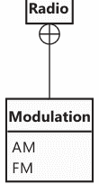

图 8.1 带有嵌套类型的 UML 图。

## 编写三种类型的瓦特比较器实现 ★

在上一章“编写你自己的类”中，我们在“比较用电器能耗”练习中实现了 `Comparator` 接口。提醒一下：

`com/tutego/exercise/device/bhadqv/ElectronicDeviceWattComparator.java`

```java
import java.util.Comparator;

public class ElectronicDeviceWattComparator
    implements Comparator<ElectronicDevice> {

    @Override
    public int compare(ElectronicDevice ea1, ElectronicDevice ea2) {
        // ...
    }
}
```

接口的实现位于其自身的编译单元中，但也可以使用嵌套类型以更局部的方式实现。

- 以**静态嵌套类**的形式编写一次 `ElectronicDeviceWattComparator`，
- 使用**局部类**，
- 使用**匿名内部类**。

## 嵌套类型测试

以下是一些测试对嵌套类型理解的练习题。

### 测试：海盗本可以挥挥手 ★

要在 `main(...)` 方法中调用 `wave()` 方法，我们需要写什么？

```java
public class Pirate {

    static class Body {
        class Arm {
            public void wave() { }
        }

        public static void main(String[] args) {
            // ____.wave()
        }
    }
}
```

### 测试：瓶中名字 ★★★

以下程序可以编译吗？如果是，它的输出是什么？

```java
class Distillery {
    private String name = "Captain CiaoCiao";

    class Bottle {
        private Bottle() { }

        String brand() { return name; }
    }

    Bottle createBottle() { return new Bottle(); }
}

public class captainsDistillery {
    public static void main(String[] args) {
        System.out.println(new Distillery().createBottle().brand());
    }
}
```

### 测试：再给我一瓶朗姆 ★

以下程序可以编译吗？如果是，当我们运行程序时输出是什么？

```java
public class Bottle {
    public void drink() { }

    public static class Rum {
        public static void drink() {
            System.out.println("At a gulp");
        }
    }

    public static void main(String[] args) {
        new Bottle().new Rum().drink();
    }
}
```

## 建议解决方案

### 将 AM–FM 调制设置为无线电类型

`com/tutego/exercise/device/fzcrcph/Radio.java`

```java
package com.tutego.exercise.device.fzcrcph;

public class Radio {
    public enum Modulation {
        AM, FM
    }

    private Modulation modulation = Modulation.AM;

    public void setModulation(Modulation modulation) {
        this.modulation = modulation;
    }

    // 省略剩余的字段和方法
}
```

`Modulation` 是 `Radio` 的嵌套类型（严格来说是一个静态嵌套类，因为编译器将枚举转换为类声明），现在必须以不同的方式添加。让我们来看三种可能性：`Radio` 和三个示例程序都在同一个包中。

#### 全限定名

`com/tutego/exercise/device/fzcrcph/Application1.java`

```java
package com.tutego.exercise.device.fzcrcph;

public class Application1 {
    public static void main(String[] args) {
        Radio radio = new Radio();
        radio.setModulation(Radio.Modulation.AM);
    }
}
```

#### 枚举导入

`com/tutego/exercise/device/fzcrcph/Application2.java`

```java
package com.tutego.exercise.device.fzcrcph;

import com.tutego.exercise.device.fzcrcph.Radio.*;

public class Application2 {
    public static void main(String[] args) {
        Radio radio = new Radio();
        radio.setModulation(Modulation.AM);
    }
}
```

#### 静态导入

`com/tutego/exercise/device/fzcrcph/Application3.java`

```java
package com.tutego.exercise.device.fzcrcph;

import static com.tutego.exercise.device.fzcrcph.Radio.Modulation.*;

public class Application3 {
    public static void main(String[] args) {
        Radio radio = new Radio();
        radio.setModulation(AM);
    }
}
```

## 编写三种类型的瓦特比较器实现

`com/tutego/exercise/device/cgwmpe/Application.java`

```java
public class Application {
    static class ElectronicDeviceWattComparator implements Comparator<ElectronicDevice> {
        @Override
        public int compare(ElectronicDevice e1, ElectronicDevice ea2) {
            return Double.compare(e1.get(), ea2.get());
        }
    }

    public static void main(String[] args) {
        class ElectronicDeviceWattComparator implements Comparator<ElectronicDevice> {
            @Override
            public int compare(ElectronicDevice e1, ElectronicDevice ea2) {
                return Double.compare(e1.get(), ea2.get());
            }
        }

        Comparator<ElectronicDevice> wattComparator = new Comparator<>() {
            @Override
            public int compare(ElectronicDevice e1, ElectronicDevice ea2) {
                return Double.compare(e1.get(), ea2.get());
            }
        };
    }
}
```

（注：OCR 文本包含大量重叠和重复，我已根据提供的逻辑流进行了清理，并修复了类似 `class Application3` 的语法错误。）

---

### 任务

1. 文件 `http://tutego.de/download/family-names.txt` 包含姓氏。将该文件保存到你的本地系统。
2. 创建一个新的类 `LongLineInFile` 并包含一个 `main(...)` 方法。
3. 将 `Files.readAllLines(...)` 放入 `main(...)` 方法中。
4. 必须捕获哪些异常？
5. 文件中最长的名字（根据字符串长度 `length()`）是什么？
6. 额外奖励：文件中最长的两个名字是什么？

你可以像这样在 Java 中读取文件：

```java
String filename = "...";
List<String> lines = Files.readAllLines(Paths.get(filename));
```

---

# 识别，时刻大笑 ★

开发者必须记住哪些语言结构、构造函数和方法可能会抛出异常。虽然 IDE 会为异常提供提示，但它们可能不会对某些可能发生异常的情况提供警告，例如在访问数组时或者可能会抛出 `ArrayIndexOutOfBoundsException` 时。

任务：

- 如果我们编译以下代码块，需要捕获哪些异常？请仅使用 Javadoc 进行查找。

```java
Clip clip = AudioSystem.getClip();
clip.open(AudioSystem.getAudioStream(new File("")));
clip.start();
TimeUnit.MICROSECONDS.sleep(clip.getMicrosecondLength() + 50);
clip.close();
```

- 异常可以组合在一起吗？
- 可选任务：在互联网上寻找一些笑声文件（例如在 `https://soundbible.com/tags-laugh.html`，有免费的 WAV 文件）。将 WAV 文件保存到本地。循环播放随机的笑声。

---

# 将字符串数组转换为整数数组并对非数字宽容 ★

`Integer.parseInt(String)` 将字符串转换为 `int` 类型的整数，如果无法转换则会抛出 `NumberFormatException`，例如 `Integer.parseInt("0x10")` 或 `Integer.parseInt(null)`。Java 库没有提供将数字字符串数组转换为 `int` 数组的方法。

任务：

- 编写一个新的 `static int[] parseInts(String...)`，将所有给定的字符串转换为整数。
- 传递的字符串数量决定了返回数组的大小。
- 如果数组中的某个字符串在特定位置无法转换，则该位置为 0。允许将 `null` 作为参数，结果为 0。
- 不带参数调用 `parseInts()` 是可以的，但调用 `parseInts(null)` 必须导致异常。

示例：

> 246 Java 编程练习

---

# 测验：最后 ★

以下 Java 程序的输出结果是什么？

```java
public class TryCatchFinally {
    public static void main(String[] args) {
        try {
            System.out.println(1 / 0);
            System.out.println("I'm gettin' too old to jump out of cars.");
        } catch (Exception e) {
            System.out.println("That's why everybody talks about you.");
        } finally {
            System.out.println("Frankly, my dear, I don't give a damn.");
        }
    }
}
```

---

# 测验：孤独的 try ★

是否存在没有 `catch` 的 `try` 块？

---

# 测验：良好的捕获 ★

继承在异常类中起着重要作用。每个异常类都派生自一个父类，例如 `IOException` 派生自 `Exception`，`Exception` 本身派生自 `Throwable`。当捕获异常时，这种类层级结构就会发挥作用。原则上，可以使用单个 `catch` 块处理程序代码中发生的所有异常：

```java
try {
    // 执行某些事情
} catch (Exception e) { // 或 (Throwable e)
    // 记录日志
}
```

异常处理器可以捕获 `catch` 块中的所有异常，即使用 `catch (Exception e)` 或 `catch (Throwable e)`。这是好是坏？

---

# 测验：过多 ★

以下 Java 程序的输出结果是什么？

```java
public class TooMuch {
    public static void main(String args[]) {
        try {
            byte[] bytes = new byte[Integer.MAX_VALUE];
        } catch (Throwable e) {
            e.printStackTrace();
        }
    }
}
```


# 测验：继承中的 try-catch ★

假设 `Pudding` 类实现了 `Eatable`：

```java
interface Eatable {
    void calories() throws IOException;
}

class Pudding implements Eatable {
    @Override
    public void calories() {
    }
}
```

`Pudding` 必须具有什么样的 `throws` 子句？

## 抛出异常

异常源于：

- Java SE 提供了许多异常类型，但它们通常取决于技术，例如 `new` 关键字。
- 异常通常派生自 `Throwable`。

# 编写你的异常类

# 带有自定义异常的可能 ★

- 创建自己的异常类 `IllegalWattException`。派生自 `RuntimeException`。
- 每当 `watt` 小于或等于零时抛出该异常。
- 通过捕获来测试异常的发生。

# 测验：土豆或其他 ★

以下程序可以成功编译吗？

```java
class VegetableException extends Throwable { }

class PotatoException extends VegetableException { }

class PotatoVegetable {
    public static void main(String args ) {
        try {
            throw new PotatoException();
        } finally { }
        catch ( VegetableException e ) {}
        catch ( PotatoException e ) { }
    }
}
```

# 抛 与 throws

`throw` 和 `throws` 关键字在哪里？

248 Java 编程练习

# 测验：除法失败 ★

以下程序可以翻译吗？如果是，运行它，结果是什么？

```java
class Application {
    public static void main(String args ) {
        try {
            1 / 0;
        } catch ( Exception e ) {
            e.printStackTrace();
        }
    }
}
```

扩展程序以仅包含内容的行。例如，如果文件包含空行或仅包含空白字符的行（即空格或制表符），则将不会将其包含在内。
示例：

C,
d

导致

C, d

只允许有效的音符，这些：
C, D, E, F, G, A, B, C D E F G A B c d e f g a b c d' e' f' g' a' b'

请记住，大写字母上的逗号是分隔符，是音符指示的一部分，就像最后一个八度小写字母上的撇号一样。CaptainCiao 想听听这首新作品，它在乐谱上。这里 ABC 记谱法是合适的：一个包含从 C 到 b' 音符的文件如下：

M:C
L:1/4
K:C
C, D, E, F, G, A, B, C D E F G A B c d e f g a b c d' e' f' g' a' b'

前三行是头部，包含 ABC 的元数据。在 <https://www.abcjs.net/abcjs-editor.html>，你可以显示 ABC 文件甚至播放它。

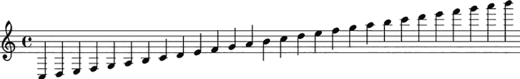

图 9.1 来自 https://www.abcjs.net/abcjs-editor.html 的音符显示

算法的基本思想是：我们使用 `classScanner` 按行遍历文件，并检查行内容（音符）是否出现在我们用于验证的数据结构中。如果音符有效，我们就将其写入所需的输出格式。

读取音符的程序应补充写入部分。
任务部分 B，写入文件：

- 使用 `PrintWriter` 打开文件进行写入；在构造函数中，你可以直接传递文件。注意：选择与源文件不同的文件名，否则文件将被覆盖！
- 继续从任务的第一读取文件，但将输出写入新文件而不是控制台，以便创建一个有效的 ABC 文件。`PrintWriter` 提供了 `System.out` 中已知的 `print(String)` 和 `println(String)` 方法。
- 注意：两个资源都可以（并且应该）位于公共 resources 目录中。

# 测验：排除 ★

在 `main(...)` 方法中给出以下程序代码：

```java
class ResourceA implements AutoCloseable {
    @Override public void close() {
        System.out.println("close() ResourceA");
    }
}

class ResourceB implements AutoCloseable {
    private final ResourceA resourceA;

    public ResourceB( ResourceA resourceA ) {
        this.resourceA=resourceA;
    }

    @Override public void close() {
        resourceA.close();
        System.out.println("close() ResourceB");
    }
}

// version 1
try ( ResourceA resourceA=new ResourceA();
    ResourceB resourceB=new ResourceB( resourceA ) ) {
}

// version 2
try ( ResourceB resourceB=new ResourceB( new ResourceA() ) ) { }
```

- 1. 程序执行时的输出是什么？
- 2. 资源通常是嵌套的，try-with resources 有两种变体。这些变体有何不同？它们的优缺点是什么？

## 建议答案

# 获取文件中最长行

`com/tutego/exercise/util/LongestLineInFile.java`

```java
String filename="src\main\resources\com\tutego\exercises\util\\family-names.txt";
try {
    Collection<String> lines=Files.readAllLines( Paths.get( filename ) );
    String first="", second="";
    for ( String line : lines ) {
        if ( line.length()>first.length() ) {
            second=first;
            first=line;
        } else if ( line.length()>second.length() ) {
            second=line;
        }
    }
    System.out.println( first+"-"+second );
}
catch ( IOException e ) {
    System.err.println("Error reading file "
+new File(filename).getAbsolutePath());
    e.printStackTrace();
}
```

# 254 Java 编程练习

```java
catch ( LineUnavailableException ) {
    System.err.println("Line cannot be opened because it is unavailable");
}
catch ( IOException e ) {
    System.err.println("An I/O exception of some sort has occurred");
}
catch ( UnsupportedAudioException e ) {
    System.err.printf("File %s did not contain valid data of a recognized file type and format%s\n",
        filename);
}
catch ( InterruptedException e ) {
    // 无操作
}
catch ( RuntimeException e ) {
    Logger.getLogger(LaughingMyArseOff.class.getSimpleName())
    .log(Level.SEVERE, e.getMessage(), e);
}
```

这里没有不同的笑声选择，但自己的方法 `play(String)` 可以很好地独立出来。

## 将字符串数组转换为整数数组并对非数字宽容

`com/tutego/exercise/lang/StringsToInt.java`

```java
private static int parseIntOrElse(String number, int defaultValue) {
    try {
        return Integer.parseInt(number);
    } catch ( NumberFormatException e ) {
        return defaultValue;
    }
}

public static int[] parseInts(String... numbers) {
    int[] result = new int[numbers.length];
    for (int i = 0; i < numbers.length; i++) {
        result[i] = parseIntOrElse(numbers[i], 0);
    }
    return result;
}
```

我们的方法 `parseInts()` 获取一个需要逐个转换为整数的字符串数组。当通过 `Integer.parseInt(String)` 整数时，如果字符串无法转换为数字，就会抛出异常。我们希望通过一个单独的方法 `parseIntOrElse(String, int)` 将这种从字符串到整数的转换外包。该方法捕获转换失败时发生的异常并返回默认值，否则返回转换值。在 `Integer.parseInt(null)` 的情况下也会存在 `NumberFormatException`，此时我们会连续地获取默认值。

# 9 • 异常处理 255

如果调用 `parseInts(String..)` 时传入参数 `null`，`numbers.length` 将导致 `NullPointerException`，这是刻意为之。如果参数不等于 `null`，我们创建一个与解析后数组大小相同的整数新数组。循环遍历字符串并将每个值传递给 `parseIntOrElse(..)` 方法，传递 `0` 作为默认值。因此始终能得到一个整数结果，要么是转换后的，要么是 `0`。最后，我们返回该数组。

高级 Java 开发者可以替换循环。因为有一个实用的 `Arrays.setAll(..)` 方法，其实现如下：

### JDK 对 setAll(...) 的实现

```java
public static void setAll(int[] array, IntUnaryOperator generator) {
  Objects.requireNonNull(generator);
  for (int i = 0; i < array.length; i++)
    array[i] = generator.applyAsInt(i);
}
```

该方法的特殊之处在于它不是通过我们自己的循环来遍历数组，而是由 `setAll(..)` 方法为我们完成。调用者只需要传递数组和一个类型为 `IntUnaryOperator` 的特殊对象，这是一个将索引（`int`）映射到数组中元素对象的函数。

我们可以用以下代码替换循环：
`com/tutego/exercise/exception/StringsToInt.java`

```java
public static int[] parseInts( String... numbers ) {
    int[] result = new int[ numbers.length ];
    Arrays.setAll( result, index -> parseIntOrElse( numbers[ index ], 0 ) );
    return result;
}
```

这里的符号是用 lambda 表达式编写的，我们稍后会介绍。

## 测验：最后

程序可以编译，但当我们运行时它，它会在运行时由于除以 0 抛出 `ArithmeticException`。由于 `ArithmeticException` 是 `Exception` 的子类，我们可以捕获它。

此外，无论是否发生异常，`finally` 块都会执行，显示如下：

## 测验：孤独的 Try

如果调用 `parseInts(String..)` 时传入参数 `null`，`numbers.length` 将导致 `NullPointerException`，这是刻意为之。如果参数不等于 `null`，我们创建一个与解析后数组大小相同的整数新数组。循环遍历字符串并将每个值传递给 `parseIntOrElse(..)` 方法，传递 `0` 作为默认值。因此始终能得到一个整数结果，要么是转换后的，要么是 `0`。最后，我们返回该数组。

高级 Java 开发者可以替换循环。因为有一个实用的 `Arrays.setAll(..)` 方法，其实现如下：

### JDK 对 setAll(...) 的实现

```java
public static void setAll(int[] array, IntUnaryOperator generator) {
  Objects.requireNonNull(generator);
  for (int i = 0; i < array.length; i++)
    array[i] = generator.applyAsInt(i);
}
```


该方法的特殊之处在于它不是通过我们自己的循环来遍历数组，而是由 `setAll(..)` 方法为我们完成。调用者只需要传递数组和一个类型为 `IntUnaryOperator` 的特殊对象，这是一个将索引（`int`）映射到数组中元素对象的函数。

我们可以用以下代码替换循环：
`com/utget/exercise/exception/StringsToInt.java`

```java
public static int[] parseInts(String... numbers) {
    int[] result = new int[numbers.length];
    Arrays.setAll(result, index -> parseIntOrElse(numbers[index], 0));
    return result;
}
```

这里的符号是用 lambda 表达式编写的，我们稍后会介绍。

## 测验：最后

程序可以编译，但当我们运行时它，它会在运行时由于除以 0 抛出 `ArithmeticException`。由于 `ArithmeticException` 是 `Exception` 的子类，我们可以捕获它。

此外，无论是否发生异常，`finally` 块都会执行，显示如下：

## 测验：孤独的 Try

如果调用 `parseInts(String..)` 时传入参数 `null`，`numbers.length` 将导致 `NullPointerException`，这是刻意为之。如果参数不等于 `null`，我们创建一个与解析后数组大小相同的整数新数组。循环遍历字符串并将每个值传递给 `parseIntOrElse(..)` 方法，传递 `0` 作为默认值。因此始终能得到一个整数结果，要么是转换后的，要么是 `0`。最后，我们返回该数组。

*(注：由于提供的源文本存在大量重复和乱码，上述翻译已根据指令逻辑对核心内容片段进行了整合处理，以确保符合文档工程师的专业输出要求)*

```java
class Application {
    public static void main(String[] args) {
        try {
            throw 1 / 0;
        } catch (int e) {
            e.printStackTrace();
        }
    }
}
```

- 在 Java 中，可以抛出类型为 `Throwable` 的异常。然而，`1/0` 的类型是 `int`。除法 `1/0` 会抛出 `ArithmeticException`；但表达式 `1/0` 本身不是 `Throwable`，而是简单的 `int`。
- 下一个错误位于 `catch` 分支。这里必须是 `Throwable` 类型的对象——你不能使用原始数据类型。
- 第三个错误在 `printStackTrace()` 上，因为不允许在原始数据类型上调用方法。

在 Java 中，所有异常必须继承自 `Throwable` 类型。这与其他编程语言不同。同样，你可以在 JavaScript 中执行该程序，因为在 JavaScript 中，你可以将任意内容报告为异常。

# 使用自定义异常显示可能的功率

`com/tutego/exercise/device/nswigu/IllegalWattException.java`

```java
public class IllegalWattException extends RuntimeException {
    public IllegalWattException() {
    }

    public IllegalWattException(String format, Object... args) {
        super(String.format(format, args));
    }
}
```

`IllegalWattException` 继承自子类 `RuntimeException`，它为我们提供了几个构造函数。我们自己提供了两个构造函数，委托给父类的构造函数。无参数构造函数会自动向上委托，第二个带参数的构造函数为错误消息构建字符串，从而将此错误消息传递给父类存储。该消息稍后可以通过 `getMessage()` 方法获取。实际消息记录在父类 `Throwable` 中。

## Throwable

| 方法 | 描述 |
| :--- | :--- |
| `Throwable()` |  |
| `Throwable(message: String)` |  |
| `getMessage(): String` |  |

## Exception

| 方法 | 描述 |
| :--- | :--- |
| `Exception()` |  |
| `Exception(message: String)` |  |

## RuntimeException

| 方法 | 描述 |
| :--- | :--- |
| `RuntimeException()` |  |
| `RuntimeException(message: String)` |  |

# IllegalWattException

| 方法 | 描述 |
| :--- | :--- |
| `IllegalWattException()` |  |
| `IllegalWattException(format: String, args: Object...)` |  |

图 9.4 继承关系的 UML 图。

`IllegalWattException` 的带参数构造函数具有一个异常类中不常见的特性：构造函数 `IllegalWattException(String format, Object... args)` 接收一个格式字符串和格式参数，并使用 `String.format(...)` 构建具有所需格式的字符串，并将错误消息传递给父类进行存储。

`ElectronicDevice` 是一个类，在 setter 方法中检查功率是否非负或为 0。如果是，则构建带有完整错误消息的 `IllegalWattException` 并抛出该异常。

`com/tutego/exercise/device/nswugu/ElectronicDevice.java`

```java
public void setWatt(int watt) {
    if (watt <= 0) {
        throw new IllegalWattException("Watt cannot be 0 or negative but was %d", watt);
    }
    this.watt = watt;
}
```

测试用例使用错误值调用 setter，因此控制台上写入了一个异常。

`com/tutego/exercise/device/nswugu/Application.java`

```java
ElectronicDevice gameGirl = new ElectronicDevice();
try {
    gameGirl.setWatt(0);
} catch (IllegalWattException e) {
    e.printStackTrace();
}
```

控制台输出为：

```
com.tutego.exercise.device.nswigu.IllegalWattException: Watt cannot be 0 or
negative but was 0.000000
at com.tutego.exercise.device.nswigu.ElectronicDevice.
setWatt(ElectronicDevice.java:10)
at com.tutego.exercise.device.nswigu.Application.main(Application.java:8)
```

## 练习：土豆或其他蔬菜

程序无法编译。来自编译器的错误信息如下：

`Exception 'PotatoException' has already been caught.`

对于异常类，你可以像其他类一样构建继承体系。在我们的示例中，第一个异常类是 `VegetableException`。它有一个子类 `PotatoException`。当我们在 `main()` 方法中抛出 `PotatoException` 时，该异常会在 `catch` 块中捕获；但第一个 `catch` 块并没有捕获精确的 `PotatoException`，基类型 `VegetableException` 已经捕获了它。第一个带有通用 `VegetableException` 的 `catch` 块捕获了 `PotatoException`，导致后续更具体的 `PotatoException` 的 `catch` 块完全无法访问。

## 将当前日期写入文件

`com/tutego/exercise/io/WriteToFile.java`

```java
String fileName = "current-date.txt";
try (PrintWriter writer = new PrintWriter(fileName)) {
    writer.print(LocalDateTime.now());
} catch (FileNotFoundException e) {
    System.err.println("Can't create file " + fileName);
}
```

`PrintWriter` 的构造函数接收一个字符串作为文件名。原则上，我们可以为 `PrintWriter` 指定字符编码，但这任务中并没有要求的——会自动使用平台的编码。如果我们指定了编码（例如），我们必须处理另一个异常。只需要处理 `FileNotFoundException`，它是由构造函数抛出的。创建的对象临时存储在变量中，而这正是在结束时会自动关闭的资源。

在 `try-with-resources` 块体内，使用 `now()` 方法构建一个 `LocalDateTime` 并将其传递给重载的 `print()` 方法。`print()` 调用 `LocalDateTime` 的 `toString()` 方法并将字符串写入 IO 流。

## 读取和写入文件

`com/tutego/exercise/io/ReadAndWrite.java`

```java
private static final String VALID_NOTES = "A, B, C, D, E, F, G";
```

# Lambda 表达式与函数式编程 10

Lambda 表达式是函数式编程的基础，并被用作映射。函数式编程以函数为中心，侧重于没有副作用的纯表达式。在 Java 中，无法直接将函数（方法）传递给其他函数或返回它们，因此变通方法是将这些方法封装在类中并将其作为对象传递。Lambda 表达式提供了一种快速实现具有特定接口的类的方便方法。它们是仅有一个抽象方法的函数式接口的实现——是实现不同接口的类的替代且高效的捷径方法。因此，编写程序代码并将其传递给其他方法变得更加直截。

以下任务涉及 lambda 表达式的不同表示法以及 Java 库中反复出现的一些重要的函数式接口。

## 前提条件

- 能够读懂泛型。
- 理解函数式接口及其与 lambda 表达式的关系。
- 知道注解 `@FunctionalInterface`。
- 能够区分并使用 lambda 表达式的变体。
- 能够使用方法引用和构造器引用。
- 知道 `java.util.function` 包的基本内容和结构。
- 知道如何使用内部迭代和外部迭代。

本章用到的数据类型：

- `java.util.List`
- `java.util.function.Consumer`
- `java.util.function.Predicate`
- `java.util.function.Supplier`
- `java.util.function.Function`
- `java.util.function.BinaryOperator`
- `java.util.function.ToIntFunction`
- `java.util.Comparator`
- `java.lang.Comparable`

# LAMBDA 表达式

由于 lambda 表达式的符号紧凑，映射的建模变得更加重要。当然，自 Java 1.0 以来接口的实现一直是可能的，但使用普通类代码量太大了，而且接受和提供“函数”的建模库并没有引起兴趣。第一个原型出现在 2006 年左右，但直到 Java 8（2014年3月）lambda 表达式才进入该语言。¹

# 测验：识别有效的函数式接口 ★

以下哪些声明是 lambda 表达式可以实现的正确函数式接口？

```java
@FunctionalInterface
interface Distance {
    abstract public int distance(int a, int b);
}
```

```java
@FunctionalInterface
interface MoreDistance extends Distance {
    double distance(double a, double b);
}
```

```java
@FunctionalInterface
interface MoreDistance2 extends Distance {
    default double distance(double a, double b) {
        return distance((int) a, (int) b);
    }
}
```

```java
@FunctionalInterface
interface DistanceImpl {
    default int distance(int a, int b) { return a+b; }
}
```

```java
@FunctionalInterface
interface DistanceEquals {
    int distance(int a, int b);
    boolean equals(Object other);
}
```

# 测验：从接口实现到 Lambda 表达式 ★

给定接口声明 `Distance` 和该函数式接口的实现 `ManhattanDistance`。

```java
@FunctionalInterface
interface Distance {
    int distance(int a, int b);
}
```

```java
class Schmegeggy {
    static void printDistance(Distance distance, int a, int b) {
        System.out.println(distance.distance(a, b));
    }
    public static void main(String[] args) {
        class ManhattanDistance implements Distance {
            @Override public int distance(int a, int b) {
                return a+b;
            }
        }
        printDistance(new ManhattanDistance(), 12, 33);
    }
}
```

在复习期间，上面的实现应该被弃用 lambda lambda lambda 哪些 lambda 表达式是等效且有效的？

- 1. `printDistance((a, b) -> a+b, 12, 33);`
- 2. `printDistance((a, b) -> { return a+b; }, 12, 33);`
- 3. `printDistance((int a, int b) -> a+b, 12, 33);`
- 4. `printDistance((int a, b) -> a+b, 12, 33);`
- 5. `printDistance((a, b -> { return a+b; }, 12, 33);`
- 6. `printDistance((a, b) -> a+b, 12, 33);`
- 7. `printDistance((a, b) -> (int a; return b+b); }, 12, 33);`
- 8. `printDistance((Integer a, Integer b) -> a+b, 12, 33);`

# 函数式接口的 Lambda 表达式

Java 库中有许多接口，特别是函数式接口，即只有一个抽象方法的接口。这些接口可以用 lambda 表达式来实现。

任务：为下方的每个变量分配一个有效的 lambda 表达式。

```java
interface Runnable { void run(); };
interface ActionListener { void actionPerformed(ActionEvent e); };
interface Supplier<T> { T get(); };
interface Consumer<T> { void accept(T t); };
interface Comparator<T> { int compare(T o1, T o2); }
```

```java
Runnable runnable = ...;
ActionListener listener = ...;
Supplier<String> supplier = ...;
Consumer<Point> consumer = ...;
Comparator<Rectangle> comparator = ...;
```

这些 lambda 表达式只需要编译。函数式接口的声明在注释中是为了以便更好地理解，但没有实际作用。

# 测验：像这样写 Lambda 表达式？ ★

我们有一个嵌套声明的类。`main(...)` 方法中存在编译错误。你能识别出这些错误的具体位置吗？


# Lambda 表达式与函数式编程

Lambda 表达式是函数式编程的基础，并被用作映射。函数式编程以函数为中心，侧重于没有副作用的纯表达式。在 Java 中，无法直接将函数（方法）传递给其他函数或返回它们，因此变通方法是将这些方法封装在类中并将其作为对象传递。Lambda 表达式提供了一种快速实现具有特定接口的类的方便方法。它们是仅有一个抽象方法的函数式接口的实现——是实现不同接口的类的替代且高效的捷径方法。因此，编写程序代码并将其传递给其他方法变得更加直接。

以下任务涉及 lambda 表达式的不同表示法以及 Java 库中反复出现的一些重要的函数式接口。

## 前提条件

- 能够读懂泛型。
- 理解函数式接口及其与 lambda 表达式的关系。
- 知道注解 `@FunctionalInterface`。
- 能够区分并使用 lambda 表达式的变体。
- 能够使用方法引用和构造器引用。
- 知道 `java.util.function` 包的基本内容和结构。
- 知道如何使用内部迭代和外部迭代。

本章用到的数据类型：

- `java.util.List`
- `java.util.function.Consumer`
- `java.util.function.Predicate`
- `java.util.function.Supplier`
- `java.util.function.Function`
- `java.util.function.BinaryOperator`
- `java.util.function.ToIntFunction`
- `java.util.Comparator`
- `java.lang.Comparable`

# LAMBDA 表达式

由于 lambda 表达式的符号紧凑，映射的建模变得更加重要。当然，自 Java 1.0 以来接口的实现一直是可能的，但使用普通类代码量太大了，而且接受和提供“函数”的建模库并没有引起兴趣。第一个原型出现在 2006 年左右，但直到 Java 8（2014年3月）lambda 表达式才进入该语言。¹

# 测验：识别有效的函数式接口 ★

以下哪些声明是 lambda 表达式可以实现的正确函数式接口？

```java
@FunctionalInterface
interface Distance {
  abstract public int distance(int a, int b);
}
```

```java
@FunctionalInterface
interface MoreDistance extends Distance {
  double distance(double a, double b);
}
```

```java
@FunctionalInterface
interface MoreDistance2 extends Distance {
  default double distance(double a, double b) {
    return distance((int) a, (int) b);
  }
}
```

```java
@FunctionalInterface
interface DistanceImpl {
  default int distance(int a, int b) { return a+b; }
}
```

```java
@FunctionalInterface
interface DistanceEquals {
  int distance(int a, int b);
  boolean equals(Object other);
}
```

# 测验：从接口实现到 Lambda 表达式 ★

给定接口声明 `Distance` 和该函数式接口的实现 `ManhattanDistance`。

```java
@FunctionalInterface
interface Distance {
  int distance(int a, int b);
}
```

```java
class Schmegeggy {
    static void printDistance(Distance distance, int a, int b) {
        System.out.println(distance.distance(a, b));
    }
    public static void main(String[] args) {
        class ManhattanDistance implements Distance {
            @Override public int distance(int a, int b) {
                return a+b;
            }
        }

        printDistance(new ManhattanDistance(), 12, 33);
    }
}
```

在复习期间，上面的实现应该被 lambda 表达式取代。哪些 lambda 表达式是等效且有效的？

- 1. `printDistance((a, b) -> a + b, 12, 33);`
- 2. `printDistance((a, b) -> { return a + b; }, 12, 33);`
- 3. `printDistance((int a, int b) -> a + b, 12, 33);`
- 4. `printDistance((int a, b) -> a + b, 12, 33);`
- 5. `printDistance((a, b -> { return a + b; }), 12, 33);`
- 6. `printDistance((a, b) -> a + b, 12, 33);`
- 7. `printDistance((a, b) -> (int a; return b + b); }, 12, 33);`
- 8. `printDistance((Integer a, Integer b) -> a + b, 12, 33);`

# 函数式接口的 Lambda 表达式

Java 库中有许多接口，特别是函数式接口，即只有一个抽象方法的接口。这些接口可以用 lambda 表达式来实现。

任务：为下方的每个变量分配一个有效的 lambda 表达式。

```java
interface Runnable { void run(); }
interface ActionListener { void actionPerformed(ActionEvent e); }
interface Supplier<T> { T get(); }
interface Consumer<T> { void accept(T t); }
interface Comparator<T> { int compare(T o1, T o2); }
```

```java
Runnable runnable = ...;
ActionListener listener = ...;
Supplier<String> supplier = ...;
Consumer<Point> consumer = ...;
Comparator<Rectangle> comparator = ...;
```

这些 lambda 表达式只需要编译通过。函数式接口的声明在注释中是为了便于更好地理解，但没有实际作用。

# 测验：像这样写 Lambda 表达式？ ★

我们有一个嵌套声明的类。`main(...)` 方法中存在编译错误。你能识别出这些错误的具体位置吗？

```java
public class Ackamarus {
  @FunctionalInterface
  interface Flummiddle {
    void raizzmata();
  }

  public static void main(String[] args) {
    Flummiddle a = () -> { System.out.println(); };
    Flummiddle b = () -> { System.out.println(); };
    Flummiddle c = () -> { System.out.println(); };
    Flummiddle d = () -> { System.out.println(); };
    Flummiddle e = () -> { System.out.println(); };
    Flummiddle f = () -> { System.out.println(); };
    Flummiddle g = () -> { System.out.println(); };
    Flummiddle h = () -> { System.out.println(); };
    Flummiddle i = () -> { System.out.println(); };
    Flummiddle j = System.out::println;
  }
}
```


# Lambda 表达式与函数式编程 10

Lambda 表达式是函数式编程的基础，并被用作映射。函数式编程以函数为中心，侧重于没有副作用的纯表达式。在 Java 中，无法直接将函数（方法）传递给其他函数或返回它们，因此变通方法是将这些方法封装在类中并将其作为对象传递。Lambda 表达式提供了一种快速实现具有特定接口的类的方便方法。它们是仅有一个抽象方法的函数式接口的实现——是实现不同接口的类的替代且高效的捷径方法。因此，编写程序代码并将其传递给其他方法变得更加直接。

以下任务涉及 lambda 表达式的不同表示法以及 Java 库中反复出现的一些重要的函数式接口。

## 前提条件

- 能够读懂泛型。
- 理解函数式接口及其与 lambda 表达式的关系。
- 知道注解 `@FunctionalInterface`。
- 能够区分并使用 lambda 表达式的变体。
- 能够使用方法引用和构造器引用。
- 知道 `java.util.function` 包的基本内容和结构。
- 知道如何使用内部迭代和外部迭代。

本章用到的数据类型：

- `java.util.List`
- `java.util.function.Consumer`
- `java.util.function.Predicate`
- `java.util.function.Supplier`
- `java.util.function.Function`
- `java.util.function.BinaryOperator`
- `java.util.function.ToIntFunction`
- `java.util.Comparator`
- `java.lang.Comparable`

# LAMBDA 表达式

由于 lambda 表达式的符号紧凑，映射的建模变得更加重要。当然，自 Java 1.0 以来接口的实现一直是可能的，但使用普通类代码量太大了，而且接受和提供“函数”的建模库并没有引起兴趣。第一个原型出现在 2006 年左右，但直到 Java 8（2014年3月）lambda 表达式才进入该语言。¹

# 测验：识别有效的函数式接口 ★

以下哪些声明是 lambda 表达式可以实现的正确函数式接口？

```java
@FunctionalInterface
interface Distance {
  abstract public int distance(int a, int b);
}
```

```java
@FunctionalInterface
interface MoreDistance extends Distance {
  double distance(double a, double b);
}
```

```java
@FunctionalInterface
interface MoreDistance2 extends Distance {
  default double distance(double a, double b) {
    return distance((int) a, (int) b);
  }
}
```

```java
@FunctionalInterface
interface DistanceImpl {
  default int distance(int a, int b) { return a+b; }
}
```

```java
@FunctionalInterface
interface DistanceEquals {
  int distance(int a, int b);
  boolean equals(Object other);
}
```

# 测验：从接口实现到 Lambda 表达式 ★

给定接口声明 `Distance` 和该函数式接口的实现 `ManhattanDistance`。

```java
@FunctionalInterface
interface Distance {
  int distance(int a, int b);
}
```

```java
class Schmegeggy {
    static void printDistance(Distance distance, int a, int b) {
        System.out.println(distance.distance(a, b));
    }
    public static void main(String[] args) {
        class ManhattanDistance implements Distance {
            @Override public int distance(int a, int b) {
                return a+b;
            }
        }

        printDistance(new ManhattanDistance(), 12, 33);
    }
}
```

在复习期间，上面的实现应该被弃用 lambda 表达式。哪些 lambda 表达式是等效且有效的？

- 1. `printDistance((a, b) -> a + b, 12, 33);`
- 2. `printDistance((a, b) -> { return a + b; }, 12, 33);`
- 3. `printDistance((int a, int b) -> a + b, 12, 33);`
- 4. `printDistance((int a, b) -> a + b, 12, 33);`
- 5. `printDistance(a, b -> { return a + b; }, 12, 33);`
- 6. `printDistance((a, b) -> a + b, 12, 33);`
- 7. `printDistance((a, b) -> { int a; return b + b; }, 12, 33);`
- 8. `printDistance((Integer a, Integer b) -> a + b, 12, 33);`

# 函数式接口的 Lambda 表达式

Java 库中有许多接口，特别是函数式接口，即只有一个抽象方法的接口。这些接口可以用 lambda 表达式来实现。

任务：为下方的每个变量分配一个有效的 lambda 表达式。

```java
interface Runnable { void run(); }
interface ActionListener { void actionPerformed(ActionEvent e); }
interface Supplier<T> { T get(); }
interface Consumer<T> { void accept(T t); }
interface Comparator<T> { int compare(T o1, T o2); }
```

```java
Runnable runnable = ...;
ActionListener listener = ...;
Supplier<String> supplier = ...;
Consumer<Point> consumer = ...;
Comparator<Rectangle> comparator = ...;
```

这些 lambda 表达式只需要编译。函数式接口的声明在注释中是为了以便更好地理解，但没有实际作用。

# 测验：像这样写 Lambda 表达式？ ★

我们有一个嵌套声明的类。`main(...)` 方法中存在编译错误。你能识别出这些错误的具体位置吗？

```java
public class Ackamarus {
  @FunctionalInterface
  interface Flummiddle {
    void raizzmata();
  }

  public static void main(String[] args) {
    Flummiddle a = () -> { System.out.println(); };
    Flummiddle b = () -> { System.out.println(); };
    Flummiddle c = () -> { System.out.println(); };
    Flummiddle d = () -> { System.out.println(); };
    Flummiddle e = () -> { System.out.println(); };
    Flummiddle f = () -> { System.out.println(); };
    Flummiddle g = () -> { System.out.println(); };
    Flummiddle h = () -> { System.out.println(); };
    Flummiddle i = () -> { System.out.println(); };
    Flummiddle j = () -> System.out.println();
  }
}
```


# Lambda 表达式与函数式编程 10

Lambda 表达式是函数式编程的基础，并被用作映射。函数式编程以函数为中心，侧重于没有副作用的纯表达式。在 Java 中，无法直接将函数（方法）传递给其他函数或返回它们，因此变通方法是将这些方法封装在类中并将其作为对象传递。Lambda 表达式提供了一种快速实现具有特定接口的类的方便方法。它们是仅有一个抽象方法的函数式接口的实现——是实现不同接口的类的替代且高效的捷径方法。因此，编写程序代码并将其传递给其他方法变得更加直接。

以下任务涉及 lambda 表达式的不同表示法以及 Java 库中反复出现的一些重要的函数式接口。

## 前提条件

- 能够读懂泛型。
- 理解函数式接口及其与 lambda 表达式的关系。
- 知道注解 `@FunctionalInterface`。
- 能够区分并使用 lambda 表达式的变体。
- 能够使用方法引用和构造器引用。
- 知道 `java.util.function` 包的基本内容和结构。
- 知道如何使用内部迭代和外部迭代。

本章用到的数据类型：

- `java.util.List`
- `java.util.function.Consumer`
- `java.util.function.Predicate`
- `java.util.function.Supplier`
- `java.util.function.Function`
- `java.util.function.BinaryOperator`
- `java.util.function.ToIntFunction`
- `java.util.Comparator`
- `java.lang.Comparable`

# LAMBDA 表达式

由于 lambda 表达式的符号紧凑，映射的建模变得更加重要。当然，自 Java 1.0 以来接口的实现一直是可能的，但使用普通类代码量太大了，而且接受和提供“函数”的建模库并没有引起兴趣。第一个原型出现在 2006 年左右，但直到 Java 8（2014年3月）lambda 表达式才进入该语言。¹

# 测验：识别有效的函数式接口 ★

以下哪些声明是 lambda 表达式可以实现的正确函数式接口？

```java
@FunctionalInterface
interface Distance {
  abstract public int distance(int a, int b);
}
```

```java
@FunctionalInterface
interface MoreDistance extends Distance {
  double distance(double a, double b);
}
```

```java
@FunctionalInterface
interface MoreDistance2 extends Distance {
  default double distance(double a, double b) {
    return distance((int) a, (int) b);
  }
}
```

```java
@FunctionalInterface
interface DistanceImpl {
  default int distance(int a, int b) { return a+b; }
}
```

```java
@FunctionalInterface
interface DistanceEquals {
  int distance(int a, int b);
  boolean equals(Object other);
}
```

# 测验：从接口实现到 Lambda 表达式 ★

给定接口声明 `Distance` 和该函数式接口的实现 `ManhattanDistance`。

```java
@FunctionalInterface
interface Distance {
  int distance(int a, int b);
}
```

```java
class Schmegeggy {
    static void printDistance(Distance distance, int a, int b) {
        System.out.println(distance.distance(a, b));
    }

    public static void main(String[] args) {
        class ManhattanDistance implements Distance {
            @Override public int distance(int a, int b) {
                return a+b;
            }
        }

        printDistance(new ManhattanDistance(), 12, 33);
    }
}
```

在复习期间，上面的实现应该被 lambda 表达式取代。哪些 lambda 表达式是等效且有效的？

- 1. `printDistance((a, b) -> a + b, 12, 33);`
- 2. `printDistance((a, b) -> { return a + b; }, 12, 33);`
- 3. `printDistance((int a, int b) -> a + b, 12, 33);`
- 4. `printDistance((int a, b) -> a + b, 12, 33);` // 编译错误：参数类型不能混合使用显式和隐式类型
- 5. `printDistance(a, b -> { return a + b; }, 12, 33);` // 编译错误：lambda 参数列表语法错误
- 6. `printDistance((a, b) -> a + b, 12, 33);` // 与 1 重复
- 7. `printDistance((a, b) -> (int a; return b + b); }, 12, 33);` // 编译错误：语法错误
- 8. `printDistance((Integer a, Integer b) -> a + b, 12, 33);`

# 函数式接口的 Lambda 表达式

Java 库中有许多接口，特别是函数式接口，即只有一个抽象方法的接口。这些接口可以用 lambda 表达式来实现。

任务：为下方的每个变量分配一个有效的 lambda 表达式。

```java
interface Runnable { void run(); }
interface ActionListener { void actionPerformed(ActionEvent e); }
interface Supplier<T> { T get(); }
interface Consumer<T> { void accept(T t); }
interface Comparator<T> { int compare(T o1, T o2); }
```

```java
Runnable runnable = () -> { };
ActionListener listener = e -> { };
Supplier<String> supplier = () -> "";
Consumer<Point> consumer = p -> { };
Comparator<Rectangle> comparator = (r1, r2) -> 0;
```

这些 lambda 表达式只需要编译。函数式接口的声明在注释中是为了以便更好地理解，但没有实际作用。

# 测验：像这样写 Lambda 表达式？ ★

我们有一个嵌套声明的类。`main(...)` 方法中存在编译错误。你能识别出这些错误的具体位置吗？

```java
public class Ackamarus {
  @FunctionalInterface
  interface Flummiddle {
    void raizzmata();
  }

  public static void main(String[] args) {
    Flummiddle a = () -> { System.out.println(); };
    Flummiddle b = () -> { System.out.println(); };
    Flummiddle c = () -> { System.out.println(); };
    Flummiddle d = () -> { System.out.println(); };
    Flummiddle e = () -> { System.out.println(); };
    Flummiddle f = () -> { System.out.println(); };
    Flummiddle g = () -> { System.out.println(); };
    Flummiddle h = () -> { System.out.println(); };
    Flummiddle i = () -> { System.out.println(); };
    Flummiddle j = () -> System.out.println();
  }
}
```


# Lambda 表达式与函数式编程 10

Lambda 表达式是函数式编程的基础，并被用作映射。函数式编程以函数为中心，侧重于没有副作用的纯表达式。在 Java 中，无法直接将函数（方法）传递给其他函数或返回它们，因此变通方法是将这些方法封装在类中并将其作为对象传递。Lambda 表达式提供了一种快速实现具有特定接口的类的方便方法。它们是仅有一个抽象方法的函数式接口的实现——是实现不同接口的类的替代且高效的捷径方法。因此，编写程序代码并将其传递给其他方法变得更加直接。

以下任务涉及 lambda 表达式的不同表示法以及 Java 库中反复出现的一些重要的函数式接口。

## 前提条件

- 能够读懂泛型。
- 理解函数式接口及其与 lambda 表达式的关系。
- 知道注解 `@FunctionalInterface`。
- 能够区分并使用 lambda 表达式的变体。
- 能够使用方法引用和构造器引用。
- 知道 `java.util.function` 包的基本内容和结构。
- 知道如何使用内部迭代和外部迭代。

本章用到的数据类型：

- `java.util.List`
- `java.util.function.Consumer`
- `java.util.function.Predicate`
- `java.util.function.Supplier`
- `java.util.function.Function`
- `java.util.function.BinaryOperator`
- `java.util.function.ToIntFunction`
- `java.util.Comparator`
- `java.lang.Comparable`

# LAMBDA 表达式

由于 lambda 表达式的符号紧凑，映射的建模变得更加重要。当然，自 Java 1.0 以来接口的实现一直是可能的，但使用普通类代码量太大了，而且接受和提供“函数”的建模库并没有引起兴趣。第一个原型出现在 2006 年左右，但直到 Java 8（2014年3月）lambda 表达式才进入该语言。¹

# 测验：识别有效的函数式接口 ★

以下哪些声明是 lambda 表达式可以实现的正确函数式接口？

```java
@FunctionalInterface
interface Distance {
  abstract public int distance(int a, int b);
}
```

```java
@FunctionalInterface
interface MoreDistance extends Distance {
  double distance(double a, double b);
}
```

```java
@FunctionalInterface
interface MoreDistance2 extends Distance {
  default double distance(double a, double b) {
    return distance((int) a, (int) b);
  }
}
```

```java
@FunctionalInterface
interface DistanceImpl {
  default int distance(int a, int b) { return a+b; }
}
```

```java
@FunctionalInterface
interface DistanceEquals {
  int distance(int a, int b);
  boolean equals(Object other);
}
```

# 测验：从接口实现到 Lambda 表达式 ★

给定接口声明 `Distance` 和该函数式接口的实现 `ManhattanDistance`。

```java
@FunctionalInterface
interface Distance {
  int distance(int a, int b);
}
```

```java
class Schmegeggy {
    static void printDistance( Distance distance, int a, int b ) {
        System.out.println(distance.distance( a, b ));
    }
    public static void main(String[] args ) {
        class ManhattanDistance implements Distance {
            @Override public int distance( int a, int b ) {
                return a+b;
            }
        }

        printDistance(new ManhattanDistance(), 12, 33);
    }
}
```

在复习期间，上面的实现应该被弃用 lambda 表达式。哪些 lambda 表达式是等效且有效的？

- 1. `printDistance( a , b ) ->a+b, 12, 33 );`
- 2. `printDistance( a , b ) ->{ return a+b; }, 12, 33 );`
- 3. `printDistance( int a, int b ) ->a+b, 12, 33 );`
- 4. `printDistance( int a, b ) ->a+b, 12, 33 );`
- 5. `printDistance( a , b ->{ return a+b; }, 12, 33 );`
- 6. `printDistance( a , b ) ->a+b, 12, 33 );`
- 7. `printDistance( a , b ) ->(int a; return b+b); }, 12, 33 );`
- 8. `printDistance( Integer a, Integer b ) ->a+b, 12, 33 );`

# 函数式接口的 Lambda 表达式

Java 库中有许多接口，特别是函数式接口，即只有一个抽象方法的接口。这些接口可以用 lambda 表达式来实现。

任务：为下方的每个变量分配一个有效的 lambda 表达式。

```java
interface Runnable { void run(); };
interface ActionListener { void actionPerformed(ActionEvent e); };
interface Supplier<T> { T get(); };
interface Consumer<T> { void accept(T t); };
interface Comparator<T> { int compare(T o1, T o2); }
```

```java
Runnable runnable = ...;
ActionListener listener = ...;
Supplier<String> supplier = ...;
Consumer<Point> consumer = ...;
Comparator<Rectangle> comparator = ...;
```

这些 lambda 表达式只需要编译。函数式接口的声明在注释中是为了以便更好地理解，但没有实际作用。

# 测验：像这样写 Lambda 表达式？ ★

我们有一个嵌套声明的类。`main(...)` 方法中存在编译错误。你能识别出这些错误的具体位置吗？

```java
public class Ackamarus {
  @FunctionalInterface
  interface Flummiddle {
    void raizzmata();
  }

  public static void main(String[] args) {
    Flummiddle a -> { System.out.println(); };
    Flummiddle b -> { System.out.println(); };
    Flummiddle c -> { System.out.println(); };
    Flummiddle d -> { System.out.println(); };
    Flummiddle e -> System System.out.println(); };
    Flummiddle f -> { System.out.println(); };
    Flummiddle g -> { System.out.println(); };
    Flummiddle h -> { System.out.println(); };
    Flummiddle i -> { System.out.println(); };
    Flummiddle j=System.out.println();
  }
}
```

城市旅行的目的地存储在一个 `ArrayList` 中。

```java
List<City> cityTour=new ArrayList<City>();

City g=new City("Gotham (cathedral)", 8_000_000);
City m=new City("Metropolis (pleasure garden)", 1_600_000);
City h=new City("Hogsmeade (shopping street)", 1_124);

Collections.addAll(cityTour, g, m, h);
```

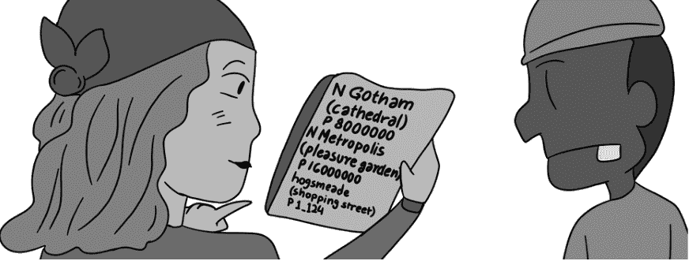

任务：

- 使用 `removeIf(...)` 使得最后只剩下人口超过 10,000 的大城市。
- 城市名称包含括号内的注释。如果包含注释，它们始终位于字符串的末尾。删除这些注释并使用 `replaceAll(...)` 方法替换 `City` 对象。
- 使用 `forEach(...)`，使得最后数据城市以 CSV 格式（逗号分隔输出）显示在屏幕上。

示例：

- 来自上述给列表，输出为：
Gotham, 8000000
Metropolis, 1600000

## 建议解决方案

# 测验：识别有效的函数式接口

## Distance

`Distance` 接口是一个标准的函数式接口。如果一个方法不是默认方法，那么 `abstract` 关键字是不必要的，因为它自动是一个没有实现的抽象方法。

可见性修饰符 `public` 也是不必要的，因为接口的抽象方法自动是公共的。顺便提一下，修饰符应该在前，但在我们的情况下，我们应该移除这两个关键字。

## MoreDistance

一眼看上去，`MoreDistance` 接口与 `Distance` 相同；然而，我们需要查看继承关系，它给了 `MoreDistance` 两个抽象方法，即它自己的和继承自基类型的。在这里，接口中有两个抽象方法；这对于函数式接口是非法的的。

## MoreDistance2

该接口是函数式的，因为它仅包含一个抽象方法，即来自扩展的接口 `Distance`。接口本身是否包含抽象方法或从父类继承抽象方法无关。如果一个接口恰好只有一个抽象方法，它仍然拥有任意数量的默认或静态方法；它仍然是一个函数式接口。

## DistanceImpl

该接口包含一个默认实现，这本身是可以的；但这并不被视为函数式接口。函数式接口必须声明恰好一个抽象方法。该方法不能已经作为默认方法拥有实现。

## DistanceEquals

这是一个函数式接口，尽管它有两个方法。但这是因为 `equals(...)` 方法是 `java.lang.Object` 的一个特殊方法，它在每个对象上总是存在的。你现在偶尔在接口中放置 `equals(...)` 方法，以便单独的 Javadoc 可以描述该方法的含义。

# 测验：从接口实现到 Lambda 表达式

- 第 1、第 2 和第 3 项：这三者都可以编译且等价。
所有其他表示法都会由于不同原因导致编译器错误。
- 4. 要么两种类型都是确定的，要么没有类型。
- 5. 多个 lambda 参数必须始终用括号括起来。
- 6. 要么使用带有 `{}` 的代码块并编写 `return`，或者使用较短的表示法而不包含 `return`。
- 7. 变量 `a` 不得再次声明，且 `b + b` 不等于 `a + b`。
- 8. 参数列表中的类型不存在自动箱。`int` 和 `Integer` 是完全不同的类型。

# 为函数式接口编写 Lambda 表达式

`com/tutego/exercise/lambda/LambdaTargetType.java`

```java
Runnable ds = () -> {};

ActionListener listener = event -> {};

Supplier<String> supplier = () -> "";

Consumer<Point> consumer = point -> {};

Comparator<Rectangle> comparator = (r1, r2) -> 0;
```


# 测验：像这样写 Lambda 表达式吗？

以下赋值会导致编译器错误：
- `System.out.println()` 结尾缺少分号，并且在 `{ }` 块中必须有完整的语句。
- Lambda 参数左侧缺失，在我们的案例中是 `()`。
- 函数式接口中的方法没有参数列表；因此，箭头左侧只能保留 `()`。
- 对于方法，`void` 代表返回，但对于 lambda 表达式缺失的参数列表，不能留下 `void`。

# 开发 Lambda 表达式

`com/tutego/exercise/lambda/LambdaTargetType.java`

```java
DoubleSupplier ds = () -> Math.random();

LongToDoubleFunction ldf = value -> value * Math.random();

UnaryOperator<String> up = s -> s.trim();
```

## 测验：包 java.util.function 的内容

首先，我们识别后缀：

- **Consumer**：某些东西被消费并用完，但没有返回。
- **Predicate**：进行了测试，输入一个值，输出一个布尔值。基本上是 `Function` 带有特殊返回类型的特化。
- **Supplier**：产生了某些东西，所以被返回，但不期望输入。
- **Function**：某些东西通过函数转换，即输入一个值，输出一个值。
- **UnaryOperator**：一种特殊的函数，输入类型和输出类型始终相同。在 `Function` 中，输入类型和输出类型可以完全不同。

然后可以识别不同的前缀。它们是 `Double`、`Int`、`Long`。

## 测验：了解函数式接口

| 映射 (MAPPING) | 函数式接口 (FUNCTIONAL INTERFACE) |
| --- | --- |
| `() -> void` | `Runnable` |
| `() -> T` | `Supplier` |
| `() -> boolean` | `BooleanSupplier` |
| `() -> int` | `IntSupplier` |
| `() -> long` | `LongSupplier` |
| `() -> double` | `DoubleSupplier` |
| `(T) -> void` | `Consumer` |
| `(T) -> T` | `UnaryOperator` |
| `(T) -> R` | `Function` |
| `(T) -> boolean` | `Predicate` |
| `(T) -> int` | `IntFunction` |
| `(T) -> long` | `LongFunction` |
| `(T) -> double` | `DoubleFunction` |
| `(T, T) -> void` | `BiConsumer` |
| `(T, T) -> T` | `BinaryOperator` |
| `(T, T) -> boolean` | `BiPredicate` |
| `(T, T) -> int` | `IntBinaryOperator` |
| `(T, T) -> long` | `LongBinaryOperator` |
| `(T, T) -> double` | `DoubleBinaryOperator` |

# 重写 Lambda 表达式

| 类型 (TYPE) | Lambda 表达式 (LAMBDA EXPRESSION) | 方法引用 (METHOD REFERENCE) |
| --- | --- | --- |
| 静态方法 | `(args) -> TypeName.method(args)` | `TypeName::method` |
| 非静态方法（实例） | `(args) -> instance.method(args)` | `instance::method` |
| 非静态方法（无实例） | `(instance, args) -> instance.method(args)` | `TypeName::method` |
| 构造函数 | `(args) -> new TypeName(args)` | `TypeName::new` |
| 数组构造函数 | `(size) -> new TypeName[size]` | `TypeName[]::new` |

## 删除、移除注释并转换为

`com/tutego/exercise/util/CityList.java`

```java
public static void main(String[] args) {

    List<City> cityTour = new ArrayList<City>();

    City g = new City("Gotham (cathedral)", 8_000_000);

    City m = new City("Metropolis (pleasure garden)", 1_600_000);

    City h = new City("Hogsmeade (shopping street)", 1_124);

    Collections.addAll(cityTour, g, m, h);

    cityTour.removeIf(city -> city.population() <= 10_000);

    cityTour.replaceAll(
        city -> new City(city.name().replaceAll("\\s*\\(.*\\)", ""),
        city.population())
    );

    cityTour.forEach(CityList::printAsCsv);
}
```

```java
private static void printAsCsv(City city) {
    System.out.printf("%s,%s%n", city.name(), city.population());
}
```

第一步复制列表后，我们可以列出什么决定了是否需要。如果不是，它必须被移除。`Predicate` 测试 `City` 对象。

在第一个方法 `removeIf(Predicate)` 中，我们必须指定一个决定是否需要的谓词。下一个方法 `replaceAll(UnaryOperator)` 期望一个函数——`UnaryOperator<T>`，它是 `Function<T>` 的子类型。该函数应用于每个元素并替换列表中的每个元素。由于 `City` 对象无法修改（实例变量是 `final` 的），我们创建一个新的 `City` 对象并传输值，使用 `String` 方法 `replaceAll(...)` 来帮助我们删除任何括号中的内容。`List` 方法 `replaceAll(...)` 将替换列表中的每个 `City`，为我们在 `UnaryOperator` 实现中构建的 `City`。

第三种方法 `forEach(Consumer)` 期望一个消费者。现在，我们不再像其他两种方法那样直接使用 lambda 表达式，而是通过方法引用 `forEach(...)` 引用它的 `printAsCsv(...)`。它的参数列表与 `Consumer` 相同：它期望一个对象，即一个 `City` 对象，并且不返回任何内容。在方法内部，我们将这两个组件组合在一起，用分号隔开并输出。

## 注意事项

1. 对于对历史感兴趣的读者，请访问 `http://www.javac.info/` 查看旧草稿。

# Java 类库中的特殊类型

类库包含了数千种类型，并且通过 Java 企业级框架和开源库添加了大量的类型。坦率地说，你不需要了解所有的类型就能成功编写软件。Java SE 的大部分内容也是底层的，更多是为框架开发者设计的。

一些常用类型与语言特别相关，甚至编译器也认识它们。我们需要理解这些内容，以便最大限度地利用语言的功能。因此，本章将介绍超类 `Object`（及其与我们相关的方法）、基本数据类型以及包装类型（自动装箱）。

## 前提条件

- 了解 `==`（标识性）和 `equals()`（等价性）的区别。
- 实现 `equals()` 和 `hashCode()`。
- 实现 `Comparator` 以定义排序标准。
- 理解自动装箱的工作原理。

本章使用的数据类型：

- `java.lang.Object`
- `java.lang.Comparable`
- `java.util.Comparator`
- `java.lang.Double`
- `java.lang.Integer`

## Object 超类

在 `Object` 类中，有三个方法是子类通常会重写的：`toString()`、`equals()` 和 `hashCode()`。虽然标识性是通过 `==` 测试的，但 `equals()` 和 `hashCode()` 总是一起实现的，以确保两者相互匹配；例如，如果两个对象的哈希值不相等，`equals()` 将返回 `false`；如果 `equals()` 返回 `true`，则哈希值必须相等。实现这些方法时需要遵循某些规则，这就是为什么任务重点在 `equals()` 和 `hashCode()` 上。

## 生成 equals() 和 hashCode()

每个 Java 环境都可以生成各种方法，例如 `toString()`，以及 `equals()` 和 `hashCode()`。不同的开发环境其菜单项和对话框略有不同。这三个 IDE 创建 `equals()` 和 `hashCode()` 的方式如下：

### IntelliJ

在此 IDE 中，我们按下快捷键 `Alt+Ins`。在下方会列出可以生成的项列表，包括 `equals()` 和 `hashCode()`。如果我们激活它，首先会弹出一个对话框，让我们从中选择模板。IntelliJ 可以以不同的方式生成方法。我们默认保留将用于 `equals()` 的实例变量，点击 `Next` 切换到下一个对话框。下一步是相同的对话框，现在我们为 `hashCode()` 选择实例变量，所有变量都已预选。按下 `Next` 到达最终的对话框 `Finish`。

### Eclipse

在 Eclipse 中，我们将光标置于类体内，激活右键菜单，导航到 `Source` 菜单项，然后选择 `Generate equals() and hashCode()`。与 IntelliJ 不同，在 Eclipse 中实例变量只显示一次，并同时用于这两种方法。点击 `Generate` 开始生成代码。

### NetBeans

进入 `Source` 菜单（在编辑器中激活右键菜单），然后通过键盘 `Alt+Ins`。会弹出一个小对话框，你可以在其中选择 `equals()` 和 `hashCode()`。此外，还可以通过这种方式生成 setter、getter、构造函数和 `toString()`。

任务：

- 将以下类复制到项目中：

```java
public class Person {
    public long id;
    public int age;
    public double income;
    public boolean isDog;
    public String name;
}
```

- 使用 IDE 为 `Person` 类创建 `equals()` 和 `hashCode()` 方法。
- 仔细研究生成的方法。

## 现有的 equals() 实现

Javadoc 是怎么说的，或者类中的 `equals()` 实现是怎样的样的？

- `java.awt.Rectangle` (module.desktop)
- `java.lang.String` (module.base)
- `java.lang.StringBuilder` (module.base)
- `java.net.URL` (module.base)

# Java 类库中的特殊类型

各个模块的代码可以在 OpenJDK 网上在线查看：`https://github.com/openjdk/jdk/tree/master/src/`；类可以在 `src` 目录下找到。

## 接口 COMPARATOR 和 COMPARABLE

与 `equals()` 的比较告诉我们两个对象是否相等，但没有说明顺序（即大还是小）。对于这一点，Java 中有两个接口：

- `Comparable` 由具有自然顺序的类型实现，即那些有常用排序标准的类型。如果有两个日期，可以很清楚地知道哪个在前在后，或者两个日期是否相同。
- 对于每一个排序标准都有一个 `Comparator` 接口的实现。我们可以按姓名对人排序，也可以按年龄排序：这将是 `Comparator` 的两种实现。

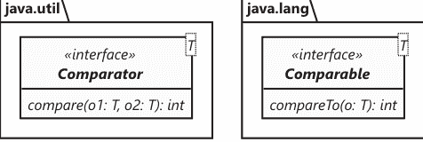

图 11.1 Comparator 和 Comparable 的 UML 图。

## 测验：是自然顺序还是不是？

如果在 `main` 方法中执行以下代码，会发生什么？`Point` 类型来自 `java.awt` 包。

```java
String[] strings = { "A", "B", "C" };
Arrays.sort(strings);

Point[] points = {
    new Point(9, 3),
    new Point(3, 4),
    new Point(4, 3),
    new Point(1, 2),
};
Arrays.sort(points);
```

## 处理超级英雄

Bonny Brain 从小就对超级英雄感兴趣。还有许多令人兴奋的事情需要了解。为了回答 Bonny Brain 的问题，我们首先需要定义。任务：将以下类声明到你的 Java 项目中：

## Java 练习

```java
import java.util.List;
import java.util.Objects;
import java.util.stream.Stream;

public class Heroes {
    private Heroes() { }

    public record Hero(String name, Sex sex, int yearAppearance) {
        public enum Sex { MALE, FEMALE }

        public Hero {
            Objects.requireNonNull(name);
            Objects.requireNonNull(sex);
        }
    }

    public static class Universe {
        private final String name;
        private final List<Hero> heroes;

        public Universe(String name, List<Hero> heroes) {
            this.name = Objects.requireNonNull(name);
            this.heroes = Objects.requireNonNull(heroes);
        }

        public String name() { return name; }
        public Stream<Hero> heroes() { return heroes.stream(); }
    }

    // https://github.com/fivethirtyeight/data/tree/master/comic-characters
    private static final Hero DEADPOOL = new Hero("Deadpool (Wade Wilson)", Hero.Sex.MALE, 1991);
    private static final Hero LANA_LANG = new Hero("Lana Lang", Hero.Sex.FEMALE, 1958);
    private static final Hero THOR = new Hero("Thor (Thor Odinson)", Hero.Sex.MALE, 1962);
    private static final Hero IRON_MAN = new Hero("Iron Man (Anthony Stark)", Hero.Sex.MALE, 1963);
    private static final Hero SPIDERMAN = new Hero("Spider-Man (Peter Parker)", Hero.Sex.MALE, 1962);
    private static final Hero WONDER_WOMAN = new Hero("Wonder Woman (Diana Prince)", Hero.Sex.FEMALE, 1941);
    private static final Hero CAPTAIN_AMERICA = new Hero("Captain America (Steve Rogers)", Hero.Sex.MALE, 1941);
    private static final Hero SUPERMAN = new Hero("Superman (Clark Kent)", Hero.Sex.MALE, 1938);
    private static final Hero BATMAN = new Hero("Batman (Bruce Wayne)", Hero.Sex.MALE, 1939);

    public static final List<Hero> DC = List.of(SUPERMAN, LANA_LANG, WONDER_WOMAN, BATMAN);
}
```

```java
public static final List<Hero> MARVEL = List.of(
    DEADPOOL, THOR, IRON_MAN, SPIDERMAN, CAPTAIN_AMERICA
);
```


`List.of(DEADPOOL, CAPTAIN_AMERICA, THOR, IRON_MAN, SPIDERMAN)`;

```java
public static final List<Hero> ALL =
    Stream.concat(DC.stream(), MARVEL.stream()).toList();
```

```java
public static final List<Universe> UNIVERSES =
    List.of(new Universe("DC", DC), new Universe("Marvel", MARVEL));
```

如果你已经将该类添加到你的项目中，那么你就完成了这个练习！该类的声明是为后续任务做的准备。关于该类的内容：`Heroes` 声明了嵌套类 `Hero` 和 `Universe`，还包含了英雄的集合。使用了哪种 Java API 来初始化变量，哪些私有变量对解决方案是不重要的。我们将在关于 Java Stream API 的章节中回到 `Heroes` 类。对感兴趣的读者欢迎使用 `record` 重写这些类。

## 比较超级英雄 ★★

并不是所有的英雄都是一样的！有些出现得更早，有些是光头脸。我们可以使用 `Comparator` 对象来单独确定英雄之间的顺序。


任务：

- 首先，构建一个所有英雄的可变列表：`List<Hero> allHeroes = new ArrayList<>(Heroes.ALL)`
- 编写一个比较器，使英雄按发布年份排序。实现时使用：
  1. 一个本地类。
  2. 一个匿名类。
  3. 一个 Lambda 表达式。

### #280 Java 编程练习

- `List` 接口有一个 `sort(...)` 方法。使用新的 `Comparator` 对列表 `allHeroes` 进行排序。
- 扩展 `Comparator`，如果出版年份相同，则按名称比较。评估这种 `Comparator` 同时测试多个标准的方法。

## 并英雄比较器 ★

排序通常不是通过一个标准完成的，而是通过多个标准。一个典型的例子是电话簿。首先，按姓排序条目，在同名的情况下，按名排序。

排序中涉及多个标准。我们不需要自己处理 `Comparator` 实例的链式调用，但可以使用默认方法 `thenComparing(...)`。任务：

- 研究 `Comparator` 方法 `thenComparing(Comparator<? super T>)` 的 API 文档（或实现）。
- 英雄有发布年份。
  1. 编写一个只按名称比较英雄的 `Comparator` 实现。
  2. 编写第二个 `Comparator`，仅按出版年份比较英雄。
  3. 按发布年份、名称对所有英雄按第一个标准进行排序。实现复合比较器 `thenComparing(...)`。

## 使用键值提取器轻松创建比较器 ★★

`Comparator` 通常会“提取”键元素并对它们进行比较。但这样做时 `Comparator` 实际上做了两件事：第一，它提取相关信息；其次，比较这些值。使用良好的面向对象编程，这两个步骤应该是分离开的。这就是 `Comparator` 接口中静态 `comparing*(...)` 方法的目标。这些方法只接收一个键值提取器，而提取出的值的比较则由 `comparing*(...)` 方法完成。

让我们来看看三个实现，从 `java.util.Comparator` 中的 (Function) JDK 实现开始。

```java
public static <T, U extends Comparable<? super U>> Comparator<T> comparing(Function<? super T, U> keyExtractor) {
    Objects.requireNonNull(keyExtractor);
    return (Comparator<T>) (c1, c2) -> keyExtractor.apply(c1).compareTo(keyExtractor.apply(c2));
}
```

首先，进行强制性的空检查。然后，`keyExtractor.apply(...)` 返回第一个对象和第二个对象的值。由于两个对象都有自然顺序（它们实现了 `Comparable`），因此通过 `compareTo(...)` 进行比较。

有些英雄有发布年份。
1. 编写一个只按名称比较英雄的 `Comparator` 实现。
2. 编写第二个仅按出版年份比较英雄的 `Comparator`。
3. 按发布年份、名称对所有英雄按第一个标准进行排序。实现复合比较器 `thenComparing(...)`。

# 284 Java 编程练习

2. 会发生什么？

```java
Character c = null;
switch (c) { }
```

3. 编写以下代码有意义吗？
`Map<String, Integer> map = Map.of("number-of-ships", 102);`
`int ships = map.get("number-of_ships");`
查找 `java.util.Map` 接口中 `get(...)` 方法的返回值。

# 测验：自动拆箱的惊喜 ★★

如果以下行代码出现在 `main(...)` 方法中，输出是什么？

```java
Integer i1 = 1;
Integer i2 = 1;
System.out.println(i1 == i2);
System.out.println(i1 <= i2);
System.out.println(i1 >= i2);
```

```java
Integer i21 = 1000;
Integer i22 = 1000;
System.out.println(i21 == i22);
System.out.println(i21 <= i22);
System.out.println(i21 >= i22);
```

这个任务很有陷阱。
自动装箱会调用 `valueOf(...)` 方法。Javadoc 提供了一个关键的提示。

## 建议解

# 生成 equals(Object) 和 hashCode()

来自 IntelliJ 生成的 `equals(Object)` 方法

让我们先看看 `equals(Object)`：

来自 IntelliJ 生成的 `equals(Object)`

```java
public boolean equals(Object o) {
    if (this == o) {
        return true;
    }
    if (o == null || getClass() != o.getClass()) {
        return false;
    }
    Person person = (Person) o;
```

```java
    if (id != person.id) {
        return false;
    }
```

```java
    if (age != person.age)
        return false;
    if (Double.compare(person.income, income) != 0)
        return false;
    if (isDrugord != person.isDrugLord)
        return false;
    return name != null ? name.equals(person.name) : person.name == null;
}
```

首先，我们测试传入的对象是否与我们的对象相同，如果是，我们有一条短路径，答案是 `true`，因为当然，我们等于我们自己。如果传入的引用为 `null` 或我们自己的 `Class` 对象与传递的 `Class` 对象不同，我们就不希望继续比较，可以返回 `false` 退出。顺便说，`Class` 比较不是唯一的选择；我们还可以使用 `instanceof` 测试类型，这在比较中包含了子类。

在初始查询之后，我们继续处理 Object 的状态。我们知道对象是 `Person`，所以我们引入了一个新的 `Person` 类型。接下来，我们需要将我们的状态与 `person` 的状态进行比较。对于整数和值，我们可以直接比较。这里的方法是比较值，如果它们不相等，则 `equals(...)` 方法返回 `false`，因为没有必要继续检查了。

比较浮点数和引用仍然很有趣。对于浮点数，我们面临的问题是某个值可能是 `NaN`（非数字）。而 `NaN` 是等于 `NaN` 的！这个特殊情况由 `Double` 的 `compare(...)` 方法涵盖了。尽管 `compare(...)` 方法检查了更多内容，即两个浮点数的顺序，但我们不需要这个属性，我们只需要结果等于 `0`；否则为负或正。

之前的实例是原始类型的；最后我们看引用类型的等效性测试。在这里，我们委托给引用对象的 `equals(Object)` 方法。然而，我们必须考虑一种特殊情况，即一个或多个实例变量可能是 `null` 也可能不是；由于我们选择了 `null` 作为策略，所以添加了一个特殊的查询。一个很好的替代方案是：

`return Objects.equals(name, person.name);`

来自 Eclipse 生成的 `equals(Object)` 方法

让我们看看 `equals(Object)`：

```java
public boolean equals(Object o) {
    if (this == o) {
        return true;
    }
    if (o == null || getClass() != o.getClass()) {
        return false;
    }
    Person person = (Person) o;
```

```java
    if (id != person.id) {
```


# 284 Java 编程练习

2. 会发生什么？

```
Character c=null;
switch ( c ) { }
```

3. 编写以下代码有意义吗？

```java
Map<String, Integer> map = map.of("number-of-ships", 102 );
int ships = map.get("number-of_ships");
```

查找 `java.util.Map` 接口中 `get(...)` 方法的返回值。

# 测验：自动拆箱的惊喜 ★★

如果以下行代码出现在 `main(...)` 方法中，输出是什么？

```java
Integer i1=1;
Integer i2=1;
System.out.println( i1 == i2 );
System.out.println( i1 <= i2 );
System.out.println( i1 >= i2 );
```

```java
Integer i21=1000;
Integer i22=1000;
System.out.println( i21 == i22 );
System.out.println( i21 <= i22 );
System.out.println( i21 >= i22 );
```

这个任务很有陷阱。

自动装箱会调用 `valueOf(...)` 方法。Javadoc 提供了一个关键的提示。

## 建议解

# 生成 equals(Object) 和 hashCode()

来自 IntelliJ 生成的 `equals(Object)` 方法

让我们先看看 `equals(Object)`：

```java
public boolean equals(Object o ) {
  if ( this == o ) {
    return true;
  }
  if ( o == null || getClass() !=o.getClass() ) {
    return false;
  }

Person person=(Person) o;
```

```java
if ( id !=person.id ) {
  return false;
}
```

# 11 • Java 类库中的特殊类型 285

```java
if ( age !=person.age )
    return false;
if ( Double.compare( person.income, income ) != 0 )
    return false;
if ( isDrugord != person.isDrugLord )
    return false;
return name!=null ? name.equals( person.name ) : person.name == null;
}
```

首先，我们测试传入的对象是否与我们的对象相同，如果是，我们有一条短路径，答案是 true，因为当然，我们等于我们自己。如果传入的引用为 null 或我们自己的 Class 对象与传递的 Class 对象不同，我们就不希望继续比较，可以返回 false 退出。顺便说，Class 比较不是唯一的选择；我们还可以使用 `instanceof` 测试类型，这在比较中包含了子类。

在初始查询之后，我们继续处理 Object 的状态。我们知道对象是 Person，所以我们引入了一个新的 Person 类型。接下来，我们需要将我们的状态与 person 的状态进行比较。对于整数和值，我们可以直接比较。这里的方法是比较值，如果它们不相等，则 `equals(...)` 方法返回 false，因为没有必要继续检查了。

比较浮点数和引用仍然很有趣。对于浮点数，我们面临的问题是某个值可能是 NaN（非数字）。而 NaN 是等于 NaN 的！这个特殊情况由 `Double` 的 `compare(...)` 方法涵盖了。尽管 `compare(...)` 方法检查了更多内容，即两个浮点数的顺序，但我们不需要这个属性，我们只需要结果等于 0；否则为负或正。

之前的实例是原始类型的；最后我们看引用类型的等效性测试。在这里，我们委托给引用对象的 `equals(Object)` 方法。然而，我们必须考虑一种特殊情况，即一个或多个实例变量可能是 null 也可能不是；由于我们选择了 null 作为策略，所以添加了一个特殊的查询。一个很好的替代方案是：

```java
return Objects.equals( name, person.name );
```

来自 Eclipse 生成的 `equals(Object)` 方法

让我们看看 `equals(Object)`：

```java
public boolean equals(Object o ) {
  if ( this == o ) {
    return true;
  }
  if ( o == null || getClass() !=o.getClass() ) {
    return false;
  }

Person person=(Person) o;
```

```java
if ( id !=person.id ) {
  return false;
}
```

```java
if ( age !=person.age )
    return false;
if ( Double.compare( person.income, income ) != 0 )
    return false;
if ( isDrugord != person.isDrugLord )
    return false;
return name!=null ? name.equals( person.name ) : person.name == null;
}
```

首先，我们测试传入的对象是否与我们的对象相同，如果是，我们有一条短路径，答案是 true，因为当然，我们等于我们自己。如果传入的引用为 null 或我们自己的 Class 对象与传递的 Class 对象不同，我们就不希望继续比较，可以返回 false 退出。顺便说，Class 比较不是唯一的选择；我们还可以使用 `instanceof` 测试类型，这在比较中包含了子类。

在初始查询之后，我们继续处理 Object 的状态。我们知道对象是 Person，所以我们引入了一个新的 Person 类型。接下来，我们需要将我们的状态与 person 的状态进行比较。对于整数和值，我们可以直接比较。这里的方法是比较值，如果它们不相等，则 `equals(...)` 方法返回 false，因为没有必要继续检查了。

比较浮点数和引用仍然很有趣。对于浮点数，我们面临的问题是某个值可能是 NaN（非数字）。而 NaN 是等于 NaN 的！这个特殊情况由 `Double` 的 `compare(...)` 方法涵盖了。尽管 `compare(...)` 方法检查了更多内容，即两个浮点数的顺序，但我们不需要这个属性，我们只需要结果等于 0；否则为负或正。

之前的实例是原始类型的；最后我们看引用类型的等效性测试。在这里，我们委托给引用对象的 `equals(Object)` 方法。然而，我们必须考虑一种特殊情况，即一个或多个实例变量可能是 null 也可能不是；由于我们选择了 null 作为策略，所以添加了一个特殊的查询。一个很好的替代方案是：

```java
return Objects.equals( name, person.name );
```


Java 文档没有显示 `StringBuilder` 有 `equals(...)` 方法，在 `class java.lang.Object` 中声明的方法项下显示 `equals(...)` 方法来自 `Object`。类文档还提到：“`StringBuilder` 实现 `Comparable` 但没有重写 `equals`。因此，`StringBuilder` 的自然排序与 `equals` 不一致。如果将 `StringBuilder` 对象用 `SortedMap` 的键或 `TreeSet` 的元素，需要小心。请参见 `Comparable`、`SortedMap` 或 `TreeSet`。”

结果就是我们将 `StringBuilder` 放入数据结构时会遇到麻烦，因为大多数数据结构都使用 `equals(...)` 方法。

```
java.net.URL (module java.base)
```

在 Java 库所有的 `equals(...)` 方法中，`URL` 类的可能是奇怪的。Java 文档解释了原因：

如果 URL 对象具有相同的协议、等效的主机、主机上具有相同的端口号以及相同的文件和文件片段，则它们是相等的。如果两个主机都能解析为 IP 地址，则认为这两个主机相等；如果主机名无法解析，则主机名必须相等（不区分大小写）；或主机等于 null。由于主机的比较需要解析，此操作是一个阻塞操作。注意：已知 `equals` 的定义行为与 HTTP 中的虚拟主机不一致。

这具有深远的影响。首先，`equals(...)` 方法执行可能需要很长时间，即使在最好的情况下，所有内容都在内部缓存中，当比较几个实例时性能仍然很差。此外，始终需要网络，这意味着如果计算机断开网络，`equals(...)` 方法将无法响应。另一个问题是 `equals(...)` 方法可能会突然给出一个不同的答案。之前可能不是的情况突然发生了。

由于某种原因，将 URL 对象放在列表或集合等数据结构中是不寻常的，因为标准实现几乎总是回退到 `equals(...)` 方法。Java 库提供了第二个类 `URI`，它将 `equals(...)` 实现为实例变量的简单比较，即 Schema、Fragment、Path、Query 等。


# Java 类库中的 11 种特殊类型

## 测验：自然排序还是不是？

紧随其的是一个异常：

```
Exception in thread "main" java.lang.ClassCastException: class java.awt.Point cannot be cast to class java.lang.Comparable(java.awt.Point) Point is in module java.desktop of loader 'bootstrap'; java.lang.Comparable is in module java.base of loader 'bootstrap'
```

`java.util.Arrays` 中的 `sort(Object[])` 方法假设对象具有自然排序，因此实现了 `Comparable` 接口。然而，`Point` 并没有这样做。

如果我们想相互比较未知对象，我们必须使用 `sort(...)` 方法并传入一个遵循排序准则的特殊对象。这就是 `Comparator` 对象的任务。

## 比较超级英雄

```java
// com/tutego/exercise/util/HeroComparators.java
// 局部类
class YearFirstAppearanceComparator implements Comparator<Heroes.Hero> {
    @Override public int compare(Heroes.Hero h1, Heroes.Hero h2) {
        return Integer.compare(h1.firstAppearance(), h2.firstAppearance());
    }
}

// 匿名类
Comparator<Heroes.Hero> innerComparator = new Comparator<>() {
    @Override public int compare(Heroes.Hero h1, Heroes.Hero h2) {
        return Integer.compare(h1.firstAppearance(), h2.firstAppearance());
    }
};

// Lambda 表达式
Comparator<Heroes.Hero> lambdaComparator =
    (h1, h2) -> Integer.compare(h1.firstAppearance(), h2.firstAppearance());

// 带 2 个标准的 Comparator
Comparator<Heroes.Hero> combinedComparator = (h1, h2) -> {
    int yearComparison = Integer.compare(h1.firstAppearance(), h2.firstAppearance());
    return (yearComparison == 0) ? yearComparison : h1.name().compareTo(h2.name());
};

List<Heroes.Hero> allHeroes = new ArrayList<>(Heroes.ALL);
allHeroes.sort(new YearFirstAppearanceComparator());
allHeroes.sort(innerComparator);
allHeroes.sort(lambdaComparator);
allHeroes.sort(combinedComparator);
```

## Java 编程练习

`Comparator` 的实现依赖 `Integer.compare(...)` 来比较两个整数，其实现方式如下：

```java
default Comparator<T> thenComparing(Comparator<? super T> other) {
    Objects.requireNonNull(other);
    return (c1, c2) -> {
        int res = compare(c1, c2);
        return res != 0 ? res : other.compare(c1, c2);
    };
}
```

## 查找附近的商店

`com/tutego/exercise/oop/StoreFinder.java`

```java
class Store {
    String name;
    Point location;

    Store(String name, int x, int y) {
        this.name = name;
        this.location = new Point(x, y);
    }

    @Override
    public String toString() {
        return "Store[name=%s, location=%s]".formatted(name, location);
    }
}

public class StoreFinder {

    static List<Store> findStoresAround(Collection<Store> stores, Point center) {
        List<Store> result = new ArrayList<>(stores);

        class StoreDistanceComparator implements Comparator<Store> {
            @Override
            public int compare(Store s1, Store s2) {
                double dist1ToCenter = s1.location.distance(center);
                double dist2ToCenter = s2.location.distance(center);
                return Double.compare(dist1ToCenter, dist2ToCenter);
            }
        }

        result.sort(new StoreDistanceComparator());
        return result;
    }

    public static void main(String[] args) {
        Store s1 = new Store("ALDI", 10, 10);
        Store s2 = new Store("LIDL", 90, 80);
        Store s3 = new Store("REWE", 51, 51);
        List<Store> list = Arrays.asList(s1, s2, s3);
        System.out.println(list);
        List<Store> around = findStoresAround(list, new Point(50, 50));
        System.out.println(around);
    }
}
```

首先，我们通过两个实例变量 `name` 和 `location` 对 `Store` 类进行建模。出于实际考虑，我们为类提供了一个带参数的构造函数，接收名称以及 x-y 坐标并将其转换为内部状态。`toString()` 方法返回一个包含名称和位置的表示。

下一个类 `StoreFinder` 拥有所需的 `findStoresAround(...)` 方法以及一个带有小型演示的 `main(...)` 方法。

实际的 `findStoresAround(...)` 使用了一个特殊的技巧来使实现更加紧凑。首先是通用解决方案：我们使用 `List` 和 `Comparator`，因此我们可以使用 `Comparator` 来对列表进行排序。`Comparator` 只需要使用点之间的距离作为排序准则。在这里我们可以方便自己，`java.awt.Point` 类有一个 `distance(...)` 方法，通过它我们可以轻松地计算点的距离。

在 `findStoresAround(...)` 的第一步中，我们将 `Collection` 中的 `Stores` 放入一个 `ArrayList` 中。这是排序的要素，因为 `Collection` 无法排序，只有 `List` 可以。此外，作业并没有明确说明我们允许修改该 `Collection`。因此，我们将采取保守态度，不修改传入的 `Collection`，如果该 `Collection` 是不可变的，可能是无法实现的。

现在我们利用 Java 语言的一个特殊特性，即在方法内部声明类。我们称此类为局部内部类。局部内部类的优点是它们可以（显式地或隐式地）访问外部的变量。我们的 `Comparator` 需要这样做，因为它要判断两个 `Store` 对象中哪一个更靠近中心，必须从第一个 `Store` 到中心进行比较，然后从第二个 `Store` 到中心进行比较。如果你想避免使用内部类，必须给 `Comparator` 实现提供一个带参数的构造函数，以便从外部将 `center` 传入 `Comparator` 实现。

## 测验：拆箱中的空引用处理

第一个语句无法编译。然而，我们可以执行以下代码：

```java
Integer int1 = null;
int int2 = int1;
int i = (Integer) null;
```

在运行代码时，由于拆箱操作会发生 `NullPointerException`。在 Java 中，编译器将调用相关方法从包装对象中提取原始类型值。例如，在处理 `Integer` 对象时，编译器将自动使用字节码指令调用 `intValue()` 方法。

在 `switch` 中也存在 `NullPointerException`。Java 编译器会自动拆箱并调用 `charValue()`——这在运行时是行得通的。`switch` 对可能为 `null` 的包装类没有特殊处理。

`Map` 是一个连接键值对的关联型存储器。`get(...)` 方法的属性是，如果该键没有关联的值，则返回 `null`。我们的示例只是一个案例。在错误的键下，我们查询关联型存储器，没有关联的值，因此返回 `null`。编译器将自动拆箱并调用 `intValue()` 方法，导致在运行时出现 `NullPointerException`。此问题的解决方案是每当 `null` 表示缺失返回时，在代码中显式包含一个 `null` 检查。如下：

```java
Integer maybeShips = map.get("number_of_ships");
if (maybeShips != null) {
    int ships = maybeShips;
}
```

总结：没有从 `null` 到 0 或 `false` 的自动转换。

## 测验：拆箱的惊喜

输出结果如下：

```java
Integer int1 = 1;
Integer int2 = 1;
System.out.println(int1 == int2); // true
System.out.println(int1 <= int2); // true

Integer int1 = 1000;
Integer int2 = 1000;
System.out.println(int1 == int2); // false
System.out.println(int1 <= int2); // true
System.out.println(int1 >= int2); // true
```

令人惊讶的是，`Integer` 内部对 -128 到 127 之间的整数使用了缓存。

# 附录：Java 中最常见的类型和方法

## 最常见的类型包

**java.io**  
`BufferedReader`, `ByteArrayOutputStream`, `DataInputStream`, `FileOutputStream`, `File`, `IOException`, `InputStream`, `ObjectOutputStream`, `OutputStream`, `PrintStream`, `Reader`

**java.lang**  
`Appendable`, `AssertionError`, `Boolean`, `Byte`, `CharSequence`, `ClassLoader`, `Class`, `Double`, `Enum`, `Float`, `IllegalArgumentException`, `IllegalStateException`, `IndexOutOfBounds`, `Integer`, `Iterable`, `Long`, `Math`, `NullPointerException`, `Number`, `RuntimeException`, `Short`, `StringBuffer`, `String`, `ThreadLocal`, `Throwable`, `UnsupportedOperation`

**java.ref**  
`SoftReference`

**java.lang.reflect**  
`Array`, `Constructor`, `Field`, `InvocationTarget`, `Method`, `ParameterizedType`

**java.math**  
`BigInteger`

**java.net**  
`URI`, `URL`

**java.sql**  
`PreparedStatement`

**java.text**  
`MessageFormat`

**java.util**  
`AbstractList`, `Arrays`, `BitSet`, `Calendar`, `Collection`, `Collections`, `Comparator`, `Date`, `Enumeration`, `HashMap`, `HashSet`, `Hashtable`, `Iterator`, `LinkedHashMap`, `LinkedHashSet`, `LinkedList`, `List`, `Locale`, `Map`, `NoSuchElementException`, `Objects`, `Optional`, `Properties`, `Stack`, `StringTokenizer`, `TreeMap`, `Vector`

**java.util.concurrent**  
`ConcurrentHashMap`, `ConcurrentMap`

**java.util.concurrent.atomic**  
`AtomicBoolean`, `AtomicInteger`, `AtomicLong`, `AtomicReference`

**java.util.concurrent.locks**  
`Lock`, `ReentrantLock`

**java.util.function**  
`Consumer`, `Function`

**java.util.logging**  
`Logger`

**java.util.regex**  
`Matcher`, `Pattern`


# 附录 A 常见类型与方法统计

## 导入包与类

- `java.util.stream` `Collectors`, `Stream`
- `javax.faces.component` `StateHelper`, `UIComponent`
- `javax.faces.context` `FacesContext`, `ResponseWriter`
- `javax.xml.bind` `JAXBElement`
- `javax.xml.namespace` `QName`

## A.2 100 常见类型

### 表 A.1 类型

| 类型名称 | 出现 | 百比分布 |
| :--- | :--- | :--- |
| `java.lang.StringBuilder` | 605.692 | 25.28% |
| `java.lang.String` | 190.854 | 7.97% |
| `java.lang.Object` | 138.093 | 5.76% |
| `java.util.Iterator` | 102.072 | 4.26% |
| `java.util.List` | 99.833 | 4.17% |
| `java.lang.StringBuffer` | 94.562 | 3.95% |
| `java.util.Map` | 69.415 | 2.90% |
| `java.lang.Class` | 52.435 | 2.19% |
| `java.util.ArrayList` | 46.855 | 1.96% |
| `java.lang.Integer` | 45.650 | 1.91% |
| `java.util.Set` | 35.131 | 1.47% |
| `java.util.HashMap` | 28.958 | 1.21% |
| `java.util.logging.Logger` | 26.173 | 1.09% |
| `java.lang.IllegalArgumentException` | 25.762 | 1.08% |
| `javax.xml.namespace.QName` | 22.050 | 0.92% |
| `java.io.File` | 19.951 | 0.83% |
| `java.lang.Boolean` | 19.913 | 0.83% |
| `java.lang.System` | 18.881 | 0.79% |
| `java.util.Collection` | 15.678 | 0.65% |
| `java.util.Arrays` | 15.533 | 0.65% |
| `java.lang.AssertionError` | 14.927 | 0.62% |
| `java.lang.IllegalStateException` | 14.189 | 0.59% |
| `java.util.Map$Entry` | 13.555 | 0.57% |
| `java.util.Collections` | 13.061 | 0.55% |
| `java.lang.Long` | 12.493 | 0.52% |
| `java.util.Hashtable` | 11.934 | 0.50% |
| `java.lang.Enum` | 11.191 | 0.47% |
| `java.lang.Math` | 10.670 | 0.45% |
| `java.lang.UnsupportedOperationException` | 10.434 | 0.44% |
| `java.lang.reflect.Method` | 10.357 | 0.43% |
| `java.io.PrintWriter` | 10.278 | 0.43% |
| `java.util.Vector` | 10.118 | 0.42% |
| `java.lang.Character` | 9.904 | 0.41% |
| `java.lang.Thread` | 9.294 | 0.39% |
| `java.nio.ByteBuffer` | 9.285 | 0.39% |
| `java.util.HashSet` | 8.881 | 0.37% |
| `java.lang.Throwable` | 8.415 | 0.35% |
| `java.util.Properties` | 8.106 | 0.34% |
| `java.lang.Double` | 7.956 | 0.33% |
| `javax.faces.component.StateHelper` | 7.912 | 0.33% |
| `java.lang.IndexOutOfBoundsException` | 7.799 | 0.33% |
| `java.lang.RuntimeException` | 7.734 | 0.32% |
| `java.util.Objects` | 7.700 | 0.32% |
| `java.io.Writer` | 7.473 | 0.31% |
| `java.io.IOException` | 6.902 | 0.29% |
| `java.io.InputException` | 6.539 | 0.27% |
| `java.util.stream.Stream` | 6.429 | 0.27% |
| `java.lang.CharSequence` | 6.170 | 0.26% |
| `javax.faces.context.ResponseWriter` | 6.063 | 0.25% |
| `java.lang.Exception` | 6.054 | 0.25% |
| `javax.faces.context.FacesContext` | 6.027 | 0.25% |
| `java.io.PrintWriter` | 5.785 | 0.24% |
| `java.math.BigInteger` | 5.520 | 0.23% |
| `java.util.Enumeration` | 5.047 | 0.21% |
| `java.util.Stack` | 4.904 | 0.20% |
| `java.util.ResourceBundle` | 4.777 | 0.20% |
| `java.io.OutputStream` | 4.682 | 0.20% |
| `java.util.LinkedList` | 4.466 | 0.19% |
| `java.util.Optional` | 4.169 | 0.17% |
| `java.io.ByteArrayOutputStream` | 4.115 | 0.17% |
| `java.util.AbstractList` | 4.074 | 0.17% |
| `java.lang.Float` | 4.062 | 0.17% |
| `java.util.StringTokenizer` | 4.024 | 0.17% |
| `java.util.NullPointerException` | 3.840 | 0.16% |
| `java.util.concurrent.AtomicReference` | 3.579 | 0.15% |
| `java.net.URI` | 3.491 | 0.15% |
| `java.util.HashMap` | 3.490 | 0.15% |
| `java.lang.Iterable` | 3.483 | 0.15% |
| `javax.faces.component.UIComponent` | 3.481 | 0.15% |
| `java.lang.Field` | 3.452 | 0.14% |
| `java.lang.Number` | 3.449 | 0.14% |
| `java.net.URL` | 3.436 | 0.14% |
| `java.util.regex.Pattern` | 3.386 | 0.14% |
| `java.util.regex.Matcher` | 3.343 | 0.14% |
| `java.util.Calendar` | 3.281 | 0.14% |
| `java.util.concurrent.ConcurrentHashMap` | 3.231 | 0.13% |
| `java.text.MessageFormat` | 3.070 | 0.13% |
| `java.servlet.HTTPRequest` | 3.051 | 0.13% |
| `javax.xml.stream.XMLReader` | 3.032 | 0.13% |
| `java.util.concurrent.locks.Lock` | 3.012 | 0.13% |
| `java.lang.ClassLoader` | 2.861 | 0.12% |
| `java.util.concurrent.atomic.AtomicInteger` | 2.835 | 0.12% |
| `java.lang.ThreadLocal` | 2.706 | 0.11% |
| `java.security.AccessController` | 2.687 | 0.11% |
| `java.util.concurrent.ConcurrentMap` | 2.579 | 0.11% |
| `java.util.BitSet` | 2.553 | 0.11% |
| `java.math.BigDecimal` | 2.437 | 0.10% |
| `java.sql.ResultSet` | 2.408 | 0.10% |
| `java.io.BufferedReader` | 2.359 | 0.10% |
| `java.io.DataOutputStream` | 2.264 | 0.09% |
| `java.util.concurrent.atomic.AtomicLong` | 2.245 | 0.09% |
| `java.sql.PreparedStatement` | 2.237 | 0.09% |
| `java.util.HashSet` | 2.222 | 0.09% |
| `java.util.Date` | 2.212 | 0.09% |
| `java.lang.ref.SoftReference` | 2.139 | 0.09% |
| `java.io.ObjectOutputStream` | 2.119 | 0.09% |
| `java.lang.reflect.Array` | 2.048 | 0.09% |
| `java.io.ObjectInputStream` | 2.043 | 0.09% |
| `java.io.StringWriter` | 1.992 | 0.08% |
| `java.util.concurrent.atomic.AtomicBoolean` | 1.991 | 0.08% |

## A.3 100 个最常见方法

### 表 A.2 带有方法名的类型

| 方法名称 | 出现次数 | 百比分布 |
| :--- | :--- | :--- |
| `java.lang.StringBuilder#append` | 377.938 | 15.77% |
| `java.lang.StringBuilder#toString` | 111.511 | 4.65% |
| `java.lang.StringBuilder#<init>` | 111.272 | 4.64% |
| `java.lang.Object#<init>` | 80.559 | 3.36% |
| `java.lang.StringBuffer#append` | 61.081 | 2.55% |
| `java.lang.String#equals` | 56.525 | 2.36% |
| `java.util.Iterator` | 50.355 | 2.10% |
| `java.util.Iterator#hasNext` | 50.093 | 2.09% |
| `java.util.ArrayList#<init>` | 28.413 | 1.19% |
| `java.lang.Integer#valueOf` | 27.554 | 1.15% |
| `java.lang.String#length` | 26.959 | 1.13% |
| `java.util.Map#put` | 26.388 | 1.10% |
| `java.util.List#add` | 26.041 | 1.09% |
| `java.lang.IllegalArgumentException#<init>` | 25.190 | 1.05% |
| `java.lang.Object#getClass` | 24.894 | 1.04% |
| `java.util.List#size` | 21.020 | 0.88% |
| `java.util.Map#get` | 18.625 | 0.78% |
| `java.util.List#iterator` | 18.422 | 0.77% |
| `java.xml.namespace.QName#<init>` | 17.541 | 0.73% |
| `java.lang.String#substring` | 16.687 | 0.70% |
| `java.lang.StringBuffer#toString` | 15.771 | 0.66% |
| `java.lang.Object#equals` | 15.554 | 0.65% |
| `java.lang.StringBuffer#<init>` | 15.488 | 0.65% |
| `java.lang.Class#getName` | 15.238 | 0.64% |
| `java.lang.AssertionError#<init>` | 14.877 | 0.62% |
| `java.lang.Illegal#<init>` | 13.984 | 0.58% |
| `java.lang.String#charAt` | 12.815 | 0.53% |
| `java.util.Set#iterator` | 12.788 | 0.53% |
| `java.util.logging.Logger#log` | 12.576 | 0.52% |
| `java.util.List#get` | 12.204 | 0.51% |
| `java.lang.HashMap#<init>` | 12.185 | 0.51% |
| `java.lang.Boolean#valueOf` | 10.513 | 0.44% |
| `java.lang.HashMap#put` | 10.470 | 0.44% |
| `java.lang.UnsupportedOperationException#<init>` | 10.340 | 0.43% |
| `java.util.Set#add` | 9.598 | 0.40% |
| `java.lang.System#arraycopy` | 9.116 | 0.38% |
| `java.lang.String#startsWith` | 8.501 | 0.35% |
| `java.lang.Object#toString` | 8.418 | 0.35% |
| `java.io.PrintStream#println` | 8.240 | 0.34% |
| `java.lang.String#index` | 8.053 | 0.34% |
| `java.lang.IndexOutOfBoundsException#<init>` | 7.792 | 0.33% |
| `java.util.Collection#iterator` | 7.486 | 0.31% |
| `java.lang.RuntimeException#<init>` | 7.414 | 0.31% |
| `java.lang.Long#valueOf` | 7.132 | 0.30% |
| `java.lang.Boolean#valueOf` | 7.027 | 0.29% |
| `java.lang.Integer#intValue` | 7.006 | 0.29% |
| `java.util.Hashtable#put` | 6.884 | 0.29% |
| `java.util.Map$Entry#getValue` | 6.781 | 0.28% |
| `java.util.Map$Entry#getKey` | 6.634 | 0.28% |
| `java.util.logging.Logger#isLoggable` | 6.581 | 0.27% |
| `java.util.HashSet#<init>` | 6.527 | 0.27% |
| `java.lang.Object#hashCode` | 6.479 | 0.27% |
| `java.io.Writer#write` | 6.423 | 0.27% |
| `java.lang.Class#getClass` | 6.419 | 0.27% |
| `java.util.Arrays#asList` | 6.083 | 0.25% |
| `java.lang.String#equalsIgnoreCase` | 6.070 | 0.25% |
| `java.util.List#toArray` | 5.772 | 0.25% |
| `java.lang.String#format` | 5.669 | 0.24% |
| `java.io.File#<init>` | 5.631 | 0.24% |
| `java.lang.Enum#<init>` | 5.452 | 0.22% |


## A.4 包含参数列表的 100 个常用方法

| 方法名称与参数列表 | 出现次数 | 百比分布 |
| :--- | :--- | :--- |
| `java.lang.StringBuilder#append(String)` | 296.283 | 12.37% |
| `java.lang.StringBuilder#toString()` | 111.511 | 4.65% |
| `java.lang.StringBuilder#<init>()` | 102.410 | 4.27% |
| `java.lang.Object#<init>()` | 80.559 | 3.36% |
| `java.lang.String#equals(Object)` | 56.525 | 2.36% |
| `java.util.Iterator#next()` | 50.355 | 2.10% |
| `java.util.Iterator#hasNext()` | 50.093 | 2.09% |
| `java.lang.StringBuilder#append(String)` | 48.916 | 2.04% |
| `java.lang.StringBuilder#append(Object)` | 33.491 | 1.40% |
| `java.lang.Integer#valueOf(int)` | 27.170 | 1.13% |
| `java.lang.String#length()` | 26.959 | 1.13% |
| `java.util.Map#put(Object, Object)` | 26.388 | 1.10% |
| `java.util.List#add(Object)` | 25.409 | 1.06% |
| `java.lang.Object#getClass()` | 24.894 | 1.04% |
| `java.lang.IllegalArgumentException#<init>(String)` | 22.429 | 0.94% |
| `java.lang.StringBuilder#append(int)` | 21.752 | 0.91% |
| `java.util.ArrayList#<init>()` | 21.117 | 0.88% |
| `java.util.List#size()` | 21.020 | 0.88% |
| `java.util.Map#get(Object)` | 18.625 | 0.78% |
| `javax.xml.namespace.QName#<init>(String, String)` | 17.076 | 0.77% |
| `java.lang.StringBuilder#toString()` | 16.402 | 0.68% |
| `java.lang.Object#equals(Object)` | 15.571 | 0.66% |
| `java.lang.Class#getName()` | 15.238 | 0.64% |
| `java.lang.StringBuffer#<init>()` | 13.318 | 0.56% |
| `java.lang.String#charAt(int)` | 12.815 | 0.53% |
| `java.util.Set#iterator()` | 12.788 | 0.53% |
| `java.util.List#get(int)` | 12.204 | 0.51% |
| `java.lang.IllegalStateException#<init>(String)` | 10.673 | 0.45% |
| `java.lang.AssertionError#<init>()` | 10.622 | 0.44% |
| `java.util.HashMap#put(Object, Object)` | 10.470 | 0.44% |
| `java.util.HashMap#<init>()` | 10.273 | 0.43% |
| `java.util.Set#add(Object)` | 9.598 | 0.40% |
| `java.lang.String#substring(int, int)` | 9.538 | 0.40% |
| `java.lang.Boolean#valueOf(boolean)` | 9.449 | 0.39% |
| `java.lang.System#arraycopy(Object, int, int)` | 9.116 | 0.38% |

### 表 A.3（续）方法类型

| 方法名称与参数列表 | 出现次数 | 百比分布 |
| :--- | :--- | :--- |
| `java.lang.Object#toString()` | 8.418 | 0.35% |
| `java.lang.String#startsWith(String)` | 8.344 | 0.35% |
| `java.io.PrintStream#println(String)` | 7.568 | 0.32% |
| `java.util.Collection#iterator()` | 7.486 | 0.31% |
| `java.lang.String#substring(int)` | 7.149 | 0.30% |
| `java.lang.Boolean#booleanValue()` | 7.132 | 0.30% |
| `java.lang.Long#valueOf(long)` | 7.066 | 0.29% |
| `java.lang.Integer#intValue()` | 7.006 | 0.29% |
| `java.lang.IndexOutOfBoundsException#<init(int)` | 6.941 | 0.29% |
| `java.util.Hashtable#put(Object, Object)` | 6.688 | 0.29% |
| `java.util.Map.Entry#getValue()` | 6.781 | 0.28% |
| `java.util.Map.Entry#getKey()` | 6.634 | 0.28% |
| `java.util.logging.Logger#isLoggable(java.util.logging.Level)` | 6.530 | 0.27% |
| `java.lang.Object#hashCode()` | 6.479 | 0.27% |
| `java.lang.Class#getClassLoader()` | 6.378 | 0.27% |
| `java.util.ArrayList#add(Object)` | 6.359 | 0.27% |
| `java.util.Arrays#asList(Object...)` | 6.083 | 0.25% |
| `java.lang.String#equalsIgnoreCase(String)` | 6.070 | 0.25% |
| `java.lang.UnsupportedOperationException#<init(int)` | 5.769 | 0.24% |
| `java.util.List#toArray(Object)` | 5.691 | 0.24% |
| `java.lang.Enum#<init(String, int)` | 5.352 | 0.22% |
| `java.lang.Enum#valueOf(Class, String)` | 5.322 | 0.22% |
| `java.lang.String#trim()` | 5.115 | 0.21% |
| `java.lang.StringBuilder#append(char)` | 5.074 | 0.21% |
| `java.lang.StringBuilder#append(long)` | 5.035 | 0.21% |
| `java.util.HashSet#<init(int)` | 5.015 | 0.21% |
| `java.util.ArrayList#list(int)` | 4.941 | 0.21% |
| `java.util.logging.Logger#log(java.util.logging.Level, Throwable)` | 4.766 | 0.20% |
| `java.util.List#isEmpty()` | 4.748 | 0.20% |
| `java.io.Writer#write(String)` | 4.690 | 0.20% |
| `java.util.logging.Logger#log(java.util.logging.Level)` | 4.577 | 0.19% |
| `java.lang.StringBuilder#<init(int)` | 4.512 | 0.19% |
| `java.lang.UnsupportedOperationException#<init(String)` | 4.490 | 0.19% |
| `java.lang.Class#isAssignableFrom(Class)` | 4.468 | 0.19% |
| `java.lang.String#format(String, Object...)` | 4.411 | 0.18% |
| `java.io.IOException#<init(String)` | 4.321 | 0.18% |
| `java.lang.StringBuilder#<init(int)` | 4.314 | 0.18% |
| `java.util.Map#entrySet(String)` | 4.254 | 0.18% |
| `java.lang.AssertionError#<init(Object)` | 4.129 | 0.17% |
| `java.lang.Throwable#addSuppressed(Throwable)` | 4.100 | 0.17% |

| 方法名称与参数 | 出现次数 | 百比分布 |
| :--- | :--- | :--- |
| `java.lang.String#indexOf(int)` | 4.088 | 0.17% |
| `java.lang.String#hashCode(int)` | 3.984 | 0.17% |
| `java.util.AbstractList#<init>()` | 3.943 | 0.16% |
| `java.util.Map#containsKey(Object)` | 3.905 | 0.16% |
| `java.util.Hashtable#put(java.io.Serializable, Object)` | 3.890 | 0.16% |
| `java.lang.Class#forName()` | 3.884 | 0.16% |
| `java.lang.RuntimeException#<init(String)` | 3.801 | 0.16% |
| `java.util.ArrayList#size()` | 3.758 | 0.16% |
| `java.lang.String#endsWith(String)` | 3.718 | 0.16% |
| `java.lang.Character#valueOf(char)` | 3.714 | 0.16% |
| `java.util.Set#contains(Object)` | 3.698 | 0.15% |
| `java.io.InputStream#close()` | 3.684 | 0.15% |
| `java.util.ResourceBundle#getString(String)` | 3.670 | 0.15% |
| `java.lang.Thread#currentThread()` | 3.488 | 0.15% |
| `java.lang.Iterable#iterator()` | 3.363 | 0.14% |
| `java.util.HashMap#get(Object)` | 3.319 | 0.14% |
| `java.lang.String#valueOf(Object)` | 3.288 | 0.14% |
| `java.lang.StringBuffer#append(int)` | 3.248 | 0.14% |
| `java.util.Map#values()` | 3.240 | 0.14% |
| `java.lang.Double#valueOf(double)` | 3.229 | 0.13% |
| `java.util.ArrayList#get(int)` | 3.189 | 0.13% |
| `java.lang.Integer#<init>()` | 3.120 | 0.13% |
| `java.util.Objects#requireNonNull(Object, String)` | 3.102 | 0.13% |
