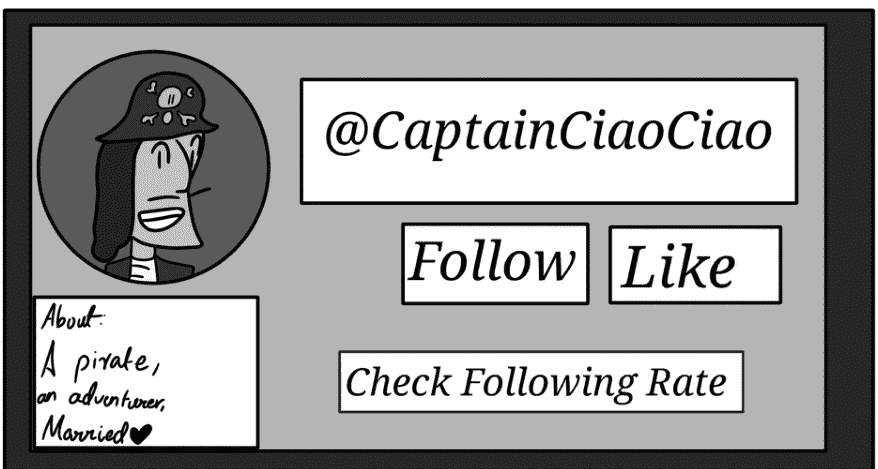
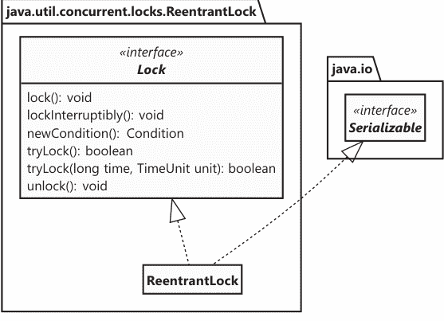
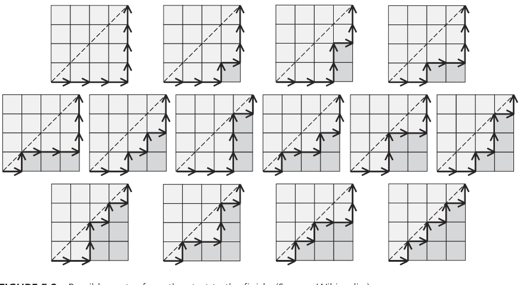
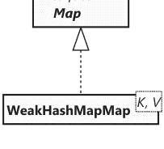
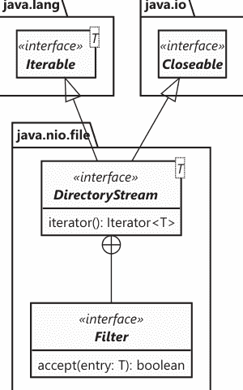
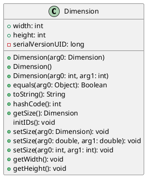

# Java 编程练习：卷二：Java 标准库 2

在提升编码技能的道路上更迈一步，深入探索 Java 标准库的奥秘。在海盗船长 CiaoCiao 的帮助下，你将继续提高编码水平，并通过极具挑战性的编程任务来测试你的 Java 知识。这是两卷书籍中的第二卷，它将为你提供在 Java 之旅中脱颖而出所需的一切，包括作为专业人士应该详细掌握的技巧，以及针对整洁代码和深度设计的密集训练，这些设计足以支撑复杂的软件。

## 特性

- 149 个不同难度的任务，并附带注释解决方案
- 涵盖所有范式：面向对象、命令式和函数式
- 整洁代码、阅读外部代码以及面向对象建模

通过大量的最佳实践和对任务的详尽注释解决方案，这些书籍为专业的 Java 软件开发提供了完美的锻炼。

---

**出版信息**

Christian Ullenboom  
CRC Press  
4 Park Square, Milton Keynes  
CRC Press 是 Taylor & Francis Group, LLC 的旗下出版社

第一版于 2025 年由 CRC Press 出版  
©2023 Christian Ullenboom。首次以德语出版，书名为 "Captain CiaoCiao erober Java" (ISBN 978-3-8362-8427-1)，出版社为 Rheinwehr Verlag GmbH, 德国波恩。

ISBN: 978-1-003-49555-0 (电子版)  
DOI: 10.1201/97810329349550  
获取支持材料：https://routledge.com/97810329728011

---

# 目录

- [关于作者](#关于作者)
- [引言](#引言)
- [第 1 章 Java 编程练习](#第-1-章-java-编程练习)
- [第 6 章 Java Stream-API](#第-6-章-java-stream-api)
- [第 7 章 文件、目录与访问](#第-7-章-文件目录与访问)
- [第 8 章 输入](#第-8-章-输入)
- [第 9 章 网络](#第-9-章-网络)
- [第 10 章 XML、JSON 和其他格式](#第-10-章-xmljson-和其他格式)
- [第 11 章 数据库访问](#第-11-章-数据库访问)
- [第 12 章 操作系统访问](#第-12-章操作系统访问)

---

# 引言

## Captain CiaoCiao

### 特性

- 整洁代码、阅读外部代码以及面向对象建模

通过大量的最佳实践和对任务的详尽注释解决方案，这些书籍为专业的 Java 软件开发提供了完美的锻炼。

## 如何使用此书

### 编码规范

### Captain CiaoCiao

#### 特性

- 整洁代码、阅读外部代码以及面向对象建模
- 测验：只有奶士 125
- 使用迭代器搜索元素并发现 Covid 咳嗽 126
- 移动元素，玩抢椅子游戏 128
- 用行星编写问答游戏 129
- 形成子集，公共元素 130
- 获取单词中包含的所有单词 131
- 使用 Uniquelerator 排除重复元素 132
- 将二维数组转换为 Map 133
- 将文本转换为摩斯密码反之亦然 134
- 使用关联记忆记录单词频率 136
- 读取和输出颜色 140
- 读取名称并管理长度 141
- 查找缺失的字符 143
- 计算到达三头猴的路径数 145
- 开发方便的属性装饰器 148
- 编写 RPN 口袋计算器 150
- 别忘记那艘船 151
- 查找重复条目并解决动物混乱 152
- 货物装 ★★ 153
- 优先处理重要消息 154
- 如果用完了，创建一个新的 ★ 155

笔记 156

---

# 第 6 章 Java Stream-API

## 带有终端操作和中间操作的普通流

- 英雄史诗：初识 Stream API ★
- 测验：双倍输出 ★
- 从列表中获取喜爱的船长 ★
- 为图片装帧 ★★
- 看一看说 ★
- 移除稀有金属重复岛屿 ★★★
- 风帆在哪里？ ★★
- 购买最受欢迎的汽车 ★★★

## 原始类型流

- 在数组中检测 NaN ★
- 生成年代 ★
- 从流生成具有常量内容的数组 ★
- 绘制金字塔 ★
- 带有字母的泰迪熊 ★
- 获取字符串的字母频率 ★
- 从 1 到 0，从 10 到 9 ★★
- 年度章鱼比赛 ★★★
- 合并三个数组 ★★
- 确定获胜组合 ★★

## 统计数据

- 最快和最慢的划手们 ★
- 计算中位数 ★★
- 计算温度统计数据并绘制图表 ★★★

## 建议解决方案

- 英雄史诗：初识 Stream API
- 测验：双倍输出
- 从列表中获取喜爱的船长
- 为图片装帧
- 看一看说
- 移除稀有金属重复岛屿
- 风帆在哪里？
- 购买最受欢迎的汽车
- 在数组中检测 NaN
- 生成年代
- 从流生成具有常量内容的数组
- 带有字母的泰迪熊
- 绘制金字塔
- 获取字符串的字母频率
- 从 1 到 0，从 10 到 9
- 年度章鱼比赛
- 合并三个 int 数组
- 确定获胜组合
- 最快和最慢的划手们
- 计算中位数
- 计算温度统计数据并绘制图表

---

# 第 7 章 文件、目录与访问

## 路径和文件

- 显示标题 ★
- 合并隐藏地 ★
- 创建文件副本 ★★
- 生成列表 ★
- 查找大文件 ★
- 递归地查找空列表
- 查找重复元素

## 建议解决方案

- 路径和文件
- 显示标题 ★
- 合并隐藏地 ★
- 创建文件副本 ★★
- 生成列表 ★
- 查找大文件 ★
- 递归地查找空列表
- 查找重复元素

---

# 第 8 章 输入

## 路径和文件

- 检测 NaN
- 生成年代
- 带有字母的泰迪熊
- 绘制金字塔
- 获取字符串的字母频率
- 从 1 到 0，从 10 到 9
- 年度章鱼比赛
- 合并三个 int 数组
- 确定获胜组合
- 最快和最慢的划手们
- 计算中位数
- 计算温度统计数据并绘制图表

---

# 第 9 章 网络

## 路径和文件

- 显示标题 ★
- 合并隐藏地 ★
- 创建文件副本 ★★
- 生成列表 ★
- 查找大文件 ★
- 递归地查找空列表
- 查找重复元素

## 建议解决方案

- 路径和文件
- 显示标题 ★
- 合并隐藏地 ★
- 创建文件副本 ★★
- 生成列表 ★
- 查找大文件 ★
- 递归地查找空列表
- 查找重复元素

---

# 第 10 章 XML、JSON 和其他格式

## 路径和文件

- 显示标题 ★
- 合并隐藏地 ★
- 创建文件副本 ★★
- 生成列表 ★
- 查找大文件 ★
- 递归地查找空列表
- 查找重复元素

## 建议解决方案

- 路径和文件
- 显示标题 ★
- 合并隐藏地 ★
- 创建文件副本 ★★
- 生成列表 ★
- 查找大文件 ★
- 递归地查找空列表
- 查找重复元素

---

# 第 11 章 数据库访问

## 路径和文件

- 显示标题 ★
- 合并隐藏地 ★
- 创建文件副本 ★★
- 生成列表 ★
- 查找大文件 ★
- 递归地查找空列表
- 查找重复元素

## 建议解决方案

- 路径和文件
- 显示标题 ★
- 合并隐藏地 ★
- 创建文件副本 ★★
- 生成列表 ★
- 查找大文件 ★
- 递归地查找空列表
- 查找重复元素

---

# 第 12 章 操作系统访问

## 路径和文件

- 显示标题 ★
- 合并隐藏地 ★
- 创建文件副本 ★★
- 生成列表 ★
- 查找大文件 ★
- 递归地查找空列表
- 查找重复元素

## 建议解决方案

- 路径和文件
- 显示标题 ★
- 合并隐藏地 ★
- 创建文件副本 ★★
- 生成列表 ★
- 查找大文件 ★
- 递归地查找空列表
- 查找重复元素

---

# 关于作者

Christian Ullenboom 在十岁时就开始了他的编程之旅，在 C64 上输入了他的第一行代码。在精通汇编语言编程和早期的 BASIC 扩展后，他在学习计算机科学和心理学之后，在 Java 的岛屿上找到了自己的天职。尽管涉足了 Python、JavaScript、TypeScript 和 Kotlin 的各种领域，但他仍然是全能专家。

20 多年来，Ullenboom 一直是一位热情的软件架构师、Java 培训师（请访问 `http://www.tutego.com`）和 IT 专家导师。他的专业知识促成了许多在线视频课程和参考书籍：

- *Java: The Comprehensive Guide* (ISBN-13: 978-1493222957)
- *Java ist auch eine Insel: Java programmieren lernen mit dem umfassenden Standardwerk für Java-Entwickler* (ISBN-13: 978-3836287456)
- *Java9 Standard-Bibliothek: Das Handbuch für Java-Entwickler* (ISBN-13: 978-3836258746)
- *Captain Ciao erobert Java: Das Trainingsbuch für besseres Java* (ISBN-13: 978-3836284271)
- *Spring Boot 3 und Spring Framework 6: Professionelle Enterprise-Anwendungen mit Java* (ISBN-13: 978-3836290494)

多年来，Christian Ullenboom 通过他的书籍传播对 Java 的热爱，使他早在 2005 年就获得了 Sun（现为 Oracle）颁发的梦寐以求的 Java Champion 称号。全球只有极少数——约 300 人获得了这一称号，使他成为了真正的 Java 巨星。

作为一名导师，Ullenboom 知晓在做中学学习是掌握技能最有效的方法。因此，他编写了一份随其培训课程的全面练习目录。本书包含了这些练习的精选，并附带了详细的解决方案。

他的根源在索恩贝克，这是德国下莱茵地区的一个小镇。

---

## 引言

许多编程初学者经常问自己：“我如何增强我作为开发者的技能？我如何才能成为一名更好的程序员？”答案很简单：学习、参加网络研讨会、学习、重复、练习，并与他人协作。编程的许多方面与学习新技能相似。正如一本书不能教你如何弹乐器一样，看《速度与激情》系列电影也不会教你开车。大脑通过反复练习来形成模式和结构。学习一种编程语言和自然语言有许多相似之处。持续使用这种语言，以及用它进行表达和交流的欲望与需求（就像你需要点汉堡或啤酒时那样），会导致技能的逐渐提高。

市面上有很多关于学习编程语言的书籍和网络研讨会，但阅读、练习和重复只是成为成功软件开发者的一个方面。你需要创造性地结合你的知识，就像音乐家经常练习练习曲并维护他们的曲库一样。你的练习越有效，就越快成为大师。这有助于你进步并获得更多的实践经验。

Java 21 声明了超过 2300 个类、约 1400 个接口、约 140 个枚举、大约 500 个异常，并添加了一些注解类型和记录。然而，在实践中，只有这些类型中的一小部分被证明是有用的。本书为任务选择了最重要的类型和方法，使它们具有激励性并遵循 Java 规范。书中还提供了替代方案和方法。目标是让非功能性需求清晰，因为程序的质量不仅仅是“做它应该做的事”。缩进、遵循命名、正确使用修饰符、最佳实践和设计模式等问题至关重要。所提出的解决方案旨在解决这些问题。

### 背景知识与目标读者

本书面向那些对 Java 还不熟悉但希望通过实践来深入了解 Java 的开发者。其目标读者包括：

- 计算机科学学生
- IT 专家
- 软件开发者

### Java 练习

书中的练习是为初学者设计的，不需要太多努力就能解决。通常，需要一些 Java 知识，例如：

- 1 ★ 简单，对初学者来说。
- 2 ★★ 难度更高，需要创造力。
- 3 ★★★ 复杂，需要之前的知识，并且有时需要研究。

### 建议解决方案

本书为每个问题提供了至少一种解决方案。“示例解决方案”一词并不意味着给定的解决方案是最好的。

### 本书中使用的 Java 版本

虽然 Java 8 在企业环境中仍然流行，但对于学习者来说，熟悉最新的语言特性很重要。因此，在可行的情况下，书中建议的解决方案都利用了 Java 17。该版本不仅拥有长期支持（LTS），而且运行时提供者提供了广泛的支持，确保该发布版本在很长一段时间内保持适用性。

### 所需软件

虽然在理论上只用纸笔就能解决任务是可行的，但现代软件开发需要使用工具。了解编程语言语法、面向对象建模和类库只是冰山一角。理解 `JVM`、使用 `Maven` 和 `Git` 等工具进行版本管理，以及熟练使用 `IDE` 都是专业软件开发中至关重要的方面。

### JVM


如果我们想运行 Java 程序，我们需要一个 JVM。在早期，这很容易。运行时环境最早来自 Sun Microsystems，后来来自接管了 Sun 的 Oracle。今天，情况变得复杂得许多。虽然可以从 Oracle 获取运行时环境，但从 Java 8 到 Java 16 的许可条款已经发生了变化。可以使用 `Oracle JDK` 进行测试和开发，但不能用于生产环境。在这种情况下，Oracle 会收取费用。因此，各种机构从 OpenJDK（原始源码）中编译出自己的运行时环境。最著名的如 Eclipse Adoptium (https://adoptium.net/)、Amazon Corretto (https://aws.amazon.com/corretto/)、Red Hat OpenJDK (https://developers.redhat.com/products/openjdk/overview) 以及 Azul Systems 或 Bellsoft 等。读者并不需要遵循特定的发行版。

## 开发环境

Java 代码仅仅是纯文本，因此从技术上说，一个简单的文本编辑器就是你需要的。然而，仅仅依赖 Notepad 或 Vi 来提高效率就像试图骑三轮车赢得比赛。现代集成开发环境为我们提供了许多任务支持：关键词高亮显示、自动代码补全、智能错误纠正、代码块插入、调试器状态的可视化等。建议使用完整的开发环境。流行的 IDE 有 IntelliJ、Visual Studio Code 和 (Apache) NetBeans。仅对于 Java 运行时环境，IDE 的选择取决于读者。Eclipse、NetBeans 和 Visual Studio Code 都是免费开源的，而 IntelliJ 社区版也是免费的，但更高级的 IntelliJ 旗舰版将需要你花费一些费用。

在书的中间，我们将在几处深入探讨使用 Maven 实现项目依赖。

## 约定

代码使用`等宽字体`编写，文件名使用*斜体*。为了区分方法和属性，方法总有一对括号，例如“变量 `max` 包含最大值”或“返回 `max()` 最大值”。由于方法可以重载，要么对参数列表命名（如 `equals(Object)`），要么使用省略号缩写（如“各种 `println(...)` 方法”）。如果提到一组标识符，则写上 `*`，例如 `print(...)` 在屏幕上打印某些内容。

在建议的解决方案中，通常会有相关的代码片段，以免增加书籍的体积。文件名会在下方的说明中提到，如下所示：

### VanillaJava.java

```
class VanillaJava { }
```

有时，我们需要展示一下终端功底，从命令行（也称为控制台或 shell）执行程序。由于每个命令行程序都有自己的提示符序列，在书中用 `$` 符号表示。用户的输入用**粗体**设置。示例：

```
$ java -version
java version "17.0.5" 2022-10-18 LTS
Java (TM) SE Runtime Environment (build 17.0.5+9-LTS-191)
Java HotSpot(TM) 64-Bit Server VM (build 17.0.5+9-LTS-191, mixed mode,
sharing)
```

如果明确提到了 Windows 命令，则设置提示符 `>`：

```
> netstat -e
Interface Statistics
```

| | Received | Sent |
|---|---|---|
| Bytes | 21892776 | 9941980 |
| Unicast packets | 162620 | 64828 |
| Non-unicast packets | 276 | 668 |
| Discards | 0 | 0 |
| Errors | 0 | 0 |
| Unknown protocols | 0 | 0 |

## 帮助船长 CIAOCAO 和 BONNY BRAIN

哈喽！从前某个时候，船长 CiaoCiao Bonny Brain 为某件我们不谈论的事情提供了帮助。现在，我们欠他们一个人情。但不要担心，努力协助他们最新的事业将是值得的。加入这对勇敢的组合和他们忠诚的船员吧，他们横跨七海，与全球各地的坏人物达成交易。他们的秘密基地在 Baloo 岛，那里的首选货币是 Libretta。由于船员来自世界各个角落，所有的程序输出都是英文的，伙计们。


## 高级字符串处理

在另一个章节处理了字符和字符串的基本数据类型后，我们现在将讨论高级字符串处理。

### Prerequisites

- 能够格式化字符串。
- 使用正则表达式匹配、搜索和替换。
- 分割字符串。
- 理解编码和 UTF-8。

本章使用的类型：

- `java.util.Formatter`
- `java.lang.String`
- `java.util.regex.Pattern`
- `java.util.regex.Matcher`
- `java.util.Scanner`

## 格式化

Java 有许多方法格式化字符串、数字和时间数据。在 `java.text` 包中，你可以找到 `MessageFormat`、`DateFormat` 和 `DecimalFormat` 类。后续的任务可以使用 `String.format(...)`。

## ASCII 表

Bonny Brain 安装了一个新程序，显示 ASCII：

```
$ ascii: [options]
-a=一行 -d=十进制 -x=十六进制 显示所有英文名称、记忆符（mnemonics）或十进制/八进制/十六进制数字。
```

| | Dec | Hex | Bin |
|---|---|---|---|
| 00 | NUL | 00 | 00000000 |
| 01 | SOH | 01 | 00000001 |
| 02 | STX | 02 | 00000010 |
| 03 | ETX | 03 | 00000011 |
| 04 | EOT | 04 | 00000100 |
| 05 | ENQ | 05 | 00000101 |
| 06 | ACK | 06 | 00000110 |
| 07 | BEL | 07 | 00000111 |
| 08 | BS | 08 | 00001000 |
| 09 | FS | 09 | 00001001 |
| 10 | OA | 0A | 00011010 |
| 11 | OB | 0B | 00011011 |
| 12 | OC | 0C | 00011100 |
| 13 | CD | 0D | 00011101 |
| 14 | SO | 0E | 00011110 |
| 15 | SI | 0F | 00011111 |
| 16 | D | 10 | 00010000 |
| 17 | NS | 11 | 00010001 |
| 18 | RS | 12 | 00010010 |
| 19 | GS | 13 | 00010011 |
| 20 | DC | 14 | 00010100 |
| 21 | NAK | 15 | 00010101 |
| 22 | SYN | 16 | 00010110 |
| 23 | ACK | 17 | 00010111 |
| 24 | CAN | 18 | 00011000 |
| 25 | EM | 19 | 00011001 |
| 26 | SUB | 1A | 00011010 |
| 27 | ESC | 1B | 00011011 |
| 28 | FS | 1C | 00011100 |
| 29 | GS | 1D | 00011101 |
| 30 | RS | 1E | 00011110 |
| 31 | US | 1F | 00011111 |
| 32 | 空 | 20 | 00100000 |
| 33 | ! | 21 | 00100001 |
| 34 | " | 22 | 00100010 |
| 35 | # | 23 | 00100011 |
| 36 | $ | 24 | 00100100 |
| 37 | % | 25 | 00100101 |
| 38 | & | 26 | 00100110 |
| 39 | ' | 27 | 00100111 |
| 40 | ( | 28 | 00101000 |
| 41 | ) | 29 | 00101001 |
| 42 | * | 2A | 00101010 |
| 43 | + | 2B | 00101011 |
| 44 | , | 2C | 00101100 |
| 45 | - | 2D | 00101101 |
| 46 | . | 2E | 00101110 |
| 47 | / | 2F | 00101111 |
| 48 | 0 | 30 | 00110000 |
| 49 | 1 | 31 | 00110001 |
| 50 | 2 | 32 | 00110010 |
| 51 | 3 | 33 | 00110011 |
| 52 | 4 | 34 | 00110100 |
| 53 | 5 | 35 | 00110101 |
| 54 | 6 | 36 | 00110110 |
| 55 | 7 | 37 | 00110111 |
| 56 | 8 | 38 | 00111000 |
| 57 | 9 | 39 | 00111001 |
| 58 | : | 3A | 00111010 |
| 59 | ; | 3B | 00111011 |
| 60 | < | 3C | 00111100 |
| 61 | = | 3D | 00111101 |
| 62 | > | 3E | 00111110 |
| 63 | ? | 3F | 00111111 |
| 64 | @ | 40 | 01000000 |
| 65 | A | 41 | 01000001 |
| 66 | B | 42 | 01000010 |
| 67 | C | 43 | 01000011 |
| 68 | D | 44 | 01000100 |
| 69 | E | 45 | 01000101 |
| 70 | F | 46 | 01000110 |
| 71 | G | 47 | 01000111 |
| 72 | H | 48 | 01001000 |
| 73 | I | 49 | 01001001 |
| 74 | J | 50 | 01010000 |
| 75 | K | 51 | 01010001 |
| 76 | L | 52 | 01010010 |
| 77 | M | 53 | 01010011 |
| 78 | N | 54 | 01010100 |
| 79 | O | 55 | 01010101 |
| 80 | P | 56 | 01010110 |
| 81 | Q | 57 | 01010111 |
| 82 | R | 58 | 01011000 |
| 83 | S | 59 | 01011001 |
| 84 | T | 5A | 01011010 |
| 85 | U | 5B | 01011011 |
| 86 | V | 5C | 01011100 |
| 87 | W | 5D | 01011101 |
| 88 | X | 5E | 01011110 |
| 89 | Y | 5F | 01011111 |
| 90 | Z | 60 | 01100000 |
| 91 | [ | 61 | 01100001 |
| 92 | \ | 62 | 01100010 |
| 93 | ] | 63 | 01100011 |
| 94 | ^ | 64 | 01100100 |
| 95 | _ | 65 | 01100101 |
| 96 | ` | 66 | 01100110 |
| 97 | a | 67 | 01100111 |
| 98 | b | 68 | 01101000 |
| 99 | c | 69 | 01101001 |
| 100 | d | 70 | 01110000 |
| 101 | e | 71 | 01110001 |
| 102 | f | 72 | 01110010 |
| 103 | g | 73 | 01110011 |
| 104 | h | 74 | 01110100 |
| 105 | i | 75 | 01110101 |
| 106 | j | 76 | 01110110 |
| 107 | k | 77 | 01110111 |
| 108 | l | 78 | 01111000 |
| 109 | m | 79 | 01111001 |
| 110 | n | 7A | 01111010 |
| 111 | o | 7B | 01111011 |
| 112 | p | 7C | 01111100 |
| 113 | q | 7D | 01111101 |
| 114 | r | 7E | 01111110 |
| 115 | s | 7F | 01111111 |

# 1 • 高级字符串处理 9



任务：

- 给定一个包含消息的聚合文本；`#CaptainCiaoCiao` 或 `@CaptainCiaoCiao` 出现了多少次？

示例：

- 对于以下输入，结果为 2。
Make me a baby #CaptainCiaoCiao
Hey @CaptainCiaoCiao, where is the recruitment test?
黑客最喜欢的流行乐队是什么？黑 IP乐队（The Black IP's）。

# 检测到的扫描值 ★

Bonny Brain 接收需要电子化处理的数字扫描列表。在第一步中，它将扫描件通过 OCR 识别器，结果是 ASCII 文本。通过 OCR 识别出的数字如下：

数字 0 到 9 的表示

```
000 11 22 333 4 5555 6 77777 888 9999
00 111 2 2 33 4 4 555 6 7 8 8 9 9
00 0 11 2 33 4444 555 6666 7 888 9999
00 0 11 2 3 4 5 6 7 8 8 9
000 1111 2222 333 4 555 666 7 888 9
```

## 10 Java 编程练习

任务：

- 给定扫描件中一行显示所示格式的数字。将数字转换为整数。
- 最后一个数字后可能缺少空格，大字符之间可能存在多个空格。

示例：

```
String ocr="""
4 4 77777 11 11 4 4 22
4 4 7 111 111 4 2 2
4444 7 11 11 4444 2
4 7 11 11 4 2
4 7 1111 1111 4 2222"""
```

所以期望的结果应该是 471142。


如果你想玩玩这些字符串，你可以在 https://patorjk.com/software/taag/#p=display&f=Alphabet&e=0123456789 找到方法。

# 请保持安静！消除大叫文本 ★

Captain ChaoCiao 经常收到信件，发件者经常用大写字母大叫——这对他的眼睛太糟糕了。


任务：

- 编写方法 `silentShoutingWords(String)`，将所有长度超过三个字母的大写单词转换为小写。

示例：

- `silentShoutingWords("AY Captain! Smutje MUST GO!")` → `"AY Captain! Smutje must GO!"`

# 将时间从 AM/PM 格式转换为 24 小时制 ★★★

Bonny Brain 经常收到以 AM 和 PM 时间的消息。

我们在晚上 11:00 突袭港口，并在凌晨 1:30 在游乐大道会合。

Bonny Brain 不喜欢这样；她只需要军事时间的 24 小时计数。


任务：

- 编写一个转换器，将带有 AM/PM（不区分大小写）的字符串转换为军事时间。提醒：12:00 AM 是 00:00，12:00 PM 是 12:00。

示例：

- `"Harbour: 11:00 PM, entertainment districts: 1:30 a."` → `Harbour: 2300, entertainment districts: 01:30`
- `"Get out of bed: 12:00AM, bake a cake: 12 PM."` → `"Get out of bed: 0000, bake a cake: 1200"`

# 将字符串拆分为标记 (Tokens)

分词（Tokenizing）是字符串构造和格式化的相反操作。字符串被拆分为子字符串，由分隔符确定。Java 提供了各种类用于字符串分词。分隔符可以是符号或正则表达式。`String` 类的 `split(...)` 方法支持正则表达式，而 `StringTokenizer` 类不支持。

# 使用 StringTokenizer 拆分地址行 ★

CiaoCiao 需要评估由三或四行的地址。

| 行 | 内容 | 可选 |
| :--- | :--- | :--- |
| 1 | 姓名 | 否 |
| 2 | 街道 | 否 |
| 3 | 城市 | 否 |
| 4 | 国家 | 是 |

行由换行符分隔。有四种有效的符号或序列：LF 是行（line feed），CR 是回车（carriage return）；在旧的打印机中，DOS 使用 `\r`，而 Unix 系统使用 `\n`。

任务：

- 将换行符分隔的字符串拆分为四行，并将行赋值给姓名、街道和城市。
- 如果没有第四行（国家），将其设为 `"null"`。
- 使用分号重新组合行。

示例：

- `"Boots and Leaves\n21 Pickle Street\n4242 Douglas\nArendelle"` → `Boots and Leaves;21 street;4242 Douglas;Arendelle`
- `"Doofensirt Evil Inc.\nStruselchel 4427\nDanville"` → `Doofensirt Evil Inc.;Struselchel;4427`

| 字符 (缩写) | 十进制 | 转义序列 |
| :--- | :--- | :--- |
| LF | 10 | `\n` |
| CR | 13 | `\r` |
| CR LF | 13 10 | `\r\n` |

# 将句子拆分为单词并反转 ★

Bonny Brain 正在等待一条消息，但传输出了问题！

"Where did the purchase hook?"

任务：

1. 将字符串拆分为单词。单词的分隔符是空格和标点。
2. 反转所有单词。
3. 用空格输出单词。标点不是关键。

示例：

- `"Where did the purchase hook?"` → `"hook purchase the did"`

# 数字之间的关系 ★

CiaoCiao 练习射箭，并记录 0 到 10 的分数。他还记录是否得更好、更差或分数相同。它可能像这样：

```
1<2<10=2
```

任务：

- 编写一个程序获取示例中的字符串，如果所有关系符号正确则返回 true，否则返回 false。

示例：

- `1<2<10=2` → false
- `1<` → false
- `1↔` → false

# 将 A1 表示转换为列和行 ★★

CiaoCiao 记录日志并使用电子表格。在他的团队中，他讨论数字，并使用列和行索引；例如，他用 4-16 表示第 4 列第 16 行。现在他有一种命名单元的新方法：A1 表示，它使用名为 Excel 的新软件。这涉及根据以下方案对列进行字母编码：A, B, ..., Z, AA, ..., BA, ..., AAA, ... 行用数字描述。因此，A2 代表单元 1–2。

# Java 编程练习

由于 ChaoCiao 对 A1 表示有困难，规范是数字列和行。

- 编写方法 `parseANotation(String)`，获取 A1 的字符串并返回一个包含两个元素的数组，其中位置 0 是列，位置 1 是行。

示例：

- `parseANotation("A1")` → `[1, 1]`
- `parseANotation("Z2")` → `[26, 2]`
- `parseANotation("AA34")` → `[27, 34]`
- `parseANotation("BZ")` → `[0, 0]`
- `parseANotation("34")` → `[0, 0]`
- `parseANotation(" ")` → `[0, 0]`
- `parseANotation("")` → `[0, 0]`

# 解析坐标的简单 CSV 文件 ★

Bonny Brain 在 `coordinates.csv` 文件中记录位置，坐标是用逗号分隔的浮点数。
例如，文件如下：

`com/tutego/exercise/string/coordinates`

```
20.091612,-155.676995

23.087301,-73.643472

21.305452,-71.690421
```

任务：

- 手动创建一个 CSV 文件。它应该包含几行坐标；逗号分隔坐标。
- 一个 Java 程序应该读取 CSV 文件并输出一个带有屏幕上多边形的 HTML 文件。
- 使用 `Scanner` 解析文件。如果你的默认语言不是英语，请确保为 `Scanner` 初始化了 `Locale(Locale.ENGLISH)`。

示例：对于输入，我们想要创建：

```
<svg height="210" width="500">

<polygon points="20.091612,-155.676995 23.087301,-73.643472 21.305452,-71.690421 " style="fill:lime;stroke:purple;stroke-width:1" />

</svg>
```

# 使用行程长度编码压缩字符串损失 ★★★

为了减少数据量，文件经常会被压缩。有不同的压缩算法；有些是有损的像素删除，另一些像像 ZIP。有损压缩常见于图像，JPEG 是一个很好的例子。根据压缩程度，图像质量会下降。在 JPEG 中，极高压缩会导致图像出现伪影。

# 1 高级字符串处理 15

一种简单的无损压缩是行程长度编码（run-length encoding）。其核心思想是将相同的符号序列组合，只写入符号的数量和符号。例如，GIF 图形格式就使用了这种压缩形式。因此，具有许多单色线条的图像比例如每个像素颜色都不同的图像要小。

下一个任务是关于行程长度编码。假设一个字符串由 `.`（点）和 `-`（减号）序列组成，例如：

为了缩短字符串的长度，我们可以先写符号，后面跟着符号的数量。包含17个字符的字符串可以缩短为以下包含9个字符的字符串：

`-2.4-8-2-`

任务：

- 1. 创建一个新的类 `SimpleStringCompressor`。
2. 编写静态方法 `String compress(String)`，根据所需的算法对 `.` 和 `-` 序列进行编码：先写字符，后写数字。
3. 编写一个解码器 `String decompress(String)` 来解压压缩字符串。让 `decompress(compress(input))` 等于 `input`。

扩展：

- 程序将能够处理非数字字符。
- 完善程序，如果字符只出现一次，则省略数字。

## 字符编码与 Unicode 排序算法

在网络和文件系统中，一切都以字节（byte）的形式存储。可以有 256 个不同的值，但这对于世界上所有的字符来说是不够的。因此有了字符编码，它可以以特定的方式编码世界上所有的字符。字符编码因此有所不同。有时字符被映射到固定数量的字节，有时映射到不同数量的字节，或者字符可能无法被识别。Java 支持各种字符编码，但今天最重要的编码是 UTF-8 编码。

# 测验：Unicode 字符的编码 ★

什么是 UTF-8 编码？

## 测验：不使用 Comparator 比较字符串时，输出是正、负还是 0？

在与 Comparator 比较后，输出是正、负还是 0？

```java
Comparator<String> comparator = Comparator.naturalOrder();

System.out.println(comparator.compare("a", "ä"));
System.out.println(comparator.compare("ä", "z"));
System.out.println(comparator.compare("n", "ä"));
System.out.println(comparator.compare("ä", "o"));

Comparator<Object> collatorDE = Comparator.getInstance(Locale.GERMAN);

System.out.println(collatorDE.compare("a", "ä"));
System.out.println(collatorDE.compare("ä", "z"));
System.out.println(collatorDE.compare("n", "ä"));
System.out.println(collatorDE.compare("ä", "o"));
```

## 构建 ASCII 表格

`com/tutugo/exercise/String/PrintAsciiTable.java`

```java
System.out.println("Dec Hex " . .repeat( 6 ) );

for ( int row = 0; row < 16; row++) {

  for ( int asciiCode = 32 + row; asciiCode <= 127; asciiCode += 16 ) {

    System.out.printf("%03d $%02X %2s ", asciiCode,
    asciiCode == 127 ? "DEL" : Character.toString(asciiCode) );

  }

  System.out.println();

}
```

首先，程序写入表头，其中六列的 "Dec Hex" 每行六个并留有间隔。

生成的表格有 16 行，这产生了一个循环。原则上，我们也可以根据列的起始和结束值动态计算行数（此处为六列）。然而，如果我们从 32 开始到 127 结束，配合 6 列，我们需要 16 行。

内层循环运行该行的所有列。左上角是第一个元素，右侧是空格字符。字符的增加不是 1 而是 16，因此它是循环计数器。在下一行中，我们不从 32 开始，而是从 33 开始，模式如下：内层循环的起始值当 ASCII 代码达到 127 时结束。

在内层循环体内，字符需要以字符串的形式显示。本质上，每个字符都作为字符串输出。条件运算符验证位置 127 处的字符是否为 DEL 字符；所有其他字符都通过 `Character` 方法转换为长度为 1 的字符串。格式字符串由三个部分组成：前两个部分访问第一个参数，并开始以十进制数字显示字符的位置，随后是十六进制格式。整数左侧用空格填充，而十六进制数不需要任何宽度信息，因为从 32 开始时，它总是包含两个数字。第三块包含作为字符串的字符和第二个格式参数。最后，在行尾添加一个换行符。

## PrintAsciiTable 的输出

| Dec Hex | Dec Hex | Dec Hex | Dec Hex | Dec Hex | Dec Hex |
|---|---|---|---|---|---|
| 32 20 | 48 30 | 64 40 @ | 80 50 | 96 60 | 112 70 p |
| 33 21 | 49 31 | 65 41 A | 81 51 Q | 97 61 a | 113 71 q |
| 34 22 | 50 32 | 66 42 B | 82 52 R | 98 62 | 114 72 r |
| 35 23 | 51 33 # | 67 43 C | 83 53 S | 99 63 c | 115 73 s |
| 36 24 | 52 34 $ | 68 44 D | 84 54 T | 100 64 d | 116 74 t |
| 37 25 | 53 35 % | 69 45 E | 85 55 U | 101 65 e | 117 75 u |
| 38 26 | 54 36 & | 70 46 F | 86 56 V | 102 66 f | 118 76 v |
| 39 27 | 55 37 ' | 71 47 G | 87 57 W | 103 67 g | 119 77 w |
| 40 28 | 56 38 ( | 72 48 H | 88 58 I | 104 68 h | 120 78 x |
| 41 29 | 57 39 ) | 73 49 I | 89 59 O | 105 69 i | 121 79 y |
| 42 2A | 58 3A * | 74 40 J | 90 50 Z | 106 6A j | 122 7A z |
| 43 2B | 59 3B + | 75 41 K | 91 51 [ | 107 6B k | 123 7B { |
| 44 2C | 60 30 , | 76 42 L | 92 52 ] | 108 6C l | 124 74 |
| 45 2D | 61 31 = | 77 4D M | 93 53 ^ | 109 6D m | 125 7D } |
| 46 2E | 62 3E > | 78 4E O | 94 54 N | 110 66 n | 126 7E ~ |
| 47 2F | 63 3F ? | 79 4F P | 95 55 _ | 111 61 o | 127 6F l |

## 对齐输出

`com/tutogo/exercise/PairOrNotPaid.java`

```java
public static void printList( String[] names
```

首先，检查两个数组的元素数量是否相等，否则抛出 `IllegalArgumentException`。如果数组为 null，访问 `length` 会产生所需的 `NullPointerException`。

由于不知道如何定义第一列，我们需要遍历所有字符串并确定最大长度。使用这个 `maxLength` 可以构建一个格式字符串。格式字符串获得一个格式说明来确定字符串的宽度并用空格填充。格式字符串获得一个左对齐字符串，并在右侧用空格填充到最大长度 `maxColumnLength`。此外，格式字符串右列包含四个空格。

右列包含 "paid" 或 "not paid"。也就是说，字符串 "paid" 总是出现，而单词 "not" 取布尔值。这是通过条件运算符实现的，它返回空字符串或字符串 "not" 作为格式字符串的参数。

# Java 编程练习

## 测验：定义正则表达式

`com/tutego/exercise/string/RegExExamples.java`

```java
// 以 '.'、!' 或 '?' 结尾的字符串，如句子

var p3 = Pattern.compile(".*[!?$"); // true

out.println(p3.matcher("?jes jes!").matches()); // true
out.println(p3.matcher("ne?").matches()); // true
out.println(p3.matcher("okej.").matches()); // true
out.println(p3.matcher("se vi diras tion").matches()); // false
```

```java
// 不包含数字的字符串

var p4 = Pattern.compile("\\D*"); // true

out.println(p4.matcher("Ciao").matches()); // true
out.println(p4.matcher("Ciao1").matches()); // false
out.println(p4.matcher(" ").matches()); // true
```

```java
// 包含官方头衔 Prof., Dr., Dr. med., Dr. h. c.

var p5 = Pattern.compile("\\Prof\\.|Dr\\.|Dr\\. med\\.|Dr\\. h\\. c\\.\\\\h\\c\\.|Dr\\\\s$"); // true
```


out.println(p5.matcher("Saluton Sirnjoro Dr. Miles").find()); // true

out.println(p5.matcher("ne korekta Dr. h. c. Thai med").find()); // true

out.println(p5.matcher("Megan Dr. Thai").find()); // false

```
在示例中，目标是查找而不是完全匹配，因此使用了 `Matcher` 的 `find()` 方法。原则上，存在性测试可以通过 `FIND.*` 和 `matches(...)` 来实现，但匹配对于正则表达式引擎来说多做一点工作，因为它只需要提供第一个而不需要看到末尾。

## 确定社交媒体上的流行度

`com/tutego/exercise/string/Popularity.java`

该任务可以通过单行代码解决，因为 `Matcher results()` 方法返回一个 `Stream<MatchResult>`，而对于 `Stream` 对象，`count()` 方法可以确定出现的次数。

## 检测到的扫描值

`com/tutego/exercise/String[] searches={`

如果我们仔细观察这些大数字，会很快发现每个大数字都包含了数字本身。大数字 0 包含 0，大数字 1 包含 1，以此类推。因此，不需要评估几行，仅取任何一个是不够的。我们只需要取第一行。

在提取出第一行后，我们搜索构成数字的子字符串。空格产生了一定干扰，因此在第一步中将它们删除。从第一行创建一个新的 `String`，其中删除了所有空格，并对齐了每个字符的数字。例如，如果行以 000 开头，那么结果中的第一个数字必须是 0。如果连续有两个 0，0000 将变成 0。

如果输入的字符串为 null、空或包含外文字符，后续将抛出异常。这种行为是可以接受的。

## 请安静！消除大叫的文本

`com/tutego/exercise/string/DoNotShout.java`

```java
public static String silentShoutingWords(String string) {
    return Pattern.compile("(?<p>uppercase){3,}")
        .matcher(string)
        .replaceAll(matchResult -> matchResult.group().toLowerCase());
}
```

建议的解决方案包含三个步骤：构建模式、匹配字符串以及将匹配项替换为大写字母的小写序列。整个 Unicode 字母表中的大写字母使用匹配器 `(?<p>uppercase)`。我们希望至少连续有三个大写字母，这通过 `{3,}` 实现。是否将模式预编译并存储在静态变量中取决于该方法的调用频率。通常情况下，将 `Pattern` 对象保留在内存中是一个很好的策略，因为翻译（编译）总是消耗一些执行时间。另一方面，如果你很少需要某个对象，就没必要引用它。

`compile(...)` 方法为我们提供 `Pattern` 对象，而 `matcher(...)` 为我们提供 `Matcher`。我们可以使用 `replaceAll(Function<MatchResult,String>)` 方法，它可以对找到的字符串进行转换。传递的参数是一个将 `MatchResult` 映射到字符串的函数。我们的函数访问 getter，将字符串转换为小写并返回它。`replaceAll(...)` 找到所有符合所选大写字母的地方并多次调用此函数。

## 将 AM/PM 转换为时间
### 格式化 24 小时制

`com/tutego/exercise/string/AmPmToMilitaryTime.java`

```java
private static final Pattern AM_PM_PATTERN =
    Pattern.compile("(?<hours>\\d+)" + // 小时
        ":(?<minutes>\\d+)?" + // 分钟
        "\\s*" + // 可选空白
        "(?<ampm>[am]m))?", // AM/PM
    Pattern.CASE_INSENSITIVE);
```

```java
public static String convertTimeToTime(String string) {
    Matcher matcher = AM_PM_PATTERN.matcher(string);
    return matcher.replaceAll(matchResult -> {
        int hours = Integer.parseInt(matchResult.group("hours"));
        int minutes = matcher.group("minutes") == null ?
            0 :
            Integer.parseInt(matchResult.group("minutes"));
        boolean isTimeInPM = "PM".equals(matchResult.group("ampm"));
        if (isTimeInPM && hours < 12) hours += 12;
        else if (!isTimeInPM && hours == 12) hours -= 12;
        return String.format("%02d:%02d", hours, minutes);
    });
}
```

程序的核心是一个捕获时间的正则表达式。该正则表达式由四个部分组成，在代码中也被分为四行。第一部分捕获小时，部分捕获分钟，第三部分是时间之间可选的空格，最后是 AM/PM。

1. 小时由至少一个整数组成，如果写 1 AM，第二个整数是可选的。从原则上讲，我们可以编写精确的表达式，使得像 99 AM 的内容不被识别，但我们没有这样做。小时本身在圆括号中，是一个名为 `<hours>` 的组。
2. 分钟部分是可选的，包含在圆括号中，结尾有一个问号。它以冒号开头。如果同时指定了小时和分钟，则用冒号分隔它们。分钟本身也是一个具名组，由两个数字组成。
3. 第三部分是空格，可选的。
4. 最后部分必须捕获不同的 AM/PM 表示法。它可以被放在两个符号之间，也许就在某个字母之后，例如 AM。因此我们不需要指定大小写，我们使用一个特殊标记来独立检查写的是 am 还是 PM。

`convertTimeTo(String)` 获取带有时间信息的字符串作为参数。`Pattern` 对象被存储为常量，`matcher(...)` 将 `Pattern` 与字符串连接。结果是一个 `Matcher`；这种类型可以使用 `replaceAll(Function<MatchResult,String> replacer)` 完成工作。该方法为我们遍历所有匹配项，我们可以访问 `MatchResult` 并将其替换为字符串。

关于 `Function`：首先我们访问该组，将字符串转换为小写并返回。`replaceAll(...)` 找到所有符合所选大写字母的地方并多次调用此函数。

# 1 · 高级字符串处理 23

核心是正则表达式 `[\p{punct}\s]+`。它捕获连续的标点符号、括号等以及分隔单词的空白字符。我们经常使用预定义类。它使用 `\p{punct}` 来匹配 `!"##%&'() *+,-./;<=>@\[\]^_`{~}` 中的字符，并使用空白字符；即字符 `[ \t\n\x0B\f\r]`。为了连接它们，我们可以为空格添加一个新字符，由于字符可以连续出现任意次数，我们添加了加号 `+`。

Java 通过 `Pattern-Matcher` 组合支持使用正则表达式拆分，两种常用方式是 `Scanner` 和 `split(...)`。这两种变体都是提出的解决方案。如果匹配数量很大，`Scanner` 总是更好的选择；而 `split(...)` 方法的答案始终包含所有单词的数组。`Scanner` 实现了 `Iterable` 和 `forEachRemaining(...)`，我们为 `Consumer` 传入辅助方法 `printWordversed` 的方法引用，该方法会在屏幕上反向打印每个单词。

## 检查数字之间的关系

`com/tutgetutorial/exercise/string/RelationChecker.java`

```java
private static boolean isValidRelation(int number1, String operator, int number2) {
    switch (operator) {
        case ">" -> number1 > number2;
        case "<" -> number1 < number2;
        case "==" -> number1 == number2;
        default -> false;
    }
}
```

```java
public static boolean isValidRelation(String string) {
    Scanner scanner = new Scanner(string);
    int number1 = scanner.nextInt();
    while (scanner.hasNext()) {
        String operator = scanner.next();
        int number2 = scanner.nextInt();
        if (isValidRelation(number1, operator, number2))
            number1 = number2;
        else
            return false;
    }
    return true;
}
```

实际方法 `checkRelation(String)` 获取字符串并检查关系。然而，该方法在它的私有方法 `isValidRelation(int, String, int)` 上失败了，因此我们想从那儿开始。`isValidRelation(...)` 获取一个数字、一个比较运算符和另一个数字。它检查该运算符与两个数字的比较是否返回真值结果。如果是，则比较为假，答案为假，就像符号位置错误的情况一样，我们只评估 `<`、`>` 和 `=`。

# 24 Java 编程练习题

方法 `checkRelation(...)` 使用传入的字符串构建一个 `Scanner`，并使用 `nextInt()`、`hasNext()` 和 `next()` 的组合来处理来自 `Scanner` 的标记（tokens）。在开始时必须有一个数字，这意味着我们可以用第一个数字初始化变量 `number1`。此时数据流可能是空的，但如果 `Scanner` 还有后续符号，那将是一个比较运算符，我们将其称为 `number2`。在比较运算符之后是我们的方法 `isValidRelation(...)`，如果比较为假，该方法将返回 `true`。然后 `number2` 将变成新数字，因此在下一次循环中，`number2` 将被赋予下一个数字。如果 `isValidRelation(...)` 返回 `false`，那么我们可以在此处终止方法，因为此时比较是假的。如果如果没有跳出循环，说明所有比较都是正确的，该方法将返回 `true`。

## 将 A1 转换为列和行

`com/tutego/exercise/string/A1Notation.java`

```java
private static final int NUMBER_OF_LETTERS = 26;

private static int parseColumnIndex(String string) {
    int result = 0;
    for (int i = 0; i < string.length(); i++) {
        // 将 A..Z 映射到 1..26
        int val = Character.getValue(string.charAt(i)) - 9;
        result = NUMBER_OF_LETTERS * result + val;
    }
    return result;
}
```

```java
public static int[] parseA1Notation(String cell) {
    Matcher matcher = Pattern.compile("([A-Z]+)(\\d+)").matcher(cell);
    if (!matcher.find() || matcher.groupCount() != 2)
        return new int[]{0, 0};
    int column = parseColumnIndex(matcher.group(1));
    int row = Integer.parseInt(matcher.group(2));
    return new int[]{column, row};
}
```

让我们以任务中提到的 AA34 为例。在第一步，我们需要分离列和行。列是 AA，行是 34。然后我们将 AA 转换为数值表示 27。两个独立的方法处理了这两个步骤。主方法 `parseA1Notation(String)` 提取行和列，然后调用 `parseColumnIndex(String)`，该方法为我们把 A1 格式的列转换为数值。让我们从 `parseColumnIndex(String)` 方法开始。我们将通过几个例子来使计算过程更易读：

- 每个字母都被转换为一个数字——A 到 1，B 到 2，直到 Z 到 26。
- 示例是一个位值系统。它类似于我们的十进制，但使用了因子 26 作为乘数。

## 表 1.2 A1 格式的计算

| 符号 | 计算方法 | 结果 |
| :--- | :--- | :--- |
| A | $1 \times 26^0$ | 1 |
| Z | $26 \times 26^0$ | 26 |
| AA | $1 \times 26^1 + 1 \times 26^0$ | 27 |
| IV | $9 \times 26^1 + 4 \times 26^0$ | 256 |
| AAA | $1 \times 26^2 + 1 \times 26^1 + 1 \times 26^0$ | 703 |

为了将整体转换为算法，我们使用了霍纳算法。让我们用一个例子来说明：

$DE=23 \times 26^6 + 4 \times 26^5 + 5 \times 26^0 = ((23 \times 26) + 4) \times 26 + 5$

霍纳算法对我们很重要，因为我们无法再计算幂了。如果我们向右移动一位，我们将结果乘以 26 并对其他位置重复该方案。这正是 `parseColumnIndex(String)` 方法所做的。循环遍历所有字符，并通过 `Character.getNumericValue(char)` 查询数值表示。对于字母 'a'，结果是 10，与 'A' 相同。如果减去 9，我们得到范围 1–26。我们取旧结果乘以 26，并加上字母的数值表示。下一步是计算文本的数值，乘以 26，再次加上最后一个字母的值。此计算完全按照计划执行。

`parseAllNotation(String)` 方法需要工作。首先，编译一个 `Pattern` 来提取列和行——由于列全是字母而行全是数字，我们可以通过正则表达式轻松捕获。如果字符串为空且没有两个匹配项，返回数组 `{0, 0}` 表示输入错误。如果有两个匹配项，我们从第一个获取列信息并使用我们自己的 `parseColumnIndex(String)` 将转换为整数。根据正则表达式，第二个字符串是有效数字。列和行进入一个小数组并返回调用者。

## 解析带坐标的简单 CSV 文件

`com/tutego/exercise/string/GenerateSvgFromCoordinates.java`

`String filename = "coordinates.csv";`

```java
try (InputStream is = GenerateSvgFromCoordinates.class.getResourceStream(filename);
     Scanner scanner = new Scanner(is, Charsets.ISO_8859_1)) {
    scanner.useDelimiter("\s+").useLocale(Locale.ENGLISH);
}
```

```java
StringBuilder svg = new StringBuilder(1024);
svg.append("<svg height=\"210\" width=\"500\">\n<polygon points=\"");
```

```java
while (scanner.hasNextDouble()) {
    double x = scanner.nextDouble();
}
```

```java
if (!scanner.hasNextDouble()) {
    throw new IllegalStateException("Missing coordinate");
}
```

```java
double y = scanner.nextDouble();
svg.append(" ").append(" ");
```

```java
svg.append(" style=");
```


文件包含由分号或换行符（通常是空格）分隔的整数序列。我们需要找到一个代表这些序列的标记器。由于我们需要从文件读取并使用正则表达式处理，`Scanner` 类是一个很好的选择。这也是所提解决方案的方法。

`Scanner` 连接到想要读取的文件。字符编码显式设置为 UTF-8。然后用分隔符的正则表达式初始化 `Scanner`。这些分隔符通过 `Scanner` 方法 `useDelimiter(...)` 设置。设置 `Locale.ENGLISH` 是重要的，因为默认情况下 `Scanner` 配置为操作系统的语言，例如，在某些情况下 `Scanner` 会检测以逗号作为分隔符的浮点数。但源始终具有格式化的数字。

`Scanner` 准备好后，程序就可以生成输出。它从 SVG 容器和 polygon 开始标签开始。`Scanner` 方法 `hasNext()` 遍历文件。当 `next()` 方法返回标记时，我们总是期望。我们可以读取第一个整数，现在是第二个整数。但如果 `Scanner` 找不到新标记，这是一个错误，我们抛出一个异常。如果第二个数字存在，它将被读取。这对组合可以放在 SVG 容器中。

在循环结束时，我们关闭 polygon 标签并将 SVG 元素打印到屏幕上。对于输出，我们不需要关注 `append(double)` 的语言，因为 double 的格式自动为英文。

## 使用行程长度编码无损地压缩字符串

`com/tetego/exercise/string/SimpleStringCompressor.java`

```java
public static String compress(String string) {
    if (string.isEmpty()) {
        return "";
    }
    char lastChar = string.charAt(0);
    int count = 1;
    StringBuilder result = new StringBuilder(string.length());
    for (int i = 1; i < string.length(); i++) {
        char currentChar = string.charAt(i);
        if (currentChar == lastChar) {
            count++;
        } else {
            result.append(lastChar);
            if (count > 1) {
                result.append(count);
            }
            count = 1;
            lastChar = currentChar;
        }
    }
    result.append(lastChar);
    if (count > 1) {
        result.append(count);
    }
    return result.toString();
}

private static CharSequence decodeToken(String token) {
    if (token.isEmpty()) {
        return "";
    }
    if (token.length() == 1) {
        return token;
    }
    int length = Integer.parseInt(token.substring(1));
    return String.valueOf(token.charAt(0)).repeat(Math.max(0, length));
}

public static String decompress(String string) {
    StringBuilder result = new StringBuilder(string.length() * 2);
    Matcher pattern = Pattern.compile("[-\\d]+\\*").matcher(string);
    while (pattern.find()) {
        result.append(decodeToken(pattern.group()));
    }
    return result.toString();
}
```

### 代码解析

在第一步中，我们压缩字符串。为了实现这一点，我们首先查询字符串是否包含任何文本；如果没有，那么任务就基本完成了。为了查看连续出现了多少个相同的字符，我们使用一个变量 `lastChar` 来存储上一个字符，这样我们可以将新字符与上一个字符进行比较。此外，我们用 `count` 记录字符的数量。由于这个结果是新构建的，我们添加了一个 `StringBuilder` 类型的变量。

循环遍历每个字符并将其存储在辅助变量 `currentChar` 中。现在可能会发生两种情况：字符 `currentChar` 可能与 `lastChar` 中的上一个字符相同，也可能不同。我们必须处理这种差异。

初始检查判断之前观察到的字符是否与当前读取的字符匹配。如果匹配，我们简单地增加计数器并继续循环。如果新读取的字符与上一个字符不同，本地压缩过程结束。我们首先将该字符写入缓冲区。然而，如果之前计算了多个相同的字符，我们就将其计数输入数据流。但如果只有一个字符，根据任务说明，我们不会向缓冲区添加 1。在完成字符-计数器对后，必须将计数器重置为 1。循环几乎结束了。一旦发现新字符，我们将 `lastChar` 设置为精确的当前字符。

当我们完成循环时，`lastChar` 和 `count` 中仍然有一个字符。因此，我们在分支判断中执行与之前相同的查询，如果计数器大于 1，则将计数添加到字符串中。

在解包方法中，我们回到压缩过程中产生的模式。总是存在字符和数字的对，特殊情况是该对是单个的，且缺少数字。使用正则表达式，我们运行整个字符串并查看所有的对。为了防止方法变得太大，我们使用一个辅助方法 `decodeToken(String)`，它接收一个对并将其展开。

首先，我们必须找出标记是由一个字符还是多个字符组成的。如果字符串仅包含一个字符，那么它必须是我们的符号，并进入输出。如果字符串长度大于 1，则从第二个位置开始有长度编码。通过 `substring(1)` 我们提取字符串并将其转换为整数，这样 `String` 的 `repeat(int)` 方法就可以为我们生成精确数量的 `charAt(0)`。

## 测验：Unicode 字符编码

我们在源代码中编写字符串时，并不太担心编码，因为我们可以在引号中编写许多字符。当这些字符串被写入文件时（例如），编码就是相关的，因为其他程序自然会读取该文件。

Unicode 字符在完整范围内需要四个字节。然而，如果字符只能编码为一个字节（例如简单的 ASCII 字符），那么这就是浪费。常见的编码 UTF-8 和 UTF-16 表示所有的 Unicode 字符。对于 Latin-1 来说并非如此，因为 Latin-1 只有八位（256 个字符），数千个字符无法在 Latin-1 中表示。UTF-8 编码尽可能使用一个字节，如果可能则使用两个，否则使用三个或四个。

### UTF-8 编码结构

| 字节数 | 位 | 起始点 | 结束点 | 字节 1 | 字节 2 | 字节 3 | 字节 4 |
| :--- | :--- | :--- | :--- | :--- | :--- | :--- | :--- |
| 1 | 7 | U+0000 | U+007F | 0xxxxxxx | | | |
| 2 | 11 | U+0080 | U+07FF | 110xxxxx | 10xxxxxx | | |
| 3 | 16 | U+0800 | U+FFFF | 1110xxxx | 10xxxxxx | 10xxxxxx | |
| 4 | 21 | U+10000 | U+10FFFF | 11110xxx | 10xxxxxx | 10xxxxxx | 10xxxxxx |

## 测验：带有和无 Collator 的字符串顺序

输出如下：

```java
Comparator<String> collator = Collator.getInstance(); // 默认 Locale
System.out.println(collator.compare("a", "ä"));
System.out.println(collator.compare("a", "z"));
System.out.println(collator.compare("n", "ä"));
System.out.println(collator.compare("n", "o"));
```

```java
Comparator<String> collator = Collator.getInstance(Locale.GERMAN);
System.out.println(collator.compare("a", "ä"));
System.out.println(collator.compare("a", "z"));
System.out.println(collator.compare("n", "ä"));
System.out.println(collator.compare("n", "o"));
```

字符串的字典序意味着数字在前，接着是大写字母，然后是小写字母。变音符号在大写字母之后。

其他语言也有类似的规则。字典序并不支持这一点。因此，Unicode 排序算法描述了在不同国家/地区的排序情况。关于介绍，请参阅：https://en.wikipedia.org/wiki/Unicode_collation。

在 Java 中提供了 `Collator` 对象。它们使用 `Locale` 初始化。除了语言之外，还可以传递某些级别（strength levels）；Javadoc 在“Collator strength”标题下提供了更多示例。

# 2 • 数学 31

- `Math.rint(double)` -> `double`
- `BigDecimal` 和 `setScale(...)` -> `BigDecimal`
- `NumberFormat`，通过 `setMaximumFractionDigits(...)` 配置后，调用 `format(...)` -> `String`
- `DecimalFormat`，通过 `setRoundingMode(...)` 配置后，调用 `format(...)` -> `String`
- 带有错误字符串的 `Formatter`，调用 `format(...)` -> `String`

这五个方法中有四种源于 `Math` 类，但当处理巨大且精确的浮点数或字符串表示时，会涉及到其他类。由于这些方法的结果略有不同，以下的任务将使这些差异再次变得清晰。

### 任务：填入舍入结果

在下表中填入舍入的结果：

| VALUE D | (INT) D | FLOOR(D) | CEIL(D) | ROUND(D) | RINT(D) |
| :--- | :--- | :--- | :--- | :--- | :--- |
| -2.5 | -2 | -3 | -2 | -2 | -2 |
| -1.9 | -1 | -2 | -1 | -2 | -2 |
| -1.6 | -1 | -2 | -1 | -2 | -2 |
| -1.5 | -1 | -2 | -1 | -1 | -2 |
| -1.1 | -1 | -2 | -1 | -1 | -1 |
| 1.1 | 1 | 1 | 2 | 1 | 1 |
| 1.5 | 1 | 1 | 2 | 2 | 2 |
| 1.6 | 1 | 1 | 2 | 2 | 2 |
| 1.9 | 1 | 1 | 2 | 2 | 2 |
| 2.5 | 2 | 2 | 3 | 3 | 2 |

> **说明**：
> - `(INT) D`：向零取整。
> - `FLOOR(D)`：向负无穷取整。
> - `CEIL(D)`：向正无穷取整。
> - `ROUND(D)`：四舍五入（`Math.round`，0.5 向正无穷方向）。
> - `RINT(D)`：银行家舍入法（`Math.rint`，0.5 向最近的偶数）。

## 检查金婷是否在舍入上作了弊

会计师金婷为乔队长负责收支记账。她获得正负浮点值，并将总额写成一个舍入后的整数以便在最后进行总结。乔队长怀疑金婷并不完全诚实，在进行商业舍入时私吞了分币的金额。作为提醒，如果第一个被省略的小数位是 0, 1, 2, 3 或 4，则向下舍入；如果是 5, 6, 7, 8 或 9，则向上舍入。

为了测试他的猜测，乔队长需要一个可以求和并检查不同舍入模式的程序：

- 给定浮点数数组（正数和负数）以及被金婷转换为整数的总和。
- 乔队长想找出使用了哪种舍入方式来形成总和整数。因此，需要对数组中的元素求和并与金婷的总和进行比较。
- 实现方法 `detectRoundingMode(double[] numbers, int sum)`，该方法接收双精度数字数组和金婷的总和，并检查使用了哪种舍入模式。
- 为了表示舍入模式，引入一个枚举类型：

```java
enum RoundingMode {
    CAST, ROUND, FLOOR, CEIL, RINT, UNKNOWN;
}
```


# 32 Java 编程练习

## 舍入模式枚举

枚举元素代表不同的舍入模式：

- `(int)`，即一种类型转换。
- `(int) Math.floor(double)`
- `(int) Math.ceil(double)`
- `(int) Math.rint(double)`
- `(int) Math.round(double)`

哪种舍入对乔队长不利而对金婷有利？金婷可以使用哪种变体来作弊？

### 示例

调用可能像这样：

```java
double[] numbers = {199.99 };
System.out.println(detectRoundingMode(numbers, 200 ));
```

### 说明

- `java.math` 包中有一个枚举类型 `RoundingMode`，但对于我们的情况，它并不合适。
- 有一种舍入模式很有帮助——例如，当浮点值的和本身是一个整数时——那么方法就可以自由选择一种舍入模式。

## 巨大且精确的数字

`java.math.BigInteger` 和 `java.math.BigDecimal` 类可以表示任意大的整数和浮点数。

## 计算大整数的平均值 ★

计算两个数的算术平均值，是将它们相加并除以二。如果两个值的和超过了可以表示的最大数值，就会溢出。计算机科学中的某些算法可以处理这个问题，但我们可以使其简单一点，并使用更高的数据类型。例如，如果我们想计算两个 `int` 变量的平均值，将它们转换为 `long`，相加后再转回 `int`。使用 `long` 类型没有溢出问题，但 `BigInteger` 类型更好。

### 任务

计算两个 `long` 值的算术平均值，以确保没有溢出和错误结果。结果应该是 `long`。

## 按数字舍入 ★

一笔新交易让金婷赚了很多钱。数字大到你无法通过电话宣布它；必须分块传达。


### 任务

写一个新方法 `BigInteger completeNumber(int... parts)`，获取数字并返回最终的总和。

### 示例

`completeNumber(123, 22, 989, 77, 9)` 返回值为 `1232298979` 的 `BigInteger`。

## 开发分数类与截断 ★★

金婷正尝试为分数创建一个方案。出现了像“1/4”或“1/2”这样的分数。为了派对，她必须截断“100/4”。

### 任务

1. 创建新类 `Fraction`。
2. 有一个构造函数 `Fraction(int numerator, int denominator)`，将分子和分母存储在 `final` 变量中。
   - 除非分母为零，否则应该通过异常报告。
   - 每一个创建的分数都应该自动简化。使用 `BigInteger` 的 `gcd(...)` 方法计算最大公约数。你可以通过这个数字对分子和分母进行简化。
   - 分子和分母都可以是负数，但你可以翻转符号使其均为正。
   - 对象应该是不可变的，因此初始化后无法更改。该类不包含任何 setter。
3. 添加构造函数 `Fraction(int value)`，其中分母自动变为 1。
4. 实现一个相乘分数的方法。
5. 实现一个返回分数倒数的 `reciprocal()` 方法。感谢这个方法，可以实现分数除。
6. `Fraction` 应该继承 `java.lang.Number` 并实现所有强制方法。
7. `Fraction` 应该实现 `Comparable`，因为分数可以转换为小数并具有自然顺序。
8. `Fraction` 应该正确实现 `equals(...)` 和 `hashCode()`。
9. 实现一个 `toString()` 方法，返回尽可能简单的字符串。

## 2 • 数学 35


图 2.1 `Fraction` 的 UML 图。

## 建议答案

### 测验：经验法则

表 2.1 浮点数 d 的不同舍入

| VALUE d | (INT) d | (INT) FLOOR(d) | (INT) CEILING(d) | (INT) ROUND(d) | (INT) RINT(d) |
| :--- | :--- | :--- | :--- | :--- | :--- |
| -2.5 | -2 | -3 | -2 | -2 | -2 |
| -1.9 | -1 | -2 | -1 | -2 | -2 |
| -1.6 | -1 | -2 | -1 | -2 | -2 |
| -1.5 | -1 | -2 | -1 | -1 | -2 |
| -1.1 | -1 | -2 | -1 | -1 | -1 |
| 1.1 | 1 | 1 | 2 | 1 | 1 |
| 1.5 | 1 | 1 | 2 | 2 | 2 |
| 1.6 | 1 | 1 | 2 | 2 | 2 |
| 1.9 | 1 | 1 | 2 | 2 | 2 |
| 2.5 | 2 | 2 | 3 | 3 | 2 |

`Math.round(double)` 和 `Math.rint(double)` 在处理 .5 的“边缘”数字时有所不同：

- `round(double)` 采用商业舍入。如表所示，`round(-2.5)`、`round(-1.5)`、`round(1.5)` 和 `round(2.5)` 的行为各异。
- `rint(double)` 在处理 .5 时向偶数舍入，这与 `round(double)` 不同。在 .5 的情况下，`rint(double)` 在数学上是对称的。

### 检查金婷是否在舍入上作了弊

我们现在来讨论哪种舍入方式对乔队长不利而对金婷有利。舍入值与总和之间的差异就是金婷可以利用的：如果总和是 22，而金婷舍入为 222，那么乔队长错过了 200，这钱进了金婷的口袋。对于这些数字，差异是怎样的？

表 2.3 舍入产生的差异

| VALUE d | INT (d) | d | FLOOR(d) | d | CEIL(d) | d | ROUND(d) | d | RINT(d) |
| :--- | :--- | :--- | :--- | :--- | :--- | :--- | :--- | :--- |
| -2.5 | -0.5 | 0.5 | -0.5 | -0.5 | -0.5 |
| -1.9 | -0.9 | 0.1 | -0.9 | 0.4 | 0.4 |
| -1.6 | -0.6 | 0.4 | -0.6 | 0.4 | 0.4 |
| -1.5 | -0.5 | 0.5 | -0.5 | -0.5 | 0.5 |
| -1.1 | -0.1 | 0.9 | -0.1 | -0.1 | -0.1 |
| 1.1 | 0.1 | 0.1 | -0.9 | 0.1 | 0.1 |
| 1.5 | 0.5 | 0.5 | -0.5 | -0.5 | -0.5 |
| 1.6 | 0.6 | 0.6 | -0.4 | -0.4 | -0.4 |
| 1.9 | 0.9 | 0.9 | -0.1 | -0.1 | -0.1 |
| 2.5 | 0.5 | 0.5 | -0.5 | -0.5 | 0.5 |

舍入方法总结

| PROCEDURE | RESULT |
| :--- | :--- |
| (int) d | 截断浮点数。 |
| floor(d) | 向较小的整数舍入。 |
| ceil(d) | 向较大的整数舍入。 |
| round(d) | 按照商业舍入规则。 |
| rint(d) | 向最近的偶整数舍入，在数学上是对称的。 |

### 针对建议的解决方案

com/tutego/exercise/math/RoundingModeDetector.java

```java
public enum RoundingMode {

    CAST, ROUND, FLOOR, CEIL, RINT, UNKNOWN

}
```

```java
private static RoundingMode detectRoundingMode( double value, int rounded ) {

    return rounded == rounded ? RoundingMode.CAST :

           rounded == Math.round( value) ? RoundingMode.ROUND :

           rounded == Math.floor( value) ? RoundingMode.FLOOR :

           rounded == Math.ceil( value) ? RoundingMode.CEIL :

           rounded == Math.rint( value) ? RoundingMode.RINT :

           RoundingMode.UNKNOWN;

}
```

```java
public static RoundingMode detectRoundingMode(double[] numbers, int sum) {

    double realSum=0;

    for ( double number : numbers ) {

        realSum += number;

    }

    return detectRoundingMode(realSum, sum);

}
```

建议的解决方案由两个方法组成。公共方法 `detectRoundingMode(...)` 对数组元素求和，并调用私有方法 `detectRoundingMode(double, int)` 来确定实际的舍入模式。该方法顺序将整数值与不同的舍入值进行比较，如果匹配，则返回相应的枚举元素。如果总和与舍入值不匹配，则返回 `RoundingMode.UNKNOWN`。

## 计算大整数的算术平均值

com/tutego/exercise/math/BigInteger.java

```java
private final static BigDecimal TWO=BigDecimal.valueOf( 2 );

public static long meanExact(long x, long y) {

    BigInteger bigsum=BigInteger.valueOf(x).add(BigInteger.valueOf( y) );

    BigInteger bigmean=bigsum.divide(BigInteger.TWO);

    return bigmean.longValue();

}
```

在第一步，我们使用工厂方法 `valueOf(long)` 为参数 `x` 和 `y` 构建一个新的 `BigInteger` 类型对象。在第二步，构建总和；在第三步，将其除以 2。对于除法，我们也必须使用一个 `BigInteger` 对象作为除数。因为除数是常量——`BigInteger` 提供了 0 和 1 的常量，但没有 2。

在对整数取平均值时，两个偶数或两个奇数的差总是得到偶数，但偶数与奇数的和是奇数。如果奇数除以 2，会有余数，问题在于是向上舍入还是向下舍入、将结果舍入 0 还是正负无穷——可能性非常少。`BigInteger divide(...)` 的行为类似于两个整数除法，它会被舍入为0。

结果并不大于 `Long.MAX_VALUE` 且不小于 `Long.MIN_VALUE`，因此通过 `longValue()` 将 `BigInteger` 转换为数字不会有损失。

## 电话中的数字组合

com/tutego/exercise/math/SequentialNumbersToOneNumber.java

```java
static BigInteger completeNumber(int... parts ) {

  StringBuilder number=new StringBuilder(parts.length * 2);

  for (int part : parts ) {

    number.append(part);

  }

  return new BigInteger(number.toString());

}
```

我们可以使用字符串或数学方法来解决此任务。使用临时字符串很容易解决任务。
在第一步，我们遍历数组，逐个获取所有数字并将它们附加到 `StringBuilder` 中。如果我们假设每个数字平均由两位组成，我们就可以估计结果的大小；因此，我们使用了带容量的 `StringBuilder` 参数构造函数。
添加数字后，将 `StringBuilder` 转换为 `String` 并开始输入 `BigInteger` 的构造函数。
任务过程也可以不使用临时 `StringBuilder` 来解决。让我们以此为例：

```java
completeNumber(123, 22, 989, 77, 99);
```

如果我们想创建一个 `12322989779` 的 `BigInteger`，可以先构建包含 `123` 的 `BigInteger`，然后将该数字乘以 100 并加上 22，得到 12322。在下一步，我们获取结果，将其乘以 1000 并加上 989。然后我们乘以 100、77，将结果乘以 10 并加上 9。也就是说，我们始终将旧值乘以 $10^n$，其中 $n$ 是后续数字的位数。

## 开发用于分数的类并截断分数

com/tutego/exercise/math/Fraction.BigInteger;

```java
import java.math.BigInteger;

public final class Fraction extends Number implements Comparable<Fraction> {

// ... (后续代码在原文中被截断，未翻译)
```


# 2 • 数学

下一类方法来自基类类型 `Number`。我们将分子除以分母，并在不同的方法中返回结果。

下一个方法 `compareTo(...)` 来自 `Comparable` 接口。我们将其简化，计算商并将我们的商与传入的分数商进行比较。

在下一步中，我们重写了 `equals(...)` 和 `hashCode()` 方法。一个良好的哈希值会在分子或分母发生变化时返回一个不同的哈希值。`hashCode()` 的实现是通过翻转分母的位来实现的。如果分子和分母的总位数不超过 32 位（`int` 的位数），我们就可以通过不同的哈希值检测到每一次变化。

最后一个方法是 `toString()`。如果分子为 0，我们甚至不需要看分母，直接返回字符串 "0"。如果分母为 1，我们可以只返回分子。否则，我们返回由分数线分隔的分子和分母。

## 语言区域（Locale）、日期和时间

在几乎所有的练习中我们都有屏幕输出，任何在日常生活中写作（例如中文、西班牙语或阿拉伯语）的人可能也倾向于让程序输出这种语言。然而，在某些地方，可能会出现错误的格式，例如浮点数的小数位没有被分隔。小数点分隔符只是各国标准差异之大的众多例子之一：有时在数字前面，有时在后面；对于日期，某些国家的格式是“年-月-日”，另一些是“日-月-年”，还有的是“月-日-年”。

本章重点关注国际化（原则上如何使程序语言无关）和本地化（对特定语言的适应）。毕竟，如果我们的软件要成功，它当然必须在地球上的任何地方、任何时间运行。Java 可以轻松适应许多语言规范，我们将在练习中查看所有内容，以便 CaptainCiao 和 Bobby Rain 可以在任何地方开展业务，每个人都能理解他们的“语言”。

### 前提条件

- 了解 `Locale` 类和常量，如 `Locale.US`。
- 能够识别特定国家格式化的需求。
- 了解时间数据类型 `LocalDate`、`LocalDateTime`、`Duration`。

本章使用的数据类型：

- `java.util.Locale`
- `java.time.LocalDate`
- `java.time.LocalDateTime`
- `java.time.format.DateTimeFormatter`
- `java.time.format.FormatStyle`
- `java.time.Duration`

## 语言与国家

为了让 Java 库解析和格式化浮点数、日期以及翻译文本，有一种数据类型称为 `Locale`，表示带有可选区域的语言。我们要使用这种类型来解决一些练习，展示 `Locale` 如何无处不在。

### 为随机数应用特定国家/语言格式 ★

Bonny Brain 正在准备一个新的邮件诈骗：比特币将以远低于市场的价格“卖出”。她为此准备了主题行，例如：

> 仅需 $11,937.70 购买比特币 ₿

当然，这个团队正在计划一场全球性的骗局，这就是根据不同国家的规则格式化数字变得重要的地方。

- 以 `Locale` 作为第一个参数。
- 不使用 `Locale`。如果没有传递 `Locale` 对象，则应用默认语言区域。这导致 Java 虚拟机（假设操作系统语言为西班牙语）这种语言；这种语言会进行适配，并且在使用 `System.out.printf(...)` 输出浮点数时，默认使用逗号作为小数点分隔符。如果你使用的是英语操作系统，默认使用点作为分隔符，因为英语国家的小数位是用点分隔的。


**练习：**

- 创建一个 `double` 类型、范围在 10000（包含）到 12000（不包含）之间的随机数：需要两位小数。
- 为了格式化带有两位小数和千位分隔符的浮点数，使用 `String.format` 方法。
- 获取系统所有的 `Locale` 对象，并将它们作为 `String.format` 方法的参数，以便浮点数以“本地化”格式输出。输出字符串。

作为一条通用规则，可以说明所有依赖语言的格式化或解析通常接受一个 `Locale` 对象作为参数。没有参数的方法会在内部查询默认语言，然后传递显式的 `Locale`。

## 日期与时间类

乍一看，日期只由年、月、日组成。然而，你期望应用程序接口（API）能够回答更多问题：是星期几？如果派对持续到 2 月 27 日，什么时候结束？如果我在 12 月 31 日 09:30 离开，那是几点？

Java 库经过多年演变，出现了各种日期和时间的类型：

- `java.util.Date`
- `java.util.Calendar`、`java.util.GregorianCalendar`
- `java.time.LocalDate`、`LocalTime`、`Duration`

对于带有时间的日期，有许多选择；然而 `Date` 和 `Calendar` 不再流行，因为它们会导致问题。尽管在许多示例中仍能找到这些类型，我们应该远离这些“旧”类型，因此本节教授如何使用来自 `java.time` 的类型。

### 以不同语言格式化日期

9 月 19 日是海盗日。Bonny Brain 正在策划一个派对并准备邀请函，日期格式为中文、意大利语和德语；对于 `Month.Year`，其他语言又是怎样的？

- 练习：针对 9 月 19 日：`LocalDate.of(Year.now().getValue(), Month.SEPTEMBER, 19)`
- 调用 `toString()` 方法；输出是什么？
- 调用 `format(DateTimeFormatter.ofLocalizedDate(FormatStyle.MEDIUM))`；输出是什么？
- 有四种样式——尝试所有的。
- 在 `DateTime` 对象上，你可以调用 `withLocale()` 并更改语言；尝试不同的语言。

### Beaufort 在哪一天过生日？

CaptainCiao 每年庆祝 Beaufort 先生的生日，他出生于 1774 年 5 月 27 日。


**练习：**

- 给定 Francis 生日的 `LocalDate`：`beaufortBday = LocalDate.of(1774, Month.MAY, 27)`
- 从 `beaufortBday` 开始，创建一个当前年份的 `LocalDate`。
- 创建 Francis 今年在星期几过生日的输出。输出是数字还是字符串并不重要。

**示例：**

- 对于 2026 年，输出可能是：
  > 星期三
  > 3

### 寻找所有的星期三

每个星期三，CaptainCiao 都觉得航海不舒服。在这些日子里，他不去航海，而是让 Bravius Gritty 去。

**任务：**

- 编写一个程序，列出给定年份中所有 13 号的星期三。
- 额外奖励：针对此，编写一个 `TemporalAdjuster`，返回 `Temporal` 对象的下一个星期三。

**对于 1925 年，输出可能如下：**

```
1925-02-13
1925-03-13
1925-11-13
```

**对于 2024 年：**

```
2024-09-13
2024-12-13
```

### 获取卡拉 OK 之夜的平均时长

带有朗姆、跳舞和唱歌的卡拉 OK 之夜深受欢迎。派对通常持续到凌晨，这让 Bonny Brain 很困扰，因为船员会进入第二天。

为了计算天数，Bonny Brain 想记录开始和结束时间。她记录并在之后计算平均值。例如，笔记上的“2025-03-12, 20:20 - 2025-03-12, 23:50”：

**练习：**

- 编写一个程序评估上述格式的字符串，找到平均派对时长并打印出来。
- 程序不需要考虑时区、闰秒或其他特殊情况——一天可以恰好是 24 小时。

**示例：**

- 对于字符串
  ```
  2025-03-12, 20:20 - 2025-03-12, 23:50
  2025-04-01, 21:30 - 2025-04-02, 01:20
  ```
  输出应该像：
  > 3h 40m

对于时间差，`Duration` 类很有帮助。

## 解析不同的日期格式 ★ ★

日期可以指定为绝对或相对，有几种方法指定日期。几个示例：

```
2025-10-10
2025-12-2
1/3/1976
1/3/25
Tomorrow
Today
Yesterday
1 day ago
2234days ago
```

```java
LocalDate date = LocalDate.of(Year.now().getValue(), Month.SEPTEMBER, 19);

System.out.println(date);

DateTimeFormatter formatterShort = DateTimeFormatter.ofLocalizedDate(FormatStyle.SHORT);
DateTimeFormatter formatterMedium = DateTimeFormatter.ofLocalizedDate(FormatStyle.MEDIUM);
DateTimeFormatter formatterLong = DateTimeFormatter.ofLocalizedDate(FormatStyle.LONG);
DateTimeFormatter formatterFull = DateTimeFormatter.ofLocalizedDate(FormatStyle.FULL);
```

# 48 Java 编程练习

```java
DateTimeFormatter[] dateTime = {
    formatterShort,
    formatterMedium,
    formatterLong,
    formatterFull,
    formatterShort.withLocale(Locale.CANADA_FRENCH),
    formatterMedium.withLocale(Locale.CHINESE),
    formatterLong.withLocale(Locale.ITALIAN),
    formatterFull.withLocale(Locale.of("th"))
};

for (DateTimeFormatter formatter : dateTime) {
    System.out.println(date.format(formatter));
}
```

假设当前的区域设置（`Locale`）为美国，程序对 2023 年的输出将：

```
2023-09-19
9/19/23
Sep 19, 2023
September 19, 2023
Tuesday, September 19, 2023
2023-09-19
2023年9月19日
19 set. 2023
19 กันยายน 2566
```

时间数据类型重写了 `toString()` 方法，但它不能用格式化类型进行参数化。相反，`LocalDate` 拥有 `format(...)` 方法，可以传递一个 `DateTimeFormatter`。获取 `DateTimeFormatter` 有三种常用方法：

- 你选择一个常量，例如 `DateTimeFormatter.ISO_LOCAL_DATE`。
- 你通过模式精确指定，例如指定日期或月份的位置以及使用哪些符号。
- 你选择与语言无关的标准格式化，这对于屏幕输出非常实用。它返回 `DateTimeFormatter.ofLocalizedDate(...)`。

`ofLocalizedDate(...)` 接受 `FormatStyle` 类型的参数，建议的解决方案构建了四个这样的 `DateTimeFormatter` 实例并使用这些格式调用 `format(...)` 方法。
`ofLocalizedDate(...)` 已经包含了关于本地化的提示。通过 `withLocale(...)`，任何 `DateTimeFormatter` 都可以与一个 `Locale` 关联。所有时间类型都是不可变的；方法的返回的是一个设置了 `Locale` 的新对象。

## 弗朗西斯·博福特爵士哪一天过生日？

在解决方案中，我们分两个步骤进行：

1. 从 `beaufortBday` 开始，我们必须构建一个今年 5 月 27 日的 `LocalDate`。
2. 必须获取星期。

对于第一部分：
`com/tutego/exercise/SirFrancisBeaufortBirthday.java`

```java
LocalDate beaufortBday = LocalDate.of(1774, Month.MAY, 27);

// 1.
LocalDate beaufortBdayThisYear = beaufortBday.withYear(Year.now().getValue());

// 2.
LocalDate beaufortBdayThisYear2 = LocalDate.of(LocalDate.now().getYear(), beaufortBday.getMonth(), beaufortBday.getDayOfMonth());

// 3.
LocalDate beaufortBdayThisYear3 = LocalDate.now().withMonth(beaufortBday.getMonth()).withDayOfMonth(beaufortBday.getDayOfMonth());
```

对于构建 `LocalDate` 对象，建议的解决方案展示了三种变体：

1. 在第一种变体中，我们使用 `with` 方法，这是一个带有前缀而不是 `set` 的方法，它返回一个带有新值的新对象。Java 的时间数据类型是不可变的，所以没有 setter。`withYear(int)` 返回一个年份已改变的 `LocalDate`。对于今年，我们使用 `Year` 数据类型。静态方法 `now()` 返回当前年份。由于 `withYear(int)` 需要整数，我们需要 `Year` 对象的值。
2. 使用静态工厂方法 `of(...)` 通过获取当前年份、月份和日期来组合一个新的 `LocalDate`。
3. 在第三种变体中，使用 `LocalDate.now()` 查询当前日期，并使用 `withMonth` 和 `withDayOfMonth` 方法。这种变体不是最优的，因为创建了临时的 `LocalDate` 对象，最终会被垃圾回收。

对于第二部分：
`com/tutego/exercise/SirFrancisBeaufortBirthday.java`

```java
DayOfWeek dayOfWeek = beaufortBdayThisYear.getDayOfWeek();

System.out.println(dayOfWeek);
System.out.println(dayOfWeek.getValue());
System.out.println(dayOfWeek.getDisplayName(TextStyle.FULL, Locale.GERMANY));
```

解决方案展示了输出星期的几种变体：

1. `LocalDate` 对象提供了 `getDayOfWeek()`。它返回 `DayOfWeek` 枚举，如果需要数值值，`getValue()` 将返回一个数字（例如 3 代表周三）。
2. `DayOfWeek` 提供了 `getDisplayName(TextStyle style, Locale locale)`；它返回本地语言格式的字符串。
3. 另一种变体通过 `LocalDate` 提供的 `format(...)` 方法工作。必须传递一个 `DateTimeFormatter`，如果使用 `EEEE`，则代表星期。如果缺失，则使用系统默认值。

## 查找所有的 13 号

让我们将解决方案分为两个部分。首先，开头应该是 `TemporalAdjuster` 的实现：

```java
package java.time.temporal;

import java.time.DateTimeException;

@FunctionalInterface
public interface TemporalAdjuster {
    Temporal adjust(Temporal temporal);
}
```

通过实现 `TemporalAdjuster`，我们可以很好地增加代码的可用性。首先，调整各种日期或时间对象；其次 `TemporalAdjusters` 接收一个 `Temporal` 对象（例如 `LocalDate` 或 `LocalDateTime`）并返回一个 `Temporal` 对象；它可能如下：

```java
TemporalAdjuster nextFriday13 = date -> {
    while (true) {
        date = date.with(TemporalAdjusters.next(DayOfWeek.FRIDAY));
        if (date.get(ChronoField.DAY_OF_MONTH) == 13)
            return date;
    }
};
```

函数接口通过 lambda 表达式实现，因此结尾有 `nextFriday13`。基本思想是使用 `TemporalAdjusters.next(...)` 从周五移动到周五并检查日期是否为 13。如果是，则返回。用法代码 `com/tutorial/exercise/nextFriday13.java`：

```java
Year thisYear = Year.of(2017);
for (LocalDate nextDate = thisYear.atDay(1).with(nextFriday13); nextDate.getYear() == thisYear.getValue(); nextDate = nextDate.with(nextFriday13)) {
```


// 主程序通过循环今年工作。详情如下：

// 因为输入总是（Year 类型是合适的），`atDay(1)` 将 `Year` 升级为 `LocalDate`，结果为当年的第一天。

// 使用 `TemporalAdjuster` 我们可以直接使用我们的 `TemporalAdjuster`，从而使 `nextDate` 初始化为落在周五的每月 13 号。

```java
System.out.println(nextDate);
}
```

解决该任务：

- 当 `thisYear` 和下一个年份不再相同时，循环终止。
- `for` 的更新返回落在周五的每月 13 号。
- 在循环体内，打印日期。

## 获取平均时长 `com/tutego/exercise/time/AverageDuration.java`

```java
String input ="2024-03-12, 20:20 - 2024-03-12, 23:50\n" +
"2024-04-01, 21:30 - 2024-04-02, 01:20";
```

```java
var formatter = DateTimeFormatter.ofPattern("yyyy-MM-dd, HH:mm");
var scanner = new Scanner(input).useDelimiter(" -|n");
var totalDuration = Duration.ZERO;
int lines;
for (lines = 0; scanner.hasNext(); lines++) {
    String start = scanner.next();
    String end = scanner.next(); // 可能的 NoSuchElementException
    // 可能的 DateTimeParseException
    var startTime = LocalDateTime.parse(start, formatter);
    var endTime = LocalDateTime.parse(end, formatter);
    var duration = Duration.between(startTime, endTime);
    totalDuration = totalDuration.plus(duration);
}
Duration averageDuration = totalDuration.dividedBy(lines);
System.out.printf("%d h %02d m\n", averageDuration.toHours(), averageDuration.toMinutesPart());
```

解决任务需要这些步骤。首先，程序必须从大字符串中提取所有的开始和结束值。字符串必须转换为对应的时间类型。然后，计算并累加差异。最后，我们将总和除以行数。

# 52 Java 编程练习

我们访问 `plus(...)` 方法并将结果存回 `totalDuration` 变量中。最后，我们为总的日期-时间对计数器加 1，然后返回循环测试，以检查是否还有后续的日期。

程序中发生了两个运行时错误：一次是因为 `String` 中的日期-时间对数量是奇数，另一个当然是因为日期-时间规格的格式化是错误的。我们没有捕获这些异常；它们会导致程序终止。

如果所有值都是正确的，程序将以计算平均持续时间而结束。`dividedBy(...)` 方法帮助将总和除以出现日期-时间对的数量。然后请求生成的 `Duration` 类型对象获取其小时数和分钟数，并对整个结果进行格式化。

## 解析不同的日期格式

该任务的挑战性在于，并没有一个统一的格式来格式化每个日期，而是我们有多种不同的格式。对于某些数量不同的格式，Java 库提供了支持，通过 `DateTimeFormatter` 的 `appendPattern(...)` 方法，可以指定一个模式来确定格式。你将格式放在方括号中以指定它，例如：

```java
DateTimeFormatter formatter = new DateTimeFormatterBuilder()
    .appendPattern("d/M/yyyy")
    .appendPattern("yyyy-MM-dd")
    .parseDefaulting(ChronoField.MONTH_OF_YEAR, YearMonth.now().getMonthValue())
    .parseDefaulting(ChronoField.DAY_OF_MONTH, LocalDate.now().getDayOfMonth())
    .toFormatter();
```

在我们的情况下，无法使用配置的 `DateTimeFormatter`，因为无法表达“昨天”、“今天”或“明天”等相对信息。我们可以通过此类配置的 `DateTimeFormatter` 生成部分，但建议的解决方案是自由的。

`com/tutorial/exercise/time/ParseDatePattern.java`

```java
public static Optional<LocalDate> parseDate(String string) {
    LocalDate now = LocalDate.now();

    List<Function<String, LocalDate>> parsers = List.of(
        input -> LocalDate.parse(input, DateTimeFormatter.ofPattern("yyyy-M-d")),
        input -> LocalDate.parse(input, DateTimeFormatter.ofPattern("d/M/yyyy")),
        input -> LocalDate.parse(input, DateTimeFormatter.ofPattern("d/M/y")),
        input -> input.equalsIgnoreCase("yesterday") ? now.minusDays(1) : null,
        input -> input.equalsIgnoreCase("today") ? now : null,
        input -> input.equalsIgnoreCase("tomorrow") ? now.plusDays(1) : null,
        input -> new Scanner(input).findAll("\\d+ days ago")
            .map(matchResult -> matchResult.group())
            .mapToInt(Integer::parseInt)
            .mapToObj(now::minusDays)
            .findFirst().orElse(null)
    );

    for (Function<String, LocalDate> parser : parsers) {
        try {
            return Optional.of(parser.apply(string));
        } catch (Exception e) {
            // Ignore
        }
    }
    return Optional.empty();
}
```

最终，我们的目标是将 `String` 转换为 `LocalDate`。但这无非仅仅是映射，我们可以在 Java 中通过数据类型 `Function` 来表示它。我们可以写一个识别特定格式的 `Function`。在最好的情况下，映射有效，我们可以将 `String` 映射到 `LocalDate`；在坏的情况下，会发生 `Exception`，或者我们编写此 `Function` 返回 `null`。这种泛化处理一眼看起来不寻常，是因为它允许我们之后收集所有的函数对象并逐个尝试它们。在编程中，我们应该始终考虑是否可以泛化——从具体到一般。

我们可以识别出三种类型的映射：

- 第一种映射是直接识别模式并使用 `DateTimeFormatter`。
- 第二类函数是检测涉及的昨天、今天或明天。我们回退到局部变量 `now`，它在方法调用时初始化。对于测试来说这很不方便，在实践中，我们会编写一个内部测试，用于那些可以引入 `LocalDate` 作为参考点的情况。
- 第三种 `Function` 最复杂，因为它必须检测一个带有天数的相对引用。几种方法协同工作。`Scanner` 可以识别字符串并简单地返回发现天数的位置。结果在 `MatchResult` 中：提取天数的规格，将其转换为整数，获取一个减去这些天数的新 `LocalDate` 对象，并返回结果。如果模式不匹配，我们返回 `null`。

对于每种可能的格式，现在都有一个 `Function`，如果需要识别更多格式，我们就添加新的映射——这是一些重复性工作。实际的识别通过遍历映射来实现，函数按顺序应用到字符串上，直到某个函数返回有效结果。为了实现这一点，这些函数被添加到列表中。如果应用失败并发生异常，`catch` 块会捕获该异常并从列表中选择下一个函数。所有的 `null` 都为我们回答了答案，这通过 `Optional.of(...)` 导致了 `NullPointerException`，该异常被捕获，以便可以使用下一个函数。

最后，只有两种输出：要么某个函数响应了一个有效的 `LocalDate`，我们通过 `return` 退出 `try` 块；要么只有异常发生，且循环无法检测到候选者——在这种情况下，方法将带上 `Optional.empty()` 退出。

## 使用线程进行并发编程

程序经常利用线程作为编程辅助，并且操作系统提供了它们。

## 4 • 本地、时间

### 创建线程

### 提前提

- 能够创建线程。
- 理解 `Runnable`。
- 能够 `sleep`。
- 能够 `interrupt`。
- 能够 `submit`。
- 了解 `Runnable` 和 `Callable` 的区别。
- 使用 `Lock` 进行同步。
- 能够 `notify`。
- 了解 `Semaphore`。

本章中使用的数据类型：

- `java.lang.Thread`
- `java.lang.Runnable`
- `java.util.concurrent.TimeUnit`
- `java.util.concurrent.Callable`
- `java.util.concurrent.Executor`
- `java.util.concurrent.Executors`
- `java.util.concurrent.Future`
- `java.util.concurrent.locks.Lock`
- `java.util.concurrent.locks.ReentrantLock`
- `java.util.concurrent.Semaphore`
- `java.util.concurrent.locks.Condition`
- `java.util.concurrent.CyclicBarrier`
- `java.util.concurrent.CountDownLatch`

### 创建线程

当 Java 虚拟机 (JVM) 启动时，它会创建一个名为 `main` 的线程。我们想在下一步改变它。


图 4.1 Thread 的 UML 图

### 创建挥手和挥旗的线程

有一场庆祝 CiaoCiao 的游行。他站在船上，一只手挥，另一只手挥旗。

练习：

- 编写两个 `Runnable` 实现；一个使用类，另一个使用 lambda 表达式。
- 在两个 `Runnable` 实现中包含一个 50 次的循环。一个 `Runnable` 输出 "wink"，另一个输出 "wave flag"。
- 创建 `Thread` 对象并传递 `Runnable`。然后启动线程。

每个线程的 `run()` 方法应该包含语句 `System.out.println(Thread.currentThread());`。会显示什么？
假设 CiaoCiao 有几条手臂。创建多少个线程系统就会停止？观察 Windows 任务管理器中的内存使用情况。

### 不再挥旗：结束线程

线程可以通过 `stop()` 离开（该方法已废弃了几十年，但可能会被删除），或者通过 `interrupt()` 优雅地终止。但为了这样做，线程必须配合使用 `isInterrupted()` 来检查是否存在终止请求。

船长 CiaoCiao 仍然站在船上，挥着旗子。当情况变得严重时，他必须停止这种消遣。

练习：

- 编写一个带有两个 `Runnable` 实现的程序，它们原则上一直眨眼和挥旗，除非发生中断。因此，`run()` 方法应该使用 `Thread.currentThread().isInterrupted()` 测试是否存在中断，然后退出循环。
- 在循环中加入延迟。复制代码：

```java
```


```java
try { Thread.sleep(2000); } catch (InterruptedException e) { Thread.currentThread().interrupt(); }
```

# 4 • 使用线程进行并发编程

```java
System.out.printf("Wink; %s\n", Thread.currentThread());

//

^^^^

}

Runnable winker = new Wink();

// Runnable 2

Runnable flagWaver = () -> {

  for (int i = 0; i < 50; i++) {

    System.out.printf("Wave flag; %s\n", Thread.currentThread());

    ^^^^^

  }

};
```

代码重复的成本很高的，尽管这可以被改变。

练习题：

- 思考如何向 `Runnable` 传递数据。
- 实现一个带参数的 `Runnable`，以便在上面的循环中：
  - 屏幕输出内容和次数。
  - 重复次数可以自由决定。
- 重写“挥眼和挥旗”程序，将该参数化的 `Runnable` 传递给线程执行。

## 执行与空闲

### 通过线程睡眠来延迟执行 ★★

在 Unix 中已知的 `sleep` 程序 (http://man7.org/linux/man-pages/man1/sleep.1.html) 可以从命令行调用，并睡眠一段时间，从而延迟脚本中的后续程序。

练习题：

- 在 Java 中重新实现 `sleep` 程序，使用户可以在命令行中编写类似于示例的代码：
  `$ java Sleep 22`
- 该 Java 程序随后应该睡眠 22 秒，如果脚本中有后续的程序调用，例如，它们将会被延迟。
- 该 Java 程序应该能够在命令行上以各种格式给出时间。如果只传递了一个整数，则等待时间为秒。整数后面允许带有后缀以表示不同的时长：
  - `s` 表示秒（默认）。
  - `m` 表示分钟。
  - `h` 表示小时。
  - `d` 表示天。
- 如果传递了多个值，它们将相加以得到总等待时间。
- 调用时可能会出现各种问题，例如，如果没有传递任何数字或数字太大。检查值、范围和后缀是否正确。在发生错误时，通过 `System.exit(int)` 使用带有特定的退出码退出程序。

示例：

- 有效的调用示例：
  - `$ Java Sleep 1m`
  - `$ Java Sleep 2s`
  - `$ Java Sleep 1h 3h 9999999`
- 导致终止的无效调用：
  - `$ Java Sleep`
  - `$ Java Sleep three`
  - `$ Java Sleep 1y`
  - `$ Java Sleep 999999999999999`

提示：结构化程序使得三个基本部分是可以识别的：

1. 运行命令行并分析参数。
2. 将单位转换为秒。
3. 针对累计的秒数进行实际睡眠。

### 通过线程监控文件变化 ★

在成功掠夺后，所有新宝藏都会被系统地添加到清单列表中。这被保存在在一个简单的文件中。Bonny Brain 希望在文件发生变化时收到通知。

练习题：

1. 编写一个 `FileWatcher` 类，包含一个构造函数 `FileWatcher(String filename)`。
2. 实现 `Runnable`。
3. 每隔半秒输出一次文件大小和 `Files.getLastModifiedTime(path)`。
4. 使用 `getLastModifiedTime(...)` 检查文件是否发生变化。如果文件变化，则打印消息。所有这一切将无限进行：每个新变化都应该被报告。
5. 扩展：我们现在想更灵活地对变化做出反应。因此，我们能够在构造函数中传递一个 `java.util.function.Consumer` 对象。该消费者应该被 `FileWatcher` 调用，并在发生变化时始终调用 `accept(Path)` 方法。这样，我们可以注册一个在文件发生变化时获得通知的对象。

### 捕获异常 ★

检查异常和未检查异常之间的区别是非常重要的，如果未检查异常没有被捕获，这可能会升级到导致线程退出，然后线程被虚拟机终止。这是由运行时环境自动完成的，我们在标准错误通道中收到一条消息，但我们无法再次恢复该线程了。

在本地线程或全局所有线程上，都会安装一个 `UncaughtExceptionHandler`，当异常终止线程时，它会收到通知。它可以用于四种场景：

1. 可以在单个线程上设置 `UncaughtExceptionHandler`。每当此线程遇到未处理的异常时，线程将终止并通知 `UncaughtExceptionHandler`。
2. 可以在线程组上设置 `UncaughtExceptionHandler`。
3. 可以为所有线程全局设置 `UncaughtExceptionHandler`。
4. 主线程是特殊的，因为 JVM 会自动创建并执行主程序。当然，主线程中也可能存在未检查异常，这些异常可以通过 `UncaughtExceptionHandler` 进行报告。然而，这里有一个有趣的特性：在 `main()...` 方法处会有 `throws`，检查异常随后可以返回 JVM。在发生检查异常的情况下，设置的 `UncaughtExceptionHandler` 也会收到通知。

处理是以级联方式进行的：如果存在未检查异常，JVM 首先查看单个线程上是否设置了 `UncaughtExceptionHandler`。如果没有，它会在线程组中寻找 `UncaughtExceptionHandler`，并寻找全局处理器来进行通知。

练习题：

- 运行一个因除以 0 而终止的线程。使用你自己的全局 `UncaughtExceptionHandler` 来记录此异常。
- 启动第二个线程，该线程拥有本地的 `UncaughtExceptionHandler` 并忽略该异常，因此没有消息。

## 线程池与结果

创建线程本身并不总是做法；将代码与执行分离通常更合理。在 Java 库中，有三个核心实现：`ThreadPoolExecutor`、`ScheduledThreadPoolExecutor` 和 `ForkJoinPool`。这些管理线程以便传递执行器。

每个在后台的操作都由线程执行。有两个重要的接口来封装代码：`Runnable` 和 `Callable`。`Runnable` 可以直接传递给 `Thread`，而 `Callable` 不能。

### Runnable 和 Callable 的 UML 图

| java.lang | java.util.concurrent |
| :--- | :--- |
| «interface» | «interface» |
| Runnable | Callable |
| run(): void | call(): V |

到为止，我们一直是自己构建线程并只使用 `Runnable`。后面的练习将关于线程池以及 `Callable`。

### 使用线程池 ★★

复活节快到了，Bonny Brain 和她的成员们去孤儿院送礼物。

练习题：

- 创建一个 `Executors.newCachedThreadPool()`，作为线程池。
- 创建一个礼物数组。
- 主线程每隔一个到一个秒传递礼物给线程池中的成员。
- 成员执行 Bonny Brain 的分发命令。这需要他们 1 到 4 秒的时间。
- 流程如下：礼物分发由 `Runnable` 实现，即实际操作。`Runnable` 需要一种方式从 Bonny Brain 接收礼物。

### 获取网页的最后修改时间 ★★

以下类实现了一个方法，返回网页修改的时间戳（如果数据不可用，则时间设置为 1/1/1970）。服务器应该以 UTC0 时区时间发送。

```java
import java.io.IOException;
import java.net.HttpConnection;
import java.net.URL;
import java.time.Instant;
import java.time.ZoneId;
import java.time.ZonedDateTime;

public class WebChecker {

    public static void main(String[] args) throws IOException {

        ZonedDateTime urlModified = getLastModified(URL.create("http://www.tuteg.com/index.html").toURL());

        System.out.println(urlModified);

        ZonedDateTime urlLastModified = getLastModified(URL.create("https://en.wikipedia.org/wiki/Main_Page")).toURL());

        System.out.println(urlLastModified);

    }

    private static ZonedDateTime getLastModified(URL url) {

        try {

            HttpURLConnection con = (HttpURLConnection) url.openConnection();

            long dateTime = con.getLastModified();

            con.disconnect();

            return ZonedDateTime.ofInstant(Instant.ofEpochMilli(dateTime), ZoneId.of("UTC"));

        } catch (IOException e) {

            throw new IllegalStateException(e);

        }

    }

}
```

练习：

- 创建一个记录 `WebResourceLastModifiedCallable`，包含一个记录组件 `URL`。
- 让 `WebResourceLastModifiedCallable` 实现 `Callable<ZonedDateTime>` 接口。将示例中 `getLastModified(URL)` 的实现放入 `call()` 方法中。`call()` 需要自己捕获受检异常吗？
- 构建 `WebResourceLastModifiedCallable` 对象，并让线程池执行它们。
- 让 Callable 执行一次且没有时间限制。
- 给 Callable 只有微秒的执行时间；结果是什么？
- 可选：考虑网页相对于当前时间更改了多少分钟。

## 保护临界区域

当程序的多个部分同时运行时，它们可能会访问共享资源或内存区域。为了避免错误状态，这些访问必须是同步的，允许其中一个线程在另一个线程访问同一资源之前完成其工作。未能协调对共享资源的访问会导致错误。

程序必须保护临界区域，以便只有一个线程进入该区域。Java 提供了两种机制：

1. `synchronized` 关键字。
2. `Lock` 对象。

`synchronized` 是一种方便的方法，但功能有限。Java 并发工具类提供了更强大的数据类型。对于排斥性执行的程序部分，存在 `java.util.concurrent.locks.Lock` 接口以及各种实现，例如 `ReentrantLock`、`ReentrantReadWriteLock.ReadLock`、`ReentrantReadWriteLock.WriteLock`。

# 62 Java 编程练习



图 4.2 `Lock` 和 `ReentrantLock` 类型的 UML 图。

### 将记忆写入诗集 ★

一旦载有珍贵没幻草（nephenthe）的货船成功易手，海盗们就在诗集上记录他们的记忆。CiaoCiao 船长随后在诗集上装饰了贴纸。


以下是类 `main(...)` 方法中的程序代码：

```java
class FriendshipBook {

    private final String text = new StringBuilder();

    public void appendChar(char character) {

        text.append(character);

    }

    public void appendDivider() {

        text.append("\n_,-_,-_,-_,-_,-_,-_,-_,-_____,-___\n");

    }

    @Override

    public String toString() {

        return text.toString();

    }

}

class Author implements Runnable {

    private final String text;

    private final FriendshipBook book;

    public Author(String text, FriendshipBook book) {

        this.text = text;

        this.book = book;

    }

    @Override

    public void run() {

        for (int i = 0; i < text.length(); i++) {

            book.appendChar(text.charAt(i));

            try {

                Thread.sleep(1);

            } catch (InterruptedException e) {

                /* Ignore e */

            }

        }

        book.appendDivider();

    }

}

FriendshipBook book = new FriendshipBook();

String q1 = "The flowers need sunshine and " + "I need Captain CaoCiao to be happy";

new Thread(new Author(q1, book)).start();

String q2 = "When you laugh, they all laugh. " + "When you cry, you cry alone.";

new Thread(new Author(q2, book)).start();

TimeUnit.sleep(1);

System.out.println(book);
```


## 练习

- 在运行程序之前，推导出预期结果。
- 将代码放入自己的类和 `main(...)` 方法中，并检查结果。
- 使用同步机制使 `FriendshipBook` 类是线程安全的。

## 线程协作与同步辅助

同步线程状态非常重要，这样它们就不会互相覆盖。Java 提供了同步辅助工具来确保只有一个线程进入临界区域。当线程需要访问共享资源时，它必须等待资源可用。

有几种方法可以实现这一点：

- `Semaphore`（信号量）：用于限制同时访问资源的线程数。它通过许可数量进行初始化。
- `Condition`（条件）：用于允许线程等待特定条件的满足。它提供了等待和唤醒的方法。
- `CountDownLatch`（计数器）：用于允许一个或多个线程等待其他线程执行的一组操作完成。
- `CyclicBarrier`（循环栅栏）：用于一组线程在共同点互相等待后再继续。它可以被重置和重用。
- `Exchanger`（交换器）：用于两个线程在相遇时交换数据。

## 与船长们参加宴会——Semaphore

Bonny Brain 和 CiaoCiao 船长正在计划一场宴会。他们坐在一张有六个座位的桌旁，接待不同的客人。客人到来，停留一会儿，用餐，然后离开桌子。

# 4 • 使用线程的并发编程 65


### 练习

- 创建一个 `Semaphore`，其许可数量等于桌子上同时能容纳的客人数。
- 将客人建模为记录 `Guest`，它实现 `Runnable`。所有客人都有名字。
- 客人正在等待座位。这不需要是公平的，所以等待最长的客人不一定先在桌旁。
- 程序应该为想要来桌边的客人、已入座的客人以及正在离开的客人输出屏幕内容。

## 咒骂与侮辱——Condition

如今的海盗们不再用弯刀决斗，他们用咒骂决斗。

### 练习

- 启动两个线程，每个代表一个海盗；给每个线程命名。
- 一个随机的海盗开始咒骂，并陷入无休止的侮辱竞赛。
- 咒语应该从咒语集中随机产生。
- 在正式开始之前，海盗可以“停下来思考最多一秒”。

## 从画笔盒中拿笔——Condition

在幼儿园里，小海盗们经常聚在一起画画。不幸的是，盒子里只有 12 支笔。当一个孩子从盒子里拿了笔时，如果另一个孩子想要比盒子里更多的笔，他就必须等待。该场景可以用线程很好地实现。

### 练习

- 创建一个 `Paintbox` 类。该类应该有一个构造函数，并接受可用笔的最大数量。
- 在 `Paintbox` 类中定义一个方法 `acquirePens(int numberOfPens)`，孩子们可以通过该方法请求几支笔。请求的笔数可能大于可用数量，在这种情况下，该方法应该阻塞，直到请求的笔数可用为止。
- `Paintbox` 类额外有一个 `releasePens(int numberOfPens)` 方法用于将笔归还。该方法会发出笔再次可用的信号。
- 创建一个 `Child` 类。
- 为该类提供构造函数，使每个孩子都有一个名称以及对 `paintbox` 的引用。
- `Child` 类应该实现 `Runnable`。该方法应该确定一个 1 到 10 之间的随机数，并遵循所需的铅笔数量。孩子从 `paintbox` 请求这些数量的笔。孩子使用这些笔 1 秒和 3 秒，然后将所有笔归还到 `paintbox`——不多不少。随后，孩子将等待 1 到 5 秒并再次开始，选取一个随机数量的铅笔。

可以使用以下孩子开始绘画：

```java
public static void main(String[] args) {
    Paintbox paintbox = new Paintbox(12);
    ExecutorService executor = Executors.newCachedThreadPool();
    executor.submit(new Child("Mirjam", paintbox));
    executor.submit(new Child("Susanne", paintbox));
    executor.submit(new Child("Serena", paintbox));
    executor.submit(new Child("Elm", paintbox));
}
```

## 玩石头剪刀布——CyclicBarrier ★★★

石头剪刀布是一项古老的游戏，早在 17 世纪就开始玩了。开始后，两名玩家用一只手做出剪刀、石头或纸的形状。哪个玩家获胜由以下规则决定：

- 剪刀胜过纸（剪刀胜）。
- 纸包住石头（纸胜）。
- 石头胜过剪刀（石头胜）。

因此，每个手势都可以赢或输。

我们想为这个游戏写一个模拟程序，并以以下手势枚举作为基础：

```java
enum HandSign {
    SCISSORS, ROCK, PAPER;

    static HandSign random() {
        return values()[ThreadLocalRandom.current().nextInt(3)];
    }

    int beats(HandSign other) {
        return (this == other) ? 0 :
            (this == HandSign.ROCK && other == HandSign.SCISSORS
             || this == HandSign.PAPER && other == HandSign.ROCK
             || this == HandSign.SCISSORS && other == HandSign.PAPER) ? +1 : -1;
    }
}
```

枚举 `HandSign` 声明了剪刀、石头、纸的枚举元素。静态方法 `random()` 返回一个手势。`beats(HandSign)` 方法类似于比较器方法：它将当前手势与传入的手势进行比较，如果两个手势相等则返回 0，如果自己的手势大于传入的手势则返回 +1，否则返回 -1。

## 石头 剪刀 布


### 练习

- 运行一个启动线程，每秒触发一次“咔嚓”游戏。为了重复执行，可以使用 `ScheduledExecutorService`。
- 玩家由一个 `Runnable` 表示，它选择一个随机手势并使用 `add(...)` 将选择放入类型为 `ArrayBlockingQueue` 的数据结构中。
- 在玩家选择手势后，应在之前构建的 `CyclicBarrier` 上调用 `await()` 方法。
- `CyclicBarrier` 的构造函数应获取一个 `Runnable`，在游戏结束时确定胜者。该 `Runnable` 通过 `poll()` 从 `ArrayBlockingQueue` 取出两个手，对它们进行比较，并评估胜和负者。数据结构的第一位置是玩家 1，第二个位置是玩家 2。

## 最快的跑步者——CountDownLatch ★★

对于下一次活动，Bonny Brain 需要跑步者。为此，她举办了一场比赛，让最好的跑步者进行竞争。随着发令枪，Bonny Brain 在起点开始，所有人等待枪声。

### 练习

- 创建等待 Bonny 信号的线程。随后，线程开始花费 10 到 20 秒之间的随机时间进行跑步。在此期间，线程应该将运行时间写入公共数据结构，并记录线程名称（跑步者名称）。
- Bonny Brain 在主线程中启动跑步者，最后按升序输出所有运行时间。

如果多个线程要汇聚在一个处，很好可以使用 `CountDownLatch`。`CountDownLatch` 用一个整数（计数器）初始化并提供两个核心方法：

- `countDown()` 递减计数器。
- `await()` 阻塞直到计数器变为 0。

## 建议解决方案

### 创建挥手和挥旗的线程

以下是 `main()` 方法的一部分：
`com/tutego/exercise/thread/CaptainsParade.java`

```java
class Wink implements Runnable {
    @Override
    public void run() {
        for (int i = 0; i < 50; i++)
            System.out.printf("Wink; %s\n", Thread.currentThread());
    }
}

Runnable winker = new Wink();
Runnable flagWaver = () -> {
    for (int i = 0; i < 50; i++)
        System.out.printf("Flag; %s\n", Thread.currentThread());
};

Thread thread1 = new Thread(winker);
Thread thread2 = new Thread(flagWaver);
thread1.start();
thread2.start();
```

### 带参数的 Runnable

`run()` 方法没有返回值也没有参数列表。因此，`run()` 方法必须通过其他方式获取参数。可以通过 `run()` 方法可以访问的变量来实现。两个建议的解决方案：
`com/tutego/exercise/thread/ParameterizedRunnable.java`

```java
class PrintingRunnable implements Runnable {
    private final String text;
    private final int repetitions;

    PrintingRunnable(String text, int repetitions) {
        this.text = text;
        this.repetitions = repetitions;
    }

    @Override
    public void run() {
        for (int i = 0; i < repetitions; i++) {
            System.out.printf("%s %s%n", text, Thread.currentThread());
        }
    }
}
```

如果我们编写一个实现 `Runnable` 的新类，可以为它提供一个接收状态的构造函数。我们将这些状态存储在实例变量中。如果我们调用构造函数，就会构建 Runnable 对象；如果线程随后调用 `run()` 方法，`run()` 的实现就可以访问这些值。
`com/tutego/exercise/thread/ParameterizedRunnable.java`

第二个建议的解决方案使用了工厂方法。提醒一下，工厂是对象创建器，是构造函数的替代方案，在这种情况下，参数化不是通过构造函数完成的，而是通过方法。Lambda 表达式可以访问局部变量，而参数变量就是其中之一。方法可以在体内返回 Lambda 表达式，由于它可以引用参数，因此我们也得到了一个带参数的 Runnable。

### 通过线程睡眠延迟执行

`com/tutego/exercise/thread/Sleep.java`

```java
public class Sleep {
    static long parseSleep(String arg) {
        Matcher matcher = Pattern.compile("(\\d+)\\s*(\\D*)").matcher(arg);
        // 检查是否有任何匹配或是否为乱码
        if (!matcher.matches()) {
            System.err.printf("sleep: invalid time interval '%s'\n", arg);
            System.exit(2);
        }
        // 至少找到了一个数字，但可能太大无法解析
        long seconds = 0;
        try {
            seconds = Long.parseLong(matcher.group(1));
        } catch (NumberFormatException e) {
            System.err.printf("sleep: interval too huge '%s'\n", arg);
            System.exit(3);
        }
        // 还有单位吗？
        String unit = matcher.group(2);
        if (unit == null || unit.isEmpty()) {
            return seconds;
        }
        switch (unit) {
            case "s": break;
            case "m": seconds = TimeUnit.MINUTES.toSeconds(seconds); break;
            case "h": seconds = TimeUnit.HOURS.toSeconds(seconds); break;
            case "d": seconds = TimeUnit.DAYS.toSeconds(seconds); break;
            default:
                System.err.printf("sleep: invalid unit '%s'\n", arg);
                System.exit(4);
        }
        return seconds;
    }

    public static void main(String... args) {
        if (args.length == 0) {
            System.err.println("sleep: missing operand");
            System.exit(1);
        }
        long seconds = 0;
        for (String arg : args) {
            seconds += parseSleep(arg);
            try {
                TimeUnit.SECONDS.sleep(seconds);
            } catch (InterruptedException e) { /* 故意留空 */ }
        }
    }
}
```

解析参数占据了大部分空间。我们将解析移动到 `parseSleep(String)` 方法中，该方法返回秒数。正则表达式有助于识别任何长度的数字，后跟一个非数字字符。这两个部分都包含在圆括号中，我们稍后可以通过组访问这些数字和单位。如果正则表达式不匹配，我们打印错误消息并使用 `System.exit(int)` 退出程序。返回不等于 0 的值表示错误。无错的程序通常返回 0。如果字符串中有两个组，我们将第一个组转换为秒数。如果数字太大且无法放入 `long` 类型，可能会导致异常。我们通过选择正则表达式，排除了数字中的字母。

### 通过线程监控变化

`com/tutego/exercise/thread/FileChangeListener.java`

```java
public class FileChangeListener implements Runnable {
    private final Path path;
    private final Consumer<Path> callback;

    public FileChangeListener(String filename, Consumer<Path> callback) {
        this.path = Paths.get(filename);
        this.callback = callback;
    }

    @Override
    public void run() {
        try {
            FileTime lastModified = Files.getLastModifiedTime(path);
            while (true) {
                FileTime currentModified = Files.getLastModifiedTime(path);
                if (!lastModified.equals(currentModified)) {
                    lastModified = currentModified;
                    callback.accept(path);
                }
                TimeUnit.MILLISECONDS.sleep(500);
            }
        } catch (Exception e) {
            throw new RuntimeException(e);
        }
    }
}
```


# 使用线程进行并发编程

```java
public static void main(String[] args) {
    Consumer<Path> callback = path -> {
        System.out.println("File changed " + path);
    };
    new Thread(new FileChangeListener("file.txt", callback)).start();
}
```

## 异常处理

`com/tutego/exercise/GlobalExceptionHandlerDemo.java`

```java
enum GlobalExceptionHandler implements Thread.UncaughtExceptionHandler {
    INSTANCE;

    @Override
    public void uncaughtException(Thread thread, Throwable e) {
        System.err.println("Uncaught exception in " + thread.getName() + ": " + e.getMessage());
    }
}
```

# Java 编程练习

```java
public class GlobalExceptionHandlerDemo {
    public static void main(String[] args) throws Exception {
        Locale.setDefault(Locale.US);
        Thread.setUncaughtExceptionHandler(GlobalExceptionHandler.INSTANCE);

        Thread zeroDivisor = new Thread(() -> System.out.println(1 / 0));
        zeroDivisor.start();

        Thread indexOutOfBound = new Thread(() -> System.out.println(new int[0]));
        indexOutOfBound.setUncaughtExceptionHandler((t, e) -> {});
        indexOutOfBound.start();

        URI.create("captain").toURL();
    }
}
```

```
Sep 25, 2023 11:03:31 AM com.tutego.exercise.thread.GlobalExceptionHandler caughtException
SEVERE: by zero from Thread[#22,Thread-0,5,main]
Sep 25, 2023 11:03:31 AM com.tutego.exercise.thread.GlobalExceptionHandler caughtException
SEVERE: URI is not absolute from Thread[#1,main,5,main]
```

一个枚举实现了 `UncaughtExceptionHandler`，结合单个变量 `INSTANCE` 构成了一个单例。该枚举实现了函数式接口中的 `uncaughtException(...)` 方法。当被激活时，JVM 会将方法引用传递给死亡的线程和未处理的异常。其类型为 `Throwable`，这意味着可以报告错误。

`main(...)` 方法设置了 `UncaughtExceptionHandler`，从而为所有线程设置了它。第一个线程将因除以 0 抛出 `ArithmeticException`，全局设置的 `UncaughtExceptionHandler` 将直接报告它。

第二个线程也会因异常而终止，但在这里我们通过 lambda 表达式使用了本地的 `UncaughtExceptionHandler`，它没有报告任何内容。主线程也引起了问题，因为 `URI` 类的构造函数使用此参数会抛出异常。我们没有通过 `try-catch` 块来捕获并处理它，但 `main(...)` 方法将其转发给了 JVM。这也会激活 `UncaughtExceptionHandler`。

## 使用线程池

以下是 `main(...)` 方法的一部分；它定义了一个本地记录 `DistributeGift` 并在代码中访问它：`com/tutego/exercise/thread/GiftsInTheOrphanage.java`

```java
record DistributeGift(String gift) implements Runnable {
    @Override
    public void run() {
        try {
            System.out.println(Thread.currentThread().getName() + " gives " + gift);
            Thread.sleep(ThreadLocalRandom.current().nextInt(1000, 4000));
        } catch (InterruptedException e) {
            /* Ignore */
        }
    }
}
```

```java
Iterator<String> names = Arrays.asList("Polly Zip", "Jo Hurt", "Lisa Bonn").iterator();

ExecutorService crew = Executors.newCachedThreadPool(runnable -> {
    ThreadFactory threadFactory = Executors.defaultThreadFactory();
    Thread thread = threadFactory.newThread(runnable);
    thread.setName(names.next());
    return thread;
});
```

```java
String[] gifs = {"Dragon", "Pomsies", "Coat", "Tablet", "Doll", "Art Station", "Bike", "Game Game", "Slime", "Nerf Blaster"};

for (String gif : gifs) {
    Thread.sleep(ThreadLocalRandom.current().nextInt(1000, 2000));
    crew.submit(new DistributeGift(gif));
}
```

`Runnable` 是线程执行的动作。Java 框架提供了两个用于执行代码的接口：`Runnable` 和 `Callable`，其中 `Callable` 用于程序需要在后台返回内容，这在我们的用例中并不是。

我们可以使用 lambda 表达式来实现 `Runnable`。然而，在这种情况下是不可能的，因为每个 `Runnable` 都需要与一个 `String`（即 `gift`）关联。如果 lambda 表达式可以访问数据，将会是不同的场景。我们使用实现 `Runnable` 的记录在屏幕上运行，暂停片刻并完成执行。

下一步，我们将构建线程池。无论 `Runnable` 是由新线程还是现有线程运行，线程的创建都比正常情况贵得多。为了构建线程池，我们使用无参数的 `Executors.newCachedThreadPool()` 或特殊的变体，允许我们构建并参数化线程池。为了尽可能地适应，通过 `defaultThreadFactory()` 创建线程，然后通过 `newThread()` 设置线程名称。线程池的成员从 `next()` 获取，由于任务不需要超过三个线程，因此没有发生异常。最后部分是包的变动。程序通过数组运行 `Runnable` 对象。`submit(...)` 将 `Runnable` 传递给线程池，在开始时分配。

## 获取最后修改时间

`com/tutego/exercise/thread/PageModified.java`

```java
record WebResourceLastModified(URL url) implements Callable<ZonedDateTime> {
    @Override
    public ZonedDateTime call() throws IOException {
        HttpURLConnection con = (HttpURLConnection) url.openConnection();
        long dateTime = con.getLastModified();
        con.disconnect();
        return ZonedDateTime.ofInstant(Instant.ofEpochMilli(dateTime), ZoneId.of("UTC"));
    }
}
```

`Callable` 接口的实现没有惊喜。参数化构造函数将其存储在私有变量中，使得 `call()` 方法可以访问 `URL` 对象。我们没有捕获异常，如果发生异常，`get(...)` 会被 `ExecutionException` 中断。用法如下 `com/tutego/exercise/thread/LastModified.java`：

```java
ExecutorService executor = Executors.newCachedThreadPool();
URL url = URI.create("https://en.wikipedia.org/wiki/Main_Page").toURL();
Callable<ZonedDateTime> callable = new WebResourceLastModified(url);
Future<ZonedDateTime> dateTimeFuture = executor.submit(callable);

try {
    executor.submit(callable).get(1, TimeUnit.SECONDS);
} catch (InterruptedException | ExecutionException | TimeoutException e) {
    e.printStackTrace();
}

try {
    ZonedDateTime wikiChangedDateTime = dateTimeFuture.get();
    System.out.println(wikiChangedDateTime);
    System.out.println(Duration.between(wikiChangedDateTime, ZonedDateTime.now(ZoneId.of("UTC"))).toMinutes());
} catch (InterruptedException | ExecutionException e) {
    e.printStackTrace();
}

executor.shutdown();
```

派遣实例，通过 `newCachedThreadPool()` 获取线程池。`URL` 对象表示维基百科页面，在使用此 URL 构建 `WebResourceLastModified` 后，我们可以使用 `Callable` 对象调用 `submit(...)` 方法。示例实现了两种场景：第一个 `submit(...)` 让 `Callable` 在线程池中执行并在后台运行；第二个 `submit(...)` 也将 `Callable` 放入线程池，但只给了 `get(...)` 微秒级来完成；这是不够的，并且会有 `TimeoutException`。

第二个 `try-catch` 块用于第一个 `Callable`。`dateTimeFuture` 通过阻塞的 `get()` 调用查询结果，运行时环境管理之前的请求可能已经过去了几毫秒。我们检查 `catch` 块，发现有时间限制，必须处理额外的 `TimeoutException`。然而，使用不带参数的 `get()` 方法时，我们只需要处理 `InterruptedException` 和 `ExecutionException`。

计算差异，我们使用 `Duration` 类的 `between(...)` 方法。该静态方法获取两个参数：来自 `Future` 的时间和当前时间。我们必须记住用 `now()` 请求当前时间，而必须请求 UTC 区的时间。除非程序本身运行在 UTC+0 环境，否则差异将是错误的。

## 写入内存

两个线程访问共享资源。它们并发访问资源并弄乱输出。输出可能如下：

```
When following laughter, they should handle heads. I When
Output any, clearly okay tail to be.h
-
appy
-
```

追加字母是一个关键区域，但 `synchronized` 块有些过时了，我们使用 `Lock` 对象。对于我们的情况，`ReentrantLock` 实现是合适的。

`com/tutego/exercise/thread/WriteInFriendshipBook.java`

```java
Lock lock = new ReentrantLock(true);

class Author implements Runnable {
    private final String text;
    private final FriendshipBook book;

    public Author(String text, FriendshipBook book) {
        this.text = text;
        this.book = book;
    }

    @Override
    public void run() {
        lock.lock();
        try {
            for (int i = 0; i < text.length(); i++) {
                book.append(text.charAt(i));
                Thread.sleep(1);
            }
            book.appendDivider();
        } catch (InterruptedException e) {
            /* Ignore */
        } finally {
            lock.unlock();
        }
    }
}
```

线程通过 `Lock` 对象相互协作。当一个线程进入临界区域时，另一个线程将等待直到该临界区域被解锁。进入和退出锁锁定有两个核心方法：`lock()` 和 `unlock()`。`ReentrantLock` 的构造函数是重载的，参数化版本使用一个布尔参数来确定 `Lock` 是否公平。在此语境下，公平意味着等待时间最长的线程被允许优先进入锁；否则，行为是非确定性的。这是与 `synchronized` 关键字的区别之一，虚拟机可以选择任何线程。分配是否公平取决于 JVM 的实现，而 `synchronized` 中的公平性是不可控的。

所提的解决方案有源代码。其中一个位（bit）是 `Author` 类的声明，因为 `Lock` 对象必须对所有线程可用，因为这是线程进行协作的对象。第二个变化是 `run()` 方法，因为保存操作是写入日志。在用 `lock()` 关闭循环之前，追加了所有字符，写入了分隔符，最后调用 `unlock()`，这为下一个线程释放了块。如果请求了 `Lock`，则 `unlock()` 应该始终放在 `finally` 块中，这样无论是否存在退出方法的 `return` 或异常，它都应该被释放。`finally` 块始终会被处理，无论是否发生了异常。

除了 `lock()` 方法外，还有第二个方法 `lockInterruptibly()`，它可以被外部的中断信号中断。`lock()` 不对外部中断做出反应，这意味着对 `InterruptedException` 的捕获仅对 `sleep(...)` 方法有效。

# 与队长一起参加宴会——信号量

以下是（主）方法的一部分：
`com/tutego/exercise/thread/Banquet.java`

```java
record Guest(String name, Semaphore seats) implements Runnable {
    @Override
    public void run() {
        try {
            System.out.printf("%s is waiting for a free place%n", name);
            seats.acquire();
            System.out.printf("%s has a seat at the table%n", name);
            Thread.sleep(ThreadLocalRandom.current().nextInt(2000, 5000));
        } catch (InterruptedException e) {
            /* Ignore */
        } finally {
            System.out.printf("%s leaves the table%n", name);
            seats.release();
        }
    }
}
```


# 与队长一起参加宴会——信号量（Semaphore）

以下是（主）方法的一部分：
`com/futego/exercise/thread/Banquet.java`

```java
record Guest(String name, Semaphore seats) implements Runnable {

  @Override
  public void run() {
    try {
      System.out.printf("%s is waiting for a free place%n", name);
      seats.acquire();
      System.out.printf("%s has a seat at the table%n", name);
      Thread.sleep(LocalRandom.current().nextInt(2000, 5000));
    } catch (InterruptedException e) {
      /* Ignore */
    } finally {
      System.out.printf("%s leaves the table%n", name);
      seats.release();
    }
  }
}

List<String> names = new ArrayList<>(Arrays.asList(
    "Balonce", "Xidora", "Zobatera", "Kuecarro", "Bendover",
    "Bane", "Cody", "Djarin", "Enfy"
));

for (int i = 0; i < names.size(); i++) {
  Collections.addAll(names, "+" + names.get(i), "Commander " + names.get(i));
}

ExecutorService executors = Executors.newCachedThreadPool();
Semaphore seats = new Semaphore(6 - 2);

for (String name : names) {
  executors.execute(new Guest(name, seats));
}

executors.shutdown();
```

`Banquet` 类核心由四个部分组成：

1. `record` 的声明，它实现了 `Runnable` 并访问了 `Semaphore`。
2. 名字的构建。
3. `Semaphore` 的构建。
4. `Runnable` 实例的创建并在线程池上执行。

由于桌上有六个座位，而两个座位已被 Bonny Brain 和 Captain CiaoCiao 占据，因此留下了四个供不同的客人切换的座位。
所有客人都有名字，名字存储在对象中。名字在输出中出现三次：

1. 首先，打印客的名字，因为客人正在等待，可能还没有位置。线程必须首先通过 `acquire()` 从 `Semaphore` 获取许可；如果空位数量已经达到上限，该方法将发生阻塞。每个人在入座之前都会等待一个空位，正如控制台输出所示，前四个人被赋予了入座权利。
2. 如果 `acquire()` 解阻塞，线程就可以和其他线程一起在桌子旁度过时间。
3. 等待之后，处理 `finally` 块，并再次打印客的名字，因为客人现在离开了桌子。调用 `Semaphore` 的 `release()` 方法是非常重要的，这样等待的客人就可以来到桌边了。

一个简单的算法生成了演示数据。列表预先填充了一些字符串。现在只需要创建 `Runnable` 实例，`ExecutorService` 就可以启动它们。

# 咒骂与侮辱——条件（Condition）

代码是主方法的一部分：
`com/futego/exercise/thread/Fighting.java`

```java
record Insulter(
  String[] insults1 = {
    "Troll", "You have the manners of a trump",
    "You fight like cocky", "Prat",
    "Your face makes onions",
    "You are full of it, the toilet's jealous"
  };
  String[] insults2 = {
    "Wazzock", "I've spoken with more polite than you",
    "Chuffer", "You make me want to spew",
    "Check your before you come for me",
    "You are more disappointing than salted"
  };
  Lock lock = new ReentrantLock();
  Condition condition = lock.newCondition();
  new Thread(new Insulter(insults1, lock, condition), "pirate-1").start();
  new Thread(new Insulter(insults2, lock, condition), "pirate-2").start();
)
```

该解决方案有一个源代码。一个位是 `Author` 类声明，因为 `Lock` 对象必须对所有线程可用，因为这是线程进行协作的对象。第二个变化是 `run()` 方法，因为保存操作是写入日志。在用 `lock()` 关闭循环之前，追加了所有字符，写入了分隔符，最后调用 `unlock()`，这为下一个线程释放了块。如果请求了 `Lock`，则 `unlock()` 应该始终放在 `finally` 块中，这样无论是否存在退出方法的 `return` 或异常，它都应该被释放。`finally` 块始终会被处理，无论是否发生了异常。

除了 `lock()` 方法外，还有第二个方法 `lockInterruptibly()`，它可以被外部的中断信号中断。`lock()` 不对外部中断做出反应，这意味着对 `InterruptedException` 的捕获仅对 `sleep(..)` 方法有效。

# 从画盒中取出糖——条件（Condition）

让我们开始 `Paintbox` 类。糖的数量初始化变量 `freeNumberPens`，它会被增加或减少。
`com/tutor/exercise/thread/Kindergarten.java`

```java
class Paintbox {

    private int freeNumberPens;
    private final Lock lock = new ReentrantLock();
    private final Condition condition = lock.newCondition();

    public Paintbox(int maximumNumberOfPens) {
      freeNumberPens = maximumNumberOfPens;
      System.out.printf("Paintbox equipped with %s pens%n", freeNumberPens);
    }

    public void acquirePens(int numberOfPens) {
        lock.lock();
        try {
            while (freeNumberPens < numberOfPens) {
                System.out.printf("%d pens from paintbox requested, available %d"
                    + " someone has to wait:%n",
                    numberOfPens, freeNumberPens);
                condition.await();
            }
            freeNumberPens -= numberOfPens;
        } catch (InterruptedException e) {
            Thread.currentThread().interrupt();
        } finally {
            lock.unlock();
        }
    }

    public void releasePens(int numberOfPens) {
        lock.lock();
        try {
            freeNumberPens += numberOfPens;
            condition.signalAll();
        } finally {
            lock.unlock();
        }
    }
}
```

`acquirePens(int numberOfPens)` 被想要从画盒中拿糖的儿童调用。操作发生在临界区域，因此使用 `Lock` 为其他线程锁定区域。循环条件检查糖的数量是否少于所需的数量，如果是，它必须等待。如果收到信号，必须重复此条件是否适用。如果使用语句而不是循环，则是一个编程错误。在 `while` 循环结束后，减少空位数数并再次释放临界区域。考虑：

`releasePens(int numberOfPens)` 要简单得多：它增加了空位数数，并通知所有等待的线程糖可用。`signalAll()` 通知所有等待的线程。信号通知与等待一样，必须在锁定区域内发生，该区域在 `finally` 块中通过 `unlock()` 终止。

`record Child` 实现了 `Runnable`，并在构造函数中获取儿童的名字和画盒

```java
record Child(String name, Paintbox paintbox) implements Runnable {

    @Override
    public void run() {
```


while (`Thread.currentThread().isInterrupted()`) {

    `ThreadLocalRandom` random = `ThreadLocalRandom.current()`;

    int `requiredPens` = random.`nextInt(1, 10 + 1)`;

    `paintbox.acquirePens(requiredPens)`;

    `System.out.printf("%s get %d pens%n", name, requiredPens)`;

    try {

        `TimeUnit.MILLISECONDS.sleep(random.nextInt(1000, 3000))`;

    } catch (`InterruptedException` e) {

        `Thread.currentThread().interrupt()`;

    }

    `paintbox.releasePens(requiredPens)`;

    `System.out.printf("%s returned %d pens%n", name, requiredPens)`;

    try {

        `TimeUnit.SECONDS.sleep(random.nextInt(1, 5 + 1))`;

    } catch (`InterruptedException` e) {

        `Thread.currentThread().interrupt()`;

    }

}

# 82 Java 编程练习

在理论上，`run()` 方法无限运行，除非线程通过中断被外部终止。循环体中发生了以下情况：

1. 计算所需画笔数量的随机数。
2. 在 `paintbox` 上调用 `acquirePens(...)` 获取相应数量的画笔。如果所需的画笔不可用，则可能会进入等待状态。
3. 如果画笔可用，`acquirePens(...)` 返回请求的画笔数量并进行打印。
4. 因为孩子正在画画，所以会发生等待。
5. 通过 `releasePens(...)` 将画笔放回。放回操作永远不会长时间阻塞。
6. 等待结束后，可以开始新的循环周期。

## 玩石头剪刀布——循环屏障 CyclicBarrier

以下代码用于 `main()` 方法：`com/tutego/exercise/thread/RockPaperScissorsHandGame.java`

```java
Queue<HandSign> hands = new ArrayBlockingQueue<>(2);

Runnable determineWinner = () -> {

    HandSign hand1 = hands.poll();

    HandSign hand2 = hands.poll();

    switch (hand1.beats(hand2)) {

        case 0 -> System.out.printf("Tie, both players choose %s%n", hand1);

        case +1 -> System.out.printf("Player 1 wins with %s, player 2 loses with %s%n",
                hand1, hand2);

        case -1 -> System.out.printf("Player 2 wins with %s, player 1 loses with %s%n",
                hand2, hand1);

    }

};

CyclicBarrier barrier = new CyclicBarrier(2, determineWinner);

Runnable playScissorRockPaper = () -> {

    try {

        hands.add(HandSign.random());

        barrier.await();

    } catch (InterruptedException | BrokenBarrierException e) { /* 忽略 */ }

};

ScheduledExecutorService executor = Executors.newScheduledThreadPool(2);

executor.scheduleAtFixedRate(() -> {

    System.out.println("Schnick, Schnack, Schnuck");

    executor.execute(playScissorRockPaper);

    executor.execute(playScissorRockPaper);

}, 0, 1, TimeUnit.SECONDS);
```

在解决方案中，我们有两个不同的 `Runnable` 类型。一个 `Runnable` 用于评估胜出者，另一个 `Runnable` 执行手势信号。这些 `Runnable` 通过 lambda 表达式实现，并访问公共数据结构 `hands`。每个玩家出一个随机手势，将其放入队列中，并等待屏障（barrier）结束。
屏障初始化大小为 2，并使用 `Runnable determineWinner` 进行初始化，每当在屏障上第二次调用 `await()` 时，就会执行该任务。`determineWinner` 从队列中取出两个手势，使用 `beats(...)` 判断哪个玩家以何种方式得分，并打印关于输者或平局的消息。
`ScheduledExecutorService` 帮助重放实际游戏，并运行两次 `playScissorRockPaper` 背后的 `Runnable`。

## 寻找最快跑步者——CountDownLatch

以下代码位于 `main(...)` 方法：`com/tutego/exercise/thread/SprintRace.java`

```java
final int NUMBER_OF_ATHLETES = 10;

CountDownLatch startLatch = new CountDownLatch(1);

CountDownLatch endLatch = new CountDownLatch(NUMBER_OF_ATHLETES);

ConcurrentNavigableMap<Integer, String> records = new ConcurrentSkipListMap<>();

Runnable athlete = () -> {

    try {

        startLatch.await();

        int time = ThreadLocalRandom.current().nextInt(1_000, 2_000);

        TimeUnit.MILLISECONDS.sleep(time);

        records.put(time, Thread.currentThread().getName());

        endLatch.countDown();

    } catch (InterruptedException exception) { /* 忽略 */ }

};

for (int i = 0; i < NUMBER_OF_ATHLETES; i++) {

    new Thread(athlete).start();

}

// 开始比赛

startLatch.countDown();

// 等待比赛结束

endLatch.await();

records.forEach(
    (time, name) -> System.out.printf("%s in %d ms%n", name, time)
);
```

解决方案使用了两个 `CountDownLatch` 对象。第一个 `startLatch` 初始化为 1，当多个线程启动时，它们会等待这个 `startLatch` 变为 0。第二个 `CountDownLatch` `endLatch` 我们初始化为 10（运动员的数量），每当一名运动员到达终点时，`endLatch` 就会减一。

对于按运行时间排序，使用计数器进行处理。由于数据结构必须支持这种类型的访问，`java.util.concurrent` 包提供了各种数据结构。我们使用 `ConcurrentSkipListMap`，一种可以处理并发写入的关联内存。运动员通过 `Thread` 类被赋予简单的名称。线程启动后，它们都会在 `startLatch` 处等待。调用 `startLatch.countDown()` 发令枪，所有线程开始。每个线程等待随机时间，写入数据结构并减少 `endLatch` 中的计数器。主程序通过 `endLatch.await()` 等待，直到所有运动员将计数器减至 0。运行结束后，`forEach` 遍历映射并输出结果。

# 84 Java 编程练习

## 数据结构与算法

数据结构在应用程序中存储重要信息。通过列表、集合和映射进行组织。在 Java 中，围绕数据结构的接口和类被称为集合 API。由于有许多类型可以选择，本章的目的是说明集合的使用。

### 前提条件

- 能够区分数据结构、列表和关联内存。
- 了解 `ArrayList` 和 `LinkedList` 类型。
- 了解 `Set` 和 `TreeSet`。
- 了解 `Map` 和 `HashMap`。
- 了解如何使用 `Comparator` 创建排序。
- 了解如何使用和实现迭代器（iterators）。
- 能够以线程安全的方式使用数据结构。
- 可选：对开源库 Guava 数据结构感兴趣。

本章使用的类型：

- `java.util.Collection`
- `java.util.Collections`
- `java.util.Iterable`
- `java.util.List`
- `java.util.ArrayList`
- `java.util.LinkedList`
- `java.util.Set`
- `java.util.HashSet`
- `java.util.TreeSet`
- `java.util.LinkedHashSet`
- `java.util.SortedSet`
- `java.util.Map`
- `java.util.HashMap`
- `java.util.TreeMap`
- `java.util.SortedMap`
- `java.util.WeakHashMap`
- `java.util.Properties`
- `java.util.Queue`

设计遵循基本原则，所以并不复杂：

- 接口描述数据结构的功能，即“提供了什么”。
- 类使用不同的策略来实现接口；它们代表“如何实现”。

作为开发者，我们需要了解接口和实现，并回顾我们经常遇到的中心类型：


图 5.1 选择数据结构的 UML 图

注意：

- `Iterable` 是最通用的接口，表示可以被遍历的内容；`Iterable` 提供 `Iterator` 实例。并不是所有数据结构都是 `Iterable`。
- `Collection` 是真正表示数据结构的顶级接口。它指定了向集合添加或删除元素的方法。在 `Collection` 下的所有抽象，无论是列表、集合还是队列，下面是它们的实现。
- 某些操作不在数据类型本身，而是外包给 `Collections` 类。这也适用于数组，那里有一个工具类 `Arrays`。

我们想要为类和接口 `java.util.Set`、`java.util.List`、`java.util.Map`、`java.util.HashSet`、`java.util.TreeSet`、`java.util.Hashtable`、`java.util.HashMap` 和 `java.util.TreeMap` 构建一个决策。在选择过程中必须考虑以下因素：

- 通过键访问。
- 允许重复。
- 快速访问。
- 排序迭代。
- 线程安全。

如果是从键到值的访问，这通常是一个关联映射，即 `Map` 接口的实现。`Map` 的实现有 `HashMap`、`TreeMap` 和过时的 `Hashtable`。`List` 也是特殊的关联存储，索引是从 0 开始递增的整数。当键是小整数且空间较少时，`List` 效果良好。任意整数到对象的关联在 `list` 中效果不好，但在集合和关联存储中很好。确实要求集合应该记录元素出现的频率，但这必须通过一个带有计数器的关联映射本身来实现。

所有数据结构都允许快速访问。唯一的问题是问什么。`list` 无法快速回答元素是否存在，必须从头到尾遍历列表。对于关联存储或集合，由于数据的内部组织，这种查询要快得多。对于内部使用哈希表的数据结构，这种存在性测试甚至比保持元素排序的数据结构更快。

`List` 是有排序的，遍历会按排序顺序返回元素。`TreeSet` 和 `TreeMap` 也按标准排序。使用哈希的数据结构没有用户定义的排序顺序。

数据结构可以分为三组：Java 1.0 之后的数据结构、Java 1.2 之后的数据结构以及 Java 5 之后。引入了 `Vector`、`Hashtable`、`Dictionary` 和 `Stack`。这些数据结构都是线程安全的，但不再使用了。在 Java 2 中，引入了 `Collection` API，所有数据结构都不是线程安全的。在 Java 5 中，引入了新包 `java.util.concurrent`，所有数据结构对于并发更改都是安全的。

## 练习：搜索 StringBuilder

如果以下程序位于类的 `main(...)` 方法中，其输出是什么？

```java
Collection<String> islands1 = new ArrayList<>();

islands1.add("Galápagos");
islands1.add("Revillagado");
islands1.add("Cipperton");

System.out.println(islands1.contains("Cipperton"));

Collection<StringBuilder> islands2 = new ArrayList<>();

islands2.add(new StringBuilder("Galápagos"));
islands2.add(new StringBuilder("Revillagado"));
islands2.add(new StringBuilder("Cipperton"));

System.out.println(islands2.contains(new StringBuilder("Cipperton")));
```

如何解释这个输出？它是否偏离了预期的行为？是否由于 `String` 满足了某个重要要求，而 `StringBuilder` 没有？

# 列表 (LISTS)

对于这些练习，让我们从简单的数据结构开始：列表（Lists）。列表是信息的序列，在添加新元素时会保持顺序，且元素可以多次出现。即使是 `null` 也可以作为元素。

# 唱歌与烹饪：遍历列表并检查属性 ★

CiaoCiao 长正在组建一支新船员团队。船员中的每个人都有名字和职业：

```java
record CrewMember(String name, Profession profession) {

    enum Profession { CAPTAIN, NAVIGATOR, CARPENTER, COOK, MUSICIAN, DOCTOR }

}
```

对于每支船队，CiaoCiao 确保厨师和音乐家的数量相同。练习：

- 编写一个方法 `areNumberOfCooksAndMusicians(List<CrewMember>)`，如果厨师和音乐家的数量相同返回 `true`，否则返回 `false`。

```java
CrewMember captain = new CrewMember("CiaoCiao", CrewMember.Profession.CAPTAIN);

CrewMember cook1 = new CrewMember("Remy", CrewMember.Profession.COOK);

CrewMember cook2 = new CrewMember("The Witch Cook", CrewMember.Profession.COOK);

CrewMember musician1 = new CrewMember("Mahna Mahna", CrewMember.Profession.MUSICIAN);

CrewMember musician2 = new CrewMember("Rowlf", CrewMember.Profession.MUSICIAN);

List<CrewMember> crew1 = List.of(cook1, musician1);

System.out.println(areNumberOfCooksAndMusicians(crew1)); // true

List<CrewMember> crew2 = List.of(cook1, musician1, musician2, captain);

System.out.println(areNumberOfCooksAndMusicians(crew2)); // false
```


# 从列表中过滤注释 ★

Bonny Brain 正在阅读 Daptur Dimwit 船长的日志，日志中反复包含以下四项条目：

1. 磁偏角。
2. 水流。
3. 天气。
4. 注释和一般观察。

Bonny Brain 正在一个字符串列表中搜索特定的注释。为了实现这一点，他们需要删除第一、第二和第三条目，只保留包含所需注释的第四条目。

任务：

- 实现一个方法 `void reduceToComments(List<String> lines)`，删除传入列表中的第一、第二和第三条目，只保留第四个。

示例：

- "A1", "A2", "A3", "A4", "B1", "B2", "B3", "B4", "C1", "C2", "C3", "C4" $\rightarrow$ "A4", "B4", "C4"
- 空列表 $\rightarrow$ 什么都不发生。
- "A1" $\rightarrow$ 异常 Illegal size 1 list，必须是 4 的倍数。

# 缩短列表，因为没有下降 ★

对于 CiaoCiao 船长来说，事情应该一直上升；当他看到数字序列时，它们也应该一直上升。


# 90 Java 编程练习

练习：

- 编写一个方法 `trimNonNumbers(List<Double>)`，当数字不再大于上一个数字时截断列表。
- 记住：传入的列表必须是可变的以便删除元素。

示例：

- 如果列表包含数字 1, 2, 3, 4, 5，列表保持不变。
- 如果列表包含数字 1, 2, 3, 2, 1，序列被缩短为 1, 2, 3。

# 与朋友用餐：比较元素，寻找共同点 ★

CiaoCiao 船长计划在陆地上举办一个派对，在大圈中，相邻的两个应该至少有一个共同点。客人通过以下类型定义：

```java
public record Guest(
    boolean likesToShoot,
    boolean likesToamble,
    boolean likesToBlackmail
){
```

练习：

- 创建一个方法 `allGuestsHaveSimilarInterests(List<Guest> guests)`。如果每个客人都有匹配的属性，该方法返回 -1。否则返回一个负整数，表示第一个与其相邻没有共同属性的客人索引。
- `Guest` 类型可以任意扩展。

# 检查列表顺序相同 ★

Danny Bone 和 Ally Lyons 进入了匿名支持小组，向 CiaoCiao 船长报告坐在谁的右边。记住，列表中的名字可能会重复。

任务：

- 开发一个方法 `boolean isSameCircle(List<String> name1, List<String> names2)`。该方法检查两个列表中的名字是否连续且顺序相同。假设在圆形排列中，列表的最后一个人与第一个人相邻。

示例：

- List 1: Alexandre, Charles, Henry. List 2: Alexandre, Charles, Henry -> true
- List 1: Anne, Henry, Alexandre, Charles, List 2: Alexandre, Charles, Henry -> true
- List 1: Alexandre, Charles, Henry. List 2: Alexandre, Henry, Anne $\rightarrow$ false
- List 1: Anne, Henry, Alexandre, Charles, List 2: Alexandre, Charles, Henry $\rightarrow$ false

# 现在是天气：寻找元素 ★

Bonny Brain 与天气聊天：“我们已经很多天，”Bonny 回答，“在列表中，阳光经常出现，这很重要。”


任务：

- 创建一个新的记录 `WeatherOccurrence(String occurrences, int startIndex)`。
- 实现方法 `longestSequenceOfWeather` 显示：
- 出现了多少次
- 在哪里开始
- 如果出现的次数相同

# 92 Java 编程练习

# 生成收据输出 ★

收据包含数量、产品名称、价格和总计等条目。

任务：

- 为收据创建一个新类。收据包含 `Item` 类型元素。在 `Receipt` 中创建一个嵌套类型 `Item`。
- 每个 `Item` 有一个名称和一个以分值为单位的价格。
- `Receipt` 重写 `toString()` 并返回格式化的收据。输出所有产品和总计。
- Item 可能在收据上列多次，需要合并。例如，列表不应该有两个 nuts 条目，而应该包含类似 2x nuts 的单条目。使用 `NumberFormat.getCurrencyInstance(locale)` 来格式化货币。

示例：

- 使用以下结构：
```java
Receipt receipt = new Receipt();
receipt.addItem(new Item("Peanuts", 222));
receipt.addItem(new Item("Lightsabers", 19999));
receipt.addItem(new Item("Peanuts", 222));
receipt.addItem(new Item("Log book", 1000));
receipt.addItem(new Item("Peanuts", 222));
System.out.println(receipt);
```
输出（逗号作为小数点分隔符）：
3x Peanuts 2,22 € 6,66 €
1x Lightsabers 199,99 € 199,99 €
1x Logbook 10,00 € 10,00 €
总计：216,65 €

# 测验：数组的装饰与查找 ★

数组在 API 中很常见，转换为更方便的 List 经常发生。如果我们在 Java 程序中编写以下代码，结果是什么？

`Arrays.asList("One", "Two").add("Three");`

如果我们在 Java 程序中有以下内容，输出是什么？

```java
int[] numbers={ 1, 2, 3 };
System.out.println(Arrays.asList(numbers).contains( 1 ));
Integer[] numbers={ 1, 2, 3 };
System.out.println(Arrays.asList(numbers).contains( 1 ));
System.out.println(Arrays.asList(1, 2, 3).contains( 1 ));
```

# 有了奶士一切都更好吃：将 CiaoCiao 插入列表 ★

CaptainCiao 喜欢蔬菜，但当他吃蔬菜时，必须加入很多奶士。


任务：

- 编写一个方法 `insertCheeseAroundVegetable(List)`，获取一个配方食材列表，如果列表中出现了蔬菜，则在它正之前或之后添加“cheese”（奶士）。
- 列表必须是可修改的。

示例：

- Gnocchi, zucchini, peppers, cream, broth, milk, butter, onion, tomato, salt, bell pepper → gnocchi, zucchini, peppers, cheese, cream, broth, milk, butter, onion, cheese, tomato, salt, bell pepper.
- Cheese → Cheese

使用一组固定的蔬菜集合。

# 测验：除了麻烦一无所有 ★

给定以下代码，删除列表中的所有空字符串。这段代码能做到这一点吗？

```java
List<String> names =new ArrayList<>();
Collections.addAll( names, "", "Sonny", "Crockett", "Burnett",
"Ricardo", "", "Rico", "Tubs", "Ricardo", "Cooper", "" );
for ( String name : names )
if ( "".equals(name ) )
names.remove( name );
```

# 使用迭代器搜索元素并寻找 Covid Cough ★★

Bonny 跑向港口寻找 Covid Cough，那家伙人正在他的船上藏藏消毒剂。每艘船都包含一个乘客名称的列表。船通过以下小型类进行声明：

```java
class Ship {
    private List<String> persons=new ArrayList<>();
    void addName( String name ) { persons.add( name ); }
    boolean contains( String name ) { return persons.contains( name ); }
    @Override
    public String toString() {
        return ""+persons;
    }
}
```

港口有 100 艘船，存储在 `LinkedList<Ship>` 中。Covid Cough 躲在一艘未知的船上，让我们来模拟一下：

```java
final int NUMBER_OF_SHIPS=100;
List<Ship> ships=new LinkedList<>();
for ( int i=0; i<NUMBER_OF_SHIPS; i++) {
    ships.add( new Ship() );
}
ships.get( new Random()).nextInt( ships.size() ).addName( "Covid Cough" );
```

Bonny 到达了港口的一个入口，她的左右两边都有船：

```java
int index=new Random().nextInt( ships.size() );
ListIterator<Ship> iterator=ships.listIterator( index );
```

访问船的唯一方式是通过 ListIterator 提供的。请记住，ListIterator 只能向前或向后移动，没有随机访问！


任务：

- 使用 ListIterator 访问这些船并找到 Covid Cough。
- 是否有最高效的策略来找到这个人？已知总共有 100 艘船。当 Bonny Brain 进入港口时，索引是已知的，我们也知道入口左侧和右侧有多少船。

# 移动元素，玩椅子椅子游戏 ★

在生日派对上，宾客们正在玩椅子游戏。人们坐在椅子上，当音乐响起时，他们起身绕着椅子走。宾客的名字在一个列表中。

任务 A：

- 创建新类 `MusicalChairs`。
- 创建一个构造函数 `MusicalChairs(String... names)`，它在内部存储这些名称。
- 实现 `toString()` 方法，返回用逗号分隔的名称。
- 编写一个 `rotate(int distance)` 方法，将列表中的名称向左移动 `distance` 个位置。移出右侧的元素会被推回左侧。因此（内部）列表本身会被改变，该方法不返回任何内容。

完成此任务请使用 `Collections` 中的合适方法。

示例：

```java
MusicalChairs musicalChairs =
new MusicalChairs( "Laser","Milka","Popo","Despot" );
musicalChairs.rotate( 2 );
System.out.println(musicalChairs ); // Popo, Despot, Laser, Milka
```

任务 B：

- 编写另一个方法 `void rotateAndLast(int distance)`，它先将列表向右移动 `distance` 个位置并删除最后一个元素。
- 添加一个方法 `String play()`，它在循环调用 `rotateAndLast(...)` 直到列表中只剩下一个元素；确定胜利者并以字符串形式返回。每次通过的距离是随机的。考虑列表为空的情况。

# 行星的编程游戏 ★★

CaptainCiao 正在招募学员，为了测试他们的知识，他询问他们太阳系中行星的直径。他想为此创建一个交互式应用程序，其中随机选择一个行星，且学员必须预定义为枚举类型：

```java
enum Planet {
JUPITER("Jupiter", 139822),
SATURN("Saturn", 116464),
URANUS("Uranus", 50724),
NEPTUNE("Neptune", 49248),
EARTH("Earth", 12756),
VENUS("Venus", 12104),
MARS("Mars", 6780),
MERCURY("Mercury", 4880),
PLUTO("Pluto", 2400);
Planet( String name, int diameter ) {
    this.name = name;
    this.diameter = diameter;
}
```

任务：

- 编写一个程序，构建所有行星的随机序列。使用 `java.util.Collections` 来实现这一点。
- 遍历这个随机序列，询问行星的直径。如果输入是正确的，则显示；如果是错误的，则显示。

示例：

```
What is the diameter of Uranus (in km)?49248
50724
12756
139822
Correct!
What is the diameter of Pluto (in km)?12104
6780
2400
Wrong! The diameter is 2400.
```

# SET

集合只包含唯一的元素。它们可以是无序的，也可以是有序的。Java 提供了 `Set` 接口；重要的实现有 `HashSet` 和 `TreeSet`。关于集合有一系列问题：

1. 集合为空吗？
2. 集合中包含哪些元素？
3. 集合中包含某个特定元素吗？
4. 两个集合元素相同吗？
5. 两个集合合并后是什么样子的？
6. 一个集合完全包含另一个集合吗（即是否为子集）？
7. 两个集合的交集是什么？
8. 差集是什么，即从一个集合中删除另一个集合中的元素？

这些操作中的某些可以通过 `Set` 类型直接回答。例如 `isEmpty()` 或 `contains(...)`。特别是集合操作支持得不好，程序员有时需要采取变通方法。对于子集，有 `Collections disjoint` 方法，但它返回一个布尔值，表示两个集合没有共同元素。

让我们通过任务回答一些问题。

# 子集，寻找共同元素 ★

Bonny Rain 的女儿正在和 Corona 恋爱，她们想知道彼此是否合拍。她们都写下了自己喜欢的。如下所示：

```java
Set<String> hobbies=Set.of(
    "Candy making", "Camping", "Billiards", "Fishkeeping", "Eating",
    "Action figures", "Birdwatching", "Axe throwing"
);
Set<String> hobbies2=Set.of( "Axe throwing", "Candy making", "Camping",
"Action figures", "Case modding", "Skiing", "Satellite watching" );
```


任务：

- 两个集合的相似性百分比是多少？可以使用哪些方法来回答这个问题？
- 查找 `Set` 中的方法，看看它们是否可以形成子集或交集。

# 测验：大剑 ★

以下程序可以编译。程序将输出什么？

```java
class Sword implements Comparable<Sword> {
  String name;
  public int compareTo( Sword other ) { return 0; }
  public boolean equals(Object other) {
    throw new IllegalStateException();
  }
  public String toString() { return name; }
  public static void main(String[] args) {
    Sword one=new Sword();
    Sword two=new Sword();
    one.name="Khanda";
    two.name="Kilij";
    Set<Sword> swords=new TreeSet<>();
```

# 5 • 数据结构与算法 99


```java
System.out.printf("%s %s %s", swords.add(one), swords.add(two), swords);
}
```

# 获取单词中包含的所有单词 ★★

CiaoCiao 拦截了一封秘密信息，文本由一系列看似互无关的单词组成。经过深思熟虑，他突然想到，世界上其实没有没有的单词了。

该程序的任务是找出一个有效单词包含哪些内容。为了找出哪些是有效单词，你可以使用互联网上的单词列表，例如：`https://raw.githubusercontent.com/ullenboom/english-words/words_alpha.txt`。

任务：

- 编写一个带有静态方法 `Collection<String> wordList(String string, Collection<String> words)` 的程序，该方法生成字典单词中包含的所有子字符串，并精确返回集合中在字典中有效且长度至少三个字符的单词。

- `wordList("wristwatches", words) → [wrist, wristwatches, rist, is, twa, twat, wat, watch, watches, tch, tche, che, hes]`

- `abibliophobia → [abib, bib, bibl, bibliophobia, pho, phobia, hob, obi, obia]`

实现示例：

将一个包含单词的文件转换为如下所示的数据结构：

```java
private static final String WORD_LIST_URL = "https://raw.githubusercontent.com/ullenboom/english-words/master/words_alpha.txt";

private static Collection<String> readWords() throws IOException {
    URL url = URI.create(WORD_LIST_URL).toURL(); // 370,000 个单词
    Collection<String> words = new HashSet<>(500_000);
    // Java 21 中:
    try (InputStream is = url.openStream()) {
        new Scanner(is).forEachRemaining(s -> words.add(s.toLowerCase()));
    } catch (Exception e) {
        // 处理错误或重新抛出
    }
    return words;
}
```

# 使用 UniqueIterator 排除重复元素 ★★

在其他数据结构中（例如列表），元素可能会出现多次。编写一个 `UniqueIterator`，它只返回集合中每个元素一次。`null` 永远不会作为元素出现。泛型声明如下：

```java
public class UniqueIterator<E> implements Iterator<E> {
    public UniqueIterator(Iterator<? extends E> iterator) {
```

构造函数表示新的迭代器接收一个现有的迭代器作为参数。因此，调用：

```java
List<String> names = ...;
Iterator<String> uniqueIterator = new UniqueIterator(names.iterator());
```

# 将键映射到值

哈希表将键与值关联起来。在其他编程语言中，它们也被称为字典。Java 使用 `Map` 接口来指定所有实现的操作。两个重要的实现是 `HashMap` 和 `TreeMap`。

# 将二维数组转换为 Map ★

继承自 `Collection` 的数据类型在接收数据方面相对灵活；例如，`List` 的元素可以通过 `addAll(Collection)` 复制到 `Set` 中。数组也可以通过 `Arrays.asList(...)` 直接作为 `Collection` 使用。

`Map` 数据类型的灵活性较低；无法简单将数组或其他集合传输到 `Map` 中。

- 编写一个方法 `Map<String, String> convertTo(String[][])` 将二维数组转换为 `java.util.Map`。

- 数组中的第一个元素应该是键，第二个是值。

- 键正确实现了 `hashCode()` 和 `equals(...)`。

- 如果数组后面再次出现该键，该方法将覆盖之前的键对。

- 键和值不能导致异常。

示例：

```java
String[] array = {
  "red", "#FF0000",
  "green", "#00FF00",
  "blue", "#0000FF"
};
Map<String, String> colorMap = convertToMap(array);
System.out.println(colorMap); // {red=#FF0000, green=#00FF00, blue=#0000FF}
```

# 将文本转换为摩斯密码及反之 ★

CiaoCiao 需要使用摩斯密码向一个遥远的岛屿发送信息。摩斯密码信息由短长符号组成，由字符 `.` 和 `-` 表示。

将以下定义复制到新类 `Morse` 中：

```
// A      N --- 0
// B      O --- 1
// C      P --- 2
// D      Q --- 3
// E      R --- 4
// F      S --- 5
// G      T --- 6
// H      U --- 7
// I      V --- 8
// J      W --- 9
// K      X ---
// L      Y ---
// M      Z ---
```

任务：

- 创建新类 `Morse`。

- 编写两个方法：

  - `encode(String string)`：接受一个字符串并将其转换为摩斯密码。字符串的每个字符都应以相应的摩斯密码输出。每个块在输出中用空格隔开。未知字符被跳过。小写字母应像大写字母一样处理。单词之间有两个空格。

  - `decode(String string)`：将摩斯密码转换回原始字符串。单词分隔符的两个空格重新变回单空格。

# 使用关联记忆记录单词频率 ★★

Ciaoly 在小组的甲板上倾听，这样她以后就可以告诉 Ciao 讨论了什么。哪些是重要的，哪些作为单词或短语被频繁提到。

任务：

- 编写方法 `List<String> importantGossip(String... words)`，返回字符串变长参数数组中出现频率最高的五个字符串。

示例：

```java
String[] words = {
  "Baby Shark", "Corona", "Baby Yoda", "Tiger King",
  "David Bowie", "Kylie Jenner", "Kardashian", "Love Island",
  "Bachelorette", "Baby Yoda", "Tiger King", "Billie Eilish", "Corona"
};
System.out.println(importantGossip(words));
// 输出 [Baby Yoda, Corona, Tiger King, Bachelorette.]
```

# Ciao 为他们的旗帜设计了方案，但设计师只说乱码：背景使用 #89cff 和 #bcd4e6，文本可能使用 #fffafa 或 #f8f8。形式上，有类似 `https://gist.githubusercontent.com/ullenboom/03a7ff2f74fe60752a97b513d2` 的“翻译表”。

- 颜色：

amber, #89cff

aqua, #bcd4e6

blush, #fffafa

wine, #f8f8

任务：

1. 创建新类 `Colors`。构造函数接收一个 RGB 值（整数）并返回颜色名称。
2. 使用 `HashMap<Integer, String>` 存储颜色，键是整数值，值是颜色名称。
3. 从文件 `https://gist.githubusercontent.com/ullenboom/03a7ff2f74fe60752a97b513d23/csv` 读取文件并填充颜色。
4. 编写 `decode(int rgb)` 方法，根据整数值返回对应的颜色名称。

示例：

- `decode(9079347)` -> "amber"
- `decode(12446930)` -> "aqua"

# Java 编程练习



**图 5.2** 4×4 街道区块可能的路线以及从起点到终点的路线。（来源：维基百科。）

图片显示了 4×4 排序。有 14 种可能性。在寻找一段时间后，他们找到了毛绒玩具，他们太幸运了！

CiaoCiao 队长在想：如果有 5 个或 10 个区块——那么路径的数量难道不会大到无法搜索吗？

问题的答案通过数学得到了证明。正在寻找的是 $n \times n$ 网格正方形的单调路径。可能的路径数量提供了卡兰数，其计算方式如下：

$C_n = (2n)! / (n+1)! n$

任务：

- 使用 `BigInteger catalan(BigInteger n)` 方法转换该公式。使用你自己的内部方法 `BigInteger factorial(BigInteger)` 进行阶乘计算。
- 公式中必须计算三个因子：$n!$, $(n+1)!$ 和 $(2n)!$。$(n+1)!$ 不仅仅是 $n!$ ，所以必须计算两次；同样，在计算 $(2n)!$ 的过程中，中间结果 $(n+1)!$ 必须进行两次乘法，因此结果应该被缓存：请使用数据类型 `HashMap`！
- 比较使用相同参数调用 `catalan(...)` 方法的时间。使用以下代码作为模板：

```java
long start = System.nanoTime();
BigInteger catalan1000 = catalan(BigInteger.valueOf(1000));
long end = System.nanoTime();
System.out.println(catalan1000);
System.out.println(TimeUnit.NANOSECONDS.toMillis(end - start));
```

# 在排序商店中管理假期 ★

`TreeMap` 中的元素是自动排序的。`TreeMap` 实现了 `java.util.NavigableMap`，而 `HashMap` 没有。顺序要么由外部 `Comparator` 决定，要么元素具有自然顺序。

# 5 数据结构与算法 105

从 API 文档中，我们看到 `firstEntry()` 和 `lastEntry()` 分别返回最小和最大的元素。返回类型是 `Map.Entry<K,V>`。

给定一个键，以下方法返回相对于该键的项：

- `ceilingEntry(K key)`: 返回一个大于或等于此键的结果。
- `floorEntry(K key)`: 返回一个小于或等于给定键的结果。
- `lowerEntry(K key)`: 返回一个严格小于给定键的结果。
- `higherEntry(K key)`: 返回一个严格大于给定键的结果。

如果没有找到问题的答案，则所有方法都返回 `null`。
对于子集，使用以下方法：

- `SortedMap<K,V> subMap(K fromKey, K toKey)`。
- `NavigableMap<K,V> subMap(K fromKey, boolean fromInclusive, K toKey, boolean toInclusive)`。

在第一的情况下，`fromKey` 是包含的而 `toKey` 是排他的；这符合 Java 的通常惯例。第二种方法允许更精确地控制起始或结束元素是否包含。

- 构建一个排序关联映射：`NavigableMap<LocalDate, String> dates = new TreeMap<>(Map.of(LocalDate.of(2024, Month.JANUARY, 1), "New Year's Day"));`
- 类型 `<LocalDate, String>` 意味着时间类型 `LocalDate` 应该与字符串关联。
- `LocalDate` 类实现了 `Comparable`，这意味着元素具有自然顺序。
- 使用一些真实或虚构假日的键值对填充数据结构。
- 使用 `NavigableMap` 的适当方法回答以下问题：
- 根据数据结构，最早和最晚的假期是什么？
- 圣诞假期在 1 月 6 号结束。圣诞假期后的第一个假期是什么？
- 在 12 月 23 日到 1 月 6 日（包含在该范围内）的圣诞假期期间有哪些数据值？
- 从结构中删除所有在圣诞假期内的已注册假期。

# 测验：HashMap 中的键 ★★

考虑以下程序在屏幕上显示的内容：

```java
Map<Point, String> map = new HashMap<>();
Point p = new Point(1, 2);
map.put(p, p.toString());
p.setLocation(2, 1);
System.out.println(map);
System.out.println(map.get(p));
```

# 106 Java 编程练习

关联存储的键必须满足什么条件？

# 确定共同性：派对集合 ★

Bonny 计划一个派对，所有家庭都出了贡献：

```java
Set<String> gomboifts = new HashSet<>();
Collections.addAll(gomboifts, "Vodka", "BBQ Grill", "kneading soap");

Set<String> banannaifts = new HashSet<>();
Collections.addAll(banannaifts, "Vodka", "drinking helmet");

Set<String> colimbiifts = new HashSet<>();
Collections.addAll(colimbiifts, "drinking helmet", "Money box", "water pistol");

List<Set<String>> families = Arrays.asList(gomboifts, banannaifts, colimbiifts);
```

由于 Bonny 是完美的策略家，她想知道东西是否被带了多次？
任务：

- 编写方法 `printMultiple(List<Set<String>> families)`，输出哪些东西被带了多次。示例：

输出哪些被多次携带的物品。

- 出现多次携带的物品：Vodka, drinking helmet, water pistol, Money box, kneading soap, BBQ Grill

# 属性

`Properties` 是一个特殊的关联，可以读取和写入。键值对都是字符串。它可以关联字符串。

# 开发装饰器 ★★

`Properties` 类包含字符串。这种格式的字符串是以逗号分隔的。

# 数据结构与算法 107

任务：
编写一个 `Properties` 类，如果键不存在，则返回空的 `Optional`。Properties 的转换如下：

- `Optional<Boolean> getBoolean(String)`
- `Optional<Long> getLong(String)`
- `Optional<Double> getDouble(String)`

示例：

```java
Properties root = new Properties();
root.setProperty("likes-rum", "true");
root.setProperty("myAge", "55");
root.setProperty("myIncome", "1234567890");
System.out.println(root.getBoolean("likes-rum")); // Optional[true]
System.out.println(root.getLong("myAge")); // Optional[55]
System.out.println(root.getLong("myIncome")); // Optional[1234567890]
```

开发者可以实现以下方法：
- `List<String> getList(String key)`。返回逗号分隔的列表。示例：

```java
List<String> hobbies = conf.getList("hobbies");
List<String> weaknessOfCharacter = conf.getList("weakness_of_character");
System.out.println(hobbies); // [gambling, games, swearing]
System.out.println(hobbies.size()); // 3
System.out.println(weaknessOfCharacter); // []
```


# 栈与队列

列表允许我们通过索引访问元素；我们称之为随机访问，因为我们可以选择任何位置。某些数据结构限制更多，例如可以在开头或结尾插入元素。我们包括：

- 栈
- 队列

在栈中，你只能从一端插入并从该端移除。这种原理被称为 LIFO：后进先出。与之相反的是队列，它是首先读取，同时也添加。这种原理是 FIFO：先进先出。

# 108 Java 编程练习

`java.util.HashMap` 可以关联任意类型，但对于 `Properties`，只有字符串与字符串关联。如果要存储其他数据类型（例如字节数组），必须将其转换为字符串。`byte[]` 可以通过多种方式转换为字符串，例如使用 Base64 编码；Java 使用 `Base64` 类来实现。

由于属性是读取，到目前为止 `get*(...)` 方法对我们足够。通过以下添加，需要编写两个新方法，一个设置，一个查询：

- `void putBinary(String key, byte[] bytes)`
- `Optional<byte[]> getBinary(String key)`

示例：

```java
Properties conf = new Properties();

conf.putBinary("binary", new byte[]{ 0, 1, 127, (byte) 254, (byte) 255 });

System.out.println(conf.getBinary("binary")); // Optional [AAF//v8=]
```

# 程序 RPN 口袋计算器 ★

我们要编写一个 RPN 计算器。

任务：

- 编写一个程序，对类似 `"12 34 23+"` 的字符串进行分词。提示：对于分割，可以使用 String 的 `split(...)` 或 `Scanner`。
- 分割后，对结果进行求值。从一个固定的字符串开始测试。
- 从命令行读取字符串，以便我们有一个真实的 RPN（逆波兰表达式法）计算器。
- 需要处理和捕获哪些错误和问题？我们应该如何处理错误？

# BITSET（位集）

`BitSet` 类是布尔数组的一种节省空间且高效的替代方案。当你需要将整数映射到真值时，这种数据结构非常有用。该数据结构可以快速判断某个索引（正整数）是否与真或假相关。如果位数变得过大，或者存在巨大的间隙，<https://github.com/brettwooldridge/SparseBitSet> 是一个很好的替代方案。

# 遗忘船只 ★

每年都有一次一项需要登上 13 艘船的练习。每艘船都由一个 10 到 22 之间的数字唯一标识。冒险结束后，我们可靠的 Bonny Brain 会收到一份船员登过的船只列表。可能像这样：

- {10...

有时她会收到数字缺失或重复的列表：

- {10...

这些列表让 Bonny Brain 发现，练习期间某些船只被遗忘或反复被袭击了。由于手动检查不方便，软件应该完成这项工作。


# 110 Java 编程练习

任务：

- 创建一个新类并带有静态方法 `checkForCompletedCompetition(int... shipIds)`。传入船只的 ID。
- 报告哪些船只被袭击了多次。数量并不重要。
- 报告某艘船只未被袭击，以及是哪一个。
- 编写程序时确保不要使用任何两个嵌套循环。换句话说，运行时间不应该是平方级的。

# 寻找重复条目和动物混乱 ★

CaptainCiaoCiao 在睡觉前会喂他私人动物园的动物。但因为喝醉了酒，他忘记关门了。第二天早上，Finian Fishbone 和 Fred Turtle 发现动物丢失了。他们冲向 CaptainCiaoCiao（“有些动物逃跑了！”——“坏猿猴，是哪几只？”船长问道）。两人思考并记录下（写作并不是他们的强项）：


CaptainCiaoCiao 注意到两人的记忆力都很差，只希望两人共同寻找动物。

任务：

- 写一个方法 `String sameSymbols(String, String)`，返回一个包含公共符号的字符串。顺序不重要，所有的 Unicode 字符都是可能的。
- 由于我们需要遍历字符串的所有字符，且它包含“高位”Unicode 字符，因此解决方案是使用 `string.codePoints().forEach(consumer)`。该语句会遍历字符串 `string` 的所有字符，并为每个字符调用传递的 `IntConsumer`。这是 Stream API 的应用，我们将在下一章详细介绍。

示例：

- `sameSymbols("🐶🐱","🐱")` → `"🐶"`
- `sameSymbols("abc","bcd")` → `"bc"`
- `sameSymbols("abc","def")` → `""`

由于结果很紧迫，请实现该方法使其运行时间与字符串长度成线性关系，用计算机科学术语来说：如果 N 和 M 是字符串的长度，则为 O(N+M)。允许所有 Unicode 字符。

# 线程安全数据结构

对于之前关于 `ArrayList`、`LinkedList`、`HashSet`、`TreeSet` 等数据结构的任务，我们从未需要主线程以外。在后续任务中，线程和并发访问将发挥作用，我们需要使用线程安全的数据结构。对于解决方案，我们需要使用来自 `java.util.concurrent` 包的数据类型。该包包含了不同的线程安全数据结构，它们即使在有任意数量的并行访问下也能正常工作，并且性能出色。

# 装载船 ★

CaptainCiaoCiao 和船员正在为下一次大冒险做准备。Gazorp Island 的船员将货物和木桶放在装载平台上。装载平台上同时最多有五个物体。


任务：

- 创建一个容量为 5 的 `ArrayBlockingQueue<String>`。
- 创建两个不同的 `Runnable` 实现 `Loader` 和 `Unloader`，获取 `ArrayBlockingQueue` 的引用。
  - `Loader` 向装载处放入字符串（随机字符串）。
  - `Unloader` 随机从装载处取出字符串并输出到屏幕。
  - `Loader` 和 `Unloader` 之间有 1 到 2 秒的时间。
- 有不同的添加和移除方法。区别很重要。否则，可能会发生错误：

| 操作 | 异常 | 返回值 | 阻塞 |
| :--- | :--- | :--- | :--- |
| 插入 | `add(e)` | `offer(e)` | `put(e)` |
| 移除 | `remove()` | `poll()` | `take(e)` |

表 5.1 `BlockingQueue` 的添加和移除方法

你无法推断方法名的语义；必须学习它们的区别。对于我们的任务，只有一列。

# 优先处理重要消息 ★★

`PriorityQueue` 有内部排序，使得优先级较高的项移动到前面。优先级来自于实现 `Comparable` 的元素的自然排序，或外部的 `Comparator`。“小”元素的优先级更高，会移动到队列前端。队列末尾是优先级最低的元素。（这与疫苗一样：优先级组 1 先获得东西。）

CaptainCiaoCiao 收到各方的工作，但所有来自 Bobby Brain 的工作都有优先级。每个来自 Bobby Brain 的工作都包含昵称“Little Canon”，这让船长知道立即行动。

- 将项目中放入以下记录：

```java
record Message(String message, LocalDateTime timestamp) {

    Message(String message) {
        this(Objects.requireNonNull(message), LocalDateTime.now());
    }

    @Override
    public String toString() {
        return "'%s, %s".formatted(message, timestamp.format(DateTimeFormatter.ofPattern("mm:ss.SSSSSS")));
    }
}
```

假设 `PriorityQueue<Message>` 已正确初始化，以下程序将产生：

```java
tasks.add(new Message("Normal work"));
tasks.add(new Message("Little Canon: High priority"));
tasks.add(new Message("Another task"));

while (!tasks.isEmpty()) {
    System.out.println(tasks.poll());
}
```

输出为：

```text
'Little Canon: High priority', 12:00.000000'
'Normal work', 12:00.000001'
'Another task', 12:00.000002'
```

# 建议的解决方案

## 测验：搜索 StringBuilder

程序返回输出：

```java
true
false
```

这种情况的原因在于 `contains(Object)` 方法的实现。它在内部回退到一个返回元素位置的方法，但我们可以从 Java 库的当前实现中很好地读出搜索必须满足的条件：

> 来自 OpenJDK 实现 `java.lang.ArrayList` 的节录。

```java
int indexOfRange(Object o, int start, int end) {
    Object[] es = elementData;
    if (o == null) {
        for (int i = start; i < end; i++) {
            if (es[i] == null) {
                return i;
            }
        }
    } else {
        for (int i = start; i < end; i++) {
            if (o.equals(es[i])) {
                return i;
            }
        }
    }
    return -1;
}
```

`indexOfRange(...)` 方法搜索对象 o 的位置，并首先区分搜索 null 引用还是普通对象。在我们情况下，查询中的对象不是 null，因此使用了 `equals(...)` 方法，该循环通过 `equals(...)` 方法将列表中的每个元素与我们的值进行比较。这意味着只有当我们也实现了合理的 `equals(...)` 方法时，查询才能生效。而这恰恰问题所在：`String` 类提供了一个 `equals(...)` 方法，而不是 `java.lang.Object` 中的那个（被重写的方法）。`StringBuilder` 类没有 `equals(...)` 方法的实现，但它从父类 `Object` 继承了它。然而，在父类中，只实现了引用比较，这意味着内容完全无关。但是，由于我们列表中的 `StringBuilder` 对象都是不同的，引用比较永远不会返回 `true`。

## 唱歌与烹饪：遍历列表并检查属性

有不同的方法来解决任务。一种变体是将厨的数量存储在一个变量中，将音乐师的数量存储在另一个变量中。最后比较这两个变量。

建议的解决方案提供了一种不同的方法。它可以被比作天平，两个物品的数量在双方需要完全相同才能达到平衡。惊讶的是，只要达到平衡，每个物品的具体重量并不重要。

`com/tget/exercise/util/SameNumberOfCooksAndMusicians.java`

```java
public static boolean areSameNumberOfCooksAndMusicians(List<CrewMember> crewMembers) {
    int weight = 0;
    for (CrewMember member : crewMembers) {
        switch (member.profession) {
            case COOK -> weight++;
            case MUSICIAN -> weight--;
        }
    }
    return weight == 0;
}
```

在这里实现的变体遍历列表，如果列表中有厨师，则增加变量权重，如果有音乐师，则减少变量权重；当然，反过来也可以。如果厨师和音乐师的数量相同，`weight` 最终将为 0。

`switch` 关键字可以在另一种变体中作为表达式使用：

`com/tget/exercise/util/SameNumberOfCooksAndMusicians.java`

```java
for (CrewMember member : crewMembers) {
    weight += switch (member.profession) {
        case COOK -> +1;
        case MUSICIAN -> -1;
        default -> 0;
    };
}
```

在这个变体中，我们需要引入一个 `default` 分支。这多创建了一行代码，并且这种写法可能不如第一种写法或使用条件运算符的变体那么吸引力。

另一种解决问题的方法。它仍然保留创建某种天平的想法，将某些枚举元素转换为 +1，另一些元素转换为 -1：

`com/tget/exercise/util/SameNumberOfCooksAndMusicians.java`

```java
int result = 0;
for (CrewMember member : crewMembers) {
    int zeroOneOrTwo = (1 << member.profession.ordinal()) & 01_1_0_0_0 / 8;
    int minusOneOrZeroPlusOne = (zeroOneOrTwo / 2) - (zeroOneOrTwo & 1);
    result = minusOneOrZeroPlusOne;
}
return result == 0;
```

| CAPTAIN | + |
| :--- | :--- |
| NAVIGATOR | + |
| CARPENTER | + |
| COOK | + |
| MUSICIAN | -1 |

这种方法可能会让人摇头，但看到并理解这种方式是有好处的。让我们推导出解决方案。

# Java 编程练习

给定一个包含所有元素的枚举，每个元素都有一个位置，即所谓的序数（ordinal）。`CrewMember.Profession.CAPTAIN.ordinal()` 为 0，`CrewMember.Profession.COOK.ordinal()` 为 3。如果我们写 `1 << x` 且它在 0 到 5 之间，我们得到 1 向左移动 x 位并在右侧填充零。在其他情况下，我们得到二进制表示的数字：

- 00000001 (`CAPTAIN`)
- 00000010 (`NAVIGATOR`)
- 00000100 (`CARPENTER`)
- 00010000 (`COOK`)
- 01000000 (`MUSICIAN`)
- 10000000 (`DOCTOR`)

我们对 00000001 (`CAPTAIN`)、00000010 (`NAVIGATOR`)、00000100 (`CARPENTER`)、00010000 (`COOK`)、01000000 (`MUSICIAN`) 等感兴趣（此处由于原文文本存在大量重复和 OCR 错误，此处遵循翻译逻辑处理核心含义）。

# Java 编程练习

- 有一个 `remove(int)` 方法，我们可以向其传递一个索引，以便删除该点的元素。逻辑上，我们从左到右开始，调用该方法，直到列表缩短。
- 第二种可能性利用了数据结构的一个特性，即存在“实时视图”（live views）；建议的解决方案也选择了这种方法。`subList(...)` 方法返回列表的视图，但这是一个实时视图，对该子列表的更改将应用到原始列表，即通过透传进行修改。如果我们用 `clear()` 清空这个子列表，原始列表中的所有元素也会消失。

# 与朋友共进：寻找共同点

```java
public record Guest(
    boolean likesToShoot,
    boolean likesToGamble,
    boolean likesBlackmail
) {
    public boolean hasDissimilarInterests(Guest other) {
        return !(likesToShoot == other.likesToShoot ||
            likesToGamble == other.likesToGamble ||
            likesBlackmail == other.likesBlackmail);
    }

    public static int allGuestsHaveDissimilarInterests(List<Guest> guests) {
        for (int index = 0; index < guests.size(); index++) {
            Guest guest = guests.get(index);
            Guest rightNeighbor = guests.get((index + 1) % guests.size());
            if (guest.hasDissimilarInterests(rightNeighbor)) {
                return index;
            }
        }
    }
}
```


我们希望将客人表示为具有三个属性的对象。这是通过 `record Guest` 实现的，它包含一个额外的方法 `hasDissimilarInterests(Guest)`；它将自己与另一个 `Guest` 进行比较，并检查是否没有任何共同点。

在 `allGuestsHaveDissimilarInterests()` 中，循环遍历所有客人。在此，我们获取客人及其右邻居，其中列表中的元素前面没有元素。通过取模运算符，我们回到列表开头，这意味着最后一个元素将与第一个元素进行比较。这是正确的，因为所有客人都在一个圆圈里，他们都有邻居。

在循环中，`hasDissimilarInterests(...)` 确定两个客人是否没有共同点。在这种情况下，我们返回方法的索引。如果循环遍历了所有客人，且他们都有一个共同点，则结果为 -1。

# 检查列表的元素顺序是否相同

让我们两个建议的解决方案。它们都基于相同的基本原理：原始列表被加倍，或者在最后一个元素之后查询，从第一个元素重新开始。

如果我们列出任务中的列表，那么第二个列表出现在：
"Alexandre", "Charles", "Anne", "Henry", "Alexandre", "Charles", "Anne", "Henry"。

## 建议的解决方案 1，复制列表

`com/tutego/exercise/util/SameInTheCircle.java`

```java
List<String> name1 = Arrays.asList("Alexandre", "Charles", "Anne", "Henry");
List<String> name2 = Arrays.asList("Anne", "Henry", "Alexandre", "Charles");
ArrayList<String> duplicatedList = new ArrayList<>(name1);
duplicatedList.addAll(name1);
System.out.println(Collections.indexOfSubList(duplicatedList, name2) >= 0);
```

对于第一个建议的解决方案，我们将所有名称复制到一个新列表中，因为我们希望避免破坏原始列表，也许该列表甚至是不可变的。通过 `addAll(...)` 方法，我们将源中的相同元素附加到此副本中。因此，我们复制了第一个列表。`Collections.indexOfSubList(List<?>, List<?>)` 实现了测试，并返回目标列表在源列表中出现的位置。我们没有通过该方法获得 `true` 值，而是直接获得位置，我们只需要检查此位置是否大于或等于 0。如果第二个列表不在第一个列表中，该方法返回 -1。

我们不能使用 `containsAll(...)`，因为该方法不检查顺序，而是检查第二个集合中的所有元素是否存在于第一个集合中，完全与顺序无关，但顺序是关键的。

该解决方案的缺点是，我们必须创建一个副本以便使用 `indexOfSubList(...)`。通过一个小技巧，我们可以不使用副本来完成。

## 建议的解决方案 2，虚拟重复列表

我们需要一个在虚拟上是第一个列表两倍大小的列表，并且在访问最后一个元素之后的元素时，会从第一个元素之后开始。

`com/tutego/exercise/util/SameInTheCircle.java`

```java
private static <T> boolean isSameCircle(List<T> list1, List<T> list2) {
    if (list1.size() != list2.size()) {
        return false;
    }
    AbstractList<T> duplicatedList = new AbstractList<T>() {
        @Override
        public int size() {
            return list1.size() * 2;
        }
        @Override
        public T get(int index) {
            return list1.get(index % list1.size());
        }
    };
    return Collections.indexOfSubList(duplicatedList, list2) >= 0;
}
```

该方法首先检查列表是否相同；这个查询对于第一个解决方案也是必要的。由于 `isSameCircle(...)` 可以与所有对象工作而不仅仅是字符串，因此该方法被描述为静态泛型方法。比较只需要 `equals(...)` 的有效实现。

# Java 编程练习

虚拟列表通过 `AbstractList` 实现。它在虚拟上是第一个列表的两倍，并且在访问最后一个元素之后的元素时，会从第一个元素之后开始。`isSameCircle(...)` 可以与所有对象工作而不仅仅是字符串，因此该方法被描述为静态泛型方法。比较只需要 `equals(...)` 的有效实现。

## 现在的重复元素

`com/tutego/exercise/util/WeatherOccurrences.java`

```java
record WeatherOccurrence(String weather, int startIndex) {
    static WeatherOccurrence longestOf(List<String> weather) {
        int localOccurrences = 1;
        int globalOccurrences = 0;
        int globalStartIndex = 0;
        int startIndex = 0;
        String recurringElement = weather.getFirst();

        for (int i = 1; i < weather.size(); i++) {
            String currentElement = weather.get(i);
            if (Objects.equals(currentElement, recurringElement)) {
                localOccurrences++;
            } else {
                if (localOccurrences > globalOccurrences) {
                    globalOccurrences = localOccurrences;
                    globalStartIndex = startIndex;
                }
                localOccurrences = 1;
                startIndex = i;
                recurringElement = currentElement;
            }
        }
        if (localOccurrences > globalOccurrences) {
            globalOccurrences = localOccurrences;
            globalStartIndex = startIndex;
        }
        return new WeatherOccurrence(weather.get(globalStartIndex), globalOccurrences);
    }
}
```

为了解决这个问题，我们需要考虑两个序列：一个局部序列和一个全局序列。因此，我们需要几个变量来跟踪状态。两个变量存储最大相同元素的数量以及该序列的起始索引；其他变量存储相同元素的数量和它们的位置。我们在开始处用第一个元素初始化变量 `recurringElement` 并观察元素是否重复。实际循环从 1 开始。循环体读取元素并与 `recurringElement` 比较以查看是否存在。相等性测试通过 `Objects.equals(...)` 方法完成，这比在 `null` 上调用 `(...)` 有优势。如果元素重复，`localOccurrences` 计数器加 1，并通过条件语句检查相同次数是否超过了全局。如果是，我们就更新 `globalOccurrences` 和 `globalStartIndex`。如果不相等的对象出现在列表中，将起始位置设置为新序列，重复元素设置为 1，`recurringElement` 为序列的剩余部分重新初始化。循环结束后，参数化构造函数构建一个带有状态的 `WeatherOccurrence`。

## 生成收据输出

`com/tutego/exercise/util/Receipt.java`

```java
public class Receipt {
    public static class Item {
        public final String name;
        public final int centPrice;
        public final int occurrence;

        public Item(String name, int centPrice, int occurrence) {
            if (centPrice <= 0)
                throw new IllegalArgumentException("Price can not be <= 0 ");
            if (occurrence <= 0)
                throw new IllegalArgumentException("Occurrence can not be <= 0 ");
            this.name = Objects.requireNonNull(name);
            this.centPrice = centPrice;
            this.occurrence = occurrence;
        }

        public Item(String name, int centPrice) {
            this(name, centPrice, 1);
        }

        public Item incrementOccurrence() {
            return new Item(name, centPrice, occurrence + 1);
        }

        @Override
        public boolean equals(Object other) {
            if (!(other instanceof Item item))
                return false;
            return centPrice == item.centPrice && name.equals(item.name);
        }

        @Override
        public int hashCode() {
            return name.hashCode() * 31 + centPrice;
        }
    }

    private final List<Item> items = new ArrayList<>();

    public void addItem(Item item) {
        int rowIndex = items.indexOf(item);
        if (rowIndex >= 0) {
            items.set(rowIndex, items.get(rowIndex).incrementOccurrence());
        } else {
            items.add(item);
        }
    }

    @Override
    public String toString() {
        NumberFormat currencyFormatter = NumberFormat.getCurrencyInstance(Locale.GERMANY);
        StringBuilder result = new StringBuilder(512);
        int sum = 0;
        for (Item item : items) {
            int itemTotal = item.centPrice * item.occurrence;
            String line = "%-20s%10s%n".formatted(item.occurrence + "x " + item.name,
                currencyFormatter.format(item.centPrice / 100.),
                currencyFormatter.format(itemTotal / 100.));
            result.append(line);
            sum += itemTotal;
        }
        return result.toString();
    }
}
```

## 122 Java 编程练习题


```java
result.append("\nSum: ")
      .append(currencyFormatter.format(sum / 100.))
      .append("\n");
return result.toString();
}
```

首先，让我们来看一下 `Item` 类。它有两个参数化构造函数：

- 构造函数初始化了所有三个信息——名称、价格和出现次数。此外，构造函数还会检查有效性。
- 第二个构造函数是一个变体，其中出现次数仅为 1。

由于 `Item` 对象是不可变的，`incrementOccurrence()` 方法返回一个计数加 1 的新 `Item` 对象。`Item` 类重写了 `Object` 的两个方法：`equals(...)` 和 `hashCode()`。`compare` 方法稍后将变得重要，因为它允许我们在数据结构中搜索 `Item` 对象。出现次数未被考虑，我们稍后会看到原因。

收据本身由 `Item` 对象的集合组成。通过 `addItem(Item)` 方法向收据中添加新的 `Item`。我们并不希望直接追加该项，但如果已经存在同名称的 `Item`，则进行合并。首先，`indexOf(...)` 在列表中搜索与当前对象通过 `equals(...)` 相等的 `Item`，因此必须忽略出现次数。如果 `indexOf(...)` 找到了元素，结果 >= 0，即找到的元素的索引。接下来的条件语句进行了区分：

- 如果找到了元素，则在该位置将该元素替换为新元素，新元素的出现次数加 1；
- 如果在列表中没有找到通过 `equals(...)` 相等的 `Item`，则将其追加在末尾。

最后，我们来看 `toString()` 方法。它遍历所有条目并输出产品名称、数量、价格以及数量乘以价格。我们可以在不同的语言中实现它；这里的解决方案使用了 `NumberFormat` 类，以便最终支持不同语言的货币符号。使用 `NumberFormat.getInstance(Locale.GERMANY)` 构建的对象会自动放置欧元符号而不会发生翻转。它还是用于计算总和的 `toString()` 方法，之后可以在最后输出。在除以 100 时，确保它不是整数除法，否则我们将丢失小数位。配置好的 `NumberFormat` 会自动设置两位小数并用 0 填充。

## 测验：装饰数组

结果：

```
Exception in thread "main" java.lang.UnsupportedOperationException
```

`asList(...)` 实现了适配器模式，它匹配了两个不兼容的 API。在这种情况下，它将使用方括号进行读取和写入长度属性的数组类型适配为 `java.util.List`。对列表的操作是实时的，并通过数组写入。没有创建列表副本。由于数组的长度在构造后无法更改，因此不能删除或添加元素。如果你尝试这样做，将抛出 `UnsupportedOperationException`。在原始实现中可以很好地看到这一点：

## OpenJDK 实现 java.util.Arrays

```java
public static <T> List<T> asList(T... a) {
    return new ArrayList<>(a);
}
```

```java
private static class ArrayList<E> extends AbstractList<E>
    implements RandomAccess, java.io.Serializable {
```

```java
private final E[] a;
ArrayList(E[] array) {
    a = Objects.requireNonNull(array);
}
```

```java
@Override
public int size() { return a.length; }
```

```java
@Override
public E get(int index) { return a[index]; }
```

来自 OpenJDK 的 `java.util.AbstractList` 实现：

```java
public void add(int index, E element) {
    throw new UnsupportedOperationException();
}
```

`asList(T... a)` 方法创建一个 `ArrayList` 类型的实例，这里并不是指 `java.util.ArrayList`，而是 `Arrays` 中的一个内部类。很容易看出，该方法直接通过数组读取，但例如，`add(...)` 方法会抛出 `UnsupportedOperationException`。

## 测验：搜索与未找到

输出如下：

```
false
true
true
```

这里使用的方法是：

```java
public static <T> List<T> asList(T... a)
```

`asList(T... a)` 方法创建一个 `ArrayList` 类型的实例，这里并不是指 `java.util.ArrayList`，而是 `Arrays` 中的一个内部类。很容易看出，该方法直接通过数组读取，但例如，`add(...)` 方法会抛出 `UnsupportedOperationException`。

# 126 Java 编程练习

移动下一个元素时，它会将存储的修改计数器与列表进行比较，如果不相等，则抛出异常。在代码中，它看起来如下：

OpenJDK 对 `java.util.AbstractList` 的实现

```java
class AbstractList {
    protected transient int modCount = 0;
    public Iterator<E> iterator() {
        return new Itr();
    }
    private class Itr implements Iterator<E> {
        int expectedModCount = modCount;
        public E next() {
            checkForComodification();
            ...
        }
        final void checkForComodification() {
            if (modCount != expectedModCount)
                throw new ConcurrentModificationException();
        }
    }
}
```

结果是：我们不能在迭代循环内部对数据结构进行任何更改。迭代和删除无法这样工作，此类任务需要其他解决方案。一种不需要循环的解决方案可能如下：

`names.removeIf(name -> name.equals(""));`

`removeIf(...)` 期望一个谓词，并测试传入的对象是否等于空字符串。

# 使用 Iterator 搜索元素并寻找新冠咳嗽

我们获得一个初始化的 Iterator，只能向左或向右移动，不能绝对跳跃；像人类一样受到限制。选择正确的策略并不容易，因为在这里我们可以根据概率，或者为了降低最大成本。

- 策略 1：假设我们有 100 艘船，Bonny Brain 站在第 90 艘船旁边。这意味着在一个方向上有 90 艘船，我们要找的船在那里的概率是 90%。但有 10% 的概率我们要找的船不在该区域，Bonny Brain 随后必须遍历整个列表回到剩余部分。因此，在最坏的情况下，必须访问 90+10=190 艘船。
- 策略 2：Bonny Brain 知道左侧或右侧船更多。第二种策略是先运行船较少的一侧，然后减少整体的最坏成本。对于 100 艘船的例子，Bonny Brain 位于 90 艘船处，意味着最多访问次数为 10+10+90=110 次。

提议的解决方案实现了策略 2：

`com/tutego/exercise/util/FindCovidCough.java`

```java
if (iterator.nextIndex() >= NUMBER_OF_SHIPS / 2) {
    if (searchRight(iterator)) {
        System.out.println("-> at ship " + iterator.previousIndex());
    } else if (searchLeft(iterator)) {
        System.out.println("-< at ship " + iterator.nextIndex());
    } else {
        System.out.println("- Not found");
    }
} else {
    if (searchLeft(iterator)) {
        System.out.println("-< at ship " + iterator.nextIndex());
    } else if (searchRight(iterator)) {
        System.out.println("-> at ship " + iterator.previousIndex());
    } else {
        System.out.println("- Not found");
    }
}
```

方法 `nextIndex()` 返回绝对位置，我们用它来比较 Bobby Right 在左半还是右部分。我们的 `searchRight(...)` 使用 Iterator 遍历整个右侧，如果找到了搜索的项则返回 true。如果该方法返回 false，说明我们没有在右半部分找到搜索的人，但我们必须返回并一直移动到左侧。搜索方向由输出中的箭头指示。如果左侧的 `searchLeft(...)` 返回结果 false，说明搜索的人在列表中根本不存在！第二个主要分支测试了另一种情况，即 Captain CiaoCiao 位于中心点的左侧，首先完全在左侧。

`com/tutego/exercise/FindCovidCough.java`

```java
static final String COVID_COUGH = "Covid Cough";
```

```java
private static boolean searchRight(Iterator<Ship> iterator) {
    while (iterator.hasNext()) {
        if (iterator.next().contains(COVID_COUGH)) {
            return true;
        }
    }
    return false;
}
```

```java
private static boolean searchLeft(ListIterator<Ship> iterator) {
    while (iterator.hasPrevious()) {
        if (iterator.previous().contains(COVID_COUGH)) {
            return true;
        }
    }
    return false;
}
```

搜索右侧的方法不需要 `ListIterator`，因为普通的 `Iterator` 提供了遍历右侧并提取下一个元素的方法。`searchLeft(...)` 方法需要 `ListIterator`，因为我们必须使用 `hasPrevious()` 和 `previous()` 方法向左移动。普通的迭代器不能任意向左或向右运行。只有通过 `ListIterator`，我们才有多次遍历数据结构的可能性。

# 移动元素，玩抢椅子游戏

`com/tutego/exercise/util/MusicalChairsGame.java`

```java
class MusicalChairs {
    private final List<String> names;

    public MusicalChairs(String... names) {
        if (names.length == 0)
            throw new IllegalArgumentException("No names are given, but names must not be empty");
        this.names = new ArrayList<>(Arrays.asList(names));
    }

    public void add(String name) {
        names.add(name);
    }

    public void remove(String name) {
        names.remove(name);
    }

    public void play() {
        if (names.isEmpty()) {
            System.out.println("No names to play");
            return;
        }
        int index = ThreadLocalRandom.current().nextInt(names.size());
        String winner = names.remove(index);
        System.out.println("The winner is: " + winner);
    }

    @Override
    public String toString() {
        return names.toString();
    }
}
```

`MusicalChairs` 类管理一个名称列表并模拟一个游戏。`play` 方法通过从列表中移除人员来随机选择胜者，直到没有人剩余。`toString` 方法提供列表当前的状态。`MusicalChairs` 类使用 `ArrayList` 来存储名称，这提供了基于索引的高效访问。

# 5 数据结构与算法 129

- `toString` 方法返回名称列表的字符串表示。
- `play` 方法随机选择一个胜者并将其从列表中移除。
- `add` 方法向列表中添加新名称。
- `remove` 方法从列表中移除特定名称。
- `MusicalChairs` 类使用 `ArrayList` 存储名称，这提供了基于索引的高效访问。

# 使用行星编写游戏

`com/tutego/exercise/util/PlanetQuiz.java`

```java
List<Planet> shuffledPlanets = new ArrayList<>(Arrays.asList(Planet.values()));
Collections.shuffle(shuffledPlanets);
```

```java
for (Planet question : shuffledPlanets) {
    System.out.printf("What is the diameter of planet %s (in km)%n", question.name);
}
```

```java
List<Planet> misleadingPlanets = new ArrayList<>(Arrays.asList(Planet.values()));
misleadingPlanets.remove(question);
Collections.shuffle(misleadingPlanets);
```


# Java 编程练习

```java
List<Planet> choicePlanets = misleadingPlanets.subList(0, 3);
choicePlanets.add(question);
Collections.shuffle(choicePlanets);
choicePlanets.forEach(planet -> System.out.println(planet.diameter + " km"));
if (new Scanner(System.in).nextInt() != question.diameter)
    System.out.printf("Wrong! The diameter of %s is %d.%n", question.name, question.diameter);
else
    System.out.printf("Correct!%n");
```

第一阶段。然后构建一个新的列表并使用 `shuffle(...)` 方法进行洗牌。我们可以使用扩展 for 循环遍历这些洗牌后的行星，并对每个需要回答的行星提出问题。下一步是为已知行星选择三个随机行星。记住，随机选择不包含被查询的行星。因此，我们构建另一个列表，移除问题的答案；当枚举元素实现了 `equals(Object)` 方法。之后，我们对此列表进行随机排序，从列表中选择三个行星，将答案添加到列表中，然后再次对该列表进行随机排序。这确保了答案不会总是出现在相同的位置，并且三个备选答案是不同的。

最后剩下屏幕上的输出和查询。如果行星直径不正确，则会显示解决方案。

# 表单子集，寻找共同元素

在任务中，我们正在寻找一个无法直接通过单个操作形成的交集集合。`Collections` 或 `Set` 的实现类中没有一种方法可以返回一个包含两个集合中元素的集合。因此，我们选择了一种通变方案。

```java
// com/tutego/exercise/util/DatingCompatibility.java
Set<String> hobbies1 = Set.of(
    "Candy making", "Camping", "Billiards", "Fishkeeping", "Eating",
    "Action figures", "Birdwatching", "Axe throwing");
Set<String> hobbies2 = Set.of("Axe throwing", "Candy making", "Camping",
    "Action figures", "Skiing", "Satellite watching");

Set<String> smallerSet, largerSet;
if (hobbies1.size() > hobbies2.size()) {
    smallerSet = hobbies1;
    largerSet = hobbies2;
} else {
    smallerSet = hobbies2;
    largerSet = hobbies1;
}
```

```java
Set<String> intersection = new HashSet<>(smallerSet);
intersection.retainAll(largerSet);
System.out.println(intersection);
```

```java
System.out.printf("The hobbies of person 1 match of person 2 \n%d%%\n",
    (intersection.size() * 100) / hobbies1.size());
System.out.printf("The hobbies of person 2 match of person 1 \n%d%%\n",
    (intersection.size() * 100) / hobbies2.size());
```

在第一步中，我们构建了两个集合的副本。复制哪一个集合对功能来说并不重要；例如，我们使用较小的集合并查看它。复制的原因是接下来的方法会修改集合，而我们不想修改原始集合：传递给方法的集合可能是不可变的，如果发生修改将会产生异常。

构建副本后，我们调用了 `Set` 的布尔方法 `retainAll(Collection<?>)`。它会修改调用方法的对象，仅保留自身于的集合中存在的元素。这实际上形成了一个交集。关于该签名有两个有趣的点：

1. 参数不是集合，而是任意的 `Collection`。也就是说，如果列表中多次出现元素，这没有关系。
2. 此外，在 `retainAll(Collection<?>)` 中，`<?>` 的有趣之处在于传递的集合类型无关。在内部，使用 `equals(...)` 对对象进行比较。

# 5 数据结构与算法 131

`retainAll(...)` 的实现非常简单：

OpenJDK 对 `java.util.AbstractCollection` 的实现：

```java
public boolean retainAll(Collection<?> c) {
    Objects.requireNonNull(c);
    boolean modified = false;
    Iterator<E> it = iterator();
    while (it.hasNext()) {
        if (!c.contains(it.next())) {
            it.remove();
            modified = true;
        }
    }
    return modified;
}
```

默认实现通过 `Iterator` 遍历一个集合，并使用 `contains(...)` 检查元素是否出现在传递的集合中。如果是，则通过 `Iterator` 移除。如果传递的 `Collection` 是列表，那么 `contains(...)` 方法的平均开销比查询 `TreeSet` 或 `HashSet` 要高。

知道这一点后，我们回到复制两个集合中较小的一个的事。这有两个后果：

1. 首先，复制数据结构比复制大型集合更快、更高效。
2. 第二，OpenJDK 对 `retainAll(...)` 的实现告诉我们迭代器运行在自己的集合上，这意味着如果它的集合较小，访问的元素就越少。有人可以反驳说，测试更大的（或同样大的）集合总是很容易的，但如果整体查询次数更少，平均速度更快。

在形成交集后，我们将交集的大小与两个人的爱好数量进行相关性设置。如果两个人的爱好数量不同，匹配百分比就不相等；只有当双方拥有相同数量的爱好时，结果才会相等。我们示例的程序输出为：

```
[Candy making, Axe throwing, Camping, Action figures]
person 1 的 H 个爱好与 person 2 的爱好匹配率为 50%。
person 2 的 H 个爱好与 person 1 的爱好匹配率为 57%。
```

# 测验：大剑

输出为：

```
true false [Khanda]
```

这没有例外。

Java 中的排序有两种可能：要么对象可以在它们之间进行比较，在这种情况下类实现了 `Comparable` 接口，或者由一个 `Comparator` 观察两个对象并决定这两个对象之间的顺序。在某个示例中，类实现了 `Comparable` 接口以获得自然排序，但 `compareTo(...)` 方法返回常量 0。

这意味着无论它们的名称是什么，所有对象都是相同的。分配的名称完全没有包含在 `compare` 方法中。

向 `Set` 插入元素时，只有当 `Set` 中已经没有等效元素时，该元素才会被包含。通常，数据结构

# 获取包含的所有单词

```java
// com/tutego/exercise/util/WordSequence.java
private static int MIN_LENGTH = 3;

public static Collection<String> substrings(String string) {
    Collection<String> result = new ArrayList<>();
    for (int startIndex = 0; startIndex < string.length(); startIndex++) {
        for (int len = MIN_LENGTH; len <= string.length() - startIndex; len++) {
            result.add(string.substring(startIndex, len));
        }
    }
    return result;
}

public static Collection<String> wordList(String string, Collection<String> words) {
    Collection<String> result = new ArrayList<>();
    for (String substring : substrings(string)) {
        if (words.contains(substring)) {
            result.add(substring);
        }
    }
    return result;
}
```

# 5 数据结构与算法 133

结果构建在列表中。列表的大小可以计算。整数的奇怪类型。通过减法强制将 `long` 转换为 `int`。

通过 `substring(...)` 方法形成一个部分字符串并添加到结果中。作为数据结构，我们选择了 `ArrayList`，因为它是节省空间的并且从前到后运行。此外，我们可以预先确定元素的数量，以便在运行时不需要扩展数组。`wordList(...)` 的实现对于准备工作非常短。再次，构建一个 `ArrayList` 作为容器并返回，并在循环中，当单词出现在字典时将单词放入此容器中。

# 使用 UniqueIterator 排除重复元素

新的迭代器是现有迭代器的装饰器，数据源自此。然而，由于原始迭代器可能会重复提供传递给我们的元素，我们需要记住哪些元素已经出现过。对于这项任务，集合是最好的。像 `HashSet` 这样的数据结构可以正确回答元素是否出现在集合中。因此，原则上，我们需要以这种方式处理解决方案：当我们在新迭代器中获取元素时，我们需要在后台询问迭代器，直到交付新元素。这本身相对简单，但我们不能忘记 `hasNext()` 方法的实现。因此，我们需要稍微不同的设置实现，这正是我们的方法所示的。

```java
// com/tutego/exercise/util/UniqueIteratorDemo.java
class UniqueIterator<E> implements Iterator<E> {
    private final Iterator<? extends E> iterator;
    private final Set<E> hasSeenSet = new HashSet<>();
    private E next;

    public UniqueIterator(Iterator<? extends E> iterator) {
        this.iterator = iterator;
        next = lookahead();
    }

    private E lookahead() {
        while (iterator.hasNext()) {
            E next = iterator.next();
            if (!hasSeenSet.contains(next))
                return next;
        }
        return null;
    }

    @Override
    public boolean hasNext() {
        return next != null;
    }

    @Override
    public E next() {
        E result = next;
        hasSeenSet.add(result);
        next = lookahead();
        return result;
    }
}
```

# 134 Java 编程练习

该类的构造函数接收一个可选的 `Iterator` 并将其引用存储在内部实例变量中。此外，还有两个实例变量：一个用于存储已访问过的元素集合，另一个引用下一个元素。如果初始迭代器无法提供任何元素，`next` 将为 `null`。构造函数还有第二个任务，即引用第一个元素。这里的重点是 `lookahead()` 方法。

`lookahead()` 方法访问原始的 `Iterator` 并不断轮询（poll），直到找到一个未在集合中的元素。如果 `Iterator` 无法返回任何元素，`newUniqueIterator` 也无法返回任何元素，该方法返回 `null`。如果内部 `Iterator` 找到一个不在集合中的元素，`lookahead()` 将返回该元素。

让我们总结一下：立即通过内部 `Iterator` 查询第一个元素并将其存储在变量 `next` 中。如果 `next` 为 `null`，则底层 `Iterator` 中没有元素。

对于一个 `Iterator`，必须重写两个方法：

1. `hasNext()` 的实现相应简单：如果 `next` 不等于 `null`，则存在元素。通过 `next()` 完成更新。
2. 通过 `next()` 方法，我们首先将 `next` 的赋值在一个中间变量 `result` 中。如果从外部调用 `next()` 方法，则 `result` 必须包含在已访问元素集合中，以便下次考虑。实例变量 `next` 通过 `lookahead()` 方法更新，以供下次调用迭代器方法。可能会有下一个元素——如果 `next` 非零——也可能没有元素且 `next` 为 `null`。在更新变量 `next` 后，`result` 将包含 `next()` 方法返回的上一个值。

算法就介绍到这里。迭代器像许多其他数据类型一样是泛型的。我们也利用了这种可能性。`UniqueIterator` 类有一个类型参数 `E`，它继承自 `Iterator` 接口。这在 `next()` 方法中可以体现，该方法返回 `E` 类型的内容。这种类型变体在构造函数中变得变得，构造函数假设是一个 `Iterator<? extends E>`，因此不仅期望一个 `Iterator<E>`，还允许更多可能性。`<? extends E>` 表示原始迭代器可以声明 `E` 的子类型。换句话说：例如，如果我们声明一个类型参数为 `Object` 的 `UniqueIterator`，那么底层的 `Iterator` 可以返回 `String`，例如使用 `String` 对象。

# 将二维数组转换为 Map

```java
// com/tutego/exercise/util/ConvertToMap.java
public static Map<String, String> convertToMap(String[][] array) {
    if (array.length == 0) {
        return Collections.emptyMap();
    }
    if (array.length == 1) {
        return Collections.singletonMap(
            Objects.requireNonNull(array[0][0]),
            Objects.requireNonNull(array[0][1])
        );
    }
    Map<String, String> result = new HashMap<>(Math.max(array.length, 16));
    for (String[] row : array) {
        result.put(
            Objects.requireNonNull(row[0]),
            Objects.requireNonNull(row[1])
        );
    }
    return result;
}
```

Java 中的多维数组无非引用其他数组的数组。在二维数组中，我们有一个主数组（描述列），它引用代表行的较小数组。

针对空数组和只有一个键值对的数组，有两个特殊之处：

1. 针对空数组和只有一个键值对的数组的优化。
2. 对 `null` 的检查。

数组是 Java 中的对象，因此涉及到可能为 `null` 的引用。如果向方法传递 `null`，对主数组长度的查询将抛出 `NullPointerException`。如果数组不存在或为 `null`，`array[index]` 也会抛出 `NullPointerException`。对 `Objects.requireNonNull(...)` 的调用将测试元素以确保它们不是 `null`；否则方法将抛出异常。

关联存储的内存占用比其他结构要大得多。对于两种特殊情况，当 `Map` 不包含任何键值对时，我们可以显著减少内存需求。`Collections` 类提供了两个特殊方法来构建空关联存储和仅含元素的存储：`emptyMap()` 和 `singletonMap(...)` 方法。


当元素多于一个时，会构建一个 `HashMap`；其容量根据数组的行数预初始化，但至少为 16。但容量是多少？容量是一种缓冲区。`HashMap` 有一个 `DEFAULT_FACTOR`，默认为 75%；如果添加了新元素并扩大了关联内存，就会执行重哈（rehashing）。为了重新分类，人们希望减少这种成本。如果初始容量为 16 个元素，`HashMap` 可以在不重哈的情况下容纳 12 个元素。知道这一点我们可以使用 `array.length / 0.75 + 1` 来避免溢出，但数字会变成负数，导致 `HashMap` 构造函数中抛出异常。这些都是极其特殊的情况，但如果我们想成为软件开发人员，必须关注这些事情。从 Java 9 开始，我们可以使用 `HashMap.newHashMap(int)` 创建一个指定大小的新 `HashMap`。该映射使用默认因子 0.75，且其初始容量足以容纳预期的映射数量而无需调整大小。

我们可以使用 `HashMap` 是因为任务说明已经实现了 `equals(...)` 和 `hashCode()`。如果这两个方法没有正确实现，我们将遇到问题。

# 5 数据结构与算法

## 将文本转换为摩斯密码及反之

对于字符到摩斯密码的映射，我们需要一个双向映射（Bidirectional map）。由于我们需要两个方向的转换，可以使用两个映射：一个将字符与摩斯密码关联，另一个将摩斯密码与字符关联。本质上，我们需要的是双向映射（缩写：BiMap）。Java SE 库中没有实现，但它是被实现的：

```java
// com/tutego/exercise/MorseDemo.java

class BidMap<K, V> {
    private final Map<K, V> keyValue = new HashMap<>();
    private final Map<V, K> valueToKey = new HashMap<>();

    void put(K key, V value) {
        keyValue.put(Objects.requireNonNull(key), Objects.requireNonNull(value));
        valueToKey.put(value, key);
    }

    Optional<V> getKey(K key) {
        return Optional.ofNullable(keyValue.get(key));
    }

    Optional<K> getValue(V value) {
        return Optional.ofNullable(valueToKey.get(value));
    }
}
```

每次插入操作都会在两个关联映射中写入一对。我们不接受 `null` 值，但它们在我们的程序中没有出现。如果查询没有值，`Map.get()` 的响应不是 `null`，而是 `Optional.empty()`。键不需要排序，因此我们不需要 `TreeMap`，`HashMap` 即可。

让我们进入主程序。第一步是填充 `BiMap`：

```java
// com/tutego/exercise/MorseDemo.java

class Morse {
    private final BidMap<Character, String> charToMorse = new BidMap<>();

    Morse() {
        String encoded = "a.- b-... c. d.. e. f .. g. h .... i.. j.. k-- - " +
        "l. m-- n- o-- p.. q.. r. s. t- u.. v... - " +
        "w. x-- y-- z-- 1.---- 2.... 3.... 4.... .---- - " +
        "5.... 6..... 7---- 8---- 9---- 0-----";

        for (String token : encoded.split(" "))
            charToMorse.put(token.charAt(0), token.substring(1));
    }
}
```

通过类似代码行来填充 `BiMap`：

```java
bidimap.put('a', ".--");
bidimap.put('b', "-...");
```

然而，这种方法需要大量的代码。建议的解决方案使用了另一种方法，即将一个字符串编码为一个由空格分隔的对组成的字符串，在对中，第一个符号是键，其后的序列是摩斯密码字符。

让我们来实现 `encode(...)` 和 `decode(...)`:

```java
// com/tutego/exercise/MorseDemo.java

public String encode(String string) {
    StringJoiner result = new StringJoiner(" ");
    for (int i = 0; i < string.length(); i++) {
        char c = string.charAt(i);
        if (c == ' ')
            result.add(" ");
        else
            charToMorse.getFromKey(Character.toLowerCase(c))
                .ifPresent(result::add);
    }
    return result.toString();
}
```

```java
public String decode(String string) {
    StringBuilder result = new StringBuilder(string.length() / 4);
    final String ONE_SPACE = " ", TWO_SPACES = "  ";
    for (String word : string.split(TWO_SPACES)) {
        for (String character : word.split(ONE_SPACE)) {
            Optional.of(character)
                .flatMap(charToMorse::getFromValue)
                .ifPresent(result::append);
        }
        result.append(' ');
    }
    return result.toString().trim();
}
```

`encode(String)` 方法遍历字符串并将其转换为摩斯密码。结果是动态的，这是使用 `StringJoiner` 的典型任务。该类非常有用：一方面，它是字符串的动态数据结构；另一方面，由于它产生的结果中所有子字符串都由用户定义的分隔符（在我们的例子中是空格）隔开。

一个简单的循环来获取每个字符。如果字符是空格。

`decode(String)` 方法的操作方向相反。我们得到一个长摩斯序列字符串，它必须转换回原始文本。该方法的结果是一个使用 `StringBuilder` 动态生成的字符串。我们用一个容量初始化它，并估计结果将有多大；我们估计它将是输入大小的四分之一。

摩斯单词由两个空格分隔，因此我们想要做的第一件事是查询单词。`split(TWO_SPACES)` 将给我们所有的单词。`split(...)` 方法直接返回一个数组，这对于小结果没有问题；对于不大的结果，通过迭代器进行处理是合理的，例如通过：

```java
new Scanner(string).useDelimiter(TWO_SPACES).forEach(word -> { });
```

另一种方法，可以使用 `hasNext()` 和 `next()` 方法直接运行令牌，如下所示：

```java
for (var words = new Scanner(string).useDelimiter(TWO_SPACES); words.hasNext(); ) {
    String word = words.next();
}
```

转换为摩斯密码的字母和数字由空格分隔。我们再次诉助于 `split(...)`，尽管使用 `Scanner` 或 `StringTokenizer` 也会帮助。在提取出子串后，`getFromValue(...)` 查询 `BiMap`。符号序列可能无法获取，`getValue(...)` 将返回 `Optional.empty()`。通过 `Optional` 我们可以很好地表达这种级联操作：

1. 使用令牌构建一个 `Optional`，它将是 `null`。
2. 将令牌映射到条目。如果 Map 没有关联的值，则 `Optional` 将为空。
3. 如果存在关联，则将关联的值添加到 `StringBuilder` 中。

最后，我们将 `StringBuilder` 转换为 `String` 并返回结果。

## 使用关联性内存记录单词频率

```java
// com/tutego/exercise/util/ImportantGossip.java

public static final int LIMIT = 5;

private static Map<String, Integer> wordOccurrences(String... words) {
    Map<String, Integer> wordOccurrences = new HashMap<>(words.length);
    for (String word : words) {
        wordOccurrences.merge(word, 1, Integer::sum);
    }
    return wordOccurrences;
}

public static List<String> importantGossip(String... words) {
    List<Entry<String, Integer>> wordOccurrenceList =
        new ArrayList<>(wordOccurrences(words).entrySet());

    Comparator<Entry<String, Integer>> wordOccurrenceComparator =
        Entry.<String, Integer>comparingByValue()
            .reversed()
            .thenComparing(Entry::getKey);

    wordOccurrenceList.sort(wordOccurrenceComparator);

    List<String> result = new ArrayList<>(LIMIT);
    for (Entry<String, Integer> entry : wordOccurrenceList) {
        result.add(entry.getKey());
        if (result.size() >= LIMIT) {
            break;
        }
    }

    return result;
}
```

建议的解决方案包含三个步骤：首先，我们想统计文中所有单词的频率。在第二步中，我们按频率排序。在第三步中，我们取排序后数据结构的前五个元素并准备返回。

### 步骤 1
为了使解决方案模块化，`wordOccurrences(String... words)` 帮助我们确定字符串的次数。为了计数，我们使用一个将 `String` 与 `Integer`（次数）关联的 `Map`。循环遍历所有单词并将它们添加到 Map 中。为了计数，我们使用方便的 `merge(...)` 方法：

```java
default V merge(K key, V value, BiFunction<? super V, ? super V, ? extends V> remappingFunction)
```

通过它，我们可以为键设置初始值（在我们的例子中为 1），或者调用 `merge` 方法。让我们进入 `importantGossip()`。

### 步骤 2
在调用 `wordOccurrences(...)` 后，元素被排序了。为了排序，我们使用比 `TreeSet` 更轻量的 `List`。因此，一个新的 `ArrayList` 填充了 Map 条目。`Comparator` 必须将次数作为第一个标准。可以使用静态和默认方法构建 Comparator。有两种开始方式：

- `Entry.comparingByValue()`。`Map.Entry` 接口提供了使用值的自然顺序的静态方法；我们的类型是 `Integer`，提供了自然顺序。否则，你可以使用...

由于 Java 泛型在这种情况下无法推断类型，因此是 `Entry.<String, Integer>comparingByValue()`。由于出现次数多的单词在前，频率最低的单词在后，为了反转默认顺序，通过 `reversed()` 实现。如果次数相同，可以使用 `thenComparing(...)` 添加第二个 Comparator，使用单词顺序作为第二个标准。这允许列表进行排序。

### 步骤 3
在最后一步，程序必须从排序后的列表中提取前五个元素。有多种方法可以实现，填充 `List<String> result` 的两种方法是：

1. 使用增强 for 循环遍历排序后的 `List<Entry<String, Integer>>`，从 `Map.Entry` 对象中提取键（单词），并将其添加到目标结果。如果结果已经有五个元素，则终止循环。如果列表中少于五个单词，循环将提前终止，而不是通过条件语句终止。

我们可以已经将 `wordOccurrenceList` 减少到最多五个元素。这消除了循环中对条件语句和 `break` 的需求：

```java
wordOccurrenceList = wordOccurrenceList.subList(
    0, Math.min(wordOccurrenceList.size(), LIMIT)
);
```

## 读取和输出颜色

```java
// com/tutego/exercise/ColorNames.java

public class ColorNames {
    public static class Color {
        private final String name;
        private final int rgb;

        private Color(String name, int rgb) {
            this.name = name;
            this.rgb = rgb;
        }
    }
}
```

在建议的解决方案中，`Color` 被作为 `ColorNames` 的嵌套类。这种依赖关系是合理的，因为 `Color` 对象仅在 `ColorNames` 的范围内才有意义。`Color` 对象拥有名称和 RGB 值所需的实例变量，并提供了一个接收名称和 RGB 值的构造函数。实例变量是私有的，因此外部类可以使用私有构造函数，这是 Java 的一个特性。构造函数接收 RGB 值作为字符串，这意味着它必须被解码。`Color` 声明了自己的方法。如果构造函数不是私有的，我们可以使用 `record` 代替 `class`。

`int decodeHexRgb(String)` 检查字符串的有效性。如果它不是以 `#` 开头，则规范无效。此外，如果字符串长度不是四或七字符，就会抛出 `IllegalArgumentException`。虽然文件中的 RGB 值是正确的，但这个公共方法是供所有人使用的，应该注意到错误的字符串。如果字符串仅包含符号，那么它是某种表示法，且红、绿、蓝值将翻倍。对于翻倍操作，我们采用了易于阅读的简单拼接。还有其他可能性，在格式中使用参数索引；可以使用：

```java
"%1s%1s%2s%2s%3s%3s".formatted(
    hexRgb.charAt(1), hexRgb.charAt(2), hexRgb.charAt(3)
);
```

由于 `formatted` 允许相对参数，它也可以写为：

```java
"%1$s%1$s%2$s%2$s%3$s%3$s".formatted(...);
```

显而易见，简单的拼接是可读性最好的。`Integer.decode(...)` 将相应的 RGB 值作为整数返回。

`ColorNames` 有一个构造函数，该构造函数接收文件名。`Files.readAllLines(...)` 读取文件的所有行，扩展的 for 循环逐行遍历它们。每一行都通过 `split(...)` 分词为字符串，我们访问数组中的第二个和第三个元素——即索引 1 和 2，并用它们填充构造函数。我们将 `Color` 对象放入 `Map` 中，整数形式的 RGB 值是与之关联的 `Color` 对象的键。

剩余的方法 `decode(String)` 查询该 Map，如果 RGB 值和颜色之间没有关联，则可能返回 `null`。由于我们想避免将 `null` 作为返回值，`Optional.ofNullable(...)` 返回 `Optional.empty()`。

## 读取名称并管理长度

```java
// com/tutego/exercise/util/FamilyNamesByLength.java

SortedMap<Integer, List<String>> namesByLength = new TreeMap<>();
```


## 142 Java 编程练习

```java
InputStream resource = FamilyNamesByLength.class.getResourceAsStream("family-names.txt");
try (Scanner scanner = new Scanner(resource)) {
    while (scanner.hasNextLine()) {
        String name = scanner.nextLine();
        computeIfAbsent(name.length(), _ -> new ArrayList<>()).add(name);
    }
}
```

```java
namesByLength.forEach(
    (len, names) -> System.out.println("len" + names)
);
```

```java
for (int len; (len = new Scanner(System.in).nextInt()) > 0; ) {
    int finalLen = len;
    Optional.ofNullable(namesByLength.get(len))
        .ifPresentOrElse(
            System.out::println,
            () -> System.out.printf("No words of length %d\n", finalLen)
        );
}
```

类型 `SortedMap<Integer, List<String>>` 表示整数与列表的关联。在将字符串添加到列表之前，必须按照如下方式创建列表：

1. 必须检查是否已经存在该长度列表，如果是，可以追加字符串。
2. 如果 Map 中还没有该长度的条目，则必须与长度关联一个列表，并将该长度的单词添加到列表中。

在代码中，这可以表示为：

```java
if (!namesByLength.containsKey(line.length())) {
    namesByLength.put(line.length(), new ArrayList<String>());
}
namesByLength.get(line.length()).add(line);
```

它使用 `containsKey(...)` 检查字符串长度是否存在，如果没有，则为字符串长度创建一个 `ArrayList`。（注：由于原文中存在大量重复段落，译文已根据核心逻辑进行了整理处理）

一旦我们找到了该字符的匹配单词列表，程序首先会创建该列表的副本，第二步移除所有长度与源单词不相同的单词。现在，我们必须在之前的单词和索引下的新单词之间创建一个交集，结果必须同时出现在两个集合中。如果没有找到任何单词，`matches` 等于 `null`，我们将使用当前的候选词构建一个新集合。仅在第一次命中时，不会构建交集；如果已经存在结果且 `matches` 不为 `null`，则 `retainAll(...)` 会从所有单词中删除不在 `wordCandidates` 中的单词。

循环结束时，我们已经遍历了所有已知字符并不断减少 `matches` 集合。控制台输出显示集合的内容，或者在集合为空时显示消息。

## 计算到达三头猴的路径数

用于缓存的 `WeakHashMap` 数据结构使用了所谓的“弱引用”（weak references）。Java 中有四种典型的引用类型：

- **强引用**（Strong references）是 Java 程序员在日常生活中处理的通常的引用。垃圾回收器永远不会清除这些引用。
- **弱引用**（WeakReference）是一种在垃圾回收器阶段运行时会被释放的引用。这取决于此时 JVM 的实现。
- 使用**软引用**（SoftReference），JVM 会尝试保持对象存活，直到接近发生 `OutOfMemoryError` 为止。
- 使用**虚引用**（PhantomReference），我们只能获知垃圾回收器已经移除了该对象。

`WeakHashMap` 内部使用 `WeakReference`，因此我们不需要直接处理这些引用和清理桶（bins）。它是一个可用的数据结构，只要有足够的空内存，它就会保留引用，并在垃圾回收器需要腾空间时释放对象。对于我们的计算来说，这是一个很好的选择，因为 `WeakHashMap` 在需要进行阶乘计算时会被填充——但阶乘不需要在内存中留过长时间，并且会被再次清除。

`WeakHashMap` 是一个特殊的 `Map`，这意味着我们可以使用所有已知的方法。



图 5.3 `WeakHashMap` 的 UML 图，它实现了 `Map` 接口。

`com/tutego/exercise/util/CachedCatalan.java`

```java
private static final Map<BigInteger, BigInteger> factorialCache =
    new WeakHashMap<>();
```

```java
private static BigInteger factorial(BigInteger n) {
    BigInteger maybeCachedValue = factorialCache.get(n);
```

## 146 Java 编程练习

```java
if (maybeCachedValue != null)
    return maybeCachedValue;
```

```java
// n < 2 ? 1 : n * factorial(n - 1)
BigInteger result = isLessThan(n, TWO)
    ? ONE
    : n.multiply(factorial(n.subtract(ONE)));

factorialCache.put(n, result);
return result;
}
```

```java
private static boolean isLessThan(BigInteger a, BigInteger b) {
    return a.compareTo(b) < 0;
}
```

```java
public static BigInteger catalan(BigInteger n) {
    // (2n)! / (n+1)! n!
    BigInteger numerator = factorial(TWO.multiply(n));
    BigInteger denominator = factorial(n.add(ONE))
        .multiply(factorial(n));
    return numerator.divide(denominator);
}
```

`factorial(...)` 是访问缓存的方法。我们首先为可以容纳 `BigInteger` 的内部缓存创建了一个实例变量 `factorialCache`。该关联是从 `n` 到 `n!` 的映射；两种类型都是 `BigInteger`。

使用缓存有两个步骤：

1. 当需要一个值时，我们首先询问缓存是否包含该值。如果它在缓存中，我们就快速完成了。
2. 如果值不在缓存中，则对其进行计算并缓存。这需要时间。

`factorial(...)` 方法的实现方式相同。查询缓存，可能有结果，也可能没有。我们已经知道 `Map` 的 `get(...)` 方法的行为，如果没有关联的值，它将返回 `null`。这是判断缓存中是否有该值的指示器。如果该值不等于 `null`，我们已经在缓存中有了计算好的阶乘 `BigInteger`，可以直接返回它。但如果 `get(...)` 返回 `null`，我们必须计算阶乘，然后将结果放入 `factorialCache` 并返回。对于比较一个 `BigInteger` 是否大于另一个，`BigInteger` 中没有特殊方法，因为 `BigInteger` 具有自然排序，所以它实现了 `Comparable`。然而，使用 `compareTo(...)` 的可读性并非最优；因此，引入了一个独立的方法 `isLessThan(...)`。导入了 `BigInteger` 常量 `ONE` 和 `TWO`，这稍微缩短了代码。

另一种实现可以使用 `computeIfAbsent(...)`，但这里展示的代码易于理解和掌握。

`catalan(...)` 方法执行了文档记录的计算并访问了三次 `factorial(...)`。许多条目已经在缓存中，因此 `factorial(...)` 可以从缓存提供许多响应。

## 在排序关联存储器中管理假期

`com/tutego/exercise/util/Holidays.java`

```java
int year = 2024;
NavigableMap<LocalDate, String> dates = new TreeMap<>(Map.of(
    LocalDate.of(year, Month.JANUARY, 1), "New Year's Day",
    LocalDate.of(year, Month.MARCH, 17), "Saint Patrick's Day",
    LocalDate.of(year, Month.APRIL, 1), "April Fools' Day",
    LocalDate.of(year, Month.APRIL, 22), "Earth Day",
    LocalDate.of(year, Month.MAY, 4), "Star Wars",
    LocalDate.of(year, Month.JUNE, 1), "Eid-Fitr",
    LocalDate.of(year, Month.JULY, 4), "Independence Day",
    LocalDate.of(year, Month.SEPTEMBER, 2), "Labor Day",
    LocalDate.of(year, Month.OCTOBER, 14), "Columbus Day",
    LocalDate.of(year, Month.NOVEMBER, 1), "All Saints Day",
    LocalDate.of(year, Month.DECEMBER, 25), "Christmas",
    LocalDate.of(year, Month.NOVEMBER, 28), "Thanksgiving"
));
```

## 确定共同性：派集

`com/tutego/exercise/util/CommonGifts.java`

```java
private static void printGifts(List<Set<String>> families) {

    class Bag extends HashMap<String, Integer> {
        void add(String key) { merge(key, 1, Integer::sum); }
        // int getCount(String key) { return getOrDefault(key, 0); }
    }

    Bag giftsToCounter = new Bag();

    for (Set<String> gifts : families) {
        for (String gift : gifts) {
            giftsToCounter.add(gift);
        }
    }

    System.out.println(giftsToCounter);

    giftsToCounter.forEach((gift, counter) -> {
        if (counter > 1) {
            System.out.println(gift);
        }
    });
}
```


```java
public Optional<Boolean> getBoolean(String key) {
    try { return getString(key).map(Boolean::valueOf); }
    catch (Exception e) { return Optional.empty(); }
}
```

```java
public Optional<BigInteger> getBigInteger(String key) {
    try { return getString(key).map(BigInteger::new); }
    catch (Exception e) { return Optional.empty(); }
}
```

```java
public Optional<Double> getDouble(String key) {
    try { return OptionalDouble.of(Double.parseDouble(getProperty(key))); }
    catch (Exception e) { return OptionalDouble.empty(); }
}
```

```java
public Optional<Long> getLong(String key) {
    try { return OptionalLong.of(Long.parseLong(getProperty(key))); }
    catch (Exception e) { return OptionalLong.empty(); }
}
```

```java
public List<String> getList(String key) {
    List<String> result = getString(key)
        .map(s -> s.split("\\s*(?<!\\\\)\\s*"))
        .map(Arrays::asList)
        .orElse(Collections.toList());
    result.replaceAll(string -> string.replace("\\,", ", "));
    return result;
}
```

```java
public void putBinary(String key, byte[] bytes) {
    String base64 = Base64.getEncoder().encodeToString(bytes);
    properties.setProperty(key, base64);
}
```

```java
public Optional<byte[]> getBinary(String key) {
    return getString(key)
        .map(base64 -> Base64.getDecoder().decode(base64));
}
```

我们的 `Properties` 类拥有一个构造函数，用于存储和清除实际的 `Properties`。我们的方法比 `Properties` 类提供的方法更灵活，但我们的方法是 `Properties` 类方法的内联实现。也就是说，我们提供的所有方法在某种程度上都依赖于 `Properties` 类的方法。核心是 `getProperty(String)` 方法和一次 `setProperty(...)` 方法。

- `Optional<String> getProperty(String)`: 属性可能存在也可能不存在；如果我们访问一个不存在的相同 `getProperty(String)` 属性，`getProperty(...)` 将返回 `null`。虽然有一个 `getProperty(String key, String defaultValue)` 方法，但它并防止返回 `null`，调用者必须处理 `null` 情况。Java 提供了一种优雅的方式通过 `Optional` 数据类型来表示请求的值不存在。此外，`Optional` 为我们提供了一种优雅的方式来表达替代方案，例如 `Optional` 方法 `orElse(T other)`、`orElseGet(Supplier<? extends T> other)` 甚至 `orElseOrThrow(Supplier<? extends X> exceptionSupplier)`。

- `Optional<Boolean> getBoolean(String)` 和 `Optional<BigInteger> getBigInteger(String)`: 当我们调用 `(...)` 时，首先可以使用 `Optional-map(Function)` 将 `String` 转换为数据类型 `Boolean` 和 `BigInteger`，并将它们置于一个具有存在值的 `Optional` 中。然而，由于底层 `Properties` 对象中的格式可能错误，转换过程中可能会发生异常。我们捕获该异常，并在情况下返回我们方法的 `Optional.empty()`。

- `OptionalDouble getDouble(String)` 和 `OptionalLong getLong(String key)`: 对于基本类型 `long`，有专门的数据类型，名称为 `OptionalDouble` 和 `OptionalLong`。逻辑类似。

- `List<String> getList(String)`: 如果我们返回列表，我们可以直接获取 `map(...)` 将用逗号分隔的单个元素转换为字符串数组。下一次 `map(...)` 调用将数组转换为列表。如果源 `String(...)` 返回 `Optional.empty()`，则会带给我们一个空列表。我们有一个条件：逗号必须被 `\` 标记，然后就不会被视为分隔符。其他字符串通过使用 `List` 方法 `replaceAll(...)` 来解决，该方法执行一个函数来替换每个元素。

- `putBinary(String, byte[])`; `Optional<byte[]> getBinary(String)`: 前面的方法使用了方便的读取。通过 `putBinary(...)`，我们有一个可以将字节进行 Base64 编码并将其放入 `Properties` 对象的方法。对于 Base64 转换，该类提供了 `Base64.encoder()` 和 `decoder()` 对象，用于将字节数组转换为字符串以及字符串转换为字节数组。字符串到数组的转换由我们的 `getBinary()` 方法处理。同样，我们的 `getString(...)` 方法返回一个可选，而 `map(...)` 方法返回字符串到字节。

# 程序 RPN 逆波兰表达式口袋计算器

```java
String input = "16 50 30+/";

Queue<Integer> stack = Collections.asList(new ArrayDeque<>());
```

```java
Pattern operatorPattern = Pattern.compile("[+*/]");
```

```java
default -> throw new IllegalArgumentException("发现非法操作符 " + token);
}
else
throw new IllegalArgumentException("未知类型 " + token + ": %d");
System.out.printf("Result: ", stack.remove());
```

RPN 计算分两个步骤工作：

1. 将字符串拆分为标记（tokens）。
2. 处理标记。在这里，我们区分标记是数字还是符号。

实际的算法可以用不同的方式实现。一种方法是将所有数字收集在一个栈中，将所有操作符收集在第二个栈中。最后，使用值栈处理操作符栈。我们使用了一种种不同的方法。

# 5 数据结构与算法 153

内存需求也是可以控制的。我们可以轻松地计算它。Unicode 5 有大约 150,000 个字符，因此我们需要许多位——150,000 bits / 8 = 18,750 bytes，这小于 20 KiB，就像一张小图片的大小。

语句 `string1.codePoints().forEach(...)` 提取第一个字符串的每个字符。每个字符由码点（code point）表示。码点标识一个索引，我们在该处为 `BitSet` 中设置一个位以进行更疯狂的操作。`codePoints()` 返回一个 `IntStream`，这是一种我们在下一章将更深入地遇到的特殊类型。

对于第二个字符串，我们以类似的方式进行。在这里，我们获取字符的 `IntStream`，但并不设置位。相反，我们询问 `BitSet` 在字符位置上是否存在位。如果同一个字符出现在第一个和第二个字符串中，我们希望在 `StringBuilder` 中记录下该字符。`StringBuilder` 的大小估计为 `string1` 和 `string2` 长度的算术平均值，并且我们必须在数据类型的数值范围内进行加法，以避免两个整数相加时溢出。

迭代完成后，我们将 `StringBuilder` 转换为 `String` 并返回它。运行时间是线性的，取决于两个字符串的大小，因为我们只需要遍历第一个字符串，然后再次遍历第二个字符串。

# 装载货物

提议的解决方案由三部分组成：两个记录 `Loader` 和 `Unloader` 的声明以及线程的启动。

数据交换通过 `java.util.concurrent.BlockingQueue` 的实现类 `ArrayBlockingQueue` 完成。对于我们的应用程序，我们希望阻塞的，因此我们使用 `put(...)` 和 `take()`。`/com/tutego/exercise/thread/LoadingShips.java`

```java
record Loader(BlockingQueue<String> ramp) implements Runnable {
  @Override
  public void run() {
    var products = new ArrayList<>(List.of("rum", "wine", "salami", "beer", "cheese", "comics"));
    while (!Thread.currentThread().isInterrupted()) {
      try {
        Collections.shuffle(products);
        String product = products.getFirst() + "-" + UUID.randomUUID();
        ramp.put(product);
        System.out.printf("Product with ID %s on the ramp%n", product);
        MILLISECONDS.sleep(ThreadLocalRandom.current().nextInt(1000, 2000));
      } catch (InterruptedException e) { Thread.currentThread().interrupt(); }
    }
  }
}
```

`Loader` 是一个 `Runnable`，所需的构造函数接收一个 `BlockingQueue`，这是随后 `Loader` 和 `Unloader` 用来交换的数据结构。`run()` 方法包含一个循环，如果从外部发送了中断，该循环将会终止。这在我们的案例中没有给出，但它符合最佳实践。

在循环体中，选择一个随机产品并生成一个带有随机标识符的产品名称。它被放在码头（ramp）上。`put(...)` 方法会阻塞，因为码头可能是满的。线程执行几毫秒并继续重复循环。


# 154 Java 编程练习

`com/tutego/exercise/thread/LoadingShips.java`

```java
record Unloader(BlockingQueue<String> ramp) implements Runnable {
    @Override
    public void run() {
        while (Thread.currentThread().isInterrupted()) {
            try {
                String product = ramp.take();
                System.out.print("Product with %s taken off the ramp%n", product);
                MILLISECONDS.sleep(ThreadLocalRandom.current().nextInt(1000, 2000));
            } catch (InterruptedException e) { Thread.currentThread().interrupt(); }
        }
    }
}
```

`record Unloader` 的结构与之前相似。区别在于 `while` 循环体中，必须从码头取出一个产品。我们使用 `take()` 方法。如果码头上没有产品，`take()` 方法会阻塞。如果 `take()` 方法返回，产品已从码头移走，屏幕输出会略有延迟。

`com/tutego/exercise/thread/LoadingShips.java`

```java
int RAM_CAPACITY = 10;
BlockingQueue<String> ramp = new ArrayBlockingQueue<>(RAM_CAPACITY);
ExecutorService executors = Executors.newCachedThreadPool();

for (int i = 0; i < 5; i++) executors.execute(new Unloader(ramp));
for (int i = 0; i < 10; i++) executors.execute(new Loader(ramp));
```

在最后部分，构建 `ArrayBlockingQueue`，将其传递给 `Loader` 和 `Unloader` 实例，然后启动线程。

# 重要消息

`com/tutego/exercise/util/ImportantMessages.java`

```java
String KEYWORD = "Little";
Comparator<Message> keywordComparator = (msg1, msg2) -> {
    boolean msg1HasKeyword = msg1.message().contains(KEYWORD);
    boolean msg2HasKeyword = msg2.message().contains(KEYWORD);
    boolean bothMessagesHaveKeyword = msg1HasKeyword == msg2HasKeyword;
    return bothMessagesHaveKeyword ? 0 : msg1HasKeyword ? -1 : 1;
};

Comparator<Message> messageComparator =
    keywordComparator.thenComparing(Message::timestamp);
PriorityQueue<Message> tasks = new PriorityQueue<>(messageComparator);
```

`keywordComparator` 用于对解决方案进行排序。在这里我们从队列中获取消息并检查 `keyword` 是否存在。为了清晰起见，有四种情况：两个消息都包含 keyword、两个都不包含，或者其中一个包含。如果 keyword 在第一个消息中，根据此 `Comparator` 它返回负值；否则，keyword 必须在第二个消息中，且 `Comparator` 返回正值。

# 5 数据结构与算法 155

如果 `Comparator` 返回 0，则需要另一个 `Comparator`。在这种情况下，时间应该作为第二个标准。`thenComparing(...)` 添加了一个考虑时间戳的 `Comparator`。顺序是正确的，因为旧的消息具有更的时间戳。

生成的 `messageComparator` 传递给 `PriorityQueue` 的构造函数，数据结构初始化。

# 如果使用，创建一个


```java
com/tutego/exercise/thread/SecureRandomIntegerIterator.java

class SecureRandomIntegerIterator implements Iterator<BigInteger> {
    private final SynchronousQueue<BigInteger> channel =
        new SynchronousQueue<>();

    public SecureRandomIntegerIterator() {
        Runnable bigIntegerPutter = () -> {
            try {
                while (true) {
                    BigInteger bigInteger = internalNext();
                    System.out.printf(" About to put number %s... into the queue",
                            bigInteger.toString().substring(0, 20));
                    channel.put(bigInteger);
                    System.out.println("> No number taken");
                }
            } catch (InterruptedException e) { throw new IllegalStateException(e); }
        };
        ForkJoinPool.commonPool().submit(bigIntegerPutter);
    }

    private BigInteger internalNext() {
        return new BigInteger(1024, new SecureRandom());
    }

    @Override public boolean hasNext() {
        return true;
    }

    @Override public BigInteger next() {
        try {
            System.out.println("< About to take a number");
            BigInteger bigInteger = channel.take();
            System.out.println("< Took a number out");
            return bigInteger;
        } catch (InterruptedException e) { throw new IllegalStateException(e); }
    }
}
```

解决方案的核心是 `SynchronousQueue` 类。它与普通的 `Queue` 有很大区别，本质上用于将元素从一个线程传递到另一个线程。这正是我们使用 `SynchronousQueue` 的上下文。

# Java 编程练习

我们的类 `SecureRandomIntegerIterator` 实现了 `Iterator` 接口，并可以返回无限整数。我们类的构造函数创建一个 `Runnable` 并将其传递给预配置的线程池 `ForkJoinPool.commonPool()`。与自定义线程池相比，fork-join 池在应用程序退出时会自动关闭；然而，这个池并不是必须的。

`Runnable` 包含一个无限循环，立即从内部方法请求随机的 `BigInteger`。因此，如果完全调用迭代器的 `next()` 方法，我们的实现将通过 `put(...)` 填充 `SynchronousQueue`，然后线程会一直等待，直到另一方从 `SynchronousQueue` 取元素。

`Iterator` 的 `next(...)` 方法从 `SynchronousQueue` 获取数字，我们正为了这种情况才包含了它。通过 `take()` 方法，元素被取出，这导致另一方创建一个新的 `BigInteger` 并将其放入队列。如果多次调用 `next(...)` 之间有时间间隔，后台方法已经计算了一个新的随机数。这意味着 `next(...)` 方法可以立即返回结果，而不需要计算结果，因为它已经在队列中准备就绪。

# 注意事项

1. 磁偏角，也称为航角（CC），是船只路径与磁北之间的角度。

2. Linux 用户通常安装了 `de`，并可以玩玩 `RPN`，https://en.wikipedia.org/wiki/Dc_(computer_program) 提供了简要介绍。

3. 有趣的是，`List` 的实现类 `Vector` 有一个实用的 `setState(int)` 方法，而 `ArrayList` 没有。

4. 构造函数引用是 `ArrayList(int)`，即参数化构造函数，因此根据单词长度创建了 `ArrayList`——这些之间完全没有关系。

# Java Stream-API 6

Stream API 能够对数据进行分步处理。在源发射数据后，后续会有不同的步骤来过滤、转换数据并将其还原为结果。

虽然“Streams”（流）一词可能存在歧义，可能会被误认为是输入/输出流，但它是 Java 8 的一项特性，利用了 Java SE 库的创新，包括预定义的函数式接口和 `Optional`。通过将 Stream 与 lambda 表达式和方法引用相结合，开发者可以编写简洁的代码并以一种新颖的方式声明式地配置处理步骤。

赋值块中的第一个任务涉及到我们在“不同任务”章节中已经见过的英雄之一，其解决方案展示了 Stream API 的优雅。

### 前提条件

- 能够构建流。
- 能够使用终端操作和中间操作。
- 能够处理原始类型流。
- 能够实际使用 lambda 表达式。

本章用到的数据类型：

- `java.util.stream.Stream`
- `java.util.stream.IntStream`
- `java.util.stream.Collectors`
- `java.util.IntSummaryStatistics`
- `java.util.DoubleSummaryStatistics`
- `java.util.regex.Pattern`

# 常规流及其终端和中间操作

对于每个流，都有两个强制步骤，其之间有任意数量的可选步骤：

1. 从数据源构建流。
2. 可选的处理步骤，称为中间操作。
3. 最终操作，称为终端操作。

# 英雄史诗：认识 Stream API ★

在“Java 类库”章节中，引入了 `Heroes` 类。此作业基于该类。

DOI: 10.1201/9781003495550-7

# 158 Java 编程练习

流的构建：

- 对于以下任务项，始终使用 heroes 构建一个新的 Stream，然后按照以下模式应用终端和中间操作：

```java
Heroes.ALL.stream().intermediate(...).intermediate2(...).terminal()
```

终端操作：

- 在屏幕上以 CSV 格式输出关于英雄的所有信息。
- 询问是否所有英雄都是 1900 年之后引入的。
- 询问是否有任何女性英雄是在 1950 年之后（含）引入的。
- 哪个英雄第一个出现？
- 哪个英雄离 1960 年的出版年份最近？流上只能使用一个终端操作。
- 创建一个 `StringBuilder`，包含所有用逗号分隔的年份。结果应通过单个终端 Stream 创建，中间没有中间操作。字符串中年份的顺序不重要。
- 将男性和女性英雄分为两组。结果类型应为 `Map<Sex, List<Hero>>`。
- 两个分区，分别为 1970 年之前和之后引入的英雄。结果类型应为 `Map<Boolean, List<Hero>>`。

中间（非终端）操作：

- 总共有多少女性英雄？
- 按发布日期排序所有英雄，然后输出所有英雄。
- 执行以下步骤：
  - 创建一个包含所有女性英雄名字的逗号分隔的字符串。
  - `Hero` 类中没有 setter，因为 `Hero` 是不可变的。通过构造函数我们可以构建新的英雄。将 `Hero` 转换为匿名英雄列表，移除括号中的普通名称以及括号本身。
  - 创建一个包含所有英雄引入年份的 `int[]` 数组——不包含重复条目。
- 遍历 `UNIVERSES` 而不是 `ALL` 来输出所有英雄的名字。

# 测验：双输出 ★

如果以下行位于 `main(...)` 方法中并程序启动，输出是什么？

```java
Stream<Integer> numbers = Stream.of(1, 2, 3, 4, 5);
numbers.peek(System.out::println);
numbers.forEach(System.out::println);
```

# 从列表中获取心爱的船长 ★

在年底，船员们投票选出一个新船长，他们认为这位船长将带领他们走向巨大的财富。票数最多的人获胜。

任务：

- 给定一个名字的字符串数组。每个名字出现了几次？名字不区分大小写。
- 许多人简单地将 Captain CiaoCiao 称为 CiaoCiao，这应该等同于 Captain Ciao。

示例：

```
{"Anne", "Captain Ciao", "Balico", "Charles", "Anne", "CiaoCiao", "Drake", "Anne", "Balico", "CiaoCiao"} -> {charles=1, anne=3, drake=1, balico=2}
```

# 相框图片

Captain Ciao 被选为最佳船长，大家非常喜悦。他想给自己的照片上框。

给定一个多行字符串，例如 (img/240cebe51c23785fe56acf5ae97_173_0.png)

将其放入画框中：(img/240cebe51c23785fe56acf5ae97_173_1.png)

任务：

- 编写一个 `frame(String)` 方法为多行字符串上框。使用 String 方法。
- 水平线由 `-` 组成。
- 垂直线由 `|` 组成。
- 角处有 `+` 号。
- 左右间距为空空格。
- 上下内部空间是一个空行。
- 换行符是 `\n`，但它们应该是易于更改的。

# Looks ★

Captain Ciao 正在白日梦并在纸上写写。

他在纸上看到一个 1，自言自语：“1！”他写下：1

现在他看到两个 1，可以读出：2

“等一下！”那是两个 1 他写下：2

现在他看到三个 1，自言自语：“3”他看到数字 3 (img/240cebe51c23785fe56acf5ae97_173_0.png)

任务：

- 使用 `Stream.iterate(...)` 创建无限的“看数字”（look-and-say）流。
- 将流限制为 20 个元素。
- 将输出到控制台；这种变体可以使用正则表达式解决。https://www.regular-expressions.info/

这里询问的是“看数字”序列，更多信息请见 https://oeis.org/A005150

# 去除稀有金属岛屿

稀有金属业务非常有吸引力。船员们从材料部门准备了一份岛屿坐标列表：

```
Balancar
Erbium
Yttrium
Luria
Kelva
Neodymium
Europium
```

一行包含了稀有金属。然而，不同的船员可能在文本中输入相同的对。

任务：

- 编写一个删除文本中重复行的程序。
- 程序必须足够灵活，使其输入可以来自 `String`、`File` 或 `Path`。
- 行始终用 `\n` 分隔。此外，最后一行以 `\n` 结束。

对于解决方案，使用 `Pattern`、`Scanner` 以及 `MatchResult`。

# 帆在哪里 ★★

Bonny 需要一个高性能的帆。管理部门的办事员准备了一份制造商的坐标列表：

```java
Point.Double[] targets = { // 纬度, 经度
    new Point.Double(44.726698, 1.671162),
    new Point.Double(50.467807, -1.583018),
    new Point.Double(44.726698, 1.671162)
};
```

任务：

- 坐标出现了两次，可以忽略。
- 最后应该有一个 `Map<Point.Double, Integer>`，包含坐标到 Bonny 当前位置（40.2390577, 3.7138939）的距离。

一个示例输出可能是：

```
{Point2D.Double[50.467807, -1.583018]=1209, Point2D.Double[44.726698, 1.671162]=525}
```

公里的距离使用 Haversine 公式计算：

```java
private static int distance(double lat1, double lng1,
                            double lat2, double lng2) {
    double earthRadius = 6371; // km
    double dlat = Math.toRadians(lat2 - lat1);
    double dng = Math.toRadians(lng2 - lng1);
    double a = Math.sin(dlat / 2) * Math.sin(dlat / 2) +
               Math.cos(Math.toRadians(lat1)) * Math.cos(Math.toRadians(lat2)) *
               Math.sin(dng / 2) * Math.sin(dng / 2);
    double d = 2 * Math.atan2(Math.sqrt(a), Math.sqrt(1 - a));
    return (int) (earthRadius * d);
}
```

# 购买最受欢迎的汽车 ★★★

CaptainCiaoCiao 需要增加他的舰队规模，因此他询问船员推荐哪些装甲车。

获取一个类型的模型名称数组：

```java
String[] cars = {
    "Gurkha RPV", "Mercedes-Benz G 63 AMG", "BMW 750", "Toyota Land Cruiser",
    "Mercedes-Benz G 63 AMG", "Volkswagen T5", "BMW 750", "Gurkha RPV", "Dartz Promborn",
    "Marauder", "Gurkha RPV"
};
```

任务：

- 编写一个程序处理模型名称数组，并最终生成一个 `Map<String, Long>`，将模型名称与出现次数关联。这部分任务可以使用 Stream API 完成。
- 不应该有只出现一次的模型：数据结构中只应出现两次或两次以上的模型。对于这部分任务，我们可以不使用 Stream API 而使用另一种变体。

示例输出如下：

```
{Mercedes-Benz G 63 AMG=2, BMW 750=2, Gurkha RPV=3}
```

修改查询，使得所有模型都在一个 map 中，但如果提到次数少于两次，则名称关联为 `false`。输出可能如下：

```
{Marauder=false, Dartz Promborn=false, Mercedes-Benz G 63 AMG=true, Toyota Land Cruiser=false, Volkswagen T5=false, BMW 750=true, Gurkha RPV=true}
```

# 原始类型流

除了对象的流，Java 标准库还提供了三种针对原始数据类型的特殊流：`IntStream`、`LongStream` 和 `DoubleStream`。许多方法是类似的，具有重要的范围和特殊的规约，例如求和或求平均值。

# 检测数组中的 NaN ★

Java 浮点类型支持三个特殊值：`Double.NaN`、`Double.NEGATIVE_INFINITY`、`Double.POSITIVE_INFINITY`；`Float` 中也存在对应的常量。对于数学运算，必须检查结果是否有效且不是 NaN。算术运算会产生 NaN，但 `Math` 类中的各种方法在输入无效时也会返回 NaN。例如，在 `log(double a)` 或 `sqrt(double a)` 方法中，如果参数小于零，则结果为 NaN。

# Java 编程练习

任务：

- 编写方法 `containsNan(double[])`，如果数组包含 NaN 则返回 `true`，否则返回 `false`。
- 方法体内一个表达式即可。

示例：

```java
double[] numbers1 = { Math.sqrt(2), Math.sqrt(4) };
System.out.println(containsNan(numbers1)); // false

double[] numbers2 = { Math.sqrt(2), Math.sqrt(-4) };
System.out.println(containsNan(numbers2)); // true
```

# 生成年代 ★

年代代表十年的时期，无论其开始和结束日期为何。年代通常按共同的十位数字分组。1990 年到1999 年的年代是 *0到9年代*，从 1990 年 1 月 1 日开始。另一种解释是 *1到0年代*，年代的计数从个位的 1 开始。1990 年代将从 1991 年 1 月 1 日开始，到 2000 年 12 月 31 日结束。

任务：

- 编写方法 `decades(int start, int end)`，将从起始年份到结束年份的所有年代以数组形式返回。
- 使用 0到9年代。

示例：


- `Arrays.toString(decades(1890, 1920))` -> `[1890, 1900, 1910, 1920]`
- `Arrays.toString(decades(0, 10))` -> `[0, 10]`
- `Arrays.toString(decades(10, 10))` -> `[10]`
- `Arrays.toString(decades(10, -10))` -> `[]`

# 通过 Stream 生成常量内容的数组 ★

任务：

- 编写方法 `fillNewArray(int size, int value)`。

示例：

- `Arrays.toString(fillNewArray(3, -1))` -> `[-1, -1, -1]`

# 绘制金字塔 ★

任务：

- 通过巧妙组合 `range(...)`、`mapToObj(...)` 和 `forEach(...)` 创建出如下形状的金字塔：

```
/
/ \/
/ /\\
/ /\\\\
/ /\\\\/
```

- 尝试仅用一条语句完成任务，从构建金字塔到控制台输出。高度应该是可配置的。示例中的金字塔高五行。

# 字母标记的泰迪 ★

在最近一次袭击后，海盗们发现大量的物资需要用不不起眼的箱子运出国外。他们的解决方案是？在箱子上贴上爱的泰迪设计来分散可能窥视的人的注意力。但为了避免混乱，他们决定给每个泰熊添加一个微妙的字母标识。现在，需要开发一个程序，生成一系列包含标识符的可打印泰迪设计。

任务：

- 给定带有通配符字符 `#` 的泰迪模板。

```java
String teddy = """
(c), .-, (c) \s
/ _o_ \s
\( Y )/ \s
(.--'/'-'\-.) \s
|| # || \s
-',' \s
(.--'/'-'\-.) \s
-', \s """;
```

- 编写一个程序，将字符串转换为一系列连续的泰迪。

# 获取字符串的字母频率

一个要求是尽可能短地表示字符串。例如，如果 0 出现了三次。

任务：

- 给定一个字符串，计算每个字母的频率。
- 结果字符串应按字母在字符串中首次出现的顺序排列。
- 频率用逗号分隔。

示例：

- `"aabbcc"` -> `"a2,c2"`
- `"abcde"` -> `"a1,b1,c1,d1,e1"`
- `"aaaaa"` -> `"a5"`

# 从1 到 10

Java 支持浮点类型的三个特殊值：`Double.NaN`、`Double.NEGATIVE_INFINITY`、`Double.POSITIVE_INFINITY`；`Float` 中存在对应的常量。对于数学运算，必须检查结果是否有效且不是 NaN。

任务：

- 生成一个包含数字 1, 2, 3, 4, 5, 6, 7, 8, 9, 10 的数字字符串。
- 数字用逗号分隔。

示例：

- `"1, 2, 3, 4, 5, 6, 7, 8, 9, 10"`

# 年度竞赛 ★

Bonny 组织了一场比赛来选择最美丽的。最后，出现次数最多的获胜。

任务：

- 给定一个 int 数组，确定哪个数字出现最频繁。
- 如果平局，返回最小的数字。
- 如果数组为空，返回特殊值（如 -1）。

示例：

- `[1, 2, 2, 3, 3, 3]` -> `3`
- `[1, 2, 2, 3]` -> `1`

# Java Stream-API

除了对象的流外，Java 标准库提供了三种针对原始数据类型的流：`IntStream`、`LongStream` 和 `DoubleStream`。许多方法是类似的，具有重要的范围和特殊的规约，例如求和或求平均值。

# 求最大值

任务：

- 给定一个 int 数组，找到数组中的最大值。
- 你可以使用 Stream API。
- 返回 int 类型的结果。

示例：

- `[1, 2, 3, 4, 5]` -> `5`
- `[10, 5, 8, 12, 7]` -> `12`
- `[-1, -5, -10]` -> `-1`

# 求最小值

任务：

- 给定一个 int 数组，找到数组中的最小值。
- 你可以使用 Stream API。
- 返回 int 类型的结果。

示例：

- `[1, 2, 3, 4, 5]` -> `1`
- `[10, 5, 8, 12, 7]` -> `5`
- `[-1, -5, -10]` -> `-10`

# 求和

任务：

- 给定一个 int 数组，计算数组中所有元素的和。
- 你可以使用 Stream API。
- 返回 int 类型的结果。

示例：

- `[1, 2, 3, 4, 5]` -> `15`
- `[10, 5, 8, 12, 7]` -> `42`
- `[-1, 2, 3]` -> `4`

# 求平均值

任务：

- 给定一个 int 数组，计算数组中所有元素的平均值。
- 你可以使用 Stream API。
- 返回 double 类型的结果。

示例：

- `[1, 2, 3, 4, 5]` -> `3.0`
- `[10, 5, 8, 12, 7]` -> `8.4`
- `[-1, 2, 3]` -> `1.3`

# 计数元素

任务：

- 给定一个 int 数组，统计数组中元素的个数。
- 你可以使用 Stream API。
- 返回 long 类型的结果。

示例：

- `[1, 2, 3, 4, 5]` -> `5`
- `[10, 5, 8, 12, 7]` -> `5`
- `[]` -> `0`

# 过滤偶数

任务：

- 给定一个 int 数组，过滤偶数并将其作为新数组返回。
- 你可以使用 Stream API。
- 返回 int 数组的结果。

示例：

- `[1, 2, 3, 4, 5]` -> `[2, 4]`
- `[1, 3, 5]` -> `[]`
- `[2, 4, 6]` -> `[2, 4, 6]`

# 过滤奇数

任务：

- 给定一个 int 数组，过滤奇数并将其作为新数组返回。
- 你可以使用 Stream API。
- 返回 int 数组的结果。

示例：

- `[1, 2, 3, 4, 5]` -> `[1, 3, 5]`
- `[2, 4, 6]` -> `[]`
- `[1, 3, 5]` -> `[1, 3, 5]`

# 数组排序

任务：

- 给定一个 int 数组，按升序排列元素。
- 你可以使用 Stream API。
- 返回 int 数组的结果。

示例：

- `[5, 4, 3, 2, 1]` -> `[1, 2, 3, 4, 5]`
- `[10, 5, 8, 12, 7]` -> `[5, 7, 8, 10, 12]`

# 数组降序排序

任务：

- 给定一个 int 数组，按降序排列元素。
- 你可以使用 Stream API。
- 返回 int 数组的结果。

示例：

- `[5, 4, 3, 2, 1]` -> `[5, 4, 3, 2, 1]`
- `[10, 5, 8, 12, 7]` -> `[12, 10, 8, 7, 5]`

# 查找重复项

任务：

- 给定一个 int 数组，找到重复的元素。
- 你可以使用 Stream API。
- 返回 int 数组的结果。

示例：

- `[1, 2, 2, 3, 3, 3]` -> `[2, 3]`
- `[1, 2, 3]` -> `[]`

# 查找唯一元素

任务：

- 给定一个 int 数组，找到唯一的元素。
- 你可以使用 Stream API。
- 返回 int 数组的结果。

示例：

- `[1, 2, 2, 3, 3, 3]` -> `[1]`
- `[1, 2, 3]` -> `[1, 2, 3]`

# 字符串连接（逗号）

任务：

- 给定一个字符串数组，用逗号将它们连接成一个单一字符串。
- 你可以使用 Stream API。
- 返回字符串的结果。

示例：

- `["apple", "banana", "cherry"]` -> `"apple, banana, cherry"`
- `["apple"]` -> `"apple"`
- `[]` -> `""`

# 字符串连接（连字符）

任务：

- 给定一个字符串数组，用连字符将它们连接成一个单一字符串。
- 你可以使用 Stream API。
- 返回字符串的结果。

示例：

- `["apple", "banana", "cherry"]` -> `"apple-banana-cherry"`
- `["apple"]` -> `"apple"`
- `[]` -> `""`

# 转换为字符串

任务：

- 给定一个整数数组，将每个整数转换为字符串并返回新数组。
- 你可以使用 Stream API。
- 返回字符串数组的结果。

示例：

- `[1, 2, 3]` -> `["1", "2", "3"]`
- `[10, 20]` -> `["10", "20"]`

# 转换为整数

任务：

- 给定一个字符串数组，将每个字符串转换为整数并返回新数组。
- 你可以使用 Stream API。
- 返回 int 数组的结果。

示例：

- `["1", "2", "3"]` -> `[1, 2, 3]`
- `["10", "20"]` -> `[10, 20]`

# 过滤前缀

任务：

- 给定一个字符串数组，过滤以特定前缀开头的字符串并返回新数组。
- 你可以使用 Stream API。
- 返回字符串数组的结果。

示例：

- `["apple", "banana", "apricot"], "ap"` -> `["apple", "apricot"]`
- `["cat", "dog"], "z"` -> `[]`

# 过滤后缀

任务：

- 给定一个字符串数组，过滤以特定后缀结尾的字符串并返回新数组。
- 你可以使用 Stream API。
- 返回字符串数组的结果。

示例：

- `["apple", "banana", "cherry"], "ana"` -> `["banana"]`
- `["cat", "dog"], "og"` -> `["dog"]`

# 过滤包含项

任务：

- 给定一个字符串数组，过滤出包含特定子串的字符串并返回新数组。
- 你可以使用 Stream API。
- 返回字符串数组的结果。

示例：

- `["apple", "banana", "cherry"], "an"` -> `["apple", "banana"]`
- `["cat", "dog"], "xyz"` -> `[]`

# 最长字符串

任务：

- 给定一个字符串数组，找到最长字符串的长度。
- 你可以使用 Stream API。
- 返回 int 类型的结果。

示例：

- `["apple", "banana", "cherry"]` -> `6`
- `["a", "abc", "abcd"]` -> `4`

# 最短字符串

任务：

- 给定一个字符串数组，找到最短字符串的长度。
- 你可以使用 Stream API。
- 返回 int 类型的结果。

示例：

- `["apple", "banana", "cherry"]` -> `5`
- `["a", "abc", "abcd"]` -> `1`

# 转换为大写

任务：

- 给定一个字符串数组，将每个字符串转换为大写并返回新数组。
- 你可以使用 Stream API。
- 返回字符串数组的结果。

示例：

- `["apple", "banana"]` -> `["APPLE", "BANANA"]`

# 转换为小写

任务：

- 给定一个字符串数组，将每个字符串转换为小写并返回新数组。
- 你可以使用 Stream API。
- 返回字符串数组的结果。

示例：

- `["APPLE", "BANANA"]` -> `["apple", "banana"]`

# 替换字符

任务：

- 给定一个字符串数组，将所有某个字符出现替换为另一个字符并返回新数组。
- 你可以使用 Stream API。
- 返回字符串数组的结果。

示例：

- `["apple", "banana"], "a", "o"` -> `["opple", "bonno"]`
- `["cat", "dog"], "c", "z"` -> `["zat", "dog"]`

# 替换前缀

任务：

- 给定一个字符串数组，将每个字符串的前缀替换为另一个字符串并返回新数组。
- 你可以使用 Stream API。
- 返回字符串数组的结果。

示例：

- `["preheat", "preview"], "pre", "post"` -> `["postheat", "postview"]`

# 替换后缀

任务：

- 给定一个字符串数组，将每个字符串的后缀替换为另一个字符串并返回新数组。
- 你可以使用 Stream API。
- 返回字符串数组的结果。

示例：

- `["walking", "talking"], "ing", "ed"` -> `["walked", "talked"]`

# 计数字符串

任务：

- 给定一个字符串数组，统计每个字符串的出现次数并返回 map。
- 你可以使用 Stream API。
- 返回 `Map<String, Long>` 类型的结果。

示例：

- `["apple", "banana", "apple"]` -> `{apple=2, banana=1}`
- `["a", "b", "c"]` -> `{a=1, b=1, c=1}`

# 按长度分组

任务：

- 给定一个字符串数组，按其长度分组并返回 map。
- 你可以使用 Stream API。
- 返回 `Map<Integer, List<String>>` 类型的结果。

示例：

- `["a", "bat", "car", "pear"]` -> `{1=[a], 3=[bat, car], 4=[pear]}`

# 按首字母分组

任务：

- 给定一个字符串数组，按其首字母分组并返回 map。
- 你可以使用 Stream API。
- 返回 `Map<Character, List<String>>` 类型的结果。

示例：

- `["apple", "banana", "apricot", "cherry"]` -> `{a=[apple, apricot], b=[banana], c=[cherry]}`

# 查找最常见

任务：

- 给定一个字符串数组，找到频率最高的字符串。
- 你可以使用 Stream API。
- 返回 `List<String>` 类型的结果。

示例：

- `["apple", "banana", "apple", "cherry", "banana"]` -> `["apple", "banana"]`
- `["a", "b", "c"]` -> `["a", "b", "c"]`

示例：

- `*` -> `[[], [], []]`, 但不是 `[[], [], []]`。
- `□` -> `[□ △, △, □, ▲, □]`
- `MOON` -> `[OO, MN, MO, MOON, MOO, MON, M, N, OON, ON, O]`

## 统计

`IntStream`、`LongStream` 和 `DoubleStream` 提供了终端操作方法，如 `average()`、`count()`、`max()`、`min()` 和 `sum()`。如果你需要的不仅仅是一个统计信息，而是几项统计信息，可以在 `IntSummaryStatistics`、`LongSummaryStatistics` 或 `DoubleSummaryStatistics` 中收集各种数据。

## 最快和最慢的划手 ★

Bonny Brain 在派对岛上举办年度的“毒性划艇公开赛”比赛。最后，最佳、最差和平均时间应以四舍五入的整数形式显示。划手的结果由以下数据类型表示：

```java
record Result(String name, double time) { }
```

任务：

- 创建一个 `Result` 对象流。预先分配一些带有选值的 `Result` 对象进行测试。
- 最后输出时间的简要统计。

示例：

```java
从以下流开始 ...Stream<Result> stream = Stream.of(
  new Result("Bairel Antos", 124.123), new Result("Kimara Cretak", 434.22),
  new Result("Keyla Detmer", 321.34), new Result("Amanda Grayson", 143.99),
  new Result("Mora Pol", 122.22), new Result("Gen Rhys", 377.23) );
```

... 输出可能如下：

```
count: 6
min: 178
max: 434
average: 254
```

## 计算中位数 ★ ★

`SummaryStatistics` 通过 `getAverage()` 返回算术平均值。算术平均值通过将给定值的和除以值的数量计算得出。还有许多其他平均值，例如几何平均值或调和平均值。

平均值在统计中经常被使用，但它们存在容易受离群值影响的问题。统计经常处理中位数。中位数是中心值，即排序后列表中位于“中间”的值。太小或太大的数字处于边缘，属于离群值，且不包含在中位数中。

如果值的数量是奇数，则有一个自然的中间值。

- 示例 1：在列表 9, 11, 11, 12 中，中位数是 11。如果值的数量是偶数，中位数可以根据两个中间数的算术平均值定义。

- 示例 2：在列表 10, 10, 12 中，中位数是值 10 和 12 的算术平均值，即 11。

任务：

- 给出一个包含测量值的 `double[]`。编写一个方法 `double median(double... values)`，计算偶数个数数组值的中位数。
- 使用 `DoubleStream` 解决方案，并考虑 `limit(...)` 和 `skip(...)` 是否有帮助。

## 计算温度统计并绘制图表 ★ ★ ★

Bonny Brain 擅长数值分析，但她更偏好图表。与文本格式相比，数据的图形化表示对她来说更容易理解。


她得到了一张带有温度数据的图表，并想一眼看出什么时候最热，以及何时可以和家人度假。

任务：

- 我们正在寻找一个可以处理并显示温度的程序。更具体地说：
- 生成一组随机数，在理想情况下遵循全年的温度曲线，例如以 0 到 $\pi$ 的正弦曲线的形式。
- 生成几年的随机温度值，并使用关联内存存储。奖励：天数对应一年的天数，即 365 或 366。
- 在控制台中输出所有年份温度的 ASCII（美国标准信息交换）表格。
- 输出一年的最高、最低和平均温度。
- 输出每月的最高、最低和平均温度。

```html
<!DOCTYPE html>
<html>
<head>
    <meta charset="UTF-8">
</head>
<body>
    <canvas id="tempChart"></canvas>
    <script src="https://cdn.jsdelivr.net/npm/chart.js"></script>
    <script>
        const ctx = document.getElementById('tempChart').getContext('2d');
        const cfg = new Chart(ctx, {
            type: 'bar',
            data: {
                labels: ['Jan', 'Feb', 'Mar', 'Apr', 'May', 'Jun', 'Jul', 'Aug', 'Sep', 'Oct', 'Nov', 'Dec'],
                datasets: [{
                    label: 'Temperature',
                    data: []
                }]
            }
        });
    </script>
</body>
</html>
```

```java
int diff2 = Math.abs(YEAR - hero2.yearFirstAppearance());
return (diff1 < diff2) ? hero1 : hero2;
}
```

对于哪位英雄先于 1960 年出现的问题，我们依赖于 `reduce(...)` 方法，它倾向于那些更接近 1960 年的英雄。`reduce(...)` 的定义如下：

```
Optional<T> reduce(BinaryOperator<T> accumulator)
```

为了计算，必须提供一个 `BinaryOperator`，它接收两个输入元素并返回单个输出。在这一特定的实现中，计算了第一个和第二个英雄与 1960 年之间的距离，并返回距离 1960 年最近的英雄。如果两个英雄到 1960 年的距离相等，算法可以任意选择其中一个。

从原则上讲，可以使用带有 `Comparator` 和 Stream 的 `min(...)` 方法的另一种解决方案，如下所示：

```java
com/tutego/exercise/stream/LambdaHeroes.java
Optional<Hero> min = heroes.stream().min(
  Comparator.comparingInt(hero -> Math.abs(hero.yearFirstAppearance() - 1960))
);
```

## 终端操作 collect(Supplier, BiConsumer, BiConsumer)

如果我们想对所有值使用 `StringBuilder`，我们将采用 `reduce(...)` 方法，而是使用 `collect(...)` 方法。虽然 `reduce(...)` 将两个值归约为一个，但 `collect(...)` 查看所有元素并将它们转换为另一个结果。该方法有重载，但我们感兴趣的变体是：

```
R collect(Supplier<R> supplier,
          BiConsumer<R, ? super T> accumulator,
          BiConsumer<R, R> combiner)
```

第一个参数是结果的生产者。由于在我们的情况下结果是 `StringBuilder`，构造器引用 `StringBuilder::new` 生成了这个 `Supplier`。第二个参数是 `BiConsumer`，并将英雄的年份放入 `StringBuilder` 中。特殊处理会在需要时在元素之间添加逗号；分隔符恰好位于 `StringBuilder` 包含元素且不为空的元素之间。`collect(...)` 的最后一个 `BiConsumer` 将多个可能由并发处理的 `StringBuilder` 合并为一个 `StringBuilder`。尽管这在我们的案例中不是必要的，但我们也想实现这一点。

## 6 Java Stream-API 173

与其将三个参数传递给 `collect(...)`，还可以构建一个组合 `Supplier` 和两个 `BiConsumer` 的 `Collector` 对象。这增加了重用性，看起来可能如下：

```java
com/tutego/exercise/stream/LambdaHeroes.java
Collector<Hero, StringBuilder, StringBuilder> joiningComma = Collector.of(
  StringBuilder::new,
  (sb, hero) -> sb.append(sb.isEmpty() ? "" : ",").append(hero.yearFirstAppearance()),
  (sb1, sb2) -> sb1.append(sb2.isEmpty() ? "" : ",").append(sb2)
);
System.out.println(heroes.stream().collect(joiningComma));
```

## 终端操作 collect(Collector) with groupingBy(...)

```java
com/tutego/exercise/stream/LambdaHeroes.java
Map<Sex, List<Hero>> sexMap =
  heroes.stream().collect(Collectors.groupingBy(hero -> hero.sex()));
System.out.println(sexMap);
```

第二个 `collect(...)` 方法的参数化如下：

```
<R, A> R collect(Collector<? super T, A, R> collector)
```

传递了一个 `Collector`。`Collectors` 类声明了许多用于预定义 `Collection` 实现的静态方法。这些包括例如 `toList()`、`toSet()`。`Collector` 方便用于分组流元素：`Collectors.groupingBy(...)`：

```
<T, K> Collector<T, ?, Map<K, List<T>>>
groupingBy(Function<? super T, ? extends K> classifier)
```

泛型很复杂，但方法的作用是：`Function` 的工作是为结果的 Map 提取键。流中的所有元素都以列表的形式与 Map 中的键关联。

因此，如果需要一个英雄的 Map，函数即为 `hero -> hero.sex()`，并创建一个 `Map<Sex, List<Hero>>`，使得男性或女性的英雄列表分别附加到两个性别的列表上。

## 终端操作 collect(Collector) with partitioningBy(...)

```java
com/tutego/exercise/stream/LambdaHeroes.java
Predicate<Hero> isAppearance1970 = hero -> hero.yearFirstAppearance() >= 1970;
Map<Boolean, List<Hero>> beforeAfter1970 =
  heroes.stream()
  .collect(Collectors.partitioningBy(isAppearance1970));
System.out.println(beforeAfter1970);
```

`partitioningBy(...)` 的结果始终是一个 `Map`。在任务中，我们想要移除括号中的项。同样，我们通过 `map(...)` 方法和一个替换括号项的特殊函数来实现。该函数获取一个带有纯名称的英雄并返回一个去括号的新英雄。与其使用 `Function<Hero, Hero>` 类型，我们可以使用 `UnaryOperator<Hero>`。

此类处理链可以修改对象并返回修改后的对象，但创建具有更改属性的新对象更整洁。由于 `Hero` 对象是不可变的，我们还需要构建新对象。我们获取名称并使用 `replaceAll(...)` 将括号中的所有内容——以及其之前的任何空格序列——替换为空字符串，从而删除该部分。这个带有未改变性别和年份的新名称随后传递给构造函数。新创建的 `Stream<Hero>` 通过 `toList()` 转换为列表。

## 终端操作 collect(Collector) with joining(...)

```java
com/tutego/exercise/stream/LambdaHeroes.java
String femaleNames = heroes.stream()
      .filter(hero -> hero.sex() == Sex.FEMALE)
      .map(hero -> hero.name())
      .collect(Collectors.joining(", "));
System.out.println(femaleNames);
```

## 6 Java Stream-API 175

除了 `filter(...)`，`map(...)` 方法可能是流接口中最重要的方法：

```
<R> Stream<R> map(Function<? super T, ? extends R> mapper);
```

`map(...)` 方法将 `Function` 应用于流中的每个元素，并创建一个新的流，可能是新类型。因此，可以使用 `map(...)` 方法提取所有英雄的名称。在过滤之后，名称通过特殊的 `Collector` 绑定，形成一个由逗号分隔的字符串。

## 中间操作 mapToInt(...)

```java
com/tutego/exercise/stream/LambdaHeroes.java
int[] years = heroes.stream()
.mapToInt(hero -> hero.yearFirstAppearance())
.distinct()
.toArray();
System.out.println(Arrays.toString(years));
```

除了 `map(...)` 方法外，还有返回原始类型流的方法：

- `IntStream mapToInt(ToIntFunction<? super T> mapper)`
- `LongStream mapToLong(ToLongFunction<? super T> mapper)`
- `DoubleStream mapToDouble(ToDoubleFunction<? super T> mapper)`

这三个特殊流提供了 `toArray()` 方法，在最后产生一个原始数组，而不是对象数组。这是收集所有英雄年份到数组中的良好方法。重复元素通过 `distinct()` 移除。

## 中间操作 flatMap(...)

```java
com/tutego/exercise/stream/Lambda.java
Heroes.UNIVERSE.stream()
    .flatMap(Universe::heroes)
    .map(Hero::name)
    .forEach(System.out::println);
```

方法 `map(...)` 传递的函数会导致直接映射。元素仅进行交换。`flatMap(...)` 方法的情况则不同：

```
<R> Stream<R> flatMap(Function<? super T, ? extends Stream<? extends R>> mapper);
```

`map(...)` 接收的是 `Function<? super T, ? extends R>`，而 `flatMap(...)` 接收的是 `Function<? super T, ? extends Stream<? extends R>>`；这意味着对于 `flatMap(...)`，该函数必须为每个元素返回一个 `Stream`。`flatMap(...)` 返回一个包含“子元素”的 `Stream<R>`，而 `map(...)` 会返回一个 `Stream<Stream<R>>`。`flatMap(...)` 提供了一种让结果流增长并变得更大的方法。

`Heroes.UNIVERSE` 是一个 `List<Universe>`。如果我们查询一个流，结果是一个 `Stream<Universe>`。一个 `Universe` 拥有 `String name()` 和 `Stream<Hero> heroes()` 方法。如果我们对这两个宇宙中的所有 `Hero` 对象感兴趣，`flatMap(Universe::heroes)` 很有帮助，因为 `map(Universe::heroes)` 返回的是 `Stream<Stream<Hero>>`，我们无法对其进行任何操作。

由于任务中只与名称相关，额外的 `map(...)` 产生一个 `Stream<String>`，并通过 `forEach(...)` 输出这些名称。

## 目标双倍输出

如果执行程序，会发生异常：

```
Exception in thread "main" java.lang.IllegalStateException: stream has already been operated upon or closed
```

流的中间操作返回新对象，我们必须在这些对象上级联调用其他方法。如果目的是同时通过 `peek(...)` 和 `forEach(...)` 重新开始，则必须重建流。否则，`forEach(...)` 无法从之前由 `peek(...)` 消费的流开头开始。

## 从列表中获取喜爱的队长

```java
com/tutego/exercise/stream/NameOccurrences.java
String[] names = {
    "Anne", "Captain CiaoCiao", "Balico", "Charles", "Anne", "CiaoCiao",
    "CiaoCiao", "Drake", "Anne", "Balico", "CiaoCiao"
};
Map<String, Long> nameOccurrences =
Arrays.stream(names)
    .map(s -> "CiaoCiao".equalsIgnoreCase(s) ? "Captain CiaoCiao" : s)
    .collect(Collectors.groupingBy(String::toLowerCase, Collectors.counting()));
System.out.println(nameOccurrences);
```

如果我们运行程序，输出是：

```
{captain ciaociao=4, charles=1, anne=3, drake=1, balico=2}
```

起点是带有名称的数组 `names`。`Arrays.stream(...)` 创建流。由于我们的流可能以不同的表示出现，我们对名称进行了归一化处理，并通过 `map(...)` 方法让 `Captain CiaoCiao` 始终出现在 Stream 中而不是 `CiaoCiao`。其他字符串不被转换。

实际的聚合和计数是由特殊的 `Collector` 完成的：

```
groupingBy(Function<? super T, ? extends K> classifier,
           Collector<? super T, A, D> downstream)
```

如果我们将此 `groupingBy(...)` Collector 传递给 `collect(...)`，最后得到一个类型为 `Map<K, D>` 的结果。

所有 `groupingBy(...)` Collector 都接受分类器作为第一个参数。这决定了结果关联映射的键。如果我们没有为下游指定第二个 Collector，默认将是一个列表，而我们不需要——我们只感兴趣与键关联的元素数量。`Collectors.counting()` 提供了一个将归约为 long 而不是列表的 Collector。内部，`counting()` 方法实现如下：

```java
public static <T> Collector<T, ?, Long> counting() {
    return summingLong(e -> 1L);
}
```

`counting()` 返回一个 `Collector<T, ?, Long>`，即一个将类型为 T 的元素归约为 Long 的收集器。从代码来看，这也是一种简写方式，我们可能会写成：

```
Collectors.groupingBy(String::toLowerCase, summingLong(e -> 1L))
```

一个函数传递给 `summingLong`，为流中的每个元素调用。由于 `summingLong(...)` 仅加 1，这实际上是浪费性能。


# Java Stream 练习示例

## groupingBy 简写

`groupingBy(Function, Collector)` 也是一种简写。

## 边框图

`com/tutego/exercise/stream/FramePicture.java`

```java
private static String frame(String string) {
    if (string == null || string.isBlank()) {
        throw new IllegalArgumentException("String to frame can't null or empty");
    }
    final String NEW_LINE = "\n";
    int max = string.lines().mapToInt(String::length).max().orElse(0);
    String topbottomBorder = "+" + "-".repeat(max) + "+" + NEW_LINE;
    String emptyRow = "| " + " ".repeat(max) + "|";
    return string.lines()
        .map(s -> "| " + s + " ".repeat(max - s.length()) + " |")
        .collect(Collectors.joining(""));
}
```

绘制 ASCII 艺术解决不同的子问题。边框的宽度由最长行通过单个流提供。如果我们把每个字符串映射到其长度并从整数流中确定最大值，我们就得到了答案。

## 看数游戏 (Look and Say)

解决方案的优之处在于，它核心由单一语句组成。Stream API 提供的可能性令人着迷。但解决方案使用了带有特殊表达式的 `Pattern` 类。

`com/tutego/exercise/stream/LookAndSay.java`

```java
Pattern sameSymbolsPattern = Pattern.compile("(.)\\1*");
Function<MatchResult, String> lengthAndSymbol =
    match -> match.group().length() + match.group(1);
```

```java
Stream.iterate("1", s -> sameSymbolsPattern.matcher(s)
    .replaceAll(lengthAndSymbol))
    .limit(20)
    .forEach(System.out::println);
```

取字符串 `111221`。可能初如果你考虑计数循环，索引总是后移一位并检查符号是否改变。但在这里可以使用正则表达式。初看起来看起来很奇怪，因为应该识别什么？从 1 到 2 再到 10？不！正则表达式可以帮助我们捕捉重复的符号。我们可以用以下正则表达式编写普通的重复：

`.*`

然而，那样匹配到的是任意字符的序列。但我们需要表达同一个字符重复多次。字符本身可以是任意的。为了实现这一点，我们可以利用正则实现的一个特殊功能：引用。

```
(.)\1*
```

`\1` 是指向第一个组（即 `()`）的引用。点在任何情况下匹配任何符号，引用匹配任何其他数量的相同符号。我们在这里必须使用 `*` 而不是 `+`，因为符号可能只出现一次，也就是说引用是不必要的。

序列的实际情况是我们只需要考虑相同符号的序列。在这种情况下，序列是我们需要的两个信息：符号出现了多少次？如果我们用正则表达式找到所有位置，就可以将位置替换为字符串的长度和符号。

## 去除稀有金属重复

任务有两个特性，所以我们可以直接使用：

```java
Arrays.stream(lines.split("\n"))
    .distinct()
    .collect(Collectors.joining("\n"))
```

- 输入不仅可以源自 String，还可以通过 `File`、`InputStream` 或 `Path` 提供
- 输入不是单行，而是始终由两行组成

### 180 Java 编程练习

然而，这两个需求都没有改变构建 `Stream<String>` 并通过 `distinct()` 去除重复项的方法。核心问题仅在于：我们如何将不同的源整合到一个流中，以及如何将两行实现为一个流？

要将字符串（无论使用什么分隔符）转换为 `Stream<String>`，非常灵活的 `Scanner` 可以用不同的输入源初始化，这些源包括任务所需的 `String`、`File`、`InputStream` 和 `Path` 类型。

`com/tutego/exercise/RemoveAllEqualPairs.java`

```java
String lines =
    "Balancar\nErbium" +
    "Beneca\nYttrium" +
    "Luria\nThulium" + // <-
    "Kelva\nNeodym" +
    "Mudd\nEuropium" +
    "Tamaal\nErbium" +
    "Varala\nGadolinium" +
    "Luria\nThulium"; // <-
```

```java
// (?m)(*.\$)?
"(.*\\$\n)" + // 一行
Pattern pattern = Pattern.compile("(.*\\$\n){2}", // 两行
    Pattern.MULTILINE);
```

```java
String s = new Scanner(lines)
    .findAll(pattern)
    .map(MatchResult::group)
    .distinct()
    .collect(Collectors.joining(" "));
System.out.println(s);
```

`Scanner` 是一个分词器，可以以不同的方式使用：

- 读取由空白字符分隔的标记（tokens）
- 读取以换行符结束的行
- 读取原始类型
- 使用任何确定分隔符的正则表达式读取标记
- 读取匹配正则表达式的标记

`next()` 方法没有帮助，因为它们不会产生 `Stream`。`Scanner` 有三个方法返回 `Stream`：

- `Stream<MatchResult> findAll(String patString)`
- `Stream<MatchResult> findAll(Pattern pattern)`
- `Stream<String> tokens()`

`findAll(...)` 在任务中很有用，因为它返回了匹配的结果。我们只需要使用正则表达式来精确定义我们想要捕获的内容，即正好两行。正则表达式 `"(.*\\$\n){2}"` 由四个部分组成：

- `^`：匹配必须从行的开始
- `$`：匹配必须发生在行的末尾
- `\n`：换行符后连续跟着两个换行符
- `{2}`：这种行和换行行的结构发生两次，使得边界匹配器 `^` 和 `$` 代表本地行而不是整行，因此必须设置 `Pattern.MULTILINE` 标志。建议的解决方案选择了这种变体，但标志可以直接插入正则表达式中，那时你只需要写成：`"(?m)(.*$\\n){2}"`

如果此正则表达式包含 `findAll(...)` 方法，就会创建一个 `Stream<MatchResult>`。在流的 `MatchResult` 对象中，通过 `group()` 返回的完整匹配是相关的。每个组都是两行的字符串，`distinct()` 删除了所有重复部分的字符串，最后，收集器（collector）将流中的所有这些字符串合并回一个 `String`。

## 帆在哪里？

在每个情况下，都必须从 `Point.Double` 对象构建 `Stream`，并在最后通过 `Collectors.toMap(...)` 创建 `Map`。有两种方法可以达到目标，因为双精度类型元素的特殊性在它们作为键传输到 `Map` 时可能会成为问题，因为键只能出现一次。

建议的解决方案提供了两种不同的变体。

### 变体 1

`com/tutego/exercise/stream/DistanceToNextStation.java`

```java
Function<Point.Double, Integer> distanceToCaptain =
    coordinate -> distance(coordinate.x, coordinate.y, 40.239057777, 3.7138399);
Map<Point.Double, Integer> map =
    Arrays.stream(targets)
    .distinct()
    .collect(Collectors.toMap(Function.identity(), distanceToCaptain));
```

我们可以很容易使用 `distinct()` 方法移除元素。然后我们可以使用 `Collectors.toMap(...)` 来将元素转换为 `Map`。提醒一下：

```java
Collector<T, ?, Map<K, U>> toMap(Function<? super T, ? extends K> keyMapper, Function<? super T, ? extends U> valueMapper)
```

第一个函数确定键，在我们的案例中，它们是 `Stream` 中的 `Point.Double` 对象。`Function.identity()` 是 `t -> t`，第二个函数计算距离，它回退到 `distance(...)`。因此，`toMap(...)` 建立了点和距离之间的关联。如果缺少 `distinct()` 方法，键就会出现两次，并抛出 `IllegalStateException: Duplicate key`。

### 变体 2

`com/tutego/exercise/stream/DistanceToNextStation.java`

```java
map = Arrays.stream(targets)
    .collect(Collectors.toMap(Function.identity(), d -> d, (d1, d2) -> d1));
```

第二种方法使用了 `toMap(...)` 的三参数版本：

```java
Collector<T, ?, Map<K, U>> toMap(Function<? super T, ? extends K> keyMapper,
    Function<? super T, ? extends U> valueMapper,
    BinaryOperator<U> mergeFunction)
```

第三个参数是 `BinaryOperator`，参数名揭示了它是什么：`mergeFunction` 仅在键出现多次时才被调用，以便将值减少为一个。在我们的案例中，键值对总是相同的，我们可以简单地丢弃坐标和距离。这通过 `(d1, d2) -> d1` 处理；传递了 `BinaryOperator<Integer>`；第二个值被忽略，只返回第一个距离。

## 购买最受欢迎的汽车

Stream API 是 Java 开发者的福音，但人们应该抵制执着地用流来写一切的诱惑。这项任务就是其中之一：投入 30 分钟写一个不可读的流是不经济的，因为其他表达式可以在两分钟内解决它。因此是以下建议的解决方案：

`com/tutego/exercise/stream/PopularCar.java`

```java
Map<String, Long> map =
    Arrays.stream(cars)
    .collect(Collectors.groupingBy(Function.identity(), Collectors.counting()));
```

```java
map.entrySet().removeIf(entry -> entry.getValue() < 2);
```

该解决方案使用了 `groupingBy(...)` 方法，它提供一个函数作为分类器以及关联元素的收集器。提醒一下：

```java
Collector<T, ?, Map<K, D>> groupingBy(Function<? super T, ? extends K> classifier, Collector<? super T, A, D> downstream)
```

我们的 `Map<String, Long>` 是通过 `Collectors.groupingBy(Function.identity(), Collectors.counting())` 形成的。

## 6 Java Stream

第二个解决方案也使用了 `groupingBy(Function)`，但这里程序没有使用预定义的收集器，而是为 `Map<String, Boolean>` 编写了自定义收集器。收集器可以使用以下静态工厂构建：

```java
Collector<T, A, R> of(Supplier<A> supplier, BiConsumer<A, T> accumulator, BinaryOperator<A> combiner, Function<A, R> finisher, Characteristics... characteristics)
```

对于所需的 `Map<String, Boolean>`，我们通过自定义收集器构建。第一个类型可以返回 `Object`，因为我们没有访问字符串。内部使用长数组来存储计数，因此正确的声明是 `Collector<Object, long[], Boolean>`。

在 `of(...)` 方法中我们传递了必要的参数；`Characteristics` 在此案例中是无关的。

```java
// Supplier<A>
() -> new long[1],
// BiConsumer<A, T> accumulator
(array, string) -> array[0]++,
// BinaryOperator<A> combiner
(array1, array2) -> { array1[0] += array2[0]; return array1; },
// Function<A, R> finisher
array -> array[0] > 1
```

```java
Collector<Object, long[], Boolean> collector = Collector.of(
    () -> new long[1],
    (array, string) -> array[0]++,
    (array1, array2) -> { array1[0] += array2[0]; return array1; },
    array -> array[0] > 1
);

Map<String, Boolean> map2 =
    Arrays.stream(cars).collect(Collectors.groupingBy(Function.identity(), collector));
```

- `Supplier` 返回一个只有一个条目的长数组。收集器记录了数量。通过这种状态，它之后可以判断字符串是否出现了两次。
- `BiConsumer` 获取长数组和字符串，但只进行递增且不访问字符串。因此，类型可以是 `Object` 而不必是 `String`。
- `BinaryOperator` 合并两个长数组。该操作仅在并行流上执行。
- 收集器处的 `Function` 将结果映射为布尔值。每当计数超过 1 时，结果为真并形成与字符串关联的值。

## 检测数组中的 NaN

`com/tutego/exercise/stream/ArrayContainsNaN.java`

```java
public static boolean containsNaN(double[] numbers) {
    return DoubleStream.of(numbers).anyMatch(Double::isNaN);
}
```

终端方法 `anyMatch(Predicate)` 在普通流和原始流中均可用，可以轻松完成此任务。方法引用 `Double::isNaN` 是 `value -> Double.isNaN(value)` 的缩写。

## 生成年代数组

`com/tutego/exercise/stream/DecadesArray.java`

```java
public static int[] decades(int start, int end) {
    return IntStream.rangeClosed(start / 10, end / 10)
        .map(x -> x * 10)
        .toArray();
}
```

原始流 `IntStream` 和 `LongStream` 包含了两个静态 `range*` 方法，用于从整数创建流：

### IntStream

- `IntStream range(int startInclusive, int endExclusive)`
- `IntStream rangeClosed(int startInclusive, int endInclusive)`

### LongStream

- `LongStream range(long startInclusive, long endExclusive)`
- `LongStream rangeClosed(long startInclusive, long endInclusive)`


## 起始值和结束值

起始值和结束值是可以确定的，还可以确定结束值是否属于流，步长始终为 1。由于在任务中结束值属于结果的一部分，因此 `rangeClosed(...)` 是一个很好的选择。

为了解决这个问题，我们需要将步长从 1 增加到 10。这可以通过以下方式实现：

1. 将 `rangeClosed(...)` 的起始值和结束值除以 10，从而产生步长为 1 的流。
2. 在下一步中通过 `map(...)` 将元素乘以 10。

由于目标是一个数组而不是 `IntStream`，`toArray()` 返回了所需的 `int[]`。

## 通过 Stream 使用常量视图生成数组

`com/tugo/exercise/GenerateAndFillArray.java`

```java
public static int[] fillArray(int size, int value) {
    if (size < 0) {
        throw new IllegalArgumentException("size can not be negative");
    }
    return IntStream.range(0, size).map(v -> value).toArray();
}
```

在第一步中，该方法按照常例检查参数的有效性。`size` 不能为负数，否则将抛出异常。值的赋值不需要检查，因为变量可以被赋予任何值。

`IntStream.range(...)` 生成具有 `size` 多个元素的 `IntStream`。流从 0 到 `size` 生成这一事实在我们的案例中并不重要，我们将所有值都转换到一个固定值。标识符 `_` 表示 Lambda 参数被使用。这创建了一个只包含常量值的流。`toArray(...)` 将流转换为数组。

## 用字母标记的泰迪熊

`com/tugo/exercise/stream/StreamPyramid.java`

```java
String text = "MME";
String teddy = "\"\"";
```

```
(c)..-.(c) \s
/ o_o \\ \s
\\\ (Y)/_ \s
._./-'-\'.._) \s
||| %c | \s
(.-/--'\'-\.-.) \s
` - . . . . . . . . - \s
```

```java
String teddies = teddy.lines()
    .map(line -> text.codePoints())
    .mapToObj(line -> line::formatted(line))
    .collect(Collectors.joining("\n"));
System.out.println(teddies);
```

在解决这个问题时，我们必须记住大局：我们不希望泰迪熊在另一个下面，而是并排排列。为了实现这一点，我们必须将模板的行多次重叠，这需要一个运行所有行的外层循环。我们还需要一个内层循环将泰迪熊并排放置。

流实现了这些循环。`teddy.lines()` 跨越泰迪熊的所有行构建了一个 `<String>`。对于每一行，都有另一个针对 `text` 中字符数量的流。单元格 `codePoints()` 返回一个字符串的 `IntStream`。流的原始元素通过 `mapToObj(...)` 转换为 `Stream<Object>`，其中方法引用是 `(int c) -> line.formatted(c)` 的快捷方式，因此 `IntStream` 将完全精确地进入字符串模板 `%c`。

这为我们提供了与 `text` 中字符数量相等的泰迪熊行。第一个 `collect(...)` 将每个部分行连接成一个大的字符串行。现在这些行只需要用换行符连接以形成主字符串，这是通过第二次调用 `collect(...)` 完成的。

## 绘制金字塔

`com/tugo/exercise/stream/StreamPyramid.java`

```java
static void printPyramid(int height) {
    IntStream.rangeClosed(1, height)
        .mapToObj(i -> " ".repeat(height - i) + "\\".repeat(i))
        .forEach(System.out::println);
}
```

生成的输出有一个特点，两个字符 `\` 紧挨在一起。在第一行中有一对；在第二行中有两对，依此类推。因此，我们需要创建一个从 1 到所需高度的 `IntStream`。在前面设置的空格也取决于这个计数器。对于一个从 1 到 $n$ 生成的流，空格的数量正好是 $i$。程序被提取到一个方法中，以便高度可以参数化。

## 获取字符串的字母频率

实现 `CharSequence` 的类有两个有用方法：`chars()` 和 `codePoints()`。它们返回 `IntStream`，其中第一个方法由字符组成，第二个方法扩展为 `int`。区别主要影响代码点；但对于我们的案例，我们将坚持使用 `chars()` 方法。

`com/tugo/exercise/LetterOccurrences.java`

```java
String input = "leetcode";
String output = input.chars()
    .collect(Collectors.groupingBy(c -> (char) c, Collectors.counting()))
    .entrySet().stream()
    .collect(Collectors.joining(", "));
```

`IntStream` 提供了一个包含每个字符的流。我们需要将这些字符与它们在输入中的相应频率相关联。

## 从 0 到 9 的数字

`com/tugo/exercise/DecrementNumbers.java`

```java
private static String decrementNumbers(CharSequence input) {
    return new Scanner(input)
        .findAll("[0-9]") // Stream<MatchResult>
        .mapToInt(Integer::parseInt) // IntStream
        .mapToObj(Integer::toString) // Stream<String>
        .collect(Collectors.joining(", "));
}
```

使用一个智能选择的流，任务就可以解决。为了从开始到结束，我们需要：

1. 将数字拆分为数字。
2. 减少数字。
3. 将转换为字符串。

整数本身被减了 1。

在减少后，必须分两部分完成：首先将整数转换为字符串，然后使用特殊的收集器将这些字符串装成一个长字符串。

## 泰迪熊竞赛

如果我们想解决这个问题，我们需要将每个出现的值与分子相关联。这产生了如下流：

`com/tugo/exercise/stream/OctopusContest.java`

```java
int[] values = { 1, 1, 2, 3, 4, 2, 3, 2, 2, 1, 7, 3, 2, 2, 1 };
OptionalInt winner = Stream.of(values) // IntStream
    .boxed() // Stream<Integer>
    .collect(groupingBy(identity(), counting())) // Map<Integer,Long>
    .entrySet() // Set<Entry<Integer,Long>>
    .stream() // Stream<Entry<Integer,Long>>
    .max(Comparator.comparingLong(Map.Entry::getValue)) // Optional<Entry<Integer,Long>>
    .map(Map.Entry::getKey) // Optional<Integer>
    .map(OptionalInt::of).orElse(OptionalInt.empty()); // OptionalInt
System.out.println(winner);
```

* 因为我们想使用 API 来完成任务，它从创建一个流开始。首先，从原始整数生成 `IntStream`。
* 由于 `Stream` 没有可以完成我们任务的方法，从 `IntStream` 生成一个 `Stream<Integer>`，即从原始值生成包装器。
* 常规流允许通过 `collect(...)` 方法分组，并使用特殊的 `Collector` 创建一个 `Map` 作为最终结果。键应该是流中的值，而关联的值是出现频率。
* 我们需要移动结果，而 `Optional<Map.Entry<Integer, Long>>` 并帮不上忙。我们提取了键，因为我们不需要值（即评分数量）。结果是一个 `Optional<Integer>`。由于数组由原始数字组成，结果不应该是一个包装对象。
* 一个 `Optional<Integer>` 应该被转换为 `OptionalInt`。Java 库没有提供执行此操作的标准方法，因此 `map(...)` 将把包装对象传递给静态方法 `OptionalInt.of(...)`，但这仅在初始 `Stream` 包含元素时才会这样做。如果没有，在这种情况下，返回的是一个 `OptionalInt`。这决定了获胜的 Opus。

## 合并三个 int 数组

为了让我们的 `join(...)` 更加灵活，有两种实现方式。`join(int[] numbers1, int[] numbers2, int[] numbers3, int maxSize)` 有一个额外的参数 `maxSize`，它限制了结果数组的元素数量。

```java
public static final MAX_ARRAY_LENGTH = Integer.MAX_VALUE - 8;
public static int[] join(int[] numbers1, int[] numbers2, int[] numbers3,
    long maxSize) {
    if (maxSize > numbers1.length + numbers2.length + numbers3.length)
        throw new IllegalArgumentException("The maximum number of elements exceeds the total of elements");
    if (maxSize > MAX_ARRAY_LENGTH)
        throw new IllegalArgumentException("Requested array size exceeds VM limit");
    return IntStream.concat(IntStream.of(numbers1),
        IntStream.concat(IntStream.of(numbers2),
        IntStream.of(numbers3)))
    .limit(maxSize)
    .toArray();
}
public static int[] join(int[] numbers1, int[] numbers2, int[] numbers3) {
    return join(numbers1, numbers2, numbers3,
        (long) numbers1.length + numbers2.length + numbers3.length);
}
```

为了让我们的 `join(...)` 更加灵活，有两种实现方式。`join(int[] numbers1, int[] numbers2, int[] numbers3, int maxSize)` 有一个额外的参数 `maxSize`，它限制了结果数组的元素数量。让我们运行两个测试。

1. 第一个测试检查三个数组是否都能达到最大元素数量 `maxSize`。如果元素少于此数量，则应抛出一个带有错误信息的 `IllegalArgumentException`。
2. 按照目前，数组的大小不能大于 `Integer.MAX_VALUE - 8`，因此解决方案中有一个常量。因此，第二个区别检查传递的 `maxSize` 是否超过 Java 数组的最大尺寸。即使后续的 `numbers1.length + numbers2.length` 低于 `MAX_ARRAY_LENGTH`，`Stream` 的 `limit(maxSize)` 也会让后续数组在范围内。

### Java Stream-API 189

Java 中没有特殊的方法来组装，但原始流派上了用场。`IntStream concat(IntStream a, IntStream b)` 方法将两个 `IntStream` 实例连接成一个新的 `IntStream`。由于我们的源是数组，`IntStream.of(...)` 返回了所需的 `IntStream` 实例。由于没有带三个参数或数据结构的参数化 `concat(...)`，因此 `concat(...)` 必须嵌套，即通过 `concat(A, concat(B, C))` 或 `concat(concat(A, B), C)` 实现。随后是 `limit(...)`，最后通过 `toArray()` 创建所需的数组。

更简单的带三个参数的 `join(...)` 计算总长度并委托给带四个参数的方法。数组长度的类型是 `int`，我们将将其扩展为 `long` 以便和为 `long`，这样就不会有溢出，然后我们看到和并不大于 `MAX_ARRAY_LENGTH`。

## 确定获胜组合

算法方法如下：声明一个接收字符串的方法。从该字符串中删除第一个字符，然后使用新创建的字符串递归调用该方法。然后删除第二个字符，再次递归调用该方法，以此此类推。当字符串不再有字符且为空时，递归方法结束。

上述描述的方法位于解决方案 `removeLetter(...)` 中：`com/tutego/exercise/stream/RemovingLetters.java`

```java
private static void removeLetter(String word, Set<String> words) {
    if (word.isEmpty()) {
        return;
    }
    words.add(word);
    IntStream.range(0, word.length())
        .mapToObj(i -> new StringBuilder(word).deleteCharAt(i).toString())
        .forEach(substring -> removeLetter(substring, words));
}
public static Set<String> removeLetter(String word) {
    Set<String> words = new HashSet<>();
    removeLetter(word, words);
    return words;
}
```

结果进入一个集合，重复的结果会被过滤掉。由于调用者期望一个集合且不应将条目传入方法，因此有第二个方法 `removeLetter(String)`。该方法构建一个 `HashSet`，连同单词传递给私有方法 `removeLetter(String, Set<String>)`，并在最后返回新集合。

## 最快和最慢的划手

任务的目标是创建一个 `DoubleSummaryStatistics` 对象。该统计对象提供了关于考虑元素数量、最小值、最大值和平均值的信息。实现统计对象有两种方法：`com/tutego/exercise/stream/Paddlecompetition.java`


# 190 Java 编程练习

```java
DoubleSummaryStatistics statistics =
  stream.mapToDouble(Result::time).summaryStatistics();
System.out.printf("count: %d\n", statistics.getCount() );
System.out.printf("min: %.0f\n", statistics.getMin() );
System.out.printf("max: %.0f\n", statistics.getMax() );
System.out.printf("average: %.0f\n", statistics.getAverage() );
```

第一种方案是在 `DoubleStream<Result>` 上调用 `summaryStatistics()`。

第二种方案是直接使用对应的 `Collector`：`com/tutego/exercise/stream/Paddlecompetition.java`

```java
DoubleSummaryStatistics statistics = stream.collect(Collectors.summarizingDouble(Result::time));
```

提取函数可以提供给 `Collectors.summarizingDouble(...)`；它直接从 `Stream<Result>` 提取节省了中间步骤。

## 计算中位数

`com/tutego/exercise/stream/DoubleStream.java`

```java
public static double median(double... values ) {
  if (values.length < 1)
    throw new IllegalArgumentException("array contains no elements");

  int skip = (values.length - 1) / 2;
  int limit = 2 - values.length % 2;
  return Arrays.stream(values).sorted().skip(skip).limit(limit).average();
}
```

中位数取决于数组的长度。长度除以二对于奇数个元素的数组非常合适，对于偶数个元素的数组，我们需要考虑中心左侧和右侧的元素（这些元素分别名为 `upper` 和 `lower`）。因此，如果在除以二之前将长度减一，我们得到一个偶数。明确一下：

| 列表 | (VALUES.LENGTH - 1) / 2 | (VALUES.LENGTH) / 2 |
| --- | --- | --- |
| 9, 11, 11, 12 | 2 | 2 |
| 10, 10, 12 | 1 | 2 |

对于偶数个元素，`limit` 必须是 2，对于奇数个元素是 1。`values.length % 2` 对于偶数返回 0，对于奇数返回 1。因此，表达式 `2 - values.length % 2` 对于偶数返回 2，对于奇数返回 1，即 1。

## 计算温度统计数据并绘制图表

任务分解为几个方法。`randomTemperaturesForYear(Year)` 生成每年每一天的温度。另一个方法 `createTemperatureMap()` 调用 `randomTemperaturesForYear(...)` 五次。命令行中表格形式的输出由另一个方法 `printTemperatureTable(...)` 实现。最后，`writeTemperatureHtml(...)` 将平均值写入文件。

让我们从 `randomTemperaturesForYear(Year)` 开始。

`com/tutorial/example/Stream/TemperatureChart.java`

```java
private static int[] randomTemperaturesForYear( Year year ) {
int daysInYear=year.length();
return IntStream.range(0,
```

```java
private static Map<Year, Integer> createTemperatureMap() {
UnaryOperator<Year> previousYear=year -> year.minusYears(1 );
return Stream
.iterate(Year.now(), previousYear)
.limit(5)
.collect(sortedMap(identity(),
TemperatureChart::randomTemperaturesForYear) );
}
```

```java
private static Collector<Year, ?, TreeMap<Year, int[]>>
toSortedMap(Function<Year, int[]> keyMapper,
Function<Year, int[]> valueMapper) {
```

# 192 Java 编程练习

```java
return Collectors.toMap(keyMapper,
    valueMapper,
    (y1, y2) -> { throw new RuntimeException("Duplicates"); },
    TreeMap::new);
```

特殊的类型 `Year` 很有用，因为它通过 `length()` 方法返回一年的天数，而不是因为它它是 365 天。利用这一年的天数，我们可以创建一个 `IntStream` 并为一年的每一天生成一个随机温度。平均温度分布呈现出曲线：年初和年末温度较低，年中较高。这是我们可以通过映射到正弦值的函数很好表达的。年初第一天对应正弦的 0，年末最后一天对应正弦的 π (Pi)，从而再次变为 0。0 到 1 之间的值较小，`sin(x)` 的值为 1，因此在下一步中将这些值乘以 20，然后减去 10。这些值并不是随机的，因此最后的映射引入了一些随机性，使得数值产生波动并略有下降。

`createRandomTemperatureMap()` uses the `randomTemperaturesForYear(...)` method
构建一个包含五个元素的 `Stream<SortedMap<Year, Integer>>`，从年初开始每次移动一年。结果是与每个年份关联的温度值的 `SortedMap<Year, Integer>`。然而，`toMap(Function keyMapper, Function valueMapper)` 这两个参数没有使用，因为 Map 内部没有预测，OpenAPI 使用的是 `HashMap`。在我们的情况下，按年份排序的 Map 是很有用的。因此使用了 `toMap(Function keyMapper, Function valueMapper, BinaryOperator mergeFunction, Supplier mapFactory)`，以便数据显式地进入一个排序的 `TreeMap`。

### com/tutorial/exercise/stream/TemperatureChart.java

```java
private static void printTemperatureTable(SortedMap<Year, int[]> yearToTemperatures) {
    yearToTemperatures.forEach((year, temperatures) -> {
        String temperatureCells = Arrays.stream(temperatures)
            .mapToObj(temperature -> String.format("%2d", temperature))
            .collect(Collectors.joining("| | ", " | ", " | "));
        System.out.println("| + " + year + " | " + temperatureCells + " |");
    });
}
```

`printTemperatureTable(...)` 负责打印所有传入年份的表格。传入的参数是一个关联年份与温度的数组。`forEach(...)` 方法遍历数据结构并创建一个 `String`。为了构建该字符串，第一步是将数组转换为 `IntStream`。每个温度被映射为字符串，小于 10 的值会在前面加一个空格，以确保输出为两位宽。收集器（collector）合并所有单独的字符串，结果是 `temperatureCells`。这个带有温度的字符串将连同之前的年份一起打印在屏幕上。

让我们来看统计部分：

### com/tutorial/exercise/stream/TemperatureChart.java

```java
IntSummaryStatistics yearStatistics =
    Arrays.stream(yearToTemperatures.get(Year.now())).summaryStatistics();
System.out.printf("max: %d%n",
    yearStatistics.getMax(), yearStatistics.getMin());
```

# 6 Java Stream-API 193

我们已经用过几次 `Arrays.stream(...)` 方法，它是 `IntStream.of(...)` 的替代方案，并从数组创建一个 `IntStream`。与普通的 `Stream` 对象相比，这三个基本类型流有一个特殊的 `statistics()` 方法，它提供了一个包含最小值、最大值和平均值信息的统计对象。我们可以轻松地获取这些信息并输出。

一个独立的方法 `getStatistics(...)` 从 Map 中检索一年中某个月的 `IntSummaryStatistics`：

### com/youtube/exercise/TemperatureYearChart.java

```java
private static IntSummaryStatistics getStatistics(YearMonth yearMonth, int[] temperatures) {
    int start = yearMonth.atDay(1).getDayOfYear();
    int end = yearMonth.atEndOf(month).getDayOfYear();
    return Arrays.stream(temperatures, start - 1, end).summaryStatistics();
}
```

在传入的数组中存储了一整年的所有值。如果我们想计算某个特定月份的统计数据，必须在合适的位置构建子数组。这可以通过 `Arrays.stream(...)` 很好地解决，因为该数组中的起始和结束索引是可以设置的。对于365天年，问题是：像三月或十二月这样的月份何时再次出现？答案由 `YearMonth` 对象提供。对于起始值，我们请求一个月初的 `YearMonth` 对象，并通过 `getDayOfYear()` 获取一年中的天数。我们对月的最后一天执行相同的操作，使用 `atEndOf()` 方法将 `YearMonth` 对象设置为月末。我们将起始值和结束值传递给 `Arrays.stream(...)`，其中月份从 1 开始，我们需要将起始位置向左移动。此外，我们不能将结束位置向左移动，因为该值是左闭右开。

该方法可以如下调用：

### com/youtube/exercise/TemperatureYearChart.java

最后，是写文件的方法：

### com/youtube/exercise/TemperatureYearChart.java

```java
private static void writeTemperatureHtmlFile(
    Year year, Map<Year, int[]> yearToTemperatures, Path path)
throws IOException {
    String template = ""
<!DOCTYPE html>
<head><meta charset="UTF-8"></head>
<body>
<canvas></canvas>
<script src="https://cdn.jsdelivr.net/npm/chart.js@3.9.1/dist/chart.min.js"></script>
<script>
const ctx = document.getElementById('myChart').getContext('2d');
const myChart = new Chart(ctx, {
    type: 'bar',
    data: {
        labels: ["Jan", "Mar", "Apr", "May", "Jun", "Jul", "Aug", "Sep", "Oct", "Nov", "Dec"],
        datasets: [{
            label: 'Average Temperature',
            data: []
        }]
    }
});
</script>
</body>
</html>
```

# 显示每日格言 ★

有时候 CaptainCiaoCiao 会觉得找不到动力。每日一句励志或富有理性的格言能让心气烦躁的人产生新的想法。任务是编写一个程序，生成一个包含格言的 HTML 文件，然后打开浏览器显示此文本。该练习可以通过 `java.nio.Files.Files` 的两个方法解决。练习：

- 使用适当的文件方法创建一个以 `.html` 结尾的临时文件。
- 在新的临时文件中写入 HTML 代码，如下所示：

```html
<!DOCTYPE html><html><body>
'The things we steal till we are.'
Thomas of Tew
</body></html>
```

- 在 `java.awt.Desktop` 类中找到一个方法，该方法可以打开默认浏览器并结果性显示该 HTML 文件。

# 合并隐藏之处 ★

对于某些文件，可以一次性逐行读取并重写整个内容。Captain Ciao 在一个大文件中收集潜在的隐藏之处。但他经常会自发想到更多隐藏之处，并迅速将它们写入新文件。现在他花时间清理合并；这些小文件要与大文件合并。重要的一点是大文件中的条目顺序不能改变。只有当小文件中的条目不在大文件中时，才包含它们，因为主文件已经包含了这些隐藏之处。练习：

- 编写一个方法 `mergeFiles(Path main, Path... temp)`，它打开主文件，添加所有临时内容，并写回主文件。

# 创建文件副本 ★ ★

如果在 Windows 资源管理器中将文件复制到同一个文件夹中，会创建一个副本。此副本会自动获得新名称。我们正在寻找一个能够复制这种行为的 Java 程序。练习：

- 编写一个 Java 方法 `cloneFile(Path path)`，它通过系统化的文件名创建文件的副本。假设 `<name>` 代表文件名，第一个副本将是 `Copy of <name>`，之后文件名应该是 `Copy (<number>) of <name>`。
- 如果对目录调用这些方法或发生其他错误，该方法可能会抛出 `IOException`。

示例：

- 假设文件名为 `Top Secret UFO Files.txt`。那么新文件名应该如下：
  - `Copy of Top Secret UFO Files.txt`。
  - `Copy (2) of Top Secret UFO Files.txt`。
  - `Copy (3) of Top Secret UFO Files.txt`。

# 生成目录列表 ★

在命令行中，用户可以显示目录内容和元数据，就像文件选择框向用户显示文件一样。练习：

- 使用 `Files` 和 `newDirectoryStream(...)` 方法编写一个列出当前目录内容的程序。
- 在 DOS 下调用 `dir` 程序。完全显示目录列表输出。不需要页眉和页脚。

# 搜索 GIF 文件 ★

Bonny Brain 的硬盘上一团糟，部分是因为她将所有图片都存储在同一个目录中。现在，上次寻宝活动的照片无从寻觅了！她只记得图片是以 GIF（图形交换格式）保存的，且宽度超过 1024 像素。练习：

- 给定任意任意目录，在此条目中（不递归地！）搜索所有类型为 GIF 且宽度最小为 1024 像素的图像。

访问以下代码读取宽度并进行 GIF 检查：

该方法读取前几个字节，并检查前六字节是否匹配字符串 `GIF87a` 或 `GIF89a`。原则上，这也可以通过 `new String(bytes, 0, 6).matches("GIF87a|GIF89a")` 实现，但这会在内存中使用临时对象。检查后，程序读取 2 个字节获取宽度，并将字节转换为 16 位整数。

# 递归遍历目录并查找条目文件 ★

Bonny Brain 的硬盘上是一团糟。由于某种未知原因，它有许多 0 字节的文本文件。练习：

- 使用 `FileVisitor`，从选定的起始目录递归运行所有子目录，寻找空文件。


- 文本文件是指扩展名为 `.txt` 的文件（不区分大小写）。
- 如果找到，在控制台上显示文件的绝对路径。

# 开发自己的文件过滤器工具库 ★★★

`Files` 类提供了三个静态方法来查询目录中的所有条目：

- `newDirectoryStream(Path dir)`
- `newDirectoryStream(Path dir, String glob)`
- `newDirectoryStream(Path dir, DirectoryStream.Filter<? super Path> filter)`

结果始终是 `DirectoryStream<Path>`。第一个方法不过滤结果，第二个方法允许使用 glob 字符串（如 `*.txt`），第三个方法允许任何过滤器。`java.nio.file.DirectoryStream.Filter<T>` 是过滤器必须实现的接口。该方法为 `boolean accept(T entry)`，看起来像一个谓词。Java 库声明了该接口，但没有提供实现。练习：

- 编写 `DirectoryStream.Filter` 的多种实现以检查文件：
  - 属性（如可读、可写）。
  - 长度。
  - 文件扩展名。
  - 通过正则表达式检查文件名。
  - 魔数标识符（Magic identifiers）。

理想情况下，API 允许连接过滤器，如下：

```java
DirectoryStream.Filter<Path> filter =
  regularFile.and( readable )
  .and( larger )
```

# 202 Java 编程练习

建议解决方案中的算法通过按顺序生成可能的文件名并测试，直到找到空的文件。在括号中有一个从 2 开始的计数器。没有 `<Name>` 的副本 (1) 。

`cloneFile(Path path)` 方法首先查询是否不小心将目录作为 `path` 传入，如果不是文件，则抛出异常，因为我们无法克隆目录。如果是一个文件，我们提取该文件的目录。

可能的新文件名的第一个示例以 `Copy of` 开头，且不包含计数器。我们可以使用 `Files.exists(...)` 测试此文件名。如果文件存在，我们说明需要一个计数器。因此，我们使用此存在性测试作为 `for` 循环的条件，并使用计数器 `i`，我们在循环开始时将其初始化为 `2`，以便在圆括号中表示计数器。在循环体中，变量 `copyPath` 被重新赋值，始终带有圆括号括起来循环计数器。我们运行循环，直到找到一个不存在的 `copyPath`。循环结束，`Files.copy(...)` 根据 `copyPath` 的路径规范创建一个文件。

为了方便更改不同语言的字符串，将它们提取为常量。

# 生成目录列表

```java
com/tutego/exercise/io/Dos.java

private static final DateTimeFormatter ddMMyyyy_hhmm = DateTimeFormatter.ofPattern("dd.MM.yyyy hh:mm");
static void listDirectory(Path dir) throws IOException {
    try (DirectoryStream<Path> entries = Files.newDirectoryStream(dir)) {
        for (Path path : entries) {
            Instant instant = Files.getLastModifiedTime(path).toInstant();
            LocalDateTime dateTime = LocalDateTime.ofInstant(instant, ZoneId.getDefault());
            String formattedDateTime = dateTime.format(ddMMyyyy_hhmm);
            String dirLength = Files.size(path) > 0 ? "DIR" : String.format("%s,14d", Files.size(path));
            String filename = path.getFileName().toString();
            System.out.printf("%s %s %s\n", formattedDateTime, dirLength, filename);
        }
    }
}
```

为了解决这个任务，不同的 API 汇聚在一起。我们需要 `Files` 类、`Path` 类型以及日期/时间计算。由于文件操作可能会抛出潜在异常，我们无法处理它们，我们的方法将异常传递给调用者。尽管如此，`try-with-resources` 派上了用场——资源是 `DirectoryStream`。如果你编程得快，你会看到 `DirectoryStream` 是一个 `Iterable`，位于扩展 `for` 循环冒号的右侧。但 `DirectoryStream` 是一个需要关闭的资源。因此，在下一步中，我们找到扩展 `for` 循环来遍历目录中的所有项。

变量 `path` 现在包含一个路径，它可以代表文件或目录。在任何情况下，我们都需要获取最后访问时间。尽管 `Files.getLastModifiedTime(...)` 返回了必要的 `FileTime` 对象，但 `toString()` 方法返回的内容并不吸引人。因此，需要绕一小弯路来获得良好的输出：首先将 `FileTime` 转换为 `Instant`，然后转换为 `LocalDateTime`，这允许我们使用模式为 "dd.MM.yyyy hh:mm" 的 `DateTimeFormatter`，我们为该格式引入了一个单独的常量。

我们有了日期，现在其他部分也随之。根据路径是目录还是文件，我们必须设置 `<DIR>`，或者在文件情况下请求文件长度；`String.format(...)`。

在最后一步，我们请求文件和目录的名字并将所有内容放在同一行中。这一行以格式化的日期和时间开始，然后是目录目录的指示（否则是文件长度），最后是文件名和目录名。

# 搜索大 GIF 文件

对于解决方案，我们使用一个 `Files` 方法：

```java
DirectoryStream<Path> newDirectoryStream(Path dir, DirectoryStream.Filter<? super Path> filter).
```

对我们来说，`DirectoryStream.Filter<? super Path> filter` 是相关的，因为可以用它可以实现限制结果的准则。作为背景，让我们看看 UML 图：



图 7.1 `DirectoryStream` 及其依赖类型的 UML 图。

`Filter` 是 `DirectoryStream` 的嵌套类型。如果我们需要传递一个过滤器，我们需要实现 `Filter` 接口和 `accept(..)` 方法。实现可以通过类、Lambda 表达式或方法引用完成。而且“幸运”的是，`boolean isGifAndWidthGreaterThan1024(Path entry)` 匹配 `boolean accept(Path entry)`，这表明可以使用方法引用。

```java
com/tutego/exercise/io/FindBigGifGifImages.java

Path directory = Paths.get(name);
```

# 204 Java 编程练习

```java
try {
    try (DirectoryStream<Path> files =
        Files.newDirectoryStream(directory,
        FindBigGifImages::isGifAndWidthGreaterThan1024)) {
        files.forEach(System.out::println);
    }
} catch (IOException e) {
    e.printStackTrace();
}
```

`Files.newDirectoryStream(...)` 方法返回 `DirectoryStream`，它是 `AutoCloseable` 的且必须关闭。通过 `try-with-resources` 可以方便地处理关闭。`DirectoryStream` 也是一个 `Iterable`，所以我们可以在扩展 `for` 循环中使用它。

# 递归遍历目录并查找空文件

com/tutego/exercise/io/EmptyFiles.java

```java
public static void findEmptyFiles(Path base, Consumer<Path> callback) throws IOException {
    class PrintingFileVisitor extends FileVisitor<Path> {
        @Override
        public FileVisitResult visitFile(Path visitedFile, BasicFileAttributes fileAttributes) {
            if (visitedFile.toString().toLowerCase().endsWith(".txt")
                && fileAttributes.size() == 0) {
                callback.accept(visitedFile);
            }
            return FileVisitResult.CONTINUE;
        }
    }
    Files.walkTree(base, new PrintingFileVisitor());
}
```

`findEmptyFiles` 方法有两个参数：第一个是基础 `base`，第二个是获取结果的 `callback`。`Files.walkTree(...)` 递归地遍历文件系统。在我们的情况下，我们没有限制深度。`PrintingFileVisitor` 是 `FileVisitor` 的实现。当 `walkTree(...)` 找到文件时，会调用它的 `visitFile(...)` 方法。

# 205 文件、目录和文件访问

`java.nio.file`

| «enumeration» | |
| --- | --- |
| **FileVisitResult** | «interface» |
| **FileVisitor** | |
| CONTINUE | preVisitDirectory(dir: T, attrs: BasicFileAttributes): FileVisitResult |
| | visitFile(T, attrs: BasicFileAttributes): FileVisitResult |
| | visitFileFailed(file: T, exc: IOException): FileVisitResult |
| | postVisitDirectory(dir: T, exc: IOException): FileVisitResult |
| TERMINATE | |
| SKIP_SUBTREE | |
| SKIP_SIBLINGS | |

```
SimpleFileVisitor
preVisitDirectory(dir: T, attrs: BasicFileAttributes): FileVisitResult
visitFile(T, attrs: BasicFileAttributes): FileVisitResult
visitFileFailed(file: T, exc: IOException): FileVisitResult
postVisitDirectory(dir: T, exc: IOException): FileVisitResult
```

**图 7.2** `FileVisitor`、子类 `SimpleFileVisitor` 以及用于的枚举 `FileVisitResult` 的图。

从这个类开始，我们创建一个子类并重写 `visitFile(...)` 方法，该方法会在 `walkTree(...)` 找到文件时被调用。`Filter` 不支持 `walkTree(...)`，这很遗憾，因为 `newDirectoryStream(...)` 允许过滤器。因此，我们必须自己实现以 .txt 结尾且大小为 0 字节的准则。

# 开发自己的文件过滤器工具库

com/tutor/exercise/io/FileFiltersDemo.java

```java
class FileFilters {
    public interface AbstractFilter extends DirectoryStream.Filter<Path> {
        default AbstractFilter and(AbstractFilter other) {
            return path -> accept(path) && other.accept(path);
        }
        default AbstractFilter negate() {
            return path -> !accept(path);
        }
        static AbstractFilter not(AbstractFilter target) {
            return target.negate();
        }
    }
    void visit();
}
/**
```

# 206 Java 编程练习

- 检查 `Path` 是否可读。

```java
public static final AbstractFilter readable = Files::isReadable;
```

- 检查 `Path` 是否可写。

```java
public static final AbstractFilter writable = Files::isWritable;
```

- 检查 `Path` 是否为目录（目录）。

```java
public static final AbstractFilter directory = Files::isDirectory;
```

- 检查 `Path` 是否为普通文件。

```java
public static final AbstractFilter regularFile = Files::isRegularFile;
```

- 检查 `Path` 是否隐藏文件。

```java
public static final AbstractFilter hidden = Files::isHidden;
```

- 检查 `Path` 的文件大小是否为零。

```java
public static final AbstractFilter emptyPath = path -> Files.size(path) == 0L;
```

- 检查 `Path` 的文件大小是否大于指定的

```java
public static final AbstractFilter largerThan(long size) {
    return path -> Files.size(path) > size;
}
```

- 检查 `Path` 的文件大小是否小于指定的

```java
public static final AbstractFilter smallerThan(long size) {
    return path -> Files.size(path) < size;
}
```

- 检查 `Path` 是否早于指定的 `Time`

```java
public static final AbstractFilter olderThan(File other) {
    return path -> Files.getLastModifiedTime(path).compareTo(other) > 0;
}
```

- 检查 `Path` 是否具有指定的后缀（忽略大小写），例如 "txt"。

```java
public static final AbstractFilter suffix(String suffix, String... more) {
    return path -> Stream.concat(Stream.of(suffix), Stream.of(more))
        .anyMatch(aSuffix -> {
            String filename = path.toString();
            int suffixLen = suffix.length();
            int suffixOffset = filename.length() - suffixLen;
            return filename.regionMatches(/* ignore case */ true, suffixOffset, suffix, 0, suffixLen);
        });
}
```

- 检查 `Path` 的内容是否以指定的字节序列开始。


```java
public static AbstractFilter magicNumber(int... bytes) {
    ByteBuffer byteBuffer = ByteBuffer.allocate(bytes.length);
    for (int b : bytes) byteBuffer.put((byte) b);
    return magicNumber(byteBuffer.array());
}
```

- 检查 `Path` 的内容是否以指定的字节序列开始。

```java
public static AbstractFilter magicNumber(byte... bytes) {
    return path -> {
        try (InputStream in = Files.newInputStream(path)) {
            byte[] buffer = new byte[bytes.length];
            in.read(buffer);
            // 如果文件小于 bytes.length，则结果为 false
            return Arrays.equals(buffer, buffer); // 注意：原始 OCR 在此处似乎有逻辑错误
        }
    };
}
```

- 检查 `Path` 的正则是否包含指定的正则表达式。

```java
public static AbstractFilter regexContains(String regex) {
    return path -> Pattern.compile(regex).matcher(path.toString()).find();
}
```

- 检查 `Path` 的文件名是否匹配给定的 glob 字符串。

```java
public static AbstractFilter globMatches(String glob) {
    return path -> path.getFileSystem().getPathMatcher("glob:" + glob)
        .matches(path.getFileName());
}
```

`Files.newDirectory(...)` 方法允许对目录树进行递归遍历。该方法期望一个接口 `Filter` 的实现及其 `accept(...)` 方法，并传入：

```java
boolean accept(T entry) throws IOException
```

该接口没有默认或静态方法，而且在我们的案例中类型参数始终是 `Path`，因此需要通过类型 `Filter` 创建一个新的接口 `AbstractFilter`，包含两个额外的默认方法和一个静态方法。`and(...)` 方法将两个 `AbstractFilter` 逻辑与（AND）关联，`negate()` 方法反转其 `accept(...)` 方法的结果，而静态方法 `not(...)` 返回一个新的 `AbstractFilter` 对象，该对象也反转结果。

# 208 Java 编程练习

`FileFilters` 类声明了各种常量和方法。每当需要参数化时，都会使用方法；如果不需要参数化，则常量就足够了。所有常量都是 `AbstractFilter` 类型，方法也返回 `AbstractFilter`。常量通过方法引用从 `File` 类中的引用方法进行初始化。让我们关注更有趣的方法。

- `hasSuffix(...)` 将所有文件扩展名连接到 `Stream` 并查询路径是否具有传递的文件扩展名之一。这是通过首先将路径转换为字符串并使用 `regexMatches(...)` 以不区分大小的方式检查后缀实现的。通过 `regexMatches(...)` 检查在代码中比 `toLowerCase(...)` 和 `endsWith(...)` 稍微杂乱，但 `regexMatches(...)` 不构建临时对象，功能稍弱。

- `magicNumber(byte...)` 接收可变数量的字节，如果变量为 null 则抛出 `NullPointerException`，否则：

    1. 打开一个输入流。

    2. 读取与参数数组数量完全相同的字节。

    3. 使用 `Arrays.equals(...)` 比较两个数组。如果文件小于传递的字节数，`equals(...)` 在任何情况下都会返回 `false`，因为第一个方法检查相同数量的元素。

- `magicNumber(int...)` 是 `magicNumber(byte...)` 的重载变体，因为列表中的字节由于范围限制是不灵活的。

##

[第 224 页]

# 输入/输出流

在上一章中，作为异常章节，我们已经处理了文件内容的基本读写。本章侧重于输入/输出流以及数据的连续流动；它可以被写入目的地，也可以从源点读取，并经过多个过滤器。Java 输入/输出流的嵌套是抽象和灵活性的良好示例，也有很大帮助。

## 要求

- 了解输入/输出类的层次结构。

- 能够区分面向字符的类和面向字节类。

- 理解流的装饰（decoration）。

- 能够通过过滤器发送流数据。

- 能够压缩数据。

本章用到的数据类型：

- `java.io.OutputStream`
- `java.io.InputStream`
- `java.io.Reader`
- `java.io.Writer`
- `java.io.nio.Files`
- `java.util.Scanner`
- `java.lang.Readable`
- `java.lang.Appendable`
- `java.io.IOException`
- `java.io.DataInputStream`
- `java.io.DataOutputStream`
- `java.io.FilterInputStream`
- `java.io.FilterOutputStream`
- `java.io.FilterReader`
- `java.io.FilterWriter`
- `java.io.DataInput`
- `java.io.DataOutput`
- `java.util.zip.GZIPOutputStream`
- `java.io.ByteArrayOutputStream`
- `java.io.InputStreamReader`
- `java.io.OutputStreamWriter`
- `java.io.PrintWriter`
- `java.lang.AutoCloseable`
- `java.io.BufferedOutputStream`
- `java.util.zip.CheckedOutputStream`
- `java.io.Serializable`

# 直接数据流

在 Java 中，使用了四种类型：`InputStream` 和 `OutputStream`（面向字节的读写）以及 `Reader` 和 `Writer`（面向字符的读写）。我们先从那些直接将数据写入资源或直接从资源读取的练习开始。

# 获取不同位置的数量（读取文件） ★

CiaoCiao 长得到了两个文件，它们乍看起来非常相似。但他想确切知道这两个文件是否完全匹配，或者是否存在差异。

练习：

- 编写一个方法 `distance(Path file1, Path file2)`，返回不同字符的数量。在计算机科学中，这被称为汉明距离（Hamming distance）。

- 假设两个文件的长度相同。

示例：一个文件包含字符串

To Err is Human. To Arr is Pirate.

另一个文件包含字符串

To Arr is Human. To Err is Pirate!

由于三个符号没有对齐，距离为三，这指的是汉明距离。

# 将 Python 程序转换为 Java（写文件） ★

在“命令式语言概念”章节中，我们完成了几个向屏幕输出 SVG 的练习——现在我们想直接将输出写入 HTML 文件。作为提习，HTML 包含一个 SVG，其中有一个高和宽均为 1、x/y 坐标为 10/10 的矩形：

```html
<!DOCTYPE html>
<body>
<svg width="256" height="256">
<rect x="10" y="10" width="1" height="1" style="fill:rgb(0,29,0);" />
</svg>
</body>
</html>
```

在一部关于计算机生成艺术的书中，Captain CiaoCiao 在前几页发现了一个插图。该图案是由一个 Python 程序生成的：

```python
import Image, ImageDraw

image = Image.new("RGB", (256, 256))
drawingTool = ImageDraw.Draw(image)
```

[第 226 页]

# 212 Java 编程练习

```python
for x in range(256):
  for y in range(256):
    drawingTool.point(x, y), (0, x^y, 0)

del drawingTool
image.save("xorpic.png", "PNG")
```

Python 函数 `point(...)` 获取 x-y 坐标和 RGB 信息，其中三个参数 0、x^y 和 0 分别代表红、绿、蓝分量。

练习：

- 由于 CaptainCiaoCiao 不喜欢蛇，必须将 Python 程序转换为 Java 程序。

- 最终不是 PNG 文件，而是一个包含 SVG 块的 HTML 文件，其中每个像素都是 1×1 的 SVG 矩形。

加分：最后，用浏览器打开 HTML 文件——桌面类将在此提供帮助。

# 生成目标代码（写文件） ★

从邮局，CaptainCiaoCiao 收到越来越多带有粉色条形码的信件。起初，他以为是 Bonny Brain 的加密情信，但随后他意识到信封上有一个所谓的目的地代码，用于编码邮政编码。


横线中数字的编码如下，其中下划线 _ 代表用空格间隔：

练习：

- 编写一个静态方法 `writeTargetCode(String, Writer)`，用指定的编码将数字字符串写入写入器。

- 一个数字的四个符号之间应该有两个空格。

[第 227 页]

# 表 8.1 数值与编码

| 数值 | 编码 |
| :--- | :--- |
| 0 | \|\|\|\| |
| 1 | \|\|\|\| |
| 2 | \|\|\|_ |
| 3 | \|\|_- |
| 4 | \|\|_ |
| 5 | \|\|_ |
| 6 | \|\|_ |
| 7 | \|\|_ |
| 8 | \|\|_ |
| 9 | \|\|_ |

示例：

- 灰度值的参数化如下：

## 将文件内容转换为小写（读取文件） ★

将一个到另一个的转换是常见的。

练习：

- 打开文件，读取每个字符，转换为小写并写入。

## 将 PPM 转换为 ASCII ★

生成灰度是简单的。Java 提供了从 (int) 到 int 的方法，但没有带有三个参数的函数式接口。为了创建更真实的灰度图，必须考虑到人类对颜色的感知不同。实现此的一种流行方法是亮度法（luminosity method），它考虑了每个颜色通道对亮度的贡献。具体来说，亮度法根据感知度对颜色通道分配权重。

示例显示 PPM：

```

[第 228 页]

# 214 Java 编程练习

有各种标记。我们定义如下：

- 第一个标记是 P3。
- 后面跟着宽度和高度。
- 后面是最大颜色值，我们假设为 255。
- 红、绿、蓝值跟随从左到右的所有像素。
- 高度和宽度值为正数。

练习：

- 解析 PPM 文件并获取所有颜色值。
- 将每个颜色值转换为灰度值。
- 将 0 到 255 之间的每个灰度值分配给 ASCII 字符。
- 允许灰度值转换的参数化，以便算法可以更换。
- 允许转换为灰度值的参数化。

对于转换为灰度，可以使用以下接口和常量：

```java
public interface RgbToGray {

  RgbToGray DEFAULT = (r, g, b) -> (r + g + b) / 3;

  int toGray(int r, int g, int b);

}
```

`IntUnaryOperator` 可以很好用于将灰度值（int）映射到 ASCII 字符（char，扩展为 int）。一个默认可能如下：

```java
public enum RgbToAscii implements IntUnaryOperator {

  DEFAULT;

  private final char[] ASCII_SHADE_OF_GRAY = // 黑色=0, 宽度=255
    "*MBENRWDFQASubehMLOYkggnosucCry1v7lit{j}~/\^/',',".toCharArray();

  private final int CHARS_PER_GRAY = 256 / ASCII_SHADE_OF_GRAY.length;

  @Override public int applyAsInt(int gray) {
    return ASCII_SHADE_OF_GRAY[gray] / CHARS_PER_GRAY;
  }

}
```

给定的字符串长度为 64 个字符。基本上，这个黑色变成 @，而白色变成空格。

示例：

- 上 PPM 的结果为：
  kkk
  ? ?

# 分分文件（读与写） ★★ ★

在 Anaa 环礁，该软件已经在 Commodore PC-30 上运行了约 40 年。Bonny Brain 已经成功地操作了这台计算机，但现在需要更新软件，且必须通过软磁盘安装。3.5 英寸 HD 软磁盘默认存储 1,474,560 字节 (1440 KiB)。软件更新无法放入一个软磁盘，因此需要一个软件将大文件以“磁盘兼容”的方式拆分成若干个小文件。

练习：

- 编写一个程序，在命令行中传递文件名，并将该文件拆分成多个部分。

示例：

- 调用方式如下：

```
$ java com.tutego.exercise.io.FileSplitter Hanjaab.bin
```


如果文件 `Hanjaab.bin` 的大小为 2440 KiB，那么 Java 程序将把它转换为文件 `Hanjaab.bin.1` 和 `Hanjaab.bin.2`，大小分别为 1440 KiB 和 1000 KiB。

# 嵌套流

流可以像俄罗斯娃娃一样嵌套；其中一个流是核心的实际资源，其他流则像外壳一样包裹在其周围。通过包装器进行的操作最终会进入核心。

# 测验：DataInputStream 和 DataOutputStream ★

`DataInputStream` 和 `DataOutputStream` 是装饰器，分别增强了简单的 `InputStream` 和 `OutputStream`。

- `java.io.DataInputStream` 和 `java.io.DataOutputStream` 类是如何实现的？通过 IDE 或访问 https://github.com/openjdk/jdk/blob/master/src/java.base/share/classes/java/io/DataInputStream.java 以及 https://github.com/openjdk/jdk/blob/master/src/java.base/share/classes/java/io/DataOutputStream.java 查看其实现。
- `java.io.FilterInputStream` 和 `java.io.FilterOutputStream` 分别的目的是什么？

# 使用 GZIPOutputStream 压缩数字序列 ★

`java.util.zip.GZIPOutputStream` 是一种特殊的输出流，它可以无损地压缩数据。练习：

- 创建一个压缩文件，将从 0 到 `<N>` 的数字通过 `writeLong(...)` 写入 `GZIPOutputStream`。
- 比较不同 N 下的文件大小。
- 在哪个 N 处进行压缩是有值得的？

# 序列化

Java 使用序列化允许状态被写入数据流，稍后从数据流中重建对象；这个过程被称为反序列化。要将对象转换为二进制流并反之，使用了 `ObjectOutputStream` 和 `ObjectInputStream` 类；所有要序列化的对象都必须实现 `Serializable`。我们将在接下来的练习中使用这些类型并查看序列化的实际示例。
这两个类都是典型的装饰器：在序列化时，`ObjectOutputStream` 确定数据并将字节序列写入构造函数指定的 `OutputStream`——在读取时，则相反，这里 `ObjectInputStream` 从传递的 `InputStream` 读取。

# 为聊天（反）序列化数据并转换为文本 ★★

聊天程序应该用于传输 Java 对象。然而，聊天程序只能传输 ASCII 字符。因此，对象不仅必须进行（反）序列化，还需要在文本格式之间转换。

- 编写一个方法 `String objectToBase64(Object)`，它序列化一个对象，然后使用 `DeflaterOutputStream` 对其压缩并返回 Base64 编码。
- 编写一个方法 `deserializeObjectFromBase64(String)`，它将 Base64 编码的字符串封装成字节流，使用 `InflaterInputStream` 进行解包，并将其作为反序列化的源。

要将二进制数据转换为字符串并反之，`Base64.Encoder` 和 `Base64.Decoder` 尤其是 `wrap(...)` 方法可以帮助。

# 序列化的要求 ★

如果我们从以下 `Inputs` 类构造一个对象，我们能使用 `ObjectOutputStream` 序列化它吗？或者哪些前提条件没有满足？

```java
class Inputs {

    public static class Input {

        String input;

    }

    public List<Input> inputs = new ArrayList<>();

}
```

# 保存最后的 Inputs ★

Bonny Brain 经常使用 `STRING2UPPERCASE` 应用，其核心如下：

```java
for (String line; (line = new Scanner(System.in).nextLine()) != null; )
    System.out.println(line.toUpperCase());
```

但目标是将 inputs 保存到文件。练习：

- 将以下内容写入文件：

```java
class Inputs implements Serializable {

    public static class Input {

        String input;

    }

    public List<Input> inputs = new ArrayList<>();

}
```

如果目标是从文件读取 inputs：

```java
class Inputs implements Serializable {

    public static class Input {

        String input;

    }

    public List<Input> inputs = new ArrayList<>();

}
```

如果目标是比较 inputs：

```java
class Inputs implements Serializable {

    public static class Input {

        String input;

    }

    public List<Input> inputs = new ArrayList<>();

}
```

# 建议的解决方案

# 获取距离（文件）

`/tutego/io/HammingDistance.java`

```java
public static long distance(Path file1, Path file2) throws IOException {

    long result = 0;

    try (InputStream in1 = Files.newInputStream(file1);
         InputStream in2 = Files.newInputStream(file2)) {

        while (in1.read() != -1) {

            if (in1.read() != in2.read()) {

                result++;
            }
        }
    }
    return result;
}
```

等待，上面的 OCR 文本有些乱码。我将根据提供的 OCR 文本更准确地重新处理。
*修正：页面 232-233 的 OCR 文本高度碎片化/损坏。我将根据提供的片段重建逻辑流。*

`try-with-resources` 在我们允许重新打开文件查看之前，必须先写入并关闭文件。而且，只有在写入没有错误的情况下，我们才允许打开文件。如果写入过程中发生错误，则不能打开该文件。此逻辑转换了这两个嵌套的写入块。

## 生成目标代码（写文件）

`com/tutego/exercise/io/Zielcode.java`

```java
public static void writeZielcode(String string, String writer )
    throws IOException {

    for (int i = 0; i < string.length(); i++) {

        int value = Character.getNumericValue(string.charAt(i));

        if (value >= 0 && value <= 9) {

            writer.write(ZIELCODE[value]);

            if (i != string.length() - 1)
                writer.write(" ");
        }
    }
}
```

为了解决这个任务，我们需要遍历字符串并将字符映射到符号序列。有不同的实现方法。例如，我们可以将数字与 `switch-case` 进行比较，然后将字符串写入 writer。另一种解决方案是使用 map，我们可以预先通过字符与目标代码的组合来构建它。这里提出的解决方案使用了一个数组，其中的条目精确对应于该位置的目标代码。

`switch-case` 可以直接区分，但对于数组中的索引，我们需要数值；`Character.getNumericValue(...)` 对此大有帮助。这种方法的巨大优势是它适用于所有语言中的所有数字。有效结果在 0 到 9 之间的值范围内；通过此，我们可以访问数组并将值写入 writer。如果输入字符串尚未到达最后一位，则写入两个空格作为分隔符。

列表包含了该数组，它显示破折号和空间在其他任何地方都不是该数字的二进制表示。一个异常是数字 7，它没有被表示为预期的位模式 0111，而是使用了 1010，在符号上是 `__`；然而，1010 实际上是数字 10 的位模式。如果 `__` 代表 7，将涉及过空格，这会让读者感到困扰——再次，下划线代表空格。

我们将 map 解释为位模式，就可以编写一个略有不同且不需要数组的解决方案。

`com/tutego/exercise/io/Zielcode.java`

```java
String string = "0123456789";

for (int i = 0; i < string.length(); i++) {

    BigInteger v = new BigInteger(string.charAt(i) == '=' ? "10" : string.substring(i, i + 1));

    System.out.print(v.testBit(3) ? '1' : ' ');
    System.out.print(v.testBit(2) ? '1' : ' ');
    System.out.print(v.testBit(1) ? '1' : ' ');
    System.out.print(v.testBit(0) ? '1' : ' ');
}
```

与往常，我们遍历字符串，最初检查每个位置是否存在 7。如果存在，我们将数字替换为 "10"。如果不是 7，我们使用 `substring(...)` 提取一个长度为 1 且仅包含当前字符的字符串。在两种情况下，结果字符串被传递给 `BigInteger` 构造函数进行初始化。`BigInteger` 有一个方便的方法 `testBit(...)`，它可以回答某个位置的位是否设置（真或假）。要完成任务，我们只需要获取位 3, 2, 1 和 0 的值，并根据这些值设置空格或垂直线。与任务要求不同，我们将直接将结果输出到屏幕上。

## 将文件转换为小写（读取和写文件）

`com/tutego/exercise/io/ConvertToFileToLowercase.java`

```java
private static final int EOF = -1;

static void convertFileToLowercase(String source, String target)
    throws IOException {

    convertFileToLowercase(Paths.get(source), Paths.get(target));
}

static void convertFileToLowercase(Path source, Path target)
    throws IOException {

    try (BufferedReader reader = Files.newBufferedReader(source);
         BufferedWriter writer = Files.newBufferedWriter(target)) {

        for (int c; (c = reader.read()) != EOF; ) {
            writer.write(Character.toLowerCase((char) c));
        }
    }
}
```

建议的解决方案首先声明了一个静态变量 `EOF`，我们稍后会使用它，因为我们按字符遍历文件，`-1` 信号流中不再有更多字符。`convertFileToLowercase(...)` 方法根据参数类型 `String` 重载一次，并根据参数类型 `Path` 重载一次。使用文件名 `Path` 对象的变体将实际转换委托给第二个方法。

给定输入文件的 `Path` 和输出文件的 `Path`，我们可以使用 `Files` 方法来请求 Reader 和 Writer。这两个对象都具有一个很棒的属性，即它们会自动缓冲，因此逐字符处理要比 Reader 和 Writer 不缓冲时要快得多。`BufferedReader` 创建了一个 8 KiB 的缓冲区，然后填充到最大。单个字符的读取从此缓冲区进行。写入时情况也是：如果所有数据都收集在内部缓冲区中，当缓冲区满时，`BufferedWriter` 会写入输出流的数据。循环声明了一个用于读取字符的变量 `c`。在循环体中，它与 `EOF` 进行比较。

## 224 Java 编程练习题

- 1. 可读的输入。
- 2. 一个 `RGBToGray` 映射，用于将 RGB 值转换为灰度值。
- 3. 一个 `IntUnaryOperator` 映射，用于将灰度值转换为 ASCII 值。
- 4. 一个 `Appendable` 输出目标，用于写入 ASCII 艺术。

由于输入/输出操作固有的风险，该方法可能会抛出 `IOException`，这可能导致读写过程中出现错误。

`Scanner` 连接到 `Readable`，这是我们从其读取数据的源。获取一个标记（token）和一个特殊的标头 P3。这是 `nextStringOrThrow()` 方法的唯一用途。

读取之后，必须紧跟着高度和宽度。它们不能为负数；然而，赋值 0 不会导致错误，我们允许这样做。随后，读取最大的可能的颜色值，根据我们的定义，它必须始终是 255。原则上讲，标准允许任意值，但我们对其进行了简化。

一旦获取了高度和宽度，我们就创建三个列表，每个列表读取三种色调。原则上讲，程序可能需要引用点的 x/y 坐标。读取 RGB 值后，调用转换函数，通过下一个映射将灰度色调转换为 ASCII 字符。`IntUnaryOperator` 的结果是一个 `int`，我们将其转换为 `char` 并写入输出流。在行末尾，我们写入一个新行。

第二个方法 `renderP3PpmImage(...)` 访问两个映射的默认实现。库的用户可以选择使用默认转换器，也可以传入他们自己的图像。

## 分分文件（读取和写入文件）

`com/tutego/exercise/io/FileSplit.java`

```java
private static final int EOF = -1;

private static void splitFile(Path source
```

```java
public static void main(String[] args) {

    if (args.length == 0) {
        System.err.println("You need to specify a file name to split the file.");
        return;
    }
}
```

```java
try {
    String filename = args[0];
    splitFile(Paths.get(filename), 1_474_560);
} catch (IOException e) {
    System.err.println(e.getMessage());
}
```


如果我们使用 `read(...)` 方法，当无法读取新字节时它会返回 -1。为此，我们引入了一个常量 `EOF`。

`splitFile(...)` 方法接收一个指向大小的路径。路径可能为 `null` 或者索引为负数。虽然之后会因为此抛出异常，但我们希望在处理之前检查正确性。

如果后续发生输入/输出异常，`splitFile(...)` 不会捕获它们——处理方式应该是怎样的呢？——将其向上传递。在打开文件、读取内容和写入时可能会出现异常。

在第一步中，我们打开文件读取。由于文件需要按字节处理，我们获取了一个 `InputStream`。这是一个程序在结束时必须关闭的资源，因此使用了 `try-with-resources`。拆分可以通过两种方式完成：一种是打开一个 `OutputStream`，从 `InputStream` 读取字节并将其写入；这将非常节省内存。这里选择了另一种方案，节省了一些代码，但承担了 `OutMemoryError` 的风险，因为解决方案是一次性读取整个数组，而该数组的大小与尺寸相同。然而，考虑到软磁盘的预期尺寸，这种情况不会发生，且读取到缓冲区并写入提供了良好的性能。

数组的大小由 `size` 决定。我们在循环中重复使用该数组。在循环中，我们声明了一个文件扩展名的计数器和一个用于输入流中实际字节数的剩余变量。实际读取实现在循环的条件部分，在读取后，如果 `remaining` 变量为 -1 或包含字节数，我们就会更新该变量。

在循环体内，字节数组被写入文件。`Files.newOutputStream(...)` 返回一个输出流。该方法的第一个参数是一个生成的 `Path` 对象，它接收文件名和点号后的计数器。使用 `OutputStream` 的 `write(byte[], int, int)` 方法，生成流的填充部分并写入文件。循环运行多次，字节数组保证在倒数第二次运行时被填充完毕。

`main(..)` 方法检查命令行是否传递了参数，如果是，则带参数调用 `file-Split(...)`。

## 测验：DataInputStream 和 DataOutputStream

`FilterInputStream`、`FilterOutputStream`、`FileReader` 和 `FilterWriter` 是自定义过滤器的有用父类。这些类提供了双重益处：首先，它们在实例变量中保留了封装的流对象；其次，它们消除了从零开始重新实现 `InputStream`、`OutputStream`、`Reader` 或 `Writer` 中每个方法的需求。为了更详细地理解这一点，让我们看看 `FilterOutputStream` 的实现：

### JDK 对 FilterOutputStream 的实现

```java
package java.io;

public class FilterOutputStream extends OutputStream {

    protected FilterOutputStream out;

    // 省略字段

    public FilterOutputStream(OutputStream out) {
        this.out = out;
    }

    @Override
    public void write(int b) throws IOException {
        out.write(b);
    }

    @Override
    public void write(byte b[]) throws IOException {
        write(b, 0, b.length);
    }

    @Override
    public void write(byte b[], int off, int len) throws IOException {
        // ... 逻辑
    }
}
```

代码展示了 `write(int)` 方法转发到底层流，而其他方法只是简单的包装。自定义过滤器有义务实现 `write(int)`。然而，为了性能，实现其他方法也是可行的。

### 输入/输出流

| InputStream |
| :--- |
| +available(): int |
| +close(): void |
| +mark(readlimit: int): void |
| +markSupported(): boolean |
| +read(): int |
| +read(byte b): int |
| +read(byte b[], int off, int len): int |
| +reset(): void |
| +skip(n): long |

| OutputStream |
| :--- |

| DataInputStream |
| :--- |
| +readBoolean(): boolean |
| +readByte(): byte |
| +readChar(): char |
| +readDouble(): double |
| +readFloat(): float |
| +readFully(byte b[]): void |
| +readFully(byte b[], int off, int len): void |
| +readInt(): int |
| +readLong(): long |
| +readShort(): short |
| +readUnsignedByte(): int |
| +readUnsignedShort(): int |
| +readUTF(): String |
| +skipBytes(n: int): void |

| FilterInputStream |
| :--- |
| #in: InputStream |
| #FilterInputStream(in: InputStream): FilterInputStream |
| +available(): int |
| +close(): void |
| +mark(readlimit: int): void |
| +markSupported(): boolean |
| +read(): int |
| +read(byte b): int |
| +read(byte b[], int off, int len): int |
| +reset(): void |
| +skip(n): long |

图 8.1 UML 图。

## 228 Java 编程练习

`InputStream` 和 `OutputStream` 仅与字节数组工作，就像超类 `Reader` 和 `Writer` 仅处理 `char`、`char` 数组、`String` 或 `CharBuffer` 数据类型一样。`DataInputStream` 和 `OutputStream` 类的特殊之处在于它们还为其他原始数据类型提供了方法。因此，也可以读取和写入整数或浮点数。这是一个装饰模式的典型示例，它提供了更强大的 API，并为底层的简单方法提供了支持。`readInt()` 的实现是其工作原理的好示例：

### OpenJDK 对 DataInputStream `readInt()` 的实现

```java
public final int readInt() throws IOException {
    int ch1 = in.read();
    int ch2 = in.read();
    int ch3 = in.read();
    int ch4 = in.read();
    if ((ch1 | ch2 | ch3 | ch4) < 0)
        throw new EOFException();
    return ((ch1 << 24) + (ch2 << 16) + (ch3 << 8) + (ch4));
}
```

`DataInputStream` 是一个 `FilterInputStream`，它在受保护变量中返回与 `DataInputStream` 包装完全相同的数据流。要读取一个整数，必须从底层资源中读取四个字节。在下一步中，必须对单个字节进行定位并准备输入。这里非常巧妙的实现是查询如果其中一个 `read(...)` 操作返回 -1，这意味着数据流的结束。这些操作的结果使用位或（OR）操作组合在一起，确保如果任何一个值为负，累积结果也会为负。

## 使用 GZIPOutputStream 压缩数字序列

com/tutego/exercise/io/CompressLotOfNumbers.java

```java
Path file = Files.createTempFile("numbers", "bin.Z");
final int n = 4;

try (OutputStream fos = Files.newOutputStream(tempFile);
     OutputStream gos = new GZIPOutputStream(fos);
     DataOutputStream out = new DataOutputStream(gos)) {

    for (int i = 0; i < n; i++) {
        out.writeLong(i);
    }
}

System.out.println("Uncompressed: " + n * Long.BYTES);
System.out.println("Compressed: " + Files.size(tempFile));
Files.delete(tempFile);
```

例如，我们想避免在当前目录创建文件，而是在系统的临时目录中创建。这应该被定期删除，因此我们尝试在 Java 中程序结束时删除临时文件。在初始化常量 `n` 后，我们之后可以轻松更改它，例如我们构建了三个嵌套的流。由于所有这些流都属于 `AutoCloseable` 类型，因此我们使用了 `try-with-resources`。嵌套流就像嵌套的环：最外层的环是输出流，它向文件写入。在它的外层是一个压缩流：所有写入 `GZIPOutputStream` 的内容都会被压缩，然后写入文件流。最内层的环是装饰器，它具有更强大的 API。因此，`try-with-resources` 中的数据类型不再是 `OutputStream`，而是 `DataOutputStream`，因为它拥有所需的 `writeLong(long)` 方法。`DataOutputStream` 包装了压缩数据流。如果我们向 `DataOutputStream` 写入内容，数据将传递给 `GZIPOutputStream`。`GZIPOutputStream` 将数据传递给输出流以便写入。

在循环中，我们写入了 `n` 个数字。最后，我们计算了如果数据不压缩文件将有多大。我们没有创建实际文件来执行此操作；我们可以轻松计算文件大小。为了获取压缩后的大小，我们求助于 `Files.size(...)`；另一种方案是立即统计通过流的字节数——但我们没有这样做。

文件的未压缩大小将为 8,000,000 字节，压缩后的大小为 2,129 字节。压缩后的文件约为原始大小的四分之一。这种特定序列的压缩是值得的。

## 序列化数据用于 Chat 并转换为文本

解决方案由两个部分组成：将对象映射为字符串，以及将字符串映射回对象。让我们从映射到字符串开始：

com/tutego/exercise/io/ObjectBase64.java

```java
public static String serializeObjectToBase(Object object) {
    ByteArrayOutputStream baos = new ByteArrayOutputStream();

    try (OutputStream b64os = Base64.getEncoder().wrap(baos);
         OutputStream dos = new DeflaterOutputStream(b64os);
         ObjectOutputStream oos = new ObjectOutputStream(dos)) {

        oos.writeObject(object);
    } catch (IOException e) {
        throw new IllegalStateException(e);
    }

    return baos.toString(StandardCharsets.US_ASCII);
}
```

`ObjectOutputStream` 将字节写入 `DeflaterOutputStream`，它压缩数据并将其传递给 Base64 编码器，然后是解码器。生成的位模式（最后是字节）：

## 230 Java 编程练习

映射会成功，或者会抛出异常，导致处理以 `IllegalStateException` 终止。`ByteArrayOutputStream` 包含数据，`toString()` 返回结果。生成的字符串由纯字符组成。

反向步骤将字符串转换为对象。

com/tutego/exercise/io/ObjectBase64.java

```java
public static Object deserializeObjectFrom64(String string) {
    final byte[] bytes = string.getBytes(StandardCharsets.US_ASCII);

    try (ByteArrayInputStream bis = new ByteArrayInputStream(bytes);
         InputStream b64is = Base64.getDecoder().wrap(bis);
         InputStream is = new InflaterInputStream(b64is);
         ObjectInputStream seis = new ObjectInputStream(is)) {

        return seis.readObject();
    } catch (IOException | ClassNotFoundException e) {
        throw new IllegalStateException(e);
    }
}
```

我们需要从字符串生成一个 `InputStream`，以便可以使用 `ObjectInputStream` 类。这有点问题，因为 Java 没有提供将字符串作为 `InputStream` 源的自然方法。`Inputs` 的实例无法被序列化，因为 `Inputs` 和 `Input` 没有实现。正确的做法应该是：

```java
class Inputs implements Serializable {
    public static class Input implements Serializable {
        String input;
    }

    public List<Input> inputs = new ArrayList<>();
}
```

# 8 输入/输出流 231

序列化机制递归地遍历对象图，并且所有元素必须是可序列化的。在我们的示例中：

1. 序列化 `Inputs`。该类实现了 `Serializable` 吗？是的，则序列化 `ArrayList` 输入。
2. 序列化 `ArrayList`。该类实现了 `Serializable` 吗？是的，则序列化内部的输入输入数组。
3. 序列化 `Input`。该类实现了 `Serializable` 吗？是的，则序列化实例变量 `String`。
4. 序列化 `String`。该类实现了 `Serializable` 吗？是的，则序列化这些字符串。

原始数据类型会被自动序列化，无论其可见性如何。然而，静态变量（包括标记为 `transient` 的变量）是不会被序列化的。某些 Java 类型（如 `String`）本身就是可序列化的。此外，数组和枚举也可以被序列化。

# 保存最后的输入

该任务由一系列语句组成，在提出解决方案之前，需要提出并回答一个问题：当属性数据类型发生且要在数据流上反序列化对象时，会发生什么？答案是：

```
java.io.InvalidClassException: com.tutego.exercise.net.Inputs$Input; local class incompatible: class descendant serialVersionUID=-869158803005389427, local class serialVersionUID=643694575744966514
```

有一个异常报告了不兼容的 `serialVersionUID`。其背景背景如下：每个类都有一个标识符，即 `serial version UID`。这个 UID（唯一标识符）要么在类中静态固定，要么是动态计算的。一旦类中没有可用 UID，反序列化器就会像哈希值一样使用 UID，但不是来自内存分配，而是来自类型。这发生在读取和写入过程中；如果一个对象被序列化，该 UID 也会写入数据流。在读取时，反序列化器会检查数据流中的 UID 是否与类的 UID 匹配。如果发生了结构性变化（例如数据类型），动态 UID 就会改变。这正是异常所指示的地方。这两个值分别代表来自数据流的 UID 和更改后的类计算出的 UID。

如果不希望更改导致异常，则必须在类中手动设置 UID。这引出了我们提出的解决方案。

/tutego/exercise/io/InputHistory.java

```java
class Inputs implements Serializable {
    @Serial static final long serialVersionUID = 1;
}
```


## Java 编程练习题

### 序列化与 `InputHistory` 类

```java
public static class Input implements Serializable {

    private static final long serialVersionUID = 1;

    CharSequence input;

    LocalDateTime dateTime = LocalDateTime.now();

}

public List<Input> inputs = new ArrayList<>();

}
```

`Inputs` 以及嵌套类 `Input` 都包含私有的静态 `serialVersionUID`。分配给此字段的值并不重要。JDK 自带的服务器工具在缺失 `serialVersionUID` 的情况下会生成相同的 UID 并将其写入数据流。如果存在 `serialVersionUID` 且数据流中的 UID 与类的 UID 匹配，反序列化将更加宽松：数据中的未知属性会被忽略，且数据类型发生变化的属性也会被跳过。

`CharSequence` 是一个接口，通常不继承 `Serializable`。由于类型检查发生在运行时，且 `String` 实现了 `Serializable` 接口，因此没有错误。然而，`String` 和 `CharSequence` 会产生不同的 UID。

主程序嵌入在 `InputHistory` 类中。该类的构造函数读取文件并对其进行反序列化。另一个方法 `addAndSave(...)` 更新 `Inputs` 并将结果序列化到文件。`main(..)` 方法将一切衔接在一起。

**文件路径**：`com/exercise/io/InputHistory.java`

```java
public class InputHistory {

    private final static String FILENAME =
        Paths.get(System.getProperty("java.io.tmpdir"), "String2Uppercase.ser").toString();

    private Inputs inputs;

    InputHistory() {
        try (InputStream is = Files.newInputStream(Paths.get(FILENAME));
             ObjectInputStream ois = new ObjectInputStream(is)) {

            inputs = (Inputs) ois.readObject();
            inputs.inputs.forEach(input -> System.out.println(input.input));

        } catch (IOException | ClassNotFoundException e) {
            inputs = new Inputs();
            e.printStackTrace();
        }
    }

    void addAndSave(String newInput) {
        Inputs.Input newObj = new Inputs.Input();
        newObj.input = newInput;
        inputs.inputs.add(newObj);

        try (OutputStream os = Files.newOutputStream(Paths.get(FILENAME));
             ObjectOutputStream oos = new ObjectOutputStream(os)) {

            oos.writeObject(inputs);

        } catch (IOException e) {
            e.printStackTrace();
        }
    }

    public static void main(String[] args) {
        InputHistory inputHistory = new InputHistory();
        try (Scanner scanner = new Scanner(System.in)) {
            while (scanner.hasNextLine()) {
                String line = scanner.nextLine();
                inputHistory.addAndSave(line);
                System.out.println(line.toUpperCase());
            }
        }
    }
}
```

该类有两个实例变量：文件名和对 `inputs` 的引用。构造函数为文件打开一个 `InputStream` 并用它初始化 `ObjectInputStream`。`readObject(...)` 开始反序列化，如果发生异常，异常会被捕获并构建一个新的 `Inputs` 对象。如果 `Inputs` 可以被重构，则所有字符串将通过列表的 `forEach(...)` 方法输出。

`addAndSave(String)` 方法创建一个新的 `Inputs.Input` 对象，将传递的字符串设置到对象中，并将新的 `Inputs.Input` 对象添加到列表中。然后通过 `ObjectOutputStream` 对列表进行序列化。除非出现文件系统问题，否则不应发生错误。

`main(...)` 方法创建一个 `InputHistory` 对象。循环从 `System.in` 读取行，直到没有更多输入。调用 `inputHistory.addAndSave(line)` 并打印该行的大写形式。

---

### CSV 数据示例

```csv
35047, San Miguel,New Mexico, US, 2020-10-22 04:24:27,
35.4804807, -104.8163562,"San Miguel,
New Mexico, US",553.7999319428677,0.0
```

如果 CORONA 新闻网站关闭，CSSE 可能会停止发布新文档。旧文档应该保留。

---

## HTTP 客户端

虽然可以使用 `URLConnection` 来发送 HTTP 请求，但要更改 HTTP 方法（GET, POST, PUT ...）并设置请求头，这种方式并不方便。因此，Java 11 增加了 HTTP 客户端。使用新的 API，可以更优雅地通过网络获取 HTTP 资源。此外，HTTP 客户端支持 HTTP/1.1 和 HTTP/2，并支持同步和异步编程模型。在下一关于文件格式的章节中，我们将在练习中再次回到 HTTP 客户端，因为经常需要交换 JSON 或 XML。

---

## Hacker News 顶要新闻 ★★

Hacker News 提供了技术趋势的最新讨论。可以通过 Web 服务访问文章，文档可以在 `github.com/HackerNews/API` 找到。有两个端点：

- `https://hacker-news.firebase.com/v0/topstories.json`：返回一个包含讨论最多文章 ID 的 JSON 数组。
- `https://hacker-news.firebase.com/v0/item/24857356.json`：返回一个包含 ID 为 24857356 消息的 JSON 对象。

**任务**：

- 创建一个新类 `HackerNews`。
- 实现一个新方法 `long[] hackerNewsTopStories()`，该方法将：
  - 使用 HTTP 客户端连接到端点 `https://hacker-news.firebase.com/v0/topstories.json`。
  - 将 JSON 返回的结果拆分为 `long` 类型。
  - 将所有 ID 作为 `long[]` 返回。
  - 在发生 IO 错误时，应返回一个空数组。
- 实现一个新方法 `String news(long id)`，返回一个完整 JSON 文档的字符串。

**示例**：

```java
System.out.println(Arrays.toString(hackerNewsTopStories()));
String newsInJson = news(24857356);
System.out.println(newsInJson);
```

---

## HTTP 客户端实现细节

在我们的示例中，我们将 `HttpClient` 创建为类变量。由于我们的两个方法都是静态的，因此配置该对象非常方便。如果对象方法需要访问 `HttpClient` 且仍来自多个线程，则每个线程都应该使用自己的 `HttpClient` 对象。

`send(...)` 方法有两个参数：

```java
<T> HttpResponse<T> send(HttpRequest request,
    HttpResponse.BodyHandler<T> responseBodyHandler)
    throws IOException, InterruptedException;
```

第一步是为单个请求构建并配置 `HttpRequest`。可以通过 `HttpRequest.newBuilder()` 和 `HttpRequest.newBuilder(URI)` 完成；第二个版本调用了 `uri(...)`。超时是可选的，程序默认设置为 5 秒。最后的 `build()` 方法返回 `HttpRequest` 对象，由 `HttpClient` 执行。这就是该 API 的原理：`HttpRequest` 在构建并配置完成后，通过 `HttpClient` 进行调用。

`send(...)` 方法的第二个参数决定了如何获取响应。对于接下来的 `Scanner` 执行，我们使用了 `HttpResponse.BodyHandlers.ofInputStream()`。我们从 `HttpResponse<InputStream> response` 中通过 `body()` 读取内容，其中 `body` 并不是数据本身，而是该数据的 `InputStream`。`InputStream` 配置了 `Scanner`。在我们的情况下不需要进行编码，因为 JSON 文档由纯 ASCII 字符组成。然而，`Scanner` 配置了 `[ , ]` 作为分隔符。`Scanner` 提供了实用的 `tokens()` 方法，它为我们提供一个标记流，在所有情况下都是数字。`mapToLong(Long::parseLong)` 将数字的任何文本表示转换为 `Long`，而 `toArray()` 将流中的所有元素作为数组返回。如果发生任何错误，它们会被捕获、报告并返回一个空数组。

下一个方法 `news(long id)` 更简单，因为我们不需要解析输出，且 `HttpResponse.BodyHandlers.ofString()` 决定返回字符串作为结果。

来自 Web 服务的 JSON 文档通常会被转换为 Java 对象。我们将在下一章中查看如何实现这一点。

---

## SOCKET 与服务器

操作系统提供了用于 TCP/UDP 通信的 socket；Java 可以通过以下类使用它们：

- `java.net.Socket` 和 `java.net.ServerSocket` 用于 TCP，以及
- `java.net.DatagramSocket` 用于 UDP。

`Socket` 和 `ServerSocket` 对象可以通过构造函数创建，或者更好地通过工厂类 `java.net.SocketFactory` 和 `javax.net.ServerSocketFactory` 创建；对于 UDP 则没有工厂。

---

## 实现一个脏话服务器和客户端 ★★ ★

Bonny Brain 很快就要参加下一次脏话比赛。她想要完美准备。服务器应该运行一个管理辱性词汇的应用，客户端可以连接到这个脏话服务器并搜索句子。

**任务**：

- 编写一个服务器和一个客户端。
- 自定义服务器以接受多个连接；使用线程池。
- 线程池应使用最大线程数以防止拒绝服务 (DOS) 攻击。如果最大并发连接数耗尽，客户端必须等待直到另一个连接可用。

**示例**：

启动服务器和客户端后，交互可能如下所示：

```
You, sir, are an oxygen thief!
You, sir, are an oxygen thief!
Stop trying to be a smart ass, you're just an ass.
```

---

## 实现一个端口扫描器 ★★ ★

Bonny Brain 安装了新的 Ay 操作系统，但缺少重要的分析工具。它需要一个检测并报告被占用 TCP/UDP 端口的工具。

**任务**：

- 编写一个程序，尝试在 0 到 49151 的所有 TCP/UDP 端口上注册 `ServerSocket` 和 `DatagramSocket`；如果成功，则该端口是空闲的。否则，它是忙碌的。
- 在控制台上显示被占用的端口，此外对于已知端口，显示占用该端口的常用服务的描述。

**示例**：

| 协议 | 端口 | 服务 |
| --- | --- | --- |
| TCP | 135 | EPMAP |
| UDP | 137 | NetBIOS Name Service |
| UDP | 138 | NetBIOS Datagram Service |
| TCP | 139 | NetBIOS Session Service |
| TCP | 445 | Microsoft-DS Active Directory |
| TCP | 843 | Adobe Flash |
| UDP | 1900 | Simple Service Discovery Protocol (SSDP) |
| UDP | 3702 | Web Services Dynamic Discovery |
| TCP | 5040 | |
| UDP | 5050 | |
| UDP | 5353 | Multicast DNS |
| UDP | 5355 | Link-Local Multicast Name Resolution (LLMNR) |
| TCP | 5939 | |
| TCP | 6463 | |
| TCP | 6942 | |
| TCP | 17500 | Dropbox |
| UDP | 17500 | Dropbox |
| TCP | 17600 | |
| TCP | 27017 | MongoDB |
| UDP | 42420 | |

网络接口将计算机连接到计算机。在下文中，我们指的是 TCP/UDP。网络接口不一定是物理的，也可以通过软件实现。具有 IP 127.0.0.1 (IPv4) 或 ::1 (IPv6) 的环回接口。典型的网络接口存在于局域网或广域网。操作系统可以显示所有网络接口，例如 Windows 或 Linux 下的 `ifconfig`。在 Java 中，可以通过 `java.net.NetworkInterface` 获取网络接口。每个网络接口都有 IP 地址。注册服务器有两种可能：服务只向特定的 `InetAddress` 请求请求，或者服务接受来自所有地址的请求。因此，原则上可以在同一张网卡上多次绑定同一个端口，因为网络接口可以配置为具有不同的地址。任务的解决方案可以进行简单测试并在所有网络接口上注册 socket；如果失败，则说明服务已经在某个网络接口上激活。这对于我们来说已经足够，即在某个网络接口上端口是忙碌的。

---

## 建议解决方案：脏话服务器

服务器的任务是响应传入的连接，并筛选出包含部分字符串的实例。

**文件路径**：`com/tutego/exercise/net/SlangingMatchServer.java`


```java
public class SlangingMatchServer {
    private static final int PORT = 10000;

    public static void main(String[] args) throws IOException {
        Executor executor = new ThreadPoolExecutor(0, MAXIMUM_POOL_SIZE, 60,
                TimeUnit.SECONDS, new SynchronousQueue<>());
        try (ServerSocket serverSocket =
                ServerSocketFactory.getDefault().createServerSocket(PORT)) {
            System.out.println("Server running at port " + serverSocket.getLocalPort());

            while (!Thread.currentThread().isInterrupted()) {
                Socket socket = serverSocket.accept();
                Thread.ofVirtual().start(() -> handleConnection(socket));
            }
        }
    }

    private static void handleConnection(Socket socket) {
        try (socket;
             Scanner requestReader = new Scanner(socket.getInputStream(), UTF_8);
             PrintWriter responseWriter = new PrintWriter(socket.getOutputStream(), UTF_8)) {
            String request = requestReader.nextLine();
            responseWriter.println(searchInsult(request));
        } catch (IOException e) {
            e.printStackTrace();
        }
    }

    private static String searchInsult(String search) {
        return Stream.of("You, sir, are an oxygen thief!",
                        "Stop trying to be a smart ass, you're just an ass.",
                        "Shock me, say something intelligent.")
                .filter(s -> s.toLowerCase().contains(search.toLowerCase()))
                .collect(Collectors.joining("\n"));
    }
}
```

`main()` 方法在预定义的端口 10000 上准备一个服务器套接字，进入一个可以通过中断终止的无限循环，并等待传入的连接。线程在 `accept()` 处阻塞，在有客户端接入之前该阻塞不会解除。在这种情况下，一个轻量级的虚拟线程将处理 `handleConnection(...)` 方法。

如果 `accept()` 返回，该连接就是客户端，并成为 `handleConnection(...)` 的参数。我们将 `handleConnection(...)` 封装为 `Runnable` 并传递给虚拟线程，在后台执行。当该线程在后台处理客户端与服务器通信时，无限循环回到 `accept()` 以快速服务于下一个感兴趣的方。此时，我们不被允许关闭 socket，因此它不能：

```java
try (Socket socket = serverSocket.accept()) {
    executor.execute(() -> handleConnection(socket));
}
```

处理是异步的！否则，`try-with-resources` 中的客户端会在通过 `execute(...)` 发送后立即结束，导致在 `Connection(...)` 刚刚开始时 socket 就被关闭了。

让我们来看 `handleConnection(...)`：`Socket` 是 `AutoCloseable`，`try-with-resources` 在结束时关闭 `Socket`。我们有一个特殊情况，即实际上不需要创建一个新资源，但 `|` 符号自 Java 9 起才被允许。

在通信中，输入和输出流是必要的。这些也是需要通过 `try-with-resources` 关闭的资源。从输入流中读取字符串，搜索侮辱性词汇，并写入结果。协议要求遍历单词，`InputStream` 和 `OutputStream` 被升级为面向字符类型。`Scanner` 可以在构造函数中通过 `InputStream` 构建，然后可以使用 `nextLine()` 读取一行。我们将输出写入到输出流中。

块为我们保留了行尾的换行符。Stream 表达式通过将字符串拆分为行来准备 Map，这正是 `lines()` 方法用用的地方。Stream 然后由行组成，这些行被传递到 `Scanner` 对象的构造函数中，以便之后 `nextInt()` 返回 Map 的键，而 `nextLine()` 返回与端口号相关的短描述。`serviceName(int)` 可以访问此关联存储器 `SERVICE_NAMES`，如果端口号没有关联的描述，则返回空字符串。

`main(...)` 方法使用了 `PortScanner` 的所有方法：

```
com/tutor/exercise/net/PortScanner.java

final int MIN_SYSTEM_PORT = 0;
// final int MIN_SYSTEM_PORT = 1023;
// final int MIN_REGISTERED_PORT= 1024;
final int MAX_REGISTERED_PORT = 49151;
System.out.println("Protocol          Service ");
```

首先，我们为端口扫描器应该运行的端口范围边界声明常量。它们代表了端口扫描器应该运行的端口范围的边界。在代码示例中，我们成功地仅对上下限使用了两个常量，因为在 `MAX_SYSTEM_PORT` 之后我们继续使用 `MIN_REGISTERED_PORT`。我们使用 `for` 循环来使用从 0 到 49151 的所有注册端口。`Protocol.values()` 返回一个包含枚举元素 TCP 和 UDP 的数组，如果枚举上声明的 `isAvailable(...)` 方法显示端口被阻塞，则会在控制台输出结果。

## 处理 XML、JSON 和其他数据格式

交换文档的两种重要数据格式是 XML 和 JSON（JavaScript 对象表示）。XML 在历史上是较旧的数据类型，我们现在服务器与 JavaScript 应用程序之间的通信中经常发现 JSON。JSON 文档在配置文件中也很流行。

虽然 Java SE 提供了用于读写 XML 文档的不同类，但 JSON 支持仅在 Java 企业版中或通过补充的开源库可用。因此，本章中的许多任务都求助于外部库。

描述语言格式化了一大类文档。它们定义了数据的结构。最重要的格式包括 HTML、XML、JSON 和 PDF。

Java 不支持其他数据格式，属性文件和处理 ZIP 归档的能力外。对于 CSV（逗号分隔）文件、PDF 或 Office 文档来说尤其如此。幸运的是，几十个开源库填了这一空白，所以你不需要编写此功能。

## 先决条件

- 知道如何添加 Maven 依赖。
- 了解 StAX。
- 能够编写 XML 文档。
- 能够从 XML Schema 文件创建 JAXB（Jakarta XML Binding）豆。
- 能够使用 Jakarta XML Binding 进行对象 XML 映射。
- 对 Jakarta JSON 库的基础了解。
- 能够读取 ZIP 归档。

本章中使用的数据类型：

- `jakarta.xml.stream.XMLOutputFactory`
- `jakarta.xml.stream.XMLStreamWriter`
- `jakarta.xml.stream.XMLStreamException`
- `jakarta.xml.stream.XMLInputFactory`
- `jakarta.xml.stream.XMLStreamReader`
- `jakarta.xml.bind.JAXB`

```xml
<?xml version="1.0" encoding="UTF-8"?>
<recipeml version="0.5">
  <recipe>
    <head>
      <title>11分钟草莓酱</title>
      <categories>
        <cat>罐装</cat>
        <cat>果酱类</cat>
        <cat>果酱&amp;胶</cat>
      </categories>
      <yield>8</yield>
    </head>
    <ingredients>
      <ing>
        <amt>
          <qty>3</qty>
          <unit>cups</unit>
        </amt>
        <item>草莓</item>
      </ing>
      <ing>
        <amt>
          <qty>3</qty>
          <unit>cups</unit>
        </amt>
        <item>糖</item>
      </ing>
    </ingredients>
    <directions>
      <step>将草莓放入锅中。</step>
      <step>加入1 杯糖。</step>
      <step>煮沸并煮 4 分钟。</step>
      <step>加入第二杯糖并再次煮 4 分钟。</step>
      <step>加入第三杯糖并煮 3 分钟。</step>
      <step>移出灶台，冷却，偶尔搅拌。</step>
      <step>倒入玻璃瓶并密封。</step>
    </directions>
  </recipe>
</recipeml>
```

任务：编写一个输出 RecipeML 格式 XML 文档的程序。

## 检查所有图像是否有 alt 属性 ★

HTML 文档中的图像应该始终具有 alt 属性。任务：

- 实现一个 XHTML 检查器，报告每个 `img` 标签是否设置了 alt 属性。
- 以 XHTML 文件作为输入，例如：`http://rtuego.de/download/index.xhtml`。

## 使用 JAXB 写入 Java 对象 ★

JAXB 通过允许 Java 对象到 XML 文档反反之间的方便映射简化了对 XML 文档的访问。JAXB 包含在 Java 6 的标准版中，并在 Java 11 中移除。我们需要一个依赖：

```xml
<dependency>
  <groupId>jakarta.xml.bind</groupId>
  <artifactId>jakarta.xml.bind-api</artifactId>
</dependency>
```

## 处理 XML、JSON 和其他数据格式 10 处理 XML、JSON 和其他格式

```xml
<dependency>
  <groupId>jakarta.xml.bind</groupId>
  <artifactId>jakarta.xml.bind-api</artifactId>
  <version>3.1.0</version>
</dependency>
```

任务：编写一个输出 RecipeML 格式 XML 文档的程序。

```xml
<?xml version="1.0" encoding="UTF-8"?>
<recipeml version="0.5">
  <recipe>
    <head>
      <title>11分钟草莓酱</title>
      <categories>
        <cat>罐装</cat>
        <cat>果酱类</cat>
        <cat>果酱&amp;胶</cat>
      </categories>
      <yield>8</yield>
    </head>
    <ingredients>
      <ing>
        <amt>
          <qty>3</qty>
          <unit>cups</unit>
        </amt>
        <item>草莓</item>
      </ing>
      <ing>
        <amt>
          <qty>3</qty>
          <unit>cups</unit>
        </amt>
        <item>糖</item>
      </ing>
    </ingredients>
    <directions>
      <step>将草莓放入锅中。</step>
      <step>加入1 杯糖。</step>
      <step>煮沸并煮 4 分钟。</step>
      <step>加入第二杯糖并再次煮 4 分钟。</step>
      <step>加入第三杯糖并煮 3 分钟。</step>
      <step>移出灶台，冷却，偶尔搅拌。</step>
      <step>倒入玻璃瓶并密封。</step>
    </directions>
  </recipe>
</recipeml>
```

第一步是根据 schema 自动生成 JAXB 豆。

```xml
<?xml version="1.0" encoding="UTF-8"?>
<xs:schema xmlns:xs="http://www.w3.org/2001/XMLSchema" attributeDefault="unqualified" elementDefault="qualified">
  <xs:element name="data">
    <xs:complexType>
      <xs:sequence>
        <xs:element type="xs:string" name="category" />
        <xs:element type="xs:string" name="type" />
        <xs:element name="flags">
          <xs:complexType>
            <xs:sequence>
              <xs:element type="xs:boolean" name="nsfw" />
              <xs:element type="xs:boolean" name="religious" />
              <xs:element type="xs:boolean" name="political" />
              <xs:element type="xs:boolean" name="racist" />
              <xs:element type="xs:boolean" name="sexist" />
            </xs:sequence>
          </xs:complexType>
        </xs:element>
        <xs:element type="xs:string" name="setup" />
        <xs:element type="xs:string" name="delivery" />
        <xs:element type="xs:int" name="id" />
        <xs:element type="xs:string" name="error" />
      </xs:sequence>
    </xs:complexType>
  </xs:element>
</xs:schema>
```

提供者没有提供 schema，因此使用 `https://www.freeformatter.com/xsd-generator.html` 从 XML 生成。

- 加载 `http://tutote.de/download/jokes.xsd` 上的 XML Schema 定义，并将其放在 Maven 目录 `src/main/resources`。
- 在 POM 文件中添加以下元素：

```xml
<build>
  <plugins>
    <plugin>
      <groupId>org.codehaus.mojo</groupId>
      <artifactId>jaxb2-maven-plugin</artifactId>
      <version>3.1.0</version>
      <executions>
        <execution>
          <id>xjc</id>
          <goals>
            <goal>xjc</goal>
          </goals>
        </execution>
      </executions>
      <configuration>
        <packageName>com.tutote.exercise.xml.joke</packageName>
        <sources>
          <source>src/main/resources/jokes.xsd</source>
        </sources>
        <generateEpisode>false</generateEpisode>
        <outputDirectory>${basedir}/src/main/java</outputDirectory>
        <noGeneratedHeaderComments>true</noGeneratedHeaderComments>
        <locale>en</locale>
      </configuration>
    </plugin>
  </plugins>
</build>
```

## 读取 Jokes


从命令行运行 `mvn generate-sources`。这将在 `com.tutogo.exercise.xml.joke` 包中生成两个类：

- `Data`
- `ObjectFactory`

使用 JAXB 从 URL `https://sv443.net/jokeapi/v2/joke/Any?format=xml` 获取一个笑话并将其转换为对象。

# JSON

Java SE 并不提供对 JSON 的内置支持，但 Jakarta EE 项目提供了两个标准来实现这种支持：Jakarta JSON 处理 (JSON-P) ([https://jakarta.ee/specifications/jsonp/](https://jakarta.ee/specifications/jsonp/)) 和 Jakarta JSON 绑定 (JSON-B) ([https://jakarta.ee/specifications/jsonb/](https://jakarta.ee/specifications/jsonb/))。JSON-B 允许 Java 对象与 JSON 之间的双向映射（且反之亦然），而 JSON-P 提供了处理 JSON 数据的 API。另一个流行的实现是 Jackson ([https://github.com/FasterXML/jackson](https://github.com/FasterXML/jackson))。

要使用 JSON-B，我们需要在项目的 POM 中同时添加 API 和一个实现。参考实现类 `Yasson` 是一个不错的选择。

```xml
<dependency>
  <groupId>jakarta.json.bind</groupId>
  <artifactId>jakarta.json.bind-api</artifactId>
  <version>3.0.0</version>
</dependency>
```

```xml
<dependency>
  <groupId>org.eclipse</groupId>
  <artifactId>yasson</artifactId>
  <version>0.0.3</version>
  <scope>runtime</scope>
</dependency>
```

# Hacker News JSON 漏洞 ★

Hacker News ([https://news.ycombinator.com/](https://news.ycombinator.com/)) 页面在“网络编程”章节中简要介绍过。

URL `https://hacker-news.firebase.com/item/24857356.json` 返回一个 ID 为 24857356 的消息 JSON 对象。响应内容如下（为了方便阅读进行了格式化并略微简化）：

```json
{
  "by": "luu",
  "descendants": 257,
  "id": 24857356,
  "kids": [
    24858151,
    24857761,
    24858192,
    24858887
  ],
  "score": 353,
  "time": 1603370419
}
```

# 252 Java 编程练习

```json
{
  "title":"The physiological effects of slow breathing in the healthy human",
  "type":"story",
  "url":"https://breathe.ethersjournals.com/content/13/4/298"
}
```

使用 JSON-B，可以将此 JSON 转换为 `Map`：

`Map map = JsonbBuilder.create().fromJson(source, Map.class);`

源数据可以是一个 `String`、`Reader` 或 `InputStream`。

任务：

- 编写一个新的 `Map<Object, Object> news(long id)` 方法，使用 JSON-B 获取 `'https://hacker-news.firebase.io/v0/item/'+id+'.json'` 的 JSON 文档，将其转换为 `Map` 并返回。

示例：

- `news(24857356).get("title")` -> "慢呼吸对健康人的生理影响"。
- `news(111111).get("title")` -> `null`。

# 以 JSON 格式读写编辑器配置 ★★

开发者们正在为 Captain CiaoCiao 开发一个新编辑器，配置应该保存在 JSON 文件中。

任务：

- 编写一个 `Settings` 类，以便能够映射以下配置：

```json
{
  "editor" : {
    "cursorStyle" : "line",
    "folding" : true,
    "fontFamily" : ["Consolas", "Courier New"],
    "fontSize" : 22,
    "fontWeight" : "normal"
  },
  "workbench" : {
    "theme" : "Default"
  },
  "terminal" : {
    "integrated.fontSize" : 11
  }
}
```

- `editor` 配置包含 `cursorStyle` 为 "line"、`folding` 为 `true`、`fontFamily` 为 `["Consolas", "Courier New"]` 数组、`fontSize` 为 22 以及 `fontWeight` 为 "normal"。
- `workbench` 配置包含 `theme` 为 "Default"。
- `terminal` 配置包含 `integrated.fontSize` 为 11。
- 使用 JSON-B 将这些配置映射到 Java 对象。
- 配置源数据可以是 `String`、`Reader` 或 `InputStream`。

# HTML

HTML 是一种重要的标记语言。Java 标准并不提供对 HTML 的支持，除了 `javax.swing`。

Java 能够正确处理和写入 HTML 文档，Java 库可以将其转换为树形结构。

## 使用 jsoup 加载图片 ★★

流行的 jsoup 库 ([https://jsoup.org/](https://jsoup.org/)) 能够加载 HTML。

在 POM 中包含以下：

```xml
<dependency>
  <groupId>org.jsoup</groupId>
  <artifactId>jsoup</artifactId>
  <version>17.2</version>
</dependency>
```

任务：

- 研究 [https://jsoup.org/extracting-data](https://jsoup.org/extracting-data) 示例。
- 从页面提取所有图片并保存到内存中。

# Office 文档

Microsoft Office 文档是核心。许多 Java 库使得处理变得非常简单。

## 使用 POI 生成 Word 文件

使用 Apache POI 读取 Word 文档。

任务：

- 为 DOCX 添加以下依赖：

```xml
<dependency>
  <groupId>org.apache.poi</groupId>
  <artifactId>poi-oxml</artifactId>
  <version>5.2.3</version>
</dependency>
<dependency>
  <groupId>org.apache.commons</groupId>
  <artifactId>commons-compress</artifactId>
  <version>21</version>
</dependency>
```

# 存档

文件被收集在存档中。一种流行的存档格式是 ZIP，它不仅合并数据还对其进行压缩。Java 提供了两种可能性：自 Java 7 起有了 ZIP 系统提供程序，自 Java 1.0 起就有 `ZipFile` 和 `ZipEntry`。

## 从存档播放昆虫声音 ★

Bonny 喜欢听昆虫的声音，使用了来自 [https://data.gov/dataset/bug-sounds](https://data.gov/dataset/bug-sounds) 的 WAV 文件集合。


任务：

- 研究 [https://christian-schlichterle.bitbucket.io/truezip/truezip-path](https://christian-schlichterle.bitbucket.io/truezip/truezip-path)
- 在 Maven 中包含两个依赖：

```xml
<dependency>
  <groupId>en.schlichterle.truezip</groupId>
  <artifactId>truezip-path</artifactId>
  <version>7.7.10</version>
</dependency>
<dependency>
  <groupId>en.schlichterle.truezip</groupId>
  <artifactId>truezip-driver-zip</artifactId>
  <version>7.7.10</version>
</dependency>
```

- 下载包含声音的 ZIP，但不要解压。
- 为 ZIP 文件构建 `TPath` 对象。
- 将 ZIP 中的所有文件名传输到列表中：`Files.newDirectoryStream(...)` 在这里很有用。
- 编写内联循环：
  - 选择一个随机 WAV 文件，
  - 使用 `Files.newInputStream(...)` 打开原始文件，用 `BufferedInputStream` 装饰并打开 `AudioSystem.getAudioInputStream(...)`。播放 WAV 文件并访问以下代码，其中

```java
Clip clip = AudioSystem.getClip();
clip.open(ais);
clip.start();
TimeUnit.MICROSECONDS.sleep(clip.getMicrosecondLength() + 50);
clip.close();
```

- 在“异常”章节中，我们之前处理过 `javax.sound` API。

## 256 Java 编程练习

食谱由 `Recipe` 和 `Ingredient` 两种类型表示，它们了这两个类型之间的关系。原则上，可以为每个子集声明一个独立的记录（类），但对于建议的解决方案来说太复杂了。因此，带有 `$` 符号的变量名表示了类型层次结构。

在我们开始程序之前，有一个观察：需要写入许多元素，这涉及到许多以下类型的语句：

```java
writer.writeStartElement( ... );
...
writer.writeEndElement();
```

对于这类问题，执行模式（execute-pattern）是非常有用的。一个思想实验：

```java
write.element( "my-tag", () -> {
});
```

我们可以传递标签、一个代表主体的块，并且最后，我们需要写入结束标签。由于 Java 库没有提供此类功能，建议的解决方案引入了一个独立的辅助类 `HierarchicalXmlWriter`。

`com/lutego/exercise/xml/RecipeXmlWriterDemo.java`

```java
class HierarchicalXmlWriter implements AutoCloseable {
```

```java
private final OutputStream outputStream;
```

```java
interface XMLStreamWriter {
    void write() throws XMLStreamException;
}
```

```java
private final XMLStreamWriter writer;
```

```java
HierarchicalXmlWriter ( OutputStream outputStream ) throws
XMLStreamException {
    this.outputStream = outputStream;
    XMLOutputFactory outputFactory = XMLOutputFactory.newFactory();
    this.writer = outputFactory.createXMLStreamWriter(
        outputStream, StandardCharsets.UTF_8.name() );
    writer.writeStartDocument("utf-8", "1.0");
}
```

```java
@Override public void close() throws XMLStreamException, IOException {
    try {
        writer.writeEndDocument();
        writer.close();
    } finally {
        outputStream.close();
    }
}
```

```java
void element ( String tag, XMLStreamWriter block ) throws
XMLStreamException {
    writer.writeStartElement( tag );
    block.write();
    writer.writeEndElement();
}
```

```java
void string( String tag, String text) throws XMLStreamException {
    element( tag, () -> writer.writeCharacters( text ) );
}
```

构造函数接收 XML 文档将要写入的输出。传递的 `OutputStream` 存储在实例变量中，以便可以作为资源关闭。此外，通过 `XMLOutputFactory` 创建并保存 `XMLStreamWriter`，以便 `XMLStreamWriter` 也能在 `close()` 中关闭。最后，构造函数写入 XML 序言。

`XMLWriterBlock` 实现了 `AutoCloseable`，因此可以在 `try-with-resources` 中作为资源使用 `close()` 方法设置 XML 文档的结束标签，关闭 `XMLStreamWriter` 和 `OutputStream`。重要的是：`XMLStreamWriter` 不会独立地将 `close()` 传递给底层资源（像输入输出装饰那样）。如果在调用 `XMLStreamWriter` 方法时发生异常，也应该关闭 `OutputStream`。

第一个辅助元素 `element(String tag, XMLStreamWriterBlock block)` 设置起始标签、执行块并写入。第二个辅助方法 `string(String tag, String string)` 写入标签、文本和结束符。

主类 `RecipeMLwriterDemo` 可以访问 `HierarchicalXmlWriter` 并按需要构建 XML 块：

`com/tuego/exercise/RecipeMLwriterDemo.java`

```java
var ingredient1 = new Recipe.Ingredient("30", "cups", "fat");
var ingredient2 = new Recipe.Ingredient("1", "kg", "sugar");
var recipe = new Recipe("Fat Jam", List.of("Canning", "Preserves"), "8",
    List.of(ingredient1, ingredient2),
    List.of("End")); 

try ( var writer = new HierarchicalXmlWriter(System.out) ) {
    writer.element("recipe", () -> {
        writer.element("head", () -> {
            writer.string("title", recipe.headTitle());
            writer.element("categories", () -> {
                for ( String cat : recipe.categories() ) {
                    writer.string("cat", cat );
                }
            });
            writer.string("yield", recipe.headYield());
        });
        writer.element("ingredients", () -> {
            for ( Recipe.Ingredient ingredient : recipe.ingredients() ) {
                writer.element("ing", () -> {
                    writer.string("qty", ingredient.ing$qty() );
                    writer.string("unit", ingredient.ing$unit() );
                });
                writer.string("item", ingredient.ing$item() );
            }
        });
        
        writer.element("directions", () -> {
            for ( String step : recipe.directions() ) {
                writer.string("step", step );
            }
        });
    });
} catch ( XMLStreamException | IOException e ) {
    e.printStackTrace();
}
```


对 RecipeML 的 XML 架构感兴趣请参考：https://github.com/tranchis/xsd2thrift/blob/master/contrecemail.xsd。然而，该格式已经没有更新了。

## 检查所有图像是否具有 Alt 属性

`com/tugejo/exercise/xmlImageHasTagWithAltAttribute.java`

```java
static void reportMissingAltElements(Path path) {
  try (InputStream is = Files.newInputStream(path)) {
    XMLInputFactory inputFactory = XMLInputFactory.newInstance();
    inputFactory.setProperty(XMLInputFactory.SUPPORT_DTD, false);
    XMLStreamReader reader = inputFactory.createXMLStreamReader(is);
    while (reader.hasNext()) {
      int event = reader.next();
      if (event == XMLStreamConstants.START_ELEMENT) {
        String tagName = reader.getLocalName();
        boolean hasAlt = false;
        for (int i = 0; i < reader.getAttributeCount(); i++) {
          if ("alt".equalsIgnoreCase(reader.getAttributeName(i))) {
            hasAlt = true;
            break;
          }
        }
        if (!hasAlt) {
          System.out.println("Missing alt attribute for element: " + tagName);
        }
      }
    }
  } catch (XMLStreamException | IOException e) {
    e.printStackTrace();
  }
}
```

## 260 Java 编程练习

出于兼容性考虑，建议的解决方案将 `@XmlElement` 设置为根节点。这对于 Java 8 已不再需要，但为了兼容性使用了。

## 使用 JAXB 写入对象

JAXB 专注于将 XML 映射到对象的 JavaBeans。我们可以手动注解这些 JAXB Bean，也可以从架构生成它们。任务要求的，生成的类类如下：

```java
@XmlAccessorType(XmlAccessType.FIELD)
@XmlType(name="", propOrder={"category","flags","delivery","error"})
@XmlRootElement(name="data")
public class Data {
    @XmlElement(required=true)
    protected String category;
    @XmlElement(required=true)
    protected String type;
}
```

客户端：

`com/tubegito/exercise/xml/JBokeReceiver.java`

```java
try {
    URL url=URL.create("https://sv443.net/jsonapi/v2/joke/Any?format=xml")
    .toURL();
    Data data=JAXB.unmarshal(url, Data.class);
    System.out.println(data.getData());
    System.out.println(data.getDelivery());
    System.out.printf("Not Safe for Work? %s\n", data.getFlags().isNsfw());
    System.out.printf("Religious? %s\n", data.getFlags().isReligious());
    System.out.printf("Political? %s\n", data.getFlags().isPolitical());
    System.out.printf("Racist? %s\n", data.getFlags().isRacist());
    System.out.printf("Sextist? %s\n", data.getFlags().isSextist());
} catch (URLException e) {
    System.err.println(" malformed URL has occurred ");
    e.printStackTrace();
}catch(DataBindingException e) {
    System.err.println(" failure in a JAXB operation ");
    e.printStackTrace();
}
```

## 数日读取

`JAXB.unmarshal(...)` 允许从各种数据源（包括 `URL`）的 XML 流中构造 Java 对象。因此我们构建了一个 `URL` 对象并将其放在端点，`unmarshal(...)` 直接返回一个 `Data` 对象。这

## 10 • 处理 XML、JSON 和其他数据格式

数据可以是各种形式。可能会发生两种异常：`URL` 格式可能无效，导致产生 `MalformedURLException`；或者 XML 格式无法映射到 JavaBean，在这种情况下结果为 `DataBindingException`。

## Hacker JSON 漏洞利用

你可以使用 `Json` 对象和 `Json(...)` 方法将 JSON 文档读取到嵌套键值对的 `Map` 中。这里是两个建议的：

`/tutego/exercise/json/HackerNews.java`

```java
@SuppressWarnings("unchecked")
public static Map<Object, Object> news(long id) {
    String url="https://hacker-news.firebaseio.com/v0/item/%d.json";
    try {
        var in=URI.create(url.formatted(id)).toURL().openStream();
        Json jsonb=JsonBuilder.create().create();
        return jsonb.fromJson(in, Map.class);
    } catch (Exception e) {
        return Collections.emptyMap();
    }
}
```

在解决方案解决方案中，`fromJson(...)` 方法将打开的网络连接的 `InputStream` 作为第一个参数，并将类型映射作为第二个参数。`Jsonb` 对象是 `AutoCloseable`，可以与 `try-with-resources` 块配合使用。程序捕获异常并在抛出异常时返回空 `Map`。由于 `Class` 对象只能表示原始类型而不能表示泛型，隐式类型转换 `Map<String, String>` 是可能的，但编译器会发出提示：`@SuppressWarnings("unchecked")` 停止了编译警告。

最佳解决方案使用了 `HttpClient` API，它在配置身份验证程序、线程池、代理、SSL 上下文等方面比 `URL` 类更强大。

`/tutego/exercise/json/HackerNews.java`

```java
@SuppressWarnings("unchecked")
public static Map<Object, Object> news(long id) {
    HttpClient client=HttpClient.newHttpClient();
    String url="https://hacker-news.firebaseio.com/v0/item/%d.json";
    HttpRequest request=HttpRequest.newBuilder()
        .uri(URI.create(url.formatted(id)))
        .timeout(Duration.ofSeconds(5))
        .build();
    try {
        InputStream body=client.send(request, HttpResponse.BodyHandlers.ofInputStream());
        Jsonb jsonb=JsonBuilder.create();
        return jsonb.fromJson(body, Map.class);
    } catch (Exception e) {
        return Collections.emptyMap();
    }
}
```

# Java 编程练习

程序创建了 `Jsonb` 对象。在没有任何额外配置的情况下，它退回到 `HttpClient.newHttpClient()` 的默认配置。`HttpRequest` 被设置为 URL，并设置了超时时间。结果应该是 `Json(...)` 可以接受的格式；在这里，例如 `InputStream` 或 `String` 是适合的。`InputStream` 的优势在于它在读取时需要的内存最少。

## 以 JSON 格式读写编辑器配置

JSON 层次结构是根据 `Settings` 引用了 `Editor` 和 `Workbench` 自动得出的。

`com/tutego/exercise/json/Settings.java`

```java
import java.util.*;

public class Settings {
    enum FontWeight {
        normal, bold
    }

    public static class Editor {
        public String cursorStyle="line";
        public boolean folding=true;
        public List<String> family=Arrays.asList("Consolas", "Courier New", monospace );
        public int fontSize=14;
        public FontWeight fontWeight=FontWeight.normal;
    }

    public static class Workbench {
        public String colorTheme="Default Dark";
        public String iconTheme;
    }

    public Editor editor=new Editor();
    public Workbench workbench=new Workbench();
    public Map<String, String> terminal=new HashMap<>();
}
```

JSON-B 直接创建实例变量和用于 JSON 对象的小写标识符。JSON-B 会直接映射到 JSON 数组。枚举会被直接写入并可以被读回。通过 `Map<String, String> terminal` 可以任意的字符串键值对，这些对没有绑定到特定的实例变量，但进入关联内存。

`/tutego/exercise/json/EditorPreferences.java`

```java
public class EditorPreferences {
    private static final Path FILENAME=Paths.get(
        /*System.getProperty("user.home")*/, ".editor-configuration.json"
    );

    private final Jsonb jsonb;
}
```

# 10 处理 XML、JSON 和其他数据格式 265

```java
private static void append(XWPFDocument doc, byte[] imageBytes)
throws IOException, InvalidFormatException {
    XWPFRun paragraph=doc.createParagraph().createRun();
    paragraph.addPicture(new ByteArrayInputStream(imageBytes),
            Document.PICTURE_TYPE_JPEG,
            UUID.randomUUID().toString(),
            Units.toEm(SCREEN.width / 100. * 20 ),
            Units.toEm(SCREEN.height / 100. * 20 ));

    paragraph.addBreak();
}

public static void main(String[] args) throws Exception {
    try (XWPFDocument xwpfDocument = new XWPFDocument()) {
        for (int i=0; i<TOTAL_NUMBER_OF_SCREEN_CAPTURES; i++) {
            append(xwpfDocument, getScreenCapture());
            TimeUnit.SECONDS.sleep(DURATION_BETWEEN_SCREEN_CAPTURES);
        }

        Path tempFile=Files.createTempFile("screen-captures", ".docx");
        try (OutputStream out=Files.newOutputStream(tempFile)) {
            xwpfDocument.write(out);
        }
        System.out.println("Written to "+tempFile);
    }
}
```

该解决方案包含三个方法。第一个方法 `getScreenCapture()` 返回一个包含屏幕内容 JPEG 格式的 `byte[]`。Java 可以通过 `Robot` 类实现这一点，该类用于自动化（Robot 可以用于移动光标和发送按键）。`createImage(...)` 的剩余部分是 `BufferedImage` 类型，一种内部图像格式。要将其转换为 JPEG，需要将结果传递给 `IO.write(...)` 方法，该方法首先将 `BufferedImage` 写入 `ByteArrayOutputStream`，然后将其转换为字节数组并返回。

第二个方法是 `appendImage(...)`；它向现有的 XWPFDocument 添加图片。每张图片都放置在自己的段落中；首先构建一个段，然后通过 `addPicture(...)` 添加图片。该方法期望一个输入流以及一个唯一标识符和大小信息。图像是缩放后的位图。

主方法 `(...)` 打开一个新的 XWPFDocument，然后获取屏幕截图，将其添加到文档中，等待一秒，直到达到所需的最大数量。文档仅存在于内存中，因此 `Files.createTempFile(...)` 在临时目录中创建一个文件并将正式文档写入其中。

# 从 ZIP 归包播放声音

`/com/texecute/io/TrueZipDemo.java`

```java
Path path=new TPath( filename );

List<Path> wavFiles=new ArrayList<>();
try ( DirectoryStream<Path> entries=Files.newDirectoryStream( path ) ) {
    entries.forEach( wavFiles::add );
}
```


```java
while (true) {
    int random = ThreadLocalRandom.current().nextInt(wavFiles.size());
    Path randomWavFile = wavFiles.get(randomIndex);
    try (InputStream fis = Files.newInputStream(randomWavFile);
         // 为了支持 mark/reset，我们需要 BufferedInputStream
         BufferedInputStream bis = new BufferedInputStream(fis);
         AudioInputStream ais = AudioSystem.getInputStream(bis)) {
        Clip clip = AudioSystem.getClip();
        clip.open(ais);
        clip.start();
        TimeUnit.MICROSECONDS.sleep(clip.getMicrosecondLength() + 50);
        clip.close();
    }
}
```

该解决方案包含以下部分：

1. 从归档文件名读取所有音频文件。
2. 选择一个随机音频文件。
3. 播放音频文件。

TrueZIP 使用其 `Path` 的实现 `TPath` 来工作。构造函数可以传递 `String`、`Path`、`URI` 或 `File` 对象。如果我们使用自己的 ZIP 文件并构建了 `TPath`，`newDirectoryStream(..)` 会返回所有目录内容，并将它们缓存在 `Path` 对象列表中。

无限循环开始并从列表中选择一个随机文件。打开一个输入流，然后用 `BufferedInputStream` 对其进行装饰。这是必要的，因为音频系统要求输入流支持一种特殊功能，即对标记（markers）的支持。TrueZIP 的输入流不支持此功能，至少在当前版本中是。

此后，可以打开 `AudioInputStream` 并播放 `Clip`。clip 的时长可以通过 `getMicrosecondLength(..)` 查询，这就是我们在开始播放后等待的时间。我们在基础上额外添加了 50 微秒的小型缓冲区。clip 被关闭，然后进入下一个循环周期。

# 注意

1. <https://jakarta.ee/specifications/jsonb/3.0/apidocs/jakarta.json.bind/jakarta/bind/json/jsonbconfig>

# 使用 JDBC 访问数据库

Java 数据库连接 (JDBC) 提供了访问各种关系数据库的方法，并允许在关系数据库管理系统 (RDBMS) 上执行 SQL 语句。本章重点介绍使用 JDBC API 的示例，允许 Captain CiaoCiao 为海盗约会服务在数据库中存储用户信息。

## 前提条件

- 能够构建 Maven 项目并添加依赖。
- 能够安装数据库管理系统。
- 能够建立数据库连接。
- 能够查询和插入数据。

本章使用的数据类型：

- `java.sql.DriverManager`
- `java.sql.Connection`
- `java.sql.SQLException`
- `java.sql.Statement`
- `java.sql.ResultSet`
- `java.sql.Date`
- `java.sql.ResultSetMetaData`

# 数据库管理系统

JDBC 练习需要数据库管理系统、数据库和数据。RDBMS 是应用程序的一部分，如图所示。


# 准备 H2 数据库

H2 是一个紧凑的程序，封装在 JAR 中。在 Maven 中包含以下依赖：

```xml
<dependency>
  <groupId>com.h2</groupId>
  <artifactId>h2</artifactId>
  <version>2.2.224</version>
  <scope>runtime</scope>
</dependency>
```

# 数据库查询

1. 通过建立连接启动数据库。
2. 发送语句。
3. 收集结果。

# 查询所有 JDBC 驱动程序

::- 使用 `DriverManager` 查询所有 JDBC 驱动，并将类名输出到屏幕。

# 构建 DatabaseCiao 并执行 SQL 脚本

CaptainCiao 想要在关系数据库中存储有关海盗的信息。初始草案导致在数据库中存储：

```java
String jdbcUrl = "jdbc:h2:./pirates-dating";
try (Connection connection = DriverManager.getConnection(jdbcUrl)) {
}
```

如果 `pirates-dating` 不存在，它将被创建。`getConnection(...)` 返回连接。连接必须始终关闭。try-with-resources 处理了关闭工作，如上面的代码所示。

## 270 Java 编程练习题

任务：

- 将文件 `create-table.sql` 放在 Maven 项目的 resources 目录下。将 SQL 脚本复制到该文件中。
- 创建一个 Java 类，并从 classpath 加载 SQL 脚本。
- 建立数据库的连接，并执行加载的 SQL 脚本。

最后我们可以使用命令行工具来查询数据库：

```sql
$ java -cp h2-2.2.222.jar org.h2.tools.Shell -url jdbc:C:\path\to\your\folder:pirates-dating

Welcome to H2 Shell 2.2.222 (2023-08-22)
Exit with Ctrl+C
Commands 命令不区分大小写；SQL 语句以 ';' 结束
help or ? 显示此帮助
list 切换结果列表 / 堆栈跟踪模式
width 设置最大列宽（默认值为 100）
autocommit 启用或禁用自动提交
history 显示最后20条语句
quit or exit 关闭连接并退出

sql> SHOW TABLES;
TABLE_NAME | TABLE_SCHEMA
PIRATE | PUBLIC
(1 row, 15 ms)
sql> exit
Connection closed
```

访问 `Statement` 的 `execute(...)` 方法。

## 向数据库插入数据 ★

到目前为止的数据库不包含记录。在接下来的三个程序中，将添加数据记录。使用 SQL `INSERT` 语句插入新行。可以使用以下 SQL 向数据库插入一个新海盗：

```sql
INSERT INTO Pirate (nickname, email, swordlength, birthdate, description)
VALUES ('CiaoCiao', 'captain@goldenpirates.faith', 18, DATE '1955-11-07', 'Great guy!')
```

语句中明确缺少主键 `id`，因为该列会自动唯一赋值。

任务：

- 建立新的数据库连接，创建一个 `Statement` 对象，并使用 `executeUpdate(...)` 将 `INSERT INTO` 发送到数据库。
- JDBC 驱动程序可以提供生成的键。为了添加第二个海盗，你可以将生成的键（一个 `long` 类型）输出到屏幕上。当 `executeUpdate(...)` 返回一个 `int` 时，这表示了关于所执行语句的某些信息，但它具体是什么呢？


## 批量向数据库插入数据 ★

如果使用了多个 SQL 语句，可以将它们收集到的批中。在第一步中，所有的 SQL 语句被收集并一次发送到数据库。JDBC 驱动程序必须通过网络将每个查询发送到数据库。

- 创建一个新类并将以下数组放入程序：

```java
String[] values = {
  "anygo", "amiga_anker@cutthroat.adult", "11", "DATE '2000-05-21'",
  "Living the dream",
  "SweetSshi", "muffin@berta.bar", "11", "DATE '1952-04-03'", "Where are all the bad boys?",
  "Liv Loops", "whiletrue@deenagavis.camp", "16", "DATE '1965-05-11'",
  "Great guy"
};
```

- 从数组中创建 SQL-INSERT 语句，使用 `addBatch(..)` 将它们添加到 `Statement` 中，并使用 `executeBatch()` 提交。
- `executeBatch()` 返回一个 `int[]`；里面包含什么？

## 使用 PreparedStatements 插入数据 ★

第三种插入数据的方法在实践中性能最高。它利用了数据库的一项功能：预编译语句。Java 通过 `PreparedStatement` 类型支持这一点。这里首先向数据库发送一个带有占位符的 SQL 语句，随后单独传输数据。这有两个优势：与数据库通信的数据量较小，且 SQL 语句通常由数据库进行解析和准备，因此执行速度更快。

- 创建一个新类并在代码中包含以下声明：

```java
List<String[]> data = Arrays.asList(
  new String[]{"Jacky overflow", "bullet@jennyblackbeard.red", "17", "1976-12-17", "If love a crime"},
  new String[]{"IVyIcon", "array.field@graceobool.cool", "12", "1980-06-12", "U&I"},
  new String[]{"Lulu De Sea", "arielle@dirtyanne.fail", "13", "1983-11-24", "You can be my prince"}
);
```

- 使用以下 SQL 语句创建一个预编译语句：

```java
String preparedSql = "INSERT INTO Pirate " +
"(nickname, email, swordlength, birthday, description) " + 
"VALUES (?, ?, ?, ?, ?)";
```

- 遍历列表数据，填充 `PreparedStatement` 并提交数据。
- 所有插入操作都在一个事务块中完成。

## 请求数据 ★

我们最近的程序在数据库中插入了新行；是时候读取它们了！

任务：

- 使用 `executeQuery(...)` 向数据库发送一条 `SELECT nickname, swordlength, birthdate FROM Pirate`。
- 读取结果，并将昵称、剑长度和出生日期输出到屏幕。

## 交互式滚动遍历 ResultSet ★

对于许多数据库，`Statement` 可以配置为使得：

- `ResultSet` 不仅可以读取，还可以修改，因此 `ResultSet` 可以向前移动。

任务：最初，应用程序应该显示记录数。交互应用程序监听：

- `List<Pirate> findAll()` 返回数据库中所有的海盗。
- `Optional<Pirate> findById(long id)` 使用 ID 查找海盗，如果数据库中没有该 ID 的海盗，则返回 `Optional.empty()`。
- `Pirate save(Pirate)` 保存或更新海盗。如果海盗没有主键（即 `id == null`），则应使用 SQL `INSERT` 写入数据库。如果海盗具有主键，则 `save(...)` 方法必须使用 SQL `UPDATE`。`save(...)` 方法返回一个带有键的 `Pirate` 对象。

```java
record Pirate (
  Long id,
  String nickname,
  String email,
  int swordlength,
  LocalDate birthdate,
  String description
) {}
```

业务逻辑通过仓库检索或写入数据。每个仓库看起来略有不同，因为在领域驱动设计 (DDD) 中，仓库是业务逻辑与数据存储之间的中介。在 Java 中，该 record 是不可变的且具有参数化的构造函数。

在对模型进行建模时，发现 Repository 是必要的，并且必须提供 CRUD 操作：创建、读取、删除。这些操作每一个都由一个方法表示。

`com/tutor/example/jdbc/PirateDemo.java`

```java
PirateRepository pirates = new PirateRepository("jdbc:h2:../pirate-dating");
pirates.findAll().forEach(System.out::println);
System.out.println(pirates.findById(1L));
System.out.println(pirates.findById(-111L)); 
Pirate newPirate = new Pirate(
  null, "BachelorsDelight", "GoldenFleecesRoyalFortune.firm", 15,
  LocalDate.of(1972, 8, 13), "Best Sea Cl");
savedPirate = pirates.save(newPirate);
System.out.println(savedPirate);
updatedPirate = new Pirate(
  savedPirate.id(), savedPirate.nickname(), savedPirate.email(),
  savedPirate.swordlength(), savedPirate.birthdate(),
  savedPirate.description() );
pirates.save(updatedPirate);
pirates.findAll().forEach(System.out::println);
```

## 查询列元数据 ★

在 Java 中，通常数据库的模式是已知的，查询可以访问所有列。查询后，JDBC 可以请求 `ResultSetMetadata`，它提供了关于列总数和各个列数据类型的信息。

- 编写一个方法 `List<Map<String, Object>> findAllPirates()`。列表中的小型 Map 对象包含列名与该内容之间的关联。
- 执行 SQL 查询 `SELECT * FROM Pirate`。

## 建议解决方案

## 查询所有已注册的 JDBC 驱动

`com/tutego/exercise/jdbc/DriverInfo.java`

```java
Collections.list(DriverManager.getDrivers()).forEach(
    driver -> System.out.println(driver.getClass().getName())
);
```

静态方法 `DriverManager.getDrivers()` 返回一个 `Enumeration<Driver>`。由于我们不会手动返回 `Enumeration`，`Collections.list(...)` 帮助将元素放入列表中。`List` 是可迭代的（`Iterable`），因此我们可以使用 `Consumer` 简洁地遍历所有已安装的驱动程序并输出类名。

输出将是：

```
org.h2.Driver
```

如果此时输出为空，说明这是一个错误，后续的程序将无法工作，因为缺少 H2 驱动程序。在这种情况下，应该检查依赖项。

## 构建数据库并执行 SQL 脚本

`com/tutego/exercise/jdbc/CreateTable.java`

```java
final String fileName = "create-table.sql";
String sql;
try (var inputStream = CreateTable.class.getResourceAsStream(fileName)) {
    sql = new String(inputStream.readAllBytes(), StandardCharsets.UTF_8);
} catch (Exception e) { return; }
```

```java
String jdbcUrl = "jdbc:h2:~/pirates-dating";
try (Connection connection = DriverManager.getConnection(jdbcUrl)) {
    Statement statement = connection.createStatement();
    statement.execute(sql);
} catch (SQLException e) { e.printStackTrace(); }
```

为了让 Java 从类路径加载 SQL 文件，对于任何 Maven 项目，它应该位于 `src/main/resources` 文件夹中。与其将 SQL 文件放在根目录下，不如将其放在与类相同的目录中。在建议的解决方案中，类的限定名是 `com.tutego.exercise.jdbc.CreateTable`，而 `create-table.sql` 位于对称目录 `src/main/resources/` 下。


从类路径访问资源是通过 `.classAsStream(...)` 完成的，在我们的案例中，不需要关注类加载器；如果 Java 程序其他方式从类路径加载资源，这可能会相关。使用 `getResource(...)` 时，程序将接收一个 `InputStream`，如果未找到资源则返回 `null`。如果文件不存在，将已经抛出 `NullPointerException`。程序应该相应地处理此问题。

## 11 使用 JDBC 访问数据库

`InputStream` 类有一个 `readAllBytes()` 方法，并将字节传递给 `String` 的构造函数，这样我们就得到了文件内容。

加载 SQL 脚本后，可以执行它。建立数据库连接并请求一个 `Statement`。`Statement` 对象提供了 `execute(String)` 方法，它可以执行任意 SQL。该方法通常很少被使用，通常结果是相关的，例如更改的行数，或者在 `SELECT` 的情况下。

JDBC API 通过 `SQLException` 报告错误，这是一个受检异常（checked exception）。在建议的解决方案中，捕获了异常并在命令行上打印错误。JDBC 中的异常处理比 `SQLException` 对象可能包含的异常要复杂一点，因为它可能包含链中的其他异常。此外，`SQLException` 包含一个记录了精确错误的状态码。以下建议的解决方案在某种程度上是简化，它们没有处理 `SQLException` 的 `catch` 块；相反，异常被传递给方法的调用者并由其抛出。

## 向数据库插入数据

`com/tutego/exercise/jdbc/InsertData.java`

```java
String jdbcUrl="jdbc:h2:~/pirates-dating";
try ( Connection connection=DriverManager.getConnection(jdbcUrl) ;
    Statement statement = connection.createStatement()) ) {
```

```java
String sql1 = 
  "INSERT INTO Pirate " +
  "(nickname, email, swlength, birthdate, description) " +
  "VALUES ('CiaoCiao', 'captain@goldenpirate.faith', 18, " +
  "DATE '1995-11-07', 'Great guy')";
statement.executeUpdate(sql1);
```

```java
String sql2 = 
  "INSERT INTO Pirate " +
  "(nickname, email, swlength, birthdate, description) " +
  "VALUES ('Lolailith', 'mefix@bumblebee.space', 12, " +
  "DATE '1973-07-20', 'I'm 99 percent%')";
int rowCount=statement.executeUpdate(sql2, Statement.RETURN_GENERATED_KEYS);
if ( rowCount == 1)
throw new IllegalException("INSERT didn't return a row count of 1 ");
```

```java
ResultSet generatedKeys=statement.getGeneratedKeys();
if (generatedKeys.next()) {
    System.out.println(generatedKeys.getLong(1));
}
```

当执行类似 `INSERT`、`UPDATE` 或 `DELETE` 的 SQL 语句时，使用 `executeUpdate(...)`。`executeUpdate(...)` 的第一个变体获取 SQL 字符串并执行。在第二次调用 `executeUpdate(...)` 时，第一个参数是 `Statement.RETURN_GENERATED_KEYS`，它告诉数据库传递生成的键。通过第二次 `executeUpdate(...)`，它返回一个关于被修改记录数量的返回值；如果 SQL 语句没有返回，则为 0。如果我们示例中的 `INSERT` 是一条新记录，返回值将是 1，我们可以将其用作确认。返回值不是生成的键，因为键也可以是字符串（例如），而且 `executeUpdate(...)` 的返回类型始终是 `int`。生成的键在第二个语句通过 `getGeneratedKeys()` 获取。该方法返回一个 `ResultSet`，正如我们稍后在 `SELECT` 中看到的那样。`next()` 决定是否有另一行并用信息填充 `ResultSet`，第一列包含类型为 `long` 的主键。如果 `next()` 返回 `false`，则没有更多行。

## 以批量模式向数据库插入数据

`com/tutego/exercise/jdbc/BatchInsert.java`

```java
String jdbcUrl="jdbc:h2:~/pirates-dating";
try ( Connection connection=DriverManager.getConnection(jdbcUrl ) {
    Commit( false);
```

```java
String sqlTemplate="INSERT INTO Pirate " +
    "(nickname, email, swlength, birthdate, description) " +
    "VALUES (%s)";
```

```java
String[] values={
"jacky overflow", "bullet@jennyblackbeard.red", "17", "1976-12-17", "If love a crime"},
"IvyIcon", "array.fieldsgraceob.cool", "12", "1980-06-02", "U&1"},
"Lulu De Sea", "arielle@dirtyannie.fail", "13", "1983-11-24", "You can be my prince"}
};
```

```java
try { Statement statement=connection.createStatement() {
    for (String value : values) {
        statement.addBatch(String.format(sqlTemplate, value));
    }
    int[] updateCounts=statement.executeBatch();
    connection.commit();
    System.out.println(Arrays.toString(updateCounts));
}
```

`executeBatch()` 的行为取决于 `auto-commit` 是否为 `true`。如果 `auto-commit` 为 `true`，则每个语句都会提交。在建议的解决方案中，批量操作在事务中进行。为了实现这一点，必须关闭 `auto-commit` 模式。提交 `executeBatch()` 后，事务完成。

## 使用 Prepared Statements插入数据

`com/tutego/exercise/jdbc/PreparedInsert.java`

```java
String preparedSql="INSERT INTO Pirate " +
    "(nickname, email, swlength, birthdate, description) " +
    "VALUES (?, ?, ?)";
```

```java
String jdbcUrl="jdbc:h2:./pirates-dating";
try ( Connection connection=DriverManager.getConnection( jdbcUrl ) {
    PreparedStatement stmt=connection.prepareStatement( preparedSql ) {
```

```java
connection.setAutoCommit( false );
```

```java
List<String[]> data=Arrays.asList(
    new String[]{"jacky overflow", "bullet@jennyblackbeard.red", "17", "1976-12-17", "If love a crime"},
    new String[]{"IvyIcon", "array.fieldsgraceob.cool", "12", "1980-06-02", "U&1"},
    new String[]{"Lulu De Sea", "arielle@dirtyannie.fail", "13", "1983-11-24", "You can be my prince"}
);
```

```java
for ( String[] elements : data ) {
    stmt.setString("nickname", elements[0] );
    stmt.setString("email", elements[1] );
    stmt.setInt("swlength", Integer.parseInt(elements[2]) );
    stmt.setDate("birthdate", Date.valueOf(elements[3]) );
    stmt.setString("description", elements[4] );
    stmt.executeUpdate();
}
```

```java
connection.close();
```

使用 `PreparedStatement` 的过程总是相同的：首先构建 `PreparedStatement`，并在后续始终使用。不同的 `set(...)` 方法使用预编译 SQL 语句中的占位符。每个 `?` 都通过从 1 开始的索引标识。例如，`setObject(1, ...)` 将调用者的名称赋值给第一个问号。顺序不包含问号，但包含列。

## 请求数据

`com/tutego/exercise/jdbc/PreparedSelect.java`

```java
String sql="SELECT nickname, birthdate FROM Pirate";
String jdbcUrl="jdbc:h2:./pirates-dating";
try ( Connection connection=DriverManager.getConnection( jdbcUrl ) {
    Statement statement=connection.prepareStatement();
    ResultSet resultSet=statement.executeQuery( sql ) {
```

```java
while ( true ) {
  String nickname=resultSet.getString( /* nickname column */1 ) );
  int swordlength=resultSet.getInt("swordlength");
  Date birthdate=resultSet.getDate("birthdate");
  System.out.printf("%-20s%-20s%10d\n",
    nickname,
    birthdate.toLocalDate().format(
      Formatter.ofLocalizedDate(FormatStyle.LONG),
    ),
    swordlength );
}
```

`Statement` 对象的 `execute` 方法返回不同的结果类型。在 `executeQuery(..)` 的情况下，结果是一个 `ResultSet`。该对象允许访问行。`ResultSet` 每次只包含一个行的信息。`next()` 方法将光标设置在结果集的某行上，并返回一个布尔值，指示是否可以读取下一行。如果 `next()` 返回 `true`，则 `ResultSet` 包含该行的信息。

列的内容可以通过两种方法读取：使用列索引（在 SQL 中始终从 1 开始）或使用列名。还有不同的用于类型转换 `get*(...)` 方法。对于所有 SQL 数据类型，都有对应 Java 类型的 Java 方法。例如，`getString(...)` 方法为文本列返回 `String` 对象。JDBC 驱动程序会执行转换，因此 `getString(...)` 适用于任何 SQL 类型。Java 在 `java.sql` 包中有三种数据类型：`Date`、`Time` 和 `Timestamp`（日期和时间）。这些数据类型允许转换为 Java Date-Time API 的数据类型。`getDate(..)` 返回一个 `java.sql.Date` 对象，该对象通过 `toLocalDate()` 转换为已知的 `LocalDate`，可以使用常规 API 进行格式化。

## 在 ResultSet 中交互滚动

`com/tuego/exercise/jdbc/ScrollableResultSet.java`

```java
int NICKNAME_COLUMN=2;
String sql="SELECT * FROM PIRATE ORDER BY nickname";
String jdbcUrl="jdbc:h2:/:pirates-dating";
try {
  Connection connection=DriverManager.getConnection(jdbcUrl);
  Statement statement =connection.createStatement(
    ResultSet.TYPE_SCROLL_SENSITIVE,
    ResultSet.CONCUR_READ_ONLY );
  ResultSet rs=statement.executeQuery( sql ) {

  if ( rs.last() ) {
    System.out.printf("%d rows\n", rs.getRow());
    rs.absolute( 1 );
    System.out.println( rs.getString( NICKNAME_COLUMN ) );

    for ( String input = ""; (!(input=new Scanner( System.in)).next()).equals("q") ) {
      switch ( input.toLowerCase() ) {
        case "u", "p" -> {(
          if ( rs.isFirst() )
            System.out.println("Already first"); 
          else
            rs.previous();
        }
        case "d","n" -> {
          if ( rs.isLast() ) {
            System.out.println("Already last" );
          } else {
            rs.next();
          }
        }
        System.out.println( rs.getString( NICKNAME_COLUMN ) );
      }
    }
}
```

在移动 `ResultSet` 之前，必须正确初始化 Statement 对象：

```java
createStatement( ResultSet.TYPE_SCROLL_SENSITIVE,
ResultSet.CONCUR_READ_ONLY );
```

Javadoc 将参数命名 `resultSet` 和 `resultConcurrency` 源自 `ResultSet`，而 `TYPE_SCROLL_SENSITIVE` 配置为能够在 `ResultSet` 中自由移动光标。每个数据库和数据库驱动程序都支持此功能，因此可能会抛出 `SQLFeatureNotSupportedException`。


如果我们成功构建了 `Statement`，就可以使用 `SELECT` 来构建 `ResultSet`。此后，可以使用移动光标实现关于元素总数的第一个问题。如果我们调用 `ResultSet` 对象的 `last()`，它会将光标设置到最后一条。`getRow()` 方法返回当前行，或者返回结果集中记录的数量。调用 `absolute(1)` 将光标设置到第一行。`ResultSet` 始终填充了当前数据；因此，如果我们访问列名，将得到光标当前所在的行内容。

对于交互式使用，`Scanner` 配合控制台。只要不按 `q`，循环就会执行。在 `u` 或 `p` 的情况下，用户想要向上移动光标。如果光标已经在第一行，则通过 `isFirst()` 进行检查。在 `d` 或 `n` 的情况下，测试了光标是否在最后一行；除非光标在最后一行，否则可以移动到下一行。

## Pirate Repository

在开始实际实现之前，应该考虑可能的异常。尽管任何 SQL 查询可能成功，通过 JDBC API 返回的异常是不方便的。此外，仓库应该处理存储技术，而 `SQLException` 不会随之而来。路径：`com/tuego/exercise/jdbc/PirateRepository.java`

```java
class DataAccessException extends RuntimeException {
  public DataAccessException(Throwable cause) { super(cause); }
  public DataAccessException(String message) { super(message); }
}
```

`DataAccessException` 是一个包装了每个异常。在内部，仓库方法将捕获 `SQLException` 并将其转换为 `DataAccessException`。

`PirateRepository` 类更详细，我们在第一部分处理类型声明、常量，然后是各个方法。路径：`com/tuego/exercise/jdbc/PirateRepository.java`

```java
class PirateRepository {
    private static final String SQL_SELECT_ALL =
        "SELECT id, nickname, swordlength, description " +
        "FROM Pirate";
    private static final String SQL_SELECT_BY_ID =
        "SELECT id, nickname, swordlength, description " +
        "FROM Pirate WHERE id=?";
    private static final String SQL_INSERT =
        "INSERT INTO Pirate (nickname, email, swordlength, description) " +
        "VALUES (?, ?, ?)";
    private static final String SQL_UPDATE =
        "UPDATE Pirate " +
        "SET nickname=?, email=?, swordlength=?, description=?" +
        "WHERE id=?";

    private final String jdbcUrl;

    public PirateRepository(String jdbcUrl) {
        this.jdbcUrl = jdbcUrl;
    }
}
```

`PirateRepository` 类为 SQL 语句声明了不同的常量。我们需要一个 SQL 来查询所有海盗、根据给定 ID 查询特定的海盗、插入海盗以及更新海盗。否则，字符串将在 `PreparedStatement` 中使用。程序没有为列声明常量；构造函数接收 JDBC URL 并将其存储在属性中，以便后续各个方法建立此数据源的连接。如果标识符无效，将有一个异常；可以测试 `null`。

我们在之前的任务中实现了各个方法的核心，因此 JDBC API 并不是新的。对于第一个方法 `findAll()`：路径：`com/tuego/exercise/jdbc/PirateRepository.java`

```java
public List<Pirate> findAll() {
    try (Connection connection = DriverManager.getConnection(jdbcUrl)) {
        Statement statement = connection.createStatement();
        ResultSet resultSet = statement.executeQuery(SQL_SELECT_ALL);
        List<Pirate> result = new ArrayList<>();
        while (resultSet.next()) {
            result.add(mapRow(resultSet));
        }
        return result;
    } catch (SQLException e) {
        throw new DataAccessException(e);
    }
}
```

## 281 使用 JDBC 数据库

`Statement` 构建后，所有记录被选中。循环遍历结果集并调用自己的方法 `mapRow(...)`，将 `ResultSet` 中的行转换为 `Pirate` 对象。结果放在列表中，当光标到达结果末尾时，返回列表。

路径：`com/tuego/exercise/jdbc/PirateRepositoryDemo.java`

```java
private static Pirate mapRow(ResultSet resultSet) throws SQLException {
    return new Pirate(
        resultSet.getLong(1),
        resultSet.getString(2),
        resultSet.getString(3),
        resultSet.getInt(4),
        resultSet.getDate(5).toLocalDate(),
        resultSet.getString(6)
    );
}
```

`mapRow(...)` 使用已知方法 `getLong(...)`、`getString(...)`、`getInt(...)` 和 `getDate(...)` 读取列，并将赋值给 `Pirate` 的构造函数。`Pirate` 与 SQL 数据类型无关，因此 `toLocalDate()` 转换为 `LocalDate` 对象。移动 `ResultSet` 对象不是 `mapRow(...)` 的职责。

`findById(...)` 也使用了 `mapRow(...)` 路径：`com/tuego/exercise/jdbc/PirateRepositoryDemo.java`

```java
public Optional<Pirate> findById(long id) {
    try (Connection connection = DriverManager.getConnection(jdbcUrl)) {
        PreparedStatement stmt = connection.prepareStatement(SQL_SELECT_BY_ID);
        stmt.setLong(1, id);
        ResultSet resultSet = stmt.executeQuery();
        return resultSet.next() ? Optional.of(mapRow(resultSet))
            : Optional.empty();
    } catch (SQLException e) {
        throw new DataAccessException(e);
    }
}
```

构建 `PreparedStatement` 后，发送 SQL 查询并评估 `ResultSet`。有两种替代方案：`ResultSet` 可能恰好有一个结果，或者没有。如果没有结果，说明没有该 ID 的海盗，结果为 `Optional.empty()`。然而，如果 `next()` 返回 `true`，`mapRow(...)` 从 `ResultSet` 构建 `Pirate` 对象，该对象进入 `Optional` 并返回。

`save(...)` 方法需要根据已设置的 ID 来检测结果应该是更新还是写入。

```java
private Pirate saveInsert(Connection connection, Pirate pirate)
throws SQLException {
    try (PreparedStatement stmt = connection.prepareStatement(
            SQL_INSERT,
            Statement.RETURN_GENERATED_KEYS)) {
        stmt.setString(1, pirate.nickname());
        stmt.setString(2, pirate.email());
        stmt.setInt(3, pirate.swordLength());
        stmt.setDate(4, Date.valueOf(pirate.birthdate()));
        stmt.setObject(5, pirate.description());
        stmt.executeUpdate();

        ResultSet keys = stmt.getGeneratedKeys();
        if (keys.next()) {
            return new Pirate(keys.getLong(1), pirate.nickname(),
                    pirate.email(), pirate.swordLength(),
                    pirate.birthdate(), pirate.description());
        }
        throw new DataAccessException(
                "Could not retrieve auto-generated key for " + pirate);
    }
}
```

```java
private Pirate saveUpdate(Connection connection, Pirate pirate)
throws SQLException {
    try (PreparedStatement stmt = connection.prepareStatement(SQL_UPDATE)) {
        stmt.setString(1, pirate.nickname());
        stmt.setString(2, pirate.email());
        stmt.setInt(3, pirate.swordLength());
        stmt.setDate(4, Date.valueOf(pirate.birthdate()));
        stmt.setObject(5, pirate.description());
        stmt.setLong(6, pirate.id()); // Update Pirate SET...WHERE id=?
        stmt.executeUpdate();

        return pirate;
    }
}
```

该语句精确地检查了这种情况。如果 `id == null`，则由内部方法 `saveInsert(...)` 负责插入新记录，否则 `saveUpdate(...)` 会更新该行。两个方法都返回一个 `Pirate` 对象，这也是 `save()` 的返回值。`saveInsert(...)` 和 `saveUpdate(...)` 都使用 `PreparedStatement`，`saveInsert(...)` 需要通过请求生成的主键来完成一些工作。由于 `Pirate` 对象是不可变的，因此会创建一个新的 `Pirate` 对象，而 `saveUpdate(...)` 返回了传入的 `Pirate` 对象。

# 查询列元数据

路径：`com/tute/execute/jdbc/QueryForListOfMaps.java`

```java
public static List<Map<String, Object>> findAllPirates() throws SQLException {
    String jdbcUrl = "jdbc:h2:~/pirates-dating";
    try (Connection connection = DriverManager.getConnection(jdbcUrl)) {
        Statement statement = connection.createStatement();
        ResultSet resultSet = statement.executeQuery("SELECT * FROM Pirate");

        ResultSetMetaData metaData = resultSet.getMetaData();

        List<Map<String, Object>> result = new ArrayList<>();
        while (resultSet.next()) {
            LinkedHashMap<String, Object> map = new LinkedHashMap<>();
            for (int col = 1; col <= metaData.getColumnCount(); col++) {
                String columnName = metaData.getColumnName(col);
                map.put(columnName, resultSet.getObject(col));
            }
            result.add(map);
        }
        return result;
    }
}
```

`ResultSet.getMetaData()` 以 `ResultSetMetaData` 对象的形式返回元数据，并通过 `getColumnCount()` 返回结果集中的列数。由于结果需要一个列表，因此构建了一个类型为 `ArrayList` 的容器。像通常一样遍历 `ResultSet`，并构建一个 `LinkedHashMap` 作为 `Map` 以保留列的顺序。通过 `for` 循环从 1 到 `getColumnCount()` 遍历列，使用 `getObject(...)` 方法读取列赋值，并将新项与列名一起存入 `LinkedHashMap` 中；每一行的关联内存包含了所有的列映射，并将该 `Map` 放入列表中。对所有行重复此操作，最后将得到一个由 `findAllPirates()` 返回的关联存储器列表。

# 操作系统访问

Java 开发者往往没有意识到 Java 库在操作系统方面做了多大的抽象。几个例子：Java 会自动为路径条目设置正确的路径分隔符（`/` 或 `\`），并自动设置系统常用的行结束符用于换行。在对控制台输入进行格式化和解析控制台输入时，Java 会回退到系统的设置语言。

Java 库不仅内部使用这些属性，而且对所有人可见。这些属性可用，例如：

- 在系统属性（System properties）中。
- 在平台 MXBeans 中，例如 `OperatingSystemMXBean` 可以获取 `getSystemCpuLoad()`。
- 在 `java.net.NetworkInterface` 中获取网卡和 MAC 地址（媒体访问控制）。
- 在 `Toolkit` 中获取屏幕分辨率。
- 在 `GraphicsEnvironment` 中获取已安装字体。

如果缺少特殊信息，Java 程序可以调用外部本地程序并与它们交互，例如请求更多详细信息。本章的任务重点是系统属性以及如何调用外部程序。

### 前提条件

- 了解如何与命令行交互。
- 能够评估环境变量。
- 能够启动外部程序。

本章使用的数据类型：

- `java.lang.System`
- `java.util.Properties`
- `InputStream`
- `Process`
- `ProcessBuilder`

# 控制台 (CONSOLE)


Java 程序不仅仅是算法；它们与操作系统进行交互。前两个语句是 `System.out.println(...)` 和 `new Scanner(System.in).next()`——屏幕输出和控制台输入是程序与用户之间典型的接口。

`System.out` 和 `System.err` 是 `PrintStream` 类型，`System.in` 是 `InputStream` 类型。`System` 类拥有重定向这三个流的方法，例如重定向到文件。

# 彩色控制台输出 ★

即使在最早的 Java 程序中，我们也在控制台上输出文本。然而，`System.out` 和 `System.err` 的文本输出显示黑色、红色，并且有不同的颜色。

在任务中，我们想要处理如何编写彩色输出的问题。这背后的解决方案不仅仅是文本。有一些特殊命令可以改变控制台颜色、移动光标等。这是通过 ANSI（美国国家标准）转义序列实现的；它们以控制序列引导符开始：

```
\u01B{
```

并以字符串结尾：

```
m
```

`\u01B` 是 ASCII（美国信息交换码）数字 27 中的 ESC 字符。在 Java 中，可以将转义序列写入 `System.out` 或 `System.err`，并且有如 https://github.com/fsource/jansi 之类的库简化了这些手动构造。唯一的问题是不同的控制台并不一定识别转义序列。默认情况下，例如 Windows 的 `cmd.exe` 无法识别其中任何一个。然而，对于其他控制台上常用的颜色：

- 黑色
- 红色
- 绿色
- 黄色
- 蓝色
- 紫色
- 青色
- 白色
- 重置

适用于装饰的：

- 粗体
- 下划线
- 反转

任务：

- 创建新类 `ColorDumper`，并放入以下常量：

```java
public static final String ANSI_RED = "\u01B[31m";
public static final String ANSI_GREEN = "\u01B[32m";
public static final String ANSI_BLUE = "\u01B[34m";
public static final String ANSI_PURPLE = "\u01B[35m";
public static final String ANSI_CYAN = "\u01B[36m";
public static final String ANSI_RESET = "\u01B[0m";
```

# 执行外部进程

作为一种平台无关的编程语言，Java 无法提供所有功能，因此有几种方法向主机环境（即操作系统）发出请求。一种简单的方法是调用外部程序，这正是下一个任务所要求的。

# 通过 Windows 管理体系结构读取电池状态 ★★

Bonny Brain 在她的笔记本电脑上玩着策略游戏。下一回合将持续 30 分钟，由于她的笔记本电脑使用电池运行，她想避免电池电量耗尽。在 Windows 命令行上可以使用以下调用来确定剩余百分比和当前负载：

```
> wmic path win32_battery get EstimatedChargeRemaining
EstimatedChargeRemaining
10
> wmic path win32_battery get EstimatedRunTime
EstimatedRunTime
37
```

如果计算机不是带有电池的笔记本电脑，输出将为“No instances available（无可用实例）”。如果笔记本处于负载状态，`EstimatedRunTime` 的结果为 71582788（十六进制 `4444444`）。微软提供了详细信息，访问 https://docs.microsoft.com/en-us/windows/win32/cimwin32prov/win32-battery。

任务：

- 在 Java 程序中，使用 `ProcessBuilder` 将 Windows 程序 `wmic` 作为外部进程启动。读取 `EstimatedChargeRemaining` 和 `EstimatedRunTime` 的结果。
- 考虑笔记本电脑可能由电源供电，或者桌面电脑没有电池。

微软操作系统提供了一个名为 Windows Management Instrumentation (WMI) 的 API，可用于读取和在某些情况下更改计算机设置。WMI 与 Java 端的 JMX 相当。由于 Shell 脚本通常为了自动化目的而想要访问此映射，微软创建了一个命令行界面 Windows Management Instrumentation Command-line (WMIC)。

WMI 提供程序提供有关 CPU 使用率、主板、网络、电池状态等的信息。以下调用提供了一个简单的概述：

```
> wmic /?
```

## 建议解决方案

### 彩色控制台输出

`com/tutego/execute/os/AnsColorHexDumper.java`

```java
private static final int EOF = -1;
private static final int HEX_PER_LINE = 32;

private static void printColorfulHexDump(Path path) throws IOException {
    try (InputStream is = new BufferedInputStream(Files.newInputStream(path))) {
        for (int i = 0, b; (b = is.read()) != EOF; i++) {
            String color = b == 0 ? ANSI_GREEN :
                b == 0xFF ? ANSI_RED :
                Character.isDigit(b) ? ANSI_PURPLE :
                Character.isLetter(b) ? ANSI_BLUE :
                b == ' ' ? ANSI_CYAN :
                ANSI_RESET;
            System.out.printf("%02X ", color, b);
            if (i % HEX_PER_LINE == (HEX_PER_LINE - 1))
                System.out.println();
        }
    }
}
```

我们没有通过 `Files.readAllBytes(...)` 一次读取输入，而是打开了一个输入流来逐字节读取。`for` 循环清空了两个变量：变量 `i` 控制行，其值应始终设置为 32 个十六进制字符；变量 `b` 包含读取到的字节。只要结果不等于 -1（即仍可用字节），`InputStream` 就会继续读取。

在循环体中，对字节进行测试，并根据赋值，如果字节不属于这五类之一，则用 ANSI 转义序列初始化颜色。最后，将转义序列与十六进制代码一起写入，并在最多 32 个十六进制字符后设置换行。

### Windows、Unix 还是 macOS？

`com/tutego/execute/os/OS.java`

```java
public enum OS {
    WINDOWS,
    MACOS,
    UNIX,
    UNKNOWN;

    public static OS current() {
        String osName = System.getProperty("os.name");
        if (osName == null) return UNKNOWN;
        osName = osName.toLowerCase();
        return osName.contains("windows") ? OS.WINDOWS :
            osName.contains("mac") ? OS.MACOS :
            osName.contains("nix") || osName.contains("nux") ? OS.UNIX :
            UNKNOWN;
    }
}
```

`current()` 方法从属性 `os.name` 中读取操作系统的名称。如果为 `null`，答案显而易见。否则，该方法将名称转换为小写以进行比较，并使用条件运算符在级联中测试各种子字符串。如果没有捕获到区别，则操作系统的名称未知。

### 统一命令行属性和文件属性

由于所有参数（无论何形式呈现）都是字符串，因此有一个单独的方法 `parseInt(String)` 尝试将字符串转换为数字：

`com/tugraz/exercise/os/PortConfiguration.java`

```java
private static final String PORT = "port";
private static final int DEFAULT_PORT = 8080;

private static OptionalInt parseInt(String value) {
    try {
        return OptionalInt.of(Integer.parseInt(value));
    } catch (NumberFormatException e) {
        return OptionalInt.empty();
    }
}
```

`parseInt(String)` 方法访问 `Integer.parseInt(...)` 并在字符串无法转换为数字时捕获异常。我们的方法捕获异常并返回 `OptionalInt.empty()`，否则返回一个带有解析结果的 `OptionalInt`。这里还有两个方法：

`com/tugraz/exercise/os/PortConfiguration.java`

```java
private static OptionalInt portCommandLine(String[] args) {
    for (String arg : args) {
        if (arg.startsWith("--")) {
            return parseInt(arg.substring(2));
        }
    }
    return OptionalInt.empty();
}
```

```java
private static OptionalInt portFromFile() {
    String filename = "/application.properties";
    try (InputStream is = PortConfiguration.class.getResourceAsStream(filename)) {
        Properties properties = new Properties();
        properties.load(is);
        return parseInt(properties.getProperty(PORT));
    } catch (IOException e) { /* */ }
    return OptionalInt.empty();
}
```

`portCommandLine(...)` 接收命令行参数。由于原则上可以传递多个命令行参数，该方法检查 `--port` 是否存在。如果存在，方法截取该部分并返回 `parseInt` 的结果。`portFromFile()` 评估 `application.properties` 文件。如果文件存在，它读取属性并返回值。如果文件不存在，它返回空的 `OptionalInt`。

最后的 `port()` 方法完成所有工作：

`com/tugraz/exercise/os/PortConfiguration.java`

```java
static int port(String[] args) {
    // Step 1
    OptionalInt maybePort = portCommandLine(args);
    if (maybePort.isPresent()) {
        return maybePort.getAsInt();
    }
    // Step 2
    OptionalInt maybeProperty = parseInt(System.getProperty("port"));
    if (maybeProperty.isPresent()) {
        return maybeProperty.getAsInt();
    }
    // Step 3
    OptionalInt maybeApplicationProperty = portFromFile();
    if (maybeApplicationProperty.isPresent()) {
        return maybeApplicationProperty.getAsInt();
    }
    // Step 4
    return DEFAULT_PORT;
}
```

首先，我们测试命令行。如果有命中，我们不需要考虑其他所有内容，因为命令行传递具有最高优先级。

如果没有从第一步退出，我们继续第二步。`getProperty(String)` 读取系统属性，我们将返回值传递给 `parseInt(...)`。如果属性不存在，我们的 `parseInt(...)` 将返回 `OptionalInt.empty()`。如果有赋值，`port(...)` 将返回它。

```java
return stream.map(String::trim)
    .filter(s -> s.matches("\\d+"));
```

由于我们的程序使用不同的参数调用了两次 WMIC，建议引入一个新方法 `wmicBattery(...)`，它可以传入 `EstimatedChargeRemaining`（预计剩余容量）和 `EstimatedRuntime`（预计运行时间）。这段代码运行良好，因为查询总是期望数值。`wmicBattery(...)` 声明了一个新数组并将其传递给 `ProcessBuilder` 的构造函数，以便可以使用 `start()` 进程。返回的是 `Process`，我们在下一步中从中获取输出，即我们的 `InputStream`。我们不需要自己向进程写入任何内容，因此不需要单独的 `OutputStream`。我们不需要等待进程完成，它会自动完成。

从输入流中提取相关部分有多种方法。建议的解决方案是将 `InputStream` 转换为 `BufferedReader`，这样就可以使用 `lines()` 方法，该方法返回包含所有行的 `Stream`。我们首先移除每行开头结尾的空格，然后只查找包含数字的行。这会留下一行或零行。如果某行包含数字，它将被转换，生成一个 `IntStream`，其中 `findFirst()` 为我们提供一个 `OptionalInt`；如果由于进程输出中缺失或其他原因没有数字，则它为空，否则则包含该数字。处理过程中可能发生的错误会被捕获并记录；然后返回 `OptionalInt.empty()`。

在方法中，可以这样调用：

`com/tutego/exercise/os/WmicBattery.java`

```java
wmicBattery("EstimatedChargeRemaining").ifPresentElse(
    value -> System.out.printf("Estimated charge remaining: %d %%\n", value),
    () -> System.out.println("No instances available.") );

wmicBattery("EstimatedRuntime").ifPresentElse(
    minutes -> System.out.printf(
        minutes == 0x444444 ?
        "Charging: +" :
        "Estimated run time: %d:%02d h (%d minutes)", minutes / 60, minutes % 60, minutes
    ),
    () -> System.out.println("No instances available.") );
```

对于 `EstimatedChargeRemaining`，没有需要特殊解释的值。如果 `OptionalInt` 为空，应执行默认操作；如果 `OptionalInt` 包含内容则执行操作。这时 `OptionalInt` 方法 `ifPresentElse(IntConsumer action, Runnable emptyAction)` 就很有用了。

对于 `EstimatedRuntime`，有一种特殊情况：电池当前正在充电，没有剩余时间的估算。代码会测试此情况并返回不同的字符串。参数始终传递给 `printf(...)` 方法，当然，在充电情况下这些参数会被忽略。

这些属性的输出可能会很快变得难以理解，例如：


```bash
> wmic diskdrive
Availability BytesPerSector CapabilityDescription Caption
CompressionMethodConfigErrorCodeConfigUserConfig
CreationClassName DefaultBlockSizeDescription DeviceID Cleared
ErrorDescription Methodology FirmwareRevisionIndex InstallDate
InterfaceType LastErrorCode Manufacturer BlockSizeMaxSizeSize
MediaLoadedType MinBlockSize NeedsCleansing
NumberOfSupportedPartitions PNPDeviceManagementCapabilities
PowerManagementSupported SCSIUSLogicalUnitSCISortTarget
SpecsPerTrack NumberSignature Status StatusInfo
SystemClassName SystemNameTotalCylindersTotalHostsTotal
TracksPerCylinder
512 (3, 4) "Random Access, "Supports Writing" SAMSZ MVZLIBTOH1AR-0000 0
F,FALSE,(Standardaufwerke) Fixed hard disk with fixed media,SAMSZ MVZLIBTOH1AR-0000
...\\PHYSICALDRIVE 3 SCSI\\DISKN_WDC&CPROD_WD40EZX-22SPEBO
80.0080.0,IDE,\\\PHYSICALDRIVE 1 SCSI\\DISKN_WDC&CPROD_WD40EZX-22SPEBO
4&2D01F8D4&0&0000000,0,0,0,63,WD-CC4E2SHPEN5,4000784417280,Win32_
ComputerSystem,DESOP-7PT6C7,48640251,2781032065,1240322255
512 (3, 4) "Random Access, "Supports Writing," SMART Notification"
WD40EZX-22SPEBO 0,FALSE,Win32_DiskDrive,Laufwerk,\\\PHYSICALDRIVE
80.0080.0,IDE,(Standardaufwerke),Fixed hard disk with fixed media,
WD40EZX-22SPEBO,\\\PHYSICALDRIVE,1,SCSI\\DISKN_WDC&CPROD_WD4
40EZX-22SPEBO
```

这足以证明 WMIC 提供了不同的格式。在命令末尾，可以使用 `/format:csv` 使输出更容易解析。

```
wmic diskdrive /format:csv
```

| Node | Availability | BytesPerSector | Capabilities | CapabilityDescriptions | Caption | CompressionMethodErrorCode | ConfigManagerUserConfig | ClassName | DefaultBlockSize | Description | DeviceID | ErrorCleared | ErrorMethodology | FirmwareRevision | Index | InstallDate | InterfaceType | LastErrorCode | Manufacturer | BlockSize | MaxSize | MediaLoaded | MediaType | MinBlockSize | NeedsCleansing | NumberOfSupportedPartitions | PNPDeviceCapabilities | PowerManagementSupported | SCSIBus | LogicalUnit | SCISort | TargetID | SpecsPerTrack | NumberSignature | Status | StatusInfo | SystemClassName | SystemName | TotalCylinders | TotalHosts | TotalSectors | TracksPerCylinder |
| :--- | :--- | :--- | :--- | :--- | :--- | :--- | :--- | :--- | :--- | :--- | :--- | :--- | :--- | :--- | :--- | :--- | :--- | :--- | :--- | :--- | :--- | :--- | :--- | :--- | :--- | :--- | :--- | :--- | :--- | :--- | :--- | :--- | :--- | :--- | :--- | :--- | :--- | :--- | :--- | :--- |
| DESOP-7PT6C7 | 512 (3, 4) | "Random Access: "Supports Writing" SAMSZ MVZLIBTOH1AR-0000 | 0,FALSE,Win32_DiskDrive,Laufwerk,\\\PHYSICALDRIVE,,,E |
| MVZLIBTOH1AR-0000 | | | | | (Standardaufwerke),Fixed hard disk with fixed media,SAMSZ MVZLIBTOH1AR-0000 | | | | | | | | SCSI\\DISKN_NVE&_PROD_SAMSZ_MVLB0S1A2EC574E6600000,0,0,1,0,6,3,335_3886_B12IAAD,1024032643026 | | | | | | | | | | | | | | | | | | | | | | | | | | | | | | | | | | | | | | | |

# Java 编程练习

## 创建带有属性的 UML 类图 ★

在 PlantUML 中，不仅可以描述类型关系（如继承、接口实现和关联），还可以描述对象/静态变量和方法：

```java
class Radio {
  isOn: Boolean
  isOn() : Boolean
  (static) format(number: int): String
}
```

结果将如下：

| Radio |
| isOn: boolean |
| isOn(): boolean |
| format(number: int): String |

**图 13.2** PlantUML 语法的图形化表示。

任务：

* 编写一个方法获取任何 `Class` 对象并返回一个 PlantUML 语法的多行字符串作为结果。
* 仅包含对象/静态变量、构造函数和方法即可，不需要包含类型关系。

示例：

* 对于类型 `java.awt.Dimension`，输出可能如下：



## 从列表项生成 CSV 文件 ★★

在 CSV（逗号分隔值）文件中，条目用逗号或分号分隔；如下：

```csv
1;2;3
4;5;6
```

任务：

* 编写一个静态方法 `writeAsCsv(List<?> objects, Appendable out)`，遍历列表中的所有对象，通过反射提取所有信息，然后以 CSV 格式将结果写入输出流。
* 为了提取信息，我们可以调用 JavaBean 的 getter 方法（如果想获取属性）或访问（内部）实例变量——解决方案可以使用其中一种变体。

示例用法：

```java
Point p = new Point(1, 2);
Point q = new Point(3, 4);
List<?> list = Arrays.asList(p, q);
Writer out = new StringWriter();
writeCsv(list, out);
System.out.println(out);
```

加阶：如果你访问实例变量，标记为 `transient` 修饰符的实例变量不应被写入。

## 注解

注解允许我们向 Java 代码中引入元数据，稍后可以读取（通常通过反射）。注解已变得至关重要，因为许多开发者以声明式方式表达配置，并将实际执行留给框架。

## 从带注解的实例变量创建 CSV 文档 ★★

给定带有注解的类：

```java
@Csv
class Pirate {
  @Csv String name;
  @Csv String profession;
  @Csv int height;
  @Csv(format="### €") double income;
  @Csv(format="###.00") Object weight;
  String secrets;
}
```

任务：

* 声明注解 `@Csv`，它只能设置在类型声明上。
* 声明注解 `@CsvColumn`，它只能设置在实例变量上。
* 允许一个字符串属性 `format = @CsvColumn`，用于使用 `DecimalFormat` 模式控制数字格式的模式。
* 创建 `CsvWriter`，其构造函数存储一个 `Class` 对象作为类型令牌（type-token）以及一个用于写入 CSV 行的 `Writer`。`CsvWriter` 类可以实现 `Closeable` 接口。
* 创建泛型 `CsvWriter<T>`。
* 编写两个方法：
  * `void writeObject(T object)`：写入一个对象。
  * `void write(Iterable<? extends T> iterable)`：写入多个对象。
* 默认 CSV 列的分隔符默认为 `;`，但应该能够通过方法 `delimiter(char)` 修改。
* 考虑可能发生的错误并将它们作为运行时异常报告出来。

示例用法：

```java
Pirate pl = new Pirate();
pl.name = "Hotzenplotz";
pl.profession = null;
pl.height = 192;
pl.income = 124234.3234;
pl.weight = 89.10;
pl.secrets = "kinky";
```

```java
StringWriter writer = new StringWriter();
try (CsvWriter csvWriter = new CsvWriter<Pirate>(Pirate.class, writer).delimiter(',')) {
  csvWriter.writeObject(pl);
  csvWriter.writeObject(pl);
}
System.out.println(writer);
```

## 建议解决方案

### 创建继承关系的 UML 类图

`com/tutego/exercise/lang/reflect/PlantUmlTypeHierarchy.java`

### 13 • 反射、注解与 JavaBeans

`com/tutego/exercise/lang/reflect/PlantUmlTypeHierarchy.java`

```java
package com.tutego.exercise.lang.reflect;

import java.lang.reflect.*;
import java.util.*;
import java.io.*;

public class PlantUmlTypeHierarchy {

    public static String plantuml(Class<?> clazz) {
        StringBuilder sb = new StringBuilder();
        sb.append("@startuml\n");
        sb.append("class ").append(clazz.getSimpleName()).append(" {\n");

        for (Field field : clazz.getDeclaredFields()) {
            sb.append("  ").append(formatVisibility(field))
                .append(field.getName())
                .append(": ")
                .append(field.getType().getSimpleName()).append("\n");
        }

        for (Constructor<?> constructor : clazz.getDeclaredConstructors()) {
            sb.append("  ").append(formatVisibility(constructor))
                .append(constructor.getName())
                .append("(")
                .append(formatParameters(constructor.getParameters()))
                .append(")\n");
        }

        for (Method method : clazz.getDeclaredMethods()) {
            sb.append("  ").append(formatVisibility(method))
                .append(method.getName())
                .append("(")
                .append(formatParameters(method.getParameters()))
                .append("): ")
                .append(method.getReturnType().getSimpleName()).append("\n");
        }

        sb.append("}\n");
        sb.append("@enduml");
        return sb.toString();
    }

    private static String formatVisibility(Member member) {
        if (Modifier.isPublic(member.getModifiers())) return "+";
        if (Modifier.isProtected(member.getModifiers())) return "#";
        if (Modifier.isPrivate(member.getModifiers())) return "-";
        return " ";
    }

    private static String formatParameters(Parameter[] parameters) {
        List<String> params = new ArrayList<>();
        for (Parameter p : parameters) {
            params.add(p.getType().getSimpleName() + " " + p.getName());
        }
        return String.join(", ", params);
    }
}
```

*(注：原文代码中 `formatParameters` 处存在多余的括号错误，在翻译输出中已尽可能修正以保持代码逻辑性)*


# Java 编程练习

示例：

- 对于 `Class.forName("java.awt.Point")`，输出可能如下：

  Point2D|-- Point

  Object|-- Point2D

  interface Cloneable <<interface>>

  Cloneable|.. Point2D

  interface Serializable <<interface>>

  Serializable|.. Point

  hide members

## 创建带有属性的 UML 类图 ★

在 PlantUML 中，不仅可以描述类型关系（如继承、接口实现和关联），还可以描述对象/静态变量和方法：

```java
class Radio {
  isOn: Boolean
  isOn() : Boolean
  (static) format(number: int): String
}
```

结果将如下：

| Radio |

| isOn: boolean |

| isOn(): boolean |

| format(number: int): String |

**图 13.2** PlantUML 语法的图形化表示。

任务：

- 编写一个方法获取任何 `Class` 对象并返回一个 PlantUML 语法的多行字符串作为结果。

- 仅包含对象/静态变量、构造函数和方法即可，不需要包含类型关系。

示例：

- 对于类型 `java.awt.Dimension`，输出可能如下：


## 从列表项生成 CSV 文件 ★★

在 CSV（逗号分隔值）文件中，条目用逗号或分号分隔；如下：

```csv
1;2;3
4;5;6
```

任务：

- 编写一个静态方法 `writeAsCsv(List<?> objects, Appendable out)`，遍历列表中的所有对象，通过反射提取所有信息，然后以 CSV 格式将结果写入输出流。

- 为了提取信息，我们可以调用 JavaBean 的 getter 方法（如果想获取属性）或访问（内部）实例变量——解决方案可以使用其中一种变体。

示例用法：

```java
Point p = new Point(1, 2);
Point q = new Point(3, 4);
List<?> list = Arrays.asList(p, q);
Writer out = new StringWriter();
writeCsv(list, out);
System.out.println(out);
```

加阶：如果你访问实例变量，标记为 `transient` 修饰符的实例变量不应被写入。

## 注解

注解允许我们向 Java 代码中引入元数据，稍后可以读取（通常通过反射）。注解已变得至关重要，因为许多开发者以声明式方式表达配置，并将实际执行留给框架。

## 从带注解的实例变量创建 CSV 文档 ★★

给定带有注解的类：

```java
@Csv
class Pirate {
  @CsvColumn String name;
  @CsvColumn String profession;
  @CsvColumn int height;
  @CsvColumn(format="### €") double income;
  @CsvColumn(format="###.00") Object weight;
  String secrets;
}
```

任务：

- 声明注解 `@Csv`，它只能设置在类型声明上。

- 声明注解 `@CsvColumn`，它只能设置在实例变量上。

- 允许一个字符串属性 `format = @CsvColumn`，用于使用 `DecimalFormat` 模式控制数字格式的模式。

- 创建 `CsvWriter`，其构造函数存储一个 `Class` 对象作为类型令牌（type-token）以及一个用于写入 CSV 行的 `Writer`。`CsvWriter` 类可以实现 `Closeable` 接口。

- 创建泛型 `CsvWriter<T>`。

- 编写两个方法：

  - `void writeObject(T object)`：写入一个对象。

  - `void write(Iterable<? extends T> iterable)`：写入多个对象。

- 默认 CSV 列的分隔符默认为 `;`，但应该能够通过方法 `delimiter(char)` 修改。

- 考虑可能发生的错误并将它们作为运行时异常报告出来。

示例用法：

```java
Pirate pl = new Pirate();
pl.name = "Hotzenplotz";
pl.profession = null;
pl.height = 192;
pl.income = 124234.3234;
pl.weight = 89.10;
pl.secrets = "kinky";
```

```java
StringWriter writer = new StringWriter();
try (CsvWriter<Pirate> csvWriter = new CsvWriter<>(Pirate.class, writer).delimiter(',')) {
  csvWriter.writeObject(pl);
  csvWriter.writeObject(pl);
}
System.out.println(writer);
```

## 建议解决方案

### 创建继承关系的 UML 类图

`com/tutego/exercise/lang/reflect/PlantUmlTypeHierarchy.java`

### 13 • 反射、注解与 JavaBeans

`com/tutego/exercise/lang/reflect/PlantUmlTypeHierarchy.java`

```java
package com.tutego.exercise.lang.reflect;

import java.lang.reflect.*;
import java.util.*;
import java.io.*;

public class PlantUmlTypeHierarchy {

    public static String plantuml(Class<?> clazz) {
        StringBuilder sb = new StringBuilder();
        sb.append("@startuml\n");
        sb.append("class ").append(clazz.getSimpleName()).append(" {\n");

        for (Field field : clazz.getDeclaredFields()) {
            sb.append("  ").append(formatVisibility(field))
                .append(field.getName())
                .append(": ")
                .append(field.getType().getSimpleName()).append("\n");
        }

        for (Constructor<?> constructor : clazz.getDeclaredConstructors()) {
            sb.append("  ").append(formatVisibility(constructor))
                .append(constructor.getName())
                .append("(")
                .append(formatParameters(constructor.getParameters()))
                .append(")\n");
        }

        for (Method method : clazz.getDeclaredMethods()) {
            sb.append("  ").append(formatVisibility(method))
                .append(method.getName())
                .append("(")
                .append(formatParameters(method.getParameters()))
                .append("): ")
                .append(method.getReturnType().getSimpleName()).append("\n");
        }

        sb.append("}\n");
        sb.append("@enduml");
        return sb.toString();
    }

    private static String formatVisibility(Member member) {
        if (Modifier.isPublic(member.getModifiers())) return "+";
        if (Modifier.isProtected(member.getModifiers())) return "#";
        if (Modifier.isPrivate(member.getModifiers())) return "-";
        return " ";
    }

    private static String formatParameters(Parameter[] parameters) {
        List<String> params = new ArrayList<>();
        for (Parameter p : parameters) {
            params.add(p.getType().getSimpleName() + " " + p.getName());
        }
        return String.join(", ", params);
    }
}
```

### 从列表条目生成 CSV 文件

`com/tutego/exercise/lang/reflect/ReflectionCsvExporter.java`

```java
public static void writeAsCsv(List<?> objects, Appendable out) throws IOException {
    for (Object object : objects) {
        String line = Arrays.stream(object.getClass().getFields())
            .filter(f -> !Modifier.isTransient(f.getModifiers()))
            .map(f -> accessField(f, object))
            .collect(Collectors.joining(","));
        out.append(line).append("\n");
    }
}

private static String accessField(Field field, Object object) {
    try {
        return field.get(object).toString();
    } catch (IllegalAccessException e) {
        throw new RuntimeException(e);
    }
}
```

上述描述的方法 `writeAsCsv(List<?> objects, Appendable out)` 以及辅助方法 `accessField(...)` 的解决方案。由于我们拥有一个任意元素的列表，必须首先遍历该列表。这就是扩展 for 循环大显用场。

当我们考虑列表中的每个项时，需要为每个项生成一行数据。这种从对象到 CSV 行的系列操作是通过 Stream API 实现的。以对象为起点，我们首先查询 `Class` 对象，然后通过 `getFields()` 获取所有对象/类变量。结果是一个我们想要对其进行增强的数组。流由 `Field` 对象组成，由于我们不希望考虑 `transient`（瞬态）字段，我们使用流的 `filter` 方法，只保留流中非 `transient` 的对象/类变量。

下一步，我们需要读取实例。为了这一点，我们依赖于一个独立的方法。这是是因为 lambda 表达式和检查异常（checked exceptions）在语法上会变得混乱，因为异常必须在 lambda 表达式内部捕获。然而，反射 API 频繁使用检查异常。自定义方法 `accessField(Field, Object)` 的目的是为给定对象读取实例并将其转换为字符串。该方法捕获可能的检查异常并将其封装为未检查异常。终端操作收集所有部分字符串并用分号将它们连接起来。最后，包含换行符在内的行被写入写入器。

### 从带注解的实例变量创建 CSV 文档

该解决方案必须声明两种注解类型。第一类型是 `Csv @Target(ElementType.TYPE)`，因为它只允许在类型声明处使用，而且当然，此注解必须在运行时读取，因此使用了 `RetentionPolicy.RUNTIME`。

```java
// com/tutego/exercise/annotation/Csv.java

import java.lang.annotation.ElementType;
import java.lang.annotation.Retention;
import java.lang.annotation.RetentionPolicy;
import java.lang.annotation.Target;

@Retention(RetentionPolicy.RUNTIME)
@Target(ElementType.TYPE)
public @interface Csv {
}
```

第二种注解类型 `CsvColumn` 仅附加到类/实例变量上，因此是 `@Target(ElementType.FIELD)`。然而，无法将其应用仅限制为实例变量。

该注解同样在运行时读取。`CsvColumn` 有一个用于格式化字符串的格式，默认值为空。我们不会评估空字符串。

```java
// com/tutego/exercise/annotation/CsvColumn.java

import java.lang.annotation.ElementType;
import java.lang.annotation.Retention;
import java.lang.annotation.RetentionPolicy;
import java.lang.annotation.Target;

@Retention(RetentionPolicy.RUNTIME)
@Target(ElementType.FIELD)
public @interface CsvColumn {
  String format() default "";
}
```

让我们继续下一个 `CsvWriter`：

```java
// com/tutego/exercise/annotation/CsvWriter.java

public class CsvWriter<T> implements AutoCloseable {

  private final List<Field> fields;
  private final Class<?> clazz;
  private final Writer writer;
  private char delimiter = ';';
}
```


```java
public CsvWriter(Class<T> clazz, Writer writer) {
  if (!clazz.isAnnotationPresent(Csv.class)) {
    throw new IllegalArgumentException(
      "Given class is not annotated with @Csv"
    );
  }
  fields = Arrays.stream(clazz.getDeclaredFields())
    .filter(field -> field.isAnnotationPresent(CsvColumn.class))
    .toList();
}
```

```java
if (fields.isEmpty()) {
  throw new IllegalArgumentException(
    "Class does not contain any @CsvColumn"
  );
}
```

# 13 · 反射、注解与 JavaBeans 303

```java
this.clazz = clazz;
this.writer = Objects.requireNonNull(writer);
}
public CsvWriter<T> delimiter(char delimiter) {
  this.delimiter = delimiter;
  return this;
}
```

```java
public void write(Iterable<? extends T> iterable) {
  iterable.forEach(this::writeObject);
}
```

```java
public void writeObject(T object) {
  if (!clazz.isInstance(object))
    throw new IllegalArgumentException(
      "Argument is of type " + object.getClass().getSimpleName()
      + " but must be of type " + clazz.getSimpleName());
}
```

```java
try {
  writer.write(line);
}
catch (IOException e) {
  throw new UncheckedIOException(e);
}
```

```java
private String getFieldValue(Object object, Field field) {
  try {
    Object fieldValue = field.get(object);

    if (fieldValue == null)
      return "";

    String format = field.getAnnotation(CsvColumn.class).format();

    if (format.isBlank())
      return fieldValue.toString();

    if (isNumericType(fieldValue))
      return new DecimalFormat(format).format(fieldValue);

    throw new IllegalStateException(
      "Only numeric types can be formatted, but type " +
      fieldValue.getClass().getSimpleName());
  }
  catch (IllegalAccessException e) {
    throw new RuntimeException(e);
  }
}
```

# 304 Java 编程练习

```java
private boolean isNumericType(Object value) {
  return Stream.of(Integer.class, Long.class, Double.class)
    .anyMatch(clazz -> clazz.isInstance(value));
}
```

```java
@Override public void close() {
  try {
    writer.close();
  } catch (IOException e) {
    throw new UncheckedIOException(e);
  }
}
```

构造函数接收一个 `Class` 对象和一个 `Writer` 并执行检查和预处理。

1. 首先，构造函数执行测试以检查后续写入的标记注解 `@Csv`；如果没有，则抛出运行时异常。通过这种方式，该测试不需要重复。由于写入时类型始终是相同的，且为了性能应避免运行时反射，构造函数获取 `Field` 对象并存储它们。只有带有 `@CsvColumn` 注解的 `Field` 对象被放入列表。如果列表为空，这是一个意味着没有可写入内容的异常。

2. `Writer` 被存储在内部，像通常一样，一个简单的测试确保该 `Writer` 不为空。我们的类实现了 `AutoCloseable`，实现的 `close()` 方法会关闭底层的 `Writer`。因此，`CsvWriter` 可以在 try-with-resources 块中使用。

`Iterable` 提供的 `forEach(...)` 方法遍历所有数据并对每个元素调用 `writeObject(T)`。

首先，`writeObject` 检查参数是否与构造函数通过 `Class` 对象声明的类型兼容。`clazz.isInstance(...)` 是 `instanceof` 的动态变体。如果类型不匹配，则会抛出异常。下一步，`Stream` 遍历所有的 `Field` 元素，通过 `getFieldValue(...)` 将每个 `Field` 的实例变量值转换为字符串，并用分隔符将所有字符串组合成 CSV 输出。行尾包含一个换行符。生成的字符串写入 `Writer`，可能的 `IOException` 会被捕获并转换为 `UncheckedIOException`。`getFieldValue(...)` 是一个独立的方法，隐藏了访问和格式化数值的复杂性。

`getFieldValue(...)` 方法获取带有数据的对象和实例变量的 `Field` 对象。`Field` 方法 `get(...)` 返回存储在实例变量中的值。如果它为空，我们返回空字符串。

# 13 · 反射、注解与 JavaBeans 305

现在有两种可能：在 `CsvColumn` 处是否存在带有格式化模式的 `format` 属性。

- 如果没有格式模式，或者格式仅由空格组成，则返回值的字符串表示。

- 如果存在格式化模式，`isNumericType(...)` 会检查属性中的值是否为数值类型。该属性本可以在构造函数中进行测试，但这样做有一个缺点：例如，如果类型是 `Object` 且在运行时背后是一个 `Double`，那么是完全没问题的。这只能在运行时进行测试。对于数值属性，`DecimalFormat` 的 `format(...)` 方法会返回字符串表示。如果给定了格式化模式但类型不是数值型，则会抛出 `IllegalStateException`。

`DecimalFormat` 可以自动格式化不同类型。通过自己的方法 `isNumericType(...)` 测试有效类型。这些包括 `Integer`、`Long`、`Double`、`BigInteger` 和 `BigDecimal`。


# 结语

向那些坚持完成任务、深入研究建议解决方案并到达终点的人致敬。这段旅程可能很长，但现在为职业的 Java 生涯奠定了基础。但说实话，这只是一个开始。真正的成功者会始终遵循以下步骤：

1. 阅读书籍、学习博客文章、观看学习视频。
2. 编写代码、尝试，并用批判性的眼光审视自己的解决方案。
3. 阅读并研究他人的源代码，识别模式并学习新技术。

此外，还有网站和论坛定期发布新任务。一些免费网站包括：

## CODE GOLF STACK EXCHANGE

根据官方介绍，“Code Golf Stack Exchange 是一个用于娱乐性编程竞赛的网站”。某些任务也用 Java 解决，还有一些仅为了紧凑表示而发明的非常冷门的编程语言（https://codegolf.stackexchange.com/questions）。

## PROJECT EULER

来自该网站：“Project Euler 是一系列具有挑战性的数学/编程问题，解决这些问题需要比数学洞察力更多的东西。”其中许多问题源自数学，但开发者可以使用复杂的算法来解决它们（https://projecteuler.net/）。

## DAILY PROGRAMMER

Reddit 自称为“互联网的首页”，由大量被称为“subreddits”的论坛组成。其中一个子板块是 Daily Programmer，它专门通过每周编程挑战来考验各种技能水平的程序员。难度各不相同（https://www.reddit.com/r/dailyprogrammer/）。

## ROSETTA CODE

Rosetta Code 的魅力在于编程语言的多样性。在 800 多种编程语言中，有超过 1000 个编程任务和建议解决方案。我们作为 Java 开发者也可以从其他编程语言的解决方案中学习；可能从 COBOL 这样的古老语言中收获较少，但从函数式编程语言中获益很大（https://rosettacode.org/wiki/Rosetta_Code）。

一些公司还将编程任务作为其招聘流程的一部分。这产生了一种商业模式：商业供应商提供闭源任务供申请人完成，人力资源部门和首席开发人员对提出的解决方案进行评估并提取指标。

另一个发展是竞争性编程，其目标是开发解决方案，成功完成任务即可积分，得分最高的人被宣布为获胜者。
