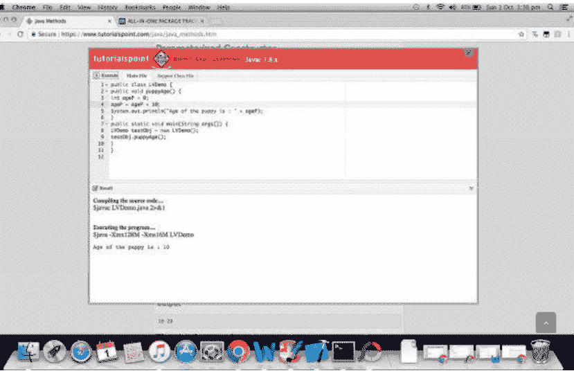
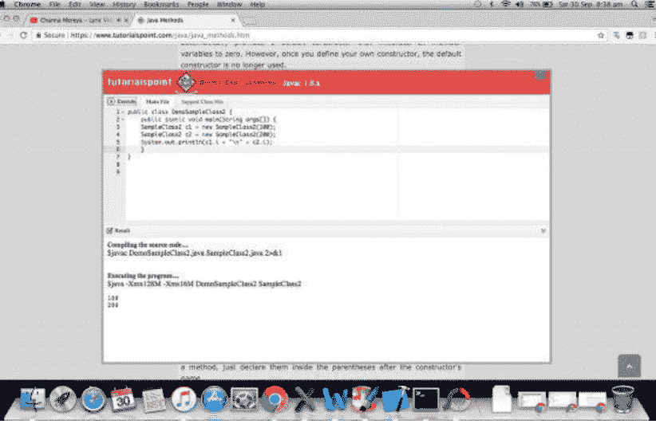
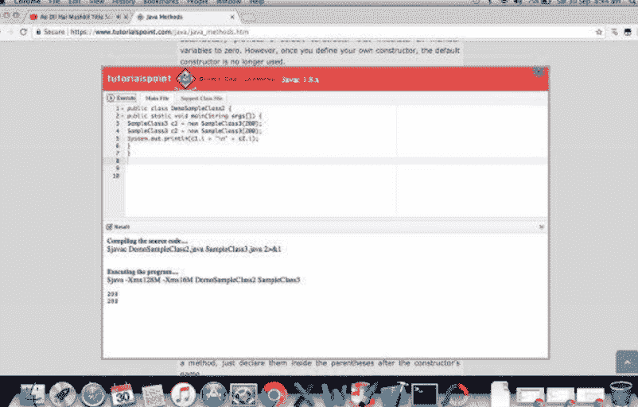
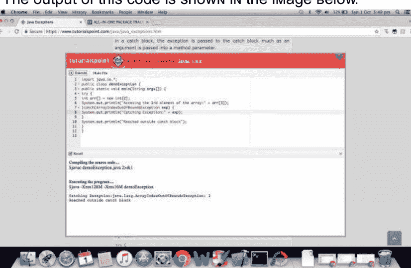
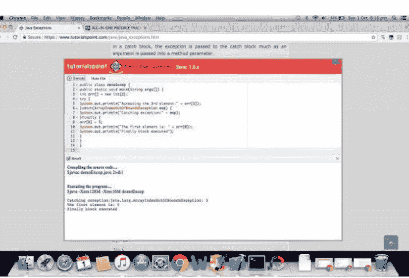

# 绝对初学者 Java 编程：掌握 Java 基础快速课程

![Java 图标和背景图案]

# 引言

Java 是一种跨平台的高级语言，由 Sun Microsystems 在 James Gosling 的领导下开发。该语言的第一个版本于 1995 年以 Java 1.0 [J2se] 的形式发布。从那时起，Java 取得了巨大的进步，我们目前正在使用 Java 8。此外，Java 的几个版本，如 j2me（用于移动应用程序）和 j2ee（用于企业级应用程序的 Java）也已经发布。Java 在 2006 年由 Sun 以 GNU GPL 协议开源软件发布。这一转型过程在 2007 年完成。

这本书是一本关于 Java 基础的入门课程。因此，它的创建考虑到了读者对 Java 的背景知识很少或完全没有。然而，少量的编程语言背景知识将有助于更好地理解。通过这门课程，我们希望从 Java 的视角并特别关注 Java，在读者心中植入编程基础。

在开始之前，你最好了解编程概念是通用的，并适用于适用于一系列编程语言。因此，如果你侧重于构建编程概念而不是学习语法，你将能够以最小的努力学习许多编程语言。关注概念而不是语法。

# 第一章：开始学习 Java

在进入 Java 编程之前，让我们先简要介绍一下 Java 编程语言的背景，以及学习这种编程语言的先决条件。该语言最重要的特征之一是它是跨平台的。这从 Java 首次广告口号“一次编写， anywhere运行”（Write once, Run Anywhere）中显而易见。因此，你只需要编写代码、编译它，然后在任何系统上运行，无论是 Windows、Unix、Linux 还是 Macintosh。

除了上述之外，Java 的其他特性包括——

- 平台无关
- 对象面向
- 简单
- 安全
- 可移植性
- 架构无关
- 解释型
- 健壮
- 分布式
- 多线程
- 动态
- 高性能

## 启动要求

为了开始 Java 编程，你首先需要有一台运行 Linux、Windows 或 Macintosh 的可用电脑。在该系统上，你将使用两个工具进行 Java 编程。其中第一个工具是文本编辑器。如果你在 Windows 上工作，可以使用记事本（Notepad）。

对于其他操作系统，你可以尝试 textedit 或 VI 或本地可用的任何文本编辑器。Java 编程的第二个要求是 Java 8。你需要在你的系统上安装 Java 8。如果你不想在本地环境中工作，也可以尝试可用的在线选项来编译和运行你的 Java 程序。

## 准备好本地环境

假设你已经准备好系统，并在系统上安装了文本编辑器，我们将直接跳到在系统上安装 Java。首先，你需要下载 Java。Java SE 是免费版本，你可以通过 Google 搜索提供的链接进行下载。务必下载适用于你操作系统的开发版本。

下载完成后，你将获得一个可执行文件，你需要运行它进行安装。安装完成后，你将收到一条提示完成的消息。然而，你还没有完成，在设置环境变量之前，Java 将无法工作。你可以使用以下指令在你的系统上设置环境变量——

### Windows

很大情况下，你通过点击安装包附带的 `.exe` 文件安装的 Java 版本必须安装在目录：`c:\Program Files\java\jdk`。假设如此，你只需要通过右键点击“我的电脑”来打开属性。在出现的对话框中，打开“高级”并进入“环境变量”。在现有字段内容的末尾添加 `c:\Program Files\java\jdk\bin`。

### Linux/freeBSD/Unix/Solaris

按照惯例，环境变量的路径是 Java 安装二进制文件放置的路径。你可以在系统上查找这些二进制文件以获取实际路径，然后编辑 `.bashrc` 文件。当你使用任何文本编辑器打开此文件时，你需要添加以下语句：

```
Export path = /path/to/java:$path
```

虽然运行 Java 程序的标准方法是在记事本或任何文本编辑器中创建 `.java` 文件，然后使用命令行执行该文件。然而，在多年来，也出现了一些想法来让这项任务对程序员变得轻松。Netbeans 和 Eclipse 就是这样两种流行的方案。你可以在网上阅读关于它们的信息，看看它们是否对你感兴趣。

# 第二章：编写你的第一个 Java 程序

Java 实现了面向对象的编程原则。因此，一个 Java 程序是一个类文件，在执行时会创建一组对象。这些对象通过方法相互通信。在 Java 术语中你经常遇到的一些术语已解释如下——

Java 程序的要素元素是类（class）。它仅仅是一个定义对象状态和行为的模板。

- 对象的的状态由变量（Variables）定义，行为由方法（methods）描述。因此，类包含了变量和方法。这里需要说明，每个使用类创建的对象都有自己的一组变量，因此变量也称为实例变量（Instance Variables）。

- 当我们实例化一个类时，我们就创建一个对象（object），它是 Java 编程的第二个基本元素。

为了帮助你理解这个概念，让我们举个例子。假设我们创建了一个名为 `Car` 的类。Car 是所有四轮小型车辆的通用术语，每辆汽车都有不同的规格，如品牌、颜色、发动机、变速箱和功能。这些功能是可以修改的。例如，你可能会更改颜色或增强某项功能。

因此，car 是模板（在我们的案例中是一个类），但具体的汽车是该类的对象或实例。规格集是变量，而我们对这些变量进行的任何初始化或操作都是通过方法完成的。

这个例子也可以很好地用于理解封装（encapsulation）和抽象（abstraction）这两个面向对象的原则。类将变量和方法封装在其中。因此，作为用户，你处理的是 car 类，而其实现细节对你是隐藏的。这就是 Java 实现抽象的方式。

学习编程最好的方法就是编写程序。因此，我们在下方为你提供了一个示例程序供你尝试。我们还将使用这个程序来解释 Java 编程语言的基础语法。

```java
Public class samplejavaprogram {
```

```java
/*这个程序将在屏幕上打印 hello World! */
public static void main(String[] args) {
    System.out.println("hello World!"); // 打印语句
}
```

为了编写、编译和运行这个程序，你需要按照下面的指令进行操作——

- 使用任何文本编辑器，创建一个文本文件并将代码复制到其中。将文件保存为 `samplejavaprogram.java`
- 使用 IDE 编译并运行代码。如需进行手动执行，你需要输入以下命令：
  - `javac samplejavaprogram.java`
  - `java samplejavaprogram`

第一条命令将从 java 文件创建一个类文件，而第二个命令将执行程序以得到预期的结果。代码的运行示例已在图中所示。

```
1- public class JavaProgram {
2-
3- public static void main(String[] args) {
4- System.out.println("Hello World");
5-
6- }
```

编译源代码中...

```
javac SampleProgram.java 2->&1
```

执行程序...

```
java -Xmx128M -Xmx16M SampleJavaProgram
```

Hello World!

如果你已经到了这里，说明你已经成功执行了你的第一个 Java 程序。现在是时候检查这个程序，看看我们是如何写它的，以及为什么要这样写它得到了那个结果。

首先，在 Java 中编写程序需要遵循一些约定。这些规定列如下——

Java 是一种大小写敏感的语言。换句话说，对于 Java 来说，`class` 和 `Class` 是两个不同的单词。在程序中使用关键字或任何其他元素时要小心。

按照约定，类名中每个单词的首字母应该应该是大写的。例如，如果类名为 `car`，那么 `c` 应该是大写的。反之，如果类名为 `Sportcar`，那么 `S` 和 `c` 必须都是大写，因为它们都是组成类名的两个单词的首字母。

方法名也遵循同样的大小写约定，即方法名的首字母必须是小写。然而，如果名称由多个单词组成，除了第一个单词外，每个其他单词的首字母都必须大写。例如，如果方法名为 `add`，那么 `a` 必须是小写；但如果方法名为 `addnumbers`，那么 `a` 是小写，而 `n` 是大写。

Java 文件的名称必须与类名相同，并以 `.java` 扩展名结尾。例如，如果你的类名为 `sampleapplication`，那么 Java 文件名必须是 `sampleapplication.java`。还要记住，字母的大小也必须匹配。如果你不满足任何要求。

# 第三章：数据类型

Java 支持两种主要的数据类型：基本数据类型和引用数据类型。

## 基本数据类型

Java 中有八种基本数据类型，它们是预定义的，并由语言关键字命名。让我们详细了解一下它们。

### Byte

- 默认值 = 0
- 最小值 = -128 (-2^7)
- 最大值 = 127（包含) (2^7 - 1)
- 8位有符号补码整数
- 它是另一种在需要节省内存时使用的数据类型。

### Short

- 默认值 = 0
- 最小值 = -32,768 (-2^15)
- 最大值 = 32,767（包含) (2^15 - 1)
- 16位有符号补码整数
- 它是另一种在需要节省内存时使用的数据类型。

### Int

- 默认值 = 0
- 最大值 = 2,147,483,647（包含) (2^31 - 1)
- 32位有符号补码整数
- **最小值** = -2,147,483,648 (-2^31)
- 这是用于所有整数值的默认数据类型。

### Long

- 默认值 = 0L
- **最小值** = -9,223,372,036,854,775,808 (-2^63)
- 64位有符号补码整数
- 最大值 = 9,223,372,036,854,775,807（包含) (2^63-1)
- 当变量预计存储大数字时使用。

### Float

- 默认值 = 0.0f
- 32位 IEEE 754 浮点数
- 单精度
- 此数据类型用作存储浮点数的默认数据类型。
- 必须避免使用此数据类型存储需要精确计算的值。

### Double

- 64位 IEEE 754 浮点数
- 双精度
- 默认值 = 0.0d
- 此数据类型用于需要存储小数值的变量。然而，与 float 一样，使用 double 存储的变量值可能会变化。因此，这些数据类型不用于货币等关键计算。

### Boolean

- 默认值 = false
- 1 位
- 可能的值值：true 和 False
- 此数据类型用于实现标志位。

### Char

- 最大值 = '\uffff'（或包含 65,535）
- 最小值 = '\u0000'（或 0）
- 16位 Unicode 字符
- 此数据类型专门用于存储字符。

## 引用数据类型

如名所示，引用变量是用于访问对象的变量。它们通常使用类构造函数创建，并且它们的类型一旦定义就无法更改。数组变量和类对象都是引用变量。最后，在这种情况下，默认值为 null。

## Java 字面量

字面量用于表示固定值。它们被声明为变量并具有数据类型。字面量的声明示例为 `Char x = 'X';`。

你可能会注意到不同进制的整数和浮点数。根据规则，任何带有 0 前缀的字面量值都是八进制数，而 0x 前缀表示十六进制数。如果你处理字符串，那么字符串字面量始终定义为双引号内的字符序列。你将处理的另一组字符是转义字符。以下是转义字符列表：

- 回车 (`\r`)
- 换行 (`\n`)
- 退格 (`\b`)
- 映符 (`\f`)
- 制表符 (`\t`)
- 空格 (`\s`)
- 单引号 (`\'`)
- 双引号 (`\"`)
- 十六进制字符 (`\uxxxx`)
- 八进制字符 (`\ddd`)
- 反斜杠 (`\\`)

# 第 4 章：变量

变量最简单的定义是它是赋予某些内存区域名称。然而，Java 支持许多类型的变量。根据变量的类型，确定了以下参数：

- 为变量分配的内存大小。
- 内存块的布局。
- 可以在变量上执行的操作。
- 变量可以存储的值范围。

根据规则，每个变量在使用之前都需要进行声明。变量声明的标准语句是 `data_type variable_name;`。

在这里，`data_type` 是变量的数据类型，而 `variable_name` 是用于变量的标识符。如果你使用多个相同类型的变量，可以通过以逗号分隔的方式指定变量名将它们组合在同一个语句中。如之前提到的，Java 支持三种类型的变量，即类变量、实例变量和局部变量。本章将详细解释这些变量类型。

## 局部变量

在方法或代码块内部声明的变量对于作用域是局部的，称为局部变量。变量在块中声明和定义时就会创建。此外，一旦块的作用域结束，该变量就会被销毁。这种类型的变量无法使用访问修饰符（在本章稍后部分描述）。

由于这种变量在方法或块的作用域内有效，因此只能在该代码块内进行访问。在内部，局部变量是在栈级别创建的。因此，当它们被创建时，会被推入栈中，一旦块执行完毕，栈就会清空。最后，局部变量的默认值是垃圾（garbage）。因此，这些变量在使用前必须进行初始化。

下面给出了说明局部变量工作的示例代码。它在类的方法中实现了一个局部变量 `agep`，该变量从主方法访问。

```java
public class lvdemo {
    public void puppyage() {
        int agep = 0;
        agep = agep + 10;
        System.out.println("Age of the puppy is : " + agep);
    }

    public static void main(String args[]) {
        Lvdemo testobj = new Lvdemo();
        testobj.puppyage();
    }
}
```

此代码的输出如图所示。



## 实例变量

作为类的一部分创建但不在任何方法或构造函数作用域内的变量被称为实例变量。这些变量被称为实例变量的原因是，它们只有在通过类创建对象时才会创建一次。因此，这些变量是为使用 `new` 关键字实例化该类的每个对象而创建的。

此外，这些变量一旦块的作用域结束就会被销毁。（等待，这段文本在 OCR 中似乎重复/合并，根据逻辑流进行修正）。

*基于 OCR 文本流的自纠：第 25-30 页的文本似乎存在重叠或错位。我将严格遵循提供的 OCR 文本。*

（实际上，查看文本：“此外，一旦块的作用域结束，变量就会被销毁。这种类型的变量无法使用访问修饰符……”

### 修饰符类型

可以使用修饰符来修改变量的行为和访问权限。修饰符主要有两种类型，即访问修饰符和非访问修饰符。

### 访问控制修饰符

Java 支持多种访问级别，每个级别都有对应的关键字。这些包括：

- Public（公共）：所有人可见
- Private（私有）：类内部可见
- Protected（保护性）：类及其子类可见
- default（默认）：如果没有提到任何关键字，该变量对包可见。

### 非访问修饰符

Java 中还有其他修饰符可用。这些包括：

- Static（静态）
- Final（最终）
- Abstract（抽象）
- Volatile 和 synchronized（同步）

# 第 5 章：运算符

可以使用运算符来操作变量。Java 支持六类运算符。下面将对这些类别的运算符进行详细讨论。

## 算术运算符

所有的数学运算都是使用属于算术运算符类的运算符完成的。支持的运算符列表如下。

### 加法 (+)

该运算符执行两个数字之间的加法运算。如果 `a` 和 `b` 是两个分别持有 5 和 6 的变量，那么 `c = a+b` 将产生 `c = 11`。

### 乘法 (*)

该运算符执行两个数字之间的乘法运算。如果 `a` 和 `b` 是两个分别持有 5 和 6 的变量，那么 `c = a*b` 将产生 `c = 30`。

### 减法 (-)

该运算符执行两个数字之间的减法运算。如果 `a` 和 `b` 是两个分别持有 5 和 6 的变量，那么 `c = a-b` 将产生 `c = -1`。

### 除法 (/)

该运算符执行两个数字之间的除法运算。如果 `a` 和 `b` 是两个分别持有 10 和 5 的变量，那么 `c = a/b` 将产生 `c = 2`。

### 取模 (%)

该运算符返回两个数字相除后剩余余数。如果 `a` 和 `b` 是两个分别持有 10 和 5 的变量，那么 `c = a%b` 将产生 `c = 0`。

### 递增 (++)

该运算符将变量的值加 1。如果 `a` 是持有值 1 的变量，那么 `a++` 将产生值 2。

### 递减 (--)

该运算符将变量的值减 1。如果 `a` 是持有值 1 的变量，那么 `a--` 将产生值 0。

## 关系运算符

所有涉及比较的操作都是使用关系运算符完成的。该编程语言支持的运算符列表如下 –

- 不等于 (!=)

该运算符应用于两个操作数。它检查两个操作数之间的相等性。如果它们相等，则返回 FALSE，否则返回 true。

- 等于 (==)

该运算符应用于两个操作数。它检查两个操作数之间的相等性。如果它们相等，则返回 true，否则返回 FALSE。

- 大于 (>)

该运算符应用于两个操作数。它检查两个操作数之间的关系。如果第一个操作数大于第二个操作数，则返回 true，否则返回 FALSE。

- 小于 (<)

该运算符应用于两个操作数。它检查两个操作数之间的关系。如果第一个操作数小于第二个操作数，则返回 true，否则返回 FALSE。

- 大于或等于 (>=)

该运算符应用于两个操作数。它检查两个操作数之间的关系。如果第一个操作数大于或等于第二个操作数，则返回 true，否则返回 FALSE。

- 小于或等于 (<=)

该运算符应用于两个操作数。它检查两个操作数之间的关系。如果第一个操作数小于或等于第二个操作数，则返回 true，否则返回 FALSE。

## 位运算符

普通运算符与位运算符之间的唯一区别是，这些运算符按位执行操作。此外，这些运算符可以应用于 `byte`、`int`、`short`、`long` 和 `char`。Java 支持的位运算符包括 –

- 位与 (&)

该运算符作用两个操作数，如果两个输入位均为 1，则每组输入位的输出为 1，否则输出为零。

- 位或 (|)


该运算符作用于两个操作数，如果其中一个或两个输入位为 1，则每组输入位的输出为 1，否则输出为零。

- 位异或 (`^`)

该运算符作用于两个操作数，只有当其中一个输入位为 1 时，每组输入位的输出才为 1，否则输出为零。

- 取反 (`~`)

该运算符作用于单个操作数，将值从 0 反转为 1，从 1 反转为 0。

- 左移 (`<<`)

该运算符作用于两个操作数。左操作数的位向左移动。移动的位数等于第二个操作数指定的值。

- 右移 (`>>`)

该运算符作用于两个操作数。左操作数的位向右移动，位数等于第二个操作数指定的值。

- 零填充右移 (`>>>`)

该运算符作用于两个操作数。左操作数的位向右移动，位数等于第二个操作数指定的值。此外，0 会替换移出的位。

为了理解位运算是如何发生的，让我们来看一个例子。假设两个变量 `a` 和 `b` 分别持有值 60 和 13。`a` 和 `b` 的二进制等效形式如下：

```
A = 00111100
b = 00000101
```

使用与真值表，只有当两个输入均为 1 时输出才为 1。相应地，`a & b = 00001100`。同样，也可以执行其他的位运算。

## 逻辑运算符

Java 中所有的逻辑操作都是使用逻辑运算符完成的。该编程语言支持的运算符列表如下。

### 逻辑与

该运算符作用于两个操作数。如果两个操作数都非零，表达式返回 `true`，否则返回 `FALSE`。

### 逻辑或

该运算符作用于两个操作数。如果一个或两个操作数非零，表达式返回 `true`，否则返回 `FALSE`。

### 逻辑非

该运算符作用于一个操作数。如果操作数为 0，则该表达式返回 `true`，否则返回 `FALSE`。

## 赋值运算符

Java 支持的赋值运算符包括：

- 简单赋值运算符 (`=`)

该运算符将右侧计算的值赋值给左侧的变量。如果 `a`、`b` 和 `c` 是三个变量...

- 加赋值运算符 (`+=`)

该运算符将右侧相加计算的结果赋值给左侧。如果 `a` 和 `b` `c` 是两个变量且表达式为 `c += a`，那么 `a + b` 的值将被赋值给 `c`。

- 减赋值运算符 (`-=`)

该运算符将左侧减去右侧的值赋值给左侧。如果 `a` 和 `c` 是两个变量且表达式为 `c -= a`，那么 `c - a` 的值将被赋值给 `c`。

- 乘赋值运算符 (`*=`)

该运算符将右侧乘法计算的值赋值给左侧。如果 `a` 和 `c` 是两个变量且表达式为 `c *= a`，那么 `c * a` 的值将被赋值给 `c`。

- 除赋值运算符 (`/=`)

该运算符将左侧除以右侧的值的结果赋值给左侧。如果 `a` 和 `c` 是两个变量且表达式为 `c /= a`，那么 `c / a` 的值将被赋值给 `c`。

- 取模赋值运算符 (`%=`)

该运算符将左侧对右侧取模的结果赋值给左侧。如果 `a` 和 `c` 是两个变量且表达式为 `c %= a`，那么 `c % a` 的值将被赋值给 `c`。

- 左移赋值运算符 (`<<=`)

如果 `a` 和 `c` 是两个变量且表达式为 `c <<= a`，那么 `c << a` 的值将被赋值给 `c`。

- 右移赋值运算符 (`>>=`)

如果 `a` 和 `c` 是两个变量且表达式为 `c >>= a`，那么 `c >> a` 的值将被赋值给 `c`。

- 位与赋值运算符 (`&=`)

如果 `a` 和 `c` 是两个变量且表达式为 `c &= a`，那么 `c & a` 的值将被赋值给 `c`。

- 位异或赋值运算符 (`^=`)

如果 `a` 和 `c` 是两个变量且表达式为 `c ^= a`，那么 `c ^ a` 的值将被赋值给 `c`。

- 位或赋值运算符 (`|=`)

如果 `a` 和 `c` 是两个变量且表达式为 `c |= a`，那么 `c | a` 的值将被赋值给 `c`。

## 运算符优先级

如果表达式使用了多个运算符，则使用运算符优先级规则来确定操作执行的顺序。运算符从右到左或从左到右评估的优先级按如下方式对运算符组进行定义：

### 从右到左

- 一元运算符
- 条件运算符
- 赋值

### 从左到右

- 后置
- 乘法
- 加法
- 移位
- 关系
- 等于
- 位运算与
- 位运算异或
- 位运算或
- 逻辑与
- 逻辑或

例如，如果我们需要评估表达式 `a = 3 + 5 * 5`，那么乘法将在加法之前执行。因此，`a` 等于 28 而不是 40。

# 第 6 章：对象与类

首先，让我们理解类和对象的概念。类是一个模板，用于创建对象。对象是相互交互的真实实体，是 Java 程序的核心元素。类中可以存在三种类型的变量。首先，变量定义在类内部，但在方法之外。这些变量为每个对象定义，被称为实例变量。

此外，变量也可以存在于类的方法块内部。这些变量对于方法是私有的，称为局部变量。任何在类内部、方法块之外使用 `static` 关键字声明的变量都称为类变量。

## 创建对象

显然，由于类是一个模板，你需要使用这个模板来创建对象。使用了关键字 `new`。

对象的创建涉及三个步骤。第一步是为对象声明一个变量。第二步是使用 `new` 创建对象。最后，需要使用类的构造函数对对象进行初始化。

如果你省略了第三步，Java 将使用默认构造方法进行对象初始化。这三个步骤被合并为一个语句来创建对象。例如，我们有一个类 `democlass` 并想要创建一个对象 `o1`，可以使用以下语句完成：

```
democlass o1 = new democlass
```

类的变量和方法可以通过 `.` 运算符进行访问。因此，如果我们有一个带有变量 `x` 的类 `democo` 并且创建了一个对象 `o1`，我们可以使用以下语句 `o1.x` 来访问 `x`。

## 构造函数

当你开始创建类和对象时，你需要的第一件事是初始化对象。Java 有专门用于初始化的方法实现，称为构造函数。这些元素的实现方式与方法相似，但它们与类同名且没有返回类型。

那么，你可以在哪里使用构造呢？每当你创建一个类的对象并需要初始化某些参数或执行该类中所有对象通用的功能时，就可以使用它。例如，如果你创建一个名为 `rectangle` 的类。你可以创建一个构造函数来初始化矩形的长和宽。

如果你不定义构造函数，Java 将为你的程序使用默认构造函数。这个构造函数会将类中所有参数的值初始化为零。因此，如果你创建了一个类，无论你是否显式定义了它，你的程序都将有一个激活的构造函数。

现在让我们创建一个带有显式构造函数的类，看看这个概念是如何运作的。

```java
class Sampleclass {
    int i;
    Sampleclass() {
        i = 100;
    }
}

public class demosampleclass {
    public static void main(String args[]) {
        Sampleclass c1 = new Sampleclass();
        Sampleclass c2 = new Sampleclass();
        System.out.println(c1.i + "\n" + c2.i);
    }
}
```

下方显示的截图说明了代码以及执行后生成的输出。为了运行这段代码，你需要创建两个文件，每个文件的名称与其包含的类相同。

### 执行主文件支持的类文件

```java
public class DemoSampleClass {
    public static void main(String[] args) {
        SampleClass c1 = new SampleClass();
        SampleClass c2 = new SampleClass();
        System.out.println(c1.i + " \n" + c2.i);
    }
}
```

### 结果

```
编译源代码...
javac DemoSampleClass.java SampleClass1.java 2>&1
执行程序...
java -Xmx128M -Xms16M DemoSampleClass SampleClass1
100
100
```

### 执行主文件支持的类文件

```java
class SampleClass1 {
    int i;
    SampleClass1() {
        i = 100;
    }
}
```

### 结果

```
编译源代码...
javac DemoSampleClass.java SampleClass1.java 2>&1
执行程序...
java -Xmx128M -Xms16M DemoSampleClass SampleClass1
100
100
```

在上面的示例中，我们给出了静态的静态值。然而，你的程序可能需要对参数进行动态初始化。为此，你需要实现带参数的构造函数。此类构造函数以参数的形式向构造方法接收值。下面给出了示例实现。

```java
class Sampleclass2 {
    int i;
    Sampleclass2(int x) {
        i = x;
    }
}

public class demosampleclass2 {
    public static void main(String args[]) {
        Sampleclass2 c1 = new Sampleclass2(100);
        Sampleclass2 c2 = new Sampleclass2(200);
        System.out.println(c1.i + "\n" + c2.i);
    }
}
```

该代码的输出已在下图中所示。



在构造函数的实现方面，使用了一个特定的关键字。这个关键字是 `this` 关键字。它用于引用正在考虑的类的对象。通过这个关键字的帮助，可以在构造函数或方法内部访问类的变量。下方代码说明了 `this` 关键字的使用。

```java
class Sampleclass3 {
    int i;
    Sampleclass3(int i) {
        this.i = i;
    }
}

public class demosampleclass2 {
    public static void main(String args[]) {
        Sampleclass3 c1 = new Sampleclass3(200);
        Sampleclass3 c2 = new Sampleclass3(200);
        System.out.println(c1.i + "\n" + c2.i);
    }
}
```

## 执行后，此代码给出以下输出



## 可变参数

在某些程序中，可能存在你不知道 `main` 方法在执行期间将提供的精确参数数量的情况。为了允许这种级别的动态性，使用了 var-args 或可变参数。`var-args` 在方法参数中使用以下语法声明：

`<type>...<var_name>`

在变量声明中给出的 `var_name` 是数组，包含了执行 `main` 方法时发送的所有变量值。在实现此概念之前，你需要记住两点：

- 每个方法只能实现一个 var-args。
- 如果方法有其他参数（普通性质的），这些参数必须出现在 `var-args` 之前。换句话说，`var-args` 必须是方法的最后一个参数。

该概念的示例实现如下。

```java
public class demovarargs {
    public static void main(String args[]) {
        printnum(56.5, 3, 34, 2, 3);
        printnum(new double[]{2, 1, 3});
    }

    public static void printnum(double... number) {
        if (number.length == 0) {
            System.out.println("no argument passed");
            return;
        }
        double resultnum = number[0];
        for (int x = 1; x < number.length; x++)
            if (number[x] > resultnum)
                resultnum = number[x];
        System.out.println("the maximum value in the number set is " + resultnum);
    }
}
```

代码的输出在下图中所示。

## 实现方法

一组用于执行操作的操作被称为方法。你可以看到上面大多数程序中的 `print` 语句调用了方法 `system.out.println()`。此方法将其提供的字符串打印到屏幕上。

就像这个内置方法一样，开发者也可以创建特定于问题描述的方法。用户定义的方法可能有或没有参数，也可能有或没有返回值。创建方法的标准语句是：

```java
public static int methoddemo(int i, int j) {
    /* Body */
}
```

这里，`methoddemo` 是方法的名称，`i` 和 `j` 是此方法接受的 `int` 参数。方法的实现逻辑位于花括号内部，此外，你注意到函数声明中写了三个单词——`public`、`static` 和 `int`。这里 `int` 是方法的返回类型，而 `public static` 是修饰符。这个示例方法可以修改以满足开发者的需求。

下面展示了一个方法实现的示例代码：

```java
public static int mincaldemo(int num1, int num2) {
    int minval;
    if (num1 > num2)
        minval = num2;
    else
        minval = num1;
    return minval;
}
```

该方法确定所提供的两个参数值中的较小值，并将其返回给调用它的方法。现在你已经对方法以及它们的实现方式有了初步了解，是时候讨论一下如何在整体代码中使用这些方法了。

## 调用方法

方法需要被调用或执行才能被使用。如上面提供的示例代码所示，该方法正在执行某些计算并返回计算结果。这种方法返回一个值，其返回值已经在方法声明中已经指定。除此之外，还存在另一种类型的方法。这类方法不返回任何内容，通常被称为无返回值方法。

当程序调用方法时，控制权会从程序转移到方法，并开始执行方法。一旦遇到 `return` 语句，控制权就会传回调用程序。在没有 `return` 语句的情况下，一旦遇到方法的结束括号，控制权会自动传回。这通常是无返回值方法的情况。

对于返回值的方法，返回类型在方法声明中注明。另一方面，对于不返回任何内容的方法，返回类型为 `void`。为了调用我们上面实现的方法，调用程序的某处需要出现以下语句：

```java
int result;
result = mincaldemo(5, 6);
```

由于该方法返回一个 `int` 值，该值需要收集在一个 `int` 变量（`result`）中。对方法的调用提供了方法所需的两个参数值。这种类型的的方法调用也被称为参数化方法调用或按值传递参数。

你可能会遇到参数类型不同且数量较多的情况。在这种情况下，请务必按照所需的顺序提供参数值，以避免出现任何意外的编译错误或运行时错误。

## 方法重载

可以存在名称相同但参数不同的方法。当方法被调用时，系统会检测匹配调用语句中给出的参数类型和数量的方法，并将控制权转移到相应的方法。这种方法实现的形式被称为方法重载。不要将此概念与重写混淆。在方法重写中，方法名、参数和参数数量也是相同的。

为了理解这个概念，让我们来看一个例子：

```java
public class overloadingdememo {
    public static void main(String[] args) {
        int x = 34;
        int y = 56;
        double z = 10.5;
        double u = 7.8;
        int resultxy = mincaldemo(x, y);
        double resultzu = mincaldemo(z, u);
        System.out.println("MIN Value (Integers) = " + resultxy);
        System.out.println("min Value (double) = " + resultzu);
    }

    public static int mincaldemo(int num1, int num2) {
        int minval;
        if (num1 > num2)
            minval = num2;
        else
            minval = num1;
        return minval;
    }

    public static double mincaldemo(double num1, double num2) {
        double minval;
        if (num1 > num2)
            minval = num2;
        else
            minval = num1;
        return minval;
    }
}
```

该代码实现了两个具有相同名称 `mincaldemo` 但具有不同参数类型的方法。其中一个方法使用了两个 `int` 类型的参数，返回类型为 `int`。另一方面，另一个方法实现使用了 `double` 参数并返回一个 `double`。此代码的输出已在下图中所示。

## 使用命令行参数

有些程序要求你在运行时执行程序时传递参数。这些参数可以通过命令行参数的形式传递给程序。在命令行上输入执行命令时，这些参数会连程序名称一起交给程序。在程序内部访问这些参数的方式在下面的示例代码所示。

```java
public class commandlineargdemo {
```


```java
public static void main(String args[]) {
    for(int x = 0; x < args.length; x++) {
        System.out.println("args[" + x + "]: " + args[x]);
    }
}
```

从命令行输入以下命令来执行程序并查看你得到什么结果。

```bash
java commandlineargdemo 200 100 10 8 7 6
```

## 这是 `finalize()` 方法

在 Java 编程中，你会处理大量的对象，所有这些对象都会在内存中占用空间。如果你正在编写大规模代码，可能要求在终止程序之前清除这些对象所占的空间。为了方便这一操作，Java 中提供了一个垃圾回收器方法，称为 `finalize()` 方法。

该方法可以用于实现你希望程序在终止之前执行的所有操作。其中一些操作包括关闭所有打开的文件、删除所有创建的对象以及释放程序元素占据的任何内存。该方法以以下方式实现——

```java
protected void finalize() {
}
```

在 `finalize()` 方法的声明中使用访问修饰符 `protected`，以防止任何外部程序在代码执行之前将其销毁。

## 源文件的声明规则

在源文件中编写 `import` 语句、类声明和包语句时，你需要遵循一些规则。这些规则如下：

- 源文件中不能有多个 `public` 类。
- 源文件中可以有很多非公共（non-public）类。
- 源文件的名称应与 `public` 类名相同；而且源文件的扩展名应该是 `.java`。
- 如果你正在一个包上工作，并且类是该包的一部分，那么源文件的第一语句必须是 `package` 语句。
- `package` 语句必须是源文件的第一语句。任何 `import` 语句必须随其后。

你需要理解，`package` 和 `import` 语句对于源文件的所有类都是通用的。在一个源文件中为不同的类拥有不同的包和导入语句是不可能的。

在结束讨论之前，让我们对包给出一个结语。它只是接口和类的一种分类形式。当你处理大型 Java 项目时，使用包有助于组织代码并使其更易于维护和阅读。

# 第 7 章：决策

决策结构用于在当条件为真时执行一组指令，而在条件被确定为假时执行另一组指令的情况。Java 中提供了几种结构用于编写此类场景。这些结构包括——

## if 语句

该语句用于需要测试条件的情况，如果发现条件为真，则需要执行该语句后续的代码块。该构造的语法为：

```java
if (condition) {
    /* body */
}
```

该构造的示例实现如下：

```java
public class Demo {
    public static void main(String args[]) {
        int i = 10;
        int j = 1;
        if (i > j) {
            System.out.print(i);
        }
    }
}
```

此代码在执行后的输出如下：

## if else 语句

该语句用于需要测试条件的情况：如果发现条件为真，则需要执行紧随该语句的代码块；否则执行 `else` 语句后面的代码块。该构造的语法为 –

```java
if (condition) {
    /* body */
} else {
    /* body */
}
```

下面给出了该构造的示例实现 –

```java
public class IfElseDemo {
    public static void main(String[] args) {
        int i = 1;
        int j = 0;
        if (i > j) {
            System.out.print(i);
        } else {
            System.out.print(j);
        }
    }
}
```

该代码执行后的输出如下 –

## 嵌套 if 语句

该语句用于需要测试条件的情况：如果发现条件为真，则需要执行紧随该语句的代码块；否则测试下一个条件。如果该条件为真，则执行与该条件对应的 `if` 语句代码块。如果没有发现条件为真，则执行 `else` 语句后面的代码块。可以使用嵌套 `if` 语句测试多个条件。该构造的语法为 -

```java
if (condition1) {
    /* body */
} else if (condition2) {
    /* body */
} else {
    /* body */
}
```

下面给出了该构造的示例实现 –

```java
public class NestedIfDemo {
    public static void main(String args[]) {
        int i = 0;
        int j = 0;
        if (i > j) {
            System.out.print(i);
        } else if (j > i) {
            System.out.print(j);
        } else {
            System.out.print("Equal");
        }
    }
}
```

该代码执行后的输出如下 –

## Switch

如果你有一个变量，并且需要根据该变量的不同值执行不同的代码块，那么理想的构造是 `switch` 语句。该构造的语法为 -

```java
switch (variable) {
    case <value1>:
        /* body */
        break;
    case <value2>:
        /* body */
        break;
    case <value3>:
        /* body */
        break;
    default:
        /* body */
        break;
}
```

下面给出了该构造的示例实现 –

```java
public class SwitchDemo {
    public static void main(String args[]) {
        int i = 5;
        switch (i) {
            case 0:
                System.out.print(0);
                break;
            case 2:
                System.out.print(2);
                break;
            case 5:
                System.out.print(5);
                break;
            default:
                System.out.print(999);
                break;
        }
    }
}
```

该代码执行后的输出如下 –

## 三元运算符

Java 还支持条件运算符，它也被称为 `?:` 运算符。该运算符用于替换 `if else` 构造。其语法如下 –

```java
expression1 ? expression2 : expression3
```

这里，`expression1` 是需要测试的条件。如果条件为真，则执行 `expression2`，否则执行 `expression3`。

# 第 8 章：循环控制

有几种情况需要你多次执行同一组指令。例如，如果你需要对一组数字进行排序，你将需要多次扫描并重新排列这组数字以获得所需的排列。这种执行流被称为循环控制。

简单来说，循环是一种允许多次执行代码块的构造。Java 支持几种用于实现循环的构造。这些包括 `while` 循环、`for` 循环和 `do while` 循环。

- `while` 循环迭代执行代码块，直到为 `while` 循环指定的条件为真。一旦该条件失败，`while` 循环就会停止。
- `for` 循环允许程序员在同一个构造中操作条件和循环变量。因此，你可以初始化一个循环变量，对其进行增/减，并运行循环直到关于该变量的条件为真。
- `do while` 循环与 `while` 循环类似，但在 `while` 循环中，条件是在执行代码块之前检查的。而在 `do while` 循环中，先执行代码块再检查条件。如果满足条件，则重新启动循环执行，否则终止循环。可以说，`do while` 循环一旦实现，至少会执行一次。

## 循环语句

有两个关键字专门与循环相关，也被称为控制语句，因为它们允许控制流从代码的一个部分转移到另一个部分。这些关键字是 –

- `break`：该关键字用于循环内部，在你希望执行流终止循环并直接从循环后的第一条指令开始执行的地方。
- `continue`：该关键字用于循环内部，在程序员希望计算机忽略循环的剩余部分并将控制转移到循环的第一条语句的地方。

为了帮助你理解循环是如何执行的，让我们来看一个例子，并使用所有类型的循环控制来实现它。

## For 循环实现

```java
public class ForDemo {
    public static void main(String[] args) {
        int[] numberArray = {100, 300, 500, 700, 900};
        for (int i = 0; i < 5; i++) {
            System.out.print(numberArray[i]);
        }
    }
}
```

该代码执行后的输出如下 –

## While 循环实现

```java
public class WhileDemo {
    public static void main(String[] args) {
        int[] numberArray = {100, 300, 500, 700, 900};
        int i = 0;
        while (i < 5) {
            System.out.print(numberArray[i]);
            System.out.print(",");
            i++;
        }
        System.out.print("\n");
    }
}
```

该代码执行后的输出如下 –

## do 循环实现

```java
public class DoWhileDemo {
    public static void main(String args[]) {
        int[] numberArray = {100, 300, 500, 700, 900};
        int i = 0;
        do {
            System.out.print(numberArray[i]);
            System.out.print(" ");
            i++;
        } while (i < 5);
        System.out.print("\n");
    }
}
```

## 增强 For 循环

Java 还支持增强循环结构，可用于数组元素。该循环的语法为 –

```java
for (declaration : expression) {
    /* body */
}
```

增强循环的声明部分用于声明变量。该变量局部于 `for` 循环且类型与数组元素相同。变量当前的值始终等于正在遍历的数组元素。表达式是一个数组或返回数组的方法调用。

增强循环的示例实现如下 –

```java
public class ArrayDemo {
    public static void main(String args[]) {
        int[] numberArray = {100, 300, 500, 700, 900};
        for (int i : numberArray) {
            System.out.print(i);
            System.out.print("");
        }
    }
}
```

该代码执行后的输出如下

# 第 9 章：文件处理

所有文件操作都由 Java `java.io` 包支持，这些函数的实现基于流的概念。流简单来说是数据序列，分为两种类型：输入流和输出流。前者用于读取数据，后者用于写入数据。

## 字节流

Java 支持的第一种流是字节流。在这种分类下，I/O 操作被限制为 8 位大小。在我们开始编码之前，你需要意识到用于执行输入和输出的类分别是 `FileInputStream` 和 `FileOutputStream`。现在让我们来看一个将一个文件的内容复制到另一个文件的示例。

```java
import java.io.*;

public class CopyFileBS {
    public static void main(String[] args) throws Exception {
        FileInputStream inputFile = null;
        FileOutputStream outputFile = null;
        try {
            inputFile = new FileInputStream("in.txt");
            outputFile = new FileOutputStream("out.txt");
            int i;
            while ((i = inputFile.read()) != -1) {
                outputFile.write(i);
            }
        } finally {
            if (inputFile != null) {
                inputFile.close();
            }
            if (outputFile != null) {
                outputFile.close();
            }
        }
    }
}
```

在类文件相同的文件夹中保留名为 `in.txt` 的输入文件，并执行代码查看其功能。

## 字符流

从 8 位数据操作切换到 16 位 Unicode 数据操作，我们需要从二进制字节流切换到字符流。分别用于执行输入和输出的类是 `FileReader` 和 `FileWriter`。上面的代码可以如下所示修改为使用字符流。

```java
import java.io.*;

public class CopyFiles {
    public static void main(String args[]) throws IOException {
        FileReader inputFile = null;
        FileWriter outputFile = null;
        try {
            inputFile = new FileReader("in.txt");
            outputFile = new FileWriter("out.txt");
            int i;
            while ((i = inputFile.read()) != -1) {
                outputFile.write(i);
            }
        } finally {
            if (inputFile != null) {
                inputFile.close();
            }
            if (outputFile != null) {
                outputFile.close();
            }
        }
    }
}
```

在类文件相同的文件夹中保留名为 `in.txt` 的输入文件，并执行代码查看其功能。

## 标准流

为了允许用户从键盘获取输入并在屏幕上打印输出，Java 支持标准流——

- `System.in`：代表标准输入流，允许用户通过键盘提供输入。
- `System.out`：代表标准输出流，允许用户在屏幕上获取输出。
- `System.err`：代表标准错误流，允许用户获取系统的错误消息。

下面提供的示例程序允许系统获取用户输入并将输入的内容打印到屏幕上，直到用户按下 'q' 键后程序退出。

```java
import java.io.*;

public class SSDDemo {
    public static void main(String[] args) throws Exception {
        InputStreamReader inputC = null;
        try {
            inputC = new InputStreamReader(System.in);
            System.out.println("Enter characters, 'q' to quit.");
            char charIn;
            do {
                charIn = (char) inputC.read();
                System.out.print(charIn);
            } while (charIn != 'q');
        } finally {
            if (inputC != null) {
                inputC.close();
            }
        }
    }
}
```


```
if (inputc != null) {
    inputc.close();
}
```

可以执行此程序以查看输出结果以及代码是如何运行的。

# 第10章：异常处理

异常（Exception）是任何意外之外的事件，通常是以相关程序无法处理的方式发生的。显然，在这种情况下，程序的正常执行流受到阻碍，程序可能会报错终止或表现异常。这就是为什么异常需要程序来处理的原因。

那么，为什么会发生异常呢？异常可能由于多种原因引起。导致这种无意情况的一些场景包括——

- 无效的数据输入
- 程序尝试打开一个指定位置不存在的文件
- JVM 内存不足
- 正在进行网络通信时系统丢失了网络连接

显然，异常可能由系统、用户问题或程序层面的问题引起。基于这一观察，创建了三类异常。这三类异常已在章节中讨论。

## 检查异常 (Checked Exceptions)

在编译时由编译器检查并报告的异常称为检查异常。它们也被称为编译时异常，需要开发者在编写代码时进行处理。

下面提供的示例代码演示了此类错误的异常处理示例。

```java
import java.io.File;
import java.io.FileReader;

public class demoeh {
    public static void main(String args[]) {
        File filedemo = new File("E://samplefile.txt");
        FileReader infile = new FileReader(filedemo);
    }
}
```

如果在创建 `filedemo` 处理器时指定的文件名和位置在指定位置不存在，编译器将给出 `FileNotFoundException` 错误。

## 未检查异常 (Unchecked Exceptions)

某些异常发生在运行时。此类异常称为未检查异常或运行时异常。逻辑错误、编程 Bug 以及对 API 的错误用法都是这类错误的示例。这类错误的另一个重要特点是它们在编译时不会被检测到。

为了帮助你理解什么是运行时错误，让我们来看一个例子。假设你在程序中实现了一个包含 5 个元素的数组。然而，部分代码正在访问第 6 个元素。此错误将在运行时被检测到，系统将生成错误 `ArrayIndexOutOfBoundsException`。

## 错误 (Errors)

某些异常超出了系统或程序员的控制。此类错误的一个常见例子是栈溢出（stack overflow）。对于这些错误，你几乎无能为力。因此，最好忽略它们。当它们发生时，会中断程序的执行，但对此无能为力。

## 异常层次结构

Java 有一个内置类 `java.lang.Exception`。所有异常都属于此类。此外，`Throwable` 是父类。`Exception` 类是 `Throwable` 的子类。`Error` 类也是 `Throwable` 的子类。`Exception` 类有两个主要子类，即 `RuntimeException` 和 `IOException`。

`Throwable` 中提供的方法有：
- `getMessage()`: 被调用时，返回异常的消息。
- `getCause()`: 被调用时，返回异常的原因。
- `toString()`: 此方法返回异常的详细描述。
- `printStackTrace()`: 栈跟踪的结果可以打印到标准错误流。
- `getStackTrace()`: 此方法返回堆栈跟踪数组。
- `fillInStackTrace()`: 将堆栈跟踪中的之前信息附加当前堆栈跟踪的内容。

## 捕获异常 (Catching Exceptions)

捕获异常的标准方法是使用 `try` 和 `catch` 关键字及其代码实现。这个 `try-catch` 块需要设计成包含预期可能抛出异常的代码。`try-catch` 块的语法如下：

```java
try {
    /* code */
} catch (Exception exc1) {
    /* catch code */
}
```

预期抛出异常的代码放在 `try` 块中。如果抛出异常，则在 `catch` 块中执行相应的异常处理操作。每个 `try` 块都必须有一个 `catch` 块或 `finally` 块。

在 `catch` 语句中，需要声明预期抛出的异常。一旦发生异常，执行流将转移到 `catch` 块。如果抛出的异常与 `catch` 块中定义的异常匹配，则执行 `catch` 块。

下面给出了 `try-catch` 块的示例实现。代码实现了一个包含 2 个元素的数组。然而，代码尝试访问第三个元素，而该元素并不存在。因此，抛出了异常。

```java
import java.io.*;

public class demoexception {
    public static void main(String args[]) {
        try {
            int arr[] = new int[2];
            System.out.println("Accessing the 3rd element of the array:" + arr[3]);
        } catch (ArrayIndexOutOfBoundsException exp) {
            System.out.println("Catching Exception:" + exp);
        }
    }
}
```

```java
System.out.println("Reached outside catch block");
}
```

这段代码的输出结果如下图所示。



## 实现多个 catch 块

一段代码可能会导致多个异常。为了满足这一需求，程序允许实现多个 `catch` 块。此类实现的语法如下所示。

```java
try {
    /* Protected code */
} catch (Exptype1 exp1) {
    /* catch block 1 */
} catch (Exptype2 exp2) {
    /* catch block 2 */
} catch (Exptype3 exp3) {
    /* catch block 3 */
}
```

上述语法说明了三个 `catch` 块的实现。然而，你可以根据需要实现任意数量的 `catch` 块。当执行此代码时，会执行受保护的代码。如果发生异常，异常类型将与第一个 `catch` 块的异常进行匹配。但是，如果异常类型不匹配，则忽略 `catch` 块 1，并尝试匹配第二个 `catch` 块的异常类型。哪一个 `catch` 块的异常类型与触发异常相同，就会执行对应的 `catch` 块。

## 关键字：throw/throws

这两个关键字是相似的词，但用于完全不同的目的。`throws` 关键字用于方法名之后，用于声明代码抛出了一个检查异常，但方法本身不处理该异常。换句话说，`throw` 关键字用于字面上的抛出异常。此异常可以是一个新异常，也可以是之前发生的异常。

下面提供了说明 `throws` 和 `throw` 用法的示例代码。在方法声明中，该方法声明抛出一个异常，而 `throw` 的使用启动了该异常的抛出。

```java
import java.io.*;

public class name {
    public void depositmethod(double amount) throws Exception { /* Implementation */
        throw new RemoteException();
    }
    /* Implementation */
}
```

方法可能会抛出多个异常。为了在方法声明中声明这些异常，你可以提供一个逗号分隔的异常列表。下面提供了该概念的示例实现。

```java
import java.io.*;

public class scname {
    public void withdrawdamemo(double amountdemo) throws RemoteException, InsufficientFundException {
        /* Implementation */
    }
}
/* Implementation */
```

## finally 块

现在你已经熟悉了 `try` 和 `catch` 块，让我们来看看异常处理中使用的第三个块：`finally` 块。这是出现在 `try` 和 `catch` 块之后的最后一个块。此外，如果没有找到异常，`catch` 块的执行可能会被省略，但无论是否发生异常，`finally` 块始终会被执行。

此块的目的是执行程序员认为必要的任何清理活动。无论 `try` 块中的代码发生什么情况，你都想要执行这段代码。该块的语法及其实现方式如下所示。

```java
try {
    /* Protected code */
} catch (Exptype1 exp1) {
    /* catch block 1 */
} catch (Exptype2 exp2) {
    /* catch block 2 */
} catch (Exptype3 exp3) {
    /* catch block 3 */
} finally {
    /* Finally block implementation */
}
```

下面提供了实现该概念的示例代码，以使概念更清晰。

```java
public class demoexcep {
    public static void main(String args[]) {
        int arr[] = new int[2];
        try {
            System.out.println("Accessing the 3rd element:" + arr[3]);
        } catch (ArrayIndexOutOfBoundsException exp) {
            System.out.println("Catching exception:" + exp);
        } finally {
            arr[0] = 5;
            System.out.println("The first element is: " + arr[0]);
            System.out.println("Finally block executed");
        }
    }
}
```

代码的输出如下图所示。

在实现 `try/catch/finally` 块时，请始终记住几点。首先，除非实现了 `try` 块，否则没有 `catch` 块。同样地，没有 `catch` 或 `finally` 块就不会有独立的 `try` 块。此外，`finally` 块是一个可选的结构，即使你的代码中没有 `finally` 块，你的 `try/catch` 也能正常工作。

## 自定义异常

Java 允许你定义自己的异常。然而，在你这样做之前，有几点需要记住。首先，任何异常都需要派生自 `Throwable` 类或是该类的子类。为了实现检查异常，你必须扩展 `Exception` 类。然而，运行时异常的实现必须扩展 `RuntimeException` 类。



定义异常的标准方法是——

以下代码说明了自定义异常的实现和使用。

```java
import java.io.*;

public class InsufficientFundException extends Exception {
    private double amount;

    public InsufficientFundException(double amount) {
        this.amount = amount;
    }

    public double getAmount() {
        return amount;
    }
}
```

## 结论

这本书提供了关于 Java 基础的入门教程。我们涵盖了 Java 编程的所有基本概念以及入门 Java 编程所需的所有内容。现在你已经回顾了 Java 编程的所有基本概念，假设你已经尝试了书中提供的所有代码，你已经准备好进入高级 Java 编程阶段。

成为编程专家（无论是任何编程语言）的关键在于实践。你练习得越多，你的编程技能就越好！我们希望你喜欢这本书，并希望它帮助你获得 Java 的基础专业知识。我们希望已经为你打下了坚实的基础，让你磨练技能并成为一名专家 Java 程序员。
