# Android 开发者 Java 编程入门指南

## 学习目标

- 从头到尾创建一个 Android 程序
- 掌握基础的 Java 开发概念和技术
- 处理编程挑战
- 组装组件并调试你的应用

Barry Burd
《Java 自呆指南》作者

```java
class MainActivity extends AppCompatActivity {
    @Override
    protected void onCreate(Bundle savedInstanceState) {
        super.onCreate(savedInstanceState);
        setContentView(R.layout.activity);
    }

    @Override
    public boolean onCreateInflater(LayoutInflater inflater) {
        return true;
    }
}
```


作者：Barry Burd


访问 `www.dummies.com/cheatsheet/javaproming` 查看本书的快速速查表。

- 类
- 关于员工的定论 —— 真的如此吗？
- 创建回调函数
- 这与 Android 有什么关系？
- 推卸责任

## 关于作者

## 快速备查表

与 Dummies 建立联系

## 引言

Android 无处不在。在 2013 年年中，Android 运行在美国 53% 的智能手机和全球 80% 的智能手机上。¹ 在一项涵盖美洲、欧洲、亚洲和中东的研究中，Webindex 报告 Android 平板电脑的表现优于 iPad 3400 万台。Google Play 商店有超过百万个应用程序供下载（是 2012 年可用数量的两倍）。³ 有 900 万名开发者使用 Java 编写代码，这是驱动 Android 设备的语言。⁴

如果你在公共场所阅读这本书（例如在通勤火车上、在海滩上，或在 Coyote Ugly 酒馆的舞池），你可以轻松地阅读，心怀抱气且抬头挺胸。Android 非常火，而你很酷，因为你正在阅读它的相关。

> ¹ 见 `www.kantarworldpanel.com/global/News/news-articles/Samsung-50-share-across-Europe-as-Apple-powers-back-in-the-US` 以及 `http://www.idc.com/getdoc.jsp?containerId=prUS2425743`。
>
> ² 见 `www.globalwebindex.com/android-tablets-dominate-g1-mobile-market`。
>
> ³ 见 `www.androidguys.com/2013/07/24/sunder-pichai-there-are-now-than-1-million-android-apps`。
>
> ⁴ 见 `www.java.com/en/about`。

## 如何使用这本书

你可以通过两种方式攻读这本书：从头到尾阅读，或者在章节之间来回穿插。你可以两者兼顾（从开始开始，然后跳到你特别感兴趣的部分）。这本书的设计理念是让基础主题放在前面，更复杂的课题随其后。但你可能已经对某些基础知识很熟悉，或者你有特定的目标，不需要了解某些特定主题。

通常情况下，我的建议是：

- 如果你已经了解某些内容，就不要费心阅读它。
- 如果你感到好奇，不要害怕跳读。如果你需要，一直可以随时偷看前面的章节。

## 本书中使用的规范

几乎每本技术主题的书籍开头都会有一个小小的字体图例，《Java Programming For Android Developers For Dummies》也不例外。以下是书中使用的字体的简要说明：

- 新术语用*斜体*表示。
- 如果需要在文本中输入内容，它将显示**粗体**。例如：“在文本中输入 `MyProject`。”

你还会看到这种字体，用于 Java 代码、文件名、屏幕消息以及其他你需要输入的内容。此外，如果你输入的内容很长，它将单独占一行。

```
public void Anyname
```

这意味着你输入 `public void`，然后是一个你自己定义的名称。你需要替换的内容将以*斜体*显示。

## 你不需要阅读的内容

选择你还不熟悉的章节或部分开始阅读。当然，你也可以和我一样做决定。如果是这样可以遵循以下指南：

- 如果你已经知道 Java 是什么，并且不在 Android 应用运行时后台发生了什么：跳过第 1 章直接看第 2 章。相信我 —— 我不会的。
- 如果你已经知道如何运行 Android 应用：跳过第一部分，从第二部分开始。
- 如果你有 C 和 C++ 以外语言的编程经验：从第二部分开始。你可能会发现第二部分很容易读。如果你到了第三部分，就是时候深入学习了。
- 如果你有 C 或 C++ 的编程经验：浏览第二部分，并从第三部分开始认真阅读（Java 在处理类和对象方面与 C++ 有不同）。
- 如果你有 Java 编程经验：来我家帮我写《Java For Android Developers For Dummies 第二版》。

如果你想跳过侧边栏和带有技术图标的段落，请尽管这样做。事实上，如果你想跳过任何内容，请自便。

当你遵循本书中的指令时，你是在键盘上输入代码，而不是通过鼠标点点击。

在那些需要拖放、剪切和粘贴或即插即用的情况下，我会仔细地引导你完成这些步骤。但你的计算机可能有数以十亿计的配置方式，我的指令可能并不完全适合你的情况。当你遇到这些特定于平台的任务时，请尝试遵循书中的步骤。如果这些步骤不适用，而你又找不到类似的书籍，请给我发电子邮件。（我的地址出现在后文的“引言”部分。）

- 我假设你可以进行逻辑思考。应用开发的所有核心就在于此——进行逻辑思考。如果你能进行逻辑思考，你就成功了一半。如果你不相信自己能进行逻辑思考，请继续读下去。你可能会大吃惊喜。
- 我对你的计算机编程经验（或缺乏相关经验）很少做假设。在写这本书时，我尝试完成一项看似不可能的任务：让这本书对经验丰富的程序员来说很有趣，同时对几乎或没有编程经验的人来说易懂。这意味着我不假设你具备任何特定的编程背景。如果你从未创建过循环或索引数组，没关系。

另一方面，如果你做过这些事情（可能是在 Visual Basic、COBOL 或 C++ 中），你将在 Java 中发现一些有趣的转折。Java 的创造者从面向对象的编程中吸收了最好的思想，对其进行了精简、重新加工和重新组织，并将它们整理成一种简洁、强大的解决问题方式。你将在 Java 中发现许多新的、发人深省的特性。当你发现这些特性时，其中许多对你来说将是很自然。无论如何，你都会对使用 Java 感到良好。

## 本书的结构

本书分为若干小节，小节组成若干章节，章节共同组成章，章最后归为五个部分（就像俄罗斯套娃一样）。在这里描述了书的各个部分。

## 第一部分：Android 开发者入门 Java 编程

第一部分涵盖了所有的基础知识。它向你介绍了 Java 和 Android 软件开发背后的主要思想，并引导你完成必要软件产品的安装。你还将运行几个 Java 和 Android 程序。

这些章节中的指令适用于 Windows 和 Macintosh 计算机。它们涵盖了许多计算机配置，包括一些不那么新的操作系统版本、32 位系统与 64 位系统的差异，以及你的计算机上已经安装了某种形式的 Java 的情况。但安装总是很棘手的，你可能需要克服一些障碍。如果是这样，请查看本章末尾以联系我（作者）并获取快速建议。（是的，我会回复电子邮件、推文、Facebook 帖子以及信鸽传来的字条。）

## 第二部分：编写你自己的 Java 程序

第 5 至第 8 章介绍了 Java 的构建块。章节描述了你需要的知识，以便让你的计算机运行起来。

如果你用 Visual Basic、C++ 或任何其他语言写过程序，那么第二部分的一些内容对你来说可能很熟悉。如果是这样，你可以跳过某些章节或快速读一遍。但不要读得太快。Java 与其他编程语言有些不同，特别是我在第 6 章中描述的特性。

## 第三部分：从大局来看：面向对象编程

第三部分包含我最喜欢的几个章节。这部分涵盖了至关重要的面向对象编程主题。在这些章节中，你将了解到如何将解决方案映射到大问题。（当然，示例涉及宏大的思想。）你将在易于消化的发明中，发现如何设计类、重用现有类以及构造对象。

你读过那些用泛泛、通用的术语解释面向对象编程的书吗？我很自豪地说，《Android 开发者 Java 编程指南》不是那样的。在书中，我将用一个简单而具体的程序示例来阐明每个概念。

## 第四部分：使用 Java 代码驱动 Android

如果你已经测试过 Java 并想要更多，你可以在本书的这一部分找到你需要的内容。这部分的章节致力于细节——那些当你第一次看这些材料时看不见的东西。这部分包含了一些功能完整的 Android 应用。因此，在你读完前面的部分并自己写了一些程序后，你就可以通过阅读第四部分来深入探索。

## 第五部分：十之部分

在“十之部分”这个小小的 Java 糖果店里，你可以找到各种列表——避免错误的技巧列表、资源追踪以及寻找各种有趣物品的列表。

## 网上更多内容！

你读了《Android 开发者 Java 编程指南》书，看了《Android 开发者 Java 编程》视频，获得了《Android 开发者 Java 编程》T 恤，甚至有了《Android 开发者 Java 编程》糖果。还能做什么呢？

只需访问本书的网站即可：`www.allmycode.com/Java4Android`。你可以在那里找到更新、评论、额外信息以及对读者的常见问题的解答。你还可以找到一个小型应用程序，在我在线时向我提问。（如果我不在线，你可以通过其他方式联系我。见本章末尾。）

## 本书使用的图标

如果你能看到写这本书，你会看到我坐在电脑前自言自语。我在脑子里说每一个句子。大多数句子我会重复几次。当我有额外的想法、侧边评论或其他不属于正文的内容时，我会写一点。

当然，在印刷版中，你看不到我的手写。以下是我书中使用的图标列表：

- **提示（Tip）**：此图标提醒你在网上寻找有用材料。
- **警告（Warning）**：每个人都会犯错。我会在文中标记警告图标。
- **问题（Question）**：比提示更强什么？
- **回答（Answer）**：记忆图标。
- **小知识（Tidbit）**：偶尔我会遇到一些技术小知识。这些小知识可能帮助你理解幕后人员（Java 的创造者）在想什么。

# 第一部分：Android 开发者的 Java 编程入门


访问 `www.dummies.com` 获取优质 For Dummies 在线内容。

## 在这一部分中……

- 下载软件
- 安装 Java 和 Android
- 在电脑上测试 Android 应用

# 第 1 章：关于 Java 和 Android 的一切

## 本章内容

- 消费者对 Android 生态系统的看法
- Java 和 Android 技术的十分钱之旅

直到 21 世纪 50 年代，**android** 这个词还代表一种机械的类人生物——一个配备内置机枪的全能执法人员，或者一个除了不能用缩写说话外无所不能的高光谱太空旅行者。2005 年，谷歌收购了 Android, Inc. —— 这是一家成立了 22 个月、专门为手机开发软件的公司。这改变了一切。

2007 年，34 家公司组成了开放手机联盟（Open Handset Alliance）。它的任务是“加速移动领域的创新，并为消费者提供更丰富、更廉价、更好的移动体验”；其主要项目是 *Android*，一个基于 Linux 系统内核的开放、免费操作系统。

尽管 HTC 在 2008 年底发布了第一款商用 Android 手机，但在美国，公众对 Android 及其潜力的认知直到 2010 年初才出现。

当我于 2013 年年中坐下写作时，Mobile Marketing Watch 报告，Google Play 应用商店的下载量已超过 500 亿次。¹ 2013 年上半年，Android 开发者从应用中赚取的收入超过了 2012 年全年。根据《财富杂志》，从 2012 年年中开始的 12 个月期间，谷歌向开发者支付了约 9 亿美元。² 速度正在加快。

> ¹ `www.mobilemarketingwatch.com/google-play-tops-50-billion-app-downloads-34516/`
>
> ² `www.forbes.com/sites/tristanlouis/2013/08/10/how-much-do-average-apps-make/`

## 消费者视角

消费者会考虑各种替代方案：

### 可能性 #1：没有手机

**优点**：廉价；没有来电打扰。

**缺点**：无法与朋友家人即时联系；紧急情况下无法拨打服务电话。

### 可能性 #2：功能手机

这种类型的手机不是智能手机。虽然没有官方规则定义手机和智能手机之间的界限，但与智能手机的下载应用“桌面”相比，功能手机的首页屏幕选项菜单通常不灵活。

**优点**：比智能手机便宜。

**缺点**：功能没有智能手机那么全，远没有智能手机那么酷，也远没有智能手机那么玩。

### 可能性 #3：一台 iPhone

**优点**：图形界面精美。

**缺点**：单一供应商 iOS 操作系统的灵活性小或没有；可选型号寥寥无几。

### 可能性 #4：Windows 手机、黑莓手机或其他非 Android、非苹果的智能手机

**优点**：拥有一智能手机而不必随波大流。

**缺点**：当智能手机大战进入高潮时，可能拥有一个孤儿产品。

### 可能性 #5：一台 Android 手机

**优点**：使用一个流行的、具有大量行业支持和强大市场动力的开放平台；编写自己的软件并安装在自己的手机上（无需将软件发布在公司网站上）；发布软件而无需面对具有挑战性的审核流程。

**缺点**：使用开放平台时的安全顾虑；当 iPhone 用户嘲笑你的手机时会感到沮丧。

对我来说，Android 的优点远大于其可能的缺点。而且你正在阅读《Android 开发者的 Java 编程 For Dummies》的一个章节，所以你可能同意我的观点。

## Android 的多面性

版本号可能会很误导。我的 PC 型号是 T420。当我下载用户指南时，我下载的是适用于 T420 系列中任何笔记本电脑的指南（没有哪个指南专门针对 T420，更不用说 T420s 了）。但当我遇到驱动程序问题时，仅仅知道我有 T420s 是不够的。我需要针对我笔记本七位型号的驱动程序。这个故事的寓理是：什么构成“版本号”取决于是谁在要这个数字。

考虑到这一点，你可以在图 1-1 中看到 Android 版本的历史。关于图 1-1 有几点：

- 平台版本对消费者和销售硬件的公司都有意义。例如，如果你买一台运行 Android 4.2.2 的手机，你可能想知道厂商是否会将手机升级到 4.3。

### Android 版本

| 平台 | API 级别 | 代号 | 特性 |
|---|---|---|---|
| 2008 | 1.1 | Cupcake | 成熟的应用程序界面、更好的语音工具、800x480 |
| 2009 | 1.6 | Donut | 更好的用户界面、更多屏幕尺寸、更多相机功能、多触控支持 |
| | 2.0 | Eclair | 使用即时编译 (JIT) 编译器获得更好的性能、更好的共享网络、触摸屏、将应用安装到 SD 卡的能力 |
| 2010 | 2.1 | Froyo | 全局复制/粘贴、更好的键盘、更出原生开发、并发垃圾回收 |
| | 2.3 | Gingerbread | 为平板电脑设计、新键盘、标签页浏览、重新设计的小组件、全息 UI |
| | 2.3.3 | 10 | | |
| 2011 | 3.0 | Honeycomb | | |
| | 3.2 | | | |
| | 4.0 | Ice Cream | 可自定义启动器、截图、解锁、Chrome 浏览器、近场通信、Roboto |
| | 4.3 | Sandwich | | |
| 2012 | 4.2 | Jelly Bean | 可扩展的通知、更平滑的绘制、改进的搜索 |
| | 4.2.2 | 17 | | |
| 2013 | 4.3 | Kit Kat | | |

图 1-1：Android 版本。（这对 Android 开发者很有意义。）

**API 级别（也称为 SDK 版本）**：例如，`MATCH_PARENT` 在 Android API 级别 8 及以上具有特定含义。如果你在代码中输入 `MATCH_PARENT`，你会得到一个难看的错误信息。

你可以在第 2 章阅读更多关于应用程序接口 (API) 的内容。关于 Android API 级别（SDK 版本）使用的更多信息，请参见第 4 章。

**代号对 Android 创造者很有意义。** 代号指的是 Android 创造者为了将 Android 带到下一个水平而做的工作。看到谷歌工程师在 Project Cupcake 后忙了几个月，你现在处于正确的轨道。Android 版本可能会有变化。例如，Android 2.2 有了一套既定的特性。你可以添加 Google APIs（因此增加了 Google Maps 功能）并继续使用平台 2.2。三星 Galaxy Tab。作为一名开发者，你的工作是平衡可移植性与功能性。当你创建一个应用时，你会指定目标 Android 版本和最低 Android 版本（你可以在第 4 章阅读更多关于此主题的内容）。版本越高，你的应用就可以越多。但另一方面，版本越高，可以运行应用的设备就越少。

## 开发者视角

Android 是一个多面的怪物。当你为 Android 平台开发时，你会使用许多工具集。这一部分给你简要概述。

## Java


# Java 与 Android 简史

Sun Microsystems 的 James Gosling 在 20 世纪 90 年代创造了 Java 语言。（Sun Microsystems 已被 Oracle 收购。）Java 使用量的飙升源于语言的优雅性和良好的平台架构。

在此期间，Java 悄地渗透到嵌入式处理器。Sun Microsystems 正在开发 Java Mobile 版 (`Java ME`) 用于在手机上运行的小应用。Java 成为蓝光播放机的一大技术。因此，让 Java 成为 Android 主要开发语言并不意外。


嵌入式处理器是作为特殊设备的一部分隐藏在用户计算机芯片。汽车中的芯片现在是嵌入式处理器，你工作场所的机机。很快，窗台的花盆可能也会有嵌入式处理器。图 1-2 描述了 Java 版本随时间的发展。与 Android 一样，每个 Java 版本都有多个名称。*产品版本*是一个通用官方名称，*开发者版本*是一个程序员可以跟踪的数字。在日常对话中，开发者对各种版本使用各种名称。*代号*是一个更俏皮的名称，在版本创建时标识版本。

| 年份 | 产品版本 (Beta) | 开发者版本 | 代号 | 特性 |
|---|---|---|---|---|
| 1995 | | `JDK` 1.0 | | |
| 1996 | | `JDK` 1.1 | | 内部类、`Java Beans`、反射 |
| 1998 | `JSE` 1.2 | `Playground` | | 集合、用于创建 GUI 界面的 `Swing` 类 |
| 2000 | `JSE` 1.3 | `Kestrel` | | Java 命名和目录接口 (`JNDI`) |
| 2001 | | | | |
| 2002 | `JSE` 1.4 | `Merlin` | | 新 I/O、正则表达式、XML 解析 |
| 2004 | `JSE` 5.0 | 1.5 | `Tiger` | 通用型、注解、枚举类型、增强 `for` 语句、静态导入、新并发类 |
| 2006 | `Java SE` 6 | 1.6 | `Mustang` | 脚本语言支持、性能增强 |
| 2007 | | | | |
| 2008 | | | | |
| 2009 | | | | |
| 2010 | | | | |
| 2011 | `Java SE` 7 | 1.7 | `Dolphin` | `switch`语句中的字符串、捕获多个异常、带资源的 `try` 语句、与 `JavaFX` 集成 |
| 2012 | | | | |
| 2013 | `Java SE` 8 | 1.8 | | Lambda 表达式 |

图 1-2 中的星号标记了 Java 产品版本名称命名方式的变化。在 1996 年，产品版本为 Java Development Kit 1.0 和 Java Development Kit 1.1。在 1998 年，有些人决定将产品重命名为 Java 2 Standard Edition 1.2，这至今仍让大家感到困惑。当时，任何使用 Java Development Kit 术语的人都被要求改用 Software Development Kit (`SDK`)。

2004 年，`1` 从平台版本名称中消失了，而在 2006 年，Java 平台名称去掉了 `2` 和 `.0`。

到目前为止，对 Java 开发者来说最重大的变化发生在 2004 年。随着 `J2SE` 5.0 的发布，Java 的维护者对语言进行了更改，添加了新特性——诸如泛型、注解、变长参数和增强型 `for` 语句。


要查看 Java 注解的具体用法，请参阅第 10 章。关于泛型、变长参数和增强型 `for` 语句的示例，请参阅第 12 章。


如果你对比图 1-1 和图 1-2，可能会注意到 Android 在 `Java SE` 6 版本时期进入舞台的。因此，对于 Android 开发者来说，Java 版本冻结在 6。当你开发 Android 应用时，可以使用 `J2SE` 5.0 或 `Java SE` 6。你不能在 `switch` 语句中使用带有字符串的 SE 7，也不能使用带有 lambda 表达式的 SE 8。但没关系：作为一名 Android 开发者，你可能不会缺少这些特性。

## XML

如果你在网页浏览器的选项中发现了“Source”（源代码）并决定使用它，你将看到大量的超文本标记语言（HTML）标签。标签是封装在括号内的某些文本，描述了其相邻内容的某些信息。

例如，要在网页上创建粗体字，网页设计师会写：

```
<b>Look at this!</b>
```

括号中的 `<b>` 标签开启或关闭粗体字体。

HTML 中的 `M` 代表 Markup（标记）——描述任何文档内容的通用术语。当你对文档内容进行注释时，你将关于内容的信息嵌入到文档本身中。例如，在上一行代码中，内容就像 `like this!`！标记由 `<b>` 和 `</body>` 标签组成。

HTML 标准是标准通用标记语言（SGML）的产物，这是一种全通用的技术，用于为运行各种软件和各种厂商的各种计算机标记文档。

在 20 世纪 90 年代中期，万维网联盟（W3C）的一个工作小组开始开发可扩展标记语言，通常被称为 XML。工作小组的目标是创建一个 SGML 的子集，用于在互联网上传输数据。因为 XML 已经成为用于编码各种类型信息的成熟标准。

要了解 XML 的概览，请参阅第 4 章中描述它的侧边栏。

Java 擅长描述步骤指令，而 XML 擅长描述事物的状态（或它们应该的状态）。Java 程序说：“做这个，然后做那个。”相比之下，XML 文档说：“它是这种状态，它也是那种状态。”Android 使用 XML 有两个目的：

- 描述应用的数据

  应用程序的 XML 文档描述了应用屏幕的布局、应用到一种或多种语言的翻译，以及其他类型的数据。

- 描述应用本身

  每个应用都有一个 `AndroidManifest.xml` 文件，这是一个描述应用特性的 XML 文档。设备的操作系统使用 `AndroidManifest.xml` 文档的内容来管理应用的运行。

例如，应用的 `AndroidManifest.xml` 文件描述了该应用提供其他应用使用的代码。同一个文件还描述了应用向系统请求的权限。在构建新应用时，Android 会显示这些权限并请求你的许可以继续安装。（我不知道你们如何，但我总是会仔细阅读这个权限列表。没错，就是这样！）

要了解更多关于 `AndroidManifest.xml` 文件的信息，请参阅第 4 章。

关于 XML，我有一个坏消息和一个好消息。坏消息是，XML 并不总是容易编写。最好的情况下，编写 XML 代码是无聊的；最坏的情况下，编写 XML 代码是令人困惑的。好消息是，自动化软件工具负责构建代码。作为一名 Android 程序员，你经常调整代码，从源码中读取部分代码，进行更改并组合新增内容。但你很少从零开始创建 XML。

## Linux

操作系统是一个管理计算机或设备整体运行的大型程序。大多数操作系统都是分层构建的。操作系统的外层通常位于用户端。例如，Windows 和 Macintosh OS 都有标准的桌面。从桌面开始，用户启动程序、管理窗口并执行其他功能。

操作系统的内层（大部分情况下）对用户是不可见的。当用户在玩纸牌时，系统在后台处理进程、管理文件、监控安全，并通常执行那些用户不应该微管理的事情。

操作系统最深层次是系统的内核（`kernel`）。内核直接在处理器的硬件上运行，并执行处理器运行所需的低级工作。

如果编译是一件好事，那么编译两次可能会更好。在 2007 年，Dan Bernstein 创建了 Dalvik 字节码——另一种表示处理器指令流的方式。（如果你想知道 Bernstein 的某些祖先来自哪里，请运行你最喜欢的地图应用，并在冰岛上寻找丹麦。）Dalvik 字节码针对手机或平板设备上的有限资源进行了优化。

列表 1-3 包含了示例 Dalvik 指令。

- 要查看列表 1-3 中的代码，我使用了 `Dexer` 程序。请访问 `dedexer.sourceforge.net`。

# 列表 1-3: Dalvik 字节码

```
.method public checkVacancy(Landroid/view/View;)V
.limit registers 4
; : v2 (Lcom/allmycode/samples/MyActivity);
; parameter[0] : v3 (Landroid/view/View);
.line 30
iget-object
v0, v2,com/allmycode/samples/MyActivity.room
Lcom/allmycode/samples/Room;
; v0 : Lcom/allmycode/samples/Room; , v2 :
Lcom/allmycode/samples/MyActivity;
iget
v0,com/allmycode/samples/Room.numGuests I
; v0 : single-length , v0 : single-length
if-nez
v0,l4b
; v0 : single-length
.line 31
iget-object
v0,v2,com/allmycode/samples/MyActivity.label
Android/widget/TextView;
; v0 : Landroid/widget/TextView; , v2 :
Lcom/allmycode/samples/MyActivity;
const-string
v1,"Available"
; v1 : Ljava/lang/String;
invoke-virtual
{v0,android/widget/TextView}setText
; setText(Ljava/lang/CharSequence; , v1)V
; v0 : Landroid/widget/TextView; , v1 : Ljava/lang/String;
l4b2:
.line 36
return-void
l4b4:
.line 33
iget-object
v0,v2,com/allmycode/samples/MyActivity.label
Android/widget/TextView;
; v0 : Landroid/widget/TextView; , v2 :
Lcom/allmycode/samples/MyActivity;
const-string
v1,"Taken :-"
; v1 : Ljava/lang/String;
```

```
invoke-virtual
{v0,v1};android/widget/TextView;setText
setText(Ljava/lang/CharSequence; ,V)
 v0 : Landroid/widget/TextView; , v1 : Ljava/lang/String;
goto
14b2
end method
```

当你创建一个 Android 应用时，Eclipse 会至少执行两次编译：

- 一次编译从你的 Java 源文件创建 Java 字节码。源文件名具有 `.java` 扩展名；Java 字节码文件名具有 `.class` 扩展名。
- 另一次编译从你的 Java 字节码文件创建 Dalvik 字节码。Dalvik 字节码具有 `.dex` 扩展名。

但不止于此！除了 Java 代码外，Android 应用还有 XML 文件、图像文件以及可能的其他元素。在设备上安装应用之前，Eclipse 将这些所有元素合并成单个文件——一个具有 `.apk` 扩展的文件。当你在应用商店发布应用时，你会将该 `.apk` 文件复制到应用商店的服务器。然后，用户为了安装你的应用会访问应用商店并下载你的 `.apk` 文件。


要执行从源码到 Java 字节码的编译，Eclipse 使用一个名为 `javac` 的程序，也称为 Java 编译器。要执行从 Java 字节码到 Dalvik 字节码的编译，Eclipse 使用一个名为 `dx` 的程序。要将你的应用文件合并为一个 `.apk` 文件，Eclipse 使用一个名为 `apkbuilder` 的程序。

## 什么是虚拟机

在本章之前的“什么是编译器”章节中，我对手机和其他设备遵循列表 1-3 中的指令做了一番大论。就字节码而言，它是很不错的。但如果你不阅读每一个字节码，可能会被误导。确切的说法是“……处理器遵循列表 1-3 中的加密指令。”列表 1-3 中的指令是手机或平板电脑可以执行的大量指令，但计算机通常不执行 Dalvik 字节码。相反，每种处理器都有自己的可执行指令，每个操作系统以略有不同的方式使用处理器指令。

假设你有两个设备：一台智能手机和一个平板电脑。这些设备有两种处理器：手机拥有 ARM 处理器，平板电脑拥有 Intel Atom 处理器。（ARM 曾代表 Advanced RISC Machine。ARM 是设计处理器的公司。）在 ARM 处理器上，乘法指令是 `000000`。在 Intel 处理器上，乘法指令是 `D8`、`DC`、`F6`、`F7` 等。许多 ARM 指令在 ARM 架构中没有对应，ARM 指令对你的平板 Atom 处理器没有意义，而 Atom 指令会让你的手机 ARM 处理器头疼。

你想做什么？开发者是否为每个应用提供针对每个处理器指令集的翻译？

不。虚拟机在这些混乱中建立了秩序。Dalvik 字节码与列表 1-3 中的代码相似，但 Dalvik 字节码并不特定于某种类型的处理器或某种特定的操作系统。相反，Dalvik 字节码运行在任何处理器上。如果你编写了一个 Java 程序并将其编译为 Dalvik 字节码，你的 Android 手机可以运行该字节码，你的 Android 平板电脑可以运行它，你奶奶的超级计算机也可以运行它。（为了做到，你奶奶必须在她的 Intel 机器上安装 `Android-x86`，Android 操作系统的特殊移植。）


你永远不需要编写或解码 Dalvik 字节码。编写字节码是编译器的工作。解码字节码是虚拟机的工作。

你创建的 Java 字节码和 Dalvik 字节码都有虚拟机。通过 Dalvik 虚拟机，你可以取你为一个 Android 创建的字节码文件，将其复制到另一个 Android 设备并运行它。

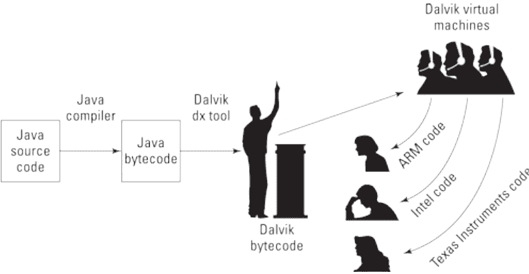

图 1-3：安理会的一次想象会议。

# 第 2 章：获取你所需的工具

## 本章内容

- 安装 Java
- 下载并安装 Android 软件工具
- 检查 Eclipse 配置
- 获取书中示例的代码

*ergaliophile* /ɑːr ɡliː ə fɑː/ 名词 1. 工具爱好者。2. 那些经常逛旧货出售市集，寻找生锈的金属构件的人（这些东西也许某天会用得着，但很可能永远用不上）。3. 那些由于每天无差别地安装免费软件工具而导致电脑运行缓慢的人。

在几年前，我在附近的一个旧货出售市集上发现了一个巨大的扳手（长度超过一码多，重量有 35 磅）。我并不是一个出色的管道工，直到今天，我开始修理的任何管道都会立即漏水。我无法抵拒购买这件精良的硬件。唯一的问题是，我妻子正坐在街路另一头的车里。在这些事情上她比我理智得多，所以我没把扳手带回车上。“把它先放一边，我等会儿回来拿，”我对卖家说。

当我两手空空回到车里时，我妻子说：“我看到有人拎着世界上最大的管形扳手。我很庆幸买它的不是你。”我同意她的同：“我不需要更多那种垃圾了。”

所以，理当然，我在当天晚些时候又回去买了那个猴头扳手，现在那个扳手就放在我们的阁楼里，再也没有见过它。如果我妻子读这一章，她会觉得很有趣或者生气。我希望她不要生气，我冒了这个险，是因为我享受这种小插曲。为了给我的生活增添乐趣，我把这个微小的秘密变成了一个公开公告。

## 你需要的东西

本书将教你如何编写 Java 程序，在你编写它们之前，你需要一些软件工具。以下是你需要的工具列表：

- **Java 虚拟机**

  酷的人会将此项物品称为 `JVM`，或简单地称为 Java。

- **Java 代码库**

  这些代码库被亲切地称为 Java 运行环境 (`JRE`) 或简单称为 Java。

- **集成开发环境**

  你可以使用极客式的、仅限键盘的工具创建 Java 程序，但最终你会厌倦不断输入和重复命令。另一方面，集成开发环境 (`IDE`) 有点像文字处理器：文字处理器帮助你编写文档（备忘录、诗歌和其他优秀的文学作品）；相比之下，`IDE` 帮助你编写计算机程序。

对于编写 Java 程序，我推荐使用 `Eclipse IDE`。

你应该获得这些额外的赠品：

- **一些帮助入门的 Java 示例程序**

  书中的所有示例都可以从 `www.allmycode.com/Java4Android` 下载。

- **Android 软件开发包**

  Android 软件开发包 (`SDK`) 包含了许多用于预定义的、可用的 Android 代码的工具，以及用于运行和测试 Android 应用的软件工具。预写的 Android 代码是 Android 应用程序接口 (`API`)。`API` 有几个版本——版本 9 和 10（代号均为 Gingerbread 姜饼）、版本 11、12 和 13（Honeycomb 蜂窝）、以及版本 14 和 15（Ice Cream 冰淇淋）等。

- **面向 Android 的 IDE 插件**

  通过使用插件，你可以自定义 `Eclipse IDE` 来帮助你运行和测试 Android 应用。用于处理 Android 应用的 Eclipse 插件集是 Android 开发工具包 (`ADT`)。


所有这些工具都运行在开发计算机上——你用于开发 Java 程序和 Android 应用的笔记本电脑或台式电脑。当你创建一个 Android 应用后，你可以将应用代码从开发计算机拷贝到目标设备——手机、平板电脑或（很快就会）运行 Android 的冰箱。

这里有一个好消息：你可以免费下载运行本书所需的软件。你运行书中示例所需的软件分为三部分：

- 从 `www.allmycode.com/Java4Android` 下载包含书中所有示例的程序。
- 访问 `www.java.com` 下载 Java 运行环境（如果你电脑上还没有安装最新版本的 Java）。
- 访问 `http://developer.android.com/sdk` 下载 Android SDK。下载的包是一个 `.zip` 压缩文件。

将下载的 `.zip` 压缩包内容解压到你的本地硬盘。

在 Windows 计算机上，我将 `.zip` 文件的内容解压到本地硬盘。


图 2-1：我的 Windows 电脑上的 adt-文件夹。

在 Mac 上，我将 `.zip` 文件的内容解压到现有的文件夹中，如图 2-2 所示。


图 2-2：我的 Mac 上的 adt-文件夹。

## 如果你不喜欢读说明……

我在本章开头对获取所需所需的步骤进行了简要（但有用）的概述。如果你是安装软件方面的专家，而且你的电脑比较特殊，这些步骤可能对你有帮助。否则，你可以阅读后续章节中更详细的说明。

1. 访问 `www.allmycode.com/JavaAndroid` 下载包含书中所有示例的文件。
2. 访问 `www.java.com` 下载 Java 运行环境（如果你电脑上还没有安装最新版本的 Java）。
   选择与你的操作系统（Windows、Macintosh 或其他）以及你的操作系统位数（32 位或 64 位）匹配的软件版本。
3. 访问 `http://developer.android.com/sdk` 下载 Android 软件开发包 (SDK)。
   下载的包是一个 `.zip` 归档文件。
4. 将下载的 `.zip` 归档文件内容解压到你的本地硬盘。

在 Windows 7 中：选择“开始→控制面板→外观和个性化→文件夹选项”。然后跳转到第四个项目符号。

在 Windows 8 中：在字符栏上，选择“设置→控制面板”。在控制面板中，选择“外观和个性化→文件夹选项”。然后继续执行该项目符号。

在所有版本的 Windows（XP 及更高版本）中：按照之前某个项目符号中的说明进行操作。然后，在“文件夹选项”对话框中，点击“查看”选项卡。找到“隐藏已知文件类型的扩展名”选项。确保此选框未被选中。

在 Mac OS X 中：在 Finder 应用程序菜单中，选择“设置”。在弹出的对话框中，选择“高级”选项卡并寻找“显示所有文件扩展名”选项。确保此选框已勾选。

## 获取本书的示例程序

要获取此书示例程序的副本，请访问 `www.allmycode.com/Java4Android` 并点击链接下载书中的程序。将下载的文件（`Java4Android_Programs.zip`）保存到电脑的硬盘上。


在某些情况下，你可以反复点击下载链接，但网页浏览器并未为你提供保存文件的选项。如果发生这种情况，请右键点击链接（在 Mac 上按 `Control` + 点击）。选择“下载链接文件”、“目标另存为”、“链接另存为”或类似标签的菜单项。

大多数网页浏览器会将文件保存到电脑硬盘上的“下载”目录。但你的浏览器配置可能略有不同。无论如何，请记住包含下载的 `Java4Android_Programs.zip` 文件的文件夹。

## 压缩存档文件

当你下载本书时，会下载一个名为 `Java4Android_Programs.zip` 的文件。zip 文件是一个包含许多较小文件和文件夹的单一文件。例如，`Java4Android_Programs.zip` 文件封装了 06–01、06–02 等文件夹。06–02 文件夹包含子文件夹，子文件夹中包含文件。（06–02 文件夹包含清单 6–2 中的代码——即第 6 章的第二行。）

`Java4Android_Programs.zip` 文件。当你按照本章的说明操作时，可以将文件内容导入到 Eclipse IDE 中。在后台，Eclipse 的导入过程会解压该 zip 文件。

## 收集信息

对于许多人（包括没有经验的人）来说，安装 Java 和 Android SDK 是例行公事的任务。访问几个网站，点击几个按钮，然后喝咖啡休息。但当你按照本章的说明操作时，你可能会产生疑问、遇到困难或处于道路的十字路口。在这种情况下，了解你的电脑是有帮助的——这意味着记下几个问题的答案。

### 你运行的是 32 位还是 64 位操作系统？

在本章中，你将在电脑上安装 Java 和 Android SDK。Java 有两个版本：32 位和 64 位。Android SDK 同样有这两种版本，为了让 Android SDK 与 Java 协同工作，Java 的版本必须与 Android SDK 版本匹配。在本节中，你将找到最适合你电脑的版本。


系统类型

**图 2-3：** 确定系统类型。

本节中的步骤均为可选。如果你不想执行本节的实地调查任务，可以尝试访问 `www.java.com` 和 `http://developer.android.com/sdk`，下载由这些网站提供的任何 Java 和 Android SDK 版本。也就是说，如果其中一个网站让你在 32 位和 64 位软件之间做出选择，请保持一致。或者获取两个 Java 和 Android SDK 的 64 位版本。（对于 Windows，32 位版本是最安全的选择。对于 Mac，64 位版本是最安全的。）

### 针对 Windows 8、Windows 7 和 Windows Vista：

1. 按 `Windows` 键。
   在 Windows 8 中，会出现开始屏幕。在 Windows 7 和 Windows Vista 中，会出现开始菜单。
2. 在控制面板框中，输入“控制面板”字样，然后按回车键。在 Windows 7 或 Windows Vista 中，点击开始菜单上的“控制面板”项。
   控制面板出现。
3. 在控制面板中，选择“系统和安全”（Windows 8 和 Windows 7）或“系统和维护”（Windows Vista）。
   系统窗口出现。要识别系统窗口，请查看窗口顶部附近的“查看有关电脑的基本信息”字样。
4. 在系统窗口中，寻找“系统类型”字样。
   系统类型为 32 位或 64 位，如图 2-3 所示。

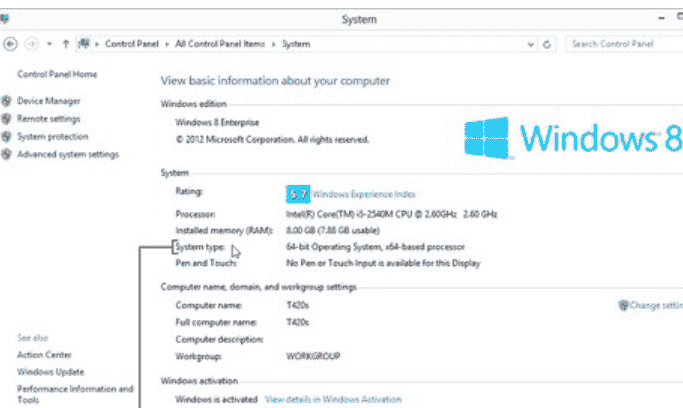

### 针对 Windows XP：

1. 按 `Windows` 键。
   出现开始菜单。
2. 点击开始菜单上的“我的电脑”项。
   打开资源管理器。
3. 在资源管理器中，导航到 C 盘。
4. 在 C 盘中，寻找名为 `Program Files` 和 `Program Files (x86)` 的文件夹。
   如果你只找到了 `Program Files` 而没有找到 `Program Files (x86)`，说明你运行的是 32 位 Windows。如果你同时找到了 `Program Files` 和 `Program Files (x86)` 文件夹，说明你运行的是 64 位 Windows。

### 针对 Macintosh OS X：

1. 选择“关于本机 Mac”。
   出现“关于本机 Mac”窗口。

### 电脑有多少位？

当你按照本章的说明操作时，你可能会被要求在两个版本的软件之间做出选择——32 位版本和 64 位版本。区别是什么？你为什么要关心？

**一个位** 是你电脑上可以存储的最小信息单元。许多人认为一个位是 0 或 1，这种描述非常有用。为了表示任何数字，我们将若干个位组合在一起。

处理器（包括 Intel Core Duo）都是 64 位的 Mac。（参见图 2-4）。


**图 2-4：** 显示 Mac 处理器类型。

这里有一种另一种（极客的）方法可以判断你的 Mac 的是 32 位还是 64 位操作系统：在 Spotlight（聚焦搜索）中，输入单词 `Terminal`（终端），然后按回车键。当终端应用打开时，输入 `uname -a` 并按回车键。如果 Mac 的响应包含 `i386`，则说明你使用的是 32 位系统。如果 Mac 的响应包含 `x86_64`，则说明你有的是 64 位系统。

## 如果你是 Mac 用户，你使用的是哪个版本的 Mac OS X？

为了回答一个关于 Macintosh 操作系统的迫切问题，请按照以下步骤操作：

1. 选择 Apple 菜单 > 关于本机。
   将弹出“关于本机”窗口。
2. 在“关于本机”窗口中，寻找 Version（版本）一词。
   你会看到浅灰色字体显示的 Version 10.8（或类似的内容）。（参见图 2-4）。

> Mac 上的 Android 开发软件需要 OS X 10.5.8 或更高版本，以及 Intel 处理器。如果“关于本机”窗口报告你使用的是 PowerPC 处理器，或者你的 OS X 版本早于 OS X 10.5，那么你开发 Android 应用将非常困难。（对于 OS X 10.5.1 等版本，你可以尝试将系统更新到 10.5.8；对于 OS 10.5 之前的系统，以及在 PowerPC 处理器上运行的系统，你可以在网上搜索破解方法和解决方法。当然，如果你使用了破解方法和解决方法，我不做任何保证。）

如果你从不定期进行软件更新，请从 Apple 菜单中选择“软件更新”。在弹出的窗口中，寻找 OS X 更新以及包含 Java 字样的项目。选择相关项目，然后点击相应的“安装”或“更新”按钮。此外，你可以按照下一节的说明查看 `www.java.com` 网站是否推荐了网站更新。

## 你的电脑上安装了较新的 Java 版本吗？

Android 开发需要 Java 5.0 或更高版本。推荐使用 Java 6（但不是必须）。Java 7 及更高版本就大材小用了。

你看到的可能是 Java 1.5 和 Java 1.6，而不是 Java 5.0 和 Java 6。有些人理解这些名称之间的区别，但很少有人在乎。（如果你是在意的人之一，请参见[第 1 章]！）。

按照以下步骤检查电脑上是否有较新的 Java 版本：

1. 访问 `www.java.com`。
2. 在 `www.java.com` 首页上，点击 Do I Have Java?（我有 Java 吗？）链接。
3. 在 Do I Have Java? 页面，点击 Verify Java Version（验证 Java 版本）按钮。

稍作等待后，`java.com` 网站报告你拥有 Java Version 7 Update 9（或类似的内容）。

- 如果你拥有 Java 版本 6 或更高版本，那么就可以了。你不需要安装其他版本的 Java。你可以跳过本章稍后的部分“设置 Java”。
- 如果 `java.com` 网站没有报告你拥有 Java 6 或更高版本，不要担心。`java.com` 网站可能是错的！
  毕竟，32 位浏览器无法检测 64 位的 Java，而且（截至 2013 年初）在 Windows 8 模式下浏览甚至无法检测 Java。潜在的陷阱无处不在。
  无论如何，如果 `java.com` 没有报告你拥有 Java 6 或更高版本，我建议按照“设置 Java”部分的说明进行操作。如果你不小心安装了第二个 Java 版本（或者第三个、第四个），你可能也没问题。

## 设置 Java

你可以通过访问 `www.java.com` 获取最新、最强大的 Java 版本。该网站提供了几种替代方案。

- （推荐）点击网站首页上巨大的 Free Java Download（免费下载 Java）按钮。
  对于大多数电脑来说，点击这个 Free Java Download 就能获得此本书所需的所有 Java。所以，如果你在访问 `www.java.com` 时不知道该做什么，请点击 Free Java Download 按钮，并移动到本章后部分的“设置 Android SDK”部分。

如果你运行的是 Mac OS X 10.6 或更早版本（如果你运行 OS X 10.7 且尚未升级到 OS X 10.7.3 或更高版本），点击 Free Download 按钮会弹出一个“抱歉！”，提示你直接从 Apple 下载 Java。请按照如何在电脑上安装 Java 的说明操作。

（可选）点击 I Have Java? 链接。当你点击此链接时，网络浏览器会扫描 Java 安装情况。对于此书的示例，我推荐使用 Java 6（也称为 1.6）或更高版本（Java 7、Java 8 或任何版本）。如果你的 Java 版本早于 Java 6（或者在电脑上没找到 Java），我建议点击 `www.java.com` 上的任一个下载按钮。

（可选）在 Java 版本之间进行选择。如果你点击 `www.java.com` 上的 All Downloads（所有下载）链接，你可以从几个 Java 版本中进行选择——适用于 Windows、Mac、Linux 和 Solaris 的 32 位和 64 位版本。这种替代方案用于覆盖默认 Free Download 按钮的选择。例如，即使 Free Download 按钮给了你 32 位版本，你也可以获得 64 位的 Java 版本。（参见本章早前的侧边栏“你的电脑是多少位的？”）。你可能会用 Windows 电脑访问 `www.java.com` 来下载适用于 Macintosh 的 Java。

（可选）清理电脑上所有最新版本的 Java。在 `www.java.com` 上，Older Versions（旧版本）链接承诺清理掉你随时间积攒的任何杂质。在电脑上保留多个 Java 版本方面，我曾有过好运也有过霉运。在我看来，这是最佳的。如果你遇到了怀疑与 Java 相关的问题，请访问此处。但如果你已经读了本书的几章且示例运行正常，就不用担心不遵循 Older Versions 链接会导致迫临的灾难。

## 设置 Android SDK

在本节中，你可以在一次下载中获得实用工具。方法如下：

1. 访问 `http://developer.android.com/sdk`。
2. 点击网页上的 Download 按钮。
3. 同意所有法律协议。
4. 在 32 位和 64 位之间进行选择。为了获得帮助，请参见“你运行的是什么操作系统？”。在你选择后，会出现最后的 Download 按钮。（至少在 2013 年是这样）。
5. 点击最后的 Download 按钮，将下载保存到硬盘。

下载的文件是一个大的压缩包。在 Windows 资源管理器中解压该压缩包。

将压缩包的内容解压到硬盘 `c:\UserName\adt-bundle-windows-x86`。在我的 Mac 上，我将压缩包的内容解压到 Applications（应用程序）文件夹。（为了帮助文件，请参见“压缩文件”）。在 Windows 中，Program Files 文件夹会让某些人困惑。我不认为本书的软件能防止这个问题，但我无法保证。

请记住 sdk 组件在硬盘上的位置。（例如，在图 2-1 中，SDK 文件夹位于 `...\sdk`）。我给这个位置起了一个名字：`ANDROID_HOME` 文件夹。

# 首次运行 Eclipse

第一次启动 Eclipse 时，你需要执行一些额外的步骤。要运行 Eclipse，请按照以下步骤操作：

- **启动 Eclipse。**

在 Windows 资源管理器（Windows 8 中称为文件资源管理器）中进入文件夹。双击代表 `eclipse.exe` 文件的图标。（如果你使用的是 `eclipse` 文件但没有 `eclipse.exe` 文件，请检查本章之前的侧边栏“那些讨厌的文件扩展名”）。

在 Mac 上，前往 Spotlight 并输入 `Eclipse`。当 `Eclipse` 作为 Spotlight 列表中的顶部结果出现时，按回车键。

当你启动 Eclipse 时，你会看到工作区启动器（Workspace Launcher）对话框，如图 2-5 所示。该对话框询问你想在电脑硬盘的哪个位置存储使用 Eclipse 创建的代码。

在工作空间启动器（Workspace Launcher）对话框中，点击 OK 以接受默认设置（或不接受默认设置）。

无论如何，这并不是什么大问题。因为这是你第一次使用特定的 Eclipse 工作空间，Eclipse 会启动一个欢迎界面，如图 2-6 所示。

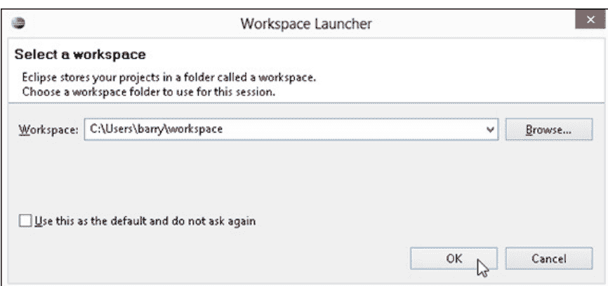

图 2-5：Eclipse 工作空间启动器。

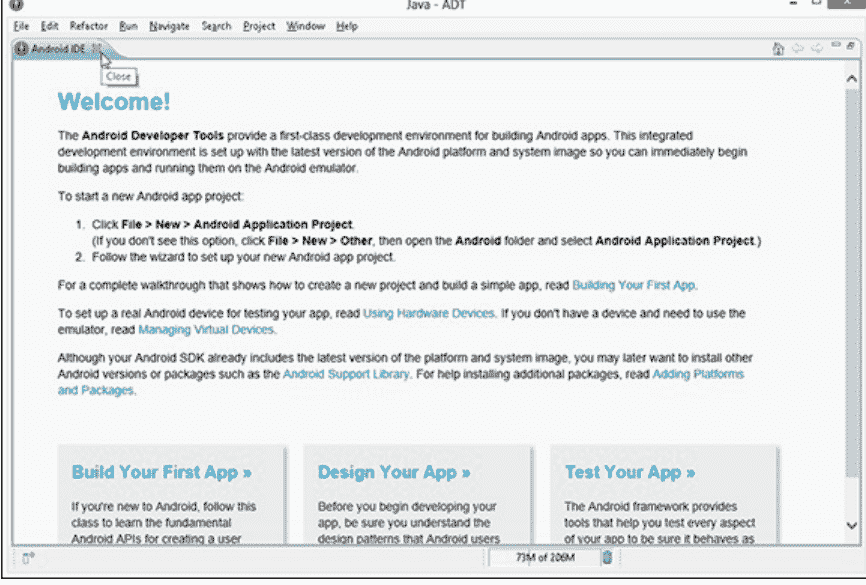

图 2-6：Android 定制版 Eclipse 的欢迎界面。

## 3. 关闭欢迎界面。

在大多数 Eclipse 版本中，你可以通过点击屏幕上方标签页出现的 **x** 图标来关闭欢迎界面。

使用全新的工作空间打开 Eclipse 后，主界面视图如图 2-7 所示。

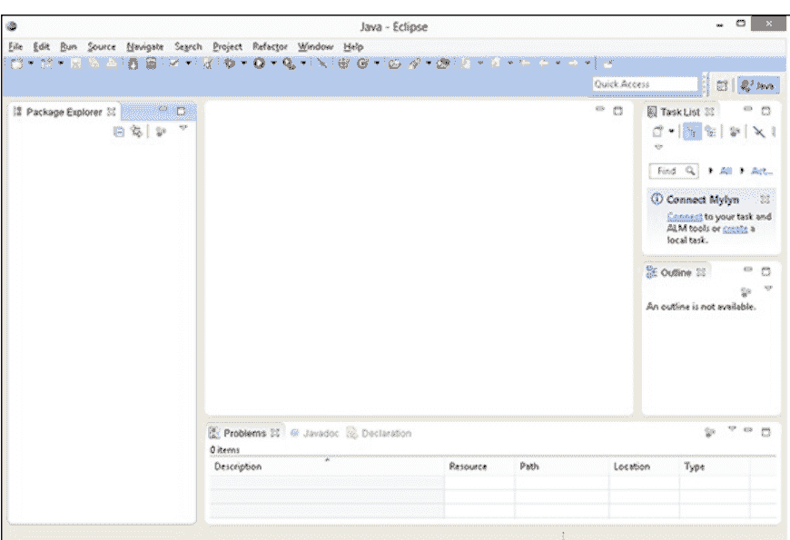

## 哥们，我的 Android SDK 在哪儿？


当你启动 Eclipse 时，Eclipse IDE 会在硬盘上寻找预先编写的、重用的 Android 代码文件。（毕竟，Eclipse 使用这些文件来帮助你编写和运行 Android 应用。）如果 Eclipse 无法找到这些文件，你会看到一条看起来很难看的 `Could Not Find SDK Folder` 错误信息。要告诉 Eclipse 安装 Android SDK 文件的位置，请按照以下步骤操作：

1. 在 Windows 中，在 Eclipse 主菜单中选择 `Window=Preferences`。在 Mac 上，在 Eclipse 主菜单中选择 `Eclipse=Preferences`。

   打开 Eclipse Preferences 对话框。

2. 在 Preferences 对话框左侧的树列表中，选择 `Android`。不要展开树形的 Android 分支，只需点击 Android 单词即可。

   Preferences 对话框的主体会出现 `SDK Location` 字段，如图 2-8 所示。

3. 点击 `Browse` 按钮并（当然）浏览到 `ANDROID_HOME` 目录。例如，在图 2-1 中，`ANDROID_HOME` 目录为 `c:\Users\Barry\adt-bundle-windows-x8_64\sdk`。

4. 点击 `Apply` 和 `OK`，一切正常后即可返回 Eclipse 主工作区。

再次查看图 2-8，注意窗口左上角的文本框——包含 `type filter text` 字样的框。该文本框用于过滤 Eclipse 偏设置名称。图 2-8 仅显示 11 个偏设置（如 General、Android、Ant 和 C++）。但此偏设置列表会展开为一个包含约 150 个分支的树。每个分支都对应 Preferences 窗口主体中的某组选项。如果你想查看大量字体相关的 Eclipse 偏设置（例如），在小文本框中输入 `font`。Eclipse 随后会显示包含 `font` 单词的树分支。

## Eclipse，你好，Java！

Eclipse 通常会在电脑上查找 Java 安装，并选择一个已安装的 Java 版本来运行你的 Java 程序。电脑上可能存在多个版本的 Java，因此请双击 Eclipse 的 Java 版本选择。本节的步骤将向你如何操作。

1. 在 Windows 中：从 Eclipse 主菜单选择 `Window=Preferences`。在 Mac 上：从 Eclipse 主菜单选择 `Eclipse=Preferences`。

   结果是出现了 Eclipse 对话框。（你可以参考图 2-9）。

   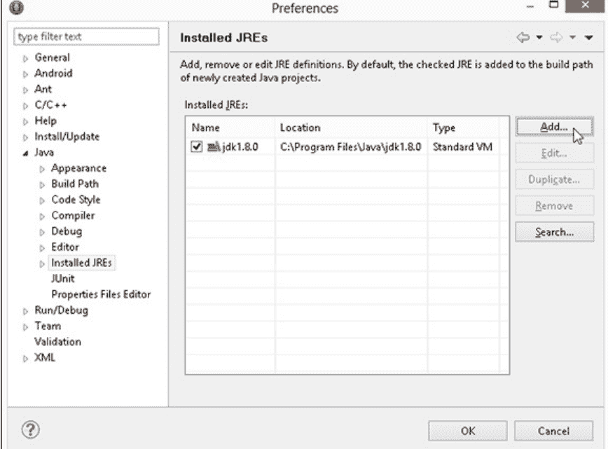

   图 2-9：Eclipse Preferences 对话框的 Installed JREs 页面。

2. 在 Preferences 对话框左侧的树中，展开 `Java` 分支。

3. 在 Java 分支内，选择 `Installed JREs` 子分支。

4. 查看 Preferences 对话框主体中的 Java 版本列表（Installed JREs）。

   在列表中，每个 Java 版本都有一个复选框。Eclipse 使用被勾选的版本。如果勾选的版本不是你的首选版本（例如，如果不是版本 6 或更高版本），你必须对其进行更改。

5. 如果你首选的 Java 版本出现在 Installed JREs 列表中，请选择该版本的复选框。

6. 如果你首选的 Java 版本未出现在 Installed JREs 列表中，点击 `Add` 按钮。

   当你点击 Add 按钮时，会弹出 JRE Type 对话框，如图 2-10 所示。

## 添加 JRE

选择要添加到工作空间的 JRE 类型。

已安装 JRE 类型：

| Execution Environment Description |
| :--- |
| Standard 1.1.x VM |
| Standard VM |


图 2-10：JRE Type 对话框。

7. 在 JRE Type 对话框中，双击 `Standard VM`。

   结果是出现了 JRE Definition 对话框，如图 2-11 所示。接下来的操作取决于几个不同的因素。

## 添加 JRE

JRE Definition

为 JRE 指定属性

（注：由于原文后续存在大量重复和 OCR 错误，已根据逻辑流进行清理翻译。）

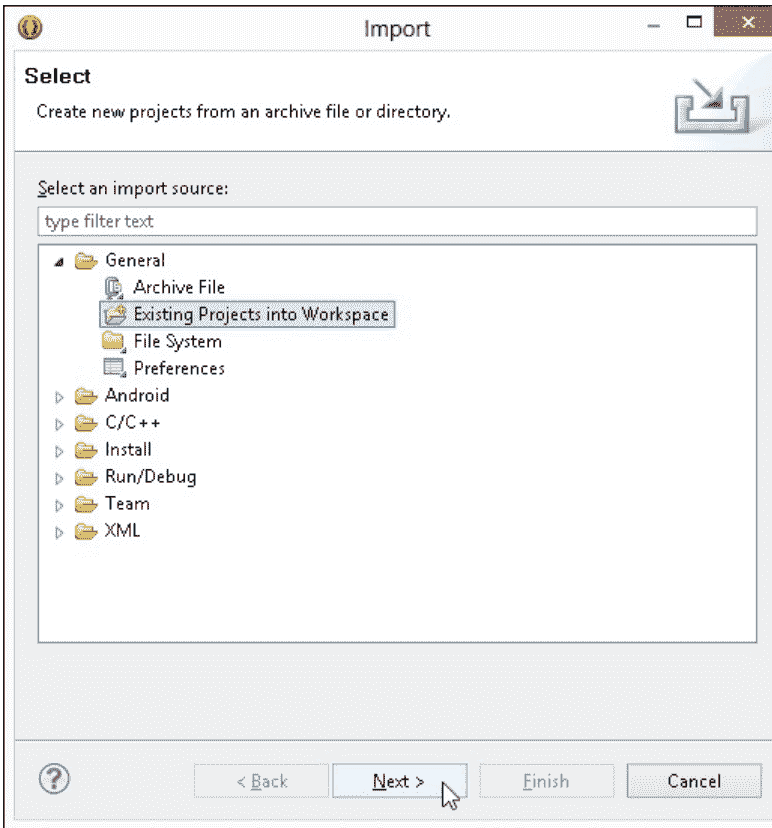

图 2-14：在所有选项中，选择“Existing Projects into Workspace”（将现有项目导入工作区）。


本书的代码位于名为 `Java4Android_Programs` 的文件夹中，或者名为 `Java4Android_Programs.zip` 的压缩文件中。

> Mac 上的 Safari 通常会自动解压 .zip 压缩包，而 Windows 浏览器（Internet Explorer、Firefox、Chrome 等）则不会自动解压 .zip 压缩包。关于压缩文件的完整信息，请参见之前的侧边栏“压缩存档文件”。

6. 点击“Browse”（浏览）按钮，在计算机的硬盘上找到 `Java4Android_Programs.zip` 文件或 `Java4Android_Programs` 文件夹。

   如果你不确定在哪里找到这些项目，请先查看名为“Downloads”（下载）的文件夹。

   找到 `Java4Android_Programs` 后，Eclipse 中的“Import Projects”（导入项目）对话框将显示文件内项目的名称。（参考图 2-15）。

7. 点击“Select All”（全选）按钮。

   本书的示例非常精彩，以至于你想导入它们所有的示例！

8. 点击“Finish”（完成）按钮。

   结果是，Eclipse 工作区再次出现。工作区的左侧显示了书中 Java 项目的名称，如图 2-16 所示。

   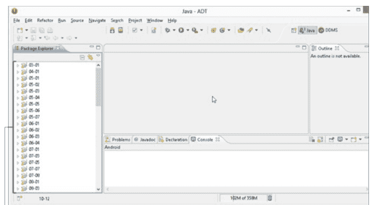

   Java 项目列表

   图 2-16：Eclipse 显示了一系列 Java 项目。

在导入本书的代码后，你可能会看到许多红色的错误标记，表示书中的项目存在问题。如果是这样，请保持冷静。标记可能会在几秒钟后消失。如果它们没有消失，请检查 Eclipse 工作区的底部区域查看是否有类似 `Unable to resolve target 'android-15'` 的消息。

如果你看到这样的消息，意味着我书的代码强制要求一个你尚未在计算机上安装的 API 级别。要解决此问题，请执行以下操作：

1. 在 Eclipse 主菜单上，选择 `Window=Android SDK Manager`。

   结果是，计算机显示了 Android SDK Manager。（并不意外！）

2. 勾选带有 `Android 4.0.3 (API 15)` 的复选框，或者带有缺失 API 级别数字的框。

3. 点击 Android SDK Manager 窗口右下角的“Install”（安装）按钮。

4. 等待安装完成。

5. 关闭 Android SDK Manager。

6. 重启 Eclipse。

当 Eclipse 重启时，你会看到几秒钟的红色错误标记。但在短暂（且可能是紧张的）等待之后，错误标记消失了。你可以开始工作了。

## 创建 Android 虚拟设备

你可能急于运行某些代码，但首先你必须拥有一个可以运行 Android 程序的东西。我所说的东西，是指 Android 设备（手机、平板电脑、支持 Android 的面包机——任何都可以）或虚拟设备。Android 虚拟设备 (AVD) 是在开发计算机上对 Android 代码进行测试的环境。

Android SDK 自带模拟器——一个在开发计算机上表现像手机或平板电脑的程序。模拟器将 Android 代码翻译为可以在屏幕上显示特定手机或平板设备的内容。模拟器并不知道你想显示哪种设备。你是想要一个具有 800x480 像素分辨率的摄像头，还是选择了一个带有内置加速度计和陀螺仪的平板设备？所有这些选择都属于特定的 AVD。Android 仅仅是一组设置，告诉模拟器关于被模拟设备的所有细节。

在你的计算机上运行 Android 应用之前，你必须先至少创建一个 AVD。事实上，你可以创建多个 AVD 并使用其中一个运行特定的 Android 应用。

要创建 AVD，请遵循以下步骤：

1. 在 Eclipse 主菜单中，选择 `Window⇒Android Virtual Device Manager`。

2. 在 Android Virtual Device Manager 窗口中，点击“New”（新建），如图 2-17 所示。

   “Create New Android Virtual Device (AVD)”窗口打开了。太好了！

3. 在“AVD Name”字段中，为虚拟设备输入新名称。

   你可以将设备命名为 `My Sweet Petunia`，但在图 2-18 中，我可能会将其命名为 `Nexus_Android4.2`。这个名称用于记忆该设备的功能。

4. 在“Device”下拉菜单中，选择一种设备类型。

   在图 2-18 中，选择 `Nexus 7 (7.27", 800 x 1280: tvdpi)`。

5. 确定设备拥有的安全数字（SD）卡类型。

   在图 2-18 中，我选择了一个 1000 MiB 的 SD 卡，这大约是 1 GB 特。或者，我可以选择“File”单选按钮并指定硬盘上某个文件的名称。该文件将像是真实设备上的真实 SD 卡一样存储信息。

   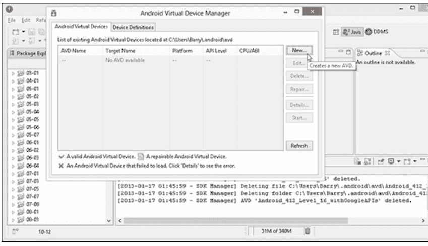

   图 2-17：Android Virtual Device Manager。

Eclipse，以及下载此书的示例程序。谢天地！你不需要重复执行这些指令。

## 2. 启动 Eclipse。

Eclipse 显示工作空间启动器（Workspace Launcher）对话框，如图 3-2 所示。

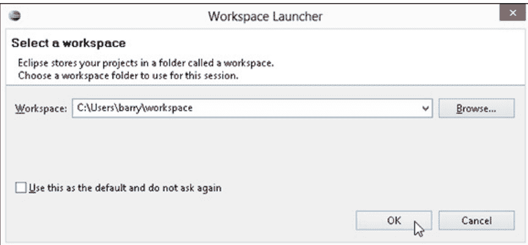

图 3-2：Eclipse 中的工作空间启动器。

有关启动 Eclipse 的完整教程，请参第 2 章。

工作空间是硬盘上的文件夹。Eclipse 在一个或多个工作空间文件夹中存储 Java 程序。除了这些 Java 程序，每个工作空间文件夹还包含一些 Eclipse 设置。这些设置存储了诸如你使用的 Java 版本、编辑器中单词的颜色、拖动区域边缘时编辑器区域的大小以及其他偏好。你可以拥有多个具有不同程序和不同设置的工作空间。

默认情况下，工作空间启动器会建议打开你上次运行 Eclipse 时打开的工作空间。在本示例中，你打开了第 2 章使用的工作空间，因此不要修改 Workspace（工作空间）字段中的任何内容。

## 3. 在工作空间启动器对话框中，点击 OK。

巨大的 Eclipse 工作区（workbench）在电脑屏幕上盯着你，如图 3-3 所示。

## 3-3：Eclipse 工作区。

在图 3-3 中，工作区的最左侧是 Eclipse 包资源管理器（Package Explorer），它包含如 03-01、04-01 等数字。每个数字都是一个 Eclipse 项目的名称，正式地讲，它是工作空间内部文件和文件夹的集合。直观地说，一个项目是一个基本工作单元。例如，一个管理 CD 集合的 Java 程序文件自包含集合（以及包含数据的文件）可以构成单个 Eclipse 项目。

再次查看图 3-3 中的包资源管理器，你会看到命名为 03-01、04-01 等的项目。我的项目 03-01 包含位于 3-1 中的代码。项目 04-01 包含了 Android 应用，其代码属于位于 4-1（本书第 4 章中的第一个代码列表）。项目 05-03 包含位于 5-3 中的代码。命名为 03-Mortgage（抵押贷款）的项目略有异常，因为本章抵押贷款示例的代码并没有出现在所有代码列表中。

Eclipse 项目的名称可能包含字母、数字、空格和其他字符；对于本书示例的名称，我坚持使用数字和连字符。

要了解更多关于 Eclipse 包资源管理器等主题的知识，请参阅后面的章节“Eclipse 窗口中的那些内容到底是什么？”。

当你启动 Eclipse 时，看到的元素可能与图 3-3 所示的不同。你可能会看到 Eclipse 欢迎界面，在原本空旷的窗口中只有几个图标。你可能还会看到一个类似于图 3-3 所示的工作区，但包资源管理器中没有数字列表（03-01、04-01 等）。如果是这样，你可能错漏了第 2 章中关于 Eclipse 的某些指令。或者，你可能已经修改了 Eclipse 启动器对话框中的工作空间名称。

无论如何，请确保你在包资源管理器中看到了诸如 03-01 和 04-01 之类的数字。看到这些数字可以确保 Eclipse 已准备好运行本书中的示例程序。

## 4. 在包资源管理器中，点击 03-Mortgage 分支。

结果，03-Mortgage 项目被高亮显示。

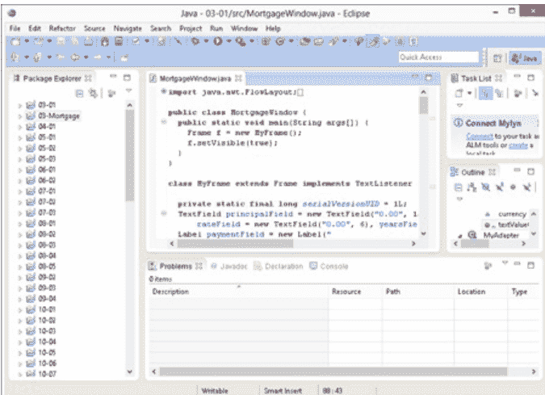

要预览你在项目 03-Mortgage 项目中运行的 Java 程序，请展开包资源管理器中的 03-Mortgage 分支。在 03-Mortgage 分支内部，你会找到 `src` 分支，它包含一个 `(default package)` 分支。在 `(default package)` 分支中，你找到了 `mortgagewindow.java` 分支。这个 `mortgageWindow.java` 分支代表了我的 Java 程序。双击 `mortgagewindow.java` 分支，我的代码就会出现在 Eclipse 编辑器中，如图 3-4 所示。

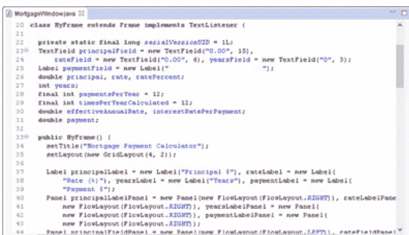

图 3-4：Eclipse 编辑器中的 Java 代码。

## 5. 从主菜单选择 Run=Run As Application（运行=运行为应用程序），如图 3-5 所示。当你选择 Run As Java Application 时，电脑会运行项目的代码。（在本示例中，电脑运行我编写的一个 Java 程序。）程序在屏幕上显示抵押贷款计算器（Mortgage Payment Calculator）窗口，如图 3-6 所示。


图 3-5：在项目 03-Mortgage 中运行代码的一种方法。

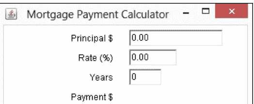

图 3-6：抵押贷款计算器开始运行。

## 6. 在抵押贷款计算器窗口的字段中输入数字。（参考图 3-1。）

当你在第 6 步输入本金金额时，不要包含国家货币符号。对于利率，不要使用 % 符号。对于年份，不要使用小数点。**免责声明**：如果你遵循了这些规则，我的 Java 程序没有显示结果，请尝试以下三种策略（按优到劣排序）：

- 检查你是否正确遵循了这些步骤。

- 通过邮件 @mycode.com 联系我。

- 在 Twitter 上关注 @mycode。

如果你描述了发生了什么，我也许可以找出问题所在并告诉你如何修复。

## 编写并运行你的程序

之前的“运行预设 Java 程序”章节是关于运行别人的代码。但最终，你需要编写自己的代码。本节将教你如何使用 Eclipse 编码。

## 隔离你的程序

你可以通过创建一个独立的工作空间来将你的代码与书中的示例分开。这里有两种不同的方法：

- 启动 Eclipse 时，在工作空间启动器对话框的 Workspace 字段中输入一个新的文件夹名称。

- 在 Eclipse 主菜单中，选择 `File=Switch Workspace`（文件=切换工作空间），如图 3-7 所示。

  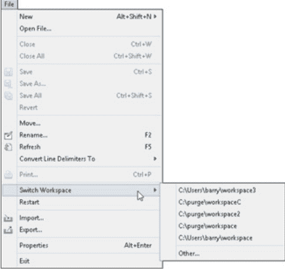

  当你选择 Switch Workspace 时，Eclipse 会提供之前打开的几个文件夹。如果你的选择不在列表中，请选择 Other（其他）选项。作为响应，Eclipse 重新打开了工作空间启动器对话框。

## 编写并运行你的程序

以下是创建项目的方法：

1. **启动 Eclipse。**

2. **从 Eclipse 菜单栏选择 `File=New=Java Project`（文件=新建=Java 项目）。**

3. **在 Create Java Project 对话框中为项目输入名称，然后点击 Finish（完成）。**

   出现了 Create Java Project 对话框。

   在图 3-8 中，我输入了名称 MyFirstProject。

## Java 项目

创建 Java 项目

在工作空间或外部位置创建项目。


Project name（项目名称）：MyFirstProject

[] 使用默认位置

Location（位置）：C:\Users\Barry\workspace3\MyFirstProject [浏览...]

JRE

[] 使用执行环境 JRE：JavaSE-1.6

[] 使用项目特定 JRE：jre8

[] 使用默认 JRE（当前为 'jre'）[配置 JRE...]

Project layout（项目布局）

[] 使用项目文件夹作为源文件和类的根目录

[] 为源文件和类创建单独文件夹 [配置默认...]


# Working sets（工作集）

## 将项目添加到工作集

Working sets：EarlyCode [选择...]

> 如果你点击 Next（下一步）而不是 Finish，你会看到现在不需要的其他选项。为了避免混淆，只需点击 Finish。

点击 Finish 后将返回 Eclipse 工作区，包资源管理器中会出现 MyFirstProject，如图 3-9 所示。

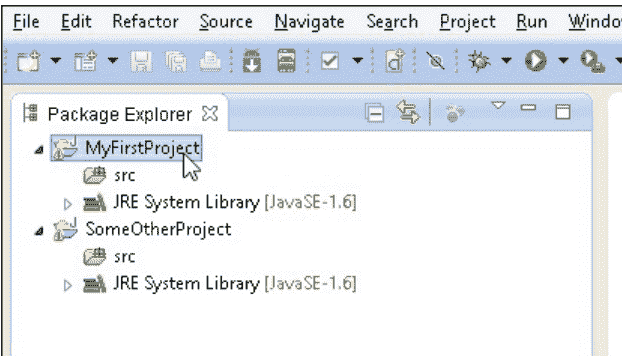

图 3-9：你的项目出现在 Eclipse 的包资源管理器（Package Explorer）中。

下一步是创建一个新的 Java 源代码文件。

4. 在包资源管理器中选择新创建的项目。

为了创建图 3-9，我选择了 `MyFirstProject` 而不是 `SomeProjectPath`。

5. 在 Eclipse 主菜单中，选择“File（文件）=New（新建）=Class（类）”。

出现 Eclipse Java 类对话框，如图 3-10 所示。

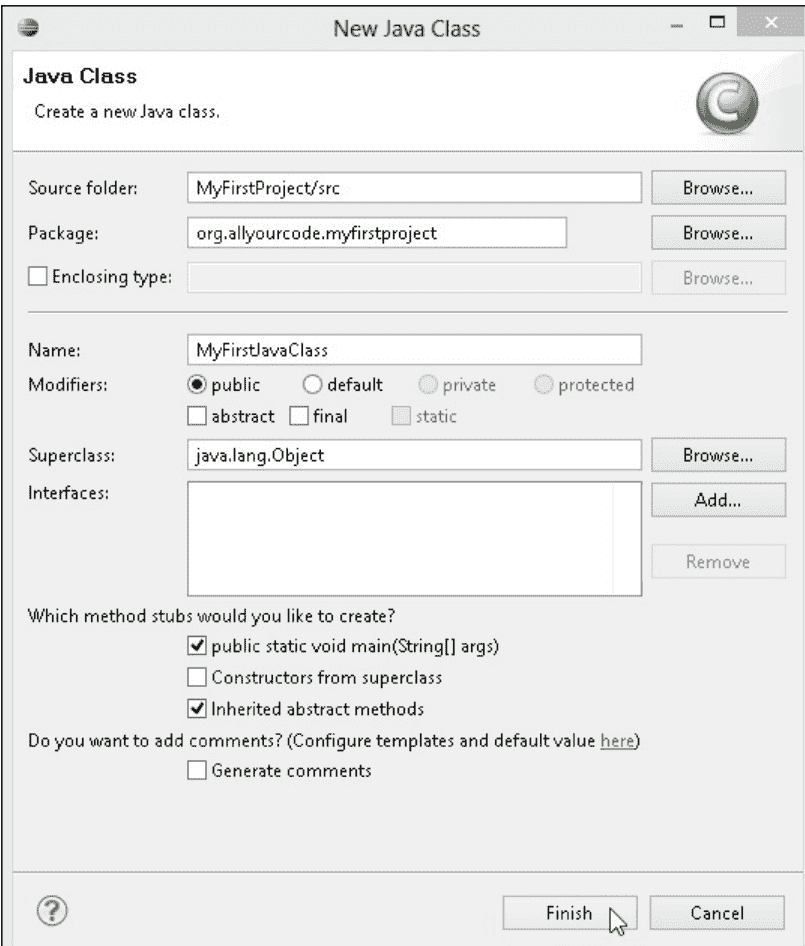

与所有其他窗口化环境一样，对于 `File=New=Class`，Eclipse 提供了多种方法来完成相同的任务。与其通过菜单选择 `MyProject`，不如你可以在 Windows 的包资源管理器中右键点击 `MyProject`（或在 Mac 的包资源管理器中按 Control 点击 `MyProject`）。在弹出的右键菜单中，选择 `New=Class`。你也可以通过在 Windows 中按下 `Alt-Shift+N`（或在 Mac 上按下 `Option-Command-N`）开始。点击和按键的选择取决于你的喜好。

**6. 在 Java 类对话框的 Name（名称）字段中，输入新类的名称。**

在这个示例中，我使用的名称是 `MyJavaClass`，单词之间没有空格。（参考图 3-10）。

Java 类对话框中的名称不能有空格，唯一允许的标点符号是下划线（`_`）。你可以将类命名为 `MyFirstJavaClass` 或 `My_First_Java_Class`，但你不能将其命名为 `My First Java Class`，也不能命名为 `Class,MyFirst`。

图 3-10：让 Eclipse 创建一个新的 Java 类。最后，类名不能以数字开头。例如，你可以将类命名为 `Go4It`，但不能命名为 `2bOrNot2b`。

## 7. 在 Java 类对话框的 Package（包）字段中，输入一个包名。（参考图 3-10）。

在 Java 中，你将代码分组到包（packages）中。在 Android 世界，每个应用都有它自己的包。

不用担心编写包名。如果你有自己的域名（例如，`allyourcode.org`），你应该反转域名（结果为 `org.allyourcode`）并添加一个描述性词汇。例如，`org.allyourcode.myfirstproject` 是一个很好的包名。如果你没有域名，任何单词（用点隔开）都可以的。


包名包含一个或多个单词。每个单词可以是字母、数字和下划线（`...`）的任意组合，只要该单词不以数字开头。包名是这些单词的组合，单词之间之间用点隔开。例如，`org.allyourcode.Go4It` 是一个有效的包名，但 `org.allyourcode.2bOrNot2b` 不是。（你不能用数字 2 开头包名的第三部分。对于这一点，你不能让像 `org.allyourcode.myfirstproject` 这样的名称中的任何单词以数字开头。）

## 8. 勾选 `public static void main(String[] args)` 复选框。

勾选标记告诉 Eclipse 创建一些模板 Java 代码（boilerplate code）。

## 9. 接受 Java 类对话框中其他所有内容的默认设置。（换句话说，点击 Finish（完成）。）

点击 Finish 会带你进入 Eclipse 工作区。现在 `MyFirstProject` 包含一个名为 `MyFirstClass.java` 的文件。为了方便起见，`MyFirstClass.java` 文件已经包含了一些代码。Eclipse 编辑器显示了 Java 代码，如图 3-11 所示。

```
MyFirstClass.java
1 package org.allyourcode.myfirstproject;
2 
3 public class MyFirstClass {
4 
5 /**
6  * @param args
7  */
8  public static void main(String[] args) {
9    // TODO Auto-generated method stub
10 
11  }
12 
13 
14
```

图 3-11：Eclipse 在编辑器中编写了一些代码。

## 替换新 Java 程序中的现有代码行。

在 Eclipse 编辑器中输入一行代码。将该行

```
// TODO Auto-generated method stub
```

替换为这些行：

```
javax.swing.JOptionPane.showMessageDialog
(null, "Hello");
```


任何包含这些代码行的程序都只运行在桌面（或笔记本）电脑上。代码 `javax.swing.JOptionPane.showMessageDialog`属于标准的 Oracle Java，但不属于 Android Java。

完全按照你在 Listing 3-1 中看到的内容复制新代码行。

- 完全按照我在 Listing 3-1 中的拼写拼写每个单词。

- 完全按照我在 Listing 3-1 中的方式大写每个单词字母。

- 包含所有标点符号——点、引号、分号——所有内容。

完成后，Eclipse 编辑器中的代码应该与 Listing 3-1 中的代码完全一致。

## 我在 Java 程序中看到格式化了吗？

当你使用 Eclipse 编辑器时，`File=New=Class` 提供了许多方法来完成相同任务。与其选择 `MyProject`，你可以在 Windows 的包资源管理器中右键点击 `MyProject`（或在 Mac 的包资源管理器中按 Control 点击 `MyProject`）。在弹出的右键菜单中，选择 `New=Class`。你也可以通过在 Windows 中按下 `Alt-Shift+N`（或在 Mac 上按下 `Option-Command-N`）开始。点击和按键的选择取决于你的喜好。

**6. 在 Java 类对话框的 Name 字段中，输入新类的名称。**

在这个示例中，我使用的名称是 `MyJavaClass`，单词之间没有空格。（参考图 3-10）。

Java 类对话框中的名称不能有空格，唯一允许的标点符号是下划线（`_`）。你可以将类命名为 `MyFirstJavaClass` 或 `My_First_Java_Class`，但你不能将其命名为 `My First Java Class`，也不能命名为 `Class,MyFirst`。

图 3-10：让 Eclipse 创建一个新的 Java 类。最后，你不能以数字开头类名。例如，你可以将类命名为 `Go4It`，但不能命名为 `2bOrNot2b`。

## 7. 在 Java 类对话框的 Package 字段中，输入一个包名。（参考图 3-10）。

在 Java 中，你将代码分组到包中。在 Android 世界，每个应用都有它自己的包。

不用担心编写包名。如果你有自己的域名（例如，`allyourcode.org`），你应该反转域名（结果为 `org.allyourcode`）并添加一个描述性词汇。例如，`org.allyourcode.myfirstproject` 是一个很好的包名。如果你没有域名，任何单词（用点隔开）都可以的。


包名包含一个或多个单词。每个单词可以是字母、数字和下划线（`...`）的任意组合，只要该单词不以数字开头。包名是这些单词的组合，单词之间用点隔开。例如，`org.allyourcode.Go4It` 是一个有效的包名，但 `org.allyourcode.2bOrNot2b` 不是。（你不能用数字 2 开头包名的第三部分。对于这一点，你不能让像 `org.allyourcode.myfirstproject` 这样的名称中的任何单词以数字开头。）

## 8. 勾选 `public static void main(String[] args)` 复选框。

勾选标记告诉 Eclipse 创建一些模板 Java 代码。

## 9. 接受 Java 类对话框中其他所有内容的默认设置。（换句话说，点击 Finish。）

点击 Finish 会带你进入 Eclipse 工作区。现在 `MyFirstProject` 包含一个名为 `MyFirstClass.java` 的文件。为了方便起见，`MyFirstClass.java` 文件已经包含了一些代码。Eclipse 编辑器显示了 Java 代码，如图 3-11 所示。

```
MyFirstClass.java
1 package org.allyourcode.myfirstproject;
2 
3 public class MyFirstClass {
4 
5 /**
6  * @param args
7  */
8  public static void main(String[] args) {
9    // TODO Auto-generated method stub
10 
11  }
12 
13 
14
```

图 3-11：Eclipse 在编辑器中编写了一些代码。

## 替换新 Java 程序中的现有代码行。

在 Eclipse 编辑器中输入一行代码。将该行

```
// TODO Auto-generated method stub
```

替换为这些行：

```
javax.swing.JOptionPane.showMessageDialog
(null, "Hello");
```


任何包含这些代码行的程序都只运行在桌面（或笔记本）电脑上。代码 `javax.swing.JOptionPane.showMessageDialog`属于标准的 Oracle Java，但不属于 Android Java。

完全按照你在 Listing 3-1 中看到的内容复制新代码行。

- 完全按照我在 Listing 3-1 中的拼写拼写每个单词。

- 完全按照我在 Listing 3-1 中的方式大写每个单词字母。

- 包含所有标点符号——点、引号、分号——所有内容。

完成后，Eclipse 编辑器中的代码应该与 Listing 3-1 中的代码完全一致。

## 我在 Java 程序中看到格式化了吗？

当你使用 Eclipse 编辑器时，`File=New=Class` 提供了许多方法来完成相同任务。与其选择 `MyProject`，你可以在 Windows 的包资源管理器中右键点击 `MyProject`（或在 Mac 的包资源管理器中按 Control 点击 `MyProject`）。在弹出的右键菜单中，选择 `New=Class`。你也可以通过在 Windows 中按下 `Alt-Shift+N`（或在 Mac 上按下 `Option-Command-N`）开始。点击和按键的选择取决于你的喜好。

**6. 在 Java 类对话框的 Name 字段中，输入新类的名称。**

在这个示例中，我使用的名称是 `MyJavaClass`，单词之间没有空格。（参考图 3-10）。

Java 类对话框中的名称不能有空格，唯一允许的标点符号是下划线（`_`）。你可以将类命名为 `MyFirstJavaClass` 或 `My_First_Java_Class`，但你不能将其命名为 `My First Java Class`，也不能命名为 `Class,MyFirst`。

图 3-10：让 Eclipse 创建一个新的 Java 类。最后，你不能以数字开头类名。例如，你可以将类命名为 `Go4It`，但不能命名为 `2bOrNot2b`。

## 7. 在 Java 类对话框的 Package 字段中，输入一个包名。（参考图 3-10）。

在 Java 中，你将代码分组到包中。在 Android 世界，每个应用都有它自己的包。

不用担心编写包名。如果你有自己的域名（例如，`allyourcode.org`），你应该反转域名（结果为 `org.allyourcode`）并添加一个描述性词汇。例如，`org.allyourcode.myfirstproject` 是一个很好的包名。如果你没有域名，任何单词（用点隔开）都可以的。


包名包含一个或多个单词。每个单词可以是字母、数字和下划线（`...`）的任意组合，只要该单词不以数字开头。包名是这些单词的组合，单词之间用点隔开。例如，`org.allyourcode.Go4It` 是一个有效的包名，但 `org.allyourcode.2bOrNot2b` 不是。（你不能用数字 2 开头包名的第三部分。对于这一点，你不能让像 `org.allyourcode.myfirstproject` 这样的名称中的任何单词以数字开头。）

## 8. 勾选 `public static void main(String[] args)` 复选框。

勾选标记告诉 Eclipse 创建一些模板 Java 代码。

## 9. 接受 Java 类对话框中其他所有内容的默认设置。（换句话说，点击 Finish。）

点击 Finish 会带你进入 Eclipse 工作区。现在 `MyFirstProject` 包含一个名为 `MyFirstClass.java` 的文件。为了方便起见，`MyFirstClass.java` 文件已经包含了一些代码。Eclipse 编辑器显示了 Java 代码，如图 3-11 所示。

```
MyFirstClass.java
1 package org.allyourcode.myfirstproject;
2 
3 public class MyFirstClass {
4 
5 /**
6  * @param args
7  */
8  public static void main(String[] args) {
9    // TODO Auto-generated method stub
10 
11  }
12 
13 
14
```

图 3-11：Eclipse 在编辑器中编写了一些代码。

## 替换新 Java 程序中的现有代码行。

在 Eclipse 编辑器中输入一行代码。将该行

```
// TODO Auto-generated method stub
```

替换为这些行：

```
javax.swing.JOptionPane.showMessageDialog
(null, "Hello");
```


任何包含这些代码行的程序都只运行在桌面（或笔记本）电脑上。代码 `javax.swing.JOptionPane.showMessageDialog`属于标准的 Oracle Java，但不属于 Android Java。

完全按照你在 Listing 3-1 中看到的内容复制新代码行。

- 完全按照我在 Listing 3-1 中的拼写拼写每个单词。

- 完全按照我在 Listing 3-1 中的方式大写每个单词字母。

- 包含所有标点符号——点、引号、分号——所有内容。

完成后，Eclipse 编辑器中的代码应该与 Listing 3-1 中的代码完全一致。

## 我在 Java 程序中看到格式化了吗？

当你使用 Eclipse 编辑器时，`File=New=Class` 提供了许多方法来完成相同任务。与其选择 `MyProject`，你可以在 Windows 的包资源管理器中右键点击 `MyProject`（或在 Mac 的包资源管理器中按 Control 点击 `MyProject`）。在弹出的右键菜单中，选择 `New=Class`。你也可以通过在 Windows 中按下 `Alt-Shift+N`（或在 Mac 上按下 `Option-Command-N`）开始。点击和按键的选择取决于你的喜好。

**6. 在 Java 类对话框的 Name 字段中，输入新类的名称。**

在这个示例中，我使用的名称是 `MyJavaClass`，单词之间没有空格。（参考图 3-10）。

Java 类对话框中的名称不能有空格，唯一允许的标点符号是下划线（`_`）。你可以将类命名为 `MyFirstJavaClass` 或 `My_First_Java_Class`，但你不能将其命名为 `My First Java Class`，也不能命名为 `Class,MyFirst`。

图 3-10：让 Eclipse 创建一个新的 Java 类。最后，你不能以数字开头类名。例如，你可以将类命名为 `Go4It`，但不能命名为 `2bOrNot2b`。

## 7. 在 Java 类对话框的 Package 字段中，输入一个包名。（参考图 3-10）。

在 Java 中，你将代码分组到包中。在 Android 世界，每个应用都有它自己的包。

不用担心编写包名。如果你有自己的域名（例如，`allyourcode.org`），你应该反转域名（结果为 `org.allyourcode`）并添加一个描述性词汇。例如，`org.allyourcode.myfirstproject` 是一个很好的包名。如果你没有域名，任何单词（用点隔开）都可以的。


包名包含一个或多个单词。每个单词可以是字母、数字和下划线（`...`）的任意组合，只要该单词不以数字开头。包名是这些单词的组合，单词之间用点隔开。例如，`org.allyourcode.Go4It` 是一个有效的包名，但 `org.allyourcode.2bOrNot2b` 不是。（你不能用数字 2 开头包名的第三部分。对于这一点，你不能让像 `org.allyourcode.myfirstproject` 这样的名称中的任何单词以数字开头。）

## 8. 勾选 `public static void main(String[] args)` 复选框。

勾选标记告诉 Eclipse 创建一些模板 Java 代码。

## 9. 接受 Java 类对话框中其他所有内容的默认设置。（换句话说，点击 Finish。）

点击 Finish 会带你进入 Eclipse 工作区。现在 `MyFirstProject` 包含一个名为 `MyFirstClass.java` 的文件。为了方便起见，`MyFirstClass.java` 文件已经包含了一些代码。Eclipse 编辑器显示了 Java 代码，如图 3-11 所示。

```
MyFirstClass.java
1 package org.allyourcode.myfirstproject;
2 
3 public class MyFirstClass {
4 
5 /**
6  * @param args
7  */
8  public static void main(String[] args) {
9    // TODO Auto-generated method stub
10 
11  }
12 
13 
14
```

图 3-11：Eclipse 在编辑器中编写了一些代码。

## 替换新 Java 程序中的现有代码行。

在 Eclipse 编辑器中输入一行代码。将该行

```
// TODO Auto-generated method stub
```

替换为这些行：

```
javax.swing.JOptionPane.showMessageDialog
(null, "Hello");
```


任何包含这些代码行的程序都只运行在桌面（或笔记本）电脑上。代码 `javax.swing.JOptionPane.showMessageDialog`属于标准的 Oracle Java，但不属于 Android Java。

完全按照你在 Listing 3-1 中看到的内容复制新代码行。

- 完全按照我在 Listing 3-1 中的拼写拼写每个单词。

- 完全按照我在 Listing 3-1 中的方式大写每个单词字母。

- 包含所有标点符号——点、引号、分号——所有内容。

完成后，Eclipse 编辑器中的代码应该与 Listing 3-1 中的代码完全一致。

## 我在 Java 程序中看到格式化了吗？


包名包含一个或多个单词。每个单词可以是字母、数字和下划线（`...`）的任意组合，只要该单词不以数字开头。包名是这些单词的组合，单词之间用点隔开。例如，`org.allyourcode.Go4It` 是一个有效的包名，但 `org.allyourcode.2bOrNot2b` 不是。（你不能用数字 2 开头包名的第三部分。对于这一点，你不能让像 `org.allyourcode.myfirstproject` 这样的名称中的任何单词以数字开头。）

## 8. 勾选 `public static void main(String[] args)` 复选框

勾选标记告诉 Eclipse 创建一些模板 Java 代码。

# 9. 接受 Java 类对话框中其他所有内容的默认设置（换句话说，点击 Finish）

点击 Finish 会带你进入 Eclipse 工作区。现在 MyFirstProject 包含一个名为 `MyFirstClass.java` 的文件。为了方便起见，`MyFirstClass.java` 文件已经包含了一些代码。Eclipse 编辑器显示了 Java 代码，如图 3-11 所示。

```
MyFirstClass.java
1 package org.allyourcode.myfirstproject;
2 
3 public class MyFirstClass {
4 
5 /**
6  * @param args
7  */
8  public static void main(String[] args) {
9    // TODO Auto-generated method stub
10 
11  }
12 
13 
14
```

图 3-11：Eclipse 在编辑器中编写了一些代码。

## 替换新 Java 程序中的现有代码行

在 Eclipse 编辑器中输入一行代码。将该行

```
// TODO Auto-generated method stub
```

替换为这些行：

```
javax.swing.JOptionPane.showMessageDialog
(null, "Hello");
```


任何包含这些代码行的程序都只运行在桌面（或笔记本）电脑上。代码 `javax.swing.JOptionPane.showMessageDialog` 属于标准的 Oracle Java，但不属于 Android Java。

完全按照你在 Listing 3-1 中看到的内容复制新代码行。

- 完全按照我在 Listing 3-1 中的拼写拼写每个单词。
- 完全按照我在 Listing 3-1 中的方式大写每个单词字母。
- 包含所有标点符号——点、引号、分号——所有内容。

完成后，Eclipse 编辑器中的代码应该与 Listing 3-1 中的代码完全一致。

## 我在 Java 程序中看到格式化了吗？

当你使用 Eclipse 编辑器时，`File=New=Class` 提供了许多方法来完成相同任务。与其选择 MyProject，你可以在 Windows 的包资源管理器中右键点击 MyProject（或在 Mac 的包资源管理器中按 Control 点击 MyProject）。在弹出的右键菜单中，选择 `New=Class`。你也可以通过在 Windows 中按下 `Alt-Shift+N`（或在 Mac 上按下 `Option-Command-N`）开始。点击和按键的选择取决于你的喜好。

**6. 在 Java 类对话框的 Name 字段中，输入新类的名称**

在这个示例中，我使用的名称是 `MyJavaClass`，单词之间没有空格。（参考图 3-10）。

Java 类对话框中的名称不能有空格，唯一允许的标点符号是下划线（`_`）。你可以将类命名为 `MyFirstJavaClass` 或 `My_First_Java_Class`，但你不能将其命名为 `My First Java Class`，也不能命名为 `Class,MyFirst`。

图 3-10：让 Eclipse 创建一个新的 Java 类。最后，你不能以数字开头类名。例如，你可以将类命名为 `Go4It`，但不能命名为 `2bOrNot2b`。

# 7. 在 Java 类对话框的 Package 字段中，输入一个包名（参考图 3-10）

在 Java 中，你将代码分组到包中。在 Android 世界，每个应用都有它自己的包。

不用担心编写包名。如果你有自己的域名（例如，`allyourcode.org`），你应该反转域名（结果为 `org.allyourcode`）并添加一个描述性词汇。例如，`org.allyourcode.myfirstproject` 是一个很好的包名。如果你没有域名，任何单词（用点隔开）都可以的。


包名包含一个或多个单词。每个单词可以是字母、数字和下划线（`...`）的任意组合，只要该单词不以数字开头。包名是这些单词的组合，单词之间用点隔开。例如，`org.allyourcode.Go4It` 是一个有效的包名，但 `org.allyourcode.2bOrNot2b` 不是。（你不能用数字 2 开头包名的第三部分。对于这一点，你不能让像 `org.allyourcode.myfirstproject` 这样的名称中的任何单词以数字开头。）

## 8. 勾选 `public static void main(String[] args)` 复选框

勾选标记告诉 Eclipse 创建一些模板 Java 代码。

# 9. 接受 Java 类对话框中其他所有内容的默认设置（换句话说，点击 Finish）

点击 Finish 会带你进入 Eclipse 工作区。现在 MyFirstProject 包含一个名为 `MyFirstClass.java` 的文件。为了方便起见，`MyFirstClass.java` 文件已经包含了一些代码。Eclipse 编辑器显示了 Java 代码，如图 3-11 所示。

```
MyFirstClass.java
1 package org.allyourcode.myfirstproject;
2 
3 public class MyFirstClass {
4 
5 /**
6  * @param args
7  */
8  public static void main(String[] args) {
9    // TODO Auto-generated method stub
10 
11  }
12 
13 
14
```

图 3-11：Eclipse 在编辑器中编写了一些代码。

## 替换新 Java 程序中的现有代码行

在 Eclipse 编辑器中输入一行代码。将该行

```
// TODO Auto-generated method stub
```

替换为这些行：

```
javax.swing.JOptionPane.showMessageDialog
(null, "Hello");
```


任何包含这些代码行的程序都只运行在桌面（或笔记本）电脑上。代码 `javax.swing.JOptionPane.showMessageDialog` 属于标准的 Oracle Java，但不属于 Android Java。

完全按照你在 Listing 3-1 中看到的内容复制新代码行。

- 完全按照我在 Listing 3-1 中的拼写拼写每个单词。
- 完全按照我在 Listing 3-1 中的方式大写每个单词字母。
- 包含所有标点符号——点、引号、分号——所有内容。

完成后，Eclipse 编辑器中的代码应该与 Listing 3-1 中的代码完全一致。

## 我在 Java 程序中看到格式化了吗？


当你使用 Eclipse 编辑器时，`File` > `New` > `Class` 提供了许多方法来完成相同任务。与其选择 `MyProject`，你可以在 Windows 的包资源管理器中右键点击 `MyProject`（或在 Mac 的包资源管理器中按 Control 点击 `MyProject`）。在弹出的右键菜单中，选择 `New` > `Class`。你也可以通过在 Windows 中按下 `Alt-Shift+N`（或在 Mac 上按下 `Option-Command-N`）开始。点击和按键的选择取决于你的喜好。

### 6. 在 Java 类对话框的 Name 字段中，输入新类的名称。

在这个示例中，我使用的名称是 `MyJavaClass`，单词之间没有空格。（参考图 3-10）。

Java 类对话框中的名称不能有空格，唯一允许的标点符号是下划线（`_`）。你可以将类命名为 `MyFirstJavaClass` 或 `My_First_Java_Class`，但你不能将其命名为 `My First Java Class`，也不能命名为 `Class,MyFirst`。

图 3-10：让 Eclipse 创建一个新的 Java 类。最后，你不能以数字开头类名。例如，你可以将类命名为 `Go4It`，但不能命名为 `2bOrNot2b`。

### 7. 在 Java 类对话框的 Package 字段中，输入一个包名。（参考图 3-10）。

在 Java 中，你将代码分组到包中。在 Android 世界，每个应用都有它自己的包。

不用担心编写包名。如果你有自己的域名（例如，`allyourcode.org`），你应该反转域名（结果为 `org.allyourcode`）并添加一个描述性词汇。例如，`org.allyourcode.myfirstproject` 是一个很好的包名。如果你没有域名，任何单词（用点隔开）都可以的。


包名包含一个或多个单词。每个单词可以是字母、数字和下划线（`...`）的任意组合，只要该单词不以数字开头。包名是这些单词的组合，单词之间用点隔开。例如，`org.allyourcode.Go4It` 是一个有效的包名，但 `org.allyourcode.2bOrNot2b` 不是。（你不能用数字 2 开头包名的第三部分。对于这一点，你不能让像 `org.allyourcode.myfirstproject` 这样的名称中的任何单词以数字开头。）

### 8. 勾选 `public static void main(String[] args)` 复选框。

勾选标记告诉 Eclipse 创建一些模板 Java 代码。

### 9. 接受 Java 类对话框中其他所有内容的默认设置。（换句话说，点击 Finish。）

点击 Finish 会带你进入 Eclipse 工作区。现在 `MyFirstProject` 包含一个名为 `MyFirstClass.java` 的文件。为了方便起见，`MyFirstClass.java` 文件已经包含了一些代码。Eclipse 编辑器显示了 Java 代码，如图 3-11 所示。

```
MyFirstClass.java
1 package org.allyourcode.myfirstproject;
2 
3 public class MyFirstClass {
4 
5 /**
6  * @param args
7  */
8  public static void main(String[] args) {
9    // TODO Auto-generated method stub
10 
11  }
12 
13 
14
```

图 3-11：Eclipse 在编辑器中编写了一些代码。

## 替换新 Java 程序中的现有代码行。

在 Eclipse 编辑器中输入一行代码。将该行

```
// TODO Auto-generated method stub
```

替换为这些行：

```
javax.swing.JOptionPane.showMessageDialog
(null, "Hello");
```


任何包含这些代码行的程序都只运行在桌面（或笔记本）电脑上。代码 `javax.swing.JOptionPane.showMessageDialog` 属于标准的 Oracle Java，但不属于 Android Java。

完全按照你在 Listing 3-1 中看到的内容复制新代码行。

- 完全按照我在 Listing 3-1 中的拼写拼写每个单词。
- 完全按照我在 Listing 3-1 中的方式大写每个单词字母。
- 包含所有标点符号——点、引号、分号——所有内容。

完成后，Eclipse 编辑器中的代码应该与 Listing 3-1 中的代码完全一致。

## 我在 Java 程序中看到格式化了吗？


```
MyFirstClass.java
1 package org.allyourcode.myfirstproject;
2 
3 public class MyFirstClass {
4 
5 /**
6  * @param args
7  */
8  public static void main(String[] args) {
9    // TODO Auto-generated method stub
10 
11  }
12 
13 
14
```

图 3-11：Eclipse 在编辑器中编写了一些代码。

## 替换新 Java 程序中的现有代码行

在 Eclipse 编辑器中输入一行代码。将该行

```
// TODO Auto-generated method stub
```

替换为这些行：

```
javax.swing.JOptionPane.showMessageDialog
(null, "Hello");
```


任何包含这些代码行的程序都只运行在桌面（或笔记本）电脑上。代码 `javax.swing.JOptionPane.showMessageDialog` 属于标准的 Oracle Java，但不属于 Android Java。

完全按照你在 Listing 3-1 中看到的内容复制新代码行。

- 完全按照我在 Listing 3-1 中的拼写拼写每个单词。
- 完全按照我在 Listing 3-1 中的方式大写每个单词字母。
- 包含所有标点符号——点、引号、分号——所有内容。

完成后，Eclipse 编辑器中的代码应该与 Listing 3-1 中的代码完全一致。

## 我在 Java 程序中看到格式化了吗？

当你使用 Eclipse 编辑器时，`File` > `New` > `Class` 提供了许多方法来完成相同任务。与其选择 MyProject，你可以在 Windows 的包资源管理器中右键点击 MyProject（或在 Mac 的包资源管理器中按 Control 点击 MyProject）。在弹出的右键菜单中，选择 `New` > `Class`。你也可以通过在 Windows 中按下 `Alt-Shift+N`（或在 Mac 上按下 `Option-Command-N`）开始。点击和按键的选择取决于你的喜好。

**6. 在 Java 类对话框的 Name 字段中，输入新类的名称。**

在这个示例中，我使用的名称是 `MyJavaClass`，单词之间没有空格。（参考图 3-10）。

Java 类对话框中的名称不能有空格，唯一允许的标点符号是下划线（`_`）。你可以将类命名为 `MyFirstJavaClass` 或 `My_First_Java_Class`，但你不能将其命名为 `My First Java Class`，也不能命名为 `Class,MyFirst`。

图 3-10：让 Eclipse 创建一个新的 Java 类。最后，你不能以数字开头类名。例如，你可以将类命名为 `Go4It`，但不能命名为 `2bOrNot2b`。

# 7. 在 Java 类对话框的 Package 字段中，输入一个包名。（参考图 3-10）。

在 Java 中，你将代码分组到包中。在 Android 世界，每个应用都有它自己的包。

不用担心编写包名。如果你有自己的域名（例如，`allyourcode.org`），你应该反转域名（结果为 `org.allyourcode`）并添加一个描述性词汇。例如，`org.allyourcode.myfirstproject` 是一个很好的包名。如果你没有域名，任何单词（用点隔开）都可以的。


包名包含一个或多个单词。每个单词可以是字母、数字和下划线（`...`）的任意组合，只要该单词不以数字开头。包名是这些单词的组合，单词之间用点隔开。例如，`org.allyourcode.Go4It` 是一个有效的包名，但 `org.allyourcode.2bOrNot2b` 不是。（你不能用数字 2 开头包名的第三部分。对于这一点，你不能让像 `org.allyourcode.myfirstproject` 这样的名称中的任何单词以数字开头。）

## 8. 勾选 `public static void main(String[] args)` 复选框。

勾选标记告诉 Eclipse 创建一些模板 Java 代码。

# 9. 接受 Java 类对话框中其他所有内容的默认设置。（换句话说，点击 Finish。）

点击 Finish 会带你进入 Eclipse 工作区。现在 MyFirstProject 包含一个名为 `MyFirstClass.java` 的文件。为了方便起见，`MyFirstClass.java` 文件已经包含了一些代码。Eclipse 编辑器显示了 Java 代码，如图 3-11 所示。

```
MyFirstClass.java
1 package org.allyourcode.myfirstproject;
2 
3 public class MyFirstClass {
4 
5 /**
6  * @param args
7  */
8  public static void main(String[] args) {
9    // TODO Auto-generated method stub
10 
11  }
12 
13 
14
```

图 3-11：Eclipse 在编辑器中编写了一些代码。

## 替换新 Java 程序中的现有代码行

在 Eclipse 编辑器中输入一行代码。将该行

```
// TODO Auto-generated method stub
```

替换为这些行：

```
javax.swing.JOptionPane.showMessageDialog
(null, "Hello");
```


任何包含这些代码行的程序都只运行在桌面（或笔记本）电脑上。代码 `javax.swing.JOptionPane.showMessageDialog` 属于标准的 Oracle Java，但不属于 Android Java。

完全按照你在 Listing 3-1 中看到的内容复制新代码行。

- 完全按照我在 Listing 3-1 中的拼写拼写每个单词。
- 完全按照我在 Listing 3-1 中的方式大写每个单词字母。
- 包含所有标点符号——点、引号、分号——所有内容。

完成后，Eclipse 编辑器中的代码应该与 Listing 3-1 中的代码完全一致。

## 我在 Java 程序中看到格式化了吗？

当你使用 Eclipse 编辑器时，`File` > `New` > `Class` 提供了许多方法来完成相同任务。与其选择 MyProject，你可以在 Windows 的包资源管理器中右键点击 MyProject（或在 Mac 的包资源管理器中按 Control 点击 MyProject）。在弹出的右键菜单中，选择 `New` > `Class`。你也可以通过在 Windows 中按下 `Alt-Shift+N`（或在 Mac 上按下 `Option-Command-N`）开始。点击和按键的选择取决于你的喜好。

**6. 在 Java 类对话框的 Name 字段中，输入新类的名称。**

在这个示例中，我使用的名称是 `MyJavaClass`，单词之间没有空格。（参考图 3-10）。

Java 类对话框中的名称不能有空格，唯一允许的标点符号是下划线（`_`）。你可以将类命名为 `MyFirstJavaClass` 或 `My_First_Java_Class`，但你不能将其命名为 `My First Java Class`，也不能命名为 `Class,MyFirst`。

图 3-10：让 Eclipse 创建一个新的 Java 类。最后，你不能以数字开头类名。例如，你可以将类命名为 `Go4It`，但不能命名为 `2bOrNot2b`。

# 7. 在 Java 类对话框的 Package 字段中，输入一个包名。（参考图 3-10）。

在 Java 中，你将代码分组到包中。在 Android 世界，每个应用都有它自己的包。

不用担心编写包名。如果你有自己的域名（例如，`allyourcode.org`），你应该反转域名（结果为 `org.allyourcode`）并添加一个描述性词汇。例如，`org.allyourcode.myfirstproject` 是一个很好的包名。如果你没有域名，任何单词（用点隔开）都可以的。


包名包含一个或多个单词。每个单词可以是字母、数字和下划线（`...`）的任意组合，只要该单词不以数字开头。包名是这些单词的组合，单词之间用点隔开。例如，`org.allyourcode.Go4It` 是一个有效的包名，但 `org.allyourcode.2bOrNot2b` 不是。（你不能用数字 2 开头包名的第三部分。对于这一点，你不能让像 `org.allyourcode.myfirstproject` 这样的名称中的任何单词以数字开头。）

## 8. 勾选 `public static void main(String[] args)` 复选框。

勾选标记告诉 Eclipse 创建一些模板 Java 代码。

# 9. 接受 Java 类对话框中其他所有内容的默认设置。（换句话说，点击 Finish。）

点击 Finish 会带你进入 Eclipse 工作区。现在 MyFirstProject 包含一个名为 `MyFirstClass.java` 的文件。为了方便起见，`MyFirstClass.java` 文件已经包含了一些代码。Eclipse 编辑器显示了 Java 代码，如图 3-11 所示。

```
MyFirstClass.java
1 package org.allyourcode.myfirstproject;
2 
3 public class MyFirstClass {
4 
5 /**
6  * @param args
7  */
8  public static void main(String[] args) {
9    // TODO Auto-generated method stub
10 
11  }
12 
13 
14
```

图 3-11：Eclipse 在编辑器中编写了一些代码。

## 替换新 Java 程序中的现有代码行

在 Eclipse 编辑器中输入一行代码。将该行

```
// TODO Auto-generated method stub
```

替换为这些行：

```
javax.swing.JOptionPane.showMessageDialog
(null, "Hello");
```


任何包含这些代码行的程序都只运行在桌面（或笔记本）电脑上。代码 `javax.swing.JOptionPane.showMessageDialog` 属于标准的 Oracle Java，但不属于 Android Java。

完全按照你在 Listing 3-1 中看到的内容复制新代码行。

- 完全按照我在 Listing 3-1 中的拼写拼写每个单词。
- 完全按照我在 Listing 3-1 中的方式大写每个单词字母。
- 包含所有标点符号——点、引号、分号——所有内容。

完成后，Eclipse 编辑器中的代码应该与 Listing 3-1 中的代码完全一致。

## 我在 Java 程序中看到格式化了吗？

当你使用 Eclipse 编辑器时，`File` > `New` > `Class` 提供了许多方法来完成相同任务。与其选择 MyProject，你可以在 Windows 的包资源管理器中右键点击 MyProject（或在 Mac 的包资源管理器中按 Control 点击 MyProject）。在弹出的右键菜单中，选择 `New` > `Class`。你也可以通过在 Windows 中按下 `Alt-Shift+N`（或在 Mac 上按下 `Option-Command-N`）开始。点击和按键的选择取决于你的喜好。

**6. 在 Java 类对话框的 Name 字段中，输入新类的名称。**

在这个示例中，我使用的名称是 `MyJavaClass`，单词之间没有空格。（参考图 3-10）。

Java 类对话框中的名称不能有空格，唯一允许的标点符号是下划线（`_`）。你可以将类命名为 `MyFirstJavaClass` 或 `My_First_Java_Class`，但你不能将其命名为 `My First Java Class`，也不能命名为 `Class,MyFirst`。

图 3-10：让 Eclipse 创建一个新的 Java 类。最后，你不能以数字开头类名。例如，你可以将类命名为 `Go4It`，但不能命名为 `2bOrNot2b`。

# 7. 在 Java 类对话框的 Package 字段中，输入一个包名。（参考图 3-10）。

在 Java 中，你将代码分组到包中。在 Android 世界，每个应用都有它自己的包。

不用担心编写包名。如果你有自己的域名（例如，`allyourcode.org`），你应该反转域名（结果为 `org.allyourcode`）并添加一个描述性词汇。例如，`org.allyourcode.myfirstproject` 是一个很好的包名。如果你没有域名，任何单词（用点隔开）都可以的。


包名包含一个或多个单词。每个单词可以是字母、数字和下划线（`...`）的任意组合，只要该单词不以数字开头。包名是这些单词的组合，单词之间用点隔开。例如，`org.allyourcode.Go4It` 是一个有效的包名，但 `org.allyourcode.2bOrNot2b` 不是。（你不能用数字 2 开头包名的第三部分。对于这一点，你不能让像 `org.allyourcode.myfirstproject` 这样的名称中的任何单词以数字开头。）

## 8. 勾选 `public static void main(String[] args)` 复选框。

勾选标记告诉 Eclipse 创建一些模板 Java 代码。

# 9. 接受 Java 类对话框中其他所有内容的默认设置。（换句话说，点击 Finish。）

点击 Finish 会带你进入 Eclipse 工作区。现在 MyFirstProject 包含一个名为 `MyFirstClass.java` 的文件。为了方便起见，`MyFirstClass.java` 文件已经包含了一些代码。Eclipse 编辑器显示了 Java 代码，如图 3-11 所示。

```
MyFirstClass.java
1 package org.allyourcode.myfirstproject;
2 
3 public class MyFirstClass {
4 
5 /**
6  * @param args
7  */
8  public static void main(String[] args) {
9    // TODO Auto-generated method stub
10 
11  }
12 
13 
14
```

图 3-11：Eclipse 在编辑器中编写了一些代码。

## 替换新 Java 程序中的现有代码行

在 Eclipse 编辑器中输入一行代码。将该行

```
// TODO Auto-generated method stub
```

替换为这些行：

```
javax.swing.JOptionPane.showMessageDialog
(null, "Hello");
```


任何包含这些代码行的程序都只运行在桌面（或笔记本）电脑上。代码 `javax.swing.JOptionPane.showMessageDialog` 属于标准的 Oracle Java，但不属于 Android Java。

完全按照你在 Listing 3-1 中看到的内容复制新代码行。

- 完全按照我在 Listing 3-1 中的拼写拼写每个单词。
- 完全按照我在 Listing 3-1 中的方式大写每个单词字母。
- 包含所有标点符号——点、引号、分号——所有内容。

完成后，Eclipse 编辑器中的代码应该与 Listing 3-1 中的代码完全一致。

## 我在 Java 程序中看到格式化了吗？

当你使用 Eclipse 编辑器时，`File` > `New` > `Class` 提供了许多方法来完成相同任务。与其选择 MyProject，你可以在 Windows 的包资源管理器中右键点击 MyProject（或在 Mac 的包资源管理器中按 Control 点击 MyProject）。在弹出的右键菜单中，选择 `New` > `Class`。你也可以通过在 Windows 中按下 `Alt-Shift+N`（或在 Mac 上按下 `Option-Command-N`）开始。点击和按键的选择取决于你的喜好。

The next step is to create a new Java source code file.


图 3-9：你的项目出现在 Eclipse 的包资源管理器（`Package Explorer`）中。

下一步是创建一个新的 Java 源代码文件。

- 4. 在包资源管理器中选择新创建的项目。

为了创建图 3-9，我选择了 `MyFirstProject` 而不是 `SomeProjectPath`。

- 5. 在 Eclipse 主菜单中，选择 `File`（文件）= `New`（新建）= `Class`（类）。

出现了 Java 类对话框，如图 3-10 所示。


与所有其他窗口化环境一样，对于 `File` = `New` = `Class`，Eclipse 提供了多种方法来完成相同的任务。与其选择 `MyProject`，你可以在 Windows 的包资源管理器中右键点击 `MyProject`（或在 Mac 的包资源管理器中按 Control 点击 `MyProject`）。在弹出的右键菜单中，选择 `New`（新建）= `Class`（类）。你也可以通过在 Windows 中按下 `Alt-Shift+N`（或在 Mac 上按下 `Option-Command-N`）开始。点击和按键的选择取决于你的喜好。

**6. 在 Java 类对话框的 `Name`（名称）字段中，输入新类的名称。**

在这个示例中，我使用的名称是 `MyJavaClass`，单词之间没有空格。（参考图 3-10）。

Java 类对话框中的名称不能有空格，唯一允许的标点符号是下划线（`_`）。你可以将类命名为 `MyFirstJavaClass` 或 `My_First_Java_Class`，但你不能将其命名为 `My First Java Class`，也不能命名为 `Class,MyFirst`。

图 3-10：让 Eclipse 创建一个新的 Java 类。最后，你不能以数字开头类名。例如，你可以将类命名为 `Go4It`，但不能命名为 `2bOrNot2b`。

## 7. 在 Java 类对话框的 `Package`（包）字段中，输入一个包名。（参考图 3-10）。

在 Java 中，你将代码分组到包中。在 Android 世界，每个应用都有它自己的包。

不用担心编写包名。如果你有自己的域名（例如，`allyourcode.org`），你应该反转域名（结果为 `org.allyourcode`）并添加一个描述性词汇。例如，`org.allyourcode.myfirstproject` 是一个很好的包名。如果你没有域名，任何单词（用点隔开）都可以。


包名包含一个或多个单词。每个单词可以是字母、数字和下划线（`...`）的任意组合，只要该单词不以数字开头。包名是这些单词的组合，单词之间用点隔开。例如，`org.allyourcode.Go4It` 是一个有效的包名，但 `org.allyourcode.2bOrNot2b` 不是。（你不能用数字 `2` 开头包名的第三部分。对于这一点，你不能让像 `org.allyourcode.myfirstproject` 这样的名称中的任何单词以数字开头。）

## 8. 勾选 `public static void main(String[] args)` 复选框。

勾选标记告诉 Eclipse 创建一些模板 Java 代码。

## 9. 接受 Java 类对话框中其他所有内容的默认设置。（换句话说，点击 `Finish`（完成）。）

点击 `Finish` 会带你进入 Eclipse 工作区。现在 `MyFirstProject` 包含一个名为 `MyFirstClass.java` 的文件。为了方便起见，`MyFirstClass.java` 文件已经包含了一些代码。Eclipse 编辑器显示了 Java 代码，如图 3-11 所示。

```
MyFirstClass.java

1 package org.allyourcode.myfirstproject;

2 

3 public class MyFirstClass {

4 

5 /**

6  * @param args

7  */

8  public static void main(String[] args) {

9    // TODO Auto-generated method stub

10 

11  }

12 

13 

14
```

图 3-11：Eclipse 在编辑器中编写了一些代码。

## 替换新 Java 程序中的现有代码行。

在 Eclipse 编辑器中输入一行代码。将该行

```
// TODO Auto-generated method stub
```

替换为这些行：

```
javax.swing.JOptionPane.showMessageDialog
(null, "Hello");
```


任何包含这些代码行的程序都只运行在桌面（或笔记本）电脑上。代码 `javax.swing.JOptionPane.showMessageDialog` 属于标准的 Oracle Java，但不属于 Android Java。

完全按照你在 Listing 3-1 中看到的内容复制新代码行。

- 完全按照我在 Listing 3-1 中的拼写拼写每个单词。
- 完全按照我在 Listing 3-1 中的方式大写每个单词字母。
- 包含所有标点符号——点、引号、分号——所有内容。

完成后，Eclipse 编辑器中的代码应该与 Listing 3-1 中的代码完全一致。

## 我在 Java 程序中看到格式化了吗？

当你使用 Eclipse 编辑器时，`File=New=Class` 提供了许多方法来完成相同任务。与其选择 MyProject，你可以在 Windows 的包资源管理器中右键点击 MyProject（或在 Mac 的包资源管理器中按 Control 点击 MyProject）。在弹出的右键菜单中，选择 `New=Class`。你也可以通过在 Windows 中按下 `Alt-Shift+N`（或在 Mac 上按下 `Option-Command-N`）开始。点击和按键的选择取决于你的喜好。


任何包含这些代码行的程序都只运行在桌面（或笔记本）电脑上。代码 `javax.swing.JOptionPane.showMessageDialog` 属于标准的 Oracle Java，但不属于 Android Java。

完全按照你在 Listing 3-1 中看到的内容复制新代码行。

- 完全按照我在 Listing 3-1 中的拼写拼写每个单词。
- 完全按照我在 Listing 3-1 中的方式大写每个单词字母。
- 包含所有标点符号——点、引号、分号——所有内容。

完成后，Eclipse 编辑器中的代码应该与 Listing 3-1 中的代码完全一致。

## 我在 Java 程序中看到格式化了吗？

当你使用 Eclipse 编辑器时，`File` > `New` > `Class` 提供了许多方法来完成相同任务。与其选择 MyProject，你可以在 Windows 的包资源管理器中右键点击 MyProject（或在 Mac 的包资源管理器中按 Control 点击 MyProject）。在弹出的右键菜单中，选择 `New` > `Class`。你也可以通过在 Windows 中按下 `Alt-Shift+N`（或在 Mac 上按下 `Option-Command-N`）开始。点击和按键的选择取决于你的喜好。


// TODO Auto-generated method stub

```
"with these lines:"
```

`javax.swing.JOptionPane.showMessageDialog`

`(null, "Hello");`

```
"Any program containing these lines of code runs only on a desktop (or laptop) computer. The code javax.swing.JOptionPane.showMessageDialog belongs to standard Oracle Java, but not to Android Java."
"Copy the new lines of code exactly as you see them in Listing 3-1.
- Spell each word exactly as I spell it in Listing 3-1.
- Capitalize each word exactly the way I do in Listing 3-1.
- Include all the punctuation symbols — the dots, quotation marks, the semicolon — everything."
"When you're done, the code in the Eclipse editor should look exactly like the code in Listing 3-1."
```


**图 3-9：** 你的项目出现在 Eclipse 的包资源管理器（Package Explorer）中。

下一步是创建一个新的 Java 源代码文件。

4. 在包资源管理器中选择新创建的项目。

> 为了创建图 3-9，我选择了 `MyFirstProject` 而不是 `SomeProjectPath`。

5. 在 Eclipse 主菜单中，选择 `File`（文件）> `New`（新建）> `Class`（类）。

出现了 Java 类对话框，如图 3-10 所示。


与所有其他窗口化环境一样，对于 `File` > `New` > `Class`，Eclipse 提供了多种方法来完成相同任务。与其选择 `MyProject`，你可以在 Windows 的包资源管理器中右键点击 `MyProject`（或在 Mac 的包资源管理器中按 Control 点击 `MyProject`）。在弹出的右键菜单中，选择 `New`（新建）> `Class`（类）。你也可以通过在 Windows 中按下 `Alt-Shift+N`（或在 Mac 上按下 `Option-Command+N`）开始。点击和按键的选择取决于你的喜好。

### 6. 在 Java 类对话框的 Name（名称）字段中，输入新类的名称。

在这个示例中，我使用的名称是 `MyJavaClass`，单词之间没有空格。（参考图 3-10）。

Java 类对话框中的名称不能有空格，唯一允许的标点符号是下划线（`_`）。你可以将类命名为 `MyFirstJavaClass` 或 `My_First_Java_Class`，但你不能将其命名为 `My First Java Class`，也不能命名为 `Class,MyFirst`。

最后，你不能以数字开头类名。例如，你可以将类命名为 `Go4It`，但不能命名为 `2bOrNot2b`。

### 7. 在 Java 类对话框的 Package（包）字段中，输入一个包名。（参考图 3-10）。

在 Java 中，你将代码分组到包中。在 Android 世界，每个应用都有它自己的包。

不用担心编写包名。如果你有自己的域名（例如，`allyourcode.org`），你应该反转域名（结果为 `org.allyourcode`）并添加一个描述性词汇。例如，`org.allyourcode.myfirstproject` 是一个很好的包名。如果你没有域名，任何单词（用点隔开）都可以。


包名包含一个或多个单词。每个单词可以是字母、数字和下划线（`...`）的任意组合，只要该单词不以数字开头。包名是这些单词的组合，单词之间用点隔开。例如，`org.allyourcode.Go4It` 是一个有效的包名，但 `org.allyourcode.2bOrNot2b` 不是。（你不能用数字 `2` 开头包名的第三部分。对于这一点，你不能让像 `org.allyourcode.myfirstproject` 这样的名称中的任何单词以数字开头。）

### 8. 勾选 `public static void main(String[] args)` 复选框。

勾选标记告诉 Eclipse 创建一些模板 Java 代码。

### 9. 接受 Java 类对话框中其他所有内容的默认设置。（换句话说，点击 `Finish`（完成）。）

点击 `Finish` 会带你进入 Eclipse 工作区。现在 `MyFirstProject` 包含一个名为 `MyFirstClass.java` 的文件。为了方便起见，`MyFirstClass.java` 文件已经包含了一些代码。Eclipse 编辑器显示了 Java 代码，如图 3-11 所示。

```
MyFirstClass.java

1 package org.allyourcode.myfirstproject;

2 

3 public class MyFirstClass {

4 

5 /**

6  * @param args

7  */

8  public static void main(String[] args) {

9    // TODO Auto-generated method stub

10 

11  }

12 

13 

14
```

**图 3-11：** Eclipse 在编辑器中编写了一些代码。

## 替换新 Java 程序中的现有代码行。

在 Eclipse 编辑器中输入一行代码。将该行

```
// TODO Auto-generated method stub
```

替换为这些行：

```
javax.swing.JOptionPane.showMessageDialog
(null, "Hello");
```


任何包含这些代码行的程序都只运行在桌面（或笔记本）电脑上。代码 `javax.swing.JOptionPane.showMessageDialog` 属于标准的 Oracle Java，但不属于 Android Java。

完全按照你在 Listing 3-1 中看到的内容复制新代码行。

- 完全按照我在 Listing 3-1 中的拼写拼写每个单词。
- 完全按照我在 Listing 3-1 中的方式大写每个单词字母。
- 包含所有标点符号——点、引号、分号——所有内容。

完成后，Eclipse 编辑器中的代码应该与 Listing 3-1 中的代码完全一致。

## 我在 Java 程序中看到格式化了吗？

当你使用 Eclipse 编辑器时，`File` > `New` > `Class` 提供了许多方法来完成相同任务。与其选择 `MyProject`，你可以在 Windows 的包资源管理器中右键点击 `MyProject`（或在 Mac 的包资源管理器中按 Control 点击 `MyProject`）。在弹出的右键菜单中，选择 `New` > `Class`。你也可以通过在 Windows 中按下 `Alt-Shift+N`（或在 Mac 上按下 `Option-Command+N`）开始。点击和按键的选择取决于你的喜好。

一种快速修复的方案是将 `showMESSediDialog` 更改为 `showMessageDialog` 来修复大小写错误。

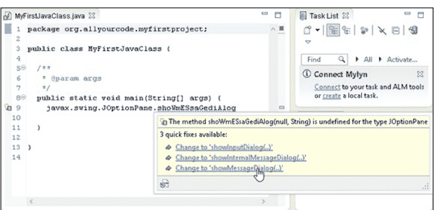

**图 3-14：** Eclipse 提供了有用的建议。

当你点击“更改为‘showMessageDialog’ (...)”选项时，Eclipse 编辑器会将 `showMESSediDialog` 替换为 `showMessageDialog`。编辑器的错误标记消失了，图 3-13 所示的错误代码变为图 3-12 所示的正确代码。

11. 对 Eclipse 编辑器中的代码进行任何更改或修正。

当你最后在编辑器中没有看到锯齿波浪线或斑点时，你就可以尝试运行程序了。

12. 通过点击编辑器内部或点击“包资源管理器”（Package Explorer）中的 `MyProject` 分支来选择 `MyFirstClass`。

13. 在 Eclipse 主菜单中，选择 `Run`（运行）> `Run As`（运行方式）> `Java Application`（Java 应用程序）。

这样做就灵了。新程序运行了，你看到了图 3-15 所示的 Hello 消息。这种感觉就像在天堂一样！


**图 3-15：** 运行列表 3-1 所示的程序。

## 可能会出现什么问题？

消除编辑器中的锯齿波浪线是值得庆祝的。Eclipse 喜欢你代码的外观，所以从那时刻起，就意味着一帆风顺。对吧？

嗯，并不一定如此。除了一些显眼的编译时错误外，代码还可能存在其他不那么明显的错误。

想象有人对你说：“去那个路口，然后紧紧跑（run tight）。”你立刻发现说话者犯错了，你礼貌地回答：“哈？那个毫无意义的转弯词就像一个编译时错误。”你的 `run tight` 就像 Eclipse 中的锯齿波浪线。作为一个听话的人，你可能猜出 `run tight` 是什么意思，但你修复了代码中的错误。

除了编译时错误外，其他类型的的小鬼还隐藏在 Java 程序中：

### 未检查的运行时异常（Unchecked runtime exceptions）

你没有看到任何编译时错误，但当你运行程序时，运行提前结束了。在运行过程的某处，指示 Java 去执行无法完成的操作。例如，当你在前面的“运行 Java 程序”部分运行程序时，你输入了“1,000,000.00”，而 Java 在读取时不喜欢逗号，所以程序崩溃了，Eclipse 显示了一个很难看的消息，如第一张图所示。

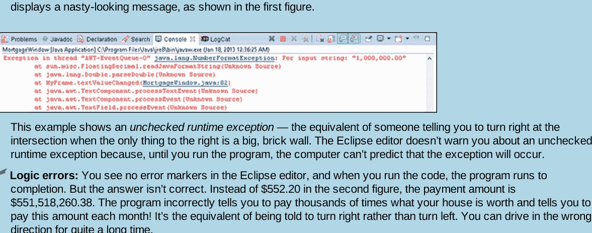

这个例子展示了一个**未检查的运行时异常**——这等同于告诉你在路口右转，但实际上只有一堵巨大的砖墙。Eclipse 编辑器不会警告你这是一个未检查的运行时异常，直到你运行程序，计算机无法预测该错误会发生。

### 逻辑错误（Logic errors）

你在 Eclipse 中没有看到任何错误标记，当你运行程序时，代码一直执行完毕。但答案是不正确的。在图 2 中，程序告诉你 $552.20 的支付金额是你的房子价值的 $551,518.260 千倍，并要求你每月支付该金额！这等同于被要求右转而不是左转。你可以在错误的方向上行驶很久。

逻辑错误是最难发现和修复的错误。最糟糕的是，逻辑错误往往不被察觉。1985 年 3 月，我有一张金额为 $1,328,932.21 的每月暖气账单。显然，计算机打印了错误的金额。当我给燃气公司投诉时，电话服务代表说：“别生气。只付该金额的一半就好。”

### 编译时错误（Compile-time errors）

警告没有运行时错误那么严重，当你运行程序时，编辑器会显示锯齿状波浪线、一个包含在微小黄色图标中的感叹号，以及其他几个不那么侵入性的标记。

例如，在第三张图中，你可以看到在第 9 行，我在 [Listing 3-1] 的代码中添加了与 `amount = 10` 相关的材料。问题是，我在程序中的任何地方都没有使用过 `amount` 或数字 `10`。通过这些微弱的黄色标记，Eclipse 有效地告诉我：“你的 `amount = 10` 还没糟糕到无法运行的程度。Eclipse 仍然可以运行程序。但你确定想在程序里保留 `amount amount = 10`（这些似乎没有任何用途的材料）吗？”

### 细微的提示

```
package org.aliyjava.code.myfirstJavaClass;

public class MyFirstJavaClass {

    // some code

    public static void main(String[] args) {

        int count = 10;

        javax.swing.JOptionPane.showMessageDialog(null, "Hello, World!");

    }

}
```


想象在想：“到达路口时转弯。方向可能是好的。如果你对它表示怀疑，问问‘我该左转还是右转？’”

当你确定没问题时，就不用担心了。但如果你对指示有问题，请注意。

## Eclipse 中有什么？

事实是，人类的思想就像高大建筑。即使是牛津英语词典，每年也会增加超过 4000 个词条。这就是为什么本节包含了许多新词。在本节中，每个新术语都描述了 Eclipse 的某个方面。在阅读这些内容之前，我们提供以下免责声明：

- 如果对理解某些内容有困难，请参考本节。
- 但如果你对导航 Eclipse IDE 没有困难，就不要纠结术语。
- 本节提供术语的解释，而不是正式定义。是的，我的解释相当准确；不，它们并不严密。本节中的几乎每个描述都有例外、省略和排除。不要将本文内容视为法律合同。
- Eclipse 是一个非常有用的工具。但 Eclipse 并不是 Java 生态系统的官方部分。

## 理解全局

你的 Eclipse 之旅从视角开始：

- **工作区（Workbench）**：Eclipse 桌面（参考图 3-3，工作区是你开发的环境）。
- **区域（Area）**：工作区的一部分。图 3-3 显示的工作区包含五个区域。为了说明这一点，我为每个区域画了边界，如图 3-16 所示。
- **窗口（Window）**：Eclipse 工作区的副本。在 Eclipse 中，你可以同时打开多个工作区的副本。每个副本都显示在自己的窗口中。
- 要打开第二个窗口，转到 Eclipse 主菜单栏并选择 `Window` -> `New Window`。
- **动作（Action）**：当你点击某些内容时为你提供的选择。例如，当你从 Eclipse 主菜单栏选择 `File` -> `New` 时，你会看到可以创建的新元素列表。列表通常包括项目、文件夹、文件和其他，但也可能包括包、类和接口等项。这些每一个项目（菜单上的每一项）都是一个动作。

图 3-16：工作区被划分为多个区域。

## 视图、编辑器和其他内容

接下来的一组术语涉及视图（views）、编辑器（editors）和标签页（tabs）。

你可能很难理解视图和编辑器之间的区别。（视图就像编辑器，而编辑器又像视图，大如此。）如果视图和编辑器对你来说是一样的，而且你不确定是否能分辨哪是哪一个，大不必担心。当你成为一名普通的 Eclipse 编辑器时，随着使用工作区（workbench）经验的增加，视图和编辑器之间的区别会自然而然。你很少需要决定你正在使用的东西是视图还是编辑器。

无论如何，如果你确实需要区分视图和编辑器，这里是你需要了解的知识：

- **视图（View）**：Eclipse 工作区的一个部分，用于显示供你浏览的信息。在最简单的情况下，一个视图占据工作区中的一个区域。例如，在本章前面的图 3-3 所示，包资源管理器（Package Explorer）视图占据了最左侧的区域。

许多视图以列表或树形结构的形式显示信息。例如，在图 3-9 中，包资源管理器包含一个树形结构。

你可以使用视图进行更改。例如，要删除图 3-9 中的 `MyFirstProject`，在包资源管理器视图中右键点击 `MyFirstProject` 分支。（在 Mac 上，按控制键点击 `MyFirstProject` 分支）。然后在弹出的右键菜单中选择“删除”（Delete）。

当你使用视图更改某些内容时，更改会立即发生。例如，当你在包资源器的右键菜单中选择“删除”时，你选中的任何内容都会立即被删除。在某种意义上，这种行为并不特别。当你使用 Windows 资源管理器回收文件或使用 Macintosh 访访器丢弃文件时，也会发生类似的事情。

- **编辑器（Editor）**：Eclipse 工作区的一个部分，用于显示供你修改的信息。典型的编辑器以文本形式显示信息。这些文本可以是文件的内容。例如，图 3-11 中的编辑器显示了 `MyFirstClass.java` 文件的内容。

当你使用编辑器更改某些内容时，更改不会立即发生。例如，查看图 3-11 所示的编辑器。该编辑器显示 `MyFirstClass.java` 文件的内容。你可以在编辑器中输入任何内容。在你从 Eclipse 菜单栏选择 `File` -> `Save`（文件=保存）之前，`MyFirstClass.java` 不发生任何变化。或者，这种行为并不新奇。你在 Microsoft Word 或任何其他文字处理程序中工作时，也会发生类似的事情。

和其他作者一样，我偶尔会偷懒，在意思是指视图或编辑器时使用“视图”一词。我甚至写过“Eclipse 编辑器”或“Eclipse 工作区的区域”。当你发现我这样混淆术语时，只需摇头并继续阅读即可。当我足够严谨时，我会使用官方的 Eclipse 术语。我将视图和编辑器称为 Eclipse 工作区的“部分”。遗憾的是，这个“部分”术语并没有留在人们的脑子里。

Eclipse 工作区的一个区域可能包含几个视图或几个编辑器。大多数 Eclipse 用户无需对这些“多个视图”进行二次思考（甚至不需要第一次思考）就能用得很好。但如果你关心围绕标签页和活动视图的术语，那么还有：

- **标签页（Tab）**：无法通过称其“标签页”来描述的东西。当我们从一个视图切换到另一个视图或从一个编辑器切换到另一个编辑器时，我们可以除视图以外的任何名称来称这个标签页。重要的是视图

图 3-17：包含多个视图的区域。

图 3-17 显示了控制台（Console）视图，但它并不总是 Java 视角（perspective）的一部分出现。通常，每当程序崩溃时，控制台视图会自动出现。如果你想强制控制台视图出现，选择 `Window` -> `Show View` -> `Other`。在弹出的 `Show View` 对话中，展开 `General` 分支。最后，双击 `Console` 项。

一组堆叠的视图是一个标签页组（tab group）。要将栈中的视图带到前景，你需要点击该视图的标签页。

顺便说一下，关于标签页和视图的所有信息也适用于标签页和编辑器。唯一有趣的是 Eclipse 如何使用“编辑器”这个词。在 Eclipse 中，图 3-18 所示编辑器区域的每个标签页都包含三个编辑器（而不是属于单个编辑器的三个标签页）。这三个编辑器显示三个文件的内容：`MyFirstJavaClass.java`、`MortgageWindow.java` 和 `activity_main.xml`。


**活动视图或编辑器（Active view or editor）**：在标签页组中，活动视图或编辑器指的是活动状态的视图或编辑器。在图 3-18 中，`MyFirstClass.java` 编辑器是活动的。（当然，`MortgageWindow.java` 和 `activity_main.xml` 是非活动状态，因为区域太窄了。）

## 查看视图或编辑器内部

本节术语涉及单个视图、单个编辑器和单个区域：

- **工具栏（Toolbar）**：视图顶部的按钮（和其他小项目）条，如图 3-19 所示。


图 3-19：包资源管理器中的工具栏。

- **菜单按钮（Menu button）**：工具栏上向下的箭头。当你点击菜单按钮时，会出现一个操作下拉列表，如图 3-20 所示。你看到的动作取决于具体的视图不同。


图 3-20：包资源管理器视图中的菜单按钮。

- **关闭（Close）**：用于消除特定视图或编辑器的按钮，如图 3-21 所示。


图 3-21：关闭按钮。

- **折叠号（Chevron）**：指示区域内应出现其他标签页的双箭头。图 3-22 所示的折叠号旁边有一个小数字 2。这告诉你，除了可见的标签页外，两个标签页是隐藏的。点击折叠号会打开包含所有标签页标签的悬停提示。（参见图 3-22）。


图 3-22：折叠号表示有两个编辑器被隐藏。

- **标记（Marker）**：编辑器左边缘的垂直标尺。Eclipse 在标记内部显示名为“标记”的小型警示图标。（参考图 3-13）。

## 回到大局

本节的两个术语涉及 Eclipse 的整体外观：

- **布局（Layout）**：某些视图的排列。例如，图 3-3 所示的布局有七个视图，其中四个是活动的：
  - 包资源管理器视图（Package Explorer view）：它位于左侧。
  - 任务列表视图（Task List view）和大纲视图（Outline views）：它们位于右侧。
  - 问题（Problems）、声明（Declaration）、Javadoc 和控制台（Console）视图：它们位于底部。在工作区的这个区域，问题视图是活动视图。

# 第 4 章
创建一个 Android 应用

## 本章内容

- 创建一个基础 Android 应用
- 排除故障应用程序的故障
- 在模拟器或移动设备上测试应用
- 剖析应用

第 3 章描述了一个极其简单的 Java 程序的编写和运行。与许多 Java 程序一样，第 3 章中的程序运行在普通的桌面电脑或笔记本电脑上。在后台，第 3 章的代码使用了标准 Oracle Java 的强大功能。但这两种 Java（用于桌面级和笔记本电脑的标准 Oracle Java，以及用于移动设备的 Android Java）是略有不同的物，原因如下：

- 标准 Java 使用桌面电脑和笔记本电脑的性能和速度。Android Java 经过了精简，运行在内存较小的较设备上。
- 标准 Java 使用了一些 Android Java 中不可用的功能。例如，第 3 章程序中的 `javax.swing.JOptionPane.showMessageDialog()` 调用在 Android Java 中不可用。
- Android Java 使用了一些标准 Java 中不可用的功能。例如，本章程序中的 `Activity` 类在标准 Java 中不可用。
- 创建一个基础 Android 应用所需的步骤比创建一个基础 Java 应用更多。

本章涵盖了创建基础 Android 应用所需的步骤，尽管这个应用并没有做很多事情。（事实上，你可能会认为它什么都没做。）但该示例向你展示了如何创建和运行一个新的 Android 项目。

## 创建你的第一个 Android 应用

get 设备通常会附带一份手册。手册的第一句话是“在尝试安装此产品之前，请阅读所有 37 条安全警告。”你不喜欢它吗？如果不读完这些准备工作，你就无法接触到相关。

不过，本章中的任何内容都不会点燃你的房子，甚至不会损坏你的电子设备。在遵循本章的指令之前，你需要在开发电脑上安装大量的软件。要确保你拥有这些软件并已配置恰当，请参阅第 2 章。（不要跳过起点；不要领取 200 美元）。

当你终于拥有了所有软件时，就可以准备启动 Eclipse 并创建一个真实的、运行的 App 了。

## 创建 Android 项目

要创建你的第一个 Android 应用，请遵循以下步骤：

1. 启动 Eclipse。


关于启动 Eclipse 的详情，请参阅第 2 章。

2. 从 Eclipse 的主菜单中，选择 `File` -> `New` -> `Android Application Project`。

结果是 Eclipse 弹出了 New Android Application 对话框，如图 4-1 所示。

3. 在 `Application Name`（应用名称）字段中，为应用输入一个名称。

在图 4-1 中，我输入了无聊的 My First Android App。然而，像 Joe 和 Jane User 这样的普通人会在 Android 启动屏幕的应用图标下方看到这个名称。如果你计划营销你的应用，请让名称简短、甜且具有描述性。你甚至可以在名称中包含空格。

接下来的步骤涉及大量的点击，但你主要接受默认设置。

4. （可选）在 `Project Name`（项目名称）和 `Package Name`（包名）字段中，更改项目名称和包含项目的 Java 包名称。

Eclipse 会自动填充 `Project Name` 和 `Package Name` 字段（由你在 `Application Name` 字段中输入的内容引导）。在图 4-1 中，Eclipse 创建了项目名称 `MyFirstAndroidApp` 和包名 `com.example.myfirstandroidapp`。Eclipse 使用项目名称来标记 Package Explorer 树中的你的应用。

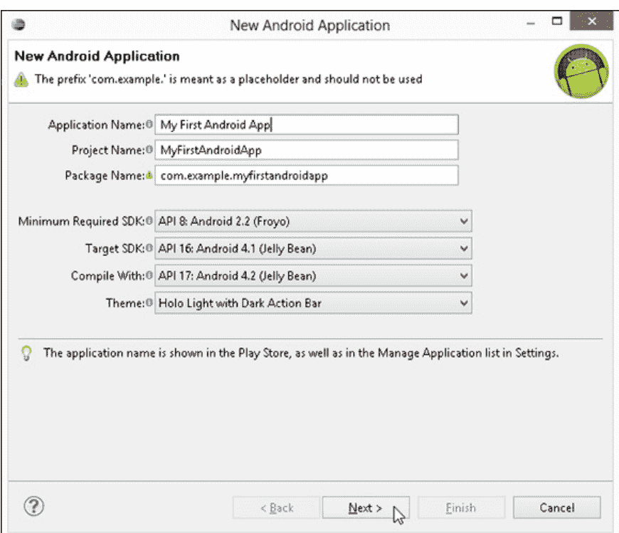

图 4-1：第一个 New Android Application 对话框。

对于练习应用，你可以使用 Eclipse 创建的包名来作弊。如果你计划发布一个应用，请使用第 3 章描述的规则使用应用自己的包名。

在 Android 中，一个包名只属于一个应用。你可以将第一个应用放在 `org.allyourcode.firststart` 包中，将第二个应用放在 `org.allyourcode.secondapp` 包中。但你不能在 `org.allyourcode.mystuff` 包中放入多个应用。

关于 Java 包和包名的详尽信息，请参阅第 5 章。

5. （可选）当你选择 `Minimum Required SDK API 8` 和 `Target SDK API 16` 时，选择你承诺的值，请查看邻附近的侧边栏“Using Android versions”（使用 Android 版本）。

要发现当你选择 `Minimum Required SDK API 8` 和 `Target SDK API 16` 时是正确的，请查看图 4-1，我接受了提供提供的默认值——API 8、API 16 和 API 17。你可以从下拉框中选择任何值，因为你已经创建了一个可以运行目标项目的 Android 虚拟设备 (AVD)。例如，一个 Android 2.3.3 AVD 可以运行针对较早版本 Android 的项目，例如 Android 2.3.1、Android 2.2 和 Android 1.6。项目目标不需要与任何 Android AVD 精确匹配。

## 使用 Android 版本

Android 对版本号有几种不同的用途。例如，在图 4-1 中，最低所需的 SDK 是 API 8，目标 SDK 是 API 16。区别是什么？

（注：OCR 文本包含许多重复块；我已根据要求处理了唯一内容。）

关于 Android 活动的真实情况，请参见第 5 章。

## 9. 再次点击 Next。（换句话说，接受“创建 Activity”对话框中的默认值）。

序列中的下一个框是“新建空白 Activity”（New Blank Activity）对话框，如图 4-4 所示。

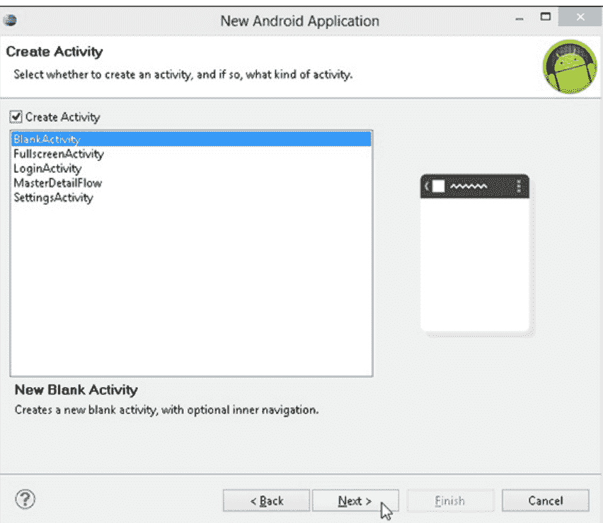

图 4-3：创建一个新活动。

## 新 Android 应用程序

新建空白 Activity (New Blank Activity)
创建一个新的空白活动，带有可选内部导航。

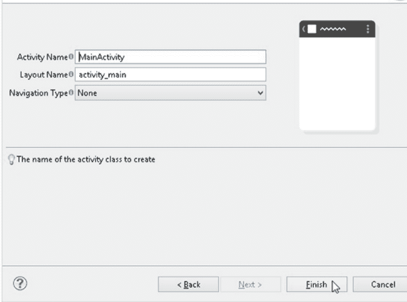

图 4-4：创建一个空白活动。

## 10. 点击 Finish。（即，接受默认值。）

结果，“新建空白 Activity”对话框关闭，Eclipse 工作台移动到前台。Eclipse 中的包管理器（Package Explorer）树出现了一个新分支。该分支的标签是新项目的名称，如图 4-5 所示。

你的新 Android 项目

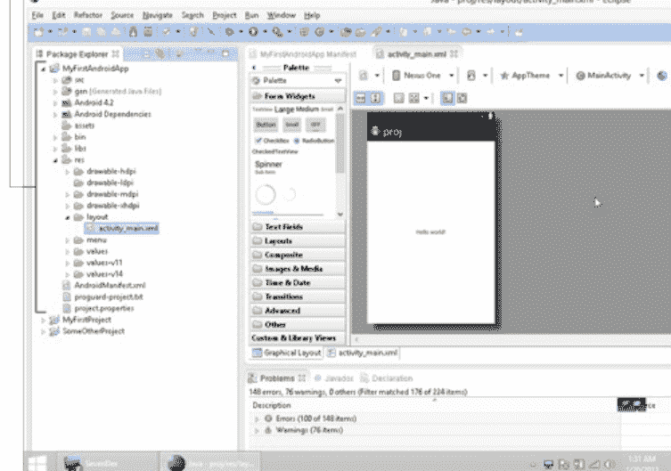

图 4-5：一个新的 MyFirstAndroidApp 分支。

恭喜 —— 你创建了一个 Android 应用程序。

## 运行你的项目

要启动你的应用并进行测试，请执行以下操作：

1. 在 Eclipse 的 Package Explorer 中选择应用的分支。（参考图 4-5）。
2. 在主菜单中，选择 `Run` -> `Run As` -> `Android Application`。

结果，控制台（Console）视图显示了几行文本。其中，你可能会发现启动模拟器（launching an emulator）、等待主页（Waiting for HOME）以及（如图 4-6 所示）你最喜欢的：成功！（Success!）。

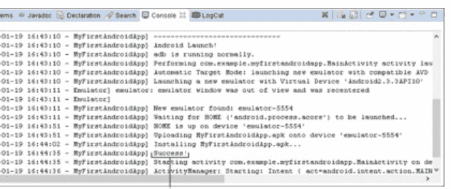

成功！

图 4-6：成功启动期间的控制台视图。


第 3 章。

如果你没有看到控制台视图，必须把它从隐藏处找出来。详情请参见


在通用应用开发的术语中，*console*（控制台）是一个显示运行程序输出的纯文本窗口。控制台也可以接受来自用户的命令（在这种情况下，即应用开发者）。单个 Android 运行可能会同时创建多个控制台，因此 Eclipse 中的控制台视图可以显示多个控制台。如果你在 Eclipse 控制台视图中看到的内容与图 4-6 显示的文本完全不同，可能是控制台显示了错误的控制台。要解决这个问题，请在控制台视图右上角寻找显示计算机终端图标的按钮，如图 4-7 所示。点击按钮右侧的箭头。在出现的下拉列表中，选择 Android。

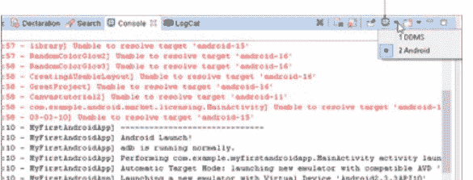

3. 等待 Android 模拟器显示设备锁定屏幕、主屏幕或应用屏幕。

首先你看到 ANDROID 这个词，就像它是《黑客帝国》电影场景的一部分一样，如图 4-8 所示。然后你看到闪烁的银色字母组成的 ANDROID 字，如图 4-9 所示。最后，你看到设备锁定屏幕、主屏幕或应用屏幕，如图 4-10 所示。


图 4-8：模拟器开始运行。


图 4-9：Android 在模拟器上运行。

4. 等待 Android 模拟器显示设备锁定屏幕、主屏幕或应用屏幕。这一点我不再强调了：Android 模拟器的启动需要很长时间。例如，在 2 GHz 处理器和 4GB 内存的机器上，模拟器需要几分钟才能模拟出完全启动的设备。在处理模拟器时你需要大量的耐心。

5. 继续等待。

在你等待时，你可以在网上搜索“Android emulator speed up”（Android 模拟器加速）。很多人发布了建议、解决方案和其他提示。


噢！我看到模拟器终于显示设备锁定屏幕了。该继续了……

6. **如果模拟器显示设备锁定屏幕，执行你通常的解锁设备操作。** 通常，你通过从屏幕的一个部分滑动到另一个部分来解锁设备。
7. **查看模拟器上的应用。**

图 4-11 显示了 Android 中运行的 Hello World 应用。（Eclipse 在创建新的 Android 项目时创建此应用。）Android 中的 Hello World 应用没有用户可以点击的控件，也不会做有趣的事。但在屏幕上出现应用良好的开始。遵循本章的步骤，你就可以创建有趣的应用了。除非你已知一段时间不会使用它，否则不要关闭 Android 模拟器。它运行起来是相当可靠的（尽管很迟钝）。当模拟器运行时，你可以修改 Android 代码并再次选择 `Run` -> `Run As` -> `Application`。这样做，Android 会在运行的模拟器上重新安装应用。这个过程并不快，但你不需要等待模拟器启动。（实际上，运行一个最低 SDK 要求高于模拟器能处理的应用是例外。）


**图 4-11：** 运行中的 Hello World 应用。

## 如果……

你尝试运行第一个应用。如果尝试停滞，不要绝望。本节提供了一些故障排除提示。

## 错误消息：R 无法解析

每个 Android 应用都有 R.java。Android 开发工具会自动生成此文件，所以通常不需要担心 R.java。偶尔，文件的生成时间比以往都要长。我的建议是等待——如果等待分钟没有结果，按照以下步骤双检项目设置：

1. 在 Eclipse 的 Package Explorer 中选中项目。
2. 在主菜单中，选择 `Project`。
3. 查看 `Build Automatically`（自动构建）旁边的勾选。
4. 如果没有看到勾选，点击 `Build Automatically` 子项添加一个。

运气好的话，R.java 文件会立即出现。

如果项目已设置为 `Build Automatically` 但仍然没有 R java，请尝试以下步骤：

1. 在 Package Explorer 中选中项目。
2. 在主菜单中，选择 `Project`。
3. 在 Eclipse 的 Clean 对话框中，选择出现问题的项目以及 `Clean Projects` 按钮。
4. 点击 `OK`。

清理项目应该解决问题。如果问题仍然存在，关闭 Eclipse 然后重启它。（Eclipse 有时会变得“困惑”，必须重启。）


将 Java 代码从一个 Android 项目复制到另一个时，你可能会程序顶部看到烦人的消息“Import cannot be resolved”。如果是这样，你可能无意中告诉项目从另一个项目的 R 文件获取内容。如果出错的代码行是 `import somethingother.R`，请删除该行代码。谁知道呢？你的删除将解决问题。

## 错误消息：未找到兼容目标

当你看到这条消息时，可能意味着你还没有创建一个能够运行你项目的 Android 虚拟设备 (AVD)。如果 Eclipse 提议创建一个新的 AVD，请接受。否则，选择 `Window` -> `Android Virtual Device Manager` 创建一个新的 AVD。


关于 Android 虚拟设备的信息，请参见第 2 章。

## 模拟器在启动期间卡住

大约五分钟后，你没有看到设备锁定屏幕或 Android 主屏幕。尝试这些解决方案：

- 关闭模拟器并重新启动应用程序。（或者稍后、刷新、重复。）
有时，第二次或第三次就会灵。在少数情况下，我的前三次尝试失败了，第四次尝试成功了。

- 独立启动模拟器。

这就是

Android 虚拟机管理器（Android Virtual Device Manager）窗口打开了。它包含了你熟悉的 AVD 列表。

如需创建 AVD 的帮助，请参[第2章](Chapter 2)。

b. 在 Android 虚拟机管理器中，选择你想要启动的 AVD。

c. 在 Android 虚拟机管理器的右侧，点击启动（Start）。

结果是 Eclipse 显示启动选项（Launch Options）对话框。

d. 在启动选项对话框中，点击启动（Launch）。

换句话说，接受默认选项并启动模拟器。

当你最后看到新模拟器的“设备锁定”（Device Locked）屏幕或主屏幕时，请按照前文章节“运行你的项目”中的步骤 1、2、6 和 7 操作。

如果你尝试了本节中的技巧，但那个顽固的 Android 模拟器仍然无法启动，请访问书籍网站 [http://allcode.com/Java4Android](http://allcode.com/Java4Android) 获取更多可以尝试的策略。

- 在手机、平板电脑或其他真实的 Android 设备上运行应用。

在真实设备上测试全新的应用让我觉得很奇怪。Android 沙箱对于应用运行来说相当安全。此外，应用在手机和平板电脑上加载快速且容易。关于将应用安装到 Android 设备的说明，请参阅本章后半部分的“在真实设备上测试应用”章节。

## 错误消息：用户数据镜像被另一个模拟器使用

如果你看到此消息，说明模拟器发生了冲突阻止了 Android 的正常工作。首先尝试关闭并重启模拟器。

如果简单的重启无效，请尝试以下步骤：

1. 关闭模拟器。
2. 从 Eclipse 主菜单中，选择 `Window` -> `Android Virtual Device Manager`。

要了解关于 Android 虚拟机管理器，请参阅[第2章](Chapter 2)。

3. 在虚拟设备列表中，选择一个适合项目的 AVD 并点击启动（Start）。
4. 在生成的启动选项对话框中，勾选清除用户数据（Wipe User Data）复框并点击启动（Launch）。

结果是 Eclipse 启动了一个模拟器的新副本——这次，它是一个干净的状态。

如果你遵循了本节的步骤，但仍然看到“用户数据镜像被另一个模拟器使用”的消息，请访问本书网站 (http://allmycode.com/Java4Android) 获取更多此类问题的帮助。

## 错误消息：未知的虚拟设备名称

Android 在主目录的 .android/avd 子目录中查找 AVD，但搜索偶尔会失效。例如，我的一台 Windows 电脑在 i 盘上列出了我的主目录。我的 AVD 位于：`\Users\Barry\.android\avd`。但 Android 忽略了电脑的主目录，而是去 `c:\Users\Barry` 查找。当 Android 找不到任何 AVD 时，它就会报错。

你可以通过使用连接接（junctions）或符号链接（symbolic links）来决定此问题的巧妙解决方案。这两种方法都需要对其进行特殊处理。为了方便，我将 `i:\Users\Barry\.android` 的内容复制到 `c:\Users\Barry\` 以修复该问题。

## 错误消息：INSTALL_PARSE_FAILED_INCONSISTENT_CERTIFICATE

此错误消息表示你之前安装的应用与你正尝试安装的应用发生冲突。因此，在模拟器屏幕上，导航到已安装应用列表（这通常是 Settings 屏幕上的一个选项）。在应用列表中，删除你之前安装的任何应用。


偶尔，你可能很难在模拟器的 Settings=Applications 菜单中找到之前安装的应用。如果是这样，请访问本书网站 (http://allmycode.com/Java4Android) 获取一个极客的变通解决方案。

## 应用启动了，但模拟器显示强制关闭或等待对话框

强制关闭或等待对话框的正式名称是“程序无响应”（ANR）。每当应用执行任何任务花费的时间过长时，Android 就会显示 ANR 对话框。当应用在真实设备（手机或平板电脑）上运行时，不应该让 Android 显示 ANR 对话框。

但在缓慢的模拟器上，看到几次强制关闭或等待消息是常有的。当我看到模拟器中的 ANR 对话框时，我通常选择“等待”（Wait）。大约十秒后，对话框消失，应用继续运行。

## 对应用的更改未显示在模拟器中

你的应用正在运行，而你想进行一些改进。在模拟器仍在运行时，你修改了应用的代码。在选择 `Run` -> `Run As` -> `Android Application` 后，应用在模拟器中的行为保持不变。

## 模拟器的屏幕太大了

有时，开发电脑的屏幕分辨率不够。（也许你的视力不如以前了。）这种症状并不是致命的，但如果你能看到模拟器底部的按钮，你就无法测试开发电脑的屏幕分辨率了，因此，调整模拟器窗口的侵入性较小。

要更改模拟器窗口，请遵循以下步骤：

1. 关闭模拟器。
2. 从 Eclipse 主菜单中，选择 `Window` -> `Android Virtual Device Manager`。
3. 在虚拟设备列表中，选择一个适合项目的 AVD 并点击启动（Start）。
4. 在启动选项对话框中，勾选显示为实际大小（Scale Display to Real Size）复框。
5. 降低屏幕尺寸（Screen Size）字段中的值。

当你更改屏幕尺寸时，Screen Size 的值会自动变化。Screen Size 越小，模拟器在开发电脑上显示的就越小。

6. 点击启动（Launch）。

结果是 Eclipse 启动了一个模拟器的新副本——这次，它是一个干净的状态。

## 在真实设备上测试应用

你可以跳过模拟器，在手机、平板电脑或其他真实的 Android 设备上测试应用。要这样做，你需要准备设备、准备开发电脑，并将两者连接。本节描述了这一过程：

1. 在 Android 设备上开启 USB 调试。不同的 Android 版本有自己的开启或禁用 USB 调试的方法。在我的设备上，我一直开启调试。但如果你对安全感到担忧，在使用时关闭调试。
2. 在项目的分支中，双击 `AndroidManifest.xml` 文件。Eclipse 提供了多种查看和编辑此文件的方法。
3. 在 Eclipse 编辑器底部，点击 Application 标签。Eclipse 显示表表 4-12。
4. 在 Debugable 下拉列表中选择 True。（参见图 4-12）。当 Debugable 设置为 True 时，Android 工具可以监控应用。
5. 选择 `File` -> `Save` 保存新的 `AndroidManifest.xml` 文件。
6. 设置开发电脑与设备通信。

在 Windows 上：访问 http://developer.android.com/sdk/oem-usb.html 下载 Windows USB 驱动程序。在开发电脑上安装驱动程序。

在 Mac 上：/* 我们什么都不做。它就能用。 */

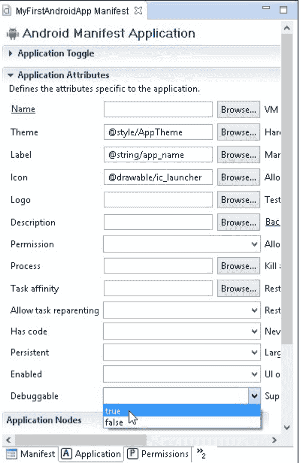

图 4-12：项目 AndroidManifest.xml 文件的 Application 标签。

7. 使用 USB 线将设备连接到开发电脑。关于验证设备已连接到开发电脑的方法，请访问本书网站 http://allmycode.com/Java4Android。
8. 在 Eclipse 中运行项目。

连接设备优于运行的模拟器。因此，如果设备上的 Android 版本可以处理项目的最低 SDK 版本，选择 `Run As` -> `Application` 将把应用安装到连接的设备上。

最终，你会将设备从开发电脑断开。如果你是 Windows 用户，你可能害怕读到窗口无法停止你的设备，因为程序仍在

通过以下步骤安全地断开设备：

## 1. 打开命令提示符窗口。

在 Windows 7 或更早版本上：选择 `Start` -> `All Programs` -> `Accessories` -> `Command Prompt`。
在 Windows 8 上：先按 `Windows+Q`。然后输入 `Command Prompt` 并按回车。

## 2. 在命令提示符窗口中，导航到 ANDROID_HOME/platform-tools 目录。

例如，如果 ANDROID_HOME 目录为


C:\Users\yourName\adt-bundle-windows-x86_64\sdk

输入此命令：

```
cd C:\Users\yourName\adt-bundle-windows-x86_64\sdk\platform-tools
```

### 3. 在命令提示符窗口中，输入 `adb kill-server` 然后按回车。

`adb kill-server` 命令停止开发计算机与任何 Android 设备（实体或虚拟）之间的通信。特别是：

- 开发计算机将不再与 USB 线缆末端的设备通信。
- 如果模拟器正在运行，开发计算机将不再与任何模拟器通信。

执行 `adb kill-server` 命令后，你会看到友好的“安全删除硬件”（Remove Hardware）消息。

### 4. 将 Android 设备从开发计算机上拔下。

拔下设备后，你可能希望重新建立开发计算机与正在运行的任何模拟器之间的通信。如果是，请执行步骤 5。

### 5. 在命令提示符窗口中，输入 `adb start-server` 然后按回车。

## 检查 Android 应用

在图 4-13 中，Eclipse 中的 Package Explorer（包管理器）显示了新创建 Android 项目的结构。树的每个分支代表一个文件或文件夹，如果你展开树的所有分支，你会看到更多的文件和文件夹。为什么 Android 项目中有这么多文件和文件夹？本节提供了答案。

## src 目录

`src` 目录包含项目的 Java 源代码。该目录中的文件名类似于 `MainActivity.java`、`MyHomePage.java`、`DatabaseHelper.java` 和 `MoreStuff.java`。

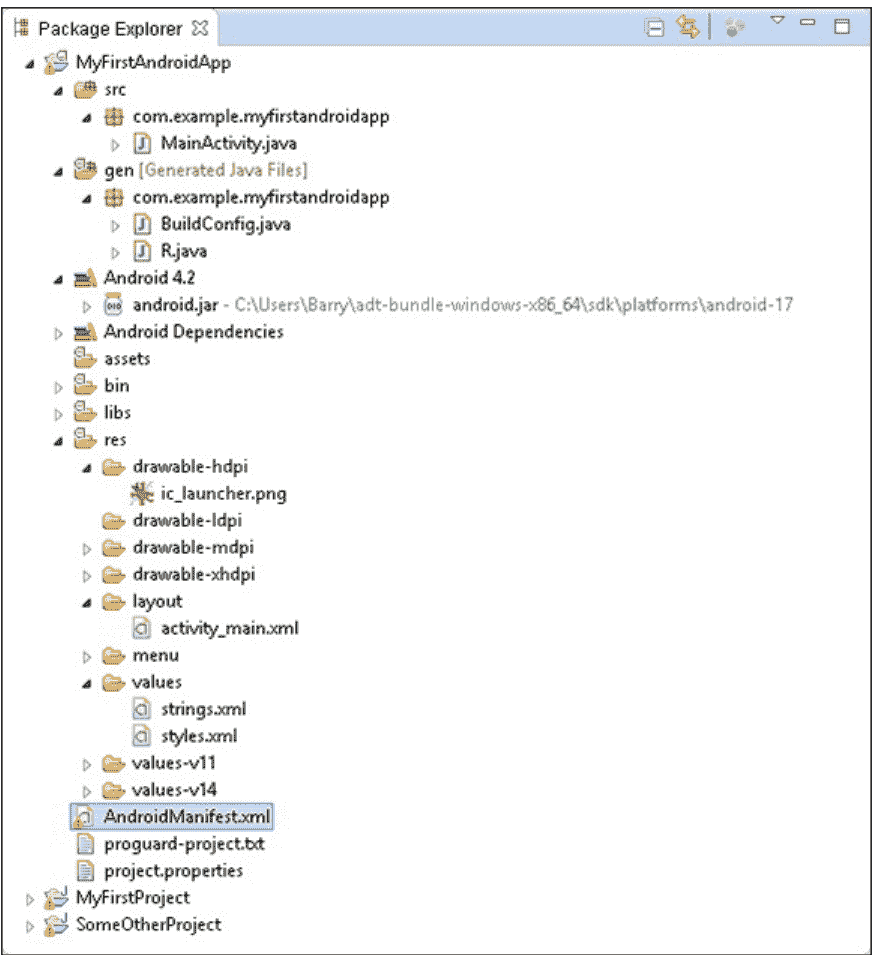

你可以在项目的 `src` 目录中创建数百个 Java 文件。当你创建一个新项目时，Android 通常只为你创建一个文件。在本章前面的部分，我接受了默认名称 `MainActivity`，以便 Android 创建名为 `MainActivity.java` 的文件。（参见图 4-4。）

一个 Android activity（活动）是一个“满屏”的组件。有关 Android activity 的更多信息，请参见第 5 章。

书中的大部分内容关于 `src` 目录中的文件。在本章中，我关注其他目录。

## res 目录

项目的 `res` 目录包含 Android 应用使用的资源。在图 4-13 中，你看到它有一组子目录：四个 `drawable` 目录、一个 `layout` 目录、一个 `menu` 目录三个 `values` 目录。

## drawable 目录

`drawable` 目录包含图像、形状和其他元素。
每个 `drawable` 目录适用于不同的屏幕分辨率。例如，在名称 `drawable-hdpi` 中，`hdpi` 代表 *每英寸高点数*（high number of dots per inch）。`drawable-hdpi` 目录适用于分辨率（大致）在每英寸 180 到 280 点之间的设备。


有关 Android 屏幕分辨率的更多信息，请访问 http://developer.android.com/guide/practices/screens_support.html。

在图 4-13 中，`drawable-hdpi` 目录包含一个文件 `ic_launcher.png`。该文件描述了 Android 启动器屏幕上应用图标上的图像。

## values 子目录

应用的 `res/values` 目录包含一个名为 `strings.xml` 的文件。（参见图 4-13。列表 4-1 显示了简单的 `strings.xml` 文件中的代码。）

### 列表 4-1：一个小的 strings.xml 文件

```xml
<?xml version="1.0" encoding="utf-8"?>
<resources>
    <string name="app_name">My First Android App</string>
    <string name="hello_world">Hello world!</string>
    <string name="menu_settings">Settings</string>
</resources>
```


列表 4-1 中的代码是 XML 代码。有关 XML 代码的信息，请见本章后部分的“关于 XML 文件”侧边栏。

在 `strings.xml` 文件中，你收集了应用用户可能看到的所有单词、短语和句子。你将短语组合在一起如 *Hello world!* 和 *My First App*，这样人们就可以将其翻译成所有不同的语言。有了 `strings.xml` 文件中收集的所有这些短语，翻译人员就不需要翻找 Java 代码来寻找短语。（在任何编程语言中翻找代码都是危险的，因为程序代码是复杂的，而且可能是脆弱的：如果我是翻译员，我宁愿翻译 `strings.xml` 文件中的短语。）

列表 4-1 描述了一个包含字符 *Hello World!* 的 "hello_world" 字符串。因此在应用代码中，你引用单词 *Hello world*。

之前的代码之所以能够工作，是因为第一个 `TableRow` 在第二个 `TableRow` 开始之前就已经结束了。但以下 XML 代码是不合法的：

```xml
<!-- The following code isn't legal XML code. -->
<TableRow>
  <TextView
    android:layout_width="wrap_content"
    android:layout_height="wrap_content"
    android:text="@string/name" />
</TableRow>
<TableRow>
  <TextView
    android:layout_width="wrap_content"
    android:layout_height="wrap_content"
    android:text="@string/address" />
</TableRow>
```

- 每个 XML 文档都包含一个根元素——即所有其他元素都嵌套其中的一个元素。在列表 4-2 中，根元素是 `RelativeLayout` 元素。列表中的另一个元素（`TextView` 元素）嵌套在 `RelativeLayout` 内部。
- 不同的 XML 文档使用不同的元素名称。在每个 HTML 文档中，`<br>` 元素代表换行。但在 XML 中，`RelativeLayout` 和 `TextView` 名称是 Android 文档特有的。而 `portfolio` 和 `trade` 名称是金融产品 XML (Fml) 特有的。`prompt` 和 `phoneme` 名称是语音 XML (VoiceXML) 特有的。每种文档都有自己的元素列表。
- XML 文档中的文本是大小敏感的。例如，如果你将列表 4-2 中的 `RelativeLayout` 更改为 `relativayout`，程序将无法运行。
- 开始标签和空标签可以包含属性。属性是一个键值对。每个属性的格式为 `name="value"`。值周围的引号是必须的。在列表 4-2 中，起始标签（`RelativeLayout`）有五个属性，而空标签（`TextView`）有它的五个属性。例如，在 `TextView` 元素中，标签 `android:layout_width="wrap_content"` 是第一个属性。该属性的名称为 `android:layout_width`，值为 `"wrap_content"`。
- 非空 XML 元素可以包含内容。例如，在列表 4-1 的元素 `<string name="hello_world">Hello world!</string>` 中，内容 `world!` 被夹在开始标签 `<string name="hello_world">` 和结束标签 `</string>` 之间。

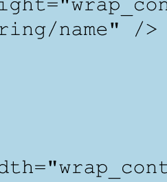

## gen 目录

`gen` 目录名称代表 "generated"（生成的）。`gen` 目录包含 `R.java`。列表 4-3 显示，当你创建一个 Android-project 项目时，`R.java` 文件的部分内容是为你生成的。

### 列表 4-3：甚至不要看这个文件

```java
/* AUTO-GENERATED FILE. DO NOT MODIFY.
*
* 此类是由 aapt 工具根据其发现的资源数据自动生成的。
* 不应对其进行手动修改。
*/
package com.example.myfirstandroidapp;
public final class R {
    public static final class attr {
    }
    public static final class drawable {
        public static final int ic_launcher=0x7f020000;
    }
    public static final class id {
        public static final int menu_settings=0x7f070000;
    }
    public static final class layout {
        public static final int activity_main=0x7f030000;
    }
    public static final class menu {
        public static final int activity_main=0x7f060000;
    }
    public static final class string {
        public static final int app_name=0x7f040000;
        public static final int hello_world=0x7f040001;
        public static final int menu_settings=0x7f040002;
    }
    // ... (还有更多内容！)
}
```

`R.java` 中的值是 Android 资源管理机制的跳转点。Android 使用这些数字来快速方便地加载你存储在 `res` 目录中的项目。

你无法对 `R.java` 文件进行任何更改。在项目创建很久之后，Android 都会继续监控（并在必要时更新）`R.java` 文件的内容。如果你删除了 `R.java`，Android 会重新创建它。如果你编辑了 `R.java`，Android 会撤销编辑。如果你在名为“Do You Want to Edit This File?”的对话框中选择“是”，Eclipse 会接受更改——但紧接着 Android 就会覆盖你的更改。

## Android 4.2 分支

图 4-13 所示的树有一个 Android 4.2 分支，但它并不是计算机文件系统上的目录。在包管理器（Package Explorer）视图中，Android 4.2 分支（或 Android 3.0 分支或任何 Android 分支）提醒你该项目包含了预写代码（Android API）。

`.jar` 文件是一个包含大量有用 Java 类的压缩包。事实上，`.jar` 文件就是一个 `.zip` 存档。你可以使用 WinZip 或 StuffleIt Expander 打开任何 `.jar` 文件（你可能不需要将文件名从 `whatever.jar` 改为 `whatever.zip`）。总之，`.jar` 文件包含了针对特定版本 Android 的预写 Android 代码（Android API）。在图 4-13 中，Package 分支合并了你的项目对硬盘上另一个位置的引用（指向包含 Android 4.2 `.jar` 文件的位置）。

## R.java 与文本

（注：本节中的 OCR 文本在源代码中似乎严重损坏/乱码，但我已按照要求保留了原始文本。）

`android.jar` 文件包含了按 Java 包分组的代码，每个包都包含 Java 类。图 4-14 和图 15 向你展示了 `android.jar` 冰山的一角。`android.jar` 文件包含了 Android 特有的类以及帮助 Java 运行任务的类。图 4-14 显示了 `android.jar` 中的某些 Android 专有包。图 4-15 显示了 `android.jar` 文件中的某些通用 Java 包。

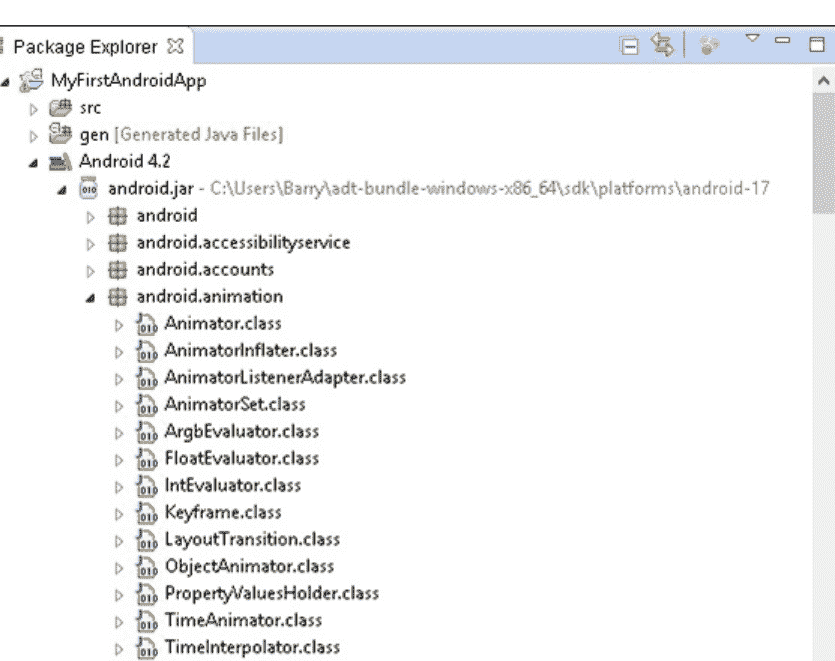

图 4-14：`android.jar` 中的某些包和类。

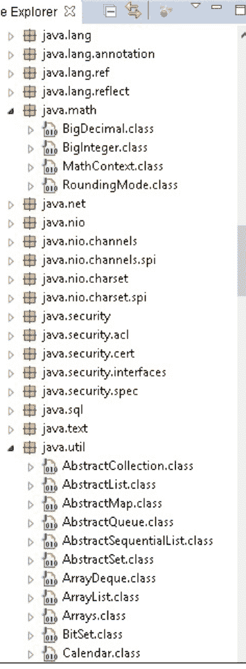

图 4-15：`android.jar` 文件包含了通用 Java 包。

## AndroidManifest.xml 文件

如果你遵循了本章之前的说明，那么你已经摆弄过一个 `AndroidManifest.xml` 文件了。请记住，每个 Android 应用程序都有一个 `AndroidManifest.xml` 文件。`AndroidManifest.xml` 文件提供了设备运行该程序所需的信息。列表 4-4 中的 `AndroidManifest.xml` 文件显示了你在创建一个全新 Android 项目时选择的一些选项。例如，列表包含了包名、最低所需的 SDK（`android:minSdkVersion` 属性）和目标 SDK（`android:targetSdkVersion` 属性）。

### 列表 4-4：一个 AndroidManifest.xml 文件

```xml
<?xml version="1.0" encoding="utf-8"?>
<manifest
    xmlns:android="http://schemas.android.com/apk/res/android"
    package="com.example.myfirstandroidapp"
    android:versionCode="1"
    android:versionName="1.0" >
<uses-sdk
  android:minSdkVersion="8"
  android:targetSdkVersion="16" />
<application
  android:allowBackup="true"
  android:icon="@drawable/ic_launcher"
  android:label="@string/app_name"
  android:theme="@style/AppTheme">
  <activity
    android:name="com.example.myfirstandroid.MainActivity"
    android:label="@string/app_name">
    <intent-filter>
      <action android:name="android.intent.action.MAIN" />
      <category android:name="android.intent.category.LAUNCHER" />
    </intent-filter>
  </activity>
</application>
</manifest>
```


AndroidManifest.xml 文件中最重要的项是 `<activity>` 元素。列表 4-4 中的代码只有一个 `<activity>` 元素。但一个 Android 应用程序可以有多个 activity，每个 activity 都必须在应用程序的 AndroidManifest.xml 文件中有自己的 `<activity>` 元素。

有关 Android activity 的详情，请参阅第 5 章。

一个 Android activity 是一个“满屏”的组件。（更多 Android activity 请参考第 5 章。）如果你将 activity 的 Java 代码添加到 Android 应用中，你必须在应用程序的 AndroidManifest.xml 文件中添加 `<activity>` 元素。如果你忘记添加 `<activity>` 元素，尝试运行程序会看到 `ActivityNotFoundException`。（相信我，我犯过很多次这种错误。）

在 `<activity>` 元素内部，`<intent-filter>` 描述了 activity 可以为设备上的应用承担的职责类型。（意图过滤器非常复杂，所以在本书中我不会深入展开这个话题。）但为了让你有个直观的概念，`android.intent.action.MAIN` 动作表示该 activity 代码可以作为程序执行的起点。


`android.intent.category.LAUNCHER` 类别表示该 activity 的图标可以出现在设备的应用程序屏幕上。

# 编写你自己的 Java 程序

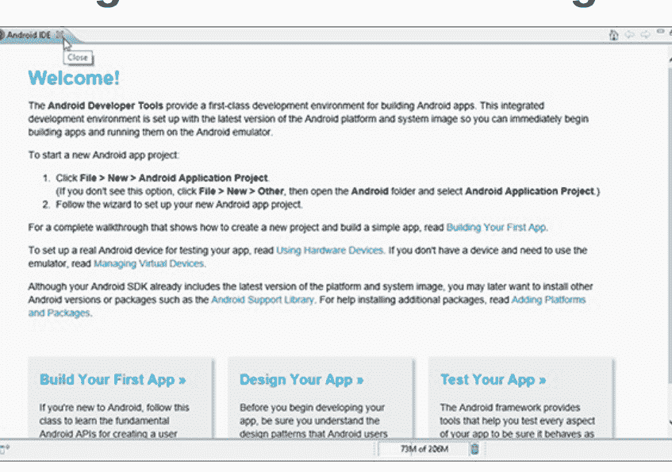

可以在 www.dummies.com/extras/javaprogrammingforandroiddevelopers 在线查看“奇怪的计算机代码”（及更多）文章。

# 在这一部分中……

- 编写你的第一个 Java 程序
- 组装 Java 的构建模块
- 在程序运行时更改方向

# 第 5 章
代码之颂歌

## 本章内容

- 阅读基础 Java 程序中的语句
- 编写一个 Java 控制台应用
- 理解模板化的 Android activity

> “Hello, hello, hello, . . . hello!”——三位小士在《醉迷侦探》和其他短片中的台词。

对于普通人来说，“Hello World”这两个词组成了一个亲切的（甚至是甜腻的）短语。“Hello World”是一首歌的歌名吗？它是电台主持员欢快的俚语吗？也许吧。但对于程序员来说，“Hello World”这个短语有特殊的含义。

`Hello World` 应用程序是在特定编程语言或特定平台上可以运行的最简单的程序。作者们创建 `Hello World` 应用程序是为了向人们展示如何开始为特定系统编写代码。

为了帮助你上手 Java 和 Android，我把这一章专门用于解释几个“世界”程序。这些程序什么都不做。事实上，它们什么都不做。


“Hello World”这两个词组成了一个亲切的（甚至是甜腻的）短语。“Hello World”是一首歌的歌名吗？它是电台主持员欢快的俚语吗？也许吧。但对于程序员来说，“Hello World”这个短语有特殊的含义。

`Hello World` 应用程序是在特定编程语言或特定平台上可以运行的最简单的程序。作者们创建 `Hello World` 应用程序是为了向人们展示如何开始为特定系统编写代码。

为了帮助你上手 Java 和 Android，我把这一章专门用于解释几个“世界”程序。这些程序什么都不做。事实上，它们什么都不做。

可以在 www.dummies.com/extras/javaprogrammingforandroiddevelopers 在线查看“奇怪的计算机代码”（及更多）文章。

# 在这一部分中……

- 编写你的第一个 Java 程序
- 组装 Java 的构建模块
- 在程序运行时更改方向。

## Java 类

Java 是一种面向对象的语言。作为一名 Java 开发人员，你的主要目标是描述类和对象。*类*（class）是一种类别，例如银行账户的一种类型。

```java
package org.allourcode.myfirstclass;

public class MyFirstClass {

    /**

     * @param args */

    public static void main(String[] args) {

        javax.swing.JOptionPane.showMessageDialog(

            null, "Hello");

    }

}
```

`class` 词是一个关键字。无论谁编写 Java 程序，`class` 的用法始终是相同的。相比之下，列表 5-1 中的 `MyFirstClassName` 是一个标识符——某个事物的名称（即，用于标识该事物的名字）。`MyClassName` 是我在写第 3 章时想出来的词，它是特定类的名称——我通过编写这个程序正在创建的类。

列表 5-1 中的 `package`、`public`、`static` 和 `void` 也是 Java 关键字。无论是谁编写 Java 程序，`package`、`class` 以及其他关键字始终具有相同的含义。关于关键字和标识符的更多信息，请参见旁边的边栏“单词，单词，单词”。

类头部 `org.allyyourcode.myfirstproject;`

```java
public class MyFirstJavaClass {

    /**

     * @param args

     */

    public static void main(String[] args) {

        javax.swing.JOptionPane.showMessageDialog(

            null, "Hello");

    }

}
```
类体。

**图 5-4：** 类定义的头部和类体。

要了解 `public`、`static` 和 `void` 的含义，请参见第 9 章和第 10 章。

> JAVA 编程语言对大小写敏感。如果你将一个单词中的小写字母改为大写，或将大写单词改为小写，你就改变了单词的含义并可能导致该单词毫无意义。在列表 5-1 的第一行示例中，如果你尝试将 `class` 替换为 `Class`，整个程序将停止运行。

在某种程度上，对于包含特定类的文件命名来说也是如此的。例如，列表 5-1 中的类名为 `MyFirstJavaClass`，包含 4 个大写字母和 12 个小写字母。因此，在名为 `MyFirstJavaClass.java` 的文件中，代码中 `.java` 之前恰好有 4 个大写字母和 12 个小写字母。

## 类名

我有几个不同的名字。我的第一个名（用于非正式对话）是 Barry。较长的名字（用在本书封面上）是 Barry Burd。我在表格上使用的法律名称是 Barry A. Burd，而我的护照（我拥有的最正式的文件）上的名字是 Barry Abram Burd。

同样，Java 程序中的元素也有几个不同的名称。例如，列表 5-1 中创建的类名为 `MyFirstJavaClass`。这是类的简单名，因为嗯，它很简单，而且是一个名字。

# 单词，单词，单词

Java 使用两种单词：关键字和标识符。你可以判断哪些单词是关键字，因为 Java 只有 50 个关键字。以下是完整列表：

| abstract | continue | for | new | switch |
| :--- | :--- | :--- | :--- | :--- |
| assert | default | goto | package | synchronized |
| boolean | do | implements | private | this |
| break | double | protected | throw | |
| byte | else | import | public | throws |
| case | extends | instanceof | return | transient |
| catch | extends | short | static | void |
| char | final | interface | volatile | |
| const | float | native | super | while |

作为关键字，一个单词的含义是永远不会改变的（从一个 Java 程序到另一个程序）。例如，在英语中，你不能改变一个单词的含义。说“I think that I shall never if A poem as a riff” 是没有意义的。同样的概念在 Java 程序中也适用：你可以输入 `if (x > 5)` 来表示“如果 x 大于 5”，但当你输入 `if (x != y)` 时，计算机告诉你这段代码没有意义。

在列表 5-1 中，`package`、`public`、`class`、`static` 和 `void` 是每一个列出标识符的单词，标识符通常是某个事物的名字。列表中的标识符包括包名 `org.alloycode.myfirstproject`、类名 `MyFirstFitClass` 以及其他许多单词。

在编程语言中，以下句子中的 `Wednesday`、`Barry` 和 `university` 是标识符，而其他单词（`it's`、`it is` 和 `at`）是关键字：

> It's Wednesday, Barry is at the university.

（我不确定这个单词的作用。如果你想的话，可以担心它。）

在英语和其他简单语言中，标识符的名字是可重用的。例如，最近在网络上搜索到美国有四个名叫 Barry Burd 的人（拼写方式不寻常）（坦普大学的一位学生名叫 John Wayne，而在 1880 年代，有两本不同的教科书被命名 Pascalorgraphics。）Android API 有一个名为 `Activity` 的类，但这并没有阻止你为这个名字赋予另一个含义。

当然，重名可能会带来麻烦，因此刻意重用一个广为人知的名字通常是一个坏主意。（如果你创建了自己名字的 `Activity` 类，你会发现很难在 Android 中引用重写的 `Activity` 类。至于我的那位坦普大学同学，大家在老师叫它时就学会了。）

列表 5-1 从行 `package org.alloycode.myfirstproject` 开始。第一行是包声明。正因为如此，在名为 `org.alloycode.myfirstproject` 的包内新创建的 `MyFirstFitClass` 就是其全限定名。

如果你正和我一起坐在你家的客厅里，你可能会叫我 Barry。但如果你从未见过我，并且在几千人的群中寻找我，你可能会称呼我的名字 Barry Burd。同样，在类的简单名和全限定名之间做选择取决于上下文。更多信息，请参见随后的章节“导入声明”。

# 为什么 Java 方法像餐厅的餐点

我是位于 80 号州际公路小镇“Mom's Restaurant”里的墙上壁人。我看到了 Mom's 餐厅发生的一切切：Mom to years after fight, fighting the influx of high-volume, low-quality restaurant.

在此代码中，`java.swing.JOptionPane.showMessageDialog` 是一个方法的名称，而 `null` 和 `"Hello"` 是括号中的文本。

Java 指令通常以分号结尾，因此以下是一个完整的 Java 指令：

```java
java.swing.JOptionPane.showMessageDialog(null, "Hello");
```

```java
package org.allyyourcode.myfirstproject;

public class MyFirstJavaClass {

    /**

     * @param args

     * main方法的头部

     */

    public static void main(String[] args) {

        // 执行此 showMessageDialog 调用，

        java.swing.JOptionPane.showMessageDialog(null, "Hello");

    }

}
```

主方法（或更准确地说，主方法的声明）方法体

**图 5-6：** 方法头部和方法体。

这条指令告诉计算机执行 `java.swing.JOptionPane.showMessageDialog` 方法声明内部的所有语句。


Java 指令的另一个术语是 Java 语句（Java statement），或直接称为语句（statement）。

## 方法名称

像 Java 中的许多元素一样，方法有多个名称，范围从最短到最长，且中间还有其他名称。例如，列表 5-1 中的代码调用了一个简单名称为 `showMessageDialog` 的方法。

在 Java 中，每个方法都存在于类内部，而 `showMessageDialog` 存在于 API 的 `JOptionPane` 类中。因此，`showMessageDialog` 方法的长名称是 `JOptionPane.showMessageDialog`。

Java 中的**包（package）** 是类的集合。`JOptionPane` 类是名为 `java.swing` 的 API 包的一部分。因此，`showMessageDialog` 方法的全限定名称是 `java.swing.JOptionPane.showMessageDialog`。您在代码中使用哪种版本的方法名称取决于上下文。


有关关于如何在简单名称和全限定名称之间进行选择的更多信息，请参阅 Java 书的第 9 章。

## 方法参数

在列表 5-1 中，此调用显示了一个对话框：

```java
javax.swing.JOptionPane.showMessageDialog(null, "Hello");
```

对话框的标题中包含 "Message" 一词，脸上有一个图标。（字母 i 代表信息 [information]。）你为什么要使用 "Message" 标题和 "i" 图标？对于该语句，请注意方法的两个参数：`null` 和 `"Hello"`。

`null` 和 `"Hello"` 的效果完全取决于 `showMessageDialog` 声明内部的指令。如果你想，可以阅读这些指令，因为整个 Java API 代码都是可查看的——你可能不想查看 `JOptionPane` 类中那 2,600 行 Java 代码。（我确定你更愿意读《悬崖笔记》（CliffsNotes）版。）

以下是 `showMessageDialog` 参数列表中 `null` 和 `"Hello"` 效果的简要描述：

- **在 Java 中，值 `null` 代表“无”。** 特别是，在调用 `showMessageDialog` 时的第一个 `null` 值表示对话框不会出现在任何窗口内部。对话框可以出现在计算机屏幕的任何地方。（具体来说，对话框出现在屏幕上某个“无”的区域内。）

- **在 Java 中，双引号表示字符串。** 第二个参数 `"Hello"` 告诉 `showMessageDialog` 方法在对话框脸上显示字符 Hello。

即使没有我对比 `showMessageDialog` 参数的描述，你也可以避免阅读那 2,600 行 Java API 代码。相反，你可以查看不可或缺的 Java 文档页面。你可以通过访问此处找到这些文档页面：

```
www.oracle.com/technnetwork/java/javase/documentation
```

## 标准 Java 程序中的 main 方法

图 5-7 显示了列表 5-1 代码的副本，箭头指示了计算机运行代码时会发生的情况。代码的大部分包含名为 `main` 的方法的声明。像任何方法一样，`main` 方法是一份配方：

**如何制作炒鸡蛋：**
- 混合鸡蛋和牛奶
- 搅拌光滑
- 倒入预热好的煎锅
- 在搅拌混合物的同时煮 2 到 3 分钟
- 加入盐、黑胡椒和大蒜粉
- 每次加入少量奶士
- 再煮 2 到 3 分钟

或者，如何遵循 `MyFirstJavaClass` 的主指令：在屏幕上的对话框中显示 "Hello"。

```java
package org.allyyourcode.myfirstproject;

public class MyFirstJavaClass {

    /**

     * @param args

     */

    public static void main(String[] args) {

        // 执行此 showMessageDialog 调用，

        java.swing.JOptionPane.showMessageDialog(null, "Hello");

    }

}
```


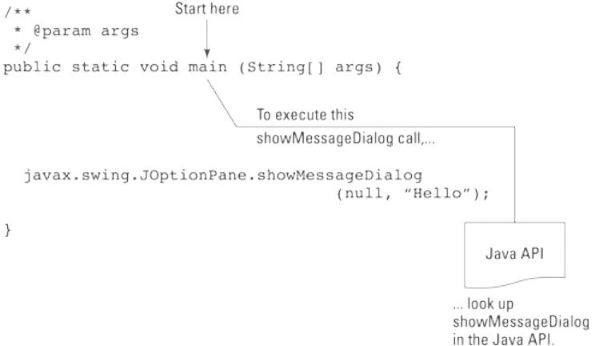

图 5-7：它从 `main` 方法开始。`main` 这个词在 Java 中起着特殊作用。特别是，你永远不会编写显式调用 `main` 方法的代码。`main` 词是程序开始时自动调用的方法名称。当 `MyFirstJavaClass` 程序运行时，计算机会自动找到该方法并执行方法体内的任何指令。在 `MyFirstJavaClass` 程序中，`main` 方法体只有一条指令。该指令告诉计算机在对话框中显示 Hello。因此在图 5-7 中，Hello 出现在计算机屏幕上。


## 代码中的标点符号

图 5-7 显示了列表 5-1 代码的副本，箭头指示了计算机运行代码时会发生的情况。代码的大部分包含一个名为 `main` 的方法的声明。像任何方法一样，`main` 方法是一份配方：

在英语中，标点符号至关重要。如果你不相信我的标请，请问问书。在列表 5-1 中，标很重要。

- **用花括号包裹方法体。** 符号很重要。以下列表列出了标点符号规则：

- **用花括号包裹类体。** 在列表 5-1 中，`MyFirstJava` 类被花括号包裹。


代码标点符号的另一个显性结果是决定文件在硬盘上的位置。例如，方法很重要：

- **用花括号包裹方法体。** 在列表 5-1 中，`showMessageDialog` 方法被花括号包裹。

- **Java 语句以分号结尾。** 例如，在列表 5-1 中，调用 `showMessageDialog` 以分号结尾。

- **声明以分号结尾。** 再次在列表 5-1 中，第一行代码以分号结尾。

- **尽管有上述两个，不要在花括号后紧跟分号。** 列表 5-1 的这两个花括号后面都没有分号。

- **用圆括号包裹方法的参数，并用逗号分隔参数。** 在列表 5-1 中，调用 `showMessageDialog` 有两个参数：`null` 和 `"Hello"`。`main` 方法只有一个参数：`args`。


在 `main` 方法的参数列表中，`String[]` 并不是参数。相反，`String[]` 是 `args` 参数的类型。有关类型的更多信息，请参阅第 6、9 和 12 章。

- **用双引号 (`"`) 表示字符串。** 在列表 5-1 中，参数 `"Hello"` 告诉 `showMessageDialog` 方法在对话框脸上显示字符 Hello。

- **用点分隔全限定名称的各个部分。** 在 Java API 中，`javax.swing` 包包含 `JOptionPane` 类，该类又包含 `showDialog` 方法。因此 `javax.swing.JOptionPane.showDialog()` 是方法的全限定名称。

- **在包名内部使用点。** 包名中的点有点误导性。包名暗示了包内代码的用途。但包名并没有将其分类为包和子包。

例如，Java API 有包 `javax.swing`、`javax.security.auth`、`javax.security.auth.login`。`java` 这个词本身没有任何意义，`javax.security.auth.login` 包并不在 `javax.security.auth` 包内部。

包名中的点最直接的结果是决定文件在硬盘上的位置。例如，根据其包名，代码必须位于列表 5-1 中的 `myfirstproject` 文件夹中，而该文件夹又必须位于名为 `org` 的文件夹中，如图 5-8 所示。

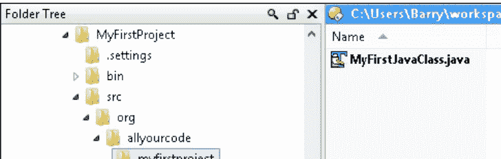

图 5-8：包含 Java 程序的文件夹。

```java

/**

 * @author Barry Burd

 * @version 1.0 02/02/13

 * @see java.swing.JOptionPane

 */

public class MyFirstJavaClass {

    /**

     * 执行的起点。

     * @param args args 参数

     * (未使用)。

     */

    public static void main(String[] args) {

        javax.swing.JOptionPane.showMessageDialog(null, "Hello"); //null?

    }

}

```

注释是程序内部的一段特殊文本，其目的是帮助人们理解程序。注释是良好程序文档的一部分。

Java 编程语言有三种类型的注释：

- **传统注释：** 列表 3-6 中的前七行（参阅第 3 章）构成了一个传统注释。注释以 `/*` 开始，以 `*/` 结束。在起始和结束 `*/` 之间的所有内容仅供人类阅读。编译器不会翻译任何关于 "Java For Android Developers For Dummies" 或 Wiley Publishing, Inc. 的信息。


要了解编译器，请参阅第 1 章。
列表 5-2 中的第 2–6 行带有额外的星号（`*`）。我称之为额外的，因为在创建注释时不需要这些星号。它们让注释看起来更美观。我在列表中包含它们，是因为出于某种我并不完全理解的原因，大多数程序员都坚持要添加这些额外的星号。

- **行尾注释：** 列表 5-2 中的文本 `//null?` 是一个行尾注释 —— 它以两个斜杠开始，一直到该行的末尾。再次，编译器不会翻译行尾注释中的文本。

- **Javadoc 注释：** *javadoc* 注释以斜杠和两个星号（`/**`）开始。列表 5-2 有两个 javadoc 注释 —— 一个带有文本 `MyFirstJavaClass displays a dialog box`，另一个带有文本 `The starting point`。
    一个 *javadoc* 注释是一种特殊的传统注释。它是为了给那些从不看 Java 代码的人阅读的。
    等等 —— 这不通。如果你从不看列表，你怎么能在列表 5-2 中看到 javadoc 注释呢？

    嗯，通过几次点击和操作，你可以找到列表 5-2 中所有的 javadoc 注释，并将它们转换为一个漂亮的网页，如图 5-9 所示。

要为你自己的代码创建文档页面，请按照以下步骤操作：

1. 在代码中编写 Javadoc 注释。
2. 从 Eclipse 的主菜单中，选择 `Project` > `Generate Javadoc`。
    结果是，出现了 Javadoc 生成对话框。

3. 在 Javadoc 生成对话框中，选择你想要记录代码的 Eclipse 项目。

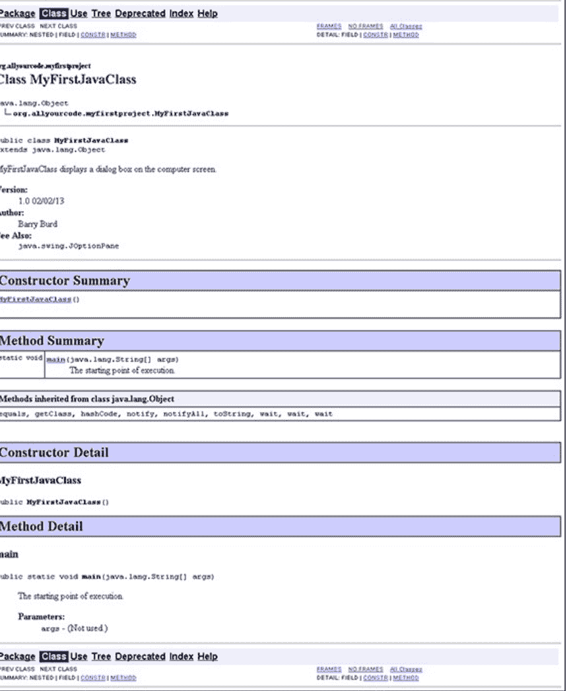

图 5-9：从列表 5-2 代码中生成的 Javadoc 注释。

4. 仍在 Javadoc 生成对话框中，注意 Destination（目标位置）字段中的文件夹名称。计算机将新创建的文档页面放在该文件夹中。如果你喜欢不同的文件夹，可以更改 Destination 字段中的文件夹名称。

5. 点击 Finish（完成）。

结果是，计算机创建了文档页面。

如果你使用 Destination 文件夹并双击新的 `index.html` 文件的图标，你将看到你漂亮的（且信息丰富的）文档页面。

> 你可以通过访问 www.oracle.com/technetwork/java/javase/documentation 访问 Java 内置 API 类的文档页面。Java API 包含成千上万个类，所以不要背类及其方法的名称。相反，你只需访问这些在线文档页面即可。

## Barry 的借口是什么？

多年来，我一直告诉你在代码中加入各种注释，多年来，我一直在编写包含很少注释的示例代码（例如列表 5-1）。为什么？

三个字：“了解你的听众。”当你编写复杂的、现实世界的代码时，你的听众由其他程序员、信息技术经理以及需要帮助解读你所做工作的人。当我为这本书编写简单的代码时，你的听众就是你 —— 初级 Java 程序员。与其真的写很多注释，我最好的策略是盯着我的 Java 语句 —— 那些 Java 编译器解析的语句。这就是为什么我在书的列表中放了这么少的注释。

此外，我有点懒。

## 另一种单行方法

列表 5-3 包含了另一个 Hello World 程序。事实上，列表 5-3 中的代码比列表 5-1 中的程序简单一点。

### 列表 5-3：基于控制台的 Hello World 程序

```java

package com.allmycode;

public class HelloWorld {

    public static void main(String[] args) {

        System.out.println("Hello");

    }

}

```

在列表 5-3 中，方法调用 `System.out.println("Hello")` 将文本发送到 Eclipse 的 Console（控制台）视图，如图 5-10 所示。向控制台发送文本是很单调、单调，但当你编写代码时，新程序并没有按照你认为应该这样做运行。向程序添加一个快速的 `System.out.println` 有助于你理解程序在背后是如何运行的。


图 5-10：Eclipse 的控制台。通过快速添加 `System.out.println` 来调试程序。


在列表 5-3 中，方法调用 `System.out.println("Hello")` 将文本发送到 Eclipse 的 Console（控制台）视图，如图 5-10 所示。向控制台发送文本是很单调、单调，但当你编写代码时，新程序并没有按照你认为应该这样做运行。向程序添加一个快速的 `system.out.println` 有助于你理解程序在背后是如何运行的。


图 5-10：Eclipse 的控制台。通过快速添加 `system.out.println` 来调试程序。

指的是一个方法声明，而带有四个参数的调用则指向另一个声明，如图 5-15 所示。计算机通过计算方法调用中的参数数量（并检查第 7 章中描述的其他元素）来决定要调用哪一个方法声明。

以下是 `showDialog` 四参数版本中的执行过程：

- 如果第一个参数为 `null`，则对话框起初不会出现在任何其他窗口内部。
  此参数的作用与双参数 `showMessageDialog` 方法中的第一个参数的作用相同。
- 第二个参数告诉 `showMessageDialog` 方法在对话框界面上显示哪些字符。
  此参数的作用与双参数 `showMessageDialog` 方法中的第二个参数的作用相同。

两个参数：

```java
java.swing.JOptionPane.showMessageDialog(null, "Hello");

public static void showMessageDialog(Component parentComponent, Object message) etc.,
```

四个参数：

```java
JOptionPane.showMessageDialog(null, "You have 2 more lives.", "The Game", JOptionPane.INFORMATION_MESSAGE);
```

```java
public static void showMessageDialog(Component parentComponent, Object message, String title, int messageType) etc.,
```

图 5-15：调用中的参数与声明中的参数相匹配。

- 第三个参数告诉 `showMessageDialog` 方法在对话框标题上显示哪些字符。
  在代码列表 5-4（以及之前的图 5-11、5-12 和 5-13）中，每个对话框的标题栏都包含 "Game" 字样。
- 第四个参数告诉 `showMessageDialog` 方法在对话框界面上显示哪个图标。
  图 5-11、5-12 和 5-13 显示了调用 `showMessageDialog` 时可能出现的五个图标中的三个。其余两种可能性是问号图标（使用 `JOptionPane.QUESTION_MESSAGE` 参数）和无图标（使用 `JOptionPane.PLAIN_MESSAGE` 参数）。

代码列表 5-4 中的 `showMessageDialog` 方法调用说明了第 4 章中“R.java 与两个歌杂剧演员的传奇”侧栏中的一个观点，其中视图 `View.VISIBLE`、`View.INVISIBLE` 和 `View.GONE` 分别代表数字 0、4 和 8。Android 使用这三个数字来表示屏幕可见性的不同级别。同样，名称 `JOptionPane.ERROR_MESSAGE`、`JOptionPane.INFORMATION_MESSAGE` 和 `JOptionPane.WARNING_MESSAGE` 代表数字 0、1 和 2。`showMessageDialog` 声明内部的语句通过显示不同的图标来响应这些每一个数字。

## 更少的方法参数

关于代码列表 5-4 中方法参数的另一个故事值得讲述。在代码列表 5-4 中，我调用了一个名为 `countdown` 的方法，并在同一个类中声明了我的新 `countdown` 方法。

当你调用在同一个类中声明的方法时，可以使用方法的简单名。这在现实生活中也是一样的样的。在我的家里，没人在家里叫我为 Barry Burd（除非他们真的对我生气了）。

你可能还记得计算机如何计算方法的参数并将其与方法声明中的参数数量相匹配。在代码列表 5-4 中，`countdown` 调用没有参数（只有一对空括号），而 `countdown` 方法的声明具有相同数量的参数；即：无。因此，调用和声明是兼容的，计算机会执行声明中的指令。

要声明（或调用）无参数的方法，请使用一对空括号。

## Hello好，Android

Android 项目的 `src` 目录包含了你的项目的 Java 源代码。该目录中的文件名称如 `MainActivity.java`、`MyService.java`、`DatabaseHelper.java` 和 `MoreStuff.java`。

你可以将数百个 Java 文件挤进 Android 项目的 `src` 目录中。但当你创建一个新项目时，Eclipse 通常只为你创建创建一个文件。默认情况下，Android 会创建一个名为 `MainActivity.java` 的文件。代码列表 5-5 展示了 `MainActivity.java` 文件中的代码。

## 代码列表 5-5：Android 创建了这个骨架 Activity 类

```java
package com.allmycode.myfirstandroidapp;

import android.os.Bundle;
import android.app.Activity;
import android.view.Menu;
import android.*;

public class MainActivity extends Activity {

  @Override
  protected void onCreate(Bundle savedInstanceState) {
    super.onCreate(savedInstanceState);
    setContentView(R.layout.activity_main);
  }

  @Override
  public boolean onCreateOptionsMenu(Menu menu) {
    // 填充菜单；如果存在操作栏，则会向其添加项目。
    getInflater().inflate(R.menu.activity_main, menu);
    return true;
  }
}
```

## main 方法在哪里？

要启动一个标准的 Java 程序，计算机会寻找一个名为 `main` 的方法。但代码列表 5-5 中的代码没有方法体。好吧，我放弃了——智能手机是如何找到 Android App 执行的起点点的呢？答案涉及 App 的 XML 代码。你可以仅用 Java 代码构建标准的 Java 程序，但 Android App 需要额外的代码。其一，每个 Android App 都有自己的 `AndroidManifest.xml` 文件。

第 4 章描述了 `AndroidManifest.xml` 文件。

代码列表 5-6 包含了源自 `AndroidManifest.xml` 文件的一段代码（**加粗**的代码最有趣。未加粗的代码只是没那么有趣。）

## 代码列表 5-6：AndroidManifest 中的 activity 元素

```xml
<activity
  android:name="com.allmycode.myfirstandroidapp.MainActivity"
  android:label="@string/app_name" >
  <intent-filter>
    <action android:name="android.intent.action.MAIN" />
    <category android:name="android.intent.category.LAUNCHER" />
  </intent-filter>
</activity>
```

代码列表 5-4 中的 `showMessageDialog` 方法调用说明了第 4 章中“R.java 与两个歌杂剧演员的传奇”侧栏中的一个观点，其中视图 `View.VISIBLE`、`View.INVISIBLE` 和 `View.GONE` 分别代表数字 0、4 和 8。Android 使用这三个数字来表示屏幕可见性的不同级别。同样，名称 `JOptionPane.ERROR_MESSAGE`、`JOptionPane.INFORMATION_MESSAGE` 和 `JOptionPane.WARNING_MESSAGE` 代表数字 0、1 和 2。`showMessageDialog` 声明内部的语句通过显示不同的图标来响应这些每一个数字。

毕竟，你使用的应用程序可能并没有包含所有这些预写代码。此外，共和党人或民主党人并不相信你所属政党纲领中的所有内容。你可以从借用纲领的大部分原则开始，然后对剩下的原则进行从中挑选。同样，[Listing 5-5] 中的代码声明自己是一个 Android Activity，但随后重写了 Activity 类中已有的两个方法。

在 [Listing 5-5] 中，`@Override` 单词表示该代码列表没有使用 API 预写的 `onCreate` 和 `onCreateOptionsMenu` 方法。相反，新的 `MainActivity` 包含了它的 `onCreate` 和 `onCreateOptionsMenu` 方法声明，如 [Figure 5-16] 所示。

| Activity | MainActivity |
| :--- | :--- |
| onCreate(Bundle : savedInstanceState) | onCreate(Bundle:savedInstanceState) |
| start() | start() |
| onResume() | onResume() |
| onPause() | onPause() |
| onStop() | onStop() |
| onDestroy() | onDestroy() |
| onCreateOptionsMenu(Menu : menu) | onCreateOptionsMenu(Menu : menu) |

**图 5-16：** 我不喜欢预写的 `onCreate` 和 `onCreateOptionsMenu` 方法。

特别是，[Listing 5-5] 的 `onCreate` 方法设置了 `setContentView(R.layout.activity_main)`，这将在 `res/layout/activity_main.xml` 文件中描述的内容（例如按钮和文本字段）显示在屏幕上。

有关 `res/layout/activity_main.xml` 文件的介绍，请参见 [第 4 章]。

[Listing 5-5] 中的另一个方法（`onCreateOptionsMenu` 方法）对 `res/menu/activity_main.xml` 文件执行了类似的技巧，以便在应用程序的 Action bar 上显示项目。

## Activity 的工作方法

每个 Android activity 都有生命周期——即 activity 从出生到死亡等经历的一系列阶段。特别是当你启动一个 activity 时，手机会调用该 activity 的 `onCreate` 方法。该方法还会调用 activity 的 `onStart` 和 `onResume` 方法。

在 [Listing 5-5] 中，我选择声明自己的 `onCreate` 方法，但我没有声明自己的 `onStart` 和 `onResume` 方法。我并没有重写 `onStart` 和 `onResume` 方法，而是静静地使用了 Activity 类预写的 `onStart` 和 `onResume` 方法。

要了解你为什么选择重写 `onResume`，请参见第 14 章。

当手机结束一个 activity 的运行运行时，手机会调用三个额外的方法：activity 的 `onCreate`、`onStop` 和 `onDestroy`。你的 activity 从出生到死亡的一个完整周期涉及至少六个方法的运行——`onCreate`，然后是 `onStart` 和 `onResume`，随后是 `onPause`，然后是 `onStop`，最后是 `onDestroy`。正如所有生命形式一样，“尘归于尘，土归土。”

不要绝望。对于 Android activity 来说，重生是一个常见现象。例如，如果你同时运行多个应用程序，手机内存可能会不足。在这种情况下，Android 可以杀死一些正在运行的 activity。作为手机用户，你并不知道任何 activity 被销毁了。当你导航回一个被销毁的 activity 时，Android 会为你重新创建该 activity，而你完全一所不知。

这是另一个令人惊讶的事实。当你将手机从竖屏模式切换到横屏模式时，手机会销毁当前的 activity（竖屏模式下的 activity）并在横屏模式下重新创建该 activity。手机会顺序调用 activity 的六个生命周期方法（`onPause`、`onStop` 等）以将 activity 的显示横置。这类似于从企业号的传输器甲板出发，在传送到星球后变成了一个不同的人（除了你表现得像自己，思考得也像自己，所以没有人知道你是一个完全不同的人）。

事实上，Listing 5-5 中的像 `onCreate` 和 `onCreateOptionsMenu` 等方法是 Android 开发的主力军。

# 第 6 章：Java 的构建模块

## 本章

- 给事物赋值
- 让事物存储某些特定类型的值
- 应用运算符来获取新值

我曾在许多城市开过车，我准备好给出我坦诚的评价了：

- 在纽约市开车是一项单方面的努力。纽约的司机避免了撞到另一辆车，但并没有避免被另一辆车撞到。同样，纽约行人对避免被撞到无所作为。闯入迎面车辆的路径是稀常便饭。任何不这样做的人要么是新泽西州的司机，要么是来自中部的游客。在纽约市，安全完全取决于向潜在目标移动的那辆车。
- 加州某些地区的司机会为了一个即将闯马路的行人而立即停下。有些司机在行人意识到自己有闯马路意图之前就停了。
- 波士顿的街道弯曲且不规则，准确的路牌很少。由于施工和其他意外情况，路线地图已经过时。因此，在波士顿开车问题很大。除非你已经熟悉波士顿，除非你已经在波士顿开过，否则你找不到路。不用说，我无法在波士顿开车。
- 伦敦很拥挤，但司机很有礼貌（至少对外国人来说）。几年前，我在伦敦街头一周内引起了三起交通事故。在每次事故发生后，汽车司机都向我道歉了！
  当一辆伦敦出租车对事故（承认是我本人）可能会污了他的他的驾驶记录时，我感到特别触动。显然，伦敦出租车手的规则非常严格。
  这引出了关于在伦敦开出租车所需的水平的话题。

## 类型名称

在列表 6-1 中，`int` 和 `char` 单词是类型名称。`int`（在第一个类型声明中）告诉计算机将值 `anInteger` 解释为“整数”值（小数点右侧没有数字的值）。`char`（在第二个类型声明中）告诉计算机将值 `achar` 解释为字符（一个字母、标点符号，甚至可能是单个数字）。因此，在列表 6-1 中，第一次调用 `showMessage` 时，当我显示 `anInteger` 的值时，计算机显示数字 74。在第二次调用 `showDialog` 时，当我显示 `achar` 的值时，计算机显示字母 j。


在列表 6-1 中，`int` 和 `char` 单词告诉我的变量名包含的内容。`anInteger` 和 `achar` 这些名字提醒我（程序员）这些变量拥有什么类型的值，但 `anInteger` 和 `char` 这些名字并没有为计算机提供任何类型信息。声明 `int rocky = 74` 和 `char bullwinkle = 74` 是可以的，因为我在整个列表 6-1 中一致使用了变量名 `rocky` 和 `bullwinkle`。

## 赋值与初始化

列表 6-1 中的两个类型声明都以初始化结束。正如名称所示，初始化是将变量设置为其初始值。在两个声明中，我都将变量初始化为值 74。

你可以创建一个不带初始化的类型声明。例如，我可以更改列表 6-1 中的代码，使得 `main` 方法内部的前四行看起来像这样：

```java
int anInteger;
char achar;
anInteger = 74;
achar = 74;
```

像 `anInteger = 74` 这样的行是一个赋值。赋值改变变量的值。赋值不是类型声明的一部分。相反，赋值与其类型声明是分离的（可能在类型声明之后的很多行）。

你可以用一个值初始化变量，然后在赋值语句中改变变量的值。

```java
int year = 2008;
System.out.println(year);
System.out.println("Global financial crisis");
year = 2009;
System.out.println(year);
System.out.println("Obama elected US president");
year = 2010;
System.out.println(year);
System.out.println("Oil spill in the Gulf of Mexico");
```

有时，你需要为一个在程序运行期间不会改变的值起名字。在这种情况下，关键字 `final` 标记一个值不能被重新赋值的变量。

```java
final int NUMBER_OF_PLANETS = 9;
```


`final` 变量是一个其值不会变化的变量。（据我所知，没有人认真建议过这些东西（不可变变量）。）

你可以初始化 `final` 变量的值，但在初始化之后，你不能通过赋值语句改变变量的值。换句话说，在你声明 `final NUMBER_OF_PLANETS = 9` 之后，这个赋值语句是非法的：

```java
NUMBER_OF_PLANETS = 8;
```

如果冥王星不再是一个行星，你无法不更改 `final NUMBER_OF_PLANETS = 9` 声明中的 9 的情况下容纳这一变化。

在 Java 中，`final` 单词是 Java 的修饰符之一。修饰符就像英语中的形容词。修饰符会导致声明含义的细微变化。例如，在本节中，`final` 单词修饰了 `NUMBER_OF_PLANETS` 声明，使得 `NUMBER_OF_PLANETS` 的值变得……关于 Java 修饰符的更多信息，请参见第 9 章和第 10 章。

根据原则，你使用 `final` 变量为从未（或很少）改变的值提供友好名称。例如，在 Java 程序中，`6.626068e-34` 代表 `6.626068 × 10⁻³⁴`，与此相同：

```java
0.00000000000000000000000006626068
```

在量子物理应用中，你可能不想在代码中重复输入 `6.626068e-34` 次（即使在复制粘贴时也可能输错数字）。为了防止错误侵入你的代码，你声明了：

```java
final double PLANCK_CONSTANT = 6.626068e-34;
```

从那时起，你不再需要在代码中多次输入 `6.626068e-34`，而是在需要时只需输入名称 `PLANCK_CONSTANT`。

你可以在任何变量中使用小写字母，包括 `final` 变量。但 Java 程序员很少这样写代码。为了保持看起来不像个完全新手，在 `final` 变量名中只使用大写字母和数字。使用下划线分隔单词。

Java 语言规范中的一个漏洞允许你在某些情况下使用赋值语句给变量赋予初始值。对于在方法内部声明的变量（如 `amount`），你可以在其中一行写上 `final int amount;`，然后在另一行写上 `amount = ...;`。我的建议是？忽略这个漏洞。甚至不要看这个职员工图标！

## 表达式与字面量

在计算机程序中，表达式是一个求值为值的表达式。字面量是直接写在代码中的固定值。例如，`74` 是一个字面量，`'j'` 也是。

在 Java 中，表达式由变量和运算符组成。例如，`anInteger + 5` 是一个求值为 `anInteger` 和 `5` 之和的表达式。运算符是对操作数的符号。常见的运算符包括 `+`、`-`、`*` 和 `/`。

下表显示了数字如何表示二进制。

## 十进制与二进制

`0101010` 与数字 `74` 有什么关系？熟悉的十进制系统具有个位、十位、百位、千位等。二进制系统具有 1 位、2 位、4 位、8 位等。图表显示了如何从 `0101010` 得到 `74`。

| 64 | 32 | 16 | 8 | 4 | 2 | 1 |
| :--- | :--- | :--- | :--- | :--- | :--- | :--- |
| 1 | 0 | 0 | 1 | 0 | 1 | 0 |

二进制数 `0101010` 代表 `64 + 8 + 2`。

`0101010` 与字母 `j` 之间的联系似乎任意。在 20 世纪初，一组专家开发了美国信息交换标准（ASCII）。在 ASCII 表示中，每个字符占用 8 位。你可以在侧边栏看到某些字符的表示。例如，我们的 `0101010`（作为二进制数代表 74）是计算机存储字母 `J` 的方式。将 `A` 设置为 `01000001` 将 `B` 设置为 `01000010` 的决定源于当时的硬件。

80 年代，随着现代通信导致全球化，一组专家开始研究一种每个字符 32 位的增强编码。低八位 Unicode 位与 ASCII 代码含义相同，但由于更多位，Unicode 标准为英语以外的语言提供了空间。Java `char` 值是一个 16 位的 Unicode 数字，这意味着根据解释方式，`char` 是 `0` 到 `65535` 之间的数字，或者是许多语言之一的字符。

事实上，你可以在 Java 程序中使用非英语字符作为标识符。在图中，我使用 Eclipse 运行了一个带有希伯来语标识符和输出的程序。语句中的单词顺序错乱是因为……除此之外，图中是一个普通的 Java 程序，因为我混合了从左到右和从右到左的字符。

# 如何将字符组合在一起

在 Java 中，单个字符与字符字符串是不相同的。请在列表 6-1 中，将字符 `'J'` 与字符串 `"An int variable"` 进行比较。字符字面量使用单引号；而字符串使用双引号。

在 Java 中，一个字符字符串可能包含多个字符，但一个字符字符串并不一定包含多个字符。（感到惊讶吗！）你可以写成：

```java
char aCharacter = 'J';
```

这是因为字符字面量使用了单引号。而且由于 `String` 是 Java 的类型之一，你也可以写成：

```java
String myFirstName = "Barry";
```

用字符串字面量 `"Barry"` 初始化了 `String` 变量 `myFirstName`。尽管 `"A"` 只包含一个字母，你仍然可以写成：

```java
String myMiddleInitial = "A";
```

带有双引号的 `"A"` 是一个字符串字面量。

在 Java 中，单个字符与另一个字符是不相同的，所以你不能：

```java
// 不要这样做：
char theLetter = "Z";
```

尽管它只包含一个字符，表达式 `"Z"` 是一个字符串值，所以你不能用表达式 `"Z"` 来初始化 `char` 变量。

## Java 的原始类型

Java 有两种类型：原始类型和引用类型。原始类型是原子——即基础的构建单元。相比之下，引用类型是你通过组合原始类型（以及组合其他引用类型）而创建的东西。


本章涵盖了（几乎完全是）Java 的原始类型。第 9 章引入了 Java 的引用类型。


在整个章节中，我对 Java 的 `String` 类型给予了一些关注。实际上，`String` 类型应该属于第 9 章，因为 Java 的 `String` 类型是引用类型，而不是原始类型。但我等不及第 9 章就要在示例中使用字符字符串了。我们将本章的 `String` 视为对 Java `String` 类型的一种非正式（但有用）的预览。

表 6-1 描述了所有的 Java 原始类型。

| 表 6-1 | Java 的原始类型 |
| 类型名称 | 字面量看起来的样子 | 取值范围 |
| :--- | :--- | :--- |
| 整数类型 | | |
| `byte` | `(byte)42` | -128 to 127 |
| `short` | `(short)42` | -32768 to 32767 |
| `int` | `42` | -2147483648 to 2147483647 |
| `long` | `42L` | -9223372036854775808 to 9223372036854775807 |
| 字符类型（技术上讲是一个整数） | | |
| `char` | `'A'` | 数千个字符、字形和符号 |
| 浮点类型 | | |
| `float` | `42.0F` | -3.4 × 10^38 to 3.4 × 10^38 |
| `double` | `42.0` 或 `0.314159e1` | -1.8 × 10³⁸ to 1.8 × 10³⁸ |
| 逻辑类型 | | |
| `boolean` | `true` | `true`, `false` |

你可以将 Java 的原始类型分为三类：

- 整数型：

整数类型表示整个数字——小数点右侧没有数字。例如，Java 程序中的 `42` 代表 `int` `42`，如 42 分钱、42 个小丑或 42 个鸡蛋。一个家庭不可能有 2.5 个孩子，因此 `int` 变量是存储特定家庭孩子数量的好地方。

区分一种整数类型与另一种类型的特征是你可以表示的取值范围。例如，`int` 类型的变量表示从 `-2147483648` 到 `+2147483647` 的数字。

当你需要一个小数点右侧没有数字的数字时，几乎总是可以使用 `int` 类型。Java 的 `byte`、`short` 和 `long` 类型是为特殊需求（以及为了挑剔的程序员）预留的。

- 浮点型：

浮点类型表示小数点右侧有数字的数字，即使这些数字是零。例如，一把旧木制尺子可能是 `1.001` 米长，而一把非常精确的尺子可能是 `1.000` 米长。

区分两种浮点类型（`double` 和 `float`）的特征是这些类型可以表示的取值范围。`double` 类型的范围大得多且精确得多。

尽管名称如此，Java 程序员几乎总是使用 `double` 而不是 `float`，而且当你写一个普通的字面量（如 `42.0`）时，该字面量是一个 `double` 值。（如果你想创建一个 `float` 值，请写 `42.0F`）。

- 逻辑型：

`boolean` 变量有两个值之一：`true` 或 `false`。你可以给一个 `int` 变量赋值 `74`，也可以给 `boolean` 变量赋值（例如）`true`：

```java
int numberOfPickles;
boolean areLemonFlavored;
numberOfPickles = 2;
areLemonFlavored = true;
```

你可以对数值进行算术运算，也可以对布尔值进行“算术运算”。更多信息请参见下一节。

# 使用类型可以做的事情

你可以使用 Java 的运算符进行算术运算。最常用的运算符是 `+`（加法）、`-`（减法）、`*`（乘法）、`/`（除法）和 `%`（取余）。

- 当你使用算术运算符结合两个整数时，结果是另一个 `int` 值。例如，`4 + 15` 的值为 `19`。`14 / 5` 的值为 `2`（因为 `5` “进了”`14` 两次，尽管余数大于 0，但省略了余数）。`14 % 5` 的值是 `4`（因为 `14` 除以 `5` 余数为 `4`）。同样的规则适用于其他整数类型。

- 当你使用算术运算符结合两个 `double` 值时，结果是另一个 `double` 值。例如，`42.0` 的值为...

```java
        (The sum of 18 and 21) is " + 18 + 21 + " . Oops! That's wrong.

        System.out.println("The sum of 18 and 21 is " + (18 + 21) + " . That's better.");

    }
}
```

`String` 类型更适合存放在第 9 章，因为 Java 的 `String` 类型不是一种基本数据类型。尽管如此，我会在本章中也会介绍 `String` 类型。

当你运行列表 6-2 中的代码时，你会看到图 6-5 所示的输出。

```
Hello, world!

The value of x is 74.

The second letter of the alphabet is B.

The fifth prime number is 11.

The sum of 18 and 21 is 1821. Oops! That's wrong.

The sum of 18 and 21 is 39. That's better.
```

图 6-5：列表 6-2 中代码的运行结果。

图 6-5 中发生的情况如下：

- 当你使用加号（`+`）来组合两个字符串时，它表示字符串拼接。字符串拼接是在当你紧接着显示一个字符串显示另一个字符串时所发生现象的雅称。在列表 6-2 中，拼接 `"Hello, "` 和 `"world!"` 的操作产生了字符串：
> `"Hello, world!"`

- 当你向数字添加一个字符串时，Java 会将数字转换为字符串并进行字符串拼接。

在列表 6-2 中，变量 `x` 被初始化为 `74`。代码显示 `"The value of x is " + x`（一个字符串和一个 `int` 变量）。当将字符串 `"The value of x is "` 与数字 `74` 相加时，Java 将 `int` 数字 `74` 转换为字符串 `"74"`。因此，`"The value of x is " + x` 变为 `"The value of x is " + "74"`，（在字符串拼接后）变为 `"The value of x is 74"`。

当你想显示数值的同时显示简短的解释时，这种将数字转换为字符串的自动转换非常有用。

- 计算机对数字 `74` 的内部表示为 `00000000000000000000101010`（在 64 位上为 1，8 位上为 1，2 位上为 1）。相比之下，计算机对字符串 `"74"` 的内部表示为 `00000000001101100000010100`。（关于帮助你理解为什么这些字节代表 `"74"` 的线索，请参见本章侧边栏表格“01000001 0100001100010110”）。对于 Java 来说，数字 `74` 和字符串 `"74"` 不是同一个。

- 当你向任何其他类型添加一个字符串时，Java 将另一个值转换为字符串并进行字符串拼接。

列表 6-2 中的第三次 `System.out.println` 调用向字符串添加了值 `'B'`。正如你在图 6-5 中所示，结果字符串包含字母 `B`。

- 计算机执行操作的顺序会影响结果。

列表 6-2 中的最后两个 `System.out.println` 调用说明了这一点。在倒数第二次调用中，计算机从左到右工作。计算机首先将 `"The sum of 18 and 21"` 与 `18` 组合，得到 `"The sum of 18 and 21 is 18"`。然后，向右处理，计算机将 `"The sum of 18 and 21 is 18"` 与 `21` 组合，得到奇怪的字符串 `"The sum of 18 and 21 is 1821"`。

在最后一个 `System.out.println` 调用中，我通过括号将 `18` 和 `21` 分组解决了这些问题。结果是，计算机首先将 `18` 加 `21` 得到 `39`。然后计算机将 `"The sum of 18 and 21 is "` 与 `39` 组合，得到更合理的字符串 `"The sum of 18 and 21 is 39"`。

## Java 奇特的赋值运算符

在 Java 程序中，你可以使用如下所示语句给变量加 2：

```java
numberOfCows += 2;
```

但对于一个老练的 Java 开发者来说，这种语句是极其*失礼（gauche）*的。你还不如等到劳动节之后，或者严肃地讨论一个“核”反应堆。为什么呢？

因为 Java 有一种复杂的复合赋值运算符，可以以更简洁的方式完成相同的任务。语句

```java
numberOfCows += 2;
```

将 `numberOfCows` 加 2，并让你轻松识别出程序员的意图。举一个愚蠢的例子，想象同一个程序中有几个命名相似的变量：

```java
int numberOfCows;
int numberOfCrows;
int numberOfCries;
int numberOfCrays;
int numberOfGrays;
```

那么，语句

```java
numberOfCows += 2;
```

不需要你检查赋值的双方。相反，`+=` 运算符使语句的意图显而易见。

Java 的其他复合赋值运算符包括 `-=`、`*=`、`/=`、`%=` 等。例如，要将 `numberOfCows` 乘以 `numberOfDays`，你可以写：

```java
numberOfCows *= numberOfDays;
```

这种数字到字符串的自动转换在你想要显示数值的同时数值解释时非常方便。

```java
    }
}
```

图 6-8 显示了列表 6-3 代码的运行结果，其中 `age` 的值设置为 `17`；图 6-9 显示了 `age` 设置为 `18` 的运行结果。

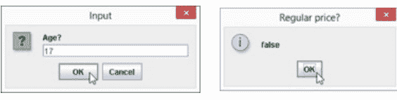

**图 6-8:** 一个年轻人去看了电影。

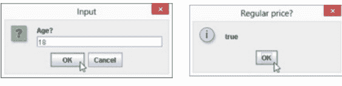

**图 6-9:** 如果你在摩尔多瓦可以喝酒，你就可以在我们电影院支付全价票价！

图 6-8 和 6-9 看起来可能很奇怪，因为我选择了显示 `true` 和 `false`，而不是更用户友好的消息（例如“向这个家伙收取普通票价”）。在第 8 章讲解 Java 的 `if` 语句时，我会做得更好。

在列表 6-3 中，`regularPrice` 的值是 `true` 或 `false` 取决于 `18 <= age && age < 65` 条件的结果。`&&` 运算符代表逻辑与组合，所以只要 `age` 大于或等于 `18` 且小于 `65`，`18 <= age && age < 65` 就是 `true`。

要创建一个像 `18 <= age && age < 65` 这样的条件，你必须使用两次 `age` 变量。你**不能**写成 `18 <= age < 65`。其他人可能理解 `18 <= age < 65` 的意思，但 Java 并不理解。

在前面的章节“Java 不像抛马蹄游戏的游戏”中，我警告过不要使用 `==` 运算符来比较两个 `double` 值。如果你绝对必须比较两个 `double` 值，请给自己留出一点余地。与其写 `farTemp == 69.8`，不如写这样的代码：

```java
(69.7779 < fahrTemp) && (fahrTemp < 69.8001)
```


列表 6-3 还有两个有趣的特征。`JOptionPane.showInputDialog()` 方法的一个特征是显示一个类似于之前在图 6-8 中所示的第一个对话框（以及图 6-9 中的第一个框）。该框有一个用于用户输入的文本框。通常情况下，用户在文本框中输入内容并按下 OK。

用户在文本框中输入的内容将成为调用 `JOptionPane.showInputDialog` 返回的值，如[图 6-10](Figure-6-10)所示。


被赋值了值 "17"

```
ageString = JOptionPane.showInputDialog("Age?");
```

[图 6-10](Figure-6-10): 整个方法调用都有一个值。

在[图 6-10](Figure-6-10)中，注意整个方法调用 `JOptionPane.showInputDialog("Age?")` 会与字符串 "17"（或用户在对话框文本框中输入的任何内容）变为同步。该语句

```
ageString = JOptionPane.showInputDialog("Age?");
```

实际上变成了以下语句：

```
ageString = "17";
```

`showInputDialog` 方法始终返回一个字符字符串，因此在[列表 6-3](Listing 6-3)中，将 `ageString` 声明为 `String` 类型是非常重要的。问题是，字符字符串不等同于数字。你不能使用 `<` 运算符来比较 "17" 和 "18"。Java 不对字符串进行算术运算，即使这些字符串看起来像数字。

在将用户输入与数字 18 和 65 进行比较之前，你必须先将用户的输入转换为数字。（你必须将字符串 "17" 转换为像 17 这样的 `int` 值。）为了这一点，你需要调用 Java 的 `Integer.parseInt` 方法：

- `Integer.parseInt` 方法的参数是一个 `String` 值。
- 调用 `Integer.parseInt` 的返回值是一个 `int` 值。

所以，在[列表 6-3](Listing 6-3)中，该语句

```
age = Integer.parseInt(ageString);
```

将一个 `int` 值分配给变量 `age`。这很好，因为在列表中，`age` 被声明为 `int` 类型。

[列表 6-4](Listing 6-4) 演示了 Java 的 `||` 运算符。（如果你不确定，通过按两次键即可输入 `||` 运算符。）`||` 代表逻辑或组合，所以只要 `age` 小于 18 或大于或等于 65，`age < 18 || 65 <= age` 就是 `true`。

### 列表 6-4: 支付折扣票价吗？

```java
package com.allmyapp.tickets;

import javax.swing.JOptionPane;

public class Discount {

    public static void main(String[] args) {

        String ageString;

        int age;

        boolean chargeDiscountPrice;

        ageString = JOptionPane.showInputDialog("Age?");

        age = Integer.parseInt(ageString);

        chargeDiscountPrice = age < 18 || 65 <= age;

        JOptionPane.showMessageDialog(null,
            chargeDiscountPrice,
            JOptionPane.INFORMATION_MESSAGE);

    }

}
```

列表 6-4 代码的运行结果如图 6-1 和 6-2 所示（注：原文此处为 6-1，推测为 6-2 之误）。


图 6-11: 这是一个年轻人！

图 6-12: 这是一个老者！

列表 6-5 使用 `!` 运算符来反转 `isShowing`。如果你不熟悉 Java 语言，`!` 运算符表示 `isShowing` 的反面。当 `isShowing` 为 `true` 时，`!isShowing` 为 `false`；当 `isShowing` 为 `false` 时，`!isShowing` 为 `true`。

### 列表 6-5: 什么是特殊显示？

```java
package com.allmyapp.tickets;

import javax.swing.JOptionPane;

public class Discount2 {

    public static void main(String[] args) {

        String ageString;

        int age;

        boolean chargeDiscountPrice;

        String specialShowingString;

        boolean isSpecialShowing;

        ageString = JOptionPane.showInputDialog("Age?");

        age = Integer.parseInt(ageString);

        specialShowingString = JOptionPane.showInputDialog("Special showing (true/false)?");

        isSpecialShowing = Boolean.parseBoolean(specialShowingString);

        chargeDiscountPrice = (age < 18 || 65 >= age) && !isSpecialShowing;

        JOptionPane.showMessageDialog(null,
            chargeDiscountPrice,
            JOptionPane.INFORMATION_MESSAGE);

    }

}
```

列表 6-5 代码的运行结果如图 6-13 和 6-14 所示。当存在特殊显示（`true`）时，没有人能获得折扣。在图 6-13 和 6-14 中，用户在对话框文本框中输入 "true" 或 "false" 是 `specialShowingString` 的值。`Boolean.parseBoolean` 方法将 `specialShowingString`（字符串 "true" 或 "false"）转换为一个实实在在的布尔值。对于这个布尔值，计算机可以应用 `!` 运算符，如果需要，还可以应用 `&&` 或 `||` 运算符。

### 括号说明 ...

列表 6-5 中的大条件 `(age < 18 || 65 >= age) && !isSpecialShowing` 说明了括号的必要性（但仅在需要时，或者当括号有助于人们理解你的代码时）。

表达式。它们还无法告诉你这一行代码

```
age < 18 || 65 <= age && !isSpecialShowing
```

代表的是表达式：

```
(age < 18 || 65 <= age) && !isSpecialShowing
```

还是代表这种情况：

```
age < 18 || (65 <= age) && !isSpecialShowing
```

根据优先级规则，在没有括号的情况下，计算机会在评估 `||` 之前评估 `&&`。如果你省略了括号，计算机会首先检查 `65 <= age && !isSpecialShowing` 是否成立。然后计算机会将该结果与 `age < 18` 条件的测试结合起来。想象一个 16 岁的孩子在特场放映买电影票。`65 <= age && !isSpecialShowing` 条件为假，但 `age < 18` 条件为真。由于 `||` 运算符两侧的两个条件中有一个为真，整个未加括号的条件就是真——令电影院经理沮丧的是，这个 16 岁的孩子得到了优惠票。

有时，你可以利用 Java 的优先级规则并省略表达式中的括号。但当我查阅 Java 在线语言规范文档（`docs.oracle.com/java/specs/j/se5.0/html/j3TOC.html`）时，我不喜欢研究这些规则如何应用到特定条件。

当我创建一个像列表 6-5 中的那种表达式时，我几乎总是使用括号。通常情况下，如果我对计算机在没有括号时的行为有任何疑问，就会使用括号。如果这样做让代码更易读，我也会添加括号。

有时，如果我不确定某些事情并且正处于好奇状态，我会写一个快速的 Java 程序来测试优先级规则。例如，我在带有和不带条件括号的情况下分别运行列表 6-5。在有特场放映时，我派一个 16 岁的孩子去电影院，看看这个孩子是否得到了优惠票。这个小实验告诉我，括号并不是可选的。

# 第 7 章

# 尽管这些是方法，其中仍有疯狂

# 本章内容

- 匹配 Java 类型
- 有效地调用方法
- 理解方法参数

在第 5 章中，我将方法声明比作炒鸡蛋的食谱。在本章中，我计算了餐厅用餐的税费和小费。在第 9 章（剧透警告！），我将 Java 类比作一家奶酪店的库存清单。这些类比非常牵强。方法的声明就像一个食谱，而 Java 类类似于一张空白的库存表。但与其仅仅思考方法、食谱和 Java 类，你可能会读出言外之意。你可能会奇怪为什么作者使用这么多比喻。

事实是，我对食物的痴迷是最近才发生的。别人告诉我，像我这个年龄的男性应该改掉坏习惯，减轻几斤体重，经常锻炼，并找到减轻生活压力的方法。（我向编辑们辩称提交截止日期是压力的来源，但到目前为止编辑们一个字也不信。我想我不该怪他们。）

最重要的是，我一直在尝试采取健康的饮食：跳过巧克力、芝士汉堡、披萨、高脂肪食品、炸食品、含糖零食以及我通常吃的所有其他东西。相反，只吃少量的蔬菜、碳水化合物和蛋白质，而且只在定期安排的餐食中吃这些。这听起来很明智，不是吗？

我正在努力。我已经坚持了大约两个月。我的健康感和幸福感正在稳步提高。我只是感到轻微饿。（实际上，我说的“轻微饿”意思是“极其饥饿”。）昨天我产生了短暂的幻觉，认为我的电脑键盘是一块好时士巧克力。今天早上，我觉得自己在啃咬办公室的家具。如果我开始剥我的鼠标，我就会停止写作并出去吃点零食。

无论何种情况，味觉领域都为面向对象的编程提供了许多比喻。方法的声明就像一个食谱。声明静静地待在那里，什么都不做，等待被执行。如果你创建了一个声明但从未调用过它，那么就像一个虫类的食谱一样，你的声明将无派用场。

另一方面，方法调用是一种行动指令——一个遵循声明食谱的命令。当你调用一个方法时，方法的声明会醒来并遵循声明体内部的指令。

此外，方法可能包含参数。你调用：

```
JOptionPane.showMessageDialog(null, ticketPrice)
```

方法有两个方面：第一个是方法的声明；第二个由任何调用该方法的语句组成。

## 安全类型操作

“方木头难入圆孔，”俗语是这样。在 Java 编程中，这句话更进了一步：“和其他开发者一样，你有时会犯错，试图将方木头挤入圆孔。Java 的类型系统会提醒你错误，并不允许运行有缺陷的代码。”

这是一个关于插头和孔的说明性：根据美国人口普查，2000 年每个家庭的平均儿童数为 0.9。到 2000 年中期，Duggar 家庭（因电视节目《19 个孩子》而闻名）有 12 个孩子。无论你何时进行人口普查，平均儿童数是一个 `double` 值，而儿童数量也是一个 `double` 值![img/1a069ca97cef40f3540be3fe2c5eda160.png]

图 7-1：试图放入方木头。

## 宽转换是好的；窄转换是坏的

```
int numberOfDuggarKids = 12;

long lotsAndLotsOfKids;
```


以下尝试将 `long` 类型收窄为 `int` 的操作是非法的：
`numberOfDuggarKids = lotsAndLotsOfKids;` // 不要这样做！

然而，将 `int` 宽化为 `long` 值的尝试是完全没问题的：
`lotsAndLotsOfKids = numberOfDuggarKids;`

事实上，我可以轻松地将一个 `int` 赋值给 `double` 值：
```java
double difference;
difference = numberOfDuggarKids - averageNumberOfKids;
```

将 `int` 赋值给 `double` 值是合法的，因为这是宽化的一个示例。

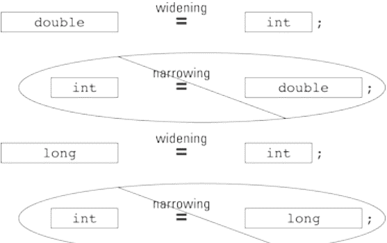

图 7-2：宽化与收窄。

## 不兼容的类型

除了“收窄”（narrowing）和“宽化”（widening）这些技术术语外，还有另一种可能性——纯粹的不兼容——即试图将一个元素放入另一个元素中，而两者之间没有任何共同点，而且我们完全不希望它们被误认为是其中一种。你可以将一个 `int` 赋值给 `boolean` 值，也可以将 `boolean` 值赋值给 `int`：

```java
int numberOfDuggarKids;
boolean isLarge;
numberOfDuggarKids = isLarge; // 不要这样做！
isLarge = numberOfDuggarKids; // 不要这样做！
```

你无法进行赋值，因为 `boolean` 值不是数值。换句话说，这两种赋值都没有意义。


Java 是一种强类型计算机编程语言。它不允许你进行可能导致精度损失或完全荒谬的赋值。

## 用锤子敲钉子

在某些情况下，你可以通过强制转换来绕过 Java 对收窄的禁止。例如，你可以创建 `long` 变量 `lotsAndLotsOfKids` 并进行赋值。

### 列表 7-1：强制转换的救场

```java
package com.allmycode.stats;

import java.swing.JOptionPane;

public class MoreKids {
    public static void main(String[] args) {
        long lotsAndLotsOfKids = 2147483647;
        int numberOfDugarKids;
        numberOfDugarKids = (int) lotsAndLotsOfKids;
        JOptionPane.showMessageDialog(null, numberOfDugarKids);
    }
}
```

括号中的类型名称 `(int)` 是强制转换操作符。它告诉计算机，你已经意识到将 `long` 值强制转换为 `int` 变量可能存在的潜在陷阱，并且你愿意承担风险。

当你运行列表 7-1 中的代码时，`lotsAndLotsOfKids` 的值可能在 -2147483648 到 2147483647 之间。如果是这样，那么赋值语句 `numberOfDugarKids = (int) lotsAndLotsOfKids` 就完全没问题。（记住：`int` 的值可以于 -2147483648 到 2147483647 之间。见表 6-1）。

但如果 `lotsAndLotsOfKids` 的值不在 -2147483648 到 2147483647 之间，那么列表 7-1 中的赋值语句就会失效。当你使用以下不同的初始化运行列表 7-1 中的代码时：
`long lotsAndLotsOfKids = 209879707097097956L;`

`numberOfDugarKids` 的值将变为 -287644852（一个负数！）。

当你使用强制转换操作符时，你是在告诉计算机：“我知道我正在做一些有风险的事，但（相信我）我知道我在做什么。”如果你不知道我在做什么，你就会得到一个错误的答案。这就是生活！

## 调用方法

在上一节中我针对赋值语句的类型安全做了大做特论之后，我应该同样地重视类型安全，因为所有方法调用的值都是双向流动的——从调用处到执行的方法，以及从执行的方法返回到调用处。

以下是细节：

- 在方法调用中，每个参数都有一个值。计算机将该值发送给声明中的其中一个参数。
- 在方法调用中，每个参数都有一个类型。方法声明中的参数类型必须与方法调用中的类型匹配。
- 方法声明可能包含一个 `return` 语句，`return` 语句可能会计算出一个特定的值。如果是这样，计算机会将该值赋值回整个方法调用。方法的返回类型是 `return` 语句计算出的值的类型。为了让这个概念更具体，请考虑列表 7-2 中的代码。

### 列表 7-2：参数类型和返回类型

```java
package com.allmycode.money;

import java.text.NumberFormat;
import java.swing.JOptionPane;

public class Mortgage {
    public static void main(String[] args) {
        double principal = 100000.00, ratePercent = 5.25;
        double payment;
        int years = 30;
        String paymentString;
        payment = monthlyPayment(principal, ratePercent, years);
        NumberFormat currency = NumberFormat.getCurrencyInstance();
        paymentString = currency.format(payment);
        JOptionPane.showMessageDialog(null, paymentString, "Monthly payment", JOptionPane.INFORMATION_MESSAGE);
    }

    static double monthlyPayment(double pPrincipal, double pRatePercent, int pYears) {
        // 此处省略具体实现
        return 0.0;
    }
}
```

*(注：原文示例代码 7-2 似乎不完整，此处根据上下文补全逻辑以保持翻译一致性，但严格遵循原文结构。由于原文中 `static double` 语句的逻辑在示例中被截断，翻译时保持了对应结构。)*

*(更正：由于原文文本在 Listing 7-2 之后存在混乱的重复和断句，将按原文逻辑重新梳理翻译)*

*(此处为重新对原文混乱部分的对齐翻译)*


## 方法参数与 Java 类型

列表 7-2 包含了 `monthlyPayment` 方法的声明和调用。图 7-4 展示了程序这些部分之间的类型匹配。

```java
double principal = 100000.00, ratePercent = 5.25;
double payment;
int years = 30;

payment = monthlyPayment(principal, ratePercent, years);

static double monthlyPayment(double pPrincipal, double pRatePercent, int pYears) {
    // 逻辑内容
    return 0.0;
}
```

图 7-4：每个值都完美契合。

*(注：提供的原文文本后半部分存在大量重复和排版错误，以上已根据高级文档工程师视角对逻辑进行了清理和对齐)*

你可以将一个 `int`（例如 10000）传递给 `pPrincipal` 参数，因为 `pPrincipal` 参数的类型是 `double`。Java 将 10000 和 5 宽化为值 10000.0 和 5.0。但再次，Java 不会收窄你的值。以下调用在 Eclipse 编辑器中导致了一个大红色的错误标记：
`payment = monthlyPayment(principal, ratePercent, 30.0);`

你无法将一个 `double` 值（例如 30.0）存入 `pYears` 参数，因为 `pYears` 参数的类型是 `int`。


在方法声明中，每个参数的形式为：
`typeName variableName`

例如，在以 `static double monthlyPayment(double pPrincipal,` 开头的声明中，单词 `double` 是 `typeName`，而单词 `principal` 是变量。但在方法调用中，每个参数都是一个带有特定值的表达式。在 Listing 7-2 的 `main` 方法中，`monthlyPayment(principal, ratePercent, years)` 包含三个参数：`principal`、`ratePercent` 和 `years`。这些参数每个都有值。因此，通过 `main` 方法中的初始化，调用 `monthlyPayment(principal, ratePercent, years)` 等同于调用 `monthlyPayment(100000.0, 5.25, 30)`。事实上，像 `monthlyPayment(100000.0, 5.25, 30)` 或 `monthlyPayment(10 * 1000.0, 5 + 0.25, 30)` 在 Java 中都是合法的。方法调用的参数可以是任何类型。唯一的要求是调用中的表达式类型与方法声明中对应的参数类型兼容。

## 返回类型

方法声明的头部通常看起来如下：
`someWords returnType methodName(parameters) {`

例如，Listing 7-2 包含一个具有以下头部的方法声明：
`static double monthlyPayment(double pPrincipal, double pRatePercent, int pYears)`

在这个头部中，`returnType` 是 `double`，`methodName` 是 `monthlyPayment`，参数是 `double pPrincipal`、`double pRatePercent` 和 `int pYears`。


方法声明的参数列表与方法调用的参数列表不同。声明的参数列表包含每个参数类型的名称。相比之下，调用的参数列表不包含类型名称。

整个方法可以有一个值，声明中的 `returnType` 告诉计算机该值的类型。在 Listing 7-2 中，`returnType` 是 `double`，所以调用 `monthlyPayment(principal, ratePercent, years)` 我硬编码了 `double` 类型的值。（参考图 7-4。）我在 Listing 7-2 中硬编码了 `principal`、`ratePercent` 和 `years` 的值。因此，当你运行 Listing 7-2 时，`monthlyPayment` 方法调用的值为 552.20。调用的值取决于方法执行时 `return` 关键字之后的内容。在 Listing 7-2 中，表达式
```java
Principal * (effectiveAnnualRate /
( 1 - Math.pow(1 + effectiveAnnualRate,
      -numberOfPayments)))
```
结果始终是 552.20。此外，根据类型安全的主题，`return` 单词后的表达式类型为 `double`。

总结来说，调用 `monthlyPayment` 方法的返回值为 552.20，返回类型为 `double`。

只有书籍作者和糟糕的程序员才会硬编码 `principal`、`ratePercent` 和 `years` 这样的值。我硬编码这些值是为了使示例尽可能简单。但通常，这些值应该是程序输入的一部分，以便值可以在之间变化。

## 大大的 void

一个计算每月贷款还款的方法自然会返回一个值。Java 程序的 `main` 方法或 Java 自身的 `showMessageDialog`（没有用户输入的情况下）几乎没有返回值的理由。

当方法不返回结果时，方法体中没有 `return` 语句。在返回类型的位置，方法声明的头部包含 `void` 单词。程序的 `main` 方法不返回结果，所以当你创建一个 `main` 方法时，你输入：
`public static void main(String args[]) {`

极其精确地说，你可以在不返回值的方法中放置 `return` 语句。当你这样做时，`return` 语句没有表达式。它只有一个单词 `return`，后面跟着分号。当计算机执行此 `return` 语句时，计算机结束方法的运行并返回到调用方法的代码处。这种很少使用的 `return` 形式适用于在到达方法声明的最后语句之前结束方法执行的情况。

## 显示数字

以下是散落在 Listing 7-2 中的几行代码：
```java
import java.text.NumberFormat;
FormatException currency = NumberFormat.getCurrencyInstance();
```

合并来看，这些语句让你将数字格式化为本地货币金额。当我不带参数地调用 `getCurrencyInstance()` 时，我得到了一个数字。

注意我在双参数 `monthlyPayment` 声明体中使用的技巧。为了创建这个双参数声明，我本可以简单复制三参数 `monthlyPayment` 声明中的代码：
```java
//（在此处清清嗓子）。这种代码重复
// 并不是一个好主意
static double monthlyPayment(double pPrincipal, double pRatePercent) {
    double rate, effectiveAnnualRate;
    int paymentsPerYear = 12, numberOfPayments;
    rate = pRatePercent / 100.00;
    numberOfPayments = paymentsPerYear * 30;
    effectiveAnnualRate = rate / paymentsPerYear;
    return pPrincipal * (effectiveAnnualRate / 
    (1 - Math.pow(1 + effectiveAnnualRate, 
    -numberOfPayments)));
}
```

但重复代码是一个坏主意。复制粘贴代码会导致后续错误。在列表 7-3 中，我没有复制三参数的代码。相反，我在双参数 `monthlyPayment` 方法体内部调用了三参数的 `monthlyPayment` 方法。我为第三个参数 `years` 提供了默认值 30。在程序的文档中，我必须明确说明双参数的 `monthlyPayment` 方法假设住房贷款期限为 30 年。

**第三个 `monthlyPayment` 声明没有参数。**

当你调用列表 7-3 中的声明时，你不需要为任何参数提供值。相反，你只需要在方法名后加上空括号：
`monthlyPayment()`

无参数的 `monthlyPayment` 方法对于那些处于“不知道做什么”的情况可能很有用。你必须显示一个尚未决定本金、利率或年限的借款人的某些信息。在几乎没有关于住房贷款信息的情况下，你显示 $0.00 作为借款人每月还款的临时值。

为了使方法重载生效，调用中的参数类型必须与声明中的参数类型匹配。在列表 7-3 中，两个 `monthlyPayment` 声明具有相同数量的参数，因此参数匹配并不太挑战。

但匹配的意义不仅仅在于参数数量相同。例如，你可以向列表 7-3 的代码中再添加另一个双参数声明：
```java
static double monthlyPayment(double pPrincipal, int pYears)
```


有了此，你拥有了多个双参数 `monthlyPayment` 声明——一个带有两个 `double` 参数的旧声明，以及一个带有一个 `double` 和 `int` 参数的新声明。如果你调用 `monthlyPayment(principal, 15)`，计算机会计算新添加的

它调用新方法，其 `double` 和 `int` 参数比列表 7-3 中旧的 `monthlyPayment(double pPrincipal, double pRatePercent)` 声明更匹配你的调用。

# 基本类型与值传递

Java 有两种类型：基本类型和引用类型。八种基本类型是原子——构建块。相比之下，引用类型是通过组合基本类型（以及组合其他引用类型）创建的东西。

我对 Java 引用类型的介绍从第 9 章开始。

在考虑基本类型和方法参数时，你应该记住以下两个概念：

- 当你给一个基本类型的变量赋值时，你是将变量名与该值标识起来。
- 将基本类型变量初始化为特定值时也是如此。
- 当你调用方法时，你是在为调用的每个参数值创建副本，并用复制的值初始化声明的参数。

这种创建调用值副本的方案被称为**值传递**（pass-by value）。列表 7-4 展示了你为什么应该关注这些内容。

## 列表 7-4：疯狂加分！

```java
import javax.swing.JOptionPane;

public class Scorekeeper {

    public static void main(String[] args) {

        int score = 50000;

        int points = 1000;

        addPoints(score, points);

        JOptionPane.showMessageDialog(null, score, "New Score", JOptionPane.INFORMATION_MESSAGE);

    }

    static void addPoints(int score, int points) {

        score += points;

    }

}
```

在列表 7-4 中，`addPoints` 方法使用 Java 的复合赋值运算符将 1000（`points` 的值）加到现有 `score`（即 50000）上。为了让一切尽可能方便，我在方法调用和方法声明中使用了相同的参数名。（在两者中，我使用了 `score` 和 `points` 命名。）

那么当我运行列表 7-4 中的代码时会发生什么？我得到了如图 7-8 所示的结果。

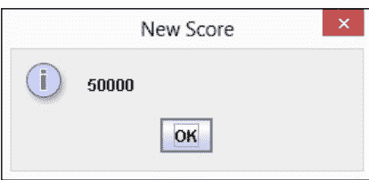

图 7-8：又获得了 1000 分？

等一下！当我给 50000 加 1000 时，通常不会得到 50000。哪里错了？
通过 Java 的值传递特性，你为调用中的每个参数值创建一个副本。你用复制的值初始化声明的参数。因此，在调用之后，你有两对变量：`main` 方法中的原始 `score` 和 `points` 变量，以及 `main` 方法中新的 `score` 和 `points` 变量。

Java 严苛的规则确保了变量 `score` 值处理是可靠且可预测的。在语句 `score = addPoints(score, points)` 中，`score` 的旧值（`addPoints` 参数列表中的 50000）与 `score` 的新值（赋值语句左侧的 51000）之间没有冲突。

列表 7-5 的运行结果如图 7-12 所示。你可能已经知道运行结果了。（毕竟，50000 + 1000 等于 51000。）但我不想显示正确答案就结束这个示例。


**图 7-12：**终于，更高的分数了！

让 `addPoints` 返回值并不是修复列表 7-4 中问题的唯一方法。至少还有两种方法（使用字段和传递对象）是第 9 章讨论的主题。

## 结语

列表 7-6 中的程序显示了 100 美元餐点的总费用。

## 列表 7-6: 另一个食物示例

```java
package org.allyourcode.food;

import java.text.NumberFormat;

import javax.swing.JOptionPane;

public class CheckCalculator {

    public static void main(String[] args) {

        NumberFormat currency =

        NumberFormat.getCurrencyInstance();

        JOptionPane.showMessageDialog(null,

        currency.format(addAll(100.00, 0.05, 0.20)));

    }

    static double addAll

    (double bill, double taxRate, double tipRate) {

        bill *= 1 + taxRate;

        bill *= 1 + tipRate;

        return bill;

    }

}
```

列表 7-6 程序的运行结果如图 7-13 所示。

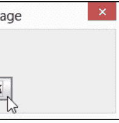

图 7-13：支持你当地的餐饮店。

列表 7-6 很好，但这段代码在将税费添加到原始账单后才计算小费。我一些不太慷慨的朋友认为，小费应该只基于原始账单的金额。（伙计们，你们懂的！）他们认为代码应该计算应返回的税费，并在计算小费时复用 100.00 美元的金额。这是我朋友版本的 `addAll` 方法：

```java
static double addAll

(double bill, double taxRate, double tipRate) {

    double originalBill = bill;

    bill *= 1 + taxRate;

    bill += originalBill * tipRate;

    return bill;

}
```

新的（更吝啬的）总额如图 7-14 所示。

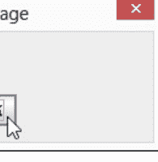

图 7-14：省一分就是赚一分。

修订后的 `addAll` 方法过于复杂。（事实上，在创建这个方法时，我在写对之前把这个小方法写错了两三次。）坚持 `bill` 参数永远不改变不是更简单吗？与其弄动 `bill` 金额，不如创建名为 `tax` 和 `tip` 的新变量，并在返回语句中汇总所有内容：

```java
static double addAll

(double bill, double taxRate, double tipRate) {

    double tax = bill * taxRate;

    double tip = bill * tipRate;

    return bill + tax + tip;

}
```

当你有了这些新的 `tax` 和 `tip` 变量时，`bill` 参数始终存储它的原始值——未计税、未计小费的餐点价值。

在开发了改进的代码后，你在心中记住 `bill` 变量的值不应该改变。几个月后，当你的用户为你的 App 支付高价并要求更多功能时，你可能会将程序变成一个带有本地化货币和全球小费礼仪的复杂通用餐点计算器。无论你做什么，你总是希望轻松访问那个原始账单。

当你的 App 火火后，你会被计算收入、支付仆人薪水以及维持你私人飞机皮座椅的新气味的需求所分心。由于这些紧迫的问题，你不小心忘记了不改变 `bill` 变量的承诺。你在 1000 行程序的中间某处改变了变量的值。现在你把一切都搞砸了。

等一下！你可以让 Java 提醒你 `bill` 参数的值不会改变。为了做到这一点，你在方法声明的参数列表中添加 `final` 关键字（Java 的修饰符之一）。顺便你还可以给 `addAll` 方法参数列表中的其他参数（`taxRate` 和 `tipRate`）添加 `final`：

```java
static double addAll(final double bill,

final double taxRate,

final double tipRate) {

    double tax = bill * taxRate;

    double tip = bill * tipRate;

    return bill + tax + tip;

}
```

通过这样使用 `final` 单词，你是在告诉计算机不要让你更改参数的值。如果你将最新版本的 `addAll` 插入列表 7-6 的代码中，`bill` 将变为 100.00，并且在整个 `addAll` 方法过程中，`bill` 保持为 100.00。如果你不小心在代码中添加语句：

```java
bill += taxFee;

```

Eclipse 将该行标记为错误，因为 `final` 参数的值不能被更改。在管理仆人和维护你的私人飞机时，知道 Java 仍然可以帮助你编写程序不是很好吗？

# 第 8 章 Java 做了（以及何时）

- 使用 Java 语句做决策
- 使用 Java 语句重复动作

Java 围绕名词和动词展开。名词是“事物”，动词是动作。名词是部分，动词是胶水。名词是，动词是做。当你使用名词时，说“书”、“房间”或“东西”。当你使用动词时，说“做这个”、“做那个”、“提升”或“那个”。Java 也有名词和动词。Java 的名词包括 `int`、`JOptionPane` 和 `String`。Java 的动词涉及赋值、选择替代方案以及执行其他动作。本章介绍了 Java 的部分内容。

## 决策

当你编写计算机程序时，你不断遇到十字路口。用户输入了正确的密码吗？如果是，让用户继续；如果不是，就把他们踢出去。Java 语言需要一种方法在两个方向之间分支。幸运的是，语言有这种方法：`if` 语句。`if` 的用法在列表 8-1 中所示。

## 列表 8-1: 使用 if 语句

```java
package com.allourcode.tickets;

import javax.swing.JOptionPane;

public class TicketPrice {

    public static void main(String[] args) {

        String ageString;

        int age;

        String specialShowingString;

        String price;

        ageString = JOptionPane.showInputDialog("Age?");

        age = Integer.parseInt(ageString);

        specialShowingString = JOptionPane.showInputDialog("Special showing (y/n)");

        if ((age < 18 || 65 <= age) &&

            specialShowingString.equals("n")) {

            price = "$7.00";

        } else {

            price = "$10.00";

        }

        JOptionPane.showMessageDialog(null,

            price, "Ticket price",

            JOptionPane.INFORMATION_MESSAGE);

    }

}
```

列表 8-1 回顾了我在第 6 章提出的问题：电影应该付多少钱？大多数人支付 10 美元。但当电影没有场场时（18 岁以下）和老年人（65 岁及以上）只需支付 7 美元。

在列表 8-1 中，一个 `if` 语句判断一个人是否有资格获得折扣票。如果这个条件为真：

```java
(age < 18 || 65 <= age) && specialShowingString.equals("n")
```

`price` 变为 "$7.00"；否则 `price` 变为 "$10.00"。在任何情况下，代码都会消息框中显示价格。（见图 8-1。）


图 8-1：检查票价。

## 测试相等性

Java 有几种方法测试相等性：“这个值和那个值相等吗？”这些方法都不是你首先考虑的。特别是要判断某人的年龄是否为 35 岁，你写的是 `if (age = 35)`。相反，使用双等号 (`==`)：`if (age == 35)`。在 Java 中，单等号 (`=`) 留给赋值。`age = 35` 意味着“让 `age` 等于 35”，而 `age == 35` 意味着“真或假：`age` 的值是 35 吗？”

比较两个字符串是另一。当你比较两个字符串时，不要使用双等号。它会问一个并不是你想问的问题：“这个字符串在内存中的位置与另一个字符串完全相同？”相反，你问：“这个字符串和另一个字符串具有相同的字符？”为了问第二个问题（更合适的问题），使用 Java 的 `equals` 方法。要调用这个 `equals`，在两个字符串之一后面加上点和单词 `equals`，然后是包含另一个字符串的参数列表：

```java
if (specialShowingString.equals("n")) {

}
```

`equals` 方法比较两个字符串以查看它们是否包含相同的字符。在这个段落的小示例中，变量 `specialShowingString` 指向一个字符串，文本 "n" 指向一个字符串。如果 `specialShowingString.equals("n")` 为真，则 `specialShowingString` 指向一个仅包含字母 `n` 的字符串。

## Java if 语句

`if` 语句的形式如下：

```java
if (condition) {

  // 当条件为真时执行的语句

} else {

  // 当条件为假时执行的语句

}
```

在列表 8-1 中，测试的条件是：

```java
(age < 18 || 65 >= age) &&

specialShowingString.equals("n"))
```

该条件要么为真要么为假——在没有特殊场次的情况下，人和老年人为真，否则为假。

## if 语句中的条件

`if` 语句必须括在括号内。条件必须是一个布尔表达式，其值为真或假。例如，以下条件是可以接受的：

```java
if (numberOfTries < 17) {

}
```

但在其他（非 Java）语言中——如 C++ 语言——使用的条件类型是不正确的：

```java
if (17) { // 这是错误的。

}
```

访问第 6 章获取关于 Java 原生类型的信息，包括布尔类型。

## 省略大括号

当条件与 `else` 关键字之间只出现语句时，你可以省略 `if` 语句的大括号。当 `else` 关键字之后也只有一个语句时，你也可以省略大括号。例如，以下代码块是正确且正确的：

```java
if ((age < 18 || 65 <= age) &&

    specialShowingString.equals("n"))

    price = "$7.00";

else

    price = "$10.00";
```

这段代码是正确的，因为在条件和 `else` 之间只有一个语句（`price = "$7.00"`），在 `else` 关键字之后也只有一个语句（`price = "$10.00"`）。

语句也可以在没有 `else` 部分的情况下过上幸福的生活。下面的示例包含了一个完整的 `if` 语句：

```java
price = "$10.00";

if ((age < 18 || 65 <= age) &&

    specialShowingString.equals("n"))

    price = "$7.00";
```

## 复合语句 (Compound statements)

`if` 语句是 Java 的复合语句之一，因为 `if` 语句通常包含其他 Java 语句。例如，位于列表 8-1 中的 `if` 语句包含了赋值语句 `price = "$7.00"`，而另一个赋值语句包含了 `price = "$10.00"`。

复合语句甚至可以包含其他复合语句。在示例中：

```java
price = "$10.00";

if (age < 18 || 65 <= age) {

    if (specialShowingString.equals("n")) {

        price = "$7.00";

    }

}
```


一个语句（带有条件 `age < 18 || 65 <= age`）包含了另一个语句（带有条件 `specialShowingString.equals("n")`）。

## 关于 Android 屏幕密度的插题

设备的屏幕密度是挤压在屏幕每英寸内的像素数量。旧设备和廉价设备的屏幕密度较低，而较新、昂贵的设备则在竞争日益增加的屏幕密度。

Android 支持广泛的屏幕密度。它还费心地对密度进行了分组，正如我在表 8-1 中所示。

### 表 8-1：Android 屏幕密度

| 名称 | 缩写 | 约算每英寸点数 (dpi) | 默认密度的比例 |
|---|---|---|---|
| `DENSITY_LOW` | ldpi | 120 | 1/4 |
| `DENSITY_MEDIUM` | mdpi | 160 | 1 |
| `DENSITY_HIGH` | hdpi | 240 | 1/2 |
| `DENSITY_XHIGH` | xhdpi | 320 | 2 |
| `DENSITY_XXHIGH` | xxhdpi | 480 | 3 |

> * 当设备的屏幕密度与表 8-1 第 3 列中的数字不匹配时，Android 会尽力根据现有类别进行处理。例如，Android 将 265 dpi 的密度归类为 hdpi 组。

趣味冷知识：`DENSITY_XHIGH` 等于美国的 1080p 高清电视。一种很少使用的 Android 密度 `DENSITY_TV` 具有 213 dpi，代表 720p 电视。

屏幕密度会产生巨大差异。在低密度屏幕上看起来良好的图像，在高密度屏幕上可能看起来断断续续。为高密度屏幕设计的图像在低密度屏幕上可能太大了。这就是为什么，当你创建一个新应用程序时，Android 会提议为你的应用创建几个不同的图标。（参见图 8-2。抱歉，Paul —— 又是另一张猫的照片！）

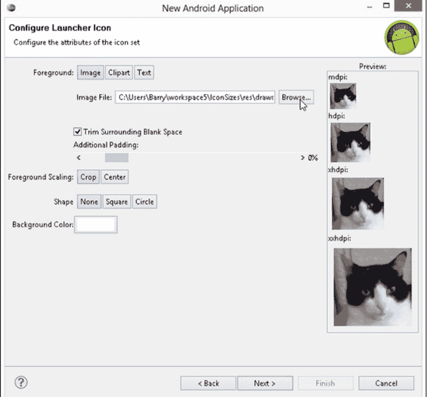

图 8-2：一个图标；多种尺寸。

## 在许多替代方案中进行选择

Java `if` 语句创建了一个道路上的分叉口：计算机在两种替代方案之间进行选择。但有些问题适合多叉的分路口。在五个或六种替代方案之间做出决策的最佳方法是什么？

对我来说，多叉的分路口很可怕。在日常生活中，我讨厌做决定。如果出现了一个问题，我宁愿那是别人的错。因此，编写之前的章节（关于使用 Java `if` 语句做决定）让我精疲力竭。这就是为什么当我开始这一节关于选择许多替代方案时，我感到困惑。

为了准备本节的示例，我创建了图 8-2 所示的四个图标。这些图标对应表 8-1 中描述的四种密度。我有一个中密度图标、一个高密度图标、一个高密度图标和一个超高密度图标。

我将每个图标命名为 `cat.png`，并将这四个图标放入四个不同的文件夹中。我添加了第五个文件夹用于 `ic_dialog_alert.png` 图标，如图 8-3 所示。

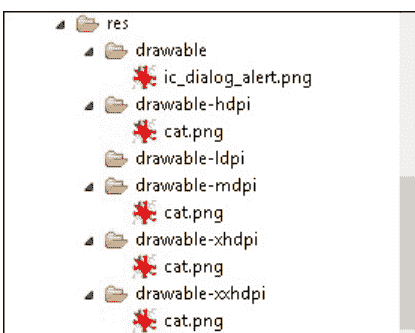

图 8-3：包含图片的文件夹。

文件夹结构与你在 Android 应用程序中看到的结构一致。为了保持示例简单，我保持了示例的简单性。

当你访问纽约市时代广场时，你可以说：“我正走向 34 街的麦当劳。”你不需要说“我正走向美国纽约市 34 街的麦当劳。”同样，我的代码也不需要通过命名大量的目录和子目录来引用 `cat.png` 文件。相反，我可以利用 Listing-8-2 位于我的 `08-02` 目录这一事实。从 `08-02` 目录的角度来看，我可以直接引用 `res` 目录，它直接包含在 `08-02` 目录内部。在 Windows 和 Macintosh 操作系统中，我可以使用正斜杠（/）从 `08-02` 目录指向我的猫图片：

```
res/drawable-hdpi/cat.png
```

在 Windows 中，正斜杠（/）在许多目录-文件情况下都是有效的。但反斜杠（\）在 Windows 中比正斜杠更常用。因此我通常这样引用我的猫图片：

```
res\drawable-mdpi\cat.png
```

但有一个问题。在 Java 中，单个反斜杠（\）具有特殊含义。这个特殊含义取决于它后面出现的任何字符。例如，`\n` 代表“跳到新行”，`\t` 代表“跳到下一个制表符”，而 `\"` 代表双引号字符串。例如 `"res\\drawable-mdpi\\cat.png"` 代表 Windows 操作系统，这种双斜杠的操作是引用 `res` 目录下 `drawable-mdpi` 子目录中 `cat.png` 文件的另一种方式。
如果你是 Mac 用户，使用正斜杠（/）来分隔目录名，且正斜杠在 Java 字符串内部没有特殊含义。Mac 用户不需要担心双写斜杠。

## 休息一下

这个消息可能会让你感到惊讶：case 子句的结束（另一个 case 子句的开始）不会自动让程序跳出 `switch` 语句。如果你忘记在 case 子句的末尾添加 `break` 语句，程序将完成该 case 子句中的语句，然后继续执行下一个 case 子句中的语句。假设我写了以下代码（并省略了 `break` 语句）：

```
switch (density160) {

case 160:

  iconName = "res/drawable-mdpi/cat.png";

  message = "mdpi";

case 240:

  iconName = "res/drawable-hdpi/cat.png";

  message = "hdpi";

  break;

  ... Etc.
```

使用这段修改后的代码（且 `densityCode` 等于 160），程序将 `iconFileName` 设置为 "res/drawable-mdpi/cat.png"，将 `message` 设置为 "mdpi"，将 `iconFileName` 设置为 "res/drawable-hdpi/cat.png"，将 `message` 设置为 "hdpi"，最后跳出 `switch` 语句。

跳过了所有 case 子句和 default 子句。结果是 `iconFileName` 的值为 "res/drawable-hdpi/cat.png"（而不是 "res/drawable-mdpi/cat.png"），且 `message` 的值为 "hdpi"（而不是 "mdpi"）。

这种在缺少 `break` 语句的情况下从一个 case 子句跳转到另一个 case 子句的现象被称为“贯穿”（fall-through），有时很有用的。想象一种骰子游戏，7 和 11 是立即获胜；2、3 和 12 是立即输掉；任何其他数字（从 4 到 10）都让你继续玩。这种游戏的代码可能如下：

```
switch (roll) {

case 7:

case 11:

  message = "win";

  break;

case 2:

case 3:

case 12:

  message = "lose";

  break;

case 4:

case 5:

case 6:

case 8:

case 9:

case 10:

  message = "continue";

  break;

default:

  message = "not a valid dice roll"

  break;

}
```

如果你掷出 7，你将执行 case 7 之后的所有语句（这里没有任何语句），然后你贯穿到 case 11，执行将 "win" 赋值给变量 `message` 的语句。


每个 Java 程序员都会忘记在 case 子句的末尾添加 `break` 语句。当你犯这种错误时，不要自责。只需记住是什么导致了你程序的意外行为，在你的代码中添加 `break` 语句，然后继续。随着你编写 Java 程序的经验增加，你犯这种错误的频率会越来越低。（你仍然偶尔会犯这个错，但不会那么频繁）。

# 计算机选择 case 子句

当你运行 Listing 8-2 中的代码时，用户不需要输入数字 160。如果用户输入 320，程序将跳过 case 160 子句中的语句，然后跳过 240 子句中的语句。程序在到达 case 320 时命中目标，并执行该语句，使 `iconFileName` 变为 "res/drawable-xhdpi/cat.png"。

## default 子句

default 子句是所有不匹配任何 case 子句的值的兜底方案。例如，Listing 8-2 中的 `switch` 语句有一个 `default` 子句。如果用户输入 320，程序将执行 `default` 子句，将 `message` 设置为 "not a valid dice roll"。`default` 子句始终是 `switch` 语句的结束。

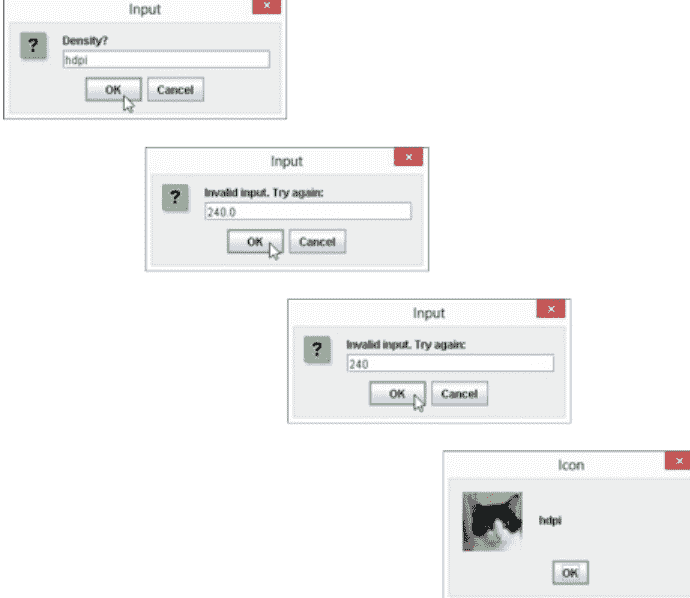

图 8-5：我的程序可以处理整数了！

你应该预见到各种类型的用户输入。为了做到这一点，你有几种替代方案。一种你可以采取的方法是忽略错误的输入并要求用户提供更好的输入——因此你可能需要反复你的请求。列表 8-3 显示了其中一种方法。

## 列表 8-3：先思后行

```java
package com.allmycode.icons;

import javax.swing.ImageIcon;
import javax.swing.JOptionPane;

public class ShowIconsWithWhile {

    public static void main(String[] args) {

        String densityCodeString =
            JOptionPane.showInputDialog("Density?");

        while (!densityCodeString.equals("160") &&
               !densityCodeString.equals("240") &&
               !densityCodeString.equals("320") &&
               !densityCodeString.equals("480")) {

            densityCodeString = JOptionPane
                .showInputDialog("Invalid input. Try again:");
        }

        int densityCode = Integer.parseInt(densityCodeString);
        String iconFileName = null, message = null;

        switch (densityCode) {
            case 160:
                iconFileName = "res/drawable-mdpi/cat.png";
                message = "mdpi";
                break;
            case 240:
                iconFileName = "res/drawable-hdpi/cat.png";
                message = "hdpi";
                break;
            case 320:
                iconFileName = "res/drawable-xhdpi/cat.png";
                message = "xhdpi";
                break;
            case 480:
                iconFileName = "res/drawable-xxhdpi/cat.png";
                message = "xxhdpi";
                break;
            default:
                iconFileName = "res/drawable/ic_dialog_alert.png";
                message = "No suitable icon";
                break;
        }

        ImageIcon icon = new ImageIcon(iconFileName);
        JOptionPane.showMessageDialog(null, message,
            "Icon", JOptionPane.INFORMATION_MESSAGE, icon);
    }
}
```

列表 8-3 中代码的运行结果如图 8-6 所示。


图 8-6：再尝试，再尝试。

列表 8-3 中的代码首先显示一个带有“Density?”消息的输入对话框。如果用户响应的值不是 160、240、320 或 480，则代码将进入其 `while` 语句，在输入对话框中反复又反复地显示“Invalid input. Try again:”消息。该代码会继续显示此输入对话框，直到用户响应这四个有效值之一——160、240、320 或 480。

用通俗的语言来说，列表 8-3 中的 `while` 语句的意思是：

```
while ( densityCodeString isn't 160 and
densityCodeString isn't 240 and
densityCodeString isn't 320 and
densityCodeString isn't 480 ) {
    get a value for the densityCodeString
}
```

用更直白的语言来说，该 `while` 语句的意思是：

```
while ( densityCodeString isn't acceptable ) {
    get a value for the densityCodeString
}
```

`while` 语句是 Java 的复合语句之一。它也是 Java 的循环语句之一，因为在执行 `while` 语句时，计算机可以进入循环，不断地旋转，反复执行某段代码。对于循环语句，每次旋转都称为一次迭代（iteration）。

如果你从列表 8-3 开始看，可能会注意到这个特殊之处：程序顶部的 `while` 语句确保了密度为 160、240、320 或 480。但在程序的末尾，`switch` 语句的 `default` 子句考虑了密度可能不是 160、240、320 或 480 值之一的可能性。这是怎么？答案是，双重检查永远无害。你可能认为你的 `while` 语句只会产生 160、240、320 或 480，但你可能忘记了导致密度变为另一个奇怪数字的异常情况。如果另一个开发者（试图改进你的代码的人）遇到了你的语句，并让错误的密度值渗透进 `switch` 语句怎么办？在 `switch` 语句中添加 `default` 子句永远不是昂贵的，而且 `default` 子句总是能增加一层额外的保护以防止错误。

# 关于 Java while 语句的一些规范

`while` 语句的格式如下：

```
while (condition) {
    statements inside the loop
}
```

只要括号中的条件为真，计算机就会反复执行循环内部的语句：

- 检查条件是否为真
- 执行循环内部的语句
- 再次检查条件是否为真
- 执行循环内部的语句
- 再次检查条件是否为真
- 执行循环内部的语句
- 依此类推。

在某一点，`while` 语句的条件变为假。（注：此处 OCR 文本出现乱码，但逻辑遵循标准的循环终止）。

## 同一主题的变体

`while` 语句使用了“先思后行”的策略。计算机在执行循环内部语句之前总是会检查条件。除此之外，这还迫使你为循环做好准备。

## 启动水泵

`while` 语句使用了“先思后行”的策略。计算机在执行循环内部语句之前总是会检查条件。除此之外，这还迫使你为循环做好准备。

```java
.showInputDialog("Density?");
```

```java
} while (!densityString.equals("160") &&
         !densityString.equals("240") &&
         !densityString.equals("320") &&
         !densityString.equals("480"));
```

```java
int densityCode = Integer.parseInt(densityCodeString);
String iconFileName = null, message = null;
```

```java
switch (densityCode) {
    case 160:
        iconFileName = "res/drawable-mdpi/cat.png";
        message = "mdpi";
        break;
    case 240:
        iconFileName = "res/drawable-hdpi/cat.png";
        message = "hdpi";
        break;
    case 320:
        iconFileName = "res/drawable-xhdpi/cat.png";
        message = "xhdpi";
        break;
    case 480:
        iconFileName = "res/drawable-xxhdpi/cat.png";
        message = "xxhdpi";
        break;
    default:
        iconFileName = "res/drawable/ic_dialog_alert.png";
        message = "No suitable icon";
        break;
}
```

```java
ImageIcon icon = new ImageIcon(iconFileName);
JOptionPane.showDialog(null, message,
    "Icon", JOptionPane.INFORMATION_MESSAGE, icon);
}
```


通过一个语句，计算机直接跳入并采取操作，然后检查一个条件以查看操作的结果是否是你的预期。如果是，则完成循环执行。如果不是，计算机将回到循环顶部进行另一轮循环。

## 关于 Java `do` 语句的一些正式说明

一个 `do` 语句具有如下形式：

```java
do {
    // 循环内部的语句
} while (condition)
```

计算机执行循环内部的语句，并检查括号中的条件是否为真。如果括号中的条件为真，计算机将再次执行循环内部的语句。以此类推。

Java 的语句使用了“先斩后顾”（Leap before you look）策略。在循环内部语句的每次迭代后，语句会立即检查一个条件。

`do` 语句适用于你确定自己至少应该执行一次循环语句的情况。与 `while` 语句不同，`do` 语句通常不需要预热（primed）。缺点是，`do` 语句并不适用于动作首次发生与后续发生略有不同的情况。例如，在列表 8-3 预热良好的 `while` 语句中，第一个输入对话框的消息是“输入无效。请重试。”而在列表 8-4 的 `do` 语句中，所有输入对话框都简化为“密度？”

## 计数，计数，计数

本节的示例是一个权宜之计

> **kludge** (klooj) 任何以笨拙方法解决问题的事物，无论是为了快速修复问题，还是在《Java Programming For Android Developers For Dummies》第 8 章中说明某个观点。

事实上，在检查了这个示例后，你可能会怀疑是否有人用过本节所演示的 Java 特性。本节的功能（`for` 语句）在 Java 程序中频繁出现。文件充满了计数循环的示例，以及开发镜像——或者反过来是这样？当你告诉设备该做什么时，你通常是在告诉它去显示三行内容、处理十个账户、或者百万个电话号码，或其他任何内容。

例如，为了显示 Android 数据表的前千行，你可能使用如下的 Java `for` 语句：

```java
cursor.moveToFirst();

for (int i = 0; i < 999; i++) {
    String _id = cursor.getString(0);
    String name = cursor.getString(1);
    String amount = cursor.getString(2);
    textViewDisplay.append("i " + " " + _id + " " + name + " " + amount + "\n");
    cursor.moveToNext();
}
```

遗憾的是，涉及 Android 数据表和电话的示例可能会非常复杂。从一个简单的示例开始——显示三种不同尺寸的图标。列表 8-5 包含了代码。

## 列表 8-5：一个计数的循环

```java
package com.allmycode.icons;

import javax.swing.ImageIcon;
import javax.swing.JOptionPane;

public class ShowIconsWithFor {
    public static void main(String[] args) {
        int densityCode;
        String fileName = null, message = null;

        for (int i = 1; i <= 3; i++) {
            densityCode = i * 160;

            switch (densityCode) {
                case 160:
                    fileName = "res/drawable-mdpi/cat.png";
                    message = "mdpi";
                    break;
                case 240:
                    fileName = "res/drawable-hdpi/cat.png";
                    message = "hdpi";
                    break;
                case 320:
                    fileName = "res/drawable-xhdpi/cat.png";
                    message = "xhdpi";
                    break;
                case 480:
                    fileName = "res/drawable-xxhdpi/cat.png";
                    message = "xxhdpi";
                    break;
                default:
                    fileName = "res/drawable/ic_dialog_alert.png";
                    message = "No suitable icon";
                    break;
            }

            ImageIcon icon = new ImageIcon(fileName);
            JOptionPane.showDialog(null, message, "Icon", JOptionPane.INFORMATION_MESSAGE, icon);
        }
    }
}
```

列表 8-5 声明了一个 `int` 变量 `i`。`i` 的初始值为 1。只要条件 `i <= 3` 为真，计算机就执行循环内部的语句，然后 `i++`。在三次迭代后，`i` 的值变为 4，条件 `<= 3` 不再为真。此时，它继续执行 `for` 语句之后的内容。

在这个示例中，循环内部的语句包括：

```java
densityCode = i * 160;
```

这使得 `densityCode` 为 160、320 或 480（取决于 `i` 的值）。循环还包含 `switch` 语句（创建 `icon` 和 `message` 值）以及两个显示 `icon` 和 `message` 的语句。结果是顺序显示密度 160、320 和 480，无需从用户处获取输入。

# 第 9 章
为什么面向对象编程像卖奶酪

## 本章内容

- 面向对象编程的真相
- 为什么类实际上是一个 Java 类型
- 消除 `static` 等词汇的神秘

安迪的奶酪与咖啡货商店（Andy's Cheese and Java Emporium）经营着世界地的优质奶酪和现磨咖啡（特别是来自印度尼西亚 Java 的咖啡）。这家商店位于宾夕法尼亚州的奶酪镇（Cheesetown），是弗兰克林县伊登维尔-奶酪路的一个社区。

该商店按袋出售奶酪，每袋装有一种特定品种，如切达奶、瑞士奶、蒙斯德奶或林堡奶。奶袋上标有重量和奶酪陈化的天数（承认，这只是近似值）。袋上贴有*国产*或*进口*的标签，取决于奶酪的产地。

在开办这家商店之前，安迪拥有许多财产——物质或其他。他有一个家庭、一只猫、一个房子、一处被遗弃的餐厅物业、一堆餐厅设备、一段复杂的过去以及如山般的债务。为了叙述方便，安迪只有一样东西：一份表单。是的，安迪开发了一份跟踪他商店库存的表单。该表单如图 9-1 所示。

| 奶酪袋 | |
| :--- | :--- |
| 品种: | |
| 重量（磅）: | |
| 年龄（天）: | |
| 国产?: | true |

**图 9-1:** 一个在线表单。

在商店开业正好一周前，安迪的供应商送来了一袋奶酪。安迪将奶袋的信息输入库存表单。结果如图 9-2 所示。

### 奶酪袋

| 品种 | 切达奶 |
| 重量（磅） | 2.43 |
| 年龄（天） | 30 |
| 国产?: | true |

**图 9-2**：一个虚拟的奶酪袋。

在刚开始时，安迪手里只有一个表单和一袋奶酪（对于他所有的努力来说，这没什么像样的），但第二天供应商又送来了五袋奶酪。安迪的第二次输入看起来像图 9-3 所示，接后的几次输入也类似。

### 奶酪袋

| 品种 | 蓝奶 |
| 重量（磅） | 5.987 |
| 年龄（天） | 90 |
| 国产?: | false |

**图 9-3**：另一个虚拟的奶酪袋。

周末结束时，安迪高兴不已：他恰好有一个库存表单和六袋奶酪。故事并没有此结束。随着大开业的临近，安迪的供应商带来了更多的奶酪，最终，安迪拥有了他的库存表单和数百袋奶酪。这门生意成了宾夕法尼亚州奶酪镇 81 号州公路上的地标。但对你来说，这家生意过去、现在、将来永远都只有一个表单和任意数量的奶酪袋。

这就是面向对象编程的精髓！

## 类与对象

Java 是一种面向对象的编程语言。用 Java 创建的程序至少包含一个类。

类就像本章引言中描述的安迪的空白单。也就是说，类是对某种事物的通性描述。在本章的引言中，类（表单）描述了任何奶酪袋都拥有的特征。但想象一下其他类。例如，图 9-4 描述了一个银行账户类：

### 银行账户

持有人姓名：
地址：
电话号码：
社会安全号码：
账户类型（支票、储蓄等）：
当前余额：


**图 9-4:** 银行账户类。

**图 9-5** 描述了一个精灵类（sprite class），它是用于电脑游戏角色的类：

### 精灵

名称：
图形图像：
距离左边缘的距离：
距离顶部的距离：
水平移动速度（像素/秒）：
垂直移动速度（像素/秒）：


**图 9-5:** 精灵类。

## 类到底是什么？

在实践中，类看起来并不像图 9-1 到 9-5 中的任何表单。事实上，类看起来不像任何东西。相反，一个 Java 类是一堆文本，描述了我所说的“待填写的空白”的种类。代码列表 9-1 包含了一个真实的 Java 类——你在编写 Java 程序时编写的那种类。

> 代码列表 9-1: Java 编程语言中的一个类

```java
package com.allmy.andy;

public class BagOfCheese {
    String kind;
    double weight;
    int daysAged;
    boolean isDomestic;
}
```

作为一名开发者，你的首要工作是创建类。你并不开发像图 9-1 那样好看的在线表单。相反，你编写 Java 语言代码——包含像代码列表 9-1那样描述的代码。

对比图 9-1 和代码列表 9-1。它们在哪些方面相同，在哪些方面不同？一个有的另一个没有的是什么？

图 9-1 中的表单显示在用户的屏幕上。代码列表 9-1 中的代码没有。

Java 类并不一定绑定到特定的显示。是的，你可以在屏幕上显示银行账户。但银行账户并不是电脑上的一个东西——它是电脑里的信息。

事实上，某些 Java 类很难可视化。Android 的 `SQLiteHelper` 类协助开发者创建数据库。`SQLiteHelper` 类看起来不像任何特定的东西，既不是在线表单也不是奶酪袋。

在线表单出现在某些上下文中，而在另一些则并不出现。类影响 Java 的每一个部分。

表单出现在网页、对话框和其他场合。但当你使用文字处理程序编写文档时，你主要处理的是自由输入。我写的这个段落并不是通过填写空白。（天哪！我希望我可以那样！）

我作为 Android 文字处理应用程序文档的段落。在文档中，每个段落都有其对齐方式、边界、缩进、行间距。

```java
class Paragraph {
    int alignment;
    int borders;
    int indent;
    double lineSpacing;
    int style;
}
```

图 9-6 和 9-7 中的图表是标准统一建模语言（UML）的一部分。有关 UML 的更多信息，请访问 www.omg.org/spec/UML/。

| BagOfCheese |
| --- |
| kind: String |
| weight: double |
| daysAged: int |
| isDomestic: boolean |

| BagOfCheese |
| --- |
| kind = "Cheddar" |
| weight = 2.43 |
| daysAged = 30 |
| isDomestic = true |

| BagOfCheese |
| --- |
| kind = "Blue" |
| weight = 5.987 |
| daysAged = 90 |
| isDomestic = false |

图 9-7：随后，Andy 有了一个类和两个对象。

对象是一个特定的事物。（对于 Andy 来说，一个对象就是一个特定的奶酪包。）类是一个带有待填空白的描述。（对于 Andy 来说，类是一个带有四个空白字段的表单：一个用于奶酪种的字段，另一个用于奶酪重量的字段，第三个用于陈熟天数的字段，以及第四个用于国产或进口标识的字段。）

别忘了！你的首要工作是创建类。你不需要开发像图 9-1 那样吸引人的在线表单。相反，你编写的是 Java 语言代码——包含描述的代码，如列表 9-1 所示的代码。

## 创建对象

列表 9-2 包含了用于创建两个对象的真实世界 Java 代码——即列表 9-1 中类的两个实例。

## 列表 9-2：创建两个对象

```java
package com.allmycode;

import javax.swing.JScrollPane;

public class CreateBags {
    public static void main(String[] args) {
        BagOfCheese bag1 = new BagOfCheese();
        bag1.kind = "Cheddar";
        bag1.weight = 2.43;
        bag1.daysAged = 30;
        bag1.isDomestic = true;

        BagOfCheese bag2 = new BagOfCheese();
        bag2.kind = "Blue";
        bag2.weight = 5.987;
        bag2.daysAged = 90;
        bag2.isDomestic = false;

        JOptionPane.showMessageDialog(null,
            bag1.kind + ", " + 
            bag1.weight + ", " + 
            bag1.daysAged + ", " + 
            bag1.isDomestic);

        JOptionPane.showMessageDialog(null,
            bag2.kind + ", " + 
            bag2.weight + ", " + 
            bag2.daysAged + ", " + 
            bag2.isDomestic);
    }
}
```

列表 9-2 代码的运行结果如图 9-8 所示。


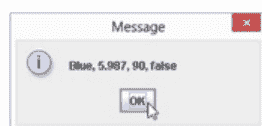

**图 9-8：** 运行列表 9-2 中的代码。

为了术术语，我可能会说列表 9-2 中的代码创建了“两个 `BagOfCheese` 对象”或“两个 `BagOfCheese` 实例”，或者我可能会说 `BagOfCheese` 实例化 `BagOfCheese` 类。无论哪种说法，列表 9-1 中的列表 9-2 声明了一个类的存在，而列表 9-2 声明了两个对象的存在。

在列表 9-2 中，每个 `BagOfCheese()` 单词都是一个*构造函数调用*。详情请参阅本章节后面的“调用构造函数”部分。

要运行列表 9-2 中的代码，你需要将两个 Java 文件（来自列表 9-1 的 `BagOfCheese.java` 和来自列表 9-2 的 `CreateBags.java`）放在同一个 Eclipse 项目中。在列表 9-2 中，我使用了十条语句来创建两个奶酪包。第一条语句（`BagOfCheese bag1 = new BagOfCheese()`）做了三件事：

- 通过单词 `BagOfCheese bag1`，第一条语句声明变量 `bag1` 指向奶酪包。
- 通过单词 `new BagOfCheese()`，第一条语句创建一个不包含特定奶酪的包。（如果有帮助的话，你可以将其想象成最终用于存储奶酪的空包。）
- 最后，通过等号，第一条语句让 `bag1` 变量指向新创建的包。

列表 9-2 中的后续四条语句为 `bag1` 的字段赋值：

```java
bag1.kind = "Cheddar";
bag1.weight = 2.43;
bag1.daysAged = 30;
bag1.isDomestic = true;
```


> 要引用对象的某个字段，请通过点符号跟在对象的引用，然后加上字段名。（例如，在 `bag1` 后面加一个点，然后是字段名 `kind`。）

列表 9-2 中的后续五条语句对第二个对象 `bag2` 执行了相同的操作。

## 重用名称

在列表 9-2 中，我使用了两个名称——`bag1` 和 `bag2`——来引用不同的 `BagOfCheese` 对象。这样也可以，但有时使用一个变量效果更好，如列表 9-3 所示。

## 列表 9-3：重用变量

```java
package com.allmycode.andy;

import javax.swing.JOptionPane;
```


public class CreateBags {

    public static void main(String[] args) {

        BagOfCheese bag = new BagOfCheese();

        bag.kind = "Cheddar";

        bag.weight = 2.43;

        bag.daysAged = 30;

        bag.isDomestic = true;

        JOptionPane.showMessageDialog(null,

            bag.kind + ", " + 

            bag.weight + ", " + 

            bag.daysAged + ", " + 

            bag.isDomestic);

        // bag = new BagOfCheese();

        bag.kind = "Blue";

        bag.weight = 5.987;

        bag.daysAged = 90;

        bag.isDomestic = false;

        JOptionPane.showMessageDialog(null,

            bag.kind + ", " + 

            bag.weight + ", " + 

            bag.daysAged + ", " + 

            bag.isDomestic);

    }

}

```

通过注释掉列表 9-3 中的第二个构造函数调用，你没有让 `bag` 变量指向新实例。相反，你通过为现有对象的字段分配新值来节省资源。

在某些情况下，重用对象的字段比创建新对象更高效（执行速度更快）。但当我有选择时，我更倾向于编写反映真实数据的代码。如果实际奶酪包的内容没有从切达奶酪变成蓝酪，我就不希望改变 `BagOfCheese` 的 `kind` 字段从 "Cheddar" 为 "Blue"。

## 调用构造函数

在列表 9-2 中，`BagOfCheese()` 单词看起来像方法调用，但它们不是——它们是构造函数调用。构造函数调用从现有类创建新对象。你可以通过注意以下特征识别构造函数调用：

- 构造函数调用以 Java 的 `new` 关键字开始：
    - `new BagOfCheese()`
- 构造函数调用的名称是 Java 类的名称：
    - `new BagOfCheese()`

当计算机遇到方法调用时，它会执行方法声明内部的语句。同样，当计算机遇到构造函数调用时，它会执行构造函数声明内部的语句。当你创建一个新类时（就像你在列表 9-1 中所做的那样），Java 可以自动创建一个构造函数声明。如果你愿意，也可以手动输入该声明的代码。列表 9-5 显示了该声明代码的样式：

## 列表 9-5：无参数构造函数

```java
package com.allcode.andy;

public class BagOfCheese {

    String kind;

    double weight;

    int daysAged;

    boolean isDomestic;

    BagOfCheese() {

    }

}
```

在列表 9-5 中，`BagOfCheese() { }` 是一个非常简单的构造函数声明。此声明（与普通方法声明不同）在其方法体内部没有语句。该声明仅包含一个头部 `BagOfCheese()` 和一个空体 (`{}`)。


你可以完全按照列表 9-5 的内容编写。或者，你可以省略该类型的代码，Java 会自动为你创建该构造函数。（你会在 Eclipse 编辑器中看不到构造函数声明，但 Java 的行为就像该声明存在一样。）要了解 Java 何时会自动创建构造函数声明，何时不会，请参阅本章后部分的“带参数的构造函数”章节。

构造函数的声明看起来与方法声明相似。但构造函数声明与方法声明有两点不同：

- 构造函数的名称与其创建的对象的类名相同。
- 在列表 9-5 中，类名是 `BagOfCheese`，构造函数的头部以 `BagOfCheese` 命名开头。
- 在构造函数名称之前，构造函数头部没有类型。

与方法不同，构造函数头部不会写 `int BagOfCheese()` 甚至 `void BagOfCheese()`。头部仅写为 `BagOfCheese()`。

## 关于类和对象的更多内容（加入方法）

在第 5 章和第 7 章中，我介绍了参数传递。在那些章节中，我比较委婉地详细介绍了如何将对象传递给方法。（至少，是挺委婉的。）在这一章中，我将向你展示如何改变态度并直面这一主题（将对象传递给方法）。

我从对早期示例的改进开始。列表 9-2 中的代码包含两个看起来很糟糕的 `showMessage` 调用。你可以通过将这些调用移动到方法中精简代码。方法如下：

1. 在 Eclipse 编辑器中查看列表 9-2 的代码。`CreateBags.java` 文件位于第 2 章导入的 09-01 项目中。
2. 使用鼠标选择包含第一次 `JOptionPane.showMessageDialog` 用的整个语句。确保高亮语句中的所有单词，从 `JOptionPane` 单词开始到四行后的分号结束。
3. 在 Eclipse 主菜单中，选择 **Refactor（重构）= Extract Method（提取方法）**。Eclipse 中会弹出 Extract Method 对话框，如图 9-9 所示。

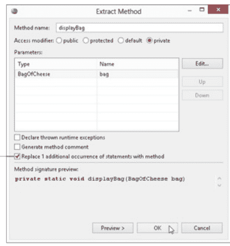

勾选此复选框。

**图 9-9：** Extract Method 对话框。

4. 在 Extract Method 对话框的 Name 字段中，**输入** `displayBag`。
5. （可选）在 Extract Method 对话框的 Name 列中，将 `bag1` **改为 bag**。

- 确保标记为 `Replace 1 Additional Occurrence of Statements with Method`（用方法替换额外的 1 处语句出现）的框中出现了勾号。

此勾号表示 Eclipse 将把两个 `showDialog` 调用替换为对新方法 `displayBag` 的调用。

- 点击 OK。

Eclipse 关闭 Extract Method 对话框，并将你的 Java 代码替换为列表 9-6 中的新代码。

## 列表 9-6：用方法显示一袋奶酪

```java
package com.allmycode.andy;

import javax.swing.JOptionPane;

public class CreateBags {

    public static void main(String[] args) {

        BagOfCheese bag1 = new BagOfCheese();

        bag1.kind = "Cheddar";

        bag1.weight = 2.43;

        bag1.daysAged = 30;

        bag1.isDomestic = true;

        BagOfCheese bag2 = new BagOfCheese();

        bag2.kind = "Blue";

        bag2.weight = 5.987;

        bag2.daysAged = 90;

        bag2.isDomestic = false;

        displayBag(bag1);

        displayBag(bag2);

    }

    private static void displayBag(BagOfCheese bag) {

        JOptionPane.showMessageDialog(null,

            bag.kind + ", " + 

            bag.weight + ", " + 

            bag.daysAged + ", " + 

            bag.isDomestic);

    }

}
```

根据 `displayBag` 声明（列表 9-6），`displayBag` 方法接收一个参数。该参数必须是一个 `BagOfCheese` 实例。在方法声明体内部，你通过参数名引用该实例。

### 带参数的构造函数

列表 9-7：创建对象的另一种方式

```java
package com.allmycode.andy;

import javax.swing.JOptionPane;

public class CreateBags {

    public static void main(String[] args) {

        BagOfCheese bag1 = new BagOfCheese();

        bag1.kind = "Cheddar";

        bag1.weight = 2.43;

        bag1.daysAged = 30;

        bag1.isDomestic = true;

        BagOfCheese bag2 = new BagOfCheese();

        bag2.kind = "Blue";

        bag2.weight = 5.987;

        bag2.daysAged = 90;

        bag2.isDomestic = false;

        displayBag(bag1);

        displayBag(bag2);

    }

    private static void displayBag(BagOfCheese bag) {

        JOptionPane.showMessageDialog(null,

            bag.kind + ", " + 

            bag.weight + ", " + 

            bag.daysAged + ", " + 

            bag.isDomestic);

    }

}
```

在 `main` 方法中，你创建了两个 `BagOfCheese` 实例：`bag1` 和 `bag2`。

根据 `displayBag` 声明（列表 9-6），`displayBag` 方法接收一个参数。该参数必须是一个 `BagOfCheese` 实例。在方法声明体内部，你通过参数名引用该实例。

### 列表 9-8：带参数的构造函数

```java
package com.allcode.andy;

import javax.swing.JOptionPane;

public class BagOfCheese {

    String kind;

    double weight;

    int daysAged;

    boolean isDomestic;

    BagOfCheese() {

    }

    BagOfCheese(String pKind, double pWeight, int pDaysAged, boolean pDomestic) {

        kind = pKind;

        weight = pWeight;

        daysAged = pDaysAged;

        isDomestic = pDomestic;

    }

}
```

在 `main` 方法中，你创建了两个 `BagOfCheese` 实例：`bag1` 和 `bag2`。你调用 `displayBag(bag1)` 和 `displayBag(bag2)`。

```java
BagOfCheese() {

}

BagOfCheese(String kind, double weight, boolean isDomestic) {

    this.kind = kind;

    this.weight = weight;

    this.daysAged = daysAged;

    this.isDomestic = isDomestic;

}
```

问题 @ Javadoc 声明 控制台 LogCat

createBags(1) (Java Application) C:\Program Files\Java\jdk1.6.0_32\java.exe (2013年6月8日 6:11:47 PM)

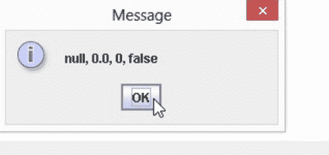

图 9-10: 一些不愉快的结果。

```java
public class BagOfCheese {

    String kind;

    double weight;

    int daysAged;

    boolean isDomestic;

    BagOfCheese(String kind, double weight, boolean isDomestic) {

        this.kind = kind;

        this.weight = weight;

        this.daysAged = daysAged;

        this.isDomestic = isDomestic;

    }

}
```

| 构造函数外部 |
| :--- |
| 类的字段之一 |

| 构造函数内部 |
| :--- |
| 构造函数的局部变量之一（恰好与类的某个字段同名的不同变量） |

图 9-11: 两个 `kind` 变量。

构造函数声明参数列表中的 `kind` 变量是构造函数的局部变量。构造函数中使用的任何 `kind` 单词都将指向该构造函数的局部 `kind` 变量。

字段是不同的。你可以在类代码的任何地方引用字段。例如，在代码列表 9-8 中，第二个构造函数声明没有它自己的局部 `kind` 变量。在该构造函数的体内部，单词 `kind` 指向类的字段。

有人可能会认为，代码列表 9-8 中的第二个构造函数很繁琐。你总是必须为构造函数的参数起一个像 `pKind` 这样奇怪的名字吗？不，不需要。要找出为什么，请参阅“就是这样！”部分。

## 默认构造函数

代码列表 9-1：我没有在程序代码中显式输入一个无参数构造函数，但 Java 为我创建了一个无参数构造函数。（我没有在代码列表 9-1 中看到无参数构造函数，但我仍然可以在列表 9-2 中调用 `BagOfCheese()`。但在代码列表 9-8 中，如果我没有显式输入，Java 就不会为我创建无参数构造函数。调用 `new BagOfCheese()` 将是非法的。（编辑器会告诉我 `BagOfCheese()` 构造函数未定义。）

其工作原理如下：当你定义一个类时，Java 会创建一个无参数构造函数（正式称为默认构造函数），当且仅当你没有在类代码中显式定义任何构造函数时。当 Java 遇到代码列表 9-1 时，它向你的 `BagOfCheese` 类添加一个无参数构造函数。但当 Java 遇到代码列表 9-8 时，你必须在代码中输入以下行：

```java
BagOfCheese() {

}
```

如果你不这样做，对 `new BagOfCheese()`（无参数）的调用将是非法的。

## 就是这样！

在本章较早之前的“带参数的构造函数”部分中出现的命名问题，代码列表 9-9 阐述了这个观点。

## 代码列表 9-9：使用 Java 的 `this` 关键字

```java
package com.allmycode.andy;

public class BagOfCheese {

    String kind;

    double weight;

    int daysAged;

    boolean isDomestic;

    BagOfCheese() {

    }

    public BagOfCheese(String kind, double weight,

        int daysAged, boolean isDomestic) {

        super();

        this.kind = kind;

        this.weight = weight;

        this.daysAged = daysAged;

        this.isDomestic = isDomestic;

    }

}
```


使用列表 9-9 中的类，你可以运行列表 9-7 中的 `BagCheesecode`。当你这样做时，你将看到之前在图 8-8 中所示的运行结果。

你可以让 Eclipse 创建列表 9-9 中看到的重载构造函数。步骤如下：

1. 在 Eclipse 编辑器中从代码列表 9-1（或列表 9-3）开始。
2. 在编辑器的任意地方点击鼠标光标。
3. 在 Eclipse 主菜单上，选择 `Source > Generate Constructor Using Fields`（使用字段生成构造函数）。

Eclipse 中出现了 `Generate Constructor Using Fields` 对话框，如图 9-12 所示。

4. 在对话框的 `Select Fields`（选择字段）面板中，确保选中了四个 `BagOfCheese` 字段。

这样做可以确保新构造函数为类的每个字段都带有一个参数。

5. 点击 `OK`。

搞定！Eclipse 关闭了对话框并在编辑器代码中添加了一个新创建的构造函数。

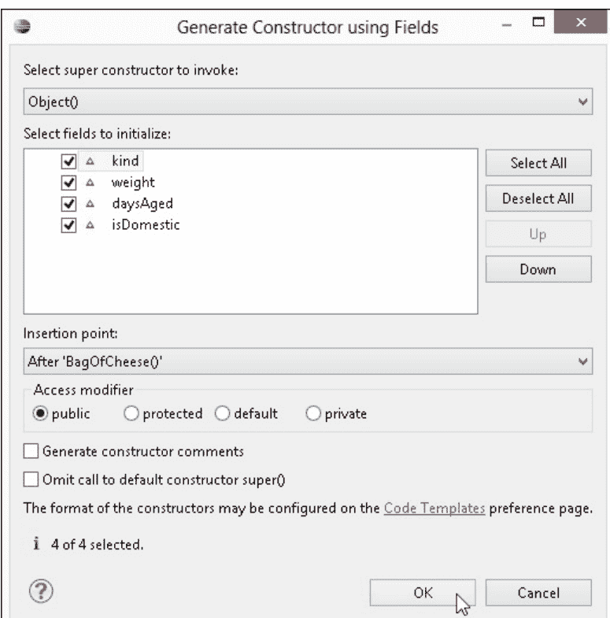

**图 9-12：** 使用字段生成构造函数的对话框。

Java 的 `this` 关键字指的是“包含当前行代码的对象”。因此在列表 9-9 中，该单词指的是 `BagOfCheese` 的实例（即正在被构造的对象）。构造函数声明参数列表中的 `kind` 变量是构造函数的局部的。构造函数使用的任何 `kind` 单词都将指向构造函数的局部 `kind` 变量。

字段是不同的。你可以在类代码的任何地方引用字段。例如，在列表 9-8 中，第二个构造函数声明没有它自己的局部 `kind` 变量。在该构造函数的体内部，单词 `kind` 指向类的字段。

有人可能会认为，列表 9-8 中的第二个构造函数很繁琐。你总是必须为构造函数的参数起一个像 `pKind` 这样奇怪的名字吗？不，不需要。要找出为什么，请参阅“就是这样！”部分。

## 给对象更多责任

Java 的 `this` 关键字指的是“包含当前行代码的对象”。因此在列表 9-9 中，该单词指的是 `BagOfCheese` 的实例（即正在被构造的对象）。构造函数声明参数列表中的 `kind` 变量是构造函数的局部的。构造函数使用的任何 `kind` 单词都将指向构造函数的局部 `kind` 变量。

字段是不同的。你可以在类代码的任何地方引用字段。例如，在列表 9-8 中，第二个构造函数声明没有它自己的局部 `kind` 变量。在该构造函数的体内部，单词 `kind` 指向类的字段。

```java
public void displayBag() {
    JOptionPane.showMessage(null,
        kind + ", " + weight +
        daysAged + ", " +
        isDomestic);
}
```

## 列表 9-11: 让包自己显示

```java
package com.allmycode.andy;

public class CreateBags {
    public static void main(String[] args) {
        BagOfCheese bag1 =
            new BagOfCheese("Cheddar", 2.43, 30, true);
        BagOfCheese bag2 =
            new BagOfCheese("Blue", 5.987, 90, false);
        bag1.displayBag();
        bag2.displayBag();
    }
}
```

在列表 9-10 中，`BagOfCheese` 对象拥有它自己的、无参数的 `displayBag` 方法。而在列表 9-11 中，以下两行代码对 `displayBag` 方法进行了两次调用——一次针对 `bag1`，另一次针对 `bag2`：

```java
bag1.displayBag();
bag2.displayBag();
```

对 `displayBag` 的调用行为取决于正在显示的特定包。当你调用 `bag1.displayBag()` 时，你看到的是 `bag1` 的字段值；当你调用 `bag2.displayBag()` 时，你看到的是 `bag2` 的字段值。


要调用对象的某个方法，请在对象的引用后跟一个点 `.`，然后是方法的名称。

## 类的成员

注意字段和方法之间的相似性：

- *正如我在在本章前面的“创建对象”小节中所说的：*
- *要引用对象的某个字段，请在对象的引用后跟一个点 `.`，然后是字段的名称。*

但变量 `bag1` 的类型是 `BagOfCheese`，而 `BagOfCheese` 并不是基本类型。（我不知道任何计算机编程语言将奶酪包作为内置基本类型！）

变量 `bag1` 并不包含 "Cheddar" 2.43 30 true。变量 `bag1` 包含了定位 "Cheddar" 2.43 30 true 对象所需的信息。变量 `bag1` 存储的是指向该 "Cheddar" 2.43 30 true 对象的引用。


`int`、`double`、`boolean`、`char`、`byte`、`short`、`long` 和 `float` 类型是基本类型。基本变量（例如 `int daysAged`、`double weight`、`boolean isDomestic`）存储的是值。相反，类是引用类型，例如 `String`（它定义在 Java 的 API 中，由你或我自己声明）。引用类型变量（例如 `BagOfCheese bag` 和 `String kind`）引用一个对象。


如果最底部的框包含一只手的图片，后面跟着数值 2.43 30，那么图 9-15 会更准确（稍微复杂一点）。那只手将指向框外部的字符串 "Cheddar"。


在本节中，我提到变量 `bag1` 引用了 "Cheddar" 2.43 30 true 对象。说 `bag1` 变量指向 "Cheddar" 2.43 30 true 对象也是很常见的。或者，你可以说 `bag1` 变量存储了 "Cheddar" 2.43 30 true 对象值起始的内存地址数字。编程语言或内存语言都没有表达物质的本质，但如果这些粗略的术语有助于你理解发生的情况，那么使用它们也没有坏处。

## 引用传递

在上一节中，我强调类是引用类型。类型为类的变量包含了某些指向某某、某某的内容。你可能会问：“我为什么要关心这个？”

看看第 7 章的列表 7-4，注意将基本类型传递给方法的结果：

当方法体改变参数的值时，该更改对方法调用中变量的值没有影响。

这一原理对于引用类型同样适用。但在引用类型的情况下，传递的值是关于在哪里找到对象的信息，而不是对象本身。当你方法的参数列表中传递引用类型时，你可以更改对象字段中的值。

例如，参见列表 9-12 中的代码。

## 列表 9-12: 又的一天

```java
package com.allmycode;

public class CreateBags {
    public static void main(String[] args) {
        BagOfCheese bag1 =
            new BagOfCheese("Cheddar", 2.43, 30, true);
    }
}
```

（注：由于提供的源 OCR 文本严重损坏，已根据上下文和 Java 代码模式重构了逻辑结构。）

Listing 9-13 中的 `Paragraph` 类具有默认访问权限——也就是说，`Paragraph` 类不是公共（public）。Listing 9-14 中的代码与 `Paragraph` 类位于同一个包（`org.allcode.wordprocessor` 包）。因此，在 Listing 9-14 中，你可以声明一个类型为 `Paragraph` 的对象，并引用该对象的 `indent` 字段。

Listing 9-15 中的代码不在同一个 `org.allcode.wordprocessor` 包中。出于如此，即使 Listing 9-13 和 9-15 位于同一个 Eclipse 项目中，Listing 9-15 仍然需要 `Paragraph` 和 `indent`（来自 Listing 9-13）的名字。当你在 Eclipse 编辑器中输入 9-13、9-14 和 9-15 时，你会看到 Listing 9-15 显示为红色的斑驳错误，如图 9-20 所示。

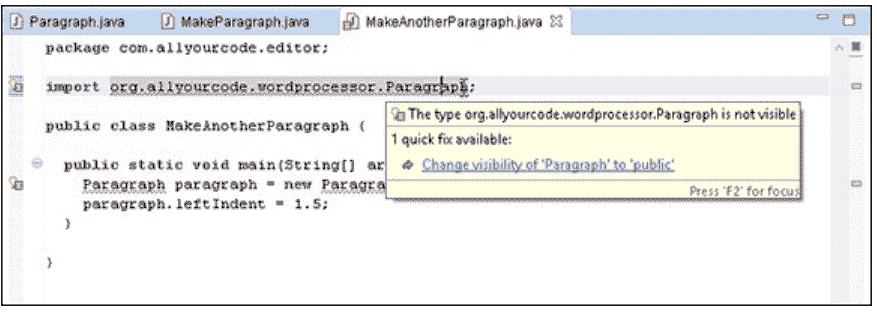

图 9-20：Listing 9-15 中的错误。

Android activity 可以调用来自另一个包（即另一个 Android 应用）的代码。要实现这一点，你不需要在 activity 的代码中使用另一个包的名字。详细信息，请参阅第 12 章关于 `startActivity` 的讨论。

包含公共类（public class）的 java 文件必须与该公共类同名，因此包含 Listing 9-1 代码的文件被命名为 `BagOfCheese.java`。

即使你将 Listing 9-1 中的代码放在名为 `bagBofcheese.java` 的文件中，文件名的大小写也至关重要。在文件名中，你必须将 B、o 和 c 大写。

由于文件命名规则的限制，你不能在一个 `.java` 文件中声明超过一个公共类。如果你将 Listing 9-1 和 9-2 中的公共类放在同一个文件中，你需要使用 `BagOfCheese.java` 或 `CreateBags.java`。这两个名字都不符合文件命名规则。对于这种情况，没有名字可以满足规则。

习惯上将包含 `main` 方法的类声明为公共的。我有时会忽略这一惯例，但这样做之后代码看起来很奇怪。曾经我遇到过一种情况，由于类包含 `main` 方法而必须是公共的。我承诺过以后会使用这个例子，但从那以后我就忘记了。噢！

## 字段和方法的访问权限

类可以拥有公共访问或非公共（默认）访问权限。但类的成员有四种可能性：`public`、`private`、`default` 和 `protected`。

类的字段和方法是类的成员。例如，Listing 9-10 中的类有五个成员：字段 `kind`、`weight` 以及方法。

成员的访问机制如下：

- 类的默认成员（声明中不包含 `public`、`private` 或 `protected` 的成员）可以被相同包内的任何代码使用。
- 类的私有成员在类外部无法访问。
- 类的公共成员可以在任何地方使用，即：
  - 任何程序都可以引用类的公共成员。
  - 程序要引用默认访问权限的类成员，必须在相同的包内。

要查看这些规则的生效，请检查 Listing 9-16 中的公共类。

### Listing 9-16：具有公共访问权限的类

```java
package org.allycode.bank;

public class Account {
    public String customerName;
    private int internalNumber;
    String address;
    String phone;
    public int socialSecurityNumber;
    int accountType;
    double balance;

    public static int findById(int internalNumber) {
        Account foundAccount = new Account();
        // 这里是查找代码
        return foundAccount.internalNumber;
    }
}
```

图 9-21 和 9-22 使用 `Account` 类及其字段。

### UseAccount.java

```java
package org.allyourcode.bank;

public class UseAccount {
    public static void main(String[] args) {
        Account account = new Account();
        account.customerName = "Occam";
        String nameBackup = account.customerName;
        System.out.println(account.address);
        account.internalNumber = 71600;
    }
}
```

图 9-21：引用同一包中的公共类。

### UseAccountFromOutside.java

```java
package com.almycode.bank;

import org.allyourcode.bank.Account;

public class UseAccountFromOutside {
    public static void main(String[] args) {
        Account account = new Account();
        account.customerName = "Occam";
        String nameBackup = account.customerName;
        System.out.println(account.address);
        account.internalNumber = 71600;
    }
}
```

图 9-22：引用不同包中的公共类。

在图 9-21 和 9-22 中，注意：

- `UseAccount` 类与 `Account` 类位于同一个包中。
- `UseAccount` 类可以创建 `Account` 变量。
- `UseAccount` 类的代码可以引用 `Account` 类的公共成员 `customerName` 和默认字段 `address`。
- 即使 `UseAccount` 和 `Account` 在同一个包中，`UseAccount` 类无法引用 `Account` 类的私有字段 `internalNumber`。
- `UseAccountFromOutside` 类与 `Account` 类不在同一个包中。
- `UseAccountFromOutside` 类无法创建 `Account` 变量（即使是 import 声明也无法避免错误）。
- 在 `UseAccountFromOutside` 类内部，对 `account.customerName`、`account.address` 和 `account.internalNumber` 的引用毫无意义，因为 `account` 变量没有类型（编译错误）。

现在检查 Listing 9-17 中的默认类。

### Listing 9-17：具有默认访问权限的类

```java
package org.allyourcode.game;

class Sprite {
    public String name;
    String image;
    double distanceFromEdge, distanceFromTop;
    double motionAcross, motionDown;
    private int renderingMethod;

    void renderMethod() {
        if (renderingMethod == 2) {
            // 执行某些操作
        }
    }
}
```

图 9-23 和 9-24 使用 `Sprite` 类及其字段。

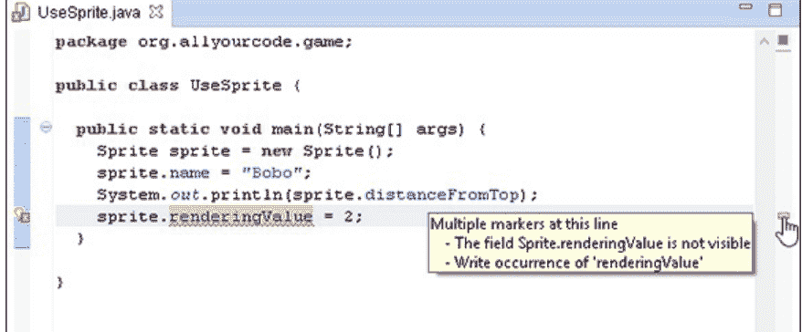

图 9-23：引用同一包中的默认类。

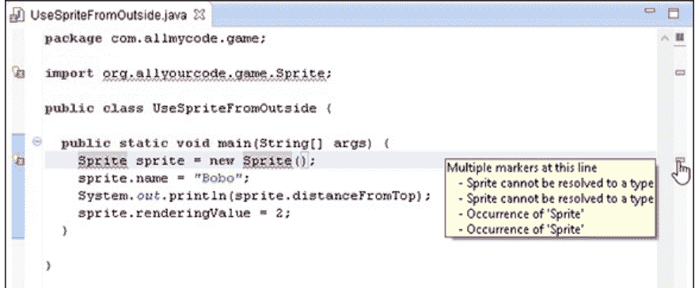

图 9-24：引用不同包中的默认类。

## 使用 getter 和 setter

在图 9-21 和 9-22 中，`UseAccount` 和 `UseAccountFromOutside` 类可以设置账户的 `customerName` 并获取现有 `customerName`：

```java
account.customerName = "Occam";
String nameBackup = account.customerName;
```

但 `UseAccount` 类和 `UseAccountFromOutside` 类都无法修改账户的 `internalNumber` 字段。

如果你希望 `Account` 类能够获取现有的账户 `internalID` 呢？（在许多情况下，获取信息是必要的，但更改现有信息是危险的。）你可以通过 getter 方法来实现，如 Listing 9-18 所示。

# Listing 9-18：创建只读字段

```java
Account found = new Account();
// Code to find the account goes here.
```


return `foundAccount.internalIDNumber`;

}

```

```java
public int getInternalIDNumber() {
    return internalIDNumber;
}
```

}

使用列表 9-18 中的 `Account` 类，另一个类的代码可以调用：

```java
System.out.println(account.getInternalIDNumber());
```

或者

```java
int backupIDNumber = account.getInternalIDNumber();
```

`Account` 类的 `internalIDNumber` 字段仍然是私有的，因此另一个类的代码无法为账户的 `internalIDNumber` 字段赋值。为了允许其他类更改账户的私有 `internalIDNumber` 值，你可以在列表 9-18 的代码中添加一个设置方法（setter 方法）。程序员经常使用 getter 和 setter 术语来描述它。

```java
public void setInternalIDNumber(int internalIDNumber) {
    this.internalIDNumber = internalIDNumber;
}
```

Getter 和 setter 方法并不是 Java 的内置特性——它们只是普通方法。但这种模式（拥有一个目的是为了访问原本无法访问的字段值的方法）被频繁使用，以至于程序员使用 getter 和 setter 术语来描述它。


Getter 和 setter 方法是访问器方法。Java 程序员几乎总是遵循这一约定：访问器方法的名称以 `get` 或 `set` 开头，并对所访问字段的首字母大写。例如，字段 `internalIDNumber` 访问器是 `getInternalIDNumber` 和 `setInternalIDNumber`。字段 `renderingValue` 的访问器是 `getRenderingValue` 和 `setRenderingValue`。

你可以让 Eclipse 为你创建 getters 和 setters。方法如下：

1. 在 Eclipse 编辑器中打开列表 9-16 的代码。
2. 将光标点击编辑器内部。
3. 在 Eclipse 主菜单中，选择 `Source -> Generate Getters and Setters`。

Eclipse 弹出 `Generate Getters and Setters` 对话框，如图 9-25所示。

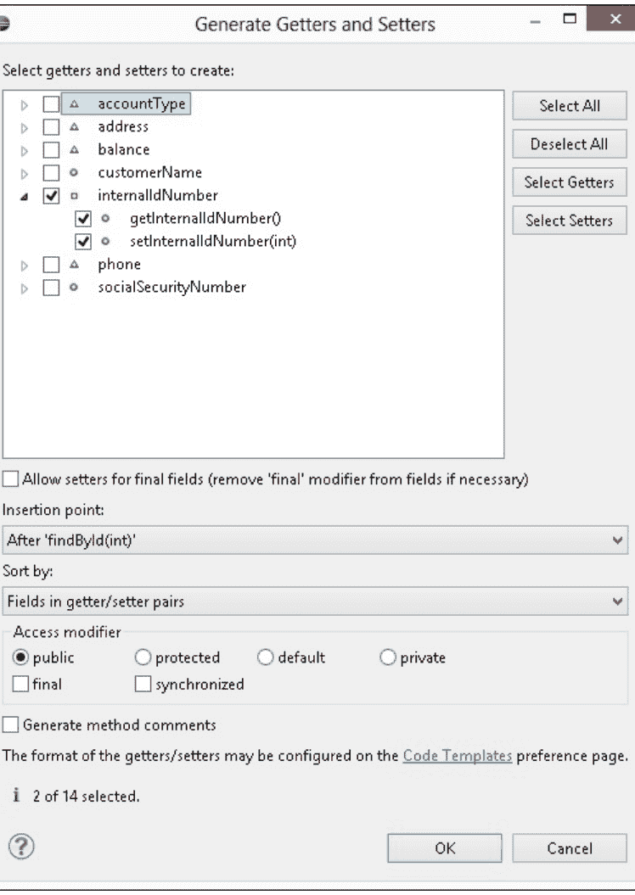

4. 在对话框的 `Select Getters and Setters to Create` 窗中，展开 `internalIdNumber` 分支。
5. 在 `internalIdNumber` 分支内，选择 `getInternalIDNumber()` 或 `setInternalIDNumber(int)` 复选框或两者。Eclipse 只会创建你所勾选框的 getters 和 setters。
6. 点击 OK。

Eclipse 关闭对话框并向编辑器代码中添加新生成的 getter 和 setter 方法。

> 我将在第 10 章介绍受保护访问（protected）。

## static 是什么意思？

本章从讨论奶酪及其对安迪业务实践的影响开始。安迪有一张代表类的空白表格。他还有一堆填好的表格，每张表格代表一个独立的奶酪包对象。

一天，安迪决定通过计算所有的奶酪包来对奶酪进行盘（见图 9-26）。


**图 9-26：** 数奶酪包。

比较图 9-27 所示的各种字段。从面向对象的角度来看，`daysAged` 字段与 `count` 字段有什么区别？

答案是，单个包装包可以记录自己存放了几天，但它不应该计算所有的包。正如列表 9-1所示，`BagOfCheese` 对象有自己的 `daysAged` 字段。这是合理的。（嗯，对于面向对象的程序员来说是合理的。）

但让某个特定对象承担计算该类中所有对象的责任似乎并不公平。让每个 `BagOfCheese` 对象代表所有其他对象违反了计算机编程的一项基本指令：程序的结构应该模仿生活数据的结构。例如，我可以在 Facebook 上发布自己的照片，但我不能数 Facebook 上其他人的照片。（“你们所有其他 Facebook 用户，可以去数你们自己的 @#! 照片！”）

用于计算所有奶酪包的字段应该属于一个中心位置。这就是为什么在图 9-27 中，我们有一个且仅有一个 `count` 字段。每个对象都有自己的 `daysAged` 值，但类本身拥有一个 `count` 值。

属于整个类而不是每个单独对象的字段或方法是该类的**静态成员（static member）**。要声明类的静态成员，你使用 Java 的 `static` 关键字（真让人惊讶！），如列表 9-19 所示。

```text
BagOfCheese
kind: String
weight: double
daysAged: int
isDomestic: Boolean
displayBag(): void
count: int
```

```text
BagOfCheese
kind = 'Cheddar'
weight = 2.43
daysAged = 30
isDomestic = true
displayBag() = void
```

```text
BagOfCheese
kind = 'Blue'
weight = 5.987
daysAged = 90
isDomestic = false
displayBag() = void
```

图 9-27：UML 图显示了静态部分。

### 列表 9-19：创建静态字段

```java
class BagOfCheese {
    String kind;
    double weight;
    int daysAged;
    boolean isDomestic;
    public void displayBag() {
        // ...
    }
    static int count;
}
```

### 列表 9-20：引用静态字段

```java
class BagOfCheese {
    // ... fields ...
    static int count;
}

public class Test {
    public static void main(String[] args) {
        System.out.println(BagOfCheese.count);
    }
}
```

### 列表 9-21：声明和调用静态方法

```java
class Score {
    static int count = 0;
    public static void addPoints(int points) {
        count += points;
    }
}

public class Main {
    public static void main(String[] args) {
        Score.addPoints(10);
        System.out.println(Score.count);
    }
}
```

这就像在成员名称前加上类名（取决于你当时认为使用的是哪一个类）一样。

考虑列表 9-21 中的代码。如果 `addPoints` 方法不是静态的，那么 `Scorekeeper` 类的每个实例都有自己的 `addPoints` 方法，并且每个 `addPoints` 方法都属于 `Scorekeeper` 类的一个实例。问题在于，列表 9-21 并没有构造 `Scorekeeper` 类的任何实例。（列表声明了 `Scorekeeper` 类本身，但没有创建任何实例。）列表中没有可调用的 `addPoints` 副本。（参见图 9-28。）由于 `addPoints` 不是静态的，语句 `score = addPoints(score, points)` 是非法的。

当然，你可以调用 `Scorekeeper` 构造函数来创建一个 `Scorekeeper` 实例：

```java
Scorekeeper keeper = new Scorekeeper();
```

但这并没有解决问题。`addPoints` 的调用位于 `main` 方法内部，而该方法是静态的。因此，`addPoints` 的调用并非来自新的 `keeper` 对象，调用也没有引用 `keeper` 对象的 `addPoints` 方法。

你可以通过使用两步法来修复（`addPoints` 不是静态的的问题）：创建一个 `Scorekeeper` 实例，并调用新实例的 `addPoints` 方法，如下和图 9-29 所示：

```java
Scorekeeper keeper = new Scorekeeper();
keeper.addPoints(score, points);
```

但这种方法增加了第 7 章示例的复杂性。

在列表 9-21 中，那一个静态 `addPoints` 方法属于整个 `Scorekeeper` 类，如图 9-30 所示。同样，该静态方法和对 `addPoints` 的调用属于整个 `Scorekeeper` 类，因此列表 9-21 中的 `addPoints` 调用有一个自然的目标，如图 9-29 所示。


图 9-28：在尝试调用非静态 `addPoints` 方法时失败。


**图 9-29：** 成功调用非静态 `addPoints` 方法。


**图 9-30：** 调用静态方法。

## 接下来？

本章讨论了单个类。大多数类并不是孤立于其他类存在的。大多数类属于类、子类和子子类的层次结构，因此下一章将介绍类之间的关系。

# 第 10 章
## 节省时间和金钱：重用现有代码

## 本章内容

- 调整你的代码
- 为旧代码注入新生命
- 在不花费巨资的情况下进行更改

如果每件软件都能完全按照你的想法运行，那有多好呢？在理想的世界里，你只需购买一个程序，让它立即运行，无缝地接入新场景，并在你的需求变化时轻松地更新它。遗憾的是，这种软件并不存在。（这些都不存在。）事实是，无论你想做什么，你都能找到可以实现部分功能的软件，但不能实现全部。

这是面向对象编程之所以成功的原因之一。多年来，公司购买预先编写的代码，却发现代码并不符合它们的意愿。于是公司开始对代码大加修改。他们的程序员深入挖掘程序文件，更改变量名，移动子程序，重新设计公式，并通常会使代码变得更糟。现实情况是，如果一个程序没有执行你想要的操作（即使它执行了一些类似的操作），你永远无法通过在代码内部乱搞来改善局面。最好的选择是放弃整个程序（尽管这很昂贵）并重新开始。这是一个悲哀的现状！

面向对象编程带来了巨大的变化。面向对象的程序的核心设计目的是为了被修改。通过使用编写良好的软件，你可以利用已经内置的功能，添加你自己的新功能，并覆盖不符合你需求的功能。这种情况最好的方面是，是你所做的更改是整洁的——不需要去挖掘和挖掘他人脆弱的代码。相反，你进行良好、有序的添加和修改，而不触碰现有代码的内部逻辑。这是理想的解决方案。

## 关于员工的最后结论——或者真的吗？

当你编写面向对象的程序时，从考虑数据开始。你正在编写关于账户的内容。那么什么是账户？你正在编写处理按钮点击的代码。那么什么是按钮？你正在编写一个向员工发送工资支票的程序。什么是员工？

在本章的第一个示例中，员工是一个拥有名字和职位名称的人——当然，员工还有其他特征，但目前我坚持基础点：

```java
class Employee {
    String name;
    String jobTitle;
}
```

当然，任何公司都有不同类型的员工。例如，你的公司可能有全职和兼职员工。每位全职员工都有年薪：

```java
class FullTimeEmployee extends Employee {
    double salary;
}
```

在这个示例中，`FullTimeEmployee` 继承了 `Employee` 类的成员。（如果 `Employee` 类的任何成员被声明为 `private`，则 `FullTimeEmployee` 类将不会继承它们。）

`Employee` 类的所有后代都有名称字段，尽管该字段只在 `Employee` 类中显式声明。`FullTimeEmployee` 继承了 `Employee` 类的成员。就像任何 `Employee` 一样，它也有工资。兼职员工有时薪：

```java
class PartTimeEmployee extends Employee {
    double hourlyPay;
    int hoursWorked;
}
```

到此为止，`PartTimeEmployee` 拥有 `name`、`jobTitle`、`hourlyPay` 和 `hoursWorked`。

然后你必须考虑高管。除了薪水，高管还有奖金：

```java
class Executive extends FullTimeEmployee {
    double bonus;
}
```

Java 的关键字让开发者有几种不同的名称来描述这种关系：

- **父类/子类**：`Employee` 类（见前面的“关于员工的最后结论——或者真的吗？”）是 `FullTimeEmployee` 类的**父类**，`FullTimeEmployee` 类是 `Employee` 类的子类。
- **父/子**：`Employee` 类是 `FullTimeEmployee` 类的父，`FullTimeEmployee` 类是 `Employee` 类的子。事实上，`Executive` 类继承 `FullTimeEmployee` 类，而后者又继承 `Employee` 类。因此 `Executive` 是 `Employee` 的后代，而 `Employee` 是 `Executive` 的祖先。图 10-1 中的统一建模语言（UML）图说明了这一点。


图 10-1：一个类、两个子类和一个孙子类。

- **继承**：`FullTimeEmployee` 类继承了 `Employee` 类的成员。（如果 `Employee` 类的任何成员被声明为 `private`，则 `FullTimeEmployee` 类将不会继承它们。）

`Employee` 类有一个名称字段，所以 `FullTimeEmployee` 类有一个名称字段，而 `Executive` 类也有名称字段。换句话说，只要 `Employee`、`FullTimeEmployee` 和 `Executive` 的声明位于开头，列表 10-1 中的代码就是合法的。

### 列表 10-1: 使用 Employee 类及其子类

```java
public class Main {
    public static void main(String[] args) {
        Employee employee = new Employee();
        employee.name = "Sam";

        FullTimeEmployee ftEmployee = new FullTimeEmployee();
        ftEmployee.name = "Jennie";

        Executive executive = new Executive();
        executive.name = "Harriet";
    }
}
```


几乎所有的 Java 类都继承自另一个 Java 类。我之所以用“几乎”，是因为有一个（且仅有一个）类不继承任何其他类。Java 内置的 `Object` 类不继承任何类。`Object` 类位于 Java 类层次结构的顶端。任何头部没有 `extends` 子句的类都会自动继承 Java 的 `Object` 类。因此，其他所有 Java 类直接或间接地都是 `Object` 类的后代，如图 10-2 所示。

继承类是面向对象编程的支柱之一。在 20 世纪 70 年代，计算机科学家发现程序员往往重复造轮子。例如，如果你需要平衡一个账户，你就从头开始编写代码来平衡账户。无管别人已经写过账户平衡的代码。将别人的代码与你的代码整合在一起，并将别人的代码调整以适应自己的需求，是一个非常头疼的问题。考虑到所有因素，从头开始反而更容易。


图 10-2：一切都源自 Java 的 `Object` 类。

然后，在 20 世纪 80 年代，面向对象编程变得流行。类和子类的概念提供了一种清晰连接现有代码（如 Android 的 `Activity` 类代码）与新代码（如你的新 `MainActivity` 类代码）的方法。通过继承现有类，你钩入了该类的功能，并重用了已经编写好的特性。

通过重用代码，你避免了重复造轮子的工作。同时也让最终用户的生活变得更容易。当你继承 Android 的 `Activity` 类时，你的新活动的行为与其他人的活动相似，你的活动和其他活动都从 Android 的 `Activity` 类继承了相同的行为。由于有许多应用程序的行为方式相同，用户就能学会熟悉的模式。这是一个双赢的局面。

## 方法重写

在本节中，我扩展了本章开始所有的员工代码片段。通过这些片段，我可以展示一个完整的程序示例。该示例如列表 10-2 至 10-6 所示，说明了关于类和子类的重要思想。

## 列表 10-2: 什么是员工？

```java
package org.allyourcode.company;

import javax.swing.JOptionPane;

public class Employee {

    String name;

    String jobTitle;

    public Employee() {

    }

    public Employee(String name, String jobTitle) {

        this.name = name;

        this.jobTitle = jobTitle;

    }

    public void showPay() {

        JOptionPane.showMessageDialog(null, name +

            "Pay not known");

    }

}
```

## 列表 10-3: 全职员工有薪水

```java
package org.allyourcode.company;

import java.text.NumberFormat;

import java.util.Locale;

import javax.swing.JOptionPane;

public class FullTimeEmployee extends Employee {

    double salary;

    static NumberFormat currency =

        NumberFormat.getCurrencyInstance(Locale.US);

    public FullTimeEmployee() {

    }

    public FullTimeEmployee(String name,

        String jobTitle,

        double salary) {

        this.name = name;

        this.jobTitle = jobTitle;

        this.salary = salary;

    }

    public double pay() {

        return salary;

    }

    @Override

    public void showPay() {

        JOptionPane.showMessageDialog(null, name + ", " +

            currency.format(pay()));

    }

}
```

## 列表 10-4: 执行人员有奖金

```java
package org.allyyoucode.company;

public class Executive extends FullTimeEmployee {

    double bonus;

    public Executive() {

    }

    public Executive(String name, String jobTitle,

        double salary, double bonus) {

        this.name = name;

        this.jobTitle = jobTitle;

        this.salary = salary;

        this.bonus = bonus;

    }

    @Override

    public double pay() {

        return salary + bonus;

    }

}
```

## 列表 10-5: 兼职员工按小时付费

```java
package org.allyourcode.company;

import java.text.NumberFormat;

import java.util.Locale;

import javax.swing.JOptionPane;

public class PartTimeEmployee extends Employee {

    double hourlyPay;

    int hoursWorked;

    static NumberFormat currency =

        NumberFormat.getCurrencyInstance(Locale.US);

    public PartTimeEmployee() {

    }

    public PartTimeEmployee(String name,

        String jobTitle,

        double hourlyPay,

        int hoursWorked) {

        this.name = name;

        this.jobTitle = jobTitle;

        this.hourlyPay = hourlyPay;

        this.hoursWorked = hoursWorked;

    }

    public double pay() {

        return hourlyPay * hoursWorked;

    }

    @Override

    public void showPay() {

        JOptionPane.showMessageDialog(null, name + ", " +

            currency.format(pay()));

    }

}
```

## 列表 10-6: 你的员工测试

```java
package org.allyourcode.company;

public class Main {

    public static void main(String[] args) {

        Employee employee =

            new Employee("Barry", "Author");

        FullTimeEmployee ftEmployee =

            new FullTimeEmployee("Ed", "Manager", 10000.00);

        PartTimeEmployee ptEmployee =

            new PartTimeEmployee("Joe", "Intern", 8.00);

        Executive executive =

            new Executive("Jane", "CEO", 20000.00, 5000.00);

        employee.showPay();

        ftEmployee.showPay();

        ptEmployee.showPay();

        executive.showPay();

    }

}
```

图 10-3 显示了列表 10-2 至 6 代码的运行情况，图 10-4 包含了这些类的 UML 图。（在图 10-4 中，我忽略了列表 6 中的 `Main` 类。`Main` 类并没意思，因为它不是 `Employee` 层次结构的一部分。`Main` 类仅仅是 Java 类的子类。）


图 10-3 显示了列表 10-2 至 6 代码的运行情况，图 10-4 包含了这些类的 UML 图。（在图 10-4 中，我忽略了列表 6 中的 `Main` 类。`Main` 类并没意思，因为它不是 `Employee` 层次结构的一部分。`Main` 类仅仅是 Java 类的子类。）

图注：一切都源自 Java 的 object 类。

几乎所有的 Java 类都继承自另一个 Java 类。我之所以用“几乎”，是因为有一个（且仅有一个）类不继承任何其他类。Java 内置的 `Object` 类不继承任何类。`Object` 类位于 Java 类层次结构的顶端。任何头部没有 `extends` 子句的类都会自动继承 Java 的 `Object` 类。因此，其他所有 Java 类直接或间接地都是 `Object` 类的后代，如图 10-2 所示。

继承类是面向对象编程的支柱之一。在 20 世纪 70 代，计算机科学家发现程序员往往重复造轮。例如，如果你需要平衡一个账户，你就从头开始编写代码来平衡账户。无不管别人已经写过账户平衡的代码。将别人的代码与你的代码整合在一起，并将别人的代码调整以适应自己的需求，是一个非常头疼的问题。考虑到所有因素，从头开始反而更容易。

然后，在 20 世纪 80 代，面向对象编程变得流行。类和子类的概念提供了一种清晰连接现有代码（如 Android 的 `Activity` 类代码）与新代码（如你的新 `MainActivity` 类代码）的方法。通过继承现有类，你钩入了该类的功能，并重用了已经编写好的特性。

通过重用代码，你避免了重复造轮的工作。同时也让最终用户的生活变得更容易。当你继承 Android 的 `Activity` 类时，你的新活动的行为与其他人的活动相似，你的活动和其他人的活动都从 Android 的 `Activity` 类继承了相同的行为。由于有许多应用程序的行为方式相同，用户就能学会熟悉的模式。这是一个双赢的局面。

## 方法重写

在本节中，我扩展了本章开始所有的员工代码片段。通过这些片段，我可以展示一个完整的程序示例。该示例如列表 10-2 至 10-6 所示，说明了关于类和子类的一些思想。

## 列表 10-2: 什么是员工？

```java
package org.allyourcode.company;

import javax.swing.JOptionPane;

public class Employee {

    String name;

    String jobTitle;

    public Employee() {

    }

    public Employee(String name, String jobTitle) {

        this.name = name;

        this.jobTitle = jobTitle;

    }

    public void showPay() {

        JOptionPane.showMessageDialog(null, name +

            "Pay not known");

    }

}
```

## 列表 10-3: 全职员工有薪水

```java
package org.allyourcode.company;

import java.text.NumberFormat;

import java.util.Locale;

import javax.swing.JOptionPane;

public class FullTimeEmployee extends Employee {

    double salary;

    static NumberFormat currency =

        NumberFormat.getCurrencyInstance(Locale.US);

    public FullTimeEmployee() {

    }

    public FullTimeEmployee(String name,

        String jobTitle,

        double salary) {

        this.name = name;

        this.jobTitle = jobTitle;

        this.salary = salary;

    }

    public double pay() {

        return salary;

    }

    @Override

    public void showPay() {

        JOptionPane.showMessageDialog(null, name + ", " +

            currency.format(pay()));

    }

}
```

## 列表 10-4: 执行人员有奖金

```java
package org.allyyoucode.company;

public class Executive extends FullTimeEmployee {

    double bonus;

    public Executive() {

    }

    public Executive(String name, String jobTitle,

        double salary, double bonus) {

        this.name = name;

        this.jobTitle = jobTitle;

        this.salary = salary;

        this.bonus = bonus;

    }

    @Override

    public double pay() {

        return salary + bonus;

    }

}
```

## 列表 10-5: 兼职员工按小时付费

```java
package org.allyourcode.company;

import java.text.NumberFormat;

import java.util.Locale;

import javax.swing.JOptionPane;

public class PartTimeEmployee extends Employee {

    double hourlyPay;

    int hoursWorked;

    static NumberFormat currency =

        NumberFormat.getCurrencyInstance(Locale.US);

    public PartTimeEmployee() {

    }

    public PartTimeEmployee(String name,

        String jobTitle,

        double hourlyPay,

        int hoursWorked) {

        this.name = name;

        this.jobTitle = jobTitle;

        this.hourlyPay = hourlyPay;

        this.hoursWorked = hoursWorked;

    }

    public double pay() {

        return hourlyPay * hoursWorked;

    }

    @Override

    public void showPay() {

        JOptionPane.showMessageDialog(null, name + ", " +

            currency.format(pay()));

    }

}
```

## 列表 10-6: 你的员工测试

```java
package org.allyourcode.company;

public class Main {

    public static void main(String[] args) {

        Employee employee =

            new Employee("Barry", "Author");

        FullTimeEmployee ftEmployee =

            new FullTimeEmployee("Ed", "Manager", 10000.00);

        PartTimeEmployee ptEmployee =

            new PartTimeEmployee("Joe", "Intern", 8.00);

        Executive executive =

            new Executive("Jane", "CEO", 20000.00, 5000.00);

        employee.showPay();

        ftEmployee.showPay();

        ptEmployee.showPay();

        executive.showPay();

    }

}
```

图 10-3 显示了列表 10-2 至 6 代码的运行情况，图 10-4 包含了这些类的 UML 图。（在图 10-4 中，我忽略了列表 6 中的 `Main` 类。`Main` 类并没意思，因为它不是 `Employee` 层次结构的一部分。`Main` 类仅仅是 Java 类的子类。）

图注：一切都源自 Java 的 object 类。

重写方法的唯一方法是在子类中声明一个相同名称和相同参数的方法。相同参数指的是参数的名称以及每个参数具有相同的类型。例如，`calculate(int count, double amount)` 覆盖了 `calculate(int x, double y)`，因为这两个声明都有两个参数：每个声明的第一个参数都是 int，第二个参数都是 double 类型。但 `calculate(int count, String amount)` 并没有覆盖 `calculate(int count, double amount)`。在一个声明中，第二个参数是 double 类型，而在另一个声明中，第二个参数是 String 类型。如果你调用 `calculate(42, 2.71828)`，你得到的是 `calculate(int x, double)` 方法，而如果你调用 `calculate(int count, String amount)` 方法。

列表 10-2 至 10-5 有其他重写的例子。例如，列表 10-4 中的 `Executive` 类重写了其父类的 `pay` 方法，但没有重写父类的 `showPay` 方法。计算执行人员的薪水与计算普通全职员工的薪水不同。但当你知道这两个人的薪水金额后，显示执行人员的薪水与普通全职员工的薪水没有区别。在图 10-3 中，`ftEmployee.showPay()` 调用的是 `FullTimeEmployee` 类的版本，而不是 `Employee` 类的版本。如果 `ftEmployee.showPay()` 调用的是 `Employee` 类的版本，你会看到图 10-3 中的 Ed, Pay not known。重写方法声明意味着对该现有版本的优先。在列表 10-6 中，代码片段

```java
Employee employee = ...;

employee.showPay();
```

构成了 `Employee` 类的版本。在图 10-3 中，出现了 `FullTimeEmployee` 类的版本，而不是 `Employee` 类的。

| FullTimeEmployee | PartTimeEmployee |
| :--- | :--- |
| salary : double | hourlyPay : double |
| currency : NumberFormat | hoursWorked : int |
| showPay(): void | currency : NumberFormat |
| pay(): double | pay(): double |


图注：一切都源自 Java 的 object 类。

# Java注解

在 Java 中，以 @ 符号 (@) 开头的元素是注解。Java 直到 才有注解 5.0，所以如果你尝试在 Java 1.4.2 中使用 `@Override` 注解，例如你会看到一些非常难看的错误信息。这就是为什么 Android 要求 Java 5.0 或 Java 6。你不能使用早期版本的 Java 来创建 Android 应用。

在列表 10-3、10-4 和 10-5 中，每个 `@Override` 注解都会提醒 Java，注解下方的方法与父类中的某个类型具有相同的名称和参数。使用 `@Override` 注解是可选的。如果你移除列表 10-3、10-4 和 10-5 中所有的 `@override`，代码的运行方式也是相同的。

那么，为什么要使用 `@Override` 注解呢？想象一下漏掉了它，并错误地在列表 10-4 中放入了以下方法：

```java
public void showPay(double salary) {

    JOptionPane.showMessageDialog(null, name + ", " +

    currency.format(salary));

}
```

你可能认为你重写了父类的 `showPay` 方法，但你并没有！`Employee` 类的 `showPay` 方法没有参数，而你新定义的 `FullTimeEmployee` 类的 `showPay` 方法有一个参数。Eclipse 查看编辑器中的这些内容并说：“好的，我猜开发者正在继承 `Employee` 类的 `showPay` 方法，并声明了一个相同的 `showPay` 版本。两个 `showPay` 方法在 `FullTimeEmployee` 类中都可用。”（顺带一句，当 Eclipse 说话时，你看不到我的嘴在动。）

一切顺利，直到你运行代码并在调用 `ftemployee.showPay()` 时看到 `Pay not known` 消息。`FullTimeEmployee` 类确实继承了它的父类。

这个假设性例子中的问题不在于你犯了编码错误——每个人都会犯这种错。（是的，我如此。我犯过很多错。）问题在于，如果没有 `@Override` 注解，你无法在运行程序时捕获这个错误。也就是说，你无法在 Eclipse 编辑器中编译代码时立即看到错误信息。等到运行时可能没那么痛苦，就像说：“啊哈！我知道这个程序运行得不对。”但等到运行时也可能非常痛苦——就像说：“因为这个我没有发现的用户调用了错误的 showPay 方法，我的应用在 5 分制中只得了 1 分。”

理想情况下，Eclipse 能够感知到你重写现有方法的意图，并在你站在编辑器前时报错。如果你使用图 10-5 所示的标记，通过 `@Override` 注解配合错误的 `showPay` 方法，那是很好的，因为你可以在问题出现在代码运行之前很久就修复它。


图 10-5：`showPay` 方法没有重写父类的 `showPay` 方法。

## 关于 Java 修饰符的更多

我在第 6 章和第 9 章开始介绍 Java 话题。第 6 章描述了 `final` 关键字应用于变量的情况，第 9 章处理了 `public` 和 `private` 关键字。在本节中，我增加了更多关于 Java 修饰符的趣知识。

`final` 一词在 Java 程序中有许多用途。除了有 `final` 变量外，你还可以拥有这些元素：

- *Final 类*：如果你声明一个类为 `final`，那么没有人（包括你）可以扩展它。
- *Final 方法*：如果你声明一个方法为 `final`，那么没有人（包括你）可以重写它。

图 10-6 和 10-7 展示了这些规则。在图 10-6 中，我不能扩展 `Stuff` 类，因为 `Stuff` 类是 `final` 的。在图 10-7 中，我不能重写 `Stuff` 类的 `increment` 方法，因为那个 `increment` 方法是 `final` 的。


**图 10-6：**尝试扩展一个 `final` 类。

```java
class Stuff {

    int value;

    final int increment() {

        return value++;

    }

}
```

```java
class MyStuff extends Stuff {

    double otherValue;

    @Override

    int increment() {

        return value += 2;

    }

}
```


## 图 10-7：尝试重写一个 `final` 方法

你可以将 Java 的 `protected` 关键字应用于类的成员。这个 `protected` 关键字对我来说一直有点奇怪。在普通英语用法中，它通常指当我的物品无法像往常那样可用时。在 Java 中，当你在字段或方法前加上 `protected` 关键字时，你使得该字段或方法比默认情况更具可用，如图 10-8 所示。


**图 10-8：字段和方法的访问模式**

以下是我在第 9 章中关于默认访问权限成员的说法：

> 类的成员（声明中不包含 `public`、`private` 或 `protected` 单词的成员）可以被该类所在包内的任何代码使用。

对于 `protected` 类成员也是如此。

某些编程语言（如 C++）支持多继承，即一个类可以拥有多个父类。例如，在 C++ 中，你可以创建一个 `Book` 类、一个 `TeachingClass` 类和一个 `Textbook` 类。你可以让 `Textbook` 同时继承 `Book` 和 `TeachingMaterial`。这一特性使得层级结构非常灵活，但也使得这些层级变得极其复杂。你需要复杂的规则来决定如何继承计算机的 `Mouse` 类和读者的 `Mouse` 类的方法。

为了避免所有的复杂性，Java 不支持多继承。在 Java 中，每个类都有（且只有一个）超类。一个类可以拥有任意数量的子类。你可以（并且会）为 Android 的 `Activity` 类创建许多子类。其他开发者也会创建他们自己的 Android `Activity` 类的子类。一个 Java 类只能有一个父类。`Executive` 类（参见列表 10-4）不能同时继承 `FullTimeEmployee` 类和 `PartEmployee` 类。

## 使用接口

类与其子类之间的关系是继承关系。在许多现实家庭中，一个类从父母那里继承资产。这就是它的运作的。

但考虑一下编辑和作者之间的关系。编辑说：“通过签署这份合同，你同意在 7 月 15 日之前提交一份完成的手稿。”尽管作者在截止日期前给出任何借口（相信我，作者们找借口很多），但编辑和作者之间的关系是一种义务关系。作者同意承担某些责任；为了继续成为作者，每位作者必须履行这些责任。（顺便说一下，这段话里没有实质性内容——完全没有。）

现在考虑一下 Barry Burd。谁是 Barry Burd —— 那个哥们儿写了《Java For Android Developers For Dummies》以及其他《Dummies》系列书籍（Wiley 出版社）。他既是一个父亲，也是一名作者。为了在 Java 项目中反映这种情况，但 Java 不支持多继承。你不能同时让 Barry 继承 `Father` 类和 `Author` 类。

幸运的是 Barry 来说，Java 拥有接口。一个类只能继承一个父类，但一个类可以实现多个接口。父类是一个类继承的一堆东西。而另一方面，**接口**是一个类有义务提供的一堆东西。

这是另一个例子。列表 10-2 到 10-5 描述了成为各种类型的员工意味着什么。虽然公司可能会聘佣顾问，但为公司工作的顾问并不是员工。顾问通常是自雇的。他们临时出现来帮助公司解决问题，然后离开公司去其他地方。在美国，区分员工和顾问是非常重要的：美国预扣所得税法如果将顾问标记为任何种的“员工”，将使公司面临巨大的法律风险。

要在你的代码中包含员工，你需要一个 `Consultant` 类，它与你的 `Employee` 类层级分离的。另一方面，顾问与公司的普通员工有许多共同点。例如，每位顾问都有一个 `showPay` 方法。为了在代码中表示这种共同性，你创建了一个接口。该接口强制类为 `showPay` 方法名赋予意义，如列表 10-7所示。

## 列表 10-7：看！一个接口！

```java
package org.allyourcode.company;

public interface Payable {

    public void showPay();

}
```

列表 10-7 中的元素不是类——它是一个 Java 接口。以下是列表代码的描述：

作为一个接口，我有一个 `showPay` 方法的头部，但没有主体。在这个接口中，`showPay` 方法不接受参数且返回 `void`。任何声称实现我（`Payable` 接口）的类必须（直接或间接地）为 `showPay` 方法提供一个主体。也就是说，声称实现 `Payable` 的类必须以某种方式实现 `showPay` 方法。


要了解方法声明头部与其主体之间的区别，请参第 5 章。

列表 10-8 和 10-9 实现 `Payable` 接口并为 `showPay` 方法提供了主体。

## 列表 10-8：实现接口

```java
package org.allyourcode.company;

import java.text.NumberFormat;
import java.util.Locale;
import javax.swing.JOptionPane;

public class Consultant implements Payable {

    String name;
    double hourlyFee;
    int hoursWorked;
    static NumberFormat currency = NumberFormat.getInstance(Locale.US);

    public Consultant() {
    }

    public Consultant(String name, String jobTitle, double hourlyFee, int hoursWorked) {
        this.name = name;
        this.hourlyFee = hourlyFee;
        this.hoursWorked = hoursWorked;
    }

    public double pay() {
        return hourlyFee * hoursWorked;
    }

    @Override
    public void showPay() {
        JOptionPane.showMessage(null, name + ", " + currency.format(pay()));
    }
}
```

### 列表 10-9：另一个类实现接口

```java
package org.allyourcode.company;

import javax.swing.JOptionPane;

public class Employee implements Payable {

    String name;
    String jobTitle;

    public Employee() {
    }

    public Employee(String name, String jobTitle) {
        this.name = name;
        this.jobTitle = jobTitle;
    }

    @Override
    public void showPay() {
        JOptionPane.showMessage(null, name + ", ");
    }
}
```

## 列表 10-10：StopWatch 类

```java
package com.example.timers;

import java.util.Calendar;
import javax.swing.JOptionPane;
import com.example.timers.Alertable;
import com.example.timers.TimerCommon;

public class StopWatch implements Alertable {

    public StopWatch(int seconds) {
        Calendar wakeTime = Calendar.getInstance();
        wakeTime.add(Calendar.SECOND, seconds);
        new TimerCommon(this, "Stop", wakeTime);
    }

    @Override
    public void alert(String message) {
        JOptionPane.showMessageDialog(null, message);
    }
}
```

## 列表 10-11：Alertable 接口

```java
package com.example.timers;

public interface Alertable {
    public void alert(String message);
}
```

## 列表 10-12：接收 Alertable 类型参数值

```java
package com.example.timers;

import java.util.Calendar;

public class TimerCommon {

    public TimerCommon(Alertable alertable, String message, Calendar wakeTime) {
        long whenMillis = wakeTime.getTimeInMillis();
        long currentMillis = System.currentTimeMillis();

        try {
            Thread.sleep(whenMillis - currentMillis);
        } catch (InterruptedException e) {
            e.printStackTrace();
        }

        alertable.alert(message);
    }
}
```

## 列表 10-13：一切都必须从某处开始？

```java
package org.allyyourcode.stopwatch;

public class Main {
    public static void main(String[] args) {
        new Stopwatch(10);
    }
}
```

当你运行列表 10-10 到 10-13 中的代码时，你会经历十秒钟的延迟。然后你会看到图 10-14 所示的对话框。


**图 10-14：运行列表 10-10 到 10-13 中的代码**

在本节开始时，我抱怨如果没有 `TimerCommon`，你的秒表代码对新用户是没有响应的。好吧，我必须承认列表 10-10 到 10-13 中的代码并没有解决响应问题。为了让程序更具响应性，你使用了列表 10-10 到 10-13 中的接口技巧，并且你还将 `TimerCommon` 置于我们自己的一个线程中。问题是，独立的线程并不能帮助你理解接口是如何工作的，因此我在本节的示例中没有费力添加额外的线程。有关多线程的示例，请参阅第 13 章。

# 一个程序；两个 Eclipse 项目

为了强调 `Stopwatch` 和 `TimerCommon` 类是独立开发的这一点，我将列表 10-10 到 10-13 分布在两个不同的 Eclipse 项目中。`Stopwatch` 和 `Main` 类位于 10-10 项目中，而 `Alertable` 和 `TimerCommon` 位于 10-11 项目中。为了让这个多项目代码运行，你必须告诉 Eclipse 一个项目对另一个项目的依赖。步骤如下：

1. 在 Eclipse 的包资源管理器中，右键点击（Windows 或在 Mac 上按住 Control 点击）10-10 项目分支。
   这样做是因为在这个示例中，10-10 项目中的代码使用了 10-11 项目中的代码（`Stopwatch` 类创建了一个新的 `TimerCommon` 实例）。
2. 从出现的右菜单中，选择 **Properties**（属性）。
   打开标记为 10-10 的 Properties 对话框。在左侧，你会看到类别列表。
3. 在类别列表中，选择 **Project Properties**（项目属性）项。
4. 在对话框的主体中，勾选标记为 10-11 的复选框，如第一个侧边图所示。


记住 10-10 项目使用了在 10-11 项目中声明的构造函数。

5. 在类别列表中，选择 **Java Build Path**（Java 构建路径）项。
6. 在 10-10 Properties 对话框的主体中，选择 **Projects**（项目）选项卡，如第二个侧边图所示。


7. 在 Properties 选项卡的右侧，点击 **Add**（添加）按钮。
8. 在 **Required Project Selection**（所需项目选择）对话框中，选择 10-11 选项并打上钩。
   记住（再次）10-10 项目使用了在 10-11 项目中声明的构造函数。
9. 点击 **OK** 关闭 Required Project Selection 对话框。
   结果是，10-10 的 Properties 对话框看起来就像第二个侧边图所示。
10. 点击 **OK** 保存你的更改并关闭 10-10 的 Properties 对话框。

现在 Eclipse 显示项目 10-10 依赖其他项目的某些代码。

## 本节简要说明

在 10-10 中，等效代码为：

```java
TimerCommon(this, "Stop", wakeTime)
```

## 本节代码的详细说明

在 10-10 中，该代码为：

```java
TimerCommon(this, "Stop", wakeTime)
```

## 该接口的通用性如何？

在 10-10 中，该代码为：

```java
TimerCommon(this, "Stop", wakeTime)
```

```java
@Override
public void alert(String message) {
    Toolkit.getDefaultToolkit().beep();
    JOptionPane.showMessageDialog(null, message, "Reminder!", JOptionPane.WARNING_MESSAGE);
}
```

## 列表 10-16: 创建提醒

```java
package com.allmycode.reminder;

import java.util.Calendar;

public class Main {
    public static void main(String[] args) {
        Calendar when = Calendar.getInstance();
        when.add(Calendar.SECOND, 5);
        new Reminder("Take a break!", when);
    }
}
```

列表 10-15 中对 `beep()` 的调用会发出一些蜂鸣声（这并不意外）。但你可能想稍微了解一下其中的细节。Java 有一个 `Toolkit` 类，它包含一个静态方法 `getDefaultToolkit`。调用 `Toolkit.getDefaultToolkit()` 会返回一个与用户操作系统的连接。该连接（`Toolkit` 的实例）有它自己的 `beep` 方法。好了！现在你知道了。

就像在你案例中一样，我实现了 `Alertable` 接口并编写了 `alert(String message)` 方法。在列表 10-15 中，我的 `Reminder` 对象将自己（`this`）传递给一个新的 `TimerCommon` 对象。由于 `TimerCommon` 类的代码期望第一个构造函数参数是 `Alertable`，所以一切都是正常的。`TimerCommon` 会休眠直到需要提醒用户为止。在适当的时间，`TimerCommon` 会调用我的对象的 `alert` 方法——再次强调，接口的使用通过减少类/子类的代码量增加了代码的灵活性，如图 10-15 所示。

# Java 的 super 关键字

以下是列表 10-15 的部分节选：

```java
public class Reminder extends Appointment implements Alertable {

    public Reminder(String name, Calendar when) {
        super(name, when);
        new TimerCommon(this, name, when);
    }
}
```

在列表 10-15 中，`super` 单词代表*父类的构造函数*。特别是，调用 `super(name, when)` 告诉 Java 寻找当前类的子类，调用该子类的构造函数，并将参数值 `name` 和 `when` 传递给构造函数。

我的 `Reminder` 类继承了 `Appointment` 类（参考列表 10-14）。因此在列表 10-15 中，调用 `super(name, when)` 触发了 `Appointment` 类的构造函数之一。


当然，`Appointment` 类有一个更好的构造函数，其类型与父类的参数类型匹配（`name` 使用 `String`，`when` 使用 `Calendar`）。否则，Eclipse 编辑器会显示许多红叉。幸运的是，列表 10-14 中的 `Appointment` 类拥有适当的双参数构造函数。

```java
public Appointment(String name, Calendar when) {
    this.name = name;
    this.when = when;
}
```

# 这与 Android 有什么关系？

员工和顾问是类及其类的类的例子。但在本书的现在，你可能对一个更实用的编程示例感兴趣。Android 应用程序如何？第一个例子虽然简单得无奈，但它是 Android 程序员每天都会看到的。


这是一个 Android Activity。

一个典型的 Android 应用一次显示一个屏幕，如图 10-16 所示。材质的截图可能会显示选项列表和一个“开始”按钮。下一个屏幕（例如在用户点击“开始”之后）会显示一些有用信息，如地图、视频或待售物品列表。当用户点击此信息屏幕时，应用程序的显示发生变化，显示第三个屏幕，显示用户所选任何选项的详细信息。最后，用户通过点击“返回”按钮关闭详情屏幕。

在 Android 术语中，每个材质屏幕都是一个 activity。当用户通过图 10-16 所示的屏幕序列时，Android 会显示三个 activity。（它显示了两次中间的 activity——一次是在用户点击“开始”之后，第二次是在用户关闭详细信息 activity 之后。）


图 10-16：Android 显示系列屏幕。

Android 在开发时处理所有的 activity，因此 Android 的创建者创建了一个 `Activity` 类。`Activity` 类是 Android 应用程序编程接口（API）的一部分，这是每个 Android 开发者都可以使用的巨大类库。当你按照第 2 章的说明操作时，就会下载 Android API。

在第 4 章中，你创建了一个全新的 Android 应用。Eclipse 创建了一些骨架代码（足够运行一个简单的“Hello”程序）。我在列表 10-17 中复制了这些骨架代码。

# 列表 10-17: Eclipse 创建主 Activity

```java
package com.myfirstandroidapp;

import android.os.Bundle;
import android.app.Activity;
import android.view.Menu;

public class MainActivity extends Activity {

    @Override
    protected void onCreate(Bundle savedInstanceState) {
        super.onCreate(savedInstanceState);
        setContentView(R.layout.activity_main);
    }
```

```java
@Override
public boolean onCreateOptionsMenu(Menu menu) {
    getMenuInflater().inflate(R.menu.main, menu);
    return true;
}
```

以下列表描述了你可以重写的 `Activity` 类中包含的方法：

- `onCreate(Bundle savedInstanceState)`: 该方法在 activity 首次创建时调用。
- `onCreateOptionsMenu(Menu menu)`: 该方法在 activity 的选项菜单创建时被调用。
- `onPause()`: 该方法在 activity 失去焦点时调用。
- `onStop()`: 该方法在 activity 不再可见时调用。
- `onRestart()`: 该方法在 activity 准备启动时调用。
- `onDestroy()`: 该方法在 activity 销毁之前调用。

以下列表描述了你可以调用的 `Activity` 类中包含的方法：

- `setContentView(int resourceId)`: 该方法设置 activity 的用户界面。
- `finish()`: 该方法关闭当前 activity。
- `startActivity(Intent intent)`: 该方法启动一个新的 activity。
- `getIntent()`: 该方法返回用于启动 activity 的 intent。

## 第四部分

## 使用 Java 代码驱动 Android


请在线查看“使用 Android 资源工作室”（Using Android Asset Studio）等更多文章：[www.dummies.com/extras/javaprogrammingforandroiddevelopers](http://www.dummies.com/extras/javaprogrammingforandroiddevelopers)。

# 在这一部分中……

- 响应触摸、点击和弹窗操作
- 成为一个收集器（Java 意义上的）
- 创建一个使用社交媒体的应用
- 创建一个 Android 游戏

## 第 11 章

## 一个简单的 Android 示例：响应按钮点击

## 本章内容

- 如何让按钮产生作用
- 将一个类嵌套在另一个类内部
- 使用 Android 的特殊技巧避免编程中的烦恼

在普通英语中，“内部人士”（insider）是指掌握了大多数人无法获得的信息的人。内部人士因为其在组织中的职位而获得特殊信息。美国文化中有许多关于内部人士的引用。作者约翰·甘瑟（John Gunther）因编写了《欧洲内部》、《非洲内部》以及他“内部”系列中的其他书籍而闻名。在电视犯罪剧中，“内部作案”（inside job）是由受害者所在公司的员工实施的盗窃或谋杀。在大多数国家，内部信息的力量是巨大的，内部交易股票是非法的。同样，一个 Java 类可以存在于另一个 Java 类内部。当这种情况发生时，内部类就拥有了有用的内部信息。这就是原因所在。

## 第一个按钮点击示例

有没有听过关于马戏团演员跳过老鼠的经典笑话？遗憾的是，如果我把它包含在书中，我会因为版权侵权而被起诉。总之，这个笑话是关于从小处做起并向更大的目标努力。这就是你在阅读《傻瓜包 Android 编程》时要做的。书中大部分程序并不是 Android 应用。相反，这些程序是 Oracle Java 应用——运行在桌面电脑或笔记本电脑上，而不是 Android 设备上。事实上，我在书中许多示例使用的 `OptionPane.showMessageDialog` 方法仅在桌面或笔记本电脑上运行，不在 Android 上运行。为什么一本标题中显眼带有“Android”字样的书会包含许多在手机或平板设备上无法运行的示例？答案是，你必须始终从跳过小障碍开始练习。比较第 3 章和第 4 章中的指令集，注意学习一个 Hello World Android 应用涉及了多大的工作。当你创建多个 Android 应用时，你就会习惯 Android 模拟器的怪癖。当你学习 Java 时，你不希望模拟器的奇怪行为干扰你的学习。Java 还是 Java，无论它是显示“Hello World”字样的标准 Java 应用，还是将飞船发送到另一个地方的 Android 应用。

无论如何，当你到达第 11 章时，你就准备好看到在手机或手机模拟器上运行的一些 Java 特性了。本章的示例虽然简单，但它是特定的

## 创建 Android 应用

你可以按照第 2 章的说明，从我的网站（http://allmycode.com/Java4Android）导入本章的代码。但如果你想自己创建这个示例，请按照以下步骤操作：

1. 遵循第 4 章的说明创建一个骨架 Android 应用程序。
2. 在 Eclipse 左侧的包管理器（Package Explorer）树形中，展开你的新项目分支。
3. 在项目分支中，导航到 `res/layout` 目录。
4. 在 `res/layout` 目录中，双击 `activity_main.xml` 项。

Eclipse 编辑器中会显示你应用的图形化布局，如图 11-1 所示。


你可以通过点击编辑器右上角的小放大镜图标来调整此应用图形化布局视图的大小。


`activity_main.xml` 文件包含大量 XML 代码，描述了你的 Android Activity 的外观（布局）。要在图 11-1 显示的图片和实际 XML 代码之间切换，请选择 Eclipse 编辑器底部的图形化布局（Graphical Layout）标签页或 `activity_main.xml` 标签页。


图 11-1：一个空白布局。

5. 在图形化布局左侧的调板中，展开 Form Widgets（表单控件）类别。在 Form Widgets 类别中，你会找到 TextView 元素、复选框和其他组件，如图 11-2 所示。

图 11-2：将按钮拖到应用的布局中。

6. 将按钮从 Form Widgets 类别中拖到你的应用布局中（参考图 11-2）。

7. 注意 Eclipse 大纲（Outline）视图中项的名称。

你看到的名称极可能是 `RelativeLayout`、`textView1` 和 `button1`，如图 11-3 所示。

8. 在 Eclipse 的主菜单中，选择 File（文件）=Save（保存）。

这将保存你对 `activity_main.xml` 的更改。

图 11-3：Eclipse 大纲视图。

9. 在包管理器中，导航到 `src` 目录。
10. 在 `src` 目录内部，展开包（package）。
11. 在包中，双击 `MainActivity.java` 文件。

Activity 的 Java 文件出现在 Eclipse 编辑器中。

12. 在编辑器中，为 `MainActivity` 类添加以下字段：

```java
Button button;
TextView textView;
```

列表 11-1 显示了新代码的位置。

13. 在编辑器中，在调用 `setContentView` 之后添加以下语句：

```java
button = (Button) findViewById(R.id.button1);
button.setOnClickListener(
    new MyOnClickListener(this));
textView = (TextView) findViewById(R.id.textView1);
```

列表 11-1 的新代码放置正确。

在此步骤中，我假设你在第 7 步看到的项是 `textView1` 和 `button1`。如果你看到不同的名称（如 `textView0` 和 `button0`），请在列表 11-1 的每个 `R.id` 处使用这些替代名称。例如，使用 `R.id.button0` 而不是 `R.id.button`。（无论你在第 7 步看到什么名称，你都不更改在第 12 步中创建的 `button` 和 `textView` 名称。）

14. 在主菜单中，选择 File（文件）->Save（保存）。

这将保存你对 `MainActivity.java` 文件的更改。

15. 在包管理器中，右键点击（Mac 上用 Control 点击）显示应用包名称的分支，类似于 `com.example.myfirstandroidapp`。

在出现的右键上下文菜单中，选择 New（新建）->Class（类）。

16. 新建 Java 类对话框。

17. 在新建 Java 类对话框的 Name（名称）字段中，输入 `MyOnClickListener`（你在第 13 步中输入的相同名称）。

18. 点击 Finish（完成）关闭新建 Java 类对话框。

新建 Java 类对话框消失，Eclipse 编辑器中出现一个极简的 `MyOnClickListener` 类。该类包含（大致为）以下代码：

```java
package com.example.myfirstandroidapp;

public class MyOnClickListener {
```

19. 向（新创建的）MyOnClickListener 类添加代码，如列表 11-2 所示。

20. 在 Eclipse 的主菜单中，选择 File=Save（保存）。

这样做会将你的更改保存到新的 MyOnClickListener.java 文件中。

21. 运行你的新 Android 应用。

当你运行新应用时，将从图 11-4 显示的界面开始。点击按钮后，你将看到图 11-5 显示的界面。

# 列表 11-1：你的 Main Activity

```java
package com.example.myfirstandroidapp;

import android.app.Activity;
import android.os.Bundle;
import android.view.Menu;
import android.widget.Button;
import android.widget.TextView;

public class MainActivity extends Activity {
    Button button;
    TextView textView;

    @Override
    protected void onCreate(Bundle savedInstanceState) {
        super.onCreate(savedInstanceState);
        setContentView(R.layout.activity);
        button = (Button) findViewById(R.id.button1);
        button.setOnClickListener(new MyOnClickListener() {
            textView = (TextView) findViewById(R.id.textView1);
        });
    }

    @Override
    public boolean onCreateOptionsMenu(Menu menu) {
        getMenuInflater().inflate(R.menu.main, menu);
        return true;
    }
}
```

# 列表 11-2：一个类监听按钮点击

```java
package com.example.myfirstandroidapp;

import android.view.View;
import android.view.View.OnClickListener;

public class MyOnClickListener implements OnClickListener {
    MainActivity caller;

    public MyOnClickListener(MainActivity activity) {
        this.caller = activity;
    }

    public void onClick(View view) {
        caller.textView.setText("You clicked the button!");
    }
}
```


图 11-4：开始运行列表 11-1 和 11-2 中的代码。


图 11-5：在列表 11-1 和 11-2 中点击按钮后的结果。

11-1 和 11-2 中的代码执行了回调，就像我在第 10 章中描述的回调一样。在本章的回调中，MyOnClickListener 类回调了 activity 的 textview 对象。在第 10 章中，回调之所以可能实现有两个原因：

- Android 的 `setOnClickListener` 方法期望其参数实现 Android 的 `OnClickListener` 接口。

以下是它们在列表 11-1 和 11-2 中的工作原理：

- 列表 11-1，对 `setOnClickListener` 的调用其参数是一个新的 `MyOnClickListener` 对象。
- 列表 11-2 显示，`MyOnClickListener` 类实现了 Android 的 `OnClickListener` 接口。

如果我不让 `MyWhatever` 类实现 `OnClickListener` 接口，那么这个调用就是非法的：

```
button.setOnClickListener(new MyWhatever(this));
```

那么，在列表 11-2 中，`MyOnClickListener` 构造函数通过在自己的 `caller` 字段中存储对你 activity 的引用，在心中记住谁会被回调。因此，在关键时刻，列表 11-2 中的代码调用了 `caller.textView.setText`，这更改了原始 activity 的 `textView` 中显示的文字。


```java
public class MainActivity extends Activity {
    Button button;
    TextView textView;

    // ... (省略了代码)
    button.setOnClickListener(new MyOnClickListener(this));
}

public class MyOnClickListener implements OnClickListener {
    MainActivity caller;

    public MyOnClickListener(MainActivity caller) {
        this.caller = caller;
    }

    public void onClick(View view) {
        caller.textView.setText("You clicked the button!");
    }
}
```

图 11-6：你的应用程序主活动 的历程。

# 让你的 Java 代码可以使用视图

在列表 11-2 中，你执行了语句

```
caller.textView.setText("You clicked the button!");
```

为了让该语句正确工作，`textview` 变量必须引用一个显示 activity 屏幕的特定 widget（组件）。特别是，`textview` 变量必须引用图 11-4 中显示“Hello world!”字样的组件。推测显示这些字的“widget”是 Android 的 `TextView` 类的实例。但谁知道呢？也许代码中有错误。（在本节之后我不我不自己了解 `textview` 变量）

无论如何，有一个问题。Hello World widget 在应用的 `activity_main.xml` 文件的任何地方都没有声明。你需要一种方法将 XML 文件中的字符串与 Java 代码中的 `textview` 变量连接起来。

你应该如何做？在第 4 章中，我描述了代码数字在 Android 应用中代表字符串的方法。你可以在项目的一个 XML 文件中放置这样的一行：

```
<string name="hello_world">Hello world!</string>
```

结果，Android 会自动在 `R.java` 文件中放入以下行（以及许多许多类似的行）：

```java
public final class R {
    // ... (省略了代码)
}
```

在此列表中，我们将名称 `R.id.button1` 和 `R.id.textView` 与数字 `0x7f080001` 和 `0x7f080000` 关联。因此，列表 11-4 间接地将名称 `R.id.button1` 和 `R.id.textView` 与你主活动屏幕上的按钮和视图关联起来。

在你的主活动中（参考列表 11-1），Android 的 `findViewById` 方法完成了整个关联链。`findViewById` 方法接收一个数字作为参数（数字为 `0x7f080000` —— `R.id.textView` 的值）。`findViewById` 方法查找该数字并找到对应的部件（来自列表 11-3 的部件）。

列表 11-7 具体地说明了这一关联链。使用列表 11-4 中的代码段，调用

```
findViewById(R.id.textView)
```

会向 Android 请求一个与数字 `0x7f080000` 连接的视图。由于 Eclipse 生成 `R.java` 文件的巧妙方式，数字 `0x7f080000` 与活动屏幕上相应的文本视图关联。有了中间名称 `R.id.textView`，你的 Java 代码就能成功在活动屏幕布局中找到合适的部件。

在 `activity_main.xml` 中：

```xml
<TextView
    android:id="@id/textView" ← 1. 向你的活动屏幕添加一个文本视图
<Button
    android:id="@id/button1" ←
```

在 Java 中：

```java
public final class R {

    public static final class id {
        public static final int button1=0x7f080001; ←
        public static final int textView=0x7f080000;
    }
}
```

2. 将 Java 名称 `R.id.textView` 与新视图关联

在列表 11-1 中：

```java
textView = (TextView) findViewById(R.id.textView); ←
```

3. 使 `textView` 字段引用你活动屏幕上的部件

图 11-7：`textView` 变量如何成为屏幕上部件的同义词。

## 再次讨论类型转换

当你调用 `findViewById` 时，它并不知道会找到什么类型的视图。`findViewById` 方法始终返回一个 `View` 实例，但许多 Android 的类都扩展了视图类。例如，`Button`、`TextView`、`ImageView`、`CheckBox`、`Chronometer` 和 `RatingBar` 都扩展了 Android 的视图类。如果你输入代码：

# 别这么做！！

```
TextView;
view = findViewById(R.id.textView);
```

Java 会发出一声响亮而愤怒的吼：“你竟敢假设调用 `findViewById` 返回的对象是 `TextView` 类的实例！”（实际上，Java 会静静地、机械地在 Eclipse 编辑器中显示错误信息。但我喜欢将 Java 拟人化为一个严厉的监工。）

在列表 11-1 中，你通过在代码中添加类型转换运算符来安息 Java 神。你告诉 Java 将 `findViewById` 方法调用产出的任何内容转换为 `TextView` 对象。

```
textView = (TextView) findViewById(R.id.textView);
```

在你输入代码时，Java 顺着你说的：“你的类型转换意味着你意识到了 `TextView` 和旧 `View` 之间的区别。我会尽力在运行时将找到的视图对象解释为 `TextView` 对象。”（实际上，在你输入代码时，Java 什么也没说。当你使用这种类型转换时，Java 没有显示任何错误信息，这是一个好兆头。Java 的类型转换功能救了大忙！）


类型转换防止了你在开发代码时看到错误信息。从某种意义上说，类型转换是 Java 一个非常有用的功能。但如果你的代码包含运行时错误，类型转换是救不了你的。在步骤 7 中，你验证了该名称代表的是一个 `TextView` 部件。当程序运行时，Java 从 `activity_main.xml` 文件中获取 `R.id.textView` 部件，一切运行正常。但有时你会忘记检查 Java 名称是否与 XML 文件中的部件对应了。当你将 Java 转换为预期的 `TextView` 部件时，`findViewById` 却发现了一个 `ImageWidget`。当这种情况发生时，Java 会在类型转换运算符上卡住，你的程序在运行期间崩溃。回到重来吧！


关于类型转换的更完整讨论，请参见第 7 章。

## 引入内部类

图 11-66 中的图表看起来不是不必要的复杂吗？看看那些箭头！你可能会看到调用者对象在不同地方之间跳跃时翻了好几个跟头！监听器（参考列表 11-2）花费了大量代码来痴迷地跟踪这个对象。是否有更简单的方法来处理简单的点击？

有的。你可以在另一个类内部定义一个类。当你这样做时，你正在创建一个内部类。它和任何其他类都很像。但在内部类的代码中，你可以无需经过列表 11-2 中那些繁琐的操作即可引用外部类的字段。这就是为什么在本章的开头，我赞美“内部知识”。

拥有自己逻辑的内部类可以取代列表 11-1 和 11-2。列表 11-5 展示了它是如何工作的。

## 列表 11-5：类中的类

```java
package com.allmycode.myfirstapp;

import android.app.Activity;
import android.os.Bundle;
import android.view.Menu;
import android.view.View;
import android.view.View.OnClickListener;
import android.widget.Button;
import android.widget.TextView;

public class MainActivity extends Activity {
    Button button;
    TextView textView;

    @Override
    protected void onCreate(Bundle savedInstanceState) {
        super.onCreate(savedInstanceState);
        setContentView(R.layout.activity_main);
        button = (Button) findViewById(R.id.button1);
        button.setOnClickListener(new MyClickListener());
        textView = (TextView) findViewById(R.id.textView);
    }

    @Override
    public boolean onCreateOptionsMenu(Menu menu) {
        getMenuInflater().inflate(R.menu.main, menu);
        return true;
    }
}

class MyClickListener implements OnClickListener {

    public void onClick(View view) {
        textView.setText("你点击了按钮!");
    }
}
```

当你运行列表 11-5 中的代码时，你会看到之前早在图 11-4 和图 11-5 中所示的结果。注意新的 `MyOnClickListener` 类相对简单性。

```java
protected void onCreate(Bundle savedInstanceState) {
    super.onCreate(savedInstanceState);
    setContentView(R.layout.activity_main);
    button = (Button) findViewById(R.id.button1);
    button.setOnClickListener(new OnClickListener() {
        public void onClick(View view) {
            textView.setText("You clicked the button!");
        }
    });
    textView = (TextView) findViewById(R.id.textView1);
}
```

```java
@Override
public boolean onCreateOptionsMenu(Menu menu) {
    getMenuInflater().inflate(R.menu.main, menu);
    return true;
}
```

列表 11-6 的代码运行结果如图 11-4 和 11-5 所示。换句话说，该列表的功能与本章中那些冗长的对应代码完全相同。巨大的区别在于，与本章之前的示例不同，该列表使用了**匿名内部类**。对我而言，使用匿名内部类最困难的部分是跟踪代码中的括号、大括号和其他非字母字符。注意，例如，列表 11-6 中的一串标点符号 —— "!)}}" —— 跨越了几行。该列表中的缩进在你尝试阅读一堆匿名内部类代码时会有帮助，但帮助有限。通常情况下，列表 11-5 中的代码与列表 11-6 中的匿名化代码之间存在良好的对应关系。图 11-8 释了这种对应关系。

```java
button.setOnClickListener(new MyOnClickListener() {});

button.setOnClickListener(new OnClickListener() {
    public void onClick(View view) {
        textView.setText("You clicked the button!");
    }
});

class MyOnClickListener implements OnClickListener {
    public void onClick(View view) {
        textView.setText("You clicked the button!");
    }
}
```

**图 11-8:** 将普通内部类（参见列表 11-5）转换为匿名内部类（参见列表 11-6）。

我觉得有必要对图 11-8 中的材料写一段解释。如下：

要从一个具名的内部类转换为匿名内部类，你需要将具名类的构造函数调用替换为整个声明。在类名的位置，你放入内部类所实现的接口名称（或者可能是该内部类所扩展的类名称）。

如果我的解释有帮助，我会很荣幸。但如果你觉得它没有帮助，我并不意外。当我创建一个全新的内部类时，我发现自己觉得图 11-8 比 Java 的正式语法规则更有用。

我的诚恳建议：从编写不带内部类的代码开始，例如列表 11-5 中的代码。稍后，当你对普通的 Java 类感到厌倦时，尝试将你的一些普通类改为匿名类来做实验。

## 使用简单的方法

在这一章中对回调和内部类做了这么多铺垫之后，我忍不住想在这里就结束本章。所以，这是第 11 章的最后一段了。不要继续阅读本章了。真的，这里没什么可读的。大家继续后续吧！

**我警告过你要跳过本章的剩余部分**

从 Android 1.6（代号为 Donut，API 级别4）开始，开发者可以为按钮或任何 Android 控件添加点击处理代码，而无需创建单独类。你不需要列表 11-2 中多出的 Java 代码，不需要列表 11-5 中的内部类，也不需要列表 11-6 中的匿名内部类。

本节（你正在阅读的这里）描述的 `onClick` 属性允许你在不添加任何额外类的情况下处理点击和事件。`onClick` 功能非常方便。`onClick` 功能的存在并不意味着 Android 开发者不需要理解回调和内部类。接口、回调和内部类在几乎每个 Android 应用程序中都被隐式或显式地使用，在内部类的介绍示例中，点击按钮是最容易理解的例子之一。使用内部类处理点击是一个老牌 Java 编程示例，我在第 11 章中使用了这个示例，尽管 Android 提供了本节中这种方便的 `onclick` 属性变通方案。

## 点击按钮的“无忧”方法

在本节的示例中，你的应用程序 activity 类将自行处理按钮点击。你不需要创建一个额外的类来处理点击。

你可以遵循第 2 章的说明从你自己的（http://allmycode.com/Java4Android）中导入此示例。但如果你想自己创建此示例，请遵循以下步骤：

- 1. 遵循本章前面“第一个按钮点击示例”部分中的步骤 1 到 7。

- 2. 在图形布局中，右键点击（Windows）或 Control-点击（Mac）按钮图片。

- 3. 从出现的上下文菜单中，选择 Other Properties（其他属性）=Inherited from View（继承自视图）=OnClick。

有一个标有 `NewOnClick Value` 字段的对话框，如图 11-9 所示。


图 11-9: NewOnClick Value 对话框。

- 4. 在 NewOnClick Value 中，输入方法名称。

- 5. 在 NewOnClick Value 中，输入方法名称。

- 6. 从主菜单中选择 File=Save（保存）。

- 7. 遵循本章前面“第一个按钮点击示例”部分中的步骤 1 到 7。

- 8. 双击 `MainActivity.java`。

- 9. 在编辑器中，添加以下声明：

- 10. 从主菜单中选择 Organize Imports（组织导入）。

- 11. 在编辑器中，添加以下语句：

- 12. 在编辑器中，输入方法名称。

- 13. 从主菜单中选择 File=Save（保存）。

- 14. 运行你的项目。

```java
arrayList.add("Hello");
arrayList.add(", ");
arrayList.add("readers");
arrayList.add("!");

for (int i = 0; i < 4; i++) {
    System.out.print(arrayList.get(i));
}
```

当你运行[列表 12-1]中的代码时，你会在[图 12-1]中看到输出。


**图 12-1:** 运行[列表 12-1]中的代码。

[列表 12-1]中的代码构建了一个新的 ArrayList 实例，并让 ArrayList 变量指向该新实例。ArrayList 类是许多集合类之一。


> 语句 `ArrayList arrayList = new ArrayList()` 创建了一个空的物品列表，并让 `ArrayList` 变量指向这个空列表。当列表为空时，它看起来是什么样子的？我不知道。它看起来像一张白纸。无论如何，空列表和没有列表之间的区别是非常重要的。在执行 `arrayList = new ArrayList()` 之前，你没有列表。在执行 `ArrayList = new ArrayList()` 之后，你有一个恰好是空的列表。

[列表 12-1]中的代码连续调用了四次 `arrayList.add`，将这四个对象（都是字符串）放入列表中：

- "Hello"
- "readers"
- "!"

在调用 `arrayList.add` 后，列表不再为空了。

为了在 Eclipse 的控制台（Console）视图中显示这些对象，代码调用了四次 `System.out.print`，每次都使用 `ArrayList` 集合中不同的对象。

如果你没有看到 Eclipse 的控制台视图，点击 `Window > Show View > Console`。

`System.out.println` 和 `System.out.print`（不带换行符）之间的区别在于：`System.out.println` 方法在显示文本后会跳转到新行；而 `System.out.print` 方法在显示文本后不会换行。例如，在[列表 12-1]中，通过调用四次 `System.out.print`，所有四段文本都出现在 Eclipse 视图的同一行中。

[列表 12-1]中的 `for` 语句遍历了 `arrayList` 中的值。列表中的每个值都有一个索引，范围从 0 到 3。

在 Java 集合中，初始索引始终是 0。

# Java 泛型

如果你在 Eclipse 编辑器中查看[列表 12-1]，你会看到许多黄色警告标记，如图 12-2 所示。文本看起来像这样：“ArrayList 是原始类型。对泛型 `ArrayList<E>` 的引用应该被参数化。”这意味着什么？

从 Java 5 开始，集合类使用了泛型。你可以通过名称周围的角括号来识别泛型。例如，该声明使用字符串作为你的泛型：

```java
ArrayList<String> arrayList = new ArrayList<String>();
```


图2：这些警告是什么？

这个改进后的声明告诉 Java `arrayList` 变量指向一组对象，每个对象都是 `String` 的实例。当你用这个新声明替换[列表 12-1]中的非泛型声明时，黄色警告标记就会消失，如图 12-3 所示。


黄色标记表示警告而非错误（参见图 12-2），所以你可以继续使用[列表 12-1]中的非泛型声明。但创建非泛型集合具有一些缺点。当你不使用泛型时（如在[列表 12-1]中所示），你创建的集合可能包含任何类型的对象。在这种情况下，Java 无法利用集合中条项的任何特殊属性。

这里有一个例子。第 9 章开始对 `BagOfCheese` 类进行了描述（我将其复制在了[列表 12-2]中）。

# 列表 12-2: Java 语言中的一个类

```java
package com.allmycode.andy;

public class BagOfCheese {
    String kind;
    double weight;
    int daysAged;
    boolean isDomestic;
}
```

你可以将几个 `BagOfCheese` 对象放入非泛型集合中。但当你检查集合中的对象时，Java 仅记得集合中的项是对象。Java 并不记得它们是 `BagOfCheese` 对象，如图 12-4 所示。


在图 12-4 中，Java 并不记得你从 `ArrayList` 获取的始终是 `BagOfCheese` 实例。因此，Java 拒绝引用对象的 `kind` 字段。（图 12-4 中的最后一个标记是错误标记。Java 无法运行图中代码。）

通过类型转换（casting），你可以提醒 Java 你从 `ArrayList` 获取的项是 `BagOfCheese` 实例。

```java
System.out.print(((BagOfCheese) arrayList.get(i)).kind);
```

当你通过类型转换将 `ArrayList.get(i)` 强制转换为 `BagOfCheese` 实例时，你不会看到图 12-4 中的错误信息。你可以运行代码，尽管带有警告。生活很美好，但代码很丑！为了让类型转换正常工作，看这这么多括号。真是一团糟。

如果你修改代码使 `ArrayList` 泛型化，Java 就知道从 `ArrayList` 获取的始终是 `BagOfCheese` 实例，而且每个 `BagOfCheese` 实例都有一个 `kind` 字段，如图 12-5 所示。不需要类型转换。

图12-5: Java 泛型解决了问题。

你可以使用泛型创建自己的集合类。当你这样做时，泛型类型作为其他未知类型的占位符。[列表 12-3] 包含一个 `OrderedPair` 类的自定义声明。

# 列表 12-3: 一个自定义的集合类

```java
package com.allmycode.collections;

public class OrderedPair<T> {
    private T x;
    private T y;

    public T getX() {
        return x;
    }
    public void setX(T x) {
        this.x = x;
    }

    public T getY() {
        return y;
    }
    public void setY(T y) {
        this.y = y;
    }
}
```

`OrderedPair` 拥有两个组件：`x` 和 `y`。

```java
public class SimpleCollectionsDemo {

    public static void main(String[] args) {
        ArrayList<String> arrayList = new ArrayList<String>();
        arrayList.add("Hello");
        arrayList.add(", ");
        arrayList.add("readers");
        arrayList.add("!");

        Iterator<String> iterator = arrayList.iterator();
        while (iterator.hasNext()) {
            System.out.print(iterator.next());
        }
    }
}
```

运行列表 12-5 的输出如前文图 12-1 所示。

当你有一个集合（例如一个 `ArrayList`）时，你可以创建一个与该集合配合的迭代器。列表 12-5 向你展示了如何通过调用代码创建一个与 `arrayList` 集合配合的迭代器：

```
Iterator<String> iterator = arrayList.iterator();
```

在执行此调用后，变量 `iterator` 指向可以遍历 `ArrayList` 集合中所有值的对象。从一个值到下一个值，你反复调用 `iterator.next()`。为了确定下一次 `iterator.next()` 调用是否会产生值，你调用 `iterator.hasNext()`。`iterator.hasNext()` 的调用返回一个布尔值：当集合中还有更多值时返回 `true`，当你已经遍历了集合中的所有值时返回 `false`。

遍历集合的另一种更好的方法是使用 Java 的增强型 `for` 语句。列表 12-6 展示了如何使用它。

# 列表 12-6：使用增强 for 语句

```java
package com.allmycode.collections;

import java.util.ArrayList;

public class SimpleCollectionsDemo {

    public static void main(String[] args) {
        ArrayList<String> arrayList = new ArrayList<String>();
        arrayList.add("Hello");
        arrayList.add(", ");
        arrayList.add("readers");
        arrayList.add("!");
    }
}
```

```java
for (String string : arrayList) {
    System.out.print(string);
}
```

增强语句没有计数器。相反，该语句的格式如图 12-6 所示。


**图 12-6：**增强语句的结构。

列表 12-6 中的增强 `for` 语句实现了与列表 12-5 中的迭代器以及列表 12-1 中普通语句相同的效果。也就是说，增强语句遍历存储在 `arrayList` 集合中的值。

增强 `for` 语句是在 Java 5.0 中引入的。它之所以被称为“增强型”，是因为对于遍历集合来说，它比 Java 5.0 之前的 `for` 语句更容易使用。

# 一个警示故事

在增强语句中，反复代表集合中不同值的变量从不直接指向这些值中的任何一个。相反，该变量始终包含集合中值的副本。因此，如果你给该变量赋值，你并不会改变集合内部的任何值。

这里有一个小测验。（不要害怕，这个测验不计分。）以下代码的输出是什么？

```java
package com.allcode.collections;

import java.util.ArrayList;

public class SimpleCollectionsDemo {

    public static void main(String[] args) {
        ArrayList<String> arrayList = new ArrayList<String>();
        arrayList.add("Hello");
        arrayList.add(",");
        arrayList.add("readers");
        arrayList.add("!");

// 这段非常糟糕的代码
for (String string : arrayList) {
    string = "Oops!";
    System.out.print(string);
}

System.out.println();

for (String string : arrayList) {
    System.out.print(string);
}
    }
}
```

输出如[图 12-7](#)所示。


图 12-7：运行本节的代码。

第一条语句中，变量 `string` 每次循环都会重新赋值指向单词 "Oops!"。`System.out.print` 显示该单词。到目前为止良好。但在第二条语句中，变量 `string` 没有被重新赋值。相反，它保留了从 `arrayList` 复制的任何内容。因此第二条语句显示了 Hello, readers!

# Java 的许多类

我在本章中使用的 `ArrayList` 类仅仅是冰山一角。Java 库包含了许多类，每个类都有其自己的优势。

# 表 12-1 集合类

| 类名 | 特征 |
| :--- | :--- |
| `ArrayList` | 可调整大小的数组。 |
| `LinkedList` | 值列表，每个值都有一个指向下一个值的字段。 |
| `Stack` | 一种从底到顶部的结构，对访问顶部值进行了优化。你可以轻松地向顶部添加值或从顶部移除值。 |
| `Queue` | 一种在一端生长的结构，对向一端（尾部）添加值和从另一端（头部）移除值进行了优化。 |
| `PriorityQueue` | 类似于队列的结构，允许某些（高优先级）值向头部移动。 |
| `HashSet` | 包含重复值的集合。 |
| `HashMap` | 键值对集合。 |

每个集合类都有自己的一的方法（除了继承自所有集合类的祖先 `AbstractCollection` 的方法）。


要发现哪些集合类最符合你的需求，请访问 developer.android.com 的 API 文档。

# 数组

在本章前面的“遍历集合”部分，我讨论了列表 12-1 中索引的使用。我写道：“你不必担心集合中的哪个对象是第一个，哪个是第二个，哪个是第三个。”这是我的观点，在数组的情况下我会坚持这一点。数组是一种特殊的集合，对索引进行了优化。在数组中，你可以轻松且高效地找到存储的第 100 个值、第 1000 个值或第 1,000,000 个值。

数组是许多编程语言的经典特性，包括较新的 Java 和较老的 FORTRAN。事实上，数组的历史如此久远以至于大多数语言（包括 Java）都有处理数组的特殊符号。列表 12-7 说明了简单 Java 程序中的数组表示法。

# 列表 12-7：创建和使用数组

```java
package com.allcode.collections;

public class SimpleCollectionsDemo {

    public static void main(String[] args) {
        String[] myArray = new String[4];
        myArray[0] = "Hello";
        myArray[1] = "";
        myArray[2] = "readers";
        myArray[3] = "!";

        for (int i = 0; i < 4; i++) {
            System.out.print(myArray[i]);
        }

        System.out.println();

        for (String string : myArray) {
            System.out.print(string);
        }
    }
}
```

图 12-8 显示了运行列表 12-7 代码的输出。普通的 `for` 循环和增强 `for` 循环显示相同的输出。

```
Problems Javadoc Declaration Console
<terminated>SimpleCollectionsDemo(3) [Java Application] C:\Program Files
Hello, readers!
Hello, readers!
```

图 12-8：运行列表 12-7。

在列表 12-7 中，普通的 `for` 循环使用索引，每个索引用方括号标记。与所有的 Java 集合一样，初始值的索引是 0 而不是 1。还要注意数组声明中的数字 4 —— 它表示“你可以在数组中存储 4 个值”。数字 4 并不表示“你可以给 `myArray[4]` 赋值”。事实上，如果你在列表 12-7 的代码中加入类似 `myArray[4] = "Oops!"` 的语句，运行程序会得到一个糟糕的错误信息（`ArrayIndexOutOfBoundsException`）。


语句 `String[] myArray = new String[4]` 创建了一个空数组并让 `myArray` 变量指向该数组。数组可以存储你想要的任意数量的值。但最初，变量指向的是不包含任何值的数组。只有当 Java 执行第一个赋值语句（`myArray[0] = "Hello"`）时，数组才包含值。

你可以轻松且高效地找到数组存储的第 100 个值或第 1,000,000 个值。对于一天的工作来说还不坏。

在伊斯坦布尔的一场旧货拍卖会上，你发现了一本1152年版的《君士康丁漫画》稀有版本。在你对第一本漫画感到狂喜之后，你意识到必须在 1151 年和 1153 年之间的堆中插入一个新的盒子，这涉及到将 2013 年的盒子向左移动约十厘米，然后将 2012 年盒子移动到 2013 年盒子的位置，再将 2011 年盒子移动到 2012 年盒子的位置。以此类推。对于热心的君士康丁收藏者来说，生活将变得乏味！在大型数组中间插入一个值同样麻烦。

## Java 的变长参数

在某种类型的应用程序中，你需要一个方法将一组单词显示为一个完整的句子。你如何创建这样的方法呢？你可以向句子传递一组单词。在方法的体中，你如下所示显示每个单词，并在后面紧跟一个空格：

```java
for (String word : words) {
    System.out.print(word);
    System.out.print(" ");
}
```

要向方法传递单词，你必须创建一个 `String` 值的数组：

```java
String[] stringsE = { "Goodbye,", "kids." };
displayAsSentence(stringsE);
```


注意在初始化 `stringsE` 时使用的大括号。在 Java 中，你可以通过编写数组的值、用逗号分隔这些值，并用大括号括起整组单词来初始化任何数组。当你这样做时，你实际上创建了一个数组初始化器。

列表 12-8 包含了一个用于将单词组合成句子的完整程序。

## 列表 12-8：不使用变长参数的程序

```java
package com.allmycode.arrays;

public class UseArrays {

    public static void main(String[] args) {
        String[] stringsA = { "Hello," "I", "must", "be", "going." };
        String[] stringsB = { "", "-Groucho" };
        String[] stringsC = { "Say," "Goodnight,", "Gracie." };
        String[] stringsD = { "", "-Nathan Birnbaum" };
        String[] stringsE = { "Goodbye," "kids." };
        String[] stringsF = { "", "-Clarabell" };

        displayAsSentence(stringsA);
        displayAsSentence(stringsB);
        displayAsSentence(stringsC);
        displayAsSentence(stringsD);
        displayAsSentence(stringsE);
        displayAsSentence(stringsF);
    }

    static void displayAsSentence(String[] words) {
        for (String word : words) {
            System.out.print(word);
            System.out.print(" ");
        }
        System.out.println();
    }
}
```

当你运行列表 12-8 中的代码时，你会看到图 12-9 所示的输出。


**图 12-9**：运行列表 12-8 中的代码。

列表 12-8 中的代码非常笨拙，因为你必须声明六个不同的 String 值数组。你不能将变量声明和方法调用合并。诸如 `displayAsSentence("Say", "Goodnight", "Gracie");` 这样的语句是非合法的，因为调用的参数列表有三个值，而 `displayAsSentence` 方法（在列表 12-8 中）只有一个参数（一个数组）。你可以通过声明带有三个参数的 `displayAsSentence` 来解决这个问题：

```java
static void displayAsSentence(String word0, String word1, String word2) {
```

但当你想要传递五个变量时，你就又遇到麻烦了。为了避免这种混乱，Java 5.0 引入了变长参数（varargs）。带有变长参数的参数列表在一个类型后紧跟三个点。这三个点代表任意数量相同类型的参数。列表 12-9 显示了它是如何工作的。

## 列表 12-9：使用变长参数的程序

```java
package com.allmycode.varargs;

public class UseVarargs {

    public static void main(String[] args) {
        displayAsSentence("Hello"
```

在列表 12-9 中，参数列表 `(String... words)` 代表任意数量的 String 值——一个 String 值、一百个 String 值或没有 String 值。因此在列表 12-9 中，我可以使用两个参数 `("Goodbye", "kids.")` 调用 `displayAsSentence` 方法，用三个参数 `("Say", "Goodnight", "Gracie.")` 调用，以及用五个参数 `("Hello", "I", "must", "be", "going.")` 调用。

在 `displayAsSentence` 方法体中，我将参数集合视为一个数组。我可以使用增强型语句遍历参数，也可以通过数组索引引用每个参数。例如，在列表 12-9 中，在第一次调用 `displayAsSentence` 方法期间，表达式 `words[0]` 代表 "Hello"。在第二次调用 `displayAsSentence` 方法期间，表达式 `words[2]` 代表 "Goodnight"。以此此类推。

## 在 Android 应用程序中使用集合

我用一个完全关于集合的 Android 应用程序作为本章的结束。这个示例永远不会成为 Google Play 的每日推荐应用，但它演示了 Java 集合的一些功能，并展示了如何实现一些有趣的技巧。

应用程序从显示一个列表开始，如图 12-10 所示。在 Android 应用程序中，你使用布局来描述屏幕上的内容。Android 有几种布局，包括：

- `LinearLayout`：以行或列的形式对齐控件。
- `GridLayout`：以网格形式对齐控件。
- `RelativeLayout`：通过描述它们彼此的相对位置来排列控件。

在 `LinearLayout` 中，项位于彼此的右侧或下方，取决于布局的取向（orientation）。根据代码 12-10，应用程序的

## 初始布局

应用程序从显示一个列表开始，如图 12-10 所示。在 Android 应用程序中，你使用布局来描述屏幕上的内容。Android 有


**图 12-10**：变长参数。


**图 12-11**：应用程序的其它。

用户选择一些复选框，然后应用程序切换到一个新的活动（MainActivity）来显示复选框。

## 列表 12-10：主活动

```xml
<?xml version="1.0" encoding="utf-8"?>
<LinearLayout xmlns:android="http://schemas.android.com/apk/res/android"
    android:id="@+id/linearLayout"
    android:layout_width="fill_parent"
    android:layout_height="fill_parent"
    android:orientation="vertical">

    <TextView
        android:id="@+id/textView1"
        android:layout_width="wrap_content"
        android:layout_height="wrap_content"
        android:text="Main Activity" />

    <Button
        android:id="@+id/button1"
        android:layout_width="wrap_content"
        android:layout_height="wrap_content"
        android:onClick="onShowList"
        android:text="Show List" />

</LinearLayout>
```

一如既往，你可以从书籍网站（www.allmycode.com/Java4Android）下载本章的 Android 应用程序如果你是从零开始创建应用程序，可以通过 Eclipse 的图形布局中拖放项来创建列表 12-10 的大部分。

默认情况下，当你将 `LinearLayout` 或 `RelativeLayout` 拖到图形布局时，Eclipse 不会创建 `android:id` 属性。但正如你在下一节看到的，你需要一种方法来引用应用程序主活动中的整体布局。为了创建代码 12-10，需要在代码的 `LinearLayout` 元素中添加 `android:id` 属性，可以通过在图形布局上右键点击（Windows 上）或按 Control 键点击（Mac 上），或者在 `activity_main.xml` 标签页中输入 `android:id="@+id/linearLayout"`。

例如，Android 的 `LinearLayout` 与标准 Java 的 `FlowLayout` 相似（但不完全相同）。Android 的 `FrameLayout` 类似于两个标准 Java 布局：`CardLayout` 和 `Overlay`。标准 Java 的 `BorderLayout` 在 Android 中没有直接对应。但在 Android 中，你可以通过组合一些现有的布局或创建自定义布局来实现与 `BorderLayout` 相同的效果。

## 应用的主 Activity

在第 5 章中，我介绍了 Android Activity 的生命周期。与标准的 Java 程序不同，Android Activity 没有 `main` 方法。相反，Android 操作系统会调用 Activity 的 `onCreate`、`onStart` 和 `onResume`。

列表 12-11 包含了应用主 Activity 代码（参见图 12-10）。列表 12-11 中的 `MainActivity` 类有三个生命周期方法——`onCreate`、`onStart` 和 `onResume`，它们在列表 12-11 中仅出现一次。另外两个生命周期方法（`onStart` 和 `onResume`）是通过扩展 Android 的 `Activity` 类自然获得的。

## 列表 12-11：主 Activity 的 Java 代码

```java
package com.allmycode.lists;

import android.app.Activity;
import android.content.Intent;
import android.os.Bundle;
import android.view.View;
import android.widget.CheckBox;
import android.widget.LinearLayout;

public class MainActivity extends Activity {
    static CheckBox[] checkboxes = new CheckBox[5];

    @Override
    public void onCreate(Bundle savedInstanceState) {
        super.onCreate(savedInstanceState);
        setContentView(R.layout.activity_main);
        LinearLayout layout =
            (LinearLayout) findViewById(R.id.linearLayout);

        for (int i = 0; i < 5; i++) {
            checkboxes[i] = new CheckBox(this);
            layout.addView(checkboxes[i]);
        }
    }

    public void onShowListClick(View view) {
        Intent intent =
            new Intent(this, MainActivity.class);
        startActivity(intent);
```

列表 12-11 中的 `onCreate` 方法通过 `findViewById` 定位 Activity 的屏幕。在将结果赋值给 `layout` 变量后，`onCreate` 方法的 `for` 循环向布局添加了五个复选框。在 `CheckBox` 构造函数中……

等一下！我不是需要在列表 12-10 的 `activity_main.xml` 文件中声明这五个复选框吗？我可以使用 Java 代码向布局添加组件吗？是的，可以。要放置一个组件（`TextView`、`Button`、`CheckBox` 等），我既可以在 `activity_main.xml` 文件中声明它，也可以像我在列表 12-11 中做的那样在 Java 代码中调用布局的 `addView` 方法。

大多数 Android 开发者都认为 `activity_main.xml` 方案是更好的选择。毕竟，屏幕上的组件“处处都是”。它们通常逐个出现，仿佛有人在命令它们诞生一样。但用 Java 代码创建复选框对于本章的示例应用特别有用，特别是因为我想将复选框编号为 0 到 4。

无论如何，在 `CheckBox` 构造函数中，该参数代表应用的主 Activity。当你在 Android 应用中创建组件时，是在上下文（context）中进行的，上下文是一系列关于组件生存环境的信息。上下文包含了诸许多事实，如 Activity 的包名、`activity.strings.xml` 文件中的值以及与 Activity 关联的文件列表。

现在重点来了：Android 的 `Activity` 类是 Android `Context` 类的子类。换句话说，每个 Activity 都是上下文。在列表 12-11 的 `CheckBox` 构造中，将 `this` 传递给构造函数意味着我向构造函数传递了一个上下文。对于我写的所有代码，我从未习惯于把 Activity 视为一种上下文。但 `android.app.Activity` 类确实是 `android.context` 类子类的子类。事实如此。我可以将我的 Activity 传递给列表 12-11 中的 `CheckBox` 构造函数。

列表 12-11 中的 `onClick` 方法响应图 12-10 中列表按钮的点击。在该方法体中，调用 `startActivity(intent)` 会用第二个 Activity 替换主 Activity。主 Activity 停止（即隐藏），另一个 Activity（`MainActivity` 的实例）接管设备屏幕。

Android 使用 `intent` 从一个 Activity 转换到另一个。列表 12-11 中的 `intent` 被称为显式意图（explicit intent），因为新 Activity 的类名（`MainActivity`）位于意 的构造函数中。

显式意图的替代方案是隐式意图（implicit intent）。使用隐式意图，你不需要提供新 Activity 的类名。相反，你提供关于希望新 Activity 执行的操作的信息。当你使用隐式意图调用 `startActivity` 时，Android 会用户的设备上搜索任何（在你的应用中或其他人的应用中）可以执行你想要操作的意。例如，通过


`intent new Intent(Intent.ACTION_VIEW, "http://www.allmycode.com");` Android 会搜索一个网页浏览器 Activity——一个可以查看此书的 Activity。

正如（如列表 12-12 中的活动那样），你很容易忘记手动添加一个 activity 元素。

列表 12-14 包含了本章 Android 应用的 AndroidManifest.xml 文件：

## 列表 12-14：AndroidManifest.xml 文件


```xml
<?xml version="1.0" encoding="utf-8"?>
<manifest xmlns:android="http://schemas.android.com/apk/res/android"
    package="com.allcode.lists"
    android:versionCode="1"
    android:versionName="1.0" >

<uses-sdk
    android:minSdkVersion="8"
    android:targetSdkVersion="15" />

<application
    android:icon="@drawable/icon"
    android:label="@string/app_name" >

    <activity
        android:name="MainActivity"
        android:label="@string/app_name">
        <intent-filter>
            <action android:name=
                "android.intent.action.MAIN" />
            <category android:name=
                "android.intent.category.LAUNCHER" />
        </intent-filter>
    </activity>

    <activity android:name="MyMainActivity" />
</application>
</manifest>
```

注意列表 12-14 中的代码包含两个 `activity` 元素。

- 第一个 `activity` 元素的 `android:name` 属性值为 `.MainActivity`。当你创建 Android 项目时，Eclipse 会创建第一个元素，正如 `android:name` 属性所示，该元素适用于 `MainActivity` 类。在 `activity` 元素内部，`intent-filter` 元素表示该活动的代码是应用执行的起点，并且该活动的图标可以出现在设备的应用程序屏幕上。

- 第二个 `activity` 元素的 `android:name` 属性值为 `.MyMainActivity`。

如果你在自己的电脑上创建本章的 Android 应用，必须手动编辑应用的 `AndroidManifest.xml` 文件并手动输入代码。正如 `android:name` 属性所示，该元素适用于应用的 `MyMainActivity` 类（参考[列表 12-12]）。`MyMainActivity` 不是应用执行的起点，用户不应该能够从设备的应用程序屏幕启动此活动。第二个 `activity` 元素没有包含列表第一个元素中的那种 `MAIN` 和 `LAUNCHER` 信息。

事实上，我设置了此应用，使得 `MainActivity` 不需要任何 `intent-filter` 信息，并且在 `activity` 元素的起始和结束标签之间不包含任何信息。因此，在[列表 12-14]中，第二个 `activity` 元素没有起始和结束标签。相反，这个 `activity` 元素有一个空元素标签。


关于起始标签、结束标签和空元素标签的更多信息，请参阅[第 4 章]。


如果你向 Android 应用添加了活动的 Java 代码，你必须向应用的 `AndroidManifest.xml` 文件中添加一个 `activity` 元素。

# 第 13 章

一个 Android 社交媒体应用

## 本章内容

- 使用 Android 代码在 Twitter 上发推
- 代表用户通过你的应用发推
- 使用异常摆脱困境

一位来自温哥华（加拿大不列颠伦比亚省）的读者写道：

> “你好，Barry。我只是想请你包含一个似乎受到应用开发者关注的内容：与社交网站连接的程序。我期待阅读这本新书！顺颂商祺，David。”

那么，David，你启发了我创建一个 Twitter 应用。本章的示例做了两件事：发布一条新推文以及获取 Twitter 的时间线。该应用可以执行更多 Twitter 任务——例如，搜索推文、查找用户、查看趋势、检查朋友和粉丝、收集建议，以及 Twitter 用户想要的其他许多事情。为了简单起见，我让应用只执行了两个任务：发推和显示时间线。

我可以用两个短的陈述来总结本章 Twitter 代码的本质。要发布推文，应用执行：

```
twitter.updateStatus("This is my tweet.");
```

并且，为了显示用户的时间线，应用执行：

```
List<twitterAj.Status> statuses = 
twitter.getUserTimeline("allmycode");
```

当然，这两个语句仅作为总结，而总结永远等同于它所总结的内容。想象一下站在时代广场的街上大喊“Twitter dot dot status: This is my tweet.”，结果什么都不会发生，因为你在错误的语境下发布了正确的命令。同样，应用中调用 `twitter.updateStatus` 的周围的上下文至关重要。

本章涵盖了你调用 `twitter.updateStatus` 和 `twitter.getUserTimeline` 的所有上下文。在此过程中，你可以读到 Java 异常——这是所有 Java 程序员都可以使用的一个重要特性。

# Twitter 应用的文件

你可以按照第 2 章的说明，从我的网站 (http://allmycode.com/Java4Android) 导入本章的代码。与任何 Android 应用一样，本章的 Eclipse 项目包含位于 30 个不同文件夹中的约 40 个文件。在本章中，我重点关注于

## Twitter4J API

我所指的 `twitter4j` 是允许你的 Android 应用与 Twitter 通信的库。要使用该库，你需要将 `twitter4j.jar` 文件添加到项目的构建路径中。步骤如下：

1. 访问 http://twitterj.org。
2. 找到 `twitter4j` 的最新稳定版本。
3. 下载 `twitter4j.zip` 文件。
4. 将 `twitter4j.zip` 解到硬盘位置。
5. 在 Eclipse 中，右键点击你的项目并选择 Properties。
6. 在 Properties 窗口左侧选择 Java Build Path。
7. 点击 Libraries 标签页。
8. 点击 External JARs 按钮。
9. 导航到包含 `twitter4j.jar` 文件的目录。


10. 选择 `twitter4j.jar` 文件并关闭 JAR 选择框。
11. 这会将 `twitter4j.jar` 文件添加到 Libraries 列表中。
12. 在 Properties 窗口中，从 Libraries 切换到 Order and Export。
13. 确保勾选 `twitter4j` 文件旁边的复选框。这将确保 .jar 文件上传到你使用的任何设备。
14. 在 Order and Export 标签页上选择 `twitter4j` 项目。
15. 点击几次按钮，直到 `twitter4j.jar` 位于 Order and Export 列表的最顶部。
16. 点击 OK 关闭 Properties 窗口。

如果你查看 Eclipse 的 Package Explorer，你的项目现在有一个 Referenced Libraries 分支。当你展开 Referenced Libraries 分支时，你会看到 `twitter4j.jar` 文件的分支。

# manifest 文件

每个 Android 应用都有一个 `AndroidManifest.xml` 文件。列表 13-1 包含了本章 Twitter 应用的 `AndroidManifest.xml` 文件。

```xml
<?xml version="1.0" encoding="utf-8"?>
<manifest xmlns:android="http://schemas.android.com/apk/res/android"
    package="com.allmycode.twitter"
    android:versionCode="1"
    android:versionName="1.0" >

<uses-sdk
    android:minSdkVersion="8"
    android:targetSdkVersion="17" />
<uses-permission android:name=
"android.permission.INTERNET"/>

<application
    android:allowBackup="true"
    android:icon="@drawable/ic_launcher"
    android:label="@string/app_name"
    android:theme="@style/AppTheme" >

</application>
</manifest>
```

```xml
<activity android:name="com.allmycode.twitter.MainActivity"
    android:label="@string/app_name"
    android:softInputMode="adjustPan">
    <intent-filter>
        <action android:name="android.intent.action.MAIN" />
        <category android:name="android.intent.category.LAUNCHER" />
    </intent-filter>
</activity>
</application>
</manifest>
```

当你使用 Eclipse 创建一个新的 Android 应用项目时，Eclipse 会自动编写代码列表 13-1 中的大部分代码。对于本章的项目，我必须额外添加两段代码片段：

- `windowSoftInputMode` 属性告诉 Android 当用户激活屏幕上键盘时该做什么。

  `adjustPan` 值告诉 Android 不要挤压我屏幕上的小组件。（听我的没错：没有这个 `adjustPan` 值，App 看起来会很丑。）

- `uses-permission` 元素警告 Android 我的应用需要 Internet 连接。当我安装一个使用 `android.permission.INTERNET` 权限的程序时，Android 会警告用户该应用需要完全的网络访问权限。很大比例的用户会忽略这种警告。但如果没有该权限，App 就无法访问 Twitter。如果你忘记添加这个 `uses-permission` 元素（我经常这样做），App 就不会执行你的任何 Twitter 命令。当你的应用无法连接 Twitter 服务器时，Android 往往只显示晦涩且毫无帮助的错误信息。


Android 应用运行失败时产生的错误信息从极其有用到极其无用不等。无论如何，阅读这些信息总没有坏处。你可以在 Eclipse 的控制台（Console）视图或 Eclipse 的 LogCat 视图中找到大多数此类信息。


关于 `AndroidManifest.xml` 文件的更多信息，请参见第 4 章。

## 主 Activity 的布局文件

第 4 章介绍了如何使用布局文件来描述屏幕上 Activity 的外观。本章示例的布局文件并没有特别之处，我为了完整性包含了它。按照惯例，你可以从我的网站（http://allmycode.com/Java4Android）导入本章的代码。如果你打算大显身手从零开始创建应用，可以将列表 13-2 的内容复制到项目中。


## 代码列表 13-2：布局文件


```xml
<RelativeLayout xmlns="http://schemas.android.com/apk/res/android"
    xmlns:tools="http://schemas.android.com/tools"
    android:layout_width="match_parent"
    android:layout_height="match_parent"
    android:paddingBottom="@dimen/activity_vertical_margin"
    android:paddingLeft="@dimen/activity_horizontal_margin"
    android:paddingRight="@dimen/activity_horizontal_margin"
    android:paddingTop="@dimen/activity_vertical_margin"
    tools:context=".MainActivity">

    <TextView
        android:id="@id/textView"
        android:layout_width="wrap_content"
        android:layout_height="wrap_content"
        android:layout_alignBaseline="@id/editUsername"
        android:layout_alignBottom="@id/editUsername"
        android:layout_alignLeft="@id/editTweet"
        android:text="@string/at_sign"
        android:textAppearance="@android:attr/textAppearanceLarge" />

    <EditText
        android:id="@id/editUsername"
        android:layout_width="wrap_content"
        android:layout_height="wrap_content"
        android:layout_above="@id/timelineButton"
        android:layout_toRightOf="@id/textView"
        android:ems="10"
        android:hint="@string/type_username_here" />

    <TextView
        android:id="@id/textViewTimeline"
        android:layout_width="wrap_content"
        android:layout_height="wrap_content"
        android:layout_alignLeft="@id/timelineButton"
        android:layout_below="@id/timelineButton"
        android:maxLines="100"
        android:scrollbars="vertical"
        android:text="@string/timeline_here" />

    <Button
        android:id="@+id/timelineButton"
        android:layout_width="wrap_content"
        android:layout_height="wrap_content"
        android:layout_marginStart="@+id/textView2"
        android:layout_centerVertical="true"
        android:onClick="onTimelineButtonClick"
        android:text="@string/timeline" />
    <Button
        android:id="@+id/tweetButton"
        android:layout_width="wrap_content"
        android:layout_height="wrap_content"
        android:layout_above="@+id/editUsername"
        android:layout_marginStart="@+id/editTweet"
        android:layout_marginBottom="43dp"
        android:onClick="onTweetButtonClick"
        android:text="@string/tweet" />
    <EditText
        android:id="@+id/editTweet"
        android:layout_width="wrap_content"
        android:layout_height="wrap_content"
        android:layout_above="@+id/tweetButton"
        android:layout_alignLeft="true"
        android:layout_marginLeft="14dp"
        android:ems="10"
        android:hint="@string/type_tweet_here" />
    <TextView
        android:id="@+id/textViewChars"
        android:layout_width="wrap_content"
        android:layout_height="wrap_content"
        android:layout_alignBaseline="@+id/tweetButton"
        android:layout_alignBottom="@+id/tweetButton"
        android:layout_toRightOf="@+id/timelineButton"
        android:text="@string/zero" />
</RelativeLayout>
```


图 13-1：主 Activity 的屏幕图形布局。

## twitter4j.properties 文件

本章示例涉及一个你在其他应用中找不到的文件。它是你在列表 13-3 中看到的类型的文件。

## 代码列表 13-3：假的 twitter4j.properties（是的，是假的！）

| 键（Key） | 值（Value） |
| :--- | :--- |
| `oauth.consumerKey` | `01qid0q55dw1dk` |
| `oauth.consumerSecret` | `TudM1ih37sWlqQ3NRI0ALGFs` |
| `oauth.accessToken` | `Token1385541uSEFEQw8LB` |
| `oauth.accessTokenSecret` | `g2FeXXYLSHPIT1VLdMs2egKU` |

`twitter4j.properties` 文件位于项目的 `src` 目录中，如图 13-2 所示。该文件的每一行内容都为你的应用与 Twitter 通信提供了重要信息。


图 13-2：Windows 上的 `twitter4j.properties` 位置。


图 13-3：Mac 上的 `twitter4j.properties` 位置。

当你运行本章的示例时，代码必须代表你与 Twitter 通信。通常情况下，与 Twitter 通信需要提供用户名和密码。但你应该与任何自带的应用分享你的 Twitter 密码吗？可能不会。你的密码就像你家的钥匙。你不想把钥匙拷贝给陌生人，也不希望 Android 应用记住你的密码。

那么如何在没有 Twitter 密码的情况下发布推文呢？答案是 OAuth，一种让应用程序登录的标准方式。在复制的列表 13-3 中，应用获得了可撤销的权限来代表 Twitter 用户操作，而应用永远不会获取用户的密码。

现在，是免责声明：

- 关于 OAuth 如何工作以及为什么它比使用 Twitter 密码更安全的讨论远超本书的范围。我并不在本章中解释 OAuth 及其奥秘。
- 真正的应用安全不仅仅是一个简单的 `twitter4j.properties` 文件。本章的目标是展示应用如何与社交媒体网站通信。在代码中，我使用 OAuth 和 Twitter4j 命令尽可能地实现这一点，而不一定向你展示“正确”的方法。要获得 OAuth 更全面的介绍，请访问 OAuth 官方网站 `http://oauth.net/`。
- 列表 13-3 中的代码是无效的。我不准备向公众分享自己的 OAuth 代码，因此在创建列表 13-3 时，我遵循我真实的 `twitter4j.properties` 文件的总体大纲，然后通过键盘替换了大部分字符。

要运行本章的应用，你必须创建自己的 OAuth 密钥并将它们复制到 `twitter4j.properties` 文件中。下一节概述了这些步骤。

## 获取 OAuth 代码

为了让你的 Android 应用与 Twitter 服务器通信，你需要自己的 OAuth 代码。要获取它们，请按照本节步骤操作。

> 注意：说明适用于本书出版时的 Twitter 开发者网页。Twitter 可能会随时在不通知的情况下更改网站设计。（无论如何，它不会通知我！）

1. 登录你的 Twitter 用户账户（如果还没有，请注册一个）。
2. 访问 `https://dev.twitter.com/apps/new`。
   如果一切顺利，你将看到 Twitter 的“创建应用”页面。
3. 在“创建应用”页面上，填妥所有必填字段以及（具有误导性的可选）回调 URL 字段。
   当你访问该页面时，我看到了名称（Name）字段、描述（Description）字段、网站（Website）字段和回调 URL（Callback URL）字段。除了回调 URL 字段外，所有字段都为必填。
   在名称字段中输入你的内容是不言而喻的。但在其他字段中用什么呢？毕竟，你正在创建一个工业级的 Android 应用。你只是在创建一个测试应用——一个帮助你查看如何使用 TwitterJ 的应用。
   好消息是，你在描述字段中输入的几乎任何内容都可以的。网站和回调 URL 字段也是如此，只要你输入的内容看起来真实的 URL 即可。
   在 OAuth 的世界中，代码与 Twitter 服务器通信的 App 被称为消费者（consumer）。为了标识自己是一个值得信赖的消费者，App 必须向 Twitter 服务器发送密码。在 OAuth 术语中，这些密码被称为 `consumer key`（消费者密钥）和 `consumer secret`（消费者密钥）。
4. 在同一个网页上，选择你应用程序的“设置”（Settings）选项卡。
5. 在设置中，寻找访问类型（access types）选项。将你的 App 访问从“只读”（Read Only，默认值）更改为“读取、写入和访问私信”（Read, Write and Access Direct Messages）。
   对于这个示例应用，你选择了“读取、写入和访问私信”——这是可用的最宽松的访问模型。此选项可以防止你因为访问问题而碰壁。当你开发真实的应用程序时，做法恰恰相反——你会选择符合你应用程序要求的最小权限选项。
   首先更改你的 App 访问级别，然后创建 App 的访问令牌（如第 9 步所示）。不要在更改访问级别之前创建访问令牌。如果你在创建访问令牌后尝试更改访问级别，你的 App 将无法工作。更糟糕的是，`dev.twitter.com` 页面不会对这个问题发出警告。相信我——我在这个 Twitter 的怪癖上浪费了几个小时的人生。
6. 点击提供更新你应用程序设置的按钮。
   这样做会将你的 App 访问级别更改为“读取、写入和访问私信”。
7. 返回你应用程序的“详情”（Details）选项卡。
   我不喜欢 Twitter 开发者网站的工作方式。设置选项卡顶部附近的标题显示为“Application Details”（应用程序详情），而详情选项卡顶部没有标题。无论如何，找到“详情”选项卡，并点击提供创建你访问令牌的按钮。
8. 点击创建访问令牌的按钮。
   执行后，你的应用程序“详情”选项卡现在会显示你的 App 访问令牌和访问令牌密钥，以及你的 App 访问级别、消费者密钥和消费者密钥。
9. 从你的 App 详情选项卡中将四个代码（`Consumer Key`、`Consumer Secret`、`Access Token` 和 `Access Token Secret`）复制到 `twitter4j.properties` 文件的对应行。
   呼！你完成了 `twitter4j.properties` 文件的创建！

## 应用程序的主活动

如果没有一些 Java 代码，一本《面向 Android 开发者的 Java 编程入门指南》还算什么？列表 13-4 连接了 Twitter App 的 Java 代码。

## 列表 13-14：MainActivity.java 文件

```java
package com.allmycode.twitter;

import java.util.List;
import twitter4j.Twitter;
import twitter4j.TwitterException;
import twitter4j.TwitterFactory;
import android.app.Activity;
import android.os.AsyncTask;
import android.os.Bundle;
import android.text.Editable;
import android.text.TextWatcher;
import android.text.method.ScrollingMovementMethod;
import android.view.View;
import android.widget.EditText;
import android.widget.TextView;

public class MainActivity extends Activity {

    TextView textViewCountChars, textViewTimeline;
    EditText editTextTweet, editTextUsername;

    @Override
    protected void onCreate(Bundle savedInstanceState) {
        super.onCreate(savedInstanceState);
        setContentView(R.id.activity_main);
        editTextTweet = (EditText) findViewById(R.id.editTextTweet);
        editTextTweet.addTextChangedListener(new MyTextWatcher());
        textViewCountChars = (TextView) findViewById(R.id.textViewCountChars);
        editTextUsername = (EditText) findViewById(R.id.editTextUsername);
        textViewTimeline = (TextView) findViewById(R.id.textViewTimeline);
        textViewTimeline.setMovementMethod(new ScrollingMovementMethod());
    }

    // 按钮点击器
    public void onTweetButtonClick(View view) {
        new MyAsyncTask().execute(editTextTweet.getText().toString());
    }

    public void onTimelineButtonClick(View view) {
        new MyTimelineTask().execute(editTextUsername.getText().toString());
    }
}
```

// 在 Tweet 字段中计算字符

```java
class MyTextWatcher implements TextWatcher {
    @Override
    public void afterTextChanged(Editable s) {
        textViewCountChars.setText("" + editTextTweet.getText().length());
    }

    @Override
    public void beforeTextChanged(CharSequence s, int start, int count, int after) {
    }

    @Override
    public void onTextChanged(CharSequence s, int start, int before, int count) {
    }
}
```

## AsyncTask 类

```java
public class MyAsyncTask extends AsyncTask<String, Void, String> {
```


```java
@Override
protected void doInBackground(String... tweet) {
    String result = "";

    Twitter twitter = TwitterFactory.getSingleton();
    try {
        twitter.updateStatus(tweet[0]);
        result = getResources().getString(R.string.success);
    } catch (TwitterException exception) {
        result = getResources().getString(R.string.failure);
    }

    return result;
}
```

```java
@Override
```

```java
public class MyAsyncTaskTimeline extends AsyncTask<String, Void, String> {
```

```java
@Override
protected void doInBackground(String... username) {
    String result = new String("");
```

Twitter 的网络协议要求运行本章节 App 的设备必须设置为正确的时间。我不知道“正确的时间”应该是多少。我不知道“正确的时间”必须是怎样的。我在这个 Twitter 的怪癖上浪费了几个小时的人生。

# 关于技术细节

嗯，我必须承认，列表 10-10 到 10-13 中的代码并没有解决响应性问题。为了让程序更有响应性，你需要使用列表 10-10 到 10-13 中的接口技巧，并且将 Common 放在它自己的线程中。

第 10 章不是描述线程的地方。因此，在第 10 章中，对活动的讨论以一种令人失望的方式结束了。（是的，我有足够的底气承认这一点。）创建一个线程意味着同时执行几段代码。对于 Java 开发者来说，事情很快就会变得复杂。同时处理多段代码就像杂耍几个生鸡蛋：无论哪一个，你注定会弄得一脸狼藉。

为了帮助解决这个问题，Android 的创建者开发了一个多线程框架。在这个框架中，你将所有对时间要求敏感的代码封装在一个精心定义的盒子里。这个盒子包含了所有以良好方式管理线程的现成结构。你不需要担心把 `sleep` 方法调用放在哪里以及如何以某种方式更改线程文本，你只需要将某些语句放在盒子的特定位置，让盒子的现成结构来处理所有运行中的线程即可。

这个奇妙的盒子，解决你所有活动计时问题的灵丹妙药，属于 Android 的 `AsyncTask`。要理解这些类，你需要了解一些术语：

- 一组按照代码规定的顺序执行的语句
- 多线程代码：在多个线程中执行的一组语句

Java 按照规定的顺序执行每个线程的语句。但如果你的程序包含两个线程，Java 可能不会在执行另一个线程的所有语句之前执行完一个线程中的所有语句。相反，Java 可能会交替执行两个线程中的所有语句。例如，我多次运行了以下代码：

```java
package com.allmycode.threads;

public class TwoThreads {

    public static void main(String[] args) {
        new OneThread().start();
        new AnotherThread().start();
    }
}

class OneThread extends Thread {
    public void run() {
        System.out.print("1");
        System.out.print("2");
        System.out.print("3");
    }
}

class AnotherThread extends Thread {
    public void run() {
        System.out.print("A");
        System.out.print("B");
        System.out.print("C");
    }
}
```

我第一次运行代码时，输出是 `1AB23C`。第二次，输出是 `123ABC`。第十次，输出是 `ABC123`。第十一次，输出是 `12AB3C`。输出 `1` 总是出现在 `2` 之前，因为输出 `1` 和 `2` 的语句在同一个线程中。但你无法预测 Java 会先显示 `1` 还是 `A`，因为输出 `1` 和 `A` 的语句在两个不同的线程中。

- **UI 线程**：在屏幕上显示组件的线程

  在 Android 程序中，你的主活动主要运行在 UI 线程中。

  “UI Thread”中的“UI”代表“用户界面”（user interface）。UI 线程的另一个名称是主线程。这个术语的使用早于 Android 中主活动的概念。

- **后台线程**：除 UI 线程之外的任何线程

  在 Android 程序中，当你创建一个 `AsyncTask` 类时，部分代码将运行在后台线程中。

除了所有术语之外，你还应该知道关于线程的两个规则：

- **任何耗时的代码应该放在后台线程中** —— 而不是 UI 线程中

  如果你将耗时代码放在 UI 线程中，应用对用户点击和按键的响应就会变得迟钝。不用说，用户不喜欢这样。第 10 章中，调用休眠几秒钟就是耗时代码。在本章中，任何对互联网上数据的访问（如发布推文或获取 Twitter 用户的时间线）都是耗时的。

- **任何修改屏幕属性的代码必须在 UI 线程中执行**

  如果你在后台线程中有修改屏幕上文本的代码，你要么是阻塞了 UI 线程，要么是创建了无法编译的代码。无论何种情况，你都不想这样做。

# Android 的 AsyncTask

继承 Android 的 `AsyncTask` 的类看起来像列表 13-5 中的大纲。

# 列表 13-5：一个 AsyncTask 名字（AsyncTaskName）的大纲

```java
public class MyAsyncTask extends AsyncTask<Type1, Type2, Type3> {

    @Override
    protected void onPreExecute() {
        // 在启动后台线程之前，在 UI 线程中
        // 执行语句。例如，显示
        // 一个空的进度条。
    }

    @Override
    protected Type3 doInBackground(Type1... param1) {
        // 在后台线程中执行语句。
        // 例如，从 Twitter 获取信息。

        return resultValueOfType3;
    }

    @Override
    protected void onProgressUpdate(Type2... param) {
        // 在后台线程执行期间，
        // 更新进度条（或其他其他类型
        // 进度指示器）。
    }

    @Override
    protected void onPostExecute(Type3 resultValueOfType3) {
        // 在完成后台线程语句
        // 之后，在 UI 线程中执行语句。
        // 例如，在活动的组件中
        // 显示来自 Twitter 的信息。
    }
}
```

当你创建一个 `AsyncTask` 类时，Android 会在其相应的线程中执行每个方法。在 `doInBackground` 方法中（参见列表 13-5），你放置了对于 UI 线程来说太耗时的代码。因此，Android 在后台线程中执行 `doInBackground` 方法。（大大惊喜！）在列表 13-5 的其他方法（`onPreExecute`、`onProgressUpdate` 和 `onPostExecute`）中，你放置了更新设备屏幕组件的代码。因此，如图 13-9 所示，Android 在 UI 线程中执行这些方法。

Android 还通过协调 `AsyncTask` 类方法的执行来让你的生活变得简单。例如，`onPostExecute` 在 `doInBackground` 执行之后之前不会更改屏幕组件的值。（参见图 13-9。）在本章的 Twitter 应用程序中，`onPostExecute` 方法在 `doInBackground` 方法从 Twitter 获取到用户时间线之前才不会更新屏幕。在时间线准备好查看之前，用户看不到时间线。

![img/1a069ca97cef03f3540be3fe27c5eda_340_0.png]

**图 13-9**：UI 线程和后台线程同时运行

你可能会认为，由于所有方法的协调，你失去了拥有多一个线程的好处。但事实并非如此。因为 `doInBackground` 方法在 UI 线程之外运行，当 `doInBackground` 方法等待服务器响应时，你的活动可以响应用户的点击和拖拽。这都很好。

# 我的 Twitter 应用程序的 AsyncTask 类

列表 13-5 包含了四个方法。但在列表 13-4 中，我只重写了两个方法——`doInBackground` 和 `onPostExecute`。`AsyncTaskTweet` 和 `AsyncTaskTimeline` 类从它们的父类继承了这两个方法。

注意（列表 13-4 和 13-5）在 `AsyncTask` 类中使用泛型类型。`AsyncTask` 可以处理所有类型的值。在列表 13-4 中，`MyAsyncTask` 的第一个泛型参数是 `String`，因为推文是长达 140 个字符的字符串。但别人的 `AsyncTask` 可能接受图像或文件作为输入。因此，当你创建一个 `AsyncTask` 类时，通过将三个类型名称放入角括号来“填充空白”：

- 第一个类型名称（列表 13-5 中的 `Type1`）代表传递给 `doInBackground` 方法的值（或值）。`doInBackground` 方法使用其变长参数使用这些值来决定做什么。
- 第二个类型名称（列表 13-5 中的 `Type2`）代表标记后台线程完成工作进度的值（或值）。

本章的示例没有进度条，也没有任何类型的进度指示器。因此在列表 13-4 中，第二个类型名称是 `Void`。

在 Java 中，`Void` 类是 `void` 值的包装类。把它丢进你的虚无黑洞吧！

Listing 13-5 中的第三种类型名称（`Type3`）代表 `doInBackground` 方法的值以及 `onPostExecute` 方法的参数。

在 `doInBackground` 方法中，`doInBackground` 返回 Listing 13-4，这个第三个名称是 `String`。之所以是 `String`是因为 `doInBackground` 方法返回 "Success" 或 "Failed to tweet"，而 `onPostExecute` 方法在屏幕的 `EditText` 中显示这些字段。

图 13-10 总结了 Listing 13-4 中泛型类型名称影响方法类型的方式，图 13-11 总结了值如何在 Listing 13-4 的 `MyAsyncTaskTweet` 类中从一个地方移动到另一个地方。

`AsyncTask` 可能相当复杂。当你将 Android 的 `AsyncTask` 与自己处理线程的方案相比时，`AsyncTask` 的想法并不糟糕。事实上，当你练习一下并创建几个自己的 `AsyncTask` 类后，你就会那样思考。整个世界开始变得非常自然。

```java
new MyAsyncTaskTweet().execute(editText.getText().toString())

public class MyAsyncTaskTweet extends AsyncTask<String, Void, String> {
    @Override
    protected String doInBackground(String... tweet) {
        String result = "";

        Twitter twitter = TwitterFactory.getSingleton();
        try {
            twitter.updateStatus(tweet[0]);
            result = getResources().getString(R.string.success);
        } catch (TwitterException twitterException) {
            result = getResources().getString(R.string.failure);
        }

        return result;
    }

    @Override
    protected void onPostExecute(String result) {
        editText.setHint(result);
        editText.setText("");
    }
}
```

图 13-10: 在 AsyncTask 类中类型的使用。

```java
public class MyAsyncTaskTweet.execute(editText.getText().toString())
```

```java
public class MyAsyncTaskTweet extends AsyncTask<String, Void, String> {
    @Override
    protected String doInBackground(String... tweet) {
        String result = "";
        Twitter twitter = TwitterFactory.getSingleton();
        try {
            twitter.updateStatus(tweet[0]).getText();
            result = getResources().getString(R.string.success);
        } catch (TwitterException twitterException) {
            result = getResources().getString(R.string.failure);
        }
        return result;
    }

    @Override
    protected void onPostExecute(String result) {
        editText.setHint(result);
        editText.setText("");
    }
}
```

**13-11**: AsyncTask 类中值的流向。

## 最后，让我们直奔主题

在本章的开头，我承诺过像这样的语句：

> twitter.updateStatus("This is my tweet.");

位于发布推文代码的核心。你可以通过查看 [Listing 13-4] 中的第一个 `doInBackground` String 方法来看到这一点。这里是该方法的简要摘：

```java
protected String doInBackground(String... tweet) {
    Twitter twitter = TwitterFactory.getSingleton();
    twitter.updateStatus(tweet[0]);
}
```

在 Twitter4J API 中：

- **Twitter 对象是通往 Twitter 服务器的网关。**
- **TwitterFactory 是一个帮助你创建新 Twitter 对象的类。**

  在 Java 中，工厂类是一个可以代表你调用构造函数的类。

- **调用 getSingleton 方法会创建一个新的 Twitter 对象。**

  工厂方法（如 `getSingleton`）会代表你调用构造函数。

- **对 Twitter 类的 updateStatus 方法的调用会发布全新的推文。**


在 [Listing 13-4] 中，`updateStatus` 方法的参数是一个数组元素。因为在 `doInBackground` 方法的头部中，`tweet` 是一个变长参数（varargs）。你可以根据需要向 `doInBackground` 传递任意数量的值。在方法中，你将 `tweet` 视为一个普通数组来处理。第一个 `tweet` 值是 `tweet[0]`。如果有第二个 `tweet` 值，它将是 `tweet[1]`。以此类推。

有关变长参数的详细信息，请参阅 [第 12 章]。

在 [Listing 13-4] 中，获取用户时间线的代码看起来如下：

```java
List<twitterj.Status> statuses = null;

Twitter twitter = TwitterFactory.getSingleton();
status = twitter.getUserTimeline(username[0]);
```

一位著名的山本祐介（Yusuke Yamamoto）开发了 Twitter4J（或者说，山本祐介是 Twitter4J 项目的负责人），在某处，山本先生决定 `getUserTimeline` 方法返回一个 `twitter4j.Status` 对象的集合。（每个状态包含一条推文。）因此，为了遵循调用 `getUserTimeline` 方法时设计的规范，[Listing 13-4] 中的代码将 `statuses` 声明为 `twitter4j.Status` 对象的集合。

代码几行之后，增强型语句遍历 `statuses` 集合，并将每个值附加到一个大的结果字符串中。循环在每条推文后都添加了 `"\n`（Java 默认的换行字符）以防万一。在 `onPostExecute` 方法中，代码在屏幕的 `textFieldTimeline` 中显示这个大结果字符串。

在 [Listing 13-4] 中，在 `doInBackground` 方法中，我使用了 `twitter4j.Status` 全限定名。在 AsyncTask 类中。要深入了解 Java 异常，请参阅 [第 11 章]。

## Java 异常

我在程序运行过程中出过错吗？（提示：答案是肯定的。）你尝试过访问网站吗？（毫无疑问，答案是肯定的。）Java 语句在尝试访问服务器时可能失败吗？（绝对！）

在 Java 中，执行过程中发生的大问题都是异常。当出现问题时，你的代码抛出一个异常。如果你的代码提供了响应异常的方法，你的代码就会捕获它。

和 Java 中其他一切一样，异常是一个对象。每个异常都是 `Exception` 的实例。当你的代码尝试除以零时（这总是“不允许”的），你的代码抛出一个 `ArithmeticException` 实例。当你的代码无法从文件中读取时，你的代码抛出一个 `IOException` 实例。当你的代码无法访问数据库时，你的代码抛出一个 `SQLException` 实例。当你无法访问 Twitter 服务器时，你的代码抛出一个 `TwitterException` 实例。

`ArithmeticException`、`IOException`、`SQLException`、`TwitterException` 等都是 `Exception` 的子类。`ArithmeticException`、`IOException` 和 `SQLException` 类都是 Java 标准库的一部分。`TwitterException` 类在 `AsyncTask` 中单独声明。

Java 有两种异常：未检查异常（unchecked exceptions）和已检查异常（checked exceptions）。区分两种异常最简单的方法是在输入并运行代码时等待 Eclipse 的响应。

- 当你执行可能抛出未检查异常的语句时，不需要添加代码。

例如，`ArithmeticException` 是一个未检查异常。你可以编写并运行以下（糟糕的）Java 程序：

```java
package com.mycode.exceptions;

public class DoNotThis {

    public static void main(String[] args) {
        int i = 3 / 0;
    }
}
```

当你尝试运行这段代码时，程序崩溃了。在 Eclipse 的控制台中，你将看到如图 13-12 所示的消息。


图 13-12: 真该！你除以零了。

- 当你执行可能抛出已检查异常的语句时，你必须添加代码。

`TwitterException` 是已检查异常的一个示例，调用 `getUserTimeline` 可以抛出 `TwitterException`。要发现在不添加代码的情况下调用 `getUserTimeline` 会发生什么，请看图 13-13 中 Eclipse 编辑器的部分。

在图 13-13 中，错误信息指出通过调用 `getUserTimeline` 你面临着抛出 `TwitterException` 的风险。“未处理”（Unhandled）意味着 `TwitterException` 是 Java 的已检查异常之一，而你没有提供任何处理该异常可能的代码。也就是说，如果应用程序无法与 Twitter 服务器通信且 Java 抛出了 `TwitterException`，你的代码没有“B 计划”。

# Listing 13-4

所以在 Listing 13-4 中，我在 `getUserTimeline` 调用中添加了 Java 的 `try / catch`。这里是 `try / catch` 语句（或语句）的翻译：

```java
try {
    // execute this statement
    statues = twitter.getUserTimeline(username[0]);
} catch (TwitterException e) {
    // 如果你在尝试时抛出了 TwitterException
    e.printStackTrace();
}
```

堆栈跟踪（stack trace）是输出输出（参考图 13-12），它告诉你是哪一个方法调用序列抛出了异常。堆栈跟踪可以帮助你诊断代码中的问题。

## Catch 子句 (Catch clauses)

`try / catch` 语句只有一个 catch 子句。但一个 `try / catch` 语句可以有多个 catch 子句，如下例所示：

```java
try {
    count = numberOfOfTweets / averageDay;
    statues = twitter.getUserTimeline(username[0]);
} catch (TwitterException e) {
    System.out.println("Difficulty with Twitter");
} catch (ArithmeticException a) {
    a.printTrace();
} catch (Exception e) {
    System.out.println("Something went wrong.");
}

System.out.println("No longer contacting Twitter");
```

当异常在 `try` 子句内部被抛出时，Java 会立即检查 `try` 子句之后的内容，并向下遍历 catch 子句列表。每个 catch 子句都包含一个参数列表，每个参数列表包含一个异常类型。

Java 从紧接在 `try` 子句之后的某个 catch 子句开始，沿着程序文本向下执行。对于每个 catch 子句，Java 都会询问：抛出的异常是否是该子句参数列表中类的实例？如果不是，Java 将跳过该 catch 子句并移动到下一个 catch 子句；如果是，Java 将将执行该 catch 子句，然后跳过伴随该 `try` 语句的所有其他 catch 子句。Java 继续执行整个 `try / catch` 语句之后的任何语句。

在带有三个 catch 子句的示例代码中，如果 `averageDay` 为 0，代码将抛出 `ArithmeticException`。Java 将跳过 `getUserTimeline` 语句并查看 catch 子句，从最顶部的 catch 子句开始。发生的情况如下：

最顶部的 catch 子句是针对 `Twitter` 实例的，但除以零不会抛出 `TwitterException`。因此 Java 继续到下一个 catch 子句。

下一个 catch 子句是针对 `Arithmetic` 实例的。是的，除以零会抛出 `ArithmeticException`。因此 Java 执行语句 `a.printStackTrace()` 并跳出 `try / catch` 语句。

Java 执行 `try / catch` 语句紧后的语句，显示 `No longer contacting Twitter`。然后 Java 执行该之后的任何其他语句。


在带有三个 catch 子句的示例代码中，我用 `Exception` 子句结束了 catch 子句链。Java 的 `Exception` 类是 `TwitterException`、`ArithmeticException` 以及所有其他异常类的祖类。无论你的代码在 `try` 子句内部抛出什么种异常，它都会匹配 `Exception e` catch 子句。你可以将 `Exception e` 子句作为处理问题的最后手段。

## A finally clause (finally 子句)

除了 catch 子句外，你还可以为 `try / catch` 语句添加一个 `finally` 子句。Java 的 `finally` 关键字实际上表示：“无论代码是否抛出异常，都执行 `finally` 子句的语句”。例如，在下面的代码段中，无论调用 `getUserTimeline` 是否抛出异常，Java 都会将 "finished" 赋值给 `report` 变量：

```java
String report = "";

try {
    statues = twitter.getUserTimeline(username[0]);
} catch (TwitterException e) {
    e.printStackTrace();
} finally {
    report = "Finished";
}
```

## Passing the buck (传递责任)

第 10 章中的 Listing 10-12 调用了 `Thread` 类的 `sleep` 方法。执行 `sleep` 方法可能会抛出 `InterruptedException`，这是 Java 异常之一。在列表中，我展示了如何用 `try / catch` 语句包裹 `Thread.sleep` 的调用。

Listing 13-6 向你展示了如何将该 / catch 语句插入另一个 Java 程序中。

## Listing 13-6: Nipping an Exception in the Bud (消灭于未形)

```java
package com.allmycode.naptime;

class GoodNightsSleepA {

    public static void main(String args[]) {
        System.out.println("Excuse while I nap.");
        takeNap();
        System.out.println("Ah, that was refreshing.");
    }

    static void takeNap() {
        try {
            Thread.sleep(10000);
        } catch (InterruptedException e) {
            System.out.println("Hey, who woke me up?");
        }
    }
}
```

Listing 13-6 中，`takeNap` 方法表示“尝试睡眠 10,000 毫秒。如果你的睡眠被中断，它将显示问题 Hey, who woke me up？” 通常情况下，没有其他线程会中断 `takeNap` 方法的 `sleep`。因此，在图 13-14 中，代码的输出不包含 `Hey, who woke me up?`（在图中，你不会看到第一行输出和第二行输出之间的十秒暂停。要体验完整效果，请暂停十秒，然后查看第二行。）


图 14-1：一只 Burd 淡入视野。


图 14-2：你喂养了这只 Burd。

当十只 Burd 淡入出现（而未被喂养的那些会消失）后，屏幕会显示一个文本视图，显示当前游戏运行中被喂养的 Burd 数量。文本视图还会显示游戏所有运行记录的最高分，如图 14-3 所示。

对于许多应用来说，时机并不是至关重要的：对于它们来说，持续的缓慢响应令人烦恼但并不会导致无法使用。但对于像《饥饿鸟》（Hungry Burds）这样的游戏，时机会产生巨大影响。在模拟器上运行《饥饿鸟》感觉更像是一场等待游戏，而不是动作游戏。为了合理地感受《饥饿鸟》是如何工作的，请在真实的设备上运行该应用。

《饥饿鸟》的代码大约 140 行。（这与我买的一本 Android 游戏开发书籍相比之下。在那本书里，最简单的示例就有 2,300 行 Java 代码。）为了让《饥饿鸟》的代码不占用几十页内容，我省略了一些在更具现实性的游戏中可能会看到的特性。


图 14-3：游戏结束。

-   《饥饿鸟》游戏不通过网络访问数据。

游戏的最高分显示不会告诉你与朋友或世界上其他玩家相比表现得如何。最高分显示仅适用于一个设备——即你用来玩游戏的这台设备。

# 每当你更改设备方向时程序都会重启。

如果你将设备从竖屏（Portrait）倾斜到横屏（Landscape），或从横屏到竖屏，Android 会调用主 Activity 的生命周期方法。Android 会调用 Activity 的 `onPause`、`onStop` 和 `onDestroy` 方法。它通过调用 Activity 的 `onCreate`、`onStart` 和 `onResume` 方法来重建 Activity。结果是你在游戏中取得的任何进度都会消失，游戏将从零重新开始。


关于 Activity 生命周期周期方法的介绍，请参阅第 5 章。

-   游戏没有重启按钮。

要玩第二次，你可以按下 Android 的返回键（Back button），然后触摸游戏的启动图标。或者，你可以将设备从竖屏倾斜到横屏，或反之亦然。

-   控制游戏的屏幕测量是粗糙的。

创建一个涉及绘图、自定义图像或任何种运动的视觉应用涉及一些数学。你需要数学来进行测量、估算距离、检测碰撞并完成其他任务。为了进行数学计算，你通过调用 Android API 来产生数字，并在 Android API 库调用中使用你的计算结果。

为了帮助我快速进入主题，我的《饥饿鸟》游戏只进行了极少量的数学计算，并且只进行了我认为绝对必要的 API 调用。结果是，屏幕上的某些项目总是看起来处于最佳状态。（这在设备处于横屏模式时尤其如此。）

-   游戏没有设置。

Burd 的数量、每只 Burd 显示的平均时间以及每只 Burd 显示的最短时间硬编码在 Java 文件中。在代码中，这些常量是 `NUMBER_OF_BURDS`、`AVERAGE_SHOW_TIME` 和 `MINIMUM_SHOW_TIME`。作为开发者，你可以更改代码中的值并重新安装游戏。普通玩家无法更改这些数字。

-   使用默认的 `NUMBER_OF_BURDS`、`AVERAGE_SHOW_TIME` 和 `MINIMUM_SHOW_TIME` 值，游戏并没有挑战性。

我承认：在这一方面，我处于明显的劣势。我是一个糟糕的游戏玩家。我记得在孩子小时候和他们比赛玩视频游戏，我每次都输了。起初这很尴尬；最后变得很荒唐。我永远无法避免被我年轻对手的头像射中、吃掉或以其他方式压扁。

我不敢假设什么样的 `NUMBER_OF_BURDS`、`AVERAGE_SHOW_TIME` 和 `MINIMUM_SHOW_TIME` 值对你是合适的。如果不存在所谓的正确值（且无论你设置什么值游戏都无法玩），那么我创建《饥饿鸟》是为了作为一个教学工具，而不是作为超级马里奥的替代品。

# 项目的文件

项目的 `AndroidManifest.xml` 文件是特殊的。你必须关注的唯一元素是 `uses-sdk`——在该元素中，`android:SdkVersion` 属性的值为 1。


如果你想了解 Activity 生命周期周期方法的介绍，请参阅第 5 章。

《饥饿鸟》游戏不通过网络访问数据。

游戏的最高分显示不会告诉你与朋友或世界上其他玩家相比表现得如何。最高分显示仅适用于一个设备——即你用来玩游戏的这台设备。

# 每当你更改设备方向时程序都会重启。

（此处省略重复内容，根据指令要求不重复重复原文部分）


# 《饥饿鸟》游戏

《饥饿鸟》的代码大约 140 行。（这与我买的一本 Android 游戏开发书籍相比之下。在那本书里，最简单的示例就有 2,300 行 Java 代码。）为了让《饥饿鸟》的代码不占用几十页内容，我省略了一些在更具现实性的游戏中可能会看到的特性。


图 14-1：一只 Burd 淡入视野。


图 14-2：你喂养了这只 Burd。

当十只 Burd 淡入出现（而未被喂养的那些会消失）后，屏幕会显示一个文本视图，显示当前游戏运行中被喂养的 Burd 数量。文本视图还会显示游戏所有运行记录的最高分，如图 14-3 所示。

对于许多应用来说，时机并不是至关重要的：对于它们来说，持续的缓慢响应令人烦恼但并不导致无法使用。但对于像《饥饿鸟》（Hungry Burds）这样的游戏，时机会产生巨大影响。在模拟器上运行《饥饿鸟》感觉更像是一场等待游戏，而不是动作游戏。为了合理地感受《饥饿鸟》是如何工作的，请在真实的设备上运行该应用。


图 14-3：游戏结束。

## 局限性

- 《饥饿鸟》游戏不通过网络访问数据。游戏的最高分显示不会告诉你与朋友或世界上其他玩家相比表现得如何。最高分显示仅适用于一个设备——即你用来玩游戏的这台设备。
- **每当你更改设备方向时程序都会重启。** 如果你将设备从竖屏（Portrait）倾斜到横屏（Landscape），或从横屏到竖屏，Android 会调用主 Activity 的生命周期方法。Android 会调用 Activity 的 `onPause()`、`onStop()` 和 `onDestroy()` 方法。它通过调用 Activity 的 `onCreate()`、`onStart()` 和 `onResume()` 方法来重建 Activity。结果是你在游戏中取得的任何进度都会消失，游戏将从零重新开始。关于 Activity 生命周期方法的介绍，请参阅第 5 章。
- **游戏没有重启按钮。** 要玩第二次，你可以按下 Android 的返回键（Back button），然后触摸游戏的启动图标。或者，你可以将设备从竖屏倾斜到横屏，或反之亦然。
- **控制游戏的屏幕测量是粗糙的。** 创建一个涉及绘图、自定义图像或任何种运动的视觉应用涉及一些数学。你需要数学来进行测量、估算距离、检测碰撞并完成其他任务。为了进行数学计算，你通过调用 Android API 来产生数字，并在 Android API 库调用中使用你的计算结果。为了帮助我快速进入主题，我的《饥饿鸟》游戏只进行了极少量的数学计算，并且只进行了我认为绝对必要的 API 调用。结果是，屏幕上的某些项目总是看起来处于最佳状态。（这在设备处于横屏模式时尤其如此。）
- **游戏没有设置。** Burd 的数量、每只 Burd 显示的平均时间以及每只 Burd 显示的最短时间硬编码在 Java 文件中。在代码中，这些常量是 `NUMBER_OF_BURDS`、`AVERAGE_SHOW_TIME` 和 `MINIMUM_SHOW_TIME`。作为开发者，你可以更改代码中的值并重新安装游戏。普通玩家无法更改这些数字。
- **使用默认的 `NUMBER_OF_BURDS`、`AVERAGE_SHOW_TIME` 和 `MINIMUM_SHOW_TIME` 值，游戏并没有挑战性。** 我承认：在这一方面，我处于明显的劣势。我是一个糟糕的游戏玩家。我记得在孩子小时候和他们比赛玩视频游戏，我每次都输了。起初这很尴尬；最后变得很荒唐。我永远无法避免被我年轻对手的头像射中、吃掉或以其他方式压扁。我不敢假设什么样的 `NUMBER_OF_BURDS`、`AVERAGE_SHOW_TIME` 和 `MINIMUM_SHOW_TIME` 值对你是合适的。如果不存在所谓的正确值（且无论你设置什么值游戏都无法玩），那么我创建《饥饿鸟》是为了作为一个教学工具，而不是作为超级马里奥的替代品。

## 项目的文件

项目的 `AndroidManifest.xml` 文件是特殊的。你必须关注的唯一元素是 `uses-sdk`——在该元素中，`android:SdkVersion` 属性的值为 1。


## 游戏循环

Hungry Burds 代码的核心是该程序的游戏循环，如下例所示：

```java
public void onResume() {
    showAburd();
}

void showAburd() {
    // 在某个随机位置添加一个 Burd。
    // 起初，Burd 是不可见的……
    burd.setVisibility(View.INVISIBLE);
    // ... 但动画会让 Burd
    // 变得可见。
    AlphaAnimation animation = new AlphaAnimation(0.0F, 1.0F);
    animation.setDuration(duration);
    animation.setAnimationListener(this);
    burd.startAnimation(animation);
}

public void onAnimationEnd(Animation animation) {
    if (++countShown < NUMBER_OF_BURDS) {
        showAburd(); // 再次！
    } else {
        showScores();
    }
}
```

当 Android 执行 `onResume()` 方法时，代码会调用 `showAburd()` 方法。`showAburd()` 方法的作用正如其名所示，通过将图像从 alpha 级别 0 动画到 alpha 级别 1。（alpha 级别 0 为完全透明；alpha 级别 1 为完全不透明。）

在 `onCreate()` 方法中，你编写了 activity 创建时运行的代码。相比之下，在 `onResume()` 方法中，你编写了当用户开始与 activity 交互时运行的代码。用户感知不到这种区别，因为应用启动得非常快。对于你这个开发者来说，应用从创建到开始交互之间的区别是非常重要的。在列表 14-2 和 14-3 中，`onCreate()` 方法包含了设置 activity 布局、为屏幕组件分配变量名、测量屏幕尺寸以及为存储高分做准备的代码。`onResume()` 方法则不同。通过 `onResume()` 方法，用户即将触碰设备屏幕。在列表 14-2 和 14-3 中，`onResume()` 方法为用户显示了可以触碰的内容：即几只饥饿的 Burds 中的第一个。

当动画结束时，`onAnimationEnd()` 方法会检查 Burds 的数量，如果数量小于该值，则 `onAnimationEnd()` 方法再次调用 `showAburd()`，游戏循环继续。

默认情况下，Burd 在动画结束后会恢复为不可见。但主 activity 实现了它，当用户触碰 Burd 时，该类的 `onClick()` 方法会让 Burd 永久可见，如下所示：

```java
public void onClick(View view) {
    countClicked++;
    ((ImageView) view).setImageResource(R.drawable.burd_burger);
    view.setVisibility(View.VISIBLE);
}
```

## 代码，所有的代码，且仅仅是代码

遵循上一节游戏代码的基本大纲，列表 14-3 包含了 `MainActivity.java` 文件的完整文本。

### 列表 14-3：应用的 Java 代码

```java
package com.myappcode.hungryburds;

import java.util.Random;
import android.app.Activity;
import android.content.SharedPreferences;
import android.graphics.Point;
import android.os.Bundle;
import android.view.Display;
import android.view.Menu;
import android.view.View;
import android.view.View.OnClickListener;
import android.view.animation.AlphaAnimation;
import android.view.animation.Animation;
import android.view.animation.Animation.AnimationListener;
import android.widget.ImageView;
import android.widget.RelativeLayout;
import android.widget.RelativeLayout.LayoutParams;
import android.widget.TextView;

public class MainActivity extends Activity implements OnClickListener, AnimationListener {

    final int NUMBER_OF_BURDS = 10;
    final long AVERAGE_SHOW_TIME = 1000L;
    final long MINIMUM_SHOW_TIME = 500L;

    TextView textView;
    int countShown = 0, clicked = 0;
    Random random = new Random();
    RelativeLayout relativeLayout;
    int displayWidth, displayHeight;
    SharedPreferences prefs;
    SharedPreferences.Editor editor;

    /* Activity 方法 */

    @Override
    protected void onCreate(Bundle savedInstanceState) {
        super.onCreate(savedInstanceState);
        setContentView(R.layout.activity_main);
        textView = (TextView) findViewById(R.id.textView);
        relativeLayout = (RelativeLayout) findViewById(R.id.relativeLayout);
        Display display = getWindowManager().getDefaultDisplay();
        Point size = new Point();
        display.getSize(size);
        displayWidth = size.x;
        displayHeight = size.y;
        prefs = getPreferences(MODE_PRIVATE);
        editor = prefs.edit();
    }

    @Override
    public boolean onCreateOptionsMenu(Menu menu) {
        getMenuInflater().inflate(R.menu.main, menu);
        return true;
    }

    @Override
    protected void onResume() {
        super.onResume();
        countShown = 0;
        textView.setText("Score: ");
        showAburd();
    }

    /* 游戏方法 */

    void showAburd() {
        long duration = AVERAGE_SHOW_TIME + MINIMUM_SHOW_TIME;
        LayoutParams params = new LayoutParams(LayoutParams.WRAP_CONTENT,
            LayoutParams.WRAP_CONTENT);
        params.leftMargin = random.nextInt(displayWidth) * 7 / 8;
        params.topMargin = random.nextInt(displayHeight) * 4 / 5;
        ImageView burd = new ImageView(this);
        burd.setVisibility(View.INVISIBLE);
        relativeLayout.addView(burd);
        AlphaAnimation animation = new AlphaAnimation(0.0F, 1.0F);
        animation.setDuration(duration);
        animation.setAnimationListener(this);
        burd.startAnimation(animation);
    }

    @Override
    public void onClick(View view) {
        countClicked++;
        ((ImageView) view).setImageResource(R.drawable.burd_burger);
        view.setVisibility(View.VISIBLE);
    }

    @Override
    public void onAnimationEnd(Animation animation) {
        if (++countShown < NUMBER_OF_BURDS) {
            showAburd();
        } else {
            showScores();
        }
    }

    private void showScores() {
        int highScore = prefs.getInt("highScore", 0);
        if (countClicked > highScore) {
            editor.putInt("highScore", countClicked);
            editor.commit();
        }
        textView.setText("High score: " + highScore);
    }
}
```


# 测量显示器

Android `Display` 对象存储了关于显示器的信息。这有多复杂呢？你可以用尺子测量屏幕，可以通过阅读用户手册确定设备的分辨率。

当然，Android 程序没有大拇指，所以它们无法使用塑料尺子。而且布局特征会根据运行时因素发生变化，包括设备的方向（竖屏或横屏）以及 Android 通知栏和按钮留出的屏幕空间。如果你操作不当，很容易调用方法提前报告显示器的宽度和高度为零。幸运的是，Android API 13 中的 `getSize` 方法在 `onCreate` 方法中可以提供正确的答案。因此，在这里以及列表 14-3 中，你会看到以下代码：

```java
public class MainActivity extends Activity {

    int displayWidth, displayHeight;

    public void onCreate(Bundle savedInstanceState) {

        Display display = getWindowManager().getDefaultDisplay();

        Point size = new Point();

        display.getSize(size);

        displayWidth = size.x;

        displayHeight = size.y;

    }

    public void showAburd() {

        LayoutParams params;

        params = new LayoutParams(LayoutParams.WRAP_CONTENT,
            LayoutParams.WRAP_CONTENT);

        params.leftMargin = random.nextInt(displayWidth) * 7 / 8;

        params.topMargin = random.nextInt(displayHeight) * 4 / 5;

    }

}
```

`Android Point` 类的实例基本上是一个包含两个分量的对象。在 Hungry Burds 案例中，调用 `getWindowManager().getDefaultDisplay()` 获取显示器。结果 `displaySize` 方法接收一个 `Point` 类的实例并填充其 x 和 y 值。`x` 字段的值是显示器的宽度，`y` 字段的值是显示器的高度，如图 14-5 所示。

`Layout` 对象存储了关于如何作为活动布局的一部分显示的信息。（每种布局都有它们自己的 `LayoutParams` 内部类，列表 14-3 中的代码导入了 `RelativeLayout.LayoutParams` 内部类。）`LayoutParams` 实例有自己的生命周期，独立于它所描述的任何组件。在列表 14-3 中，我在将实例应用于任何特定组件之前，构造了一个新的 `LayoutParams` 实例。在代码的后续部分，我调用

```java
burd.setLayoutParams(params);
```

将新的 `LayoutParams` 实例应用其中一个 Burd。

使用双倍的 `LayoutParams.WRAP_CONTENT`（一个宽度的 `LayoutParams.WRAP_CONTENT` 和一个高度的 `LayoutParams.WRAP_CONTENT`）构造一个新的 `LayoutParams` 实例，表示组件应该在其内部绘制的任何内容进行紧包裹。由于代码最终会将此 `LayoutParams` 实例应用于 Burd，因此该 Burd 的宽度和高度将仅足以包含一张来自项目 `res/drawable` 目录的我的本人照片。

`WRAP_CONTENT` 的替代方案是 `MATCH_PARENT`。在 `LayoutParams` 构造函数中使用两个 `MATCH_PARENT` 参数，Burd 的宽度和高度将扩展以填充整个活动布局。

`LayoutParams` 实例的 `leftMargin` 字段存储了显示器左边缘与组件左边缘之间的像素数。同样，`LayoutParams` 实例的 `topMargin` 字段存储了显示器顶边缘与组件顶边缘之间的像素数。（参考图 14-5）。

图 14-5：屏幕上的距离测量。

在列表 14-3 中，我使用随机值来定位一个新的 Burd。Burd 的左边缘不会超过屏幕宽度的 7/8，且 Burd 的顶边缘不会低于屏幕深度的 1/7 处。如果你不将屏幕宽度乘以 7/8（或类似的分数），整个 Burd 可能会定位在屏幕右边缘之外。当 Burd 出现又消失时，用户什么也看不见。如果你不将屏幕高度乘以 1/2，也会发生类似的情况。

我用来确定每个组件位置的分数 7/8 和 1/7 是对竖屏屏幕要求的粗略估计。一个更精细的应用会仔细测量可用区域，并计算出用于定位 Burd 的最佳尺寸区域。

# 构建 Burd

Android 的 `ImageView` 类表示包含图像的对象。通常，你将图像文件（`.png` 文件、`.jpg` 文件或 `.gif` 文件）放在项目的 `res/drawable` 目录中，并调用 `ImageView` 对象的 `setImageResource` 方法将 `ImageView` 对象与图像文件关联。在列表 14-3 中，接几行承担了这一角色：

```java
ImageView burd = new ImageView(this);

burd.setImageResource(R.drawable.burd);
```

由于 `R.drawable` 参数的存在，Android 在项目的 `res/drawable` 目录中查找名为 `burd.png`、`burd.jpg` 或 `burd.gif` 的文件。（参考图 14-4）Android 选择分辨率最适合设备的文件，并将该文件的图像显示在 `ImageView` 对象上。

```java
burd.setVisibility(View.INVISIBLE);
```

这让 Burd 完全透明。接下来的语句

```java
relativeLayout.addView(burd);
```

通常会让组件出现在用户的屏幕上。但由于 `View.INVISIBLE` 属性，Burd 并不会显示。直到我启动代码的淡入动画，用户才开始在屏幕上看到一个 Burd。


Android 有两种动画：视图动画（view animation）和属性动画（property animation）。Hungry Burd 代码使用的是视图动画。当视图动画让对象淡入或淡出时，对象的可见性属性不会改变。在这个示例中，Burd 初始为 `View.INVISIBLE`。淡入动画让 Burd 出现在屏幕上。当动画结束时，Burd 的可见性字段仍然包含原始的 `View.INVISIBLE` 值。因此，通常当动画结束时，Burd 就会直接消失。

当用户点击 Burd 时，Android 会调用列表 14-3 中的 `onClick` 方法。`onClick` 方法的 `view` 参数代表用户点击的 `ImageView` 对象。在 `onClick` 方法体中，语句

```java
((ImageView) view).setImageResource(R.drawable.burd);
```

确保 Java `view` 确实是一个 `ImageView`，并将该实例脸上的图片从一个饥饿的作者变为一个吃饱了的作者。`onClick` 方法还将 `ImageView` 的可见性设置为 `View.VISIBLE`。这样，当 Burd 的方法结束时，快乐的 Burd 仍然显示在用户的屏幕上。

# Android 动画

Android 有两种类型的动画：

- **视图动画 (View animation)：** 一种旧的系统，你可以使用补间动画（tweening）或逐帧动画（frame-by-frame animation）进行动画处理，如下：
    - **补间动画 (Tweening)：** 你告诉 Android 对象初始应该什么样，最终应该什么样。你还告诉 Android 如何从初始外观变为最终外观。（变化是渐进的还是突然的？如果对象移动，它是沿直线移动还是某种曲线移动？到达路径终点时它会弹跳一下吗？）
    - **逐帧动画 (Frame-by-frame animation)：** 你提供对象沿路径的几张快照。Android 连续一个接一个显示这些快照，从而在对象动画中产生运动或其他变化的视觉效果。

通过补间动画，Android 会考虑你所有的要求，并精确计算出对象动画开始和结束之间的状态。

电影动画片是逐帧动画的经典示例，尽管在现代电影制作中，专家使用补间来创建序列。

- **属性动画 (Property animation)：** 一种较新的系统（引入自 Android 3.0，API 11），你可以在一段时间内修改对象的任何属性。

使用属性动画，你可以更改任何对象的任何属性，无论该对象是否出现在设备屏幕上。例如，你可以在几分钟内将地球的平均温度从 15 摄氏度提高到 18 摄氏度。与视图不同，属性动画改变存储在字段中的。例如，你可以使用属性动画让组件从不可变为可见。当属性动画结束时，组件将保持可见。

## 共享偏好

我使用了 Android 的共享偏好（shared preferences）功能。

Android 提供了几种方法将信息从一次运行存储到下一次。除了使用共享偏好，你还可以将信息存储在设备的 SQLite 数据库中。（每个 Android 设备都有 SQLite 数据库软件）。你也可以将信息存储在普通的 Linux 文件或某种网络中。

以下是操作一组共享偏好的方法：

要创建共享偏好，你需要调用 activity 的 `getSharedPreferences` 方法。

事实上，`getSharedPreferences` 方法属于 Android 的 `Context` 类，而 `activity` 类是 `Context` 类的子类。

在代码列表 14-3 中，我在 activity 的 `onCreate` 方法中调用了 `getSharedPreferences`。调用的参数 `MODE_PRIVATE` 告诉 Android 没有其他应用可以读取或写入它的共享偏好。（我知道——如果一个东西没有其他应用可以使用，它就谈不上“共享”了。但 Android 的术语就是这样运作的。）

除了 `MODE_PRIVATE` 之外，替代方案列在列表中：

- `MODE_WORLD_READABLE`：其他应用可以读取这些偏好。
- `MODE_WORLD_WRITEABLE`：其他应用可以写入这些偏好。
- `MODE_MULTI_PROCESS`：即使应用正在读取操作过程中，其他应用也可以写入这些偏好。在这种高并发下可能会发生奇怪的事情。如果你使用 `MODE_MULTI_PROCESS`，请小心！

你可以用 Java 的按位或操作符 (`|`) 组合模式。如下所示的调用：

```java
MODE_WORLD_READABLE | MODE_WORLD_WRITEABLE;
```

会使你的偏好对所有进程都是可读且可写的。

要开始向一组共享偏好添加值，你使用使用 `SharedPreferences.Editor` 类的实例。

在代码列表 14-3 中，`onCreate` 方法创建了一个新的编辑器对象。在 `shows` 方法中，我使用编辑器向共享偏好中添加了 `("highScore", highScore)`。`("highScore", highScore)` 整体是一个键/值对。值（无论 `highScore` 持有什么内容）是实际信息。键（字符串 `"highScore"`）标识了那条特定的信息。（每个值都有一个键。否则，如果你在共享偏好中存储了不同的值，你将无法检索到任何值。）

在代码列表 14-3 中，我调用 `putInt` 向共享偏好写入一个 `int` 值。Android 的 `Editor` 类（`SharedPreferences` 类的内部类）拥有如 `putInt`、`putFloat`、`putString` 和 `putStringSet` 等方法。

要完成对一组共享偏好的值的添加，你需要调用编辑器的 `commit` 方法。

在代码列表 14-3 的 `shows` 方法中，语句 `editor.commit()` 完成了工作。


要从现有的共享偏集中读取值，你调用 `getBoolean`、`getInt`、`getFloat` 或属于 `SharedPreferences` 类的其他方法。

在 `shows` 方法中，代码列表 14-3 中的 `getInt` 调用接受两个参数。第一个参数（字符串 `"highscore"`）是标识特定信息的键。第二个参数（`int` 值 `0`）是默认值。当你调用 `prefs.getInt("highscore", 0)` 时，适用以下规则：

- 如果 `prefs` 没有之前存储的 `"highscore"` 值，方法返回 `0`。
- 如果 `prefs` 有 `"highscore"` 值，方法返回该值。

## 很有趣

这一章很有趣，这本书也很有趣！我喜欢编写关于 Android 和 Java 的内容。我喜欢听取读者的反馈。记得你可以发送邮件到 `javaandroid@allmycode.com`，你也可以在 Twitter (@allmycode) 和 Facebook (@allmycode) 上找到我。

偶尔，我会听到读者的声音，他们会说类似：“如果我读了你的书，我能掌握 Java 中我需要的所有知识吗？”答案总是是“不，不，不！”（那不是一个“不”。是三个“不”。）无论你学习什么主题，总有更多东西要学习。所以，请继续阅读，继续练习，继续学习，并务必保持联系。

# 第五部分 十部之一


可以在 www.dummies.com/extras/javaprogrammingdevelopers 在线享受《Java Programming for Android Developers Dummies》中额外的“十部之一”章节。

在这一部分中……

- 防止错误
- 在网络上挖掘更多信息

# 第 15 章 避免错误的方法

本章内容

- 检查你的大小写和值比较
- 注意贯穿问题（fall-through）
- 将方法、监听器和构造函数放在它们该所在的位置
- 使用静态和非静态引用
- 避免其他错误

> “唯一从不犯错的人是那些什么都不做的人。”我的一个大学教授是这么说的。我不记得那位教授的名字了，所以我无法给予他应有的。我想那是我的错。

### 将大写字母放在该所在的位置

Java 是一种大小写敏感的语言，所以你真的必须像对待字母表中的其他字母一样，小心你的 P 和 Q。以下是一些需要记住的概念：

- 在编写 Java 程序时，请记住关键字通常是小写的。
- 在定义类名时，类名的首字母应该大写。
- 在定义方法和变量名时，通常使用首字母小写（驼峰命名法）。
- 比较字符串时，要使用 `.equals()` 方法而不是 `==`。
- 比较常量（使用 `final` 定义的）时，可以使用 `==`。
- 在 `switch` 语句中，`case` 标签必须是常量。
- `break` 必须是小写的。
- 关于 Java 大写敏感性的更多信息，请参阅第 5 章。

### switch 语句中的跳出

如果你在 `switch` 语句中忘记 `break`，就会发生贯穿问题。例如，在 `switch` 语句中没有跳出：

```java
switch (roll) {

  case 7:
    System.out.println("win");

  case 10:
    System.out.println("continue");

  case 12:
    System.out.println("lose");

}
```

### 使用双等号比较值

当你想要比较两个值时，使用双等号。

```java
if (inputNumber == randomNumber)
```
是正确的，但以下语句
```java
if (inputNumber = randomNumber)
```
是错误的。

关于完整报告，请参阅第 8 章。

### 添加监听器处理事件

当你想要知道用户何时点击、动画何时结束或其他发生了什么时，你需要创建监听器：

```java
public class MainActivity extends Activity
    implements OnClickListener, AnimationListener {

    public void onClick(View view) {
        ...
    }

    public void onAnimationEnd(Animation animation) {
        ...
    }

}
```

当你创建监听器时，必须记住 `setOnClickListener`：

```java
ImageView widget = new ImageView(this);
widget.setOnClickListener(this);
```

### 定义所需的构造函数

当你定义了一个带参数的构造函数时，Java 不再为你创建默认的无参数构造函数。这意味着，你无法调用

```java
Temperature roomTemp = new Temperature();
```

关于构造函数的细节，请参阅第 9 章。

### 修复非静态引用

如果你尝试编译以下代码，你会得到错误消息：

```java
class WillNotWork {

    String greeting = "Hello";
```


```java
public static void main(String[] args) {
    System.out.println(greeting);
}
```

### 避免数组越界

当你声明一个有十个组件的数组时，这些组件的索引从 0 到 9。也就是说，如果你声明：

```java
int guests[] = new int[10];
```

你可以通过编写 `guests[0]`、`guests[1]` 到 `guests[9]` 来引用 `guests` 数组组件。你不能写 `guests[10]`，因为 `guests` 数组没有索引为 10 的组件。

关于数组的更多内容，请参阅第 12 章。

```java
static void display(String aString) {
    if (!aString.contains("confidential")) {
        System.out.println(aString);
    }
}
```

`display` 方法仅在字符串不包含 "confidential" 一词时才打印该字符串。问题是 `myString` 变量（以及 `aString` 参数）并没有指向任何类型的字符串——甚至不是空字符串 `("")`。

当计算机运行到 `aString.contains` 调用时，它会寻找属于 `null` 的 `contains` 方法。但 `null` 是什么都不是。`null` 值没有任何方法。因此，你会得到一个巨大的 `NullPointerException`，然后程序会在你面前崩溃。

为了避免这种灾难，请对代码中的任何方法调用都三思而后虑。如果点符号之前的表达式可能为 `null`，请在你的程序中添加异常处理代码：

```java
try {
    if (!aString.contains("confidential")) {
        System.out.println(aString);
    }
} catch (NullPointerException e) {
    System.out.println("The string is null.");
}
```

关于异常处理的内容，请参阅第 13 章。

## 使用权限

某些应用需要显式权限。例如，第 13 章中的应用通过互联网与 Twitter 的服务器通信。除非你在 `AndroidManifest.xml` 文件中添加 `<uses-permission>` 元素，否则它无法工作：

```xml
<uses-permission android:name="android.permission.INTERNET"/>
```

如果你忘记在 `AndroidManifest.xml` 文件中添加 `<uses-permission>` 元素，应用将无法与 Twitter 的服务器通信。应用会失败，且不会显示实用的错误信息。太遗憾了！

## 未找到 Activity

如果你为应用创建了第二个 activity（活动页面），你必须在应用的 `AndroidManifest.xml` 文件中添加一个 `<activity>` 元素。例如，第 12 章中的应用有两个 activity：`MainActivity` 和 `MyListActivity`。Eclipse 会自动创建一个 `<activity name="MainActivity">` 元素，但你必须为 `MyListActivity` 输入你自己的元素：

```xml
<activity android:name=".MyMainActivity">
  <intent-filter>
    <data android:scheme="checked" />
  </intent-filter>
</activity>
```

如果你不添加这个 `<activity>` 元素，Android 将无法找到 `MyListActivity` 类，即使 `MyListActivity.java` 文件位于应用的 Eclipse 项目目录中。你的应用会抛出 `ActivityNotFoundException` 并崩溃。

这决定了所有的区别。

# 第 16 章

# 面向开发者的十个网站

## 本章内容

- 查看此书的示例
- 寻找来自 Oracle 的资源
- 阅读更多关于 Java 的知识

本章列出了十个有用且有趣的网站。每个网站都有帮助你更有效地使用 Java 的资源。据我所知，这些网站中没有一个使用广告软件、弹出窗口或其他怪异程序。

## 本书的网站

对于所有与本书技术内容相关的事宜，请访问 `www.allmycode.com/Java4Android`。

对于业务问题，请访问 `www.allmycode.com/Java4Android`。
