# Java 编程初学者指南：快速学习 Java 的权威速成课程。在7 天内通过 Java 代码进行编程并创建第一个程序的秘籍、技巧与窍门

## 类实例化

在我们进入具体细节之前，让我们先学习一些你在学习 Java 时会遇到的常用术语，无论是在本书中还是在其他学习材料中。

虽然以下列表远未涵盖你在使用和学习 Java 时遇到的所有术语，但它将为你提供一个良好的起点，以确保你理解正在讨论的内容。

- **IDE (集成开发环境)** - 指的是为你提供软件开发或基础编程全面设施的软件应用程序。它通常包含内置自动化工具、源代码编辑器和调试器。
- **PATH** - 在其通用形式（目录或文件）中，路径指的是文件系统中的特定位置。
- **源代码仓库** - 指的是一种文件存档和网络托管设施，其中存储了大量的网页或软件源代码，可以是私有的也可以是公开的。它们通常用于开源项目以及特定的多开发者项目，以处理不同的版本。
- **重构 (Refactoring)** - 指一种修改软件系统的方式，不改变代码的外部行为，但改进其内部结构。
- **Unicode** - 指一种 16 位字符编码标准，能够表示世界上大多数已知语言的字符。
- **编译器 (Compiler)** - 编译器是一种特殊的程序，负责处理用编程语言编写的语句，并将其转换为处理器使用的代码（机器语言）。
- **堆 (Heap)** - 指计算机主存储或内存的预留部分，程序可以访问它来存储运行时无法确定的变量数量的数据。
- **语法 (Syntax)** - 指编程语言中的通用规则，描述了哪些符号组合被认为是该语言的有效结构。
- **构造函数 (Constructors)** - 它们是在实例化对象或当你使用 `new` 关键字时调用的特殊方法。
- **修饰符 (Modifiers)** - 这些是 Java 中用于更改类、变量和方法含义的关键字。
- **命名规范 (Naming convention)** - 指你遵循的确定包、类、常量、方法等的规则。
- **面向对象编程 (OOP)** - 是软件设计中的一种计算机编程，允许程序员定义数据结构类型以及适用于该数据结构的功能或操作类型。
- **访问修饰符 (Access modifiers)** - 也称为访问限定符，访问修饰符是设置方法、类及其他成员访问性的关键字。它们是编程语言语法的一个特定部分，有助于组件封装。

正如我之前提到的，上述列表并非详尽。然而，它在此时证明是很有用的，因为一个更大的列表将会信息量让你无从下手。如果某些地方不清楚，你可以随时参考此列表。

考虑到这些，让我们开始学习。如果你是这个领域的完全新手，我们将从基础知识开始：

## 什么是编程？

在进入 Java 编程之前，让我们先确保我们理解计算机编程（或编码）到底是什么。

```ruby
require 'open-uri'
require 'json'
FRONT_PAGE_URL = 'https://reddit.com/r/all.json'
front_page = JSON.load(open(FRONT_PAGE_URL))
top_post = front_page['data']['children'][0]['data']
puts The top post on reddit is:
puts top_post['title']
puts top_post['uri']
```

根据定义，**编程**是构建软件的过程，软件由指令组成。这些指令基本上被称为**源代码**。源代码是一组计算机能够理解的书写指令。在整本书中，我们将使用这个概念，因此在开始之前你需要理解它。

### 源代码长什么样？

代码通常不遵循自然语言（如英语）的规则。看看这个小程序来理解我的意思：

计算机实际上会字面意思地理解一切——例如，当你问计算机一个数字是偶数还是奇数时，它总是会回答“是”。不相信吗？看看下面的代码：

```ruby
puts (5.odd? or 5.even)
```

代码将显示 'true'，从技术上来说，这是正确的。数字 5 要么是偶数要么是奇数——尽管这并不是我的真实意思。

编程还涉及**测试**和**调试**。

代码写好后，必须进行测试，因为仅仅编写代码并不能保证它是正确的。代码可能会偶尔崩溃、显示错误的结果、冻结或其他类似问题。专业程序员通常采用不同的方法来测试他们的代码，以试图避免此类问题。

最后，我们有一个被称为**调试**（debugging）的术语——这是调查问题、诊断问题并在源代码中修复它的过程——你很快就会在书中发现，这本身就是一种技能。

## Java 编程语言简介

Java 编程语言是一种计算机编程语言，它的独特之处在于让你使用基于英语的命令来编写计算机指令，而不是使用通常的数字代码。它被称为**高级语言**，是因为人类可以轻松地阅读和编写它。尽管像英语一样，Java 也有一些规则决定了这些指令是如何编写的；这些规则被称为它的**语法**。基本上，当程序被编写时，高级指令会被翻译成计算机可以理解并执行的数字代码。

Java 是 90 年代初由一位名为詹姆斯·高斯林（James Gosling）的男子为太阳微系统公司（Sun Microsystems，目前由 Oracle 拥有）创建的。该程序最初被称为 Oak，然后是 Green。

Java 最初设计用于为由不同计算机处理器控制的家用电器编程，随后用于手机等移动设备。很快，人们意识到这种语言需要能够被各种计算机处理器所访问。1994 年，这种语言被认为是用于网络浏览器的理想选择，很快，它与互联网的连接就开始了。1995 年，Netscape 公司发布了能够运行 Java 程序的最新版本 Netscape 浏览器；1996 年，当 Java 1.0 向公众发布时，它的重点已经转向在互联网上使用，通过为开发者提供一种创建动画网页的好方法，从而提供了与用户的交互性。

从 1.0 版本开始，我们看到了许多更新和发展。

多年来，Java 无疑已经演变为一种你可以在互联网内外使用的极优秀且成功的语言。让我们接触一下使用 Java 编程语言的优点：

### Java 的优点

每种编程语言的引入都有其目的并具有某些优点。虽然现有的编程语言之间没有明显的竞争，但 Java 被认为是最好的——有时是因为它拥有丰富的信息。Java 已经存在了多年，所以对于脑中出现的关于编程的几乎所有查询，你可以预期快速答案。因此，在精炼技能的过程中，你可以轻松地解决你的每一个问题。

有时新手倾向于认为语言越好，可能就越难学习。然而，事实并非如此——至少对 Java 来说。确实有一些不可避免的初始障碍，但该语言使用普通简单的英语来代替泛型或多个括号，这使得语言变得易于学习。当你学会如何正确地安装 JDK 和配置 `PATH` 时，其余部分的学习和实现将变得非常有趣。

你经常会听到，在编程中，语言的工具箱在决定其整体成功方面起着主要作用。Java 在这方面无疑具有优势，因为它对开源提供了完整的支持。这意味着作为用户，你可以获得几乎你所需的每种物品的工具。我们有很多开源项目提供了有关与 Java 编程相关的所有主题的信息。

- ✓ 你能从错误中学习

我们有一些语言设计用于教你或允许你从自己的错误中建立基础。此外，该语言还建议你重构代码并告诉你为什么要这么做。这样，你从基础阶段就能清晰地理解编码，并在开始旅程时极少犯错。

要获取 Java，你从一开始不需要支付任何费用。因此，无论你处于学习阶段还是专业阶段，都可以使用 Java 开发应用程序而无需支付任何资金。你只需要学习如何获取程序、设置它并开始。

如果你打算学习一种编程语言来开启职业生涯，Java 仍然是你的最佳选择。它被应用于大多数现有应用，其范围仍在不断扩大。因此，通过学习这种语言，与其他语言的程序员相比，你可以获得更好的职业。

## 下载和安装 Java

下载和安装 Java 对于任何操作系统都是简单的。我将向你展示如何使用 Linux 和 Windows 操作系统下载并安装此程序。

在本节结束时，你将在 Linux 机器上良好地安装并配置 Java——无论是 Debian、Mint 还是 Ubuntu。然而，我将在整个指南中使用 Ubuntu 14.04，并还会提到终端和非终端的方法，以帮助在你是完全新手的情况下也能跟上。

你将安装 Oracle JRE 或 Oracle JDK，所以你真的需要理解两者之间的区别。

**JRE** 是运行 Java 程序的最低要求。它包含了 JVM（Java虚拟机）、支持文件和核心类。换句话说，如果你只是想在你的计算机或浏览器上运行 Java 程序，你只需要安装 JRE。

**JDK** 是一个软件开发工具包，它包含 JVM、JRE（Java运行环境）以及生产环境中存在的所有完整类库列表，用于构建和编译程序。因此，如果你想进行 Java 开发，你需要 JDK。

话虽如此，让我们开始吧。

### Linux 环境下的安装步骤

作为一个示例，我们将在 `/usr/local` 目录下创建一个名为 'Java' 的空文件夹，用于存放你的 JRE/JDK 文件，这使得文件夹的路径为：`/usr/local/java`。进入终端并输入以下命令然后按回车：

```bash
kross@com-ubuntu:~~$ sudo mkdir -p /usr/local/java
[sudo] password for kross:
kross@com-ubuntu:~~$ _
```

#### 检查系统架构

在**下载** java 文件**之前**，你必须了解你正在运行的 Linux 版本（32 位或 64 位）。

打开终端并输入以下命令，然后按确定：

```bash
file /sbin/init
```

```
kross@com-ubuntu:~$ file /sbin/init
/sbin/init: ELF 64-bit LSB shared object, x86-64, version 1 (SYSV), dynamically
linked (used shared libs), for GNU/Linux 2.6.24, BuildID[sha1]=7d9cc5d4d6cb68ae
de9400492a7c5942c55c7598, stripped
kross@com-ubuntu:~$
```

**例如，你可以从上面的输出中看到**，命令执行前接收的结果告诉我我运行的 Linux 版本是 64 位的。

尝试在不使用终端的情况下执行操作：

作为 Ubuntu 用户，你可以通过查看系统设置中“系统”面板下的详情来检查你的版本。


**如你所见**，名为“详情”（details）的对话框将会弹出。你将在“概述”（overview）选项卡中的 OS 类型旁边看到 Linux 版本。

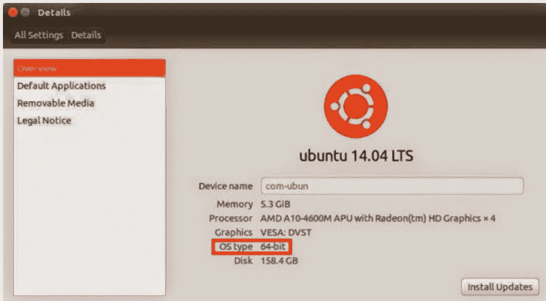

#### 下载 JRE/JDK

前往 Java 下载页面并选择 JRE。由于你只是在计算机上运行 Java 程序（正如我之前提到的），并且不需要 JDK 中功能全的 Java 开发工具包（尽管它也包含了 JRE），而它仅适用于安卓开发等应用开发，因此 JRE（而不是 JDK）就足够了。

下载页面关键信息如下：

- Java SE 许可信息用户手册
  - 包含第三方许可
- 经认证的系统配置
- Readme

| JDK 下载 | 服务器 JRE 下载 | JRE 下载 |

**JDK 详情：**

> 感谢下载此版本的 Java™平台标准版开发工具包 (JDK™)。JDK 是一个用于构建应用程序以及使用 Java 编程语言组件的开发环境。
> The JDK 包含了用于开发和测试用 Java 编程语言编写并运行在 Java 平台上的程序的工具。

**JDK 10.0.2 校验和**

| 产品/文件描述 | 文件大小 |
| :--- | :--- |
| Linux | 306 MB | jdk-10.0.2_linux-x64.rpm |
| Linux | 338.43 MB | jdk-10.0.2_linux-x64.tar.gz |
| macOS | 395.46 MB | jdk-10.0.2_osx-x64.dmg |
| Solaris SPARC | 207.07 MB | jdk-10.0.2_solaris-sparcv9.tar.gz |
| Windows | 390.25 MB | jdk-10.0.2_windows-x64.exe |

**如果你选择 JAVA JRE**，将弹出类似下面的对话框。在 Java SE 环境下方，你会看到“接受许可协议”，勾选该框。

> 你想运行 Java™ 程序，还是想开发 Java 程序？如果你只想运行 Java 程序而不进行开发，请下载 Java 运行环境（JRE）。
> 如果你想为 Java 开发应用程序，请下载 Java 开发工具包（JDK）。JDK 包含了 JRE，因此你不需要单独下载。

**JRE 10.0.2 校验和**

| 产品/文件描述 | 文件大小 | 下载 |
| :--- | :--- | :--- |
| Linux | 60.36 MB | jre-10.0.2_linux-x64.rpm |
| Linux | 83.91 MB | jre-10.0.2_linux-x64.tar.gz |
| macOS | 78.49 MB | jre-10.0.2_osx-x64.dmp |
| macOS | 73.87 MB | jre-10.0.2_osx-x64.tar.gz |
| Solaris SPARC | 53.35 MB | jre-10.0.2_solaris-sparcv9.tar.gz |
| Windows | 100.57 MB | jre-10.0.2_windows-x64.exe |

#### 解压安装包

输入以下代码并按回车：

```bash
cd ~/Downloads
```

如果你下载了 oracle JRE (64位)，可以输入以下代码并按回车：

```bash
sudo cp -r jre-8u5-linux-x64.tar.gz /usr/local/java
```

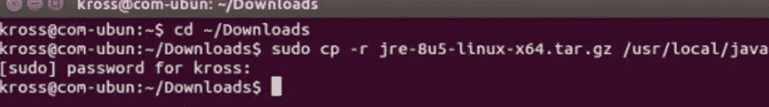

将 tar.gz JDK/JRE 文件解压到目录：`/usr/local/java`

输入以下代码并按回车：

```bash
cd /usr/local/java
```

**32 位系统操作：**

如果你下载了 oracle JDK (32位)，只需输入以下代码并按回车。

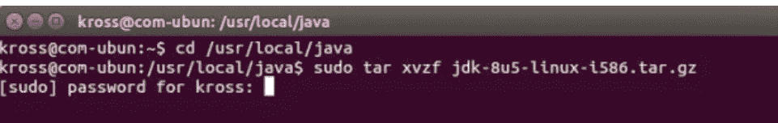

通过输入以下代码并按回车，在 32 位 Linux 中解压 JAVA JRE (32位)：

```bash
cd /usr/local/java
```

如果你下载了 ORACLE JRE (32位)，输入以下代码并按回车：

```bash
sudo tar xzvf jre-8u5-linux-i586.tar.gz
```

```
kross@com-ubuntu:~$ /usr/local/java
kross@com-ubuntu:~$ cd /usr/local/java
[sudo]:$ sudo tar xzvf jre-8u5-linux-i586.tar.gz
[sudo] password for kross: _
```

**64 位系统操作：**

在 64 位 Linux 中的 64 位 JAVA JDK 怎么做？只需输入以下代码并按回车：

```bash
cd /usr/local/java
```

对于 ORACLE JDK (64位)，输入以下代码并按回车：

```bash
sudo tar xzvf jdk-8u5-linux-x64.tar.gz
```

```
kross@com-ubuntu:~$ /usr/local/java
kross@com-ubuntu:~$ cd /usr/local/java
[sudo]:$ sudo tar xzvf jdk-8u5-linux-x64.tar.gz
[sudo] password for kross: _
```

通过输入以下代码在 64 位 Linux 中解压 ORACLE Java JRE (64位)：

```bash
cd /usr/local/java
```

如果你有 ORACLE JRE (64位)，只需输入以下代码并按回车：

```bash
kross@com-ubuntu:~$ /usr/local/java
kross@com-ubuntu:~$ cd /usr/local/java
kross@com-ubuntu:~$ /usr/local/java$ sudo tar xvzf jre-8u5-linux-x64.tar.gz
[sudo] password for kross: _
```

#### 配置环境变量

首先打开终端并输入以下内容：

```bash
sudo gedit /etc/profile
```

这样做，你将打开一个包含所有 Linux 全局级和启动程序的文本编辑器。

一直滚动到文件末尾，并将以下行附加到 `/etc/profile` 文件的末尾：

如果你处理的是 JDK，只需添加以下代码：

```bash
JAVA_HOME=/usr/local/java/jdk1.8.0_05
PATH=$PATH:$HOME/bin:$JAVA_HOME/bin
JRE_HOME=/usr/local/java/jdk1.7_0_05/jre
PATH=$PATH:$HOME/bin:$JRE_HOME/bin
export JAVA_HOME
export JRE_HOME
export PATH
```


# Linux 环境配置

## 编辑 `/etc/profile`

```bash
# 默认 umask 现由 pam_umask 处理。
# 查看 pam_umask(8) 和 /etc/login.defs。

if [ -d /etc/profile.d ]; then
  for i in /etc/profile/*.sh; do
    if [ -r $i ]; then
      $i
    fi
  done
fi

JAVA_HOME=/usr/local/java/jdk1.8.0_05
PATH=$PATH:$HOME/bin:$JAVA_HOME/bin
JRE_HOME=/usr/local/java/jdk1.8.0_05/jre
PATH=$PATH:$HOME/bin:$JRE_HOME/bin
export JAVA_HOME
export JRE_HOME
export PATH
```

## 仅安装 JRE 时的配置

```bash
JRE_HOME=/usr/local/java/jre1.8.0_05
PATH=$PATH:$HOME/bin:$JRE_HOME/bin
export JRE_HOME
export PATH
```

## 配置 `update-alternatives`

告知 Linux 关于 Java 的位置。对于 32 位或 64 位 JDK，下面的命令将让系统知道 JRE/JDK 是可用的。

```bash
sudo update-alternatives --install /usr/bin/java "java" "/usr/local/java/jdk1.8.0_05/bin/java" 1
sudo update-alternatives --install /usr/bin/javac "javac" "/usr/local/java/jdk1.8.0_05/bin/javac" 1
sudo update-alternatives --install /usr/bin/javaw "javaw" "/usr/local/java/jdk1.8.0_05/bin/javaw" 1
```

### 解压 JRE 示例

```bash
kross@com-ubuntu:~$ cd /usr/local/java
kross@com-ubuntu:/usr/local/java$ sudo tar xzvf jre-8u5-linux-i586.tar.gz
[sudo] password for kross: _
```

### 配置 JDK 示例输出

```bash
kross@com-ubuntu:~$ sudo update-alternatives --install /usr/bin/java "java" "/usr/local/java/jdk1.8.0_05/bin/java" 1
[sudo] password for kross:
kross@com-ubuntu:~$ sudo update-alternatives --install /usr/bin/javac "javac" "/usr/local/java/jdk1.8.0_05/bin/javac" 1
update-alternatives: warning: /usr/local/java/bin/javac 不存在；正在从列表中移除
update-alternatives: using /etc/alternatives/java 是悬空; 将更新为最佳选择。
update-alternatives: using /usr/local/java/jdk1.8.0_05/bin/java to provide /usr/bin/java (javac) in auto mode
kross@com-ubuntu:~$ sudo update-alternatives --install /usr/bin/javaw "javaw" "/usr/local/java/jdk1.8.0_05/bin/javaw" 1
update-alternatives: using /usr/local/java/jdk1.8.0_05/bin/javaw to provide /usr/bin/javaw in auto mode
```

## 仅安装 JRE 时的 `update-alternatives` 配置

```bash
sudo update-alternatives --install /usr/bin/java "java" "/usr/local/java/jre1.8.0_05/bin/java" 1
sudo update-alternatives --install /usr/bin/javaw "javaw" "/usr/local/java/jre1.8.0_05/bin/javaw" 1
```

### 执行示例输出

```bash
kross@com-ubuntu:~$ sudo update-alternatives --install /usr/bin/java "java" "/usr/local/java/jre1.8.0_05/bin/java" 1
[sudo] password for kross:
kross@com-ubuntu:~$ sudo update-alternatives --install /usr/bin/javaw "javaw" "/usr/local/java/jre1.8.0_05/bin/javaw" 1
```

## 设置默认版本

### JDK 环境

```bash
sudo update-alternatives --set java /usr/local/java/jdk1.8.0_05/bin/java
sudo update-alternatives --set javac /usr/local/java/jdk1.8.0_05/bin/javac
sudo update-alternatives --set javaws /usr/local/java/jdk1.8.0_05/bin/javaws
```

#### 执行示例输出

```bash
kross@com-ubuntu:~$ sudo update-alternatives --set java /usr/local/java/jdk1.8.0_05/bin/java
[sudo] password for kross:
update-alternatives: using /usr/local/java/jdk1.8.0_05/bin/java to provide /usr/bin/java (Java) in manual mode
kross@com-ubuntu:~$ sudo update-alternatives --set javac /usr/local/java/jdk1.8.0_05/bin/javac
kross@com-ubuntu:~$ sudo update-alternatives --set javaws /usr/local/java/jdk1.8.0_05/bin/javaws
```

### JRE 环境

```bash
sudo update-alternatives --set java /usr/local/java/jre1.8.0_05/bin/java
```

### JDK 环境 (javaws)

```bash
sudo update-alternatives --set javaws /usr/local/java/jdk1.8.0_05/bin/javaws
```

## 重新加载系统路径

输入以下内容并按回车：

```bash
. /etc/profile
```

> **注意**：系统级路径将在重启 Linux 系统后重新加载。

## 验证安装

打开终端，输入并按回车：`java -version`

### 32 位 Java 成功输出

```bash
kross@com-ubuntu:~$ java -version
java version "1.8.0"
Java(TM) SE Runtime Environment (build 1.8.0-b132)
Java HotSpot(TM) 32-Bit Server VM (build 25.0-b70, mixed mode)
```

### 64 位 Java 成功输出

```bash
kross@com-ubuntu:~$ java -version
java version "1.8.0"
Java(TM) SE Runtime Environment (build 1.8.0-b132)
Java HotSpot(TM) 64-Bit Server VM (build 25.0-b70, mixed mode)
```

# Windows 环境安装

## 下载 JDK

点击[此链接](#) 下载最新版本的 Java JDK。

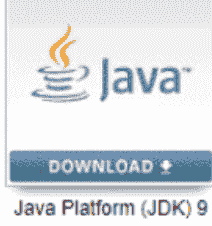


| Java Platform, Standard Edition |
| :--- |
| Java SE 9.0.1 |
| Java SE 9.0.1 包含重要的修复。Oracle 强烈建议所有 Java SE 9 用户升级到此版本。更多 ► |
| - 安装说明 |
| - Release Notes |
| - Oracle License |
| - Java SE Licensing Information User Manual |
| - Third Party Licenses |
| - Certified System Configurations |
| - Readme | JDK 下载 | JRE 下载 | JRE 下载 |

现在接受许可，并根据你的 Windows 版本（即 64 位或 32 位）下载最新的 JDK。

## 安装 JDK

当您的下载完成后，运行 exe 文件安装 JDK，并点击“下一步”。

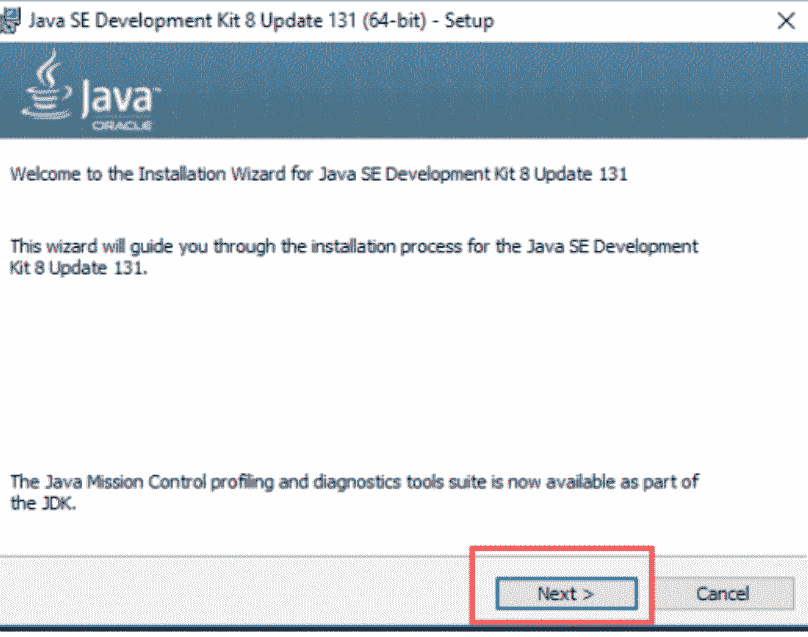

安装完成后点击“关闭”。

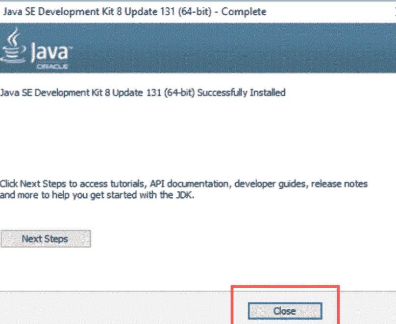

## 配置环境变量

变量 `PATH` 提供了 `java`、`javac` 等可执行文件的位置。您可以在不指定 `PATH` 的情况下运行程序，但需要可执行文件的完整路径，例如 `C:\Program Files\Java\jdk1.8.0_131\bin\javac`，而不是简单的 `javac A_Java`。

变量 `CLASSPATH` 提供了库文件的位置。我们现在来查看设置 `CLASSPATH` 和 `PATH` 的步骤。

1. 右键点击“我的电脑”，然后选择“属性”。
   
2. 选择“高级系统设置”，然后点击“环境变量”。
   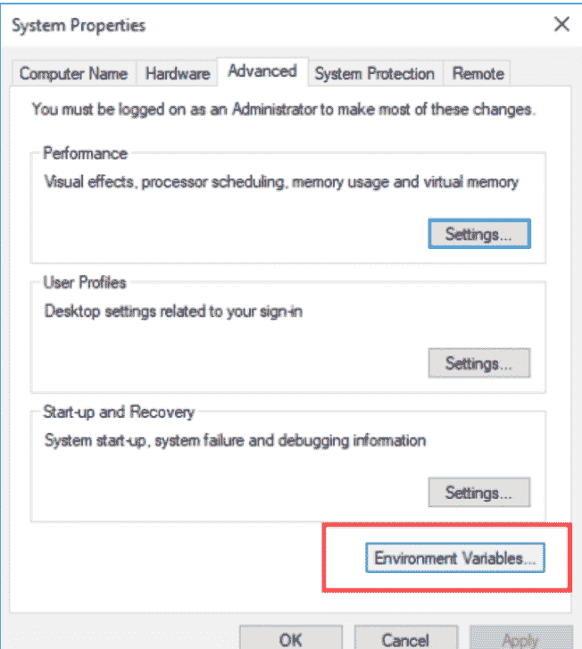
3. 在“用户变量”中选择“新建”按钮。
   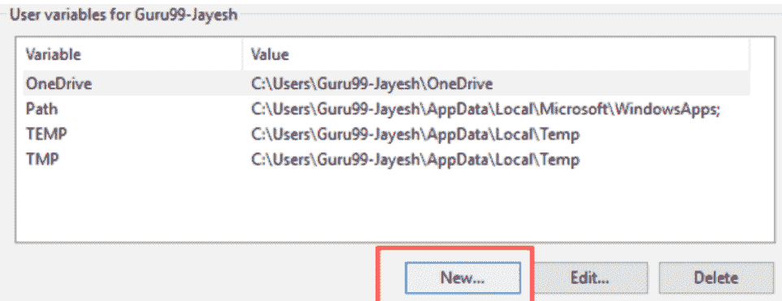
4. 在“变量名”输入 `PATH`。
   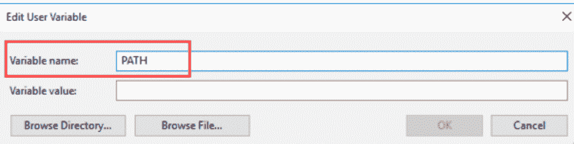
5. 复制安装在 JDK 文件夹中的 `bin` 文件夹路径：
   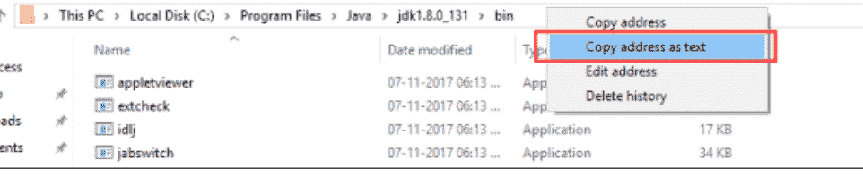
6. 将 `bin` 文件夹的路径粘贴到“变量值”中，然后点击“确定”按钮。
   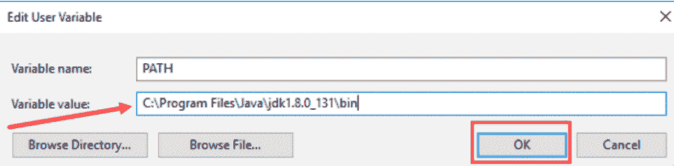

> 如果您的 PC 已设置了 `PATH` 变量，只需将 `PATH` 修改为：
> `PATH =<JDK 安装目录>\bin;%PATH%;`
> 在这种情况下，`%PATH%` 将现有的路径变量连接到您的新值中。

### 设置 `CLASSPATH`

只需遵循相同的过程。

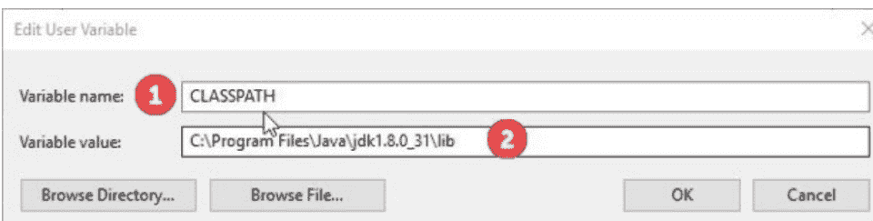

如果在完成后发现安装未生效，请将 `CLASSPATH` 更改为：

`CLASSPATH = <JDK 安装目录>\lib\tools.jar;`

现在点击“确定”按钮。

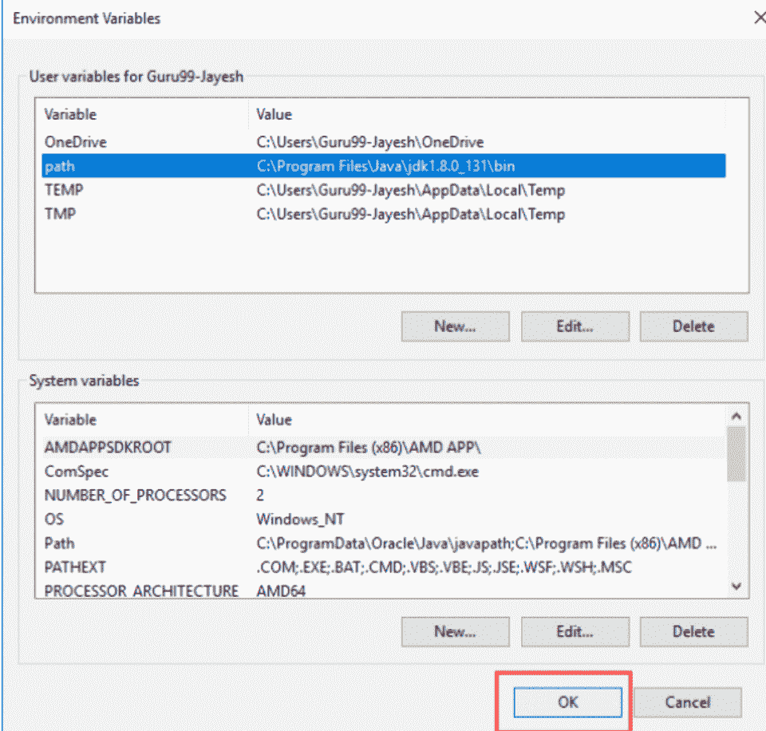

## 验证安装

现在进入您的命令提示符并输入 `javac` 命令。如果屏幕如下所示，说明 Java 已成功安装。

```cmd
C:\Users\Guru99-Jayesh> javac
Usage: javac <options> Source-files
  -g                     生成所有调试信息
  -none                 不生成调试信息
  -d(lines,var,source)  不生成警告
  -lint                 显示编译器正在执行
  -deprecation          输出使用已弃 API 的源码位置
  -classpath(path)      指定使用类文件和注解处理器的位置
  -p (path)              指定生成类文件的位置
  -bootstrapclass(path) 指定使用类文件和注解处理器的位置，以覆盖引导类文件的位置
  -endorsdir<dir>       覆盖标准标准路径的位置
  -Xmaxmem              编译期间的最大内存
  -processor([class1],[class2],...) 运行注解处理器的名称
  -parameters           为方法生成元数据
  -d<directory>          指定放置源文件的位置
  -h<directory>          指定生成头文件的位置
  -implicit(class,class) 指定是否隐含生成类文件
  -source release        与指定的发布版本兼容
  -target release        检查指定的发布版本中使用的 API
  -profile<profile>      包含在指定配置文件版本版本
  -key=[value]           直接传递给运行系统的选项
  -sourcepath            递归搜索源码
  -@filename             从文件读取选项
```

# IDE 选择与安装

IDE（集成开发环境）让开发变得高效，因为它可以帮助您完成编码、重构、运行应用程序和测试等重要任务。尽管如此，最重要的因素是速度（等待编译或加载的时间）。像 Eclipse 这样的 IDE 非常快，不占用内存且加载时间短，并且不需要大量时间同步更改。优秀的程序员还会提到其他功能，例如与代码库集成以及静态分析和高亮。

## 在 Windows 上安装 Eclipse

### 下载 Eclipse

访问此链接下载最新版本：


在“get eclipse”下点击“DOWNLOAD PACKAGES”。作为初学者，您应该选择 Java 开发者的 IDE（32 位或 64 位）。

| 下载内容 | | |
|---|---|---|
| 349 MB | 12104 | Mac 64位 Linux 32位 |
| Java 和 DSL 开发者的必备工具，包括 Java IDE、DSL 框架 (Xtext)、文本编辑器和 Maven 集成。 | | |
| 195 MB | 172013 | Windows 32位 Mac Cocoa Linux 64位 |
| 任何 Java 开发者的必备工具，包括 Java IDE、Git 客户端、文本编辑器和 Gradle 集成。 | | |
| 172 MB | 49333 | Windows 32位 Mac Cocoa Linux 64位 |
| JavaScript 和 Web 开发者的 IDE | | |

点击下载。

下一步是解压下载的文件进行安装。将文件解压到指定的目录（例如 `c:\javaproject`）。您不需要运行任何安装程序。此外，当不再需要时，可以直接删除整个 eclipse 文件夹。可以随意重命名或移动目录。此外请注意，可以在同一机器上安装多个副本。

### 在 Mac OS X 上安装 Eclipse

使用此链接重复上述下载和安装 Eclipse 的过程。只需选择 Mac OS X (cocoa)。当您选择“Java Developers IDE”时，将得到一个 DMG 文件。双击此下载的文件 (DMG) 并按照后续说明安装程序。程序将安装在：`/Applications/eclipse`

注意您也可以下载 TAR 包 (.tar.gz)；双击即可展开名为“eclipse”的文件夹，然后将展开的文件夹拖入“Applications”文件夹。

从[此页面](##) 下载 Java 版 Eclipse。按照习惯下载“packages”，平台选择“Linux”，然后选择用于 Java SE 程序开发的“Java Developers IDE”。您将在下载文件夹中获得 .tar 包，安装位于 `/usr/local`

1. 将 tar 包解压到 `/usr/local`
2. `$ cd /usr/local`
3. `$ sudo tar xvzf ~/Downloads/eclipse-java-oxygen-2-linux-gtk-x86_64.tar.gz`
4. 提取下载的包
5. x: 提取, z: 解压缩 gz, v: 详细, f: 文件
6. 提取到 `/usr/local/eclipse`
7. 您也可以在“文件管理器”中双击 tar 包来解压
8. （可选）更改所有者
9. `$ cd /usr/local`
10. `$ sudo chmod -R your-username:your-groupname eclipse`
11. 将所有者更改为指定的用户名和组名
12. -R 递归
13. 设置到 `/usr/bin` 的软链接（在 PATH 中）
14. `$ cd /usr/bin`
15. `$ sudo ln -s /usr/local/eclipse/eclipse`
16. 在 PATH 中的 `/usr/bin` 中创建软链接
17. `$ ls -ld /usr/bin/eclipse`
18. `lrwxrwxrwx 1 root root 26 Aug 30 11:53 /usr/bin/eclipse -> /usr/local/eclipse/eclipse`
19. `$ which eclipse`
20. `/usr/bin/eclipse`

要运行 ECLIPSE，只需打开“/usr/local/eclipse”文件夹并点击图标“Eclipse”；或者启动终端并输入“Eclipse”。

只需启动程序，右键点击 Eclipse 图标，然后点击“锁定到启动器”。如果你使用的是旧版本（因此上述方法无效），请创建一个名为 `/usr/share/applications/eclipse.desktop` 的文件，内容如下：

```text
[Desktop Entry]
Name=Eclipse
Type=Application
Exec=eclipse
Terminal=false
Icon=/usr/local/eclipse/icon.xpm
Comment=Integrated Development Environment
NoDisplay=false
Categories=Development;IDE;
Name[en]=Eclipse
```

现在你可以在 Eclipse 中编写你的第一个 Java 程序或项目了。

从 Eclipse 安装目录启动 Eclipse（运行 `eclipse.exe`），然后为你的工作空间选择一个合适的目录——即你想要保存文件的地方（例如 Windows 上的 `c:\javaproject\eclipse`）。

如果弹出名为“welcome”的窗口，点击“welcome”标题旁边标记有“cross”的按钮。

对于所有的 Java 应用程序，你都必须创建一个项目来包含所有的类（稍后会讨论）、源文件和重要资源。

按照以下步骤创建项目：

1. 选择 ‘file’ 菜单，点击 ‘new’，然后选择 ‘java project’（或者 ‘file’ -> ‘new’ -> ‘project’ -> ‘java project’）。
2. 将弹出名为 ‘new java project’ 的对话框。
3. 在 ‘project name’ 中输入 ‘firstproject’。
4. 勾选 ‘user default location’。
5. 在 JRE 中选择 ‘use default JRE’。
6. 在 ‘project layout’ 中勾选 ‘use project folder as the root for sources and class files’，然后点击标记有 ‘finish’ 的按钮。

在我们继续（编写第一个项目）之前，让我们先回顾 Java的一些基本概念。

## Java 标记 (Tokens)

标记基本上是 Java 以及任何其他程序中最小的逻辑组件。编译器的第一步是将整个程序分成称为标记的较小部分。你可以将它们视为程序的构建块。

标记基本上是程序中编译器在编译过程或标记化过程中可以识别的任何内容。让我们来看标记的类型：

- 关键字 (Keywords)
- 运算符 (Operators)
- 字面量 (Literals)
- 分隔符 (Separators)
- 注释 (Comments)
- 字面量 (Literals)

让我们对每一个项进行简要描述，以便你更好地理解。

关键字是 Java 中特殊的单词，或者被称为“保留”字，因为它们有特殊的含义。我们有一份 50 个关键字的列表，如下文所示：

| byte | short | int | long | double | float | char | boolean | void | public |
| :--- | :--- | :--- | :--- | :--- | :--- | :--- | :--- | :--- | :--- |
| private | static | import | package | class | interface | extends | implements | if | else |
| for | do | while | switch | case | instanceof | return | native | new | synchronized |
| strictfp | super | this | volatile | try | catch | finally | final | protected | transient |
| default | assert | break | continue | throw | throws | goto | abstract | const | enum |

### 标识符 (Identifiers)

标识符是程序员在程序中用于 Java 程序中任何方法、类、变量、包、对象、标签或接口的名称（你将在以后学习更多这些术语的含义）。

我们有标识符的命名规则，包括以下内容：

- 在 Java 标识符中，除了美元符号 `$` 和下划线 `_` 之外不能包含任何特殊符号。标识符需要从数字开头。
- 已经被保留并包含特殊含义——因此它们不能作为标识符。
- 保留字面量也允许作为标识符；例如-null、false 和 true。
- 你不能为多个标识符使用同一个名称。标识符还区分大小写，因此 `Mf` 和 `mf` 变量是完全不同的。

在这种情况下，有效标识符的一些良好示例包括：

```
pasa 1, Name, roll_no, $raju, string
```

无效的标识符包括类似的内容：

`True`（保留字面量）、`Roll-no`（使用了特殊字符）、`16sita`（以数字开头）以及 `try`（这是一个 Java 关键字）。

注意：Java 中的保留字面量和关键字是那些你不能作为变量或函数名的单词。

### 运算符 (Operators)

运算符是你用于与某些操作数结合产生某些结果的符号。我们在 Java 中有不同类型的运算符。正如你注意到的，某些字符串也可以用作运算符。从根本上说，在构建表达式和语句时，运算符在 Java 中是非常重要的——其中包括 `-`、`+`、`*`、`=`、`>=` 等。

### 分隔符 (Separators)

分隔符称为标记。这些特殊字符和符号将代码的不同部分与其他部分隔离开。有时，它们连接并分离一个或多个标记，或者组织代码块——这就是为什么我们称之为分隔符。

在 Java 中，使用的标点符号包括分号 (`;`) 、句号 (`.`) 、逗号 (`,`) 、方括号 `[]` 、圆括号 `()` 大括号 `{}` 。

### 字面量 (Literals)

字面量是指 Java 编程中执行过程中不会改变的值。你可以将它们视为字面量的常量。这些是某些字符串类型或原始类型的常量值。Java 中使用的任何字面量必须是下面提到的类型之一：

#### 字符 (Character)

这是在内存中存储字符常量的部分。它基本上占用 2 字节的大小，但只能存储一个字符，因为 char 存储的是 Unicode 字符集。它包含最大值 65,535。

#### 整数 (Integer)

整数类型可以存储整数。

| 类型 | 大小 | 范围 |
| :--- | :--- | :--- |
| byte | 1 字节 | -128 到 127 |
| short | 2 字节 | -32,768 到 32,767 |
| int | 4 字节 | -2,147,483,648 到 2,147,483,647 |
| long | 8 字节 | -9,223,372,036,854,775,808 到 9,223,372,036,854,775,807 |
| float | 4 字节 | - |
| double | 8 字节 | - |
| char | 2 字节 | - |
| boolean | 1 字节 | true, false |

#### 浮点数 (Floating point)

这些是小数。

#### 布尔 (Boolean)

布尔类型基本上存储状态：true 或 false。

### 注释 (Comments)

在 Java 中，注释用于文档说明。某些编译器忽略它们。单行注释开头为：

```java
// 这是一个注释
```

多行注释开头为：

```java
/* 这是一个多行
   注释 */
```

### 变量 (Variables)

变量是编程中存储数据的容器。当变量被声明时，它被初始化为一个值，稍后变为另一个值。变量可以进一步用于进行任何计算、打印等。每个变量都需要一个数据类型，如 Boolean、int 等，并且该类型需要在声明变量时指定。每个变量都需要一个不重复或唯一的名称来标识它。

让我们来看一个学生程序的示例。在这种情况下，我们可以有一个变量来存储“学生班级”，另一个用于“学生学号”等。

```java
char section;
int roll_number;
```

```java
class Test{
  public static void main(String args[]){
    char section = 'C';
    int roll_number = 76;//将 76 赋值给学号
  }
}
```

另一个变量或部分可以存储字符数据。Java 中的特殊关键字表示每个变量所存储的数据类型。这意味着我们实际上可以使用这些类型/关键字来声明变量并初始化变量的值。

## Java 中的变量类型

在 Java 中，变量可以分为四类，即：

- 静态变量 (Static variable)
- 实例变量 (Instance variable)
- 方法参数 (Method parameter)
- 局部变量 (Local variable)

### 实例变量

实例变量也称为非静态字段，用于存储对象的状态。没有使用 `static` 关键字且在任何声明方法之外定义的变量自动是特定对象的，由于它们的值是特定于实例且不会在实例之间共享，因此被称为实例变量。有些人将非静态字段视为实例变量，因为它们的值往往对每个类实例是唯一的。例如，某辆自行车的当前速度（`currentSpeed`）与另一辆自行车的当前速度是独立的。

此外，你需要注意以下几点：

当在堆（heap，见术语表）中为对象分配空间时，会为每个实例变量值创建一个槽。这些变量在通过 `new` 关键字创建对象时创建，在对象被销毁时销毁。实例变量持有必须被多个方法、块或构造函数引用的值，或者是整个类中都需要存在的对象状态的核心部分。

实例变量也可以在类级别使用之前或之后声明。用于指定类或类型及其成员访问权限的关键字（称为访问修饰符）可以赋予不同的实例变量。

实例变量包含默认值。对于数字，默认值是 0；对于布尔值（Booleans）为 false，对于对象引用为 null。在声明期间（或在构造函数内部），可以赋值。

实例变量对类中的所有构造函数、块和方法都是可见。通常，建议将这些变量设为 private 或访问级别。尽管如此，可以使用访问修饰符为这些变量提供子类的可见性。

可以通过类内部调用变量名直接访问实例变量。然而，在静态变量中——即当实例变量提供访问权限时——需要使用完全限定名调用。让我们来看一个例子：

```java
import java.io.*;
public class Employee {

    // 此实例变量对任何子类都可见。
    public String name;

    // salary 变量仅在 Employee 类中可见。
    private double salary;

    // name 变量在构造函数中赋值。
    public Employee(String empName) {
        name = empName;
    }

    // 为 salary 变量赋值值。
    public void setSalary(double empSal) {
        salary = empSal;
    }

    // 此方法打印员工详情。
    public void printEmp() {
        System.out.println("name: " + name);
        System.out.println("salary: " + salary);
    }
}
```

从这里你将得到以下结果：

```
name : Ransika
salary :1000.0
```

### 类变量或静态变量

类变量也称为静态变量，在类中使用 `static` 关键字声明，但在方法、块或构造函数之外。无论从其创建了多少对象，每个类都只有一个类变量的副本。

静态变量很少使用——除了被声明为常量之外。常量本质上是声明为 private/public、static 和 final 的变量。常量变量永远不会从其初始值改变。

静态变量保存在静态内存中，通常不将静态变量作为私有或公共常量。静态变量实际上在程序启动时创建，在程序停止时销毁。

可见性与实例变量相似。然而，大多数静态变量被声明为 public，因为它们需要供类用户可用。默认值与实例变量相似，对于数字，0 代表默认值。对于布尔值为 false，对于对象引用为 null。值可以在构造函数内部或声明期间赋值。此外，值可以在特定的静态初始化块中赋值。

访问静态变量需要使用类名——`className.variableName`。

最后，如果我们将类变量声明为 `public static final`，这意味着常量或变量名都采用大写字母。此外，如果静态变量既不是 public 也不是 final，这意味着命名语法将与实例变量和局部变量相似。

让我们来看一个例子：

```java
import java.io.*;
public class Employee {
    // salary 变量是一个私有静态变量
    private static double salary;

    // DEPARTMENT 是常量
    public static final String DEPARTMENT = "Development ";

    public static void main(String[] args[]) {
        salary = 1000;
        System.out.println(DEPARTMENT + "average salary:" + salary);
    }
}
```

将给出以下结果：

Development average salary: 1000

你需要注意的是，如果从外部类访问变量，常量需要以 `Employee.Department` 的方式访问。


# Java 变量、条件语句、循环与数组

## 局部变量

局部变量用于存储方法的临时状态。声明局部变量的语法与声明字段相同——例如 `int count=0;`。你不会发现特定的关键字来将变量指定为局部，因为这种判断完全取决于它声明的位置，即在方法的闭括号和开括号之间。简而言之，局部变量被称为“局部”，是因为它们只能在声明它们的方法中被引用。下面是一个方法，其中 `miles` 是一个局部变量。

```java
private static double convertKmToMi(double kilometers) {
    double miles = kilometers * MILES_PER_KETER;
    return miles;
}
```

## 方法参数

参数也是传入的方法。例如，在 `main` 方法中，`string args[]` 就是参数。

```java
package com.jbt;

/** 这里将讨论 Java 中可用的不同变量 **/
public class VariablesInJava {

    public static void main(String args[]) {
        System.out.println("Hello");
    }
}
```

## Java 中的条件语句

在日常生活的每一天，当你尝试完成某些事情时，我们都会接触到不同的对象；与此同时，我们使用这些对象来执行不同的任务。我们倾向于接触的对象类型是数字或模拟设备，如手机、电脑、汽车、商场和办公室的自动门以及电视。

结合上面的例子，你会发现 Java 条件语句的概念描述了我们的生活方式。在 Java 编程中，条件语句是为了根据预期结果做出决策。我们做出决策，并这些决策获得特定的结果。

`if` 语句是第一个条件语句。你需要注意的是，`if` 语句包含三个版本，包括以下：

- IF 语句
- ELSE — IF 语句
- IF / ELSE 语句

```java
if(batteryIsLow) {
    // 通知用户充电
}
if(phoneStorageIsFull) {
    // 通知用户删除内容
}
if(softwareUpdateIsAvailable) {
    // 通知用户下载
}
if(incomingCall) {
    // 手机铃响，铃响，铃响
}
if(userPressPowerOffButton) {
    // 通知用户手机即将关机
}
```

在 JAVA 中，我们使用 `if` 语句来检查手机的条件或状态，当该条件为真时，相应的操作就会被执行。如果条件不为真，则什么都不会发生。现在让我们考虑手机：如果手机的条件或状态是电量低，手机会通知你进行充电。如果手机存储空间已满，你可以收到一个通知来修复它，就像手机在有可用软件更新时通知你下载的方式一样。

### if/else 语句

现在让我们使用第二个设备来观察 `if/else` 语句是如何工作的。

```java
if(loginPaswordIsCorrect) {
  // 授予用户访问权限
} else {
  // 拒绝用户访问
}

if(batteryIsLow) {
  // 通知用户充电
} else {
  // 关机
}

if(laptopInactive) {
  // 进入睡眠模式
} else {
  // 保持屏幕激活
}
```

当你看上面的图片时，你会发现 “if 条件” 语句被扩展了，以便在第一个条件为假的情况下执行另一个动作。你也可以在第一个条件不为真时（即在 `if/else` 语句中）定义另一个可以完成的动作——在这种情况下，第一个条件是为假的。上面的这些条件是非常自言易懂的，因为它们在我们日常使用电脑时是显而易见的。

### else-if 语句

让我们使用提到的第三个设备来查看 `else-if` 语句是如何工作的。

```java
if(temperatureIsHot) {
    // 开启空调
} else if(temperatureIsWarm) {
    // 开启风扇
} else {
    // 开启加热器
}

if(speedIsGreaterThan80km/hr) {
    // 切换到 3 档
} else if(speedIsGreaterThan120km/hr) {
    // 切换到 3 档
} else {
    // 切换到 1 档
}

if(carIsNotInMotion) {
    // 打开所有门
} else if(carIsInMotion) {
    // 锁所有门
} else if(carIsMovingSlow) {
    // 保持所有门开启
}
```

除此，Java 还允许你通过 `else if` 关键字来测试其他条件。让我们以第一个例子为例；你可以看到，一旦测试了第一个条件，就会决定再测试两个条件，这在我们日常使用空调时是很可能的结果。基本上，我们能够通过 Java 的 `else if` 语句，根据任何可能的条件给出要执行的动作。

### switch case

最后，我们还有 `switch case`，这是 Java 中用到的另一种条件语句。正如其名所暗示，它是某种控制灯泡的 “开关情况（switch case）”。因此，它本质上意味着你可以有多个开关作为条件，来点亮不同的“灯泡”（或执行动作）。见下图。

使用最后提到的设备，我们将查看 `switch case` 语句的功能。

```java
int television = 0;

switch(television) {
  case 0:
    // 激活关闭模式；
    break;
  case 1:
    // 激活开启模式；
    break;
  case 2:
    // 激活扫描频道；
    break;
  default:
    // 激活睡眠模式；
    break;
}
```

当你看上面的图片时，很明显，自动开门所需的距离存储在 `distance` 变量中。在变量的声明和初始化之后，接下来是 `switch case`，测试所有具有相应动作的可能距离。具体发生的是，你存储了执行特定动作所需的变量，然后包含其他可以执行其他动作的 `case`。

你需要注意，并不总是需要使用 `switch case` 来调用单个特定的方法，因为你可以用它创建一个场景，根据用户的意愿执行多个动作。

`switch case` 还可以根据需要任意数量的 `case`，此外，`default` 语句可以在其他 `case` 都不等于所需动作的情况下执行某个动作。见下图。

通过我提到的最后一个设备，我们将看到 `switch case` 语句如何配合 `default` 语句一起工作。

```java
int television = 0;
switch(television) {
  case 0:
    // 激活关闭模式；
    break;
  case 1:
    // 激活开启模式；
    break;
  case 3:
    // 激活扫描频道；
    break;
  default:
    // 激活睡眠模式；
    break;
}
```

到此时，我确定你已经知道如何在 Java 中创建条件语句了。现在取决于你最后开始编码时如何将其包含在你的程序中。

## Java 中的循环 (Loops In Java)

在 Java 或任何其他编程语言中，循环都是一种便于一组指令执行的特征。循环在条件为真时重复执行。虽然它们提供的基本功能相同，但在语法上有所不同。

### while 循环 (While Loop)

`while` 循环是一种根据布尔条件重复执行的控制语句。你可以把 `while` 循环看作是 IF 语句。

```java
while (条件) {
  语句
}
```

查看下面的流程图：


`while` 循环通过检查条件开始。如果条件为真，循环体语句就会执行。因此，它是入口控制循环。

```java
// Java 演示 while 
class whileDemo
{
    public static void main(String[] args)
    {
        int x = 1;

        // 当 x 大于 4 时退出
        while (x <= 4)
        {
            System.out.println("Value of x:" + x);

            // 为下次迭代增加 x 值
            x++;
        }
    }
}
```

当你在 IDE 中运行它，你会得到：

Value of x:1

Value of x:2

Value of x:3

Value of x:4

### for 循环

这种循环提供了一种简洁的方式。与 `while` 循环不同，`for` 语句在一行内使用了初始化、测试和递增，从而提供了一种简短的循环结构。

```java
for (初始化条件; 测试条件; 递增/递减)
{
  语句(s)
}
```

流程图如下：


输出示例：

x 的值: 2

x 的值: 3

x 的值: 4

### 增强型 for 循环

Java 还包含了另一种在 Java 5 中引入的 for 循环版本。增强型 for 循环为遍历集合或数组的元素提供了一种更容易的方法。它是固定的，只有当你确实需要遍历序列中的元素且不需要感知当前处理元素的索引时，你才应该使用它。

```java
for (T element:Collection obj/array)
{
  statement(s)
}
```

作为一个示例（演示了你如何使用增强型 for 循环来简化工作，假设你有一个名称数组，并想要打印数组中包含的所有名称）。让我们来看看这两个示例之间的区别。增强型 for 循环以以下方式让事情变得简单：

在 IDE 上运行它将给你产生以下输出：

Ron

Harry

Hermoine

### do-while 循环

`do-while` 循环与 `while` 循环基本相同。但唯一的区别是，它在执行语句后才检查条件，因此，它是退出控制循环的一个很好的例子。

```java
{
  statements..
}
while (condition);
```

流程图如下：

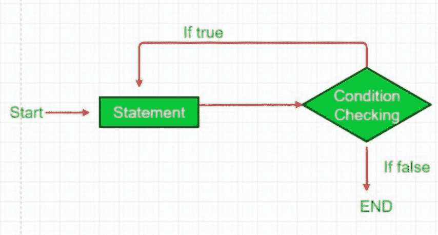

`do-while` 循环从语句执行开始。第一次，通常不会检查任何条件。一旦语句执行完毕并且变量值进行了更新，就会检查条件为真还是假。如果评估结果为真，则开始下一次循环迭代。

当条件结果为假时，它的生命周期就此结束。你需要记住，`do-while` 循环在检查任何条件之前执行其语句不少于一次；因此，它是退出控制循环的一个很好的例子。

```java
// 说明 do-while 循环的 Java 程序
class dowhileloopDemo
{
    public static void main(String args[])
{
        int x = 21;
        do
        {
            // 即使条件为假
            // 这行也会被打印
            System.out.println("Value of x:" + x);
            x++;
        }
        while (x < 20);
    }
}
```

当你在 IDE 上运行它时，你会得到以下输出：

x 的值: 21

到此，我认为你准备好学习关于 Java 数组的知识了。

## Java 数组

当你听到“数组”（arrays）这个名字时，请想象一个存储单一类型值或数据的容器。例如，你可以有一个持有 100 个 int 类型值的数组。数组是 Java 中一个重要的结构，它基本上允许你存储并方便地访问许多值。

### 声明数组

现在让我解释一下如何在 Java 中声明数组：

`data[] arrayName;`

在上面的示例中，`dataType` 指的是原始数据类型，如 char、int、byte、double 等，或者是一个对象。

另一方面，“arrayName”是一个标识符。

让我们再次看看上面的示例：

`Double[] data;`

在这种情况下，data 指的是一个能够持有“double”类型值的数组。

那么这个数组可以容纳多少个元素？由于这还没有定义，我们接下来的步骤将为数组元素分配内存。

`data = new Double[10];`

data 数组的长度为 10——这意味着它可以包含十个元素（在这种情况下，是 10 个 double 值）。你需要注意的是，当数组长度定义后，它在程序中就无法更改。

我们再举另一个例子：

`int[] age;`

`age = new int[5];`

在这个示例中，age 数组能够容纳五个 int 类型的值。你可以在单条语句中分配并声明数组的内存。你也可以将上面的两个语句替换为一条。

```java
int[] age = new int[5];
```

### Java 数组索引

你可以使用索引来访问数组元素——考虑下方的（之前的）示例：

`int[] age = new int[5];`

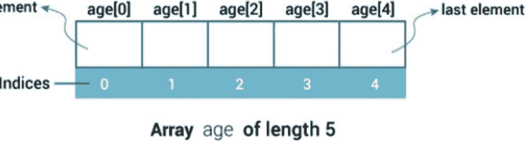

初始数组元素是 `age[0]`，第二个是 `age[1]`，依此类推。如果数组的长度为 n，那么最后一个元素就是 `arrayName[n-1]`。既然 5 是 'age' 数组的长度，上面示例中的最后一个数组元素是 'age[4]'。

零是数值类型数组元素的默认第一个值；对于布尔型（Boolean），它是 'false'。这可以通过以下方式演示：

```java
class ArrayExample {
    public static void main(String[] args) {

        int[] age = new int[5];

        System.out.println(age[0]);
        System.out.println(age[1]);
        System.out.println(age[2]);
        System.out.println(age[3]);
        System.out.println(age[4]);
    }
}
```

运行程序得到以下输出。

0

0

0

0

我们有更好的方法通过循环构造结构来访问任何数组的元素（通常使用“for 循环”）。

```java
class ArrayExample {
    public static void main(String[] args) {

    int[] age = new int[5];

    for (int i = 0; i < 5; i++) {
        System.out.println(age[i]);
    }
}
```

### 如何初始化数组？

你可以在 Java 声明期间初始化数组，或者根据需要在程序稍后进行初始化（更改值也是一种选择）。

### 在声明期间初始化数组

以下是在声明期间初始化数组的方法：

`int[] age = {12, 4, 5, 2, 5};`

这条语句构建了一个数组并在声明期间对其初始化。数组的长度由给定的数值决定，这些数值用逗号分隔。在示例中，age 数组的长度为 5。

| age[0] | age[1] | age[2] | age[3] | age[4] |
|---|---|---|---|---|
| 12 | 4 | 5 | 2 | 5 |

我们将写一个小型程序，以便打印数组的元素。

```java
class ArrayExample {
    public static void main(String[] args) {

        int[] age = {12, 4, 5, 2, 5};

        for (int i = 0; i < 5; i++) {
            System.out.println("Element at index " + i + ": " + age[i]);
        }
    }
}
```

运行程序得到以下输出：

Element at index 0: 12

Element at index 1: 4

Element at index 2: 5

Element at index 3: 2

Element at index 4: 5

### 你如何访问数组？

可以使用索引来访问数组元素——考虑下方的示例：

```java
class ArrayExample {
    public static void main(String[] args) {

        int[] age = new int[5];

        // 插入第三个元素
        age[2] = 14;

        // 插入第一个元素
        age[0] = 34;

        for (int i = 0; i < 5; i++) {
            System.out.println("Element at index " + i + ": " + age[i]);
        }
    }
}
```

运行程序将得到以下输出：

Element at index 0: 34

Element at index 1: 0

Element at index 2: 14

Element at index 3: 0

Element at index 4: 0

### Java 数组的示例

下面是一个计算 int 数组中存储值的平均值的程序：


```java
class SumAverage {
    public static void main(String[] args) {

        int[] numbers = {2, -9, 0, 5, 12, -25, 22, 9, 12};
        int sum = 0;
        double average;

        for (int number : numbers) {
            sum += number;
        }

        int arrayLength = numbers.length;

        // 将 sum 和 arrayLength 转换为 double 因为 average 是 double
        average = ((double) sum / (double) arrayLength);

        System.out.println("Sum = " + sum);
        System.out.println("Average = " + average);
    }
}
```

运行程序将得到以下输出：

```
Sum = 36
Average = 3.6
```

## 多维数组

到目前为止我们一直在讨论一维数组。但在 Java 中，你可以声明被称为多维数组的数组。以下是声明/初始化多维数组的示例：

```java
Double[][] matrix = {{1.2, 4.3, 4.0}, {4.1, -1.1}};
```

在这种情况下，`matrix` 是一个二维数组。让我们简单谈谈 Java 中的多维数组。

以下是一个 2d（二维）数组。该数组能够容纳最多 12 个 `int` 类型元素。

| 列 1 | 列 2 | 列 3 | 列 4 |
|---|---|---|---|
| 行 1 | `a[0][0]` | `a[0][1]` | `a[0][2]` | `a[0][3]` |
| 行 2 | `a[1][0]` | `a[1][1]` | `a[1][2]` | `a[1][3]` |
| 行 3 | `a[2][0]` | `a[2][1]` | `a[2][2]` | `a[2][3]` |

同样，你可以声明一个 3 维（三维）数组。例如：

```java
String[][][] personalInfo = new String[3][4][2];
```

在这种情况下，`personalInfo` 是一个 3 维数组，能容纳最多 24 (3*4*2) 个字符串类型的元素。

Java 中多维数组的组成部分也是数组。

如果你对 C 或 C++ 语言有所了解，你可能已经开始认为 Java 的多维数组工作方式与 C/C++ 中的数组相同。但事实并非如此，因为 Java 的行长度是可以变化的。

在初始化期间，你会看到这种区别。

### 在 Java 中初始化二维数组

使用下面的示例来初始化一个二维数组：

```java
int[][] a = {
    {1, 2, 3},
    {4, 5, 6, 9},
    {7},
};
```

数组组件 `a` 的每一个实际上本身都是一个数组，而且所有行的长度也不相同。为了证明这一点，我们将编写一个程序。

```java
class MultidimensionalArray {
    public static void main(String[] args) {

        int[][] a = {
            {1, 2, 3},
            {4, 5, 6, 9},
            {7}
        };

        System.out.println("Length of row 1: " + a[0].length);
        System.out.println("Length of row 2: " + a[1].length);
        System.out.println("Length of row 3: " + a[2].length);
    }
}
```

运行该程序时你将得到以下输出：

```
Length of row 1: 3
Length of row 2: 4
Length of row 3: 1
```

既然所有的多维数组组件也是数组，这意味着 `a[2]`、`a[1]` 和 `a[0]` 也是数组。你可以通过使用 `length` 属性来获取行的长度。让我们来看一个很好的例子：

#### 使用循环打印所有二维数组元素

```java
class MultidimensionalArray {
    public static void main(String[] args) {

        int[][] a = {
            {1, -2, 3},
            {-4, -5, 6, 9},
            {7}
        };

        for (int i = 0; i < a.length; ++i) {
            for (int j = 0; j < a[i].length; ++j) {
                System.out.println(a[i][j]);
            }
        }
    }
}
```

注意，当有机会时，在遍历数组时最好利用 `for..each` 循环。你可以使用 `for..loop` 完成相同的任务如下：

```java
class MultidimensionalArray {
    public static void main(String[] args) {
        int[][] a = {
            {1, -2, 3},
            {-4, -5, 6, 9},
        };

        for (int[] innerArray : a) {
            for (int data : innerArray) {
                System.out.println(data);
            }
        }
    }
}
```

运行该程序时你将得到以下输出：

```
1
-2
3
-4
-5
6
9
```

### 在 Java 中初始化三维数组

初始化一个 3 维数组与初始化二维数组相同。看下面的示例：

```java
// test 是一个 3 维数组
int[][][] test = {
    {
        {1, -2, 3},
        {2, 3, 4}
    },
    {
        {-4, -5, 6, 9},
        {1},
        {2, 3}
    }
};
```

就像二维数组的情况一样，3 维数组的长度也可以不同。让我们来看一个例子：

#### 使用循环打印三维数组元素的程序

```java
class ThreeArray {
    public static void main(String[] args) {

        int[][][] test = {
            {
                {1, -2, 3},
                {2, 3, 4}
            },
            {
                {-4, -5, 6, 9},
                {1},
                {2, 3}
            }
        };

        // 使用 for-each 循环遍历 3 维数组的元素
        for (int[][] array2D : test) {
            for (int[] array1D : array2D) {
                for (int item : array1D) {
                    System.out.println(item);
                }
            }
        }
    }
}
```

当你运行该程序时，将得到以下输出：

```
1
-2
3
2
3
4
-4
-5
6
9
1
2
3
```

## Java 复制数组

我们现在将学习 Java 中用于复制数组（即一维和二维数组）的各种方法。我们有许多技术可以来实现这一点，正如本节所解释的那样：

### 使用赋值运算符复制数组

看下面的示例：

```java
class AssignmentOperator {
    public static void main(String[] args) {
        int[] numbers = {1, 2, 3, 4, 5, 6};
        int[] positiveNumbers = numbers;

        for (int number : positiveNumbers) {
            System.out.print(number + ", ");
        }
    }
}
```

运行该程序时，你将得到以下输出：

```
1, 2, 3, 4, 5, 6
```

尽管这种特定的复制数组方法效果非常好，但它倾向于有一个问题。问题在于，当你修改上述示例中单个数组的元素时，另一个数组也会发生变化。

```java
class AssignmentOperator {
    public static void main(String[] args) {

        int[] numbers = {1, 2, 3, 4, 5, 6};
        int[] positiveNumbers = numbers;

        positiveNumbers[0] = 12;

        for (int number : positiveNumbers) {
            System.out.print(number + ", ");
        }
    }
}
```

输出：

```
12, 2, 3, 4, 5, 6
```

### 使用 `Arrays.copyOf()` 复制数组

```java
import java.util.Arrays;

class ArraysCopy {
    public static void main(String[] args) {
        int[] source = {1, 2, 3, 4, 5, 6};
        int[] destination = Arrays.copyOf(source, source.length);

        System.out.println(Arrays.toString(destination));
    }
}
```

输出：

```
[1, 2, 3, 4, 5, 6]
```

### 使用 `Arrays.copyOfRange()` 复制数组

```java
import java.util.Arrays;

class ArraysCopy {
    public static void main(String[] args) {
        int[] source = {1, 2, 3, 4, 5, 6};
        int[] destination = Arrays.copyOfRange(source, 2, 5);

        System.out.println(Arrays.toString(destination));
    }
}
```

输出：

```
[3, 4, 5]
```

### 使用 `System.arraycopy()` 复制数组

```java
import java.util.Arrays;

class ArraysCopy {
    public static void main(String[] args) {
        int[] source = {1, 2, 3, 4, 5, 6};
        int[] destination = new int[source.length];

        System.arraycopy(source, 0, destination, 0, source.length);

        System.out.println(Arrays.toString(destination));
    }
}
```

输出：

```
[1, 2, 3, 4, 5, 6]
```

### 使用循环拷贝二维数组

使用下面的示例通过循环拷贝不规则的二维数组：

```java
import java.util.Arrays;

class ArraysCopy {
    public static void main(String[] args) {
        int[][] source = {
            {1, 2, 3, 4},
            {5, 6},
            {0, 2, 42, -4, 5}
        };

        int[][] destination = new int[source.length][];

        for (int i = 0; i < destination.length; ++i) {
            // 为 destination 数组的每一行分配空间
            destination[i] = new int[source[i].length];

            for (int j = 0; j < destination[i].length; ++j) {
                destination[i][j] = source[i][j];
            }
        }

        // 显示 destination 数组
        System.out.println(Arrays.deepToString(destination));
    }
}
```

运行程序时你将得到以下输出：

```
[[1, 2, 3, 4], [5, 6], [0, 2, 42, -4, 5]]
```

你可以看到，我们在这里对数组使用了 `deepToString()` 方法。该方法能更好地表示多维数组，就像在二维数组中一样。你可以在此处获取更多关于 `deepToString()` 的信息。

你可以使用 `System.arraycopy()` 或者——在一维数组的情况下使用 `Arrays.copyOf()` 数组来替换上述代码的内部循环。看看下面的示例，它展示了如何使用 `arraycopy()` 方法实现相同的功能。

```java
import java.util.Arrays;

class AssignmentOperator {
    public static void main(String[] args) {

        int[][] source = {
            {1, 2, 3, 4},
            {5, 6},
            {0, 2, 42, -4, 5}
        };

        int[][] destination = new int[source.length][];

        for (int i = 0; i < source.length; i++) {
            // 为 destination 数组的每一行分配空间
            destination[i] = new int[source[i].length];
            System.arraycopy(source[i], 0, destination[i], 0, destination[i].length);
        }

        // 显示 destination 数组
        System.out.println(Arrays.deepToString(destination));
    }
}
```

毕竟，数组并没有那么复杂！下一个主题更加简单直接。让我们来看一些运算符，以确保我们目前所学的一些内容更有意义，同时也了解接下来的内容。

## Java 运算符

简单来说，运算符是表示特定动作的字符。例如，如你所知，`+` 是表示加法的算术运算符。在 Java 中，我们有以下类型的运算符：

- 赋值运算符
- 基础算术运算符
- 比较或关系运算符
- 自增/自减运算符
- 位运算符
- 逻辑运算符
- 三元运算符

### 基础算术运算符

这些包括 `+`、`%`、`-`、`*`、`/` 等内容

- 加法由 `+` 表示
- 减法由 `-` 表示
- 乘法由 `*` 表示
- 除法由 `/` 表示
- 取模由 `%` 表示

你必须注意，取模运算符返回余数——例如 `10 % 5` 返回零

让我们来看一些算术运算符的示例：

```java
public class ArithmeticOperatorDemo {
    public static void main(String[] args) {
        int num1 = 100;
        int num2 = 20;

        System.out.println("num1 + num2: " + (num1 + num2));
        System.out.println("num1 - num2: " + (num1 - num2));
        System.out.println("num1 * num2: " + (num1 * num2));
        System.out.println("num1 / num2: " + (num1 / num2));
        System.out.println("num1 % num2: " + (num1 % num2));
    }
}
```

输出将如下：

```
num1 + num2: 120
num1 - num2: 80
num1 * num2: 2000
num1 / num2: 5
num1 % num2: 0
```

### 赋值运算符

赋值运算符包括以下内容：

- 将 `num1` 变量赋值给变量 `num2` 的运算符 `num2 = num1`
- `num2 += num1` 等同于 `num2 = num2 + num1`
- 同样，`num2 -= num1` 等于 `num2 = num2 - num1`
- `num2 *= num1` 等于 `num2 = num2 * num1`
- `num2 /= num1` 等于 `num2 = num2 / num1`
- `num2 %= num1` 等于 `num2 = num2 % num1`

让我们来看一个赋值运算符的示例：

```java
public class AssignmentOperatorDemo {
    public static void main(String args[]) {
        int num1 = 10;
        int num2 = 20;

        num2 = num1;
        System.out.println("Output: " + num2);

        num2 += num1;
        System.out.println("+= Output: " + num2);

        num2 -= num1;
        System.out.println("-= Output: " + num2);

        num2 *= num1;
        System.out.println("*= Output: " + num2);

        num2 /= num1;
        System.out.println("/= Output: " + num2);

        num2 %= num1;
        System.out.println("%= Output: " + num2);
    }
}
```

运行上述程序得到的输出如下：

```
Output: 10
+= Output: 30
-= Output: 20
*= Output: 200
/= Output: 2
%= Output: 0
```

### 自增自减运算符

这里我们处理的是 `++` 和 `--`

让我们来看自增自减运算符的示例：

```java
public class AutoOperatorDemo {
    public static void main(String[] args) {
        int num1 = 10;
        int num2 = 20;

        num1++;
        num2--;
        System.out.println("num1 is: " + num1);
        System.out.println("num2 is: " + num2);
    }
}
```

输出如下：

```
num1 is: 11
num2 is: 19
```

### 逻辑运算符

这里，我们处理的是 `&&`、`||` 和 `!`

让我们来看逻辑运算符的示例：


```java
public class LogicalOperatorDemo {
    public static void main(String[] args) {
        boolean b1 = true;
        boolean b2 = false;

        System.out.println("b1 && b2: " + (b1 && b2));
        System.out.println("b1 || b2: " + (b1 || b2));
        System.out.println("!b1: " + (!b1));
    }
}
```

输出如下：

```
b1 && b2: false
b1 || b2: true
!b1: false
```

### 关系运算符

在 Java 中，有六种关系运算符包括：

- 左右侧相等时 `==` 返回 true
- 左右侧不相等时 `!=` 返回 true
- 左侧大于右侧 `>` 返回 true
- 左侧小于右侧 `<` 返回 true
- 左侧大于或等于右侧 `>=` 返回 true
- 左侧小于或等于右侧 `<=` 返回 true

让我们来看这些关系运算符的示例：

首先，你需要注意下面的示例使用了 `if-else` 语句，在继续之前你需要熟悉该语句。

```java
public class RelationalOperatorDemo {
    public static void main(String[] args) {
        int num1 = 10;
        int num2 = 50;
        if (num1 == num2) {
            System.out.println("num1 and num2 are equal");
        } else {
            System.out.println("num1 and num2 are not equal");
        }
        if (num1 != num2) {
            System.out.println("num1 and num2 are not equal");
        } else {
            System.out.println("num1 and num2 are equal");
        }
        if (num1 > num2) {
            System.out.println("num1 is greater than num2");
        } else {
            System.out.println("num1 is not greater than num2");
        }
        if (num1 >= num2) {
            System.out.println("num1 is greater than or equal to num2");
        } else {
            System.out.println("num1 is less than num2");
        }
        if (num1 < num2) {
            System.out.println("num1 is less than num2");
        } else {
            System.out.println("num1 is not less than num2");
        }
        if (num1 <= num2) {
            System.out.println("num1 is less than or equal to num2");
        } else {
            System.out.println("num1 is greater than num2");
        }
    }
}
```

输出如下：

```
num1 and num2 are not equal
num1 and num2 are not equal
num1 is not greater than num2
num1 is less than num2
num1 is less than or equal to num2
```

输出如下（中文）：

```
num1 和 num2 不相等
num1 和 num2 不相等
num1 不大于 num2
num1 小于 num2
num1 小于 num2
num1 小于或等于 num2
```

### 位运算符

我们基本上有六种位运算符，它们包括：

```
num1 = 11; /* 等于 00001011 */
num2 = 22; /* 等于 00010110 */
```

我确定你一定听过，位运算符是按位进行处理的。

`num1 & num2` 本质上是比较它们对应的位（`num1` 和 `num2` 的位），如果两个位相等则在生成前生成 1，否则将返回 0。在这种情况下，它将返回：2，即 `00000010`，因为在 `num1` 和 `num2` 的二进制形式中，只有最后位是匹配的。

`num1 | num2` 比较 `num1` 和 `num2` 的位，然后如果其中一个位为 1，则生成 1，否则返回零。在这种情况下，它返回 31，本质上是 `0011111`。

另一方面，`num1 ^ num2` 在比较 `num2` 和 `num1` 的对应位之前生成一个 1；即如果它们不等，则生成 1，否则返回 0。在我们的示例中，它将返回 29，等于 `00011101`。

`~num` 正好是一个补码运算符，它只将位从 0 改为 1，从 1 改为 0。在我们这里的示例中，它返回 -12。这个有符号 8 位等于 `11110100`。

`num1 <<` 是左移运算符，负责将位向左侧移动并丢弃最左侧的位，然后向最右侧位赋值零。在这种情况下，输出是 44。这个数字等于 `0101100`。

你需要注意的是，在下面的示例中，我们向位移运算符的右侧给了 2，这就是位向左侧移动 2 个位置的原因。你可以更改这个数字，位将根据运算符右侧指定的位数进行移动。`num >>` 是右移运算符，通常倾向于将位向右移动并丢弃最右侧的位，然后赋值 0。在这种情况下，输出是 2，等于 `0000010`。让我们来看这些运算符的示例：

```java
public class BitwiseOperatorDemo {
    public static void main(String[] args[]) {

        int num1 = 11; /* 00001011 */
        int num2 = 22; /* 00010110 */
        int result = 0;

        result = num1 & num2;
        System.out.println("num1 & num2:" + result);

        result = num1 | num2;
        System.out.println("num1 | num2:" + result);

        result = num1 ^ num2;
        System.out.println("num1 ^ num2:" + result);

        result = ~num1;
        System.out.println("~num1:" + result);

        result = num1 << 2;
        System.out.println("num1 << 2:" + result);

        result = num1 >> 2;
        System.out.println("num1 >> 2:" + result);
    }
}
```

输出如下：

```
num1 & num2: 2
num1 | num2: 31
num1 ^ num2: 29
~num1: -12
num1 << 2: 44
num1 >> 2: 2
```

### 正确类型化

正确类型化（我们将使用 `type StateName` 记法），其中类型名称位于状态项名称之前。

```
class Vehicle:
  invariants:
    currentSpeed is greater than or equal to 0
  state:
    String manufacturerName
    String modelName
    Number productionYear
    Number currentSpeed
  behavior:
    accelerate:
      increase currentSpeed by 1
    decelerate:
      if currentSpeed is greater than 0:
        decrease currentSpeed by 1
```

你需要注意，字符串是字符序列，我们必须忽略当前速度的单位。目前，将当前速度限制为数字就足够了。当你继续描述类型时，你会遇到两个在继续装饰和完善车辆类之前需要处理的问题：原始类型以及行为的参数。

## 原始类型

当你根据其他类来定义类该类的状态条目时，我们最终会达到一个点，即你无法在产生循环层次结构的情况下再次引用另一个类。例如，如果你尝试将 `number` 类型赋值给状态 `currentSpeed`，那么你该如何定义 `number` 类呢？如果你尝试根据其他类来定义它，那么你又该如何定义那些类呢？由于你不能允许类型系统接受无限递归，你需要声明一个值或多个值的存在。此类公理化类型被称为原始类型。

大多数编程语言都有一组基础的原始类型，包括小数值（如单精度浮点数）、整数、字符串、字符和布尔值（这些值可以是 true 或 false）。这些类型以位集合的形式出现，而没有必要定义类的递归结构。此类原始类型可以作为构建块，用于根据创建的类构建更复杂的类型。为了讨论起见，我们假设 `string`、`number`、`Boolean` 和 `character` 类型是存在的。

你必须考虑的另一件事是在执行行为时向类传递信息。例如，当你想要加速到每小时 80 公里时，你必须成功执行车辆类的 `accelerate` 行为 80 次。这对于真实系统来说无疑是混乱的。取而代之，你应该尝试指示车辆加速多少，例如当执行 `accelerate by 30` 然后执行 `accelerate by 15`，即可得到每小时 45 公里的速度。为了做到这一点，你需要声明你的 `accelerate` 行为实际上可以是一个值，该值作为参数之一紧密地表示了增加的速度。为此，你将在与你的类状态相同的记法关联类型之前，用圆括号将增加的速度括起来。正如你所注意到的的，参数需要被命名，否则你将无法在行为定义内部使用或访问该参数。你还需要注意，当行为没有任何参数时，你将使用空参数集。例如，如果 `drive` 行为不接受任何参数，它的声明将是 `drive()`。结果，你将为你的车辆得到如下类：

```
class Vehicle:
  invariants:
    currentSpeed is greater than or equal to 0
  state:
    String: manufacturerName
    String modelName
    Number productionYear
    Number currentSpeed
  behavior:
    accelerate(Number amount):
      increase currentSpeed by amount
    decelerate(Number amount):
      if currentSpeed minus amount is greater or equal to 0:
        decrease currentSpeed by amount
```

如果现在你指示车辆加速 30，你就能将车辆的当前速度增加 30。现在当值 (30) 在执行时传递给你的行为时，它被称为参数（argument）。尽管参数（argument）和参数（parameter）这两个术语密切相关，但你会得到一个关键的区别：参数（parameter）是在行为定义中引用的值；而参数（argument）是在执行时传递给行为的实际值。

我特意选择了执行记法，因为它将提供的参数（argument）映射到声明的参数（parameter）。例如，`accelerate(30)` 在执行期间将值 (30) 映射到 `amount`（`number` 类型）。这种参数（parameter）的记法可以扩展到多个参数，方法是在一个用逗号分隔的列表中列出多个参数，形式如 `doSomething(number valueOne, Number valueTwo)`。在参数按位置映射的情况下，这种参数（argument）记法可以派上用场，例如 `doSomething(15, 37)` 将 37 映射到 `valueTwo`。

## 类声明

让我们从一个类定义的示例开始：

```
class MyClass {
  // 字段、构造函数和
  // 方法声明
}
```

这是类声明的形式。大括号之间的区域——或类体——包含了该类创建的对象的生命周期所提供的所有功能：用于初始化新对象的构造函数、提供类及其对象状态的字段声明，以及实现类及其对象行为的方法。先前的类声明是一个极简的——它基本上包含了类声明的所有必需组件。你可以在类声明的开头提供更多关于类的信息，例如，它的父类名称、它是否实现了任何接口等。例如：

```
class MyClass extends SuperClass implements YourInterface {
  // 字段、构造函数和
  // 方法声明
}
```

这意味着 `MyClass` 是 `MySuperClass` 的子类，它实现了 `YourInterface` 接口。你可以在开头添加诸如 `private` 或 `public` 这样的修饰符——所以你可以看到类声明的第一行可能会变得复杂。通常，类声明可以按顺序包含以下组件：

- 修饰符，如 `private` 和 `public`，以及你以后会遇到的其他几个。
- 类名，按照惯例首字母大写。
- 类的父类或超类类名称（如果有），前面带有关键字 `extends`。一个类只能扩展一个父类。
- 该类实现的接口列表（如果有），它们之间用逗号分隔，前面带有 `implements` 关键字。一个类可以实现多个接口。
- 类体，由大括号 `{}` 边界。

我们有不同类型的变量：

- 类中的成员变量，被称为字段（fields）
- 代码块或方法中的变量，被称为局部变量（local variables）
- 方法声明中的变量被称为参数（parameters）

`bicycle` 类使用以下代码行来定义它的字段：

```
public int cadence;
public int gear;
public int speed;
```

字段声明由三个组件组成，包括：

- 零或多个修饰符，例如 `private` 或 `public`
- 字段类型
- 字段名称

`bicycle` 字段名称为 `cadence`、`gear` 以及 `speed`，它们都是整数数据类型 `int`。关键字 `public` 标识这些字段为公共成员，任何能够访问该类的对象都可以访问它们。

```java
public class Bicycle {
    private int cadence;
    private int gear;
    private int speed;

    public Bicycle(int startCadence, int startGear) {
        gear = startGear;
        cadence = startCadence;
        speed = startSpeed;
    }

    public int getCadence() {
        return cadence;
    }

    public void setCadence(int newValue) {
        cadence = newValue;
    }

    public int getGear() {
        return gear;
    }

    public void setGear(int newValue) {
        gear = newValue;
    }

    public int getSpeed() {
        return speed;
    }

    public void applyBrake(int decrement) {
        speed -= decrement;
    }

    public void speedUp(int increment) {
        speed += increment;
    }
}
```

### 类型

变量需要有一个类型。你可以使用之前提到的基本数据类型，如 `Boolean`、`float` 或 `int`，或者直接使用引用类型，如对象、数组或 `String`。

### 变量名

无论变量是字段、参数还是局部变量，所有变量都遵循某些约定和命名规则。你需要记住，类名和方法名也使用相同的约定和命名规则，例外是：

- 类名的第一个字母需要大写。
- 方法名中的第一个单词或唯一的单词必须是一个动词。

## 定义方法

以下是一个典型的方法声明示例：

```java
public double calculateAnswer(double wingSpan, int numberOfOfEngines,
    double length, double grossTons) {
    // 在此处进行计算
}
```


方法声明所需的元素包括返回类型、括号`()`、名称以及方法大括号`{}`之间的方法体。通常，方法声明按以下顺序包含六个部分：

- 修饰符，如`private`、`public`等。
- 返回类型，即方法返回的值的数据类型，或者如果方法没有返回值，则为`void`。
- 方法名——字段命名规则同样适用于方法名，但约定略有不同。
- 括号内的参数列表——输入参数列表，用逗号分隔，每个参数前面都跟着其对应的数据类型，这些类型通常被括在括号内。在没有参数的情况下，可以使用空括号。
- 异常列表
- 位于不同大括号之间的方法体——方法的代码，其中局部变量的声明就在这里。

方法声明的两个部分包含方法签名（method signature），即方法的名称和参数的类型。上面定义的方法具有以下签名：

```
calculateAnswer(double, int, double, double)
```

### 为方法命名

尽管方法名可以是任何合法的标识符形式，但代码约定倾向于限制方法名。按照约定，方法名需要是小写的动词，或者是以小写动词开头、随后跟上名词、形容词等的多个单词组成的名称。对于多单词的名称，第二个及后续每个单词的第一个字母需要大写。请看以下示例：

```
run
runFast
getBackground
getFinalData
compareTo
setX
isEmpty
```

方法在所在的类中通常有一个特殊的名称。尽管如此，由于下文将讨论的方法重载，方法可能与其他方法具有相同的名称：

### 方法重载

Java支持方法重载；程序还可以区分具有不同方法签名的方法。这简单意味着，如果类中的方法包含不同的参数列表，它们可以同相同的。

假设你有一个类，可以使用书法绘制各种数据类型——包括整数、字符串等等——并且有一个为每种数据类型绘制的方法。为所有方法使用新名称是很有压力的。例如，`drawInteger`、`drawString`、`drawFloat`等。在Java中，你允许为所有绘制方法使用相同的名称，但为这些方法中的每一个传递一个不同的参数列表。因此，数据绘制类可以声明四个名为`draw`的方法，每个方法都包含一个不同的参数列表。

```java
public class DataArtist {
    ...
    public void draw(String s) {
    }
    public void draw(int i) {
    ...
    }
    public void draw(double f) {
    ...
    }
    public void draw(int i, double f) {
    ...
}
```

传递到方法中的参数类型和数量有助于区分重载方法。当你查看代码示例时，`draw(int i)`和`draw(String s)`是唯一且不同的方法，因为它们需要不同类型的参数。

你不能声明多个具有相同名称、相同类型和相同参数数量的方法，因为编译器无法区分它们。编译器在区分方法时通常不考虑类型。这本质上意味着，即使每个方法使用不同的返回类型，你实际上无法声明两个使用相同签名的方法。

在移动到下面关于创建对象的下一个章节之前，如果你能研究一下这两个部分将非常好，因为它们超出了本书的范围：

## 为你的类提供构造函数

### 向方法或构造函数传递信息

在Java中，对象是数据和过程的结合。随后是变量名和对对象的引用。类作为创建对象的模板。在Java中，使用`new`关键字来创建。

```
Point originOne = new Point(23, 94);
Rectangle rectOne = new Rectangle(50, 100);
Rectangle rectTwo = new Rectangle(50, 200);
```

`new`运算符的引用不需要赋值给变量。你也可以在任何表达式中使用它。

## 如何声明引用变量

你已经知道声明变量需要编写类型：处理基本变量时，这种声明倾向于预留足够的内存。你可以单独一行声明引用变量：例如：`Point originOne;`

这样声明`originOne`，其值在创建并赋值之前是不确定的。要这样做，你需要使用`new`运算符。

这种状态下的变量（目前不引用任何对象）可以用如下方式说明：


## 类实例化

`new`运算符为新对象分配内存并返回该内存的引用以实例化类。你需要注意的是，“类的实例化”短语与“创建对象”没有区别。`new`运算符需要一个后缀参数——即对构造函数的调用，构造函数名给出了要实例化的类。`new`运算符返回所创建对象的引用。该引用通常赋值给相应的类型变量，例如：

`Point originOne = new Point(23, 94);`

该陈述将在随后的章节中讨论。

### 初始化

请看下面的点类代码：

```
public class Point {
    public int x = 0;
    public int y = 0;
    //构造函数
    public Point(int a, int b) {
        x = a;
        y = b;
    }
}
```

此类有一个构造函数。你可以根据构造函数的声明使用了与类相同的名称且没有返回类型这一事实来识别构造函数。`Point`类中的构造函数如代码声明的那样接收两个整数参数（`int a, int b`）。下面的语句为这些参数赋予了23和94的值：

`Point originOne = new Point(23, 94);`

当你执行这条语句时，结果如下所示：

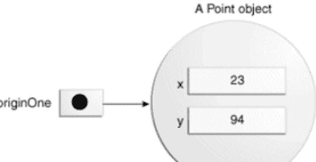

`Rectangle`类的代码包含四个构造函数，如下：

```java
public class Rectangle {
  public int width = 0;
  public int height = 0;
  public Point origin;

  // 四个构造函数
  public Rectangle() {
    origin = new Point(0, 0);
  }
  public Rectangle(Point p) {
    origin = p;
  }
  public Rectangle(int w, int h) {
    origin = new Point(0, 0);
    width = w;
    height = h;
  }
  public Rectangle(Point p, int w, int h) {
    origin = p;
    width = w;
    height = h;
  }

  // 移动矩形的方法
  public void move(int x, int y) {
    origin.x = x;
    origin.y = y;
  }

  // 计算矩形面积的方法
  public int getArea() {
    return width * height;
  }
}
```

所有的构造函数都允许你通过引用类型和基本类型来为矩形的起点、高度和宽度提供初始值。当实例类中有许多构造函数时，它们需要具有唯一的（不同的）签名。Java编译器能够根据参数的数量和类型来区分构造函数。当该编译器遇到下面的代码时，它知道要调用`Rectangle`类中需要一个`Point`参数的构造函数，随后是两个整数参数。

`Rectangle rectOne = new Rectangle(originOne, 100, 200);` 这次调用触发了矩形的构造函数，该函数将`origin`初始化为`originOne`。此外，构造函数将宽度设置为100，高度设为200。你现在有两个指向同一个点对象的引用——注意，对象能够包含许多指向它的引用，正如随后的图片所示：

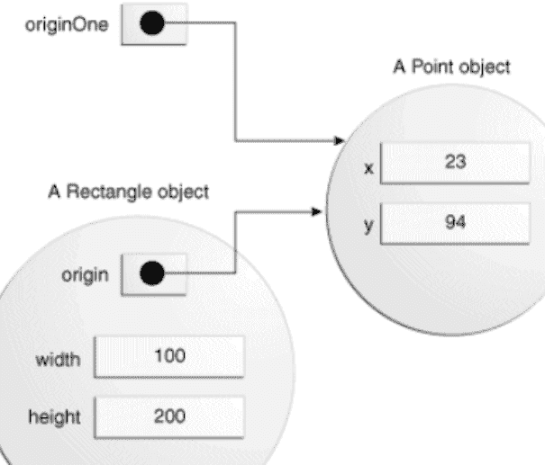

下面的代码行调用了构造函数`Rectangle`——构造函数需要两个整数参数，它们为高度和宽度提供了初始值。检查构造函数内部的代码，你可以发现它创建了一个x和y值初始化为0的新点对象：

```java
Rectangle rectTwo = new Rectangle(50, 100);
```

下面语句中使用的`Rectangle`构造函数不接受任何参数，因此它被称为无参构造函数：

```java
Rectangle rect = new Rectangle();
```

所有的类都至少包含一个构造函数。如果实例类中没有显式声明任何构造函数，Java编译器将自动提供一个名为参数的无参构造函数。默认构造函数通常会调用父类的无参构造函数或对象构造函数；如果该类没有构造函数（`Object`类有一个），程序将被编译器拒绝。

随着我们接近书的末尾，让我们来看看一些面向对象编程中更酷的话题，我相信你对它们会感兴趣！

## Java中的继承

在Java中，面向对象编程的原则之一是继承；继承让我们重用现有代码，或者扩展已经存在的类型。简单来说，Java允许一个类继承另一个类，并且许多接口也可以继承其他接口。

在今天的讨论中，我们将首先看看为什么你需要继承，以及它是如何与接口和类工作的。然后涵盖方法或变量名以及继承成员如何受访问修饰符的影响等重要事项。

### 为什么要继承？

花点时间想象你是一个汽车制造商，为客户提供多种汽车型号。虽然不同的型号可以提供防弹窗或天窗等功能，但它们都具有共同的特征和组件，如轮子和引擎。构建一个基础设计并扩展它来构建特殊版本，比尝试从零开始单独设计每个型号要明智得多。同样，继承是为了帮助你创建一个具有简单功能和行为的类，并通过构建继承基类的类来创建其专用版本。同样，接口的设计是为了扩展现有的接口。你会注意到使用了多个术语来指代被另一个类型继承的类型：更具体来说：

- 基类型（Base type）也被称为父类型（parent type）
- 派生类型（Derived type）被称为子类型（child type）

### 类的继承

类可以继承另一个类并定义额外的成员。让我们从定义一个基类开始：

```java
public class Car {
    int wheels;
    String model;
    void start() {
        // 核心部分
    }
}
```

`ArmoredCar`类能够继承`extends`关键字：

```java
public class ArmoredCar extends Car {
    int bulletWindows;
    void remoteStart() {
        // 
    }
}
```

在Java中，类支持单继承；`ArmoredCar`类不能继承多个类。当没有`extends`关键字时，类隐式继承`java.lang.Object`。

### 继承了什么？

派生类基本上继承（来自基类）公共和保护成员——这些不是静态的。此外，如果两个类在同一个包中，包访问和默认访问的成员会被继承。

派生类不会继承类的静态和私有成员。更多的是，如果基类和派生类被定义在隔离的包中，基类的包访问或默认访问成员将不会被派生类继承。

这样做非常；你只需要使用它们（不需要基类的引用即可访问其成员）。看下面的简短示例：

```java
public class ArmoredCar extends Car {
    public String registerModel() {
        return model;
    }
}
```

### 隐藏基类实例中的成员

如果基类和派生类都定义了名称相似的方法或变量会发生什么？在这种情况下不要担心，因为你仍然可以访问两者。然而，你需要通过在方法或变量前加上`super`和`this`关键字来向Java你的意图。`this`关键字指向它被使用的实例。`super`关键字表示父类实例：

```java
public class ArmoredCar extends Car {
    private String model;
    public String getAValue() {
        return super.model; // 返回基类 Car 中定义的 model
        // return this.model; // 将返回 ArmoredCar 中定义的 model
        return model; // 将返回 ArmoredCar 中定义的 model
    }
}
```

许多开发者使用`super`和`this`关键字来显式说明他们所指的变量或方法。然而，在所有成员上使用它们会让你的代码看起来很杂乱。

#### 隐藏的基类静态成员

如果派类以及基类和派类实际上定义了同名的静态方法和变量，会发生什么？是否可以像我们经常访问实例变量那样，在派类中访问基类中的“静态”成员？

我们将在下面的示例中找到答案：

```java
public class Car {
    public static String msg() {
        return "Car";
    }
}

public class ArmoredCar extends Car {
    public static String msg() {
        return super.msg(); // 这将无法编译。
    }
}
```

不，你不能这样做。静态成员通常属于给定的类，而不是实例。这意味着我们不能在`msg()`中非静态关键字`super`。

考虑到静态成员通常属于特定的类，你可以按照以下方式修改之前的调用：

`return Car.msg();`

考虑下面的示例，其中基类和派类都描述了一个具有相似签的静态方法：`msg()`。

```java
public class Car {
    public static String msg() {
        return "Car";
    }
}

public class ArmoredCar extends Car {
    public static String msg() {
        return "ArmoredCar";
    }
}
```

以下是你可以调用它们的方法：

```java
Car first = new ArmoredCar();
ArmoredCar second = new ArmoredCar();
```

前面的代码`first.msg()`输出'car'，而`second.msg()`直接输出'ArmoredCar'。调用的静态消息取决于引用`ArmoredCar`实例时使用的变量类型。

### 多重接口

尝试想象我们在上一节中定义的`ArmoredCar`被一个超级间谍所需要。因此，制造`Car`的公司认为添加漂浮和飞行功能是最好的：

```java
public interface Floatable {
    void floatOnWater();
}

public interface Flyable {
    void fly();
}

public class ArmoredCar extends Car implements Floatable, Flyable {
    public void floatOnWater() {
        System.out.println("I can float!");
    }

    public void fly() {
        System.out.println("I can fly!");
    }
}
```

在上面的代码中，你注意到使用了`implements`关键字来继承接口。

### 多重继承的问题

Java允许通过接口实现多重继承。在Java 7之前这不是一个问题，因为接口只能定义抽象方法（那些缺乏实现的方法）。因此，如果一个类使用相同的方法签名实现多个接口，这并不是一个问题；实现类最终只有一个方法需要实现。

现在让我们来看看当Java 8引入接口中的`default`方法时，简单的等式发生了什么变化。

从Java 8开始，接口有了定义其方法的默认实现的选项——也就是说，接口仍然能够定义抽象方法。这意味着当一个类实现多个定义具有相同签名方法的接口时，子类实际上将继承不同的实现。这是不被允许的，就像它听起来很复杂一样。

Java不允许对在单独接口中定义的相同方法进行多个继承。让我用示例来解释：

```java
public interface Floatable {
    default void repair() {
        System.out.println("Repairing Floatable object");
    }
}
```

```java
public interface Flyable {
    default void repair() {
        System.out.println("Repairing Flyable object");
    }
}
```

```java
public class ArmoredCar extends Car implements Floatable, Flyable {
    // 这将无法编译
}
```

如果你想实现这两个接口，你必须重写方法`repair()`。如果前面示例中的接口定义了同名的变量——例如`duration`，你无法在没有接口名称位于变量名前的情况下访问它们：


```java
public interface Floatable {
    int duration = 10;
}

public interface Flyable {
    int duration = 20;
}

public class ArmoredCar extends Car implements Floatable, Flyable {
    public void aMethod() {
        System.out.println(duration); // 无法编译
        System.out.println(Floatable.duration); // 输出 10
        System.out.println(Flyable.duration); // 输出 20
    }
}
```

### 继承其他接口的接口

如下示例所示，接口基本上可以继承多个接口：

```java
public interface Floatable {
    void floatOnWater();
}

interface Flyable {
    void fly();
}

public interface SpaceTraveller extends Floatable, Flyable {
    void remoteControl();
}
```

接口通过使用 `extends` 关键字继承其他接口。类使用 `implements` 关键字来继承接口。

### 类型继承

当一个类继承另一个类或接口时，除了继承它们的成员外，它们倾向于继承它们的类型。这同样适用于接口继承其他接口。这是一个非常强大的概念，允许开发者针对接口或基类进行编程，而不是针对它们的实现（无论是派生类还是具体类）编程。

例如，尝试想象一种情况：一个组织维护着其员工拥有的汽车列表。所有员工显然拥有不同的型号。在这种情况下，你如何引用不同的汽车实例？解决方案在下面的示例中：

```java
public class Employee {
    private String name;
    private Car car;

    // 标准构造函数
}
```

由于所有的派生类都继承了 `Car` 类型，派生类实例可以使用 `Car` 类的变量来引用。

```java
Employee e1 = new Employee("Shreya", new ArmoredCar());
Employee e2 = new Employee("Paul", new SpaceCar());
Employee e3 = new Employee("Pavni", new BMW());
```

## Java 中的封装

封装是指将相关的行为封装在对象包中，并控制或限制其他对象对这些函数和数据的访问。它本质上是关于将相关的内容打包在一起，并将它们与外部元素隔离开。你会注意到，封装和数据隐藏在各处是互换使用的。你不应该误解为封装只是关于数据隐藏。当你说封装时，你应该强调将相关数据以及行为分组、打包甚至捆绑在一起。


在面向对象编程中分配一个类时，据说你应该考虑的第一个原则是封装。将相关的数据及其行为分组在一个桶里。封装的主要优点是可维护性。

信不信由你，关于封装大概就是这些！

任何在它的上下文领域中定义良好的 Java 类都是 Java 封装的良好示例。因此，这里的本质基本上是在突出数据隐藏后将方法和数据打包在一起。在这种情况下，数据隐藏术语涉及 Java 中的访问修饰符。

因此，隐藏是非常直白简单的。但是打包方法和数据呢？这尤为重要。你必须很好地理解业务领域，并据此设计类并将属性及其方法分组在一起。这个过程在封装中至关重要。

看看下面的 Java 封装大纲示例。当你谈论一种动物时，你应该列出它所有的属性以及它如何奔跑、交配、捕猎等行为。当你将所有这些行为和数据封装在一个类中时，你实际上是在遵循封装的原则。

```java
package com.javapapers.java;

public class Animal {
    private String animalName;
    private String animalType;
    private int height;
    private String color;

    public Animal(String animalName, String animalType) {
        this.animalName = animalName;
        this.animalType = animalType;
    }

    public void hunt() {
        // implementation of hunt
    }

    public void run() {
        // implementation of run
    }

    public void mate() {
        // implementation of mate
    }

    // 封装并不是为了拥有 getter/setter 方法
    public String getAnimalName() {
        return animalName;
    }

    public void setAnimalName(String animalName) {
        this.animalName = animalName;
    }

    public String getAnimalType() {
        return animalType;
    }

    public void setAnimalType(String animalType) {
        this.animalType = animalType;
    }
}
```

注意：封装与抽象之间存在一线的区别。你通过一个简单的例子就能轻松理解这一点，接下来的关于抽象的教程将让你对此有更深入的见解。只需在设计类时确保练习封装即可。

## Java 中的抽象

抽象是指隐藏实现细节并只显示功能的情况；在 Java 中，抽象通过使用接口和抽象类来实现。接口将提供 100% 的抽象，而抽象类将提供 0-100% 的抽象。

当你走在街上看到路上有一辆漂亮的汽车时，汽车只是一个整体。你看不到它的核心：它背后复杂的机械工程。

现在想象你去展厅买车。你现在看到的是什么？你看到的是强有力的引擎、四个轮以及方向盘等等。你现在可以看到汽车的真实面目——它的高级组件。但尽管如此，它内部包含的内容构成了汽车的完整性。现在想象你是负责维护这辆车辆的技师，你将通过另一层的信息看到更深一层次。

当你设计软件时，需要考虑上下文。在上面的例子中，你需要问自己，你是为普通路人、购买者还是技师设计软件。在这方面，抽象级别会相应地应用于设计中。

### 面向对象编程中的抽象

通常来说，软件语言本身就是抽象概念的一个很好的例子。当你以以下方式编写一条语句时：

```java
a = b + c
```

你正在将两个存储在不同位置的值相加，然后将结果存储在一个全新的位置中。你只是用一种人类易于理解的形式描述了它。底层发生了什么？我们涉及了指令集、寄存器、程序计数器、存储单元等。我们还涉及了 POP（出栈）和 PUSH（入栈）操作。我们使用的高级语言倾向于抽象掉这些复杂的细节。

当我们谈论 Java 中的抽象时，指的是 OOP 中的抽象以及在 Java 中的实现方式。抽象从一个类开始构思的那一刻就开始了。我不能说使用 Java 访问修饰符限制给定对象的属性就可以称为抽象，因为其中还有很多内容。你会发现抽象在面向对象编程和软件开发中被频繁使用。

当一个类被概念化时，根据上下文，你可以在其中拥有哪些属性？如果你想设计一个名为 `Animal` 的类，且上下文是动物园，那么你需要一个 `animalType` 属性来定义是野生还是家养。当你在另一个语境下设计该类时，这个属性可能没有意义了。

同样，问问你自己在这个类中将拥有什么样的行为。抽象在这里也被应用。重要的东西与过载的东西是不同的。从类中剥离掉一些信息，这个过程就是在使用或应用抽象。

当被问及封装和抽象之间的区别时，你可以说封装作为一种概念应用了抽象。因此，它仅仅是封装。但抽象是一个概念，它甚至被应用于多态（稍后讨论）和继承的一部分中。你需要从面向对象编程的其他概念（包括多态、继承和封装）中，从更高的层次来看抽象。

### 抽象与继承

让我们以继承为例。在继承中，我们有一个父类和一个子类（也称为子类）。子类继承父类的属性和方法。然而，它也可以重写从父类继承的方法。这就是多态发挥作用的地方。子类可以为已经在父类中定义的方法提供自己的实现。

在 Java 中，继承通过 `extends` 关键字实现。

```java
class Animal {
    void eat() {
        System.out.println("This animal eats food.");
    }
}

class Dog extends Animal {
    void bark() {
        System.out.println("The dog barks.");
    }
}
```

在上面的例子中，`Dog` 是 `Animal` 的子类。它继承了 `Animal` 的 `eat()` 方法，但它也有自己独特的 `bark()` 方法。当我们创建一个 `Dog` 的对象时，可以同时调用 `eat()` 和 `bark()`。

```java
Dog myDog = new Dog();
myDog.eat();
myDog.bark();
```

## Java 中的多态

多态意味着多种形式。在 Java 中，它允许对象呈现多种形式。实现多态最常见的方法是通过方法重写。当子类为已经在父类中定义的方法提供特定实现时，就发生了方法重写。

```java
class Animal {
    void sound() {
        System.out.println("Animal makes a sound");
    }
}

class Dog extends Animal {
    @Override
    void sound() {
        System.out.println("Dog barks");
    }
}

class Cat extends Animal {
    @Override
    void sound() {
        System.out.println("Cat meows");
    }
}
```

在上面的例子中，`Dog` 和 `Cat` 都重写了 `Animal` 的 `sound()` 方法。我们在 `Animal` 引用上调用 `sound()` 时，执行的是对应实际对象的方法。

```java
Animal myDog = new Dog();
Animal myCat = new Cat();

myDog.sound(); // 输出 Dog barks
myCat.sound(); // 输出 Cat meows
```

这就是多态行为。`Animal` 引用可以指向 `Dog` 和 `Cat` 对象，行为在运行时改变。

### 静态多态

在 Java 语言中，我们通过方法重载来实现静态多态。方法重载意味着类中存在多个同名但参数类型或顺序不同的方法。

Java 在编译时通过查看方法签名知道调用哪种方法。因此，这被称为静态绑定或编译时多态。

让下面的示例让你更清楚地理解这个概念：

```java
class DemoOverload {
    public int add(int x, int y) { // 方法 1
        return x + y;
    }

    public int add(int x, int y, int z) { // 方法 2
        return x + y + z;
    }

    public int add(double x, int y) { // 方法 3
        return (int) x + y;
    }

    public int add(int x, double y) { // 方法 4
        return x + (int) y;
    }
}

class Test {
    public static void main(String[] args) {
        DemoOverload demo = new DemoOverload();
        System.out.println(demo.add(2, 3));      // 调用方法 1
        System.out.println(demo.add(2, 3, 4));   // 调用方法 2
        System.out.println(demo.add(2, 3.4));    // 调用方法 4
        System.out.println(demo.add(2.5, 3));    // 调用方法 3
    }
}
```

在编译时到达某个特定方法调用时，根据该签名来决定调用哪种方法。

### 动态多态

假设你有一个子类，它重写了父类的某个方法。想象你在程序中创建了该子类的对象，并将其赋值给一个父类引用。在这种情况下，如果你在父类引用上调用被重写的方法，意味着结果将调用子类版本的方法。请看下面的示例：

```java
class Vehicle {
    public void move() {
        System.out.println("Vehicles can move!!");
    }
}

class MotorBike extends Vehicle {
    public void move() {
        System.out.println("MotorBike can move and accelerate!!");
    }
}

class Test {
    public static void main(String[] args) {
        Vehicle vh = new MotorBike();
        vh.move(); // prints MotorBike can move and accelerate!!
        vh = new Vehicle();
        vh.move(); // prints Vehicles can move!!
    }
}
```

你需要注意的是，在第一次调用 `move()` 时，引用的类型是 `Vehicle`，而被引用的对象是 `MotorBike`。在这种情况下，当你调用 `move()` 时，程序将等待到运行时才能确定引用所指向的对象。在我们案例中，该对象是 `MotorBike` 类。因此，将调用该类的 `move()` 方法。第二次调用 `move()` 的对象是 `Vehicle` 类。请注意，在运行时确定方法调用时，这被称为**晚绑定**（late binding）。

总结一下，你现在应该知道：

- 在 Java 中，通过多个 IS-A 测试的对象在本质上是自动具有多态性的，它本身就是如此。
- 在 Java 中，静态多态通过方法重载（method overloading）实现。
- 在 Java 中，动态多态通过方法重写（method overriding）实现。

我们讨论了继承的概念，在代码重用、改进通用面向对象系统以及减少数据冗余方面，继承无疑是一种强大的机制。当类与类之间存在关系且子类本质上是父类时，继承是理想的。例如，“汽车（Car）”是一种“车辆（Vehicle）”，因此 `Car` 类除了自身的特征外，还包含了 `Vehicle` 类的所有属性。尽管如此，你并不总是能在不同类的对象之间建立这种关系。

让我们举一个例子说明，“汽车”并不是某种“引擎”。你有**组合**（composition）这一替代方案来表示这种关系。它应用于类与类之间存在关系，且父类被包含在子类中的情况。组合基本上通过对它所需的类对象创建引用，使类重用功能，这就像子类扩展父类通过继承一样。组合是**聚合**（aggregation）的一种特例——这意味着聚合也被称为组合。当一个对象拥有另一个并不存在的其他（对象）时，我们可以称之为组合。

### 使用程序的一个示例

我们将考虑下面这个展示组合概念的程序。请按照以下步骤操作：

#### 第 1 步

我们从创建一个 `Bike` 类开始，你可以如下声明并定义数据成员以及方法：

```java
class Bike {
    // 声明数据成员和方法
    private String color;
    private int wheels;

    public void bikeFeatures() {
        System.out.println("Bike=" + color + " wheels=" + wheels);
    }

    public void setColor(String color) {
        this.color = color;
    }

    public void setWheels(int wheels) {
        this.wheels = wheels;
    }
}
```

#### 第 2 步

现在我们创建一个 `Honda` 类来扩展 `Bike` 类，并通过组合来表示 `start()` 方法（注：原文示例中为 `setWheels` 处有逻辑切入，此处保持逻辑）。在这种情况下，你使用组合：


```java
class Honda extends Bike
{
    // 继承 Bike 类的属性
    public void start()
    {
        HondaEngine e = new HondaEngine();
        e.start();
    }
}
```

#### 第 3 步

接下来，我们需要创建一个 `HondaEngine` 类，通过它使用上面的 `Honda` 类：

```java
class HondaEngine
{
    public void start()
    {
        System.out.println("Engine has started.");
    }
    public void stop()
    {
        System.out.println("Engine has stopped.");
    }
}
```

#### 第 4 步

现在我们必须构建 `CompositionDemo` 类，并如下初始化 `Honda` 类：

```java
class CompositionDemo
{
    public static void main(String[] args) {
        Honda h = new Honda();
        h.setColor("Black");
        h.setwheels(2);
        h.bikeFeatures();
        h.start();
    }
}
```

输出如下：

```
Bike=Black wheels=2
Engine has started.
```

## 那么组合有什么重要性？

- 你可以在组合中控制其他对象的可见性，并仅重用你需要的。
- 组合让你在需要时创建后端类。

## 组合和继承如何比较？

我的假设是你同样了解继承和组合的，并想知道哪种是更好的。

更改后端类（或组合的）接口比更改父类（或继承的）接口要容易得多。正如之前的示例所示，只要前端接口保持不变，更改后端类的接口就不需要对前端类进行更改。相反，更改父类的接口不仅会沿着继承层次向下传递到子类，还可能影响到使用该子类的代码。

你也会发现，相比于组合，继承不仅是脆弱的（fragile），而且也可能是僵化的（rigid）。你不能在向子类添加一个具有相同签名的方法，而又确保子类的新接口与其父类型兼容。例如，你不能在子类中添加一个签名相同的方法，但其返回类型与从父类继承的方法不同。相反，组合允许你更改前端类的接口，而不影响后端类。

## 在继承和组合之间进行选择

继承与组合之间的对比对你的设计有什么帮助？以下反映了我通常如何在继承和组合之间进行选择的几个指南。

### 确保继承建模的是“是一种”（is-a）关系

主要的指导哲学是，只有当子类是一个父类时，你才应该使用继承。例如，橙子很可能“是一种”水果，那么，我很可能会选择继承。

当你认为自己拥有“是一种”关系时，你需要问自己的一个关键问题是：这种“是一种”的关系在整个应用程序的生命周期内（也许运气好的话是在代码的生命周期内）是否恒定的？例如，你可能认为“员工”是一个“人”，但本质上，“员工”一词指的是“人”在特定时间段内扮演的角色。如果这个人被解雇了呢？如果他既是“主管”又是“员工”呢？在处理这些瞬态的“是一种”关系时，你应该考虑它们必须用组合来建模。

### 不要仅仅为了代码复用而使用继承

如果你想重用代码且仅此而已，而且你没有看到任何明显的“是一种”关系，你可以使用组合。

### 如果你只是想要多态性，就不要使用继承

当你只想要多态性，而且不存在任何自然的“是一种”关系时，你只需要使用接口配合组合。

现在，让我们看看在下一章中如何通过构建一个简单的游戏项目来实现我们所学的一切：

## 使用 Java 构建一个简单的游戏

下面的指南将向你展示如何以简单分步骤的方法制作你自己的游戏。

在开始之前，你需要安装一个名为 Java Processing 的程序，它对于构建我们今天今天要构建的这类应用程序非常有用。简单解释一下它是什么：Processing 是开源的，可以使用基本语法创建动画、交互式程序和绘图。它还包含一个基础 IDE，作为你编程的界面。通过 Processing，你可以创建额外的抽象，来某种程度上屏蔽某些普通初学者认为困难的特定 Java 编程元素。

> **注意**：抽象让你能够更轻松地执行某些操作，特别是当你对该主题没有太多背景知识时。如果你用纯 Java 来构建或处理图像，你会感到非常头疼。


我们在这一节中要构建的游戏是 Pong（弹球游戏）、Flappy bird（愤怒的小鸟）和打砖的某种结合。我特别选择这个游戏是因为包含了简单的概念，并且有助于他人理解，而这些概念给初学者在游戏开发方面带来了问题。你需要注意的是，首先要制作像具有多个关卡、实体、玩家等的复杂平台游戏是非常困难的。随着我们的继续，你会看到代码变得非常复杂，但好处是它通常组织良好且简单。只需缓慢阅读每个部分，在需要明确的概念时参考书中的相关区域，获取整个代码并在你开始思考自己的游戏时尽早自己自己玩一玩，然后开始实现它。让我们从基础开始吧。

### 如何构建 Flappy Pong

### 初始化不同的屏幕

我们将从初始化项目开始。首先，我们将像大家通常做的那样编写 `setup` 和 `draw` 块——所以这里没什么新奇或花哨的！之后，我们将处理各种屏幕——这些包括游戏屏幕、初始屏幕、游戏结束屏幕等。但可能会出现问题：你如何确保在正确的时间显示正确的页面？

完成这项任务非常简单。我们将有一个全局变量来存储当前活跃屏幕的信息。然后我们将绘制正确屏幕的内容——但这取决于变量。在 `draw` 块中，我们将包含一个 `if statement`，它基本上检查变量并根据此呈现屏幕内容。每当你想要更改屏幕时，我们将变量更改为你要更改的屏幕，你必须将变量更改为你想要显示的标识符。如此，让我们概述一下你的骨架代码结构：

```java
/********* VARIABLES ***********/

// 我们通过设置/更新 game 变量来控制哪个屏幕是活跃的。
// 我们根据这个变量的值显示正确的屏幕。
//
// 0: 屏幕
// 1: 游戏屏幕
// 2: 游戏结束屏幕
```

```java
int gameState = 0;

/**** SETUP BLOCK ***********/

void setup() {
  size(500, 500);
}
```

```java
/********* DRAW BLOCK ***********/

void draw() {
  // 显示当前屏幕的内容
  if (gameState == 0) {
    initScreen();
  } else if (gameState == 1) {
    gameScreen();
  } else if (gameState == 2) {
    gameOverScreen();
  }
}
```

```java
/********* SCREEN CONTENTS ***********/

void initScreen() {
```

确实，这在开始时看起来很吓人，但我做的只是创建了基本结构并用注释块分隔不同的部分。如你所见，对于每个显示的屏幕，我们都定义了一个独立的方法。在你的 `draw` 块中，你只需要在调用相应方法之前检查变量 `gameScreen` 的值。当涉及到 `void mousepressed() {...}` 这部分时，你基本上是在监听鼠标点击，并在活跃的屏幕中——初始屏幕中——执行操作。

现在进入简单部分：让我们使用一些技巧来实现重力——首先是实现部分的代码。

```java
float gravity = 1;
float ballSpeedVert = 0;
...
void gameScreen() {
...
  applyGravity();
  keepInScreen();
}
void applyGravity() {
  ballSpeedVert += gravity;
  ballY += ballSpeedVert;
}
void makeBounceBottom(float surface) {
  ballY = surface-(ballSize/2);
  ballSpeedVert*=-1;
}
void makeBounceTop(float surface) {
  ballY = surface+(ballSize/2);
  ballSpeedVert*=-1;
}
// 将球留在屏幕内
void keepInScreen() {
  // 球碰撞地板
  if (ballY+(ballSize/2) > height) {
    makeBounceBottom(height);
  }
  // 球碰撞天花板
  if (ballY-(ballSize/2) < 0) {
    makeBounceTop(0);
  }
}
```

[点击此处](#)查看预期结果。

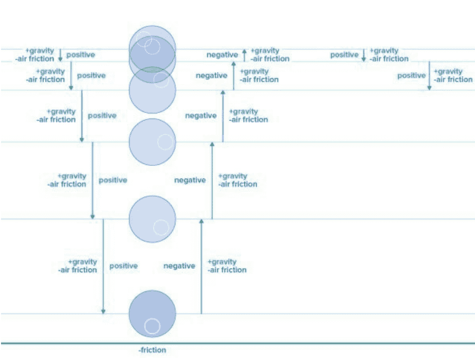

我确定你可能在想物理学理解是否受到了威胁。我知道在现实生活中，重力并不是这样工作的。请将此简单视为一个动画过程。变量“重力”只是一个数值——一个简单的 `float` 类型，这使得可以使用小数而不仅仅是整数——在每个循环中，我们都将其加到 `ballSpeedVert` 上。实际上，`ballSpeedVert` 代表球的垂直速度，它在所有循环中都对应球的 Y 坐标 (`ballY`)。你观察球的坐标以确保它留在屏幕上，并且确保（正如你可能已经知道的那样）球不会掉落无限。但目前，球只在垂直方向上移动。这意味着我们观察屏幕上地板和天花板的边界。通过 `keepInScreen()` 方法，我们检查 `ballY` 加上半径是否小于 `height`，同样地，`ballY` 减去半径是否大于 0。如果不符合条件，你就使用方法 `makeBounceTop()` 和 `makeBounceBottom()` 让球发生反弹（直接从底部或顶部顶部）。我们可以让球移动到它必须反弹的位置，然后得到垂直速度 `ballSpeedVert` 乘以 -1 的乘积（注意，当你乘以 -1 时符号会改变）。当值获得符号时，意味着你加上了 Y 坐标，速度将变为从 `ballY+-ballSpeedVert`。在这种情况下，球会立即以相同的速度改变方向。现在，当你将“重力”加入 `ballSpeedVert` 且它具有负值时，它将开始接近 0，最终变为 0 然后再次开始增加。这会让球上升，然后速度变慢，停止，然后开始下落。

如果你**非常敏锐**，你会注意到我们的动画过程存在一个问题——球没有停止反弹。如果我们用现实世界的场景来看待它，我们会说球在每次接触表面时都会面临摩擦和空气阻力。这正是我们希望动画过程具有的行为。实现这一点非常简单，只需添加以下代码：

```java
float airfriction = 0.0001;
float friction = 0.1;
```

```java
void applyGravity() {
  ballSpeedVert -= (ballSpeedVert * airfriction);
}
void makeBounceBottom(int surface) {
  ballSpeedVert -= (ballSpeedVert * friction);
}
void makeBounceTop(int surface) {
  ballSpeedVert -= (ballSpeedVert * friction);
}
```

动画过程将产生类似的效果：

“摩擦”，顾如其，指的是表面摩擦；而“空气摩擦”则指的是空气的阻力。显然，“摩擦”在球每次接触任何表面时都需要应用。这正是我们所做的。`applyGravity()` 方法在每个循环中运行，因此你在所有循环中都从 `ballSpeedVert` 中减去其值的 0.0001%。`makeBounceTop()` 和 `makeBounceBottom()` 在球接触任何表面时运行。因此，我们在这些方法中做了相同的事情，只是这次使用了“摩擦”。

### 现在创建球拍

你现在需要一个球会在上面反弹的球拍。你还应该能够控制球拍。我们将让它可以通过鼠标控制。代码如下：

```java
color racketColor = color(0);
float racketWidth = 100;
float racketHeight = 10;
void gameScreen() {
  drawRacket();
}
void drawRacket(){
  fill(racketColor);
  rectMode(CENTER);
  rect(mouseX, mouseY, racketWidth, racketHeight);
}
```

我们把球拍的宽度、高度和颜色定义为全局变量。你可能想看到它们在游戏过程中发生变化。

### 水平移动并控制球

主意与垂直运动相同。我们创建了 `ballSpeedHorizon`，一个水平速度变量。我们还创建了一个在移除空气摩擦的情况下将水平速度应用于球的方法。

```java
int ballBounceRate = 20;
...
void gameScreen() {
...
  applyHorizontalSpeed();
}
```

```java
void applyHorizontalSpeed() {
  ballX += ballSpeedHorizon;
}

void watchRacketBounce() {
  float overhead = mouseY - ballY;
  if ((ballX+(ballSize/2) > mouseX-(racketWidth/2)) && (ballX-(ballSize/2) < mouseX+(racketWidth/2))) {
    if (dist(ballX, ballY, ballX, mouseY)<=ballSize/2)+abs(overhead)) {
      ...
        ballSpeedHorizon = (ballX - mouseX)/5;
      ...
    }
  }
}
```

```java
...int wallSpeed = 5;
int wallInterval = 1000;
float lastAddTime = 0;
int minGapHeight = 200;
int maxGapHeight = 300;
int wallWidth = 80;
color wallColors = color(0);

// This arraylist stores data of the gaps between the walls. Actual walls are accordingly.
// [gapWallX, gapWallY, gapWallWidth, gapWallHeight]
ArrayList<int[]> walls = new ArrayList<int[]>();

void gamescreen() {
...
wallAdder();
wallHandler();
}

void wallAdder() {
if (millis()-lastAddTime > wallInterval) {
    int randHeight = round(random(minGapHeight, maxGapHeight));
    int randY = round(random(0, height-randHeight));
    // {gapWallX, gapWallY, gapWallWidth, gapWallHeight}
    int[] randWall = {width, randY, wallWidth, randHeight};
    walls.add(randWall);
    lastAddTime = millis();
}
}

```

```java
 wallHandlerHandler() {
  for (int i = 0; i < walls.size i i++) {
    RemRemover(i

    MMover(i);
wallDrawerDrawer(i);
  

}
void wallDrawer(int index) {
  int[] wall = walls.get(index);
  // get gap wall settings
  int gapWallX = wall[0];
  int gapWallY = wall[1];
  int gapWallWidth = wall[2];
  int gapWallHeight = wall[3];
  // draw actual walls
  rectMode(CORNER);
  fill(wallColors);
  rect(gapWallX, 0, gapWallWidth, gapWallY);
  rect(gapWallX, gapWallY+gapWallHeight, gapWallWidth, height-(gapWallY+gapWallHeight));
}
void wallMover(int index) {
  int[] wall = walls.get(index);
  wall[0] = wallSpeed;
}
void wallRemover(int index) {
  int[] wall = walls.get(index);
  if (wall[0]+wall[2] <= 0) {
    walls.remove(index);
  }
}
```

这是核心内容


你需要注意的第一点是 `ArrayList`，它仅仅是列表的一种实现，行为类似于数组（Array）。不过，它是可伸缩的，并且包含了许多强大的方法，如 `list.remove(index)`、`list.add(index)` 和 `list.get(index)`。我们将墙的数据以整数数组的形式存储在 `ArrayList` 中。我们存储在数组中的数据用于两堵墙之间的间隙。我们的数组包含这些值：

```
[间隙墙 X, 间隙墙 Y, 间隙墙宽度, 间隙墙高度]
```

实际墙是根据间隙墙的值绘制的。你需要注意的是，这些可以通过类来处理得更整洁、更好。然而，我们将这样处理：我们有两个基于墙体管理的方法：`wallHandler` 和 `wallAdder()`。后者每隔 `wallInterval` 毫秒向 `ArrayList` 中添加一个新墙。我们有一个全局变量 `lastAddTime`，用于存储你上一次添加的墙。如果当前毫秒数 `millis()` 减去上一次添加的毫秒数 `lastAddTime` 大于间隔值——这本质上意味着你必须添加一堵新墙。随机间隙变量定义在顶部。然后将一堵新墙添加到 `ArrayList` 中，并将 `lastAddTime` 设置为当前的 `millis()`。`wallHandler()` 遍历 `ArrayList` 中当前所有的墙，并根据 `ArrayList` 的索引值为每个项目调用 `wallRemover(i)`、`wallDrawer(i)` 和 `wallMover(i)`。

`wallDrawer` 根据间隙墙数据绘制墙。`wallDrawer` 在调用 `rect()` 方法将墙绘制到所需位置之前，通常会从 `ArrayList` 中获取间隙墙数组。`wallMover` 从 `ArrayList` 中获取该元素，并根据 `wallSpeed` 全局变量更改其 X 位置。`wallRemover` 从 `ArrayList` 中获取超出屏幕的墙。当一堵墙从 `ArrayList` 中移除时，它就不会在所有循环中被绘制。

现在我们需要检测墙与球之间的任何碰撞：

```java
void wallHandler() {
  for (int i = 0; i < walls.size(); i++) {
    ...
    watchWallCollision(i);
  }
}
void watchWallCollision(int index) {
  int[] wall = walls.get(index);
  // 获取间隙墙设置
  int gapWallX = wall[0];
  int gapWallY = wall[1];
  int gapWallWidth = wall[2];
  int gapWallHeight = wall[3];
  int wallTopX = gapWallX;
  int wallTopY = 0;

  int wallTopWidth = gapWallWidth;
  int wallTopHeight = gapWallY;
  int wallBottomX = gapWallX;
  int wallBottomY = gapWallY + gapWallHeight;
  int wallBottomWidth = gapWallWidth;
  int wallBottomHeight = height - (gapWallY + gapWallHeight);

  if (ballX + (ballSize / 2) > wallTopX && (ballX - (ballSize / 2) < wallTopX + wallTopWidth) && (ballY - (ballSize / 2) < wallTopHeight) {
    // 与上墙碰撞
  }

  if (ballX + (ballSize / 2) > wallBottomX && (ballX - (ballSize / 2) < wallBottomX + wallBottomWidth) && (ballY + (ballSize / 2) > wallBottomHeight) {
    // 与下墙碰撞
  }
}
```

`watchWallCollision()` 方法会在循环中的每堵墙上被调用。获取间隙墙的坐标，计算实际墙的坐标（从上到下），然后检查球的坐标是否与墙碰撞。

## 健康值与得分

但我认为顶部应该有一个健康条。当球碰到墙时，它应该损失健康值。这种逻辑是为了让球弹回来。当健康值为 0 时，游戏应该结束。

```java
int maxHealth = 100;
float health = 100;
float healthDecrease = 1;
int healthBarWidth = 60;
...
void gameScreen() {
  ...
  drawHealthBar();
}
void drawHealthBar() {
  // 使其无边框：
  noStroke();
  fill(236, 240, 241);
  rectMode(CORNER);
  rect(ballX - healthBarWidth / 2, ballY - 30, healthBarWidth, 5);
  if (health > 60) {
    fill(46, 20, 113);
  } else if (health > 30) {
    fill(230, 126, 34);
  } else {
    fill(231, 76, 60);
  }
  rectMode(CORNER);
  rect(ballX - healthBarWidth / 2, ballY - 30, healthBarWidth * (health / maxHealth), 5);
}
void decreaseHealth() {
  health -= healthDecrease;
  if (health <= 0) {
    gameOver();
  }
}
```

运行正确的

我们创建了一个全局变量 `health`，然后使用 `drawHealthBar()` 方法在球上方绘制两个矩形。第一个基础健康条，另一个是显示当前健康的活动条。第二个宽度是动态的，通过公式 `healthBarWidth * (health / maxHealth)` 计算健康相对于健康条宽度的比例。填充颜色现在根据健康值设置。现在处理得分：

```java
...
void gameOverScreen() {
  background(0);
  textAlign(CENTER);
  fill(255);
  textSize(30);
  text("Game Over", height / 2, width / 2 - 20);
  textSize(15);
  text("Click to Restart", height / 2, width / 2 + 10);
}

void wallAdder() {
  if (millis() - lastAddTime > wallInterval) {
    ...
    // 在数组末尾添加另一个值
    int[] randWall = {width, randY, wallWidth, randHeight, 0};
    ...
  }
}

void watchWallCollision(int index) {
  ...
  int wallScored = wall[4];
  ...
}
```

```java
if (ballX > gapWallX + (gapWallWidth / 2) && wallScored == 0) {
  wallScored = 1;
  wall[4] = 1;
  score();
}
void score() {
  score++;
}
void printScore() {
  textAlign(CENTER);
  fill(0);
  textSize(30);
  text(score, height / 2, 50);
}
```

每当球穿过墙时，我们都需要得分。我们还需要为每堵墙最多创建一个得分。这意味着如果球穿过一堵墙然后返回再次穿过，不应该再次得分。为了实现这一点，我们在 `ArrayList` 中的间隙墙数组中包含了另一个变量。该变量在球还没有通过那堵墙时存储为 0，在已经通过时存储为 1。然后，我们对 `watchWallCollision()` 方法进行了修改。在球穿过墙的实例触发 `score()` 方法并标记墙已通过。

我们现在需要做的最后是在屏幕上实现“点击重启”。我们需要将所有变量恢复到初始值，然后重新开始游戏：

```java
...
public void mousePressed() {
  ...
  if (gameScreen == 2) {
    restart();
  }
}
...
void restart() {
  score = 0;
  health = maxHealth;
  ballX = width / 4;
  ballY = height / 5;
  lastAddTime = 0;
  walls.clear();
  gameScreen = 0;
}
```

我们将现在添加几个

成功！我们现在有了了自己的 flappy pong。

# 结

我们已经来到了这本书的末尾。感谢你的阅读，祝贺你读到了最后。

真心希望你现在已经掌握了足够的 Java 信息，可以作为进一步学习的跳板。

感谢并祝你好运！
