# Java 编程初学者指南：通过面向对象编程学习来提升软件工程技能。学习虚拟机、Javascript 和机器码 (2022)

通过学习面向对象的程序编程来提高你的软件工程技能。学习虚拟机、Javascript 和机器码（2022）

## 引言


Java 是一种在互联网和计算机应用程序中广泛使用的编程语言。它是一个免费下载选项，允许用户获取最新版本并应用更新。这种编程语言可以在当今绝大多数 Web 应用和计算技术中找到。Java 的扩展性使其适用于各种应用程序，包括手机等小型电子设备的应用程序，以及用于数据中心等大规模运营的软件解决方案。Java 日益增长的普及归功于其强大的功能能力和可靠的安全保障。

Java 是由太阳微系统公司（Sun Microsystems）开发的编程语言，后来被甲骨文公司（Oracle Corporation）收购。它旨在运行在任何支持 Java 的操作系统上。这正是该语言如此受欢迎的原因：开发者只需要编写一次程序，它就可以在任何操作系统上运行，而无需程序员更改代码。

Java 编程语言用于创建世界上大部分的应用程序。Java 编程语言用于构建大多数应用程序的服务器端和业务逻辑组件。

在本书中，你将学习如何构建像上面那样的程序，以及将让你开始编写完整应用程序的高级概念。

Java 的一些设计目标列如下：

- 该语言的设计目标是只编写一次并在任何操作系统上运行。
- 该语言应该支持广泛的软件工程原则。产品的可移植性至关重要。这就是为什么 Java 可以在 Windows、Linux 和 MacOS 操作系统上运行。
- 国际化需要大量的支持。

Java 设计用于开发既适用于托管系统和嵌入式系统的程序。

接下来将讨论其他设计目标：

### 强类型检查

Java 是一种强类型语言。定义的每个变量都需要关联到一个数据类型。

你现在不需要理解整个程序，但让我们快速看下 2 行代码。

```java
int i=5;
```

在这里，我们定义了一个被称为变量的东西，它用于存储值。可以存储的值取决于数据类型。在这个例中，我们说 `i` 的类型是 `int` 或 `Integer`，这是一个数值型数据值。

### 数组边界检查

在运行时，Java 将检查数组是否定义了所需数量的值。如果尝试访问数组边界之外的值，将抛出异常。

你现在不需要理解整个程序，但让我们快速看下以下行代码。

```java
int[] array1 = new int[2];
```

在这里，我们声明了一个数组，它是一组整数值。`2` 这个值意味着我们只能在数组中存储两个值。

```java
array1[0] = 1; array1[1] = 2; array1[2] = 3;
```

通过这段代码，我们可以看到正在给数组赋值 3 个值。当你运行这个程序时，你将得到一个错误，因为程序会发现数组已经超出了它允许的最大边界（两个）。你将在运行时得到下面的错误。

```
Exception in thread "main" java.lang.ArrayIndexOutOfBoundsException: 2 at HelloWorld.main(HelloWorld.java:8)
```

### 为什么 Java 很重要？

接下来，Java 的语法和特征类似于 C 和 C++ 等其他编程语言。如果你有任何之前的编程经验，你会发现学习 Java 是轻而易举。即使你对编程完全陌生，你也可以放心，Java 被设计成一门相对容易学习的语言。大多数程序员发现学习 Java 比学习 C 或 C++ 更容易。

Java 还被设计为与平台无关。正如前面提到的，Java 代码首先被编译成字节码，可以在任何具有 Java 虚拟机（JVM）的机器上运行。

因此，通过 Java，你可以编写一次代码并在任何你想的地方运行它。

### 为什么选择 Java？

当然，使用 Java 的关键原因之一是它对面向对象编程的关注。

面向对象编程（或“OOP”）是一种编程语言模型，它允许程序代码围绕数据组织，而不是围绕函数和逻辑（后者被称为过程化编程）。

这些“数据簇”被组织成被称为“对象”的东西，因此有了“面向对象编程”的别名。

这些“对象”是通过“类”创建的，这里的“类”是指类是某种对象，允许程序员根据两个标准对它们进行“分类”：属性和方法。

类的属性是用于创建对象的原始数据：这些是它的描述符，例如它所拥有的值以及其他相关数据。对象的“方法”是第二个要求。

这种“方法”是行为，即类内部描述如何交互或被交互的逻辑序列。

### Java

使用 Java 的主要原因之一是它对面向对象编程的强调。面向对象编程，也称为“OOP”，是一种编程语言模型，允许程序代码围绕数据组织，而不是围绕函数和逻辑（如过程化编程）。

这些“对象”是由“类”形成的，这里的“类”是指类是某种对象的类型，允许程序员根据两个标准对它们进行“分类”：属性和方法。

类的属性是用于创建对象的原始数据：这些是它的描述符，例如它所拥有的值以及其他用于创建对象的相关数据。对象的“方法”是第二个要求。

这种“方法”是行为，即类内部描述如何交互或被交互的逻辑序列。

## 第 1 章

### Java 基础


采用 Java 的主要原因之一是它对面向对象编程的关注。面向对象编程，也称为“OOP”，是一种编程语言模型，允许程序代码围绕数据组织，而不是围绕函数和逻辑（如过程化编程）。

这些“对象”是通过“类”形成的，这里的“类”是指类是某种对象的类型，允许程序员根据两个标准对它们进行“分类”：属性和方法。

类的属性是用于创建对象的原始数据：这些是它的描述符，例如它所拥有的值以及其他用于创建对象的相关数据。对象的“方法”是第二个要求。

为了说明，假设有一个类叫做 `Human`。这个“类”将包括身高、体重、性别和种族特征。“人类”类的方法还可以包括 `run`、`walk` 和 `speak`。

现在类已经定义，程序员可以使用 `human` 类作为蓝图来生成对象。

他们可以使用 `Human` 类来“填充”它的属性，例如身高、体重、性别和种族。此外，该对象已经内置了函数 `run`、`walk` 和 `talk`，所以当从 `Human` 类中创建一个名为 `Mike` 的对象时，它已经包含了跑步、行走和说话的功能，而无需程序员再次编写这些特定的函数，因为它们已经“固有”于所创建的对象中。

简而言之，这就是面向对象编程旨在达的：一种编程风格，允许程序员利用预定义的类，以便描述它们并利用其内部或内置函数来操作它们。

假设读者并不是编程领域完全的新手，并且已经通过 `C` 或或其他侧重过程的语言接触过编程世界，那么下一个自然的问题是：为什么要使用面向对象编程呢？

它的主要优点之一是从长远来看它可以节省时间。

在简单的算法和程序中，过程化编程通常要快得多且直接；程序员不需要构造和定义一个 `class`，然后基于该类创建一个对象，他们真正需要做的只是声明必要的变量、编写函数并创建算法来解决代码应该处理的问题。

然而，当涉及到需要更复杂解决方案的复杂应用程序时，面向对象编程就开始大放异彩并展现它的实力。

在许多程序中会出现这种情况：必须将许多“对象”或数据簇分组在一起，并以特定的方式处理这些对象。这正是“类”应该有所帮助的地方。

程序员不需要为每个数据簇声明一组新变量，只需简单地从现有的“类”中提取并产生一个新的“对象”。让我们来看看这在实践中是如何运作的。

如果程序员用过程化的方式编写一个象棋游戏，他们必须手动描述每一个部分——所有的十六个兵、四个主教、四个骑士、四个车、两个皇后和两个王。他们还必须编写允许每个棋子独立移动的程序。

如果程序员使用面向对象编程，而不需要编写 16 个兵、四个主教、四个骑士、四个车、两个皇后和两个王，他们只需要编写六个类：棋盘上的每个棋子一个类。

程序员现在只需将移动程序包含在每个类中，并让属性来解释它们的位置：它们是白王的兵还是黑后的兵，这些都可以通过“兵”类的“属性”组件输入的内容。程序员不需要处理 32 个代码簇，只需要处理 6 个即可。

现在这变得容易得多、更短，也更优雅。

### Java 标记 (tokens)

Java 标记（tokens）是比其他整数更小的值。这些数字将落在 `-32768` 和 `32767` 之间。

我使用的代码将适用于 `shorts`，相反，我将需要使用 `short` 函数，以确保值落在设定的限制范围内。

大值将存储在 `double` 值中，连同浮点数。如果我可以使用浮点数，就不必使用 `double`。由于我正在存储一个浮点变量，我需要在我的数值末尾加上一个字母。这个值应该是 `f`，因为它是一个浮点数。

### 关键字 (Keywords)

在 Java 中，`Boolean` 类型指的是 `false` 或 `true` 值。Java 使用预留关键字来判断它是真是假。因此，一个 `Boolean` 表达式类型将假设为这些值之一。

一个演示示例包括：

关于这个程序有几点需要注意。首先，`println()` 显示一个布尔值。其次，布尔值控制 `if` 语句的流。

在编写布尔类型时，不需要写得那么麻烦：`if (b == true)`

运算符（如 `<`）显示的结果是布尔值。这是我们拥有表达式 `11 > 8` 显示值为 `true` 的原因之一。此外，`11 > 8` 附近的另一对括号也是重要的，因为 `plus` 位于 `>` 之前。

### 标识符 (Identifiers)

上面图表的顶层是标识符或名称。这个顶层是你赋予给 `class` 的名称。该名称应该具体地识别并描述用户看到或体验到的对象类型。简单来说，名称或标识符应该标识该类。

### 运算符 (Operators)

Java 拥有广泛的运算符环境。如果你好奇运算符是什么，可以将其看作一个符号，向编译器传达特定信息以执行逻辑或数学操作。在 Java 中，你将与四类运算符进行交互。

这四类包括：

* 逻辑运算符
* 位运算符
* 关系运算符
* 算术运算符

与其他计算机语言一样，Java 有一个定义的额外运算符列表，用于处理某些特定场景。

在学习 `JAVA` 编程语言或任何编程语言时，在开始之前必须理解五个基本概念。这五个基本概念包括：

* 变量
* 数据结构
* 控制结构
* 语法
* 工具

这些概念中的每一个将从初学者水平进行彻底解释，以确保它们被理解。

### 分隔符 (Separators)

它们不适用于高层抽象：注意，许多此类程序使用了低级构建结构，这些结构主要用于低级抽象。这些编程语言的通常方法是它们关注机器——即如何让计算机做某事，而不是这些功能如何帮助解决用户的问题。这些语言处理微小的细节，这已经超出了高层抽象的范围，而高层抽象是我们今天看到的更常见的方法。在低级抽象中，数据结构和算法是分开考虑的，而在高层抽象中它们被作为一个整体考虑。

### 字面量 (Literals)

当涉及到 `Java` 中的字面量时，我们以人类可以阅读的形式出现的固定值。我们可以说数字 `200` 是字面量。大多数时候，字面量可以是常量。

字面量在程序中很重要。事实上，大多数 Java 程序都使用字面量。我们已经讨论的一些程序使用了字面量。`Java` 中的字面量属于各种数据类型。

每个字面量的显示方式由类型决定。正如之前提到的，我们用单引号包含字符常量，例如 `'c'` 和 `'%'`。我们在不涉及小数的情况下定义整数字面量。例如，`12` 和 `-30` 是整数字面量。浮点字面量应该包含小数点和小数。`12.389` 是浮点字。Java 还允许对浮点字应用科学计数法。整数字面量包含 `int` 值，任何人可以使用 `short`、`byte` 和 `char` 变量初始化它们。

### 注释 (Comments)

当这种情况发生时，我们把灰色称为注释。在程序的运行阶段，灰色部分（注释）是无关的。这意味着可以使用注释功能来说明或解释你正在创建的代码想要实现的目标。你可以通过输入两个斜杠和注释来实现。这里有一个示例：

```java
//在此处放置你的单行注释
```

你可以通过以下任一种方式拥有多行注释：

```java
//我们将注释
// 跨越到两行
```

或者

```java
/*
此注释跨越了两行
*/
```

如果你查看上面的注释，你会注意到它以 `/*` 开始，以 `*/` 结束。此外，如果你查看之前的图片（图 8），你会注意到有些注释以单个正斜杠和两个星号 (`/**`) 开始，但以一个星号和一个正斜杠 (`*/`) 结束；这被称为 Javadoc 注释。

另一方面，变量是一个具有指定数据类型和已赋值或接收到的值的“对象”。之所以被称为变量，是因为它包含的值可能会取决于它在代码中的利用方式、程序员如何声明其值，甚至取决于程序用户如何与其交互。简而言之，变量是某种数据类型的存储单元。访问变量允许程序员轻松地标记和引用所存储的值。

### Java 中的变量类型

Java 要求程序员使用声明语句，即用于通过指定特定数据类型和名称来声明并定义变量的行代码。Java 变量的处理有其特定的处理方式，即将变量定义为包含特定类型和值信息的容器，这与 Python 等语言不同，Python 只需要声明变量，且变量可以动态更改其类型；而 Java 变量是静态的，一旦声明后就会保持其类型。

```java
Int number = 20;
Boolean completed = true;

String hello = “Hello World!”
```

声明时的语法在之前的示例中可见，变量类型在前，然后是变量名，最后是值。请注意，一个声明语句可以在一行中包含多个声明，例如所示：

```java
Int number = 20, Boolean completed = true, string hello = “Hello World!”
```

Java 变量可以在开始时不赋任何值；在这些情况下，Java 选择用一个特定的默认值来声明这些变量，例如：

```java
Byte a;
Short num;
Boolean answer;
```

将分别产生值 0、0 和 false。更完整的默认值列表如下：`byte`、`short`、`int` 和 `long` 数据类型都将产生默认值 0，而 `float` 和 `double` 数据类型将具有默认值 0.0，`char` 数据类型将产生 ‘u\0000’ 值，字符串或任何其他对象具有 null 默认值，所有的 Boolean 将以 false 默认值开始。

在 Java 中，变量声明时是静态的，这意味着程序员必须定义变量将包含的数据类型。为了说明，如果我们想使用变量 `num` 来存储一个数字，我们必须先声明变量：`int num`，然后才能赋值，例如 `num = 10`。

上述过程通常被称为“赋值语句”，其中值按照程序员声明的类型被分配给变量。然而，Java（实际上是绝大多数编程语言）工作方式的一个显著特点是，在赋值语句中（例如我们的示例 `num = 10`），存储的实际值是等号右侧的值，即值 10，而 `num` 只是调用该存储句的“标记”。这就是为什么许多 Java 程序员倾向于使用“获取”（getting）一个值的术语而不是“赋值”（assigning），尽管在大多数情况下，它们可以互换使用，且在少数特殊情况下，功能也基本相同。

然而，请注意，一旦值被分配给变量，就需要执行函数才能使变量内部的数据更改其数据类型。

### 变量命名

创建变量是一项简单的任务，特别是考虑到 Java 程序员往往根据数据类型或变量存储内容的用途来创建和命名它们。然而，在命名这些变量时有几个规则，否则 Java 将无法识别它并导致错误信息。变量名的主要限制是它不应以特殊字符开头，例如下划线或数字。但是，变量名可以由字母、数字甚至下划线组成，只要下划线不放在开头。不能使用其他字符，例如 `#` 甚至 `$`，因为这些特殊字符在 Java 中有不同的用途，因此在变量名中不会被识别。

虽然这些是主要规则，但在命名变量时这里有一些建议。变量名应该是具有描述性的，因为在较长的代码中，可能可能很难记住“x”是做什么的。使用像“count”或“output”这样的变量名比使用通用的“x”或“y”更容易记忆，并将有助于避免混淆。除了描述性之外，如果变量名保持较短，变量也将更容易使用。虽然像 banking information account records 这样的变量名非常有描述性，但在程序中需要时反复输入会非常累，而且较长的变量名会增加拼写错误的概率，导致代码出现 bug，导致运行时错误或代码未按预期运行，或者虽然运行但在过程中引入了 bug。同样注意，Java 变量的习惯一直是使用全小写字母，虽然对大小写没有限制，但保持小写可以简化问题，因为漏掉大小写可能导致变量无法识别，因为 Java 将大写字母视为与小写字母完全不同的字符。

### Java 基本类型

### 方法命名规范

我们将重新回顾 Java 中的命名规范，因为你将使用成员方法。Java 编程中的方法执行操作，它们还接收调用者提供的任何参数，并向调用者返回操作结果。以下是声明方法的语法：

```java
[Access Control Modifier] Return Type methodName ([set of parameters]) { // body of the method
......
}
```

在为你编写的方法命名时，请记住以下规则。方法名总是动词，或者具体地说是动词短语（这意味着可以使用多个单词来命名）。方法名的第一个单词应该全小写，而其余单词应遵循驼峰命名法。这是一个示例：`writeMethodNamesThis()`

现在，你应该记住动词用于方法名，它们表示动作；而名词用于变量名，它们表示特定的属性。遵循方法的语法和此 Java 结构的命名规范，这是一个用于计算圆面积的示例代码：

```java
public double computeCircleArea() {
return radius * radius * Math.PI;
}
```

### 在代码中使用构造函数

我们将概述一些关于对象的细节。正如之前提到的，构造函数看起来像方法，你完全可以认为并将其视为 Java 编程中的一种特殊方法。

然而，构造函数在许多方面与方法不同。构造函数的名称将与类名相同。使用关键字或运算符 `new` 创建构造函数的新实例并对其进行初始化。这是一个使用 `Employee` 类以及多种初始化方式的示例：


```
Employee payrate1 = new Employee();
Employee payrate2 = new Employee(2.0);
Employee payrate3 = new Employee(3.0, "regular");
```

构造函数还会隐式返回 `void`——这意味着它没有返回类型。你不能在构造函数的体中放置返回语句，否则会被编译器标记为错误。你调用构造函数的唯一方法是通过使用 `new` 语句。我们在上面的示例中已经为你提供了几种调用构造函数的方式。

最后一个区别是构造函数是不能被继承的。让我们回到上面提供的示例——第一行包含了 `Employee()`——这被称为默认构造函数。如你所见，它完全没有任何参数。默认构造函数的作用仅仅是将成员变量初始化为特定的默认值。在上面的示例中，成员变量 `payrate1` 被初始化为它的默认薪率和员工状态。

构造函数也可以重载吗？是的，可以。构造函数的行为也像方法，这意味着你可以像重载方法一样的方式重载构造函数。这里是关于如何重载构造函数的几个示例。我们使用 `Employee` 类并使用不同的参数对其进行重载。

```
Employee()
Employee(int r)
Employee(int r, String b)
```

### 如何初始化变量

现在我们已经知道了如何声明变量，并且知道了我们可以使用的各种变量类型，接下来要的任务是学习如何在被称为“表达式（expressions）”的内容中使用到这些变量。表达式是 Java 程序中最常用的构建块，通常用于产生一个新值，尽管在某些情况下，表达式被用于给变量分配新值。通常，表达式由值、变量、操作符和方法调用等组成。还有一些表达式不产生结果，而是影响另一个变量。一个例子是根据操作更改变量值的表达式：它没有输出新值，也没有对新值的真实“赋值”，而是产生所谓的副作用（side effect），导致变量值发生变化。

在“Hello World”打印程序中，我们将原始值引入打印函数，这也称为对输出进行“硬编码（hard coding）”。然而，在此时，我们应该尝试结合我们学到的变量知识。变量的操作方式与原始值非常相似，它们简单地通过计算机引用之前存储的值，因此程序员只需要使用变量名而不是值。为了演示这一点，让我们记住之前的“Hello World”程序：

```
print ("Hello World") ;
input ("\n\nPlease press the return key to close this window.") ;
```

现在，我们不再硬编码 "Hello World" 字符串，而是简单地将其声明为一个变量，并让程序输出该变量。最终结果看起来应该是这样的：`String = "Hello World" ; print(string) ; input ("\n\nPlease press the return key to close this window.") ;`

它的输出结果与之前的程序相同，看起来类似于：

Hello World

Please press the return key to close this window.

## 第 3 章

### Java 基础

### Java 开发包 (JDK)


JDK 提供了构建、测试和监控健壮 Java 应用所需的工具。它允许开发者在 Java 编程操作期间访问软件组件并编译应用程序。例如，开发者需要一个 JDK 驱动的环境来能够编写 applet 或实现方法。

由于 JDK 在多程度上执行了软件开发工具包（SDK）的操作，人们很容易混淆这两项的范围和操作。虽然 JDK 专门用于 Java 编程语言，但 SDK 具有更广泛的适用性。但在程序开发环境中，JDK 仍然作为 SDK 的组件运行。这意味着开发者仍然需要 SDK 来提供具有更广泛操作特性的且在 JDK 领域内无法提供的某些工具。开发者文档、调试工具以及应用程序服务器，是 SDK 为 Java 编程环境提供的一些关键工具。

JDK 的部署范围取决于所处理任务的性质、支持的版本以及正在使用的 Java 版本。例如，Java 平台标准版（Java SE）开发包是为配合 Java 标准版而设计的。

Java 平台企业版（Java EE）和 Java 平台微型版（Java ME）是 JDK 的其他主要子集。这些 Java 版本的每个细节将在下面的子主题中详细描述。自 2007 年上传到 OpenJDK 门户以来，JDK 一直是一个免费平台。它的开源状态促进了协作，并允许软件开发者社区克隆、修改或为改进和升级贡献想法。

#### Java SE

Java SE 驱动了各种桌面和服务器应用程序。它支持在这些应用程序的开发环境中对 Java 编程语言进行测试和部署。与最近发布的 Java SE 相关的文档包括高级管理控制台功能和一套经过的 Java 部署规则。在编写此本书时，Java SE 13.0.1 是 Java SE 平台的最新 JDK 版本。

Java SE SDK 配备了核心 JRE 能力，以及一组设计用于开发桌面应用程序的工具、类库和实现技术。这些工具范围从用于 Java 程序实现的简单对象和类型，到适用于构建具有网络能力和不可破译的安全特性的应用程序的高级类参数。Java 程序员还可以在此特定 JDK 上开发 Java 应用，以简化数据库访问或增强 GUI 属性。

#### Java EE

Java EE 平台是一个开源产品，通过全球 Java 社区成员的共同努力开发。Java EE 与 Java SE 密切相关，因为前者构建在后者之上。这种特定的软件集成了设计用于企业解决方案的转型创新。新版本中引入的功能和进展通常反映了 Java 社区成员的投入、需求和请求。Java EE 实际上提供了二十多种符合 Java 编程规范的实现。

Java EE SDK 面向用于构建大规模操作的应用程序。正如其名称所示，这种特定的 Java SDK 是为了给企业软件解决方案提供支持而创建的。该 JDK 提供了 Java 程序员构建可扩展和网络功能所需的强大 API 和运行时属性。需要开发分层应用的开发者也可以发现此 JDK 非常有用。

在编写此书时，Java EE 8 是最新发布版本。Java EE 的修订设计为企业解决方案提供了增强的技术，以及用于安全和管理目的现代化应用程序。该版本具有多项进展，包括通过 Client、JSON Binding、Servlet 和 Security API 提供的更大的 REST API 能力。根据 Oracle 官方网站 2019 年 12 月发布的信息，该版本还包含日期时间 API 和流 API。

#### Java ME

Java ME 平台利用其简单性、可移植性和动态性，为小型手持设备和设备的应用程序构建提供了多功能的环境。Java ME 以其卓越的应用程序开发环境而闻名，这得益于其交互且用户友好的导航界面，以及实现网络概念的内置能力。它与物联网（IoT）密切相关，在构建用于嵌入式技术或连接设备的应用程序时非常有用，这些设备可用于发明或实现未来的概念。Java ME 的可移植性和运行时属性使其适用于可穿戴设备、手机、相机、传感器和打印机等其他物品和设备的软件应用。

Java ME SDK 配备了所需的工具，用于在开发软件应用时在独立环境中使用、进行功能测试以及实施设备仿真。根据 Oracle 官方网站截至 2019 年发布的信息，此 `JDK` 非常适合用于“连接受限设备配置 (CLDC)”技术以及“连接设备配置 (CDC)”功能。这为开发应用程序提供了一个单一且多功能的环境。

还有其他几种 Java ME 解决方案支持在应用程序中部署 Java 编程语言。Java ME Embedded 为设备中提供了集成了 IoT 能力的运行时环境，而 Java ME embedded client 则有助于构建运行和优化嵌入式程序的软件解决方案。Java for Mobile 则利用 `CLDC` 和 Java ME 开发者工具栈来为移动设备创建创新功能。

### Java 运行时环境

请记住，Java 应用程序要高效运行必须满足某些条件。`JRE` 包含了创建这些必要运行的要素。这包括 `JVM` 及其对应的文件和类属性。尽管 `JRE` 作为 `JDK` 的组件进行运行，但它能够独立运行，特别是当任务限于运行而非构建应用程序指令时。

`JRE` 为 Java 编程生态系统中的不同程序提供了重要的运行属性。例如，如果一个程序在内部运行独立的 `JRE`，则该程序被认为是自包含的。这意味着程序不依赖于其他程序来访问 `JRE`。这种独立性使得程序能够与不同的 OS 平台实现兼容。

### Java 虚拟机

`JVM` 是在计算机程序中实现 Java 的规范。它是 Java 语言平台无关特性背后的驱动力。`JVM` 作为由其他程序执行的程序，这一地位被凸显。用于交互和执行 `JVM` 编写的程序将其视为一台机器。正因如此，Java 程序使用相同的集合、库和接口，以便将每一个 `JVM` 实现匹配到特定的 OS。这促进了将 Java 程序翻译或解释为本地 OS 的运行时指令，从而消除了 Java 编程中对平台的依赖性。

作为开发者，你必须警惕你的开发环境和应用程序对网络攻击和其他威胁的脆弱性。`JVM` 提供了增强的安全功能，保护你免受此类威胁。坚固的安全基础归功于其存在于类文件操作代码中的内置语法和结构限制。但这并不意味着 `JVM` 容纳的类文件范围有限。`JVM` 实际上接受各种类文件，只要它们可以验证是安全可靠的。因此，`JVM` 是使用其他编程语言开发软件的可行补充替代方案。

`JVM` 通常作为移植功能包含在各种软件应用程序和硬件安装中。它是通过由 Oracle 或其他提供商决定的算法实现的。因此，`JVM` 提供了一个开放的实现平台。`JVM` 实际上包含运行时实例作为锚定其命令操作的核心属性。例如，创建一个 `JVM` 实例只需在命令提示符中编写指令，反而运行 Java 的类属性。

Java 程序员需要熟悉 `JVM` 的关键领域，例如 `classloader` 和运行时操作的数据段，以及负责执行程序的引擎。还有性能相关的组件，例如 `garbage collector` 和 `heap dimension tool`，它们对 `JVM` 的部署同样重要。`JVM` 与字节码之间存在紧密的联系。

### 字节码

字节码本质上是 `JVM` 命令，包含在类文件中，并伴有包括符号表在内的其他信息。它们作为后台语言程序运行，负责促进 `JVM` 操作的解释和执行。字节码实际上是原生代码的替代品，因为 Java 不提供后者。`JVM` 寄存器的结构使得它包含方法，这些方法反过来包含了字节码流——即 `JVM` 的指令集。换句话说，每个 Java 类内部都有方法，而类文件加载过程会对任何给方法执行单个字节码流。程序开始运行的瞬间，方法的激活会自动触发字节码。

字节码的另一个重要特性是即时编译（JIT）编译器，它在运行时操作期间运行以编译可以执行的代码。该功能实际上以 `HotSpot JIT compiler` 的形式存在于 `JVM` 系统中。它与 Java 运行时操作并发执行代码，因为它具有在优化水平上执行的能力，以及扩展和适应不断增长的指令流量的灵活性。以前，`JIT` 编译器需要频繁调优以消除冗余程序并刷新内存。调优是确保 `JIT` 编译器交付最佳性能的必要程序。然而，Java 新版本中的频繁升级逐渐引入了自动内存刷新机制，消除了对定期调优的需求。

字节码可以是原始类型、灵活类型或基于栈的。根据 Venners (1996) 原始数据有七个参数，包括 `byte`、`char`、`double`、`float`、`int`、`long` 和 `short`。`boolean` 参数也是一种广泛使用的原始类型，使总数达到八个。八个参数中的每一个旨在帮助开发者部署供字节码操作的变量。字节码流实际上以操作数的形式表示这些原始类型的参数。这最终将更大、更强大的参数分配给字节层次结构中的高层，而较小的参数按降序排列占据层次结构的低层。

## 在编辑器中编写程序


要编写程序，你可以使用简单的编辑器，如记事本（Notepad），也可以使用功能齐全的集成开发环境（IDE）。以下是一些适用于 Java 的流行 IDE 列表及其相关功能。

### Eclipse

这个 IDE 已经存在很长时间，在 Java 开发社区中非常流行并广泛使用。该 IDE 的一些核心功能包括：

* 它是免费开源的。因此，有许多开发者不断为该 IDE 贡献代码。
* 可以用于开发 C++、Ruby、HTML5 和 PHP 等语言的应用程序。
* 它拥有丰富的客户端平台。
* 它提供了重构代码的能力。
* 它有助于代码自动补全。
* 它有各种扩展和插件。
* 它还支持大多数源代码版本控制系统。

### IntelliJ IDEA

这是 Java 开发社区使用的另一个流行的 IDE。该 IDE 的一些核心功能包括：

* 社区版是免费且开源的。
* 付费版提供了更多功能，并允许开发者使用 Java 企业版构建企业级应用程序。
* 它提供了重构代码的能力。
* 它有助于代码自动补全。
* 它有各种扩展和插件。
* 它还支持大多数源代码版本控制系统。

### Netbeans

NetBeans 是 Java 语言初学者非常推荐的 IDE。它是一个强大且快速的 IDE，支持所有 Java 平台以及移动应用程序。它运行在 Windows、Linux、Mac OS X 和 Solaris 等多种平台上。它还支持 HTML5、C/C++ 和 PHP 等语言。

### Java 的优点

* Java 得益于其用于学习、编写、部署和实现的人性友好界面，它体现了编程的简单性。
* Java 的核心架构设计旨在便于在开发环境中进行集成和方便使用。
* Java 是平台无关且易于移植的，适用于多任务处理和跨软件应用程序的使用。
* Java 的面向对象特性支持创建具有标准功能和可以重新部署代码的程序。
* Java 的网络能力让程序员更容易为共享计算环境创建软件解决方案。
* Java 与 C++ 以及 C 语言之间的紧密关系使得任何具备其他两种语言知识的人都更容易学习 Java。
* Java 的自动垃圾回收提供了持续的内存保护，方便程序员在编写代码时消除安全漏洞。
* Java 的架构对于多线程程序的实现具有灵活性。
* 得益于使用接口或继承特性重新部署类的能力，Java 是非常易于复用的。

### Java 的缺点

* 由于 Java 并不是原生应用程序，与其他编程语言相比，它的运行速度较慢。
* Java 在图形的处理和显示上可能缺乏一致性。例如，基于 Java 的应用程序中图形用户界面（GUI）的普通外观与原生软件应用程序的 GUI 输出相比大不同且标准较低。
* Java 的垃圾回收（一种管理内存效率的功能）在作为后台程序运行时，可能会干扰速度和性能。

## 第 5 章

### 对象与类


最后，我们将查看类和对象；

Java 中的对象必须有一个状态（状态将存储在字段（`field`）中）以及由方法（`method`）指示的行为。

类是一种地图，或者说如果你愿意，是一个蓝图，根据它创建对象。类看起来像这样：

```java
public class Dog {
    String breed;
    int ageC;
    String color;
    void barking() {
    }
    void whining() {
    }
    void sleeping() {
    }
}
```

类可以拥有以下任何类型的变量：

* 局部变量（Local）：定义在构造函数、块或方法内部。该变量在方法内部声明并初始化，并在方法结束时销毁。
* 实例变量（Instance）：定义在类中但在方法之外。在类实例化的发生时初始化，并可以从类内部的任何构造函数、块或方法进行访问。
* 类变量（Class）：声明在类内部，使用 `static` 关键字，且定义在任何方法之外。

类可以有多个方法，数量取决于访问方法中所有不同类型值的需要。在我们上面的示例中，我们有了三个方法——`barking()`、`whining()` 和 `sleeping()`。

### 构造函数

每个类都将有一个构造函数；如果你省略了它，编译器将构建一个默认的。当你创建一个新对象时，必须调用一个构造函数。按照规则，构造函数的名称必须与类名相同，并且可以根据类的需要拥有任意数量的构造函数。构造函数看起来如下：

```java
public class Puppy {
    public Puppy() {
    }
    public Puppy(String name) {
    }
}
```

### 创建对象

我们已经知道类是某种用于创建对象的蓝图，所以不用说说对象是会被创建的。要创建一个新对象，我们需要 `new` 关键字。创建一个对象所需的三个步骤是：

* 声明（Declaration）——必须用名称和类型声明变量。
* 实例化（Instantiation）——使用 `new` 关键字进行创建。
* 初始化（Initialization）——调用构造函数。

下一个示例显示了如何创建对象：

```java
public class Puppy {
    Puppy(String name) {
        System.out.println("Passed Name is :" + name);
    }
    public static void main(String[] args) {
        Puppy myPuppy = new Puppy("fluffy");
    }
}
```

### 访问变量和方法

当我们访问变量和方法时可以使用对象；此示例显示了如何访问实例变量：


```java
/* 首先创建对象 */
ObjectReference = new Puppy();
/* 现在这样调用我们的变量 */
ObjectReference.variableName;
/* 现在这样调用类方法 */
ObjectReference.MethodName();
```

接下来，我们看到类中的实例变量和方法是如何访问的：

```java
public class Puppy {
    int PuppyAge;
    Puppy(String name) {
        System.out.println("Name chosen is :" + name);
    }
    public void setAge(int age) {
        PuppyAge = age;
    }
    public int getAge() {
        System.out.println("Puppy's age is :" + PuppyAge);
        return PuppyAge;
    }
    public static void main(String[] args) {
        Puppy myPuppy = new Puppy("fluffy");
        // 现在我们调用类方法设置 Puppy 的年龄
        myPuppy.setAge(2);
        // 接下来，我们调用另一个类方法获取 Puppy 的年龄
        myPuppy.getAge();
        // 我们这样访问实例变量
        System.out.println("Variable Value :" + myPuppy.PuppyAge);
    }
}
```

接下来，我们需要创建两个类，一个名为 `Employee`，另一个名为 `EmployeeTest`。我们使用以下代码来实现这一目标——请记住 `Employee` 是类的名称，它是一个公共类（public class）。

执行此操作并保存文件，命名为 `Employee.java`。

另外注意，这里有四个实例变量——`age`、`name`、`designation` 和 `salary`，以及一个显式定义并带有参数的构造函数：

```java
public class Employee {
    String name;
    int age;
    String designation;
    double salary;

    // 这是名为 Employee 的类的构造函数
    public Employee(String name) {
        this.name = name;
    }

    // 我们将 Employee 的 age 赋值给变量 age。
    public void empAge(int empAge) {
        age = empAge;
    }

    /* 我们将 designation 赋值给变量 designation。*/
    public void empDesignation(String empDesig) {
        designation = empDesig;
    }

    /* 我们将 salary 赋值给变量 salary。*/
    public void empSalary(double empSalary) {
        salary = empSalary;
    }

    /* 打印 Employee  */
    public void printEmployee() {
        System.out.println("Name:" + name);
        System.out.println("Age:" + age);
        System.out.println("Designation:" + designation);
        System.out.println("Salary:" + salary);
    }
}
```

代码处理从 `main` 方法开始，因此你需要确保你的代码有一个 `main` 方法，并且我们需要创建一些对象。我们将首先创建一个名为 `EmployeeTest` 的类，这将创建 `Employee` 类的几个实例。必须调用每个对象的方法，以便将值赋值给变量。将此代码保存在 `EmployeeTest` 中：

```java
public class EmployeeTest {
    public static void main(String args[]) {
        /* 使用构造函数创建两个对象 */
        Employee empOne = new Employee("Bobby Bucket");
        Employee empTwo = new Employee("Shelley Mary");

        // 调用我们创建的每个对象的方法
        empOne.empAge(28);
        empOne.empDesignation("Senior Software Developer");
        empOne.empSalary(1500);
        empOne.printEmployee();

        empTwo.empAge(22);
        empTwo.empDesignation("Software Developer");
        empTwo.empSalary(850);
        empTwo.printEmployee();
    }
}
```

现在需要编译这些类并运行 `EmployeeTest`；执行此操作并查看结果。

你应该会看到：

### 输出

```
C:\> javac Employee.java
C:\> javac EmployeeTest.java
C:\> java EmployeeTest
Name: Bobby Bucket
Age:28
Designation: Senior Software Developer
Salary:1850.000
Name: Shelley Mary
Age:22
Designation: Software Developer
Salary:850.00
```

## 第 6 章：规范的工作代码示例


按照传统，每个人的第一个程序上都会打印“Hello World”。第一个程序展示了如何编写、保存和运行程序。它还演示了所有 Java 程序中使用的基本结构。

这里是 Hello World 程序创建的窗口截图：

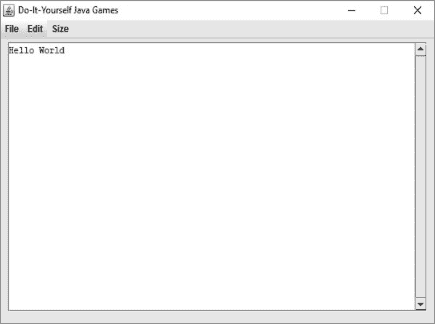

### 第 1 节：Java 项目与包

Java 项目用于安排程序，随后 Java 项目中的包（packages）用于组织程序。对于书中的每个程序，你将建立一个 Java 项目。

包包含通常配合使用的程序文件。因为书中的程序很小，你创建的大多数 Java 项目将只包含一个包。在本节中，你将为你的第一个程序创建一个 Java 项目和一个包。

### 尝试一下

创建你的第一个 Java 项目，命名为 `Hello World`：

1. 如果 `Eclipse` 没有打开：

    1. 双击桌面上创建的 `Eclipse` 快捷方式。

    2. 点击 `OK` 使用你的 Java 工作文件夹作为工作空间。

2. 在 `Package Explorer`（包管理器）面板中点击右键，并选择 `New/Java Project`（新建/Java 项目）。

3. 将 Java 项目命名为 `Hello World`，如果版本是 `1.7` 或更高，则选择 `Use Default JRE`（使用默认 JRE），然后点击 `next`（下一步），如下图所示。如果默认 `JRE` 低于 `1.7`，选择 `Use an execution environment JRE`（使用执行环境 JRE）为 `1.7` 或更高。

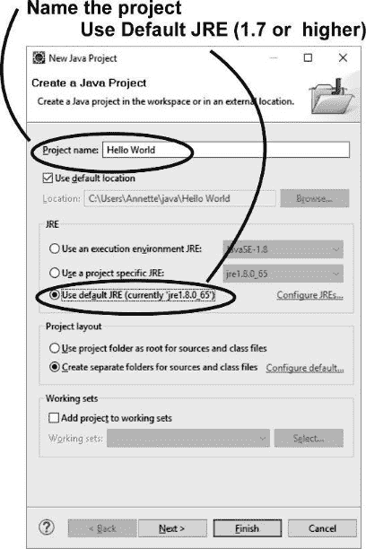

4. 点击 `Libraries`（库），然后点击 `Add External JARs...`（添加外部 JAR），如下图所示。


5. 浏览并选择安装在你的 Java 工作文件夹中的 `DIYJava.jar`，并点击 `Open`（打开）。

6. 点击 `Finish`（完成）。

`Package Explorer` 面板现在列出了一个项目（`Hello World`）以及添加的 JAR 文件（`DIYJava.jar`），如图：

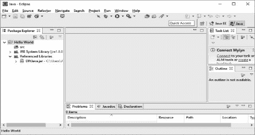

在 `Hello World` 项目中为你的 `Hello World` 程序创建一个包：

1. 右键点击 `Hello World` 项目并选择 `New/Package`（新建/包）。

2. 将包命名为 `____________.____________.helloworld`，如下所示。使用你的名字作为包的一部分。我使用了 `annette.godland.helloworld` 作为包名。

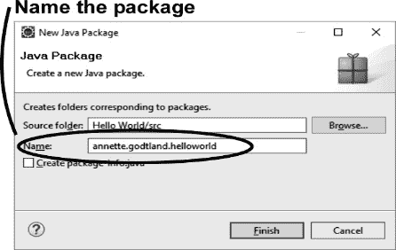

3. 点击 `Finish`（完成）。

`Package Explorer` 面板现在显示你在 `Hello World` 项目中创建的包，如图：

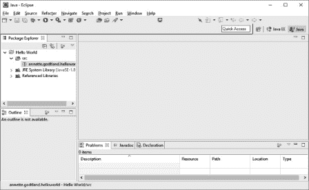

### 要点与更多

* 在 `Package Explorer`面板中点击右键创建 Java 项目和包。

* 为每个程序创建一个不同的 Java 项目。

* 创建项目时，将其命名为文件夹名称。

* 给你的 Java 项目起一个想要的名字。

* 每个单词的首字母大写。

* 包使用全小写且无空格。

* 包名的不同类别之间使用点。

* 创建 Java 项目时，确保选择 `Use an execution environment JRE of 1.7 or higher`。

* Java 项目用于 `Eclipse`;包用于 Java。

### 第 2 节：类、父类与程序

Java 程序由一个或多个类组成。类包含实际的程序代码：按顺序执行以所需的任务。

每个类必须指定另一个类作为其父类（superclass）。例如，要在窗口中运行的程序必须指定某种窗口类作为其父类。

在本节中，你将创建你的第一个类：一个运行在 `DIYWindow` 中的程序。

### 尝试一下

使用 `DIYWindow` 类作为父类创建你的第一个类：

1. 在 `Package Explorer` 面板中右键点击你的包并选择 `New/Class`（新建/类）。

2. 将类名命名为 `HelloWorld`，如下所示。（提示：“Hello”和“World”之间没有空格。）

3. 点击 `Browse for Superclass`（浏览父类）。

4. 类型中输入 `diy`，选择 `DIYWindow`，如下所示，并点击 `OK`。

5. 你想创建哪些方法存根？选择这些选项，如下所示：

    * `Public static void main (String[] args)`

    * `Constructors from superclass`（来自父类的构造函数）

    * 无论是否选择第三选项 `Inherit abstract methods`（继承抽象方法）都没有影响。

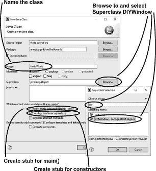

5. 点击 `Finish` 创建该类。

Eclipse 将为 `HelloWorld` 类创建代码，如下列表所示。

如果你将电子阅读器的字号设置为较小，以最大限度地减少换行，你可能会发现阅读本书中的代码列表变得更容易。列表 1-1，自 `HelloWorld.java`

```java
package annette.godtland.helloworld;
import com.godtsoft.diyjava.DIYWindow;
public class HelloWorld extends DIYWindow { 
    public HelloWorld() {
        // TODO Auto-generated constructor stub
    }

    public static void main(String[] args) {
        // TODO Auto-generated method stub
    }
}
```

Eclipse 会添加你不需要的注释代码。注释是以 `//` 开头的行，或者是以 `/*` 开始并以 `*/` 结束的行组。

1. 从该类中删除自动生成的注释行，如如下列表所示的 `(Code was removed from here.)` 所在。列表 1-2，自 `HelloWorld.java`

```java
package annette.godtland.helloworld;
import com.godtsoft.diyjava.DIYWindow;
public class HelloWorld extends DIYWindow { 
    public HelloWorld() {
        (Code was removed from here.)
    }

    public static void main(String[] args) {
        (Code was removed from here.)
    }
}
```

在你为本书创建的每个类的程序代码中，删除自动生成的注释。你将在稍后的课程中添加你自己的注释。

点击任何 `Completed` 列表链接以查看如何完成代码。然而，如果你在查看答案之前尝试自己完成代码，你会学到更多。

以 `public static void main` 开始的代码块被称为 `main()` 方法。以 `public HelloWorld()` 开始的代码块被称为构造函数。现在，添加你的第一第一行代码：

1. 完全按照此处所示向构造函数和 `main()` 方法中添加代码。代码中的需要更改在列表中始终以**粗体**显示。列表 1-3，自 `HelloWorld.java`

```java
package annette.godtland.helloworld;
import com.godtsoft.diyjava.DIYWindow;
public class HelloWorld extends DIYWindow { 
    public HelloWorld() { 
        print("Hello World");
    }

    public static void main(String[] args) { 
        new HelloWorld();
    }
}
```

1. 按 `Ctrl-S` 保存程序。

2. 点击 `Run` 按钮（如图像所示）来运行程序：

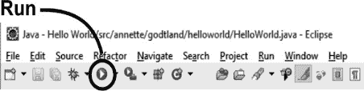

发生了什么？

应该会弹出一个窗口显示“Hello World”，如图像所示：

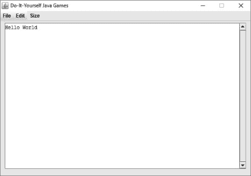

1. 你需要对你的类进行什么修改才能让它向你问好？

列表 1-4，自 `HelloWorld.java`

```java
...
public HelloWorld() { 
    print("Hello
____________
");  
}
...
```

1. 保存程序并运行它。

如果你犯错了会发生什么？

1. 错误地输入单词“print”并保存程序。列表 1-5，自 `HelloWorld.java`

```java
...
public HelloWorld() { 
    print ttt
("Hello Annette");  
}
...
```

发生了什么？

出现了许多错误指示器，如图像所示：

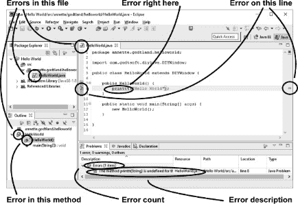

1. 双击 `Eclipse` 中 `Problems` 板中的 `Error` 计数查看发现的错误列表。

2. 双击 `Problems` 板中的 `Error` 描述将光标移动到错误行。

3. 将光标悬停在实际错误上（即上方图中显示 `Error right here in the above image`的地方）。Eclipse 将列出解决问题的方法，如下图所示。`Eclipse` 的此功能被称为 `Quick Fix`（快速修复）。

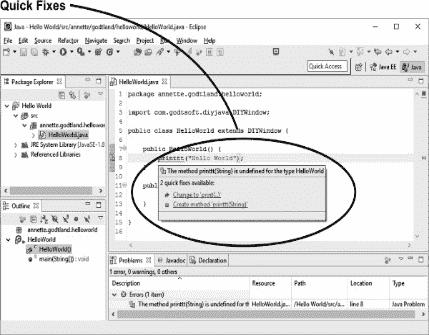

4. 点击名为 `Change to "print(...)."` 的快速修复。该操作将为你错误。

1. 保存更改。

所有错误指示器都应该消失。

现在，打印更多内容：

1. 修改代码让你的程序输出这些：

Hello, earthling.

Take me to your leader. 列表 1-6，自 `HelloWorld.java`

```java
...
public HelloWorld() { 
    print("_______________________"); 
    print("_______________________");
}
...
```

在整个课程中，除非有语法错误，否则在每次代码更改后保存更改并运行程序。

打印了正确的行吗？如果没有，修复代码并重试。

1. 你认为需要打印什么才能在两个句子之间插入一个空行，如下所示。（提示：你不希望在该行打印任何内容。）

Hello, earthling.

Take me to your leader. 列表 1-7，自 `HelloWorld.java`

```java
...
public HelloWorld() { 
    print("Hello, earthling."); 
    print(_____); 
    print("Take me to your leader.");  
}
...
```

### 关键点与其他

* Java 程序由类组成。每个程序都需要在其中一个类中有一个 `main()` 方法。


`main()` 方法必须写成 `public static void main(String[] args)`。随后的课程将解释所有单词的含义。

多个类通常被组合使用以创建一个程序。

然而，本书中的大多数程序将只由一个类组成。

每个类都必须有一个父类。任何类都可以作为父类。你将在稍后的课程中创建你自己的父类。

具有相同父类的类被认为是同一种类型。例如，你为书中每个程序创建的主类都将使用 `DIYWindow` 类作为其父类。因此，书中每个程序都是 `DIYWindow` 的类型。

在现实世界中，你会遇到如人类、狗、汽车和猫等对象。这些对象拥有状态和行为。例如，当你想到一只猫时，它的状态可能包括它的品种、颜色或名字。它的行为可能包括跑步、跳跃或摇摇尾巴。

软件对象在这些特征上与现实对象相似。它的状态存储在字段（`fields`）中，而它的行为通过方法（`methods`）表现。

在开发过程中，方法是在对象的内部状态上执行的，并且方法有助于对象之间的通信。

## 类

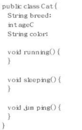

类用于定义对象的规范。这些规范作为创建对象的蓝图。虽然在创建类时它们不会立即应用，但当类的对象被实例化时，这些定义是可用的。一个对象或类在程序中可以有多个副本或实例。

以下是一个名为 `Cat` 的类的定义示例：

一个类可以包含以下类型的变量：

### 类变量

类变量是在类内部使用 `static` 修饰符声明且在任何方法之外声明的变量。

### 局部变量

局部变量是定义在方法、块或构造函数内部的变量。这些变量在方法内部声明并实例化，一旦方法执行完毕就会被销毁。

### 实例变量

实例变量是位于类内部但在方法之外的变量。它们在类创建的同时进行初始化。可以从该特定类的方法、块或构造函数访问。

一个类可以包含任意数量的方法获取所需的值。例如，`Cat` 类有三个方法：`running()`、`sleeping()` 和 `jumping()`。

### 构造函数

构造函数是一种用于初始化对象的方法。一个类必须包含至少一个构造函数。

以下是构造函数的重要规则：

- 构造函数的名称应与类名匹配。
- 它没有显式的返回类型。

### 构造函数的类型

- 默认构造函数或无参构造函数
- 参数构造函数

#### 默认构造函数

没有参数的构造函数称为默认构造函数。


这是语法：

#### 参数构造函数

参数构造函数是带有参数的构造函数。它被用于为特定对象提供值。

下面的示例展示了两种构造函数。第一个是默认构造函数，它没有任何参数。第二个构造函数有一个参数 `name`。

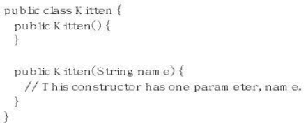

### 创建对象

类提供了对象的模板。对象基本上是从类创建的。要创建新对象，你将使用 `new` 关键字。

从类创建新对象需要采取以下步骤：

1. **声明**：指的是变量声明，你在其中编写变量名及其对象类型。
2. **实例化**：为了创建一个新对象，你将使用 `new` 关键字。
3. **初始化**：`new` 关键字之后调用构造函数并初始化新对象。

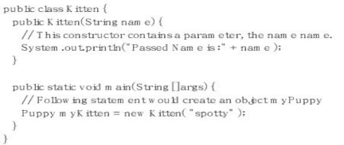

下面的示例展示了从类创建新对象的不同步骤：

以下是输出：

Passed Name is: spotty

### 如何访问方法和实例变量

创建的对象用于访问方法和实例变量。访问实例变量，你将使用这些步骤：

1. 首先，你必须创建一个对象：`ObjectName = New Constructor();`。
2. 接下来，调用变量：`ObjectName.variableName;`。
3. 调用类方法：`ObjectName.MethodName();`。

### Java 包

包仅仅是接口和类分组的一种方式。Java 包作为类的容器。分组的通常依据是功能。包的使用有助于代码的可重用。当接口和类分类到包中时，你可以轻松地访问它们并在其他程序中使用。使用包还有助于防止类和接口之间的命名冲突。

要创建一个包，请在包名之前使用 `package` 语句作为第一条语句。

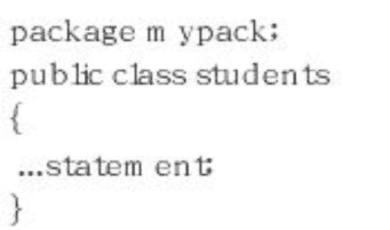

这是一个示例：

### 导入语句

你可能使用 `import` 关键字将包导入到你的源文件中。导入语句使编译器能够轻松找到类或源代码的位置。

你可能只想从包中导入某一个类。你可以使用点运算符 `.` 来指示包和类。例如：

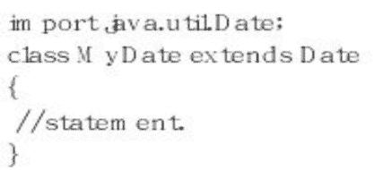

要从一个包中导入所有类，你可以在点运算符之后使用通配符 `*`。例如：


### 修饰符

修饰符是改变你代码中定义含义的关键字。Java 提供了多种修饰符。

### 访问修饰符

访问修饰符用于定义方法、变量、类和构造函数的访问级别。

- **Private**：仅在类内部可见。当方法、变量、类或构造函数被声明为 `private` 时，意味着它仅在类内部可用。然而，如果该类有公共的 getter 方法，你可能可以在类外部访问私有变量。`private` 关键字表示最高的访问限制。注意，你不能将接口和类声明为 `private`。
- **Public**：对世界上可见。被定义为 `public` 的方法、接口、构造函数、类等可以从其他类访问。同样，定义在 `public` 类内部的块、方法或字段可以从 Java 类中访问。只要它们在同一个包中，这一点就是成立的。如果你想从另一个包访问公共类，你将必须导入该公共类。
- **Protected**：对子类和包可见。将方法、变量或构造函数声明为 `protected` 会使得它仅对所在包内的类或另一个包中的子类可见。这种访问类型用于允许子类使用，并防止无关类使用它们。接口及其字段和方法不应声明为 `protected`，但接口外的字段和方法可以声明为 `protected`。
- **Default**（默认）：当未提供修饰符时适用——对包可见。未声明修饰符的方法或变量可以被包内的其他类访问。

下表总结了不同的访问修饰符及其影响：

| 修饰符 | 类内 | 包内 | 包外子类 | 包外 |
| :--- | :--- | :--- | :--- | :--- |
| Private | Y | N | N | N |
| Public | Y | Y | Y | Y |
| Protected | Y | Y | Y | N |
| Default | Y | Y | N | N |

### 非访问修饰符

非访问修饰符可用于访问 Java 中的各种功能。

- **Final**：用于固定变量、方法和类的实现。
    - **Final 变量**：你只能显式地初始化一次 final 变量。当你声明变量为 `final` 时，你将永远无法重新赋值为另一个对象。请注意，你仍然可以更改存储在对象内部的数据。这意味着虽然你可以更改对象的状态，但无法更改引用。`final` 修饰符通常与 `static` 配合使用，以根据常量值创建类变量。
    - **Final 方法**：`final` 关键字用于防止子类更改方法。
    - **Final 类**：防止类被子类化。

`final` 修饰符用于防止其他类继承被声明为 `final` 类的任何特性。

### Static（静态）

用于创建类方法或变量。

你可以使用此关键字来创建一个唯一的变量（称为 `static variable` 或 `class variable`），该变量将独立于该类的其他实例而存在。你不能将局部变量声明为 `static`。

你还可以使用 `static` 关键字来创建一个方法（称为 `static method` 或 `class method`），该方法将独立于该类的其他实例而存在。`Static` 方法只识别并处理来自所给参数的数据，而不考虑变量。

你可以通过在类名后写一个点（`.`）和变量名或方法名来访问类方法和类变量。

### Abstract（抽象）

用于创建抽象方法或抽象类。

#### 抽象类

当一个类被声明为 `abstract` 时，意味着你永远无法实例化该类。将一个类声明为 `abstract` 的唯一理由是为了扩展该类。你不能将一个类同时声明为 `final` 和 `abstract`，因为你就不可能扩展一个 `final` 类。使用了 `abstract` 方法的类必须声明为 `abstract`。不这样做会导致编译错误。

#### 抽象方法

由于它在声明时没有实现，`abstract method` 的方法体派生自子类。`Abstract` 方法不能声明为严格的或 `final`。除非它本身也是一个 `abstract class`，否则扩展 `abstract class` 的类必须采用父类的 `abstract methods`。包含至少一个 `abstract method` 的类应该声明为 `abstract class`。另一方面，`abstract class` 并不一定要有 `abstract` 方法。示例：

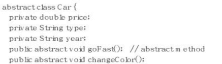

### Synchronized（同步）

`synchronized` 修饰符用于表示在任何给定时间内只有一个线程可以访问该方法。你可以将此关键字与任何访问级别修饰符一起。示例：

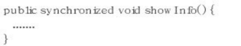

### Volatile（易变的）

此关键字用于表示访问 `volatile variable` 的线程应该将其私有副本与存储在内存中的主副本进行合并。实际上，它将变量的所有缓存副本与主内存同步。你只能使用此修饰符来定义 `private` 或 `object` 类型的实例变量。示例：

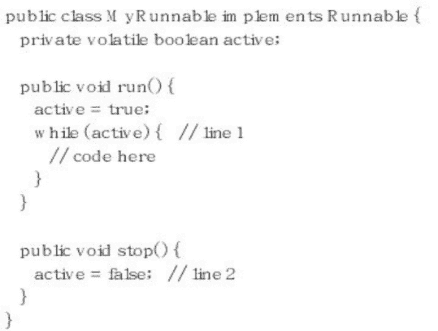

### Transient（瞬态的）

`transient` 关键字用于告诉编译器在序列化包含标记变量的对象时跳过该实例变量。示例：


## 第 8 章：决策与循环控制

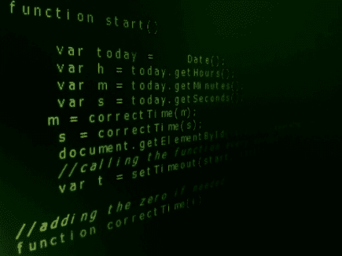

决策结构用于此类情况：如果条件为真，则必须执行一组指令；当条件被判定为假时，必须执行另一组指令。Java 中提供了几种结构来用于编程此类场景。这些结构包括––

### If 语句

该语句用于需要测试条件的情况，如果发现条件为真，则需要执行紧随在该语句的代码块。该构造的语法为––

```java
if(condition){
    /*Body*/
}
```

该构造的示例实现如下––

```java
public class ifDemo { 
    public static void main(String args[]) { 
        int i = 10; 
        int j = 1; 
        if(i>j){
            System.out.print(i);          
        }        
    }
}
```

#### If else 语句

该语句用于需要测试条件的情况，如果发现条件为真，则执行紧随在该语句的代码块，否则执行 `else` 语句后的代码块。该构造的语法为––

```java
if(condition){
    /*Body*/
}
else{
    /*Body*/
}
```

该构造的示例实现如下––

```java
public class ifElseDemo { 
    public static void main(String args[]) { 
        int i = 1; 
        int j = 0; 
        if(i>j){
            System.out.print(i);          
        } else{        
            System.out.print(j);          
        }
    }
}
```

#### 嵌套 if 语句

该语句用于需要测试条件的情况，如果发现条件为真，则执行紧随在该语句的代码块，否则测试下一个条件。如果发现此条件为真，则执行与该条件的 `if` 语句对应的代码块。如果没有任何条件被发现为真，则执行 `else` 语句后的代码块。可以使用嵌套的 `if` 语句测试多个条件。该构造的语法为––

```java
if(condition1) {
    /*Body*/
} else if (condition2) {
    /*Body*/
} else {
    /*Body*/
}
```

该构造的示例实现如下––

```java
public class nestedIfDemo { 
    public static void main(String args[]) { 
        int i = 0; 
        int j = 0; 
        if(i>j){
            System.out.print(i);          
        } else if(j>i) {      
            System.out.print(j);          
        } else {
            System.out.print("Equal");          
        }
    }
}
```

#### Switch

当你有一个变量并且需要根据该变量的不同值执行不同的代码块时，使用的理想构造是 `switch` 语句。该构造的语法为––

```java
switch(variable){
    case value1: /*body*/ break;
    case value2: /*body*/ break;
    case value3: /*body*/ break;
    default: /*body*/ break;
}
```

该构造的示例实现如下––
```java
public class switchDemo { 
    public static void main(String args[]) { 
        int i = 5;
        switch (i) { 
            case 0: System.out.print(0); break;
            case 2: System.out.print(2); break;
            case 5: System.out.print(5); break;
            default: System.out.print(999); break;
        }
    }
}
```

#### 条件运算符

Java 还支持条件运算符，称为 `?:` 运算符。该运算符用于替换 `if else` 构造。它的语法如下

```
Expression1?Expression2:Expression3
```

在这里，`Expression1` 是需要测试的条件。如果条件为真，执行 `Expression2`，否则执行 `Expression3`。

### 循环控制

在某些情况下，你需要迭代执行相同的指令。例如，如果你需要对一组数字排序，你需要多次扫描并重新排列这组数字。这种执行流被称为循环控制。

简单来说，循环是一种允许多次执行代码块的构造。Java 支持多种用于循环的构造。这些包括 `while loop`、`for loop` 和 `do while loop`。

`while loop` 迭代执行代码块，直到 `while loop` 指定条件为真。一旦该条件失败，`while loop` 停止。

`for loop` 允许程序员在同一个构造中操作条件和循环变量。因此，你可以初始化循环变量、对其进行增减并运行循环直到该条件为真。

`do while loop` 与 `while loop` 相似。但在 `while loop` 中是在执行代码块之前检查条件。而在 `do while loop` 中，先执行代码块，然后检查条件。如果满足条件，则重新启动循环执行，否则终止循环。

#### 循环语句

有两个关键字专门用于循环，并被称为控制语句，因为它们允许控制流从代码的一部分转移到另一个部分。

#### Break

`break` 关键字用于循环内部，此时你希望执行流终止循环并直接从循环后的第一条指令开始执行。

#### Continue

`continue` 关键字用于循环内部，此时程序员希望跳过循环的剩余部分并将控制转移到循环的第一条语句。

为了帮助你理解循环是如何执行的，让我们来看一个示例，并使用三种循环控制类型来实现它。

### For 循环实现

```java
public class forDemo { 
    public static void main(String args[]) { 
        int [] numberArray = {100, 300, 500, 700, 900}; 
        for(int i=0; i<5; i++) {            
            System.out.print(numberArray[i]);          
            System.out.print(",");        
        }      
    }
}
```


### While 循环实现

```java
public class whileDemo { 
    public static void main(String args[]) { 
        int [] numberArray = {100, 300, 500, 700, 900}; 
        int i = 0; 
        while(i<5) {            
            System.out.print(numberArray[i]); 
            System.out.print(","); 
            i++; 
        }      
        System.out.print("\n");        
    }
}
```

### Do While 循环实现

```java
public class doWhileDemo { 
    public static void main(String args[]) { 
        int [] numberArray = {100, 300, 500, 700, 900}; 
        int i = 0; 
        do {            
            System.out.print(numberArray[i]); 
            System.out.print(","); 
            i++;      
        } while (i<5);
        System.out.print("\n");        
    }
}
```

### 增强型 For 循环

Java 还支持一种增强型循环结构，它可以用于数组元素。该循环构造的语法如下：

```java
for(declaration : expression) { /*Body*/ }
```

增强型 `for` 循环的声明部分用于声明变量。该变量应该是 `for loop` 局作用的，并且其类型必须与数组元素的类型相同。变量的当前值始终等于循环中正在遍历的数组元素。表达式是一个数组或返回数组的方法调用。

下面是增强型 for 循环的示例实现：

```java
public class forArrayDemo { 
    public static void main(String args[]) { 
        int [] numberArray = {100, 300, 500, 700, 900}; 
        for(int i : numberArray ) {            
            System.out.print( i );          
            System.out.print(",");      
        }      
        System.out.print("\n");        
    }
}
```

### 异常层次结构

Java 内置了一个名为 `java.lang.Exception` 的类，所有异常都属于这个类。所有的异常类都是该类的子类。此外，`Throwable` 类是异常类的父类。`Throwable` 类的另一个子类是 `Error` 类。所有如上面描述的栈溢出（stack overflow）错误都属于这个 `Error` 类。

`Exception` 类有两个子类，即 `RuntimeException` 类和 `IOException` 类。作为 `Throwable` 类的一部分，Java 中提供的可用定义的方法列表如下：

```java
public String getMessage()
```
调用时，此消息将返回所遇异常的详细描述。

```java
public Throwable getCause()
```
此方法在调用时会返回一个包含异常原因的消息。

```java
public String toString()
```
此方法返回异常的详细描述与类名拼接后的结果。

```java
public void printStackTrace()
```
通过调用此方法，可以将 `toString()` 的结果以及栈跟踪（stack trace）打印到标准错误流 `System.err` 中。

```java
public StackTraceElement [] getStackTrace()
```
在某些情况下，你可能需要访问栈跟踪的不同元素。此方法返回一个数组，栈跟踪的每个元素都保存在到数组的不同元素中。数组的第一个元素包含栈跟踪的顶部元素，而栈跟踪的底部被保存到数组的最后一个元素中。

```java
public Throwable fillInStackTrace()
```
将栈跟踪中的之前信息与当前栈跟踪的内容合并，并返回相同的数组格式。

### 捕获异常

捕获异常的标准方法是使用 `try` 和 `catch` 关键字以及它们的代码实现。此 `try` 和 `catch` 块需要以这种方式实现，以包含可能会抛出异常的代码。这里还需要说明的是，可能会抛出异常的代码被称为受保护代码（protected code）。`try` 和 `catch` 块实现的语法如下：

```java
try { /*Protected code*/ } catch(ExceptionName exc1) { /*Catch code*/ }
```

可能会抛出异常的代码放置在 `try` 块中。如果抛出了异常，则为异常处理要执行的相应操作将在 `catch` 块中实现。每个 `try` 块必须要么有一个 `catch` 块，要么有一个 `final` 块。

作为 `catch` 语句的一部分，需要声明预期抛出的异常。一旦发生异常，执行流将转移到 `catch` 块。如果抛出的异常与 `catch` 块中定义的异常匹配，则执行 `catch` 块。

下面是 `try` 和 `catch` 块的示例实现。该代码实现了一个包含 2 个元素的数组。然而，代码尝试访问一个不存在的元素。

```java
import java.io.*; 
public class demoException { 
    public static void main(String args[]) { 
        try {            
            int arr[] = new int[2];          
            System.out.println("Accesing 3rd element of the array:" + arr[3]);
        } catch(ArrayIndexOutOfBoundsException exp) {
            System.out.println("Catching Exception:" + exp);
        }
        System.out.println("Reached outside catch block");
    }
}
```

### Catch 块

代码可能会导致多个异常。为了应对这种情况，允许实现多个 `catch` 块。语法如下：

```java
try { /*Protected code*/ } catch(ExceptionType1 exp1) { /*Catch block 1*/ } 
catch(ExceptionType2 exp2) { /*Catch block 2*/ } 
catch(ExceptionType3 exp3) { /*Catch block 3*/ }
```

上面的语法说明了三个 catch 块的实现。然而，你可以实现任意数量的 catch 块。

### ADT、数据结构与 Java 集合

抽象数据类型（ADT）是对数据的逻辑描述以及在数据上允许的操作。ADT 是从用户角度定义的。ADT 关注的是数据的可能值及其暴露的接口。ADT 不关心数据结构的具体实现。

例如，用户想要存储一些整数并计算它们的平均值。该数据结构的 ADT 将支持两个函数：一个用于添加整数，另一个用于获取平均值。

数据结构是数据的具体表示，是从程序员角度定义的。数据结构代表了数据在内存中的存储方式。所有数据结构都有自己的优缺点。根据问题的类型，我们选择最合适的数据结构。

注意：在本章中，我们将学习各种数据结构及其 API。这样用户就可以在不了解内部实现的情况下使用它们。

#### Java Collection Framework

Java 语言提供了一个 Java 集合框架，这是一套高质量、高性能且可重用的数据结构和算法。

使用 Java 集合框架的优势如下：

1. 程序员不需要重复实现基础的数据结构和算法。这避免了重复造轮子。因此，程序员可以投入更多精力在业务逻辑上。
2. `JAVA Collection Framework` 代码是经过良好测试的、高质量、高性能的代码。使用它们可以提高程序的质量。
3. 由于 `Collections` 框架中实现的基础数据结构和算法可以被复用，开发成本得以降低。
4. 其它开发者编写的程序易于审查和理解，因为大多数 Java 开发者都使用 `Collection` 框架。此外，集合框架有完善文档。

## 数组 (Array)

`Array` 表示一组相同数据类型的多个元素的集合。

### 数组 ADT 操作

以下是数组的 API：

1. 在 `kth` 位置添加一个元素。值可以在 `O(1)` 常数时间内存储在数组的 `Kth` 位置。我们只需要在 `arr[k]` 存储该值即可。
2. 读取存储在 `kth` 位置的值。访问数组中某个索引处存储的值也是 `O(1)` 常数时间。我们只需要读取存储在 `arr[k]` 的值即可。
3. 用新值替换存储在 `kth` 位置的值。时间复杂度：`O(1)` 常数时间。

### 示例：

```java
public class ArrayDemo { 
    public static void main(String[] args) { 
        int[] arr = new int[10]; 
        for (int i = 0; i < 10; i++) {
            arr[i] = i;
        }
    }
}
```

`JAVA` 标准数组是固定长度的。有时我们不知道需要多少内存，所以会创建一个更大的数组，从而浪费空间。如果数组已经满满，且我们想要添加的值比剩余容量还多，就需要创建一个足够空间的新数组，然后将旧数组复制到新数组中。为了避免这种手动的重新分配和复制，我们可以使用 `JAVA Collection` 框架中的 `ArrayList` 或 `Linked Lists`（链表）来存储数据。

### JAVA Collections 中的 ArrayList 实现

`JAVA Collections` 中的 `ArrayList<E>` 是一种实现了 `List<E>` 接口的数据结构，这意味着它可以包含重复元素。`ArrayList` 是作为动态数组的实现，可以根据需要增长或缩小。（当数组满时，内部使用数组并分配更大的数组，并将旧数组的值复制到其中）。

### 示例：

```java
import java.util.ArrayList; 
public class ArrayListDemo {
    public static void main(String[] args) {
        ArrayList<Integer> al = new ArrayList<Integer>();
        al.add(1); // 将 1 添加到列表末尾
        al.add(2); // 将 2 添加到列表末尾
        System.out.println("Contents of Array: " + al);      
        System.out.println("Array Size: " + al.size()); 
        System.out.println("Array IsEmpty: " + al.isEmpty()); 
        al.remove(al.size() - 1); // 移除数组的最后一个元素。
        al.removeAll(al); // 移除数组的所有元素
        System.out.println("Array IsEmpty: " + al.isEmpty());
    }
}
```

### 输出：

```
Contents of Array: [1, 2]
Array Size: 2
Array IsEmpty: false
Array IsEmpty: true
```

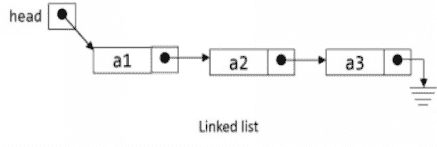

## 链表 (Linked List)

链表是一种动态数据结构，内存是在运行时分配的。链表的概念不是连续存储数据。链表的节点包含一个指向列表中下一个元素的链接。

从性能方面来说，链表比数组慢，因为无法直接访问链表元素。当我们预先不知道要存储元素的数量时，链表是一种很有数据结构。链表有许多类型：线性链表、循环链表、双向链表、双循环链表等。

### 链表 ADT 操作

以下是链表的 API。

- `Insert(k)`：在列表开头添加 `k`。在列表开头插入元素。只需创建一个新元素并移动指针，使得该新元素成为列表的第一个元素。此操作将需要 `O(1)` 常数时间。
- `Delete()`：删除列表开头的元素。在列表开头删除元素。我们只需要移动一个指针。此操作也需要 `O(1)` 常数时间。
- `PrintList()`：显示列表的所有元素。从第一个元素开始，然后沿着指针移动。此操作将需要 `O(N)` 时间。
- `Find(k)`：查找值为 `k` 的元素的位置。从第一个元素开始并沿着指针移动，直到找到我们寻找的值或到达列表末尾。此操作将需要 `O(N)` 时间。*注意：二分查找不适用于链表。*
- `FindKth(k)`：查找位置在 `k` 的元素。从第一个元素开始并沿着链接移动，直到到达第 k 个元素。此操作将需要 `O(N)` 时间。
- `IsEmpty()`：检查列表中的元素数量是否为零。只需检查列表的头指针，如果为 `Null`，则列表为空，否则不为空。此操作将需要 `O(1)` 时间。

### JAVA Collections 中的 LinkedList 实现

`JAVA Collections` 中的 `LinkedList<E>` 是一种实现了 `List<E>` 接口的数据结构，这意味着它内部可以包含重复元素。`ArrayList` 是动态数组的实现，可以根据需要增长或缩小。

### 示例：

```java
import java.util.ArrayList; 
public class ArrayListDemo {
    public static void main(String[] args) {
        ArrayList<Integer> al = new ArrayList<Integer>();
        al.add(1); // 将 1 添加到列表末尾
        al.add(2); // 将 2 添加到列表末尾
        System.out.println("Contents of Array: " + al);      
        System.out.println("Array Size: " + al.size()); 
        System.out.println("Array IsEmpty: " + al.isEmpty()); 
        al.remove(al.size() - 1); // 移除数组的最后一个元素。 
        al.removeAll(al); // 移除数组的所有元素。
        System.out.println("Array IsEmpty: " + al.isEmpty());
    }
}
```

*(注：此处示例代码在原文中标记为 ArrayList Demo，但根据要求保持代码块不翻译，且为保持逻辑一致性，此处原样保留。由于原文文本中存在部分逻辑混淆，翻译时严格遵循代码块不翻译原则)*

### 输出：

```
Contents of Array: [1, 2]
Array Size: 2
Array IsEmpty: false
Array IsEmpty: true
```


1. 程序员不需要重复实现基础的数据结构和算法。这避免了重复造轮子。因此，程序员可以投入更多精力在业务逻辑上。
2. `JAVA Collection Framework` 代码是经过良好测试的、高质量、高性能的代码。使用它们可以提高程序的质量。
3. 由于 `Collections` 框架中实现的基础数据结构和算法可以被复用，开发成本得以降低。
4. 其它开发者编写的程序易于审查和理解，因为大多数 Java 开发者都使用 `Collection` 框架。此外，集合框架有完善文档。

## 数组 (Array)

`Array` 表示一组相同数据类型的多个元素的集合。

### 数组 ADT 操作

以下是数组的 API：

1. 在 `kth` 位置添加一个元素。值可以在 `O(1)` 常数时间内存储在数组的 `Kth` 位置。我们只需要在 `arr[k]` 存储该值即可。
2. 读取存储在 `kth` 位置的值。访问数组中某个索引处存储的值也是 `O(1)` 常数时间。我们只需要读取存储在 `arr[k]` 的值即可。
3. 用新值替换存储在 `kth` 位置的值。时间复杂度：`O(1)` 常数时间。

### 示例：

```java
public class ArrayDemo { 
    public static void main(String[] args) { 
        int[] arr = new int[10]; 
        for (int i = 0; i < 10; i++) {
            arr[i] = i;
        }
    }
}
```

`JAVA` 标准数组是固定长度的。有时我们不知道需要多少内存，所以会创建一个更大的数组，从而浪费空间。如果数组已经满了，且我们想要添加的值比剩余容量还多，就需要创建一个足够空间的新数组，然后将旧数组复制到新数组中。为了避免这种手动的重新分配和复制，我们可以使用 `JAVA Collection` 框架中的 `ArrayList` 或 `Linked Lists`（链表）来存储数据。

### JAVA Collections 中的 ArrayList 实现

`JAVA Collections` 中的 `ArrayList<E>` 是一种实现了 `List<E>` 接口的数据结构，这意味着它内部可以包含重复元素。`ArrayList` 是作为动态数组的实现，可以根据需要增长或缩小。（当数组满时，内部使用数组并分配更大的数组，并将旧数组的值复制到其中）。

### 示例：

```java
import java.util.ArrayList; 

public class ArrayListDemo {
    public static void main(String[] args) {
        ArrayList<Integer> al = new ArrayList<Integer>();
        al.add(1); // 将 1 添加到列表末尾
        al.add(2); // 将 2 添加到列表末尾
        System.out.println("Contents of Array: " + al);      
        System.out.println("Array Size: " + al.size()); 
        System.out.println("Array IsEmpty: " + al.isEmpty()); 
        al.remove(al.size() - 1); // 移除数组的最后一个元素。 
        al.removeAll(al); // 移除数组的所有元素。
        System.out.println("Array IsEmpty: " + al.isEmpty());
    }
}
```

### 输出：

```
Contents of Array: [1, 2]
Array Size: 2
Array IsEmpty: false
Array IsEmpty: true
```


## 链表 (Linked List)

链表是一种动态数据结构，内存是在运行时分配的。链表的概念不是连续存储数据。链表的节点包含一个指向列表中下一个元素的链接。

从性能方面来说，链表比数组慢，因为无法直接访问链表元素。当我们预先不知道要存储元素的数量时，链表是一种很有用的数据结构。链表有许多类型：线性链表、循环链表、双向链表、双循环链表等。

### 链表 ADT 操作

以下是链表的 API。

- `Insert(k)`：在列表开头添加 `k`。在列表开头插入元素。只需创建一个新元素并移动指针，使得该新元素成为列表的第一个元素。此操作将需要 `O(1)` 常数时间。
- `Delete()`：删除列表开头的元素。在列表开头删除元素。我们只需要移动一个指针。此操作也需要 `O(1)` 常数时间。
- `PrintList()`：显示列表的所有元素。从第一个元素开始，然后沿着指针移动。此操作将需要 `O(N)` 时间。
- `Find(k)`：查找值为 `k` 的元素的位置。从第一个元素开始并沿着指针移动，直到找到我们寻找的值或到达列表末尾。此操作将需要 `O(N)` 时间。*注意：二分查找不适用于链表。*
- `FindKth(k)`：查找位置在 `k` 的元素。从第一个元素开始并沿着链接移动，直到到达第 k 个元素。此操作将需要 `O(N)` 时间。
- `IsEmpty()`：检查列表中的元素数量是否为零。只需检查列表的头指针，如果为 `Null`，则列表为空，否则不为空。此操作将需要 `O(1)` 时间。

### JAVA Collections 中的 LinkedList 实现

`JAVA Collections` 中的 `LinkedList<E>` 是一种实现了 `List<E>` 接口的数据结构，这意味着它内部可以包含重复元素。

### 示例：

```java
import java.util.LinkedList; 

public class LinkedListDemo {
    public static void main(String[] args) {
        LinkedList<Integer> ll = new LinkedList<Integer>();
        ll.add(1); // 将 1 添加到列表末尾
        ll.add(2); // 将 2 添加到列表末尾
        System.out.println("Contents of LinkedList: " + ll);      
        System.out.println("LinkedList Size: " + ll.size()); 
        System.out.println("LinkedList IsEmpty: " + ll.isEmpty()); 
        ll.remove(ll.size() - 1); // 移除列表的最后一个元素。 
        ll.removeAll(ll); // 移除列表的所有元素。
        System.out.println("LinkedList IsEmpty: " + ll.isEmpty());
    }
}
```

### 输出：

```
Contents of LinkedList: [1, 2]
LinkedList Size: 2
LinkedList IsEmpty: false
LinkedList IsEmpty: true
```


```java
System.out.println("Contents of Array: " + al);      

System.out.println("Array Size: " + al.size()); 

System.out.println("Array IsEmpty: " + al.isEmpty()); 

al.remove(al.size() - 1); // 移除数组的最后一个元素。 

al.removeAll(al); // 移除数组的所有元素。

System.out.println("Array IsEmpty: " + al.isEmpty());

}
}
```

### 输出：

```
Contents of Array: [1, 2]
Array Size: 2
Array IsEmpty: false
Array IsEmpty: true
```

# Linked List

链表是一种动态数据结构，内存是在运行时分配的。链表的概念不是连续存储数据。链表的节点包含一个指向列表中下一个元素的链接。

从性能方面来说，链表比数组慢，因为无法直接访问链表元素。当我们预先不知道要存储元素的数量时，链表是一种很有用的数据结构。链表有许多类型：线性链表、循环链表、双向链表、双循环链表等。

## 链表 ADT 操作

以下是链表的 API。

- `Insert(k)`：在列表开头添加 `k`。在列表开头插入元素。只需创建一个新元素并移动指针。使得该新元素成为列表的第一个元素。此操作将需要 `O(1)` 常数时间。
- `Delete()`：删除列表开头的元素。在列表开头删除元素。我们只需要移动一个指针。此操作也需要 `O(1)` 常数时间。
- `PrintList()`：显示列表的所有元素。从第一个元素开始，然后沿着指针移动。此操作将需要 `O(N)` 时间。
- `Find(k)`：查找值为 `k` 的元素的位置。从第一个元素开始并沿着指针移动，直到找到我们寻找的值或到达列表末尾。此操作将需要 `O(N)` 时间。*注意：二分查找不适用于链表。*
- `FindKth(k)`：查找位置在 `k` 的元素。从第一个元素开始并沿着链接移动，直到到达第 k 个元素。此操作将需要 `O(N)` 时间。
- `IsEmpty()`：检查列表中的元素数量是否为零。只需检查列表的头指针，如果为 `Null`，则列表为空，否则不为空。此操作将需要 `O(1)` 时间。

## 队列 ADT 操作

- `Add(K)`：将新元素 `k` 添加到队列末尾。
- `Remove()`：从队列头部移除一个元素并返回其值。
- `Front()`：返回队列头部元素的值。
- `Size()`：返回队列内部的元素数量。
- `IsEmpty()`：如果队列为空则返回 1，否则返回 0。

**注意**：以上所有队列操作的时间复杂度均为 `O(1)`。

## Java Collection 中的队列实现

`ArrayDeque<T>` 是双端队列的类实现。如果我们使用 `add()`、`remove()` 和 `peek()`，它的行为将像一个队列。（此外，如果我们使用 `push()`、`pop()` 和 `peekLast()`，它的行为将像一个栈。）例如：

```java
import java.util.ArrayDeque; 

public class QueueDemo {

    public static void main(String[] args) {

        ArrayDeque<Integer> que = new ArrayDeque<Integer>(); 

        que.add(1); que.add(2); que.add(3);

        System.out.println("Queue : " + que);

        System.out.println("Queue size : " + que.size());

        System.out.println("Queue peek : " + que.peek());

        System.out.println("Queue remove : " + que.remove());

        System.out.println("Queue isEmpty : " + que.isEmpty());

    }

}
```

**输出：**
```
Queue : [1, 2, 3]
Queue size : 3
Queue peek : 1
Queue remove : 1
Queue isEmpty : false
```

# 第 10 章：文件处理

本章讨论了读取、写入、创建和打开文件的细节。有许多文件 I/O 类和方法可以选择。

## 读取文本文件

读取文本文件是 Java 中的一项关键能力，并在许多实际应用中使用。`FileReader`、`BufferedReader` 和 `Scanner` 是 Java 中读取纯文本文件的有用类。每个类都具有特定的特性，使其能够胜任处理特定情况。

### BufferedReader

该技术从字符输入流中读取文本。它缓冲字符、数组和行，以便高效地读取。你可以指定缓冲区类型或使用标准类型。出于大多数原因，默认类型已经足够大。特别是，从 `Reader` 产生的每个读取操作都会导致基础的字符或字节流执行相应的读取操作。因此，建议对任何读取操作较大的（如 `FileReader` 和 `InputStreamReader`）`Reader` 封装一个 `BufferedReader`。例如：

```java
BufferedReader in = new BufferedReader(Reader in, int size)
```

### FileReader

用于读取字符文档的便利类。该类的构造函数假设默认字符格式和默认字节缓冲区大小是合适的。

### Scanner

一种简单的文本扫描器，使用正则表达式来解析原始类型和字符串。`Scanner` 使用分隔符模式将其条目拆分为符合定义空白的标记（tokens）。通过使用不同的 `next` 方法，可以将生成的标记转换为不同类型的值。

```java
import java.io.File; 
import java.util.Scanner; 

public class ReadFromFileUsingScanner {

    public static void main(String[] args) throws Exception {

        // filepath 现在设置为参数，以便进行扫描
        File example = new File("C:\\Users\\userName\\Desktop\\example.txt"); 
        Scanner example1 = new Scanner(example); 

        while (example1.hasNextLine()) System.out.println(example1.nextLine());

    }

}
```

使用 `Scanner` 类但不使用循环的示例：

```java
import java.io.File; 
import java.io.FileNotFoundException;
import java.util.Scanner;

public class Example { 
    public static void main(String[] args) throws FileNotFoundException {

        File example = new File("C:\\Users\\userName\\Desktop\\example.txt");
        Scanner example1 = new Scanner(example); // 我们将使用 \\Z 作为分隔符 
        example1.useDelimiter("\\Z");

        System.out.println(example1.next());

    }

}
```

### 在 Java 包 `io` 中将文本文件读取为 String

```java
package io; 

import java.nio.file.*; 

public class Example {

    public static String readFile(String fileName) throws Exception { 
        String content = ""; 
        content = new String(Files.readAllBytes(Paths.get(fileName))); 
        return content;
    }

    public static void main(String[] args) throws Exception {

        String content = readFile("C:\\Users\\userName\\Desktop\\example.java"); 
        System.out.println(content);

    }

}
```

## 写入文本文件

你可以使用其中一个写入方法向文件写入字节或行。写入方法包括：
* `Write(Path, byte[], OpenOption...)`
* `Write(Path, Iterable<? extends CharSequence>, Charset, OpenOption...)`

## 重命名和删除文件

### 重命名

在 Java 中，`File` 类中有一个名为 `renameTo(File dest)` 的方法，我们可以用它重命名文件。

### 删除文件

使用 Java 程序保存的文件将被永久删除，不会移动到垃圾箱/回收站。使用 `java.io.File.delete()` 从文件或文件夹中删除此抽象路径。使用 `java.nio.file.Files.deleteIfExists(Path path)` 如果文件存在则将其删除。如果文件夹未打开，它也会删除路径列出的文件夹。

# Java 高级主题

## Generic 型

在任何复杂的软件项目中，Bug 都是生活常态。仔细的计划、编程和测试可能有助于减少它们的无处不在，但无论如何它们总会找到进入你系统的某个地方。随着新功能的引入以及代码库规模和复杂性的增加，这一点变得尤为明显。

幸运的是，某些 Bug 比其他 Bug 更容易检测。例如，编译时 Bug 可以很快识别；你可以使用编译器的错误代码来确定问题所在并解决它。然而，运行时 Bug 可能困难得多；它们并不总是发生，当它们发生时，可能在远离真实原因的地方。泛型通过使软件在编译时可行来帮助稳定你的软件。

## 泛型类型

泛型形式是类型参数化的泛型类别或接口。可以通过修改一个简单的箱类来展示这一思想。考虑一个适用于任何类型对象的非泛型箱类别。它只需要提供两个方法：`set()`（向柜中添加物品）和 `get()`（检索它）。由于它们的方法接受或返回 `Object`，你可以自由地传递你想要的内容，只要它不是原始类型之一。在编译时无法检查该类是如何被使用的。

由角括号 `< >` 指定的类型参数部分显示了类别的标题。它指示了形式的参数（也称为类型变量）`T1`、`T2` 直到 `Tn`。通过将 `class Box` 修改为 `class Box<T>` 来生成泛型类型语句，从而更新箱类别以使用泛型。这引入了类型变量 `T`，它可以在类内部任何地方使用。这把所有的 `Object` 引用替换为 `T`。

按照约定，类型标识通常是单个大写字母。这与你已经熟悉的变量命名规范形成了鲜明对比，并且有一个充分的理由：如果没有这种约定，很难区分类型变量与普通的类或对象名称。

最常用的类型参数名称有：

* `E` - Element（元素，在 Java 集合框架中广泛使用）
* `K` - Key（键）
* `N` - Number（数字）
* `T` - Type（类型）
* `V` - Value（值）
* `S`, `U`, `V` 等——第 2、第 3、第 4 类型

你将在整个 JDK 和 API 中看到这些名称。

## 调用和实例化泛型类型

为了在你的系统中提到泛型框类别，必须执行一次泛型类型调用，将 `T` 带入一个特定的具体值，例如 `Integer`：

```java
Box<Integer> integerBox;
```

你可能认为泛型排序的调用类似于普通的过程调用，但实际上你并不是在过程中添加了断言，而是将一个类型参数——在本例中为 `Integer`——传递到了框类别本身。

许多设计者交叉使用“类型参数”（type parameter）和“类型实参”（type argument）这两个词，但它们的定义不同。在编码时，为了生成参数化类型，需要提供类型实参。因此，`Foo<T>` 中的 `T` 是类型参数，而 `Foo<String> f` 中的 `String` 是类型实参。在使用这些词时，本文档遵循这一概念。

与任何其他变量声明一样，此代码并没有生成一个新的框实例。它只是声明 `integerBox` 将拥有指向“Integer 框”的引用，这就是读取 `Box<Integer>` 的方式。泛型类型调用通常被称为参数化类型。

要实例化此类，请像常一样使用 `new` 关键字，但在类名和括号之间放置 `<Integer>`：

```java
Box<Integer> integerBox = new Box<Integer>();
```

## 菱形语法

在 Java 的最新版本中，只要编译器能够确定或从上下文推断出类型参数，你就可以用空的类型参数集（`<>`）替换调用泛型类构造函数所需的类型参数。这对尖括号 `<>` 被形象地称为“菱形”（The Diamond）。例如，你可以使用之前的声明来生成 `Box<Integer>` 的实例：`Box<Integer> integerBox = new Box<>();`

## 泛型方法

泛型方法是实现其自身类型参数的方法。这类似于泛型类型声明，但类型参数的作用范围局限于声明它的方法。除了泛型类构造函数外，还允许静态和非静态泛型方法。

泛型方法的语法涉及一组在方法返回类型之前的尖括号内的类型参数列表。对于静态泛型方法，类型参数段必须出现在方法的返回类型之前。`Util` 类涉及一个比较两个 `Pair` 项的泛型方法。

```java
Pair<Integer, String> ex1 = new Pair<>(49, "string1"); 
Pair<Integer, String> ex2 = new Pair<>(64, "string2"); 
boolean comparison = Util.<Integer, String>compare(ex1, ex2);
```

## 边界类型参数

有时，你希望限制在参数化类型声明时可以使用的类型种类。例如，一个处理数字的方法可能只能识别 `Number` 类或其子类。这就是限制此类类型参数的用途。

列出类型参数的名称，后跟 `extends` 关键字，随后跟上上界，在本例中为 `Number`。注意，在此语境下，`extends` 通常用于表示“继承”（如类）或“实现”（如接口）。

## 多重边界

类型参数可以有多个边界。具有多个边界的类型变量是边界中列出的所有类型的子类型。如果其中一个边界是类，则必须首先指定。例如：

```java
class X { /* ... */ } 
interface Y { /* ... */ } 
interface Z { /* ... */ }

class R<T extends X & Y & Z> { /* ... */ }
```

如果未首先指定边界 `X`，你将得到编译时错误：

```java
class R<T extends Y & X & Z> { /* ... */ } // 编译错误
```


## 第 11 章：集合

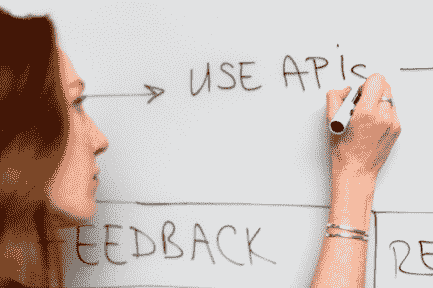

### 集合的函数化

当我们外部化代码时，我们展示了代码的每一个阶段。这是命令式编程的一个定义特征。然而，函数式编程的一个反复出现的主题是相反的概念：内部化代码。内部化代码是在函数内部隐藏细节的过程。然而，函数式编程通过将日常编程微模式转换为函数，更进了一步。这些微模式之一就是对数据迭代，无论是通过迭代器、`for` 循环还是 `while` 循环。函数式编程改变了我们对事物的感知。

Java 的函数化工作在没有重新设计集合库（特别是 `Collection`、`Map`、`List` 和 `Set` 接口）之前，将是不完全的。这是因为迭代经常发生在集合上，而集合是 Java 程序的基石。这是函数化尝试发生的自然场所。然而，任何重大的修改（例如向 `Collection` 接口引入新方法）都会破坏与所有 Java 8 之前项目的后兼容性。这不仅涵盖了扩展 `Collection` 接口 JDK 自身的体系，还涵盖了任何或或源的第三方库和内部类。

现在，我们可以将学到的关于 Java 标准函数接口的知识应用到集合上。让我们看看 Java 8 的集合发生了什么变化。

### Collection 接口

我们首先查看适用于列表和集合的 `Collection` 接口中一个全新的默认方法。这是 `forEach()` 方法：

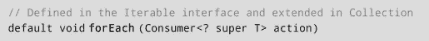

该方法遍历整个集合，让 `Consumer` 决定对每个元素做什么。这就是内部迭代的概念，也是声明式编程的一种体现。它没有指定如何迭代。这与外部迭代对立，在外部迭代中，如何迭代的细节以及对每个元素做什么都是在代码中指定的。

`forEach()` 方法具有非常广泛的适用性。它是遍历集合的一种更方便的方式，应该成为你的事实上的标准。然而，作为一种声明式结构，有些事情是你无法完成的。最显著的一是，你不能像在 `while` 循环中那样改变本地变量的状态。算法必须以函数式的方式重新思考。目前，只需知道 `forEach()` 适用于不改变状态的迭代即可。

我们现在来看下 `Collection` 中提供的另一个新方法：


`removeIf()` 方法将迭代、测试和移除的整个过程内部化。它只需要告诉它移除的条件是什么。

使用现在已经熟悉的 `Predicate` 函数式接口，我们可以很容易地确定要使用什么种类型的 lambda。

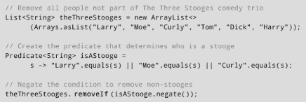

要替换 `List` 的所有内容，我们可以使用 `replaceAll()`：

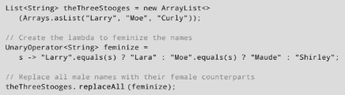

`replaceAll()` 使用 `UnaryOperator` 作为其函数式接口，它是 `Function` 的子接口。

`removeIf()` 和 `replaceAll()` 适用于所有子类，但有一个限制：底层类必须支持删除操作，否则将抛出异常。

这些示例展示了函数式编程的紧凑性。大部分工作由函数完成，而 lambda 提供了细节。

### Map 接口

在 map 中将列表作为值时，最大的烦恼之一是在添加、更新或删除元素之前，总是需要检查 map 是否存在。首先，你必须尝试提取列表，如果没有找到则创建它。例如，假设我们有一个通过 `Map` 实现的更新电影数据库的方法。map 的键是电影的年份，值是该年份的电影列表。在 Java 8 之前，代码看起来如下：

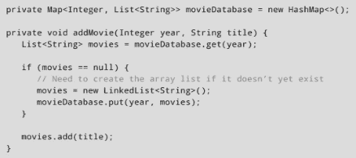

Java 8 通过这些默认方法提供了一个更好的替代方案：

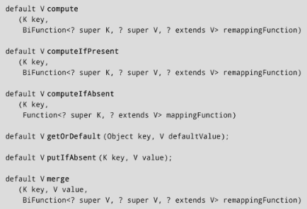

让我们从 `compute` 方法开始。每个变体都允许通过映射函数来生成 map 的值。对于 `computeIfPresent()` 和 `computeIfAbsent()`，映射是根据条件执行的。因此，通过这些方法，我们可以重构之前的代码示例：

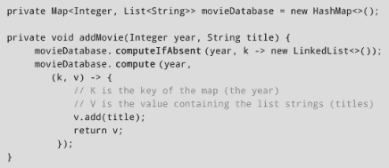

注意，列表的创建是由 `computeIfAbsent()` lambda 处理的。当需要通过 `compute()` 方法将电影添加到列表时，`add()` 永远不会抛出 `NullPointerException`，因为保证了列表已经被创建。

在这种情况下，使用 `computeIfAbsent()` 方法有点大材小用，我们使用 `putIfAbsent()` 会更好：


此方法没有 lambda，并期望给定一个值——而不是计算值。尽管没有使用 lambda，这仍然是一个函数式风格的方法。它证明了你可以以函数式方式表示代码，而不一定需要使用 lambda。

如果你仍然需要提取数据，可以使用 `getOrDefault()` 方法使用更函数式的方法：


你也可以使用 `merge()` 方法作为替代方案。它方便了对列表存在性的检查。在下面的示例中，如果键（年份）在 map 中不存在，它将把值（标题）放入 map 中。如果存在，它允许 `BiFunction` 决定如何处理这两个列表：

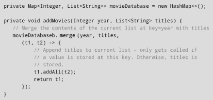

并且可以这样使用它：

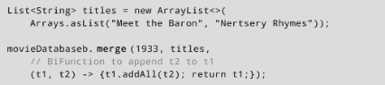

`BiFunction` 还可以返回 `null`，这会告诉 `merge` 删除该键。

结论是，我们删除了检查元素是否存在的开销代码，现在可以关注真正重要的事情：定义如何创建列表以及如何向列表中添加元素。

`Map` 接口已经丰富了如 `forEach()`、`replace()` 和 `replaceAll()` 等其他函数式方法，并使用了相同的代码内部化原理。请参阅文档获取完整列表。

### Spliterator

`Collections` 库在并发访问方面仍然受到相同的限制。如既往，你必须选择符合你线程安全要求的 `Collections` 库类。这是因为上面显示的新方法仅仅是运行在相同底层数据结构之上的函数式抽象。这些方法并不特别适合函数式编程的并行处理方法，因为它们仍然基于多个线程变异集合并同步访问底层数据的概念。然而，存在一种兼容的 Java 8 新抽象。它是为了并行遍历数据而设计的。其核心理念体现在 `Spliterator` 接口中。该接口的前提是对数据进行分区，并将数据块交给不同的线程。可以从 `Collection` 接口获取 `Spliterator`，包括子接口 `List` 和 `Set`。

`Spliterator` 接口的核心是这三个方法：

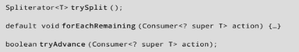

`trySplit()` 方法将底层数据一分为二。它创建一个带有一半数据的新 `Spliterator`，并将另一部分留在原始实例中。每个都可以交给一个线程，线程反过来使用 `forEachRemaining()` 遍历分区的数据。`tryAdvance()` 方法是一种一次处理的变体，返回下一个元素，或者在列表耗尽时返回 `null`。

Spliterators 本身不处理并行处理，而是提供执行它的抽象。以下是该概念的应用：

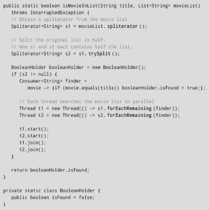

给定一个标题和一个电影列表，`isMovieInList()` 方法并行化搜索以确定它是否包含在列表中。如果找到，将 `booleanHolder` 中的标志置为 true。它从列表中获取 `Spliterator` 实例，将其一分为二，并将每一半交给每个线程。如果有更多可用线程，可以重复此拆分过程。

Spliterators 也可以从其他 `Collection` 类型以及其他库中获取。有许多不同的实现用于处理不同的特性，包括有限/无限、有序/无序、已排序/未排序以及可变/不可变。

它们继承了其数据结构的特性。

Spliterators 是一种较低层次的抽象，旨在让你对并行迭代进行细粒度的控制。然而，API 缺乏一些实现函数式友好算法所需的精炼。在上面的示例中，我们需要在 `BooleanHolder` 中存储搜索所需的状态。

## 总结

这完成了我们对 Java 8 新及改进的 Collections 库以及标准函数式接口的概述。正如标准 JDK 库为了支持函数式概念发生了许多变化一样，预计第三方 API 发生重大变化。但最大的变革尚未到来。

### 关键点

- 新包 `java.util.function` 包含函数式接口。它们被分为四类，每个类由其原型代表：`Consumer`、`Function`、`Predicate` 和 `Supplier`。
- 每个函数式接口类都定义了针对类型和值的变体。
- 函数式接口还定义了允许函数式组合的方法。多个不同的 lambda 可以融合为看起来像单一函数的复合函数。
- `Collections` 库已经过重构和函数化。这是通过在顶层使用默认方法实现的，从而确保了向后兼容。
- `Collections`、`Lists`、`Sets` 和 `Maps` 中的新函数式方法是针对内部迭代设计的。以 lambda 和方法引用的形式的行为参数被传递给遍历集合并作用于每个元素的方法。
- 内部迭代是声明式编程的一种形式，是函数式编程的基础。它让开发者无需描述“如何”做，而是关注“做什么”。
- `Spliterators` 是为集合的并行迭代而设计的。

---

### 结论


### Java 开发工具包 (JDK)

JDK 是编译、文档化和打包 Java 项目的关键工具。与 `JRE` 一起，`JDK` 包含了解释器或加载器、名为 `javac` 的编译器、归档文件 (`JAR`)、`Javadoc` 文档生成器许多对高效 Java 开发至关重要的工具。

### Java 运行环境 (JRE)

Java 运行环境缩写 `JRE`。它是执行 Java 字节码的环境，也是运行 Java 虚拟机的程序。`JRE` 还包含了 `JVM` 在运行时所需的所有类库和其他支持文件。本质上，它是一个包含运行 Java 程序所需的所有内容的软件包，以及 Java 虚拟机的物理实现。

### Java 虚拟机 (JVM)

`JVM` 是 Java Virtual Machine 的缩写。`JVM` 是一个抽象机器，是一个为我们提供执行字节码的 `JRE` 的规范。`JVM` 必须遵循以下定义：

- `Specification`（规范）：描述 `JVM` 如何实现的文档。
- `Implementation`（实现）：满足 `JVM` 规范要求的程序。
- `Runtime Instance`（运行时实例）：每当命令行输入 Java 命令并启动类时创建的 `JVM` 实例。

这三者紧密相织，其中一个依赖于其他者才能运行。

### 最后的想法

至此，我想感谢你选择我的 Java 编程教程。如你所见，这是一门基础又复杂的语言，有广泛的内容需要掌握。你现在应该对 Java 编程的基本概念以及如何应用它们有了良好的理解。

简单来说，你的下一步是练习。不要停止练习。你不能指望读一遍这些指令就认为自己懂了一切。我强烈建议你花点时间；仔细阅读课程，在完全掌握某个领域及其含义之前，不要继续后进行。

网上有很多非常有价值的 Java 论坛可以提供帮助。这些论坛充满了准备好并乐意帮助你、为你指引正确方向的人。还有大量的在线课程，其中有些是免费的，有些需要付费，但它们都是有益的，可以帮助你将学习提升到下一个水平。

你觉得这个指南有用吗？我希望它超出了你的预期，并让你走在了通往理想工作的道路上！

我希望你发现我对计算机编程的概述是有帮助的。这是一个非常简单的开始，但它应该让你对从何处开始有所了解。它还向你证明了计算机编程并没有那么困难，而且可以非常令人兴奋，尤其是当你开始看到结果出现在屏幕上，看到你的机器——简而言之——正在执行你想让它做的事情时！

如果这让你对预期有了恰当的概念，你可以选择在你所选的语言中学习更复杂的编程。提个醒：不要尝试一次学习超过一种语言；否则，你会迷失。在现阶段，我能给你的唯一建议就是练习……再多练习。你做得越多，学得就越多，想学得就越多。


