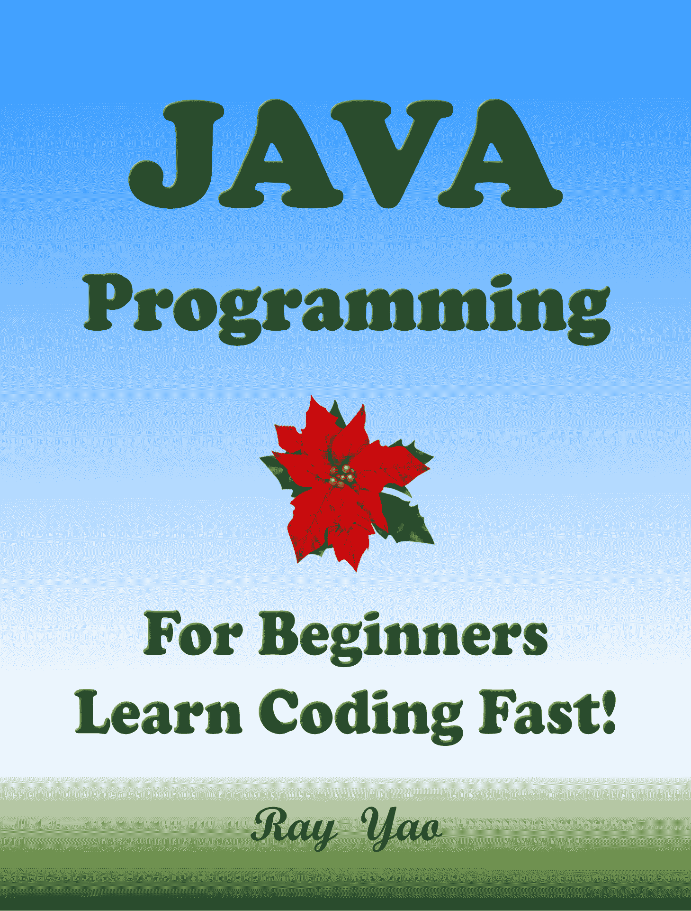

# Java 编程入门指南：快速学习编码！



## 关于作者

**Ray Yao:**

- 美国 Zend 认证 PHP 工程师
- 美国 Sun 认证 JAVA 程序员
- 美国 Oracle 认证 SCWCD 开发人员
- 美国 CompTIA 认证 A+ 专业人士
- 微软认证 ASP.NET 专家
- 微软认证 MCP 专业人士
- 微软认证 TECHNOLOGY 专家
- 美国 CompTIA 认证 NETWORK+ 专业人士

## 推荐书籍

- [8 小时精通 C++ 编程](https://www.amazon.com/-/e/B0863BQT8T)
- [8 小时精通 JAVA 编程](https://www.amazon.com/-/e/B0863BQT8T)
- [初学者 AngularJS 编程](https://www.amazon.com/-/e/B0863BQT8T)
- [C# 面试与认证考试](https://www.amazon.com/-/e/B0863BQT8T)
- [初学者 C# 编程](https://www.amazon.com/-/e/B0863BQT8T)
- [C# 编程：包含 100 问答](https://www.amazon.com/-/e/B0863BQT8T)
- [C++ 面试与认证考试](https://www.amazon.com/-/e/B0863BQT8T)
- [初学者 C++ 编程](https://www.amazon.com/-/e/B0863BQT8T)
- [编码面试：1000 问答](https://www.amazon.com/-/e/B0863BQT8T)
- [8 小时精通 Django 编程](https://www.amazon.com/-/e/B0863BQT8T)
- [8 小时精通 Go 编程](https://www.amazon.com/-/e/B0863BQT8T)
- [HTML CSS 面试与认证考试](https://www.amazon.com/-/e/B0863BQT8T)
- [初学者 HTML CSS 编程](https://www.amazon.com/-/e/B0863BQT8T)
- [JAVA 面试与认证考试](https://www.amazon.com/-/e/B0863BQT8T)
- [初学者 JAVA 编程](https://www.amazon.com/-/e/B0863BQT8T)
- [JAVA 编程：包含 100 问答](https://www.amazon.com/-/e/B0863BQT8T)
- [JavaScript 50 个实用程序](https://www.amazon.com/-/e/B0863BQT8T)
- [JavaScript 面试与认证考试](https://www.amazon.com/-/e/B0863BQT8T)
- [初学者 JavaScript 编程](https://www.amazon.com/-/e/B0863BQT8T)
- [JQuery 面试与认证考试](https://www.amazon.com/-/e/B0863BQT8T)
- [初学者 JQuery 编程](https://www.amazon.com/-/e/B0863BQT8T)
- [8 小时精通 Kotlin 编程](https://www.amazon.com/-/e/B0863BQT8T)
- [Linux 命令行](https://www.amazon.com/-/e/B0863BQT8T)
- [Linux 面试与认证考试](https://www.amazon.com/-/e/B0863BQT8T)
- [8 小时精通 Linux Shell 编程](https://www.amazon.com/-/e/B0863BQT8T)
- [初学者 MySQL 编程](https://www.amazon.com/-/e/B0863BQT8T)
- [Node](https://www.amazon.com/-/e/B0863BQT8T)
- [8 小时精通 js 编程](https://www.amazon.com/-/e/B0863BQT8T)
- [PHP 面试与认证考试](https://www.amazon.com/-/e/B0863BQT8T)
- [初学者 PHP MySQL 编程](https://www.amazon.com/-/e/B0863BQT8T)
- [8 小时精通 PowerShell 编程](https://www.amazon.com/-/e/B0863BQT8T)
- [Python 面试与认证考试](https://www.amazon.com/-/e/B0863BQT8T)
- [初学者 Python 编程](https://www.amazon.com/-/e/B0863BQT8T)
- [Python 编程：包含 100 问答](https://www.amazon.com/-/e/B0863BQT8T)
- [初学者 R 编程](https://www.amazon.com/-/e/B0863BQT8T)
- [初学者 Ruby 编程](https://www.amazon.com/-/e/B0863BQT8T)
- [8 小时精通 Rust 编程](https://www.amazon.com/-/e/B0863BQT8T)
- [8 小时精通 Scala 编程](https://www.amazon.com/-/e/B0863BQT8T)
- [Visual Basic 面试与认证考试](https://www.amazon.com/-/e/B0863BQT8T)
- [初学者 Visual Basic 编程](https://www.amazon.com/-/e/B0863BQT8T)

## 前言

本书涵盖了所有必要的 Java 知识。你可以快速、轻松地掌握 Java 的核心技能。

本书为初学者提供了超过 80 个实战示例，并包含了针对大学考试、工程师认证以及工作面试的测试与答案。

# 源代码下载

本书提供了源代码下载；你可以下载源代码以便更好地学习，或者将源代码复制到你喜欢的编辑器中来测试程序。

源代码下载链接：[https://forms.aweber.com/form/68/2126212468.htm]

**注意：** 本书仅适合初学者，不适合有经验的程序员。

## 附录

- 测试与答案
- 推荐书籍

# 第一章 开始 JAVA

## 安装 Java

为了创建任何 Java 程序，需要在本地计算机系统上可用 Java 开发环境。

`JDK`（也称为 `JSDK`, `Java SE`）`JDK` (`Java Development Kit`) 包含了所有的 Java 类库以及所有构建和运行 Java 程序的工具。`JDK` 可以创建 Java 开发环境。

下载 `JDK`：`http://oracle.com/download/com/download/http://www.oracle.com/technetwork/java/javase/downloads/index`

请点击链接在 Oracle 网站下载最新版本的 `JDK`。（图 1）

如果你的计算机是 32 位操作系统，请下载 `x86` 版本的 `JDK`；如果你的计算机是 64 位操作系统，请下载 `x64` 版本的 `JDK`。（图 2）

将最新版本的 `JDK` 安装到你的计算机上。恭喜你！一旦成功安装 `JDK`，系统就准备好运行 Java 程序了！

## IDE (集成开发环境)

`IDE` (`Integrated Development Environment`) 用于编写、编辑和运行 Java。`IDE` 包含许多 Java 开发工具、编译器和调试器。互联网上有许多优秀的免费 IDE 可以下载，请通过以下链接下载一个 IDE：

| IDE(编辑器) | 网站地址 |
| :--- | :--- |
| Eclipse | `http://www.eclipse.org` |
| NetBeans | `https://netbeans.org/` |
| DrJava | `http://www.drjava.org/` |
| Jedit | `http://www.jedit.org/` |
| BlueJ | `http://www.bluej.org/` |
| JCreator | `http://www.jcreator.com/` |

请在你的电脑上安装其中一种编辑器。（本书使用 `Eclipse` 作为编辑器）。恭喜！一旦成功安装了 IDE，从现在起就可以编写、编辑和运行 Java 程序了。

## 什么是 Java？

Java 是一种基于类的、面向对象的编程语言，它是一种安全、快速且可靠的程序，适用于互联网、数据库、手机以及无数种设备等通用领域。

### 示例 1.1

```java
public class Hi{
    public static void main (String [ ] args){
        System . out . print("Hello World");
    }
}
```

**输出：** Hello World

**解释：** `public class` 是两个关键字；它们用于声明 Java 程序。`Hi` 是程序名。`public static void main (String [ ] args) {… }` 用于声明主方法。`main` 方法包含要执行的主程序代码。`String [ ] args` 用于手动接受输入。`System.out.print()` 用于显示或打印。每个 Java 命令都应该以分号（`;`）结束。

## 运行第一个程序

`Eclipse` 是最流行的 Java IDE（集成开发环境）之一。它用于编写、编辑、调试和运行 Java 程序。

### 下载 Eclipse 安装程序

`http://www.eclipse.org/downloads/`

请点击链接从 `Eclipse` 网站下载最新版本的 `Eclipse Installer`（图 1）！

### 解压 Eclipse 文件

注意：不需要安装，`Eclipse` 应该解压到你喜欢的目录中。例如，`C:\Eclipse`。请在桌面上为 `eclipse.exe` 创建快捷方式。（重申：`Eclipse` 不需要安装，但应该解压到某个目录中。）

### 运行 Eclipse

双击 `eclipse.exe` 运行 `Eclipse`，设置默认工作区，勾选“使用此作为默认且不再询问”，并点击确定，如图 2 和图 3 所示。

## 编写并运行第一个 Java 程序

### 步骤 1：创建 Java 项目

启动 `Eclipse` > `File` > `New` > `Java Project` > `Project Name` > “FirstProject” > `Finish`。（图 4）

### 步骤 2：创建包

包（Package）用于包含不同类别的 Java 文件。不同的包包含不同的 Java 文件。选择项目 “FirstProject” > `new` > `package` > `name` > “newPackage” > `Finish`。（图 5）

### 步骤 3：创建类

选择包 “newPackage” > `new` > `class` > `name` > “HelloWorld” > `Finish`。（图 6）

### 步骤 4：编写 Java 代码

在 `Eclipse` 中编写 Java 代码。（图 7）

### 示例 1.2

```java
package newPackage;
public class HelloWorld {
  public static void main (String[] args){
    System.out.print("Hello World! ");
  }
}
```

（图 7 Eclipse 中的 Java 程序）

### 步骤 5：运行程序

点击工具栏中的白色三角形绿色按钮运行程序，你可以看到输出：（图 8）

**输出：**

恭喜！由 `Eclipse` 运行的第一个 Java 程序成功了！

## Java 注释

```java
// 单行注释
/* 多行注释 */
```

Java 注释用于解释当前代码，描述代码正在做什么。Java 编译器将忽略注释。`//` 用于单行注释。`/*...*/` 用于多行注释。

### 示例 1.3

```java
System.out.println("Hello World");  // show "Hello World"
/*   System.out.println() 是一个 Java 输出命令，意味着显示或打印 .*/
```

**解释：** `// show "Hello World"` 是单行注释。`/* System.out.println() is a Java output command, meaning display or print. */` 是多行注释。

## 输出命令

```java
System.out.print();  // 在同一行打印结果。
System.out.println();  // 在不同行打印结果。
```

### 示例 1.4

```java
System.out.print("1 ");
System.out.print("2 ");
System.out.print("3");
```

**输出：** 1 2 3

**解释：** `System.out.print()` 在同一行打印。`System.out.println()` 在不同行打印。

## 转义字符

`\` 字符用于转义：

- `\n` 将内容输出到下一行。
- `\r` 产生返回。
- `\t` 制表符。
- `\"` 输出双引号。

### 示例 1.5

```java
public class Hi{
    public static void main (String [ ] args){
        System.out.print("\"Hello World\"");
    }
}
```

**解释：** `\"` 输出双引号。注意 `Hello World` 带有双引号。

## 关键字

某些单词被语言保留：

| `abstract` | `byte` | `char` | `continue` | `double` | `float` | `implements` | `interface` | `package` | `public` | `this` | `try` | `const` | `new` | `while` |

## 数据类型

| 数据类型 | 解释 |
| :--- | :--- |
| `String` | 双引号的字符串 |
| `char` | 单引号的单字符 |
| `int` | 整数 |
| `float` | 浮点数 |
| `boolean` | 真或假的值 |
| `double` | 大浮点数 |

## 创建变量

变量是与值关联的符号名称。使用以下语法可以创建变量：

`dataType variableName = value;`

### 示例 1.8

```java
public static void main (String [ ] args ) {
  String mystring = "Hello World";
  char mychar = 'm';
  int myinteger = 168168;
  double myflt = 28.98;
  boolean mybool = true;
}
```

**解释：** `mystring` 是变量名，其值为 "Hello World"。`myinteger` 是变量名，其值为 168168。`mybool` 是变量名，其值为 true。

## 算术运算符

| 运算符 |
| :--- |
| `+` |
| `-` |
| `*` |
| `/` |
| `%` |
| `++` |
| `--` |

### 示例 1.9


```java
public class TryClass {
    public static void main(String[] args) {
        int sum = 100 + 200;
        String str = "We love" + "Java";
        int incre = 10;
        incre = ++incre;
        System.out.println(sum);    // 输出: 300
        System.out.println(str);    // 输出: We love Java
        System.out.println(incre);  // 输出: 11
    }
}
```

**输出:**

300

We love Java

11

### 解释

- `int sum = 100 + 200` 表示 100 加 200。
- `String str = "We love" + "Java"` 连接了两个字符串。
- `++incre` 将其值增加 1。

## 逻辑运算符

| 运算符 |
| :--- |
| `&&` |
| `||` |
| `!` |

使用逻辑运算符后，结果将为 `true` 或 `false`。

### 示例 1.10

```java
public class TryClass {
    public static void main(String[] args) {
        boolean x = true;
        boolean y = false;
        boolean a, b, c;
        a = x && y;
        System.out.print(a);   // 输出: false
        b = x || y;
        System.out.print(b);   // 输出: true
        c = !x;
        System.out.print(c);   // 输出: false
    }
}
```

### 解释

- `true && true` 返回 `true`。
- `true && false` 返回 `false`。
- `false && false` 返回 `false`。
- `true || true` 返回 `true`。
- `true || false` 返回 `true`。
- `false || false` 返回 `false`。
- `!false` 返回 `true`。
- `!true` 返回 `false`。

## 赋值运算符

| 运算符 |
| :--- |
| `+=` |
| `-=` |
| `*=` |
| `/=` |
| `%=` |

### 示例 1.11

```java
int x = 200;
int y = 100;
x += y;
System.out.print(x);
x -= y;
System.out.print(x);
x /= y;
System.out.print(x);
x %= y;
System.out.print(x);
```

### 解释

- `x += y;` // `x = x + y`, `x = 200 + 100`, 输出 300。
- `x -= y;` // `x = x - y`, `x = 200 - 100`, 输出 100。
- `x /= y;` // `x = x / y`, `x = 200 / 100`, 输出 2。
- `x %= y;` // `x = x % y`, `x = 200 % 100`, 输出 0。

## 比较运算符

| 运算符 |
| :--- |
| `>` |
| `<` |
| `>=` |
| `<=` |
| `==` |
| `!=` |

使用比较运算符后，结果将为 `true` 或 `false`。

### 示例 1.12

```java
int x = 200;
int y = 100;
boolean result1 = (x > y);
System.out.print(result1);
boolean result2 = (x <= y);
System.out.print(result2);
boolean result3 = (x != y);
System.out.print(result3);
```

### 解释

- `x > y` // 测试 200 > 100, 输出 true。
- `x <= y` // 测试 200 <= 100, 输出 false。
- `x != y` // 测试 200 != 100, 输出 true。

## 三元运算符

三元运算符的语法如下所示：

| `(test-expression) ? (if-true-do-this) : (if-false-do-this);` |

`(test-expression)` 例如 `a < b`、`x != y`、`m == n` 等。

### 示例 1.13

```java
int a = 100;
int b = 200;
String result1 = (a < b) ? "apple" : "banana";
System.out.print(result1);
```

**输出:**

apple

### 示例 1.14

```java
int a = 100;
int b = 200;
String result2 = (a > b) ? "apple" : "banana";
System.out.print(result2);
```

**输出:**

banana

### 解释

如果测试表达式返回 `true`，则输出 "apple"。
如果测试表达式返回 `false`，则输出 "banana"。

## 练习：计算

使用 Eclipse 编写运行 Java 程序。

### 步骤 1：创建 Java 项目

启动 Eclipse > `File` > `New` > `Java Project` > `Project Name` > "Test" > `Finish`。（图 1）

### 步骤 2：创建包

包用于包含各种类的 Java 文件。不同的包包含不同的 Java 文件。

选择项目 "Test" > `New` > `Package` > "myPackage" > `Finish`。

### 步骤 3：创建类

选择 "myPackage" > `New` > `Class` > "Calculation" > `Finish`。（图 2）

### 步骤 4：编写 Java 代码

在 Eclipse 中编写 Java 代码：

```java
package myPackage;

public class Calculation {
    public static void main(String[] args) {
        int a = 100;
        int b = 200;
        String result1 = (a < b) ? "apple" : "banana";
        System.out.print(result1);
    }
}
```

### 步骤 5：运行程序

点击运行按钮运行程序，你可以看到：

**输出:**

apple

## 总结

- `//` 是单行注释。
- `/*...*/` 是多行注释。
- `System.out.print()` 会打印结果。
- `System.out.println()` 会打印并换行。
- 三元运算符用于条件判断。
- `if` 语句用于条件判断。
- `if-else` 语句用于条件判断。
- `switch` 语句用于多分支选择。
- `for` 循环用于指定次数循环。
- `while` 循环用于条件循环。
- `do-while` 循环用于至少执行一次的循环。

`do...while` 循环执行一次代码块，然后如果指定的条件为真，则重复该循环。

### 示例 2.6

```java
public class TryClass {
    public static void main(String[] args) {
        int counter = 0;
        do {
            System.out.print("@");
            counter++;
        } while (counter < 8);
        // 执行 8 次
    }
}
```

输出: `@@@@@@@@`

解释：`"counter < 8"` 是一个测试表达式，如果条件为真，代码将循环少于 8 次，直到 `counter` 等于 8 为止，此时条件为假，代码将停止运行。

## break 语句

| `break;` |

`break` 关键字用于根据条件停止循环的运行。

### 示例 2.7

```java
public class TryClass {
    public static void main(String[] args) {
        int num = 0;
        while (num < 10) {
            if (num == 5)
                break;     // 离开 while 循环
            num++;
        }
        System.out.print(num);
    }
}
```

输出: `5`

解释：`"if (num == 5) break;"` 是一个 break 语句。如果 `num` 为 5，程序将执行 `break` 命令，break 语句将离开 while 循环，然后执行 `System.out.print(num)`。

## continue 语句

| `continue;` |

`continue` 关键字用于停止当前的迭代，忽略后续代码，然后继续下一次循环。

### 示例 2.8

```java
public class TryClass {
    public static void main(String[] args) {
        int num = 0;
        while (num < 10) {
            num++;
            if (num == 5)
                continue;     // 进入下一次 while 循环
            System.out.print(num);
        }
    }
}
```

输出: `1234678910`

解释：注意输出中没有 5。`"if (num == 5) continue;"` 包含了 `continue` 命令。当 `num` 为 5 时，程序将执行 `continue`，跳过下一个命令 `System.out.print(num)`，然后继续下一次 while 循环。

## 布尔表达式

| `if (boolean-expression) { statements }` | `while (boolean-expression) { statement }` |

`boolean-expression` 应该是一个测试表达式。例如：`a > b`、`x <= y`、`m != n`。它不能仅仅是一个变量。

### 示例 2.9

```java
public class TryClass {
    public static void main(String[] args) {
        int num = 10;
        if (num) {
            // 错误！因为 "num" 不是布尔表达式
            System.out.print("No good");
        }
        while (num) {
            // 错误！"num" 不是布尔表达式
            System.out.print("No good");
        }
    }
}
```

解释：`if(num)` 和 `while(num)` 不是正确的代码，因为 `()` 内部应该是一个 `boolean-expression`，例如 `if(num == 10)` 和 `while(num < 10)` 是正确的！

## 练习：运行 100 次

### While 语句程序

启动 Eclipse > 选择 "myPackage" > `New` > `Class` > `Name` > "WhileStatement" > `Finish`。在 Eclipse 中编写以下代码。

```java
package myPackage;

public class WhileStatement {
    public static void main(String[] args) {
        int n = 1;
        int sum = 0;
        while (n <= 100) {
            // 执行 100 次
            sum += n;    // sum = sum + n
            n++;
        }
        System.out.println("Sum = " + sum);
    }
}
```

输出: `Sum = 5050`

解释：`"n <= 100"` 是一个测试表达式，如果条件为真，代码将循环少于 100 次，直到 `n` 等于 100 为止，此时条件为假，代码将停止运行。`"sum += n;"` 等同于 `"sum = sum + n"`。`"n++;"` 意味着 `n` 在每次循环中增加 1。

## 总结

- `if` 语句仅在指定条件为真时执行 `{ … }` 中的代码，如果条件为假，则不执行 `{…}` 中的任何代码。
- `if...else` 语句在条件为真时运行某些代码，在条件为假时运行另一部分代码。
- `switch` 语句：变量的值将与每个 `case` 进行比较，如果等于某个 `"case"` 值，将执行该 `"case"` 代码。`break;` 终止执行。
- `for` 循环按指定的次数运行代码块。
- `while` 循环如果指定条件为真，则循环代码块。
- `do...while` 循环执行一次代码块，然后如果指定的条件为真，则重复该循环。
- `break` 关键字用于根据条件停止循环的运行。
- `continue` 关键字用于停止当前迭代并继续下一次循环。

## 创建数组 (1)

数组是包含多个值的变量。创建数组的方法如下：

| `String myarray[] = { "Apple", "Banana", "Orange" };` |
| `int nums[] = { 1, 2, 3 };` |
| `double prices[] = { 1.5, 2.5, 3.5 };` |

### 示例 3.1

```java
String myarray[] = { "Apple", "Banana", "Orange" };
System.out.print(myarray[0]); // 输出第一个元素
```

输出: `Apple`

解释：`myarray[0]` 是数组中的第一个元素。

## 创建数组 (2)

可以使用 `new` 关键字来创建数组。

| `String[] myarray = new String[3];` |
| `int[] nums = new int[5];` |
| `double[] prices = new double[4];` |

### 示例 3.2

```java
String[] myarray = new String[3];
myarray[0] = "Apple";
myarray[1] = "Banana";
myarray[2] = "Orange";
```

解释：`new String[3]` 声明了一个长度为 3 的字符串数组。

## 数组长度

`length` 属性返回数组中元素的个数。

| `int size = myarray.length;` |

### 示例 3.3

```java
String myarray[] = { "Apple", "Banana", "Orange" };
System.out.println(myarray.length);
```

输出: `3`

解释：`myarray.length` 返回数组的长度。

## 数组元素

可以使用索引来访问数组中的元素。索引从 0 开始。

| `String firstElement = myarray[0];` |

### 示例 3.4

```java
String myarray[] = { "Apple", "Banana", "Orange" };
System.out.println(myarray[1]); // 输出第二个元素
```

输出: `Banana`

解释：`myarray[1]` 访问的是第二个元素。

## 修改数组值

你可以通过索引更改数组元素的值。

| `myarray[0] = "Pear";` |

### 示例 3.5

```java
String myarray[] = { "Apple", "Banana", "Orange" };
myarray[1] = "Grape";
System.out.println(myarray[1]);
```

输出: `Grape`

解释：`myarray[1]` 的值已被更改为 "Grape"。

## 遍历数组

你可以使用 `for` 循环遍历数组中的所有元素。

| `for (int i = 0; i < myarray.length; i++) { ... }` |

### 示例 3.6


```java
String myarray[] = { "Apple", "Banana", "Orange" };
for(int i=0; i<myarray.length; i++){
    System.out.print(myarray[i] + " ");
}
```

输出：`Apple Banana Orange `

解释：循环遍历了数组并打印了每个元素。

### 示例 3.7

```java
float num = 10.2f;
System.out.print(Math.round(num)); // 返回一个整数
```

**输出：** `10`

**解释：** `Math.round(num)` 返回 `10.2f` 的整数，结果为 `10`。

### Ceil() & Floor()

| `Math.ceil()` | `Math.floor()` |
| :--- | :--- |

- `Math.ceil()` 返回大于或等于其参数的最接近整数。
- `Math.floor()` 返回小于或等于其参数的最接近整数。

#### 示例 3.8

```java
public class TryClass {
    public static void main (String [] args) {
        float num = 9.5f;
        System.out.println("Ceiling number is "+Math.ceil ( num ) );
        System.out.println("Flooring number is "+Math.floor ( num ) );
    }
}
```

**输出：**

```
Ceiling number is 10.0
Flooring number is 9.0
```

**解释：** `Math.ceil( num )` 返回大于或等于 `9.5f` 的最接近整数，结果为 `10.0`。`Math.floor( num )` 返回小于或等于 `9.5f` 的最接近整数，结果为 `9.0`。

### Max() & Min()

| `Math.max()` | `Math.min()` |
| :--- | :--- |

- `Math.max()` 返回两个数字之间的较大者。
- `Math.min()` 返回两个数字之间的较小者。

#### 示例 3.9

```java
public class TryClass {
    public static void main (String [] args) {
        int x = 100;
        int y = 200;
        System.out.println("Greater number is "+Math.max (x, y) );
        System.out.println("Less number is "+Math.min (x, y) );
    }
}
```

**输出：**

```
Greater number is 200
Less number is 100
```

**解释：** `Math.max(x, y)` 返回 `100` 和 `200` 之间的较大数，结果为 `200`。`Math.min(x, y)` 返回 `100` 和 `200` 之间的较小数，结果为 `100`。

### pow() & sqrt()

| `Math.pow()` | `Math.sqrt()` |
| :--- | :--- |

- `Math.pow()` 返回第一个参数的到第二个参数的幂。
- `Math.sqrt()` 返回参数的平方根。

#### 示例 3.10

```java
public class TryClass {
    public static void main (String [] args) {
        int num = 4;
        System.out.println("Square number is "+Math.pow (num,2) );
        System.out.println("Square root is "+Math.sqrt (num) );
    }
}
```

**输出：**

```
Squared number is 16.0
Square root is 2.0
```

**解释：** `Math.pow(num,2)` 返回第一个参数 `4` 的到第二个参数 `2` 的幂，结果为 `16.0`。`Math.sqrt(num)` 返回参数 `4` 的平方根，结果为 `2.0`。

### Math.PI & random()

| `Math.PI` | `Math.random()` |
| :--- | :--- |

- `Math.PI` 是一个存储 `pi` 值的常量。
- `Math.random()` 生成一个 `0.0` 到 `1.0` 之间的数字。

#### 示例 3.11

```java
public class TryClass {
    public static void main (String [] args) {
        double pi = Math.PI ;
        double ran = Math.random();
        System.out.println("The PI value is" + pi);
        System.out.println("The random number is" + ran);
    }
}
```

**输出：**

```
The PI value is 3.141592653589793
The random number is 0.xxxx
```

**解释：** `Math.PI` 的值为 `3.141592653589793`。`Math.random()` 生成一个 `0.0` 到 `1.0` 之间的随机数。

### 练习：通过循环语句为数组赋值

在 Eclipse 中编写以下代码：

```java
package myPackage;
public class TestArray {
    public static void main(String[] args) {
        int[] myArray;
        myArray = new int[10]; // 创建一个数组 "myArray"
        for (int n = 0; n < myArray.length; n++){ // 运行 10 次
            myArray[n] = n; // 将 "n" 的值设置为每个数组元素
            System.out.print(myArray[n] + ""); // 输出每个元素
        }
    }
}
```

**输出：** `0 1 2 3 4 5 6 7 8 9`

**解释：**

- `myArray = new int[10]` 创建了一个长度为 10 的数组 `myArray`。
- `for (int n = 0; n < myArray.length; n++){` 运行 10 次。
- `myArray[n] = n;` 将 "n" 的值设置为每个数组元素。
- `System.out.print(myArray[n] + "");` 输出每个元素。

### 示例 4.6

```java
public class TryClass{
    public static void main(String args[ ]) {
        String Str = "Very Good";
        System. out. println(Str.substring (5, 7) );  /* 从索引“5”到索引“7-1”提取某些字符 */
    }
}
```

**输出：** `Go`  

**解释：** `Str.substring(5, 7)` 返回“Very Good”从索引“5”到索引“7-1”的子字符串。结果是“Go”。

## 大小写转换

`String.toUpperCase()` 返回字符串的大写形式。  
`String.toLowerCase()` 返回字符串的小写形式。

| `String.toUpperCase();` | `String.toLowerCase();` |

### 示例 4.7

```java
public class TryClass{
    public static void main(String args[ ]){
        String Str = "Very Good";
        System. out. println(Str.toUpperCase( ) );
        System. out. println(Str.toLowerCase( ) );
    }
}
```

**输出：** `VERY GOOD`  
**输出：** `very good`  

**解释：** `Str.toUpperCase()` 将“Very Good”变为“VERY GOOD”。`Str.toLowerCase()` 将“Very Good”变为“very good”。

## 字符替换

`str.replace()` 可以更改字符串中的旧字符为新字符，并返回一个新字符串。

| `str.replace(oldCharacter, newCharacter);` |

### 示例 4.8

```java
public class TryClass{
    public static void main(String args[ ]){
        String Str = "Very Good";
        System. out. println( Str.replace ("Good", "Well") );
    }  // 将“Good”替换为“Well”
}
```

**输出：** `Very Well`  

**解释：** `Str.replace(“Good”, “Well”)` 将字符串“Very Good”中的字符“Good”改为字符“Well”，并返回新字符串“Very Well”。

## 字符串类型转换

`Integer.toString(number)` 可以将数字转换为字符串。  
`String.trim()` 可以移除字符串开头或结尾的空格。

| `Integer.toString(number);` | `String.trim();` |

### 示例 4.9

```java
public class TryClass{
    public static void main(String args[ ]){
        int num = 169;
        String str = "      Good        ";   // 注意空格
        String str1 = Integer.toString ( num );    // 转换为字符串
        String str2 = str.trim ( );     // 移除空格
        System. out. println( str1+" is a String" );
        System. out. println( str2+"is trimmed" );
    }
}
```

**输出：** `169 is a String`  
**输出：** `Good is trimmed`  

**解释：** `Integer.toString( num )` 将整数 169 转换为字符串 169。`str.trim()` 将字符串“      Good      ”裁剪为字符串“Good”。

## StringBuffer

`StringBuffer` 代表一个可以动态更改的字符串。如果字符串值在程序运行时可能会变化，请使用 `StringBuffer` 而不是 `String`。

| `StringBuffer str = new StringBuffer();` | `str.insert();` | `str.append();` | `str.reverse();` |

### 示例 4.10

```java
StringBuffer sb = new StringBuffer ( “abcde” );
sb.insert ( 2, “123”);   // 输出：abc123des
sb.append ( “456”);    // 输出：abc123de456
sb.reverse ( );    // 输出：654ed321cba
```

**解释：** `StringBuffer sb = new StringBuffer ( “abcde” )` 创建了一个对象“sb”，其值为“abcde”。`sb.insert ( 2, “123”)` 在索引“2”处插入“123”。`sb.append ( “456”)` 在字符串末尾追加“456”。`str.reverse()` 反转字符串的顺序。

## 练习：判断对（错）

### 比较字符串值

启动 Eclipse > 选择“myPackage” > new > class > name > `TwoStrings` > Finish。在 Eclipse 中编写以下代码。

```java
package myPackage;
public class TwoStrings {
    public static void main(String[] args) {
        String s1, s2, s3, s4;
        s1 = "C++ in 8 Hours";
        s2 = "C++ in 8 Hours";
        s3 = "Python in 8 Hours";
        s4 = s2;    // 分配字符串值
        System. out . println(s1. equals(s2));
        System. out . println(s1. equals(s3));
        System. out . println(s3. equals(s4));
    }
}
```

点击工具栏中的绿色三角形按钮运行程序并查看输出：

**输出：** `true` `false` `false`  

**解释：** `String s1 , s2 , s3 , s4 ;` 声明了四个字符串变量。`s1 . equals(s2 )` 比较两个字符串的值，如果两个字符串的值相同，则返回 true。

## 总结

- `String s1 , s2 , s3 , s4 ;` 声明了四个字符串变量。`s1 . equals(s2 )` 比较两个字符串的值，如果两个字符串的值相同，则返回 true。
- `String.substring(start, end)` 返回从索引 start 到 end-1 的子字符串。
- `Str.substring(5, 7)` 返回“Very Good”从索引“5”到索引“7-1”的子字符串。
- `String.toUpperCase()` 返回字符串的大写形式。
- `String.toLowerCase()` 返回字符串的小写形式。
- `str.replace()` 可以更改字符串中的旧字符为新字符。
- `Integer.toString(number)` 可以将数字转换为字符串。
- `String.trim()` 可以移除字符串开头或结尾的空格。
- `StringBuffer` 代表一个可以动态更改的字符串。如果字符串值在程序运行时可能会变化，请使用 `StringBuffer` 而不是 `String`。
- `StringBuffer.insert()` 在指定索引处插入字符串。
- `StringBuffer.append()` 在字符串末尾追加字符串。
- `StringBuffer.reverse()` 反转字符串的顺序。
- `String.equals()` 比较两个字符串的值。
- `String.length()` 返回字符串的长度。
- `String.charAt(index)` 获取指定索引处的字符。
- `String.indexOf(substring)` 返回子字符串首次出现的索引。
- `String.concat(string)` 将字符串连接到另一个后面。
- `String.startsWith(prefix)` 检查字符串是否以指定前缀开头。
- `String.endsWith(suffix)` 检查字符串是否以指定后缀结尾。
- `String.split(regex)` 根据正则表达式分割字符串。
- `String.replace(old, new)` 替换指定的子字符串。
- `String.replaceAll(regex, replacement)` 使用正则表达式替换所有匹配项。
- `String.replaceFirst(regex, replacement)` 使用正则表达式替换第一个匹配项。
- `String.format(format, args)` 按照指定的格式格式化字符串。

## 练习：判断对（错）

### 比较字符串值


启动 Eclipse > 选择“myPackage” > new > class > name > `TwoStrings` > Finish。在 Eclipse 中编写以下代码。

```java
package myPackage;
public class TwoStrings {
    public static void main(String[] args) {
        String s1, s2, s3, s4;
        s1 = "C++ in 8 Hours";
        s2 = "C++ in 8 Hours";
        s3 = "Python in 8 Hours";
        s4 = s2;    // 分配字符串值
        System. out . println(s1. equals(s2));
        System. out . println(s1. equals(s3));
        System. out . println(s3. equals(s4));
    }
}
```

点击工具栏中的绿色三角形按钮运行程序并查看输出：

**输出：** `true` `false` `false`

**解释：** `String s1 , s2 , s3 , s4 ;` 声明了四个字符串变量。`s1 . equals(s2 )` 比较两个字符串的值，如果两个字符串的值相同，则返回 true。

`obj = new Class-name( );` 为该类创建了一个名为 `obj` 的新对象。`obj. variable;` 表示 `obj` 引用一个变量。`obj. function-name ( );` 表示 `obj` 引用一个方法。

### 示例 5.5

```java
Color obj = new Color( ) ;  // 创建一个对象“obj”
obj. c1= "yellow";  // 一个对象引用一个变量
obj. c2=”purple”;     // 一个对象引用一个变量
obj. brightness ( );  // 一个对象引用一个方法
```

解释：`Color obj = new Color;` 创建了一个名为 `obj` 的对象，然后引用变量 `c1` 和 `c2`。`obj. brightness ( );` 调用了函数 `brightness ( );`（在上一页），并返回 `blue`。

## 类与对象

示例：

```java
public class Color {
    // 定义一个类
    String c1, c2;
    void brightness ( ) { 
        System. out . println("This flower is " + c1);
        System. out . println("That flower is " + c2);
    }
    public static void main(String[] args) {
        Color obj = new Color( );      // 创建一个对象
        obj. c1= "yellow. ";
        obj. c2="purple. ";     // 引用
        obj. brightness ( );      // 一个对象引用一个方法
    }
}
```

输出：

```
This flower is yellow.
That flower is purple.
```

解释：`public class Color { }` 定义了一个类。`Color obj = new Color( );` 创建了一个对象。

## 构造函数

构造函数用于初始化变量。构造函数名与类名相同。

```java
class Class-name{
    Class-name( ) { …}      // 用于初始化的构造函数
}
```

`class Class-name{ …}` 定义了一个类。`Class-name( ) { …}` 声明了一个构造函数。

### 示例 5.6

```java
public class Color {  // 创建一个类
    String c1, c2;
    Color ( ) {
      c1=”yellow";
      c2=”purple"; 
    }  // 构造函数
}
```

解释：`Color ( ) { c1=”yellow"; c2=”purple"; }` 是构造函数。它将变量 `c1` 初始化为 `yellow`，将 `c2` 初始化为 `purple`，当对象创建时，构造函数会被自动调用。

### 构造函数示例

示例：

```java
public class Color {
   // 定义一个类
    String c1, c2;
    Color ( ) {
        c1="yellow";
        c2="purple";
    }    // 构造函数
    void brightness ( ) {
        System. out . println("This flower is " + c1);
        System. out . println("That flower is " + c2);
    }
    public static void main(String[] args) {
        Color obj = new Color( );  // 创建一个对象，调用构造函数
        obj. brightness ( );
    }
}
```

输出：

```
This flower is yellow.
That flower is purple.
```

解释：`Color ( ) {c1="yellow"; c2="purple";}` 创建了一个构造函数。`Color obj = new Color( );` 创建了一个对象，并自动调用构造函数。

### 重载

重载意味着类中存在两个或多个同名方法，且它们的参数不同。

### 示例 5.7

```java
package correctPackage;
class Color{
    String x,y;  // 声明类
    Color ( String a, String b) { x=a; y=b; }  // 重载
    Color ( ) {
      x="yellow ";
      y="purple ";
    }  // 重载
    public static void main (String args[ ]) {
        Color obj1=new Color("green ", "orange ");
        Color obj2=new Color( );
        System. out . println(obj1. x + obj2. y);
    }
}
```

输出：

```
greenorange
yellowpurple
```

解释：在这个类中，有两个名为 `Color( )` 且带有参数的方法，这被称为“重载”。

### `this` 关键字 (1)

`this` 用于表示当前对象。

### 示例 5.8

```java
package correctPackage;
class MyClass {
    int num;
    void test(int num) {
        this. num=num;  // “this”代表“obj”
        System. out . println( this. num );
    }
    public static void main(String[ args) {
        MyClass obj = new MyClass( );
        obj. test(10);
    }
}
```

输出：

```
10
```

解释：在上方，当 `obj. test(10)` 调用 `test ( ) {` 方法时，`this` 代表对象 `obj`。

### `this` 关键字 (2)

`this` 可以表示另一个同名的构造函数。

### 示例 5.9

```java
class MyClass {
    int x, y;
    MyClass ( ) {
        this ( 100, 200 );  // ”this”表示 MyClass ( int a, int b){ }
    }
    MyClass ( int a, int b){
        x=a;
        y=b;
    }
}
```

解释：`this ( 100, 200 )` 表示 `MyClass ( int a, int b){ }`。

### 成员变量与 局部变量

`this` 用于表示当前对象。

成员变量定义在类中，它在当前类中工作。

局部变量定义在方法中，它在当前方法中工作。

### 示例

示例：

```java
public class Color {
   // 定义一个类
    String c1, c2;
    Color ( ) {
        c1="yellow";
        c2="purple";
    }    // 构造构造函数
    void brightness ( ) {
        System. out . println("This flower is " + c1);
        System. out . println("That flower is " + c2);
    }
    public static void main(String[] args) {
        Color obj = new Color( );  // 创建一个对象，调用构造函数
        obj. brightness ( );
    }
}
```

输出：

```
This flower is yellow.
That flower is purple.
```

解释：`Color ( ) {c1="yellow"; c2="purple";}` 创建了一个构造函数。`Color obj = new Color( );` 创建了一个对象，并自动调用构造函数。

(抱歉，此处似乎出现了重复内容)


# 局部变量

局部变量定义在方法中，它在当前方法中工作。

## 示例

```java
public class Color {
    // 定义一个类
    String c1, c2;
    Color() {
        c1 = "yellow";
        c2 = "purple";
    }    // 构造函数
    void brightness() {
        System.out.println("This flower is " + c1);
        System.out.println("That flower is " + c2);
    }
    public static void main(String[] args) {
        Color obj = new Color();  // 创建一个对象，调用构造函数
        obj.brightness();
    }
}
```

`super(argument);` 位于子类构造函数的第一行，用于调用父类的构造函数。

### 示例 6.2

```java
class super_class {
    super_class(int x, int y) {   
        // 构造函数
        this.x = x;  
        this.y = y;
    }
}
class sub_class extends super_class {
    sub_class(int x, int y) {   
        // 构造函数
        super(x, y); // 调用父类的构造函数
    }
}
```

**解释：** `super(x, y);` 调用了 `super` 类中的构造函数。

# 重写 (Overriding)

如果方法名和参数相同，子类的方法可以重写父类的方法。

### 示例 6.3

```java
class Super_class {
    int test(int num) { return num; } // 重写
}
class Sub_class extends Super_class {
    int test(int num) { return 100 + num; } // 重写
}
public class OverridingClass {
    public static void main(String args[]) {
        Sub_class obj = new Sub_class();
        System.out.print(obj.test(200));
    }
}
```

**输出：** 300

**解释：** 当 `obj.test(200)` 调用 `int test(){ }` 时，子类中的 `int test(){ }` 重写了父类中的 `int test(){ }`，因为它们具有相同的名称和相同的参数。

# 重载 (Overloading) 与 重写 (Overriding)

| 类型 | 描述 |
| :--- | :--- |
| 重载 | 方法名相同，参数不同，在同一个类中。 |
| 重写 | 方法名相同，参数相同，位于父类和子类之间。 |

### 示例 6.4 (重载)

```java
class Color { 
    String x, y;  
    Color(String a, String b) { x = a; y = b; } // 重载
    Color() {  
        x = "yellow";  
        y = "purple";
    } // 重载
}
```

### 示例 6.5 (重写)

```java
class super_class {
    int test(int num) { return num; } // 重写
}
class sub_class extends super_class {
    int test(int num) { return 100 + num; } // 重写
}
```

**解释：** 示例 1 是重载。示例 2 是重写。

# 静态变量 (Static variable)

`static variable` 被称为类变量，可以通过类或对象进行引用。

- `非静态变量` 无法通过类引用。
- `非静态变量` 只能通过对象引用。

### 示例 6.6

```java
class MyClass {
    static int count = 100; // 一个静态变量
    public static void main(String args[]) {
        System.out.print(MyClass.count);
        /* MyClass 直接引用静态变量 “count” */
    }
}
```

**输出：** 100

**解释：** `static int count = 100` 定义了一个静态变量。`MyClass.count` 意味着类 `MyClass` 直接引用了静态变量 `count`。注意，对象也可以引用静态变量。

# 静态方法 (Static Method)

`static method` 被称为类方法，可以通过类或对象进行调用。

- `非静态方法` 无法通过类引用。
- `非静态方法` 只能通过对象引用。

### 示例 6.7

```java
class MyClass {
    static int count() { return 100; } // 定义一个静态方法
    public static void main(String args[]) {
        System.out.print(MyClass.count());
        /* MyClass 直接调用静态方法 “count()” */
    }
}
```

**输出：** 100

**解释：** `static int count() { return 100 }` 定义了一个静态方法。`MyClass.count()` 意味着类 `MyClass` 直接调用静态方法 `count()`。注意，对象也可以调用静态方法。

# final 变量 (final Variable)

`final` 是一个关键字。

`final + 变量` 意味着该变量的值不能被修改。

### 示例 6.8

```java
class MyClass {
    final int x = 100; // 定义一个 final 变量
    static void test() { x = 200; } // 错误！ “x” 是 final 变量
    public static void main(String args[]) {
        System.out.print(MyClass.test());
    }
}
```

**解释：** `final int x = 100` 定义了一个 final 变量 `x`，其值为 100 且无法更改。`static void test() { x = 200; }` 试图修改 `x` 的值，但发生了错误。

# final 方法 (final Method)

`final` 是一个关键字。

`final method()` 意味着该方法不能被重写。

### 示例 6.9

```java
class animal {
    final void test() { // 定义一个 final 方法
        System.out.print("animal");
    }
}
class dog extends animal {
    void test() { // 错误！因为 test() 想要重写…
        System.out.print("dog");
    }
}
```

**解释：** `final void test()` 定义了一个 final 方法，子类 `dog` 试图重写该方法导致编译错误。

# final 类 (final class)

`final` 是一个关键字。

`final class` 意味着该类不能被继承。

### 示例 6.10

```java
final class animal {
    // 定义一个 final 类
    // 定义一些变量;
    // 定义一些方法;
}
class elephant extends animal { // 错误！无法继承
}
```

**解释：** `final class` 定义了一个 final 类。`elephant extends animal` 无法继承。

# 多态 (Polymorphism)

多态是指对不同对象执行相同方法的能力。

### 示例 6.11

```java
class Animal {
    void cry() { // 父类
        System.out.print("crying...... ");
    }
}
class Dog extends Animal { // 子类
    void cry() { // 重写
        System.out.print("Wow, Wow...... ");
    }
}
class Cat extends Animal { // 子类
    void cry() { // 重写
        System.out.print("Meow, Meow...... ");
    }
}
class PolymorphismDemo {
    public static void main(String args[]) {
        Animal animalVar;
        animalVar = new Dog(); // 创建 dog 对象
        animalVar.cry(); // dog 调用 cry()
        animalVar = new Cat(); // 创建 cat 对象
        animalVar.cry(); // cat 调用 cry()
    }
}
```

**输出：**

```
Wow, Wow......
Meow, Meow......
```

**解释：** `animalVar = new Dog()` 创建了一个 dog 对象，因此 `animalVar.cry()` 调用了子类 `Dog` 中的 `cry()` 方法。`animalVar = new Cat()` 创建了一个 cat 对象，因此 `animalVar.cry()` 调用了子类 `Cat` 中的 `cry()` 方法。

# 包与导入 (Package & Import)

`package package-name;`

`import package.class;`

`package package-name` 创建或使用一个包。`import package.class` 导入一个包或其类。

### 示例 6.12 (在 file1)

```java
package myPackage;
/* 创建包含两个类的包 */
class MyClass1 {…}
class MyClass2 {…}
```

### 示例 6.13 (在 file2)

```java
package myPackage;
// 使用包 “myPackage”
import myPackage.*; // 导入 myPackage 的所有类
```

**解释：** `package myPackage` 创建了一个名为 `myPackage` 的包，包含两个类（file1 中的 `MyClass1` 和 `MyClass2`）。`import myPackage.*` 将 file1 中包 `myPackage` 的所有类导入到 file2。注意 `package` 命令必须位于 `import` 命令的上方。

## 构建包，导入类

| 命令 | 描述 |
| :--- | :--- |
| `package myPackage;` | 构建一个包 |
| `import anyClass;` | 导入一个类 |

### 示例 6.14 (在 Drive.java 中)

```java
package myPackage;   // 创建一个包含类的包
public class Drive {
    public void getDistance(int mph, float time) {
        System.out.println("SPEED:" + mph + " MILES/HOUR");
        System.out.println("TIME:" + time + " HOURS");
        System.out.println("DISTANCE:" + time * mph + " MILES");
    }
}
```

### 示例 (在 TestDrive.java 中)

```java
package myPackage;    // 使用 "myPackage"
import myPackage.Drive;    // 导入 myPackage 中的类 "Drive"
public class TestDrive {
    public static void main(String args[]) {
        Drive myDrive = new Drive();
        myDrive.getDistance(120, 5);
    }
}
```

### 输出

```
SPEED: 120 MILES/HOUR
TIME: 5 HOURS
DISTANCE: 600 MILES
```

### 解释

- `package myPackage;` 在 `Drive.java` 中创建了一个包 `myPackage`。
- `import myPackage.Drive;` 导入了 `myPackage` 中的类 `Drive`。
- `Drive myDrive = new Drive()` 可以在文件 `TestDrive` 中创建一个对象 `myDrive`，因为 `Drive` 类已经从 `Drive.java` 导入。
- `myDrive.getDistance(120, 5);` 调用了 `Drive.java` 中的方法。

**注意：** `package` 命令必须位于 `import` 命令之上。

# 练习：继承

## 继承示例

启动 Eclipse > 选择 `myPackage` > new > class > name > `InheritanceDemo` > Finish（完成）。在 Eclipse 中编写以下代码。

```java
package myPackage;
class code1 {
    // 父类
    int x, y;
    code1(int a, int b) {
        // 构造函数
        x = a; y = b;
    }
}
class code2 extends code1 {
    // 子类
    code2(int a, int b) {
        // 构造函数
        super(a, b); // 调用父类中的构造函数 
    }
}
public class InheritanceDemo {
    public static void main(String[] args) {
        // 主函数
        int result;
        code2 number = new code2(100, 200); /* 创建对象 "number"，并自动调用 code2 构造函数 */
        result = number.x + number.y;
        System.out.println("Sum = " + result);
    }
}
```

点击工具栏中的白色三角形按钮运行程序并查看输出：

### 输出

```
Sum = 300
```

### 解释

- `class code1` 创建了一个超类 `code1`。
- `code1(int a, int b){ }` 定义了一个构造函数。
- `class code2 extends code1` 创建了扩展超类 `code1` 的子类 `code2`。
- `code2(int a, int b){ }` 定义了一个构造函数。
- `super(a, b)` 调用超类中的构造函数，以便初始化变量 `x` 和 `y`。
- `public class InheritanceDemo` 创建了一个主类。
- `code2 number = new code2(100, 200)` 创建了一个对象 `number`，自动调用构造函数 `code2(){ }` 并将两个参数 `100` 和 `200` 传递给构造函数，从而初始化变量 `x` 和 `y`。
- `number.x` 引用变量 `x`，其值为 `100`。
- `number.y` 引用变量 `y`，其值为 `200`。

# 总结

- 类被子类扩展，这被称为继承。
- 在子类中，`super` 用于调用父类的构造函数。
- 如果方法名和参数相同，子类的方法可以重写超类的方法。
- `static variable` 称为类变量，可以通过类或对象引用。
- `Non static variable` 无法通过类引用。
- `Non static variable` 只能通过对象引用。
- `static method` 称为类方法，可以通过类或对象调用。
- `Non static method` 无法通过类引用。
- `Non static method` 只能通过对象引用。
- `final + variable` 意味着变量值不能修改。


- `final method()` 意味着该方法不能被重写。
- `final class` 意味着该类不能被扩展。
- 多态描述了对对象执行不同方法的能力。
- `package package-name` 创建或使用包。
- `import package.class` 导入包或其类。

# 第 7 章：抽象与接口

## 抽象

`Abstract class` 当作父类使用，会被其子类扩展。子类的方法将重写抽象类的抽象方法。

### 示例 7.1

```java
abstract class books {
  // 定义抽象类
  abstract int read();  // 定义抽象方法
}
class eBooks extends books {
  // 扩展父类
  int read() { return 100; } // 重写方法
}
```

### 解释

- `abstract class books { }` 定义了一个抽象类。
- `abstract int read()` 定义了一个抽象方法。
- `class eBooks extends books { }` 意味着子类 `eBooks` 扩展了父类 `books`。
- `int read() { }` 意味着该方法重写了父类中的抽象方法。

### 抽象示例

```java
package myPackage;
abstract class Books {
    // 创建抽象类
    abstract void read();
    // 创建抽象方法
}
class eBooks extends Books {
  // 扩展父类
  void read() {
    // 重写抽象方法
    System.out.println("Overrides the abstract method! ");
  }
}
public class AbstractExample {
    public static void main(String[] args) {
        eBooks obj = new eBooks();
        obj.read();
    }
}
```

### 输出

```
Overrides the abstract method!
```

## 权限

Java 有四种修饰符来定义成员：`default`、`public`、`private`、`protected`。

| 类 | default | public | private | protected |
| :--- | :--- | :--- | :--- | :--- |
| 同一类 | V | V | V | V |
| 同一包父类 | V | V | X | V |
| 同一包子类 | V | V | X | V |
| 不同包父类 | X | V | X | X |
| 不同包子类 | X | V | X | V |

`default member` 无法被不同的包访问。`public member` 可以被任何包和类访问。`private member` 无法被不同的类访问。`protected member` 可以被任何子类访问。

### 默认成员 (Default Member)

`default member` 无法被不同的包访问，注意包名必须与包所在的目录名称相同。`default member` 无任何修饰符。

示例 7.2

同一包中包含两个文件如下：

(在 myPackage 的 file1 中)

```java
package myPackage;
public class ParentClass {
  int num = 100;  // 这是一个默认成员
}
```

(在 myPackage 的 file2 中)

```java
package myPackage;
public class SubClass extends ParentClass {
  public static void main(String[] args) {
    SubClass s = new SubClass();
    System.out.print(s.num);  /* s 引用了同包中的 num，可以！  */
  }
}
```

**输出：** 100

**解释：** `int num = 100` 定义了一个默认成员。`s.num` 可以访问同包中的默认成员。

### 公有成员 (Public Member)

`public member` 可以被任何包或任何类访问，特别是在不同的包之间。

示例 7.3

不同包中包含两个文件如下：

(在 MyPackage 的 file1 中)

```java
package myPackage;
public class ParentClass {
  public int num = 100;  // 这是一个公成员
}
```

(在 NewPackage 的 file2 中)

```java
package newPackage;
import myPackage.ParentClass;
public class SubClass extends ParentClass {
  public static void main(String[] args) {
    SubClass s = new SubClass();
    System.out.print(s.num);  /* s 引用了不同包中的 num，可以！  */
  }
}
```

**输出：** 100

**解释：** `public int num = 100` 定义了一个公成员。`s.num` 可以访问不同包中的公成员。

### 私有成员 (Private Member)

`private member` 无法被不同的类访问。

示例：

```java
class MyClass {
  private MyClass() {  // 私有构造函数
    System.out.println("这是一个私有方法! ");
  }
}
public class NewClass {
  public static void main(String args[]) {
    MyClass obj = new MyClass();  /* 错误！访问私有构造函数  */
  }
}
```

**输出：** (错误信息!)

**解释：** `private MyClass()` 定义了一个私有构造函数 `MyClass`。`new MyClass()` 尝试调用私有构造函数 `MyClass`，但发生了错误，因为它们位于不同的类。

#### 私有示例 (Private Example)

`private member` 可以被同一个类访问。

示例：

```java
package myPackage;
public class OurClass { 
  private int a = 100;  // 声明一个私有变量 
  private int b = 200;  // 声明一个私有变量
  public void accessVariable() {
    System.out.println("a = " + a);  // 访问私有变量
    System.out.println("b = " + b);   // 访问私有变量 
  }
}
public class PrivateExample {
  public static void main(String args[]) {
    OurClass obj = new OurClass(); /* 可以!，访问默认构造函数 */
    obj.accessVariable();
  }
}
```

**输出：**

```
a = 100
b = 200
```

### 受保护成员 (Protected Member)

`protected member` 可以被任何子类访问。

示例 7.5

不同包中包含两个文件如下：

(在 MyPackage 的 file1 中)

```java
package myPackage;
public class ParentClass {
  // 父类
  protected int num = 100;  // 受保护成员
}
```

(在 NewPackage 的 file2 中)

```java
package newPackage;
import myPackage.ParentClass;
public class SubClass extends ParentClass {
  // 子类
  public static void main(String[] args) {
    SubClass s = new SubClass();
    System.out.print(s.num);  // 访问受保护成员
  }
}
```

**输出：** 100

**解释：** `protected int num = 100` 定义了一个受保护成员。`s.num` 可以访问不同包中子类的受保护成员。

### 接口 (Interface)

`Interface` 是一个特殊的类，会被类实现。接口包含一个或多个空方法，这些方法将由类的方法实现。

示例 7.6

```java
interface books {
  // 定义一个接口
  int booknumber();     // 定义一个空方法
}
class eBooks implements books {
  // 实现接口
  public int booknumber() {  // 实现空方法
    return 100;
  }
}
```

**解释：** `interface books` 定义了一个名为 `books` 的接口。`int booknumber()` 定义了一个空方法 `booknumber`。`class eBooks implements books {}` 意味着类 `eBooks` 实现 `books` 接口。`public int booknumber() {` 实现了 `booknumber()`。

#### 接口示例 (Interface Example)

示例：

```java
package myPackage;
interface Books {
  // 定义一个接口
  public void booksNumbers();  // 定义一个空方法
}
class eBooks implements Books {
  // 实现接口
  public void booksNumbers() {  // 实现空方法
    System.out.println("实现了空方法! ");
  }
}
public class InterfaceExample {
  public static void main(String args[]) {
    eBooks obj = new eBooks();
    obj.booksNumbers();
  }
}
```

**输出：** 实现了空方法!

### 抽象与接口 (Abstract & Interface)

| 抽象 | 解释 |
| :--- | :--- |
| ```java
abstract class books {
  // 定义一个抽象类
  abstract int read();  // 定义一个抽象方法
}
class eBooks extends books { // 继承父类
  int read() { return …; } // 重写抽象方法
}
``` | |

| 接口 | 解释 |
| :--- | :--- |
| ```java
interface books {
  // 定义一个接口
  int booknumber();     // 定义一个空方法
}
class eBooks implements books { // 实现接口
  public int booknumber() {  // 实现空方法
    return …;
  }
}
``` | |

## 初始化变量

在创建对象时，需要一个构造函数来初始化变量。

### 示例 7.7

```java
class Book {
  // 创建一个类
  public String title;
  public int number;
  public Book() {
    // 定义构造函数
    title = "Learning Java";  // 初始化
    number = 100;  // 初始化
  }
}
public class Publisher {
  // 创建主类
  public static void main(String args[]) { // 主方法
    Book eBook = new Book();  // 创建对象
    System.out.print(eBook.title + eBook.number);
  }
}
```

**输出:**

Learning Java 100

**解释:** `public Book() { }` 是一个初始化变量的构造函数。

## 另一个类

主类可以使用另一个类来调用另一个方法。

### 示例 7.8

```java
class AnotherClass {
    // 定义另一个类
  public static void AnotherMethod() { // 方法
    System.out.print("Very Good");
  }
}
public class MainClass {
  // 定义主类
  public static void main(String args[]) { // 主方法
    AnotherClass.AnotherMethod(); // 调用另一个方法
  }
}
```

**输出:**

Very Good

**解释:** `AnotherClass.AnotherMethod()` 使用另一个类调用方法。

## 练习：Max & Min

### 示例

启动 Eclipse > 选择 “myPackage” > 新 > 类 > `AbstractDemo` > 完成。

在 Eclipse 中编写以下代码：

```java
package myPackage;
abstract class A {
  // 定义抽象类
  abstract int max(int x, int y); // 定义抽象方法
  int min(int x, int y);
}
class B extends A {
  // 继承父类
  int max(int x, int y) {
  // 重写抽象方法
  return x > y ? x : y;
}}
public class AbstractDemo {
  public static void main(String[] args) {
    A a;
    B b = new B();
    int max = b.max(100, 200);
    int min = b.min(100, 200);
    System.out.println("Max=" + max);
    System.out.println("Min=" + min);
  }
}
```

点击工具栏中的白色三角形运行程序并查看输出：

**输出:**

Max = 200
Min = 100

**解释:**

- `abstract class A { }` 定义了一个抽象类。
- `abstract int max()` 定义了一个抽象方法。
- `class B extends A { }` 表示子类继承父类 `A`。
- `int max() {` 表示子类重写了父类中的抽象方法。

### 示例

启动 Eclipse > 选择 “myPackage” > 新 > 类 > 名称 `InterfaceDemo` > 完成。

在 Eclipse 中编写以下代码：

```java
package myPackage;
interface myInterface {
    // 定义接口
  public void compareNumbers(int num1, int num2); /* 定义方法 */
}
class MaxNum implements myInterface {
  // 实现接口
  public void compareNumbers(int num1, int num2) {
  /* 实现方法 */
  if (num1 >= num2)
    System.out.println("Two numbers are: " + num1 + " " + num2);
  else
    System.out.println("Maxmum is:" + num1);
  }
}
class MinNum implements myInterface {
  // 实现接口
  public void compareNumbers(int num1, int num2) {
  /* 实现方法 */
  if (num1 <= num2)
    System.out.println("Two numbers are: " + num1 + " " + num2);
  else
    System.out.println("Minmum is:" + num2);
  }
}
public class InterfaceDemo {
  public static void main(String[] args) {
    MaxNum maxObject = new MaxNum();
    maxObject.compareNumbers(100, 120);
    MinNum minObject = new MinNum();
    minObject.compareNumbers(60, 80);
  }
}
```
（注：此处原文代码逻辑存在多处括号未闭合错误，排版已按标准语法修正闭合）

点击工具栏中的白色三角形运行程序并查看输出：

**输出:**


Two numbers are: 100 & 120

Maxmum is: 120

Two numbers are: 60 & 80

Minmum is: 60

## 解释

- `interface myInterface` 定义了一个名为 `myInterface` 的接口。
- `void compareNumbers()` 定义了接口中的方法。
- `class MaxNum implements myInterface { }` 表示类 `MaxNum` 实现了接口 `myInterface`。
- `class MinNum implements myInterface { }` 表示类 `MinNum` 实现了接口 `myInterface`。
- `public void compareNumbers()` 实现了接口中的方法。

## 总结

抽象类作为父类，会被其子类扩展。子类的方法将重写抽象类的抽象方法。

Java 有四种修饰符来定义成员：`default`、`public`、`private`、`protected`。

- `default` 成员不能被不同的包访问，注意包名必须与目录名相同。
- `default` 没有修饰符。
- `public` 成员可以被任何包或任何类访问，尤其是不同的包。
- `private` 成员不能被不同的类访问。
- `private` 成员可以被同类访问。
- `protected` 成员可以被子类访问。

接口是一个特殊的类，会被类实现。接口包含一个或多个方法，会被类实现。

# 第 8 章：异常

异常是在运行过程中发生的错误，破坏命令的正常流。

## 示例 8.1

```java
int a = 10, b = 0;
c = a / b; // 错误！因为 “b” 是 0
System.out.print(c);
```

**输出：**

```
java.lang.ArithmeticException: / zero
```

**解释：** `c = a / b` 发生了，因为 `b` 是 0。

## 示例 8.2

```java
int a = 10, b = 0;
try {
    c = a / b;
} catch (ArithmeticException e) {
    // 处理异常
    System.out.print(" Divided By Zero ");
}
```

**输出：**

```
Divided By Zero
```

**解释：** `try-catch` 可以捕获 `ArithmeticException`。

## 示例 8.3

```java
int a[] = new int[10]; // 最后一个索引是 9
a[10] = 100; // 错误！因为索引越界
System.out.print(a[10]);
```

**输出：**

```
java.lang.ArrayIndexOutOfBoundsException: 10
```

**解释：** `try{...}` 包含 `a[10]`，并导致了异常。

## 示例 8.4

```java
char ch = "ABC".charAt(100); // 错误！索引越界
System.out.print(ch);
```

**输出：**

```
java.lang.StringIndexOutOfBoundsException: 100
```

**解释：** `try{...}` 包含 `“ABC”.charAt(100)` 并导致了异常，因为 `“ABC”` 的长度为 3，没有第 100 个字符。

## finally 命令

`try-catch` 块后面可以跟一个 `finally` 命令，它总是最后执行的。

## 示例 8.5

```java
public class ExceptionSample {
    public static void main(String args[]) {
        try {
            char ch = "ABC".charAt(100); // 错误！
        } catch (IndexOutOfBoundsException e) {
            System.out.print("Character index out of bounds. ");
        } finally {
            System.out.print("The End");
        } // 必须执行
    }
}
```

**输出：**

```
Character index out of bounds. The End
```

**解释：** `finally { System.out.print("The End"); }` 必须执行。

## 抛出异常

任何程序都可以准备好手动抛出自己的异常。

```java
throw new Exception("exception message");
```

`throw` 用于手动抛出异常和错误消息。`e.getMessage()` 可以显示错误消息。

## 示例 8.6

```java
public class ExceptionSample {
    public static void main(String args[]) {
        try {
            int a[] = new int[10]; // 最后元素是 a[9]，没有 a[10] .
            if (a[10] > 0) throw new ArrayIndexOutOfBoundsException("Error"); // throw
        } catch (ArrayIndexOutOfBoundsException e) {
            System.out.print("Error index:" + e.getMessage()); // alert
        }
    }
}
```

**输出：**

```
Error index: Error
```

**解释：**

`throw new Exception("...")` 可以抛出一个异常。抛出 `Exception`。任何方法都可以准备好手动抛出自己的异常。`e.getMessage()` 显示错误消息。

| `method()` throws Exception {…} |

## 示例 8.7

```java
public class ExceptionSample {
    public static void main(String args[]) {
        try {
            int b = 0;
            calculate(b); // 调用函数，发生了异常！
        } catch (Exception e) {
            System.out.println("The error is " + e.getMessage());
        }
    }

    public static int calculate(int num) throws ArithmeticException {
        // 手动抛出异常
        int a = 10, c;
        c = a / num; // num 为 0，错误！
        return c;
    }
}
```

**输出：**

```
The error is: / by zero
```

**解释：**

`int calculate(int num) throws ArithmeticException` 抛出一个异常。`e.getMessage()` 显示错误消息。

## File 类

`File` 类用于显示文件的属性、检查文件是否存在、可写、可读、重命名文件……

| 语法 | 说明 |
| :--- | :--- |
| `File f = new File(fileName);` | 创建文件对象 |
| `f.exists();` | 检查是否存在 |
| `f.canRead();` | 检查是否可读 |
| `f.canWrite();` | 检查是否可写 |
| `f.isFile();` | 检查是否是文件 |

## 示例 8.8

```java
File f = new File(MyFile);
if (f.exists()) {
    System.out.println("Exists: " + f.exists()); // Exists: true
    System.out.println("Can read: " + f.canRead()); // Can read: true
    System.out.println("Can write: " + f.canWrite()); // Can write: false
    System.out.println("Is file: " + f.isFile()); // Is file: true
}
```

**解释：**

以上所有方法都返回 `true` 或 `false`。

## FileOutputStream

`FileOutputStream` 类用于处理输出流。

| 语法 | 说明 |
| :--- | :--- |
| `FileOutputStream fout = new FileOutputStream(fileName);` | 创建输出流对象 |
| `System.in.read();` | 读取输入的字符 |
| `fout.write();` | 将字符写入文件 |

`new FileOutputStream(fileName)` 创建一个输出流。`System.in.read()` 从键盘读取输入的字符。`fout.write()` 将字符写入文件。

## 示例 8.9

（在同一项目文件夹中准备一个空文件 `MyFile.txt`，以及以下 Java 文件 `OutputFile.java`）

```java
package myPackage;
import java.io.*;

public class OutputFile {
    public static void main(String[] args) {
        char ch;
        int number;
        try {
            FileOutputStream fout = new FileOutputStream("MyFile.txt");
            System.out.println("Please input some words, finish with # key and enter:");
            while ((ch = (char) System.in.read()) != '#') /* 从键盘读取输入的字符 */
                fout.write(ch); // 将字符写入文件
            fout.close();
        } catch (FileNotFoundException e) {
            System.err.println(e);
        } catch (IOException e) {
            System.err.println(e);
        }
    }
}
```

（运行程序，并在键盘上输入“C++ is very good!”）

**输出：**

请检查 `MyFile.txt`，你会发现内容是 “C++ is very good!”.

**解释：**

`fout` 是一个输出流对象。`System.in.read()` 从键盘读取字符。`fout.write(ch)` 将字符写入文件。当你查看 `MyFile.txt` 时，其内容为：`C++ is very good`。

## FileInputStream

`FileInputStream` 类用于处理输入流。

| 语法 | 说明 |
| :--- | :--- |
| `FileInputStream fin = new FileInputStream(fileName);` | 创建输入流对象 |
| `fin.read();` | 读取文件内容 |

`new FileInputStream(fileName)` 创建一个输入流。`fin.read()` 读取文件内容。

## 示例 8.10

（假设同一项目文件夹中 `MyFile.txt` 内容为“C++ is very good!”，以及以下 Java 文件 `InputFile.java`）

```java
package myPackage;
import java.io.*;

public class InputFile {
    public static void main(String[] args) {
        char ch;
        int number;
        try {
            FileInputStream fin = new FileInputStream("MyFile.txt");
            while ((number = fin.read()) != -1) // 读取文件
                System.out.print((char) number); // 转换为字符
            fin.close();
        } catch (FileNotFoundException e) {
            System.err.println(e);
        } catch (IOException e) {
            System.err.println(e);
        }
    }
}
```

**输出：**

```
C++ is very good!
```

**解释：**

`fin` 是一个输入流对象。`fin.read()` 读取文件内容。`-1` 表示文件结束。

## 创建线程

线程可以用于同时执行多个任务。每个线程代表一个子任务。创建线程有两种方法。

### 方法一

```java
public class ThreadDemo extends Thread { // 继承
    public void run() {
        // 线程体
    }

    public static void main(String args[]) {
        ThreadDemo myThread = new ThreadDemo();
        myThread.start(); // 启动线程
    }
}
```

**解释：**

方法一使用了 `Thread` 类。`run()` 在线程启动时自动运行。`myThread = new ThreadDemo()` 创建了一个线程对象 `myThread`。`start()` 启动线程。

### 方法二

```java
class ThreadDemo implements Runnable { // 实现
    public void run() {
        // 线程体
    }

    public static void main(String args[]) {
        Thread myThread = new Thread(new ThreadDemo());
        myThread.start(); // 启动线程
    }
}
```

**解析：**

方法二使用了 `implements Runnable` 接口。线程启动时，`run()` 会自动运行。`new Thread(new ThreadDemo())` 创建了一个线程对象 `myThread`。`start()` 启动线程。

## 继承 Thread (示例 8.11)

```java
public class ThreadDemo extends Thread {
    // extends
    public void run() {
        // 线程体
        for (int i = 0; i < 3; i++) {
            System.out.println("Thread! ");
        }
    }

    public static void main(String[] args) {
        ThreadDemo myThread = new ThreadDemo();
        myThread.start(); // start thread
    }
}
```

**输出：**

```
Thread!
Thread!
Thread!
```

**解析：**

线程启动时，`run()` 会自动运行。`myThread = new ThreadDemo();` 创建了一个线程对象 `myThread`。`start()` 启动线程。

## 实现 Runnable (示例 8.12)

```java
class ThreadDemo implements Runnable {
    // implements
    public void run() {
        // 线程体
        for (int i = 0; i < 3; i++) {
            System.out.println("Thread! ");
        }
    }

    public static void main(String[] args) {
        Thread myThread = new Thread(new ThreadDemo());
        myThread.start(); // start thread
    }
}
```

**输出：**

```
Thread!
Thread!
Thread!
```

**解析：**

线程启动时，`run()` 会自动运行。`myThread = new Thread(new ThreadDemo())` 创建了一个线程对象 `myThread`。`start()` 启动线程。

## 多线程 (示例 8.13)


```java
class ThreadDemo extends Thread {
    public ThreadDemo(String threadName) {
        super(threadName); // 初始化线程名
    }
    public void run() {
        // 线程体
        for(int i = 0; i < 2; i++) {
            System.out.println(getName() + " running! ");
        }
    }
}
public class UseThread {
    public static void main(String[] args) {
        ThreadDemo myThread1 = new ThreadDemo("1st thread");
        ThreadDemo myThread2 = new ThreadDemo("2nd thread");
        ThreadDemo myThread3 = new ThreadDemo("3rd thread");
        myThread1.start(); // start thread
        myThread2.start(); // start thread
        myThread3.start(); // start thread
    }
}
```

**输出：**

```
1st thread running!
1st thread running!
2nd thread running!
2nd thread running!
3rd thread running!
3rd thread running!
```

**解析：**

`super(threadName)` 通过 `Thread` 类构造函数初始化线程名。`getName()` 返回线程名。线程启动时，`run()` 会自动运行。`new ThreadDemo("1st thread")` 创建了一个名为 `1st Thread` 的线程对象。`myThread1.start();` 启动线程 `myThread1`。

## 线程的方法

- `thread.start()` 启动线程。
- `thread.stop()` 停止线程。
- `thread.sleep()` 让线程休眠一段时间。
- `thread.wait()` 让线程处于等待状态。
- `thread.notify()` 唤醒正在等待的线程。
- `thread.yield()` 让相同优先级的其他线程运行。
- `thread.isAlive()` 测试当前线程存活。
- `thread.currentThread()` 获取当前线程。
- `thread.interrupt()` 停止“阻塞”的线程。
- `thread.suspend()` 让线程暂停。
- `thread.resume()` 重新启动线程。
- `thread.join()` 在其他线程结束后后运行此线程。

**例如：**

```java
if(time_to_stop){
    Thread.currentThread().stop(); // 停止当前线程 .
}
```

## 线程示例 (示例 8.14)

```java
class ThreadDemo implements Runnable {
    public void run() {
        // 线程体
        ……
        wait(); // 让线程处于等待状态 .
        ……
    }
}
class TextThread {
    public static void main(String args[]) {
        Thread myThread = new Thread(new ThreadDemo());
        myThread.start(); // start thread
        Thread.sleep(1000); // 让线程休眠 1 秒
        notify(); // 唤醒正在等待的线程
        Thread.yield(); /* 让相同优先级的其他线程优先运行 . */
    }
}
```

**解析：**

`wait()` 让当前线程等待。`new Thread(new ThreadDemo())` 创建一个线程。`myThread.start()` 启动线程。`Thread.sleep(1000)` 让线程休眠 1000 毫秒。`notify()` 唤醒正在等待的线程。`Thread.yield()` 让相同优先级的线程优先运行。

**注意：** 现在不建议使用 `suspend()` 和 `resume()`。

## 练习：OutOfRangeException 示例

启动 Eclipse > 选择 "myPackage" > new > class > name > `ArrayOutRange` > 完成。在 Eclipse 中编写以下代码。

```java
package myPackage;
public class ArrayOutRange {
    public static void main(String[] args) {
        try {
            int n = 0;
            String color[] = {"Red", "Yellow", "Green"};
            while (n < 4) {
                System.out.println(color[n]);
                n++;
            }
        } catch (ArrayIndexOutOfBoundsException e) {
            System.out.println("Exception Occurs!");
        }
    }
}
```

点击运行 按钮运行程序，可以看到输出：

**输出：**

```
Red
Yellow
Green
Exception Occurs!
```

## 步骤说明

- **第 1 步：多线程**：启动 Eclipse > 选择 "myPackage" > new > class > name > `ArrayOutRange` > 完成。
- **第 2 步：包**：`ThreadClass` 用于包含各种...
- **第 3 步：类**：创建 `ThreadClass`。
- **第 4 步：编写 Java 代码**：

```java
package myPackage;
public class ThreadClass {
    public static void main(String[] args) {
        ThreadDemo myThread1 = new ThreadDemo("Thread One");
        ThreadDemo myThread2 = new ThreadDemo("Thread Two");
        myThread1.start(); // start thread
        myThread2.start(); // start thread
    }
}

class ThreadDemo extends Thread {
    public ThreadDemo(String str) {
        super(str); // 初始化线程名
    }
    public void run() {
        // 线程体
        for(int i = 0; i < 2; i++) {
            try {
                sleep((int)(Math.random() * 1500)); // 让线程休眠
            } catch (InterruptedException e) {}
            System.out.println(getName() + " running!");
        }
    }
}
```

- **第 5 步：运行程序**：点击运行 按钮运行程序，你可以看到输出：

**输出：**

```
Thread One running!
Thread Two running!
Thread One running!
Thread Two running!
```

**解析：** `thread1.start()` 和 `thread2.start()` 交替运行。`sleep((int)(Math.random() * 1500))` 让一个线程休眠而另一个在运行。

## 总结

异常是程序运行发生的错误，会破坏正常执行流。`try-catch` 可以捕获并处理异常。当数组索引越界时，会发生异常。当字符索引越界时，会发生异常。`try-catch` 块后面可以跟 `finally` 命令，它总是会被执行。`throw` 用于手动抛出异常和错误信息。任何方法都可以准备好手动抛出自己的异常。`e.getMessage()` 显示错误信息。`File` 类用于显示文件的属性，检查文件是否存在、可写、可读、重命名文件。`new FileOutputStream(file-name)` 创建输出流。`System.in.read()` 从键盘读取字符。`fout.write()` 将字符写入文件。`new FileInputStream(file-name)` 创建输入流。`fin.read()` 读取文件内容。线程可以并发执行多个任务。每个线程代表一个子任务。创建线程有两种：1.继承 `Thread`；2. 实现 `Runnable`。

## 测试与答案

### 测试

请选择正确答案

**(1)**

```java
package myPackage;
public class Calculation {
    public static void main(String args[]) {
        int a = 100, b = 5;
        fill in here c = a/b*10; // "c" 的数据类型
        System.out.print("C = " + c);
    }
}
```

A. `var`

B. `string`

C. `boolean`

D. `int`

**(2)**

```java
package myPackage;
public class WhileStatement {
    public static void main(String[] args) {
        int n = 1;
        int sum = 0;
        fill in here (n <= 100) { // 循环语句
            sum += n;
            n++;
        }
        System.out.println("Sum = " + sum);
    }
}
```

1. A. `for` B. `while` C. `do` D. `switch`

**(3)**

```java
package myPackage;
public class TestArray {
    public static void main(String[] args) {
        int[] myArray;
        myArray = fill in here int[10]; // 创建数组对象
        for (int n = 0; n < myArray.length; n++){
            myArray[n] = n;
            System.out.print(myArray[n] + "");
        }
    }
}
```

A. `array` B. `create` C. `new` D. `object`

**(4)**

```java
package myPackage;
public class TwoStrings {
    public static void main(String[] args) {
        fill in here s1, s2, s3, s4; // 声明四个变量
        s1 = "C++ in 8 Hours";
        s2 = "C++ in 8 Hours";
        s3 = "Python in 8 Hours";
        s4 = s2;
        System.out.println(s1.equals(s2));
        System.out.println(s1.equals(s3));
        System.out.println(s3.equals(s4));
    }
}
```

A. `String` B. `var` C. `variable` D. `void`

**(5)**

```java
package myPackage;
public class Message {
    String name, email, phone;
    public fill in here (String theName, String theEmail, String thePhone){ // 创建构造函数
        name = theName;
        email = theEmail;
        phone = thePhone;
    }
    void displayEmail() {
        System.out.println("Email:" + email);
    }
    void displayPhone() {
        System.out.println("Phone:" + phone);
    }
    public static void main(String[] args) {
        Message JACK = new Message ("JACK", "JACK@xxx.xxx", "678-xxx-9999");
        System.out.println(JACK.name);
        JACK.displayEmail();
        Message ANDY = new Message ("ANDY", "ANDY@xxx.xxx", "567-xxx-0000");
        System.out.println(ANDY.name);
        ANDY.displayPhone();
    }
}
```

A. `constructor` B. `function` C. `method` D. `Message`

**(6)**

```java
package myPackage;
class code1{
    int x, y;
    code1(int a, int b){
        x = a;
        y = b;
    }
}
class code2 fill in here code1{ // 继承
    code2 (int a, int b){
        super (a,b);
    }
}
public class InheritanceDemo {
    public static void main(String[] args) {
        int result;
        code2 number = new code2(100, 200);
        result = number.x + number.y;
        System.out.println("Sum = “ + result);
    }
}
```

A. `inheritance` B. `extend` C. `extends` D. `inherits`

**(7)**

```java
fill in here class books{ // 定义一个抽象类
    fill in here int read( ); // 定义一个抽象方法
}
class eBooks extends books{ // 继承父类
    int read ( ){ return 100; } // 实现抽象方法
}
```

A. `abstract` B. `interface` C. `void` D. `public`

**(8)**

```java
fill in here books { // 定义一个接口
    int booknumber( ); // 定义空方法
}
class eBooks implement books { // 实现接口
    public int booknumber ( ) { // 实现方法
        return 100;
    }
}
```

A. `abstract` B. `interface` C. `void` D. `public`

**(9)**

```java
package myPackage;
public class ArrayOutRange {
    public static void main(String[] args) {
        int n = 0;
        fill in here color[]={"Red", "Yellow", "Green"}; // 创建字符串数组
        while(n < 4){
            System.out.println(color[n]);
            n++;
        }
    }
}
```

A. `String` B. `var` C. `variable` D. `void`

**(10)**


```java
package threadPackage;
public class ThreadClass {
    public static void main(String[] args) {
        myThread thread1 = new myThread("Thread One");
        myThread thread2 = new myThread("Thread Two");
        thread1.fill in here ; // 启动 thread1
        thread2.fill in here ; // 启动 thread2
    }
}
class myThread extends Thread {
    public myThread(String str) // 构造函数
        super(str);
    } // 初始化线程
    public void run() {
        for(int I = 0; I < 2; I++) {
            System.out.println(getName() + " is running! ");
            try {
                sleep((int)(Math.random() * 500));
            } catch(InterruptedException e) { }
        }
        System.out.println(getName() + " completed! ");
    }
}
```

A. `start()` B. `run()` C. `init()` D. `invoke()`

(11)

```java
int a = 100;
boolean result = a fill in here b; // 比较运算符
```

A. `==` B. `?` C. `=` D. `%=`

(12)

```java
public class TryClass {
    public static void main (String args) {
        fill in here number = 20; // 声明变量
        switch(number) {
            case 10: System.out.print("apple");
            case 20: System.out.print("banana");
            case 30: System.out.print("cherry");
            default: System.out.print("date");
        }
    }
}
```

A. `switch` B. `while` C. `do` D. `for`

(13)

```java
public class TryClass {
    public static void main (String args) {
        fill in here x = 100;
        int y = 200;
        System.out.println("Greater is " + max(x, y));
        System.out.println("Less is " + min(x, y));
    }
}
```

A. `Mathematics` B. `Arith` C. `Math` D. `Arithmetic`

(14)

```java
StringBuilder sb = fill in here ("abc123"); // 创建 StringBuilder 对象
sb.append("456"); // 输出:abc123456
sb.reverse();
```

A. `new` B. `create` C. `class` D. `append`

(15)

```java
package correctPackage;
class MyClass {
    int num;
    void test(int num) {
        fill in here num; // 关键字表示当前对象
        System.out.println(num);
    }
    public static void main(String[]) {
        MyClass obj = newClass();
        obj.test(10);
    }
}
```

A. `this` B. `MyClass` C. `object` D. `super`

(16)

```java
class MyClass {
    fill in here count = 100; // 可以可以直接通过类引用的变量
    public static void main (String args[]) {
        System.out.print( MyClass.count );
    }
}
```

A. `final` B. `static` C. `dynamic` D. `abstract`

(17)

```java
class MyClass {
    fill in here int x = 100; // 定义值不能改变的变量
    static void test() {
        x = 200;
    } // 错误
    public static void main (String args[]) {
        System.out.print( MyClass.test() );
    }
}
```

A. `static` B. `private` C. `final` D. `void`

(18)

```java
public class ExceptionSample {
    public static void main (String args {}) {
        try {
            int a = 10, b = 0, c;
            c = a / b; // 错误
            System.out.print ( c );
        } fill in here ( ArithmeticException e) { // 处理异常
            System.out.print (" Divided By Zero ");
        }
    }
}
// 输出: Divided By Zero
```

A. `catch` B. `handle` C. `exception` D. `finally`

(19)

```java
class MyClass {
    fill in here MyClass() { // 设置不能被不同类访问的构造函数
        System.out.print("OK! ");
    }
}
public class NewClass {
    public static void main ( String args ) {
        MyClass mc = new MyClass ( ); // 错误
    }
}
```

A. `public` B. `default` C. `protected` D. `private`

(20)

```java
public class ExceptionSample {
    public static void main (String args {}) {
        try {
            int b = 0;
            calculate( b );
        } catch( Exception e) {
            System.out.println("The error is" + e. getMessage( ));
        }
    }
    public static int calculate( int num) fill in here ArithmeticException { // 抛出一个异常
        int a = 10, c;
        c = a / num; // num 为 0，错误
        return c;
    }
}
```

A. `throw` B. `throws` C. `exception` D. `finally`

### (21) 字符串拼接

```java
public class TryClass {
    public static void main (String [] args) {
        int sum = 100 + 200;
        String str = "We love" fill in here "Java"; //connect two strings
        int incre = 10;
        incre = ++ incre;
        System.out.println ( sum ); // Output: 300
        System.out.println ( str ); // Output: We love Java.
        System.out.println ( incre ); // Output: 11
    }
}
```

A. connect

B. `&`

C. join

D. `+`

### (22) 循环结构

```java
public class TryClass {
    public static void main (String [] args) {
        int x;
        fill in here (x = 0; x <= 5; x++) {
            System.out.print( x );
        }
    }
}
```

A. `if`

B. `do`

C. `for`

D. `while`

### (23) 随机数

```java
public class TryClass {
    public static void main (String [] args) {
        double pi = Math.PI ;
        double ran = fill in here ( ); //creates a random number
        System.out.println("The PI value is" + pi);
        System.out.println("The random number is" + ran);
    }
}
```

A. `random`

B. `Math.random`

C. `At. random`

D. `ran`

### (24) 字符串长度属性

```java
public class TryClass {
    public static void main (String [] args) {
        String str = "This is a string";
        int length = str. fill in here ; //return the length of the string
        System.out.println( "The size of string is " + length);
    }
}
```

A. `length()`

B. `size()`

C. `length`

D. `size`

### (25) 类与构造函数

```java
public class fill in here {
    // define a class
    String c1, c2;
    Color () {
        c1 = "yellow";
        c2 = "purple";
    } // constructor
    void brightness () {
        System.out.println("This flower is " + c1);
        System.out.println("That flower is " + c2);
    }
    public static void main(String[] args) {
        Color obj = new Color(); //create an object, call constructor
        obj.brightness();
    }
}
```

A. `MyClass`

B. `Class`

C. `NewClass`

D. `Color`

### (26) super 关键字

```java
class super_class {
    super_class (int x, int y) {
        // constructor
        this.x = x;
        this.y = y;
    }
}
class sub_class extends super_class {
    sub_class(int x, int y) {
        // constructor
        fill in here ( x, y ); //calls the constructor in super class
    }
}
```

A. `super_class`

B. `super`

C. `sub_class`

D. `sub`

### (27) 抽象类

```java
abstract class Books {
    //create an abstract class
    abstract void read(); //create an abstract method
}
class eBooks extends Books {
    void fill in here () {
        //override the abstract method
        System.out.println("Overrides the abstract method! ");
    }
}
public class AbstractExample {
    public static void main(String[] args) {
        eBooks obj = new eBooks();
        obj.read();
    }
}
```

A. `Book`

B. `eBooks`

C. `read`

D. `abstract`

### (28) 文件流操作

```java
FileOutputStream fout = new FileOutputStream (file-name);
System.in.read(); //read inputted characters
fout. fill in here ; //write characters to file
```

A. `write()`

B. `read()`

C. `writeFile()`

D. `readFile()`

### (29) 构造函数链

```java
class MyClass {
    int x, y;
    MyClass () {
        fill in here ( 100, 200 ); /* a keyword that represents another same-name constructor */
    }
    MyClass ( int a, int b) {
        x = a;
        y = b;
    }
}
```

A. `_construct`

B. `constructor`

C. `construct`

D. `this`

### (30) 方法重写

```java
class Super_class {
    int test( int num ) { return num; }
}
class Sub_class extends Super_class {
    int fill in here ( int num ) { return 100 + num; } // overriding
}
public class OverridingClass {
    public static void main (String args[] ) {
        Sub_class obj = new Sub_class( );
        System.out.print( obj.test( 200 ));
    }
}
```

A. `myFunction`

B. `myMethod`

C. `test`

D. `myTest`

### (31) 访问修饰符

```java
class ParentClass {
    fill in here int num = 100; // define a member that is only accessible by sub's object
}
public class SubClass extends ParentClass {
    public static void main(String[] args) {
        SubClass s = new SubClass( );
        System.out.print( s.num );
    }
}
```

A. `default`

B. `public`

C. `protected`

D. `private`

### (32) FileInputStream


```java
FileInputStream fin = new FileInputStream(file-name);
fin.fill in here(); //reads content of a file
Note: This book is only for beginners, it is not suitable programmers.
```

A. `write()`

B. `read()`

C. `writeFile()`

D. `readFile()`

### Answers

01 | 02 | 03 | 04 | 05 | 06 | 07 | 08 | 09 | 10 | 11 | 12 | 13 | 14 | 15 | 16

### Recommended Books

- [Advanced C++ Programming in 8 Hours](https://www.amazon.com/-/e/B0863BQTT)
- [Advanced JAVA in 8 Hours](https://www.amazon.com/-/e/B0863BQTT)
- [AngularJS for Beginners](https://www.amazon.com/-/e/B0863BQTT)
- [C# Interview & Certification Exam](https://www.amazon.com/-/e/B0863BQTT)
- [C# Programming for Beginners](https://www.amazon.com/-/e/B0863BQTT)
- [C# Programming Include 100 Q & A](https://www.amazon.com/-/e/B0863BQTT)
- [C++ Interview & Certification Exam](https://www.amazon.com/-/e/B0863BQTT)
- [C++ Programming for Beginners](https://www.amazon.com/-/e/B0863BQTT)
- [Coding Interview,1000 Q & A](https://www.amazon.com/-/e/B0863BQTT)
- [Django Programming in 8 Hours](https://www.amazon.com/-/e/B0863BQTT)
- [Go Programming in 8 Hours](https://www.amazon.com/-/e/B0863BQTT)
- [HTML CSS Interview & Certification Exam](https://www.amazon.com/-/e/B0863BQTT)
- [HTML CSS Programming for Beginners](https://www.amazon.com/-/e/B0863BQTT)
- [JAVA Interview & Certification Exam](https://www.amazon.com/-/e/B0863BQTT)
- [JAVA Programming for Beginners](https://www.amazon.com/-/e/B0863BQTT)
- [JAVA Programming Include 100 Q & A](https://www.amazon.com/-/e/B0863BQTT)
- [JavaScript 50 Useful Programs](https://www.amazon.com/-/e/B0863BQTT)
- [JavaScript Interview & Certification Exam](https://www.amazon.com/-/e/B0863BQTT)
- [JavaScript Programming for Beginners](https://www.amazon.com/-/e/B0863BQTT)
- [JQuery Interview & Certification Exam](https://www.amazon.com/-/e/B0863BQTT)
- [JQuery Programming for Beginners](https://www.amazon.com/-/e/B0863BQTT)
- [Kotlin Programming in 8 Hours](https://www.amazon.com/-/e/B0863BQTT)
- [Linux Command Line](https://www.amazon.com/-/e/B0863BQTT)
- [Linux Interview & Certification Exam](https://www.amazon.com/-/e/B0863BQTT)
- [Linux Shell Programming in 8 Hours](https://www.amazon.com/-/e/B0863BQTT)
- [MySQL Programming for Beginners](https://www.amazon.com/-/e/B0863BQTT)
- [Node](https://www.amazon.com/-/e/B0863BQTT)
- [js Programming in 8 Hours](https://www.amazon.com/-/e/B0863BQTT)
- [PHP Interview & Certification Exam](https://www.amazon.com/-/e/B0863BQTT)
- [PHP MySQL Programming for Beginners](https://www.amazon.com/-/e/B0863BQTT)
- [PowerShell Programming in 8 Hours](https://www.amazon.com/-/e/B0863BQTT)
- [Python Interview & Certification Exam](https://www.amazon.com/-/e/B0863BQTT)
- [Python Programming for Beginners](https://www.amazon.com/-/e/B0863BQTT)
- [Python Programming Include 100 Q & A](https://www.amazon.com/-/e/B0863BQTT)
- [R Programming for Beginners](https://www.amazon.com/-/e/B0863BQTT)
- [Ruby Programming for Beginners](https://www.amazon.com/-/e/B0863BQTT)
- [Rust Programming in 8 Hours](https://www.amazon.com/-/e/B0863BQTT)
- [Scala Programming in 8 Hours](https://www.amazon.com/-/e/B0863BQTT)
- [Visual Basic Interview & Certification Exam](https://www.amazon.com/-/e/B0863BQTT)
- [Visual Basic Programming for Beginners](https://www.amazon.com/-/e/B0863BQTT)
