# Java编程初学者指南：图解步骤式编码指南中学习 Java 开发


## 目录

1. 入门
   - 1.1 Java 历史
   - 1.2 为什么选择 Java
   - 1.3 软件安装
     - 1.3.1 JDK 安装
     - 1.3.2 Eclipse 安装
   - 1.4 第一个 Java 程序
     - 1.4.1 在 Eclipse 中创建 Java 项目
     - 1.4.2 创建包
     - 1.4.3 创建类
     - 1.4.4 编写代码
     - 1.4.5 编译并运行代码
   - 1.5 从用户读取输入
   - 1.6 总结

2. 变量与数据类型
   - 2.1 声明变量
   - 2.2 初始化变量
   - 2.3 Java 数据类型
   - 2.4 总结

3. 运算符
   - 3.1 算术
     - 3.1.1 基础算术运算符
     - 3.1.2 赋值运算符
     - 3.1.3 复合赋值运算符
     - 3.1.4 自增自减运算符
   - 3.2 关系
   - 3.3 逻辑
   - 3.4 总结

4. 数组
   - 4.1 一维数组
     - 4.1.1 声明数组
     - 4.1.2 为数组分配内存
     - 4.1.3 访问数组中的元素
     - 4.1.4 初始化数组
   - 4.2 多维数组
     - 4.2.1 创建二维数组
     - 4.2.2 初始化并访问二维数组中的元素
     - 4.2.3 三维数组
   - 4.3 总结

5. Java 控制语句
   - 5.1 判断语句
     - 5.1.1 If
     - 5.1.2 Switch
   - 5.2 迭代语句
     - 5.2.1 While
     - 5.2.2 Do-while
     - 5.2.3 For
     - 5.2.4 For-each
   - 5.3 跳转语句
     - 5.3.1 Break
     - 5.3.2 Continue
   - 5.4 总结

6. 类详解
   - 6.1 类
     - 6.1.1 定义类
     - 6.1.2 创建对象
     - 6.1.3 总结
   - 6.2 实例字段
     - 6.2.1 定义实例字段
     - 6.2.2 访问实例字段
     - 6.2.3 总结
   - 6.3 方法
     - 6.3.1 定义方法
     - 6.3.2 调用方法
     - 6.3.3 有返回值的方法
     - 6.3.4 带参数的方法
     - 6.3.5 总结
   - 6.4 构造函数
     - 6.4.1 默认构造函数
     - 6.4.2 参数化构造函数
     - 6.4.3 总结
   - 6.5 `this` 关键字
   - 6.6 方法重载
     - 6.6.1 无方法重载
     - 6.6.2 定义重载方法
     - 6.6.3 调用重载方法
     - 6.6.4 总结

7. `static` 关键字
   - 7.1 静态字段
     - 7.1.1 定义静态字段
     - 7.1.2 访问静态字段
   - 7.2 静态方法
   - 7.3 静态块
   - 7.4 总结

8. 继承
   - 8.1 子类
     - 8.1.1 定义父类
     - 8.1.2 定义子类
     - 8.1.3 访问父类成员
     - 8.1.4 总结
   - 8.2 继承中的构造函数
     - 8.2.1 构造函数调用
     - 8.2.2 总结
   - 8.3 `super` 关键字
     - 8.3.1 访问父类成员
     - 8.3.2 调用父类构造函数
     - 8.3.3 总结
   - 8.4 方法重写
     - 8.4.1 定义重写方法
     - 8.4.2 调用重写方法
     - 8.4.3 运行时多态
     - 8.4.4 总结

9. `final` 关键字
   - 9.1 `final` 方法
   - 9.2 `final` 字段
   - 9.3 总结

10. 包与导入
    - 10.1 定义包
    - 10.2 导入包
    - 10.3 总结

11. 访问修饰符
    - 11.1 `private`
      - 11.1.1 定义私有字段
      - 11.1.2 在类内访问私有字段
      - 11.1.3 在不同类访问私有字段
    - 11.2 `default`
      - 11.2.1 定义默认字段
      - 11.2.2 在同一包访问默认字段
      - 11.2.3 在不同包访问默认字段
    - 11.3 `protected`
      - 11.3.1 定义保护级字段
      - 11.3.2 在子类访问保护级字段
      - 11.3.3 在同一包访问保护级字段
      - 11.3.4 从独立包访问保护级字段
    - 11.4 `public`
      - 11.4.1 定义公共字段
      - 11.4.2 访问公共字段
      - 11.4.3 总结

12. 接口
    - 12.1 定义接口
    - 12.2 实现接口
    - 12.3 使用接口
    - 13.1 默认处理器
      - 13.2.1 基础 `catch`
      - 13.3.1 基础 `try/catch/finally`
      - 13.6.1 `Error`

14. Java 字符串
    - 14.1 字符串创建
    - 15.1 `Collection`
      - 15.2.1 `List` 创建
      - 15.3.1 `Set` 创建
      - 15.4.1 `Map` 创建
      - 15.5.1 获取迭代器
    - 16.1 主线程
      - 16.2.1 实现 `Runnable` 接口
    - 17.1 函数接口
      - 17.1.1 定义函数接口
      - 17.2.1 Lambda 表达式语法

# 1.3.1 JDK 安装

1. 访问 Oracle JDK 下载页面：`https://www.oracle.com/java/technologies/javase/jdk8-downloads.html`
2. 根据操作系统下载 JDK
3. 双击下载的文件并按照屏幕提示操作

# 1.3.2 Eclipse 安装

Eclipse 是一个集成开发环境（IDE）。它是一个帮助你轻松编写和运行 Java 代码的软件。要安装 Eclipse，你需要遵循以下步骤：

1. 访问 Eclipse 下载网站：`https://www.eclipse.org/downloads/`
2. 根据操作系统下载那里列出的最新版本
3. 双击下载的文件并按照屏幕提示操作

# 1.4 第一个 Java 程序

在开始编写代码之前，你需要完成几项基础工作：

## 1.4.1 在 Eclipse 中创建 Java 项目

项目将与 Java 应用相关的所有文件分组。要创建一个项目，你需要执行以下操作：

1. 打开 Eclipse
2. 点击 `File` → `New` → `Java project`。

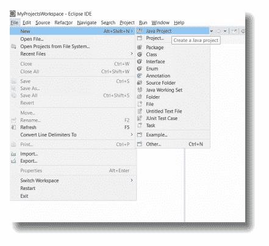

3. 为项目输入一个名称并点击 `Finish`。

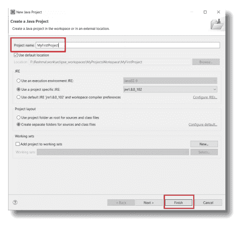

4. 在左侧面板的 `Package Explorer` 中验证项目是否已正确创建：

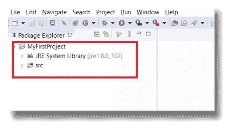

### 幕后发生了什么？

* Eclipse 在默认工作空间位置创建一个与项目同名的文件夹
* 项目文件夹中包含一个名为 `src` 的文件夹和一个名为 `bin` 的文件夹

## 1.4.2 创建包 (package)

包是一个逻辑单元，用于将一组相关的 Java 文件分在在一起。要创建一个包，你需要执行以下操作：

1. 右键点击 `src` → `new` → `package`

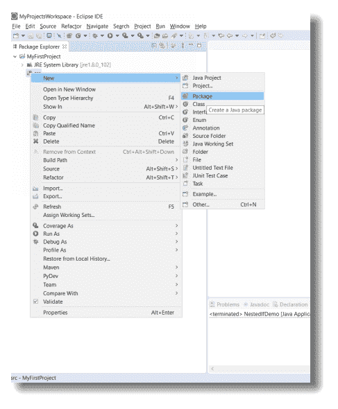

2. 输入你想为包命名的名称并点击 `Finish`：

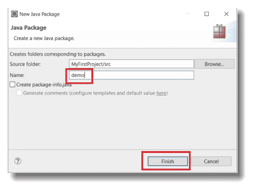

3. 在左侧面板的 `Package Explorer` 中验证包是否已正确创建：

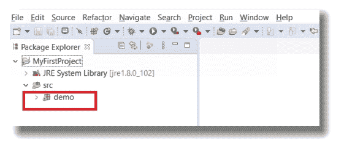

### 幕后发生了什么？

* Eclipse 在 `src` 文件夹中创建一个名为包名的文件夹

## 1.4.3 创建类 (class)

你编写的任何 Java 代码都必须存在类内部。要创建一个类，你需要执行以下操作：

1. 右键点击包名 → `New` → `Class`。

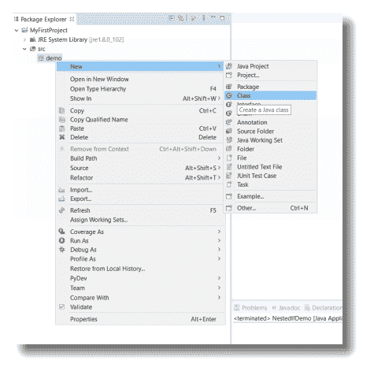

2. 输入你想为类命名的名称。勾选创建 `main` 方法的选择框并点击 `Finish`。

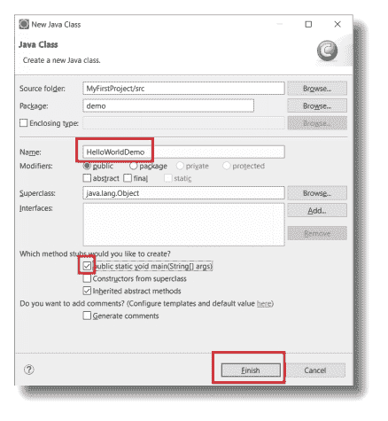

3. 验证 `HelloWorldDemo.java` 类已按如下基础代码骨架创建：

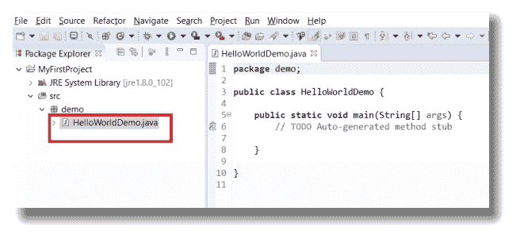

### 幕后发生了什么？

* Eclipse 在 `src/demo` 文件夹中创建一个名为 `HelloWorldDemo.java` 的文件

## 1.4.4 编写代码

Eclipse 创建的基础骨架代码没有任何实际作用。让我们编写一些代码来打印“Hello World”，如下：

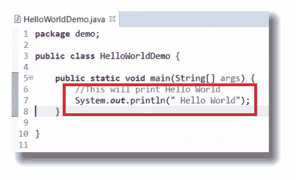

让我们检查这段代码的每一行：

* 第 1 行指定该类位于名为 `demo` 的包中
* 第 3 行指定了类的名称，即 `HelloWorldDemo`
* 第 5 行指定了 `main` 方法。`main` 方法是任何 Java 程序的起点。`public`、`static`、`void` 关键字将在后续进行介绍。
* 第 6-8 行构成方法体。花括号内指定的任何内容都是方法体。
* 第 6 行是一个注释。注释是程序在编译或运行时会被忽略的语句。注释是可选的，可用于提供额外信息。
* 第 7 行是一个 `Sysout` 语句，它打印括号内指定的任何内容。

## 1.4.5 编译并运行代码

Java 代码需要被编译。编译是将英语源码转换为 `JVM` 能够理解的字节码的过程。默认情况下，Eclipse 在保存代码时会自动编译代码，因此你不需要显式地执行任何操作。一旦代码编译完成，你就可以运行它。这会导致 `JVM` 执行字节码。要运行代码，你需要按照以下步骤操作：

1. 点击顶部的绿色箭头图标：


2. 这会导致代码运行并在控制台窗口显示输出如下：

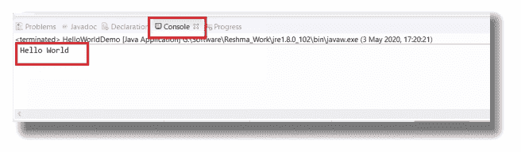

### 幕后发生了什么？

* Eclipse 在你保存代码时会自动编译
* 这会创建一个扩展名为 `.class` 的文件，其中包含字节码
* 当你执行代码时，`JVM` 执行 `.class` 文件中的字节码并在控制台打印 Hello World

## 1.5 从用户读取输入

Java 提供了一个名为 `Scanner` 的内置类，可用于读取用户输入的值。

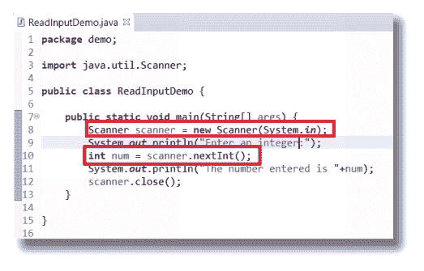

* 第 8 行创建了一个 `Scanner`
* 第 10 行读取用户输入的值并存储在变量 `num` 中（变量将在下一节介绍）
* 第 11 行打印用户输入的值

当执行此代码时，它将打印以下输出（假设用户输入了值 10）：

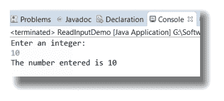

### 幕后发生了什么？

* 用户输入的值被读取并赋值给变量 `num`

## 1.6 总结

* Java 是面向对象且与平台独立的
* 与其他编程语言不同，Java 代码运行在 Java 虚拟机 (`JVM`) 中，而不是直接在操作系统中
* Java 代码写在 Java 类中，类是一个名为 `.java` 的文件
* `main` 方法是任何 Java 程序的起点，任何需要执行的代码都必须放在 `main` 方法中
* 代码在执行之前需要被编译
* 编译将 Java 代码转换为存储在 `.class` 文件中的字节码
* 运行代码时，`JVM` 执行字节码中的指令

# 2 变量和数据类型

变量是可用于存储值的预留内存位置。数据类型指定了变量中可以持有的数据类型。

## 2.1 声明变量

变量在使用之前必须先声明。

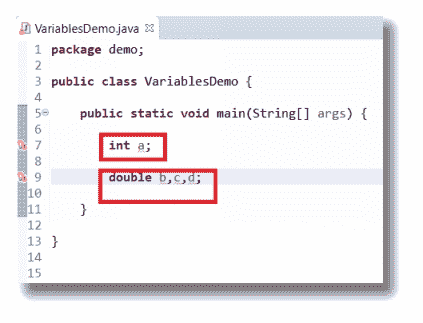

* 第 7 行声明了变量 `a`
* 第 9 行声明了 `b`，且 `int` 都是数据类型

### 幕后发生了什么？

* 执行第 7 行时，为 `a` 分配内存
* 执行第 9 行时

## 2.2 变量初始化

变量在声明时也可以被赋值。

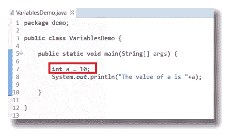

* 第 7 行声明了类型为 `int` 的变量 `a` 并将其赋值为 10

### 幕后发生了什么？

* 执行第 7 行时，为整数分配内存

## 2.3 数据类型

数据类型指定了可以存储在变量中的类型。Java 支持以下类型：

| 名称 | 数据类型 | 宽度 | 范围 |
| :--- | :--- | :--- | :--- |
| `byte` | 整数 | 8 | –128 到 127 |
| `short` | 整数 | 16 | –32,768 到 32,767 |
| `int` | 整数 | 32 | –2,147,483,648 到 2,147,483,647 |
| `long` | 整数 | 64 | –9,223,372,036,854,775,808 到 9,223,372,036,854,775,807 |
| `float` | 小数 | 32 | 1.4e–45 到 3.4e+38 |
| `double` | 小数 | 64 | 4.9e–324 到 1.8e+308 |
| `char` | Unicode 字符 | 16 | 0 到 65,536 |
| `boolean` | 真假值 | - | - |

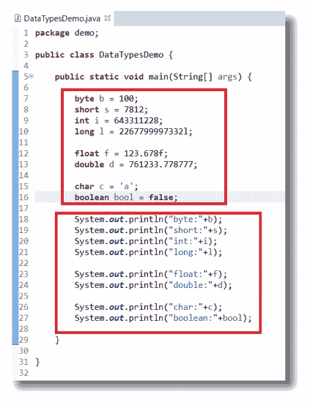

* 第 7-16 行声明了所有类型的变量并赋值了一些值
* 第 18-27 行打印这些值

### 幕后发生了什么？

* Java 根据变量的数据类型分配内存并将值存储在内存位置

## 2.4 总结

* 变量是赋给内存位置的名字
* 变量属于某种数据类型
* 数据类型指定了将持有的数据类型

# 3 运算符

运算符用于对值执行操作。

## 3.1 算术

算术运算符是执行数学运算的运算符。

### 3.1.1 基础算术运算符

基础算术运算符是用于执行加、减、乘、除法的运算符。

| 符号 | 名称 | 说明 |
| :--- | :--- | :--- |
| `+` | 加法 | 将右侧值与左侧值相加 |
| `-` | 减法 | 从左侧值减去右侧值 |
| `*` | 乘法 | 右侧值乘以左侧值 |
| `/` | 除法 | 将左侧值除以右侧值 |
| `%` | 取模 | 返回左侧值除以右侧值后的余数 |

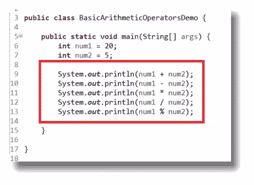

* 第 6 行和第 7 行声明了变量 `num1` 和 `num2`
* 第 9-13 行打印执行基础算术运算的结果

所以，这段代码输出了以下输出：
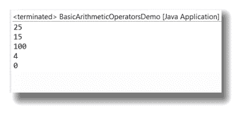

### 幕后发生了什么？

* 每个算术运算符都对 `num1` 和 `num2` 执行底层操作
* 随后 `Sysout` 语句打印操作结果

### 3.1.2 赋值运算符

赋值运算符（`=` 符号）将值分配给变量。

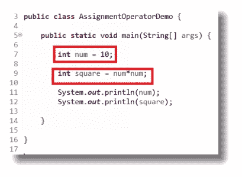

* 第 7 行使用 `=` 运算符将值 `10` 赋值给变量 `num`
* 第 9 行使用 `=` 运算符将 `num*num` 的结果赋值给变量 `square`

所以，这段代码输出了以下输出：
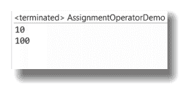

### 幕后发生了什么？

* 赋值运算符将其右侧的任何内容赋值给左侧的变量
* 如果右侧有一个值，则对其赋值
* 如果右侧是一个表达式，则对其进行求值并赋值结果

### 3.1.3 复合赋值运算符

复合赋值运算符将操作与赋值结合在一起。

| 符号 | 名称 | 说明 |
| :--- | :--- | :--- |
| `+=` | 加法赋值 | 将右侧的值加到左侧变量上并将结果赋值给左侧变量 |
| `-=` | 减法赋值 | 从左侧变量中减去右侧的值并将结果赋值给左侧变量 |
| `*=` | 乘法赋值 | 将右侧的值乘以左侧变量并将结果赋值给左侧变量 |
| `/=` | 除法赋值 | 将左侧变量除以右侧的值并将结果赋值给左侧变量 |
| `%=` | 取模赋值 | 获取左侧变量除以右侧值的余数，并将结果赋值给左侧变量 |

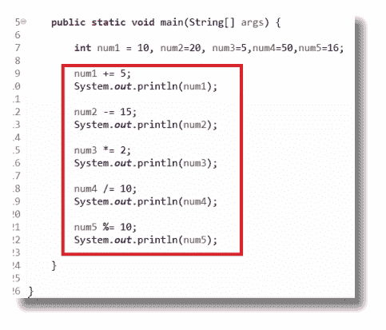

* 第 7 行声明了一些变量并为它们分配了某些值
* 第 9-22 行使用了每种复合赋值运算符并打印结果
* 复合赋值运算符基本上是快捷运算符
* 所以 `num1 += 5` 等于 `num1 = num1 + 5`


所以，这段代码输出了以下输出 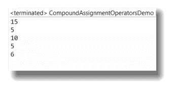 背后发生了什么？

* 每个复合赋值运算符都执行相应的操作并将结果赋值给其调用的变量

### 3.1.4 递增和递减运算符

递增和递减运算符将其操作数递增/递减 1。

| 符号 | 名称 | 说明 |
| :--- | :--- | :--- |
| `++` | 递增 | 操作数加 1 |
| `--` | 递减 | 操作数减 1 |

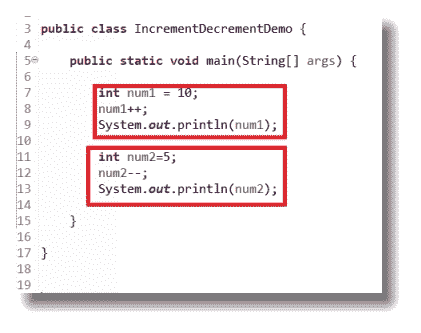

* 第 7-9 行声明了一个变量 `num1` 并使用递增运算符对其递增
* 第 11-13 行声明了一个变量 `num2` 并使用递减运算符对其递减
* 递增/递减运算符基本上是快捷运算符
* 所以 `num++` 等于 `num = num + 1`

所以，这段代码输出了以下输出 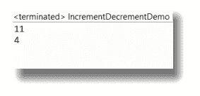 背后发生了什么？

* 递增运算符对其操作数加 1
* 递减运算符从其操作数减去 1

## 3.2 关系运算符

关系运算符用于比较值。

| 符号 | 名称 | 说明 |
| :--- | :--- | :--- |
| `>` | 大于 | 如果左侧的值大于右侧的值，则返回 `true` |
| `<` | 小于 | 如果左侧的值小于右侧的值，则返回 `true` |
| `==` | 等于 | 如果左侧的值等于右侧的值，则返回 `true` |
| `!=` | 不等于 | 如果左侧的值不等于右侧的值，则返回 `true` |
| `>=` | 大于等于 | 如果左侧的值大于或等于右侧的值，则返回 `true` |
| `<=` | 小于等于 | 如果左侧的值小于或等于右侧的值，则返回 `true` |

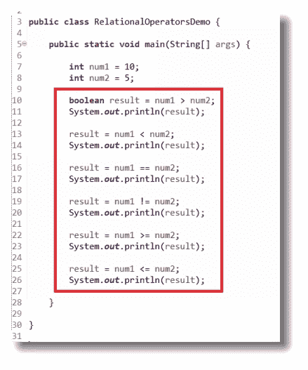

* 第 7-8 行声明了两个整数变量 `num1` 和 `num2`
* 第 9-26 行使用了每种关系运算符并打印结果

所以，这段代码输出了以下输出 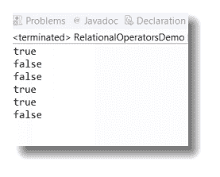 背后发生了什么？

* 每个关系运算符都比较左侧的值与右侧的值并返回比较结果布尔值。

## 3.3 逻辑运算符

逻辑运算符用于组合关系比较。

| 符号 | 名称 | 行为 |
| :--- | :--- | :--- |
| `&&` | 逻辑与 | 如果两个操作数都为 `true`，则返回 `true` |
| `||` | 逻辑或 | 如果任意一个操作数为 `true`，则返回 `true` |
| `!` | 逻辑非 | 反转其操作数 |

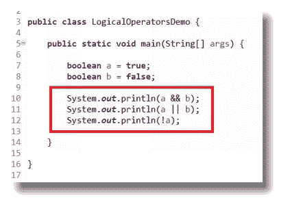

* 第 7-8 行声明了两个布尔变量 `a`, `b`
* 第 10-12 行对 `a` 和 `b` 应用了每种逻辑运算符并打印结果。

所以，这段代码输出了以下输出 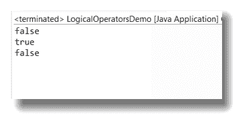 背后发生了什么？

* 每个逻辑运算符都比较左侧的值与右侧的值并返回比较结果布尔值。

## 3.4 总结

* Java 支持算术、关系和逻辑运算符
* 算术运算符用于加、减、乘、除和取模操作
* 关系运算符用于比较值
* 逻辑运算符用于组合关系比较

### 4. 数组

数组用于存储相同类型的值组。

## 4.1 一维数组

一维数组本质上是通过常用名称引用的值列表。

### 4.1.1 声明数组

数组在使用之前需要声明。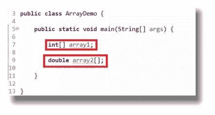

* 第 7 行声明了一个 `int` 数组 `array1`
* 第 9 行声明了一个 `double` 数组 `array2`
* 方括号可以放在数据类型或变量名之后

背后发生了什么？

* 第 7 行和第 9 行只是声明了数组

### 4.1.2 为数组分配内存

为了使用数组，需要为其分配内存。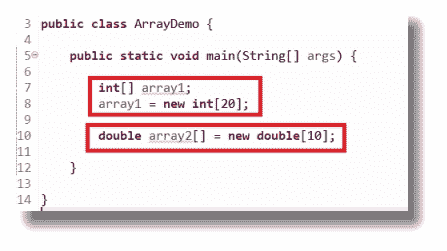

* 第 7 行声明了 `int` 数组 `array1`
* 第 8 行为 `array1` 分配内存存储 20 个值
* 第 10 行声明 `double` 数组并分配内存存储 10 个值
* `new` 关键字分配内存。将详细介绍

背后发生了什么？

* 当执行第 7 行时，什么都没有发生，没有分配内存
* 当执行第 8 行时，Java 为 20 个 `int` 值分配内存并使用名称 `array1` 指向它
* 当执行第 10 行时，Java 为 10 个 `double` 值分配内存并使用名称 `array2` 指向它

### 4.1.3 访问数组中的元素

可以通过指定方括号内的位置来访问数组中的任何元素。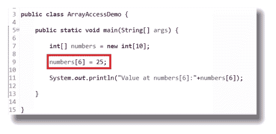

* 第 7 行声明了一个整数数组 `numbers`
* 第 9 行将值 `25` 赋值给索引 `6` 的元素
* 数组索引从 0 开始，索引 6 是数组中的第 7 个元素

背后发生了什么？

* 当执行第 9 行时，值 `25` 被存储在位置 7

### 4.1.4 初始化数组

数组也可以声明时进行初始化。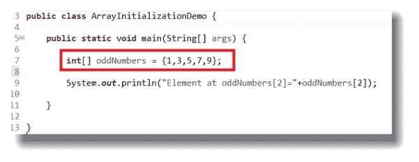

* 第 7 行声明了数组 `oddNumbers` 并初始化为 `1, 3, 5, 7, 9`
* 使用大括号围绕的逗号分隔值列表
* 第 9 行打印索引 `2` 的值

背后发生了什么？

* 第 7 行创建了数组 `oddNumbers`，其大小与指定的值相同，在本例为 5
* 它将指定的值存储在该数组中

## 4.2 多维数组

多维数组是包含多个数组的数组。它们以表格形式存储数据。

### 4.2.1 创建二维数组

二维数组是数组的数组。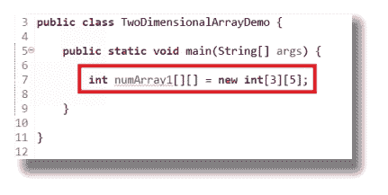

* 第 7 行创建了一个名为 `numArray1` 的二维数组
* `[3][5]` 指定了维度。
* 因此 `numArray1` 是一个包含 3 个元素的数组。`numArray1` 中的每个元素都是一个包含 5 个元素的数组。

### 幕后发生了什么？

* 第 7 行创建了一个二维数组 `numArray1`
* 二维数组有助于存储表格化数据
* 因此，`numArray1` 有 3 行 5 列

### 4.2.2 在二维数组中初始化和访问元素

二维数组也可以使用大括号进行初始化。可以通过指定两个维度的索引来访问其元素 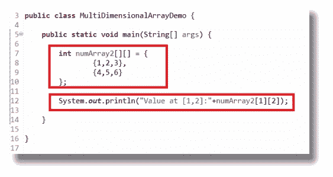

* 第 7-10 行创建了数组 `numArray2` 并用值对其初始化
* 使用了由大括号包围的、逗号分隔的值列表
* 因此，这创建了一个维度为 2,3 的二维数组
* 第 12 行打印位置 1,2 处的值
* 为了访问某个元素，你需要为每个维度指定索引。

因此，这段代码输出了以下输出：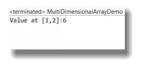

### 幕后发生了什么？

* 当执行第 7-10 行时，Java 创建了 `numArray2`，它是一个包含 2 个数组的数组，每个数组包含 3 个元素
* 第一个数组的值为 `1, 2, 3`，而第二个数组的值为 `4, 5, 6`

### 4.2.3 三维数组

三维数组是一个具有 3 个维度的数组 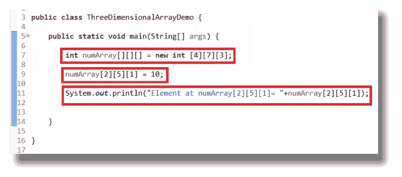

* 第 7 行创建了一个名为 `numArray` 的三维数组，维度为 `4, 7, 3`
* 第 9 行给索引为 `2, 5, 1` 的元素赋值为 `10`
* 第 11 行打印索引为 `2, 5, 1` 的元素

因此，这段代码输出了以下输出：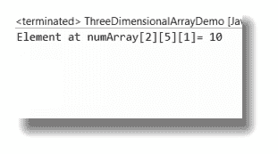

### 幕后发生了什么？

* 当执行第 7 行时，它创建了一个三维数组，它是一个数组的数组的数组。

### 4.3 总结

* 数组用于通过公共名称引用一组相同类型的值
* 数组需要通过 `new` 运算符创建
* 数组的元素可以通过其索引访问，索引是方括号中指定的位置
* 数组可以在声明时进行初始化
* 数组也可以是多维的

# 5 Java 控制语句

控制语句有助于改变执行流。

## 5.1 判定语句

判定语句用于根据变量的值选择不同的执行路径。

### 5.1.1 If

`if` 语句用于检查条件并根据条件执行两条不同的路径。

语法 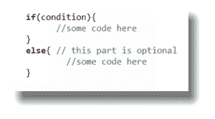

#### 5.1.1.1 基础 If

基础 `if` 语句没有 `else` 语句 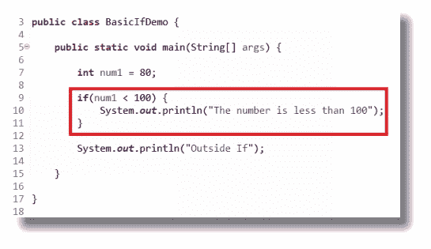

* 第 7 行声明了一个值为 80 的变量 `num1`
* 第 9-11 行是 `if` 块
* 第 9 行由 `if` 语句和条件 `num1 < 100` 组成
* 只有当条件 `num1 < 100` 为真时，才会执行第 10 行的代码

因此，这段代码输出了以下输出：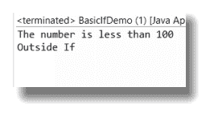

### 幕后发生了什么？

* 当执行第 9 行时，检查 `num1` 是否小于 100
* 因为 `num1` 的值为 80，该条件为真，执行第 10 行
* 一旦 `if` 块完成，就会执行第 13 行。
* 即使第 9 行的条件为假，第 13 行仍然执行。

#### 5.1.1.2 If else

`if else` 块在 `if` 语句之后有一个 `else` 语句。如果 `if` 语句中的条件为假，则执行 `else` 块。

代码示例 1 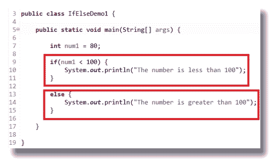

* 第 7 行声明了一个值为 80 的变量 `num1`
* 第 9-15 行是 `if-else` 块
* 第 9 行由 `if` 语句和条件 `num1 < 100` 组成
* 只有当条件 `num1 < 100` 为真时，才会执行第 10 行的代码
* 第 13 行指定了一个 `else` 语句
* 只有当条件 `num1 < 100` 为假时，才会执行第 14 行的代码

因此，这段代码输出了以下输出：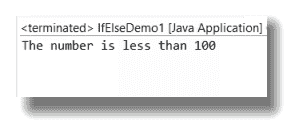

### 幕后发生了什么？

* 当执行第 9 行时，检查 `num1` 是否小于 100
* 因为 `num1` 的值为 80，该条件为真，执行 `if` 块内部的代码
* 跳过 `else` 块

代码示例 2 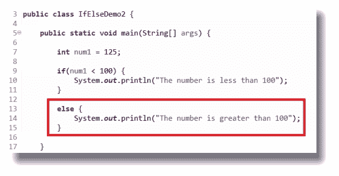

* 在此示例中，变量 `num1` 在第 7 行被赋值为 125
* 因为 `num1 < 100` 现在为假，未进入 `if` 块。
* 反之，控制转移到第 13 行并执行该处的代码。

因此，这段代码输出了以下输出：

### 幕后发生了什么？

* 当执行第 9 行时，检查 `num1` 是否小于 100
* 因为 `num1` 的值为 125，该条件为假，跳过 `if` 块
* 执行 `else` 块内的代码

### 5.1.2 Switch

`switch` 语句可以根据变量的值执行不同的代码。

语法 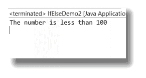

代码示例 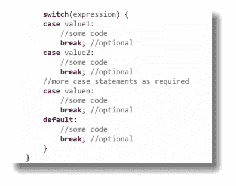

* 第 7 行声明变量 `num1` 值为 80
* 第 9-15 行是 `switch` 块
* 第 9 行由 `switch` 语句和表达式 `num1` 组成
* `case` 标签匹配 `num1` 的值并执行对应代码
* `default` 标签在没有匹配的 `case` 时执行

因此，这段代码输出了以下输出：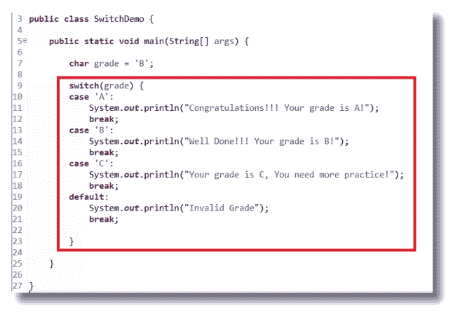

### 幕后发生了什么？

* 当执行第 9 行时，评估 `switch` 表达式 `num1`
* 因为 `num1` 的值为 80，匹配对应的 `case` 标签
* 执行匹配 `case` 内的代码
* 遇到 `break` 后退出 `switch` 块

## 5.2 循环语句

循环语句用于重复执行代码块。

### 5.2.1 While

`while` 循环在条件为真时重复执行代码块。

语法 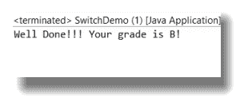

代码示例 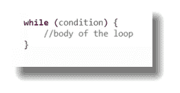

* 第 7 行声明了一个变量 `num1` 并将其初始化为 0
* 第 9-12 行是 `while` 循环
* 第 9 行由 `while` 关键字和条件 `num1 < 100` 组成
* `while` 块内的代码只要 `num1 < 100` 为真就会一直执行

因此，这段代码输出了以下输出：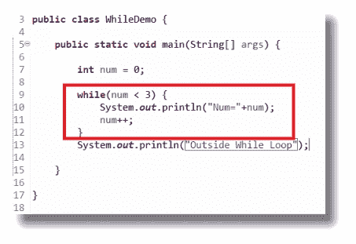

### 幕后发生了什么？

* 当执行第 9 行时，检查 `num1 < 100`
* 因为第 7 行将 `num1` 设置为 0，该条件为真，进入循环并执行第 10-11 行
* 第 11 行将 `num1` 增加 1
* 再次检查 `num1 < 100` 条件，由于仍然为真，继续进入循环
* 直到 `num1 < 100` 条件为假

### 5.2.2 Do-while

`do-while` 循环同样在条件为真时重复代码块，但它在循环结束后检查条件，确保循环至少执行一次。

语法 

代码示例 

* 第 6 行声明了一个变量 `num` 并将其初始化为 1
* 第 8-11 行是 `do-while` 循环
* 第 9 行仅由 `do` 关键字
* 第 12 行指定了 `while` 语句和条件 `num < 3`
* `do-while` 块内的代码只要 `num < 3` 为真就会一直执行

因此，这段代码输出了以下输出：

### 幕后发生了什么？

* 首先执行 9-10 行
* 第 10 行将 `num` 增加 1
* 然后检查第 11 行的 `num < 3` 条件
* 因为 `num` 为 2，条件为真
* 进入循环并执行第 10-11 行
* 直到 `num < 3` 条件为假

代码示例 2 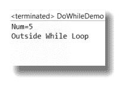

* 在此例中，第 7 行声明了一个变量 `num` 并将其初始化为 `5`
* 执行第 9-10 行，即循环体
* 随后检查第 12 行的条件 `num < 3`
* 由于该条件为假（false），循环退出

此代码打印以下输出： `5`

### 5.2.3 For 循环

`for` 循环对值范围进行迭代。

语法 

代码示例 

* 第 7-9 行是 `for` 循环
* 第 7 行包含关键字 `for`，其后跟的是循环的初始化部分、条件部分和迭代部分
* `int i = 0` 是循环的初始化部分
* `i < 3` 是循环的条件部分
* `i++` 是循环的迭代部分
* 只要条件 `i < 3` 为真，循环体就会重复执行

此代码打印以下输出：

### 背后发生了什么？

* 当执行第 7 行时，它将 `i` 设置为 `0` 并检查条件 `i < 3`。
* 由于 `i < 3` 为真，进入循环并执行第 8 行
* 一旦完成循环体中的代码，循环的迭代部分执行，`i` 增加到 `1`
* 再次检查条件 `i < 3`，此过程一直持续到条件变为假。

### 5.2.4 For-each

`for-each` 循环用于遍历数组或集合（集合将在后文详细介绍）。

语法 

代码示例 

* 第 7 行声明了一个名为 `oddNumbers` 的整数数组
* 第 9-11 行是 `for-each` 循环
* 第 9 行包含关键字 `for`，其后跟一个变量 `num`，用于引用 `oddNumbers` 数组中的每个值
* 只要数组中还有值，就会执行循环体

此代码打印以下输出：

### 背后发生了什么？

* 当执行第 9 行时，`for-each` 循环获取 `oddNumbers` 数组中的当前元素，即 `1`
* 针对值 `1` 执行第 10 行
* 随后，`for-each` 循环从数组中获取下一个元素，即 `3`，并对其执行第 10 行
* 此过程持续到数组中的所有值都处理完毕

## 5.3 跳跃语句

跳转语句将控制转移到代码的不同部分。

### 5.3.1 Break

#### 介绍

`break` 语句可终止循环（`for`、`for-each`、`while`、`do-while`）。它也可以用于 `switch` 语句，如之前所示 

* 第 7-13 行指定了一个从 0 到 4 的 `for` 循环
* 第 8 行检查 `i` 是否为 `3`，如果是，则执行 `break`
* 这会终止循环并将控制转移到第 14 行

此代码打印以下输出：

### 背后发生了什么？

* `for` 循环在 `i = 0, 1, 2` 时正常进行，并执行第 12 行的 `Sysout`
* 当 `i` 为 `3` 时，第 8 行的条件为真，进入 `if` 块
* 执行第 10 行的 `break` 语句终止循环
* 因此，不执行第 12 行，控制转移到第 14 行

### 5.3.2 Continue

`continue` 语句跳过循环的当前迭代，并继续执行下一次迭代 

* 第 7-13 行指定了一个从 0 到 4 的 `for` 循环
* 第 8 行检查 `i` 是否为 `3`，如果是，则执行 `continue`


*   这会终止循环的当前迭代，因此 `i=3` 时不执行第 11 行
*   循环在 `i=4` 时继续

此代码打印以下输出：

### 背后发生了什么？

*   `for` 循环在 `i = 0,1,2` 时正常进行，并执行第 11 行的 `Sysout`
*   当 `i` 为 `3` 时，第 7 行的条件为真，进入 `if` 块
*   执行第 9 行的 `continue` 语句，跳过 `i=3` 的循环
*   控制转移到第 6 行，继续执行 `i=4` 的循环
*   循环完成后执行一次第 13 行

## 5.4 总结

*   控制语句有助于改变执行的控制流
*   控制语句可以是决策语句、迭代语句和跳转语句
*   决策语句有助于根据值做出决策。Java 支持 `if` 和 `switch` 决策语句
*   迭代语句用于重复代码块。Java 支持 `for`、`while`、`do-while` 和 `for-each` 迭代语句
*   跳转语句将控制转移到代码的不同部分

## 6. 类

类（Class）是创建对象的模板。它定义了对象可以拥有的属性和行为。

## 6.1 成员字段

成员字段（Instance Fields）是类中的变量。它们定义了对象的状态。

### 6.1.1 定义成员字段

成员字段是类中定义的变量。每个对象都拥有类定义的每个成员变量的副本。

```
String name;
double price;
```

### 6.1.2 访问成员字段

类字段可以通过点运算符（`.`）来访问。

```java
Product product1 = new Product();
product1.name = "Television";
product1.price = 400.50;
```

### 6.1.3 总结

*   成员字段存储与对象相关的数据
*   每个对象都有类定义的每个成员变量的副本
*   成员字段可以通过对象名加点运算符来访问

## 6.2 方法

方法（Method）是类中用于操作成员字段的代码。

### 6.2.1 定义方法

方法通过指定方法名并在后跟要进入方法体的代码来定义。

```java
void showPriceWith10PercentDiscount() {
    System.out.println("Discounted price: " + (price * 0.9));
}
```

### 6.2.2 调用方法

方法可以通过对象名加点运算符来调用。

```java
product1.showPriceWith10PercentDiscount();
```

### 6.2.3 总结

*   方法是类中的代码
*   方法可以对成员字段的操作
*   方法可以通过对象名加点运算符来调用
*   这里，该方法通过应用 10% 的折扣来计算价格并打印结果

### 6.3.2 调用方法

就像实例字段一样，方法也可以通过点运算符调用 

*   第 14-26 行指定了 `Product` 类中的 `main` 方法
*   第 16-18 行创建了一个 `Product` 对象 `product1` 并初始化了它的实例字段
*   第 23 行调用了 `showPriceWith10PercentDiscount` 方法

这段代码输出以下输出 

#### 背后发生了什么？

*   执行第 23 行时，控制权转移到第 8 行的 `showPriceWith10PercentDiscount` 方法
*   方法体中的代码（第 8-12 行）被执行
*   之后，控制权转移到 `main` 方法，从第 25 行继续处理

### 6.3.3 有返回值的方法

方法可以返回一个值，该值是某些计算的结果 

*   第 9-13 行定义了一个方法 `getPriceWith10PercentDiscount`
*   第 9 行指定了 `double`，表示该方法返回类型为 `double` 的值
*   第 12 行指定了 `return` 关键字，其后跟着 `discountedPrice`
*   `return` 返回其随后的任何内容
*   因此，方法 `getPriceWith10PercentDiscount` 计算 10% 折扣后的价格并返回它
*   第 15-28 行指定了一个 `main` 方法
*   第 17-19 行创建了一个 `Product` 对象 `product` 并初始化了它的实例字段
*   第 23 行调用了 `getPriceWith10PercentDiscount` 方法
*   它将 `getPriceWith10PercentDiscount` 返回的值赋值给变量 `priceWithDiscount`

这段代码输出以下输出 

#### 背后发生了什么？

*   执行第 23 行时，控制权像之前一样转移到第 9 行的 `getPriceWith10PercentDiscount` 方法
*   `getPriceWith10PercentDiscount` 方法计算 `discountedPrice` 并将其返回给 `main`
*   返回的值被赋值给第 23 行的 `priceWithDiscount` 变量

### 6.3.4 接受参数的方法

方法也可以接受某些值（称为参数或形参）并对这些值进行操作 

*   第 8-12 行定义了一个方法 `getPriceWithtDiscount`，它接受 `discountPercentage` 作为参数
*   第 9 行在方法名后的括号内指定了 `double discountPercentage`
    *   `discountPercentage` 是方法的参数
    *   `double` 指定了 `discountPercentage` 的数据类型
*   第 9-10 行使用 `discountPercentage` 的值计算折扣
*   第 22 行使用值 `10.0` 调用了 `getPriceWithtDiscount` 方法

这段代码输出以下输出 

#### 背后发生了什么？

*   执行第 22 行时，使用值 `10.0` 调用了方法 `getPriceWithtDiscount`
*   因此，`10.0` 被赋值给第 8 行的变量 `discountPercentage`
*   方法 `getPriceWithtDiscount` 使用此值执行并返回一个结果

### 6.3.5 总结

*   类包含两个组件：实例字段和方法
*   实例字段指定与类相关的数据，方法指定操作这些数据的代码
*   实例字段和方法都可以使用点运算符访问
*   方法可以选择地接受一个或多个参数
*   它们可以选择地返回一个值

## 6.4 构造函数

构造函数是一种特殊方法，在使用 `new` 运算符创建对象时会被自动调用

### 6.4.1 默认构造函数

默认构造函数是不接受任何参数的构造函数 

*   第 10-13 行指定了一个构造函数
    *   构造函数的名字与类名 (`Product`) 相同
    *   它没有返回类型，甚至没有 `void` 类型
    *   它将实例字段 `name` 和 `price` 初始化为值 `Television` 和 `400.50`
*   第 17 行创建了一个名为 `product` 的新 `Product` 对象，这会调用构造函数
*   如果你没有指定默认构造函数，Java 会自动添加一个

这段代码输出以下输出 

#### 背后发生了什么？

*   执行第 17 行时，控制权转移到第 10 行的构造函数
*   构造函数中的代码（第 11-12 行）被执行
*   之后，控制权转移到 `main` 方法，从第 19 行继续处理

### 6.4.2 参数构造函数

构造函数也可以像方法一样接受参数 

*   第 9-12 行指定了一个接受 2 个参数（`inputName` 和 `inputPrice`）的构造函数
*   第 10-11 行将传入的值赋值给实例字段 `name` 和 `price`
*   第 16 行创建了一个名为 `Television` 且价格为 `400.50` 的新 `Product`

这段代码输出以下输出 

#### 背后发生了什么？

*   执行第 16 行时，调用了第 9 行的构造函数，参数为 `Television` 和 `400.50`

### 6.4.3 总结

*   构造函数在创建对象时被自动调用
*   不接受任何参数的构造函数是默认构造函数
*   如果没有默认构造函数，Java 会自动添加一个
*   构造可以选择接受一个或多个参数

## 6.5 this

`this` 关键字引用当前对象 

*   第 9-12 行根据传入的值初始化实例字段
*   第 10-11 行使用 `this`
*   `this.name` 指向当前对象的字段
*   `this.price` 指向当前对象的字段

## 6.6 方法重载

方法重载允许一个类拥有多个同名但参数不同的方法

### 6.6.1 无方法重载的情况

如果没有方法重载，你必须为相同的功能创建不同名字 

*   第 5 行定义 `addTwoIntegers` 方法，接受两个整数值并返回它们的和
*   第 10 行定义 `addThreeIntegers` 方法，接受三个整数值并返回它们的和
*   第 15 行定义 `addTwoDoubles` 方法，接受两个双精度值并返回它们的和
*   尽管三个方法都执行加法，但它们的名称不同，这使得代码难以阅读

### 6.6.2 定义重载方法

重载方法通过定义同名但参数数量/类型不同的方法来实现 

*   现在，`Calculator` 类拥有 3 个名为 `add` 的方法
*   第 5 行定义接受 2 个整数参数的 `add` 方法
*   第 10 行定义接受 3 个整数参数的 `add` 方法
*   第 15 行定义接受 2 个双精度参数的 `add` 方法
*   因此，`add` 方法被重载了 3 次

### 6.6.3 调用重载方法

当调用重载方法时，Java 根据传入的参数将调用委托给相应的方法版本。

*   第 24 行使用两个整数值调用 `add` 方法
*   第 27 行使用三个整数值调用 `add` 方法
*   第 30 行使用两个双精度值调用 `add` 方法

这段代码输出以下输出 

#### 背后发生了什么？

*   执行第 24 行时，参数的数量/类型将与 `Calculator` 类中的每个 `add` 方法进行匹配
*   由于第 24 行传递了两个整数值，它匹配到了第 5 行的 `add` 方法并被执行
*   同样，当执行第 27 行时，它匹配到了第 10 行的方法
*   所以，当执行第 30 行时，它匹配到了第 15 行的 `add` 方法

### 6.6.4 总结

*   方法重载是一项功能，允许一个类拥有多个同名但参数数量或类型不同的方法
*   Java 根据参数的数量的数量或类型来决定调用哪个重载方法
*   方法不能根据返回类型进行重载。因此，如果多个方法具有相同的参数数量/类型但不同的返回类型，将发生编译错误
*   构造函数也可以被重载

# 7 静态关键字 static

`static` 关键字将成员与类本身相关联。可以在不创建类对象的情况下访问静态成员。

## 7.1 静态字段

可以通过在声明中使用 `static` 关键字将字段设为静态的。

### 7.1.1 定义静态字段

当一个字段被设为静态时，该类的所有对象中只存在该字段的一个拷贝 

*   第 5 行指定了一个名为 `field1` 的静态字段
*   第 7 行指定了一个名为 `field2` 的实例字段
*   所以，`DemoClass` 的所有对象将引用 `field1` 的同一个拷贝，但将拥有各自的 `field2` 拷贝

### 7.1.2 访问静态字段

可以通过类名加点操作符访问静态字段。也可以通过对象访问 

*   第 9-20 行指定了 `DemoClass` 中的 `main` 方法
*   第 11 行通过类名 `DemoClass` 访问静态字段 `field1`
*   第 13 行通过类名从 `DemoClass` 访问实例字段 `field2`，这会导致编译错误
*   第 15 行创建了 `DemoClass` 的 `demoObject` 对象
*   第 16 行通过 `demoObject` 访问实例字段 `field2`，这可以正常工作
*   第 18 行通过 `demoObject` 访问静态字段 `field1`，这也可以正常工作

**幕后发生了什么？**

*   第 11 行运行正常，因为静态字段可以通过类名访问
*   第 13 行导致了编译错误，因为实例字段无法通过类名访问
*   第 16 行和 18 行运行正常，因为静态和实例字段都可以通过对象访问

## 7.2 静态方法

与字段一样，方法可以通过 `static` 关键字设为静态的，并通过类名访问 

*   第 9-11 行指定了一个名为 `myMethod` 的静态方法
*   第 13-17 行指定了 `main` 方法
*   第 15 行通过类名调用了 `myMethod`

这段代码打印以下输出 

**幕后发生了什么？**

*   当执行第 15 行时，调用了方法 `myMethod`，而无需创建 `DemoClass` 的对象

**静态方法的规则**

*   静态方法只能访问静态字段，不能访问实例字段
*   静态方法只能调用静态方法，不能访问实例方法

## 7.3 静态块

除了字段和方法外，代码块也可以声明为 `static`。此类代码在任何其他代码执行之前只会执行一次 

*   第 8-11 行指定了一个静态代码块
*   第 10 行初始化了静态字段 `field1`
*   第 13-16 行指定了 `main` 方法

这段代码打印以下输出 

**幕后发生了什么？**

*   当 Java 类加载时，执行第 8 行的静态块
*   随后，执行第 13 行的 `main` 方法

**静态块的规则**

*   静态块只能访问静态字段，不能访问实例字段
*   静态块只能调用静态方法，不能访问实例方法

## 7.4 总结

*   `static` 关键字将字段或方法与类本身相关联
*   静态成员可以通过类名访问，也可以通过类的对象访问
*   静态字段类似于全局变量，在所有对象中只存在该字段的一个拷贝
*   除了字段和方法外，代码块也可以被设为静态的
*   静态成员最常见的例子是 `main()`
*   由于 `main()` 是静态的，JVM 可以调用它而不需要创建类的对象

# 8 继承

继承允许类从另一个类继承字段和方法，从而创建一个专门的类。这有助于代码的复用。

## 8.1 子类

子类是通用类的特化。

### 8.1.1 定义父类

被继承的类被称为基类或父类 

*   `Product` 是一个普通类
*   它拥有对应于 `name` 和 `price` 的字段
*   它有一个名为 `printNameAndPrice` 的方法

### 8.1.2 定义子类

继承基类并添加自身特定内容的类被称为子类 

*   第 6-14 行定义了一个 `ElectronicProduct` 类
*   第 3 行中，类名后跟着关键字 `extends`，然后是 `Product`
*   所以，这表示 `ElectronicProduct` 是 `Product` 的子类
*   `ElectronicProduct` 拥有字段 `warrantyInYears` 和方法 `printWarranty`
*   所以 `ElectronicProduct` 是 `Product` 的特化版本
*   就像 `ElectronicProduct` 一样，我们可以创建其他子类，如 `FoodProduct`、`ApparelProduct` 等

### 8.1.3 访问父类成员

子类可以访问父类的非私有成员 

*   第 3-19 行定义了一个 `ProductDemo` 类
*   第 7 行创建了一个 `ElectronicProduct` 对象
*   第 9-10 行通过 `eProduct` 初始化 `name` 和 `price` 字段
*   第 11 行通过 `eProduct` 调用 `printNameAndPrice`
*   第 13 行通过 `ElectronicProduct` 初始化 `warrantyInYears` 字段
*   第 14 行通过 `ElectronicProduct` 调用 `printWarranty`

这段代码打印以下输出 

**幕后发生了什么？**

*   当执行第 7 行时，它创建了特化的 `ElectronicProduct`
*   第 9-11 行通过 `ElectronicProduct` 访问基类的字段和方法

### 8.1.4 总结

*   基类是普通类，子类是基类的特化
*   可以通过 `extends` 关键字加上基类来创建子类
*   一个类可以有多个子类


* 一个类不能继承多个类
* 继承有助于代码复用，因此公共字段和方法不需要在每个子类中重复

## 8.2 中的构造函数

与普通类一样，构造函数也可以存在于继承层次的类中。

### 8.2.1 构造函数调用

当创建子类对象时，它会隐式地调用父类的构造函数

* 第 3-9 行定义了 `Product` 类
* 第 5-7 行指定了 `Product` 构造函数
* 第 12-22 行定义了 `ElectronicProduct` 类
* 第 14-16 行指定了 `ElectronicProduct` 构造函数
* 第 20 行在 `main` 方法中创建了一个 `ElectronicProduct` 对象

这段代码打印以下输出

**幕后发生了什么？**

* 当执行第 20 行时，控制转移到第 5 行的 `Product` 构造函数
* 当 `Product` 构造函数完成后，控制转移到第 14 行的 `ElectronicProduct` 构造函数

### 8.2.2 总结

* 当创建子类对象时，它会隐式地调用基类的构造函数。
* 如下一节所示，也可以通过 `super` 关键字显式调用父类构造函数。

## 8.3 super 关键字

`super` 关键字用于从子类访问父类的成员。

### 8.3.1 访问父类成员

可以在子类中使用 `super` 关键字来访问父类的实例字段和方法

* 第 3-7 行定义了一个 `Product` 类，包含 `name` 和 `price` 实例字段以及一个 `printPriceWith10PercentDiscount` 方法。
* 第 16-40 行定义了一个 `ElectronicProduct` 类。
* 第 20-29 行定义了一个 `printDetails` 方法。
* 第 22-23 行通过 `super` 关键字访问基类字段 `name` 和 `price`。
* 第 27 行通过 `super` 关键字访问基类方法 `printPriceWith10PercentDiscount`。
* 第 30-38 行定义了一个 `main` 方法，该方法调用了 `printDetails` 方法。

此代码打印以下输出：

幕后发生了什么？

* 当执行第 24 行时，会调用 `printDetails` 方法，该方法通过 `super` 关键字访问了超类的字段和方法。

### 8.3.2 调度父类构造函数

`super` 关键字也可以用于子类构造函数，以调用父类构造函数

* 第 3-14 行定义了 `Product` 类。
* 第 8-12 行指定了一个 `Product` 构造函数，它接受参数并初始化实例字段。
* 第 16-35 行定义了一个 `ElectronicProduct` 类。
* 第 20-27 行定义了一个 `ElectronicProduct` 构造函数。
* 第 22 行通过 `super` 关键字显式调用了 `Product` 构造函数。
* `super` 的调用必须是子类构造函数中的第一个语句（如第 22 行），否则将发生编译错误。
* 由于 `Product` 构造函数接受 `name` 和 `price` 作为参数，这些参数通过 `super` 传递，但 `super` 也可以用于调用不带参数的构造函数。
* 第 17-22 行定义了一个 `main` 方法，该方法创建一个 `ElectronicProduct` 对象。

此代码打印以下输出：

幕后发生了什么？

* 当执行第 19 行时，控制权转移到第 7 行的 `ElectronicProduct` 构造函数。
* 这首先通过 `super` 关键字显式调用了 `Product` 构造函数，并在第 9 行传入了 `name` 和 `price` 字段。
* 之后，执行 `ElectronicProduct` 构造函数中的代码。

### 8.3.3 总结

* `super` 关键字可以从子类内部用于访问超类的实例字段、方法或构造函数。
* 对于实例字段和方法，`super` 关键字是冗余的，因为非私有的超类成员可以在子类中直接访问。
* 只有当基类中具有同名的成员时，`super` 关键字在访问类成员时才有用。

## 8.4 方法重写

当子类拥有与父类中相同的方法时，就会发生方法重写。它允许子类为父类方法提供不同的实现。

### 8.4.1 定义重写方法

为了定义被重写的方法，子类应该拥有一个与父类中方法名称、参数数量和类型相同的方法

* 第 3-9 行定义了 `Product` 类。
* 第 5-7 行定义了一个 `printInfo` 方法，打印关于 `Product` 的某些细节。
* 第 11-17 行定义了一个 `ElectronicProduct` 类，它是 `Product` 的子类。
* 第 13-15 行定义了一个 `printInfo` 方法，打印关于 `ElectronicProduct` 的某些细节。
* `ElectronicProduct` 中的 `printInfo` 方法重写了 `Product` 中的 `printInfo` 方法。

### 8.4.2 调用重写方法

被重写的方法可以像任何其他方法一样正常调用

* 第 3-14 行指定了一个 `ProductDemo` 类。
* 第 5-12 行指定了一个 `main` 方法。
* 第 7-8 行创建一个 `Product` 对象并调用 `printInfo` 方法。
* 第 10-11 行创建一个 `ElectronicProduct` 对象并调用 `printInfo` 方法。

此代码打印以下输出：

幕后发生了什么？

* 当执行第 8 行时，使用 `Product` 对象调用 `printInfo` 方法，因此执行了 `Product` 类中的代码。
* 当执行第 11 行时，使用 `ElectronicProduct` 对象调用 `printInfo` 方法，因此执行了 `ElectronicProduct` 类中的代码。

### 8.4.3 运行时多态

方法重写可以实现运行时多态，这是 Java 的一个强大特性

* 第 7 行声明了一个类型为 `Product` 的变量 `product`。
* 第 9 行创建一个类型为 `ElectronicProduct` 的对象 `eProduct`。
* 第 11 行将 `eproduct` 赋值给 `product`。
* 这是允许的，且不会引起编译错误。
* 第 13 行在 `product` 对象上调用 `printInfo` 方法。
* 这导致调用了 `ElectronicProduct` 类中的 `printInfo` 方法。

此代码打印以下输出：

幕后发生了什么？

* 11 行将子类对象（`ElectronicProduct`）赋值给父类变量（`Product`）。
* 当执行 11 行时，将子类对象赋值给父类变量。
* 由于 `product` 被赋值为 `ElectronicProduct`，因此执行了该类的 `printInfo` 方法。

### 8.4.4 总结

* 方法重写发生在子类拥有与父类相同的方法时。
* 方法重写用于实现运行时多态。
* 在运行时多态中，Java 根据赋值的对象来决定方法。

# 9 final 关键字

`final` 关键字可以用于方法或实例字段。

## 9.1 final 方法

当 `final` 关键字用于方法时，它可以防止方法被重写

* 第 3-9 行定义了 `Product` 类。
* 第 5-7 行定义了 `printInfo` 方法。
* 第 11-17 行定义了 `ElectronicProduct` 类，它是 `Product` 的子类。
* 第 13-15 行定义了 `printInfo` 方法。
* 由于 `printInfo` 是 `final`，第 13 行会导致错误。

## 9.2 final 字段

当 `final` 关键字用于字段时，它可以防止字段被修改

* 第 7 行声明了一个 final 字段 `num` 并初始化为 10。
* 第 9 行尝试将 `num` 更新为 20，会导致错误。
* 由于 final 变量不可修改，它必须在声明时初始化。

## 9.3 总结

* `final` 关键字可以用于方法和字段。
* `final` 方法不能被重写。
* `final` 字段在声明后不能被修改。

# 10 包与导入

包有助于将一组 Java 文件组合在一起。导入用于包含包中定义的类和接口。

## 10.1 定义包

`package` 语句可以用于定义包

* 第 2-6 行指定了一个名为 `ClassA` 的类。
* 第 2 行是 `package` 语句。
* 它由 `package` 关键字后跟包名 `mypackage` 组成。

### 包的规则

* 当类在包内定义时，该类的 `.java` 文件必须存在于与包同名的目录中。如果你如所示通过 Eclipse 创建包，Eclipse 会自动为你完成。
* 包可以是分级的。层次结构中的每个包名应通过点分隔。例如：`package1.package2.package3`。
* 分级包结构也需要目录结构。因此，对于包 `package1.package2`，`package1` 需要一个名为 `package2` 的文件夹。

## 10.2 导入包

包中的类在另一个包中使用之前需要导入。为了导入类或包，应该使用 `import` 关键字

* 第 1-13 行指定了 `demo.package2` 包中的类 `ClassB`。
* 第 3 行是 `import` 语句。
* 它由 `import` 关键字后跟全限定类名（包名后跟类名）组成。

除了导入单个类外，你还可以导入整个包。这会导入包中的所有类。要导入一个包，应该在 `import` 关键字后跟包名，然后是一个点 `.`，最后是通配符符号 (`*`)。

## 10.3 总结

* 包（Packages）用于在逻辑上将相关的类组合在一起
* 一个包中可以有多个类
* 要访问包外部的类，需要通过 `import` 语句进行导入

# 11 访问修饰符

访问修饰符是一些控制对类成员（实例字段或方法）访问权限的关键字。

## 11.1 Private（私有）

私有成员只能在定义它的类中被访问，不能在类外部被访问。

### 11.1.1 定义私有字段

可以通过在声明中使用 `private` 关键字将字段设为私有。

* 第 3-14 行定义了一个 `Product` 类
* 第 5 行定义的 `name` 字段具有 `private` 访问修饰符

### 11.1.2 在同一类中访问私有字段

私有字段仅在定义它的类中可访问

* 第 7 行定义了一个私有字段 `name`
* 它通过第 9 行的 `setName` 方法访问
* 由于 `name` 具有私有访问权限，第 9 行不会引起编译错误

### 11.1.3 在不同类中访问私有字段

私有字段无法在类外部被访问

* 第 3-14 行定义了一个 `AccessDemo` 类
* 第 7 行创建了一个 `Product` 对象
* 第 9 行尝试访问 `Product` 类中的字段 `name`
* 由于 `name` 是 `private` 的，它无法在 `Product` 类外部被访问，因此第 9 行导致了编译错误

## 11.2 Default（默认）

默认成员在同一包内的所有类中都是可访问的，但对不同包的类是不可的。

### 11.2.1 定义默认字段

当没有使用其他访问修饰符时，字段具有默认访问权限

* 第 1-7 行在 `demo.package1` 包中定义了一个 `Product` 类
* 第 5 行定义的 `name` 字段没有任何访问修饰符，因此它具有默认权限

### 11.2.2 在同一包中访问默认字段

默认字段在同一包内的所有类中都是可访问的

* 第 1-14 行在 `demo.package1` 包中定义了一个 `AccessDemo` 类
* 第 7 行创建了一个 `Product` 对象
* 第 9 行访问 `Product` 类中的字段 `name`
* 由于 `name` 具有默认权限，第 9 行不会引起编译错误

### 11.2.3 在不同包中访问默认字段

默认字段无法在定义它的包外部被访问

* 第 1-14 行在另一个名为 `demo.package2` 的包中定义了一个 `AccessDemo` 类
* 第 9 行创建了一个 `Product` 对象
* 第 11 行尝试访问 `Product` 类中的字段 `name`
* 由于 `name` 具有默认权限，它无法在包外部被访问，因此第 9 行导致了编译错误

## 11.3 Protected（保护）访问修饰符

受保护成员在类的所有子类以及同一包内的所有类中都是可访问的。

### 11.3.1 定义保护字段

可以通过在声明中使用 `protected` 关键字将字段设为受保护

* 第 1-7 行在 `demo.package1` 包中定义了一个 `Product` 类
* 第 5 行定义的 `name` 字段具有 `protected` 访问修饰符

### 11.3.2 在子类中访问保护字段

受保护字段在类的所有子类中都是可访问的，即使它们在不同的包中

* 第 1-18 行在 `demo.package2` 包中定义了一个 `ElectronicProduct` 类
* 第 10 行创建了一个 `ElectronicProduct` 对象 `eProduct`
* 第 12 行通过 `eProduct` 访问 `Product` 类中的字段 `name`
* 由于 `name` 具有保护权限，第 12 行不会引起编译错误

### 11.3.3 在同一包的独立类中访问保护字段

受保护字段在同一包的所有类中都是可访问的，即使它们不是子类

* 第 1-13 行在 `demo.package1` 包中定义了一个 `AccessDemo` 类
* `AccessDemo` 不是 `Product` 的子类，但它与 `Product` 在同一个包中
* 第 7 行创建了一个 `Product` 对象 `product`
* 第 9 行访问 `Product` 类中的字段 `name`
* 由于 `name` 具有保护权限，第 9 行不会引起编译错误

### 11.3.4 在独立类中访问保护字段

受保护字段无法在非子类中被访问

* 第 1-13 行定义了一个 `AccessDemo` 类
* `AccessDemo` 不是 `Product` 的子类且在不同的包中
* 第 7 行创建了一个 `Product` 对象
* 第 9 行访问 `Product` 类中的字段 `name`
* 由于 `name` 具有保护权限，第 9 行导致了编译错误

## 11.4 Public（公共）

公共成员可以被任何代码访问。

### 11.4.1 定义公共字段

通过在声明中使用 `public` 关键字将字段设为公有

* 第 1-7 行在 `demo.package1` 包中定义了一个 `Product` 类
* 第 5 行定义的 `name` 字段具有 `public` 修饰符

### 11.4.2 访问公共字段

公共字段可以被包外部的代码访问

* 第 1-15 行在一个名为 `demo.package2` 的包中定义了一个 `AccessDemo` 类
* 第 9 行创建了一个 `Product` 对象
* 第 11 行访问 `Product` 类中的字段 `name`
* 由于 `name` 是 `public` 的，第 9 行不会引起编译错误

## 11.5 总结

* Java 支持 `private`、`default`、`protected` 和 `public` 访问修饰符
* `private` 成员只能在定义的类中被访问
* `default` 成员在定义的类以及同一包的其他类中可访问
* `protected` 成员在定义的包内及其子类中可访问


* `public` 成员随处可访问

# 12 接口

接口是一种 Java 结构，用于指定`类`必须实现的行为。它通过指定不带方法体的方法来实现。

## 12.1 定义接口

接口通过 `interface` 关键字定义

* 第 3-7 行定义了一个 `Drawable` 接口
* 第 3 行使用了 `interface` 关键字而不是 `class` 关键字
* 第 5 行指定了一个抽象方法 `draw`
* 抽象方法没有方法体，方法名后跟着一个分号

### 12.1.2 实现接口

接口需要由类来实现。实现接口的类需要为接口中的所有方法提供代码

* 第 3-10 行定义了一个 `Circle` 类
* 第 5-8 行为 `draw` 方法提供了实现

### 12.1.3 使用接口

接口不能通过 `new` 关键字实例化，它需要通过实现接口的类来使用

* 第 3-12 行定义了一个 `ShapeDemo` 类
* 第 7 行尝试通过 `new` 关键字实例化 `Drawable` 接口，这会导致错误
* 第 9 行创建了一个名为 `circle` 的 `Circle` 对象
* 第 12 行通过 `circle` 对象调用了 `draw` 方法
* 第 14 行定义了一个 `Drawable` 类型的变量 `shape`，但给它赋值了一个 `Circle` 对象
* 这是有效的，且不会导致编译错误
* 第 17 行通过 `shape` 对象调用了 `draw` 方法，这也是有效的

此代码打印以下输出：

### 12.1.4 总结

* `interface`（接口）指定了类需要实现的行为
* `interface`（接口）通过 `interface` 关键字定义
* `class`（类）可以通过 `implements` 关键字实现 `interface`，并需要为接口中的所有方法提供代码
* `Interfaces`（接口）无法通过 `new` 关键字实例化
* 接口类型的引用变量可以赋值为实现了该接口的类对象。这是 Java 实现运行时多态的另一种方式
* 多个类可以实现同一个接口，一个类也可以实现多个接口

# 13 异常处理

异常处理是指 Java 处理代码执行过程中可能发生错误的机制。在这种情况下，Java 会创建一个异常（内置异常类的对象）并将其抛出。

## 13.1 默认处理器

异常需要被捕获和处理。Java 拥有一个默认异常处理器，用于处理代码中未被显式处理的异常

* 第 7 行声明了一个名为 `numbers` 的整数数组
* 第 9 行尝试访问位置 5 处的元素
* 由于数组大小为 3，因此位置 5 处没有元素
* 此代码不会导致编译错误，因为在语法上它是正确的

此代码打印以下输出：

#### 幕后发生了什么？

* 当 Java 运行时系统检测到尝试访问位置 9 的元素时，它会创建一个 `ArrayIndexOutOfBoundsException` 对象并将其抛出
* `ArrayIndexOutOfBoundsException` 是 Java 的内置异常之一
* Java 的默认处理器捕获该异常并打印错误信息
* 异常一旦发生，程序执行就会停止，因此第 11 行的 `Sysout` 语句不会执行

### 13.2 Try 和 catch

Java 提供了 `try`/`catch` 关键字，用于在代码中显式地处理异常。

#### 13.2.1 基础 Try Catch

`try` 块允许指定需要监控异常的代码。`catch` 块允许指定当发生异常时需要执行的代码

* 第 7 行指定了 `try` 语句
* 第 9-11 行指定了需要监控异常的代码
* 第 13-16 行指定了一个处理 `ArrayIndexOutOfBoundsException` 的 `catch` 块
* `e` 是 `ArrayIndexOutOfBoundsException` 的一个对象，它有多个方法可以提供有关异常的额外信息
* `catch` 块简单地指定了第 15 行的一条 `Sysout` 语句，用于打印详细的错误信息

此代码打印以下输出：

#### 幕后发生了什么？

* 一旦执行第 10 行，Java 运行时系统就会创建并抛出 `ArrayIndexOutOfBoundsException`
* 异常对象将与第 13 行 `catch` 块中指定的异常类型（即 `ArrayIndexOutOfBoundsException`）进行比较
* 由于匹配成功，执行第 15 行 `catch` 块中的代码

#### 13.2.2 多个 Catch 块

在 `try` 块之后可以指定任意数量的 `catch` 块来处理不同类型的错误

* 第 8-13 行指定了 `try` 块中的某些代码
* 第 9 行访问 `numbers[2]`，这是一个有效的数组位置
* 第 12 行将 `value` 除以 0
* 在算术除法中除以 0 是无效的，因此第 12 行导致了 `ArithmeticException`
* 第 14-16 行指定了一个处理 `ArrayIndexOutOfBoundsException` 的 `catch` 块
* 第 17-19 行指定了一个处理 `ArithmeticException` 的 `catch` 块

此代码打印以下输出：

#### 幕后发生了什么？

* 当执行第 10 行时，Java 运行时系统创建并抛出 `ArithmeticException`
* 它与每个 `catch` 块中指定的异常相匹配
* 第 14 行的 `catch` 块被跳过，因为它处理的是 `ArrayIndexOutOfBoundsException`
* 第 17 行 `catch` 块中的代码被执行，因为它处理的是 `ArithmeticException`

#### 13.2.3 无异常的 Try

如果没有发生异常，则 `catch` 块中的代码将不会执行

* 第 6 行指定了 `try` 语句
* 第 8-10 行指定了需要监控异常的代码
* 第 12-14 行指定了一个处理 `ArrayIndexOutOfBoundsException` 的 `catch` 块

此代码打印以下输出：

#### 幕后发生了什么？

* 第 9 行访问 `numbers[1]`，这是一个有效的数组位置
* 由于 `try` 块中的代码没有抛出异常，因此 `catch` 块不会执行

## 13.3 Finally

`finally` 块可以指定无论发生什么异常都需要执行的代码。

#### 13.3.1 基础 Try Catch Finally

`finally` 块位于 `try`/`catch` 块之后

* 第 6-13 行指定了 `try`/`catch` 块的代码
* 第 13 行是 `finally` 块

此代码打印以下输出：

#### 幕后发生了什么？

* 一旦执行第 8 行，Java 运行时系统创建并抛出 `ArrayIndexOutOfBoundsException`
* `catch` 块处理该异常，随后执行第 13 行的 `finally` 块

### 13.3.2 无异常的 Finally

即使没有发生异常，`finally` 块也会执行

* 第 6-13 行指定了 `try`/`catch` 块的代码
* 第 13 行指定了 `finally` 块

此代码打印以下输出：

#### 幕后发生了什么？

* 第 8 行没有导致异常，因此第 11 行的 `catch` 块不会执行，但第 13 行的 `finally` 块会执行

### 13.3.3 带异常的 Finally

即使没有 `catch` 块，`finally` 块也会执行

* 第 6-10 行指定了 `try` 块的代码
* 第 10 行指定了 `finally` 块

此代码打印以下输出：（此处无输出）

#### 幕后发生了什么？

* 执行第 8 行时，抛出了 `ArrayIndexOutOfBoundsException`
* 由于没有 `catch` 块，异常由默认处理器处理
* 随后执行第 10 行 `finally` 块中的代码

## 13.4 Throw 关键字

`throw` 关键字可用于显式地抛出异常

* 第 5-10 行指定了 `subtract` 方法
* 第 7 行指定了一个 `throw` 语句
* 它由 `throw` 关键字以及通过构造函数创建的 `IllegalArgumentException` 对象组成
* 第 12-21 行指定了 `main` 方法
* 第 15 行在 `try`/`catch` 块中带参数 5,10 调用 `subtract`

此代码打印以下输出：

#### 幕后发生了什么？

* 当执行第 6 行时，检查条件 `a < b`，如果真则执行第 7 行
* 第 7 行创建一个新的 `IllegalArgumentException` 对象并通过 `throw` 关键字将其抛出
* 由于 `main` 调用了 `subtract`，异常对象被传递给 `main` 并由第 17 行的 `catch` 块处理

## 13.5 Throws 关键字

`throws` 关键字用于指定某个方法会抛出异常但不处理它

* 第 5-9 行指定了 `divide` 方法
* `throws` 子句在第 5 行的方法声明中被指定
* 因此，第 5 行表示 `divide` 可以抛出 `ArithmeticException`
* 第 12-21 行指定了一个 `main` 方法
* 第 15 行在 `try/catch` 块中用值 `10,0` 调用了 `divide`

此代码打印出以下输出：

## 幕后发生了什么？

* 当执行第 8 行时，会抛出一个 `ArithmeticException`，因为除以 `0` 是无效的
* 由于 `main` 调用了 `divide`，异常对象将被传递给 `main`，并由第 16 行的 `catch` 块处理

## 13.6 Java 的异常层次结构

Java 在 `java.lang` 包中提供了许多内置异常。`java.lang.Throwable` 是所有异常的父类。它有两个主要的子类：`java.lang.Error` 和 `java.lang.Exception`。

### 13.6.1 Error

`java.lang.Error` 类表示由于某些异常情况（而非代码引起）发生的严重错误。因此，应用程序不需要捕获或处理此类错误。`java.lang.Error` 类有几个子类，表示特定的错误，如 `VirtualMachineError`、`IOError`、`LinkageError` 等。

### 13.6.2 Exception

`java.lang.Exception` 类表示由于代码引起且应用程序可以捕获并处理的错误。异常分为以下两种类型：

#### 未检查异常

`Exception` 类有一个重要的子类，即 `java.lang.RuntimeException`。`RuntimeException` 及其所有的子类都被称为未检查异常。这是因为编译器没有强制要求你处理此类异常。因此，即使编写了可能抛出未检查异常的代码，编译器也不会报错。未检查异常的示例包括 `ArithmeticException`、`ArrayIndexOutOfBoundsException` 等。

#### 已检查异常

除 `RuntimeException` 之外的所有 `Exception` 子类被称为已检查异常。这是因为这些异常是由编译器检查的。因此，如果你编写了可能导致已检查异常的代码，而异常没有被捕获、处理或在 `throws` 子句中声明，则会发生编译错误。已检查异常的示例包括 `IOException`、`AWTException` 等。

## 13.7 总结

* 当执行代码时发生某些错误，Java 会创建一个适当 `Exception` 类的对象并抛出它
* 有一个默认的异常处理器来处理异常并显示错误信息
* `try/catch` 关键字允许在代码中处理异常。它们为代码提供了从异常中恢复的机会
* `finally` 块可以用于放置始终需要执行的代码，无论是否发生异常
* `throw` 关键字可以显式地抛出异常
* `throws` 关键字用于指定某个方法会抛出异常但不处理它
* `Exception` 对象有几个方法，可以提供有关异常的信息

# 14 Java 字符串

`String` 是 Java 中的一个内置类，表示字符序列。它是 `java.lang` 包的一部分。

## 14.1 String 的创建

可以通过简单地给变量赋值双引号括的字符序列来创建 `String`。`String` 类中还有几个构造函数可以用于创建 `String`

* 第 7 行通过赋值双引号内的字符序列创建了 `String` `str1`
* 第 9 行使用接受字符序列的 `String` 构造函数创建了 `String` `str2`
* 第 13 行使用接受字符数组的 `String` 构造函数创建了 `String` `str3`

此代码打印出以下输出：

此外，`String` 类还有许多构造函数，可以用许多其他方式创建 `Strings`。

### 14.2 获取 String 长度

`String` 类提供了一个 `length` 方法，返回 String 中字符的数量

* 第 7 行创建了一个 `String` 变量 `str1` 并赋值为 `Hello`
* 第 9 行使用 `length` 方法获取 `String` 的长度

此代码打印出以下输出：

### 14.3 检查字符串相等性

`String` 类有一个 `equals` 方法可以检查两个字符串是否相同。还有一个 `equalsIgnoreCase` 方法可以忽略大小写检查两个 String 是否相同。这两个方法都返回一个比较结果的布尔值

* 第 7 行创建了一个值为 `Java` 的 `String` `str1`
* 第 9 行创建了一个值为 `Java` 的 `String` `str2`
* 第 11 行使用 `equals` 方法检查 `str1` 和 `str2` 是否相同
* 第 15 行创建了一个值为 `java` 的 `String` `str3`
* 第 17 行使用 `equals` 方法检查 `str1` 和 `str3` 是否相同
* 第 20 行使用 `equalsIgnoreCase` 方法检查 `str1` 和 `str3` 是否相同

此代码打印出以下输出：

### 14.4 其他字符串操作

`String` 类上还有许多方法可以执行其他操作

* 第 7 行创建了一个值为 `Good Morning` 的 `str`
* 第 9 行调用 `startsWith` 方法检查 String 是否以指定的字符串开头
* 第 12 行调用 `endsWith` 方法检查 String 是否以指定的字符串结尾
* 第 15 行调用 `substring` 方法返回从指定索引开始到指定索引结束的字符串
* 第 18 行调用 `indexOf` 方法返回指定字符的位置
* 第 21 行调用 `toUpperCase` 方法将 String 转换为大写
* 第 24 行调用 `toLowerCase` 方法将 String 转换为小写

此代码打印出以下输出：

## 14.5 总结

* `String` 是 `java.lang` 包中的内置类
* 它表示字符序列
* 可以通过将双引号内的字符赋值给 `String` 变量或使用任何 `String` 构造函数来创建
* `String` 类有许多方法允许执行各种操作，如查找 String 的长度、检查两个 Strings 是否相等、从 String 中获取子字符串等

# 15 Collection API


# Collection API

Collection API 由一组类和接口组成，允许你将对象组作为单个单元存储在一起。集合类和接口存在于 `java.util` 包中。集合中的对象被称为元素（elements）。下表列出了 Collection 框架中的主要类/接口。

| 接口/类 | 描述 |
| :--- | :--- |
| `java.util.Collection` | 这是集合层次结构中的顶层接口。 |
| `java.util.List` | `java.util.Collection` 的子接口。存储一组对象。是有序的且允许重复。 |
| `java.util.Set` | `java.util.Collection` 的子接口。存储一组对象。无序且不允许重复。 |
| `java.util.Map` | 集合层次中的另一个顶层接口。用于存储键值对。 |
| `java.util.ArrayList` | 实现 `List` 接口的类。内部使用数组存储数据。它是 `List` 最常见的实现。 |
| `java.util.HashSet` | 实现 `Set` 接口的类。它是 `Set` 最常见的实现。 |
| `java.util.HashMap` | 实现 `Map` 接口的类。它是 `Map` 最常见的实现。 |

## 15.1 集合 (Collection)

`java.util.Collection` 是集合层次结构中的顶层接口。它有许多子接口，提供了特定的行为。某些集合允许重复元素，有些是有序的，有些只允许检索集合的第一个元素等。`Collection` 接口没有直接的实现。

## 15.2 列表 (List)

`List` 是 `Collection` 接口的子接口，用于存储一组对象。`List` 代表一个有序且允许重复的集合。

### 15.2.1 List 的创建

有若干个类实现了 `List` 接口，如 `ArrayList`、`LinkedList` 等。可以使用这些类中的任何一个来创建一个 `List`。


* 第 11 行创建了一个使用 `ArrayList` 实现的 `List` `list1`
* `list1` 是一个存储 `String` 类型数据的 `List`
* `List` 可以存储任何类型的数据，但它存储的类型必须在尖括号（`<>`）中指定。这种 Java 特性被称为泛型（generics）
* 第 11 行使用了不接受任何参数的 `ArrayList` 构造函数
* `ArrayList` 有许多其他构造函数，允许以不同的方式创建 `ArrayList`
* 第 13 行使用 `LinkedList` 实现创建了另一个 `List` `list2`
* `list2` 是一个存储 `Product` 类型数据的 `List`
* 第 13 行使用了默认的 `LinkedList` 构造函数，但 `LinkedList` 也有许多其他构造函数，允许以不同的方式创建 `LinkedList`

#### 底层发生了什么？

* 当执行第 11 行时，它创建了一个使用 `ArrayList` 实现的 `List` `list1` 并存储 `String` 类型的数据
* 当执行第 13 行时，它创建了一个使用 `LinkedList` 实现的 `List` `list2` 并存储 `Product` 类型的数据

### 15.2.2 向 List 中添加值

`List` 接口有一个名为 `add` 的方法，可以向 `List` 中添加值。


* 第 10 行创建了一个名为 `myProducts` 的新 `List`，用于存储 `Product` 对象
* 第 12-14 行创建了 3 个 `Product` 对象
* 第 16-18 行为 `product1`、`product2` 和 `product3` 调用了 `add` 方法

#### 底层发生了什么？

* 当执行第 16-18 行时，对象 `product1`、`product2` 和 `product3` 被添加到 `List` 中

### 15.2.3 获取 List 的大小

`List` 接口提供了一个 `size` 方法，可用于获取 `List` 中的元素数量。


* 第 10 行创建了一个名为 `myProducts` 的新 `List`，存储 `Product` 对象
* 第 12-18 行创建了 3 个 `Product` 对象并将它们添加到 `myProducts` `List` 中
* 第 19 行在 `myProducts` 列表上调用了 `size` 方法

此代码打印以下输出：


#### 底层发生了什么？

* 当执行第 19 行时，它返回 `List` 中的元素数量
* 由于初始向 `List` 添加了 3 个值，该值被赋值给变量 `size`

### 15.2.4 位置访问

`List` 允许位置访问，即你通过指定指定位置来检索元素。这是因为 `List` 是有序的并保持了插入顺序。`List` 接口提供了一个 `get` 方法用于位置访问。


* 第 10 行创建了一个名为 `myProducts` 的新 `List`，存储 `Product` 对象
* 第 12-18 行创建了 3 个 `Product` 对象并将它们添加到 `myProducts` `List` 中
* 第 20 行使用值 1 调用了 `get` 方法

此代码打印以下输出：


#### 底层发生了什么？

* 当执行第 20 行时，`get` 方法返回位置 1 处的对象
* `List` 索引从位置 0 开始，因此 1 对应于 `List` 中的第 2 个元素，即 `product2`（冰箱）

### 15.2.5 遍历 List

任何 Java 循环（`while`、`do-while`、`for`、`for-each`）都可以用于遍历 `List`。


* 第 10 行创建了一个名为 `myProducts` 的新 `List`，存储 `Product` 对象
* 第 12-18 行创建了 3 个 `Product` 对象并将它们添加到 `myProducts` `List` 中
* 第 22-26 行使用 `for` 循环遍历 `myProducts` `List`
* 第 28-34 行使用 `while` 循环遍历 `myProducts` `List`

此代码打印以下输出：


#### 底层发生了什么？

* 当执行第 22-26 行时，`for` 循环从 `List` 中检索每个元素并打印其细节
* 当执行第 28-34 行时，`while` 循环从 `List` 中检索每个元素

### 15.2.6 插入顺序

`List` 是有序的并保持插入顺序，因此第一个元素位于位置 0。


* 第 10 行创建了一个名为 `myProducts` 的 `List`，存储 `Product` 对象
* 第 12-18 行创建了 3 个 `Product` 对象并将它们添加到 `myProducts` `List` 中
* 第 20-22 行使用 `for-each` 循环遍历 `myProducts`

此代码打印以下输出：


#### 底层发生了什么？

* 当执行第 16 行时，电视位于位置 0
* 同样，微波炉位于位置 1

### 15.2.7 重复 List

`List` 允许重复，因此可以多次添加同一个对象。


* 第 10 行创建了一个名为 `myProducts` 的 `List`，存储 `Product` 对象
* 第 12-13 行创建了 2 个 `Product` 对象
* 第 15-16 行将 `product1` 和 `product2` 添加到 `List`
* 第 17 行再次将 `product1` 添加到 `List`
* 第 19-21 行使用 `for-each` 循环遍历 `myProducts`

此代码打印以下输出：


#### 底层发生了什么？

* 当执行第 15 行时，`product1` 被添加到位置 0
* 由于 `List` 允许重复，当执行第 17 行时，`product1` 被添加到位置 2

### 15.2.8 从 List 中删除元素

`List` 接口提供了一个 `remove` 方法，用于从 `List` 中删除元素。该方法有两个重载版本，允许通过实际元素或其在 `List` 中的位置进行删除。


* 第 9 行创建一个名为 `myProducts` 的 `List`，存储 `Product` 对象
* 第 11-17 行创建了 3 个 `Product` 对象并将它们添加到 `myProducts` `List` 中
* 第 20 行使用值 0 调用 `remove` 方法。这表示删除位置 0 处的元素
* 第 24 行使用 `product3` 调用 `remove` 方法。这指定从 `List` 中删除 `product3`

此代码打印以下输出：


#### 底层发生了什么？

* 当执行第 15-17 行时，向 `List` 添加了 3 个元素
* 当执行第 20 行时，位置 0 处的元素从 `List` 中删除。列表大小减小到 2
* 当执行第 24 行时，`product3` 从 `List` 中删除。列表大小减小到 1

### 15.2.9 总结

* `List` 是 `Collection` 接口的子接口，用于存储对象的 `List`。
* 有若干个类实现了 `List` 接口，如 `ArrayList`、`LinkedList`、`Vector` 等，其中 `ArrayList` 是最常用的实现。
* `List` 是有序的并保持插入顺序。
* `List` 索引从 0 开始，因此第一个元素位于位置 0，第二个位于位置 1，依此类推。
* `List` 允许重复，因此可以多次添加同一个元素。
* 除了列出的方法外，`List` 还有许多其他方法，如 `clear`（清空列表）、`indexOf`（返回指定元素的位置）、`contains`（如果指定元素存在于 `List` 中则返回布尔值）等。

## 15.3 Set（集合）

与 `List` 一样，`Set` 也是 `Collection` 接口的子接口，用于存储一组对象。然而，与 `List` 不同，`Set` 中的元素是没有序的，且 `Set` 不允许重复元素。此外，由于 `Set` 是无序的，它不允许像 `List` 那样进行位置访问。

### 15.3.1 Set 的创建

有多个实现 `Set` 接口的类，例如 `HashSet`、`TreeSet` 等。这些类中的任何一个都可以用于创建 `Set`。


* 第 13 行创建一个使用 `HashSet` 实现的 `Set` `set1`
* `set1` 是一个 `Set`，用于存储 `Integer` 类型的数据（`Integer` 是对应 `int` 数据类型的内置类）
* 像 `List` 一样，`Set` 可以存储任何类型的数据，但必须指定它所存储的类型
* 第 11 行使用了不接受任何参数的 `HashSet` 构造函数
* `HashSet` 还有许多其他构造函数，允许以不同的方式创建 `HashSet`
* 第 15 行使用 `TreeSet` 实现创建另一个 `Set` `set2`
* `set2` 是一个存储 `Product` 类型数据的 `Set`
* 第 13 行使用了默认的 `TreeSet` 构造函数，但 `TreeSet` 也有许多其他构造函数，允许以不同的方式创建 `TreeSet`

#### 底层发生了什么？

* 执行第 11 行时，它创建了一个使用 `HashSet` 实现的 `Set` `set1` 并存储 `Integer` 类型的数据
* 执行第 13 行时，它创建了一个使用 `TreeSet` 实现的 `Set` `set2` 并存储 `Product` 类型的数据

### 15.3.2 Set 操作

与 `List` 接口一样，`Set` 接口有一个名为 `add` 的方法可以向 `Set` 中添加值。它还有一个 `size` 方法，用于返回 `Set` 中的元素数量。它还有一个名为 `remove` 的方法，可以从 `Set` 中移除元素。


* 第 10 行创建了一个名为 `myProducts` 的新 `Set`，存储 `Product` 对象
* 第 12-14 行创建了 3 个 `Product` 对象
* 第 16-18 行为 `Product` 对象调用 `add` 方法
* 第 20 行对 `myProducts` `Set` 调用了 `size` 方法
* 第 24 行为 `product3` 调用了 `remove` 方法

此代码打印以下输出：


#### 底层发生了什么？

* 执行第 16-18 行时，`Product` 对象 `product1`、`product2` 和 `product3` 被添加到 `Set` 中
* 执行第 20 行时，`size` 方法返回 `Set` 中的元素数量，为 3
* 执行第 24 行时，`product3` 从 `Set` 中移除。这使得 `Set` 的大小减为 2

### 15.3.3 遍历 Set

由于 `Set` 不像 `List` 那样支持位置访问，因此可以使用 `for-each` 循环来遍历 `Set`。


* 第 10 行创建了一个名为 `myProducts` 的新 `Set`，存储 `Product` 对象
* 第 12-18 行创建了 3 个 `Product` 对象并将它们添加到 `myProducts` `Set` 中
* 第 20-22 行使用 `for-each` 循环遍历 `myProducts` `Set`

此代码打印以下输出：


#### 底层发生了什么？

* 执行第 20-22 行时，`for-each` 循环从 `Set` 中检索每个元素并打印其细节

### 15.3.4 插入顺序

`Set` 是无序的。它不维护插入顺序，因此第一个插入元素可能不在 `Set` 的第一个位置。


* 第 10 行创建了一个名为 `myProducts` 的新 `Set`，存储 `Product` 对象
* 第 12-18 行创建了 3 个 `Product` 对象并将它们添加到 `myProducts` `Set` 中
* 第 20-22 行使用 `for-each` 循环遍历 `myProducts` `Set`

此代码打印以下输出：


#### 底层发生了什么？

* `Set` 不维护插入顺序。因此，尽管 `product1`（电视）是先插入的，但从输出可以看出它并不在第一个位置。

### 15.3.5 带有重复元素的 Set

与 `List` 不同，`Set` 不允许重复元素，因此同一个元素在 `Set` 中不能出现多次。


* 第 10 行创建了一个名为 `myProducts` 的新 `Set`，存储 `Product` 对象
* 第 12-13 行创建了 2 个 `Product` 对象
* 第 15-16 行将 `product1` 添加到 `myProducts`
* 第 19-21 行使用 `for-each` 循环

此代码打印以下输出：


#### 底层发生了什么？

* 执行第 15 行时，`product1` 被添加到 `myProducts`
* 执行第 17 行时，`product1` 已存在

### 15.3.6 总结

与 `List` 一样，`Set` 也是 `Collection` 接口的子接口，用于存储一组对象。然而，与 `List` 不同，`Set` 中的元素是没有序的，且 `Set` 不允许重复元素。此外，由于 `Set` 是无序的，它不允许像 `List` 那样进行位置访问。

与 `List` 接口一样，`Set` 接口有一个名为 `add` 的方法可以向 `Set` 中添加值。它还有一个 `size` 方法，用于返回 `Set` 中的元素数量。它还有一个名为 `remove` 的方法，可以从 `Set` 中移除元素。

像 `List` 一样，`Set` 可以存储任何类型的数据，但必须指定它所存储的类型。

有多个实现 `Set` 接口的类，例如 `HashSet`、`TreeSet` 等。这些类中的任何一个都可以用于创建 `Set`。

## 15.4 Map（映射）

`Map` 是集合层次中的另一个顶层接口，用于存储键值对（key-value pairs）。与 `List` 不同，`Map` 中的键是没有序的，且 `Map` 不允许重复的键。此外，由于 `Map` 是无序的，它不允许像 `List` 那样通过索引进行访问。

### 15.4.1 Map 的创建

有多个实现 `Map` 接口的类，例如 `HashMap`、`TreeMap` 等。这些类中的任何一个都可以用于创建 `Map`。

* 第 13 行创建一个使用 `HashMap` 实现的 `Map` `map1`
* `map1` 是一个 `Map`，用于存储 `Integer` 类型的数据（`Integer` 是对应 `int` 数据类型的内置类）


* 第 11 行使用了不接受任何参数的 `HashMap` 构造函数
* `HashMap` 还有许多其他构造函数，允许以不同的方式创建 `HashMap`
* 第 15 行使用 `TreeMap` 实现创建另一个 `Map` `map2`
* `map2` 是一个存储 `Product` 类型数据的 `Map`
* 第 13 行使用了默认的 `TreeMap` 构造函数，但 `TreeMap` 也有许多其他构造函数，允许以不同的方式创建 `TreeMap`

### 底层发生了什么？

* 执行第 11 行时，它创建了一个使用 `HashMap` 实现的 `Map` `map1` 并存储 `Integer` 类型的数据
* 执行第 13 行时，它创建了一个使用 `TreeMap` 实现的 `Map` `map2` 并存储 `Product` 类型的数据

### 15.4.2 向 Map 中添加值

`Map` 接口有一个名为 `put` 的方法可以用于向 `Map` 中添加键值对。它还有一个 `size` 方法，用于返回 `Map` 中的键值对数量。它还有一个名为 `remove` 的方法，可以从 `Map` 中移除元素。

* 第 10 行创建了一个名为 `myProducts` 的新 `Map`，存储 `Product` 键值对
* 第 12-14 行创建了 3 个 `Product` 对象
* 第 16 行为 `p1` 和 `product1` 调用 `put` 方法
* 第 17-18 行为 `product2` 和 `product3` 调用 `put`

### 底层发生了什么？

* 执行第 16 行时，它将 `p1-product1` 键值对添加到 `Map` 中
* 同样地，执行第 17-18 行时，它们将指定的键值对添加到 `Map` 中

### 15.4.3 从 Map 中检索值

`Map` 接口有一个名为 `get` 的方法，可以根据键从 `Map` 中检索值。

* 第 10 行创建了一个名为 `myProducts` 的新 `Map`，存储 `Product` 键值对
* 第 12-18 行创建了 3 个 `Product` 对象并将它们添加到 `myProducts` `Map` 中
* 第 20 行使用键 `p2` 调用 `get` 方法

### 底层发生了什么？

* 执行第 20 行时，它返回与键 `p2` 对应的 `Product` 对象。
* 由于 `p2` 对应的产品是 `Refrigerator`，因此它被检索并赋值给变量 `productFromMap`。

### 15.4.4 获取 Map 的大小

`Map` 接口上提供了一个 `size` 方法，可以用于获取 `Map` 中键值对的数量 

* 第 10 行创建了一个名为 `myProducts` 的新 `Map`，其键为 `String`，值为 `Product`。
* 第 12-18 行创建了 3 个 `Product` 对象并将它们添加到 `myProducts` `Map` 中。
* 第 20 行调用了 `myProducts` 的 `size` 方法。

此代码打印以下输出 

#### 底层发生了什么？

* 当执行第 20 行时，它返回 `Map` 中键值对的数量。
* 由于最初向 `Map` 添加了 3 个键值对，该值被返回并赋值给变量 `size`。

### 15.4.5 带有重复项的 Map

`Map` 不允许存储重复的键，因此特定的键只能出现一次 

* 第 10 行创建了一个名为 `myProducts` 的新 `Map`，其键为 `String`，值为 `Product`。
* 第 12-14 行创建了 3 个 `Product` 对象。
* 第 16-17 行分别用键 `p1` 和 `p2` 添加了 `product1` 和 `product2`。
* 第 18 行用键 `p1` 添加了 `product3`。
* 第 23 行检索了与 `p1` 对应的 `Product` 对象。

此代码打印以下输出 

#### 底层发生了什么？

* 当执行第 16 行时，它以键 `p1` 添加了 `product1` (电视机)。
* 当执行第 18 行时，它将键 `p1` 对应的值替换为 `product3` (微波炉)。
* 因此，第 23 行返回了 `product3` (微波炉)。

### 15.4.6 遍历 Map

遍历 `Map` 有多种方法。你可以通过其键或值来遍历 `Map`。

### 15.4.6.1 通过键遍历

`Map` 接口有一个名为 `keySet` 的方法。它返回一个包含 `Map` 中所有键的 `Set`。这用于遍历 `Map` 

* 第 11 行创建了一个名为 `myProducts` 的新 `Map`，其键为 `String`，值为 `Product`。
* 第 13-19 行创建了 3 个 `Product` 对象并将它们添加到 `myProducts` `Map` 中。
* 第 21 行调用了 `myProducts` 的 `keySet` 方法。
* 第 23-26 行使用 for-each 循环遍历键 `Set`。

此代码打印以下输出 

#### 底层发生了什么？

* 当执行第 21 行时，它返回一个与 `Map` 中的键 `p1`, `p2`, `p3` 对应的 `String Set`。
* 第 23-26 行随后遍历该 `Set`，使用其键检索每个产品并打印产品详情。

### 15.4.6.2 通过值遍历

`Map` 接口有一个名为 `values` 的方法。它返回一个包含 `Map` 中所有值的 `Collection`。这用于遍历 `Map` 

* 第 11 行创建了一个名为 `myProducts` 的新 `Map`，其键为 `String`，值为 `Product`。
* 第 13-19 行创建了 3 个 `Product` 对象并将它们添加到 `myProducts` `Map` 中。
* 第 21 行调用了 `myProducts` 的 `values` 方法。
* 第 23-25 行使用 for-each 循环遍历 `Product Collection`。

此代码打印以下输出 

#### 底层发生了什么？

* 当执行第 21 行时，它返回一个与 `Map` 中的值对应的 `Product Collection`。
* 第 23-25 行随后遍历该 `Collection`，检索每个产品并打印产品详情。

### 15.4.7 从 Map 中移除数据

`Map` 接口上提供了一个 `remove` 方法，可以删除与指定键对应的键值对 

* 第 10 行创建了一个名为 `myProducts` 的新 `Map`，其键为 `String`，值为 `Product`。
* 第 12-18 行创建了 3 个 `Product` 对象并将它们添加到 `myProducts` `Map` 中。
* 第 22 行传入 `p3` 调用了 `remove` 方法。
* 第 26 行传入 `p4` 调用了 `remove` 方法。

此代码打印以下输出 

#### 底层发生了什么？

* 当执行第 22 行时，它删除了与键 `p3` 对应的键-值对。
* 这使得 `Map` 的大小减小到 2。
* 当执行第 26 行时，不存在与 `p4` 对应的键。

### 15.4.8 总结

* `java.util.Map` 接口用于存储键值对。
* 有多个实现 `Map` 的类，如 `HashMap`、`TreeMap` 和 `Hashtable`。
* `Map` 不允许重复键。

## 15.5 Iterator

Java 提供了一种用于遍历 `Collection` 的 `Iterator`。

### 15.5.1 获取 Iterator

每个集合接口都提供一个 `iterator` 方法，用于获取 `Iterator` 

* 第 11 行创建一个名为 `myProducts` 的新 `Map`。
* 第 13-19 行创建 3 个 `Product` 对象并将它们添加到 `myProducts` `Map` 中。
* 第 21 行调用 `myProducts.iterator()`。
* `myProducts` 返回的类型是 `Product`。

### 15.5.2 使用 Iterator 遍历

`Iterator` 接口拥有 `hasNext()` 和 `next()` 方法，可用于遍历 `Collection` 

* 第 11 行创建一个名为 `myProducts` 的新 `Map`。
* 第 13-19 行创建 3 个 `Product` 对象并将它们添加到 `myProducts` `Map` 中。
* 第 21 行获取 `myProducts` 的 `Iterator`。
* 第 23 行使用 `while` 语句配合 `itr.hasNext()`。
* 第 24 行调用 `itr.next()`。

### 15.5.3 总结

* `java.util.Iterator` 是一个用于遍历 `Collection` 的接口。
* 所有 `Collection` 接口都有一个返回 `Iterator` 的 `iterator` 方法。
* 第 3-9 行定义了一个实现 `Runnable` 接口类 `MyThread1`
* 第 5-7 行定义了一个 `run` 方法，其中包含一个 `Sysout` 语句

该线程可以如下方式执行：

* 第 3-12 行定义了一个类 `ThreadExecutionDemo1`
* 第 5-12 行定义了一个 `main` 方法
* 第 7 行创建了一个新的 `Thread` 对象 `t` 。
* 它将一个 `MyThread1` 对象传递给 `Thread` 构造函数
* 第 8 行调用了 `t.start` 方法。

此代码打印以下输出：

### 幕后发生了什么？

* 当执行第 8 行时，`start` 方法会自动在单独线程中调用来自 `MyThread1` 的 `run` 方法
* 因此，`run` 方法中的代码和 `main` 方法中的代码同时执行

## 16.2.2 扩展 Thread 类

创建 `Thread` 的另一种方法是扩展 `java.lang.Thread` 类。`Thread` 类实现了 `Runnable` 接口。因此，扩展 `Thread` 的类需要重写 `run` 方法 

* 第 3-9 行定义了一个扩展 `Thread` 的类 `MyThread2`
* 第 5-7 行定义了一个 `run` 方法，其中包含一个 `Sysout` 语句

该线程可以如下方式执行：

* 第 3-12 行定义了一个类 `ThreadExecutionDemo2`
* 第 5-12 行定义了一个 `main` 方法
* 第 7 行创建了一个新的 `MyThread2` 对象 `t`
* 第 8 行调用了 `t` 的 `start` 方法

此代码打印以下输出：

### 幕后发生了什么？

* 当执行第 8 行时，`start` 方法会自动在单独线程中调用来自 `MyThread2` 的 `run` 方法
* 因此，`run` 方法中的代码和 `main` 方法中的代码同时执行

## 16.3 Thread 方法

`Thread` 类上有许多方法可以用于执行各种线程操作。

### 16.3.1 更改线程名称

每个线程都有一个名称。`Thread` 类上有有一些方法允许你获取和更改 `Thread` 名称 

* 第 3-19 行定义了一个扩展 `Thread` 的类 `DatabaseThread`
* 第 9-18 行定义了一个 `main` 方法
* 第 10 行创建了一个 `Thread` 对象 `t`
* 第 12 行使用 `getName` 方法打印 `Thread` 的名称
* 第 14 行使用 `setName` 方法更改 `Thread` 的名称
* 第 17 行调用了 `t.start` 方法

此代码打印以下输出：

### 幕后发生了什么？

* 当执行第 12 行时，会打印给 `Thread` 的默认名称，即 `Thread-0`
* 当执行第 14 行时，`Thread` 的名称被更改为 `MyThread`
* 当执行第 17 行时，`run` 方法打印了给 `Thread` 的新名称

### 16.3.2 Thread.sleep

`Thread` 类上有一个名为 `sleep` 的静态方法。它会让 `Thread` 暂停指定的毫秒数 

* 第 3-34 行定义了一个扩展 `Thread` 的类 `SleepingThread`
* 第 5-17 行定义了一个 `run` 方法
* 第 10 行调用 `Thread.sleep(2000)`，导致线程睡眠 2 秒
* 第 19-32 行定义了一个 `main` 方法
* 第 20-21 行创建了一个 `Thread` 对象 `t` 并调用它的 `start` 方法
* 第 23 行调用 `Thread.sleep(1000)`，导致主线程睡眠 1 秒

此代码打印以下输出：

### 幕后发生了什么？

* 当执行第 20 行时，它启动了线程
* 当执行第 23 行时，它导致主线程睡眠 1 秒
* 1 秒后，主线程在第 30 行继续执行
* 当执行第 10 行时，它导致子线程睡眠 2 秒
* 2 秒后，子线程在第 15 行继续执行

### 16.3.3 Thread.Join

`Thread` 类上有一个 `join` 方法。它会等待指定的 `Thread` 完成其执行 

* 第 3-27 行定义了一个扩展 `Thread` 的类 `JoiningThread`
* 第 5-13 行定义了一个 `run` 方法
* 第 8 行调用 `Thread.sleep` 方法，导致线程睡眠 2 秒
* 第 15-28 行定义了一个 `main` 方法
* 第 16-17 行创建一个 `Thread` 对象并调用其 `start` 方法
* 第 22 行调用 `t.join`

此代码打印以下输出：

### 幕后发生了什么？

* 当执行第 22 行时，它导致主线程等待线程完成
* 第 27 行被执行

## 16.4 总结

* `Thread` 可以通过实现 `Runnable` 接口或扩展 `Thread` 类来创建
* `Thread` 类上有许多方法可以更改线程名称、导致线程暂停等

# 17 函数式接口与 Lambda 表达式

函数式接口和 Lambda 表达式是 Java 8 引入的。它们是函数式编程

## 17.1 函数式接口

函数式接口只有一个抽象方法的接口。

### 17.1.1 定义函数式接口

函数式接口可以通过简单的定义一个抽象方法来创建。也可以指定 `@FunctionalInterface` 注解 

* 第 2-8 行定义了一个函数式接口 `Printer`
* 第 3 行指定了 `@FunctionalInterface` 注解
* 第 6 行指定了一个抽象方法

### 幕后发生了什么？

* 此代码创建了一个名为 print 的函数式接口
* 即使不指定此注解，`Printer` 仍然是一个函数式接口
* 如果添加多个抽象方法，指定 `@FunctionalInterface` 注解会导致编译错误

### 17.1.2 无 Lambda 表达式实现函数式接口

在 8 之前，接口需要通过创建一个实现接口的类并提供抽象方法的实现来实现 

* 第 3-15 行定义了一个类 `Circle`
* 第 3 行指定 `Circle` 实现了 `Printer`
* 第 5-7 行为 `print` 方法提供了实现
* 第 9-13 行指定 `main` 方法
* 第 11 行创建 `Circle` 对象
* 第 12 行调用接口方法 `print`

此代码打印以下输出：

### 幕后发生了什么？

* 当执行第 11 行时，创建了一个 `Circle` 类型的对象并赋值给 `Printer` 类型的引用变量
* 当执行第 12 行时，使用了 `Circle` 中的 `print` 实现


## 17.2 Lambda 表达式

Lambda 表达式是匿名函数。它们指定了一个没有方法名的方法。它们用于实现函数式接口中的抽象方法。

### 17.2.1 Lambda 表达式语法

Lambda 表达式具有以下语法：

*   **参数** – Lambda 表达式可以接受零个或多个参数
*   **Lambda 运算符** – `->` 符号被称为 Lambda 运算符
*   **Lambda 体** – 这由需要执行的代码组成

*   如果 Lambda 表达式接受多个参数，则需要在括号中指定这些参数并用逗号隔开
*   参数的数据类型不需要指定，系统会自动进行推断
*   如果 Lambda 表达式的体只包含一条语句，则可以省略大括号
*   当 Lambda 表达式有返回值时，如果其体只包含一条语句，则可以省略 `return` 关键字

### 17.2.2 使用 Lambda 表达式实现函数式接口

Lambda 表达式提供了一种实现函数式方法的简洁方式：

*   第 3-8 行定义了一个名为 `Rectangle` 的类
*   第 7 行使用 Lambda 表达式实现了函数式接口 `Printer`
*   空参数表示 Lambda 表达式不接受任何参数（因为 `Printer` 中的 `print` 方法不接受参数）
*   Lambda 表达式的体包含一个简单的 `Sysout` 语句
*   Lambda 表达式被赋值给类型为 `Printer` 的对象，表示它实现了 `Printer` 中的抽象方法 `print`
*   第 9 行调用了 `printer.print` 方法

这段代码打印出以下输出：

背后发生了什么？

*   当执行第 7 行时，它将指定的 Lambda 表达式赋值给名为 `printer` 的 `Printer` 对象。这意味着第 7 行的 Lambda 表达式将用于实现 `Printer` 中的 `print` 方法
*   当执行第 9 行时，调用了 `print`。它使用了第 7 行指定的 Lambda 表达式
*   因此，使用 Lambda 表达式调用函数式接口可以消除模板代码，使代码简洁整洁

### 17.2.3 Lambda 表达式示例

Lambda 表达式可以是不同类型。它们可以接受零、一个或多个参数。它们可能返回值，也可能不返回值。

#### 17.2.3.1 单参数，无返回值

本节查看一个接受一个整数参数且没有返回值的函数式接口：

*   第 3-8 行定义了一个名为 `Operation` 的函数式接口
*   第 6 行指定了一个名为 `operate` 的抽象方法
*   `operate` 接受一个整数参数且不返回任何值

以下代码演示了如何实现 `Operation` 接口：

*   第 3-12 行定义了 `OperationsDemo` 类
*   第 7 行通过 Lambda 表达式实现了 `Operation` 接口
*   Lambda 表达式的体包含一条语句，它接受一个参数 `num` 并打印其平方
*   因为只有一条语句，所以省略了大括号
*   第 9 行调用了 `operate` 方法（原文为“赋值”，按上下文应为调用）

当执行第 7 行时，它将指定的 Lambda 表达式赋值给 `op1`。

背后发生了什么？

#### 17.2.3.2 多参数，有返回值

本节查看一个接受两个参数并返回值的函数式接口：

*   第 3-8 行定义了一个名为 `Calculator` 的函数式接口
*   第 6 行指定了一个名为 `calculate` 的抽象方法
*   `calculate` 接受两个参数并返回一个整数

以下代码演示了如何实现 `Calculator` 接口：

*   第 3-17 行定义了 `CalculatorDemo` 类
*   第 7 行通过 Lambda 表达式实现了 `Calculator` 接口
*   Lambda 表达式接受两个整数参数 `num1` 和 `num2` 并返回它们的和
*   Lambda 表达式中没有显式指定 `return` 关键字
*   第 12 行通过 `cal` 调用了 `calculate` 方法

这段代码打印出以下输出：

背后发生了什么？

*   当执行第 7 行时，它将指定的 Lambda 表达式赋值给 `cal`
*   当执行第 9 行时，使用赋值给 `cal` 的 Lambda 表达式执行 `calculate` 方法

##### 使用不同的 Lambda 表达式

Lambda 表达式的真正威力在于它可以为同一个方法动态提供不同的实现：

*   第 3-22 行定义了 `CalculatorDemo2` 类
*   第 7 行通过 Lambda 表达式实现了 `Calculator` 接口，返回输入数字的和，并将该 Lambda 表达式赋值给 `cal1`
*   第 12 行通过 `cal1` 调用了 `calculate` 方法
*   第 15 行通过 Lambda 表达式实现了 `Calculator` 接口，返回输入数字的差，并将该 Lambda 表达式赋值给 `cal2`
*   第 17 行通过 `cal2` 调用了 `calculate` 方法

这段代码打印出以下输出：

背后发生了什么？

*   当执行第 7 行时，它将指定的 Lambda 表达式赋值给 `cal1`。第 12 行使用了 `cal1` 的实现
*   当执行第 15 行时，它将另一个 Lambda 表达式赋值给 `cal2`。第 17 行使用了 `cal2` 的实现
*   因此，通过指定不同的 Lambda 表达式为 `Calculator` 接口提供了不同的实现

### 17.2.5 Lambda 表达式优点

Lambda 表达式具有以下优点：

*   使代码更简洁
*   允许创建没有方法名的代码
*   允许为同一个方法提供不同的实现

## 17.3 总结

*   函数式接口是只有一个抽象方法的接口
*   Lambda 表达式可以实现函数式接口中的抽象方法
*   Lambda 表达式可以接受一个或多个参数，并可能产生返回值也可能不产生
