# Java 初学者指南：学习 Java 编程基础知识

## 鸣谢

**作者**  
Mark Lassoff

**项目编辑**  
Suzanne Coutinho

**策划编辑**  
Dominic Shakeshaft

**校对**  
Safis Editing

**内容开发编辑**  
Venugopal Commuri

**索引员**  
Pratik Shirodkar

**技术编辑**  
Nidhisha Shetty

**视觉设计**  
Tania Dutta

**文字编辑**  
Gladson Monteiro

**制作协调**  
Arvindkumar Gupta

## 关于作者

**Mark Lassoff** 根据他父母经常的说法，他天生就是一个程序员。在20世纪80 年代中期，当邻居的孩子们在外面玩踢球和扔雪球时，Mark 正埋头于他的 Commodore 64 电脑，用 BASIC 编程语言编写游戏。计算机和编程在大学期间继续是他浓的兴趣，他在大学主修传播和计算机科学。完成大学学业后，Mark 曾在几家大型公司的软件和 Web 开发部门工作。2001 年，当他的同辈正在征服互联网世界时，Mark 一时兴起接受了德克萨斯州奥斯汀一个技术培训中心的程序员培训师。在那里，Mark 爱上了教授编程，并从此一直了他的激情。今天，Mark 是一位顶尖的技术培训师，在全国范围内为软件和 Web 开发人员提供培训。Mark 的培训客户包括国防部、洛克希德·马丁、发现卡服务和凯撒医疗。他曾为戴尔、Target 和洛希德·马丁等公司以及包括美国众议院在内的政府机构提供咨询。除了传统的课堂培训和咨询外，Mark 还在他的网站上为有成为程序员发布视频教程培训。他住在康涅狄格州沿岸，靠近康涅狄格河，他那里正在装修房子。

## www.PacktPub.com

如需与您的书籍相关的支持文件和下载，请访问 www.packtPub.com。

您知道 Packt 为出版的每本书都提供 eBook 版本吗？提供 PDF 和 ePub 文件可用。您可以在 www.packtPub.com 升级到 eBook 版本，作为纸质书客户，您有权获得 eBook 副本的折扣。请联系 service@packtpub.com 以获取更多详情。

在 www.packtPub.com，您还可以阅读免费技术文章集，订阅一系列免费新闻通讯，并接收 Packt 书籍和 eBook 的专属折扣和优惠。


https://www.packtpub.com/mapt

获取最热门的软件技能

## 索引

296

## 前言

无论你是初次尝试 Java 这样的高级面向对象编程语言，还是已经编程了一段时间并希望将 Java 纳入你的技能库，甚至你一生中从未触碰过代码，这本书的设计都是为了迎合你的需求。我们将进展得非常快，不会避开深奥的话题，但在学习过程中掌握面向对象编程背后的概念。如果这本书能帮助你理解 Java 编程的本质、它为什么很重要，以及如何在 NetBeans 中开始开发 Java 应用程序，我认为这本书是成功的。如果 Java 成为你最喜欢的编程语言，我同样感到高兴！

## 本书涵盖的内容

**第 1 章“入门 Java”** 将教你什么是 Java 并展示它的特性。我们将通过观察 Java 应用的各个领域来了解其广阔性。我们将介绍安装 Java 开发工具包（JDK）的步骤。然后，我们将建立一个名为 NetBeans 的开发环境来编写并执行这些程序。我们还将看到如何使用 NetBeans 并在其中编写第一个 Java 程序。你还学了如何使用 NetBeans 检测并纠正错误。

**第 2 章“理解类型变量”** 展示了变量是什么以及它们对于创建更好的程序为何如此重要。我们将详细查看 Java 的一些基本数据类型：`int`、`long`、`float`、`char` 和 `double`。你还将学习 `String` 类及其两个字符串处理方法。

**第 3 章“分支”** 基本上描述了如何处理 `if...else` 语句，使用 `contains`、`complex` 和 `boolean` 等函数处理复杂条件。我们将介绍 `switch`、`case` 和 `break` 的细节，并通过程序学习 `while...while` 和 `for` 循环。

**第 4 章“数据结构”** 讨论了数组，并提供了一个打印字母表的示例。然后，我们将查看多维数组并编写创建一个二维表的程序。我们将介绍 `ArrayList` 是什么以及它如何增强数组的功能。最后，我们将使用 `ArrayList` 编写程序以更好地理解 `Maps`。

**第 5 章“函数”** 帮助你从一些基础 Java 函数（如 `methods`）开始，然后进阶高级 Java 函数。当你成为一个经验丰富的程序员时，你将开始内化这些概念，在编写日常代码时就不必显式地去担心它们了。

**第 6 章“用面向对象建模”** 教你如何在 Java 中创建类和对象。我们将介绍自定义类、成员变量、构造函数以及 `abstract` 方法。

**第 7 章“更多面向对象 Java”** 揭示了面向对象编程的一些细节，通过引入继承（Inheritance）概念来创建某些东西。你将学习如何使用一些关键方面，如 `subclass` 和 `superclass`、数据结构以及 `protected` 方法。

**第 8 章“常用的 Java 类”** 介绍了 `Calendar` 类，它被用于处理日期和时间。你将详细学习 `String` 类。我们还将看到异常以及如何处理它们以使程序更健壮。我们将介绍 `Object` 类及其方法。最后，我们将查看 Java 中的基本类。

**第 9 章“文件输入与输出”** 带你了解写入和读取文件的概念，我们将查看 `FileWriter` 和 `FileReader` 的用法并使用 `close()` 方法释放资源。你还将学习 `catch` 异常并处理它。然后，我们将看到如何使用 `BufferedWriter` 和 `BufferedReader` 类，分别讨论 I/O 的另一个方面：`Serializable` 类。我们将分析什么是序列化以及关于序列化和反序列化对象。

**第 10 章“基础 GUI 开发”** 展示了 NetBeans 中 GUI 的基础功能。我们将学习通过设置标签来使用 `JFrame` 类创建一个应用程序窗口，并关闭我们的应用程序。然后我们将讨论 `palette` 的工作原理以及可用的组件。最后，我们将学习通过添加按钮并为其添加功能来触发事件。

**第 11 章“XML”** 解释了将 XML 文件读取到 `Document` 对象的 Java 代码。你还将学习使用 Java 解析 XML 数据。最后，你将学习如何在 Java 中写入和修改 XML 数据。

## 读本书所需的准备

对于本书，你需要 Java 开发工具包 (JDK) 和 NetBeans。

## 本书的读者

本书适用于任何想要 Java 语言的人，无论你是学生、自学者，还是希望在技能树中增加一种新语言的现有程序员。不需要之前的 Java 或通用编程经验。

## 约定

在书中，你会发现许多文本样式来区分不同类型的信息。以下是这些样式的示例及其含义。

文本中的代码词、数据库表名、文件夹名、文件名、扩展名、路径名、虚拟 URL、用户输入和 Twitter 显示如下：“源文件是我们编写代码的地方。”

代码块设置如下：

```java
public class HelloWorld {
    public static void main(String[] args) {
        System.out.println("Hello World!");
    }
}
```

当我们希望你注意代码块的某部分时，相关项将**加粗**：

```java
public class HelloWorld {
    public static void main(String[] args) {
        System.out.println("Hello World!");
    }
}
```

任何命令行输入或输出写法如下：

```
java -jar WritingToFiles.jar
```

新术语和重要词汇将加粗显示。你在屏幕上看到的词（例如菜单或对话框中的）在文中显示所示：“选择 Java SE 列下方的下载按钮”。


警告或重要注释以如下框的形式出现：


提示和技巧显示如下：

## 读者反馈

我们随时欢迎读者的反馈。请告诉我们对这本书的看法——你喜欢或可能不喜欢的地方。读者反馈对于我们开发出真正让你获益的作品至关重要。

要向我们发送通用反馈，只需向 feedback@packpub.com 发送邮件，并在邮件主题中注明书名。

如果你在某个领域拥有专长并兴趣贡献书籍，请参阅 www.packpub.com/authors 上的作者指南。

## 客户支持

现在你已经成为 Packt 图籍的幸运主人，我们准备了一些内容来帮助你从购买中获得最大的收益。

## 下载示例代码

你可以从 http://www.packtpub.com 的账户中下载你所购买的所有 Packt 出版书籍的示例代码文件。如果你是在其他地方购买的这本书，可以访问 http://www.packtpub.com/support 并注册，以便我们把文件通过电子邮件发送给你。你可以按照以下步骤下载代码文件：

- 使用你的电子邮件地址和密码登录或注册我们的网站。
- 将鼠标指针悬停在顶部的 SUPPORT（支持）选项卡上。
- 点击 Code Downloads & Errata（代码下载与勘误表）。
- 在搜索框中输入书名。
- 选择你想要下载代码文件的书籍。
- 从下拉菜单中选择你购买此书的。
- 点击 Code Download（下载代码）。

文件下载完成后，请确保使用以下软件的最新版本解压或提取文件夹：

- Windows 版：WinRAR / 7-Zip
- Mac 版：Zipg / iZip / UnRar
- Linux 版：7-Zip / PeaZip

该书籍的代码包也托管在 GitHub https://github.com/PacktPublishing/Java-Programming-for-Beginners 上。我们还在丰富的书籍和视频目录中提供了其他代码包，请访问 https://github.com/PacktPublishing。快去看看吧！

## 下载本书的彩色图片

我们还为你提供了一个 PDF 文件，其中包含了书中的彩色截图/图表。彩色图片将帮助你更好地理解输出的变化。你可以从 https://www.packtpub.com/sites/default/files/downloads/JavaProgrammingBeginners_Color_Images.pdf 下载该文件。

## 勘误表

尽管我们尽力确保内容的准确性，但错误仍然不可所避免。如果你在我们的某书中发现了错误——可能是文本或代码中的错误——如果你能向我们报告，我们将不胜感激。这样做可以避免其他读者产生痛苦，并帮助我们改进本书的后续版本。如果你发现任何勘误，请访问 http://www.packtpub.com/submit-errata 进行报告，选择你的书籍，点击 Errata Submission Form（勘误提交表），并输入勘误详情。一旦你的勘误通过验证，你的提交将被接受并添加到现有的勘误列表中，该勘误将上传到我们的网站，或添加到该书目的 Errata 章节中。

要查看之前提交的勘误，请访问 https://www.packtpub.com/books/content/supportget搜索框中输入书名。所需信息将出现在 Errata 章节下。

## 盗版

互联网上版权材料的盗版是所有媒体中一个持续存在的问题。在 Packt，我们非常重视对版权和许可的保护。如果你在互联网上发现我们作品任何形式的非法副本，请立即向我们提供位置地址或网站名称，以便我们采取补救措施。

请通过 copyright@packtpub.com 与我们联系，并附上涉嫌盗版材料的链接。

感谢你帮助保护我们的作者，并让我们能够为你提供有价值的内容。

## 问题

如果你对本书的任何方面有任何问题，可以通过 questions@packtpub.com 联系我们，我们将尽力解决。

## 开启 Java 之旅

无论你是第一次尝试像 Java 这样的高层面向对象编程语言，还是你已经编程一段时间并正寻求将 Java 加入到你的技能库中，甚至你一生中从未接触过一行代码，这本书的设计都是为了适应你的需求。我们将进展很快，并且不会避开深奥的主题；然而，我们将从零开始，并在学习过程中了解面向对象编程背后的概念。

在本章中，我们将理解 Java 是什么，并查看它的特性。然后，我们将按照逐步步骤设置开发环境，以便我们能够编写和执行 Java 程序。一旦完成这一步，我们将编写并运行我们的第一个 Java 程序。最后，我们将看看在遇到错误时该做什么。

具体来说，我们将涵盖以下主题：

- 什么是 Java
- Java 的特性和应用
- 安装 JDK
- 安装 NetBeans IDE
- 编写 HelloWorld.java
- NetBeans 的错误检测能力

### 什么是 Java？

Java 由太阳系统公司于 1995 年开发，但它通过了时间的考验，直到今天仍然具有高度的相关性并广泛使用。那么 Java 到底是什么？Java 是一种高级、通用的面向对象编程语言。

## Java 的特性

以下是 Java 的主要特性：

- **高级且通用**：Java 并不是为了完成某一个特定任务而创建的，它允许我们在开放的环境中编写计算机可读的指令。因为每个计算机系统拥有自己的专用编程语言实际上不可行，甚至是不，所以大多数代码都是用像 Java 这样的高级、通用语言编写的。
- **面向对象**：Java 也是我们所说的面向对象的语言。虽然我们稍后才会进入对象和类的细节，但现在请记住，对象允许我们在程序中定义模块化实体，使程序具有人类可读性，并使创建大型软件项目更容易管理。掌握面向对象的概念对于任何现代开发者来说都是至关重要的。
- **平台无关**：最后，Java 设计的理念是作为一种“一次编写，处处运行”语言。这意味着如果我们都安装了系统，即使我们的系统并不相同（例如，我在 Windows 机器上，而你在 Mac 上），我在机器上写给你的 Java 程序在你的机器上仍将运行，无需重新编译。


编译编程语言是将编写的人类可读代码转换为可解释的机器友好代码的过程。不幸的是，这种代码对人类阅读或编写通常并不友好。为了实现这一点，我们使用名为编译器的程序，它将我们的代码作为文本并转换为机器代码。

传统的，我们必须为运行的每一个系统重新编译程序，因为所有系统对机器代码的形式都有不同的想法。Java 通过将所有 Java 程序编译为相同类型的解释性代码字节码，解决了这个问题。

字节码形式的 Java 程序可以在任何安装了 Java 的系统上运行。这是因为我们在你的系统中安装 Java 的同时，还安装了针对特定系统的 Java 虚拟机。由这台机器负责将字节码转换为发送到处理器的最终指令。

# 设置你的开发环境

在本节中，我们将编写第一个 Java 程序，但在开始编写代码之前，我们需要设置一个对 Java 开发友好的环境。

## 安装 JDK

为了开始这个过程，让我们下载一个 Java 开发工具包（JDK）或 Java SDK。它包含了许多库和可执行文件，允许我们使用 Java 代码来完成许多不同的操作。最重要的是，在安装了 SDK 后，我们将能够编译 Java 代码并运行已完成的程序。

你可能已经在你的机器上安装了 Java；但是，除非你显式地执行过这样做，否则你可能还没有安装 Java SDK。普通用户在机器上安装的 Java 版本被称为 Java 运行时环境（JRE）。它允许执行 Java 程序，而在没有安装 JRE 的环境中，Java 程序将无法运行。但 JRE 并不包含任何真正的开发工具，而这些工具正是我们需要的。好消息是，Java JRE 和 Java SDK 是可以共存的。Java JRE 实际上只是 SDK 的子集，因此如果我们只安装了（我们要下载的）Java 开发工具包，我们就已经足够了。

如果你过去下载过 Java 开发工具包，当你实际上去安装此套件时，Java 会让你知道它已经安装，你可以跳过该节的部分。对于其他人，请查看如何下载开发工具包：

1. 首先，通过浏览器访问 `www.oracle.com/technetwork/java/javase/downloads/index.html`。
2. 我们将使用由 Oracle 维护的 Java SE（标准版）开发工具包。要获取此套件，只需进入“Downloads”标签页，并选择该选项表示我们需要 JDK：

### Java SE 下载


Java 平台 (JDK) 8u144

带 JDK 8 的 NetBeans

| Java 平台标准版 | | JDK 下载 |
| :--- | :--- | :--- |
| Java SE 8u144 | | |
| Java SE 8u144 包含重要的错误修复。Oracle 强烈建议所有 Java SE 8 用户升级到此版本。了解更多 | | |
| - 安装说明 | | |
| - 发布说明 | | |
| - Oracle 许可证 | | |
| - Java SE 产品 | | |
| - 第三方许可 | | |
| - 认证的系统配置 | | |
| ReadMe 文件 | 服务器 JRE 下载 | |
| - JDK ReadMe | | |
| - JRE ReadMe | JRE 下载 | |

## 开始使用 Java

向下滚动，查看许可协议，接受许可协议，然后下载适用于你操作系统的 SDK 版本。对我来说，就是列在底部的 `jdk-8u144-windows-x64.exe`：

Java SE 开发工具包 8u144 演示与示例

你必须接受 Oracle BSD 许可证才能下载此软件。


感谢接受 Oracle BSD 许可证；你现在可以下载此软件。

| 产品/文件描述 | 文件大小 | 下载 |
| :--- | :--- | :--- |
| Linux ARM 32位硬浮点 ABI (Hard Float ABI) | 9.95 MB | `jdk-8u144-linux-arm32-vfp-hft-demos.tar.gz` |
| Linux ARM 64位硬浮点 ABI (Hard Float ABI) | 9.94 MB | `jdk-8u144-linux-arm64-vfp-hft-demos.tar.gz` |
| Linux x86 | 52.66 MB | `jdk-8u144-linux-i586-demos.rpm` |
| Linux x86 | 52.52 MB | `jdk-8u144-linux-i586-demos.tar.gz` |
| Linux x64 | 52.72 MB | `jdk-8u144-linux-x64-demos.rpm` |
| Linux x64 | 52.64 MB | `jdk-8u144-linux-x64-demos.tar.gz` |
| Mac OS X | 53.09 MB | `jdk-8u144-macos-x86_demos.zip` |
| Solaris x64 | 13.52 MB | `jdk-8u144-solaris-x64-demos.tar.gz` |
| Solaris x64 | 9.31 MB | `jdk-8u144-solaris-x64-demos.tar.gz` |
| Solaris SPARC 64-bit | 13.58 MB | `jdk-8u144-solaris-sparcv9-demos.tar.Z` |
| Solaris SPARC 64-bit | 9.34 MB | `jdk-8u144-solaris-sparcv9-demos.tar.gz` |
| Windows x86 | 53.8 MB | `jdk-8u144-windows-i586-demos.zip` |
| Windows x64 | 53.82 MB | `jdk-8u144-windows-x64-demos.zip` |

- 3. 下载完成后，按照我们安装其他程序的方式进行安装。选择合适的选项，并注意安装目录。

## 安装 NetBeans IDE

安装了 Java 开发工具包后，我们技术上已经拥有了编写 Java 程序的所有工具。我们将通过命令行使用它们，这在不同的操作系统上可能会不同。

一切准备就绪，让我们在集成开发环境（IDE）中开始编写 Java。这个 IDE 将帮助我们编写、编译和运行 Java 程序。我们将使用 NetBeans，它是免费开源的，可以在 Windows、Mac 和 Linux 环境下运行。

## 开始使用 Java

要获取 IDE，前往 `netbeans.org/downloads/`。

你会看到以下页面：

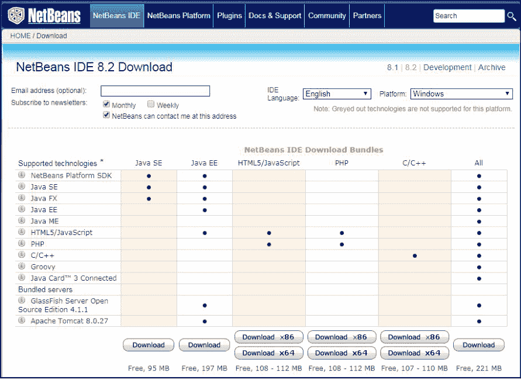

由于我们已经下载了，我们将看到以下页面……（此处省略重复的占位符文本）

# Java 入门

```java
HelloWorld.java
Source History
1 /*
2 * To change this license header, choose License Headers in Project Properties
3 To change this template file, choose Tools | Templates
4 * and open the template in the editor.
5 */
6 /*
7 @author nidishhas
8 */
9 public class HelloWorld {
} }
```

## Java 注释

你会发现，本文档的部分内容是完全的人类可读的；这些我们称之为注释。在 Java 文件中，位于 `/*` 和 `*/` 符号之间的任何文本都会被编译器完全忽略。我们可以在这里编写任何喜欢的内容，而这不会影响程序的运行方式。现在，让我们删除这些注释，这样我们就可以专门处理 Java 代码了。

## main() 函数

Java 代码就像英语语言一样，从上到下、从左到右读取。即使我们的项目包含许多文件和类，我们仍然需要从一个特定的点开始读取和执行代码。我们将此文件和类命名为 `HelloWorld`，与我们的项目名称相同，因为我们希望它是特别的，并包含 `public static void main(String[] args)` 方法，我们的代码执行将从这里开始。这真是一长串专业术语。现在，只需输入它，并知道这是我们 Java 程序开始读取和执行代码的区域即可。再次强调，当我们开始学习 Java 时，这将会变得清晰得多；只需知道这是我们 Java 程序的起点即可。`main()` 函数的代码被包含在花括号中：

```java
public class HelloWorld {
    public static void main(String[] args) {
}
}
```

# Java 入门

在 IDE（集成开发环境）中工作的优点之一是，它会高亮显示哪些括号是相互对应的。括号允许我们将代码放置在代码的其他区域。例如，我们的 `main()` 方法包含在 `HelloWorld` 类中，而我们准备要编写和执行的 Java 代码将包含在我们的 `main()` 方法中。第 4 行目前为空，将是我们的程序读取和执行 Java 代码的地方。

## 打印字符串

我们 `HelloWorld` 程序的目标相当 modest。当它运行运行时，我们希望它在屏幕底部的输出框中打印一些文本。

当我们下载 Java SDK 时，我们获得了一个有用函数库，其中一个就是这个。这就是 `println()` 函数，或者说打印行函数。当我们的 Java 代码执行到我们的函数时（这会立即发生，因为它是 `main()` 入口点的第一个函数），Java 代码将向我们的输出框打印一些单词。函数名后面跟着左括号和右括号。在括号内部，我们放入函数完成其任务所需的信息。当然，`println()` 方法需要知道我们想要打印什么。在 Java 中，一行文本由双引号引号包含，我们称其为字符串（string）。让我们让程序打印 "Hello World!"。

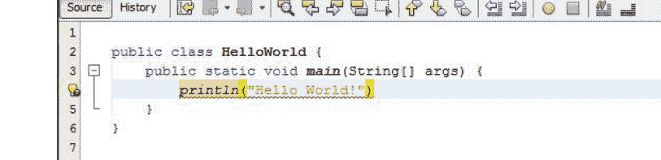

## Java 语法

你可能注意到 NetBeans 一直在对我们“大吼大叫”。左侧有一个灯泡和一个红点，我们的文本下方有一些红色的抖动，非常就像我们在某些文本编辑器中犯了拼写错误一样。而这正是我们所犯的。我们在 Java 代码中犯了明显的语法错误，而 NetBeans 也知道如是。

# Java 入门

这里有两个错误。第一个是我们的代码没有以分号结尾。Java 对空格和换行符的处理并不完美，因此我们需要在每行代码的末尾加上分号，原因就像摩斯电码操作员会在每行结束发送“停止”信息一样。让我们在 `println()` 语句末尾添加一个分号。

```java
public class HelloWorld {
    public static void main(String[] args) {
        System.out.println("Hello World!");
    }
}
```


NetBeans 变得稍微满意了一点；抖动减少了，但如前面的截图所示，仍然存在问题。

问题在于，编程语言中的函数就像计算机上的文件一样，它们有一个存在的位置。NetBeans 不确定在何处找到我们尝试使用的 `println()` 函数。因此，我们只需要告诉 NetBeans 这个函数存在于何处。`println()` 函数的完整路径从 `System` 包开始，该包包含了 `out` 类，而该类拥有了 `println()` 函数的定义。在 Java 中，我们将其写为 `System.out.println("Hello World!");`；如下代码所示。

让我们去掉第 5、6、7 行创建的额外空格，不是因为它们会影响程序的运行方式，而是因为这看起来不是那么美观。现在我们写好了 `HelloWorld` 程序：

```java
public class HelloWorld {
    public static void main(String[] args) {
        System.out.println("Hello World!");
    }
}
```

# Java 入门

## 执行我们的程序

那么我们要对它做什么呢？正如我们所知，我们的计算机无法直接读取这些 Java 代码。它必须将其转换为计算机可读的语言。执行这些代码变成了一个两个步骤的过程：

1. 编译我们的程序：首先，我们让 NetBeans 构建我们的项目。这意味着我们的代码将被编译并转换为计算机可读的：
   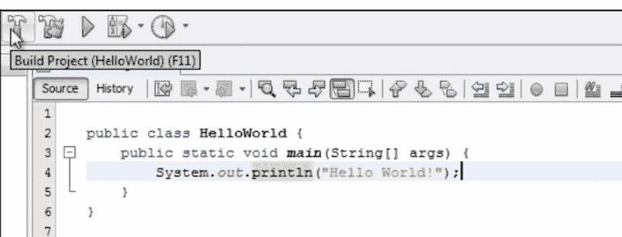

   当我们点击构建按钮时，我们会在输出框中看到构建构建成功的消息，以及构建项目所需的时间：
   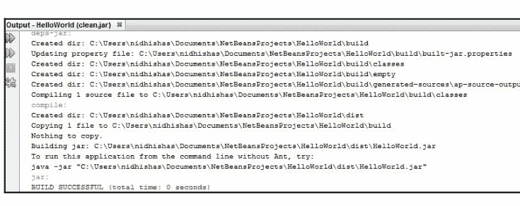

2. 运行我们的程序：一旦构建了项目，我们就可以点击运行按钮来执行它：
   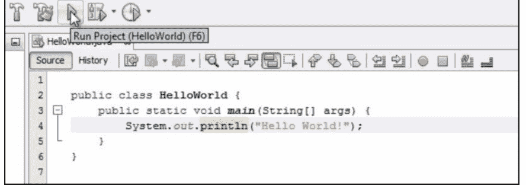

   NetBeans 随后会给我们一个弹出框：
   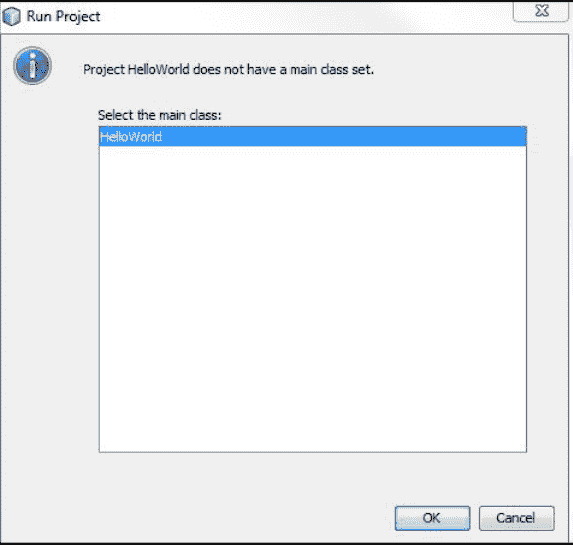

我们在 IDE 之外执行程序时，通过启动其可执行文件来执行它。由于我们现在处于集成开发环境中，NetBeans 想要确定哪一个文件是我们的入口点。当我们点击 OK 时，我们的输出框将告诉我们程序已开始运行，我们的程序打印了：

Output - HelloWorld (run)

> run:
>
> Hello World!
>
> BUILD SUCCESSFUL (total time: 0 seconds)

我们成功了！现在我们是 Java 程序员了。当然，还有很多要学的。事实上，Java 中的 HelloWorld 可能是你写过的最简单的程序了。Java 极其强大，现实是我们在编写第一个程序时，无法欣赏它的所有细节。真正的好消息是，从现在开始，我们不需要进行过多的尝试，可以通过循序渐进的方法开始对 Java 建立坚实的理解。

## 如何解释 NetBeans 检测到的错误？

当我们编写更多复杂的 Java 程序时，我们不可避免地会犯一些错误。其中某些错误是严重的逻辑错误或我们的误解，在解决它们之前我们可能需要自我学习。但是，特别是当我们开始编程时，我们会犯很多愚蠢的错误，只要我们知道看哪里，这些很容易修复。

幸运的是，Java 编译器被设计为遇到错误时向我们指出。为了演示这一点，让我们简单地删除 `println` 语句中的分号，使我们的 HelloWorld 程序出错：

```java
public class HelloWorld {
    public static void main(String[] args) {
        System.out.println("Hello World!")
    }
}
```

NetBeans 红色抖动该行告诉我们那里确实有问题，但我们仍然可以要求编译器尝试一下。如果我们尝试构建这个项目，我们没有得到应有的 COMPILATION SUCCESSFUL 消息；相反，我们得到了一个错误消息：


# Java 入门

这个错误信息是 `; expected`，这是一个非常实用且自明易懂的错误消息。

同样重要的是此消息中冒号后面的数字，它是 4。这让我们知道编译器在 NetBeans 中是从哪一行捕到这个错误的，如果我们点击错误，IDE 将高亮显示该行代码：

```java
public class HelloWorld {
    public static void main(String[] args) {
        System.out.println("Hello World");
    }
}
```

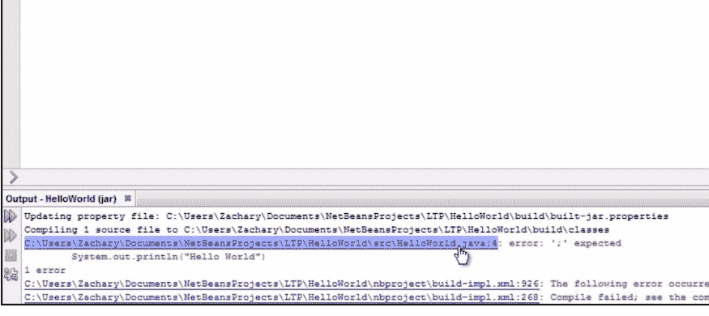

# Java 入门

如果我们加上分号 `;`，我们的程序就能成功构建，如下截图所示：

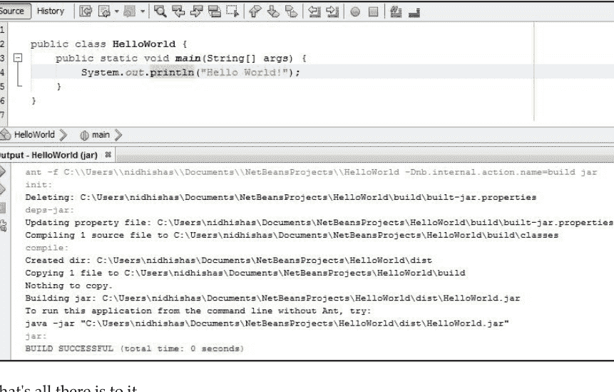

全部就是这样了。

当然，并不是所有的消息都是自明易懂的。为了起见，让我们创建一个稍微复杂的错误。如果我们在程序中忘记插入其中一个括号会发生什么？如下代码所示：

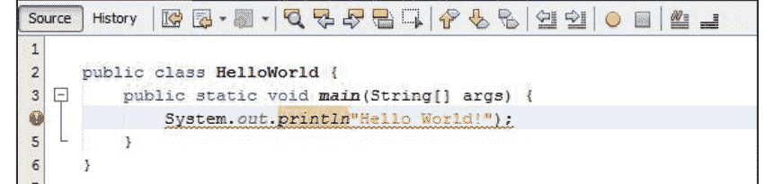

# Java 入门

当我们点击“构建项目”（Build Project）时，我们得到的不是一个而是两个错误，尽管我们只犯了一个错：

```
Compiling 1 source file: C:\Users\NitishSharma\Documents\MeProjects\HelloWorld\HelloWorld.class
C:\Users\NitishSharma\Documents\MeProjects\HelloWorld\HelloWorld.java:4: error: not a statement
System.out.println("Hello World!");
C:\Users\NitishSharma\Documents\MeProjects\HelloWorld\HelloWorld.java:4: error: expected '}'
System.out.println("Hello World!");
2 errors
C:\Users\NitishSharma\Documents\MeProjects\HelloWorld\HelloWorld.java:30: error: The following error occurred while compiling this line:
expected '}'; see the compiler error output for details.
BUILD FAILED (time: 0 seconds)
```

我们的第一个错误是“不是语句”（not a statement），然后它让我们注意到它不理解的那行。如果我们仔细观察一下第一个错误，可能会发现我们少了一对括号，所以我们能够修复这个错误；但是，第二个错误呢？即使在事实上真的写了分号的情况下，我们还是得到了 `; expected`（预期分号）。

嗯，程序中发生了一个错误后，编译器理解该行代码的能力很快就崩溃了。我们正在调试代码；通俗的做法是只处理列表上的第一个错误；那是编译器遇到的第一个错误。我们可能可以从下方的错误中获得有用的信息，但大多数情况下，它们仅仅是由犯下的第一个语法错误所产生的错误。这里没什么大惊小怪的，但我想向你指出这一点，因为在学习编程时，能够跟踪编译器错误可以节省我们很多头疼。

## 代码补全功能

在我们谈论 NetBeans 时，让我们快速过一下一个 IDE 功能。假设我想写一行新代码，并准备使用 `System` 库中的某些内容：

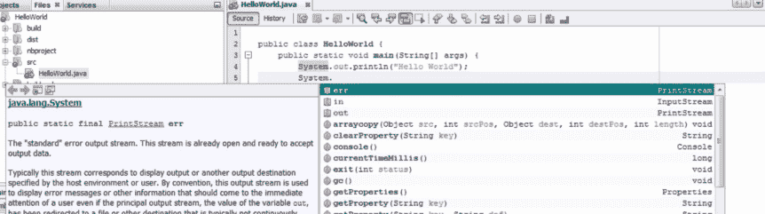

# Java 入门

一旦我输入了 `System.`，NetBeans 就可以为我提供有效的建议。当然，这些建议中只有一个是我寻找的。NetBeans 编译器有许多这类实用的功能。如果你是那种认为代码补全很棒的人，请尽管保留这些工具。我们可以通过进入 `Tools (工具) | Options (选项) | Code Completion (代码补全)` 并勾选我们想要的功能来实现：

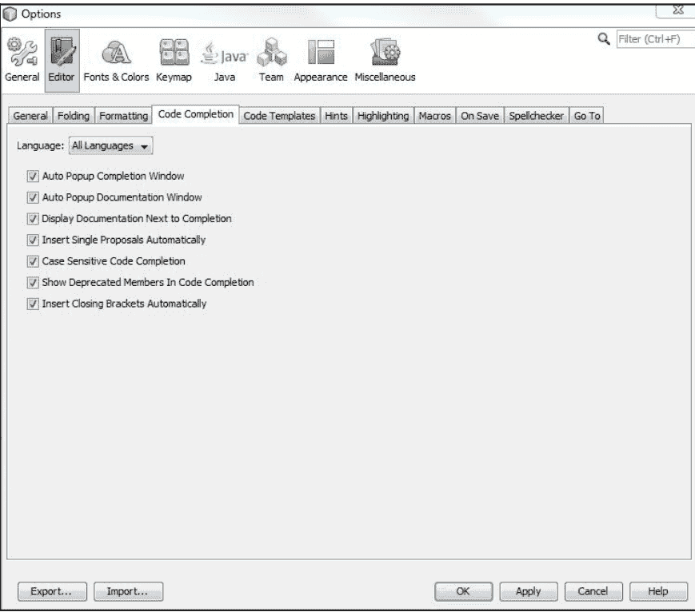

如果你希望 NetBeans 的行为更像一个文本编辑器，请尽管取消勾选这些功能。我们可以通过进入 `Tools (工具) | Options (选项) | Code Completion (代码补全)` 并取消勾选我们不想要的功能来实现：


（注：原文此处存在大量重复的 OCR 识别错误，已根据逻辑流进行处理。）

## 总结

在本章中，你学习了 Java 是什么并看到了相关功能。我们介绍了安装 Java 的步骤。然后设置了环境。在下一章中，我们将查看不同的类型。我们看到了如何使用变量。

## 变量的解决方案

幸运的是，编程为我们提供存储和检索数据的方法；这被称为变量。在 Java 中声明变量，我们首先必须指定它将是哪种变量。变量有多种不同的类型。在本例中，我们使用的内容是非分数数字。此外，在这种情况下，如果任何地方都没有小数点，那么使用 Java 的基本类型之一是合适的。这些本质上是我们 Java 语言中处理的信息所能达到的最基础级别；我们在 Java 中处理的所有其他内容都是由基本类型构建的。

- 整数（Integer）
- 浮点（Floating-point）
- 字符（Character）
- 字符串（String）

## 整数变量

要声明一个整数基本类型的变量（即整数），我们使用全小写的 `int` 关键字。一旦这样做，我们需要给变量命名。这是一个我们将来用于访问该部分信息的唯一标识符。我们本地程序中的每个变量都应该有自己的名字。让我们第一个变量命名为 `x`，第二个变量命名为 `y`：


```java
package variables;

public class Variables {
    public static void main(String[] args) {
        int x;
        int y;
        System.out.println(2+3);
        System.out.println(2-3);
        System.out.println(2*3);
        System.out.println(2/3);
    }
}
```

## 理解变量

除了这些，Java 还可以执行基础算术运算。它可以执行加、减、乘（我们使用 `*`）和除。如果我们用 `2` 和 `3` 运行以下程序，我们将看到结果：

```java
package variables;

public class Variables {
    public static void main(String[] args) {
        System.out.println(2+3);
        System.out.println(2-3);
        System.out.println(2*3);
        System.out.println(2/3);
    }
}
```

# 理解类型化变量

我们刚刚写了两个行完全合法的 Java 代码。如果我们现在运行该程序，我们将看到与之前完全相同的输出：

```
Output - Variables (run)
run:
5
-1
6
BUILD SUCCESSFUL (total time: 0 seconds)
```

然而，在幕后，Java 也会为我们的 `x` 和 `y` 变量留出内存空间。这种分配不会影响我们的 `println` 命令，因为在这些命令中还没有引用这些变量。

所以，让我们在变量中存储一些信息吧。一旦我们创建了变量，就可以直接通过变量的名称来引用它。重要的一点是，我们不要不要通过再次输入 `int x` 来引用我们的变量，因为该命令是让 Java 创建一个全新的变量 `x`，而不是访问已有的变量 `x`：

```java
public class Variables {
    public static void main(String[] args) {
        variable x is already defined in method main(String[])
        ----
        (Alt-Enter shows hints)
    int x
    }
}
```

一旦我们引用了变量，就可以使用等号来改变它的值。所以，让我们将 `x` 设置为 4，将 `y` 设置为 3。我们的 `println` 命令目前使用的是两个显式声明的整数：数字 2 和 3。由于 `x` 和 `y` 也是整数，理理我们可以用变量 `x` 和 `y` 替换现有的数字：

```java
package variables;

public class Variables {
    public static void main(String[] args) {
        int x;
        int y;
        x = 4;
        y = 3;
        System.out.println(x+y);
        System.out.println(x-y);
        System.out.println(x*y);
        System.out.println(x/y);
    }
}
```

以下是上述代码的输出：

| Output - Variables (run) |
|---|
| run: |
| 7 |
| 1 |
| 12 |
| BUILD SUCCESSFUL (total time: 0 seconds) |

当我们的 Java 代码处理变量 `x` 和 `y` 时，它会查看它们目前被赋予了什么整数值。它找到了数字 4 和 3。所以，如果我们运行程序，应该预期第一个 `println` 语句 `x+y` 的结果为 `4+3`，然后结果为 `7`。这正是发生的情况。

在这里我们遇到了一些有趣的问题。我们程序的最后一行（我们将 `x` 除以 `y`）其计算结果并没有像我们在数学上预期的那样运行。在这行代码中，`x` 的值为 4，`y` 的值为 3。现在 4 除以 3 等于 1.3，但我们的程序只打印了 1。因为 1.3 不是一个有效的整数。整数只能是整数，永远不会是分数或小数。因此，为了继续处理整数，Java 简单地将带有小数部分的计算结果向下取整到最接近的整数。如果我们想在一个可以产生小数结果的环境中工作，我们需要使用整数以外的原始类型。

无论如何，既然我们已经设置了 `println` 来更改变量输入而不是显式数字，我们就可以通过更改这些整数变量的值来修改所有四行计算的行为。例如，如果我们想让程序在输入值 -10 和 5 上运行（整数可以是负数；它们只是不能有小数部分），我们只需要更改赋给变量 `x` 和 `y` 的值即可：

```java
package variables;

public class Variables {
    public static void main(String[] args) {
        int x;
        int y;
        x = -10;
        y = 5;
        System.out.println(x+y);
        System.out.println(x-y);
        System.out.println(x*y);
        System.out.println(x/y);
    }
}
```

如果我们快速运行上述代码，我们将看到预期的结果：

| Output - Variables (run) |
|---|
| run: |
| -5 |
| -15 |
| -50 |
| -2 |
| BUILD SUCCESSFUL (total time: 0 seconds) |

太棒了！你刚刚学会了在 Java 中处理整数和变量的最基础知识。

## 整数变量的内存分配

让我们回顾一个边缘情况，并进一步了解 Java 的思考方式。你可能记得之前，我提到过 Java 在我们声明新变量时会留出内存。这是在 Java 这种高级编程语言中工作的巨大优势之一。Java 为我们抽象了或自动处理了大部分的内存管理。很多情况下，这使得编写程序变得更简单，我们可以编写更短、更整洁且更易读的代码。当然，意识到幕后发生的事情是很重要的，以免我们遇到问题。

例如，每当 Java 为整数变量留出内存时，它也会为所有整数变量留出相同数量的内存。这意味着 Java 理论可以在整数变量中存储的最大值最小值。最大整数值是 2147483647，最小整数值是 -2147483648。

# 理解类型化变量

让我们做一个实验。如果我们尝试存储并打印一个大于最大值的整数变量，会发生什么？首先，让我们简化程序。我们只是要赋值一个比最大值大 1 的值。

```java
public class Variables {
    public static void main(String[] args) {
        int x = 2147483647;
        x++;
    }
}
```

## 理解类型变量

让我们分析一下为什么会发生这种情况。当我们在 Java 中使用显式数字时，即写出数字本身而不是使用变量，这个显式数字仍然会被 Java 分配一个类型。因此，当我们输入一个不带任何小数点的数字时，该数字类型被假设为整数（integer）。我们的赋值运行得非常好。带有小数点的数字被假设为这种类型，并称为 `double`；它是 `float` 数据类型的姐妹类型，但它们并不相同。我们稍后会详细讨论 `double`。现在，我们需要做的是告诉 Java 将 `5.5` 视为 `float` 类型数字而不是 `double`。要做到这一点，我们只需要在数字后面加上一个 `f`，如下所示：

```
float nNumber = 5.5f;
```

你会发现灯泡图标和红色消失了。为了确保语法正确，让我们给程序添加一些非常基础的功能。让我们使用 `System.out.println()` 顺序打印我们的整数，然后打印我们的浮点数变量：

```
System.out.println(nNumber);
System.out.println(fNumber);
```

当我们编译这个程序时，编译器错误消失了，当我们运行它时，我们如预期所示看到了两个赋值值。这里没什么特别兴奋的：

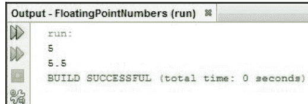

## 整数和 float 数据类型的行为差异

现在，与其给变量赋值显式值，让我们做一些基础算术，看看整数和浮点数在 Java 中修改时的行为何不同。在 Java 中，`float` 和 `int` 都是原始类型（primitive types），是编程语言的逻辑构建模块。这意味着我们可以使用数学运算符（如除法）对它们进行比较和修改。

我们知道，如果尝试用一个整数除以另一个整数，结果总是会得到一个整数，即使我们除以一个浮点数，标准数学也不会产生预期的结果。然而，如果我们用一个浮点数除以另一个浮点数，我们将得到更符合数学逻辑的结果：

```java
package floatingpointnumbers;

public class FloatingPointNumbers {

    public static void main(String[] args) {
        int iNumber = 5/4;
        float fNumber = 5.0f/4.0f;
        System.out.println(iNumber);
        System.out.println(fNumber);
    }
}
```

以下是上述代码的输出：

| Output - FloatingPointNumbers (run) |
|---|
| run: |
| 1 |
| 1.25 |
| BUILD SUCCESSFUL (total time: 0 seconds) |

有时，Java 会让我们做一些可能不是好主意的事。例如，Java 允许我们将浮点数变量 `fNumber` 的值设置为一个整数除以另一个整数，而不是一个浮点数除以另一个浮点数：

```java
int iNumber = 5/4;
float fNumber = 5/4;
```

## 理解类型变量

由于等号右侧的计算发生在浮点数变量 `fNumber` 值改变之前，我们在两个 `5/4` 的计算中将看到相同的输出。这是因为 `5` 和 `4` 都是整数变量。所以当我们运行程序时，尽管 `fNumber` 仍然是一个浮点数（我们可以从它打印时带有小数看出出来），它的值仍然被设置为 `5/4` 的向下取整数字：

```
Output - FloatingPointNumbers (run)
run:
1
1.0
BUILD SUCCESSFUL (total time: 0 seconds)
```

解决这个问题非常简单；我们只需要通过在其中整数值后面附加 `f`，将其中一个整数值变为浮点数：

```java
int iNumber = 5/4;
float fNumber = 5/4.0f;
```

现在，计算将知道如何处理小数除法了：

```
Output - FloatingPointNumbers (run)
run:
1
1.25
BUILD SUCCESSFUL (total time: 0 seconds)
```

当我们停止使用显式声明的数字并开始使用变量时，正确处理这些就会变得稍微复杂且更重要。

## 理解类型变量

现在让我们声明两个整数变量。我将它们简称为 `iNumber1` 和 `iNumber2`。现在，与其尝试将 `fNumber` 的值设置为一个显式声明数字除以另一个，我们将它的值设置为 `iNumber1/iNumber2`，并打印存储在 `fNumber` 中的结果：

```java
package floatingpointNumbers;

public class FloatingPointNumbers {
    public static void main(String[] args) {
        int iNumber1 = 5;
        int iNumber2 = 6;
        float fNumber = iNumber1/iNumber2;
        System.out.println(fNumber);
    }
}
```

当我们运行这个程序时，因为我们再次是在用一个整数除以另一个整数，我们将看到取整现象。存储在浮点数变量中的值为 `0.0`，`5/6` 的向下取整结果：

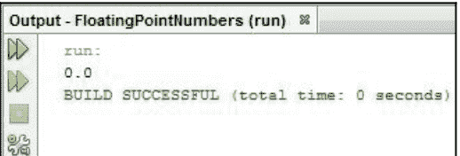

如果我们使用的是显式声明的数字，我们将通过在数字后面加上 `f` 将其变为浮点数来解决这个问题。在处理显式声明数字的情况下，我们将通过在数字后面加上 `f` 将其变为浮点数来解决这个问题（注：此处原文逻辑重复，翻译已按原意保留）。在处理显式声明数字的情况下，我们将通过在数字后面加上 `f` 将其变为浮点数来解决这个问题（注：此处原文逻辑重复，翻译已按原意保留）。在处理显式声明数字的情况下，我们将通过在数字后面加上 `f` 将其变为浮点数来解决这个问题（注：此处原文逻辑重复，翻译已按原意保留）。（注：英文原文在此处确实存在重复句）。

## 类型转换（Type casting）

我们可以通过类型转换来获得类似的结果，在 Java 中我们需要它一个 `float`。在这种情况下，我们要求 `Number2` 表现为浮点数。`Number1` 是一个 `float`。

现在我们需要修复这个错误。错误发生是因为将一个 `double` 类型除以另一个类型将会返回一个 `double` 结果。我们可以通过两种方式解决此问题：

1. 首先，将 `dNumber1` 和 `dNumber2` 转换为浮点数然后除以它们：

```java
float fNumber = (float) iNumber1/(float) dNumber2;
```

2. 然而，我们的两个数字进行除法是一个完全合法的操作。所以为什么不让它自然发生，然后将结果 `double` 转换为浮点数，从而保留更多的精度呢。就像在代数中一样，我们可以使用括号将我们希望在另一个之前之前程序块隔离开：

```java
float fNumber = (float) (dNumber1/dNumber2);
```

现在如果我们运行这个程序，我们将得到预期的结果：

| Output |
|---|
| Debugger Console FloatingPointNumbers (run) |
| run: |
| 0.8333333 |
| BUILD SUCCESSFUL (total time: 0 seconds) |

这就是对在使用浮点数（作为整数时）的一个非常实用的介绍：

## double 数据类型

让我们快速讨论一下 `double` 类型。它是 `float` 的姐妹类型。它提供了更高的分辨率：`double` 数字可以有更多的小数位。但它们占据更多的内存。在此时，使用 `double` 还是 `float` 通常取决于风格或个人偏好。除非你正在编写必须以内存效率运行的软件，否则 `double` 占据的额外内存并不大。

## 理解类型变量

为了说明 `double` 如何工作，我们将 `FloatingPoint.java` 程序中的两个整数数字改为 `double` 类型。当我们只更改变量名称时，程序的逻辑没有任何变化。但当我们这些变量的声明从整数改为 `double` 时，逻辑发生了变化。总之，当我们显式声明一个带有小数点的数字时，它默认是 `double`：

```java
double dNumber1 = 5.7;
double dNumber2 = 6.85431;
float fNumber = dNumber1/dNumber2;
```

## Math 类库

在任何软件开发项目中，我们的大部分时间都会花在教导程序解决它经常遇到的类型问题上。作为程序员，我们将会反复一次地遇到某些问题。有时，我们需要为这些问题编写自己的解决方案，并希望将它们保存起来以备后用。然而，大多数情况下，已经有人遇到过这些问题了，如果他们公开了解决方案，我们的选择之一就是利用他们的解决方案为我们所用。

在本节中，我们将使用 JDK 自带的 Math 类库来为我们解决一些数学问题。要开始本节，创建一个全新的 NetBeans 项目（我将把它命名为 TheMathLib）并进入 `main()` 函数。我们将编写一个非常简单的程序。让我们声明一个浮点数并给它赋值值（不要忘记在显式赋值后面加上 `f`，让 Java 知道我们声明了一个浮点数），然后使用 `System.out.println()` 将此值打印到屏幕上：

```java
package themath;

public class MathLib {
    public static void main(String[] args) {
        float number = 4.321f;
        System.out.println(number);
    }
}
```

好了，搞定了：

| 输出 | 调试器控制台 | TheMathLib (run) |
|---|---|---|
| run: 4.321 BUILD SUCCESSFUL (total time: 0 seconds) | | |


通过这个程序，我们想非常轻松地将浮点数提高到各种次方。所以，如果我们想计算这个数的平方，我猜我们只需要打印 `number*number` 的值。如果我们想让它立方，只需打印 `number*number*number`。而且，如果我们想把它提高到六次方，可以让它乘以自己六次。当然，这很快就会变得繁琐，肯定有更好的方法。

## 理解类型变量

让我们利用 Java Math 类库来帮助我们把数字提高到不同的指数幂。现在，我刚刚告诉你我们寻找的功能存在于 Math 类库中。这就是你应该从 Google 搜索中获得的正确引导，或者如果你是一个经验丰富的软件开发者，你可以实现一个特定的 API。遗憾的是，这些信息对于我们启动这个类库的功能来说还不够。我们不知道它是如何工作的细节，也不知道它具体提供了什么。

为了找到这一点，我们将查看它的文档。这是由 Oracle 管理的 Java 开发 Kit 文档：`docs.oracle.com/javase/7/docs/api/`。在页面上显示的库中有 `java.lang`。当我们选择它时，我们将在“类摘要”（Class Summary）下找到我们一直在找的 `Math` 类。一旦我们导航到 `Math` 类库页面，我们就得到了两个东西。我们得到了一些关于该库的人类友好文本、它的历史、预期用途，这些是非常元层的内容。如果我们向下滚动，就能看到此库实现的功能和方法。这正是我们想要的细节：

| 修饰符和类型 | 方法和描述 |
|---|---|
| static double | `abs(double a)` 返回 double 值的绝对值。 |
| static float | `abs(float a)` 返回 float 值的绝对值。 |
| static int | `abs(int a)` 返回 int 值的绝对值。 |
| static long | `abs(long a)` 返回 long 值的绝对值。 |
| static double | `acos(double a)` 返回一个值的反余弦；返回的角度范围在 0.0 到 pi 之间。 |
| static double | `atan(double a)` 返回一个值的反正切；返回的角度范围在 -pi/2 到 pi/2 之间。 |
| static double | `atan2(double y, double x)` 返回从直角坐标 (x, y) 转换为极坐标 (r, theta) 的转换角度。 |

## 使用 pow() 函数

这些函数中应该有一个让我们脱颖而出，那就是 `pow()`，或者说幂函数。它返回第一个参数 (`double a`) 提升到第二个参数 (`double b`) 幂的值。简而言之，它将允许我们将数字提高到任意次方：

```java
static double pow(double a, double b) // 返回第一个参数的第二个参数幂的值。
```

## 理解类型变量

回到代码编写。好了，让我们使用这个 `pow()` 函数在声明变量后修改变量 `number` 的值。我们将进行类似 `number = pow` 的操作，但我们需要更多信息：

```java
float number = 4.321f;
number = pow;
```

具体如何使用这个 `pow()` 函数呢？嗯，如果我们点击文档，我们会看到 `pow()` 函数的声明，除了括号外还指定了两个参数。这些参数 `double a` 和 `double b` 是函数在按预期运行之前请求的两个信息片段。

我们的任务是将这些请求的 `double a` 和 `double b` 替换为实际变量或显式值，这样 `pow()` 函数就可以工作了。我们的文档告诉我们 `double a` 应该被我们想要提高的变量或值。

## 导入类库

程序中不是特别易读的一点是像 `pow()` 和 `println()` 等函数的长路径。有办法缩短它们吗？当然有。如果 Java 的制者想这样做，他们可以允许通过简单输入来调用此函数。但这将产生意外的副作用。例如，如果有两个链接的库都声明了 `pow()` 函数，Java 将不知道该使用哪一个。因此，默认情况下，我们被显式地链接到库。

所以，如果我们想要输入像 `pow()` 这样的内容，可以将库导入到我们工作的本地空间。我们只需要在类和 `main()` 函数上方执行一个 `import` 命令。`import` 命令接收的输入是我们希望 Java 在遇到无法立即识别的关键字（如 `pow()`）时查找的路径。为了让我们能够在程序中使用更简单的 `Math.pow()` 语法，我们只需要输入 `java.lang.Math`：

```java
package themathlib;

import java.lang.Math;

public class MathLib {
    public static void main(String[] args) {
        double number = 4.321;
        number = java.lang.Math.pow(number, 4.0);
        System.out.println(number);
    }
}
```

导入有一些特殊语法。为了导入 `java.lang` 中的所有库，我们将 `.Math` 替换为 `.*`，这翻译为“导入 java.lang 包中的每个库”。我应该通知你，对于我们在 NetBeans 中工作的，这是默认完成的。然而，在这种情况下，我们将显式这样做，因为你可能需要在其他 Java 环境中这样做。

# Char 变量

处理数字的程序很好，但通常我们也希望能够处理文本和单词。为了这一点，Java 定义了字符（character）或原始类型。字符是你可以与计算机处理的文本最小实体。我们可以从单个字母开始考虑它们。

# 理解类型化变量

让我们创建一个新项目；我们将其命名为 `Characters.java`。我们将通过定义一个单个字符来开始程序。我们将其命名为 `character1`，并将其赋值为大写字母 H：

```java
package characters;

public class Characters {
    public static void main(String[] args) {
        char character1 = 'H';
    }
}
```

正如我们在显式定义浮点数时需要使用额外的语法一样，在定义字符时也需要额外的语法。为了告诉 Java 我们正在显式声明一个字符值，我们需要将想要赋值给变量的字面量括在两个单引号之间。与双引号不同，单引号让我们知道我们处理的是一个字符或单个字母，而不是尝试使用整个字符串。字符只能拥有单个实体值。如果我们尝试将 Hi 的值赋值给 `character1`，NetBeans 和 Java 都会告诉我们那不是一个有效选项：

```java
char character1 = 'Hi';
```

现在，让我们继续编写一个虽然有点复杂但对于我们的示例目的运行良好的程序。让我们定义五个字符。我们将它们命名为 `character1` 到 `character5`。我们将按照顺序将 "Hello" 单词中的五个字母中的一个赋值给每一个。当打印这些字符时，我们的输出将显示 Hello。在程序的部分，让我们使用 `System.out.print()` 在屏幕上显示这些字母。`System.out.print()` 的工作与 `System.out.println()` 相同，只是它不在行尾添加换行符。我们在最后一个命令加上处理，以便我们的输出与控制台中显示的所有额外文本隔开：

```java
package characters;

public class Characters {

    public static void main(String[] args) {
        char character1 = 'H';
        char character2 = 'e';
        char character3 = 'l';
        char character4 = 'l';
        char character5 = 'o';

        System.out.print(character1);
        System.out.print(character2);
        System.out.print(character3);
        System.out.print(character4);
        System.out.print(character5);
    }
}
```

如果我们运行这个程序，它会向我们问好。它显示 Hello，然后有一些额外的文本：

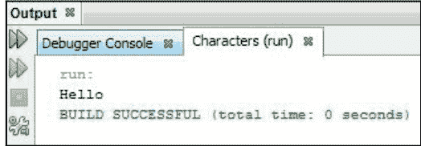

这非常直观。

现在让我展示一些东西，可以让我们稍微了解计算机是如何思考字符的。事实证明，我们不仅可以通过在单引号之间显式声明大写字母 H 来设置 `character1` 的值，还可以通过给它一个整数值。每个可能的字符值都有一个对应的数字，我们可以用来代替它。如果我们用值 72 替换 H，我们仍然会打印出 Hello。如果我们使用值 73（比 72 大 1）而不是大写 H，我们将得到大写字母 I，因为 I 是字母 H 之后的字母。

我们必须确保不要在单引号之间放入 72。最好的情况是 Java 识别出 72 不是有效的字符，并且看起来像两个字符，这样我们的程序将无法编译。如果我们使用被单引号括的单个数字，我们的程序将正常编译，但我们将得到完全出乎意料的输出 7ello。

那么我们如何确定字符的数值值呢？是否存在一个通用的查找表（ASCII 表），将字符映射到它们的数值值：

| Dec | Oct | Char | Dec | Oct | Chr | Dec | Oct | Chr | Dec | Oct | Chr |
|---|---|---|---|---|---|---|---|---|---|---|---|
| 0 | 000 | NUL (null) | 32 | 20 | 64: Space | 64 | 40 | 100: @ | 96 | 60 | 144: ~ |
| 1 | 001 | SOH (start of heading) | 33 | 21 | 65: # | 65 | 41 | 101: A | 97 | 61 | 149: a |
| 2 | 002 | STX (start of text) | 34 | 22 | 66: $ | 66 | 42 | 102: B | 98 | 62 | 150: b |
| 3 | 003 | ETX (end of text) | 35 | 23 | 67: % | 67 | 43 | 103: C | 99 | 63 | 151: c |
| 4 | 004 | EOT (end of transmission) | 36 | 24 | 68: & | 68 | 44 | 104: D | 100 | 64 | 152: d |
| 5 | 005 | ENQ (acknowledge) | 37 | 25 | 69: ' | 69 | 45 | 105: E | 101 | 65 | 153: e |
| 6 | 006 | ACK (acknowledge) | 38 | 26 | 70: ( | 70 | 46 | 106: F | 102 | 66 | 154: f |
| 7 | 007 | BEL (bell) | 39 | 27 | 71: ) | 71 | 47 | 107: G | 103 | 67 | 155: g |
| 8 | 008 | BS (backspace) | 40 | 28 | 72: * | 72 | 48 | 108: H | 104 | 68 | 156: h |
| 9 | 009 | TAB (horizontal) | 41 | 29 | 73: + | 73 | 49 | 109: I | 105 | 69 | 157: i |
| 10 | 00A | LF (line feed, new line) | 42 | 30 | 74: , | 74 | 50 | 110: J | 106 | 70 | 158: j |
| 11 | 00B | VT (vertical) | 43 | 31 | 75: - | 75 | 51 | 111: K | 107 | 71 | 159: k |
| 12 | 00C | FF (form feed) | 44 | 32 | 76: . | 76 | 52 | 112: L | 108 | 72 | 160: l |
| 13 | 00D | CR (carriage return) | 45 | 33 | 77: / | 77 | 53 | 113: M | 109 | 73 | 161: m |
| 14 | 00E | SH (shift in) | 46 | 34 | 78: 0 | 78 | 54 | 114: N | 110 | 74 | 162: n |
| 15 | 00F | SO (shift out) | 47 | 35 | 79: 1 | 79 | 55 | 115: O | 111 | 75 | 163: o |
| 16 | 010 | DC (device control) | 48 | 36 | 80: 2 | 80 | 56 | 116: P | 112 | 76 | 164: p |
| 17 | 011 | DC1 (device control) | 49 | 37 | 81: 3 | 81 | 57 | 117: Q | 113 | 77 | 165: q |
| 18 | 012 | DC2 (device control) | 50 | 38 | 82: 4 | 82 | 58 | 118: R | 114 | 78 | 166: r |
| 19 | 013 | DC3 (device control) | 51 | 39 | 83: 5 | 83 | 59 | 119: S | 115 | 79 | 167: s |
| 20 | 014 | DC4 (device control) | 52 | 40 | 84: 6 | 84 | 60 | 120: T | 116 | 80 | 168: t |
| 21 | 015 | NAK (negative acknowledge) | 53 | 41 | 85: 7 | 85 | 61 | 121: U | 117 | 81 | 169: u |
| 22 | 016 | STW (synchronous idle) | 54 | 42 | 86: 8 | 86 | 62 | 122: V | 118 | 82 | 170: v |
| 23 | 017 | ET (end of transmission) | 55 | 43 | 87: 9 | 87 | 63 | 123: W | 119 | 83 | 171: w |
| 24 | 018 | CAN (cancel) | 56 | 44 | 88: : | 88 | 64 | 124: X | 120 | 84 | 172: x |
| 25 | 019 | EM (end of medium) | 57 | 45 | 89: ; | 89 | 65 | 125: Y | 121 | 85 | 173: y |
| 26 | 01A | US (unit separator) | 58 | 46 | 90: < | 90 | 66 | 126: Z | 122 | 86 | 174: z |
| 27 | 01B | ESC (escape) | 59 | 47 | 91: > | 91 | 67 | 127: [ | 123 | 87 | 175: { |
| 28 | 01C | FS (file separator) | 60 | 48 | 92: = | 92 | 68 | 128: ] | 124 | 88 | 176: } |
| 29 | 01D | GS (group separator) | 61 | 49 | 93: ? | 93 | 69 | 129: ^ | 125 | 89 | 177: \| |
| 30 | 01E | RS (record separator) | 62 | 50 | 94: @ | 94 | 70 | 130: _ | 126 | 90 | 178: ~ |
| 31 | 01F | US (unit separator) | 63 | 51 | 95: A | 95 | 71 | 131: ` | 127 | 91 | 179: \ |

在本节中，我们处理了列 1 (Dec) 和列 5 (Cr)，它们具有十进制数字和映射的字符。你会注意到这些字符中有些是键盘符号、数字和其他东西。从编程语言的角度来说，换行符、制表符和退格都是元素字符。

为了观察这一点，让我们尝试替换程序中的某些字符，十进制值 9 应该对应于制表符。如果我们把单词中间的字母替换为制表符，作为输出，我们应该期望 `\t` 和 o：

```java
package characters;

public class Characters {
    public static void main(String[] args) {
        char character1 = 'H';
        char character2 = 9;
        char character3 = 9;
        char character4 = 9;
        char character5 = 'o';
        System.out.print(character1);
        System.out.print(character2);
        System.out.print(character3);
        System.out.print(character4);
        System.out.println(character5);
    }
}
```

以下是上述代码的输出：


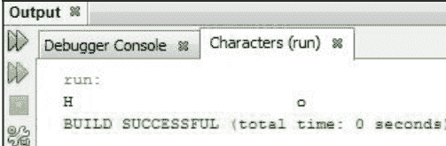

## 字符串

让我们谈谈 Java 中的字符串。首先，创建一个新的 NetBeans 项目，命名为 `StringsInJava`，并进入 `main()` 函数。声明两个变量：一个字符 `c` 和字符串 `s`。你立刻就会发现 `String` 有不同。你会注意到 NetBeans 没有将我们的 `String` 关键字涂为蓝色，就像如果我们声明基本类型变量那样：

```java
package stringsinjava;

public class StringsInJava {
    public static void main(String[] args) {
        char c = 'c';
        String s = "string";
    }
}
```

## 理解类型化变量

等等，让我们创建一个新项目；我们将其命名为 `Characters.java`。我们将通过定义一个单个字符来开始程序。我们将其命名为 `character1`，并将其赋值为大写字母 H：

```java
package characters;

public class Characters {
    public static void main(String[] args) {
        char character1 = 'H';
    }
}
```

正如我们在显式定义浮点数时需要使用额外的语法一样，在定义字符时也需要额外的语法。为了告诉 Java 我们正在显式声明一个字符值，我们需要将想要赋值给变量的字面量括在两个单引号之间。与双引号不同，单引号让我们知道我们处理的是一个字符或单个字母，而不是尝试使用整个字符串。字符只能拥有单个实体值。如果我们尝试将 `Hi` 的值赋值给 `character1`，NetBeans 和 Java 都会告诉我们那不是一个有效选项：

```java
char character1 = 'Hi';
```

现在，让我们继续编写一个虽然有点复杂但对于我们的示例目的运行良好的程序。让我们定义五个字符。我们将它们命名为 `character1` 到 `character5`。我们将按照顺序将 "Hello" 单词中的五个字母中的一个赋值给每一个。当打印这些字符时，我们的输出将显示 Hello。在程序的第二部分，让我们使用 `System.out.print()` 在屏幕上显示这些字母。`System.out.print()` 的工作与 `System.out.println()` 相同，只是它不在行尾添加换行符。我们在最后一个命令加上处理，以便我们的输出与控制台中显示的所有额外文本隔开：

```java
package characters;

public class Characters {
    public static void main(String[] args) {
        char character1 = 'H';
        char character2 = 'e';
        char character3 = 'l';
        char character4 = 'l';
        char character5 = 'o';
        System.out.print(character1);
        System.out.print(character2);
        System.out.print(character3);
        System.out.print(character4);
        System.out.print(character5);
    }
}
```

如果我们运行这个程序，它会向我们问好。它显示 Hello，然后有一些额外的文本：


这非常直观。

现在让我展示一些东西，可以让我们稍微了解计算机是如何思考字符的。事实证明，我们不仅可以通过在单引号之间显式声明大写字母 H 来设置 `character1` 的值，还可以给它一个整数值。每个可能的字符值都有一个对应的数字，我们可以用来代替它。如果我们用值 `72` 替换 `H`，我们仍然会打印出 Hello。如果我们使用值 `73`（比 `72` 大 1）而不是大写 H，我们将得到大写字母 I，因为 I 是字母 H 之后的字母。

我们必须确保不要在单引号之间放入 `72`。最好的情况是 Java 识别出 `72` 不是有效的字符，并且看起来像两个字符，这样我们的程序将无法编译。如果我们使用被单引号括的单个数字，我们的程序将正常编译，但我们将得到完全出乎意料的输出 `7ello`。

那么我们如何确定字符的数值值呢？是否存在一个通用的查找表（ASCII 表），将字符映射到它们的数值值：

| Dec Oct Char | Dec Oct Chr | Dec Oct Chr | Dec Oct Chr |
|---|---|---|---|
| 0 000 NUL (null) | 32 20 64: Space | 64 40 100: @ | 96 60 144: ~ |
| 1 001 SOH (start of heading) | 33 21 65: # | 65 41 101: A | 97 61 149: a |
| 2 002 STX (start of text) | 34 22 66: $ | 66 42 102: B | 98 62 150: b |
| 3 003 ETX (end of text) | 35 23 67: % | 67 43 103: C | 99 63 151: c |
| 4 004 EOT (end of transmission) | 36 24 68: & | 68 44 104: D | 100 64 152: d |
| 5 005 ENQ (acknowledge) | 37 25 69: ' | 69 45 105: E | 101 65 153: e |
| 6 006 ACK (acknowledge) | 38 26 70: ( | 70 46 106: F | 102 66 154: f |
| 7 007 BEL (bell) | 39 27 71: ) | 71 47 107: G | 103 67 155: g |
| 8 008 BS (backspace) | 40 28 72: * | 72 48 108: H | 104 68 156: h |
| 9 009 TAB (horizontal) | 41 29 73: + | 73 49 109: I | 105 69 157: i |
| 10 00A LF (line feed, new line) | 42 30 74: , | 74 50 110: J | 106 70 158: j |
| 11 00B VT (vertical) | 43 31 75: - | 75 51 111: K | 107 71 159: k |
| 12 00C FF (form feed) | 44 32 76: . | 76 52 112: L | 108 72 160: l |
| 13 00D CR (carriage return) | 45 33 77: / | 77 53 113: M | 109 73 161: m |
| 14 00E SH (shift in) | 46 34 78: 0 | 78 54 114: N | 110 74 162: n |
| 15 00F SO (shift out) | 47 35 79: 1 | 79 55 115: O | 111 75 163: o |
| 16 010 DC (device control) | 48 36 80: 2 | 80 56 116: P | 112 76 164: p |
| 17 011 DC1 (device control) | 49 37 81: 3 | 81 57 117: Q | 113 77 165: q |
| 18 012 DC2 (device control) | 50 38 82: 4 | 82 58 118: R | 114 78 166: r |
| 19 013 DC3 (device control) | 51 39 83: 5 | 83 59 119: S | 115 79 167: s |
| 20 014 DC4 (device control) | 52 40 84: 6 | 84 60 120: T | 116 80 168: t |
| 21 015 NAK (negative acknowledge) | 53 41 85: 7 | 85 61 121: U | 117 81 169: u |
| 22 016 STW (synchronous idle) | 54 42 86: 8 | 86 62 122: V | 118 82 170: v |
| 23 017 ET (end of transmission) | 55 43 87: 9 | 87 63 123: W | 119 83 171: w |
| 24 018 CAN (cancel) | 56 44 88: : | 88 64 124: X | 120 84 172: x |
| 25 019 EM (end of medium) | 57 45 89: ; | 89 65 125: Y | 121 85 173: y |
| 26 01A US (unit separator) | 58 46 90: < | 90 66 126: Z | 122 86 174: z |
| 27 01B ESC (escape) | 59 47 91: > | 91 67 127: [ | 123 87 175: { |
| 28 01C FS (file separator) | 60 48 92: = | 92 68 128: ] | 124 88 176: } |
| 29 01D GS (group separator) | 61 49 93: ? | 93 69 129: ^ | 125 89 177: \| |
| 30 01E RS (record separator) | 62 50 94: @ | 94 70 130: _ | 126 90 178: ~ |
| 31 01F US (unit separator) | 63 51 95: A | 95 71 131: ` | 127 91 179: \ |

在本节中，我们处理了列 1 (Dec) 和列 5 (Cr)，它们具有十进制数字和映射的字符。你会注意到这些字符中有些是键盘符号、数字和其他东西。从编程语言的角度来说，换行符、制表符和退格都是元素字符。

为了观察这一点，让我们尝试替换程序中的某些字符，十进制值 `9` 应该对应于制表符。如果我们把单词中间的字母替换为制表符，作为输出，我们应该期望 `\t` 和 o：

```java
package characters;

public class Characters {
    public static void main(String[] args) {
        char character = 'H';
        char character2 = 9;
        char character3 = 9;
        char character4 = 9;
        char character5 = 'o';
        System.out.print(character1);
        System.out.print(character2);
        System.out.print(character3);
        System.out.print(character4);
        System.out.println(character5);
    }
}
```

以下是上述代码的输出：


## 字符串拼接与 `toUpperCase()` 函数

当我们运行此程序时，我们将看到这三个字符串以我们预期的的方式相加：

| 输出 | 调试器控制台 | StringsInJava (run) |
|---|---|---|
| run: stringstringtwo | SUCCESSFUL (total time: 0 seconds) |

### `toUpperCase()` 函数

我向你承诺过，字符串具有简单基本数据类型所不具备的功能。为了使用此功能，让我们在 Java 文档 `docs.oracle.com/java/7/docs/api/` 中导航到 `String` 类。在 `Packages` 下选择 `java.lang`，然后向下滚动并在 `ClassSummary` 中选择 `String`。有了所有 Java 类的文档，`String` 文档包含 `Method Summary`（方法摘要），它会告诉我们对现有 String 对象可以调用的所有函数。如果我们在 `Method Summary` 中向下滚动，就会来到 `toUpperCase()` 函数，它会将字符串中的所有字符转换为大写字母：

| 返回类型 | 方法 | 说明 |
|---|---|---|
| String | `toUpperCase()` | 使用默认本地区域的规则将此 String 中的所有字符转换为大写 |

现在让我们使用这个函数。在 NetBeans 中，我们现在需要确定程序中使用 `toUpperCase()` 函数的最佳位置：

```java
package StringsInJava;

public class StringsInJava {
    public static void main(String[] args) {
        char c = 'c';
        String s1 = "stringone";
        String s2 = "stringtwo";
        String s3 = s1 + s2 + "LIT";
        System.out.println(s3);
    }
}
```

我们知道在 `StringsInJava.java` 程序中确定 `s3` 的值后，我们需要对 `s3` 字符串使用 `toUpperCase()` 函数。我们可以采取以下两种方法之一：

- 在确定 `s3` 值之后立即使用该函数（通过输入 `s3.toUpperCase()`）；
- 在打印 `s3` 值的行调用函数。

与其打印 `s3` 的值，我们可以直接打印 `s3.toUpperCase()` 的值，如下代码块所示：

```java
package stringsInJava;

public class StringsInJava {
    public static void main(String[] args) {
        char c = 't';
        String s1 = "stringone";
        String s2 = "stringtwo";
        String s3 = s1 + s2 + "LIT";
        System.out.println(s3.toUpperCase());
    }
}
```

如果你还记得我们的文档说明，`toUpperCase()` 函数不需要参数。它知道自己是由 `s3` 调用的，这就是它需要的全部知识，但我们仍然提供了双空括号，以便 Java 知道我们正在进行函数调用。如果我们现在运行此程序，将如预期地得到字符串的大写版本：

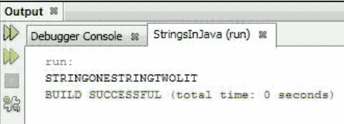

### 字符串的不可变性

但是，理解这里背后发生了什么是非常重要的。`System.out.println(s3.toUpperCase());` 这一行代码并没有修改 `s3` 的值然后打印该值。相反，我们的 `println` 语句评估了 `s3.toUpperCase()` 然后打印函数返回的字符串。为了看到 `s3` 的实际值没有被此函数修改，我们可以再次打印 `s3` 的值：

```java
System.out.println(s3.toUpperCase());
System.out.println(s3);
```

我们可以看到 `s3` 保留了它的小写部分：

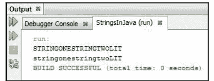

如果我们想永久修改 `s3` 的值，我们可以在上一行进行操作，并将 `s3` 的值设置为函数的结果：

```java
package stringsjava;

public class StringsInJava {
    public static void main(String[] args) {
        char c = 'c';
        String s1 = "stringone";
        String s2 = "stringtwo";
        String s3 = s1 + s2 + "LIT";
        s3 = s3.toUpperCase();
        System.out.println(s3);
    }
}
```


以下是上述代码的输出：

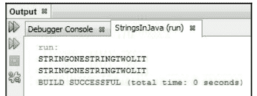

## `replace()` 函数

为了确认我们的理解在同一线上，让我们使用 `String` 类的另一个方法。如果我们回到文档并向上滚动，可以找到 `replace()` 方法：

| String |
|---|
| `replace(char oldChar, char newChar)` 返回一个新的字符串，其中将此字符串中所有的 `oldChar` 替换为 `newChar` |

与不需要参数的 `toUpperCase()` 方法不同，`replace()` 接收两个字符作为参数。函数将返回一个新的字符串，其中我们提供的第一个字符 (`oldChar`) 被替换为我们提供的第二个字符 (`newChar`)。

让我们在 `StringsInJava` 中利用这个函数 `println()` 行。我们将使用 `s3.replace()` 并提供两个参数。我们将字符 `g` 替换为字符 `o`：

```java
package stringsjava;

public class StringsInJava {

    public static void main(String[] args) {

        char c = 'c';

        String s1 = "stringone";

        String s2 = "stringtwo";

        String s3 = s1 + s2 + "LIT";

        s3 = s3.toUpperCase();

        System.out.println(s3.replace('g', 'o'));

        System.out.println(s3);

    }

}
```

如果我们运行程序，当然，什么都没有发生。这是因为当我们到达打印语句时，`s3` 中没有小写的 `g` 字符了；只有大写的 `G` 字符。所以让我们尝试替换大写的 `G` 字符：

```java
System.out.println(s3.replace('G', 'o'));

System.out.println(s3);
```

# 理解类型化变量

现在如果我们运行程序，我们看到替换发生在第一个 `println` 上，而不是第二个。这是因为我们还没有真正改变 `s3` 的值：

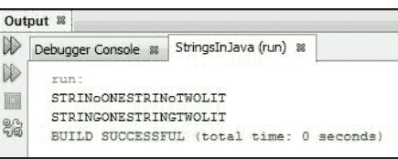

非常好！你有 Java 文档在手，现在就准备好调用各种 String 方法了。

## 转义序列

如果你处理字符串太快，我预计你会遇到一个常见问题。让我们快速看一下。我在这里写一个新程序。我将声明一个字符串，然后让程序将字符串打印到屏幕上。但我将分配给这个字符串的值将有点棘手。我想让程序打印出 `The program says: "Hello World"`（我想让 Hello World 被双引号包围）：

| | public static void main(String[] args) { |
| 5 | char c = 'c'; |
| 6 | String s1 = "stringone"; |
| 7 | String s2 = "stringtwo"; |
| 8 | String s3 = s1 + s2 + "LIT"; |
| 9 | |
| 10 | |
| 11 | s3 = s3.toUpperCase(); |
| 12 | 预期 |
| 13 | System.out.println(s3.replace(" ", "\\")); |
| 14 | System.out.println(s3);} |
| 15 | (Alt-Enter 显示提示) |
| 16 | String s = "The program says:\"Hello World\"; |
| 17 | System.out.println(s); |
| 18 | } |

这里的问题在于，在字符串字面量内部放入双引号会混淆 Java 程序，如之前的截图所示。当它看到的第一个完整字符串是 `"The program says:"` 时，这告诉 Java 我们结束了字符串。这显然不是我们想要的。

# 理解类型化变量

幸运的是，我们有一套系统可以告诉 Java，我们希望一个字符被视为字符字面量，而不是它可能具有的特殊功能。为了做到这一点，我们在字符前面加上一个反斜杠。这被称为转义序列：

```java
String s = "The program says: \"Hello World\"";

System.out.println(s);
```

现在当 Java 读取这个字符串时，它会读取 `The program says:` 然后看到反斜杠，以及如何将双引号视为双引号，而不是包围字符串的双引号。当我们运行程序时，我们看不到反斜杠；它们是特殊字符：

| 输出 |
| 调试器控制台 StringsInJava (run) |
| run: The program says: "Hello World" SUCCESSFUL (total time: 0 seconds) |

如果我们想在字符串中看到反斜杠，我们需要用另一个反斜杠来修饰它：

```java
String s = "The program says: \\\"Hello World\"";

System.out.println(s);
```

| 输出 |
| 调试器控制台 StringsInJava (run) |
| run: The program says: \"Hello World" SUCCESSFUL (total time: 0 seconds) |

这就是字符串 101！

## 总结

在本章中，我们解释了什么是变量以及它们对于创建更好的程序有多么重要。我们详细查看了 Java 的一些原始数据类型，即 `int`、`long`、`float`、`char` 和 `double`。我们还看到了 `String` 类以及它的两个操作方法。

在下一章中，我们将学习 Java 中的分支语句。

# 3 分支

每次运行都执行相同操作的程序固然很好，但最有趣的计算机程序每次运行时都会做一些稍微不同的事情，无论是因为它们有不同的输入，还是因为用户正在积极与它们交互。现在，让我们通过理解条件语句来开启本章，然后进一步探索 Java 如何处理复杂的条件语句，修改我们程序的控制流，并学习循环的功能。

具体来说，本章将涵盖以下主题：

- 理解 `if` 语句
- 复杂条件判断
- `switch`、`case` 和 `break` 语句
- `while` 和 `do...while` 循环
- `for` 循环

## 理解 `if` 语句

今天，我们将探索非常基础的 `if` 和 `else` 条件语句。为了进一步理解这一点，请参考以下项目列表：

- 我们在 NetBeans 中创建一个新的 Java 项目。我将它命名为 `ConditionalStatements`，并将允许 NetBeans 为我创建主类；参考以下截图：

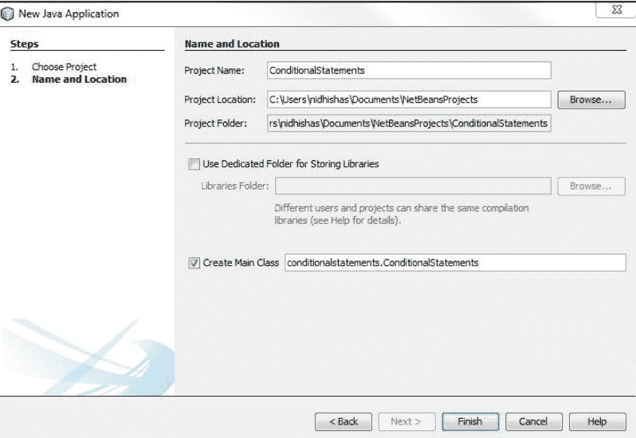

为了保持整洁，我们可以去掉所有的注释；现在我们准备就绪了。为了让我们看到更多有趣的程序，我们将快速学习如何在 Java 中进行一些基础的用户输入。此时，你还没有足够的知识储备来完全掌握我们即将要做的复杂细节，但你可能对发生的情况有基本的了解，并且将来完全可以自己重复这个过程。

虽然向这个 `InputStream/Console` 窗口写入是一个简单的“发后即忘”的过程，但在 Java 中读取输入可能会稍微复杂一些：

# 分支

```
Output - ConditionalStatements.jar W

clean:

init:

Created dir: C:\Users\nidhisham\Documents\NetBeansProjects\ConditionalStatements\build

Created file: C:\Users\nidhisham\Documents\NetBeansProjects\ConditionalStatements\built-jar.properties

Updating property: file

Created dir: C:\Users\nidhisham\Documents\NetBeansProjects\ConditionalStatements\build

Created dir: C:\Users\nidhisham\Documents\NetBeansProjects\ConditionalStatements\empty

Created dir: C:\Users\nidhisham\Documents\NetBeansProjects\ConditionalStatements\classes

Created dir: file

 dir: C:\Users\nidhisham\Documents\NetBeansProjects\ConditionalStatements\build\generated-sources\ap-source-output

Compiling 1 source to C:\Users\nidhisham\Documents\NetBeansProjects\ConditionalStatements\classes

compile SUCCESS

Copying 1 file to C:\Users\nidhisham\Documents\NetBeansProjects\ConditionalStatements\dist

Building jar: C:\Users\nidhisham\Documents\NetBeansProjects\ConditionalStatements\dist\ConditionalStatements.jar

To run this application from the command line without args, type:

java -jar "C:\Users\nidhisham\Documents\NetBeansProjects\ConditionalStatements\dist\ConditionalStatements.jar"

jar SUCCESS

BUILD SUCCESSFUL (time: 1 second)
```

2. 用户输入被放入一个缓冲区，程序在被提示时会访问它；因此，我们需要声明一个变量，以便在需要获取用户输入时访问此缓冲区。为此，我们将使用 `Scanner` 类。让我们的新实例命名为 `reader`。NetBeans 提示我们由于 `Scanner` 位于 `java.util` 包中，我们需要显式访问它。我们可以随时导入 `java.util` 包：

```java
package conditionalstatements;

public class ConditionalStatements {

    public static void main(String[] args) {

        java.util.Scanner reader;

    }

}
```

3. 这部分是你需要跳跃一下，比你真正准备好完全彻底理解的前一点。我们需要给这个 `reader` 变量赋值一个值，使其链接到 `InputStream` 窗口，用户将在那里输入内容。这样做，我们将设置一个新的 `Scanner()` 对象的值，但这个 `Scanner` 对象将使用一个类型参数，即 `(System.in)`，这恰好是用户将使用的 `InputStream` 的链接：

```java
package conditionalstatements;

import java.util.*;

public class ConditionalStatements {

    public static void main(String[] args) {

        Scanner reader = new Scanner(System.in);

    }

}
```

以下是上述代码的输出：

```
Output - ConditionalStatements (jar) * Variables Breakpoints

jar

Building jar: C:\Users\nidhiasham\Documents\NetBeansProjects\ConditionalStatements\build.internal.action.name=build-jar

Deleting: C:\Users\nidhiasham\Documents\NetBeansProjects\ConditionalStatements\build-built-jar.properties

Updating file: C:\Users\nidhiasham\Documents\NetBeansProjects\ConditionalStatements\build-built-jar.properties

Copying file to C:\Users\nidhiasham\Documents\NetBeansProjects\ConditionalStatements\build

Building SUCCESS

To run this from the command line without Ant, try:

java -jar "C:\Users\nidhiasham\Documents\NetBeansProjects\ConditionalStatements\dist\ConditionalStatements.jar"

SUCCESS (total time: 2 seconds)
```

- 4. 像的一些硬核的内容，你完全指指现在就理解它在底层是如何工作的。现在只需知道 `reader` 连接到我们的 `InputStream` 对象具有一个 `next()` 函数，允许我们访问用户输入到流中的内容。对于大多数函数，这个函数只需返回它的输入，所以我们需要创建一个字符串来存储此输入。
- 5. 一旦完成这些，我们就可以使用 `System.out.println()` 函数将输入值返回到控制台：

```java
package java.util.*;

public class ConditionalStatements {

    public static void main(String[] args) {

        Scanner reader = new Scanner(System.in);

        String input = reader.next();

        System.out.println(input);

    }

}
```


# 分支

每次运行都执行相同操作的程序固然很好，但有趣的程序每次运行时都会做一些稍微不同的事情，无论是因为它们有不同的输入，还是因为用户正在积极与它们交互。现在，让我们通过理解条件语句来开启本章，然后进一步探索 Java 如何处理复杂的条件语句，修改我们程序的控制流，并学习循环的功能。

具体来说，本章将涵盖以下主题：

- 理解 `if` 语句
- 复杂条件判断
- `switch`、`case` 和 `break` 语句
- `while` 和 `do...while` 循环
- `for` 循环

## 理解 if 语句

今天，我们将探索非常基础的 `if` 和 `else` 条件语句。为了进一步理解这一点，请参考以下项目列表：

- 我们在 NetBeans 中创建一个新的 Java 项目。我将它命名为 `ConditionalStatements`，并将允许 NetBeans 为我创建主类；参考以下截图：


为了保持整洁，我们可以去掉所有的注释；现在我们准备就绪了。为了让我们看到更多有趣的程序，我们将快速学习如何在 Java 中进行一些基础的用户输入。此时，你还没有足够的知识储备来完全掌握我们即将做的复杂细节，但你可能对发生的情况有基本的了解，并且将来完全可以自己重复这个过程。

虽然向这个 `InputStream/Console` 窗口写入是一个简单的“发后即忘”的过程，但在 Java 中读取输入可能会稍微复杂一些：

1. 用户输入被放入一个缓冲区，程序在被提示时会访问它；因此，我们需要声明一个变量，以便在需要获取用户输入时访问此缓冲区。为此，我们将使用 `Scanner` 类。让我们的新实例命名为 `reader`。NetBeans 提示我们由于 `Scanner` 位于 `java.util` 包中，我们需要显式访问它。我们可以随时导入 `java.util` 包：

```java
package conditionalstatements;

import java.util.*;

public class ConditionalStatements {

    public static void main(String[] args) {
        Scanner reader = new Scanner(System.in);
    }
}
```

2. 这部分是你需要跳跃一下，比你真正准备好完全彻底理解的前一点。我们需要给这个 `reader` 变量赋值一个值，使其链接到 `InputStream` 窗口，用户将在那里输入内容。这样做，我们将设置一个新的 `Scanner()` 对象的值，但这个 `Scanner` 对象将使用一个类型参数，即 `(System.in)`，这恰好是用户将使用的 `InputStream` 的链接。

3. 像一些硬核的内容，你完全不需要现在就理解它在底层是如何工作的。现在只需知道 `reader` 连接到我们的 `InputStream` 对象具有一个 `next()` 函数，允许我们访问用户输入到流中的内容。对于大多数函数，这个函数只需返回它的输入，所以我们需要创建一个字符串来存储此输入。

4. 一旦完成这些，我们就可以使用 `System.out.println()` 函数将输入值返回到控制台：

```java
package conditionalstatements;

import java.util.*;

public class ConditionalStatements {

    public static void main(String[] args) {
        Scanner reader = new Scanner(System.in);
        String input = reader.next();
        System.out.println(input);
    }
}
```


## 分支结构

现在，我们需要提供一个 `if` 语句来确保我们的程序不会总是打印出 LESS（较少）。

我们可以使用小于运算符，让程序在用户提供的输入小于 10 时打印出 LESS。这在几乎所有情况下都是好的，但如果用户提供的输入值为 10，我们的程序将不会打印任何内容。为了修复这个问题，我们使用小于或等于运算符，以确保我们的程序始终对用户的输入做出响应：

```java
package conditionalstatements;

import java.util.*;

public class ConditionalStatements {
    public static void main(String[] args) {
        Scanner reader = new Scanner(System.in);
        System.out.println("Input now: ");
        int input = reader.nextInt();
        if (input > 10) {
            System.out.println("MORE!");
        }
        if (input <= 10) {
            System.out.println("LESS");
        }
    }
}
```

现在，让我们快速运行程序以确保它工作正常。

在 InputStream 窗口中有一个输入提示。让我们先输入一个大于 10 的值并按下回车键。我们得到了 MORE 的响应而不是 LESS 的响应；这是我们预期的：

```
Output - ConditionalStatements (run) #4 | Variables | Breakpoints
run:
Input now:
15
MORE!
BUILD SUCCESSFUL (total time: 1 second)
```

由于我们的程序没有进行循环，所以我们将再次运行它来测试 LESS 输出，这次我们给它值 10，这应该触发我们的小于等于运算符。

```
Output - ConditionalStatements (run) #4 | Variables | Breakpoints
run: Input now: 10 LESS BUILD SUCCESSFUL (total time: 1 second)
```

## 使用 else 语句

事实证明，有一种稍微简单的方法来编写前面的程序。当我们写一个条件语句，或者准确地说写一对总是会执行两个代码块其中一个的条件语句时，可能正是使用 `else` 关键字的好时机。`else` 关键字必须紧跟在一个带括号的 `if` 块之后，然后后面跟着它自己的括号。只有在上一个括号之前的代码没有执行时，`else` 语句才会求值为真并执行括号之间的代码：

```java
import java.util.*;

public class ConditionalStatements {

    public static void main(String[] args) {
        Scanner reader = new Scanner(System.in);
        System.out.println("Input now :");
        int input = reader.nextInt();
        if(input > 10) {
            System.out.println("MORE!");
        } else {
            System.out.println("LESS");
        }
    }
}
```

如果我们运行这个程序，我们将得到与之前相同的结果，但少写了一段逻辑代码：

```
Output - ConditionalStatements (run) #4 | Variables | Breakpoints
run:
Input now:
10
LESS BUILD SUCCESSFUL (total time: 2 seconds)
```

让我们简要回顾一下在 `if` 语句可以使用哪些运算符来结束这个主题，我们将看看在需要比较非原类型项目时该怎么办。除了大于和小于运算符外，我们还可以使用相等运算符 (`==`)，如果两边的项目具有相同的值，则它为真。确保在用相等运算符时，不要误用赋值运算符 (`=`) 代替它：

```java
if(input == 10)
```

在某些情况下，你的程序将无法编译，但在其他时候它会编译，而你会得到非常奇怪的结果。如果你想使用相等运算符的反面，可以使用不等于运算符 (`!=`)，当两个项目没有相同的值时，它返回为真：

```java
if(input != 10)
```

> 在比较类的实例时，不要尝试使用这些相等运算符是非常重要的。我们只应该在处理原类型时才使用它们。

为了说明这一点，让我们修改程序，使其能够接收 String 作为用户输入。我们将查看 String 是否等于秘密密码代码：

如果是，它将打印 YES；如果不是，它将打印 NO。现在，NetBeans 给了我们一个警告；事实上，如果我们尝试用某些不同的运算符比较字符串，NetBeans 会告诉我们程序可能根本无法编译。这是因为 Java 不期望我们使用这些运算符来比较类的实例。相反，类应该暴露函数，允许我们在逻辑上对它们进行比较。Java 中的几乎每个对象都有几个为此目的函数。最常见的函数之一是 `equals` 函数，它接收一个相同类型的对象并让我们知道它们是否等价。此函数返回一个所谓的 `Boolean` 类型，它本身是一种原类型，值可以是 true 或 false。我们的语句理解如何求值这个 `Boolean` 类型：

让我们快速运行程序，并从输入一个错误的字符串。


# 分支

```java
{
    System.out.println("FALSE");
}
```

所以，如果我们运行程序并提供一个包含 `abc` 字符串的 `abcdef`，我们就得到了 TRUE 的结果。这是因为 `input.contains` 结果值为 `true`，我们进入了 `if...else` 块的部分：

| 输出 - ComplexConditions (run) #4 | 变量 | 断点 |
| --- | --- | --- |
| run: | | |
| abcdefg | | |
| TRUE | | |
| BUILD SUCCESSFUL (total time: 6 seconds) | | |

如果我们运行程序并提供一些不包含 `abc` 字符串的乱码，我们就会进入块的 `else` 语句并返回 FALSE：

| 输出 - ComplexConditions (run) #2 | 变量 | 断点 |
| --- | --- | --- |
| run: | | |
| hgtreh6jt6 | | |
| FALSE | | |
| BUILD SUCCESSFUL (total time: 12 seconds) | | |

这没什么特别的。但是，假设我们想让程序变得复杂一点。让我们在下一节中来看这个问题。

## 复杂条件语句

如果我们想检查输入字符串是否同时包含两个字符串，即 `sOne` 和 `sTwo` 呢？有几种方法可以实现，我们将看看其他方法。但坦白说，对于我们的目的来说，最简单的方法是在 `if input.contains(sOne)` 这一行上使用复合条件。Java 允许我们使用 `&&` 或 `||` 运算符同时评估多个真或假语句或布尔对象（注意：OCR 将 `|` 读取为 `||`）。当所有与 `&&` 运算符比较的条件都评估为 `true` 时，`&&` 运算符返回 `true`。当任何一个条件评估为 `true` 时，`||` 运算符返回 `true` 结果。在我们情况下，我们想知道输入字符串是否包含 `sOne` 和 `sTwo` 的内容，因此我们将使用 `&&` 运算符。该运算符的工作原理是在它的两侧提供两个条件语句。因此，我们将在 `(input.contains(sOne) && input.contains(sTwo))` 的两侧都运行我们的 `input.contains` 函数，如果它们评估为 `true`，我们的条件语句也将为 `true`：

```java
package complexconditionals;
```

```java
import java.util.*;
```

```java
public class ComplexConditionals {
    public static void main(String[] args) {
        Scanner reader = new Scanner(System.in);
        String input = reader.next();
        String sOne = "abc";
        String sTwo = "z";
        if (input.contains(sOne)) {
            System.out.println("TRUE");
        } else {
            System.out.println("FALSE");
        }
    }
}
```

# 分支

让我们运行程序。`abc` 字符串在两种情况下都应该评估为 `true`，当我们按下回车键时，我们看到事实确实如此：

| 输出 -ComplexConditionals (run) #4 | 变量 | 断点 |
|---|---|---|
| run: | | |
| abc | | |
| TRUE SUCCESSFUL (total time: 5 seconds) | | |

如果我们只提供有效的字符串 `z`，我们将得到 false 的结果，因为我们的运算符将评估为 false 和 true，结果评估为 false。如果我们使用 `||` 运算符，字符串将会是：

```java
if(input.contains(sOne)) || input.contains(sTwo))
```

以下是前述代码的输出：

| complexconditionals.ComplexConditions | main | if(input.contains(sOne)) || input.contains(sTwo)) |
|---|---|---|
| 输出 -ComplexConditionals (run) #2 | 变量 | 断点 |
| run: | | |
| zhbj95njho96nh | | |
| TRUE SUCCESSFUL (total time: 59 seconds) | | |

这将给我们 true 一个 true 的结果，因为现在我们只需要其中一个函数返回 `true` 了。布尔逻辑很快就会变得非常疯狂。例如，我们可以在每个布尔条件中放入 `&& false` 语句，即 `if(input.contains(sOne) || input.contains(sTwo) && false)`。Java 中的 `true` 和 `false` 代码术语是关键字；事实上它们是显式值，就像数字或单个字符一样。`true` 关键字评估为 `true`，`false` 关键字评估为 `false`。

任何以 `false` 结尾的单个条件语句将始终整体评估为 `false`：

```java
if(input.contains(sOne) && false)
```

# 分支

好奇的是，如果我们回到之前的原始语句并运行以下程序，提供最可能的有效输入，我们将得到 true 结果：

```java
package complexconditionals;
import java.util.*;
public class ComplexConditionals {
    public static void main(String[] args) {
        Scanner reader = new Scanner(System.in);
        String input = reader.next();
        String sOne = "abc";
        String sTwo = "z";
        if(input.contains(sOne) || input.contains(sTwo) && false) {
            System.out.println("TRUE");
        } else {
            System.out.println("FALSE");
        }
    }
}
```

以下是前述代码的输出（运行）：

| 输出 - ComplexConditionals (run) |
|--- |
| run: |
| abc |
| TRUE SUCCESSFUL (total time: 6 seconds) |

# 分支

2. 使用 `if` 块完成这种操作非常直接，如果不是的话可能有点乏味：

```java
if(x == 1)
{
    System.out.println("RED")
}
```

然后，我们只需要复制并粘贴这段代码，并针对蓝色和绿色的情况进行修改即可：

```java
int x=1;
if(x==1)
{
    System.out.println("RED")
}
if(x==2)
{
    System.out.println("BLUE")
}
if(x==3)
{
    System.out.println("GREEN")
}
```

3. 对于我们的默认情况，我们只是想检查 x 不等于 1，x 不等于 2，且 x 不等于 3：

```java
if(x != 1) && (x != 2) && (x != 3)
{
    System.out.println("NONE")
}
```

让我们快速运行一下我们的程序：

```java
package switcher;
public class Switch {
    public static void main(String[] args) {
        int x=1;
        if(x==1)
        {
            System.out.println("RED")
        }
        if(x==2)
        {
            System.out.println("BLUE")
        }
        if(x==3)
        {
            System.out.println("GREEN");
        }
    }
}
```

以下是预期结果截图：

| 输出 - Switcher (run) | 变量 | 断点 |
|---|---|---|
| RED BUILD SUCCESSFUL (total time: 0 seconds) | | |

这是我们在编写更大型程序时在逻辑上可能会执行的操作的简化版本。虽然我们组合这些代码的速度相当快，但很容易看出，如果我们正在处理 x 的许多可能情况，这个问题将变得极其难以处理。而且，对于某人来说，阅读并弄清楚这里发生了什么也非常困难。正如你可能猜到的那样，解决方案是使用 `switch` 语句来控制程序的程序流。

## 使用 switch、case 和 break 的程序

当我们想要根据单个变量的值提取不同的代码行或代码块时，`switch` 语句非常有效。现在让我们用 `switch` 语句重写我们的系列 `if` 块。语法在以下步骤中解释：

- 我首先声明我们将使用 `switch` 语句，`switch` 是 Java 中的一个保留关键字。然后，我们提供希望 `switch` 语句作用的变量名称，在这里是 x，因为我们将根据 x 的值执行不同的代码块：

```java
package switcher;

public class Switcher {
  public static void main(String[] args) {
    int x=1;
    switch(x)
```

然后，就像使用 `if` 或 `else` 语句一样，我们将使用两个括号创建一个新的代码段。

- 2. 现在，我们不再创建一系列混乱的 `if` 块，而是使用 `case` 关键字在 `switch` 语句中创建独立的块。在每个 `case` 关键字之后，我们给出一个指定的值，如果 x 的值与 `case` 关键字的值匹配，将执行后续代码。

所以，就像我们之前处理 `if` 块一样，如果 x 的值为 1，我们就想打印 RED。现在为每个可能的取值编写单独的 `case` 变得更加清晰且易于阅读。

- 3. `switch` 语句还有一个特殊情况，即 `default` 情况，我们几乎总是将其放在 `switch` 语句的最后。

该情况只有在其他所有 `case` 都没有执行时才会执行，这意味着我们不再需要为最后一个 `if` 块编写复杂的逻辑了：

```java
package switcher;

public class Switcher {
    public static void main(String[] args) {
        int x=5;
        switch(x) {
            case 1: case 7:
                System.out.println("RED");
            case 2:
                System.out.println("BLUE");
            case 3:
                System.out.println("GREEN");
            default:
                System.out.println("NONE");
        }
    }
}
```

如果我们运行前面的程序，实际上会看到所有可能的输出执行了。那是因为我们忘记了一件非常重要的事情：

| 输出 | 变量 | 断点 |
|---|---|---|
| introloops (run) #9 | Switcher (run) | |
| run: RED BLUE GREEN NONE BUILD SUCCESSFUL (total time: 0 seconds) | | |

`switch` 语句允许我们创建复杂的逻辑树，因为一旦某个 `case` 开始执行，它将继续执行通过队列中的下一个 `case`。由于我们正在写一个只需要执行单个 `case` 的简单程序，因此我们需要在进入 `case` 并完成代码后，显式地结束执行。

- 4. 我们可以使用 `break` 关键字来实现，它单独占据一行代码并简单地将我们带出所在的 `case`：

```java
package switcher;

public class Switcher {
    public static void main(String[] args) {
        int x=1;
        switch(x) {
            case 1:
                System.out.println("RED");
                break;
            case 2:
                System.out.println("BLUE");
                break;
            case 3:
                System.out.println("GREEN");
                break;
            default:
                System.out.println("NONE");
                break;
        }
    }
}
```

# 分支

现在我们运行程序，将看到预期的结果：


## While 和 do 循环

欢迎来到循环入门课程。在本节结束时，我们将获得连续执行微小任务的能力，这是计算机优于人类的特征之一。

- 为了开始这个主题，让我们创建一个新的 NetBeans 项目，进入 `main` 方法，并声明一个整数并给它赋值。

- 2. 为了实现这一点，我们将使用 `while` 循环。`while` 循环的语法非常像 `if` 语句。我们以 `while` 关键字开始，后面跟着括号；在括号内部我们最终放置一个条件语句。就像 `if` 语句一样，只有当我们的程序到达循环并判断语句为真时，接后的代码块才会执行：

```java
package introtoloops;
public class IntroToLoops {
    public static void main(String[] args) {
        int i=5;
        while (i > 0)
    }
}
```

让我们先为我们的 `while` 循环设置逻辑。我们将希望循环执行的次数存储在整数 `i` 的值中，但我们需要一种方法将此传递给循环。嗯，任何不会无限运行的循环都需要在循环内容内进行一些状态更改。在我们的案例中，让我们每次运行时通过减少 `i` 的值来改变程序的状态，这样当 `i` 达到 0 时，我们就运行了五次循环。

- 3. 如果是那样，意味着我们只想在 `i` 的值大于 0 时执行循环。让我们停下来快速看一下这行代码。`i = i -1` 是一个完全有效的语句，但我们可以使用一种更快、更易于阅读的快捷方法。我们可以使用 `i--` 来将整数变量的值减 1。一旦设置好这些，剩下的工作就是将功能性代码放在我们的循环中；那只是一个打印 Hello world 的打印语句：

```java
        while (i > 0) {
            System.out.println("Hello world");
            i--;
        }
```

# 分支

```
int i=5;
while (i>0)
{
    System.out.println("Hello world");
    i--;
}
```

4. 现在，让我们运行程序并看看会发生什么：

| 输出 | 变量 | 断点 |


搞定，我们的控制台窗口上打印了五次 "Hello world"，正如我们预期的那样。

## While 循环

通常，我们允许小型程序（例如我们在这里编写的这些程序）在没有更多代码可执行时直接结束。然而，当我们处理循环时，我们可能会不小心创建了一个无限循环的 `while` 循环，并运行一个没有终结的程序：

```java
package introloops;

public class IntroToLoops {
    public static void main(String[] args) {
        int i=5;
        while (i>0)
        {
            System.out.println("Hello world");
        }
    }
}
```

# 分支

当这种情况发生时，我们需要手动关闭程序。在 NetBeans 中，有一个实用的小功能位于输出窗口左侧的“停止”（Stop）：

| 输出 - introloops (run) #9 |
| :--- |
| Hello world |
| Hello world |
| Hello world |
| Hello world |
| Hello world |

如果我们通过命令提示符（Command Prompt）运行程序，`Ctrl + C` 是取消程序执行的常用命令。现在我们已经掌握了基本的 `while` 循环语法，让我们尝试一些稍微复杂且动态多的东西：

1. 我脑海中的程序是需要一些用户输入，所以让我们导入 `java.util` 并设置一个新的 `Scanner` 对象：

```java
public class IntroToLoops {
    public static void main(String[] args) {
        Scanner reader = new Scanner(System.in);
    }
}
```

2. 但是，我们并不是要在获取用户输入后就丢掉，而是在每次循环成功执行时都收集新的用户输入：

```java
while(i > 0) {
    reader.nextLine();
    System.out.println("Hello world");
}
```

3. 每当我们收集这种输入时，我们需要一个地方来存储它，所以让我们创建一个新的字符串，其目的是存储新获取的输入值：

```java
public class IntroToLoops {
    public static void main(String[] args) {
        Scanner reader = new Scanner(System.in);
        String input;
        int i=5;
        while(i>0) {
            input=reader.nextLine();
            System.out.println("Hello world");
        }
    }
}
```

这个输入变量的值在程序执行过程中会改变多次，因为在每个 `while` 循环的开始，我们都会为它分配一个新值。如果我们只是执行这个程序，对于我们用户来说它将非常没意思，因为当我们分配新值时，`input` 字符串的旧值会不断丢失。

所以，让我们创建另一个字符串，其目的是存储我们从用户那里获得的所有拼接值。然后，在程序结束时，我们将打印此字符串的值，这样用户就能看到我们存储了他们的输入：

```java
public class IntroToLoops {
    public static void main(String[] args) {
        Scanner reader = new Scanner(System.in);
        String input;
        String all = "";
        int i=0;
        while(i<0) {
            input = reader.nextLine();
        }
        System.out.println(all);
    }
}
```

在此处所示的行中，将输入的值加到 `all` 字符串上：

```java
while(i<0) {
    input = reader.nextLine();
    all = 
}
```

我们可以做几件事。我们可以正常使用加法运算符拼接字符串。因此 `all = all + input` 语句（`all` 和 `input` 都是字符串，加上加号是完全有效的。然而，当我们把某个值加到自身，并处理基本类型或可以像基本类型的字符串类型时，我们也可以使用 `+=` 运算符，它执行的功能相同。此外，我们不能忘记重新实现整数值的递减，以便我们的程序不会无限运行：

```java
package introloops;
import java.util.*;
public class IntroToLoops {
    public static void main(String[] args) {
        Scanner reader = new Scanner(System.in);
        String input = "";
        String all="";
        int i=5;
        while (i>0) {
            input = reader.nextLine();
            all += input;
        }
        System.out.println(all);
    }
}
```

现在，如果我们运行这个程序并提供五个字符串输入，我们将得到如下截图所示的输出：

| 输出 - introloops (run) #9 | 变量 | 断点 |
| :--- | :--- | :--- |
| run: | | |
| welcome | | |
| to | | |
| loops | | |
| in | | |
| welcome to loops in Java | | |
| BUILD SUCCESSFUL (total time: 12 seconds) | | |

我们会看到控制台窗口上打印了所有拼接后的实例，正如我们预期的那样，它们都分行显示了，这很酷，但我对这个程序有更大的计划。

实际上，如果我们只想写这里这里的程序，`for` 循环（我们稍后会学习）可能是完全合适的。但对于我们要做的，`while` 和 `do...while` 循环是必要的。我想做的是去掉这个程序中的计数变量。相反，我们将允许用户告诉我们何时停止程序。

当用户将输入值设置为 `STOP` 字符串（全大写）时，我们将退出 `while` 循环并打印我们到为止获得的所有字符串。所以，我们只希望 `while` 循环在输入值不是 `STOP` 时运行。我们将得到如下所示的编译器错误：

```java
while(!input.equals("STOP"))
```

如果我们不在循环开始时检查条件，而是在结束呢？这实际上是一种选项。`do...while` 循环的操作方式与 `while` 循环相似，但它们第一次运行时不会检查条件是否为真；它们会运行并在结束后检查条件。我们需要在条件语句结束处加上分号。现在，如果我们运行程序，可以输入任意数量的字符串，然后输入 `STOP` 来看到我们到为止打印到屏幕上的所有内容：

```java
public static void main(String[] args) {
    Scanner reader = new Scanner(System.in);
}
```

```java
String input;
String all = "";
int i=5;
```

```java
do
{
    input = reader.nextLine();
    all += input;
    i--;
} while(!input.equals("STOP"));
System.out.println(all);
```

上述代码的输出如下：

| introloops.Introloops > main > |
| :--- |
| 输出 - introloops (run) #9 变量 断点 |
| run: |
| a b c d e f g h i |
| j k l m n o |
| p q r |
| STOP |
| a b c d e f g h ij k l m n op q rSTOP |
| BUILD SUCCESSFUL (total time: 38 seconds)|

## 分支结构

### for 循环

在本节中，我们将快速查看 `for` 循环。我们使用 `for` 循环以一种非常语义优雅的方式解决 Java 中的一个常见问题。当我们需要迭代一个变量来计算循环的次数时，这些循环非常合适。

首先，我写了一个使用 `while` 循环的非常基础程序；它会在屏幕窗口上打印从 1 到 100 的值。一旦你在脑海中理清了该 `while` 循环是如何工作的，我们将用 `for` 循环编写相同的循环，这样我们就可以看到在这种特定情况下 `for` 循环是多么优雅了。让我们注释掉 `while` 循环，这样我们就可以像下面的截图所示仍然看到它，而不需要运行它的代码，转而开始我们的 `for` 循环：

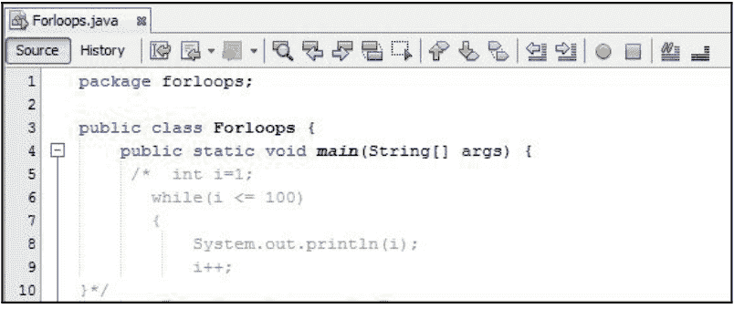

`for` 循环的基本语法与 `while` 循环非常相似。我们有保留关键字、两个用于存放循环信息的括号，以及我们将执行的代码块。与 `while` 循环在这些括号间只接收一个条件语句不同，我们将为 `for` 循环提供大量信息。因为 `for` 循环设计用于处理特定情况，一旦我们给了它所有这些信息，它就会确切知道如何处理。这消除了我们在循环外部处理代码以及在循环内部手动递增或递减的需求。它让我们代码中的功能部分（我们的 `println` 语句）以及在更复杂的程序中可能位于 `for` 循环内部的复杂信息更加独立。

## 分支结构

我们典型的 `for` 循环接受三部分输入。如下：

1. 首先，我们需要声明将要递增或递减的变量，用于计算循环的次数。在这种情况下，我们将使用整数 `i` 并给它一个初始值 1。我们在该初始语句后跟着一个分号。这不是函数调用；它是 `for` 循环的特殊语法。

2. 第二部分信息是条件语句，它要求我们在每次重启循环时进行求值。如果该条件语句不再为真，那么我们的 `for` 循环就会结束，并继续执行 `for` 块之后的代码。在这种情况下，我们的条件语句将与 `while` 循环相同。我们希望 `for` 循环的最后一次迭代是 `i` 等于 100，即我们打印 100 时。一旦 `i` 不再小于等于 100，就是退出我们的 `for` 循环了。

3. 就像我们给 `for` 循环的第一部分信息避免了在循环作用范围内处理变量，我们给 `for` 循环的最后一个信息取代了在循环作用范围内手动递增或递减计数器的操作。这是特殊的修改代码，我们在这里为 `for` 循环提供的任何内容都将在每次循环结束时运行。在这种情况下，我们只想在每次循环结束后递增 `i` 的值。我想你会同意，这个程序比我们的 `while` 循环干净得多：

```java
package forloops;

public class Forloops {
    public static void main(String[] args) {
        int i=1;
        while (i<= 100) {
            System.out.println(i);
            i++;
        }
        for(int i=1; i<=100; i++) {
            System.out.println(i);
        }
    }
}
```

## 分支结构

现在，让我们检查一下它是否执行了向屏幕打印 1 到 100 值的任务，如下截图所示：

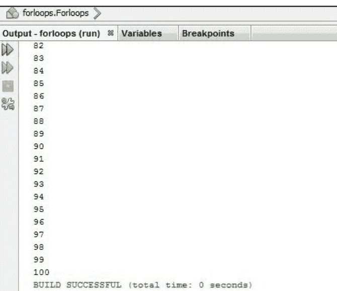

如果这个语句在我们的 `for` 循环的最开始执行，那么 0 就是正确的，但它是在结尾执行的。

当我们在 Java 或任何编程语言中处理大数字和增量时，我们将这类错误（如我们遇到的）称为“差一错误”（off-by-one error，简称 OBOE）。OBOE 是那种逻辑错误，即使是经验丰富的程序员，如果不注意或某一时刻看错，也会遇到这种错误。学习识别 OBOE 的症状（例如，输出比预期的多出一行），将允许我们更高效地追踪并发现它们。

## 总结

在本章中，我们基本上看到了如何处理条件 `if...else` 语句，通过使用如 `contains`、`complex` 和 `boolean` 等函数处理复杂的条件。此外，我们通过程序的帮助，学习了 `switch`、`case` 和 `break` 的复杂之处；此外，我们还深入探讨了如何使用 `while`、`do...while` 和 `for` 循环功能。

在下一章中，我们将查看什么是数据结构。

# 4 数据结构

在本章中，我们将学习 Java 中一些重要的数据结构。我们将查看数组是什么以及它们在我们需要处理变量序列时为什么有用。我们将编写一个程序来理解它们如何工作。本章还将引导我们通过多维数组的概念。我们将编写一个程序来创建二维数组。接下来，本章将说明 `ArrayList` 是什么以及它们与数组相比的功能。最后，我们将查看 Map 结构并在项目 中实现它。

具体内容将涵盖：

- 数组及其语法
- 数组示例
- 多维数组
- 创建数组的程序
- `ArrayList` 及其实现

## 使用数组

在本节中，我们将学习数组。数组是 Java 最基础、最常用的数据结构。数据结构允许我们存储和访问信息序列，而不是使用单个变量。当我们有一个特定的信息时，变量很好用，但当我们想要一组信息时，数据结构就很有用。我们将从一些视觉学习开始本节，然后进入 NetBeans 编写实际代码。

### 数组的声明和初始化

让我们先看看在 Java 中声明和初始化数组的语法。以下代码行将创建一个数组并能够容纳七个元素：

```java
char[] arrayVar = new char[7];
```

在我们声明并初始化七位字符数组后，程序本地内存中存在的内容大致如下所示：

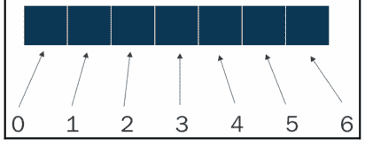

我们的数组基本上是一个足够存储七个独立字符的内存块。

## 给数组赋值

当我们调用变量 `arrayVar` 变量时，我们的程序会访问该数组所在的位置。这允许我们运行如下代码行：

```java
arrayVar[2] = 'c'
```

我们的 `arrayVar` 变量本质上给了我们访问七个不同字符变量的权限。当我们不想为 `arrayVar` 变量分配新数组时，我们可能需要单独访问这些字符变量。我们只需简单地使用 `arrayVar` 的变量名，后面跟着方括号，括号内包含我们想要访问的单个字符的索引。请记住，当计算机计算索引时，它们几乎总是从 0, 1, 2, 3, 4, 5 和 6 开始。如果我们在执行上一行代码时，将 `arrayVar` 中索引为 2 的值设置为 `c`，我们将获取第三块内存并将其值赋给字符 `c`，如下图所示：

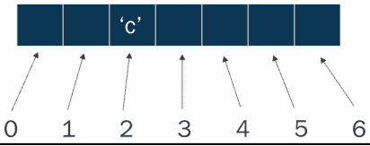

有时当我们声明一个数组时，我们只是想直接在代码中显式地为它的所有内存块赋值。当我们想这样做时，与其使用 `new` 关键字并通过告诉计算机数组长度来使其分配新的内存空间，我们可以显式地声明一个数组，并显式地声明一个原始类型。例如，我们可以通过以下代码对 `arrayVar` 变量进行操作：

```java
arrayVar = {'a', 'b', 'c', 'd', 'e', 'f', 'g'};
```

前面的语句将创建一个长度为七的数组，仅仅因为声明了七个元素，而且它会相应地映射这些值：

| | 'a' | 'b' | 'c' | 'd' | 'e' | 'f' | 'g' |
|---|---|---|---|---|---|---|---|
| index | 0 | 1 | 2 | 3 | 4 | 5 | 6 |

现在，让我们进入 Java 代码并让数组用起来吧。

## NetBeans 中的数组示例

好了，我认为是时候运用我们新学到的知识并编写一个计算机程序了。数组允许我们处理大量信息，如果在单个元素级别处理这些信息将非常困难。因此，我们将直接进入硬核内容并创建一个酷的计算机程序。数组是一个很大的逻辑跨越，如果你以前没有处理过类似的东西，可能需要一点时间来理解它们。好消息是，如果你能攻克 Java 中的数组，那么该语言提供的其他任何内容你可能都能刃有余。

我想写的程序将在屏幕上打印英文字母表。当然，我们也可以编写类似下面的代码来完成这一切：

```java
System.out.println("abcdef");
```

然而，使用这种方法非常费脑，而且教不了我们多少东西。相反，我们要编写的程序是为了学习、存储并打印英文字母表。

## 创建数组


让我们从编写并初始化一个数组来存储英语字符开始。所以，告诉 Java 我们需要一个指向字符数组的变量。如果我们将这个变量命名为 `alpha`，那么我们将要求 Java 使用 `new` 关键字为 26 个字符留出内存空间，因为英语有 26 个字母：

```java
char[] alpha = new char[26];
```

现在，如果你还记得，字符也可以映射到整数。为了找到这些值，我们将查找 ASCII 表（你可以在 www.ascii.com 访问）。

| Dec | Oct | Hex | Dec | Oct | Hex | Dec | Oct | Hex | Dec | Oct | Hex |
|---|---|---|---|---|---|---|---|---|---|---|---|
| 0 | 000 | NUL (null) | 32 | 20 | 64 | #32; Space | 64 | 40 | 100 | @64; | 96 | 60 | 146 | @96; |
| 1 | 001 | SOH (start of heading) | 33 | 21 | 65 | #33; | 65 | 41 | 101 | @65; | 97 | 61 | 141 | @97 |
| 2 | 002 | STX (start of text) | 34 | 22 | 66 | #34; | 66 | 42 | 102 | @66; | 98 | 62 | 142 | @98; |
| 3 | 003 | ETX (end of text) | 35 | 23 | 67 | #35; | 67 | 43 | 103 | @67; | 99 | 63 | 143 | @99; |
| 4 | 004 | EOT (end of transmission) | 36 | 24 | 68 | #36; | 68 | 44 | 104 | @68; | 100 | 64 | 144 | @100; |
| 5 | 005 | ENQ (enquiry) | 37 | 25 | 69 | #37; | 69 | 45 | 105 | @69; | 101 | 65 | 145 | @101; |
| 6 | 006 | ACK (acknowledge) | 38 | 26 | 70 | #38; | 70 | 46 | 106 | @70; | 102 | 66 | 146 | @102; |
| 7 | 007 | BL (bell) | 39 | 27 | 71 | #39; | 71 | 47 | 107 | @71; | 103 | 67 | 147 | @107; |
| 8 | 008 | BS (backspace) | 40 | 28 | 72 | #40; | 72 | 48 | 108 | @72; | 104 | 68 | 148 | @148; |
| 9 | 009 | TAB (horizontal) | 41 | 29 | 73 | #41; | 73 | 49 | 109 | @73; | 105 | 69 | 149 | @149; |
| 10 | 01A | LF (line feed) | 42 | 30 | 74 | #42; | 74 | 50 | 110 | @74; | 106 | 70 | 150 | @150; |
| 11 | 01B | VT (vertical tab) | 43 | 31 | 75 | #43; | 75 | 51 | 111 | @75; | 107 | 71 | 151 | @151; |
| 12 | 01C | FF (form feed) | 44 | 32 | 76 | #44; | 76 | 52 | 112 | @76; | 108 | 72 | 152 | @152; |
| 13 | 01D | CR (carriage return) | 45 | 33 | 77 | #45; | 77 | 53 | 113 | @77; | 109 | 73 | 153 | @153; |
| 14 | 01E | SO (shift out) | 46 | 34 | 78 | #46; | 78 | 54 | 114 | @78; | 110 | 74 | 154 | @154; |
| 15 | 01F | SI (shift in) | 47 | 35 | 79 | #47; | 79 | 55 | 115 | @79; | 111 | 75 | 155 | @155; |
| 16 | 020 | DL (data link) | 48 | 36 | 80 | @80; | 80 | 56 | 116 | @80; | 112 | 76 | 156 | @156; |
| 17 | 021 | DC1 (device control1) | 49 | 37 | 81 | #81; | 81 | 57 | 117 | @81; | 113 | 77 | 157 | @157; |
| 18 | 022 | DC2 (device control2) | 50 | 38 | 82 | #82; | 82 | 58 | 118 | @82; | 114 | 78 | 158 | @158; |
| 19 | 023 | DC3 (device control3) | 51 | 39 | 83 | #83; | 83 | 59 | 119 | @83; | 115 | 79 | 159 | @159; |
| 20 | 024 | DC4 (device control4) | 52 | 40 | 84 | #84; | 84 | 60 | 120 | @84; | 116 | 80 | 160 | @160; |
| 21 | 025 | RS (negative ack) | 53 | 41 | 85 | #85; | 85 | 61 | 121 | @85; | 117 | 81 | 161 | @161; |
| 22 | 026 | SY (synchronous idle) | 54 | 42 | 86 | #86; | 86 | 62 | 122 | @86; | 118 | 82 | 162 | @162; |
| 23 | 027 | ETB (end of transmission) | 55 | 43 | 87 | #87; | 87 | 63 | 123 | @87; | 119 | 83 | 163 | @163; |
| 24 | 028 | FS (file separator) | 56 | 44 | 88 | #88; | | | | | | |
| 25 | 029 | EM (medium) | 57 | 45 | 89 | #89; | | | | | | |
| 26 | 030 | RS (separator) | 58 | 46 | 90 | #90; | | | | | | |

## 数据结构

那么，我们应该给每个字符分配什么值，以便让我们的计算机学习字母表呢？嗯，我喜欢这样想：当我们第一次运行循环时，当 `i` 为 0 时，数组第一个元素的值为 97，而 97 就是字符 `a` 的整数值。现在，当我们将 `97+i` 赋值为数组中字符的值时。当我们第二次运行循环时，`i` 增加了 1，我们将赋值值 `97 + 1`（或 `98`），这就是字符 `b` 的整数值：

```java
for(int i = 0; i < 26; i++) {
  alpha[i] = (char)(97 + i);
}
```

在这个例中，Java 要求我们显式地告诉它我们希望将此整数值强制转换为字符并存储。

## 打印字母表

现在，为了完成程序，我们需要打印出 `alpha` 数组。为了做到这一点，让我们利用一个名为 `Arrays` 的始终可访问对象的某个巧妙函数。`Arrays.toString()` 将把单个数组（即我们创建的那种数组）转换为可以转换为字符串的类型：

```java
public class Alphabet {
  public static void main(String[] args) {
    //97
    char[] alpha = new char[26];
    for(int i = 0; i < 26; i++) {
      alpha[i] = (char)(97 + i);
    }
    System.out.println(Arrays.toString(alpha));
  }
}
```

现在，如果我们运行我们的程序，我们将看到 Java 以数组形式表示的英语字母表：

| 输出 - Alphabet (run) | 变量 | 断点 |
|---|---|---|
| run: | [a, b, c, d, e, f, g, h, i, j, k, l, m, n, o, p, q, r, s, t, u, v, w, x, y, z] | |
| BUILD SUCCESSFUL (total time: 0 seconds) | | |

如果你一直跟着操作，那么你应该给自己拍个大掌了。我们刚刚完成了一些相当艰巨的工作。

## Java 中数组的默认初始化

现在，让我们回到本节剩余部分的理论部分。我之前误导了你，让你认为新创建的数组被填充了空内存。事实上，当我们声明一个原始类型（即字符、整数、布尔值、浮点数等）的新数组时，Java 会用默认值填充它。例如，我们新创建的七个字符数组被填充了七个空格字符，即你在键盘上按下空格键得到的内容：

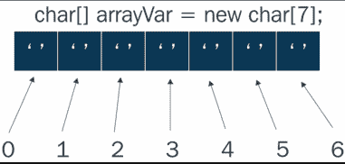

同样，整数数组将被填充为七个零：

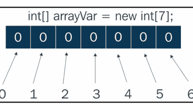

我建议你启动一个 Java IDE，创建一些空的原始类型数组并使用 `println` 打印它们，以查看默认值是什么。

现在我们可以创建任何可用的对象数组。然而，对象与原始类型不同，它们在作为数组的一部分被初始化时，并没有自己设置的默认值。这是一个需要意识到的点。

任何我们需要使用 `new` 关键字来创建的内容，在数组中都不会进行默认初始化。

假设由于某种原因，我们决定数组中必须有七个 `Scanner` 对象。以下语句并没有为我们创建七个 `Scanner` 对象；它只是预留了内存空间：

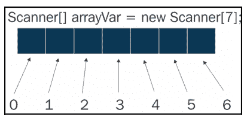

我们可以创建 `Scanner` 对象并将它们分配给这些内存空间，但如果我们在内存位置分配 `Scanner` 对象之前尝试调用其中一个内存空间并使用 `Scanner` 特有的函数，我们的程序将会崩溃。我们将得到所谓的 `NullPointerException`（空指针异常），这意味着 Java 没有任何表现得像一个 `Scanner` 对象。

## 多维数组

在 Java 中，我们的基本数据结构是数组，它允许我们存储轻类型信息的序列，并通过内存中的单一位置访问这些信息。然而，数组有时是难以处理的，我们希望使用组织更强的数据结构，以便人类更容易理解和围绕它们编写程序。通常情况下，这里合适的是多维数组。

“多维数组”这个名字听起来有点可怕，但实际上它背后的概念非常基础。问题是，如果我们创建一个数组的数组会发生什么？下面的代码行展示了这种操作的语法：

```java
char[][] twoDimArr = new char[3][7];
```

这行代码将创建一个二维多维数组。你会发现它与正常情况下简单创建一个字符数组的语法非常相似，但在我们引用数组变量名的每个实例，Java 都需要两个信息（或两个索引）。前一行代码将告诉 Java 创建三个数组，每个数组都有七个字符。

## Net 中的多维数组示例

虽然我们可以使用多维数组以抽象的方式存储信息，但它可能更适合以抽象的方式存储信息。为了做到这一点，让我们使用多维数组来存储信息。为了做到这一点，这里合适的方法是多维数组的。

## 创建多维数组

```java
char[][] board = new char[3][7];
```

## 赋值 boardDim

```java
char[][] board = new char[8][8];
```

## 使用 boardDim

为了做到这一点，而不是显式地让循环运行八次：

```java
int boardDim = 8;
char[][] board = new char[boardDim][boardDim];
```

## 使用嵌套循环

```java
for(int y = 0; y < board.length; y++) {
  for(int x = 0; x < board[y].length; x++) {
    // 逻辑代码
  }
}
```

## 填充 board

```java
for(int y = 0; y < board.length; y++) {
  for(int x = 0; x < board[y].length; x++) {
    board[y][x] = 'W';
  }
}
```

## 打印 board

```java
for(int y = 0; y < board.length; y++) {
  for(int x = 0; x < board[y].length; x++) {
    if ((x + y) % 2 == 0) {
      board[y][x] = 'B';
    }
  }
  System.out.println(Arrays.toString(board[y]));
}
```

```java
for(int x = 0; x < board[y].length; x++)
{
    board[y][x] = 'W';
}
```

## 为我们的棋盘分配不同的颜色

情况是，每当这个内部循环执行时，我们都希望节点获得一个不同的值，以便得到一个黑白交替方格的棋盘。为了帮助我们，让我们在程序中添加另一个变量。它将是一个布尔变量，我们将其命名为 `isWhite`。如果 `isWhite` 为真，那么下一个格子就是白色的；如果 `isWhite` 为假，那么下一个格子就是黑色的。

为了编写这段代码，让我们使用一些语句。首先，`if(isWhite)` 代码检查 `isWhite` 是否为真。如果是，我们就在方格中放入一个 `W`。如果 `isWhite` 为假，我们就在方格中放入 `B` 表示黑色。要检查某个非真，我们可以在任何布尔值前面加一个感叹号来取反它。这适用于布尔值，甚至是条件语句。

接下来，我们只需要翻转 `isWhite` 的值即可。嗯，利用我们对感叹号运算符的知识（它可以翻转布尔值的值），我们可以通过将其值设置为自身的取反版本，从而将 `isWhite` 的值从真变假或从假变真：

```java
public static void main(String[] args) {
    int boardDim = 8;
    char[][] board = new char[boardDim][boardDim];
    boolean isWhite = true;
    for(int y = 0; y < board[y].length; y++) {
        for(int x = 0; x < board[y].length; x++) {
            if(isWhite) board[y][x] = 'W';
            if(!isWhite) board[y][x] = 'B';
            isWhite = !isWhite;
        }
    }
}
```

遗憾的是，这个程序并不完美。事实证明，如果我们这样做，我们的棋盘每一行都将以白色格子开始，而真正的棋盘在每行之间是交替不同颜色方格的。

## 数据结构

幸运的是，外部循环为棋盘的每一行运行一次。所以，如果我们简单地在每一行的开始对 `isWhite` 布尔值额外添加一次翻转，我们就能再次获得交替的行开头。如果我们这样做，我们需要将 `isWhite` 初始化为 `false`，因为当外部循环第一次执行时，它会立即变为 `true`：

```java
public static void main(String[] args) {
    int boardDim = 8;
    char[][] board = new char[boardDim][boardDim];
    boolean isWhite = false;
    for (int y = 0; y < board.length; y++) {
        isWhite = !isWhite;
        for (int x = 0; x < board[y].length; x++) {
            if (isWhite) board[y][x] = 'W';
            if (!isWhite) board[y][x] = 'B';
            isWhite = !isWhite;
        }
    }
}
```

## 打印棋盘

如果你到为止一直在跟着操作，让我们继续编写程序的最后部分：一行将我们的棋盘打印到屏幕的代码。实际上，我们需要比一行代码多一点的内容。我们可以使用 `println()` 函数配合 `Arrays.toString()` 来将单个数组的内容打印到屏幕上，但这种技术对于二维或更高阶数组效果并不理想。

所以，我们将使用 `for` 循环依次获取每个数组，然后将它们打印到屏幕上。这效果很好，因为 `println` 会自动换行，或者在我们打印的每行之间提供一个新行。在这里，让我们使用惯用的语法变量 `i` 来迭代循环：

```java
for(int i = 0; i < board.length; i++) {
    System.out.println(Arrays.toString(board[i]));
}
```

## 数据结构


你会注意到 Java 并不如前面的屏幕截图所示识别 `Arrays` 关键字；这是因为 `Arrays` 存在于 `java.lang` 包中。当我们调用一个 Java 立即不知道去哪里找的函数或类时，这可能会让人很恼，我们必须去网上并在 Google 上定位它。如果我们位于 IDE（如 NetBeans）中，有时会有常用包的快捷方式。在这种情况下，如果我们点击问题所在并转到“修复导入”（Fix Imports），NetBeans 将遍历常用包并检查它是否能弄清楚我们在做什么：

```java
for(int x = 0; x < board[y].length; x++)
{
    if(isWhite) board
    if(!isWhite) boar
    isWhite = !isWhite
}
for(int i = 0; i < board.
{
    System.out.println(Ar
}
```

在这里，NetBeans 已定位到 `java.util.Arrays` 类并为我们添加了导入语句：

```java
import java.util.Arrays;
```

现在，因为我们不想打印 `for` 循环执行时整个二维数组的内容（实际上这样做效果也不好），我们将告诉 `println` 语句去打印 `board[i]` 的内容，即我们访问的二维数组中的单个数组：

```java
public static void main(String[] args) {
    int boardDim = 8;
    char[][] board = new char[boardDim][boardDim];
    boolean isWhite = false;
    for (int y = 0; y < board.length; y++) {
        isWhite = !isWhite;
        for (int x = 0; x < board[y].length; x++) {
            if (isWhite) board[y][x] = 'W';
            if (!isWhite) board[y][x] = 'B';
            isWhite = !isWhite;
        }
    }
}
```

## 数据结构

```java
}
for(int i = 0; i < board.length; i++) {
    System.out.println(Arrays.toString(board[i]));
}
```

现在，让我们看看我们得到了：


哇！看起来我们得到了黑白格子。这看起来不多，但意义重大。我们可能希望单个格子存储的不只是颜色。为了实现这一点，我们可以利用三维数组。例如，我们希望它们：

```java
char[][][] board = new char[boardDim][boardDim][2];
```

## ArrayList

为了实际效果，让我们写一个如果我们只使用标准数组而不是 `ArrayList` 会编写更困难的程序。我想写一个程序，从用户那里获取一个输入字符串。它将把这个输入字符串与用户以前给过的每一个输入字符串一起存储，并且每次用户输入新字符串时都将它们全部打印出来。

## ArrayList

当我们需要数据结构时，我们应该先问自己一个简单的数组是否足够。如果我们只用数组就能轻松、整洁地编写程序，那么这可能是我们保持程序简单的最佳选择。如果你正在编写运行必须尽可能快且尽可能高效利用内存的代码，数组的开销也很小。

具有额外功能的数据结构被称为 `ArrayList`。传统数组的一个缺点是，当我们实例化它们时必须给它们一个特定的长度，所以我们必须知道想要数组有多大。`ArrayList` 基本上是一个包装在额外代码中的数组，这些代码会导致数组的大小增加或减少，使其始终与其包含的元素的大小一致。

## NetBeans 中的 ArrayList 示例

## 创建 ArrayList

我们需要首先导入 `java.util`，因为 `java.util` 是我们获取用户输入的 `Scanner` 类以及 `ArrayList` 本身所在的地方。一旦我们声明了 `Scanner`，我们稍后还会用到它，现在是时候声明我们的 `ArrayList` 了：

```java
package echo;

import java.util.*;

public class Echo {
    public static void main(String[] args) {
        Scanner reader = new Scanner(System.in);
        ArrayList list = new ArrayList();
    }
}
```

声明 `ArrayList` 看起来和声明任何其他对象相似。我们说明我们需要创建什么类型的对象，给它起一个名字。使用 `new` 关键字是因为 Java 将预留一些内存来创建这个对象，因为它不是基本类型。然后，我们告诉 Java 实际创建它。虽然我们没有为 `ArrayList` 的创建提供任何参数，但仍然需要跟上双括号。这实际上是我们编写的有效代码，但通常当我们创建一个 `ArrayList` 时，我们会做更多一些操作。

我们创建的 `ArrayList` 内存实际上可以存储其中任何类型的单一实体。这初听起来很棒，但对于我们的程序来说并不是件好事。如果我们有的 `ArrayList` 或任何数据结构存储了几乎任何内容，将非常容易引起混淆；如果我们觉得有必要这样做，我们要么是在做某些非常复杂的事情，要么更有可能是我们编写代码没有我们应该的那么整洁。更重要的是，一旦我们在 `ArrayList` 中存储了任何内容，我们就可能绕过编译器创建出可以编译通过的代码。然而，另一种可能性是它会在运行时崩溃，导致在商业软件中非常糟糕的错误，因为它们在人们实际使用时可能会发生故障。

为了解决这个问题，我们可以使用 `ArrayList` 只接受特定类型的信息。我们通过在 `ArrayList` 声明和实例化之后加上双字符括号，并在其中放置一个类型来实现这一点：

```java
ArrayList<String> memory = new ArrayList<String>();
```

## 数据结构

我们声明并创建了一个 `ArrayList` 数据结构，它将只允许在其中存储字符串。

## 获取用户输入

我们需要一个循环，以便使用户可以向程序输入多个字符串。现在，让我们先使用一个无限循环。它将一直运行，在我们构建和调试程序时，我们可以随时手动停止：

```java
while (true)
{
}
```

每次循环运行时，我们都想对我们的 `Scanner` 变量（即 `reader`）使用 `nextLine()` 函数，从用户处获取新行输入，并将其存储在我们的 `ArrayList` 中。

当我们处理对象数据结构时（即那些封装了代码、拥有自己的函数和方法的数据结构），我们通常不会处理内存的个别索引，这其实很方便。相反，我们使用提供的函数来添加、删除和操作其中的信息。

在这种情况下，向 `ArrayList` 中添加内容非常简单。`ArrayList` 中的 `add()` 函数会将我们给它的任何输入（在本例中，只要它是字符串）添加到 `ArrayList` 包含的数组的末尾。所以，让我们添加以下代码，在无限循环中向用户请求新的输入字符串并将其放在我们 `ArrayList` 的末尾：

```java
memory.add(reader.nextLine());
```

## 打印用户输入的 ArrayList

现在，我们可以简单地使用 `println` 将我们的 `ArrayList` 打印给用户。注意，`println` 代码并不知道如何接受 `ArrayList`。实际上，它可能，但我们应该显式地使用 `toString()` 函数，Java 中的几乎每个对象都实现了该函数：

```java
package echo;
import java.util.*;
public class Echo {

public static void main(String[] args) {
    Scanner reader = new Scanner(System.in);
    ArrayList<String> memory = new ArrayList<String>();
    while (true) {
        memory.add(reader.nextLine());
        System.out.println(memory.toString());
    }
}
```

现在，当我们运行程序时，将会被提示进行一些用户输入，并看到输入回显给我们。如果我们给 java 更多输入，我们将看到更多的输入，而旧的输入将存储在我们的 `ArrayList` 中：

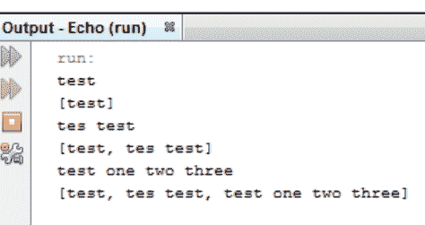

非常酷！我们建立了一个非常简单的程序，如果用简单的数组编写将会困难得多。

## 将控制权交给用户

`ArrayList` 包含了大量的力量。我们可以将其转换为数组，从数组创建它们，以及各种操作。如果我们查看 Java 文档并检查 `java.util` 下的 `ArrayList`，就可以找到它们所有的方法。让我们为我们的 `ArrayList` 程序添加一些功能，以便我可以带你了解一些常用的 `ArrayList` 方法。

## 数据结构

`ArrayList` 有一个不需要接受输入的函数叫做 `clear()`，它会擦除我们的 `ArrayList`。我们可以利用这个函数赋予我们的用户对程序的某些控制权。假设用户输入字符串 `CLEAR`，我们就想要擦除 `ArrayList` 中的所有信息。

## 数据结构

在使用 `break` 语句时要务必小心。确保这样做是有合理的，因为在阅读别人的代码时，它们可能会让你有些困惑。它们会打断并让控制流跳转到到处。

所以，让我们运行这个程序看看会发生什么。我们首先给程序提供一些输入并构建 `ArrayList`：

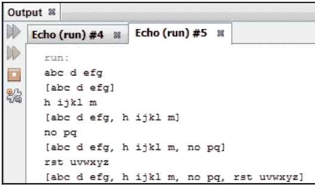

现在让我们输入 CLEAR 并检查它是否清空了我们的 `ArrayList`。噢，不！我把它弄坏了：

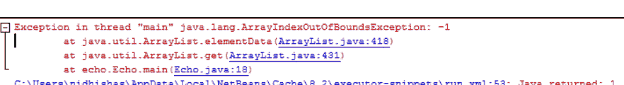

这实际上是我们犯的一个非常有趣的错误。这个错误是我制造的，是有计划的。我会把它留在这里，因为这对我们来说是一次很棒的学习体验。它还向你展示了，即使是一个经验程序员，也会犯错。例如，我们尽可能使用带类型 `ArrayList` 的原因之一，就是我们就可以轻松地发现并修复我们的错误。

## 分析 ArrayOutOfBoundsException

我们的程序抛出了 `ArrayOutOfBoundsException`。这意味着我们尝试访问我们的内存数组没有访问权限的内存。具体来说，我们试图查看数组索引为 -1 的位置的内容。由于数组从索引 0 开始，因此它们在索引 -1 处没有任何内容。计算机内存的任何部分都可能在那里，而且出于安全原因，程序不允许随心所欲地查看计算机内存。那么，为什么会发生这种情况？为什么我们要请求数组的索引 -1 这种永远不会有效的索引呢？

嗯，我们实现清空 `ArrayList` 功能的第一个语句执行良好。我们的程序看到了 CLEAR 命令，理解了我们对数组索引的第一次查看，并清空了数组。

紧接着，我们使用第二个语句要求程序再次检查添加到数组中的最后一个项目。当我们这样做时，我们执行了 `memory.size()-1`。首先，我们询问 Java 关于 `ArrayList` 的大小。因为我们刚刚清空了 `ArrayList`，Java 告诉我们 `ArrayList` 的大小为 0，里面什么都没有。然后我们减去 1 得到 -1。随后，我们在 -1 上返回了 `memory.get()`。因此，我们要求 Java 查看我们数组索引为 -1 的位置，此时 Java 说：“哇！你在干什么？这可不妙，我要崩溃了！”

所以，我们该如何解决这个问题？嗯，我们可以做几件事。我们可能应该在运行第二个语句中的函数之前，先检查并确保数组不空。那个选项看起来比我想写的要多出几行代码。这在任何意义上都是可以撤销的，我鼓励你自己尝试实现一个比这更好的解决方案。

目前，为了让我们的程序快速运行而不崩溃，让我们将这对代码块更改为 `if...else` 语句，如下：

```java
while(true) {
    memory.add(reader.nextLine());
    if ((memory.get(memory.size()-1)).equals("CLEAR")) {
        memory.clear();
    } else {
        if((memory.get(memory.size()-1)).equals("END")) {
            break;
        }
        System.out.println(memory.toString());
    }
}
```

我们将第二个 `if` 语句嵌入到 `else` 块中。这将防止我们连续运行两个 `if` 块。如果我们的第一个语句结果为真且我们的清空语句被执行，那么我们将不会检查第二个语句。

现在，如果我们运行程序并提供一些乱码输入来构建 `ArrayList`，然后输入 CLEAR，我们将正确地得到空 `ArrayList` 的响应：

```
Output - Echo (run)
run:
▶ abc def ghi
  [abc def ghi ]
▶ jkl mno pqr
  [abc def ghi , jkl mno pqr]
▶ stu vwx y
  [abc def ghi , jkl mno pqr, stu vwx y]
CLEAR
[]
```

由于我们在预先向数组中添加了一行，我们永远不会在大小为 0 的数组上触发第二个 `if` 语句。

现在，让我们祈好运并检查 END 输入是否有效：

```
Output - Echo (run)
run:
▶ abc def ghi
  [abc def ghi ]
▶ jkl mno pqr
  [abc def ghi , jkl mno pqr]
▶ stu vwx y
  [abc def ghi , jkl mno pqr, stu vwx y]
CLEAR
[]
END
BUILD SUCCESSFUL (total time: 2 minutes 35 seconds)
```

它是有效的！`break` 命令专门用于跳出循环和函数，尽管我们将其嵌套在 `if` 和 `else` 语句中，它仍然会将我们跳出 `while` 循环。

我认为我们经历的这次小插曲是一个很棒的学习体验。这实际上是我们遇到的一个非常有趣的错误。尽管如此，我希望你已经看到不同的数据结构有不同的用途。

# Maps

在这一部分，我们将查看 Java 的 `Map` 数据结构。（此处原文为大量重复的损坏 OCR 文本，已根据指令要求去重并清理）。

（注：由于原文存在大量重复和错误，此处已提供清理后的逻辑结构。）

## 创建 Map

首先，我已经导入了 `Map` 接口所在的 `java.util`。接下来，我将删除最后两个打印 `firstNames` 和 `lastNames` 数组的 `println` 语句。相反，在代码的此时，我们的 `firstNames` 和 `lastNames` 数组已经设置完毕，让我们开始构建我们的 Map。为此，添加以下代码行：

```java
Map<String, String> famousPeople = new HashMap<>();
```

我们首先使用 `Map` 关键字，然后像大多数数据结构一样，我们告诉 Java 我们的 Map 将要接收什么类型的信息。Map 接收两组信息，因此我们必须提供两个用逗号分隔的类型类型。第一个信息类型是 Map 键（keys）的类型，第二个信息类型是 Map 值（values）的类型。

我们将使用 `lastNames` 作为键，因为我们不希望 Map 在一个键中存储多个值，而且出现多个相同姓氏的可能性要小得多。此外，询问姓 Addams 的名人的名字，比询问姓 Jane 的名人的姓氏更有价值，因为后者的可能更多。无论如何，`lastNames` 的数据类型是 `String`，`firstNames` 的数据类型也是 `String`。

接下来，我们为 Map 变量命名：`famousPeople`。然后，我们通过实例化让 Map 产生。要做到这一点，我们使用 `new` 关键字。实际上，`Map` 不是一个对象，它是我们所说的接口（interface）。在大多数情况下，我们与接口和对象的方式相同，但我们不能简单地声明接口的实例。相反，接口是放置在对象之上的额外功能，就像 `ArrayList` 为数组添加额外功能一样。

因此，为了创建一个新的 Map，我们需要一个简单的对象类型来封装 `Map` 接口。`HashMap` 是一个极佳的候选者。因此，我们创建 `HashMap` 并并将 Map 变量 `famousPeople` 赋值给它。现在，我们与这个 `famousPeople` 变量交互就像它是一个拥有所有 Map 功能的对象一样。此外，如果我们愿意，也可以只调用该对象的 `HashMap` 功能。

## 数据结构

虽然这稍微超出了本节的范围，但接口的威力在于我们可以将其分配给不同类型的对象，为原本不同的对象类型提供通用的功能。但目前，我们主要对 Java Maps 的威力和功能感兴趣。你会发现，我们不需要显式地告诉 Java 我们的 `HashMap` 将要接收什么类型。这实际上是一种风格上的选择；如果我们愿意，完全可以声明 `HashMap` 接收的类型：

```java
Map<String, String> famousPeople = new HashMap<String, String>();
```


然而，由于我们只从 Map 功能的角度与 `HashMap` 交互，因此只需在我们通过变量 `famousPeople`（这是我们目前访问它的唯一方式）与 `HashMap` 交互时，防止我们添加除字符串以外的任何内容就足够了。

## 为我们的 Map 赋值

一旦设置好 Map，我们就该遍历它并填充信息了。为此，我们认为使用一个 `for` 循环是合适的：

```java
for(int i = 0; i < lastNames.length; i++) {
    famousPeople.put(lastNames[i], firstNames[i]);
}
```

我们将向 Map 中添加若干对信息，即一个键和一个值，数量等于这两个数组中任一数组的项目。这是因为它们的长度相同。让我们设置一个 `for` 循环，遍历从 `i` 到 (lastNames-1) 的每一个索引。`i` 值将映射到 `lastNames` 数组的索引，由于 `firstNames` 数组的长度与 `lastNames` 数组相同，它们也将映射到 `firstNames` 数组的索引上。

现在，对于每个 `i`，我们将执行 `Map.put()` 函数。`put()` 函数类似于 `add()` 函数。它将信息插入到我们的 map 中。然而，此函数期望两部分信息：它期望我们的键（即我们目前在 `lastNames` 中查看的值），然后它期望关联的值（即我们在 `firstNames` 中查看的值）。每当我们执行 `for` 循环中的 `famousPeople.put(lastNames[i], firstNames[i]);` 这一行代码时，我们就会向 Map 中添加一个新的键-值对。

## 从 Map 中获取信息

一旦设置好 Map 且所有信息都在程序中，我们所做的就是向它提一些问题，并确保我们得到了正确的答案：

```java
System.out.println(famousPeople.get("Addams"));
```

我们使用 `get()` 函数来向 Map 提问它设计用于回答的基本问题：“与给定键关联的值是什么？”所以，让我们问问 Map，“与 Addams 关联的值是什么？”，或者用更易理解的英语表达来说，“我们 Map 中姓 Addams 的那个人的名字是什么？”当我们运行这个程序时，我们得到了预期的结果：Jane：

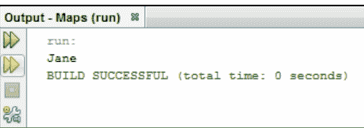

让我们再运行一次即可。

```java
System.out.print("Temperature: ");
inputValue = reader.nextFloat();
}
```

到目前为止，这个程序从用户那里获取了三个信息。第一个是温度类型：F 代表华氏（Fahrenheit），C 代表摄氏（Celsius），K 代表开尔文（Kelvin）。然后它获取另一个温度类型。这是用户想要转换的类型；同样可以是华氏、摄氏或开尔文。最后，我们从用户那里获取了初始温度值。通过这三项输入，我们的程序将把给定的华氏、摄氏或开尔文温度值转换为用户所需的类型。

这个程序具有相当的挑战性，原因有两点：

- 第一，有六种可能的流程情况，因为有两组每组三个用户输入。这意味着在最坏的情况下，我们可能需要编写六个 `if...else` 块，这会非常臃肿。
- 第二个挑战是实际的转换。我已经查了三种温度转换的数学公式，即华氏转摄氏、摄氏转开尔文以及开尔文转华氏：

```java
package temperatureconverter;

import java.util.*;

// F to C: ((t-32.0f)*5.0f)/9.0f
// C to K: t+273.15f
// K to F: ((t-273.15f)*9.0f)/5.0f+32.0

public class TemperatureConverter {
    public static void main(String[] args) {
        Scanner reader = new Scanner(System.in);
        char inputType;
        char outputType;
        float inputValue;
        float returnValue;
```

# 函数

如你所见，虽然这些数学并不困难，但它们确实很无章法，如果我们开始像前面的注释中那样到处复制粘贴公式，我们的程序看起来将会变得非常疯狂。你还应该注意，通过前面注释部分中的三种转换，我们可以完成该程序被要求的任何一种可能的转换。这是因为这三种转换形成了一个转换环，我们可以通过经过一个中间方程从特定类型转换到任何其他类型。

话虽如此，让我们直接开始编写程序吧。

## 设置控制流

我们需要做的第一件事是设置一些控制流。正如我之前提到的，有六种可能的情况，对于输入和输出类型的每种可能组合，为每种组合设置六个 `if` 语句可能会很有诱惑力。但这样会有点臃肿，所以我有一个稍微不同的计划。与其为每种可能的类型组合处理不同的情况，我要做的第一件事是将用户给出的任何初始值转换为摄氏度值。完成之后，我将该值转换为用户最初寻找的任何类型。可以通过以下代码块来实现：

```java
System.out.print("Input type (F/C/K): ");
inputType = reader.next().charAt(0);
System.out.print("Output type (F/C/K): ");
outputType = reader.next().charAt(0);
System.out.print("Temperature: ");
inputValue = reader.nextFloat();
```

设置控制流的优点是可以完全隔离地处理两项输入。它让我们的程序具有模块化，因为我们在开始下一个之前已经开始并结束了上一个。

所以，为了完成这种初始转换（我们将用户提供的任何输入并转换为摄氏度值），我们需要利用 `switch` 语句：

```java
public static void main(String[] args) {
    Scanner reader = new Scanner(System.in);
    char inputType;
    char outputType;
    float inputValue;
    float returnValue;
    System.out.print("Input type (F/C/K): ");
    inputType = reader.next().charAt(0);
```

# 函数

```java
System.out.print("Output type (F/C/K): ");
outputType = reader.next().charAt(0);
System.out.print("Temperature: ");
inputValue = reader.nextFloat();
switch(inputType)
{}
```

我们将根据用户提供的输入温度——华氏、摄氏或开尔文进行切换。在 `switch` 语句内部，我们将操作 `inputValue`，该温度的值将存储在其中。

## 探索独立的情况 - C, K 和 F

所以我想我们需要为每种可能的或有效的输入类型编写单独的 `case`，即大写的 F 代表华氏，C 代表摄氏，K 代表开尔文。我们可能还应该处理一个 `default` 默认情况。让我们从编写 `default` 情况开始。我们将使用 `System.exit` 并以 1 退出，这在技术上是一个错误代码：

```java
switch(inputType)
{
    case 'F':
    case 'C':
    case 'K':
    default:
        System.exit(1);
```

> `System.exit` 基本上是退出我们的程序。它告诉程序停止执行并传递给操作系统或层级中的其他地方。

在这种情况下，程序将直接停止。因为它是 `default` 情况，我们只预期在用户未能输入 F、C 或 K（即我们的有效输入类型）时进入它。现在，让我们继续处理这些输入类型中的每一个。


## 摄氏类型

我们将摄氏度作为所有情况下的第一个转换点，所以如果用户输入了摄氏值，我们可以直接 `break` 跳出这个情况，因为 `inputValue` 的值已经是正确的：

```java
switch (inputType) {
  case 'F':
  case 'C':
    break;
  case 'K':
    default:
      System.exit(1);
}
```

如果用户给了我们华氏值，那么，让我们滚动到代码顶部；你会看到我们有一个从华氏到摄氏的明确转换：

```java
// F to C: ((t-32.0f)*5.0f)/9.0f
// C to K: t+273.15f
// K to F: ((t-273.15f)*9.0f)/5.0f+32.0
```

我们可以采用之前的代码块（我已经把它处理得非常符合 Java 习惯），只需将此输入的值更改为转换：

```java
switch (inputType) {
  case 'F':
    inputValue = ((inputValue-32.0f)*5.0f)/9.0f;
    break;
  case 'C':
    break;
  case 'K':
    default:
      System.exit(1);
}
```

在这种情况下，我们将 `inputValue` 存储为摄氏度值。完成之后，我们将用户输入的任何值转换为摄氏度值。

## 开尔文类型

现在，请继续在你的方法前面使用 `public` 和 `static` 关键字。当我们真正进入 Java 的面向对象特性时，这些关键字将非常重要，而现在，我们将在声明的所有方法上使用它们。

为了对我们计划对程序进行的操作进行更详细的解释，让我们通过将程序进一步分为两个部分，来更详细地观察它们。

## 执行程序的第一部分

标准的 Java 方法在实际上给它命名之前，还有一个关键字，那就是该方法要返回的信息类型类型：

```java
public static float fTOC()
{
}
```

例如，我们希望能够在我们的开尔文转华氏度（Kelvin to Fahrenheit）函数上调用 `fTOC`。当我们这样做时，我们基本上是将开尔文转华氏函数的结果作为一个独立的浮点数变量进行追踪。这是一个良好的信号，说明我们在这些函数中寻找的返回类型是 `float` 数据类型。这意味着，当这些小函数执行完毕时，它们将向调用它们的主方法（main method）抛出一个浮点值。在给函数命名后，我们会在在其之前的函数声明中紧跟两个括号。在这些括号之间，我们将告诉程序该函数运行需要什么。我们基本上通过创建变量来实现这一点，如下所示代码块所示：

```java
public static float fTOC(fVal)
```

我们希望将其命名为 `fVal`，因为我们是从华氏度值开始的。我们还需要在每个输入变量之前告诉程序它是什么类型类型的信息；这样一来，人们就无法正确地调用我们的函数并传递像字符串这样的内容，那样是没有任何意义的：

```java
public static float fTOC(float fVal)
{\}
```

所以，我们将告诉函数，为了运行，它需要被传入一个 `float` 类型的信息作为输入并进行调用。在我们编写的函数中，它们实际上已经存在于程序中了。你会看到我们是这样做：我们提供了 `inputValue`（即用户最初给我们的温度值）作为这些函数的输入。

# 函数

现在，我们需要我们的 `fToC` 函数（华氏度转摄氏度函数）对代码中的这个 `fVal` 变量执行一些计算，该变量将包含用户输入的温度值。由于我们是从华氏度转摄氏度，我们可以再次复制并粘贴程序顶部的字符串，并将 `fVal` 替换为 `t`：

```java
public static float fToC(float fVal) {
    fVal = ((fVal-32.0f)*5.0f)/9.0f;
}
```

现在，我们可能想要求函数执行此操作来改变这一点，但这并不会给我们这个变量的值。虽然我们确实允许这样做，但当程序运行到 `inputValue = fToC(inputValue);` 这行代码并运行我们的 `fTo` 函数，将 `inputValue` 作为其输入变量时，这个变量并不会实际上进入我们的函数代码。相反，Java 仅仅会拷贝 `inputValue` 的值并存储在我们的新变量中，如下代码块所示：

```java
public static float fToC(float fVal) {
    fVal = ((fVal-32.0f)*5.0f)/9.0f;
}
```

因此，我们对 `fVal` 变量所做的更改不会映射到 `inputValue` 变量。幸运的是，我们显式地将 `inputValue` 的值更改为现在编写的函数返回的任何值。一旦我们准备好退出函数的执行，我们可以让它抛出任何与我们告诉函数的返回类型相同的值。我们通过 `return` 关键字来实现，后面紧跟任何在我们的案例中计算为浮点值的语句。因此，当我们的 `fToC` 函数运行在 `inputValue` 上时，它将打印出一个与输入变量中存储的初始华氏度摄氏度值相同的浮点数：

```java
public static float fToC(float fVal) {
    return ((fVal-32.0f)*5.0f)/9.0f;
}
```

一旦我们写这样一个函数，编写其他类似的函数就变得非常容易。为了编写开尔文转华氏度函数，我们只需做同样的事情，但在这种情况下取我们的开尔文转华氏度转换方程并更改变量名称。如果我们愿意，可以将其命名为 `fVal`——但 `kVal` 更具解释性——并返回该结果：


```java
public static float fToC(float fVal)
{
    return ((fVal - 32.0f) * 5.0f) / 9.0f;
}
public static float kToF(float kVal)
{
    return ((kVal - 273.15f) * 9.0f) / 5.0f + 32.0f;
}
```

这就是我们程序的半部分，我们将用户提供给我们的任何内容转换为摄氏度值。到目前为止，这比六个 `if` 语句要优雅得多，但我们只写了程序的一半。

## 执行程序的第二部分

一旦我们完成了摄氏度转换，我们将使用另一个 `switch` 语句。这次，我们将使用 `onOutputType`，由用户告诉我们他们希望看到的等效温度类型。

好消息是，这在前一个截图中也是预期值。我们使用了函数使得一个原本非常复杂且难以阅读的程序变得更易管理。我们在这里编写的程序相当复杂。它包含了一些数学运算和多功能语句，所以如果你在第一次看时并没有 100% 理解，我鼓励你回去检查一下究竟是哪里难倒了你。还有解决这个问题的其他方法，如果你有灵光一现，我也鼓励你去探索。

## 高级 Java 函数

在这一节中，我希望你能够深入研究 Java 方法，并学习一些关于编程语言如何思考和处理信息的宝贵知识。为了帮助我们实现这一点，我想运行某种实验，为了开始这个实验，我写了一个非常基础的 Java 程序：

```java
package advancedMethods;

public class AdvancedMethods {
    public static void main(String[] args) {
        int x = 5;
        magic(x);
        System.out.println("main: " + x);
    }
    public static void magic(int input) {
        input += 10;
    }
}
```

这个 Java 程序的核心是 `magic` 方法，它是紧随 `main` 方法之后用户定义的。当我们遇到一个新的 Java 方法时，有三件我们应该注意的实事：

1. 首先，我们应该问：“它的输入值是什么？”对于我们的 `magic` 方法来说，它只接受一个单一整数作为输入。
2. 其次，我们可能还想问：“这个方法返回什么？”。在我们的情况下，该方法被标记为返回 `void`。`void` 方法实际上并不返回任何值；它们只是执行自己的代码并结束。你会注意到，当我们在程序的主部分引用 `magic` 时，我们并没有尝试将它的返回值存储在任何位置。这当然是因为根本没有可存储的返回值。
3. 那么，关于我们方法的第三个需要注意的点是：“它是做什么的？”。在我们的 `magic` 方法中，我们只是获取了作为输入的值，并将该值增加了 10。

现在我想请你做的是，花一分钟看看这个程序，并尝试准确判断当运行到这行内联语句时，程序的输出将会是什么。这里具有挑战性的问题是，当我们运行 `magic(x)` 这行代码并调用我们的 `magic` 方法时，变量 `x` 的值会发生什么变化？当我们将其作为值传递给 `magic` 方法时，变量 `x` 是保持不受影响，还是变量被 `magic` 方法中的输入行所修改，从而导致我们打印出的不是 5 而是值 15？

为了回答这个问题，我们只需要运行我们的程序，如果我们这样做，将会看到得到值 5，这告诉我们 `magic` 方法并没有在我们方法的上下文中修改变量 `x` 的值：

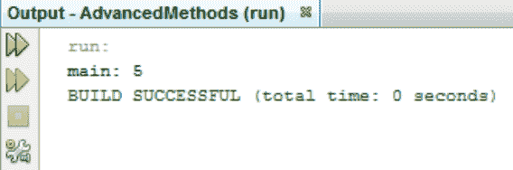

事实上，如果我们根本不运行 `magic` 方法，也会得到相同的输出。那么这告诉了我们什么？这让我们对 Java 如何处理方法输入有了非常重要的洞察。要完全理解这里发生了什么，我们需要更深入地研究 Java 变量是如何运行的。

## Java 变量的操作

以下是存储在我们变量 `x` 中的信息的表示，即我们 Java 程序中 `main` 方法中的变量：

| 名称 (Name) | 内存位置 (Memory Location) | 值 (Value) |
|---|---|---|
| X | 0x3A28213A | 5 |

你会注意到变量有三个核心组件；让我们快速过一遍它们：

- 在左侧，我放了这个变量的名称（这是我们在作用域内引用它的关键字）以及一个内存位置。我们的变量指向一个内存位置，在这个内存位置中，我们存储了变量的值。
- 我们可以将名称和内存位置看作是非常静态的；在整个程序执行过程中，对于这个特定的变量标识符，它们不会改变。但是，我们可以（而且经常这样做）自由地修改存储在变量所引用内存位置中的值。

所以为什么这很重要？嗯，在程序的运行过程中，我们必须将存储在变量 `x` 中的信息转换为我们的 `magic` 方法尝试制作的存储在变量 `input` 中的信息。如果我们仔细观察变量是如何设置的，很快就能发现实现此操作有两种可能的方法：

1. 第一，我们可以简单地创建一个名为 `input` 的新变量，它有自己独特的内存位置，然后将我们在 `x` 所引用的内存位置中找到的相同值存放在该内存位置中：

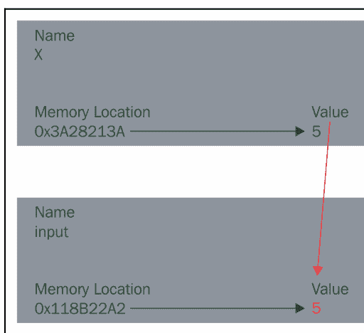

当我们把变量 `x` 传递给方法时（这是 Java 使用的创建变量 `input` 的技术），可以说 Java 是按值（by value）传递了我们的变量 `x`。这是因为只有值在创建新变量的过程中被保留了。

2. 另一个选项是创建一个新变量 `input`，但不是简单地从变量 `x` 将值复制到变量 `input`，而是让 `input` 引用与 `x` 相同的内存位置。这被称为按引用（by reference）传递变量 `x`。

## 理解参数传递：数组示例

我们还需要修改 `println` 语句来使用 `Arrays.toString`，以便显示在 `x` 数组属性中的值。我们需要导入 `java.util`，以便 Java 能够识别 `Arrays` 库：

```java
import java.util.*;
public class AdvancedMethods {
    public static void main(String[] args) {
        int[] x = {5, 4, 3, 2, 1};
        magic(x);
        System.out.println("main: " + Arrays.toString(x));
    }
}
```

现在时候问自己另一个问题了：当我们在整数数组上运行 `magic` 函数时，看到的结果是否与对单个整数值（基本类型）运行 `magic` 函数时看到的结果相同？为了回答这个问题，我们只需要运行程序，很快就会发现存储在 `x` 数组中的输出（或最终值）与我们最初赋值给 `x` 数组的值并不相同：

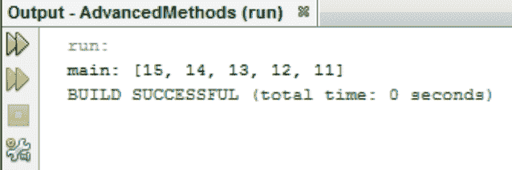

这告诉我们的 `magic` 方法确实在修改这些值。所以这有点奇怪。为什么我们的 `magic` 方法会根据输入是单个基本类型还是基本类型数组而以不同的方式运行呢？为了回答这个问题，让我们来看看变量 `x` 在被声明为整数数组（而不是之前的单个整数）时的状态：

| 名称 | 内存位置 | 取值 |
|---|---|---|
| X | 0X3A28213A | 0X31B12111 |

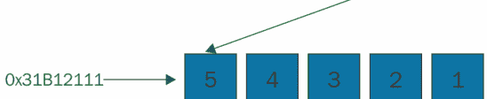

请注意，`x` 作为一个整数数组（而不是单个基本类型）仍然有一个名称和内存位置来标识它，以及一个存在的地方；然而，它的值字段看起来与之前完全不同。当 `x` 只是一个整数时，我们可以简单在 `x` 的值字段中存储一个显式整数，但作为数组，`x` 意味着引用许多不同的值；这使得它成为了数据结构。为了实现这一点，数组（实际上是其他比基本类型更复杂的元素）指向内存中的一个位置，而不是单一的显式值。对于数组，我们只需要指向内存中数组的 0 索引。然后，通过从该索引开始，我们可以存储变量 `x` 知道如何访问的多个值。所以为什么这很重要？

好了，让我们来看看当按值将 `x` 传递给方法时会发生什么。正如我们所知，当我们按值传递变量时，我们是在告诉 Java 在方法的范围内创建一个新变量，该变量将有自己独特的名称和内存位置：

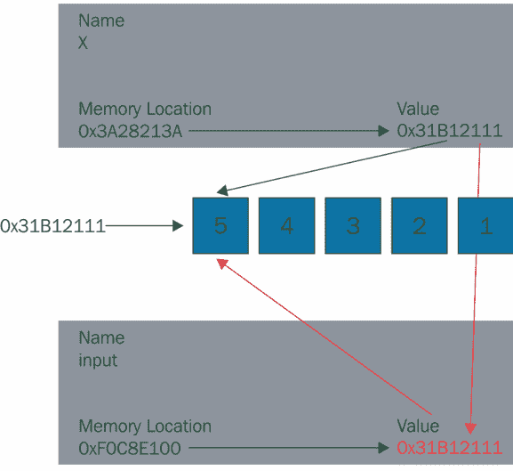

然而，在这种情况下，这个新变量（即 `input`）从旧变量处获取值作为自己的值。当我们处理基本类型时，这些值是完全独立的，但现在 `input` 和 `x` 都拥有相同内存位置的值。因此，虽然修改 `input` 变量本身（即引用）不会改变 `x` 的引用，但修改 `input` 指向的内存位置中的内容，仍然会在 `x` 查看该位置时改变该内存位置的内容。

在方法的上下文中，如果我们显式地引用 `input` 变量并修改该变量（即重新赋值引用），我们将只修改方法范围内的变量，就像我们在第一个 `magic` 方法中做的那样。但如果我们必须采取额外的步骤来访问正在修改的值（正如我们在访问数组索引时必须做的那样），那么我们是通过内存位置或引用来修改它的。在这种情况下，我们可能会影响为方法变量提供值的原始变量。


```java
package advancedmethods;

import java.util.*;
public class AdvancedMethods {
    public static void main(String[] args) {
        int[] x = {5, 4, 3, 2, 1};
        magic(x);
        System.out.println(" " + Arrays.toString(x));
    }
    public static void main(int input) {
        input += 10;
    }
    public static void magic(int[] input) {
        input = new int[] {2, 2, 2, 2, 2};
    }
}
```

如果我们接收数组的魔法函数仅仅尝试将整数数组的值设置为一组具有全新起始内存位置的新整数值，我们会看到当对它运行此函数时，我们不再再修改 `x` 的值了：

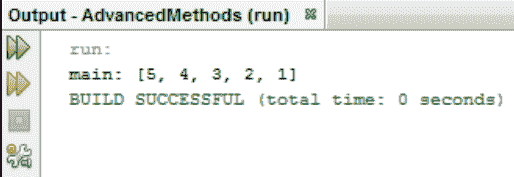

这是因为创建一个新整数数组导致我们显式地改变了 `input` 的值。在这行代码之后，`input` 和 `x` 不再共享同一个值了。非常感谢大家的时间。希望你们学到了东西。

## 总结

你还在这里吗？如果是，恭喜你。我们从一些基础的 Java 函数（如方法）开始，然后理解了高级 Java 函数。我们刚刚讨论过一些复杂的内容。随着你成为一个更有经验的程序员，你会发现这些概念变得更加直观。

# 使用面向对象的 Java 进行建模

## 创建自定义类

现在，我们可以在当前工作的文件创建一个新类；然而，类声明代码与执行的 `main()` 方法有些不同，且在逻辑上是分离的，后者的行是按顺序逐行执行的。相反，我们要创建的类将作为代码行的的引用，例如 `Scanner reader = new Scanner(System.in);` 这一行代码。通常，在一种面向对象的语言（如 Java 这种高级面向对象语言）中，我们简单会将创建的每个新类都放在单独的文件中。

要为我们的类创建一个新的 Java 文件，只需右键点击屏幕左侧的包名，即 `gettingobjectoriented`。然后选择“New”（新建），接着选择“Java Class”（Java 类）。之后，系统会提示我们为其命名。

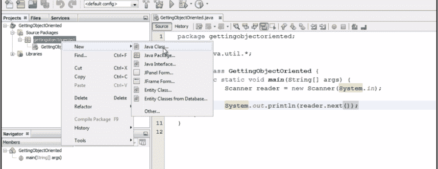

在此例中，我们将创建一个类来提供并存储关于人的一些基本信息。将其命名为 `Person` 类，它将创建对象：

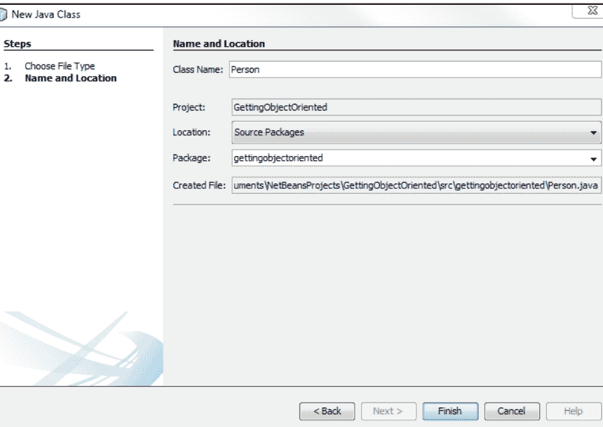

当我们按下 **Finish**（完成）时，NetBeans 非常方便，为我们设置了一些非常基础的代码行。它声明此类位于我们的本地包中。这意味着当从 `main()` 方法中引用它时，不需要像引用标准库类那样导入这个类。NetBeans 贴心地为我们创建了类声明。这仅仅是一行代码，让 Java 编译器知道我们准备声明一个新类，如下截图所示：

```java
package gettingobjectoriented;
public class Person {
}
```

目前，我们将忽略 **public** 关键字，但要知道它是非常必要的。这里，**class** 关键字——不言自明——告诉我们准备声明一个新类，然后就像我们创建的并在未来需要引用的任何东西一样，我们给这个类起一个名字或唯一的关键字。

是时候编写代码来设置我们的 `Person` 类了。记住，我们正在做的是教程序的后续部分如何创建 `Person` 对象或 `Person` 类的实例。因此，我们在这里编写的代码看起来与我们在方法中从头到尾执行行的代码非常不同。

我们放置在类声明中的信息将属于以下两类之一：

- 第一类是让我们告诉 Java `Person` 类应该存储什么信息
- 第二类是让我们教导 Java `Person` 对象应该暴露哪些功能

## 创建成员变量

让我们从第一类开始。告诉 Java 我们想在 `Person` 中存储哪些信息：

```java
package gettingobjectoriented;

public class Person {
    public String firstName;
    public String lastName;
}
```

告诉 Java 要存储什么信息就像在任何其他代码段中声明变量一样。在这里，我们为 `Person` 类提供了两个成员变量；这些是可以在任何 `Person` 对象中访问的信息。

我们在类声明中声明的几乎所有内容都需要赋予一个保护级别。当我们成为更高级的 Java 用户时，我们将开始使用不同的保护级别，但目前，我们将简单将一切声明为“public”（公共）。

所以，正如我们在这里设置的那样，每个 `Person` 对象都有 `firstName` 和 `lastName`。记住，这些成员变量对于每个 `Person` 对象实例都是唯一的，因此不同的人并不一定共享相同的姓名。

为了让事情更有趣一点，让我们给人们分配生日。我们需要导入 `java.util`，因为我们将为此使用另一个类，`Calendar` 类：

```java
package gettingobjectoriented;
import java.util.*;
public class Person {
    public String firstName;
    public String lastName;
    public Calendar birthday;
}
```

日历（`Calendar`）基本上是点、时间或日期，周围包装了大量的功能。酷的一点是 `Calendar` 本身就是一个类。所以我们正在 `Person` 类中放置一个类；`String` 也是一个类，但 Java 对它比较熟悉。

现在，回到 `GetObjectOriented.java` 文件中的 `main()` 方法，看看创建一个新人的代码是什么样的。目前，我们将保留这行代码以便使用。我们想创建一个 `Person` 类的新实例，或创建一个新的 `Person` 对象。要做到这一点，我们首先要告诉 Java 我们想创建什么类型的对象。

由于我们在正在使用的包中声明了 `Person` 类，Java 现在能理解 `Person` 关键字了。然后，我们需要为将分配给新人的变量命名；让我们把这个人命名为 `john`。创建一个新人就像创建一个新的 `Scanner` 对象一样简单。我们使用 `new` 关键字让 Java知道我们正在创建一个不存在的新东西，然后要求它创建一个人：

```java
import java.util.*;
public class GettingObjectOriented {
    public static void main(String[] args) {
        Person john = new Person();
    }
}
```

## 创建成员方法

```java
public String fullName() {
    return firstName + " " + lastName;
}
```

我预见到这个人还会被问另一个问题，就是“你多大了？”这与我们写的方法非常相似，但有一个例外。为了知道这个人的年龄，需要告诉他今天今天的日期，因为这不是他已经存储的信息。

为了做到这一点，我们将要求人们在调用此方法时传递此信息，我们只需返回今天日期与此人出生年份之间的差值。

现在，从日历中获取年份的语法有点奇怪，但我想我们能够理解。我们只需要使用 `get` 方法（它有许多用途），然后需要准确地告诉方法我们想从中获取什么，我们想要获取的是日历年份 (`Calendar.YEAR`)。所以，确保保存此文件并跳转到主方法，使用我们为 `Person` 类添加的这些新方法之一。

```java
package gettingobjectoriented;
import java.util.*;
public class Person {
    public String firstName;
    public String lastName;
    public Calendar birthday;
    public String fullName() {
        return firstName + " " + lastName;
    }
    public int age(Calendar today) {
        return today.get(Calendar.YEAR) - birthday.get(Calendar.YEAR);
    }
}
```

所以，我们设置了 john。他有一个生日。让我们直接在打印语句中询问 John 他多大了。为了做到这一点，我们只需调用 John 的 `age` 方法并创建一个新的 `Calendar` 对象传递进去。我认为新的 `GregorianCalendar` 实例将默认设置为当前的日期和时间。

## 运行示例程序

如果我们运行以下程序：

```java
package gettingobjectoriented;
import java.util.*;
public static class GettingObjectOriented {
    public static void main(String[] args) {
        Scanner reader = new Scanner(System.in);
        Person john = new Person();
        john.firstName = "John";
        john.lastName = "Doe";
        john.birthday = new GregorianCalendar(1988,1,5);
        System.out.println(john.age(new GregorianCalendar()));
    }
}
```

我们看到 John 年 29 岁。

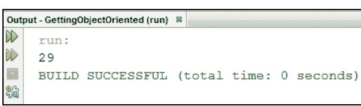

这就是我们对面向对象 Java 的基础介绍，但这一切都将归结为你刚刚学到的基础知识。

## 创建构造函数

在本节中，你将学习一种我们可以分配给自定义类的非常特殊的成员——构造函数。首先，让我们看看下面的代码：

```java
package gettingobjectoriented;
import java.util.*;
public class GettingObjectOriented {
    public static void main(String[] args) {
        Scanner reader = new Scanner(System.in);
        Person john = new Person();
        john.firstName = "John";
        john.lastName = "Doe";
        john.birthday = new GregorianCalendar(1988,1,5);
        System.out.println(
```

```java
"Hello my name is " +
john.fullName() + 
" I am " +
john.age(new GregorianCalendar()) + 
" years old.");
```

这个程序创建了自定义 `Person` 的实例，并立即为 `Person` 的成员变量赋值：`firstName`、`lastName` 和 `birthday`。然后，我们利用 `Person` 的成员函数打印出关于我们所赋值的值的一些信息。

虽然我们刚刚写的这个程序还不错，但很容易看出每个人在编写这个简单程序时犯错。例如，如果我忘记（或只是没有意识到）`birthday` 是 `Person` 的成员变量之一呢？如果我不立即为一个人分配生日，然后像下面的代码块所示尝试使用 `age()` 成员方法：

```java
package gettingobjectoriented;

import java.util.*;

public class GettingObjectOriented {
    public static void main(String[] args) {
    Person John = new Person();
    John.firstName = "John";
    John.lastName = "Doe";
    //John.birthday = new GregorianCalendar(1988, 1, 5);
    System.out.println(
    "Hello my name is " +
    John.fullName() +
    " I am " +
    John.age(new GregorianCalendar()) +
    " years old.");
    }
}
```

当程序尝试访问未设置任何值的 `birthday` 变量时，程序将会崩溃，如下截图所示：

```
Output - GettingObjectOriented(run) R
run:
  Exception in thread "Main" java.lang.NullPointerException
    at gettingObjectOriented.Person.age(Person.java:13)
    at gettingObjectOriented.GettingObjectOriented.main(GetObjectOriented.java:15)
    at C:\Users\nidishas
```

这是程序员可能会犯的合理错误。

## 使用 `this` 关键字区分变量

首先，我们可以简单地将分配给方法参数的名称更改为与局部成员变量不同的名称；但是，有时显式地将其命名为 `firstName` 是有意义的。对于将使用构造函数的人来说，这要容易得多。当我们需要显式告诉程序正在使用 `Person` 类的成员变量时，我们应该为其提供正确的路径。`this` 关键字允许我们在程序运行时访问当前操作的类或其对象实例。因此，`this.firstName` 将始终引用成员变量，而不是作为参数传递的那个。现在我们有了语法，可以快速地将参数值赋值给成员变量的值：

```java
public Person(String firstName, String lastName, Calendar birthday)
{
    this.firstName = firstName;
    this.lastName = lastName;
    this.birthday = birthday;
}
```

现在，当我们保存此文件并返回主方法——即 `GetObjectOriented.java` 并运行程序时，我们将得到原始输出，显示我们的 `Person` 构造函数已正确将这些输入值映射到存储在 `Person` 对象中的值中：

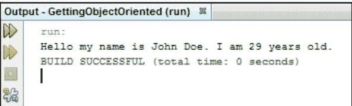

这非常酷。我们修改了 `Person` 类，使得程序员很难犯下明显的错误，即调用这些注定会失败的方法。如果程序员在我们的 `person` 对象创建后执行了修改其中一个成员变量的操作，他们仍然会遇到麻烦。

## 使用 `private` 封装成员变量

然而，如果我们选择，我们有一套系统可以保护我们的类，防止它们的成员在不通过适当协议的情况下被修改。假设我们想更改 `Person` 类，使得这些成员唯一被更改的时间是在最开始调用构造函数时的那一次。如果你还记得的话，我们一直在为类的所有成员标记了这种 `public` 公共保护标签。任何被标记为 `public` 的内容基本上只要程序中的任何部分可以访问其容器，它就是可见的。

但是，我们可以使用其他一些保护标签。如果我们将所有成员变量标记为 `private`，那么它们在当前类的语境内是可见的。因此，我们仍然可以在 `Person` 构造函数以及 `fullName` 和 `age` 方法中使用成员变量，但当我们尝试在实际类声明之外访问 `lastName` 时，它将是非法的：

```java
package gettingobjectoriented;

import java.util.*;

public class Person {
    private String firstName;
    private String lastName;
    private Calendar birthday;
```

我们可以将成员标记为 `private`，然后在适当的时候创建 `public` 方法来修改它们的值。通过这样做，我们将保护我们的对象不再被赋予无效的值。

## 构造函数的类型

现在，在结束之前，让我们回到构造函数的话。就像普通方法一样，我们可以重写构造函数，并为程序员提供多个选项供其选择。


例如，假设在我们的程序中，我们想要创建刚刚出生的人。在这种情况下，通过简单向构造函数提供 `firstName` 和 `lastName` 来构建一个人，并将 `birthday` 设置为新的格列哥历（Gregorian Calendar），它将默认为今天的日期），非常有意义的：

```java
package gettingobjectoriented;

import java.util.*;

public class Person {
    private String firstName;
    private String lastName;
    private Calendar birthday;

    public Person(String firstName, String lastName) {
        this.firstName = firstName;
        this.lastName = lastName;
        this.birthday = new GregorianCalendar();
    }

    public Person(String firstName, String lastName, Calendar birthday) {
        this.firstName = firstName;
        this.lastName = lastName;
        this.birthday = birthday;
    }
}
```

如果我们将想在程序中使用这个构造函数，只需调用带有两个字符串参数的构造函数即可。这将映射到我们在这里声明的新创建的构造函数。

考虑以下程序：

```java
package gettingobjectoriented;

import java.util.*;

public class GettingObjectOriented {
    public static void main(String[] args) {
        Person john = new Person("John", "Doe");
        System.out.println("Hello my name is " + 
            john.fullName() + " " +
            "I am " + 
            john.age(new GregorianCalendar()) + 
            " years old.");
    }
}
```

当我们运行它时，由于出生日期设置为当前的日期和时间，我们将看到 John Doe 现在是 0 岁，如下截图所示：

```
Output - GettingObjectOriented (run) [x]
> run:
> > Hello my name is John Doe. I am 0 years old.
> > ![image]
> > BUILD SUCCESSFUL (total time: 0 seconds)
```

最后，我们可以通过声明一个空构造函数，给某人利用我们的构造函数的机会，或者简单的创建一个类的实例而不执行任何操作。那么，语法看起来就像我们之前参与的创建 John 一样：

```java
public Person() {

}
```

通常情况下，我们不想这样做。如果我们有一个空构造函数，我们想做的是确保在我们还没有提供任何值时程序不会崩溃。为了做到，我们可以为变量分配默认值：

```java
public Person() {
    firstName = "";
    lastName = "";
    birthday = new GregorianCalendar();
}
```

## 总结

在本章中，我们看到了如何创建类和对象，以及如何创建成员变量和函数。你还学习了构造函数和构造函数的类型。

# 更多面向对象的 Java

| Inheritance.java | Book.java |
| --- | --- |
| Source | 历史 |
| 2 | public class Book { |
| | private String title; |
| | private String author; |
| | private String publisher; |
| | private String genre; |
| 7 | public Book(String title, String author, String publisher, String genre) |
| 10 | { |
| | this.title = title; |
| | this.author = author; |
| | this.publisher = publisher; |
| | this.genre = genre; |
| | } |
| 16 | public void Print() { |
| | System.out.println("\tWritten By: " + author); |
| | System.out.println("\tPublished By: " + publisher); |
| | System.out.println("\tIs A: " + genre); |
| | } |

| Inheritance.java | Poem.java |
| --- | --- |
| Source | 历史 |
| 1 | package inheritance; |
| 2 | public class Poem { |
| | private String title; |
| | private String author; |
| | private String style; |
| 7 | public Poem(String title, String author, String style) |
| 10 | { |
| | this.title = title; |
| | this.author = author; |
| | this.style = style; |
| | } |
| 15 | public void Print() { |
| | System.out.println("\tWritten By: " + author); |
| | System.out.println("\tIn The Style Of: " + style); |
| | } |

更多面向对象的 Java

它们对成员变量执行的操作（即将它们打印到屏幕上）在两个类中是以非常相似的方式执行并实现的：

| Inheritance.java | Book.java |
| --- | --- |
| Source | 历史 |
| 16 | public void Print() |
| 17 | { |
| 18 | System.out.println(title); |
| 19 | System.out.println("\tWritten By: " + author); |
| 20 | System.out.println("\tPublished By: " + publisher); |
| 21 | System.out.println("\tIs A: " + genre); |
| 22 | |
| 23 | } |

| Source | 历史 |
| --- | --- |
| 14 | public void Print() |
| 15 | { |
| 16 | System.out.println(title); |
| 17 | System.out.println("\tWritten By: " + author); |
| 18 | System.out.println("\tIn The Style Of: " + style); |
| 19 | } |
| 20 | |

Book 和 Poem 继承自同一个公共类，这是一个好迹象。当我们把书籍和诗歌视为它们所代表的物理对象时，这对我们来说非常容易。我们可以断定书籍和诗歌都是文学的形式。

## 创建超类

一旦我们得出书籍和诗歌共享某些基本属性（即所有文学作品的属性），我们就可以开始将这些类拆解为组成部分。例如，我们的 Book 类有两个实际变量。它有一个 `title` 变量和一个 `author` 变量，这些是我们与所有文学作品关联的属性。它还有一个 `publisher` 变量和 `genre` 变量，这些可能不仅仅是书籍特有的，而且并不一定所有形式的文学作品都具备。那么，我们可以利用这些知识吗？嗯，我们可以构建 Book 和 Poem 类，让它们在基础层面上共享作为文学作品的本质。为了实现这一点，我们首先要教程序什么是文学作品。以下是实现此点的逐步程序：

1. 我们将创建一个全新的类并将其命名为 `Literature`。
2. 我们将到此为止声明的、文学作品共享的属性分配给此类。在我们的案例中，书籍和诗歌已经被声明为作品，具有的标题和作者。声明所有文学作品都将拥有标题和作者在逻辑上是合理的：
3. 从这里开始，像处理其他类一样完善我们的 `Literature` 类。我们将给它一个构造函数；在这种情况下，我们的构造函数将两个变量：`title` 和 `author`。然后，我们将它们赋值给字段，就像我们对 Poem 和 Book 类所做的那样：

```java
package inheritance;

public class Literature {
    protected String title;
    protected String author;

    public Literature(String title, String author) {
        this.title = title;
        this.author = author;
    }
}
```

4. 既然如此，让我们给 Literature 分配一个相似的 Print 方法，就像我们分配给 Book 和 Poem 类的那样：

```java
public void Print() {
    System.out.println(title);
    System.out.println("	Written By: " + author);
}
```

现在，如果我们想要，可以去主方法并声明一个 Literature 类的对象，但这不是重点。这不是我们创建 Literature 类的原因。相反，我们的目标是使用这个 Literature 类作为基类，在此基础上构建更特定类型的文学作品，例如诗歌或书籍。为了利用 Literature 类，让我们看看它如何应用于 Poem 类。

## 是一个关系 (is-a relationship)

我们的 Literature 类包含了管理文学作品所需的标题和作者的所有功能。如果我们让 Java 知道 Poem 之间存在继承关系，我们就可以从以下 Poem 类中移除标题和作者：

```java
package inheritance;

public class Poem extends Literature {
    private String title;
    private String author;
    private String style;
}
```

首先，让我们谈谈我们修改过的 Poem 类声明。当我们说一个类继承另一个类时，我们是在说它们之间存在“是一个”的关系，使得我逻辑上可以说“诗歌是一种文学作品”。在更多的 Java 术语中，我们说 Poem 子类继承了 Literature 类。这意味着当我们创建一个 Poem 对象时，它将拥有所继承的类的所有成员和功能：

```java
package inheritance;

public class Poem extends Literature {
    private String style;

    public Poem(String title, String author, String style);
```

# 更多面向对象的 Java

让我们看看我们是否已经成功声明了 Poem（诗歌）和 Literature（文学）之间的关系。回到 Inheritance.java 类中程序的 `main` 方法，看看这个程序的诗歌部分执行情况是否与之前一致：

```
输出 - Inheritance (run)
run: The Lord Of The Rings
Written By: J.R.R. Tolkien
Published By: George Allen and Unwin
Is A: Fantasy
The Iliad
Written By: Homer
In The Style Of: Dactlic Hexameter
BUILD SUCCESSFUL (total time: 0 seconds)
```

当我们运行这个程序时，我们得到了与之前相同的输出，这是一个很好的迹象，说明我们已经以一种逻辑的方式设置了 `Poem` 类继承自 `Literature`。

现在我们可以跳转到 `Book`（书籍）类。我们将通过以下步骤在 `Book` 类和 `Literature` 类之间建立一个“是一个（is-a）”的关系：

1. 首先，我们将声明 `Book` 继承 `Literature` 类；然后，我们将从 `Book` 类中删除对 `title`（标题）和 `author`（作者）的引用，因为现在父类 `Literature` 类将处理这些内容：

```java
package inheritance;

public class Book extends Literature {
    private String publisher;
    private String genre;
```

2. 与 `Poem` 类一样，我们需要显式调用 `Literature` 类的构造函数，并将 `title` 和 `author` 传递给它：

```java
public Book(String title, String author, String publisher, String genre) {
    super(title, author);
    this.publisher = publisher;
    this.genre = genre;
}
```

```java
@Override
void Print() {
    super.Print();
    System.out.println("\tPublished By: " + publisher);
    System.out.println("\tIs A: " + genre);
}
```

4. 再次回到 `main` 方法并运行它，以确保我们已经成功完成了操作：

```
输出 - Inheritance (run)
The Lord Of The Rings
Written By: J.R.R. Tolkien
Published By: George Allen and Unwin
Is A: Fantasy
The Iliad
Written By: Homer
In The Style Of: Dactlic Hexameter
BUILD SUCCESSFUL (total time: 0 seconds)
```

在这里：*The Lord of the Rings* 的输出和之前看到的一样。从风格上来说，这种变化非常棒。通过添加 `Literature` 类并对其进行子类以创建 `Book` 和 `Poem` 类，我们让 `Book` 和 `Poem` 类变得更加精简，便于程序员查阅并理解发生了什么。

然而，这种变化不仅仅是风格上的。通过在 `Book`、`Poem` 和 `Literature` 类之间声明一种“是”关系（其中 `Book` 和 `Poem` 继承自 `Literature` 类），我们获得了以前没有的实际功能。让我们来看看实际效果。如果我们回到 `main` 方法，假设我们处理的不是单个 `Book` 和 `Poem` 类，而是一个需要存储在某种数据结构中的庞大网络。按照我们最初的实现，这将是一个真正的挑战。

## 数据结构

没有一种可以轻松访问且能同时存储书籍和诗歌的数据结构。我们可能不得不使用两个数据结构，或者破坏强类型，而这正是 Java 的核心所在：

```java
Book[] books = new Book[5];
```

然而，在我们新的实现中，由于 `Book` 和 `Poem` 都继承自 `Literature`，我们可以将它们存储同一个数据结构中。这是因为继承是一种“是”的关系，意味着由于我们了了某些，我们可以做出诸如“书籍是文学，诗歌也是文学”之类的断言。如果是如此，那么 `Literature` 对象的数组应该能够存储 `Book` 和 `Poem`。让我们通过以下步骤来说明：

- 创建一个 `Literature` 对象数组：

```java
Literature[] lits = new Literature[5];
lits[0] = a;
lits[1] = b;
```

构建此项目时不再出现编译错误，这是一个非常好的信号，说明我们正在做合法的操作。

- 为了演示，让我们填充数组以包含数量的书籍和诗歌：

```java
Literature[] lits = new Literature[5];
lits[0] = a;
lits[1] = b;
lits[2] = a;
lits[3] = b;
lits[4] = a;
```

我们将修改 `main` 方法直接从数组中打印内容。现在，当我们像使用父类对象一样使用子类时，我们必须意识到我们现在是将它们作为该父类的对象来引用的。例如，当我们遍历 `Literature` 数组并获取元素时，无论该元素是否是 `Book` 类，我们仍然无法访问像 `genre` 字段这样的内容，即使它是 `public` 的：


```java
Literature[] lits = new Literature[5];
lits[0] = a;
lits[1] = b;
```

```java
lits[2] = a;
lits[3] = b;
lits[4] = a;
for (int i = 0; i < lits.length; i++) {
    lits[i].Print();
}
```

- 3. 我们在循环中调用 `Literature` 类的 `Print` 方法：

```java
for (int i = 0; i < lits.length; i++) {
    lits[i].Print();
}
```

这意味着当我们运行此程序时，我们仍然会得到这种特殊格式的输出：

```java
public void Print() {
    System.out.println(title);
    System.out.println("\tWritten By: " + author);
}
```

## 抽象方法

我们可能会看到仅为了重写的方法。这些方法不执行任何操作，我们可以在它们上标记 `abstract` 关键字，即父类中的 `public abstract void Print()`。如果一个类是抽象的，则不应该创建它的实例。如果我们走这条路，我们也应该将 `Literature` 声明为抽象类：

```java
package inheritance;
public abstract class Literature {
```

# 更多面向对象的 Java

如果我们这样做，当然，我们需要删除对这些类的引用，所以让我们先撤销这些更改。

让我们看看构建此程序时犯的另一个小错误。在创建 `Literature` 类时，我们将 `title` 和 `author` 声明为 `public` 成员变量。正如你所知，如果没有充分理由，我们通常不会将成员变量声明为 `public`。文学作品在声明后更改其作者是没有意义的，因此 `author` 和 `title` 应该是 `Literature` 类构造函数中的有有变量，其值不应该改变。不幸的是，如果我们对 `Literature` 类进行此更改，将限制 `Poem` 和 `Book` 类的功能。

假设我们想修改 `Poem` 类的 `Print` 方法，以便它不需要显式调用 `Literature` 类的 `Print` 方法——例如，我们想修改 `Poem` 类的 `Print` 方法，以便它不需要显式调用 `Literature` 类的 `Print` 方法：

```java
@Override void Print() {
    System.out.println(title);
    System.out.println("\tWritten By: " + author);
    System.out.println("\tIn The Style Of: " + style);
}
```

也许我们想先告诉它我们在这里声明一个 `Poem` 类：

```java
System.out.println("POEM: " + title);
```

遗憾，由于我们将 `title` 和 `author` 设置为 `Literature` 类的私有，`Poem` 类即使是 `Literature` 的子类，也无法在其显式代码中这些成员变量。

## 受保护方法

受保护方法是保护设置。如果我们声明成员变量为 `protected`，则意味着它们是私有的，并且除了类本身及其子类之外的人无法访问：

```java
package inheritance;
public class Literature {
    protected String title;
    protected String author;
}
```

# 更多面向对象的 Java

为了让我们自己放心，我们所做的一切都是正确的。让我们再次运行程序，确保输出结果良好，事实也确实如此。此之后，我们应该对继承有了相当充分的掌握。我们可以开发出许多真正模拟现实世界对应的系统，并利用继承和小型类（这些类本身不包含很多复杂的操作）来编写出非常优雅且功能强大的代码。

## 抽象

在这一节中，我们将快速查看一个与 Java 继承相关的重要概念。为了理解我们将要讨论的内容，我认为最好的办法是从系统中启动一个现有的项目。所以，让我们看看代码文件中的代码。

到目前为止，我们已经完成了以下工作：

- 我们的程序 `main` 方法创建了一个对象列表。这些对象要么是 `Book` 类型，要么是 `Poem` 类型，但我们将它们放在了一个 `Literature` 对象的列表中，这让我们认为 `Book` 和 `Poem` 类必须继承或扩展了 `Literature` 类。
- 一旦我们构建了这个数组，我们只需使用循环对其进行迭代，并在每个对象上调用该循环的 `Print` 方法。
- 此时，我们将对象作为 `Literature` 对象来处理，而不是处于底层的 `Books` 或 `Poams`。这让我们认为 `Literature` 类本身必须实现一个 `Print` 方法；如果我们进入该类查看，将会发现这确实如此。

如果我们运行程序，很快就会看到 `Books` 和 `Poems` 执行其 `Print` 方法的方式略有不同，为每个对象显示不同的信息。当我们查看 `Book` 和 `Poem` 类时就能解释这一点，它们都扩展了 `Literature` 类，每个类都重写了 `Literature` 类的方法以提供自己的功能。这一切都是合理的，而且是一个非常优雅的解决方案，但有一个我们应该关注并讨论的有趣情况。由于 `Literature` 本身是一个类，我们声明一个新的 `Literature` 对象是完全有效的，就像我们可以声明 `Book` 或 `Poem` 一样。`Literature` 类的构造函数首先期望作品的标题，然后是作者。一旦我们创建了 `Literature` 类的新实例，我们就可以将其放入 `Literature` 类列表中，就像我们之前对 `Book` 和 `Poem` 类实例所做的一样：

```java
Literature l = new Literature("Java", "Zach");
Literature[] lits = new Literature[5];
lits[0] = a;
lits[1] = b;
lits[2] = a;
lits[3] = b;
lits[4] = a;
for (int i = 0; i < lits.length; i++) {
    lits[i].Print();
}
```

当我们这样做并运行程序时，我们将看到 `Literature` 类的 `Print` 方法被执行，并且我们创建的新 `Literature` 对象将与我们的书籍和诗歌列表一起显示：

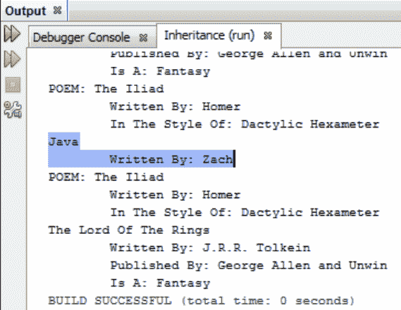

那么问题在哪里呢？嗯，取决于我们尝试设计的软件本质，这可能很有意义也可能没有。假设我们这样做是为了图书馆系统的一部分，仅向某人提供某个 Java 作品是由一个叫 Zach 的人写的这类信息，而不告诉他们这是一本书还是一首诗，或者我们认为与特定类型文学相关的任何其他信息。这可能完全没有用处，是永远不应该做的事情。

如果是这样，Java 为我们提供了一个系统来创建可以用于继承目的的类，我们永远无法像以前那样合法地单独实例化它们。如果我们想标记一个类为该类型，我们将其称为**抽象类**（abstract class），并且在类的声明中，我们只需使用 `abstract` 关键字：

```java
public abstract class Literature {
```

一旦我们标记一个类为抽象类，实例化该类就不再是一个合法的操作。从表面上看，这是一个非常简单的事情，主要是一种“保护我们的代码免受我们或其他程序员的侵害”的措施，但并不完全正确；相反，这是真实的，而且并不是声明一个抽象类的唯一目的。

一旦我们告诉 Java 我们永远无法创建 `Literature` 的实例（即创建使用 `Literature` 作为父类的类的实例），我们在设置 `Literature` 类时就不再受到限制。因为我们声明 `Literature` 是一个抽象类，Java 将知道 `Literature` 永远不会被单独实例化，只有当它是大多数 Java 类必须使用的父类时才会这样做。例如，我们不需要实际上为 `Literature` 声明构造函数。如果 `Literature` 是标准的 Java 类，Java 将不会接受这样做，因为如果我们尝试实例化 `Literature`，它将不知道该做什么。将没有构造函数可以调用。但因为 `Literature` 是抽象的，我们可以确信 `Literature` 的子类将拥有自己的构造函数。当然，如果我们执行了此更改，我们将删除子类中对 `Literature` 构造函数的引用，即删除子类中的 `super` 方法。因此，这种变化无疑涉及一种权衡。它要求我们在子类中编写更多代码，以换取 `Literature` 子类中更少的代码。在特定情况下，这种权衡可能

## 总结

在本章中，我们讨论了继承和抽象类。我们看到了如何使用抽象类来防止实例化并为子类提供模板。我们还看到了子类如何重写父类的方法。在下一章中，我们将探索更多实用的类。

# 8 实用类

一旦我们对基础知识有了信心，以下是本章将涵盖的主题：

- Calendar 类
- String 类以及 String 对象与字面量之间的区别
- 异常以及如何处理它们
- Object 类
- Java 原始类型类

## Calendar 类

在这一节中，我们将查看 Java 的 `Calendar` 类。在编写 Java 代码时，我们通常使用 `Calendar` 类来引用特定的时刻。

`Calendar` 类实际上是 Java API 中一个较新的添加。在此之前，我们使用 `Date` 类执行类似的功能。如果你最终处理旧的 Java 代码，或者在编写处理 SQL 或 MySQL 数据库的 Java 代码，你可能会经常使用 `Date` 类。

## 有用的 Java 类

或许让你出乎意料的是，当我们尝试编译这个基础程序时，它实际上失败了：

```java
package datesandtimes;
import java.util.*;

public class Main {
    public static void main(String[] args) {
        Calendar c = new Calendar(); // Java 返回: 1
    }
}
```

```
nException in thread "main" java.lang.RuntimeException: Uncompilable source code - java.util.calendar is abstract; cannot be instantiated
    at DateAndTime$DateAndTime.main(DateAndTime.java:7)
    at java.base/jdk.internal.loader.ClassLoader.loadClass(Native Method.java/executor-snippets/run.xml:53)
BUILD FAILED (total time 1 second)
```

我们的错误在于 `Calendar`，根据控制台显示的错误，我们实例化了 `Calendar` 类。错误是 `Calendar` 是抽象类；无法实例化。

如果回想起来，抽象类是纯粹为了被子类化而设计的，这并不是一个公平的问题，因为我们永远无法单独声明抽象类的实例。当然，这也不公平；如果我们永远无法实例化它，那么 Java 的 `Calendar` 类还有用吗？我们完全可以创建 `Calendar` 对象；它们只需要是特定类型的 `Calendar` 对象。我们几乎总是会使用 `GregorianCalendar`。

## Calendar 的子类

让我们退后一步，并假设（也许是正确的）我们并不知道有哪些 `Calendar` 选项可用。这是使用 IDE（集成开发环境，如 NetBeans）能够非常神奇的时刻之一。

通常情况下，在这个时间点，我们必须去查阅 Java 文档以查看具体有哪些 `Calendar` 子类可供我们实例化。但由于我们的 IDE 了解我们已经导入的包的某些元数据，我们可以询问 IDE 它认为什么可能是我们代码的可能解决方案。如果你在 NetBeans 中工作，可以通过检查 `Tools（工具）` | `Options（选项）` | `Code Completion（代码补全）` 中的某些代码补全选项经常获得这类建议。

## 有用的 Java 类

然而，为了防止代码补全一直弹出，这次我将使用 NetBeans 的快捷键。该快捷键默认是组合键 `Ctrl + space`，它会为我们当前光标所在的位置弹出一个代码补全窗口，如下截图所示：

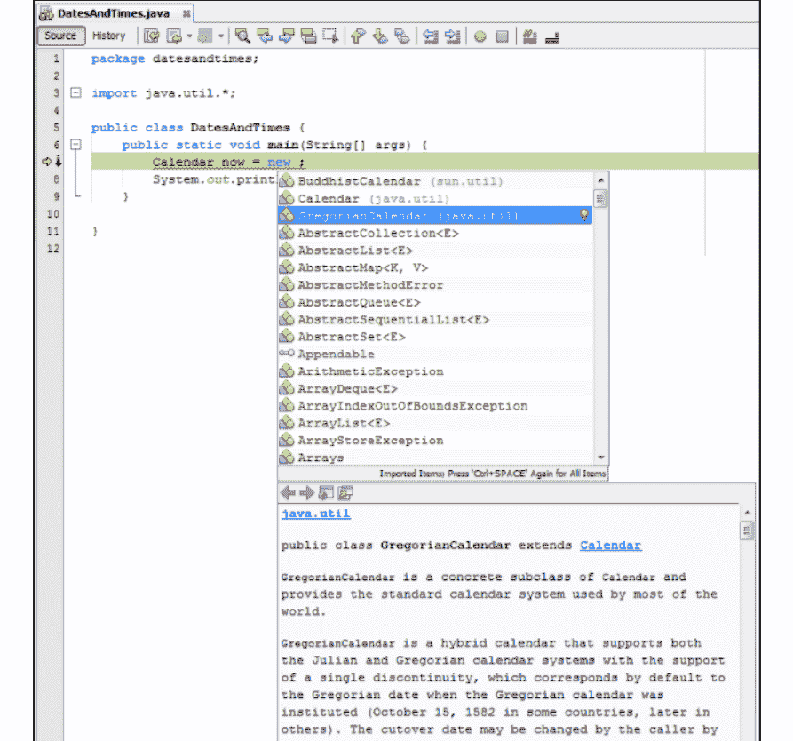

## 有用的 Java 类

NetBeans 中的 **Code Completion（代码补全）** 选项非常好。NetBeans 给了我们三个可能的建议：抽象的 `Calendar` 类、`BuddhistCalendar` 和 `GregorianCalendar`。我们已经不想不想 `Calendar` 类，因为我们实际上无法实例化抽象类。`BuddhistCalendar` 和 `GregorianCalendar` 看起来确实是 `Calendar` 的子类。

如果我们选择 `GregorianCalendar`，将会看到它是 `Calendar` 的子类。所以，让我们尝试使用默认设置和值创建一个全新的 `GregorianCalendar` 实例：

```java
package datesandtimes;
import java.util.*;

public class DatesAndTime {
    public static void main(String[] args) {
        Calendar now = new GregorianCalendar();
        System.out.println(now);
    }
}
```

如果我们运行这个 Java 程序，我们将得到一些输出：

| java.util.GregorianCalendar[time=1505395150555,fieldsSet=true,allFieldsSet=true,lenient=true,zone=sun.util.calendar |
| BUILD SUCCESSFUL (total time: 0 seconds) |

此输出意味着两点：

- 我们的语法是正确的，因为我们成功编译了
- 我们可以看到 Java 在新的 `Calendar` 对象中放入了什么

Java 的伟大之处之一是它是如此详尽且严格，要求我们的新对象使用 `println()` 实现 `toString()` 方法。这意味着大多数 Java 标准库对象都能够在我们要求它们时，以某种人类可读的格式打印自己。

我们在这里打印出的新 `Calendar` 类并不易于阅读，但我们可以通过查看它发现，许多字段已分配了值，我们还可以看到 `Calendar` 类拥有的字段实际上是什么（例如 `areFieldsSet`、`allFieldsSet` 等）。

## 获取当前的日、月、年

让我们看看如何从 `Calendar` 类中只获取一条信息。看看它是否真的被设置为今天的值。为了保持简单，我们分别在三个独立的 `println` 行中打印日、月、年。要访问当前的日、月、年，我们需要从当前的 `Calendar` 对象中获取这些字段。如果我们的 `Calendar` 对象代表时间中的特定时刻，它应该包含日、月、年的字段，对吧？嗯，如果我们打开自动补全选项，我们可以查看我们的 `Calendar` 对象可用的所有字段和方法，如下截图所示：

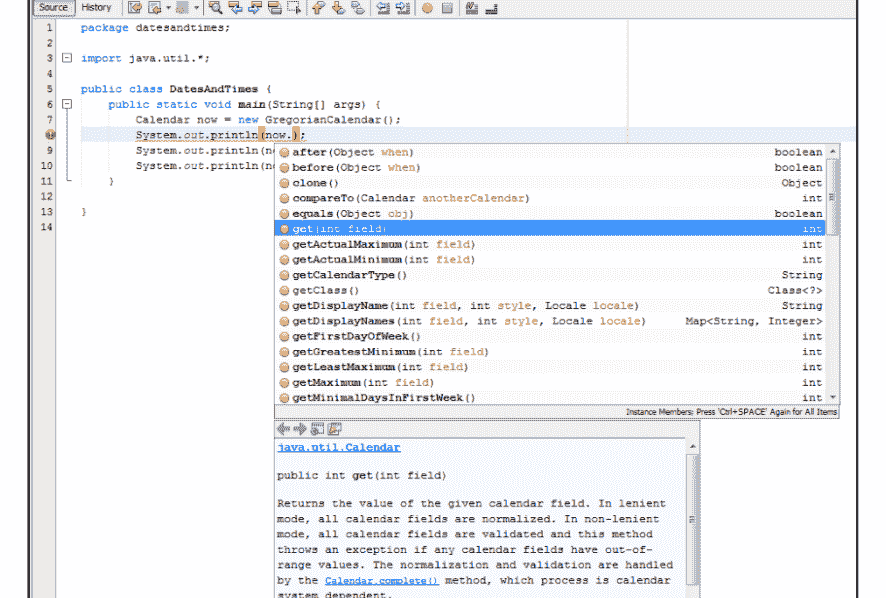

我们找不到一个易于访问的日、月、年字段，这可能开始让我们对 `Calendar` 感到失望；然而，我们所处的深度还不够。

`Calendar` 类暴露了 `get()` 方法，允许我们获取描述特定 `Calendar` 实例或时刻的字段。这是一个接受整数作为参数的函数。对于我们中的一些人来说，这初读看起来可能有点困惑。为什么要为 `get()` 提供一个整数？我们必须提供一个整数来获取 `Calendar` 暴露的字段，如下截图所示：

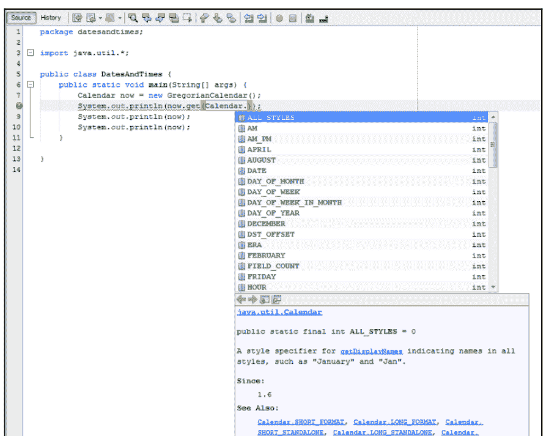

我们不会找到一个容易访问的日、月、年字段，这可能开始让我们对 `Calendar` 感到失望；然而，我们所处的深度还不够。

`Calendar` 类暴露了 `get()` 方法，允许我们获取描述特定 `Calendar` 实例或时刻的字段。这是一个接受整数作为参数的函数。对于我们中的一些人来说，这初读看起来可能有点困惑。为什么要为 `get()` 提供一个整数？实际上，我们想要的是当前的月份（`MONTH`）。同样，当前的年份（`YEAR`）。让我们运行以下程序：

```java
package datesandtimes;
import java.util.*;

public class DatesAndTimes {
    public static void main(String[] args) {
        Calendar now = new GregorianCalendar();
        System.out.println(now.get(Calendar.MONTH));
        System.out.println(now.get(Calendar.DAY_OF_MONTH));
        System.out.println(now.get(Calendar.YEAR));
    }
}
```


如果我们运行上面的程序，我们将得到 9, 12, 2017 的输出：

| Output - DatesTimes (run) |
| run: |
| 9 |
| 12 |
| 2017 |
| BUILD SUCCESSFUL (total time: 0 seconds) |

我在 2017 年 10 月 12 日写这本书，所以这实际上有点困惑，因为 10 月是一年的第十个月。

## 有用的 Java 类

幸运的是，这有一个合理的解释。与适合存储为整数变量的日期年份不同，大多数 `Calendar` 的实现以及大多数语言中类似于 `Calendar` 的类选择将月份存储为数组。这是因为除了数值外，每个月份都有对应的字符串；其名称。

由于数组是从零开始索引的，我们的月份比实际小一个月。我们的 `println` 函数可能应该是这样的：

```java
System.out.println(now.get(Calendar.MONTH) + 1);
```

我得到了下面的输出。你必须相信我；这是今天的日期：

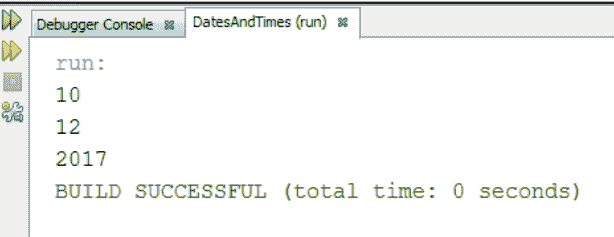

`Calendar` 有许多与其关联的方法。除了将 `Calendar` 设置为当前时间点并使用我们的 `get()` 函数进行读取外，我们还可以使用 `set()` 函数将 `Calendar` 设置为时间点。我们可以使用 `add()` 函数对时间点增加或减去负值。我们可以使用 `before()` 和 `after()` 函数检查时间点是否在其他时间点之前或之后。

## Calendar 如何工作

但如果你像我一样，你会想了解一下这个 `Calendar` 对象实际上是如何运行的。它是将月份、日和秒的时间存储在独立的字段中，还是说有一个包含所有这些信息的大数字？

## 有用的 Java 类

如果我们花些时间查看 `Calendar` 类实现中提供的方法，我们会发现以下两个方法：`setTimeInMillis()` 及其对应的兄弟方法 `getTimeInMillis()`，如下截图所示：

```java
package java.util.*;

public class DateAndTimes {

    public static void main(String[] args) {

        Calendar now = new GregorianCalendar();

        if (equals(Object obj)) {

            int fields(int field)

            int getMaximum(int field)

            int getMinimum(int field)

            String getCalendarType(int)

            Class<?> getClass()

            String getDisplayNameNames(int field, int style, Locale locale)

            Map<String, Integer> getDisplayNames(int field, int style, Locale locale)

            int getDayOfWeek()

            int getGreatestMinimum(int field)

            int getMaximum(int field)

            int getMinimum(int field)

            int getMinimumDaysInFirstWeek()

            int getMinimum(int field)

            Date getTime()

            long getTimeInMillis()

            TimeZone getTimeZone();

        }

}

```

```java
java.util.Calendar
public long getTimeInMillis() {
    返回此日历以毫秒为单位的时间值。

    返回：
        从 Epoch（纪元）开始的 UTC 毫秒当前时间。
    参见：
        Calendar.getTime(), Calendar.setTimeInMillis(long).
}
```

这些方法被专门设立，为我们观察 `Calendar` 内部是如何运作提供了绝佳的机会。

让我们通过调用 `getTimeInMillis()` 函数并打印其输出开始探索：

```java
System.out.println(now.getTimeInMillis());
```

我们得到了一个非常大的整数，这大概是自某个特定时间点以来毫秒数：

| 输出 - DatesAndTimes (run) |
|---|---|
| run: 1507801219947 |

如果我们对这个数字进行计算，会发现这个时间点实际上并不是 0 年；相反，它是一个接近得的时间。这个时间点被 `Calendar` 类称为 **epoch（纪元）**，当我们在 Java 中存储时间时，是从这个时间点开始计算自纪元以来经过了多少毫秒。

我们可以掏出计算器，通过非常费力的过程精确计算出这个时间点是什么，或者我们可以在原生的 Java 环境中更轻松地完成。让我们简单地更改 `now` 的值（它最初设置为默认或当前时刻），将毫秒数设置为 0。我们将通过 `setTimeInMillis()` 并传入 0 作为参数来实现：

```java
package datesandtimes;

import java.util.*;

public class DateAndTimes {
    public static void main(String[] args) {
        Calendar now = new GregorianCalendar();
        now.setTimeInMillis(0);
        System.out.println(now.getTimeInMillis());
        System.out.println(now.get(Calendar.MONTH) + 1);
        System.out.println(now.get(Calendar.DAY_OF_MONTH));
        System.out.println(now.get(Calendar.YEAR));
    }
}
```

当我们再次运行程序时，我们得到了相同的输出字段：

```
Output - DatesAndTimes (run) 
run:
  0
  1
1970
BUILD SUCCESSFUL (total time: 0 seconds)
```

输出中的第一个数字确认了毫秒数已设置为 0。现在我们的日历时间点是 1970 年 1 月 1 日。因此，一旦开始向对象添加天数，我们将从 1970 年 1 月 2 日开始计数。这个时间点被 Java `Calendar` 称为 **epoch**。

为什么了解这一点对我们很有意义？这意味着我们可以将 `Calendar` 类转换为这些毫秒值，然后像处理整数一样对其进行加、减、以及我猜还有乘、除操作。这允许我们以数学的原始格式对它们进行各种操作。

最后，我想向你展示另外一点内容，因为这是一个你可能不熟悉的语法，在遇到它时可能无法立即识别。如果你记得本节的开头，我们说 `Calendar` 是一个抽象类；我们只能实例化特定类型的 `Calendar` 类。然而，通常情况下，我们不会指定指定想要哪种类型的日历；我们会让 `Calendar` 类来做决定。

正如我们看到的，除了对象级别的方法外，`Calendar` 类还提供了一些静态方法，我们可以通过引用 `Calendar` 类型名来使用它们。其中一个方法是 `Calendar.getInstance()`，它将为我们创建一个 Java 能够找到的最合适的 `Calendar` 类：

```java
Calendar now = Calendar.getInstance();
```

在这种情况下，它将是我们已经创建的 `GregorianCalendar` 类。

## 字符串功能

在 Java 中处理字符串起初可能会让人困惑，因为它们确实是一个特殊情况。字符串关联着一个**字符串字面量（string literal）** 的概念，即位于双引号之间的字符序列。我们可以直接将其放入 Java 程序中，Java 就会理解它，就像你理解整数或单个字符一样。

与整数、字符和浮点数不同，Java 没有与这种字符串字面量关联的原始类型关键字。如果我们想要使用字符字面量，最接近的方法是……

## 有用的 Java 类

然而，如果我们把 `s1` 和 `s2` 视为它们所代表的标识，那么这个 `false` 结果就合理得多了，因为我们实际上是在问 Java：“这两个对象是同一个吗？”它们显然不是，因为它们是创建两个不同的新对象所的结果。

这就是为什么在 Java 中，只要可能，我们就尽可能使用 `equals()` 方法。几乎每一个其他对象都实现了 `equals()` 方法，而且每个对象都应该编写一个 `equals` 方法，以便它能够在逻辑上比较这些对象的值。

如果我们使用 `equals()` 方法来比较字符串，我们也会比较它们所包含的字符串字面量值：

```java
System.out.println(s1.equals(s2));
```

现在，如果我们执行程序，我们得到了 `true` 的结果，而不是我们之前尝试查看它们是否是存储在内存同一位置的同一个对象时得到的 `false`：

| 输出 - Strings (运行) |
| --- |
| string1: Strings are arrays of characters |
| string2: Strings are arrays of characters |
| true |
| BUILD SUCCESSFUL (total time: 0 seconds) |

## 有用的 Java 类

## String 方法

那么，这个 `String` 实现带给了我们什么能力呢？嗯，我们知道可以相加或拼接字符串，我们可以像操作字面量一样操作它们。除了这种字面量操作外，我们还可以利用 `String` 类本身提供的所有功能。我们可以查阅 Java 文档来查看有哪些可用的功能，或者可以随时检查 NetBeans 的代码补全功能。我应该指出的是，我们甚至可以在字符串字面量上使用 `String` 类的功能，如下截图所示：

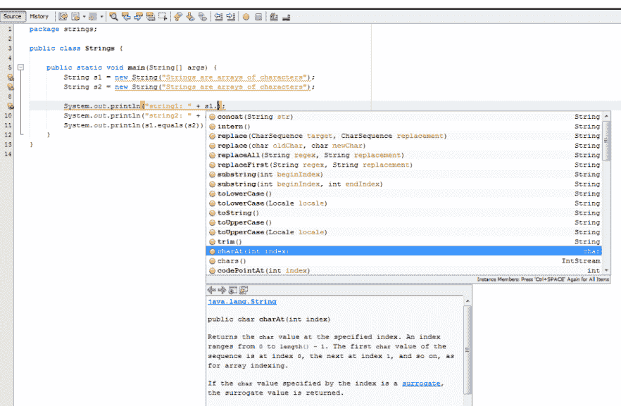

### replace() 函数

在方法列表中你看到的很多方法都是自言易懂的（如 `toLowerCase()`、`toUpperCase()` 等）。但为了确保我们都在同一个频道上，让我们使用其中一个。让我们用 `replace()`。`replace()` 函数接受两个参数，这些参数可以是单个字符，也可以是字符串所符合的字符序列。该方法简单地将第一个字符串或字符的所有实例替换为第二个字符串或字符。让我们来看一下下面的 `replace()` 示例：

```java
package strings;

public class Strings {

    public static void main(String[] args) {
        String s1 = new String(
            "Strings are arrays of characters");
        String s2 = new String(
            "Strings are arrays of characters");

        System.out.println("string1: " + s1.replace("characters", "char"));
        System.out.println("string2: " + s2);
        System.out.println(s1.equals(s2));
    }
}
```

当我们运行程序时，看到我们已经修改了输出：

| 输出 - Strings (运行) |
| --- |
| string1: Strings are arrays of char |
| string2: Strings are arrays of characters |
| true |
| BUILD SUCCESSFUL (total time: 0 seconds) |

这些方法大部分只是修改了返回的值。我们可以看到程序在这一行代码仍然发现 `s1` 等于 `s2`，这说明 `s1` 的值并没有因为我们调用 `replace()` 方法而被修改。`replace()` 方法只是返回了修改后的值供我们的 `println()` 函数使用。

### format() 函数

也许，`String` 类方法中最有趣的实际上是它的一个静态方法之一：`String.format()`。为了向你展示 `String.format()` 的威力，我想为我们的项目创建一个新的功能类。在屏幕左侧的文件系统中，右键点击项目名称，创建一个新类，并将其命名为 `CustomPrinter.java`：

```java
package strings;

public class Strings {

    public static void main(String[] args) {
        CustomPrinter printer = new CustomPrinter("> %s <");
```

所以你可以看到我们在设置 `CustomPrinter` 类时在做什么。`CustomPrinter` 类的设计思想是它将拥有一个接受字符串作为输入的构造函数。这个输入字符串将格式化或包裹我们使用 `CustomPrinter` 实例打印到控制台的任何字符串。我们将在 `CustomPrinter` 内部实现 `System.out.println()`，这样当我们想要格式化文本时，只需调用 `printer.println()`。

在 Java 中格式化字符串时，我们使用一些特殊语法。在我们的格式字符串中，我们可以在字符前加上 `%` 或 `s`，最常见的是百分比符号（如我们在代码中使用的 `%s`）。在 `String.format()` 函数中，Java 能够理解我们格式字符串中这些准备插入其他信息的区域。

我们在代码中使用的格式会将我们创建的任何字符串输出包裹在尖括号中。这比简单地追加和前置字符串要复杂得多，而且我们完全可以创建一个允许我们在格式化后的字符串中添加多个片段的实现。

## 有用的 Java 类

接下来我们来编辑 `CustomPrinter.java` 文件。我们知道我们需要一个 `CustomPrinter` 构造函数，它接受一个字符串作为输入。然后，我们可能需要存储这个格式字符串。所以让我们让构造函数接受提供的格式字符串，并将其存储在 `formatString` 变量中供以后使用：

```java
package strings;

public class CustomPrinter {
    private String formatString;

    public CustomPrinter(String format) {
        formatString = format;
    }

    public void println(String input) {
        String formatted = String.format(formatString, input);
        System.out.println(formatted);
    }
}
```

当我们运行这个程序时（我们需要运行包含 `main` 方法的类），我们看到所有的输出都被包裹在尖括号中：

```
输出 - Strings (运行)
run:
  > string1: Strings are arrays of char <
  > string2: Strings are arrays of characters <
BUILD SUCCESSFUL (total time: 0 seconds)
```

希望你学到了关于字符串的知识。Java 处理字符串的方式非常强大，但就像编程中大多数强大的工具一样，你需要在基础层面理解它们，才能确保它们不会反噬你。

# 异常

有时候，我们的代码可能会失败。这可能是因为我们犯了编程错误，也可能是终端用户以我们没有预测的方式使用了系统。有时甚至是硬件故障；很多错误无法归因于任何单一来源，但它们确实会发生。

在本节中，我们将查看 Java 异常。通过 Java 异常，我们可以检测并捕获，并在某些情况下从程序运行发生的错误中恢复。

## 有用的 Java 类

异常会改变我们程序的控制流，但我们永远不应该将它们用于捕获和处理传递的异常以外的任何地方。如果我们尝试使用异常来实现逻辑，我们将编写一个很快就会让我们感到困惑的程序，而且对于任何试图理解它的其他程序员来说，也会立即感到非常困惑。

为了帮助我们探索 Java 异常，我设置了一个基础程序供我们练习；它可能会出错的程序。这是一个执行两个实际操作的无限循环。首先，它使用 `Scanner` 的 `nextFloat()` 函数从用户获取输入，然后将该输入打印回用户：


## 有用的 Java 类

异常会改变我们程序的控制流，但我们永远不应该将它们用于捕获和处理传递的异常以外的任何地方。如果我们尝试使用异常来实现逻辑，我们将编写一个很快就会让我们感到困惑的程序，而且对于任何试图理解它的其他程序员来说，也会立即感到非常困惑。

为了帮助我们探索 Java 异常，我设置了一个基础程序供我们练习；这是一个可能会出错的程序。这是一个执行两个实际操作的无限循环。首先，它使用 `Scanner` 的 `nextFloat()` 函数从用户获取输入，然后将该输入打印回用户：

```java
package exceptions;
import java.util.*;

public class Exceptions {
    public static void main(String[] args) {
        Scanner reader = new Scanner(System.in);
        while(true) {
            System.out.print("Input a number: ");
            float input = reader.nextFloat();
            System.out.println("You input the number: " + input);
            System.out.println("\r\n");
        }
    }
}
```

如果我们准确地将浮点值作为输入传递给此程序，那么该程序理论上将一直运行，如下截图所示：

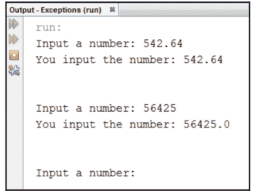

然而，如果我们犯了错误并给此程序一个字符串作为输入，`nextFloat()` 函数将不知道如何处理它，并会发生异常：

```
Output - Exceptions (run) #2
run\Input a number: fail
Exception in thread "main" java.util.InputMismatchException
    at java.util.Scanner.throwFor(Scanner.java:864)
    at java.util.Scanner.next(Scanner.java:1485)
    at java.util.Scanner.nextFloat(Scanner.java:2345)
    at java.util.Scanner.main(Exceptions.Exceptions.java:31)
C:\Users\nidhishais\AppData\Local\NetBeans\Cache\_8\.executor\run.xml:53: Java returned: 1
BUILD FAILED (total 5 seconds)
```

当这种情况发生时，我们的控制台中会出现红色的文字。这些红字实际上是发送到 `System.err` 流的。

## 分析控制台异常消息

让我们查看输出文本并理解它的含义。其中包含两个部分。输出文本的第一部分（即没有缩进的部分）是此异常的标识符。它让我们知道已经抛出了异常，以及异常发生在哪里。然后，它告诉我们发生了什么种类型的异常。你会发现此异常位于 `java.util` 路径下（无论我们向代码中导入某些内容还是直接调用外部库，输出路径看起来非常相似）。这是因为此异常实际上是一个 Java 对象，而我们的输出文本正在准确地告诉我们它是什么种类型的对象。

此异常测试的第二部分（带有缩进的部分）是我们所说的**堆栈跟踪**（stack trace）。它基本上是 Java 跳过的我们的程序片段。堆栈跟踪的最底部是最初抛出异常的位置；在这种情况下，它是 `Scanner.java` 并在第 909 行。

这不是我们的代码；那是为 `Scanner.java` 编写的代码，可能是 `nextFloat()` 方法所在的地方，或者是 `nextFloat()` 方法调用的代码。

堆栈跟踪是代码的层级，因此一旦发生 `InputMismatchException`，Java 开始跳过这些代码行或大括号单元，直到到达代码所在的顶层，在我们的案例中，是 `Exceptions.java`。这是我们创建的文件，它位于堆栈跟踪的顶端。我们 `Exception.java` 代码文件的第 11 行是 Java 最后停留的地方。

## 有用的 Java 类

如果我们现在运行程序，将会看到它能够处理并从我们提供的错误输入中恢复（我们给它一个字符串），这非常酷：

```
Output - Exceptions (run) #3
run:
  Input a number: 5432.3
nYou input the number: 5432.3

Input a number: next
nYou passed invalid input. Not a float!

Input a number:
```

让我们回顾一下可以使用异常完成的几件事。首先，在异常情况结束时清理我们的读取器是有意义的，但在任何尝试的用例结束时清理读取器可能更有意义。毕竟，我们在进入 `while` 循环时是假设读取器中没有新行的。因此，为了实现这一点，我们有了 `finally` 块。

## finally 块

如果我们希望无论 `try` 块是否执行成功都始终执行某个用例，我们可以在 `catch` 块之后紧跟一个 `finally` 块。无论是否捕获到异常，`finally` 块都会执行。它的存在是为了让你可以在系统中放置清理代码。清理代码的一个示例是清理我们的读取器缓冲区，这样以后或其它程序员就不会被此困惑。

异常不仅仅是一个被抛出的简单对象；它们可以包含许多非常重要的信息。正如我们之前看到的，异常可以包含堆栈跟踪（stack trace）。让我们快速修改程序，使其在仍然向用户提供友好的“请输入浮点数。”信息的同时，也打印出堆栈跟踪，以便程序员可以调试我们的程序。

## 有用的 Java 类

通常，当我们编写用户将要使用的完成代码时，我们永远不希望他们能够看到像堆栈跟踪这样深层的内容。这对于大多数计算机用户来说是困惑的，在某些情况下可能存在安全风险，但作为调试模式或对于开发者来说，这种详细的异常是非常有用的。


`Exception` 类暴露了一个名为 `printStackTrace()` 的方法，它需要一个流（stream）作为输入。我们所有的输出都使用了 `System.out`，因此我们将提供 `System.out` 作为 `printStackTrace()` 的流：

```java
catch (InputMismatchException e)
    System.out.println("Please enter a float number.");
    e.printStackTrace(System.out);
    System.out.println("\r\n");
```

现在当我们运行程序并给它一个错误的字符串时，我们得到了初始的友好异常代码。然而，我们仍然拥有堆栈跟踪，因此我们可以准确地看到错误来自哪里：

```
Output - Exceptions (run) #6
run:
Input a number: fail
You passed invalid input. Not a float!
java.util.InputMismatchException
    at java.util.Scanner.throwFor(Scanner.java:864)
    at java.util.Scanner.next(Scanner.java:1485)
    at java.util.Scanner.nextFloat(Scanner.java:2345)
    at exceptions.Exceptions.main(Exceptions.java:12)
```

正如我之前提到的，异常处理是现代软件开发中一个非常深入的话题，但在本节结束时，你应该已经掌握了基础知识。当你在代码中遇到异常或者当你编写自己的代码并觉得需要异常处理时，你应该已经做好了准备。

## Object 类

在本节中，我们将学习关于 Java 如何选择实现面向对象编程的一些非常重要的内容。我们将探索 `Object` 类本身。为了开始，我写了一个基础程序：

```java
package theobjectclass;

public class TheObjectClass {
    public static void main(String[] args) {
        MyClass object1 = new MyClass("abcdef");
        MyClass object2 = new MyClass("abcdef");
        object1.MyMethod();
        object2.MyMethod();
        System.out.println("The objects are the same: " + 
            object1 == object2);
        System.out.println("The objects are the same: " + 
            object1.equals(object2));
    }
}
```

这个程序使用了自定义类 `MyClass` 并创建了该类的两个实例：`object1` 和 `object2`。然后我们对这些对象每个调用了 `MyMethod` 方法，它只是打印了我们给它们的值。然后，程序比较了这些对象。

我们首先使用比较运算符 (`==`) 进行比较，检查这两个对象实际上是同一个对象。我们知道这不会是真的，因为我们可以看到这些对象是完全独立地实例化的。它们共享同一个类，但是 `MyClass` 类的两个不同实例。然后我们使用 `equals()` 方法比较这些对象，我们将在本节中讨论该方法。

当我们运行这个程序时，我们看到通过比较运算符比较时发现对象不是相同的，这正是我们预期的。但当它们使用 `equals()` 方法进行比较时，发现对象是不相等的，尽管这些对象是在相同的参数下创建的，并且从创建到这一时间点，它们执行了完全相同的操作。以下是上述代码的输出：

| Output - TheObjectClass (run) | |
| :--- | :--- |
| run: | |


## 有用的 Java 类

通常，当我们编写用户将要使用的完成代码时，我们永远不希望他们能够看到像堆栈跟踪这样深层的内容。这对于大多数计算机用户来说是困惑的，在某些情况下可能存在安全风险，但作为调试模式或对于开发者来说，这种详细的异常是非常有用的。

`Exception` 类暴露了一个名为 `printStackTrace()` 的方法，它需要一个流作为输入。我们所有的输出都使用了 `System.out`，因此我们将提供 `System.out` 作为 `printStackTrace()` 的流：

```java
catch (InputMismatchException e)
    System.out.println("Please enter a float number.");
    e.printStackTrace(System.out);
    System.out.println("\r\n");
```

现在当我们运行程序并给它一个错误的字符串时，我们得到了初始的友好异常代码。然而，我们仍然拥有堆栈跟踪，因此我们可以准确地看到错误来自哪里：

```
Output - Exceptions (run) #6
run:
Input a number: fail
You passed invalid input. Not a float!
java.util.InputMismatchException
    at java.util.Scanner.throwFor(Scanner.java:864)
    at java.util.Scanner.next(Scanner.java:1485)
    at java.util.Scanner.nextFloat(Scanner.java:2345)
    at exceptions.Exceptions.main(Exceptions.java:12)
```

正如我之前提到的，异常处理是现代软件开发中一个非常深入的话题，但在本节结束时，你应该已经掌握了基础知识。当你在代码中遇到异常或者当你编写自己的代码并觉得需要异常处理时，你应该已经做好了准备。

## Object 类

在本节中，我们将学习关于 Java 如何选择实现面向对象编程的一些非常重要的内容。我们将探索 `Object` 类本身。为了开始，我写了一个基础程序：

```java
package theobjectclass;

public class TheObjectClass {
    public static void main(String[] args) {
        MyClass object1 = new MyClass("abcdef");
        MyClass object2 = new MyClass("abcdef");
        object1.MyMethod();
        object2.MyMethod();
        System.out.println("The objects are the same: " + 
            object1 == object2);
        System.out.println("The objects are the same: " + 
            object1.equals(object2));
    }
}
```

这个程序使用了自定义类 `MyClass` 并创建了该类的两个实例：`object1` 和 `object2`。然后我们对这些对象每个调用了 `MyMethod` 方法，它只是打印了我们给它们的值。然后，程序比较了这些对象。

我们首先使用比较运算符 (`==`) 进行比较，检查这两个对象实际上是同一个对象。我们知道这不会是真的，因为我们可以看到这些对象是完全独立地实例化的。它们共享同一个类，但是 `MyClass` 类的两个不同实例。然后我们使用 `equals()` 方法比较这些对象，我们将在本节中讨论该方法。

当我们运行这个程序时，我们看到通过比较运算符比较时发现对象不是相同的，这正是我们预期的。但当它们使用 `equals()` 方法进行比较时，发现对象是不相等的，尽管这些对象是在相同的参数下创建的，并且从创建到这一时间点，它们执行了完全相同的操作。以下是上述代码的输出：

| Output - TheObjectClass (run) | |
| :--- | :--- |
| run: | |
| MyClass object created with abcdef | MyClass object created with abcdef |
| MyMethod called with abcdef | MyMethod called with abcdef |
| The objects are the same: false | |
| The objects are the same: false | |

所以，当对象被发现不相等时意味着什么？如果我们查看 `MyClass` 的定义，我们需要检查是否实现了 `equals()` 方法。

| 修饰符和类型 | 说明 |
| :--- | :--- |
| protected Object | clone() 创建并返回此对象的副本 |
| boolean | equals() 指明另一个对象是否等于此对象 |
| protected void | finalize() 被垃圾回收器调用确定 |
| Class<?> | getClass() 返回此对象的运行时类 |
| int | hashCode() 返回此对象的哈希码 |
| void | notify() 唤醒一个等待的线程 |
| void | notifyAll() 唤醒所有等待的线程 |
| String | toString() 返回此对象的字符串表示 |
| void | wait() 导致当前线程等待 |
| void | wait(long timeout, int nanos) 导致当前线程等待指定的 |

## 重写 equals() 方法

一旦我们成功地完成了这些步骤，就可以很有信心地假设可以将给定的对象转换为 `MyClass` 对象了。现在，我们只需要比较它们包含的值字段并返回适当的值即可。让我们把代码写到 `MyClass.java` 文件中，并回到 `main()` 方法来运行它：

```java
package objectclass;

public class MyClass {
    public String value;
    public MyClass(String value)
    {
        this.value = value;
        System.out.println("A MyClass object was created with value:" + value);
    }
    public void MyMethod()
    {
        System.out.println("MyMethod was called on a MyClass object with value: " + value);
    }
    @Override
    public boolean equals(Object obj)
    {
        if(obj == null)
            return false;
        if(!obj instanceof MyClass)
            return false;
        return value.equals(((MyClass)obj).value);
    }
}
```

当我们运行这个程序时，将会发现 `object1` 和 `object2` 是相等的：

```
Output - TheObjectClass(run)
run:
  A MyClass object was created with value:abcdef
  A MyClass object was created with value:abcdef
  MyMethod was called on a MyClass object with value: abcdef
  MyMethod was called on a MyClass object with value: abcdef
  The objects are the same: false
  The objects are the same: true
BUILD SUCCESSFUL (total time: 0 seconds)
```

## 其他 Object 方法

`Object` 类声明了很多方法。除了 `equals()` 之外，重要的方法还有 `hashCode()` 和 `toString()`。我们在这一节中不会实现 `hashCode()`，因为这要求我们进行比实际上实际需要的更多的数学计算，但我非常建议你通过查看文档并探索来了解 `hashCode()` 是如何工作的。

目前，让我们知道对象的 `hashCode()` 方法应该返回一个描述该特定对象的整数值。在所有情况下，如果两个对象通过 `equals()` 方法被认为相等，那么它们的 `hashCode()` 函数也应该返回相同的整数值。如果两个对象在 `equals()` 方法看来是不等的，那么 `hashCode()` 函数应该返回不同的值。

此时，我们应该熟悉 `toString()` 方法。这也是 `Object` 类中的一个方法，意味着我们可以在任何单个对象上调用 `toString()`。但在我们的自定义对象中，在我们重写 `toString()` 之前，它可能不会返回有意义的、可读的信息。

在你学习 Java 时，我强烈建议你实现 `equals()` 和 `toString()`，即使是在小类中也是如此。这是一个非常好的习惯，它能让你以 Java 相同的方式思考面向对象编程。你将能够利用这些方法来正确操作和利用类。

## 基本类型类

在这一节中，我想快速查看 Java 为我们提供的基本类型类。在 Java 中，我们说字符串是特殊的，因为它们有字面量解释；然而，我们仍然通过 `String` 类与它们交互，而不是通过我们提供的 `string` 基本类型。对于标准的 Java 基本类型，我们确实有对应的基本类型类。这些是 `Integer`、`Character` 和 `Float` 等。在大多数情况下，显式使用这些类（即创建它们的实例并在该实例上调用方法）是没有用的，除非我们要重写它们以进行强制转换。让我们来看下面的程序：

```java
package the.primitiveClasses;

public class PrimitiveClasses {
    public static void main(String[] args) {
        String s = "string";
        Character c = 'c';
    }
}
```

`Character` 类实例 `c` 为我们提供的方法主要是转换方法，如下所示：

```java
package the.primitiveclasses;

public class PrimitiveClasses {

    public static void main(String[] args) {
        String s = "String";

        Character c = 'C';

        c.
        char charValue()
        int compareTo(Character anotherCharacter)
        boolean equals(Object obj)
        Class<?> getClass()
        int hashCode()
        void notify()
        void notifyAll()
        String toString()
        void wait()
        void wait(long timeout)
        void wait(long timeout, int nanos) // 实例成员
}
```

### compareTo(Character anotherCharacter)

数值上比较两个 `Character` 对象。

注意 `compareTo()` 有时是有用的，如果给定的另一个字符小于 0 或大于 0，它会返回整数值 0，这取决于两个字符之间的整数转换比例。

| 参数 | 描述 |
| :--- | :--- |
| anotherCharacter | 要比较的 `Character`。 |

| 返回 | 描述 |
| :--- | :--- |
| int | 如果参数 `Character` 等于此 `Character`，则返回 0；如果此 `Character` 在数值上小于参数 `Character`，则返回小于 0 的值；如果我们使用基本类型类的静态方法来操作或获取基本类型实例的信息，则返回大于 0 的值。例如，如果我想知道字符 C 是否是小写，我完全可以转换为整数值，检查 ASCII 表，然后查看整数值是否落在小写类的范围内。但那是一项大量的工作： |

```java
package the.primitiveClasses;

public class PrimitiveClasses {
    public static void main(String[] args) {
        String s = "String";

        Character c = 'C';
        System.out.println(Character.isLetter(c));
        isLetter(char ch)
        isLetter(int code)
        isDigit(char ch)
        isDigit(int code)
        isSurrogate(char ch)
        isLowerCase(char ch)
        isLowerCase(int code)
    }
}
```

```
java.lang.Character
public static boolean isLowerCase(char ch)
run:
false
BUILD SUCCESSFUL (total time )
```

确定指定的字符是否为小写字母。
如果字符的通用类型（由 `Character.getType(ch)` 提供）是 LOWERCASE_LETTER，或者它具有 Unicode 标准定义的 Other_Lowercase 属性，则它是小写字母。
以下是小写字母的示例：

`Character` 基本类提供了一个静态函数 `isLowerCase()`，如之前的快所示，它可以告诉我字符是否为小写。让我们运行下面的程序：

```java
package the.primitiveclasses;

public class PrimitiveClasses {

    public static void main(String[] args) {

    String s = "string";

    Character c = 'c';

    System.out.println(Character.isLowerCase(c));

}
```


以下是上述代码的输出：

| Output - The PrimitiveClasses (run) |
| :--- |
| run: |
| true | |
| BUILD SUCCESSFUL (total time: 0 seconds) |

这就是基本函数的精髓。我们可以以相同的方式与其他字面量类型及其基本类型进行交互：根据我们的选择，使用类与字符串进行交互。

当我们不需要基本类型类的功能时，我们应该继续使用基本类型（例如使用 `char` 而不是 `Character`）。语法高亮功能的存在以及这些基本类型在不同语言中的通用外观，使得它们对程序员来说更加友好。

# 9 文件输入与输出

I/O 函数是一个极其强大的工具，它可以让现代编程中最困难且最令人沮丧的任务之一——即在逻辑上独立的代码实体之间传输信息变得比以前容易得多。尽管如此，在本章中，你将学习如何使用 `FileWriter`、`BufferedWriter` 和 `BufferedReader` 类写入和读取数据文件。我们还将查看 `close()` 方法和 `Scanner` 类的使用。然后你将学习异常处理。最后，我们将介绍 I/O 的另一个方面：`Serializable` 类。

具体而言，我们将在本章涵盖以下主题：

- 向文件写入数据
- 从文件中读取数据
- `Serializable` 类

## 向文件写入数据

这是一个令人兴奋的章节。首先，我们将看看如何使用 Java 向文件写入内容。为了实现这一点，我们将声明一个前 50 个数的数学序列，其中每个数字都是前两个数字之和。当我们运行程序时，我们将看到这 50 个数字打印到 `System.out` 流中，并且我们可以在控制台窗口查看它们：

```java
class WritingToFiles {

    public static void main(String[] args) {

        for (long number : FibonacciNumbers()) {

            System.out.println(number);

        }

    }

    private static long[] FibonacciNumbers() {

        long[] fibNumbers = new long[50];

        fibNumbers[0] = 0;

        fibNumbers[1] = 1;

        for (int i = 2; i < 50; i++) {

            fibNumbers[i] = fibNumbers[i - 1] + fibNumbers[i - 2];

        }

        return fibNumbers;

    }

}
```

然而，当我们彻底关闭控制台时，这些数字将会丢失。为了帮助完成任务，我们将利用 `java.io` 库；在这里，io 代表输入（input）和输出（output）：

```java
import java.io.*;
```

我们将利用该库中的一个类：`FileWriter`。

### FileWriter 类

`FileWriter` 类及其用法解释如下：

1. 让我们声明一个新的 `FileWriter` 类，由于稍后会变得明朗的原因，让我们显式地将此 `FileWriter` 设置为 `null`：

```java
public class WritingToFile {

    public static void main(String[] args) {

        FileWriter out = null;

    }

}
```

2. 一旦我们这样做，就可以对其进行实例化了。为了向文件写入内容，我们需要两个重要点：
   - 首先，当然我们需要知道要向文件中写入什么。
   - 其次，我们的 `FileWriter` 类需要知道它应该向哪个文件写入。

3. 当我们使用 `FileWriter` 类时，将其与特定文件关联，因此我们向其构造函数传递我们想要它写入的文件名。我们的 `FileWriter` 类在文件不存在时能够创建文件，所以我们只需要选择一个以 `.txt` 结尾的名字，这样我们的操作系统就会知道我们正在创建一个文本文件：

```java
public class WritingToFiles {

    public static void main(String[] args) {

        FileWriter out = null;

        out = new FileWriter("out.txt");

    }

}
```

尽管我们使用了有效参数的 `FileWriter` 构造函数，NetBeans 仍然会在这段代码中让我们产生编译错误。它会告诉我们这里有一个意外的异常，一个可能会抛出的 `IOException` 错误。Java 中的许多异常被标记为已处理异常。这些异常是由函数显式声明可能会抛出 `IOException` 错误的异常。因此，对于 Java 而言，我们的代码没有显式处理此异常是一个错误。

4. 为了处理这个问题，我们只需将我们使用 `FileWriter` 类的代码部分封装在 `try...catch` 块中，以捕获 `IOException` 错误。

5. 如果我们捕获了 `IOException` 错误，可能是向错误流打印一条帮助信息的好时机：

```java
catch (IOException e) {

    System.err.println("File IO Failed.");

}
```

然后，我们的程序将完成运行并终止，因为它已经到达 `main` 方法的结束。在捕获此异常后，`FileWriter` 的实例化现在是有效合法的，让我们使用它吧。

我们不再需要程序在控制台上打印数字，让我们注释掉 `println` 语句，如下面的代码块所示：

```java
for (long number : FibonacciNumbers()) {

    // System.out.println(number);

}
```

我们将对 `FileWriter` 类执行相同的逻辑操作：

```java
try {

    out = new FileWriter("out.txt");

    for (long number : FibonacciNumbers()) {

        System.out.println(number);

    }

}
```

`FileWriter` 类没有 `println` 语句，但它有 `write` 方法。每次我们的 `foreach` 循环执行时，我们都希望使用 `out.write(number);` 语法将数字写入文件。

遗憾的是，`write` 方法不知道如何接收 `long` 类型的数字作为输入；它可以接受字符串也可以接受整数。所以让我们使用 `String.valueOf` 来：

```java
for (long number : FibonacciNumbers()) {

    out.write(String.valueOf(number));

}
```

会出现一个熟悉的错误信息，如下截图所示：
`out.close` 也可以报告一个 `IOException` 错误：

```java
catch(IOException) unreported exception IOException; must be caught or declared to be thrown

System Dereferencing possible null pointer

}

finally{

  (Alt-Enter shows hints)

  out.close();

}
```

我们可以将 `out.close` 放在另一个 `try...catch` 块中并处理这个 `IOException` 错误，但如果我们的文件没有关闭，说明出了非常严重的问题。在这种情况下，让该异常继续向上传播并将其传递给更健壮的代码段，比首先在 `WritingToFile` 程序中包含它可能更为合适。如果我们不处理此异常，默认会发生这种情况，但我们需要让 Java 知道这种异常从我们当前代码向上传播是有可能的。

当我们声明 `main` 方法时，也可以让 Java 知道该方法可能会抛出的异常类型：

```java
public static void main(String[] args) throws IOException
```

在这里，我们告诉 Java 在某些情况下，我们的 `main` 方法可能无法完美执行并会抛出 `IOException` 错误。现在，任何调用 `WritingToFile` 的 `main` 方法的人都需要处理这些异常。如果我们构建 Java 程序并执行它，将看到 `out.txt` 已经正确打印。遗憾的是，我们忘记在输出中加入换行符，数字之间没有可区分的间隔。当我们写入时，需要在每个数字后面追加 `\r\n`。这是一种新的换行转义字符语法，它会出现在几乎每一个操作系统和环境中：

```java
for (long number : FibonacciNumbers()) {

  out.write(String.valueOf(number) + "\r\n");

  // System.out.println(number);

}
```

再次，是构建、运行并查看 `out.txt` 的时候了，它现在看起来已经很有用了：

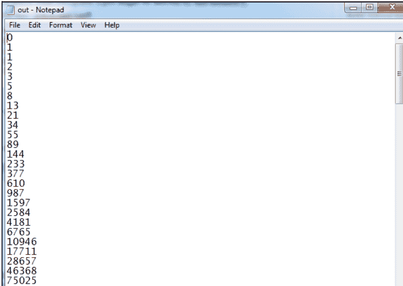

这也是我们最初设的目标：将这个斐波那契数列打印到文件中。但在在这里结束之前，还有几点简单的要说明。让我们看看再次运行程序会发生什么，并查看我们的输出文本文件。该文件看起来和之前一样，这可能符合预期，也可能不符合。`FileWriter` 是在写入新文本之前清空内容，还是将追加的文本放在文件中现有文本之后，这似乎是不确定的，它似乎执行了前者。默认情况下，`FileWriter` 在重新写入之前会清除文件，我们可以通过 `FileWriter` 构造函数中的参数来切换这种行为。假设我们将追加行为设为 `true`：

```java
{

  out = new FileWriter("out.txt", true);

}
```

现在构建项目，运行它，并查看 `out.txt`；我们将看到比之前多倍的信息。我们的文本现在追加在末尾。

### BufferedWriter 类

最后，在 Java 中有许多不同的写入器可用，`FileWriter` 只是其中之一。决定在这里向你展示它，因为它非常简单。它接收一些文本并将其打印到文件中。然而，通常你会看到 `FileWriter` 被包装在 `BufferedWriter` 类周围。现在 `BufferedWriter` 类的声明看起来就像下面代码块所示，其中 `BufferedWriter` 被创建并将 `FileWriter` 作为其输入。

`BufferedWriter` 类非常酷，因为它所做的是智能地获取你给出的所有命令，并尝试以最高效的方式将内容写入文件：

```java
package writingtofiles;

import java.io.*;

public class WritingToFiles {

    public static void main(String[] args) throws IOException {

        BufferedWriter out = null;

        try {

            out = new BufferedWriter(new FileWriter(
                "out.txt", true));

            for (long number : FibonacciNumbers()) {

                out.write(String.valueOf(number) + "\r\n");

            }

            System.out.println(number);

        } catch (IOException e) {

            System.err.println("File IO Failed.");

        } finally {

            out.close();

        }

    }

}
```

我们刚刚写的程序从我们的角度来看，正在执行与现有程序相同的事情。在创建许多微小写入器的情况下，`BufferedWriter` 的速度会快得多，因为在适当的情况下，它会智能地收集我们提供的写入命令，并在适当的块中执行它们以效率最大化：

```java
out = new BufferedWriter(new FileWriter("out.txt", true));
```

出于这个原因，你通常会看到类似于前面的代码块的 Java 代码，而不是孤立使用 `FileWriter`。

## 从文件读取数据

作为程序员，我们需要执行的一项常见任务是从文件中读取输入。在这一部分，我们将快速查看如何从文件中获取输入。

我们已经告诉 Java 有时我们的 `main` 方法将抛出 `IOException` 错误。下面代码块中的 `FileWriter` 和 `FileReader` 对象可能因为多种原因产生多个 `IOException` 错误，例如，如果找不到或无法访问文件。


```java
package inputoutput;

import java.io.*;

public class InputOutput {

    public static void main(String[] args) throws IOException {

        File outputFile = new File("OutputFile.txt");

        File inputFile = new File("InputFile.txt");

        FileWriter out = new FileWriter(outputFile);

        FileReader in = new FileReader(inputFile);

        // 代码在此处...

        out.close();

        in.close();

    }

}
```

在写入文件时，我们应该始终处理异常。这种情况并不常见，但当它发生时，可能会是一个非常困惑的 bug。这是因为 `BufferedReader` 只一次查看文件的一部分；它免受这种影响。

### FileReader 类

在这里，你将学习 `FileReader`。它与 `FileWriter` 类似。

1. 我们可以简单地使用 `FileReader` 类。
2. 我们可以通过 `BufferedWriter` 类包装 `FileReader` 来使其更容易使用。
3. 我们可以简单地使用 `in.read` 方法遍历文件以获取 InputFile 中的所有可用信息。
4. 我们可以通过 `BufferedReader` 类包装 `FileReader` 来使其更容易使用。

`BufferedReader` 类也将让我们使用 `nextLine` 方法，这样我们就可以按行从 `InputFile` 收集信息，而不是逐个字符地收集。不过尽管如此，我们的 `while` 循环看起来都会非常相似。这里真正的挑战在于，我们需要知道何时停止在 `inputFile` 文件中查找信息。为了解决这个问题，我们实际上会在 `while` 循环的条件部分放置一些功能性代码。

5. 我们将给 `newInput` 字符串变量赋值一个值，该值将是 `in.readLine()`。我们之所以要在 `while` 循环的条件部分进行此赋值，是因为这样我们就可以检查赋值给 `newInput` 字符串的值是什么。这是因为如果 `newInput` 字符串没有被任何值，就意味着我们到达了文件的末尾：

如果 `newInput` 有值（如果变量不为 `null`），那么我们就知道已经从文件中读取了合法的文本，实际上是读取了一整行合法的文本，因为我们使用的是 `readLine` 方法。

6. 在这种情况下，我们应该向我们的 `input` 字符串添加一行新文本，即 `input += newInput;`。当我们执行完 `while` 循环，由于读取器没有其他可读内容导致 `newInput` 字符串被赋值为 `null` 时，我们应该打印出我们构建的字符串：

```java
while ((newInput = in.readLine()) != null) {

    input += newInput;

    out.write(input);

}
```

7. 现在，由于 `BufferedReader` 类的 `readLine` 方法专门读取文本行，它不会在这些行的末尾添加换行符，因此我们必须在代码中完成：

```java
while ((newInput = in.readLine()) != null) {

    input += (newInput + "\r\n");

}
```


那么，我们执行了这个程序。让我们进入目录看看什么被复制到了 `OutputFile`：


好了；`InputFile` 和 `OutputFile` 现在的内容完全相同。在 Java 中进行基本读取操作其实只有这些。

不过，还有其他几点需要注意。就像我们可以用 `BufferedReader` 包装 `FileReader` 一样，如果我们导入 `java.util`，也可以用 `Scanner` 包装 `BufferedReader`：

```java
Scanner in = new Scanner(new FileReader(inFile));
```

这将允许我们使用 `Scanner` 类的方法来获取我们读取的文本中匹配某些模式的部分。同样重要的是，`FileReader` 类及其包装类仅适用于我们从 Java 文件中读取文本时。如果我们想读取二进制信息，将使用不同的类；当你在学习 Java 对象的序列化时，你会看到更多相关内容。

# `Serializable` 类

通常，当我们处理实际代码之外的信息时，我们处理的是从文件获取、向文件写入或从输出流中获取的人类可读的文本。然而，有时，人类可读的文本并不方便，我们希望使用对计算机更友好的信息。通过一种被称为“序列化”的过程，我们可以将一些 Java 对象转换为可以在程序间传输的二进制流。这不是一种对人类友好的方法，正如我们在本节中看到的。序列化对象对我们来说看起来就像是完全的乱码，但另一个知道该对象类的 Java 程序可以从这些序列化信息中重建对象。

并不是所有的 Java 对象都是可序列化的。为了让我们能够序列化一个对象，它必须被标记为可以序列化的对象，并且它需要包含本身也是可序列化的成员。对于某些对象，即那些依赖于外部引用的或尚未将其所有成员标记为可序列化的对象，序列化是不恰当的。参考以下代码块：

```java
package serialization;

public class Car {

    public String vin;

    public String make;

    public String model;

    public String color;

    public int year;

    public Car(String vin, String make, String model, String color, int year) {
        this.vin = vin;
        this.make = make;
        this.model = model;
        this.color = color;
        this.year = year;
    }

    @Override
    public String toString() {
        return String.format(
            "%d %s %s %s, %s", year, color, make, model, vin);
    }
}
```

# 文件输入与输出

给定程序（在前面的代码块中中的类是序列化的理想人选。它的成员是字符串和整数，这两者都是 Java 标记为可序列化的类。然而，为了让我们将一个 `Car` 对象转换为二进制表示，我们需要让 Java 知道 `Car` 对象也是可序列化的。

我们可以通过以下步骤来实现：

1. 我们需要 `io` 库，然后让 Java 知道我们的 `Car` 对象实现了 `Serializable`：

```java
import java.io.*;

public class Car implements Serializable {
```

这是在告诉 Java `Car` 对象的所有元素都可以转换为二进制。

2. 为了实现这一点，我们将创建两个 Java 类：一个用于序列化我们的对象，另一个用于反序列化它。

3. 在这两个类中，我们将创建 `main` 方法以便它们作为独立的程序运行。

## 序列化对象

让我们从如下 `Serialize` 类开始：

1. 我们首先需要一个对象。所以让我们实例化一个新的 `Car` 对象。该类接受四个字符串和一个整数作为变量。

```java
package serialization;

public class Serialize {

    public static void main(String[] args) {

        Car c = new Car("FDAJ54254", "Nisan", "Altima", "Green", 2000);
    }
}
```

一旦我们创建了 `Car` 对象，就是时候打开一个文件并序列化这个 `Car` 了。我们在 Java 中打开文件时，将使用不同的管理器。序列化对象是二进制信息，因此我们将使用 `FileOutputStream` 来写入这些信息。创建 `FileOutputStream` 类时带有一个关联的文件：

```java
FileOutputStream outFile = new FileOutputStream("serialized.dat");
```

由于我们写入的是原始二进制信息，因此将其指定为文本文件并不重要。我们可以将其指定为任何格式。如果操作系统尝试打开此文件，将不知道对其处理。

我们希望将所有这些信息封装在 `try...catch` 块中，因为我们正在处理外部文件，可能会抛出异常。如果我们确实捕获了异常，让我们打印一条错误消息：

```java
try {
    FileOutputStream outFile = new FileOutputStream("serialized.dat");
} catch (IOException e) {
    System.err.println("ERROR");
}
```

注意，我们需要在这里添加大量的输入；让我们直接导入 `java.io` 库的所有内容，那个，导入 `java.io.*;` 包。

3. 这是 `ObjectOutputStream` 类，我们可以通过简单地包装现有的 `FileOutputStream` 对象来构造 `ObjectOutputStream` 对象。一旦我们创建了这个 `ObjectOutputStream` 对象并为它关联一个文件，将我们的对象序列化并写入该文件就变得极其简单。我们只需要使用 `writeObject` 方法，并将我们的 `Car` 类作为要写入的对象提供即可。

4. 一旦我们将该对象写入文件，我们就应该负责关闭我们的输出字符串流：

```java
try {
    FileOutputStream outFile = new FileOutputStream("serialized.dat");
    ObjectOutputStream out = new ObjectOutputStream(outFile);
    out.writeObject(c);
    out.close();
} catch (IOException e) {
    System.err.println("ERROR");
}
```

现在我认为我们准备好运行下面的程序了。让我们看看发生了什么：

```java
package serialization;

import java.io.*;

public class Serialize {
    public static void main(String argv[]) {
        Car c = new Car("FDAJFD54254", "Nisan", "Altima", "Green", 2000);

        try {
            FileOutputStream outFile = new FileOutputStream("serialized.dat");
            ObjectOutputStream out = new ObjectOutputStream(outFile);
            out.writeObject(c);
            out.close();
        } catch (IOException e) {
            System.err.println("ERROR");
        }
    }
}
```

## 反序列化一个对象

让我们转向另一个类，即 `Deserialize` 类，并尝试编写一个方法，从我们写入序列化信息的文件中提取出 `Car` 对象。执行此操作的步骤如下：

* 再次，我们需要一个 `Car` 对象，但这次，我们不会用构造函数值来初始化它；相反，我们要将其值设置为我们从文件中读取的对象。我们在反序列化器中使用的语法看起来与 `Serialize` 类 `main` 方法中使用的语法非常相似。让我们复制 `Serialize` 类的代码，这样我们在构建 `Deserialize` 类的 `main` 方法时就能看到镜像般的相似之处。

在之前的 `Deserialize` 类中，我们在 `Serialize` 类的方法中犯了一个不负责任的错误。我们关闭了 `ObjectOutputStream` 但没有关闭 `FileOutputStream`。这并不是大问题，因为我们的程序立即打开了这些文件，执行了功能，并在 Java 终止时销毁了这些对象，文件也知道没有其他地方指向它们。因此，我们的操作系统感知到这些文件已关闭，现在可以自由写入。但在运行很长时间甚至无限运行的程序中不关闭文件可能会导致一些奇怪的问题。

当我们嵌套 `FileInput` 或 `Output` 类时（如我们在程序中所做的那样），我们通常会按照访问的反向顺序关闭文件。在这个程序中，在 `out.close()` 之前调用 `outFile.close()` 是没有意义的，因为在短时间内，`ObjectOutputStream` 对象将引用一个它无法再访问的已关闭的内部 `FileOutputStream` 类。现在在 `Deserialize.java` 类中删除：`Car c = new Car("FDJFD54254", "Nisan", "Altima", "Green", 2000);`。

通过这种方式，我们复制了代码并对其进行一些修改；不再将对象序列化到文件，而是现在从文件中读取反序列化对象。

2. 因此，我们不使用 `FileOutputStream` 类而是使用它的兄弟类，即 `FileInputStream`：

```java
FileInputStream outFile = new FileInputStream("serialized.dat");
```

3. 再次导入 `java.io`。我们想要引用与后续代码相同的文件名；同时，智能地命名我们的变量。

4. 以类似的方法，我们要用 `ObjectInputStream` 包装 `FileInputStream` 而不是 `ObjectOutputStream`，它仍然引用同一个文件：

```java
ObjectInputStream in = new ObjectInputStream(outFile);
```

5. 当然，这次我们没有兴趣向这个文件写入对象。

6. 一旦我们完成了这些，就是该按反顺序关闭读取器了：

```java
try {
    FileInputStream inFile = new FileInputStream("serialized.dat");
    ObjectInputStream in = new ObjectInputStream(inFile);
    c = (Car)in.readObject();
    in.close();
    inFile.close();
}
```

7. 现在抛出了另一种类型的异常，即 `ClassNotFoundException`：

```java
catch (ClassNotFoundException e) {
    System.err.println("ERROR");
}
```

8. 我们需要一种方法来判断程序是否运行。因此，在最后，让我们尝试使用自定义的 `toString()` 函数打印我们的汽车信息，即 `System.out.println(c.toString());`。NetBeans 告诉我们变量 `c` 在此时可能未初始化，如下所示：

```java
catch (ClassNotFoundException e) {
    System.err.println("ERROR");
}
```

某些编程语言会让我们犯这种错误，我们的 `Car` 对象可能没有初始化，因为 `try` 块可能失败了。让 NetBeans 意识到这种情况，或者应该说，为了让 Java 意识到这种情况，我们应该初始化 `Car` 对象。我们可以简单地将其初始化为 `null` 值：

```java
public class Deserialize {
    public static void main(String[] args) {
        Car c = null;
        try {
            FileInputStream inputFile = new FileInputStream("serialized.dat");
            ObjectInputStream in = new ObjectInputStream(inputFile);
            c = (Car)in.readObject();
            in.close();
            inputFile.close();
        } catch (IOException e) {
            System.err.println("ERROR");
        } catch (ClassNotFoundException e) {
            System.err.println("ERROR");
        }
        System.out.println(c.toString());
    }
}
```

现在是见真情的时刻了。让我们执行 `main` 方法。当我们在控制台中运行文件时，我们得到的输出是：`2000 Green Nissan Altima with vin: FDAJFD54254`。这在下面的截图所示：

| Output - Serialization (run) |
| --- |
| run: |
| 2000 Green Nissan Altima, vin: FDAJFD54254 |
| BUILD SUCCESSFUL (total time: 0 seconds) |

这就是我们在 `Serialize.java` 类的 `main` 方法中声明并序列化到文件的汽车。显然，我们成功了。对象序列化是 Java 处理得非常优雅且高效的功能之一。

## 总结

在本章中，我们学习了读写数据文件的过程，了解了 `FileWriter` 和 `FileReader` 类的使用，以及如何使用 `close()` 方法释放资源。我们还学习了如何捕获并处理异常。然后，我们学习了如何使用 `BufferedWriter` 和 `BufferedReader` 类分别包装 `FileWriter` 和 `FileReader` 类。最后，我们看到了 I/O 的另一个方面：`Serializable` 类。我们分析了什么是序列化以及它在对象序列化和反序列化用法。

在下一章中，你将学习基础 GUI 开发。

# 10 基础 GUI 开发

有时，我们编写程序完全是为了原始功能。然而，我们经常编写的程序供我们或其他用户使用，他们期望与我们的交互过程是精简的。在本章中，我们将看到 NetBeans 中图形化用户界面（GUI）的基本功能。定义优秀软件程序的几个因素是 GUI 和用户体验。你将学习如何通过 `JFrame` 创建应用程序窗口，设置其大小、为其添加标签并关闭整个应用程序。然后是 GUI 编辑器主题，即调色板（palette）；在这里，我们将看到色板的工作实例以及其中提供的组件。最后，你将学习如何通过添加按钮并为其添加功能来触发事件。

我们本章将涵盖以下主题：

- Swing GUI
- 可视化 GUI 编辑器工具 – 调色板
- 事件处理

## Swing GUI


# NetBeans 与 Swing GUI 基础

NetBeans 是一个强大的程序，提供了许多功能，我们通过 NetBeans 提供的 GUI 和菜单访问这些功能。从理论上讲，我们可以选择作为命令行程序运行 NetBeans，但要那样使用 NetBeans，我们必须为我们想要执行的每个操作记忆或查阅大量的特定命令库。一个强大且编写良好的应用程序具有精简的界面，将引导我们走向重要功能并方便我们访问。JDK 包含一个 Java 扩展库，即 Swing 库，它让我们能够非常容易地将自己的代码包装在像 NetBeans 那样的 GUI 中。

## JFrame 类

为了开始这一路线，我们将编写一个将打开新 GUI 窗口的程序。步骤如下：

- Swing Java GUI 的核心是 `JFrame` 类。在我们的情况下，这个类将是操作系统将处理的实际窗口对象，我们可以在屏幕上移动它。我们可以像创建其他对象一样创建一个新的 `JFrame` 类。我们甚至可以向此 `JFrame` 类的创建传递一些参数。如果我们只给它一个字符串参数，我们就是在告诉 `JFrame` 类显示什么作为它的名称：

```java
package GUI;
import javax.swing.*;

public class GUI {
    public static void main(String[] args) {
        JFrame frame = new JFrame("Hello World GUI");
    }
}
```

- 一旦我们声明了 `JFrame` 类，它就像任何其他对象一样存在于 Java 内存中。在我们显式告诉它之前，它不会向用户展示。这只需要对 `setVisible` 函数进行函数调用，我们将给这个函数赋值 `true`，非常简单，对吧：

```java
frame.setVisible(true);
```

- 在让 `JFrame` 窗口可见之前，我们还需要做一件事就是调用 `pack` 方法：

```java
frame.pack();
```

当我们创建更复杂的框架时，它们可能包含大量信息，在 GUI 中，这些信息的大部分占据了可见空间。`pack` 方法基本上重新构建了框架中对象之间的物理关系，并确保框架在实际对用户可见时不会表现得异常。到目前为止，我们写了一个简单的程序——只有三行代码，不需要我们进行任何思考：

```java
package gui;
import javax.swing.*;

public class GUI {

    public static void main(String[] args) {
        JFrame frame = new JFrame("Hello World GUI");
        frame.pack();
        frame.setVisible(true);
    }
}
```

当我们运行这个程序时，似乎什么都没有发生，但实际上发生了一些。在屏幕的左上角，出现了一个新窗口。如果我们点击此窗口的右侧，从理论上讲，我们可以拖动它或只是调整窗口大小：

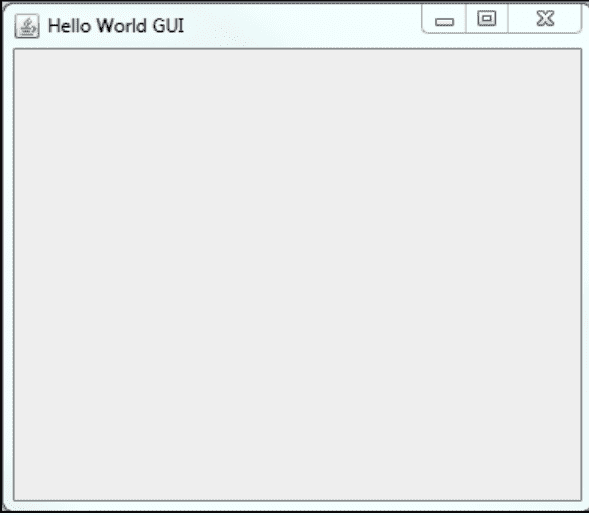

这是一个操作系统现在可以处理的完整窗口，允许我们移动；它甚至支持动态调整大小。你会发现我们的标题栏也附加到了窗口上。所以这非常基础。

## 设置窗口大小

现在让我们看看用现有的 `JFrame` 类还能做什么。当我们的 `JFrame` 窗口出现时，它非常小且很难看。这种大小的程序窗口对任何人来说永远都不会有用，所以让我们看看框架在设置窗口大小方面提供了什么。我们将使用 `setPreferredSize` 方法为我们的 `JFrame` 类应用大小。还有一个 `setLayout` 方法，但该方法不会带给我们可调整性，意味着 `JFrame` 应该是固定大小的。要构造一个新的维度，我们只需给它宽度和高度。

`Dimension` 类位于另一个库中，所以我们需要导入 `java.awt.*` 包，然后我们应该能够构建我们的项目并再次打开我们的 GUI：

```java
frame.setPreferredSize(new Dimension(400, 400));
```


# 基础 GUI 开发

现在我们有一个基础的 GUI；然而，它仍然用处，因为 GUI 内部没有任何。

## 添加标签

现在让我们快速看看如何向我们的 GUI 添加元素，我们可以放入 GUI 内部的最简单的元素是 `JLabel`。标签负责包含文本，实例化它们非常简单。我们只需告诉它们应该包含什么。当然，在更多的程序和 GUI 中，这些文本可以是动态的并变化的，但现在让我们先显示一些文本：

```java
JLabel label = new JLabel("Hi. I am a GUI.");
```

仅仅声明我们有一个 `JLabel` 类是不够的。我们还没有以任何方式将此标签对象与现有框架关联。我们的框架（从它暴露的大量方法和成员可以推断出）包含了许多组件，我们需要知道在这些组件中的哪一个放置 `JLabel` 类：

```java
package gui;
import javax.swing.*;
import java.awt.*;

public class GUI {
    public static void main(String[] args) {
        JFrame frame = new JFrame("Hello World GUI");
        frame.setPreferredSize(new Dimension(400, 400));
        JLabel label = new JLabel("Hi. I am a GUI.");

        frame.pack();
        frame.setVisible(true);
    }
}
```

我们的 `JFrame` 类组件之一是内容；那是我们在窗口内部看到的区域，程序 GUI 通常放置内容的地方。这似乎是我们添加新组件的合理位置，在本例中是标签。再次，让我们构建我们的程序，杀死旧实例并运行新程序：


搞定！现在我们的 GUI 中有文本了；我们成功地向 `JFrame` 窗口的内容添加了一个元素。

## 关闭我们的应用程序

有一点让人烦恼的是，即使在我们关闭关联的 GUI 后，程序仍在运行。这看起来有点傻。当我点击 NetBeans GUI 上的关闭按钮时，NetBeans 会关闭自己并停止作为我系统上的进程运行。我们可以使用它的 `setDefaultCloseOperation` 方法让我们的帧终止关联的进程。该方法的返回类型为 `void`，并接受一个整数作为值。这个整数是一个枚举值，我们有很多选项可以可以使用。所有这些选项都由 `JFrame` 类静态声明，而我们要找的是 `EXIT_ON_CLOSE`，它会在我们关闭窗口时退出我们的应用程序。构建并运行程序，我们的进程就离开了，它不再在后台运行了：

```java
frame.setDefaultCloseOperation(JFrame.EXIT_ON_CLOSE);
```

这就是我们对 Java GUI 的基础介绍。创建一个 GUI 是复杂的，但它也非常令人兴奋，因为它是视觉化且即时的；而且，它真的非常强大。

正如下面的代码所示，我们现在的程序是功能性的，但如果我们对其进行扩展，最终可能会遇到一些非常奇怪和困惑的问题。我们现在所做的违背了创建新 GUI 时的推荐做法。这些推荐做法的存在是为了保护我们免受程序变成多线程时发生的一些非常低层的问题。

当我们说我们的程序是多线程的意味着什么？嗯，当我们创建 GUI 时，当我们让它产生时，我们的程序就从执行单一任务（只是从头到尾执行 `main` 方法）转变为执行多个任务。这是因为我们现在执行以下代码：

```java
import javax.swing.*;
import java.awt.*;

public class GUI {
    public static void main(String[] args) {
        JFrame frame = new JFrame("Hello World GUI");
        frame.setDefaultCloseOperation(JFrame.EXIT_ON_CLOSE);
        frame.setPreferredSize(new Dimension(400, 400));
        JLabel label = new JLabel("Hi. I am a GUI.");
        frame.getContentPane().add(label);
        frame.pack();
        frame.setVisible(true);
    }
}
```

然而，此外代码还管理我们创建的新窗口以及该窗口执行的任何功能。为了保护自己免受多线程代码的复杂性影响，建议我们通过让 Swing 工具之一来异步构建这个新的 Swing GUI。

为了实现这一点，我们实际上需要将编写的所有代码从 `main` 方法中提取出来，并将其放在一个我们可以从 `main` 方法中引用它的地方。这是一个新函数，如下面的代码所示：

```java
private static void makeGUI()
```

我们可以直接粘贴所有这些代码来调用我们的新函数：

```java
private static void makeGUI() {
    JFrame frame = new JFrame("Hello World");
    frame.setDefaultCloseOperation(JFrame.EXIT_ON_CLOSE);
    frame.setPreferredSize(new Dimension(400, 400));
    JLabel label = new JLabel("Hi. I am a GUI.");
    frame.getContentPane().add(label);
    frame.pack();
    frame.setVisible(true);
}
```

## Swing 工具类

现在，让我们看看 Swing 建议我们如何让 GUI 产生。正如我所说，`swing` 包为我们提供了一些功能，可以为我们完成大量的工作和思考。`SwingUtilities` 类有一个静态的 `invokeLater` 方法，它将为我们创建 GUI：

```java
SwingUtilities.invokeLater(null);
```

这个 `invokeLater` 方法期望我们传入一个 `Runnable` 对象，所以我们将创建一个：

```java
Runnable GUITask = new Runnable()
```

`Runnable` 对象是那些可以转换为线程的对象。它们有一个我们将重写的方法，称为 `run`，而 `SwingUtilities.invokeLater` 方法会在适当的时候调用 `Runnable` 的 `run` 方法。当这种情况发生时，我们要做的就是调用 `MakeGUI` 方法并将我们的新的 `Runnable` 对象传递给 `invokeLater` 方法：

```java
public static void main(String[] args) {
    Runnable GUITask = new Runnable() {
        @Override
        public void run() {
            makeGUI();
        }
    };
    SwingUtilities.invokeLater(GUITask);
}
```

前面的程序运行良好！功能完全相同，我们所做的对于这样的程序来说可能有些过度；但是，这让我们看到在更大的软件项目中应该看到的情况，那里多线程等问题可能会成为关注点。我们快速过了这部分，让我们停下来再次看看这里：

```java
Runnable GUITask = new Runnable() {
    @Override
    public void run() {
        makeGUI();
    }
}
```

我们在这一段代码中所做的是创建一个匿名类。虽然看起来我们创建了一个新的 `Runnable` 对象，但我们实际上创建了一个带有自己特殊实现的 `Runnable` 对象子类。

## 可视化编辑器工具 – 调色板

Java 编程语言、GUI 扩展如 Swing、开发环境——强大的一个如 NetBeans——可以非常强大。

为了跟进，我强烈建议在此部分中使用 NetBeans。

要开始，让我们像往常一样创建一个 Java 应用程序并给它命名，然后我们就准备好了。我们将首先删除默认的 Java 文件，并让 NetBeans 为我们创建一个 `JFrame`：

我们将为这个 `JFrame` 类的命名并将其保持在同一个包中。当 NetBeans 创建此文件时，尽管它是一个 .java 文件，弹出的窗口对我们来说非常不同。事实上，我们的文件仍然只是 Java 代码。点击 Source 标签页查看如下所示的代码：

## 密码保护对话框示例

我想为密码保护对话框搭建框架。这不会太复杂，所以我们将 `JFrame` 做得比现在稍微小一点。然后，看看可用的 Swing 控件；它们有很多。事实上，得亏 NetBeans 的帮助，我们可以使用其他 GUI 扩展系统，例如：


以下是搭建密码保护对话框框架的步骤：

1. 我们就用 Swing 控件并保持基础。`Label`（标签）是最基础的了。我们的密码对话框需要一些文本：

   

2. 现在，密码对话框还需要一些用户交互。我们不仅需要密码，还需要为用户提供一个用户名。为了获取用户名，我们必须在 Swing Controls 的几个选项之间做出选择：

   

   `TextArea` 是一个很好的选择。它允许用户在框内输入文本，与 `Label` 不同，后者只有开发者可以编辑。用户可以点击框并在其中输入一些文本。遗憾的是，这个框很大，如果我们点击它并尝试让它变小，就会出现滚动条，允许用户在其中来回移动。

   我们可以通过更改编辑器中可以访问的任何多个属性，在滚动条出现时修改此框的默认大小。然而，一个更简单的解决方案是使用 `Text Field`（文本字段），它不具备我们框那样的多行功能。此外，在 `Text Field` 旁边放一个 `Label`，你会发现图形编辑器会帮助对齐线条。如果我们正确地双击如 `Label` 等字段，就可以直接编辑它们的文本：

   

   GUI 的酷之处之一是它有一些非常专门的控件。其中之一就是 `Password Field`（密码字段）。在很多方面，它的作用就像我们的 `TextField` 控件一样，只是它会在视觉上将用户输入的任何文本替换为圆点，这样从肩膀后面看的人就无法获它们的密码。如果你未能双击某个可编辑元素，它将带你回到源代码。

   我们将编辑用户可以放置文本的两个组件——文本字段和密码字段，以便它们最初不会以默认值显示给用户。我们可以双击密码字段，也可以直接编辑控件的属性：

   

   在这里，我们 `Text Field` 控件的文本值可以被修改为空，我们对密码也可以做同样的操作。你会发现密码的文本值实际上包含文本，但它只是显示为一堆圆点。然而，程序员可以访问此值来验证用户的密码。在 `Properties`（属性）选项卡中许多许多选项：我们可以进行诸如更改字体、前景和背景颜色、为其添加边框等操作。

   当我们运行程序时，你会看到它确实存在，并且用户可以向这些字段中输入值：

   

   当然，我们还没有编写任何后端代码对它们进行任何有用的操作，但 GUI 本身已经建立并运行了。这里并没有发生神奇的事情。如果我们跳转到这段代码的源代码并进入 `main` 方法，我们将看到实际创建并向用户显示 GUI 代码（见下面的截图）：

```java
public static void main(String args[]) {
    /* 设置 Nimbus 外观和感觉 */
    // Look and feel setting code (optional)

    /* 创建并显示表单 */
    java.awt.EventQueue.invokeLater(new Runnable() {
        public void run() {
            new MyGUI().setVisible(true);
        }
    });
}
```

重要的是意识到，当我们访问源代码中的元素时，所有这些方法通过原生 Java 也供我们使用。这就是我在这一节中真正想向你展示的，纯原始的力量以及我们如何快速地使用 NetBeans 图形编辑器为系统设置 GUI 窗口。

## 事件处理

在 Java 中工作的最大优点之一是它的 GUI 扩展库是多么强大，以及我们能多快地运行一个既具有功能性代码又具有流畅、专业用户界面的程序。要学习的有很多，但让我们从最基础开始：如何让程序在用户交互时做出响应。

事件是由用户触发的现象，例如点击按钮或在字段中输入。为了处理这些事件，我们使用“监听器”（listeners）等待事件发生然后执行某些代码。在 Java 中，这是通过向组件添加监听器对象来实现。

以下是搭建密码保护对话框框架的步骤：

1. 我们就坚持使用 Swing 控件并保持基础。`Label` 是最基础的了。我们的密码对话框需要一些文本：


# 基础 GUI 开发


- 2. 现在，密码对话框还需要一些用户交互。我们不仅需要密码，还需要为用户提供一个用户名。为了获取用户名，我们必须在 Swing Controls 的几个选项之间做出选择：


`TextArea` 是一个很好的选择。它允许用户在框内输入文本，与 `Label` 不同，只有开发者可以编辑。用户可以点击框并在其中输入一些文本。遗憾的是，这个框很大，如果我们点击它并尝试让它变小，就会出现滚动条，允许用户在其中来回移动。

我们可以通过更改编辑器中可以访问的任何多个属性，在滚动条出现时修改此框的默认大小。然而，一个更简单的解决方案是使用 `Text Field`，它不具备我们框那样的多行功能。此外，在 `Text Field` 旁边放一个 `Label`，你会发现图形编辑器会帮助对齐线条。如果我们正确地双击如 `Label` 等字段，就可以直接编辑它们的文本：


只有 `ActionEvent`（如前面的代码块所示）被传递到我们的 `submitButtonActionPerformed` 方法中。虽然这里有许多有趣且实用的方法论，但触发我们方法调用的动作上下文并不能提供我们真正需要的。我们真正需要的是密码字段和文本字段，幸运的是，它们是当前类的私有成员。验证我们文本字段值的步骤如下：

- 1. 从用户名开始，即 `jTextField`：

```java
private void submitButtonActionPerformed
(java.awt.event.ActionEvent evt) {
  jTextField
}
```

我们可能应该在这个机会重命名它，但目前先凑合吧，因为我们只有一个文本字段：


如果你还记得，在编辑器的属性（Properties）选项卡下，这个文本字段有一个文本（text）属性。我们删除了这里的文本，因为我们不希望我们的用户名字段在启动时包含任何初始文本。我们希望它是空的，这样用户就知道他们必须在那里输入自己的信息。

- 2. 现在，如果这是设计器向我们暴露的属性，那么我们也应该有一个由对象本身暴露的相关属性，确实有一个即 `getText()`：

```java
private void submitButtonActionPerformed(
java.awt.event.ActionEvent evt) {
    jTextField.getText()
}
```

- 3. 当我们调用 `getText()` 时，我们当然返回了当前存储在文本字段中的文本，我们将我们的机密用户名设置为非常“有创意”的用户名。

这是一个条件语句，我们将编写另一个条件语句。我们想让程序询问文本字段和密码字段（在这种情况下将暴露一个类似的方法 `getPassword`）是否等于硬编码字符串。秘密密码 `secret password` 将是 `java`。注意，`getPassword` 实际上返回的是一个字符数组（char array），而不是字符串，为了简单起见，我们只需将密码值赋值给字符串，然后就可以作为字符串使用它了。将其放在我们条件语句前的括号内，我们就可以继续了：

```java
private void submitButtonActionPerformed(
java.awt.event.ActionEvent evt) {
    String password = new
    String(jTextField.getPassword());
    if (jTextField.getText().equals("username")
    && password.equals("java")) {
}}
```

我们需要一些指示来告诉我们他们是否成功提供了正确的用户名和密码。好了，如果用户成功输入了正确的用户名和密码，该怎么办？嗯，我想在这里显示一个弹出对话框会很酷。

- 4. `JOptionPane` 为我们提供了 `showDialog` 方法，这是向用户导入非常重要且即时信息的酷炫方式。它会弹出一个框，而且非常轻量且易用。我们必须修复这个部分的导入：

```java
{ JOptionPane.showMessageDialog(rootPane, password); }
```

`MessageDialog` 创建自身时唯一需要的重量级信息是一个用来附着它的 GUI 组件，作为它的父容器。我们可以通过 `Action` 获取按钮 `evt`，但这并没什么意义，因为对话框不仅仅绑定到按钮；它是绑定到 GUI 开发的核心内容上的，即验证用户名和密码。所以，如果能将消息对话框绑定到 `JFrame` 本身（GUI 的顶层元素）就太好了，事实上我们可以做到：

```java
public class MyGUI extends javax.swing.JFrame { /* 创建新表 MyGUI */ public MyGUI() { initComponents(); } }
```

- 5. 如果我们向上滚动到源码部分来检查编写代码的确切位置，我们会看到我们在一个名为 `MyGUI` 的类中，它扩展了 `JFrame` 类。这个类与我们正在处理的 `JFrame` 类相关。因此，要将 `JFrame` 作为变量传递给我们的 `showDialog` 方法，我们只需使用该即可。现在输入一条消息，在用户名和密码验证后显示给用户：

```java
private void submitActionPerformed(java.awt.ActionEvent evt) { String password = new String(passwordField.getPassword()); if (jTextField.getText().equals("username") && password.equals("java")) { JOptionPane.showMessageDialog(this, "Login Good!"); } }
```

让我们运行程序看看我们构建了什么。对话框出现了（这是我们之前见过且符合预料的），然后执行以下步骤：

- 1. 输入有效的用户名，即 `username`。

- 2. 输入有效的密码，即 `java`。

- 3. 然后，点击 **Submit**（提交）按钮。


我们得到了一个如下截图所示的对话框。我们可以在 `JFrame` 实例中自由移动这个框：


# XML 处理

我们使用 Java 来创建、操作和显示 XML 数据。在本章中，我们将学习如何使用 Java 加载 XML 文件。接下来，我们将学习如何使用 Java 解析 XML 数据。最后，我们将查看写入和修改 XML 的 Java 代码。

我们将涵盖以下主题：

- 读取 XML 的 Java 代码
- 解析 XML 数据
- 修改 XML 数据

## 读取 XML 数据

在本节中，我们将完成一个非常简单的任务来开始学习 Java 如何与 XML 交互。我们将使用书中提供的 `cars.xml` 文件。该文件应该存储在 Java 项目的目录下，这样当我们运行 Java 程序时，它就能访问 `cars.xml`。我们将编辑以下 Java 程序来加载 `cars.xml` 文件：

```java
package loadingfile;

import java.io.*;
import javax.xml.parsers.*;
import javax.xml.transform.*;
import javax.xml.transform.dom.*;
import javax.xml.transform.stream.*;
import org.w3c.dom.*;
import org.xml.sax.*;
```

```java
public class LoadingAnXMLFile {
    public static void main(String[] args) {
        try {
            // 在此处编写可能抛异常的代码
        } catch (ParserConfigurationException pce) {
            System.out.println(pce.getMessage());
        } catch (SAXException se) {
            System.out.println(se.getMessage());
        } catch (IOException ioe) {
            System.err.println(ioe.getMessage());
        }
    }

    private static void PrintXmlDocument(Document xml) {
        try {
            Transformer transformer = TransformerFactory.newInstance().newTransformer();
            StreamResult result = new StreamResult(new StringWriter());
            DOMSource source = new DOMSource(xml);
            transformer.transform(source, result);
            System.out.println(result.getWriter().toString());
        } catch (TransformerConfigurationException e) {
            System.err.println("XML Printing Failed");
        } catch (TransformerException e) {
            System.err.println("XML Printing Failed");
        }
    }
}
```

在我们开始之前，请注意此程序需要大量的导入。我们导入的 transform 类对于我们将要编写的任何内容都不是必须的；我写了一个名为 `PrintXmlDocument()` 的函数，如果我们成功加载了 XML 文档，它会将该文档打印到控制台窗口。如果你正在跟随这一节的代码操作，我建议你从一开始就导入这些 transform 类。然后，当你在使用额外的功能时，可以尽管使用 NetBeans 的“修复导入”（Fix Imports）功能，确切查看我们正在使用的库来自何处。

所以，我们这里的目标是创建一个 `Document` 类的对象，其中包含 `cars.xml` 文件中的信息。一旦我们有了这个 `Document` 对象，我们只需要在控制台窗口对 Document 实例调用 `PrintXmlDocument()` 函数即可。遗憾的是，创建这个 `Document` 对象并不像 `Document dom = new Document();` 语句那么简单。相反，我们需要以结构化和程序化的方式创建它，以正确保留 XML 文件的解析特性。为了实现这一点，我们将利用两个额外的类：`DocumentBuilder` 和 `DocumentBuilderFactory` 类。

`DocumentBuilder` 类将负责为我们实际构建文档。`DocumentBuilder` 类作为一个与 `Document` 对象独立的实体存在，这样作为程序员，就可以在逻辑上将我们对文档本身执行的方法论与最初创建该文档所需的额外方法论分开来。与 `Document` 类类似，我们不能直接实例化 `DocumentBuilder` 类。相反，我们将利用第三个类来获取 `DocumentBuilder`，即 `DocumentBuilderFactory` 类。我将创建存储我们 XML 文件的 `Document` 对象所需的代码分为三个部分：

- 1. `DocumentBuilderFactory` 类包含一个静态方法 `newInstance()`。让我们在 `main()` 方法的第一个 `try` 块中添加以下调用。这将为我们实例化 `DocumentBuilderFactory` 以供工作：

```java
DocumentBuilderFactory factory = DocumentBuilderFactory.newInstance();
```

- 2. 一旦我们有了 `DocumentBuilderFactory`，我们就可以为自己获取一个新的 `DocumentBuilder` 对象。为了做到这一点，我们将调用工厂的 `newDocumentBuilder()` 方法。让我们将其添加到 `try` 块中：

```java
DocumentBuilder builder = factory.newDocumentBuilder();
```

- 3. 最后，我们需要指示 `DocumentBuilder` 构建一个 `Document` 对象，并且该对象应该镜像我们 `cars.xml` 文件的结构。我们只需在 `try` 块中使用一个值实例化我们的 `Document` 对象。我们将从 builder 的 `parse()` 方法中获取此值。该方法的参数之一是一个引用文件名的字符串。如果我们在 Java 程序中引用了文件对象，我们也可以使用它：

```java
Document dom = builder.parse("cars.xml");
```

因此，我们的 `main()` 方法如下：

```java
public static void main(String[] args) {
    DocumentBuilderFactory factory = DocumentBuilderFactory.newInstance();
    try {
        // 在此处编写可能抛错误的代码...
        DocumentBuilder builder = factory.newDocumentBuilder();
        Document dom = builder.parse("cars.xml");
        PrintXmlDocument(dom);
    } catch (ParserConfigurationException pce) {
        System.out.println(pce.getMessage());
    } catch (SAXException se) {
        System.out.println(se.getMessage());
    } catch (IOException ioe) {
        System.err.println(ioe.getMessage());
    }
}
```

现在是时候检查我们的代码是否工作了。我们使用 `DocumentBuilderFactory` 类的静态方法获取了 `DocumentBuilderFactory` 对象，它创建了一个新实例。通过 `DocumentBuilderFactory` 我们创建了一个新的 `DocumentBuilder` 对象，它能够智能地解析我们的 XML 文件。在解析 XML 文件时，`DocumentBuilder` 对象理解其中包含的信息性质，并将其存储在我们的 XML 文档或 `Document` 对象元素中。当我们运行此程序时，我们得到了原始 XML 文档的原始文本视图输出：


由于加载这样的 XML 文件有很多步骤，因此我想把它放在自己单独的章节中。这样做是为了当我们作为程序员学习操作和从 XML 中读取有价值的信息时，不会被我们在这里看到的所有语法所困扰。

## 解析 XML 数据

`Document` 类提供了一种在对象中存储格式化信息的简单方法。在前一节的程序中，我们从 `cars.xml` 文件读取信息到我们的 Java `Document` 对象中。以下是 `cars.xml` 文件的样子：


```xml
<?xml version="1.0"?>
<cars>
  <owner name="Billy">
    <car vin="LJPCBLCX110002377">
      <make>Ford</make>
      <model>Fusion</model>
      <year>2014</year>
      <color>Blue</color>
    </car>
    <car vin="LGHIALCX89880011">
      <make>Toyota</make>
      <model>Tacoma</model>
      <year>2013</year>
      <color>Green</color>
    </car>
    <car vin="GJSALSS22000522">
      <make>Dodge</make>
      <model>Challenger</model>
      <year>2013</year>
      <color>Red</color>
    </car>
  </owner>
  <owner name="Jane">
    <car vin="AJSS55545633">
      <make>Nissan</make>
      <model>Altima</model>
      <year>2000</year>
      <color>Green</color>
    </car>
    <car vin="OAFS981100111">
      <make>Dodge</make>
      <model>Challenger</model>
      <year>2013</year>
      <color>Red</color>
    </car>
  </owner>
</cars>
```

该文件的根节点是 `cars` 节点，在该节点内部有两个 `owner` 节点，Billy 和 Jane，每个节点内部都有若干 `car` 节点。我们这一节的目标是从 `cars.xml` 获取特定所有者的信息。为了弄清如何编写代码，你需要了解一些 XML 术语。在这一节中，我们将处理“元素”（element）和“节点”（node）术语。

## XML

在 XML 中，**元素**是一个具有起始标签和结束标签的实体，它还包含内部的所有信息。当我们的 `Document` 对象返回信息时，它通常以节点的形式返回。**节点**是 XML 文档的构建块，我们几乎可以将其看作一种继承关系，所有的元素都是节点，但并非所有节点都是元素。节点可以比 XML 元素简单得多。

## 访问 Jane 的 XML 元素

本节将帮助我们使用以下代码访问 Jane 所拥有的汽车信息。我将需要添加到 `main()` 函数的代码分为六部分：

所以，为了寻找 Jane 所拥有的所有汽车，让我们看看我们的 XML 文档一开始为我们提供了哪些功能。如果我们查看文档补全来快速扫描方法列表，可以从实例调用 `dom`。我们将看到 `getDocumentElement()` 方法为我们返回了一个元素：

```java
public class ReadingXML {
    public static void main(String[] args) {
        Document dom;
        DocumentBuilderFactory factory = DocumentBuilderFactory.newInstance();
        try {
            DocumentBuilder builder = factory.newDocumentBuilder();
            dom = builder.parse("cars.xml");

            // 现在，打印出 Jane 的所有汽车...
            PrintXmlDocument(dom);
        } catch (Exception e) {
            // 处理异常
        }
    }
}
```

使用 XML 也许是一个很好的开始。这种方法返回了我们 XML 的顶层元素；在这种情况下，我们将获取 `cars` 元素，它包含了我们所需的所有信息。它也包含了一些我们不需要的信息，比如 Billy 的汽车，但我们将在访问它之后对其进行解析。一旦我们导入了正确的库，我们就可以使用 `Element` 类在代码中直接引用 XML 元素的概念。我们可以创建一个新的 `Element` 并将其值赋值给我们 XML 文档的根元素：

```java
Element doc = doc.getDocumentElement();
```

当然，我们需要深入得多。我们 XML 文档的根层级 `cars` 对我们来说并没有直接用处；我们需要其中包含的信息。我们真正想要来自一个 `owner` 节点的信息（包含关于 Jane 的汽车的信息）。但我们先获取这两个节点，然后找到我们真正感兴趣的那个是符合逻辑的。

为了获取这两个节点，我们可以对刚刚创建并存储在 `doc` 中的根 XML 元素调用一个方法。XML 元素内部可以包含其他元素；在这种情况下，我们的根元素包含多个 `owner` 元素。`getElementsByTagName()` 允许我们收集许多此类内部元素。XML 元素的标签名正如你所预期的那样；它是我们给 XML 中该特定元素的名称。在这种情况下，如果我们请求文档根元素内包含的所有标签名为 `owner` 的元素，我们将进一步减少正在处理的 XML 数量，更接近我们所需要的微小部分。

然而，`getElementsByTagName()` 方法返回的并不是单个元素。这一部分在最高层有两个不同的元素，两个 `owner`：Billy 和 Jane。因此，`getElementsByTagName()` 方法返回的不是单个元素；相反，它返回一个 `NodeList` 对象，它是 XML 节点的集合：

```java
NodeList ownersList = doc.getElementsByTagName("owner");
```

我们再也不需要处理根节点了；我们只拥有它的内容。现在是时候让我们真正缩小搜索范围了。我们的 `NodeList` 对象包含多个 `owner`，但只有当与该 `owner` 关联的属性名为 Jane 时，我们才需要这个 `owner`。为了找到这个特定的元素（如果它存在），我们只需遍历 `NodeList`，检查它包含的每个元素的属性。请注意 `ownersList` 并不是传统的数组。它是一个 `NodeList` 对象，是一种特殊的对象。因此，我们不能在它上使用数组语法。坦率地说，它向我们暴露了模仿普通数组语法的方法。例如，`getLength()` 方法将告诉我们 `ownersList` 中有多少个对象：

```java
for(int i = 0; i < ownersList.getLength(); i++)
{}
```

同样，当我们尝试创建一个新的 `Element` 对象并将该值赋值给 `ownersList` 当前循环遍历的部分时，我们将无法使用数组的正常语法。尽管如此，`ownersList` 为我们提供了一个执行相同操作的方法。`item()` 方法提供或请求一个索引作为输入。

请注意 `ownersList` 是 `NodeList`，虽然元素是节点，但并不是所有节点都是元素，因此我们需要在这里做一个决定。我们可以检查此函数返回的对象的性质，并确保它们确实是 XML 元素。但为了保持进度，我们只需假设我们的 XML 格式是正确的，并且只需让 Java 知道 `item()` 方法返回的节点是一个元素；即，它有一个起始标签和结束标签，并且可以在内部包含其他元素和节点：

```java
Element owner = (Element)ownersList.item(i);
```

一旦我们成功从 `owner` 列表中访问了一个元素，就是时候检查这是否是我们要找的 `owner` 了；因此，我们需要一个条件语句。XML 元素向我们暴露了 `getAttribute()` 方法，而我们感兴趣的属性是 `name` 属性。因此，下面这段代码将询问当前的 `owner`：“你的 `name` 属性值是多少？”如果该值等于 Jane，那么我们就知道访问了正确的 XML 元素。

在 Jane 的 XML 元素内部，现在我们只有几个 `car` 元素。所以再次是时候创建 `NodeList` 并用这些 `car` 元素填充它了。我们现在需要对当前的 `owner` Jane 调用 `getElementsByTagName()` 方法。如果我们使用顶层文档来调用此函数，我们将得到文档中所有的 `car` 元素，甚至是 Billy 的：

```java
if(owner.getAttribute("name").equals("Jane"))
  NodeList carsList = owner.getElementsByTagName("car");
```

3. 这个 `main()` 方法正变得有点复杂；这是因为我不想把所有内容都写在一个方法里。我们的代码已经深入了好几层，而且我们写的并不完全是简单的代码。我认为是时候把下一部分解析到它自己的方法中了。让我们简化一下，假设我们将有一个 `PrintCars()` 方法，这个函数将调用 `car` 元素的 `NodeList` 来打印汽车节点：

```java
PrintCars(carsList)
```

我们的方法现在如下：

```java
public static void main(String[] args) {
  DocumentBuilderFactory factory = DocumentBuilderFactory.newInstance();
  try {
    DocumentBuilder docBuilder = factory.newDocumentBuilder();
    Document doc = docBuilder.parse(new File("cars.xml"));

    // 现在我们打印 Jane 的
    Element root = doc.getDocumentElement();
    NodeList ownersList = root.getElementsByTagName("owner");

    for (int i = 0; i < ownersList.getLength(); i++) {
      Element owner = (Element)ownersList.item(i);
      if (owner.getAttribute("name").equals("Jane")) {
        NodeList carsList = owner.getElementsByTagName("car");
        PrintCars(carsList);
      }
    }
  } catch (ParserConfigurationException pce) {
    System.err.println(pce.getMessage());
  } catch (SAXException se) {
    System.err.println(se.getMessage());
  } catch (IOException ioe) {
    System.err.println(ioe.getMessage());
  }
}
```

## 输出 Jane 的详情

4. 因为我们定义了这个方法，我们知道它的类型是 `static void`。我们也知道它将接受 `NodeList` 作为输入：

```java
public static void PrintCars(NodeList cars) {
    for (int i = 0; i < cars.getLength(); i++) {
        Element carNode = (Element)cars.item(i);
        System.out.println(carNode.toString());
    }
}
```

5. 现在我们将从 `carNode` 构建 `carObj` 的值。我们也将其实例化：

```java
Car carObj = new Car();
```

6. 如果我们回到 XML 文件并查看存储在 `car` 元素中的信息，我们看到存储了 `make`、`model`、`year` 和 `color`。车辆码 `vin` 实际上是一个属性。让我们看一下我们的 `Car` 类：

```java
package readingXml;

public class Car {
    public String vin;
    public String make;
    public String model;
    public int year;
    public String color;

    public Car() {
    }

    @Override
    public String toString() {
        return String.format("%d %s %s %s, vin:%s", year, color, make, model, vin);
    }
}
```

7. 我们先从简单的部分开始；所以 `make`、`model` 和 `color` 都是存储在 `Car` 类中的字符串，并且恰好都是 `Car` 元素中的节点。

8. 回到 `PrintCars()` 函数，我们已经知道如何在元素内部访问节点。我们只需再次使用 `carNode` 和 `getElementsByTagName()` 函数。如果我们获取所有标签名为 `color` 的元素，我们应该得到一个只包含我们感兴趣的元素的列表，它告诉我们汽车的颜色。遗憾的是，我们这里有一个列表，所以在我们从列表中提取它之前，我们无法直接操作元素。如果我们确定我们的 XML 格式是正确的，我们知道我们将获得一个恰好包含一个列表。因此，如果我们获取索引为 0 的项，那就是我们要寻找的 XML 元素。

存储在此 XML 元素中的颜色信息并不是属性；它是内部文本。因此，我们将查看该 XML 元素暴露了哪些方法，并看看是否有合适的方法来获取内部文本。有一个 `getTextContent()` 函数，它将为我们提供所有不属于 XML 标签部分的内部文本。在这种情况下，它将为我们提供汽车的颜色。

仅仅获取这些信息是不够的，我们还需要存储它们。幸运的是，`carObj` 的所有属性都是公共的，因此在创建汽车对象后，我们可以自由地为它们赋值。如果这些是由于没有 setter 方法的私有字段，我们可能必须在构造 `carObj` 之前获取这些信息，然后将它们传递给可能拥有的构造函数：

```java
carObj.color =
carNode.getElementsByTagName("color").item(0).getTextContent();
```

对于品牌（make）和型号（model），我们将执行几乎相同的操作。我们唯一需要更改的是在查找元素时提供的关键字：

```java
carObj.make =
carNode.getElementsByTagName("make").item(0).getTextContent();
carObj.model =
carNode.getElementsByTagName("model").item(0).getTextContent();
```

9. 现在，我们可以继续对汽车的年份使用相同的通用策略，但我们应该注意，对于 `carObj` 而言，年份（year）是一个整数。对于我们的 XML 元素而言，年份与其他任何其他内容一样，是一个文本字符串（Text string）。幸运的是，只要它是格式正确的（这是我们在这里做的一个假设），将字符串转换为整数并不困难。我们将简单地使用 `Integer` 类并调用它的 `parseInt()` 方法。这将把字符串值转换为整数。我们将将其赋值给 `carObj` 的 `year`：

```java
carObj.year =
Integer.parseInt(carNode.getElementsByTagName("year").item(0).getTextContent());
```

10. 这样我们就只剩下一个字段了。请注意，`carObj` 有一个车辆识别码（vin）字段。该字段实际上不是整数；车辆识别码可以包含字母，因此此值被存储为字符串（String）。不过，获取它的方式会略有不同，因为它不是内部元素，而是汽车元素本身的一个属性。再次，我们知道如何从 `carNode` 获取一个属性；我们只需要获取名为 `vin` 的属性并将其赋值给 `carObj`：

```java
carObj.vin = carNode.getAttribute("vin");
```

11. 完成这一切后，我们的 `carObj` 应该已经通过其所有成员的合理的值完全构建。现在是使用 `carObj` 实现它存在的理由了：重写 `toString()` 函数。对于我们循环的每辆汽车，让我们调用 `carObj` 的 `toString()` 函数并将结果打印到控制台：

```java
System.out.println(carObj.toString());
```

我们的 `printCars()` 函数看起来如下：


```java
public static void printCars(NodeList cars) {
    for (int i = 0; i < cars.getLength(); i++) {
        Element carNode = (Element) cars.item(i);
        Car carObj = new Car();
        carObj.color = carNode.getElementsByTagName("color").item(0).getText();
        carObj.make = carNode.getElementsByTagName("make").item(0).getText();
        carObj.model = carNode.getElementsByTagName("model").item(0).getText();
        carObj.year = Integer.parseInt(carNode.getElementsByTagName("year").item(0).getText());
        carObj.vin = carNode.getAttribute("vin");
        System.out.println(carObj.toString());
    }
}
```

我们现在可以编译我们的程序了。现在当我们运行它时，希望它能打印出 Jane 的所有汽车，利用 `carObj` 重写的 `toString()` 方法来漂亮地格式化输出。当我们运行此程序时，我们看到输出了两辆汽车，如果我们查看 XML 中分配给 Jane 的汽车，我们会发现这些信息与存储在这些汽车中的信息匹配：

```
run:
  2000 Green Nissan Altima, vin:LLOKAJSS55548563
  2013 Red Dodge Challenger, vin:OOKINAFS98111001
  BUILD SUCCESSFUL (total time: 0 seconds)
```

XML 和 Java 的结合非常强大。XML 是人类可读的。作为人类，我们可以理解它甚至可以对其进行修改，但它在结构方面也包含了有价值的信息。这是 Java 等编程语言也能理解的内容。我们编写的程序——虽然它有自己的怪癖并且编写它需要一定的知识——但比来自远程原始文本文件的类似程序更容易编写，程序员也更容易理解和维护。

## 写入 XML 数据

能够读取 XML 信息固然很好，但为了让语言对我们真正有用，Java 可能还需要能够写出 XML 信息。以下程序是一个既能读取又写入同一个 XML 文件的程序的简易模型：

```java
package writingxml;

import java.io.*;
import javax.xml.parsers.*;
import javax.xml.transform.*;
import javax.xml.transform.dom.*;
import javax.xml.transform.stream.*;
import org.w3c.dom.*;
import org.xml.sax.*;

public class WritingXML {
    public static void main(String[] args) {
        File xmlFile = new File("cars.xml");

        Document dom = LoadXMLDocument(xmlFile);

        WriteXMLDocument(dom, xmlFile);
    }

    private static void WriteXMLDocument(Document doc, File destination) {
        try {
            // 在此处将 doc 写入目标文件文件...
        } catch (TransformerConfigurationException e) {
            System.err.println("XML writing failed.");
        } catch (TransformerException e) {
            System.err.println("XML writing failed.");
        }
    }

    private static Document LoadXMLDocument(File source) {
        try {
            DocumentFactory factory = DocumentFactory.newInstance();
            DocumentBuilder builder = factory.newDocumentBuilder();
            Document dom = builder.parse(source);
        } catch (ParserConfigurationException e) {
            System.err.println("XML loading failed.");
        } catch (SAXException e) {
            System.err.println("XML loading failed.");
        } catch (IOException e) {
            System.err.println("XML loading failed.");
        }
        return dom;
    }
}
```

`main()` 方法非常简单。它接收一个文件并读取该文件的 XML。然后，该程序调用 `WriteXMLDocument()` 将 XML 写入文件。目前读取 XML 的方法已经在 `LoadXMLDocument()` 中实现；但写入 XML 的方法尚未完成。让我们看看写入 XML 信息需要什么。

## 写入 XML 数据的 Java 代码

以下是写入 XML 数据的步骤：

1. 由于 XML 文档存储的方式，我们需要在将其打印到文件之前将其转换为不同的格式。为了实现这一点，我们将使用一个名为 `Transformer` 的 XML 特有类。正如许多处理 XML 的类一样，`Transformer` 实例是使用工厂创建的。在这种情况下，工厂是 `TransformerFactory`，它像许多工厂一样暴露了 `newInstance()` 方法，允许我们在需要时创建一个。我们的 `Transformer` 对象将允许我们将 `Document` 对象转换为可以发送到文件的流，我们只需简单调用 `TransformerFactory` 的 `newTransformer()` 方法：

```java
TransformerFactory tf = TransformerFactory.newInstance();
Transformer transformer = tf.newTransformer();
StreamResult result = new StreamResult(destination);
```

2. 在 `Transformer` 将 XML 文档转换为其他形式之前，它需要知道我们希望将其 XML 信息转换为什么。这个类是 `StreamResult` 类；它是当前 `Document` 对象中存储信息的目标。流是一个原始二进制信息泵，可以发送到任何数量的目标。在这种情况下，我们的目标是提供给 `StreamResult` 构造函数的输出文件。

3. 我们的 `Transformer` 对象虽然没有链接到我们的 XML 文档，但期望我们以独特的方式作为 `DOMSource` 对象引用我们的 XML 文档。注意，我们的源对象（见下）与结果对象配对。`Transformer` 对象当我们向它提供这两个对象时，将知道如何将一个转换为另一个。现在，为了创建 `DOMSource` 对象，我们只需要传入我们的 XML 文档：

```java
DOMSource source = new DOMSource(doc);
```

4. 最后，当所有设置完成后，我们就可以执行代码的功能部分了。让我们获取 `Transformer` 对象，并让它将源（即 `DOMSource` 对象）转换为指向我们目标文件的可流化结果：

```java
transformer.transform(source, result);
```

以下内容将成为我们的 `WriteXMLDocument()` 函数：

```java
private static void WriteXMLDocument(Document doc, File destination) {
    try {
        // 在此处将 doc 写入目标文件
        TransformerFactory tf = TransformerFactory.newInstance();
        Transformer transformer = tf.newTransformer();
        StreamResult result = new StreamResult(destination);
        DOMSource source = new DOMSource(doc);
        transformer.transform(source, result);
    } catch (TransformerConfigurationException e) {
        System.err.println("XML writing failed.");
    } catch (TransformerException e) {
        System.err.println("XML writing failed.");
    }
}
```

当我们运行这个程序时，我们会在文件中得到 XML，但你必须相信我的话：它和我们之前的 XML 是一样的，这是预期的，因为我们先读取了 XML，然后将其打印回结果。

为了测试我们的程序是否正常工作，我们需要对 Java 代码中的 `Document` 对象进行一些更改，然后看看是否能将这些更改打印到文件中。让我们更改汽车所有者的名称。将所有汽车的交易转给一个名为 Mike 的主人。

## 修改 XML 数据

XML I/O 系统的强大之处在于，在加载和写入 XML 文档之间，我们可以自由地修改存储在内存中的 `Document` 对象（`dom`）。此外，我们在 Java 内存中对对象进行的更改将写入我们的持久化 XML 文件。因此，让我们从进行一些更改开始：

1. 我们将使用 `getElementsByTagName` 来获取 XML 文档中所有的 `owner` 元素。这将返回一个 `NodeList` 对象，我们将其命名为 `owners`：

```java
NodeList owners = dom.getElementsByTagName("owner");
```

2. 为了将所有这些所有者的名称改为 Mike，我们需要遍历这个列表。作为回顾，我们可以通过调用 `owners`（即我们的 `NodeList` 对象）的 `getLength()` 函数来获取列表的项目数量。要访问当前正在迭代的项，我们将使用 `owners` 的 `item()` 函数并传入迭代变量 `i` 以获取该索引处的项。让我们再次使用 `i`。注意，`setAttribute()` 接受两个字符串作为输入，我们只需假设 XML 是格式良好的，并通知 Java 我们此时正在处理的是一个完整的 XML 元素。

接下来，XML 元素暴露了许多允许我们修改它们的方法。这些方法之一就是 `setAttribute()` 方法，这也是我们在这里要使用的。注意 `setAttribute()` 接受两个字符串作为输入。首先，它需要知道我们想要修改哪个属性。我们将修改 `name` 属性（这是我们这里唯一可属性），并将将其值赋值为 Mike：

```java
for (int i = 0; i < owners.getLength(); i++) {
    Element owner = (Element) owners.item(i);
    owner.setAttribute("name", "Mike");
}
```

现在我们的 `main()` 方法看起来如下：

```java
public static void main(String[] args) {
    File xmlFile = new File("cars.xml");
    Document dom = LoadXMLDocument(xmlFile);
    NodeList owners = dom.getElementsByTagName("owner");
    for (int i = 0; i < owners.getLength(); i++) {
        Element owner = (Element) owners.item(i);
        owner.setAttribute("name", "Mike");
    }
    WriteXMLDocument(dom, xmlFile);
}
```

当我们运行程序并检查 XML 文件时，我们将看到 Mike 现在是所有这些汽车的所有者，如下截图所示：

```xml
<?xml version="1.0" encoding="UTF-8" standalone="no"?>
<owner name="Mike">
  <car vin="LJPCCXX1100237">
    <make>Ford</make>
    <model>Fusion</model>
    <year>2014</year>
    <color>Blue</color>
  </car>
  <car vin="LGHIALCX89880011">
    <make>Toyota</make>
    <model>Tacoma</model>
    <year>2013</year>
    <color>Green</color>
  </car>
  <car vin="GJSIALSS2200567">
    <make>Dodge</make>
    <model>Charger</model>
    <year>2013</year>
    <color>Red</color>
  </car>
</owner>
<owner name="Mike">
```


现在，将这两个 XML 元素合并似乎是合理的，这样 Mike 就只是一个主人，而不是分成两个。这稍微超出了本节的范围，但这是一个有趣的问题，我想鼓励你思考一下，也许现在就可以尝试尝试一下。

## 总结

在本章中，我们看到了将 XML 文件读取到 `Document` 对象的 Java 代码。我们还学习了如何使用 Java 解析 XML 数据。最后，我们看到了如何在 Java 中写入和修改 XML 数据。

恭喜！你现在是一个 Java 程序员了。

# 索引

## A
- abstract 188
- abstract method 186
- advanced functions 144
- alphabet 105
- array 103
- declaring 100
- example, in NetBeans 102
- initializing 101
- initializing, in Java 106
- values, assigning 100
- ArrayList 115
- ArrayIndexOutOfBoundsException 122
- creating 116
- example, in NetBeans 115
- printing of user input 117
- user input, obtaining 117
- subclasses 194
- working 200
- year, fetching 197
- exploring 135
- cast 45
- celsius 136
- Char 61
- classes creating 156
- custom classes, creating 158
- member functions, creating 163
- member variables, creating 160
- code completion feature 28
- code, program 20
- code comments 19
- compiling 9
- program, executing 22
- conditional statements 77
- complex conditionals 74
- boolean variable 81
- complex conditional statements 77
- contains function 75
- concatenation operator 56
- conditional statements 68
- else statements, used 71

## B
- boolean variable 81
- break 81
- program, used 83
- BufferedWriter 286

## C
- Calendar 193
- current day, fetching 197
- constructors creating 165
- types 171
- contains function 75
- control flow 134

## D
- data structure 185
- reading from files 237
- writing to files 228
- development environment 14
- JDK, installing 10
- NetBeans, installing 12
- setting up 10
- do loop 87
- difference, between integer 41
- floating point variables, 40
- difference, between integer and float 41
- data 45
- for for

## K
- Kelvin type 137

## M
- map about 124, 127
- creating 127
- information, fetching 129
- values, assigning 128
- Math class library 47
- class libraries, importing 51
- pow(), function, using 48
- method overloading 148
- methods about 131
- program, executing 139, 141, 143
- temperature conversion program 132
- multidimensional array about 107
- chessboard, printing 112
- colors, assigning to chessboard 111
- creating 109
- example, in NetBeans 108
- nested loops, used 109

## N
- NetBeans IDE installing 12
- NetBeans code completion feature 28
- errors, interpreting 24, 28
- nodes 281

## O
- object class about 119
- equals() method, overriding 221
- object method 223
- object method 223
- object creating 156
- deserializing 246
- serializing 243
- off-by-one error (OBOE) 97
- overriding 182

## P
- passing parameters 152
- primitive classes 224, 227
- protected method 187

## R
- replace() function 60, 208

## S
- Serializable class about 242
- object, deserializing 246
- object, serializing 243
- serialization 242
- string functionality 204
- string functions

## G
- Graphical User Interface (GUI) 251

## 关于
- 207
- 132

## `format()` 函数
- 209

## 案例，探索
- 135

## `replace()` 函数
- 208

## 控制流，设置
- 134

## 字符串字面量
- toUpperCase() 函数 57
- 对比字符串对象 205

# V

## 字符串
- 关于 55, 56
- 变量 34
- 拼接运算符 56
- 可视化 GUI 编辑工具
- 转义序列 61
- 关于 260
- `replace()` 函数 60
- 调色板，工作 261, 262, 263, 264, 265, 266
- `toUpperCase()` 函数 57

# W

## 子程序
- 131
- `while` 循环 87, 89

## 超类

# X

## 创建
- 179

## XML 数据
- Swing GUI 251
- 打印 Jane 的车，285, 286, 287, 288, 289
- JFrame 类 252
- 访问 Jane 的 XML 元素，281, 282, 283, 284
- SwingUtilities 类 258, 259
- 编写 Java 代码，291, 292

## switch
- 修改 293, 294, 295
- 关于 81
- 解析 279
- 程序，使用 83
- 读取 275, 277, 278
- 写入 289

# T

## 温度转换程序
