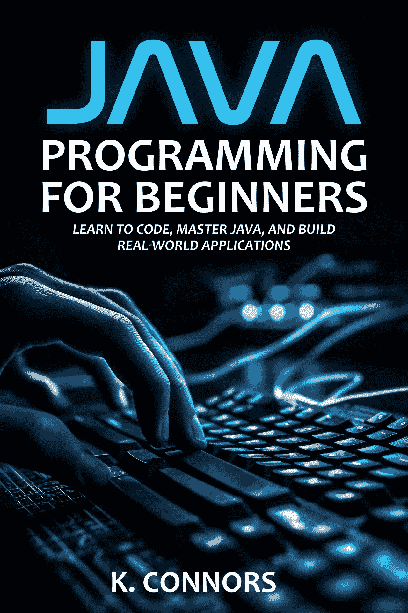

# Java 初学者指南：学习编程、掌握 Java 并构建实战应用



# 引言：开始学习 Java

欢迎来到精彩的 Java 编程世界！如果你拿着这本书，你可能正准备开启一段兴奋的旅程，去学习世界上最流行、最强大的编程语言之一。无论你是完全的新手，还是具有一定编码经验并希望扩展技能的人，你都来对地方。Java 就像编程语言中的“瑞士军刀”——多功能、可靠，并且能够应对你给它的任何挑战。

但在深入研究代码细节之前，让我们花点时间欣赏一下 Java 为什么如此重要。Java 出生于上世纪 90 年代中期，那时互联网还处于婴儿阶段，人们才开始意识到这一新数字前沿的潜力。Sun Microsystems 公司（Java 的创建者）构想了一种健壮、安全且平台无关的语言——这意味着它可以运行在任何设备上，无论是笨重的台式电脑还是时尚的新手机。回溯到今天，Java 随处可见：Web 应用、移动应用、企业级软件，甚至是驱动你家电的嵌入式系统。

那么，是什么让 Java 如此特别呢？首先，它是一门面向对象编程（OOP）语言。如果这个术语听起来很陌生，别担心——我们将在后面的章节中进行解释。现在，只需将 OOP 视为将你的代码组织成整洁、可重用块的方法。这使得你的程序更容易管理、理解和扩展。Java 的另一个大优势是它的语法。诚然，初一看可能像乱码，但一旦你掌握了它，你会发现 Java 的语法逻辑严密、一致，且相对易读。

Java 经受住时间考验的最主要原因之一是它的格言：“一次编写，到处运行”（Write once, run anywhere）。得益于 Java 虚拟机（`JVM`），你可以在一台机器上编写 Java 代码，并在任何其他机器上运行，而无需担心兼容性问题。这种跨平台能力是一个巨大的优势，特别是在我们如今使用多种设备的世界里。

现在，我知道你可能在想：“这些听起来很棒，但我真的能学会 Java 吗？”绝对可以！学习 Java 就像学习一门新语言（字面上的），就像学习西班牙语或法语一样，需要时间、练习和一些耐心。但好消息是：如果你跟随这本书，花时间尝试示例并完成练习，你将走上成为胜任 Java 程序员的道路。谁知道呢？你可能在这个过程中发现很多乐趣。

让我们聊聊你最初为什么想学习 Java。也许你对软件开发职业感兴趣。如果是这样，Java 是一个极佳的选择。它是一门需求巨大的语言，有大量的就业机会。从小型初创公司到巨型企业，都依赖 Java 构建其后端系统，这使其成为劳动力市场上一项有价值的技能。或者，你可能想构建自己的项目——无论是移动应用、游戏，还是用于自动化电脑上某些无聊任务的工具。Java 的多功能性以及丰富的库和框架生态系统，使其成为各种项目的绝佳选择。

学习 Java 还开启了社区和资源的大门。Java 已经存在了二十多年，在这段时间里，一个庞大的开发者社区围绕着它成长。这意味着无论你遇到什么问题，很有可能别人以前遇到过，而且那里有解决方案。从论坛、博客到教程和课程，适用于 Java 的可用资源多得惊人。

但我们不要操之过急。在我们构建下一个伟大的应用或获得那份理想工作之前，我们需要从基础开始。这本书的设计旨在带你从零开始，直到你有信心编写和理解 Java。

# 第 1 章：编程与 Java 简介

欢迎来到你 Java 编程之旅的开启章！我们将深入探讨编程的基础知识，以及 Java 如何融入这个广阔而兴奋的世界。把这一章想象成开学的第一天——你正在熟悉环境，接触新概念，并为后续的所有内容奠定基础。

让我们从基础开始：到底什么是编程？简单来说，编程是创建一组指令的过程，告诉计算机如何执行任务。这些指令是用计算机可以理解并执行的语言编写的。现在，世界上有很多编程语言——每种语言都有自己的特性、优点和理想用途。Java 就是其中一种语言，而且它是一门非常特别的语言。

## Java 简介

Java 是由 Sun Microsystems 公司的一组开发人员在 20 世纪 90 年代中期创建的。他们希望设计一种简单、健壮且能够在任何设备上运行的语言，无论其硬件或操作系统如何。其结果就是 Java，这是一种在软件开发领域变得极其流行的语言。今天，Java 被应用于从 Web 应用、移动应用到企业系统和嵌入式设备的各个领域。

那么，Java 的创建者为什么认为世界还需要另一种编程语言呢？嗯，在当时，大多数编程语言要么过于针对特定平台（如 `C` 和 `C++`），要么不够健壮，无法处理现代计算的需求。Java 的设计目标是平台无关的，这意味着你可以编写一次代码并随处运行它。这种概念被称为“一次编写，到处运行”（Write Once, Run Anywhere，WORA），它是 Java 最强大的特性之一。

为了理解 Java 如何实现这种平台无关性，我们需要介绍 Java 虚拟机（`JVM`）。当你编写一个 Java 程序时，你实际上在编写会被编译成一种名为 `bytecode`（字节码）的中间形式的代码。这些 `bytecode` 然后会由 `JVM` 执行，`JVM` 是一段解释 `bytecode` 并在你的计算机上运行它的软件。`JVM` 适用于许多不同的平台，所以只要你的设备上有 `JVM`，你就可以在上面运行 Java 代码。这很酷，对吧？

现在我们已经涵盖了高层面的概述，让我们进入 Java 本身的一些细节中。你对 Java 注意到的第一个现象之一就是它的语法。语法指的是语言的规则和结构——换句话说，就是你如何编写代码。Java 的语法与 `C` 和 `C++` 等其他编程语言相似，如果你有这些语言的经验，学习它相对容易。但即使你对编程完全是新手，也不用担心——我们将循序渐进。

一个基础的 Java 程序看起来如下：

```java
public class HelloWorld {
    public static void main(String[] args) {
        System.out.println("Hello, World!");
    }
}
```

让我们来拆解一下。第一行 `public class HelloWorld` 是在定义一个类。在 Java 中，一切都是类的一部分。把类看作是创建对象的蓝图——它定义了对象将拥有的属性和行为。在这种情况下，我们的类名为 `HelloWorld`。

下一行 `public static void main(String[] args)` 是在定义一个方法。方法是一个执行特定任务的代码块。`main` 方法很特殊，因为它是任何 Java 程序的入口——它是程序开始执行的地方。`public`、`static` 和 `void` 关键字在 Java 中有特定的含义，但目前你只需要知道它们对于定义 `main` 方法是必须的。

在 `main` 方法内部，我们有一行代码：`System.out.println("Hello, World!");`。这一行向控制台打印文本“Hello, World!”。`System.out` 是一个代表标准输出流（即你的屏幕）的对象，而 `println` 是一个向该流打印一行文本的方法。引号内的文本被称为字符串（string），它是字符的序列。

恭喜你！你刚刚编写并理解了你的第一个 Java 程序。它看起来可能很简单，但这个“Hello, World!”示例是新程序员的入门之路。它向你介绍了 Java 程序的基本结构，并向你展示了如何产生输出。

在我们继续之前，让我们简单谈一下编写 Java 程序时需要的开发工具。首先，你需要 Java 开发工具包（`JDK`）。`JDK` 是一个软件开发工具包，包含了开发 Java 应用程序所需的所有内容——Java 编译器、`JVM` 以及各种其他工具。你可以从 Oracle 网站下载 `JDK`，它适用于所有主要的操作系统。

一旦你安装了 `JDK`，你可能还需要一个集成开发环境（`IDE`）。`IDE` 是一个为编写、测试和调试你的代码提供全面环境的软件应用程序。Java 有许多 `IDE` 可用，但一些最流行的包括 `IntelliJ IDEA`、`Eclipse` 和 `NetBeans`。这些 `IDE` 中的每一个都有自己的一套功能和优势，所以你可能想尝试几个，看看你更喜欢哪一个。

工具准备就绪后，你就准备好开始编写 Java 代码了。但从哪里开始呢？学习编程最好的方法之一就是实践，因此在本书中，我们将完成大量的示例和练习。每一章都将引入新的概念和技术，在你之前学过的基础上进行构建。到书结束时，你将对 Java 有了坚实的理解，并有能力应对你自己的项目。

为了保持趣味性，我们还将探索 Java 使用的现实场景。例如，我们将查看 Java 如何驱动 Web 应用、移动应用和企业系统。这些示例将帮助你看到所学知识的实际应用，并让你对 Java 编程开启的许多可能性有所感知。

除了技术细节之外，我们还将涵盖对程序员重要的某些软技能。这包括调试技术、编写整洁且可维护代码的最佳实践，以及如何解决问题。这些技能与了解语言语法一样重要，并且将在你的整个编程生涯中受益匪浅。

本章的一个核心要点是实践和实验的重要性。编程既是一门艺术，也是一门科学，最好的学习方法就是实践。

# 第 2 章：设置你的 Java 环境

好了，现在我们已经涉足了 Java 编程的世界，现在是时候动手设置你的 Java 环境了。把这一章看作是在你烹饪美味大餐之前准备厨房。你肯定不想在开始之前不确保准备好所有的食材和工具，对吧？编程也是如此。让我们确保拥有了编写和运行 Java 代码所需的所有内容。

## 下载并安装 JDK

首先，你需要 Java 开发工具包（`JDK`）。这是一个全能工具箱，包含了开发 Java 应用程序所需的一切：编译器、库和其他工具。`JDK` 由 Oracle 免费提供，你可以从他们的网站下载。

多年来，Java 经历了许多版本，要选择哪一个可能会让你有些无从下手。作为初学者，最好的办法是从最新的长期支持（LTS）版本开始，在本文写作时该版本是 `Java 17`。LTS 版本的支持时间更长，能确保稳定性和安全更新，这对于初学者来说是一个稳妥的选择。

### 安装 JDK

访问 Oracle 网站并寻找 JDK 下载页面。你会看到针对不同操作系统（Windows、macOS 和 Linux）的选项。选择与你的操作系统相匹配的版本，下载安装程序，并按照提示进行安装。安装完成后，你需要设置系统的环境变量，以便你的电脑知道去哪里寻找 Java 工具。

### 在 Windows 上设置环境变量

如果你使用的是 Windows，打开开始菜单，输入“环境变量”并选择“编辑环境变量”选项。点击“新建”按钮，创建一个名为 `JAVA_HOME` 的新系统变量，并将其值设置为你安装 JDK 的路径（类似于 `C:\Program Files\Java\jdk-17` 的路径）。接下来，在列表中找到“Path”变量，编辑它，并添加一个指向 JDK 安装路径下 `bin` 目录的新条目。这告诉系统在何处寻找 Java 编译器和其他工具。

### 在 macOS 和 Linux 上设置环境变量

在 macOS 和 Linux 上，你需要编辑 shell 的配置文件。打开终端并输入 `nano ~/.bash_profile`（如果你使用的是 Zsh shell，则使用 `~/.zshrc`）。在文件末尾添加以下几行：

```bash
export JAVA_HOME=/Library/Java/JavaVirtualMachines/jdk-17.jdk/Contents/Home
export PATH=$JAVA_HOME/bin:$PATH
```

保存文件并运行 `source ~/.bash_profile` 以应用更改。你可以通过打开一个新终端并输入 `java -version` 来验证你的设置。如果一切都设置正确，你应该能看到你安装的 Java 版本。

## 选择 IDE

现在我们已经安装了 JDK，让我们聊聊集成开发环境（IDE）。IDE 是一种为计算机程序员提供软件开发全方位设施的软件应用程序。它通常包括源代码编辑器、构建自动化工具和调试器。对于 Java 来说，最流行的 IDE 有 `IntelliJ IDEA`、`Eclipse` 和 `NetBeans`。

### 设置 IntelliJ IDEA

让我们从 `IntelliJ IDEA` 开始。`IntelliJ IDEA` 由 JetBrains 开发，以其强大的功能、智能代码辅助和用户友好的界面而闻名。它提供两个版本：免费的 Community 版和付费的 Ultimate 版。Community 版对初学者来说完全足够，所以请尽管从 JetBrains 网站下载它。下载完成后，运行安装程序并按照提示进行设置。

当你第一次打开 `IntelliJ IDEA` 时，你会看到一个欢迎界面。点击“New Project”（新建项目）并在项目类型列表中选择“Java”。你会被要求指定 JDK 的位置——`IntelliJ` 应该会自动检测到你之前安装的 JDK，但如果没有检测到，你可以手动浏览到安装目录。点击几次“Next”（下一步），你就准备好了一个新的 Java 项目。

### 设置 Eclipse

`Eclipse` 是另一个用于 Java 开发的流行 IDE。它是开源的，拥有庞大的用户和贡献者社区。你可以从他们的官方网站下载 `Eclipse`。安装过程非常简单——下载安装程序，运行它，并选择“Eclipse IDE for Java Developers”。安装完成后，打开 `Eclipse` 并通过“File” -> “New” -> “Java Project”创建一个新的 Java 项目。为你的项目命名并点击“Finish”。

### 设置 NetBeans

`NetBeans` 是另一个强大的 IDE，对初学者来说也是很棒的选择。它由 Apache 赞助，并为 Java 以及许多其他语言提供强大的支持。从官方网站下载 `NetBeans`，运行安装程序并按照提示操作。安装完成后，打开 `NetBeans` 并通过“File” -> “New Project” -> “Java” -> “Java Application”创建一个项目。

## 编写你的第一个 Java 程序

设置好 IDE 后，让我们来编写第一个 Java 程序。打开你的 IDE 并在项目中创建一个新的 Java 文件。将其命名为 `HelloWorld.java` 并输入以下代码：

```java
public class HelloWorld {
    public static void main(String[] args) {
        System.out.println("Hello, World!");
    }
}
```

这是一个简单的程序，会在控制台打印“Hello, World!”。要运行它，右键点击该文件并选择“Run”（运行）（或点击 `IntelliJ IDEA` 中的播放按钮）。如果一切都设置正确，你应该能在 IDE 底部的控制台中看到输出。恭喜你，你刚刚编写并执行了第一个 Java 程序！

## 使用文本编辑器和命令行

此时，你可能在想：“这太好了，但我为什么需要 IDE 呢？我不能直接在文本编辑器中写代码并从命令行运行吗？”你完全可以，事实上，了解如何这样做是一个好主意。让我们试一下。

打开文本编辑器（Windows 上的记事本、macOS 上的文本编辑或 Linux 上的 `nano`），输入与之前相同的 `HelloWorld` 程序。将文件保存为 `HelloWorld.java` 到你选择的目录中。现在，打开终端或命令提示符，导航到保存文件的目录，输入以下命令：

```bash
javac HelloWorld.java
java HelloWorld
```

`javac` 命令将你的 Java 文件编译成字节码，创建一个 `HelloWorld.class` 文件。`java` 命令使用 `JVM` 运行字节码。如果一切顺利，你会在控制台上看到“Hello, World!”。

## 使用 IDE 的优势

随着你的程序变得复杂，你会体会 IDE 提供的功能，如代码补全、调试工具和项目管理。

## 设置环境变量的重要性

设置 Java 环境的一个最大好处是，它是一次性的工作。一旦一切就绪，你就可以专注于编写代码和学习新概念，而无需担心配置问题。此外，熟悉你的开发工具是成为熟练程序员的重要部分。

## 继续你的旅程

当你继续 Java 编程之旅时，请记住设置环境只是开始。真正的乐趣在你开始编写代码、尝试不同的概念并构建自己的项目时。不要害怕探索和尝试不同的工具和技巧——练习得越多，进步得越快。

## 总结

总结来说，设置 Java 环境涉及下载和安装 JDK、配置系统环境变量以及选择适合你需求的 IDE。无论你选择 `IntelliJ IDEA`、`Eclipse`、`NetBeans`，还是坚持使用编辑器和命令行，你现在都准备好了编写 Java 代码所需的工具。

# 第 3 章：Java 基础——语法、变量和数据类型

欢迎来到第 3 章！现在你的 Java 环境已经准备就绪，并且已经运行了第一个“Hello, World!”程序，是时候深入学习 Java 的基础了。把这一章看作是学习新语言的语法和词汇。我们将涵盖 Java 的基本构建模块：语法、变量和数据类型。在本章结束时，你将为更复杂的程序奠下坚实的基础。

## 理解 Java 语法

让我们从语法开始。编程中的语法就像口语语言中的句法。它定义了 Java 编译器可以理解的代码编写规则和结构。Java 语法初看起来可能有些望而生畏，但一旦你习惯了它，就会发现它是非常有逻辑性且一致的。

每个 Java 程序都由类和方法组成。类是对象的蓝图，而方法是对象可以执行的操作。例如，在我们的“Hello, World!”程序中，`HelloWorld` 是一个类，而 `main` 是一个方法。Java 程序的基本结构如下：

```java
public class ClassName {
    public static void main(String[] args) {
        // code goes here
    }
}
```

在这里，`public` 是访问修饰符，允许从其他类访问该类。`class` 是用于定义类的关键字。`ClassName` 是类的名称，你可以根据需要命名它，只要它遵循某些规则（它必须以字母开头，并包含字母和数字）。


# Java 基础与控制流

## main 方法

在类内部，我们有 `main` 方法。`main` 方法是任何 Java 程序的入口。它是程序开始执行的地方。`public static void main(String[] args)` 这一行看起来可能很绕口，但一旦你分解它，它就有意义了：

- `public` 意味着该方法可以从任何地方调用。
- `static` 意味着方法属于类，而不是类的实例。
- `void` 意味着方法不返回任何值。
- `main` 是方法的名称。
- `String[] args` 是 `String` 对象的数组，用于存储命令行参数。

## 声明变量

接下来，我们来聊聊变量。变量用于存储可以在程序中使用和操作的数据。将变量想象成存放信息的容器。在 Java 中，在使用变量之前需要对其进行声明。声明变量涉及指定其数据类型并给它一个名称。以下是声明变量的基本语法：

```java
dataType variableName;
```

例如，要声明一个名为 `myNumber` 的整数变量，你可以这样写：

```java
int myNumber;
```

你也可以在声明时通过赋值一个值来初始化变量：

```java
int myNumber = 10;
```

Java 有多种数据类型，它们可以大致分为两类：基本数据类型和引用数据类型。让我们从基本数据类型开始。

## 基本数据类型

基本数据类型是 Java 中最基础的数据类型。它们包括：

- `byte`: 8 位整数
- `short`: 16 位整数
- `int`: 32 位整数
- `long`: 64 位整数
- `float`: 32 位浮点数
- `double`: 64 位浮点数
- `char`: 16 位 Unicode 字符
- `boolean`: 真或假

以下是你如何声明和初始化不同基本数据类型的变量：

```java
byte myByte = 100;
short myShort = 10000;
int myInt = 100000;
long myLong = 100000L;
float myFloat = 10.5f;
double myDouble = 10.5;
char myChar = 'A';
boolean myBoolean = true;
```

注意 `long` 值末尾的 `L` 和 `float` 值末尾的 `f`。这些后缀是必须的，用于指示这些值分别是 `long` 和 `float` 类型。

## 引用数据类型

另一方面，引用数据类型用于引用对象。它们包括类、接口和数组。与基本数据类型不同，引用变量存储的是内存中的对象地址。例如，要声明一个 `String` 类型变量（它是 Java 中的一个类），你可以这样写：

```java
String myString = "Hello, Java!";
```

## 数组

数组是相同数据类型的变量集合。它就像一个存储在连续内存位置的项列表。你可以通过指定数据类型后跟方括号来声明数组：

```java
int[] myArray;
```

你也可以在声明时通过指定数组的大小或直接提供元素来初始化数组：

```java
int[] myArray = new int[5]; // 一个包含 5 个整数的数组
int[] myArray = {1, 2, 3, 4, 5}; // 一个带有初始值的数组
```

使用索引来访问数组元素，第一个元素的索引为 0：

```java
int firstElement = myArray[0];
int secondElement = myArray[1];
```

## 字符串操作

字符串是字符的序列，它们是 Java 中最常用的数据类型之一。`String` 类提供了许多操作字符串的方法，例如拼接、比较和查找子字符串。以下是一个你如何处理字符串的示例：

```java
String greeting = "Hello";
String name = "World";
String message = greeting + ", " + name + "!";
System.out.println(message);
```

在这个示例中，我们拼接（组合）变量 `greeting` 和 `name` 来创建一个新字符串并将其打印到控制台。

## 类型转换

有时，你可能将变量从一种数据类型转换为另一种数据类型。这个过程被称为类型转换。Java 中有两种类型转换：隐式转换和强制转换。

隐式转换发生在你将较小的数据类型转换为较大的数据类型时：

```java
int myInt = 9;
double myDouble = myInt; // 自动转换为 double
```

强制转换发生在你将较大的数据类型转换为较小的数据类型时：

```java
double myDouble = 9.78;
int myInt = (int) myDouble; // 手动转换为 int，值为 9
```

## 常量

如果你想声明一个不能改变的变量，可以使用 `final` 关键字。这样的变量就是常量：

```java
final int MY_CONSTANT = 100;
```

## 运算符

运算符是对变量和值执行操作的符号。Java 有多种运算符，包括算术、关系、逻辑和赋值运算符。如下：

- 算术：`+`, `-`, `*`, `/`, `%`
- 关系：`==`, `!=`, `>=`, `<=`
- 逻辑：`&&`, `||`, `!`
- 赋值：`=`, `+=`, `-=`, `*=`, `/=`, `%=`

这是如何在 Java 中使用一些运算符：

```java
int a = 10;
int b = 5;
int sum = a + b; // sum 为 15
boolean isEqual = (a == b); // isEqual 为 false
boolean isGreater = (a > b); // isGreater 为 true
boolean result = (a > b) && (a != b); // result 为 true
```

## 总结

好了，让我们总结本章的关键点：

- Java 语法定义了 Java 编译器可以理解的代码编写规则和结构。
- 变量用于存储数据，在使用前必须指定特定类型。
- 基本数据类型包括 `byte`, `short`, `int`, `long`, `float`, `double`, `char` 和 `boolean`。
- 引用数据类型包括类、接口和数组。
- 数组是相同数据类型的变量集合，通过索引访问。
- 字符串是字符序列，`String` 类提供了许多操作它们的方法。
- 类型转换允许你将变量从一种数据类型转换为另一种。
- 常量是值不能改变的变量，使用 `final` 关键字声明。
- 运算符对变量和值执行操作，理解它们对于编写有效的 Java 程序至关重要。

现在，你对 Java 的基础知识有了良好的理解。这些概念表面看起来简单，但它们是 Java 编程中一切的基础。所以，继续练习，尝试不同的变量和运算符，并尝试用你学到的构建小型程序。

掌握了这些基础后，你就准备好进入 Java 编程更高级的主题了。在下一章，我们将探索 Java 中的控制流，包括条件判断和循环。这将使你能够编写可以决策和重复操作的更复杂的程序。

# 第 4 章：控制流 - 条件语句与循环

欢迎来到第 4 章！现在你已经熟悉了 Java 语法、变量和数据类型，是时候为你的程序引入一些决策能力了。将这一章看作是教你的 Java 代码如何独立思考。我们将深入研究控制流，包括条件语句和循环。这些概念将允许你的程序做出决策并重复操作，使它们变得更加强大和灵活。

## 理解控制流

在编程中，控制流是各个语句、指令或函数调用执行或评估的顺序。换句话说，控制流决定了你的程序在运行时所遵循的路径。如果没有控制流语句，你的代码将简单地从上到下执行，这会非常局限。通过使用条件语句和循环，你可以控制程序的流，使其更具动态且响应迅速。

## 条件语句：if, else 和 switch

让我们从条件语句开始。条件语句是允许程序根据条件的真与假来执行某些代码块的语句。Java 中最常见的条件语句是 `if`、`else if` 和 `else`。

### if 语句

`if` 语句评估一个条件（布尔表达式），如果条件为真，则执行一个代码块。这里是基本语法：

```java
if (condition) {
    // 如果条件为真则执行的代码
}
```

例如，假设你想检查一个数字是否为正数：

```java
int number = 10;
if (number > 0) {
    System.out.println("The number is positive.");
}
```

在这个示例中，条件 `number > 0` 为真，因此执行了 `if` 块内部的代码，并在控制台打印消息“The number is positive.”。

### else 语句

`else` 语句用于在 `if` 语句中的条件为假时执行一个代码块。这里是语法：

```java
if (condition) {
    // 如果条件为真则执行的代码
} else {
    // 如果条件为假则执行的代码
}
```

例如，让我们检查一个数字是正数还是负数：

```java
int number = -5;
if (number > 0) {
    System.out.println("The number is positive.");
} else {
    System.out.println("The number is negative.");
}
```

在这种情况下，条件 `number > 0` 为假，因此执行了 `else` 块内部的代码，并在控制台打印消息“The number is negative.”。

### else if 语句

`else if` 语句用于在第一个条件为假时指定一个新的条件进行测试。你可以链接多个 `else if` 语句来检查多个条件。这里是语法：

```java
if (condition1) {
    // 如果 condition1 为真则执行的代码
} else if (condition2) {
    // 如果 condition2 为真则执行的代码
} else {
    // 如果所有条件为假则执行的代码
}
```

例如，让我们检查一个数字是正数、负数还是零：

```java
int number = 0;
if (number > 0) {
    System.out.println("The number is positive.");
} else if (number < 0) {
    System.out.println("The number is negative.");
} else {
    System.out.println("The number is zero.");
}
```

在这个示例中，前两个条件均为假，因此执行了 `else` 块内部的代码，并在控制台打印消息“The number is zero.”。

### switch 语句

`switch` 语句是另一种根据变量的值来控制程序流向的方法。当你有多个条件需要检查时，它特别有用，并且可以使你的代码比使用多个 `if-else` 语句更具读性。这里是基本语法：

```java
switch (variable) {
    case value1:
        // 如果变量等于 value1 则执行的代码
        break;
    case value2:
        // 如果变量等于 value2 则执行的代码
        break;
    // 更多 cases…
    default:
        // 如果没有一个 case 匹配，则执行的代码
}
```

例如，让我们使用 `switch` 语句根据整数值来确定星期是几：

```java
int day = 3;
switch (day) {
    case 1:
        System.out.println("Sunday");
        break;
    case 2:
        System.out.println("Monday");
        break;
    case 3:
        System.out.println("Tuesday");
        break;
    case 4:
        System.out.println("Wednesday");
        break;
    case 5:
        System.out.println("Thursday");
        break;
    case 6:
        System.out.println("Friday");
        break;
    case 7:
        System.out.println("Saturday");
        break;
    default:
        System.out.println("Invalid day");
        break;
}
```

在这个示例中，变量 `day` 等于 3，因此执行了 `case 3` 块内部的代码，并在控制台打印消息“Tuesday”。

## 循环：for, while 和 do-while

循环用于根据条件重复执行一个代码块。常见的循环有 `for`、`while` 和 `do-while`。

### for 循环

`for` 循环用于在已知执行次数的情况下重复执行代码块。它根据条件执行。这里是基本语法：

```java
for (initialization; condition; update) {
    // 循环执行的代码
}
```

例如，让我们让一段代码打印 5 次：

```java
for (int i = 0; i < 5; i++) {
    System.out.println(i);
}
```

### while 循环

`while` 循环在条件为真时重复执行代码块。它通常用于在你不知道具体执行次数的情况下。这里是语法：

```java
while (condition) {
    // 循环执行的代码
    update;
}
```

例如，让我们让代码打印 5 次：

```java
int i = 0;
while (i < 5) {
    System.out.println(i);
    i++;
}
```

### do-while 循环

`do-while` 循环与 `while` 循环类似，但它保证代码块至少执行一次，即使条件初始为假。这里是语法：

```java
do {
    // 执行的代码
} while (condition);
```

例如，让我们让代码打印 5 次：

```java
int i = 0;
do {
    System.out.println(i);
    i++;
} while (i < 5);
```

## break 和 continue

`break` 和 `continue` 语句用于控制循环的流。`break` 语句用于提前退出循环，而 `continue` 语句跳过当前迭代的剩余代码并进入下一次迭代。

### break

例如，让我们使用 `break` 语句在满足某些条件时退出循环：

```java
for (int i = 1; i <= 10; i++) {
    if (i == 5) {
        break;
    }
    System.out.println(i);
}
```

在这个示例中，循环打印了 1 到 4。当 `i` 等于 5 时，执行了 `break` 语句，循环终止。

### continue

现在，让我们使用 `continue` 语句在满足某些条件时跳过当前迭代：

```java
for (int i = 1; i <= 10; i++) {
    if (i == 5) {
        continue;
    }
    System.out.println(i);
}
```

在这个示例中，循环打印了 1 到 10 的数字，但除了 5。当 `i` 等于 5 时，执行了 `continue` 语句，循环进入下一次迭代而不打印 5。

## 现实场景

控制流语句对于编写能够处理现实场景的程序至关重要。例如，考虑一个检查温度并根据数值提供建议的简单程序：

```java
int temperature = 25;
if (temperature > 30) {
    System.out.println("It's hot outside! Stay hydrated.");
} else if (temperature >= 20 && temperature <= 30) {
    System.out.println("The weather is nice and warm.");
} else {
    System.out.println("It's cold outside! Dress warmly.");
}
```


在本示例中，程序使用 `if`、`else if` 和 `else` 语句根据温度提供不同的消息。

## 核心要点

好了，让我们用本章的一些核心要点结束吧：

- 控制流决定了程序在运行时所经过的路径。
- 条件语句（`if`、`else if`、`else` 和 `switch`）允许你的程序根据条件的真假值来执行代码块。
- 循环（`for`、`while` 和 `do-while`）允许你的程序根据条件重复执行代码块。
- `break` 和 `continue` 语句用于控制循环的流。
- 理解控制流对于编写动态且响应迅速的程序至关重要。

通过掌握条件语句和循环，你正在赋予你的 Java 程序做出决策和执行重复性任务的能力。这些技能是编写高效、良好代码的基础。继续练习并尝试不同的场景，以加深你的理解。

在下一章中，我们将探索函数和方法，它们将帮助你将代码组织为可复用且模块化的组件。

# 第 5 章：函数与方法

欢迎来到第 5 章！现在你已经熟悉了 Java 语法、变量、数据类型和控制流，是时候通过学习函数和方法将你的编程水平提高一个层次了。这些是本质工具，允许你将代码组织成可复用、模块化的单元，使其更容易阅读、维护和调试。将函数和方法想象成你编程咒书中的魔法咒——它们可以执行任务、解决问题，并让你的代码更高效。

## 理解函数和方法

在 Java 中，“函数”（function）和“方法”（method）这两个术语通常互用，但它们存在细微的区别。函数是执行特定任务的代码块，而方法是属于类的函数。由于 Java 是一种面向对象的编程语言，我们主要使用方法。然而，为了简单起见，我们在本章将通用使用这两个术语。

## 为什么要使用函数和方法？

想象你正在编写一个执行一系列任务的程序，例如计算不同形状的面积、处理用户输入或显示消息。如果没有函数和方法，你的代码将是一长串语句，难以管理和理解。通过将代码分解为更小的、可复用的单元（函数和方法），你可以：

- 通过将复杂问题分解为更小、易于管理的任务来简化问题。
- 通过重用函数和方法来避免重复代码。
- 通过逻辑化组织代码来提高可读性和可维护性。
- 通过将错误隔离在特定的函数或方法中来使调试变得更容易。

## 定义和调用方法

让我们从定义和调用方法的基础开始。以下是在 Java 中定义方法的通用语法：

```java
accessModifier returnType methodName(parameters) {
    // method body
}
```

让我们来拆解它：

- `accessModifier`（访问修饰符）：指定方法的可见性（例如 `public`、`private`、`protected`）。
- `returnType`（返回值）：方法返回的值类型（例如 `int`、`String`、`void`）。如果方法不返回值，请使用 `void`。
- `methodName`：方法的名称。
- `parameters`：用逗号分隔的输入参数列表（可选）。

这是一个打印问候消息的简单方法示例：

```java
public void printGreeting() {
    System.out.println("Hello, welcome to Java programming!");
}
```

要调用此方法，只需使用它的名称并跟上括号：

```java
printGreeting();
```

## 方法参数和返回值

方法可以接受输入参数并返回值，允许它们执行更复杂的任务。例如，让我们创建一个计算两个整数之和的方法：

```java
public int sum(int a, int b) {
    return a + b;
}
```

在这个示例中，`sum` 方法接收两个整数参数（`a` 和 `b`）并返回它们的和。要调用此方法并将结果存储在变量中，你可以写：

```java
int result = sum(5, 3);
System.out.println("The sum is: " + result);
```

### 方法重载

方法重载是 Java 的一项特性，允许你定义具有相同名称但不同参数列表的多个方法。当你想要对不同类型或数量的输入执行相似任务时这非常有用。这里是方法重载的示例：

```java
public int sum(int a, int b) {
    return a + b;
}

public double sum(double a, double b) {
    return a + b;
}

public int sum(int a, int b, int c) {
    return a + b + c;
}
```

在这个示例中，我们有三个 `sum` 方法：一个接收两个整数，一个接收两个双精度浮点数，一个接收三个整数。Java 将根据你提供的参数自动选择合适的方法。

## 方法递归

递归是一种强大的编程技术，其中方法通过调用自己来解决问题。它通常用于可以分解为更小、相似的子任务的任务。然而，递归可能很难处理，如果处理不当，可能会导致死循环。这里有一个计算数字阶乘的递归方法的简单示例：

```java
public int factorial(int n) {
    if (n <= 1) {
        return 1;
    } else {
        return n * factorial(n - 1);
    }
}
```

在这个示例中，`factorial` 方法使用值 `n - 1` 调用自身，直到 `n` 小于或等于 1。

## 实际场景

函数和方法在实际场景中非常有用。让我们探索一些示例看看它们如何简化你的代码。

### 示例 1：温度转换

假设你正在编写一个在摄氏和华氏之间转换温度的程序。与其多次编写转换公式，不如创建方法：

```java
public double celsiusToFahrenheit(double celsius) {
    return (celsius * 9 / 5) + 32;
}

public double fahrenheitToCelsius(double fahrenheit) {
    return (fahrenheit - 32) * 5 / 9;
}
```

现在，你可以通过调用这些方法轻松转换温度：

```java
double tempC = 25.0;
double tempF = celsiusToFahrenheit(tempC);
System.out.println(tempC + "°C is " + tempF + "°F");
```

### 示例 2：质数

创建一个检查数字是否为质数的方法。质数是大于 1 且除 1 自身外没有其他因数的数：

```java
public boolean isPrime(int number) {
    if (number <= 1) {
        return false;
    }
    for (int i = 2; i <= Math.sqrt(number); i++) {
        if (number % i == 0) {
            return false;
        }
    }
    return true;
}
```

你可以使用这个方法检查一个数字是否为质数：

```java
int num = 17;
if (isPrime(num)) {
    System.out.println(num + " 是质数.");
} else {
    System.out.println(num + " 不是质数.");
}
```

### 示例 3：寻找数组中的最大值

让我们写一个查找整数数组中最大值的方法：

```java
public int findMax(int[] array) {
    int max = array[0];
    for (int i = 1; i < array.length; i++) {
        if (array[i] > max) {
            max = array[i];
        }
    }
    return max;
}
```

你可以使用这个方法找到数组中的最大值：

```java
int[] numbers = {3, 5, 7, 2, 8};
int maxValue = findMax(numbers);
System.out.println("最大值是: " + maxValue);
```

- `Recursion`（递归）是一种方法调用自身来解决问题的技术。
- `Functions` 方法可以简化你的代码，提高可读性，并使调试变得更容易。

通过掌握函数和方法，你正在向编写更有组织、更高效的 Java 程序迈出重要的一步。这些技能对于处理更复杂的问题和构建健壮的应用至关重要。继续练习并尝试不同的方法，以强化你的理解。

在下一章中，我们将探索面向对象编程 (OOP) 概念，这将帮助你理解如何使用 `classes` 和 `objects` 来设计和组织你的代码。

# 第 6 章：面向对象编程 (OOP) 概念

欢迎来到第 6 章！到目前，你已经掌握了 Java 的基础知识，包括语法、变量、数据类型、控制流和方法。现在是时候深入探索 Java 最强大的特性之一：面向对象编程 (OOP)。OOP 是一种使用“对象”来设计应用程序和程序的编程范式。将其想象为将你的代码组织成一组相互连接的微型程序，这些程序共同工作以完成任务。

## 理解 OOP

OOP 的核心是将现实世界的实体建模为具有状态和行为的软件对象。状态由对象的属性（字段或属性）表示，行为由对象的方法表示。OOP 的四个主要原则是封装、继承、多态和抽象。让我们详细探索每一个概念。

## 封装

封装是将数据（属性）和操作这些数据的方法封装到单个单元中，该单元被称为 `class`（类）。它还涉及限制对对象某些组件的直接访问，这是隐藏对象内部状态并只暴露受控接口的方法。

这里是一个说明封装的示例：

```java
public class Car {
    private String model;
    private int year;

    public Car(String model, int year) {
        this.model = model;
        this.year = year;
    }

    public String getModel() {
        return model;
    }

    public void setModel(String model) {
        this.model = model;
    }

    public int getYear() {
        return year;
    }

    public void setYear(int year) {
        this.year = year;
    }
}
```

在这个示例中，`Car` 类封装了 `model` 和 `year` 属性。这些属性被标记为 `private`，意味着它们不能从类外部直接访问。相反，我们提供了 `public` 的 getter 和 setter 方法来访问和修改这些属性。这种封装确保了对象的内部状态免受未经授权的访问和修改。

## 继承

继承是一种允许一个类继承另一个类的属性和方法的机制。继承的类被称为 `subclass`（子类或派生类），被继承的类被称为 `superclass`（父类或基类）。继承促进了代码的重用，并在类之间建立了自然的层级结构。

这里是一个继承的示例：

```java
public class Vehicle {
    private String brand;

    public Vehicle(String brand) {
        this.brand = brand;
    }

    public String getBrand() {
        return brand;
    }

    public void setBrand(String brand) {
        this.brand = brand;
    }

    public void start() {
        System.out.println("The vehicle is starting.");
    }
}

public class Car extends Vehicle {
    private int numDoors;

    public Car(String brand, int numDoors) {
        super(brand);
        this.numDoors = numDoors;
    }

    public int getNumDoors() {
        return numDoors;
    }

    public void setNumDoors(int numDoors) {
        this.numDoors = numDoors;
    }

    public void honk() {
        System.out.println("The car is honking.");
    }
}
```

在这个示例中，`Car` 类使用 `extends` 关键字继承自 `Vehicle` 类。`Car` 类继承了 `Vehicle` 类的 `brand` 属性和 `start` 方法，同时也增加了自己的 `numDoors` 属性和 `honk` 方法。这种关系允许 `Car` 类在重用 `Vehicle` 类功能的同时通过额外功能对其进行扩展。

## 多态

多态允许不同类的对象被视为共同父类的对象。它允许单个方法操作不同类型的对象，使代码更具灵活性和可扩展性。Java 中有两种多态：编译时多态（方法重载）和运行时多态（方法重写）。

### 方法重载

方法重载发生在一个类中的多个方法具有相同名称但具有不同的参数列表时。这允许方法根据不同的输入执行相似的任务。

```java
public class MathUtils {
    public int add(int a, int b) {
        return a + b;
    }

    public double add(double a, double b) {
        return a + b;
    }
}
```

在这个示例中，`MathUtils` 类有两个 `add` 方法：一个接收两个整数，另一个接收两个双精度浮点数。系统将根据在编译时提供的参数来选择合适的方法。

### 方法重写

方法重写发生在子类对其在父类中已经定义的方法提供了特定实现时。这允许子类修改或扩展父类方法的行为。

```java
public class Animal {
    public void makeSound() {
        System.out.println("The animal makes a sound.");
    }
}

public class Dog extends Animal {
    @Override
    public void makeSound() {
        System.out.println("The dog barks.");
    }
}
```

在这个示例中，`Dog` 类重写了 `Animal` 类的 `makeSound` 方法。当调用 Dog 对象时，在 Dog 类中被重写的方法将被执行。

## 抽象

抽象是隐藏系统实现细节并只暴露必要特征的概念。在 Java 中，抽象通过抽象类和接口实现。

### 抽象类

抽象类是无法实例化的类，它可以包含抽象方法（没有体的方法），这些方法必须由子类实现。

```java
public abstract class Shape {
    private String color;

    public Shape(String color) {
        this.color = color;
    }

    public String getColor() {
        return color;
    }

    public void setColor(String color) {
        this.color = color;
    }

    public abstract double calculateArea();
}

public class Circle extends Shape {
    private double radius;

    public Circle(String color, double radius) {
        super(color);
        this.radius = radius;
    }

    @Override
    public double calculateArea() {
        return Math.PI * radius * radius;
    }
}
```

在这个示例中，`Shape` 类是抽象的，并且包含一个抽象方法 `calculateArea`。`Circle` 类继承自 `Shape` 并为 `calculateArea` 方法提供了实现。

### 接口

接口是 Java 中的一种引用类型，类似于类，但只包含抽象方法（默认）和常量。接口用于定义实现类必须遵守的合约。

```java
public interface Drawable {
    void draw();
}

public class Square implements Drawable {
```


@Override

public void draw() {

    System.out.println("Drawing a square.");

}

}

```

在这个示例中，`Drawable` 接口定义了一个 `draw` 方法。`Square` 类实现了 `Drawable` 接口并提供了 `draw` 方法的实现。

## 现实场景

面向对象编程概念广泛应用于现实场景，以设计和开发软件系统。让我们通过几个示例来看看如何应用 OOP 原则。

### 示例 1：图书馆管理系统

你可以用类对书籍、成员和贷款等不同实体进行建模。例如，你可以创建一个 `Book` 类，具有 `title`、`author` 和 `ISBN` 等属性，以及 `borrow` 和 `returnBook` 方法。你还可以创建一个 `Member` 类，具有 `name`、`membershipId` 和 `borrowedBooks` 等属性，以及 `borrowBook` 和 `returnBook` 方法。

通过继承，你可以为不同类型的成员创建专门的类，例如 `Student` 和 `Teacher`，每个类都有与其角色特定的额外属性和方法。多态允许你统一地处理不同类型的成员，而封装确保了对象的内部状态受到保护。

## 示例 2：电子商务系统

在电子商务系统中，你可以使用类来对产品、客户、订单和支付等实体进行建模。例如，你可以创建一个 `Product` 类，具有 `name`、`price` 和 `stock` 等属性，以及 `addToCart` 和 `removeFromCart` 等方法。你还可以创建一个 `Order` 类，具有 `orderId`、`customer` 和 `orderItems` 等属性，以及 `placeOrder` 和 `cancelOrder` 等方法。

继承允许你创建不同类型的产品，例如 `Electronics` 和 `Clothing`，每个产品都具有额外的属性和方法。接口可以用于定义支付处理的契约，并为信用卡支付、PayPal 支付等提供不同的实现方式。

## 要点总结

通过理解和应用面向对象编程原则，你可以设计并开发模块化、可重用且易于维护的软件。封装、继承、多态和抽象等 OOP 概念帮助你以结构化和组织化的方式模拟现实世界的实体及其交互。

继续练习并尝试这些概念，以加强你的理解并提高你的编程技能。牢练掌握 OOP 原则后，你能够应对 Java 编程世界中更复杂的项目和挑战。

# 第 7 章：数组与集合

欢迎来到第 7 章！现在你已经对 Java 的面向对象编程原则有了坚固的理解，是时候处理编程的另一个关键方面了：高效地处理多个部分数据。进入数组和集合。将它们想象成程序中组织、管理和操作一组相关项的工具。数组和集合就像你的数字档案柜，帮助你保持一切整洁、有序且易于访问。

## 理解数组

数组是 Java 中最基础的数据结构。它们是相同类型元素的固定大小、有序集合。想象你有一排储物柜，每个储物柜都有一个编号并可以存放一个物品。这本质上就是数组——一组可以存储数据的容器（元素），每个元素都通过索引访问。

以下是在 Java 中声明和初始化数组的方法：

```java
int[] numbers = new int[5]; // 声明一个包含 5 个元素的整数数组
```

你还可以在声明时用值初始化数组：

```java
int[] numbers = {1, 2, 3, 4, 5}; // 声明并初始化一个包含 5 个元素的数组
```

### 访问和修改数组元素

你使用索引访问数组元素，索引从 0 开始。这是一个访问和修改数组元素的示例：

```java
int firstNumber = numbers[0]; // 访问第一个元素
numbers[1] = 10; // 修改第二个元素
```

你还可以遍历数组来访问或修改其元素。例如，让我们打印 `numbers` 数组的所有元素：

```java
for (int i = 0; i < numbers.length; i++) {
    System.out.println(numbers[i]);
}
```

这个 `for` 循环遍历了数组的每个元素并将其打印到控制台。

### 多维数组

Java 还支持多维数组，即数组的数组。这些对于以网格或表格格式表示数据非常有用。以下是声明和初始化二维数组的方法：

```java
int[][] matrix = {
    {1, 2, 3},
    {4, 5, 6},
    {7, 8, 9}
};
```

你可以使用两个索引访问二维数组中的元素：

```java
int value = matrix[1][2]; // 访问第二行第三列的元素（value 为 6）
```

## 使用集合

虽然数组很有用，但它们也有局限性，例如固定大小。这就是集合大显身场的地方。集合是 Java Collections 框架的一部分，该框架提供了一系列类和接口，用于更灵活、高效地存储和操作数据组。

Java Collections 框架中的主要接口是 `List`、`Set` 和 `Map`。让我们详细探索每一个。

### List 接口

`List` 是一个允许重复元素的有序集合。它像数组，但具有动态大小调整和额外功能。`List` 接口最常用的实现是 `ArrayList` 和 `LinkedList`。

以下是如何使用 `ArrayList` 的示例：

```java
import java.util.ArrayList;
import java.util.List;

public class Main {
    public static void main(String[] args) {
        List<String> fruits = new ArrayList<>();

        // 添加元素
        fruits.add("Apple");
        fruits.add("Banana");
        fruits.add("Orange");

        // 访问元素
        String firstFruit = fruits.get(0); // 访问第一个元素
        System.out.println("First fruit: " + firstFruit);

        // 遍历元素
        for (String fruit : fruits) {
            System.out.println(fruit);
        }

        // 修改元素
        fruits.set(1, "Mango"); // 将第二个元素改为 Mango

        // 移除元素
        fruits.remove(0); // 移除第一个元素 (Apple)
        System.out.println("修改后的水果: " + fruits);
    }
}
```

在这个示例中，我们使用 `ArrayList` 来存储列表。我们访问、遍历、修改并移除元素。

### Set 接口

`Set` 是一个不允许重复元素的无序集合。当你需要存储不重复的项时，它非常有用。`Set` 接口最常用的实现是 `HashSet`、`LinkedHashSet` 和 `TreeSet`。

以下是如何使用 `HashSet` 的示例：

```java
import java.util.HashSet;
import java.util.Set;

public class Main {
    public static void main(String[] args) {
        Set<String> uniqueFruits = new HashSet<>();

        // 添加元素
        uniqueFruits.add("Apple");
        uniqueFruits.add("Banana");
        uniqueFruits.add("Orange");
        uniqueFruits.add("Apple"); // 重复元素

        // 遍历元素
        for (String fruit : uniqueFruits) {
            System.out.println(fruit);
        }

        // 检查 Set 是否包含元素
        boolean hasBanana = uniqueFruits.contains("Banana");
        System.out.println("包含 Banana: " + hasBanana);

        // 移除元素
        uniqueFruits.remove("Orange");
        System.out.println("修改后的水果: " + uniqueFruits);
    }
}
```

在这个示例中，我们使用 `HashSet` 来存储列表。添加重复元素 `Apple` 不产生影响。

### Map 接口

`Map` 是一个将键映射到值的集合，不允许键重复。它用于将唯一的键与特定的值关联起来。`Map` 接口最常用的实现是 `HashMap`、`LinkedHashMap` 和 `TreeMap`。

以下是如何使用 `HashMap` 的示例：

```java
import java.util.HashMap;
import java.util.Map;

public class Main {
    public static void main(String[] args) {
        Map<String, Integer> fruitPrices = new HashMap<>();

        // 添加键值对
        fruitPrices.put("Apple", 150);
        fruitPrices.put("Banana", 50);
        fruitPrices.put("Orange", 100);

        // 通过键访问值
        int applePrice = fruitPrices.get("Apple");
        System.out.println("Apple 的价格: " + applePrice);

        // 遍历键值对
        for (Map.Entry<String, Integer> entry : fruitPrices.entrySet()) {
            System.out.println(entry.getKey() + ": " + entry.getValue());
        }

        // 修改值
        fruitPrices.put("Banana", 60); // 将 Banana 的价格改为 60

        // 移除键值对
        fruitPrices.remove("Orange");
        System.out.println("修改后的水果价格: " + fruitPrices);
    }
}
```

数组和集合在现实世界的编程场景中是不可或缺的。让我们通过例子来看看它们是如何简化数据管理和操作的。

### 示例 1：学生成绩

假设你正在编写一个管理学生成绩的程序。你可以使用 `ArrayList` 来存储成绩并计算平均分：

```java
import java.util.ArrayList;
import java.util.List;

public class Main {
    public static void main(String[] args) {
        List<Integer> grades = new ArrayList<>();

        grades.add(85);
        grades.add(90);
        grades.add(78);
        grades.add(92);

        int total = 0;
        for (int grade : grades) {
            total += grade;
        }

        double average = total / (double) grades.size();
        System.out.println("Average grade: " + average);
    }
}
```

在这个示例中，我们使用 `ArrayList` 来存储学生成绩，并通过对成绩求和并除以成绩数量来计算平均分。

### 示例 2：唯一用户名

假设你正在编写一个管理用户注册并确保用户名是唯一的程序。你可以使用 `HashSet` 来存储用户名并检查重复：

```java
import java.util.HashSet;
import java.util.Set;

public class Main {
    public static void main(String[] args) {
        Set<String> usernames = new HashSet<>();

        usernames.add("john_doe");
        usernames.add("jane_smith");
        usernames.add("john_doe"); // 重名用户名

        if (usernames.contains("john_doe")) {
            System.out.println("Username 'john_doe' is already taken.");
        } else {
            usernames.add("john_doe");
        }

        System.out.println("Usernames: " + usernames);
    }
}
```

在这个示例中，我们使用 `HashSet` 来存储用户名，并在添加之前检查该用户名是否已被占用。

### 示例 3：库存管理

假设你正在为商店编写一个库存管理系统。你可以使用 `HashMap` 来存储产品名称及其数量：

```java
import java.util.HashMap;
import java.util.Map;

public class Main {
    public static void main(String[] args) {
        Map<String, Integer> inventory = new HashMap<>();

        inventory.put("Apples", 50);
        inventory.put("Bananas", 30);
        inventory.put("Oranges", 20);

        // 卖一些苹果
        int applesSold = 10;
        inventory.put("Apples", inventory.get("Apples") - applesSold);
        System.out.println("Inventory after sale: " + inventory);
    }
}
```


在这个示例中，我们使用 `HashMap` 来存储产品库存，并在商品售出时更新数量。

## 结语

通过理解和使用数组和集合，你可以在 Java 程序中高效地管理和操作组相关数据。数组提供了一种存储和访问固定大小元素集合的简单方法，而集合为动态和复杂的数据管理提供了更大的灵活性功能。

继续练习并尝试不同的数组和集合，以加强你的理解并提高你的编程技能。熟练掌握这些数据结构后，你将完全有胜任 Java 中的各种编程任务和挑战。

# 第 8 章：异常处理

欢迎来到第 8 章！我们已经走过了 Java 的世界，探索了从变量、循环到对象和集合的所有内容。现在，让我们处理编程中最关键的方面之一：确保我们的程序能够优雅地处理意外事件。想象一下，开车时却不知道如何处理爆胎。这就是没有异常处理的程序所像的——早晚会出问题，你最好做好准备。

## 理解异常

在 Java 中，异常是中断程序正常执行流的事件。当异常发生时，程序会停止正常执行并跳转到一个特殊的代码块来处理问题。将异常想象成 Java 举起红旗并说：“嘿，这里出问题了！”

Java 中主要有两种类型的异常：

- **受检的异常 (Checked exceptions)**：这些是编译器在编译时检查的异常。你必须使用 `try-catch` 块来处理这些异常，或者在方法签名中使用 `throws` 关键字声明它们。
- **未检异常 (Unchecked exceptions)**：这些是在运行时发生且不经过编译器检查的异常。它们包括 `RuntimeException` 和 `Error` 的子类。

你可能会遇到的最常见异常包括：

- `NullPointerException`：当你尝试使用一个未初始化的对象引用时。
- `ArrayIndexOutOfBoundsException`：当你尝试使用无效索引访问数组元素时。
- `ArithmeticException`：当执行非法的算术操作（如除以零）时。
- `IOException`：当输入或输出操作失败或被中断时。

### 使用 try-catch 处理异常

在 Java 中处理异常最常用的方法是使用 `try-catch` 块。将可能抛出异常的代码放在 `try` 块中，`catch` 块包含处理异常的代码。这里是基本语法：

```java
try {
    // 可能会抛出异常的代码
} catch (ExceptionType e) {
    // 处理异常的代码
}
```

让我们来看一个处理 `ArithmeticException` 的示例：

```java
public class Main {
    public static void main(String[] args) {
        try {
            int result = 10 / 0; // 这将抛出 ArithmeticException
        } catch (ArithmeticException e) {
            System.out.println("Cannot divide by zero!");
        }
    }
}
```

在这个示例中，`try` 块中的除法操作抛出了 `ArithmeticException`，它被 `catch` 块捕获。控制台会打印出“Cannot divide by zero!”。

### 多个 catch 块

有时，代码块可能会抛出多种类型的异常。在这种情况下，你可以使用多个 `catch` 块来分别处理异常。这里有一个示例：

```java
public class Main {
    public static void main(String[] args) {
        try {
            int[] numbers = {1, 2, 3};
            int result = numbers[5]; // 这将抛出 ArrayIndexOutOfBoundsException
        } catch (ArrayIndexOutOfBoundsException e) {
            System.out.println("Array index is out of bounds!");
        } catch (Exception e) {
            System.out.println("An unexpected error occurred: " + e.getMessage());
        }
    }
}
```

在这个示例中，第一个 `catch` 块处理 `ArrayIndexOutOfBoundsException`，第二个 `catch` 块处理其他异常。

### finally 块

无论是否发生了异常，你都需要执行某些代码。这就是 `finally` 块的用武之地。

`finally` 块在 `try` 和 `catch` 块之后总是执行，即使发生了异常也是如此。它通常用于清理活动，例如关闭文件或释放资源。这里有一个示例：

```java
public class Main {
    public static void main(String[] args) {
        try {
            int result = 10 / 0; // 这将抛出 ArithmeticException
        } catch (ArithmeticException e) {
            System.out.println("Cannot divide by zero!");
        } finally {
            System.out.println("This will always be executed.");
        }
    }
}
```

在这个示例中，`finally` 块会在控制台打印“This will always be executed.”，无论是否发生了异常。

### 抛出异常

除了捕异常，还可以可以使用 `throw` 关键字手动抛出异常。当你想要信号方法中发生了错误时，这非常有用。这里有一个示例：

```java
public class Main {
    public static void main(String[] args) {
        try {
            checkAge(15); // 这将抛出 IllegalArgumentException
        } catch (IllegalArgumentException e) {
            System.out.println("Caught an exception: " + e.getMessage());
        }
    }

    public static void checkAge(int age) {
        if (age < 18) {
            throw new IllegalArgumentException("Age must be 18 or older.");
        }
    }
}
```

在这个示例中，如果 `age` 参数小于 18，`checkAge` 方法将抛出一个 `IllegalArgumentException`。该异常随后会在 `main` 方法中被捕获。

### 使用 throws 声明异常

当一个方法可能会抛出一个自身未处理的检查异常（checked exception）时，它必须在方法签名中使用 `throws` 关键字声明该异常。这会通知调用该方法它需要处理该异常。这是一个示例：

```java
import java.io.BufferedReader;
import java.io.FileReader;
import java.io.IOException;

public class Main {
    public static void main(String[] args) {
        try {
            readFile("test.txt");
        } catch (IOException e) {
            System.out.println("Caught an exception: " + e.getMessage());
        }
    }

    public static void readFile(String fileName) throws IOException {
        BufferedReader reader = new BufferedReader(new FileReader(fileName));
        String line;
        while ((line = reader.readLine()) != null) {
            System.out.println(line);
        }
        reader.close();
    }
}
```

在这个示例中，`readFile` 方法声明它会抛出一个 `IOException`。`main` 方法负责处理这个异常。

## 自定义异常

除了使用 Java 内置异常外，你还可以创建自己的自定义异常。当你需要处理应用程序中的特定错误状况时，这非常有用。要创建自定义异常，只需扩展 `Exception` 类（或其任何子类）。这是一个示例：

```java
public class Main {
    public static void main(String[] args) {
        try {
            validateUser("guest");
        } catch (InvalidUserException e) {
            System.out.println("Caught an exception: " + e.getMessage());
        }
    }

    public static void validateUser(String userRole) throws InvalidUserException {
        if (!userRole.equals("admin")) {
            throw new InvalidUserException("User is not authorized.");
        }
    }
}

class InvalidUserException extends Exception {
    public InvalidUserException(String message) {
        super(message);
    }
}
```

在这个示例中，我们创建了一个名为 `InvalidUserException` 的自定义异常，用来处理未经授权的用户访问。

## 现实场景

在现实编程场景中，异常处理是至关重要的，它可以确保你的应用程序顺利运行并优雅地处理错误。让我们探索几个示例，看看异常处理如何应用。

### 示例 1：文件操作

假设你正在编写一个从文件读取并处理数据的程序。如果没有异常处理，当文件不存在或读取文件出现问题时，程序可能会崩溃。通过使用异常处理，你可以提供有意义的错误信息并确保程序继续运行：

```java
import java.io.BufferedReader;
import java.io.FileReader;
import java.io.IOException;

public class Main {
    public static void main(String[] args) {
        String fileName = "data.txt";
        try {
            BufferedReader reader = new BufferedReader(new FileReader(fileName));
            String line;
            while ((line = reader.readLine()) != null) {
                System.out.println(line);
            }
            reader.close();
        } catch (IOException e) {
            System.out.println("Error reading file: " + e.getMessage());
        }
    }
}
```

### 示例 2：用户输入验证

处理用户输入时，验证输入并优雅地处理任何无效数据是非常重要的。这是一个程序示例，它提示用户输入一个数字并使用异常处理处理无效输入：

```java
import java.util.InputMismatchException;
import java.util.Scanner;

public class Main {
    public static void main(String[] args) {
        Scanner scanner = new Scanner(System.in);
        System.out.print("Enter a number: ");
        try {
            int number = scanner.nextInt();
            System.out.println("You entered: " + number);
        } catch (InputMismatchException e) {
            System.out.println("Invalid input! Please enter a valid number.");
        }
    }
}
```

### 示例 3：网络操作

在编写涉及网络操作的程序（例如连接服务器或下载数据）时，处理连接超时或主机不可用等潜在错误是非常重要的。这是一个示例：

```java
import java.io.IOException;
import java.net.HttpURLConnection;
import java.net.URL;

public class Main {
    public static void main(String[] args) {
        String urlString = "http://example.com";
        try {
            URL url = new URL(urlString);
            HttpURLConnection connection = (HttpURLConnection) url.openConnection();
            connection.setRequestMethod("GET");
            int responseCode = connection.getResponseCode();
            System.out.println("Response Code: " + responseCode);
        } catch (IOException e) {
            System.out.println("Network error: " + e.getMessage());
        }
    }
}
```

## 结语

通过掌握异常处理，你可以编写更健壮、更可靠的 Java 程序，使其能够优雅地处理错误和意外事件。异常处理允许你管理并响应运行时异常，确保你的应用程序保持稳定且友好。

继续练习并尝试不同的异常处理技术，以巩固你的理解并提高编程技能。熟练掌握异常处理后，你将完全有能力构建韧性和容错性的 Java 应用程序。

# 第 9 章：文件处理与 I/O 操作

欢迎来到第 9 章！到目前，你已经成了一个相当的 Java 专家，处理了从面向对象编程到异常处理的所有内容。现在是时候深入研究对于现实世界应用至关重要的课题：文件操作和输入/输出（I/O）。本章将教你如何处理文件，让你的程序更具功能。

## 理解 Java I/O

Java 提供了一套健壮且灵活的 I/O 框架，允许你从文件、网络连接甚至控制台读取和写入数据。`java.io` 包包含了处理操作所需的类和接口。Java I/O 系统的核心是流（streams）。

### 流的两种类型

有两种主要的流：字节流和字符流。

字节流处理二进制数据，适用于读取和写入二进制文件。它们使用 `InputStream` 和 `OutputStream` 类及其子类。而字符流处理文本数据，设计用于读取和写入字符。它们使用 `Reader` 和 `Writer` 类及其子类。

## 从文件读取

从文件中读取数据是一个常见任务，Java 让其变得相对简单。让我们从使用字节流读取文件开始：

```java
import java.io.FileInputStream;
import java.io.IOException;

public class Main {
    public static void main(String[] args) {
        try (FileInputStream fis = new FileInputStream("example.txt")) {
            int content;
```


```java
while ((content = fis.read()) != -1) {
    System.out.print((char) content);
}
} catch (IOException e) {
    e.printStackTrace();
}
}
}
```

在这个示例中，我们使用 `FileInputStream` 按字节读取名为“example.txt”的文件。`FileInputStream` 类从文件中读取字节并以整数形式返回。我们将这些整数转换为字符并打印到控制台。注意 try-with-resources 语句，它确保 `FileInputStream` 在块结束时自动关闭，即使发生了异常也是如此。

现在使用字符流从文件读取：

```java
import java.io.FileReader;
import java.io.IOException;

public class Main {
    public static void main(String[] args) {
        try (FileReader fr = new FileReader("example.txt")) {
            int content;
            while ((content = fr.read()) != -1) {
                System.out.print((char) content);
            }
        } catch (IOException e) {
            e.printStackTrace();
        }
    }
}
```

在这个示例中，我们使用 `FileReader` 逐字符地读取文件“example.txt”。`FileReader` 设计用于读取文本文件，并会自动处理字符编码。

向文件中写入数据与从文件中读取同样重要。让我们从一个使用字节流向文件数据的示例开始：

```java
import java.io.FileOutputStream;
import java.io.IOException;

public class Main {
    public static void main(String[] args) {
        try (FileOutputStream fos = new FileOutputStream("output.txt")) {
            String data = "Hello, Java!";
            fos.write(data.getBytes());
        } catch (IOException e) {
            e.printStackTrace();
        }
    }
}
```

在这个示例中，我们使用 `FileOutputStream` 将字符串“Hello, Java!”写入名为“output.txt”的文件中。`write` 方法将字节写入文件，因此我们使用 `getBytes()` 方法将字符串转换为字节数组。

现在，让我们使用字符流向文件写入数据：

```java
import java.io.FileWriter;
import java.io.IOException;

public class Main {
    public static void main(String[] args) {
        try (FileWriter fw = new FileWriter("output.txt")) {
            String data = "Hello, Java!";
            fw.write(data);
        } catch (IOException e) {
            e.printStackTrace();
        }
    }
}
```

在这个示例中，我们使用 `FileWriter` 将字符串“Hello, Java!”写入名为“output.txt”的文件中。`FileWriter` 会自动处理字符编码，使其成为写入文本文件的方便选择。

### 缓冲流

缓冲流是字节流和字符流的包装器，通过减少 I/O 操作的次数来提高性能。它们使用内部缓冲区以较大的块读取和写入数据，这比每次处理一个字节或一个字符效率更高。

这是一个使用 `BufferedInputStream` 从文件读取的示例：

```java
import java.io.BufferedInputStream;
import java.io.FileInputStream;
import java.io.IOException;

public class Main {
    public static void main(String[] args) {
        try (BufferedInputStream bis = new BufferedInputStream(new FileInputStream("example.txt"))) {
            int content;
            while ((content = bis.read()) != -1) {
                System.out.print((char) content);
            }
        } catch (IOException e) {
            e.printStackTrace();
        }
    }
}
```

在这个示例中，我们用 `BufferedInputStream` 封装了 `FileInputStream`，它以较大的块读取数据，从而提高了性能。

这是一个使用 `BufferedOutputStream` 向文件写入数据的示例：

```java
import java.io.BufferedOutputStream;
import java.io.FileOutputStream;
import java.io.IOException;

public class Main {
    public static void main(String[] args) {
        try (BufferedOutputStream bos = new BufferedOutputStream(new FileOutputStream("output.txt"))) {
            String data = "Hello, Java!";
            bos.write(data.getBytes());
        } catch (IOException e) {
            e.printStackTrace();
        }
    }
}
```

在这个示例中，我们用 `BufferedOutputStream` 封装了 `FileOutputStream`，它以较大的块写入数据，从而提高了性能。

### 文件和目录操作

Java 提供了 `File` 类来处理文件和目录。`File` 类提供了创建、删除和查询文件及目录的方法。以下是如何使用 `File` 类的示例：

```java
import java.io.File;
import java.io.IOException;

public class Main {
    public static void main(String[] args) {
        File file = new File("newfile.txt");
        // 创建新文件
        try {
            if (file.createNewFile()) {
                System.out.println("File created: " + file.getName());
            } else {
                System.out.println("File already exists.");
            }
        } catch (IOException e) {
            e.printStackTrace();
        }

        // 检查文件是否存在
        if (file.exists()) {
            System.out.println("File exists: " + file.getName());
        }

        // 获取文件信息
        System.out.println("Absolute path: " + file.getAbsolutePath());
        System.out.println("Writable: " + file.canWrite());
        System.out.println("Readable: " + file.canRead());
        System.out.println("File size in bytes: " + file.length());

        // 删除文件
        if (file.delete()) {
            System.out.println("File deleted: " + file.getName());
        } else {
            System.out.println("Failed to delete the file.");
        }

        // 处理目录
        File dir = new File("myDirectory");
        // 创建新目录
        if (dir.mkdir()) {
            System.out.println("Directory created: " + dir.getName());
        } else {
            System.out.println("Failed to create the directory.");
        }

        // 列出目录中的文件
        String[] files = dir.list();
        if (files != null) {
            for (String filename : files) {
                System.out.println("File: " + filename);
            }
        } else {
            System.out.println("Directory is empty or does not exist.");
        }
    }
}
```

在这个示例中，我们使用 `File` 类来创建、检查和删除文件，以及创建目录并列出其内容。

### 使用 BufferedReader 和 BufferedWriter 读取和写入文本

在处理文本文件时，使用 `BufferedReader` 和 `BufferedWriter` 可以操作更高效。这是一个使用 `BufferedReader` 读取文本文件的示例：

```java
import java.io.BufferedReader;
import java.io.FileReader;
import java.io.IOException;

public class Main {
    public static void main(String[] args) {
        try (BufferedReader br = new BufferedReader(new FileReader("example.txt"))) {
            String line;
            while ((line = br.readLine()) != null) {
                System.out.println(line);
            }
        } catch (IOException e) {
            e.printStackTrace();
        }
    }
}
```

在这个示例中，我们使用 `BufferedReader` 读取 `example.txt` 文件。

这是一个使用 `BufferedWriter` 向文件写入数据的示例：

```java
import java.io.BufferedWriter;
import java.io.FileWriter;
import java.io.IOException;

public class Main {
    public static void main(String[] args) {
        try (BufferedWriter bw = new BufferedWriter(new FileWriter("output.txt"))) {
            String data = "Hello, Java!";
            bw.write(data);
        } catch (IOException e) {
            e.printStackTrace();
        }
    }
}
```

在这个示例中，我们使用 `BufferedWriter` 将字符串写入 `output.txt` 文件。

## 现实场景

文件 I/O 操作在许多现实场景中至关重要。让我们通过几个示例来看看如何应用文件处理。

### 示例 1：日志系统

日志系统对于调试和监控应用程序至关重要。你可以使用文件处理创建一个向文件写入日志信息的简单日志系统：

```java
import java.io.BufferedWriter;
import java.io.FileWriter;
import java.io.IOException;
import java.time.LocalDateTime;
import java.time.format.DateTimeFormatter;

public class Logger {
    private static final String LOG_FILE = "app.log";

    public static void log(String message) {
        try (BufferedWriter bw = new BufferedWriter(new FileWriter(LOG_FILE, true))) {
            String timestamp = LocalDateTime.now().format(DateTimeFormatter.ofPattern("yyyy-MM-dd HH:mm:ss"));
            bw.write(timestamp + " - " + message);
            bw.newLine();
        } catch (IOException e) {
            e.printStackTrace();
        }
    }
}

public class Main {
    public static void main(String[] args) {
        Logger.log("Application started.");
        Logger.log("An error occurred.");
        Logger.log("Application finished.");
    }
}
```

在这个示例中，我们创建了一个 `Logger` 类，向 `app.log` 文件写入日志信息。`log` 方法为每条消息添加时间戳，提供了一种跟踪事件和错误的简单方法。

### 示例 2：配置文件

许多应用程序使用配置文件来存储设置和偏好。你可以使用文件处理来读取和写入配置文件，允许用户自定义他们的体验：

```java
import java.io.BufferedReader;
import java.io.BufferedWriter;
import java.io.FileReader;
import java.io.FileWriter;
import java.io.IOException;
import java.util.HashMap;
import java.util.Map;

public class ConfigManager {
    private static final String CONFIG_FILE = "config.txt";
    private Map<String, String> config = new HashMap<>();

    public void loadConfig() {
        try (BufferedReader br = new BufferedReader(new FileReader(CONFIG_FILE))) {
            String line;


```java
while ((line = br.readLine()) != null) {
    String[] parts = line.split("=");
    if (parts.length == 2) {
        config.put(parts[0].trim(), parts[1].trim());
    }
}
} catch (IOException e) {
    e.printStackTrace();
}
}
}
```

```java
try (BufferedReader br = new BufferedReader(new FileReader(CONFIG_FILE))) {
    String line;
    while ((line = br.readLine()) != null) {
        String[] parts = line.split("=");
        if (parts.length == 2) {
            config.put(parts[0], parts[1]);
        }
    }
} catch (IOException e) {
    e.printStackTrace();
}
}
public void saveConfig() {
    try (BufferedWriter bw = new BufferedWriter(new FileWriter(CONFIG_FILE))) {
        for (Map.Entry<String, String> entry : config.entrySet()) {
            bw.write(entry.getKey() + "=" + entry.getValue());
            bw.newLine();
        }
    } catch (IOException e) {
        e.printStackTrace();
    }
}
public String getConfig(String key) {
    return config.get(key);
}
public void setConfig(String key, String value) {
    config.put(key, value);
}
}
public class Main {
    public static void main(String[] args) {
        ConfigManager configManager = new ConfigManager();
        configManager.loadConfig();
        String theme = configManager.getConfig("theme");
        System.out.println("Current theme: " + theme);
        configManager.setConfig("theme", "dark");
        configManager.saveConfig();
    }
}
```

在这个示例中，我们创建了一个 `ConfigManager` 类，它用于向名为 `"config.txt"` 的文件读写配置设置。`loadConfig` 方法将配置从文件加载到 `Map` 中，而 `saveConfig` 方法将配置写入文件。这允许你轻松地管理应用设置。

## 示例 3：数据处理

假设你正在编写一个处理 CSV 文件数据的程序。你可以使用文件处理来读取 CSV 文件、处理数据并将结果写入新文件：

```java
import java.io.BufferedReader;
import java.io.BufferedWriter;
import java.io.FileReader;
import java.io.FileWriter;
import java.io.IOException;

public class DataProcessor {
    public static void main(String[] args) {
        String inputFile = "data.csv";
        String outputFile = "results.csv";
        try (BufferedReader br = new BufferedReader(new FileReader(inputFile));
             BufferedWriter bw = new BufferedWriter(new FileWriter(outputFile))) {
            String line;
            while ((line = br.readLine()) != null) {
                String[] parts = line.split(",");
                // 处理数据（例如，计算这些值之和）
                int sum = 0;
                for (String part : parts) {
                    sum += Integer.parseInt(part);
                }
                bw.write("Sum: " + sum);
                bw.newLine();
            }
        } catch (IOException e) {
            e.printStackTrace();
        }
    }
}
```

在这个示例中，我们读取一个名为 `"data.csv"` 的 CSV 文件，处理每一行以计算值的总和，并将结果写入名为 `"results.csv"` 的新文件中。这演示了如何将文件处理用于数据处理任务。

## 核心要点

通过掌握文件和 I/O 操作，你可以创建更通用、功能更强大的 Java 程序，这些程序可以从各种数据源读取和写入。理解字节流和字符流之间的区别，以及如何使用缓冲流（`buffered streams`）来提高性能，将帮助你高效地处理文件和数据。文件处理对于日志、配置管理和数据处理等任务至关重要，是任何 Java 程序员不可或缺的技能。

继续练习并尝试不同的文件和 I/O 操作，以强化你的理解并提高编程水平。熟练掌握这些概念后，你将能够构建稳健且灵活的 Java 应用。

# 第 10 章：基础 Java API 和库

欢迎来到第 10 章！你已经走到了这里，现在是时候深入学习 Java 提供的某些强大 API 和库了。这些工具就像是你编程武器库中的秘密武器，能够让你相对轻松地完成复杂任务。从处理日期和时间到操作集合以及执行 I/O 操作，Java 的标准库涵盖了你的所有需求。

## 理解 Java 标准库

Java 标准库是一个庞大的类和接口集合，为日常编程任务提供必不可少功能。它被组织成不同的包，每个包都有不同的用途。一些常用的包包括：

- `java.lang`: 提供基础类，如 `String`、`Math` 和 `System`。
- `java.util`: 包含工具类，如集合、日期时间设施和随机数生成器。
- `java.io`: 提供输入输出操作的类，包括文件处理。
- `java.nio`: 提供非阻塞 I/O 操作的类。
- `java.net`: 包含网络类，如 `URL`、`Socket` 和 `ServerSocket`。
- `java.time`: 引入了新的日期时间 API，它比旧的 `java.util.Date` 和 `java.util.Calendar` 类更强大、更灵活。

让我们探索 Java 标准库中一些实用的 API 和库，看看它们如何让程序员的生活变得更轻松。

## `java.lang` 包

`java.lang` 包会自动导入到每个 Java 程序中，因此你不需要显式地导入它。它包含了对 Java 编程语言至关重要的类和接口。

### `String` 类

`String` 类是 Java 中最常用的类之一。它代表字符序列，并提供了各种操作字符串的方法。这是一个如何使用 `String` 类的示例：

```java
public class Main {
    public static void main(String[] args) {
        String greeting = "Hello, Java!";
        // 字符串的长度
        int length = greeting.length();
        System.out.println("Length: " + length);
        // 特定索引处的字符
        char firstChar = greeting.charAt(0);
        System.out.println("First character: " + firstChar);
        // 子字符串
        String substring = greeting.substring(7, 11);
        System.out.println("Substring: " + substring);
        // 替换
        String newGreeting = greeting.replace("Java", "World");
        System.out.println("New greeting: " + newGreeting);
    }
}
```

在这个示例中，我们使用 `String` 类的各种方法来处理字符串 `"Hello, Java!"` 并打印结果。

### `Math` 类

`Math` 类提供了执行数值运算的方法，如算术、三角函数和对数运算。这是一个如何使用 `Math` 类的示例：

```java
public class Main {
    public static void main(String[] args) {
        double number = 25.0;
        // 平方根
        double sqrt = Math.sqrt(number);
        System.out.println("Square root: " + sqrt);
        // 幂
        double power = Math.pow(number, 2);
        System.out.println("Power: " + power);
        // 最大值和最小值
        double max = Math.max(number, 30.0);
        double min = Math.min(number, 20.0);
        System.out.println("Max: " + max);
        System.out.println("Min: " + min);
        // 随机数
        double random = Math.random();
        System.out.println("Random number: " + random);
    }
}
```

在这个示例中，我们使用 `Math` 类的各种方法执行数学运算并打印结果。

## `java.util` 包

`java.util` 包包含了用于集合、日期处理等的工具类。

### 集合框架

集合框架提供了一组用于处理对象的类和接口。它包括 `ArrayList`、`HashSet` 和 `HashMap` 等我们之前已经探索过的类。让我们看看 `Collections` 类提供的额外功能：

```java
import java.util.ArrayList;
import java.util.Collections;
import java.util.List;

public class Main {
    public static void main(String[] args) {
        List<Integer> numbers = new ArrayList<>();
        numbers.add(3);
        numbers.add(1);
        numbers.add(4);
        numbers.add(1);
        numbers.add(5);
        // 排序列表
        Collections.sort(numbers);
        System.out.println("Sorted list: " + numbers);
        // 反转列表
        Collections.reverse(numbers);
        System.out.println("Reversed list: " + numbers);
        // 寻找最大和最小元素
        int max = Collections.max(numbers);
        int min = Collections.min(numbers);
        System.out.println("Max: " + max);
        System.out.println("Min: " + min);
        // 打乱列表
        Collections.shuffle(numbers);
        System.out.println("Shuffled list: " + numbers);
    }
}
```

在这个示例中，我们使用 `Collections` 类来对数字列表进行排序、反转、查找最大和最小元素，以及洗牌列表。

## 日期和时间 API

`java.time` 包引入了一个现代且全面的日期和时间 API。它提供了如 `LocalDate`、`LocalTime` 和 `LocalDateTime` 等类，这些类是不可变且线程安全的。这里是如何使用新日期和时间 API 的示例：

```java
import java.time.LocalDate;
import java.time.LocalTime;
import java.time.LocalDateTime;
import java.time.format.DateTimeFormatter;

public class Main {
    public static void main(String[] args) {
        // 当前日期
        LocalDate currentDate = LocalDate.now();
        System.out.println("Current date: " + currentDate);
        // 当前时间
        LocalTime currentTime = LocalTime.now();
        System.out.println("Current time: " + currentTime);
        // 当前日期和时间
        LocalDateTime currentDateTime = LocalDateTime.now();
        System.out.println("Current date and time: " + currentDateTime);
        // 格式化日期和时间
        DateTimeFormatter formatter = DateTimeFormatter.ofPattern("yyyy-MM-dd HH:mm:ss");
        String formattedDateTime = currentDateTime.format(formatter);
        System.out.println("Formatted date and time: " + formattedDateTime);
        // 解析日期和时间
        String dateTimeString = "2024-01-01 12:00:00";
        LocalDateTime parsedDateTime = LocalDateTime.parse(dateTimeString, formatter);
        System.out.println("Parsed date and time: " + parsedDateTime);
    }
}
```

在这个示例中，我们使用 `java.time` 包中的各种类来处理日期和时间、对其进行格式化以及从字符串中解析。

## `java.io` 包

`java.io` 包提供了用于输入输出操作的类，包括文件处理。我们已经在上一章中探索了文件的读写。让我们来看使用 `ObjectInputStream` 和 `ObjectOutputStream` 对对象进行序列化和反序列化的示例：

```java
import java.io.*;
```


class Person implements Serializable {

    private static final long serialVersionUID = 1L;

    private String name;

    private int age;

    public Person(String name, int age) {

        this.name = name;

        this.age = age;

    }

    @Override

    public String toString() {

        return “Person{name=’” + name + “‘, age=” + age + ‘}‘;

    }

}

public class Main {

    public static void main(String[] args) {

        Person person = new Person(“John Doe”, 30);

        // 序列化对象

        try (ObjectOutputStream oos = new ObjectOutputStream(new FileOutputStream(“person.ser”))) {

            oos.writeObject(person);

            System.out.println(“Object serialized: " + person);

        } catch (IOException e) {

            e.printStackTrace();

        }

        // 反序列化对象

        try (ObjectInputStream ois = new ObjectInputStream(new FileInputStream(“person.ser”))) {

            Person deserializedPerson = (Person) ois.readObject();

            System.out.println(“Object deserialized: " + deserializedPerson);

        } catch (IOException | ClassNotFoundException e) {

            e.printStackTrace();

        }

    }

}

在这个示例中，我们创建了一个实现了 `Serializable` 接口的 `Person` 类，允许它被序列化和反序列化。我们使用 `ObjectOutputStream` 将对象写入文件，并使用 `ObjectInputStream` 从文件中读取对象。

## java.net 包

`java.net` 包提供了用于网络编程类，如 `URL`、`Socket` 和 `ServerSocket`。这里有一个使用 `URL` 类读取网页内容的示例：

```java
import java.io.BufferedReader;
import java.io.InputStreamReader;
import java.net.URL;

public class Main {

    public static void main(String[] args) {

        try {

            URL url = new URL(“http://example.com”);

            BufferedReader reader = new BufferedReader(new InputStreamReader(url.openStream()));

            String line;

            while ((line = reader.readLine()) != null) {

                System.out.println(line);

            }

            reader.close();

        } catch (Exception e) {

            e.printStackTrace();

        }

    }

}
```

在这个示例中，我们使用 `URL` 类打开与网页的连接并使用 `BufferedReader` 逐行读取其内容。

## java.nio 包

`java.nio` (New I/O) 包提供了用于非阻塞 I/O 操作的类，这在某些场景下可以提高性能。这里使用 `java.nio.file` 中 `Files` 类读写文件的示例：

```java
import java.nio.file.Files;
import java.nio.file.Paths;
import java.util.List;

public class Main {

    public static void main(String[] args) {

        String filePath = “example.txt”;

        List<String> lines;

        // 从文件中读取所有行

        try {

            lines = Files.readAllLines(Paths.get(filePath));

            for (String line : lines) {

                System.out.println(line);

            }

        } catch (Exception e) {

            e.printStackTrace();

        }

        // 将行写入文件

        try {

            List<String> newLines = List.of(“Hello, Java NIO!”, “This is a new line.”);

            Files.write(Paths.get(“output.txt”), newLines);

        } catch (Exception e) {

            e.printStackTrace();

        }

    }

}
```

在这个示例中，我们使用 `Files` 类从文件中读取所有行，并将新行写入另一个文件。

## 现实场景

使用 Java API 和库可以显著简化现实中的任务。

### 示例 1：数据加密

假设你正在编写一个需要加密敏感数据的应用程序。你可以使用 `javax.crypto` 包执行加密和解密：

```java
import javax.crypto.Cipher;
import javax.crypto.KeyGenerator;
import javax.crypto.SecretKey;
import java.util.Base64;

public class Main {

    public static void main(String[] args) {

        try {

            // 生成密钥

            KeyGenerator keyGen = KeyGenerator.getInstance(“AES”);

            keyGen.init(128);

            SecretKey secretKey = keyGen.generateKey();

            // 加密数据

            Cipher cipher = Cipher.getInstance(“AES”);

            cipher.init(Cipher.ENCRYPT_MODE, secretKey);

            String originalData = “Sensitive Data”;

            byte[] encryptedData = cipher.doFinal(originalData.getBytes());

            String encodedEncryptedData = Base64.getEncoder().encodeToString(encryptedData);

            System.out.println(“Encrypted Data: " + encodedEncryptedData);

            // 解密数据

            cipher.init(Cipher.DECRYPT_MODE, secretKey);

            byte[] decryptedData = Base64.getDecoder().decode(encodedEncryptedData);

            String decryptedString = new String(decryptedData);

            System.out.println(“Decrypted Data: " + decryptedString);

        } catch (Exception e) {

            e.printStackTrace();

        }

    }

}
```

在这个示例中，我们使用 `javax.crypto` 包生成密钥，使用 AES 加密数据，然后将其还原原始格式。

### 示例 2：JSON 解析

假设你正在编写一个需要解析 JSON 数据的应用程序。你可以使用 `org.json` 库来解析并操作 JSON：

```java
import org.json.JSONObject;

public class Main {

    public static void main(String[] args) {

        String jsonString = “{\"name\":\"John Doe\",\"age\":30,\"city\":\"New York\"}“;

        // 解析 JSON 字符串

        JSONObject jsonObject = new JSONObject(jsonString);

        String name = jsonObject.getString(“name”);

        int age = jsonObject.getInt(“age”);

        String city = jsonObject.getString(“city”);

        System.out.println(“Name: " + name);

        System.out.println(“Age: " + age);

        System.out.println(“City: " + city);

        // 修改 JSON 对象

        jsonObject.put(“age”, 31);

        System.out.println(“Updated JSON: " + jsonObject.toString());

    }

}
```

在这个示例中，我们使用 `org.json` 库解析 JSON 字符串、提取值并修改 JSON 对象。

### 示例 3：发送电子邮件

假设你正在编写一个需要发送电子邮件的应用程序。你可以使用 `javax.mail` 包发送电子邮件：

```java
import javax.mail.*;
import javax.mail.internet.InternetAddress;
import javax.mail.internet.MimeMessage;
import java.util.Properties;

public class Main {

    public static void main(String[] args) {

        String to = “recipient@example.com”;

        String from = “sender@example.com”;

        String host = “smtp.example.com”;

        // 获取系统属性

        Properties properties = System.getProperties();

        // 设置邮件服务器

        properties.setProperty(“mail.smtp.host”, host);

        // 获取默认 Session 对象

        Session session = Session.getInstance(properties, null);

        try {

            MimeMessage message = new MimeMessage(session);

            message.setFrom(new InternetAddress(from));

            message.setRecipients(Message.RecipientType.TO, InternetAddress.parse(to));

            message.setSubject("Test Subject");

            message.setText("Hello, this is a test email.");

            // 发送邮件

            Transport.send(message);

            System.out.println("Email sent successfully");

        } catch (MessagingException e) {

            e.printStackTrace();

        }

    }

}
```

```java
Session session = Session.getDefaultInstance(properties);

try {

    // Create a default MimeMessage object

    MimeMessage message = new MimeMessage(session);

    // Set From: header field

    message.setFrom(new InternetAddress(from));

    // Set To: header field

    message.addRecipient(Message.RecipientType.TO, new InternetAddress(to));

    // Set Subject: header field

    message.setSubject(“This is the Subject Line!”);

    // Set the actual message

    message.setText(“This is the actual message”);

    // Send message

    Transport.send(message);

    System.out.println(“Sent message successfully….”);

} catch (MessagingException mex) {

    mex.printStackTrace();

}
```


在这个示例中，我们使用 `javax.mail` 包通过 `SMTP` 服务器从指定的发送者向指定的接收者发送封电子邮件。

## 核心要点

通过掌握 Java API 和库，你可以利用强大的工具来简化复杂任务并增强你的应用程序。理解如何使用如 `java.lang`、`java.util`、`java.io`、`java.nio` 和 `java.net` 等核心包，以及用于加密、JSON 解析和电子邮件处理的额外库，将显著提高你的编程技能。继续探索并尝试不同的 API 和库，以释放 Java 的全部潜力，并构建健壮、多功能的应用程序。

## 结论：你的 Java 编程之旅

恭喜你！你已经读完了这本书的末尾，但在许多方面，这仅仅是你 Java 编程之旅的开始。我们共同涵盖了大量内容，从搭建环境到深入研究面向对象的编程，再到探索探索强大的 Java API。现在，让我们花点时间反思一下你学到的东西、接下来可以做什么，以及你如何作为一名 Java 开发者继续成长。

### 回顾过去

当你第一次打开这本书时，可能对广大的编程世界感到有些无所措。也许你曾担心自己是否能理解所有奇怪的语法和复杂的概念。但看看现在的你！你已经写了第一个 Java 程序，处理了用户输入，操作了数组和集合，甚至对诸了异常处理。你已经掌握了 Java 的基础精要，这可不是一项小成就。

回想一下你写的第一个“Hello, World!”程序。它现在看起来可能很不足道，但那个简单的程序是你通往代码世界的大门。从那里开始，你学习了变量、数据类型和控制流，这让你能够编写出更动态、响应更快的程序。函数和方法帮助你将复杂问题分解为易于管理的部分，而面向对象的编程则提供了创建结构良好且可用代码的工具。

处理文件和 `I/O` 操作为存储和处理数据开启了新的可能性，而理解 Java 丰富的 API 和库则让你能够轻松地完成复杂任务。每一章都建立在前章的基础上，逐渐增强了你作为 Java 程序员的信心和能力。

### 未来路向何方

现在你已经在 Java 方面有了坚实的基础，可能在想：“下一步是什么？”答案取决于你的兴趣和目标。以下是你可以探索的几条路径以继续你的旅程：

1. **构建项目**：巩固知识和获得实践经验的最佳方法之一是构建自己的项目。从简单的应用程序开始，比如待办事项列表或计算器。然后，用更复杂的项目来挑战自己，如天气应用、博客或游戏。你构建得越多，学得就越多。
2. **贡献开源**：加入开源项目是提高技能和与其他开发者协作的极佳方式。你将看到大型项目是如何结构的，学习最佳实践，并为有意义的事情做出贡献。`GitHub` 和 `GitLab` 等平台托管了数以万计寻找贡献者的开源项目。
3. **学习高级主题**：一旦你熟悉了基础知识，就可以开始探索更高级的主题。这包括多线程和并发、网络编程，甚至深入研究 `Spring` 和 `Hibernate` 等框架。高级主题将加深你对 Java 的理解，并为更复杂的任务做好准备。
4. **加入社区**：编程有时感觉像是一项孤独的活动，但那里有充满活力的社区。加入在线论坛，参加聚会，或参与编程挑战。与其他开发者交流会让你接触到新想法，帮助你解决问题，并保持你的动力。
5. **准备认证**：如果你想验证自己的技能并提高就业前景，可以考虑准备 Java 认证考试，例如 `Oracle Certified Associate (OCA)` 和 `Oracle Certified Professional (OCP)` 认证。这些认证证明了你的专业知识，并能让你在职场中获得优势。
6. **阅读更多书籍**：关于 Java 和软件开发的书籍数无数。一些经典著作包括 Joshua Bloch 的《Effective Java》（Effective Java）、Brian Goetz 的《Java 并发》（Java Concurrency in Practice）以及 Erich Gamma 等人的《设计模式》（Design Patterns）。这些书籍将深化你的知识，并向你介绍高级技术和最佳实践。

## 持续学习的实用技巧

在你继续你的旅程时，请记住这些实用的技巧：

- **定期练习**：像任何技能一样，编程需要定期的练习。尝试每天写代码，即使只是很段时间。持续的练习将强化你的学习并帮助你记住新信息。
- **分解问题**：当面对复杂问题时，将其分解为更小、更易管理的部分。一次处理一个部分，不要害怕迭代和完善你的方法。
- **阅读代码**：阅读他人的代码是学习新技术和改进自己编码风格的极佳方法。探索开源项目，阅读教程，研究代码示例。
- **编写测试**：为代码编写测试有助于确保其运行正确，并使其更容易维护和重构。将编写单元测试、集成测试和其他类型的测试成为你开发过程中的习惯。
- **寻求反馈**：不要害怕就你的代码寻求反馈。加入编程论坛，参与代码审查，并向经验丰富的开发者请。建设性的反馈可以帮助你识别改进领域并学习新方法。

## 保持动力

学习编程可能具有挑战性，会有感到困惑或沮丧的时候。以下是一些保持动力并不断进步的技巧：

- **设定目标**：设定明确、可实现的目标有助于你保持专注和动力。无论是完成一个项目、学习一个新框架还是通过认证考试，具体的目标都会带给你努力的方向。
- **庆祝成就**：无论成就多小，都要花时间庆祝。完成一个项目、解决一个棘手的 Bug 或学习一个概念都是值得庆祝的里程碑。认可你的进步将增强信心并保持动力。
- **保持好奇**：培养好奇和探索的心态。编程的世界是巨大的，总有新东西可以学习。保持好奇，提问，永远不要探索新的话题和技术。
- **休息**：不要忘记休息，给自己留出时间。休息有助于清醒大脑、减轻压力并提高你的整体效率。记住，这是一场马拉松，而不是短刺。

## 拥抱旅程

编程是一场终身学习和发现的旅程。总会有新的挑战、新的技术和新的成长机会。拥抱这段旅程，不要害怕在过程中犯错。每一个错误都是学习的机会，每一个挑战都是改进的机会。

你已经走了很长一段路，并在 Java 编程方面打下了坚实的基础。只要保持投入、好奇心和持续学习的意愿，你的成就将是无限的。无论你是成为一名专业的软件开发人员、构建自己的项目，还是仅仅将编码作为爱好，你所积累的技能都将让你受益浅。

感谢你与我共同这段 Java 编程之旅。我非常期待看到接下来的道路将带你走向何方。编码愉快！
