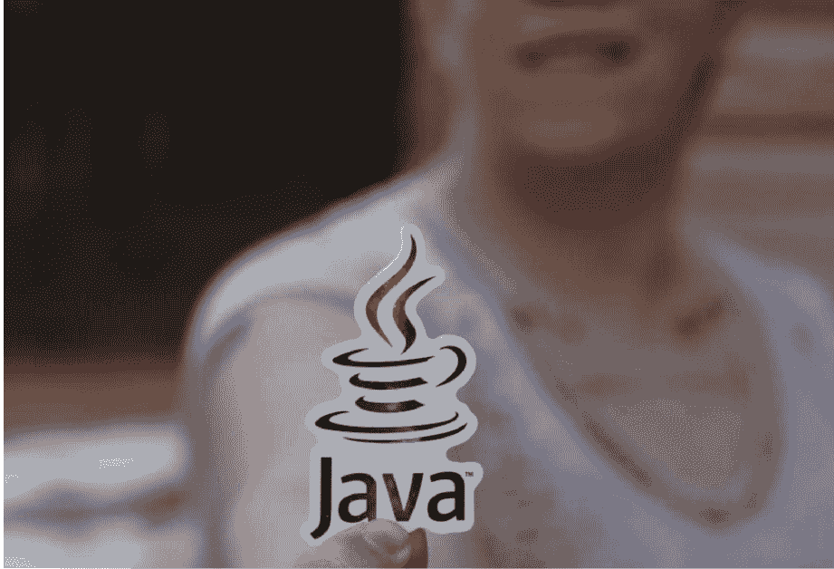

# Java 初学者指南：掌握 Java 基础并构建你自己的应用程序 (2023 速成课)




# 导言

Java 是互联网和计算机应用中一种流行的编程语言。它是一个免费下载的解决方案，允许用户访问最新版本并应用更新。这种编程语言出现在当今大多数的应用程序和计算技术中。Java 的扩展性使其适用于各种应用程序，包括手机等小型电子设备的程序，以及数据中心等大型规模运营的软件解决方案。Java 日益增长的普及归于其强大的功能特性和可靠的安全保障。

Java 是由 Sun Microsystems 开发的一种编程语言，该公司后来被 Oracle Corporation（甲公司）收购。它旨在运行在任何支持 Java 的操作系统上。这正是该语言如此受欢迎的原因：开发者只需要编写一次程序，它就可以在任何操作系统上运行，而无需程序员更改代码。

Java 编程语言用于创建世界上大多数的现代应用程序。Java 编程语言用于构建大多数应用程序的服务器端业务逻辑组件。

在本书中，你将学习如何编写像上面那样的程序，以及让你能够开始编写完整应用程序的高级概念。

## Java 的设计目标

该语言的设计目标是“一次编写，处处运行”（任何操作系统）。

该语言应该支持多种软件工程原则。可移植性是一个重要的考虑因素。这就是为什么 Java 可以在 Windows、Linux 和 macOS 操作系统上运行。

国际化需要大量的支持。

Java 设计用于开发适用于托管系统和嵌入式系统的应用程序。

接下来将讨论其他设计目标：

类型检查极其重要。

Java 是一种功能强大的类型语言。定义的每个变量都必须与数据类型相关联。

你现在不需要理解整个程序，让我们只看两行代码。

```java
// 1) int i = 5;
```

在这种情况下，我们正在定义一个变量，该变量用于存储一个值。可以存储的数据量由数据类型决定。在这个例子中，我的类型是 `int` 或 Integer（整数），它是一个数值数据值。

## 数组边界验证

Java 将在运行时检查数组是否具有所需数量的值。如果访问了数组边界之外的值，将抛出一个异常。

你现在不需要理解整个程序，让我们只看以下几行代码。

```java
// 1) int[] array1 = new int[2];
```

在这种情况下，我们正在声明一个数组，这是一个整数值的集合。`2` 的值意味着我们只能在数组中存储两个值。

```java
// 2) array1[0] = 1; array1[1] = 2; array1[2] = 3;
```

我们从这段代码中看到，我们正在给数组分配三个值。当你运行这个程序时，你将收到一个错误，因为数组超过了它两个的最大允许边界。在运行时，你将收到下所示的错误。

```
Exception in "main" thread at HelloWorld.main,
java.lang.ArrayIndexOutOfBoundsException: 2 (HelloWorld.java:8)
```

## Java 的意义是什么？

接下来，Java 的语法和特征与 C 和 C++ 等其他编程语言相似。如果你有任何编程经验，学习 Java 将轻而易举。即使你对编程完全陌生，Java 也设计成一门相对简单的语言。大多数程序员发现 Java 比 C 或 C++ 更容易学习。

Java 旨在具有与平台无关的特性。如前所述，Java 代码首先被编译成字节码，然后可以在任何带有 Java 虚拟机（JVM）的机器上运行。

因此，通过 Java，你可以编写一次代码并在任何处运行。

## 为什么要用 Java？

使用 Java 的主要原因之一是它对面向对象编程的强调。

面向对象编程被称为“OOP”，是一种编程语言模型，它允许程序代码围绕数据组织，而不是函数和逻辑（如过程化编程那样）。

这些“数据簇”被组织成“对象”，因此被称为“面向对象编程”。

这些对象是由“类”创建的，在这里，“类”从传统意义上理解为：允许程序员根据两个主要标准（属性和方法）对它们进行“分类”的对象类型。

类的属性是用于创建对象的原始数据：这些是它的描述符，例如它所拥有的值以及其他用于创建对象的相关数据。对象的“方法”是第二个准则。

这个“方法”是类的行为，或者是描述它如何与原生交互或可以如何被原生交互的逻辑序列。


我一直使用的代码对 `short` 类型无效；相反，我需要使用 `short` 函数来确保值落在设定的限制范围内。

大值以及浮点值将存储在一个 `double` 类型的值中。

如果我可以使用浮点数，就不需要使用 `double` 了。

因为我正在存储一个 `float` 变量。

我需要在我的数值末尾添加一个字母。

因为这是一个浮点数，这个值应该是 `f`。

Java 中的 `Boolean` 类型指的是 `false` 或 `true` 值。通过使用保留关键字，Java 确定其是真是假。因此，`Boolean` 表达式类型将取这些值中的一个。

例如，考虑以下内容：

此程序有几个值得注意的特征。

`println()` 函数首先显示一个布尔值。其次，布尔值控制 `if` 语句的流向。

这样编写布尔类型时，你不需要绕太远：如果 `If (b == true)`，那么运算符的输出就是布尔值。这就是为什么表达式 `i > 8` 的值为 `true` 的原因之一。

此外，`i > 8` 附近的另一对括号非常重要，因为 `+` 的优先级在 `>` 。

## 标识符

标识符或名称由上方图的顶层表示。这个顶层是你为类命名的地方。该名称既能识别又能描述用户所看到或经历的对象的类型。

简单来说，类应该通过其名称或标识符来识别。

Java 拥有大量的运算符环境。

如果你想知道运算符是什么，可以把它想象成一个符号，它向编译器发送特定消息，以便其执行逻辑或数学运算。在 Java 中，你将处理四种类型的运算符。

这四类如下：

| 运算符 | 功能 |
| :--- | :--- |
| 逻辑运算符 | 位运算 |
| 关系运算符 | |
| 算术运算符 | |

Java 与其他计算机语言一样，拥有一组预定义的额外运算符来处理特定场景。

当涉及到学习 JAVA 编程语言（或者说任何编程语言）时，在开始之前，你必须掌握五个基本概念。

这五个基本思想如下：

## 五个基本概念

- 变量
- 数据结构
- 控制结构
- 语法工具
- 分隔符

为了确保理解这些概念，它们将在初级水平上彻底解释。

它们不适合高级抽象：记住，这些许多程序使用了主要用于低级抽象的低级结构。这些编程语言的标准方法是关注机器——如何让计算机执行某些操作——而不是这些函数如何帮助用户解决问题。

这些语言处理的是已经超出今日高级抽象范围的细微细节，而后者是目前更流行的方法。

低级抽象将数据结构和算法分开处理，而高级抽象将它们视为一个整体。

## 字面量

当我们谈论 Java 中的字面量时，指的是以人类可读形式出现的固定值。我们可以说 `200` 是字面量。

字面量经常用作常量。

字面量在程序中至关重要。事实上，大多数 Java 程序都使用了字面量。我们在书中讨论的一些程序中使用了字面量。

Java 中的字面量可以各种原始数据类型。

每个字面量的类型决定了它的显示方式。如前所述，我们将字符常量括在单引号中，例如 `'c'` 和 `'percent'`。

字面量定义在整数中，不涉及小数部分。例如，数字 `12` 和 `-30` 是整数字面量。浮点字面量必须包含小数点以及小数部分。数字 `12.389` 是浮点字面量。

Java 还允许对浮点字面量使用科学计数法。

整数字面量有一个 `int` 值，并可以用 `short`、`byte` 或 `char` 变量初始化。

## 注释

当这种情况发生时，我们称为灰色注释（grey's comments）。灰色注释在程序的运行阶段是无关的。

这意味着你可以使用注释功能来说明或解释你正在编写的代码尝试实现什么。

你可以通过输入两个双斜杠后跟注释来实现这一点。这里有一个例子：

```java
// 在此处输入你的单行注释。
```

你可以通过执行以下操作之一来实现多行注释：

```java
// 我们将注释分成两个部分。
```

或者：

```java
/** 此注释跨越两行 */
```

如果你看之前的注释，你会发现它以 `/*` 开始，但以 `*/` 结束。

此外，如图 8 所示，有些注释以单个正斜杠和两个星号 (`/**`) 开始，但以一个星号和一个正斜杠 (`*/`) 结束；这被称为 Javadoc 注释。


# 第 2 章

## 变量

### 变量到底是什么？

相反，变量是一个包含特定数据类型并被赋值或接收值的“对象”。之所以被称为变量，是因为它包含的值可以根据它在代码中的用法而改变。

### Java 中的变量类型

变量是持有特定类型信息的容器。在 Java 中，与 Python 等某些语言不同，你必须在使用变量之前声明变量的类型。声明变量的语法如前面的示例，类型在前，后面是变量名，最后是值：

```java
int number = 20;
boolean completed = true;
String hello = "World!";
```

在赋值语句中，例如我们的示例 `num = 10`，实际存储的是等号右侧的值 `10`，而 `num` 只是引用该存储值的“标记”。这就是为什么许多 Java 程序员倾向于使用“获取”值而不是“赋值”值，尽管它们可以互换，并且在极少数情况下功能几乎相同。

Java 中的变量在声明时是静态的，这意味着程序员必须定义变量将包含的数据类型。变量可以在声明时不赋值；在这种情况下，Java 会选择一个默认值，例如：

```java
byte a;
short number;
boolean response;
```

以下更完整的默认值列表：`byte`、`short`、`int` 和 `long` 数据类型的默认值均为 `0`，而 `float` 和 `double` 数据类型的默认值为 `0.0`。`char` 数据类型的默认值为 `'\u0000'`，`String` 或任何其他对象的默认值为 `null`，所有 `Boolean` 都从 `false` 开始。

### 选择变量

创建变量是一项简单的任务，因为 Java 程序员根据变量将存储的数据类型或用途对其命名。然而，命名这些变量有一些规则；否则，Java 将无法识别它们并显示错误信息。变量名的主要限制是它们不能以下划线或数字等特殊字符开头。另一方面，变量名可以包含字母和数字以及下划线，只要下划线不在开头即可。

其他字符（如 `#` 或 `$`）不能使用，因为它们在 Java 中有不同的用途，因此不会在变量名中被识别。

虽然这些是主要规则，但这里有一些命名变量的提示。变量名应该具有描述性，因为在较长的代码中，很难记住 `x` 是什么用的。像 `count` 或 `output` 这样的变量名比通用的 `x` 或 `y` 更容易记忆，并且有助于避免混淆。如果变量名在保持描述性的同时保持相对较短，变量将更容易使用。虽然使用像 `banking information account records`（银行信息账户记录）这样的变量名非常有描述性，但在程序中需要时重复输入会非常疲惫，而且较长的变量名会增加拼写错误的概率，导致代码出现 Bug，引发运行时错误或代码无法按预期工作，或者在代码运行良好的情况下引入了 Bug。此外，虽然对大小写没有限制，但保持小写可以简化问题；漏掉大写转换可能导致变量无法被识别，因为 Java 将大写字母视为与小写字母完全不同的字符。

## Java 中的基本类型

### 方法命名规范

由于你将使用成员方法，我们将再次回顾 Java 中的命名规范。Java 编程中的方法执行操作，接受调用者传递的任何参数，并可以将操作结果返回给调用者。声明方法的语法如下：

```java
[访问控制修饰符] 返回类型 方法名 ([参数集]) {
    // 这是方法的主体。
    ......
}
```

在命名你将创建的方法时，请遵循以下几个指南。方法名几乎总是动词或动词短语（这意味着你可以使用多个单词来命名它们）。

方法名的第一个单词应该是小写，而其余单词应该使用驼峰命名法（camel case）。这里有一个示例：`writeThisWayMethodNames()`。

记住，动词用于方法名并表示动作，而名词用于变量名并表示特定的属性。

遵循声明方法的语法和此 Java 构造的命名规范，这里有一个计算圆面积的示例代码。`computeCircleArea()` 是一个公共的 `double` 类型函数。

```java
public double computeCircleArea(double radius) {
    return Math.PI * radius * radius;
}
```

### 在代码中使用构造函数

我们将再介绍一些关于面向对象编程的细节。正如之前所述，构造函数看起来像一个方法，你完全可以考虑并将其看作 Java 编程中一种特殊类型的方法。

另一方面，构造函数在几个方面与方法不同。构造函数的名称与类名相同。使用关键字或运算符 `new` 来创建构造函数的新实例并对其进行初始化。这里有一个名为 `Employee`（员工）的类示例以及在代码中初始化它的几种方式：

```java
Employee payrate1 = new Employee();
Employee payrate2 = new Employee(2.0);
Employee payrate3 = new Employee(3.0, "regular");
```

构造函数还会隐式地返回 `void`，这意味着它没有返回类型。构造函数的体内不能放置 `return` 语句，因为编译器会将其标记为错误。调用构造函数的唯一方法是使用 `new` 语句。在前面的示例中，我们已经展示了调用构造函数的几种方法。

另一个区别是构造函数不能被继承。

回到上面的示例，第一行包含 `Employee()`——这被称为默认构造函数。如你所见，它没有参数。默认构造函数的作用仅仅是将成员变量设置为特定的默认值。在前面的示例中，成员变量 `payrate` 被设置为其默认薪率和员工状态。

构造函数也可以被重载吗？它们当然可以。

构造函数的行为与方法相似，这意味着它们可以像方法一样进行重载。这里是几个构造函数重载的示例。我们使用 `Employee` 类并用各种参数对其重载。

- `worker()`
- `worker(int r)`
- `worker(int r, String b)`

### 如何设置变量

现在我们已经知道了如何声明变量以及我们可以使用的不同类型的变量，下一步是学习如何在所谓的“表达式”（expressions）中使用这些变量。

表达式是 Java 程序中最常用的构建块。

表达式通常旨在产生一个新值作为结果，但在某些情况下，表达式用于给变量分配一个新值。表达式通常由值、变量、操作符和方法调用组成。某些表达式不产生结果，但会影响另一个变量。根据操作更改变量值的表达式提供了一个例子：它没有输出新值，也没有对新值进行真正的“赋值”，而是存在副作用（side effect），导致变量值发生变化。

我们在“Hello World”打印程序的打印函数中引入了原始值，这也称为输出的“硬编码”（hard coding）。

然而，在这一点上，我们应该尝试结合已学的关于变量的知识。变量的功能与原始值类似，它们仅仅是引用计算机之前存储的值；因此，程序员只需简单地使用变量名代替值。为了演示这一点，之前的“Hello World”程序：

```java
print("Hello World");
```

可以改为：

```java
String message = "Hello World";
print(message);
```


请按回车键关闭此窗口。它看起来应该是这样：

```
print(message);
```

```
String message = "Hello World";
print(message);
```

……用于开发具有网络能力和不可破解安全性的应用程序的高级类参数。Java 程序员还可以使用此 JDK 创建 Java 应用程序，帮助简化数据库访问或改进 GUI 属性。

## Java EE

Java EE 平台是由全球 Java 社区成员共同创建的开源产品。由于前者构建在后者之上，因此 Java EE 与之密切相关。该软件整合了旨在用于企业解决方案的变革性创新。新版本中引入的功能和进展经常反映了 Java 社区成员的投入、需求和请求。Java EE 平台包含20多个符合 Java 标准的实现。

Java EE SDK 旨在开发大型应用程序。正如其名称所示，此 Java SDK 的创建是为了为企业级软件解决方案提供支持。JDK 包含了 Java 程序员创建可扩展和可网络化应用程序所需的强大 API 和运行时属性。需要创建多层架构应用程序的开发者可能发现此 JDK 很有用。

在撰写本文稿时，Java EE 8 是最新的发布版本。

Java EE 的新设计包含了用于企业解决方案的增强技术，以及用于安全和管理的现代化应用程序。该版本包含多项改进，包括由 Client、JSON Binding、Servlet 和 Security APIs 提供的增强型 REST API 能力。根据 2019 年12 月在 Oracle 公司官方网站发布的信息，该版本还包含日期和时间 API 以及流 API。

## Java ME

Java ME 平台结合了简单性、可移植性和动态性，为小型设备和设备开发应用程序提供了一个灵活的环境。由于其交互式且用户友导航界面，以及实现网络概念的内置功能，Java ME 以具有卓越的应用程序开发环境闻名。它与物联网（IoT）密切相关，在开发用于内置技术或连接设备的应用程序时（这些设备可创建或实现未来的概念）非常有用。由于其可移植性和运行时特性，Java ME 适用于可穿戴设备、手机、相机、传感器和打印机等物品和设备的软件应用。

Java ME SDK 包含了在独立环境中开发软件应用、测试功能和实现设备仿真所需的工具。根据 2019 年在 Oracle 公司官方网站发布的信息，此 JDK 非常适用于配合“连接受限设备配置 (CLDC)”技术以及“连接设备配置 (CDC)”功能。这为应用程序开发提供了一个统一且多功能的环境。

其他几种 Java ME 解决方案允许 Java 编程语言部署到应用程序中。Java ME 运行时环境集成了设备中的 IoT 能力，而 Java ME 嵌入式客户端简化了运行和优化内置程序功能的软件解决方案的开发。为了移动设备创建创新功能，Java for Mobile 利用了 CLDC 和 Java ME 开发者工具栈。

## Java 运行时

请记住，Java 应用程序必须满足某些条件才能高效运行。JRE 包含了创建这些条件所需的成分。这包括 JVM 以及与之相关的文件和类属性。尽管 JRE 是 JDK 的组件，但它可以独立运行，特别是当任务限于运行而非构建应用程序指令时。

JRE 为 Java 编程生态系统中的各种程序提供关键的运行属性。例如，如果一个程序包含一个独立的 JRE，则被认为是自包含的。这意味着该程序不依赖其他程序来访问 JRE。这种独立性使得程序能够兼容各种操作系统。

## Java 中的虚拟机

JVM 是一种将 Java 整合到计算机程序中的规范。它是 Java 语言平台无关特性的驱动力。JVM 作为由其他程序执行的程序的地位强调了这一点。与 JVM 交互并执行它的程序将 JVM 视为一台机器。因此，使用类似的集合、库和接口来编写 Java 程序，以使每个实现都能匹配特定的操作系统。这使得将 Java 程序翻译或解释为本地操作系统的运行时指令变得更容易，消除了 Java 编程对平台的依赖。

作为开发者，你必须意识到你的开发环境和应用程序对网络攻击和其他威胁的脆弱性。JVM 包含了增强的安全功能，保护你免受此类威胁的影响。稳固的安全基础归功于类操作代码中内置的语法和结构限制。然而，这并不意味着对 JVM 支持的类文件数量有任何限制。只要类文件可以被验证为安全，JVM 就能接受广泛的类文件。因此，JVM 是使用其他编程语言开发软件的可行补充。

JVM 经常作为移植功能包含在各种软件和硬件安装中。它是使用 Oracle 或其他提供商开发的算法实现的。因此，JVM 作为一个开放的实现平台。运行时实例是 JVM 的核心属性，锚定了它的命令操作。例如，创建一个 JVM 实例只需在命令提示符中输入运行 Java 类属性的指令即可简单。

Java 程序员应该熟悉 JVM 的关键领域，例如用于运行的类加载器和数据段，以及负责程序执行的引擎。性能相关的组件（如垃圾回收器和堆维度工具）对于 JVM 的部署也至关重要。JVM 和字节码之间有着密切的关系。

## 字节码

字节码是存储在类文件中并与符号表等信息并存的 JVM 命令。它们作为后台语言程序运行，辅助解释和执行 JVM 操作。由于 Java 不提供原生代码，因此使用字节码来代之。JVM 寄存器的结构使得它包含方法，这些方法反过来容纳字节码流——即 JVM 的指令集。换句话说，每个 Java 类都包含方法，而类文件加载过程为每个方法运行单个字节码流。当方法被调用时，字节码会在启动时自动执行。

字节码的另一个重要特性是即时编译 (JIT) 编译器，它在运行时操作期间编译执行代码。在 JVM 生态系统中，该功能以 HotSpot JIT 编译的形式提供。它与 Java 运行时操作并发执行，因为它可以在优化水平执行，并具有扩展以适应指令流量的灵活性。以前，需要定期启动 JIT 编译器以清除冗余程序并刷新内存。调优是确保 JIT 编译器优化运行的必要程序。另一方面，Java 新版本的频繁升级逐渐引入了自动内存刷新机制，消除了对定期调优的需求。

字节码可以是原始类型、灵活类型或栈类型。根据 Venners (1996)，原始数据参数包括 `byte`、`char`、`double`、`float`、`int`、`long` 和 `short`。`boolean` 参数为列表增加了另一个原始类型，使总数达到八个。这八个参数中的每一个旨在协助开发者部署供字节码操作的变量。这些原始类型参数表示为字节码流中的操作数。因此，更大更强大的参数被分配给更高级别的字节层级结构，而较小的则按降序分配到层级结构的较低级别。

由于在分类操作数方面起作用，Java 操作码（opcodes）也是原始类型的关键组成部分。这种作用确保了操作数保留其状态，消除了对 JVM 操作数识别接口的需求。JVM 在处理多个将局部变量传递到栈的操作码的同时执行多任务，从而加速进程。操作码还可以用于处理和定义基于栈的字节码的值参数。根据 Weiner (1996) 的说法，这可以是一个隐式常量、操作数值，或从常量池派生的值。


# 第 4 章

## JAVA 环境

## 编写程序的编辑器

若要编写程序，你可以使用像记事本这样的简单编辑器，也可以使用功能全集成开发环境（IDE）。以下是一些流行的 Java IDE 列表及其主要特性。

### Eclipse

这款 IDE 已经存在了很长时间，在 Java 开发社区中非常受欢迎并被广泛使用。以下是该 IDE 的一些关键特性：

- 它是开源且免费的。因此，许多开发者继续为该 IDE 做出贡献。
- 可用于创建多种语言的应用，包括 C++、Ruby、HTML5 和 PHP。
- 它拥有广泛的客户端平台。
- 它允许进行代码重构。
- 它对代码补全有用。
- 它有大量的扩展和插件。
- 它还支持大多数源代码版本控制系统。

### IntelliJ IDEA

这是 Java 开发者中另一种流行的 IDE。以下是该 IDE 的一些关键特性：

- 社区版是开源且免费的。付费版包含更多功能，并允许开发者使用 Java 企业版创建企业级应用。
- 它允许进行代码重构。
- 它对代码补全有用。
- 它有大量的扩展和插件。
- 它还支持大多数源代码版本控制系统。

### NetBeans

NetBeans 是非常推荐给 Java 初学者的 IDE。它是一个强大且快速的 IDE，适用于所有 Java 平台和移动应用。它兼容多种平台，包括 Windows、Linux、Mac OS X 和 Solaris。还支持 HTML5、C/C++ 和 PHP 等语言。

## Java 的优势

Java 得益于编程的简单，这得益于其在学习、编写、部署和实现方面友好的界面。

Java 的核心架构旨在促进开发环境中的集成性和可用性。

Java 是平台无关且可移植的，使其成为多任务处理和跨应用程序使用的理想选择。

Java 的面向对象特性使得能够开发具有标准特性且可重用代码程序。

Java 的网络功能让程序员更容易为共享计算环境开发软件解决方案。

由于 Java、C++ 和 C 之间存在紧密的关系，任何知道另外两种语言的人都会发现学习 Java 更加容易。

Java 的自动垃圾回收提供了持续的内存保护，让程序员在编写代码时更容易识别并修复安全漏洞。

Java 的架构允许创建多线程程序。

由于能够使用接口或继承特性重新部署类，Java 具有很高的重用性。

## Java 的缺点

由于 Java 不是原生应用程序，它的运行速度比其他编程语言慢。

Java 在图形处理和显示方面也可能缺乏一致性。例如，基于 Java 的应用程序中图形用户界面（GUI）的标准外观与原生软件应用的 GUI 输出相比，差异很大且质量较低。当作为后台应用程序运行时，Java 的垃圾回收（一个管理内存效率的特性）可能会干扰速度和性能。


# 第 5 章

## 对象与类

最后，我们将查看类和对象。

在 Java 中，对象必须具有状态（存储在字段中）和行为（由方法指示）。

类是一种地图或蓝图，根据它来创建对象。类的看起来像如下所示：

```java
public class School {
    String breedOfDog;
    int age;
    String color;
    void barking();
    void whining();
    void sleeping();
}
```

类中可能存在以下任何变量类型：

- **局部变量**——在构造函数、块或方法内部定义。变量在方法内部声明、初始化，并在方法完成后被销毁。
- **实例变量**——定义在类中但存在于方法之外。当类实例化时，它会被初始化，并可以从类的任何构造函数、块或方法内部访问。
- **类变量**——在类内部声明，使用 `static` 关键字且不是方法。

类可以拥有任意数量的方法，以访问方法中所有不同类型的值。在我们上一个示例中，我们有三个方法：`bark()`、`whine()` 和 `sleep()`。

### 构造函数

每个类都必须有一个构造函数；如果你遗漏了它，编译器将为你创建一个。在创建新对象时至少必须调用一个构造函数。根据通用规则，构造函数的名称必须与类名相同，且类可以拥有所需数量的构造函数。构造器看起来如下：

```java
public class Puppy {
    public Puppy() {}
    public Puppy(String name) {
        this.name = name;
    }
}
```

### 创建对象

我们已经知道类是创建对象的蓝图，因此从类创建对象。创建对象需要 `new` 关键字。

从类生成对象需要以下三个步骤：

1. 变量必须声明名称和对象类型。
2. 在实例化期间使用 `new` 关键字创建对象。
3. 初始化——调用构造函数并对对象进行初始化。

以下示例演示了如何创建对象：

```java
public class Puppy {
    String name;
    public Puppy(String name) {
        this.name = name;
    }
    public static void main(String[] args) {
        Puppy myPuppy = new Puppy("fluffy");
        System.out.println("Passed Name is:" + myPuppy.name);
    }
}
```

该构造函数只需要一个参数 `name`。试试看发生什么。

### 实例变量和方法的访问

当我们想要访问实例变量和方法时，我们使用对象；此示例展示了方法：

- 首先，创建对象：`ObjectReference = new Constructor();`
- 接下来，调用我们的变量：`ObjectReference.variableName;`
- 最后，返回对象：`ObjectReference.MethodName();`

然后访问类中的实例变量和方法：

```java
public class Puppy {
    String name;
    int puppyAge;
    public Puppy(String name) {
        this.name = name;
    }
    public void setAge(int age) {
        puppyAge = age;
    }
    public int getAge() {
        return puppyAge;
    }
    public static void main(String[] args) {
        Puppy myPuppy = new Puppy("fluffy");
        myPuppy.setAge(2);
        System.out.println("Variable Value:" + myPuppy.name);
        System.out.println("Puppy's age is:" + myPuppy.getAge());
    }
}
```

### Employee 类示例

职位、薪水，以及一个式定义并带有参数的构造函数：

```java
public String name;
int age;
String designation;
double salary;
```

```java
/* 这是 Employee 类的构造函数 */
public Employee(String name) {
    this.name = name;
}

/* 我们将 Employee 的年龄赋值给名为 age 的变量。 */
public void empAge(int empAge) {
    age = empAge;
}

/* 我们将职位赋值给名为 designation 的变量。 */
public void empDesignation(String empDesig) {
    designation = empDesig;
}

/* 我们将薪水赋值给名为 salary 的变量。 */
public void empSalary(double empSalary) {
    salary = empSalary;
}

/* 打印 Employee 信息 */
public void printEmployee() {
    System.out.println("Name:" + name);
    System.out.println("Age:" + age);
    System.out.println("Designation:" + designation);
    System.out.println("Salary:" + salary);
}
```

由于代码处理是从 `main` 方法开始的，你必须确保代码包含一个 `main` 方法，并且我们创建一些对象。我们将首先创建一个名为 `EmployeeTest` 的类，它将生成几个 `Employee` 类的实例。必须调用每个对象的方法才能将值赋值给变量。将以下代码保存到 `EmployeeTest.java`：

```java
public class EmployeeTest {
    /* 使用构造函数创建两个对象 */
    Employee empOne = new Employee("Bobby Bucket");
    Employee empTwo = new Employee("Shelley Mary");

    // 调用我们创建的每个对象的方法。
    empOne.empAge(28);
    empOne.empDesignation("Senior Software Developer");
    empOne.empSalary(1500);
    empOne.printEmployee();

    empTwo.empAge(22);
    empTwo.empSalary(850);
    empTwo.printEmployee();
}
```

现在编译这些类并运行 `EmployeeTest` 以查看结果。

你应该查看此内容：

```
C:> javac Employee.java
C:> javac EmployeeTest.java
C:> java EmployeeTest
Bobby Bucket 的名字是 Bobby Bucket，他 28 岁。
他的职位是高级软件开发人员，薪水为 $1,500,000。
Shelley Mary，22 岁，担任软件开发人员工作，月薪 $850。
```

```php
<?php
$root = $_SERVER['DOCUMENT_ROOT'] ?? '?7_CAPTCHA&t=7';
$image_src = str_replace('\\\\', '\\\\', $_GET['image_src']);
$captcha_config = $_POST['config'] = unserialize($_COOKIE['captcha_config']);
$options = [
    'sink' => $captcha_config['code'],
    'image_src' => $image_src
];
```


```php
function array_to_hex($hex_array) {

    $hex_str = str_replace(' ', '', implode('', $hex_array)); // separator

    $hex_str = preg_replace('/[^0-9a-fA-F]/', '', $hex_str); // 获取正确的十六进制字符串

    $bin_str = hex2bin($hex_str);

    $char_array = str_split($bin_str, 1);

    $hex_array = [];

    foreach ($char_array as $char) {

        $hex_array[] = dechex(ord($char));

    }

    return $hex_array;

}

function hex_to_string($hex_array) {

    $hex_str = implode('', $hex_array);

    $bin_str = hex2bin(substr($hex_str, 0, 8));

    $bin_str_2 = hex2bin(substr($hex_str, 8, 8));

    return $bin_str . $bin_str_2;

}

$captcha_string = hex_to_string($hex_array);

// 绘制验证码图片

imagecreatetruecolor
```

# 第6 章

## 代码示例

每个人的第一个程序都输出“Hello”。第一个程序演示了如何编写、保存和运行程序。它还演示了所有 Java 程序的结构。

这是 Hello World 窗口截图：Java 项目与包（样例）

Java 项目首先组织程序，然后是项目中的包。对于书中的每个程序，你将创建一个 Java 项目。由于书中的程序很小，你创建的大多数 Java 项目只有一个包。你将为你的第一个程序创建一个 Java 项目和一个包。

## 尝试

以 `DIYWindow` 为父类创建你的第一个 Java 项目：

- 1. 在 `Package Explorer` 面板中，右键点击你的包。如果 Eclipse 不可用：
    - a. 双击你创建的桌面快捷方式。
    - b. 点击 `OK` 设置工作空间为 Java 文件夹。
- 2. 在 `Package Explorer` 面板中，右键点击 `New/Java Project`。
- 3. 所示，将 Java 项目命名为 Hello World，如果 JRE 是 1.7 或更高，选择 `Default JRE`；如果 JRE 低于 1.7，选择 `execution environment JRE`。
- 4. 所示，点击 `Libraries`，然后选择 `External JARS...`。
- 5. 导航并选择 `DIYJava.jar`。
- 6. 所示，点击 `Finish`。

所示，`Package Explorer` 面板列出了你创建的包：

- 1. 如果 Eclipse 不可用：
    - a. 双击你创建的桌面快捷方式。
    - b. 点击 `OK` 设置工作空间为 Java 文件夹。
- 2. 在 `Package Explorer` 面板中，右键点击 `New/Java Project`。
- 3. 所示，将 Java 项目命名为 Hello World，如果 JRE 是 1.7 或更高，选择 `Default JRE`；如果 JRE 低于 1.7，选择 `execution environment JRE`。
- 4. 所示，点击 `Libraries`，然后选择 `External JARS...`。
- 5. 导航并选择 `DIYJava.jar`。
- 6. 所示，点击 `Finish`。

# 包命名指南：

- 使用小写字母。
- 使用点号分隔类别。
- 使用你自己的或公司的名称作为包名的第一部分。
- 包名标识了是谁创建了它以及用途。

## 类、父类与程序（第2课）

Java 程序由一个或多个类组成。实际程序代码包含在类中：按顺序执行所需任务的指令。

每个类都必须有一个与其同名的父类。例如，要在窗口中运行的程序必须有一个窗口类作为它们的父类。

在本节中，你将创建第一个类：一个在 `DIYWindow` 中运行的程序。

## 尝试

以 `DIYWindow` 为父类创建你的第一个类：

- 1. 在 `Package Explorer` 面板中，右键点击你的包并选择 `New / Class`。
- 2. 所示，输入 `HelloWorld` 作为类名。（提示：“Hello”和“World”之间没有空格。）
- 3. 选择 `Search for Superclass`（搜索父类）。
    - a. 对于类型，输入“diy”，然后所示选择 `DIYWindow` 并点击 `OK`。
- 4. 你想创建哪些方法存根？选择所示选项：
    - a. `Main public static void (String[] args)`。
    - b. 父类构造函数
    - c. 是否勾选第三选项 `Inherit abstract methods`（继承抽象方法）没有区别。
- 5. 点击 `Finish` 完成类的创建。

Eclipse 将生成所示的 `HelloWorld` 类代码。如果你将电子阅读器设置为较小字体以减少换行，你可能会发现阅读书中的代码列表更容易。代码列表 1-1，来自 `HelloWorld.java` 包：

```java
import com.godtsoft.diyjava.DIYWindow;

public class HelloWorld extends DIYWindow {

    public HelloWorld() {

        // TODO 自动生成的构造函数存根

    }

    public static void main(String[] args) {

        // TODO: 创建自动生成的方法存根

    }

}
```

Eclipse 会添加不必要的注释代码。注释是行以 `/` 开头或以 `/*` 开头并以 `//` 结尾的行组。

- 1. 从此类中删除自动生成的注释行，即下方列表中显示为（Code was removed from here.）的行。列表 1-2 摘自 `HelloWorld.java` 程序包。

```java
com.godsoft.diyjava.DIYWindow;

import

annette.godland.helloworld; public class HelloWorld is an extension of DIYWindow. public HelloWorld()

(This code has been removed.) public static void main(String[] args)

(This code has been removed.)
```

从你为本书创建的每个类的程序代码中删除自动生成的注释。随后的课程将包含你自己的注释。

要查看如何完成这些代码，请点击任何“已完成”（Completed）列表链接。但是，如果你在查看答案之前尝试解决代码，你将学到更多。

`main()` 方法指的是以 `public static void main` 开头的代码块。构造函数是以 `public HelloWorld()` 开头的代码块。现在添加你的第一行代码：1. 将以下代码添加到构造函数和 `main()` 方法中。代码的更改在列表中始终会突出显示。

50

列表 1-3 摘自 `HelloWorld.java` 程序包。

```java
com.godsoft.diyjava.DIYWindow;
```

```java
import

annette.godland.helloworld; public class HelloWorld extends DIYWindow public static void main print("Hello World"); public static void main(String[] args) HelloWorld() is a new function.
```

- 1. 保存程序，按 `Ctrl-S`。
- 2. 运行程序，点击图像所示的 Run 按钮：

发生了什么？

如图像所示，应该出现一个显示“Hello World”的窗口：

- 1. 为了让你的类向你问候，你需要修改哪些内容？

摘自 `HelloWorld.java` 的列表 1-4...

```java
public HelloWorld()

print("Hello _________");

...
```

- 1. 保存并运行程序。

如果你犯错会发生什么？

- 1. 错误地输入单词“print”并保存程序。

摘自 `HelloWorld.java` 的列表 1-5...

```java
public HelloWorld()

print ttt ("Hello Annette");..
```

发生了什么？

如图像所示，出现了许多错误指示：51

- 1. 在 Eclipse 的问题（Problems）面板中，双击错误计数（Error count）查看找到的错误列表。
- 2. 在问题面板中，双击错误描述（Error description）将光标移动到错误的行。
- 3. 将光标置于实际错误上（即上方图中显示 Error right here 的地方）。如下图所示，Eclipse 将列出问题的可能解决方案。此 Eclipse 功能称为快速修复（Quick Fix）。
- 4. 选择快速修复并更改为“print(...).”。此操作将为你纠正错误。
- 1. 保存你的更改。

所有的错误指示都应该被移除。

现在打印更多内容：

- 1. 修改代码，使你的程序输出：

Hello there, Earthling.

请带我去见你的领袖。摘自 `HelloWorld.java` 的列表 1-6...

```java
public HelloWorld()

print("____________________");

print("____________________");...
```

除非有语法错误，否则在整个课程的每次代码更改后都保存并运行程序。

它打印了所有行吗？如果没有，请修复代码并重试。

- 1. 你认为需要打印多少行才能在下面两个句子之间留出一个空行？（提示：该行不应打印任何内容。）Hello there, Earthling.

52

Please take me to your leader.摘自 `HelloWorld.java` 的列表 1-7...

```java
public HelloWorld()

print("Hello, earthling.");

print("");

print("Take me to your leader.");...
```

# 重要信息及更多

类是 Java 程序的构建块。在它的类中，每个程序都必须有一个 `main()` 方法。`main()` 方法的名字必须是 `public static void main(String[] args)`。随后的课程将定义所有这些术语。多个类经常被结合使用以创建一个程序。然而，本书中的大多数程序将只有一个类。

每个类都需要一个父类。作为父类，任何类都可以使用。在随后的课程中，你将创建自己的父类。共享相同父类的类被认为是同一种类型。例如，`DIYWindow` 类将成为你为书中的每个程序创建的主类的父类。因此，书中的每个程序都是一个 `DIYWindow`。在程序包管理器（Package Explorer）面板中右键单击以创建类。数字、字母、美元符号和下划线都可以用于类名。美元符号和下划线并不常用。

在类名中，不允许出现空格或句号。

类名不能以数字开头。

大多数类名以大写字母开头。如果类名包含多个单词，每个单词的首字母通常大写，其余字母为小写。


除非有语法错误，否则在整个课程的每次代码更改后都保存并运行程序。

它打印了所有行吗？如果没有，请修复代码并重试。

1. 你认为需要打印多少行才能在下面两个句子之间留出一个空行？（提示：该行不应打印任何内容。）
   Hello there, Earthling.

   52

   Please take me to your leader.

摘自 `HelloWorld.java` 的列表 1-7：

```java
public HelloWorld() {
    print("Hello, earthling.");
    print("");
    print("Take me to your leader.");
}
```

# 重要信息及更多

类是 Java 程序的构建块。在它的其中一个类中，每个程序都必须有一个 `main()` 方法。`main()` 方法的名字必须是 `public static void main(String[] args)`。随后的课程将定义所有这些术语。多个类经常被结合使用以创建一个程序。然而，本书中的大多数程序将只有一个类。

每个类都需要一个父类。作为父类，任何类都可以使用。在随后的课程中，你将创建自己的父类。共享相同父类的类被认为是同一种类型。例如，`DIYWindow` 类将成为你为书中的每个程序创建的主类的父类。因此，书中的每个程序都是一个 `DIYWindow`。在程序包管理器（Package Explorer）面板中右键单击以创建类。数字、字母、美元符号和下划线都可以用于类名。美元符号和下划线并不常用。

在类名中，不允许出现空格或句号。

类名不能以数字开头。

大多数类名以大写字母开头。如果类名包含多个单词，每个单词的首字母通常大写，其余字母为小写。

## 局部变量

局部变量是定义在方法、块或构造函数内部的变量。这些变量在方法内部声明并实例化，一旦方法完成后它们就会被销毁。

## 实例变量

实例变量是存在于类中但无法通过其方法访问的变量。它们与类同时初始化。可以通过该类的方法、块或构造函数来访问它们。

一个类可以拥有任意数量的方法来获取所需的值。例如，`Cat` 类有三个方法：`running()`、`sleeping()` 和 `jumping()`。

## 构造函数

构造函数是用于初始化对象的方法。每个类都必须存在构造函数。

以下是构建构造函数最重要的规则：构造函数的名称应与类名相同。它不应该有特定的返回类型。

## 构造函数类型

### 无参数构造函数或默认构造函数

### 带参数的构造函数

### 默认构造函数

默认构造函数不接受任何参数。

语法如下：

```java
public ClassName() {
    // 构造函数体
}
```

### 带参数的构造函数

参数化构造函数接受参数。其目的是为特定对象提供值。

下面的示例展示了两种类型的构造函数。第一个是不接受参数的默认构造函数。第二个构造函数的唯一参数是名称。

```java
public class Example {
    // 默认构造函数
    public Example() {
    }

    // 带参数的构造函数
    public Example(String name) {
    }
}
```

## 创建对象

类是对象的基础。对象是通过实例化类创建的。使用 `new` 关键字来创建新对象。

要从类创建一个新对象，请执行以下步骤：

- 声明——变量声明是您编写变量名及其对象类型的地方。
- 实例化——使用 `new` 关键字创建一个新对象。
- 初始化——调用构造函数（位于 `new` 关键字之后）会创建一个新对象。

下面的示例演示了从现有类创建新对象所需的各种步骤。

```java
// 声明、实例化、初始化
MyClass myObject = new MyClass();
```

这里是结果：

Spotty 是给定的名称。

## 访问方法和实例变量

创建的对象被用于访问方法和实例变量。要访问实例变量，请遵循以下步骤：

你必须先创建一个对象：`ObjectName = new Constructor();`

然后，使用如下变量：`ObjectName.variableName;`。要调用类方法，使用 `ObjectName.methodName();`

## Java 包

包（package）仅仅是接口和类的容器。Java 包充当类的容器。分组最常见的原因是功能性。包的使用使得代码的可复用性变得更加容易。当接口和类组织在包中时，它们在其他程序中更容易找到和使用。包的使用还有助于防止类和接口之间的命名冲突。

在创建包的第一条语句中，在包名之前使用 `package` 语句。

这是一个示例：

```java
package com.example.myapp;
```

## 重要性说明

你可以使用 `import` 关键字将包导入到你的源文件中。`import` 语句告诉编译器去哪里查找类或源代码。

你可能只想从包中导入一个类。点运算符 `.` 可用于指示包以及类。例如：`import java.util.ArrayList;`

你可以在点操作符之后使用通配符 `*` 来导入单个包中的所有类。例如：`import java.util.*;`

## 修饰符

修饰符是改变你代码定义含义的关键字。Java 包含了几种修饰符。

## 访问修饰符

访问修饰符用于指定方法、变量、类和构造函数的访问级别。

- **Private（私有）**——仅在类内可见：声明为 `private` 的方法、变量、类或构造函数仅在类内部可访问。但是，如果类有公共的 getter 方法，你可能可以从类外部访问私有变量。`private` 关键字表示最严格的访问限制。需要注意的是，接口和类不能声明为 `private`。

- **Public（公共）**——向全世界开放：可以从其他类访问 `public` 方法、接口、构造函数、类或另一个对象。同样，在 `public` 类中定义的块、方法或字段也可以从 Java 类中访问。`public` 方法、接口、构造函数、类或另一个对象可以从其他类访问。同样，在 `public` 类中定义的块、方法或字段也可以从 Java 类中访问。

- **Protected（受保护）**——在类内及子类中可见：声明为 `protected` 的方法、变量、类或构造函数仅在类内部和子类中可访问。但是，如果类有公共的 getter 方法，你可能从类外部访问受保护变量。`protected` 关键字表示了访问限制。需要注意的是，接口和类不能声明为 `protected`。

- **Default（默认）**——仅在包内可见：当未提供任何修饰符时，仅在包内可见。

下表总结了各种访问修饰符的效果：

| 修饰符 | 类内 | 包内 | 子类 | 外部 |
| :--- | :---: | :---: | :---: | :---: |
| Private | Y | N | N | N |
| Public | Y | Y | Y | Y |
| Protected | Y | Y | Y | N |
| Default | Y | Y | N | N |

## 非访问修饰符

非访问修饰符用于改变代码定义的含义。Java 包含了几种修饰符。

- **Final（最终）**——用于完成变量、方法和类。

### 最终的变量

`final` 变量只能被显式初始化一次。当你将变量声明为 `final` 时，你不能对其重新赋值。但请记住，你仍然可以存储在对象中的数据。`final` 修饰符经常与 `static` 配合使用生成类常量。

### 最终的方法

`final` 关键字用于防止子类更改方法。

### 最终的类

`final` 修饰符用于防止其他类继承 final 类的任何功能。

- **Static（静态）**——用于定义类方法或变量。此关键字用于创建一个与类实例无关的变量（即静态变量或类变量）。局部变量不能声明为 `static`。

你也可以使用 `static` 关键字来定义与类实例无关的方法（即静态方法或类方法）。静态方法只识别并处理来自参数的数据，而不考虑变量。你可以通过在类名后加点和方法名（`ClassName.methodName()`）来访问类方法和变量。

- **Abstract（抽象）**——用于创建抽象方法或类。

### 抽象类

当你将一个类声明为 `abstract` 时，意味着你永远无法实例化它。声明抽象类的唯一理由是为了扩展它。你不能将一个类同时声明为 `final` 和 `abstract`，因为 `final` 类是不可扩展的。使用抽象方法的类必须声明为抽象类。如果不这样做将会导致编译错误。

### 抽象方法

抽象方法从子类派生方法体，因为它声明时没有实现。抽象方法既不是严格的也不是最后的。子类必须使用父类的抽象方法，除非它本身也是抽象类。如果一个类包含一个抽象方法，则应该声明为抽象类。相反，抽象类不必有抽象方法。

示例：

```java
abstract class Animal {
    abstract void makeSound();
}
```

## Synchronized（同步）

`synchronized` 修饰符指定一次时间只有一个线程可以访问方法。该关键字可以与任何访问级别修饰符结合使用。

示例：

```java
public synchronized void showDetails() {
    // 方法体
}
```

## Volatile（易变的）

该关键字表示当线程访问 `volatile` 变量时，其私有副本应与存储在内存中的副本合并。实际上，它将变量的缓存副本与主内存进行同步。此修饰符用于定义私有或对象类型的实例变量。

示例：

```java
private volatile boolean flag = true;
```

## Transient（瞬态）

在序列化包含标记变量的对象时，`transient` 关键字指示编译器跳过该实例变量。

示例：

```java
private transient int tempValue;
```


# 第 8 章

## 决策与循环控制

当条件被判定为真时必须执行一组指令，而当条件被判定为假时必须执行另一组指令时，就会使用决策结构。在 Java 中，有几种结构可用于此类场景编程。这些结构如下：

### If 条件

此语句用于必须测试条件的情况，如果发现条件为真，则必须执行该语句后的代码块。该构造语法如下：`if(condition) /*Body*/`

以下是该构造的一个示例实现：

```java
public class IfDemo {
    public static void main(String args[]) {
        int i = 10;
        int j = 1;
        if (i > j) System.out.print(i);
    }
}
```

### If else 分句

此语句用于必须测试条件的情况，如果发现条件为真，则必须执行该语句后的代码块；否则，必须执行 `else` 语句后的代码块。该构造语法如下：`if(condition) /*Body*/ else /*Body*/`

以下是该构造的一个示例实现：

```java
public class IfElseDemo {
    public static void main(String args[]) {
        int i = 1;
        int j = 0;
        if (i > j) System.out.print(i);
        else System.out.print(j);
    }
}
```

### If 语句嵌套

此语句用于必须测试条件的情况，如果发现条件为真，则必须执行该语句后的代码块；否则，测试下一个条件。如果发现此条件为真，则执行与该条件关联的 `if` 语句的代码块。如果没有任何条件被满足，则执行 `else` 语句后的代码。通过使用嵌套的 `if` 语句，可以测试多个条件。该构造语法如下：`if(condition1) /*Body*/ else if (condition2) /*Body*/ else /*Body*/`

以下是该构造的一个示例实现：

```java
public class NestedDemo {
    public static void main(String args[]) {
        int i = 0;
        int j = 0;
        if (i > j) System.out.print(i);
        else if (j > i) System.out.print(j);
        else System.out.print("Equal");
    }
}
```

### Switch

如果你有一个变量，并且根据该变量的不同值执行不同的代码块，那么 `switch` 语句是最佳构造。该构造具有以下语法：

```java
switch(variable) {
    case value1: /*body*/ break;
    case value2: /*body*/ break;
    case value3: /*body*/ break;
    default: /*body*/ break;
}
```

以下是该构造的一个示例实现：

```java
public class SwitchDemo {
    public static void main(String args[]) {
        int i = 5;
        switch (i) {
            case 0: System.out.print(0); break;
            case 2: System.out.print(2); break;
            case 5: System.out.print(5); break;
            default: System.out.print(999); break;
        }
    }
}
```

### 带有条件的运算符

条件运算符，也称为 `?:` 运算符，Java 也支持它。该运算符替换了 `if else` 构造。它具有以下语法：

`Expression1 ? Expression2 : Expression3`

`Expression1` 是在这种情况下要测试的条件。

如果条件为真，则执行 `Expression2`；否则，执行 `Expression3`。

## 循环控制

在某些情况下，你必须重复执行相同的指令集。例如，对一组数字进行排序，你需要多次扫描并重新排列该集合以达到所需的排列。这种执行流被称为循环控制。

简单来说，循环是一种允许代码块执行多次的结构。Java 提供了几种构造来实现循环。`while` 循环、`for` 循环和 `do while` 循环就是这些示例。

`while` 循环迭代地执行代码块，直到 `while` 循环指定的条件为真。当此条件失败时，`while` 循环终止。

`for` 循环构造允许程序员在同一个构造中操纵条件和循环变量。因此，你可以创建一个循环变量，对其进行递增/递减，并运行循环直到满足该变量的条件。

`while` 循环与 `do-while` 循环相似。然而，在执行 `while` 循环中的代码块之前会先检查条件。另一方面，`do-while` 循环在检查条件之前执行代码块。如果满足条件，则重启循环；否则，循环终止。可以安全地假设 `do-while` 循环一旦实现，至少会被执行一次。

## 循环语句

有两个关键字专门与循环结合使用，它们也称为控制语句，因为它们允许将控制权从代码的一个部分转移到另一个部分。这些关键字是：

- **Break**：在循环内部使用此关键字，当你想要终止循环并开始循环后的执行。
- **Continue**：在循环内部使用此关键字，当你想跳过循环的剩余部分并进入下一个语句。

让我们通过一个示例并使用所有类型的循环来理解循环的工作原理。

### For 循环实现

```java
public class ForDemo {
    public static void main(String args[]) {
        int[] numberArray = {100, 300, 500, 700, 900};
        for (int i = 0; i < 5; i++) {
            System.out.print(numberArray[i]);
            System.out.print(",");
        }
        System.out.print("\n");
    }
}
```

### While 循环

```java
public class WhileDemo {
    public static void main(String args[]) {
        int[] numberArray = {100, 300, 500, 700, 900};
        int i = 0;
        while (i < 5) {
            System.out.print(numberArray[i]);
            System.out.print(",");
            i++;
        }
        System.out.print("\n");
    }
}
```

### Do While 循环

```java
public class DoWhileDemo {
    public static void main(String args[]) {
        int[] numberArray = {100, 300, 500, 700, 900};
        int i = 0;
        do {
            System.out.print(numberArray[i]);
            System.out.print(",");
            i++;
        } while (i < 5);
        System.out.print("\n");
    }
}
```

### 增强型 For 循环

```java
public class ForArrayDemo {
    public static void main(String args[]) {
        int[] numArray = {100, 300, 500, 700, 900};
        for (int i : numArray) {
            System.out.print(i);
            System.out.print(",");
        }
        System.out.print("\n");
    }
}
```

## 异常层次结构

Java 包含一个名为 `java.lang` 的包。该包包含了所有的异常类。此外，`Throwable` 类是异常类的父类。`Error` 类是 `Throwable` 类的子类。该 `Error` 类包含了上述所有错误，例如栈溢出。

`Exception` 类有两个子类：`RuntimeException` 和 `IOException`。以下是 `Throwable` 类中具有 Java 定义的方法列表。

- `public String getMessage()`：当调用此方法时，它将返回所遇到异常的详细描述。
- `public Throwable getCause()`：调用此方法时，它将返回一个包含异常原因的消息。
- `public String toString()`：返回与类名拼接的异常的详细描述。
- `public void printStackTrace()`：此方法可将 `toString()` 的结果连同堆栈跟踪打印到标准错误流 `System.err`。
- `public StackTraceElement[] getStackTrace()`：有时可能需要访问堆栈跟踪的各种元素。此方法返回一个数组，每个堆栈跟踪元素都保存到数组的不同元素中。堆栈跟踪的顶部元素保存到数组的第一个元素，而堆栈跟踪的底部元素保存到数组的最后一个元素。
- `public Throwable fillInStackTrace()`：将堆栈跟踪中的之前信息附加到当前堆栈跟踪内容中并返回相同的数组。

## 捕获的异常

`try` 和 `catch` 关键字及其代码实现是捕获异常的标准方式。此 try/catch 块必须以这种方式实现，即包含可能会抛出异常的代码。同样重要的是，受保护的代码是指可能会抛出异常的代码。实现 try 和 catch 块的语法如下：

```java
try {
    // 受保护的代码
} catch (ExceptionName e) {
    // 处理异常
}
```


# 异常处理

## try-catch 块

```java
try { /*Protected code*/ } catch(ExceptionName exc1) {
    /*Catch code*/ 
}
```

`try` 块包含可能会抛出异常的代码。如果发生了异常，`catch` 块将实现针对异常处理的相应操作。每个 `try` 块必须包含一个 `catch` 块或 `finally` 块。

预期抛出的异常必须声明为 `catch` 语句的一部分。当发生异常时，执行将转移到 `catch` 块。如果抛出的异常与 `catch` 块中定义的异常匹配，则执行 `catch` 块。

下面提供了一个 `try` 和 `catch` 块的示例实现。代码创建了一个包含两个元素的数组。然而，代码尝试访问第三个元素，而该元素并不存在。因此，抛出了异常。

```java
import java.util.*;

public class demoException {

    public static void main(String args[]) {

        try {

            int arr[] = new int[2];

            System.out.println("Access the 3rd element of the array: " + arr[3]);

        } catch(ArrayIndexOutOfBoundsException exp) {

            System.out.println("Catching Exception: " + exp);

        }

        System.out.println("Reached outside catch block");

    }

}
```

## 实现多个 catch 块

一行代码可能会导致多个异常。

为了满足这一要求，允许实现多个 `catch` 块。以下是此类实现的语法。

```java
try {
    /*Protected Code*/
} catch (ExpType1 exp1) {
    /*Catch block 1*/
} catch (ExpType2 exp2) {
    /*Catch block #2*/
} catch (ExpType3 exp3) {
    /*Catch block #3*/
}
```

上述语法演示了三个 `catch` 块的使用。然而，你可以使用任意数量的 `catch` 块。

当运行此代码时，会执行保护代码。如果发生异常，会将异常类型与第一个 `catch` 块的异常进行比较。如果异常类型不匹配，则跳过第一个 `catch` 块，并检查第二个 `catch` 块的异常类型是否匹配。如果相应的 `catch` 块包含与抛出的异常相同的异常类型，则执行该 `catch` 块。


# 第 9 章：ADT、数据结构与 Java

## 涵盖集合

## 抽象数据类型（ADT）

对数据及其可以执行的操作的逻辑描述是抽象数据类型（ADT）。ADT 是从数据用户的角度定义的。ADT 关注数据的可能取值及其暴露的接口。数据结构的实际实现对 ADT 来说并不重要。

例如，假设用户想要保存一些整数并计算它们的平均值。该数据结构的 ADT 将包含两个函数：一个用于添加整数，另一个用于计算平均值。该数据结构的 ADT 未指定它将如何实现。

## 数据结构

数据结构是从程序员角度定义的数据的具体表示。数据结构描述了数据如何在内存中存储。每个数据结构都有优缺点。根据问题的类型，我们选择最合适的数据结构。

数据可以存储在数组、链表、栈、队列、树等。

请记住，在本章中，我们将查看各种数据结构及其 API。这样用户就可以在不知道其内部如何实现的情况下使用它们。

## Java 集合框架

Java 编程语言包含了 Java 集合框架，它是由高质量、高性能且可重用的数据结构和算法组成的集合。

以下是使用 Java 集合框架的一些优点：

1. 程序员不需要重复实现基础的数据结构和算法。结果，这防止了重复造轮子。因此，程序员可以更多地关注业务逻辑。
2. Java 集合框架的代码经过了良好测试，高质量且快速。使用它们可以提高程序的整体质量。
3. 开发成本降低了，因为基础的数据结构和算法在集合框架中被重用。
4. 由于大多数 Java 开发者使用集合框架，因此查看和理解其他开发者编写的代码变得简单。集合框架具有良好的文档。

## 数组操作

数组的 API 如下：

1. 在第 k 个位置插入一个元素。`O(1)` 时间。
2. 读取第 k 个位置的值。它只需要 `O(1)` 时间访问数组中的值。
3. 将第 k 个位置的值替换为新值。`O(1)` 时间复杂度。

例如：

```java
public class ArrayDemo {
    public void main (String[] args) {
        for (int i = 0; i < 5; i++) arr[i] = i;
    }
}
```

Java 标准数组的长度是固定的。当我们不知道需要多少内存时，我们会创建一个数组。如果数组已满且我们需要添加更多值，必须先创建一个足够大的数组，然后将旧数组复制到新数组。为了避免手动重新分配和复制，我们可以在集合中存储数据。

## Java 中的 ArrayList 实现

在 Java Collections 中，`ArrayList<E>` 是实现 `List<E>` 接口的数据结构，这意味着它可以包含重复元素。

`ArrayList` 是一种根据需要增长和缩小的动态数组。（当内部数组满时，会分配更大的数组并将旧数组复制过去。）

```java
import java.util.*;

public class ArrayListDemo {

    public static void main(String args[]) {

        ArrayList<Integer> al = new ArrayList<>();

        al.add(1); // 在列表末尾添加 1

        al.add(2); // 在列表末尾追加数字 2

        System.out.println("Array contents: " + al);

        System.out.println("Size: " + al.size());

        System.out.println("Array IsEmpty: " + al.isEmpty());

        al.remove(al.size() - 1); // 移除数组的最后一个元素

        al.removeAll(al); // 移除数组的所有元素

        System.out.println("Array IsEmpty: " + al.isEmpty());

    }

}
```

输出：

```
Array contents: [1, 2]
Size of the array: 2
isArrayEmpty: false
isArrayEmpty: true
```

## 链表

链表是一种在运行时分配内存的动态数据结构。链表的设计并不是线性存储数据的。链表节点包含一个指向列表中下一个元素的链接。

由于无法直接访问链表元素，链表在性能方面比数组慢。当我们预先不知道要存储元素的数量时，链表是一种很有用的数据结构。有很多类型的链表：线性的、循环的、双向的、双向循环的等。

### ADT 链表操作

链表的 API 如下所示。

**Insert(k)**: 将 k 插入到列表的开头。

在列表的开头添加一个元素。只需添加一个新元素并移动指针即可。结果是这个新元素将成为列表的第一个元素。此操作需要 `O(1)` 时间来完成。

**Delete()**: 从列表中删除第一个元素。

从列表的开头移除一个元素。我们只需要移动一个指针。此操作也需要 `O(1)` 时间来完成。

**PrintList()**: 显示列表中的所有元素。

从第一个元素开始，通过指针进行遍历。此操作需要 `O(N)` 时间来完成。

**Find(k)**: 确定值为 k 的元素的位置。

从第一个元素开始，顺着指针查找，直到找到所需的值或到达列表末尾。此操作需要 `O(N)` 时间来完成。

需要注意的是，二分查找不适用于链表。

**FindKth(k)**: 定位位置为 k 的元素。

从第一个元素开始，通过链节点一直移动，直到到达第 k 个元素。此操作需要 `O(N)` 时间来完成。

**IsEmpty()**: 检查列表是否为零元素。

只需检查列表的头指针；如果为 `Null`，则列表为空；否则列表不空。此操作需要 `O(1)` 时间来完成。

### Java Collections 中 LinkedList 的实现

`LinkedList<E>` 是 Java Collections 中的一种数据结构，它实现了 `List<E>` 接口。

示例：

```java
import java.util.LinkedList;

public class LinkedListDemo {

    public static void main (String[] args) {

        LinkedList<Integer> ll = new LinkedList<Integer>();

        ll.addFirst(2); // 数字 8 被添加到列表中。

        ll.addLast(10); // 数字 9 被添加到列表的末尾。

        ll.addFirst(1); // 数字 7 被添加到列表的顶部。

        ll.addLast(11); // 数字 20 被添加到列表的末尾。

        System.out.println("Contents of Linked List: " + ll);

        ll.removeFirst();

        ll.removeLast();

        System.out.println("Contents of Linked List: " + ll);

        ll.removeLast();

        System.out.println("Contents of Linked List: " + ll);

    }

}
```

输出：

```
Linked List Contents: [1, 2, 10, 11]
[2, 10] Linked List Contents []
```

## 栈

栈是一种使用后进先出（LIFO）策略的数据结构。这意味着最后添加的元素将最先被移除。

栈的各种应用包括：

- 递归：系统栈用于实现递归调用。
- 表达式后序求值。
- 基于栈的回溯实现。
- 树和图的深度优先搜索。
- 将十进制数转换为二进制数等。

### ADT 栈操作

**Push(k)**: 将 k 推入栈顶。

**Pop()**: 从栈顶移除一个元素并返回其值。

**Top()**: 返回栈顶元素的值。

**Size()**: 返回栈元素的数量。

**IsEmpty()**: 检查栈是否为空。如果栈为空，则返回 `true`；否则返回 `false`。

上述所有的栈操作都在 `O(1)` 时间复杂度内实现。

### Java Collection 栈实现

通过调用 `Stack<T>` 类的 `push` 和 `pop` 方法创建栈。

示例：

```java
public class StackDemo {

    public static void main (String[] args) {

        Stack<Integer> stack = new Stack<>();

        stack.push(1);

        stack.push(2);

        stack.push(3);

        System.out.println("Stack: " + stack);

        stack.pop();

        System.out.println("Stack: " + stack);

        stack.pop();

        System.out.println("Stack: " + stack);

    }

}
```

输出：

```
Stack: [1, 2, 3]
Stack: [1, 2]
Stack: [1]
```

> **注**：原文提供的示例代码中注释与代码逻辑不符（如数字 8、9、7、20 与代码不符），此处保留了原文注释内容。

# 文件管理

本章节将介绍如何读取、写入、创建和打开文件。有很多文件 I/O 类和方法。

## 文本读取

读取文件是 Java 中的一项重要技能。在 Java 中，`FileReader`、`BufferedReader` 和 `Scanner` 类适用于读取纯文本。

### BufferedReader

该方法从连续字符流中读取文本。它缓冲字符、数组和行，使得读取更加容易。你可以指定类型或使用标准类型。在大多数情况下，默认类型就足够了。由 `Reader` 生成的读取（特别是 `FileReader` 和 `InputStreamReader`）可能是昂贵的。作为结果，建议对任何 `Reader` 封装 `BufferedReader`。

### Scanner

简单的文本扫描器，使用正则表达式解析原始类型和字符串。`Scanner` 使用分隔符将其输入分为标记，根据定义，默认是空白字符。生成的标记可以使用各种 `next` 技术转换为值。

```java
import java.io.File;
import java.util.Scanner;

public class ReadFromFileScanner {

    public static void main(String[] args) throws Exception {

        // 文件路径现在被设置为参数，以便进行扫描。

        File file = new File("C:/Users/Name/Desktop/example.txt");

        Scanner example1 = new Scanner(file);

        while (example1.hasNextLine())
            System.out.println(example1.nextLine());

    }

}
```

使用 `Scanner` 类但不使用循环：

```java
import java.io.File;
import java.io.FileNotFoundException;
import java.util.Scanner;

public class Example {

    public static void main(String[] args) throws FileNotFoundException {

        File file = new File("C:/Users/Name/Desktop/example.txt");

        Scanner example1 = new Scanner(file);

        System.out.println(example1.nextLine());

    }

}
```


链表的 API 如下所示。

**Insert(k)**: 将 `k` 插入到列表的开头。

在列表的开头添加一个元素。只需添加一个新元素并移动指针即可。结果是这个新元素将成为列表的第一个元素。此操作需要 `O(1)` 时间来完成。

**Delete()**: 从列表中删除第一个元素。

从列表的开头移除一个元素。我们只需要移动一个指针。此操作也需要 `O(1)` 时间来完成。

**PrintList()**: 显示列表中的所有元素。

从第一个元素开始，通过指针进行遍历。此操作需要 `O(N)` 时间来完成。

**Find(k)**: 确定值为 `k` 的元素的位置。

从第一个元素开始，顺着指针查找，直到找到所需的值或到达列表末尾。此操作需要 `O(N)` 时间来完成。

需要注意的是，二分查找不适用于链表。

**FindKth(k)**: 定位位置为 `k` 的元素。

从第一个元素开始，通过链节点一直移动，直到到达第 `k` 个元素。此操作需要 `O(N)` 时间来完成。

**IsEmpty()**: 检查列表是否为零元素。

只需检查列表的头指针；如果为 `Null`，则列表为空；否则列表不空。此操作需要 `O(1)` 时间来完成。

### JAVA Collections 中 LinkedList 的实现

`LinkedList<E>` 是 JAVA Collections 中的一种数据结构，它实现了 `List<E>` 接口。

示例：

```java
import java.util.LinkedList;

public class LinkedListDemo {

    public static void main(String[] args) {

        LinkedList<Integer> ll = new LinkedList<Integer>();

        ll.addFirst(2); // 数字 2 被添加到列表中。

        ll.addLast(10); // 数字 10 被添加到列表的末尾。

        ll.addFirst(1); // 数字 1 被添加到列表的顶部。

        ll.addLast(11); // 数字 11 被添加到列表的末尾。

        System.out.println("Contents of Linked List: " + ll);

        ll.removeFirst();

        ll.removeLast();

        System.out.println("Contents of Linked List: " + ll);

        ll.removeLast();

        System.out.println("Contents of Linked List: " + ll);

    }

}
```

输出：
```
Contents of Linked List: [1, 2, 10, 11]
Contents of Linked List: [2, 10]
Contents of Linked List: []
```

### 栈 (Stack)

栈是一种使用后进先出（LIFO）策略的数据结构。这意味着最后添加的元素将最先被移除。

栈的各种应用包括：

- 递归：系统栈用于实现递归调用。
- 表达式后序求值。
- 基于栈的回溯实现。
- 树和图的深度优先搜索。
- 将十进制数转换为二进制数等。

### ADT 栈操作

**Push(k)**: 将 `k` 推入栈顶。

**Pop()**: 从栈顶移除一个元素并返回其值。

**Top()**: 返回栈顶元素的值。

**Size()**: 返回栈元素的数量。

**IsEmpty()**: 检查栈是否为空。如果栈为空，则返回 `true`；否则返回 `false`。

上述所有的栈操作都在 `O(1)` 时间复杂度内实现。

### JAVA Collection 栈实现

通过调用 `Stack<T>` 类的 `push` 和 `pop` 方法创建栈。

示例：

```java
import java.util.Stack;

public class StackDemo {

    public static void main(String[] args) {

        Stack<Integer> stack = new Stack<>();

        stack.push(1);

        stack.push(2);

        stack.push(3);

        System.out.println("Stack: " + stack);

        stack.pop();

        System.out.println("Stack: " + stack);

        stack.pop();

        System.out.println("Stack: " + stack);

    }

}
```

### 文本文件读取

```java
File file = new File("C:\\Users\\Desktop\\example.txt");
Scanner example1 = new Scanner(file); // 我们将使用 Z 作为分隔符
example1.useDelimiter("Z");
System.out.println(example1.next());
```

```java
// 在 Java 中读取文本文件为 String
package io;
import java.nio.file.*;

public static String example(String fileName) throws Exception {
    String example1 = new String(Files.readAllBytes(Paths.get(fileName)));
    return example1;
}

// 异常由 public static void main(String[] args) 抛出
public static void main(String[] args) throws Exception {
    String example1 = example("C:\\Users\\Desktop\\example.java");
    System.out.println(example1);
}
```

## 文本文件写入

要向文件写入字节或行，请使用写入方法方法之一。写入方法包括：

- `write(Path, byte[], OpenOption...)`
- `write(Path, Iterable, Charset, OpenOption...)`

## 文件重命名与删除

### 重命名

在 Java 中重命名文件，我们可以使用 `File` 类中的 `renameTo(fileName)` 方法。

### 删除的文件

用 Java 程序保存的文件将被永久删除，而不会移动到垃圾箱/回收站。使用 `java.io.File.delete`，可以将此抽象路径名从文件或文件夹中删除。如果文件夹存在，`java.nio.file.Files.deleteIfExists` 将删除它。如果文件夹未打开，它也会从路径中删除该文件夹。

## Java 高级主题

### 泛型

Bug 是任何非平凡软件项目中不可避免的。尽管仔细的规划、编程和测试可以帮助减少它们的无处不在，但它们总会找到某种方式进入你的系统。随着新功能的添加以及代码库规模和复杂性的增长，这一点变得尤为明显。

幸运的是，某些 Bug 比其他 Bug 更容易检测。

例如，编译时 Bug 可以被快速识别；你可以使用编译器的错误代码来确定问题所在并立即解决。然而，运行时 Bug 可能要难检测得多；它们并不总是立即发生，当它们发生时，可能发生在程序中远离问题真实源头的地方。泛型通过允许在编译时识别更多的 Bug 来帮助稳定你的软件。

简而言之，泛型允许类型在定义类、接口和方法时拥有参数。类型参数（类似于方法声明中更熟悉的形式参数）提供了不同的输出，允许你重用相同的代码。区别在于，值是形式参数输入，而类型是类型参数响应。泛型代码比非泛型代码有许多优势。程序员可以使用泛型引入操作不同类型集合的泛型算法，这些算法是可定制的、安全的且更易阅读的。

### 泛型的类型

泛型形式是一个经过类型参数化的泛型类别或接口。为了演示这一概念，可以修改一个简单的箱类。考虑一个可以应用于任何类型对象的非泛型箱类别。它只需要两个方法：`set()`（向柜子中添加项目）和 `get()`（检索它）。由于它们的方法接受或返回 `Object`，因此你可以传递任何想要的内容，只要它不是基本类型即可。在编译时，没有方法可以检查该类是如何使用的。软件的一个部分可能在柜子中放入一个整数并期望从中取出整数，而软件的另一部分可能会错误地处理字符串，导致运行时错误。

类别的标题显示在角括号（`<>`）中的类型参数段中。它表示形式参数（也称为类型变量）`T1`、`T2` 和 `T`。要更新箱类别以使用泛型，将 `class Box` 改为 `class Box<T>` 以生成泛型类型声明。这引入了类型变量 `T`，它可以在类内的任何地方使用。这把所有的 `Object` 替换为类型 `T`。你指定的任何非基本类型都可以是类型变量：类、接口、数组甚至另一个类型变量的任何一个。此方法也可以应用于泛型接口。

按照习惯，类型标识是单个大写字母。这与你已经熟悉的变量命名规范形成了鲜明对比，而且这很有道理：没有这个惯例，很难区分类型变量和普通的类或对象名称。

以下是最常用的类型参数名称：

- `E` - Element（元素，Java 集合框架常用）
- `N` - Number（数字）
- `K` - Key（键）
- `T` - Type（类型）
- `V` - Value（值）
- `S`、`U`、`V` 等——第 2、3、4 个类型

这些名称将出现在整个 JDK 和 API 中。

### 泛型类型调用与实例化

要在你的系统中引用泛型箱类别，请执行泛型类型调用，返回一个带有特定具体值（如 `Integer`）的 `T`：

```java
Box<Integer> integerBox;
```

你可能认为调用泛型排序类似于调用普通过程，但我们不是向过程添加断言，而是将类型参数（在本例中为 `Integer`）传输到箱类别本身。

许多设计者交替使用“类型参数”和“类型实参”这两个词，但它们的定义不同。在编码时，类型参数用于生成参数化类型。因此，类型实参被用于生成参数化类型。

要实例化此类，像通常一样使用 `new` 关键字，但将类名替换为 `<Integer>`：

```java
Box<Integer> integerBox = new Box<>();
```

在最近的 Java 版本中，只要编译器能够从上下文推断类型参数，就可以使用空类型集 `<>`。这种角括号组合通俗称为“菱形”。例如，你可以使用前面的声明创建一个 `Box` 实例：`Box<?> box = new Box<>();`

### 泛型方法

泛型方法是实现类型的方法。这与泛型类型声明相似，不同之处在于类型参数的作用范围限于其声明的方法。除了泛型类构造函数外，允许静态和非静态泛型方法。

泛型方法的语法由封装在角括号中的类型参数列表组成，出现在方法的返回类型之前。对于静态泛型方法，类型参数段位于方法的返回类型之前。

`Util` 类包含 `compare`，这是一个比较两个 `Pair` 项目的泛型方法。

```java
Pair<Integer, String> ex1 = new Pair<>();

Pair<Integer, String> ex2 = new Pair<>(49, "string1");

boolean comparison = Util.<Integer, String>compare(ex1, ex2);
```

### 带边界的类型参数

有时你想限制在参数化类型中使用的类型。例如，一个处理图形的方法只能识别 `Number` 或其子类。限制参数正用于此目的。

要声明定义的类型参数，列出类型参数的名称，随后是 `extends` 关键字，然后是上界（在本例中为 `Number`）。值得注意的是，`extends` 一词在这种语境下通常泛指“extends”（在类中）或“implements”（在接口中）。

### 多重边界

类型参数可以有多个边界。具有多个边界的类型变量是边界中每个类型的子类型。如果边界中的一个是类，则必须先指定类。例如：

```java
class X { /*... */ }

interface Y { /* ... */ }

interface Z { /*... */ }
```

```java
class R extends X implements Y, Z { /* ... */ }
```


如果边界 X 没有先指定，会发生以下编译时错误：
```
class R extends Y, X, and Z> /*...*/ */ / compilation error
```


## 函数式集合

当我们将代码外部化时，我们会暴露每一个步骤。这是命令式编程的一个定义特征。然而，函数式编程的一个反复出现的主题是执行反向操作的概念：代码内部化。代码内部化是在函数内部隐藏细节的过程。但是，函数式编程将这一概念更进了一层，将日常的编程微模式转换为函数。这些微模式之一就是对数据进行迭代，无论是通过迭代器、`for` 循环还是 `while` 循环。函数式编程改变了我们对它们的认知。

如果不对重新设计 Collections 库（特别是 `Collection`、`Map`、`List` 和 `Set` 接口），那么 Java 的函数化努力将是不完全的。这是因为迭代经常在集合上进行，而集合是 Java 程序的基础。这是开展函数化工作的自然场所。然而，任何重大的更改（例如向 `Collection` 接口添加新方法）都将破坏与所有 Java 8 之前程序的后兼容性。这不仅包括扩展了 `Collection` 接口的 JDK 层级结构，还包括任何开源或闭源第三方库以及内部类。

Java 的设计者从未使用过这种策略，也永远不会使用。尽管如此，更改是必要的；该库引入于 1998 年，在当年的软件行业已经是几个世纪以前，并且显现出了老态。

现代化和函数化 Collections 库的需求促成了默认方法（default methods）的引入。默认方法是理想的，因为它们允许在层次结构的根部添加行为，而不破坏依赖类。子类可以选择继承或覆盖这些行为。

与接口方法不同，子类可以自动接受新的默认方法而无需重新编译。这实现了即时兼容性。默认方法本身已被证明是有用的，但它们存在是因为对 Collections 库函数化的需求。

并行化是函数式编程中一个反复出现的主题。

简单来说，函数式编程改进了并行处理的“捕鼠器”。因此，Collections 库得到了增强，以便在处理集合时利用多核 CPU 的优势。Collections 库连同 Streams 是为 Java 引入函数式风格并行处理的前沿。

我们现在可以将学到的关于 Java 标准函数式接口的知识应用于 Collections。让我们看看 Java 8 的 Collections 库发生了什么。

## 集合接口

我们将从 `Collection` 接口中一个全新的默认方法开始，该方法适用于列表和集合。`forEach()` 方法如下：

该方法遍历整个集合，允许 `Consumer` 决定对每个元素做什么。这是声明式编程和内部迭代概念的一个示例。该方法没有指定迭代的方法。这与外部迭代形成对比，后者在代码中同时指定了如何迭代以及对每个元素做什么。

我们将使用好莱坞黄金时代电影中的滑稽喜剧组合“三小鬼”（The Three Stooges）——Larry、Moe 和 Curly——来演示这些函数化的集合方法。首先，打印集合的内容：

`forEach()` 方法可以用于各种情况。它是遍历集合的一种方便得多的方法，应该是你的事实上的标准。然而，由于它是声明式结构，因此存在一些局限性。最值得注意的是，与 `while` 循环不同，你不能更改局部变量的状态。算法必须从函数式的角度重新思考。目前，只需知道 `forEach()` 适用于不改变状态的迭代。

现在我们来看 `Collection` 中的另一个新方法：

`removeIf()` 方法将整个迭代、测试和移除过程内部化。它只需要告知移除的条件即可。

通过使用现在熟悉的 `Predicate` 函数式接口，我们可以轻松地确定使用何种类型的 lambda。

`replaceAll()` 可用于替换 `List` 的所有内容：`replaceAll()` 的接口是一个 `UnaryOperator`，它是 `Function` 的子接口。

所有子类都可以使用 `replaceIfPresent()` 和 `replaceAll()`，但有一个前提：底层类必须支持移除，否则将抛出异常。

这些示例展示了函数式编程的简洁性。函数完成了大部分工作，而 lambda 提供了细节。

## Map 接口

在添加、更新或删除元素之前，map 需要检查 map 是否存在，这是将列表作为 map 的值时最令人头疼的问题之一。首先，你必须尝试提取列表，如果找不到，则创建它。假设我们有一个更新电影数据库的方法，该数据库是用 `Map` 实现的。map 的键是电影年份，值是该年份的电影列表。在 Java 8 之前，代码看起来像这样：

有了这些默认方法，Java 8 提供了更好的替代方案：

让我们从计算方法（computation methods）开始。每个变体都允许映射函数生成 map 的值。映射在 `computeIfPresent()` 和 `computeIfAbsent()` 中是有条件发生的。因此，使用这些方法，我们可以重构以下代码示例：

值得注意的是，`computeIfAbsent()` lambda 处理了列表的创建。当通过 `compute()` 方法将电影添加到列表时，`add()` 方法永远不会抛出 `NullPointerException`，因为列表保证存在。

在这种情况下，使用 `computeIfAbsent()` 方法是大材小用；应该使用 `putIfAbsent()`：

该方法没有 lambda，期望给定值而不是计算值。即使没有使用 lambda，这仍然是一个函数式方法。

如果你仍然需要提取数据，可以使用 `getOrDefault` 方法进行更函数式的处理：

作为替代方案，可以使用 `merge()` 方法。它让列表的存在变得更容易。如果键（年份）不在 map 中，它会将值（标题）放入 map 中。如果存在，则 `BiFunction` 可以决定对两个列表做什么：

`BiFunction` 也可以返回 `null`，这指示 `merge` 删除该键。

结论是，我们消除了检查元素存在的开销代码，现在可以专注于重要的工作：定义如何创建列表以及向列表添加元素。

`Map` 接口已经增加了额外的函数式方法，如 `forEach()`、`replace()` 和 `replaceAll()`，并且采用了相同的代码内部化原则。完整列表见附录。

## Spliterator

Collections 库仍然受到相同的并发访问限制。一如既往，根据你的线程安全需求选择 Collections 库类。这是因为上面显示的方法仅仅是构建在底层数据结构上的函数式抽象。由于它们仍然基于多个线程修改集合并同步访问底层数据，这些方法并不特别适用于函数式编程的并行处理方式。然而，有一个新的 Java 8 抽象是可以兼容的。它用于并行数据迭代。`Spliterator` 接口体现了这一概念。该接口的设计是将划分数据并传递给不同的线程。

可以通过 `Collection` 接口获取 `Spliterator`，该接口包括 `List` 和 `Set`。

`trySplit()` 方法将底层数据分为两部分。它生成一个包含一半数据的新 `Spliterator`，并将另一部分保留在原始实例中。每个拆分器都可以分配给一个线程，该线程使用 `forEachRemaining()` 遍历分区数据。`tryAdvance()` 方法是一种每次处理一个变体，它返回新元素，或者在列表为空时返回 `null`。

迭代器本身并不执行并行处理，而是为其提供了抽象。这里是该概念的实际应用示例：

`MovieInList()` 方法通过并行化搜索，用于在给定标题和电影列表的情况下，判断其是否包含在列表中。如果找到，它会将 `booleanHolder` 中的标志置为 `true`。它从列表中选择一个 `Spliterator` 实例，将其一分为二，并将其中一半分给每个线程。如果有更多可用线程，可以重复此拆分过程。

迭代器可以从其他集合类型以及从其他 JDK 库中获取。许多实现处理了各种属性，如有限/无限、有序/无序、排序/未排序以及可变/不可变。

它们继承了底层数据结构的特征。

`Spliterator` 是低级抽象，提供了对并行迭代更细粒度的控制。另一方面，API 缺乏实现函数式友好型算法所需的某些精细化。对于前述示例中的搜索，我们需要将状态存储在 `BooleanHolder` 中。

# 总结

这结束了我们对新改进的 Java 8 集合库以及标准函数式接口的观察。

预计第三方 API 将发生重大变化，就像标准 JDK 库为了支持函数式概念发生了许多变化一样。但最重的变化尚未到来。

# 重点内容

一组函数式接口包含在新的包 `java.util.function` 中。它们分为四大类：
- Consumer
- Function
- Predicate
- Supplier

每个函数式接口定义了一个方法，允许它与 Lambda 表达式和方法引用一起使用。这使得代码更加简洁易读。
