# 12-18 岁儿童 Java 编程：Java 编程语言简单、简洁且易上的指南

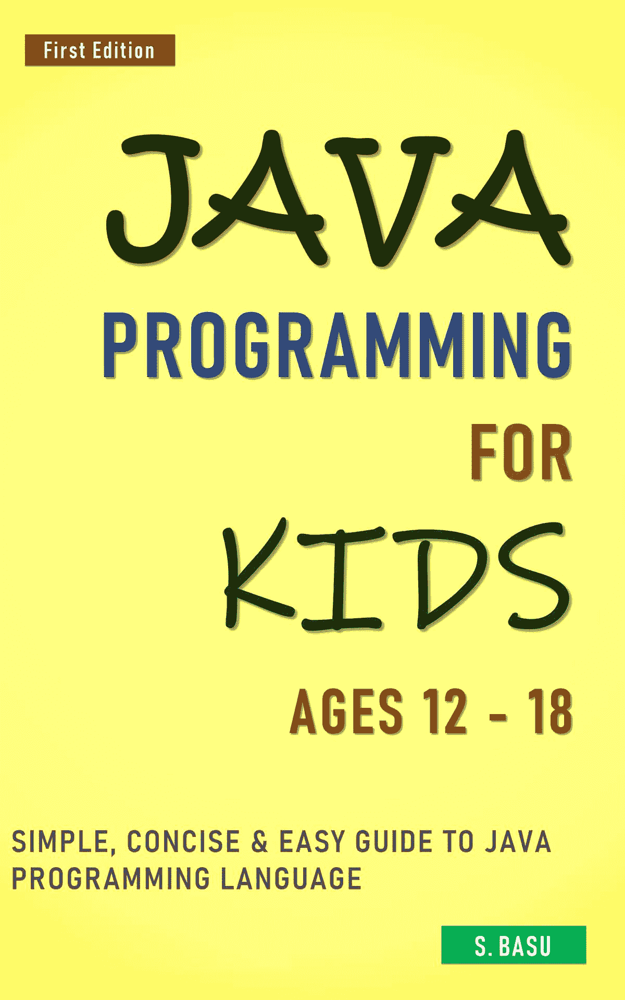

版权所有 © 2021 S Basu 保留所有权利。

免责声明：此处提供的信息和材料仅供教育目的。我们已尽力使本书尽可能完整和准确，但不意味着任何保证或适用性。所提供的信息均按“现状”提供。文中所述的观点和意见均为作者本人的想象，作者不属于任何组织、学校或教育学科，且对任何无意的错误陈述不承担责任。

Java 是最重要的编程语言。如果你完全掌握了 Java 基础，你就可以轻松地学习世界上任何面向对象编程的语言。

## 什么是 Java？

需要注意的重要点有：

*   Java 是一种面向对象编程（OOP）语言。
*   Java 是平台无关的，这意味着它可以运行在任何包含 `JVM` 的机器上。
*   为了编写和执行 Java 代码，需要 `JDK`。

## 什么是面向对象编程或 OOP？

*   Java 是一种面向对象编程（OOP）语言。
*   Java 是平台无关的，这意味着它可以运行在任何包含 `JVM` 的机器上。
*   为了编写和执行 Java 代码，需要 `JDK`。

## 什么是 JDK？

*   Java 是一种面向对象编程（OOP）语言。
*   Java 是平台无关的，这意味着它可以运行在任何包含 `JVM` 的机器上。
*   为了编写和执行 Java 代码，需要 `JDK`。

## 什么是 JRE？

*   Java 是一种面向对象编程（OOP）语言。
*   Java 是平台无关的，这意味着它可以运行在任何包含 `JVM` 的机器上。
*   为了编写和执行 Java 代码，需要 `JDK`。

## 什么是 JVM？

*   Java 是一种面向对象编程（OOP）语言。
*   Java 是平台无关的，这意味着它可以运行在任何包含 `JVM` 的机器上。
*   为了编写和执行 Java 代码，需要 `JDK`。

## JVM 架构

*   Java 是一种面向对象编程（OOP）语言。
*   Java 是平台无关的，这意味着它可以运行在任何包含 `JVM` 的机器上。
*   为了编写和执行 Java 代码，需要 `JDK`。

## 2.1：JDK 下载

## 2.2：下载并安装 Eclipse IDE

## 3.1：什么是 Java 类和对象？

## 3.2：什么是 Java 变量？

## 3.3：Java 数据类型

## 3.4：什么是访问修饰符？

## 3.5：什么是 Java 包？

### 3.6：示例

### 示例 1

### 示例 2

## 4.1：构造函数

### 示例

## 4.2：方法

### 示例

## 4.3：什么是 public static void main (String[ ] args)？

### 4.4：Java 中的数学运算符

## 5.1：条件语句

### 示例

## 5.2：循环

### 5.2.1：for 循环

### 示例

### 5.2.2：while 循环

### 示例

## 5.3：break 语句

### 示例

### 示例 1

### 示例 2

## 第 7 章：面向对象编程概念

## 7.1：封装

### 示例

### 7.2：继承

### 示例

### 7.3：多态

### 7.3.1：动态多态

### 示例

### 7.3.2：静态多态

### 示例

#### 测试

答案

Java 是最重要的编程语言。如果你完全掌握了 Java 基础，你就可以轻松地学习世界上任何面向对象编程的语言。

## 什么是 Java？

需要注意的重要点有：

*   Java 是一种面向对象编程（OOP）语言。
*   Java 是平台无关的，这意味着它可以运行在任何包含 `JVM` 的机器上。
*   为了编写和执行 Java 代码，需要 `JDK`。

## 什么是面向对象编程或 OOP？

*   Java 是一种面向对象编程（OOP）语言。
*   Java 是平台无关的，这意味着它可以运行在任何包含 `JVM` 的机器上。
*   为了编写和执行 Java 代码，需要 `JDK`。

## 什么是 JDK？

*   Java 是一种面向对象编程（OOP）语言。
*   Java 是平台无关的，这意味着它可以运行在任何包含 `JVM` 的机器上。
*   为了编写和执行 Java 代码，需要 `JDK`。


## 什么是 JRE？

*   Java 是一种面向对象编程（OOP）语言。
*   Java 是平台无关的，这意味着它可以运行在任何包含 `JVM` 的机器上。
*   为了编写和执行 Java 代码，需要 `JDK`。

## 什么是 JVM？

*   Java 是一种面向对象编程（OOP）语言。
*   Java 是平台无关的，这意味着它可以运行在任何包含 `JVM` 的机器上。
*   为了编写和执行 Java 代码，需要 `JDK`。

为了编写和执行 Java 代码，需要 `JDK`。

## JVM 架构

为了编写和执行 Java 代码，需要 `JDK`。


## 编译意味着什么？

为了编写和执行 Java 代码，需要 `JDK`。

## 什么是字节码？

为了编写和执行 Java 代码，需要 `JDK`。

## JVM 架构

为了编写和执行 Java 代码，需要 `JDK`。

为了编写和执行 Java 代码，需要 `JDK`。


## JVM 架构

分为三个部分：

1.  类加载器 (`Class Loader`)
2.  JVM 内存
3.  执行引擎 (`Execution Engine`)


## JVM 内存

进一步分为：

*   方法区 - 存储方法。
*   堆区 - 存储实例。
*   栈区 - 存储局部变量。
*   PC 寄存器 - 存储正在执行指令的地址。

## 执行引擎

进一步分为：

*   解释器 (`Interpreter`) - 将字节码转换为机器码。
*   JIT 编译器 - JIT 代表即时编译器，其主要任务是提高解释器的性能和效率。

现在在我们开始编码之前，让我们总结一下 Java 程序，我们需要下载并安装 `JDK` 和 `IDE`。

## 什么是 IDE？

`IDE` 代表集成开发环境（Integrated Development Environment）。它是编写 Java 程序所需的软件应用程序。虽然有多个 `IDE`，但我们将使用 Eclipse IDE 来编写 Java 代码。

## 2.1：JDK 下载

*   打开 Google Chrome（或你喜欢的任何浏览器）并搜索 java download，选择下方屏幕中显示的 oracle 网站。

    

*   下载最新版本的 `JDK`。

    

*   选择你的操作系统。（因为我使用的是 windows，所以下载了下方屏幕中显示的 windows-x64 安装程序）

    

*   勾选确认框，点击下载并安装。

       

*   点击关闭。

*   现在检查 Java PATH 是否已自动添加到你的环境变量中。

## 什么是 Java PATH？

`Java PATH` 是一个环境变量，帮助我们定位 `JDK` 的 bin 目录或文件夹，其中包含了执行 Java 程序所需的所有重要文件。

让我们访问环境变量：

*   打开控制面板 -> 点击系统和安全。
*   点击系统。
*   点击高级系统设置。
*   点击环境变量。
*   在系统变量下，选择 Path -> 点击编辑。
*   Javapath 显示如下方屏幕所示。
*   点击确定并退出。

我们已经已经在机器上成功安装了 `JDK`。现在让我们下载并安装 Eclipse IDE。

## 2.2：下载并安装 Eclipse IDE

*   访问网站 [`www.eclipse.org/downloads/packages/`](https://www.eclipse.org/downloads/packages/) 并下载最新版本的 Eclipse IDE。

    （因为我使用的是 Windows 操作系统，所以我下载了 Windows 版本的 Eclipse IDE）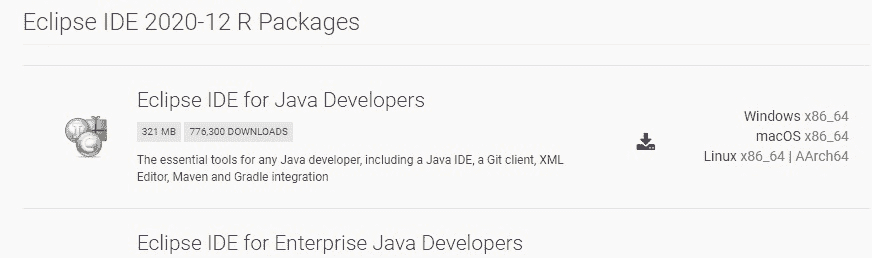 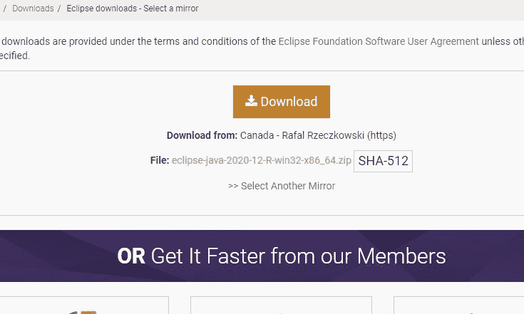

*   下载完成后，在电脑上打开下载文件夹。

    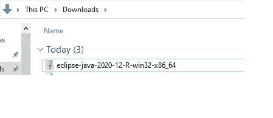

    下载的文件夹是一个 ZIP 文件夹，我们需要将其解压才能访问 Eclipse 应用程序。因此，右键点击 ZIP 文件夹并点击“提取所有”。

    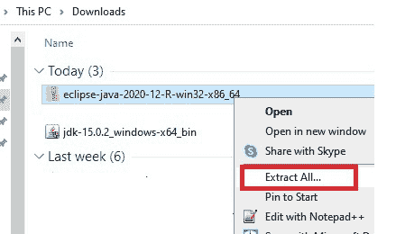

    浏览你的解压位置并点击“提取”。

    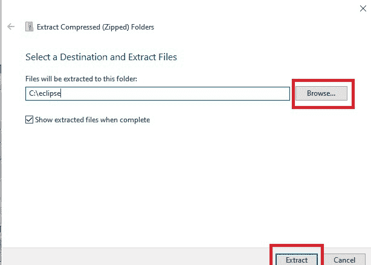

    现在打开 eclipse 文件夹，寻找下方截图所示的 eclipse 应用程序。

    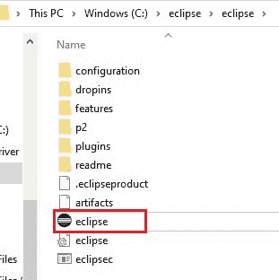

    点击并打开 eclipse 应用程序。

    

    选择一个工作空间并点击启动（launch）。

    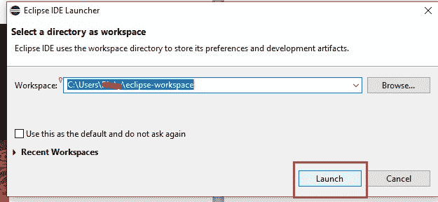

    我们现在已成功安装了 Eclipse IDE。让我们开始编码吧。

## 3.1: 什么是 Java 类和对象？

### `Class`

需要注意的要点是：

*   Java 类是创建对象的蓝图。
*   Java 类包含方法和变量。
*   创建 Java 类的语法为：

    ```
    access_modifier class class_name {……..}
    ```

### `Object`

*   类的对象实例。
*   对象包含其类中存在的方法和变量的副本。
*   创建 Java 对象的语法为：

    ```
    type object_name = new class_name ( )
    ```

    `type` 表示声明的对象的类型。`new` 关键字用于创建对象。`new` 关键字后面跟着对构造函数的调用（构造函数将在第 4 章中解释）。例如：`Animal a = new Animal( )`，这里 `a` 是 `Animal` 类型的对象（类名），`new` 关键字后面跟着对 `Animal` 默认构造函数的调用。

我知道这听起来非常复杂，让我们尝试在下面将其简化一下。让我们考虑一个包含三个学生 `John`、`Ram` 和 `Katy` 的教室。这三个学生有一些共同点，如下所示：

1.  他们三个人都是教室里的学生。
2.  他们每个人都有一个名字。
3.  他们每个人都有一个 `student_ID`。
4.  他们每个人都有一个 `age`。
5.  他们每个人都有一个 `gender`。
6.  他们每个人都有自己的家庭地址。

上述列出的六点被称为学生的属性。在 Java 世界中，我们可以用 `variable` 的形式来描述这些属性。学生执行多个功能，如学习、吃饭、玩耍等。在 Java 世界中，这些功能可以用 `methods` 来描述。我们已经成功陈述了 `Student` 的属性和功能。现在大问题是我们在哪里存储这些信息呢？嗯，我们可以这些信息存储在类中。学生 `John`、`Ram` 和 `Katy` 有他们各自的特征，他们都属于学生类别。在 Java 世界中，这三个学生被称为类 `student` 的 `objects`，而 `objects` 将包含其所在类中声明的所有变量和方法的副本。

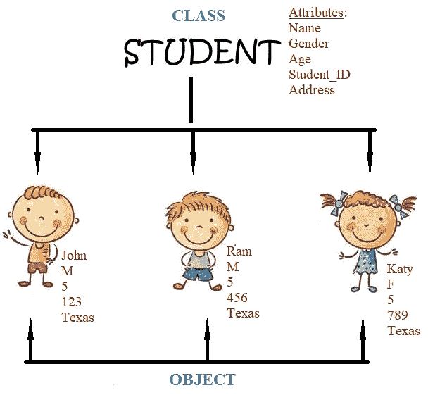

让我们总结一下这个概念：

*   `Student` 是一个类。
*   `John`、`Ram` 和 `Katy` 是属于 `Student` 类的 `objects`。
*   `Name`、`Gender`、`Age`、`Student_ID`、`Address` 是 `Student` 类的 `variables`。

我们将查看另一个 Java 类和对象的例子。

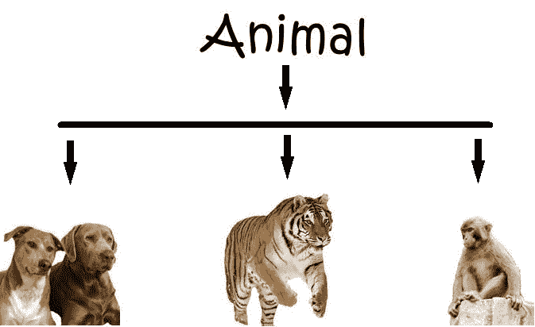

有多种动物属于动物界。有 `dogs`狗、`tigers`老虎、`monkeys`猴子、`lion`狮等。所有动物有一些共同点，比如它们都属于动物类别，它们都有名字、重量、年龄，并且还执行一些共同的功能，如吃饭、玩耍等。在 Java 世界中，我们可以将所有以上信息写入类 `Animal` 中，`Animal` 类的 `objects` 将是 `dog`、`tiger`、`monkey`。换句话说，我们可以说 `object` 是巨大类中的一个微小实体，它有自己的属性和特性。

## 3.2: 什么是 Java 变量？

需要注意的要点是：

*   Java `variables` 充当数据的容器。
*   `variables` 使用 `Data type` 声明。

    示例：`int age`

    这里 `age` 是变量名，其数据类型为 `int` 或整数，这意味着变量 `age` 只能存储数值整数。

Java `variables` 分三种类型：

1.  `Local variable` 局部变量——这些 `variables` 在方法内部声明（方法将在第 4 章讨论），并且 `variables` 在退出方法后就会被销毁。
2.  `Instance variable` 实例变量——这些 `variables` 在类内部声明。
3.  `Static variables` 静态变量——这些 `variables` 的值保持不变，不需要任何对象即可访问。

## 3.3: Java 数据类型

Java 数据类型分为两类：

1.  `Primitive Data Type` 原始数据类型——它包含如 `boolean`、`char`、`int`、`short`、`byte`、`long`、`float` 和 `double`。
2.  `Non-Primitive Data Type` 非原始数据类型：它包含 `String`、`Array` 等。

| 数据类型 |
| :--- |
| `int` |
| `float` |
| `char` |
| `boolean` |
| `String` |

在上面的 `Student` 类示例中：

*   `Name`、`Gender`、`Age`、`Student_ID`、`Address` 是 `Student` 类的 `variables`。
*   `Student` 是一个类。
*   `John`、`Ram` 和 `Katy` 是属于 `Student` 类的 `objects`。
*   `Age` 将是 `int`。
*   `Student_ID` 将是 `String`。
*   `Address` 将是 `String`。
*   `Gender` 将是 `String`。
*   `Name` 将是 `String`。

## 3.4: 什么是访问修饰符？

`access modifiers` 表示类或方法的可见性。大致分为四种：

1.  `Public` 公有修饰符——意味着可以随处可见。
2.  `Private` 私有修饰符——意味着仅在内部可见。
3.  `Default` 默认修饰符——意味着仅在包内可见。
4.  `Protected` 保护修饰符——意味着可以通过继承在包内（继承将在第 7 章讨论）。

## 3.5: 什么是 Java 包？

*   `Java package` 包含类的组。
*   `Java packages` 主要用于避免命名冲突。

如果一个包包含两个同名的类文件，会导致命名冲突并在 Java 项目中发生错误。为了防止这种情况发生，应该创建不同的包来存储类文件。


### 示例 1

启动 Eclipse 并创建一个新的 Java 项目。

*   点击 `File` -> `New` -> `Java Project`。

    

*   输入项目名称（我命名为 `hello_world`）并点击 `Finish`。

    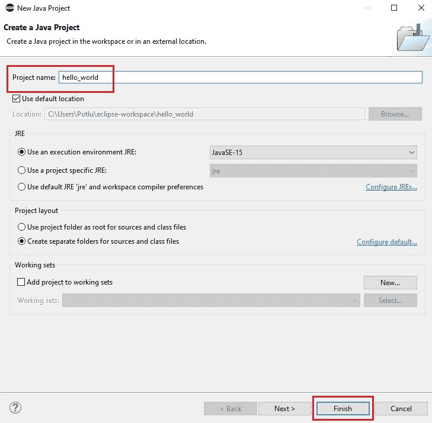

*   在 `Create module-info.java` 窗口，目前我将点击 `Don’t Create`。

    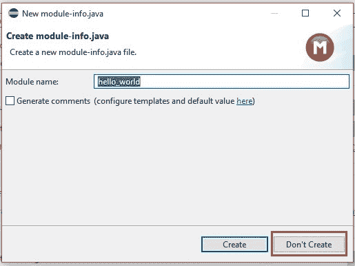

我们的 `hello_world` Java 项目已创建。

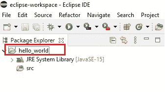

*   右键点击 `src` 文件夹 -> `New` -> `Package`（我们正在创建一个包）。

什么是默认的 `src` 文件夹？

默认 `src` 文件夹是源代码文件夹，包含了我们项目的源代码或主代码。

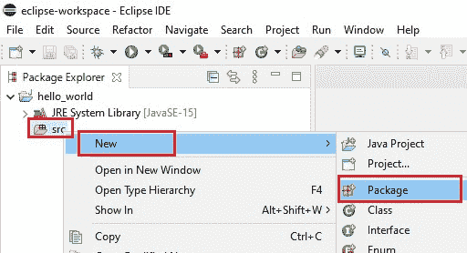 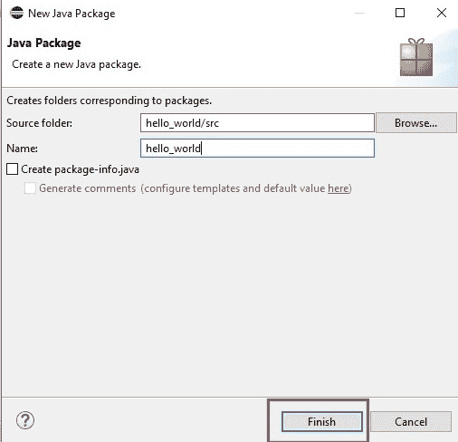

点击 Finish。

*   右键点击 `hello_world` 包 -> 点击 `New` -> 点击 `Class`（我们正在创建一个新的 Java 类）。

    

    输入类名（我给了 `Hello`），大写字母开头 -> 勾选 `public static void main(String[] args)` 复选框 -> 点击 `Finish`。

    

*   在 `Hello.java` 中，编写下方截图所示的代码，并通过点击运行按钮执行程序。

    

    代码解释：

    *   `System.out.print` 用于显示或打印输出。


`System.out.println` 与 `System.out.print` 相同，但 `println` 会分行输出。

* 在第 5 行，你会注意到一行非常重要的代码，它是 `public static void main(String[] args)`。它是 Java `main` 方法，作为 Java 程序的入口。任何 Java 程序在遇到这行非常重要的代码后才会开始执行过程。（我们将在第 4 章详细讨论这行代码）。

### 示例 2

让我们创建另一个 Java 类。

* 右键点击 `hello_world` 程序包 -> New -> Class (我将我的类文件命名为 `students`)

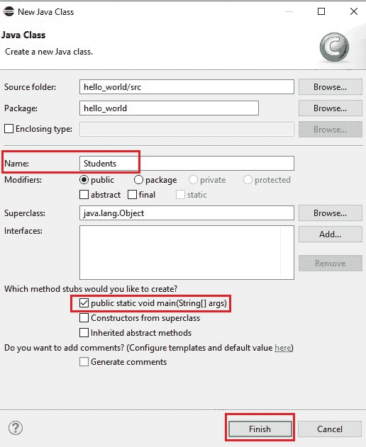

* 在 `students.java` 中，编写以下代码。

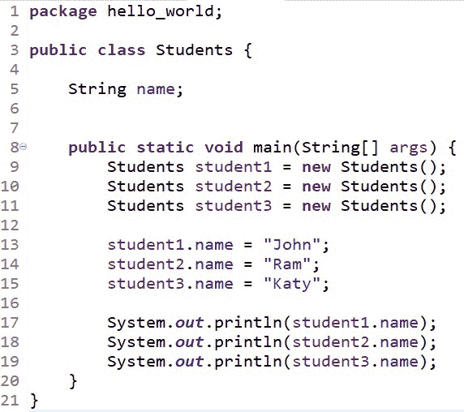

代码解释：

* 在第 5 行，我们声明了一个实例变量（在第 3.2 节中解释）名为 `name`，其数据类型（在第 3.3 节中解释）为 `String`。

* 在第 8 行，编写了非常重要的代码 `public static void main(String[] args)`。

请注意：始终记住，Java 对象必须在输入这行非常重要的代码后才能进行声明。

* 在第 9、10, 11 行，创建了 `Students` 类的不同对象。

* 通过 `.` 运算符，我们从 `Students` 类中访问变量 `name`。

请注意：要从对象访问类的任何变量或方法，均使用 `.` 运算符。

* 在第 13、14, 15 行，我们将值或数据传递给每个对象的 `name` 变量。

* 在第 17、18, 19 行，我们打印出这些值。

现在让我们运行上面的代码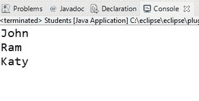

在上一一章中，我们学习了方法的基本概念。在本章中，我们将创建一个包含构造函数和方法的 Java 程序。

## 4.1: 构造函数

我们在第 3 章第 3.1 节学习了 Java 对象的语法，并了解到 `new` 关键字后面跟着构造函数的调用，那么什么是 Java 构造函数呢？

* Java 构造函数是一种特殊的 Java 方法，用于初始化 Java 对象。

* Java 构造函数的名称必须与 Java 类名匹配。

* Java 构造函数没有返回值（返回值在第 4.2 节中讨论）。

* Java 构造函数在对象创建期间始终会被被调用。如果一个类不包含任何构造函数，那么 Java 编译器会自动创建一个默认构造函数并执行程序。

Java 构造函数分为两种：

1. 默认构造函数

2. 带参数构造函数

### 默认构造函数

默认构造函数不包含任何参数。

### 带参数构造函数

带参数构造函数包含参数。

### 什么是参数？

参数是传递给方法或构造函数的变量。方法或构造函数可以有一个参数或多个参数。

示例 ➢ 启动 Eclipse IDE -> 创建一个新类（我将我的类命名为 `Multiply`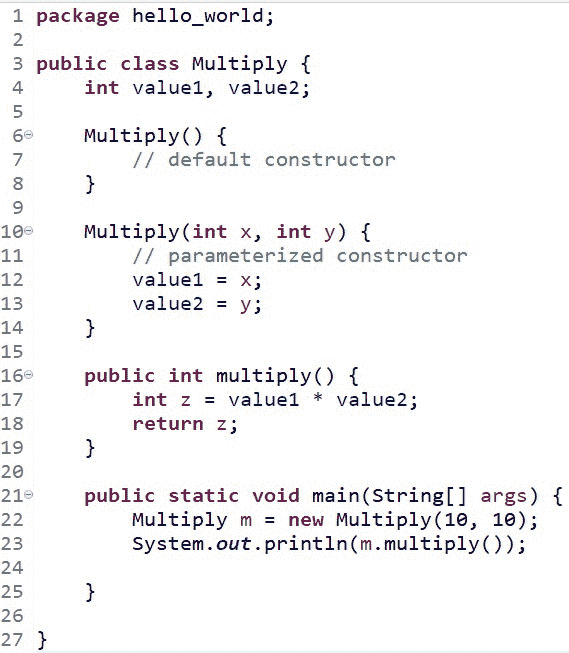

代码解释：

* 在第 4 行，声明了实例变量（实例变量在第 3 章第 3.2 节中解释）`value1` 和 `value2`。

* 在第 6 行，我们创建了默认构造函数。

* 在第 10 行，我们创建了带参数构造函数，它接收两个参数 `x` 和 `y`。

* 在第 12 行，我们将 `x` 传递给 `value1`，这意味着当给变量 `x` 赋值时，该值反过来会被赋值给变量 `value1`。

* 在第 13 行，我们将 `y` 传递给 `value2`，这意味着当给变量 `y` 赋值时，该值反过来会被赋值给变量 `value2`。

* 在第 16 行，声明了方法 `multiply`，该方法将返回乘法结果。

* 在第 21 行，声明了 Java `main` 方法（我们在第 3 章中讨论过这行非常重要的代码，随着学习进行，我们将进一步讨论该方法）。

* 在第 22 行，创建了对象 `m` 并值传递给 `Multiply` 构造函数（第 10 行创建的带参数构造函数。值 10 被赋值给实例变量 `value1`，另一个值 10 被赋值给 `value2`）。

* 在第 23 行，调用了方法 `multiply`。

现在让我们运行上面的代码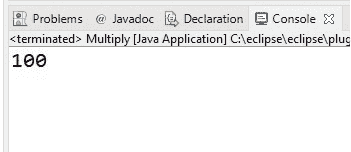

* Java 方法是执行某些任务的代码块。

示例：让我们考虑一个 `Math` 类，`Math` 包含数字，通过这些数字我们可以执行多个功能，如加法、减法、乘法、除法等。在 Java 中，我们可以在方法中编写这些函数。

* Java 方法的签名是：

`access_modifier return_type method_name {……………}` (`access_modifier` 在第 3 章第 3.4 节中讨论)

### Java 中的返回值是什么？

返回值是方法所返回的值的数据类型。

示例：让我们考虑下面写的方法签名：

`public int addition ( ) {}`

在上面的方法签名中，方法名为 `addition`，其返回类型是 `int`。这意味着 `addition` 方法将返回数据类型为 `int` 的值。为了返回方法的值，使用了 `return` 关键字。

让我们考虑下面写的另一个方法签名：

`public void show ( ) {}`

在上面的方法签名中，方法名为 `show`，其返回类型是 `void`。这意味着 `show` 方法不返回任何值。

示例

* 启动 Eclipse IDE -> 在 `hello_world` 包（在第 3 章创建的）中创建一个新类（我将我的类命名为 `Math`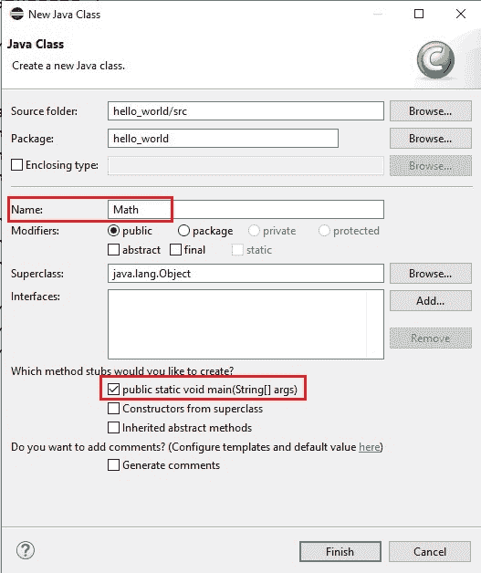

* 在 `Math.java` 中编写以下代码。

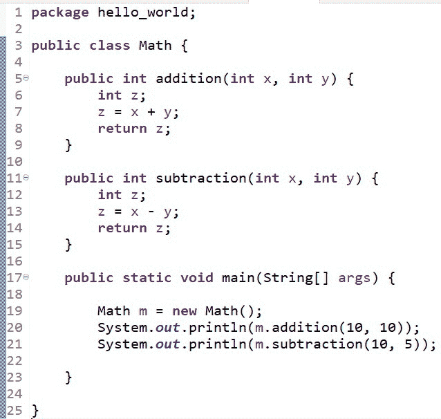

代码解释：

* 在第 3 行，声明了 `Math` 类，该类包含两个方法 `addition` 和 `subtraction`。

* 在第 5 行，声明了 `addition` 方法。让我们看看签名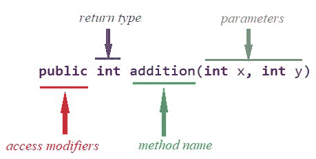

* 在第 6 行，我们声明了一个局部变量 `z`（局部变量在第 3 章第 3.3 节中讨论）。

* 在第 7 行，我们执行算术运算。

* 在第 8 行，通过 `return` 关键字返回 `z` 的值。

* 第 11–14 行包含 `subtraction`，它遵循与 `addition` 相同的过程。

* 第 17 行包含 main 方法，它作为 `Math` 的入口。

* 在第 19 行，创建了 `Math` 类的对象 `m`。

* 在第 20 和 21 行，访问了 `Math` 的方法。使用了 `.` 运算符。在 `addition` 方法中，值 10 被赋值给 `x`，另一个值 10 被赋值给 `y`。然后通过 `System.out.println` 打印方法的结果。

### 什么是参数 (Argument)？

参数是传递给方法的值。

## 4.3: 什么是 static void main (String[] args)?

我们在第 3 章以及本章了解到 `public static void main(String[] args)` 是任何 Java 程序中最重要的代码。这行代码作为 Java 程序的入口或起点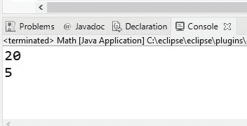

请注意：JVM 访问 main 方法（JVM 在第 1 章中讨论）

## 4.4: Java 中的算术运算符

| 算术运算符 |
| :--- |
| `+` |
| `-` |
| `*` |
| `/` |
| `%` |
| `++` |
| `--` |

## 5.1: 条件语句

* Java 包含条件语句，它们有：

    1. `if`

    2. `else`

    3. `else if`

* `if` 和 `else` 的语法是：

```
if ( condition ) {……………. code ………}else{………….. code ………………}
```

* `if`, `else if` 和 `else` 的语法是：

```
if ( condition ) {…….. code ……………….}else if ( condition ) {……….. code ………………..}else{……………….. code ……………}
```

这些条件语句检查条件是否返回布尔值 TRUE 或 FALSE。如果条件返回 TRUE，则执行代码块，否则执行另一个代码块。

`if` 和 `else` 的执行流程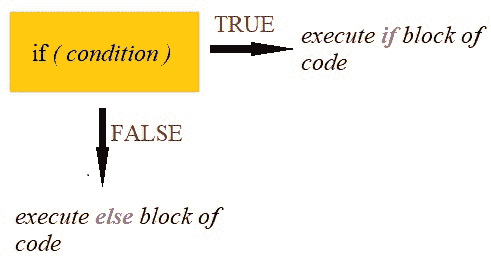

`if`, `else if` 和 `else` 的执行流程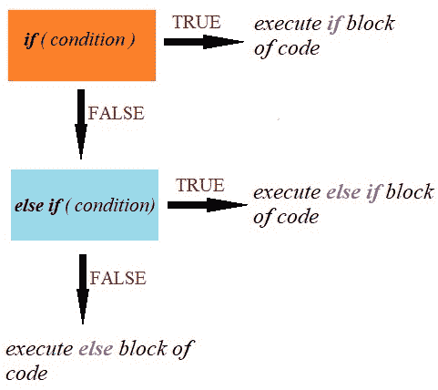

### Java 中可用的逻辑运算

| 运算符 |
| :--- |
| `x > y` |
| `x < y` |
| `x == y` |
| `x != y` |
| `x >= y` |
| `x <= y` |

让我们编写代码..示例

* 启动 Eclipse IDE 并创建一个新的 Java 类 `ConditionalStatements`

第 3 行，声明了类 `ConditionalStatements`。

* 在第 5 行，编写了 `public static void main(String[] args)`（这行代码我们在第 3 章和第 4 章中讨论过）。

* 在第 7 和第 8 行，声明了实例变量（在第 3 章 3.2 节讨论过）`x` 和 `y`，并为它们赋值 5 和 10。

* 在第 10 行，声明了一个 `if` 条件。它检查 `x` 的值是否大于 `y` 的值。如果条件满足或返回布尔值 `TRUE`，则执行第 11 行。

* 在第 13 行，声明了一个 `else if` 条件。它检查 `x` 的值是否等于 `y` 的值。如果两个值相等，则执行第 14 行。

* 在第 16 行，声明了 `else` 条件，当 `if` 和 `else if` 条件都不满足时，将运行此代码块。

在这个示例中，`x` 的值为 5，`y` 的值为 10，因此 `x` 的值不大于 `y` 的值，该条件将返回 `FALSE` 且不会执行第 11 行。`x` 的值显然不等于 `y` 的值，因此条件将返回 `FALSE` 且不会执行第 14 行。`x` 的值大于 `y`（在 `if` 条件中设定），且 `x` 的值不等于 `y`（在 `else if` 条件中设定），这意味着 `x` 小于 `y`，因此执行 `else` 代码块。现在让我们运行上面的代码。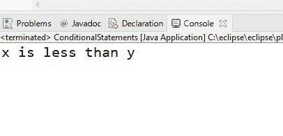

* 循环有两种类型：

    1. `for` 循环

    2. `while` 循环

这些循环用于遍历一个代码块，以测试某个条件是否满足。

* `for` 循环处理数组（Arrays）时效果最好（我们将在第 6 章学习数组的各种知识）。

### 5.2.1: for 循环

语法如下：

```
for ( initialization , condition , increment ) { ………… code ………………}
```

* `initialization` 部分初始化一个变量，它在 `for` 循环生命周期中只执行一次。

* `condition` 部分包含一个逻辑操作。

* `increment` 部分递增变量，它在每次代码块执行后执行一次。

`for` 循环的执行流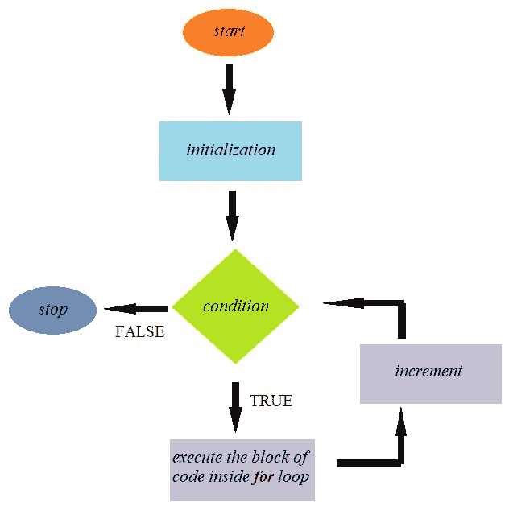

### 示例

* 启动 Eclipse IDE 并创建一个新的 `Class`（我将我的类命名为 `Loops`）。

* 在 `Loops.java` 中编写以下代码行。

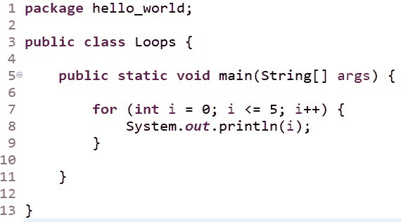代码解释：

* 在第 3 行，声明了 `class Loops`。

* 在第 5 行，编写了 `main` 方法（此行代码在第 3 和第 4 章讨论过）。

* 在第 7 行，写出了 `for` 循环。

* 在 `initialization` 部分，声明了变量 `i` 并给它赋值为 0。

* 在 `condition` 部分，设置了条件 `i <= 5`。

* 在 `increment` 部分，我们将 `i` 的值加了 1。每当条件满足或返回 `TRUE` 且代码块执行时，`i` 的值就会加 1。

* 在第 8 行，打印 `i` 的值。

上述代码的执行过程：

* `i = 0` -> 检查条件（`i` 小于 5，所以条件返回 `TRUE`） -> 执行第 8 行 -> `i` 加 1。当前 `i` 的值为 1。

* `i = 1` -> 检查条件（`i` 小于 5，所以条件返回 `TRUE`） -> 执行第 8 行 -> `i` 加 1。当前 `i` 的值为 2。

* `i = 2` -> 检查条件（`i` 小于 5，所以条件返回 `TRUE`） -> 执行第 8 行 -> `i` 加 1。当前 `i` 的值为 3。

* `i = 3` -> 检查条件（`i` 小于 5，所以条件返回 `TRUE`） -> 执行第 8 行 -> `i` 加 1。当前 `i` 的值为 4。

* `i = 4` -> 检查条件（`i` 小于 5，所以条件返回 `TRUE`） -> 执行第 8 行 -> `i` 加 1。当前 `i` 的值为 5。

* `i = 5` -> 检查条件（`i` 等于 5，所以条件返回 `TRUE`） -> 执行第 8 行 -> `i` 加 1。当前 `i` 的值为 6。

* `i = 6` -> 检查条件（`i` 不小于等于 5，所以条件为 `FALSE`） -> 退出循环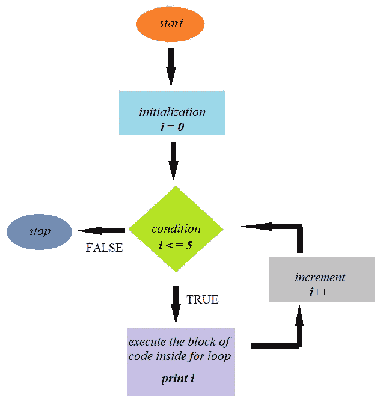

现在让我们运行上面的代码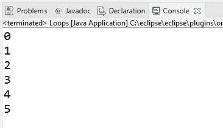

### 5.2.2: while 循环

只要条件为 `TRUE`，`while` 循环就会持续执行一个代码块。

语法如下：

```
while ( condition ) {………. code…………..}
```

示例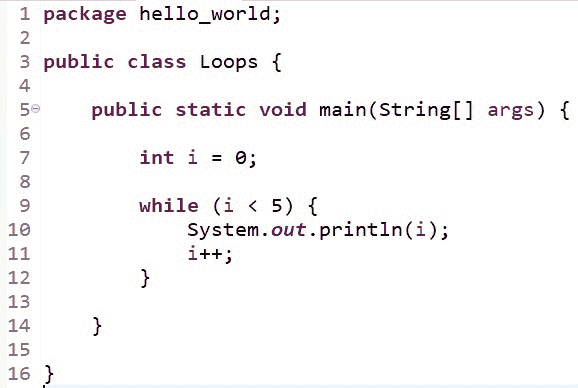代码解释：

* 在第 7 行，只要条件为 `TRUE`，`while` 循环就会持续执行一个代码块。

* 注意：如果不满足条件，循环将停止。

`break` 语句用于在满足特定条件时跳出循环。

示例：

```
int i = 0;
while (i < 10) {
    if (i == 5) {
        break;
    }
    System.out.println(i);
    i++;
}
```

代码解释：

* 在第 1 行，初始化变量 `i` 为 0。

* 在第 3 行，声明了一个 `if` 条件，检查 `i` 是否等于 5。

* 如果 `i` 等于 5，执行 `break` 语句，跳出循环。

* 在第 5 行，打印 `i` 的值。

* 在第 6 行，`i` 的值加 1。

执行过程：

* `i = 0` -> 检查 `i < 10`（真） -> 检查 `i == 5`（假） -> 打印 0 -> `i` 为 1。

* `i = 1` -> 检查 `i < 10`（真） -> 检查 `i == 5`（假） -> 打印 1 -> `i` 为 2。

* `i = 2` -> 检查 `i < 10`（真） -> 检查 `i == 5`（假） -> 打印 2 -> `i` 为 3。

* `i = 3` -> 检查 `i < 10`（真） -> 检查 `i == 5`（假） -> 打印 3 -> `i` 为 4。

* `i = 4` -> 检查 `i < 10`（真） -> 检查 `i == 5`（假） -> 打印 4 -> `i` 为 5。

* `i = 5` -> 检查 `i < 10`（真） -> 检查 `i == 5`（真） -> 执行 `break` -> 退出循环。

数组是用于存储相同类型多个值的结构。

示例：

```java
int[] numbers = {10, 20, 30, 40, 50};
```

代码解释：

* `int[] numbers` 声明并初始化了一个整数数组。

* `{10, 20, 30, 40, 50}` 是数组的初始值。

### 6.1: 访问数组

数组通过索引（index）访问，索引从 0 开始。

示例：

```java
System.out.println(numbers[0]); // 输出 10
System.out.println(numbers[2]); // 输出 30
```

### 6.2: 修改数组

你可以通过索引修改数组的值。

示例：

```java
numbers[1] = 100;
System.out.println(numbers[1]); // 输出 100
```

### 6.3: 遍历数组

可以使用 `for` 循环或 `for-each` 循环来遍历数组。

示例：

```java
for (int i = 0; i < numbers.length; i++) {
    System.out.println(numbers[i]);
}
```

或者使用 `for-each`:

```java
for (int num : numbers) {
    System.out.println(num);
}
```

类是创建对象的蓝图。

示例：

```java
class Car {
    String brand;
    int year;

    void drive() {
        System.out.println("The car is driving.");
    }
}
```

实例化对象：


```java
Car myCar = new Car();
myCar.brand = "Toyota";
myCar.year = 2022;
myCar.drive();
```

# 7.1: 继承

继承允许类使用另一个类的属性和方法。

示例：

```java
class Animal {
    void eat() {
        System.out.println("This animal eats.");
    }
}

class Dog extends Animal {
    void bark() {
        System.out.println("The dog barks.");
    }
}
```

多态允许不同类对同一个方法调用做出不同的响应。

示例：

```java
Animal myDog = new Dog();
myDog.eat(); // 输出 This animal eats.
```

*   **封装** 是将所有 Java 方法和变量封装成单个单元（`Class` 类）的机制。

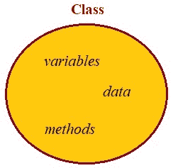

*   封装有助于保护单元内部的数据，并防止任何恶意活动。

*   在封装中，类的变量被声明为 `private`（第 3 章第 3.4 节解释了 `private` 访问修饰符）。

为了从类外部访问私有变量，使用了 `get` 和 `set` 方法。`set` 方法用于设置值，`get` 方法用于获取值。

示例➢ 启动 Eclipse IDE -> 创建一个新的 `Class`（我将我的类命名为 `Encap`）。

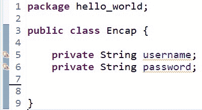

在 `Encap` 类中，我声明了两个变量 `username` 和 `password`。由于 `username` 和 `password` 都携带了非常重要且敏感的数据（敏感数据是指那些必须不惜代价隐藏和保护的数据），因此我们将访问修饰符声明为 `private`，这意味着 `Encap` 类之外任何类无法访问这些变量。为了访问这些私有变量，我们需要 `get` 和 `set` 方法。

➢ 为了生成变量 `username` 和 `password` 的 `get` 和 `set` 方法，点击 `username` 和 `password` 旁边的黄色灯泡图标，并分别选择 Create getter and setter for ‘username’ 和 Create getter and setter for ‘password’。

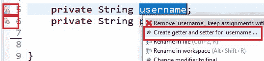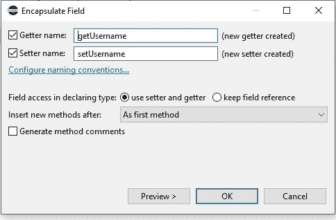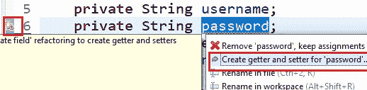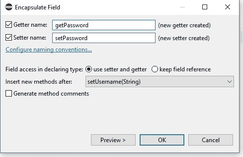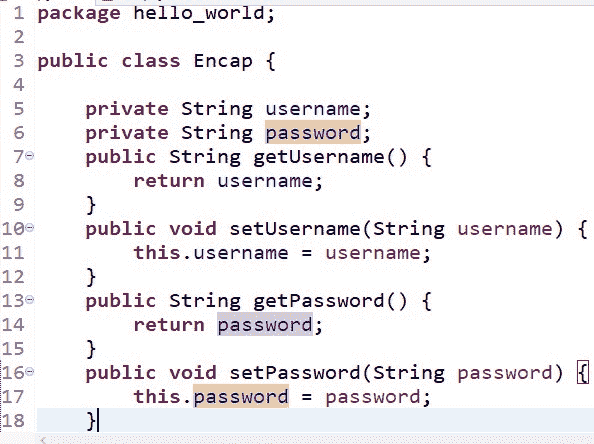

这个 `this` 关键字是什么？`this` 关键字引用当前对象。在上面的示例中，类 `Encap` 是 `public` 的，这意味着任何其他类都可以访问 `Encap` 类，但它的变量是 `private` 的，这意味着除了 `Encap` 类没有类可以访问这些变量。`get` 和 `set` 方法是 `public` 的，这意味着任何其他类都可以访问这些方法。

➢ 让我们创建另一个类（我将我的类命名为 `Encap2`）并访问在 `Encap` 类中声明的 `get` 和 `set` 方法。

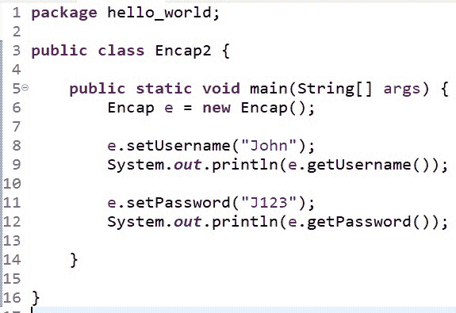

代码解释：

*   由于类 `Encap` 是 `public` 的，因此类 `Encap2` 可以轻松地访问它。

在第 6 行，创建了 `Encap` 类对象并访问了它的 `set` 和 `get` 方法。首先，我们在第 8 行使用其 `set` 方法为变量 `username` 赋值，然后在第 9 行使用其 `get` 方法获取并打印该值。然后，我们在第 11 行使用其 `set` 方法为变量 `password` 赋值，然后在第 12 行使用其 `get` 方法获取并打印该值。让我们运行上述代码：

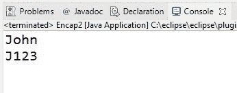

# 7.2: 继承

需要注意的重要点有：

*   继承是一种子类或子类从超父类或父类继承所有属性的机制。

*   继承的主要用途是代码重用。

*   子类或子类使用 `extends` 关键字从其父类继承属性。

```java
class Child extends Parent {……………….code………………}
```

*   子类可以包含它自己的属性，也可以包含其父类的属性。

示例：让我们考虑一个 XYZ 学区包含三所学校：小学、中学和高中，且这三所学校都位于同一条街道的同一个位置。这些学校之间的共同属性是：

1. 它们都是学校或教育机构。

2. 它们都位于同一条街道上，但有不同的建筑名称和编号。

3. 它们都属于同一个学区。

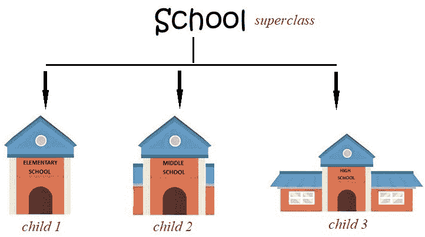

在编写代码时，与其为每所学校重复编写这些共同信息，我们可以在一个地方写一次（在超类或父类中），并在任何其他类需要它们时调用它们。

示例➢ 启动 Eclipse IDE，创建一个新类（我将我的类命名为 `SchoolSuperClass`），该类将作为超类起作用。

➢ 创建另外三个类，一个用于小学（我将我的类命名为 `ElementaryChild`），一个用于中学（我将我的类命名为 `MiddleChild`），一个用于高中（我将我的类命名为 `HighChild`）。这三个类将作为超类 `SchoolSuperClass.java` 的子类作用。

➢ 在超类 `SchoolSuperClass.java` 中，编写以下代码：

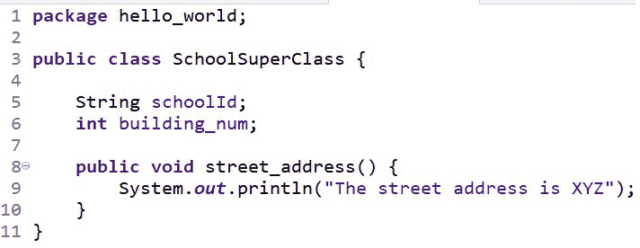

在这个类中，我们声明了所有三所学校通用的变量和方法。

* 打开 `ElementaryChild.java`，并编写以下代码

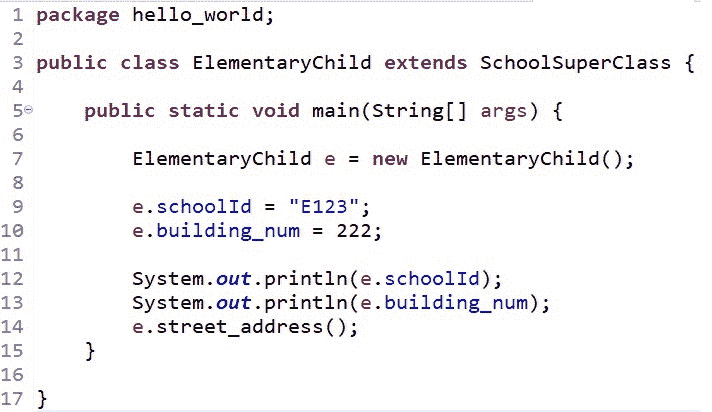

代码解释：

*   在第 3 行，通过 `extends` 关键字，超类 `SchoolSuperClass` 的所有属性都被整合到子类 `ElementaryChild` 中。

*   在第 7 行，创建了 `ElementaryChild` 类的对象 `e`。

*   在第 9 行和第 10 行，从超类访问变量 `school_Id` 和 `building_num` 并向其传递值。

*   在第 12 行和 13 行，打印了变量的值。

*   在第 14 行，调用了超类中的 `street_address()` 方法。

现在让我们运行上述代码：

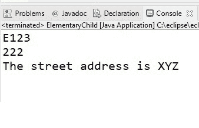

* 打开第二个类文件 `MiddleChild.java`，编写以下代码

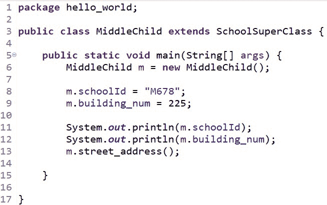

上述代码与 `ElementaryChild.java` 非常相似，只是数据不同。让我们运行上述代码：

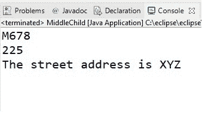

我们在 `HighChild.java` 中遵循相同的过程。

# 7.3: 多态

多态是一种方法根据所作用的对象以多种形式执行的机制。

多态有两种类型：

1. 动态多态
2. 静态多态

## 7.3.1: 动态多态

这种类型多态最重要的例子是方法重写。

*   当超类和子类具有相同名称的方法时，子类的方法会重写超类的方法。

*   当超类和子类具有相同名称的方法时，编译器无法确定执行哪个方法。这种类型的冲突在运行时解决的。

### 示例

让我们创建一个方法重写的场景。

➢ 启动 Eclipse IDE 并创建一个超类（我将我的类命名为 `Animal`）

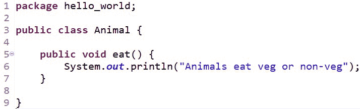

➢ 创建两个子类（将一个子类命名为 `Cow`，另一个子类命名为 `Lion`）

`Cow.java` 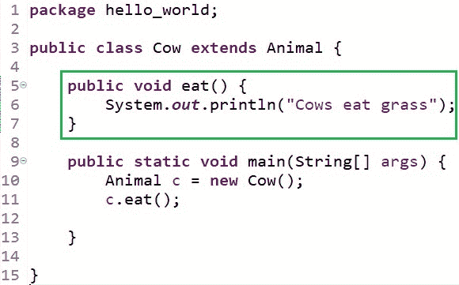 `Lion.java` 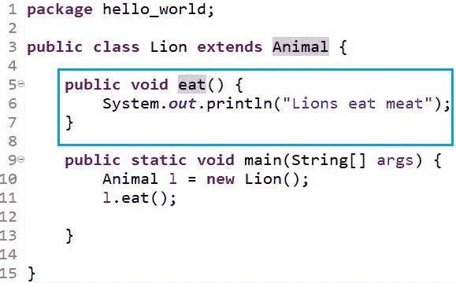

超类 `Animal` 有一个 `eat` 方法，两个子类 `Cow` 和 `Lion` 也具有相同名称的方法（如截图所示）。在 `Cow.java` 中，第 10 行我们创建了 `Animal` 类型的对象 `c` 并调用了 `Cow` 的构造函数。在第 11 行，我们调用了 `eat` 方法。运行 `Cow.java` 后得到输出：


在 `Lion.java` 中，第 10 行我们创建了 `Animal` 类型的对象 `l` 并调用了 `Lion` 的构造函数。在第 11 行，我们调用了 `eat` 方法。运行 `Lion.java` 后得到输出：


在两种情况下，我们都看到每个子类的 `eat` 方法都重写了超类的 `eat` 方法。

## 7.3.2: 静态多态

这种类型多态最重要的例子是方法重载。

*   在方法重载中，一个类可以包含多个具有相同名称但签名不同的方法。

*   静态多态也被称为编译多态，因为在这种情况下，编译器根据方法签名知道要执行哪个方法，冲突在编译时解决。

示例➢ 启动 Eclipse IDE -> 创建一个类（我将我的类命名为 `SPExample`）


代码解释：

*   在第 5 行，声明了一个名为 `show` 的方法。

*   在第 9 行，声明了另一个带有参数的 `show` 方法。

*   在第 15 行，调用了 `show()` 方法。

*   在第 16 行，调用了另一个 `show()` 方法并传入了一个参数。

现在让我们运行上面的代码


在上面的示例中，我们看到有两个方法，它们具有相同的名称（`show`），但签名不同（一个没有参数，另一个有参数）。当我们运行上面的代码时，它完美地运行了，因为编译器能够根据签名来区分这两个方法。

# 练习题

## 1. 编写一个程序，打印从 1 到 10 的所有偶数和奇数。

当一个数除以 2 时，如果余数为 0，则该数为偶数。当一个数除以 2 时，如果余数不为 0，则该数为奇数。

## 2. 编写一个程序，遍历数组并在满足条件时跳出循环。

给定：`Array car` 包含 5 个元素 `Toyota`、`Kia`、`Ford`、`Tesla`、`Truck`。当 `car` 等于 `Tesla` 时退出循环。

## 3. 编写包含两个带参数的方法，这些方法在被调用并传入参数后将返回值。

### 方法 1 应在执行算术乘法操作后返回整数结果。

### 方法 2 应在执行算术除法操作后返回整数结果。

## 4. 编写一个包含一个带参数的方法，该方法在被调用并传入参数后将返回结果。

该方法必须有一个数据类型为 `string` 的参数，且该方法在被调用并传入参数后必须返回字符串值。

# 答案

1. 

2. 

3. 

4. 

祝一切顺利，非常感谢您购买本书。请记住，最重要的学习是自学。
